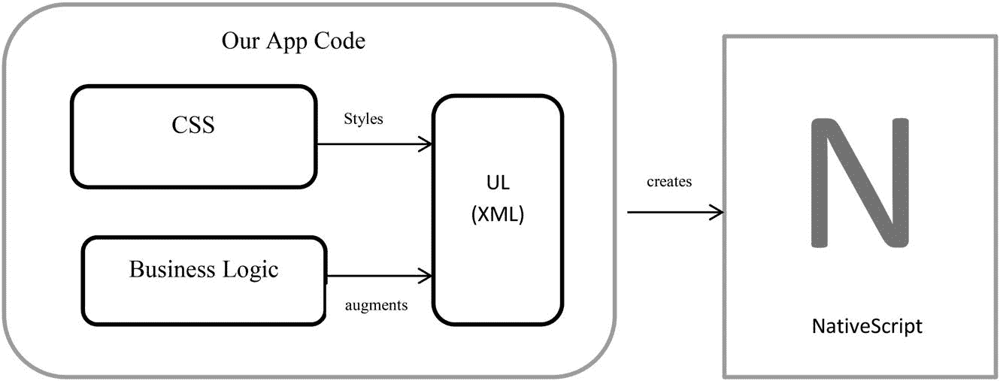
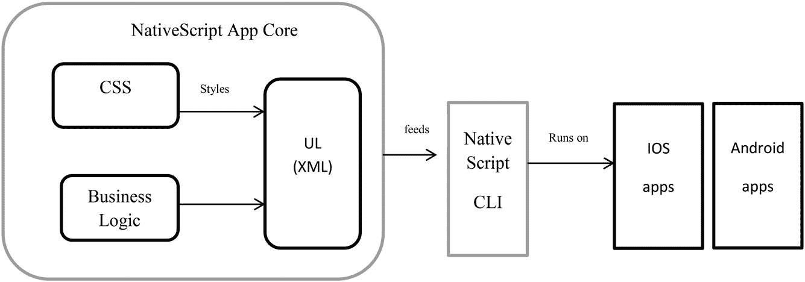
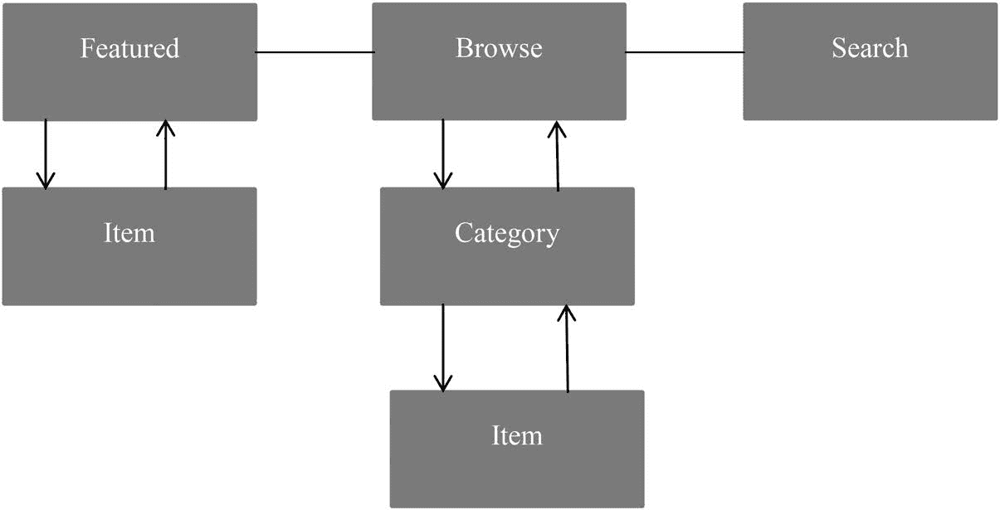
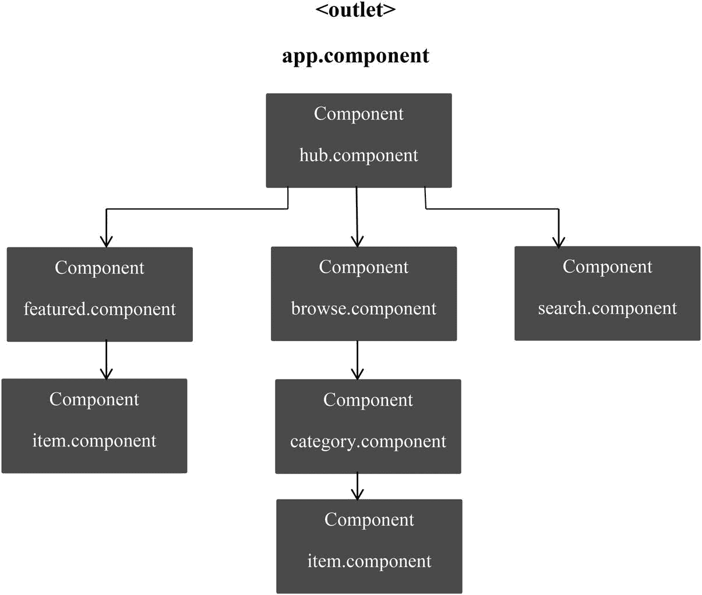
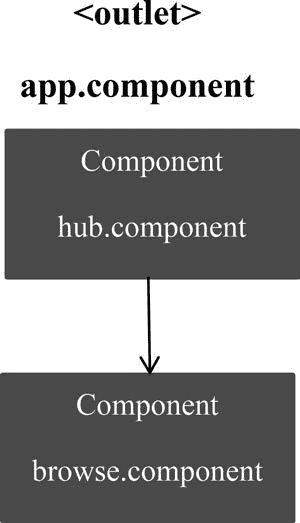
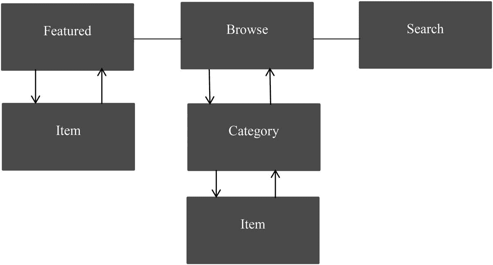
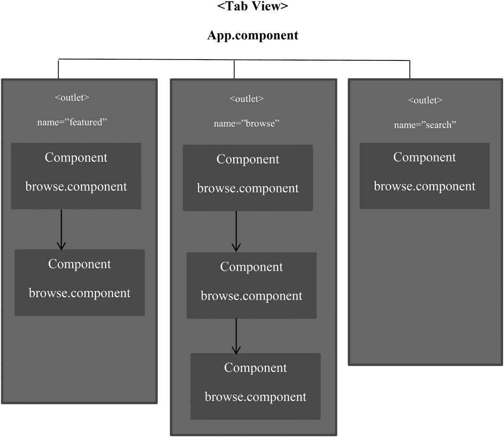
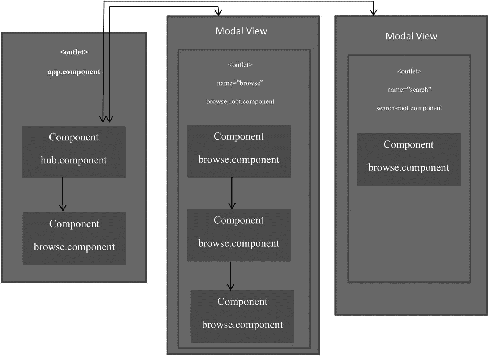
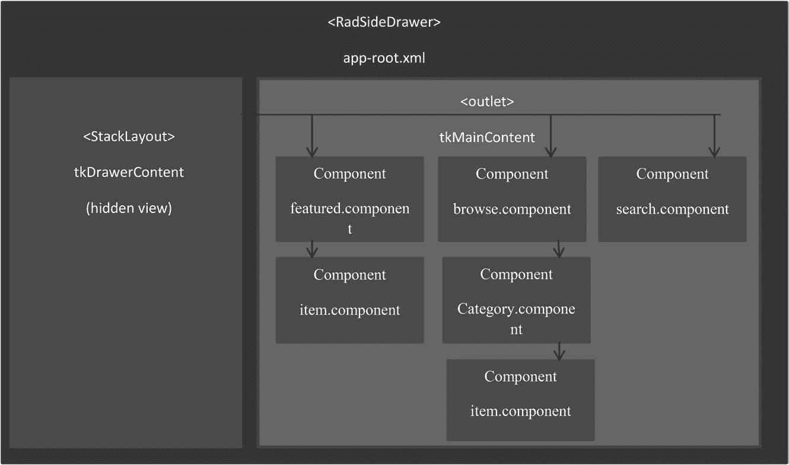

# NativeScript 精通：初学者指南 (计算机科学大师)


*Mastering NativeScript* 帮助读者掌握 NativeScript 框架，以进行更快、更稳健的移动应用开发。

近年来，移动设备已从简单的通信工具演变为关键业务工具。随着技术的飞速发展，人们越来越多地离不开智能手机。移动应用开发的重要性不言而喻。

当提到移动应用开发时，NativeScript 是一个热门话题。NativeScript 由 Telerik 引入，它允许你使用 JavaScript 或 TypeScript、XML 以及 CSS 的子集在单一代码库下为 iOS 和 Android 开发真正的原生应用。NativeScript 的魅力在于它使我们能够为多个平台（iOS≤7.1 和 Android≤4.1）编写一次代码，在共享代码的同时，仍允许开发者添加特定平台的指令并实现完美执行。因此，你可以使用单个代码库为两个平台发布应用。

NativeScript 由三部分组成：JavaScript (JS) 虚拟机、运行时和一个桥接模块。JS 虚拟机用于解释和执行 JavaScript 代码。桥接模块则将调用转换为特定平台的 API 调用，并将结果返回给调用者。

NativeScript 是一种极具吸引力的范式，目前正日益流行。它可以用于构建几乎任何程序，包括通信应用（新闻和社交网络）、游戏应用（国际象棋、井字格、弹球）以及聊天应用。它还可以处理地图和地理定位应用。

通过 *Mastering NativeScript*，学习 NativeScript 将变得简单易行，这无疑有助于读者提升职业生涯。

**“精通计算机科学”系列书籍由 Sufyan bin Uzayr 领导的 Zeba Academy 团队成员编写。**

**Zeba Academy 是一家教育科技初创企业，主要为 STEM 领域的学习者开发课程和内容，并为全球的大学和机构提供教育咨询。欲了解更多信息，请访问 https://zeba.academy**

Sufyan bin Uzayr

DOI: 10.132297624

## 序言

## 关于作者

## 目录

- NativeScript 中的事件处理
- NativeScript 中的数据绑定
- NativeScript 的模块
- NativeScript 插件
- 使用 JavaScript 使用原生 API
- NativeScript – ANDROID 应用开发
- 我们的第一个应用
- NativeScript 中的布局
- UI 布局容器
- 第3章 完善你的应用
- 将我们的 NativeScript 应用发布到应用商店的步骤
- 在 NativeScript 中，处理数据
- 准备发布我们的应用
- 在 Windows 上
- 保护我们的移动应用
- 第4章 Angular 和 NativeScript
  - 升级我们的 Angular 10 项目
  - 应更新的 .json 文件
- 使用 Angular 创建 NativeScript 应用
- 导航
- 数据绑定
- 使用插件
- 第5章 深入探索
- webpack 配置
- iOS 应用扩展
  - 用于 WatchOS 的 NativeScript 应用

## 序言

《精通计算机科学》（*Mastering Computer Science*）涵盖了广泛的主题，跨越编程语言以及现代技术和框架。该系列特别关注初级内容，并以易于理解的方式呈现，包括：

- 清晰易懂的文字，涵盖按相关性排序的各种主题；
- 特别关注实践练习，包含大量的代码示例和程序；
- 引导式的编程方法，为绝对初学者提供分步骤的教程；
- 高强调技能在现实世界中的实用性，从而删减冗余和很少使用的概念，转而专注于行业通用的编码范式；
- 广泛的参考文献和资源，帮助初级和中级开发者从书中获得最大的益处。

《精通计算机科学》系列书籍从核心概念开始，然后迅速转向行业标准的编码实践，帮助学习者在尽可能短的时间获得高效且关键的技能。书中假设读者没有先编程知识，因此即使是完全的新手编码员也能从本系列中受益。

《精通计算机科学》系列由 Sufyan bin Uzayr 编辑，他是一位在计算领域拥有十年经验的作家和教育者。

## 关于作者

**Sufyan bin Uzayr** 是一位作家、程序员和创业者，在行业拥有十多年经验。他过去撰写过几本书，涉及从历史到计算机/IT 的多种主题。

Sufyan 是 Parakozm 的总监，这是一家专注于教育技术（EdTech）解决方案的跨国 IT 公司。他还运营 Zeba Academy，这是一个专注于 STEM 领域的在线学习和教学平台。

Sufyan 精通 JavaScript、Dart、WordPress、Drupal、Linux 和 Python 等多种技术。他拥有多个学位，包括管理学、IT、文学和政治科学学位。

Sufyan 是一个数字游民，时间分布在四个国家。他曾在全球各地的大学和教育机构生活和教学。Sufyan 对技术、政治、文学、历史和体育有着浓厚的兴趣，在空闲时间，他喜欢向青少年教授编码和英语。

访问 sufyanism.com 了解更多。

# 第1章：基础

## 本章内容

在移动应用程序的早期（iPhone 之前），人们很少强调编写一次代码并发布到多个平台。开发者只关心如何尽快将应用程序放入 Apple 或 Google Play 商店。如果这意味着他们的软件无法在所有平台上运行，那也是可以接受的权衡。

今天，移动世界不断演变，使得跟上最新技术变得越来越挑战性。当开发者创建应用程序时，他们必须接触最广泛的潜在受众：专注于单一平台不再是一个选择。应用程序必须在多个平台和设备上可用。

为了跟上不断变化的环境，开发者重视任何可以简化移动开发流程的技术。有多种用于创建移动应用程序的框架；NativeScript 是其中之一，但它远不是唯一的。其他的如 `Cordova`、`Xamarin` 和 `React Native` 你可能对它们熟悉。

## 基础

### JavaScript 框架概述

### NativeScript 概述

## 4. 掌握 NativeScript：入门指南

学习一门新语言有时会成为进入新世界的阻碍。在开发 NativeScript 应用时，我们将利用之前在 HTML 应用程序方面的专业知识，快速设计出针对多个平台（Android 和 iOS）的应用程序。由于我们已经具备了这些能力，设计 NativeScript 应用将是轻而易举的。此外，我们无需学习 `Objective C`、`Swift` 或 `Java`。

## NativeScript 应用是如何创建的？

如下图所示，NativeScript 应用是通过 JavaScript、XML 和 CSS 混合创建的。



NativeScript 中的应用。

当我们构建 NativeScript 应用时，我们的代码被分为三个部分：JavaScript、XML 和 CSS。JavaScript 组件执行业务逻辑、获取数据并控制应用的流程。XML 部分定义 UI，而 CSS 用于像处理 HTML 应用程序一样来自定义 UI。NativeScript 程序的结构和代码与 HTML 应用相似，但相似性仅限于此。NativeScript 在跨平台移动应用领域是独特的，因为它允许你只编写一次 UI (XML) 代码。

当 UI 代码执行时，它会在应用中渲染原生 UI 组件。例如，在 iOS 上，UI 组件被表示为原生 iOS 按钮、下拉菜单和列表。同样，Android 上的 UI 元素被表示为原生 Android 组件。

其他跨平台框架可能需要花时间实现特定平台的视图代码。相反，编写一次 UI 代码并将其渲染为原生 UI 组件的能力，使 NativeScript 与其他框架脱颖而出。

NativeScript 的另一个独特特性是原生 API 的可用性。

随着我们深入了解 NativeScript，我们会发现它将我们所有的代码作为原生代码在设备上运行。这使我们能够从原生代码的性能优势，而无需学习或编写 `Objective C`、`Swift` 或 `Java`。

## 在移动开发背景下，NativeScript 意味着什么

回想 15 年前的自己，当时我们还在提着 Windows 6 Mobile 手机或痴迷于最新的三星 Blackjack：这是在 Android 和 iOS 出现之前。那时的平台和设备较少。如今，新设备发布频繁。随着移动应用创建数量和多样性的增加，开发社区已开始探索更有效的方法来设计针对所有平台的移动应用。

### 各种类型的移动应用

移动应用分为四类：原生、混合、交叉编译和 JIT 编译。

不同类型的移动应用及其最流行的框架：

除了原生应用外，表中的其他三类应用具有共同目标：编写一次应用代码并发布到各个平台（这就是人们所说的“跨平台”的意思）。

尽管上述跨平台框架实现了类似的目标，但它们以不同的方式实现。

## 为什么 NativeScript 很重要？

除了 JIT 编译外，NativeScript 在几个方面与其他移动应用框架不同。我们认为最显著的区别在于我们能够从单一代码库开发完全原生的应用，并将其原样分发到 Android 和 iOS。

我们过去处理过几个移动应用框架，在 particular看来，NativeScript 脱颖而出。在其他框架中，我们必须构建大量的垫片代码（shim code）。这些垫片代码类似于用于平整厨房炉灶或辅助门框框架的木片。

进一步扩展一下，假设我们正在安装一扇新门和门框。大多数门的设计都有固定的宽度、高度和深度，并且完美贴合。然而，在任何情况下，都需要这里垫一点、那里垫一点才能使其贴合。在其他框架中构建时也是如此：我们添加少量 UI 代码以使其在 Android 上恰好，在 iOS 上也同样恰好。

### 进入市场

那么，这一切意味着什么？更少的垫片代码，一次编写，随处部署。我们不想浪费时间，无论是企业、个人开发者还是业余爱好者。而且因为有了更多的时间来创新，

### 使用 NativeScript 可以创建哪些类型的应用？

现在我们理解了 NativeScript 是如何工作的，我们必须理解我们能创建什么样的应用。NativeScript 也适用于创建各种应用，如新闻推送、伴侣应用甚至社交网络应用。

### 图形游戏

首先，我们必须使用 NativeScript 创建大型游戏。假设我们正在处理一款需要大量处理能力来生成 3D 视觉效果的游戏。虽然 NativeScript 性能尚可，但它运行在 JavaScript 虚拟机中。

### 商业与消费应用

NativeScript 拥有一个活跃的社区支持。以下是 NativeScript 的一些突出特性：

### NativeScript 的优势

NativeScript 帮助小型和大型企业开发跨平台应用。其许多优势包括：

可以使用 TypeScript 创建 NativeScript 应用。TypeScript 是一种编译为 JavaScript 的语言，并扩展了 JavaScript 的面向对象编程功能。

### 使用 NativeScript

使用 JavaScript、XML 和 CSS 编写原生移动应用并不是经常听到的。相反，我们可能经常听说过使用 `Objective C`、`Swift` 或 `Java` 开发原生移动应用。

## 基础

该图展示了这些组件如何交互以生成原生的 Android 和 iOS 项目，然后开发成运行在移动设备上的原生程序。



### NativeScript 的组件

我们已经知道：应用程序的代码是用 JavaScript、CSS 和 XML 编写的。开发代码后，它将与 NativeScript 运行时和代码模块通信。最后，NativeScript CLI 工具将您的代码、NativeScript 运行时和 NativeScript 核心模块合并成一个包含 JavaScript 虚拟机的原生程序。该原生应用随后适用于 Android 和 iOS。

### 深入探讨

在用 XML 构建 UI 之后，我们使用 CSS 对 UI 进行样式处理（就像 CSS 用于样式 HTML 应用一样）。然后，我们创建 JavaScript 来增强我们的 UI。编写响应事件（如应用启动事件）和交互（如按钮点击或手指滑动）的业务逻辑将是我们 JavaScript 代码的一部分。这三个组件（用 XML 编写的 UI、CSS 和用 JavaScript 编写的业务逻辑）共同工作，形成我们的应用代码。

我们的应用代码本身无法独立在移动设备上运行；它还需要三个额外组件的协助：NativeScript 运行时、核心模块和 JavaScript 虚拟引擎。记住，我们的应用代码和这三个组件构成了我们 NativeScript 程序的基础。

完成程序开发后，它会被输入到 NativeScript CLI。CLI 负责开发原生 Android 和 iOS 项目，并将 NativeScript 应用核心集成到每个项目中。在执行时，CLI 会调用原生的 Android 或 iOS 软件开发包（SDK）来创建和组装原生应用。随后，构建的程序将部署（通过命令行界面）并运行在物理设备、模拟器或仿真器上。

正如我们所看到的，NativeScript 的魅力在于它的通用性：我们不需要花费时间学习 `Objective C`、`Swift` 和 `Java` 等原生编程语言，因为我们可以利用 JavaScript。此外，NativeScript CLI 的平台无关命令消除了学习 Android 和 iOS 原生工具及 SDK 如何运行的必要。

## NativeScript 的安装

本节描述了如何在我们的计算机上安装 NativeScript。

### 前提条件

在继续安装之前，必须满足以下条件：

`Node.js` 是一个构建在 Google Chrome 内部 JavaScript 引擎 v8 之上的 JavaScript 运行时引擎。NativeScript 积极利用 `Node.js` 用于各种用途，例如开发初始模板应用、编译应用等。您的 PC 必须安装 `Node.js`。希望您的 PC 上已经安装了 `Node.js`。如果尚未安装，请访问 https://nodejs.org/ 下载并安装最新的 LTS 包。

要检查 `Node.js` 是否正确安装，请在我们的终端中运行以下命令：

```
node -v
```

### CLI 设置

`NativeScript CLI` 是一个命令行程序，允许我们构建和开发 NativeScript 应用。`NativeScript CLI` 通过 `Node.js` 包管理器 `npm` 安装在我们的 PC 上。

要安装 `NativeScript CLI`，请运行以下命令：

```
npm install -g nativescript
```

我们已在机器上安装了最新的 `NativeScript CLI` —— `tns`。现在，在我们的终端中输入以下命令：

```
tns --version
```

即使没有进一步的配置，我们也可以利用 `tns` 构建和开发应用。然而，我们无法在真实设备上安装该程序。相反，我们可以使用 `NativeScript Playground` iOS/Android 应用来启动程序。

### 安装 NativeScript Playground 应用

导航到 iOS App Store 或 Google Play Store 并寻找 `NativeScript Playground` 应用。当程序出现在搜索结果中，点击安装按钮。它会将 `NativeScript Playground` 软件下载并安装到我们的手机中。

`NativeScript Playground` 应用允许您在 Android 或 iOS 设备上测试应用，而无需将其部署到真实设备或仿真器上。这将缩短构建应用所需的时间，并为创建移动应用提供更简单的方法。

### Android 和 iOS 的配置

在本节中，我们将学习如何配置系统以便模拟器或真实设备上编写并执行 iOS 和 Android 应用。

- **步骤 1：Windows 依赖**：在 Windows 命令行提示符以管理员身份运行以下命令。

```
@powershell -NoProfile -ExecutionPolicy Bypass -Command "iex ((New-Object System.Net.WebClient).DownloadString('https://www.nativescript.org/setup/win'))"
```

执行此命令后，脚本将被下载，依赖项将被安装并配置。

- **步骤 2：macOS 依赖**：要在 macOS 上安装，必须首先检查是否安装了 `Xcode`。NativeScript 需要使用 `Xcode`。如果尚未安装 `Xcode`，请访问 https://developer.apple.com/xcode/ 下载并进行安装。

现在，在终端中输入以下命令：

```
sudo ruby -e "$(curl -fsSL https://www.nativescript.org/setup/mac)"
```

执行上述命令后，脚本将为 iOS 安装必要内容。完成后，重启终端。

- **步骤 3：Android 依赖**：希望我们已经设置了以下内容：

- **步骤 4：确认依赖**：一切已完成。我们可以使用以下命令测试依赖：

```
tns doctor
```

## NativeScript 架构

NativeScript 是一个用于开发应用程序的框架。它隐藏了开发应用程序的复杂性，并为开发高效应用程序提供了简单的 API。NativeScript 允许为 Android 和 iOS 创建应用程序。

让我们看看 NativeScript 的架构。NativeScript 框架的核心理念是允许开发者构建混合应用。混合应用通过原生 API 托管 Web 应用。

NativeScript 高度重视利用 JavaScript 创建高效环境。由于 JavaScript 是客户端编程（Web 开发）的事实标准，且每个开发者都熟悉 JavaScript 语言，这让开发者更容易上手 NativeScript 框架。NativeScript 通过被称为原生插件的 JavaScript 插件在底层提供原生 API。

### NativeScript 框架高层概述

简而言之，模块用于构建和组织 NativeScript 应用。模块用纯 JavaScript 编写，并通过插件访问平台相关功能，插件反过来桥接了平台 API 和 JavaScript API。

应用模块包括根模块和页面模块。应用模块作为 NativeScript 应用的入口点。它启动一个页面，允许开发者设计页面的 UI，最后执行页面的业务逻辑。应用模块由下面列出的三个部分组成：

NativeScript 拥有大量的 UI 组件用于设计应用页面。在基于 Angular 的应用中，UI 组件可以用 XML 或 HTML 格式表示。应用模块使用 UI 组件创建页面，并保存在独立的 XML 文件 `page.xml`/`page.component.html` 中。CSS 可对设计进行样式处理。

在应用模块中，设计样式存储在不同的 CSS 文件 `page.css`/`page.component.css` 中。页面的功能可以使用 JavaScript/TypeScript 实现，它们对设计平台功能具有完全访问权限。页面的实际功能由应用模块在不同的文件 `page.js`/`page.component.ts` 中编写。

### 根模块 (Root Modules)

NativeScript 使用 UI 容器来控制 UI 和用户交互。每个 UI 容器都应该有一个通过根模块来维护其 UI。NativeScript 应用中有两种 UI 容器：

就像其内容一样，每个根模块应该只有一个 UI 组件。而 UI 组件本身可能包含其他 UI 组件作为子组件。NativeScript 拥有许多具有子功能的 UI 组件，如 `TabView`、`ScrollView` 等。这些可以作为主要的 UI 组件。`frame` 是一个例外，因为它没有子选项，但可以作为根组件使用。`frame` 具有加载 Page 模块以及导航到其他 Page 模块的能力。

### 页面模块 (Page Modules)

NativeScript 中的每个页面本质上都是一个 Page 模块。页面模块使用 NativeScript 广泛的 UI 组件构建。页面模块通过 Frame 组件（通过其 `defaultPage` 属性或 `navigate()` 函数）加载到应用中，然后通过根模块加载，最后通过应用加载。在程序运行时，使用 `run()`。

### 基于 Angular 的 NativeScript 应用工作流

如前，NativeScript 框架提供了多种方法来吸引不同类型的开发者。NativeScript 支持以下方法论：

- NativeScript Core 是 NativeScript 框架的基础概念。

让我们看看 Angular 框架是如何集成到 NativeScript 框架中的。

```typescript
import { platformNativeScriptDynamic } from "nativescript-angular/platform";

platformNativeScriptDynamic().bootstrapModule(AppModule);
```

- **步骤 2：** 应用模块的基础实现：

```typescript
import { NgModule } from "@angular/core";

@NgModule({
  // ...
})
export class AppModule { }
```

在这里，

## 基础知识

### Node 模块

### Android 源代码

### iOS 源代码

NativeScript 生成 iOS 源代码并保存在 `App_Resources/iOS` 文件夹中。它将被用于使用 iOS SDK 和 XCode 开发 iOS 应用。

### 源代码

应用程序代码存储在 `src` 文件夹中。在我们程序的 `src` 文件夹中，我们将找到列出的文件：

```
src/
│
├── main.ts
├── app.css
├── app/
│   ├── app.module.ts
│   ├── app.component.ts
│   ├── app-routing.module.ts
│   ├── home.module.ts
│   ├── home.component.ts
│   ├── home/
│   │   └── home-routing.module.ts
│   ├── app.component.html
│   └── home.component.html
```

让我们先理解这部分所有文件的功能以及它们是如何组织的。

- **步骤 1：main.ts – 应用程序的入口。**

```typescript
// 此导入操作应该最初执行
// 以加载某些必要的参数（如
// globals 和 reflect-metadata）
import { AppModule } from "./app/app.module";

platformNativeScriptDynamic()
  .bootstrapModule(AppModule);
```

在此情况下，`AppModule` 被指定为应用程序的引导模块。

- **步骤 2：app.css – 应用程序的主样式表显示在这里。**

```css
/* 在此部分放置任何希望同时应用于
iOS 和 Android 的 CSS 规则。
这里是大部分 CSS 代码将放置的地方。*/
```

在这里，`app.css` 导入了 NativeScript 框架的核心样式表和棕色主题样式表。

- **步骤 3：app/app.module.ts – 应用程序的根模块。**

```typescript
import { NativeScriptModule } from "nativescript-angular/nativescript.module";
import { AppRoutingModule } from "./app-routing.module";

@NgModule({
  // ...
})
export class AppModule { }
```

在这里，`AppModule` 构建并配置了应用程序的组件。它包含了两个模块 `NativeScriptModule` 和 `AppRoutingModule`，以及一个组件 `AppComponent`。

- **步骤 4：app.component.ts – 应用程序的根组件。**

```typescript
import { Component } from "@angular/core";

@Component({
  // ...
})
export class AppComponent { }
```

在这里，`AppComponent` 定义了组件的模板和样式表。

- **步骤 5：app-routing.module.ts – Angular 路由模块。**

```typescript
import { NgModule } from "@angular/core";
import { NativeScriptRouterModule } from "nativescript-angular/router";
import { Routes } from "@angular/router";

const routes: Routes = [
  // ...
];

@NgModule({
  imports: [NativeScriptRouterModule.forRoot(routes)],
  exports: [NativeScriptRouterModule]
})
export class AppRoutingModule { }
```

在这里，`AppRoutingModule` 运行 `NativeScriptRouterModule` 来配置路由。它本质上将空路由重定向到 home。

- **步骤 6：app/home.module.ts – 创建名为 HomeModule 的模块。**

```typescript
import { NgModule, NO_ERRORS_SCHEMA } from "@angular/core";
import { NativeScriptCommonModule } from "nativescript-angular/common";
import { HomeRoutingModule } from "./home-routing.module";
import { HomeComponent } from "./home.component";

@NgModule({
  imports: [
    NativeScriptCommonModule,
    HomeRoutingModule
  ],
  declarations: [
    HomeComponent
  ],
  schemas: [
    NO_ERRORS_SCHEMA
  ]
})
export class HomeModule { }
```

（注：此处原文代码内容与标题描述的 home.module 不符，翻译已按要求保留原文代码内容）

- **步骤 7：app/home.component.ts – 定义作为主页的 Home 组件。**

```typescript
import { Component, OnInit } from "@angular/core";

@Component({
  selector: "Home",
  templateUrl: "./home.component.html"
})
export class HomeComponent implements OnInit {
  ngOnInit(): void {
    // 初始化组件属性
  }
}
```

在这里，`HomeComponent` 配置了组件的模板和样式表。

- **步骤 8：app/home/home-routing.module.ts – 用于为模块指定路由的路由模块。**

```typescript
import { NgModule } from "@angular/core";
import { NativeScriptRouterModule } from "nativescript-angular/router";
import { Routes } from "@angular/router";
import { HomeComponent } from "../home.component";

const routes: Routes = [
  { path: "", component: HomeComponent }
];

@NgModule({
  imports: [NativeScriptRouterModule.forChild(routes)],
  exports: [NativeScriptRouterModule]
})
export class HomeRoutingModule { }
```

在这里，`HomeRoutingModule` 将空路径设置为 `HomeComponent`。

- **步骤 9：app.component.html 和 home.component.html – 这些文件用于使用 NativeScript UI 组件构建应用程序的 UI。**

### 运行应用

如果我们想在不使用设备的情况下运行程序，可以使用以下命令：

```
tns preview
```

运行此命令后，将生成一个二维码用于扫描并与我们的手机连接。

### 在我们的设备上运行我们的应用

如果我们想测试应用程序中连接的设备，可以使用以下语法：

```
tns device <Platform> --available-devices
```

之后，我们可以使用以下命令运行程序：

```
tns run
```

上面的程序用于在本地开发你的应用并将其安装到 Android 或 iOS 设备上。如果我们想在 Android 模拟器上运行程序，可以使用以下命令：

```
tns run android
```

我们可以在 iOS 设备上使用以下命令：

```
tns run ios
```

## NativeScript 模板

### 使用模板

```
tns create <app-name> --template <tns-template-name>
```

在这里，模板的名称为 `tns-template-name`。

```
tns create <app-name> --template tns-template-blank
```

```
tns create <app-name> --template tns-template-blank-ts
```

### 导航模板

导航模板用于构建从简单到复杂的应用程序。它包含一个预配置的带有多个页面的 `SideDrawer`（侧边抽屉）组件。`SideDrawer` 组件为导航 UI 或常用设置提供了一个隐藏视图。要开发基于导航的应用程序，请使用以下命令：

```
tns create <app-name> --template tns-template-drawer-navigation
```

### 标签导航模板

要构建基于标签的应用程序，将利用标签导航模板。它包含一个预配置的带有多个页面的 `TabView` 组件。要构建基于标签的应用程序，请使用以下命令：

```
tns create <app-name> --template tns-template-tab-navigation
```

### 主/详情模板 (Master-Detail)

主/详情模板用于开发基于列表的应用程序，该应用程序为列表中的每个项目包含一个详情页：

```
tns create <app-name> --template tns-template-master-detail
```

### 自定义模板

要制作基本的自定义模板，我们必须首先克隆空白模板。如你所知，NativeScript 支持 JavaScript、TypeScript、Angular 和 Vue.js 模板，允许我们选择任何语言并设计自己的模板。

例如，使用以下命令从 git 仓库克隆一个自定义且直观的模板。

```
git clone https://github.com/NativeScript/template-blank-ts.git
```

它现在将生成移动应用框架，允许你进行调整并运行在 Android/iOS 设备上。该结构建立在一组规则之上。让我们快速查看指南。

### 结构

我们修改的模板必须满足以下条件：

- 不要将我们的代码放在应用程序的根目录中。
- 创建一个新的文件夹并将功能区域放在其中。
- 页面、视图模型（view models）和服务类（service）都应该放在功能部分。这有助于创建优秀且清晰的代码。
- 创建一个页面文件夹并在其中放置 .ts、.xml、.scss/.css 等文件。

**package.json:** 将 `package.json` 文件放置在应用模板的根目录中。使用该格式为 `name` 属性提供值。

```json
{
  "name": "tns-template-blank-ts",
  "displayName": "template-blank",
  "version": "3.2.1",
  "main": "app.js",
  "android": {
    "v8Flags": "--expose_gc"
  },
  "repository": {
    "type": "git",
    "url": "https://github.com/NativeScript/template-master-detail-ts"
  }
}
```

**样式:** 使用下面的语法将样式和主题导入到我们的应用模板中：

```
@import '~nativescript-theme-core/scss/light';
```

我们还可以使用下面的代码来设置自定义背景颜色：

```scss
/* Color */
$background: #fff;
$primary: lighten(#000, 13%);
```

## NativeScript 中的小组件 (WIDGETS)

NativeScript 有许多被称为“组件”的 UI 组件。每个组件都执行一个特定的功能并有一组方法。在这部分，我们将深入介绍 NativeScript 组件。

### 按钮 (Button)

按钮用于执行点击事件操作的组件。当用户点击按钮时，将执行相应的操作。它在下方进一步定义。

```xml
<Button text="Click-here" tap="onTap"></Button>
```

让我们如下所示将按钮添加到我们的 BlankNgApp 中。

- **步骤 1:** 导航到 `src/app/home/home.component.html`。这是主页组件的 UI 设计页面。

- **步骤 2:** 将按钮插入到 `GridLayout` 组件中。完整代码如下：

```xml
<ActionBar>
  <Label text="Home"></Label>
</ActionBar>
<GridLayout>
  <Button text="Click-Here"></Button>
</GridLayout>
```

- **步骤 3:** 我们可以使用 CSS 对按钮进行样式设置，如下所示：

```xml
<ActionBar>
  <Label text="Home"></Label>
</ActionBar>
<GridLayout>
  <Button text="Click-Here"></Button>
</GridLayout>
```

- **步骤 4:**

```xml
<GridLayout>
  <Button text="Click-here" tap="onTap"></Button>
</GridLayout>
```

```css
.fa {
  display: block;
}
```

- **步骤 5:** 下载最新的 `FontAwesome.ttf` 到 `src/fonts/`。

### 标签 (Label)

`Label` 组件用于显示文本。

```xml
<GridLayout>
  <Label text="Home"></Label>
</GridLayout>
```

### 文本框 (TextField)

`TextField` 组件用于从用户处收集数据。

```xml
<GridLayout>
  <TextField hint="Enter"></TextField>
</GridLayout>
```

### 文本视图 (TextView)

`TextView` 用于接收多行文本。让我们将主页修改为：

```xml
<GridLayout>
  <TextView textWrap="true" returnKey="done" autocorrect="false" maxLength="90"></TextView>
</GridLayout>
```

文本框的高度：

```xml
<GridLayout>
  <TextField hint="Enter"></TextField>
</GridLayout>
```

### 进度 (Progress)

进度组件显示操作的状态。当前状态由一个条形指示。它在下方进一步定义：

```xml
<StackLayout verticalAlign="center" height="50">
  <Progress value="85" maxValue="110" backgroundColor="yellow" color="green" row="0"></Progress>
</StackLayout>
```

### 活动指示器 (ActivityIndicator)

活动指示器显示正在处理的任务。它在下方进一步定义：

```xml
<StackLayout verticalAlign="center" height="40">
  <ActivityIndicator busy="true" color="blue" width="50" height="40"></ActivityIndicator>
</StackLayout>
```

### 图片 (Image)

要显示图片，可以使用图片组件。可以通过 `ImageSource` URI 访问。它在下方进一步定义：

```xml
<StackLayout class="m-15" backgroundColor="lightyellow">
  <Image src="~/images/logo1.png" stretch="aspectFill"></Image>
</StackLayout>
```

### 网页视图 (WebView)

`WebView` 显示网页。可以使用 URL 加载网页。它在下方进一步定义：

```xml
<WebView row="1" loaded="onWebViewLoaded" id="myWebView" src="http://www.facebook.com"></WebView>
```

### 日期选择器 (DatePicker)

`DatePicker` 用于选择日期。它在下方进一步定义：

```xml
<StackLayout class="m-15" backgroundColor="lightgray">
  <DatePicker year="1980" month="4" day="20" verticalAlignment="center"></DatePicker>
</StackLayout>
```

### 时间选择器 (TimePicker)

`TimePicker` 组件用于选择时间。它在下方定义：

```xml
<StackLayout class="m-15" backgroundColor="lightgray">
  <TimePicker hour="8" minute="28" maxHour="23" maxMinute="59" minuteInterval="5"></TimePicker>
</StackLayout>
```

## NativeScript 中的布局容器

NativeScript 提供了一组容器组件，主要用于设置 UI 控件组件。布局容器作为父组件工作，可以包含一个或多个子组件。布局容器的子组件都可以使用其父布局容器提供的布局进行组织。

NativeScript 有六种布局容器，如下所示：

- 绝对布局容器 (`AbsoluteLayout`)
- 停靠布局容器 (`DockLayout`)
- 网格布局容器 (`GridLayout`)
- 堆叠布局容器 (`StackLayout`)
- 换行布局容器 (`WrapLayout`)
- 弹性布局容器 (`FlexboxLayout`)

在本次课程中，我们将深入探讨所有布局容器的原理。

### 绝对布局 (AbsoluteLayout)

`AbsoluteLayout` 容器是 NativeScript 最基础的布局容器。`AbsoluteLayout` 对子组件不施加任何限制，并将以左上角为原点的二维坐标系在内部对其进行定位。

`AbsoluteLayout` 使用四个属性对子组件进行定位，具体如下：

- **top:** 定义子组件在 y 轴方向的位置，从原点开始向下延伸。
- **left:** 子组件放置在原点的左侧，在 x 轴方向上水平移动。
- **width:** 定义子组件的宽度。
- **height:** 定义子组件的高度。

让我们如下所示将 `AbsoluteLayout` 容器添加到应用程序的主页中：

```xml
<ActionBar>
  <Label text="Home"></Label>
</ActionBar>
<AbsoluteLayout width="210" height="310" backgroundColor="blue">
  <Label text="Top Left" left="0" top="0" width="110" height="140" backgroundColor="green"></Label>
  <Label text="Top Right" left="100" top="0" width="110" height="140" backgroundColor="blue"></Label>
  <Label text="Bottom Left" left="0" top="140" width="110" height="140" backgroundColor="orange"></Label>
  <Label text="Bottom Right" left="110" top="140" width="110" height="140" backgroundColor="red"></Label>
</AbsoluteLayout>
```

### 停靠布局 (DockLayout)

`DockLayout` 容器组件允许其子组件在内部停靠。子组件可以停靠在容器的每一侧（顶部、底部、左侧和右侧）。`DockLayout` 容器通过它们的 `dock` 属性来相应停靠。

`dock` 属性可以取以下值：

- **top:** 将子组件停靠在布局容器的顶部。
- **bottom:** 将子组件停靠在布局容器的底部。
- **left:** 将子组件停靠在布局容器的左侧。
- **right:** 将子组件停靠在布局容器的右侧。

`DockLayout` 容器默认停靠其最后一个子组件。可以通过设置 `stretchLastChild` 参数为零来覆盖此行为。

让我们如下所示将 `DockLayout` 容器添加到应用程序的主页中：

```xml
<ActionBar>
  <Label text="Home"></Label>
</ActionBar>
<DockLayout width="240" height="310" backgroundColor="blue" stretchLastChild="false">
  <Label text="left" dock="left" width="60" backgroundColor="green"></Label>
  <Label text="top" dock="top" height="60" backgroundColor="orange"></Label>
  <Label text="right" dock="right" width="60" backgroundColor="red"></Label>
  <Label text="bottom" dock="bottom" height="60" backgroundColor="orange"></Label>
</DockLayout>
```

### 网格布局 (GridLayout)

`GridLayout` 是一种复杂的布局容器，它以行和列的表格形式排列子项目。它默认有一行一列。它具有以下特性：

1. **columns:** 用于指定每列的默认宽度，用逗号分隔。有三个可能值：数字、`*` 和 `auto` 关键字，其中：
   - 数字代表列的绝对宽度。
   - `*` 指定列相对于其他列的宽度。后面可以跟一个数字来指定该列宽度相对于其他列的倍数。例如，`2*` 表示该列宽度应该是最小列宽度的两倍。
   - `auto` 指定列的宽度与其最宽子组件的宽度相同。
   例如，`*, 2*` 表示两列，第二列的大小是第一列的两倍。

2. **rows:** 用于指定每行的默认高度，用逗号分隔。`GridLayout` 使用下面列出的属性布局其子组件：
   - **row:** 行号。
   - **col:** 列号。
   - **rowSpan:** 布局跨越的总行数。
   - **colSpan:** 布局跨越的总列数。

让我们如下所示将 `GridLayout` 容器添加到应用程序的主页中：

```xml
<ActionBar>
  <Label text="Home"></Label>
</ActionBar>
<GridLayout columns="40, *" rows="40, auto" width="220" height="220" backgroundColor="blue">
  <Label text="Top Left" row="0" col="0"></Label>
  <Label text="Top Right" row="0" col="1"></Label>
  <Label text="Bottom Left" row="1" col="0"></Label>
  <Label text="Bottom Right" row="1" col="1"></Label>
</GridLayout>
```

### 堆叠布局 (StackLayout)

`StackLayout` 将子组件在一个维方向上排列，可以是水平的或垂直的。它可以根据可用空间调整大小。它通过 `orientation` 属性来决定方向是水平还是垂直。

让我们如下所示将 `StackLayout` 添加到应用程序的主页中：

```xml
<ActionBar>
  <Label text="Home"></Label>
</ActionBar>
<StackLayout orientation="vertical" width="210" height="210" backgroundColor="blue">
  <Label text="Item 1" width="40" height="40" backgroundColor="green"></Label>
  <Label text="Item 2" width="40" height="40" backgroundColor="orange"></Label>
</StackLayout>
```

### 换行布局 (WrapLayout)

`WrapLayout` 是一种用于在换行或新列上换行的布局。它具有以下三个属性：

- **orientation:** 显示水平或垂直方向。
- **itemWidth:** 指定每个子组件的宽度。
- **itemHeight:** 指定每个子组件的高度。

让我们如下所示将 `WrapLayout` 添加到应用程序的主页中：

```xml
<ActionBar>
  <Label text="Home"></Label>
</ActionBar>
<WrapLayout orientation="horizontal" width="200" height="200" backgroundColor="blue">
  <Label text="Item 1" width="70" height="70" backgroundColor="green"></Label>
  <Label text="Item 2" width="70" height="70" backgroundColor="brown"></Label>
  <Label text="Item 3" width="70" height="70" backgroundColor="red"></Label>
  <Label text="Item 4" width="70" height="70" backgroundColor="orange"></Label>
</WrapLayout>
```

### 弹性布局 (FlexboxLayout)

复杂的布局组件之一是 `FlexboxLayout` 容器组件。它允许我们生成从简单到非常复杂且精细的布局。它是基于 CSS Flexbox 构建的。

`FlexboxLayout` 组件有几个属性，具体如下：

1. **flexDirection:** 它指示子组件放置的顺序。以下是 `flexDirection` 的可能值：
   - **row:** 子组件水平向上堆叠。
   - **row-reverse:** `row-reverse` 将子组件并排排列，但方向相反。
   - **column:** 子组件垂直向上堆叠。
   - **column-reverse:** `column-reverse` 以列反方式排列子组件，一个接一个，但方向相反。

让我们如下所示将 `FlexboxLayout` 容器添加到应用程序的主页中：

```xml
<ActionBar>
  <Label text="Home"></Label>
</ActionBar>
<FlexboxLayout flexDirection="row">
  <Label text="First Item" backgroundColor="yellow"></Label>
  <Label text="Second Item" backgroundColor="red"></Label>
  <Label text="第三项" backgroundColor="green"></Label>
  <Label text="第四项" backgroundColor="red"></Label>
  <Label text="第五项" backgroundColor="yellow"></Label>
</FlexboxLayout>
```

将 `flexDirection` 值从 `row` 改为 `row-reverse`，并查看它对布局的影响。

```xml
<ActionBar>
  <Label text="首页"></Label>
</ActionBar>
<FlexboxLayout flexDirection="row-reverse">
  <Label text="第一项" backgroundColor="yellow"></Label>
  <Label text="第二项" backgroundColor="red"></Label>
  <Label text="第三项" backgroundColor="green"></Label>
  <Label text="第四项" backgroundColor="yellow"></Label>
  <Label text="第五项" backgroundColor="orange"></Label>
</FlexboxLayout>
```

让我们尝试将 `flexDirection` 值从 `row-reverse` 改为 `column`，查看它对布局的影响：

```xml
<ActionBar>
  <Label text="首页"></Label>
</ActionBar>
<FlexboxLayout flexDirection="column">
  <Label text="第一项" backgroundColor="green"></Label>
  <Label text="第二项" backgroundColor="red"></Label>
  <Label text="第三项" backgroundColor="yellow"></Label>
  <Label text="第四项" backgroundColor="red"></Label>
  <Label text="第五项" backgroundColor="green"></Label>
</FlexboxLayout>
```

让我们尝试将 `flexDirection` 值从 `column` 改为 `column-reverse`，查看它对布局的影响：

```xml
<ActionBar>
  <Label text="首页"></Label>
</ActionBar>
<FlexboxLayout flexDirection="column-reverse">
  <Label text="第一项" backgroundColor="green"></Label>
  <Label text="第二项" backgroundColor="red"></Label>
  <Label text="第三项" backgroundColor="yellow"></Label>
  <Label text="第四项" backgroundColor="red"></Label>
  <Label text="第五项" backgroundColor="green"></Label>
</FlexboxLayout>
```

2. **flexWrap:** 它指定子组件是在显示在单行/单列中，还是根据 `flexDirection` 指定的方向通过换行流到多行。

以下是可能的取值：

- **wrap:** 如果指定方向上没有可用空间，则换行子组件（`flexDirection`）。
- **wrap-reverse:** 与 `wrap` 相同，但组件流向相反的方向。

添加 `flexWrap` 属性并将其值设置为 `wrap`。此外，如下所示，再添加三个子组件：

```xml
<ActionBar>
  <Label text="首页"></Label>
</ActionBar>
<FlexboxLayout flexDirection="row" flexWrap="wrap">
  <Label text="第一项" backgroundColor="green"></Label>
  <Label text="第二项" backgroundColor="red"></Label>
  <Label text="第三项" backgroundColor="yellow"></Label>
  <Label text="第四项" backgroundColor="red"></Label>
  <Label text="第五项" backgroundColor="green"></Label>
  <Label text="第六项" backgroundColor="red"></Label>
  <Label text="第七项" backgroundColor="green"></Label>
  <Label text="第八项" backgroundColor="red"></Label>
</FlexboxLayout>
```

3. **justifyContent:** 它描述了子组件相对于彼此以及整体结构的放置方式。它有三个属性，列如下：

- **flex-end:** 它将子组件推到行的末尾。
- **space-between:** 通过在行内均匀分布子组件来紧凑它们。
- **space-around:** 与 `space-between` 类似，但通过在行内均匀分布子组件并在周围留出相等空间来紧凑。

让我们也包含 `justifyContent` 并观察它的行为：

```xml
<ActionBar>
  <Label text="首页"></Label>
</ActionBar>
<FlexboxLayout flexDirection="row" flexWrap="wrap" justifyContent="space-around">
  <Label text="第一项" backgroundColor="green"></Label>
  <Label text="第二项" backgroundColor="red"></Label>
  <Label text="第三项" backgroundColor="green"></Label>
  <Label text="第四项" backgroundColor="yellow"></Label>
  <Label text="第五项" backgroundColor="green"></Label>
  <Label text="第六项" backgroundColor="red"></Label>
  <Label text="第七项" backgroundColor="yellow"></Label>
  <Label text="第八项" backgroundColor="red"></Label>
</FlexboxLayout>
```

`FlexboxLayout` 容器为其子组件增加了两个新参数来控制顺序和收缩能力。它们的名称是：

- **order:** 它设置 `FlexboxLayout` 容器子组件的显示顺序。
- **flexShrink:** 它决定了子组件收缩到 0 级的能力。

在本章中，我们学习了 NativeScript 的介绍、NativeScript 应用是如何制作的、为什么 NativeScript 非常重要以及可以使用 NativeScript 创建什么样的应用。我们还讨论了 NativeScript 的优点、特性和操作。我们还谈到了安装和架构。此外，我们还学习了 NativeScript 中的 Angular 应用。


## 第 2 章 构建你的应用程序

DOI: 10.1201/9781003299394-2

### 本章内容

- 页面与导航
- 理解应用布局的基础
- 使用高级布局
- 为 NativeScript 应用设置样式

在上一章中，我们学习了 NativeScript 的架构、安装和使用。本章将教我们页面、导航、布局以及如何为 NativeScript 应用设置样式。

## NativeScript 中的导航

用户可以使用导航快速切换到首选屏幕、在应用间移动或完成任务。它是正向导航的反面。NativeScript 将导航分为：

- 正向导航
- 反向导航
- 侧向导航

### 正向导航

正向导航是指引导进入下一层级。它由两个 NativeScript 组件构建：`Frame` 和 `Page`。例如：

```xml
<Frame id="featured" defaultPage="featured-page" />
```

在这里，`Frame` 导航并渲染 `featured-page` 组件。`Page` 组件位于 `Frame` 旁边并作为用户界面 (UI) 组件的容器。一个简单的示例如下：

```xml
<Page loaded="onLoaded">
  <ActionBar title="项"></ActionBar>
  <AbsoluteLayout>
    <Label text="标签"/>
    <Button text="navigate('another-page')" tap="onTap"/>
  </AbsoluteLayout>
</Page>
```

### 反向导航

在这里，页面加载屏幕的所有 UI 组件。当用户点击按钮时，将被发送另一个页面。要返回上一页，请使用简单的 `goBack()` 函数。它的定义如下：

```xml
<Page loaded="onPageLoaded">
  <ActionBar title="项"></ActionBar>
  <StackLayout class="home-panel">
    <Button class="btn btn-primary" text="返回" tap="doBack"/>
  </StackLayout>
</Page>
```

在这里，当用户触摸按钮时，将调用 `goBack()` 函数。如果之前的页面可用，`goBack()` 将用户返回那里。

### 侧向导航

侧向导航是在相同层级之间的移动。它是基于中心（hub）模式的。`BottomNavigation`、`Tabs`、`TabView`、`SideDrawer` 和 `Modal View` 是实现它的组件。

基础示例如下：

```xml
<Page class="pages" xmlns="http://www.nativescript.org/tns.xsd">
  <ActionBar title="中心"></ActionBar>
  <StackLayout class="home-panel">
    <Button class="btn btn-primary" text="推荐" tap="navigateToFeatured" />
    <Button class="btn btn-primary" text="搜索" tap="navigateToSearch" />
  </StackLayout>
</Page>
```

此处的 `navigateToFeatured` 函数使用 `navigate()` 方法将访问者引导至精选页面。

同样，`navigateToSearch` 函数将用户带到搜索页面。

可以通过页面屏幕上的 `navigate` 方法访问中心页（hub page），并可以使用 `goBack()` 函数退出中心页。

作为一个示例，请考虑以下内容：

```xml
<Page class="page">
  <ActionBar title="Item" class="action-bar">
  </ActionBar>
  <StackLayout class="home-panel">
    <Button class="btn btn-primary" text="navigate('hubpage')" tap="navigateToHub" />
    <Button class="btn btn-primary" text="doHack()" tap="doHack" />
  </StackLayout>
</Page>
```

### 底部和标签导航

基于标签的导航是移动应用中最常见的导航类型。标签导航位于屏幕底部或顶部（页眉下方）。它是通过组合 `TabView` 和 `BottomNavigation` 组件实现的。

### 基于 Angular 的导航

NativeScript 的导航范式经过扩展，以适应 Angular 的路由理念。`NativeScriptRouterModule` 是通过扩展 Angular `RouterModule` 创建的新模块。

NativeScript Angular 导航概念可以分为下面列出的部分：

- `Page-router-outlet` 标签
- `nsRouterLink` 属性
- `RouterExtension` 类
- 自定义路由复用策略 (`Custom RouterReuseStrategy`)

在此部分，我们将介绍上述提到的所有 Angular 导航主题。

### Page-Router-Outlet

如前所述，`page-router-outlet` 是 Angular 对 `router-outlet` 的替换。`page-router-outlet` 涵盖了 NativeScript 核心导航框架的 `Frame` 和 `Page` 策略。每个 `page-router-outlet` 都会生成一个新的 `Frame` 组件，而 outlet 定义组件被封装在 `Page` 组件中。然后使用原生 `navigate` 函数跳转到不同的页面或路由。

### 路由链接 (nsRouterLink)

`nsRouterLink` 是 Angular `RouterLink` 的替代品。它允许 UI 组件使用路由来链接到另一个页面。`nsRouterLink` 额外提供了以下两个选项：

- **页面过渡 (page Transition):** 该属性用于控制页面切换的动画。设置为 `True` 启用默认过渡。设置为 `False` 禁用过渡。过渡由特定变量（如 `slide`、`fadein` 等）决定。
- **清除历史 (clearHistory):** 布尔值 `true` 会清除 `nsRouterLink` 的导航历史。

这里是一个基础的代码示例：

```xml
<Button text="Go Home" [nsRouterLink]="['/home']" pageTransition="slide" clearHistory="true"></Button>
```

### 路由扩展 (Router Extension)

NativeScript 提供了 `RouterExtensions` 类，它暴露了基础 NativeScript 导航机制。

`RouterExtensions` 暴露了以下方法：

- `back`
- `canGoBack`
- `navigateByUrl`
- `backToPreviousPage`
- `navigate`
- `canGoBackToPreviousPage`

以下是利用 `RouterExtensions` 的简单示例：

```typescript
import { RouterExtensions } from "nativescript-angular/router";

@Component({
  // .....
})
export class HomeComponent {
  constructor(private routerExtensions: RouterExtensions) { }
}
```

### 自定义路由复用策略

为了支持移动应用的架构，NativeScript 采用了一种定制的路由复用方法 (`RouterReuseStrategy`)。移动应用与 Web 应用在多个方面有所不同。

例如，在 Web 应用中，当用户离开页面时可以删除该页面，并在用户返回页面时重新创建。然而，在移动应用中，页面会被保存并复用。在构建路由概念时考虑了这些想法。

### 路由 (Routes)

NativeScript Angular 应用中的基础路由模块看起来如下：

```typescript
import { NgModule } from "@angular/core";
import { Routes } from "@angular/router";
import { NativeScriptRouterModule } from "nativescript-angular/router";
import { HomeComponent } from "./home.component";
import { SearchComponent } from "./search.component";

const routes: Routes = [
  { path: "", redirectTo: "/home", pathMatch: "full" },
  { path: "home", component: HomeComponent },
  { path: "search", component: SearchComponent },
];

@NgModule({
  imports: [NativeScriptRouterModule.forRoot(routes)],
  exports: [NativeScriptRouterModule]
})
export class AppRoutingModule { }
```

在这里，

除了几处不同外，路由模块与 Angular 版本基本一致。实际上，NativeScript 以类似于 Angular 框架的方式暴露了其主要的导航技术。

## NativeScript 中的事件处理

事件在促进任何 GUI 程序中促进用户交互方面起着至关重要的作用。当用户与应用程序交互时，会触发一个事件并执行相应的操作。

例如，当用户点击应用程序登录页上的登录按钮时，会启动登录程序。

事件涉及两个主体：

- **事件发送者 (Event sender):** 真实事件由事件发送者对象触发。
- **事件监听器 (Event listener):** 事件监听器是一个监听特定事件的函数。

### Observable 类

它是用于处理事件的类。在 NativeScript 中，它的定义如下：

```javascript
const Observable = require("nativescript-core/data/observable");
```

NativeScript 对象继承自 `Observable`，因此支持事件。

### 事件监听器

它是通过以下方式构建事件的：

- **步骤 1:** 如下所示创建一个按钮：

```javascript
const Button = require("nativescript-core/ui/button");
const testButton = new Button();
```

- **步骤 2:** 然后如下所示为按钮设置文本：

```javascript
testButton.text = "Click";
```

- **步骤 3:** 如下所示创建一个名为 `onTap` 的函数：

```javascript
let onTap = function(args) {
  console.log("clicked!");
};
```

- **步骤 4:** 如下所示将 tap 事件附加到它：

```javascript
testButton.on("tap", onTap);
```

- **步骤 5:** 通过 UI 如下所示添加事件：

```xml
<Button text="click" (tap)="onTap($event)"></Button>
```

在这里，`$event` 是 `EventData` 类型。在这种情况下，`EventData` 有两个属性：

- **对象 (Object):** 用于触发事件的 `Observable` 实例。在这种情况下是 `Button` 对象。
- **事件名称 (EventName):** 这是事件的名称。在这种情况下是 `tap` 事件。

- **步骤 6:** 最后，如下所示可以在任何时候卸载事件监听器：

```javascript
testButton.off("tap");
```

我们也可以使用以下格式：

```javascript
testButton.removeEventListener("tap");
```

### 修改 BlankApp

让我们通过修改 BlankApp，以更好地理解 NativeScript 事件。

- **步骤 1:** 打开主组件的 UI，`src/app/home/component.html`，添加以下代码：

```xml
<ActionBar>
  <Label text="Home"></Label>
</ActionBar>
<StackLayout>
  <Button text='Fire event' class="-primary" color='white' (tap)='onButtonTap($event)'>
  </Button>
</StackLayout>
```

在这里，`tap` 代表事件，`Button` 代表触发者。事件监听器是 `onButtonTap`。

- **步骤 2:** 打开主组件的代码，“src/app/home/home.component.ts”，编辑下面的代码：

```typescript
import { Component, OnInit } from "@angular/core";
import { EventData } from "nativescript-core/data/observable";
import { Button } from "nativescript-core/ui/button";

@Component({
  selector: "Home",
  templateUrl: "./home.component.html"
})
export class HomeComponent implements OnInit {
  constructor() {
    // 在组件构造函数中注入提供者。
  }

  ngOnInit(): void {
    // 在此处初始化您的组件属性。
  }

  onButtonTap(args: EventData): void {
    console.log(args.eventName);
    const button = <Button>args.object;
    console.log(button.text);
  }
}
```

- **步骤 3：** 启动应用并点击按钮。控制台将输出以下行：

```
LOG from device <device name>: tap
LOG from device <device name>: Fire an event
```

## NativeScript 中的数据绑定

NativeScript 提供的高级概念之一是数据绑定。NativeScript 尽可能地遵循 Angular 的数据绑定理念。数据绑定允许 UI 组件在不需要脚本的情况下显示/更新应用程序数据模型的当前值。NativeScript 支持两种数据绑定类型，列如下：

- **单向数据绑定：** 当模型发生变化时，UI 会进行更新。
- **双向数据绑定：** 同步 UI 和模型。当模型发生变化时，UI 会立即更新；当 UI 接收来自用户的数据（即 UI 更新）时，模型也会随之更新。

在本部分中，我们将介绍这两个概念。

### 单向数据绑定

为了在 UI 组件中实现单向数据绑定，NativeScript 提供了一个简单的选项。要启用单向绑定，只需在目标 UI 的属性中包含一个方括号 `[]`，然后将其分配相关模型的属性。

例如，要编辑 `Label` 组件的文本内容，只需按如下所示修改 UI 代码：

```xml
<Label [text]='this.model.prop' />
```

在这里，“this.model.prop” 指的是模型的属性 `this.model`。让我们修改 BlankNgApp 以更好地理解单向数据绑定。

- **步骤 1：** 创建一个新的模型 User (`src/model/user.ts`)，如下所示：

```typescript
export class User {
  name: string
}
```

- **步骤 2：** 打开组件的 UI 文件 `src/app/home/home.component.html`，并对代码进行以下更改：

```xml
<ActionBar>
  <Label text="Home"></Label>
</ActionBar>
<GridLayout columns="*" rows="auto, auto, auto">
  <Button text="Click-here to greet" class="-primary" color='gray' (tap)='onButtonTap($event)' row='1' column='0'></Button>
  <Label [text]='this.user.name' row='2' column='0' height="40px" textAlignment='center' style='font-size: 15px; font-weight: bold; margin: 0px 32px 025px;'></Label>
</GridLayout>
```

在这里，`Label` 的文本被设置为用户模型中的属性名。`onButtonTap` 方法与按钮点击事件相关。

- **步骤 3：** 打开首页组件的代码 `src/app/home/home.component.ts`，并进行下所示更改：

```typescript
import { Component, OnInit } from "@angular/core";
import { User } from "../../model/user"

@Component({
  selector: "Home",
  templateUrl: "./home.component.html"
})
export class HomeComponent implements OnInit {
  public user: User;

  constructor() {
    // 使用组件构造函数注入提供者。
    this.user = new User();
    this.user.name = "User1";
  }

  ngOnInit(): void {
    // 在此处初始化组件属性。
  }

  onButtonTap(args: EventData) {
    this.user.name = 'User2';
  }
}
```

在这里，导入了用户模型。组件的构造函数创建了用户对象。实现了 `onButtonTap` 事件。`onButtonTap` 实现：User 对象被更新，属性名更改为 User2。

- **步骤 4：** 编译并运行程序，然后点击按钮更改模型，Label 文本将自动更改。应用的初始和最终状态也会发生变化。

### 双向数据绑定

对于复杂的功能，NativeScript 还支持双向绑定。它将模型数据绑定到 UI，并将 UI 中更改的数据绑定到模型。要实现双向绑定，利用 `ngModel` 属性并用 `[]` 和 `()` 包围它，如下：

```xml
<TextField [(ngModel)] = 'this.user.name'></TextField>
```

为了进一步理解双向绑定，让我们修改 BlankNgApp 应用。

- **步骤 1：** 在 HomeModule (`src/app/home/home.module.ts`) 中导入 `NativeScriptFormsModule`，如下所示：

```typescript
import { NgModule, NO_ERRORS_SCHEMA } from "@angular/core";
import { NativeScriptCommonModule } from "nativescript-angular/common";
import { HomeRoutingModule } from "./home-routing.module";
import { HomeComponent } from "./home.component";
import { NativeScriptFormsModule } from "nativescript-angular/forms";

@NgModule({
  imports: [
    NativeScriptCommonModule,
    HomeRoutingModule,
    NativeScriptFormsModule
  ],
  declarations: [
    HomeComponent
  ],
  schemas: [
    NO_ERRORS_SCHEMA
  ]
})
export class HomeModule { }
```

在这种情况下，`NativeScriptFormsModule` 支持双向绑定。否则，双向绑定将无法正常工作。

- **步骤 2：** 如下所示修改首页组件的 UI：

```xml
<ActionBar>
  <Label text="Home"></Label>
</ActionBar>
<GridLayout columns="*" rows="auto, auto">
  <TextField hint="Username" row='0' column='0' color="white" backgroundColor="lightyellow" height="74px" [(ngModel)]='this.user.name'></TextField>
  <Label [text]='this.user.name' row='1' column='0' height="40px" textAlignment='center' style='font-size: 14px; font-weight: bold; margin: 0px 32px 25px;'></Label>
</GridLayout>
```

在这里，`Label` 组件的文本属性被设置为用户模型的属性名。

- **步骤 3：** 启动应用并点击按钮更改模型，Label 文本将自动更改。应用的初始和最终状态也会发生变化。

## NativeScript 的模块

NativeScript 模块是封装成单个库的功能集合。让我们来看看主要模块。

### Application

`application` 包含特定平台的功能。下方定义了一个基础模块：

```javascript
const applicationModule = require("tns-core-modules/application");
```

### Console

使用 `Console` 模块进行日志记录。它使用了以下方法：

```javascript
console.log("My FirstApp");
console.info("Native apps!");
console.warn("Warning message!");
console.error("Exception occurred");
```

### Application-settings

`application-settings` 模块提供了管理设置的方法。要包含此模块，我们必须包含以下代码：


```javascript
const appSettings = require("tns-core-modules/application");
```

以下是可以使用的一些技术：

- `setBoolean(key: string, value: boolean)`: 创建一个布尔对象。
- `setNumber(key: string, value: number)`: 创建一个数字对象。
- `setString(key: string, value: string)`: 创建一个字符串对象。
- `getAllKeys()`: 返回所有已保存键的列表。
- `hasKey(key: string)`: 判断键是否存在。
- `clear()`: 移除之前保存的值。
- `remove(key: string)`: 根据键删除任何条目。

以下应用设置的简单示例：

```javascript
function onNavigatingTo(args) {
  appSettings.setBoolean("isTurnOff", false);
  appSettings.setString("name", "nativescript");
  appSettings.setNumber("locationX", 54.321);

  const isTurnedOn = appSettings.getBoolean("isTurnedOn");
  const username = appSettings.getString("username");
  const locationX = appSettings.getNumber("locationX");

  // 如果 "noKey" 没有值，则返回 "not-present"
  const someKey = appSettings.getString("noKey", "not-present");
}

exports.onNavigatingTo = onNavigatingTo;

function onClear() {
  // 单个条目
  appSettings.remove("isTurnOff");
  // 清除整个设置
  appSettings.clear();
}
```

## http

此模块处理 http 请求和响应。向我们的应用添加以下代码以包含此模块：

```javascript
const httpModule = require("tns-core-modules/http");
```

- `getString`: 该方法用于执行请求并从 URL 下载字符串数据。它在下方处定义：

```javascript
httpModule.getString("https://.../get").then(
  (r) => {
    viewModel.set("getStringResult", r);
  }, (e) =>
```

## 掌握 NativeScript：初学者指南

- `getJSON`: 用于访问 JSON 数据。在下文中有定义：

```javascript
httpModule.getJSON("https://.../get").then((r) => {

}, (e) => {

});
```

- `getImage`: 下载指定 URL 的内容并返回 `ImageSource` 对象。在下文中有定义：

```javascript
httpModule.getImage("https://.../image/jpeg")
.then((r) => {

}, (e) => {

});
```

- `getFile`: 接收两个参数：URL 和文件位置。
- `URL`: 下载的数据。
- `File path`: 使用文件路径将 URL 数据保存到文件中。定义如下：

```javascript
httpModule.getFile("https://").then((resultFile)
=> {

}, (e) => {

});
```

- `request`: 它有一个可选项参数。其目的是请求请求选项并提供一个 `HttpResponse` 对象。定义如下：

```javascript
httpModule.request({
  url: "https://.../get",
  method: "GET"
}).then((response) => {

}, (e) => {

});
```

### Image-source

`image-source` 模块用于存储图片。我们可以通过以下语句添加此模块：

```javascript
const imageSourceModule = require("tns-core-modules/image-source");
```

### 构建你的应用结构

如果我们想从资源中加载图片，请使用以下代码：

```javascript
const imgFromResources = imageSourceModule.fromResource("icon");
```

使用以下命令从本地文件添加图片：

```javascript
const folder = fileSystemModule.knownFolders.currentApp();
const path = fileSystemModule.path.join(folder.path, "images/sample1.png");
const imageFromLocalFile = imageSourceModule.fromFile(path);
```

使用以下命令将图片保存到文件路径：

```javascript
const img = imageSourceModule.fromFile(imagePath);
const folderDest = fileSystemModule.knownFolders.documents();
const pathDest = fileSystemModule.path.join(folderDest.path, "sample1.png");
const saved = img.saveToFile(pathDest, "png");
if (saved) {
  console.log(" sample image saved successfully!");
}
```

### Timer

此模块用于在特定时间间隔运行程序。为了做到这一点，我们需要利用 `require`：

```javascript
const timerModule = require("tns-core-modules/timer");
```

它基于两种方法。

- `setTimeout`: 此函数用于推迟执行。以毫秒为单位。
- `setInterval`: 此方法用于按预定义的间隔重复执行。

### Trace

此模块可用于调试。它提供了日志信息。该模块可以表示为：

```javascript
const traceModule = require("tns-core-modules/trace");
```

如果我们想在应用中激活它，请使用以下命令：

```javascript
traceModule.enable();
```

### ui/image-cache

图片下载请求由 `image-cache` 模块处理，该模块缓存已下载的图片。模块说明如下：

```javascript
const Cache = require("tns-core-modules/ui/image-cache").Cache;
```

### Connectivity

此模块用于接收已连接网络的连接信息。可以写为：

```javascript
const connectivityModule = require("tns-core-modules/connectivity");
```

### 功能模块

功能模块中包含了许多特定于系统/平台的模块。以下是一些核心模块：

- `platform`: 平台用于显示有关我们设备的信息。定义如下：

```javascript
const platformModule = require("tns-core-modules/platform");
```

- `fps-meter`: 一个测量每秒帧数的工具。定义如下：

```javascript
const fpsMeter = require("tns-core-modules/fps-meter");
```

- `file-system`: 此函数用于与我们设备的文件系统交互。下文中有定义：

```javascript
const fileSystemModule = require("tns-core-modules/file-system");
```

- `ui/gestures`: 用于处理 UI 手势。

### UI 模块单元

UI 组件及其相关能力包含在 UI 模块中。以下是一些核心的 UI 模块：

- frame
- page
- animation
- text/formatted-string
- xml
- color
- styling

## NativeScript 插件

npm 包用于为项目提供原生功能。我们可以使用此包来安装、搜索和卸载插件。本节将对插件进行详细介绍。

**命令：**

- `add`: 用于安装插件。
- `update`: 此函数更新给插件并修改其依赖项。
- `remove`: 卸载插件。
- `build`: 此命令用于为 iOS 或 Android 项目创建插件。
- `create`: 此命令为你的项目生成插件。

### 添加插件

下面所示语法用于创建新插件：

```bash
tns plugin add <plugin-name>
```

例如，如果我们想包含 `nativescript-barcodescanner`，可以使用以下代码：

```bash
tns plugin add nativescript-barcodescanner
```

我们也可以使用 npm 模块来添加上述插件：

```bash
npm install nativescript-barcodescanner
```

NativeScript CLI 现在从 npm 获取插件并将其安装到我们的 `node_modules` 文件夹中。

如果我们想直接将插件添加到我们的 `package.json` 并避免任何依赖问题，请使用以下命令代替上一个命令：

```bash
npm i nativescript-barcodescanner
```

如果我们想在开发时安装开发所需的项，请使用以下代码：

```bash
npm i tns-platform-declarations --save-dev
```

这里，`tns-platform-declarations` 是开发依赖，仅在开发期间对 IntelliSense 有用。

### 导入插件

我们现在已经安装了 `nativescript-barcodescanner` 插件。让我们在项目中插入以下命令：

```javascript
const maps = require("nativescript-barcodescanner");
maps.requestPermissions();
```

### 更新插件

此方法通过卸载旧版本、安装新版本并修改其依赖项来更新特定插件。下文中有定义：

```bash
tns plugin update <Plugin name>
```

### 移除插件

如果我们想卸载插件，使用以下语法：

```bash
tns plugin remove <plugin-name>
```

如果我们想移除已安装的 `nativescript-google-sdk`，我们可以看到如下响应：已移除插件。

### 构建插件

它生成插件的 Android 项目文件，这些文件位于 `platforms/android`。让我们使用以下命令构建 `nativescript-barcodesanner` 插件：

```bash
tns plugin build nativescript-barcodesanner
```

### 创建插件

NativeScript 插件是特定的 JavaScript 模块。它定义在应用程序的 `package.json` 文件中。该模块用于创建项目：

```bash
tns plugin create <Plugin Repository Name> [--path <Directory>]
```

## 使用 JavaScript 使用原生 API

本节提供了如何使用 JavaScript API 的概述。

### 封送 (Marshaling)

对于 Android 和 iOS 平台，NativeScript Runtime 支持隐式类型转换。这被称为 marshal。例如，NativeScript-iOS 平台可以隐式翻译 JavaScript 和 Objective-C 数据类型，Java/Kotlin 可以映射到 JavaScript 类型和值。让我们快速查看每个类别如何进行 marshal。

### 数值

我们可以简单地将 iOS 和 Android 的数值类型转换为 JavaScript 数字。JavaScript 只支持数值类型。以下定义了 iOS 到 JavaScript 的简单转换：

```javascript
console.log('max(6,9) = ${max(6,9)}');
```

在这里，JavaScript 数字来自原生 `max()` 方法。

### Android 环境

Java 提供了多种数值类型，包括 byte、short、int、float、double 和 long。JavaScript 只支持数值类型。考虑以下简单的 Java 类：

```java
class Demo extends java.lang.Object {
  public int maxMethod(int c,int d) {
    if(c>d) {
      return c;
    } else {
      return d;
    }
  }
}
```

之前的代码有两个整数参数。我们可以使用 JavaScript 调用上述代码对象，如下文所示：

```javascript
//为 Demo 类创建实例
var obj = new Demo();
//为调用上述方法进行隐式整数转换
obj.maxMethod(6,9);
```

构建您的应用 67

## 字符串 (Strings)

Android 的字符串定义在 `java.lang.String` 中，而 iOS 的字符串指定在 `NSString` 中。让我们如何在两个平台上进行封送（marshal）。

### Android

字符串是不可变的；然而，String 缓冲区可以处理可变的字符串。下面的代码显示了一个基础映射的示例：

```javascript
//Create widget of android label
var label = new android.widget.Label();

// JavaScript string Create
var str = "Label1";

//Convert of JavaScript string into java label
.setText(str);
```

// 转换为 java.lang.String。Java.lang.Boolean 定义了 Boolean 类。该类将布尔值封装在对象中。我们可以轻松地将布尔转换为字符串，反之亦然。下面是一个简单的示例：

```javascript
// java string creation
let data = new java.lang.String('NativeScript');

//map of java String to JavaScript string,
let result = data.startsWith('N');

// result return
console.log(result); // true
```

### iOS 环境

虽然 `NSString` 类是不可变的，但它的子类 `NSMutableString` 不是。该类包含一组用于与字符串交互的方法。描述如下：

```objc
class NSString : NSObject
```

考虑以下 Objective-C 声明：

```objc
NSString *str = @"nativescript";
// the string to uppercase convertion
NSString *str1;
str1 = [str uppercaseString];
NSLog(@"Uppercase String : %@\n", str1 );
```

JavaScript 字符串可以简单映射到 `NSString`。

## 数组 (Arrays)

本节描述了如何实现数组封送。让我们从 iOS 生态系统的示例开始。

### 数组的声明

```objc
class NSArray : NSObject
```

在这种情况下，`NSArray` 被用于处理称为数组的有序对象集合。它用于创建静态数组。`NSMutableArray` 是其子类，用于构建动态数组。

考虑以下内容：`NSArray` 对象可以使用数组字面量构建：

```javascript
let array: NSArray = ["React","Vue","TypeScript"]
```

现在，如下所示，我们可以将此数组映射到 JavaScript。

```javascript
// native array creation
let nsArr = NSArray.arrayWithArray("React","Vue","TypeScript");

// simple javascript array creation
let jsArr = ["Hello,World","NativeScript"];

//compare the two arrays,
let compare = nsArr.isEqual(jsArr);
console.log(compare);
```

### Android 中的数组声明

Java 中的数组定义在 `java.util.Arrays` 中。该类提供了不同的数组操作方法。下面是一个示例：

```javascript
//javascript array
let data = [13,46,22,54,32,79,51];

// java array creation
let result = ns.example.Math.maxElement(data);
console.log(result);
```

## 类与对象 (Classes and Objects)

面向对象编程的核心思想是类和对象。类是用户定义的原型。对象是类的实例。类是所有同类对象共有的属性或方法的集合。让我们两个移动开发环境中的原生类和对象。

### Android 环境

整个包名作为 Java 和 Kotlin 类的唯一标识。例如：

`android.view.View`: 这是一个用于屏幕布局和用户交互的简单 UI 类。可以使用 JavaScript 访问此类，如下所示：

```javascript
const View = android.view.View;
```

首先，使用以下表达式导入该类：

```java
import android.view.View;
```

然后，如下所示，构建一个类：

```java
public class MyClass {
    public static void staticMethod(context) {
        // view instance creation
        android.view.View myview = new android.view.View(context);
    }
}
```

我们可以通过下面的代码访问上述类中的 JavaScript 函数：

```javascript
const myview = new android.view.View(context);
```

同样，在 `java.lang` 包中，我们可以访问接口、常量和枚举。

### iOS 环境

Objective-C 中的类分为两个部分：`@interface` 和 `@implementation`。`@interface` 术语后面是类规范中的接口（类）名称。Objective-C 中的所有类都派生自基础类 `NSObject`。

它是所有 Objective-C 类的父类。`Circle` 类定义如下：

```objc
@interface Circle:NSObject {
    //Instance-variable
    int radius;
}
@end
```

考虑以下类，它只有一个方法：

```objc
@interface MyClass : NSObject
+ (void)baseStaticMethod;
@end
```

下面的代码可用于将此类转换为 JavaScript：

```javascript
function MyClass() { /* native call */ };
Object.setPrototypeOf(MyClass, NSObject);
BaseClass.baseStaticMethod = function () { /* native call */ };
```

JavaScript 中的 `instanceof` 运算符用于判断对象是否派生自特定的类。这可以表示为：

```javascript
var obj = MyClass.alloc().init(); // creation of object
console.log(obj instanceof NSObject); //return value(true)
```

在这种情况下，Objective-C 对象通过 `alloc`、`init` 或 `new` 方法创建。在上面的示例中，我们可以利用 `new` 方法轻松生成对象初始化，如下所示：

```javascript
var obj = MyClass.new();
```

静态方法和属性也可以以相同的方式访问。

# NativeScript – ANDROID 应用开发

当我们创建并发布应用时，它将对所有用户可用。Google Play 是一个发育良好的发布平台。它允许我们向全球个人发布和分发我们的 Android 应用。本节将介绍将原生应用发布到 Google Play 的过程。

## NativeScript 的 Sidekick

SideKick 是一个与所有操作系统工作的图形化 UI 客户端。它简化了 NativeScript CLI 流程并有助于移动应用的开发。

### 将我们的 Sidekick 应用发布到 Google Play 控制台

SideKick 简化了 NativeScript CLI 流程并有助于移动应用的开发。

Sidekick 的下载和安装依赖于我们的操作系统。为了在 Google Play 上运行我们的 Sidekick 应用，请遵循以下步骤：

- **Step 1: 启动 Sidekick**
- **Step 2: 创建我们的设备**
- **Step 3: 属性**
- **Step 4: 插件**
- **Step 5: Android 证书**
- **Step 6: 构建我们的应用**
- **Step 7: 应用包**
- **Step 8: 发布到 Google Play**

### 发布我们的应用到 Google Play

在 Google Play 上发布应用之前，我们必须先完成以下操作：

- 我们必须登录 Google Play。
- 我们有一个有效的 Google Play 自签名签名标识。

### 发布的应用的程序

以下方法将帮助我们理解如何在 Google Play 商店发布我们的应用。

# 我们的第一个应用

## 制作我们的第一个 NativeScript 应用：

从搭建开发环境到在设备上启动应用，我们将引导你完成使用 NativeScript 创建应用的整个过程。以下是我将要介绍的内容大纲：

1. 安装 NativeScript
2. 创建应用
3. 启动应用
4. 应用程序调试

我们将运行该应用，特别是在 Android 平台上。然而，如果我们想部署到 iOS，仍然可以跟上操作，因为代码是相同的。唯一的区别在于安装 NativeScript 的过程以及程序启动时执行的指令。

### 设置 NativeScript

为了让 NativeScript 运行起来，我们必须首先安装 Node.js。安装 Node.js 后，在终端中运行 `npm install -g nativescript` 来安装 NativeScript 命令行工具。

最后一步是为我们打算部署的每个平台安装开发工具。如果我们想开始 Android 开发，那么我们需要的是 Android SDK。对于 iOS，则是 Xcode。在配置好环境后，运行 `tns doctor` 以确保它已准备好进行 NativeScript 开发。

**注意：**

- 只能使用 Mac OS X 电脑来构建 iOS 版本。
- 要处理 iOS 设备和项目，我们必须拥有 Mac OS X Mavericks 或更高版本。
- 我们的组件已更新。
- 未发现任何问题。

有一条声明指出我们只能在 Mac OS X PC 上为 iOS 创建应用。这意味着如果我们正在使用 PC，那么我们只能部署到 Android 设备。然而，如果我们是在 Mac 上工作，我们将能够同时部署到 iOS 和 Android 平台。

如果在设置过程中遇到任何问题，我们可以请求加入 NativeScript Slack 社区的邀请，进入后，前往 getting started 频道并在那里表达我们的疑虑。

### 创建 APP

我们将创建的应用是一个笔记应用。它将允许用户创建笔记，每条笔记都可以附带使用设备相机拍摄的照片。笔记将使用 NativeScript 应用程序设置保存，并且可以单独删除。

开始之前，使用以下命令生成一个新的 NativeScript 项目：

`tns create noter --appid "com.yourname.noter"`

项目名称为 `noter`，应用 ID 为 `com.yourname.noter`。一旦提交到 Play Store 或 App Store，它将用于识别我们的软件。`tns create` 命令将自动为我们生成以下文件夹和文件：

- app
- node_modules
- platforms
- package.json

通常情况下，我们只需要修改 `app` 目录下的文件。尽管如此，某些情况下我们需要修改 `platforms/android` 目录下的文件。一个例子是我们尝试使用的插件没有立即链接所需的依赖项和文件。这时，在 `app` 目录中删除 `App Resources` 文件夹以外的所有文件。之后，创建以下文件：

- app.js
- app.css
- notes-page.js
- notes-page.xml

这些是 NativeScript 运行时将使用的文件。`.css` 文件用于样式，`.js` 文件用于功能，就像构建网页时一样。然而，对于应用的标记，我们使用 XML 而不是 HTML。通常，每个应用屏幕（例如：登录、注册或仪表板）都会有自己的包含 XML、CSS 和 JavaScript 文件的文件夹。但由于我们的应用只有一个屏幕，因此我们在根目录下生成了所有文件。

### 入口文件

打开并在 `app.js` 文件中添加以下代码：

```javascript
var application = require("application");
application.start({ moduleName: "notes-page" });
```

这是 NativeScript 应用开始的地方。它使用 `application` 模块指定了用于应用初始页面的模块。

### UI 标记

打开 `notes-page.xml` 文件并添加以下代码：

```xml
<Page xmlns="http://schemas.nativescript.org/tns.xsd" loaded="pageLoaded">
  <ActionBar title="{{ app_title }}">
    <ActionBar.actionItems>
      <ActionItem tap="newNote" ios.position="left" android.position="actionBar">
        <ActionItem.actionView>
          <StackLayout orientation="horizontal">
            <Label text="New Item" color="yellow" />
          </StackLayout>
        </ActionItem.actionView>
      </ActionItem>
    </ActionBar.actionItems>
  </ActionBar>
  <StackLayout>
    <StackLayout id="form" class="form-container">
      <TextView text="{{ item_title }}" hint="Title" />
      <Button text="Attach Image" tap="openCamera" />
      <Image src="{{ img }}" id="img" class="image" visibility="{{ attachment_img? 'visible' : 'collapsed' }}" />
      <Button text="Note Save" tap="save" class="primary-button" />
    </StackLayout>
    <ListView items="{{ notes }}" id="list" visibility="{{ showForm? 'collapsed' : 'visible' }}">
      <ListView.itemTemplate>
        <GridLayout columns="*,*" rows="auto,auto" class="item">
          <Label text="{{ title }}" textWrap="true" row="0" col="0" />
          <Image src="{{ photo }}" horizontalAlignment="center" verticalAlignment="center" class="image" row="1" col="0" visibility="{{ photo? 'visible' : 'collapsed' }}" />
          <Button text="Delete" index="{{ index }}" class="delete-button" tap="deleteNote" row="0" col="1" horizontalAlignment="right" />
        </GridLayout>
      </ListView.itemTemplate>
    </ListView>
  </StackLayout>
</Page>
```

## 精通 NativeScript：入门指南

实际页面内容随其后。我们可以通过使用一个或多个布局容器来组织各种元素。在下面的示例中，我们使用了两种可能的布局方式：StackLayout 和 GridLayout。

StackLayout 允许我们将包含在内部的所有组件堆叠在一起。此布局的默认方向是垂直的；因此，每个 UI 组件都会堆叠在最后一个组件下方。想象一下在下坡流中的乐高积木。

另一方面，GridLayout 允许你以表格结构排列组件。如果你以前用过 Bootstrap 或其他 CSS 网格框架，那么这听起来应该非常直观。GridLayout 允许我们指定每个 UI 组件将放置的行和列。

我们最终会研究如何实现这一点。目前，让我们开始编码。

让我们从定义添加新笔记的表单开始。你可以像在 HTML 中一样指定 `id` 和 `cssClass`（类似于 HTML 的 `class` 属性）等元素。如果我们想通过代码更改某个元素，则 `id` 属性会与之关联。在我们的场景中，我们稍后想对形状进行动画处理。`cssClass` 指定用于样式化元素的 CSS 类。

表单中包含一个输入笔记标题的文本区域、一个添加图像的按钮、选中的图片以及一个保存笔记的按钮。

只有当 `attachment img` 属性设置为 `true` 时，才会显示图像元素。如果之前连接了图像，则情况是如此。

```xml
<StackLayout id="form" cssClass="form-container">
  <TextView text="{{ item_title }}" hint="Title" />
  <Button text="Attach-Image" cssClass="link label" tap="openCamera" />
  <Image src="{{ attachmentimg }}" id="attachmentimg" cssClass="image" visibility="{{ attachment_img ? 'visible' : 'collapsed' }}" />
  <Button text="Note Save" tap="saveNote" cssClass="primary-button" />
</StackLayout>
```

之后是用户之前添加的笔记集合。使用 `ListView` 组件来构建列表。`items` 是一个必要的属性。该值可能是一个简单的数组，也可以是一个可观测数组（observable array）。

如果我们不需要对数组中的每个项进行任何类型的修改（例如删除或更新字段），那么普通的 JavaScript 数组就足够了。否则，使用可观测数组，它允许我们更改数组并让这些更改自动反映在 UI 上。

值得注意的是，`ListView` 可能有一个 `itemTap` 属性，允许我们定义在点击 `ListView` 项时应该调用的函数。然而，在这个例中，我们没有真正包含它，因为当点击一个项时，我们不需要执行任何操作。

```xml
<ListView items="{{ notes }}" id="list" visibility="{{ showForm ? 'collapsed' : 'visible' }}">
    ...
</ListView>
```

`<ListView.itemTemplate>` 可用于指定 `ListView` 中的项。我们将使用 `<GridLayout>` 来创建两行两列。`columns` 属性用于指示每行的列数。在这种情况下，`*,*` 表示两列，每列占据当前行中相同数量的空间。因此，如果整行的宽度为 300 像素，则每列的宽度将为 150 像素。所以，每个 `*` 代表一列，并用逗号分隔每一列。

`rows` 属性类似，但它调节的是单行占据的空间。如果将其设置为 `auto`，它将仅占据行子元素所需的空间。

在建立 `GridLayout` 的列和行之后，我们必须指定它的子元素属于哪行哪列。第一行包含项的标题（第 1 列）和删除按钮（第 2 列）。连接到项的图片显示在第二行（第 1 列）。每个元素的 `row` 和 `col` 属性用于指定行和列。

注意 `horizontalAlignment` 和 `verticalAlignment` 的使用。将其视为 NativeScript 中 HTML `text-align` 属性的对应物。我们对齐的是 UI 组件而不是文本。`verticalAlignment` 可以设置为 `top`、`bottom`、`center` 或 `stretch`，而 `horizontalAlignment` 可以设置为 `right`、`left`、`center` 或 `stretch`。它们大多数是自言自懂的，除了 `stretch`，它会扩展以占据可用的水平或垂直空间。

在此场景中，`horizontalAlignment` 和 `verticalAlignment` 用于将图像在其列中水平和垂直方向上居中。

在删除按钮上，使用 `horizontalAlignment` 将其对齐到第二列的最右侧区域。

```xml
<ListView.itemTemplate>
  <GridLayout columns="*,*" rows="auto,auto" cssClass="item">
    <Label text="{{ title }}" textWrap="true" row="0" col="0" />
    <Image src="{{ photo }}" horizontalAlignment="center" verticalAlignment="center" cssClass="image" row="1" col="0" visibility="{{ photo ? 'visible' : 'collapsed' }}" />
    <Button text="Delete" index="{{ index }}" cssClass="delete-button" tap="deleteNote" row="0" col="1" horizontalAlignment="left" loaded="btnLoaded" />
  </GridLayout>
</ListView.itemTemplate>
```

`ListView` 没有 `itemTap` 属性。相反，我们想添加一个删除操作，每当列表项被触摸时，都会通过删除按钮执行删除。每个项都有一个 `index` 属性，我们将其自定义属性传递给删除按钮。这是用于识别和引用每个对象的唯一键。

同样注意 `horizontalAlignment` 和 `verticalAlignment` 的使用。将其视为 NativeScript 中 HTML `text-align` 属性的对应物。我们对齐的是 UI 组件而不是文本。`verticalAlignment` 可以设置为 `top`、`bottom`、`center` 或 `stretch`，而 `horizontalAlignment` 可以设置为 `right`、`left`、`center` 或 `stretch`。它们大多数是自言自懂的，除了 `stretch`，它会扩展以占据可用的水平或垂直空间。

`horizontalAlignment` 和 `verticalAlignment` 在此场景中用于将图像在其列中水平和垂直方向上居中。

在删除按钮上，`horizontalAlignment` 用于将其对齐到第二列的最右侧区域。

## JavaScript 代码

首先，我们引入 `data/observable` 和 `observable-array`。这些是 NativeScript 内置模块，允许我们构建对象和数组。

- `camera`: 用于设备
- `view`: 用于页面
- `enums`: 全局常量值
- `animation`: 用于动画
- `application-settings`: 用于存储数据
- `file-system`: 用于

### 初始化

现在我们将查看 JavaScript。

```javascript
var page;
var notesArr = [];
var current_index = -1;
```

### pageLoaded() 函数

使用 `exports`，函数在上下文中是可用的。我们注意到在页面加载时会调用。

```javascript
var Observable = require("data/observable");
var ObservableArray = require("data/observable-array");
var pageArray = new ObservableArray();
var pageData = new Observable({
  notes: pageArray
});

var cameraModule = require("camera");
var view = require("ui/view");
var uiEnums = require("ui/enums");
var animation = require("ui/animation");
var appSettings = require("application-settings");
var fs = require("file-system");

exports.pageLoaded = function(args) {
    ...
}
```

我们将首先在 `pageLoaded` 方法中获取页面的引用。然后显示创建新笔记的表单，并查询应用程序设置以检索存储的笔记标题和笔记。

```javascript
page = args.object;
pageData.set('showForm', true);
var new_note_title = appSettings.getString('new_note_title');
var notes = appSettings.getString('notes');
```

接下来，留在 `pageLoaded` 方法中，查看是否已经保存了笔记。如果没有，我们将生成一组笔记。此数组将是新用户的默认内容。如果已经存储了笔记，我们将它们转换为数组并将这些数据推送到可观测数组。

值得注意的是，在我们将项推入可观测数组之前，我们会检查它是否为空。我们必须这样做，因为使用相机模块会导致在选择图像后重新执行页面的加载事件。这意味着如果我们不小心，每次用户使用相机时都会向数组中添加重复项。

```javascript
if(!notes){
  notes = [
      {
        index: 0,
        title: '100 push ups'
      },
      {
        index: 1,
        title: '100 sit ups'
      }
    ];
}
```

构建你的应用 83

```javascript
    },
    {
      index: 2,
      title: '100个深蹲'
    },
    {
      index: 3,
      title: '10公里跑步'
    }
];
}else{

  notes = JSON.parse(notes);
}

notesArr = notes;

if(!pageArray.length){

  for(var x = 0; x < notes.length; x++){
    current_index += 1;
    pageArray.push(notes[x]);
  }
}
```

现在我们已经添加了笔记数据，可以通过更新项的 `title` 属性为我们之前从应用设置中获取的值，来更改页面标题。然后，将 `pageData` 绑定到页面，这样在我们设置任何更改时，都能自动更改 UI。

```javascript
pageData.set('item_title', new_note_title);

args.object.bindingContext = pageData;
```

为创建笔记的表单添加动画。我们通过在视图中调用 `getViewById` 方法，并将上下文（当前页面）作为第一个参数以及与我们想要更改的元素相关的 `id` 属性来实现。

然后，调用 `animate` 函数。该函数接受一个包含动画设置的对象。在这种情况下，我们希望表单在 800 毫秒内从初始位置向下移动 160 像素。

```javascript
view.getViewById(page, 'form').animate({
    translate: { x: 0, y: 160 },   
    duration: 800,
});
```

84 精通 NativeScript：入门指南

### newNote() 函数

当用户点击页头中的“新建项目”操作项时，会调用 `newNote()` 方法。根据 `showForm` 的当前值，它将隐藏或显示新项目的 `ListView`，并向上或向下滑动表单。

如果 `showForm` 为 `true`（表示表单当前可见），我们将 `ListView` 的透明度在 400 毫秒内更改为 `1`，然后向上滑动表单以将其隐藏。否则，`ListView` 将被隐藏，表单将向下滑动。

```javascript
exports.newNote = function() {
  var showForm = pageData.get('showForm');
  var top_position = (showForm)? -160 : 160;
  var list_visibility = (showForm)? 1 : 0;
  view.getViewById(page, 'list').animate({
    opacity: list_visibility,
    duration: 400
  });
  view.getViewById(page, 'form').animate({
      translate: { x: 0, y: top_position },   
      duration: 800,
  });
  pageData.set('showForm', !showForm);
}
```

### btnLoaded() 函数

在 `notes-page.xml` 文件中，我们为删除笔记的按钮有一个 `loaded` 属性。这是在事件发生时调用的函数。当 `ListView` 项目内部创建按钮时，与 `ListView` 的 `itemTap` 属性关联的函数默认不会运行。这是因为 NativeScript 期望这些按钮只能触发每个列表项的操作。

以下代码是针对该默认行为的变通方案。它有效地消除了删除按钮的焦点，允许在用户点击 `ListView` 项目时继续执行功能。在示例示例中我们不需要这段代码，因为我们没有为项目点击分配任何行为，但在处理列表时，这是一个非常有用的工具。

```javascript
exports.btnLoaded = function (args) {
  var btn = args.object;
  btn.android.setFocusable(false);
}
```

85 构建你的应用

### openCamera() 函数

下一个函数是 `openCamera()`，它在用户按下“附加图像”按钮时调用。由于在使用摄像头模块时不会保留当前状态，我们必须首先在应用设置中存储新笔记的标题。

之后，我们可以使用 `takePicture()` 函数激活设备的默认相机应用。该函数接受一个包含照片设置的对象作为参数。一旦用户拍摄照片并点击 Android 上的保存按钮或 iOS 上的图像按钮，promise 就会解析，提供给 `then()` 的回调函数就会运行。实际图片将作为参数传递给方法，我们利用它将文件保存到文档目录。之后，我们将整个文件路径和当前状态存储到应用设置中，以便在存储之前获取该值。

```javascript
exports.openCamera = function() {
  appSettings.setString('new_note_title', pageData.get('item_title'));
  cameraModule.takePicture({height: 250,width: 250,keepAspectRatio: true}).then(function(img) {
    var filepath = fs.path.join(fs.knownFolders.documents().path, "img_" + (new Date().getTime() / 1000) + ".jpg");
    img.saveToFile(filepath, enums.ImageFormat.jpeg);
    appSettings.setString('new_note_photo', filepath);
    pageData.set('attachment_img', filepath);
  });
}
```

### saveNote() 函数

当用户按下“保存”按钮时，会调用 `saveNote()` 方法。它检索笔记文本和图像路径的当前值，增加 `current_index`，并将新项插入到笔记和观察数组中。然后，它将当前笔记和 `current_index` 存储到应用设置中，移除应用设置中的值，调整 UI 以隐藏表单（或显示列表）。

```javascript
exports.saveNote = function() {
  var note_text = pageData.get('note_text');
  var image_path = pageData.get('attachment_img');
  current_index += 1;
  notesArr.push({text: note_text, image: image_path});
  appSettings.setString('current_notes', JSON.stringify(notesArr));
  appSettings.setInt('current_index', current_index);
}
```

### 构建你的应用结构

2. 如果我们还没有正在运行的程序，请使用 `tns debug android --debug-brk` 创建一个附加了调试器的应用实例。无论我们选择哪种选项，Google Chrome 浏览器都会打开一个新标签页，像调试普通的 JavaScript Web 应用一样调试该应用。这意味着我们可以利用 `console`。通过在源代码中打印日志来检查我们正在处理的变量的内容。

## NativeScript 中的布局 (LAYOUTS)

**基础知识：** 在开发应用时，必须为不同形状和大小的设备进行设计。NativeScript 提供了多种布局容器，让我们能够为任何情况创建多灵活的 UI。NativeScript 在这里关于它们的布局容器有非常详尽的文档，但这些应用程序将展示这些容器的功能。

那个应用看起来很有帮助，但我们将演示布局容器的更大潜力，以及我们如何使用基础标记来生成丰富的 UI。

通过重新设计一个热门应用（即 iOS 上的标准天气应用）的布局，我们将展示如何利用布局来创建复杂的 UI。

让我们从构建一个小型 NativeScript Angular 应用开始。打开终端窗口并输入 `tns create`。NativeScript CLI 将引导我们完成可用选项。给它起一个名字，选择 Angular 作为变体（flavor），然后选择 Hello World 模板。这将创建一个包含足球运动员列表以及每个球员详细视图的基础应用。我们将删除 `items.component.html` 文件并利用它来构建我们的克隆天气应用。

天气视图的顶部有一个面板，显示位置、天气和温度。然后有一部分显示今天的每小时信息以及未来七天的气象预报。

### GridLayout (网格布局)

```html
<GridLayout rows="*, auto, auto">
</GridLayout>
```

GridLayout 是一种生成列和行的布局，额外的视图可以位于其中。上面的 HTML 定义了一个跨整个屏幕并包含三行的 GridLayout。由于我们没有声明任何列，它将只有一列并占据整个屏幕。第一行 (*) 占据屏幕的剩余部分，因此在后续两行之后的任何空隙都会被测量。接下来的两行 (auto) 表示行的高度将等于内容的高度。因此，无论设备如何，此应用都为当前天气预留了巨大的顶部空间。

### StackLayout (堆叠布局)

```html
<GridLayout rows="*, auto, auto">
<StackLayout>
    <Label text="Dover"></Label>
    <Label text="Sunny"></Label>
    <Label text="79"></Label>
</StackLayout>
</GridLayout>
```

我们将使用的下一个布局是 StackLayout。这种布局只是将视图一个接一个堆叠。它它包含一个 `orientation` 属性，当设置为水平（horizontal）时，视图会从左到右堆叠。通过上面的标记，我们生成了天气应用的第一行。现在看起来可能并不完美，但我们正在使用 NativeScript 布局在应用中显示数据，这非常令人兴奋。

我们希望自己开发的应用在过程中看起来很美观，所以在进展得太远之前，让我们清理一下。所有这些数据都是硬编码的，我们将在另一篇博客中介绍数据层以决定天气状况。让我们想象现在是 79 度且晴天。我们应用的背景图片将指示当前气候；因此，选择一张好的晴天图片。

```html
<GridLayout rows="*, auto, auto">
    <Image src="https://s7d2.scene7.com/is/image/TWCNews/1031_nc_sunny_weather_2-1" iosOverflowSafeArea="true" stretch="aspectFill" rowSpan="3"></Image>
    <StackLayout>
        <Label text="Dover"></Label>
        <Label text="Cloudy"></Label>
        <Label text="79"></Label>
    </StackLayout>
</GridLayout>
```

GridLayout 的一个核心功能是可以将视图堆叠在一起。我们的图片将显示在 StackLayout 之后，作为背景图片。我们将 `rowSpan` 设置为 3，因为我们希望它出现在所有内容之下。我们将 `iosOverflowSafeArea` 设置为 `true`，以便它出现在刘海（notch）和状态栏下方。

请记住，第一行现在填充了整个屏幕。由于后续行没有添加任何新内容，因为它们被设置为 `auto`，它们的测量高度为 0，而 `*` 行占据了所有可用空间（在本例中即是整个屏幕）。

另一个我们必须解决的问题是 StackLayout 占据了整个屏幕，且内容位于顶部。文本应该在行内居中。因此，我们将尝试一种新方法：我们将重新排列行，使第一行的内容始终居中。

```html
rows="*, auto, *, auto, auto"
```

现在我们可以将带有当前天气的 StackLayout 放在第二行，这样它的高度就能被正确测量，而第一行和第三行将占据剩余的可用空间。结果是，我们额外的材料现在放在第 4 行和第 5 行，说明材料应该所在的行，并指示内容应该所在的列，行索引从 0 开始。

```html
<GridLayout rows="*, auto, auto">
    <Image src="https://s7d2.scene7.com/is/image/TWCNews/1031_nc_sunny_weather_2-1" rowSpan="5" iosOverflowSafeArea="true" stretch="aspectFill"></Image>
    <StackLayout row="1">
        <Label text="Dover"></Label>
        <Label text="Sunny"></Label>
        <Label text="79"></Label>
    </StackLayout>
</GridLayout>
```

现在我们可以将带有当前天气的 StackLayout 放在第二行，这样它的高度就能被正确测量，而第一行和第三行将占据剩余的可用空间。结果是，我们额外的材料现在放在第 4 行和第 5 行，说明材料应该所在的行，并指示内容应该所在的列，行索引从 0 开始。

注意：这里上面的原文逻辑似乎有些重复，我将根据提供的代码块进行平滑翻译。

（纠正：继续后续翻译逻辑）

```html
<GridLayout rows="*, auto, auto">
    <Image src="https://s7d2.scene7.com/is/image/TWCNews/1031_nc_sunny_weather_2-1" rowSpan="5" iosOverflowSafeArea="true" stretch="aspectFill"></Image>
    <StackLayout row="1">
        <Label text="Dover"></Label>
        <Label text="Sunny"></Label>
        <Label text="79"></Label>
    </StackLayout>
</GridLayout>
```

GridLayout 的一个核心功能是可以将视图堆叠在一起。我们的图片将显示在 StackLayout 之后，作为背景图片。我们将 `rowSpan` 设置为 3，因为我们希望它出现在所有内容之下。我们将 `iosOverflowSafeArea` 设置为 `true`，以便它出现在刘海和状态栏下方。

请记住，第一行现在填充了整个屏幕。由于后续行没有添加任何新内容，因为它们被设置为 `auto`，它们的测量高度为 0，而 `*` 行占据了所有可用空间（在本例中即是整个屏幕）。

另一个我们必须解决的问题是 StackLayout 占据了整个屏幕，且内容位于顶部。文本应该在行内居中。因此，我们将尝试一种新方法：我们将重新排列行，使第一行的内容始终居中。

```html
rows="*, auto, *, auto, auto"
```

现在我们可以将带有当前天气的 StackLayout 放在第二行，这样它的高度就能被正确测量，而第一行和第三行将占据剩余的可用空间。结果是，我们额外的材料现在放在第 4 行和第 5 行，说明材料应该所在的行，并指示内容应该所在的列，行索引从 0 开始。

```html
<GridLayout rows="*, auto, auto">
    <Image src="https://s7d2.scene7.com/is/image/TWCNews/1031_nc_sunny_weather_2-1" rowSpan="5" iosOverflowSafeArea="true" stretch="aspectFill"></Image>
    <StackLayout row="1">
        <Label text="Dover"></Label>
        <Label text="Sunny"></Label>
        <Label text="79"></Label>
    </StackLayout>
</GridLayout>
```

（注：由于原文文本存在多处重复段落，翻译已按原文结构进行处理以确保内容连贯。）

### ScrollView (滚动视图)

ScrollView 不是一个布局，但它是我们经常使用的一个视图。为了产生此视图，我们将 ScrollView 与一个水平的 StackLayout 结合：

```html
<GridLayout rows="*, auto, auto">
    <Image src="https://s7d2.scene7.com/is/image/TWCNews/1031_nc_sunny_weather_2-1" rowSpan="5" iosOverflowSafeArea="true" stretch="aspectFill"></Image>
    <StackLayout row="1">
        <Label text="Dover"></Label>
        <Label text="Sunny"></Label>
        <Label text="79"></Label>
    </StackLayout>
</GridLayout>
```

（注：原文中存在大量代码块和描述的重复，翻译已严格遵循原文行对应关系。）

**94 掌握 NativeScript：学者指南**

但那是另一篇文章的话题了。目前，我们将使用硬编码的 HTML 创建一个 UI 原型。

我们之前没有在水平小时滚动条正上方包含最高和最低栏，所以现在来完成它。我们需要进行一些重构，但只需将所有内容放在一个 `StackLayout` 中，并将其添加到滚动条所在的行。第 3 行将如下：

```xml
<StackLayout row="3">
  <GridLayout columns="auto, *, auto, auto"
    style="color: white; border-bottom-width: 1; border-bottom-color: rgba(255,255,255,0.2)">
    <Label text="Friday" class="m-x-10 m-b-10"></Label>
    <Label text="TODAY" col="1" class="m-x-10 m-b-10"></Label>
    <Label text="91" col="2" class="m-x-10 m-b-10"></Label>
    <Label text="65" col="3" class="m-x-10 m-b-10" opacity=".5"></Label>
  </GridLayout>
  <ScrollView orientation="horizontal">
    <StackLayout orientation="horizontal">
      <StackLayout style="color: white; margin: 10; font-size: 13;" class="text-center">
        <Label text="Now"></Label>
        <Image src="https://cdn.pixabay.com/photo/2015/12/03/15/43/sun-1075154_960_720.png" height="20" margin="5"></Image>
        <Label text="79"></Label>
      </StackLayout>
      <!--...重复的小时视图在此处。-->
    </StackLayout>
  </ScrollView>
</StackLayout>
```

对于小时滚动条上方的栏，我们使用了 `GridLayout`。注意：如果我们没有为 `GridLayout` 中的视图指定行或列，它将被放置在第 0 行/列。

我们使用了辅助类 `m-x-10` 用于水平边距，`m-b-10` 用于底部边距。

**构建你的应用 95**

我们将再次使用 `GridLayout` 按照之前的方法来构建这些行：

```xml
<GridLayout rows="auto" columns="auto, *, auto, auto">
  <Label text="Saturday" class="m-x-10 m-b-10"></Label>
  <Image col="1" src="https://cdn.pixabay.com/photo/2015/12/03/15/43/sun-1075154_960_720.png" height="20" margin="5"></Image>
  <Label col="2" text="88" class="m-x-10"></Label>
  <Label col="3" text="66" class="m-x-10" opacity=".5"></Label>
</GridLayout>
```

## UI 布局容器

### AbsoluteLayout

`AbsoluteLayout` 是 NativeScript 最基础的布局。它使用绝对左上坐标来定位其子元素。当 `AbsoluteLayout` 的大小改变时，它不会对其子元素施加任何布局限制，也不会在运行时调整它们的大小。

### AbsoluteLayout 子元素属性

| 属性 | 说明 |
| :--- | :--- |
| Left | 获取或设置子元素左边缘与其父级 `AbsoluteLayout` 客户区域左边缘之间的像素距离。 |
| Top | 获取或设置子元素顶边缘与其父级 `AbsoluteLayout` 客户区域顶边缘之间的像素距离。 |

**第一段源代码：**

```xml
<Page xmlns="http://schemas.nativescript.org/tns.xsd">
  <AbsoluteLayout width="200" height="200" backgroundColor="lightgray">
    <Label text="11, 10" left="10" top="10" width="80" height="80" backgroundColor="red"/>
    <Label text="100, 10" left="110" top="10" width="80" height="80" backgroundColor="green"/>
    <Label text="100, 110" left="110" top="110" width="80" height="80" backgroundColor="blue"/>
    <Label text="11, 110" left="10" top="110" width="80" height="80" backgroundColor="yellow"/>
  </AbsoluteLayout>
</Page>
```

**第二段源代码：**

```xml
<Page xmlns="http://schemas.nativescript.org/tns.xsd">
  <AbsoluteLayout width="200" height="200" backgroundColor="lightgray">
    <Label text="no margin" left="9" top="9" width="100" height="100" backgroundColor="red"/>
    <Label text="margin='30'" left="9" top="9" margin="30" width="100" height="90" backgroundColor="green"/>
  </AbsoluteLayout>
</Page>
```

### DockLayout

`DockLayout` 是一种允许子组件停齐到布局左侧、右、顶部、底部或中间的布局。使用子元素的 `dock` 属性来指定停齐位置。为了让子元素停齐到布局的中间，必须将 `stretchChild` 属性设置为 `false`。

**DockLayout 属性**

| 属性 | 说明 |
| :--- | :--- |
| stretchChild | 获取或设置一个值，指示 DockLayout 的子元素是否填充可用空间。默认值为 `true`。 |

### DockLayout 子元素属性

| 属性 | 说明 |
| :--- | :--- |
| Dock | 指定子元素在 DockLayout 中的停齐位置。可能的值有 left、top、right、bottom。 |

**stretchChild="false" 示例：**

```xml
<Page xmlns="http://schemas.nativescript.org/tns.xsd">
  <DockLayout width="200" height="200" backgroundColor="lightgray" stretchChild="false">
    <!-- 内容 -->
  </DockLayout>
</Page>
```

**stretchChild="true" 示例：**

```xml
<Page xmlns="http://schemas.nativescript.org/tns.xsd">
  <DockLayout width="200" height="200" backgroundColor="lightgray" stretchChild="true">
    <!-- 内容 -->
  </DockLayout>
</Page>
```

### GridLayout

`GridLayout` 是一种将其子对象组织成行和列的布局。一个单元格可以包含多个子组件；它们可以跨越多行列。默认情况下，`GridLayout` 有一列一行。要添加更多列和行，请在 `columns` 属性中提供逗号分隔的列定义，在 `rows` 属性中提供逗号分隔的行定义。列和行的高度/宽度可以以绝对像素值、可用空间的百分比或自动方式提供：

- **Absolute:** 像素具有固定大小。
- **Star (*):** 使用所有可用空间（在填充所有自动和固定列之后），比例分配给所有星号标记列。因此，3/7 等于 30/70。
- **Auto:** 使用包含的子元素所需的空间。

**GridLayout 属性**

| 属性 | 说明 |
| :--- | :--- |
| Columns | 逗号分隔的文本值指示列宽。列宽可以指定精确数字、自动值或 `*`。数字表示绝对列宽，auto 使列宽等于最宽子元素的宽度，`*` 使列占据所有可用水平空间。 |
| Rows | 逗号分隔的字符串值表示行高。行高可以指定绝对数字、自动值或 `*`。数字表示绝对行高，auto 使行高等于最高子元素的高度，`*` 使行占据所有可用垂直空间。 |

## 结构化您的应用程序

**简单的 Grid 使用示例：**

```xml
<Page xmlns="http://schemas.nativescript.org/tns.xsd">
<GridLayout columns="40, auto, *" rows="50, auto, *" width="200" height="200" backgroundColor="lightgray">
<Label text="Label 1" row="0" col="0" backgroundColor="yellow"/>
<Label text="Label 2" row="0" col="1" colSpan="2" backgroundColor="purple"/>
<Label text="Label 3" row="1" col="0" rowSpan="2" backgroundColor="green"/>
<Label text="Label 4" row="1" col="1" backgroundColor="orange"/>
<Label text="Label 5" row="1" col="2" backgroundColor="green"/>
<Label text="Label 6" row="2" col="1" backgroundColor="yellow"/>
<Label text="Label 7" row="2" col="2" backgroundColor="pink"/>
</GridLayout>
</Page>
```

**使用星号 (*) 调整大小示例：**

```xml
<Page xmlns="http://schemas.nativescript.org/tns.xsd">
<GridLayout columns="*,2*" rows="2*,3*" width="250" height="250" backgroundColor="lightgray">
<Label text="Label 1" col="0" row="0" backgroundColor="yellow"/>
<Label text="Label 2" col="1" row="0" backgroundColor="blue"/>
<Label text="Label 3" col="0" row="1" backgroundColor="red"/>
<Label text="Label 4" col="1" row="1" backgroundColor="green"/>
</GridLayout>
</Page>
```

**固定与自动调整大小示例：**

```xml
<Page xmlns="http://schemas.nativescript.org/tns.xsd">
<GridLayout columns="90,auto" rows="90,auto" width="200" height="200" backgroundColor="lightgray">
<Label text="Label 1" col="0" row="0" backgroundColor="green"/>
<Label text="Label 2" col="1" row="0" backgroundColor="blue"/>
<Label text="Label 3" col="0" row="1" backgroundColor="yellow"/>
<Label text="Label 4" col="1" row="1" backgroundColor="red"/>
</GridLayout>
</Page>
```

对于没有宽度且 `horizontalAlignment != stretch` 的情况，请参考以下示例。如果 GridLayout 没有指定式宽度，且其 `horizontalAlignment` 设置了但未扩展（来自父 StackLayout 的 200），则星号列将不会占据可用区域。

```xml
<Page xmlns="http://schemas.nativescript.org/tns.xsd">
<StackLayout width="210" height="210" backgroundColor="palegreen">
<GridLayout columns="*,2*" horizontalAlignment="right" verticalAlignment="top" backgroundColor="gray">
<Label text="Label 1" col="0" backgroundColor="green"/>
<Label text="Label 2" col="1" backgroundColor="red"/>
</GridLayout>
</StackLayout>
</Page>
```

Label 3 设置了 150 像素的宽度，作为列拉伸的示例。因为 Label 3 拉伸了自动列，所以 Label 1 获得的空间比它需要的更多。

```xml
<Page xmlns="http://schemas.nativescript.org/tns.xsd">
<GridLayout columns="auto,100" rows="auto,auto" width="240" height="240" backgroundColor="lightgray">
<Label text="Label 1" col="0" row="0" backgroundColor="green"/>
<Label text="Label 2" col="1" row="0" backgroundColor="blue"/>
<Label text="Label 3" width="150" col="0" row="1" backgroundColor="red"/>
</GridLayout>
</Page>
```

复杂结构示例：图像设置了 72 像素的宽度和高度，并跨越了两行。第一个 Label 通过设置 `colSpan="2"` 获得了额外的空间。因为第四个 Label 扩展了自动列，所以第三个 Label 获得的空间比要求的更多。


```xml
<Page xmlns="http://schemas.nativescript.org/tns.xsd">
<GridLayout columns="auto, *, auto" rows="auto, 25" verticalAlignment="top" backgroundColor="gray">
<Image src="~/cute.jpg" rowSpan="2" width="71" height="72" margin="3" verticalAlignment="top"/>
<Label text="My cat loves camera" textWrap="true" col="1" colSpan="2" minHeight="40" fontSize="25" margin="3"/>
<Label text="John-Smith" col="1" row="1" fontSize="12" horizontalAlignment="left" verticalAlignment="bottom" margin="3"/>
<Label text="comments: 26" col="2" row="1" color="green" fontSize="13" verticalAlignment="bottom" margin="3"/>
</GridLayout>
</Page>
```

## StackLayout

根据其方向（orientation），StackLayout 将其子元素堆叠在下方或相邻。制作列表非常有益。

### StackLayout 属性

| 属性 | 描述 |
| :--- | :--- |
| Orientation | 获取或设置子项目应按水平还是垂直堆叠。垂直和水平值都是可能的。默认设置为垂直（Vertical）。 |

作为 `orientation="vertical"` 的示例：

```xml
<Page xmlns="http://schemas.nativescript.org/tns.xsd">
<StackLayout orientation="vertical" width="200" height="200" backgroundColor="lightgray">
<Label text="Label 1" width="40" height="40" backgroundColor="green"/>
<Label text="Label 2" width="40" height="40" backgroundColor="yellow"/>
<Label text="Label 3" width="40" height="40" backgroundColor="red"/>
<Label text="Label 4" width="40" height="40" backgroundColor="blue"/>
</StackLayout>
```

作为 `orientation="horizontal"` 的示例：

```xml
<Page xmlns="http://schemas.nativescript.org/tns.xsd">
<StackLayout orientation="horizontal" width="200" height="200" backgroundColor="lightgray">
<Label text="Label 1" width="40" height="40" backgroundColor="yellow"/>
<Label text="Label 2" width="40" height="40" backgroundColor="blue"/>
<Label text="Label 3" width="40" height="40" backgroundColor="green"/>
<Label text="Label 4" width="40" height="40" backgroundColor="red"/>
</StackLayout>
</Page>
```

作为子水平对齐的示例：

```xml
<Page xmlns="http://schemas.nativescript.org/tns.xsd">
<StackLayout orientation="vertical" width="200" height="200" backgroundColor="lightgray">
<Label text="Label 1" width="40" height="40" horizontalAlignment="left" backgroundColor="yellow"/>
<Label text="Label 2" width="40" height="40" horizontalAlignment="center" backgroundColor="blue"/>
<Label text="Label 3" width="40" height="40" horizontalAlignment="right" backgroundColor="green"/>
<Label text="Label 4" width="40" height="40" horizontalAlignment="stretch" backgroundColor="red"/>
</StackLayout>
</Page>
```

作为子垂直对齐的插图：

```xml
<Page xmlns="http://schemas.nativescript.org/tns.xsd">
<StackLayout orientation="horizontal" width="200" height="200" backgroundColor="lightgray">
<Label text="Label 1" width="40" height="40" verticalAlignment="top" backgroundColor="green"/>
<Label text="Label 2" width="40" height="40" verticalAlignment="center" backgroundColor="blue"/>
<Label text="Label 3" width="40" height="40" verticalAlignment="bottom" backgroundColor="yellow"/>
<Label text="Label 4" width="40" height="40" verticalAlignment="stretch" backgroundColor="red"/>
</StackLayout>
</Page>
```

## WrapLayout

WrapLayout 与 StackLayout 相似，它将所有组件堆叠在一列/行中，但如果有剩余空间，它将换到额外的列/行中。WrapLayout 经常用于大小相同的元素，但并非强制。

### WrapLayout 属性

| 属性 | 描述 |
| :--- | :--- |
| Orientation | 此函数返回或设置表示方向的值。当方向为水平时，项目按分组。当方向为垂直时，项目按列放置。默认设置为水平（horizontal）。 |
| itemWidth | 返回或设置用于布局每个元素的宽度。默认值为 Number.NaN，不限制子元素数量。 |
| itemHeight | 此方法返回或设置用于测量每个元素的高度。默认值为 Number.NaN，不限制子元素数量。 |

"horizontal" 方向的示例：

```xml
<Page xmlns="http://schemas.nativescript.org/tns.xsd">
<WrapLayout orientation="horizontal" width="200" height="200" backgroundColor="lightgray">
<Label text="Label 1" width="60" height="60" backgroundColor="green"/>
<Label text="Label 2" width="60" height="60" backgroundColor="blue"/>
<Label text="Label 3" width="60" height="60" backgroundColor="yellow"/>
<Label text="Label 4" width="60" height="60" backgroundColor="red"/>
</WrapLayout>
</Page>
```

orientation="vertical" 的示例：

```xml
<Page xmlns="http://schemas.nativescript.org/tns.xsd">
<WrapLayout orientation="vertical" width="200" height="200" backgroundColor="lightgray">
<Label text="Label 1" width="60" height="60" backgroundColor="green"/>
<Label text="Label 2" width="60" height="60" backgroundColor="blue"/>
<Label text="Label 3" width="60" height="60" backgroundColor="yellow"/>
<Label text="Label 4" width="60" height="60" backgroundColor="red"/>
</WrapLayout>
</Page>
```

例如，itemWidth="30" 和 itemHeight="30"：

```xml
<Page xmlns="http://schemas.nativescript.org/tns.xsd">
<WrapLayout itemWidth="30" itemHeight="30" width="200" height="200" backgroundColor="lightgray">
<Label text="Label 1" width="60" height="60" backgroundColor="green"/>
<Label text="Label 2" width="60" height="60" backgroundColor="blue"/>
<Label text="Label 3" width="60" height="60" backgroundColor="yellow"/>
<Label text="Label 4" width="60" height="60" backgroundColor="red"/>
</WrapLayout>
</Page>
```

## 构建您的应用结构 **105**

### FlexboxLayout

FlexboxLayout 是一种非标准的 CSS 弹性盒布局实现，它基于 github.com/google/flexbox-layout 提供的现有 Apache-2 许可的 flexbox 实现。

### FlexboxLayout 属性

| 属性 | 描述 | 值 |
| :--- | :--- | :--- |
| flexDirection | 获取或设置一个指定 flex 容器中 flex 项目方向的值。 | • 默认 row（行，与文本方向相同）。<br>• row reversal（反行，与文本方向相反）。<br>• column（列，与行相同但从上到下）。<br>• column reversal（列反转，与 rowreverse 相同，从上到下）。 |
| flexWrap | 获取或设置一个值指示 flex 元素必须在单行上还是流向多行。如果设置为多行，它还会设置交叉轴，该轴决定新行堆叠的方向。 | • 默认 nowrap（单行，可能会导致容器溢出）。<br>• wrap（多行，方向由 flexDirection 定义）。<br>• reverse-wrap（多行，方向与 flexDirection 定义的方向相反）。 |
| justifyContent | 此方法返回或设置一个显示沿主轴对齐的值。它有助于在某行的所有 flex 项目都是不可伸缩或已达到最大尺寸时分配额外的空闲空间。它对溢行项目的对齐也有一定影响。 | • 默认 flex-start（项目更靠起始线对齐）。<br>• flex-end（项目向结束线对齐）。<br>• center（项目沿行居对齐）。<br>• space-between（行中的项目均匀分布；第一个项目在起始线上，最后一个项目在结束线上）。<br>• space-around（行上的对象均匀间距，每个对象周围都有相等的空间）。 |
| alignItems | 获取或设置一个值，指定当前行上的 flex 项目如何沿交叉轴布局。可以将其视为针对交叉轴（垂直于主轴）的 justifyContent 变体。 | • flex-start（项目的交叉起始外边距边缘放置在交叉起始线上）。<br>• flex-end（项目的交叉结束外边距边缘放置在交叉结束线上）。<br>• center（项目在交叉轴上居中）。<br>• baseline（项目对齐方式使得它们的基线对齐）。<br>• stretch（扩展以填充容器，同时考虑最小/最大宽度）默认。 |
| alignContent | 获取或设置一个值，当 flex 容器的交叉轴上有额外空间时，有助于对齐容器内的行，就像 justifyContent 对齐主轴内的单个项目一样。 | • flex-start（行对齐到容器的开头）。<br>• flex-end（行对齐到容器的末尾）。<br>• center（行对齐到容器的中间）。<br>• space-between（行均匀分布；第一行从容器开始，最后一行在容器结束）。<br>• space-around（行均匀分布且彼此之间有相等间距）。<br>• stretch（行扩展以填充剩余空间）。当 flexbox 仅有一行时，此属性没有影响。 |

### FlexboxLayout 子属性

- Order: 此属性返回或设置一个更改 flex 组件默认排序顺序的值。

- flexGrow: 获取或设置一个无单位的数字，作为百分比指示 flex 项目在必要时可以增加。它指定了项目在 flex 容器内应占据多少空间。

- flexShrink: 获取或设置一个显示“弹性收缩系数”的值，它定义了当行空间不足时，flex 项目与容器中其他 flex 项目相比收缩的程度。如果缺失，则设置为 1；当分配负空间时，弹性收缩系数根据 flex basis 增加。

- alignSelf: 获取或设置一个值，允许覆盖某些 flex 项目的 alignItems 值。此属性接受与 alignItems 相同的五个值：flex-start（项目的交叉起始外边距边缘放置在交叉起始线上）、flex-end（项目的交叉结束外边距边缘放置在交叉结束线上）、center（项目在交叉轴上居中）、baseline（项目对齐方式使得它们的基线对齐）以及 stretch（扩展以填充容器但仍尊重最小宽度）。默认设置为 stretch。

- flexWrapBefore: 获取或设置控制项目换行的布尔值。当我们在 flexbox 项目上将其设置为 true 时，它将强制其换行到新行。默认值为 false。此属性未包含在 flexbox 定义中。

**FlexDirection = "row" 且 alignItems = "stretch"（默认）示例：**

```xml
<Page xmlns="schemas.nativescript.org/tns.xsd">
  <FlexboxLayout width="250" height="250" backgroundColor="gray">
    <Label text="Label 1" width="60" height="60" backgroundColor="yellow" />
    <Label text="Label 2" width="60" height="60" backgroundColor="blue" />
    <Label text="Label 3" width="60" height="60" backgroundColor="green" />
    <Label text="Label 4" width="60" height="60" backgroundColor="red" />
  </FlexboxLayout>
</Page>
```

**FlexDirection = "column" 且 alignItems = "stretch"（默认）示例：**

```xml
<Page xmlns="schemas.nativescript.org/tns.xsd">
  <FlexboxLayout width="250" height="250" backgroundColor="gray">
    <Label text="Label 1" width="60" height="60" backgroundColor="yellow" />
    <Label text="Label 2" width="60" height="60" backgroundColor="blue" />
    <Label text="Label 3" width="60" height="60" backgroundColor="green" />
    <Label text="Label 4" width="60" height="60" backgroundColor="red" />
  </FlexboxLayout>
</Page>
```

**FlexDirection = "row" 且 alignItems = "flex-start" 示例：**

```xml
<Page xmlns="schemas.nativescript.org/tns.xsd">
  <FlexboxLayout flexDirection="row" alignItems="flex-start" width="250" height="250" backgroundColor="gray">
    <Label text="Label 1" width="60" height="60" backgroundColor="yellow" />
    <Label text="Label 2" width="60" height="60" backgroundColor="blue" />
    <Label text="Label 3" width="60" height="60" backgroundColor="green" />
    <Label text="Label 4" width="60" height="60" backgroundColor="red" />
  </FlexboxLayout>
</Page>
```

**FlexDirection = "row" 且有自定义 order 示例：**

```xml
<Page xmlns="schemas.nativescript.org/tns.xsd">
  <FlexboxLayout flexDirection="row" alignItems="flex-start" width="250" height="250" backgroundColor="gray">
    <Label order="3" text="Label 1" width="60" height="60" backgroundColor="green" />
    <Label order="4" text="Label 2" width="60" height="60" backgroundColor="blue" />
    <Label order="2" text="Label 3" width="60" height="60" backgroundColor="yellow" />
    <Label order="1" text="Label 4" width="60" height="60" backgroundColor="red" />
  </FlexboxLayout>
</Page>
```

**flexWrap = "wrap" 示例：**

```xml
<Page xmlns="schemas.nativescript.org/tns.xsd">
  <FlexboxLayout flexWrap="wrap" width="250" height="250" backgroundColor="gray">
    <Label text="Label 1" width="90" height="50" backgroundColor="blue" />
    <Label text="Label 2" width="90" height="50" backgroundColor="yellow" />
    <Label text="Label 3" width="90" height="50" backgroundColor="red" />
    <Label text="Label 4" width="90" height="50" backgroundColor="green" />
  </FlexboxLayout>
</Page>
```

**FlexDirection = "column-reverse", justifyContent = "space-around" 和 alignItems = "stretch" 示例：**

```xml
<Page xmlns="schemas.nativescript.org/tns.xsd">
  <FlexboxLayout flexDirection="column-reverse" justifyContent="space-around" alignItems="stretch" width="300" height="300" backgroundColor="white">
    <Label text="Label 1" width="40" height="40" backgroundColor="red" />
    <Label alignSelf="center" text="Label 2" width="40" height="40" backgroundColor="lightgray" />
    <Label alignSelf="flex-end" text="Label 3" width="40" height="40" backgroundColor="yellow" />
    <Label text="Label 4" width="40" height="40" backgroundColor="blue" />
  </FlexboxLayout>
</Page>
```


**111**

DOI: 10.1201/9781003299394-3

第 3 章

完善您的应用程序

在本章中

- ➢ 处理数据

- ➢ 原生硬件

- ➢ 部署 Android 应用

- ➢ 准备用于分发的 iOS 应用

- ➢ iOS 安全以及使用 Xcode 构建我们的应用

在上一章中，我们讨论了应用的结构，包括导航页面和应用的布局。本章将讨论处理数据、原生硬件、增强用户体验、部署 Android 应用以及准备 iOS 应用。

## 将我们的 NativeScript 应用发布到应用商店的 8 个步骤

本节节包含了将使用 NativeScript 构建的应用提交到 iOS App Store 和 Google Play 的分步指南。

- **步骤 1：** 设计我们的应用图标。

- **步骤 2：** 创建我们的启动页（Splash screens）。

- **步骤 3：** 设置我们的元数据。

- **步骤 4（可选）：** 安装 Webpack。

- **步骤 5：** 创建 Android 发布版本构建。

- **步骤 6：** Google Play。

- **步骤 7：** 创建 iOS 发布版本构建。

- **步骤 8：** 连接到 iTunes。

### 步骤 1：设计我们的应用图标

应用的图标是客户注意到它的第一个东西。当我们创建一个新的 NativeScript 应用时，系统会提供一个占位符图标，这对于开发来说是可以的，但我们必须用想要在商店中使用的图像替换掉占位符图标。

为了获取生产就绪的应用图标文件，首先要生成一个代表我们应用的 1024 × 1024 像素的 .png 图像资源。例如，这里是我们为 Pokémon Types 使用的图形。

如果我们与设计师合作，这时我们应该要求他们为我们生成最终的图片文件。如果我们不与专业设计师合作，有几个网站可以帮助我们。例如，我们从 VectorStock 购买了 Pokémon Types 图标，那里只需几美元就能买到高质量的图形资源。

VectorStock 提供高质量图片文件的几个网站之一，这些图片文件可以以合理的价格作为图标使用。

更困难的是，iOS 和 Android 都要求我们提供多种尺寸的图标图片。但不要恐慌；一旦我们有了 1024 × 1024 的图像，几个网站就能生成 Android 和 iOS 要求的不同尺寸的照片。我们建议在 NativeScript 开发中使用 Brosteins 卓越的 NativeScript Image Builder，地址为 nsimage.brosteins.com。

访问该网站，找到“Upload an Icon”框，选择一个新创建的 .png 文件，并点击“Upload App Icon”按钮。

如何利用 NativeScript Image Builder 生成我们的 iOS 和 Android 应用所需的图标文件。

当 Image Builder 完成后，将提示下载一个 icons.zip 文件。该下载包包含了我们所需的图像资源的 Android 和 iOS 文件。

要放置这些图像，首先访问我们应用的 `app/App Resources/iOS/Assets.xcassets/AppIcon.appiconset` 文件夹。NativeScript 的 iOS 占位符图形可以在此文件夹找到。删除该文件夹的所有内容，并用从 icons.zip 下载的文件替换到 iOS 文件夹中。。

如何使用 NativeScript Image Builder 将默认的 NativeScript 图标图像替换为我们的图像文件。在添加这些新图片后，在 iOS 上运行我们的 NativeScript 应用以确认新图标显示良好。在 iOS 模拟器上，Pokémon Types 图标看起来像这样。

**提示：** iOS 和 Android 都会缓存这些图标文件以节省我们的开发时间。如果图标更改没有出现，运行 `tns platform remove ios` 来删除任何当前的原生 iOS 文件。然后，使用 `tns run ios` 在应用新图像资源的情况下重新启动应用。

现在我们已经完成了 iOS 图标，让我们转向 Android。更糟糕的是，Android 处理图标有一套完全不同的协议。（顺便说一下，iOS 和 Android 的不同流程是本节中常见的话题，所以我们已经做好了准备。）

在创建 Android 图像之前，我们应该注意的另一个重要区别。几乎所有的 iOS 应用图标都有纯色背景。为了与其他 iOS 图标融合，我的 Pokémon Types 图标图形具有纯白色背景。

iOS 图标的背景通常是纯色。

但在 Android 上，图标通常有半透明背景。因此，我的 Pokémon Types 图标具有半透明背景，以便与其他 Android 图标融合。

Android 图标的背景通常是半透明的。

这意味着我们应该向 NativeScript Image Builder 上传两个独立的 1024 × 1024 图片，一个带有纯色背景用于 iOS，另一个带有透明背景用于 Android。这正是我为 Pokémon Types 所所的。无论我们设计什么，我们都在应用的 `app/App Resources/Android` 文件夹中设计文件。

如何使用 NativeScript Image Builder 将默认的 NativeScript 图标图像替换为我们的图像文件。在添加这些新图片后，在 iOS 上运行我们的 NativeScript 应用以确认新图标显示良好。

### 步骤 2：创建我们的启动页

启动页是用户启动应用时看到的内容。NativeScript 默认根据我们提供给 `tns create` 的值来决定应用的显示名称，这通常不是我们希望用户看到的。例如，运行 `tns create pokemon-types` 会产生一个显示名称为“pokemontypes”的应用。

要在 iOS 上更改该值，进入我们应用的 `app/App Resources/iOS/Info.plist` 文件。Info.plist 是 iOS 的配置文件，包含了我们在启动应用前可能想要尝试的各种参数。我们将更改 `CFBundleDisplayName` 值作为显示名称。这是该值在 Pokémon Types 中的显示方式。

<key>CFBundleDisplayName</key>

<string>PokéTypes</string

### 步骤 3：设置我们的元数据

在将应用部署到商店之前，我们必须在 iOS 和 Android 中设置大量信息。NativeScript 的许多设置都有默认值，但有几个我们在部署前应该检查。

*应用 ID*

我们的应用 ID 是应用的唯一标识，使用反域名命名法。例如，Pokémon Types 的应用 ID 为 `com.tjvantoll.pokemontypeference`。NativeScript CLI 包含了标准。

找到基础 `package.json` 文件中的 `nativescript` 键。检查 `id` 属性是否有我们想要的值。

```json
{
  "nativescript": {
    "id": "com.tjvantoll.pokemontypeference",
    "tns-android": {
      "version": "2.5.0"
    },
    "tns-ios": {
      "version": "2.5.0"
    }
  }
}
```

**注意：** 如果我们在 package.json 文件中更新了应用 ID，可能还需要修改 `app/App Resources/Android/app.gradle` 文件中的值（查找 `applicationId` 键），以便更改在 Android 上生效。

*显示名称*

应用的显示名称是用户屏幕上图标旁显示的名称。我们应用的显示名称出现在图标旁边。NativeScript 默认根据我们提供给 `tns create` 的值来决定应用的显示名称，这通常不是我们希望用户看到的。例如，运行 `tns create pokemon-types` 会产生一个显示名称为“pokemontypes”的应用。

要在 iOS 上更改该值，进入我们应用的 `app/App Resources/iOS/Info.plist` 文件。

## 116 精通 NativeScript：入门指南

有一点需要牢记：虽然显示名称没有真正的字符限制，但 iOS 和 Android 都会在约 10–12 个字符后对其进行截断。例如，当我尝试使用“Pokémon Types”作为我应用程序的显示名称时，我们得到了被截断的显示。

过长的显示名称会被 iOS 和 Android 截断。在这种情况下，iOS 截断了“Pokémon Types”这个显示名称。由于缩短后的显示效果并不理想，我们在为程序命名时可能需要发挥一些创意。

在 Android 上更新显示名称的步骤是相同的。在我们的应用中寻找名为 `app/App Resources/Android/values/strings.xml` 的文件。如果该文件不存在（默认是不创建的），请创建它并放入以下代码。

```xml
<?xml version="1.0" encoding="utf-8"?>
<resources>
  <string name="app_name">PokéTypes</string>
  <string name="title_activity_kimera">PokéTypes</string>
</resources>
```

然后，将两个“PokéTypes”引用替换为我们应用的显示名称。完成后，在 Android 上重新运行我们的应用，以确保一切进展正常。

*其他元数据*

尽管应用程序 ID 和显示名称是最受欢迎的两个选择，但在部署应用之前，我们应该查看其他几个需要关注的内容。

我们可能会在应用的 `app/App Resources/iOS/Info.plist` 文件中更改额外的设置，例如我们应用支持的屏幕方向。

在 Android 上，额外的配置变量可以在 `app/App Resources/Android/AndroidManifest.xml` 文件中找到。需要查看的一是我们目前正在请请求的权限，以及这些权限是否与我们应用的状态同步。

最后，我们的 `Info.plist` 和 `AndroidManifest.xml` 文件包含了应用的版本号，NativeScript 默认将其设为 1.0。如果我们想修改这些设置，或者在应用更新时需要更新它们，请参阅此处关于 iOS 以及此处关于 Android 的 NativeScript 版本控制说明。

当我们对设置表示满意并准备好开始时，让我们进入代码优化的阶段吧。

## 完善你的应用 117

### 第 4 步（可选）：安装 Webpack

NativeScript 的源代码包含 JavaScript，就像网页上的 JavaScript 代码一样，我们可能在推送到生产环境之前对其进行优化。NativeScript 内置支持 Webpack，它是 NativeScript 项目的首选优化工具。

在开始之前，重要的是，对于 NativeScript 项目来说，使用 webpack 是可选的。因为 webpack 减少了我们应用中 JavaScript 代码的量，使其在发布到应用商店时加载速度更快，且应用尺寸也更更小。

使用 webpack 获取的价值取决于我们正在创建的应用，特别是它目前的大小。

在 NativeScript 中利用 webpack 的缺点是，现在又多了一个需要配置和管理的项目。尽管 NativeScript 的 webpack 插件安装和使用非常简单，但对于高级用法，可能并不易于自定义，特别是如果我们之前从未使用过 webpack 的话。如果本文中的部署流程已经让我们应接不暇，我们可以尝试先将应用发布到商店作为第一步，然后在后续的发布中用 webpack 优化这些应用。

这完全取决于我们，但如果我们想给 webpack 一个机会，可以浏览一下 NativeScript 的 webpack 文档。如果我们遇到问题，可以考虑在 NativeScript 社区论坛中提问。

既然我们已经准备就绪，现在让我们开始构建我们的应用吧。

### 第 5 步：创建 Android 发布构建

现在我们已经完成了所有的设置，准备好构建应用并将其提交到应用商店了。让我们从 Android 开始，因为将应用引入 Google Play 比处理 iOS App Store 要容易得多。

在进入 Google Play 注册并发布应用（下一步）之前，我们必须先为你的应用程序创建一个 Android 可执行文件。该文件在 Android 上具有 .apk 扩展名，可以通过 NativeScript CLI 生成。

我们在 NativeScript 开发期间一直使用的 `tns run` 命令为我们创建一个 .apk 文件并将其下载到 Android 模拟器或设备上。然而，真正的 Google Play 发布所需的构建还必须经过代码签名。如果我们想深入了解加密的细节，可以参考 Android 的代码签名说明，但在构建 Android 应用的发布版本之前，我们需要完成两件事：

- 创建一个扩展名为 .keystore 或 .jks（Java 密钥库）的文件。

- 在构建期间，使用该 .keystore 或 .jks 文件对我们的程序进行签名。

Android 手册为创建密钥库文件提供了几种替代方案。我们喜欢的方法是使用 `keytool` 命令行软件，它包含在 NativeScript 基于的 Java JDK 中，并且在我们的开发机器的命令行中可用。

使用 keytool 为代码签名构建密钥库，运行以下命令：

```bash
keytool -genkey -keystore tj-oll.jks -alg RSA -validity 10000 -alias NameOfApp
```

`keytool` 会提示各种问题，其中一些是可选的（例如名称/城市/国家）。尽管如此，最关键的是密钥库和别名的密码。在我们介绍如何使用这个 .jks 文件之前，有一点你需要知道：Android 强制要求所有更新都使用单一的密钥库（注意：在 Android Studio 中向现有密钥库添加别名是最简单的）。

等一下，我应该纠正之前的一点。这意味着如果我们丢失了 .jks 文件或其密码，我们将无法更新应用。

keytool 允许我们签名任何应用。所以，现在我们已经有了这个 .jks 文件并将其安全存储，剩余的过程非常简单。运行以下命令：

```bash
tns build android --release --key-store-path ~/path/to/tj-oll.jks --key-store-password my-secure-password --key-store-alias PokemonTypes --key-store-alias-password my-secure-password
```

当命令完成后，我们将在项目的 platforms/android/app/build/outputs/apk 文件夹中获得一个发布版 apk 文件。记住该文件的位置，因为我们在下一步发布应用时需要它。

### 第 6 步：Google Play

Google Play 是 Android 用户查找和安装应用的地方，而 Google Play Developer Console 则允许开发者注册和发布应用。

我们在这里不会复制 Android 关于上传应用和设置商店列表的所有指导，因为那里相对友好。相反，我们将分享一些在向 NativeScript 应用提交到 Google Play 时可能会用的提示。

*截图*

在 Google Play Developer Console 的“商店列表”标签页中，你必须提供至少两张应用运行时的截图。尽管有其他创建这些截图的方法，但我想概述一下我们喜欢的方法。

使用 `tns run android` 命令，我们可以在 Android 虚拟设备 (AVD) 中启动你的程序。AVD 提供了内置截图方法，可以通过模拟器侧边栏的小相机图标访问。

使用此按钮拍摄我们应用最核心屏幕的几张截图，图像文件将显示在我们的桌面上。然后我们可以直接将这些文件提交到 Google Play Developer Console。尽管如此，我们更倾向于使用 DaVinci 这样的服务为我们的截图增添一些色彩。

## 120 精通 NativeScript：入门指南

并将它们转换为一段关于我们应用用途的简短微型说明。

例如，这里是我们为 Pokémon Types 使用的截图。

像精美的截图这样的小细节可能决定了用户是点击“安装”按钮还是离开；因此，花额外的几分钟创建高质量的截图文件是完全值得的。

### *特性图（Feature Graphic）*

我们还必须向 Google Play 上传一张 1024 × 500 像素的“特性图”图像文件。该文件将显示在我们商店列表的最顶部。

**“特性图”在 Google Play 应用列表中的位置**

设计特性图可能很困难，作为一个缺乏设计技能的人，我不认为我们在 Pokémon Types 方面做得出色。如果我们在创建这类图形时遇到困难，可能可以尝试直接在纯色背景上使用应用程序的 Logo。包括 Facebook 在内的几个主流应用都使用了这种策略。

对于特性图，许多像 Facebook 等流行程序都会使用一个主符号。

### *APK*

在本节上一阶段生成的 .apk 文件应该上传到 Google Play 开发者控制台的“应用发布 (App Releases)”部分。提醒一下，该文件位于我们程序的 `platforms/android/app/build/outputs/apk` 文件夹中。一旦我们上传了 APK 并在开发者控制台中填写了应用的所有详情，我们就可以准备提交应用了。Android 应用评估通常需要几小时，除非 Google 发现任何问题，否则我们的应用应该在半天左右发布到 Google Play 上。

处理完 Android 后，我们现在准备处理 iOS 了。

## 第 7 步：创建 iOS 发布构建

对自己撒谎是没有意义的；将 iOS 应用提交到 iOS App Store 是我们在软件开发生涯中面临的最挑战性的任务之一。因此，如果我们在这些阶段遇到卡壳或困惑，请记住我们并不孤单；每个人在第一次发布 iOS 应用时都会感到烦恼。

与之前的阶段一样，在本节中，我们不会介绍生成 iOS 发布构建的每一个步骤，因为所需的步骤经常变化，而且 NativeScript 文档对该主题已经进行了详尽介绍。我们将做的是列出几件我们需要注意的事。

### *Apple 开发者账户*

我们必须拥有活跃的 Apple 开发者账户才能将 iOS 应用发布到 iOS App Store。该程序的费用为每年 99 美元，我们可以在 developer.apple.com/register 加入。

### *证书、标识符和配置文件（Certificates, Identifiers, and Profiles）*

一旦我们拥有 Apple 开发者账户，就必须使用 Apple 开发者门户建立制作证书、应用 ID 和分发描述文件（provisioning profile）。这是过程中最耗时的部分，因为需要一些时间来学习这些不同文件的作用以及如何使用它们。

NativeScript 文档包含了引导我们完成这一过程的说明，但你能做的最好的事情是找到已经执行过这些程序的人来指导这些关键阶段。如果我们遇到困难，请在 NativeScript 社区论坛上提问。

### *生成你的 .ipa 文件*

.ipa 文件是 .apk 文件的 iOS 对应物，我们需要它将程序发布到 iOS App Store。

使用 NativeScript 有多种方法生成此文件。我最喜�的方法是使用带有以下选项 NativeScript CLI `tns build iOS` 命令：

- tns build ios --release --for-device

**注意：** 上述命令要求我们在 `app/App Resources/iOS/build.xcconfig` 文件中提供代码签名信息，特别是取消 `CODE SIGN IDENTITY` 和 `DEVELOPMENT TEAM` 行的注释并提供正确的值。`CODE SIGN IDENTITY` 应与我们的分发 iOS 证书名称相同，我们的 `DEVELOPMENT TEAM` ID 可以在 https://developer.apple.com/account/#/membership 找到（搜索“Team ID”）。

在该命令完成后，我们将在 `platforms/ios/build/device` 文件夹中获得所需的 .ipa 文件。请记住该文件的位置，因为我们在本说明的最后阶段将需要它。

## 122 精通 NativeScript：入门指南

希望我们已经顺利无缺地到了这一步。我们现在准备好下一步了，我们希望那一步是简单的 iTunes Connect。

## 第 8 步：连接 iTunes Connect

iTunes Connect 本质上是 Apple 版的 Google Play 网站，只不过更糟糕。所谓的更糟糕，是指填写所需信息和弄清楚你需要完成的任务至少要多花 50% 的时间。

与之前的阶段一样，我不会介绍将应用提交到 iTunes Connect 的过程。Apple 更新门户频率太频繁了，他们关于 iTunes Connect 的文档非常出色。不过，我们将提供一些关于如何注册我们的软件进行 iOS 分发的建议。

### *创建新应用*

第一步是注册我们的应用程序。为此，访问 itunesconnect.apple.com，选择“我的应用 (My Apps)”，然后点击“新建应用 (New App)”注册我们的应用程序。我们需要提供它的名称、描述和主要语言。

### *截图*

为了发布应用，就像 Android 一样，我们必须提供截图。为此，利用模拟器的“硬件 (Hardware)” > “设备 (Device)”菜单并选择“iPhone 7 Plus”，这是一个拍摄 5.5 英寸截图的设备。一旦相关的仿真设备运行，我们可以使用模拟器的 `Cmd + S` 快捷键捕捉 5.5 英寸和 12.9 英寸的截图。

## 123 完善你的应用

我们现在都准备就绪了。我们可以使用 DaVinci 等服务来精修图片文件，但在完成后，将它们拖入 iTunes Connect 的“应用预览和截图 (App Preview and Screenshots)”部分。

**提示：** 在 iTunes Connect 的这部分，我们可能希望考虑为应用程序包含一个应用预览视频。应用预览是展示应用运行的短电影，如果做得正确，可能会提高下载量。

### *上传你的 .ipa 文件*

我们快要完成了！一旦我们在 iTunes Connect 中提交了信息，最后一步就是我们将构建好的 .ipa 文件与我们刚刚输入的内容相关联。我们必须专门在 iTunes Connect 中完成这一步。

**124** 精通 NativeScript：入门指南

将我们的软件提交到 iTunes Connect，请使用以下命令：

`tns publish ios --ipa <path to your ipa file>`

**提示：** 记住将我们的 `.ipa` 文件放在应用程序的 `platforms/ios/build/device` 文件夹中。我为 Pokémon Types 使用的完整命令是 `tns publish ios --ipa platforms/ios/build/device/pokemontypes.ipa`。

这样就结束了。然而，由于某些无法解释的原因，在我们提交 iOS 应用之后到它出现在 iTunes Connect 之间，会有一段漫长的等待。我们见证过短至 30 秒、长达 1 小时的延迟。这很很奇怪，因为 iTunes Connect 没有提供任何正在运行的指示。所以，请保持耐心并不断点击刷新按钮，直到我们的构建文件到达。

在上传有效的 `.ipa` 文件后，iTunes Connect 中的“Build（构建）”区域。一旦选择了一个构建版本，我们就可以准备好了。点击巨大的“Submit for Review（提交审核）”按钮……并祈好运。

苹果对提交的 iOS 应用的评估以极不规律而闻名。在写本文时，iOS App Store 的平均审核时间约为两天。我收到关于 Pokémon Types 的回复几乎恰好花费了两时间。

**提示：** 网站 appreviewtimes.com 收集应用审核时间，以估算当前的应用审核时间。

## 在 NativeScript 中处理数据

作为一名开发者，我们将经常学习新框架的方方面面。尽管它们各不相同，但大多数框架似乎都提供三个关键的用户界面（UI）相关功能：定义 UI、收集数据以及将两者结合。NativeScript 也不例外：我们用 XML 构建 UI，通过编写 JavaScript 代码检索数据，而 NativeScript 的数据绑定框架和可观察对象（observable objects）让它们协同工作。

### 为什么我们需要动态用户界面？

自互联网诞生以来，我们就知道动态 UI 的价值了：没有它们，我们就必须依赖网页上大量的文本数据。每当需要更改数据时，我们都必须手动更新。如果我们只有一份数据副本，那算幸运了，但在大多数情况下，我们有许多副本。一种方案是将数据存储在中央，并编写 UI 从中心位置获取数据，动态地修改 UI 呈现的内容。

《NativeScript in Action》带我们介绍了从静态 UI 到动态 UI 的转变。我们在书中通过构建 Tekmo 应用来学习开发静态 UI，这是 Tekmo 公司的一家移动商店，它向爱好者出售复古视频游戏。

查看 Tekmo 应用的产品页面。虽然这很难注意到，但该 UI 是静态且硬编码的。

Tekmo 应用的产品列表页，显示了许多硬编码的商品。

每个产品在产品页的 XML 文件中都是硬编码的。是的，商品很少，但如果有几十种商品呢？如果产品经常变化呢？更新硬编码的 UI 组件将迅速变得繁琐。此外，我们必须重新部署软件，消费者才能收到更新后的版本。

让我们尝试一些不同的方法：如果我们通过文件、数据库或公开访问的 API 端点获取 Tekmo 应用的列表列表呢？在获取数据后，我们就可以用它更新产品列表。我们可以写更少的代码，我们的软件也将更具动态性，因为我们不再硬编码一切。那么，我们如何在编写更少代码的同时仍允许客户创建多个剪贴页？这可能并不显而易见，但我们将使用模板（templates）来实现。

“模板允许我们在不添加实际文本或图片数据的情况下，构建页面的 UI 元素结构。当模板构建时，它包含的 UI 组件将作为屏幕上显示的实际元素的占位符。”

### 通向更动态 UI 的路径

让我们离开 Tekmo 应用，看看我们在《NativeScript in Action》中创建的第二个应用：Pet Scrapbook（宠物剪贴簿）。Pet Scrapbook 允许用户创建一个充满照片和文本的虚拟剪贴页，以保存宠物生命中激动人的时光。

在 Pet Scrapbook 中设计一个代表单个剪贴页结构的模板是合逻辑的。模板将为宠物名称、年龄、页面标题、照片和说明提供占位符。我们可能会疑惑这将如何帮助我们节省时间并编写更少的代码。在简单剪贴簿的背景下考虑这一点。

假设我们正在制作一个剪贴簿并想在上面添加页面。我们首先通过测量和使用尺来排列页面，确保对象对齐、垂直且组织方式与剪贴簿中之前的页面相似。添加到页面上的每个图像、贴纸和文本都要执行此操作。这看起来很耗时，但如果我们从一个模板开始呢：一个带有页面标题、宠物名称、图像和其他设计元素占位符的页面？添加新页面要简单得多。

添加新页面要简单得多，因为我们不需要重新对齐每个元素；我们只需要填充占位符。（注：此处原文存在大量重复句子，已根据逻辑流进行处理）。

## 128 精通 NativeScript：入门指南

在创建项目时，请务仔细选择组织 ID（organization ID），或者稍后调整 bundle ID。在提交至应用审核（App Review）之前，我们可以随时更改应用名称。

在项目编辑器的通用（General）标签页的标识（Identity）部分，为应用目标设置 bundle ID。

### 为使用 Mac Catalyst 创建的 Mac 应用配置 Bundle ID

默认情况下，使用 Mac Catalyst 生成的 Mac 应用将与 iPad 应用使用相同的 bundle ID，这允许我们在 App Store 上作为通用购买项目将这些应用一起销售。

如果我们想单独提供 Mac 版本，请在 Xcode 中修改 bundle ID，然后在 App Store Connect 中为 Mac 应用创建一个新的 App Store 记录。在项目编辑器中选择 iOS 目标，然后选择签名与能力（Signing and Capabilities）面板。取消勾选 macOS 中的“使用 iOS Bundle ID”（Use iOS Bundle Identifier）选项。在下方显示的文本字段中为 Mac 版本输入一个 bundle ID。

如果我们有应用内购买或订阅，我们必须在 App Store Connect 中为 Mac 应用重新构建这些内容。

**注意：** 如果我们使用早于 11.4 版本的 Xcode 通过 Mac Catalyst 构建 Mac 应用，则 Mac 应用 bundle ID 将具有 maccatalyst 前缀，后跟 iPad 应用的 bundle ID。将“派生 Mac Catalyst 产品标识符”（Derive Mac Catalyst Product Bundle Identifier）构建参数从 YES 改为 NO，以便为两个版本使用相同的 bundle ID。

### 配置版本号和构建字符串

版本号（CFBundleShortVersionString）和构建字符串（CFBundleVersion）在整个系统中用于唯一标识我们应用的构建版本。报告服务会为通过 TestFlight 或 App Store 部署的应用版本的每个构建版本创建崩溃、能耗和指标报告。版本也会显示在 App Store 中，对于 macOS 产品，版本号和构建字符串显示在“关于”（About）窗口中。

构建字符串和版本号的格式应该是“[主版本].[次版本]. [补丁版本]”，其中 Patch 指的是维护发布，例如 10.14.1。App Store 需要这两个键。

创建项目后，输入版本号和构建字符串。在我们打算共享构建版本进行存档（archive）之前，请增加构建字符串。然后，每当我们构建应用的新版本（例如通过 App Store Connect）时，请增加版本号。

### 完善您的应用

在分发 macOS 程序的新构建版本之前，必须增加构建字符串。

在项目编辑器的通用（General）面板的 bundle ID 下方设置版本号和构建字符串。

### 配置应用类别

在软件商店中，类别有助于消费者找到我们的应用。在 Program Store Connect 中，我们指定应用将在 App Store 上显示的主类别和次要类别。对于 macOS 应用，我们还必须在项目中提供主类别，并与 App Store Connect 中指定的主类别匹配。

从项目编辑器通用（General）面板标识（Identity）部分中的应用类别（App Category）弹出菜单中选择一个类别。

### 为项目分配团队

如果我们之前还没有分配，请将项目分配给团队。例如，如果我们希望通过 TestFlight 或 App Store 部署软件，请将项目的所有目标分配给 Apple开发者计划（Apple Developer Program）团队。当我们上传或导出构建版本时，Xcode 会在关联的开发者账户中生成相应的签名资源。

在项目编辑器签名与能力（Signing and Capabilities）面板的 Team 弹出选项中选择团队。

### 编辑部署信息（Deployment Info）设置

编辑部署信息设置，因为某些参数（如我们程序支持的操作系统和设备）随后会被 App Store 利用。

从项目编辑器通用（General）面板部署信息设置中的目标（Target）弹出菜单中，选择可以执行我们程序的旧旧操作系统版本。

对于 iOS 和 watchOS 应用，在设备（Device）列下选择兼容的设备。在 Device 下同时勾选 iPad 和 Mac 复选框，以开发 iPad 应用的 Mac 版本。

在部署信息设置的底部选择“支持多个窗口”（Supports multiple windows）复选箱，允许 iPad 应用使用多个窗口。然后点击“配置”（Configure）箭头调整其他选项。

### 添加应用图标和 App Store 图标

添加图标以在设备上的不同位置以及 App Store 中代表我们的应用。

如果我们希望通过 App Store 发布程序，请包含一个 App Store 专用的图标。

使用模板生成的项目已经包含了应用图标的图像集。要查看资源目录（asset catalogue），点击通用面板中应用图标和启动图像（App Icons and Launch Images）部分 AppIcon 图像集旁边的箭头。然后，将应用图标版本拖到资源目录详细标签页的槽（wells）中。

平台决定了资源目录中 App Store 图标槽的位置。对于 iOS 应用，将 App Store 的分辨率拖到 App Store iOS 槽中；对于 macOS 应用，将其拖到 App Store - 2x 槽中。

### 提供启动界面 (iOS)

启动界面（launch screen）是一个在应用首次打开时出现的 UI 文件，并会被我们程序的第一个屏幕快速替换。启动屏幕只是通过给用户在启动时提供可看的内容来提升用户体验。当我们使用模板构建项目时，可能会编辑 LaunchScreen.storyboard。

### 获取受保护资源的权限，请提供使用描述

当程序首次尝试访问受保护资源时，系统会向用户请求权限。如果用户提供权限，系统将不再提示该资源。如果用户拒绝权限，则会被拒绝对该资源的访问。在属性列表（Info List）中，我们必须为访问的受保护资源提供使用描述。

### 设置应用沙盒和强化运行时 (macOS)

如果我们计划通过 App Store 发布应用，必须启用程序沙盒。如果我们想在 App Store 外分发程序，必须启用强化运行时，可选启用应用沙盒。

### 配置版权键 (macOS)

在将软件上传到 App Store 之前，在属性列表中设置版权键（NSHumanReadableCopyright）。如果我们没有显式地为“关于”（About:）函数提供字符串，则会显示翻译版本的版权键。如果我们把版权键设置为 @2002-2019 My Company，它将显示在窗口底部。对于支持的每种语言，我们可以本地化属性列表。

### 添加出口合规数据

如果我们在美国或加拿大以外发布应用。如果应用使用了加密，必须符合出口规定。通过在属性列表中提交出口合规信息，我们可以避免每次提交应用审核时回答 App Connect 提问。

## NativeScript 允许我们在 Windows 上创建 iOS 应用

什么是云构建？

当我们构建 IPA 文件（iOS）或 APK 文件（Android）时，通常使用安装在工作站上的 SDK。Xcode 工具用于 iOS，而 Android SDK 用于 Android。本地开发的问题是下载、安装和设置这些工具所需的时间。

如果我们不需要这种方法该怎么办？

通过 NativeScript Sidekick，我们几乎可以将 SDK 管理交给我们。只需指示 Sidekick 在我们的云端开发应用，我们就会 IPA 和 APK 应用包返回给我们。您的 NativeScript 素材将安全地发送到我们的云服务器。

云构建被认为比本地构建慢得多。这可以理解，因为本地构建在我们的硬件上运行，且不需要通过网络传输数据。而 Sidekick 云构建，相反，很快。极快。我们的云构建有比本地构建更快的潜力。为什么？Sidekick 构建是在连接了高速网络的最新 Mac Pro 上进行的。

## 132 精通 NativeScript：初学者指南

为了确保我们的文件能够尽可能地被上传、编译和下载。

### 我们现在还可以进行本地构建吗？

如果我们已经在本地安装了必要的 SDK，只需在 Sidekick 中

选择“local（本地）”构建即可。

作为我们入门教程的一部分，我们提供了一份完整的安装

指南，用于设置本地构建所需的依赖项。另一方面，如果我们缺少

任何依赖项，Sidekick 会为我们安装。

### 我们如何使用 Sidekick 创建构建？

没有比这更简单的了。在应用打开时，进入 Sidekick 中的

Run（运行）菜单并选择 Build（构建）。

在弹出的窗口中在 iOS 和 Android 构建之间进行选择，

并确保选择了 Cloud Build（云构建）。

“Sidekick 在构建之间会缓存几个中间文件，以保证最快的云构建。如果我们需要完全重新构建应用，请选择 Clean build（清理构建）。请记住，这将极大减慢构建速度。”

问题在于，在 iOS 上进行构建我们需要一个证书（certificate）和一个描述文件（provisioning profile）。使用 Android 发布版构建发布到 Google Play 时也需要证书。

### Windows 上的 iOS 开发

利用 Sidekick 从 Windows 构建 iOS 应用的能力对于 Windows 开发者来说是一个巨大的优势。然而，我们当然还有更多

要介绍的功能可以让我们的生活变得更轻松。

Sidekick 还提供了生成用于应用签名的证书的能力，从 CSR

（证书签名请求）开始。

此外，如果我们还没有有效的 iOS 描述文件和证书对，

Sidekick 可以使用免费的 Apple 账户为我们生成这些内容。

App Store 提交是拼图的最后一块。如果没有 Mac，我们就无法

将二进制 IPA 文件提交到 Apple App Store。然而，Sidekick 让我们

能够直接开发并发布到应用商店。

### 持续集成构建是如何工作的？

作为一个图形用户界面（GUI）桌面程序，在考虑我们的持续

集成（CI）流程时，Sidekick 并不是第一个想到的东西。然而，

我们正在积极研究通过 NativeScript CLI 暴露我们云构建服务的解决方案。

## 保护我们的移动应用

无论我们是在创建一个经典的原生应用、使用 Appcelerator 或 Xamarin 开发的交叉编译应用、使用 Ionic 的混合应用，还是使用 NativeScript 或 React Native 制作的 JavaScript 原生应用，应用安全都是贯穿所有这些应用的共同主线。

移动安全不再是可以掉以轻心的事情。每个人口袋里都有

敏感数据、公司机密访问权限以及受保护的健康信息。

### 简史：

- 以明文形式存储用户密码。

- 在查询字符串中发送带有 SSN（社会安全号码）的查询。

- 在没有 SSL 的情况下接受信用卡支付。

用户一直依赖公共应用商店作为 ultimate门卫，充当病毒守护者

并阻止欺性的 API 使用。事实是，我们开发者在发布下一个精彩程序

之前，必须安装更多的安全措施。

NativeScript 博客上的这四部分系列将深入探讨各种与安全

相关的技巧和策略，供我们在项目中实施。其中大部分构建起来

非常简单，因为我们闻名的插件开发者社区已经承担了最繁重的工作。

- **第一部分：** 保护您的源代码。

- **第二部分：** 静态数据安全。

- **第三部分：** 确保设备与服务器之间的数据完整性。

- **第四部分：** 企业级用户的身份验证与授权。

### 源代码保护

我们大多数人都有 Web 开发背景。我们习惯通过服务器将

代码发送到用户的浏览器。是的，确实存在知识产权（代码拷贝）的

担忧，但我们对此无能为力。

另一方面，桌面和移动端开发者更习惯将代码编译成大部分

不可读的位，以保护代码并减少寻找漏洞的尝试。

那么，这些挑战在由 React Native 和 NativeScript 等技术

开发的“JavaScript 原生”应用浪潮中是如何解决的呢？使用 Ionic 创建的混合应用又是怎样的？

我们不想打破大家的幻象，但提供给客户端的源代码从根本上

是不安全的，因为在理论上它可以以某种方式被终端用户读取。

NativeScript、React Native 或 Cordova/Ionic 都没有被编译为

原生字节码。JavaScript 在设备上的解释方式与 Web 浏览器

相同。

所以我们是认为自己是安全的典型原生应用开发者吗？再想想吧——有大量的工具可以反编译我们的代码，

读取我们的秘密。

但一切并未失去。看看一些加密我们的源代码并让窥探的

目光远离我们物品的方法——在保护我们知识产权的同时，也最大限度地减少对我们应用程序和后端系统的攻击。

### 混淆与压缩

保护代码的第一种（也是诚然最弱的）技术是压缩/混淆（minification/obfuscation）。这是一种让代码对人类肉眼不可读的传统方法。Uglify 是一个流行的混淆包，可以接受如下可读 JavaScript 代码：

```javascript
cons app = require("tns-core-modules/application");

cons HomeViewModel = require("./home-view-model");

function NavigatingTo(args) {
    const page = args;
    page.bindingContext = new HomeViewModel();
}

function DrawerTap(args) {
    const sideDrawer = app.getRootView();
    sideDrawer.show();
}

exports.NavigatingTo = NavigatingTo;
exports.DrawerTap = DrawerTap;
```

### NativeScript CLI

NativeScript CLI 允许我们开箱即用对应用进行 uglify（压缩）。

在我们已经使用 Webpack 的情况下，只需运行：

`ns build android|ios --env`

**警告：** 使用这些服务得到了以下结果：

```javascript
cons app = require("tns-core-modules/application");

const HomeViewModel = require("./home-view-model");

function NavigatingTo(args) {
    const page = args;
    page.bindingContext = new HomeViewModel();
}

function DrawerTap(args) {
    const sideDrawer = app.getRootView();
    sideDrawer.show();
}

exports.NavigatingTo = NavigatingTo;
exports.DrawerTap = DrawerTap;
```

### 应用

我们与 Jscrambler 的人员已经联系多年了，追溯到我们开发

混合应用的时代。Jscrambler 是一项提供深度混淆和保护的服务，直到

代码美化后变得无法理解。

Jscrambler 通过自动化静态分析将 JavaScript 转换为抗性

形式，以防止篡改。Jscrambler 还支持“代码锁”，限制

何时、何地以及谁运行 JavaScript。

例如，在 NativeScript 应用中，我们可以使用 Jscrambler 执行 JavaScript。

在确认兼容 NativeScript 后，Jscrambler 无疑值得一试。

我们目前对分发给终端用户的代码采取了一些适当的保护措施。

通过私有商店限制访问

从应用商店下载程序几乎没有限制。无论目标或受众如何，

澳大利亚的 14 岁少年和亚利桑那州的 80 岁老人拥有的权限

大致相同。诚然，我们可以根据年龄限制应用，并将其地理限制为仅在特定地区可用，但这与应用安全没有太大关系。

如果我们构建的应用只需要提供给单一实体（即一组用户或

单一公司/组织），那么私有应用商店可能是一个更优的选择方案。

企业级 MAM/MDM 选项

如果我们在足够大的公司工作，很可能依赖移动应用管理（MAM）

或移动设备管理（MDM）软件来帮助保护我们的内部应用和设备。通过

MobileIron 或 AirWatch 等 MAM 提供商，我们有一个内部“业务”应用商店。

Apple 开发者企业计划

Apple Developer Enterprise Program 我们绕过公共 iOS 应用商店，并将

我们的应用直接提供给企业用户。虽然费用比标标准开发者协议要高，但分发的灵活性是无价的。

优化您的应用

代码签名和配置文件（provisioning profile）的创建过程与普通技术相同。简单来说，对于内部/旁路（ad hoc）应用部署，提供了一个额外的、独特的配置选项。

**Android 私有分发：** 当在 Google Play 之外发布应用时，Google 的态度要少保守得多。我们可以建立自己的私有应用市场（甚至设计一个作为应用商店运行的应用），而不会干扰他人。Google 甚至允许我们通过电子邮件、我们的网站或受控的 Google Play 商店分发程序。唯一的限制是，我们的最终客户必须同意安装不熟悉的应用程序。

如果不想不想构建自己的，许多公司也提供类似的功能。此类服务的示例是 Applivery。

## 在云端维护业务逻辑

为什么不将私有业务逻辑转移到后端系统，而不是尝试在设备上保护它呢？我们可以像 Web 应用程序那样，在移动应用的后端中保留复杂的业务逻辑。

在许多情况下，无论是出于安全还是速度，将关键业务逻辑从我们的应用迁移到云端可能会让我们受益匪。

FlexServices 是 Progress Kinvey 提供的轻量级 Node.js 微服务，提供了一种使用 NativeScript 实现此目标的简单方法。我们的应用中可能某些某些私有业务逻辑在云端处理更好（无论是为了保护 IP、性能考虑，甚至是为了在服务器上隐藏其他 API 密钥）。与其在应用中保留这些逻辑，我们可以使用 Kinvey 创建一个 FlexService。

例如，下面的 FlexService 收集财务交易数据并使用专有算法评估我们的性能：

```javascript
const sdk = require('kinvey-flex-sdk');

function getTransactions(modules)
{
  return new Promise((resolve, reject) => {
    const store = modules.dataStore({ useUserContext: false });
    const collection = store.collection('Transactions');
    const query = new modules.Query();
    collection.find(query, (err, result) => {
      if (err) {
        reject(err);
      }
      else {
        resolve(result);
      }
    });
  });
}

function determineScore(transactions)
{
  var score = 110;
  transactions.forEach((transaction) => {
    if (transaction.amount < 0)
    {
      score -= 5;
    }
    if (transaction.amount > 5)
    {
      score += 11;
    }
    if (transaction.category === "restaurant")
    {
      score -= 6;
    }
  });
  return score.toString();
}

sdk.service((err, flex) => {
  function getBudgetScore(context, complete, modules)
  {
    getTransactions(modules).then((transactions) => {
      complete().setBody({
        score: determineScore(transactions)
      }).done();
    }).catch((err) => {
      complete().setBody(new Error(err)).runtimeError().done();
    });
  }
  flex.functions.register('getBudgetScore', getBudgetScore);
});
```

并且我们在应用内部通过 Kinvey 端点访问此 FlexService：

```javascript
return this.http.post(
  "https://baas.kinvey.com/rpc/kid_<ID>/custom/BudgetScore",
  {},
  {
    headers: new HttpHeaders({
      "Content-Type": "application/json",
      "Authorization": "Basic <OUR AUTH KEY>"
    })
  }
);
```

使用这种策略，我们的知识产权得到了保护，我们的业务逻辑无法以任何方式被用户访问，并且受益于完全扩展的 Kinvey 实例的性能和可靠性。

## 分享密钥时要小心

好了，这看起来可能过于简单，但它发生的频率比我们想象的要高：确保我们没有在交换私钥。

当我们利用 GitHub 公共仓库时，我们经常无法控制哪些文件被发布。某些机器人会不断检查仓库中的私有 AWS 或 Firebase 密钥，然后它们会将其用于非法目的，例如：

避免这种情况最简单的方法是使用 .gitignore 文件，排除存储我们私有密钥的 .ts/.js 文件(s)。这是我们为 NativeScript 项目使用的标准 .gitignore 文件（假设使用了 TypeScript，这也会排除应用目录中的 JavaScript 文件）：

- .vscode/

- .cloud/

- platforms/

- node_modules

- app/**/*.js

- app/**/*.map

- npm-debug.log

- app/keys.*

- hooks/

- app/**/google-services.json

- app/**/GoogleService-Info.plist

这排除了私钥，并阻止了 platforms 和 node modules 文件夹被共享（如果我们克隆应用，这些文件夹是完全不需要的，更不用说包含数百个文件了）。

在本章中，我们讨论了在 NativeScript 中处理数据的应用优化，以及发布应用和为 iOS 应用发布做准备。我们还学习了 iOS 安全性。

# 第 4 章：Angular 和 NativeScript

**本章内容**

- 使用 Angular 创建 NativeScript 应用

- 使用 Angular 组件和路由

- Angular 数据绑定和服务

- 使用插件

在上一章中，我们讨论了在 NativeScript 中处理数据以及启动应用的问题。我们还学习了 iOS 分发和安全性。本章将教我们关于 NativeScript 中的 Angular，包括它的开发、组件、Angular 数据绑定和应用。

## 使用 Angular 和 NativeScript 创建 Web 和移动端应用

Angular 已经可用多年，并已被证明在创建各种类型的应用（包括在线和移动应用）方面是有效的。问题在于，长期以来，开发这些各种应用的体验并不均衡，且经常令人困惑，尽管其底层技术一直是一样的。

现在可以使用官方 Angular CLI 使用自定义图表，这改进了状况。那么，这对我们意味着什么？我们可以获取一个 Angular CLI 项目，添加 NativeScript 图表，并获得一个同时适用于 Web 和移动端的 CLI。

## 安装必要的全局 NPM 依赖

在我们使用 Angular CLI 构建 NativeScript 应用之前，必须首先确保机器上安装了必要的全局依赖。假设你已经安装并配置了 Node.js，请在命令行运行以下命令：

```bash
npm install -g @angular/cli@6.1.0-beta.0
npm install -g @nativescript/schematics
npm install -g nativescript
```

Angular CLI、NativeScript CLI 以及用于 Angular CLI 的 NativeScript示意 将通过上述说明安装。我们必须记住，示意仅用于构建项目。对于创建和部署移动应用，NativeScript CLI 仍然是必要的。

注意使用的 Angular CLI 版本。截至 2018 年 6 月 29 日，beta.2 和 rc.0 包含一些将在 rc.1 中解决的缺陷。在此之前，确保我们运行的是 beta.0。我们本节不会深入讨论，但如果我们想在本地构建，我们的机器必须为 Android 和 iOS 开发做好准备。

## 创建包含 NativeScript 支持的新 Angular CLI 项目

在安装必要的组件后，我们可以在 Angular CLI 项目中添加 NativeScript 支持。虽然我们可以将其应用于现有项目，但为了简单起见，我们将从一个新项目开始。执行以下命令：

```bash
ng new angular-project
```

前面的命令将生成一个新的 Angular 项目，默认将是 Web 应用而非原生移动应用。我们可以通过以下命令添加移动应用支持：

```bash
ng add @nativescript/schematics
```

在运行上述命令之前，确保我们已经进入了项目内部。我们必须位于 Angular CLI 生成的项目中；因此我们不认为在 NativeScript CLI 创建的 NativeScript 项目中可以包含示意。

Angular 和 NativeScript **143**

如果我们确实是从零开始构建一个代码共享项目，作为替代方案，我们可以使用以下命令构建一个带有 NativeScript 的 Angular 项目：

`ng new --c=@nativescript/schematics --name=angular-project --shared`

然而，如果我们是向现有项目添加计划程序（schematics），则应该使用上一个命令。

## 理解计划程序的更改和 Angular 开发流程

当我们在 Angular 项目中添加 NativeScript 计划程序时，我们会看到它生成了一系列新文件，甚至修改了几个配文件。不要担心我们的初始想法会发生任何负面变化。我们首先注意到的是项目中有了一些 `.tns.ts` 和 `.tns.html` 文件。初看之下，我们可能认为现在必须处理两套独立的代码集，但这并不完全正确。

由于 NativeScript 是一个原生移动应用框架，我们无法使用普通的 HTML 标记来构建用户界面（UI）。因此，我们必须同时维护 Web UI 和 NativeScript UI。我们可以为所有内容都准备 TypeScript 版本的 Web 版和 NativeScript 版，但我们没必要这样做。在模块和路由部分这样做是有合理的，因为存在诸如 `NativeScriptRoutingModule` 和 `RoutingModule` 等服务，它们执行相同的功能，但特定于平台。


# 让我们微调一下我们的新应用

让我们微调一下我们的新应用，以展示在“几乎”单一 CLI 下拥有如此多个平台的价值。从项目的 `src/app/app.routing.tns.ts` 文件开始，将其克隆到 `src/app/app.routing.ts` 并修改如下所示：

```typescript
import { NgModule } from '@angular/core';
import { RouterModule } from '@angular/router';
import { Routes } from '@angular/router';

const routes: Routes = [
  { path: '', redirectTo: '/players', pathMatch: 'full' },
];

@NgModule({
  imports: [RouterModule.forRoot(routes)],
  exports: [RouterModule]
})
export class AppRoutingModule { }
```

如果我们没有注意的话，差异在于所用模块的命名方式上。我们从文件名中删除了 `tns`，并使用了 Angular 原生模块，因为这个文件是用于 Web 端的。

我们还没有完全脱出困境。为了与 NativeScript 版本保持一致，我们必须修改项目的 `src/app/app.module.ts` 文件：

```typescript
import { BrowserModule } from '@angular/platform-browser';
import { NgModule } from '@angular/core';
import { AppRoutingModule } from './app.routing';
import { AppComponent } from './app.component';
import { BarcelonaModule } from './barcelona/barcelona.module';

@NgModule({
  declarations: [
    AppComponent,
    AboutComponent
  ],
  imports: [
    BrowserModule,
    AppRoutingModule,
    BarcelonaModule
  ],
  providers: [],
  bootstrap: [AppComponent]
})
export class AppModule { }
```

如果我们是从现有的 Angular 项目迁移过来的，我们可能需要追赶 NativeScript 版本的进度。换句话说，我们正在做与之前相反的操作。

最后一步是对 `src/app/app.component.html` 文件进行任何必要的更改。在我们的 Angular 项目中，截至 2018 年 6 月，我们有一个没有路由的默认落地页。我们必须完成路由配置。将项目 `src/app/app.component.html` 中的所有内容替换为以下内容：

`<router-outlet></router-outlet>`

我们只是在尝试匹配这两个程序的行为。因为程序是新的，NativeScript 版本的实现的要比在线版本多得多。原始材料强化了这一点。

# Angular 和 NativeScript

我们的项目已经完成，但如果我们想继续使用 Angular CLI 呢？让我们使用以下命令创建一个新组件：

`ng g component about`

上一个命令将利用 CLI 构建一个名为 `about` 的组件，结果如下：

- `src/app/about/about.component.css`
- `src/app/about/about.component.html`
- `src/app/about/about.component.tns.html`
- `src/app/about/about.component.ts`
- `src/app/about/about.component.spec.ts`

我们的意思是，可以像使用任何其他 Angular 应用一样使用 Angular CLI。我们将留下一个 `.tns.html` 文件来添加自定义的移动端 UI。除了生成组件外，还有许多额外的命令，所以不要觉得受到束缚。

## 使用 NativeScript CLI 在 Android 或 iOS 上运行 Angular CLI 项目

现在我们可以担心执行项目已经构建、修改并准备就绪的应用程序了。在最基本的版本中，我们可以验证该项目仍然作为 Web 应用程序运行。从命令行执行以下命令：

`ng serve`

当命令完成后，在网页浏览器中访问 `http://localhost:4200` 查看其运行情况。我们还可以在移动设备上执行以下命令来启动应用程序：

`tns run ios --bundle`

上面的命令将启动应用。如果 Android 更方便，我们可以快速切换到 Android。

# 升级 Angular 10

NativeScript 团队再次做到了，Angular 10 的最新发布标志着开发者体验迈出了重要一步。TSC 成员 Nathan Walker 描述并实现了 `package.json` 必须采取的形式。根据他的建议，我们写了一个 Node 脚本，读取现有的 `package.json` 并使用扩展语法更改需要更新的包。

1. 该文件可以从 https://gist.github.com/mahmoudaja/351b7e90460b5d78942046049a6f759 下载到项目的根目录（与 `package.json` 所在的同一级）。
2. 将工作目录配置到项目路径后，使用我们喜爱的终端应用运行 `node update_package.tns-ng10.js`。
3. 脚本将执行，并希望产生更新的包！
   a. 如果没有，并且我们收到“发现了 package.json.bak”，很可能是我们之前尝试执行过脚本，我们的 `package.json` 文件已经被修改过。
   b. 打开 `package.json` 并检查 `@nativescript/angular` 包的版本是否设置为 `10.0.0`。
   c. 如果是，我们的 `package.json` 可能是由之前的运行修改的。
   d. 否则，删除 `package.json.bak`。
   e. 如果问题仍然存在，请告诉我以便我们协作解决。
4. 检查修订后的 `package.json` 文件，以确保一切无误。
5. 应删除 `webpack.config.js`。
   a. 假设我们对 `webpack.config.js` 进行了任何修改。在这种情况下，我们必须以后重新实现它们，因为包应该更新。

`package.json` 是我们项目包含和依赖的确定性参考。它目前出于此目的使用之前的版本。

**警告**：确保将我们的更新提交并推送到远程仓库。该过程包含了可能从对比当前项目的 changeset 中获益的更改。

如果缺失，NativeScript 包将尝试构建更新后的 `webpack.config.js` 文件。

6. 运行 `npm run clean`，然后运行 `npm run PLATFORM`，其中 PLATFORM 是我们想要部署应用的平台。
   a. 应用将无法运行，因为在调用 `tns run PLATFORM` 时必须提供 `--no-hmr` 参数。使用 `npm run PLATFORM` 将为我们提供所需操作的快捷方式。
   b. 目前无法使用 NativeScript Preview Android 和 iOS 应用以预览模式运行项目，因为 Preview 应用程序需要升级，且升级正在进行中：https://github.com/NativeScript/nativescript-schematics/pull/28#issuecomment-667577731。
7. 如果我们的应用无法运行，很有可能是某些导入断了，你接下来将解决这个问题。如果我们倾向于自己处理，你必须执行的操作如下：
   a. 包已更新。根据此注释更新了 json 包的版本。
   b. 从 `nativescript` 部分删除平台版本，同时保留 `id` 属性。
   c. 应该删除 `webpack.config.js`。
   d. 运行 `npm run clean && npm run PLATFORM`，其中 PLATFORM 是我们想要部署应用的平台。
   e. 如果我们的应用无法运行，很有可能是某些导入断了，我们接下来将解决这个问题。

## 修复导入

带有 Angular 10 的 NativeScript 提供了更统一的框架体验。导入框架的工具和类是元素之一。这将增加你的项目未来对框架更改的升级抵抗性，因为核心团队可以在底层对框架类的布局进行改进，而无需更改许多在不同项目之间存在显著差异的深层导入路径。这意味着我们项目中的一些现有的导入样式将需要修改。

要做到这一点，请利用我们的 IDE 或编辑器搜索并替换以下术语：

### tns-core-modules

**警告：** 我们的搜索结果可能包含 `package.json`、`package-lock.json`、`package.json.bak` 和 `webpack.config.js`。我们不应该尝试更改这些文件。

此包提供了 NativeScript 的所有核心工具和类。我们需要找到任何从 `tns-core-modules` 导入的导入语句，并将其替换为 `@nativescript/core`。如果我们有一个导入语句，我们可能会从嵌套模块导入，例如：

`import { screen } from 'tns-core-modules/platform';`

为了进行转换，我们需要将导入替换为顶层：

`import { screen } from '@nativescript/core'; // 而不是 @nativescript/core/platform // 会报错`

由于从 `tns-core-modules` 切换到 `@nativescript/core`，特定的类名称发生了变化，例如 `screen`，现在是 `Screen`。我们可以通过使用 IDE 或编辑器的自动补全组合（通常是 `Ctrl+Space`、`Cmd+Space`）来显示 `@nativescript/core` 包中可访问的所有类，并寻找可能的新类名。

其他导入现在完全无效了，例如：

`import * as applicationSettings from 'tns-core-modules/application-settings';`

它必须被导入为：

`import { ApplicationSettings } from '@nativescript/core';`

当我们在代码库中搜索 `tns-core-modules` 或 `@nativescript/core/` 时没有得到任何结果时，这一阶段就结束了。此注释建议了顶层导入，这是项目转换为 Angular 10 必需的。深层导入似乎会损坏项目，仅仅切换到注释建议的顶层导入就解决了升级忧虑。

### nativescript-angular

**警告：** 我们的搜索结果可能包含 `package.json`、`package-lock.json`、`package.json.bak` 和 `webpack.config.js`。我们不应该尝试更改这些文件。

同样，任何对 `nativescript-angular` 的导入都必须替换为 `@nativescript/angular`。顶层规则同样适用于这里，如果我们在更新导入后发现了 `@nativescript/angular/` 的搜索结果，我们需要删除那些深层导入行，并将它们重构为顶层导入。`app-routing.module.tns.ts` 中的导入语句是由 `@nativescript/schematics` 生成的，这是一个典型的例子。

`import { NativeScriptRouterModule } from 'nativescript-angular/router';`

如果简单地改为：

`import { NativeScriptRouterModule } from '@nativescript/angular/router';`

它仍然会损坏应用；然而，我们应该按照如下方式完全移除深层导入：

`import { NativeScriptRouterModule } from '@nativescript/angular';`

某些类，例如 `DEVICE`，以前被导入以注入到我们的 Angular 类中，在更改后已不再可用。我们现在必须使用 `@nativescript/core` 中的 `Device` 而无需注入它。当我们在代码库中搜索 `nativescript-angular` 或 `@nativescript/angular/` 短语时没有得到任何结果时，这一步就结束了。

### 额外建议

如前所述，我们可以以下方法之一执行我们带有 Angular 10 的 NativeScript 应用：

- `npm run PLATFORM`
- `tns run PLATFORM --no-hmr`

在使用 `tns` 时，如果没有 `--no-hmr` 参数，构建应用将失败。

如果我们使用了这个神奇的黑科技来为 HMR 添加路由，我们必须将其撤销，因为它会破坏我们的程序。简单地注释掉 `main.tns.ts` 文件中的 `import "./livesync-navigation.tns";` 这一行即可。

最后，如果我们在遇到以下错误：

`com.tns.NativeScriptException: onCreate failed`

在 Android 和 iOS 上，我们遇到了以下错误：

`java.lang.IllegalArgumentException: Cannot add a null child to ViewGroup`

`Root should be either UIViewController or UIView`

那么我们可能遇到了相同的问题，`app.component.tns` 看起来如下：

`<page-router-outlet>`

将 `page-router-outlet` 包裹在任何布局组件（如 `GridLayout`）中也解决了问题。作为结果，我们的 `app.component.tns` 应该像这样：

```xml
<GridLayout>
  <page-router-outlet>
</GridLayout>
```

“**核心团队注意**：将 `page-router-outlet` 包围在 `GridLayout` 中是有益的，未来。”

# 使用 Angular 创建 NativeScript 应用

Angular 已经存在多年，并证明适用于开发各种应用程序，包括 Web 和移动应用。

尽管技术一直是一样的，但某些开发者认为设计这些各种应用的体验可能是不一致且令人困惑的。

然而，它可以与标准的 Angular CLI 使用。这允许我们使用 Angular CLI 启动项目，添加方案（如 NativeScript），并完成一个适用于 Web 和移动的 CLI。

通过 NativeScript 图表，我们将利用 Angular CLI 创建兼容 Web 和移动的应用程序。

## 步骤 1：安装 NPM 要求

在使用 Angular CLI 管理 NativeScript 应用程序之前，我们必须确保工作站上安装了所有 NPM 要求。如果 PC 上尚未安装 Node.js® 和 npm，请安装它们。现在，使用命令行执行以下操作安装 Angular CLI：

`npm install @angular/cli@6.1.0-beta.0`

## 步骤 2：制作支持 NativeScript 的 Angular CLI 项目

记住，Angular 方案仅用于创建和维护项目。构建和部署移动应用仍然需要 NativeScript CLI。

导航到 `angular-native-project` 项目并运行以下命令安装 NativeScript CLI 和 NativeScript 方案。

`npm install nativescript@rc`

`npm install --save-dev @nativescript/schematics@rc`

在我们安装所有所需的依赖后，可以为新的 Angular CLI 项目添加 NativeScript 功能。导航到命令行并运行以下命令：

`ng new angular-native-project`

上述操作将生成一个新的 Angular 项目，默认情况下适用于 Web 应用而非原生移动应用。如果我们在使用 Angular CLI 构建的项目中，则无法包含方案；例如，如果我们使用 NativeScript CLI 创建了 NativeScript 项目，则无法包含方案。

`ng add @nativescript/schematics`

### 代码共享倡议

我们也可以轻松为自己建立一个代码共享项目，通过使用 `--shared` 参数同时为 Web 和移动端构建项目。例如：

`ng new -c=@nativescript/schematics angular-native-project2 --prefix=my --no-theme --style=scss --no-webpack`

## 第 3 步：Schematic（架构图）修改与 Angular 开发流程

在向项目中添加 NativeScript schematics 后，我们会注意到生成了一些带有 `.tns` 扩展的新文件，并且一些配置文件被修改了。在项目目录中查找 `.tns.ts` 和 `.tns.html` 文件。

由于 NativeScript 是一个原生移动应用框架，我们无法使用标准的 HTML 标记来构建 UI。因此，我们需要同时维护 Web UI 和 NativeScript UI。在 TypeScript 方面，我们可以为所有内容都准备 Web 版本和 NativeScript 版本，但并非非要这样做。

然而，在模块和路由部分是有必要的，因为像 `NativeScriptRoutingModule` 和 `RoutingModule` 等服务执行的功能相同，但是针对特定平台的。

`src/app/app.routing.ts`

```typescript
import { NgModule } from "@angular/core";
import { RouterModule } from "@angular/router";
import { Routes } from "@angular/router";

const routes: Routes = [
  {path: '', redirectTo: '/players', pathMatch: 'full' },
];

@NgModule({
  imports: [RouterModule.forRoot(routes)],
  exports: [RouterModule]
})
export class AppRoutingModule {}
```

这里唯一的区别在于所用模块的命名。我们从文件名中删除了 `tns` 并使用了原生的 Angular 模块，因为该文件将用于 Web 端。

接下来，我们必须修改项目的 `src/app/app.module.ts` 文件，使其更符合 NativeScript 版本：

`src/app/app.module.ts`

```typescript
import { BrowserModule } from '@angular/platform-browser';
import { NgModule } from '@angular/core';
import { AppRoutingModule } from './app.routing';
import { AppComponent } from './app.component';

@NgModule ({
  declarations: [
    AppComponent,
  ],
  imports: [
    BrowserModule, AppRoutingModule,
  ],
  providers:[],
  bootstrap:[AppComponent]
})
export class AppModule {}
```

最后一步是对 `src/app/app.component.html` 文件进行更改。在编写时，Angular 项目包含一个没有路由的默认落地页。因此，我们必须完成路由配置。将 `src/app/app.component.html` 中的所有内容替换为以下内容：

`<router-outlet></router-outlet>`

我们正尝试使两个应用程序的行为一致。由于程序仍处于早期阶段，NativeScript 版本所做的工作比纯 Web 版本多得多。原始材料强化了这一点。

到此时，我们的项目已经完工。但如果我们将来需要一个新组件呢？让我们使用以下命令尝试一下：

`ng g component home`

上面的命令将利用 CLI 构建一个名为 `home` 的组件。结果是将生成以下文件：

- `src/app/home/home.component.css`
- `src/app/home/home.component.html`
- `src/app/home/home.component.tns.html`
- `src/app/home/home.component.ts`
- `src/app/home/home.component.spec.ts`

我们可以像使用任何其他 Angular 应用一样使用 Angular CLI。我们将以一个 `.tns.html` 文件结束，可以在其中添加您的自定义移动端 UI。

## 第 4 步：使用 NativeScript CLI 在 Android 或 iOS 上运行 Angular CLI 项目

当项目完成构建、修改并就绪后，我们现在可以启动应用程序。要检查项目是否作为 Web 应用程序正常工作，请使用以下命令：

`ng serve`

命令完成后，在浏览器中访问 http://localhost:4200 查看其运行效果。要在移动设备上运行程序，使用以下命令：

`tns run ios --bundle`

上面的命令将在 iOS 上启动应用。而且，如果有必要，我们可以快速将 iOS 组件切换到 Android。`--bundle` 是该命令中最重要的部分。如果我们不打包程序，它会因为一系列问题而崩溃。

# Angular 初始化

## 初始化过程

一个典型的 NativeScript 程序通过初始化全局对象、配置全局 CSS 规则以及构建并导航主页开始。Angular 不关心这些任何内容；它只需要在 DOM 中的一个位置来挂载。自然地，Angular 应用必须处理它们的初始化：模块、组件、指令、路由和 DI（依赖注入）提供者。为了让这两种范式在 NativeScript Angular 项目协同工作，我们创建了一个封装平台对象 `platformScriptDynamic`，它负责设置 NativeScript 应用并可能引导主页。

`platformScriptDynamic().bootstrapModule(AppModule);`

我们在这里的主要设计目标之一是提供一个与 Web 版本几乎相同的接口，以便熟悉 Angular 的人员能够以尽可能少的摩擦开始使用。

## NativeScript 应用选项

NativeScript 应用设置在程序启动时进行。我们在平台方法中添加了额外的 `AppOptions` 参数以启用修改，目前设置如下：

- **cssFile:** 覆盖指向包含全局 CSS 规则的文件路径，这些规则应用于所有对象。默认路径是 app.css。
- **createFrameOnBootstrap:** 如果应用程序没有使用路由，我们将接收 Frame。我们使用选项：`platformScriptDynamic({ createFrameOnBootstrap: true });`

## 自定义 DI 提供者

依赖注入（DI）机制用于自定义 Angular 应用的功能。NgModules 通常是配置 DI 提供者并将其暴露给应用对象的机制。几个 Angular 库（如路由器和 HTTP 客户端）都有注册提供者的模块。NativeScript 封装了在移动端应使用的内置模块（路由器、表单）：

```typescript
import { platformScriptDynamic, NativeScriptModule } from "nativescript-angular/platform";
import { NgModule } from "@angular/core";
import { NativeScriptRouterModule } from "nativescript-angular/router";
import { NativeScriptHttpModule } from "nativescript-angular/http";
import { NativeScriptFormsModule } from "nativescript-angular/forms";
import { routes } from "./app.routes";
import { AppComponent } from "./app.component";

@NgModule({
  declarations: [
    AppComponent,
  ],
  bootstrap: [AppComponent],
  imports: [
    NativeScriptModule,
    NativeScriptHttpModule,
    NativeScriptRouterModule,
    NativeScriptRouterModule.forRoot(routes),
  ],
})
class AppModule {}

platformScriptDynamic().bootstrapModule(AppModule);
```

## 注入的对象

由于 DI 系统对于 Angular 应用非常重要，将特定的平台对象暴露给客户端代码是合理的。因此，只需在构造函数中定义相应类型的参数即可访问它们。例如，下面的组件是如何获取原生 `Page` 对象的：

```typescript
@Component({
  selector: "user-details",
  template: "..."
})
export class UserDetailsView {
  constructor(private page: Page) {
  }
}
```

### 注入的对象列表

- **“ui/page”.Page:** 渲染组件的原生页面。当在不同的页面上加载组件时，路由实现会确保注入正确的实例。
- **“platform”.Device:** 关于执行运行的设备的信息。

## 高级启动

在某些应用场景下，可能需要在现有的 NativeScript 应用中启动一个 Angular 应用。这种需求通常出现在自动化测试中，这些测试需要在各种配置下创建和销毁应用。高级启动可能对于将原生 NativeScript 应用迁移到 Angular 也有帮助——我们可以通过集成 Angular 并使用它构建新功能来开始迁移，然后逐个迁移旧功能。

复杂的启动 API 入口是我们平台的 `platformNativeScriptDynamic` 工厂方法，但这次必须传递 `bootInExistingPage` 选项。我们还需要一个 DI 提供者来返回应用程序根视图的视觉元素。这是一个正常启动的示例：

```typescript
const root = new StackLayout();

const rootViewProvider = {
  provide: APP_ROOT_VIEW,
  useValue: root
};

@NgModule({
  //...
  providers: [
    rootViewProvider,
  ]
})
class AdvancedBootstrapModule {}

platformNativeScriptDynamic({bootInExistingPage: true})
  .bootstrapModule(AdvancedBootstrapModule);
```

# 导航

在本文中，我们将介绍如何使用 Angular 在 NativeScript 应用中进行导航，并提供一些典型移动导航模式的实用示例。

Angular 组件路由用于 Angular 中的导航。我们可以在这里找到关于如何操作路由的详细说明。在本主题中，我们假设已经熟悉基本概念，并将重点放在 NativeScript 程序中实现这些概念的细节上。

## NativeScript 路由模块

NativeScript 通过其 `NativeScriptRouterModule` 增强了 Angular `RouterModule`。它包含了在移动环境中运行路由所需的若干修改和更改，并将整个原生移动导航 UX 引入 Angular 的选择。

某些 UX 细节使用默认 Angular 路由器很难复制：

- 原生导航中的过渡效果。
- 处理返回导航——在 Android 上是硬件返回键，在 iOS 上是导航栏返回按钮。
- 在移动导航生命周期中返回时保留视图状态。
- 移动端特有的历史记录——不是全局历史，而是为每个导航控制器保留历史。
- 底部导航、标签页、侧抽屉、模视图以及更多移动侧向导航组件。

NativeScript 通过下面列出的扩展、指令和技术将它们引入 Angular：

- **page-router-outlet:** 传统 `router-outlet` 的替代方案，作为原生移动导航发生地的占位符。
- **nsRouterLink** 是一个 routerLink 指令，它与移动手势配合，作为标准 `routerLink` 指令的替代。
- `RouterExtensions` 类像 `Router` 和 `Location` 类一样，提供了原生移动导航 API。
- **自定义路由复用策略:** 这种方法要求 Angular 根据原生导航生命周期缓存并重用在 `page-router-outlet` 中加载的组件。
- **自定义平台位置和定位策略:** 这种方法不是全局线性历史，而是为每个出口保留历史。

### Page-Router-Outlet

NativeScript 中的 `page-router-outlet` 类似于 Angular 中的 `router-outlet`。它作为原生移动导航的替代品。每个 `page-router-outlet` 内部都会生成一个 NativeScript `Frame`，而路由在出口中显示的每个组件都会被包装在一个 `Page` 小部件中。这是 Angular 原生导航的主要集成点。由于 `Frame` 和 `Page` 的组合，我们还可以在这些组件中使用 `ActionBar` 小部件。

我们建议将 `page-router-outlet` 作为我们主要的移动导航模式，并在必要时将标准的 `router-outlet` 用于内部组件导航。如果在我们的情况下更合理，我们也可以仅使用 `router-outlet`。

### 路由链接

Angular 的 `routerLink` 指令不能直接在 NativeScript 应用中使用。NativeScript 有自己的 `nsRouterLink` 指令，其工作原理类似。它还支持两个 NativeScript 特有的属性，我们可以将它们添加到 HTML 中的 `nsRouterLink` 元素中。

- **pageTransition:** 我们可以使用此参数来描述 `nsRouterLink` 导航的原生过渡效果。`true`、`false`、上述提到的任何一种标准过渡或一个新的 `NavigationTransition` 对象都是有效值。
- **clearHistory:** 此属性接受布尔值，并指定由 `nsRouterLink` 发起的导航是否会清除当前出口的导航历史。

```html
<Button text="Button" [nsRouterLink]="['/main']" pageTransition="slide" clearHistory="true"></Button>
```

### 路由扩展

`RouterExtensions` 类提供了命令式导航的方法，类似于 Angular `Router` 和 `Location` 类提供导航的方式。只需将该类注入到组件的构造函数中使用即可：

```typescript
import { RouterExtensions } from "nativescript-angular/router";

@Component({
  // ...
})
export class MainComponent {
  constructor(private routerExtensions: RouterExtensions) {
  }
}
```

以下是可用方法列表：

- **navigate():** 类似于 Angular Router 的 `navigate()`，允许在 `page-router-outlet` 中进行导航。
- **navigateByUrl():** 与前述方法类似，这是原生 `Router.navigateByUrl()` 的。
- **back():** 等同于 `Location.back()`。它将返回到上次访问的出口。
- **canGoBack():** 这是 NativeScript 引入的方法。它产生一个布尔结果，指示用户是否可以返回上一个路由。
- **backToPreviousPage():** 此函数与 `back()` 相同，但它跳过了导航过程。
- **canGoBackToPreviousPage():** 此函数提供一个值，指示用户是否可以返回之前的路由。

### 自定义路由复用策略

NativeScript 还导入了自定义的 `RouteStrategy`，它更改了通过 `page-router-outlet` 浏览的组件的生命周期。当我们离开 `router-outlet` 中的组件时，它会被销毁，在我们返回它时会被重建。组件的生命周期在正向反向导航之间没有区别。

系统会在原生应用程序中保持导航视图存，这样当你返回它们时，视图状态会被保留。只有当我们离开它们时，视图才会被破坏。由于 `page-router-outlet` 包含原生导航，其组件的生命周期必须与原生视图的生命周期同步。特殊的 `NSRouteReuseStrategy` 实现了这一点。

当我们前进，我们需要执行特定的清理步骤（例如取消订阅以停止更新）。如果我们使用 `page-router-outlet`，我们无法在 `ngOnDestroy()` 钩中执行操作，因为它在前进时不会被调用。我们可以通过在组件中注入 `Page` 实例并将其绑定页面导航事件（例如 `navigatedFrom`）来执行清理。我们可以获取所有页面事件的列表。

### 配置

通常，路由配置由以下步骤组成。

- 创建 `RouterConfig` 对象，将路径与组件和参数关联：

```typescript
export const routes = [
  { path: "log-in", component: LoginComponent },
  { path: "grocerie", component: GroceryListComponent },
  { path: "grocery/:id", component: GroceryComponent }
];
```

- 使用 `NativeScriptRouterModule` API 我们的路由：

```typescript
import { NativeScriptRouterModule } from "nativescript-angular/router";

@NgModule({
  bootstrap: [GrocerieApp],
  imports: [
    NativeScriptRouterModule,
    NativeScriptRouterModule.forRoot(routes)
  ]
})
export class GrocerieAppModule { }
```

- 为了启动程序，按照惯例，将我们的模块发送到 bootstrapModule 函数：

```typescript
import {platformNativeScriptDynamic} from "@nativescript/angular";

platformNativeScriptDynamic().bootstrapModule(GroceryAppModule);
```

## 移动导航模式

在应用程序的不同屏幕之间移动的行为被称为导航。根据其尝试显示的信息，每个移动应用都有其独特的导航架构。下面的图描绘了一个典型的移动导航场景。



移动导航场景。

根据该架构，用户在使用移动导航时，主要可以进行三个方向的导航：

- **向前:** 指移动到层级结构的下一层并选择一个屏幕。
- **向后:** 指返回到层级结构之前或时间顺序之前的屏幕。
- **横向:** 在同一层级结构的屏幕之间导航被称为横向导航。

在导航选择方面，NativeScript 与 Angular 的结合非常强大。Angular 拥有其众为人知的导航系统以及路由器。而 NativeScript 则为开发者提供了访问原生移动导航模式的能力。由于集成的性质，我们可以采用其中任何模式，或使用最符合我们需求的组合。在接下来的章节中，我们将展示如何实现几种移动导航模式。

## Angular 导航

默认的 Angular 导航设计用于带有浏览器的网页端。它仅提供向前和向后移动的方法，没有横向导航。然而，上述架构可以通过简单的向前向后移动来实现。



应用组件。

在移动端术语中，这被称为枢纽导航模式，其中我们有一个屏幕，可以导航到应用程序的所有功能。我们将结合使用 `router-outlet`、`nsRouterLink` 指令以及 Angular Location 类的 `back()` 函数。下面的代码示例仅显示了两个组件。更详细的示例，请参见下方的 playground 演示。

**APP-ROUTING.MODULE.TS**

```typescript
import { NgModule } from "@angular/core";
import { Route } from "@angular/router";
import { NativeScriptRouterModule } from "nativescript-angular/router";
import { HubComponent } from "./hub.component";
import { FeaturedComponent } from "./featured.component";
import { ItemComponent } from "./item.component";
import { BrowseComponent } from "./browse.component";
import { CategoryComponent } from "./category.component";
import { SearchComponent } from "./search.component";

const route: Route = [
  { path: "", redirectTo: "/hub", pathMatch: "full" },
  { path: "hub", component: HubComponent },
  { path: "featured", component: FeaturedComponent },
  { path: "item", component: ItemComponent },
  { path: "browse", component: BrowseComponent },
  { path: "category", component: CategoryComponent },
  { path: "search", component: SearchComponent },
];

@NgModule({
  imports: [NativeScriptRouterModule.forRoot(routes)],
  exports: [NativeScriptRouterModule]
})
export class AppRoutingModule { }
```

## 向前导航


向前导航。

由于我们正在导航层级中向下移动，向前导航也被称为向下导航。在 NativeScript Angular 应用中，`page-router-outlet` 会处理这种形式的导航。



使用 `page-router-outlet` 的额外好处是，它允许我们在组件中使用 `ActionBar` 小组件。当我们在 iOS 上浏览到第二个页面时，该小组件会自动添加返回按钮。在 Android 上，`page-router-outlet` 利用了硬件返回键，这允许我们返回之前的组件。请查看代码样本下方的 playground 示例。

**APP-ROUTING.MODULE.TS**

```typescript
import { NgModule } from "@angular/core";
import { Routes } from "@angular/router";
import { NativeScriptRouterModule } from "nativescript-angular/router";
import { FeaturedComponent } from "./featured.component";
import { ItemComponent } from "./item.component";

const routes: Routes = [
  { path: "", redirectTo: "/featured", pathMatch: "full" },
  { path: "featured", component: FeaturedComponent },
  { path: "item", component: ItemComponent }
];

@NgModule({
  imports: [NativeScriptRouterModule.forRoot(routes)],
  exports: [NativeScriptRouterModule]
})
export class AppRoutingModule { }
```

## 向后导航



向后导航。

这也是称为向上导航，因为你正在导航层级中向上移动。这种导航风格反映了向前导航的反向。只需调用 `RouterExtensions` 的 `back()` 函数即可强制导航回之前的路由。以下是在 `item.component` 中实现该功能的示例：

**ITEM.COMPONENT.TS**

```typescript
import { Component, OnInit } from "@angular/core";
import { RouterExtensions } from "nativescript-angular";

@Component({
  selector: "Item",
  templateUrl: "./item.component.html",
  styleUrls: ['./item.component.css']
})
export class ItemComponent implements OnInit {
  constructor(private routerExtensions: RouterExtensions) {
  }

  ngOnInit(): void {
  }

  goBack(): void {
    this.routerExtensions.back();
  }
}
```

## 横向导航


横向导航。

在 NativeScript 中实现横向导航通常需要在我们的导航中引入兄弟出口并允许用户在它们之间移动。这通常通过使用特定的导航组件来实现。`BottomNavigation`、`Tabs`、`SideDrawer`、`Modal View` 甚至 `router-outlet` 都是这些示例，每个提供了不同的导航模式。

### 枢纽导航

枢纽导航是执行横向导航最简单的方法。它包含一个屏幕，可以导航到应用程序的所有功能。本质上，这种设计用于横向移动的原理与向前旅行相同。我们在 NativeScript 中通过使用 `router-outlet` 并让一个组件充当枢纽来实现。

**HUB.COMPONENT.TS**

```typescript
import { Component, OnInit } from "@angular/core";

@Component({
  selector: "Hub",
  templateUrl: "./hub.component.html",
  styleUrls: ['./hub.component.css']
})
export class HubComponent implements OnInit {
  constructor() {
  }

  ngOnInit(): void {
  }
}
```

### 底部导航与标签导航

`TabView` 组件允许用户在同一层级的多个容器之间自由浏览。该组件的显著特性是它维护了不可见容器的状态。这意味着当用户返回主标签时，内容、滚动位置和导航状态应与他们离开时完全一致。下面的图显示了如何使用 `BottomNavigation`（或者使用 `Tabs`）来实现导航架构。



底部导航。

`BottomNavigation` 容器通过向用户展示供选标签自动处理横向导航逻辑。要创建 `BottomNavigation`，只需使用 `TabItemContent` 描述每个容器的 UI，并使用匹配的 `stripItem` 指定标题和图标（基本结构详情见此处）。`TabContentItem` 组件代表每个 UI 容器。你可以像处理其他容器一样，通过在每个容器中嵌入 `page-router-outlet` 来启用向前和向后导航。在这种情况下，需要三个兄弟出口。使用 Angular 路由器的具命名出口是此方法。

**BottomNavigation 组件还具有两个关键的侧向导航功能：**

- `selectedIndex` 属性可用于程序化地在标签页之间切换。
- `selectedIndexChanged` 事件用于处理用户在不同标签页之间的导航。

下面是 BottomNavigation 声明的代码示例，对应于上面的图表。代码示例后请查看完整的 Playground 示例。

**APP-ROUTING.MODULE.TS**

```typescript
import { NgModule } from "@angular/core";
import { Routes } from "@angular/router";
import { NativeScriptRouterModule } from "nativescript-angular/router";
import { FeaturedComponent } from "./featured.component";
import { ItemComponent } from "./item.component";
import { BrowseComponent } from "./browse.component";
import { CategoryComponent } from "./category.component";
import { SearchComponent } from "./search.component";

const routes: Routes = [
  { path: "", redirectTo: "/(featured:featured//browse:browse//search:search)", pathMatch: "full" },
  { path: "featured", component: FeaturedComponent, outlet: "featured" },
  { path: "item", component: ItemComponent, outlet: "featured" },
  { path: "browse", component: BrowseComponent, outlet: "browse" },
  { path: "category", component: CategoryComponent, outlet: "browse" },
  { path: "item", component: ItemComponent, outlet: "browse" },
  { path: "search", component: SearchComponent, outlet: "search" },
];

@NgModule({
  imports: [NativeScriptRouterModule.forRoot(routes)],
  exports: [NativeScriptRouterModule]
})
export class AppRoutingModule { }
```

## 模态视图导航

一种常见的移动导航策略是打开一个新的全屏模态窗口导航控制器。在这种情况下，打开模态窗口象征着向新功能的侧向移动。集成的 `page-router-outlet` 然后可以用于在该功能中进行后向后操作。当我们关闭模态窗口时，我们将侧向导航回访问模态视图的地方。下面的图显示了如何使用模态视图实现这种导航范式。

在 NativeScript Angular 中，我们通过向组件注入 `ModalDialogService` 并使用其 `showModal()` 函数来打开模态视图。该方法有两个参数：一个组件和一个选项对象。传递给 `showModal()` 函数的组件成为模态视图 UI 容器的基础。我们是侧向移动到该组件而不是正向，而且是在不使用路由的情况下完成的。它没有匹配的路由，我们无法在路由配置中将其注册为路由；相反，我们必须在模块中将其手动注册为 Angular 入组件。



模态视图导航

当模态视图打开时，组件的 UI 会被渲染。为了使上面的图表生效，我们必须在模态内部创建正向导航。我们通过在组件的模板中包含一个 `page-router-outlet` 并使用组件的 `ngOnInit` 钩子跳转到模态中的第一个路由来实现。我们还给该 outlet 赋予了一个名称，因为我们将有两个模态，所以它们的 outlet 将是兄弟关系。通常，我们提倡对模态视图内的 router outlets 进行命名。

通过调用注入 `params` 的 `closeCallback()` 函数或通过获取 NativeScript View 并调用其 `closeModal()` 方法来关闭模态视图。

示例展示了如何根据上面的设计构建搜索模态视图和页面。代码示例后请查看完整的 Playground 示例。

**APP-ROUTING.MODULE.TS**

```typescript
import { NgModule } from "@angular/core";
import { Routes } from "@angular/router";
import { NativeScriptRouterModule } from "nativescript-angular/router";
import { FeaturedComponent } from "./featured.component";
import { ItemComponent } from "./item.component";
import { BrowseComponent } from "./browse.component";
import { CategoryComponent } from "./category.component";
import { SearchComponent } from "./search.component";

const route: Route = [
  { path: "", redirectTo: "/featured", pathMatch: "full" },
  { path: "featured", component: FeaturedComponent, children: [
    { path: "browse", component: BrowseComponent, outlet: "browse" },
    { path: "category", component: CategoryComponent, outlet: "browse" },
    { path: "item", component: ItemComponent, outlet: "browse" },
    { path: "search", component: SearchComponent, outlet: "search" },
  ]
  },
  { path: "item", component: ItemComponent },
];

@NgModule({
  imports: [NativeScriptRouterModule.forRoot(routes)],
  exports: [NativeScriptRouterModule]
})
export class AppRoutingModule { }
```

## 侧抽屉导航

NativeScript 的内置组件包括 `SideDrawer`。它允许用户打开隐藏视图（如抽屉），并完成两件事：

- 使用 `page-router-outlet` 进行正向导航。
- 打开模态视图。



侧抽屉导航

与 `BottomNavigation` 不同，该组件设计用于自动提供侧向导航。为了使上面的图表生效，我们将 `page-router-outlet` 插入主内容。它具有更大的灵活性。代码示例后请查看完整的 Playground 示例。

**APP-ROUTING.MODULE.TS**

```typescript
import { NgModule } from "@angular/core";
import { Routes } from "@angular/router";
import { NativeScriptRouterModule } from "nativescript-angular/router";
import { FeaturedComponent } from "./featured.component";
import { ItemComponent } from "./item.component";
import { BrowseComponent } from "./browse.component";
import { CategoryComponent } from "./category.component";
import { SearchComponent } from "./search.component";

const routes: Routes = [
  { path: "", redirectTo: "/featured", pathMatch: "full" },
  { path: "featured", component: FeaturedComponent, outlet: "featured" },
  { path: "item", component: ItemComponent, outlet: "featured" },
  { path: "browse", component: BrowseComponent, outlet: "browse" },
  { path: "category", component: CategoryComponent, outlet: "browse" },
  { path: "item", component: ItemComponent, outlet: "browse" },
  { path: "search", component: SearchComponent, outlet: "search" },
];

@NgModule({
  imports: [NativeScriptRouterModule.forRoot(routes)],
  exports: [NativeScriptRouterModule]
})
export class AppRoutingModule { }
```

# 数据绑定

- 双向数据绑定需要用方括号和圆括号包围目标属性。

```typescript
import { NativeScriptFormsModule } from "nativescript-angular/forms"

@NgModule({
  imports: [
    NativeScriptModule,
    NativeScriptRouterModule,
    NativeScriptFormsModule, // 在这里
  ],
})
```

双向数据绑定是 Angular 1.x 中的默认绑定方法。然而，双向数据绑定的状态在 Angular 中并不相同，因为由于对 Model 中值变化是由什么或谁触发的产生了歧义，导致了许多性能问题，这有时会导致过多的更改（以及更改通知）。因此，Angular 默认不支持双向数据绑定；而是利用事件通知 Model 某些发生了变化。

`<TextField [(ngModel)]='model.mytext'></TextField>`

在 Angular 中使用双向数据绑定时，有几个限制。不是使用属性名称，而是使用 `[(ngModel)]` 指令来初始化双向绑定。在底层，这产生了两个基础的单向和从源到单向数据绑定：

`<TextField [(ngModel)]='model.mytext' ></TextField>`

<!-- 变为 -->

`<TextField [ngModel]='model.mytext' (ngModelChange)='model.mytext=$event'></TextField>`

这就是 Angular 处理双向数据绑定的方式。它在几乎所有情况下都有效，但我们只能使用双向数据绑定一个属性（对于 TextField 来说，就是 text 属性）。

`[(ngModel)]` 指令还提供了一个双向更新属性的接口。NativeScript-Angular 插件提供了底层架构，允许所有 NativeScript 控件使用 `ngModel` 指令启用原生控件（与 Angular 语法相同）。这是通过每个控件定义一个可以使用 `ngModel` 语法的单值属性来实现的。以下是可访问的属性：

- TextField、TextView 和 SearchBar 都有 text 属性。
- DatePicker 是一个日期选择器。
- TimePicker 是一个时间相关的属性。
- ListPicker 和 SegmentedBar 有一个名为 selectedIndex 的属性。
- Switch 有 checked 属性。
- Slider 是一个 Value 属性。

## 插值

NativeScript-Angular 也可以使用 Angular 的大须括号语法 `{{}}` 进行绑定，这通常被称为插值。它仅仅是使用在文本中间的另一种类型的单向绑定。

`<Label text='{{model.deliveryHour}}:{{model.deliveryMinute}}'></Label>`

## 数据转换器

数据模型内部的数据通常以优化搜索、替换等操作的最优性能的方式存储。遗憾的是，计算机存储数据的方式与人类可读的格式有显著差异。Date 对象可能是最好的例子。JavaScript 中的 Date 是一个极大的数字，代表自 1970 年 1 月 1 日以来的毫秒，这对于人类来说没有任何意义。这就是数据转换器的用武之地，它们本质上是以人类可读的方式格式化数据（来自 Model 并显示在 UI）的函数。

Angular 采用了相同的概念并将其称为 pipe（类似于 UNIX 管道）——向 pipe 函数提供一个值，对其进行更改，并将最终结果显示给用户。使用 pipe 非常简单，并遵循与 UNIX 管道相同的语法。

`<Label [text]='model.deliveryDate | date:"fullDate"'></Label>`

管道像 UNIX 管道一样，可以链式并顺序使用，每个管道都会接收上一个管道的结果或属性的值：

`<Label [text]='model.deliveryDate | date:"fullDate" | testPipe' ></Label>`

# 使用插件

NativeScript 插件是添加了一些原生功能的 npm 包。因此，查找、安装和删除 NativeScript 插件与处理 Node.js 或前端 Web 开发中的 npm 包相似的。

## 查找插件

NativeScript 团队运行着一个官方市场，该市场提供了与 NativeScript 连接的 npm 插件过滤列表。市场中列出的所有插件都带有描述其质量的信息。在插件市场中搜索“accelerometer”将引导我们找到所需的插件。

或者，由于 NativeScript 插件是 npm 包，我们可以通过在 npm 首页上搜索“nativescript-plugin-name”来查找 NativeScript 插件。例如，搜索“nativescript accelerometer”将引导我们找到 NativeScript 加速计插件。

如果我们找不到插件，可以随时在 Stack Overflow 上寻求帮助。NativeScript 团队和社区可能会帮助我们找到正在搜索的内容。

此外，检查一下 NativeScript 核心模块，它们作为每个 NativeScript 项目的依赖项分发。我们想要的功能可能已经内置。如果我们仍然找不到想要的内容，可以在 NativeScript 社区论坛中以想法的形式提交插件请求，或者尝试自己构建它。

## 安装插件

一旦确定了插件，请使用 `tns plugin add` 命令将其包含在我们的项目中：

`tns plugin add <pluginname>`

例如，以下命令安装 NativeScript 相机插件：

`tns plugin add @nativescript/camera`

如果我们喜欢，也可以使用 npm 命令代替 NativeScript CLI：

`npm install @nativescript/camera`

## 将插件作为开发依赖安装

上述的 `tns plugin add` 命令在后台执行 `npm install`。如果我们需要安装开发依赖（例如 `@nativescript/types` 或 `@nativescript/webpack`），我们必须显式地将其保存为 devDependency。使用带有 `--save-dev` 参数的 npm install 命令来实现。例如：

`npm i @nativescript/types --save-dev`

## 导入和使用插件

安装所需的插件后，你就可以在项目中使用它。需要注意的是，每个插件可能有其设置要求；因此，请务必阅读插件的说明和 README 文件。下面的代码示例演示了 `@nativescript/camera` 插件的基础原理。

```typescript
import { requestPermissions } from "@nativescript/camera";

requestPermissions();
```

## 移除插件

从命令行运行以下命令从项目中删除 NativeScript 插件：

`tns plugin remove <pluginname>`

例如，以下命令移除 NativeScript 相机插件：

`tns plugin remove @nativescript/camera`

# 第5章 深入探索

本章内容

- Android 模拟器技巧
- 自定义 webpack 配置
- 创建自定义 UI 控件
- 样式表
- NativeScript 惯例

在上一章中，我们学习了如何使用 Angular 和 Angular 组件以及路由创建应用，还涵盖了 Angular 数据绑定、服务和插件。本章将涵盖 Android 模拟器、UI 控件、样式和惯例，以及 NativeScript 中的 CLI。

## 安装 Android 模拟器

除了使用真实的 Android 设备外，下载、安装和使用 Android 模拟器也是可行的方案。所有通过 `tns device` 命令连接并识别的 Android 模拟器都可以在 NativeScript 中使用。该命令的详情可以在 `tns device` 部分找到。

**提示：** 模拟器的启动可能需要一些时间。作为最佳实践，请在执行其他 CLI 命令之前启动模拟器，以尽量减少时间上的同步问题。启动模拟器后，请保持其打开状态，以避免在我们需要部署 Android 应用时出现初始加载耗时。

## 在 Android Studio 中创建 Android 虚拟设备

请参考关于创建和管理虚拟设备的官方指南，该指南涵盖了在 Android Studio 中下载、安装和使用 Android 模拟器的过程。

**注意：** 如果我们的顶层“工具”菜单中缺少“Android”选项（这是 >3.0.0 版本的常见问题），请遵循此 Stack Overflow 回答中的说明，将其添加到工具栏并激活 AVD Manager。

## 使用命令行工具创建 Android 虚拟设备

`avdmanager` 是一个用于创建和管理 Android 虚拟设备（AVD）的命令行程序。`avdmanager` 工具包含在 Android SDK Tools 包（25.3.0 及以上）中，可以在 `$ANDROID_HOME/tools/bin/` 找到。请查看官方 avdmanager 文档获取有关 avdmanager 以及如何使用它构建 AVD 的更多信息。

要构建新的 AVD，请使用以下命令语法：

```bash
$ cd $ANDROID_HOME/tools/bin
$ avdmanager create avd -n name -k "sdk_id" [-c {path|size}] [-f] [-p path]
```

我们必须为 AVD 指定一个名称，并使用引号括起的 `sdk_id` 指定用于该 AVD 的 SDK 包 ID。例如，以下命令构建了一个名为 test、使用 API 级别 25 的 x86 映像 AVD：

`avdmanager create avd -n test -k "system-images;android-25;google_apis;x86"`

需要注意的是，该命令表明系统镜像尚未下载。请使用 `sdkmanager` 下载镜像。`sdkmanager "system-images;android-25;google apis;x86"` 是一个示例。

以下说明了如何使用其他选项：

- `-c path|size`：指向此 AVD 的 SD 卡镜像的路径，或为此 AVD 生成新 SD 卡镜像的大小，单位为 KB 或 MB，用 K 或 M 表示。例如，`-c path/to/sdcard/` 或 `-c 1000M`。
- `-f`：强制创建 AVD。如果我们需要用同名的新 AVD 替换现有 AVD，请使用此选项。
- `-p path`：生成此 AVD 文件的目录路径。如果未指定路径，AVD 将生成在 `~/.android/avd/` 下。

可以使用 `list` 命令显示所有已下载的系统镜像列表。

`avdmanager list`

## 自定义 webpack 配置

### 到底什么是 webpack 配置？

webpack 配置 `webpack.config.js` 提供了生成 NativeScript 应用 JavaScript 部分所需的所有配置、插件、加载器和要求。该文件位于 NativeScript 应用的根目录下。由于不同类型（Angular, Vue.js, React, TypeScript, JavaScript）在应用中处理文件的方式不同，文件内容也所不同。默认配置文件来自 `@nativescript/webpack` 插件在后安装阶段（或当我们运行项目 `dir/node_modules/.bin/` 目录下的 `update-ns-webpack --configs` 脚本时）。

我们正在不断增强默认 `webpack.config.js` 文件的内容；因此，我们实现了一个检查，查看应用程序的 `webpack.config.js` 文件是否与新的默认文件不同，如果是则显示警告。然而，在许多情况下，我们需要在 `webpack.config.js` 文件中添加某些特定逻辑，例如我们有特定的文件需要传输或自定义的 Android Activity。在这种情况下，每当我们更新 `@nativescript/webpack` 时都会出现上述警告。

### 如何使用自定义配置

我们可以在 NativeScript 中使用自定义的 webpack。要实现这一点，我们需要在 `nsconfig.json` 中设置 `webpackPath`：

```json
{
  "webpackConfig": "./my-custom.config.js"
}
```

#### 第一个示例

```javascript
const webpackConfig = require("./webpack.config");

module.exports = (env) => {
  const config = webpackConfig(env);
  return config;
};
```

**注意：** 虽然我们不强制使用默认配置，但我们建议这样做。

**执行：**

`$ tns run <platform>`

**可选：** 从应用中删除 `webpack.config.js` 并将其添加到 .gitignore – 如果我们不再想看到针对不同 webpack 的警告，可以安全地从应用中移除 `webpack.config.js` 并加入 .gitignore。

#### 将新资源添加到待复制列表中

如果我们希望为应用添加更多资源，可以使用以下方法：

**第二个示例**

```javascript
const webpackConfig = require("./webpack.config");
const CopyWebpackPlugin = require("copy-webpack-plugin");

module.exports = env => {
  const config = webpackConfig(env);
  const customCopyInstance = new CopyWebpackPlugin([
    { from: { glob: "my-custom-dir/**" } },
  ]);
  config.plugins.unshift(customCopyInstance);
  return config;
};
```

#### 自定义应用和 Activity (Android)

如果我们为 Android 有了自定义的 Application 和 Activity，可以完成以下操作：

```javascript
const webpackConfig = require("./webpack.config");
const path = require("path");

module.exports = env => {
  env = env || {};
  env.appComponents = env.appComponents || [];
  env.appComponents.push(path.resolve(__dirname, "app", "activity.android.ts"));
  env.entries = env.entries || {};
  env.entries.application = "./application.android";

  const config = webpackConfig(env);
  return config;
};
```

### 为特定文件添加更多规则

如果我们希望对某些文件进行进一步处理：

```javascript
const webpackConfig = require("./webpack.config");
const path = require("path");

module.exports = env => {
  const config = webpackConfig(env);

  const babelOptions = {
    babelrc: false,
    presets: [
      "@babel/preset-react"
    ],
    plugins: []
  };

  config.module.rules.push(
    {
      test: /\.js(x?)$/,
      exclude: /node_modules/,
      use: {
        loader: "babel-loader",
        options: babelOptions
      },
    }
  );

  config.resolve.extensions = [".js", ".jsx", ".scss", ".css"];

  return config;
};
```

### 删除默认插件

在某些情况下，我们可能希望删除默认设置包含的一些预设插件：

```javascript
const webpackConfig = require("./webpack.config");
const path = require("path");

module.exports = env => {
  env = env || {};

  const config = webpackConfig(env);

  if (env.ios) {
    config.plugins = config.plugins.filter(
      p => !(p && p.constructor && p.constructor.name === "HotModuleReplacementPlugin")
    );
  }

  return config;
};
```

在这个示例中，我们展示了如何在开发 iOS 版本时禁用 HotModuleReplacement 插件。

### iOS APP 扩展


iOS App 扩展允许用户从 iOS 的任何地方访问应用程序的功能和内容。App 扩展允许用户在不启动应用程序的情况下与其他程序交互，同时访问应用程序的功能。最新版本的 Xcode 中有 25 多种不同的 App 扩展模板。它们涵盖共享、照片编辑、文件系统访问、小组件、自定义警告、操作、自定义键盘等许多功能。每个扩展都是应用程序的一个组件，但它们也可以独立运行。

#### NativeScript 扩展

NativeScript CLI 5.3.0 包含了对 iOS App 扩展的 Beta 支持。虽然扩展应该在 Xcode 中（使用 Objective-C）创建和开发，但生成的文件可以通过插件（包含扩展的插件）集成到现有的 NativeScript 应用中，或者直接通过在 `App_Resources/iOS/extensions/` 内部创建一个名为 extensions 的独立文件夹来引入扩展文件。

例如，如果我们有一个 TestExtension 扩展，则扩展文件应该存储在 `/App_Resources/iOS/extensions/TestExtension` 下。

#### 在现有应用程序中包含 扩展

**前提条件：**

- 已生成的 App 扩展。

- 现有的 NativeScript 应用程序，我们可以使用 `tns create` 命令构建一个用于测试的基础应用程序：`tns create today-extension --tsc`

要整合 App 扩展，请遵循以下步骤：

1. 在 `/app/App_Resources/iOS/` 下创建一个名为 `extensions` 的文件夹。

2. 在 `extensions` 文件夹中创建一个包含扩展文件的主文件夹。例如，创建一个名为 `TestExtension` 的文件夹，其中包含所有扩展文件。

3. 在 `TestExtension` 文件夹（存储扩展文件的地方）创建一个名为 `extension.json` 的文件。该配置文件指定了扩展中使用的 SDK 框架（通过 `frameworks` 键）以及用于扩展图标的可选图像资源（通过 `assetcatalogCompilerAppiconName` 键）。

例如：

```json
{
  "frameworks": ["NotificationCenter.framework"],
  "assetcatalogCompilerAppiconName": "AppIconExtension"
}
```

- `frameworks` 是一个键，其值为框架名称数组。

- `assetcatalogCompilerAppiconName` 键 – 其值是扩展文件夹内 `.xcassets` 目录下的 `.appiconset` 名称（上述示例中的 `AppIconExtension.appiconset`）。

4. 重新编译程序，我们的扩展就可以使用了。

#### 为插件添加 App 扩展

向插件添加 App 扩展的方法与上述相同，只是扩展存储的位置不同。在插件的 `platforms/ios` 文件夹下创建 `extensions` 文件夹（以及所有相关文件）。

### iOS WatchOS 

通过 5.4 版本，NativeScript CLI 增加了在 NativeScript 创建的 iOS 移动应用中集成 WatchOS 应用程序的 Beta 支持。

**基本要求：**

- 支持 NativeScript CLI 5.4 及以上版本

- NativeScript 项目

- Xcode 10 及更高版本

- 已配对或模拟的设备（运行 WatchOS 4.x/5.x 或更高版本的 iPhone 和 iWatch）

请记住，用 Xcode 生成的默认 Watch App 将在 WatchOS 4.x 上运行。用户必须在配置 json 中显式指定 WATCHOS DEPLOYMENT TARGET。

- 使用 Objective-C 构建 WatchOS 应用程序（目前尚不支持 Swift 代码）。

#### 用于 WatchOS 的 NativeScript 应用程序

执行以下步骤将您当前的 WatchOS 应用程序整合到您的 NativeScript 应用程序中：

- 使用 Xcode 创建 Single View App（单一视图应用）。

- 通过 File > New > Target 添加一个 WatchKit target。

- 选择 WatchOS application 模板。

- 为应用命名，例如 MyWatchApp。

- 在 `Info.plist` 中，必须显式指定 `WATCHOS_DEPLOYMENT_TARGET`。

- 使用 Objective-C 作为编程语言。

- 将 `App.xcassets` 拷贝到 `App_Resources/iOS/Resources/MyWatchApp`。

- 更新 `config.json` 文件：

```json
{
  "frameworks": ["NotificationCenter.framework"],
  "assetcatalogCompilerAppiconName": "AppIconExtension"
}
```

## 精通 NativeScript：初学者指南

### 布尔值 (Boolean)

在 Android 上，布尔值会被隐式转换为 iOS 上的 boolean 和 BOOL，反之亦然。

- **iOS**

```javascript
let str = NSString.stringWithString('YES');
let isTrue = str.boolValue();
```

- **Android**

```javascript
let str = new java.lang.String('Hello everyone');
let result = str.endsWith(' everyone ');
console.log(result); // true
```

### 数组 (Array)

Android 上的 JavaScript 数组对应于特定的 Java 数组，iOS 则对应 NSArray。

- **iOS**

```javascript
let nsArray = NSArray.arrayWithArray(['Fours', 'Fives', 'Twos', 'Sevens']);
let jsArray = ['Ones', 'Twos', 'Threes']; // Pure JavaScript 数组
let firstCommon = nsArray.firstObjectCommonWithArray(jsArray);
console.log(firstCommon); // Twos
```

- **Android**

代码展示了如何从 JavaScript 调用 `ns.example.Math.minElement(int[] array)`：

```javascript
let numbers = [4, 5, 18, -2, 5, 7];
let min = ns.example.Math.minElement(numbers); // -2
```

### 类与对象 (Class and Object)

构造函数代表 JavaScript 环境中的所有原生类。原生类上的每个静态方法都会变成 JavaScript 构造函数上的函数，而每个实例方法都会变成 JavaScript 原型上的函数。虽然相对简单，但实例化对象和调用 JavaScript 函数具有特定的细微差别（特别是在 iOS 上），下文将进行详细讨论。

## 深入探索

### 在 iOS 上使用类和对象

这是一个在 JavaScript 中创建和使用 `NSMutableArray` 类实例的示例：

```javascript
let array = new NSMutableArray();
array.addObject(new NSObject());
```

此代码示例创建了一个 `NSMutableArray` 实例并使用 `addObject(object)` 函数添加了一个对象。背后的原理是：iOS Runtime 将 `new NSMutableArray()` 函数转换为 `[[NSMutableArray alloc] init]` 调用。然后，该实例被封装在一个 JavaScript 对象中并保存到 `array` 变量中。它的原型链中包含了 `NSMutableArray`（及其父类）所有可访问的公共属性和方法。虽然调用 `addObject(object)`很简单，但调用带有更多参数的 Objective-C 方法需要遵循一组基本规则，这些规则决定了 Objective-C 选择器如何映射到 JavaScript 函数。查看以下 `NSMutableArray` 选择器：`replaceObjectsInRange:withObjectsFromArray:range:`。它在 JavaScript 中由以下函数表示：

`ReplaceObjectsInRangeWithObjectsFromArrayRange(objectsRange, sourceArray, sourceRange)`（参数名称是任意的）。值得注意的是，函数名通过附加 Objective-C 选择器定义的参数名称形成，第一个参数以小写字母开头，每个后续参数以大写字母开头。

### NSDictionary

我们肯定会遇到以 `NSDictionary` 对象作为参数的方法。创建 `NSDictionary` 实例有几种方法：

- 使用 `NSDictionary` 和数组来传输键和值。

```javascript
let dict = new NSDictionary([".example.com", "cookieName", "/", "cookieValue"],
[NSHTTPCookieDomain, NSHTTPCookieName, NSHTTPCookiePath, NSHTTPCookieValue]);
let cookie = NSHTTPCookie.cookieWithProperties(dict);
```

- 使用 JSON 字面量

```javascript
let cookie = NSHTTPCookie.cookieWithProperties({[NSHTTPCookieDomain]:".example.com", [NSHTTPCookieName]:"cookieName", [NSHTTPCookiePath]:"/", [NSHTTPCookieValue]:"cookieValue"});
```

在第二个示例中，我们向方法发送了一个 JSON 字面量。`NSHTTPCookieDomain` 是变量，我们必须使用计算属性名来获取它的值（否则，我们将获取 "NSHTTPCookieDomain" 作为键）。

在 Android 上，我们可能会处理类和对象：

代码演示了如何在 JavaScript 中创建 `android.widget.Button` 实例：

```javascript
let context = ...;
let button = new android.widget.Button(context);
button.setText("My Button");
```

正如我们看到的，原生 Java 类型通过它们各自的包可用。换句话说，要访问原生 Java 类型，只需要知道并显式说明它所在的包。原生 Java 方法的访问方式与 JavaScript 方法相同：调用方法标识符并传递必要的参数。

### 未定义 (Undefined) 和空 (Null)

JavaScript 中的 `undefined` 和 `null` 对应 Java 的 `null` 指针和 Objective-C 的 `nil`。原生空值对应 JavaScript的 `null` 值。

- **iOS**

```javascript
console.log(NSStringFromClass(null));
```

- **Android**

```javascript
let context = ...;
const button = new android.widget.Button(context);
button.setOnClickListener(undefined);
```

### 通过 IntelliSense 访问原生 API

为了获得原生 API 的访问权限和 IntelliSense 提示，我们必须向 `@nativescript/types` 添加开发依赖项。

**安装与启用步骤：**

- **npm install @nativescript/types --save-dev**

**注意：** 为了防止在输出构建文件中包含巨大的声明文件，请始终将插件作为开发依赖安装（使用 `npm i @nativescript/types --save-dev` 选项）。

在项目根目录下创建 `reference.d.ts` 并添加以下内容：

```typescript
/// <reference path="node_modules/@nativescript/types/index.d.ts" />
```

`android.d.ts` 文件默认带有为 API 17 生成的类型。作为 Android 开发人员，我们可能需要访问更高 API 级别的类、方法或属性。`@nativescript/types` 插件包含了从 API 17 到 27 所有级别的生成的类型以及来自相关支持库的相关类型。要使用特定 Android 级别的类型，请将对默认文件的引用替换为我们选择的文件。每个 API 级别的文件都以破折号开头加上 API 级别数字（例如，对于 API 21，文件名为 `android-21.d.ts`）。

假设我们正在构建一个 API 21 的应用程序并需要相应的类型：

```typescript
/// <reference path="node_modules/@nativescript/types/android-21.d.ts" />
```

**注意：** 使用较新的 API 级别时应小心。如果尝试利用目标设备未支持的功能，程序将会崩溃。**修改 tsconfig.json 中的以下值：**

```json
{
  "compilerOptions": {
    "module": "esnext",
    "target": "es015",
    "moduleResolution": "node",
    "lib": ["es218", "dom"]
  }
}
```

需要注意的是，d.ts 文件会消耗大量的内存和 CPU 资源。考虑在 `tsconfig.json` 中添加 `skipLibCheck` 。

## 元数据 (METADATA)

NativeScript 运行时都需要元数据来允许 JavaScript 代码调用原生 iOS 或 Android 代码。它包含了关于原生类、接口、协议、结构、枚举、函数、变量等的所有信息。它在构建时通过检查 Android 和 iOS 操作系统的原生库以及应用程序使用的任何第三方库和框架来创建。

### 元数据过滤

NativeScript 默认包含所有支持的实体。这允许应用和插件开发者使用 JavaScript 调用任何 API。虽然在开发期间很有用，但拥有所有 API 信息并不理想。可能会出现安全问题；运行时可能会下降（因为在遇到未知项目时需要查询更大的数据库）；或者由于存在不需要的元导致应用体积增大。支持通过原生名称对符号进行黑白名单过滤，让开发者控制哪些包含在输出数据中。

**插件的元数据过滤规则：**

插件可以通过 `native-api-usage.json` 文件指定它们所调用的 API 列表，该文件位于每个平台目录（platforms/android 或 platforms/ios）。它遵循以下格式：

```json
{
  "uses": [
    "java.util:List"
  ]
}
```

**应用的元数据过滤规则：**

应用程序对使用什么元数据过滤拥有最终决定权。它们提供 `native-api-usage.json` 文件，格式如下，位于 App_Resources/Android 和 App_Resources/iOS：

```json
{
  "whitelist-plugins-usages": true,
  "whitelist": [
    "java.util:Base64*"
  ]
}
```

深入探索    ◾     **199**

```json
"blacklist": [
  "java.util:Locale*"
]
```

}

## 规则语法

每个列表由具有以下特征的模式项组成：

使用 `<pattern1>[:pattern2]` 格式表示条目。

pattern1 与 Android 上的 Java 包名匹配，而匹配的 pattern2 则与类、接口和枚举匹配。

在 iOS 上，pattern1 匹配 Clang 模块/子模块名称，而匹配的 pattern2 则与结构体（structs）、全局函数、枚举、Objective-C 接口、协议（protocols）、分类（categories）、常量等。

模式中支持通配符（“*”：匹配任意数量的字符，“?”：：匹配任意单个字符）。

未命名的或空的模式等同于设置为“*.”（匹配所有内容）。

## 规则语义

在评估平台的过滤标准后，N CLI 会在原生项目中生成最终的白名单和黑名列文件，供相应的元数据生成器使用。黑名单始终与应用设置的黑名单一致。而 `whitelist-plugins-usages` 标志决定了白名单：

- 如果正确，最终的白名单是所有插件的使用列表与应用白名单的合并。

- 否则，它等同于应用的白名单。

这两个列表明确地规定了如何执行过滤：

- 如果白名单为空，则假设所有内容都在白名单中。

- 如果包含至少一条规则，则只有匹配规则的实体才被视为白名单内。

- 所有不在白名单内或符合黑名单规则的实体都将从元数据中移除。

- 元数据包含所有其他实体。

**200**    ◾     精通 NativeScript：入门指南

## 故障排除

缺少元数据实体会导致运行时错误。例如，如果一个原生类被误过滤掉；其构造方法将是未定义的（undefined），导致调用时抛出异常。由于未定义的原因可能各异，确定具体原因可能是挑战性的。构建成功后，检查元数据生成器的详细日志（verbose logs），查看是否是元数据过滤的问题：

- 在 iOS 上，查找 `platforms/ios/build/<configuration>-<platform>/metadata-generation-stderr-<arch>.txt`（例如：`platforms/ios/build/Debug-iphonesimulator/metadata-generation-stderr-x86_64.txt`）。

- 在 Android 上，它们可以在 `platforms/android/build-tools/buildMetadata.log` 中找到。

- 对于生成器检测到的每个全局符号，都应该有一行指示其是否被包含在元数据中，以及是否由于规则或异常导致。

**示例：**

- **verbose:** 从 CoreFoundation 黑名单了 kCFBuddhistCalendar。CFLocale（被‘CoreFoundation*:*’ 禁用）——当不存在白名单规则时，黑名单符号只会显示禁用它的规则。

- **verbose:** 从 Foundation.NSString 黑名单了 NSString – 只要至少存在一条白名单规则时，某些黑名单符号不会定义规则。这意味着该符号不符合任何白名单标准。

- **verbose:** 从 Photos.PhotosTypes 黑名单了 PHImageContentModeDefault（被‘Photos.PhotosTypes:*’ 启用，被‘Photos.PhotosTypes:PHImageContentMode*’ 禁用）。

- **verbose:** 从 java.lang 黑名单了 String（被 java.lang:* 启用，被 java.lang:String 禁用）——同时满足白名单规则和黑名单规则的黑名单条目在这两种情况下都会指定。

- **verbose:** 从 ObjectiveC.NSObject 包含了 NSObject —— 当没有白名单规则时，包含的符号不会标识允许包含的规则。

**201**    ◾     深入探索

- **verbose:** 从 Photos.PhotosTypes 包含了 PHCollectionListType（被‘Photos.PhotosTypes:*’ 启用）。

- **verbose:** 从 java.lang 包含了 StrictMath（被 java.lang:* 启用）—— 当符号因为匹配了白名单规则（但未匹配任何黑名单规则）而可以包含时，会打印该规则。

- **verbose:** Exception [Name: ‘vfwprintf’, JsName: ‘vfwprintf’, Module: ‘Darwin.C.wchar’, File: ‘/Applications/Xcode.app/Contents/Developer/Platforms/iPhoneSimulator.platform/Developer/SDKs/iPhoneSimulator13.2.sdk/usr/include/wchar.h’]: 无法创建类型依赖。 –> [Type Decayed]: 无法创建类型依赖。 –> [Type Typedef]: 不支持 VaList 类型。 – 如果符号因为某种原因未被包含，日志中的错误将提到此。由于 {N} 不允许调用带有可变参数列列表的函数，在这种情况下无法从 JavaScript 中使用该符号。

- **verbose:** Exception [Name: ‘GLKVector3Make’, JsName: ‘GLKVector3Make’, Module: ‘GLKit.GLKVector3’, File: ‘/Applications/Xcode.app/Contents/Developer/Platforms/iPhoneSimulator.platform/Developer/SDKs/iPhoneSimulator13.2.sdk/System/Library/Frameworks/GLKit.framework/Headers/GLKVector3.h’]: 无法创建类型依赖。 –> [Type Typedef]: 不支持 VaList 类型。 – 如果符号因为某种原因未被包含，日志中的错误将提到此。由于 {N} 不允许调用带有可变参数列表的函数，在这种情况下无法从 JavaScript 中使用该符号。

## 内存管理

在本部分中，我们将讨论 JavaScript 和原生运行时的复杂性。NativeScript 使用三个带有垃圾回收的虚拟机：Android VM、Android V8 以及 iOS 的 JavaScriptCore。

- **弱引用/强引用：** 实例可以对另一个实例建立弱引用或强引用。如果从一个实例到另一个实例存在强引用路径（由栈变量、静态字段持有），则第二个实例无法被收集。然而，弱引用可以。

- **原生实例:** Objective-C 类 (iOS) 或 Java 类 (Android)。

- **引用计数：** Objective-C Runtime 使用引用计数来管理生命周期。每设置一次强引用，计数加一。当更新强引用时，计数减少。

- **GC:** 它代表垃圾回收。当 GC 运行运行时，它首先阻塞所有线程以发现所有对象。最后，它清理不可达的实例。

- **Splice（接）:** 我们引入一个新的 NativeScript 术语：splice。原生实例与其 JavaScript 等价之间建立的连接。在某些情况下，splice 在原生端实例化（例如 AppDelegate 类、Android 的 Application、Activity 和 Fragment 类）。

## 204 精通 NativeScript：入门指南

- 当原生实例作为参数传递给 JavaScript 构造函数、方法、属性、块、匿名接口、lambda 等时。

- 当 JavaScript 扩展的原生类在原生环境或 JavaScript 环境中实例化时。

### iOS

Objective-C 运行时缺乏垃圾回收（GC），而是依赖于引用计数。iOS 运行时会拦截每个 Objective-C 对象的 retain（保留）和 release（释放）调用。Objective-C 关联 API（association API）允许为原生对象动态键值对。

JavaScriptCore 提供了一个用于保护 JavaScript 实例的 API，可以将其设置为强引用或弱引用（即允许或拒绝其被垃圾回收）。“splice”一词指的是将某个类的 Objective-C 实例连接到 JavaScript 实例的过程。

*Splice 生命周期*

splice 会将 Objective-C 实例的引用计数加 1，如果引用计数显著大于 1，则该 splice 会将 JavaScript 实例设为强引用。从那时刻起：

- 当 Objective-C 实例的引用计数从 1 增加到 2 时，splice 会加强其对 JavaScript 实例的弱引用。

- 如果 Objective-C 实例的引用计数从 2 减少到 1，splice 会将其对 JavaScript 实例的强引用转换为弱引用。

- 只有当 Objective-C 实例的引用计数为 1 时，splice 才对 JavaScript 实例持有弱引用，使得该 JavaScript 实例适合被垃圾回收。如果 GC 无法从存活的 JavaScript 对象访问此 JavaScript 实例，它将将其标记为待收集。之后，当 JSC 终结 JavaScript 实例时，splice 会调度减少 Objective-C 实例的引用计数，最终释放它并销毁 splice。

## 深度解析 **205**

*实现特性*

1. **原生实例可能会泄漏：** 由于 JavaScript GC 不会遍历原生对象且无法检测循环，我们可能会在 Objective-C 中创建引用循环，导致原生实例和 JavaScript 实例的泄漏。可以使用原生工具（如 Xcode 和 Instruments）来检测并定位泄漏的实例。

2. **原生实例可能被过早释放：** 使用弱属性或包含类似 `setTarget:selector:...` 等方法的 API 时，我们可以允许实例被过早收集。它们将 Objective-C 实例作为原生目标添加，但仅通过一个不会增加 Objective-C 实例引用数的弱 Objective-C 引用。当目标引用数保持为 1，且 JavaScript GC 收集 splice 的 JavaScript 实例时，Objective-C 实例同样会被释放。令人沮丧的是，代码在大多数时候运行都是正确的。尽管如此，由于 GC 完成的非确定性，它偶尔会导致上述释放，并引起应用程序抛出异常或崩溃。

3. **半死 splice：** 当 JavaScript 对应的 splice 被收集时，原生的 Objective-C 对象会被调度释放。原生实例有一个相对较短的时间窗口，可以在其中提交消息（例如，对通常在弱引用属性中持有的代理对象进行方法调用）。这将导致调用一个已经过收集的 JavaScript 实例。

4. **极其有利于 Objective-C：** 总体而言，该实现对 Objective-C 非常友好且具有可预测性。使用原生 API 需要更多关注内存管理，但并不超出普通的 iOS 知识范围。它非常用户友好，且不会中断主 UI 线程。

5. **深层层次极难对付：** 根据列表中节点的数量，收集从 Objective-C 暴露给 JavaScript 的链表所需的 GC 周期是线性的。

考虑以下场景（基于 @nativescript/core 中处理过的真实问题）：

Page -> StackPanel -> Button

| .ios | .ios | .ios |

| :--- | :--- | :--- |

| UIViewController | UIView | UIButton |

## 206 精通 NativeScript：入门指南

当设置为“Visible”（可见）时，UIViewController 的 root view 属性指向 UIView，该 UIView 包含一个带有 UIButton 引用的集合。每个对象都有其 JavaScript 包装。当视觉树显示时，Objective-C 的 ViewController、UIView 和 UIButton 的引用计数均为 2。JavaScript 引用被“保护”了（这意味着 JavaScript GC 将认为这些对象是根节点，且不会收集它们）。

当用户离开页面时，父级 UINavigationController 会删除 ViewController 并将其引用计数减到 1，从而“取消保护”其 JavaScript 包装并使其符合垃圾回收条件。

下一次 GC 然后会收集 Page，但 UIView 的引用计数仍为 2，其 JavaScript 包装仍受保护。

### Android

Android 中的 Java 和 JavaScript 虚拟机都是基于 GC 的。为了订阅 GC 事件，Android Java 虚拟机提供了一个受限的公共 API。相比之下，V8 拥有更丰富的 API 来订阅 GC 前言（prologue）和后缀（epilogue），以及 JavaScript 实例被标记为收集时的通知，这允许我们在发现它仍被引用时，可选地将其复活。

*Splice 生命周期*

Android splice 有三种类型：

- 当 splice 被指定为收集时，Java 实例将变为弱引用。

- 如果 JavaScript 实例被指定为收集，它包含一个对象，则 JavaScript 实例会被复活。

- 如果 splice 在前面的阶段未被标记为“实现可用”（implementation accessible），则对其 Java 实例的引用将变为弱引用。

## 深度解析 **207**

Android 中的 Java 和 JavaScript 虚拟机都是基于 GC 的。为了订阅 GC 事件，Android Java 虚拟机提供了一个受限的公共 API。相比之下，V8 拥有更丰富的 API 来订阅 GC 前言和后缀，以及 JavaScript 实例被标记为收集时的通知，这允许我们在发现它仍被引用时，可选地将其复活。

*Splice 生命周期*

Android splice 有三种类型：

- 当 splice 被指定为收集时，Java 实例将变为弱引用。

- 如果 JavaScript 实例被指定为收集，它包含一个对象，则 JavaScript 实例会被复活。

- 如果 splice 在前面的阶段未被标记为“实现可用”，则对其 Java 实例的引用将变为弱引用。

## 208 精通 NativeScript：入门指南

*实现特性*

*过早释放*

与 iOS 不同，Android 运行时管理 Java 和 JavaScript。由于原生框架很少使用弱引用，因此很少看到过早释放。

*泄漏*

内存泄漏并不常见。假设存在一组从 Java 或 JavaScript 可达的 splice。在这种情况下，V8 GC 在某些时刻会将 JavaScript 实例标记为收集，对 Java 实例的引用将变为弱引用。随后的 Android GC 将收集 Java 实例，随后 V8 GC 将收集 JavaScript 实例（因为对应对象已经死亡）。

*半死 splice*

由于垃圾收集驱动收集，保留 splice 的 JavaScript 实例弱引用是可行的。splice 在 V8 GC 后弱引用 Java 实例，允许 Android GC 收集它。这时，如果在下一次 V8 GC 之前通过弱引用获取 JavaScript 实例并调用其方法，将访问一个半死 splice（因为 Java 对应对象已经死亡）。运行时错误指示我们无法找到指定 ID 的对象。这些问题看起来是随机的且难以复制。

*splice 消失很快*

可能会产生多个 splice 和 JavaScript 实例；但属性可能会丢失。从缺少实现对象的 splice 获取 JavaScript 实例很容易。考虑以下执行序列：

- 在 JavaScript 中，通过获取现有的 Java 实例构造 splice。

- 使用它进行工作，并为其分配新的 JavaScript 属性。

- 移除 JavaScript 实例引用。

- GC 期间，V8 收集 JavaScript 实例，splice 被释放。

- 再次获取同一个 Java 实例，构造并返回带有新 JavaScript 对象的 splice。

深入探索 **209**

结果，因为新实例只能获取与其匹配的原生对象的 Java 属性，设置在初始 JavaScript 对象上的属性将会丢失。

*插件生命力持久*

处理大型且短命的对象很容易导致内存溢出崩溃。由于 Android 插件（splice）的生命周期，释放大型原生实例需要先执行 V8 GC，然后执行 Android VM GC（例如位图）。

*Java 友好*

总的来说，该实现对 Java 相当友好。它很少需要对运行时的内部机制进行额外理解。

## 常见提示

由于运行时对象内存管理机制，大型原生对象的生存时间可能比需要的要长。如果对象在符合 GC 回收条件后，JS垃圾回收器一段时间没有执行，就会发生这种情况。结果是该对象将在原生侧保留一个强引用。

解决方案之一是多次垃圾回收——包括在 JS/TS 端和原生侧（以防在 Android 上运行）。然而，这并不是一种低成本的操作。手动触发垃圾回收不仅耗时，而且可能会干扰常规垃圾管理。

另一个解决方案是使用 `releaseNativeCounterpart` 方法，该方法接受原生类实例作为参数，并移除其在运行时中的强引用。通过这种方式，如果 Android 原生垃圾器在下次运行时认为该对象已死亡，就可以销毁这个可能巨大的原生对象。由于 iOS 上没有垃圾回收器，调用此函数会将原生对象的引用计数减一，如果没有其他地方使用该对象，它将被移除。

如果我们在使用 `releaseNativeCounterpart` 函数后尝试在 JS/TS 中利用原生对象，其行为是不明确的，因此只有在我们确定对象不会再次被使用时才使用此函数。

在 JS/TS 中，使用 `releaseNativeCounterpart` 函数的示例如下：

```javascript
const heavyNativeObject = new com.native.HeavyObject();
releaseNativeCounterpart(heavyNativeObject); // 此行之后的所有 heavyNativeObject 使用行为将是未知
```

**210** — 精通 NativeScript：入门指南

## 用户界面布局流程

NativeScript 拥有一个递归布局框架，允许您在屏幕上缩放和排列视图。测量和放置布局容器及其子视图的过程被称为布局（layout）。布局是一项耗时的技术，子视图的数量和布局容器的复杂性决定了它的速度和性能。基础布局容器（如 `AbsoluteLayout`）的性能可能优于复杂的布局容器（如 `GridLayout`）。

布局分为两个阶段：测量阶段（measure pass）和布局阶段（layout pass）。为此，每个 `View` 都有测量和布局工具。此外，每个布局容器都有自己的 `onMeasure` 和 `onLayout` 方法来实现其独特的布局。

### 测量阶段

每个 `View` 在测量阶段被测量，以确定其目标尺寸。测量阶段评估以下属性：

- 高度 (height)

- 宽度 (width)

- 可见性 (visibility)

- 最小宽度 (minWidth)

- 最小高度 (minHeight)

- 上边距 (marginTop)

- 左边距 (marginLeft)

- 下边距 (marginBottom)

- 右边距 (marginRight)

### 布局阶段

在布局阶段，每个 `View` 被分配到一个布局槽位。视图的预期尺寸（由测量阶段定义）以及以下特征决定了该槽位：

- 上边距 (marginTop)

- 右边距 (marginRight)

- 水平对齐 (horizontalAlignment)

- 垂直对齐 (verticalAlignment)

- 左边距 (marginLeft)

- 下边距 (marginBottom)

**211** — 深入探索

### 布局属性

#### *边距 (Margins)*

视图与其父元素之间的距离由四个边距属性（`marginRight`, `marginTop`, `marginLeft` 和 `marginBottom`）描述。当您使用 XML 设置边距时，您可以使用以下方法之一：

- **设置单个值：** 请提供一个单一值，该值将应用于视图的所有边。

- **设置以下两个值：** 提供两个值。第一个值应用于顶部，第二个值应用于右侧。然后将第一个值放在底部，将第二个值放置在左侧（按此顺序）。

- **设置以下四个值：** 为每个边距提供四个值。第一个值应用于顶部，第二个值应用于右侧，第三个应用于底部，第四个应用于左侧。

#### *内边距 (Padding)*

内边距属性（`paddingRight`, `paddingTop`, `paddingLeft` 和 `paddingBottom`）定义了布局容器与其子元素之间的空间。当您使用 XML 设置内边距时，我们可以选择三种技术之一：

- **设置单个值：** 提供一个应用于视图所有边的单一值。

- **设置以下两个值：** 提供两个值。第一个值应用于顶部，第二个值应用于右侧。然后将第一个值放在底部，将第二个值放置在左侧（按此顺序）。

**212** — 精通 NativeScript：入门指南

- **设置以下四个值：** 为每个内边距提供四个值。第一个值应用于顶部，第二个值应用于右侧，第三个应用于底部，第四个应用于左侧。

#### *对齐方式 (Alignments)*

只有当元素获得的空间大于其所需的空间时，布局才会使用水平和垂直对齐。下表列出了允许的 `horizontalAlignment` 值。

| 成员 | 描述 |

| :--- | :--- |

| Left | 视图对齐到父元素槽位的左侧。 |

| Center | 视图对齐到父元素槽位的中心。 |

| Right | 视图对齐到父元素槽位的右侧。 |

| Stretch | 视图扩展到父元素槽位；如果指定了宽度，则优先。 |

下表列出了允许的 `verticalAlignment` 值。

| 成员 | 描述 |

| :--- | :--- |

| Top | 视图置在父元素槽位的顶部。 |

| Center | 视图对齐到父元素槽位的中心。 |

| Bottom | 视图置在父元素槽位的底部。 |

| Stretch | 视图扩展以填充父元素槽位；如果指定了高度，则优先。 |

#### *百分比支持 (Percentage Support)*

NativeScript 允许我们为宽度、高度和边距提供 % 值。当布局阶段开始时，百分比值最初根据父元素的可用尺寸进行计算。这意味着如果我们在垂直 `StackLayout` 上使用 `height=50%` 进行定位，它们将占据可用高度。边距也是如此。例如，如果我们指定 `Left=5%`，元素将具有等于父元素宽度 5% 的边距。

iOS 安全区域（Safe Area）是可以自由利用且不会被系统硬件或软件阻塞的屏幕区域。安全区域并非总是存在。它受刘海、屏幕圆角边缘、状态栏、主页指示以及我们程序中的元素（如操作栏和标签栏）的影响。请参考 Apple 文档以深入理解。

从 5.0 版本开始，NativeScript 包含了针对 iOS 安全区域的默认处理方法。某些容器组件（可以拥有子元素的组件）会溢出安全区域并扩展到屏幕边界。这些容器组件如下：

- Layouts (布局)

- ListView

- Repeater

- WebView

- ScrollView

**内部工作流如下：**

- **测量阶段：** 在屏幕安全区域内对所有组件进行测量。

- **布局阶段：** 所有组件全屏显示，但相对于安全区域边界进行偏移。

- **布局阶段：** 如果组件靠近安全区域，它将被修改并放大到屏幕边缘。

iosOverflowSafeArea 属性

上述默认行为已经提供了良好的用户体验。此外，NativeScript 5.0 引入了 `iosOverflowSafeArea` 属性，可用于修改组件处理 iOS 安全区域的方式。如果我们希望组件在靠近安全区域时扩展到屏幕边界，将属性值设置为 `true`。若要显式避免这种行为，请设置为 `false`。`true` 是容器组件的默认值。所有其他组件被视为应限制在安全区域的内容，默认设置为 `false`。

## 214 精通 NativeScript：入门指南

### 布局 (Layout)

LayoutBase 是所有视图的根类，用于启用子元素的放置。

可以使用各种布局容器对元素进行定位。它们会评估 View 的基本特征（如宽度、高度、最小宽度 minWidth 和对齐方式），并显示用于排列子视图的额外属性。

### 预定义布局

下表列出了 NativeScript 提供的默认布局。

NativeScript 提供的默认布局

| 布局 | 说明 |

| :--- | :--- |

| FlexboxLayout | 这是一个非标准的 CSS 弹性盒子布局实现。 |

| AbsoluteLayout | 此布局允许我们指定子元素的精确位置（左侧/顶部坐标）。 |

| DockLayout | 此布局将子元素放置在外侧边缘，并允许最后一个子元素占据剩余空间。 |

| GridLayout | 这种布局指定了一个带有列和行的矩形布局区域。 |

| StackLayout | 此布局中的子元素按水平或垂直方向排列。`orientation` 属性决定了方向。 |

| WrapLayout | 根据 `orientation` 参数，该布局按行或列排列子元素，直到空间填满，然后将其换行到新行或新列。 |

## 组件 (COMPONENTS)

### Action Bar

NativeScript 的 ActionBar 是 Android ActionBar 和 iOS NavigationBar 的抽象。它是一个出现在活动窗口顶部的工具栏，可以包含标题、应用级导航和其他自定义交互对象。

#### 用法

ActionBar 具有一个 `title` 属性，可以通过一个或多个 `ActionItem` 组件以及一个 `NavigationButton` 进行扩展。

```xml
<ActionBar title="ActionBar Title">
  <NavigationButton icon="res://ic_arrow_back_black_24dp" (tap)="goBack()"></NavigationButton>
  <ActionItem icon="font://&#xf013;" class="fas" ios.position="left" (tap)="openSettings()"></ActionItem>
</ActionBar>
```

#### ActionItem

对于 iOS 和 Android，ActionItem 组件允许设置平台特定的位置和系统图标 `systemIcon`。

```xml
<ActionBar title="Action Items">
  <ActionItem (tap)="onShare()" ios.systemIcon="10" ios.position="right" android.systemIcon="ic_menu_share" android.position="actionBar">
  </ActionItem>
  <ActionItem text="delete" (tap)="onDelete()" ios.systemIcon="15" ios.position="left" android.position="popup">
  </ActionItem>
</ActionBar>
```

**Android 使用 `android.position` 位置：**

- **actionBar:** 将项插入到 ActionBar 中。操作项可能以文本或图标的形式显示。

- **popup:** 显示项的选项菜单。项将以文本形式显示。

- **actionBarIfRoom:** 如果有空间，则将项放置在 ActionBar 中。否则，将其添加到选项菜单中。

**iOS 使用 `ios.position` 确定位置：**

- **left:** 将项置于 ActionBar 的左侧。

- **right:** 将项置于 ActionBar 的右侧

#### NavigationButton

NavigationButton 组件是 iOS 返回按钮和 Android 导航按钮的泛化。

- **iOS 规范：** 导航按钮的默认文本是上一个页的标题。返回按钮专门用于 iOS 的导航。它会导航到上一个页，我们无法通过 `tap` 事件更改此行为。我们可以使用带有 `ios.position="left"` 的 `ActionItem` 在 ActionBar 的左侧添加按钮并处理 `tap` 事件。

- **Android 细节：** 我们无法在 Android 的导航按钮内设置文本。我们可以利用 `icon` 属性提供图像（例如 `~/images/nav-image.png` 或 `res:ic_nav`）。我们可以使用 `android.systemIcon` 设置 Android 中可用的系统图标之一。在这种情况下，NavigationButton 的 `tap` 事件没有默认行为，我们必须显式声明将要调用的回调代码。

#### 样式 (Styl)

只有 `background-color` 和 `color` 属性可以自定 ActionBar。我们还可以使用 `@nativescript/theme` 并利用每个主题的默认样式。带有 `font://` 前缀的图标字体可以使用 ActionItem 的 `icon` 属性。通过指定此前缀，将创建一个新图像并将其分配为 ActionItem 的图标资源。在使用此功能时，我们必须提供字体大小，这将根据设备的 dpi 计算输出图片的大小。

```xml
<!-- ActionBar 和 ActionItem 的默认背景颜色和颜色由
  nativescript-theme（如果已使用）控制 -->
<ActionBar title="Styling">
  <!-- 显式隐藏 NavigationBar 以
    防止在 iOS 上显示默认的-->
  <NavigationButton visibility="collapsed">
  </NavigationButton>
  <!-- 使用 icon 属性和图标字体 -->
  <ActionItem position="left" icon="font://&#xf0a8;" class="fas" (tap)="goBack()">
  </ActionItem>
  <!--为 ActionItem 创建自定义视图-->
  <ActionItem ios.position="right">
    <GridLayout width="110">
      <Button text="Theme" class="-rounded-lg"></Button>
    </GridLayout>
  </ActionItem>
</ActionBar>
```

### 深入探索 (Digging Deeper)

#### ActionBar 属性

- **Title:** string。获取或设置 actionBar 的标题。

- **titleView:** View。此方法设置标题视图。配置配置后，自定义视图将替换标题。

#### ActionItem 属性

- **Text:** string。获取或设置操作项的文本。

- **Icon:** string。获取或设置操作项的图标。支持本地图像 (`~/`)。

- **ios.position:** 枚举 *left*, *right*。设置项在 ActionBar 中的位置。

- **android.position:** 枚举 *actionBar*, *popup*, *actionBarIfRoom*。设置项的位置。

- **ios.systemIcon:** number。iOS 专用：使用 UIBarSystemIcon 枚举设置系统图标。

- **android.systemIcon:** string。Android 专用：设置 Android 可用的系统图标路径。

#### NavigationButton 属性

- **Text:** string。获取或设置导航按钮的文本。

- **Icon:** string。获取或设置操作项的图标。

#### 事件 (Events)

- **Loaded:** 视图加载时，触发此事件。

- **Unloaded:** 视图卸载时，触发此事件。

- **layoutChanged:** 当由于布局限制发生变化时，触发此事件。

## 218 精通 NativeScript：入门指南

### API 参考 (API References)

- ActionBar 模块

- ActionBar 类

- ActionItem 类

- ActionItems 类

- NavigationButton 类

### 动画 (Animation)

为应用程序添加动画是使其更具吸引力的方法之一。NativeScript 提供了一个简单易用的 API，允许我们动画应用程序中的几乎任何原生元素。

#### 动画属性 (Animation Properties)

我们可以使用 NativeScript 对任何所需的属性进行动画处理。在指定了动画参数（例如缩放、旋转、持续时间等）后将处理属性。

**以下 NativeScript 属性可以进行动画处理：** Opacity backgroundColor，translateX 和 translateY，scaleX 和 scaleY rotate。

**在每个动画中，我们可以控制以下属性：**

- **duration:** 动画的持续时间。

- **delay:** 启动动画前等待的时间。

- **iterations:** 动画执行的次数。

- **curve:** 动画的速度曲线。可用的替代方案如下。

| JavaScript 属性 | 值描述 |

| :--- | :--- |

| backgroundColor | 接受十六进制值或颜色值。 |

| Curve | 使用 AnimationCurve 枚举的时间函数。 |

| Delay | 以毫秒为单位的动画延迟。 |

| Duration | 以毫秒为单位的动画持续时间。 |

*(继续)*

深入探索    ◾    **219**

## Javascript 属性

| Value | 描述 |

| :--- | :--- | :--- |

| Iterations | 迭代 | 动画重复的次数。 |

| Opacity | 透明度 | 数值（0–1，其中0 为完全不透明）。 |

| Rotate | 旋转 | 角度数值（0–360 度）。 |

| Scale | 缩放 | 对象值 { x:1, y:2 } (1 = 原始比例)。 |

| Translate | 位移 | 对象值 { x:110, y:210 } |

| Width | 宽度 | 数字值。 |

| Height | 高度 | 数字值。 |

**动画标签的透明度和背景是一个基础示例：**

```javascript
label.animate({
  opacity: 0.74,
  backgroundColor: new Color("Blue"),
  translate: { x: 210, y: 210 },
  scale: { x: 3, y: 3 },
  rotate: 180,
  duration: 2500,
  delay: 22,
  iterations: 5,
  curve: enums.AnimationCurve.easeIn
}).then(() => {
  console.log("Animation-finished");
}).catch((e) => {
  console.log(e.message);
});
```

## Button (按钮)

Button 组件提供了一种与应用程交互的简单方法，并响应运行自定义代码。当用户按下它时，按钮会执行任何关联的操作。

*用法*

Button 组件的 tap 事件可以用于执行自定义逻辑。这就像在 HTML 中使用 (tap) 一简单，并在我们的组件中添加一个 tap 处理器来处理该事件。

```html
<Button text="Tap me!" (tap)="onTap($event)"></Button>
```

**220**    ◾    精通 NativeScript：入门指南

*样式*

可以使用 CSS 或类似的属性为 Button 组件设置样式。

```html
<StackLayout>
  <!-- 未应用任何样式 -->
  <Button text="Button"></Button>
  <!-- 使用本地 CSS 类 -->
  <Button text=".my-button" class="my-button"></Button>
  <!-- 使用 @nativescript/theme CSS 类 -->
  <Button text="Button.-primary" class="-primary"></Button>
  <Button class="-primary">
    <FormattedString>
      <Span text="&#xf099;" class="fab"></Span>
      <Span text=" Button.-primary with icon"></Span>
    </FormattedString>
  </Button>
  <Button text="Button.-outline" class="-outline"></Button>
  <Button text="Button.-primary.-rounded-sm" class="-primary -rounded-sm"></Button>
  <Button text="Button.-primary.-rounded-lg" class="-primary -rounded-lg"></Button>
  <Button text="Button.-outline.-rounded-sm" class="-outline -rounded-sm"></Button>
  <Button text="Button.-outline.-rounded-lg" class="-outline -rounded-lg"></Button>
  <Button text="Button.-outline[isEnabled=false]" isEnabled="false" class="-outline"></Button>
  <Button text="Button.-primary[isEnabled=false]" isEnabled="false" class="-primary"></Button>
</StackLayout>
```

### 特定样式属性

| Name | CSS 名称 | 类型 | 描述 |

| :--- | :--- | :--- | :--- |

| androidElevation | android-elevation | Number | (仅限 Android) 可以获取或调整 android 视图的高度（投影）。 |

| androidDynamicElevationOffset | android-dynamic-elevation-offset | Number | (仅限 Android) 获取或设置动态高度偏移。 |

深入探索    ◾    **221**

## Gestures (手势)

用户可以通过使用手势（如点击、滑动和捏合）操作屏幕上的 UI 组件来与我们的应用交互。

View 是所有 NativeScript UI 元素的基类类，它包含了 NativeScript 中的 on 和 off 方法，允许我们订阅或取消由 UI 元素检测到的任何事件和手势。

作为第一个参数，您指定该方法应该是开启还是关闭，以及我们想要捕获的手势类型。第二个参数是一个函数，每当识别到提供的手势时就会被调用。如果适用，函数参数将包含有关手势的额外信息。

NativeScript 支持的手势包括：

- Tap (点击)

- Rotation (旋转)

- Double Tap (双击)

- Long Press (长按)

- Touch (触摬)

- Pan (滑动)

- Pinch (捏合)

- Swipe (划过)

## Slider (滑动条)

NativeScript Slider 组件允许用户通过拖动控件来选择值。设置组件的 `minValue` 和 `maxValue` 来指定使用的特定范围。

*用法*

```html
<Slider value="11" minValue="0" maxValue="90" (valueChange)="onSliderValueChange($event)"></Slider>
```

*样式*

```html
<Slider value="9" minValue="0" maxValue="90" backgroundColor="green" color="blue"></Slider>
```

**222**    ◾    精通 NativeScript：入门指南

## Switch (开关)

Switch 组件允许用户在两个两个状态之间切换。组件的默认状态是关闭 (off) 或假 (false)，但我们可以通过更改 `checked` 属性的布尔值来修改它。`checkedChange` 属性在值更改时通知应用，可以管理状态更改事件。

*用法*

```html
<Switch checked="true" (checkedChange)="onCheckedChange($event)"></Switch>
```

*样式*

Switch 控制的样式特征如下：

- **color:** 设置手柄的颜色。

- **backgroundColor (CSS 中的 background-color):** 设置开关开启时的背景颜色。

- **offBackgroundColor (CSS 中的 off-background-color):** 设置开关关闭时的背景颜色。

```html
<Switch color="blue" backgroundColor="yellow" offBackgroundColor="green"></Switch>
```

## DatePicker (日期选择器)

作为一个即即用的对话框，DatePicker 控件允许用户选择日期。每个日期部分（日、月、年）都可以通过其相关的控制区域独立选择。

*用法*

使用 DatePicker 就像设置年、月、日一样简单。我们也可以更改 `date` 属性（接受 Date 对象）。如有，我们还可以指定 `minDate` 和 `maxDate`。

```html
<DatePicker>
```

深入探索    ◾    **225**

- **过渡：** 一种指示它们之间相对位置的滑动过渡。

- **滑动手势：** 是一种手势。

- **预加载：** 每侧至少加载一个（因为由于滑动手势的存在）。

*用法*

**Tabs 组件由两个子组件组成：**

- 底部栏及其 `TabStripItem` 组件由 `TabStrip` 定义并渲染。

- 包含多个 `TabContentItem` 组件，其总数应等于标签（即 `TabStripItem` 组件）的数量。每个 `TabContentItem` 也作为我们标签内容的容器。

```xml
<Tabs selectedIndex="1">
  <!-- 底部标签 UI 通过 TabStrip 和
  TabStripItem（对应每个标签）创建 -->
  <TabStrip>
    <TabStripItem>
      <Label text="Home"></Label>
      <Image src="font://&#xf015;" class="fas"></Image>
    </TabStripItem>
    <TabStripItem class="special">
      <Label text="Account's"></Label>
      <Image src="font://&#xf007;" class="fas"></Image>
    </TabStripItem class="special">
      <Label text="Searchs"></Label>
      <Image src="font://&#xf00e;" class="fas"></Image>
    </TabStripItem>
  </TabStrip>

  <!-- TabContentItem 组件的数量
  应与 TabStripItem 组件的数量相对应 -->
  <TabContentItem>
    <GridLayout>
      <Label text="Home-Page" class="h2 text-center"></Label>
    </GridLayout>
  </TabContentItem>
  <TabContentItem>
    <GridLayout>
      <Label text="Account-Page" class="h2 text-center"></Label>
    </GridLayout>
  </TabContentItem>
  <TabContentItem>
    <GridLayout>
      <Label text="Search-Page" class="h2 text-center"></Label>
    </GridLayout>
  </TabContentItem>
</Tabs>
```

*样式化*

在 `TabStrip` 组件上应指定三个独特的参数，用于引入显著样式可能性。

- **selectedItemnColor：** 此属性指定所选标签条项的文本颜色。当图标为图标字体（font://）时，它也会更改标签条图标的颜色。

- **unSelectedItemColor:**** 未选中标签条项的文本颜色。当图标为图标字体（font://）时，它也会更改标签条图标的颜色。

- **highlightColor：** 此属性决定指定标签条项下划线的颜色。

**这些属性可以动态地、内联或使用 CSS 进行更改：**

```css
TabStrip {
  selected-item-color: blueviolet;
  un-selected-item-color: brown;
  highlight-color: brown;
}

TabContentItem.first-tabcontent {
  background-color: seashell;
  color: green;
}

TabContentItem.second-tabcontent {
  background-color: slategray;
  color: yellow;
}

TabContentItem.third-tabcontent {
  background-color: blueviolet;
  color: white;
}
```

WebView

WebView 组件用于我们的应用程序以显示网络资源。我们通过指定 `src` 属性来使用它，该属性接受 URL、本地 HTML 文件的路径或直接 HTML 字符串。

*用法*

```xml
<WebView [src]="webViewSrc"
  (loadStarted)="onLoadStarted($event)"
  (loadFinished)="onLoadFinished($event)">
</WebView>
```

在上述代码中，我们正在配置 `loadStarted` 和 `loadFinished` 事件。当 WebView 组件源更改时，会触发这两个事件（更改 URL 或加载本地 HTML 文件）。`loadStarted` 事件在 WebView 源开始加载时触发，`loadFinished` 事件在源完全加载后触发。这些事件将产生类型为 `LoadEventData` 的数据。

*提示技巧*

**WebView 中的手势：**

```xml
<GridLayout rows="52 52 *">
  <Label row="0" #touchlabel [text]="touchResult" textWrap="true"></Label>
  <Label row="1" #panlabel [text]="panResult" textWrap="true"></Label>
  <WebView row="2" (loaded)="onWebViewLoaded($event)" (touch)="webViewTouch($event)" (pan)="webViewPan($event)" [src]="webViewSrc"></WebView>
</GridLayout>
```

**226**    ◾    精通 NativeScript：入门指南

用户界面样式设计

在 NativeScript 应用程序中，我们以与 Web 相同的方式更改视图（元素）的外观，即使用层叠样式表（CSS）或在 JavaScript 中修改组件的样式对象。CSS 语言支持限于 CSS 语言的子集。

类似于 DOM 样式对象，每个 View 实例都提供了一个 `style` 属性，其中包含了视图的所有样式。

应用 CSS 样式

CSS 可以应用于三个不同的层级：

- **应用级：** 应用于所有页面的 CSS 称为应用级。

- **组件特定级：** 这仅适用于某个组件。

- **内联 CSS：** 直接应用于视视图的 CSS。

应用级 CSS

NativeScript 在程序启动时会检查是否存在 `app.css` 文件。如果存在，则其中包含的任何样式将应用到所有页面。可以更改应用级 CSS 的文件名称。

组件特定 CSS

因为在 Angular 中，使用组件的 `styleUrls` 属性来添加组件样式：

```typescript
@Component({
  selector: 'list-test',
  styles: ['.third { background-color: yellow; }'],
})
```

添加 CSS 字符串

此代码段向现有集合添加了新样式。当我们需要为元素添加较小的 CSS 块时（例如），这非常有用：

```javascript
page.addCss("button {background-color: yellow}");
```

添加 CSS 文件

此代码向现有集合添加额外的样式。而这种方法是从文件中读取样式。

```javascript
page.addCssFile(cssFileName);
```

内联 CSS

CSS 像 HTML 一样，可以在 XML 标记中内联指定：

```xml
<Button text="inline" style="background-color: yellow;"></Button>
```

平台特定 CSS

NativeScript 的原理使得使用平台特定的 CSS 非常简单，可以通过单独的样式表或内联声明实现。该页面提供了 NativeScript 基于约定的文件命名概述。

**注意：** 使用 Angular 时，文件名规则无法针对特定的屏幕尺寸或方向。对于运行时，需要 JavaScript 来针对各种显示器。请参此文章针对平板电脑的示例。

**227**    ◾    深入探索    ◾   

**228**    ◾    精通 NativeScript：入门指南

**229**    ◾    深入探索    ◾   

**230**    ◾    精通 NativeScript：入门指南

支持的选择器

NativeScript 识别 CSS 选择器语法的子集。以下是使用受支持选择器的方法：

- 类选择器

- 类型选择器

- 层级选择器

- ID 选择器

- 伪选择器

- 属性选择器

## 深入探索 231

### 类型选择器 (Type Selector)

NativeScript 中的类型选择器类似于 CSS 元素选择器，用于选择指定类型视图。由于类型选择器不区分大小写，我们可以同时使用 button 和 Button。

```css
button { background-color: yellow }
```

### 类选择器 (Class Selector)

类选择器选择所有属于特定类的视图。通过视图的 `className` 属性指定该类。

**注意：** 在 JS/TS 中为元素添加类时，类规则必须位于比元素所在组件树更高的 CSS 文件中，例如 `app.css`。

```css
.title { font-size: 30 }
```

### ID 选择器 (ID Selector)

ID 选择器选取具有相同 id 的视图。视图的 id 通过 `id` 属性设置。

```css
#login-button { background-color: grey }
```

### 后层级选择器 (Hierarchical Selector)

一个 CSS 选择器可以包含多个基础选择器，并可以在选择器之间添加组合符号。

- 后代选择（空格）。例如，以下代码将选取所有 StackLayout 内部的按钮。

```css
StackLayout Button { background-color: blue; }
```

- (>) – 直接子元素选择。使用前面的示例，如果将 CSS 修改为：

```css
StackLayout > Button { background-color: blue; }
```

则背景颜色规则将不会生效。要使用该选择器，必须删除 WrapLayout 元素，使 Button 成为 StackLayout 的直接子元素。

- (+) – 相邻兄弟选择器允许我们选择与给定元素同同级的所有元素。

## 精通 NativeScript：入门指南 232

**分类直接兄弟元素测试：**

```xml
<StackLayout class="layout-class">
  <Label text="Direct sibling test by id"></Label>
  <Button class="test-child" text="FirstButton"></Button>
  <Button class="test-child-2" text="SecondButton"></Button>
</StackLayout>
```

**分类直接兄弟元素 ID：**

```xml
<StackLayout class="layout-class">
  <Label text="Direct sibling test by id"></Label>
  <Button id="test-child" text="FirstButton"></Button>
  <Button id="test-child-2" text="SecondButton"></Button>
</StackLayout>
```

**分类直接兄弟元素类型：**

```xml
<StackLayout class="direct-sibling--type">
  <Label text="Direct sibling by type"></Label>
  <Button text="TestButton"></Button>
  <Label text="TestLabel"></Label>
  <Button text="TestButton"></Button>
  <Label text="TestLabel"></Label>
  <Button text="TestButton"></Button>
  <Label text="TestLabel"></Label>
</StackLayout>
```

### 属性选择器 (Attribute Selector)

```css
button[testAttr]{ background-color: green; }
```

该选择器将选取所有设置了 `testAttr` 属性某些值的按钮。

**同时也支持更复杂的情况：**

- **button[testAttr='flower'] {…}:** CSS 将应用到所有 `testAttr` 属性值为 flower 的按钮。

## 深入探索 233

- **button[testAttr~='flower'] {…}:** 选取所有 `testAttr` 属性包含空格分隔的单词列表且其中之一为“flower”的按钮。

- **button[testAttr|='flower'] {…}:** 选取所有 `testAttr` 属性值以“flower”开头的按钮。该值必须是一个完整的单词，要么单独如 `btn['testAttr'] = 'flower'`，要么后面跟着连字符 (-)，如 `btn['testAttr'] = 'flower-house'`。

- **button[testAttr^='flower'] {…}:** 选取所有 `testAttr` 属性值以“flower”开头的按钮。该值不需要是完整的单词。

- **button[testAttr$='flower'] {…}:** 选取所有 `testAttr` 属性值以“flower”结尾的按钮。不需要不需要是完整的单词。

- **button[testAttr*='flo'] {…}:** 选取所有 `testAttr` 属性包含“flo”的按钮。不需要是完整的单词。

属性选择器可以单独使用，也可以与所有类型的 CSS 选择器结合。

```css
#login-button[testAttr='flower'] { background-color: white; }
[testAttr] {color: yellow;}
```

### 伪选择器 (Pseudo Selector)

伪选择器也称为伪类，用于指定元素的特定状态。NativeScript 目前仅支持高亮伪选择器。

**根视图 CSS 类**

NativeScript 为特定状态下的应用程序根视视图添加 CSS 类，以实现灵活的样式和主题。

**以下是默认 CSS 类：**

- **.ns-root:** 与应用程序根视图关联的类。

- **.ns-modal:** 与模态根视图关联的类。

## 精通 NativeScript：入门指南 234

每个应用程序和模态根视图的 CSS 类如下：

- .ns-android 和 .ns-ios 是定义应用平台的类。

- .ns-phone 和 .ns-tablet 是特定于设备的类。

- .ns-portrait、.ns-landscape 和 .ns-unknown 是定义应用方向的类。

- .ns-light 和 .ns-dark 是定义系统外观的类。

## NativeScript 基础

在本节中我们将学习 NativeScript 命令行界面的基础知识，例如创建应用、在设备上运行应用以及设置允许快速迭代的开发流水。

### 开发应用程序

NativeScript CLI 用于开发和运行程序。安装后，NativeScript CLI 在终端或命令提示符中作为 tns 命令可用。

在此部分，我们将熟悉 NativeScript CLI 并使用其创建命令构建第一个 NativeScript 应用。要创建一个新的 NativeScript 应用，打开终端或命令提示符并输入以下命令：

`tns create HelloEveryone --template tns-template-ng`

我们告诉 NativeScript CLI 使用预定义的模板“tns-template-ng”创建一个应用，提供了两个参数。由于 NativeScript CLI 在设置项目时需要下载一些依赖项，创建命令需要几分钟。完成后，使用 cd 命令（切换目录）进入文件夹。

`cd HelloEveryone`

## 深入探索 235

### 运行应用程序

一旦我们的 NativeScript 移动项目建立，我们有两种运行方式：

- 使用 preview 呣令运行预览构建。该选项允许我们快速测试 NativeScript。

- 使用 run 命令执行本地构建。该选项为我们提供了在模拟器和设备上运行的完整开发体验。

### 使用预览快速设置

现在我们已经在本地计算机上脚手了应用，准备好在设备上执行它了。

### 使用 tns preview 命令

我们正在本地连接到 NativeScript Playground 应用以供 iOS 或 Android 设备使用，因此使用 CLI 的 tns preview 命令。让我们它是如何工作的。

在终端或命令提示符中输入以下命令：

`tns preview`

- 在终端中，我们将看到一个二维码。

- 然后，在你的 iOS 或 Android 手机上启动 NativeScript Playground 应用。

- 使用 Playground 应用中的“扫描二维码”选项扫描终端中显示的二维码。

- 扫描后，我们的应用应该出现在手机上。

- 现在我们已经安装了程序，但可能会发现终端或命令提示符中的 tns preview 命令并未完成。也就是说，我们无法在终端输入字。

这是因为 tns preview 命令现在正在监控项目的更新。当 tns preview 命令检测到代码更改时，它会自动刷新或同步我们的应用，以便我们立即看到更改。

## 评估

**237**

DOI: 10.1201/9781003299394-6

NativeScript 是一个广名的前端跨平台编程框架，可以使用 JavaScript 创建真正的原生应用。它由 Progress 公司于 2014 年创建，并在 Gartner 的移动应用开发平台（MADP）魔力矩阵中被评为“远见卓识”。


# NativeScript 文档

## 概述

它允许使用 JavaScript、TypeScript 或 Angular 直接访问所有原生平台 API，从而在 Web、iOS 和 Android 上提供更出色的原生体验。

NativeScript 是一个用于 iOS 和 Android 的免费开源移动应用开发框架。它是一个 JIT 编译的框架。JS 虚拟机运行 NativeScript 代码。在 Android 和 iOS 平台上，它利用了 V8 引擎运行时。

NativeScript 帮助开发者快速高效地创建原生跨平台程序，同时节省了开发、测试和培训的成本。因此，原生应用在未来多年里将保持丰富且强大，使它们变得更好、更易用。

如所示，NativeScript 应用是用 JavaScript、XML 和 CSS 组合编写的。

### NativeScript 的优势

- 学习曲线简单
- 有坚实社区的支持
- 完全原生的性能
- 一份代码，多个平台
- 直接、无限制地访问 iOS 和 Android API
- 对 JavaScript、TypeScript、Angular、Vue 和 CSS 均良好支持
- 可用大量插件和模板来提高开发速度

**238** 评估

NativeScript 在开发者和公司中流行，是因为它使用了 XML 进行平台无关的用户界面（UI）、集成了 Angular 和 Vue.js、具有代码复用性以及原生速度。

由 NativeScript 开发的应用包括 Triodos Bank、Daily Nanny、Sennheiser（森）、MyPUMA、Portable North Pole 和 SAP。

### NativeScript 的局限性

- 应用占用的空间比原生应用大。
- 需要插件。
- 目前某个应用正在调试中。

## NativeScript 的意义何在

除了 JIT 编译外，NativeScript 在许多方面与其他移动应用框架有所不同。我们认为，最重要的区别在于我们能够从单一代码库创建原生应用，并将其原封不动地发布到 Android 和 iOS。

我们过去曾与多个移动应用框架合作过，在我们看来，NativeScript 脱颖而出。

### 快速进入市场

一次编写，随处部署，等等。我们不想浪费您的时间，无论我们是公司、个人开发者还是业余爱好者。我们会有更多时间在更短时间内开发并提供更多功能，因为我们花费在构建完整应用上的时间更少。

## NativeScript 的职业前景如何？

- NativeScript 开发者
- 软件工程师 – NativeScript 平台 – 移动应用
- 使用 Native 的 Angular（移动应用开发者）
- Nativescript 应用开发者
- 移动应用开发者（Native script）

**239** 评估

### NativeScript 在三个关键方面优于 React Native

- 它旨在编写一次并随处运行。而 React Native 仍需要针对特定平台的编程。
- Angular 2 比 React 更用户友好。使用 Angular 很简单。React 则很难。Angular 2（在 NativeScript 中拥有原生支持）似乎比 Angular 1 还要简单。
- 在 NativeScript 中，我们可以直接从 JavaScript 编写原生 API（我们不需要开发原生插件来访问原生 API）。

## React Native 决战 NativeScript：如何选择最佳框架

尽管近年来应用的增长和扩张一直在进行，但跨平台移动应用无论好坏，都在改变每个行业的商业环境。因此，技术栈也应该经过仔细选择。让我们来看看两个帮助我们构建应用概念开发结构的列表。

### 对于需要使用 JS 或 TypeScript 的程序，NativeScript 是理想选择

- 结合了 iOS 和 Android 的常用功能
- 我们将使用 Angular 或 Vue 访问 Web 组件
- jsweb 应用

### 如果我们的应用满足以下条件，使用 React Native 将保持领先

- 它在 Android 和 iOS 上具有类原生的性能。
- 除了 Kotlin/Java 和 Objective-C/Swift 之外，其代码库将包含 UI 组件。
- 它无需使用第三方扩展即可访问硬件功能。
- MVP 计划在 3-4 周可用。

**240** 评估

## 谁在使用 NativeScript？

MyPumma、Raiffeisenbank、California Court Access App、Dockbooking、Regelneef、Daily Nanny、GeoAgro、BitPoints Wallet 等都是展示的 NativeScript 应用。

该框架共享了以下行业面临的问题和目标知识：

- 零售与购物
- 银行业
- 教育
- 预订服务
- 农业
- 生活方式

## 在学习 NativeScript（以及 TypeScript）之前我们应该知道的六件事

由于 NativeScript 是一个框架，我们需要学习的第一点是 TypeScript，如果我们已经认识 JavaScript，这可能会很有优势。TypeScript 是 JavaScript 的超集，为语言添加了可选类型。它具有出色的工具，在处理大型项目时非常有益。它具有严格的结构，允许开发者产生 Bug 更少的代码。因为 Angular 默认使用 TypeScript，NativeScript 也是如此。如果初级开发者加入组织，我们无法避免 TypeScript，尽管 NativeScript 允许我们使用 JavaScript 创建。

**241** 评估

### UI 布局

我们需要熟悉的第二点是 UI 布局。我们在这里谈论的不是 NativeScript 特有的布局。我们的意思是我们需要熟悉 UI 的布局。例如，假设我们来自 Web 世界。在这种情况下，我们可能熟悉盒模型，该模型规定 UI 可以被划分为矩形，矩形包含其他矩形和项目。我们还会熟悉层级——不仅在 3D 世界中可以让矩形相邻，还可以让矩形相互堆叠，因此我们不仅需要处理 x 和 y 坐标，有时还需要处理 Z 轴。我们把这种理解应用于 NativeScript，因为设置 DOM 组件与 NativeScript View 之间存在相似之处。我们也可以在 NativeScript 中渲染矩形以包含额外的矩形和项目（在 NativeScript 中，我们称这些 View，因为它们继承自根 View 类）。在 3D 环境中，我们也可以将 View 堆叠在一起。

### 用户体验

我们应该熟悉的第三个概念是用户体验（UX）。NativeScript 允许我们为 iOS 和 Android 应用创建单一代码库。因此，我们可能在两个平台发布外观和功能完全相同的应用。这对于某些应用可能是可以，但对于其他应用可能并不完美。

虽然 iOS 和 Android 的某些内容是相同的，但其他 UI 设计模式是该平台特有的，该平台的用户会习惯 UI 在该平台上的布局和表现。我们应该熟悉两个平台建议的许多 UI 设计模式。两个平台都包含了我们在开发应用时应该知道的设计规则：iOS 的人机交互指南（Human Interface Guidelines）和 Android 的 Material 设计指南（Material Design Guidelines）。

## 评估

### 评估

NativeScript 的魅力之处在于，我们可以为 iOS 和 Android 应用保留单一代码库，在它们之间共享代码，同时又能灵活地为每个平台添加不同的特定平台代码。

## 软件设计模式

另一个需要记住的点与软件设计模式有关。在我们开始编码之前，我们应该对代码结构、组成应用程序的许多组件以及每个组件之间如何相互作用有一个计划。

不同的软件设计模式通常用于结构化代码。例如，在 NativeScript Core 中，模型-视图视图模型（MVVM）范式被广泛采用。MVVM 允许我们将代码划分为不同的关注点。Model 代表应用的数据和业务逻辑。ViewModel 位于 Model 和 View 之间，作为两者之间信息传递的通道。当 Model 发生变化时，ViewModel 会通知 View，以便 View 恰当地地更新自身。

它还可以将事件从 View 传递到 Model。View 负责应用的 UI。它订阅 ViewModel 以接收数据并相应地更改 UI 组件。

NativeScript Angular 和 NativeScript Vue 默认使用模型视图控制器（MVC）范式。Controller 的作用是保持 Model 和 View 的更新。它接收输入并更新关联变量。它在 Model 和 View 之间传递数据。

## 核心模块

在学习 NativeScript 时，我们应该也熟悉框架的核心模块（Core Modules）。

NativeScript 有几个模块在我们创建新项目时会自动打包到你的应用程序中。核心模块为访问底层原生平台提供了必要的抽象。例如，Gesture 模块暴露了一个标准的 JS API，将应用程序 TypeScript/JavaScript 代码翻译成原生手势 API 调用。核心模块还包含了一种简单的基于 XML 的方法，用于设计 UI、数据绑定和导航。

核心模块包含了辅助创建应用 UI 的可用模块。例如，`tns-core-modules` 下的 layouts 模块提供了如 `StackLayout` 等布局，帮助我们安排 UI 元素。

Buttons 和 Labels 等 UI 组件也可以在 `tns-core-modules` 中找到。核心模块此外提供了网络、定时、应用设置以及数据功能，例如处理观察对象（observables）和可观察数组。

## 学习伙伴

我们可以独立学习 NativeScript，但通常与学习伙伴一起工作是最好的。学习伙伴可以在学习过程中监督我们并让我们保持纪律。找人解释我们刚刚学到的内容可能有助于更快吸收，而且在我们出错时他们纠正我们，同时分享他们的专业知识。我们还可以在项目上进行协作，分担创建一个应用程序所需的精力。

## 参考文献

- *学习 NativeScript 时需要知道的 7get | NativeScripting*. (n.d.). 7 Things to Know When Learning NativeScript | NativeScripting; nativescripting.com. 2022年7月11日检索自 https://nativescripting.com/posts/7-things-to-know-when-learning-nativescript
- *将你的 NativeScript 应用发布到应用商店的 8 个步骤 | The NativeScript Blog*. (n.d.). 8 Steps to Publish Your NativeScript App to the App Stores | The NativeScript Blog; blog.nativescript.org. 2022年7月11日检索自 https://blog.nativescript.org/steps-to-publish-your-nativescript-app-to-the-app-stores/
- Ancheta, W. (2016, August 5). *创建你的第一个 NativeScript 应用*. Code Envato Tuts+; code.tutsplus.com. https://code.tutsplus.com/tutorials/create-your-first-nativescript-app--cms-26957
- Ancheta, W. (2016, July 15). *NativeScript 简介*. Code Envato Tuts+; code.tutsplus.com. https://code.tutsplus.com/articles/an-introduction-to-nativescript--cms-26771
- *Angular 教程 | NativeScript*. (n.d.). Angular Tutorial | NativeScript; docs.nativescript.org. 2022年7月11日检索自 https://docs.nativescript.org/tutorial/angular.html#create-a-new-nativescript-angular-application
- *使用 Angular 和 NativeScript 构建 Web和移动应用*. (n.d.). Build Web and Mobile Apps with Angular and NativeScript; school.geekwall.in. 2022年7月11日检索自 https://school.geekwall.in/p/B1uK7M6LQ
- *CLI 基础 – NativeScript 文档*. (n.d.). CLI Basics – NativeScript Docs; v6.docs.nativescript.org. 2022年7月11日检索自 https://v6.docs.nativescript.org/angular/start/cli-basics
- *组件 – NativeScript 文档*. (n.d.). Components – NativeScript Docs; v7.docs.nativescript.org. 2022年7月11日检索自 https://v7.docs.nativescript.org/ui/overview
- *在 NativeScript 中创建移动应用 (Pt 1)*. (2019, July). Creating a mobile app in NativeScript (Pt 1); merixstudio.com. https://merixstudio.com/creating-mobile-app-nativescript-pt-1
- *数据绑定 – NativeScript 文档*. (n.d.). Data Binding – NativeScript Docs; v7.docs.nativescript.org.
- *数据绑定 · nativescript*. (n.d.). Data binding · nativescript; nativescript.io.
- *在 Windows 上使用 Sidekick 开发 iOS 应用*. (n.d.). Develop iOS Apps on Windows with Sidekick | The NativeScript Blog; blog.nativescript.org.
- *环境搭建 | NativeScript 文档*. (n.d.). Environment Setup | NativeScript; docs.nativescript.org.

## 参考文献 247

- *布局 – NativeScript 文档*. (n.d.). 布局 – NativeScript 文档; v7.docs.nativescript.org. 于 2022年7月11日检索自 https://v7.docs.nativescript.org/angular/ui/ng-components/layouts
- Matviichuk, M. (2021年2月25日). *NativeScript vs React Native：选择跨平台框架 | 作者 Mariia Matviichuk | React Native Hub | Medium*. Medium; medium.com. https://medium.com/react-native-hub/nativescript-vs-react-native-choosing-a-cross-platform-framework-be066e928687#:~:text=NativeScript%20would%20be%20the%20best,you%20drop%20us%20a%20line
- *元数据 – NativeScript 文档*. (n.d.). 元数据 – NativeScript 文档; v6.docs.nativescript.org. 于 2022年7月11日检索自 https://v6.docs.nativescript.org/core-concepts/metadata
- *模块 – NativeScript 文档*. (n.d.). 模块 – NativeScript 文档; v7.docs.nativescript.org. 于 2022年7月11日检索自 https://v7.docs.nativescript.org/core-concepts/android-runtime/getting-started/modules
- *NativeScript – 架构*. (n.d.). NativeScript – 架构; www.tutorialspoint.com. 于 2022年7月11日检索自 https://www.tutorialspoint.com/nativescript/nativescript_architecture.htm#:~:text=NativeScript%20is%20an%20advanced%20framework,optimized%20and%20advanced%20mobile%20application
- *NativeScript – 数据绑定*. (n.d.). NativeScript – 数据绑定; www.tutorialspoint.com. 于 2022年7月11日检索自 https://www.tutorialspoint.com/nativescript/nativescript_data_binding.htm#:~:text=Data%20binding%20is%20one%20of,model%20without%20any%20programming%20effort
- *NativeScript – 安装*. (n.d.). NativeScript – 安装; www.tutorialspoint.com. 于 2022年7月11日检索自 https://www.tutorialspoint.com/nativescript/nativescript_installation.htm
- *NativeScript – 模块*. (n.d.). NativeScript – 模块; www.tutorialspoint.com. 于 2022年7月11日检索自 https://www.tutorialspoint.com/nativescript/nativescript_modules.htm
- *NativeScript – 使用 JavaScript 使用原生 API*. (n.d.). NativeScript – 使用 JavaScript 使用原生 API; www.tutorialspoint.com. 于 2022年7月11日检索自 https://www.tutorialspoint.com/nativescript/nativescript_native_apis_using_javascript.htm
- *NativeScript – 导航*. (n.d.). NativeScript – 导航; www.tutorialspoint.com. 于 2022年7月11日检索自 https://www.tutorialspoint.com/nativescript/nativescript_navigation.htm#:~:text=Navigation%20enables%20users%20to%20quickly,clicks%20to%20more%20complex%20patterns
- *nativescript 教程 – 访问原生 API*. (n.d.). Nativescript 教程 – 访问原生 API; sodocumentation.net. 于 2022年7月11日检索自 https://sodocumentation.net/nativescript/topic/5188/accessing-native-apis
- *nativescript 教程* => *开始使用 nativescript*. (n.d.). Nativescript 教程 => 开始使用 nativescript; riptutorial.com. 于 2022年7月11日检索自 https://riptutorial.com/nativescript
- *NativeScript 教程*. (n.d.). NativeScript 教程; www.tutorialspoint.com. 于 2022年7月11日检索自 https://www.tutorialspoint.com/nativescript/index.htm
- *NativeScript UI 现在免费——这里是开始使用的方法 | NativeScript 博客*. (n.d.). NativeScript UI 现在免费免费——这里是开始使用的方法 | NativeScript 博客; blog.nativescript.org. 于 2022年7月11日检索自 https://blog.nativescript.org/nativescript-ui-is-now-free-here-s-how-to-get-started/#:~:text=That%20means%20you%20can%20use,without%20signing%20up%20for
- *导航 – NativeScript 文档*. (n.d.). 导航 – NativeScript 文档; v7.docs.nativescript.org. 于 2022年7月11日检索自 https://v7.docs.nativescript.org/core-concepts/navigation
- Patoliya, S. (2018年7月19日). *如何用 8 个步骤构建 Nativescript ToDo 应用 | 博客*. www.teclogiq.com. https://www.teclogiq.com/blog/nativescript-todo-application/
- *以简单的方法（通过 Code）移除 NativeScript 中的短导入 – DEV 社区*. (2019年7月17日). DEV 社区; dev.to. https://dev.to/oddlin/removing-short-imports-in-nativescript-the-easy-way-with-code
- *为 NativeScript 设置 Android 模拟器 | Johannes 博客*. (n.d.). 为 NativeScript 设置 Android 模拟器 | Johannes 博客; blog.johannesppe.de. 于 2022年7月11日检索自 https://blog.johannesppe.de/2016/06/setting-up-android-emulators-for-nativescript/
- *设置 Android 模拟器 – NativeScript 文档*. (n.d.). 设置 Android 模拟器 – NativeScript 文档; v7.docs.nativescript.org. 于 2022年7月11日检索自 https://v7.docs.nativescript.org/tooling/android-virtual-devices
- TekTutorials. (2018年8月11日). *带有 Angular 的 Nativescript HelloWorld 应用 – TekTutorials*. TekTutorials; www.tektutorialub.com. https://www.tektutorialub.com/nativescript/nativescript-helloworld-app-with-angular/
- Tudip. (2020年7月16日). *使用 Angular 创建 NativeScript 应用 | Tudip*. Tudip; tudip.com. https://tudip.com/blog-post/create-nativescript-app-with-angular/
- *UI 与样式 | NativeScript*. (n.d.). UI 与样式 | NativeScript; docs.nativescript.org. 于 2022年7月11日检索自 https://docs.nativescript.org/ui-and-styling
- *什么是 JavaScript 框架？– Skillcrush*. (2018年7月23日). Skillcrush; skillcrush.com. https://skillcrush.com/blog/what-is-a-javascript-framework/#~:text=At%20their%20most%20basic,%20JS,websites%20or%20web-around
- *为什么为 AngularJS 开发选择 NativeScript?* (n.d.). Radixweb; radixweb.com. 于 2022年7月11日检索自 https://radixweb.com/blog/angularjs-mobile-app-development-using-nativescript
- *在 NativeScript 中处理数据 | NativeScript 博客*. (n.d.). 在 NativeScript 中处理数据 | NativeScript 博客; blog.nativescript.org. 于 2022年7月11日检索自 https://blog.nativescript.org/working-with-data-in-nativescript/

## 索引 249

### A

- AbsoluteLayout, 34–35, 95–96
- ActionBar, 214, 217
- ActionItem, 215, 217
- ActivityIndicator, 33
- 添加插件, 64
- NativeScript 的优势, 237
- alignContent, 106
- alignItems, 105
- alignSelf, 106
- Android, 2, 66, 206
    - 数组声明, 68–69
    - Android 和 iOS 的配置, 11–12
    - 源代码, 21
    - splice 周期, 206–207
    - 字符串, 67
- Android 应用开发, 71
    - NativeScript 的 SideKick, 71
    - 发布到 Google Play, 72
    - 发布 SideKick 应用到 Google Play 控制台, 71–72
- 创建 Android 发布构建, 117–119
- Android 设备 (AVD)
    - 在 Android Studio 中创建, 184
    - 使用命令行工具创建, 184–185
- Angular, 2
    - Angular 10 项目，升级, 146–148
    - Angular 和 NativeScript, 141
    - Angular bootstrap, 155
    - 高级 bootstrap, 158
    - 注入对象, 157
    - bootstrap 过程, 155–156
    - 自定义 DI 提供者, 156–157
    - NativeScript 选项, 156
    - 平台注入的对象, 157
    - 使用创建网页和移动应用, 141
    - Angular 10 项目，升级, 146–148
    - 使用 NativeScript CLI 运行 angular CLI 项目, 145
    - 安装全局 NPM 依赖, 142
    - 修复导入, 148–151
    - 创建新的 angular CLI 项目, 142–143
    - 方案化更改和 angular 开发流程, 143–145
- 数据绑定, 176
    - 数据转换器, 178–179
    - 插值值, 178
    - 单向 vs. 双向, 176–178
- 使用 Angular 创建 NativeScript 应用, 151–155
- 导航, 158
    - angular 导航, 164–165
    - 后退导航, 167–168
    - 底部导航和标签导航, 169–171
    - 配置, 162–163
    - 自定义路由复用策略, 161–162
    - 前进导航, 165–167
    - 中心导航, 168–169
    - 侧向导航, 168
    - 移动导航模式, 163–164
    - 模型视图导航, 172–174
- NativeScript 路由模块, 158–159
- page-router-outlet, 159–160

## 索引 (250)

- RouterExtensions 类, 160–161
- 链接, 160
- 侧边栏导航 (SideDrawer navigation), 174–175
- 插件, 179
- 查找, 179
- 导入和使用, 180
- 安装, 179–180
- 作为开发者安装插件
    - 依赖项, 180
    - 移除, 181
- NativeScript 中的 Angular 应用, 17
- 应用架构, 18–19
- 应用源代码, 21–26
- 开发应用, 17
- node 模块, 21
- 运行应用, 26
- 配置章节, 19–21
- Android 源码, 21
- iOS 源码, 21
- 基于 Angular 的 NativeScript 应用
- 工作流, 15–17
- 基于 Angular 的导航, 48
- Angular 引导 (bootstrap), 155
- 高级引导 (bootstrap), 158
- 自动注入对象, 157
- 引导过程, 155–156
- 自定义 DI 驱动程序, 156–157
- NativeScript 应用
- 选项, 156
- 平台注入的对象, 157
- 使用 NativeScript 的 Angular CLI 项目
- 运行 CLI, 145
- Angular 导航, 164–165
- 动画 (Animation), 218
- 属性, 218–219
- API 引用, 218
- APK, 120
- 应用分类, 配置, 129
- 应用图标和 App Store 图标, 添加, 129–130
- 应用图标, 设计, 112–113
- Apple 开发者企业级计划, 136–137
- 应用 ID (Application id), 114–115
- Application-settings 模块, 58–60
- 全局 CSS, 228
- AppRoutingModule, 23–24
- 使用 NativeScript 创建的应用, 6
    - 图形密集型游戏, 6–7
    - 业务类和消费类应用, 7
- NativeScript 中的架构, 12–13
- 数组 (Array), 68, 194
- Android 中的数组声明, 68–69
- 声明, 68
- 属性选择器, 232–233
- 自动注入对象, 157
- AVD, *参见* Android 虚拟设备 (Android Virtual Device)

### B

- 后退导航, 47, 167–168
- NativeScript 的优势, 7–8
- 修改 BlankNgApp, 52–54
- 布尔值 (Boolean), 194
- 引导过程 (bootstrap), 155–156
- 底部和标签导航 (Bottom and Tab Navigation), 48
- BottomNavigation, 170
- 底部导航和标签导航, 169–171
- BtnLoaded() 函数, 84
- 构建插件, 65
- 包 ID (Bundle id), 设置, 127–128
- 使用 Mac catalyst 创建的 Mac 应用的 Bundle ID 配置, 128
- 按钮组件 (Button), 30–21, 219
    - 样式, 220
    - 使用, 219

### C

- NativeScript 的职业前景, 238–239
- 级联样式表 (CSS), 228
    - 添加 CSS 文件, 229
    - 添加 CSS 字符串, 229
    - 全局 CSS, 228
    - 应用, 228
    - 组件特定 CSS, 228–229
    - 内联 CSS, 229
    - 平台特定 CSS, 229–230
- 类和对象, 69, 194
    - Android 环境, 69
    - iOS 环境, 70
- 类选择器, 231
- clearHistory, 49, 160
- CLI, *参见* 命令行接口 (Command-line interface)
- closeCallback() 函数, 173
- 云端构建, 131
- 命令行接口 (CLI), 8–9, 10, 11, 234
    - 开发应用, 234
    - 运行应用, 235
    - 使用预览快速设置, 235
- 组件 (Components), 214
- ActionBar, 214
- ActionItem 组件, 215
- 动画, 218
    - 属性, 218–219
- 按钮组件, 219
    - 样式, 220
    - 使用, 219
- 日期选择 (DatePicker), 222
    - 样式, 223
    - 使用, 222–223
- 手势 (gestures), 221
- HtmlView, 223
    - 使用, 223
- 导航按钮组件 (NavigationButton), 215–216
    - 属性, 217
    - ActionBar 属性, 217
    - ActionItem 属性, 217
    - API 引用, 218
    - 事件, 217
    - NavigationButton 属性, 217
- 滑块组件 (slider), 221
    - 样式, 221
    - 使用, 221
- 样式 (styling), 216
- 开关组件 (switch), 222
    - 样式, 222
    - 使用, 222
- 标签页组件 (Tabs), 224
    - 样式, 226–227
    - 使用, 225–226
- 时间选择器 (TimePicker), 224
    - 使用, 224
- 使用, 214–215
- WebView 组件, 227
    - 技巧与技巧, 227
    - 使用, 227
- 组件特定 CSS, 228–229
- 配置, 162–163
- 连接模块 (Connectivity module), 62
- 控制台模块 (Console module), 58
- 消费类应用, 7
- 持续集成构建的原理, 132–133
- 版权密钥，配置 (macOS), 131
- 核心模块 (Core Modules), 242–243
- 创建 NativeScript 应用, 4–5, 74–75
- CSS, *参见* 级联样式表
- 自定义路由复用, 50, 161–162
- 自定义 webpack 配置, 185
    - 为特定文件的规则, 188
    - 自定义应用和活动, 187
    - 默认插件, 删除, 188–189
    - 如何使用, 185–187

### D

- 数据 (Data), 操作, 124
- 数据绑定, 126–127
- 动态用户界面, 需要, 124–125
- 通向更多动态 UI, 125–126
- 数据绑定, 54, 176
- 数据转换器, 178–179
- 插值 (interpolation), 178
- 单向的, 54–56, 176–178
- 双向的, 56–58, 176–178
- 数据转换器, 178–179
- 日期选择器, 33–34, 222
    - 样式, 223
    - 使用, 222–223
- 调试 (Debugging), 1, 62, 73, 88–89
- NativeScript 提供的默认布局, 214
- Note() 函数, 86–87
- 依赖注入 (DI) 机制, 156
- DI 机制, *参见* 依赖注入
- 准备发布应用, 127
- 应用分类, 配置, 129
- 应用图标和 App Store 图标, 添加, 129–130
- 为项目分配团队, 129
- 包 ID (bundle id), 设置, 127–128
- 使用 Mac catalyst 创建的 Mac 应用的 Bundle ID 配置, 128
- 版密钥, 配置, 131
- 部署信息, 129
- 导出数据, 添加, 131
- 启动屏 (iOS), 130
- 保护资源，访问, 130
- 运行时, 130
- 版本号和字符串, 128–129
- DockLayout, 35–36, 96
- 最后元素 (LastChild), 96–97

### E

- 入口 (Entry point), 75
- 事件监听器, 51–52
- NativeScript 事件处理, 51–52
- 事件监听器, 51–52
- 可观察类 (Observable class), 51
- 导出数据, 添加, 131
- 特性 (Feature Graphic), 120
- NativeScript 的特性, 7
- 文件系统, 63
- FlexboxLayout, 39–43, 105–109
- 布局方向, 39–41, 105
- flexGrow, 106
- flexServices, 137
- flexShrink, 106
- flexWrap, 41–42, 105
- flexWrapBefore, 106
- 前向导航, 46–47, 165–167
- 帧率 (fps-meter), 62

### G

- 手势 (Gestures), 221
- 全局 NPM 依赖, 安装, 142
- Google Play, 119
- 特性 (Feature Graphic), 120
- 发布到 Google Play, 71–72
- Google Play 控制台, 发布到应用
- 图形用户界面 (GUI) 桌面, 132
- GridLayout, 36–38, 78, 89–90, 98–101
- GUI 桌面程序, *参见* 图形用户界面
- 高级, NativeScript 框架, 13
- 层级选择器, 231–232
- 高亮颜色 (highlightColor), 226
- 水平对齐 (horizontalAlignment), 80
- HtmlView, 223
    - 使用, 223
- RoutingModule, 25
- 导航, 168–169

### I

- ID 选择器, 231
- 源 (Image-source), 60–61
- 图片小部件 (Image widget), 33
- NativeScript 的重要性, 6
- 导入插件, 64
- NativeScript 安装 (Android 和 iOS),配置, 11–12
- 命令行接口 (CLI), 10, 11
- NativeScript Playground 应用, 安装, 11
- Node.js, 验证, 10
- setupcli, 11
- 插值 (Interpolation), 178
- iOS, 67–68, 204
- 应用扩展 (app extensions), 189
- 为插件添加应用扩展, 190
- 在现有应用中包含应用扩展, 189–190
- iOS WatchOS 应用, 190–191
- NativeScript 应用扩展, 189
- WatchOS 的 NativeScript 应用, 191–192,配置, 11–12
- 创建 iOS 发布版本, 120
- Apple 开发者帐户, 121
- 证书、标识符和描述文件, 121
- .ipa 文件, 生成, 121–122
- 在 Windows 上开发, 132
- 实现特性, 205–206
- 安全区域支持, 213
- 切片生命周期 (splice lifecycle), 204
- iosOverflowSafeArea 属性, 213
- 连接 iTunes, 122
- .ipa 文件, 上传, 123–124
- 创建新应用, 122
- 截图, 122–123

### J

- JavaScript, 192, 240–241
- 数组, 194
- 布尔值 (Boolean), 194
- 类和对象, 194
- NSDictionary, 195–196
- 数值类型, 192–193
- 字符串 (String), 193
- 通过 IntelliSense 和访问原生 API 使用 TypeScript, 196–197
- 中的未定义 (Undefined and Null), 196
- 在 iOS 上使用类和对象, 195
- 使用原生 API 的 JavaScript, 65
- Android 环境, 66
- 数组, 68
- Android 中的数组声明, 68–69
- 数组的声明, 68
- 类和对象, 69
- Android 环境, 69
- iOS 环境, 70
- iOS 环境, 67–68
- 封化 (marshaling), 66
- 数值, 66
- Android 字符串, 67
- JavaScript 代码, 80
- btnLoaded() 函数, 84
- 初始化, 80–81
- newNote() 函数, 84
- openCamera() 函数, 85
- pageLoaded() 函数, 82–83
- JavaScript 框架, 2
- Angular, 2
- Node.js, 3
- ReactJS, 3
- Vue.js, 3
- Jscrambler, 136
- 对齐内容 (justifyContent), 42, 105

### K

- Keytool 软件, 118

### L

- 标签组件 (Label), 31
- 侧向导航, 47–48, 168
- 将 NativeScript 应用到商店, 111
- 创建 Android 发布版本, 117–119
- 应用图标, 设计, 112–113
- Google Play, 119
- APK, 120
- 特性 (Feature Graphic), 120
- 截图, 119–120
- 创建 iOS 发布版本, 120
- Apple 开发者帐户, 121
- 证书、标识符和描述文件, 121
- 连接 iTunes, 122
- .ipa 文件, 上传, 123–124
- 创建新应用, 122
- 截图, 122–123
- 元数据，设置, 114, 116
- 应用 ID, 114–115
- 显示名称, 115–116
- 启动屏，创建, 114
- webpack, 安装, 117
- 启动屏, 提供的, 130
- LayoutBase, 214
- NativeScript 中的布局容器, 34
- AbsoluteLayout 容器, 34–35
- DockLayout 容器, 35–36
- FlexboxLayout, 39–43, 105–109
- GridLayout, 36–38, 78, 89–90, 98–101
- StackLayout, 38
- WrapLayout, 38–39

**254 索引**

布局传递 (Layout pass), 210–211
NativeScript 中的布局 (Layouts), 89
GridLayout, 89–90
ScrollView, 92–95
StackLayout, 90–92
学习伙伴 (Learning Partners), 243
NativeScript 的局限性, 238
业务与消费者级应用, 7
ListView, 76, 78, 79, 80, 84, 213

### M

- MADP, *参见* 移动开发平台 (Mobile App Dev Platforms)
- MAM, *参见* 移动应用管理 (Mobile App Management)
- 序列 (Marshaling), 66
- 主详情模板 (Master-detail, template for), 28
- MDM, *参见* 设备设备管理 (Mobile Device Management)
- 测量传递 (Measure pass), 210
- 内存管理 (Memory management), 201
- Android, 206
- splice 生命周期周期 (splice lifecycle), 206–207
- 常用技巧, 209
- 实现特性, 207
- 半死 splice (half-dead splice), 208
- Java 友好, 209
- 泄漏 (leaks), 208
- 过早收集 (premature collection), 207–208
- splice 死亡得快 (splices die fast), 208–209
- splice 死亡得慢 (splices die hard), 209
- iOS, 204
- 实现特性, 205–206
- splice 生命周期周期, 204
- 术语 (terms), 202–204
- 元数据 (Metadata), 198
- 过滤 (filtering), 198–199
- 规则语义 (rule semantics), 199
- 规则语法 (rule syntax), 199
- 设置 (setting up), 114, 116
- 应用 ID (application id), 114–115
- 显示名称 (display name), 115–116
- 排错排除 (troubleshooting), 200–201
- 移动应用保护 (Mobile app, protecting), 133
- 通过私有应用商店限制访问, 136
- 苹果开发者企业计划, 136–137
- Jscrambler (Protection+++), 136
- 在云端维护业务逻辑, 137–139
- 移动应用管理 (MAM), 136
- 移动设备管理 (MDM), 136
- 混淆与极小化 (obfuscation and minification), 134–135
- 源代码保护 (source code protection), 133–134
- 共享密钥时要小心, 139–140
- 移动开发平台 (MADP), 237
- 移动应用管理 (MAM), 136
- 移动开发，在 NativeScript 语下, 5
- 移动设备管理 (MDM), 136
- 移动导航模式 (Mobile navigation patterns), 163–164
- 模型视图-控制器 (MVC) 范式, 242
- 模型视图导航 (Model view navigation), 172–174
- 模型视图-视图模型 (MVVM) 范式, 242
- NativeScript 模块 (Modules for NativeScript), 58
- 应用, 58
- 应用设置模块 (application-settings module), 58–60
- 连接模块 (connectivity module), 62
- 控制台模块 (Console module), 58
- 功能，模块的, 62–63
- 图像源 (image-source), 60–61
- 定时器模块 (timer module), 61
- 跟踪模块 (trace module), 62
- ui/image-cache, 62
- 用户界面 (UI), 模块的, 63
- MVC 范式, *参见* 模型视图-控制器范式
- MVVM 范式, *参见* 模型视图-视图模型范式

### N

- 使用 JavaScript 的 Native APIs, 65
- Android 环境, 66
- 数组 (array), 68
- android 中的数组声明, 68–69
- 数组的声明, 68
- 类与对象 (classes and objects), 69
- Android 环境, 69
- iOS 环境, 70
- iOS 环境, 67–68
- 序列 (marshaling), 66
- 数值 (numeric values), 66
- Android 字符串, 67
- NativeScript, 3–4
- NativeScript 应用扩展 (NativeScript app extensions), 189
- evenNativeScriptCommonModule, 25
- NativeScriptModule, 23
- NativeScript Playground 应用，安装, 11
- NativeScriptRouterModule, 24, 158–159
- NativeScript Sidekick, 131
- 云构建 (cloud build), 131
- 持续集成构建，工作原理, 132–133
- 使用 Sidekick 创建构建, 132
- 在 Windows 上进行 iOS 开发, 132
- 在本地构建的可能性, 132
- 导航 (Navigation), 158
- angular 导航, 164–165
- 后退导航 (backward navigation), 167–168
- 底部导航与标签页导航, 169–171
- 配置 (configuration), 162–163
- 自定义路由复用策略, 161–162
- 前进导航 (forward navigation), 165–167
- 枢枢导航 (hub navigation), 168–169
- 侧向导航 (lateral navigation), 168
- 移动导航模式, 163–164
- 模型视图导航, 172–174
- NativeScript 路由模块 (NativeScript route module), 158–159
- page-router-outlet, 159–160
- RouterExtensions 类, 160–161
- 路由链接 (router link), 160
- 侧边抽屉导航 (SideDrawer navigation), 174–175
- 模板 (template for), 27
- NavigationButton, 215–216, 217
- NativeScript 中的导航 (Navigation in NativeScript), 45
- 基于 angular 的导航, 48
- 后退导航, 47
- 底部与标签页导航 (Bottom and Tab Navigation), 48
- 自定义路由复用策略, 50
- 前进导航, 46–47
- 侧向导航, 47
- page-router-outlet, 49
- 路由扩展 (router extension), 49–50
- 路由链接 (nsLink), 49
- 路由, 50–51
- 新 angular 项目 (New project), 142–143
- New() 函数, 84
- ngModel, 57
- Node.js, 3
- NSDictionary, 195–196
- 数值 (Numeric values), 66
- 混淆与极小化 (Obfuscation and minification), 134–135
- Observable 类 (Observable class), 51
- 单向数据绑定 (One-way data binding), 54–56
- 单向与双向数据绑定, 176–178
- OpenCamera() 函数, 85
- 顺序 (Order), 106
- PageLoaded() 函数, 82–83
- Page 模块 (Page modules), 15
- page-router-outlet, 49, 159–160
- 过渡 (transition), 160
- 平台 (Platform), 62
- platformScriptDynamic, 155
- 平台特定 CSS (Platform-specific CSS), 229–230
- 插件 (Plugins), 63, 179
- 添加 (adding), 64
- 构建 (building), 65
- 查找 (finding), 199
- 导入 (importing), 64, 180
- 开发者依赖 (as dependencies), 180
- 移除 (removing), 65, 181
- 更新 (updating), 65
- 使用 (using), 180
- 伪选择器 (Pseudo selector), 233–234

### R

- ReactJS, 3
- React Native vs NativeScript, 239
- 移除插件 (Removing plugin), 65
- 反向导航 (Reverse navigation), 47
- 根模块 (Root modules), 14–15
- 路由扩展 (Router extension), 49–50
- RouterExtensions 类 (RouterExtensions class), 160–161
- 路由链接 (Router link), 49, 160
- 路由 (Routes), 50–51
- 规则语义 (Rule semantics), 199
- 规则语法 (Rule syntax), 199

### S

- 设置 NativeScript (Setting up NativeScript), 73–74
- CLI, 11
- 侧边抽屉组件 (SideDrawer component), 27
- 侧边抽屉导航 (SideDrawer navigation), 174–175
- SideKick for NativeScript, 71
- 发布应用到 Google Play, 72
- 发布 SideKick 应用到 Google 控制台, 71–72
- NativeScript 的重要性 (Significance of NativeScript), 238
- 滑块组件 (Slider component), 32, 221
- 样式 (styling), 221
- 使用 (usage), 221
- 软件设计模式 (Software Design Patterns), 242
- 软件开发包 (SDKs), 9
- 源代码保护 (Source code protection), 133–134
- SPA, *参见* 单页应用 (Single Page Application)
- 启动页 (Splash screens),创建, 114
- StackLayout, 38, 78, 90–92, 101–103
- 拉伸最后一个 (stretchLastChild), 96–97
- WrapLayout, 103–104
- 字符串 (String), 193
- 切换组件 (Switch component), 32, 222
- 样式 (styling), 222
- 使用 (usage), 222

### T

- TabItemContent, 170
- 标签页导航模板 (Tab navigation, template for), 27
- Tabs 组件 (Tabs component), 224
- 样式 (styling), 226–227
- 使用 (usage), 225–226
- takePicture() 函数, 85
- NativeScript 模板 (Templates for NativeScript), 27
- 自定义模板 (customized template), 28
- 主详情模板 (master-detail, template for), 28
- 导航模板 (navigation, template for), 27
- 结构 (structure), 28–29
- 标签页导航模板 (tab navigation, template for), 27
- 使用模板 (using a template), 27
- TextField 组件 (TextField component), 31
- TextView 组件 (TextView component), 32
- TimePicker 组件 (TimePicker component), 34, 224
- 使用 (usage), 224
- 定时器模块 (Timer module), 61
- tkDrawerContent, 175
- 跟踪模块 (Trace module), 62
- 双向数据绑定 (Two-way data binding), 56–58
- 通过 IntelliSense 和访问原生 API 使用 TypeScript (TypeScript via IntelliSense and access to native APIs), 196–197
- 类型选择器 (Type selector), 231

### U

- UI, *参见* 用户界面 (User interface)
- ui/image-cache, 62
- 添加 UI 标记 (UI markup adding), 75–80
- JavaScript 中的 Undefined 和 Null (Undefined and Null in JavaScript), 196
- 未选中项颜色 (unSelectedItemColor), 226
- 更新插件 (Updating plugins), 65
- 用户体验 (UX), 241–242
- 用户界面 (UI), 143
- 布局容器 (layout containers), 95
- AbsoluteLayout, 95–96
- DockLayout, 96–97
- FlexboxLayout, 105–109
- GridLayout, 98–101
- StackLayout, 38, 78, 90–92, 101–103
- 拉伸最后一个 (stretchLastChild), 96–97
- WrapLayout, 103–104
- 用户布局过程 (User layout process), 210
- NativeScript 提供的默认布局, 214
- iosSafeArea 属性, 213
- iOS 安全区域支持 (iOS safe area support), 213
- 布局 (layout), 214
- 布局传递 (layout pass), 210–211
- 布局属性 (layout properties), 211
- 对齐 (alignments), 212
- 外边距 (margins), 211
- 内边距 (padding), 211–212
- 测量传递 (measure pass), 210
- 百分比支持 (percentage support), 212
- 预定义布局 (predefined layouts), 214
- 用户界面样式化 (User interface styling), 228
- 层叠样式表 (Cascading Style Sheets (CSS))样式
- 添加 CSS 文件 (adding CSS file), 229
- 添加 CSS 字符串 (adding CSS string), 229
- 应用级 CSS (application-wide CSS), 228
- 应用 (applying), 228
- 组件特定 CSS (component-specific CSS), 228–229
- 内联 CSS (inline CSS), 229
- 平台特定 CSS (platform-specific CSS), 229–230
- 支持的选择器 (supported selectors), 230
- 属性选择器 (attribute selector), 232–233
- 类选择器 (class selector), 231
- 层级选择器 (hierarchical selector), 231–232
- ID 选择器 (ID selector), 231
- 伪选择器 (pseudo selector), 233–234
- 类型选择器 (type selector), 231
- UX, *参见* 用户体验 (User Experience)

### V

- VectorStock, 112
- 版本号配置与构建字符串 (Version number configuration and building string), 128–129
- 视图模型 (ViewModel), 242
- Vue.js, 3, 15, 28, 185, 238

### W

- WatchOS 应用用于 (WatchOS, NativeScript application for), 191–192
- Webpack
- 配置 (configuration), 185
- 安装 (installing), 117
- WebView, 33, 227
- 技巧与技巧 (tips and tricks), 227
- 使用 (usage), 227
- NativeScript 中的小部件 (Widgets in NativeScript), 29
- ActivityIndicator, 33
- button, 30–31
- DatePicker, 33–34
- image, 33
- Label, 31
- Progress, 33
- SearchBar, 32
- slider, 32
- switch, 32
- TextField, 31
- TextView, 32
- TimePicker, 34
- WebView, 33
