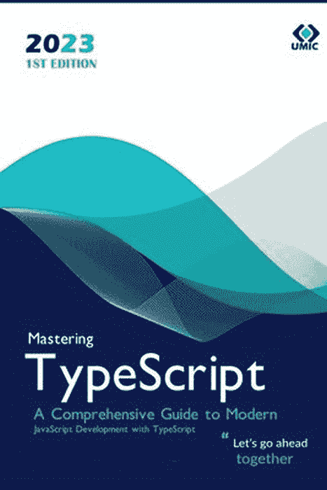

# 精通 TypeScript：现代 JavaScript 开发全面指南



TypeScript 是一种强大的编程语言，它是 JavaScript 的扩展，为构建大型 Web 应用程序提供了静态类型环境。这本书提供了一份全面的 TypeScript 指南，适用于初学者也适用于经验丰富的程序员。从基础语法到高级功能（如接口和装饰器），本书涵盖了 TypeScript 的所有方面，并提供了对如何有效使用它的深入理解。通过清晰的解释、实用的示例和专家见解，这本书将帮助你掌握 TypeScript 并将你的 Web 开发水平提升到高度。准备好释放 TypeScript 的全部潜力并构建动态、高性能的 Web 应用吧！！

## 安装 TypeScript

要安装 TypeScript，你需要在系统中安装 `Node.js` 和 `npm`（Node 包管理器）。如果你没有安装这些工具，可以从 Node.js 官网 (https://nodejs.org/) 下载并安装。

一旦安装了 `Node.js` 和 `npm`，你可以使用以下命令全局安装 TypeScript：

```
npm install -g typescript
```

这将安装最新版本的 TypeScript，并使 `tsc`（TypeScript 编译器）命令在全局可用。你现在可以使用 `tsc` 命令创建并编译 TypeScript 文件。

例如，你可以使用以下代码创建一个名为 `main.ts` 的文件：

```ts
console.log("Hello, TypeScript!");
```

然后使用以下命令将其编译为 JavaScript：

```
tsc main.ts
```

这将生成一个 `main.js` 文件，你可以使用 `Node.js` 或在浏览器中运行。

## 构建你的第一个 TypeScript 应用

构建你的第一个 TypeScript 应用的步骤如下：

1. 为项目创建一个新目录并使用终端或命令提示符进入。

2. 运行以下命令初始化新项目：

```
npm init -y
```

3. 运行以下命令安装 TypeScript 作为开发依赖：

```
npm install typescript --save-dev
```

4. 在项目根目录下创建 `tsconfig.json` 文件，这将包含 TypeScript 配置。

5. 在项目根目录下创建一个 `src` 目录，其中包含你的 TypeScript 代码。使用以下代码创建一个名为 `index.ts` 的 TypeScript 文件：

```ts
console.log("Hello, TypeScript!");
```

6. 运行以下命令将 TypeScript 代码编译为 JavaScript：

```
npx tsc
```

7. 运行以下命令验证生成的 JavaScript 是否工作：

```
node dist/index.js
```

这将在终端或命令提示符中输出 `Hello, TypeScript!`。恭喜！你刚刚构建了第一个 TypeScript 应用！！

## 接口

在 TypeScript 中，接口用于定义对象的结构。接口描述对象的结构，包括它的属性和方法，而不提供任何具体实现。通过使用接口，你可以确保特定对象遵循特定的结构并在代码中以可预测的方式使用。这是一个简单的示例：

```ts
interface User {
  id: number;
  name: string;
}

const user: User = { id: 1, name: "Alice" };
```

`User` 接口定义了对象的结构，具有属性。`const user` 变量被声明为接口的一个实例，并赋值为一个遵循接口定义的对象。

## 类

在 TypeScript 中，类用于创建对象并定义它们的属性和方法。类是创建对象的蓝图，提供了定义对象结构和行为的方法。这是一个简单的示例：

```ts
class User {
  id: number;
  name: string;

  constructor(id: number, name: string) {
    this.id = id;
    this.name = name;
  }
}

const user = new User(1, "Alice");
```

`User` 类定义了创建对象的蓝图，具有属性和一个在创建对象时设置这些属性的构造函数。`const user` 变量通过带有适当参数的 `User` 构造函数创建。

## 运行 TypeScript Web 应用

要运行 TypeScript Web 应用，你需要遵循以下步骤：

1. 设置开发环境：你需要像 Studio Code 这样的编辑器，并在电脑上安装 `Node.js` 和 `npm`。

2. 创建新项目：为项目创建一个新目录并在终端中进入。然后，运行 `npm init -y` 创建一个新的 `package.json` 文件。

3. 安装 TypeScript：运行 `npm install typescript` 将 TypeScript 作为开发依赖。

4. 创建 `tsconfig.json` 文件：此文件用于配置 TypeScript 编译器。要创建此文件，运行 `npx tsc --init`。

5. 编写 TypeScript 代码：创建一个扩展名为 `.ts` 的新文件并在其中编写 TypeScript 代码。

6. 编译 TypeScript 代码：要将 TypeScript 代码编译为 JavaScript，运行 `npx tsc`。

7. 服务应用：为了提供服务，你可以使用 `npm install http-server` 等工具安装它，然后运行 `npx http-server` 启动本地 Web 服务器。

8. 打开浏览器并导航到 `http://localhost:8080` 查看你的 TypeScript Web 应用。

注意：具体步骤可能会根据你的设置和要求而异。这只是一个通用指南，帮助你开始运行 TypeScript Web 应用。

## 基本数据类型

TypeScript 支持几种基本数据类型，包括：

- `Number`：表示数值，包括整数和浮点数。

- `String`：表示由引号的字符序列。

- `Boolean`：表示逻辑值，`true` 或 `false`。

- `null`：表示值的空。

- `undefined`：表示未初始化的变量。

- `any`：在 ECMAScript 6 中引入的唯一且不可变的原始数据类型。

- `unknown`：表示任何值，包括任何类型的值。

- `void`：表示值的空，通常用作无返回值函数的返回类型。

- `object`：表示非原始值，包括数组和用户定义的对象。

这是一个使用这些基本数据类型的示例：

```ts
let isDone: boolean = false;
let decimal: number = 6;
let hex: number = 0xf00d;
let binary: number = 0b1010;
let octal: number = 0o744;
let color: string = "blue";
let list: number[] = [1, 2, 3];
let x: [string, number] = ["hello", 10];
```

### 布尔值

在 TypeScript 中，布尔值表示逻辑值，`true` 或 `false`。它们被用于表示二进制条件，通常用于 `if` 语句和循环。

在 `if` 语句中使用布尔值的示例：

```ts
let isValid: boolean = true;
if (isValid) {
  console.log("Value is valid");
}
```

在这个示例中，`isValid` 变量被声明为布尔类型。`if` 语句检查 `isValid` 的值并根据其值打印消息。

### 数字

在 TypeScript 中，`number` 类型表示数值，包括整数和浮点数。

使用 `number` 类型的示例：

```ts
let age: number = 25;
let pi: number = 3.14159;
let sum: number = age + pi;
```

在这个示例中，`age` 变量被声明为 `number` 类型表示一个整数。`pi` 变量被声明为 `number` 类型，表示一个浮点数。最后，`sum` 变量被声明为 `number` 类型并赋值为 `age` 的和。

### 字符串

在 TypeScript 中，`string` 类型用于表示由引号的字符序列。

使用 `string` 类型的示例：

```ts
let name: string = "John";
let message: string = `Hello, ${name}`;
```

在这个示例中，`name` 变量被声明为 `string` 类型，值为 'John'。`message` 变量被声明为 `string` 类型，并赋值为 'Hello, ' 与某个值拼接的结果。你可以使用单引号或双引号在 TypeScript 中定义字符串。你还可以使用模板字符串，它们是允许在字符串中嵌入表达式的字符串字面量。使用模板字符串的示例：

```ts
let name: string = "John";
let message: string = `Hello, ${name}`;
```

在这个示例中，`name` 的值通过模板字符串嵌入在字符串中。大括号内的表达式会被求值，其值被拼接到字符串中。

### 数组

在 TypeScript 中，`Array` 类型用于表示值的列表。可以使用 `Array` 类型或方括号 `[]` 简写语法声明数组。

数组类型的示例：

```ts
let names: string[] = ["Alice", "Bob", "Charlie"];
```

在这个示例中，`names` 变量被声明为 `string` 值的 `Array`，具有三个元素。使用方括号简写语法的示例：

```ts
let numbers: number[] = [1, 2, 3];
```

在这个示例中，`numbers` 变量被声明为 `number` 值的 `Array`，具有三个元素。你可以从索引开始访问数组中的元素。

### 元组

在 TypeScript 中，`tuple` 是一个有序的固定大小元素集合，每个元素可以有不同的类型。元组类似于数组，但与数组不同，你可以定义元组中元素的类型，且元组的元素数量在创建后无法更改。

使用元组的示例：

```ts
let person: [string, number, boolean] = ["Alice", 30, true];
```

在这个示例中，`person` 变量被声明为一个具有三个不同元素的元组：`string`、`number` 和 `boolean`。元组中的元素是有序的访问的。你也可以使用解构将元组的元素提取到单独的变量中：

```ts
let [name, age, isMarried] = ["Alice", 30, true];
```

在这个示例中，通过解构提取 `person` 元组的元素。变量 `name` 和 `isMarried` 被赋予对应元素的值。

### 多常量（枚举）

在 TypeScript 中，`enum` 定义一组命名常量的方法。`enum` 可以表示相关值的集合，例如一组预定义的选项或状态码。

使用 `enum` 的示例：

```ts
enum Color {
  Red,
  Green,
  Blue
}
let backgroundColor: Color = Color.Blue;
```

在这个示例中，`Color` 枚举定义了三个命名常量：`RED`、`GREEN` 和 `BLUE`。`background` 变量被声明为 `Color` 类型的值并赋值。

默认情况下，枚举中的第一个常量值为 0，第二个常量值为 1，依此类推。然而，你也可以显式指定每个常量的值：

```ts
enum Color {
  Red = 1,
  Green = 2,
  Blue = 4
}
let c: Color = Color.Green;
```

在这个示例中，`Color` 枚举中每个常量的值都被显式指定。`background` 的值仍被赋值为 `BLUE`，其值为 2。

你也可以通过其值访问常量的名称：

```ts
enum Color {
  Red = 1,
  Green = 2,
  Blue = 4
}
let colorName: string = Color[2];
```

在这个示例中，使用 `Color` 枚举获取值为 2 的常量的名称。`background` 的值被输出到控制台。

### `any` 类型

在 TypeScript 中，`any` 类型表示任何值，可以作为实际类型未知或可以在运行时更改的变量类型。当变量声明为 `any` 类型时，它可以分配任何类型的值而不产生错误。这禁用了该变量的类型检查。

使用 `any` 的示例：

```ts
let notSure: any = 4;
notSure = "maybe a string instead";
notSure = false; // okay, definitely a boolean
```

在这个示例中，`data` 变量被声明为 `any` 类型。它首先被赋值为 `string` 类型，然后被赋值为 `number`。由于 `data` 被声明为 `any` 类型，没有类型错误。

注意使用 `any` 类型会导致代码中出现潜在的类型错误，特别是当你不小心时。通常建议使用更具体的类型代替 `any`。`any` 类型主要用于编译时无法确定实际类型的情况，例如处理动态数据或用 JavaScript 编写的库。

### `void` 类型

在 TypeScript 中，`void` 类型表示值的空。`void` 类型通常用作无返回返回类型。

使用 `void` 的示例：

```ts
function logMessage(message: string): void {
  console.log(message);
}
```

在这个示例中， `logMessage` 函数被声明为 `void` 返回类型。这意味着函数不返回值。它接受一个 `string` 类型的参数并将其打印到控制台。

你也可以将 `void` 作为变量的类型，但通常是没用的，因为 `void` 类型变量只能赋值 `undefined` 或 `null`。

```ts
let unusable: void = undefined;
```

在这个示例中，`noValue` 变量被声明为 `void` 类型并被赋值为 `undefined` 或 `null`。

### `never` 类型

在 TypeScript 中，`never` 类型表示永远不会的值。`never` 类型通常用作抛出异常或永远不返回返回类型。

使用 `never` 的示例：

```ts
function error(message: string): never {
  throw new Error(message);
}
```

在这个示例中，`error` 函数被声明为 `never` 返回类型。这意味着函数不返回值，而是抛出一个错误。它接受一个 `string` 类型的参数，并抛带有指定消息的错误。错误被捕获并打印到控制台。

### `object` 类型

在 TypeScript 中，`object` 类型表示任何非原始值，包括类的实例、函数和数组。

使用 `object` 类型的示例：

```ts
let obj: object = {};
obj = { name: "John" };
obj = [1, 2, 3];
```

在这个示例中，`data` 变量被声明为 `object` 类型。它首先被赋值为 `{ name: 'John Doe' }`（一个对象），然后被赋值为 `[1, 2]`（一个数组）。由于 `data` 被声明为 `object`，没有类型错误。

## 类型断言

TypeScript 中的类型断言是一种覆盖值类型的方法，以防 TypeScript 编译器推断的类型不正确。类型断言类似于其他编程语言中的类型转换。

在 TypeScript 中执行类型断言有两种方法：

### 尖括号语法

```ts
let someValue: any = "hello";
let strLength: number = (<string>someValue).length;
```

在这个示例中，`value` 变量被声明为 `any` 类型并赋值为 `"hello"`。类型断言 `<string>value` 断言 `value` 是 `string` 类型。随后在断言的值上访问了 `.length` 属性，其类型为 `string`。

### `as` 语法

```ts
let someValue: any = "hello";
let strLength: number = (someValue as string).length;
```

在这个示例中，`value` 变量被声明为 `any` 类型并赋值为 `"hello"`。类型断言 `value as string` 断言 `value` 是 `string` 类型。随后在断言的值上访问了 `.length` 属性，其类型为 `string`。

类型断言是一个强大的工具，但应谨慎使用，因为如果断言的值不是正确的类型，会导致类型错误。建议仅在必要时使用它们，尽可能使用类型注解。

## 关于 `let` 关键字的说明

TypeScript 中的 `let` 关键字用于声变量，与 JavaScript 中的 `var` 关键字相似，但有几点不同：

- **块作用域**：与 `var` 关键字不同，用 `let` 声明的变量作用限于块，这意味着 `let` 变量仅在其声明的块内可访问，在块之外不可访问。

- **重复声明**：与 `var` 不同，`let` 变量不能同一作用域内重复声明。

使用 `let` 的示例：

```ts
let x = 10;
if (true) {
  let y = 20;
  console.log(y); // 20
}
console.log(x); // 10
console.log(y); // ReferenceError: y is not defined
```

在这个示例中，`x` 变量用 `let` 关键字声明并赋值为 `10`。`y` 变量在 `if` 块内用 `let` 关键字声明并赋值为 `20`。`y` 变量仅在 `if` 块内可访问，在块之外尝试访问它会导致“y 是未定义的”的错误。

建议在 TypeScript 中使用 `let` 关键字声明变量，因为它提供了更好的作用域控制并有助于防止代码中的意外影响。

## `var` 语句

TypeScript 中的 `var` 关键字仍然可以声明变量，但通常不建议在新代码中使用。与 `let` 关键字不同，用 `var` 声明的变量具有函数作用域，这意味着它们在声明的函数范围内都是可用的，而不仅仅是声明的块。

在这个示例中，`x` 变量用 `var` 关键字声明并赋值为 `10`。`y` 变量在 `if` 块内用 `var` 关键字声明并赋值为 `20`。然而，与 `let` 关键字不同，`y` 变量在 `if` 块之外也是可访问的，不受限于其声明的块。

```ts
var x = 10;
if (true) {
  var y = 20;
}
console.log(x); // 10
console.log(y); // 20
```

## 声明变量

TypeScript 中的变量可以使用 `let` 和 `const` 关键字声明。用 `let` 声明的变量是可变的，这意味着它们的值在声明后可以更改。用 `const` 声明的变量是只读的，在声明后无法更改。

在声明不需要更改的变量时使用 `const` 关键字是最佳实践。在需要更改变量时，可以使用 `let` 关键字。在 TypeScript 中，变量还可以带有类型注解，有助于在编译时而不是运行时捕捉类型错误。

## 变量捕获的特性

变量捕获是用于描述 JavaScript 和 TypeScript 中闭包或循环内声明的变量的行为的术语。需要注意的特性：

- **闭包及其捕获的变量**：闭包内部声明的变量会被闭包捕获，即使在闭包执行后也可以被访问。

- **循环及其捕获的变量**：循环中声明的变量也可能被闭包捕获，导致意外的行为。在这个示例中，`i` 变量在循环内用 `var` 关键字声明，具有函数作用域。在 `setTimeout` 内创建的闭包捕获了 `i` 变量。为了避免这些特性，建议在循环中使用 `let` 代替 `var`。

```ts
for (var i = 0; i < 3; i++) {
  setTimeout(() => console.log(i), 100); // Prints 3, 3, 3
}
```

建议在循环中使用 `let` 代替 `var`：

```ts
for (let i = 0; i < 3; i++) {
  setTimeout(() => console.log(i), 100); // Prints 0, 1, 2
}
```
