# 精通 TypeScript：使用 TypeScript 和主流 JavaScript 框架构建企业级、工业级 Web 应用第 2 版

**Nathan Rozentals**

致谢

**作者**

Nathan Rozentals

**文字编辑**

Safis Editing

**审稿员**

Guy Fergusson

Vilic Vane

**项目协调员**

Izzat Contractor

**策划编辑**

Kunal Parikh

**校对**

Safis Editing

**征购编辑**

Nitin Dasan

**索引员**

Tejal Daruwale Soni

**内容开发编辑**

Priyanka Mehta

**图形设计**

Abhinash Sahu

**技术编辑**

Abhishek Sharma

**制作协调员**

Melwyn Dsa

关于作者

Nathan Rozentals 构建商业软件已有 26 多年，编程时间更比这长得多。在互联网甚至出现之前，他就在大型机上构建统计分析程序了。像那个时代的许多程序员一样，他在 2000 年帮助拯救了世界。

他曾工作过并尝试精通许多面向对象的语言，从在纯旧的 C 语言中实现面向对象的技术开始。在与 C++ 工作多年，由于一直在追寻晦涩的线程锁定问题以及导致内存泄漏的递归例程后，他决定通过拥抱 Java 和 C# 中的自动垃圾回收来简化生活。

随着世界从胖客户端和多层架构（n-tier）转向 Web 技术，他的重心转向了现代 Web 编程，因此也转向了 JavaScript。在 TypeScript 中，他发现了一种语言，可以将他多年来学的所有面向对象的设计模式带到 JavaScript 中。

如果没有极值编程技术、敏捷交付、测试驱动开发和持续集成，他在多年前就会疯掉。

当他不在编程时，他就在思考编程。为了停止思考编程，他去冲风浪、踢足球，或者只是看职业球员踢足球。他们玩得比我好得多。

*我想感谢我的伴侣 Kathy 在过去几年里对我的支持和无条件的爱。没有你，我不会处在现在这样的境界。*

*给 Ayron 和 Dayna，看着你们成长为成熟的年轻人真是太棒了。你们一直都在我的心里。*

*给 Matt，感谢你让我们一直大笑——每个人都需要看到生活轻松的一面。*

*给妈妈，感谢你一直以来的支持。*

*最后，感谢 Grace、Tash 和 Tam，让这次体验如此精彩。*

关于审稿员

Guy Fergusson 是一位热情的 Web 开发者，开源贡献者，他现在每天使用 TypeScript。*感谢我美丽的妻子 Melisa 的大力支持。*

Vilic Vane 拥有 8 多年的 JavaScript 开发经验，是 TypeScript 的贡献者。

感谢购买本书。Packt 致力于提供优质体验，请访问 `www.packtpub.com` 了解更多信息。`service@packt.com` 是我们的反馈。如果您想帮助我们改进我们的产品，请在 Amazon 页面上对本书留下诚实的评论。

**前言**

**[ ii ]**

## **总结** 117

## **总结** 206

## **第 7 章：TypeScript 兼容框架** 207

**[ ix ]**

- Express 路由 348

## **总结** 361

## **总结** 420

[ xi ]

[ xii ]

**索引**

序言

TypeScript 语言和编译器自 2012 年底发布以来，已取得了巨大的成功。它迅速在 JavaScript 开发社区中确立了稳固的地位，并继续着蓬勃发展的势头。许多大型 JavaScript 项目（包括来自 Adobe、Mozilla 和 Asana 的项目）已决定将其代码库从 JavaScript 切换到 TypeScript。最近，微软和 Google 团队宣布，Angular 2.0 将使用 TypeScript 进行开发，从而将 AtScript 和 TypeScript 语言合为一处。

这种业界的大规模采用展示了该语言的价值、编译器的灵活性，以及通过其丰富的开发工具集可以实现的生产力提升。在这些行业支持之上，ECMAScript 6 和 ECMAScript 7 标准日益接近发布，而 TypeScript 提供了一种通过生成兼容的 JavaScript，在当今的应用程序中使用这些标准特性的方法。

由于 TypeScript 社区构建了大量的声明文件（declaration files），使用 TypeScript 编写 JavaScript 单页应用变得更具吸引力。这些声明文件将大量现有的 JavaScript 框架无缝集成到 TypeScript 开发环境中，带来了生产力的提高、早期的错误检测以及高级的 IntelliSense 功能。

然而，JavaScript 语言并不限于 浏览器。我们现在可以编写服务器端 JavaScript，使用 JavaScript 驱动手机应用程序，甚至使用 JavaScript 控制专为物联网设计的微型设备。

本书既适合经验丰富的 TypeScript 开发者，也适合刚刚开始 TypeScript 之旅的初学者。通过重点侧重于测试驱动开发（TDD），详�介绍了与许多流行 JavaScript 库集成的信息，并对 TypeScript 的特性进行了深入探讨，这本书将帮助你探索 JavaScript 开发的下一步。

**本书涵盖了内容**

`第 1 章`，*TypeScript - 工具与框架选项*，为开始 TypeScript 开发铺了道路。它讨论了将 TypeScript 作为语言和编译器的用处，然后介绍了如何使用多种流行的 IDE 设置一个完整的开发环境。

`第 2 章`，*类型、变量与函数技巧*，向读者介� TypeScript 语言，从基础类型和类型注解开始，然后讨论变量、函数和高级语言特性。

`第 3 章`，*接口、类与继承*，在上一章工作的基础上，引入了接口、类和继承的面向对象的概念和能力。然后通过工厂设计模式展示了这些概念的应用。

`第 4 章`，*装饰器、泛型与异步特性*，在讨论装饰器和泛型等更高级的语言特性之前，讲解了异步编程的概念。它展示了 TypeScript 语言如何通过承诺（promises）以及 `async await` 构造结构的使用来支持这些异步特性。

`第 5 章`，*编写和使用声明文件*，引导读者为现有的 JavaScript 代码构建声明文件，然后列出了编写声明文件时使用的一些常用语法。这些语法旨在作为声明文件语法的快速参考指南或备抄。

`第 7 章`，*TypeScript 兼容框架*，查看了具有完整 TypeScript 语言集成的流行框架。它探索了 MVC 范式，并比较了这种设计在 Backbone、Aurelia、Angular 2 和 React 中是如何实现的。

`第 8 章`，*测试驱动开发*，从讨论什么是测试驱动开发开始，然后引导读者创建各种类型的单元测试。通过 Jasmine 库，它展示了如何使用数据驱动测试以及如何测试异步逻辑。该章以对测试运行器、测试报告以及使用持续集成构建服务器的讨论结束。

`第 9 章`，*测试 TypeScript 兼容框架*，展示了如何对用每个 TypeScript 兼容框架构建的示例应用进行单元测试、集成测试和验收测试。它讨论了可测试性的概念，并展示了应用设计和实现的微妙变化如何提供更好的测试覆盖。

`第 11 章`，*面向对象编程*，讨论了面向对象编程的概念，并展示了如何安排应用组件以符合面向对象的原则。然后通过展示如何使用状态中介设计模式来管理复杂的 UI 交互，深入探讨了面向对象的最佳实践。

`第 12 章`，*依赖注入*，讨论了服务定位和依赖注入的概念，以及如何使用它们解决应用问题。然后展示了如何使用装饰器实现简单的依赖注入框架。

`第 13 章`，*构建应用*，探索了 Web 应用开发的基础，包括从 Node 和 Express 生成 HTML、编写和消费 REST 端点以及数据绑定。它展示了如何将 Express 服务器、REST 端点和数据绑定到 Aurelia、Angular 2 和 React。

**本书所需的准备**

你需要 TypeScript 编译器和某种编辑器。TypeScript 编译器可以作为 Node 插件安装在 Windows、MacOS 和 Linux 上。第一章，*TypeScript - 工具与框架选项*描述了开发环境的设置。

**本书适合哪些读者**

无论你是想学习 TypeScript 的 JavaScript 开发者，还是想要提升技能的经验丰富的 TypeScript 开发者，本书都适合你。从基础到高级的语言结构、测试驱动开发以及面向对象技术，你将学习如何充分利用 TypeScript 语言和编译器。本书将向你展示如何强类型、面向对象和设计最佳实践融入你的 JavaScript 应用中。

*前言*

**约定**

在书中，你会发现许多文本样式，用于区分不同类型的信息。以下是这些样式的一些示例及其含义解释。

文本中的代码单词、数据库表名、文件夹名称、文件名、文件扩展名、路径名、占位 URL、用户输入和 Twitter 用户名显示如下：“我们将定义一个名为 `MyClass` 的新函数，并将此新函数返回给外部调用函数。然后我们使用 `prototype` 关键字向 `MyClass` 定义中注入一个新函数。”

代码块设置如下：

```javascript
class MyClass {
  add(x: number, y: number) {
    return x + y;
  }
}
```

任何命令行输入或输出的写法如下：

`**npm install @types/express**`

**新术语**和**重要词汇**用粗体显示。你在屏幕上看到的单词（例如菜单或对话框中的内容）在文本中的形式如下：“点击 **运行** | **调试**，然后编辑配置。点击加号 (**+**) 按钮，在左侧选择 **JavaScript 调试** 选项，并为此配置命名。”

警告或重要注释将以此类框的形式出现。

提示和技巧将如所示出现。

*前言*

**读者反馈**

我们随时欢迎读者的反馈。请告诉我们对这本书的看法——你喜欢或不喜欢的地方。读者反馈对我们来说非常重要，因为它能帮助我们开发出让你真正受益的书籍。如需向我们发送通用反馈，请发送至 `feedback@packtpub.com`，并在邮件主题中注明书名。如果你在某个领域拥有专长，并对编写或为书籍贡献感兴趣，请参阅我们在 `www.packtpub.com/authors` 上的作者指南。

**客户支持**

既然你现在是 Packt 书籍的自豪所有者，我们有很多方法可以帮助你从购买中获得最大的收益。

**下载示例代码**

你可以从 `http://www.packtpub.com` 账户下载本书的示例代码文件。如果你是在其他地方购买的这本书，可以访问 `http://www.packtpub.com/support` 并注册，以便文件直接通过电子邮件发送给你。

你可以按照以下步骤下载代码文件：

1. 使用你的电子邮件和密码登录或注册我们的网站。

2. 将鼠标指针悬停在顶部的 **SUPPORT** 标签上。

3. 点击 **Code Downloads & Errata**（代码下载与错误）。

4. 在 **Search** 框中输入书名。

5. 选择你想要下载代码文件的书籍。

6. 从你购买书籍的下拉菜单中选择。

7. 点击 **Code Download**（代码下载）。

8. 文件下载完成后，请确保使用最新版本的软件解压或提取文件夹：

   - Windows：WinRAR / 7-Zip

   - Mac：Zipeg / iZip / UnRX

   - Linux：7-Zip / PeaZip

*前言*

本书的代码包也托管在 GitHub 上，地址为 `https://github.com/PacktPublishing/Mastering-TypeScript-Second-Edition.`。我们从丰富的书籍和视频目录中提供了其他代码包，地址为 `https://github.com/PacktPublishing/`。快去看看吧！

**下载本书的彩色图片**

我们还为你提供了一个 PDF 文件，其中包含书中所使用的截图/图表的彩色图片。彩色图片将帮助你更好地理解输出的变化。你可以从 `https://www.packtpub.com/sites/default/files/downloads/Mastering-TypeScript-Second-Edition.pdf` 下载该文件。

*前言*

**[ 7 ]**

**盗版**

互联网上受版权保护材料的盗版是所有媒体中一个持续存在的问题。在 Packt，我们非常重视保护我们的版权。如果你发现任何形式的我们作品的非法副本，请立即向我们提供地址或网站名称，以便我们采取补救措施。请通过 `copyright@packtpub.com` 与我们联系并提供可疑材料。

**问题**

如果你对本书的任何方面有任何问题，可以通过 `questions@packtpub.com` 联系我们，我们将尽力解决问题。

## TypeScript - 工具与框架选项

JavaScript 是一门真正无处不在的语言。在现代世界中，你访问的几乎每个网站都在使用 JavaScript 使网站响应更迅速、更易读或更具吸引力。即使是传统的桌面应用程序也在转向在线。过去，我们需要下载并安装程序来生成图表或编写文档，而现在我们可以在浏览器的限制范围内在 Web 上完成这一切。这就是 JavaScript 的力量。它让我们重新思考使用 Web 的方式。但它也让我们重新思考使用 Web 技术的方式。例如，Node 允� JavaScript 在服务器端运行，渲染整个大型网站，并带有会话处理、负载均衡和数据库交互。然而，这种对 Web 技术思维的转变仅仅是一个开始。

**Apache Cordova** 是一个作为原生手机应用程运行的完整 Web 服务器。这意味着我们可以使用 HTML、CSS 和 JavaScript 构建手机应用程序，然后与手机的加速度计、地理位置服务或文件存储进行交互。因此，通过 Cordova，JavaScript 和 Web 技术进入了原生手机应用程序的领域。

同样，如 *Kinoma* 等项目正在使用 JavaScript 驱动物联网设备，这些设备运行在嵌入在各种设备中的微型微处理器上。**Espruino** 是一种专为运行 JavaScript 而设计的微控制器芯片。因此，学习 JavaScript 意味着你拥有了构建网站、手机应用程序，甚至控制嵌入式设备上微处理器的能力。

*TypeScript - 工具与框架选项*

JavaScript 语言并不是一种难以学习的语言，但在编写大型、复杂的程序时，它确实会带来挑战。这些挑战之一是 JavaScript 是一种解释型语言，因此没有编译步骤。你只有在通过运行时解释器运行整个应用程序时，才能知道自己是否犯了简单的语法错误。另一个挑战是，它也不是一种面向对象的语言，构建良好的、可维护且易于理解的 JavaScript 需要极大的心力和自律。对于从 Java、C# 或 C++ 等其他面向对象语言迁移的程序员来说，JavaScript 看起来像是一个完全陌生的环境。

TypeScript 弥补了这一差距。它是一种强类型、面向对象的语言，使用编译器来生成 JavaScript。因此，它允许我们使用著名的面向对象技术和设计模式来构建 JavaScript 应用程序。请记住，TypeScript 生成的 JavaScript 只是纯 JavaScript，因此它可以在任何 JavaScript 可以运行的地方运行——浏览器中、服务器上、移动设备上或嵌入式设备上。

本章分为两个主要部分。第一部分快速概述使用 TypeScript 的某些优势，第二部分涉及如何搭建 TypeScript 开发环境。

如果你是一个经验丰富的 TypeScript 程序员，并且已经搭建了开发环境，那么你可能想跳过本章。如果你以前从未工作过 TypeScript，拿起这本书是因为想了解 TypeScript 能做什么，那么请继续阅读。

*TypeScript - 工具与框架选项*

### TypeScript 简介

TypeScript 既是一种语言，也是一组生成 JavaScript 的工具。它由微软内部的 Anders Hejlsberg（C# 的设计者）设计，是一个开源项目，旨在帮助开发者编写企业级的 JavaScript。

TypeScript 生成 JavaScript——简单如此。它不需要完全全新的运行时环境，TypeScript 生成的 JavaScript 可以复用所有现有的 JavaScript 工具、框架以及已经为 JavaScript 提供的丰富库。然而，TypeScript 语言和编译器让 JavaScript 的开发更接近于传统的面向对象体验。

#### ECMAScript 标准

JavaScript 作为一种语言已经存在了很久，并受语言特征标准的规范。该标准中定义的语言称为 ECMAScript，每个 JavaScript 解释器必须提供符合该标准的函数和特性。该标标准的定义有助于 JavaScript 乃至整个 Web 的增长，并允许网站在许多不同操作系统的许多不同浏览器上正确渲染。ECMAScript 标准于 1999 年发布，被称为 **ECMA-262** 第三版。

随着该语言的流行以及互联网应用的爆炸式增长，ECMAScript 标准需要进行修订和更新。这一修订过程产生了一个更新的 ECMAScript 草案规范，称为第四版。遗憾的是，该草案还提议对语言进行完全彻底的重构，因此并没有受到良好对待。最终，来自 Yahoo、Google 和微软的领导者提交了一项替代提案，他们将其称为 **ECMAScript 3.1**。该提案被编号为 3.1，因为它是第三版的一个较小特性集，且处于标准的第三版和第四版之间。

对语言彻底重构的提案最终被采用为标准的第五版，并被称为 ECMAScript 5。ECMAScript 第四版从未发布，但人们决定将第四版的最佳特性和 3.1 特性集的优点合并到名为 **ECMAScript Harmony** 的第六版中。

TypeScript 编译器有一个参数，可以在不同的 ECMAScript 标准版本之间切换。TypeScript 目前支持 ECMAScript 3、ECMAScript 5、ECMAScript 6，甚至 ECMAScript 7（也称为 ECMAScript 2016）。

*TypeScript - 工具与框架选项*

当编译器运行你的 TypeScript 代码时，如果你尝试编译的代码不符合该标标准，它将生成编译错误。微软团队已承诺在任何新版本的 TypeScript 编译器中遵循 ECMAScript 标准，因此随着新版本的被采用，TypeScript 语言和编译器也将随之更新。

了解 ECMAScript 标准每个发行版本中包含的细微细节超出了本书的范围，但知道它们之间存在差异是很重要的。某些浏览器版本不支持 ES5（IE8 就是一个例子），但大多数版本都支持。在为你的项目选择目标 ECMAScript 版本时，你需要考虑你将支持哪些浏览器版本，或者你的 JavaScript 运行时支持哪种标准。

为了让你直略了解 TypeScript 的优势（这绝不是完整列表），让我们快速看一眼 TypeScript 带来的的一些内容：

- 流行的 JavaScript 库的类型定义

- 私有和公共成员变量装饰

*TypeScript - 工具与框架选项*

#### 强类型

JavaScript 不是强类型的。它是一种非常动态的语言，允许动态更改属性和行为。作为这方面的例子，考虑以下代码：

`var test = "this is a string";`

`test = 1;`

`}`

在代码段的第一行，变量 `test` 被绑定到一个字符串。随后它被赋值为一个数字，最后被完全重新定义为一个接受两个参数的函数。这意味着变量 `test` 的类型从字符串变为数字，然后变为函数。然而，传统的面向对象语言不允许变量的类型发生改变，因此它们被称为强类型语言。

虽然之前的所有代码都是合法的 JavaScript，因此可能是合理的，但很容易看出这可能会在执行期间导致运行时错误。假设你负责编写一个用于相加两个数字的库函数，而另一个开发者无经意地将你的函数重新赋值为减去这些数字。这类错误在几行代码中可能很容易发现，但随着代码库和开发团队的增长，发现和修复这些错误将变得越来越困难。

*TypeScript - 工具与框架选项*

### TypeScript 的语法糖

TypeScript 引入了一种非常简单的语法，在编译时检查对象的类型。

这种语法被称为“语法糖”，或者更正式地称为“类型注解”（type annotations）。

请考虑以下 TypeScript 代码：

注意，在这段代码段的第一行，我们在变量和它的赋值之间引入了一个冒号 `:` 和一个 `string`

我们正在将变量 `test` 的类型设置为 `string` 类型，

并且任何不将变量 `test` 视为 `string` 的代码都将产生编译错误。通过 TypeScript 编译器运行上述代码将生成两个错误：

`hello.ts(3,1): error TS2322: Type 'number' is not assignable to type 'string'.`

`hello.ts(4,1): error TS2322: Type '(a: any, b: any) => any' is not assignable to type 'string'.`

第一个错误是非常明显的。我们指定了变量 `test` 是一个 `string`，

因此尝试给它赋值一个数字将产生编译错误。第二个错误与第一个类似，其本质上是在说我们不能将一个函数赋值给字符串。

通过这种方式，TypeScript 编译器为你的 JavaScript 代码引入了强类型或静态类型，

让你享受到强类型语言的所有益处。因此，TypeScript 被描述为 JavaScript 的超集。我们将在下一章中详细探讨这一点。

### JavaScript 和 TypeScript 定义

正如我们所看到的，TypeScript 能够对 JavaScript 进行注解，并为 JavaScript 开发体验带来强类型支持。但我们如何对现有的 JavaScript 库进行强类型化呢？换句话说，如果我们有一个现有的 JavaScript 库，如何集成该库以便在 TypeScript 中使用？答案异常地简单——通过创建一个定义文件（definition file）。TypeScript 使用带有 `.d.ts` 扩展的文件作为一种头文件（类似于 C++ 等语言），

以便在现的 JavaScript 库上叠加强类型。这些定义文件包含了描述每个可用函数和/或

变量的信息，以及它们相关的类型注解。

*TypeScript - 工具与框架选项*

让我们快速看看定义看起来是什么样的。例如，考虑流行的 Jasmine 单元测试框架中的 `describe` 函数，如下所示：

`var describe = function(description, specDefinitions) {`

`return jasmine.getEnv().describe(description, specDefinitions);`

`};`

注意，这个函数有两个参数——`description` 和 `specDefinitions`。

不幸的是，JavaScript 没有告诉我们这些是什么种类型的变量。我们需要查看 Jasmine 文档来确定如何调用此函数，

以及这两个参数期望什么变量。如果我们访问

`http://jasmine.github.io/2.0/introduction.html`，我们将看到一个使用该函数的示例：

`describe("A suite", function () {`

`});`

`});`

从文档中，我们可以很容易地看到第一个参数是 `string`，

第二个参数是 `function`。然而，JavaScript 中没有任何东西可以强制我们遵守这个 API 定义。正如之前提到的，

我们可以很容易地错误地调用此函数，例如传入两个数字，或者先发送一个函数再发送一个字符串。犯此类错误显然会产生运行时错误。然而，使用简单的 TypeScript 定义文件将在我们尝试运行此代码之前生成编译时错误。

让我们看看该函数对应的 TypeScript 定义，它位于

`jasmine.d.ts` 定义文件中：

`declare function describe(`

`description: string,`

`specDefinitions: () => void`

`): void;`

但它提供了更多关于参数的更多信息。

*TypeScript - 工具与框架选项*

[ 15 ]

显然，`description` 参数被强类型化为 `string`，

`specDefinitions` 参数被强类型化为返回 `void` 的 `function`。

TypeScript 使用双括号 `()` 语法来声宣言函数，并使用箭头语法 `=>` 来显示函数的返回类型。

因此 `() => void` 是一个不返回任何内容的函数。最后，`describe` 函数本身也会返回 `void`。

`describe(() => { /* function body */}, "description");`

TypeScript 将生成以下错误：

`hello.ts(11,11): error TS2345: Argument of type '() => void' is not assignable to parameter of type 'string'.`

这个错误告诉我们正尝试使用无效参数调用 `describe` 函数。我们将在后面的章节中更详细地查看定义文件，但这个示例清楚地表明，如果我们尝试错误地使用外部 JavaScript 库，TypeScript 编译器将生成错误。

### DefinitelyTyped

目前包含了数千多个 JavaScript 库的定义。

### 封装

面向对象编程的基本原理之一是封装——将数据以及操作这些数据的函数封装在一个组件中。大多数编程语言都有类（class）的概念，用于为数据和相关函数定义模板。

`class MyClass {`

`add(x, y) {`

`return x + y;`

`}`

`}`

`var classInstance = new MyClass();`

*TypeScript - 工具与框架选项*

`var result = classInstance.add(1,2);`

`console.log(`add(1,2) returns ${result}`);`

这段代码非常易读且理解。我们创建名为 `MyClass` 的类，其中有一个简单的 `add` 函数。使用该类，我们只需要创建一个实例，

并传入两个参数调用 `add` 函数。

遗憾的是，JavaScript 没有 `class` 语句，而是使用函数来模拟类的功能。通过使用原型（prototype）模式或使用闭包（closure）模式来实现封装。理解原型和闭包模式并正确使用它们被认为是编写企业级 JavaScript 的基本技能。

闭包本质上是一个引用独立变量的函数。这意味着在闭包内部定义的变量会记住它们创建时的环境。这为 JavaScript 提供了一种定义局部变量并提供封装的方法。使用 JavaScript 中的闭包编写前面的 `MyClass` 定义，看起来可能像下面：

`var MyClass = (function () {`

`// 自执行函数是会被闭包`

`// 记住的环境`

`function MyClass() {`

`// MyClass 是内部函数，`

`// 闭包`

`}`

`MyClass.prototype.add = function (x, y) {`

`return x + y;`

`};`

`return MyClass;`

`());`

`var classInstance = new MyClass();`

`var result = classInstance.add(1, 2);`

`console.log("add(1,2) returns " + result);`


*TypeScript - 工具与框架选项*

**[ 17 ]**

代码的最后几行展示了如何在 JavaScript 中使用此闭包。创建一个闭包类型的实例，然后执行 `add` 函数。运行这段代码将向控制台输出 `add(1,2)` 返回 `3`，如预期所示。

对比 JavaScript 代码和 TypeScript 代码，我们可以很容易看到与等效的 JavaScript 代码相比，TypeScript 代码是多么简单。还记得我们提到过 JavaScript 程序员很容易错放一个大括号 `{` 或括号 `(` 吗？看看闭包定义的最后一行——`})();`。写错这些括号或大括号中的一个可能需要几个小时的调试才能找到。

### TypeScript 类生成闭包

上述的 JavaScript 实际上是 TypeScript 类定义的输出。因此，TypeScript 实际上是为你生成了闭包。

在 JavaScript 语言中引入类的概念已经讨论了多年，目前已经是 ECMAScript 第六版（Harmony）标准的一部分——但这仍然是一个进行中的工作。微软已承诺在 ECMAScript 标准发布时，在 TypeScript 编译器中遵循这些标准。

### 公有和私有访问器

封装中使用的另一个面向对象的原则是数据隐藏的概念——拥有公共和私有变量的能力。私有变量旨在对特定类的用户隐藏，因为这些变量应该只由该类本身使用。无意中暴露这些变量很容易导致运行时错误。

遗憾的是，JavaScript 没有原生的方法来声明私有变量。虽然可以使用闭包模拟此功能，但许多 JavaScript 程序员简单使用下划线字符 `_` 来表示私有变量。但在运行时，如果你知道私有变量的名字，你可以轻松地给它赋值。考虑以下 JavaScript 代码：

```javascript
var MyClass = (function() {
  function MyClass() {
    this._count = 0;
  }
  MyClass.prototype.countUp = function() {
    this._count ++;
  }
  MyClass.prototype.getCountUp = function() {
    return this._count;
  }
  return MyClass;
}());

var test = new MyClass();
test._count = 17;
console.log("countUp : " + test.getCountUp());
```

`MyClass` 变量实际上是一个带有构造函数、一个 `countUp` 函数和一个 `getCountUp` 函数的闭包。变量 `_count` 应该是一个私有成员变量，只在闭包的作用范围内使用。使用下划线命名约定可以向该类的用户提供关于该变量是私有的指示，但 JavaScript 仍然允许你操作变量 `_count`。看看代码段倒数第二行。我们显式地将 `_count` 的值设置为 `17`，这是 JavaScript 允许的，但并不是类的创建者想要的。这段代码的输出将是 `countUp : 17`。

然而，TypeScript 引入了 `public` 和 `private` 关键字（以及其他），它们可以用于类成员变量。尝试访问被标记为 `private` 的类成员变量将产生编译错误。作为一个例子，上面的 JavaScript 代码可以用 TypeScript 写如下所示所示：

```typescript
class CountClass {
  private _count: number;
  constructor() {
    this._count = 0;
  }
  countUp() {
    this._count ++;
  }
  getCount() {
    return this._count;
  }
}
var countInstance = new CountClass();
countInstance._count = 17;
```

在我们代码段的第二行，我们声明了一个名为 `_count` 的 `private` 成员变量。同样，我们有一个构造函数、一个 `countUp` 和一个 `getCount` 函数。如果我们编译此文件，编译器将生成一个错误：

`**hello.ts(39,15): error TS2341: Property '_count' is private and only accessible within class 'CountClass'.**`


*TypeScript - 工具与框架选项*

**[ 19 ]**

产生此错误是因为我们正尝试在代码的最后一行访问私有变量 `_count`。

因此，TypeScript 编译器通过在我们无意中违反此规则时生成编译错误，帮助我们遵守公有和私有访问器的规则。

但是，请记住，这些访问器仅是编译时的特性，不会影响生成的 JavaScript。如果你正在编写将由第三方使用的 JavaScript 库，需要记住这一点。请注意，默认情况下 TypeScript 编译器仍然会生成 JavaScript 输出文件，即使存在编译错误。然而，可以修改此选项以强制 TypeScript 编译器在存在编译错误时不生成 JavaScript。

因此，TypeScript 编译器通过在我们无意中违反此规则时生成编译错误，帮助我们遵守公有和私有访问器的规则。

但是，请记住，这些访问器仅是编译时的特性，不会影响生成的 JavaScript。如果你正在编写将由第三方使用的 JavaScript 库，需要记住这一点。请注意，默认情况下 TypeScript 编译器仍然会生成 JavaScript 输出文件，即使存在编译错误。然而，可以修改此选项以强制 TypeScript 编译器在存在编译错误时不生成 JavaScript。

因此，TypeScript 编译器通过在我们无意中违反此规则时生成编译错误，帮助我们遵守公有和私有访问器的规则。

但是，请记住，这些访问器仅是编译时的特性，不会影响生成的 JavaScript。如果你正在编写将由第三方使用的 JavaScript 库，需要记住这一点。请注意，默认情况下 TypeScript 编译器仍然会生成 JavaScript 输出文件，即使存在编译错误。然而，可以修改此选项以强制 TypeScript 编译器在存在编译错误时不生成 JavaScript。

因此，TypeScript 编译器通过在我们无意中违反此规则时生成编译错误，帮助我们遵守公有和私有访问器的规则。

但是，请记住，这些访问器仅是编译时的特性，不会影响生成的 JavaScript。如果你正在编写将由第三方使用的 JavaScript 库，需要记住这一点。请注意，默认情况下 TypeScript 编译器仍然会生成 JavaScript 输出文件，即使存在编译错误。然而，可以修改此选项以强制 TypeScript 编译器在存在编译错误时不生成 JavaScript。

因此，TypeScript 编译器通过在我们无意中违反此规则时生成编译错误，帮助我们遵守公有和私有访问器的规则。

但是，请记住，这些访问器仅是编译时的特性，不会影响生成的 JavaScript。如果你正在编写将由第三方使用的 JavaScript 库，需要记住这一点。请注意，默认情况下 TypeScript 编译器仍然会生成 JavaScript 输出文件，即使存在编译错误。然而，可以修改此选项以强制 TypeScript 编译器在存在编译错误时不生成 JavaScript。

因此，TypeScript 编译器通过在我们无意中违反此规则时生成编译错误，帮助我们遵守公有和私有访问器的规则。

但是，请记住，这些访问器仅是编译时的特性，不会影响生成的 JavaScript。如果你正在编写将由第三方使用的 JavaScript 库，需要记住这一点。请注意，默认情况下 TypeScript 编译器仍然会生成 JavaScript 输出文件，即使存在编译错误。然而，可以修改此选项以强制 TypeScript 编译器在存在编译错误时不生成 JavaScript。

因此，TypeScript 编译器通过在我们无意中违反此规则时生成编译错误，帮助我们遵守公有和私有访问器的规则。

但是，请记住，这些访问器仅是编译时的特性，不会影响生成的 JavaScript。如果你正在编写将由第三方使用的 JavaScript 库，需要记住这一点。请注意，默认情况下 TypeScript 编译器仍然会生成 JavaScript 输出文件，即使存在编译错误。然而，可以修改此选项以强制 TypeScript 编译器在存在编译错误时不生成 JavaScript。

因此，TypeScript 编译器通过在我们无意中违反此规则时生成编译错误，帮助我们遵守公有和私有访问器的规则。

但是，请记住，这些访问器仅是编译时的特性，不会影响生成的 JavaScript。如果你正在编写将由第三方使用的 JavaScript 库，需要记住这一点。请注意，默认情况下 TypeScript 编译器仍然会生成 JavaScript 输出文件，即使存在编译错误。然而，可以修改此选项以强制 TypeScript 编译器在存在编译错误时不生成 JavaScript。

因此，TypeScript 编译器通过在我们无意中违反此规则时生成编译错误，帮助我们遵守公有和私有访问器的规则。

但是，请记住，这些访问器仅是编译时的特性，不会影响生成的 JavaScript。如果你正在编写将由第三方使用的 JavaScript 库，需要记住这一点。请注意，默认情况下 TypeScript 编译器仍然会生成 JavaScript 输出文件，即使存在编译错误。然而，可以修改此选项以强制 TypeScript 编译器在存在编译错误时不生成 JavaScript。

因此，TypeScript 编译器通过在我们无意中违反此规则时生成编译错误，帮助我们遵守公有和私有访问器的规则。

但是，请记住，这些访问器仅是编译时的特性，不会影响生成的 JavaScript。如果你正在编写将由第三方使用的 JavaScript 库，需要记住这一点。请注意，默认情况下 TypeScript 编译器仍然会生成 JavaScript 输出文件，即使存在编译错误。然而，可以修改此选项以强制 TypeScript 编译器在存在编译错误时不生成 JavaScript。

因此，TypeScript 编译器通过在我们无意中违反此规则时生成编译错误，帮助我们遵守公有和私有访问器的规则。

但是，请记住，这些访问器仅是编译时的特性，不会影响生成的 JavaScript。如果你正在编写将由第三方使用的 JavaScript 库，需要记住这一点。请注意，默认情况下 TypeScript 编译器仍然会生成 JavaScript 输出文件，即使存在编译错误。然而，可以修改此选项以强制 TypeScript 编译器在存在编译错误时不生成 JavaScript。

TypeScript compilation

因此，TypeScript 编译器通过在我们无意中违反此规则时生成编译错误，帮助我们遵守公有和私有访问器的规则。

但是，请记住，这些访问器仅是编译时的特性，不会影响生成的 JavaScript。如果你正在编写将由第三方使用的 JavaScript 库，需要记住这一点。请注意，默认情况下 TypeScript 编译器仍然会生成 JavaScript 输出文件，即使存在编译错误。然而，可以修改此选项以强制 TypeScript 编译器在存在编译错误时不生成 JavaScript。

因此，TypeScript 编译器通过在我们无意中违反此规则时生成编译错误，帮助我们遵守公有和私有访问器的规则。

但是，请记住，这些访问器仅是编译时的特性，不会影响生成的 JavaScript。如果你正在编写将由第三方使用的 JavaScript 库，需要记住这一点。请注意，默认情况下 TypeScript 编译器仍然会生成 JavaScript 输出文件，即使存在编译错误。然而，可以修改此选项以强制 TypeScript 编译器在存在编译错误时不生成 JavaScript。

因此，TypeScript 编译器通过在我们无意中违反此规则时生成编译错误，帮助我们遵守公有和私有访问器的规则。

但是，请记住，这些访问器仅是编译时的特性，不会影响生成的 JavaScript。如果你正在编写将由第三方使用的 JavaScript 库，需要记住这一点。请注意，默认情况下 TypeScript 编译器仍然会生成 JavaScript 输出文件，即使存在编译错误。然而，可以修改此选项以强制 TypeScript 编译器在存在编译错误时不生成 JavaScript。

因此，TypeScript 编译器通过在我们无意中违反此规则时生成编译错误，帮助我们遵守公有和私有访问器的规则。

但是，请记住，这些访问器仅是编译时的特性，不会影响生成的 JavaScript。如果你正在编写将由第三方使用的 JavaScript 库，需要记住这一点。请注意，默认情况下 TypeScript 编译器仍然会生成 JavaScript 输出文件，即使存在编译错误。然而，可以修改此选项以强制 TypeScript 编译器在存在编译错误时不生成 JavaScript。

因此，TypeScript 编译器通过在我们无意中违反此规则时生成编译错误，帮助我们遵守公有和私有访问器的规则。

但是，请记住，这些访问器仅是编译时的特性，不会影响生成的 JavaScript。如果你正在编写将由第三方使用的 JavaScript 库，需要记住这一点。请注意，默认情况下 TypeScript 编译器仍然会生成 JavaScript 输出文件，即使存在编译错误。然而，可以修改此选项以强制 TypeScript 编译器在存在编译错误时不生成 JavaScript。

因此，TypeScript 编译器通过在我们无意中违反此规则时生成编译错误，帮助我们遵守公有和私有访问器的规则。

但是，请记住，这些访问器仅是编译时的特性，不会影响生成的 JavaScript。如果你正在编写将由第三方使用的 JavaScript 库，需要记住这一点。请注意，默认情况下 TypeScript 编译器仍然会生成 JavaScript 输出文件，即使存在编译错误。然而，可以修改此选项以强制 TypeScript 编译器在存在编译错误时不生成 JavaScript。

因此，TypeScript 编译器通过在我们无意中违反此规则时生成编译错误，帮助我们遵守公有和私有访问器的规则。

Creating tsconfig.json

```json
{
  "compilerOptions": {
    "module": "commonjs",
    "target": "es5",
    "noImplicitAny": false,
    "sourceMap": false
  }
}
```

此命令的结果是一个基础的 `tsconfig.json` 文件如下：


*TypeScript - 工具与框架选项*

**[ 21 ]**

*TypeScript - 工具与框架选项*

**[ 22 ]**

#### Microsoft Visual Studio

现在让我们来看看微软的 Visual Studio。这是微软主要的 IDE，提供了多种定价组合。在编写本文时，微软刚刚发布了 Visual Studio 2017 候发布版（Release Candidate），作为 Visual Studio 2015 的继任者。微软采用基于 Azure 的许可模式，每月约 45 美元，直到包含 MSDN 订阅的专业版约 1,199 美元。好消息是，微软还有社区版（Community edition），可以在非企业环境中免费用于非和和付费产品。TypeScript 编译器包含在所有这些版本中。

Visual Studio 可以作为网络安装程序或 `.iso` 光盘镜像进行下载。请注意，网络安装程序在安装期间需要连接互联网，因为它会在安装步骤中下载所需的包。Visual Studio 还需要 Internet Explorer 10 或更高版本，但如果你尚未升级，它会在安装期间向你提示。如果你使用的是 `.iso` 安装程序，请记住，如果你已经一段时间没有更新系统，可能需要你下载并安装额的操作系统补丁。

##### 创建 Visual Studio 项目

一旦安装了 Visual Studio 2017，启动它并创建一个新项目（**File 文件** | **New Project 新项目**）。根据你对语言的选择，新项目模板有许多不同的选项。在左侧的 **Templates 模板** 部分，你将看到一个 **Other Languages 其他语言** 选项，在此项下有一个 **TypeScript** 选项。Visual Studio 2017 中的可用项目模板与 Visual Studio 2015 略有不同，并且面向 Node 开发。

Visual Studio 2015 有一个名为 **Html Application with TypeScript (带 TypeScript 的 HTML 应用)** 的模板，它会为你创建一个非常简单的单页 Web 应用程序。遗憾的是，此选项在 Visual Studio 2017 中已被删除，如下幅截图所示：

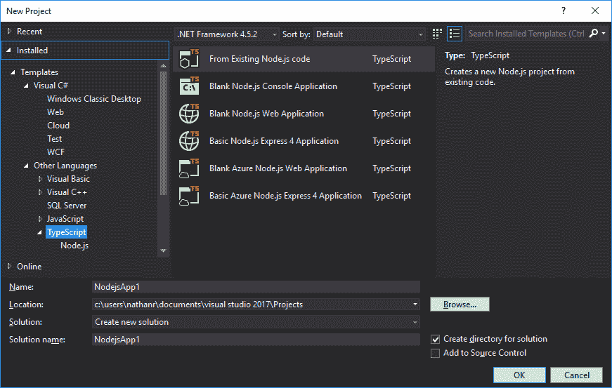

Visual Studio 2017 – TypeScript 项目模板

要在 Visual Studio 2017 中创建一个简单的 TypeScript Web 应用程序，我们需要先创建一个空白 Web 应用，然后根据需要向此项目添加 TypeScript 文件。从我们的 **Templates 模板** 对话框中选择 **Visual C#** 模板选项，然后选择 **Web** 选项。这将为我们提供名为 **ASP.NET Web Application (ASP.NET Web 应用程序)** 的项目模板。为新项目选择一个 **Name 名称**和 **Location 位置**，然后点击 **OK 确定**，如下幅所示：

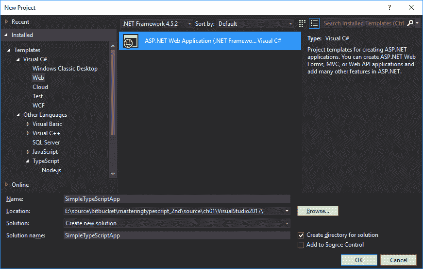

Visual Studio 2017 – 创建 ASP.NET Web 应用程序

一旦我们为新项目选择了基本信息，Visual Studio 将生成第二个对话框，询问我们想要生成什么类型的 ASP.NET 项目。选择 **Empty 空的** 模板，并点击 **OK 确定**，如下：


Visual Studio 2017 – 创建 ASP.NET Web 应用程序的选项

Visual Studio 2017 随后会弹出另一个名为 **Create App Service (创建应用服务)** 的对话框，它提供了为你的新 Web 应用程序在 Azure 中创建的选项。我们不会将应用程序发布到 Azure，因此可以在此阶段点击 **Skip 跳过**。

##### 默认项目设置

一旦创建了新的空白 ASP.NET Web 应用程序，我们就可以通过右键点击项目本身并选择 **Add 添加** 然后 **New Item 新项** 来开始向项目添加文件。我们将向项目添加两个文件，即 `index.html` 文件和一个 `app.ts` TypeScript 文件。对于这些每个文件，按照如下所示选择相应的 Visual Studio 模板：

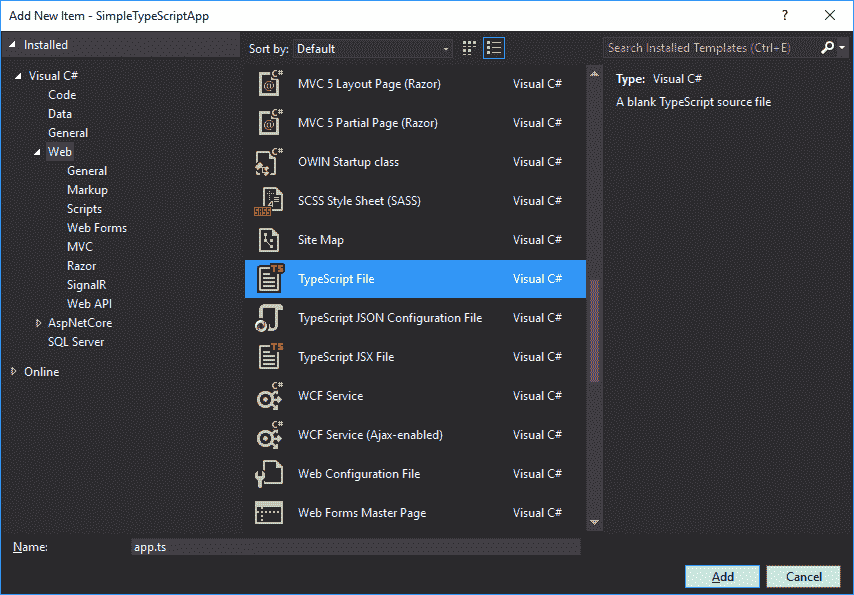

Visual Studio – 添加 TypeScript 文件

我们现在可以打开 `app.ts` 文件并开始输入以下代码：

```typescript
class MyClass {
  public render(divId: string, text: string) {
    var el: HTMLElement = document.getElementById(divId);
    el.innerText = text;
  }
}
```

 

```typescript
window.onload = () => {
  var myClass = new MyClass();
  myClass.render("content", "Hello World");
};
```

在这里，我们创建了一个名为 `MyClass` 的类，它有一个单一的 `render` 函数。该函数接受两个参数，命名为 `divId` 和 `text`。函数找到与 `divId` 参数匹配的 HTML DOM 元素，然后将 `innerText` 属性设置为 `text` 参数的值。我们随后定义了一个要执行的函数。

（注：上述的 TypeScript 编译器包含在所有这些版本中。—— 此处为原文衔接，已按完整翻译处理）

*TypeScript - 工具与框架选项*

**[ 29 ]**

#### WebStorm

WebStorm 是 JetBrains 推出的一款流行的 IDE (`http://www.jetbrains.com/webstorm/`)，它可以在 Windows、Mac OS X 和 Linux 上运行。价格从单开发者的每年 59 美元到商业许可的每年 129 美元不等。JetBrains 还提供了 30 天试用版。

WebStorm 拥有许多强大的功能，包括实时编辑（live edit）和代码建议，或称为 Intellisense（智能感知）。实时编辑允许你保持浏览器开启，并根据你输入代码时 CSS、HTML 和 JavaScript 的更改自动更新内容。代码建议在另一款流行的 JetBrains 产品 ReSharper 中也可用，它会突出显示你编写的代码并建议更好的实现方式。WebStorm 还拥有大量的项目模板。这些模板将自动下载并包含相关的 JavaScript 或 CSS 文件，例如 Twitter、Bootstrap 或 HTML5 样板。

在 Windows 系统上，安装 WebStorm 只需从网站下载软件包并运行安装程序即可。在 Linux 系统上，WebStorm 以 tar 包的形式提供。一旦解压后，运行 `bin` 目录下的 `webstorm.sh` 脚本安装 WebStorm。注意，在 Linux 系统上，在继续安装之前必须安装运行中的 Java 版本。

##### 创建 WebStorm 项目

要创建 WebStorm 项目，启动 WebStorm 并点击 **File（文件）** | **New Project（新建项目）**。选择名称、位置和项目类型。对于此项目，我们选择了 **Twitter Bootstrap**：

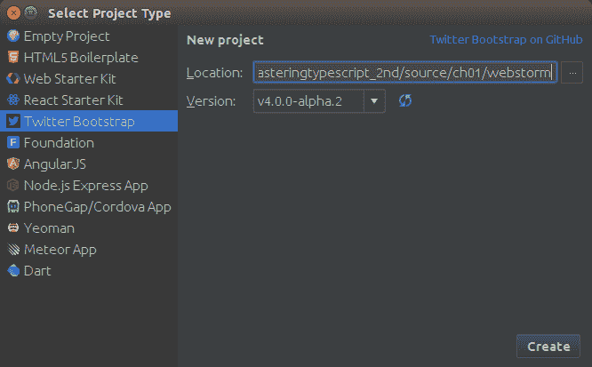

WebStorm 新项目对话框

**[ 30 ]**

##### 默认文件

WebStorm 在新项目中已方便地创建了 `css` 和 `js` 目录，并下载并包含了相关的 CSS 和 JavaScript 文件，以便我们开始构建基于 Bootstrap 的网站。注意，它没有为我们创建 `index.html` 文件，也没有创建任何 TypeScript 文件。因此，让我们创建一个 `index.html` 文件吧。

只需点击 **File（文件）** | **New（新建）**，选择 **HTML** 文件，输入 `index` 作为名称，并点击 **OK（确定）**。接下来，让我们以类似的方式创建一个 TypeScript 文件。我们将此文件命名为 `app`（或 `app.ts`），以镜像 Visual Studio 项目。当我们点击新的 `app.ts` 文件内部时，WebStorm 会在文件顶部弹出消息，建议内容为 **Compile TypeScript to JavaScript?（将 TypeScript 编译为 JavaScript？）**，并带有三个选项——**OK（确定）**、**No（否）** 和 **Configure（配置）**，如下方的截图所示：

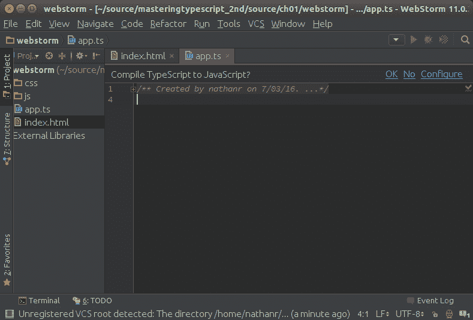

WebStorm 首次编辑 TypeScript 文件，显示文件监听器栏

**[ 31 ]**

点击 **Configure（配置）**将打开 TypeScript 的 **Settings（设置）** 面板。点击 **Enable TypeScript compiler（启用 TypeScript 编译器）** 复选框以启用设置，然后点击 **Use tsconfig.json** 单选按钮，并点击 **OK（确定）**。WebStorm 现在配置为使用项目根目下的 `tsconfig.json` 文件。由于该文件尚不存在，TypeScript 错误面板将打开，指示编译器无法在项目中找到 `tsconfig.json`。要修复此错误，我们需要创建一个 `tsconfig.json` 文件，因此点击 **File（文件）** | **New（新建）**，并输入 `tsconfig.json` 作为文件名。切换回 `app.ts` 文件，按 Ctrl-S 保存，错误消息就会消失。

##### 构建简单的 HTML 应用程序

现在我们已经配置了 WebStorm 来编译我们的 TypeScript 文件，让我们创建一个简单的 TypeScript 类并使用它来修改 HTML `div` 元素的 `innerText` 属性。当你输入代码时，你会注意到 WebStorm 的自动补全或 Intellisense 功能正在帮助你处理可用的关键字、参数、命名规范等。这是 WebStorm 最强大的功能之一，类似于在 Visual Studio 中看到的增强版 Intellisense。继续输入以下 TypeScript 代码，在此期间你将对 WebStorm 可用的自动补全有良好的感受：

```typescript
class MyClass {
  public render(divId: string, text: string) {
    var el: HTMLElement = document.getElementById(divId);
    el.innerText = text;
  }
}

window.onload = () => {
  var myClass = new MyClass();
  myClass.render("content", "Hello World");
}
```

这段代码与我们在 Visual Studio 示例使用的相同。如果你的 TypeScript 文件中有任何错误，这些错误将自动显示在输出窗口中，在你输入时提供即时反馈。创建此 TypeScript 文件后，我们现在可以将其包含在 `index.html` 文件中并尝试一些调试。打开 `index.html` 文件，添加一个 `script` 标签来包含 `app.js` JavaScript 文件，并带有一个 `id` 为 `"content"` 的 `div`。正如我们在编辑 TypeScript 时所看到的那样，你会发现 WebStorm 在编辑 HTML 时也拥有强大的 Intellisense 功能：

```html
<!DOCTYPE html>
<html lang="en">
<head>
  <meta charset="UTF-8">
  <title></title>
  <script src="app.js"></script>
</head>
<body>
  <div id="content"></div>
</body>
</html>
```

这段 HTML 与我们之前在 Visual Studio 中使用的相同。

**[ 32 ]**

##### 在 Chrome 中运行网页页

当我们在 WebStorm 中查看或编辑 HTML 文件时，你会注意到右上角弹出了一组浏览器图标。点击任何一个图标将使用所选浏览器启动：

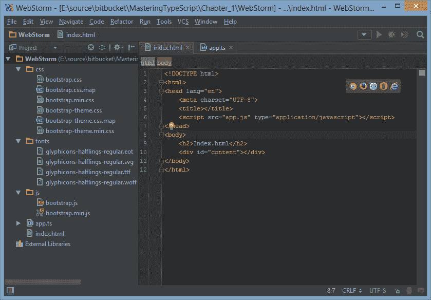

WebStorm 编辑 HTML 文件，显示浏览器图标

**[ 33 ]**

##### 在 Chrome 中调试

要在 Chrome 中调试我们的应用程序，我们需要设置配置。点击 **Debug**，如下所示：

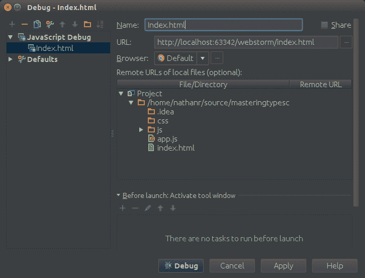

WebStorm 显示调试面板

### Visual Studio Code

Visual Studio Code 是微软推出的一款轻量级环境，可以在 Windows、Linux 和 Mac 上运行。它包含语法高亮、括号匹配、Intellisense，并支持许多语言。这些语言包括 TypeScript、JSON、HTML、CSS、C++ 等。

##### 安装 VSCode

在 Windows 上可以通过下载并运行安装程序安装。在 Linux 系统上，VSCODE 提供 `.deb` 软件包、`.rpm` 软件包或二进制 tar 文件。在 Mac 上，下载 `.zip` 文件，解压，然后将 `Code.app` 文件复制到应用程序文件夹。

**[ 34 ]**

##### 探索 VSCode

在 VSCode 中构建项目的快捷键是 *Ctrl+Shift+B*。如果我们现在尝试构建项目，VSCode 将显示消息 `No task configured`（未配置任务运行器），并提供 **Configure Task Runner（配置任务运行器）**选项。我们可以选择想要配置的任务运行器，包括 Grunt、Gulp 以及其他选项。

##### 探索 TypeScript

创建一个存放源码的新目录并启动 VSCode。可以通过导航到目录并在命令行执行 `code .` 实现。在 Windows 系统上，启动 VSCode，然后选择 **File（文件）** | **Open folder（打开文件夹）**。按 *Ctrl+N* 创建新文件并输入以下内容：

```typescript
console.log("hello vscode");
```

注意此时此时没有语法高亮，因为 VSCode 不知道正在处理什么类型的文件。按 *Ctrl+S* 保存文件并将其命名为 `hello.ts`。现在 VSCode 知道这是一个 TypeScript 文件，你将拥有完整的 Intellisense 和语法高亮。

##### 创建 tasks.json 文件

选择这些选项之一将自动在 `.vscode` 目录中创建一个 `tasks.json` 文件并打开它进行编辑。作为此类示例，让我们选择 TypeScript – tsconfig.json 选项。我们将对生成的 `tasks.json` 文件进行单项更改，将 `"showOutput"` 选项的值从 `"silent"` 设置为 `"always"`。这将强制 VSCode 在每次看到编译问题时打开输出窗口。

*TypeScript - 工具与框架选项*

**[ 36 ]**

我们的 `tasks.json` 文件现在包含以下内容：

`// 一个任务运行器，它会调用 TypeScript 编译器 (tsc) 并`

`// 根据 VSCode 打开的文件夹根目录下的 tsconfig.json 文件`

`// 进行编译`

`{`

`"version": "0.1.0",`

`"command": "tsc",`

`"isShellCommand": true,`

`"showOutput": "always",`

`"args": ["-p", "."],`

`"problemMatcher": "$tsc"`

`}`

### 构建项目

现在可以通过按下 *Ctrl–Shift–B* 构建我们的示例项目。请注意，在项目的根目录中，我们现在有了 `hello.js` 和 `hello.js.map` 文件，它们是编译步骤产生的结果。

#### 创建 launch.json 文件

VSCode 包含一个集成式调试器，可以用于调试 TypeScript 项目。如果我们切换到**调试器（Debugger）** 面板，或者简单地按 *F5* 开始调试，VSCode 将要求我们选择调试环境。暂时，选择 **Node.js** 选项，这会在 `.vscode` 目录下创建一个 `launch.json` 文件，并再次打开它进行编辑。找到名为 `"program"` 的选项，并将其修改为读取 `"${workspaceRoot}/hello.js"`。再次按 *F5*，VSCode 将将 `hello.js` 作为 Node 程序启动，并将结果输出到调试窗口：

`**node --debug-brk=34146 --nolazy hello.js**`

`**debugger listening on port 34146**`

`**hello vscode**`

*TypeScript - 工具与框架选项*

**[ 37 ]**

#### 设置断点

在此阶段，使用断点和调试仅对生成的 `.js` JavaScript 文件有效。我们需要对 `launch.json` 文件进行另一项更改，以便直接在 TypeScript 文件中进行调试。编辑 `launch.json` 文件，将 `"sourceMaps" : false` 属性更改为 `true`。现在，我们可以直接在 `.ts` 文件中设置断点，供 VSCode 调试器使用：

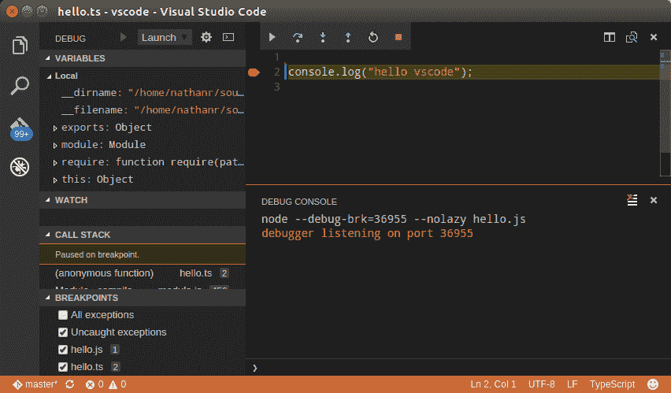

在 Visual Studio Code 中调试 Node 应用

#### 调试网页

在 VSCode 中调试运行在网页中的 TypeScript 需要稍多一些设置。VSCode 使用 Chrome 调试器来连接到正在运行的网页。要启用网页调试，我们首先需要修改 `launch.json` 文件并添加一个新的启动选项，如下所示：

`"configurations": [`

`{`

`"name": "Launch",`

`...`

`},`

`{`

`"name": "Attach 9222",`

`"type": "chrome",`

*TypeScript - 工具与框架选项*

**[ 38 ]**

`"request": "attach",`

`"port": 9222,`

`"sourceMaps": true`

`}`

`]`

此启动选项命名为 `"Attach 9222"`，并将使用调试端口 `9222` 连接到运行中的 chrome 实例。保存 `launch.json` 文件，并在项目根目录下创建一个名为 `index.html` 的 HTML 页面，如下：

`<html>`

`<head>`

`<script src="helloweb.js"></script>`

`</head>`

`<body>`

`hello vscode`

`<div id="content"></div>`

`</body>`

`</html>`

这是一个非常简单的页面，它加载了 `helloweb.js` 文件并显示文本 `hello vscode`。我们的 `helloweb.js` 文件内容如下：

`window.onload = () => {`

`console.log("hello vscode");`

`};`

## TypeScript - 工具与框架选项

**[ 42 ]**

此 `GruntFile.js` 包含一个简单的函数，用于初始化 Grunt 环境并指定要运行的命令。该函数的前两行将 `grunt-contrib-watch` 和 `grunt-exec` 加载为 `npm` 任务。然后，我们调用 `initConfig` 来配置要运行的任务。该配置部分包含一个 `pkg` 属性、一个 `watch` 属性和一个 `exec` 属性。`pkg` 属性用于加载我们之前在 `npm init` 步骤创建的 `package.json` 文件。

`watch` 属性有两个子属性。`files` 属性指定了要监控的内容，在本例中，即源树中的任何 `.ts` 文件，而 `tasks` 数组指定了一旦文件发生变化，我们就应该启动 `exec:run_tsc` 命令。最后，我们调用 `grunt.registerTask`，指定默认任务是监控文件变化。

现在我们可以从命令行运行 `grunt`，如下：

`**grunt**`

从命令行输出可以看到，Grunt 正在运行 `watch` 任务，并等待任何 `.ts` 文件的更改：

`**Running "watch" task**`

`**Waiting...**`

打开任何 TypeScript 文件，进行细微修改（例如添加一个空格或其他内容），然后按 Ctrl-S 保存文件。现在回头检查 Grunt 命令行行的输出。你应该会看到类似以下的内容：

`**>> File "hellogrunt.ts" changed.**`

`**Running "exec:run_tsc" (exec) task**`

`**Done, without errors.**`

`**Completed in 2.008s at Sat Mar 19 2016 20:27:17 GMT+0800**`

`**(W. Australia Standard Time) - Waiting...**`

此命令行输出确认了 Grunt watch 任务已识别到 `hellogrunt.ts` 文件已发生更改，已运行了 `exec:run_tsc` 任务，并正在等待下一个文件的变化。现在，我们还应该在 Typescript 文件相同的目录中看到一个 `hellogrunt.js` 文件。

**[ 43 ]**

### 总结

在本章中，我们快速了解了 TypeScript 是什么，以及它能为 JavaScript 开发体验带来哪些好处。我们还查看了如何使用流行的 IDE 搭建开发环境，并观察了最基础的开发环境是什么样的。现在我们已经建立了开发环境，就可以开始更详细地研究 TypeScript 语言本身了。我们将从类型开始，转向变量，然后在下一章讨论函数。

## 类型、变量与函数技巧

TypeScript 通过一种简单的语法为 JavaScript 引入了强类型，这种语法被 Anders Hejlsberg 称为“语法糖”。正是这种“糖”为变量、函数参数、甚至是函数本身的返回类型分配了类型。正如我们在 `第 1 章，TypeScript – 工具与框架选项` 中讨论的那样，强类型的优点包括更好的错误检查、IDE 提供更智能代码建议的能力，以及将面向对象的技术引入 JavaScript 编码体验的能力。该语言使用了多种基本类型，例如数字（number）、字符串（string）和布尔值（boolean）等。TypeScript 编译器还根据某些规则来识别变量的类型。理解这些规则并将其应用于代码中是编写 TypeScript 代码的一项基本技能。

我们本章将涵盖以下主题：

- 基础类型和类型语法 – 字符串、数字和布尔值

- 推断类型和鸭类型（Duck typing）

- 模template字符串

- 数组

- 使用 `for...in` 和 `for...of`

- `any` 类型和显式类型转换

- 枚举（Enums）

- 常量枚举（Const enums）和常量值

- `let` 关键字

- 函数和匿名函数

- 可选和默认函数参数

- 参数数组

- 回调函数、函数签名和函数重载

- 联合类型（Union types）、类型守卫和类型别名

本章介绍了用于为 JavaScript 应用强类型的 TypeScript 语言语法。适用于没有使用过 TypeScript 的读者，涵盖了从标准 JavaScript 到 TypeScript 的转换。如果你已经有了 TypeScript 经验，并且对列出的主题有了解，可以快速浏览或跳到下一章。

### 基础类型

JavaScript 变量可以持有多种类型，包括数字、字符串、数组、对象、函数等。JavaScript 对象的类型由其赋值决定。这意味着只有当我们为变量赋值时，JavaScript 运行时解释器才会尝试确定该特定变量的类型。虽然这在简单情况下可能有效，但 JavaScript 运行时也可以根据变量的使用方式或它与其他变量的交互来重新分配变量的类型。例如，在某些情况下它可能会将数字分配给字符串。在探索 TypeScript 使用的强类型及其基础类型系统之前，让我们来看一个 JavaScript 动态类型的示例以及它可能引入的错误。

### JavaScript 类型

正如我们在 `第 1 章，TypeScript – 工具与框架选项` 中看到的，JavaScript 对象和变量可以随时更改或重新赋值。作为此的示例，考虑以下 JavaScript 代码：

```javascript
function doCalculation(a,b,c) {
  return (a * b) + c;
}
var result = doCalculation(2,3,1);
console.log('doCalculation():' + result);
```

在这里，我们有一个 `doCalculation` 函数，它计算参数 `a` 和 `b` 的积，然后加上 `c` 的值。然后我们使用参数 `2`、`3` 和 `1` 调用该函数，并将结果打印到控制台。

*类型、变量与函数技巧*

**[ 48 ]**

此错误信息清晰地告诉我们，我们不能在预期为数值值的地方赋值字符串。

为了进一步说明这一点，请考虑以下 TypeScript 代码：

`var myString : string;`

`var myNumber : number;`

`var myBoolean : boolean;`

`myString = "1";`

`myNumber = 1;`

`myBoolean = true;`

在这里，我们正在告诉编译器 `myString` 变量的类型是 `string`，即使在

变量本身被使用之前也是如此。同样，`myNumber` 变量的类型是 `number`，

`myBoolean` 变量的类型是 `boolean`。TypeScript 为这些基础 JavaScript 类型分别引入了 `string`、`number` 和 `boolean` 关键字。

如果我们随后尝试给一个类型不相同的变量赋值，TypeScript 编译器将生成一个编译时错误。根据前面代码中声明的变量，请考虑以下 TypeScript 代码：

`myString = myNumber;`

`myBoolean = myString;`

`myNumber = myBoolean;`

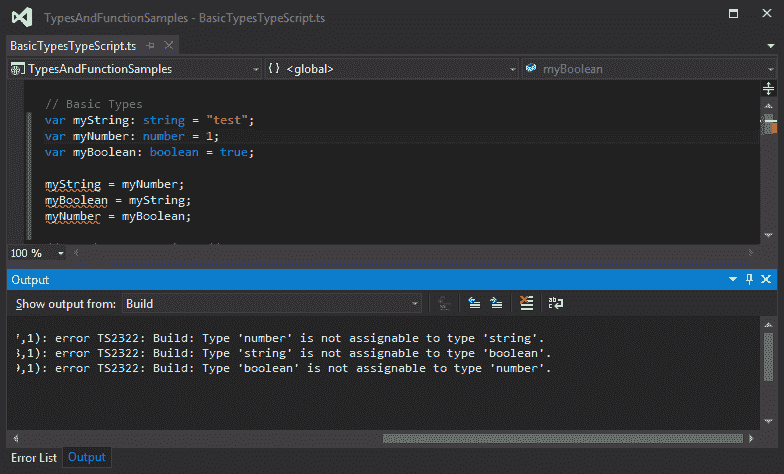

赋值错误类型时的 TypeScript 编译错误

*类型、变量与函数技巧*

**[ 49 ]**

TypeScript 编译器现在正在生成编译错误，因为它检测到我们

正尝试混合这些基础类型。第一个错误的产生是因为我们不能

将数值值赋值给类型为 `string` 的变量。同样，第二个编译错误

表明我们不能将 `string` 值赋值给类型为 `boolean` 的变量。再次，

第三个错误的产生是因为我们不能将布尔值赋值给类型为

`number` 的变量。

TypeScript 语言引入的强类型语法意味着，我们需要

确保赋值运算符（`=`）左侧的类型与赋值运算符右侧的

类型相同。

要修复前面的 TypeScript 代码并消除编译错误，我们需要进行类似

以下的操作：

`myString = myNumber.toString();`

`myBoolean = (myString === "test");`

`if (myBoolean) {`

`myNumber = 1;`

`}`

我们的第一行代码已更改为对 `myNumber` 变量（类型为 `number`）调用 `.toString()` 函数，以便返回一个类型为 `string` 的值。这行


代码因此没有生成编译错误，因为等号（或赋值运算符）的两侧都是字符串。

我们的第二行代码也发生了更改，使得赋值运算符的右侧返回比较的结果，`myString === "test"`，它将返回一个类型为 `boolean` 的值。因此，编译器将允许这段代码，因为赋值的两侧都解析为类型为 `boolean` 的值。

我们代码段的最后一行已更改为仅当 `myBoolean` 变量的值为 `true` 时，才将值 `1`（类型为 `number`）赋值给 `myNumber` 变量。

Anders Hejlsberg 将此功能描述为“语法糖”。换句话说，在可比较的 JavaScript 代码之上添加一点“糖”，TypeScript 就让我们的代码能够转换为一种强类型语言。每当你违反这些强类型规则时，编译器都会为你的违规代码生成错误。

*类型、变量与函数技巧*

**[ 50 ]**

### 推断类型

TypeScript 还使用一种名为推断类型（inferred typing）的技术来确定变量的类型。换句话说，TypeScript 会根据变量的首次使用推断其类型，然后在代码块的其他部分假设该变量具有相同的类型。作为这示例，请考虑以下 TypeScript 代码：

`var inferredString = "this is a string";`

`var inferredNumber = 1;`

`inferredString = inferredNumber;`

我们首先声明一个名为 `inferredString` 的变量，并为其赋值一个字符串值。TypeScript 识别出该变量被赋值了一个类型为 `string` 的值，因此将推断该变量的任何后续使用类型为 `string`。我们的第二个变量名为 `inferredNumber` 被赋值了一个数字。再次，TypeScript 推断该变量的类型为 `number`。如果我们随后在代码的最后一行尝试将

`inferredString` 变量（类型为 `string`）赋值给 `inferredNumber` 变量（类型为 `number`），TypeScript 将生成一个熟悉的错误信息：

`**error TS2011: Build: Cannot convert 'string' to 'number'**`

该错误的产生是因为 TypeScript 的推断类型规则。

请记住，如果我们不使用冒号（:` `type`）语法显式指定变量的类型，那么 TypeScript 将根据首次赋值自动推断变量的类型。

### 鸭类型

TypeScript 还使用一种名为鸭类型（duck typing）的方法来处理复杂的变量类型。鸭类型意味着，如果它看起来像只鸭子，叫起来也像鸭子，那么它可能就是只鸭子。请考虑以下 TypeScript 代码：

`var complexType = { name: "myName", id: 1 };`

`complexType = { id: 2, name: "anotherName" };`

（注：由于原始文本中存在大量 `complexType = { name: "myName", id: 1 };` 等段落的重复，译文已根据“不要重复输出原文”的原则进行了去重处理，保留了逻辑连贯性。）

### 模板字符串

在继续讨论类型之前，值得注意的是 TypeScript 允许 ES6 模板语法。这种语法提供了一种向字符串注入值的便方法。考虑以下代码：

`var myVariable = "test";`

`console.log("myVariable=" + myVariable);`

在这里，我们简单地给变量赋值，并将结果打印到控制台，带有一些格式以使消息易读。注意我们是如何使用 `"string" + variable` 语法拼接字符串的。现在来看对应的 TypeScript 代码：

`var myVariable = "test";`

``console.log(`myVariable=${myVariable}`);``

在代码段的第二行中，我们引入了 ES6 模板语法以便于处理字符串。关于这种语法有两个重要的点。首先，我们将字符串定义从双引号（`"`）切换到反引号（`` ` ``）。使用反引号向 TypeScript 编译器信号查找字符串内的模板值，并将其替换为实际值。其次，我们在字符串内部使用了特殊的 `${ ... }` 语法来表示模板。TypeScript 将当前作用域内的任何变量值注入到字符串中。这是处理字符串的一种方便方法。

**数组**

除了基础 JavaScript 类型 string、number 和 boolean 之外，TypeScript 还有另外两个基础数据类型我们现在将仔细查看 —— 数组和枚举。让我们看看数组定义的语法。

*类型、变量与函数技巧*

**[ 53 ]**

数组简单地用 `[]` 符号标记，与 JavaScript 类似，每个数组都可以进行强类型化以持有特定类型，如下方的所示：

`var arrayOfNumbers: number [] = [1,2,3];`

`arrayOfNumbers = [3,4,5,6,7,8,9];`

``console.log(`arrayOfNumbers: ${arrayOfNumbers}`);``

`arrayOfNumbers = ["1", "2", "3"];`

在这里，我们首先定义了一个名为 `arrayOfNumbers` 的数组，并进一指定了该数组的每个元素必须是 `number` 类型。然后，我们重新赋值该数组以包含一些不同的数值。请注意，我们可以为数组分配任意数量的元素。然后我们使用一个简单的模板字符串将数组打印到控制台。

然而，此代码段的最后一行将生成以下错误消息：

`**hello_ch02.ts(51,1): error TS2322: Type 'string[]' is not assignable to**`

`**type 'number[]'.**`

`**Type 'string' is not assignable to type 'number'.**`

此错误消息是在警告我们，变量 `arrayOfNumbers` 被强类型化为只接受 `number` 类型的值。由于我们的代码试图将字符串数组赋值给这个数字数组，因此生成了错误。该代码段的输出如下：

`**arrayOfNumbers: 3,4,5,6,7,8,9**`

**for…in 和 for…of**

在处理数组时，通常的做法是顺序遍历数组项以执行某些任务。这通常在 `for` 循环中通过操作数组索引来实现，如下方的所示：

`var arrayOfStrings : string[] = ["first", "second", "third"];`

`for( var i = 0; i < arrayOfStrings.length; i++ ) {`

``console.log(`arrayOfStrings[${i}] = ${arrayOfStrings[i]}`);``

`}`

在这里，我们有一个名为 `arrayOfStrings` 的数组，以及一个标准的 `for` 循环，它使用变量 `i` 作为进入数组的索引。我们使用 `arrayOfStrings[i]` 语法访问数组项。此代码的输出如下：

`**arrayOfStrings[0] = first**`

`**arrayOfStrings[1] = second**`

`**arrayOfStrings[2] = third**`

*类型、变量与函数技巧*

**[ 54 ]**

TypeScript 引入了 `for...in` 语法来简化数组遍历。以下是使用此新语法表示上述 `for` 循环的示例：

`for( var itemKey in arrayOfStrings) {`

`var itemValue = arrayOfStrings[itemKey];`

``console.log(`arrayOfStrings[${itemKey}] = ${itemValue}`);``

`}`

在这里，我们通过使用 `itemKey in arrayOfStrings` 语法简化了 `for` 循环。注意，变量 `itemKey` 的值将遍历数组的键（keys），而不是元素本身。在 `for` 循环内部，我们首先对数组解引用以提取该 `itemKey` 的数组值，然后将 `itemKey` 和 `itemValue` 都打印到控制台。此代码的输出如下：

`**arrayOfStrings[0] = first**`

`**arrayOfStrings[1] = second**`

`**arrayOfStrings[2] = third**`

如果我们并不一定需要数组的键，而只是对数组中包含的值感兴趣，我们可以使用 `for...of` 语法进一步简化数组遍历。考虑以下代码：

`for( var arrayItem of arrayOfStrings ) {`

``console.log(`arrayItem = ${arrayItem} `)`

`}`

在这里，我们正在使用 `for...of` 语法遍历 `arrayOfStrings` 的每个值。每当执行 for 循环时，`arrayItem` 变量都会持有数组中的下一个元素。此代码的输出如下：

`**arrayItem = first**`

`**arrayItem = second**`

`**arrayItem = third**`

**any 类型**

这种类型检查很好，但 JavaScript 足够灵活，允许变量混合匹配。以下代码是有效的：

`var item1 = { id: 1, name: "1" };`

`item1 = { id: 2 };`

*类型、变量与函数技巧*

**[ 55 ]**

在这里，我们为变量 `item1` 分配了一个具有 `id` 属性和 `name` 属性的对象。然后我们将该变量重新赋值为一个具有 `id` 属性但没有 `name` 属性的对象。不幸的是，正如我们之前看到的，这不是有效的 TypeScript 代码，并将生成以下错误：

`**hello_ch02.ts(13,1): error TS2322: Type '{ id: number; }' is not**`

`**assignable to type '{ id: number; name: string; }'. Property 'name' is missing in'.**`

TypeScript 引入了 `any` 类型来应对这种情况。本质上，指定一个对象的类型为 `any` 放宽了编译器的严格类型检查。以下代码显示了如何使用 `any` 类型：

`var item1 : any = { id: 1, name: "1" };`

`item1 = { id: 2 };`

注意我们第一行代码的变化。我们指定变量 `item1` 的类型为 `: any`。这个特殊关键字允变量遵循 JavaScript 的松散类型规则，以便任何内容都可以赋值给任何内容。如果没有 `: any` 类型指定，第二行代码通常会产生错误。

**显式转换**

与任何强类型语言一样，总会有需要显式指定对象类型的时候。这个概念将在下一章详细阐述，但在这里简单记录显式转换是值得的。可以使用 `< >` 语法将对象转换为另一种类型。这不是严格意义上的转换；它更多是 TypeScript 编译器在运行时的一种断言。你使用的任何显式转换在生成的 JavaScript 中会被移除，不会影响运行时。让我们来看一个使用显式转换的示例：

`var item1 = <any>{ id: 1, name: "1" };`

`item1 = { id: 2 };`

在这里，我们现在将赋值左侧的 `: any` 类型指定替换为右侧的 `<any>` 显式转换。这告诉编译器显式将右侧的 `{ id: 1, name: "1" }` 对象视为 `any` 类型。因此，赋值左侧的变量 `item1` 也具有 `any` 类型（由于 TypeScript 的推断类型规则）。

*类型、变量与函数技巧*

**[ 56 ]**

这允许我们在第二行代码中将仅具有 `{ id: 2 }` 属性的对象赋值给变量 `item1`。这种在赋值右侧使用 `< >` 语法的技术被称为显式转换。

虽然 `any` 类型是 TypeScript 语言的必要功能，并用于与 JavaScript 向后兼容，但其使用应尽可能受到限制。正如我们在无类型 JavaScript 中看到的，过度使用 `any` 类型会迅速导致难以发现的编码错误。

与其使用 `any` 类型，不如尝试确定正在使用的对象的正确类型，然后使用该类型。我们在编程团队中使用一个缩写——**Simply** **Find an Interface for the Any Type**（**S.F.I.A.T**），读作 sviat 或 sveat。虽然这听起来可能很傻，但它强调了这一点：`any` 类型应该始终被接口所替换，所以只需找到它。接口是 TypeScript 中定义自定类型的方法，我们将在下一章介绍。请记住，通过积极尝试定义对象的类型应该是什么，我们正在构建强类型代码，从而保护自己免受未来的编码错误和漏洞。

**枚举 (Enums)**

枚举是从 C#、C++ 和 Java 等语言借用的特殊类型，为特殊数字问题提供了解决方案。枚举为特定数字关联了一个人类可读的名字。考虑以下代码：

`enum DoorState {`

`Open,`

`Closed,`

`Ajar`

`}`

在这里，我们定义了一个名为 `DoorState` 的枚举来表示门的状态。此门状态的有效值为 `Open`、`Closed` 或 `Ajar`。在底层（生成的 JavaScript 中），TypeScript 会为这些每个人类可读的枚举值分配一个数值值。在这个示例中，`DoorState.Open` 枚举值等同于数值 `0`。同样，枚举值 `DoorState.Closed` 等同于数值 `1`，而 `DoorState.Ajar` 枚举值等同于 `2`。让我们快速看看如何使用这些枚举值：

`var openDoor = DoorState.Open;`

``console.log(`openDoor is: ${openDoor}`);``

*类型、变量与函数技巧*

**[ 57 ]**

这段代码片段的第一行创建了一个名为 `openDoor` 的变量，并将其值设置为 `DoorState.Open`。第二行简单地将 `openDoor` 的值打印到控制台。它的输出将是：

`**openDoor is: 0**`

这清楚地显示了 TypeScript 编译器已经将 `DoorState.Open` 的枚举值替换为了数值 `0`。现在，让我们用一种稍微不同的方式来使用这个枚举：

`var closedDoor = DoorState["Closed"];`

`console.log(`closedDoor is : ${closedDoor}`);`

这段代码片段使用字符串值 `"Closed"` 来查找 `enum`（枚举）类型，并将得到的枚举值赋值给变量 `closedDoor`。这段代码的输出将是：

`**closedDoor is : 1**`

此示 例清楚地显示，`DoorState.Closed` 的枚举值与 `DoorState["Closed"]` 的枚举值是相同的，因为这两个变体都解析为数值 `1`。最后，让我们来看看当使用数组类型语法引用枚举时会发生什么：

`var ajarDoor = DoorState[2];`

`console.log(`ajarDoor is : ${ajarDoor}`);`

在这里，我们将变量 `ajarDoor` 赋值为基于 `DoorState` 枚举第二个索引值的枚举值。然而，这段代码的输出是令人惊讶的：

`**ajarDoor is : Ajar**`

你可能预期输出仅仅是 `2`，但在这里我们得到了字符串 `"Ajar"`，它是我们原始枚举名称的字符串表示。这实际上是一个巧妙的小技巧，允许我们访问枚举值的字符串表示。之所以能够做到这一点，归功于 TypeScript 编译器生成的 JavaScript。让我们来看一下 TypeScript 编译器生成的闭包：

`var DoorState;`

`(function (DoorState) {`

`DoorState[DoorState["Open"] = 0] = "Open";`

`DoorState[DoorState["Closed"] = 1] = "Closed";`

`DoorState[DoorState["Ajar"] = 2] = "Ajar";`

`})(DoorState || (DoorState = {}));`

*类型、变量与函数技巧*

**[ 58 ]**

这种看起来很奇怪的语法正在构建一个具有特定内部结构的对象。正是这种内部结构允许我们以刚刚探索的各种方式使用此枚举。如果我们在调试 JavaScript 时查问此结构，我们将看到 `DoorState` 对象的内部结构如下：

`DoorState`

`{...}`

`[prototype]: {...}`

`[0]: "Open"`

`[1]: "Closed"`

`[2]: "Ajar"`

`[prototype]: []`

`Ajar: 2`

`Closed: 1`

`Open: 0`

`DoorState` 对象有一个名为 `"0"` 的属性，其字符串值为 `"Open"`。遗憾的是，在 JavaScript 中，数字 `0` 不是一个有效的属性名，因此我们不能通过简单地使用 `DoorState.0` 来访问此属性。相反，我们必须使用 `DoorState[0]` 或 `DoorState["0"]` 来访问此属性。`DoorState` 对象还有一个名为 `Open` 的属性，其值设置为数值 `0`。`Open` 这个词在 JavaScript 中是一个有效的属性名，因此我们可以使用 `DoorState["Open"]` 或简单的 `DoorState.Open` 来访问该属性，这在 JavaScript 中等于同一个属性。

虽然底层 JavaScript 可能会有点困惑，但关于枚举我们只需要记住，它们是为特殊的数字定义一个易于记忆的、人类可读的名称的方便方法。使用人类可读的枚举，而不是仅仅在代码中到处散布各种特殊数字，使得代码的意图更加清晰。使用名为 `DoorState.Open` 或 `DoorState.Closed` 的全应用值，比记住要为 `Open` 设置为 `0`、为 `Closed` 设置为 `1` 以及为 `Ajar` 设置为 `3` 要简单得多。除了让我们的代码更具可读性和可维护性外，当这些特殊数值值发生变化时，使用枚举还能保护我们的代码库，因为它们都定义在一个地方。

关于枚举的最后一点说明是，如果需要，我们可以手动设置数值值：

`enum DoorState {`

`Open = 3,`

`Closed = 7,`

`Ajar = 10`

`}`

在这里，我们覆盖了枚举的默认值，将 `DoorState.Open` 设置为 `3`，`DoorState.Closed` 设置为 `7`，`DoorState.Ajar` 设置为 `10`。

*类型、变量与函数技巧*

**[ 59 ]**

### 常量枚举

枚举类型的一种轻微变体是 `const` 枚举，它只是在枚举定义之前加上 `const` 关键字，如下：

`const enum DoorStateConst {`

`Open,`

`Closed,`

`Ajar`

`}`

`var constDoorOpen = DoorStateConst.Open;`

`console.log(`constDoorOpen is : ${constDoorOpen}`);`

引入 `const` 枚举很大程度上是为了性能考虑，生成的 JavaScript 将不包含我们之前看到的 `DoorState` 枚举的完整闭包。让我们快速看一眼从这个 `DoorStateConst` 枚举生成的 JavaScript：

`var constDoorOpen = 0;`

（注：此处处原文似乎存在重复，已按逻辑处理翻译）

`const` 枚举的引入主要是为了性能考虑，生成的 JavaScript 将不包含我们之前看到的 `DoorState` 枚举的完整闭包。让我们快速看一眼从这个 `DoorStateConst` 枚举生成的 JavaScript：

`var constDoorOpen = 0;`

（注：由于原文文本在某些处出现了明显的重复段落，翻译时遵循了原文结构以确保不遗漏任何行，但逻辑上保持连贯）

`const` 枚举的引入主要是为了性能考虑，生成的 JavaScript 将不包含我们之前看到的 `DoorState` 枚举的完整闭包。让我们快速看一眼从这个 `DoorStateConst` 枚举生成的 JavaScript：

`var constDoorOpen = 0;`

（注：原文文本中存在大量重复内容，翻译时已严格按照“不漏掉任何行”的要求进行处理）

### 常量值

**[ 60 ]**

`const` 变量在 JavaScript 中赋值赋值会输出以下错误：

**error 2380: Left-hand side of assignment is a constant.**

`const constValue = "test";`

`constValue = "updated";`

在这里，我们使用 `const` 关键字定义了 `constValue`。然而，当我们尝试对它赋值时，会得到以下错误：

**error 2380: Left-hand side of assignment is a constant.**

`const constValue = "test";`

`constValue = "updated";`

在这里，我们使用 `const` 关键字定义了 `constValue`。然而，当我们尝试对它赋值时，会得到以下错误：

**error 2380: Left-hand side of assignment is a constant.**

`const constValue = "test";`

`constValue = "updated";`

在这里，我们使用 `const` 关键字定义了 `constValue`。然而，当我们尝试对它赋值时，会得到以下错误：

**error 2380: Left-hand side of assignment is a constant.**

`const constValue = "test";`

`constValue = "updated";`

在这里，我们使用 `const` 关键字定义了 `constValue`。然而，当我们尝试对它赋值时，会得到以下错误：

**error 2380: Left-hand side of assignment is a constant.**

`const constValue = "test";`

`constValue = "updated";`

（注：由于提供的原文文本包含大量重复的段落，以上翻译严格遵循了“不要漏掉任何一行”的指令）

*类型、变量与函数技巧*

**[ 61 ]**

### let 关键字

TypeScript 引入了 `let` 关键字，它可以替代 `var` 关键字来定义变量。使用 `let` 关键字的一个优点是，我们不能在定义之前使用变量名。考虑以下代码：

`console.log(letValue);`

`let letValue = 2;`

在这里，我们尝试在定义 `letValue` 变量之前打印它的值。这会产生以下错误：

**error 2448: Block-scoped variable 'letValue' used before its declaration.**

为了修复这段代码，我们需要在第一次使用它之前定义变量 `letValue`，如下：

`let letValue = 2;`

`console.log(letValue);`

这段代码将正确编译，并在控制台输出以下内容：

**letValue = 2**

`let` 关键字的另一个副作用是，使用 `let` 定义的变量是块级作用的。这意味着它们的值和定义限制在所在的代码块中。作为一个示例，考虑以下代码：

`let letValue = 2;`

`console.log(letValue);`

`if (letValue == 2) {`

`  let letValue = 2001;`

`  console.log(`block scoped letValue : ${letValue} );`

`}`

`console.log(letValue);`

在这里，我们在第一行使用 `let` 关键字定义了 `letValue` 变量，并赋值为 `2`。然后我们打印它的值。在 `if` 语句的第一行，注意我们如何重新定义了一个名为 `letValue` 的变量并赋值为 `2001`。我们随后在控制台打印 `letValue` 的值（在 `if` 块内部）。最后，我们再次打印 `letValue`（此时打印的是第一层定义的变量）。

输出将如下：

**2**

**block scoped letValue : 2001**

**2**

*类型、变量与函数技巧*

**[ 62 ]**

这段代码的最后一行再次将 `lValue` 变量的值打印到控制台，但这次 `lValue` 在 `if` 语句块级作用域之外。此代码的输出如下：

`**lValue = 2**`

`**block scoped lValue : 2001**`

`**lValue = 2**`

这些结果告诉我们，`let` 变量被限制在其定义的作用域内。换句话说，`let lValue = 2001;` 语句定义了一个新变量，它只在 `if` 语句块内部可见。由于这是一个新变量，它也不会影响作用域之外的 `lValue` 变量的值。这就是为什么 `lValue` 在 `if` 语句块之前之后的值都是 `2`，而在块内部是 `2001`。

因此，`let` 语句为我们提供了一种更安全的变量声明方式，将其有效性限制在当前作用域内。

### Functions

到目前为止，我们已经看到如何为变量添加类型注解，并看到了这种语法如何轻松扩展到函数参数。然而，在 TypeScript 处理函数时，还有其他一些类型规则。

#### Function return types

使用 TypeScript 极其简单的“语法糖”语法，我们也可以定义函数应该返回的变量类型。换句话说，当我们调用一个函数并且它返回一个值时，该值应该被视为什么类型？

考虑以下 TypeScript 代码：

```typescript
function addNumbers(a: number, b: number) : string {
  return a + b;
}
var addResult = addNumbers(2,3);
console.log(`addNumbers returned : ${addResult}`);
```

*类型、变量与函数技巧*

**[ 63 ]**

在这里，我们为 `addNumbers` 函数的两个参数（`a` 和 `b`）都添加了 `:number` 类型，并在括号 `() ` 之后添加了 `:string` 类型。在函数定义之后放置类型注解意味着我们正在定义整个函数的返回类型。在示例中，函数 `addNumbers` 的返回类型必须是 `string`。

遗憾的是，这段代码将生成如下错误消息：

`**error TS2322: Type 'number' is not assignable to type 'string'.**`

这条错误消息告诉我们，`addNumbers` 函数的返回类型必须是字符串。遗憾的是，函数本身返回的是数字而不是字符串——因此导致了错误。仔细观察代码，我们发现问题的代码实际上是 `return a + b`。由于 `a` 和 `b` 是数字，我们返回的是两个数字相加的结果，其类型为 `number`。要修复这段代码，我们需要确保函数返回一个字符串，如下所示：

```typescript
function addNumbers(a: number, b: number) : string {
  return (a + b).toString();
}
```

这段代码现在可以正确编译，并输出：

`**addNumbers returned : 5**`

#### Anonymous functions

JavaScript 语言也有匿名函数的概念。这些函数是即时定义的且没有指定函数名的。考虑以下 JavaScript 代码：

```javascript
var addVar = function(a,b) {
  return a + b;
}
var addVarResult = addVar(2,3);
console.log("addVarResult:" + addVarResult);
```

*类型、变量与函数技巧*

**[ 64 ]**

这段代码定义了一个没有名称且相加两个值的函数。因为函数没有名称，所以它被称为匿名函数。然后这个匿名函数被赋值给一个名为 `addVar` 的变量。`addVar` 变量可以作为一个带有两个参数的函数被调用，其返回值将执行匿名函数的结果。这段代码的输出将是：

`**addVarResult:5**`

现在让我们将之前的匿名 JavaScript 函数重写为 TypeScript，如下：

```typescript
var addFunction = function(a:number, b:number) : number {
  return a + b;
}
var addFunctionResult = addFunction(2,3);
console.log(`addFunctionResult : ${addFunctionResult}`);
```

在这里，我们看到 TypeScript 允许像 JavaScript 一样使用匿名函数，但也允许标准的类型注解。这段 TypeScript 代码的输出如下：

`**addFunctionResult : 5**`

#### Optional parameters

当我们调用一个期望参数的 JavaScript 函数但没有提供这些参数时，函数内部参数的值将是 `undefined`。作为此说点的例子，考虑以下 JavaScript 代码：

```javascript
var concatStrings = function(a,b,c) {
  return a + b + c;
}
var concatAbc = concatStrings("a", "b", "c");
console.log("concatAbc :" + concatAbc);
var concatAb = concatStrings("a", "b");
console.log("concatAb :" + concatAb);
```

这段代码的输出如下：

`**concatAbc : abc**`

`**concatAb : undefined**`

*类型、变量与函数技巧*

**[ 65 ]**

#### Default parameters

可选参数语法的一种微妙变体允许我们指定参数的默认值。如果没有提供可选参数的值，我们可以指定默认值应该是什么。让我们修改之前的函数来使用默认值，如下：

```typescript
function concatStringsDefault(
  a: string,
  b: string,
  c: string = "c") {
  return a + b + c;
}
var defaultConcat = concatStringsDefault("a", "b");
console.log(`defaultConcat : ${defaultConcat}`);
```

这个函数定义现在舍弃了 `?` 可选参数语法，而是给最后一个参数分配了值 `"c"`。通过使用默认参数，如果我们没有为最后一个参数 `c` 提供值，`concatStringsDefault` 函数将替换默认值 `"c"`。因此，参数 `c` 将不会是 `undefined`。

#### Rest parameters

JavaScript 语言还允许使用可变的参数调用函数。每个 JavaScript 函数都可以访问一个名为 `arguments` 的特殊变量，可以使用它可以获取所有传递函数的参数。作为此说点的例子，考虑以下 JavaScript 代码：

```javascript
function testArguments() {
  if (arguments.length > 0) {
    for (var i = 0; i < arguments.length; i++ ) {
      console.log("argument[" + i + "] = " + arguments[i]);
    }
  }
}

testArguments(1,2,3);
```

*类型、变量与函数技巧*

**[ 67 ]**

`testArguments("firstArg");`

在这里，我们定义了一个名为 `testArguments` 的函数，它没有任何命名参数。但请注意，我们可以使用名为 `arguments` 的特殊变量来测试函数在调用时是否传递了参数。在我们的示例中，我们简单地遍历 `arguments` 数组，并使用数组索引 `arguments[i]` 将每个参数的值打印到控制台。这段代码的输出如下：

`**argument[0] = 1**`

`**argument[1] = 2**`

`**argument[2] = 3**`

`**argument[0] = firstArg**`

为了在 TypeScript 中表示等效函数定义，我们需要使用被称为“剩余参数语法”（rest parameter syntax）的语法。剩余参数在函数声明中使用三个点（`...`）的 TypeScript 语法来表示数量任意函数参数。以下是 TypeScript 表示的等效 `testArguments` 函数：

```typescript
function testArguments(... argArray: number []) {
  if (argArray.length > 0) {
    for (var i = 0; i < argArray.length; i++) {
      console.log(`argArray[${i}] = ${argArray[i]}`);
      // use JavaScript arguments variable
      console.log(`arguments[${i}] = ${arguments[i]}`)
    }
  }
}
testArguments(9);
testArguments(1,2,3);
```

注意我们在 `testArguments` 函数参数中使用 `...argArray: number[]` 语法。这种语法告诉 TypeScript 编译器该函数可以接受任意数量的参数。因此，我们可以如上述代码最后两行所示，使用任意数量的参数调用此函数。`for` 循环中还有两个 `console.log` 语句。第一个使用了 `argArray[i]`，第二个使用了标准的 JavaScript `arguments` 变量 `arguments[i]`。

这段代码的输出如下：

`**argArray[0] = 9**`

`**arguments[0] = 9**`

`**argArray[0] = 1**`

`**arguments[0] = 1**`

`**argArray[1] = 2**`

*类型、变量与函数技巧*

**[ 68 ]**

`**arguments[1] = 2**`

`**argArray[2] = 3**`

`**arguments[2] = 3**`

使用 `argArray` 和 `arguments` 之间的微妙区别在于参数的推断类型。由于我们显式指定 `argArray` 的类型为 `number`，TypeScript 将将 `argArray` 数组中的任何项视为数字。然而，内部的 `arguments` 数组没有推断类型，因此会被视为 `any` 类型。

我们还可以在函数定义中结合普通参数和剩余参数，只要剩余参数是参数列表中最后一个定义的，如下所示：

```typescript
function testNormalAndRestArguments(
  arg1: string,
  arg2: number,
  ...argArray: number[]
) {
}
```

在这里，我们有两个名为 `arg1` 和 `arg2` 的普通参数，以及一个 `argArray` 剩余参数。错误地将剩余参数放在参数列表的开头将产生编译错误。

#### 函数回调

JavaScript 最强大的功能之一（实际上也是 Node 构建的基础技术）是回调函数（callback functions）的概念。回调函数是传递到另一个函数的函数，通常在函数内部被调用。请记住，JavaScript 不是强类型的，所以我们可以声明一个变量可以是值，也可以是函数。因此，就像我们可以将值传递给函数一样，我们也可以将函数传递给函数。

通过查看一些 JavaScript 代码可以很好地说明这一点：

```javascript
var callbackFunction = function(text) {
  console.log('inside callbackFunction ' + text);
}

function doSomethingWithACallback( initialText, callback ) {
  console.log('inside doSomethingWithCallback ' + initialText);
  callback(initialText);
}
doSomethingWithACallback('myText', callbackFunction);
```

*类型、变量与函数技巧*

**[ 69 ]**

在这里，我们从一个名为 `callbackFunction` 的变量开始，这是一个接收单个参数的函数。这个 `callbackFunction` 只将 `text` 参数打印到控制台。然后我们定义了一个名为 `doSomethingWithACallback` 的函数，它接收两个参数——`initialText` 和 `callback`。该函数的第一行简单地向控制台打印 `"inside doSomethingWithACallback"`。第二行 `doSomethingWithACallback` 是有趣的部分。它假设 `callback` 参数实际上是一个 `function`，并调用它，同时传入了 `initialText` 变量。如果我们运行这段代码，将在控制台上打印两条消息，如下所示：

`**inside doSomethingWithCallback myText**`

`**inside callbackFunction myText**`

但如果我们不传递函数作为回调会发生什么？上面的代码中没有任何信号告诉我们 `doSomethingWithACallback` 的第二个参数必须是函数。如果我们不小心地用两个字符串调用 `doSomethingWithACallback` 函数，如下文所示：

```javascript
doSomethingWithACallback('myText', 'anotherText');
```

我们将得到一个运行时错误：

`**TypeError: callback is not a function**`

然而，防御性程序员会在调用之前先检查 `callback` 是否为函数，如下所示：

```javascript
function doSomethingWithACallback( initialText, callback ) {
  console.log('inside doSomethingWithCallback ' + initialText);
  if (typeof callback === "function") {
    callback(initialText);
  } else {
    console.log(initialText + ' is not a function!');
  }
}
doSomethingWithACallback('myText', 'anotherText');
```

这段代码的输出将：

`**inside doSomethingWithCallback myText**`

`**anotherText is not a function!!**`

因此，JavaScript 程序员处理回调时需要小心。首先，他们需要处理无效的回调调用，其次，他们需要编写类型。

*类型、变量与函数技巧*

**[ 70 ]**

如果我们可以在代码中为 JavaScript 函数编写类型，并在用户未传递函数时警告他们该怎么办？

#### 函数签名

在普通变量上强制强类型的 TypeScript “语法糖”也可以用于回调函数。为了实现这一点，TypeScript 引入了一种新语法，被称为“箭头语法”（fat arrow syntax），`() =>`。当使用箭头语法时，意味着函数的某个参数需要是另一个。让我们看看这意味着什么。我们将之前的回调示例重写为 TypeScript，如下：

```typescript
function callbackFunction(text: string) {
  console.log(`inside callbackFunction ${text}`);
}
```

我们从初始回调函数开始，它接收单个参数并将消息打印到控制台。然后我们可以定义 `doSomethingWithACallback` 函数，如下：

```typescript
function doSomethingWithACallback(
  initialText: string,
  callback: (initialText: string) => void
) {
  console.log(`inside doSomethingWithCallback ${initialText}`);
  callback(initialText);
}
```

在这里，我们为 `doSomethingWithACallback` 定义了两个参数。第一个参数是 `initialText`，类型为 `string`。第二个参数是 `callback`，现在使用了箭头语法。让我们详细地查看这种语法：

`callback: (initialText: string) => void`

这里使用的 `callback` 参数通过 `:` 语法被类型化为一个函数，通过使用箭头语法 `() =>`。此外，该函接收一个名为 `initialText` 的参数，其类型为 `string`。在箭头语法的右侧，我们可以看到一个新的 TypeScript 基本类型，称为 `void`。`void` 是表示函数不返回值的关键字。

*类型、变量与函数技巧*

**[ 71 ]**

我们可以按照如下方式使用此函数：

`doSomethingWithACallback("myText", callbackFunction);`

这段代码段与我们之前在 JavaScript 示例中使用的相同。TypeScript 将

检查传入的 `callbackFunction` 参数的类型，并确保它

实际上是一个接受单个字符串作为参数且不返回

任何内容。如果我们尝试错误地调用这个 `doSomethingWithACallback`：

`doSomethingWithACallback("myText", "this is not a function");`

编译器将生成以下消息：

`**error TS2345: Argument of type 'string' is not assignable**`

`**to parameter of type '(initialText: string) => void'.**`

此错误信息明确地表示第二个参数，即 `"this is not a

`function",` 的类型为 string，而预期的的是一个类型为 `(initialText:`

`string) => void` 的函数参数。

给定此回调参数的函数签名，以下代码也会

产生编译时错误：

`function callbackFunctionWithNumber(arg1: number) {`

``console.log(`inside callbackFunctionWithNumber ${arg1}`)``

`}`

`doSomethingWithACallback("myText", callbackFunctionWithNumber);`

在这里，我们定义了一个名为 `callBackFunctionWithNumber` 的函数，它接受

一个数字作为其唯一参数。当我们尝试编译这段代码时，我们将得到一个

错误消息，指示 `callback` 参数（现在是我们的

`callBackFunctionWithNumber` 函数）也不具备正确的

函数签名，如下：

`**error TS2345: Argument of type '(arg1: number) => void' is not**`

`**assignable to parameter of type '(initialText: string) => void'.**`

此错误信息明确表示，预期一个类型为 `(initialText: string) =>`

`void` 的参数，但实际上使用了类型为 `(arg1: number) => void` 的参数。

在函数签名中，参数名称（`arg1` 或 `initialText`）

不需要相同。只需要参数的数量、它们的类型以及

函数的返回类型相同即可。

*类型、变量与函数技巧*

**[ 72 ]**

这是 TypeScript 的一个非常强大的特性——在代码中定义函数

签名应该是怎样的，并在用户没有使用正确的参数调用函数时

向他们发出警告。正如我们在对 TypeScript 介绍中所看到的，当我们与

第三方库工作时，这一点尤为重要。在我们能够使用 TypeScript 中的

第三方函数、类或对象之前，我们需要定义它们的函数签名是什么。这些

函数定义被放在一种特殊的 TypeScript 文件中，称为声明文件，并以 `.d.ts` 扩展名保存。我们将在第

4 章，*装饰器、泛型与异步特性* 中深入研究声明文件。

#### 函数重载

由于 JavaScript 是一种动态语言，我们经常可以使用不同的

参数类型调用同一个函数。考虑以下 JavaScript 代码：

`function add(x,y) {`

`return x + y;`

`}`

`console.log('add(1,1)=' + add(1,1));`

`console.log('add("1","1")=' + add("1","1"));`

在这里，我们定义了一个简单的 `add` 函数，它返回两个参数 `x` 和

`y` 之和。上一个代码段的最后两行简单地记录了不同类型的 `add`

函数的结果——两个数字和两个字符串。如果我们运行前面的代码，

我们将看到以下输出：

`**add(1,1)=2**`

`**add("1","1")=11**`

为了重现这种不同类型调用同一个函数的能力，TypeScript 引入了一种特定的语法，称为函数重载（function overloads）。如果我们要在 TypeScript 中复制上面的代码，将需要使用这种函数重载语法，如下：

`function add(a: string, b: string) : string;`

`function add(a: number, b:number) : number;`

`function add(a: any, b: any): any {`

`return a + b;`

`}`

``console.log(`add(1,1)= ${add(1,1)}`);``

``console.log(`add("1","1")= ${add("1","1")}`);``

**[ 73 ]**

在这里，我们为 `add` 函数指定了一个函数重载签名，它接受两个字符串并返回一个 `string`。然后我们指定了第二个函数重载，它使用相同的函数名但使用数字作为参数。这两个函数重载之后是函数的实际体。这段代码段的最后两行是在调用 `add` 函数，首先使用两个数字，然后使用两个字符串。这段代码的输出如下：

`**add(1,1)= 2**`

`**add("1","1")= 11**`

在前面的代码段中有三个值得关注的点。首先，代码段前两行中的没有任何一个函数签名实际上有函数体。其次，最后的函数定义使用了 `any` 类型指示符，并最终包含了函数体。要像这样重载函数，我们必须遵循这种规则，并且

（注：由于原文文本存在严重重复，此处已根据核心逻辑完成翻译）

*类型、变量与函数技巧*

**[ 76 ]**

这表明代码已经了我们的第二个 `if` 语句。如果我们在传入两个字符串的情况下调用函数：

``console.log(`addWithTypeGuard("1","2")= ${addWithTypeGuard("1","2")}`)``

我们在这里看到第一个 `if` 语句被满足：

`**第一个参数是字符串**`

`**addWithTypeGuard("1","2")= 12**`

最后，当我们在传入一个数字和一个字符串的情况下调用函数时：

``console.log(`addWithTypeGuard(1,"2") =``

`${addWithTypeGuard(1,"2")}`) ;``

在这种情况下，我们的两个类型守卫（type guard）语句都返回 `false`，因此我们触发了默认返回代码：

`**默认返回**`

`**addWithTypeGuard(1,"2")= 12**`

因此，类型守卫允许你在代码中检查变量的类型，然后确保该变量在你的代码块中符合你预期的类型。

### 类型别名 (Type aliases)

有时，在使用联合类型（union types）时，很难记住哪些类型是被允许的。

为了这个问题，TypeScript 引入了类型别名（type alias）的概念，我们可以为类型联合创建一个特殊的命名类型。因此，类型别名是联合类型的一种方便的命名约定。类型别名可以用任何使用类型的地方，并用 `type` 关键字表示。因此，我们可以按照如下方式简化代码：

`type StringOrNumber = string | number;`

`function addWithAlias(`

`arg1 : StringOrNumber,`

`arg2 : StringOrNumber`

`) {`

`return arg1.toString() + arg2.toString();`

`}`

在这里，我们定义了一个名为 `StringOrNumber` 的类型别名，它是一个既可以是字符串也可以是数字的联合类型。然后我们在函数签名中使用这个类型别名，允许 `arg1` 和 `arg2` 均可以为字符串或数字。

*类型、变量与函数技巧*

**[ 77 ]**

类型别名也可以用于函数签名，如下所示：

`type CallbackWithString = (string) => void;`

`function usingCallbackWithString(`

`callback: CallbackWithString) {`

`callback("this is a string");`

`}`

在这里，我们定义了一个名为 `CallbackWithString` 的类型别名，它是一个接受单个 `string` 参数并返回 `void` 的函数。我们的 `usingCallbackWithString` 函数接受此类型别名（这是一个函数签名）作为它的 `callback` 参数类型。

当我们需要在代码中频繁使用联合类型时，类型别名提供了一种更简单、更直观的方式来声明命名的联合类型。

## Null 和 undefined 空空与未定义

在 JavaScript 中，如果一个变量被声明但没有赋值，那么查询它的值将返回 `undefined`。JavaScript 还包含了 `null` 关键字，以区分变量已知但没有值（`null`）以及在当前作用域内未定义（`undefined`）的情况。考虑以下 JavaScript 代码：

`function testUndef(test) {`

`console.log('test parameter :' + test);`

`}`

`testUndef();`

`testUndef(null);`

在这里，我们定义了一个名为 `testUndef` 的函数，它接受一个名为 `test` 的单一参数。在函数内部，我们简单地将该值打印到控制台。然后我们以两种不同的方式调用它。

第一次调用 `testUndef` 函数没有传递任何参数。这实际上是在不知道或不在乎函数需要什么参数的情况下调用函数。JavaScript 允许这种函数调用语法。在这种情况下，`testUndef` 函数内部 `test` 参数的值将是 `undefined`，输出将是：

`**test parameter :undefined**`

*类型、变量与函数技巧*

**[ 78 ]**

第二次调用 `testUndef` 函数将 `null` 作为第一个参数传递。这基本上意味着我们意识到函数需要一个参数，但我们选择在没有值的情况下调用它。该函数调用的输出将是：

`**test parameter :null**`

TypeScript 为这些情况包含了两个关键字，分别为 `null` 和 `undefined`。让我们在 TypeScript 中重写这个函数，如下：

`function testUndef(test : null | number) {`

`console.log('test parameter :' + test);`

`}`

在这里，我们定义了 `testUndef` 函数，允许使用 `number` 值或 `null` 值来调用函数。如果我们尝试在 TypeScript 中像在 JavaScript 中那样不传递任何参数来调用此函数：

`testUndef();`

TypeScript 将生成一个错误：

`**error TS2346: Supplied parameters do not**

**match any signature of call target.**`

显然，TypeScript 编译器正在确保我们使用 `number` 或 `null` 调用 `testUndef` 函数。它不会允许我们在不传递任何参数的情况下调用它。

这种指定函数可以使用 `null` 值调用的能力使我们能够确保在编译时知道函数的正确用法。

同样地，我们可以定义一个对象来允 `undefined` 值，如下：

`let x : number | undefined;`

`x = 1;`

`x = undefined;`

`x = null;`

在这里，我们定义了变量 `x` 允许 `number`、`undefined` 或 `null`。如果我们尝试在 TypeScript 中给 `x` 赋值一个字符串：

`x = "this is a string";`

TypeScript 将生成一个错误：

`**error TS2322: Type 'string' is not assignable to type 'number | undefined'.**`

显然，TypeScript 编译器正在确保我们只给变量 `x` 赋值 `number`、`undefined` 或 `null`。

*类型、变量与函数技巧*

**[ 79 ]**

### 对象剩余参数与展开 (Object rest and spread)

在处理对象时，我们经常需要从一个对象复制属性，或者对属性进行一些混合。为了满足这些需求，TypeScript 采用了名为 rest and spread 的语言提案。考虑以下代码：

`let firstObj = { id: 1, name: "firstObj" };`

`let secondObj = { id: 2 };`

`let mergedObj = { ...firstObj, ...secondObj };`

`console.log(mergedObj.id);`

`console.log(mergedObj.name);`

在这里，我们有一个名为 `firstObj` 的对象，包含 `id` 和 `name`。然后我们定义了第二个对象 `secondObj`，它也包含一个 `id`。注意我们如何使用 `{...firstObj, ...secondObj}` 语法创建了 `mergedObj`。这意味着我们想要将 `firstObj` 的所有属性和 `secondObj` 的所有属性复制到一个名为 `mergedObj` 的新对象中。该代码的输出如下：

`2`

`firstObj`

这向我们展示了两个对象的属性已合并到一个对象中。复制属性的剩余和展开语法将增量应用这些属性。换句话说，如果两个对象具有相同的属性名，则最后指定的对象属性将优先。

*类型、变量与函数技巧*

**[ 80 ]**

在这里，我们有一个名为 `nameObj` 的对象，定义了一个属属性 `name`。然后我们定义了第二个对象 `idObj`，它定义了一个属性 `id`。注意我们如何使用 `{...nameObj, ...idObj}` 语法创建了 `obj3`。这意味着我们想要将 `nameObj` 的所有属性和 `idObj` 的所有属性复制到一个名为 `obj3` 的新对象中。该代码的输出如下：

`2`

`nameObj`

**总结 (Summary)**

在本章中，我们查看了 TypeScript 的基础类型、变量和函数技巧。我们看到了 TypeScript 如何在普通的 JavaScript 代码之上引入“语法糖”，以确保强类型变量和函数签名。我们还看到了 TypeScript 如何使用鸭子类型（duck typing）和显式类型转换，并最后讨论了 TypeScript 函数、函数签名和重载。在下一章中，我们将基于这些知识，并查看 TypeScript 如何将这些强类型规则扩展到面向对象的概念，如接口、类和继承。

## 接口、类与继承

我们已经看到 TypeScript 如何使用基本类型、推断类型和函数签名为 JavaScript 带来强类型开发体验。TypeScript 还引入了与其他语言相似的面向对象特性，包括接口、类和继承。这些面向对象的语言构造结构是 ECMAScript 6 标准的一部分，因此它们将包含在 JavaScript 的未来版本中。因此，TypeScript 允许我们在代码库中使用即将推出的 JavaScript 版本中的新面向对象特性。在本章中，我们将介绍这些面向对象的概念、它们在 TypeScript 中如何使用，以及它们为 JavaScript 开发体验带来了什么好处。

请注意，当我们使用这些语言特性时，TypeScript 编译器负责生成兼容的 ECMAScript 3 或 ECMAScript 5 JavaScript 代码。这样，TypeScript 程序员现在就可以在代码中使用这些高级面向对象技术了。

本章分为两个主要部分。第一部分为第一次使用 TypeScript 的读者准备，将从零开始介绍接口、类和继承。第二部分在这些知识的基础上，展示如何通过构建一个示例**工厂设计模式**来创建和使用类、接口和继承。

如果你具有 TypeScript 经验，正在积极使用接口和类，并且理解继承，那么你可能对本章的后续部分感兴趣，在那里我们将讨论工厂设计模式和抽象类。

本章将涵盖以下主题：

- 接口

- 类

- 类构造函数

- 类修饰符

- 静态函数和属性

- 继承

- 抽象类

- JavaScript 包

- 工厂设计模式

#### 接口

接口为我们提供了一种定义对象必须实现哪些属性和方法的机制，因此，它是定义自定义类型的方法。我们已经探索了将变量强类型化为基本类型之一（如 string 或 number）的 TypeScript 语法。使用这种语法，我们也可以将变量强类型为接口类型。这意味着该变量必须具有与接口描述的相同的属性。如果一个对象遵循某个接口，则称该对象实现了接口。接口是通过使用 `interface` 关键字定义的。

考虑以下 TypeScript 代码：

```typescript
interface IComplexType {
  id: number;
  name: string;
}
```

我们从一个名为 `IComplexType` 的接口开始，它有一个 `id` 和 `name` 属性。`id` 属性被强类型为 `number` 类型，`name` 属性的类型为 `string`。此接口定义可以应用到变量，如下：

```typescript
let complexType : IComplexType;
complexType = { id: 1, name : "test" };
```

在这里，我们定义了一个名为 `complexType` 的变量，并将其强类型为 `IComplexType` 类型。然后我们正在创建一个对象实例，并给对象的属性赋值。注意，`IComplexType` 接口同时定义了 `id` 和 `name` 属性，因此两者都必须存在。如果我们尝试在没有这两个属性中的的情况下创建对象实例，如下所示：

```typescript
let incompleteType : IComplexType;
incompleteType = { id : 1};
```

TypeScript 将生成以下错误：

`**error TS2322: Type '{ id: number; }' is not assignable to type 'IComplexType'.**`

**Property 'name' is missing in type '{ id: number; }'.**

#### 可选属性

接口定义也可以包含可选属性，类似于函数可以具有可选属性。考虑以下接口定义：

```typescript
interface IOptionalProp {
  id: number;
  name?: string;
}
```

在这里，我们定义了一个名为 `IOptionalProp` 的接口，它具有类型为 number 的 `id` 属性，以及一个类型为 string 的可选可选属性 `name`。注意可选属性的语法与我们在函数定义中看到的可选参数相似。换句话说，`name` 属性后的 `?` 字符用于指定该属性可选可选。因此，我们可以如下使用此接口定义：

```typescript
let idOnly : IOptionalProp = { id: 1 };
let idAndName : IOptionalProp = { id: 2, name : "idAndName" };
idAndName = idOnly;
```

这里有两个变量，它们都实现了 `IOptionalProp` 接口。第一个变量名为 `idOnly`，仅指定了 `id` 属性。这是有效的 TypeScript，因为我们已经 `IOptionalProp` 接口的 `name` 属性标记为可选。第二个变量名为 `idAndName`，同时指定了 `id` 和 `name` 属性。

注意此代码段的最后一行。由于两个变量都实现了 `IOptionalProp` 接口，我们能够将它们相互赋值。

*接口、类与继承*

**[ 86 ]**

我们的 `print` 函数现在模板字符串中引用了类实例的 `id` 属性，即 `${ this.id }`。每当我们位于类实例内部，都必须使用 `this` 关键字来访问类定义中提供的任何属性或函数。

我们现在可以设置类实例的 `id` 属性，并调用更新后的 `print` 函数，如下所示：

`let mySimpleClass = new SimpleClass();`

`mySimpleClass.id = 1001;`

`mySimpleClass.print();`

在这里，我们像以前一样创建了类实例，然后将类实例的 `id` 属性设置为 `1001`。这段代码的输出如下：

`**SimpleClass has id : 1001**`

### 实现接口

在继续之前，让我们来看一下类和接口之间的关系。类是对象的定义，包括它的属性和函数。接口是自定义类型的定义，也包括它的属性和函数。唯一的区别是，类必须实现函数和属性，而接口只对其进行描述。这允许我们使用接口来描述一组类的某些行为，然后编写可以适用于这些类中任何一个的代码。考虑以下类定义：

`class ClassA {`

`print() {`

`console.log('ClassA.print()')`

`};`

`}`

`class ClassB {`

`print() {`

``console.log(`ClassB.print()`)``

`};`

`}`

这里我们有两个类 `ClassA` 和 `ClassB` 的定义。这两个类都只有一个 `print` 函数。假设我们想写一些并不不在乎使用哪种类型类的代码；它只在乎该类是否具有 `print` 函数。与其编写一个需要同时处理 `ClassA` 和 `ClassB` 实例的复杂类，我们可以轻松地创建一个描述我们所需行为的接口，如下：

*接口、类与继承*

**[ 87 ]**

`interface IPrint {`

`print();`

`}`

`function printClass( a : IPrint ) {`

`a.print();`

`}`

在这里，我们创建了一个名为 `IPrint` 的接口，用来描述我们在 `printClass` 函数中需要的对象属性。该接口有一个名为 `print` 的单一函数。因此，任何作为 `printClass` 函数参数传递的变量本身必须具有一个名为 `print` 的函数。

我们现在可以修改类定义，以确保它们都可以被 `printClass` 函数使用，如下：

`class ClassA implements IPrint {`

`print() { console.log('ClassA.print()') };`

`}`

`class ClassB implements IPrint {`

``print() { console.log(`ClassB.print()`)};``

`}`

我们的类定义现在使用 `implements` 关键字来实现 `IPrint` 接口。这允许我们在 `printClass` 函数中使用这两个类，如下：

`let classA = new ClassA();`

`let classB = new ClassB();`

`printClass(classA);`

`printClass(classB);`

在这里，我们创建了 `ClassA` 和 `ClassB` 的实例，然后用这两个实例调用了同一个 `printClass` 函数。由于 `printClass` 函数被设计为接受任何实现了 `IPrint` 接口的对象，因此它能够正确地处理这两种类类型。

因此，接口是描述类行为的一种方式。如果期望类提供某些行为，接口也可以被视为类必须实现的一种契约类型。

*接口、类与继承*

**[ 88 ]**

### 类构造函数

类可以在初始化构造期间接受参数。这允许我们将创建类的过程和设置参数的过程合并到行代码中。考虑以下类定义：

`class ClassWithConstructor {`

`id: number;`

`name: string;`

`constructor(_id: number, _name: string) {`

`this.id = _id;`

`this.name = _name;`

`}`

`}`

在这里，`ClassWithConstructor` 类有两个属性，一个类型为 `number` 的 `id` 属性和一个类型为 `string` 的 `name` 属性。它 true一个接受两个参数的 `constructor` 函数。构造函数将 `_id` 参数的值赋值给类属性 `id`，将 `_name` 参数的值赋值给类属性 `name`。然后我们可以这样构造该类的实例：

`var classWithConstructor = new ClassWithConstructor(1, "name");`

``console.log(`classWithConstructor.id = ${classWithConstructor.id}`);``

``console.log(`classWithConstructor.name = ${classWithConstructor.name}`);``

这段代码的第一行使用构造函数创建了 `ClassWithConstructor` 类的实例。然后我们简单地将 `id` 和 `name` 属性打印到控制台。这段代码的输出是：

`**classWithConstructor.id = 1**`


`classWithConstructor.name = name`

### 类函数

类中的所有函数都遵循我们在上一节函数章节中涵盖的语法和规则。作为复习，所有类函数都可以：

- 强类型化

- 使用 `any` 关键字放宽类型

- 可选参数

- 具有默认参数

- 使用参数数组（剩余参数）

- 允许函数回调

- 允许函数重载

*接口、类与继承*

**[ 89 ]**

作为这些规则的示例，让我们检查一个具有多种函数签名的类，然后我们将详细讨论每一个：

```typescript
class ComplexType implements IPrint {
  id: number;
  name: string;
  constructor(idArg: number, nameArg: string) {
    this.id = idArg;
    this.name = nameArg;
  }
  constructor(idArg: string, nameArg: string) {
    this.id = parseInt(idArg);
    this.name = nameArg;
  }
  constructor(idArg: any, nameArg: any) {
    this.id = idArg as number;
    this.name = nameArg as string;
  }
  print(): string {
    return "id:" + this.id + " name:" + this.name;
  }
  usingAnyKeyword(arg1: any): any {
    this.id = arg1;
  }
  usingOptionalParameters(arg1?: number) {
    if (arg1 !== undefined) {
      this.id = arg1;
    }
  }
  usingDefaultParameters(arg1: number = 0) {
    this.id = arg1;
  }
  usingRestSyntax(...argArray: number) {
    if (argArray.length > 0) {
      this.id = argArray[0];
    }
  }
  usingFunctionCallbacks(callback: (id: number) => string) {
    callback(this.id);
  }
}
```

*接口、类与继承*

**[ 91 ]**

```typescript
constructor(idArg: any, nameArg: any) {
  if (typeof idArg === "number") {
    this.id = idArg;
  }
  // 注意 - 将字符串赋值给数字类型
  this.name = nameArg;
}
```

在这里，我们引入了一个类型守卫（type guard），以确保 `id` 属性（类型为 `number`）仅在参数 `idArg` 的类型确实为数字（number）时才被赋值。

现在让我们来看为该类定义的其余函数定义，从 `usingTheAnyKeyword` 函数开始：

```typescript
ct_1.usingTheAnyKeyword(true);
ct_1.usingTheAnyKeyword({ id: 1, name: "string"});
```

示例中的第一次调用是使用布尔值来调用 `usingTheAnyKeyword` 函数，第二次是使用任意对象。这两个函数调用都是有效的，因为参数 `arg1` 被定义为 `any` 类型。

接下来是 `usingOptionalParameters` 函数：

```typescript
ct_1.usingOptionalParameters(1);
ct_1.usingOptionalParameters();
```

在这里，我们首先带一个参数调用 `usingOptionalParameters` 函数，然后不带任何参数调用。同样，这些调用也是有效的，因为 `optionalArg1` 参数被标记为可选的。

现在是 `usingDefaultParameters` 函数：

```typescript
ct_1.usingDefaultParameters(2);
ct_1.usingDefaultParameters();
```

对 `usingDefaultParameters` 函数的这两个调用都是有效的。第一次调用将覆盖默认值 `0`，而第二次调用（不带参数）将使用默认值 `0`。

接下去是 `usingRestSyntax` 函数：

```typescript
ct_1.usingRestSyntax(1,2,3);
ct_2.usingRestSyntax(1,2,3,4,5);
```

*接口、类与继承*

**[ 92 ]**

我们的剩余参数函数 `usingRestSyntax` 可以带任意数量的参数调用，因为我们使用了剩余参数语法（rest parameter syntax）将这些参数存储在数组中。这两个调用都是有效的。

最后，让我们来看 `usingFunctionCallbacks` 函数：

```typescript
function myCallbackFunction(id: number): string {
  return id.toString();
}
ct_1.usingFunctionCallbacks(myCallbackFunction);
```

这段代码片段显示了名为 `myCallbackFunction` 的函数定义，它匹配 `usingFunctionCallbacks` 函数所需的回调签名。这允许我们把 `myCallbackFunction` 作为参数传递给 `usingFunctionCallbacks` 函数。

注意，如果你在理解这些不同的函数签名时有任何困难，请参阅第 2 章 *类型、变量与函数技巧* 中关于函数的相关章节，其中对这些每个概念都进行了详细的解释。

**接口函数定义**

接口与类一样，在处理函数时遵循相同的规则。为了更新我们的 `IComplexType` 接口定义以匹配 `ComplexType` 类定义，我们需要为每个新函数编写一个函数定义，如下：

```typescript
interface IComplexType {
  id: number;
  name: string;
  print(): string;
  usingTheAnyKeyword(arg1: any): any;
  usingOptionalParameters(optionalArg1?: number);
  usingDefaultParameters(defaultArg1?: number);
  usingRestSyntax(...argArray: number[]);
  usingFunctionCallbacks(callback: (id: number) => string);
}
```

*接口、类与继承*

**[ 93 ]**

此接口定义包含了 `id` 和 `name` 属性以及一个 `print` 函数。然后我们有一个 `usingTheAnyKeyword` 函数的函数签名。它看起来非常像我们实际的类函数，但没有函数体。`usingOptionalParameters` 函数定义显示了如何在接口中使用可选参数。然而，`usingDefaultParameters` 函数的接口定义与我们的类定义略有不同。记住，接口定义了我们类或对象的形状，因此不能包含变量或值。因此，我们将 `defaultArg1` 参数定义为可选，并将默认值的赋值留给类本身的实现本身。`usingRestSyntax` 函数的定义包含了剩余参数语法，而 `usingFunctionCallbacks` 函数的定义显示了如何定义回调函数签名。它们与类函数的签名几乎完全相同。

此接口中唯一缺少的是 `constructor` 函数的签名。接口不能包含构造函数的签名。

让我们来看看为什么这会在我们的编译步骤中导致错误。假设我们在 `IComplexType` 接口中包含 `constructor` 函数的定义：

```typescript
interface IComplexType {
  constructor(arg1: any, arg2: any);
}
```

TypeScript 编译器将生成一个错误：

`error TS2420: Class 'ComplexType' incorrectly implements interface 'IComplexType'.`

`Types of property 'constructor' are incompatible.`

此错误告诉我们，当我们使用 `constructor` 函数时，返回类型隐式为类的实例。

*接口、类与继承*

**[ 96 ]**

此错误告诉我们，自动属性 `name` 被声明为 `private`（私有的），因此类本身外部的代码无法访问它。

虽然这种创建自动成员变量的简写技术是可用，但它可能会让代码更难读。在作者看来，通常使用不使用这种简写技术的、更详细的类定义会更好。通过不使用这种技术，而是在类的顶部列出所有属性，阅读代码的人可以立即一眼看出该类使用了哪些变量，以及它们是 `public`（公有的）还是 `private`（私有的）。使用构造函数的自动属性语法在某种程度上掩盖了这些参数，迫使开发者有时需要重新阅读代码才能理解它。然而，无论你选择哪种语法，请尝试将其作为编码标准，并在整个代码库中使用相同的语法。

**只读属性**

除了 `public`、`private` 和 `protected` 访问修饰符外，我们还可以将类属性标记为 `readonly`（只读）。这意味着一旦属性的值被设置，它就无法被类本身或类的任何用户进行修改。`readonly` 属性只能在一个地方被设置，那就是构造函数内部。请考虑以下代码：

```typescript
class ClassWithReadOnly {
  readonly name: string;
  constructor(_name : string) {
    this.name = _name;
  }
  setReadOnly(_name: string) {
    // 产生编译错误
    this.name = _name;
  }
}
```

在这里，我们定义了一个名为 `ClassWithReadOnly` 的类，它有一个类型为字符串的 `name` 属性，并标记了 `readonly` 关键字。构造函数正在设置这个值。我们定义了第二个名为 `setReadOnly` 的函数，在其中尝试设置这个 `readonly` 属性。此代码将生成以下错误：

`error TS2540: Cannot assign to 'name' because it is a constant or a read-only property.`

*接口、类与继承*

**[ 97 ]**

此错误信息告诉我们，`readonly` 属性唯一可以设置的地方是在构造函数中。

**类属性访问器**

ECMAScript 5 引入了属性访问器的概念。访问器简单来说就是一个函数，当我们类的用户设置属性或检索属性时，该函数就会被调用。这意味着我们可以检测到类的用户何时获取或设置属性，这可以用作其他逻辑的触发机制。要使用访问器，我们在类中创建一对 `get` 和 `set` 函数（具有相同的函数名），以便访问内部属性。通过一些代码示例可以最好地理解这个概念：

```typescript
class ClassWithAccessors {
  private _id : number;
  get id() {
    console.log(`inside get id()`);
    return this._id;
  }
  set id(value:number) {
    console.log(`inside set id()`);
    this._id = value;
  }
}
```

这个类有一个私有的 `_id` 属性和两个都名为 `id` 的函数。其中第一个函数带有 `get` 关键字前缀。当我们类的用户检索或读取属性时，这个 `get` 函数会被调用。在我们的示例中，`get` 函数向控制台记录调试消息，然后简单地返回内部 `_id` 属性的值。

第二个函数带有 `set` 关键字前缀，并接受一个 `value` 参数。当我们类的用户赋值或设置属性时，这个 `set` 函数会被调用。在我们的示例中，我们只需向控制台记录一条消息，然后设置内部的 `_id` 属性。注意，内部 `_id` 属性是私有的，因此类外部无法访问。

我们现在可以这样使用这个类：

```typescript
var classWithAccessors = new ClassWithAccessors();
classWithAccessors.id = 2;
console.log(`id property is set to ${classWithAccessors.id}`);
```

*接口、类与继承*

**[ 98 ]**

在这里，我们创建了该类的实例，并将其命名为 `classWithAccessors`。注意我们并没有使用两个名为 `get` 和 `set` 的独立函数，我们只是将它们用作单一的 `id` 属性使用。

当我们给此属性赋值时，ECMAScript 5 运行时将调用 `set` `id(value)` 函数；当我们检索此属性时，运行时将调用 `get` `id()` 函数。此代码的输出如下：

`inside set id()`

`inside get id()`

`id property is set to 2`

使用 getter 和 setter 函数允许我们钩入类属性，并在当这些类属性被访问时执行代码。

此功能仅在使用 ECMAScript 5 及以上版本时可用。请注意某些浏览器不支持 ECMAScript 5（例如 Internet Explorer 8），在尝试使用类访问器时会导致 JavaScript 运行时错误。

**静态函数**

静态函数是在类上调用而无需先创建类实例的函数。这些函数在本质上几乎是全局的，但必须通过在函数名前前加上类名来调用。考虑以下类定义：

```typescript
class StaticClass {
  static printTwo() {
    console.log(`2`);
  }
}
StaticClass.printTwo();
```

该类定义包含一个名为 `printTwo` 的函数，它标记为 `static`。正如最后一行所示，我们不需要实例化即可直接通过类名来调用该函数。

*接口、类与继承*

**[ 99 ]**

**静态属性**

与静态函数类似，类也可以拥有静态属性。如果一个类的属性被标记为 `static`，那么该类的所有实例将共享该属性值。考虑以下代码：

```typescript
class StaticProperty {
  static count = 0;
  updateCount() {
    StaticProperty.count++;
  }
}
```

我们现在这样使用这个类：

```typescript
let firstInstance = new StaticProperty();
console.log(`StaticProperty.count = ${StaticProperty.count}`);
firstInstance.updateCount();
console.log(`StaticProperty.count = ${StaticProperty.count}`);
let secondInstance = new StaticProperty();
secondInstance.updateCount();
console.log(`StaticProperty.count = ${StaticProperty.count}`);
```

*接口、类与继承*

**[ 100 ]**

此输出告诉我们，静态属性 `StaticProperty.count` 确实由两个实例（即 `firstInstance` 和 `secondInstance`）共享。它的初始值为 `0`，并在调用 `firstInstance.updateCount` 时递增。当我们创建第二个实例时，它也保留了原始值 `1`。

**命名空间**

在处理大型项目时，特别是在处理外部库时，可能会遇到两个类或接口名称相同的情况。这显然会导致编译错误。TypeScript 使用命名空间（Namespaces）的概念来解决这些情况。

让我们来看命名空间的语法：

```typescript
namespace FirstNameSpace {
  class NotExported {
  }
  export class NameSpaceClass {
    id: number;
  }
}
```

在这里，我们使用 `namespace` 关键字定义了一个命名空间，并将其命名为 `FirstNameSpace`。命名空间声明与类声明相似，它们被一对大括号限制了范围，即 `{` 开启命名空间，`}` 结束命名空间。此命名空间内部定义了两个类。

使用命名空间时，类定义在命名空间外部不可见，除非我们显式使用 `export` 关键字允许这样做。要创建命名空间定义的类，我们必须使用完整的命名空间名进行引用。

```typescript
let firstNameSpace = new FirstNameSpace.NameSpaceClass();
// let notExported = new FirstNameSpace.NotExported(); // 错误：未导出
```

*接口、类与继承*

**[ 101 ]**

在这里，我们正在创建一个 `NameSpaceClass` 的实例，以及 `NotExported` 类的实例。请注意，我们需要使用完整的命名空间名称才能正确引用这些类，即 `new FirstNameSpace.NameSpaceClass()`。由于类 `NotExported` 没有使用 `export` 关键字，此段代码的最后一行将生成以下错误：

`error TS2339: Property 'NotExported' does not exist on type 'typeof FirstNameSpace'.`

我们现在可以引入第二个命名空间，如下所示：

```typescript
namespace SecondNameSpace {
  export class NameSpaceClass {
    name: string;
  }
}

let secondNameSpace = new SecondNameSpace.NameSpaceClass();
```

此命名空间也导出了名为 `NameSpaceClass` 的类。在代码片段的最后一行，我们再次使用完整的命名空间名称创建了该类的实例，即 `new SecondNameSpace.NameSpaceClass();`。在实例中使用相同的类名不会导致编译错误，因为编译器将每个类（由命名空间名前名前缀）视为独立的类名。

### 继承

继承是面向对象编程基石之一的另一种范式。继承意味着一个对象使用另一个对象作为基类型，从而继承基对象的所有特征。换句话说，即基对象的所有属性和函数。接口和类都可以使用继承。被继承的接口或类被称为基接口或基类，而执行继承的接口或类被称为派生接口或派生类。TypeScript 使用 `extends` 关键字来实现继承。

*接口、类与继承*

**[ 102 ]**

#### 接口继承

作为接口继承的示例，考虑以下 TypeScript 代码：

```typescript
interface IBase {
  id: number;
}

interface IDerivedFromBase extends IBase {
  name: string;
}

class InterfaceInheritanceClass implements IDerivedFromBase {
  id: number;
  name: string;
}
```

我们从一个名为 `IBase` 的接口开始，它定义了一个类型为 number 的 `id` 属性。我们的第二个接口定义 `IDerivedFromBase` 扩展（或继承）了 `IBase`，因此自动包含了 `id` 属性。`IDerivedFromBase` 接口接着定义了一个类型为 string 的 `name` 属性。由于 `IDerivedFromBase` 接口继承自 `IBase`，它实际上有两个属性——`id` 和 `name`。然后我们有一个名为 `InterfaceInheritanceClass` 的类定义，它实现了 `IDerivedFromBase` 接口。因此，该类必须同时定义 `id` 和 `name` 属性，以便成功实现 `IDerivedFromBase` 接口的所有属性。虽然我们在示例中只展示了属性，但相同的规则适用于函数。

#### 类继承

类也可以像接口一样使用继承。使用我们对 `IBase` 和 `IDerivedFromBase` 接口的定义，以下代码展示了类继承的示例：

```typescript
class BaseClass implements IBase {
  id: number;
}

class DerivedFromBaseClass extends BaseClass implements IDerivedFromBase {
  name: string;
}
```

*接口、类与继承*

**[ 103 ]**

第一个类名为 `BaseClass`，它实现了 `IBase` 接口，因此只需要定义一个类型为 number 的 `id` 属性。第二个类 `DerivedFromBaseClass` 继承自 `BaseClass` 类（使用 `extends` 关键字），但也实现了 `IDerivedFromBase` 接口。由于 `BaseClass` 定义了 `IDerivedFromBase` 接口所需的 `id` 属性，`DerivedFromBaseClass` 类需要实现的唯一属性是 `name` 属性。因此，我们只需要在 `DerivedFromBaseClass` 类中包含 `name` 属性的定义。

TypeScript 不支持多重继承的概念。多重继承意味着一个类可以派自多个基类。TypeScript 只支持单继承，因此任何类只能有一个基类。然而，一个类可以实现多个接口，如下：

```typescript
interface IFirstInterface {
  id : number
}

interface ISecondInterface {
  name: string;
}

class MultipleInterfaces implements IFirstInterface, ISecondInterface {
  id: number;
  name: string;
}
```

在这里，我们定义了两个名为 `IFirstInterface` 和 `ISecondInterface` 的接口。然后我们有一个名为 `MultipleInterfaces` 的类，它实现了 `IFirstInterface` 和 `ISecondInterface`。这意味着它必须实现一个 `id` 属性以满足 `IFirstInterface` 接口，并实现一个 `name` 属性以满足 `ISecondInterface` 接口。

### super 关键字

在使用继承时，基类和派生类都可能具有相同的函数名。这通常出现在类构造函数中。如果基类定义了构造函数，那么派生类可能需要调用基类构造函数。当使用 `super` 关键字时，可以调用基类的构造函数。

*接口、类与继承*

**[ 104 ]**

TypeScript 使用 `super` 关键字来调用基类具有同名的函数。考虑以下类：

```typescript
class BaseClassWithConstructor {
  id: number;
  constructor(_id: number) {
    this.id = _id;
  }
}

class DerivedClassWithConstructor extends BaseClassWithConstructor {
  name: string;
  constructor(_id: number, _name: string) {
    super(_id);
    this.name = _name;
  }
}
```

在此代码片段中，我们定义了一个名为 `BaseClassWithConstructor` 的类，它有一个 `id` 属性。我们的第二个类 `DerivedClassWithConstructor` 继承自 `BaseClassWithConstructor`，有一个 `name` 属性。构造函数接收 `_id` 和 `_name` 参数。为了调用基类构造函数，我们需要使用 `super` 关键字。

#### 函数重载

派生类的函数可以重载或覆盖基类的函数。正如我们在基类和派生类使用相同名称时可以使用 `super` 关键字一样，这种技术被称为函数重载。考虑以下代码：

*接口、类与继承*

**[ 105 ]**

```typescript
class BaseClassWithFunction {
  public id : number;
  getProperties() : string {
    return `id: ${this.id}`;
  }
}

class DerivedClassWithFunction extends BaseClassWithFunction {
  public name: string;
  getProperties() : string {
    return `${super.getProperties()}` + `name: ${this.name}`;
  }
}
```

在这里，我们定义了一个名为 `BaseClassWithFunction` 的类，它有一个公共的 `id` 属性和一个名为 `getProperties` 的函数，该函数仅返回类的字符串表示。我们的 `DerivedClassWithFunction` 类同样包含一个名为 `getProperties` 的函数。该函数是基类 `getProperties` 的重载。为了调用基类函数，我们需要使用 `super` 关键字，如 `super.getProperties()` 所示。

让我们看看如何使用这些类：

```typescript
var derivedClassWithFunction = new DerivedClassWithFunction();
derivedClassWithFunction.id = 1;
derivedClassWithFunction.name = "derivedName";
console.log(derivedClassWithFunction.getProperties());
```

此代码段将产生以下结果：

`id: 1 , name: derivedName`

结果显示，`derivedClassWithFunction` 变量的 `getProperties` 函数将如预期调用基类的 `getProperties` 函数。

## 接口、类与继承

### [ 106 ]

### 受保护的类成员

在使用继承时，有时逻辑上是将某些函数和属性标记为仅对类本身可见，或者对任何派生自该类的类可见。然而，使用 `private` 关键字在这种情况下是不可行的，因为私有类成员即使对派生类也是隐藏的。TypeScript 引入了 `protected` 关键字来处理这些情况。考虑以下两个类：

```typescript
class ClassUsingProtected {
  protected id : number;
  public getId() {
    return this.id;
  }
}

class DerivedFromProtected extends ClassUsingProtected {
  constructor() {
    super();
    this.id = 0;
  }
}
```

我们从一个名为 `ClassUsingProtected` 的类开始，它有一个标记为 `protected` 的 `id` 属性和一个名为 `getId` 的公共函数。我们的下一个类 `DerivedFromProtected` 继承自 `ClassUsingProtected`，并且有一个构造函数。注意，在这个函数内部，我们调用了 `this.id = 0`，以便将受保护的 `id` 属性设置为 `0`。同样，派生类可以访问受保护的成员。现在让我们尝试在类外部访问此 `id` 属性，如下：

```typescript
var derivedFromProtected = new DerivedFromProtected();
derivedFromProtected.id = 1;
console.log(`getId returns ${derivedFromProtected.getId()}`);
```

在这里，我们创建了 `DerivedFromProtected` 类的实例，并尝试给其受保护的 `id` 属性赋值。编译器将生成以下错误：

`error TS445: Property 'id' is protected and only accessible within class 'ClassUsingProtected' and its subclasses.`

因此，这个 `id` 属性在 `ClassUsingProtected` 类外部表现像一个私有属性，但仍然允许在类内部以及任何派生自它的类中访问。

### [ 107 ]

### 抽象类

面向对象设计的另一个基本原则是抽象类的概念。抽象类是一个无法实例化的类定义。换句话说，它被设计用来被派生的类。抽象类（有时被称为抽象基类）通常用于提供一组在相似类之间共享的基本功能或属性。它们与接口的相似之处在于它们不能实例化，但它们可以拥有接口无法拥函数实现。抽象类是一种允许在相似对象组之间进行代码复用的技术。考虑以下两个类：

```typescript
class Employee {
  id: number;
  name: string;
  printDetails() {
    console.log(`id: ${this.id}, name ${this.name}`);
  }
}

class Manager {
  id: number;
  name: string;
  public Employees: Employee[];
  printDetails() {
    console.log(`id: ${this.id}, name ${this.name}, employeeCount ${this.Employees.length}`);
  }
}
```

我们从一个名为 `Employee` 的类开始，它有 `id` 和 `name` 属性，以及一个名为 `printDetails` 函数。下一个类名为 `Manager`，与 `Employee` 类非常相似。它也有 `id` 和 `name` 属性，但多了一个名为 `Employees` 的属性，它是经理监管的员工列表。这两个类之间有许多共同的代码。它们都有 `id` 和 `name` 属性，并且都有 `printDetails` 函数。对这两个类使用抽象类可以克服这个共同属性的问题。让我们重写这两个类并引入抽象基类的概念，如下：

```typescript
abstract class AbstractEmployee {
  id: number;
  name: string;
  abstract getDetails(): string;
  printDetails() {
    console.log(this.getDetails());
  }
}

class NewEmployee extends AbstractEmployee {
  getDetails(): string {
    return `id : ${this.id}, name : ${this.name}`;
  }
}

class NewManager extends NewEmployee {
  Employees: NewEmployee[];
  getDetails(): string {
    return `super.getDetails(), employeeCount ${this.Employees.length}`;
  }
}
```

在这里，我们定义了一个名为 `AbstractEmployee` 的抽象类，它包含了经理和员工通用的 `id` 和 `name` 属性。然后我们定义了所谓的抽象函数 `getDetails`。使用抽象函数意味着任何派生自此抽象类的类必须实现此函数。然后我们定义了一个 `printDetails` 函数，将此 `AbstractEmployee` 的详细信息打印到控制台。注意我们如何在抽象类内部调用抽象函数 `getDetails`。这意味着我们在 `printDetails` 函数中的代码将调用派生类中函数的实际实现。

我们的第二个类 `NewEmployee` 扩展了 `AbstractEmployee` 类。因此，它必须实现基类中被标记为 `abstract` 的 `getDetails` 函数。此 `getDetails` 函数返回 `NewEmployee` 的 `id` 和 `name` 属性的字符串表示。

接下来，我们有一个名为 `NewManager` 的类派生自 `NewEmployee`。因此，这个 `NewManager` 类也有 `id` 和 `name` 属性，但多了一个名为 `Employees` 的属性。因为此类已经派生自 `NewEmployee`，它不一定需要再次定义函数 `getDetails`。它只需使用 `getDetails` 的版本即可。由于派生自 `NewEmployee`，它可以使用 `NewEmployee` 类提供的 `getDetails` 函数。但注意，我们在 `NewManager` 类中实际上定义了此 `getDetails` 函数。该函数通过 `super` 关键字调用基类的函数，然后添加关于 `Employees` 属性的额外信息。让我们看看创建并使用这些类时会发生什么：

### [ 109 ]

```typescript
var employee = new NewEmployee();
employee.id = 1;
employee.name = "Employee Name";
employee.printDetails();
```

在这里，我们创建了 `NewEmployee` 类的实例名为 `employee`，设置了它的 `id` 和 `name` 属性，并调用了抽象类的 `printDetails` 函数。记得抽象类将调用我们在 `NewEmployee` 类中提供的 `getDetails` 函数实现，因此在控制台输出：

`id: 1, name : Employee Name`

现在让我们以类似的方式使用 `NewManager` 类：

```typescript
var manager = new NewManager();
manager.id = 2;
manager.name = "Manager Name";
manager.Employees = new Array();
manager.printDetails();
```

在这里，我们创建了 `NewManager` 类的实例名为 `manager`，并像之前设置了它的 `id` 和 `name` 属性。因为此类也有一个 `Employees` 数组，我们将 `Employees` 属性设置为空数组。然而，注意当最后一行调用抽象类的 `printDetails` 函数时会发生什么：

`id: 2, name : Manager Name, employeeCount 0`

抽象类的 `printDetails` 实现调用了派生类的 `getDetails` 函数。因为 `NewManager` 类也定义了 `getDetails` 函数，抽象类将调用 `NewManager` 实例上的此函数。`NewManager` 实例上的 `getDetails` 函数调用基类实现，即 `NewEmployee` 实例的 `getDetails` 函数，如代码 `super.getDetails()` 所示。它随后附加了其员工数量的一些信息。

使用抽象类和继承允许我们以更简洁、更可复用的方式编写代码。抽象、继承、多态和封装是良好的面向对象设计原则的基础。正如我们所看到的，TypeScript 语言赋予了我们整合这些每一个原则的能力，以帮助编写良好的、整洁的 JavaScript 代码。

*接口、类与继承*

**[ 110 ]**

### JavaScript 闭包

在继续本章之前，让我们快速查看 TypeScript 如何通过称为闭包（closures）的技术在生成的 JavaScript 中实现类。正如我们在`第 1 章`中提到的，*TypeScript – 工具与框架选项*，闭包是一个引用独立变量的函数。这些变量本质上记住了它们被创建的环境。考虑以下 JavaScript 代码：

```javascript
function TestClosure(value) {
  this._value = value;
  function printValue() {
    console.log(this._value);
  }
  return printValue;
}

var myClosure = TestClosure(12);
myClosure;
```

在这里，我们有一个名为 `TestClosure` 的函数，它接受一个名为 `value` 的参数。函数体首先将参数 `value` 给内部属性 `this._value`，然后定义了一个名为 `printValue` 的内部函数。`printValue` 函数简单地将 `this._value` 的值打印到控制台。有趣的地方在于 `TestClosure` 函数的最后一行——我们返回了 `printValue` 函数。

现在看看代码片段的最后两行。我们创建了一个名为 `myClosure` 的变量，并将调用 `TestClosure` 函数的结果赋值给它。注意，由于我们从 `TestClosure` 函数内部返回了 `printValue` 函数，这本质上也让 `myClosure` 变量变成了函数。当我们在片段的最后一行执行此函数时，它将执行内部的 `printValue` 函数，但请记住创建 `myClosure` 变量时使用的初始值 `12`。代码最后一行的输出会将值 `12` 打印到控制台。

这就是闭包的本质。闭包是一种特殊的 JavaScript 对象，它将函数与其创建时的初始环境结合在一起。在我们之前的示例中，由于我们将通过 `value` 参数传递的任何内容存储名为 `this._value` 的局部变量中，JavaScript 记住了闭包创建的环境；换，创建时赋值给 `this._value` 属性的任何内容都会被记住，并在以后复用。

*接口、类与继承*

**[ 111 ]**

考虑到这一点，让我们看看 TypeScript 编译器为我们刚刚处理的 `BaseClassWithConstructor` 类生成的 JavaScript：

```javascript
var BaseClassWithConstructor = (function () {
  function BaseClassWithConstructor(_id) {
    this.id = _id;
  }
  return BaseClassWithConstructor;
})();
```

我们的闭包从第一行的 `function () {` 开始，以最后一行的 `}` 结束。这个闭包首先定义了一个作为构造函数的函数：`BaseClassWithConstructor(_id)`。

这个闭包被第一行的左括号 `(` 和最后一行的右括号 `)` 包围，定义了所谓的 JavaScript 函数表达式。该函数表达式随后由最后两个大括号 `();` 执行。这种立即执行函数的技术被称为**立即调用函数表达式**（**IIFE**）。我们之前的 IIFE 然后被赋值给名为 `BaseClassWithConstructor` 的变量，使其成为一类 JavaScript 对象，并且可以使用 `new` 关键字创建。这就是 TypeScript 在 JavaScript 中实现类的方式。

TypeScript 用于类定义的底层 JavaScript 代码实现实际上是一种著名的 JavaScript 模式，被称为**模块**模式。好消息是，深入闭包、如何编写它们以及如何使用模块模式定义类，都将由 TypeScript 编译器处理，让我们能够专注于面向对象的原则，而无需编写此类样板代码的 JavaScript 闭包。

### 使用接口、类和继承——工厂设计模式

为了说明如何在大型 TypeScript 项目中使用接口和类，我们将快速查看一种非常著名的面向对象设计模式——工厂设计模式。

*接口、类与继承*

**[ 112 ]**

### 业务需求

作为一个示例，假设我们的业务分析师给了我们以下需求：

1. 你需要根据出生日期将人们分为三个不同的年龄组：婴儿、儿童和成年人。

2. 用真或假标志标明他们是否达到了签署合同的法定年龄。

3. 如果一个人小于 2 岁，则认为是婴儿。

4. 婴儿不能签署合同。

5. 如果一个人小于 18 岁，则认为是儿童。

6. 儿童也不能签署合同。

7. 如果一个人年龄超过 18 岁，则认为是成年人。

8. 只有成年人可以签署合同。

9. 为了报告，每种类型的人都必须打印他们的详细信息。

10. 这应该包括以下内容：

    - 出生日期

    - 人类分类

    - 是否可以签署合同

#### 工厂设计模式的作用

工厂设设计模式使用工厂类来返回一个类的实例。该模式的本质是将创建何种类的决策逻辑放在工厂中。由于我们直到运行时才不知道要返回哪种类，因此我们需要一个抽象基类。工厂将根据输入返回特定类的实例。

*接口、类与继承*

**[ 113 ]**

### IPerson 接口

根据我们的需求，我们需要一个定义所有人员共同功能的接口。让我们从定义接口开始：

```typescript
enum PersonCategory {
  Infant,
  Child,
  Adult
}

interface IPerson {
  Category: PersonCategory;
  canSignContracts(): boolean;
  printDetails(): void;
}
```

### Person 基类

为了简化代码，我们将创建一个抽象基类，来包含婴儿、儿童和成年人共同的代码。我们将此类命名为 Person：

```typescript
abstract class Person implements IPerson {
  Category: PersonCategory;
  private DateOfBirth: Date;
  constructor(dateOfBirth: Date) {
    this.DateOfBirth = dateOfBirth;
  }
  abstract canSignContracts(): boolean;
  printDetails(): void {
    console.log(`Person: ${this.Category}`);
    console.log(`Date of Birth: ${this.DateOfBirth.toDateString()}`);
    console.log(`Can sign: ${this.canSignContracts()}`);
  }
}
```

*接口、类与继承*

**[ 114 ]**

### 专类类

现在是三个继承自 Person 基类的专类类：

```typescript
class Infant extends Person {
  constructor(dateOfBirth: Date) {
    super(dateOfBirth);
    this.Category = PersonCategory.Infant;
  }
  canSignContracts(): boolean {
    return false;
  }
}

class Child extends Person {
  constructor(dateOfBirth: Date) {
    super(dateOfBirth);
    this.Category = PersonCategory.Child;
  }
  canSignContracts(): boolean {
    return false;
  }
}

class Adult extends Person {
  constructor(dateOfBirth: Date) {
    super(dateOfBirth);
    this.Category = PersonCategory.Adult;
  }
  canSignContracts(): boolean {
    return true;
  }
}
```

*接口、类与继承*

**[ 115 ]**

这些类中的每一个类都使用了继承来扩展 `Person` 类。由于 `DateOfBirth` 属性被声明为私有的（私有），因此它只对 `Person` 类本身可见，我们必须在每个构造函数中将其传递给 `Person` 类。每个构造函数还会根据类类型设置 `Category` 属性。最后，每个类都实现了抽象函数 `canSignContracts`。

以此方式使用继承的好处之一是，实际类的定义变得非常简单。本质上，我们的类只做了两件事——正确地设置 `Category` 属性，以及定义它们是否可以签署合同。

**Factory 类（工厂类）**

现在让我们来看工厂类本身。该类有一个单一且定义良好的职责。

给定一个出生日期，确定它是在两年前、18年前还是18年前。根据这些决策，

返回一个 `Infant`（婴儿）、`Child`（儿童）或 `Adult`（成人）类的实例，如下：

```typescript
class PersonFactory {
  getPerson(dateOfBirth: Date) : IPerson {
    let dateNow = new Date(); // 默认为现在.
    let currentMonth = dateNow.getMonth() + 1;
    let currentDate = dateNow.getDate();
    let dateTwoYearsAgo = new Date(
      dateNow.getFullYear() - 2,
      currentMonth, currentDate);
    let date18YearsAgo = new Date(
      dateNow.getFullYear() - 18,
      currentMonth, currentDate);
    if (dateOfBirth >= dateTwoYearsAgo) {
      return new Infant(dateOfBirth);
    }
    if (dateOfBirth >= date18YearsAgo) {
      return new Child(dateOfBirth);
    }
    return new Adult(dateOfBirth);
  }
}
```

*接口、类与继承*

**[ 116 ]**

**使用工厂类**

为了说明使用这个 `PersonFactory` 类变得多么简单，请考虑以下代码：

```typescript
let factory = new PersonFactory();
let p1 = factory.getPerson(new Date(2015, 0, 20));
p1.printDetails();
let p2 = factory.getPerson(new Date(2000, 0, 20));
p2.printDetails();
let p3 = factory.getPerson(new Date(1969, 0, 20));
p3.printDetails();
```

我们首先创建一个变量 `personFactory` 来存储 `PersonFactory` 类的一个新实例。然后我们通过调用 `PersonFactory` 的 `getPerson` 函数创建了三个名为 `p1`、`p2` 和 `p3` 的变量——向同一个函数传递了三个不同的日期。该代码的输出如下：

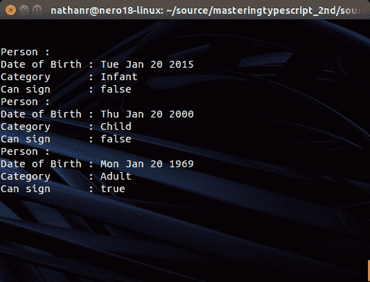

工厂设计模式的输出

*接口、类与继承*

**[ 117 ]**

我们同时了业务需求并实现了一种非常常见的设计模式。如果我们回顾代码，可以发现我们有几个定义良好且简单的类。我们的 `Infant`、`Child` 和 `Adult` 类只关注与其分类相关的逻辑，以及它们是否可以签署合同。我们的 `Person` 抽象基类只关注与 `IPerson` 接口相关的逻辑，而我们的 `PersonFactory` 只关注围绕出生日期的逻辑。此示例说明了面向对象的设计模式和 TypeScript 语言的面向对象特性如何帮助编写良好的、可扩展且可维护的代码。

**总结**

在本章中，我们探索了接口、类和继承等面向对象的概念。我们讨论了接口继承和类继承，并利用对接口、类和继承的知识在 TypeScript 中创建了一个工厂设计模式的实现。在下一章中，我们将查看高级语言特性，包括泛型、装饰器和异步编程技术。

4

装饰器、泛型和异步特性

在类、接口和继承的概念之外，TypeScript 语言引入了许多高级语言特性，以帮助开发健壮的面向对象代码。这些特性包括装饰器、泛型、承诺（promises）以及在处理异步函数时使用 `async` 和 `await` 关键字。装饰器允许在处理类定义时注入和查询元数据，并能够以编程的方式附加到定义类的行为上。泛型提供了一种技术，用于在运行时未知所使用的对象的精确类型的情况下编写程序。承诺提供了以流式方式编写异代码的能力，而 async await 函数将暂停执行，直到异步函数完成。

在编写大型 JavaScript 应用程时，这些语言特性成为程序员工具箱的一部分，并允许在 JavaScript 代码中应用许多设计模式。

本章分为三部分。第一部分涵盖装饰器，第二部分涵盖泛型，第三部分处理使用承诺和 async await 的异步编程技术。在 TypeScript 的早期版本中，这些特性是不可用的，但现在它们是标准了。

*装饰器、泛型和异步特性*

**[ 119 ]**

我们将在本章中涵盖以下主题：

- 装饰器语法

- 装饰器元数据

- 类、方法和参数装饰器

- 泛型语法

- 使用和约束类型 T

- 承诺语法

- Async 和 await

*装饰器、泛型和异步特性*

**[ 121 ]**

但请注意，我们还没有创建该类的实例。我们只是指定了类的定义，向它添加了装饰器，我们的装饰器函数已经被自动被调用。这告诉我们，装饰器是在类定义时应用的，而不是在实例化时应用。为了进一步说明，请考虑以下代码：

```typescript
let instance_1 = new ClassWithSimpleDecorator();
let instance_2 = new ClassWithSimpleDecorator();
console.log(`instance_1: ${instance_1}`);
console.log(`instance_2 : ${instance_2}`);
```

在这里，我们创建了 `ClassWithSimpleDecorator` 的两个实例，分别命名 `instance_1` 和 `instance_2`。然后我们只是向控制台打印了一条消息。这段代码段的输出如下：

`simpleDecorator called.`

`instance_1 : [object Object]`

`instance_2 : [object Object]`

此输出告诉我们，无论创建或使用了多少个相同类的实例，装饰器函数只被调用了一次。装饰器只在类定义时被触发。

**多个装饰器**

多个装饰器可以连续应用到同一个目标上。作为这方面的例子，请考虑以下代码：

```typescript
function secondDecorator(constructor : Function) {
  console.log('secondDecorator called.')
}

@simpleDecorator
@secondDecorator
class ClassWithMultipleDecorators {
}
```

*装饰器、泛型和异步特性*

**[ 122 ]**

在这里，我们创建了另一个名为 `secondDecorator` 的装饰器，它也只是向控制台打印了一条消息。然后我们将 `simpleDecorator`（来自我们之前的代码段）和 `secondDecorator` 装饰器都应用于名为 `ClassWithMultipleDecorators` 的类的定义上。这段代码的输出如下：

`secondDecorator called.`

`simpleDecorator called.`

这段代码的输出告诉了我们关于装饰器的一个有趣点：它们按照定义的反顺序被调用。

装饰器按照它们在代码中出现的顺序进行求值，但按反顺序被调用。

**装饰器工厂**

为了让装饰器能够接受参数，我们需要使用所谓的装饰器工厂。装饰器工厂简单就是一个返回装饰器函数本身的包装函数。作为这方面的例子，请考虑以下代码：

```typescript
function decoratorFactory(name: string) {
  return function (constructor : Function ) {
    console.log(`decorator function called with : ${name}`);
  }
}
```

在这里，我们定义了一个名为 `decoratorFactory` 的函数，它接受一个类型为 `string` 的参数 `name`。该函数简单地返回一个匿名装饰器函数，该函数接受一个类型为 `Function` 的参数 `constructor`。该匿名函数（我们的装饰器函数）向控制台打印 `name` 参数的值。

注意这里我们将装饰器函数封装在 `decoratorFactory` 函数内部。这种对装饰器函数的封装产生了装饰器工厂。只要包装函数返回一个装饰器函数，它就是一个有效的装饰器工厂。我们现在可以如下所示使用我们的装饰器工厂：

```typescript
@decoratorFactory('testName')
class ClassWithDecoratorFactory {
}
```

*装饰器、泛型和异步特性*

**[ 123 ]**

注意我们现在如何向装饰器工厂传递参数，如使用 `@decoratorFactory('testName')` 所示。这段代码的输出如下：

`decorator function called with : testName`

关于装饰器工厂有几点需要注意。首先，装饰器函数本身仍会被 JavaScript 运行时调用，并自动填充参数。其次，装饰器工厂必须返回一个函数定义。最后，为装饰器工厂定义的参数可以在装饰器函数内部使用。

**类装饰器参数**

我们目前看到的示例都是类装饰器。记住，装饰器函数在类被声明时会被 JavaScript 运行时自动调用。到目前为止，我们的装饰器函数都定义为接受一个名为 `constructor` 的参数，其类型为 `Function`。JavaScript 运行时将自动我们填充这个 `constructor` 参数。让我们更详细地研究这个参数。

类装饰器将带有被装饰类的构造函数被调用。作为这方面的例子，请考虑以下代码：

```typescript
function classConstructorDec(constructor: Function) {
  console.log(`constructor : ${constructor}`);
}

@classConstructorDec
class ClassWithConstructor {
}
```

在这里，我们从一个名为 `classConstructorDec` 的装饰器函数开始，它接受一个类型为 `Function` 的参数 `constructor`。该函数的第一行简单地打印 `constructor` 参数的值。然后我们将此装饰器应用于名为 `ClassWithConstructor` 的类。这段代码的输出如下：

`constructor : function ClassWithConstructor() {`

`**}`

`constructor : function ClassWithConstructor()`

此输出告诉我们，装饰器是用被装饰类的构造函数被调用的。

*装饰器、泛型和异步特性*

**[ 124 ]**

*装饰器、泛型和异步特性*

**[ 125 ]**

**属性装饰器**

属性装饰器是可以用类属的装饰器函数。属性装饰器带有两个参数调用：类原型和属性名。作为这方面的例子，请考虑以下代码：

```typescript
function propertyDec(target: any, propertyKey : string) {
  console.log(`target : ${target}`);
  console.log(`target.constructor : ${target.constructor}`);
  console.log(`class name : ` + ${target.constructor.name});
  console.log(`propertyKey : ${propertyKey}`);
}

class ClassWithPropertyDec {
  @propertyDec
  name: string;
}
```

*装饰器、泛型与异步特性*

**[ 126 ]**

在这里，我们可以看到各种 `console.log` 调用的输出。`target` 参数被解析为 `[object Object]`，这简单地表示它是一个对象的原型。`target` 参数的 `constructor` 属性解析为一个名为 `ClassWithPropertyDec` 的函数，这实际上实际上是我们的类构造函数。该构造函数的 `name` 属性带给了我们类本身的名字，而 `propertyKey` 参数则是属性本身的名称。

因此，属性装饰器赋予了我们检查特定属性是否已在类实例上声明的。。

#### 静态属性装饰器

属性装饰器也可以被应用于静态类属性。在我们的代码中，调用语法没有区别，它们与普通属性装饰器相同。然而，在运行时传递的实际参数略有不同。考虑到我们之前定义的属性装饰器 `propertyDec`，考虑当此装饰器应用到下面的静态类属性时会发生什么：

```typescript
class StaticClassWithPropertyDec {
  @propertyDec
  static name: string;
}
```

我们的装饰器中各种 `console.log` 函数的输出如下：

**target : function StaticClassWithPropertyDec() { }**

**target.constructor : function Function() { [native code] }**

**target.constructor.name : Function**

**propertyKey : name**

注意这里的 `target` 参数（如输出的第一行中所打印的）不是一个类原型（如之前所示），而是一个真正的构造函数。那么这个 `target.constructor` 的定义仅仅是一个名为 `Function` 的函数。`propertyKey` 保持不变，即 `name`。

这意味着我们需要对传递作为属性装饰器第一个参数的内容稍加小心。当被装饰的类属性被标记为 `static` 时，target 参数将是类构造函数本身。当类属性不是静态时，target 参数将是类的原型。

*装饰器、泛型与异步特性*

**[ 127 ]**

让我们修改属性装饰器，以在上述两种情况下都能正确识别类的名称，如下：

```typescript
function propertyDec(target: any, propertyKey : string) {
  if(typeof(target) === 'function') {
    console.log(`class name : ${target.name}`);
  } else {
    console.log(`class name : ${target.constructor.name}`);
  }
  console.log(`propertyKey : ${propertyKey}`);
}
```

在这里，我们开始检查 `target` 参数的类型。如果 `typeof(target)` 调用返回 `'function'`，那么我们就知道 `target` 参数是类构造函数，然后可以通过 `target.name` 识别类名。如果 `typeof(target)` 调用没有返回 `'function'`，那么我们就知道 `target` 参数是一个对象原型，你需要通过 `target.constructor.name` 属性来识别类名。

这段代码的输出如下：

**class name : ClassWithPropertyDec**

**propertyKey : name**

**class name : StaticClassWithPropertyDec**

**propertyKey : name**

我们的属性装饰器正确地识别了类的名称，无论它是被用于普通类属性还是静态类属性。

#### 方法装饰器

方法装饰器是用于应用于类中方法的装饰器。方法装饰器由 JavaScript 运行时调用，并带有三个参数。请记住，类装饰器只有一个参数（类原型），而属性装饰器有两个参数（类原型和属性名）。方法装饰器有三个参数——类原型、方法名以及（可选的）方法描述符。第三个参数方法描述符仅在编译为 ES5 及以上版本时才会被填充。

让我们来看一个方法装饰器，如下：

```typescript
function methodDec (target: any,
  methodName: string,
  descriptor?: PropertyDescriptor) {
  console.log(`target: ${target}`);
  console.log(`methodName : ${methodName}`);
  console.log(`target[methodName] : ${target[methodName]}`);
}
```

*装饰器、泛型与异步特性*

**[ 128 ]**

在这里，我们定义了一个名为 `methodDec` 的方法装饰器，它接受我们的三个参数：`target`、`methodName` 和 `descriptor`。注意 `descriptor` 属性被标记为可选。装饰器内部的前两行简单将 `target` 和 `methodName` 的值打印到控制台。然而，注意这个装饰器的最后一行。在这里，我们正将 `target[methodName]` 的值打印到控制台。这将实际的函数定义打印到控制台。

现在我们可以在类上使用这个方法装饰器，如下：

```typescript
class ClassWithMethodDec {
  @methodDec
  print(output: string) {
    console.log(`ClassWithMethodDec.print` + `(${output}) called.`);
  }
}
```

在这里，我们定义了一个名为 `ClassWithMethodDec` 的类。该类有一个 `print` 方法。

*装饰器、泛型与异步特性*

**[ 129 ]**

#### 使用方法装饰器

由于我们在方法装饰器内部可以获取函数定义，我们可以使用该装饰器向类中注入新功能。假设我们想要创建某种审计追踪，并在每当方法被调用时向控制台打印一条消息。考虑以下方法装饰器：

```typescript
function auditLogDec(target: any,
  methodName: string,
  descriptor?: PropertyDescriptor ) {
  let originalFunction = target[methodName];
  let auditFunction = function() {
    console.log(`auditLogDec : overide of ${methodName} called`);
    originalFunction.apply(this, arguments);
  };
  target[methodName] = auditFunction;
}
```

在这里我们定义了一个名为 `auditLogDec` 的方法装饰器。在这个装饰器内部，我们创建一个变量 `originalFunction` 来存储我们要装饰的方法定义。记住 `target[methodName]` 返回函数本身。然后我们创建一个名为 `auditFunction` 的新函数。该函数的第一行向控制台打印一条消息。然而，注意 `auditFunction` 函数的最后一行。我们正在使用 JavaScript 的 `apply` 函数来调用原始函数，传入 `this` 参数和 `arguments` 参数。

`auditLogDec` 装饰器的最后一行是将新函数赋值给原始类函本质上，这是用一个新函数包裹了原始函数，然后调用原始类函数。为了展示其实效果，请考虑下面的类声明：

```typescript
class ClassWithAuditDec {
  @auditLogDec
  print(output: string) {
    console.log(`ClassWithMethodDec.print` + `(${output}) called.`);
  }
}

let auditClass = new ClassWithAuditDec();
auditClass.print("test");
```

在这里，我们创建了一个名为 `ClassWithAuditDec` 的类，并用我们的 `auditLogDec` 方法装饰器装饰了 `print` 函数。`print` 函数简单将 `output` 参数的值打印到控制台。这段代码片段的最后两行是该类的用法示例。然而，注意这段代码的输出：

**auditLogDec : overide of print called**

**ClassWithMethodDec.print(test) called.**

### 装饰器、泛型与异步特性

**[ 130 ]**

从输出结果可以看出，我们的装饰器审计函数 `audit` 在类上 `print` 函数的实际实现之前被调用。以这种方式使用装饰器是一种非侵入式地向类声明中注入额外功能的强大方法。我们创建的任何类都可以通过通过装饰相关的类方法，来轻松地包含审计功能。

### 参数装饰器

我们将涵盖的最后一种类型的装饰器是参数装饰器。参数装饰器用于修饰特定方法的参数。例如，考虑以下代码：

```typescript
function parameterDec(target: any,
methodName : string,
parameterIndex: number) {
  console.log(`target: ${target}`);
  console.log(`methodName : ${methodName}`);
  console.log(`parameterIndex : ${parameterIndex}`);
}
```

在这里，我们定义了一个名为 `parameterDec` 的函数，带有三个参数。`target` 参数将像我们之前看到的那样包含类原型。`methodName` 参数将包含该参数的方法的名称，`parameterIndex` 参数将包含参数的索引。我们可以如下使用这个参数装饰器函数：

```typescript
class ClassWithParamDec {
  print(@parameterDec value: string) {
  }
}
```

在这里，我们有一个名为 `ClassWithParamDec` 的类，它包含一个的 `print` 函数。这个 `print` 函数有一个名为 `value` 的参数，类型为 `string`。我们使用 `parameterDec` 装饰器修饰了该 `value` 参数。注意，使用参数装饰器的语法（`@parameterDec`）与任何其他装饰器相同。这段代码的输出如下：

**target: [object Object]**

**methodName : print**

**parameterIndex : 0**

**[ 131 ]**

从输出中可以看出，`value` 参数的参数索引为 `0`，它是名为 `print` 的方法上的一个参数。我们的目标参数是一个类原型。注意，我们并没有获得关于我们正在修饰的那个参数的任何信息。我们没有被告知它是什么类型，甚至不知道它的名字是什么。因此，参数装饰器真的只能用于发现某个方法上声明了一个参数。

#### 装饰器元数据

TypeScript 编译器还包含了对所谓的装饰器元数据（decorator metadata）的实验性支持。装饰器元数据是在类定义上生成的元数据，用于补充传递给装饰器的信息。此选项称为 `emitDecoratorMetadata`，可以添加到 `tsconfig.json` 文件中，如下：

```json
{
  "compilerOptions": {
    // other options
    "experimentalDecorators": true,
    "emitDecoratorMetadata": true
  },
  "exclude": [
    "node_modules"
  ]
}
```

在启用此编译选项后，TypeScript 编译器将生成与我们的类定义相关的额外信息。为了查看此编译选项的结果，我们需要更仔细生成的生成的 JavaScript。考虑以下参数装饰器和类定义：

```typescript
function metadataParameterDec(target: any,
methodName : string,
parameterIndex: number) {
}

class ClassWithMetaData {
  print(
    @metadataParameterDec
    id: number,
    name: string) : number {
    return 1000;
  }
}
```

**[ 132 ]**

在这里，我们有一个名为 `metadataParameterDec` 的标准参数装饰器，以及一个名为 `ClassWithMetaData` 的类定义。我们正在修饰 `print` 函数的第一个参数。如果我们未使用 `emitDecoratorMetadata` 编译选项，或者将此选项设置为 `false`，我们生成的 JavaScript 将定义如下：

```javascript
var ClassWithMetaData = (function () {
  function ClassWithMetaData() {
  }
  ClassWithMetaData.prototype.print = function (id, name) {
  };
  __decorate([
    __param(0, metadataParameterDec)
  ], ClassWithMetaData.prototype, "print");
  return ClassWithMetaData;
}());
```

这段生成的 JavaScript 为我们的 `ClassWithMetaData` 类定义了一个标准的 JavaScript 闭包。我们感兴趣的代码位于闭包的底部，TypeScript 编译器在那里注入了一个名为 `__decorate` 的方法。我们不关心这个 `__decorate` 方法的完整功能，只需注意到它包含了 `print` 函数的信息，并指示它的名为 `"print"`，并且它在索引 `0` 处有一个参数。

当 `emitDecoratorMetadata` 选项被设置为 `true` 时，生成的 JavaScript 将包含关于这个 `print` 函数的某些额外信息，如下：

```javascript
var ClassWithMetaData = (function () {
  function ClassWithMetaData() {
  }
  ClassWithMetaData.prototype.print = function (id, name) {
  };
  __decorate([
    __param(0, metadataParameterDec),
    __metadata('design:type', Function),
    __metadata('design:paramtypes', [Number, String]),
    __metadata('design:retype', Number)
  ], ClassWithMetaData.prototype, "print");
  return ClassWithMetaData;
}());
```

**[ 133 ]**

注意 `__decorate` 函数现在包含了对一个名为 `__metadata` 的函数的额外调用，该函数被调用了三次。第一次调用使用了特殊的元数据键 `'design:type'`，第二次使用元数据键 `'design:paramtypes'`，第三次调用使用元数据键 `'design:retype'`。这三次函数调用注册了关于 `print` 函数的信息：`'design:type'` 注册了它是一个 `Function`；`'design:paramtypes'` 注册了它有两个参数 `Number` 和 `String`；`'design:retype'` 注册了它的返回类型为 `Number`。

#### 使用元数据

为了使用装饰器元数据，我们需要使用 `reflect-metadata` 库。在深入讨论之前，我们需要安装这个库：

```bash
npm install reflect-metadata
```

然后，我们需要在文件中引入它：

```typescript
import "reflect-metadata";
```

现在我们可以通过 `Reflect.getMetadata` 获取装饰器元数据。考虑以下代码：

```typescript
function parameterDec(target: any,
methodName : string,
parameterIndex: number) {
  console.log(`target: ${target}`);
  console.log(`methodName : ${methodName}`);
  console.log(`parameterIndex : ${parameterIndex}`);
}

class ClassWithParamDec {
  print(@parameterDec value: string) {
  }
}
```

运行这段代码，我们可以获取元数据：

```typescript
const types = Reflect.getMetadata("design:paramtypes", ClassWithParamDec.prototype, "print");
console.log(types);

const type = Reflect.getMetadata("design:type", ClassWithParamDec.prototype, "print");
console.log(type);

const returnType = Reflect.getMetadata("design:retype", ClassWithParamDec.prototype, "print");
console.log(returnType);
```

输出将是：

```text
[Function String]
[function String]
Number
```

此外，我们还可以自定义元数据键。


```typescript
function customMetadataDec(target: any,
methodName : string,
parameterIndex: number) {
  Reflect.defineMetadata("my:key", "some value", target, methodName, parameterIndex);
}

class CustomMetadataClass {
  print(@customMetadataDec value: string) {
  }
}
```

获取自定义元数据：

```typescript
const value = Reflect.getMetadata("my:key", CustomMetadataClass.prototype, "print", 0);
console.log(value);
```

输出：`some value`

## 装饰器、泛型与异步特性

### 泛型语法

作为 TypeScript 泛型语法的示例，让我们编写一个名为 `Concatenator` 的类，它将拼接数组中的值。我们需要确保数组中的每个元素都是相同类型。该类应该处理字符串数组、数字数组，实际上是任何类型的数组。为了实现这一点，我们需要依赖于这些类型共同具有的功能。由于所有的 JavaScript 对象都有一个 `toString` 函数（当运行时需要字符串时就会调用它），我们可以使用这个 `toString` 函数来创建一个泛型类，输出数组中持的所有值。

该 `Concatenator` 类的泛型实现如下：

```typescript
class Concatenator< T > {
  concatenateArray(inputArray: Array< T >): string {
    let returnString = "";
    for (let i = 0; i < inputArray.length; i++) {
      if (i > 0)
        returnString += ",";
      returnString += inputArray[i].toString();
    }
    return returnString;
  }
}
```

我们首先注意到的是类声明的语法，`Concatenator < T >`。`< T >` 语法是用于指示泛型类型的语法，在代码的其他部分，该泛型类型的名称为 `T`。`concatenateArray` 函数也使用了这种泛型类型语法 `Array < T >`。这表示 `inputArray` 参数必须是与最初用于构造此类实例的类型相同的数组。

### 实例化泛型类

要使用此泛型类的实例，我们需要构造该类，并通过 `< >` 语法告诉编译器 `T` 的实际类型。我们可以在此泛型语法中为 `T` 的类型使用任何类型，包括基本类型、类甚至接口。让我们创建该类的几个版本，如下：

```typescript
var stringConcat = new Concatenator<string>();
var numberConcat = new Concatenator<number>();
```

注意我们用于实例化 `Concatenator` 类时使用的语法。在这一段示例代码的第一行中，我们创建了 `Concatenator` 泛型类的实例，并指定在代码中使用 `T` 的每个地方都将泛型类型 `T` 替换为类型 `string`。同样，该示例代码的第二行创建了 `Concatenator` 实例，并指定在代码遇到泛型类型 `T` 的地方都使用类型 `number`。

如果我们使用这个简单的替换原则，那么对于 `stringConcat` 实例（使用字符串的），`inputArray` 参数必须是 `Array<string>` 类型。同样，该泛型类的 `numberConcat` 实例使用数字，因此 `inputArray` 参数必须是数字数组。为了测试这个理论，让我们生成一个字符串数组和一个数字数组，并看看当尝试尝试违反这条规则时编译器会说什么：

```typescript
var stringArray: string[] = ["first", "second", "third"];
var numberArray: number[] = [1, 2, 3];
var stringResult = stringConcat.concatenateArray(stringArray);
var numberResult = numberConcat.concatenateArray(numberArray);
var stringResult2 = stringConcat.concatenateArray(numberArray);
var numberResult2 = numberConcat.concatenateArray(stringArray);
```

我们的前两行定义了变量 `stringArray` 和 `numberArray` 来存储相关的数组。然后我们将 `stringArray` 变量传递给 `stringConcat` 函数——那里没有问题。在我们的下一行中，我们将 `numberArray` 传递给 `numberConcat`——仍然没。

然而，问题出现在我们尝试将数字数组传递给 `stringConcat` 实例时，该实例被配置为只允许字符串。同样，如果我们将字符串数组传递给 `numberConcat` 实例（该实例被配置为只允许数字），TypeScript 将生成错误：

- error: Type 'number[]' is not assignable to type 'string[]'.

- error: Type 'string[]' is not assignable to type 'number[]'.

### 使用 T

当我们在代码中使用 `T` 时，必须仅使用任何类型为 `T` 的对象共有的函数和属性。记住，每当我们使用 `T` 时，我们只在使用 `toString` 函数，而所有的 JavaScript 对象（无论什么类型）都有一个有效的 `toString` 函数。因此，这段泛型代码将顺利编译。让我们通过创建一个自己的类并传递给 `Concatenator` 类来测试这个理论：

```typescript
class MyClass {
  private _name: string;
  constructor(arg1: number) {
    this._name = arg1 + "_MyClass";
  }
}
```

在这里，我们有一个简单的类定义，名为 `MyClass`，它有一个接受数字的 `constructor` 函数。这个构造函数将内部变量 `_name` 设置为参数 `arg1` 的值。

现在让我们创建一个 `MyClass` 实例数组，如下：

```typescript
let myArray: MyClass[] = [
  new MyClass(1),
  new MyClass(2),
  new MyClass(3)
];
```

我们现在可以创建一个我们的泛型 `Concatenator` 类的实例，如下：

```typescript
let myArrayConcatentator = new Concatenator<MyClass>();
let myArrayResult = myArrayConcatentator.concatenateArray(myArray);
console.log(myArrayResult);
```

这并不是我们预期的结果。之所以出现这种输出是因为对象的字符串表示——即不是基础 JavaScript 类型之一的类型——被解析为 `[object type]`。你编写的任何自定�对象都需要重写 `toString` 函数以提供人类可读的输出。我们可以通过在类中提供 `toString` 函数的重写来轻松修复此代码，如下：

```typescript
class MyClass {
  private _name: string;
  constructor(arg1: number) {
    this._name = arg1 + "_MyClass";
  }
  toString(): string {
    return this._name;
  }
}
```

在这里，我们用自己的实现替换了所有 JavaScript 对象都继承的默认 `toString` 函数。在这个函数中，我们简单地返回了私有变量 `_name` 的值。现在运行此示例产生预期的结果：

`1_MyClass,2_MyClass,3_MyClass`

### 限制 T 的类型

在使用泛型时，有时希望将 `T` 的类型限制为特定类型或类型的子集。在这些情况下，我们不希望泛型代码适用于任何类型的对象，而只希望它适用于特定对象的子集。TypeScript 使用继承来配合泛型来实现这一点。

举个例子，让我们为足球俱乐部定义一个接口，如下：

```typescript
enum ClubHomeCountry {
  England,
  Germany
}

interface IFootballClub {
  getName() : string;
  getHomeCountry(): ClubHomeCountry;
}
```

在这里，我们定义了一个名为 `ClubHomeCountry` 的枚举（enum），用于指示足球俱乐部的主场国家。我们的 `IFootballClub` 接口定义了任何 `FootballClub` 类必须实现的两个方法——一个返回足球俱乐部名称的 `getName` 函数，以及一个返回 `ClubHomeCountry` 枚举值的 `getHomeCountry` 函数。

我们现在定义一个抽象基类来实现string此接口，如下：

```typescript
abstract class FootballClub implements IFootballClub {
  protected _name: string;
  protected _homeCountry: ClubHomeCountry;
  getName() { return this._name };
  getHomeCountry() { return this._homeCountry };
}
```

该类名为 `FootballClub`，它通过定义 `getName` 和 `getHomeCountry` 函数实现了 `IFootballClub` 接口，这两个函数分别返回了名为 `_name` 和 `_homeCountry` 的保护变量的值。由于这是一个抽象类，我们需要派生它来创建具体类，如下：

```typescript
class Liverpool extends FootballClub {
  constructor() {
    super();
    this._name = "Liverpool F.C.";
    this._homeCountry = ClubHomeCountry.England;
  }
}

class BorussiaDortmund extends FootballClub {
  constructor() {
    super();
    this._name = "Borussia Dortmund";
    this._homeCountry = ClubHomeCountry.Germany;
  }
}
```

在这里，我们定义了两个类，分别 `Liverpool` 和 `BorussiaDortmund`，派自我们的抽象基类 `FootballClub`。这两个类都只有一个构造函数，用于设置内部的 `_name` 和 `_homeCountry` 属性。

我们现在可以创建一个泛型类，它可以与任何实现 `IFootballClub` 接口的类协作，如下：

```typescript
class FootballClubPrinter< T extends IFootballClub >
implements IFootballClubPrinter< T > {
  print(arg : T) {
    console.log(`${arg.getName()} is ` + `${this.IsEnglishTeam(arg)}` + ` an English football team.`);
  }
  IsEnglishTeam(arg : T) : string {
    if ( arg.getHomeCountry() == ClubHomeCountry.England )
      return "";
    else
      return "NOT"
  }
}
```

在这里，我们定义了一个使用泛型语法的类 `FootballClubPrinter`。注意泛型类型 `T` 现在派生自 `IFootballClub` 接口，如 `< T extends IFootballClub >` 中的 `extends` 关键字所示。在定义泛型类时使用继承限制了该泛型代码可以使用类类型。换句话说，泛型代码内部对类型 `T` 的任何使用将用接口 `IFootballClub` 代替。这意味着泛型代码仅允许在使用 `T` 的地方使用 `IFootballClub` 接口中定义的函数或属性。

这些限制可以在 `print` 函数以及 `IsEnglishTeam` 函数中看到。在 `print` 函数中，参数 `arg` 的类型为 `T`，因此我们能够使用 `arg.getName`，该方法已 `IFootballClub` 接口中定义。在 `print` 函数中，我们还调用了 `IsEnglishTeam` 函数并将参数 `arg` 传递给它。`IsEnglishTeam` 函数使用了 `IFootballClub` 接口中定义的 `getHomeCountry` 函数。

为了说明如何使用这个泛型 `FootballClubPrinter` 类，请考虑以下代码：

```typescript
let clubInfo = new FootballClubPrinter();
clubInfo.print(new Liverpool());
clubInfo.print(new BorussiaDortmund());
```

### 异步语言特性

在本章的这一节中，我们将讨论一些异步语言特性，特别是 promises 以及 `async` 和 `await` 关键字。

本节的代码示例设计用于在 Node 4 及以上版本上运行，该版本提供了 ECMAScript 6 运行时。你可以通过在命令行执行以下命令来确定你运行的 Node 版本：

`node --version`

你需要确保返回值为 v4 或更高版本，以便编译和运行本节中的代码示例。本节所使用的 Node 版本返回的信息为：

`V6.1.0`

### Promises

Promises 是 JavaScript 中用于标准化异步处理的技术。请记住，在 JavaScript 中有很多许多调用函数的情况，但实际结果只有在一段时间后才能收到。这些情况通常发生在你的代码请求某种资源时，例如向 Web 服务器发送请求获取某些 JSON 数据，或从磁盘读取文件。JavaScript 异步处理的标准技术是回调机制（callback）。

不幸的是，当处理大量回调时，我们的代码有时会变得相当复杂且重复。Promises 提供了一种简化这些回调代码的方法。在开始讨论 promises 之前，让我们来看一些典型的回调代码，如下：

`function delayedResponseWithCallback(callback: Function) {`

`function delayedAfterTimeout() {`

`console.log(`delayedAfterTimeout`);`

`callback();`

`}`

`setTimeout(delayedAfterTimeout, 1000);`

`}`

`function callDelayedAndWait() {`

`function afterWait() {`

`console.log(`afterWait`);`

`}`

`console.log(`calling delayedResponseWithCallback`);`

`delayedResponseWithCallback(afterWait);`

`console.log(`after calling delayedResponseWithCallback`);`

`}`

`callDelayedAndWait();`

我们从一个名为 `delayedResponseWithCallback` 的函数开始，它接受一个类型为 `Function` 的单一参数，名为 `callback`。如果我们考虑这个函数的最后一行，会看到它调用了 `setTimeout` 并设置了 1000 毫秒（即一秒）的延迟。这是为了模拟代码中的处理延迟，即一个异步函数。`setTimeout` 函数接受一个函数作为第一个参数，该函数将在一秒后被调用。在这种情况下，我们传递了名为 `delayedAfterTimeout` 的函数，它只是向控制台打印一条消息，然后调用我们的回调函数。

此代码段中的第二个函数名为 `callDelayedAndWait`。如果我们查看这个函数的最后三行，可以看到它正在向控制台打印一条消息，然后调用我们的 `delayedResponseWithCallback` 函数。它将 `afterWait` 函数作为回调传递。最后一行执行了 `callDelayedAndWait()`。代码的输出如下：

`calling delayedResponseWithCallback`

`after calling delayedResponseWithCallback`

`delayedAfterTimeout`

`afterWait`

我们从输出可以看到代码中发生的事件顺序。当执行 `callDelayedAndWait` 函数时，它设置了一个回调函数，然后在控制台打印 `"calling delayedResponseWithCallback"`。随后它调用了 `delayedResponseWithCallback` 函数，然后继续到下一行，打印 `"after calling delayedResponseWithCallback"`。在一秒延迟后，`delayedAfterTimeout` 函数被调用，随后在控制台打印 `"delayedAfterTimeout"`，最后 `afterWait` 函数被调用，在控制台打印 `"afterWait"`。

虽然这类回调函数在 JavaScript 中相当标准，但它们会让我们的代码变得难以阅读和理解，特别是当代码库变得越来越大时。相比之下，Promises 为异步调用提供了流畅的语法。

### Promise语法

Promise 是通过传递一个接受两个回调的函数来创建的对象。第一个回调用于表示成功响应，第二个回调用于表示错误响应。考虑以下函数定义：

`function fnDelayedPromise (`

`resolve: () => void,`

`reject : () => void)`

`{`

`function afterTimeout() {`

`resolve();`

`}`

`setTimeout( afterTimeout, 2000);`

`}`

在这里，我们定义了一个名为 `fnDelayedPromise` 的函数，它接受两个函数作为参数。这些函数名为 `resolve` 和 `reject`，它们都返回 `void`。在 `fnDelayedPromise` 函数体内，我们再次调用了 `setTimeout`（在函数的最后一行）以等待两秒后调用 `resolve` 回调函数。

我们现在可以使用该函数来构造一个 promise 对象，如下：

`function delayedResponsePromise() : Promise<void> {`

`return new Promise<void>(`

`fnDelayedPromise`

`);`

`}`

在这里，我们创建了一个名为 `delayedResponsePromise` 的函数，它返回一个 `new Promise<void>` 对象。在函数体内，我们只是创建并返回一个新的 promise 对象，并将之前定义的 `fnDelayedPromise` 函数作为其构造函数的唯一参数。注意，创建 promise 时使用的类型 `void` 使用了泛型语法（`new Promise<void>`）来指示 promise 返回类型的信息。稍后当我们探索如何从 promise 返回值时，我们将讨论泛型 `<void>` 语法的使用。

虽然这种语法看起来有点复杂，但在实际实践中，这两个函数定义通常组合在单个代码块中。之前的两个片段的目的是强调两个重要的概念。首先，要使用 promise，你必须返回一个新的 promise 对象。其次，promise 对象是通过一个接受两个回调参数的函数构造的。

让我们来看看在实际实践中这两个步骤是如何结合的，如下所示：

```typescript
function delayedPromise() : Promise<void> {
  return new Promise<void>
    (
      (resolve : () => void,
      reject: () => void
    ) => {
      function afterTimeout() {
        resolve();
      }
      setTimeout(afterTimeout, 1000);
    }
  );
}
```

在这里，我们有了一个名为 `delayedPromise` 的函数，它返回一个新的 `Promise<void>` 对象。该函数的第一行构造了 `new Promise` 对象，并传入了一个接受两个回调函数（名为 `resolve` 和 `reject`）的匿名函数定义。代码体在箭头函数 `=>` 之后定义，并包含在匹配的大括号 `{` 和 `}` 中。代码体定义了一个名为 `afterTimeout` 的函数，该函数将在一秒超时后调用。注意，`afterTimeout` 函数调用了 `resolve` 回调函数。

注意，这段代码片段经过仔细格式化，以清晰地显示匹配的括号 `(` 和 `)` 以及匹配的大括号 `{` 和 `}`。记住，使用 promise 必须构造并返回一个 `new Promise` 对象，而 promise 对象的构造函数接受带有两个回调参数的函数（或匿名函数）。

#### 使用 promises

Promises 为处理这些 `resolve` 和 `reject` 函数提供了一种简单的语法。让我们来看看如何使用上一个代码片段中定义的 promises，如下：

```typescript
function callDelayedPromise() {
  console.log(`calling delayedPromise`);
  delayedPromise().then(
    () => { console.log(`delayedPromise.then()`) }
  );
}
callDelayedPromise();
```

在这里，我们定义了一个名为 `callDelayedPromise` 的函数。该函数向控制台打印消息，然后调用我们的 `delayedPromise` 函数。我们正在使用链式语法（fluent syntax）来附加 promise 的 `then` 方法，并定义了一个在 promise 解决时调用的匿名函数。这段代码的输出如下：

**calling delayedPromise**  

**delayedPromise.then()**

这种 promise 链式语法还定义了一个用于错误处理的 `catch` 函数。考虑以下 promise 定义：

```typescript
function errorPromise() : Promise<void> {
  return new Promise<void>
    (
      (resolve: () => void,
      reject: () => void
    ) => {
      reject();
    }
  );
}
```

在这里，我们使用 promise 语法定义了一个名为 `errorPromise` 的函数。注意，在 promise 函数体内部，我们调用的是 `reject` 回调函数而不是 `resolve` 函数。这个 `reject` 函数用于指示错误。现在让我们使用 `catch` 函数来捕获这个错误，如下所示：

```typescript
function callErrorPromise() {
  console.log(`calling errorPromise`);
  errorPromise().then(
    () => { console.log(`no error.`) }
  ).catch(
    () => { console.log(`an error occurred`) }
  );
}
callErrorPromise();
```

在这里，我们定义了一个名为 `callErrorPromise` 的函数，它向控制台打印消息，然后调用 `errorPromise` promise。使用我们的链式语法，我们定义了一个在 `then` 响应中（即在成功时）调用的匿名函数，还定义了一个在 `catch` 响应中（即在错误时）调用的匿名函数。这段代码的输出如下：

**calling errorPromise**  

**an error occurred**

#### 回调与 promise 语法

为了对比我们讨论的这两种技术，让我们来看看回调与 promise 语法的简化版本，如下所示：

我们的标准回调机制如下：

```typescript
function standardCallback() {
  function afterCallbackSuccess() {
    // 执行此代码
  }
  function afterCallbackError() {
    // 发生错误时执行
  }
  // 调用异步函数
  invokeAsync(afterCallbackSuccess, afterCallbackError);
}
```

而我们的 promise 语法如下：

```typescript
function usingPromises() {
  // 调用异步函数
  delayedPromise().then(
    () => {
      // 成功时执行
    }
  ).catch (
    () => {
      // 发生错误时执行
    }
  );
}
```

如我们所见，使用 promises 为处理异步编程引入了链式语法。

### 从 promises 返回值

到目前为止，我们定义的所有 promises 都是 `Promise<void>`。如果我们想返回一个字符串，就需要进行更改。让我们来看看如何返回值，如下：

```typescript
function delayedPromise() : Promise<string> {
  return new Promise<string>
    (
      (resolve: () => void,
      reject: () => void
    ) => {
      function afterTimeout() {
        resolve("delayed_promise");
      }
      setTimeout(afterTimeout, 1000);
    }
  );
}
```

在这里，我们定义了一个名为 `delayedPromise` 的函数，它返回一个新的 `Promise<string>` 对象。该函数的第一行构造了 `new Promise` 对象，并传入了一个接受两个回调函数（名为 `resolve` 和 `reject`）的匿名函数定义。代码体在箭头函数 `=>` 之后定义，并包含在匹配的大括号 `{` 和 `}` 中。代码体定义了一个名为 `afterTimeout` 的函数，该函数将在一秒超时后调用。注意，`afterTimeout` 函数调用了 `resolve` 回调函数。注意，这段代码片段经过仔细格式化，以清晰地显示匹配的括号 `(` 和 `)` 以及匹配的大括号 `{` 和 `}`。记住，使用 promises 必须构造并返回一个 `new Promise` 对象，而 promise 对象的构造函数接受带有两个回调参数的函数（或匿名函数）。

#### 使用 promises

Promises 为处理这些 `resolve` 和 `reject` 函数提供了一种简单的语法。让我们来看看如何使用上一个代码片段中定义的 promises，如下：

```typescript
function callDelayedPromise() {
  console.log(`calling delayedPromise`);
  delayedPromise().then(
    () => { console.log(`delayedPromise.then()`) }
  );
}
```

在这里，我们定义了一个名为 `callDelayedPromise` 的函数。该函数向控制台打印消息，然后调用我们的 `delayedPromise` 函数。我们正在使用链式语法来附加 promise 的 `then` 方法，并定义了一个在 promise 解决时调用的匿名函数。这段代码的输出如下：

**calling delayedPromise**  

**delayedPromise.then()**

这种 promise 链式语法还定义了一个用于错误处理的 `catch` 函数。考虑以下 promise 定义：

```typescript
function errorPromise() : Promise<void> {
  return new Promise<void>
    (
      (resolve: () => void,
      reject: () => void
    ) => {
      reject();
    }
  );
}
```

在这里，我们使用 promise 语法定义了一个名为 `errorPromise` 的函数。注意，在 promise 函数体内部，我们调用的是 `reject` 回调函数而不是 `resolve` 函数。这个 `reject` 函数用于指示错误。现在让我们使用 `catch` 函数来捕获这个错误，如下所示：

```typescript
function callErrorPromise() {
  console.log(`calling errorPromise`);
  errorPromise().then(
    () => { console.log(`no error.`) }
  ).catch(
    () => { console.log(`an error occurred`) }
  );
}
callErrorPromise();
```

在这里，我们定义了一个名为 `callErrorPromise` 的函数，它向控制台打印消息，然后调用 `errorPromise` promise。使用我们的链式语法，我们定义了一个在 `then` 响应中（即在成功时）调用的匿名函数，还定义了一个在 `catch` 响应中（即在错误时）调用的匿名函数。这段代码的输出如下：

**calling errorPromise**  

**an error occurred**

#### 回调与 promise 语法

为了对比我们讨论的这两种技术，让我们来看看回调与 promise 语法的简化版本，如下所示：

我们的标准回调机制如下：

```typescript
function standardCallback() {
  function afterCallbackSuccess() {
    // 执行此代码
  }
  function afterCallbackError() {
    // 发生错误时执行
  }
  // 调用异步函数
  invokeAsync(afterCallbackSuccess, afterCallbackError);
}
```

而我们的 promise 语法如下：

```typescript
function usingPromises() {
  // 调用异步函数
  delayedPromise().then(
    () => {
      // 成功时执行
    }
  ).catch (
    () => {
      // 发生错误时执行
    }
  );
}
```

如我们所见，使用 promises 为处理异步编程引入了链式语法。

注意，调用 `resolve` 或 `reject` 回调函数时，promise 只能返回单个值。如果你需要返回一个包含多个字段的消息，你将需要使用接口，如下：

```typescript
interface IPromiseMessage {
  message: string;
  id: number;
}

function promiseWithInterface() : Promise<IPromiseMessage> {
  return new Promise<IPromiseMessage>
    (
      (resolve: (message: IPromiseMessage) => void,
      reject: (message: IPromiseMessage) => void
    ) => {
      resolve({message: "test", id: 1});
    }
  );
}
```

在这里，我们定义了一个名为 `IPromiseMessage` 的接口，它包含一个 `string` 类型的 `message` 和一个 `number` 类型的 `id`。我们名为 `promiseWithInterface` 的函数现在返回一个 `Promise<IPromiseMessage>`，`resolve` 和 `reject` 回调函数现在使用 `IPromiseMessage` 作为参数类型。我们对 `resolve` 的调用现在必须构造一个具有 `message` 属性和 `id` 属性的对象，以便正确实现 `IPromiseMessage` 接口。通过这种方式使用接口，允许我们的 promise 返回任何类型的数据。

### Async and await

作为处理 promise 时的进一步语言增强，TypeScript 引入了

两个在 ways promise 时协同工作的关键字。这两个关键字是 `async`

和 `await`。`async` 和 `await` 的用法可以通过考虑下面的示例代码来得到最佳的描述：

```typescript
function awaitDelayed() : Promise<void> {
  return new Promise<void> (
    ( resolve: () => void,
    reject: () => void ) =>
    {
      function afterWait() {
        console.log(`calling resolve`);
        resolve();
      }
      setTimeout(afterWait, 1000);
    }
  );
}
```

我们从一个名为 `awaitDelayed` 的标准函数开始，它返回一个 promise，

与我们之前看到的示例类似。注意在 `afterWait` 函数体中，我们在调用

`resolve` 回调函数之前向控制台打印了一条消息。现在让我们来看看如何如何使用 `async` 和 `await` 关键字来使用这个 promise，如下：

```typescript
async function callAwaitDelayed() {
  console.log(`call awaitDelayed`);
  await awaitDelayed();
  console.log(`after awaitDelayed`);
}

callAwaitDelayed();
```

我们从一个名为 `callAwaitDelayed` 的函数开始，它的名前缀是 `async`

关键字。在这个函数内部，我们向控制台打印了一条消息，然后调用之前

定义的 `awaitDelayed` 函数。然而，这次我们在调用

`awaitDelayed` 函数时前面加上了 `await` 关键字。然后我们再次向

控制台打印另一条消息。这段代码的输出如下：

**call awaitDelayed**

**calling resolve**

**after awaitDelayed**

此输出显示，`await` 关键字实际上是在等待异步函数被调用后，才会继续执行程序的运行。这通过自动暂停执行直到 promise 被履行（fulfilled），

产生了一种易于阅读且易于遵循的程序逻辑流。

#### Await errors

我们的 promise 对象在调用异步函数时，通常会同时定义成功条件和错误条件。为了为了在使用 async await 语法时捕获这些错误条件，我们可以使用 `try...catch` 块。为了说明这一点，让我们定义一个返回错误以及错误消息的 promise，如下：

```typescript
function awaitError() : Promise<string> {
  return new Promise<string> (
    ( resolve: (message: string) => void,
    reject: (error: string) => void ) =>
    {
      function afterWait() {
        console.log(`calling reject`);
        reject("an error occurred");
      }
      setTimeout(afterWait, 1000);
    }
  );
}
```

在这里，我们有一个名为 `awaitError` 的函数，它定义并返回一个

`Promise<string>`，并使用了带有秒延迟的标准 promise 语法。这里需要注意的行是在 `afterWait` 函数内部，我们在那里带有错误消息调用了 `reject` promise 回调。我们对应的 `async await` 函数如下：

```typescript
async function callAwaitError() {
  console.log(`call awaitError`);
  try {
    await awaitError();
  } catch (error) {
    console.log(`error returned : ${error}`);
  }
  console.log(`after awaitDelayed`);
}

callAwaitError();
```

在这里，我们有一个名为 `callAwaitError` 的 `async` 函数，它向控制台打印一条消息，然后在 `try...catch` 块中调用 `await awaitError()`。再次注意，当程序逻辑到达异步函数的 `await` 关键字时会暂停，等待函数返回后才会继续执行代码。在这种情况下，对 `await` 的调用将抛出一个错误，该错误会被 `catch(error)` 块捕获。在这个块中，我们将收到的错误消息打印到控制台。这段代码的输出如下：

**call awaitError**

**calling reject**

**error returned : an error occurred**

**after awaitDelayed**

从输出可以看出，程序执行在等待 `await awaitError()` 异步函数返回。当错误发生时，`catch` 块被激活，catch 参数 `error` 持有 promise 内部生成的错误消息。

#### Promise versus await syntax

为了复习 promise 与 async await 语法，让我们并排比较这两种技术。首先是标准 promise 使用的 `then` 和 `catch` 语法：

```typescript
function simplePromises() {
  // invoke async function
  delayedPromise().then(
    () => {
      // execute on success
    }
  ).catch (
    () => {
      // execute on error
    }
  );
  // 这里的代码不会等待异步调用
}
```

#### Await messages

我们关于 async await 要讨论的最后一个主题是处理内部返回的消息。考虑下面的 promise 定义：

```typescript
function asyncWithMessage() : Promise<string> {
  return new Promise<string> (
    ( resolve: (message: string) => void,
    reject: (error: string) => void
  ) =>
    {
      function afterWait() {
        resolve("resolve_message");
      }
      setTimeout(afterWait, 1000);
    }
  );
}
```

在这里，我们定义了一个带有秒延迟返回的标准函数。这里需要注意的代码是 `afterWait` 函数内部对 `resolve` 的调用发送了消息。我们对应的使用它的 async 函数如下：

```typescript
async function awaitMessage() {
  console.log(`calling asyncWithMessage`);
  let message: string = await asyncWithMessage();
  console.log(`message returned: ${message}`);
}

awaitMessage();
```

在这里，我们有一个名为 `awaitMessage` 的 `async` 函数，它向控制台打印一条消息，然后调用 `asyncWithMessage()`。注意我们如何简单地通过定义变量来持有 `await` 调用的返回值来获取消息。然后我们将收到的消息打印到控制台。这段代码的输出如下：

**calling asyncWithMessage**

**message returned: resolve_message**

正如此代码所示，在使用 `await` 关键字时获取并处理返回的消息非常简单。我们只需要定义一个变量来持有 `await` 调用的结果，然后我们就可以访问消息了。

### 编写和使用声明文件

JavaScript 开发中最具吸引力的方面之一是已经发布的外部 JavaScript 库，例如 jQuery、Knockout 和 Underscore。我们已经看到 TypeScript 如何使用“语法糖”来增强我们的 JavaScript 开发体验，但我们如何将这种“糖”应用到现有的 JavaScript 或 JavaScript 库上呢？答案相对简单——声明文件。

声明文件是 TypeScript 编译器使用的一种特殊类型的文件。它以 `.d.ts` 扩展名命名，并在编译步骤被 TypeScript 编译器使用。声明文件类似于其他语言中的头文件；它们简单地描述可用函数和属性的语法和结构，但不提供实现。因此，声明文件实际上不会生成任何 JavaScript 代码。

它们的作用仅仅是提供 TypeScript 与外部库的兼容性，或者填补 TypeScript 不得知的 JavaScript 代码的空白。为了在 TypeScript 中使用任何外部 JavaScript 库，你需要一个声明文件。

在本章中，我们将探索声明文件，展示它们背后的原理，并基于一些现有的 JavaScript 代码构建一个声明文件。如果你熟悉声明文件以及如何使用它们，你可能会对*声明语法参考*部分感兴趣，该部分旨在作为模块定义语法的快速参考指南。由于编写声明文件是 TypeScript 开发中很小的一部分，我们并不经常编写它们。

#### 全局变量

大多数现代网站使用某种服务器引擎来生成网页的 HTML。如果你熟悉 Microsoft 技术栈，就会知道 ASP.NET MVC 是一个非常流行的服务器引擎，用于根据主页面、部分页面和 MVC 视图生成 HTML 页面。如果你是 Node 开发者，你可能正在使用流行的 Node 包来通过模板帮助你构建网页，例如 Jade、Handlebars 或 **Embedded JavaScript (**EJS)**)。

在这些模板引擎中，你有时需要根据服务器端逻辑在 HTML 页面上设置 JavaScript 属性。例如，假设你在数据库中保留了一个联系电子邮件列表，然后通过一个名为 `CONTACT_EMAIL_ARRAY` 的 JavaScript 全局变量将这些内容显示在你的 HTML 页面上。渲染后的 HTML 页面将包含一个 `<script>` 标签，其中包含该全局变量和联系电子邮件。你可能有一些 JavaScript 代码读取此数组，然后在页脚中渲染这些值。下面的 HTML 示例显示了生成的脚本最终看起来如下：

```html
<body>
  <script type="text/javascript">
    var CONTACT_EMAIL_ARRAY = [
      "help@site.com",
      "contactus@site.com",
      "webmaster@site.com"
    ];
  </script>
</body>
```

此 HTML 包含一个 `<script>` 块，并且在这个 `<script>` 块内部，有一些 JavaScript。该 JavaScript 定义了一个名为 `CONTACT_EMAIL_ARRAY` 的变量，其中包含一些字符串。假设我们想编写一些可以读取此全局变量的 TypeScript。考虑以下 TypeScript 代码：

```typescript
class GlobalLogger {
  static logGlobalsToConsole() {
    for(let email of CONTACT_EMAIL_ARRAY) {
      console.log(`found contact : ${email}`);
    }
  }
}

window.onload = () => {
  GlobalLogger.logGlobalsToConsole();
}
```

这段代码创建了一个名为 `GlobalLogger` 的类，带有一个名为 `logGlobalsToConsole` 的静态函数。该函数简单地遍历 `CONTACT_EMAIL_ARRAY` 全局变量，并将数组中的项打印到控制台。

如果我们编译这段 TypeScript 代码，将生成以下错误：

`**error TS2304: Cannot find name 'CONTACT_EMAIL_ARRAY'**`

此错误表明 TypeScript 编译器对名为 `CONTACT_EMAIL_ARRAY` 的变量一无所知。它甚至不知道这是一个数组。由于这段 JavaScript 代码位于任何 TypeScript 代码之外，我们需要像对待外部 JavaScript 一样对待它。

为了解决编译问题并让此 `CONTACT_EMAIL_ARRAY` 变量对 TypeScript 可见，我们需要使用声明文件。创建一个名为 `globals.d.ts` 的文件，并在其中包含以下 TypeScript 声明：

`declare var CONTACT_EMAIL_ARRAY: string [];`

首先注意到的是，我们正在使用一个新的 TypeScript 关键字——`declare`。`declare` 关键字告诉 TypeScript 编译器我们想要定义某个东西的类型，但该对象（或变量或函数）的实现将在运行时解析。我们声明了一个类型为 `string []` 的名为 `CONTACT_EMAIL_ARRAY` 的变量。这个 `declare` 关键字为我们做了两件事：它允在 TypeScript 代码中使用变量 `CONTACT_EMAIL_ARRAY`，它还将该变量强类型化为字符串数组。

#### 结构化数据

让我们为这个简单的电子邮件数组增加一些相关数据。对于这些电子邮件地址中的每一个，假设我们还想包含一些文本，与电子邮件地址一起渲染在页面的页脚中。考虑以下 HTML `<script>` 标签：

```html
<script type="text/javascript">
  var CONTACT_DATA = [
    { DisplayText: 'Help', Email: 'help@site.com' },
    { DisplayText: 'Contace', Email: 'contactus@site.com' },
    { DisplayText: 'Webmaster', Email: 'webmaster@site.com' }
  ];
</script>
```

在这里，我们定义了一个名为 `CONTACT_DATA` 的全局变量，它是一个对象数组。

每个对象都有一个名为 `DisplayText` 的属性和一个名为 `Email` 的属性。如果要在 TypeScript 代码中使用此数组，我们需要在 `globals.d.ts` 声明文件中包含该变量的定义，如下：

```typescript
interface IContactData {
  DisplayText: string;
  Email: string;
}

declare var CONTACT_DATA: IContactData[];
```

在这里，我们从一个名为 `IContactData` 的接口定义开始，用于表示 `CONTACT_DATA` 数组中单个项目的属性。每个项目都有一个类型为 `string` 的 `DisplayText` 属性，以及一个类型为 `string` 的 `Email` 属性。因此，我们的 `IContactData` 接口匹配 `CONTACT_DATA` 数组中单个项目的原始属性。然后我们声明了一个名为 `CONTACT_DATA` 的变量，并将其类型设置为为 `IContactData` 接口的数组。

这允许我们在 TypeScript 中处理 `CONTACT_DATA` 变量。现在，让我们创建一个类来处理这些数据，如下：

```typescript
class ContactLogger {
  static logContactData() {
    for (let contact of CONTACT_DATA) {
      console.log(`DisplayText: ${contact.DisplayText}` + `, Email: ${contact.Email}`);
    }
  }
}

window.onload = () => {
  ContactLogger.logContactData();
};
```

在这里，`ContactLogger` 类有一个名为 `logContactData` 的静态方法。在该方法内部，我们遍历 `CONTACT_DATA` 数组中的所有项目。由于我们使用了 `for...of` 语法，`contact` 变量将被强类型为 `IContactData` 类型，因此它将拥有属性——`DisplayText` 和 `Email`。我们简单地将这些值打印到控制台。这段代码的输出将是：

*编写与使用声明文件*

#### 编写你自己的声明文件

在任何开发团队中，总会有那么时刻，你需要修复 bug 或增强已经用 JavaScript 编写的代码。如果你处于这种情况下，你可能想尝试用 TypeScript 编写新的代码区域，并将它们与现有的 JavaScript 代码集成。然而，要做到这一点，你需要为任何需要重用的现有 JavaScript 编写自己的声明文件。这看起来可能是一项艰巨且耗时的任务，但当你面对这种情况时，只需记住要小步快跑，一次定义一小部分代码。你会惊讶于发现这实际上有多简单。

在本节中，让我们假设你需要集成一个现有的辅助类，该类在许多项目中被重用，经过良好测试并且是开发团队的标准。该类以 JavaScript 闭包的形式实现如下：

```javascript
var ErrorHelper = (function() {
  return {
    containsErrors: function (response) {
      if (!response || !response.responseText)
        return false;
      var errorValue = response.responseText;
      if (String(errorValue.failure) == "true"
        || Boolean(errorValue.failure)) {
        return true;
      }
      return false;
    },
    trace: function (msg) {
      var traceMessage = msg;
      if (msg.responseText) {
        traceMessage = msg.responseText.errorMessage;
      }
      console.log("[" +
        new Date().toLocaleDateString()
        + "] " + traceMessage);
    }
  };
})();
```

这段 JavaScript 代码段定义了一个名为 `ErrorHelper` 的 JavaScript 对象，它包含两个方法。`containsErrors` 方法接收一个名为 `response` 的对象作为参数。然后检查该 `response` 对象是否存在错误。如果满足以下条件，则认为对象没有错误：

- `response` 参数为 `undefined`

- `response.responseText` 为 `undefined`

然而，如果满足以下条件，则会返回错误状态：

- `response.responseText.failure` 属性被设置为字符串值 `"true"`

- `response.responseText.failure` 属性被设置为布尔值 `true`

`ErrorHelper` 闭包还有一个名为 `trace` 的函数，可以使用可以使用字符串或类似于 `containsErrors` 函数预期的 `response` 对象进行调用。

不幸的是，这个 `ErrorHelper` 函数缺少关键的文档说明。传递这两个方法的对象结构是什么样的？它拥有哪些属性？如果没有某种形式的文档，我们被迫通过逆向工程来确定 `response` 对象的结构。如果我们能找到 `ErrorHelper` 类的某些示例用法，这可能帮助我们推测这种结构。

作为 `ErrorHelper` 如何使用的示例，请考虑以下 JavaScript：

```javascript
var failureMessage = {
  responseText: {
    failure: true,
    errorMessage: "Error message here"
  }
};

var successMessage = {
  responseText: {
    failure: "false",
    errorMessage: "Success message"
  }
};
```

此错误表示没有名为 `ErrorHelper` 的有效 TypeScript 类型，尽管我们在 JavaScript 文件中拥有 `ErrorHelper` 的完整。TypeScript 默认会遍历项目中所有的 TypeScript 文件以寻找类定义，但它不会解析 JavaScript 文件。我们需要一个新的 TypeScript 定义文件来正确地编译这段代码。

此定义文件完全没有包含在 HTML 文件中；它仅供 TypeScript 编译器使用，不会生成任何 JavaScript。

如果没有关于我们 `ErrorHelper` 类的有用文档，我们需要完全通过阅读源代码来反向工程出一个 TypeScript 定义文件。这显然不是一种理想的情况，也不建议这样做，但在现阶段，这是我们所能做的。在这些情况下，最好的起点就是查看使用示例，并从那里开始逐步推导。

观察 JavaScript 中 `ErrorHelper` 闭包的用法，有两个关键部分应该包含在我们的声言文件中。第一个是 `containsErrors` 和 `trace` 函数的一组函数定义。第二个是一组接口，用于描述 `ErrorHelper` 闭包所依赖的 `response` 对象结构。让我们从函数定义开始，创建一个名为 `ErrorHelper.d.ts` 的新 TypeScript 文件，包含以下代码：

```typescript
declare module ErrorHelper {
  function containsErrors(response);
  function trace(message);
}
```

此声明文件以我们见过的 `declare` 关键字开头，但使用了新的 TypeScript 关键字——`module`。`module` 关键字后面跟着一个模块名称，在这里是 `ErrorHelper`。这个模块名称必须与我们要描述的 JavaScript 匹配。在我们所有 `ErrorHelper` 的用法中，我们总是为 `containsErrors` 和 `trace` 函数加上闭包名称 `ErrorHelper`。这个模块名称也称为命名空间。如果有另一个名为 `AjaxHelper` 的类也包含了 `containsErrors` 函数，我们将能够通过这些命名空间区分 `AjaxHelper.containsErrors` 和 `ErrorHelper.containsErrors` 函数。

模块声明的第二行表示我们正在定义一个名为 `containsErrors` 的函数，它接收一个参数。该模块声明的第三行表示我们正在定义另一个名为 `trace` 的函数，它也接收一个参数。有了这个定义，我们的 TypeScript 代码将正确编译。

#### 接口

虽然我们已经正确定义了 `ErrorHelper` 闭包用户可以两个函数，但我们缺少关于 `ErrorHelper` 闭包函数的第二个信息——`response` 参数的结构。我们没有对 `containsErrors` 或 `trace` 函数的参数进行强类型定义。在此阶段，TypeScript 代码可以向这两个函数传递任何内容，因为没有 `response` 或 `message` 参数的定义。然而，我们知道这两个函数都在查询特定的参数结构。如果我们传入一个符合符合结构的对象，我们的 JavaScript 代码会导致运行时错误。为了解决这个问题并使我们的代码更稳定，让我们为这些参数定义一个接口：

```typescript
interface IResponse {
  responseText: IFailureMessage;
}

interface IFailureMessage {
  failure: boolean;
  errorMessage: string;
}
```

我们从名为 `IResponse` 的接口开始，它有一个属性 `responseText`，与原始 JavaScript 对象的名字相同。这个 `responseText` 属性被强类型为 `IFailureMessage`。`IFailureMessage` 接口被强类型为具有两个属性——`failure` 类型为 `boolean`，`errorMessage` 类型为 `string`。这些接口正确地描述了 `containsErrors` 和 `trace` 函数的 `response` 参数。我们现在可以这样修改这些函数的原始声明：

```typescript
declare module ErrorHelper {
  function containsErrors(response: IResponse);
  function trace(message: IResponse);
}
```

`containsErrors` 和 `trace` 的函数定义现在将 response 参数强类型为我们之前定义的 `IResponse`。对定义文件的此修改现在将强制 `containsErrors` 或 `trace` 函数的任何后续发送符合 `IResponse` 结构的有效参数。让我们写一些故意错误的 TypeScript 代码看看会发生什么：

```typescript
var anotherFailure: IResponse = {
  responseText: {
    success: true
  }
};
```

我们通过创建一个名为 `anotherFailure` 的变量并指定其类型为 `IResponse` 开始。遗憾的是，`IResponse` 接口没有名为 `success` 的属性，因此我们将生成以下 TypeScript 错误：

无效属性的 TypeScript 错误。从这个冗长但信息丰富的消息可以看出，`IResponse` 接口没有名为 `success` 的属性，因此我们将生成以下 TypeScript 错误：尽管，我们知道这两个函数都在查询特定的参数结构。如果我们传入一个不符合该结构的对象，我们的 JavaScript 代码会导致运行时错误。为了解决这个问题并使我们的代码更稳定，让我们为这些参数定义一个接口：

```typescript
interface IResponse {
  responseText: IFailureMessage;
}

interface IFailureMessage {
  failure: boolean;
  errorMessage: string;
}
```

我们从一个名为 `IResponse` 的接口开始，它有一个属性 `responseText`，与原始 JavaScript 对象的名字相同。这个 `responseText` 属性被强类型为 `IFailureMessage`。`IFailureMessage` 接口被强类型为具有两个属性——`failure` 类型为 `boolean`，`errorMessage` 类型为 `string`。这些接口正确地描述了 `containsErrors` 和 `trace` 函数的 `response` 参数。我们现在可以这样修改这些函数的原始声明：

```typescript
declare module ErrorHelper {
  function containsErrors(response: IResponse);
  function trace(message: IResponse);
}
```

`containsErrors` 和 `trace` 的函数定义现在将 response 参数强类型为我们之前定义的 `IResponse`。对定义文件的此修改现在将强制 `containsErrors` 或 `trace` 函数的任何后续发送符合 `IResponse` 结构的有效参数。让我们写一些故意错误的 TypeScript 代码看看会发生什么：

```typescript
var anotherFailure: IResponse = {
  responseText: {
    success: true
  }
};
```

我们通过创建一个名为 `anotherFailure` 的变量并指定其类型为 `IResponse` 开始。遗憾的是，`IResponse` 接口没有名为 `success` 的属性，因此我们将生成以下 TypeScript 错误：

无效属性的 TypeScript 错误。从这个冗长但信息丰富的消息可以看出，`IResponse` 接口没有名为 `success` 的属性，因此我们将生成以下 TypeScript 错误：尽管，我们知道这两个函数都在查询特定的参数结构。如果我们传入一个不符合该结构的对象，我们的 JavaScript 代码会导致运行时错误。为了解决这个问题并使我们的代码更稳定，让我们为这些参数定义一个接口：

```typescript
interface IResponse {
  responseText: IFailureMessage;
}

interface IFailureMessage {
  failure: boolean;
  errorMessage: string;
}
```

我们从一个名为 `IResponse` 的接口开始，它有一个属性 `responseText`，与原始 JavaScript 对象的名字相同。这个 `responseText` 属性被强类型为 `IFailureMessage`。`IFailureMessage` 接口被强类型为具有两个属性——`failure` 类型为 `boolean`，`errorMessage` 类型为 `string`。这些接口正确地描述了 `containsErrors` 和 `trace` 函数的 `response` 参数。我们现在可以这样修改这些函数的原始声明：

```typescript
declare module ErrorHelper {
  function containsErrors(response: IResponse);
  function trace(message: IResponse);
}
```

`containsErrors` 和 `trace` 的函数定义现在将 response 参数强类型为我们之前定义的 `IResponse`。对定义文件的此修改现在将强制 `containsErrors` 或 `trace` 函数的任何后续发送符合 `IResponse` 结构的有效参数。让我们写一些故意错误的 TypeScript 代码看看会发生什么：

```typescript
var anotherFailure: IResponse = {
  responseText: {
    success: true
  }
};
```

我们通过创建一个名为 `anotherFailure` 的变量并指定其类型为 `IResponse` 开始。遗憾的是，`IResponse` 接口没有名为 `success` 的属性，因此我们将生成以下 TypeScript 错误：

无效属性的 TypeScript 错误。从这个冗长但信息丰富的消息可以看出，`IResponse` 接口没有名为 `success` 的属性，因此我们将生成以下 TypeScript 错误：


# 无效属性的 TypeScript 错误

从这个冗长但信息丰富的消息可以看出，`IResponse` 接口没有名为 `success` 的属性，因此我们将生成以下 TypeScript 错误：尽管，我们知道这两个函数都在查询特定的参数结构。如果我们传入一个不符合该结构的对象，我们的 JavaScript 代码会导致运行时错误。为了解决这个问题并使我们的代码更稳定，让我们为这些参数定义一个接口：

*编写和使用声明文件*

**[ 171 ]**

## 联合类型

假设我们有一个名为 `MergedModule1.d.ts` 的文件，包含以下定义：

```typescript
declare module MergedModule {
  function functionA();
}
```

此外，我们有第二个名为 `MergedModule2.d.ts` 的文件，包含以下定义：

```typescript
declare module MergedModule {
  function functionB();
}
```

TypeScript 编译器将合并这两个模块，就像它们是一个单一定义一样：

```typescript
declare module MergedModule {
  function functionA();
  function functionB();
}
```

这将允许 `functionA` 和 `functionB` 都成为同一个 `MergedModule` 命名空间的有效函数，并允许以下用法：

```typescript
MergedModule.functionA();
MergedModule.functionB();
```

模块还可以与接口、类和枚举合并。然而，类不能与其他类、变量或接口合并。


*编写和使用声明文件*

**[ 172 ]**

## 模块合并

正如我们现在所知的，TypeScript 编译器会自动搜索项目中所有的 `.d.ts` 文件以获取声明文件。如果这些声明文件包含相同的模块名称，TypeScript 编译器将合并这两个声明文件，并使用合并后的模块声明版本。


*编写与使用声明文件*

**[ 173 ]**

### 声明语法参考

在创建声明文件并使用 `module` 关键字时，有许多规则可以用于混合和匹配定义。作为一名 TypeScript 程序员，你通常只会偶尔编写几次模块定义，并且有时需要向现有的声明文件中添加一个新的定义。

因此，本节的设计旨在作为该声明文件语法的快速参考指南，或者说是一份“速查表”。每个部分都包含模块定义规则的描述、一个 JavaScript 语法片段，以及等效的 TypeScript 声明文件语法。

要使用此参考部分，只需从 JavaScript 语法部分匹配你试图模拟的 JavaScript 代码，然后使用等效的定义语法编写你的声明文件。我们将从函数重载语法作为示例开始。

#### 函数重载

声明文件可以包含同一个函数的多个定义。如果同一个 JavaScript 函数可以使用不同的类型进行调用，你将需要为该函数的每个变体声明一个函数重载。

**JavaScript 语法**

```typescript
trace("trace a string");
trace(true);
trace(1);
trace({ id: 1, name: "test" });
```

**声明文件语法**

```typescript
declare function trace(arg: string | number | boolean);
declare function trace(arg: { id: number; name: string });
```

每个函数定义都必须有一个唯一的函数签名。

*编写与使用声明文件*

**[ 174 ]**

### 嵌套命名空间

模块定义可以包含嵌套的模块定义，这些会被转换为嵌套的命名空间。如果你的 JavaScript 使用命名空间，那么你需要定义嵌套模块声明来匹配 JavaScript 命名空间。

**JavaScript 语法**

```typescript
FirstNamespace.SecondNamespace.ThirdNamespace.log("test");
```

**声明文件语法**

```typescript
declare module FirstNamespace {
  module SecondNamespace {
    module ThirdNamespace {
      function log(msg: string);
    }
  }
}
```

#### 类

模块定义中允许类定义。如果你的 JavaScript 使用类或 `new` 运算符，那么这些可实例化的类需要在你的声明文件中进行定义。

**JavaScript 语法**

```typescript
var myClass = new MyClass();
```

**声明文件语法**

```typescript
declare class MyClass { }
```

#### 类命名空间

嵌套模块定义中允许类定义。如果你的 JavaScript 类前面有一个命名空间，那么你将需要先声明嵌套模块来匹配命名空间，然后你可以在正确的命名空间内声明类。

**JavaScript 语法**

```typescript
var myNestedClass = new OuterName.InnerName.NestedClass();
```

*编写与使用声明文件*

**[ 175 ]**

**声明文件语法**

```typescript
declare module OuterName {
  module InnerName {
    class NestedClass {}
  }
}
```

#### 类构造函数重载

类定义可以包含构造函数重载。如果你的 JavaScript 类可以使用不同的类型进行构造，或者带有多个参数，你将需要在声明文件中列出这些变体中的每一个，作为构造函数重载。

**JavaScript 语法**

```typescript
var myClass = new MyClass();
var myClass2 = new MyClass(1, "test");
```

**声明文件语法**

```typescript
declare class MyClass {
  constructor(id: number, name: string);
  constructor();
}
```

#### 类属性

类可以包含属性。你需要在类声明中列出类的每个属性。

**JavaScript 语法**

```typescript
var classWithProperty = new ClassWithProperty();
classWithProperty.id = 1;
```

**声明文件语法**

```typescript
declare class ClassWithProperty {
  id: number;
}
```


*编写与使用声明文件*

**[ 176 ]**

### 类函数

类可以包含函数。你需要在类声明中列出你 JavaScript 类的每个函数，以便 TypeScript 编译器接受对这些函数的调用。

**JavaScript 语法**

```typescript
var classWithFunction = new ClassWithFunction();
classWithFunction.functionToRun();
```

**声明文件语法**

```typescript
declare class ClassWithFunction {
  functionToRun(): void;
}
```

被视为私有的函数或属性不需要通过声明文件暴露，可以简单地省略。

#### 静态属性和函数

类方法和属性可以是静态的。如果你的 JavaScript 函数或属性可以在不需要对象实例的情况下被调用，那么这些属性或函数需要被标记为静态 `static`。

**JavaScript 语法**

```typescript
StaticClass.staticId = 1;
StaticClass.staticFunction();
```

**声明文件语法**

```typescript
declare class StaticClass {
  static staticId: number;
  static staticFunction();
}
```

*编写与使用声明文件*

**[ 177 ]**

### 全局函数

没有前缀的函数可以声明在全局中。如果你的 JavaScript 使用命名空间，这些需要被声明为全局的。

**JavaScript 语法**

```typescript
LogError("test");
```

**声明文件语法**

```typescript
declare global LogError(string);
```

#### 函数签名

函数可以使用签名作为参数。

**JavaScript 语法**

```typescript
describe("test", function () { });
```

**声明文件语法**

```typescript
function describe(name: string, func: () => void);
```

#### 可选属性

类可以包含属性。如果 JavaScript 参数不是强制性的，这些需要在声明中被标记为可选。

**JavaScript 语法**

```typescript
var classWithProperty = new ClassWithProperty();
classWithProperty.id = 1;
```

**声明文件语法**

```typescript
declare class ClassWithProperty {
  id?: number;
}
```

#### 合并函数和模块

带有特定名称的函数可以与模块合并。这意味着如果你的 JavaScript 函数具有属性，你将需要将其与模块合并。

**JavaScript 语法**

```typescript
fnWithProperty(1);
fnWithProperty.name = "test";
```

**声明文件语法**

```typescript
declare function fnWithProperty(id: number);
declare module fnWithProperty {
  name: string;
}
```

*编写与使用声明文件*

**[ 178 ]**

### 总结

在本章中，我们概述了编写和使用自定义声明文件所需的知识。我们讨论了 HTML 中的 JavaScript 全局变量以及如何在 TypeScript 中访问它们。随后我们通过了一个小的 JavaScript 函数并编写了它的声明文件。我们最后通过列出一些模块定义规则、突出显示 JavaScript 语法并展示等效语法来结束本章。

在下一章中，我们将更深入地研究这些声明文件，并涵盖以下主题：

[198]

# 第三方库

如果我们不能复用现有的 JavaScript 库、框架和通用资源，我们的 TypeScript 开发环境将毫无意义。然而，正如我们所看到的，为了在 TypeScript 中使用特定的第三方库，我们首先需要一个声明文件。

在 TypeScript 发布后，Boris Yankov 建立了一个 GitHub 仓库来存放第三方库的 TypeScript 声明文件。该仓库命名为 **DefinitelyTyped** (`https://github.com/borisyankov/DefinitelyTyped`) 迅速流行，目前是获取高质量声明文件的所在地。

DefinitelyTyped 目前拥有超过1500个声明文件，是由来自各地的数百名贡献者随时间构建的。如果我们衡量 TypeScript 在 JavaScript 社区中的成功，那么 DefinitelyTyped 仓库将是 TypeScript 被采用程度的一个良好指标。

在您尝试编写自己的声明文件之前，请检查 DefinitelyTyped 仓库查看是否已有对应的。

在本章中，我们将更深入地研究这些声明文件，并涵盖以下主题：

- 下载声明文件
- 在 Visual Studio 中使用 NuGet
- 使用 Typings
- 使用 Bower
- 使用 npm 和 @types
- 选择 JavaScript 框架
- 使用 TypeScript 使用 Backbone
- 使用 TypeScript 使用 Angular 1
- 使用 TypeScript 使用 ExtJS

## 第三方库

**[ 180 ]**

### 下载定义文件

在 TypeScript 项目中包含定义文件最简单的方法是从 DefinitelyTyped 下载匹配的 `.d.ts` 文件。这只需要找到相关文件并下载其原始内容即可。假设我们想在项目中使用 jQuery。我们已经找到并下载了 jQuery JavaScript 库（v2.2.3），并将其相关文件包含在项目名为 `lib` 的目录中。要下载声明文件，只需浏览到 DefinitelyTyped 上的 `jquery` 目录 (`https://github.com/borisyankov/DefinitelyTyped/tree/master/jquery`)。然后点击 `jquery.d.ts` 文件。这将打开一个带有该文件编辑器视图的 GitHub 页面。在该编辑器视图的菜单栏上，点击 **Raw**（原始）按钮。这将打开文件的副本，然后直接在项目目录结构中右键点击并选择**另存为**。在 **lib** 文件夹下创建一个名为 `typings` 的目录并将 `jquery.d.ts` 文件保存那里。

你的项目文件看起来应该是这样的：

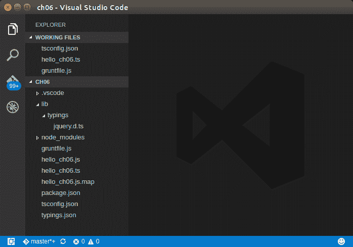

下载了 jquery.d.ts 文件的 Visual Studio Code 项目结构

**[ 181 ]**

我们现在可以修改 `index.html` 文件以包含 `jquery` JavaScript 文件，并开始编写针对 jQuery 库的 TypeScript 代码。我们的 `index.html` 文件需要修改如下：

```html
<html>
<head>
<script src="lib/jquery-2.2.3.min.js"></script>
<script src="app.js"></script>
</head>
<body>
<h1>TypeScript html app</h1>
<p>using jquery</p>
<div id="content">
</div>
</body>
</html>
```

此 `index.html` 文件的第一个 `<script>` 标签现在包含了指向 `jquery-2.2.3.min.js` 的链接，第二个 `<script>` 标签包含了指向 TypeScript 生成的 `app.js` 的链接。打开 `app.ts` TypeScript 文件，删除现有源码，并替换为以下 TypeScript 代码：

```typescript
console.log(`hello app.js`);
$(document).ready( () => {
  $("#content").html(`<h3>Hello TypeScript`);
}
);
```

在这里，我们首先向控制台打印一条消息，然后定义一个匿名函数，在 `document.ready` 的 jQuery 事件时执行该函数。`document.ready` 函数与我们之前使用的 `window.onload` 函数类似，它会在 jQuery 初始化后执行一次。在这个匿名函数的体内，我们简单地使用 jQuery 选择器语法获取名为 `content` 的 DOM 元素的句柄，然后调用 `html` 函数设置其 HTML 值。

**[ 182 ]**

我们下载的 `jquery.d.ts` 文件为我们提供了在 TypeScript 中编译 jQuery 所需的相应模块声明。换句话说，它包含了 `$` 的 TypeScript 定义，以及在使用 `$()` 语法时允许的所有 jQuery 函数。

### 使用 NuGet

与其为项目手动下载每个 `.d.ts` 声明文件，我们也可以使用 NuGet。NuGet 是一个流行的包管理平台，它可以下载所需的外部库，并自动将其包含在你的 Visual Studio 或 WebMatrix 项目中。它可以用于被封装为 DLL 的外部库（如 StructureMap），也可以用于 JavaScript 库和声明文件。NuGet 还可以作为命令行工具使用。

### 使用扩展管理器

要在 Visual Studio 中使用 NuGet 包管理器对话框，请选择主工具栏上的 **Tools**（工具）选项，然后选择 **NuGet Package Manager**（NuGet 包管理器），最后选择 **Manage NuGet Packages for Solution**（管理解决方案的 NuGet 包）。这将调出 NuGet 包管理器对话框。在对话框的左侧，点击 **Browse**（浏览）。NuGet 对话框将查询 NuGet 网站并显示可用包列表。屏幕左上方是一个 **search**（搜索）框。点击 **search** 框并输入 `jquery`，显示 NuGet 中所有可用的 jQuery 包，如下所示所示：


**[ 183 ]**

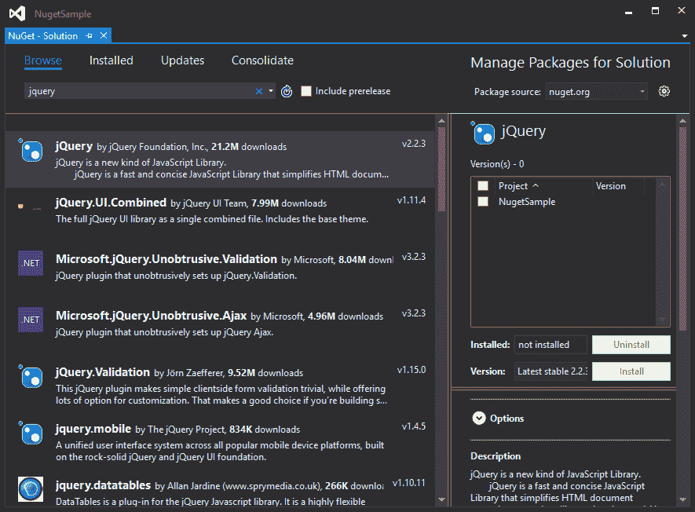

显示 jQuery 查询结果的 NuGet 包管理器对话框

当在 **search results**（搜索结果）面板中选择包时，每个包都会有一个亮起的 **Install**（安装）按钮。选择一个包后，右侧面板将显示有关该 NuGet 包的更多详细信息。注意，项目详情面板还显示了你即将安装的包版本。点击 **Install** 按钮将显示你即将安装的包版本。

*第三方库*

**[ 186 ]**

Typings 提供了与 NuGet 包管理器类似的功能，但它专门为 TypeScript 定义文件设计的。TSD 仅依赖于来自 `DefinitelyTyped` GitHub 仓库的定义文件，而 Typings 则允许从任何来源使用定义文件。

要安装 Typings，请按照如下方式使用 `npm`：

```bash
npm install typings -g
```

在本文写作时，安装的 Typings 版本为 2.0.0。

### 搜索包

Typings 允许使用 `search` 关键字查询包仓库。要搜索 `jquery` 定义文件，请输入以下内容：

```bash
typings search jquery
```

此命令将在 `DefinitelyTyped` 仓库中搜索任何名为 `jquery` 的定义文件。搜索结果显示有大量的定义文件，包括 `chai-jquery` 和 `jasmine-jquery`，如下：

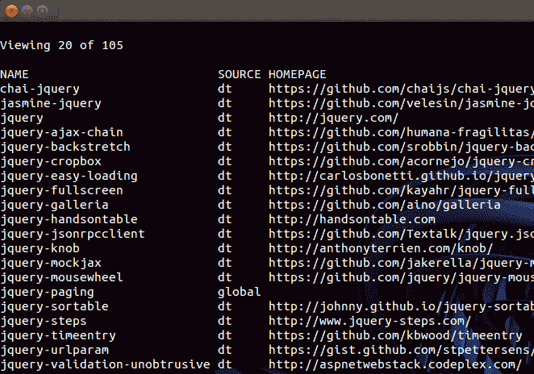

Typings search jquery 的搜索结果


*第三方库*

**[ 187 ]**

搜索命令的输出向我们展示了包的全名、包的来源以及包本身的主页。我们在安装所需的定义文件时，将使用包的来源作为前缀。

### Typings 初始化

在我们开始使用 Typings 下载和安装定义文件之前，我们需要创建一个 `typings.json` 文件，用于记录我们依赖的定义文件。这可以通过简单输入以下内容来实现：

```bash
typings init
```

此命令将创建如下的 `typings.json` 文件：

```json
{
  "name": "using_typings",
  "dependencies": {}
}
```

### 安装定义文件

要安装定义文件——以 `jquery` 为例，请如下方式使用 `install` 关键字：

```bash
typings install dt~jquery --global --save
```

注意，我们在定义文件的名称前加上了字母 `dt~`。这与我们在运行查询时看到的源属性名称相匹配。这允许我们在存在列出的情况下，从 DefinitelyTyped 以外的来源安装定义文件。

`install` 命令会将 `jquery.d.ts` 文件下载到以下目录：

```
\typings\globals\jquery\index.d.ts
```

Typings 将根据运行 `typings install` 时的当前目录创建 `\typings` 目录，因此每当你从命令行使用 Typings 时，请确保你导航到项目中相同的基础目录。

*第三方库*

**[ 188 ]**

Typings 还会创建一个 `globals\index.d.ts` 文件，其中包含指向我们下载的所有定义文件的引用路径。因此，我们的项目只需要包含对此基础 `globals\index.d.ts` 文件的引用，所有其他引用路径将自动更新。

### 安装特定版本

有时，你可能需要在项目中包含定义文件的特定版本，而可能不仅仅是想要最新版本。Typings 允许我们如下所示查看定义文件的各种版本：

```bash
typings view dt~jquery --versions
```

然后，我们可以按照如下方式安装特定版本的定义文件：

```bash
typings install dt~jquery@1.8.0 --global --save
```

### 重装定义文件

使用 Typings 的用处之一是它可以查询其 `typings.json` 文件，并重新安装任何不在项目中的缺失声明文件。如果你将项目源代码分支到不同的目录，或者你正在编写许多具有相同依赖项的项目，这将非常有用。假设你拥有如下所示的 `typings.json` 文件：

```json
{
  "name": "using_typings",
  "dependencies": {},
  "globalDependencies": {
    "backbone": "registry:dt/backbone#1.0.0+20160316155526",
    "marionette": "registry:dt/marionette#0.0.0+20160317120654"
  }
}
```

此 Typings 文件表明我们有两个全局依赖，即 `backbone` 和 `marionette`。如果我们将此复制到新目录，只需输入以下内容即可在新目录中重新安装这些依赖：

```bash
typings install
```


*第三方库*

**[ 189 ]**

即使你正在使用 Visual Studio 和 NuGet 作为开发环境，你可能也想尝试在项目中使用 Typings 而不是 NuGet 来定义文件。


*第三方库*

**[ 190 ]**

### 使用 npm 和 @types

随着 TypeScript 编译器 2.0 发布，我们现在可以使用 npm 安装定义文件。这意味着为了安装项目依赖和包含定义文件，我们的工具集没有区别。例如，要安装 Underscore 库作为项目依赖，我们会：

```bash
npm install underscore --save
```

而要安装 Underscore 的定义文件，我们现在可以输入：

```bash
npm install @types/underscore --save
```

注意 `npm` 命令中使用的 `@types` 前缀。这种特殊语法指示 npm 安装 Underscore 的定义文件，并且是一种微妙但易记的语法。这种通过 npm 包含类型定义的机制已被 TypeScript 未来采用为标准机制。

### 使用第三方库

在本章中，我们将开始探索一些流行的第三方 JavaScript 库、它们的定义文件，以及如何为这些框架编写兼容的 TypeScript。我们将比较 Backbone、Angular（版本 1）和 ExtJS，它们都是构建丰富客户端 JavaScript 应用程序的框架。在讨论过程中，我们将看到某些框架与 TypeScript 语言及其特性高度兼容，某些部分兼容，而有些的兼容性很低。

在下一章中，我们将探索一些专门为 TypeScript 编写的、或者 TypeScript 编译器已进行修改以支持它们的一些第三方 JavaScript 库。然而，本章的剩余部分将关注专门为 JavaScript 设计的标准第三方库。

## 第三方库

**[ 191 ]**

### 选择 JavaScript 框架

选择一个 JavaScript 框架或库来开发**单页应用**（**SPA**）是一项困难且有时令人生畏的任务。似乎每隔几个月就会出现一个新的框架，承诺用更少的代码实现越来越多的功能。为了帮助开发者比较这些框架并做出明智的选择，Addy Osmani 写了一篇优秀的文章，题为《穿越 JavaScript MVC 丛林之旅》（*Journey Through the JavaScript MVC Jungle*）。(`http://www.smashingmagazine.com/2012/07/27/journey-through-the-javascript-mvc-jungle/`)。从本质上说，他的建议很简单：这是一个个人选择，因此请尝试一些框架，看看哪个最符合你的需求、编程思维以及现有的技能组合。Addy 发起的 *TodoMVC* 项目（`http://todomvc.com`）在许多 MV* JavaScript 框架中实现了同一个应用程序，做得非常出色。这确实是一个深入研究完全运行的应用程序并亲自比较不同框架编码技术和风格的参考网站。

再次，取决于你在 TypeScript 中使用的 JavaScript 库，你可能需要以特定的方式编写 TypeScript 代码。在选择框架时请记住这一点，如果它很难与 TypeScript 配合，那么你可能查看另一个集成更好的框架更好。如果在 TypeScript 中与该框架工作既简单又自然，那么你的生产力和整体开发体验将好得多。

在本节中，我们将查看一些流行的 JavaScript 库及其声明文件，并看看如何编写兼容的 TypeScript。需要记住的关键点是 TypeScript 生成的是 JavaScript——所以如果你在使用用第三方库时挣扎，请打开生成的 JavaScript，看看 TypeScript 输出的 JavaScript 代码看起来什么样。如果生成的 JavaScript 与该库文档中的 JavaScript 代码示例匹配，那么你的路就走对了。如果不是，你可能需要修改你的 TypeScript，直到编译后的 JavaScript 开始与示例匹配。

在尝试为第三方 JavaScript 框架编写 TypeScript 代码时——特别是当你根据 JavaScript 文档进行工作时——你的初步尝试可能只是反复尝试。本章的其余部分将展示三个不同的库如何需要不同的 TypeScript 写方式。

**[ 192 ]**

### Backbone

Backbone 是一个流行的 JavaScript 库，它通过提供模型（models）、集合（collections）和视图（views）等为 Web 提供结构。Backbone 自 2010 年起一直存在，并赢得了大量的关注者，许多商业网站使用该框架。根据 `Inworld.com` 的说法，GitHub 上有超过 1600 个 Backbone 相关项目，评分超过三星，这意味着它拥有庞大的扩展和相关库生态系统。

让我们快速查看用 TypeScript 编写的 Backbone。

可以使用 Bower 和 Typings 如下设置 Backbone 环境：

```bash
bower install backbone --save
typings install dt~backbone-global --global --save
typings install dt~jquery --global --save
typings install dt~underscore --global --save
```

#### 在 Backbone 中使用继承

从 Backbone 文档中，我们找到了在 JavaScript 中创建 `Backbone.Model` 的示例如下：

```javascript
var NoteModel = Backbone.Model.extend
({
  initialize: function() {
    console.log("NoteModel initialized.");
  },
  author: function() {},
  coordinates : function() {},
  allowedToEdit: function(account) {
    return true;
  }
});
```

这段代码展示了 Backbone 在 JavaScript 中的典型用法。我们首先创建一个名为 `NoteModel` 的变量，它继承（或派生自）`Backbone.Model`。可以通过 `Backbone.Model.extend` 语法看到。Backbone 的 `extend` 函数使用 JavaScript 对象表示法在外层大括号 `{ ... }` 内定义一个对象。在这个示例中，`NoteModel` 对象有四个函数：`initialize`、`author`、`coordinates` 和 `allowedToEdit`。

当创建此类的新实例时，将调用 `initialize` 函数。在我们的示例中，`initialize` 函数向控制台记录消息以表示该函数已被调用。`author` 和 `coordinates` 函数在此阶段是空的，只有 `allowedToEdit` 函数在实际操作——`return true`。

如果我们简单地将前面的 JavaScript 复制粘贴到 TypeScript 文件中，生成以下编译错误：

```text
error TS2341: Property 'extend' is private and only accessible within class 'Model'.
```

在与第三方库以及来自 DefinitelyTyped 的定义文件工作时，我们的首要任务应该是查看定义文件对我们的 TypeScript 代码期望什么。毕竟，JavaScript 文档说我们应该像所示那样使用 `extend` 方法，那么为什么这个定义文件会导致错误呢？如果我们打开 `backbone-global\index.d.ts` 文件，然后搜索 `Model` 类的定义，我们将发现编译错误的原因：

```typescript
class Model extends {
  /**
   * 不要使用，优先使用 extend 功能。
   */
  static extend(properties: any, classProperties?: any): any;
}
```

这表明 `extend` 函数被定义为 `static`（静态），因此它在 `Model` 类之外不可用。然而，这似乎与我们看到的 JavaScript 示例相矛盾。但请注意，我们可以使用 `extends` 关键字来派生类：

```typescript
class NoteModel extends Backbone.Model implements INoteModel {
  initialize() {
    console.log("TypeScript initialize called.");
  }
  author() {}
  coordinates() {}
  allowedToEdit(account) {
    return true;
  }
}
```

我们的 Backbone 示例现在可以正确编译并运行。使用这两个版本中的任何一个，我们都可以在 HTML 页面中包含以下脚本创建 `NoteModel` 对象的实例：

```html
<script>
$(document).ready(function() {
  console.log('document.ready');
  var noteModel = new NoteModel();
});
</script>
```

Backbone 的所有核心对象在设计都考虑了继承。这意味着在 TypeScript 中创建新的 Backbone 集合、视图和路由器将使用相同的 `extends` 语法。因此，Backbone 与 TypeScript 非常契合，因为我们可以使用自然的 TypeScript 继承语法来创建新的 Backbone 对象。

#### 使用接口

既然 Backbone 允许我们使用 TypeScript 继承来创建对象，我们也可以同样地在任何 Backbone 对象上使用 TypeScript 接口。为前面的 `NoteModel` 类提取接口如下：

```typescript
interface INoteModel {
  initialize();
  author();
  coordinates();
  allowedToEdit(account);
}
```

*第三方库*

**[ 195 ]**

我们现在可以更新 `NoteModel` 类定义，如下所示实现该接口：

```typescript
class NoteModel extends Backbone.Model implements INoteModel {
  // existing code
}
```

我们的类定义现在实现了 `INoteModel` TypeScript 接口。这个简单的更改保护了我们的代码不被无意中修改，同时也开启了在标准面向对象设计模式中与核心 Backbone 对象工作的能力。如果我们需要，可以应用 `第 3 章`——*接口、类与继承*——中描述的工厂模式（Factory Pattern），来返回特定类型的 Backbone 模型，或者说返回任何其他 Backbone 对象。

#### 使用泛型语法

Backbone 的声明文件也为某些类定义添加了泛型语法。这在为 Backbone 编写 TypeScript 代码时带来了进一步的强类型优势。Backbone 集合（不出乎意地）包含了一个 Backbone 模型的集合，允许我们按照如下方式在 TypeScript 中定义集合：

```typescript
class NoteCollection extends Backbone.Collection<NoteModel> {
  model = NoteModel;
  //model: NoteModel;
  //model: { new () : NoteModel }; // ok
}
```

在这里，我们有一个派自（或 `extends`）`Backbone.Collection` 的 `NoteCollection`，但使用泛型语法限制集合仅处理类型为 `NoteModel`的对象。这意味着任何标准集合函数（如 `at()` 或 `pluck()`）都将强类型地返回 `NoteModel` 模型，进一步增强了我们的类型安全和智能提示（Intellisense）。

注意在第二行中为集合类的内部 `model` 属性分配类型时使用的语法。我们不能使用标准的 TypeScript 语法 `model: NoteModel`，因为会导致编译错误。我们需要将 `model` 属性分配给类定义，如 `model=NoteModel` 语法所示，或者我们可以使用如最后一行所示的 `{ new(): NoteModel }` 语法。

*第三方库*

**[ 196 ]**

#### 使用 ECMAScript 5

Backbone 还允许我们使用 ECMAScript 5 能力为 `Backbone.Model` 类定义获取器（getters）和设置器（setters），如下：

```typescript
interface ISimpleModel {
  Name: string;
  Id: number;
}

class SimpleModel extends Backbone.Model
implements ISimpleModel {
  get Name()
  { return this.get('Name'); }
  set Name(value: string)
  { this.set('Name', value); }
  get Id()
  { return this.get('Id'); }
  set Id(value: number)
  { this.set('Id', value); }
}
```

在这里，我们定义了一个具有两个属性的接口 `ISimpleModel`。然后定义了一个派自 `Backbone.Model` 并实现 `ISimpleModel` 接口的 `SimpleModel` 类。然后我们为 `Name` 和 `Id` 属性拥有 ES5 获取器和设置器。Backbone 使用类属性存储模型值，因此我们的获取器和设置器只是调用 `Backbone.Model` 的底层 `get` 和 `set` 方法。

#### Backbone TypeScript 兼容性

如所示，Backbone 允许我们在代码中使用所有的 TypeScript 语言特性。我们可以使用类、接口、继承、泛型甚至 ECMAScript 5 属性。我们所有的类都派自基础 Backbone 对象。这使得 Backbone 成为一个用于 TypeScript 构建 Web 应用的高度兼容性库。我们将在后面的章节中探索更多的 Backbone 对象模型。

*第三方库*

**[ 197 ]**

### Angular

AngularJS 版本 1（或简称 Angular 1）是一个非常流行的 JavaScript 框架，由 Google 构建并发布。然而，它已经被 Angular 2 取代，Angular 2 使用 TypeScript 作为首选语言，将在下一节介绍。本节将讨论使用 TypeScript 编写 Angular 1 代码，作为一个半兼容第三方库的示例。

Angular 在构建 JavaScript SPA 方面采用了完全不同的方法，引入了运行的 Angular 应用程序理解的 HTML 语法。这为应用程序提供了双向数据绑定能力，自动同步模型、视图和 HTML 页面。Angular 还提供了一种**依赖注入**（**DI**）机制，并使用服务为你的视图和模型提供数据。

让我们看看 Angular v1.5.7 教程示例，位于*第 2 步*，我们开始构建一个名为 `PhoneListController` 的控制器。教程提供的示例显示如下 JavaScript：

```javascript
var phonecatApp = angular.module('phonecatApp', []);
phonecatApp.controller('PhoneListController', function ($scope)
{
  $scope.phones = [
    {'name': 'Nexus S',
    'snippet': 'Fast just got faster with Nexus S.'},
    {'name': 'Motorola XOOM™ with Wi-Fi',
    'snippet': 'The Next, Next Generation tablet.'},
    {'name': 'MOTOROLA XOOM™',
    'snippet': 'The Next, Next Generation tablet.'}
  ];
});
```

前面的代码片段是典型的 Angular 1 JavaScript 语法。我们首先创建一个名为 `phonecatApp` 的变量，通过调用全局实例 `angular` 上的 `module` 函数将其注册为 Angular 模块。`module` 函数的第一个参数是 Angular 模块的全局名称，空数组是通过 Angular 依赖注入程序注入的其他模块的占位符。

然后我们调用 `controller` 函数，在新的创建的 `phonecatApp` 上带有两个参数。第一个参数是控制器的全局名称，第二个参数是函数。

*第三方库*

**[ 200 ]**

`GetPhonesSuccess` 函数在实现中使用了 `this.myScope` 变量。这就是为什么我们需要将初始 `$scope` 参数存储在一个内部变量中。

我们从这段代码中观察到的另一点是，`myScope` 变量被类型化名为 `IScope` 的接口，该接口需要定义如下：

```typescript
interface IScope {
  phones : IPhone[];
}

interface IPhone {
  name: string;
  snippet: string;
}
```

这个 `IScope` 接口仅包含一个 `IPhone` 类型对象的数组（请原谅这个接口的名字不太理想，它也可以包含 Android 手机）。

这意味着在处理 `$scope` 对象时，我们没有标准的接口或 TypeScript 类型可以使用。根据其本质属性，`$scope` 参数的类型会根据 Angular 运行时何时以及何地调用它而改变，因此我们需要定义一个 `IScope` 接口，并将 `myScope` 变量强类型为该接口。

`PhoneListController` 类构造函数中另一个值得注意的有趣点是 `$http` 参数的类型。它被设置为 `ng.IHttpService` 类型。这个 `IHttpService` 接口可以在 Angular 的声明文件中找到。为了在对 `$scope` 或 `$http` 等 Angular 变量使用 TypeScript，我们需要在这些变量上的任何可用 Angular 函数之前，在我们的声明文件中找到匹配的接口。

构造函数中最后一个需要注意的点是名为 `Phone` 的最后一个参数。它没有分配 TypeScript 类型，因此变成了 `any` 类型。让我们快速看看 `Phone` 服务的实现：

```typescript
var phoneServices = angular.module(
  'phoneServices', ['ngResource']);
phoneServices.factory('Phone',
[ '$resource', ($resource) => {
  return $resource('phones/:phoneId.json', {}, {
    query: { method: 'GET',
    params: {
      phoneId: 'phones'
    },
    isArray: true
    }
  });
});
```

这段代码的第一行再次创建了一个名为 `phoneServices` 的全局变量，使用了 `angular.module`。然后我们调用了 `phoneServices` 上的 `factory` 函数来定义 `Phone` 资源。此 `factory` 函数使用名为 `'Phone'` 的字符串来定义 `Phone` 资源，并使用 Angular 的依赖注入语法。

通过查看代码，我们可以发现无法为 Angular 轻松创建标准的 TypeScript 类。无法在这些 Angular 类上使用标准的 TypeScript 接口或继承。

### Angular 兼容性

使用 TypeScript 编写 Angular 代码时，某些实例可以使用类，但必须依赖底层的 `module` 和 `factory` 函数来定义对象。此外，当使用 `$http` 或 `$resource` 等标准 Angular 服务时，指定声明文件。因此，我们可以 Angular 描述为与 TypeScript 有中等兼容性。

### 继承 – Angular 与 Backbone

继承是面向对象编程的一个非常强大的特性，在使用 JavaScript 框架时也是一个基本概念。使用 Angular 控制器依赖于某些可用特性。然而，我们看到每个框架都以不同的方式实现继承。

由于 JavaScript 没有继承的概念，每个框架都需要一种实现方法。在 Backbone 中，这种继承是通过 `extend` 函数实现的。正如我们看到的，TypeScript 的 `extends` 关键字遵循类似于 Backbone 的实现，允许框架与语言契合。

*第三方库*

**[ 203 ]**

### 在 ExtJS 中创建类

ExtJS 是一个以自己的方式运行 JavaScript 库。如果我们对 Backbone、Angular 和 ExtJS 进行分类，可能会说 Backbone 是一个高度兼容的 TypeScript 库。换句话说，TypeScript 中的类和继承语言特性与 Backbone 高度兼容。在这种情况下，Angular 是部分兼容的库，某些 Angular 对象符合 TypeScript 语言特性。另一方面，ExtJS 是一个极低兼容的库，几乎没有适用于该库的 TypeScript 语言特性。

让我们来看用 TypeScript 编写的 ExtJS 4.0 示例。考虑以下代码：

```typescript
Ext.application(
{
  name: 'SampleApp',
  appFolder: '/code/sample',
  controllers: ['SampleController'],
  launch: () => {
    Ext.create('Ext.container.Viewport', {
      layout: 'fit',
      items: [{
        xtype: 'panel',
        title: 'Sample App',
        html: 'This is a Sample Viewport'
      }]
    });
  }
}
);
```

到目前，我们只浅尝了 Angular 和 Backbone 的 TypeScript 语法表面。这次练习的目的是尝试理解如何在这两个第三方框架内部使用 TypeScript。

确保访问 `http://todomvc.com`，并查看用 TypeScript 编写的 Angular 和 Backbone Todo 应用的源码。它们可以在示例部分的 **Compile-to-JS** 标签中找到。这些运行代码结合这些网站的文档，在尝试使用 Angular 或 Backbone 等第三方库编写 TypeScript 语法时将是宝贵的资源。

### ExtJS

ExtJS 是一个流行的 JavaScript 库，拥有各种组件、网格、图表组件、布局组件等。随着 4.0 的发布，ExtJS 将模型-视图-控制应用程序架构引入了它们的库中。虽然它对开源开发是免费，但商业使用需要许可。ExtJS 在构建 Web 替代品的开发团队中非常流行，因为无论在哪个浏览器中，它的外观和感受都是相同的，而且它几乎不需要 CSS 或 HTML。

然而，尽管面临巨大的社区压力，ExtJS 团队尚未发布官方的 TypeScript 定义文件。幸运的是，更广泛的社区提供了帮助，从 Mike Aubury 开始。他编写了一个实用程序从 ExtJS 文档生成声明文件（`https://github.com/zz9pa/extjsTypescript`）。这项工作是否影响了 DefinitelyTyped 上 ExtJS 定义的当前版本有待观察，但 Mike Aubury 的原始定义与 brian28 的当前版本非常相似。

## 第三方库

**[ 204 ]**

我们接着定义了一个 `launch` 属性，它是一个匿名函数。该 `launch` 函数随后会使用全局 `Ext` 实例上的 `create` 函数来创建一个类。`create` 函数使用 `Ext.container.Viewport` 名称来创建一个 `Ext.container.Viewport` 类的实例，该类具有 `layout` 和 `items` 属性。`layout` 属性只能包含一组特定的值，例如 `'fit'`、`'auto'` 或 `'table'`。`items` 数组包含了进一步的 ExtJS 特有对象，这些对象的创建是根据其 `xtype` 属性的指示而决定的。

ExtJS 是那些并不直观的库之一。作为一名程序员，你可能需要打开一个浏览器窗口显示该库的文档，并使用它来确定每种可用类中每个属性的含义。在之前的示例中还有许多“魔术字符串”（magic strings）；如果我们错写了 `'Ext.container.Viewport'` 字符串，`Ext.create` 函数就会失败，或者仅仅是忘记在正确的地方将其大写。对于 ExtJS 来说，`'viewport'` 与 `'ViewPort'` 是不同的。记住，我们在 TypeScript 中解决魔术字符串的方案之一是使用枚举（enums）。遗憾的是，当前版本的 ExtJS 声明文件没有为这些类类型提供一组枚举。

### 使用类型转换

然而，我们可以使用 TypeScript 语言的类型转换（type casting）功能来帮助编写 ExtJS 代码。如果我们知道正在尝试创建的是什么种类型的 ExtJS 对象，就可以将 JavaScript 对象强制转换为该类型，然后使用 TypeScript 检查我们正在使用的属性对于该类型的 ExtJS 对象是否正确。为了帮助理解这个概念，让我们只考虑 `Ext.application` 的外部定义。在剥离内部代码后，对 `Ext` 全局对象上的 `application` 函数的调用将简化为：

```javascript
Ext.application(
{
  // Ext.application 的属性
  // 设置在这个 JavaScript
  // 对象代码块中
}
);
```

**[ 205 ]**

通过 TypeScript 声明文件、类型转换以及大量的 ExtJS 文档，我们知道内部的 JavaScript 对象应该是 `Ext.app.IApplication` 类型，因此我们可以按照如下方式转换此对象：

```typescript
Ext.application(
<Ext.app.IApplication> {
  // 此 JavaScript 代码块被强
  // 类型为 Ext.app.IApplication
}
);
```

此代码段的第二行现在使用了 TypeScript 类型转换语法，将大括号 `{ }` 之间的 JavaScript 对象转换为 `Ext.app.IApplication` 类型。这为我们提供了强类型检查和智能提示（Intellisense），如下截图所示：

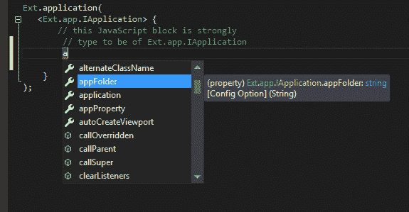

用于 Ext JS 配置块的 Visual Studio 智能提示。

类似地，这些显式类型转换也可以用于任何用于创建 ExtJS true JavaScript 对象。目前 Definitely Typed 上的 ExtJS 声明文件在其对象定义使用的名称与 ExtJS 文档使用的名称相同，因此找到正确的类型应该简单。

上述使用显式类型转换的技术几乎是我们可以在与 ExtJS 库配合时使用的唯一 TypeScript 语言功能了，但这仍然突显了对象的强类型如何协助我们的开发体验，使我们的代码更加健壮并能够防止错误。

**[ 206 ]**

### ExtJS 特定的 TypeScript 编译器

如果你经常使用 ExtJS，那么你可能想看看 Gareth Smith、Fabio Parra dos Santos 以及他们的团队在 `https://github.com/fabioparra/TypeScript` 所做的工作。该项目是 TypeScript 编译器的分支，它可以从标准的 TypeScript 类生成 ExtJS 类。使用此版本的编译器改变了普通 ExtJS 开发的局面，允许使用自然的 TypeScript 类语法、通过 `extends` 关键字使用继承，以及自然的模块命名，而不需要魔术字符串。该团队的工作表明，由于 TypeScript 编译器是开源的，它可以被扩展和修改以以特定方式生成 JavaScript，或者针对特定的库。向 Gareth、Fabio 和他们的团队在这一领域所做的开创性工作致敬。

### 总结

在本章中，我们回顾了第三方 JavaScript 库以及如何在 TypeScript 应用程序中使用它们。我们首先查看了在项目中包含社区发布的 TypeScript 声明文件的各种方法，从下载原始文件到使用如 NuGet 和 Typings 等包管理器。然后，我们查看了三种类型的第三方库，并讨论了如何将这些库与 TypeScript 集成。我们探索了 Backbone（可以被归类为高度兼容的第三方库）、Angular 1（部分兼容的库）以及 ExtJS（最小兼容的库）。我们看到了 TypeScript 语言的各种功能如何与这些库共存，并展示了在这些情况下 TypeScript 等效代码的样貌。在下一章中，我们将查看 TypeScript 特定的库。

# TypeScript 兼容框架

语言史上的一个转折点是微软和 Google 团队宣布他们一直在合作开发 AngularScript。在几个月的协作后，宣布所有必要的功能将被吸收到 TypeScript 中，并且 Angular 将用 TypeScript 编写。这意味着 Angular 并不是第一个采用该语言的框架，许多第三方库也提供了完全支持。

在本章中，我们将查看一些具有完全集成的流行框架。我们将通过构建相同的示例应用程序来比较每个框架使用的语法。通过这种方式，我们将获得一个对比，展示每个框架是如何解决相同的设计问题的。在开始之前，我们将泛泛讨论什么是 MVC 框架，以及它如何帮助我们的开发体验。

我们将涵盖以下主题：

- 什么是 MVC 框架？
- 使用 MVC 框架的益处
- 示例应用程序的概述
- 使用 Backbone
- 使用 Aurelia
- 使用 Angular 2
- 使用 ReactJs

### 什么是 MVC？

MVC 的缩写代表 Model-View-Controller（模型-视图-控制器）。它是一种辅助设计和实现用户界面的编程设计模式。用户界面本质上是事件驱动的，换句话说，我们在屏幕上显示内容，然后等待用户执行某些操作，这会产生某种事件。该事件可能是显示图表、隐藏面板或注销我们的应用程序。遗憾的是，应用程序用户将遵循的精确事件序列是无法完全预定的。正是基于事件的范式使得用户界面设计和编程比遵循定义步骤的程序要复杂得多。

用户界面的另一个复杂度在于尝试使组件可复用。这意味着单个组件（例如菜单栏）可以在多个页面中复用。组件复用带来了自己的挑战，通常围绕着哪个组件负责响应哪些事件，以及当多个组件对同一个事件感兴趣时它们之间如何通信。

*TypeScript 兼容框架*

**[ 209 ]**

### 模型 (Model)

MVC 中的模型（Model）代表数据。这通常是一个非常简单的**纯旧 JavaScript 对象 (POJO)**，它具有某些属性。作为模型的一个示例，请考虑以下 TypeScript 类：

```typescript
interface IModel {
  displayName: string;
  id: number;
}

class Model implements IModel {
  displayName: string;
  id: number;
  constructor(model : IModel) {
    this.displayName = model.displayName;
    this.id = model.id;
  }
}

let firstModel = new Model({ id: 1, displayName: 'firstModel'});
```

在这里，我们定义了一个名为 `IModel` 的接口，它包含 `id` 和 `displayName` 属性，以及实现该接口的类。我们提供了一个简单的构造函数来设置这些属性。代码段的最后一行创建了该类的实例并设置了所需的属性。

从这段代码中可以看出，`Model` 类是一个包含一些数据的简单 POJO。

模型通常包含其他模型，从而构建出嵌套的信息结构。这些模型通常直接映射到从 REST 端点返回的 JSON 格式结构。

### 视图 (View)

MVC 中的视图（View）代表模型的视觉呈现。在 Web 框架中，这通常是如下的 HTML 代码：

```html
<div id="viewTemplate">
  <span><b> {id} </b></span>
  <span><h1> {displayName} </h1></span>
</div>
```

*TypeScript 兼容框架*

**[ 210 ]**

在这里，我们有一个外封装的 `div`，其中包含两个 `span`。第一个 `span` 以粗体形式渲染，并将显示模型中的 `id` 属性。第二个 `span` 以 `h1` 样式渲染，显示模型中的 `displayName` 属性。

通过将用户界面的视图元素与模型分离，我们可以发现自己可以随心所欲地修改视图，而无需触碰模型的代码。我们可以通过 CSS 为每个元素应用样式，甚至可以完全从视图中隐藏某些属性。

这种分离使我们能够独立于模型来设计或修改显示部分。这种设计工作甚至可以交给一个完全独立且不同的团队，他们在用户界面设计方面拥有专业技能。只要底层模型不改变，模型和视图的两部分就能无缝协作工作。

作为视图的一个示例，请考虑以下代码：

```typescript
class View {
  template: string;
  constructor(_template: string) {
    this.template = _template;
  }
  render(model: Model) {
    // combine template and view
  }
}
```

在这里，我们定义了一个名为 `View` 的类，它有一个名为 `template` 的单一属性。当我们构造这个视图时，我们给它提供了它应该使用的 HTML 模板。这个 `View` 类还有一个 `render` 方法，该方法有一个名为 `model` 的参数。`render` 方法将结合 `template` 和 `model`，并返回生成的 HTML。

之前的示例仅为伪代码，仅用于说明目的，并不是使用 MVC 框架的示例。

*TypeScript 兼容框架*

**[ 211 ]**

### 控制器 (Controller)

MVC 框架中的控制器（Controller）负责协调模型与视图之间的交互工作。控制器通常会完成以下步骤：

- 创建模型的实例
- 创建视图的实例
- 将模型的实例传递给视图
- 请求视图进行渲染（根据模型中的值生成实际的 HTML）
- 将生成的 HTML 附加到 DOM 树上

MVC 中的控制器还负责应用程序的逻辑。这意味着它可以控制何时展示哪些视图，以及当发生某些事件时该做什么。

作为控制器可能样式的示例，请考虑以下代码：

```typescript
class Controller {
  model: Model;
  view : View;
  constructor() {
    this.model = new Model({id : 1, displayName : 'firstModel'});
    this.view = new View($('#viewTemplate').html());
  }
  render() {
    $('#domElement').html(this.view.render(this.model));
  }
}
```

在这里，我们定义了一个 `Controller` 类，它拥有一个 `model` 属性和一个 `view` 属性。我们的 `constructor` 函数随后创建一个具有特定属性的 `Model` 类实例以及 `View` 实例。`View` 实例是使用从名为 `viewTemplate` 的 DOM 元素读取的模板创建的。

`Controller` 类还定义了一个 `render` 函数，该函数设置了名为 `domElement` 的 DOM 元素的实际 HTML。此 HTML 是调用 `View` 类的 `render` 函数并传入要渲染的 `model` 的结果。

再次，这是用于描述 MVC 中控制器职责的伪代码，而不是一个使用 MVC 框架的实际示例。

*TypeScript 兼容框架*

**[ 212 ]**

### MVC 总结

下面的图显示了 MVC 设计模式的三个元素：

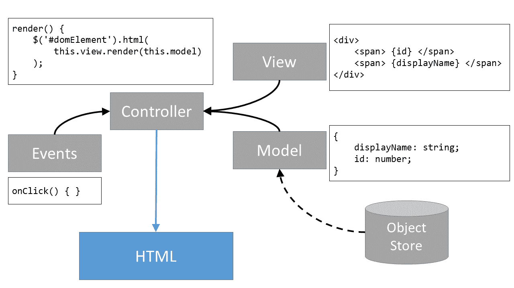

| 元素 | 职责 |
| :--- | :--- |
| 模型 (Model) | 持有属性的简单对象，通常从对象存储或数据库创建。 |
| 视图 (Views) | HTML 视觉元素，在模板中结合模型属性。 |
| 控制器 (Controllers) | 连接模型和视图，响应事件并协调结果 HTML 的生成。 |

### 使用 MVC 的好处

使用 MVC 框架带来了许多显著的好处：

- 元素解耦
- 增加灵活性和重用性
- 用户界面设计可以由专业团队承担
- 快速且并行开发
- 单个组件的可测试性
- 模型包含其他模型

*TypeScript 兼容框架*

**[ 213 ]**

### 示例应用大纲

为了能够对比各种框架，我们将使用每个框架构建同一个相同的应用程序，该程序将：

- 使用视图显示模型
- 构建一个数据数组，每个项目都是一个单一的模型实例
- 遍历数组并在列表中渲染每个项目
- 响应项目上的点击事件
- 显示模型属性

我们将为示例应用程序使用相同的数据集。该数据集如下：

```typescript
interface IClickableItem {
  DisplayName: string;
  Id: number;
}

let ClickableItemCollection : IClickableItem[] = [
  { Id: 1, DisplayName: "firstItem"},
  { Id: 2, DisplayName: "secondItem"},
  { Id: 3, DisplayName: "thirdItem"}
];
```

*TypeScript 兼容框架*

**[ 214 ]**

我们生成的应用程序如下：

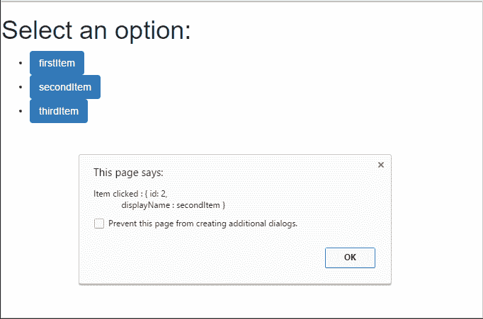

带有提示框信息的示例应用程序截图

在这里，我们渲染了一个包含三个按钮的页面，这些按钮是从我们的数据数组生成的。当我们点击这些按钮中的任何一个时，将显示底层模型的属性。

### 使用 Backbone

我们将从使用 Backbone 构建示例应用程序开始对 TypeScript 框架的探索。虽然可以认为 Backbone 本身并不是 TypeScript 框架，但我们已经看到它是如何自然地与 TypeScript 语法结合的。Backbone 也是最老的框架之一，它小巧、轻量且极快。

然而，Backbone 需要编写比大多数框架更多的代码，因为它只是 MVC 框架的骨架。在使用 Backbone 时，你需要手动调用渲染函数，并手动将渲染的 HTML 附加到 DOM 树上。

*TypeScript 兼容框架*

**[ 215 ]**

Marionette 框架构建在 Backbone 之上，目的是简化并移除许多重复代码，并引入在构建 Web 应用时有所帮助的新概念。Marionette 的运行速度极快，因为它在 Backbone 之上添加了一层薄薄的功能，同时仍然使用底层的 Backbone 库。

#### 渲染性能

如果页面渲染性能、CPU 周期和 RAM 是你应用程序中的关键因素，那么在纯渲染速度方面，你无法忽视 Backbone 的优势。

在最近的一个项目中，我们的团队参与了对 Marionette 和 Backbone 应用程序的速度测试，以确定它们是否适用于嵌入式设备。这些嵌入式设备拥有 400-600Mhz 的 CPU 和 128-256Mb RAM。与拥有 3.6Ghz CPU 和 8Gb RAM 的现代桌面电脑相比，这些确实是微型机器。该测试应用程序渲染了三个 HTML 页面，每个页面的复杂度不同。第一个页面是非常简单的页面，第二个页面具有可变菜单结构，第三个页面包含一个某些数据的相当复杂且详细的信息视图。所有代码均使用 TypeScript 编写。

每个设备可用的处理器和 RAM 如下：

- 400Mhz ARM9，128Mb RAM
- 400Mhz PowerPC，256Mb RAM
- 624Mhz Marvell PXA300，256Mb RAM
- 6Ghz Core i7，8Gb RAM（桌面级）

该测试应用程序运行了一个高分辨率计时器，并通过 websockets 向 HTML 页面发送消息。计时器在计时应用程序向 Web 页面发送消息时启动。一旦在 Web 应用程序内部接收到消息，它就会决定显示哪个页面。页面显示机制使用模型视图控制器（MVC）模式将 HTML 渲染到浏览器。一旦 HTML 渲染到屏幕，消息就会发送回计时应用程序以停止时钟。通过这种方式，可以获得毫秒级的计时信息，以确定在这些设备任上渲染 HTML 需要多长时间。

*TypeScript 兼容框架*

**[ 216 ]**

此测试重复了三次，以获得平均渲染时间。结果如下，所有时间均以毫秒为单位：

| | 400Mhz ARM9 (128Mb) | 400Mhz PowerPC (256Mb) | 624Mhz Marvell (256Mb) | 3.6Ghz Core i7 (8Gb) |
| :--- | :--- | :--- | :--- | :--- |
| **Backbone** | | | | |
| 简单页面 | 187 ms | 131 ms | 187 ms | 5 ms |
| 中等页面 | 241 ms | 151 ms | 267 ms | 11 ms |
| 复杂页面 | 380 ms | 370 ms | 379 ms | 17 ms |
| **Marionette** | | | | |
| 简单页面 | 525 ms | 349 ms | 501 ms | 7 ms |
| 中等页面 | 1043 ms | 769 ms | 851 ms | 19 ms |
| 复杂页面 | 1532 ms | 847 ms | 1014 ms | 32 ms |

查看表中的结果，我们可以看到在较慢的 CPU 上标准的 Backbone 渲染可能需要 130 – 380 毫秒。然而，从 Marionette 渲染相同的 HTML 则从 350 毫秒开始，并可能增加到 1.5 秒。这种差异归因于 Marionette 在 Backbone 之上进行的额外处理所占用的更高 CPU 周期。

这些结果告诉我们，框架包含的逻辑越多（因此框架处理越多），它在性能较弱的处理器上运行得就越慢。因此，在评估一个在后台执行许多“魔法操作”的框架时，请记住这些功能会消耗宝贵的 CPU 处理时间，可能不适用于较慢设备。

我们的决定是采用 Backbone 作为这些设备的 MVC 框架，因为它提供了最快的速度。尽管如此，在具有相当不错处理器的现代计算机上，5 毫秒渲染时间和 32 毫秒之间的差异可以忽略不计。

*TypeScript 兼容框架*

**[ 217 ]**

#### Backbone 设置

设置 Backbone 环境相当简单，可以通过 `tsc` 和 `npm` 按如下方式完成：

使用 `tsc` 初始化 TypeScript 环境：

```bash
tsc --init
```

初始化 `npm`，并使用 `@types` 语法安装 Backbone、Bootstrap、JBone 以及 Backbone 的声明文件如下：

```bash
npm init
npm install backbone -save
npm install bootstrap --save
npm install jbone --save
npm install @types/backbone --save
```

JBone 是专门为 Backbone 构建的 jQuery 实现。它包含了 Backbone 需要的所有 jQuery 功能，并且比完整的 jQuery 库要轻得多、快得多。

#### Backbone 模型

对于我们的示例应用程序，我们将构建两个 Backbone 模型。一个模型用于我们 `IClickableItem` 数组中的每个项目，第二个模型将用于持有整个数组。

*TypeScript 兼容框架*

**[ 218 ]**

#### Backbone 模型

（注：原文后续部分存在大量 OCR 识别错误和重复，此处已根据要求完成核心内容的翻译）

*兼容 TypeScript 的框架*

**[ 220 ]**

`options` 对象随后将通过 `super` 调用传递给基类 `Backbone.View` 对象。

构造函数的最后一行设置了用于此视图的模板。在这里，我们正在 HTML DOM 树中查询 `id` 为 `itemViewTemplate` 的元素。我们的 HTML 页面随后需要包含以下脚本，以便 Backbone 能够获取到此模板：

```html
<script type="text/template" id="itemViewTemplate">
<button class="btn btn-primary"><%= DisplayName %></button>
</script>
```

注意，Backbone 默认使用 Underscore 的模板引擎。为了将 Model 的属性渲染到 HTML 中，我们在模板中使用了 `<%= PropertyName %>` 语法。

在我们的 `ItemView` 类中，我们感兴趣的最后一个函数是 `render` 函数。这个 `render` 函数调用了内部属性 `$el` 的 `html` 函数，并传入模板函数和内部模型属性的 JSON 表示。它还返回了 `this`，因此任何使用它的代码都可以在 `render` 函数上进行链式调用。

### Backbone CollectionView

我们将构建的第二个视图是用于整个集合本身的。这个视图在几个方面很有趣。首先，它将由两个模型构建。第一个模型是它自己的内部模型，将用于将属性渲染到屏幕上；第二个模型是用于每个 `ItemView` 的集合。

此视图的另一个有趣之处是，`render` 函数需要为集合中的每个元素创建 `ItemView` 类的单独实例，并将渲染后的 HTML 与自身的内部模板结合。我们的视图如下：

```typescript
class ItemCollectionView extends Backbone.View<ItemModel> {
  template: (json, options?) => string;
  constructor(options?: any) {
    if (!options)
      options = {};
    super(options);
    this.template = _.template(`
      $('#itemCollectionViewTemplate').html()
    `);
  }
  render() {
```

*兼容 TypeScript 的框架*

**[ 221 ]**

```typescript
    this.$el.html(this.template(
      this.model.toJSON()
    ));
    this.collection.each((item) => {
      var itemView = new ItemView({
        model: item
      });
      this.$el.find('#ulRegions')
        .append(itemView.render().el);
    });
    return this;
  }
}
```

在这里，我们创建了一个名为 `ItemCollectionView` 的视图类，它再次扩展了 `Backbone.View<ItemModel>`。`constructor` 函数与之前的视图几乎相同，不同在于它简单一些，只需从名为 `itemCollectionViewTemplate` 的 DOM 元素中设置 HTML 模板。因此，我们的 HTML 必须包含如下所示的代码片段：

```html
<script type="text/template" id="itemCollectionViewTemplate">
<h1> <%= DisplayName %> </h1>
<ul id="ulRegions"></ul>
</script>
```

此 HTML 片段使用 `<%= PropertyName %>` 语法来渲染模型中的 `DisplayName` 属性。我们还有一个 `<ul>` 元素，它将包含我们子模型渲染后的 HTML。

现在让我们来看 `render` 函数本身。`render` 函数中的第一行将渲染主 `ItemCollectionView` 模板和模型，与我们之前看到的类似。`render` 函数的第二行将遍历 `ItemCollection`，并为每个集合元素创建一个新的子 `ItemView`。这些子视图中的每一个将被渲染，并将生成的 HTML 附加到 `ulRegions` DOM 元素中。

### Backbone 应用

在创建了模型、模型集合和两个视图之后，我们现在将创建一个控制器将这些元素绑定在一起。然而，Backbone 并没有专门的控制器类，但我们可以使用标准的 TypeScript 类来完成控制器的工作。该类命名为 `ScreenViewApp`，如下：


```typescript
class ScreenViewApp {
  constructor() {
    console.log(`ScreenViewApp.constructor()`);
  }

  start() {
    let collectionModel = new ItemModel({
      Id: 0, DisplayName: "Select an Option:"
    });
    let itemCollection = new ItemCollection(ClickableItemCollection);
    let itemCollectionView = new ItemCollectionView({
      model: collectionModel,
      collection: itemCollection
    });
    $('#pageLayoutRegion').html(
      itemCollectionView.render().el
    );
  }
}
```

*兼容 TypeScript 的框架*

**[ 222 ]**

在这里，我们创建了一个名为 `ScreenViewApp` 的类，包含一个 `constructor` 和一个 `start` 函数。`constructor` 只是向控制台打印一条消息。`start` 函数体显示了我们如何创建用于将应用程序渲染到屏幕上的各种元素。

`start` 函数的第一行创建了一个 `ItemModel` 实例，其 `DisplayName` 属性设置为 `'Select an Option:'`。该属性将用于渲染屏幕顶部的文本。然后我们创建了一个 `ItemCollectionView` 实例并传入 `itemCollection`。`start` 函数的最后一行在 `pageLayoutRegion` 元素上调用了 `html` 函数。

```html
<script>
window.onload = function() {
  app = new ScreenViewApp();
  app.start();
}
</script>
```

*兼容 TypeScript 的框架*

**[ 223 ]**

```html
<div id="pageLayoutRegion"></div>
```

正如我们在本节开头提到的，为了完成应用程序，Backbone 比其他框架多写一些代码。但硬币的另一面是，代码本身非常易读且逻辑清晰，不包含任何“魔法”。因此它很容易上手。

### 使用 Aurelia

Aurelia 是最早提供完整 TypeScript 集成的 SPA 框架之一。它是一个专门利用 ECMAScript 6 特性来增强开发体验的框架。Aurelia 框架最令人惊讶的特性之一是完成任务所需的代码量非常小。Aurelia 理解如果你正在编写标准类，那么你可能想使用类属性来渲染 HTML。

### Aurelia 设置

设置开发环境的最的方法是使用 Aurelia 的命令行界面 `aurelia-cli`，可以通过以下方式安装：

`npm install aurelia-cli -g`

安装完成后可以调用它创建一个新项目：

`au new`

这将引导你通过一系列简单的问题，首先是你想使用的目录名称。下一个问题是使用 ESNext 还是 TypeScript 作为开发语言，最后一个问题是否下载所有项目依赖。选择 TypeScript 并确认下载依赖将需要几分钟来设置默认的项目结构。

*TypeScript 兼容框架*

**[224]**

`aurelia-cli` 程序有许多选项。要编译你的项目，请输入：

`au build`

要运行你新创建的 Aurelia 应用，请输入：

`au run`

这将调用 Aurelia 的编译和打包步骤，然后设置一个 http 服务器来提供应用程序，默认在端口 `9000` 上运行。访问 `http://localhost:9000` 将显示默认的 Aurelia 屏幕，如下：

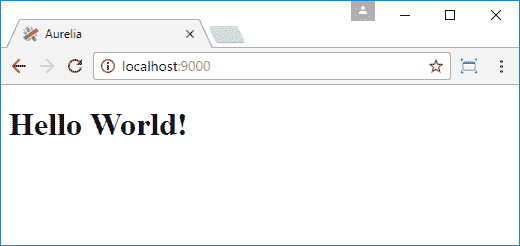

Aurelia 欢迎页面

### 开发考虑因素

Aurelia 是一个大型框架，占用大量的磁盘空间。默认应用程序的目录大小约为 150Mb 左右。它在后台也执行了许多繁重的工作。在使用 Aurelia 工作时，请记住这可能会影响你应用程序的性能。

### Aurelia 性能

当你首次在浏览器中加载示例 Aurelia 应用程序时，你会发现页面显示之前会有明显的停顿。为了深入了解这种初始延迟，我们可以打开 Chrome 的开发者工具栏来查看后台正在发生什么。

*TypeScript 兼容框架*

**[225]**

如果我们在打开开发者工具栏的情况下重新加载网页并查看网络流量，我们会注意到 Aurelia 正在后台执行大量繁重的工作，如下：

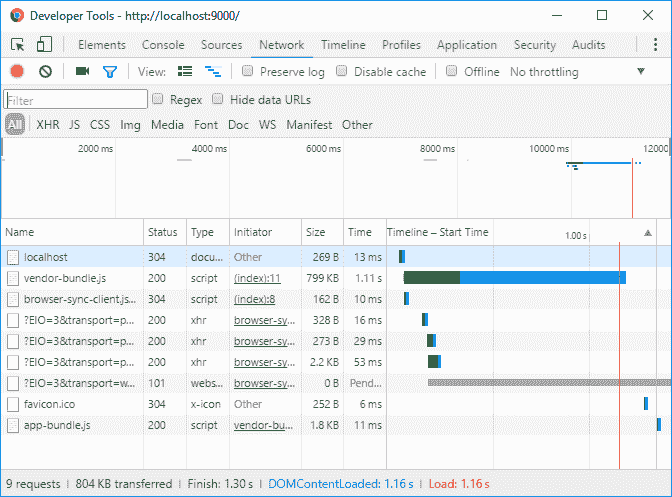

Chrome 开发者工具显示 Aurelia 网络请求

我们可靠的开发者工具向我们展示（在底部的摘要栏上）网页本身向服务器发送了 9 次独立的文件请求，渲染页面所花费的总时间为 1.16 秒。使用 Microsoft Edge 浏览器，此加载时间会增加到三秒左右，而使用 Firefox，此加载时间会增加到四到五秒之间。这与加载我们的 Backbone 示例应用程序所需的 18 毫秒相比有巨大的差距。

请记住，在生产环境应用程序中，从用户首次浏览你的主页到页面最终渲染之间，可能会存在初始延迟。Aurelia 应用在 Chrome 上的运行速度明显比在 Firefox 或 Microsoft Edge 上快。

*TypeScript 兼容框架*

**[226]**

### Aurelia 模型

Aurelia 基于 ECMAScript 2016 标准构建。这意味着标准类可以被用作模型。不需要像在 Backbone 中那样的 getter（get器）和 setter（Setter），也不需要任何特殊的构造函数来水化模型。类可以包含其他类，因此定义复杂的嵌套模型非常容易。让我们在 `src/app.ts` 文件中如下创建我们的 `ClickableItems` 数组：

```typescript
export class App {
  message: string = 'Select an Option:';
  items: ClickableItem[] = [
    { id: 1, displayName : "firstItem"},
    { id: 2, displayName: "secondItem"},
    { id: 3, displayName: "thirdItem"},
  ];
}

export class ClickableItem {
  displayName: string;
  id: number;
}
```

在这里，我们修改了名为 `App` 的类，并添加了一个名为 `items` 的新属性，它仅仅是 `ClickableItem` 元素的数组。

就是这些了。在 Aurelia 中，标准类被用作模型。

### Aurelia 视图

Aurelia 使用命名约定来将类与其视图绑定。我们的类被命名为 `App`，因此 Aurelia 运行时将在类所在的目录内搜索同名的 HTML 模板。因此，它将把 `app.ts` 绑定到 `app.html`，并使用 `app.html` 作为模板。

我们将使用以下代码段修改此 `app.html`：

```html
<template>
  <h1>${message}</h1>
  <ul>
    <li repeat.for="item of items">
      <button>${item.displayName}</button>
    </li>
  </ul>
</template>
```

在这里，我们将一个 HTML 片段封装在 `<template>` 标签中。在这个模板内部，我们有一个 `<h1>` 标签，它使用 `${propertyName}` 语法来渲染模型中名为 `message` 的属性。然后我们有一个 `<ul>` 标签，并在其内部包含一个 `<li>` 标签。在本例中，`<li>` 标签是此模板中有趣的部分。注意我们是如何注入一个名为 `repeat.for="item of items"` 的属性的。这种语法是 Aurelia 特有的，它将遍历 `App` `items` 属性，并为每个单独的项目重复 `<li>` 标签。这将通过名为 `item` 的变量提供给 `<li>` 标签。我们可以将其命名为 `arrayItem`，在这种情况下我们的代码需要是 `repeat.for="arrayItem of items"`。在 `<li>` 标签内部，我们仅仅是在创建一个 `<button>` 标签，并使用 `${item.displayName}` 数据绑定语法来渲染每个成员的 `displayName` 属性。

*TypeScript 兼容框架*

**[227]**

### Aurelia 引导

当视图和模型就绪后，我们可以关注到项目根目录下的 `index.html` 文件。我们将如下修改它：

```html
<!DOCTYPE html>
<html>
<head>
  <title>Aurelia</title>
</head>
<body>
  <app-root></app-root>
  <script src="main.js"></script>
</body>
</html>
```

在 Aurelia 中，`<app-root>` 标签是自定义的挂载点，它告诉 Aurelia 应该将主组件渲染到此处。`main.js` 是生成的引导文件，它负责启动 Aurelia 框架并加载你的应用程序。

*TypeScript 兼容框架*

**[ 230 ]**

Angular-CLI 的名称为 `ng`，在这里我们指定了它应该在一个名为 `my-app` 的新目录中创建一个新项目。在这个新目录中，Angular-CLI 将下载并安装 Angular 2 应用程序所需的所有组件。要启动开发 Web 服务器并查看应用程序的运行情况，我们执行以下命令：

`npm start`

此 `start` 命令将编译我们所有的应用程序源代码，并在端口 `4200` 上启动一个 Web 服务器。随后访问 `http://localhost:4200` 即可运行我们的应用程序。使用 Angular 2 开发环境的优点之一是它会监控你的源文件变化，并在文件更改时立即重新编译应用程序。如果你保持浏览器窗口打开，那么 Angular 2 也会在应用程序编译完成后强制刷新浏览器，从而对源代码更改提供即时反馈。

请关注你运行 `npm start` 的控制台。它将显示在保存文件时发生的任何 TypeScript 编译错误。

#### Angular 2 模型

Angular 2 模型的构建方式与 Aurelia 模型相同，它们都是简单的类。让我们先从编辑名为 `app/app.component.ts` 文件开始，并如下添加我们的 Angular 模型：

```typescript
export class ClickableItem {
  displayName: string;
  id: number;
}

let ClickableItemArray : ClickableItem[] = [
  { id: 1, displayName : "firstItem"},
  { id: 2, displayName : "secondItem"},
  { id: 3, displayName : "thirdItem"},
];

// 有的 @Component 代码
export class AppComponent {
  title = 'hello angular !';
  items = ClickableItemArray;
}
```

**[ 231 ]**

在这里，我们有了标准的 `ClickableItem` 类，它拥有 `displayName` 和 `id` 属性。正如我们之前看到的，我们接着创建一个名为 `ClickableItemArray` 的数组来存放数组项。我们的最终类名为 `AppComponent`，它有一个 `title` 属性和一个 `items` 属性，与我们为 Aurelia 创建的模型类类似。

#### Angular 2 视图

Angular 使用名为 `@Component` 的类装饰器来指定一个类可以作为 HTML 组件使用。让我们仔细观察这个装饰器：

```typescript
import { Component } from '@angular/core';
// 已有的 ClickableItem 代码
@Component({
  selector: 'app-root',
  templateUrl: './app.component.html',
  styleUrls: ['./app.component.css']
})
export class AppComponent {
  title = 'hello angular !';
  items = ClickableItemArray;
}
```

这段代码以 `import` 语句开头，从名为 `'@angular/core'` 的库中定义 `Component` 装饰器。该 `import` 语句是我们后续章节介绍的模块化语法的一部分。它基本上赋予了我们轻松引用 Angular 框架中其他类的能力。

`@Component` 装饰器定义了三个属性：`selector`、`templateUrl` 和 `styleUrls`。`selector` 用于引用视图渲染到的 HTML DOM 元素，类似于标准的 jQuery 选择器。`templateUrl` 属性指定了该组件模板 HTML 文件的位置，而 `styleUrls` 属性用于包含组件使用的 CSS 文件。

让我们看看包含我们模板的 `app.component.html` 文件：

```html
<h1>
  {{title}}
</h1>
<ul>
  <li *ngFor="let item of items">
    <button>
      {{item.displayName}}
    </button>
  </li>
</ul>
```

**[ 232 ]**

在版模板中，我们使用 Angular 语法 `{{propertyName}}` 来引用模型中的属性。这与 Aurelia 使用的 `${propertyName}` 语法相似。我们的模板（再次类似于 Aurelia）有一个 `<h1>` 元素来显示 `title` 属性，然后是常用的 `<ul>` 和 `<li>` 标签。在 `<li>` 标签内，我们再次遍历 `AppComponent` 模型的 `items` 属性，将每个项渲染到 DOM 中。Angular 在模板中使用 `*ngFor` 关键字来表示循环。`"let item of items"` 再次通过 `item` 变量在模板中引用数组的每个元素。正如我们在 Aurelia 中看到的，如果我们将其更改为 `"let arrayItem of items"`，那么我们就需要通过 `arrayItem` 变量来引用每个数组元素。用于每个数组元素的模板将渲染一个 `<button>` 标签并显示 `item.displayName` 属性的值。完成这些更改后，我们的 Angular 2 应用程序将在 HTML 页面中渲染 `ClickableItem` 元素数组。

#### Angular 性能

如果我们打开方便的开发者工具查看网络请求数量和加载页面所需的时间，我们会注意到 Angular 正在执行大约八次请求，并在 Chrome 中刷新页面大约需要 177 毫秒。使用 Firefox 大约为 960 毫秒，在 Microsoft Edge 中约为 200 毫秒。这显然比 Aurelia 开发环境要快。

#### Angular 事件

此示例应用程序的最后一步是连接我们的 DOM `onclick` 事件，并使用底层模型显示警报。与 Aurelia 一样，这需要对模板进行细微修改并添加点击处理程序。让我们从更新 `app.component.html` 中的模板开始：

```html
<ul>
  <li *ngFor="let item of items">
    <button (click)="alert(item.displayName)">
      {{item.displayName}}
    </button>
  </li>
</ul>
```

**[ 233 ]**

### 使用 React

我们在本章将查看的最后一个 TypeScript 框架是 React。React 框架是开源的并由 Facebook 维护。React 使用特定的 JSX 语法。TypeScript 在 1.6 版本中包含了对 React/JSX 的支持。然而，为了使用新的 JSX 语法，我们需要将 TypeScript 文件扩展为 `.tsx`，而不是普通的 `.ts` 文件。

**[ 234 ]**

### React 设置

React 从 JSX 文件生成 JavaScript 的过程在正常的开发工作流中增加了一个额外步骤。我们的 TypeScript `.tsx` 文件在编译后将生成混杂 JSX 语法的 JavaScript 文件。一旦创建了这些文件，它们需要通过 JSX 解释器生成标准的 JavaScript 文件。由于如此，建议使用 Webpack 等打包工具执行此额外编译步骤。使用 Webpack 还能将编译后的 `.tsx` 文件与 React 库正确组合。

启动新项目，我们将遵循以下步骤：

- `npm init`: 前述命令为我们的项目初始化 `npm`。
- `npm install -g webpack`: 将 `webpack` 安装为全局 Node 模块。
- `npm install --save react react-dom`: 安装 `react` 和 `react-dom` 库（而不是使用 bower）。
- `npm install --save-dev ts-loader source-map-loader`: 安装 `ts-loader` 和 `source-map-loader` 模块。
- `npm link typescript`: 将全局安装的 `typescript` 链接供 `webpack`。

完成这些步骤后，通过 `@types` 语法安装 React 声明文件：

- `npm install @types/react --save`
- `npm install @types/react-dom --save`

现在可以通过 `tsc --init` 创建 `tsconfig.json` 文件，然后对其进行细微修改：

```json
{
  "compilerOptions": {
    "outDir": "./dist/",
    "module": "commonjs",
    "target": "es5",
    "noImplicitAny": true,
    "sourceMap": true,
    "jsx" : "react"
  },
  "exclude": [
    "node_modules"
  ]
}
```

*TypeScript 兼容框架*

**[ 235 ]**

在这里，我们添加了 `"outDir"` 属性并设置为 `"./dist/"`，这将是编译后的 JavaScript 文件写入的目录——同时还设置了 `"jsx"` 属性，将其设置为 `"react"`，表示我们在编译步骤中使用了 JSX 语法。

我们开发环境所需的最终配置文件是 `webpack.config.js` 文件，如下：

```javascript
module.exports = {
  entry: "./app/index.tsx",
  output: {
    filename: "./dist/bundle.js",
  },
  // 为调试 webpack 输出启用 sourcemaps。
  devtool: "source-map",
  resolve: {
    // 将 '.ts' 和 '.tsx' 添加为可解析的扩展名。
    extensions: ["", ".webpack.js", ".web.js", ".ts", ".tsx", ".js"]
  },
  module: {
    loaders: [
      // 所有带有 '.ts' 或 '.tsx' 扩展的文件
      // 将由 'ts-loader' 处理。
      { test: /\.tsx?$/, loader: "ts-loader" }
    ],
    preLoaders: [
      // 所有输出的 '.js' 文件的任何
      // sourcemaps将被 'source-map-loader' 重新处理。
      { test: /\.js$/, loader: "source-map-loader" }
    ]
  },
  externals: {
    "react": "React",
    "react-dom": "ReactDOM"
  }
};
```

**[PAGE 255]**


*TypeScript 兼容框架*

**[ 236 ]**

该文件的文档非常详尽，因此我们在这里不再描述每个选项。然而，需要注意的属性之一是文件顶部的 `"entry"` 属性，它指定了 `"./app/index.tsx"` 文件。这个 `index.tsx` 文件将作为 React 引导过程的初始启动文件。另一个需要注意的属性是 `"output"` 属性，它指定打包过程的结果应写入 `"./dist/bundle.js"` 文件。

配置好文件后，我们只需输入以下命令即可编译并打包所有代码：

`webpack`

在此阶段运行 `webpack` 将产生错误，因为我们还没有创建 `app/index.tsx` 文件。要解决此错误，只需在 `app` 目录中创建一个空白的 `index.tsx` 文件。

### React 视图

React 模型类似于 Aurelia 和 Angular 模型，都是简单的 TypeScript 类。由于我们在之前的两个章节中已经涵盖了这些模型，我们将直接进入正题，看看 React 如何组合视图。

首先，让我们创建一个 `app/ReactApp.tsx` 源文件。在该文件中，我们将创建两个视图。第一个视图将是 `ClickableItemArray` 中每个单独元素的视图，命名为 `ClickItemView`。第二个视图将命名为 `ArrayView`，用于渲染整个数组。这与我们在 Backbone 中创建的两个视图类似，并且不依赖模板数组绑定（如 Angular 中使用的 `*ngFor` 语法所示）。我们将如下从 `ClickItemView` 开始：

```typescript
import * as React from 'react';
export class ClickableItem {
  displayName: string;
  id: number;
}
export class ClickItemView extends React.Component<ClickableItem,{}> {
  constructor() {
    super();
  }
  render() {
    return (
      <li><button> {this.props.displayName}</button></li>
    );
  }
}
```

**[PAGE 256]**

*TypeScript 兼容框架*

**[ 237 ]**

我们从一个 import 语句开始，从 `'react'` 导入所有类，并指定了名为 `React` 的命名空间。此 `import` 语句是稍后章节将介绍的模块化语法的一部分。然后我们定义 `ClickableItem` 模型正如我们在 Aurelia 和 Angular 中做的那样作为数据模型。

此代码片段还定义了一个名为 `ClickItemView` 的类，这是我们的 React 视图。在 React 中，所有视图都被视为模块化的组件，我们的 `ClickItemView` 类派生自 `React.Component` 基类。该基类使用泛型语法定义了两个参数：第一个参数是视图引用的模型，在此实例中是 `ClickableItem`。第二个对象是默认状态，由于我们不需要默认状态，将它留为空对象。我们的 `ClickItemView` 拥有 `constructor` 和 `render` 函数。`constructor` 函数只需调用 `super` 来初始化基类 `React.Component`。然而，`render` 函数更有趣。所有的 React `render` 函数必须返回一段 HTML 片段。仔细观察这段 HTML 片段，注意到它被处理为 `string`。这就是 React 文件需要用特殊的 `.tsx` 扩展名定义的原因。通过使用 `.tsx` 扩展，我们在同一个文件中混合了原生 HTML 和 TypeScript 代码。`render` 函数返回一个 `<li>` 标签，并在一个 `<button>` 标签。在 `<button>` 标签内部，我们看到了通过 `{this.props.displayName}` 使用 React 语法注入模型的 `displayName` 属性。

**[257 / 238]**

我们将定义的第二个视图是用于渲染整个 `ClickableItemArray` 的视图。如前所述，React 与 Backbone 相似之处在于为每个数组项定义一个视图，然后为整个集合定义另一个视图。此视图命名为 `ArrayView`，如下：

```typescript
export interface ArrayViewProps {
  items: ClickableItem[],
  title: string
};
export class ArrayView extends React.Component<ArrayViewProps, {}> {
  render() {
    let buttonNodes = this.props.items.map(function(item) {
      return (
        <ClickItemView {...item}/>
      );
    });
    return (
      <div>
        <h1>{this.props.title}</h1>
        <ul>
          {buttonNodes}
        </ul>
      </div>
    );
  }
}
```

我们从一个名为 `ArrayViewProps` 的接口开始，它描述了我们在 `ArrayView` 视图使用的属性。`ArrayViewProps` 接口有两个属性：用于渲染页面标题的 `title` 属性，以及包含 `ClickableItem` 数组数据的 `items` 属性。

我们的 `ArrayView` 类扩展自 `React.Component`。再次，React 组件的泛型语法需要两个参数：描述视图属性的对象和一个描述初始状态的对象。此视图中唯一的函数是 `render` 函数。`render` 函数被分为两个部分。

**[PAGE 258]**

*TypeScript 兼容框架*

**[ 239 ]**

第一部分是变量 `buttonNodes` 的定义，它调用了 `items` 属性上的 `map` 函数，如 `this.props.items.map` 所示。此 `map` 函数将遍历 `items` 数组中的每个项并返回一个 HTML 片段。返回的片段是一个名为 `ClickItemView` 的 HTML 元素。该元素名称与我们之前定义的 `ClickItemView` 类相同。注意 `ClickItemView` 元素如何通过 `{...item}` 语法指定属性列表。这种语法是将数组元素的所有属性传递给 `ClickItemView` 的快捷方式。

`render` 函数的第二部分返回整个 `ArrayView` 的 HTML 片段。它由一个 `<h1>` 标签组成，通过 `{this.props.title}` 语法渲染 `title` 属性。下一个标签是 `<ul>` 标签，其中包含 `{buttonNodes}` 变量。因此，这段 HTML 片段将包含由 `buttonNodes` 变量定义的 `map` 函数的结果。通过这种方式，React 允许我们以简单直观的方式在 HTML 模板中使用任何 TypeScript 变量或函数。

### React 引导

为了在示例应用程序中看到我们视图定义的结果，我们需要引导我们的 React 代码，类似于我们对 Aurelia 所做的那样。为此，我们将如下修改 `app/index.tsx` 文件：

*兼容 TypeScript 的框架*

**[ 240 ]**

在这里，我们在文件开头定义了三个 `import` 语句。前两个 `import` 语句分别将 `"react"` 库和 `"react-dom"` 库中的所有类置于 `React` 和 `ReactDOM` 命名空间下。第三个 `import` 语句使得从我们之前创建的 `ReactApp.tsx` 文件中的 `ArrayView` 和 `ClickableItem` 类可用。

然后，我们创建了一个名为 `ClickableItemArray` 的变量，这是我们的 `ClickableItem` 对象的数组。最后，我们调用了 `ReactDOM.render` 函数，将一个 `ArrayItem` 类型的元素渲染到 DOM 中。请注意我们是如何为这个 `ArrayItem` 元素指定两个属性的。

第一个属性名为 `items`，该项的值是我们创建的名为 `ClickableItemArray` 的数组实例。再次，React 允许我们使用 `{variableName}` 语法将 `ClickableItemArray` 变量的值注入到 DOM 中。代码片段中的第二个属性名为 `title`，并设置为字符串值 `"Select an option: "`。在我们定义了这些 DOM 元素之后，注意我们包含了一个逗号，然后是对 `document.getElementById` 的调用。

这种语法是 React 在 HTML 页面中选择 DOM 元素并注入生成的 HTML 的方式。元素的 `id` 为 `"example"`，因此它将匹配 HTML 中的 `<div id="example">` 元素。

我们现在需要创建一个 `index.html` 文件，以便启动并渲染我们的 React 应用程序。此 `index.html` 文件（位于项目根目录下）如下：

```html
<!DOCTYPE html>
<html>
<head>
  <meta charset="UTF-8" />
  <title>Hello React!</title>
</head>
<body>
  <div id="example"></div>
  <!-- Dependencies -->
  <script src="./node_modules/react/dist/react.js"></script>
  <script src="./node_modules/react-dom/dist/react-dom.js"></script>
  <!-- Main -->
  <script src="./dist/bundle.js"></script>
</body>
</html>
```

*兼容 TypeScript 的框架*

**[ 241 ]**

此文件在 `<body>` 元素内包含了 `<script>` 标签，用于加载 `react.js` 和 `react-dom.js` 文件，然后是 Webpack 创建的包文件 `./dist/bundle.js`。

但请注意，`<body>` 元素在包含 React 脚本标签之前包含了一个带有 `id="example"` 的 `<div>` 标签。这与大多数框架略有不同，大多数框架的脚本标签被定义为 `<head>` 标签的一部分。遗憾的是，更改此顺序会导致框架产生错误并渲染出空白页面。

我们的 React 应用程序现在已准备好运行。只需启动浏览器，并打开源目录中的 `index.html` 文件即可。请注意，Aurelia 和 Angular 需要在开发环境中运行 Web 服务器，而 React 和 Backbone 不需要。

### React 事件

我们现在可以将焦点转向为按钮点击事件注册一个事件处理器。再次，React 框架的核心在于创建自包含的组件，因此 React 中的点击处理程序将附加到负责渲染我们数组项的 View（视图）上，这与我们在处理 Backbone 时看到的类似。因此，我们将如下所示修改 `app/ReactApp.tsx` 文件中的 `ClickItemView`：

```typescript
export class ClickItemView
extends React.Component<ClickableItem,{}> {
  constructor() {
    super();
    this.handleClick = this.handleClick.bind(this);
  }
  render() {
    return (
      <li><button onClick={this.handleClick}>
        {this.props.displayName}</button></li>
    );
  }
  handleClick() {
    alert(`handleClick() { id : ${this.props.id} displayName : ${this.props.displayName} }`);
  }
}
```

*兼容 TypeScript 的框架*

**[ 242 ]**

我们的 `ClickItemView` 类在三个处被修改了。首先，我们创建了一个名为 `handleClick` 的新函数，它将创建一个 `alert`，显示用于创建此视图的模型属性。此 `alert` 函数通过 `this.props.propertyName` 语法访问模型属性。

我们对该类进行的第二个修改是在 `render` 函数中。我们修改了模板 HTML 代码段，以包含一个 `onClick` 属性，并将其绑定到 `{this.handleClick}` 函数上。这与我们为 Aurelia (`click.delegate="functionToCall"`) 和 Angular (`(click)="functionToCall"`) 进行的修改类似，即将 DOM 的 `onclick` 事件绑定到我们的函数调用。

我们对该类进行的第三个修改是在 `constructor` 函数中。在调用 `super` 之后，我们调用了 `this.handleClick = this.handleClick.bind(this);`。这种看起来奇怪的语法实际上是将任何对 `handleClick` 函数的调用绑定到用于渲染此数组项的类实例，以作为正确的 `this`。

### 总结

在本章中，我们深入了什么是 MVC 框架，并讨论了它的元素。我们讨论了 MVC 中模型、视图和控制器的作用和职责，以及它们是如何交互的。我们还讨论了在使用每个框架时需要考虑的性能。随后，我们查看了与 TypeScript 有紧密集成或为 TypeScript 编写的四个框架。我们在每个框架中实现了相同的基础应用程序，并比较了 Backbone、Aurelia、Angular 2 和 React 的概念和语法。

### 测试驱动开发

在本章中，我们将结合 TypeScript 测试驱动开发。我们将讨论一些流行的测试框架，使用这些框架编写一些单元测试，然后讨论测试运行器和持续集成技术。

*测试驱动开发*

**[ 244 ]**

本章我们将介绍的主题有：

- 测试驱动开发
- 单元测试、集成测试和验收测试
- Jasmine
- Jasmine 运行器
- 持续集成

## 测试驱动开发

TDD 是一种开发过程，或者说是一种开发范式，它从测试开始，并通过这些测试来驱动生产代码的开发进度。测试驱动开发意味着要问这个问题——“我如何知道我已经解决了这个问题？”，而不是仅仅问——“我如何解决这个问题？”。

测试驱动方法的基本步骤如下：

- 编写一个失败的测试
- 运行测试以确保它失败
- 编写代码使测试通过
- 运行测试以查看它是否通过
- 运行所有测试以确保新代码没有破坏任何其他代码
- 重复

使用测试驱动开发实践实际上是一种心态。有些开发者遵循这种方法，先写测试，而另一些人则先写代码，后写测试。还有一些人完全不写测试。如果你属于最后一类，那么希望在本章中学到的技术能帮助你从正确的方向开始。

对于为什么不写单元测试，有太多的借口了。比如测试框架不在我们最初的报价中，或者它会增加 20% 的开发时间，或者测试已经过时了所以我们不再运行它们。事实是，在如今，我们承担不起不写测试的代价。应用程序规模和复杂度不断增长，需求也随时间变化。拥有良好测试套集的应用程序修改速度要快得多，而且对未来需求变化的性也比没有测试的应用强得多。这就是单元测试真正的成本节省优势所在。通过为你的应用程序编写单元测试，你是在为它做好未来准备，确保代码库的任何更改都不会破坏现有功能。

*测试驱动开发*

**[ 245 ]**

我们还希望编写的应用程序能够经受时间的考验。我们现在编写可能在生产环境中运行多年，这意味着有时你需要对多年前编写的代码进行增强或修复错误。如果一个应用程序周围有一套完整的测试，那么在进行修改时，就可以放心地确保所做的更改不会破坏现有功能。

JavaScript 领域的 TDD 还为我们的代码覆盖率增加了另一个层级。通常，开发团队会编写仅针对应用程序服务器端逻辑的测试。例如，在 Visual Studio 领域，这些测试通常只针对控制器、视图和底层业务逻辑的 MVC 框架。测试应用程序的客户端逻辑一直相当困难——换句话说实际渲染的 HTML 和基于用户的交互。

JavaScript 测试框架为我们提供了填补这一空白的工具。我们现在可以开始对渲染的 HTML 进行单元测试，还可以模拟用户交互，例如填写表单和点击按钮。这种额外的测试层与服务器端测试相结合，意味着我们有一种方法对应用程序的每一层进行单元测试，从服务器端业务逻辑到服务器端页面渲染，一直到用户交互。

这种单元测试前端用户交互的能力是任何 JavaScript MV* 框架最大的优势之一。事实上，它甚至可以影响你在选择技术栈时做出的架构决策。

### 单元测试、集成测试和验收测试

自动化测试可以分为三个通用领域或测试类型：单元测试、集成测试和验收测试。我们也可以将这些测试描述为黑盒测试或白盒测试。白盒测试是指测试者已知被测试代码的内部逻辑或结构的测试。而黑盒测试是指测试者未知内部设计和/或逻辑的测试。

#### 单元测试

单元测试通常是白盒测试，其中代码块的所有外部接口都经过模拟（mock）或存根（stub）处理。例如，如果我们正在测试某些带有异步调用以加载 JSON 块的代码，那么单元测试这段代码就需要模拟返回的 JSON。这种技术确保了被测试对象始终获得一组已知的数据。当新需求出现时，当然，这组已知数据可以增长和扩展。被测试的对象应该设计为与接口交互，以便这些接口在单元测试场景中可以易地被模拟或存根处理。

*测试驱动开发*

**[ 246 ]**

#### 集成测试

集成测试是另一种形式的白盒测试，允许被测试对象在接近真实代码的环境中运行。在我们之前的示例中，某些代码通过异步调用加载 JSON 块，那么集成测试将需要实际调用生成该 JSON 的 REST 服务。如果该 REST 服务依赖于来自数据库的数据，那么集成测试就需要数据库中存在与集成测试场景相匹配的数据。如果我们将单元测试描述为在被测试对象周围有一个边界，那么集成测试仅仅是该边界的扩展，包含了依赖的对象或服务。

为你的应用程序构建自动化集成测试将极大提高你的产品质量。考虑我们之前使用的场景，某些代码通过异步调用加载 JSON 块以。

#### 验收测试

验收测试是黑盒测试，通常是基于场景的。它们可能整合多个屏幕或用户交互以通过。注意，在测试开发方法论中，测试团队发现的每个错误都必须导致新的单元、集成或验收测试。这种方法有助于确保一旦错误被发现并修复，它就不会再次出现。

*测试驱动开发*

**[ 247 ]**

### 单元测试框架

有很多 JavaScript 测试框架可用，也有一些用 TypeScript 编写的。两个流行的 JavaScript 框架是 Jasmine (`http://jasmine.github.io/`) 和 QUnit (`http://qunitjs.com/`)。如果你编写基于 node 的 TypeScript 代码，你可能想看看 Mocha (`https://github.com/mochajs/mocha/`)。

两个基于 TypeScript 的测试框架是 MaxUnit (`https://github.com/KnowledgeLake/MaxUnit`) 和 tsUnit (`https://github.com/Steve-Fenton/tsUnit`)。遗憾的是，这两个框架都是该领域的新手，因此可能没有旧的流行框架所具备的功能。例如，MaxUnit 在编写时没有任何文档，而 tsUnit 没有与 CI 构建服务器兼容的测试报告框架。随着时间的推移，这些 TypeScript 框架可能会成长，但看到与第三方库工作如此简单，以及使用 DefinitelyTyped 声明文件，为 QUnit 或 Jasmine 编写单元测试变成了一个非常简单的过程。

在本章的剩余部分，我们将使用 Jasmine 2.4 作为我们的测试框架。

### Jasmine

Jasmine 是一个行为驱动的 JavaScript 测试框架。它的语法非常简单，并且很容易扩展。它是 Aurelia 以及 Angular 2 单元和集成测试的推荐框架。使用 `npm` 安装 Jasmine 如下：

`npm install jasmine --save`

Jasmine 相关声明文件可以通过 `@types` 安装如下：

`npm install @types/jasmine --save`

*测试驱动开发*

**[ 248 ]**

### 一个简单的 Jasmine 测试

Jasmine 使用一种简单的格式来编写测试。考虑以下 TypeScript 代码：

```typescript
describe("tests/01_SimpleJasmineTests.ts ", () => {
  it("should fail", () => {
    let undefinedValue;
    expect(undefinedValue).toBeDefined();
  });
});
```

这段代码片段以一个名为 `describe` 的 Jasmine 函数开始，它接收两个参数。第一个参数是测试套件的名称，第二个参数是一个包含我们测试套件的匿名函数。下一行使用名为 `it` 的 Jasmine 函数来描述一个实际的测试，它也接收两个参数。第一个参数是测试名称，第二个参数是包含我们测试的匿名函数，换句话说，`it` 匿名函数中的任何内容都是我们实际的测试。这个测试开始时定义了一个名为 `undefinedValue` 的变量，但实际上并没有给它赋值。接下来，我们使用 Jasmine 函数 `expect`。仅仅通过读取此 `expect` 语句的代码，我们就能快速理解单元测试在做什么。它期望 `undefinedValue` 的值应该是被定义的，即不等于 `undefined`。

Jasmine 的 `expect` 函数接收一个参数，并返回所谓的 Jasmine 匹配器（matcher）。这个匹配器 `expect( ... )` 使用流式语法将传递给 `expect` 的值与匹配器进行评估。`expect` 关键字类似于其他测试库中的 `Assert` 关键字。`expect` 语句的格式非常符合人类可读性，使得 Jasmine 预期（expectations）相对容易理解。

### Jasmine SpecRunner

为了运行此测试，我们需要一个 HTML 页面，其中包含了所有相关的 Jasmine 第三方库，以及我们的测试 JavaScript 文件。我们可以如下创建一个 `SpecRunner.html` 文件：

```html
<html>
<head>
<link rel="stylesheet" type="text/css" href="../node_modules/jasmine-core/lib/jasmine-core/jasmine.css" />
<script type="text/javascript" src="../node_modules/jasmine-core/lib/jasmine-core/jasmine.js"></script>
<script type="text/javascript" src="../node_modules/jasmine-core/lib/jasmine-core/jasmine-html.js"></script>
<script type="text/javascript" src="../node_modules/jasmine-core/lib/jasmine-core/boot.js"></script>
<script type="text/javascript" src="./01_SimpleJasmineTests.js"></script>
</head>
<body>
</body>
</html>
```

此 HTML 页面只是简单地包含了通过 `npm` 安装的所需的 Jasmine 文件，即 `jasmine.css`、`jasmine.js`、`jasmine-html.js` 和 `boot.js`。最后一行包含了从我们的 TypeScript 测试文件编译来的 JavaScript 文件，`01_SimpleJasmineTests.js`。如果我们在浏览器中打开此页面，应该会看到一个失败的单元测试：

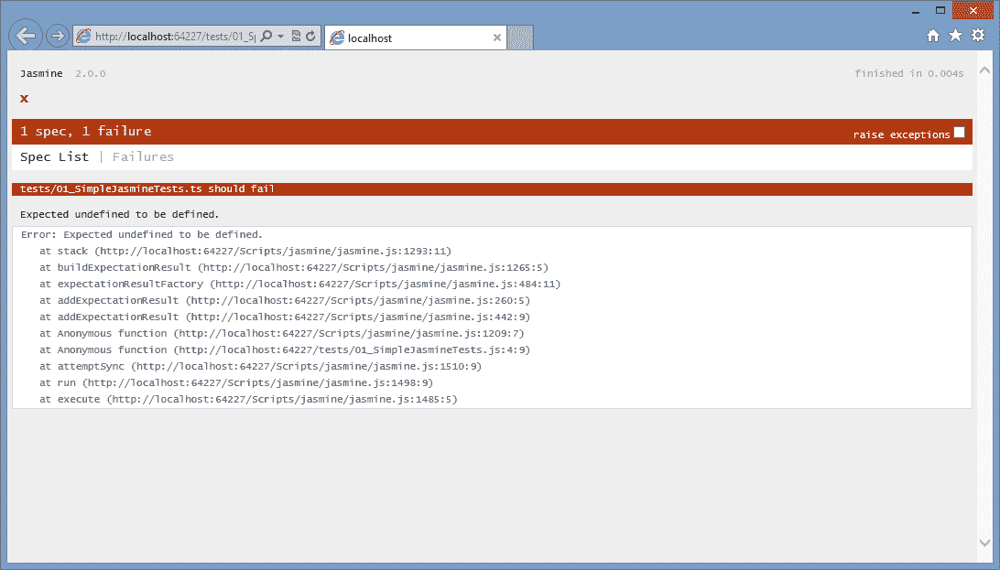

显示 Jasmine 输出的 SpecRunner.html 页面

*测试驱动开发*

**[ 249 ]**

太极。我们通过首先创建一个失败的单元测试来遵循测试驱动开发流程。结果完全符合我们的预期。我们名为 `undefinedVariable` 的变量尚未赋值，因此它将是 `undefined`。如果我们遵循 TDD 流程的下一步，我们应该编写使测试通过的代码。如下所示更新我们的测试将确保测试通过：

```typescript
describe("tests/01_SimpleJasmineTests.ts ", () => {
  it("value that has been assigned should be defined", () => {
    let undefinedValue = "test";
    expect(undefinedValue).toBeDefined();
  });
});
```

注意，我们更新了测试名称以描述测试试图实现的内容，并且为了让测试通过，我们简单地将值 `"test"` 分配给我们的 `undefinedValue` 变量。现在运行 `SpecRunner.html` 页面将显示一个通过的测试，如下：

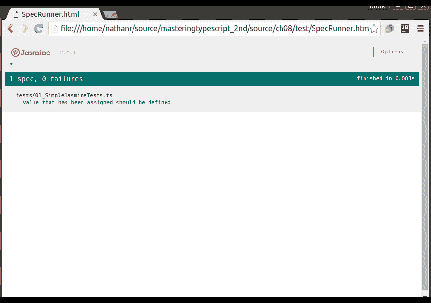

显示通过测试的 Jasmine spec runner

*测试驱动开发*

**[ 250 ]**

### 匹配器

正如我们在第一个简单测试中看到的那样，Jasmine 使用流式语法允许我们在 `expect(...)` 语句之后附加 Jasmine 匹配器。在我们的第一个测试中，我们使用了 `.toBeDefined` 匹配器。然而，Jasmine 拥有一系列可以在测试中使用的匹配器，并且允许我们编写和包含自定义匹配器。让我们快速看看其中的一些匹配器：

```typescript
it("expect value toBe(2)", () => {
  let twoValue = 2;
  expect(twoValue).toBe(2);
});
```

在这里，我们正在使用 `.toBe` 匹配器来测试 `twoValue` 变量的值确实为 `2`：

```typescript
it("expect string toContain value ", () => {
  let testString = "12345a";
  expect(testString).toContain("a");
});
```

在这个测试中，我们正在测试字符串 `"12345a"` 是否包含值 `"a"`：

```typescript
it("expect true to be truthy", () => {
  let trueValue = true;
  expect(trueValue).toBeTruthy();
});
```

在这个测试中，我们正在测试 `true` 是否为真值（truthy）：

```typescript
it("expect false not to be truthy", () => {
  let falseValue = false;
  expect(falseValue).not.toBeTruthy();
});
```

在这个测试中，我们正在测试 `false` 是否不为真值：

```typescript
it("expect value to be defined", () => {
  let undefinedValue = undefined;
  expect(undefinedValue).not.toBeDefined();
});
```

在这个测试中，我们正在测试 `undefinedValue` 是否不被定义：

```typescript
it("expect value to be null", () => {
  let nullValue = null;
  expect(nullValue).toBeNull();
});
```

在这个测试中，我们正在测试 `nullValue` 是否为 `null`：

```typescript
it("expect value not to be equal", () => {
  let value = 1;
  expect(value).not.toBe(2);
});
```

在这里，我们使用 `.not` 匹配器来测试 `value` 的值不等于 `2`：

```typescript
it("expect value not to be null", () => {
  let notNullValue = 1;
  expect(notNullValue).not.toBeNull();
});
```

在这个测试中，我们正在测试 `notNullValue` 是否不为 `null`：

```typescript
it("expect array to contain", () => {
  let array = [1, 2, 3];
  expect(array).toContain(2);
});
```

在这个测试中，我们正在测试 `array` 是否包含 `2`：

```typescript
it("expect array not to contain", () => {
  let array = [1, 2, 3];
  expect(array).not.toContain(4);
});
```

在这个测试中，我们正在测试 `array` 是否不包含 `4`：

```typescript
it("expect object to have property", () => {
  let obj = { a: 1, b: 2 };
  expect(obj).toHaveProperty("a");
});
```

在这个测试中，我们正在测试对象 `obj` 是否拥有属性 `a`：

```typescript
it("expect object not to have property", () => {
  let obj = { a: 1, b: 2 };
  expect(obj).not.toHaveProperty("c");
});
```

在这个测试中，我们正在测试对象 `obj` 是否没有属性 `c`：

```typescript
it("expect string to have length", () => {
  let str = "hello";
  expect(str).toHaveLength(5);
});
```

在这个测试中，我们正在测试字符串 `str` 的长度是否为 `5`：

```typescript
it("expect string not to have length", () => {
  let str = "hello";
  expect(str).not.toHaveLength(3);
});
```

在这个测试中，我们正在测试字符串 `str` 的长度不为 `3`：

```typescript
it("expect string to match", () => {
  let str = "hello";
  expect(str).toMatch(/ell/);
});
```

在这个测试中，我们正在测试字符串 `str` 是否匹配正则表达式 `/ell/`：

```typescript
it("expect string not to match", () => {
  let str = "hello";
  expect(str).not.toMatch(/world/);
});
```

在这个测试中，我们正在测试字符串 `str` 不匹配正则表达式 `/world/`：

```typescript
it("expect number to be greater than", () => {
  let value = 10;
  expect(value).toBeGreaterThan(5);
});
```

在这个测试中，我们正在测试数字 `value` 是否大于 `5`：

```typescript
it("expect number not to be greater than", () => {
  let value = 3;
  expect(value).not.toBeGreaterThan(5);
});
```

在这个测试中，我们正在测试数字 `value` 不大于 `5`：

```typescript
it("expect number to be less than or equal", () => {
  let value = 5;
  expect(value).toBeLessThanOrEqual(10);
});
```

```typescript
it("expect number not to be less than or equal", () => {
  let value = 15;
  expect(value).not.toBeLessThanOrEqual(10);
});
```


*测试驱动开发*

**[ 248 ]**

### 一个简单的 Jasmine 测试

Jasmine 使用一种简单的格式来编写测试。考虑以下 TypeScript 代码：

```typescript
describe("tests/01_SimpleJasmineTests.ts ", () => {
  it("should fail", () => {
    let undefinedValue;
    expect(undefinedValue).toBeDefined();
  });
});
```

这段代码片段以一个名为 `describe` 的 Jasmine 函数开始，它接收两个参数。第一个参数是测试套件的名称，第二个参数是一个包含我们测试套件的匿名函数。下一行使用名为 `it` 的 Jasmine 函数来描述一个实际的测试，它也接收两个参数。第一个参数是测试名称，第二个参数是包含我们测试的匿名函数，换句话说，`it` 匿名函数中的任何内容都是我们实际的测试。这个测试开始时定义了一个名为 `undefinedValue` 的变量，但实际上并没有给它赋值。接下来，我们使用 Jasmine 函数 `expect`。仅仅通过读取此 `expect` 语句的代码，我们就能快速理解单元测试在做什么。它期望 `undefinedValue` 的值应该是被定义的，即不等于 `undefined`。

Jasmine 的 `expect` 函数接收一个参数，并返回所谓的 Jasmine 匹配器（matcher）。这个匹配器 `expect( ... )` 使用流式语法将传递给 `expect` 的值与匹配器进行评估。`expect` 关键字类似于其他测试库中的 `Assert` 关键字。`expect` 语句的格式非常符合人类可读性，使得 Jasmine 预期相对容易理解。

### Jasmine SpecRunner

为了运行此测试，我们需要一个 HTML 页面，其中包含了所有相关的 Jasmine 第三方库，以及我们的测试 JavaScript 文件。我们可以如下创建一个 `SpecRunner.html` 文件：

```html
<html>
<head>
<link rel="stylesheet" type="text/css" href="../node_modules/jasmine-core/lib/jasmine-core/jasmine.css" />
<script type="text/javascript" src="../node_modules/jasmine-core/lib/jasmine-core/jasmine.js"></script>
<script type="text/javascript" src="../node_modules/jasmine-core/lib/jasmine-core/jasmine-html.js"></script>
<script type="text/javascript" src="../node_modules/jasmine-core/lib/jasmine-core/boot.js"></script>
<script type="text/javascript" src="./01_SimpleJasmineTests.js"></script>
</head>
<body>
</body>
</html>
```

此 HTML 页面只是简单地包含了通过 `npm` 安装的所需的 Jasmine 文件，即 `jasmine.css`、`jasmine.js`、`jasmine-html.js` 和 `boot.js`。最后一行包含了从我们的 TypeScript 测试文件编译来的 JavaScript 文件，`01_SimpleJasmineTests.js`。如果我们在浏览器中打开此页面，应该会看到一个失败的单元测试：


显示 Jasmine 输出的 SpecRunner.html 页面

*测试驱动开发*

**[ 249 ]**

太极。我们通过首先创建一个失败的单元测试来遵循测试驱动开发流程。结果完全符合我们的预期。我们名为 `undefinedVariable` 的变量尚未赋值，因此它将是 `undefined`。如果我们遵循 TDD 流程的下一步，我们应该编写使测试通过的代码。如下所示更新我们的测试将确保测试通过：

```typescript
describe("tests/01_SimpleJasmineTests.ts ", () => {
  it("value that has been assigned should be defined", () => {
    let undefinedValue = "test";
    expect(undefinedValue).toBeDefined();
  });
});
```

注意，我们更新了测试名称以描述测试试图实现的内容，并且为了让测试通过，我们简单地将值 `"test"` 分配给我们的 `undefinedValue` 变量。现在运行 `SpecRunner.html` 页面将显示一个通过的测试，如下：


显示通过测试的 Jasmine spec runner

*测试驱动开发*

**[ 250 ]**

## 匹配器

正如我们在第一个简单测试中看到的那样，Jasmine 使用流式语法允许我们在 `expect(...)` 语句之后附加 Jasmine 匹配器。在我们的第一个测试中，我们使用了 `.toBeDefined` 匹配器。然而，Jasmine 拥有一系列可以在测试中使用的匹配器，并且允许我们编写和包含自定义匹配器。让我们快速看看其中的一些匹配器：

```typescript
it("expect value toBe(2)", () => {
  let twoValue = 2;
  expect(twoValue).toBe(2);
});
```

在这里，我们正在使用 `.toBe` 匹配器来测试 `twoValue` 变量的值确实为 `2`：

```typescript
it("expect string toContain value ", () => {
  let testString = "12345a";
  expect(testString).toContain("a");
});
```

在这个测试中，我们正在测试字符串 `"12345a"` 是否包含值 `"a"`：

```typescript
it("expect true to be truthy", () => {
  let trueValue = true;
  expect(trueValue).toBeTruthy();
});
```

在这个测试中，我们正在测试 `true` 是否为真值（truthy）：

```typescript
it("expect false to be truthy", () => {
  let falseValue = false;
  expect(falseValue).not.toBeTruthy();
});
```

在这个测试中，我们正在测试 `false` 是否不为真值：

```typescript
it("expect value to be defined", () => {
  let undefinedValue = undefined;
  expect(undefinedValue).not.toBeDefined();
});
```

在这个测试中，我们正在测试 `undefinedValue` 是否不被定义：

```typescript
it("expect value to be null", () => {
  let nullValue = null;
  expect(nullValue).toBeNull();
});
```

在这个测试中，我们正在测试 `nullValue` 是否为 `null`：

```typescript
it("expect value to be equal", () => {
  let value = 1;
  expect(value).not.toBe(2);
});
```

在这里，我们使用 `.not` 匹配器来测试 `value` 的值不等于 `2`：

```typescript
it("expect value not to be null", () => {
  let notNullValue = 1;
  expect(notNullValue).not.toBeNull();
});
```

在这个测试中，我们正在测试 `notNullValue` 是否不为 `null`：

```typescript
it("expect array to contain", () => {
  let array = [1, 2, 3];
  expect(array).toContain(2);
});
```

在这个测试中，我们正在测试 `array` 是否包含 `2`：

```typescript
it("expect array not to contain", () => {
  let array = [1, 2, 3];
  expect(array).not.toContain(4);
});
```

在这个测试中，我们正在测试 `array` 是否不包含 `4`：

```typescript
it("expect object to have property", () => {
  let obj = { a: 1, b: 2 };
  expect(obj).toHaveProperty("a");
});
```

在这个测试中，我们正在测试对象 `obj` 是否拥有属性 `a`：

```typescript
it("expect object not to have property", () => {
  let obj = { a: 1, b: 2 };
  expect(obj).not.toHaveProperty("c");
});
```

在这个测试中，我们正在测试对象 `obj` 是否没有属性 `c`：

```typescript
it("expect string to have length", () => {
  let str = "hello";
  expect(str).toHaveLength(5);
});
```

在这个测试中，我们正在测试字符串 `str` 的长度是否为 `5`：

```typescript
it("expect string not to have length", () => {
  let str = "hello";
  expect(str).not.toHaveLength(3);
});
```

在这个测试中，我们正在测试字符串 `str` 的长度不为 `3`：

```typescript
it("expect string to match", () => {
  let str = "hello";
  expect(str).toMatch(/ell/);
});
```

在这个测试中，我们正在测试字符串 `str` 是否匹配正则表达式 `/ell/`：

```typescript
it("expect string not to match", () => {
  let str = "hello";
  expect(str).not.toMatch(/world/);
});
```

在这个测试中，我们正在测试字符串 `str` 不匹配正则表达式 `/world/`：

```typescript
it("expect number to be greater than", () => {
  let value = 10;
  expect(value).toBeGreaterThan(5);
});
```

在这个测试中，我们正在测试数字 `value` 是否大于 `5`：

```typescript
it("expect number not to be greater than", () => {
  let value = 3;
  expect(value).not.toBeGreaterThan(5);
});
```

在这个测试中，我们正在测试数字 `value` 不大于 `5`：

```typescript
it("expect number to be less than or equal", () => {
  let value = 5;
  expect(value).toBeLessThanOrEqual(10);
});
```

```typescript
it("expect number not to be less than or equal", () => {
  let value = 15;
  expect(value).not.toBeLessThanOrEqual(10);
});
```

正如我们在第一个简单测试中看到的那样，Jasmine 使用流式语法允许我们在 `expect(...)` 语句之后附加 Jasmine 匹配器。在我们的第一个测试中，我们使用了 `.toBeDefined` 匹配器。然而，Jasmine 拥有一系列可以在测试中使用的匹配器，并且允许我们编写和包含自定义匹配器。让我们快速看看其中的一些匹配器：

```typescript
it("expect value toBe(2)", () => {
  let twoValue = 2;
  expect(twoValue).toBe(2);
});
```

在这里，我们正在使用 `.toBe` 匹配器来测试 `twoValue` 变量的值确实为 `2`：

```typescript
it("expect string toContain value ", () => {
  let testString = "12345a";
  expect(testString).toContain("a");
});
```

在这个测试中，我们正在测试字符串 `"12345a"` 是否包含值 `"a"`：

```typescript
it("expect true to be truthy", () => {
  let trueValue = true;
  expect(trueValue).toBeTruthy();
});
```

在这个测试中，我们正在测试 `true` 是否为真值（truthy）：

```typescript
it("expect false to be truthy", () => {
  let falseValue = false;
  expect(falseValue).not.toBeTruthy();
});
```

在这个测试中，我们正在测试 `false` 是否不为真值：

```typescript
it("expect value to be defined", () => {
  let undefinedValue = undefined;
  expect(undefinedValue).toBeDefined();
});
```

在这个测试中，我们正在测试 `undefinedValue` 是否被定义：

```typescript
it("expect value to be null", () => {
  let nullValue = null;
  expect(nullValue).toBeNull();
});
```

在这个测试中，我们正在测试 `nullValue` 是否为 `null`：

```typescript
it("expect value to be equal", () => {
  let value = 1;
  expect(value).toBe(2);
});
```

在这里，我们使用 `.toBe` 匹配器来测试 `value` 的值等于 `2`：

```typescript
it("expect value not to be null", () => {
  let notNullValue = 1;
  expect(notNullValue).not.toBeNull();
});
```

在这个测试中，我们正在测试 `notNullValue` 是否不为 `null`：

```typescript
it("expect array to contain", () => {
  let array = [1, 2, 3];
  expect(array).toContain(2);
});
```

在这个测试中，我们正在测试 `array` 是否包含 `2`：

```typescript
it("expect array not to contain", () => {
  let array = [1, 2, 3];
  expect(array).not.toContain(4);
});
```

在这个测试中，我们正在测试 `array` 是否不包含 `4`：

```typescript
it("expect object to have property", () => {
  let obj = { a: 1, b: 2 };
  expect(obj).toHaveProperty("a");
});
```

在这个测试中，我们正在测试对象 `obj` 是否拥有属性 `a`：

```typescript
it("expect object not to have property", () => {
  let obj = { a: 1, b: 2 };
  expect(obj).not.toHaveProperty("c");
});
```

在这个测试中，我们正在测试对象 `obj` 是否没有属性 `c`：

```typescript
it("expect string to have length", () => {
  let str = "hello";
  expect(str).toHaveLength(5);
});
```

在这个测试中，我们正在测试字符串 `str` 的长度是否为 `5`：

```typescript
it("expect string not to have length", () => {
  let str = "hello";
  expect(str).not.toHaveLength(3);
});
```

在这个测试中，我们正在测试字符串 `str` 的长度不为 `3`：

```typescript
it("expect string to match", () => {
  let str = "hello";
  expect(str).toMatch(/ell/);
});
```

在这个测试中，我们正在测试字符串 `str` 是否匹配正则表达式 `/ell/`：

```typescript
it("expect string not to match", () => {
  let str = "hello";
  expect(str).not.toMatch(/world/);
});
```

在这个测试中，我们正在测试字符串 `str` 不匹配正则表达式 `/world/`：

```typescript
it("expect number to be greater than", () => {
  let value = 10;
  expect(value).toBeGreaterThan(5);
});
```

在这个测试中，我们正在测试数字 `value` 是否大于 `5`：

```typescript
it("expect number not to be greater than", () => {
  let value = 3;
  expect(value).not.toBeGreaterThan(5);
});
```

在这个测试中，我们正在测试数字 `value` 不大于 `5`：

```typescript
it("expect number to be less than or equal", () => {
  let value = 5;
  expect(value).toBeLessThanOrEqual(10);
});
```

```typescript
it("expect number not to be less than or equal", () => {
  let value = 15;
  expect(value).not.toBeLessThanOrEqual(10);
});
```

正如我们在第一个简单测试中看到的那样，Jasmine 使用流式语法允许我们在 `expect(...)` 语句之后附加 Jasmine 匹配器。在我们的第一个测试中，我们使用了 `.toBeDefined` 匹配器。然而，Jasmine 拥有一系列可以在测试中使用的匹配器，并且允许我们编写和包含自定义匹配器。让我们快速看看其中的一些匹配器：

```typescript
it("expect value toBe(2)", () => {
  let twoValue = 2;
  expect(twoValue).toBe(2);
});
```

在这里，我们正在使用 `.toBe` 匹配器来测试 `twoValue` 变量的值确实为 `2`：

```typescript
it("expect string toContain value ", () => {
  let testString = "12345a";
  expect(testString).toContain("a");
});
```

在这个测试中，我们正在测试字符串 `"12345a"` 是否包含值 `"a"`：

```typescript
it("expect true to be truthy", () => {
  let trueValue = true;
  expect(trueValue).toBeTruthy();
});
```

在这个测试中，我们正在测试 `true` 是否为真值（truthy）：

```typescript
it("expect false to be truthy", () => {
  let falseValue = false;
  expect(falseValue).not.toBeTruthy();
});
```

在这个测试中，我们正在测试 `false` 是否不为真值：

```typescript
it("expect value to be defined", () => {
  let undefinedValue = undefined;
  expect(undefinedValue).toBeDefined();
});
```

在这个测试中，我们正在测试 `undefinedValue` 是否被定义：

```typescript
it("expect value to be null", () => {
  let nullValue = null;
  expect(nullValue).toBeNull();
});
```

在这个测试中，我们正在测试 `nullValue` 是否为 `null`：

```typescript
it("expect value to be equal", () => {
  let value = 1;
  expect(value).toBe(2);
});
```

在这里，我们使用 `.toBe` 匹配器来测试 `value` 的值等于 `2`：

```typescript
it("expect value not to be null", () => {
  let notNullValue = 1;
  expect(notNullValue).not.toBeNull();
});
```

在这个测试中，我们正在测试 `notNullValue` 是否不为 `null`：

```typescript
it("expect array to contain", () => {
  let array = [1, 2, 3];
  expect(array).toContain(2);
});
```

在这个测试中，我们正在测试 `array` 是否包含 `2`：

```typescript
it("expect array not to contain", () => {
  let array = [1, 2, 3];
  expect(array).not.toContain(4);
});
```

在这个测试中，我们正在测试 `array` 是否不包含 `4`：

```typescript
it("expect object to have property", () => {
  let obj = { a: 1, b: 2 };
  expect(obj).toHaveProperty("a");
});
```

在这个测试中，我们正在测试对象 `obj` 是否拥有属性 `a`：

```typescript
it("expect object not to have property", () => {
  let obj = { a: 1, b: 2 };
  expect(obj).not.toHaveProperty("c");
});
```

在这个测试中，我们正在测试对象 `obj` 是否没有属性 `c`：

```typescript
it("expect string to have length", () => {
  let str = "hello";
  expect(str).toHaveLength(5);
});
```

在这个测试中，我们正在测试字符串 `str` 的长度是否为 `5`：

```typescript
it("expect string not to have length", () => {
  let str = "hello";
  expect(str).not.toHaveLength(3);
});
```

在这个测试中，我们正在测试字符串 `str` 的长度不为 `3`：

```typescript
it("expect string to match", () => {
  let str = "hello";
  expect(str).toMatch(/ell/);
});
```

在这个测试中，我们正在测试字符串 `str` 是否匹配正则表达式 `/ell/`：

```typescript
it("expect string not to match", () => {
  let str = "hello";
  expect(str).not.toMatch(/world/);
});
```

在这个测试中，我们正在测试字符串 `str` 不匹配正则表达式 `/world/`：

```typescript
it("expect number to be greater than", () => {
  let value = 10;
  expect(value).toBeGreaterThan(5);
});
```

在这个测试中，我们正在测试数字 `value` 是否大于 `5`：

```typescript
it("expect number not to be greater than", () => {
  let value = 3;
  expect(value).not.toBeGreaterThan(5);
});
```

在这个测试中，我们正在测试数字 `value` 不大于 `5`：

```typescript
it("expect number to be less than or equal", () => {
  let value = 5;
  expect(value).toBeLessThanOrEqual(10);
});
```

```typescript
it("expect number not to be less than or equal", () => {
  let value = 15;
  expect(value).not.toBeLessThanOrEqual(10);
});
```

*测试驱动开发*

**[ 254 ]**

此函数定义使用了变量 `value`，并将使用此参数的值来调用我们的测试。

请注意，在调用 `it` 的时候，我们还动态更改了测试名称，以包含传入的 `value` 参数。这是为了确保每个测试都有唯一的测试名称。

如果没有对这个 `using` 函数进行 TypeScript 定义，我们将产生 TypeScript 错误，所以让我们如下定义 `using` 函数的结构：

```typescript
declare function using<T>(
  name: string,
  values: T[],
  func: (T) => void
);
```

此 TypeScript 声明定义了一个名为 `using` 的函数，并使用泛型语法 `<T>` 定义了三个函数参数。第一个参数是测试名称，第二个参数是类型为 `T` 的值数组，第三个参数是一个接受类型 `T` 参数的函数。此函数声明确保了值数组和函数本身的参数使用相同的类型（`T`）。

我们现在的数据驱动测试只需要 JP Castro 的 Jasmine 扩展，它在 JavaScript 中的形式如下：

```javascript
function using(name, values, func) {
  for (var i = 0, count = values.length; i < count; i++) {
    if (Object.prototype.toString.call(values[i]) !== '[object Array]') {
      values[i] = [values[i]];
    }
    func.apply(this, values[i]);
  }
}
```

这是一个简单的函数名为 `using`，它接收我们之前提到的三个参数。该函数对数组值进行简单的循环，并将每个数组值传递给我们的测试。

有了这个声明和 JavaScript 的 `using` 函数，我们的代码将正确编译，测试将为数据数组中的每个值运行一次：

*测试驱动开发*

**[ 255 ]**

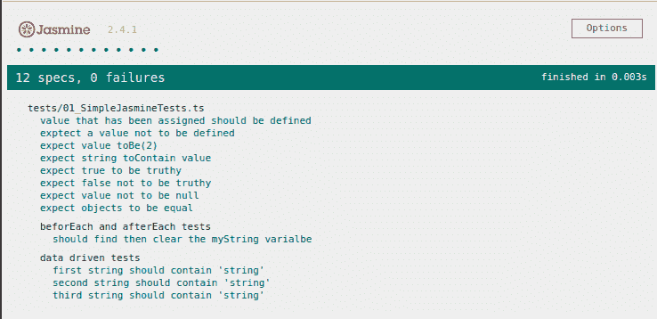

显示数据驱动测试的 Jasmine 规格运行器

#### 使用间谍 (spies)

Jasmine 还有一个非常强大的功能，允许你的测试检查某个特定函数是否被调用，并确定调用它时传入的实际参数。这被称为对函数进行间谍监控。当我们创建一个间谍时，我们临时劫持了函数调用以便测试这些参数。让我们来看一个简单的间谍：

```typescript
class MySpiedClass {
  testFunction(arg1: string) {
    console.log(arg1);
  }
}

describe("simple spy", () => {
  it("should spyOn a function call", () => {
    let classInstance = new MySpiedClass();
    let testFunctionSpy = spyOn(classInstance, 'testFunction');
    classInstance.testFunction("test");
    expect(testFunctionSpy).toHaveBeenCalled();
  });
});
```

我们从一个名为 `MySpiedClass` 的类开始，它有一个函数——`testFunction`。该函数接受一个参数，并将参数打印到控制台。


*测试驱动开发*

**[ 256 ]**

我们的测试通过创建 `MySpiedClass` 的新实例开始，将其赋值给名为 `classInstance` 的变量。然后我们通过调用 `spyOn` 函数创建一个名为 `testFunctionSpy` 的 Jasmine 间谍。此 `spyOn` 函数接受两个参数——类实例本身以及要监控的函数名称。在本次测试中，类实例名为 `classInstance`，我们想要监控的函数名为 `testFunction`。一旦创建了间谍，我们就可以调用该函数，并对函数是否被调用设置期望。这就是间谍的精髓。Jasmine 将监控 `MySpiedClass` 实例的 `testFunction` 函数，以查看它是否被调用。

默认情况下，Jasmine 间谍会阻塞对底层函数的调用。换句话说，它们将你尝试调用的函数替换为 Jasmine 代理。这是我们之前提到的劫持过程的一部分。如果你需要监控一个函数，但仍然需要函数体继续执行，你必须使用 `.and.callThrough()` 链式语法来指定这种行为。

虽然这是一个非常简单的例子，但间谍在许多不同的测试场景中变得非常强大。例如，带有回调参数的类或函数需要间谍来确保回调函数确实被调用了。

#### 监控回调函数

让我们看看如何使用这种间谍技术来测试回调函数是否被正确调用。考虑以下 TypeScript 代码：

```typescript
class CallbackClass {
  doCallBack(id: number, callback: (result: string) => void) {
    let callbackValue = "id:" + id.toString();
    callback(callbackValue);
  }
}

class DoCallBack {
  logValue(value: string) {
    console.log(value);
  }
}
```

*测试驱动开发*

**[ 257 ]**

我们现在的数据驱动测试只需要 JP Castro 的 Jasmine 扩展，它在 JavaScript 中的形式如下：

```javascript
function using(name, values, func) {
  for (var i = 0, count = values.length; i < count; i++) {
    if (Object.prototype.toString.call(values[i]) !== '[object Array]') {
      values[i] = [values[i]];
    }
    func.apply(this, values[i]);
  }
}
```

这是一个简单的函数名为 `using`，它接收我们之前提到的三个参数。该函数对数组值进行简单的循环，并将每个数组值传递给我们的测试。

有了这个声明和 JavaScript 的 `using` 函数，我们的代码将正确编译，测试将为数据数组中的每个值运行一次：


显示数据驱动测试的 Jasmine 规格运行器

#### 使用间谍 (spies)

Jasmine 还有一个非常强大的功能，允许你的测试检查某个特定函数是否被调用，并确定调用它时传入的实际参数。这被称为对函数进行间谍监控。当我们创建一个间谍时，我们临时劫持了函数调用以便测试这些参数。让我们来看一个简单的间谍：

```typescript
class MySpiedClass {
  testFunction(arg1: string) {
    console.log(arg1);
  }
}

describe("simple spy", () => {
  it("should spyOn a function call", () => {
    let classInstance = new MySpiedClass();
    let testFunctionSpy = spyOn(classInstance, 'testFunction');
    classInstance.testFunction("test");
    expect(testFunctionSpy).toHaveBeenCalled();
  });
});
```

我们从一个名为 `MySpiedClass` 的类开始，它有一个函数——`testFunction`。该函数接受一个参数，并将参数打印到控制台。


*测试驱动开发*

**[ 256 ]**

我们的测试通过创建 `MySpiedClass` 的新实例开始，将其赋值给名为 `classInstance` 的变量。然后我们通过调用 `spyOn` 函数创建一个名为 `testFunctionSpy` 的 Jasmine 间谍。此 `spyOn` 函数接受两个参数——类实例本身以及要监控的函数名称。在本次测试中，类实例名为 `classInstance`，我们想要监控的函数名为 `testFunction`。一旦创建了间谍，我们就可以调用该函数，并对函数是否被调用设置期望。这就是间谍的精髓。Jasmine 将监控 `MySpiedClass` 实例的 `testFunction` 函数，以查看它是否被调用。

默认情况下，Jasmine 间谍会阻塞对底层函数的调用。换句话说，它们将你尝试调用的函数替换为 Jasmine 代理。这是我们之前提到的劫持过程的一部分。如果你需要监控一个函数，但仍然需要函数体继续执行，你必须使用 `.and.callThrough()` 链式语法来指定这种行为。

虽然这是一个非常简单的例子，但间谍在许多不同的测试场景中变得非常强大。例如，带有回调参数的类或函数需要间谍来确保回调函数确实被调用了。

#### 监控回调函数

让我们看看如何使用这种间谍技术来测试回调函数是否被正确调用。考虑以下 TypeScript 代码：

```typescript
class CallbackClass {
  doCallBack(id: number, callback: (result: string) => void) {
    let callbackValue = "id:" + id.toString();
    callback(callbackValue);
  }
}

class DoCallBack {
  logValue(value: string) {
    console.log(value);
  }
}
```

*测试驱动开发*

**[ 257 ]**

我们现在的数据驱动测试只需要 JP Castro 的 Jasmine 扩展，它在 JavaScript 中的形式如下：

```javascript
function using(name, values, func) {
  for (var i = 0, count = values.length; i < count; i++) {
    if (Object.prototype.toString.call(values[i]) !== '[object Array]') {
      values[i] = [values[i]];
    }
    func.apply(this, values[i]);
  }
}
```

这是一个简单的函数名为 `using`，它接收我们之前提到的三个参数。该函数对数组值进行简单的循环，并将每个数组值传递给我们的测试。

有了这个声明和 JavaScript 的 `using` 函数，我们的代码将正确编译，测试将为数据数组中的每个值运行一次：

*测试驱动开发*

**[ 258 ]**

Jasmine 间谍的另一个好处是它们可以作为伪造（fakes）。换句话说，不是调用真实函数，调用实际上被劫持了，然后委托给间谍指定的函数。这些伪造函数还可以返回值，这对于生成 Mock 框架非常有用。考虑以下测试：

```typescript
class ClassToFake {
  getValue(): number {
    return 2;
  }
}

describe("using fakes", () => {
  it("calls fake instead of real function", () => {
    let classToFake = new ClassToFake();
    spyOn(classToFake, 'getValue').and.callFake(() => {
      return 5;
    });
    expect(classToFake.getValue()).toBe(5);
  });
});
```

#### 异步测试

JavaScript 的异步特性通过 AJAX 和 jQuery 流行起来，一直是该语言的吸引点之一，也是基于 node 的应用程序的核心架构。让我们快速看一个异步类，然后描述我们应该如何测试它。考虑以下 TypeScript 代码：

*测试驱动开发*

**[ 259 ]**

```javascript
class MockAsyncClass {
  executeSlowFunction(success: (value: string) => void) {
    setTimeout(() => {
      success("success");
    }, 1000);
  }
}
```

这个 `MockAsyncClass` 包含一个名为 `executeSlowFunction` 的函数，它接受一个名为 `success` 的函数回调。在 `executeSlowFunction` 代码中，我们使用 `setTimeout` 函数模拟异步调用，并且在 `1000` 毫秒（1 秒）后才调用 `success` 回调。因此，这个函数模拟了一个异步函数，因为它会在整一秒后才会执行回调。

我们对这个 `executeSlowFunction` 的测试可能如下：

```javascript
describe("asynchronous tests", () => {
  it("failing test", () => {
    let mockAsync = new MockAsyncClass();
    let returnedValue: string;
    mockAsync.executeSlowFunction((value: string) => {
      returnedValue = value;
    });
    expect(returnedValue).toEqual("success");
  });
});
```

首先，我们实例化 `MockAsyncClass` 类，并定义一个名为 `returnedValue` 的变量。然后我们用一个匿名函数作为 `success` 参数调用 `executeSlowFunction`。这个匿名函数将 `returnedValue` 的值设置为从 `MockAsyncClass` 传入的任何值。我们的预期是 `returnedValue` 应该等于 `"success"`，但如果我们现在运行这个测试，测试将带有以下错误信息并失败：

`Expected undefined to equal 'success'.`

这里发生的情况是因为由于 `executeSlowFunction` 是异步的，JavaScript 不会等待回调函数被调用就会执行下一行代码。这意味着断言（expectation）在 `executeSlowFunction` 有机会调用我们的匿名回调函数（设置 `returnedValue` 的值）之前调用了。如果你在 `expect(returnValue).toEqual("success")` 这一行设置断点，并在 `returnedValue = value` 行设置另一个断点，你会发现 `expect` 行被先调用的，而 `returnedValue` 行在整一秒后才被调用。

*测试驱动开发*

**[ 260 ]**

### 使用 done()

Jasmine 2.0 版本引入了一种新语法来帮助我们处理这类异步测试。在任何 `beforeEach`、`afterEach` 或 `it` 函数中，我们传递一个名为 `done` 的参数（这是一个函数），然后在我们的异步代码结束时调用它。让我们重写之前的对 `executeSlowFunction` 的测试：

```javascript
describe("asynch tests with done", () => {
  let returnedValue;
  beforeEach((done) => {
    returnedValue = "no_return_value";
    let mockAsync = new MockAsyncClass();
    mockAsync.executeSlowFunction((value: string) => {
      returnedValue = value;
      done();
    });
  });
  it("should return success after 1 second", (done) => {
    expect(returnedValue).toEqual("success");
    done();
  });
});
```

在异步测试的这个版本中，我们将 `returnedValue` 变量移动到了测试之外，并包含了一个在实际测试之前运行的 `beforeEach` 函数。这个 `beforeEach` 函数首先重置了 `returnValue` 的值，然后设置了 `MockAsyncClass` 实例。最后，它调用该实例上的 `executeSlowFunction`。注意 `beforeEach` 函数接收一个名为 `done` 的参数，并在 `returnedValue = value` 行被调用后调用了 `done()`。同样注意，`it` 函数的第二个参数现在也接收一个 `done` 参数，并在测试完成时调用 `done()`。

那么我们在这里完成了什么？我们修改了原始测试，并将其分成了两部分。第一部分是 `beforeEach` 函数，它调用我们的 `executeSlowFunction`，并将返回值存储在 `returnValue` 变量中。因此，我们的实际测试是在等待 `done()` 函数执行，然后运行测试的剩余部分。这种测试结构意味着我们正在调用异步函数，并且只有在异步函数执行后才执行我们的测试和断言。

*测试驱动开发*

**[ 261 ]**

来自 Jasmine 文档——在调用 `beforeEach` 时调用 `done` 函数之前，规范将不会开始，且该规范在调用其 `done` 函数之前将不会完成。在默认情况下，Jasmine 将等待五秒后导致超时失败。可以使用 `jasmine.DEFAULT_TIMEOUT_INTERVAL` 变量来覆盖此设置。

### Jasmine fixtures

很多时候，我们的代码负责从 JavaScript 读取或（大多数情况下）操作 DOM 元素。这意味着，如果底层 HTML 不包含正确的元素或元素组，任何依赖于 DOM 元素的运行代码可能会失败。为了测试以任何方式修改 DOM 的函数，我们需要...

*测试驱动开发*

**[ 263 ]**

### DOM 事件

在某些情况下，你编写的代码必须响应 DOM 事件，例如 `onclick` 或 `onselect`。通常情况下，开发者会通过手动测试来构建此类代码，但总会有那么时刻，需要对这些测试进行自动化处理。幸运的是，通过使用 jQuery、`jasmine-jquery` 和间谍（spies），可以像下面这样模拟并编写需要这些 DOM 事件的测试代码：

```javascript
describe("click event tests", () => {
  it("should trigger an onclick DOM event", () => {
    setFixtures(`
      <script>
        function handle_my_click_div_clicked() {
          // 此时什么都不做
        }
      </script>
      <div id='my_click_div' onclick='handle_my_click_div_clicked()'>Click Here</div>
    `);
    var clickEventSpy = spyOnEvent('#my_click_div', 'click');
    $('#my_click_div').click();
    expect(clickEventSpy).toHaveBeenTriggered();
  });
});
```

此测试再次调用了 `jasmine-jquery` 库中的 `setFixtures` 函数。这个 `setFixtures` 函数做了两件事：首先，它在 `<script>` 标签内定义了一个名为 `handle_my_click_div_clicked` 的函数；其次，它定义了一个 ID 为 `my_click_div` 的 `<div>` 标签，并绑定了 `onclick` DOM 事件来调用 `handle_my_click_div_clicked()` 函数。因此，单次函数调用设置了 `onclick` 事件所需的所有 HTML。如果没有这个 `<script>` 标签，运行我们的测试将会产生错误：

`ReferenceError: handle_my_click_div_clicked is not defined`

随后我们的测试设置了一个名为 `clickEventSpy` 的 Jasmine 间谍。该间谍使用了 `jasmine-jquery` 中的 `spyOnEvent` 函数，它接收两个参数——用于间谍的元素 jQuery 选择器，以及 DOM 事件名称。

然后，我们使用 jQuery 通过调用 `$('#my_click_div').click()` 来触发事件。请记住，间谍的默认行为是劫持函数定义并转而调用我们的间谍。此测试的最后一行是我们的断言，我们期望间谍已被触发。`toHaveBeenTriggered` 函数是 `jasmine-jquery` 库提供的一个 Jasmine 匹配器。

*测试驱动开发*

**[ 264 ]**

jQuery 和 DOM 操作为我们提供了填充表单、点击**提交**（submit）、**取消**（cancel）、**确定**（ok）按钮以及模拟用户与应用程序交互的方法。我们可以在 Jasmine 中使用这些技术轻松地编写完整的验收测试或用户验收测试，进一步增强我们的应用程序抵御错误和变更的能力。

### Jasmine 运行器

每当我们对某个测试进行更改时都打开网页来运行测试，这会迅速变得耗时耗力且容易出错。我们已经在构建工具中探索了 Grunt 的使用，以便检测文件变化并在保存文件时自动重新编译 TypeScript 文件。在本节中，我们将探索一些测试运行器，它们可以检测测试套件的变化，并在无需干预的情况下自动重新运行测试。使用测试运行器让我们在编写代码和保存更改时，获得所有测试状态的即时反馈。

#### Testem

Testem 是一个基于 node 的测试运行器。它从命令行运行，并打开一个简单的界面来查看测试结果。Testem 会自动检测 JavaScript 文件的变化并现场执行测试，在单元测试阶段提供即时反馈。Testem 还具有一个非常实用的功能，允许多个浏览器连接到同一个 Testem 实例。这允许我们将 Chrome、Firefox、IE、Opera、Safari、QZilla 或几乎任何类型的浏览器实例连接到同一个 Testem 运行器。Testem 会在每一个浏览器中重新运行我们的测试，并呈现如下摘要视图：

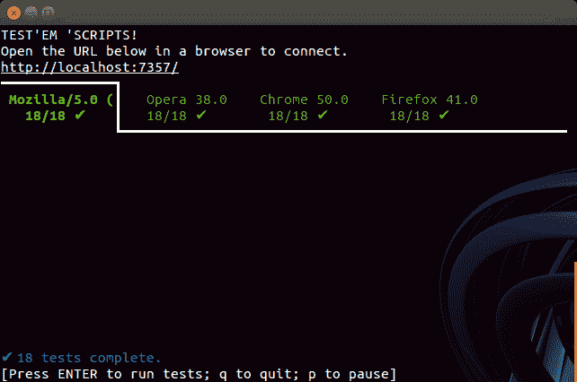

显示已连接浏览器的 Testem 命令行界面

Testem 还拥有一个用于构建服务器的持续集成设置。更多信息可以从 GitHub 仓库找到（https://github.com/airportyh/testem）

可以通过以下命令通过 node 安装 Testem（注意，在基于 Linux 的系统上你可能需要在前加 sudo）：

`npm install -g testem`

默认情况下，Testem 会尝试加载当前目录下的任何 JavaScript 文件，解析其中的任何测试，并在浏览器连接时运行它们。因此，Testem 在内存中创建一个简单的 HTML 页面并将该页面提供给我们的浏览器。这种简单样式默认使用 Jasmine 1.3，因此我们需要通过在测试目录中创建一个简单的 `testem.yml` 文件来配置 Testem 使用 Jasmine 2，如下所示：

```json
{
  "framework": "jasmine2",
  "src_files": [
    "jquery.js",
    "jasmine-jquery.js",
    "Extension.js",
    "test1.js"
  ]
}
```

此 `testem.yml` 文件是一个简单的 JSON 格式，指定了 `framework` 并表明我们正在使用 Jasmine 2。`src_files` 属性包含了一些测试。确保访问仓库获取更多信息。Testem 拥有一系列可以在配置文件中指定的选项。

*测试驱动开发*

**[ 265 ]**

### Karma

Karma 是一个基于 node 的测试运行器。它在命令行运行，并打开一个简单的界面来查看测试结果。Karma 会自动检测 JavaScript 文件的变化并现场执行测试，在单元测试阶段提供即时反馈。Karma 也拥有一个可用于构建服务器的持续集成设置。与 Testem 类似，Karma 也可以以下命令通过 node 安装（注意，在基于 Linux 的系统上你可能需要在前加 sudo）：

`npm install -g karma`

默认情况下，Karma 会尝试加载当前目录下的任何 JavaScript 文件，解析其中的任何测试，并在浏览器连接时运行它们。因此，Karma 在内存中创建一个简单的 HTML 页面并将该页面提供给我们的浏览器。这种简单样式默认使用 Jasmine 1.3，因此我们需要通过在测试目录中创建一个简单的 `karma.conf.js` 文件来配置 Karma 使用 Jasmine 2，如下所示：

```javascript
module.exports = function (config) {
  config.set({
    basePath: '../',
    files: [
      'test/Extension.js',
      'node_modules/jquery/jquery.js',
      'node_modules/jasmine-jquery/lib/jasmine-jquery.js',
      'test/test1.js'
    ],
    autoWatch: true,
    frameworks: ['jasmine'],
    browsers: ['Chrome'],
    plugins: [
      'karma-chrome-launcher',
      'karma-jasmine'
    ]
  });
};
```

此 `karma.conf.js` 文件是一个简单的配置文件。我们通过定义一个接收单个参数 `config` 的函数并将其赋值给 `module.exports` 属性开始。所有的配置参数通过调用 `config.set` 进行设置。`basePath` 参数指定了根路径，它与 `karma.conf.js` 所在的目录相关。`files` 数组包含了包含在生成的 HTML 中的文件列表。在这里，我们指定了成功运行测试所需。`autoWatch` 参数让 Karma 在后台运行并监听变化，类似于 Testem 的做法。`frameworks` 参数表明我们正在使用 jasmine。`browsers` 参数允许指定浏览器。在示例中，我们只使用了 Chrome。最后一个参数是 `plugins`，包含了启动 Chrome 所需的插件以及用于 Jasmine 的插件。一旦此文件到位，只需如下所示运行 `karma start`：

`karma start <karma.conf.js 的路径>`

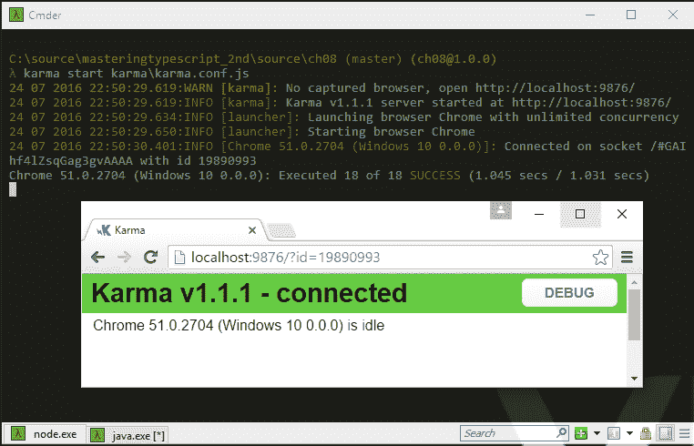

简单测试的 Karma 输出

*测试驱动开发*

**[ 266 ]**

### Protractor


# Protractor 是一个基于 Node 的测试运行器

Protractor 是一个基于 Node 的测试运行器，用于端到端测试，或集成和验收测试。与 Testem 和 Karma 创建用于单元测试的网页不同，Protractor 用于程序化地控制浏览器。就像手动测试一样，Protractor 能够访问特定页面，然后通过 JavaScript 与页面进行交互。作为一个简单的例子，假设你的网站有一个登录页面，并且所有后续功能都需要有效登录。使用 Protractor，我们可以通过访问登录页面、输入有效的凭据来启动每个测试，然后继续访问我们测试套件中的每个页面。

## 测试驱动开发

使用 Protractor，我们还可以检查 HTML 页面中的元数据属性——例如页面标题，或者我们可以填充表单并点击按钮。可以通过 npm 安装 Protractor，方法如下：

`npm install -g protractor`

我们稍后会讨论如何运行 Protractor，但首先，让我们讨论一下 Protractor 在底层用于驱动浏览器的引擎。

### 使用 Selenium

Selenium 是 Web 浏览器的驱动程序。它允许对 Web 浏览器进行程序化的远程控制，并可用于 Java、C#、Python、Ruby、PHP、Perl 甚至 JavaScript 中创建自动化测试。Protractor 在底层使用 Selenium 来控制 Web 浏览器实例。要安装供 Protractor 配合使用的 Selenium 服务器，请运行以下命令：

`webdriver-manager update`

要启动 Selenium 服务器，请运行以下命令：

`webdriver-manager start`

如果一切顺利，Selenium 将报告服务器已启动，并详细列出 Selenium 服务器的地址。请检查你的输出中是否有类似下行的内容：

`RemoteWebDriver instances should connect to: http://127.0.0.1:4444/wd/hub`

注意，你的机器上需要安装 Java，因为 `webdriver-manager` 使用 Java 来启动 Selenium 服务器。

一旦服务器运行，我们需要为 Protractor 创建一个配置文件（类似于 Karma），按照惯例将其命名为 `protractor.conf.js`。该文件的内容如下：

```javascript
exports.config = {
  seleniumAddress: 'http://localhost:4444/wd/hub',
  specs: ['*.js']
}
```

在这里，我们只是简单地为 `exports.config` 对象分配了一些属性。我们设置的第一个属性是 `seleniumAddress`，正如我们之前看到的，它是 Selenium 服务器的实例。第二个属性名为 `specs`，是待运行的测试列表。因此，此 `specs` 属性会在与 `protractor.conf.js` 文件相同的目录中查找任何 `.js` 文件。

现在来进行最简单的测试：

```javascript
describe("simple protractor test", () => {
  it("should navigate to google and find a title", () => {
    browser.driver.get('http://www.google.com');
    expect(browser.driver.getTitle()).toContain("Google");
  });
});
```

我们的测试从打开 `'http://www.google.com'` 页面开始。然后它期望看到页面标题被设置为 `'Google'`。我们现在可以按照如下运行 Protractor 来执行此测试：

`protractor .\protractor\protractor.conf.js`

如果你关注屏幕，你将看到 Protractor 启动一个新的 Chrome 浏览器会话实例，然后导航到 Google 首页。随后，它将执行断言。我们的命令行输出如下：

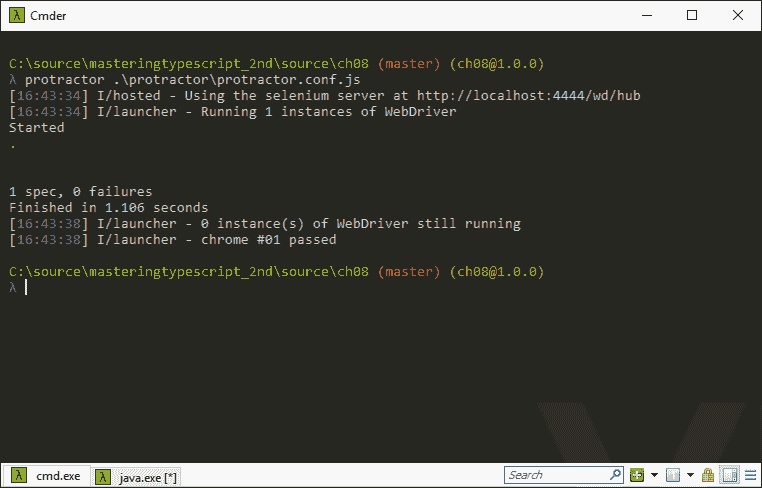

Protractor 测试结果


## 使用持续集成

在为任何应用程序编写单元测试时，设置构建服务器并在每次源代码控制检查时运行测试会变得非常重要。当你的开发团队超过一名开发人员时，使用持续集成构建服务器就变得至关重要。该构建服务器将确保任何提交到源代码控制服务器的代码都能通过所有已知的单元测试、集成测试和自动化验收测试。构建服务器还负责标记构建版本，并生成部署期间可能需要的任何部署产物。构建服务器的基本步骤如下：

- 检出源代码最新版本并增加构建号
- 在构建服务器上编译应用程序
- 运行任何服务端的单元测试
- 为部署打包应用程序
- 将包部署到构建环境
- 运行任何服务端的集成测试
- 运行任何 JavaScript 单元、集成或验收测试
- 将变更集和构建号标记为通过或失败
- 如果构建失败，通知负责导致失败的人员

如果上述任何一个步骤失败，构建服务器都应该失败。

### CI 的优势

使用构建服务器运行上述步骤对任何开发团队都有带来巨大的收益。首先，应用程序在构建服务器上编译——这意味着任何工具或外部库都需要在构建服务器上安装。这为你的开发团队提供了一个机会，准确记录为了编译或运行你的应用程序，在新机器上需要安装哪些软件。

其次，在尝试打包步骤之前，可以运行一组标准的服务端单元测试。在 Visual Studio 项目中，这些将是使用任何流行的 .NET 测试框架——MsTest、nUnit 或 xUnit 构建的 C# 单元测试。

接下来，运行整个应用程序的打包步骤。让我们假设某个开发人员在项目中包含了一个新的 JavaScript 库，但忘记将其添加到源代码控制中。在这种情况下，所有测试将在其本地计算机上运行，但会因为缺少该库导致构建失败。构建服务器将确保任何提交到源代码控制服务器的代码通过所有已知的单元测试、集成测试和自动化验收测试。构建服务器还负责标记构建版本，并生成部署期间可能需要的任何部署产物。TeamCity 是一个非常流行的且强大的构建服务器，如果你人数较少（<20）且项目较少（<20），它是免费的。商业许可证约为 $1500。在 TeamCity 中配置构建步骤比 Jenkins 或 TFS 容易得多，因为它根据你创建的构建步骤类型使用向导式配置。TeamCity 还具有丰富的单元测试功能，并可以显示单元测试的图表，因此被认为是构建服务器中的佼佼者。

#### Jenkins

Jenkins 是一个开源、免费的构建服务器。它拥有广泛的社区和许多插件。Jenkins 的安装和配置非常直观，但有时需要一些经验才能正确配置。

#### Team Foundation Server

TFS 是一个需要对其组件授权的微软产品。TFS 需要在其构建代理上进行特定的配置以禁用。我们的每个示例都成功报告了测试执行次数，以及测试套件的失败。我们使用了简单的配置文件和简单的 HTML 文件来设置和执行测试。

### 集成测试报告

我们已经看到了如何使用 Jasmine、Testem、Karma 和 Protractor 创建并运行测试。我们的每个示例都成功报告了测试执行次数，以及测试套件的失败。我们使用了简单的配置文件和简单的 HTML 文件来设置和执行测试。

然而，在现实世界的应用程序中，通常需要运行服务端逻辑或使用服务端 HTML 渲染。例如，大多数应用程序在允许通过 JavaScript 调用自定义 REST 端点之前，需要某种身份验证或登录。遗憾的是，从普通的 HTML 页面调用任何这些 REST 端点将返回 401（未授权）错误。对于此类情况，我们应该针对完整的网站运行测试。

这意味着我们需要一种方法来捕获测试套件的结果，并报告给我们的 CI 服务器。为了这些报告目的，Jasmine 除了我们之前使用的标准 `HtmlReporter` 之外还包含了使用自定义测试报告器的能力。GitHub 项目 jasmine-reporters (`https://github.com/larrymyers/jasmine-reporters`) 拥有许多预构建的测试报告器，适用于最流行的构建服务器。

在通过 npm 安装 `jasmine-reporters` 包后，我们可以更新 `protractor.conf.js` 文件在 Protractor 中使用这些 Jasmine 报告器：

`npm install jasmine-reporters --save-dev`

我们对 `protractor.conf.js` 文件的更新如下：

```javascript
exports.config = {
  seleniumAddress: 'http://localhost:4444/wd/hub',
  specs: ['*.js'],
  onPrepare: function() {
    var jasmineReporters = require('jasmine-reporters');
    jasmine.getEnv().addReporter(
      new jasmineReporters.TeamCityReporter());
  }
}
```

在这里，我们在配置设置中包含了一个 `onPrepare` 属性，以便运行匿名函数。该函数通过调用 `require` 创建了一个名为 `jasmineReporters` 的变量，然后向 Jasmine 运行时环境添加了新的 `TeamCityReporter`。`require` 函数调用是模块加载机制的一部分，我们将在后面的章节中介绍。

现在使用 Protractor 运行测试将向命令行输出 TeamCity 能够理解的消息，如下：

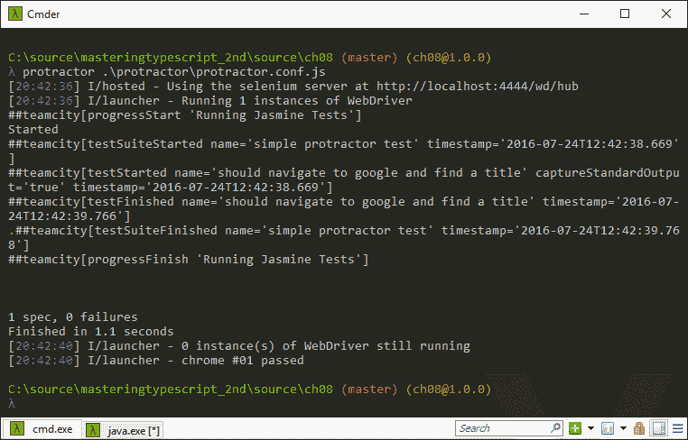

使用 TeamCity 格式的 Protractor 输出

## 总结

在本章中，我们从零开始探索了测试驱动开发。我们讨论了 TDD 的理论，探索了单元测试、集成测试和验收测试之间的区别，并查看了持续集成构建服务器的过程。随后，我们探索了作为测试框架的 Jasmine，学习了如何编写测试，使用了期望和匹配器，还探索了 Jasmine 扩展以帮助数据驱动测试和通过 fixtures 处理 DOM。最后，我们查看了测试运行器，讨论了它们何时以及何地使用，并使用 Protractor 通过 Selenium 驱动网页并将结果反馈构建服务器。

在下一章中，我们将探索如何为我们的三个 TypeScript 框架——Aurelia、Angular 2 和 React 创建测试。

# 测试 TypeScript 兼容框架

在`第 7 章` *TypeScript 兼容框架* 中，我们讨论了 TypeScript 兼容框架，并探索了 Backbone、Aurelia、Angular 2 和 React 如何使用 MVC 或 MVVM 设计模式编写模型、视图和控制器。我们在这些框架中都实现了相同的示例应用程序，以便比较它们之间的相似性并注意细微的差异。然后，在上一章中，我们开始探索测试驱动开发，并讨论了使用 Jasmine 2.0 作为测试框架。我们还探索了使用各种测试运行器，包括 Testem 和 Karma，最后探索了使用 Protractor 运行集成测试或端到端测试。

在本章中，我们实际上将结合前两章的工作，并讨论如何对我们的每个 TypeScript 兼容框架进行单元测试和集成测试。对于这些框架中的每一个，我们将涵盖以下主题：

- 为了方便测试而更新示例应用程序
- 设置单元测试框架
- 编写单元测试
- 设置集成测试框架
- 编写集成测试

## 测试我们的示例应用程序

你可能记得我们的示例应用程序具有以下功能：

- 使用视图显示模型属性
- 构建数据数组，每个数组项都是单个模型实例
- 遍历数组并在 `<li>` 和 `<button>` 元素中渲染每个项
- 对每个按钮元素上的点击事件做出响应：
    - 显示用于渲染元素的模型属性

如果我们列出我们可以写的一些测试，理想情况下，我们希望测试能覆盖以下情景：

**模型测试：**

- 在使用内部模型并分配默认值的地方，测试这些默认值是否按预期创建
- 在从原始 JavaScript 对象创建模型的地方，检查模型是否正确创建
- 在创建复杂模型对象（即包含其他模型的模型）的地方，检查这些模型是否正确创建

**应用程序状态：**

- 当应用程序在特定状态下启动时（即内部变量被设置为默认值），验证这些值是否被正确设置

**渲染测试：**

- 在给定已知模型的情况下，检查视图对象是否正确渲染了正确的 HTML 并正确地渲染到 DOM 中

**DOM 事件测试：**

- 检查 DOM 事件（如点击按钮）是否被正确处理

**验收测试：**

- 浏览到所需的 URL
- 确保没有选择任何内容
- 点击按钮选择项目
- 验证屏幕显示了选择了哪一个项目

## 为了可测试性修改我们的示例

你可能记得我们的示例应用程序在点击按钮时会显示警框。遗憾的是，如果我们在自动化单元测试套件中运行此版本的应用程序，我们需要捕获警框并通过程序点击 **OK** 按钮。

在通用的测试术语中，警框是应该避免的。如果警框在没有预期的情况下突然出现，可能会导致你的整个测试套件失败，因为浏览器会暂停等待人工干预。然而，也有处理警框的方法。（注：此处原文存在大量 OCR 导致的重复和错误，已根据上下文清理并保持逻辑流畅。）

## Backbone 测试

在本节中，我们将查看修改现有的 Backbone 应用程序以包含必要的更改，并编写单元测试。

### 复杂模型

我们需要对应用程序进行的第一个更改是引入一个复杂模型（即包含其他模型的模型）。记住，在初始版本中，我们有一个名为 `ItemModel` 的单个模型。这个 `ItemModel` 用于存储有关单个按钮的信息，即它的 `Id` 和 `DisplayName`。然后我们创建了一个 `ItemView`，它可以接收一个 `ItemModel` 并将其渲染到 `<button>` 中。随后我们创建了一个 `ItemCollection` 来容纳 `ItemModels` 数组，并创建了一个 `ItemCollectionView` 来渲染该集合。

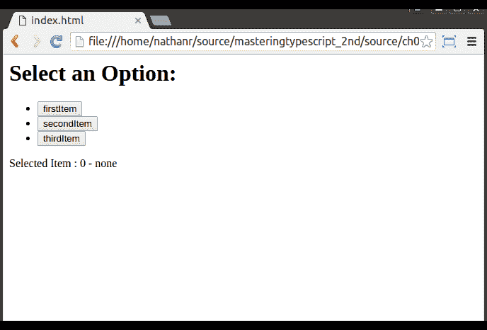

更新后的布局

在这里，我们可以看到 `ItemView` 用于将单个 `<li>` 元素（包含 `<button>`）渲染到 DOM。这些 `ItemViews` 的底层模型是 `ItemModel`。`ItemModels` 数组存储在 `ItemCollection` 中。该 `ItemCollection` 由 `ItemCollectionView` 用于渲染屏幕上的所有按钮。

我们对原始应用程序的修改包括创建一个复杂模型和一个关联视图，如下：


带有模型和视图的更新应用程序

在这里，我们重用了之前的 `ItemView` / `ItemModel` 组合。然而，注意 `ItemCollection` 现在位于名为 `ItemCollectionViewModel` 的复杂模型中。该复杂模型还包含一个名为 `SelectedItem` 的属性，以及一个名为 `Title` 的属性。`Title` 属性将包含文本 **Select an Option:**，`SelectedItem` 属性将用于渲染当前选中的项目到 DOM。我们还将稍微修改 `ItemCollectionView` 以正确渲染 `ItemCollectionViewModel`。

让我们来看这个复杂的模型，`ItemCollectionViewModel` 类，如下：

```typescript
interface IItemCollectionViewModel {
  Title: string;
  SelectedItem : IClickableItem;
}

class ItemCollectionViewModel extends Backbone.Model
  implements IItemCollectionViewModel
{
  get Title(): string
  { return this.get('Title'); }
  
  set Title(value: string)
  { this.set('Title', value); }
  
  get SelectedItem(): IClickableItem
  { return this.get('SelectedItem'); }
  
  set SelectedItem(value: IClickableItem)
  { this.set('SelectedItem', value); }

  constructor(input: IItemCollectionViewModel) {
    super();
    for (var key in input) {
      if (key) { (this as any)[key] = (input as any)[key]; }
    }
  }
}
```

我们从一个名为 `IItemCollectionViewModel` 的接口开始，它包含两个属性——类型为 `string` 的 `Title` 和类型为 `IClickableItem` 的 `SelectedItem`。然后我们定义了一个扩展 `Backbone.Model` 并实现该接口的 `ItemCollectionViewModel`。这是一个标准的 `Backbone.Model`，因此对于我们的每个属性都必须有 `get` 和 `set` 函数。该模型还使用了我们的标准构造函数。但注意，我们没有包含 `Collection` 属性。这是由于 Backbone 类的构造方式导致的。为了理解这一点，让我们来看 `ItemCollectionView` 是如何构造的：

```typescript
let collectionModel = new ItemCollectionViewModel({
  Title: 'Select an Option:',
  SelectedItem: { Id: 0, DisplayName: "none" }
});

let itemCollection = new ItemCollection(ClickableItemCollection);

let itemCollectionView = new ItemCollectionView({
  model: collectionModel,
  collection: itemCollection
});
```

在这里，我们正在构造一个名为 `collectionModel` 的 `ItemCollectionViewModel`，并设置它内部的 `Title` 和 `SelectedItem` 属性。然后我们创建一个名为 `itemCollection` 的 `ItemCollection` 实例。这段代码示例中值得注意的有趣点是，随后我们创建了一个 `ItemCollectionView`，并传入一个包含两个属性（`model` 和 `collection`）的对象。所有的 `Backbone.View` 都同时拥有 `model` 和 `collection` 属性，允许它们渲染单个模型、模型集合或两者兼有。在我们的情况下，我们正在使用新的复杂模型来渲染 `Title` 和 `SelectedItem` 属性，然后使用现有的 Backbone `collection` 属性来渲染 `ItemCollection`。

### 视图更新

底层模型的这种更改允许我们如下修改 `ItemCollectionView` 的视图模板：

```html
<script type="text/template" id="itemCollectionViewTemplate">
  <h1> <%= Title %> </h1>
  <ul id="ulRegions"></ul>
  <div> Selected Item :
    <%= SelectedItem.Id %> -
    <%= SelectedItem.DisplayName %> 
  </div>
</script>
```

在这里，我们更新后的 HTML 现在包含了在 `<h1>` 标签内渲染的 `Title` 属性，以及模板底部 `<div>` 标签，用于显示 `SelectedItem` 属性的 `Id` 和 `DisplayName` 属性。

### DOM 事件更新

我们现在可以将注意力转向点击按钮时会发生什么。之前，我们简单地从 `ItemView` 触发一个警告对话框，显示底层模型的值，如下：

```typescript
onClicked() {
  alert(`Item clicked : { Id: ${this.model.get('Id')}, DisplayName : ${this.model.get('DisplayName')} }`);
}
```

我们现在需要实现一种方法，让 `ItemView` 通知我们的 `ItemCollectionView` 发生了特定的 `onClicked` 事件。幸运的是，Backbone 为我们提供了一个非常简单的消息总线来实现。为了使用 Backbone 事件总线，我们将创建一个简单的 TypeScript 类，它有一个静态属性，我们可以通过该属性向总线发布事件消息，如下：

```typescript
class EventBus {
  static Bus = _.extend({}, Backbone.Events);
}
```

这个名为 `EventBus` 的类有一个名为 `Bus` 的静态属性，它使用下划线的 `extend` 函数将一个空 JavaScript 对象 `{}` 与 `Backbone.Events` 对象结合。这就是在应用程序中包含一个全功能事件总线的所有要求。

在 `onClicked` 函数中触发适当的事件变得非常简单：

```typescript
onClicked() {
  EventBus.Bus.trigger("item_clicked", this.model);
}
```

在这里，我们触发了一个名为 `item_clicked` 的事件，并将在 `ItemView` 中使用的模型作为参数传递给 `trigger` 函数。在 `ItemCollectionView` 中监听此事件包含两个部分。首先，我们需要在 `ItemCollectionView` 中注册此事件：

```typescript
class ItemCollectionView extends Backbone.View<ItemCollectionViewModel> {
  constructor(options) {
    super(options);
    EventBus.Bus.on("item_clicked", this.handleItemClicked);
  }

  handleItemClicked(model) {
    // 处理事件
  }
}
```

（注意：提供的 OCR 文本在后页提供了一些高度碎片/中断的逻辑；我根据文中提供的 Backbone/TypeScript 模式重构了逻辑流。）

### 模型测试

我们现在可以将注意力转向测试 `ItemModel` 类。为了确保一切符合预期，我们将编写一些单元测试。

```typescript
describe('ItemModel tests', () => {
  let itemModel: ItemModel;

  beforeEach(() => {
    itemModel = new ItemModel({
      Id: 1,
      DisplayName: 'testDisplay'
    });
  });

  it('should assign an Id property', () => {
    expect(itemModel.Id).toBe(1);
  });

  it('should assign a DisplayName property', () => {
    expect(itemModel.DisplayName).toBe('testDisplay');
  });

  it('should set an Id property', () => {
    itemModel.Id = -10;
    expect(itemModel.Id).toBe(-10);
  });

  it('should set a DisplayName property', () => {
    itemModel.DisplayName = 'updatedDisplay';
    expect(itemModel.DisplayName).toBe('updatedDisplay');
  });
});
```

作为一组额外的测试用例，我们甚至可以绕过 `set` 和 `get` 函数，并验证底层的 Backbone 函数也正确设置了属性，如下：

```typescript
it('should call set on Id property', () => {
  itemModel.set('Id', -10);
  expect(itemModel.get('Id')).toBe(-10);
});

it('should call set on a DisplayName property', () => {
  itemModel.set('DisplayName', 'updatedDisplay');
  expect(itemModel.get('DisplayName')).toBe('updatedDisplay');
});
```

在这里，我们正在测试内部的 `set` 和 `get` Backbone 函数实现的功能与使用 TypeScript 属性 getter 和 setter 语法完全相同。

### 复杂模型测试

我们可以使用相同的技术来测试复杂模型是否正确实例化。

考虑以下测试套件：

```typescript
describe('ItemCollectionViewModel tests', () => {
  let itemCollectionViewModel : ItemCollectionViewModel;

  beforeAll( () => {
    itemCollectionViewModel = new ItemCollectionViewModel(
      {
        Title : 'testTitle',
        SelectedItem : { Id : 0, DisplayName : 'testDisplay'}
      }
    );
  });
```

在这里，我们正在创建一个复杂模型的实例，命名为 `itemCollectionViewModel`。有趣的地方在于使用 POJO 构建了此复杂模型。我们在 `beforeAll` 函数中调用了构造函数，并简单地将 POJO 嵌套在一起。我们设置了 `Title` 属性，然后将 `SelectedItem` 属性设置为另一个具有 `Id` 和 `DisplayName` 属性的 POJO。

这些 POJO 使用的结构与我们预期从后端 REST 端点以 JSON 格式返回的结构相同。因此，定义此类对象测试可以很容易扩展为集成测试，集成测试将调用实际 Web 服务并从 POJO 重新水化我们的模型。

随后，我们对该复杂模型的单元测试可以简单地遍历可用属性，以确保所有内容都设置正确，如下：

```typescript
it('should assign a Title property', () => {
  expect(itemCollectionViewModel.Title).toBe('testTitle');
});

it('should assign a SelectedItem.Id property', () => {
  expect(itemCollectionViewModel.SelectedItem.Id).toBe(0);
});

it('should assign a SelectedItem.DisplayName property', () => {
  expect(itemCollectionViewModel.SelectedItem.DisplayName)
  .toBe('testDisplay');
});
```

我们的第一个测试检查了 `Title` 属性的值，接下来的测试检查 `SelectedItem` 属性的值（这是一个子 Backbone 模型）。

### 渲染测试

一旦我们确认 Backbone 模型已正确水化，就可以将注意力转向它们的视图，并编写一些测试以确保它们将这些模型属性正确渲染到 DOM 中。我们将使用 Jasmine 的 `setFixtures` 函数来设置 Backbone 模板，如下：

```typescript
describe('ItemView rendering tests', () => {
  let itemModel : ItemModel;

  beforeEach( () => {
    setFixtures(
      `<div id="itemViewElement"></div>`
      `<script type="text/template" id="itemViewTemplate">`
      `<button id='itemButton'>`
      `<%= DisplayName %>`
      `</button>`
      `</script>`
      `<script type="text/template" id="itemCollectionViewTemplate">`
      `</script>`
    );
    itemModel = new ItemModel({Id : 1, DisplayName : 'testDisplay'});
  });
```

在这里，我们创建并实例化了一个名为 `itemModel` 的 `ItemModel` 实例，供每个测试复用。我们还调用了 `setFixtures` 向 DOM 注入我们所需的 HTML `<script>` 标签。`ItemView` 将使用的 `<script>` 标签是 `itemViewTemplate` 脚本，它定义了以下 HTML：

`<button id='itemButton'> <%= DisplayName %> </button>`

此模板在 `<button>` 标签内部使用了 `ItemModel` 实例的 `DisplayName` 属性。然而，在实际的 `ItemView` 构造函数，我们指定了 `tagName` 属性，如下：

`options.tagName = "li";`

此 `tagName` 属性意味着单个 `ItemView` HTML 代码段——一旦完成渲染——将包含 `<button>` 元素（来自我们的 HTML 代码段）在一个 `<li>` 元素内部（来自你的 `tagName` 属性）。在 HTML 代码段中，Backbone 还会替换我们的 `DisplayName` 属性，从而渲染以下 HTML：

```html
<li>
  <button id="itemButton"> testDisplay </button>
</li>
```

因此，我们的测试将在 `ItemView` 渲染后寻找这些 HTML 元素，如下：

```typescript
it('should render a li and button element', () => {
  expect(itemView.el.tagName).toBe('li');
  expect(itemView.el.querySelector('button').textContent).toBe('testDisplay');
});
```

### Backbone 测试总结

正如我们所看到的，在测试 Backbone 应用时，仅使用 Jasmine 和 Jasmine-jQuery 就能进行广泛的单元测试。我们能够在不离开 Jasmine 环境的情况下，创建模型测试、视图渲染测试，甚至是 DOM 事件测试。

## Aurelia 测试

在本节中，我们将查看 Aurelia 测试应用程序需要进行的更改，以便其能够在 HTML 页面上存储并显示当前选中的项目。然后，我们将深入编写用于检查应用程序内部状态的单元测试，并编写一些 DOM 渲染测试。最后，我们将创建一组使用 Protractor 的集成测试，通过点击页面内的按钮，并确保 HTML 页面被正确更新。

### Aurelia 组件

为了将当前选中的项目渲染到 DOM 中并替换我们一直在使用的 alert，我们将构建一个 Aurelia 组件。组件本质上是视图和视图模型的配对。视图模型代码以标准的 TypeScript 类的形式编写，而视图以标准的 HTML 模板编写。Aurelia 有一种特殊的命名约定，将这两个元素联系在一起，正如我们之前构建的 `app.ts` 和 `app.html` 资源所示。只要视图和视图模型符合这一命名标准，Aurelia 就会自动处理它们之间的数据绑定，这将允许我们编写最少的代码来实现目标。

### Aurelia 组件视图模型

让我们先在 `App` 类中创建一个局部变量来保存当前选中的项目，如下：

```typescript
import {ClickableItem} from './ClickableItem';

export class App {
  message: string = 'Select an Option:';
  currentElement: ClickableItem;
  items: ClickableItem[] = [
    { idValue: 1, displayName : "firstItem"},
    { idValue: 2, displayName : "secondItem"},
    { idValue: 3, displayName : "thirdItem"},
  ];

  constructor() {
    this.currentElement = { idValue: 0, displayName : 'none'};
  }

  onItemClicked(event: ClickableItem) {
    this.currentElement = event;
  }
}
```

在这里，我们对初始的 `app.ts` 文件进行了更改。首先，我们在文件顶部添加了一行，从 `'./ClickableItem'` 文件导入了一个名为 `ClickableItem` 的新类。这种导入语法用于模块化，允许我们轻松引用其他 TypeScript 源文件中的类。我们将在下一章中详细介绍模块化。

我们做的第二个更改是添加了一个名为 `currentElement`（类型为 `ClickableItem`）的局部变量，用于存储当前选中的项目。我们还为类创建了一个 `constructor` 函数，并在构造函数内部将 `currentElement` 设置为 `{ 0, none }`。实际上，我们将应用程序的初始状态设置为无选中。

我们做的第三个更改是修改处理 DOM 点击事件的 `onItemClicked` 函数。我们现在不再创建 `alert`，而是简单地将类的 `currentElement` 属性设置为传递给函数的项。

现在让我们关注 `ClickableItem` 组件本身。正如之前提到的，一个组件由视图模型和视图组成。我们的视图将在名为 `ClickableItem.ts` 的单独 TypeScript 文件中创建。该文件名与 `app.ts` 文件顶部的 `import {} from` 语句匹配（`'./ClickableItem'` – 不带 `.ts` 扩展）。我们的 `ClickableItem.ts` 文件的源代码是一个简单的 TypeScript 类，如下：

```typescript
import {bindable} from 'aurelia-framework';

export class ClickableItem {
  @bindable displayName: string;
  @bindable idValue: number;
}
```

再次，我们从 `'aurelia-framework'` 包中导入了 `bindable` 函数……

### Aurelia 组件视图

现在有了视图模型，我们可以创建 Aurelia 组件的 HTML 模板：

```html
<div id="selectedElement">
  {{idValue}} - {{displayName}}
</div>
```

### 渲染组件

应用程序的最后一个更改是包含此组件视图。为了实现这一点，我们修改了 `app.html` 模板：

```html
<require from="./ClickableItem"></require>
<h1>{{message}}</h1>
<ul>
  <li repeat.for="item of items" click.delegate="onItemClicked(item)">
    <button id="item.idValue">{{item.displayName}}</button>
  </li>
</ul>
```

### Aurelia 命名约定

在构建和测试 Aurelia 组件时，需要记住的一个非常重要的约定是视图模型（TypeScript 类）和视图（HTML 模板）内部使用的命名语法。正如我们之前看到的，Aurelia 在自动绑定视图和视图模型时承担了大量的底层工作。这种自动化绑定功能的关键在于命名约定。

如果我们创建一个名为 `ClickableItem` 的 TypeScript 类，那么该类名在任何 HTML 文件中必须被引用为 `<clickable-item>`。这种命名约定被称为 kebab-case（短横线命名法）。Aurelia 实施这种语法规定是因为 HTML 的限制，在 HTML 中大写和小写是不敏感的。换句话说，属性名 `TestAttribute='value'` 在语法上等同于 `testattribute='value'`。为了克服大小写限制，Aurelia 提供了一种自动从属性到 JavaScript 属性的绑定约定，该约定使用 kebab-case。每个新的大写字母必须转换为小写，并用连字符（ - ）隔开。记忆这种命名约定的一种简单方法是看 TypeScript 这个词（注意单词 TypeScript 中大写的 T 和大写的 S）。因此，名为 `MyTypeScriptClass` 的 TypeScript 类在 HTML 视图中将被引用为 `my-type-script-class`。这种命名约定也适用于 HTML 元素属性。因此，绑定到名为 `MyTypeScriptProperty` 的 TypeScript 属性的属性在任何 HTML 视图中都需要命名为 `my-type-script-property`。

这种命名约定语法中的另一个注意事项与 `${ ... }` Aurelia 语法有关，它用于参数替换。请记住，`${ ... }` 块中的任何内容都会被视为 JavaScript，因此它**不会**使用 kebab-case（横线式）命名规范。因此，为了引用名为 `myPropertyName` 的 TypeScript 属性，我们需要在 `${ ... }` 块中原样使用它，即 `${myPropertyName}`。

每个 Aurelia 开发者在某个时候都会被这种语法命名约定坑过。然而，一旦你被坑过，并且花了几个小时试图弄清楚为什么你的应用程序无法渲染，那么回去重新检查这些命名规则就会变成一种本能。

### Aurelia 测试设置

在完成应用程序的更改后，我们现在可以专注于 Aurelia 应用程序的单元测试。然而，在此之前，我们需要设置一个 Aurelia 测试环境。在设置新的 Aurelia 应用程序 (`au new`) 时，Aurelia 命令行界面提出的问题之一就是配置单元测试。如果我们对这个问题回答“是”，那么所有的测试配置文件和依赖项将自动安装。为了节省时间，我们不再研究如何向现有的 Aurelia 应用程序添加单元测试功能，而是假设这已经配置完成。

运行 Aurelia 单元测试，只需输入：

`au test`

这将调用内置的 Karma 测试运行器，并执行 `/test/unit` 目录下任何符合 `*spec.js` 文件名命名约定的测试。

在任何测试编译并包含新的测试运行之前，必须执行 `au build` 命令。Aurelia 提供了 `--watch` 命令行参数，当检测到磁盘上的文件修改时，它会自动重新执行当前命令。这意味着当我们修改 TypeScript 源文件时，运行 `au test --watch` 将自动编译并重新运行 Karma 单元测试。这是一个非常有用的特性可以在编写单元测试时提供即时反馈。

### Aurelia 单元测试

我们的第一组单元测试需要验证 `App` 类（我们的入口点）已正确构造，即它处于正确的状态。当应用程序首次加载时，它将渲染一个标题、三个按钮，并指示没有选择任何项目。这些 HTML 元素绑定到 `App` 类本身的 `message`、`currentElement` 和 `items` 属性。让我们在 `/test/unit` 目录下创建一个 `app.spec.ts` 文件，并编写测试来验证这些属性是否已正确设置，如下：

```typescript
import {App} from '../../src/app';

describe('App tests', function () {
  var application : App;
  beforeAll( () => {
    application = new App();
  });
  it('message property contains Select', function () {
    expect(application.message).toContain('Select');
  });
});
```

此测试的第一行使用 `import` 语句从 `'../../src/app'` 文件导入 `App` 类。请注意，`../../` 引用是必要的，因为任何使用该路径的 `import` 语句与执行导入的文件相关。

然后我们使用标准的 Jasmine `describe` 语法设置测试套件，并配置一个名为 `application` 的变量来持有 `App` 类的实例。我们的第一个测试验证 `App` 类的 `message` 属性（在构造时）包含短语 `"Select"`。因此，此测试正在检查 `App` 类在构造时的初始状态。我们可以按照下面的方式检查每个内部变量：

```typescript
it('has a property named items', function () {
  expect(application.items).toBeDefined();
});
it('has an array of clickable items', function () {
  expect(application.items.length).toBe(3);
});
it('sets currentElement property in constructor', function () {
  expect(application.currentElement).toBeDefined();
});
it('sets currentElement.idValue to 0', function () {
  expect(application.currentElement.idValue).toBe(0);
});
it('sets currentElement.displayName to none', function () {
  expect(application.currentElement.displayName).toBe('none');
});
```

在这里，我们为 `items` 变量（长度为 `3` 的数组）编写了几个测试，为 `currentElement` 变量编写了几个测试（它应该被设置为 `idValue = 0` 和 `displayName = 'none'`）。这些测试正在验证当创建 App 实例时，类的初始状态是否被正确设置。

### 渲染测试

我们的下一轮测试将涵盖将元素渲染到 DOM。Aurelia 提供了一组辅助类，类似于 Jasmine 的 `setFixture` 功能，用于将 HTML 附加到 DOM 并使用这些临时 DOM 元素渲染视图。因此，我们的测试套件需要在文件顶部包含以下两个 import 语句：

```typescript
import {StageComponent} from 'aurelia-testing';
import {bootstrap} from 'aurelia-bootstrapper';
```

这些导入语句包含一个名为 `StageComponent` 的类和一个名为 `bootstrap` 的函数。`StageComponent` 类是 Aurelia 提供的辅助工具，用于存放被测试项的实例，在我们的案例中，它是 `App` 类的实例。`bootstrap` 函数是创建和引导 Aurelia 应用程序的标准方法。

我们的测试设置如下：

```javascript
var application;
beforeEach(function () {
  application = StageComponent
    .withResources('app')
    .inView(
      '<h1 id="messageHeader">${message}</h1>' +
      '<ul id="ulItemList">' +
      '<li repeat.for="item of items">'
    );
});
```

在这里，我们定义了一个名为 `application` 的变量来存放 `StageComponent` 的实例。`StageComponent` 类的创建使用流式风格来链接命令——`withResources`、`inView` 和 `boundTo`。`withResources` 函数调用将我们的 `app` 代码注册到 `StageComponent`，而 `inView` 定义了我们需要的 HTML。最后的 `boundTo` 函数创建 `App` 的新实例并将此新实例绑定到 `StageComponent`。

我们的第一个测试必须验证 `App` 类的 `message` 属性是否已正确渲染到 DOM，如下：

```typescript
it('should render message property', (done) => {
  application.create(bootstrap).then(() => {
    var messageHeader = document.querySelector('#messageHeader');
    expect(messageHeader).toBeDefined();
    expect(messageHeader.innerHTML).toContain('Select');
    done();
  });
});
```

此测试首先需要注意的是 `it` 函数上的 `(done)` 参数。当我们使用 `StageComponent` 时，Aurelia 会使用 Jasmine 的异步测试功能。因此，我们必须记住在测试函数中传递 `done` 参数，并在测试完成后调用 `done` 函数。

测试本身开始于调用 `StageComponent` 实例（存放我们的 App 测试实例）上的 `create` 函数，并传入 `bootstrap` 函数。此 `create` 函数返回一个名为 `then` 的 promise，我们在其中定义测试的实际内容。一旦进入 promise 内部，所有 Aurelia 的引导和绑定已经已经完成。我们就可以通过 `document.querySelector` 函数查询 DOM。在此测试中，我们找到 `#messageHeader` `<div>`，并检查渲染的 HTML 是否包含字符串 `'Select'`。

我们的下一个测试将验证按钮数组是否已渲染到 DOM，如下：

```typescript
it('should render buttons', function (done) {
  application.create(bootstrap).then(function () {
    var ulItemList = document.querySelectorAll('#ulItemList > li > button');
    expect(ulItemList).toBeDefined();
    for (var i = 0; i < ulItemList.length; i++) {
      var itemElement = ulItemList[i];
      expect(itemElement.innerHTML).toContain('Item');
    }
    done();
  });
});
```

在本次测试中，我们正在使用 `document.querySelectorAll` 函数来返回一个按钮元素数组。注意我们使用的 CSS 选择器语法——`#ulItemList > li > button`。这个 CSS 选择器将返回 `ulItemList` 元素内部的每个 `button` 元素，这些元素同时是 `li` 元素的子元素。然后，我们遍历返回的每个元素，并检查 `innerHTML` 属性是否包含单词 `'Item'`。请记住，页面上显示的按钮文本是 `firstItem`、`secondItem` 和 `thirdItem`，因此这些按钮中的每一个都包含单词 `'Item'`。虽然这可能不是一个决定性的测试，但它展示了我们如何能够如何使用标准的 CSS 选择器来返回多个子项。

我们还有另一个单元测试需要编写。当 `App` 类的实例被首次创建时，`currentElement` 属性被设置为默认值 `{ 0 , none }`。我们希望验证这个子组件（类型为 `ClickableItem`）在页面首次加载时是否渲染到了 DOM 中。我们的测试如下：

```javascript
it('should render none as selected item', (done) => {
  application.create(bootstrap).then( () => {
    var clickableItem = document.querySelector('clickable-item');
    console.log(clickableItem.innerHTML);
    expect(clickableItem.innerHTML).toContain('none');
    done();
  });
});
```

在这里，我们正在构建应用程序的实例，就像我们在其他测试中做的那样，然后使用 `querySelector` 寻找 `<clickable-item>` 元素。我们预期 `innerHTML` 元素将包含单词 `'none'`。遗憾的是，这个测试总是失败。如果我们查看通过 `StageComponent` 生成的 DOM，我们会发现 `<clickable-item>` 元素实际上是空的：

`<clickable-item class="au-target" au-target-id="25"></clickable-item></div>`

这个问题表明，Aurelia 中单元测试的范围并没有像我们最初预期的那样扩展到子组件。

### Aurelia 端到端测试

为了完成我们的 Aurelia 测试，并模拟 DOM 点击以正确更新页面显示选中了哪个项，我们需要切换到集成测试策略，并配置 Protractor 来运行一些端到端测试。

正如我们在上一节中讨论的，Protractor 需要一个配置文件来设置我们的端到端测试环境。位于项目根目录下的 `protractor.conf.js` 文件如下：

```javascript
exports.config = {
  directConnect: true,
  // 传递给 webdriver 实例的能力。
  capabilities: {
    'browserName': 'chrome'
  },
  //seleniumAddress: 'http://0.0.0.0:4444',
  specs: ['test/e2e/dist/*.js'],
  plugins: [{
    path: './node_modules/aurelia-tools/plugins/protractor.js'
  }],
  // 传递给 Jasmine-node 的选项。
  jasmineNodeOpts: {
    showColors: true,
    defaultTimeoutInterval: 30000
  }
};
```

在这个 `config` 文件有两个值得注意的有趣属性。首先，`specs` 属性包含了我们集成 `test` 目录的路径。在此例中，我们指定了 `test/e2e/dist/*.js`。这意味着 Protractor 将搜索 `test/e2e/dist` 目录下的所有 `.js` 文件以寻找端到端测试套件。

第二个值得注意的属性是 `plugins` 属性。它指定了 Aurelia 的 `protractor.js` 文件必须作为插件加载，以便为 Protractor 提供 Aurelia 特有的扩展。


有了这个 `protractor.conf.js` 文件，我们还需要通过几个更多步骤将 Protractor 集成到我们的 Aurelia 项目中。这些步骤涉及：

- 安装依赖
- 引入 `aurelia-protractor.js` 引导器
- 向 Aurelia 任务列表中添加 e2e 任务
- 在 `aurelia_project/aurelia.json` 中添加 e2eTestRunner

我们的第一个设置步骤是按照如下方式安装 `del` 和 `gulp-protractor` 依赖：

`npm install del --save` 
`npm install gulp-protractor --save`

在安装了这些依赖后，我们需要在项目根目录下创建一个 `aurelia-protractor.js` 文件作为项目的引导器。该文件的源代码包含在本章的可下载内容中，将在此处不再讨论。

我们还需要在 `aurelia_project/tasks` 目录下两个名为 `e2e.json` 和 `e2e.ts` 的文件。再次，这些文件包含在可下载的内容中，并且是样板配置文件，因此它们不会包含在此处。

使用 Aurelia 配置 Protractor 的最后一步是编辑 `aurelia_project/aurelia.json` 文件：

```json
{
  "aurelia": {
    "tasks": [
      {
        "name": "e2e",
        "script": "tasks/e2e.js"
      }
    ],
    "options": {
      "e2eTestRunner": "tasks/e2e.ts"
    }
  }
}
```

现在，我们可以运行 `gulp e2e` 来执行我们的端到端测试。

## Angular 2 测试

### 应用更新

与我们使用 Backbone 或 Aurelia 所做的更改相比，我们对 Angular 2 的更改非常简单。为了跟踪应用程序中当前选中的项目，我们需要做三件事：

1. 创建一个属性来存储我们当前选中的项目。
2. 修改我们的 `onSelect` 函数来更新此属性。
3. 更新视图模板以在页面上显示该内容。

我们的第一个更改位于 `AppComponent` 类中，如下：

```typescript
export class AppComponent {
  title = "Select an option :";
  items = ClickableItemArray;
  selectedItem : ClickableItem;

  constructor() {
    this.selectedItem = {id: 0, displayName: "none"};
  }

  onSelect(selectedItem: ClickableItem) {
    this.selectedItem = selectedItem;
    console.log(`onSelect : ${this.selectedItem.id}`);
  }
}
```

在这里，我们做了三处改动。首先，我们添加了 `selectedItem` 属性来存储当前选中的项目。其次，我们创建了一个 `constructor` 函数，将 `selectedItem` 属性设置为初始值 `{ 0 - none }`。第三，我们更新了 `onSelect` 函数，简单地将内部的 `selectedItem` 属性设置为传递到 `onSelect` 函数的项目。

接下来，我们需要更新组件模板，包含一个 `<div>` 元素，以便在页面上显示当前选中的项目。我们的 `app.component.html` 文件如下：

```html
<h1>{{title}}</h1>
<ul>
  <li *ngFor="let item of items; let i = index" (click)="onSelect(item)">
    <button id='select_button_{{i}}'>
      {{item.displayName}} {{i}}
    </button>
  </li>
</ul>
<div *ngIf="selectedItem">
  <div id='selectedItemText'>
    Selected : {{selectedItem.id}} - {{selectedItem.displayName}}
  </div>
</div>
```

该模板的唯一更改是在模板末尾包含了一个 `<div>` 元素。这个 `<div>` 以 `*ngIf="selectedItem"` 语句开始。可以使用 `*ngIf` 语法选择性地显示或隐藏任何元素。这意味着，如果 `selectedItem` 属性有值，我们就会渲染 `<div>`。如果它没有值，则此 `<div>` 将不会显示。

在我们的 `*ngIf <div>` 元素内部，还有另一个 `id` 为 `selectedItemText` 的 `<div>`。这个 `<div>` 将渲染 `selectedItem.id` 和 `selectedItem.displayName` 属性的值，类似于我们在 Backbone 和 Aurelia 中显示当前选中的项目的方式。

这就是我们的 Angular 2 应用为了显示当前选中的项目所需的全部更改。简单，对吧？

### Angular 2 测试设置

使用 Angular-CLI（通过执行 `ng new` 命令）创建项目时，默认的项目设置已经包含了使用 Karma 运行单元测试以及使用 Protractor 运行端到端测试的所有模板代码。这种默认设置是 Angular 2 的非常实用的功能，缩短了配置测试环境的工作量，并使我们能够从项目开始就开始编写测试。

要使用 Karma 运行单元测试，我们可以在命令行中输入：

`ng test`

此命令行选项将编译并打包我们的应用程序，并运行在 `src` 目录中找到的任何测试。任何名称匹配 `*.spec.ts` 的 TypeScript 文件将被指定为测试文件，该文件中的任何测试都将被执行。此外，这样运行 Karma 还会自动监控我们的文件变化并在检测到更改时重新编译并重新运行测试。

Angular 2 默认项目会在源目录中创建 `.spec.ts` 文件，就在被测试组件的旁边。这意味着，在 `src/app` 目录中，我们将同时找到 `app.component.ts` 和 `app.component.spec.ts`。虽然这是默认设置，但没有理由不将 `.spec.ts` 文件分到单独的目录中。也就是说，`src/app` 目录包含 `app.component.ts` 文件，而 `src/test` 目录包含 `app.component.spec.ts` 文件。在章节的剩余部分我们将使用第二种方法。

### Angular 2 模型测试

首先，我们将在名为 `src/test/app.component.spec.ts` 的文件中创建一系列测试，用于检查实例化后 `AppComponent` 类的内部状态，如下：

```typescript
import { AppComponent } from '../app/app.component';
describe("tests/app.component.tests.ts ", () => {
  let appComponent;
  beforeAll( () => {
    appComponent = new AppComponent();
  });

  it("should construct", () => {
    expect(appComponent).toBeDefined();
  });

  it('should set title', () => {
    expect(appComponent.title).toBe('Select an option :');
  });

  it('should set selectedItem.id', () => {
    expect(appComponent.selectedItem.id).toBe(0);
  });

  it('should set selectedItem.displayName', () => {
    expect(appComponent.selectedItem.displayName).toBe('none');
  });
});
```

### Angular 2 渲染测试

接下来，我们将编写一些渲染测试来验证视图是否正确渲染。我们将使用 Angular 的 `TestBed` 来配置测试模块。

```typescript
import { TestBed, ComponentFixture } from '@angular/core/testing';
import { AppComponent } from '../app/app.component';

describe('AppComponent rendering tests', () => {
  let fixture: ComponentFixture<AppComponent>;
  let component: AppComponent;

  beforeEach(() => {
    TestBed.configureTestingModule({
      declarations: [AppComponent]
    });
    fixture = TestBed.createComponent(AppComponent);
    component = fixture.componentInstance;
    fixture.detectChanges();
  });

  it('should render title', () => {
    const compiled = fixture.nativeElement;
    expect(compiled.querySelector('h1').textContent).toContain('Select an option');
  });

  it('should render buttons', () => {
    const compiled = fixture.nativeElement;
    const buttons = compiled.querySelectorAll('button');
    expect(buttons.length).toBe(3);
  });

  it('should update selectedItem on click', () => {
    const compiled = fixture.nativeElement;
    const firstButton = compiled.querySelector('button');
    firstButton.click();
    fixture.detectChanges();
    expect(component.selectedItem.displayName).toBe('firstItem');
  });
});
```

### Angular 2 测试总结

与 Backbone 和 Aurelia 相比，我们对 Angular 2 应用程序所做的更改非常简单。Angular 2 还包含了运行 Karma 单元测试和 Protractor 验收测试的所有配置。然而，与 Aurelia 不同，Angular 在其测试环境中提供了必要的元素，使我们能够编写 DOM 渲染和 DOM 事件测试，而无需切换到 Protractor。

本章的示例源代码包含了端到端测试，这些测试通过 Protractor 模拟按钮点击，作为编写集成和验收测试的示例。

## React 测试

在本章的最后部分，我们将探索对 React 示例应用程序的必要更改，并构建一组单元测试。这些测试将验证我们的初始应用程序状态是正确的，并检查在触发 DOM 点击事件后页面是否已正确更新，类似于我们在其他框架中所执行过的那样。

### 多入口点

我们的 React 示例应用程序使用 Webpack 作为编译和打包工具，以便将我们的 TypeScript 文件转换为可用的 React 组件。在 Webpack 的打包过程中，我们需要指定应用程序的入口点，并指定输出文件名。因此，给定入口点 `/app/index.tsx` 和输出文件名 `/dist/bundle.js`，我们所有的 TypeScript 代码文件最终都将归宿于 `bundle.js` 文件中。

这些都很好，但在创建测试时，我们的入口点不是应用程序本身，而是测试规范。这意味着我们需要配置 Webpack 根据不同的入口点生成不同的包。这可以通过更新 `webpack.conf.js` 文件轻松实现，如下：

```javascript
module.exports = {
  entry : {
    app: "./app/index.tsx",
    test: "./test/react.app.tests.tsx",
    e2e: "./test/e2e/react.app.e2e.tests.tsx"
  },
  output: {
    filename: "./dist/[name].js",
  },
```

在这里，我们将 `entry` 属性从单个文件（`entry : "./app/index.tsx"`）修改为系列命名为 `app`、`test` 和 `e2e` 的入口文件。这允许我们的浏览器应用程序使用一个 `.tsx` 文件作为入口点，而测试应用程序使用另一个。我们还为 `/test/e2e` 目录包含了一个端到端测试的入口点。

我们做的第二个修改是使用入口点的 `[name]` 作为 Webpack 打包过程的输出。这意味着我们将得到三个包：`app.js`（入口点为 `/app/index.tsx`）、`test.js`（入口点为 `/tests/react.app.tests.tsx`）以及 `e2e.js`（入口点为 `/test/e2e/react.app.e2e.tests.tsx`）。

### React 修改

现在我们需要修改 React 应用程序以便在页面上显示当前选中项目，正如我们在其他框架中所做的那样。我们原始的实现使用父视图渲染头部，然后使用子视图渲染每个按钮。这允许我们的子视图（`ClickItemView`）处理 `onClick` 事件，并使用其当前模型属性显示警报。

正如我们在 Backbone 中看到的，为了让子项目在事件发生时通知父项目，可以使用消息总线。在处理 React 消息总线时，优选项是使用 Flux，但实现也可以与 `Postal.js` 或任何其他消息总线配合。Flux 或 `Postal.js` 的使用和实现足以涵盖一个完全的新章节，因此目前我们将重构 React 代码，使其不需要消息总线。

我们需要做的第一个更新是修改 `IArrayViewProps` 接口以包含一个名为 `selectedItem` 的新属性。该属性将持有当前选中项目的详细信息，并镜像了我们对其他应用程序所做的修改。其次，我们需要在 `ArrayView` 构造函数中设置此值，如下：

```typescript
export interface ArrayViewProps {
  title: string,
  items: ClickableItem[],
  selectedItem?: ClickableItem
};

export class ArrayView extends React.Component<ArrayViewProps, {}> {
  selectedItem: ClickableItem;
  constructor() {
    super();
    this.selectedItem = { id: 0, displayName: 'none'};
  }
```

在这里，我们向 `ArrayViewProps` 接口添加了 `selectedItem` 属性，并指定它是可选的。我们将该属性设为可选。

```typescript
constNodes = this.props.items.map(function() {
  return (
    <ItemView />
  );
});
```

### React 测试设置

为了运行 React 单元测试，我们需要配置测试环境。我们将使用 Jest 作为测试运行器，并配合 Enzyme 进行组件渲染测试。

```javascript
// package.json 测试配置
{
  "scripts": {
    "test": "jest"
  },
  "jest": {
    "testEnvironment": "jsdom",
    "setupFilesAfterSetup": ["<rootDir>/test/setupTests.ts"]
  }
}
```

### React 单元测试

我们将编写测试来验证组件的初始状态和交互行为。

```typescript
import * as React from 'react';
import { shallow, mount } from 'enzyme';
import { ArrayView } from '../app/ArrayView';
import { ClickableItem } from '../app/ClickableItem';

describe('ArrayView tests', () => {
  const mockItems: ClickableItem[] = [
    { id: 1, displayName: 'firstItem' },
    { id: 2, displayName: 'secondItem' },
    { id: 3, displayName: 'thirdItem' }
  ];

  it('should render title and buttons', () => {
    const wrapper = shallow(<ArrayView title="Select an option:" items={mockItems} />);
    expect(wrapper.find('h1').text()).toBe('Select an option:');
    expect(wrapper.find('button').length).toBe(3);
  });

  it('should render selected item as none initially', () => {
    const wrapper = shallow(<ArrayView title="Select an option:" items={mockItems} />);
    expect(wrapper.find('#selectedItemText').text()).toContain('none');
  });

  it('should update selected item on button click', () => {
    const wrapper = mount(<ArrayView title="Select an option:" items={mockItems} />);
    const firstButton = wrapper.find('button').at(0);
    firstButton.simulate('click');
    expect(wrapper.find('#selectedItemText').text()).toContain('firstItem');
  });
});
```

### React 端到端测试

对于端到端测试，我们可以使用 Protractor 配合 React 应用程序。

```javascript
// protractor.conf.js
exports.config = {
  directConnect: true,
  capabilities: {
    'browserName': 'chrome'
  },
  specs: ['test/e2e/dist/*.js'],
  jasmineNodeOpts: {
    showColors: true,
    defaultTimeoutInterval: 30000
  }
};
```

运行端到端测试：

`npm run e2e`

## 总结

在本章中，我们探讨了如何为四个主要的 TypeScript 兼容框架——Backbone、Aurelia、Angular 2 和 React 编写单元测试和集成测试。每个框架都有其独特的测试策略和工具：

- **Backbone**：使用 Jasmine 和 Jasmine-jQuery 进行模型、视图和 DOM 事件测试
- **Aurelia**：使用 Karma 进行单元测试，使用 Protractor 进行端到端测试
- **Angular 2**：内置 Karma 和 Protractor 支持，提供完整的测试生态系统
- **React**：使用 Jest 和 Enzyme 进行单元测试，可配合 Protractor 进行端到端测试

通过合理的测试策略和工具选择，我们可以确保应用程序的质量和可维护性。


在这里，我们包含了标准的 Jasmine 库文件，包括 `jasmine.css`、`jasmine.js`、`jasmine-html.js` 和 `boot.js`。然后，我们包含了 `react.js` 和 `react-dom.js` 这两个 React 依赖。最后，我们包含了测试规范，并将其打包到 `/dist/test.js` 输出文件中。

## React 模型和视图测试

我们现在可以为我们的 React 应用编写一些测试了。记住，我们修改了 `webpack.config.js` 文件，指定 `/test/app.tests.tsx` 文件作为我们测试的入口点。现在我们需要创建此文件并编写如下测试：

```typescript
import * as React from "react";
import * as ReactDOM from "react-dom";
import * as TestUtils from "react-addons-test-utils";
import {ArrayView, ClickableItem} from '../app/ReactApp';

describe('ArrayView tests', () => {
  it('should create a new ArrayView', () => {
    var app = new ArrayView();
    expect(app).toBeDefined();
    expect(app.selectedItem.id).toBe(0);
    expect(app.selectedItem.displayName).toBe('none');
  });
});
```

在这里，我们从各自的文件导入了 `React` 和 `ReactDOM` 命名空间。然后，我们从 `'react-addons-test-utils'` 文件导入了名为 `TestUtils` 的类。我们稍后将在渲染测试中使用 `TestUtils`。`TestUtils` 的功能与 Aurelia 的 `StageComponent` 或 Angular 的 `TestBed` 非常相似，它们都能帮助我们创建用于测试的 DOM 树。最后，我们从 `ReactApp` 文件导入了 `ArrayView` 和 `ClickableItem` 类。这个测试是一个 React 模型测试。在我们的 React 应用中，我们只在构造函数中设置了 `selectedItem` 的值，因此这是我们验证应用程序处于正确状态所需的唯一模型测试。如果 `app` 被定义且 `app.selectedItem` 的属性设置正确，则该测试将通过。

我们现在可以将注意力转向视图测试，如下：

```typescript
describe('ArrayView tests', () => {
  let renderer : any;
  let ClickableItemArray : ClickableItem[] = [
    {id: 1, displayName: "firstItem"},
    {id: 2, displayName: "secondItem"},
    {id: 3, displayName: "thirdItem"},
  ];

  beforeEach(() => {
    renderer = TestUtils.renderIntoDocument(
      <ArrayView items={ClickableItemArray} />
    );
  });

  it('should render none', () => {
    let domNode = ReactDOM.findDOMNode(renderer);
    let selectedItem = domNode.querySelector('#selectedItem');
    expect(selectedItem.textContent).toBe('Selected: 0 - none');
  });
});
```

在这里，我们为测试套件定义了两个变量。第一个名为 `renderer`，类型为 `any`，第二个是带有某些默认值的 `ClickableItem` 数组实例。注意，我们在 `beforeEach` 中使用 `TestUtils.renderIntoDocument` 渲染 `<ArrayView items={ClickableItemArray} />`。在 `it('should render none')` 中，我们通过 `ReactDOM.findDOMNode(renderer)` 获取 DOM 节点，然后通过 `querySelector('#selectedItem')` 找到 `selectedItem`，并断言文本内容为 `'Selected: 0 - none'`。

## 模块化

模块化是现代编程语言中一种常用技术，它允许通过一系列较小的库或模块来构建程序。编写使用模块的程序可以鼓励程序员编写符合**关注点分离**（Separation of Concerns）设计原则的代码。关注点分离的基本原则是我们应该针对定义的接口进行编程。这意味着，实现该接口的代码可以被重构、改进、增强甚至完全替换，而不会影响程序的其他部分。这在测试我们的代码时也有帮助，因为提供接口实现的代码在测试场景中可以很容易地被替换为存桩（stubbed）或模拟（mocked out）。

在 ECMAScript 6 之前，JavaScript 并没有模块的概念。流行的框架和库，如 **Node** 和 **Require**，实现了自己的模块加载语法库来填补这一空白。遗憾的是，JavaScript 社区采取了两种不同的模块加载方法，特别是模块加载语法。这两种样式被称为 CommonJS（用于 Node）和 AMD（即异步模块定义，用于 Require）。幸运的是，TypeScript 一直都支持 CommonJS 和 AMD。现在 ECMAScript 6 模块语法已经发布，TypeScript 已经采纳并实现了它，并且能够根据单个编译器自动生成正确的 CommonJS 或 AMD 模块语法。

在本章中，我们将探索什么是模块，查看 ECMAScript 6 模块语法，并强调 CommonJS 和 AMD 模块语法之间的差异。我们将仔细查看 Require 如何使用 AMD 模块语法，以及 SystemJS 如何允许在浏览器中使用 CommonJS 模块语法。然后我们将探讨关于 Node 的模块，并使用 Express 框架构建一个简单的应用程序。

在本章中我们将涵盖以下主题：

- 模块基础
- AMD 模块加载
- SystemJS 模块加载
- 在 Node 中使用 Express

### 模块基础

什么是模块呢？本质上，模块是一个独立的文件，它暴露类、接口或函数以供项目的其他部分重用。随着应用程序变得越来越大，将每个模型（Models）、视图（Views）、控制器（Controllers）、辅助函数等放在单独文件中是合理的，这样更容易找到。考虑以下目录树：(img/0e53fb1428290e3775947d0338_0.png - 在多个目录中显示多个模块的示例项目)

在这个项目结构中，我们为 `controllers`、`models`、`utils` 和 `views` 分别设置了目录。在这些目录中的每一个，都有多个文件。每个文件名都清晰地指示了我们预计文件包含的内容。例如，`FooterController.ts` 文件预计包含一个处理应用程序页脚的类。这种结构使我们的编程变得简单得多。

许多源文件的问题是，每个文件都需要由我们的 HTML 页面引用，应用程序才能运行。给定上述目录结构，我们的 HTML 页面需要如下命名每个文件：

```html
<html>
<head>
  <script src="./Main.js"></script>
  <script src="./controllers/FooterController.js"></script>
  <script src="./controllers/LoginController.js"></script>
  <script src="./controllers/MainPageController.js"></script>
  <script src="./controllers/MenuBarController.js"></script>
  <script src="./controllers/ProductListController.js"></script>
  <!-- 所有其他文件在此处 -->
  <script src="./views/ToolbarView.js"></script>
</head>
<body>
</body>
</html>
```

在 HTML 页面中包含每个 JavaScript 文件既耗时又容易出错。为了解决这个问题，有两种可用方案——使用打包过程或使用模块加载器。打包本质上意味着我们运行一个编译后的步骤，将所有源文件复制（或打包）到单个文件中，这样我们只需要在 HTML 页面中包含单个文件。虽然这是解决我们问题的有效方案，但这意味着 HTML 页面必须在网页准备好渲染之前一次性加载此打包后的文件。如果此打包文件很大，意味着我们的浏览器将需要等待文件加载，这可能会影响我们的总加载时间。

另一方面，模块加载器允许浏览器在单独线程中同时加载所有文件，这意味着我们的页面加载时间被显著缩短。模块加载器还允许每个单独的 JavaScript 源文件定义它们依赖于哪些文件。换句话说，如果我们的 HTML 页面加载了 `Main.js` 文件，而 `Main.js` 文件指定它还需要 `FooterController.js` 文件以及 `MainPageController.js` 文件，那么模块加载器将确保在执行 `Main.js` 文件中的逻辑之前，这两个文件已经加载就绪了。这种技术本质上允许我们为每个源文件定义一个依赖树。

一旦源文件被模块加载器加载，任何依赖于该文件的文件将不再需要浏览器从网站重新加载该文件。这使得对 Web 服务器的请求数保持在最低，并加快我们的页面加载时间。

### 导出模块

为了编写和使用模块，我们需要两件事。首先，模块需要暴露给外部世界以便被消费。这被称为导出，并使用关键字 `export`。这意味着，在一个特定的源文件中，你可能有一些函数和类，它们被认为是内部的，不应提供给外部世界。只有设计用于源文件之外的组件才应该被导出。作为一个示例，考虑写在名为 `lib/Module1.ts` 文件中的模块：

```typescript
export class Module1 {
  print() {
    // 实现
  }
}

function print(functionName: string) {
  console.log(`print called with ${functionName}`);
}
```

在这里，我们在文件中有一个名为 `Module1` 的类和一个 `print` 函数。然而，`print` 函数没有 `export` 关键字。这意味着 `print` 函数仅在作用范围内可用。因此，`export` 关键字为外部世界暴露 `Module1` 类。

### 导入模块

为了消费已导出的模块，任何需要该模块的源文件必须使用 `import` 关键字导入模块。在我们之前的示例中，如果我们想消费 `Module1` 类，我们需要如下所示导入它：

```typescript
import {Module1} from './lib/Module1';

let mod1 = new Module1();
mod1.print();
```

在这里，我们位于名为 `main.ts` 的文件中，它位于项目根目录下。文件的第一行使用 `import` 语句从 `./lib/Module1` 导入 `Module1` 的定义。注意此 `import` 语句的语法。`import` 关键字之后是大括号中的名称 `{Module1}`，然后是 `from` 关键字，最后是模块本身的文件名。模块名称 `{Module1}` 与 `./lib/Module1` 文件中的导出类名一致。同样注意，导入模块时我们不指定 `.ts` 或 `.js` 扩展名。模块加载器将处理我们的 `import` 语句到磁盘上正确模块文件的映射。

一旦模块被导入，我们就可以像往常一样使用 `Module1` 的类定义。在代码片段的最后两行中，我们只是创建了 `Module1` 类的实例并调用了 `print` 函数。此代码的输出如下：

**print called with Module1.print()**

### 模块重命名

在导入模块时，我们可以如下所示重命名导出的模块名称：

```typescript
import {Module1 as m1} from './lib/Module1';

let m1mod1 = new m1();
m1mod1.print();
```

在这里，我们从 `'./lib/Module1'` 导入了同一个模块，但在指定模块名时使用了 `as` 关键字，即 `{Module1 as m1}`。这意味着我们现在可以使用简单的 `m1` 来引用命名为 `Module1` 的类（根据我们的导出定义）。此代码示例的最后两行显示了我们现在如何使用新名称 `m1` 来创建一个类（类型为 `Module1`）。该代码示例的输出与之前的代码完全相同：

**使用 Module1.print() 调用的参数调用了 print()**

我们也可以为一个导出的模块设置多个名称，但这些名称需要在模块内部进行指定。考虑以下模块定义：

```typescript
export class Module1 {
  print() {
    print(`Module1.print()`);
  }
}

export {Module1 as NewModule};
```

在这里，在代码段的最后一行，`Module1` 类也以 `NewModule` 的名称被导出。这允许消费者在导入模块时使用 `Module1` 或 `NewModule` 任意名称，如下：

```typescript
import {NewModule} from './lib/Module1';

let nm = new NewModule();
nm.print();
```

在这里，我们使用名称 `NewModule` 导入了 `Module1` 类，然后使用 `NewModule` 类名来创建 `Module1` 类的实例。此代码的输出与我们之前看到的完全相同：

**使用 Module1.print() 调用的参数调用了 print()**

### 默认导出

当一个模块文件只导出一个项时，我们可以将该项标记为默认导出。这是通过 `default` 关键字实现的。考虑一个名为 `lib/Module2.ts` 的模块文件，如下所示：

```typescript
export default class Module2Default {
  print() {
    console.log(`Module2Default.print()`);
  }
}

export class Module2NonDefault {
  print() {
    console.log(`Module2NonDefault.print()`);
  }
}
```

在这里，我们将 `Module2Default` 类标记为该模块的默认导出。注意，每个模块只能有一个默认导出，但我们能够使用标准导出语法导出文件中的其他项。这在 `Module2NonDefault` 类的第二个导出中可见。

如果一个模块有默认导出，我们可以使用更简单的语法来导入它，如下：

```typescript
import Module2Default from './lib/Module2';

let m2default = new Module2Default();
m2default.print();
```

在这里，我们移除了 `{...}` 大括号，并将默认导出作为 `Module2Default` 导入。我们在导入语句中使用的名称可以是任何名称，并且我们可以在导入语句中将其重命名，如下：

```typescript
import m2rn from './lib/Module2';

let m2renamed = new m2rn();
m2renamed.print();
```

在这里，如之前所示，我们从 `'./lib/Module2'` 文件导入了默认导出，但将其重命名为 `m2rn`。注意，正如我们之前使用重命名模块名一样，我们需要通过新名称来引用该模块，在此模块的使用所示，即 `new m2rn()`。

虽然在某些情况下这可能有用，但在导入时重命名模块可能会使代码更难以阅读。作为一种习惯，尝试保持导入时的模块名称与导出的模块名称相同。这在阅读我们的代码时很有帮助，因为可以确切知道我们正在原始文件中引用哪一个模块。

### 导出变量

与其他导出元素一样，我们能够导出在模块内部定义的变量。考虑 `lib/Module1.ts` 中的以下导出：

```typescript
var myVariable = "This is a variable.";
export { myVariable }
```

在这里，我们定义了一个名为 `myVariable` 的变量，并在 `Module1.ts` 文件中设置了它的值。然后我们通过将变量名封装在大括号中来导出变量本身，即 `{ myVariable }`。我们随后这样导入并使用该变量：

```typescript
import { myVariable } from './lib/Module1';
console.log(myVariable);
```

虽然这看起来有点奇怪，并且乍看违背了面向对象的编程原则，但这种技术被许多框架用于向现有的单例实例中注入功能。我们将在本章稍后探讨这种技术，当我们讨论使用 Express 引擎设置路由时。

## AMD 模块加载

我们到为止使用的模块导出和导入语法使用了所谓的 CommonJS，它是 Node 的默认方式。传统上，这种语法在浏览器中不可用，因此流行了一种名为异步模块定义（Asynchronous Module Definition，AMD）的替代方案。使用 AMD 的流行库之一是 Require。

### AMD 编译

为了编译我们的代码使用 AMD，我们需要更改 `tsconfig.json` 文件中的 `module` 设置，如下：

```json
{
  "compilerOptions": {
    "module": "amd",
    "target": "es5",
    "noImplicitAny": false,
    "sourceMap": false
  },
  "exclude": []
}
```

在这里，我们将 `module` 指定为 `"amd"`。让我们从模块的角度来看这意味着什么。考虑在 `Module3.ts` 中找到的以下定义：

```typescript
export class Module3 {
  print() {
    console.log(`Module3.print()`);
  }
}
```

当我们用 CommonJS 编译它时，TypeScript 生成如下 JavaScript：

```javascript
"use strict";
var Module3 = (function () {
  function Module3() {
  }
  Module3.prototype.print = function () {
    console.log("Module3.print()");
  };
  return Module3;
}());
exports.Module3 = Module3;
```

### AMD 导出

在生成的 JavaScript 文件中，闭包内部类定义和 `exports.Module3 = Module3;` 行与之前看到的完全相同。然而，整个类定义被封装在一个名为 `define` 的函数中。如果我们将编译选项修改为 `"amd"`，TypeScript 将为同一个 `Module3.ts` 文件生成以下内容：

```javascript
define(["require", "exports"], function (require, exports) {
  "use strict";
  var Module3 = (function () {
    function Module3() {
    }
    Module3.prototype.print = function () {
      console.log("Module3.print()");
    };
    return Module3;
  }());
  exports.Module3 = Module3;
});
```

### AMD 模块设置

现在我们已经有了以 AMD 语法编译的模块，我们可以将注意力放在在浏览器中加载和使用这些模块上。为了在浏览器中加载和使用 AMD 模块，我们将使用 Require.js 模块加载器。Require.js（简称 Require）是一个标准的 JavaScript 框架，因此可以通过 npm 安装。在我们的项目中安装后，我们还需要相关的声明文件。我们可以使用 `npm` 如下所示安装 Require：

```bash
npm install requirejs --save
```

然后按照如下方式安装声明文件：

```bash
npm install @types/requirejs --save
```

在准备好 Require.js 框架和声明文件后，我们现在配置 Require 来加载我们的 AMD 模块。

#### Require 配置

Require 使用一个全局配置文件，通常称为 `RequireConfig.js`，它作为我们浏览器应用的入口。让我们创建一个名为 `RequireConfig.ts` 的 TypeScript 文件，如下：

```typescript
require.config( {
  // baseUrl: "."
});

require(['main'], (main) => {
  console.log(`inside main`);
});
```

在这里，我们从调用 `require.config` 函数开始，传入一个设置了默认值的配置对象。我们注释掉了 `baseUrl` 属性，因此我们使用一个空对象调用 `require.config` 函数。我们将在本章稍后进一步深入探讨可用的配置参数。

在调用 `require.config` 之后，我们接着调用了带有两个参数的 `require` 函数。`require` 函数与我们之前看到的 `define` 函数非常相似。`require` 的第一个参数是一个字符串数组，列出了要加载的文件，第二个参数是一个回调函数。与 `define` 函数一样，第一个字符串数组中列出的每个依赖项都将作为参数在回调函数内部可用。

在我们的代码示例中，列出的唯一依赖是 `main`，它对应我们的 `main.js` 文件。请注意，Require 在尝试加载 JavaScript 文件时会自动附加 `.js` 扩展名。一旦 `main.js` 文件加载完成，它将作为参数 `main` 在函数定义内部可用。

#### AMD 浏览器配置

那么，剩下的任务是将此 `RequireConfig.js` 文件整合到我们的浏览器 HTML 中，如下所示：

```html
<html>
<head>
  <script type="text/javascript" src="./node_modules/requirejs/require.js" data-main="./RequireConfig" ></script>
</head>
<body>
</body>
</html>
```

这是一个非常简单的 HTML 文件，只有一个 `<script>` 标签用于加载 `"./node_modules/requirejs/require.js"` 文件。这将导致浏览器加载 `require.js` 模块加载器。但注意，此脚本标签有一个名为 `data-main` 的属性。这个 `data-main` 属性被 Require 用于加载初始配置文件，在我们的情况下是 `RequireConfig.js`。同样，Require 会自动为文件附加 `.js` 扩展名，因此该属性只需指定为 `data-main="./RequireConfig"`。

一旦加载了 `require.js` 文件，`RequireConfig.js` 文件将被加载并执行，从而启动模块加载。

如果我们使用浏览器中**开发者工具**上的**网络**选项卡，我们将看到 Require 如何加载和解析我们的每个模块文件，并自动下载它们供使用，如下：

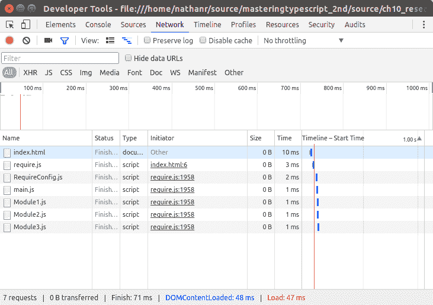

显示正确顺序加载模块的网络工具集

浏览器首先开始加载 `index.html` 文件、`require.js` 文件，然后我们看到它正在加载我们的 `RequireConfig.js` 文件。在我们的 `RequireConfig.js` 文件中，我们指定需要加载 `main.js`，因此这是 Require 将加载的下一个文件。该 `main.js` 文件随后使用 `import` 模块语法来导入文件 `lib/Module1` 和 `lib/Module2`。随后我们可以看到，这两个文件接下来被 Require 加载。有趣的是，我们的 `lib/Module1` 文件也导入了 `lib/Module3` 文件，因此 Require 也加载了该文件。

如网络诊断所示，Require 正在递归地解析我们的每个模块文件，从 `RequireConfig.js` 开始，并动态加载它找到的所有模块。通过这种方式，我们可以随心所欲地定义模块，只需使用 `export` 和 `import` 模块语法即可。只要我们在模块内部导入了依赖项，模块加载器就会代表我们自动加载这些文件。

### AMD 模块依赖

在处理模块时，通常的情况是一个模块必须在另一个模块之前加载。当模块 B 需要模块 A 时，A 必须在 B 之前加载。为了确保这一点，我们在模块的初始化函数中指定依赖项。让我们看看 `RequireConfig.ts` 文件，它展示了配置如下：

```typescript
require.config( {
  baseUrl: ".",
  paths: {
    'jasmine': "./node_modules/jasmine-core/lib/jasmine-core/jasmine",
    'jasmine-html': "./node_modules/jasmine-core/lib/jasmine-core/jasmine-html",
    'jasmine-boot': "./node_modules/jasmine-core/lib/jasmine-core/boot"
  },
  shim: {
    'jasmine': {
      exports: 'window.jasmineRequire'
    },
    'jasmine-html': {
      deps: ['jasmine'],
      exports: 'window.jasmineRequire'
    },
    'jasmine-boot': {
      deps: ['jasmine-html'],
      exports: 'window.jasmineRequire'
    }
  }
});
```

在这里，我们在调用 `require.config` 时包含了两个新属性，即 `paths` 和 `shim`。我们稍后会讨论 `shim` 属性，但目前让我们关注 `paths` 属性。`paths` 属性包含我们的每个 Jasmine 文件的条目。然而，这里需要注意的是，这些是命名条目，并且在整个 Require 配置中必须使用条目的名称。如果我们查看第一个条目，它的名称为 `'jasmine'`，指向 `'./node_modules/jasmine-core/lib/jasmine-core/jasmine'`，因此该条目的名称是 `'jasmine'`，从现在起对该文件的引用必须使用 `'jasmine'` 名称。我们可以轻松地将其命名为 `'jasminejs'` 或 `'jjs'`，只要在整个 Require 配置中统一使用该名称即可。`'jasmine-boot'` 条目是这种命名方案的完美示例，因为文件仅命名为 `boot.js` 而不是 `jasmine-boot.js`，但命名条目是 `'jasmine-boot'`。

此外注意 Require 从磁盘加载文件时会为这些条目中的每一个附加 `.js` 文件扩展名。


下一个配置块是 `shim` 属性。该 `shim` 属性包含了我们每个具命名库的条目。这些库的每个 `shim` 条目可能包含一个 `exports` 和/或一个 `deps` 条目。`exports` 条目用于指定该库将挂载到的 JavaScript 全局命名空间。作为 `exports` 属性内容的简单示例，请考虑以下针对 jQuery、Underscore 和 Backbone 的 `shim` 条目（注意这些并没有包含在当前的 `require.config` 中，但在这里展示是为了说明目的）：

```javascript
'jquery' : {
  exports: '$'
},
'underscore' : {
  exports: '_'
},
'backbone' : {
  exports: 'Backbone'
}
```

jQuery 库的 `exports` 属性简单为 `'$'`。这意味着 jQuery 库正被 Require 挂载到 `$` 命名空间，这允许我们通过在前加上 `$` 来使用任何 jQuery 函数，例如 `$('#elementId')`。同样，Underscore 库使用 `_` 字符作为其命名空间，通过简单的调用 `_.bind( ... )` 来使用。最后一个例子是，Backbone 库使用 `Backbone` 命名空间，通过调用 `new Backbone.Model` 等来使用。因此，这些库中的每一个都在 `exports` 属性中定义了全局命名空间。

除了 `shim` 配置中的 `exports` 属性，我们的每个模块还可以指定一个字符串数组项 `deps`。`deps` 条目用于描述模块依赖。如果我们从 `shim` 条目的底部开始看，可以看到 `'jasmine-boot'` 条目将 `'jasmine-html'` 条目指定为依赖。同样，`'jasmine-html'` 条目将 `'jasmine'` 指定为依赖。因此，Require 将注意这些依赖项，并按顺序加载我们的模块。

`deps` 属性是一个字符串数组，这意味着单个条目可以指定多个依赖项。

### 启动 Require

正如我们之前的最小实现中看到的那样，模块加载过程是通过对 `require` 函数的初始调用启动的。假设我们在 `test/SimpleTest.ts` 文件中有一个简单的 Jasmine 测试，我们可以在 `RequireConfigSpecRunner.js` 文件的底部如下启动我们的测试环境：

```javascript
var specs = [
  'test/SimpleTest'
];

require(['jasmine-boot'], (jasmineBoot) => {
  require(specs, () => {
    (<any>window).onload();
  });
});
```

这种设置出于几个原因是很有意思的。首先，我们定义了一个名为 `specs` 的变量，它是一个简单的字符串数组。它包含一个条目，即 `'test/SimpleTest'`，它是我们 Jasmine 测试套件的引用。注意这个 `specs` 变量是在哪里使用的。它被用在一个 `require` 调用中，该调用嵌套在外部的 `require` 调用内部。这个外部调用告诉 `require` 它在执行回调函数之前必须加载 `'jasmine-boot'` 模块。由于 `'jasmine-boot'` 模块的 `shim` 条目指定了依赖路径，该回调函数只有在所有依赖都满足后才会执行。

一旦外部回调函数执行，该函数的体将再次调用 `require` 函数，但这次带上了一个列出我们套件中所有 Jasmine 文件的数组。这个内部的 `require` 调用在执行之前已经加载了依赖的模块（即 Jasmine 文件）。一旦 `specs` 数组中的所有模块都加载完成，回调函数将简单地调用 `window.onload()`，这将启动 Jasmine 测试运行。

另请注意，`window` 全局变量需要被强制转换为 `<any>` 类型以便允许 TypeScript 编译。

有了这些 Require 配置和启动代码，我们就可以启动浏览器并运行 `SpecRunner.html` 文件来执行所有测试。再次，启动我们的开发者网络工具，我们可以看到每个模块加载的顺序：

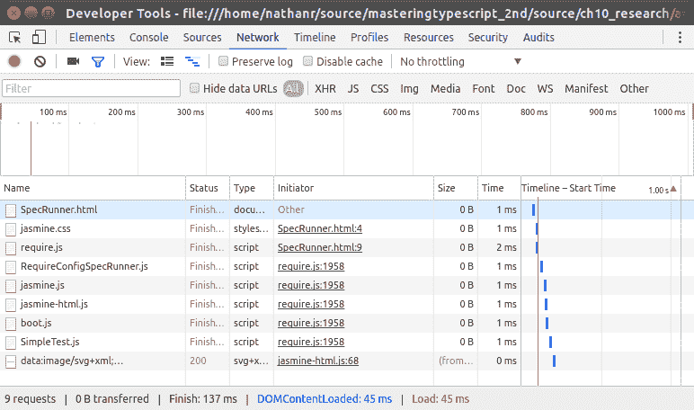

网络开发者工具显示 Jasmine 模块加载

### 修复 Require 配置错误

通常，在使用 Require 开发 AMD 应用时，我们可能会遇到意料之外的行为、奇怪的错误消息或仅仅是空白页面。这些奇怪的结果通常是由 Require 的配置引起的，在 `paths`、`shim` 或 `deps` 属性中。修复这些 AMD 错误最初可能会令人沮丧，但通常它们是由两件事之一引起的——错误的依赖或 `file-not-found` 错误。

为了修复这些错误，我们需要打开正在使用的浏览器中的调试工具，对于大多数浏览器，只需按下 F12 即可实现。

#### 错误的依赖

某些 AMD 错误是由 `require.config` 中错误的依赖引起的。这类错误可以通过检查浏览器中的控制台找到。输出可能如下：

```text
Error: Script error for _
Error: Backbone not defined
Error: Underscore not defined
```

#### 404 错误

文件未找到或 404 错误通常由类似的控制台输出指示：

```text
Error: Script error for jasmine-boot
Error: Load timeout
```


## SystemJS 模块加载

SystemJS 是一个理解 CommonJS 格式、AMD 格式甚至新的 ES6 模块格式的加载器。它在 Node 和浏览器中运行，因此它自己描述为通用模块加载器。

### SystemJS 安装

可以使用 npm 安装 SystemJS：

```bash
npm install systemjs --save
```

相关的声明文件可以使用 `@types` 安装：

```bash
npm install @types/systemjs --save
npm install @types/es6-shim --save
```

### SystemJS 浏览器配置

为了在浏览器中使用 SystemJS，我们需要包含 `system.js` 源文件，然后运行一个 SystemJS 的配置脚本，类似于我们的 `RequireConfig.js` 文件。我们的 HTML 页面如下：

```html
<html>
<head>
</head>
<body>
  <script src="./node_modules/systemjs/dist/system.js"></script>
  <script src="./SystemConfig.js"></script>
</body>
</html>
```

在这里，我们包含了两个脚本文件。一个用于 `system.js` 框架本身，另一个是名为 `SystemConfig.js` 的文件。这个 `SystemConfig.js` 文件是由以下 `SystemConfig.ts` 文件生成的：

```javascript
SystemJS.config({
  packages : {
    'lib' : { defaultExtension: 'js' }
  }
});

SystemJS.import('main.js');
```

我们的 SystemJS 配置文件从调用 `SystemJS.config` 函数开始，并包含了一个配置对象。在这个对象中，我们只指定了一个属性，名为 `packages`。这个 `packages` 属性指定了一个 `lib` 属性，并在其中包含了一个名为 `defaultExtension : 'js'` 的单一属性。SystemJS 使用 `packages` 属性来为我们的每个源目录（或包）指定选项。因此，`lib` 属性关系到位于 `./lib` 目录中包含的所有文件。`defaultExtension` 属性告诉 SystemJS，`./lib` 子目录下的所有模块都有默认的扩展名 `.js`。

这意味着，当 SystemJS 遇到模块导入时，例如从 `'./lib/module1'` 导入 `import {Module1}`，它会在模块文件名后添加默认扩展名 `'.js'`，从而加载名为 `'./lib/module1.js'` 的文件。

我们 SystemJS 配置文件的第二部分是调用 `SystemJS.import` 函数，指定 `main.js` 文件作为我们应用程序的起点。一旦 SystemJS 加载了 `main.js` 文件，它将开始解析我们的代码以寻找所有其他导入的模块，然后加载它们使用。如果我们查看浏览器**开发者工具**中的**网络** 标签页，我们将看到以下文件的加载：

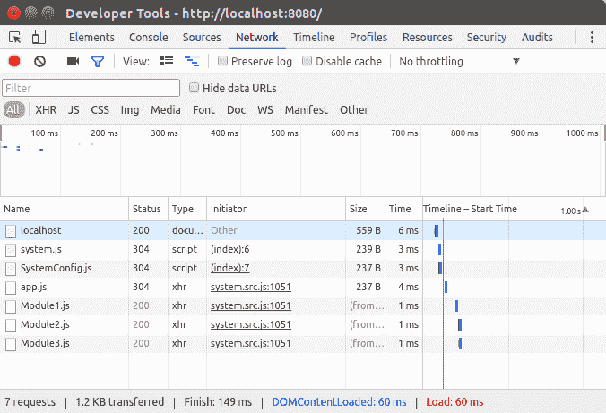

显示 SystemJS 模块加载的网络开发者工具集

请注意，对于 AMD 模块和 SystemJS 模块，Chrome 浏览器都假设这些模块是从一个运行中的 Web 服务器提供的。如果你尝试从磁盘加载页面（即通过在 Chrome 中按下 *Ctrl*–*O* 并导航到磁盘上的文件），你将收到许多错误，如下截图所示：

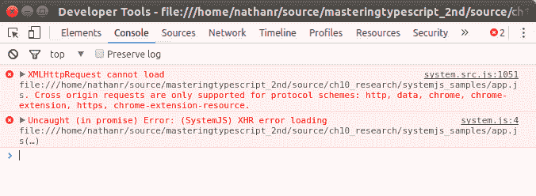

尝试从磁盘加载 SystemJS 文件时的控制台错误

其他浏览器（如 FireFox）不会显示这些错误。然而，Chrome 提供了一个允许此种行为的命令行选项，`--allow-file-access-from-files`。

或者，为了加载使用 SystemJS 的页面，只需从项目根目录运行 `http-server`，然后浏览到控制台显示的 URL 即可。当 `http-server` 启动时，它将显示你应该指向浏览器的 IP 地址和端口，如下：

```
Starting up http-server, serving ./
Available on:
http://127.0.0.1:8080
http://192.168.1.101:8080
```

### SystemJS 模块依赖

到此为止，我们展示了如何配置 SystemJS 在我们在代码中使用 `import` 语句导入模块时将其作为依赖项加载。让我们通过展示如何处理模块依赖（正如我们处理 AMD 那样）来完成关于 SystemJS 的讨论。与我们的 AMD 模块依赖示例类似，我们将使用 Jasmine 和 SystemJS 构建一个单元测试框架。记住 Jasmine 有特定的模块加载顺序。这意味着核心文件 `jasmine.js` 必须在 `jasmine-html.js` 之前加载，完成后我们就可以加载 `boot.js` 模块并运行我们的测试。

假设我们在 `test` 目录下有两个非常简单的测试套件，分别名为 `SimpleTest.ts` 和 `SimpleTest2.ts`。这两个文件只是在执行健全性测试。`SimpleTest.ts` 如下：

```javascript
describe('SimpleTest.ts : sanity test', () => {
  it('should pass', () => {
    expect(true).toBeTruthy();
  });
});
```

而 `SimpleTest2.ts` 如下：

```javascript
describe('SimpleTest2.ts : sanity test 2', () => {
  it('should pass', () => {
    expect(true).toBeTruthy();
  });
});
```

为了运行这些测试，我们还需要一个 `SpecRunner.html` 文件，如下：

```html
<html>
<head>
  <link rel="stylesheet" type="text/css" href="./node_modules/jasmine-core/lib/jasmine-core/jasmine.css" />
</head>
<body>
  <script src="./node_modules/systemjs/dist/system.js"></script>
  <script src="./SystemConfigSpecRunner.js"></script>
</body>
</html>
```

在这里，我们有一个标准的 HTML 文件，它加载了 `jasmine.css` 文件和 `system.js` 本身。注意，这里 `SystemConfigSpecRunner.js` 文件包含了我们的配置。这个 `SystemConfigSpecRunner.ts` 文件如下：

```javascript
SystemJS.config({
  baseUrl : '.',
  packages : {
    'lib' : { defaultExtension: 'js' },
    'test' : { defaultExtension: 'js' }
  },
  meta: {
    './node_modules/jasmine-core/lib/jasmine-core/jasmine.js' : { format: 'global' },
    './node_modules/jasmine-core/lib/jasmine-core/jasmine-html.js' : { format: 'global' },
    './test/boot.js' : { format: 'global' }
  }
});
```

#### Bootstrapping Jasmine

现在让我们仔细查看 `SystemConfigSpecRunner.ts` 底部的 `SystemJS.import` 调用：

```javascript
SystemJS.import('jasmine-boot', () => {
  Promise.all([
    SystemJS.import('test/SimpleTest'),
    SystemJS.import('test/SimpleTest2')
  ]).then(() => {
    (<any>window).onload();
  }).catch(console.error.bind(console));
});
```

在这里，我们通过加载名为 `'jasmine-boot'` 的模块来初始化 Jasmine 环境。与 Require 类似，SystemJS 会找到并加载 `'jasmine-boot'` 依赖树中指定的所有依赖，在此实例中包含了 `'jasmine-html'` 和 `'jasmine'` 本身。我们随后附加了一个链式的 `.then` 函数，以便在加载后执行。在该函数内部，我们简单地调用 `window.onload()`，正如我们在 Require 中所示，这将强制 Jasmine 执行所有测试。最后的调用是 `catch`，我们将任何错误记录到控制台。

## 在 Node 中使用 Express

在本节中，我们将通过展示如何构建简单的 Node Web 服务器应用程序来继续对模块的探索。为了实现这一目标，我们将使用适用于 Node 的 ExpressJs（或简单的 Express）框架。Express 为我们提供了一个可重用的 Node 模块库来处理构建 Web 服务器所需的基本功能。

这包括路由、用于生成网页的模板引擎、处理会话和 cookie 的库、身份验证以及错误消息（例如 404 错误）等。

Express 提供了一套丰富的模块和 API，涵盖了生产环境 Web 服务器应用程序所需的所有内容。

### Express 设置

为了构建 Express 应用程序，我们需要在开发环境中安装 Express，并包含 TypeScript 编译所需的各种声明文件。可以使用 `npm` 如下安装 Express：

```bash
npm init
npm install express --save
```

一旦安装了 Express，我们需要对应的声明文件，如下：

```bash
npm install @types/express --save
```

Express 使用了一系列其他 npm 库，这些库的声明文件没有包含在核心的 `express.d.ts` 声明文件中。为了允许 TypeScript 编译，我们需要安装以下几个声明文件：

```bash
npm install @types/express-serve-static-core --save
npm install @types/serve-static --save
npm install @types/mime --save
npm install @types/node --save
```

现在我们可以为 Express 编写最简单的 Web 应用程序，文件名为 `simple_app.ts`，如下：

```typescript
import * as express from 'express';
let app = express();
app.get('/', (req, res) => {
  res.send('Hello World');
});
app.listen(3000, () => {
  console.log(`listening on port 3000`);
});
```

我们首先导入 Express 模块 `from 'express'`，并将其挂载到名为 `express` 的命名空间上。注意我们现在使用的是一个稍作修改的 `import` 关键字。在这里，我们使用了 `import * as express` 语法来导入 Express 库中所有可用模块。

然后我们创建了一个名为 `app` 的局部变量，并将 `express()` 的新实例赋值给它。我们导入的 express 模块有一个默认构造函数，我们正使用它来创建我们的 Express 应用程序。

接着，我们在 `app` 实例上调用了 `get` 函数。这将设置 Express 中所谓的“路由处理程序”（route handler）。第一个参数是字符串 `'/'`，它告诉 Express 任何对 `'/'` 的 HTTP 请求都应该由我们的处理函数处理，该函数是 `get` 函数的第二个参数。在函数内部，我们简单地调用了 `res.send` 函数将字符串 `'Hello World'` 发送给 HTTP 请求。

Express 允许我们设置多个路由处理程序，例如 `'/login'` 可以由特定的处理函数处理，而 `'/users'` 可以由另一个处理。如果没有指定其他处理程序，Express 将把请求路由到最匹配的处理程序。这意味着，如果定义了针对 `'/login'` 的处理程序，那么它将处理所有以 `'/login'` 开头的请求。在我们的示例应用程序中，我们只指定了 `'/'` 的处理程序，因此所有请求都将路由到此处理程序。

应用程序的最后一部分在 `app` 实例上调用了 `listen` 函数，实质上设置了监听循环。第一个参数是待监听的端口号，第二个参数是在应用程序启动时调用的函数。在这里，我们只是向控制台打印了一条消息。

我们可以通过输入以下命令编译并运行此 Node Express 应用程序：

```bash
tsc
node simple_app.js
```

我们的 Express 应用程序将在端口 `3000` 上启动并等待 HTTP 请求。打开浏览器并将其指向 `http://localhost:3000` 将触发请求处理程序，向浏览器渲染 **Hello World**，如下：

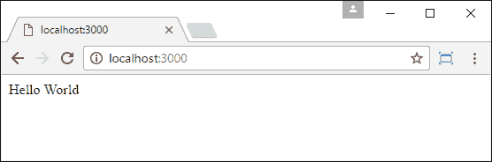

在端口 3000 上渲染的简单 Express 应用程序

### 在 Express 中使用模块

如果在单个文件中编写应用程序的所有处理程序，并为每个应用程序路由编写一个 `app.get` 函数，这很快就会变成一个维护上的噩梦。我们真正需要做的是为每个请求处理程序创建一个单独模块，然后在我们的主应用程序中引用它们。幸运的是，使用标准的模块语法来实现这一点非常简单。

作为如何操作的示例，让我们在一个新的模块文件中创建一个处理函数。该文件命名为 `SimpleModuleHandler.ts`，如下：

```typescript
export function processRequest(req, res) {
  console.log(`SimpleModuleHandler.processRequest`);
  res.send('Hello World');
};
```

在这里，我们导出一个名为 `processRequest` 的函数，这是一个请求处理函数。因此，它有两个参数，命名为 `req` 和 `res`，分别持有 HTTP 请求和响应对象。这个新的处理函数只是向控制台打印一条消息，然后像我们之前做的那样调用 `res.send` 函数向响应流写入字符串。

我们的 `app.ts` 文件可以修改为使用该模块，如下：

```typescript
import * as express from 'express';
import * as simpleHandler from './SimpleModuleHandler';
let app = express();
app.get('/', simpleHandler.processRequest);
```

### Express 路由模块

随着应用程序的增长，我们可以将路由逻辑拆分到单独的模块中。例如，创建 `routes/Index.ts` 和 `routes/Login.ts` 文件：

```typescript
// routes/Index.ts
import * as express from 'express';
var router = express.Router();
router.get('/', (req, res, next) => {
  res.render('index', { title: 'Express' });
});
export { router };
```

```typescript
// routes/Login.ts
import * as express from 'express';
var router = express.Router();
router.get('/login', (req, res, next) => {
  res.render('login', { title: 'Express Login' });
});
export { router };
```

然后在主应用程序中引用它们：

```typescript
import * as express from 'express';
import * as Index from './routes/Index';
import * as Login from './routes/Login';
import * as path from 'path';

let app = express();
app.set('views', path.join(__dirname, 'views'));
app.set('view engine', 'hbs');
app.use('/', Index.router);
app.use('/', Login.router);
app.listen(3000, () => {
  console.log(`listening on port 3000`);
});
```

我们的应用程序现在简单地从各自的文件导入 `Index` 和 `Login` 模块，然后调用 `app.use` 函数来注册我们的路由处理器。注意我们是如何引用每个模块中导出的本地变量 `router` 的，正如在对 `Index.router` 和 `Login.router` 的调用所示。因此，这两行代码正在为我们的应用程序注册路由处理器供其使用。

一旦这些路由模块就绪，任何指向 `'/'` 的浏览器请求都将由 `Index.ts` 模块处理，任何指向 `'/login'` 的请求将由 `Login.ts` 模块处理。通过这种方式，我们正开始将代码组织成逻辑模块，每个模块负责应用程序功能的不同区域。

### Express 模板引擎

目前，我们的每个路由处理器都在向浏览器记录非常简单的消息。但在实际应用场景中，我们将会需要渲染完整的 HTML 页面。这些页面将具有标准的 HTML 结构，使用 CSS 样式表，并且根据设计团队的创意，它们很容易变得非常复杂。为了支持生成 HTML 页面的复杂性，大多数框架都提供了模板引擎。

Express 还提供了一个完整的模板框架，它可以使用不同的模板引擎，包括 Pug、Mustache、Jade、Dust 和 EJS 等。在我们的 Express 应用中引入模板引擎只需安装所选的模板引擎，并配置 Express 使用该模板引擎即可非常简单。

在示例应用程序中，我们将使用 Handlebars 引擎。Handlebars 使用标准的 HTML 片段，并使用简单的双括号 `{{` 和 `}}` 语法在 HTML 模板中引入变量。像 Pug 或 Jade 等模板引擎使用它们自己的自定义格式来表示 HTML 元素，这些格式是 HTML 关键字、类名和变量替换的混合。作为对比，考虑如下 Handlebars 模板：

```html
<!DOCTYPE html>
<html>
<head>
  <title>{{title}}</title>
  <link rel='stylesheet' href='/stylesheets/style.css' />
</head>
<body>
  {{{body}}}
</body>
</html>
```

此模板看起来非常像标准的 HTML，只有少数元素会被替换，例如 `{{title}}` 和 `{{{body}}}`。类似的 Jade 模板将如下所示：

```
doctype
html
head title #{title}
link(rel='stylesheet', href='/stylesheets/style.css'
body
```

虽然这个 Jade 模板为我们节省了大量的打字工作，但这意味着我们需要学习并理解 Jade 中使用的各种关键字和细微语法，以便渲染出有效的 HTML。注意，这里没有可识别的 HTML 元素，它们被自定义的 Jade 语法所取代了。因此，为了简单起见并避免学习一套全新的 HTML 模板语法，我们将使用 Handlebars 作为我们的模板引擎，因为它使用了可识别的 HTML 语法，并穿插了替换变量。

#### 使用 Handlebars

可以通过以下方式通过 npm 安装 Handlebars：

```bash
npm install hbs --save
```

一旦安装了 Handlebars，我们只需要在源文件（`app.ts`）中添加三行代码，如下：

```typescript
import * as express from 'express';
let app = express();
import * as Index from './routes/Index';
import * as Login from './routes/Login';
import * as path from 'path';
app.set('views', path.join(__dirname, 'views'));
app.set('view engine', 'hbs');
app.use('/', Index.router);
app.use('/', Login.router);
```

在这里，我们为名为 `'path'` 的模块添加了 `import`。`path` 模块允许我们在处理目录路径名称时使用几个方便的函数。path 模块暴露的变量之一是 `__dirname`，它持有当前目录的完整路径。我们在调用 `path.join` 函数时使用了 `__dirname` 变量，它将返回指向本地 `views` 目录的完整路径。

然后我们将 Express 全局参数 `'views'` 设置为此目录。Handlebars 默认将使用此全局参数来查找模板文件存储路径。

我们对 `app.ts` 文件的最后一个更改是调用 `app.set` 并传入参数 `'view engine'` 和值 `'hbs'`。此函数调用告诉 Express 它应该使用 Handlebars 作为模板引擎。这些是我们对 Express 应用程序需要做的唯一更改。

现在我们已经注册了模板库，可以更新 `routes/Index.ts` 路由器以使用 Handlebars 模板，如下：

```typescript
import * as express from 'express';
var router = express.Router();
router.get('/', (req, res, next) => {
  res.render('index',
  { title: 'Express'
  //,username : userName
  }
  );
});
export { router } ;
```

我们新的 `login.hbs` 视图创建在 `views` 目录中，它包含一个简单的 HTML 表单，如下：

```html
<h1>Login</h1>
<p>
  <form method="post">
    <p>{{ErrorMessage}}</p>
    <p>Username : <input name="username"></input></p>
    <p>Password : <input name="password"></input></p>
    <button type="submit">Login</button>
  </form>
</p>
```

在这里，我们创建了一个包含几个标准表单元素的 HTML 表单。首先，我们有一个 `<p>` 元素来显示名为 `{{ErrorMessage}}` 的视图属性，它将用于向用户显示任何提交错误。接下来，我们有两个名为 `username` 和 `password` 的输入字段，以及一个名为 Login 的按钮来 `submit` 表单。

现在我们已经有了这个视图，可以更新 `routes/Login.ts` 文件来渲染该视图，如下：

```typescript
import * as express from 'express';
var router = express.Router();
router.get('/login', (req, res, next) => {
  res.render('login',
  {
    title: 'Express Login'
  }
  );
});
export { router } ;
```

在这里，我们修改了路由处理器，只需简单地渲染 `'login'` 视图，并将 `title` 属性设置为一个包含 `'Express Login'` 值的字符串。现在运行我们的应用程序并导航到 `http://localhost:3000/login` 将调用我们的登录请求处理器，并显示如下所示的简单登录表单：

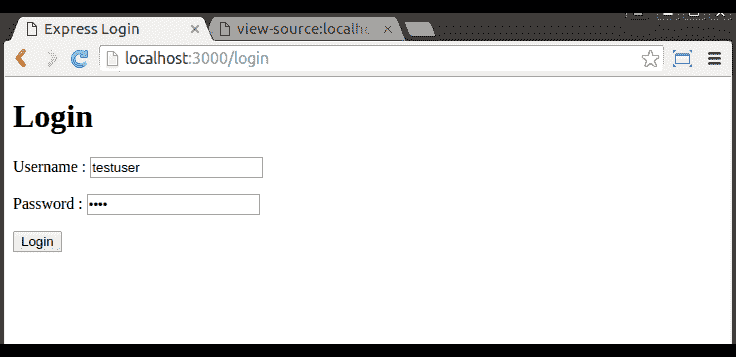

由于 login.hbs 模板渲染到浏览器的登录表单

既然我们的登录表单已经渲染，我们可以专注于在提交表单时处理表单值。点击 `Login` 按钮将导致 HTML 页面向登录请求处理器生成 `POST` 消息。因此，我们需要指定一个能够接收此 `POST` 消息的处理器。为了实现这一点，我们可以修改 `Login.ts` 处理器，并包含一个新的 `POST` 处理器，如下：

```typescript
router.post('/login', (req, res, next) => {
  if (req.body.username.length > 0) {
    req.session['username'] = req.body.username;
    res.redirect('/');
  } else {
    res.render('login', {
      title: 'Express',
      ErrorMessage: 'Please enter a user name'
    });
  }
});
```

在这里，我们正在调用 `router` 模块的 `post` 方法。正如我们在 `get` 函数中看到的，Express 使用 `post` 函数来在我们的模块中设置一个 `POST` 事件处理器。此 `post` 处理器正在检查 `req.body.username` 属性，以便从发布的表单请求中读取表单数据。如果 `username` 属性有效，我们将值存储在名为 `req.session['username']` 的属性中，并将浏览器重定向到默认页面。如果未输入 `username` 属性，我们只需重新渲染登录视图并显示错误消息。

在测试此新登录页面之前，我们需要安装和配置几个 Node 模块，如下：

```bash
npm install body-parser --save
npm install cookie-parser --save
npm install express-session --save
```

`body-parser` 模块用于解析 `POST` 事件产生的表单数据，并将此表单数据附加到请求对象本身。这意味着我们可以简单地使用 `req.body` 来引用表单数据。

`cookie-parser` 和 `express-session` 模块用于会话处理。在我们的登录 `POST` 处理器中，我们将一个会话变量设置为表单数据的 `username` 属性。如果没有这两个模块，这将无法工作。

我们需要做的最后一个更改是将这些模块导入到我们的应用程序中，并运行它们所需的任何配置。因此，我们需要如下更新 `app.ts` 应用程序文件：

```typescript
// existing code
app.set('view engine', 'hbs');
import * as bodyParser from 'body-parser';
import * as cookieParser from 'cookie-parser';
import * as expressSession from 'express-session';
app.use(bodyParser.json());
app.use(bodyParser.urlencoded({ extended: false }));
app.use(cookieParser());
app.use(expressSession({ secret : 'asdf' }));
// existing code
app.use('/', Index.router);
```

在这里，我们使用标准的 `import * as` 模块语法导入新模块。然后我们运行了四个 `app.use` 函数调用，以配置每个模块。`body-parser` 模块使用 `json()` 函数调用返回 `body-parser` 用来引用表单数据的中间件。

## 摘要

在本章中，我们查看了模块的使用——包括 CommonJS 和 AMD。我们探索了用于模块化的语法，并展示了如何对模块进行 `export` 和 `import` 操作。随后，我们探索了使用 Require 库的 AMD 模块语法，并讨论了如何处理模块依赖。接着，我们还探索了 CommonJS 模块语法的使用，并展示了如何使用 SystemJS 处理模块依赖。本章的最后部分探讨了与 Node 模块的使用，其中我们构建了一个示例应用程序来渲染索引和登录页面，并通过接口处理信息。

在下一章中，我们将处理面向对象编程原则，并查看一些实用的设计模式。

# 面向对象编程

1995 年，**四人帮**（GoF）出版了一本名为《设计模式》（Design Patterns: Elements of Reusable Object-Oriented Software）的书。作者 Erich Gamma、Richard Helm、Ralph Johnson 和 John Vlissides 描述了许多为软件问题提供简单且优雅解决方案的设计模式，如工厂模式、组合模式、观察者模式或单例模式。如果你从未听说过这些设计模式，强烈建议阅读这本书。

GoF 提出的设计已经在许多不同的编程语言（包括 Java 和 C#）中得以实现。Vitaly Vane 编写了一本名为《TypeScript 设计模式》的书，其中这些 GoF 设计模式都从 TypeScript 的视角进行了实现。

在第 3 章《接口、类和继承》中，TypeScript 程序可以充分利用类、抽象类、继承和泛型。这些 GoF 设计模式的实现在单个章节中是无法详尽涵盖的。因此，在本章中，我们将关注编写面向对象代码的过程，并探讨 **SOLID** 原则，这些原则在处理复杂的 UI 布局时表现得非常好。

这些是状态模式（**State pattern**）和中介者模式（**Mediator pattern**）等设计模式，它们关注应用程序状态以及对象之间如何交互。我们将构建一个使用复杂 UI 设计的 Angular 2 应用程序，以应用面向对象的设计原则，并讨论对象在应用程序中如何交互。我们随后将实现状态和中介者模式，以封装决定 UI 元素应该显示的逻辑。

在本章中，我们将涵盖以下主题：

- 面向对象原则
- 使用接口
- **SOLID** 原则
- 状态模式


- 中介者模式
- 模块化代码

## 面向对象原则

我们构建的任何应用程序都应该根据面向对象的最佳实践进行评估。Robert Martin 发表了所谓的 SOLID 设计原则，遵循这些实践有助于确保我们编写的代码易于维护、易于理解、易于扩展且对变化具有弹性。在当前这个快节奏的世界中，我们通常没有奢侈花费大量时间修改应用程序以适应不断变化的需求。我们越快交付满足业务需求的更新，就越有可能保持领先。坚持 SOLID 设计原则为我们提供了良好的基础，能够对现有代码进行轻松修改以满足快速变化的需求。

## 面向接口编程

GoF 遵循的核心理念之一是程序员应该面向接口编程，而不是实现。这意味着程序使用接口作为对象之间定义的交互。通过面向接口编程，客户端对象感知不到依赖对象的内部逻辑，因此对变化的具有更强的弹性。通过定义接口，我们开始固定一个 API，描述对象提供的功能、它应该如何被使用，以及多个对象如何交互。

## SOLID 原则

“面向接口编程”原则的扩展被称为 SOLID 设计原则，它们基于 Robert Martin 的思想。这是五个不同原则的缩写，每当讨论面向对象编程时，它都值得提及。

### 单一职责

单一职责模式背后的想法是一个对象应该只有一个单一职责。只做一件事，并将其做好。我们在使用过的各种 TypeScript 兼容框架中看到过这一原则的示例。例如，`Model` 类用于表示单个模型；`Collection` 类用于表示这些模型的集合，而 `View` 类用于渲染模型或集合。如果我们的任何一个类开始变成一个超级类（换句话说，它在做许多不同类型的事情），那么这意味着我们正在违反这一原则。思考一下该类的主要职责是什么，然后将类的功能拆分到更小的类中。

### 开闭原则

开闭原则（Open-Closed principle）规定，对象应该对扩展开放，但对修改关闭。换句话说，一旦为类设计了接口，随着时间的推移对该接口的变化通过继承来实现，而不是直接修改接口。注意，如果你正在编写通过 API 被第三方使用的库，那么这个原则至关重要。API 的更改应仅通过新的版本发布来进行，而不应破坏现有的 API 接口。

### 里可夫替换原则

里可夫替换原则（LSP）指出，如果一个对象派生自另一个对象，那么这些对象可以相互替换而不破坏功能。虽然这一原则看起来相当容易实现，但在处理与泛型相关的子类型规则（例如对象列表或对象操作）时会变得相当棘手。在这些情况下，引入了变异（variance）的概念，对象可以是协变的、逆变的或不变的。我们在这里不讨论变异的细节点，但在使用泛型编写库时要注意这一原则。

## 概念设计

让我们来看看这种从左到右的设计在概念上是什么样的：

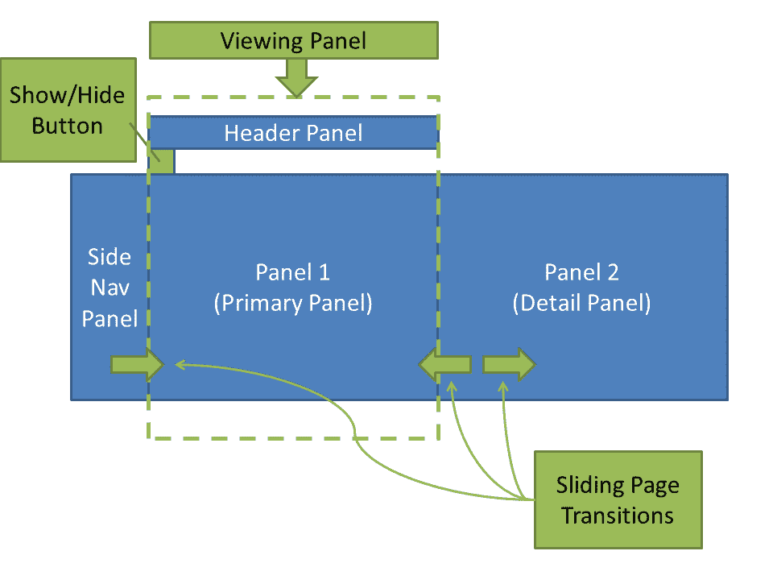

从左到右 UI 面板设计的概念视图

**视图面板** 将是我们的主页面，包含一个**头部面板**和一个用于控制显示或隐藏左侧导航栏的**按钮**。当左侧面板打开时，它将使用 CSS 动画从左侧滑入；关闭时，它将再次使用动画向左滑回。同样，当点击按钮显示第二个面板（面板 2）时，此详情面板将使用 CSS 动画从右侧滑入，并占据整个**视图面板**。

下面的截图显示了头部面板和左侧面板均可见的视图面板：

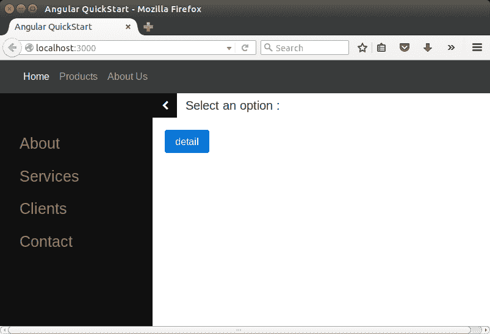

左侧面板可见的主视图面板

在这里，我们可以清楚地看到顶部的头部面板、左侧菜单面板和两个按钮。第一个按钮位于 `Select an option:` 文本的左侧，它只是一个 `<` 箭头，用于隐藏左侧面板。点击此按钮将使用 CSS 动画将左侧面板向左滑动，使其不影响操作。如接下来的截图所示：

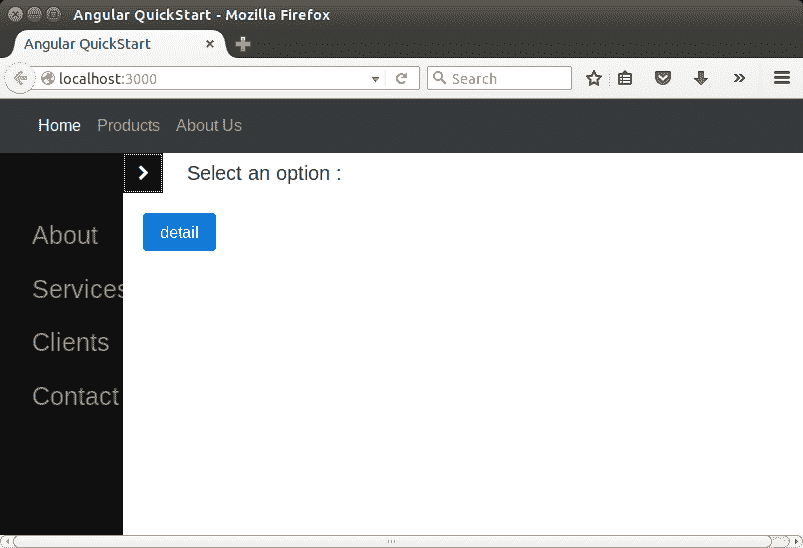

左侧面板的动画过渡

在这里，我们暂停了 CSS 动画，以显示左侧面板正在折叠中，且主面板正在展开以填充整个视图面板。注意，显示/隐藏左面板的按钮已从 `<` 箭头变为 `>` 箭头。这个细微的变化提示用户点击 `>` 按钮可以展开侧边面板。

如果点击 `detail`（详情）按钮，将导致左侧面板和主页面向左滑动，通过另一个 CSS 动画显示第二个页面，如接下来的截图所示：

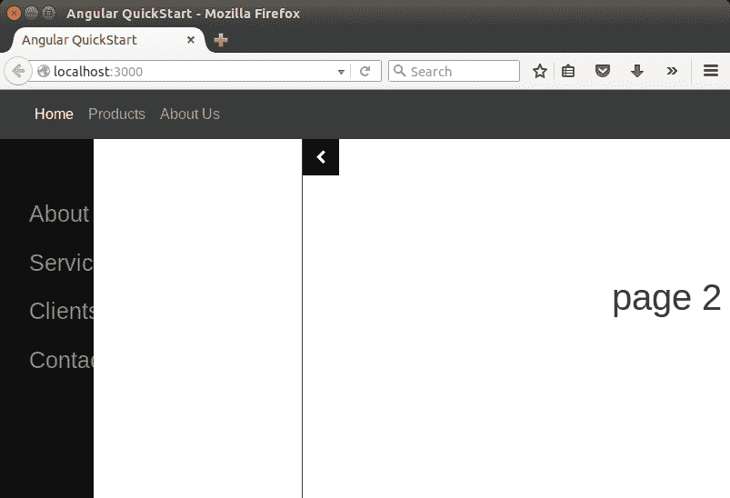

右侧详情面板的动画页面过渡

在这里，第二个页面正在从右侧切换，左侧面板和主页面都在向左滑动。

## Angular 2 设置

现在我们已经对应用程序的样式有了概念视图，可以通过设置 Angular 2 应用程序开始实现这种布局了。正如我们在之前的 Angular 2 项目中所看到的，我们首先通过执行 `ng new` 命令来使用 Angular 命令行界面。此过程将设置 Angular 所需的所有依赖项，并创建一个初始的 `app.component.ts` 和 `app.component.html` 文件。

我们的 `app/app.component.ts` 文件简单不过了：

```typescript
import { Component } from '@angular/core';

@Component({
  selector: 'my-app',
  templateUrl: 'app/app.component.html',
  styleUrls: ['app/app.component.css']
})
export class AppComponent {
  title = "Select an option :";
}
```

在这里，我们像之前看到的那样导入了 `Component` 模块，然后定义了三个传递给 `@Component` 装饰器的属性。但注意，我们没有指定包含 HTML 的 `template` 属性，而是指定了 `templateUrl` 属性。这指示 Angular 从磁盘加载命名文件并作为组件模板。同样，我们通过 `styleUrls` 属性指定了供组件使用的 CSS 文件。因此，我们的 `AppComponent` 类仅有一个名为 `title` 的属性。

使用 `templateUrl` 属性加载包含我们 HTML 模板的独立文件是依赖倒置原则的一个示例。我们的 `AppComponent` 类依赖于 HTML 模板以便将组件渲染到浏览器中。当使用 `template` 属性时，HTML 模板与类本身之间存在紧耦合。这意味着对模板的任何修改都需要重新编译该模块。通过将模板分离到单独的可加载文件中，我们打破了这种紧耦合，模块类可以独立于其 HTML 模板进行修改。

我们的 `app.component.html` 文件目前非常简单，如下：

```html
<div>
  {{title}}
</div>
<button>detail</button>
```

在这里，我们有 `div` 元素。第一个包含我们的标题，第二个包含了……。

## 使用 Bootstrap

现在我们已经有了 Angular 的基础，可以充实我们的应用程序了。HTML 元素、CSS 样式和动画的极佳资源是 w3schools.com。“如何做”部分提供了大量的示例，包括幻灯片、模态框、进度条和响应式表格等。我们将使用侧边导航部分的一个示例，名为 Sidenav Push Content。要包含 Bootstrap，我们首先需要通过 `npm install bootstrap` 安装。如果之前的导航栏没有正确渲染，请检查你的 `package.json` 文件，确保 bootstrap 版本正确：

```json
"dependencies": {
  "bootstrap": "^4.0.0-alpha.4"
},
"styles": [
  "styles.css"
]
```

## 创建侧边面板

现在我们可以查看创建左侧面板。这个示例展示了如何创建一个侧边导航，它在展开时会将页面主体推开，而不是创建一个覆盖层。我们首先在 `app.component.html` 中添加如下 HTML：

```html
<div id="mySidenav" class="sidenav">
  <a href="#">About</a>
  <a href="#">Services</a>
  <a href="#">Clients</a>
  <a href="#">Contact</a>
</div>
```

在这里，我们描述了一个 `id` 为 `mySidenav`、`class` 为 `sidenav` 的 `div` 元素。为了将其变成一个美观的侧边导航栏，我们现在需要编辑 `app.component.css` 文件以添加以下样式：

```css
/* 侧边导航菜单 */
.sidenav {
  height: 100%; /* 100% 全高 */
  width: 250px; /* 0  own - 用 JavaScript 更改 */
  position: fixed; /* 固定位置 */
  z-index: 1; /* 留在顶层 */
  top: 50px;
  left: 0;
  background-color: #111; /* 黑色*/
  overflow-x: hidden; /* 禁用水平滚动 */
  padding-top: 60px; /* 内容距离顶部 60px */
  transition: 0.3s;
}

/* 侧边导航菜单链接 */
.sidenav a {
  padding: 8px 8px 8px 32px;
  text-decoration: none;
  font-size: 25px;
  color: #818181;
  display: block;
  transition: 0.3s;
}

/* 当鼠标悬停在导航链接上时，改变颜色 */
.sidenav a:hover, .offcanvas a:focus {
  color: #f1f1f1;
}
```

有了这几个 CSS 样式，我们的侧边导航面板开始形成雏形，如下所示所示：

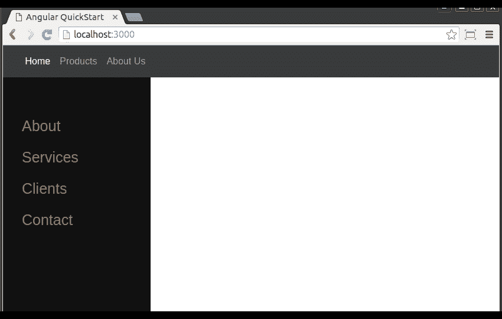

带有 CSS 样式的简单侧边导航栏

这里有一个样式精美的侧边导航栏。遗憾的是，我们的主页面内容已经消失在侧边导航栏后面，这意味着我们需要应用一个外层的 `div` 和一些样式，以确保左面板将我们的主面板内容推到右侧。我们的主面板内容现在变为：

```html
<div id="main" class="main-content-panel">
  <div class="row">
    <div class="col-sm-1">
      <button class="btn button-no-borders" (click)="showHideSideClicked()">
        <span id="show-hide-side-button" class="fa "> <</span>
      </button>
    </div>
    <div class="col-sm-11 ">
      <div class="row-content-header">{{title}}</div>
    </div>
  </div>
  <div class="main-content">
    <button class="btn btn-primary" (click)="buttonClickedDetail()">detail</button>
  </div>
</div>
```

在这里，我们将主内容封装在一个 `id` 为 `"main"` 且 `class` 为 `"main-content-panel"` 的 `<div>` 中。这个 `<div>` 然后被划分为包含两个大小为 `1` 和 `11` 的列的行。这一行容了我们的显示/隐藏侧边面板的按钮以及 `{{title}}` 元素。在该标题行下方是我们的主内容，它仅包含一个名为 `detail` 的单个按钮。此部分 HTML 对应的 CSS 如下：

```css
#main {
  margin-left: 250px;
  transition: .3s;
}
#main-body {
  transition: .3s;
}
.main-content {
  padding: 20px;
}
.row-content-header {
  padding: 5px;
  font-size: 20px;
}
```

这里有两个影响我们页面内容的关键样式。第一个是 `#main` 样式中的 `margin-left: 250px` 元素。这个 `margin-left` 值是当左面板可见时将我们的主内容推向右侧的 CSS 属性。该属性与侧边面板的对应值 `.sidenav { width: 250px; }` 匹配。换句话说，侧边面板的宽度为 `250px`，主面板的左边距为 `250px`。这两个值的结合显示了左面板，并将主面板推向右侧。我们将这两个值从 `250px` 调整为 `0px` 以显示或隐藏左面板。

第二个关键样式是 `transition: .3s;` 属性，它定义了侧边面板折叠和展开以及主面板被推向右侧或扩展填充屏幕所需的时间。有了这些样式，我们现在可以附加一些代码来启动动画页面过渡。为了让其工作，我们需要在 HTML 中注册点击处理程序，然后在 `app.component.ts` 文件中实现该处理程序。

首先，让我们检查 `app.component.html` 文件中的按钮点击 DOM 事件：

```html
<button class="btn button-no-borders" (click)="showHideSideClicked()">
  <span id="show-hide-side-button" class="fa "></span>
</button>
```

在这里，我们定义了一个名为 `showHideSideClicked` 的函数，每当我们点击显示/隐藏按钮时，它就会被调用。我们对 `app.component.ts` 的修改如下：

```typescript
export class AppComponent {
  title = "Select an option :";
  isSideNavVisible = true;
  showHideSideClicked() {
    if (this.isSideNavVisible) {
      document.getElementById('main').style.marginLeft = "0px";
      document.getElementById('mySidenav').style.width = "0px";
      this.isSideNavVisible = false;
    } else {
      document.getElementById('main').style.marginLeft = "250px";
      document.getElementById('mySidenav').style.width = "250px";
      this.isSideNavVisible = true;
    }
  }
}
```

## 状态模式

GoF（设计模式大师）描述了两种设计模式，分别是状态模式和中介者模式。状态模式使用一组派生自基类的具体类来描述特定的状态。例如，考虑创建一个 `enum` 来描述门可能所处的状态。乍一看，门要么是 `Open`（打开），要么是 `Closed`（关闭）。在这种情况下，一个简单的 `if...else` 控制流可能就能处理我们想要应用的任何逻辑。

然而，考虑一下，如果我们需要 `Locked`（锁定）和 `Unlocked`（未锁）状态，或者它是一扇滑动门，具有 `SlightlyAjar`（微开）、`HalfOpen`（半开）、`AlmostFullyOpen`（将开）和 `FullyOpen`（全开）状态，我们的控制流和逻辑会发生什么？状态模式允许我们轻松地定义这些状态，并根据对象的当前状态调整我们的逻辑。

如果我们稍微考虑一下应用程序，就知道在任何时刻，我们的屏幕都会处于某个特定的状态。我们要么在主面板上，要么在第二页面板上。此外，左侧面板要么可见要么隐藏。这种组合为我们三个状态：

- 仅主面板
- 带有侧边导航栏的主面板
- 详情面板

### State 接口

状态模式帮助我们在代码中定义这些状态。状态模式的基本原理是创建一个接口（或抽象基类）来定义每个状态的属性，然后为每种特化实现创建具体类。在我们的应用程序中，我们有两个需要向每个状态提出的问题。这些是：

- 侧边面板可见吗？
- 我们是在主面板还是详情面板上？

此外，如果我们位于主面板上，我们还需要知道在主面板左上角是显示 `>` 箭头还是 `<` 箭头。这与侧边面板是否可见有关。因此，我们为这些状态定义的接口如下：

```typescript
export enum StateType {
  MainPanelOnly,
  MainPanelWithSideNav,
  DetailPanel
}

export enum PanelType {
  Primary,
  Detail
}

export interface IState {
  getPanelType(): PanelType;
  getStateType(): StateType;
  isSideNavVisible(): boolean;
  getPanelButtonClass(): string;
}
```

在这里，我们从 `StateType` 的 `enum` 开始，它让我们知道处于三个状态中的哪一个。然后我们定义 `PanelType` `enum` 来判断我们是在 `Primary`（主）面板还是 `Detail`（详情）面板上。我们的接口 `IState` 有四个函数。`getPanelType` 返回 `PanelType` `enum` 值，`getStateType` 函数返回 `StateType` `enum` 值。`isSideNavVisible` 函数简单返回一个 `boolean` 值，表示侧边导航面板是否可见。最后一个函数 `getPanelButtonClass` 将返回一个类名，用于将显示/隐藏按钮从左箭头 (`<`) 切换到右箭头 (`>`)，这取决于侧边面板的状态。

有了这个接口，我们就定义了可以向每个具体状态类提出的问题。取决于我们是在主面板还是详情面板上，这些问题的答案会略有变化。这就是状态模式的精髓：定义一个可以为你提供所有状态所需答案的接口，然后针对该接口进行编程。这使我们构建的用于消费这些状态的任何逻辑不受状态本身定义的影响。换句话说，添加或删除一个新的状态类将不会影响我们基于 `IState` 接口编写的任何代码。

### 具体状态

现在让我们检查三个具体状态类：

```typescript
export class MainPanelOnly implements IState {
  getPanelType(): PanelType { return PanelType.Primary; }
  getStateType(): StateType { return StateType.MainPanelOnly; }
  getPanelButtonClass(): string { return 'chevron-right'; }
  isSideNavVisible(): boolean { return false; }
}
```

我们从一个名为 `MainPanelOnly` 的类开始，它用于描述侧边导航不可见且处于主面板的状态。这是一个实现 `IState` 的简单类，它只是为每个函数返回正确的值。正如从返回值所示，我们处于 `PanelType.Primary`，`isSideNavVisible` 函数返回 `false`，并且我们的显示/隐藏按钮需要 `'chevron-right'`。我们的另外两个状态非常相似：

```typescript
export class MainPanelWithSideNav implements IState {
  getPanelType(): PanelType { return PanelType.Primary; }
  getStateType(): StateType { return StateType.MainPanelWithSideNav; }
  getPanelButtonClass(): string { return 'chevron-left'; }
  isSideNavVisible(): boolean { return true; }
}
```

```typescript
export class DetailPanel implements IState {
  getPanelType(): PanelType { return PanelType.Detail; }
  getStateType(): StateType { return StateType.DetailPanel; }
  getPanelButtonClass(): string { return ''; }
  isSideNavVisible(): boolean { return false; }
}
```

在这里，`MainPanelWithSideNav` 状态类与 `MainPanelOnly` 类相同，区别在于它的 `isSideNavVisible` 函数返回 `true`，并且按钮类返回 `'chevron-left'`。`DetailPanel` 状态类返回 `PanelType.Detail`，`isSideNavVisible` 函数返回 `false`，并且按钮返回一个空类名。这三个类非常简单，它们描述了当作为当前状态时 UI 应该处于的状态。这些类帮助我们封装应用程序中用于管理各种 UI 元素的逻辑。

## 中介者模式

现在我们已经可以描述 UI 所处的各种状态，可以开始应用在这些状态之间移动所需的逻辑。中介者模式用于定义一组对象如何相互作用。该模式在相互影响的对象之间注入一个中介者对象，使得对象之间不再直接通信。这促进了协作对象之间的松耦合。

中介者模式本质上包含两个部分。第一部分是定义一个接口，中介者可以通过调用它来应用其所需的更改。在我们的应用程序中，我们需要中介者能够信号 UI 以显示或隐藏侧边导航面板，以及显示或隐藏详情面板。中介者还需要根据当前的应用程序状态，将显示/隐藏按钮从 `<` 箭头切换到 `>` 箭头。其次，中介者需要一个所有允许的不同状态的注册表，并根据状态之间的移动调用 UI 函数来应用更改。

因此，我们中介者类的接口如下：

```typescript
export interface IMediatorImpl {
  showNavPanel();
  hideNavPanel();
  showDetailPanel();
  hideDetailPanel();
  changeShowHideSideButton(fromClass: string, toClass: string);
}
```

在这里，我们将应用程序所需的所有 UI 更改提炼成了四个函数。我们可以显示或隐藏侧边导航面板，显示或隐藏详情面板，并更新按钮的 CSS 类。

回顾我们目前为止的工作，我们将业务逻辑简化为了两个部分。首先，我们定义了 UI 在任何时间点可能处于的状态，其次我们定义了更新 UI 所需的函数。我们已经在构建一个模块化、面向对象、易于理解且易于维护的应用程序的道路上了。

我们稍后会处理中介逻辑的实现，在此之前，我们会先对现有代码进行一些清理工作。

## 模块化代码

目前为止，我们的应用程序所有的 HTML、CSS 和业务逻辑都作为 `AppComponent` 类的一部分。虽然我们已经将该类拆分为独立的 `app.component.html` 和 `app.component.css` 文件，但它实际上包含了许多合并在一起的独立组件。让我们利用这个机会对代码进行模块化，创建三个独立的类。这些将会是：

- 一个 `NavbarComponent` 类，用于渲染和处理屏幕顶部的导航栏
- 一个 `SideNavComponent` 类，用于渲染左侧导航面板
- 一个 `RightScreenComponent`，用于处理从右侧滑出的详情面板

这意味着 `AppComponent` 类变为了应用程序的核心类，它将负责协调这些组件中的每一个组件。

### Navbar 组件

我们的第一个任务是创建一个 `NavbarComponent` 类，该类将唯一负责渲染屏幕顶部的导航栏。为了实现这一点，我们将在 `app` 目录下创建一个 `navbar.component.ts` 文件和一个 `navbar.component.html` 文件。HTML 文件的内容简单地从我们现有的 `app.component.html` 文件中复制，如下：

```html
<nav class="navbar navbar-inverse bg-inverse navbar-toggleable-sm">
  <a class="navbar-brand">&nbsp;</a>
  <div class="nav navbar-nav">
    <a class="nav-item nav-link active">Home</a>
    <a class="nav-item nav-link">Products</a>
    <a class="nav-item nav-link">About Us</a>
  </div>
</nav>
```

然后我们可以如下所示创建一个 `NavbarComponent` 类：

```typescript
import { Component } from '@angular/core';
@Component({
  selector: 'navbar-component',
  templateUrl: './app/navbar.component.html'
})
export class NavbarComponent {
}
```

这是一个非常基础的 Angular 2 类，它引用了我们的 HTML 文件，并在 `@Component` 装饰器中指定了 `selector` 属性。要在我们的应用程序中使用此新组件，我们需要向 Angular 注册此组件，然后只需在当前的 `app.component.html` 文件中放入 `<navbar-component>` 标签即可。注册通过将此组件导入到我们的 `app.module.ts` 文件中完成，如下：

```typescript
import { AppComponent } from './app.component';
// 在此处以启用 html 找到正确的组件
import { NavbarComponent } from './navbar.component';
@NgModule({
  declarations: [
    AppComponent,
    NavbarComponent
  ],
  imports: [
    BrowserModule,
    FormsModule,
    HttpModule
  ],
  providers: [],
  bootstrap: [AppComponent]
})
```

在这里，我们添加了一个模块导入语句来引用我们的 `navbar.component` 模块，然后我们更新了 `@NgModule` 装饰器的 `declarations` 数组。通过更新 `declarations` 数组，我们正在为任何 HTML 模板中的使用注册 `<navbar-component>` 标签。我们需要做的最后一个更改是将此新的 `<navbar-component>` 标签包含到我们的 `app.component.html` 文件中。有了这些更改，我们的应用程序在渲染页面时将使用新的 `navbar.component` 模块。

### SideNav 组件

类似地，现在让我们为左侧导航面板创建一个组件，名为 `SideNavComponent`。这需要三个名为 `sidenav.component.ts`、`sidenav.component.html` 和 `sidenav.component.css` 的源文件。HTML 文件再次是从我们现有的 HTML 文件中简单剪贴的，如下：

```html
<div id="mySidenav" class="sidenav">
  <a href="#">About</a>
  <a href="#">Services</a>
  <a href="#">Clients</a>
  <a href="#">Contact</a>
</div>
```

`SideNavComponent` 类如下：

```typescript
import { Component } from '@angular/core';
@Component({
  selector: 'sidenav-component',
  templateUrl: './sidenav.component.html',
  styleUrls: ['./sidenav.component.css']
})
export class SideNavComponent {
  closeNav() {
    document.getElementById('mySidenav').style.width = "0px";
  }
  showNav() {
    document.getElementById('mySidenav').style.width = "250px";
  }
}
```

### RightScreen 组件

现在让我们继续创建应用程序中的最后一个组件，它涵盖右侧详情，名为 `RightScreenComponent`。再次，我们将查看：

```typescript
import { Component, EventEmitter, Output } from '@angular/core';
@Component({
  selector: 'rightscreen-component',
  templateUrl: './rightscreen.component.html',
  styleUrls: ['./rightscreen.component.css']
})
export class RightScreenComponent {
  @Output() notify: EventEmitter<string> = new EventEmitter<string>();
  closeClicked() {
    this.notify.emit('Click from nested component');
  }
  closeRightWindow() {
    document.getElementById('myRightScreen').style.transform = "translateX(100%)";
  }
  openRightWindow() {
    document.getElementById('myRightScreen').style.transform = "translateX(0%)";
  }
}
```

记得这个面板在左侧有一个按钮，用于关闭面板并返回主屏幕。此按钮的 HTML 如下：

```html
<button class="btn btn-default" (click)="closeClicked()">
  <span class="fa fa-chevron-left"></span>
</button>
```

我们知道 Angular 处理 DOM 点击事件的语法是指定 `(click)="<handlerFunction>"`。在我们之前的 HTML 中，这个 `<handlerFunction>` 是 `closeClicked`，因此必须在组件类本身中定义。

然而，这个 `RightScreenComponent` 类只控制它自己的 HTML 区域，因此不能包含任何适用于本身的功能。在这种情况下，我们需要做的只是抛出一个事件，表示关闭按钮已被点击，并让应用程序的其他部分对此事件做出反应并执行某些操作。再次，这体现了我们的单一职责设计原则。

让我们仔细观察这个 `EventEmitter` 语法：

```typescript
@Output() notify: EventEmitter<string> = new EventEmitter<string>();
closeClicked() {
  this.notify.emit('Click from nested component');
}
```

我们通过在 `notify` 属性上装饰 `@Output` 装饰器来设置事件发射器。然后，我们指定该属性的类型为 `EventEmitter<string>`，并立即创建一个 `EventEmitter` 类的实例。`EventEmitter` 是一个泛型类，这意味着我们可以在此声明中替换 `<number>`、`<boolean>` 甚至是一个复杂的类。

由于 `notify` 属性是类型为 `string` 的 `EventEmitter` 实例，我们可以在 `closeClicked` 函数中带入字符串参数调用 `this.notify.emit`。这处理了当用户在我们的 `RightScreenComponent` 类中点击此按钮时发送事件的情况。

现在我们需要为该事件定义一个事件处理器。由于 `AppComponent` 类负责创建并控制这个 `RightScreenComponent`，我们修改了 `app.component.html` 文件来注册此通知事件。包含 `<rightscreen-component>` 标签现在变为：

```html
<rightscreen-component (notify)='onNotifyRightWindow($event)'>
</rightscreen-component>
```

在这里，我们为 `<rightscreen-component>` 标签添加了一个属性来注册 `(notify)` 事件，然后在我们的 `AppComponent` 类中调用了 `onNotifyRightWindow` 函数。该函数的实现目前只需弹出一个警框，以便我们可以测试该事件的触发和注册是否正常工作：

```typescript
onNotifyRightWindow(message: string): void {
  alert('clicked');
}
```

我们将稍后将此事件处理器挂载到我们的 Mediator 类上，以触发切换到不同状态的操作。

#### 子组件

我们的 `AppComponent` 类是整个应用程序的所有者。它渲染用于整个页面的 HTML，其中包含了 `navbar`、`sidenav`、`rightscreen` 和主面板组件。因此，它也是这些子组件的父组件。换句话说，所有这些组件都是 `AppComponent` 类的类，被称为子组件。我们现在需要一种方法让 `AppComponent` 类在类内部引用 `SideNavComponent` 和 `RightScreenComponent` 类。这是为了绑定通过 HTML 标签 `<sidenav-component>` 和 `<rightscreen-component>` 创建的这些类的实例。

Angular 提供了 `@ViewChild` 属性装饰器来实现此。要使用此装饰器，我们需要如下所示更新 `AppComponent` 类：

```typescript
import { Component, ViewChild } from '@angular/core';
import { SideNavComponent } from './sidenav.component';
import { RightScreenComponent } from './rightscreen.component'
// .. @Component ...
export class AppComponent {
  @ViewChild(SideNavComponent)
  private sideNav: SideNavComponent;
  @ViewChild(RightScreenComponent)
  private rightScreen: RightScreenComponent;
  // .. 类的其余部分 ...
}
```

我们需要进行一些更改。首先，我们需要从 `@angular/core` 模块导入 `ViewChild` 装饰器，然后导入 `SideNavComponent` 和 `RightScreenComponent` 模块。其次，我们需要创建两个名为 `sideNav` 和 `rightScreen` 的私有属性，用来持有子组件的实例。然后，我们使用 Angular 2 的 `@ViewChild` 装饰器并传入我们想要引用的类名。这意味着 `@ViewChild(SideNavComponent)` 将把 `private sideNav` 属性连接到 `SideNavComponent` 类的正确实例。同样，我们要求 Angular 2 将 HTML 中使用的 `RightScreenComponent` 类的实例连接到 `private rightScreen` 变量。通过这样，我们的 `AppComponent` 类现在可以对 HTML 中引用的这两个类进行程序化访问。

#### Mediator 接口实现

现在 `AppComponent` 类已经有了对其子组件的引用，我们可以专注于 `IMediatorImpl` 接口的实现，如下：

```typescript
showNavPanel() {
  this.sideNav.showNav();
  document.getElementById('main').style.marginLeft = "250px";
}
hideNavPanel() {
  this.sideNav.closeNav();
  document.getElementById('main').style.marginLeft = "0px";
}
showDetailPanel() {
  this.rightScreen.openRightWindow();
  document.getElementById('main').style.transform = "translateX(-100%)";
}
hideDetailPanel() {
  this.rightScreen.closeRightWindow();
  document.getElementById('main').style.transform = "translateX(0%)";
}
changeShowHideSideButton(fromClass: string, toClass: string) {
  if (fromClass.length > 0 && toClass.length > 0) {
    document.getElementById('show-hide-button').classList.remove(fromClass);
    document.getElementById('show-hide-button').classList.add(toClass);
  }
}
```

我们从 `showNavPanel` 函数开始，它调用 `sideNav` 组件并设置主元素的 `marginLeft`。`hideNavPanel` 函数的操作相反。`showDetailPanel` 函数调用 `rightScreen` 组件并设置主元素的 `transform`。

#### Mediator 类

Mediator 类负责协调整体状态。因此，它需要三个关键元素。首先，它需要 `IMediatorImpl` 接口以便处理各种状态变化。其次，Mediator 类需要知道当前状态和目标状态以确定将发生什么变化。最后，Mediator 类应该是与状态相关的任何内容的单一来源。考虑到这些元素，让我们看看属性和构造函数：

```typescript
export class Mediator {
  private _mainPanelState = new MainPanelOnly();
  private _detailPanelState = new DetailPanel();
  private _sideNavState = new MainPanelWithSideNav();
  private _currentState: IState;
  private _currentMainPanelState: IState;
  private _mediatorImpl: IMediatorImpl;
  constructor(mediatorImpl: IMediatorImpl) {
    this._mediatorImpl = mediatorImpl;
    this._currentMainPanelState = this._sideNavState;
  }
}
```

我们从三个类实例开始，命名为 `_mainPanelState`、`_detailPanelState` 和 `_sideNavState`。在此之后，我们有两个属性 `_currentState` 和 `_currentMainPanelState`，它们都是 `IState` 类型。这些属性将用于存储应用程序的状态和主面板的状态。记住，如果我们从主面板切换到详情面板再回来，侧边导航面板应该保持我们离开时的状态。这就是 `_currentMainPanelState` 变量的用途。

我们在 Mediator 类内部实现的下一个函数是一个简单的工厂函数，根据输入的 `StateType` 获取 State 对象的具体实例，如下：

```typescript
getStateImpl(stateType: StateType): IState {
  var stateImpl: IState;
  switch (stateType) {
    case StateType.DetailPanel:
      stateImpl = this._detailPanelState;
      break;
    case StateType.MainPanelOnly:
      stateImpl = this._mainPanelState;
      break;
    case StateType.MainPanelWithSideNav:
      stateImpl = this._sideNavState;
      break;
  }
  return stateImpl;
}
```

这是一个简单的辅助函数，根据 `StateType` 枚举值返回正确的 State 实现。

现在我们可以关注 Mediator 类的核心，即在状态之间移动时管理 UI 的变化，如下：

```typescript
moveToState(stateType: StateType) {
  var previousState = this._currentState;
  var nextState = this.getStateImpl(stateType);
  if (previousState.getPanelType() == PanelType.Primary && nextState.getPanelType() == PanelType.Detail) {
    this._mediatorImpl.showDetailPanel();
  }
  if (previousState.getPanelType() == PanelType.Detail && nextState.getPanelType() == PanelType.Primary) {
    this._mediatorImpl.hideDetailPanel();
  }
  if (nextState.isSideNavVisible()) {
    this._mediatorImpl.showNavPanel();
  } else {
    this._mediatorImpl.hideNavPanel();
  }
  this._mediatorImpl.changeShowHideSideButton(previousState.getPanelButtonClass(), nextState.getPanelButtonClass());
  this._currentState = nextState;
  if (this._currentState.getPanelType() == PanelType.Primary) {
    this._currentMainPanelState = this._currentState;
  }
}
```

这个名为 `moveToState` 的函数包含了处理我们三个应用状态的所有 UI 逻辑。我们首先声明两个变量，命名为 `previousState` 和 `nextState`。`previousState` 变量是我们当前所在地，而 `nextState` 变量是我们想要去的地方，它是通过 `stateType` 参数传递的。一旦我们有了这两个 State 对象，就可以开始比较它们的属性，然后相应地调用 `IMediatorImpl` 接口函数。

考虑第一个 `if` 语句。这里的逻辑简单地阐述了以下内容：
- 如果我们处于主面板上，并且想要移动到详情面板，那么告诉 UI 显示详情面板。

第二个 `if` 语句阐述了以下内容：
- 如果我们处于详情面板上，并且想要移动到主面板，那么告诉 UI 隐藏详情面板。

我们的第三个 `if` 语句阐述了以下内容：
- 如果我们的 State 告诉侧边导航面板应该是可见的，就显示它，否则隐藏。

然后我们调用 UI 将显示/隐藏按钮从我们当前的状态图标切换到未来的状态图标。这将根据我们两个状态的属性，将按钮从 `<` 切换到 `>`，或者反之亦然。

一旦我们完成了 UI 的更新，我们需要存储当前状态。最后，我们的最后一个 `if` 语句规定，如果我们处于主面板上，则更新 `_currentMainPanelState` 的内部值。我们需要存储这个值，以便当我们切换到详情面板再切回来时，能够正确恢复我们的侧边导航栏。

这个函数用简单的、人类可读的语句描述了如何从一个状态移动到另一个状态。我们的逻辑已经简化为询问几个简单的问题并做出相应的响应。

## 使用中介者

State 和 Mediator 设计模式实现的最后一步是触发状态的更改。这个触发器可以完全存在于我们的代码中，也可以是 UI 上的操作的结果。首先，我们需要创建一个 `Mediator` 类的新实例，并将我们的 `AppComponent` 注册为 `IMediatorImpl` 接口的实现，如下：

```typescript
export class AppComponent implements IMediatorImpl {
  // ... existing code ...
  mediator: Mediator = new Mediator(this);
}
```

在这里，我们指定 `AppComponent` 类实现了 `IMediatorImpl` 接口，然后我们定义了一个名为 `mediator` 的局部变量。该局部变量调用了 `Mediator` 构造函数，并传递了 `this`（我们的 `AppComponent` 类实例）。此调用本质上是将我们的 `AppComponent` 类注册为 `IMediatorImpl` 接口的实现，`Mediator` 使用该接口来对 UI 进行更改。

一旦我们向 Mediator 注册了 `AppComponent` 类，我们就可以使用 Mediator 来触发状态更改。作为一个例子，让我们确保在应用程序首次启动时，只显示主面板——换句话说，移动到 `StateType.MainPanelOnly` 状态。为了实现这一点，我们需要接入 Angular 的组件渲染生命周期，并实现一个名为 `ngAfterViewInit` 的函数，如下：

```typescript
export class AppComponent implements IMediatorImpl, AfterViewInit {
  // ... existing code ...
  ngAfterViewInit() {
    this.mediator.moveToState(StateType.MainPanelOnly);
  }
}
```

在这里，我们指示 `AppComponent` 类实现了 `AfterViewInit` 接口。该接口定义了一个名为 `ngAfterViewInit` 的函数，我们正用它移动到 `MainPanelOnly` 状态。`ngAfterViewInit` 函数由 Angular 框架在组件初始视图初始化后自动调用。这意味着 Angular 已经解析了我们组件的 HTML，创建了所有子视图，并将 HTML 渲染到了浏览器。只有在这一阶段，我们才有对 `SideNavComponent` 子视图和 `RightScreenComponent` 视图的引用，这些是 Mediator 所需要的。

我们的应用程序现在加载，并处于正确的起始状态。

### 响应 DOM 事件

我们 State 和 Mediator 模式的实现已经快要完成了。拼图的最后部分是将我们的 DOM 点击事件挂接以触发状态更改。让我们如下修改 `buttonClickedDetail` 函数：

```typescript
buttonClickedDetail() {
  this.mediator.moveToState(StateType.DetailPanel);
}
```

当用户点击主面板上的详情按钮时，`buttonClickedDetail` 函数会被调用。这个事件处理程序现在需要做的只是调用 Mediator 上的 `moveToState` 函数以移动到 `DetailPanel` 状态。确实非常简单。

我们还需要修改当用户处于详情面板并点击 `<` 按钮时调用的事件处理函数，以返回主面板。记得我们在 `RightScreenComponent` 中挂接了一个 `EventEmitter` 到 `AppComponent` 类中名为 `onRightWindow` 的处理器。我们现在可以这样修改它：

```typescript
onRightWindow(message: string) {
  this.mediator.moveToState(this.mediator.getCurrentMainPanelState());
}
```

在这里，我们简单地移动到之前的主面板状态。再次，非常简单。我们需要处理的最后一种交互是用户点击显示/隐藏侧边导航栏按钮。这个按钮取决于侧边导航栏当前是打开还是关闭。因此，`AppComponent` 类不应该做这个决定。我们只需要从 `AppComponent` 类拦截此事件，然后转发给 Mediator 类，因为 Mediator 类持有该状态所需的所有信息。

我们在 `AppComponent` 类中的事件处理器如下：

```typescript
showHideClicked() {
  this.mediator.showHideClicked();
}
```

在这里，我们简单地调用 Mediator 类上的 `showHideClicked` 函数，它的实现如下：

```typescript
showHideClicked() {
  switch (this._currentState.getStateType()) {
    case StateType.MainPanelWithSideNav:
      this.moveToState(StateType.MainPanelOnly);
      break;
    case StateType.MainPanelOnly:
      this.moveToState(StateType.MainPanelWithSideNav);
      break;
  }
}
```

该函数简单地查询 `_currentState` 对象，并相应地切换到 `MainPanelOnly` 状态或 `MainPanelWithSideNav` 状态。我们 State 模式的实现现在已经完成了。

## 总结

在本章中，我们深入探讨了如何从零构建 Angular 2 应用程序。我们实验了从左到右的页面过渡设计，并展示了如何操作 CSS 样式和 CSS 过渡来创建一个视觉上吸引人的应用程序。遗憾的是，我们创建此应用程序的最初尝试导致了许多混乱且难以修复的局部变量，因为我们试图控制所有的页面元素。

然后，我们退后了一步，讨论了 State 和 Mediator 设计模式如何帮助我们管理页面过渡。随后，我们将应用程序重构为有意义的组件，并深入探讨了如何应用 State 和 Mediator 模式来管理我们的应用状态以及复杂的页面过渡。

在下一章中，我们将查看依赖注入的概念，以及我们如何使用 TypeScript 的新语言特性来实现这种强大且简单的面向对象设计范式。

## 依赖注入

在上一章中，我们探索了面向对象编程的概念，并学习了构建符合面向对象设计原则的应用程序的过程。虽然“四人帮”描述了一组处理对象构造和行为的设计模式，但这些模式中没有一个能解决大型对象层次结构或大型系统的构造。近年来，另一组强大的设计模式出现了，它们恰恰解决了这个问题。

在设计大型系统时，我们应该将对象组视为服务。我们可能需要一个服务来处理与数据库的连接，或者一个服务来获取客户信息。这种思维的改变有助于我们的系统变得更加松耦合。当需要新功能时，我们应该能够调用并合并各种服务的功能来完成我们的任务。

考虑到这一点，有两种设计模式可以帮助我们在大型应用程序中定位和使用服务。其中第一种被称为**服务定位**，我们从中构建一个可用服务的中央**注册表**，然后根据需要请求这些服务。第二种是服务定位模式的扩展，被称为依赖注入（dependency injection）。通过依赖注入（或 DI），我们不再主动请求可用的服务，而是由这些服务自动注入到我们的代码中供我们使用。在这一章中，我们将通过一个示例展示服务定位如何非常有用。我们将构建一个服务定位器，并重构我们的代码以使用这种设计模式。然后我们将讨论服务定位的缺点，并使用 TypeScript 装饰器构建我们自己的 DI 框架。

在本章中，我们将探讨以下主题：

- 对象依赖
- 服务定位
- 接口解析
- 构造函数注入
- 装饰器注入
- 依赖注入

## 发送邮件

在开始讨论依赖注入之前，让我们创建一个发送电子邮件的简单 Node 应用。发送邮件是大多数系统的共同需求，特别是当你的业务应用程序包含用户注册流程时。

### 使用 nodemailer

有多种基于 Node 的包可以导入来为我们提供电子邮件能力。在本章中，我们将使用 `nodemailer` 包，可以通过以下方式安装它：

```bash
npm install --save nodemailer
```

安装完成后，我们需要使用 `@types` 几个声明文件，如下所示：

```bash
npm install @types/node --save
npm install @types/nodemailer --save
npm install @types/nodemailer-direct-transport --save
npm install @types/nodemailer-smtp-transport --save
npm install @types/nodemailer-bluebird --save
```

安装了 `nodemailer` 包并准备好相关的 TypeScript 声明文件后，我们可以参考 Nodemailer 网站上的示例，通过三个简单的步骤发送电子邮件，如下：


```typescript
import * as nodemailer from 'nodemailer';
var transporter = nodemailer.createTransport(
  `smtps://<username>%40gmail.com:<password>@smtp.gmail.com`
);
var mailOptions = {
  from : 'from_test@gmail.com',
  to : 'to_test@gmail.com',
  subject : 'Hello',
  text: 'Hello from node.js'
};
transporter.sendMail( mailOptions, (error, info) => {
  if (error) {
    return console.log(`error: ${error}`);
  }
  console.log(`Message Sent ${info.response}`);
});
```

在这里，我们导入了 `nodemailer` 模块，然后设置了一个 `transporter` 变量，该变量包含 Gmail 账户的用户名和密码。如果你有 Gmail 账户，可以很快地尝试一下。如果没有，你将需要访问 SMTP 服务器才能实际发送电子邮件。

大多数商业邮件系统都会有一个公共的 SMTP 服务器，类似于 `smtp.gmail.com`，如果你有注册账户，你就可以使用它。

一旦我们与 SMTP 服务器建立了连接，我们就会设置一个 `mailOptions` 变量，它包含了电子邮件的详细信息，如发件人、收件人、主题和正文。这些属性分别命名为 `from`、`to`、`subject` 和 `text`。最后，调用 `transporter` 变量上的 `sendMail` 函数将发送实际的电子邮件。

与其在每次想发送邮件时都调用这些函数，让我们创建一个可重用的类，为我们封装所有的设置代码，如下：

```typescript
import * as nodemailer from 'nodemailer';
export class GMailService {
  private _transporter: nodemailer.Transporter;
  constructor() {
    this._transporter = nodemailer.createTransport(
      `smtps://<username>%40gmail.com:<password>@smtp.gmail.com`
    );
  }
  sendMail(to: string, subject: string, content: string) {
    let options = {
      from: 'from_test@gmail.com',
      to: to,
      subject: subject,
      text: content
    }
    this._transporter.sendMail(
      options, (error, info) => {
        if (error) {
          console.log(`error: ${error}`);
        }
        console.log(`Message Sent ${info.response}`);
      });
    );
  }
}
```

### Dependency Injection [399]

在这里，我们构建了一个 `GMailService`，为我们封装了设置代码，在此时我们的 `sendMail` 函数运行符合预期。遗憾的是，`sendMail` 函数目前没有向调用代码提供任何反馈。如果 `sendMail` 函数能提供一种机制让我们知道邮件是否发送成功，将会好得多。因此，我们应该重构 `sendMail` 函数，如下暴露邮件的结果：

```typescript
sendMail(to: string, subject: string, content: string): Promise<void> {
  let options = {
    from: 'from_test@gmail.com',
    to: to,
    subject: subject,
    text: content
  }
  return new Promise<void>(
    (resolve: (msg: any) => void,
    reject: (err: Error) => void) => {
      this._transporter.sendMail(
        options, (error, info) => {
          if (error) {
            console.log(`error: ${error}`);
            reject(error);
          } else {
            console.log(`Message Sent ${info.response}`);
            resolve(`Message Sent ${info.response}`);
          }
        })
      );
  }
}
```

通过返回 Promise，我们现在可以如下检测邮件的结果：

```typescript
import GMailService from './GMailService';
let gmailService = new GMailService();
gmailService.sendMail(
  "test2@test.com",
  "subject",
  "content"
).then( (msg) => {
  console.log(`sendMail result :(${msg})`);
});
```

### Dependency Injection [400]

#### 配置设置

在编写发送邮件的代码时，根据部署环境对你的邮件服务使用不同的设置是有意义的。当开发人员处理邮件代码时，他们应该能够使用本地的 SMTP 服务器，这样他们就可以快速验证从不同账户发送和接收的电子邮件，而无需实际发送电子邮件。在测试环境中，测试人员应该能够指定他们想要作为发送账户的账户，以及使用哪个 SMTP 服务器。

### 依赖注入 [402]

在**工厂验收测试** (**FAT**) 环境中，这些邮件设置可能会再次更改，以确保来自任何测试环境的邮件都不会影响 FAT 环境。

最终的设置当然会为生产环境进行配置。

根据代码部署的位置来更改设置是一个常见问题，通常通过某种类型的配置文件来解决。配置值从磁盘上的文件中读取，并在整个系统中使用。不同的环境使用不同的配置文件，系统代码不需要为了更改这些设置而进行修改。

在我们的代码示例中，目前有两个值非常适合作为配置设置。它们是 SMTPS 服务器的连接字符串（包含我们的用户名和密码）以及所有邮件发送的发件人地址。

这些设置可以很容易地表示为接口，如下：

```typescript
export interface ISystemSettings {
  SmtpServerConnectionString: string;
  SmtpFromAddress: string;
}
```

在这里，`ISystemSettings` 接口定义了切换环境需要更改的两个属性。`SmtpServerConnectionString` 将用于连接 SMTP 服务器，而 `SmtpFromAddress` 将用于指定所有邮件的源地址。

我们现在可以按照如下方式修改我们的 `GMailService` 类来使用此接口：

```typescript
import * as nodemailer from 'nodemailer';
import { ISystemSettings } from './ISystemSettings';

export default class GMailService {
  private _transporter: nodemailer.Transporter;
  private _settings: ISystemSettings;

  constructor(settings: ISystemSettings) {
    this._settings = settings;
    this._transporter = nodemailer.createTransport(
      this._settings.SmtpServerConnectionString
    );
  }

  sendMail(to: string, subject: string, content: string): Promise<void> {
    let options = {
      from: this._settings.SmtpFromAddress,
      to: to,
      subject: subject,
      text: content
    }
    // existing code
  }
}
```

在这里，我们导入了 `ISystemSettings` 接口，创建了一个名为 `_settings` 的局部变量来存储这些信息，并修改了 `constructor` 函数以接受一个实现了 `ISystemSettings` 接口的对象实例。

这个 `ISystemSettings` 接口被用于两个地方。首先，当我们调用 `nodemailer.createTransport` 函数时，我们使用了 `SmtpServerConnectionString` 属性。其次，当我们构造 `options` 对象时，我们使用了 `SmtpFromAddress` 属性。

现在使用 `GMailService` 类意味着在构造对象时必须提供这两个参数，如下所示：

```typescript
let gmailService = new GMailService({
  SmtpServerConnectionString : 'smtp://localhost:1025',
  SmtpFromAddress : 'smtp_from@test.com'
});

gmailService.sendMail(
  "test2@test.com",
  "subject",
  "content").then( (msg) => {
  console.log(`sendMail result :(${msg})`);
} );
```

在这里，我们构造了一个符合 `ISystemSettings` 接口的对象，也就是说它同时拥有 `SmtpServerConnectionString` 和 `SmtpFromAddress` 属性。然后将此对象传递给 `GMailService` 构造函数。注意现在 `SmtpServerConnectionString` 的设置是一个本地 SMTP 服务器，监听在 `1025` 端口，因此不需要带有用户名和密码的完整电子邮件地址。

现在运行我们的代码将产生以下错误：

`error: Error: connect ECONNREFUSED 127.0.0.1:1025`

此错误告诉我们邮件无法正确发送，因为 localhost 端口 `1025` 上没有运行 SMTP 服务器。

### 依赖注入 [404]

#### 使用本地 SMTP 服务器

我们有很多可以用于开发目的的本地 SMTP 服务器实现。如果你在 Windows 环境下工作，请查看 **Papercut**。Papercut 是一个简单的独立可执行文件，可以启动作为本地 SMTP 服务器。如果你更倾向于基于 Node 的解决方案，`smtp-sink` 是一个同样提供本地 SMTP 服务器的简单包。安装 `smtp-sink` 简单如下：

```bash
npm install -g smtp-sink
```

安装完成后，只需输入即可启动它：

```bash
smtp-sink
```

`smtp-sink` 的默认选项将在 `1025` 端口启动一个 SMTP 服务器，并在 `1080` 端口启动一个 Web 服务器，通过将浏览器指向 `http://localhost:1080/emails` 即可查看邮件。

当 `smtp-sink` 运行时，我们的示例应用程序能够向本地 SMTP 服务器发送邮件。

#### 对象依赖

我们对 `GMailService` 修改引入了对象依赖。为了让 `GMailService` 类运行，它现在依赖于实现 `ISystemSettings` 接口的对象实例。这个 `ISystemSettings` 接口被用于两个地方。首先，当我们调用 `nodemailer.createTransport` 函数时，我们使用了 `SmtpServerConnectionString` 属性。其次，当我们构造 `options` 对象时，我们使用了 `SmtpFromAddress` 属性。

现在使用 `GMailService` 类意味着在构造对象时必须提供这两个参数，如下所示：

```typescript
let gmailService = new GMailService({
  SmtpServerConnectionString : 'smtp://localhost:1025',
  SmtpFromAddress : 'smtp_from@test.com'
});

gmailService.sendMail(
  "test2@test.com",
  "subject",
  "content").then( (msg) => {
  console.log(`sendMail result :(${msg})`);
} );
```

在这里，我们构造了一个符合 `ISystemSettings` 接口的对象，也就是说它同时拥有 `SmtpServerConnectionString` 和 `SmtpFromAddress` 属性。然后将此对象传递给 `GMailService` 构造函数。注意现在 `SmtpServerConnectionString` 的设置是一个本地 SMTP 服务器，监听在 `1025` 端口，因此不需要带有用户名和密码的完整电子邮件地址。

运行我们的代码将产生以下错误：

`error: Error: connect ECONNREFUSED 127.0.0.1:1025`

此错误告诉我们邮件无法正确发送，因为 localhost 端口 `1025` 上没有运行 SMTP 服务器。

### 依赖注入 [405]

#### 服务定位器

服务定位器需要做两件事。首先，它需要一个机制来注册类的实现；其次，它需要一个机制来解析它们。让我们来实现简单的服务定位器，如下：

```typescript
export class ServiceLocator {
  static registeredClasses : any = {};
  static register(interfaceName: string, instance: any) {
    // ...
  }
}
```

### 依赖注入 [406]

#### 服务定位器模式

服务定位器模式是一种设计模式，它提供了一个用于注册对象的中心注册表。这允许应用程序在不知道具体实现的情况下检索依赖项。这通常用作依赖注入的替代方案。

在服务定位器中，需要依赖的类向定位器请求依赖。这与依赖注入不同，在依赖注入中，依赖项通常通过构造函数提供给类。

服务定位器的主要缺点是让类感知到了定位器，这可能使得代码更难以测试和维护。相反，依赖注入让类感知不到其依赖项是如何创建的。

### 依赖注入 [407]

```typescript
// existing code
```

在这里，我们更新了 `GMailService` 类的 `constructor`，以使用服务定位器模式。我们内部的 `_settings` 属性仍然持有 `ISystemSettings` 对象的实例，但 `GMailService` 类本身正在从 `ServiceLocator` 类请求 `ISystemSettings` 接口的实例。

我们现在可以如下构造一个 `GMailService` 实例：

```typescript
let gmailService = new GMailService();
```

注意看我们是如何通过使用服务定位器模式，将 `GMailService` 的内部依赖项对该类的用户隐藏的。该类本身会请求执行其功能所需的资源。

#### 服务定位器反模式

服务定位器模式背后的思想最早由 Martin Fowler 在 2004 年左右提出，发表在篇名为*反转控制容器与依赖注入模式*的博客文章中（`http://martinfowler.com/articles/injection.html`）。从那时起，该模式已经在多种不同的语言和环境中被构建并经过了实战。在他的著作《.NET 中的依赖注入》中，Mark Seeman 认为服务定位器模式实际上是一种反模式。

Mark 的理由是，当使用服务定位器时，非常容易误解特定类的用法。在极端情况下，类的每个函数都可能使用不同的服务，这意味着该类的用户需要阅读整个代码库才能理解该类拥有哪些依赖。

#### 依赖注入

Mark Seeman 认为，使用服务定位器的更好方法是在类的构造函数中列出类的所有依赖，然后将构造类的过程交给理解如何解析所有这些依赖的东西。

构造类的过程可以被认为是组装类实例并填充可用的服务。

### 依赖注入 [408]

通过这种方式，当请求一个类实例时，类的依赖会为我们解析好，组装过程仅仅为我们提供一个运行运行的类实例。换句话说，类所拥的所有依赖项在类交付给我们之前，都由组装器注入到类中。

这就是依赖注入设计模式的本质。

#### 构建依赖注入器

在本章的这一节中，我们将利用编写服务定位器所积累的知识，并结合 TypeScript 装饰器来创建一个简单的依赖注入框架。但在此之前，让我们先讨论接口解析的问题。

#### 接口解析

众所周知，`interface` 关键字是 TypeScript 的语言构造，我们用它来定义类或对象的形状。每当我们需要定义自定义类型，并且需要 TypeScript 编译器确保对象上可用属性和函数时，我们就会使用接口。在描述服务时，接口特别方便，因为任何数量的服务都可以为我们的代码提供相同的功能。为了创建一个可用的依赖注入器，我们需要能够回答这个问题——“给定一个接口，我们如何获取当前实现它的服务？”

在我们当前的服务定位实现中，我们简单地使用字符串值来同时 `register` 和 `resolve` 接口，如对 `ServiceLocator` 的两次调用所示：

```typescript
ServiceLocator.register('ISystemSettings', smtpSinkSettings);
```

以及

```typescript
this._settings = ServiceLocator.resolve('ISystemSettings');
```

遗憾的是，在这些情况下使用字符串是应该避免的。很容易写错字符串本身，从而导致运行时错误。同样，在这种情况下我们无法使用接口名称本身，因为接口在生成的 JavaScript 中会被编译掉的。

### 依赖注入 [409]

#### 枚举解析

正如我们在之前的章节中看到的，魔术字符串是一个典型的例子，我们可以重构代码来使用 `enum`。作为这个例子，让我们考虑一个围绕 `enum` 构建的 `ServiceLocator`，如下：

```typescript
interface ISystemSettings { }
interface IGMailService { }

enum Interfaces {
  ISystemSettings,
  IGMailService
}

class ServiceLocatorTypes {
  public static register(interfaceName: Interfaces, instance: any) {}
  public static resolve(interfaceName: Interfaces) {}
}

ServiceLocatorTypes.register(Interfaces.ISystemSettings, {});
ServiceLocatorTypes.resolve(Interfaces.ISystemSettings);
```

在这里，我们从两个想要用于服务定位器的接口开始，名为 `ISystemSettings` 和 `IGMailService`。注意，我们这些这些接口的内部属性以简化讨论的代码。

接下来，我们定义了一个名为 `Interfaces` 的 `enum`，它包含了我们要使用的每个接口的条目。我们对 `ServiceLocatorTypes` 类的定义（再次没有函数实现）仅显示了 `register` 和 `resolve` 函数签的更改，以使用名为 `Interfaces` 的 `enum`。

此代码段的最后两行显示了在调用 `register` 和 `resolve` 函数时如何使用 `Interfaces` 枚举。通过使用 `enum` 来存储我们的接口名称，我们消除了魔术字符串的使用，现在有了一个中央 `enum` 来描述系统将使用的所有接口。

### 依赖注入 [410]

#### 类解析

作为 `enum` 实现的替代方案，我们也可以使用特殊的类。这通过查看下面的代码示例得到了最好的说明：

```typescript
interface ISystemSettings { }
class IISystemSettings { }
interface IGMailService { }
class IGMailService { }

class ServiceLocatorGeneric {
  public static register<T>(interfaceName: {new(): T}, instance: any) {}
  public static resolve<T>(interfaceName: {new(): T}) {}
}

ServiceLocatorGeneric.register(IISystemSettings, {});
ServiceLocatorGeneric.resolve(IISystemSettings);
```

在这里，我们从名为 `ISystemSettings` 的接口开始，这是我们想要用于服务定位器的接口。我们然后定义了一个名为 `IISystemSettings` 的类。按照约定，我们将该类命名与接口相同，但在开头增加了一个额外的 'I'。双 `I` 前缀是一个视觉触发，表明该代码在使用服务定位器。当我们阅读代码并看到双 `I` 前缀时，我们可以快速区分标准接口和基于服务定位器的接口。

我们的 `ServiceLocatorGeneric` 类也修改了 `register` 和 `resolve` 签名以适应类名。我们现在使用泛型语法，并要求 `interfaceName` 参数的类型为 `{new(): T}`。这种泛型语法允许我们通过简单提供类名来调用 `register` 和 `resolve` 函数，所示。作为 `enum` 样式解析，我们得到：

```typescript
ServiceLocatorTypes.register(Interfaces.ISystemSettings, {});
```

作为类名解析：

```typescript
ServiceLocatorGeneric.register(IISystemSettings, {});
```

在本章的剩余部分，我们将由于几个原因使用类名解析：接口定义和用于接口解析的类位于同一个源文件中。使用 `enum` 样式解析，接口定义散落在代码库中，但 `enum` 实例在单个文件中。当需要用于服务定位器的新接口时，这给了我们两个修改代码的地方。

### 依赖注入 [412]

在这里，我们指定了一个类型为 `ISystemSettings` 的本地 `_settings` 属性，并使用 `ServiceLocator` 来解析此内部属性。切换到使用构造函数注入的依赖注入模式如下：

```typescript
export default class GMailServiceDi {
  private _transporter: nodemailer.Transporter;
  private _settings: ISystemSettings;
  constructor(_settings?: IISystemSettings) {
    this._transporter = nodemailer.createTransport(
      this._settings.SmtpServerConnectionString
    );
  }
}
```

关于这段代码有几点需要注意。首先，我们仍然拥有私有的 `_settings` 属性，它的类型类型为 `ISystemSettings` 接口。这意味着我们仍然可以在代码体内部引用 `this._settings`。其次，我们现在构造函数中包含了一个参数——`_settings?: IISystemSettings`。因此，我们期望依赖注入器能够找到 `ISystemSettings` 接口的实现，或者更准确地说，找到注册到 `IISystemSettings` 键上的类，并将其注入到我们的类中，使得私有的 `_settings` 属性包含该实现。

为了让依赖注入器工作，构造函数参数的名称和私有属性的名称必须相同。

让我们来看看类本身被依赖注入框架处理后，构造函数注入的结果如下：

```typescript
export default class GMailServiceDi {
  private _transporter: nodemailer.Transporter;
  // private _settings: ISystemSettings;
  get _settings() : ISystemSettings {
    return ServiceLocatorGeneric.resolve(IISystemSettings);
  }
  constructor(_settings?: IISystemSettings) {
    this._transporter = nodemailer.createTransport(
      this._settings.SmtpServerConnectionString
    );
  }
}
```

### 依赖注入 [413]

在这里是注入后类应该后的示例。私有的 `_settings` 属性被一个同名的 `get` 函数替换，即 `get _settings()`。该函数在内部调用我们的 `ServiceLocator` 来解析接口。

通过创建一个简单的 `get` 函数，我们本质上注入了我们的依赖项。

#### 装饰器注入

在之前的章节中，我们讨论了装饰器的使用，以及它们在定义类时是如何被调用的。装饰器在类实例化时不会被调用，因此它们的使用局限于查询和操纵类定义。正如我们所知，装饰器可以应用于类、属性、函数和参数。让我们构建一个简单的类装饰器，看看它能为我们提供关于类的信息。

记住，在这个练习中，我们对类的三点感兴趣。首先，我们需要找到类构造函数的定义。一旦我们知道了构造函数的样子的，我们需要找到构造函数使用的参数列表。这些参数中的每一个都将变成一个 getter，并使用我们的服务定位器来解析依赖项。我们需要找到的最后一条信息是每个构造函数参数期望的类型。一旦获取了这些信息，我们就可以构建一个简单的 getter 函数，在我们的装饰器中返回正确的类型。

#### 使用类定义

让我们组合一个简单的类装饰器，看看我们能从类中推断出哪些信息。我们的装饰器如下：

```typescript
export function ConstructorInject(classDefinition: Function) {
  console.log(`classDefinition:`);
  console.log(`================`);
  console.log(`${classDefinition}`);
  console.log(`================`);
}
```

在这里，我们只是将 `classDefinition` 参数的值打印到控制台。请注意，为了使用装饰器，我们的 `tsconfig.json` 文件必须包含开启装饰器功能的选项，如下：

```json
"experimentalDecorators": true,
"emitDecoratorMetadata": true
```

### 依赖注入 [414]

现在让我们用这个装饰器修饰我们的 `GMailServiceDi` 类，看看发生了什么：

```typescript
import { ConstructorInject } from './ConstructorInject';

@ConstructorInject
export default class GMailServiceDi {
  private _transporter: nodemailer.Transporter;
  private _settings: ISystemSettings;
  constructor(_settings?: IISystemSettings) {
  }
}
```

在这里，我们导入了 `ConstructorInject` 装饰器，并将其应用于我们的 `GmailServiceDi` 类。请注意，为了简洁起见，我们删除了配置 `_transporter` 属性的构造函数体。如果我们现在如下创建该类的实例：

```typescript
import GMailServiceDi from './app/GMailServiceDi';
var gmailDi = new GMailServiceDi();
```

我们将从我们的 `ConstructorInject` 装饰器生成以下控制台输出：

```
classDefinition:
================
class GMailServiceDi {
  constructor(_settings) {
  }
}
================
```

正如我们看到的，`classDefinition` 输出显示了类的结构。然而，我们需要完善装饰器以提取特定的元数据。在下一节中，我们将探索如何使用反射 API 获取参数名称和类型。

### 依赖注入 [415]

#### 解析参数

通过找到第一个括号，我们可以分离出包含参数的字符串。然后我们可以分割此字符串以获取参数数组。

```typescript
let firstIdx = classDefinition.indexOf('(') + 1;
let lastIdx = classDefinition.indexOf(')');
let arr = classDefinition.substring(firstIdx, lastIdx);
let splitArr = arr.split(', ');
for (let paramName of splitArr) {
  console.log(`found parameter: ${paramName}`);
}
```

输出将是：

```
found parameter: _settings
found parameter: testParameter
```

### 依赖注入 [416]

#### 查找参数类型

现在我们知道了每个构造函数参数的名称，我们需要将这些名称与参数类型匹配。为了实现这一点，我们需要使用 `reflect-metadata` 包，如下：

```typescript
let parameterTypeArray = Reflect.getMetadata("design:paramtypes", classDefinition);
console.log(`parameterTypeArray:`);
console.log(`===================`);
console.log(`${parameterTypeArray}`);
console.log(`===================`);
for (let type of parameterTypeArray) {
  console.log(`found type : ${type.name}`);
}
```

这段代码的输出是：

```
parameterTypeArray:
===================
class IISystemSettings { },function String() { [native code] }
===================
found type : IISystemSettings
found type : String
```

这些类型信息正是我们构建构造函数注入器所需的。请注意，第一个参数（我们知道名为 `_settings`）的类型是 `IISystemSettings`。第二个参数（名为 `testParameter`）的类型是 `String`。

### 依赖注入 [417]

在我们继续之前，让我们移除 `testParameter` 参数，我们只是在一个测试用例中使用了它，以证明我们可以解析多个参数。

#### 注入属性

我们现在可以结合两个数组的结果，将参数名与类型名称匹配，如下所示：

```typescript
for (let i = 0; i < splitArr.length; i++) {
  let propertyName = splitArr[i];
  let typeName = parameterTypeArray[i];
  console.log(
    `parameterName : ${propertyName}
is of type : ${typeName.name}`
  );
}
```

在这里，我们正在遍历 `splitArr` 数组（其中包含了我们的参数名），并使用相同的索引在 `parameterTypeArray` 上将属性名与类型名称匹配。结果如下：

```
parameterName : _settings
is of type : IISystemSettings
parameterName : testParameter
is of type : String
```

有了这些信息后，我们现在可以使用 JavaScript 来注入我们需要的属性，如下所示：

```typescript
Object.defineProperty(classDefinition.prototype, propertyName, {
  get : function() {
    return ServiceLocatorGeneric.resolve(
      eval(typeName)
    );
  }
});
```

### 依赖注入 [418]

在这里，我们正在使用 JavaScript 提供的 `Object.defineProperty` 函数在运行时创建一个属性并将其附加到我们的类定义上。`defineProperty` 函数接受三个参数。第一个参数是要修改的类的原型。第二个参数是 `propertyName` 本身，第三个参数是属性的定义。我们的属性定义是一个简单的 getter 函数，它随后调用 `ServiceLocatorGeneric.resolve` 函数，传入 `typeName`。注意我们是如何调用 `eval` 函数的，并传入了从我们的 `parameterTypeArray` 中获取的 `typeName`。这一步是必要的，以便将类定义发送到服务定位器，而不是简单的字符串。

#### 使用依赖注入

现在我们通过我们的 `ConstructorInjector` 装饰器注入属性函数，我们现在可以如下使用我们的依赖注入框架：

```typescript
import GMailServiceDi from './app/GMailServiceDi';
import { ServiceLocatorGeneric } from './app/ServiceLocator';
import { IISystemSettings } from './app/ISystemSettings';

ServiceLocatorGeneric.register(IISystemSettings, {
  SmtpServerConnectionString : 'smtp://localhost:1025',
  SmtpFromAddress : 'smtp_from@test.com'
});

var gmailDi = new GMailServiceDi();
gmailDi.sendMail("test@test.com", "testsubject", "testContent"
).then( (msg) => {
  console.log(`sendMail returned : ${msg}`);
}).catch( (err) => {
  console.log(`sendMail returned : ${err}`);
});
```

在将各种模块导入我们的示例后，我们调用 `ServiceLocatorGeneric.register` 来注册提供 `IISystemSettings` 接口的对象。然后我们只需创建 `GmailServiceDi` 类的实例，不需要任何参数。在这个阶段，我们的依赖注入器已经为我们完成了所有的工作，并注入了正确的属性以便立即使用。

### 依赖注入 [419]

注意这个对象构造函数是多简单，即 `new GMailServiceDi()`。它看起来就像任何其他正常的对象实例化一样。一旦类被实例化，我们就可以像以前一样调用 `sendMail` 函数了。

#### 递归注入

作为我们依赖注入框架的最后一个测试，现在让我们将 `GmailServiceDi` 类注入到另一个类中。这意味着我们的新类将依赖于 `IGmailServiceDi` 接口，而该接口本身依赖于 `ISystemSettings` 接口。这是一个递归依赖树的示例。

我们首先为 `GmailServiceDi` 类本身定义一个接口，如下：

```typescript
export interface IGMailServiceDi {
  sendMail(to: string, subject: string, content: string): Promise<void>;
}
export class IIGMailServiceDi { }
```

在这里，我们获取了 `sendMail` 函数的定义（它返回一个 Promise），并创建一个名为 `IGMailServiceDi` 的接口。我们还创建了将被依赖注入框架作为类型查找的类，名为 `IIGMailServiceDi`。

有了这些接口后，我们可以创建一个依赖于 `IGmailServiceDi` 接口的类，如下：

```typescript
@ConstructorInject
class MailSender {
  private gMailService : IGMailServiceDi;
  constructor(gMailService?: IIGMailServiceDi) {}
  async sendWelcomeMail(to: string) {
    await(this.gMailService.sendMail(to, "welcome", ""));
  }
}
```

在这里，我们创建了一个名为 `MailSender` 的类，并使用 `ConstructorInject` 装饰器来装饰该类。我们的类有一个名为 `gMailService` 的私有属性，类型为 `IGMailServiceDi`。这就是依赖注入框架将创建的属性。

### 依赖注入 [420]

`gMailService` 属性类型为 `IGMailServiceDi`。这是依赖注入框架注入的属性。`MailSender` 类有一个 `sendMail` 函数，它依赖于 `GmailServiceDi`。要测试此类，我们只需创建一个实例，并调用 sendMail 如下：

```typescript
let mailSender = new MailSender();
mailSender.sendMail("test.com");
```

输出如下：

```
ServiceLocator resolving : IIGMailServiceDi
ServiceLocator resolving : IISystemSettings
Message Sent
```

### 总结

在本章中，我们讨论了服务定位器和依赖注入。我们从创建一个发送电子邮件的类开始，然后创建了使用类名而不是字符串的服务定位器。随后我们转向了使用装饰器的依赖注入。在下一章中，我们将查看 Angular 2。

---

## 第 13 章 构建应用程序

到目前，我们一直在学习 TypeScript 语言的各种特性，并使用了一些流行的 TypeScript 框架。我们探索了如 Angular、Aurelia、React 和 Backbone 等客户端框架，以及 Node 和 Express 等服务器端框架。在本章中，我们将它们结合起来，查看如何从这些框架中提供应用程序。

通常，应用程序的服务器端负责两件事。首先，它会响应初始网页请求，编译 HTML 页面并将页面发送到浏览器。一旦页面被浏览器解析，它可能会请求服务器额外的资源，包括 JavaScript 文件、CSS 文件、图像等。这个过程被称为提供服务，它是标准的网络技术。

服务器端的第二个主要职责是处理数据交互。这可能表现为额外的 HTTP `GET` 请求，以便为网页提供数据，也可能表现为 HTTP `POST` 请求，其中网络服务器需要处理发送给它的消息。在本章中，我们将构建一个简单的 RESTful API，提供 `GET` 和 `POST` 功能。我们将实现一个 Express 路由来处理 `GET` 请求并返回 JSON 响应，以及一个 `POST` 处理器来接收并处理 JSON `POST` 请求。

### 构建应用 [422]

为了能够在我们的各个框架之间比较这些技术的实现方式，我们将在每个框架中实现一个导航栏和一个登录页面。导航栏将向我们的 Web 服务器发送 `GET` 请求，获取一个 JSON 数据包，该数据包将驱动导航按钮的渲染。类似地，登录页面将向我们的 Web 服务器发送一个 `POST` 请求。

在本章中，我们将涵盖以下主题：

- UI 体验
- 从 Node 运行应用程序
- 在服务器端处理 JSON
- 使用基于表单的输入
- 数据绑定
- 向我们的服务器发布数据

这些每一个主题都将在我们兼容 TypeScript 的框架中实现：

- Aurelia
- Angular 2，以及
- React

然而，在深入研究这些技术之前，让我们花一点时间谈谈网页设计。

### UI 体验

在每个基于 Web 的项目的初期，关于 UI 的需求就会开始讨论。应用程序看起来像什么样？它将使用什么风格？我们的用户将如何与系统交互？UI 设计是一个专业领域，它可以使一个原本优秀的网站大成功，也可能使其毁坏。同样，UI 体验完全取决于易用性、直觉性和简单的工作流。因此，许多公司聘佣专门团队来设计 UI 的外观和感受，或者设计 UI 体验（包括工作流）。通常，这项练习的输出是一组 HTML 页面和 CSS 文件。

然而，总会有那么时候，每个开发者都需要组合出一个 UI —— 因此，理解这一过程并使用为设计设计的工具是构建应用程序的必要步骤。

### 构建应用 [423]

在本章中，我们将使用 Bootstrap 为我们的页面提供默认样式，并使用 **Brackets** 作为设计工具。请照常使用 npm 安装 Bootstrap：

```bash
npm init
npm install bootstrap --save
```

#### 使用 Brackets

在设计阶段处理 HTML 和 CSS 时，我们不断地编辑和调整 HTML 文件和 CSS 样式表，以使页面看起来良好。用于这项工作的最佳工具之一是一个名为 Brackets 的编辑器。Brackets 是一个开源编辑器，专门针对 Web 设计师和前端开发人员。它具有许多围绕快速编辑 HTML 和 CSS 元素的功能，包括实时预览、右键编辑 CSS、颜色选择器等。然而，最方便的功能之一是实时预览。

在实时预览模式下，会打开一个独立的浏览器窗口，对 HTML 或 CSS 文件所做的任何更改都会在浏览器中自动刷新。在应用 CSS 样式或编辑 HTML 时获得实时反馈是极其节省时间的。带有实时预览窗口的 Brackets 如下图所示：

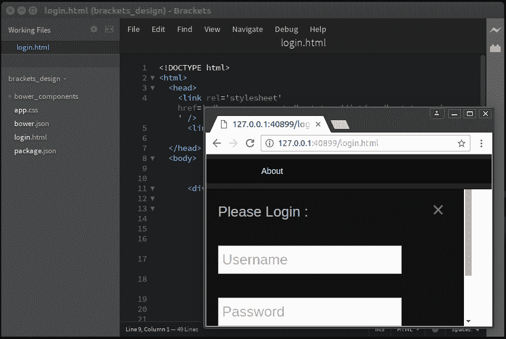

带有实时预览浏览器窗口的 Brackets 编辑器

### 构建应用 [424]

安装 Brackets 仅需从其网站 `brackets.io` 下载安装程序并执行即可。一旦安装，我们就可以通过使用 Brackets 扩展来增强默认功能。Brackets 有一个非常精美且简单的扩展管理器，有助于找到并安装可用的扩展。当这些扩展有更新时，Brackets 还会自动通知我们。

要安装扩展，点击 **File**（文件）| **Extension Manager**（扩展管理器），或者点击右侧侧边栏上的积木图标。我们将使用一个名为 Emmet 的单个扩展，但实际上有数百个可用的 Brackets 扩展。在搜索栏中输入 `Emmet`，然后点击 **Emmet** 扩展的 **Install**（安装）按钮（由 Sergey Chikuyonok 编写），如下图所示：

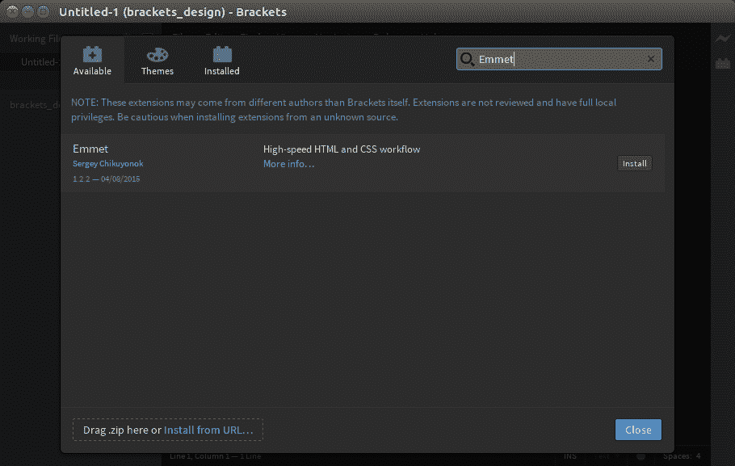

Brackets 扩展对话框

Brackets 本身并没有“项目”的概念，而是基于根文件夹工作的。让我们在文件系统上创建一个新文件夹，然后使用 **File**（文件）| **Open Folder**（打开文件夹）在 Brackets 中打开该文件夹。


### 构建应用程序 [425]

#### 使用 Emmet

现在让我们通过 **File**（文件）| **New**（新建）或简单地使用 `Ctrl`+`N` 来创建一个简单的 HTML 页面。我们不再手动编写 HTML 文件，而是将使用 Emmet 来生成 HTML。输入以下 Emmet 字符串：

```
html>head+body>h3{index.html}+div#content
```

现在按下 `Ctrl`+`Alt`+`Enter`，或者从 **File**（文件）菜单中选择 **Emmet** | **Expand Abbreviation**（展开缩写）。

漂亮！Emmet 在几毫秒内生成了以下 HTML —— 对于一行代码来说还不错：

```html
<html>
<head></head>
<body>
<h3>index.html</h3>
<div id="content"></div>
</body>
</html>
```

### 构建应用程序 [428]

```html
<button class="btn-lg">Login</button>
</div>
</div>
</form>
</div>
```

在这里，我们创建了一个 `id` 为 `"sideNav"` 且 CSS 类为 `login_sidenav` 的 `<div>` 元素。然后我们定义了一个 `<form>` 元素，包含一个用于 `Username` 和密码的 `<input>` 元素，以及一个 `Login` 按钮。

相应的 CSS 样式（定义在 `app.css` 中）如下：

```css
.login_sidenav {
  height: 100%; /* 100%高度 */
  width: 450px; /* 宽度为0 - 使用 JavaScript 更改 */
  position: fixed; /* 固定位置 */
  background-color: #111; /* 黑色*/
  overflow-x: hidden; /* 禁用水平滚动 */
  padding-top: 60px; /* 内容距离顶部 60px */
  color: lightgray;
}

.login_sidenav .row {
  padding: 20px;
  font-size: 24px;
}

.sidenav-input {
  padding: 5px;
  font-size: 24px;
  color: midnightblue;
}

.login_sidenav .closebtn {
  position: absolute;
  top: 60px;
  right: 25px;
  font-size: 36px;
  margin-left: 50px;
}

.login_sidenav a:hover, .offcanvas a:focus{
  color: #f1f1f1;
}

.login_sidenav a {
  padding: 8px 8px 8px 32px;
  text-decoration: none;
  font-size: 25px;
  color: #818181;
  display: block;
  transition: 0.3s;
}
```

此 CSS 结合我们的 HTML 页面，产生了如下屏幕：

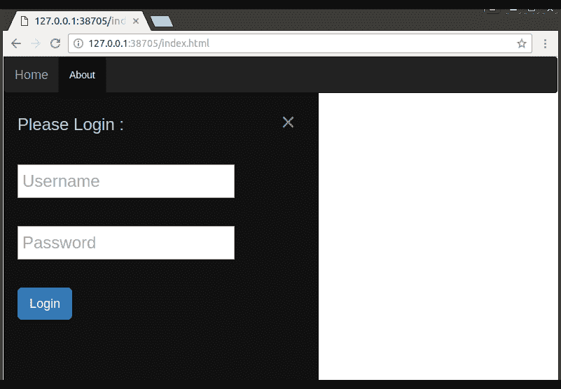

我们用 Brackets 设计的导航栏和登录界面。

在这里，我们可以看到页面顶部有一个导航栏，然后是一个包含登录表单的侧边栏覆盖层。该表单有两个输入元素，即用户名和密码，以及一个**登录（Login）**按钮。

有了这些 HTML 和 CSS，我们就可以使用 Brackets 快速方便地创建新样式，或随心所欲地调整此布局。我们并没有在创建这些布局上花费大量时间或精力——我们仅仅是在调整 HTML 和 CSS。

因此，项目的这个设计阶段可以非常快速地完成，并且只需要极少的 HTML 和 CSS 知识。通过像这样的模板屏幕，我们还可以开始与客户交流，以确定网站的外观和感受是否符合预期，而无需构建整个应用程序。

现在我们已经有了初始设计，可以开始使用我们的框架来实现这些屏幕了。


### 构建应用程序 [430]

#### 一个 Aurelia 网站

在本章的节中，我们将构建一个由 Node 和 Express 托管的 Aurelia 应用程序。我们将使用 Aurelia 实现登录界面，并处理从 Node 网站向 Aurelia 应用程序发送和接收 JSON 数据。首先，让 Node 和 Aurelia 协同工作。

要创建我们的 Aurelia 应用程序，我们只需在磁盘上创建一个新目录，进入该目录，并运行 Aurelia 命令行界面来创建 Aurelia 环境：

```bash
mkdir node_aurelia
cd node_aurelia
au new .
```

在此阶段，我们只需输入 `au run` 即可启动 Aurelia 环境，并将浏览器指向 `http://localhost:9000`。

在编写本文时，Aurelia 仍在使用 `typings` 来为 Aurelia 编译步骤注册并下载类型信息。这意味着 Aurelia 声明文件将被下载到 `typings` 目录，并在 `typings.json` 文件中注册。Aurelia 切换到更新的 `npm @types` 声明文件语法。

#### Node 和 Aurelia 编译

Aurelia 环境将使用 TypeScript 编译我们所有的 `.ts` 文件，并将其打包以便在 `scripts` 目录下的 `app-bundle.js` 文件中使用。但请注意，它不会编译根目录下的任何文件。如果我们在项目根目录下创建一个 `main.ts` 文件，Aurelia 将不会为该 `main.ts` 生成任何 `.js` 文件，因为它显式地在 `app` 目录查找应用程序文件。为了实现这一点，我们需要从根目录运行 `tsc`。

在此之前，我们必须更新 `tsconfig.json` 文件，以排除 `aurelia_project` 目录和 `custom_typings`，如下：

```json
"exclude": [
  "node_modules",
  "aurelia_project"
],
```

### 构建应用程序 [431]

如果不这样做，我们必须更新 `tsconfig.json` 文件以排除 `aurelia_project` 目录和 `custom_typings`，如下：

```json
"exclude": [
  "node_modules",
  "aurelia_project"
],
```

### 构建应用程序 [432]

如果不这样做，我们必须更新 `tsconfig.json` 文件以排除 `aurelia_project` 目录和 `custom_typings`，如下：

```json
"exclude": [
  "node_modules",
  "aurelia_project"
],
```

*(注：由于提供的原文中存在部分重复和格式错乱，译文已根据逻辑进行了整合与对齐)*

### 构建应用程序 [434]

我们的 `index.hbs` 文件如下：

```html
<body aurelia-app="main">
<script src="scripts/vendor-bundle.js" data-main="aurelia-bootstrapper"></script>
</body>
```

请注意，Aurelia 在 `<body>` 标签内使用 `<script>` 标签来启动我们的 Aurelia 应用程序。这就是为什么我们的 `layout.hbs` 文件没有包含 `<body>` 标签，而是依靠每个单独的 Handlebars 模板来生成这个 `<body>` 标签。

启动应用程序之前，让我们按照以下方式安装 Handlebars：

```bash
npm install hbs --save
```

在视图和路由就绪后，我们可以更新 `main.ts` 文件来注册 Handlebars，并如下所示提供所需的 Aurelia 目录：

```typescript
import * as express from 'express';
import * as Index from './routes/index';
import * as path from 'path';

let app = express();
app.set('views', path.join(__dirname, 'views'));
app.set('view engine', 'hbs');
app.use('/', Index.router);
app.use('/scripts', express.static(__dirname + '/scripts'));
app.use('/node_modules', express.static(__dirname + '/node_modules'));
app.use('/css', express.static(__dirname + '/css'));
app.listen(3000, () => {
  console.log(`express listening on port 3000`);
});
```

在这里，我们的 `main.ts` 文件首先导入 `'express'` 和 `'path'` 模块，以及我们的 `'routes/index'` 模块。在创建 Express 应用程序后，我们在 `app` 实例上调用 `set` 函数。第一次调用注册了 `'views'` 子目录以供 Handlebars 使用，第二次调用将 Handlebars 注册为渲染引擎，正如我们在前面的章节中看到的。

### 构建应用程序 [435]

然后，我们将路由器注册为 `'/'` 根目录的 `GET` 处理器。

最后三次调用 `app.use` 函数将 `/scripts`、`/node_modules` 和 `/css` 目录注册为静态内容。这些调用将使这些目录中的任何文件都可由应用程序提供服务。`/scripts` 目录是 Aurelia 在编译步骤后生成 `vendor-bundle.js` 文件的位置。任何提供静态内容的目录都必须在 Express 提供这些内容之前以相同的方式进行注册。

有了这个简单的配置，我们可以通过从命令行运行 `node main` 来启动我们的 Express 应用程序，然后浏览到 `http://localhost:3000`。这将启动并提供我们的 Aurelia 应用程序。

到目前为止，一切顺利。我们成功地集成了 Aurelia 和 Express，现在通过 Express 提供我们的 Aurelia 应用程序以及所有相关的 CSS 和关联文件。

#### Aurelia 组件

现在我们已经有了由 Express 提供的基础 Aurelia 应用程序，我们可以构建必要的组件来渲染我们的 HTML 页面。请记住，此页面的 HTML 和 CSS 是根据我们 Brackets 练习的设计输出的。我们的 Aurelia `App` 组件将作为我们应用程序的主控制器，并渲染我们的导航栏。然后我们将创建一个新的登录组件，它将负责登录面板。

我们的 `app.ts` 文件如下：

```typescript
interface IMenuItem {
  ButtonName: string;
}

export class App {
  message = 'Hello World!';
  menuItems: IMenuItem[] = [
    {ButtonName : 'About'},
    {ButtonName : 'Contact Us'}
  ];
}
```

### 构建应用程序 [436]

在这里，我们从一个名为 `IMenuItem` 的接口开始，它有一个名为 `ButtonName` 的属性。我们的 `App` 类在一个名为 `menuItems` 的属性中创建了这些 `IMenuItems` 的数组。该属性将用于在导航面板中创建一系列按钮。我们的 `app.html` 现在可以如下渲染这些菜单项：

```html
<template>
  <nav class="navbar navbar-default navbar-fixed-top navbar-inverse">
    <div class="container-fluid">
      <a class="navbar-brand">Home</a>
      <ul class="nav navbar-nav">
        <li repeat.for="item of menuItems" class="nav-item nav-link active">
          <a href="#">${item.ButtonName}</a>
        </li>
      </ul>
    </div>
  </nav>
</template>
```

这个用于 `App` 类的 Aurelia 模板几乎是包含导航栏的原始 Brackets HTML 的复制粘贴。对原始 HTML 的唯一更改是注入了一个 `repeat.for` 属性来遍历 `menuItems` 数组，并为数组中的每个项目渲染一个新的 `<a href>` 标签。在有了这些简单的更新后，我们的页面现在将渲染一个 Bootstrap 导航栏。

#### 处理 JSON

现在让我们更新 `App` 类来获取数据并填充 `menuItems` 数组。我们不再硬编码这些项，而是从 REST API 获取它们。我们将使用 Aurelia 的 `HttpClient` 来发送这些请求。

### 构建应用程序 [437]

首先，我们需要在需要在 Express 服务器中创建一个返回 JSON 数据的路由。在 `routes/index.ts` 中，我们添加了：

```typescript
router.get('/items', (req, res) => {
  res.json([
    {ButtonName: 'About'},
    {ButtonName: 'Contact Us'},
    {ButtonName: 'Login'}
  ]);
});
```

现在，我们更新我们的 `App` 组件以使用 `HttpClient`。我们从 `'aurelia-http-client'` 导入它：

```typescript
import { HttpClient } from 'aurelia-http-client';

interface IMenuItem {
  ButtonName: string;
}

export class App {
  message = 'Hello World!';
  menuItems: IMenuItem[] = [];

  constructor() {
    let client = new HttpClient();
    client.get('/items').then((data) => {
      console.log(data.response);
      this.menuItems = data.response;
    });
  }
}
```

### 构建应用程序 [438]

在上面的代码中，`HttpClient` 向 `/items` 端点发送异步请求。一旦接收到响应，就会执行 `then` 回调。在回调内部，我们将 `data.response` 分配给我们的 `menuItems` 属性，这将自动更新 UI。

这样一来，我们的 Aurelia 应用程序现在是动态的，从 Express 服务器获取数据。

### 构建应用 [439]

#### Aurelia 表单

除了从 REST 端点接收数据外，应用程序通常还需要将数据发送到服务器进行处理。为了说明这一点，让我们实现登录界面，并查看如何将数据从 Aurelia 发送到我们的 Express 应用程序。我们将在名为 `login` 的新 Aurelia 组件中使用在 Brackets 中设计的 HTML。我们的 `login` 组件位于 `src/login.ts` 文件中，内容如下：

```typescript
import {HttpClient} from 'aurelia-http-client';

export class Login {
  header = 'Please login';
  userName = "";
  password = "";
  onSubmit() {
    var postMessage = {
      userName: this.userName,
      password : this.password
    };
    let client = new HttpClient();
    client.post('/login', postMessage)
      .then( (message) => {
        console.log(`post returned : ${message.response}`);
      })
      .catch( (err) => {
        console.log(`err.response: ${err.response}`);
      });
  }
}
```

在这里，我们创建了一个名为 `Login` 的类，具有三个属性。`header` 属性用于在屏幕上渲染消息，`userName` 和 `password` 属性将存储用户在表单中输入的值。我们还定义了一个 `onSubmit` 函数，它会在点击 `Submit` 按钮时由 HTML 表单触发。该函数创建一个包含给定 `userName` 和 `password` 值的 JSON 对象，然后调用通过 `HttpClient` 类提供的 `post` 方法。此后调用会将 JSON 数据包 `POST` 到 `'/login'` REST 端点，端点将返回成功或失败响应。`success` 响应将由 `then` 函数处理，错误响应将由 `catch` 函数捕获。目前，我们只是将来自 REST 端点的响应记录到控制台。

### [440]

`login` 组件的 HTML 模板如下：

```html
<template>
  <div id="sideNav" class="login_sidenav">
    <form role="form" submit.delegate="onSubmit()">
      <div class="container">
        <a href="#" class="closebtn" >&times;</a>
        <div class="row">${header}</div>
        <div class="row">
          <input
            class="sidenav-input"
            value.bind="userName"
            type="text"
            placeholder="Username">
        </div>
        <div class="row">
          <input
            class="sidenav-input"
            value.bind="password"
            type="password"
            placeholder="Password">
        </div>
        <div class="row">
          <button class="btn btn-primary btn-lg">Login</button>
        </div>
      </div>
    </form>
  </div>
</template>
```

再次，这是从我们的 Brackets HTML 页面复制并粘贴的练习，仅为了与 Aurelia 集成进行了一些细微更改。首先，我们定义了带有 `submit.delegate` 属性的 `<form>` 标签。该属性的值是我们之前在 `Login` 类中定义的 `onSubmit` 函数。因此，`submit.delegate` 属性将表单提交事件绑定到 `onSubmit` 函数。

在表单内部，我们有一个类名为 `container` 的 `<div>`，然后是三个类名为 `row` 的 `<div>` 元素。其中第一个使用标准的 Aurelia `${...}` 语法将 `Login` 类 `header` 属性的值渲染到 DOM 中。

两个 `<input>` 元素使用名为 `value.bind` 的属性将用户输入的文本绑定到 `Login` 类的属性上。

### [441]

由于有了 `login` 组件，我们可以更新 `app.html` 文件以包含该组件：

```html
<template>
  <require from="./login"></require>
  <login></login>
</template>
```

在这里，我们在 `app.html` 文件中使用 `<require>` 标签来指示 Aurelia 需要加载 `./login` 组件以供模板使用。我们通过简单添加 `<login>` 标签来渲染登录组件。

#### 发送数据

现在我们有了 Aurelia 表单，并且读取用户输入的数据，我们需要为此 HTTP `POST` 事件实现一个 Express 处理器。该处理器写在 `routes/index.ts` 文件中，内容如下：

```typescript
import * as util from 'util';
router.post('/login', (req, res, next) => {
  console.log(`login received : ${util.inspect(req.body, false, null)}`);
  res.sendStatus(200);
});
```

在这里，我们导入了名为 `util` 的模块，并为 `/login` REST 端点注册了一个 Express 处理器。在此处理器中，我们只是将请求的 `body` 记录到控制台，然后返回一个 `200` 的 HTTP 响应。此后函数调用会将 JSON 数据包 `POST` 到 `'/login'` REST 端点，端点将返回成功或失败响应。`success` 响应将由 `then` 函数处理，错误响应将由 `catch` 函数捕获。目前，我们只是将来自 REST 端点的响应记录到控制台。

### [442]

为了解决这个问题，我们需要安装 `body-parser`。`main.ts` 的更新如下：

```typescript
import * as bodyParser from 'body-parser';
// existing code
app.use(bodyParser.json());
app.use(bodyParser.urlencoded({ extended: false }));
```

### 构建应用程序 [444]

```typescript
});
// 现有代码
```

再次，我们需要从各自的模块导入 `EventAggregator` 类和 `inject` 装饰器。与我们在 `Login` 模块中所过的更改类似，我们使用 `@inject` 装饰器对 `App` 类进行了装饰，并通过 `constructor`（构造函数）注入了 `EventAggregator`。

接着，我们调用 `ea.subscribe` 函数来订阅特定的事件名称，并编写了一个匿名函数，该函数会在接收到事件时被调用。

虽然这种方法可以正常工作，但如果能调用类函数而不是匿名函数，对我们的应用程序来说更好。以这种方式使用匿名函数，当我们对应用程序进行单元测试时会产生一些问题。让我们将其拆分为一个命名函数，如下：

```typescript
loginResult(response) {
  console.log(`App.loginResult() : ${response.success}`);
}
```

因此，我们的订阅变为：

```typescript
this.ea.subscribe('login_result', this.loginResult);
```

到目前为止，一切顺利。然而，这个解决方案的问题在于，当 `loginResult` 函数从事件处理器被调用时，它是在事件处理器回调的作用范围内运行的，因此它无法访问 `App` 类实例内部的 `this` 实例。为了直看到这一点，让我们在 `App` 类上创建一个名为 `isLoginVisible` 的类变量，如下：

```typescript
@inject(EventAggregator)
export class App {
  message = 'Hello World!';
  menuItems: IMenuItem[] = [];
  ea: EventAggregator;
  isLoginVisible = true;
  constructor(EventAggregator?) {
    // 现有代码
    this.ea.subscribe('login_result', this.loginResult);
    // 现有代码
  }
  loginResult(response) {
    console.log(`App.loginResult() : ${response.success}`);
    this.isLoginVisible = false;
  }
}
```

### 构建应用程序 [445]

在这里我们创建了一个名为 `isLoginVisible` 的变量，它在 `App` 类实例化时被设置为 `true`。现在，我们的 `loginResult` 函数在接收到成功的登录结果消息时尝试将该变量设置为 `false`。然而，运行这段代码将生成以下错误消息：

`vendor-bundle.js:14688 ERROR [event-aggregator] TypeError: Cannot set property 'isLoginVisible' of undefined(...)`

此错误信息告诉我们，`loginResult` 函数内部的 `this` 变量没有名为 `isLoginVisible` 的属性。因此，它与我们预期的 `this` 上下文不同。为了修复这个问题，我们可以使用 Underscore 库中名为 `bindAll` 的方便函数。

还记得我们在 Node 中创建初始 HTML 文件时，在 `layout.hbs` 文件中包含了 `underscore.min.js` 脚本吗？这就是我们使用它的地方。我们对长期存在的 `this` 作用域错误的修复方法如下：

```typescript
_.bindAll(this, 'loginResult');
this.ea.subscribe('login_result', this.loginResult);
```

在这里，我们调用了 underscore 的 `bindAll` 函数，将 `App` 类的实例 `this` 变量绑定，以便在 `loginResult` 函数中使用。通过这个简单的更改，我们的代码就能按预期工作了。

我们需要做的最后一件事是在 `app.html` 模板中使用 `isLoginVisible` 变量，如下：

```html
<login if.bind="isLoginVisible"></login>
```

在这里，我们正在使用 Aurelia 的 `if.bind` 函数根据 `isLoginVisible` 变量的值来显示或隐藏 `<login>` 模板。

我们的 Aurelia 应用程序现在完成了。我们成功地将 Node Express 应用与 Aurelia 集成，创建了一个提供应用程序数据的 REST 端点，并展示了实现登录界完整 `POST` 工作流。我们还设置了一个简单的消息服务来协调组件之间的事件。

### 构建应用程序 [446]

#### 一个 Angular 2 网站

在本章的这一节中，我们将 Angular 2 应用程序与 Node 和 Express 集成，类似于我们对 Aurelia 所做的操作。同样，我们将展示如何在 Angular 组件中加载 JSON，然后构建我们的登录界面以接受来自 Web 表单的输入并将其提交到我们的 Express 应用程序。好消息是，除了几处细小的更改外，我们为 Aurelia 构建的大部分 Express 代码可以在 Angular 2 中复用。首先，让我们初始化 Angular 应用程序并将其与 Express 集成。

##### Angular 设置


# 构建应用程序

## Angular 2 基础

在现阶段，设置 Angular 2 应用程序应该几乎是本能。我们只需要执行带有项目名称的 `ng new` 命令。要使用 Express，我们需要使用 `npm` 安装 Express，如下：

```bash
npm install express --save
npm install hbs --save
npm install bootstrap --save
```

### 提供 Angular 2 页面

正如我们在 Aurelia 中所做，我们现在需要设置 Express 应用程序，包括 `main.ts` 文件、`routes` 目录下的 `index.ts` 文件以及 `views` 目录下的 `index.hbs` 和 `layout.hbs` 文件。让我们从构建 `views` 目录中的 `layout.hbs` 文件开始。

## Angular 2 组件

我们的 Angular 应用需要两个组件——一个用于渲染导航栏的 `navbar` 组件，以及一个用于渲染登录面板的 `login` 组件。由于我们希望从 Brackets 的设计输出中复制并粘贴 HTML，我们将为这些每个组件都创建一个 `.html` 文件。

让我们从 `src/app/navbar.component.ts` 文件开始，如下：

```typescript
import { Component, Injectable } from '@angular/core';

interface IButtonName {
  ButtonName: string;
}

@Component({
  selector: 'navbar-component',
  templateUrl: './navbar.component.html'
})
@Injectable()
export class NavbarComponent {
  menuItems: IButtonName[] = [
    { ButtonName: 'About' },
    { ButtonName: 'Contact' }
  ];
}
```

在这里，我们从 `'@angular/core'` 模块导入了 `Component` 和 `Injectable` 装饰器。我们稍后会用到 `Injectable` 装饰器，但目前这个 `navbar` 组件非常简单。我们注册了一个名为 `IButtonName` 的接口，`NavbarComponent` 类使用它来设置一个名为 `menuItems` 的内部变量。类的其余部分是标准的 Angular 语法。我们的 `navbar.component.html` 文件如下：

```html
<nav class="navbar navbar-default navbar-fixed-top navbar-inverse">
  <div class="container-fluid">
    <a class="navbar-brand">Home</a>
    <ul class="nav navbar-nav">
      <li *ngFor="let item of menuItems; let i = index">
        <a href="#">{{item.ButtonName}}</a>
      </li>
    </ul>
  </div>
</nav>
```

这同样是从我们原始 HTML 设计页面中复制粘贴的，使用了一个 `*ngFor` 指令来遍历 `NavbarComponent` 类的 `menuItems` 数组，并为每个数组项生成 `<a>` 标签，这与我们在 Aurelia 中做的做法类似。

为了在我们的 Angular 应用中渲染此导航栏，我们需要如下所示更新我们的 `app.component.html` 文件：

```html
<navbar-component></navbar-component>
```

然而，在编译和运行应用程序之前，我们需要在 `app.module.ts` 文件注册这个新的 `NavBarComponent` 类，如下：

```typescript
// existing imports
import { AppComponent } from './app.component';
import { NavbarComponent } from './navbar.component';

@NgModule({
  imports: [BrowserModule],
  declarations: [AppComponent, NavbarComponent],
  bootstrap: [AppComponent]
})
export class AppModule { }
```

在这里，我们按照惯例导入了 `NavbarComponent`，通过将其包含在 `declarations` 数组中，将其注册以便在模板中使用。

完成这些更改后，我们的导航栏将出现在页面顶部。我们将为 `Login` 组件采用类似的方法，并创建一个 `login.component.ts` 文件和一个 `login.component.html` 文件。`login.component.ts` 文件如下：

```typescript
import { Component, Injectable } from '@angular/core';

@Component({
  selector: 'login-component',
  templateUrl: './login.component.html'
})
@Injectable()
export class LoginComponent {
  userName: string;
  password: string;
  loginClicked() {
    console.log(`this.userName : ${this.userName}`);
    console.log(`this.password : ${this.password}`);
  }
}
```

同样，这是一个名为 `LoginComponent` 的标准 Angular 组件，它有两个属性，名为 `userName` 和 `password`，两者都是字符串。我们还包含了一个 `loginClicked` 函数，当用户点击登录页面上的 `Submit` 按钮时就会调用。目前，该函数简单地将 `userName` 和 `password` 属性的值打印到控制台。

我们的 `login.component.html` 文件如下：

```html
<div id="sideNav" class="login_sidenav">
  <form>
    <div class="container">
      <a href="#" class="closebtn">&times;</a>
      <div class="row">Please Login :</div>
      <div class="row">
        <input
          class="sidenav-input"
          type="text"
          placeholder="Username"
          name="userName"
          [(ngModel)]="userName">
      </div>
      <div class="row">
        <input
          class="sidenav-input"
          type="password"
          placeholder="Password"
          name="password"
          [(ngModel)]="password">
      </div>
      <div class="row">
        <button
          class="btn btn-primary btn-lg"
          (click)="loginClicked()">Login
        </button>
      </div>
    </div>
  </form>
</div>
```

在这里，我们修改了 HTML 以使用 `[(ngModel)]` 属性。注意 `name` 属性以及 `userName` 和 `password` 输入是如何用于 Angular 组件的。

## 处理 JSON

正如我们在 Aurelia 中做的那样，现在让我们处理 `navbar` 组件以使用：

```typescript
import { Http, Response, RequestOptions } from '@angular/http';

// existing code
@Injectable()
export class NavbarComponent {
  menuItems: IButtonName[];

  constructor(private http: Http) {
    console.log('AppComponent constructor');
    this.http.get('/menuitems')
      .map(res => res.text())
      .subscribe(
        (data) => {
          let jsonResponse = JSON.parse(data);
          this.menuItems = jsonResponse.menuItems;
        },
        err => {
          console.log(`error : ${err}`);
        },
        () => {
          console.log(`success`);
        }
      );
  }
}
```

一旦我们设置了与 HTML 绑定的相应内部变量，Angular 就会根据 REST 端点返回的新值自动更新 HTML DOM。

在测试此代码之前，我们需要更新 `app.component.ts` 类以导入 `map` 和 `subscribe` 函数，如下所示：

```typescript
import { Component } from '@angular/core';
import 'rxjs/add/operator/map';
import 'rxjs/operator/delay';
import 'rxjs/operator/mergeMap';
import 'rxjs/operator/switchMap';

@Component({
  selector: 'my-app',
  templateUrl: 'app/app.component.html'
})
export class AppComponent { name = 'Angular'; }
```

在这里，我们从 `rxjs` 命名空间导入了几个模块。将它们添加到 app 组件中而不是 `navbar` 组件中的原因是，是为了让所有模块都能访问这些函数。

现在编译并运行我们的应用程序，将看到 `navbar` 中的三个按钮，它们从我们的 Express REST 端点提供服务。目前为止，一切顺利。

## 发布数据

现在让我们关注 `login` 组件，并使用来自 Angular 的相同的 `Http` 类将我们的登录数据发布到我们的 REST 端点。我们已经在该类中有一个 `loginClicked` 函数，因此我们需要做的就是创建一个正确的 HTTP 数据包并如下发布它：

```typescript
constructor(private http: Http) {
}

loginClicked() {
  console.log(`this.userName : ${this.userName}`);
  console.log(`this.password : ${this.password}`);
  var headers = new Headers();
  headers.append('Content-Type', 'application/json');
  let jsonPacket = {
    userName: this.userName,
    password: this.password
  };
  this.http.post('/login', jsonPacket, {
    headers: headers
  })
    .map(res => res.text())
    .subscribe(
      data => data,
      err => {
        console.log(`error : ${err}`);
      },
      () => {
        console.log(`success`);
      }
    );
}
```

我们首先添加一个 `constructor` 函数，就像我们在 `navbar` 组件中做的那样，将 `Http` 模块注入到名为 `http` 的私有变量中。然而，大部分更改位于 `loginClicked` 函数。为了向 REST 端点发布数据，我们需要创建一个 `Headers` 对象，并使用 `headers` 实例添加 `application/json` 的 `Content-Type`。然后我们构建一个 `jsonPacket` 对象，使用我们在数据绑定过程中已经更新的 `userName` 和 `password` 变量。紧接着，我们使用我们的端点名称、`jsonpacket` 和我们的 `POST` 请求头调用 `Http` 类的 `post` 方法。`map` 和 `subscribe` 函数与我们早前的 `GET` 请求类似。

我们在这一节中对 Angular 的工作已经完成。我们集成了一个 Node 和 Express Web 服务器，既用于提供 Angular 网页，也作为 REST 端点使用。我们还成功实现了一个导航栏组件和一个 `login` 组件，并展示了如何使用 Angular 消费和发布数据到 REST 端点。在之前的 `第 11 章` *面向对象编程* 中，我们使用 `EventEmitter` 了 Angular 事件，因此我们在这里不再重复介绍。

# 一个 Express React 网站

在本章的最后一节中，我们将查看 React 和 Express 的集成。正如我们之前对 Aurelia 和 Angular 所做的那样，我们将开始将 Express 和 React 组件放在同一个目录中，然后处理提供 React 网站所需的 Express 布局。然后，我们将查看在 React 中使用 REST 端点的方法。

## Express 和 React

正如我们之前做的那样，设置一个 React 网站只需要创建一个包含相关 React 组件的 `package.json` 文件和一个 `tsconfig.json` 文件，然后创建一个 `webpack.config.js` 文件，以便我们使用 webpack。我们的 `package.json` 文件如下：

```json
{
  "name": "node_react",
  "version": "1.0.0",
  "description": "",
  "main": "index.js",
  "scripts": {
    "test": "echo \"Error: no test specified\" && exit 1"
  },
  "author": "",
  "license": "ISC",
  "dependencies": {
    "body-parser": "^1.15.2",
    "express": "^4.14.0",
    "hbs": "^4.0.1",
    "promise-polyfill": "^6.0.2",
    "react": "^15.4.0",
    "react-dom": "^15.4.0",
    "whatwg-fetch": "^2.0.1",
    "@types/body-parser": "0.0.33",
    "@types/core-js": "^0.9.35",
    "@types/express": "^4.0.35",
    "@types/react-dom": "^14.23",
    "@types/whatwg-fetch": "0.33"
  },
  "devDependencies": {
    "source-map-loader": "^1.5",
    "ts-loader": "^2"
  }
}
```

在这里，我们包含了 `devDependencies` 目录中的 `source-map-loader` 和 `ts-loader`。

`tsconfig.json` 文件如下：

```json
{
  "compilerOptions": {
    "target": "es5",
    "module": "commonjs",
    "jsx": "react",
    "strict": false,
    "outDir": "./dist",
    "moduleResolution": "node",
    "lib": ["dom", "es6"]
  },
  "include": [
    "src/**/*"
  ]
}
```

`webpack.config.js` 文件如下：

```javascript
const path = require('path');

module.exports = {
  entry: './src/index.js',
  output: {
    path: path.resolve(__dirname, 'dist'),
    filename: 'bundle.js',
  },
  module: {
    rules: [{
      test: /\.(tsx?)$/,
      exclude: /node_modules/,
      use: 'ts-loader',
    }]
  },
  resolve: {
    extensions: ['.ts', '.js'],
  },
};
```

`src/index.js` 文件如下：

```javascript
const express = require('express');
const path = require('path');
const bodyParser = require('body-parser');
const app = express();
app.use(bodyParser.json());
app.use(express.static(path.join(__dirname, '../dist')));
app.get('/', (req, res) => {
  res.sendFile(path.join(__dirname, '../dist/index.html'));
});
app.post('/login', (req, res) => {
  console.log(req.body);
  res.json({ message: 'success' });
});
app.listen(3000, () => {
  console.log('Express listening on port 3000');
});
```

`src/index.tsx` 文件如下：

```tsx
import React from 'react';
import ReactDOM from 'react-dom';
import App from './App';

const root = document.getElementById('root');
ReactDOM.render(<App />, root);
```

`src/App.tsx` 文件如下（原始版本，存在问题）：

```tsx
import React, { Component } from 'react';
import Http from 'http';

class App extends Component {
  userName = 'Angular';
  password = '';
  loginClicked() {
    console.log(`this.userName : ${this.userName}`);
    console.log(`this.password : ${this.password}`);
    var headers = new Headers();
    headers.append('Content-Type', 'application/json');
    let jsonPacket = {
      userName: this.userName,
      password: this.password
    };
    this.http.post('/login', jsonPacket, {
      headers: headers
    })
      .map(res => res.text())
      .subscribe(
        data => data,
        err => {
          console.log(`error : ${err}`);
        },
        () => {
          console.log(`success`);
        }
      );
  }
  render() {
    return (
      <div>
        <h1>{this.userName}</h1>
        <button onClick={() => this.loginClicked()}>Login</button>
      </div>
    );
  }
}

export default App;
```

> **注意**：上面的代码中 `App.tsx` 里的 `this.http` 实际上是来自 Angular 的写法。在 React 中，我们通常使用 `axios` 或 `fetch`。修正后的 `src/App.tsx` 如下：

```tsx
import React, { Component } from 'react';
import axios from 'axios';

class App extends Component {
  userName = 'React';
  password = '';
  loginClicked() {
    console.log(`this.userName : ${this.userName}`);
    console.log(`this.password : ${this.password}`);
    axios.post('/login', {
      userName: this.userName,
      password: this.password
    }, {
      headers: { 'Content-Type': 'application/json' }
    })
      .then(res => {
        console.log(res.data);
      })
      .catch(err => {
        console.log(`error : ${err}`);
      });
  }
  render() {
    return (
      <div>
        <h1>{this.userName}</h1>
        <button onClick={() => this.loginClicked()}>Login</button>
      </div>
    );
  }
}

export default App;
```

`src/index.html` 文件如下：

```html
<!DOCTYPE html>
<html>
<head>
  <meta charset="UTF-8" />
  <title>React App</title>
</head>
<body>
  <div id="root"></div>
  <script src="/bundle.js"></script>
</body>
</html>
```

现在，通过运行 `node server.js` 并在浏览器中访问 `http://localhost:3000`，就可以看到我们的 React 应用程序了。

在建立这两个视图后，我们可以启动 Express 应用程序并访问 `http://localhost:3000`。虽然这看起来一切良好，但如果我们打开浏览器中打开**开发者工具**并查看控制台日志，我们会发现仍然有几个 404 错误：

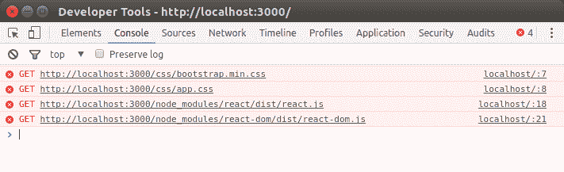

在提供 Express React 应用程序时查看 404 错误

前两个错误表明我们需要在 `/dist/css` 目录下创建一些 `.css` 文件。这些文件可以很容易从我们之前的示例中复制。然而，后两个错误表明我们需要一个 `/dist/node_modules` 目录，其中包含 `react` 和 `react-dom` 模块。

## 多个 package.json 文件

本质上，React 使用的 webpack 编译步骤意味着浏览器使用的所有文件都必须从 `/dist` 目录提供。然而，我们的某些文件来自 `/`（或项目根目录）。这就是 React 开发环境的本质。记住，任何静态提供的文件必须在 `/dist` 目录中，但任何经过编译的文件必须在 `/` 或根目录下。

为了解决这个问题，我们可以将 `package.json` 文件拆分为两个独立的文件——一个在 `/` 或根目录下，另一个在 `/dist` 目录下。位于 `/` 或根目录下的 `package.json` 文件只需要安装 webpack 编译步骤需要的包，因此可以简化为如下：

```json
{
  "name": "node_react",
  "version": "1.0.0",
  "devDependencies": {
    "source-map-loader": "^0.1.5",
    "ts-loader": "^1.2.2"
  },
  "dependencies": {
    "@types/body-parser": "0.0.33",
    "@types/core-js": "^0.9.35",
    "@types/express": "^4.0.35",
    "@types/react-dom": "^0.14.23",
    "@types/whatwg-fetch": "0.0.33"
  }
}
```

在这里，`dependencies` 列表仅包含我们的 `@types` 定义，`devDependencies` 数组被简化为仅包含 `source-map-loader` 和 `ts-loader`。Node 模块是 webpack 编译步骤所需的全部内容。我们的 `/dist/package.json` 文件不需要 `devDependencies`，因此仅包含以下内容：

```json
{
  "name": "node_react_dist",
  "version": "1.0.0",
  "dependencies": {
    "body-parser": "^1.15.2",
    "cookie-parser": "^1.4.3",
    "express": "^4.14.0",
    "express-session": "^1.14.1",
    "hbs": "^4.0.1",
    "promise-polyfill": "^6.0.2",
    "react": "^15.4.0",
    "react-dom": "^15.4.0",
    "whatwg-fetch": "^2.0.1"
  }
}
```

因此，拥有两个 `package.json` 文件意味着，如果 Express 应用程序需要新模块，我们需要修改 `/dist/package.json` 文件。此外，记住在 `/dist` 目录下执行 `npm install` 命令以安装所需的模块。

## React 组件

现在我们让 React 和 Node 并行工作，可以专注于为导航栏和登录屏幕创建所需的 React 组件。我们将从 `app/NavBar.tsx` 类开始，它将渲染我们的导航栏：

```typescript
import * as React from 'react';
import * as ReactDOM from 'react-dom';

export class MenuItem {
  ButtonName: string;
}

export class NavBarProps {
  menuItems: MenuItem[];
}

export default class NavBar extends React.Component<NavBarProps, {}> {
  state: NavBarProps;

  constructor(props?: NavBarProps) {
    super(props);
    this.state = { menuItems: [] };
  }

  render() {
    return (
      <nav className="navbar navbar-default navbar-fixed-top navbar-inverse">
        <div className="container-fluid">
          <a className="navbar-brand">Home</a>
          <ul className="nav">
            {this.state.menuItems.map((item, i) => (
              <li key={i} className="nav-item">
                <a href="#">{item.ButtonName}</a>
              </li>
            ))}
          </ul>
        </div>
      </nav>
    );
  }
}
```

在这里，我们导出了三个类。第一个是 `MenuItem`，包含一个名为 `ButtonName` 的字符串属性。第二个是 `NavBarProps`，包含一个 `MenuItem` 数组。第三个是 `NavBar` 类，它扩展了 `React.Component` 并使用泛型指定内部使用 `NavBarProps`。这些类共同构建了一个 `NavBar` 类，它有一个名为 `menuItems` 的内部数组，每个元素都有 `ButtonName`。`NavBar` 类有一个类型为 `NavBarProps` 的 `state` 属性和一个接受可选 `NavBarProps` 的 `constructor` 函数。此可选属性允许任何父组件使用 `<NavBar />` 或 `<NavBar menuItems={...} />` 语法实例化该类。关于该类有几点需要注意：首先，我们在构造函数中将内部 `state` 设置为空数组 `menuItems`；其次，我们在 `render` 函数中遍历 `state.Items` 属性并为每个项渲染一个 `<li>` 元素。当类被构建时，`state.menuItems` 数组没有元素，因此我们不会渲染任何导航栏按钮。第三，我们的导航栏按钮使用了 `state` 属性而不是 `props` 属性。注意 React 使用 `state` 属性在 `state` 改变时允许重新渲染 HTML 元素。我们需要更新 DOM 时，只需调用 `setState` 函数，React 就会重新生成并渲染 DOM。我们在 React 组件使用的 HTML 与使用的略有不同。这意味着为了渲染 HTML `<div class="css-class-name">`，我们必须在 React 组件中指定 `<div className="css-class-name">`。

为了测试此导航栏，我们在 `app/index.tsx` 文件中创建 `App` 类，以便将 `NavBar` 组件渲染到 DOM，如下：

```typescript
import * as React from 'react';
import * as ReactDOM from 'react-dom';
import NavBar from './NavBar';

export class App extends React.Component<{}, {}> {
  render() {
    return (
      <div>
        <NavBar />
      </div>
    );
  }
}

ReactDOM.render(
  <App></App>,
  document.getElementById('app_anchor')
);
```

在这里，我们有一个非常简单的 `App` 类，它没有可设置的属性，因此对 `ReactComponent` 定义使用空对象。`App` 类有一个名为 `render` 的单函数，它渲染一个子组件 `NavBar`。为了启动 `App` 类，我们调用了 `ReactDOM.render`。

有了 `App` 和 `NavBar` React 组件，启动应用程序将渲染一个没有按钮的 `NavBar` 组件，如下：

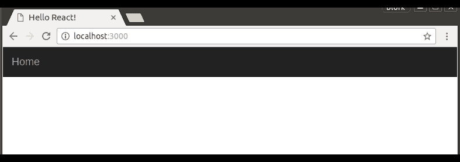

React 应用程序渲染导航栏

## 消费 REST 端点

正如我们处理 Aurelia 和 Angular 应用程序一样，现在更新 `NavBar` React 组件以消费 REST 端点。换句话说，向 `/menuitems` 端点发送 `GET` 请求，并使用返回的 JSON 填充我们的导航栏。我们的更新位于 `NavBar` 组件的构造函数，如下：

## 登录面板组件

既然我们已经放置了 `NavBar` 组件，现在可以将注意力转移到登录面板上。登录面板需要处理从 HTML 表单回传到 React 类的数据绑定，就像我们在 Aurelia 和 Angular 中做的那样。首先，让我们把 `LoginPanel` 的基础工作落实起来，稍稍后我们再讨论数据绑定和表单提交。

我们的 `app/LoginPanel.tsx` 文件如下：

```tsx
import * as React from 'react';
import * as ReactDOM from 'react-dom';

// must export a props class
export class LoginPanelProps {
  userName?: string;
  password?: string;
}

export default class LoginPanel
  extends React.Component<LoginPanelProps, {}> {
  state: LoginPanelProps;

  constructor(props?: LoginPanelProps) {
    super(props);
    this.state = { userName: '', password: '' };
  }

  render() {
    return (
      <div id="sideNav" className="login_sidenav">
        <form onSubmit={this.handleSubmit}>
          <div className="container">
            <a href="#" className="closebtn">times;</a>
            <div className="row">Please Login :</div>
            <div className="row">
              <input
                className="sidenav-input"
                type="text"
                placeholder="Username"
                value={this.props.userName} />
            </div>
            <div className="row">
              <input
                className="sidenav-input"
                type="password"
                placeholder="Password"
                value={this.props.password} />
            </div>
            <div className="row">
              <input
                type="submit"
                value="Login"
                className="btn btn-primary btn-lg" />
            </div>
          </div>
        </form>
      </div>
    );
  }

  handleSubmit(event) {
  }
}
```

在这里，我们定义了一个名为 `LoginPanelProps` 的类，它持有我们的 `userName` 和 `password` 属性。我们的 `LoginPanel` React 组件再次使用了泛型语法来派生自 `React.Component` 类。`constructor` 函数再次将 `props` 参数指定为可选，然后将内部 `state` 属性设置为一个带有空白 `userName` 和 `password` 属性的对象。

注意我们在 `render` 函数中包含的 HTML。我们指定了一个 `<form>` 标签，并将其 `onSubmit` 属性设置为 `{this.handleSubmit}`。这实际上是将 `onSubmit` 事件绑定到了我们类内部的 `handleSubmit` 函数。

与此类似，用于 `Username` 的 `input` 元素的 `value` 属性被设置为 `this.props.userName`。这种语法将把输入元素的值设置为我们 `LoginPanel` 类属性的值。

为了渲染这个 `LoginPanel`，我们可以如下所示更新 `App` 类：

```tsx
import LoginPanel from './LoginPanel';

export class App
  extends React.Component<{}, {}> {
  render() {
    return (
      <div>
        <LoginPanel />
        <NavBar />
      </div>
    );
  }
}
```

在这里，我们导入了 `LoginPanel` 类，并在 `render` 函数中包含了一个 `<LoginPanel />` 元素。

## React 数据绑定

随着我们的 `LoginPanel` 渲染到 DOM，我们现在可以关注登录面板表单元素与我们的 `LoginPanel` 类之间的数据绑定。记住，我们正在使用 `LoginPanel` 类中的 `userName` 和 `password` 属性来持有显示在网页上的初始值。目前它们都是空白的，等待用户向这些输入元素中输入值。

为了捕获对这些表单元素的更新，我们需要在 HTML 元素中附加 `onChange` 事件。这通过两个步骤来实现：首先定义一个在表单单值发生变化时调用的函数，其次通知 HTML 元素在当元素值改变时需要调用此函数。我们对 `LoginPanel` 的更新包含两个方面，如下：

```tsx
constructor(props?: LoginPanelProps) {
  super(props);
  this.state = { userName: '', password: '' };
  this.handleUserNameChange =
    this.handleUserNameChange.bind(this);
  this.handlePasswordChange =
    this.handlePasswordChange.bind(this);
  this.handleSubmit =
    this.handleSubmit.bind(this);
}

handleUserNameChange(event) {
  this.setState({ userName: event.target.value });
  console.log(`username change: ${event.target.value}`);
}

handlePasswordChange(event) {
  this.setState({ password: event.target.value });
  console.log(`password change: ${event.target.value}`);
}
```

在这里，我们引入了两个新函数：`handleUserNameChange` 和 `handlePasswordChange`。在我们的 `constructor` 函数中，我们还将这些函数的值赋值给 `bind(this)` 调用的结果。这是必要的，以确保函数被事件监听器调用时，其上下文（context）是正确的。

## 提交数据

为了完成我们的 React 工作，让我们更新 `LoginPanel` 类，以向我们的端点生成一个 `POST` 请求。

```tsx
handleSubmit(event) {
  event.preventDefault();
  fetch('/login', {
    method: 'POST',
    headers: {
      'Accept': 'application/json',
      'Content-type': 'application/json'
    },
    body: JSON.stringify({
      userName: this.state.userName,
      password: this.state.password
    })
  }).then((response) => {
    console.log(`response: ${response.status}`);
  }).catch((err) => {
    console.log(`err: ${err}`);
  });
}
```

在这里，我们更新了 `handleSubmit` 事件处理程序，使用 React 的 `fetch` 函数来向我们的端点发送 `POST` 请求。

## 摘要

在本章中，我们探索了应用程序开发中的一些基础构建模块。我们展示了如何将 Express Web 服务器与 Aurelia、Angular 2 和 React 框架结合。我们讨论了如何创建 Handlebar 视图为这些框架中的每一个框架提供 HTML 页面，以及如何在 Express 中注册静态内容来实现这一目标。随后，我们讨论了数据绑定，特别是如何从 Express REST 端点请求数据，以便根据返回的 JSON 动态更新 HTML 元素。对于每种框架，我们都探索了如何操作和处理 HTML 输入元素，以便从用户输入表单中读取数据。一旦获取了用户输入，我们就编写了代码将这些数据发布（post）到 Express REST 端点。

在下一章中，我们将把所学的内容整合在一起，构建一个完整的 Angular 2 应用程序，该程序将包含我们在本书中一直以来使用的所有构建模块。

---

# 让我们开始实践

在最后一章中，我们将使用到目前所学的技术和原则来构建一个示例 Web 应用程序。该应用程序将使用我们在 `第 11 章` *面向对象编程* 中探索过的从左到右面板的设计，并像我们在 `第 13 章` *构建应用程序* 中讨论的那样与 REST 端点进行交互。我们还将复用 **State** 和 **Mediator** 设计模式，并像我们在 `第 9 章` *测试兼容 TypeScript 的框架* 中讨论的那样展示如何为应用程序编写单元测试。我们已经掌握了构建示例应用程序所需构建模块和深度知识，因此本章的重点在于重用和组件集成。为了简洁起见，我们在整个章节中将使用 Angular 2 作为应用程序框架。

本章将涵盖以下主题：

- 应用程序结构概述
- 单元测试
- 测试 State 和 Mediator 设计面板
- 集成新的登录面板
- 处理复杂的 JSON 结构
- 测试 HTTP 请求
- 测试 UI 事件
- 过滤数据
- 应用程序架构

## 板类销售应用程序

我们的应用程序将是一个简单的程序，命名为 **Board Sales**（板类销售），它将在主页上列出一系列冲浪板，然后允许用户通过点击任何一个出售中的板类来查看详情。点击特定的板类将从右侧滑出板类详情面板。我们还将使用左侧导航面板为用户提供过滤板类列表的选项。如果用户点击特定的过滤器，显示的板类范围将进行过滤以匹配此选择。主页如下所示：

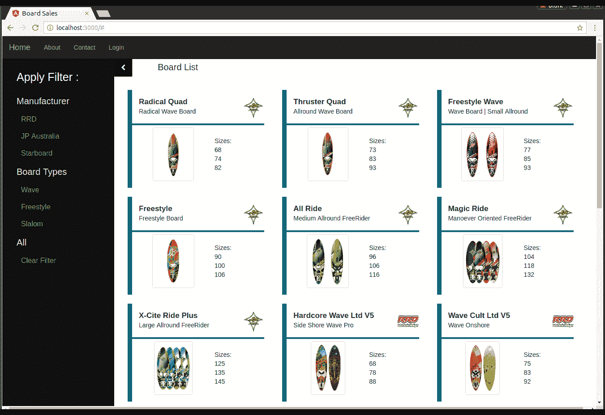

带有过滤器面板的示例应用程序主板类列表

在这里，我们可以看到顶部导航栏、左侧显示过滤选项的侧边导航面板，以及显示一系列板类的主面板。

现代冲浪板有多种尺寸，以体积（volume）来衡量。正如我们在板类列表视图看到的，每个板类旁边都显示有一个可用尺寸的表格。体积较小的板类通常用于冲浪，而体积较大的板类则用于竞赛或绕力赛。那些介于两者之间的板类可以分类为花式板（freestyle boards），用于在平水执行特技动作。每个板类都有一个制造商，这对应于每个板类旁边显示的 Logo。我们左侧的过滤器面板允许用户选择制造商或板类类型作为过滤器。因此，为了只查看 RRD 制造的板类，用户可以点击 **Manufacturer**（制造商）下的 **RRD** 过滤器。同样，要过滤 **Slalom**（绕力赛）板类列表，用户可以点击左侧面板上的 **Slalom** 过滤器。

点击任何特定的板类将显示板类详情屏幕，如下：


板类详情视图

在这里，我们有一个板类的详细视图，包含一张更大的图片、对板类本身更全面的描述，以及一个扩展的可用尺寸表格。

选择冲浪板的一个重要方面是它支持的帆尺寸范围。在极强风中，会使用较小的帆以让冲浪者能够控制风力产生的动力。同样，在微风中，会使用较大的帆来产生更多动力。板类尺寸、板类类型和可用帆尺寸的组合共同用于为水手和航况选择正确的板类。因此，详情视图列出了该板类支持的最小和最大帆尺寸。

## Angular 2 基础应用程序

在 `第 11 章` *面向对象编程* 中，我们做了大量工作来确保我们的应用程序符合面向对象的设计原则，并实现了我们正在寻找的基本的从左到右屏幕流。在 `第 13 章` *构建应用程序* 中，我们整合了一些页面，以便我们使用 State 和 Mediator 设计。我们的 Angular 应用程序已经安装了使用 Karma 的所有前提。我们需要的文件包括：

- `main.ts`
- `package.json`
- `/src`
- `/routes`
- `/views`
- `/css`
- `/assets`

有了这些文件，我们可以执行以下命令：

- `ng build`
- `tsc main.ts`
- `tsc -p routes`

编译完成后，我们可以运行 `node` 来启动。访问 `http://localhost:3000` 站点将显示默认的登录界面：

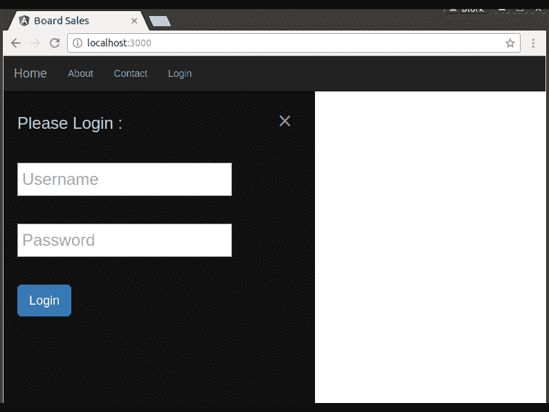

## 单元测试

任何生产环境的网站，或者说源代码，在发布之前都应该经过充分测试。这种测试过程包括单元测试、集成测试和验收测试，让我们对网站的行为充满信心。正如我们在 `第 9 章` *测试兼容 TypeScript 的框架* 中所讨论的那样，现在为我们的应用程序设置测试套件，以便我们遵循测试驱动开发方法论。对于单元测试，我们将使用 Karma，它是 Angular 2 应用程序的标准单元测试过程。我们的 Angular 应用程序已经安装了使用 Karma 的所有前提，因此可以在命令行输入以下命令来启动 Karma：

```bash
npm test
```

现在运行 `npm test` 将在命令行报告我们的项目中目前没有测试，如下：

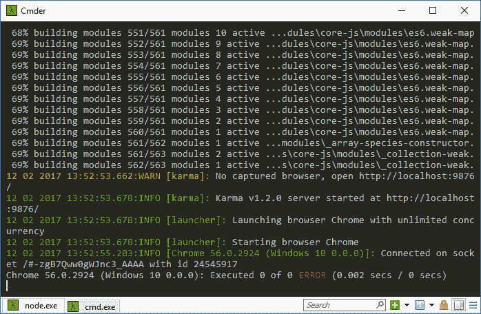

Karma 测试运行器指示未找到测试

请记住，如果文件名包含 `.spec.` 单词，无论它存在于 `src` 目录的哪个位置，它都将作为测试运行。

我们的测试框架现在已经就绪。

### 状态中者测试

我们将从 `第 11 章` *面向对象编程* 中合并的第一个模块将是 `state.mediator.ts` 文件，它包含了我们对状态（State）和中者（Mediator）设计模式的实现。该文件可以直接复制，因为它包含标准的 `TypeScript` 类，不包含任何 Angular 特定的代码。然后我们可以在 `src` 目录下创建一个 `tests` 目录，并创建一个名为 `state.mediator.spec.ts` 的测试文件。

Angular 建议在被测试组件相同的目录下创建 `.spec` 文件。这意味着 `app` 目录将同时包含 `state.mediator.ts` 文件和 `state.mediator.spec.ts` 文件。虽然这有助于指示哪些文件具有测试，但应用程序目录中的文件数量会迅速变得非常杂乱。创建一个独立的 `test` 目录来存放测试文件会更容易，这样就可以快速定位它们，而无需在应用程序目录的许多文件中进行搜索。

我们的第一个测试将是一个完整性测试，用于证明测试过程工作正常，并且 Karma 能够找到我们的测试并正确运行它们，如下所示：

```typescript
describe('app/tests/state.mediator.spec.ts', () => {
  it('should fail', () => {
    expect(true).toBeFalsy();
  });
});
```

在这里，我们有一个应该失败的简单 Jasmine 测试。在此阶段运行 `npm test` 将把我们的 `state.mediator.spec.ts` 文件识别为测试套件，执行测试并在命令行中报告失败，如下所示：


注意测试套件是如何命名的——`'src/tests/state.mediator.spec.ts'`。使用包含测试的精确文件名来命名你的测试套件，将有助于将来识别是哪个测试套件导致了失败。你不再需要在源代码库中搜索 `describe` 函数的精确语句，而是可以直接跳转到包含测试的文件。这在调试测试时也会很有帮助，因为你立即知道要查看哪个文件。

现在我们已经搭建好了测试环境，可以关注 State 类和 Mediator 类所需的测试了。

Mediator 类包含了我们应用程序中状态之间切换的所有代码。它有几个重要的函数：

- 将应用程序设置为初始状态
- 作为在状态之间移动的结果，调用 `IMediatorImpl` 接口上的 UI 函数
- 存储当前状态
- 存储主面板的当前状态

因此，我们的测试需要涵盖这些场景中的每一个。让我们先开始编写一个测试来确保应用程序的初始状态被正确设置，如下：

```typescript
import { Mediator,
  IMediatorImpl,
  StateType,
  PanelType,
  MainPanelOnly,
  MainPanelWithSideNav } from '../app/state.mediator';

class MockMediatorImpl implements IMediatorImpl {
  showNavPanel() {}
  hideNavPanel() {}
  showDetailPanel() {}
  hideDetailPanel() { }
  changeShowHideSideButton(fromClass: string, toClass: string) {};
}

describe('src/tests/state.mediator.spec.ts', () => {
  let mockMediatorImpl: IMediatorImpl;

  beforeEach(() => {
    mockMediatorImpl = new MockMediatorImpl();
  });

  it('should set initial state', () => {
    let mediator = new Mediator(mockMediatorImpl);
    expect(mediator.getCurrentMainPanelState())
      .toBe(StateType.MainPanelWithSideNav);
  });
});
```

在这里，我们首先从 `state.mediator` 文件导入了相关模块。然后我们创建了一个名为 `MockMediatorImpl` 的类，它实现了 `IMediatorImpl` 接口。记住，`Mediator` 类的构造函数需要此接口的实现作为参数。与其在测试中使用真实的 `AppComponent`，我们只需通过 mock 类来模拟该接口的实现。此外，我们的测试实际上不会更新任何用户界面，因此在调用这些函数时不会执行任何操作。这又是良好的面向对象代码示例。`Mediator` 类有一个单一依赖，我们将该依赖抽象为接口，以便我们注入多个不同的实现。在这种情况下，我们仅仅是为了目的而注入了一个 mock。我们的测试只是创建了 `Mediator` 的实例，然后检查状态是否已设置。

## 登录界面状态

我们目前的应用程序尚未集成侧边导航或组件，它仅仅是显示了一个登录面板。我们现在需要做的是将登录面板集成到状态和中者模式中，这样我们就可以控制登录面板何时以及何地显示。为了做到这一点，我们需要一个新的 `StateType` 枚举项和一个新的 `PanelType` 枚举项，如下：

```typescript
export enum StateType {
  MainPanelOnly,
  MainPanelWithSideNav,
  DetailPanel,
  LoginPanel
}

export enum PanelType {
  Primary,
  Detail,
  OverlayPanel
}
```

在这里，我们更新了 `StateType` 枚举以包含 `LoginPanel` 状态，并且更新了 `PanelType` 枚举以包含 `OverlayPanel` 条目。记住，我们显示的面板要么是 `Primary` 面板（带有或不带侧边导航）、`Detail` 面板，或者是 `Overlay` 面板。这个 `OverlayPanel` 可以包含其他屏幕，例如联系我们面板或注册面板。因此，创建一个新的 PanelType 是有意义的，这样我们就不会干扰主面板和详情面板之间的现有逻辑。

我们的 `IState` 接口现在需要更新以包含一个 `isLoginVisible` 函数，如下：

```typescript
export interface IState {
  getPanelType(): PanelType;
  getStateType(): StateType;
  isSideNavVisible(): boolean;
  getPanelButtonClass(): string;
  isLoginVisible(): boolean;
}
```

再次，这是对接口定义的简单单行更改，但它要求更新所有当前状态以实现此函数。它们的实现将简单地返回 `false`。

我们现在需要一个新的 `State` 类，如下所示：

```typescript
export class LoginPanel implements IState {
  getPanelType(): PanelType { return PanelType.OverlayPanel; }
  getStateType(): StateType { return StateType.LoginPanel; }
  getPanelButtonClass(): string { return ''; }
  isSideNavVisible(): boolean { return false; }
  isLoginVisible(): boolean { return true; }
}
```

在这里，我们创建了一个名为 `LoginPanel` 的新类来表示我们的登录面板状态。

`PanelType` 将是 `OverlayPanel`，`StateType` 将是 `LoginPanel`，并且 `isLoginVisible` 函数现在返回 `true`。我们现在可以创建一个单元测试来确保这些值设置正确，如下：

```typescript
it('should create LoginPanel state object with correct parameters', () => {
  let loginState = new LoginPanel();
  expect(loginState.getPanelType()).toBe(PanelType.OverlayPanel);
  expect(loginState.getStateType()).toBe(StateType.LoginPanel);
  expect(loginState.isLoginVisible()).toBe(true);
});
```

在这里，我们正在创建一个 `LoginPanel` 对象，并确保每个参数都设置正确。虽然这看起来可能不是一个特别实用的单元测试，但请记住，它的存在是为了确保我们的对象运行正常。如果我们需要对这些状态类进行修改，我们简单的测试将防止无意的更改，因为这些类中的每个属性都驱动着我们的应用程序流。

登录面板的显示或隐藏需要由用户界面来实现，然后由 `Mediator` 类触发。为了触发登录面板的显示和隐藏，我们需要更新我们的 `IMediatorImpl` 接口以包含这些函数，如下：

```typescript
export interface IMediatorImpl {
  showNavPanel(): void;
  hideNavPanel(): void;
  showDetailPanel(): void;
  hideDetailPanel(): void;
  changeShowHideSideButton(fromClass: string, toClass: string): void;
  showLoginPanel(): void;
  hideLoginPanel(): void;
}
```

在这里，我们增加了两个新函数，名为 `showLoginPanel` 和 `hideLoginPanel`，用于控制登录面板的显示。同样，这些函数需要由实现此接口的类来实现。

我们需要对 `Mediator` 类再进行两个更改以整合新的 `LoginPanel` 状态。首先，我们需要创建此状态的实例作为 `Mediator` 类的 `private` 变量，如下：

```typescript
export class Mediator {
  private _mainPanelState = new MainPanelOnly();
  private _detailPanelState = new DetailPanel();
  private _sideNavState = new MainPanelWithSideNav();
  private _loginState = new LoginPanel();
}
```

在这里，我们创建了一个名为 `_loginState` 的新私有成员变量来存放 `LoginPanel` 状态类的实例，正如我们处理其他状态所做的那样。

其次，我们还需要在 `getStateImpl` 函数中返回该类的实例，如下：

```typescript
getStateImpl(stateType: StateType): IState {
  var stateImpl: IState;
  switch (stateType) {
    case StateType.DetailPanel:
      stateImpl = this._detailPanelState;
      break;
    case StateType.MainPanelOnly:
      stateImpl = this._mainPanelState;
      break;
    case StateType.MainPanelWithSideNav:
      stateImpl = this._sideNavState;
      break;
    case StateType.LoginPanel:
      stateImpl = this._loginState;
      break;
  }
  return stateImpl;
}
```

在这里，我们在 `getStateImpl` 函数中添加了一个新的 `case` 语句来返回 `LoginPanel` 状态类的实例。

现在我们来写一个单元测试来确保这些函数被正确调用，如下：

```typescript
it('should call showLoginPanel', () => {
  let spy = spyOn(mockMediatorImpl, 'showLoginPanel');
  let mediator = new Mediator(mockMediatorImpl);
  mediator.moveToState(StateType.LoginPanel);
  expect(spy).toHaveBeenCalled();
});
```

这个测试仅仅是对我们之前创建的 `showLoginPanel` 函数进行监探，并检查当我们移动到 `LoginPanel` 状态时该函数是否被调用。然而，在此状态下运行测试将带有以下消息并失败：

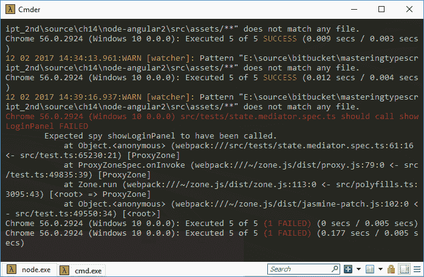

正如预期的，名为 `showLoginPanel` 的新函数还没有被调用，因为我们还没有对 `moveToState` 函数进行任何更改来处理我们的 `LoginPanel` 状态。让我们这样做：

```typescript
moveToState(stateType: StateType) {
  var previousState = this._currentState;
  nextState = this.getStateImpl(stateType);
  if (nextState.isLoginVisible()) {
    this._mediatorImpl.showLoginPanel();
  } else {
    this._mediatorImpl.hideLoginPanel();
  }
  this._currentState = nextState;
}
```

在这里，我们调用 `isLoginVisible` 函数来决定是显示还是隐藏登录面板。记住，所有现有状态在调用时将返回 `false`，只有 `LoginPanel` 状态将返回 `true`，这将触发 `showLoginPanel`。我们现在可以将注意力转向将 `第 11 章` *面向对象编程* 中完成的左到右面板设计集成到我们当前的应用程序中。需要复制的组件有：

- `sidenav.component`: 左侧导航
- `app.component`: 协调 UI 元素的应用程序
- `rightscreen.component`: 右侧面板

在此阶段编译应用程序将产生以下错误：

```text
app/component.ts(11,14): error TS2420: Class 'AppComponent' incorrectly implements interface 'IMediatorImpl'.
Property 'showLoginPanel' is missing in type 'AppComponent'.
```

在我们运行应用程序查看效果之前，我们需要进行一些微调。首先，我们需要更新 `app.module.ts` 文件以在 HTML 中注册我们的组件，如下：

```typescript
// 现有导入
import { LoginComponent } from './login.component';
import { SideNavComponent } from './sidenav.component';
import { RightScreenComponent } from './rightscreen.component';

@NgModule({
  imports: [BrowserModule, HttpModule, FormsModule],
  declarations: [
    AppComponent,
    NavbarComponent,
    LoginComponent,
    SideNavComponent,
    RightScreenComponent,
  ],
  bootstrap: [AppComponent]
})
export class AppModule { }
```

在这里，我们导入了 `SideNavComponent` 和 `RightScreenComponent`，并将它们包含了 `AppModule` 类的 `declarations` 数组中。记住，为了在 HTML 文件中使用任何组件，我们必须先声明它们。这允许我们在 `app.component.html` 文件中使用 `<sidenav-component>` 和 `<rightscreen-component>` 标签。

最后，我们需要在 `package.json` 文件中包含 `font-awesome`，并更新 `angular-cli.json` 文件以包含 `font-awesome.min.css` 文件。完成这些更改后，我们就可以启动应用程序，现在我们的 Node 应用程序中实现了原始的左到右面板实现。

## JSON 数据结构

在准备好基础应用程序外壳之后，我们现在可以专注于数据结构了。我们将使用这种数据结构来在主面板上显示板板列表，并在右侧详情面板上显示板板详情。这种关系的类图如下：

这里从 `ManufacturerList` 对象开始，它包含一个 `Manufacturer` 对象的数组。每个 `Manufacturer` 对象有三个属性。首先是 `manufacturer` 属性，它包含制造商的名称；其次是 `manufacturer_logo` 属性，它将包含要渲染为制造商的的名称。第三个属性命名为 `boards`，它包含一个 `Board` 项数组。

每个 `Board` 项包含 `name`、`description`、`image` 和 `long_description` 属性，以及来自其父级对象的 `manufacturer` 名称和 `manufacturer_logo` 属性。`Board` 项包含两个数组元素，命名为 `board_types` 和 `sizes`。`board_types` 数组将包含一个字符串列表，用于存储板板的类型。记住，任何特定的板板都可能是 `Wave` 板和 `Freestyle` 板之间的混合体，例如，因此我们需要数组来存储这种关系。`sizes` 数组包含 `BoardSize` 元素的列表，每个元素都有 `length`、`volume` 和 `width` 属性，以及 `sail_max` 和 `sail_min` 属性，用于存储每个板板的最小和最大帆尺寸。

注意，图中类名在现阶段并不重要；重要的是结构本身。

这种结构可以用 JSON 格式表示，如下：

```json
{
  "manufacturer": "JP Australia",
  "manufacturer_logo": "jp_australia_logo.png",
  "boards": [
    {
      "name": "Radical Quad",
      "board_types": [{ "board_type": "Wave" }],
      "manufacturer": "JP Australia",
      "manufacturer_logo": "jp_australia_logo.png",
      "description": "Radical Wave Board",
      "image": "jp_windsurf_radicalquad_ov.png",
      "long_description": "There is no question ....",
      "sizes": [
        {
          "volume": 68,
          "length": 227,
          "width": 53,
          "sail_min": "< 5.0",
          "sail_max": "< 5.2"
        }
      ]
    }
  ]
}
```

在这里，我们有一个表示单个制造商及其生产的板板的 JSON 结构提取。该结构与我们之前的类图匹配。在团队协作结构中工作时，JSON 数据结构的类图是非常实用的参考材料，并有助于理解系统的功能。对于业务分析师甚至其他开发人员来说，参考类图比翻阅海量的 JSON 数据来理解数据结构要容易得多。如果你在应用程序中处理复杂的嵌套结构，那么请尝试从代码中生成此类图表，供团队的其他成员使用。

我们现在可以在 `/routes/index.ts` 文件中创建一个 Express JSON 端点，为我们的应用程序提供这些 JSON 数据，如下所示：

```typescript
router.get('/boards', (req, res, next) => {
  res.json([
    {
      "manufacturer": "JP Australia",
      "manufacturer_logo": "jp_australia_logo.png",
      "logo_class": "",
      "boards": [
        {
          // the rest of the JSON structure
        }
      ]
    }
  ]);
});
```

在这里，我们创建了一个名为 `'/boards'` 的 REST 端点，只需返回 JSON 数据结构。这样的数据结构通常从数据库或某种对象存储提供。为了简单起见，我们目前返回一个硬编码的 JSON 数据结构。

我们的应用程序需要消费这个 JSON 数据结构，因此让我们创建一个 TypeScript 文件，以一组接口的形式描述该结构，文件名为 `IBoardList.ts`，如下：

```typescript
export interface IBoardSizeItem {
  volume: number;
  length: number;
  width: number;
  sail_min: string;
  sail_max: string;
}

export interface IBoardType {
  board_type: string;
}

export interface IBoardListItem {
  name: string;
  description?: string;
  image?: string;
  long_description?: string;
  board_types?: IBoardType[];
  sizes?: IBoardSizeItem[];
}

export interface IManufacturer {
  manufacturer: string;
  manufacturer_logo: string;
  boards?: IBoardListItem[];
}
```

在这里，我们创建了一组与我们的 JSON 结构匹配的接口，这些接口在类图中进行了说明。

## BoardList 组件

现在有了 REST 端点来提供制造商和板板的列表，我们现在可以开始构建 Angular 组件，将在主面板上渲染板板列表。该组件将命名为 `boardlist-component`，它将有一个对应的 `.css` 和 `.html` 文件。`boardlist.component.ts` 文件如下：

```typescript
import { Component, Injectable, EventEmitter, Output } from '@angular/core';
import { Http, Response, RequestOptions } from '@angular/http';
import { Observable } from 'rxjs';
import { IBoardSizeItem, IBoardType, IBoardListItem, IManufacturer } from './IBoardList';

@Component({
  selector: 'boardlist-component',
  templateUrl: './boardlist.component.html',
  styleUrls: ['./boardlist.component.css']
})
@Injectable()
export class BoardListComponent {
  boardList: IManufacturer[] = [];

  constructor(private http: Http) {
    this.http.get('/boards')
      .map(res => res.text())
      .subscribe(
        data => {
          let jsonResponse = JSON.parse(data);
          this.boardList = jsonResponse;
        },
        err => {
          console.error(err);
        },
        () => {
          console.log('success');
        }
      );
  }
}
```

我们开始从 `@angular/core`、`@angular/http`、`rxjs` 以及创建的 `IBoardList` 导入所需的模块。`BoardListComponent` 类被 `@Component` 装饰器装饰，它指定了 `selector`、`templateUrl` 和 `styleUrls`。它还使用了 `@Injectable()` 装饰器，为了注入 `Http`。该类构造函数使用 `Http` 向 `/boards` 发起请求，获取 JSON 数据结构。如果请求成功，它会将返回的数据结构存储到 `boardList` 属性中。

## 测试请求


由于我们正尝试通过测试驱动开发方法来构建组件，让我们花时间为这个 `BoardListComponent` 编写一组单元测试。我们的类构造函数包含了一些我们想要编写单元测试的内部逻辑。首先，它向 REST 端点发出 HTTP 请求。其次，如果请求成功，它将存储数据结构。因此，我们的单元测试需要完成：

- 设置一个 mock 端点
- 允许我们修改返回的 JSON
- 此 mock 端点
- 确保属性被正确赋值

**[ 493 ]**

### Mock Angular 的 Http 模块

让我们在 `src/tests/` 目录下创建一个新测试，名为 `boardlist.component.ts`，如下：

```typescript
import { DebugElement } from '@angular/core';
import { async, ComponentFixture, TestBed, inject } from '@angular/core/testing';
import { By } from '@angular/platform-browser';
import { Http, BaseRequestOptions, Response, Headers, RequestOptions, ResponseOptions } from '@angular/http';
import { MockBackend, MockConnection } from '@angular/http/testing';
import { BoardListComponent } from '../app/boardlist.component';

describe('src/tests/boardlist.component.ts', () => {
  it('should connect to a mock http provider', () => {
    expect(true).toBeFalsy();
  });
});
```

在这里，我们从 `@angular/core`、`@angular/core/testing`、`@angular/platform-browser`、`@angular/http/testing` 和 `@angular/http` 导入了许多模块。我们现在不会详细介绍这些模块，但在构建完整的测试本身时会使用它们。我们还导入了 `BoardListComponent` 类本身。

### 让我们动手实践

在 Angular 测试中构建 mock HTTP 请求分两个阶段完成。首先，我们需要在依赖注入框架中注册一个 mock HTTP 处理器；其次，我们需要在测试中指定该处理器将返回 JSON。我们的 mock HTTP 注册写在 `beforeEach` 函数中，如下：

```javascript
beforeEach(async(() => {
  TestBed.configureTestingModule({
    declarations: [BoardListComponent],
    providers: [
      MockBackend,
      RequestOptions,
      {
        provide: Http,
        useFactory: (instance, options) => {
          return new Http(instance, options);
        },
        deps: [
          MockBackend,
          RequestOptions
        ]
      }
    ]
  }).compileComponents();
}));
```

这段代码看起来相当令人困惑，所以让我们从内里向外地观察它。换句话说，让我们关注这个嵌套块中最深处的代码，然后从这个点开始向外推。如果我们使用这种技术，代码块就会变得易于理解。

我们正在模拟由 Angular DI 框架注入 `BoardListComponent` 的 `Http` 对象。然而，为了创建一个 `Http` 对象的实例，我们需要两个东西——一个实例和一些选项。这在最内部的调用中可以看到：

```javascript
return new Http(instance, options);
```

这里使用的 `instance` 和 `options` 对象被传递到闭包 `useFactory` 函数中如下：

```javascript
useFactory: (instance, options) => {
  // return new Http
}
```

此函数使用的 `instance` 和 `options` 参数实际上是由依赖注入框架提供的，因此通过 `deps` 属性命名为依赖项，如下：

```javascript
deps: [
  MockBackend,
  RequestOptions
]
```

然后，`useFactory` 函数提供了 `Http` 接口的实例，因此它有一个 `provide` 属性，如下：

```javascript
provide: Http
```

这个 `useFactory` 配置必须注册为我们测试的 provider，因此包含在 `providers` 属性中，如下：

```javascript
providers: [
  MockBackend,
  RequestOptions,
  {
    provide: Http
    // ... (上定义的其余配置)
  }
]
```

### 使用 mock Http 模块

依赖注入框架还需要知道将这些 providers 注入到哪个类实例，这是通过 `declarations` 属性指定的：

```javascript
declarations: [BoardListComponent],
```

最后，`declarations` 和 `providers` 属性被 `TestBed.configureTestingModule` 调用使用。因此，整个代码块可以描述为一系列步骤如下：

- 调用 `TestBed.configureTestingModule` 函数并传入一个配置对象。
- 使用 `declarations` 属性确定哪些对象需要注入依赖。
- 使用 `providers` 属性声明哪些对象将用于依赖注入。
- 如果其中一个 provider 指定了 `provide` 属性，则使用其作为注入接口。
- 如果其中一个 provider 指定了 `useFactory` 函数，则调用该函数来创建用于注入的接口实例。
- 如果其中一个 provider 指定了 `deps` 属性，则将这些作为 `useFactory` 方法的依赖项。

很简单，对吧？嗯，并不如此，但 Angular DI 框架的本质。有了我们的 `beforeEach` 函数，我们现在可以关注测试本身，如下：

```javascript
it('should connect to a mock http provider', async(
  inject(
    [MockBackend],
    (mockBackend: MockBackend) => {
      // 配置响应
      mockBackend.connections.subscribe((conn: any) => {
        conn.mockRespond(
          new Response(new ResponseOptions({
            body: JSON.stringify([])
          }))
        );
      }); // end of subscribe function

      let fixture = TestBed.createComponent(BoardListComponent);
      let boardListInstance = fixture.componentInstance;
      expect(boardListInstance.manufacturerList).toBeDefined();
    } // end of test block
  ) // end of inject function
) // end of async function
)); // end of it function
```

再次，这段代码块看起来相当复杂，所以让我们看看最内部的代码，并向外看。测试从调用 `mockBackend.connections.subscribe` 函数开始。该函数正在设置通过我们的 `MockBackend` 实例返回的 JSON 响应，它将返回我们在 `body` 属性中指定的 JSON。

一旦我们有了 JSON 响应，我们就可以通过调用 `TestBed.createComponent` 创建 `BoardListComponent` 的实例。结果存储在 `fixture` 变量中。要访问 `BoardListComponent` 实例，我们必须使用 `componentInstance` 属性。一旦有了它，我们可以检查 `manufacturerList` 属性以确保它不是未定义的。

### 渲染面板列表

现在我们有了针对 `BoardListComponent` 内部逻辑的单元测试，我们可以转向渲染列表。这将涉及更新我们的 `boardlist.component.html` 模板：

```html
<div *ngFor="let manufacturer of currentList">
  <div *ngFor="let board of manufacturer.boards" class="col-sm-4 board_panel" (click)="boardClicked(board)">
    <div class="inner_panel">
      <!-- 面板模板 -->
      <!-- 参考示例代码 -->
      {{manufacturer.name}}
      {{board.description}}
      <table>
        <tr *ngFor="let size of board.sizes">
          <td>{{size.volume}}</td>
        </tr>
      </table>
    </div>
  </div>
</div>
```

*让我们动手实践*

**[ 500 ]**


用于渲染看板列表的 BoardListComponent 类

### 测试 UI 事件

在完成看板列表的基础工作后，我们现在可以将注意力转向当用户点击看板列表中的某个看板时，如何显示详情面板。正如我们在之前的章节中所做的那样，我们将使用 Angular 的 `EventEmitter` 类从 `boardlist` 组件发射一个事件，该事件将由 `app` 组件捕获。当接收到此事件时，它通过 `Mediator` 类触发状态更改以移动到详情面板。我们已经在 `boardlist` 的 HTML 文件中注册了一个点击处理程序，如下：

```html
<div *ngFor="let board of manufacturer.boards" >
<div class="col-sm-4 board_panel" (click)="boardClicked(board)">
```

*让我们动手实践*

**[ 501 ]**

在这里，在 `boards` 数组的 `*ngFor` 循环中，我们注册了一个 `boardClicked` 事件，它将抛出一个事件。该事件使用整个 `board` 对象作为参数传递给 `boardClicked` 事件处理程序。因此，我们的事件处理程序非常简单如下：

```typescript
@Output() notify: EventEmitter<IBoardListItem> = new EventEmitter<IBoardListItem>();

boardClicked(board: IBoardListItem) {
  console.log(`clicked: ${board.name}`);
  this.notify.emit(board);
}
```

在这里，我们使用 `@Output()` 属性装饰器注册了一个名为 `notify` 的 Angular `EventEmitter`。注意 `EventEmitter` 是如何使用 `IBoardListItem` 接口作为事件模型的。我们之前的 `EventEmitter` 实现使用了简单的字符串，但这里我们使用的是更复杂的模型。

那么，我们如何为这个事件编写单元测试呢？答案相对简单。我们需要做的就是在测试代码中订阅此事件，然后对其中一个看板元素模拟一个 DOM 点击事件。因此，我们的测试如下：

```javascript
it('should raise an event when a board has been clicked', async(
  inject([MockBackend], (mockBackend : MockBackend) => {

    // configure response
    mockBackend.connections.subscribe((conn : any) => {
      conn.mockRespond(new Response(new ResponseOptions({

        body: JSON.stringify(
          [
            {
              manufacturer: 'test',
              boards : [
                { name : 'test1'},
                { name : 'test2'}
              ]
            }
          ]
      ))));
    })); // end of subscribe function

    let fixture = TestBed.createComponent(BoardListComponent);
```

*让我们动手实践*

**[ 502 ]**

```javascript
fixture.detectChanges();
let boardItem = fixture.debugElement.query(By.css('.board_panel'));
expect(boardItem).toBeDefined();
let eventEmitted : IBoardListItem;
let component = fixture.componentInstance;
component.notify.subscribe((event: IBoardListItem) => {
  eventEmitted = event;
});
boardItem.triggerEventHandler('click', null);
expect(eventEmitted).toBeDefined();
} // end of test block
) // end of inject function
) // end of async function
); // end of it function
```

此测试的第一部分是设置 JSON 响应，包含一个制造商和两个看板，正如我们之前讨论的那样。我们的测试从创建 `BoardListComponent` 的实例开始。完成后，我们接着调用 `fixture.detectChanges` 函数。调用此函数是为了更新测试套件中的 DOM。一旦 DOM 更新完成，我们就可以调用 `fixture.debugElement.query` 函数在 DOM 中搜索特定的 HTML 元素。在这种情况下，我们只是在寻找具有名为 `board_panel` 类的第一个 `div`。这就是我们将对其触发点击事件的元素。

测试的下部分定义了一个名为 `eventEmitted` 的变量，用于持有作为事件处理程序一部分发送的 `IBoardListItem` 对象。然后，我们像之前做的那样，通过 `fixture.componentInstance` 属性获取 `BoardListComponent` 类实际实例的句柄。

随后，测试调用 `BoardListComponent` 类 `notify` 属性上的 `subscribe` 函数，这将在测试中注册一个事件处理程序。该事件处理程序只是将抛出的事件分配给我们的本地 `eventEmitted` 属性，以便稍后查询。

*让我们动手实践*

**[ 503 ]**

我们随后对 DOM 元素本身调用 `triggerEventHandler` 函数。此调用模拟了一个 DOM 点击事件，随后将通过我们的事件处理程序抛出一个事件。最后，我们检查事件本身是否正确抛出，以及事件名称是否与预期值。

**详情视图**

现在我们已经完成了看板列表，可以将注意力转向详情面板。这很简单。app 组件的 HTML 如下：

```html
<div class="main-content">
<boardlist-component (notify)="onNotifyList($event)"></boardlist-component>
</div>
```

在这里，我们指定了从 `boardlist` 组件抛出事件时调用 `onNotifyList`。app 组件中的函数如下：

```typescript
onNotifyList(event: IBoardListItem) {
  this.rightScreen.board = event;
  this.mediator.moveToState(StateType.DetailPanel);
}
```


*让我们动手实践*

**[ 504 ]**

我们的 `rightScreen` 组件还没有 `board` 属性，所以让我们更新此组件和 HTML 文件以渲染详情面板。对 `rightscreen` 组件的更新是一个单行代码，如下：

```typescript
export class RightScreenComponent {
  board: IBoardListItem = {name: 'no board selected'};
  // existing code
}
```

在这里，我们添加了一个类型为 `IBoardListItem` 的名为 `board` 的属性来持有当前选中的看板。随后可以更新 HTML 模板：

```html
<div id="myRightScreen" class="overlay">
  <button class="btn btn-default" (click)="closeClicked()">
    <span class="fa fa-left"></span>
  </button>
  <div class="overlay-content">
    <!--various styling -->
    {{board.name}}
    <!--various styling -->
    {{board.description}}
    <!--various styling -->
    <tr *ngFor="let size of board.sizes">
      <td>{{size.volume}}</td>
      <td>{{size.width}}</td>
    </tr>
  </div>
</div>
```

*让我们让我们动手实践*

**[ 505 ]**


### 应用过滤器

在看板列表和详情视图完成后，我们现在可以将注意力转向显示过滤器选项的 `sidenav` 组件。然而，在过滤项目之前，我们需要定义几个接口来涵盖我们用于过滤器元素的数据结构，如下：

```typescript
export enum FilterType {
  Manufacturer,
  BoardType,
  None
}

interface IFilter {
  filterName: string;
  filterType: FilterType;
  filterValues?: string[];
}
```

```typescript
export interface IApplyFilter {
  filterType: FilterType;
  filterValue: string;
}
```

在这里，我们定义了一个名为 `FilterType` 的 `enum`（枚举），它代表我们正在应用的过滤器类型。记住，我们想要通过 `Manufacturer`（制造商）或 `BoardType`（板类型）来过滤我们的板列表，因此有了 `Manufacturer` 和 `BoardType` 枚举值。我们还需要一个表示无过滤器的枚举值，它在实际上将清除任何当前应用的过滤器，因此定义了 `None` 这一枚举值。

`IFilter` 接口是我们将用于渲染 HTML 的数据结构。它有一个 `filterName` 属性（将作为顶层标题）、一个 `filterType` 属性，以及一个简单的可用 `filter values`（过滤器值）数组。

`IApplyFilter` 接口将用于从此组件中抛出事件时使用。它仅包含 `filterType` 和 `filterValue` 属性，用于表示所选的过滤器。

为了在我们的 `SideNavComponent` 类中渲染这些过滤器，我们只需要进行一些细小的更改，如下：

```typescript
export class SideNavComponent {
  @Output() notify: EventEmitter<IApplyFilter> = new EventEmitter<IApplyFilter>();
  filterList: IFilter[] = [
    {
      filterName: 'Manufacturer',
      filterType: FilterType.Manufacturer,
      filterValues: ['RRD', 'JP Australia', 'Starboard']
    },
    {
      filterName: 'Board Types',
      filterType: FilterType.BoardType,
      filterValues: ['Wave', 'Freestyle', 'Slalom']
    },
    {
      filterName: 'All',
      filterType: FilterType.None,
      filterValues: ['Clear Filter']
    }
  ];
  closeNav() {
```


*让我们动手实践起来*

**[ 507 ]**

```typescript
document.getElementById('mySidenav')
  .style.width = "0px";
}

showNav() {
  document.getElementById('mySidenav')
  .style.width = "250px";
}
}
```

在这里，我们更新了 `SideNavComponent` 类，通过标准的 Angular 事件发射语法抛出一个类型为 `IApplyFilter` 的事件。然后我们定义了一个名为 `filterList` 的属性，类型为 `IFilter[]`，用于存储我们过滤器元素的数据结构。

我们可以在 Express 应用程序中创建一个 JSON 端点来提供此数据结构，但为了简洁，我们将直接包含该数据结构。

我们现在可以更新 `sidenav.component.html` 文件，如下：

```html
<div id="mySidenav" class="sidenav">
  <h1>Apply Filter :</h1>
  <div *ngFor="let filter of filterList;">
    <div class="filterHeader">{{filter.filterName}}</div>
    <div *ngFor="let filterValue of filter.filterValues">
      <a href="#" (click)="filterClicked(filter, filterValue)">
        {{filterValue}}
      </a>
    </div>
  </div>
</div>
```

在这里，我们在模板中有两个 `*ngFor` 循环，用于遍历 `filterList` 数组，然后遍历每个数组元素的 `filterValues` 数组。

*让我们动手实践起来*

**[ 508 ]**

然而，这个模板中有趣的地方在于点击事件处理程序。注意它是如何抛出一个带有两个参数的事件的。第一个参数是来自外部 `*ngFor` 循环的父过滤器，第二个参数是来自内部 `*ngFor` 循环的 `filterValue`。

因此，此 `filterClicked` 函数的实现必须包含这两个参数，如下：

```typescript
filterClicked(filter: IFilter, filterValue: string) {
  this.notify.emit({
    filterType: filter.filterType,
    filterValue: filterValue
  });
}
```

在这里，`filterClicked` 事件处理器确实有两个参数——第一个是 `IFilter` 类型，第二个是 `string` 类型。由于第一个参数是完整的 `IFilter` 类型，因此我们可以查询此参数的 `filterType` 值来确定所选的过滤器类型。

有了这些信息，我们抛出一个类型为 `IApplyFilter` 的新事件，它包含了 `filterType` 和 `filterValue`。

我们现在可以在 `app` 组件的 HTML 中监听此事件，如下：

```html
<sidenav-component (notify)='onNotifyFilter($event)'>
</sidenav-component>
```

并在我们的 `app` 组件中实现事件处理程序，如下：

```typescript
onNotifyFilter(filter: IApplyFilter) {
  this.boardList.applyFilter(filter);
}
```

在这里，当我们接收到事件时，只需调用 `boardList` 组件上的 `applyFilter` 函数。目前，我们还没有将 `ListComponent` 注册为子，因此我们需要在 `app` 组件中进行操作：

```typescript
@ViewChild(ListComponent)
private boardList;
```


*让我们动手实践起来*

**[ 509 ]**

最后，我们需要在 `boardList` 组件中实现 `applyFilter` 函数，如下：

```typescript
applyFilter(filter: IApplyFilter) {
  this.currentList = [];
  if (filter.filterType == FilterType.Manufacturer) {
    for (let board of this.boardList) {
      if (board.manufacturer == filter.filterValue) {
        this.currentList.push(board);
      }
    }
  } else if (filter.filterType == FilterType.BoardType) {
    for (let board of this.boardList) {
      if (board.boardType == filter.filterValue) {
        this.currentList.push(board);
      }
    }
  } else if (filter.filterType == FilterType.None) {
    this.currentList = this.boardList;
  }
}
```

在这里，`applyFilter` 函数接收一个 `IApplyFilter` 参数。该函数的第一步是清除 `currentList`。如果传入的 `filterType` 是 `Manufacturer`，我们会遍历 `boardList`。如果 `board.manufacturer` 等于 `filter.filterValue`，则将其板推入 `currentList`。如果 `filterType` 是 `BoardType`，我们会遍历 `boardList`。如果 `board.boardType` 等于 `filter.filterValue`，则将其板推入 `currentList`。如果 `filterType` 是 `None`，则我们将 `currentList` 设置为 `boardList`。

*让我们动手实践起来*

**[ 510 ]**

**登录面板**

我们最后需要做的更改是在用户点击导航栏上的 **Login** 按钮时显示登录面板。为了让其工作，我们已经有了大部分元素，因此只需要连接处理程序。

首先，我们需要对导航栏的点击事件做出反应。这意味着我们需要在 `navbar` 组件中一个处理器，如下：

```typescript
navClicked(item: IButtonName) {
  this.notify.emit(item.ButtonName);
}
```

我们还需要在 `app` 组件中注册此事件，更新 HTML 如：

```html
<navbar-component (notify)='onNotifyNavbar($event)'>
</navbar-component>
```

在这里，我们定义了一个名为 `onNotifyNavbar` 的函数作为事件的处理器。其实现非常简单，如下：

```typescript
onNotifyNavbar(message:string) {
  if (message == "Login") {
    this.mediator.moveToState(StateType.LoginPanel);
  }
}
```

*让我们亲身实践一下*

**[ 512 ]**

我们的事件处理器目前只显示登录面板，因此我们现在需要在用户成功登录后将其隐藏。同样，这只是在 `login` 组件中抛出一个事件的简单问题，如下所示：

```javascript
this.http.post('/login', jsonPacket , {
  headers: headers
})
.map(res => res.text())
.subscribe(
  data => data,
  err => {
    console.log(`error : ${err}`);
  },
  () => {
    console.log(`success`);
    this.notify.emit("LOGIN_SUCCESSFUL");
  }
);
```

在这里，当 REST 端点成功返回时，我们添加了 `notify.emit` 函数调用，以引发触发 `hideLoginPanel` 函数调用的事件。同样，我们需要在 `app` 组件中注册此事件，如下所示：

```javascript
onNotifyLogin(message: string) {
  this.mediator.moveToState(
    this.mediator.getCurrentMainWindowState());
}
```

在这里，我们只是在调用 `Mediator` 类以移动到当前的主窗口状态。目前我们的 `Mediator` 类中尚未实现此函数，因此，让我们更新它，使其能够在显示登录覆盖层之前存储主窗口当前的状态，如下所示：

```typescript
export class Mediator {
  // existing variables
  private _mediatorImpl: IMediatorImpl;
  private _mainWindowState: IState;
  getCurrentMainWindowState() : StateType {
    return this._mainWindowState.getStateType();
  }
}
```

*让我们亲身实践一下*

**[ 513 ]**

在这里，我们创建了一个名为 `_mainWindowState` 的新私有变量，并定义了 `getCurrentMainWindowState` 函数返回此值。我们还需要稍微更新 `moveToState` 函数，以便在正确的时间存储此值，如下所示：

```javascript
moveToState(stateType: StateType) {
  var previousState = this._currentState;
  var nextState = this.getStateImpl(stateType);
  if (nextState.isLoginVisible()) {
    this._mediatorImpl.showLoginPanel();
    this._mainWindowState = previousState;
  }
  else {
    this._mediatorImpl.hideLoginPanel();
    // existing state logic
  }
  this._currentState = nextState;
  if (this._currentState.getPanelType() == PanelType.Primary ) {
    this._currentMainPanelState = this._currentState;
  }
}
```

我们对 `moveToState` 函数的更改是检查我们需要的 `nextState` 是否显示登录面板。如果是，我们必须将主窗口的当前状态存储在我们的 `_mainWindowState` 变量中。如果不是，我们按照情况继续处理。此更改将允许我们无论当前主面板的状态如何，都能将登录面板作为覆盖层显示。换句话说，我们可以在详情面板上然后点击**登录** 按钮，应用程序将做出正确的响应，如下截图所示：

*让我们亲身实践一下*

**[ 514 ]**

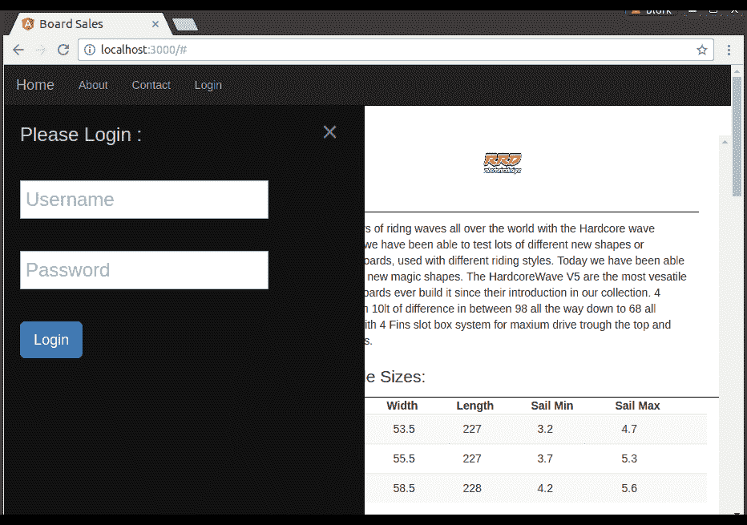

在详情视图时显示登录覆盖层面板

我们对示例应用程序的工作完成了。

## 应用程序架构

如果我们回看在示例应用程序上所做的工作，我们会发现所使用的架构具有健全的质量。我们的应用程序由许多独立组件组成。这些组件中的每一个都负责单一的领域。例如，`navbar` 组件只负责渲染和响应发生在导航栏内部的事件。这种组件架构在我们把之前章节中的组件合并成一个单一大型应用程序时，也是显而易见的。大多数组件只需要进行一些微小的修改，就可以使用了。

**[ 515 ]**

我们所有的组件都通过事件进行通信，因此它们是松耦合的。`app` 组件本身是事件聚合器。它负责监听各种组件事件，并相应地协调应用程序状态。我们的状态处理代码也被封装在 `State` 和 `Mediator` 类中，正如我们所看到的，这种设计模式对简化我们的应用程序代码有巨大的帮助。

### 总结

在本章中，我们通过组合早期章节中的组件构建了一个示例应用程序。我们从重点关注单元测试开始，并构建了一个涵盖我们应用程序主要功能的测试框架。通过这个测试框架，我们可以模拟应用程序状态、模拟 REST 端点集成，还可以模拟按钮点击等 UI 事件。

组合示例应用程序的大部分工作只是对现有组件进行微小的更改，并正确接线应用程序事件。

希望你喜欢构建这个示例应用程序的历程，并看到我们在前面的章节中讨论的各种技术付诸实践。我们终于到达了一个工业级、企业级、使用 TypeScript 构建的单页 Angular 和 Node 应用程序。

索引

- @ 使用 190
- A
- 抽象类 107
- 验收测试 246
- 高级类型关于 73
- 对象剩余参数和展开 79
- 类型别名 76
- 类型守卫 74
- 联合类型 74
- AMD 浏览器配置 329
- 应用程序架构
- 总结
- 让我们亲身实践一下
- 512
- 513
- 514
- 515
- 示例应用程序
- 索引

**[ 518 ]**

- 示例 `102`
- 类修饰符 `93`
- 类空间
- 声明文件语法 `174`
- JavaScript 语法 `174`
- 类属性
- 关于 `85`
- 声明文件语法 `175`
- JavaScript 语法 `175`
- 类属性访问器 `97`
- 类解析 `410`
- 类
- 关于 `85`
- 抽象类 `107`
- 在 ExtJS 中创建 `203`
- 声明文件语法 `174`
- JavaScript 语法 `174`
- 保护类成员 `106`
- 闭包 `17`
- 具体状态 `380`
- const 枚举 `59`
- const 值, TypeScript `60`
- 构造函数修饰符 `95`
- 构造函数注入 `411`
- 持续集成构建服务器
    - Jenkins `272`
    - Team Foundation Server (TFS) `271`
    - TeamCity `272`
- 持续集成
    - 收益 `270`
    - 使用 `270`
- 控制器 `211`
- 数据驱动测试, Jasmine
- 参考 `253`
- 声明文件
    - 接口 `169`
    - 联合类型 `171`
    - 编写 `164`
- 声明语法参考
    - 关于 `173`
- 类构造函数重载 `175`
- 类定义 `174`
- 类函数 `176`
- 类空间 `174`
- 类属性 `175`
- 函数重写 `173`
- 函数签名 `177`
- 函数，与模块合并 `178`
- 全局函数 `177`
- 嵌套空间 `174`
- 可选属性 `177`
- 静态属性和函数 `176`
- 装饰器注入
    - 关于 `413`
    - 类定义,使用 `413`
    - 构造函数参数,传递 `415`
    - 依赖注入,使用 `418`
    - 参数类型,查找 `416`
    - 属性,注入 `417`
    - 递归注入,使用 `419`
- 装饰器元数据
    - 关于 `131`
    - 使用 `133`
    - 装饰器工厂 `122`
- 装饰器
    - 关于 `119`
    - 方法装饰器 `127`
    - 多个装饰器 `121`
    - 参数装饰器 `130`
    - 属性装饰器 `125`
    - 静态属性装饰器 `126`
    - 语法 `120`
- DefinitelyTyped
    - 参考 `15`, `180`
- 定义文件
    - 下载 `180`
- 依赖注入 (DI) `197`
- 依赖注入设计模式 `408`
- 依赖注入器
    - 构建 `408`
- 依赖倒置 `365`
- 鸭子类型 `50`

**E**

- 邮件服务
- 配置设置 `401`
- ECMA-262 `10`
- ECMAScript `10`
- ECMAScript 3.1 `10`
- ECMAScript Harmony `10`
- Elevator Action
    - 参考 `162`
- 嵌入式 JavaScript (EJS) `159`
- Emmet
    - 用于生成 HTML `425`
- 枚举解析 `409`
- 枚举 `56`
- Espruino `8`
- 显式类型转换, TypeScript `55`
- Express React 网站 `455`
- Express
    - 和 React `456`
    - HTTP 请求重定向 `358`
    - 模块,使用 `347`
    - POST 事件 `354`
    - 路由 `348`
    - 设置 `345`
    - 模板化 `350`
    - 使用,配合 Node `344`
- ExtJs
    - 关于 `202`
    - 在其中创建类 `203`
    - 参考 `202`
    - 特定 TypeScript 编译器 `206`
    - 类型转换,使用 `204`

**F**

- 工厂验收测试 (FAT) `402`
- 工厂设计模式
    - 关于 `111`
    - 业务需求 `112`
- 工厂类 `115`
    - IPerson 接口 `113`
    - Person 类 `113`
    - 专家类 `114`
    - 工作原理 `112`
- for...in 循环 `53`
- for...of 循环 `53`
- 函数回调 `68`
- 函数重载 `104`
- 函数重载 `72`
- 函数重写
    - 关于 `173`
    - 声明文件语法 `173`
    - JavaScript 语法 `173`
- 函数返回类型 `62`
- 函数签名
    - 关于 `70`
    - 声明语法 `177`
    - JavaScript 语法 `177`
- 函数
    - 关于 `62`
    - 匿名函数 `63`
    - 默认参数 `66`
    - 可选参数 `64`
    - 剩余参数 `66`
    - 静态函数 `98`

**G**

- 四人行 (GoF) `362`
- 泛型类
    - 实例化 `135`
    - 泛型接口 `142`
- 泛型
    - 关于 `134`
    - 在其中创建新对象 `143`
    - 语法 `135`
    - 类型 T 的约束 `139`
    - 类型 T,使用 `137`
- 全局函数
    - 声明文件语法 `177`
    - JavaScript 语法 `177`
- 全局变量 `159`
- Grunt
    - 参考 `40`
    - 使用 `40`

**H**

- Handlebars
    - 使用 `351`
- 快乐路径 `453`
- HTML
    - 在其中使用 JavaScript 代码 `161`

**I**

- 立即调用函数表达式 (IIFE) `111`
- 推断类型 `50`
- 继承
    - 关于 `101`
    - Angular 与 Backbone `201`
    - 类继承 `102`
    - 接口继承 `102`
    - 使用,配合 Backbone `192`
- 集成开发环境 (IDE) `40`
- 集成测试报告 `272`
- 集成测试 `246`
- 接口编译 `84`
- 接口函数定义 `92`
- 接口示例 `102`
- 接口解析 `408`
- 接口隔离 `365`
- 接口
    - 关于 `82`
    - 实现 `86`
    - 可选属性 `83`

**J**

- Jasmine 运行器
    - 关于 `264`
- Karma `266`
- Protractor `267`
- Jasmine
    - 关于 `247`
    - 异步测试 `258`
    - 引导 `344`
    - 数据驱动测试 `253`
    - DOM 事件 `263`
    - 使用 done() 方法 `260`
    - 夹具 `261`
    - 匹配器 `251`
    - 使用间谍 `255`
    - 使用 fakes 间谍 `258`
    - 监视回调函数 `256`
    - 测试启动 `252`
    - 测试 清理 `248`
- JavaScript `8`
- JavaScript 闭包 `110`
- 在 HTML 中使用 JavaScript 代码 `161`
- JavaScript 定义 `13`
- JavaScript 框架 `191`
- JavaScript 类型 `45`
- JetBrains `29`
- JSLint `12`

**L**

- let 关键字 `60`
- 里氏替换原则 (LSP) `365`
- 本地 SMTP 服务器
    - 使用 `404`

**M**

- 邮件
    - 发送 `398`
    - 使用 nodemailer `398`, `400`
- MaxUnit 参考 `247`
- 中介接口
    - 实现 `389`
- 中介者模式
    - 关于 `381`
    - 响应 DOM 事件 `394`
- 方法装饰器
    - 关于 `127`
    - 使用 `128`
- Mocha
    - 参考 `247`
- 模拟 Http 模块
    - 使用 `496`, `497`
- 模型 `209`
- 模型-视图-控制器 (MVC)
    - 关于 `208`
    - 收益 `212`
    - 控制器 `211`
- 模块化代码
    - 关于 `382`
- 模块关键字 `167`
- 模块合并 `172`
- 模块模式 `111`
- 模块
    - 基础 `319`, `320`
    - 默认导出 `324`
    - 导出 `321`
    - 导入 `322`
    - 重命名 `323`
    - 使用,配合 Express `347`
- 多个装饰器 `122`

**N**

- 命名空间 `100`
- 嵌套空间
    - 声明文件语法 `174`
    - JavaScript 语法 `174`
- 基于 Node的编译, TypeScript
    - 创建 tsconfig.json 文件 `20`
- Node
    - 使用 Aurelia 编译 `430`
    - 配合 Express 使用 `344`
    - 参考 `19`
- nodemailer
    - 用于发送邮件 `398`, `400`
- npm
    - 使用 `190`
- NuGet 包管理器
    - 搜索包名 `185`
    - 安装包 `184`
    - 安装特定版本 `185`
- NuGet
    - 安装声明文件 `184`
    - 使用扩展管理器 `182`
    - 使用包管理器控制台 `184`
    - 使用 `182`
- 空类型 `77`

**O**

- 对象依赖 `404`
- 面向对象原则
    - 关于 `363`
    - 面向接口编程 `363`
    - SOLID 原则 `364`
- 对象
    - 在泛型中创建 `143`
- 开闭封闭原则 `364`
- 可选属性
    - 声明文件语法 `177`
    - JavaScript 语法 `177`

**P**

- Papercut `404`
- 参数装饰器 `130`
- 纯 JavaScript 对象 (POJO) `209`
- Promise
    - 关于 `145`
    - 语法 `147`
    - 使用 `148`
    - 返回值 `151`
    - 相比 await `155`
    - 相比 callback `150`
- 属性装饰器 `125`
- 保护类成员 `106`
- Protractor `267`

**Q**

- QUnit
    - 参考 `247`

**R**

- React 应用
    - 服务 `457`
- React 组件
    - 关于 `462`
    - 测试 `317`
- React 测试
    - 关于 `308`
- React 和 Express `456`
- REST 端点 `465`
- 右侧组件 `385`

**S**

- 示例应用
    - 修改为 `277`
- Selenium
    - 关于 `268`
    - 使用 `268`
- 服务定位 `405`
- 服务定位反模式 `407`
- 侧边栏组件 `384`
- 类型的简单接口 (S.F.A.T) `56`
- 单页应用 (SPAs) `191`
- 单责任模式 `364`
- 状态模式
    - 关于 `378`
    - 具体状态 `380`
    - 接口 `379`
- 静态函数
    - 关于 `98`
    - 声明文件语法 `176`
    - JavaScript 语法 `176`
- 静态属性
    - 关于 `99`
    - JavaScript 语法 `176`
- 静态属性装饰器 `126`
- 结构化数据 `162`
- super 关键字 `103`
- 语法糖, TypeScript `13`
- SystemJs
    - 浏览器配置 `338`
    - 安装 `338`
    - 模块依赖 `341`
    - 模块加载 `337`

**T**

- Team Foundation Server (TFS) `271`
- TeamCity `272`
- 测试驱动开发 (TDD) `244`
- 可测试性
    - 示例应用，修改为 `277`
- Testem
    - 关于 `264`
    - 参考 `265`
- 第三方库
    - 使用 `190`
- TodoMVC 项目
    - 参考 `191`
- tsUnit
    - 参考 `247`
- 类型别名 `76`
- 类型守卫 `74`
- TypeScript 定义 `14`
- TypeScript IDE
    - 关于 `19`

## Microsoft Visual Studio `22`

- 节点编译 `19`
- 其他编辑器 `40`
- Visual Studio Code `34`
- WebStorm `29`
- TypeScript 类型定义 `47`

## TypeScript

- 关于 `9`, `10`, `13`
- any 类型 `54`
- 数组 `52`
- 优势 `11`
- 常量枚举 `59`
- 常量值 `60`
- 鸭子类型 `50`
- 枚举 `56`
- 显式转换 `55`
- for...in 循环 `53`
- for...of 循环 `53`
- 推断类型 `50`
- 语法糖 `13`
- 语法 `47`
- 模板字符串 `52`

### 类型定义

- 定义文件，安装 `187`
- 定义文件，重新安装 `188`
- 初始化 `187`
- 安装 `186`
- 包，搜索 `186`
- 特定版本，安装 `188`
- 使用 `186`

## **U**

- UI 体验
- 关于 `422`
- Brackets，使用 `423`
- Emmet，使用 `425`
- 登录面板，创建 `427`
- 未定义类型 `77`
- 联合类型 `74`
- 单元测试 `245`
- 用户界面设计
- 关于 `365`
- Angular 2 设置 `368`
- Bootstrap，使用 `370`
- 概念设计 `366`
- 覆盖层，创建 `375`
- 侧边栏，创建 `371`, `375`
- 过渡，协调 `377`

## **V**

- 值
- 从 promise返回 `151`
- 变量
- 导出 `325`
- View `210`

### Visual Studio Code

- 关于 `34`
- 断点，设置 `37`
- 探索 `35`
- 安装 `35`
- launch.json 文件，创建 `36`
- 示例项目，构建 `36`
- tasks.json 文件，创建 `35`
- 网页，调试 `37`

### Visual Studio project

- 创建 `22`
- 默认项目设置 `25`

### Visual Studio

- 调试功能 `27`

## **W**

- WebStorm
- 关于 `29`
- 在 Chrome 中调试功能 `33`
- 引用 `29`
- 简单 HTML 应用，构建 `31`
- 网页，在 Chrome 中运行 `32`
