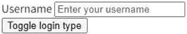
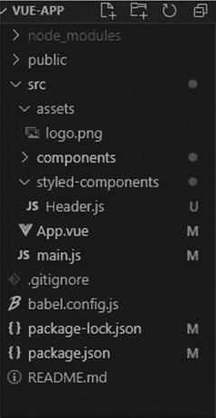
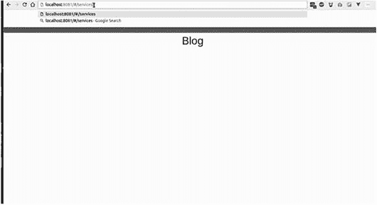
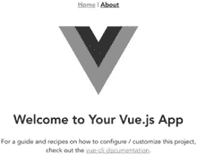
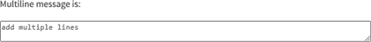
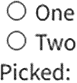
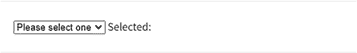
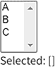

# 掌握 Vue.js：初学者指南 (计算机科学大师)


**系列编辑：** Sufyan bin Uzayr

*Lokesh Pancha, Divya Sachdeva, and Faruq KC*


有关该系列书籍的更多信息，请访问：[`www.routledge.com/Mastering-Computer-Science/book-series/MCS`](https://www.routledge.com/Mastering-Computer-Science/book-series/MCS)

***“精通计算机科学”系列书籍由 Sufyan bin Uzayr 领导的 Zeba Academy 团队编写。Zeba Academy 是一家教育科技初创企业，主要为 STEM 领域的学习者开发课程和内容，并为全球的大学和机构提供教育咨询。有关更多信息，请访问 [`zeba.academy`](https://zeba.academy)。***


**美国国会目录编排数据**

姓名：Bin Uzayr, Sufyan, 编辑。
标题：Mastering Vue.js : a beginner’s guide / Sufyan bin Uzayr 编辑。
描述：第一版。 | Boca Raton : CRC Press, 2023\. |
系列：Mastering computer science | 包含参考文献和索引。
标识符：LCCN 2022020968 (纸质版) | LCCN 2022020969 (电子书) | ISBN 9781032315942 (精装本) | ISBN 9781032315935 (平装) | ISBN 9781003310464 (电子书)
主题：LCSH: Vue.js (软件框架) | JavaScript (计算机程序语言) | Web 应用程序--开发。 | Web 应用程序--编程。 | 应用程序软件--开发。
分类：LCC QA76.76.V84 M37 2023 (纸质版) | LCC QA76.76.V84 (电子书) | DDC 005.1/4--dc23/eng/20220812
LC 记录可用 [`lccn.loc.gov/2022020968`](https://lccn.loc.gov/2022020968)
LC 电子书记录可用 [`lccn.loc.gov/2022020969`](https://lccn.loc.gov/2022020969)
ISBN: 9781032315942 (hbk)
ISBN: 9781032315935 (pbk)
ISBN: 9781003310464 (ebk)

DOI: 10.1201/9781003310464](http://doi.org/10.1201/9781003310464)


## Vue 采用经典的模型-视图控制器（MVC）架构来查看应用程序或网站的用户界面（UI），其核心库作为默认的视图层。它具有适应性，可以像 React 一样与基于组件的架构（CBA）协同工作。

简单来说，它是一个关注用户视角的产品。视图是系统中发生的所有事情中最重要的方面，只有当信息与视图进行适当的交互时，信息才会被验证。创建一个单个视图非常简单，而这正是使用 Vue.js 的主要优势和动力所在——在于它的简单性和低准入门槛。只需加载界面并添加 JavaScript 即可开始。然后使用简单的语法将数据直接传递给视图，Vue.js 无需编写脚本即可绘制元素——系统随后可以利用该实例进行元素的渲染。

该工具允许在保留数据对象中信息的同时修改代码部分，并实时影响其他相关部分。

## 概述
Vue.js 被誉为“用于构建用户界面的渐进式框架”。该框架的架构旨在实现逐步定制化，这使其与其他 JavaScript Web 开发框架区分开来。由于其轻量级的设计，该框架在开发者中非常受欢迎，能够极快速地创建应用程序。

Evan，你在 Google 担任创意技术师期间构建了 Vue.js。例如，Vue.js 使用虚拟文档对象模型（DOM）的方式 React React，但它使用自动化依赖管理来确定在状态变化时哪些组件需要重新渲染。

然而，它的目的是解决 Angular 和 React 中存在的问题。当然，Vue.js 有优点也有缺点，但缺点大于优点。它是开源的，并受到赞助商和合作伙伴（如 Vehikl、Modus Create、Rangle、Laravel、StoreKit、DevExpress 等）捐赠的支持。

由于这种开放的方式，该框架在开发者中获得了人气，尽管是一个独立项目，但它的功能、支持和认可度足以与 Facebook 的 React 和 Google 的 Angular 媲美。

## 社区增长
在 GitHub 上，Vue.js 目前拥有近 200,000 个星（186 万，相比 React 的 171 万和 Angular 的 7.47 万），这表明开发者对该框架的兴趣程度。自 2014 年（七年前）发布初始版本以来，它已成长为关键的前端 Web 开发框架，驱动着全球数百万网站运行。

Vue.js 之所以方便是因为它是可定制且轻量级的，但这并没有削弱它的潜力，其潜力与 React 和 Angular 等较笨重的框架相当。任何具有前端编程基础知识的人都应该能够在几天内学会。

它只需要对“三巨”Web 开发技术有基本的了解：JavaScript、HTML 和 CSS。其他框架（如 Angular 和 React）需要你学习其他语言才能成功使用；在 Angular 的情况下，你必须学习 TypeScript，而 Vue.js 不需要。

#### 渐进性
该框架被准确地描述为渐进式的，这意味着它可以被缓慢使用；它逐渐向 HTML 代码添加额外的标记。因此，它适应开发者的需求，而不是强制开发者更新现有程序或建立服务器。

Vue.js 可以作为一个基础脚本元素添加到你的 HTML 代码中，并逐渐扩展以满足你的需求，最终管理整个层。这就是为什么它在某些地方被称为“新 jQuery”。这是使用 Vue.js 的主要优势之一，特别是在从其他框架迁移时。

Google 支持 Angular，Facebook 支持 React，但 Vue.js 完全由开源社区赞助，依靠本地开发者的贡献和赞助商的资金向前发展。尽管如此，后者作为最青睐的 Web 开发框架已让 Angular 和 React 相形见绻。

开发者受益于 Vue.js 卓越且及时的支持。大多数官方查询在几小时内解决，GitHub issue 也是如此。

## 核心概念
Vue（发音为/vju/，类似 view）是一个用于渐进式 UI 的框架。与其他单体框架不同，Vue 从零开始被设计为可以增量采纳。核心库被限制在显示层，易于与其他库或现有应用程序集成。另一方面，当与现代技术和相关库集成时，Vue 完全能够驱动复杂的单页应用程序（SPA）。

1. Vue.js 使用双大括号 `{{ }}` 作为数据占位符。
2. Vue.js 指令是以字母 `v-` 开头的 HTML 属性。
3. Vue.js 允许使用称为指令的 HTML 属性扩展 HTML。
4. HTML 应用程序受益于 Vue.js 指令提供的功能。
5. Vue.js 同时拥有内置指令和用户定义指令。

Vue.js 具有逐渐灵活的设计，专注于声明式渲染和组件组合。核心库仅关注显示层。官方维护的支持库和包提供了复杂应用程序所需的高级功能，如路由、状态管理和构建工具。Vue.js 允许通过称为指令的 HTML 元素增强 HTML。指令为 HTML 应用程序提供功能，可能是内置或用户定义的。

## 组件
Vue 组件是 HTML 元素，它们增强了基础 HTML 元素以包含可重用的功能。在高级层面上，组件是 Vue 编译器为其分配了功能的自定义元素。Vue 中的组件仅仅是一个带有预定义设置的 Vue 对象。下面的代码示例展示了一个 Vue 组件。该组件显示一个按钮并打印它点击的次数：

```html
<template>
  <div id="tuto">
    <button-clicked v-bind:initial-count="0"></buttonclicked>
  </div>
</template>

<script>
Vue.component('button-clicked', {
  props: ['initialCount'],
  data: () => ({
    count: 0,
  }),
  template: '<button v-on:click="onClick">Clicked {{ count }} times</button>',
  computed: {
    countTimesTwo() {
      return this.count * 2;
    }
  },
  watch: {
    count(newValue, oldValue) {
      console.log(`Value of count is changed from ${oldValue} to ${newValue}.`);
    }
  },
  methods: {
    onClick() {
      this.count += 1;
    }
  },
  mounted() {
    this.count = this.initialCount;
  }
});

new Vue({
  el: '#tuto',
});
</script>
```

## 技术细节
Vue 使用基于 HTML 的模板语法，允许可见 DOM 连接到底层的 Vue 实例数据。所有 Vue 模板都是有效的 HTML，可以被浏览器和标准的 HTML 解析器处理。Vue 将模板编译为虚拟 DOM 渲染方法。Vue 在内存中渲染组件。当配合响应式系统使用时，当应用状态 way 时，Vue 可以识别出最少需要重新渲染的组件和最少的 DOM 操作。


虽然 JavaScript 是一门独立的语言，但它的生态系统包含远比语言本身的内容。例如，框架通过为更流畅的开发奠定基础让开发者的生活变得简单。如果说语言是字母表，那么框架就是手册，允许开发者组成句子并进行通信。

当从 DOM 中插入、更改或删除资源时，Vue 提供了多种选项来应用过渡效果。这涵盖了用于：

* 自动为 CSS 过渡和动画应用类。
* 应当使用第三方 CSS 动画库，如 `Animate.css`。
* 在过渡钩子（transition hooks）期间使用 JavaScript 直接修改 DOM。
* 集成第三方 JavaScript 动画库，如 `Velocity.js`。

当封装在过渡组件中的元素被引入或移除时，会发生以下情况：

1. Vue 将检测目标元素是否使用了 CSS 过渡或动画。如果如果是，将在适当的时机添加/移除 CSS 过渡类。
2. 如果过渡组件包含了 JavaScript 钩子，它们将在适当的时机被调用。
3. 如果没有检测到 CSS 过渡或动画且没有提供 JavaScript 钩子，则将在下一帧执行 DOM 插入和/或移除操作。

在给定网页内无法交换特定“子”页面的链接一直是 SPA（单页应用）的一个限制。因为 SPA 只从服务器交付一个基于 URL 的响应（`index.html` 或 `index.vue`），书签某些屏幕或共享特定部分的链接是非常困难的，甚至是可能的。为了解决这个问题，一些客户端路由器使用“hashbang”（`#!`）来划分动态 URL，例如 `page.com/#!/`。然而，大多数现代浏览器已支持无需 hashbang 的 HTML5 路由。

Vue 提供了一个接口，根据当前 URL 路径修改页面显示的内容，无论它是如何变化的（通过邮件链接、刷新或页内链接）。此外，利用前端路由可以在浏览器事件（如点击按钮或链接）发生时有目的地地切换浏览器路径。Vue 不包含前端哈希路由。另一方面，开源包 `vue-router` 包含用于更新应用程序 URL 的 API、返回按钮（用于浏览历史记录）以及带有身份验证 URL 参数的邮件密码重置或邮件验证链接。它允许你将嵌套路由映射到嵌套组件上，并具有细粒度的过渡控制。开发者已经在使用 Vue 构建应用，通过使用简单的构建块来构建更大的组件。使用 `vue-router`，组件只需映射到它们所属的路由，父路由/根路由必须指示子组件渲染的位置。

```html
<div id="app">
  <router-view></router-view>
</div>…

<script>
…
const User = {
  template: '<div>User {{ $route.params.id }}</</div>>'
};

const router = new VueRouter({
  routes: [
    { path: '/user/:id', component: User }
  ]
});
…
</script>
```

代码如下：

* 在 `websitename.com/user/id` 处建立了一个前端路由。
* 这将渲染在 (`const User`…）中描述的 `User` 组件。
* 允许 `User` 组件通过 `$route` 对象的 `params` 字段传入 URL 中的用户 id： `$route.params.id`。
* 此模板将渲染到 DOM 中 `div#app` 内的 `router-view></router-view>` 中（取决于传入路由的参数）。
* 为进入 `websitename.com/user/1` 的用户创建的最终 HTML 将是：

```html
<div id="app">
  <div>
    <div>User 1</div>
  </div>
</div>
```

核心库包含了由核心团队创建以及贡献的工具和库。Vue.js 使用了各种官方工具和库。它们如下：

* **Devtools**: 可以浏览器开发者插件对 Vue.js 应用进行调试。
* **Vue CLI**: Vue.js 开发工具的标准化。
* **Vue Loader**: 一个 `webpack` 加载器，便于以单文件组件（`SFCs`）格式创建 Vue 组件。
* **Vue Router**: 官方的 Vue.js 路由器。
* **Vuex**: 受 Flux 启发的 Vue.js 集中状态管理。
* **Vue Server Renderer**: Vue.js 服务器端渲染。

以下是使用 Vue.js 的一些优缺点。

## 优缺点

让我们从利用 Vue.js 的优点开始。

### 优点

## 易于学习
Vue.js 在开发者中非常先进，因为它是可定制且轻量级的，但这并没有削弱它的潜力，其潜力与 `React` 和 `Angular` 等较笨重的框架相当。任何具有前端编程基础知识的人都能够在几天内完成。

这只需要对 Web 开发“三剑客”技术有基本的了解：`JavaScript`、`HTML` 和 `CSS`。其他框架如 `Angular` 和 `React` 需要你学习其他语言才能成功使用它们；在 `Angular` 的情况下，你必须学习 `TypeScript`，而 Vue.js 不需要。

#### 渐进性
该框架被准确地描述为渐进式的，这意味着它可以缓慢使用；它逐渐向 HTML 代码添加额外的标记。可以将 Vue.js 作为基本元素放入你的 HTML 代码中，并逐渐扩展以满足你的需求，最终管理整个层。这就是为什么它在某些地方被称为“新 jQuery”。

#### 社区与支持
Angular 由 Google 支持，React 由 Facebook 支持，但 Vue.js 完全由开源社区支持，依靠本地开发者的贡献和赞助者的捐赠向前发展。尽管如此，后者已成功挑战了 Angular 和 React 作为首选 Web 开发框架的地位。

#### 兼顾两者
Vue.js 的另一个优点是，因为它受到 `Angular` 和 `React` 的影响，它学习并结合了后者的最佳特性，同时去除了不理想的特性。例如，Vue.js 与 React 一样使用虚拟 DOM，但它采用自动依赖管理来识别状态更改时哪些组件需要重新渲染。这在 `React` 中默认不会发生，你必须显式地为每个组件应用 `ComponentUpdate` 函数。

#### 模型-视图模型 (MVVM) 架构
如果不解释其架构，对 Vue.js 优点的解释就是完整的。Vue.js 中的 MVVM 概念有助于提高 UI 体验。MVVM 简化了事件驱动的 UI 编程。

#### 轻量
Vue.js 是一个非常小的框架，极其惊人。它只有 18 千字节——眨眼比下载还快。

#### 轻而易事


`Vue.js` 极其易学习，正因为这一特性，它成为了程序员中流行和使用率不断上升的主要动力。要开始编写 `Vue` 代码，你不需要像在 `Angular` 或 `React` 那样具备库、`JSX` 或 `TypeScript` 的专家级知识。你只需要对 `HTML`、`CSS` 和 `JavaScript` 有基础了解即可。

## 工具完备
在首次发布六年后，`Vue.js` 已经收集了全面的单元测试和端到端测试工具，以及一种插件安装机制。考虑到 `Vue.js` 包含了自身的浏览器调试工具、服务端渲染器和状态管理器，你已经准备充分绪，并正走在设计前端的道路上。

## 社区氛围
在线 `Vue.js` 社区简直不可思议。该社区的众筹结构，加上它不受 `Facebook` 或 `Google` 这种商业实体的支持，使得 `Vue` 赢得了一批忠实追随者。因此，有许多教程可以帮助你，还有非常活跃的 `Reddit` 和 `Discord` 小组，在那里会有热心的成员能够正确地回答你的问题。

## DOM 统治
如前所述，`DOM` 是 `HTML` 页面的链接对象表示，由样式、元素和页面内容组成。这导致了一个倒置的族树，文档分支成它的许多组件，并通过显示关系的连线连接起来。

当用户与基于 `HTML` 的网页进行交互时，如果对象改变了状态，浏览器必须更新信息并将其呈现在用户的屏幕上。这是一种耗时且低下的方法，即使只有一个对象发生变化，整个页面也必须刷新。`Vue.js` 创建了原始 `DOM` 的虚拟副本，并确定哪些元素需要更新，而无需重新渲染整个 `DOM`，从而显著提升了应用的效率和速度。

## 双向绑定
`Angular` 的双向数据绑定被继承到了 `Vue.js`。这种链接将模型数据的变化与 UI 显示连接起来。这简化了更新连接组件以及跟踪已更新数据的过程。

在 `Vue.js` 中，绑定的数据随着 `DOM` 对象的改变而实时更新，这种响应性使得数据更新更加简洁和容易。

## 分而治之
在 `Vue.js` 中，网页或应用程序的每个组件都表示为 UI 的一个封装元素。这些元素可以用 `HTML`、`CSS` 和 `JavaScript` 编写，而不需要单独的文件。

这些代码段可以作为其他系统部分的模板。由于它们被保存在不同的文件中，布局变得极其易于阅读和理解——使其更容易管理和纠正。测试可以确定程序即使是最微小的组件独立运行的良好程度。

由于 `Vue.js` 具有多功能性，它可以与任何现有的应用程序接口。它是基于 `JavaScript` 的，不需要任何其他工具即可运行。从 `React` 或 `Angular` 切换到 `Vue.js` 没有任何问题，因为 `Vue` 是后者的结合体，并且可以与模型视图控制器（MVC）和 `CBA` 通信。

## 工具与库
- `Vue.js official CLI`：必须开发并安装 `Vue` 的核心库和第三方插件。
- `Development Tools`：用于排查基于 `Vue.js` 的应用程序。
- `Vue Loader`：Webpack 加载器。
- `Vue Router`：映射和路由组件。

## 低存储空间要求
`Vue` 是一个轻量级程序（下载的 zip 大小仅为 18 KB），它不仅允许快速下载，还通过使用 `Virtual DOM` 改进了你的 SEO 和 UX。

因此，在高速参数方面，它相比于 `React` 和 `Angular` 等竞争对手为你提供了巨大的优势。

## 简单性
`Vue.js` 的语法不仅简单易学，而且已经处理过 `JavaScript` 的开发者也可以很快上手。它的结构直观，它的组件（这些组件实际上是 `HTML` 和 `JavaScript` 能力的混合体）也易于安装。

它的简单性有助于想要在减少代码错误的同时改进字符串模板语法的开发者。它可以通过单个 `<script>` 标签来激活。

## 文档
除了简洁的语法外，`Vue.js` 框架非常用户友好。`Vue.js` 的文档非常详尽——文档视频课程以及关注视图层的核心库使得人们很容易掌握并实现这些原则。

在 `Vue.js` `DOM` 的帮助下，任何对 `HTML` 和 `JavaScript` 有基础了解的人都可以轻松设计应用。

## 响应式
区分 `Vue.js` 与其他框架的特性之一是它的响应式机制。它与 `HTML` 和 `JavaScript` 的交互简化了 `Vue.js` 上这些框架之间的数据绑定。

`Vue.js` 完全有能力处理双向响应式数据绑定操作，使其成为需要实时变化的 Web 项目的极佳选择。

## 组件与重用
另一个让 `Vue.js` 具有吸引力的方面是代码重用的简单性。程序代码中较小的交互部分（如组件和视图）可以很容易地合并到现有的应用程序中。

使用 `Vue.js` 对现有基础设施没有负面影响。由于这种能力，它是将多个响应式组件纳入现有模板的理想工具。

此外，跨组件的状态管理可以通过名为 `Vuex` 的状态管理器进行链接。`Vue Router` 和 `Views` 等功能使得创建单页应用变得异常简单。

## 组件化架构 (CBA)
`Vue` 组件是应用程序接口的封装部分，可以用 `HTML`、`CSS` 或 `JavaScript` 编写，而不需要单独的文件。这种架构方法和组件系统有许多优点：
- 代码可读性：由于 `Vue` 组件独立地保存在不同的文件中，你可以轻松访问特定的代码区域并进行修正。
- 利于单元测试：组件的存在简化了单元测试。其目标是理解程序中最微小的组件是如何独立运行的。

### 灵活性
`JavaScript` 长期以来以其适应性闻名；它被认为是最灵活的编程语言之一。然而，随着 `Vue` 前端的演进，这种灵活性现在达到了新的高度。这主要是因为它只需要 `JavaScript`，而不需要任何其他插件。

生成组件的选项是无限的；完成任务没有唯一的“正确”方法。熟悉 `React` 或 `Angular` 框架的开发者迁移到 `Vue` 不会有太大困难。

## 虚拟 DOM 渲染与性能
在渲染网页时，你肯定会遇到 `DOM`。`DOM` 是 `HTML` 页面的面向对象表示。当页面加载时，浏览器会生成存储在树形结构中的项。


当用户与网站交互时，对象的状态会发生，这需要浏览器更新信息并将其显示在屏幕上。然而，更新整个 DOM 是非常耗时的。Vue.js 为了追求速度，采用了虚拟 DOM（Virtual DOM）：你可以将其视为原始 DOM 的一个副本，通过它来决定哪些项需要更新，而无需重绘整个 DOM。这种方法加速了页面渲染并提升了应用程序的性能。

影响框架选择的主要因素之一是性能。Vue 的比较页面包含了实际的基准测试。例如，在测试绑定了更新数据的 DOM 组件时，Vue.js 的性能似乎比 `Angular` 和 `React` 更优异。当然，它距离 `Vanilla.js` 占据的顶尖位置还很远，而且基准测试包含了框架的旧版本，所以请记住这一点。尽管如此，整体情况是非常积极的。

请记住，每项性能测试都是特定场景的：在实践中，大部分性能源于代码的优化和质量。

## 响应式双向数据绑定

Vue 从 `Angular` 那处获得的 DOM 操作另一个优势是双向数据绑定。模型数据的更新和视图数据通过双向数据绑定连接在一起。数据存储在绑定的组件中，这些组件可能会定期更新。在双向数据绑定的帮助下，更新连接的组件并追踪数据更新变得更容易。

Vue 绑定的数据和 DOM 对象是响应式更新的，这使其成为任何需要实时修改的应用程序的理想选择。Vue 的响应机制将使数据更新更加清晰且更容易实现。响应式功能的实现需要满足各种约束条件，我们将在“缺点”部分介绍这些内容。

## 单文件组件与可读性

你未来应用程序/网页的每个部分在 Vue 中都被视为一个组件。组件是界面的闭合部分。Vue.js 组件可以用 `HTML`、`CSS` 和 `JavaScript` 编写，而无需拆分成独立的文件。

拆分应用程序代码是一种 CBA（关注点分离）架构策略，也常用于 `Angular` 和 `React`。使用这种架构方法有几个优势：

*   **组件复用性：** 封装的组件是代码块，可以重用为相似系统元素的模板。
*   **代码可读性：** 由于所有组件都包含在单独的文件中（每个组件仅一个文件），代码更容易阅读和理解，便于维护和纠错。
*   **有利于单元测试：** 单元测试是一项 QA 活动，用于检查软件最小单元如何独立运行。组件的引入使得这项工作变得简单得多。

## 集成能力与灵活性

与现有应用程序接口的能力是任何开发技术的关键要素。使用 Vue.js 像轻而易举一样简单，因为它直接使用 `JavaScript`，不需要任何其他工具即可运行。

Vue 还允许你使用选择的任何语言构建模板，包括 `HTML`、`JS` 和 `JSX`。由于其组件化和轻量级的特性，Vue 可用于几乎任何项目。很高兴地通知你，从 `React` 或 `Angular` 迁移并不困难，因为 Vue 的内部结构是这两者的混合体。

## 强大的工具生态系统

在 Vue.js 五年的存在时间里，它积累了一套强大的工具集。即将推出的 `Vue CLI 3` 版本是完全的重构，将提供一系列新功能。`Vue CLI 3` 将提供对 `Babel` 和 `TypeScript` 的开箱支持，以及单元测试、端到端测试工具和插件安装机制。Vue 还包含了了自己的浏览器调试工具、服务端渲染器和状态管理器，仿佛这些还不够似的。

## 易于学习

一个工具只有在易于理解时才能被大规模采用，学习 Vue.js 正是如此。在开始编写代码时，Vue 不需要像其他前端技术那样需要深入理解库、`JSX` 和 `TypeScript`。你只需要对 `HTML`、`CSS` 和 `JavaScript` 有基础的了解即可开始。

Vue 支持最流行的代码编辑器，包括 `Sublime Text`、`Visual Studio` 和 `Atom`，使其易于尝试。社区经常在 `Discord` 聊天和论坛上回答问题，对新手非常友好。此外，Vue.js 首页上可以立即获取多份手册和课程。

## 简洁的文档

我们应该向 Vue.js 的文档致敬。无论你是学习该框架的新手，还是寻找问题引用的技术达人，Vue 文档都能满足你的需求。它组织良好，涵盖了所有可用主题，详细描述了从安装到更深层次的话题（如应用响应式和扩展）的所有内容。更重要的是，它有一个章节将 Vue 与其他 JS 框架进行比较，并识别了共同特征（例如 Vue 和 `React` 中的虚拟 DOM，Vue 和 `Angular` 中的模板语法）。

## 社区支持

社区成员在 `Discord` 对话和论坛中都非常活跃。看看 `Stack Overflow` 上 `Vue.js` 标签的数量，已经超过了 4 万个。这些都是关于 Vue 的优点。现在，让我们逐一看看缺点。

## 缺点

### 语言障碍

小米和阿里巴巴等公司对 Vue 的采用帮助了框架的普及，并在劳动力市场创造了需求。随着 Vue.js 在中国变得越来越流行，意料之中，其很大一部分材料和讨论都是中文的。

中国的防火墙使得该国的情况变得复杂，因为许多资源临时无法访问。结果是理解和利用 `React` 或 `Angular` 变得更加复杂。Vue 是一个更有吸引力的选择。

因此，如果你搜索 Vue 的内容，无疑会遇到论坛对话、插件描述和中文教程。这对于只懂英语的工程师来说可能是一个挑战。

### 响应式复杂性

我们已经讨论过 Vue 如何使用双向数据绑定来管理 DOM 变化。虽然它是保持组件协调的有用工具，但响应式系统在运行时存在一个问题。

简单来说，Vue.js 应用是由用户可能交互的组件构建的。当组件被用户激活时，观察者会重绘数据。响应机制只重绘被触发的数据块。问题在于它并不智能，在读取数据时经常出错；因此它要求数据进行扁平化。

然而，这是一个已知问题，并在 Vue 文档中得到了解决，提供了如何正确配置响应式的说明。

### 对大型项目支持支持有限

Vue.js 是一个新框架。它的社区和开发团队仍然逊于成熟的 `Angular`。它没有获得大型企业的资金资助。尽管有 `IBM` 和 `Adobe` 等公司的需求，它仍然主要被用于小型项目。


虽然该生态系统非常庞大，且提供了启动 Vue 所需的所有工具，但它的规模还没有 React 或 Angular 那么大。具体来说，比较 React 和 Vue 可用插件的数量，其差异以数十万美元计。现有的可能与其他框架配合使用的插件通常不受支持；然而，这可能只是时间问题。

### 缺乏丰富的开发者

Vue.js 是一项非常现代的技术，最近才获得关注。然而，我们可能需要等待几年才能看到它被广泛使用，因为劳动力市场正极度缺乏练的 Vue.js 开发者。目前，可以通过一个名为 `VueJobs` 的专门门户网站寻找专家。

### 缺乏可扩展性

它现在主要用于开发轻量级 Web 程序，如单页应用程序（SPA）和 UI。它缺乏构建大型复杂应用程序所需的扩展性。这可能是因为该框架仍然是一项独立的努力，没有技术巨头的背景支持。然而，这种限制是真实的，在为你的应用程序选择技术栈时应当考虑这一点。

### 缺乏插件

由于它不像 Angular 和 React 那样成熟，它的插件也比后两者少。通常情况下，开发者必须转向其他语言来解决此问题带来的障碍。

### 社区较小

尽管社区内有许多发明和活动，但该社区规模很小，且大部分由非英语人士组成。但如果你从 ProCoders 招聘，请不要担心；我们的专业人士精通英语，并且在该框架拥有丰富的经验。

### 资源匮乏

结果，由于 Vue.js 是社区资助和维护的，缺乏主要的资金支持；它在适应大型规模应用程序方面缺乏帮助。该技术不够可靠或支持不够完善，无法提供大公司所预期的快速漏洞修复方案——而这些方案可能是 React 或 Angular 支持所提供的。

此外，虽然新的工具正在开发中，但与 React 和 Angular 拥有的海量工具相比，Vue.js 还有很长的路要走。

### 选项过多

你们许多人会同意，在框架内提供备替代方案是有益的。然而，当项目增长、参与该框架的开发者增加时，这可能会变成一个问题。

作为团队中的一名开发者，你可能不喜欢某种编程方法。你的同事也是如此。这些设置会让项目变得复杂，导致代码中出现额外的错误和异常。这产生了直接影响，并往往会增加项目的成本和周期。

### 大型项目缺乏资金支持

Vue 目前处于开发的初始阶段，无法与像 Angular 这样更成熟的框架竞争。因此，它没有从能够资助应用开发团队并迅速解决出现问题的组织获得大量的资金援助。

尽管如此，Vue 来自来自 IBM 和 Adobe 等 IT 巨头的需求正在增加，尽管是在较小的项目中。

## 相比其他 JS 框架的优势

Vue.js 比其他 JS 框架具有几个优势。其中一些列在下方。

### 轻量级

JavaScript 框架的规模决定了它的成功。尺寸越小，使用频率越高。Vue.js 最显著的优势之一是其适中的尺寸。该框架的大小为 18–21KB，下载和使用不需要时间。

### 易于理解

该框架可以构建小型和大型 Web 应用程序，为你节省大量时间。由于其基础结构，用户可以简单地将 Vue.js 引入其 Web 项目。它具有定义的架构，可以将你的数据、生命周期方法和自定义方法分开。它包含了一些强大的功能，如监听器（watchers）、计算属性（computed properties）和指令（directives），这些使得开发现代在线应用程序的过程变得轻而易举。该框架可以构建小型和大型 Web 应用程序，为你节省大量时间。

### 简单集成

Vue.js 在 Web 开发者中很流行，因为它更容易连接现有的应用程序。这是因为构建在 JavaScript 基础之上，可以并到其他基于 JavaScript 的应用程序中。你现在可以添加 Vue.js CDN 并开始使用。大多数第三方 Vue 组件和库也受 Vue.js CDN 支持。要开始 Vue.js，你不需要安装 `node` 和 `npm`。这意味着它既可以创建新的 Web 应用程序，也可以修改现有的应用程序。它作为 `jQuery` 的替代品运行良好。

### 灵活性

Vue.js 的另一个特性是其高度适应性。它允许用户使用 HTML、JavaScript 或纯 JavaScript 利用虚拟节点创建模板。这种多功能性也使得 React.js、Angular.js 以及任何其他新 JavaScript 框架开发者在使用 Vue.js 时易于理解。安装和使用如模板引擎（例如 `pug`）、CSS 处理器（例如 `sass`、`less`、`stylus` 等）和类型检查工具（例如 `Typescript`）也非常简单。

### 双向通信

由于其 MVVM 设计，Vue.js 允许双向通信，并使管理 HTML 块变得简单。它类似于 Angular.js，后者也能加速 HTML 块的处理。这种功能也称为双向数据绑定，意味着你在 UI 中做的任何更改都会传输到数据中，而你在数据中做的任何更改都会反映在 UI 中。Vue.js 也被称为响应式（Reactive），因为它对数据的更改做出响应。这与 React.js 等只提供单向通信的库形成了鲜明对比。

### 强大的工具

Vue.js 拥有优秀的工具。新的 `Vue CLI` 3.x 版本无疑是可用 JavaScript 框架工具最好的之一。它允许你创建一个内置功能的项目，如路由（Routing）、校验（Linting）、单元测试（Unit Testing）、状态存储（State Store）、CSS 处理器、Typescript、PWA 等。你还可以将你的天赋留到以后在项目中使用。它允许你以后添加功能。`Vue CLI` 还有一个用于项目管理的 UI。

创建一个新应用：

```
vue create app-name
```

在现有的 Vue 项目中添加以下功能：

```
vue add pwa
```

管理你的项目，前往 Vue UI：

```
vue ui
```

### 兼者优者

正如你可能听过的，Vue.js 的灵感来自两个现有的优秀框架：React 和 Angular。它结合了这两个框架最强大的特性。例如，它像 React 一样基于组件的并使用虚拟 DOM，使其运行极快。它还像 Angular 一样具有指令和双向数据绑定。它既不是库（像 React.js 那样），也不是全功能框架（不像 Angular）。它提供了很好的功能组合，并且可以在后续过程中简单地添加更多功能，如路由和状态管理。

## 结论

我们学习了 Vue.js。


`JSX` 的名称是由 Facebook 的工程团队发明的`JSX` 是一种 JavaScript XML 类的语法扩展，没有指定的语义。`JSX` 并不是供引擎或浏览器直接使用的。相反，我们将利用如 `Babel` 等转换器将 `JSX` 转换为标准 JavaScript。

在 JavaScript 中，得益于 `JSX`，我们可以使用类似 HTML 的语法。

### 先决条件

为了跟随本节，你必须具备以下条件：

*   PC 上安装了 `Node.js` 10x 或更高版本以及 `Yarn/npm` 5.2 或更高版本
*   具备 `JavaScript`、`React` 和 `Vue` 基础知识
*   你可以运行以下 `yarn` 命令在 PC 上安装 `Vue CLI`：

```bash
yarn global add @vue/CLI
```

在大多数情况下，Vue 建议使用模板来构建 HTML。然而，有时你可能需要 JavaScript 完全程序化能力。这时，渲染函数（render function）——一种更接近编译器的模板方案——派上用场了。

让我们来看一个渲染函数可能有用的基础案例。假设你想创建一个带有锚点的标题：

```html
<h1>
  <a name="hello-everyone" href="#hello- everyone">
    Hello, everyone
  </a>
</header>
```

你决定为上面的 HTML 使用以下组件接口：

```html
<anchored-heading:level="1">Hello everyone
</anchored-heading>
```

当你从一个仅仅根据 `level` 属性创建方向的组件开始时，你会立即遇到以下：

```html
<script type="text/x-template" id="anchored-heading-template">
  <h1 v-if="level === 1">
    <slot></slot>
  </h1>
  <h2 v-else-if="level === 2">
    <slot></slot>
  </h2>
  <h3 v-else-if="level === 3">
    <slot></slot>
  </h3>
  <h4 v-else-if="level === 4">
    <slot></slot>
  </h4>
  <h5 v-else-if="level === 5">
    <slot></slot>
  </h5>
  <h6 v-else-if="level === 6">
    <slot></slot>
  </h6>
</script>
Vue.component('anchored-heading', {
  template: '#anchored-heading-template',
  props: {
    level: {
      type: Number,
      required: true
    }
  }
})
```

这个模板并不合我的意。它不仅冗长，而且我们为每个标题级别都重复了 `<slot></slot>`，在添加锚点元素时还得再做一遍。

虽然模板对很多组件很有用，但这显然不是其中之一。因此，让我们使用渲染函数来重写它：

```javascript
Vue.component('anchored-heading', {
  render: function (createElement) {
    return createElement(
      'h' + this.level,   // tag-name
      this.$slots.default // children-array
    )
  },
  props: {
    level: {
      type: Number,
      required: true
    }
  }
})
```

简单多了！代码更短了，但它要求对 Vue 实例属性有更广泛的理解。在这种情况下，你必须意识到，当你不使用 `v-slot` 指令向组件传递子元素（例如 Hello world!），这些子元素会被保存在 `anchored-heading` 组件实例的 `$slots` 中。在进入渲染方法之前，如果你以前没有读过实例属性 API，那么阅读一下是一个创新的主意。

### 配置 Vue 使用 JSX

如果你使用 `Vue-cli` 3.0 或更高版本，那么你很幸运了，因为它支持 `JSX`。

如果你使用的是不支持 `JSX` 的早期版本 `Vue-cli`，你可以通过安装 `babel-preset-Vue-app` 并将其添加到 `.babelrc` 文件来添加它。

安装方法：

在 `.babelrc` 文件中，你所做的就是：

我们现在可以在组件的渲染方法中使用 `JSX` 了。

> Vue 的 JSX 语法陷阱
> 在 `Vue` 中使用 `JSX` 时会遇到一些问题。

例如，用于绑定和监听事件的 `:` 和 `@` 简写将不再可用。它们是错误的 `JSX` 语法，导致你的代码无法编译。

在 `JSX` 中，监听事件需要 “on” 前缀。例如，对于点击事件，使用 `onClick`。

要更改事件，使用：

要绑定变量

不要使用 `v-html`，而是使用 `:` 将 HTML 字符串设置为元素的内容。

一个大对象也可以被分发。

### 在渲染中使用 JSX

回到我们原始的“TextField”组件，既然我们已经在 Vue 应用中启用了 `JSX`，现在可以做到这一点。

### 导入 Vue JSX 组件

在 `Vue` 中利用 `JSX` 的另一个优势是，我们不再需要注册每个组件，只需导入并使用即可。

### 如何让 JSX 与 TypeScript 工作

`TypeScript` 是一种为 `JavaScript` 添加类型检查的技术。

为 `TypeScript` 添加 `JSX` 功能，我们只需要修改 `tsconfig.json`。

要在 `TypeScript` 中启用 `JSX`，请将文件保存为 `.tsx` 并编辑你的 `tsconfig .json` 以包含：

当 `JSX` 设置为“preserve”时，`TypeScript` 不解析 `JSX`。由于 `Babel` 目前不支持 Vue `JSX`，这允许 `Babel` 接管所有 `JSX` 和 `TypeScript` 的工作。

然后，在你的项目中创建 `jsx.d.ts`。

## SETUP

当 `setup` 执行时，组件实例尚未生成。因此，你只能访问以下列出的属性：

*   `props`
*   `attrs`
*   `slots`
*   `emit`

换句话说，你将无法使用以下组件选项：

*   `data`
*   `computed`
*   `methods`
*   `refs`（模板引用）

### 与模板配合

如果 `setup` 返回一个对象，则该对象的属性以及传入 `setup` 的 props 属性都可以在组件模板中访问：


```html
<template>
  <div>{{ collectionName }}: {{ readersNumber }} {{ book.title }}</div>
</template>

<script>
  import { ref, reactive } from 'vue'

  export default {
    props: {
      collectionName: String
    },
    setup(props) {
      const readersNumber = ref(0)
      const book = reactive({ title: 'Vue 3 Guide' })

      // 暴露给模板
      return {
        readersNumber,
        book
      }
    }
  }
</script>
```

### 渲染函数的使用

`setup` 也可以返回一个渲染函数，该函数可以直接使用相同作用域内定义的响应式状态：

```javascript
import { h, ref, reactive } from 'vue'

export default {
  setup() {
    const readersNumber = ref(0)
    const book = reactive({ title: 'Vue 3 Guide' })
    // 注意，我们在这里需要显式使用 ref 的值
    return () => h('div', [readersNumber.value, book.title])
  }
}
```

如果我们返回了渲染函数，就不能返回其他任何内容。在内部，这可能不是问题，但如果我们希望通过模板引用（template references）将此组件的方法暴露给父组件，就会出现问题。

这个问题可以通过执行 `expose` 并发送一个描述外部组件实例可用属性的对象来解决：

```javascript
import { h, ref } from 'vue'

export default {
  setup(props, { expose }) {
    const count = ref(0)
    const increment = () => ++count.value

    expose({
      increment
    })

    return () => h('div', count.value)
  }
}
```

此时，`increment` 函数可以通过父组件中的模板 ref 访问。

### This 的用法

这不会指向 `setup()` 内部当前激活的实例。因为 `setup()` 在处理其他组件选项之前被调用，因此 `setup()` 中的此选项的作用方式将与其他选项完全不同。在与各种 Options API 结合使用 `setup()` 时，可能会导致困惑。

#### 第组件

在进入 Vue 组件的世界之前，让我们先定义在应用开发中什么是 Web 组件。

例如，我的住所靠近一个购物中心，我和其他人一样，经常去那里。这个巨大的购物中心是由小砖块组成的，这些砖块被堆叠并放置在一起，形成一个大体，允许我们进行购物。

Web 应用中的组件可以被看作区块（小的可重用部分），它们被仔细地构建在一起以构建一个应用程序，甚至是被称为父组件的更大的组件。

购物中心区块与 Web 组件之间的主要区别在于，Web 组件与花岩和水泥材料不同，它是包含了标记语言、HTML 模板、CSS 和 JavaScript 的区块。

#### 视图中的组件

Vue 的官方文档将组件定义为自定义元素，Vue 编译器为其添加功能，并使用 `Vue.command(tagName, options)` 生成它们。

为了展示这一点，我们将创建一个基础应用程序，显示 ACME INT’L 员工的名称。我们将为此创建三个组件：`navbar-component`、`page-heading-component` 和 `staff-list-component`。

首先，我们将构建一个包含以下内容的 `index.html` 页面：

```html
<!---index.html--->
<link rel="stylesheet" href="https://maxcdn.bootstrapcdn.com/bootstrap/4.0.0-beta.2/css/bootstrap.min.css">
<div id="app">
    <navbar-component></navbar-component>
    <div class="container">
        <page-heading-component></page-heading-component>
        <staff-list-component></staff-list-component>
    </div>>
</div>
<!--引入 VueJs-->
<script src="https://unpkg.com/vue"></script>
<script src="main.js"></script>
```

然后我们开始定义这些组件应该如何运行，并将它们在 `Vue` 中注册。

组件不能孤立运行。它们必须在 Vue 实例或父组件中注册。

还记得我们提到过使用 `Vue.component` 来注册组件的吗？`(tagName, options)`。“Options”指的是一个可以包含模板、数据、方法、props 等的对象。

在 `main.js` 中，我们注册的组件现在应该像这样：

```javascript
Vue.component('navbar-component', {
  template: '<nav class="navbar navbar-expand-md navbar-dark bg-dark mb-4"> <a class="navbar-brand" href="#">ACME INTL</a><button class="navbar-toggler" type="button" data-toggle="collapse" data-target="#navbarCollapse" aria-controls="navbarCollapse" aria-expanded="false" aria-label="Toggle navigation"> <span class="navbar-toggler-icon"></span> </button> </nav>',
})
//注册页面头部组件
Vue.component('page-heading-component', {
  template: '<h1 class="text-center">{{heading}}</h1>',
  data: function() {
    return {
      heading: 'ACME Staff List'
    }
  }
});
//注册员工列表组件
Vue.component('staff-list-component', {
  template: '<table class="table bordered"><<tbody>><tr v-for="staff in staffs"><td>{{staff.name}}</td><td>{{staff.email}}</td><td>{{staff.role}}</td></tr></</tbody>></table>',
  data: function() {
    return {
      staffs: [
        { name: 'Johnny Doe', email: 'johnny@example.com', role: 'Developer' },
        { name: 'Ribbecca Dan', email: 'ribbecca@example.com', role: 'Designer' },
        { name: 'Mope Joshua', email: 'mope@example.com', role: 'Manager' },
        { name: 'Flima Fatima', email: 'flima@example.com', role: 'QA' },
        { name: 'Pikiru Oluaseun', email: 'pikiru@example.com', role: 'Dev' },
        { name: 'Garry Greg', email: 'garry@example.com', role: 'Support' },
        { name: 'Hnna Brown', email: 'hnna@example.com', role: 'Sales' },
        { name: 'Runde Ogundipe', email: 'runde@example.com', role: 'Admin' },
        { name: 'Landy Kuma', email: 'landy@example.com', role: 'HR' },
        { name: 'Raman Aduragemi', email: 'raman@example.com', role: 'CEO' }
      ]
    }
  }
});

//根实例
new Vue({
  el: '#app',
  data: {},
})
```

你可能注意到我们提供了模板（HTML 元素）和渲染在这些 `staff-list-component` HTML 元素上的数据，允许你在各个页面上重用它们。是的！这些我们在之前的比较中尝试说明的可重用代码。

以这种方式构建大型项目将是痛苦。如果每个组件都留在自己的文件中，从而可以将 HTML 元素与 JavaScript 以及一些 CSS 代码隔离开难道不是很好吗？是的，当然！这就是单文件组件。

#### 单文件组件

单文件组件是带有 `.vue` 扩展的文件，使用 browserify 或 webpack 创建。

单文件组件可以包含最多三个部分：

```html
<template>
<!--HTML 模板 -->
</template><script>
//JavaScript
</script><style>
/**样式**/
</style>
```

让我们现在使用这种方法重新创建 ACME 应用。为了构建我们的 App，我们将利用 `webpack-simple`。

在继续之前，请确保已安装了 npm 和 node。

我们首先执行以下命令：

```
$ npm install -g Vue-CLI
$ value init webpack-simple acme-app
$ cd acme-app
$ npm install
$ npm run dev
```

如果你成功了，你的根目录现在应该包含文件和文件夹。

我们将在 `src` 文件夹中创建三个文件，命名为 `NavbarComponent.vue`、`PageHeadingComponent.vue` 和 `StaffListComponent.vue`，顺序如下。

将 `NavbarComponent.vue` 的内容更改为：


```vue
<!--NavbarComponent.vue-->
<template>
    <nav class="navbar navbar-expand-md navbar-dark bg-dark mb-4">
        <a class="navbar-brand" href="#">ACME INTL</a>
        <button class="navbar-toggler" type="button"
data-toggle="collapse" data-target="#navbarCollapse"
                aria-controls="navbarCollapse" aria-
expanded="false" aria-label="Toggle navigation">
            <span class="navbar-toggler-icon"></span>
        </button>
    </nav>
</template>
<script>
    module.exports = {
        data(){
            return {}
        }
    }
</script>

<style scoped>

</style>
```

`PageHeadingComponent.vue` 被转换为：

```vue
<template>
<h1 class="text-center">{{title}}</h1>
</template>
<script>
module.exports= {
name:"PageHeadingComponent",
data (){
return {
title:"ACME 员工列表"
}
}
}
</script>
<style scoped>
</style>
```

最后，我们对 `StaffListComponent.vue` 了如下编辑：

```vue
<template>
    <table class="table table-bordered">
        <tbody>
        <tr v-for="staff in staffs">
            <td>{{staff.name}}</td>
            <td>{{staff.email}}</td>
            <td>{{staff.role}}</td>
        </tr
        </tbody>
    </table>
</template>

<script>
    module.exports = {
        name: "StaffListComponent",
        data (){
            return {
                staffs: [
                    {name: 'Johny Doe', email: 'johny.
doe@acme.org', role: '首席执行官'},
                    {name: 'Ribbecca Dan', email:
'rebbecca.dan@acme.org', role: '后端开发者'},
                    {name: 'Mope Joshua', email:
'mope.joshua@acme.org', role: '财务分析师'},
                    {name: 'Flima Fatima', email:
'flima.fatima@acme.org', role: '副 CTO 官'},
                    {name: 'Pikiru Oluwaseun', email:
'pikiru.oluwaseun@acme.org', role: '项目经理'},
                    {name: 'Garry Greg', email:
'garry.greg@acme.org', role: '高级开发者'},
                    {name: 'hnna Brown', email:
'hnna.brown@acme.org', role: '社区经理'},
                    {name: 'Runde Ogundipe', email:
'runde.ogundipe@acme.org', role: '首席技术官'},
                    {name: 'Landy Kuma', email:
'landy.kuma@acme.org', role: '人力资源'},
                    {name: 'Raman Aduragbemi', email:
'raman.aduragbemi@acme.org', role: '系统管理员'},
                ]
            }
        }
    }
</script>

<style scoped>
</style>
```

当我们第二次检查 `src` 文件夹时，会注意到 `App.vue`，它是脚手架阶段生成的。这将是我们的父组件，所有其他组件（`PageHeadingComponent`、`NavbarComponent` 和 `StaffListComponent`）都注册为子组件。

你已经注意到我们将代码分配到了特定的对象模块。这揭示了我们组件的逻辑。在单文件组件中声明函数和变量仅在其定义的作用范围内可用。我们必须导出它们，因为它们必须与父组件（`App.vue`）注册。

现在让我们修改 `App.vue` 为：

```vue
<!--App.vue (父组件)-->
<template>
    <div id="app">
        <navbar-component></navbar-component>
        <div class="container">
            <page-heading-component></page-heading-component>
            <staff-list-component></staff-list-component>
        </div>
    </div>
</template>
<script>
    import PageHeadingComponent from './PageHeadingComponent.vue'
    import StaffListComponent from './StaffListComponent.vue'
    import NavbarComponent from './NavbarComponent.vue'    export default {
        name: 'app',
        components: {NavbarComponent,PageHeadingComponent, StaffListComponent}, // 注册
其他元素
    }
</script>

<style scoped>
</style>
```

我们目前已经在 `App.vue` 中注册了三个组件，但 `App` 本身尚未被注意到。我们继续将其与 `src/main.js` 中声明的根实例相关联。

让我们对 `src/main.js` 进行一些修改。

```javascript
//src/main.jsimport Vue from 'vue'
import App from './App.vue'

new Vue({
  el: 'app',
  components:{App}
})
```

最后，将 `index.html` 改为：

```html
<!DOCTYPE html>
<html lang="en">
<head>
<meta charset="utf-8">
<title>acme-app</title>
<link rel="stylesheet" href="https://maxcdn.
bootstrapcdn.com/bootstrap/4.0.0-beta.2/css/bootstrap.min.css">
</head>
<body>
<app></app>
<script src="/dist/js"></script>
</body>
</html>
```


如果你想将对象的所有属性作为 props 传递，请使用不带参数的 `v-bind`（使用 `v-bind` 而不是 `v-bind:prop-name`）。假设有一个 `post` 对象：

```
post: {
  id: 1,
  title: 'My Journey with the Vue'
}
```

模板如下：

```
<blog-post v-bind="post"></blog-post>
```

等于：

```
<blog-post
  v-bind:id="post.id"
  v-bind:title="post.title"
></blog-post>
```

### 单向数据流

所有的 props 都构成了子属性与父属性之间的单向向下绑定：当父组件属性更新时，它会流向子组件，但反之则不然。这防止了子组件意外修改父组件的状态，从而避免使应用数据流复杂化。

此外，当父组件被修改时，最新的值将应用到子组件的所有属性上。这意味着你不应该尝试在子组件内部修改 prop。如果你这样做了，Vue 将通过控制台通知你。

通常情况下，有两种修改 prop 具有吸引力的场景：

1.  prop 用于提供一个初始值；子组件随后将其作为本地数据属性使用。在这种情况下，建议建立一个以 prop 为初始值的本地数据属性：

    ```
    props: ['initialCounter'],
    data: function () {
      return {
        counter: this.initialCounter
      }
    }
    ```

2.  prop 作为原始值传入且必须进行转换。在这种情况下，建议根据 prop 的值定义一个计算属性（computed property）：

    ```
    props: ['size'],
    computed: {
    normalizedSize: function () {
      return this.size.trim().toLowerCase()
      }
    }
    ```

### Prop 校验

组件（如你已经看到的那些）可以声明 prop 需要。如果不符合某些标准，Vue 将在浏览器的 JavaScript 控制台中通知你。这在创建一个会被他人使用的组件时非常有用。

你不需要传递字符串数组，而是可以将一个包含验证标准的对象传递给 `props` 的值，以提供 prop 验证。

**示例：**

```
Vue.component('my-component', {
  props: {
    // 基本类型检查 ('null' 和 'undefined' 将通过任何类型校验)
    propA: Number,
    // 多个可能的类型
    propB: [String, Number],    // 必的字符串
    propC: {
      type: String,
      required: true
    },
    // 带有默认值的数字
    propD: {
      type: Number,
      default: 110
    },
    // 带有默认值的对象
    propE: {
      type: Object,
      // 对象或数组的默认值必须通过工厂函数返回
      default: function () {
        return { message: 'hello' }
      }
    },
    // 自定义校验器函数
    propF: {
      validator: function (value) {
       // 值必须匹配这些字符串之一
        return ['success', 'warning', 'danger'].indexOf(value) !== -1
      }
    }
  }
})
```

如果 prop 校验失败，Vue 将发出控制台警告（如果使用的是开发版本的构建）。

### 类型检查

类型可以是下面列出的原生构造函数之一：

*   String
*   Number
*   Array
*   Boolean
*   Object
*   Symbol
*   Date
*   Function

此外，类型可以是自定义的构造函数，断言将通过实例检查执行。例如，假设存在以下构造函数：

```
function Person (firstName, lastName) {
  this.firstName = firstName
  this.lastName = lastName
}
```

你可能会尝试：

```
Vue.component('blog-post', {
  props: {
    author: Person
  }
})
```

以检查 author prop 的值是否是用新的 `Person` 实例生成的。

### 非 prop 属性 (Non-Prop Attributes)

非 prop 属性是指提供给组件但没有对应 prop 的属性。

虽然建议向子组件发送信息时使用显式声明 props，但组件库开发者无法总是预测其组件被使用的场景。因此，组件可以接收任意属性，这些属性会被添加到组件的根元素上。

假设我们正在使用一个带有 Bootstrap 插件的第三方 `bootstrap-date-input` 组件，该插件需要输入具有 `data-date-picker` 属性。该属性可以添加到我们的组件实例中：

```
<bootstrap-date-input data-date-picker="activated"></bootstrap-date-input>
```

`data-date-picker="activated"` 属性会自动应用到 `bootstrap-date-input` 的根元素上。

### 使用现有属性进行替换/合并

假设这是 `bootstrap-date-input` 的模板：

```
<input type="date" class="form-control">
```

为了为我们的日期选择插件设置主题，我们可能需要创建一个类，如下：

```
<bootstrap-date-input
  data-date-picker="activated"
  class="date-picker-theme-dark"
></bootstrap-date-input>
```

在这种情况下，该类有两个不同的值：

*   `form-control`，定义在组件内部。
*   `date-picker-theme-dark`，由组件提供。

## 状态 (STATE)

### 单一状态树 (Single-State Tree)

Vuex 采用单一状态树，它持有所有的应用级状态并作为“唯一真理来源”。这意味着你通常为每个应用拥有一个 store。单一状态树简化了查找特定状态的过程，并方便为了调试目的获取应用状态的快照。

单一状态树与后续章节中的模块化并不冲突，我们将介绍如何将状态和变更划分为子模块。

你放入 Vuex 的数据遵循 Vue 实例相同的限制，即状态对象必须是简单的。

### 将 Vuex 状态引入 Vue 组件

那么，我们如何在 Vue 组件中显示 store 状态呢？由于 Vuex store 是响应式的，从它们中获取状态的最直接方法是在计算属性中返回某些 store 状态：

```
// 创建 Counter 组件
const Counter = {
  template: '<<div{{ count }}</div>',
  computed: {
    count () {
      return store.state.count
    }
  }
}
```

当 `store.state.count` 改变时，计算属性会重新求值，从而触发相关的 DOM 修改。


然而，这种设计强制组件依赖于全局 store 单例。当使用模块系统时，需要在每个需要 store 状态的组件中导入 store，在测试组件时也需要对其进行 mock（模拟）。

通过 `store` 选项，`Vuex` 提供了一种技术，可以从根组件将 store “注入”到所有子组件中：

```javascript
const app = new Vue({
  el: '#app',
  // 使用 "store" 选项提供 store。
  // 这会将 store 实例注入到所有子组件中。
  store,
  components: { Counter },
  template: '
    <div class="app">
      <counter></counter>
    </div>
  '
})
```

通过向根实例传递 `store` 选项，store 会被注入到根的所有子组件中，并允许它们通过 `this.$store` 访问。让我们更新一下 `Counter` 的实现：

```javascript
const Counter = {
  template: '<div{{ count }}</div>',
  computed: {
    count () {
      return this.$store.state.count
    }
  }
}
```

### `mapState` 辅助函数

当组件必须访问许多 store 状态属性或 getter 时，声明所有计算属性可能会变得繁琐且耗时。为了解决这个问题，我们可以使用 `mapState` 辅助函数，它为我们提供了计算后的 getter 方法，并节省了我们的击键次数：

```javascript
// 在完整构建中，辅助通过 Vuex.mapState 暴露
import { mapState } from 'vuex'

export default {
  // …
  computed: mapState({
    // 箭头函数可以让代码变得非常简洁！
    count: state => state.count,

    // 传递字符串值 'count' 等同于 'state => state.count'
    countAlias: 'count',

    // 如果要通过 'this' 访问本地状态，必须使用普通函数
    countPlusLocalState (state) {
      return state.count + this.localCount
    }
  })
}
```

当映射的计算属性名称与状态子树的名称相同时，我们也可以向 `mapState` 传递一个字符串数组。

```javascript
computed: mapState([
  // 将 this.count 映射到 store.state.count
  'count'
])
```

### 对象展开运算符

需要注意的是，`mapState` 返回的是一个对象。我们如何将其与其他本地计算属性结合呢？通常，我们必须使用一个实用工具将许多对象合并为一个对象，然后再将最终对象传递给计算。然而，我们可以通过对象展开运算符（在新窗口打开）来简化语法：

```javascript
computed: {
  localComputed () { /* … */ },
  // 使用对象展开运算符将其混合到外部对象
  ...mapState({
    // …
  })
}
```

### 组件仍然拥有本地状态

使用 `Vuex` 并不意味着你必须将所有状态包含在 `Vuex` 中。虽然向 `Vuex` 添加更多条件会让状态修改更加清晰且易于调试，但也可能让代码变得冗长且间接。如果部分状态明确属于单个组件，将其留为本地状态可能就足够。你应该权衡利弊，并根据你的 `App` 开发需求做出合适的选择。

## 方法 (METHODS)

`Vue` 方法是一个链接到 `Vue` 实例的对象。`methods` 对象包含了函数的定义。当你需要使用 `v-on` 指令对元素执行某些操作以管理事件时，方法非常有用。在 `methods` 对象中指定的函数可以再次调用以完成操作。

**语法：**

```javascript
methods: {
  // 我们可以在这里添加函数
}
```

单文件组件的语法：

```javascript
export default {
  methods: {
    // 我们可以在这里添加函数
  }
}
```

`Vue` 方法是一个链接到 `Vue` 实例的对象。`methods` 对象包含了函数的定义。当你需要使用 `v-on` 指令对元素执行某些操作以管理事件时，方法非常有用。在 `methods` 对象中指定的函数可以再次调用以完成操作。

**语法：**

```javascript
methods: {
  // 我们可以在这里添加函数
}
```

单文件组件的语法：

```javascript
export default {
  methods: {
    // 我们可以在这里添加函数
  }
}
```

`Vue` 方法是一个链接到 `Vue` 实例的对象。`methods` 对象包含了函数的定义。当你需要使用 `v-on` 指令对元素执行某些操作以管理事件时，方法非常有用。在 `methods` 对象中指定的函数可以再次调用以完成操作。

**语法：**

```javascript
methods: {
  // 我们可以在这里添加函数
}
```

单文件组件的语法：

```javascript
export default {
  methods: {
    // 我们可以在这里添加函数
  }
}
```

`Vue` 方法是一个链接到 `Vue` 实例的对象。`methods` 对象包含了函数的定义。当你需要使用 `v-on` 指令对元素执行某些操作以管理事件时，方法非常有用。在 `methods` 对象中指定的函数可以再次调用以完成操作。

**语法：**

```javascript
methods: {
  // 我们可以在这里添加函数
}
```

单文件组件的语法：

```javascript
export default {
  methods: {
    // 我们可以在这里添加函数
  }
}
```

`Vue` 方法是一个链接到 `Vue` 实例的对象。`methods` 对象包含了函数的定义。当你需要使用 `v-on` 指令对元素执行某些操作以管理事件时，方法非常有用。在 `methods` 对象中指定的函数可以再次调用以完成操作。

**语法：**

```javascript
methods: {
  // 我们可以在这里添加函数
}
```

单文件组件的语法：

```javascript
export default {
  methods: {
    // 我们可以在这里添加函数
  }
}
```

`Vue` 方法是一个链接到 `Vue` 实例的对象。`methods` 对象包含了函数的定义。当你需要使用 `v-on` 指令对元素执行某些操作以管理事件时，方法非常有用。在 `methods` 对象中指定的函数可以再次调用以完成操作。

**语法：**

```javascript
methods: {
  // 我们可以在这里添加函数
}
```

单文件组件的语法：

```javascript
export default {
  methods: {
    // 我们可以在这里添加函数
  }
}
```

`Vue` 方法是一个链接到 `Vue` 实例的对象。`methods` 对象包含了函数的定义。当你需要使用 `v-on` 指令对元素执行某些操作以管理事件时，方法非常有用。在 `methods` 对象中指定的函数可以再次调用以完成操作。

**语法：**

```javascript
methods: {
  // 我们可以在这里添加函数
}
```

单文件组件的语法：

```javascript
export default {
  methods: {
    // 我们可以在这里添加函数
  }
}
```

`Vue` 方法是一个链接到 `Vue` 实例的对象。`methods` 对象包含了函数的定义。当你需要使用 `v-on` 指令对元素执行某些操作以管理事件时，方法非常有用。在 `methods` 对象中指定的函数可以再次调用以完成操作。

**语法：**

```javascript
methods: {
  // 我们可以在这里添加函数
}
```

单文件组件的语法：

```javascript
export default {
  methods: {
    // 我们可以在这里添加函数
  }
}
```

`Vue` 方法是一个链接到 `Vue` 实例的对象。`methods` 对象包含了函数的定义。当你需要使用 `v-on` 指令对元素执行某些操作以管理事件时，方法非常有用。在 `methods` 对象中指定的函数可以再次调用以完成操作。

**语法：**

```javascript
methods: {
  // 我们可以在这里添加函数
}
```

单文件组件的语法：

```javascript
export default {
  methods: {
    // 我们可以在这里添加函数
  }
}
```

`Vue` 方法是一个链接到 `Vue` 实例的对象。`methods` 对象包含了函数的定义。当你需要使用 `v-on` 指令对元素执行某些操作以管理事件时，方法非常有用。在 `methods` 对象中指定的函数可以再次调用以完成操作。

**语法：**

```javascript
methods: {
  // 我们可以在这里添加函数
}
```

单文件组件的语法：

```javascript
export default {
  methods: {
    // 我们可以在这里添加函数
  }
}
```

`Vue` 方法是一个链接到 `Vue` 实例的对象。`methods` 对象包含了函数的定义。当你需要使用 `v-on` 指令对元素执行某些操作以管理事件时，方法非常有用。在 `methods` 对象中指定的函数可以再次调用以完成操作。

**语法：**

```javascript
methods: {
  // 我们可以在这里添加函数
}
```

单文件组件的语法：

```javascript
export default {
  methods: {
    // 我们可以在这里添加函数
  }
}
```

`Vue` 方法是一个链接到 `Vue` 实例的对象。`methods` 对象包含了函数的定义。当你需要使用 `v-on` 指令对元素执行某些操作以管理事件时，方法非常有用。在 `methods` 对象中指定的函数可以再次调用以完成操作。

**语法：**

```javascript
methods: {
  // 我们可以在这里添加函数
}
```

单文件组件的语法：

```javascript
export default {
  methods: {
    // 我们可以在这里添加函数
  }
}
```

`Vue` 方法是一个链接到 `Vue` 实例的对象。`methods` 对象包含了函数的定义。当你需要使用 `v-on` 指令对元素执行某些操作以管理事件时，方法非常有用。在 `methods` 对象中指定的函数可以再次调用以完成操作。

**语法：**

```javascript
methods: {
  // 我们可以在这里添加函数
}
```

单文件组件的语法：

```javascript
export default {
  methods: {
    // 我们可以在这里添加函数
  }
}
```

`Vue` 方法是一个链接到 `Vue` 实例的对象。`methods` 对象包含了函数的定义。当你需要使用 `v-on` 指令对元素执行某些操作以管理事件时，方法非常有用。在 `methods` 对象中指定的函数可以再次调用以完成操作。

**语法：**

```javascript
methods: {
  // 我们可以在这里添加函数
}
```

单文件组件的语法：

```javascript
export default {
  methods: {
    // 我们可以在这里添加函数
  }
}
```

（注：由于提供的文本中存在大量重复的段落，根据“不要重复输出原文”的原则，译文已对核心逻辑内容进行唯一性翻译处理）

---

[content]
然而，这种设计强制组件依赖于全局 store 单例。当使用模块系统时，需要在每个需要 store 状态的组件中导入 store，在测试组件时也对其进行 mock（模拟）。

通过 `store` 选项，`Vuex` 提供了一种技术，可以从根组件将 store “注入”到所有子组件中：

```javascript
const app = new Vue({
  el: '#app',
  // 使用 "store" 选项提供 store。
  // 这会将 store 实例注入到所有子组件中。
  store,
  components: { Counter },
  template: '
    <div class="app">
      <counter></counter>
    </div>
  '
})
```

通过向根实例传递 `store` 选项，store 会被注入到根的所有子组件中，并允许它们通过 `this.$store` 访问。让我们更新一下 `Counter` 的实现：

```javascript
const Counter = {
  template: '<div{{ count }}</div>',
  computed: {
    count () {
      return this.$store.state.count
    }
  }
}
```

### `mapState` 辅助函数

当组件必须访问许多 store 状态属性或 getter 时，声明所有计算属性可能会变得繁琐且耗时。为了解决这个问题，我们可以使用 `mapState` 辅助函数，它为我们提供了计算后的 getter 方法，并节省了我们的击键次数：

```javascript
// 在完整构建中，辅助通过 Vuex.mapState 暴露
import { mapState } from 'vuex'

export default {
  // …
  computed: mapState({
    // 箭头函数可以让代码变得非常简洁！
    count: state => state.count,

    // 传递字符串值 'count' 等同于 'state => state.count'
    countAlias: 'count',

    // 如果要通过 'this' 访问本地状态，必须使用普通函数
    countPlusLocalState (state) {
      return state.count + this.localCount
    }
  })
}
```

当映射的计算属性名称与状态子树的名称相同时，我们也可以向 `mapState` 传递一个字符串数组。

```javascript
computed: mapState([
  // 将 this.count 映射到 store.state.count
  'count'
])
```

### 对象展开运算符

需要注意的是，`mapState` 返回的是一个对象。我们如何将其与其他本地计算属性结合呢？通常，我们必须使用一个实用工具将许多对象合并为一个对象，然后再将最终对象传递给计算。然而，我们可以通过对象展开运算符（在新窗口打开）来简化语法：

```javascript
computed: {
  localComputed () { /* … */ },
  // 使用对象展开运算符将其混合到外部对象
  ...mapState({
    // …
  })
}
```

### 组件仍然拥有本地状态

使用 `Vuex` 并不意味着你必须将所有状态包含在 `Vuex` 中。虽然向 `Vuex` 添加更多条件会让状态修改更加清晰且易于调试，但也可能让代码变得冗长且间接。如果部分状态明确属于单个组件，将其留为本地状态可能就足够。你应该权衡利弊，并根据你的 `App` 开发需求做出合适的选择。

## 方法 (METHODS)

`Vue` 方法是一个链接到 `Vue` 实例的对象。`methods` 对象包含了函数的定义。（注：此处省略了原文中大量重复的定义描述段落）

当你需要使用 `v-on` 指令对元素执行某些操作以管理事件时，方法非常有用。在 `methods` 对象中指定的函数可以再次调用以完成操作。

**语法：**

```javascript
methods: {
  // 我们可以在这里添加函数
}
```

单文件组件的语法：

```javascript
export default {
  methods: {
    // 我们可以在这里添加函数
  }
}
```


如果 `title` 日期或 `formatDate` 方法访问了任何响应式数据，它将被追踪为渲染依赖项，就像它直接在模板中使用它一样。

从模板调用的方法不应该产生任何意料之外的影响，例如更改数据或启动异步过程。相反，如果你有此倾向，请使用生命周期钩子（lifecycle hook）。

## 结论

本章我们学习了 `JSX`、`Setup`、初始组件、属性等，包括它们是什么以及如何利用它们。

在接下来的章节中，我们将学习条件组件、样式等。

# 第 3 章 Vue 组件

DOI: [10.1201/9781003310464-3](https://doi.org/10.1201/9781003310464-3)

## 本章内容

* 条件渲染
* 样式化
* 样式化组件

我们在第 2 章中学习了 `JSX`、`Setup`、第一个组件、`props` 以及其他术语，该章节也涵盖了它们是什么以及如何使用它们。

本章将介绍组件、条件、样式等。让我们从依赖性组件开始。

## 条件渲染

### Vue.js 条件渲染

Vue.js 是一个用于构建用户界现代框架。核心库只关注视图层，易于上手并与其他库结合。当与现代技术和相关框架集成时，Vue 还能够驱动复杂的单页应用（SPA）。

Vue 的条件渲染使得我们可以根据预定义的标准，简单地控制 DOM 中任何元素的存在。这是通过使用 `v-if` 和 `v-else` 指令实现的。

`v-if` 指令可用于条件地渲染一个块。根据值，它可能被赋值一个布尔变量，从而切换底层的 DOM 元素。`v-else` 指令用于渲染不符合 `v-if` 指令标准的块。为了使该指令生效，它必须紧跟在 `v-if` 指令之后。可以使用 `v-else-if` 指令链使用多个条件。

以下示例展示了 Vue.js 中的条件渲染：

**第一个示例：** 如果 `isVisible` 变量有效，则将显示 `v-if` 指令指定的文本。

```
Filename: index.html

<html>
<head>
<script src=
"https://cdn.jsdelivr.net/npm/vue@2/dist/vue.js">
</script>
</head>
<body>
<div id='parent'>
      <h1 style="color: yellow">
      PiiksforPiiks
      </h1>
      <strong v-if="isVisible">
      Text is visible
      <strong>
</div>
<script src='app.js'></script>
</body>
</html>

Filename: app.js

const parent = new Vue({
el : '#parent',
data :

      // 数据在 DOM 中进行插值
      isVisible: false
}
})
```

**第二个示例：**

```
Filename: index.html
<html>
<head>
<script src=
"https://cdn.jsdelivr.net/npm/vue@2/dist/vue.js">
</script>
</head>
<body>
<div id='parent'>
     <h1 style="color: yellow">
     PiiksforPiiks
     </h1>
     <h3>DataStructure Course</h3>
     <p v-if='gfg'>
     PiiksforPiiks Self-paced the Data Structure course is Awesome!
     </p>

     <p v-else>
     Not PiiksforPiiks course!
     </p>

</div>
<script src='app.js'></script>
</body>
</html>
Filename: app.js
const parent = new Vue({
el : '#parent',
data : {

     // 数据在 DOM 中进行插值
     gfg: true
}
})
```

调节模板代码是否被注册的能力被称为条件渲染。通过我们应用程序当前的状态，我们可以实现这一点。

考虑以下示例。假设我们正在设计一个表单，如果密码少于六个字符，我们想要显示无效输入错误消息。

因此，我们将在模板中包含一个带有几个输入框的必要表单区域。我们将在脚本中使用 `V-model` 使我们的表单模型成为我们的数据。

```
<template>
  <div>
    <h2>SignUp</h2>
    {{ email }} {{ password }}
    <p><input type="text" placeholder="Email" v-model="email" /></p>
    <p><input type="password" placeholder="Password" v-model="password" /></p>
  </div>
</template>

<script>
  export default {
    data() {
      return {
        email: '',
        password: ''
      }
    }
  }
</script>
```


通过 `v-else`，你还可以包含一个“else 块”。

```
<h1 v-if="awesome">The Vue is awesome!</h1>
<h1 v-else>Oh no </h1>
```

### 在 <template> 上使用 v-if 进行条件分组

-由于 `v-if` 是一个指令，它只能应用于一个元素。但如果我们想同时切换多个元素呢？在这种情况下，我们可以在 `<template>` 元素上使用 `v-if` 来创建一个不可见的包装器。`<template>` 元素不会包含在最终的显示输出中。

```
<template v-if="ok">
  <h1>标题</h1>
  <p>段落 1</p>
  <p>段落 2</p>
</template>
```

#### v-else

-由于 `v-else` 指令可以为 `v-if` 提供一个“else 块”：

```
<div v-if="Math.random() > 0.6">
  Now you see me
</div>
<div v-else>
  Now you do not
</div>
```

`v-else` 元素必须紧跟在 `v-if` 或 `v-else-if` 元素之后，否则它将被忽略。

`v-else-if` 顾如其义，充当 `v-if` 的“else if 块”。它可以被多次链用：

```
<div v-if="type === 'A'">
  A
</div>
<div v-else-if="type === 'B'">
  B
</div>
<div v-else-if="type === 'C'">
  C
</div>
<div v-else>
  Not A/B/C
</div>
```

`v-else-if` 元素和 `v-else` 一样，必须紧跟在 `v-if` 或 `v-else-if` 元素之后。

### 使用 Key 控制复用元素

Vue 尝试尽可能高效地渲染元素，频繁地复用它们而不是从头创建。除了让 Vue 变得极快之外，这还有几个有益处。例如，如果你允许用户在几种登录方式之间进行选择：

```
<template v-if="loginType === 'username'">
  <label>Username</label>
  <input placeholder="Enter username">
</template>
<template v-else>
  <label>Email</label>
  <input placeholder="Enter email address">
</template>
```

那么，在上面的代码中，更改登录类型不会覆盖用户已经输入的任何内容。因为两个模板都使用了相同的组件，只是替换了 `<input>` 的占位符。

在输入框中输入一些文本，然后点击切换按钮亲眼观察。



用户名按钮。

这并不总是我们希望的；因此，Vue 提供了一种方法来声明：“这两个项目是完全独立的——不要复用它们。” 包含一个具有不同值的 `key` 属性即可：

```
<template v-if="loginType === 'username'">
  <label>Username</label>
  <input placeholder="Enter username" key="username-input">
</template>
<template v-else>
  <label>Email</label>
  <input placeholder="Enter email address" key="email-input">
</template>
```

每次切换时，这些输入框将从头重新创建。尝试一下吧。


用户名按钮。

由于它们缺少 `key` 属性，`<label>` 元素仍然被高效地复用。

#### v-show

`v-show` 指令是条件显示元素的另一种选择。用法相同：

```
<h1 v-show="ok">Hello!</h1>
```

区别在于，带有 `v-show` 的元素始终会被渲染并保留在 DOM 中；`v-show` 只是切换元素的显示 CSS 值。

需要注意的是，`v-show` 不支持 `<template>` 元素，且无法与 `v-else` 配合使用。

#### v-if vs v-show

由于 `v-if` 保证了条件块内的事件监听器和子组件在切换期间会被适当地删除和重建，因此它是“真正的”条件渲染。

`v-if` 也是懒的：如果条件在首次渲染时为假，它将什么都不做——在条件第一次变为真之前，条件块不会被绘制。

相比之下，`v-show` 更直接：无论初始状态如何，元素始终通过 CSS 切换呈现。

通常，`v-if` 的切换开销更大，而 `v-show` 的初始渲染成本更高。因此，如果你需要频繁切换内容，请使用 `v-show`；如果条件在运行时不太改变，请使用 `v-if`。

#### v-if 与 v-for

不建议将 `v-if` 和 `v-for` 同时使用。更多信息请参阅样式指南。

当与 `v-if` 使用时，`v-for` 的优先级高于 `v-if`。

#### v-else-if

`v-else-if` 指令像 `v-else` 一样可以与 `v-if` 指令结合使用。

例如：

```
<div v-if="type == 'bus'">
   <p>Bus</p>
</div>
<div v-else-if="type == 'books'">
   <p>Books</p>
</div>
<div v-else-if="type == 'animals'">
   <p>Animals</p>
</div>
<div v-else>
   <p>None of the above</p>
</div>
```


```css
/*reset.css*/
/* RESETS */
*,
*::before,
*::after {
  box-sizing: border-box;
}
*:focus {
  outline: 4px dashed #228bec;
}
html {
  font: 64.5% / 1.15 sans-serif;
}
h1,
h2 {
  margin-bottom: 0;
}
ul {
  list-style: none;
  padding: 0;
}
button {
  border: none;
  margin: 0;
  padding: 0;
  width: auto;
  overflow: visible;
  background: transparent;
  color: inherit;
  font: inherit;
  line-height: normal;
  -webkit-font-smoothing: inherit;
  -moz-osx-font-smoothing: inherit;
  -webkit-appearance: none;
}
button::-moz-focus-inner {
  border: 1;
}
button,
input,
optgroup,
select,
textarea {
  font-family: inherit;
  font-size: 90%;
  line-height: 1.18;
  margin: 0;
}
button,
input {
  /* 1 */
  overflow: visible;
}
input[type="text"] {
  border-radius: 1;
}
body {
  width: 90%;
  max-width: 69rem;
  margin: 1 auto;
  font: 1.8rem/1.26 "Helvetica Neue", Helvetica, Arial, sans-serif;
  background-color: #f5f5f5;
  color: #4d4d4d;
  -moz-osx-font-smoothing: grayscale;
  -webkit-font-smoothing: antialiased;
}
@media screen and (min-width: 620px) {
  body {
    font-size: 1.8rem;
    line-height: 1.32579;
  }
}
/*END RESETS*/
```

接下来，在你的 `src/main.js` 文件中，如下所示引入 `reset.css` 文件：

```javascript
import './assets/reset.css';
```

这将导致文件在构建过程中被拾取并自动添加到我们的网站中。

现在应用程序应该已经应用了重置样式。

列表符号的消除、背景颜色的修改以及基础按钮和输入框样式的变化都是清晰可见的改动。

### 在单文件组件中添加全局样式

由于我们已经重置了 CSS 以使其在不同浏览器之间保持一致，现在我们需要再稍微修改一下样式。我们希望为应用程序中的不同组件应用特定的样式。虽然将这些文件添加到 `reset.CSS` 样式表中是可行的，但我们将把它们添加到 `app.vue` 的 `<style>` 标签中，以展示如何进行操作。

文件中已经包含了一些样式。让我们去掉它们，并将它们替换为下面列出的样式。这些样式实现了几项功能：它们美化了按钮和输入框，并自定义了 `#app` 元素及其子元素。

将你 `App.vue` 文件中的 `<style>` 元素更改为：

```html
<style>
/* 全局样式 */
.btn {
  padding: 0.9rem 1rem 0.7rem;
  border: 0.3rem solid #4d4d4d;
  cursor: pointer;
  text-transform: capitalize;
}
.btn__danger {
  color: #fff;
  background-color: #ca3c3c;
  border-color: #bd2131;
}
.btn__filter {
  border-color: grey;
}
.btn__danger:focus {
  outline-color: #c82334;
}
.btn__primary {
  color: #fff;
  background-color: #001;
}
.btn-group {
  display: flex;
  justify-content: space-between;
}
.btn-group > * {
  flex: 1 1 auto;
}
.btn-group > * + * {
  margin-left: 0.8rem;
}
.label-wrapper {
  margin: 0;
  flex: 0 0 100%;
  text-align: left;
}
[class*="__lg"] {
  display: inline-block;
  width: 90%;
  font-size: 1.8rem;
}
[class*="__lg"]:not(:last-child) {
  margin-bottom: 1rem;
}
@media screen and (min-width: 620px) {
  [class*="__lg"] {
    font-size: 2.5rem;
  }
}
.visually-hidden {
  position: absolute;
  height: 1px;
  width: 1px;
  overflow: hidden;
  clip: rect(1px 1px 1px 1px);
  clip: rect(1px, 1px, 1px, 1px);
  clip-path: rect(1px, 1px, 1px, 1px);
  white-space: nowrap;
}
[class*="stack"] > * {
  margin-top: 0;
}
@media screen and (min-width: 620px) {
  [class*="__lg"] {
    font-size: 2.5rem;
  }
}
[class*="stack"] > * {
  margin-top: 0.8rem;
}
.btn-group {
  display: flex;
  justify-content: space-between;
}
.btn-group > * {
  flex: 1 1 auto;
}
.btn-group > * + * {
  margin-left: 0.8rem;
}
.label-wrapper {
  margin: 0;
  flex: 0 0 100%;
  text-align: left;
}
[class*="__lg"] {
  display: inline-block;
  width: 90%;
  font-size: 1.8rem;
}
[class*="__lg"]:not(:last-child) {
  margin-bottom: 1rem;
}
@media screen and (min-width: 620px) {
  [class*="__lg"] {
    font-size: 2.5rem;
  }
}
.visually-hidden {
  position: absolute;
  height: 1px;
  width: 1px;
  overflow: hidden;
  clip: rect(1px 1px 1px 1px);
  clip: rect(1px, 1px, 1px, 1px);
  clip-path: rect(1px, 1px, 1px, 1px);
  white-space: nowrap;
}
[class*="stack"] > * {
  margin-top: 0.8rem;
}
/* 全局样式 */
.btn {
  padding: 0.9rem 1rem 0.7rem;
  border: 0.3rem solid #4d4d4d;
  cursor: pointer;
  text-transform: capitalize;
}
.btn__danger {
  color: #fff;
  background-color: #ca3c3c;
  border-color: #bd2131;
}
.btn__filter {
  border-color: grey;
}
.btn__danger:focus {
  outline-color: #c82334;
}
.btn__primary {
  color: #fff;
  background-color: #001;
}
.btn-group {
  display: flex;
  justify-content: space-between;
}
.btn-group > * {
  flex: 1 1 auto;
}
.btn-group > * + * {
  margin-left: 0.8rem;
}
.label-wrapper {
  margin: 0;
  flex: 0 0 100%;
  text-align: left;
}
[class*="__lg"] {
  display: inline-block;
  width: 90%;
  font-size: 1.8rem;
}
[class*="__lg"]:not(:last-child) {
  margin-bottom: 1rem;
}
@media screen and (min-width: 620px) {
  [class*="__lg"] {
    font-size: 2.5rem;
}
}
.visually-hidden {
  position: absolute;
  height: 1px;
  width: 1px;
  overflow: hidden;
  clip: rect(1px 1px 1px 1px);
  clip: rect(1px, 1px, 1px, 1px);
  clip-path: rect(1px, 1px, 1px, 1px);
  white-space: nowrap;
}
[class*="stack"] > * {
  margin-top: 0.8rem;
}
/* 全局样式 */
.btn {
  padding: 0.9rem 1rem 0.7rem;
  border: 0.3rem solid #4d4d4d;
  cursor: pointer;
  text-transform: capitalize;
}
.btn__danger {
  color: #fff;
  background-color: #ca3c3c;
  border-color: #bd2131;
}
.btn__filter {
  border-color: grey;
}
.btn__danger:focus {
  outline-color: #c82334;
}
.btn__primary {
  color: #fff;
  background-color: #001;
}
.btn-group {
  display: flex;
  justify-content: space-between;
}
.btn-group > * {
  flex: 1 1 auto;
}
.btn-group > * + * {
  margin-left: 0.8rem;
}
.label-wrapper {
  margin: 0;
  flex: 0 0 100%;
  text-align: left;
}
[class*="__lg"] {
  display: inline-block;
  width: 90%;
  font-size: 1.8rem;
}
[class*="__lg"]:not(:last-child) {
  margin-bottom: 1rem;
}
@media screen and (min-width: 620px) {
  [class*="__lg"] {
    font-size: 2.5rem;
  }
}
.visually-hidden {
  position: absolute;
  height: 1px;
  width: 1px;
  overflow: hidden;
  clip: rect(1px 1px 1px 1px);
  clip: rect(1px, 1px, 1px, 1px);
  clip-path: rect(1px, 1px, 1px, 1px);
  white-space: nowrap;
}
[class*="stack"] > * {
  margin-top: 0.8rem;
}
/* 全局样式 */
.btn {
  padding: 0.9rem 1rem 0.7rem;
  border: 0.3rem solid #4d4d4d;
  cursor: pointer;
  text-transform: capitalize;
}
.btn__danger {
  color: #fff;
  background-color: #ca3c3c;
  border-color: #bd2131;
}
.btn__filter {
  border-color: grey;
}
.btn__danger:focus {
  outline-color: #c82334;
}
.btn__primary {
  color: #fff;
  background-color: #001;
}
.btn-group {
  display: flex;
  justify-content: space-between;
}
.btn-group > * {
  flex: 1 1 auto;
}
.btn-group > * + * {
  margin-left: 0.8rem;
}
.label-wrapper {
  margin: 0;
  flex: 0 0 100%;
  text-align: left;
}
[class*="__lg"] {
  display: inline-block;
  width: 90%;
  font-size: 1.8rem;
}
[class*="__lg"]:not(:last-child) {
  margin-bottom: 1rem;
}
@media screen and (min-width: 620px) {
  [class*="__lg"] {
    font-size: 2.5rem;
  }
}
.visually-hidden {
  position: absolute;
  height: 1px;
  width: 1px;
  overflow: hidden;
  clip: rect(1px 1px 1px 1px);
  clip: rect(1px, 1px, 1px, 1px);
  clip-path: rect(1px, 1px, 1px, 1px);
  white-space: nowrap;
}
[class*="stack"] > * {
  margin-top: 0.8rem;
}
/* 全局样式 */
.btn {
  padding: 0.9rem 1rem 0.7rem;
  border: 0.3rem solid #4d4d4d;
  cursor: pointer;
  text-transform: capitalize;
}
.btn__danger {
  color: #fff;
  background-color: #ca3c3c;
  border-color: #bd2131;
}
.btn__filter {
  border-color: grey;
}
.btn__danger:focus {
  outline-color: #c82334;
}
.btn__primary {
  color: #fff;
  background-color: #001;
}
.btn-group {
  display: flex;
  justify-content: space-between;
}
.btn-group > * {
  flex: 1 1 auto;
}
.btn-group > * + * {
  margin-left: 0.8rem;
}
.label-wrapper {
  margin: 0;
  flex: 0 0 100%;
  text-align: left;
}
[class*="__lg"] {
  display: inline-block;
  width: 90%;
  font-size: 1.8rem;
}
[class*="__lg"]:not(:last-child) {
  margin-bottom: 1rem;
}
@media screen and (min-width: 620px) {
  [class*="__lg"] {
    font-size: 2.5rem;
  }
}
.visually-hidden {
  position: absolute;
  height: 1px;
  width: 1px;
  overflow: hidden;
  clip: rect(1px 1px 1px 1px);
  clip: rect(1px, 1px, 1px, 1px);
  clip-path: rect(1px, 1px, 1px, 1px);
  white-space: nowrap;
}
[class*="stack"] > * {
  margin-top: 0.8rem;
}
/* 全局样式 */
.btn {
  padding: 0.9rem 1rem 0.7rem;
  border: 0.3rem solid #4d4d4d;
  cursor: pointer;
  text-transform: capitalize;
}
.btn__danger {
  color: #fff;
  background-color: #ca3c3c;
  border-color: #bd2131;
}
.btn__filter {
  border-color: grey;
}
.btn__danger:focus {
  outline-color: #c82334;
}
.btn__primary {
  color: #fff;
  background-color: #001;
}
.btn-group {
  display: flex;
  justify-content: space-between;
}
.btn-group > * {
  flex: 1 1 auto;
}
.btn-group > * + * {
  margin-left: 0.8rem;
}
.label-wrapper {
  margin: 0;
  flex: 0 0 100%;
  text-align: left;
}
[class*="__lg"] {
  display: inline-block;
  width: 90%;
  font-size: 1.8rem;
}
[class*="__lg"]:not(:last-child) {
  margin-bottom: 1rem;
}
@media screen and (min-width: 620px) {
  [class*="__lg"] {
    font-size: 2.5rem;
  }
}
.visually-hidden {
  position: absolute;
  height: 1px;
  width: 1px;
  overflow: hidden;
  clip: rect(1px 1px 1px 1px);
  clip: rect(1px, 1px, 1px, 1px);
  clip-path: rect(1px, 1px, 1px, 1px);
  white-space: nowrap;
}
[class*="stack"] > * {
  margin-top: 0.8rem;
}
```

### 添加作用域样式

我们最后一个需要样化的组件是 `ToDoItem` 组件。我们可以在它放入一个 `<style>` 元素，将样式定义保持在组件附近。然而，如果这些样式更改了组件之外的任何内容，可能很难追踪和修复问题。这就是 scoped 功能大显用场的地方；它为你的每个样式分配一个唯一的 HTML 数据属性选择器，从而防止它们在全局范围内冲突。

要使用 scoped 修符，请在 `ToDoItem.vue` 底部创建一个 `<style>` 元素并为它添加 `scoped` 属性：

```html
<style scoped>
</style>
```

接下来，将下面的 CSS 复制到新创建的 `<style>` 元素中：


```css
.custom-checkbox >.checkbox-label {
  font-family: Arial, sans-serif;
  -webkit-font-smoothing: antialiased;
  -moz-osx-font-smoothing: grayscale;
  font-weight: 410;
  font-size: 18px;
  font-size: 1rem;
  line-height: 1.26;
  color: #0b0c0c;
  display: block;
  margin-bottom: 6px;
}
.custom-checkbox >.checkbox {
  font-family: Arial, sans-serif;
  -webkit-font-smoothing: antialiased;
  -moz-osx-font-smoothing: grayscale;
  font-weight: 410;
  font-size: 18px;
  font-size: 1rem;
  line-height: 1.26;
  box-sizing: border-box;
  width: 90%;
  height: 42px;
  height: 2.6rem;
  margin-top: 0;
  padding: 6px;
  border: 3px solid #0b0c0c;
  border-radius: 0;
  -webkit-appearance: none;
  -moz-appearance: none;
  appearance: none;
}
.custom-checkbox > input:focus {
  outline: 3px dashed #fd0;
  outline-offset: 0;
  box-shadow: inset 0 0 0 2px;
}
.custom-checkbox {
  font-family: Arial, sans-serif;
  -webkit-font-smoothing: antialiased;
  font-weight: 410;
  font-size: 1.8rem;
  line-height: 1.26;
  display: block;
  position: relative;
  min-height: 41px;
  margin-bottom: 12px;
  padding-left: 41px;
  clear: left;
}
.custom-checkbox > input[type="checkbox"] {
  -webkit-font-smoothing: antialiased;
  cursor: pointer;
  position: absolute;
  z-index: 1;
  top: -2px;
  left: -2px;
  width: 45px;
  height: 45px;
  margin: 0;
  opacity: 0;
}
.custom-checkbox >.checkbox-label {
  font-size: inherit;
  font-family: inherit;
  line-height: inherit;
  display: inline-block;
  margin-bottom: 0;
  padding: 9px 16px 6px;
  cursor: pointer;
  touch-action: manipulation;
}
.custom-checkbox > label::before {
  content: "";
  box-sizing: border-box;
  position: absolute;
  top: 0;
  left: 0;
  width: 41px;
  height: 41px;
  border: 3px solid currentColor;
  background: transparent;
}
.custom-checkbox > input[type="checkbox"]:focus + label::before {
  border-width: 5px;
  outline: 4px dashed #228bec;
}
.custom-checkbox > label::after {
  box-sizing: content-box;
  content: "";
  position: absolute;
  top: 12px;
  left: 8px;
  width: 19px;
  height: 8px;
  transform: rotate(-45deg);
  border: solid;
  border-width: 0 0 6px 6px;
  border-top-color: transparent;
  opacity: 0;
  background: transparent;
}
.custom-checkbox > input[type="checkbox"]:checked + label::after {
  opacity: 1;
}
@media only screen and (min-width: 40rem) {
  label,
  input,
  .custom-checkbox {
    font-size: 18px;
    font-size: 1.8rem;
    line-height: 1.31579;
  }
}
```

为了连接这些样式，我们需要在我们的模板中添加一些 CSS 类。

为根元素 `<div>` 添加 `custom-checkbox` 类。为 `<input>` 添加 `checkbox` 类。最后，为 `<label>` 添加 `checkbox-label` 类。修改后的模板如下所示：

*   应用程序中现在可以使用**自定义复选框**（*Custom checkboxes*）了。
*   Vue 组件的 CSS 样式可以帮助开发者为其应用程序添加设计感，例如背景颜色、文本大小、内边距、位置、动画以及针对不同屏幕尺寸的响应式显示。
*   Vue 指令允许你在模板中处理类和样式绑定。为了保持应用程序的结构化，你可以在组件中使用内联样式或使用外部 CSS 文件。

通过创建一个简单的网页，本节将将介绍几种使用 CSS 对 Vue 组件进行样式化的方法。

### 前提条件

在开始执行此说明之前，有几点你需要注意。首先，你需要一个代码编辑器，首选 Visual Studio Code。然后，在终端中运行以下命令以确认你的 Node.js 版本在 10.x 或以上：

```bash
node -v
```

你还需要 Vue 最新的 CLI。要下载最新版本，请先卸载之前的版本：

```bash
npm uninstall -g @vue/cli
```

然后安装最新版本：

```bash
npm install -g @vue/cli
```

或者，你可以通过以下方式升级版本：

```bash
npm update -g @vue/cli
```

### 设置你的项目

要启动新项目，输入：

```bash
vue create <project_name>
```

它将提示你选择预设：
1. 默认设置，包含 Babel + ESLint。
2. Vue。
3. 手动选择你想要的功能。

然后我们将切换目录：

```bash
cd <project_name>
```

我们将配置为在 localhost 中查看：

```bash
npm run serve
or yarn serve
```

### 在 Vue 中设置样式，使用 Scoped

链接到 `<style>` 标签的 `scoped` 属性表示，此处提供的任何 CSS 将仅应用于此模板，而不会应用于任何其他组件。

首先创建一个名为 `Navbar` 的导航栏组件：

```vue
<template>
    <div class="navbar">
        <a href="#">About</a>
        <a href="#">Services</a>
        <a href="#">Contact</a>
    </div>
</template>

<script>
export default {
    name: 'Navbar'
}
</script>

<style scoped>
.navbar {
    background: #fff;
    padding: 2rem;
    display: flex;
    flex-direction: column;
}
.navLink {
    color: #228bec;
    text-decoration: none;
    padding: 1rem;
    font-size: 1.7rem;
}
@media only screen and (max-width: 610px) {
    .navLink {
        text-align: center;
    }
}
</style>
```

在前面的示例中，我们使用了 `scoped` 属性，这意味着此处定义的样式将仅用于该组件。

### 使用外部 CSS 文件链接样式

随着应用程序的扩展，我们可能将 CSS 拆分到外部文件中。这是一种清理代码的方法。

这是一个示例，首先创建一个名为 `Body` 的组件：

```vue
<template>
    <div class="container">
        <h2>Cruz Page</h2>
        <button class="btn">Get started</button>
    </div>
</template>

<script>
export default {
    name: 'Body'
}
</script>

<style scoped src="../assets/css/startpage.css">
/* 此处可以添加覆盖样式 */
</style>
```

上面的组件将包含以下外部 CSS 文件：

```css
.startPage {
    height: 610px;
    background-color: #f44337;
    text-align: left;
}
h2 {
    padding-top: 12rem;
    font-size: 5rem;
}
.btn {
    background: black;
    color: #fff;
    border-radius: 6px;
    -webkit-border-radius: 6px;
    -moz-border-radius: 6px;
    -ms-border-radius: 6px;
    -o-border-radius: 6px;
    outline: none;
    padding: 0.8rem 3rem;
    border: none;
    margin-top: 3rem;
}
```

当使用外部文件时，你可以直接从源文件链接，或者在 `<style>` 标签中导入。在这个示例中，我们连接了位于 Vue 应用程序 文件夹中的外部 CSS 文件。

### 在 Vue.js 中使用全局样式

我们将在应用程序组件中使用各种样式。为了节省时间，我们将使用全局样式，而不是在 scoped 或外部文件中设置样式（尽管那样也行）。对于字体、颜色、背景颜色、圆角和边距等通用样式，全局样式是你的最佳选择。

在下面的示例中，将在 `app.vue` 的 style 标签中添加全局样式：

```vue
<template>
  <div>
    <Navbar/>
    <Body/>
  </div>
</template>

<script>
import Navbar from './components/Navbar.vue'
import Body from './components/Body.vue'

export default {
  name: 'App',
  components: {
    Navbar,
    Body
  }
}
</script>
<style>
* {
  box-sizing: border-box;
  padding: 1;
  margin: 1;
}
h1,h2,h3,h4,h5,h6 {
  color: #fff;
}
</style>
```


我们使用了 CSS 通配符选择器（读作星号）来选取我们应用程序中的所有项目，正如你看到的。在这种情况下，所有方向的页边距（margin）和内边距（padding）均设置为 0，且 `box-sizing` 为 `border-box`。

## 使用内联样式

使用 `style` 标签，内联 CSS 可以为特定的 HTML 元素应用唯一的样式。

这是一个简单的示例：

```
<h1 style="color: yellow; text-align: center;">I am a footer</h1>
```

我们可以在 Vue.js 中通过在 HTML 标签中绑定 `style` 属性来为我们的元素应用内联样式。在这种情况下，`:style` 是 `v-bind:style` 的缩写。

内联样式有两种方法：对象语法和数组语法。下面将详细讨论这两种方法。

### 对象语法

使用对象语法，我们可以通过将 CSS 属性名作为对象的键名（key），将值作为每个 CSS 属性的值，来利用内联样式。在使用对象语法时，请使用 `camelCase`（驼峰命名法）或 “kebab-case”（短横线命名法），如下所示：

```
<template>
    <footer
      :style="{backgroundColor: bgColor, color: textColor,
              height: '${height}px', textAlign: align,
              padding: '${padding}rem'
              }">
          <p> &copy; 2022</p>
    </footer>
</template>
<script>
export default {
    data(){
        return{
            bgColor: 'black',
            textColor: 'black',
            height: 220,
            align: 'center',
            padding: 6
        }
    }
}
</script>
<style>

</style>
```

我们开发了一个页脚组件，然后使用对象语法对页脚元素进行了样式处理。

当使用对象语法技术时，直接连接到样式对象是一个创新想法，这样随着应用程序的增长，我们的模板看起来更整洁。考虑以下示例：

```
<template>
        <footer :style="footerStyles">
          <p> &copy; 2022</p>
        </footer>
</template>
<script>
export default {
    data(){
        return{
            footerStyles:{
                backgroundColor: 'white',
                color: 'black',
                height: '220px',
                textAlign: 'left',
                padding: '6rem'
            }

        }
    }
}
</script>
<style>

</style>
```

### 数组语法

数组语法用于为内联样式添加多个样式对象。在下一个示例中，我们将向数组语法添加一个新对象 `textColor`，它将改变文本颜色。

```
<template>
             <footer :style="[footerStyles1, textColor]">
             <p> &copy; 2022</p>
             </footer>
</template>
<script>
export default {
    data(){
         return{
             footerStyles1:{
                backgroundColor: 'white',
                height: '220px',
                textAlign: 'left',
                padding: '6rem'
            },
             textColor:{
               color: 'red',
              }

         }
       }

   }
}
</script>
<style>

</style>
```

如上面的示例所示，当添加许多样式对象时，数组语法是理想的；而对于动态样式类，对象语法是内联样式的最佳选择。

本节向我们展示了如何通过多种方法为 Vue.js 应用设置样式，包括范围样式、连接外部 CSS 文件、全局样式以及使用对象和数组语法的内联样式。

完成本章内容后，我们将进入 第 3 章 的后续部分：样式组件（Styled Components）。

## 样式组件 (STYLED COMPONENTS)

Web 开发框架的样式随着 Web 开发能力和工具的进步而演变。放弃内联样式转向 CSS-in-JS 解决方案提高了开发体验的一致性。

开发者可以在 JavaScript 中使用 CSS，或者在 JavaScript 中使用 JavaScript 来处理样式。

### 在 Vue 中使用样式组件的优势 (Benefits of Styled Components in Vue)

#### 构建你的组件 (Build Components)

#### 在 Vue 中的样式组件 (Styled Components in Vue)

#### 无需类名 (No Classes)

#### 并发设计 (Concurrent Design)

#### 巨大的社区 (A Huge Community)

### 在 Vue 中安装样式组件 (Installing Styled Components in Vue)

正如我们看到的，有一个基础的 h1 元素没有样式。我们将使用样式组件为这个 h1 设置样式，因此我们需要在 `src` 目录下创建一个新文件夹来存放它们。

在为我们的 HTML 标签设置样式之前，我们需要在机器上安装库。

### 在 Vue 项目中安装样式组件 (Styled Components in Vue 项目)

在创建 Vue 项目后，使用以下命令安装库：

```
npm i vue-styled-components
```

如果你使用 Vue CLI 创建项目，目录结构如下：



目录结构。

移除所有样式后，Helloeveryone.vue 看起来是这样的：

```
<template>
  <div class="hello">
    <h1>{{ msg }}</h1>
  </div>
</template>

<script>
export default {
  name: 'Helloeveryone',
  props: {
    msg: String
  }
}
</script>
```

让我们执行项目并在浏览器中查看结果。

 <details><summary>图 1 详细描述 (Long Description Unnumbered Figure 1)</summary> 导航栏显示 VUE APP，带有保存、刷新和最小化按钮。屏幕列出了：node_modules、public、src（右侧有一个小圆）、assets、logo.png（带有图标）、components（右侧有一个小圆）、styled components（右侧有一个小圆）、App.vue（带有 Vue 图标）、main.js（带有 JS 图标）、.gitignore、babel.config.js、package.json（带有一对大括号）、package-lock.json、readme.md（带有图标）。</details>

输出屏幕。

正如我们看到的，有一个没有任何样式的基础 h1 头部元素。我们将使用样式组件为该 h1 设置样式，因此我们需要 `src` 目录下创建一个文件夹来保持它们。在该文件夹中创建一个 `Header.js` 文件。以下是项目结构。

然后，在 `Header.js` 中添加以下代码：

```
import styled from "vue-styled-components";

export const StyledHeader = styled.h1`
  font-size: 1.6em;
  text-align: left;
  color: red;
  background-color: lightgrey;
';
```

最后，在 `Helloeveryone.vue` 中，我们可以注册 `StyledHeader` 并使用它来替代 `h1`。


```html
<template>
  <div class="hello">
    <StyledHeader>{{ msg }}</StyledHeader>
  </div>
</template>

<script>
import {StyledHeader} from "../styled-components/Header"
export default {
  name: 'Helloeveryone',
  components:{
    StyledHeader
  },
  props: {
    msg: String
  }
}
</script>
```

现在，让我们启动服务器，看看这个基础且无聊的 header 标签会发生什么。

正如我们所看到的，在不需要任何 CSS 的情况下已经实现了必要的样式。

### 在 Styled Components 中传递 Props

Props 可以像任何其他组件一样与 styled 组件一起使用。例如，我们可以构建一个输入字段并为其提供一个 prop。在本节中，我们将在 `components` 文件夹中构建一个名为 `Input.js` 的新组件，并向其中添加以下代码：

```javascript
import styled from "vue-styled-components";

export const StyledInput = styled.input'
  font-size: 1.26em;
  padding: 0.6em;
  margin: 0.6em;
  color: violet;
  border: none;
  background-color: lavender;
  border-radius: 2px;

  &:hover {
    box-shadow: inset 2px 2px 1px rgba(0, 0, 0, 0.1);
  }
';
```

接一步是在 `Helloeveryone.vue` 中使用它：

```html
<template>
  <div class="hello">
    <StyledHeader>{{ msg }}</StyledHeader>
    <StyledInput/>
  </div>
</template>

<script>
import {StyledInput} from "../styled-components/Input"
import {StyledHeader} from "../styled-components/Header"

export default {
  name: 'Helloeveryone',
  components:{
    StyledInput,StyledHeader
  },
  props: {
    msg: String
  }
}
</script>
```

保存更改将导致这些更改反映在浏览器中，表明我们的输入已经完成渲染。

然而，如果没有足够的输入，这看起来很奇怪。让我们将类型连同 prop 一起提供给 `StyledInput`。

```html
<template>
  <div class="hello">
  <StyledHeader>{{ msg }}</StyledHeader>
  <StyledInput placeholder="Password" type="text"/>
  </div>
</template>

…
```

### 在 Vue.js 中通过 Props 进行动态样式处理

这是样式组件的重要特性之一。它允许开发者在不依赖大量类名的情况下创建动态样式。

由于样式组件可以接收 props 并根据它们应用样式，让我们为 `StyledHeader` 提供自定义 props。

对我们的 `Header.js` 文件进行以下更改：

```javascript
import styled from "vue-styled-components";
const hdrProps = { primary: Boolean };

export const StyledHeader = styled("h1", hdrProps)'
  font-size: 1.5em;
  text-align: start;
  color: ${(props) => (props.primary?  "white" : "black")};
  background-color: ${(props) => (props.primary?  "green" : "red")};
';
```

我们在这里为 `StyledHeader` 指定了 props。`styled` 函数接受包含 props 的 HTML 元素作为参数，此后我们可以根据该 prop 的值提供 CSS 的行为。

让我们在不向之前构建的 header 提供任何 prop 的情况下运行项目，观察浏览器中发生了什么。

它的运行方式正如我们预期的那样。现在，给我们的 `StyledHeader` 一个主 prop，看看样式是否正确应用：

```html
<template>
  <div class="hello">
  <StyledHeader primary>{{ msg }}</StyledHeader>
  <StyledInput placeholder="Password" type="text"/>
  </div>
</template>

<script>
import {StyledInput} from "../styled-components/Input"
import {StyledHeader} from "../styled-components/Header"

export default {
  name: 'Helloeveryone',
  components:{
    StyledInput,StyledHeader
  },
  props: {
    msg: String
  }
}
</script>
```

我们能够根据我们的资源成功地调整样式，这为我们提供了这种方法的核心要点。带有 props 的样式可以响应按钮事件、表单提交和其他事件进行更改。通过样式组件，我们终于可以利用动态样式的全部潜力。

### 为多个组件应用相同的样式

样式组件还允许你让所有组件看起来都相同。这确保了程序具有统一的样式并消除了大量的重复代码。

我们可以通过简单的在 `Header.js` 中添加以下行代码来为 `h2` 应用相同的样式：

```javascript
export const StyledHeader2
= StyledHeader.withComponent("h2");
```

### 动态更改显示的组件

组件有时必须在保持相同样式的情况下根据某些情况发生变化。在这种情况下，样式组件可以使用 prop 来修改正在渲染的组件。

如果我们使用 `as` prop，我们可以将 `StyledHeader` 更改为按钮：

```html
<template>
  <div class="hello">
  <StyledHeader as=button>{{ msg }}</StyledHeader>
  <StyledInput placeholder="Password" type="text"/>
  </div>
</template>
```

### 扩展样式

如果我们需要对样式进行更改，我们可以构建一个名为 `NewHeader.js` 的组件并添加以下：

```javascript
import styled from "vue-styled-components";
const hdrProps = { primary: Boolean };

export const StyledHeader = styled("h1", hdrProps)'
  font-size: 1.5em;
  text-align: start;
  color: ${(props) => (props.primary?  "white" : "black")};
  background-color: ${(props) => (props.primary?  "green" : "red")};
';
```

让我们在 `Helloeveryone.vue` 中渲染并使用它：

```html
<template>
  <div class="hello">
  <StyledHeader>{{ msg }}</StyledHeader>
  <StyledInput placeholder="Password" type="text"/>
  </div>
</template>

<script>
import {StyledInput} from "../styled-components/Input"
import {StyledHeader} from "../styled-components/Header"
import {NewHeader} from "../styled-components/NewHeader"

export default {
  name: 'Helloeveryone',
  components:{
    StyledInput,StyledHeader,NewHeader
  },
  props: {
    msg: String
  }
}
</script>
```

样式组件是一个强大的工具，解决了我们在使用 CSS 时会遇到的大部分问题。虽然学习曲线可能陡峭，但其优势是值得的。

## 结论

在本章中，我们学习了条件、样式和样式组件，以及它们的用途以及如何使用它们。在后续章节中，我们将学习图片。

# 第 4 章处理图片

DOI: [10.1201/9781023044](https://doi.org/10.1201/9781023044)

## 本章内容

*   图片
*   导入图片

在第 3 章中，我们讨论了 Vue.js 中的条件、样式和样式组件，以及它们的用途以及如何使用它们。在本章中，我们将学习如何导入图片并在 Vue.js 中使用它们。

简单如下：

```html
<template>
    <div id="app">
        
    </div>
</template>

<script>
    export default {
    }
</script>

<style lang="css">
</style>
```

它们来自 vue 项目。如果你打算将图片作为模块利用，请将其连接到你的 Vue.js 组件中：

```html
<template>
    <div id="app">
        
    </div>
</template>

<script>
    import image from "./assets/logo.png"

    export default {
        data: function () {
            return {
                image: image
            }
        }
    }
</script>

<style lang="css">
</style>
```

以及更短的版本：

```html
<template>
    <div id="app">
        
    </div>
</template>

<script>
    export default {
    }
</script>

<style lang="css">
</style>
```

强烈建议在从资源导入图片时使用 webpack，并通常出于优化和路径目的。如果你想通过 webpack 加载它们，可以使用 `src=require('path/to/file')`，否则它将不会执行所需的 Javascript 语句。

在 typescript 中你可以执行完全相同的操作：`:src=require‘@/assets/image.png’”。

为什么以下内容被认为是不良好的做法？


```html
<template>
  <div id="app">
    
  </div>
</template>

<script>
export default {
}
</script>

<style lang="scss">
</style>
```

使用 `Vue CLI` 构建时，`webpack` 无法保证资源文件保留相对导入结构。这是由于 `webpack` 尝试对资源文件夹中的找到对象进行优化和分块（chunk）。如果你想使用相对导入，请导航到 `static` 文件夹并使用：``。

我最近在处理 `Typescript` 时遇到了这个问题。如果你也像我一样使用 `Typescript`，那么你需要导入以下资源：

```html

```

以下是人们在开发 `Vue.js` 时经常问的一些问题及答案。

### 如何在我的 `.vue` 单文件组件中包含照片？

```html
<template>
  
</template>
```

### 如何向 `Vue.js` 的 data 对象添加图像？

```html
<template>
  <div id="app">
    
  </div>
</template>
<script>
import image from "./assets/logo.png"

export default {
  data: function () {
    return {
      image: image
    }
  }
}
</script>
```

### 如何向 `Vue.js` 上传图像？

首先，选择一个文件（记得在你的组件模板代码中包含 `<input type="file">`）。

然后，在你的 `.vue` 组件中，你需要编写“两个处理方法”：

```javascript
methods: {
  onFileChanged (event) {
    const file = event.target.files[0]
  },

  onUpload() {
    // 上传文件
  }
}
```

随后文件将被发送到服务器（你可以使用 `Axios`）。

你可以以二进制数据的形式提交状态文件，或者将其封装在 `form data` 对象中。

作为二进制数据：

```javascript
onUpload() {
  axios.post('my-domain.com/file-upload', this.selectedFile)
}
```

作为 form data：

```javascript
onUpload() {
  const formData = new FormData()
  formData.append('myFile', this.selectedFile, this.selectedFile.name)
  axios.post('my-domain.com/file-upload', formData)
}
```

就是这些了！图像已发布！

### 如何在 `Vue` 中插入背景图像？

你可以使用内联样式通过多种方法添加背景图片，但这里有一个通过在 `Vue` data 属性中放置样式对象来实现的示例：

```html
<template>
  <div :style="image"></div
</template>

<script>
export default {
  data() {
    return {
      image: { backgroundImage: "url(https://vuejs.org/images/logo.png)" }
    };
  }
};
</script>
```

如果你的背景图像是由后端服务器生成的，这里有一个示例：

```html
<template>
  <div :style="{backgroundImage:'url(${post.image})'}"></div>
</template>
```

### 如何向 `.vue` 中的内联背景图像传递变量？

将样式绑定传递到 `Vue` 中非常简单！你可以这样做：

```html
<div v-bind:style="{ color: activeColor, fontSize: fontSize + 'px' }"></div>
```

或者，你也可以如下所示直接利用变量：

```html
<template>
  <div class="progress">
    <div class="progress__fill" :style="{ width: progress }"></div>
  </div>
</template>

<script>
  export default {
    props: ["percent"],
    data() {
      return {
        progress: this.percent + "%",
      };
    },
  };
</script>
```

但是，如果背景图片依赖于数据绑定，你该如何传输数据呢？

如果你有静态数据，可以将其导入 `Vue` data 绑定并传递给它。

```html
<template>
  <div
    class=" bg-no-repeat bg-cover bg-white hero relative"
    :style="{ backgroundImage: 'url(${backgroundUrl})' }"
  ></div>
</template>
<script>
import backgroundUrl from "∼/assets/img/bg-wp.png";
export default {
  data() {
    return {
      backgroundUrl,
    };
  },
};
</script>
```

如果你有动态数据，你可以将变量直接发送到内联样式。

```html
<template>
  <div
    class="min-h-screen bg-grey bg-cover flex items-end block md:fixed w-full md:w-1/2 shadow-md"
    :style="{ backgroundImage: 'url(${member.cover})' }" >
    <p>{{ member.name }}</p>
  </div>
</template>
<script>
export default {
  data() {
    return {
      name: "Jakz",
      cover: "<https://vuejs.org/images/logo.png>",
    };
  },
};
</script>
```

##结论

在本章中，我们学习了如何在 `Vue.js` 中导入并使用图像。

### 第 5 章：Vue 中的路由

`Vue` 具有许多创建应用的工具。路由允许用户在不刷新页面的情况下进行跳转。

## 开始

在终端中运行以下代码：

```bash
vue init vue-router
cd vue-router
npm run dev
```

## 屏幕

在编辑器中，打开 `components` 文件夹下的 `Helloeveryone` 并将其重命名为 `home`。删除所有代码并替换为以下：

```html
<template>
  <div class="home">
    <h1>Home</h1>
  </div>
</template>

<script>
export default {
  name: 'home',
  data () {
    return {
      msg: 'Welcome to Vue.js App'
    }
  }
}
</script>

<!-- 使用 scoped 属性限制 CSS 应用于此组件 -->
<style scoped>
</style>
```

在 `router` 文件夹的 `index.js` 中将 `Helloeveryone` 替换为 `home`：

```javascript
import Vue from 'vue'
import Router from 'vue-router'
import home from '@/components/home'

Vue.use(Router)

export default new Router({
  routes: [
    {
      path: '/',
      name: 'home',
      component: home
    }
  ]
})
```

`App.vue` 文件应该像这样：

```html
<template>
  <div id="app">
    <router-view/>
  </div>
</template>

<script>
export default {
  name: 'App'
}
</script>

<style>
#app {
}
</style>
```

现在是编写代码的时间了！

我们现在计划实现 `Bootswatch` 模板。你可以使用任何你喜欢的模板。我将使用 `Cosmo`。要检查源代码，使用 `Ctrl + U` 并复制导航栏（我们只需要导航栏）。将此代码粘贴到 `App.vue` 组件中。

接下来，我们将添加三个组件：博客、服务和联系。

在 `components` 文件夹中创建一个名为 `blog.vue` 的新文件，并将以下代码粘贴其中：

```html
<template>
 <div class="blog">
  <h1>{{blog}}</h1>
 </div>
</template>
<script>
 export default{
  name:'blog',
  data (){
   return{
    title:'Blog'
   }
  }
 }
</script>
<style scoped>
</style>
```

如果你想对 `service` 和 `contact` 组件执行相同的操作，请确保你的组件文件夹具有以下文件：

* `home.vue`
* `blog.vue`
* `services.vue`
* `contact.vue`

## 路由配置


在我们创建了这四个组件之后，必须配置路由器，以便在它们之间进行跳转。

那么，我们如何使用路由器进入每个组件呢？

我们必须首先掌握路由规则。现在打开 `index.js`，对 router 文件夹进行进行一些修改。

按照以下步骤操作：

*   首先，将你的组件导入 `index.js`。使用 `import` 方法导入所有组件。

    ```
    import home from '@/components/home'
    import blog from '@/components/blog'
    import services from '@/components/services'
    import contact from '@/components/contact'
    ```

*   其次，从 `vue-router` 导入 `Vue` 和路由模块：

    ```javascript
    import Vue from 'vue'
    import Router from 'vue-router'

    // 使用路由
    Vue.use(Router)
    ```

    如果你通过 `vue-cli` 安装了 Vue，则默认会导入 `vue-router` 模块。

*   最后，在 router 文件夹内部，我们必须配置路由器使其能够正常工作。`Router` 方法接收一个对象数组 `Array`，该数组又接收每个组件的属性：

    ```javascript
    export default new Router({
      routes: [
        {
          path: '/',
          name: 'home',
          component: home
        },
        {
          path: '/blog',
          name: 'blog',
          component: blog
        },
        {
          path: '/services',
          name: 'services',
          component: services
        },
        {      path: '/contact',
          name: 'contact',
          component: contact
        }
      ]
    })
    ```

*   `path`: 组件的路径
*   `name`: 组件的名称
*   `component`: 组件的视图

要将任何组件设置为默认组件，请将 `path` 属性设置为斜杠（`/`）：

```javascript
path:'/'
```

在我们的示例中，我们将首页设为默认。当你从浏览器启动项目时，首页将是第一个出现的页面。

```javascript
{
  path:'/',
  name:'home',
  component:home
}
```

`vue-router` 包含了更复杂的参数和方法，但我们现在不会深入讨论这些。

以下是使用 `vue-router` 时可能用属性和方法：

*   嵌套路由 (Nested routers)
*   命名视图 (Named view)
*   重定向与别名 (Redirect and Alias)
*   导航守卫 (Navigation guard)
*   路由实例 (Router instance)

现在你可以通过输入组件名称来浏览到任何组件。



博客页示例。

### Router-Link

现在我们将使用用 `router-link` 元素构建的 `Navbar` 配置导航。

为了实现这一点，我们应该将 `<a>` 元素替换为 `<router-link>`，如下所示：

```html
<li class="nav-item">
  <router-link class="nav-link" to="/blog">Blog</router-link>
</li>
<li class="nav-item">
  <router-link class="nav-link" to="/services">Services</router-link>
 </li>
<li class="nav-item">
   <router-link class="nav-link" to="/contact">contact</router-link>
 </li>
```

`router-link` 接受 `to='path'` 属性，该属性接受组件路径作为值。

### Router-View

`<router-view>` 标签可以在 `App.vue` 文件中找到。它是组件渲染的视角。它就像包含所有组件的主 `div`，并返回与当前路由对应的组件。我们将在后续章节使用动画过渡效果时再讨论 `route-view`。

### 在路由器内部使用参数

在此阶段，我们将使用参数进入各个组件。参数允许路由是动态的。

我们将创建一个产品列表和一个数据的 `array`（数组）来处理参数。当你点击产品链接时，它将通过参数引导我们进入信息页。

在这种情况下，我们不会利用数据库或 API 来获取产品数据。因此，我们需要建立一个项目数组 `Array` 作为数据库。

在 `home` 组件中，将 `Array` 放入 Vue 组件的 `data()` 函数中，如下所示：

```javascript
export default {
  name: 'home',
  data () {
    return {
      title: 'Home',
      products:[
      {
        productTitle:"ABC",
        image       : require('../assets/images/product1.png'),
        productId:1
      },
      {
        productTitle:"KARA",
        image       : require('../assets/images/product2.png'),
        productId:2
      },
      {
        productTitle:"Tin",
        image       : require('../assets/images/product3.png'),
        productId:3
      },
      {
        productTitle:"EFGH",
        image       : require('../assets/images/product4.png'),
        productId:4
      },
      {
        productTitle:"MLIT",
        image       : require('../assets/images/product5.png'),
        productId:5
      },
      {
        productTitle:"Banana",
        image       : require('../assets/images/product6.png'),
        productId:6
      }
      ]
    }
  }
}
```

然后，使用 `v-for` 指令遍历该数组：

```html
<div class="row">
  <div v-for="data in products" :key="data.productId" class="col-md col-lg">
    
    <h3 @click="goTodetail(data.productId)">{{data.productTitle}}</h3>
  </div>
</div>
```

要进入详情组件，我们必须将 `id` 参数传递给 `goTodetail` 方法：

```javascript
methods: {
  goTodetail(id) {
    this.$router.push({name:'details', params:{Pid:id}})
  }
}
```

如果你点击标题，由于详情组件尚未构建，它将返回 undefined。

`vue-router` 包含了更复杂的参数和方法，但我们现在不会深入讨论这些。

以下是使用 `vue-router` 时可能用的属性和方法：
*   嵌套路由 (Nested routers)
*   命名视图 (Named view)
*   重定向与别名 (Redirect and Alias)
*   导航守卫 (Navigation guard)
*   路由实例 (Router instance)

现在你可以通过输入组件名称来浏览到任何组件。

在我们的示例中，我们将首页设为默认。当你从浏览器启动项目时，首页将是第一个出现的页面。

```javascript
{
  path:'/',
  name:'home',
  component:home
}
```


```html
<div class="col-md-12" v-for="(product,index) in products" :key="index">
     <div v-if="proId == product.productId">
      <h1>{{product.productTitle}}</h1>
      
     </div>
    </div>
```

```javascript
export default{
  name:'details',
  data(){
   return{
    proId:this.$route.params.Pid,
    title:"details"
     }
}
}
```

### detail.vue 组件

```vue
<template>
 <div class="details">
 <div class="container">
  <div class="row">
    <div class="col-md-12" v-for="(product,index) in products" :key="index">
      <div v-if="proId == product.productId">
        <h1>{{product.productTitle}}</h1>
        
      </div>
    </div>
   </div>
  </div>
</</div>
</template>
<script>
 export default{
  name:'details',
  data(){
   return{
    proId:this.$route.params.Pid,
    title:"details",
    products:[
    {
    productTitle:"ABC",
    image       : require('../assets/images/product1.png'),
    productId:1
    },
    {
    productTitle:"KARA",
    image       : require('../assets/images/product2.png'),
    productId:2
    },
    {
    productTitle:"Tin",
    image       : require('../assets/images/product3.png'),
    productId:3
    },
    {
    productTitle:"EFGH",
    image       : require('../assets/images/product4.png'),
    productId:4
    },
    {
    productTitle:"MLIT",
    image       : require('../assets/images/product5.png'),
    productId:5
    },
    {
    productTitle:"Banana",
    image       : require('../assets/images/product6.png'),
    productId:6
    }
    ]

   }
  }
  }
}
</script>
```

### 过渡效果

在本节中，我们将为动画组件添加过渡动画。我们将对组件过渡进行动画。这可以改进导航并提供更好的 UX 和 UI 体验。

要创建动画过渡，将 `<router-view>` 元素放在 `<transition/>` 标签内并给它一个类名。

### App.vue

```html
<transition name="moveInUp">
    <router-view/>
  </transition>
```

在过渡标签的名称上添加 `enter-active` 以在组件进入视图时执行过渡动画。然后添加 `leave-active` 并按如下所示赋予 CSS 过渡设置：

```css
.moveInUp-enter-active{
  opacity: 0;
  transition: opacity 1s ease-in;
}
```

### 使用 CSS3 动画

现在我们将使用 CSS3 中的 `@keyframes` 进行动画处理。

在组件进入视图时添加一个淡入效果。

```css
.moveInUp-enter-active{
  animation: fadeIn 1s ease-in;
}
@keyframes fadeIn{
  0%{
    opacity: 0;
  }
  60%{
    opacity: 0.5;
  }
  90%{
    opacity: 1;
  }
}
```

当组件离开视图时，添加另一个淡出效果。当组件离开视图时，我们将让它向上移动。

```css
.moveInUp-leave-active{
  animation: moveInUp .3s ease-in;
}
@keyframes moveInUp{
0%{
transform: translateY(0);
}
100%{
transform: translateY(-41px);
}
```

现在你可以为你的组件自定义动画和过渡了。Vue.js 缺少内置路由功能。要安装它，我们需要执行几个步骤。

### 直接下载

最新版本的 `vue-router` 可以在 `https://unpkg.com/vue-router/dist/vue-router.js` 找到。`unpkg.com` 基于 `npm` 提供链接。上面的 URL 始终与最新版本保持同步。如下所示，我们可以下载并托管它，然后通过 `script` 标签和 `vue.js` 使用它。

```html
<script src="/path/to/vue.js"></script>
<script src="/path/to/vue-router.js"></script>
```

-   **使用 NPM:** 安装 `vue-router` 请使用以下命令：
  ```bash
  npm install vue-router
  ```

-   **使用 GitHub:** 我们可以通过以下操作从 GitHub 克隆仓库：
  ```bash
  git clone https://github.com/vuejs/vue-router node_modules/vue-router
  cd node_modules/vue-router
  npm install
  npm run build
  ```

让我们从一个使用 `vue-router.js` 的基础示例开始。

```html
<html
<head>
  <title>VueJs 实例</title>
  <script type="text/javascript" src="js/vue.js"></script>
  <script type="text/javascript" src="js/vue-router.js"></script>
</head>
<body>
  <div id="app">
    <h1>路由示例</h1>
    <p>
      <router-link to="/route1">路由链接 1</router-link>
      <router-link to="/route2">路由链接 2</router-link>
    </p>
    <!-- 路由出口 -->
    <!-- 匹配路由的组件将在这里渲染。 -->
    <router-view></router-view>
  </div>
  <script type="text/javascript">
    const Route1 = { template: '<div style="border-radius:21px;background-color:cyan;width:210px;height:50px;margin:12px;font-size:26px;padding:12px;">这是路由 1</div>' };
    const Route2 = { template: '<div style="border-radius:21px;background-color:green;width:210px;height:50px;margin:12px;font-size:26px;padding:12px;">这是路由 2</div>' };
    const routes = [
      { path: '/route1', component: Route1 },
      { path: '/route2', component: Route2 }
    ];
    const router = new VueRouter({
      routes //简写为 'routes: routes'
    });
    var vm = new Vue({
      el: '#app',
      router
    });
  </script>
</body>
</html>
```


已添加 `class = “router-link-exact-active router-link-active"`。如上面的示例所示，激活的链接会接收该类。需要记住的另外一点是 `<router-link>` 被生成为一个标签。

### Router Link 的 Props

让我们来看一些可能传递给 `<router-link>` 的其他特性。

这是指向目标 `<router-link>` 的路径。点击时，`to` 的值会被内部发送发送到 `router.push()`。该值必须是字符串或位置对象（location object）。当我们使用对象时，必须对其进行绑定，如第二个示例所示。

**第一个示例：**

```
<router-link to = "/route1">Router Link 1</router-link>
渲染为
<a href = "#/route">Router Link </ a>
```

**第二个示例：**

```
<router-link v-bind:to = "{path:'/route1'}">Router Link 1</router-link>
```

**第三个示例：**

```
<router-link v-bind:to =
  "{path:'/route1', query: { name: 'Tery'
}}">Router Link 1</router-link>//带有
查询字符串的 router link。
```

查询字符串 name = Tery 出现在 URL 路由中。例如，`[http://localhost/vueexamples/vuerouter.html#/route1?name=Tery]`

当你向 router link 添加 `replace` 时，它将调用 `router.replace()` 而不是 `router.push()`。使用 `replace` 时，导航历史不会被保存。

**示例：**

```
"<router-link v-bind:to = "{path:'/route1', query:
{ name: 'Tery' }}"   replace>Router Link 1</
router-link>" ("VueJS - Routing - Tutorialspoint")
```

#### append

通过向 `<router-link></router-link>` 附加 `append`，路径将变为相对路径。

如果我们想从路径为 `/route1` 的 router link 跳转到路径为 `/route2` 的 router link，浏览器中的路径将变为 `/route1/route2`。

**示例：**

```
<router-link v-bind:to = "{ path: '/route1'}"
append>Router Link 1</router-link> tag
```

`<router-link>` 目前被渲染为一个标签。如果我们希望将其渲染为另一个标签，必须使用 `tag = “tagname”` 指定：

```
<p>
    <router-link v-bind:to = "{ path: '/route1'}" tag
= "span">Router Link 1</router-link>
    <router-link v-bind:to = "{ path: '/route2'}"
tag = "span">Router Link 2</router-link>
</p>
```

标签 `span` 已设置，这就是在浏览器中显示的内容。

现在显示的标签是 `span` 标签。当我们点击 router link 跳转时，仍然会注意到点击事件。

#### active-class

当 router link 处于激活状态时，默认添加的激活类是 `router-link-active`。我们可以通过像下面的代码那样设置来覆盖该类。

```
<style>
    ._active{
        background-color : black;
    }
</style>
<p>
    <router-link v-bind:to = "{ path: '/route1'}"
active-class = "_active">Router Link 1</router-link>
    <router-link v-bind:to = "{ path: '/route2'}" tag =
"span">Router Link 2</router-link>
</p>
```

使用的类是 `active_class =“_active”`。这是在浏览器中输出的内容。

#### exact-active-class

默认使用 `router-link-exact-active` 类。我们可以将其替换为 `exact-active-class`。

```
<p>
    <router-link v-bind:to = "{ path: '/route1'}"
exact-active-class = "_active">Router Link 1</router-link>
    <router-link v-bind:to = "{ path: '/route2'}"
tag = "span">Router Link 2</router-link>
</p>
```

router-link 的默认事件是点击事件。通过使用 `event` 属性，我们可以调整它。

**示例：**

```
<router-link v-bind:to = "{ path: '/route1'}"
event = "mouseover">Router Link 1</router-link>
```

### 从零开始的简单路由

如果你只需要基础路由而不想使用全功能路由器包，你可以通过像这样动态显示页面级组件来实现：

```
const NotFound = { template: '<p>Page not found</p>' }
const Home = { template: '<p>home page</p>' }
const About = { template: '<p>about page</p>' }

const routes = {
  '/': Home,
  '/about': About
}

new Vue({
  el: '#app',
  data: {
    currentRoute: window.location.pathname
  },
  computed: {
    ViewComponent () {
  }
})
```

### 路由与参数

在使用 `params` 时候，请记住，当从 `/foo` 导航到 `/bar` 时，同一个实例将被重用。为了防止这一点，我们监听 `$route`：

```javascript
const router = {
  watch: {
    $route(to, next) {
      next()
    }
  }
}
```

或者，我们使用 `beforeRouteUpdate` 守卫：

```javascript
const router = {
  beforeRouteUpdate(to, from, next) {
    next()
  }
}
```

### 从 URL 获取查询参数

可以通过下面的示例从 URL 获取查询参数。例如：

**main.js**

```javascript
import Vue from "vue";
import App from "./App.vue";
import Helloeveryone from "./views/Helloeveryone.vue";
import VueRouter from "vue-router";

const routes = [
  {
    path: "/hello",
    component: Helloeveryone
  }
];
Vue.config.productionTip = false;
Vue.use(VueRouter);
const router = new VueRouter({
  routes
});
new Vue({
  render: (h) => h(App),
}).$mount("#app");
```

**App.vue**

```html
<template>
  <div id="app">
    <router-view></router-view>
  </div>
</template>

<script>
export default {
  name: "App",
};
</script>
```

**views/Helloeveryone.vue**

```html
<template>
  <div class="hello">
    <h1>hi, {{ name }}</h1>
  </div>
</template>

<script>
export default {
  name: "Helloeveryone",
  data() {
    return {
      name: "",
    };
  },
  mounted() {
    this.name = this.$route.query.name;
  },
};
</script>
```

另一种选项是将查询文本作为 props。为了这样做，我们写道：

**main.js**

```javascript
import Vue from "vue";
import App from "./App.vue";
import Helloeveryone from "./views/Helloeveryone.vue";
import VueRouter from "vue-router";

const routes = [
  {
    path: "/hello",
    component: Helloeveryone,
    props: (route) => ({ name: route.query.name })
  }
];
Vue.config.productionTip = false;
Vue.use(VueRouter);
const router = new VueRouter({
  routes
});
new Vue({
  render: (h) => h(App),
}).$mount("#app");
```

**views/Helloeveryone.vue**

```html
<template>
  <div class="hello">
    <h1>hi, {{ name }}</h1>
  </div>
</template>

<script>
export default {
  name: "Helloeveryone",
  props: {
    name: String,
  },
};
</script>
```


因此，当我们访问 `#/hello?name=jamy` 时，我们再次看到了“hey, jamy”。

## URLSearchParams

如果我们不想使用 Vue Router，可以使用 `URLSearchParams` 构造函数来访问查询参数。

例如，我们可以这样写：

### main.js
```javascript
import Vue from "vue";
import App from "./App.vue";
Vue.config.productionTip = false;
new Vue({
  render: (h) => h(App)
}).$mount("#app");
```

### App.vue
```html
<template>
  <div id="app">
    <Helloeveryone />
  </div>
</template>
<script>
import Helloeveryone from "./components/Helloeveryone";

export default {
  name: "App",
  components: {
    Helloeveryone,
  },
};
</script>
```

### components/Helloeveryone.vue
```html
<template>
  <div class="hello">
    <h1>hi, {{ name }}</h1>
  </div>
</template>

<script>
export default {
  name: "Helloeveryone",
  data() {
    return {
      name: "",
    };
  },
  mounted() {
    const urlParams = new URLSearchParams(window.location.search);
    this.name = urlParams.get("name");
  },
};
</script>
```

查询字符串通过 `window.location.search` 发送到 `URLSearchParams` 构造函数。

然后，使用 `urlParams.get`，我们可以根据指定的键获取查询参数。

我们将其命名为 `this.name`，以便在模板中使用它。

所以，如果我们访问 `/?name=jamy`，我们就能看到“hi, jamy.”。

## 总结

在本章中，我们学习了 Vue.js 中的路由，以及什么是路由器和参数，以及如何使用它们。下一章将教我们如何程序化导航。

# 第 6 章 程序化导航

DOI: [10.1201/9781003310464-6](https://doi.org/10.1201/9781003310464-6)

## 本章内容

*   程序化导航
*   懒加载

在 第 5 章 中，我们学习了 Vue.js 中的路由，以及什么是路由器和参数以及如何使用。本章将教我们程序化导航和懒加载。

## 程序化导航

Vue.js 是一个用于开发交互式前端项目的基础 Web 应用框架。

本节将介绍如何动态地遍历 Vue Router 路由。

### 程序化路由

我们可以通过程序化的探索路由，并使用 `router-link` 生成允许用户导航到路由的链接。

### router.push(location, onComplete?, onAbort?)

为了实现这一点，我们可以使用组件的 `$router` 对象进行程序化的路由导航。

当 `router-link` 被点击时，会调用 `Router.push(...)`。我们可以用它来程序化地跳转到路由。

例如，我们可以如下所示程序化地构建并跨路由：

```javascript
src/index.js :
const Foo = { template: "<p>foo</p>" };
const Bar = { template: "<p>bar</p>" };const routes = [
  {
    path: "/foo",
    component: Foo
  },
  {
    path: "/bar",
    component: Bar
  }
];const router = new VueRouter({
  routes
});new Vue({
  el: "#app",
  router,
  methods: {
    goTo(route) {
      this.$router.push(route);
    }
  }
});
index.html :
<!DOCTYPE html>
<html
  <head>
    <title>App</title>
    <meta charset="UTF-8" />
    <script src="https://unpkg.com/vue/dist/vue.js"></script>
    <script src="https://unpkg.com/vue-router/dist/vue-router.js"></script>
  </head>
  <body>
    <div id="app">
      <div>
        <a href="#" @click='goTo("foo")'>Foo</a>
        <a href="#" @click='goTo("bar")'>Bar</a>a
      </div>
      <router-view></router-view>
    </</div>
    <script src="src/index.js"></script>
  </body>
</html>
```

上述代码中的 `goTo` 函数接受一个表示我们想要去的路径的字符串。

在方法中，我们使用 `this.$router.push(route)`。

所以当我们点击 `Foo` 时会看到 `Foo`，点击 `Bar` 时看到 `Bar`。

我们也可以通过以下方式发送对象：

```javascript
this.$router.push({ path: route });
```

此外，当使用 `$router.push` 时，我们可以跳转到指定的路由：

```javascript
src/index.js :
const Foo = { template: "<p>foo</p>" };
const Bar = { template: "<p>bar</p>" };const routes = [
  {
    path: "/foo",
    component: Foo
  },
  {
    path: "/bar",
    component: Bar
  }
];const router = new VueRouter({
  routes
});new Vue({
  el: "#app",
  router,
  methods: {
    goTo(route) {
      this.$router.push(route);
    }
  }
});
index.html :
<!DOCTYPE html>
<html
  <head>
    <title>App</title>
    <meta charset="UTF-8" />
    <script src="https://unpkg.com/vue/dist/vue.js"></script>
    <script src="https://unpkg.com/vue-router/dist/vue-router.js"></script>
  </head>
  <body>
    <div id="app">
      <div>
        <a href="#" @click='goTo("foo")'>Foo</a>
        <a href="#" @click='goTo("bar")'>Bar</a>a
      </div>
      <router-view></router-view>
    </</div>
    <script src="src/index.js"></script>
  </body>
</html>
```

我们也可以跳转到带有参数的路径：

```javascript
this.$router.push({ path: '/user/123' });
```

我们可以通过以下方式利用它们，例如：

```javascript
const Foo = { template: "<p>foo {{ $route.query.id }}</p>" };
const Bar = { template: "<p>bar</p>" };const routes = [
  {
    path: "/foo",
    component: Foo
  },
  {
    path: "/bar",
    component: Bar
  }
];const router = new VueRouter({
  routes
});new Vue({
  el: "#app",
  router,
  methods: {
    goTo(path, query) {
      this.$router.push({ path, query });
    }
  }
});
```

当我们点击 `Foo` 时，我们看到 `foo 1`，因为我们使用了以 `id` 为键的查询字符串。

这等同于在浏览器中输入 `#/foo?id=1`。


```
src/index.js :
const Foo = { template: "<p>foo</p>" };
const Bar = { template: "<p>bar</p>" };const routes = [
  {
    path: "/foo",
    component: Foo
  },
  {
    path: "/bar",
    component: Bar
  }
];const router = new VueRouter({
  routes
});new Vue({
  el: "#app",
  router,
  methods: {
    forward() {
      this.$router.go(-1);
    },
    back() {
      this.$router.go(1);
    }
  }
});
index.html :
<!DOCTYPE html>
<html
  <head>
    <title>App</title>
    <meta charset="UTF-8" />
    <script src="https://unpkg.com/vue/dist/vue.js"></script>
    <script src="https://unpkg.com/vue-router/dist/vue-router.js"></script>
  </head>
  <body><body>
    <div id="app">
      <div>
        <router-link to="foo">Foo</router-link>
        <router-link to="bar">Bar</router-link>
        <a href="#" @click="forward">Forward</a>
        <a href="#" @click="back">Back</a>
      </div>
      <router-view></router-view>
    </div>
    <script src="src/index.js"></script>
  </body>
</html>
```

## 路由导航与历史（History）

要实现向前和向后跳转，我们必须分别使用 `forward` 和反向程序。

如果不存在此类历史记录，`router.go` 将静默失败。

要导航到带有备用名称、路径、查询字符串或参数的路径，我们使用 `router.push` 函数。

我们也可以通过 `router` 执行相同的操作。`Replace` 会替换但不会创建新的历史记录。

它们都接受字符串或对象作为路由的参数，以及用于 `onComplete` 和 `onAbort` 的处理函数。

`Router.go` 允许我们遍历浏览器的历史记录。要向前或向后跳转，必须采取一系列步骤。

### router.push()

你可以利用路由实例的 `router.push()` 函数。请考虑以下示例：

```javascript
// 字面量字符串路径
router.push('home')

// 对象
router.push({ path: 'home' })

// 命名路由
router.push({ name: 'user', params: { userId: '123' } })

// 带有查询参数，结果为 /register?plan=private
router.push({ path: 'register', query: { plan: 'private' } })
```

### router.push() 

假设用户刚刚完成了表单填写。如果没有发现错误，应该将用户发送到主页。我们可以通过先验证表单，然后使用 `router.push()` 函数将用户导航到首页来实现。考虑以下示例：

```javascript
methods: {
submit() {
if (this.$refs.form.validate()) {
router.push({ path: 'home' })
}
}
}
```

除了利用 `<router-link>` 构建用于声明式导航的锚点标签外，我们还可以程序化地使用路由实例函数。

```javascript
router.push(location, onComplete?, onAbort?)
```

值得注意的是，你可以在 Vue 实例内部通过输入 `$router` 路由实例。因此，你可以执行 `this.$router.push`。

使用 `router.push` 浏览到不同的 URL。此技术会在历史堆栈中添加新项目，因此当用户点击浏览器后退按钮时，他们将返回之前的 URL。

由于这是在点击 `<router-link:to="…">` 时内部调用的方法，因此点击 `<router-link:to="…">` 等同于调用 `router.push (…)`。

| 声明式 | 程序化 |
| --- | --- |
| `<router-link :to="…">` | `router.push(…)` |

参数可以是字符串路径或位置描述符对象。示例说明：

```javascript
// 字面量字符串路径
router.push('home')

// 对象
router.push({ path: 'home' })

// 命名路由
router.push({ name: 'user', params: { userId: '123' } })

// 带有查询参数，结果为 /register?plan=private
router.push({ path: 'register', query: { plan: 'private' } })
```

注意，如果指定了路径，`params` 将被忽略，但 `query` 则不是（如前面的示例所示）。相反，你必须提供路由名称或显式定义带有任何参数的完整路径：

```javascript
const userId = '123'
router.push({ name: 'user', params: { userId } }) // -> /user/123
router.push({ path: '/user/${userId}' }) // -> /user/123
// 这将不起作用
router.push({ path: '/user', params: { userId } }) // -> /user
```

相同的规则适用于 `router-link` 组件的属性。

在 2.2.0+ 中向 `router.push` 或 `router` 提供 `onComplete` 和 `onAbort` 回调。用第二个第三第三参数替换。这些回调将在导航完成（所有异步钩子处理完毕）或中止（导航结束前导航到相同或不同路由）时触发。

## 懒加载（LAZY LOADING）

### 什么是 Vue.js 中的懒加载？

懒加载是一种在需要时延迟初始化组件和对象的方法。懒加载表示目标 DOM 元素只有在滚动网页（根据给定的阈值两个部分发生交叉）时才加载并可见。

为了理解懒加载，你必须先理解急加载。将 JavaScript 加载到 DOM 的默认方法是急加载。Vue.js 中的 `import` 语句用于引入组件。懒加载是一种技术，即在程序启动时并不加载所有脚本到 DOM，而是仅在请求时才加载，从而导致生成的包体积非常小。

Vue.js 通过路由懒地处理加载，因此你可以在需要时通过路由加载组件。这是通过将每个路由的组件分离到不同于主分块中实现的，这防止了交付到 DOM 的包体积变得过于巨大。要懒加载路由组件，Vue.js 利用了异步组件的能力配合 `webpack` 的代码分割功能。

### 为什么懒加载很重要？

随着你的 Vue.js 项目规模和复杂性的增加，急加载策略会让 JS 包变得非常沉重。这对于你的终端用户来说可能是一个问题，因为他们可能使用移动设备或没有连接到高速互联网。


在你选择的目录中打开终端并运行以下命令来创建一个新项目：

```
vue create test_project
```

随后的问卷可能如下所示：

```
? Please pick a preset: Manually select features
? Check the features needed for your project:
 ◉ Babel
 ○ TypeScript
 ○ Progressive Web App (PWA) Support
>◉ Router
 ○ Vuex
 ○ CSS Pre-processors
 ◉ Linter / Formatter
 ○ Unit Testing
 ○ E2E Testing
```

请确保像上所示使用空格键来选择 router 选项。然后，为了节省空间，你可以将所有配置保留在 `package.json` 文件中。项目建立后你将收到一条成功消息。此时，切换到新项目文件夹并在开发环境中运行程序：

```
cd test_project
npm run serve
```

 <details><summary>详细描述无编号图 1</summary> 

显示了 Vue 标志，上方有两个按钮：home 和 About。标志是一个较小的 V 叠在一个较大的 V 之上。较小的 V 是深色的，较大的 V 是浅色的。About 按钮被高亮了。标志下方的文字写着：Welcome to Your Vue dot j s App。有关如何配置或自定义此项目的指南和配方，请查看超链接 vue dot c l I documentation。</details> 

欢迎界面。

```javascript
import Vue from 'vue'
import Router from 'vue-router'
import Home from './views/Home.vue'
import About from './views/About.vue'
Vue.use(Router)
export default new Router({
  routes: [
    {
      path: '/',
      name: 'home',
      component: Home
    },
    {
      path: '/about',
      name: 'about',
      component: About
    }
  ]
})
```

由于 Vue CLI 允许次要路由进行懒加载（例如示例中的 about 组件），about 组件部分可能会看起来不同。

### 手动添加新路由

你现在有两个路由：一个指向 home 视图的 home 路由和一个指向 about 视图的 about 路由。让我们添加第三个视图并将其分配给路由。

在你的 views 文件夹中创建一个名为 `extra.vue` 的新文件。之后，将 `about.vue` 文件的内容放入 `extra.vue` 文件中。它看起来应该是这样的：

```html
<template>
<div class="about">
<h1>This is an extra page</h1>h1
</div>
</template>
```

要添加路由，打开你的 `router.js` 文件并在 routes 数组中添加以下代码块：

```javascript
export default new router ({
  routes: [
    {
      path: '/',
      name: 'home',
      component: Home
    },
    {
      path: '/about',
      name: 'about',
      component: About
    },
   {
      path: '/extra',
      name: 'extra',
      component: Extra
    }
  ]
})
```

使其在 DOM 中可见的最后一步是通过 `router-link` 将其添加到主 `App .vue` 文件中。

将你的 `app.vue` 文件中的 template 部分更改为下面的代码块：

```html
<template>
<div id="app">
<div id="nav">
<router-link to="/">Home</router-link> |
<router-link to="/about">About</router-link> |
<router-link to="/extra">Extra</router-link>
</div>
<router-view/>
</div>
</template>
```

### 如何懒加载 Vue.js 组件

现在我们已经在示例 Vue.js 项目中配置了所有路由，现在是时候设置你所有的路由以便在请求时进行懒加载了。

打开你的 `router.js` 文件并将以下代码块粘贴其中：

```javascript
import Vue from 'vue'
import Router from 'vue-router.'
Vue.use(Router)
function lazyLoad(view){
  return() => import('@/views/${view}.vue')
}
export default new Router({
  mode: 'history',
  base: process.env.BASE_URL,
  routes: [
    {
      path: '/',
      name: 'home',
      component: lazyLoad('Home')
    },
    {
      path: '/about',
      name: 'about',
      component: lazyLoad('About')
    },
    {
      path: '/extra',
      name: 'extra',
      component: lazyLoad('extra')
    }
  ]
})
```

以下是让这些视图加载得更慢所执行的操作说明。

### 移除导入语句

你起初可能发现了 Vue.js、`Router`、`Home`、`About` 以及其他内容的 import 语句。由于这些语句负责组件的尽早加载，当你切换到慢加载策略时，必须删除它们。

### lazyLoad 函数

Vue 的 `lazyLoad` 方法设计用于清理导入语句。如果没有这个函数，每个组件都将有一个长长的 import 语句。你只需要调用该过程并将路径作为参数传递。

### webpack 导入语句

指示 `webpack` 异步加载组件的 import 语句必须包含在 routes 部分，而不是脚本开头的 import 部分。

在开发环境中重新运行程序以测试加载策略：

```bash
npm run serve
```

在浏览器中访问 `http://localhost:8080/` 并启动开发者工具。选择网络部分的 JS 标签。

加载的 JavaScript 分块被分为数字：`0.js` 代表 home 视图，`1.js` 代表 about 视图，第三个 `2.js` 代表不同的视图。

```bash
npm run build
```


通过按懒加载合适的组件和库，我们能够将 Vue Storefront 的包体积缩小 60%。这是提升性能最简单的技术。

好了，我们已经知道什么是懒加载以及它的好处了。现在，让我们来看看如何在 Vue.js 应用中利用懒加载。

## 动态导入 (Dynamic Imports)

通过 webpack 动态导入，我们可以以懒加载的方式快速加载应用程序的特定组件。让我们来看看它们是如何运作的，以及它们与标准导入有何不同。

如果我们使用传统方法导入 JavaScript 模块，它看起来像这样：

它将作为 `main.js` 的节点被添加到依赖图中，并与其打包在一起。

但如果我们只在特定情况下（例如对用户交互做出响应时）才需要 `Cat` 模块呢？这个模块不应该包含在我们的初始包中，因为 true 并不是任何时候都需要它。我们需要一种方法来告诉程序何时下载这段代码。

这正是动态导入大显身用场的时候！考虑以下示例：

让我们快速看看这里发生了什么：

我们没有直接导入 `Cat` 模块，而是构建了一个返回 `import()` 函数的方法。动态导入模块的内容现在将由 webpack 打包成一个单独的文件。代表动态导入模块的方法会返回一个 `Promise`，在我们解析它时，它可以让我们访问模块导出的成员。

然后，我们可以在未来根据需要下载这部分可选内容，例如由于特定的用户交互（如路由更改或点击）。

通过使用动态导入，我们隔离了指定的节点（在本例中为 `Cat`），该节点将被添加到依赖树中，并在确定需要它时下载该部分（这意味着我们也切断了 `Cat.js` 内部导入的模块）。

让我们来看另一个示例以进一步理解这项技术。

假设我们有一个包含四个文件的微型网店：

*   `main.js` 作为我们的主包
*   `product.js` 用于产品页的脚本
*   `productGallery.js` 用于产品页上的产品画廊
*   `category.js` 用于分类页的操作

在不进行深入探讨的情况下，让我们看看这些文件是如何分布在应用程序中的：

根据当前路径，我们动态导入 `product` 或 `category` 模块，然后执行两者都暴露的 `init` 方法。

了解动态导入的工作原理后，我们知道 `product` 和 `category` 将将位于不同的包中，但没有被动态导入的 `productGallery` 模块又是怎样的？正如我们知，通过动态导入模块，我们移除了依赖网络的一部分。此组件内导入的所有内容将合并；因此，`productGallery` 将与 `product` 模块包含在同一个包中。

换句话说，我们只是向依赖图添加了一个新的入口。

## 懒加载 Vue 组件

我们现在理解了什么是懒加载以及为什么我们需要它。是时候看看如何在 Vue 应用中中使用它了。

好消息是，它非常简单，我们可以使用相同的语法加载完整的单文件组件（包括它的 CSS 和 HTML）。

```
const lazyComponent = () => import('Component.vue')
```

…这就是你需要的全部！该组件现在只有在被请求时才会被下载。以下是调用 Vue 组件动态加载的最常见方法：

*   调用了带有 `import` 的函数

    ```javascript
    const lazyComponent = () => import('Component.vue')
    lazyComponent()
    ```

*   请求渲染组件。

    请记住，`lazyComponent` 方法只有在模板请求渲染组件时才会被调用。例如，考虑以下代码：

    ```html
    <lazy-component v-if="false" />
    ```

    当 `v-if` 的值切换为 true 时，组件在 DOM 中被需要之前不会被加载。

当使用打包器开发应用时，JavaScript 包可能会变得巨大，影响页面加载时间。如果我们可以将每个路由的组件分为离散的块（chunks），并且在访问路由时才加载它们，将会更高效。

使用 Vue 的异步组件功能和 webpack 的代码分割功能来懒加载路由组件是一项简单任务。

首先，异步组件是一个工厂函数，返回一个 `Promise`（该 Promise 应该解析为组件本身）：

```javascript
const Foo = () =>
  Promise.resolve({
    /* component definition */
  })
```

其次，我们可以利用 webpack 2 中的动态导入术语来标识代码分割点：

```javascript
import('./Foo.vue') // 返回一个 Promise
```

两者结合起来，这就是构造一个会被 webpack 自动代码分割的异步组件的方法：

```javascript
const Foo = () => import('./Foo.vue')
```

路由配置不需要任何更改；只需像常一样使用 `Foo` 即可：

```javascript
const router = new VueRouter({
  routes: [{ path: '/foo', component: Foo }]
})
```

## 在同一块中分组组件

有时我们可能希望将同一路由下的所有组件分组到同一个异步块中。为了实现这一点，我们必须通过使用注释语法指定块名称（webpack > 2）来利用具名块：

```javascript
const Foo = () => import(/* webpackChunkName: "group-foo" */ './Foo.vue')
const Bar = () => import(/* webpackChunkName: "group-foo" */ './Bar.vue')
const Baz = () => import(/* webpackChunkName: "group-foo" */ './Baz.vue')
```

任何具有相同块的异步模块都将被 webpack 分组到同一个块中。


Redux 仅仅是一个想法。假设你已经习惯了 reducers（用用器）和 actions（动作），并且认为认为它们是障碍。在这种情况下，正如 Redux 的发明者 Dan Abramov 在他关于 Redux 是否总是必要的 Medium 文章中强调的那样，你也可以设计出涵盖 Context API 作为 store（存储）的 reducers 和 actions。

## 我如何利用 Context API？

你可能在想：“到目前为止，我很满意。我该如何将 Context API 引入到我的应用中？”首先，确定你确实需要它。人们有时会在嵌套组件之间使用共享状态，而不是仅仅通过 props 向它们传递。如果你确实需要它，应该执行以下步骤：

1. 在应用的根目录下创建一个名为 `contexts` 的文件夹（可选，仅为一种约定）。
2. 创建一个名为 `<你的 context 名称>Context.js` 的文件，例如 `userContext.js`。
3. 按照如下方式导入并构建 context：
4. 创建一个名为 `Provider` 的组件来包裹 provider，例如 `UserProvider`。
5. 一个 React Hooks 示例：
6. 创建一个名为 `with` 的高阶组件，例如 `withUser`，用于消费 context。
7. 使用 React Hooks 的示例：
   上述两种方案的区别在于，你希望 context 成为该名称下的单个嵌套属性，还是希望它展开为其各个属性（这更方便）。
8. 最后导出。
9. 并按照你喜欢的方式使用它们。
10. 例如：

## 学习 React Context API 的工作原理以及何时利用它来避免应用中的“属性钻取”（Prop-Drilling）

React 最棒的特点之一是，我们解决特定情况提供了大量的选择。我们还有几种更多形式的库、大量的 CSS 库，而且对于 React 最核心的部分，还有许多与 React 中状态数据关注相关的库。在项目中识别何时使用某个特定库是一项通过实践获得的技能。特别是在 React 中，有如此多的库可供选择，我们可能会随手去安装并使用我们并不需要的库。

Context API 是 React 的一种 API，它可以处理与状态管理以及在现代项目中如何将状态传递给组件相关的各种问题。与其在你的项目中安装状态管理库（这可能会降低项目性能并增加包体积），你可能只需要利用 Context API 即可。让我们来看一下 Context API 是什么，它解决了什么问题，以及如何使用它。

## 为什么用 Context API？

React 的原则之一是将你的应用拆分为组件以便于复用。因此，在一个小型 React 应用中，我们有几个不同的组件。随着应用的扩展，这些组件可能会变得庞大且难以管理，因此我们需要将它们拆分成更小的部分。这是 React 最棒的理念之一：你可以设计多个组件，并保持应用程序的可维护性和简洁性，而不需要创建一个超级巨大的组件来处理整个应用程序。

在为了维护性而将组件拆分为更小的组件后，这些小组件现在可能需要某些数据才能正常运行。如果这些小组件需要数据才能运行，则必须通过 props 从父组件发送到子组件。这正是我们可能会降低应用速度并导致开发问题的地方。假设我们有一个名为 `Notes` 的组件，负责渲染大量的笔记。

```javascript
const Notes = () => {
  const [notes] = useState([
    {
      title: "First note",
      description: "This is first note",
      done: false
    }
  ]);
  return (
    <div>
    <h1>Notes</h1>
      {notes.map(note => {
        return (
          <div>
            <h1>{note.title}</h1>
            <h3>{note.description}</h3>
            <p>{note.done?  "done!" : "not done!"}</p>
          </div>
        );
      })}
    </div>
  );
};
```

从这段代码中我们可以看到可以将此组件分成更小的组件，使我们的代码更清晰、更易管理。例如，我们可以构建一个 `Note` 组件，然后在其中嵌套三个额外的组件：`Title`、`Description` 和 `Done`。

```javascript
const Notes = () => {
  const [notes] = estate([
    {
      title: "First note",
      description: "This is first note",
      done: false
    }
  ]);
  return (
    <div>
    <h1>Notes</h1>
      {notes.map(note => {
        return (
          <div>
            <h1>{note.title}</h1>
            <h3>{note.description}</h3>
            <p>{note.done?  "done!" : "not done!"}</p>
          </div>
        );
      })}
    </div>
  );
};
```
（注：提供的源码包含一个拼写错误 `estate` 而非 `useState`，根据语义指令予以保留）。

从这段代码中我们可以可以将此组件分成更小的组件，使我们的代码更清晰、更易管理。例如，我们可以构建一个 `Note` 组件，然后在其中嵌套三个额外的组件：`Title`、`Description` 和 `Done`。

（等等，源文本混乱地重复了代码块，我将根据提供的文本结构清理流程）:

```javascript
const Notes = () => {
  const [notes] = estate([
    {
      title: "First note",
      description: "This is first note",
      done: false
    }
  ]);
  return (
    <div>
    <h1>Notes</h1>
      {notes.map(note => {
        return (
          <div>
            <h1>{note.title}</h1>
            <h3>{note.description}</h3>
            <p>{note.done?  "done!" : "not done!"}</p>
          </div>
        );
      })}
    </div>
  );
};
```


我们可以使用 `useContext`  hook 来连接并消费一个上下文。`useContext`  hook 接收单个参数，即你想要访问的上下文。

```
const notes = useContext(NotesContext);
```

在可读性和可维护性方面，`useContext` 组件远优于 `Consumer` 组件，我们可以快速掌握正在发生的情况，并提高应用程序的整体可维护性。

现在，让我们使用 `Context API` 和该 hook 编写一个示例，以展示它在实践中是如何运作的。我们将创建一个基础应用程序，用于判断用户是否已授权。

我们将该文件命名为 `context.js`。在该文件中，我们将构建上下文和提供者（provider），从 `React` 中导入 `useState` 和 `useContext`  hook，并建立我们的上下文，将其命名为 `AuthContext`。目前，我们 `AuthContext` 的初始值将为 `undefined`。

```
import React, { estate, useContext } from "react";
const AuthContext = React.createContext(undefined);
```

我们将开发一个名为 `AuthProvider` 的函数组件，它将接受 `children` 作为 props。在这个组件内部，我们将渲染更多项目，并处理我们想要与其他组件交换的状态数据。

```
const AuthProvider = ({ children }) => {
…
};
```

首先，我们将构建我们的授权状态。这是一个基础的 `Boolean` 状态，用于判断用户是否已授权。此外，我们将编写一个名为 `handleAuth` 的方法，它负责更改我们的授权状态。

```
const [auth, setAuth] = useState(false);
const handleAuth = () => {
  setAuth(!auth);
};
```

由于 `Provider` 不接受数组值，我们将构建一个名为 `data` 的数组，其中包含我们的授权状态和我们的 `handleAuth` 方法。这些信息将作为值传递给我们的 `AuthContextProvider`。

```javascript
const AuthProvider = ({ children }) => {
  const [auth, setAuth] = useState(false);
  const handleAuth = () => {
    setAuth(!auth);
  };
  const data = [auth, handleAuth];
  return <AuthContext.Provider value={data}>{children}  AuthContext.Provider>;
};
```

现在，在我们的 `context.js` 文件中，我们将添加一个名为 `useAuth` 的简单 hook 组件，它将用于消费我们的上下文。如果我们尝试在 `Provider` 之外使用此组件，它将会崩溃。

```javascript
const useAuth = () => {
  const context = useContext(AuthContext);
  if (context === undefined) {
    throw new Error("useAuth can only use inside AuthProvider");
  }
  return context;
};
```

然后，在函数的最后，我们将导出并在我们的 `AuthProvider` 中使用 `useAuth`。

现在，在我们的 `index.js` 组件中，必须导入 `AuthProvider` 组件，并将我们允许访问上下文的组件封装在这个提供者内部。（“理解 React Context API – Telerik Blogs”）。

```javascript
import { AuthProvider } from "./context";
ReactDOM.render(
  <React.StrictMode>
  <AuthProvider>
  <App />
  </AuthProvider>
  </React.StrictMode>,
  rootElement
);
```

接下来，我们将在 `App.js` 文件中处理我们的上下文数据。首先，我们必须导入我们开发的 `useAuth` hook，并从 `useAuth` 中获取 `auth` 和 `handleAuth`。

让我们创建一个按钮，每次点击它都会调用 `handleAuth` 方法。我们还通过对基础 `h1` 进行三元渲染，来验证在点击按钮时 `auth` 值是否发生了变化。

```javascript
import { useAuth } from "./context";
const App = () => {
  const [auth, handleAuth] = useAuth(useAuth);
  return (
    <div>
      <h1>{auth ? "已授权" : "未授权"}</h1>
      <button onClick={handleAuth}>切换授权</button>
    </div>
  );
};
```


```html
<template>
    <div>
        <div>嵌套表单组件</div>
    </div>
</template>

<script>
export { ReviewLayoutTester };
export default {
    props: {},
    inject: ["iStore"],
    mounted() {
        console.log(this.iStore.state.data);
    }
};
</script>

<style>
</style>
```

你可以直接将 `iStore` 注入到任何嵌套的子组件中并开始使用。

我们不需要向用户解释任何内部机制，因为所有的 `Form` 组件都可以处理自己的存储器（stores）。此外，所有与插件相关的代码都管理在插件内的特定位置。

许多 `React` 和 `Vue` 库都使用了 `DI`（依赖注入）。当我刚开始接触 `React` 时，我非常喜欢 Material-with-styles 的 UI 方法。`DI` 有时可能难以理解和应用。然而，通过学习这些方法，你不仅能够编写更具可维护性的代码，还能快速理解并调试库，从而从根本上成为更优秀的开发者。

假设你正在开发一个折叠面板组件（accordion component），并希望通过 `npm` 包将其发布给公众。你希望折叠面板的用户能够通过构建许多组件来以高度灵活的方式使用该元素。

假设以下是你理想的 API：

```html
<Accordion>
    <AccordionItem>
        <AccordionHeader>头部内容</AccordionHeader>
        <AccordionPanel>面板内容</AccordionPanel>
    </AccordionItem>
</Accordion>
```

`AccordionItem` 包含折叠面板的每个可以扩展或折叠的组件，`AccordionHeader` 是用户点击展开或折叠的地方，而 `AccordionPanel` 包含显示或隐藏的内容。

每个 `AccordionItem` 必须保持某些状态，即它是否展开。然而，`AccordionHeader` 也需要访问此值以显示相关的切换按钮。`AccordionPanel` 可能也需要访问这个值，因为它它是展开和折叠的对象。

一种方案是通过渲染属性（render properties）将展开后的值传递给用户，并确保你的文档告知他们将该值传递给头部和面板组件。

```html
<Accordion>
    <AccordionItem render={({expanded}) => (
        <AccordionHeader expanded={expanded}>
            头部内容
        </AccordionHeader>
        <AccordionPanel expanded={expanded}>
            面板内容
        </AccordionPanel>
    )}
    />
</Accordion>
```

虽然这看起来是一个合理的方法，但让我们组件的 `Consumer`（消费者）担心组件的内部实现并不是理想的。`AccordionHeader` 和 `AccordionPanel` 需要访问扩展状态的事实不应该是我们用户的关注点。

还应该注意，虽然这是一个简单的示例，但你的组件可能会复杂得多，具有许多层级的嵌套组件，在这种情况下，属性层传递（prop drilling）可能会变得耗时。

### 使用 React 的 Context API

对于这类情况，有一个更好的解决方案：React 的 `Context API`。我们可以利用 `Context API` 构建一些状态并在后台需要的地方提供它，从而从我们的公开 API 中消除这种顾虑。

首先，我们将建立一个上下文（context）并确定它的形状。首先我们将使用一个展开值和一个 `toggleExpansion` 函数。这个上下文被定义为与我们的折叠面板项特别相关：

```javascript
const AccordionItemContext = React.createContext({
    expanded: false,
    toggleExpansion: () => {}
});
```

现在，在我们的 `AccordionItem` 组件下，我们将指定 `expanded` 和 `toggleExpansion` 值，并将它们传递到 `Provider` 组件的 `value` 中。

```javascript
class AccordionItem extends React.Component {
    constructor (props) {
        super(props)

        this.toggleExpansion = () => {
            this.setState({ expanded: !this.state.expanded })
        }

        this.state = {
            expanded: false,
            toggleExpansion: this.toggleExpansion
        }
    }

    render () {
        return (
            <AccordionItemContext.Provider value={this.state}>
                <div className="accordion-item">
                    {this.props.children}
                </div>
            </AccordionItemContext.Provider>
        )
    }
}
```

`Context` 方程的一半是 `Provider`。`Consumer` 是另一侧。正如我们很快将看到的，`Provider` 使 `Consumer` 能够订阅变化。

接下来，我们必须将 `AccordionHeader` 和 `AccordionPanel` 配置为消费者：

```javascript
const AccordionHeader = (props) => {
    return (
        <AccordionItemContext.Consumer>
            ({ expanded, toggleExpansion }) => (
                <h2 className="accordion-header">
                    <button onClick={toggleExpansion}>
                        { expanded? '▼' : '▶' }
                        { props.children }
                    </button>
                </h2>
            )}
        </AccordionItemContext.Consumer>
    )
}
```

作为子组件，`Consumer` 组件需要一个函数。该函数将接收上下文值，该值将被解构为 `expanded` 和 `toggleExpansion`。我们的组件现在可以在其模板中使用这些数据了。

同样，我们将使用 `Consumer` 来授予 `AccordionPanel` 访问上下文值：

```javascript
const AccordionPanel = (props) => {
    return (
        <AccordionItemContext.Consumer>
            {({ expanded }) => <div className={"accordion-panel " + (expanded? 'expanded' : '')}>{props.children}</div>}
        </AccordionItemContext.Consumer>
    )
}
```

现在我们就可以真正为折叠面板创建完美的 API 了。组件的用户不需要担心状态的向下传递：

```html
<Accordion>
    <AccordionItem>
        <AccordionHeader>头部内容</AccordionHeader>
        <AccordionPanel>面板内容</AccordionPanel>
    </AccordionItem>
</Accordion>
```

### Vue 中的 Provide/Inject

Vue 有一个名为 `provide/inject` 的工具，可以与 React 的 `Context API` 相比。我们在我们的 `accordion-item` Vue 组件上利用 `provide` 方法来实现：

```javascript
Vue.component('accordion-item', {
    data () {
        return {
            sharedState: {
                expanded: false
            }
        }
    },

    provide () {
        return {
            accordionItemState: this.sharedState
        }
    },

    render (createElement) {
        return createElement(
            'div',
            { class: 'accordion-item' },
            this.$slots.default
        )
    }
})
```

我们从 `provide()` 返回一个包含提供给其他元素的对象的。注意的是，我们发送到 `accordionItemState` 的一个对象而不是简单的传递 `expanded 值`。为了保持响应式，`provide` 必须传递一个对象。

应该注意到，我们使用渲染函数生成此组件，这并不是使用 `provide/inject` 必须的。

现在我们将此状态注入到子组件中。我们只需利用 `inject` 属性，它接收一个字符串数组，与 `provide` 中定义的对象属性相匹配。

```javascript
Vue.component('accordion-header', {
    inject: ['accordionItemState'],

    template: '
        <h2 class="accordion-header">
            <button @click="accordionItemState.expanded = !accordionItemState.expanded">
                {{ accordionItemState.expanded? '▼' : '▶' }}
                <slot></slot>
            </button>
        </h2>
    '
})
```

在 `inject` 中添加属性名后，我们可以在模板中访问这些值了。

```javascript
Vue.component('accordion-panel', {
    inject: ['accordionItemState'],

    template: '
        <div class="accordion-panel" :class="{ expanded: accordionItemState.expanded }">
            <slot></slot>
        </div>
    '
})
```

### 谨慎使用


值得记住，只有在合理的情况下才应该隐式地向下传递属性（props）。过度使用这种方法可能会隐藏组件的真实功能，并困扰可能正在开发你项目的其他开发者。

一个用于其他应用程序的打包和分发的组件库是一个很好的用例，因为组件的内部属性不需要向最终用户泄露。

通过隐式状态共享，React 的 `Context API` 和 Vue 的 `provide/inject` 功能可以实现这一点。

### 生产环境 React 应用的完整可视化

调试 React 应用可能具有挑战性，特别是当用户遇到难以复制的 bug 时。如果你想监控并跟踪 Redux 状态、自动发现 JavaScript 错误并测量慢网络查询和组件加载时间，请尝试 LogRocket。

LogRocket 的功能类似于 Web 应用的 DVR（数字录像机），可以捕捉你的 React 项目上发生的一切。与其猜测问题产生的原因，不如收集并报告在在问题发生时的应用程序状态。LogRocket 还会监控你的应用性能，提供如客户端 CPU 负载、客户端内存消耗等数据。

LogRocket Redux 中间件包提供了对用户会话更深入的可见性。LogRocket 会记录所有的 Redux store 活动和状态。

在与 Vue 3 Composition API 工作时，有几种访问组件功能的新方法。在本节中，我们将查看 `setup` 函数的上下文参数。

这些调整是必要的，因为 Composition API 不像 Options API 那样拥有指向此的引用。

我们可以使用 Options API 在任何选项中使用 `console.log(this)` 来获取组件本身的引用，从而允许我们访问它的 props、计算属性、data 等。

```
export default {
  props: {
    Lastname: String,
  },
  data() {
    return {
      name: "hello",
    };
  },
  created() {
    console.log(this.lastNameModifiers); // props 在 'this' 上
    console.log(this.name); // data 在 'this' 上
    this.createdMethod(); // methods 在 'this' 上
  },
  methods: {
    createdMethod() {
      console.log("created");
    },
  },
};
```

另一方面，Vue 3 允许我们使用 Composition API，其中我们所有的代码都包含在 `setup` 函数中。这意味着我们在 `setup` 中定义响应式数据、方法和计算属性。

```
import { ref } from "vue";
export default {
  props: {
    Lastname: String,
  },
  setup() {
    // 如果我们没有 this，如何访问 props 呢？
    const createdMethod = () => {
      console.log("created");
    };
    const name = ref("hello");

    createdMethod();
    return {
      createdMethod,
      name,
    };
  },
};
```

Setup 发生在组件实例创建之前。由于我们的 `setup` 属性定义了组件的所有内容，因此它不再包含指向元素本身的引用。

### 那么我们如何访问组件属性？

Composition API 为我们提供了检索关键组件信息（如 props 和 slots）的其他方法。

这是可行的，因为我们的 `setup` 方法接收两个允许我们访问组件属性的属性：`props` 和 `context`。`props` 包含了组件中声明的 props。`context` 是一个暴露了三个属性的 JavaScript 对象。

这三个特征如下：

1. `Context.attracts`：传递给组件的非 prop 属性。
2. `Context.slots`：一个包含我们模板插槽所有渲染方法的对象。
3. `Context.emit`：组件通信事件的技术。

让我们深入查看一下其中的每一项。

#### context.attrs

再次，`context.attrs` 持有所有传递给我们组件的非 prop 属性。

**这到底意味着什么？**

当我们使用组件时，添加的任何未在 `props` 中说明的元素属性都将在 `context.attrs` 中可用。

假设我们有一个有一个接收 `value` prop 的自定义组件。

```
export default {
  props: {
    value: String,
  },
  setup(props, context) {
    console.log(context.attrs);
  },
};
```

然后，我们在父组件中向它传递了许多特性能。

```html
<template>
  <custom-component
    :value="value"
    test="hi"
    @close="close"
  />
</template>
```

如你所见，它包含了除了 props 之外的所有内容。事件监听器和 HTML 属性就是这方面的例子。

需要记住的一点是 `attrs` 不是响应式的。也就是说，如果我们想要响应 `attrs` 的变化来来实现副作用，我们应该改用 `onUpdated` 钩子。

#### context.slots

接下来，考虑 `slots`。插槽有点困惑，所以让我们来看看为什么它们有用的例子。

简而言之，`context.slots` 为我们提供了访问每个插槽渲染方法的方法。当我们不使用模板而开发自己的渲染方法时，这非常重要。

Vue 建议在大多数情况下使用模板；但是，如果你真的想充分利用 JavaScript 的威力，我们可以编写自己的渲染函数。根据 Vue 的说明，使用自定义渲染方法的绝佳时机是当我们开发一个根据 prop 值渲染不同标题的插槽的组件时。

```html
<template>
  <div>
    <h1 v-if="level == 1"><slot /></h1>
    <h2 v-if="level == 2"><slot /></h2>
    <h3 v-if="level == 3"><slot /></h3>
    <h4 v-if="level == 4"><slot /></h4>
    <h5 v-if="level == 5"><slot /></h5>
    <h6 v-if="level == 6"><slot /></h6>
  </div>
</template>
<script>
  export default {
    props: {
      level: Number,
    },
  }
</script>
```

在这段代码中，对于所有六个标题选项都使用了 `v-if` 和 `v-else-if` 条件。如你所见，有很多重复代码，使得页面看起来很杂乱。

相反，我们可以通过使用 `render` 方法以程序的方式构建我们的标题。这就是 Composition API `setup` 方法的样子。

```javascript
import { h } from "vue";
export default {
  props: {
    level: Number,
  },
  setup(props, context) {
    console.log("here");
    return () =>
      h(
        "h" + props.level,
        {}, // props 和属性：可选
        /* 缺失！这里应该是子元素所在 */
      );
  },
};
```

然而，我们如何让我们的插槽渲染呢？

这就是 `context` 发挥作用的地方。插槽发挥了作用。它为我们提供了访问每个插槽渲染函数的方法。每个插槽通过其名称访问，由于我们没有指定插槽，它被命名为 `default`。

```javascript
import { h } from "vue";
export default {
  props: {
    level: Number,
  },
  setup(props, context) {
    console.log("here");
    return () =>
      h(
        "h" + props.level,
        {}, // props 和属性：可选
        context.slots.default() /* 渲染默认插槽 */
      );
  },
};
```

现在，如果我们像这样的基础父组件运行它，我们将看到发生了什么。

```html
<template>
  <child-component :level="1">
    Hello Everyone
  </child-component>
</template>
```

#### context.emit

最后，考虑 `context.emit`。它取代了 `this.$emit` 作为我们从组件发射事件的方法。

对于向父组件传递任何类型的事件非常方便，无论是否带有数据。假设我们想创建一个生成关闭事件的 X 按钮。

```html
<template>
  <div>
    <button @click="closeModal">X</button>
  </div>
</template>
<script>
  export default {
    setup (props, context) {
      const closeModal = () => {
        context.emit('close' /* 此处可以传递负载 */)
      };
      return {
        closeModal
      };
    }
  }
</script>
```


然后，通过 `von` 指令，我们可以在父组件中监听此闭包事件。

```
<modal-component @close="handleClose" />
```

### 在 setup 期间我们无法访问哪些内容？

到为止，我们已经看到组合式 API 如何让我们能够访问四种不同的属性：`props`、`attrs`、`slots` 和 `emit`。

然而，由于 `setup` 发生于组件实例之前，我们将无法访问以下三个组件属性：

- `data`
- `computed`
- `methods`

这些是在我们在 `setup` 内部定义的属性，但没有内置机制可以访问所有 `data` 属性的列表（例如）。

## 结论

本章我们学习了 `Context APIs`、它们是什么，以及如何使用它们。在接下来的章节中，我们将学习测试、`nock` 以及 `Vue.js-testing-library`。

# 第 8 章 Vue Testing Library

DOI: [10.1201/9781003310464-8](https://doi.org/10.1201/9781003310464-8)

## 本章内容

- `NOCK`
- `Vue.js-testing-library`

我们在 第 7 章 中学习了 `Context API`，包括它们是什么以及如何被使用。本章将教我们测试、`Nock` 和 `Vue.js-testing-library`。

## NOCK

`Nock` 是一个 `Node.js` 服务器模拟和断言库。

`Nock` 可用于隔离并测试执行 HTTP 请求的模块。例如，如果一个模块向 `CouchDB` 服务器或 `Amazon API` 发送 HTTP 查询，你可以隔离该模块并对其单独测试。

### 它是如何工作的？

`Nock` 通过修改 `Node` 中的 `HTTP.request` 方法来工作。它还重写了 `HTTP.ClientRequest` 以支持直接使用该方法的模块。

我们应该检查：

- 为什么在测试期间要模拟 HTTP 请求？
- 什么是 `Nock`？
- `Nock` 和 `Nock.back` 的代码示例。

### 为什么在测试期间执行模拟 HTTP 请求？

在处理依赖于外部服务的代码时，维护测试覆盖率和编写可靠的测试可能会困难。由于多种原因，对外部服务执行真实 HTTP 查询的测试可能会出错。例如，交付的精确数据随每次请求而变化、存在网络连接问题，甚至存在速率限制。

除非测试明确明确为了验证外部服务的可用性、响应速度或数据格式，否则它不应该因为外部依赖而失败。

拦截和调节外部 HTTP 请求的行为可以恢复我们测试的可信度。这就是 `Nock` 介入的时刻。

#### 什么是 Nock？

- `Nock` 是一个 `Node.js` HTTP 服务器模拟和断言库。
- `Nock` 可用于测试执行 HTTP 请求的模块。
- `Nock` 通过修改 `Node` 中的 `HTTP.request` 方法来工作。它还重写了 `HTTP.ClientRequest` 以适应直接使用它的模块。

通过拦截外部 HTTP 查询并允许我们发送定制回复以测试不同的情况，或者将准确的结果保存为“固件”（fixtures，即将返回可靠响应的预制数据），`Nock` 帮助我们避免上述问题。

使用准备好的数据有其缺点，因为如果不经常更新，它们可能会过时。如果没有显式的额外测试或固定的 API 版本控制，API 交付的数据格式变化可能无法被检测到。开发者的责任是确保预防措施到位。

在我们的端到端测试中，我们看到了来自我目前任公司的示例。这些示例使用了 `Nock` 固件，因为它们在作为持续交付过程的一部分执行时偶尔会因为超时而失败。当开发者在本地执行这些测试时，固件会被立即移除并重新生成，确保它们始终是最新的。

目前，`Nock` 有两种使用方式：

- `Nock` 用于模拟开发者定义的特定回复。
- `Nock.back` 用于记录、保存和重用实时答案。

两者都可以在单个测试中找到。如果在同一个测试文件中使用了两者，则必须在使用前后后显式地设置和重置 `nock.back` 模式。我们稍后会详细介绍。

让我们创建一个项目，添加 `Nock`，然后将 `Nock` 与 `Nock` 进行比较。我带着更多的代码示例回来了。

#### 添加 Nock

这个示例项目可以构建。它包含了几个调用随机用户生成 API 的简单方法，使其非常适合用 `Nock` 进行测试。它采用 `Jest` 作为测试运行器和断言生成器。

在待测试的示例中，有三个函数：获取随机用户、获取特定国籍的随机用户，以及在失败时回退默认设置的随机用户。这里有一个示例：

```
const getRandomUserOfNationality = n =>
  fetch('https://randomuser.me/api/?nat=${n}')
    .then(throwNon200)
    .then(res => res.json())
    .catch(e => console.log(e));
```

我们当时在使用 `Nock`。那时使用了一个 `nock.js` 辅助文件，我们稍后会研究。

#### 使用 ‘nock’

这在 `Nock` 文档中解释得很清楚。指定请求修改有几种可能性，无论是在匹配的请求中还是在提供的答案中。在接收到成功请求后拦截响应，并产生 500 响应以测试回退选项。

我们当时在使用 `Nock`。那时使用了一个 `nock.js` 辅助文件，我们稍后会研究。

在 `Nock` 文档中解释得很清楚。指定请求修改有几种可能性，无论是在匹配的请求中还是在提供的答案中。在接收到成功请求后拦截响应，并产生 500 响应以测试回退选项。

我们需要添加到现有测试文件以开始使用 `Nock` 是 `const nock = require(nock’); import nock from ‘nock’`。

在第一个测试中，我们使用字符串匹配主机名和路径并指定回复。随后是调用的 Promise。

```
it('should return a user', () => {
  nock('https://randomuser.me')
    .get('/api/')
    .reply(200, {
      results: [{ name: 'Dominic' }]
    });
  return query
    .getRandomUser()
    .then(res => res.results[0].name)
    .then(res => expect(res).toEqual('Dominic'));
});
```

同样，我们模拟一个指定国籍的调用，但这次我们使用 `RegExp` 匹配主机名和路径。

```
it('should return a user of set nationality', () => {
  nock(/random/)
    .get(/nat=gb/)
    .reply(200, {
      results: [{ nat: 'GB' }]
    });
  return query
    .getRandomUserOfNationality('gb')
    .then(res => res.results[0].nat)
    .then(res => expect(res).toEqual('GB'));
});
```

值得注意的是，我们使用 `afterAll(Nock.restore)` 和 `afterEach(Nock.cleanAll)` 来确保拦截器互不冲突。

最后，我们运行 500 响应测试。对于此，我们开发了一个新方法，当 API 请求不提供响应时返回默认值。在验证函数输出之前，我们使用 `Nock` 拦截请求并模拟 500 响应。

```
it('should return a default user on 500', () => {
  nock(/randomuser/)
    .get(/api/)
    .reply(500);
  return query
    .getRandomUserGuarded()
    .then(res => expect(res).toMatchObject(defaultUser));
});
```

能够模拟非 200 响应码、连接延迟和套接超时非常有用。

#### 使用 ‘nock.back’

`nock.back` 函数不仅用于拦截 HTTP 请求，还记录实际响应以便以后使用。这种存储的响应被称为“固件”（fixtures）。

如果识别出的固件在记录模式下存在，则将使用它替代实时调用；否则将为未来的调用建立固件。


虽然在我们的示例项目中每个测试只执行了一次 HTTP 请求，但 `nock.back` 固件能够记录所有外出的调用。这在测试连接多个服务的复杂组件，或者在执行端到端测试（可能会产生多种调用）时特别有用。利用固件的关键优势在于，它们一旦建立，就可以快速访问，从而消除了超时的可能。因为它们使用的是真实数据，因此无需模拟数据结构，并且可以检测到任何更改。

如前所述，定期移除和刷新固件至关重要，以防止它们变得过时。

`nock.back` 的一个当前“特性”是，当在同一个测试文件中使用时，它可能会干扰普通的 `nock` 拦截器，即使没有使用 `nock`。

回测通过以下方式对每个测试进行界定：

```
nock.back.setMode('record');//你的测试
nock.back.setMode('wild');
```

这确保了任何后续测试都不会误用恰恰准备妥的固件。如果不这样做，例如，我们之前测试中的 500 响应将无法提供，因为该机构只有 200 响应。

我们必须首先创建一个 `nock.js` 辅助文件。在下面的示例中，它执行了三件事：

*   指定我们想要存放固件的地方。
*   将模式设置为 `record`，以便在执行测试时，我们既记录又使用固件，而不是像普通的空运行（dry run）那样只使用现有机构但不记录新的机构。
*   使用 `afterRecord` 选项，我们可以对固件采取各种操作以提高其可读性。

这可以通过 `const defaultOptions = require('./helpers/nock');` 或 `import defaultOptions from './helpers/nock';` 在测试文件中进行访问。

“Nock.back”可以配合 Promises 或 Async/Await 使用；我们提供了两者的示例。我们将在本节中讨论后者。

```javascript
it('should return a user', async () => {
  nock.back.setMode('record');
  const { nockDone } = await nock.back(
    'user-data.json',
    defaultOptions,
  );
  const userInfo = await query.getRandomUser();
  expect(userInfo).toEqual(
    expect.objectContaining({
      results: expect.any(Object),
    }),
  );
  nockDone();
  nock.back.setMode('wild');
});
```

我们首先将测试标记为 async，以便可以使用 `await`。我们切换到了记录模式。我们向它传递了保存固件的文件名，以及在 `nock.js` 辅助文件中提供的 `defaultOptions`，以便使它们更具可读性。完成后，我们获得一个 `nockDone` 函数，它将在我们的预期满足后被调用。

我们现在可以将 `getRandomUser()` 的结果与我们的预期进行比较。为了简单起见，我们只需断言它将包含结果，结果将包含一个 `Object`。

随后，我们将模式设置为 `wild`，因为我们不希望在这种情况下让其他测试使用该固件。

固件本身非常直观，可以在 `nock.js` 辅助文件中提供的目录中找到。

Nock 是一个提高使用外部服务的测试可靠性的高效有效工具，并且通过重新评估以前被认为太不稳定而无法实现的测试，允许实现更高的测试覆盖率。

与任何 mock 一样，确保 mock 工作不过头，并且测试仍可能由于功能更改而失败（否则它是没用的），是开发者的职责。

### Mock 操作 (Mocking Actions)

让我们看一下代码。

这是我们想要测试的组件。它引用了 Vuex 操作。

```html
<template>
  <div class="text-align-center">
    <input type="text" @input="actionInputIfTrue" />
    <button @click="actionClick()">Click</button>
  </div>
</template>

<script>
  import { mapActions } from 'vuex'

  export default {
    methods: {
      ...mapActions(['actionClick']),
      actionInputIfTrue: function actionInputIfTrue(event) {
        const inputValue = event.target.value
        if (inputValue === 'input') {
          this.$store.dispatch('actionInput', { inputValue })
        }
      }
    }
  }
</script>
```

对于此测试，我们不在乎 actions 执行了什么，或者 store 是什么样子的。我们只需要理解这些操作是在正确的时间以正确的值执行的。

当我们 `shallowMount` 组件时，必须提供 store。

```javascript
import { shallowMount, createLocalVue } from '@vue/test-utils'
import Vuex from 'vuex'
import Actions from '../../../Actions'

const localVue = createLocalVue()

localVue.use(Vuex)

describe('Actions', () => {
  let actions
  let store

  beforeEach(() => {
    actions = {
      actionClick: jest.fn(),
      actionInput: jest.fn()
    }
    store = new Vuex.Store({
      actions
    })
  })

  it('dispatches "actionInput" when input is "input"', () => {
    const wrapper = shallowMount(Actions, { store })
    const input = wrapper.find('input')
    input.element.value = 'input'
    input.trigger('input')
    expect(actions.actionInput).toHaveBeenCalledWith('actionInput', { inputValue: 'input' })
  })

  it('does not dispatch "actionInput" when input is not "input"', () => {
    const wrapper = shallowMount(Actions, { store })
    const input = wrapper.find('input')
    input.element.value = 'not input'
    input.trigger('input')
    expect(actions.actionInput).not.toHaveBeenCalled()
  })

  it('calls "actionClick" when button is clicked', () => {
    const wrapper = shallowMount(Actions, { store })
    wrapper.find('button').trigger('click')
    expect(actions.actionClick).toHaveBeenCalled()
  })
})
```


```
import { shallowMount, createLocalVue } from '@vue/test-utils'
import Vuex from 'vuex'
import Getters from '../../../src/components/Getters'

const localVue = createLocalVue()

localVue.use(Vuex)

describe('Getters.vue', () => {
  let getters
  let store

  beforeEach(() => {
    getters = {
      clicks: () => 2,
      inputValue: () => 'input'
    }

    store = new Vuex.Store({
      getters
    })
  })

  it('Renders "store.getters.inputValue" in first p tag', () => {
    const wrapper = shallowMount(Getters, { store, localVue })
    const p = wrapper.find('p')
    expect(p.text()).toBe(getters.inputValue())
  })

  it('Renders "store.getters.clicks" in second p tag', () => {
    const wrapper = shallowMount(Getters, { store, localVue })
    const p = wrapper.findAll('p').at(1)
    expect(p.text()).toBe(getters.clicks().toString())
  })
})
```

这是一个与我们的活动测试相似的测试。我们在每个测试之前都会构建一个伪造的 store，在使用 `shallowMount` 时将其作为选项传递，并检查 mock getters 返回的值是否已显示。

这太棒了，但如果我们想确保 getters 返回的是状态（state）的正确部分该呢？

### 使用模块进行模拟（Mocking with Modules）

模块对于将商店拆分成更小的部分非常有帮助。它们也携带了 getters。这些在我们的实验中将非常有用。

让我们仔细观察：

```
<template>
  <div
    <button @click="moduleActionClick()">Click</button>
    <p>{{moduleClicks}}</p>
  </div>
</template>

<script>
  import { mapActions, mapGetters } from 'vuex'

  export default {
    methods: {
      …mapActions(['moduleActionClick'])
    },

    computed: mapGetters(['moduleClicks'])
  }
</script>
```

一个包含一个 action 和一个 getter 的简单组件。

现在来进行测试：

```javascript
import { shallowMount, createLocalVue } from '@vue/test-utils'
import Vuex from 'vuex'
import MyComponent from '../../../src/components/MyComponent'
import myModule from '../../../src/store/myModule'

const localVue = createLocalVue()

localVue.use(Vuex)

describe('MyComponent.vue', () => {
  let actions
  let state
  let store

  beforeEach(() => {
    state = {
      clicks: 2
    }

    actions = {
      moduleActionClick: jest.fn()
    }

    store = new Vuex.Store({
      modules: {
        myModule: {
          state,
          actions,
          getters: myModule.getters,
          namespaced: true
        }
      }
    })
  })

  it('calls store action "moduleActionClick" when button is clicked', () => {
    const wrapper = shallowMount(MyComponent, { store, localVue })
    const button = wrapper.find('button')
    button.trigger('click')
    expect(actions.moduleActionClick).toHaveBeenCalled()
  })

  it('renders "state.clicks" in first p tag', () => {
    const wrapper = shallowMount(MyComponent, { store, localVue })
    const p = wrapper.find('p')
    expect(p.text()).toBe(state.clicks.toString())
  })
})
```

### 测试 Vuex Store

测试 Vuex store 有两种方法。第一种技术是独立地单元测试 getters、mutations 和 actions。第二种方法是构建一个 store 然后对其进行测试。我们将查看这两种方案。

我们将创建一个一个计数计数商店来演示如何测试 Vuex store。store 中将有一个 `increment` mutation 和一个 `evenOrOdd` getter。

```javascript
// mutations.js
export default {
  increment(state) {
    state.count++
  }
}
// getters.js
export default {
  evenOrOdd: state => (state.count % 2 === 0?  'even' : 'odd')
```

#### 分别测试 Getters, Mutations 和 Actions

由于 getters、mutations 和 actions 都是 JavaScript 函数，它们不需要 Vue Test Utils 和 Vuex 即可进行测试。

独立测试 getters、mutations 和 actions 的优点是你的单元测试更加全面。当它们失败时，你能够立即知道代码出了什么问题。缺点是你必须模拟 Vuex 方法，如 `commit` 和 `dispatch`。这可能会导致单元测试通过，但生产环境代码由于错误的 mock 而失败的情况。

我们将构建两个测试文件，`mutations.spec.js` 和 `getters.spec.js`，如下：

首先，让我们 `increment` mutation 放入测试：

```javascript
// mutations.spec.js

import mutations from './mutations'

test('"increment" increments "state.count" by 1', () => {
  const state = {
    count: 0
  }
  mutations.increment(state)
  expect(state.count).toBe(1)
})
```

现在将 `evenOrOdd` getter 放入测试：

```javascript
// getters.spec.js

import getters from './getters'

test('"evenOrOdd" returns "even" when state.count is even', () => {
  const state = {
    count: 2
  }
  expect(getters.evenOrOdd(state)).toBe('even')
})

test('"evenOrOdd" returns "odd" when state.count is odd', () => {
  const state = {
    count: 1
  }
  expect(getters.evenOrOdd(state)).toBe('odd')
})
```

#### 测试运行中的 Store (Running Store)

测试 Vuex store 的另一种方法是使用配置建立一个运行中的 store。当测试失败时，可能很难确定源头。为了避免污染计数器，我们将使用：

```javascript
// store-config.js

import mutations from './mutations'
import getters from './getters'

export default {
  state: {
    count: 0
  },
  mutations,
  getters
}
// store-config.spec.js

import { createLocalVue } from '@vue/test-utils'
import Vuex from 'vuex'
import storeConfig from './store-config'
import { cloneDeep } from 'lodash'

test('increments "count" when "increment" is committed', () => {
  const localVue = createLocalVue()
  localVue.use(Vuex)
  const store = new Vuex.Store(cloneDeep(storeConfig))
  expect(store.state.count).toBe(0)
  store.commit('increment')
  expect(store.state.count).toBe(1)
})

test('updates "evenOrOdd" when "increment" is committed', () => {
  const localVue = createLocalVue()
  localVue.use(Vuex)
  const store = new Vuex.Store(cloneDeep(storeConfig))
  expect(store.getters.evenOrOdd).toBe('even')
  store.commit('increment')
  expect(store.getters.evenOrOdd).toBe('odd')
})
```


你的单元测试框架在测试失败时提供有用的错误信息是至关重要的。断言库负责这一点。具有高质量错误信息的断言可以减少调试问题所需的时间。断言库不仅会报告哪些测试失败了，还会提供测试失败的原因信息，例如预期值与实际获取值之间的对比。

断言库包含在多个单元测试框架中，例如 `Jest`。而其他框架（如 `Mocha`）则需要单独安装断言库（通常是 `Chai`）。

* 鼓励社区和团队的参与。

由于大多数单元测试框架都是开源的，对于某些需要长期维护测试并需要确保项目将持续维护的团队来说，拥有活跃的社区可能是关重要的。此外，当你遇到问题时，活跃的社区可以提供额外的帮助。

`Vue Testing Library` 通过提供与 Vue 组件交互的 API 扩展了 `DOM Testing Library`。它基于 Vue 官方测试库 `@vue/test-utils`

* [GitHub 上的 Vue Testing Library](https://github.com/testing-library/vue-testing)

简而言之，`Vue Testing Library` 做了三件事：

1. 重新导出 `DOM Testing Library` 的查询工具和辅助函数。
2. 隐藏了与 `Testing Library` 不兼容的 `@vue/test-utils` 函数。
3. 对两个来源的某些方法进行了微调。

#### 安装

该模块通过 `npm` 提供，应作为 `devDependency` 安装在你的项目中：

```
npm install --save-dev @testing-library/vue
```

此库包含了 Vue 和 `vue-template-compiler` 的 `peerDependencies`。

你可能还想要安装 `@testing-library/jest-dom` 以使用自定义的 Jest 匹配器。

**示例：**

```
<template>
  <div>
    <p>Times clicked: {{ count }}</p>
    <button @click="increment">increment</button>
  </div>
</template>

<script>
  export default {
    name: 'Button',
    data: () => ({
      count: 0,
    }),
    methods: {
      increment() {
        this.count++
      },
    },
  }
</script>
import {render, screen, fireEvent} from '@testing-library/vue'
import Button from './Button'

test('increments value on click', async () => {
  // 'render' 方法将组件渲染到文档中。
  // 它还向 'screen' 绑定了所有可用的查询方法，用于与组件进行交互。
  render(Button)

  // queryByText 返回匹配提供文本的第一个节点
  // 或者返回 null。
  expect(screen.queryByText('Times clicked: 0')).toBeTruthy()

  // getByText 获取匹配指定文本的第一个节点
  // 否则抛出错误。
  const button = screen.getByText('increment')

  // 点击几次。
  await fireEvent.click(button)
  await fireEvent.click(button)

  expect(screen.queryByText('Times clicked: 2')).toBeTruthy()
})
```

#### 什么是 Vue Testing Library？

`Vue Testing Library` 是一个轻量级的 Vue 测试库，它为 `@vue/test-utils` 添加了轻量级的工具方法。它的设计基于一个核心思想：你的测试越能模拟程序的使用方式，它们能带给你的信心就越大。

#### 为什么要使用 Vue Testing Library？

* 你希望开发不关注实现细节的测试，例如检查解决方案是如何实现的，而不是检查它是否提供了预期的结果。
* 你希望开发关注 DOM 节点而非显示的 Vue 组件的测试。
* 你希望开发像用户一样查询 DOM 的测试。

#### Vue Testing Library 如何工作

`Vue Testing Library` 通过提供以与用户相同的方式查询 DOM 的工具来工作。这些工具允许你根据标签文本搜索对象，根据文本内容识别链接和按钮，并确保你的 Vue 应用具有完全的可访问性（accessible）。

在通过文本内容或标签发现项目不合理或不切实际的情况下，`Vue Testing Library` 建议利用 `data-tested` 属性作为定位这些组件的逃生口（escape hatch）。

`data-tested` 属性应用于你打算在测试中查询的 HTML 元素上。

**示例：**

```
<button data-testid="checkoutButton">Check Out</button>
```

#### 开始使用 Vue Testing Library

现在你已经理解了为什么要使用 `Vue Testing Library` 以及它是如何工作的，让我们从在一个全新的 Vue CLI 生成的 Vue 项目中安装它开始吧。

首先，在终端中执行以下命令（假设你的系统中已安装了 Vue CLI）来构建一个新的 Vue 应用：

```
vue create vue-testing-library-demo
```

`Jest` 是由 Facebook 构建的测试运行器将用于执行我们的测试。`Jest` 可以通过 Vue CLI 插件简单地安装。让我们包含该插件：

```
vue add unit-jest
```

你会发现 `package.json` 中添加了一个脚本...

```json
"test:unit": "vue-cli-service test",
```


你可能还想安装 `@testing-library/jest-dom` 以利用针对 DOM 的专用 Jest 匹配器（matchers）。

### 问题

你想为你的 Vue 组件开发易于维护的测试用例。你希望测试能够避免将组件的实现细节作为测试的一部分。你更倾向于专注于确保测试能提供你所需的信心。

### 解决方案

Vue Testing Library 是一个针对 Vue 组件的轻量级测试解决方案。它在 `@vue/test-utils` 之上增加了轻量实用方法，鼓励养成更好的测试习惯。

它的核心理念是：测试模拟产品使用方式程度越高，你对它们的信任就越高。

因此，你的测试将不再处理显示的 Vue 组件实例，而是处理真实的 DOM 节点。

该包提供的工具方法使你能够以用户相同的方式查询 DOM。它们允许你通过标签文本（label text）、链接和按钮来发现对象，并确保你的应用程序是可访问的（accessible）。

它还提供了一种 `data-tested` 建议技术，当文本内容或标签没有意义或不实际时，作为元素的“逃生口”（escape hatch）。

**基础示例：**

```
<template>
  <div>
    <p>点击次数: {{ count }}</p>
    <button @click="increment">increment</button>
  </div>
</template>

<script>
  export default {
    name: 'Button',
    data: () => ({
      count: 0,
    }),
    methods: {
      increment() {
        this.count++
      },
    },
  }
</script>
```
import {render, screen, fireEvent} from '@testing-library/vue'
import Button from './Button'

test('increments value on click', async () => {
  // 'render' 方法将组件渲染到文档中。
  // 它还在 'screen' 上绑定了所有可用的查询方法以交互组件("@testing-library/vue - Documentation, Popularity | Stackleap")
  render(Button)

  // queryByText 获取匹配指定文本的第一个节点
  // 或者返回 null。
  expect(screen.queryByText('Times clicked: 0')).toBeTruthy()

  // getByText 获取匹配指定文本的第一个节点
  // 或者抛出错误。
  const button = screen.getByText('increment')

  // 点击几次。
  await fireEvent.click(button)
  await fireEvent.click(button)

  expect(screen.queryByText('Times clicked: 2')).toBeTruthy()
})
```

安装 `@testing-library/jest-dom` 以提供实用的断言，如 `.toBeInTheDocument()`。你可以在上面的示例中编写 `expect(screen.queryByText('Times clicked: 0')).toBeInTheDocument()`（）。

使用 `byText` 查询不是查找组件的唯一或最佳技术。要了解其他选项，请参见我应该使用哪种查询？。在上面的示例中，`getByRole('button', {name: 'increment'})` 可能是获取按钮元素的最佳方法。

## 结论

在这一章中我们学习了 NOCK 和 Vue.js-testing-library，包括它们是什么以及如何使用。下一章将讨论表单和表单验证。

# 第 9 章 表单与验证

DOI: [10.1201/9781003310464-9](https://doi.org/10.1201/9781003310464-9)

## 本章内容

*   表单基础
*   JavaScript 表单验证

我们在 第 8 章 中学习了 NOCK 和 Vue。我们还学习了什么是 JS 测试库以及它们如何工作。我们将在本章中学习表单和表单验证。

## 表单基础

在 HTML 中创建表单，你使用 `<form>` 元素：（“JavaScript Form Archives - Tutorial”）

```
<form action="/signup" method="post" id="signup">
</form>
```

*   `action` 是一个用于处理表单提交的 URL。在此情况下，`action` 是 `/signup` 路径。
*   `method` 指定了应该使用哪种 HTTP 方法来提交表单。`post` 或 `get` 都是可行的方法。

当你想从服务器获取数据时，你通常使用 `get` 方法；当你想更改服务器上的某些内容时，你通常使用 `post` 方法。

JavaScript 中的 `HTMLFormElement` 对象用于表示表单。`HTMLFormElement` 具有下面列出的属性，这些属性对应于 HTML 属性：

*   `action`:它是处理表单数据的 URL。它类似于 `<form>` 元素的 `action` 属性。
*   `method`:它是对应于 `<form>` 元素 `method` 属性的 HTTP 方法。

此外，`HTMLFormElement` 还有以下实用的方法：

*   `submit()`：提交表单。
*   `reset()`：重置表单。

### 引用表单

你可以使用 `getElementById('signup')` 来引用表单：

```javascript
const form = document.getElementById('signup');
```

`forms` 属性返回表单列表（HTMLFormCollection）：

```javascript
document.forms
```

### 提交表单

使用索引来查找特定的表单。考虑以下注册表单，它有两个输入元素：

```html
<form action="signup.html" method="post" id="signup">
       <h1>Sign Up</h1>
       <div class="field">
              <label for="name">Name:</label>
              <input type="text" id="name" name="name" placeholder="Enter fullname" />
              <small></small>
       </div>
       <div class="field">
              <label for="email">Email:</label>
              <input type="text" id="email" name="email" placeholder="Enter email address" />
              <small></small>
       </div>
       <button type="submit">Subscribe</button>
</form>
```

当提交按钮被选中时按下回车键，浏览器会提交表单。

使用表单元素的 `addEventListener()` 函数为提交事件添加监听器：

```javascript
const form = document.getElementById('signup');

form.addEventListener('submit', (event) => {
    // 处理表单数据
});
```

要防止表单被提交，在提交处理器内部执行 `event` 对象的 `preventDefault()` 函数：

```javascript
form.addEventListener('submit', (event) => {
    // 停止表单提交
    event.preventDefault();
});
```

如果表单数据无效，你通常调用 `event.preventDefault()` 方法。

表单对象的 `submit()` 方法用于在 JavaScript 中提交表单：

```javascript
form.submit();
```

`form.submit()` 函数不会触发提交事件。因此，在使用此方法之前，你应该仔细验证表单。

### 访问表单字段

你可以利用 DOM 技术（如 `getElementsByName()`、`getElementById()`、`querySelector()` 等）来获取表单字段。

你也可以使用表单对象的 `elements` 属性。表单元素集合存储在 `form.elements` 属性中。

你可以通过索引、ID 或名称在 JavaScript 中访问元素。

```javascript
form.elements[0]
```


```javascript
const form = document.getElementById('signup');
```
要访问该元素，可以使用 `index`、`id` 或 `name`。访问第一个表单元素如下：

```javascript
form.elements[0]; // 通过索引访问
form.elements['name']; // 通过 name 访问
form.elements['name']; // 通过 id 访问（在此情况下 name 和 id 相同的）
```

以下是访问第二个输入元素：

```javascript
form.elements[1]; // 通过索引访问
form.elements['email']; // 通过 name 访问
form.elements['email']; // 通过 id 访问
```

访问表单字段后，你可以使用 `value` 属性来获取其值，例如：

```javascript
const form = document.getElementById('signup');
const name = form.elements['name'];
const email = form.elements['email'];

// 获取元素的值
let fullName = name.value;
let emailAddress = email.value;
```

### 整合在一起：注册表单
以下包含注册表单的 HTML 文档示例。

```html
```
HTML 文本中引用了 `style.css` 和 `app.js` 文件。`<small>` 元素用于在 `<input>` 元素的数据无效时显示错误消息。

如果你在提交表单时不提供任何信息，将发生以下错误：如果你在提交表单时提供了姓名但电子邮件格式无效，将发生以下错误：

下面是整个 `app.js` 文件的内容：

```javascript
```

### 工作原理

#### showMessage() 函数
`showMessage()` 函数接收一个输入元素 `message` 和一个类型 `type`。

```javascript
```

以下显示了表单上的名称输入字段：

```html
```

如果 `name` 的 `value` 为空，你需要先获取它的父元素，即具有类 `field` 的 `<div>`。

```css
```

接下来，你需要选择 `<small>` 元素：

```javascript
```

然后，我们更新消息：

随后，将根据 `type` 参数的值更改输入字段的 CSS 类。如果 `type` 为 `true`，我们将输入元素的类设置为 `success`。否则，将类设置为 `error`。

```javascript
```

最后，返回 `type` 的值：

```javascript
```

`showError()` 和 `showSuccess()` 函数分别用于显示错误和成功。

`showMessage()` 函数由 `showError()` 和 `showSuccess()` 程调用。`showError()` 函数始终返回 `false`，但 `showSuccess()` 函数始终返回 `true`。`showSuccess()` 方法还会将错误消息设置为空字符串。

```javascript
```

### hasValue() 函数
`hasValue()` 函数确定输入元素是否有值，并根据需要适当使用 `showError()` 或 `showSuccess()` 函数显示错误消息或成功消息：

```javascript
```

### validateEmail() 函数
`validateEmail()` 函数验证邮箱字段是否包含有效的电子邮件地址：

```php
```

`validateEmail()` 方法调用 `hasValue()` 函数来检查字段值是否为空。如果输入字段为空，它会显示 `requiredMsg`。

为了验证邮箱，使用了正则表达式。如果电子邮件无效，`validateEmail()` 函数将返回 `invalid Msg` 变量。

### 提交事件处理器
首先，使用 `querySelector()` 方法通过其 `id` 选择注册表单：

```javascript
```

其次，创建一些变量来存储错误消息：

```javascript
```

第三，使用 `addEventListener()` 方法为注册表单添加 `submit` 事件监听器：

```javascript
```

在 `submit` 事件处理器中：
1. 调用事件以停止表单提交。`preventDefault()` 是一个阻止默认发生任何操作的方法。
2. 使用 `hasValue()` 和 `validateEmail()` 函数验证姓名和邮箱字段。
3. 如果姓名和电子邮件地址都正确，则显示提示。在实际应用中，你必须调用 `form`。要提交表单，请使用 `submit()` 方法。

## 总结
* 要构建 HTML 表单，使用 `<form>` 元素。
* 要选择 `<form>` 元素，使用 `getElementById()` 和 `querySelector()` 等 DOM 技术。`form` 元素也可以通过 `document.forms[index]` 中的数字索引返回。
* 要访问表单元素，使用 `form.elements`。
* 当用户点击表单的提交按钮时，会触发 `submit` 事件。

## JAVASCRIPT 表单验证
JavaScript 能够验证 HTML 表单。

如果表单字段 (`fname`) 为空，此方法将发送一条消息并返回 `false`，防止表单上传：

```javascript
function validateForm() {
  let x = document.forms["myForm"]["fname"].value;
  if (x == "") {
    alert("Name must filled out");
    return false;
  }
}
```

在提交表单时可以调用该函数：

```html
<form name="myForm" action="/action_page.php" onsubmit="return validateForm()" method="post">
Name: <input type="text" name="fname">
<input type="submit" value="Submit">
</form>
```

### JavaScript 有验证数值输入的能力
数字输入经常使用 JavaScript 进行验证：

```
请输入 1 到 10 之间的值
```

### 自动 HTML 表单验证
浏览器可以自动完成 HTML 表单的验证。

`required` 属性会在当表单字段 (`fname`) 为空时阻止此表单提交：

```html
<form action="/action_page.php" method="post">
  <input type="text" name="fname" required>
  <input type="submit" value="Submit">
</form>
```

Internet Explorer 9 及之前的版本不支持自动 HTML 验证。

### 数据验证
确保用户信息清洁、正确且用的被称为数据验证。

验证任务包括：
* 用户是否填写了所有必要字段？
* 用户输入的日期是否正确？
* 用户是否在数值字段中输入了文本？

数据验证的最常见目标是确保输入是正确的。验证可以通过多种方式定义和实现。在输入传输到服务器之后，由服务器执行服务器端验证。网络浏览器在发送数据到服务器之前执行客户端验证。


在 `form`、`textarea` 和 `select` 元素上，可以使用 `v-model` 指令构建双向数据连接。它会根据输入类型选择合适的元素更新技术。`v-model` 是在用户输入事件上更新数据的语法糖，并特别考虑了某些特定的边缘情况。

任何表单元素的初始值、`checked` 或 `chosen` 属性都会被 `v-model` 忽略。`Vue` 实例数据始终被视为事实来源（source of truth）。初始值应该在 JavaScript 端声明，在组件的 `data` 选项中。

对于不同的输入组件，`v-model` 使用不同的属性并触发不同的事件：

- `text` 和 `textarea` 元素使用 `value` 属性和 `input` 事件；
- `checkboxes` 和 `radiobuttons` 使用 `checked` 属性和 `change` 事件；
- `Select` 字段利用 `value` 作为属性（prop），并使用 `change` 作为事件。

你会发现，对于需要 IME（输入法编辑器）的语言，在 IME 组合过程中 `v-model` 不会更新。如果你也想处理这些变化，请改用 `input` 事件。

#### 文本 (Text)
```html
<input v-model="message" placeholder="edit me">
<p>Message is: {{ message }}</p>
```


消息块。

#### 多行文本 (Multiline text)
```html
<span>Multiline message is:</span>
<p style="white-space: pre;">{{ message }}</p>
<br>
<textarea v-model="message" placeholder="add lines"></textarea>
```


多行消息块。

#### 复选框 (Checkbox)
##### 单选复选框，布尔值
```html
<input type="checkbox" id="checkbox" v-model="checked">
<label for="checkbox">{{ checked }}</label>
```


复选框块。

##### 多复选框，绑定到同一个数组
```html
<input type="checkbox" id="jacky" value="Jack" v-model="checkedNames">
<label for="jacky">Jacky</label>
<input type="checkbox" id="johnny" value="John" v-model="checkedNames">
<label for="johnny">Johny</label>
<input type="checkbox" id="midny" value="Mike" v-model="checkedNames">
<label for="midny">Midny</label>
<br>
<span>Checked names: {{ checkedNames }}</span>
```
```javascript
new Vue({
  el: '…',
  data: {
    checkedNames: []
  }
})
```


多复选框块。

#### 单选按钮 (Radio)
##### 多复选框（注：此处标题可能有误，实为单选框）
```html
<input type="radio" id="one" value="One" v-model="picked">
<label for="one">One</label>
<br>
<input type="radio" id="two" value="Two" v-model="picked">
<label for="two">Two</label>
<br>
<span>Picked: {{ picked }}</span>
```


单选按钮示例。

#### 下拉框 (Select)
##### 单选框
```html
<select v-model="selected">
  <option value="">Please select one</option>
  <option>A</option>
  <option>B</option>
  <option>C</option>
</select>
<span>Selected: {{ selected }}</span>
```
```javascript
new Vue({
  el: '…',
  data: {
    selected: ''
  }
})
```


select 按钮示例。

##### 多选框（绑定到数组）
```html
<select v-model="selected" multiple>
  <option>A</option>
  <option>B</option>
  <option>C</option>
</select>
<br>
<span>Selected: {{ selected }}</span>
```


select 列表示例。

#### 使用 v-for 渲染动态选项
```html
<select v-model="selected">
  <option v-for="option in options" v-bind:value="option.value">
    {{ option.text }}
  </option>
</select>
<span>Selected: {{ selected }}</span>
```
```javascript
new Vue({
  el: '…',
  data: {
    selected: 'A',
    options: [
      { text: 'One', value: 'A' },
      { text: 'Two', value: 'B' },
      { text: 'Three', value: 'C' }
    ]
  }
})
```

#### 值绑定 (Value Bindings)
`v-model` 对于 `radio`、`checkbox` 和 `select` 的值通常是字符串（checkboxes 为布尔值）：

```html
<!-- 选中时，picked 为字符串 "a" -->
<input type="radio" v-model="picked" value="a">

<!-- toggle 为 true 或 false -->
<input type="checkbox" v-model="toggle">

<!-- 选中第一个选项时，selected 为字符串 "abc" -->
<select v-model="selected">
  <option>ABC</option>
</select>
```

有时我们希望将值与 `Vue` 实例的动态属性关联。为了实现这一点，我们可以使用 `v-bind`。我们也可以通过 `v-bind` 将输入绑定到非字符串值。

##### 复选框
```html
<input
  type="checkbox"
  v-model="toggle"
  true-value="yes"
  false-value="no"
>
// 选中时：
vm.toggle === 'yes'
// 未选中时：
vm.toggle === 'no'
```

##### 单选按钮
```html
<input
  type="radio"
  id="one"
  value="One"
  v-model="picked"
>
<label for="one">One</label>
<br>
<input
  type="radio"
  id="two"
  value="Two"
  v-model="picked"
>
<label for="two">Two</label>
```

##### 下拉框
```html
<select v-model="selected">
  <option value="">Please select one</option>
  <option>A</option>
  <option>B</option>
  <option>C</option>
</select>
```

#### 修饰符 (Modifiers)
- `.lazy`: 默认，`v-model` 在每次 `input` 事件时同步输入（IME 组合除外）。如果你希望在输入完成后后同步，可以使用 `lazy` 修饰符。
- `.number`: 如果希望输入被自动转换为 `Number` 类型，因为 HTML 元素的值总是字符串，你可以在输入框上添加 `number` 修饰符。
- `.trim`: 你可以使用 `trim` 修饰符来修剪用户输入中的空白字符。

#### 组件上的 v-model
内置的输入类型并不总是能满足需求。相反，`Vue` 组件允许你创建具有完全可配置行为的可用输入。这些输入甚至与 `v-model` 兼容！

### 懒更新


在每个输入事件后，`v-model` 默认会将输入内容与数据同步。你可以通过添加 `lazy` 属性将行为更改为在 `change` 事件后同步：

```
1 <!-- 在 "change" 事件而非 "input" 事件后同步 -->
2 <input v-model="msg" lazy>
```

### 将值强制转换为数字

如果你希望用户输入被自动存储为数字，可以为你的 `v-model` 驱动的输入框添加 `number` 属性：

```
1 <input v-model="age" number>
```

### 绑定到表达式

**仅限 ⁰.12.12**

当在复选框和单选框上使用 `v-model` 时，绑定的值是 `Boolean` 类型或字符串：

```
1 <!-- toggle 值为 true 或 false -->
2 <input type="checkbox" v-model="toggle">
3 
4 <!-- 选中此单选框时，pick 为 "green" -->
5 <input type="radio" v-model="pick" value="green">
```

这可能会有一些限制；有时我们希望将底层值绑定到其他内容。以下是实现方法：

复选框：

```
1 <input type="checkbox" v-model="toggle" true-exp="a" false-exp="b">
1 // 选中时：
2 vm.toggle === vm.a
3 // 未勾选时：
4 vm.toggle === vm.b
```

单选框：

```
1 <input type="radio" v-model="pick" exp="a">
1 // 选中时：
2 vm.pick === vm.a
```

### 动态选择选项

由于你需要为 `<select>` 元素动态渲染选项列表，你应该使用 `options` 属性配合 `v-model`，以便当选项变化时，`v-model` 能够正确同步：

```
1 <select v-model="selected" options="myOptions"></select>
```

`MyOptions` 应该是你数据中的一个键路径/表达式，它连接到一个将用作选项的 `Array`。

纯字符串可以在 `Array` 选项中找到：

```
1 options = ['a', 'b', 'c']
```

它也可以包含 `{text:’, value:’’}` 格式的项目。在这种对象格式下，选项的文字显示可以与底层值不同：

```
1 options = [
2   { text: 'A', value: 'a' },
3   { text: 'B', value: 'b' }
4 ]
```

将渲染为：

```
1 <select>
2   <option value="a">A</option>
3   <option value="b">B</option>
4 </select>
```

`value` 也可以是 `Objects`：

仅限 0.12.11+

```
1 options = [
2   { text: 'A', value: { msg: 'hello' }},
3   { text: 'B', value: { msg: 'bye' }}
4 ]
```

#### 选项组

或者，可以将格式化为 `{label:", options:[…]}`。在这种情况下，它将呈现为 `<optgroup>`：

```
1 [
2   { label: 'A', options: ['a', 'b']},
3   { label: 'B', options: ['c', 'd']}
4 ]
```

将渲染为：

```
1 <select>
2   <optgroup label="A">
3     <option value="a">a</option>
4     <option value="b">b</option>
5   </optgroup>
6   <optgroup label="B">
7     <option value="c">c</option>
8     <option value="d">d</option>
9   </optgroup>
10 </select>
```

#### 选项过滤器

你的源数据可能不是这种格式，因此你必须更改它来创建动态选项。`options` 参数支持过滤器以简化转换（DRY 原则），并且将你的转换逻辑封装在可重用的自定义过滤器中非常有用：

```
1 Vue.filter('extract', function (value, keyToExtract) {
2   return value.map(function (item) {
3     return item[keyToExtract]
4   })
5 })
1 <select
2   v-model="selectedUser"
3   options="users | extract 'name'">
4 </select>
```
“上述过滤器将数据 `[{ name: ‘Bruce’ }, { name: ‘Chuck’ }]` 转换为 `['Bruce’, ‘Chuck’]`，使其格式正确。”（“Handling Forms - vue.js”）

#### 静态默认选项

仅限 0.12.10+

除了动态生成的选项外，你还可以提供一个静态默认选项：

```
1 <select v-model="selectedUser" options="users">
2   <option>Select a user</option>
3 </select>
```

### 输入防抖

`debounce` 参数允许你在处理输入（例如耗时操作）之前指定一个延迟：

```
1 <input v-model="msg" debounce="500">
```

### 设置 Vue 应用

我们从构建一个带有某些标记的基础应用开始：

```html
<!DOCTYPE html>
<html>
<head>
  <title>Forms with Vue</title>
  <link rel="stylesheet" href="https://cdnjs.cloudflare.com/ajax/libs/bulma/0.9.4/css/bulma.min.css">
</head>

<body>
  <div class="container">
    <div class="section">
      <h1 class="title">Forms with Vue</h1>
      <p class="subtitle">Learn to work with v-model</p>
      <div class="columns" id="app">
        <!-- 内容将在这里 -->
      </div>
    </div>
  </div>>

  <script src="https://cdnjs.cloudflare.com/ajax/libs/vue/2.3.4/vue.min.js"></script>
  <script>
    new Vue({
      el: '#app',
      data: {
        form: {
          name: ''
        }
      }
    })
  </script>
</body>
</html>
```

### 使用 v-model 绑定输入值

使用 `v-model`，可以将输入元素绑定到实例数据。`name` 是我们定义的第一个属性，它是表单输入的初始值。

文本输入示例：

```html
<div class="field">
  <label class="label">Name</label>
  <div class="control">
    <input v-model="form.name" class="input" type="text" placeholder="Name">
  </div>
</div>
```

以及数据模型中的对应值：

```javascript
data: {
  form : {
    name: ''
  }
}
```

为了查看表单对象的所有属性，我们可以添加一个结果区域：

```html
<section id="results">
  <div class="box">
    <ul>
      <li v-for="(item, k) in form">
        <strong>{{ k }}:</strong> {{ item }}
      </li>
    </ul>
  </div>
</section>
```

文本域示例：

它们的工作方式与普通输入框相同：

```html
<div class="field">
  <label class="label">Message</label>
  <div class="control">
    <textarea class="textarea" placeholder="Message" v-model="form.message"></textarea>
  </div>
</div>
```

以及数据模型中的对应值：

```javascript
data: {
  form : {
    name: '',
    message: '' // textarea 值
  }
}
```

务必记住，双向绑定在 `textarea> form.message/textarea>` 的插值中不起作用。相反，请使用 `v-model` 指令。

### 使用 v-model 指令处理选择框

对于选择框，`v-model` 指令也可以轻松接入。所指定选项的值将与定义的模型同步。


```html
…
<div class="field">
  <label class="label">咨询类型</label>
  <div class="control">
    <div class="select">
      <select v-model="form.inquiry_type">
        <option disabled value="">未选择</option>
        <option v-for="option in options.inquiry" v-bind:value="option.value">
          {{ option.text }}
        </option>
      </select>
    </div>
  </div>
</div>
…
```

我们在上面的代码中使用了 `v-for` 指令来动态加载选项。这要求我们同时定义 Vue 实例中可访问的选项：

```javascript
data: {
  form : {
    name: '',
    message: '',
    inquiry_type: '' // 单选框选择值
  },
  options: {
    inquiry: [
      { value: 'feature', text: "功能请求"},
      { value: 'bug', text: "漏洞报告"},
      { value: 'support', text: "技术支持"}
    ]
  }
}
```

多选框遵循相同的步骤。另一方面，多选框选中的值被存储在一个数组中。

示例：

```html
…
<div class="field">
  <label class="label">LogRocket 用用例</label>
  <div class="control">
    <div class="select is-multiple">
      <select multiple v-model="form.logrocket_usecases">
        <option>调试</option>
        <option>修复错误</option>
        <option>用户支持</option>
      </select>
    </div>
  </div>
</div>
…
```

## 结论

在本章，我们学习了 Vue.js 表单和表单验证，包括它们是什么以及如何使用它们。

# 参考文献

1.  #learning, A. A., & Agile. (2021, 2 月 15 日). *使用零配置构建全栈 React 应用 - Agile Actors #learning*. Agile Actors #learning; [learningactors.com](http://learningactors.com). [`learningactors.com/build-a-full-stack-react-app-with-zero-configuration/`](https://learningactors.com)

2.  @nirnejak. (n.d.). *使用 Vue.JS 的 7 个优势 | 渐进框架*. 7 Advantages of Using Vue.JS | The Progressive Framework; [www.inkoop.io](http://www.inkoop.io). 检索于 2022 年 7 月 11 日，[`www.inkoop.io/blog/7-advantages-of-using-vue-js/`](https://www.inkoop.io)

3.  *27\. Setup (重用性与组合) - Vue.js 3 - W3cubDocs*. (n.d.). 27\. Setup (重用性与组合) - Vue.Js 3 - W3cubDocs; [docs.w3cub.com](http://docs.w3cub.com). 检索于 2022 年 7 月 11 日，[`docs.w3cub.com/vue∼3/guide/composition-api-setup.html`](https://docs.w3cub.com)

4.  Adebayo-Oyetoro, A. (2019, 11 月 14 日). *在 Vue 中使用 JSX - LogRocket Blog*. LogRocket Blog; [blog.logrocket.com](http://blog.logrocket.com). [`blog.logrocket.com/using-jsx-with-vue/`](https://blog.logrocket.com)

5.  admin. (2022, 1 月 8 日). *JavaScript 表单*. JavaScript 教程; [www.javascripttutorial.net](http://www.javascripttutorial.net). [`www.javascripttutorial.net/javascript-dom/javascript-form/`](https://www.javascripttutorial.net)

6.  Amaechi, A. (2021, 2 月 4 日). *使用 CSS 样式 Vue.js 应用 - LogRocket Blog*. LogRocket Blog; [blog.logrocket.com](http://blog.logrocket.com). [`blog.logrocket.com/styling-a-vue-js-application-using-css/`](https://blog.logrocket.com)

7.  Au-Yeung, J. (2020, 4 月 19 日). *Vue Router 路由程序化导航 | 作者 John Au-Yeung | JavaScript in Plain English*. Medium; [javascript.plainenglish.io](http://javascript.plainenglish.io). [`javascript.plainenglish.io/programmatic-navigation-of-vue-router-routes-288b81cc5516`](https://javascript.plainenglish.io)

8.  Au-Yeung, J. (2020, 1 月 23 日). *Vue.js 基础：输入、事件和组件 | 作者 John Au-Yeung | Better Programming*. Medium; [betterprogramming.pub](http://betterprogramming.pub). [`betterprogramming.pub/vue-js-basics-inputs-events-and-components-1a874528e66a`](https://betterprogramming.pub)

9.  Au-Yeung, J. (2021, 2 月 6 日). *如何在 Vue.js 中从 URL 获取查询参数? - The Web Dev*. The Web Dev; [thewebdev.info](http://thewebdev.info). [`thewebdev.info/2021/02/06/how-to-get-query-parameters-from-vue-js/`](https://thewebdev.info)

10. Bistolfi, N. (2021, 7 月 5 日). *在 Vue.js 中使用图片 - 完整指南 – Piio*. Use Images in Vue.js: A Complete Guide – Piio; [blog.piio.co](http://blog.piio.co). [`blog.piio.co/posts/how-to-use-images-in-vue-js`](https://blog.piio.co)

11. Chaudhari, M. (2021, 8 月 16 日). *优化 Vue 应用：懒加载和代码分割 | 作者 Mayank Chaudhari | Medium*; [mayank-1513.medium.com](http://mayank-1513.medium.com). [`mayank-1513.medium.com/optimizing-vue-apps-lazy-loading-and-code-splitting-1036d275fd`](https://mayank-1513.medium.com)

12. *动态路由匹配 | Vue Router*. (n.d.). Dynamic Route Matching | Vue Router; [v3.router.vuejs.org](http://v3.router.vuejs.org). 检索于 2022 年 7 月 11 日，[`v3.router.vuejs.org/guide/essentials/dynamic-matching`](https://v3.router.vuejs.org)

13. Eluwande, Y. (2021, 1 月 1 日). *Vue.js 表单完整指南 - LogRocket Blog*. LogRocket Blog; [blog.logrocket.com](http://blog.logrocket.com). [`blog.logrocket.com/imperative-guide-to-forms-in-vue-js-2/`](https://blog.logrocket.com)

14. *解释 Vue Context - 组合教程*. (n.d.). Explaining the Vue Context - Composition Tutorial; [learnvue.co](http://learnvue.co). 检索于 2022 年 7 月 11 日，[`learnvue.co/2021/06/explaining-the-vue-context-a-tutorial/`](https://learnvue.co)

15. *表单输入绑定 — Vue.js*. (n.d.). Form Input Bindings — Vue.Js; [v2.vuejs.org](http://v2.vuejs.org). 检索于 2022 年 7 月 11 日，[`v2.vuejs.org/v2/forms`](https://v2.vuejs.org)

16. *表单输入绑定 | Vue.js*. (n.d.). Form Input Bindings | Vue.Js; [vuejs.org](http://vuejs.org). 检索于 2022 年 7 月 11 日，[`vuejs.org/guide/essentials/forms`](https://vuejs.org)

17. frankies. (n.d.). *懒加载 · vue-r-pdf*. Lazy Loading · Vue-r-Pdf; [frankies1.gitbooks.io](http://frankies1.gitbooks.io). 检索于 2022 年 7 月 11 日，[`frankies1.gitbooks.io/vue-r-pdf/content/en/advanced/lazy-loading.html`](https://frankies1.gitbooks.io)

18. Fraser, D. (2018, 7 月 17 日). *使用 Nock 模拟 HTTP 请求。这是一篇关于如何……的文章 | 作者 Dominic Fraser | codeburst*. Medium; [codeburst.io](http://codeburst.io). [`codeburst.io/testing-mocking-http-requests-with-nock-48e3f164851`](https://codeburst.io)

19. Galyamov, R. (2019, 7 月 21 日). *如何在 Vue.js 中通过路由程序化导航 — Renat Galyamov*. Renat Galyamov; [renatello.com](http://renatello.com). [`renatello.com/vue-js-navigate-programmatically/`](https://renatello.com)

20. GARG, S. (2019, 12 月 31 日). *Vue.js/Nuxt.js 应用的 Context API | 作者 SHIV GARG | upGrad 技术*. Medium; [engineering.upgrad.com](http://engineering.upgrad.com). [`engineering.upgrad.com/context-api-for-vue-js-nuxt-js-applications-e4c984508bd1`](https://engineering.upgrad.com)

21. *通过 JavaScript 获取表单名称*. (n.d.). Get Form Name via JavaScript; [www.devasking.com](http://www.devasking.com). 检索于 2022 年 7 月 11 日，[`www.devasking.com/issue/get-form-name-via-javascript`](https://www.devasking.com)

22. Group, K. (2021, 3 月 15 日). *VueJS 如此受欢迎的 7 个理由 | Kofi Group*. [www.kofi-group.com](http://www.kofi-group.com). [`www.kofi-group.com/7-reasons-why-vuejs-is-so-popular/`](https://www.kofi-group.com)

23. Gunjal, A. (2021, 7 月 3 日). *Context API。Context API 可用于共享…… | 作者 Amol Gunjal | Medium*; [amolbkgunjal.medium.com](http://amolbkgunjal.medium.com). [`amolbkgunjal.medium.com/context-api-ba43eed4c91`](https://amolbkgunjal.medium.com)

24. *处理表单 - Vue.js*. (n.d.). Handling Forms - Vue.Js; [012.vuejs.org](http://012.vuejs.org). 检索于 2022 年 7 月 11 日，[`012.vuejs.org/guide/forms`](https://012.vuejs.org)


25. Harrell, J. (2018, 11 月 6). *隐式状态共享：React 的 context API 与 Vue 中的 provide/inject - LogRocket Blog*. LogRocket Blog; [blog.logrocket.com](http://blog.logrocket.com). [https://blog.logrocket.com/implicit-state-sharing-reacts-context-api-provide-inject-in-vue-679062a50f05/]

26. *如何在 Vue.js 中添加背景图片 | Reactgo*. (n.d.). Reactgo; [reactgo.com](http://reactgo.com). 检索于 2022 年 7 月 11 日，自 [https://reactgo.com/vue-background-image/]

27. *如何在 Vue 单文件组件中导入和使用图片？* (n.d.). NewbeDEV; [newbedev.com](http://newbedev.com). 检索于 2022 年 7 月 11 日，自 [https://newbedev.com/how-to-import-and-use-image-in-a-vue-single-file-component]

28. *如何使用 Vue.js 路由来创建更好的用户体验*。(2018, 6 月 28 日)。 [freeCodeCamp.Org](http://freeCodeCamp.Org); [www.freecodecamp.org](http://www.freecodecamp.org). [https://www.freecodecamp.org/news/how-to-use-routing-in-vue-js-to-create-a-better-user-experience-98d225bbcdd9/]

29. [https://nx-designs.ch/agile_downloads/public/Routing%20in%20vue.js.pdf]

30. [https://www.spaceo.ca/blog/vue-js-pros-and-cons/]

31. *在 Vue 应用中实现懒加载*. (2020, 6 月 19 日). 在 Vue 应用中实现懒加载; [academind.com](http://academind.com). [https://academind.com/tutorials/vue-lazy-loading]

32. *React & Vue 中的隐式状态共享 | Jonathan Harrell*. (n.d.). React & Vue 中的隐式状态共享 | Jonathan Harrell; [www.jonathan-harrell.com](http://www.jonathan-harrell.com). 检索于 2022 年 7 月 11 日，自 [https://www.jonathan-harrell.com/blog/implicit-state-sharing-in-react-vue/]

33. intigriti. (2021, 11 月 30 日). *不安全的直接对象引用 (IDOR) - Intigriti*. Intigriti; [blog.intigriti.com](http://blog.intigriti.com). [https://blog.intigriti.com/hackademy/idor/]

34. *介绍 | Testing Library*. (2022, 2 月 28 日). 介绍 | Testing Library; [testing-library.com](http://testing-library.com). [https://testing-library.com/docs/vue-testing-library/intro/]

35. *JavaScript 表单验证*. (n.d.). JavaScript 表单验证; [www.w3schools.com](http://www.w3schools.com). 检索于 2022 年 7 月 11 日，自 [https://www.w3schools.com/JS//js_validation.asp]

36. *JavaScript 表单验证*. (n.d.). JavaScript 表单验证; [daks.me](http://daks.me). 检索于 2022 年 7 月 11 日，自 [https://daks.me/js_validation.php]

37. *JSX: 你应该探索的在 Vue JS 中使用它的优势*。(2020, 7 月 17 日)。 软件外包公司; [www.arrowhitech.com](http://www.arrowhitech.com). [https://www.arrowhitech.com/jsx-the-benefits-of-using-it-with-vue-js/]

38. Khosravi, K. (2021, 5 月 28 日). *使用 styled-components 为 Vue.js 主题 - LogRocket Blog*. LogRocket Blog; [blog.logrocket.com](http://blog.logrocket.com). [https://blog.logrocket.com/theming-vue-js-with-styled-components/]

39. Kopachovets, O. (2021, 7 月 22 日). *Vue.js 的优缺点：为什么为你的应用选择它？ | ProCoders*. ProCoders; [procoders.tech](http://procoders.tech). [https://procoders.tech/blog/advantages-of-vue-js/]

40. LaptrinhX. (2018, 7 月 16 日). *使用 Nock 模拟 HTTP 请求 | LaptrinhX*. 使用 Nock 模拟 HTTP 请求 | LaptrinhX; [laptrinhx.com](http://laptrinhx.com). [https://laptrinhx.com/mocking-http-requests-with-nock-2410543980/]

41. LaptrinhX. (2021, 2 月 4 日). *使用 CSS 为 Vue.js 应用设置样式 | LaptrinhX*. 使用 CSS 为 Vue.js 应用设置样式 | LaptrinhX; [laptrinhx.com](http://laptrinhx.com). [https://laptrinhx.com/styling-vue-js-application-using-css]

42. *使用 CSS 为 Vue.js 应用设置样式 | LaptrinhX*. 使用 CSS 为 Vue.js 应用设置样式 | LaptrinhX; [laptrinhx.com](http://laptrxx.com). [`trtrx.com//-----------

43.....   ....... ( ( ( (.....    . | | | | | Profile; [newbed..com`](http://newbedharma.com). 检索于 2022 年 7 月 11 日，自 [https://newbedev.com/lazy-and-

-

]

44. *路由加载 | 路由 ( (n.d  路由加载 | 路由; [v3.router.com](http://v3.router.com). 检索于 2022 年 7 月 11 日，自 [`v3.router.com/lazy-

45. Lotanna, N. (2021, 4 月 15 日). *懒加载和代码分割 - LogRocket Blog*. LogRocket Blog; [blog.logrocket.com`](http://blog.logrocket.com). [`blog.logrocket.com/lazy-components-

46. nock. (2022). *GitHub - nock: HTTP 模拟*. [github.com`](http://github.com). [https://github.com/nock]

47. Oza, H. (n.d.). *在- ( 需求- 2022 年的深度需求 - 深度需求; [www.hyperinfosystem.com](http://www.hyperinfosystem.com). 检索于 2022 年 7 月 11 日，自 [`www.hyperinfosystem.com/demand-

48. *属性 | Vue.js*. (n.d.). 属性 | Vue.js; [vuejs.org`](http://vuejs.org). 检索于 2022 年 7 月 11 日，自 [https://vuejs.org/guide/props]

49. *r/node - 我们在梗，但这些职位存在（Vue 还没有 7 年）？！*. (n.d.). Reddit; [www.reddit.com](http://www.reddit.com). [`www.reddit.com/r/node/comments/sf5d29/we_meme_but_these_kinds-of

50. Sanchis, J. (2020, 2 月 19 日). *Vue.js，第 1 个强大的前端开发工具 - Stratton Apps*. Stratton Apps; [strattonapps.com`](http://strattonapps.com). [https://strattonapps.com/web-development/vuejs/vuejs-js-future-of-web/]


55. *使用 CSS 样式 Vue 组件 - 学习 Web 开发 | MDN*.. (2022 年 5 月 23 日). 使用 CSS 样式 Vue 组件 - 学习 Web 开发 | MDN; [developer.mozilla.org](http://developer.mozilla.org). [`developer.mozilla.org/en-US/docs/Learn/Tools_and_testing/Client-side_JavaScript_frameworks/Vue_styling`](https://developer.mozilla.org)

56. *测试 — Vue.js*. (无日期). 测试 — Vue.Js; [v2.vuejs.org](http://v2.vuejs.org). 检索于 2022 年 7 月 11 日，来自 [`v2.vuejs.org/v2/guide/testing.html`](https://v2.vuejs.org)

57. *使用 Vue Testing Library 测试 Vue 应用 — Smashing Magazine*. (2020 年 11 月 24 日). Smashing Magazine; [www.smashingmagazine.com](http://www.smashingmagazine.com). [`www.smashingmagazine.com/2020/11/vue-applications-vue-testing-library/`](https://www.smashingmagazine.com)

58. *Vue.js 的优缺点 | AltexSoft*. (2019 年 9 月 11 日). AltexSoft; [www.altexsoft.com](http://www.altexsoft.com). [`www.altexsoft.com/blog/engineering/pros-and-cons-of-vue-js/`](https://www.altexsoft.com)

59. *前 7 个实用的 JavaScript 开源框架 - Corporate Today*. (2020 年 7 月 12 日). Corporate Today; [corporatetoday.org](http://corporatetoday.org). [`corporatetoday.org/top-javascript-open-source-framework/`](https://corporatetoday.org)

60. *理解 React Context API*. (2021 年 5 月 6 日). Telerik Blogs; [www.telerik.com](http://www.telerik.com). [`www.telerik.com/blogs/understand-react-context-api`](https://www.telerik.com)

61. *配合 Vuex 使用 | Vue Test Utils*. (无日期). 配合 Vuex 使用 | Vue Test Utils; [v1.test-utils.vuejs.org](http://v1.test-utils.vuejs.org). 检索于 2022 年 7 月 11 日，来自 [`v1.test-utils.vuejs.org/guides/using-with-vuex.html`](https://v1.test-utils.vuejs.org)

62. *v-if 与 v-show - Vue 条件渲染*. (无日期). V-If 对比 v-Show - Vue 条件渲染; [learnvue.co](http://learnvue.co). 检索于 2022 年 7 月 11 日，来自 [`learnvue.co/2021/05/v-if-vs-v-show-vue-conditional-rendering/`](https://learnvue.co)

63. *Vue | 印度最好的 Vue 开发公司*. (2022 年 2 月 11 日). Pebery Technologies; [peberytechnologies.com](http://peberytechnologies.com). [`peberytechnologies.com/technologies-vue/`](https://peberytechnologies.com)

64. *Vue js – uilayouts*. (无日期). Vue Js – Uilayouts; [uilayouts.com](http://uilayouts.com). 检索于 2022 年 7 月 11 日，来自 [`uilayouts.com/category/vue-js/`](https://uilayouts.com)

65. *vue js 开发者*. (2020 年 10 月 6 日). 堕胎改革中的人性与平等 IOM; [www.hearcampaign.im](http://www.hearcampaign.im). [`www.hearcampaign.im/site/vue-js-developed-by-42326f`](http://www.hearcampaign.im)

66. *Vue 上下文参数说明 — 组合 API 教程*. (无日期). [ICHI.PRO](http://ICHI.PRO); [ichi.pro](http://ichi.pro). 检索于 2022 年 7 月 11 日，来自 [`ichi.pro/vue-kontekisuto-hikisu-no-setsumei-konpojishon-api-chu-toriaru-147676481601998`](https://ichi.pro)

67. *Vue.js - CodeDocs*. (2019 年 7 月 1 日). Vue.Js - CodeDocs; [codedocs.org](http://codedocs.org). [`codedocs.org/what-is/vue-js`](https://codedocs.org)

68. *vue.js - 在 vue 中何时何时使用渲染函数？ - Stack Overflow*. (2020 年 6 月 23 日). Stack Overflow; [stackoverflow.com](http://stackoverflow.com). [`stackoverflow.com/questions/62527036/when-do-you-use-the-render-function-in-vue`](https://stackoverflow.com)

69. *Vue.js 条件渲染*. (无日期). Vue.Js 条件渲染; [linuxhint.com](http://linuxhint.com). 检索于 2022 年 7 月 11 日，来自 [`linuxhint.com/vue-js-conditional-rendering/`](https://linuxhint.com)

70. *Vue.js 方法 - Geeksfor*. (2020 年 9 月 13 日). Geeksfor; [www.geforgeeks.org](http://www.geforgeeks.org). [`www.geforgeeks.org/vue-js-methods/`](https://www.geforgeeks.org)

71. *VueJS - 路由*. (无日期). VueJS - 路由; [tutorialoint.com](http://tutorialoint.com). 检索于 2022 年 7 月 11 日，来自 [`tutorialoint.com/vuejs/routing`](https://tutorialoint.com)

72. vuejs (无日期). `v2.vuejs.org/components-props.md` 在 master `vuejs/v2.vuejs.org`. GitHub; 检索于 2022 年 7 月 11 日，来自 [`github.com/vuejs/vuejs.org/blob/master/v2/guide/components.md`](https://github.com)

73. vuejs (无日期). `v2.vuejs.org/routing.md` 在 master `vuejs/v2.vuejs.org`. GitHub; 检索于 2022 年 7 月 11 日，来自 [`github.com/vuejs/vuejs.org/blob/master/v2/guide/routing.md`](https://github.com)

74. yaoningvital. (2019 年 4 月 21 日). *Vue - 绑定 · Issue #122 · yaoningvital/blog*. GitHub; [github.com](http://github.com). [`github.com/yaoningvital/blog/issues/122`](https://github.com)

75. Yoon, J.-Y. (2021 年 12 月 14 日). *Focal Adhesion | SpringerLink*. Focal Adhesion | SpringerLink; [link.springer.com](http://link.springer.com). [`link.springer.com/chapter/10.1007/978-3-030-83696_7`](https://link.springer.com)

76. *创建 Vue JSX: 组件、渲染和其他方法*. (2018 年 3 月 30 日). 创建 Vue JSX: 组件、渲染和其他方法; [webformyself.com](http://webformyself.com). [`webformyself.com/ispolovanie-jsx-s-vue-i-zachem-eto-nuzno/`](https://webformyself.com)

# 索引

## A

* 折叠页头部, 171
* 折叠项, 171
* 折叠面板, 171
* 激活类 (Active-class), 125
* `addEventListener()` 函数, 209
* 记录选项 (afterRecord option), 187
* 阿里巴巴, 16
* Angular, 2–3, 9
* 动画过渡, 118–119
* `App.vue`, 118–119
* 添加 (Append), 124–125
* 数组语法, 87
* 属性继承, 禁用, 49–50

## B

* Vue.js 的优势, 8
    * 作为工具, 10
    * 兼者之长, 9
    * 社区与支持, 9
    * 社区支持, 16
    * 基于组件的架构 (CBA), 13
    * 组件和可用性, 12–13
    * 简洁的文档, 16
    * 分治治之, 11
    * 文档, 12
    * DOM 主导, 10–11
    * 易于学习, 8–9, 16
    * 灵活性, 13
    * 集成能力与灵活性, 15
    * 轻量级, 10
    * 低存储需求, 12
    * 模型-视图-视图模型 (MVVM) 架构, 10
    * 无脑之选, 10
    * 相比其他 JS 框架, 19
        * 兼者之长, 21
        * 易于理解, 19
        * 灵活性, 20
        * 强大的工具, 20–21
        * 简单集成, 19–20


- 渐进性, 9
- 响应式双向数据绑定, 14
- 响应式, 12
- 社区感, 10
- 简单性, 12
- 单文件组件与可读性, 15
- 强大的工具生态系统, 15
- 极小的体积, 14
- 工具与库, 11–12
- 双面性, 11
- 虚拟 DOM 渲染与性能, 14

## C

- CamelCase 与 kebab-case, 42
- 将值转换为数字, 227
- CBA, *参见* 基于组件的架构
- CDN, 直接下载, 120–123
- 中国防火墙, 16
- CloneDeep, 197–198
- 代码可读性, 13
- 社区，感, 10
- Vue.js 的社区与支持, 9
- 社区支持, 16
- 基于组件的架构 (CBA), 2, 13
- 组件属性，访问, 32, 178
    - `context.attrs`, 178–179
    - `context.emit`, 181–182
    - `context.slots`, 179–181
    - 渲染函数，用法, 33–34
    - 模板，用法, 32–33
    - this 选项，用法, 34
        - 视图中的组件, 34–37
        - 第一个组件, 34
        - 单文件组件, 37
- 组件, Vue, 59
    - 条件渲染, 59–64
        - 在 `<template>` 元素上使用 `v-if` 进行条件分组, 65–66
        - 使用 key 控制可复用元素, 66–69
        - `v-else`, 66
        - `v-if`, 65
        - `v-if` 和 `v-show` 的区别, 64
    - 样式组件, 88
        - 动态修改展示的组件, 94
        - 优点, 88
        - 使用 props 进行动态样式处理, 92–93
        - 扩展样式, 94–95
        - 安装, 88–91
        - 多组件应用相同的样式, 94
        - 传入 props, 91–92
    - 样式处理, 70
        - 为单组件添加全局样式, 72–75
        - 添加 CSS 类, 75–76
        - Vue 组件的 CSS 样式, 70
        - 外部 CSS 文件, 82–84
        - 使用外部 CSS 文件样式, 70–72
        - 使用全局样式, 84–85
        - 使用内联样式, 85–87
        - 前提条件, 80–81
        - 使用作用域属性, 81–82
        - 添加作用域样式, 76–80
        - 设置 Vue 项目, 81
- 组件与可复用性, 12–13
- ComponentUpdate 函数, 9
- 简洁文档, 16
- 在 `<template>` 元素上使用 `v-if` 的条件分组, 65–66
- 条件渲染, 69
- 验证 CSS 选择器, 220
- 验证 HTML 属性, 220
- 消费者组件, 163–164
- `context.attrs`, 178–179
- `context.emit`, 181–182
- `context.slots`, 179–181
- Context API, 157, 163
    - 访问组件属性, 178
        - `context.attrs`, 178–179
- `context.emit`, 181–182
    - `context.slots`, 179–181
    - `createContext`, 163
        - 消费者组件, 163–164
        - 生产者组件, 163
    - 需要, 160–163
    - 生产环境 React 应用的完全可见, 176–177
    - Vue 中的 provide/inject, 174–175
    - React Context API 的原理, 160
    - 使用 React 的 Context API, 172–174
    - React 的 Context API 与 Vue 中的 provide/inject, 167
        - `plugin/components/nested-component.vue`, 170–172
        - `plugin/core/index.vue`, 168–170
        - `plugin/core/store-template.js`
    - 以及 Redux, 157
    - `useContext`, 164–167
    - 小心使用, 175–176
    - 运用, 158–160
- 使用 key 控制可复用元素, 66–69
    - `v-else-if`, 68–69
    - `v-if` 与 `v-show` 的区别, 68
    - `v-if` 配合 `v-for`, 68
    - `v-show`, 68
- `createContext`, 163
    - 消费者组件, 163–164
    - 生产者组件, 163
- 使用 CSS3 动画, 119–120
- Vue 组件的 CSS 样式, 70

## D

- 调试 React 应用, 176
- Detail.vue 组件, 117–118
- Details.vue, 116–117
- DI, 167, 170
- Vue.js 的缺点, 16
    - 缺乏经验开发者, 18
    - 大型项目缺乏资金支持, 19
    - 缺乏插件, 18


- 缺乏扩展性，18
- 缺乏对大型项目的支持，17
- 语言障碍，16–17
- 资源有限，17
- 软件包匮乏，18
- 响应式复杂性，17
- 过度灵活的风险，17
- 社区较小，18
- 选择困难症，18–19
- 文档，12
- 文档对象模型 (DOM),2
- DOM，参见 文档对象模型
- DOM 主导的，10–11
- 动态选择选项，228
    - 选项组，229–230
    - 选项过滤，230
    - 静态默认选项，230
- 在 Vue.js 中使用 props 进行动态样式化，92–93

## E
- Exact-active-class，125
- 缺乏经验丰富的开发者，18
- 外部 CSS 文件
    - 链接，82–84
    - 样式化，70–72

## F
- 大型项目的资金支持，19
- 灵活性，13, 15, 17, 20
- 表单，207
    - 访问表单字段，210–211
    - `hasValue()` 函数，216
    - 引用，208
    - 注册表单，211–213
    - 提交事件处理器，217–218
    - 提交，208–209
    - `validateEmail()` 函数，216
    - 工作原理，214
        - `showMessage()` 函数，214–215

## G
- GitHub，2, 3, 120, 199,

## H
- `hasValue()` 函数，216
- `Home.vue`，116
- HTML 约束验证，220

## I
- 图片，导入，97–103
- 内联样式，使用，85
    - 数组语法，87
    - 对象语法，85–86
- 输入防抖，230
    - 使用 `v-model` 绑定输入值，232–235
    - 设置 vue.js，231–232
- 集成能力与灵活性，15

## J
- JavaScript，5, 13
- JavaScript 表单验证，218
    - HTML 自动验证，219
    - 基础，226–227
    - 基础用法，220–223
    - 绑定到表达式，228
    - 转换为数字，227
    -   CSS 选择器，220
    -   HTML 属性验证，220
    - 数据验证，219
    - 使用 `v-for` 动态渲染选项，223–224
    - 动态选择选项，228
        - 选项组，229–230
        - 选项过滤，230
        - 静态默认选项，230
    - HTML 约束验证，220
    - 输入防抖，230
        - 设置我们的 vue.js 应用，231–232
        - 使用 `v-model` 绑定输入值，232–235
    - 懒更新，227
    - 修饰符，225
        - `.lazy`225
        - `.number`225
        - `.trim`226
        - 组件的 `v-model`，226
    - 数字输入验证，219
    - 值绑定，224–225
- JavaScript 语法扩展 (JSX)，5, 23
    - 配置 Vue 使用，26–27
    - 导入 Vue JSX 组件，28
    - 让 JSX  typescript 工作，28–29
    - 前提条件，24–26
    - 在渲染 函数中，28
- JSX，参见 JavaScript 语法扩展

## L
- Vue.js 的语言障碍，16–17
- 大型项目
    - 缺乏资金支持，19
- 缺乏对大型项目的支持，17
- `.lazy`，225
- 懒加载，143
    - 添加，148–150
    - 动态导入，150–152
    - 示例，143–144
    - 在分块中分组组件，152–154
    - 如何懒地使用 Vue.js，146–147
    - 移除导入语句，147
    - `lazyLoad`，147
    - 组件懒加载，152
    - 意义，143
    - 启动一个 Vue.js 项目，144–145
    - 在 Vue.js 中，143
    - webpack import 语句，147–148
- 懒更新，227
- 库，工具，11–12
- Vue.js 的轻量级，10
- Vue.js 的资源有限，17
- LogRocket，176, 235
- 低存储需求，12

## M
- `Main.js`，130–132
- MapState 辅助函数，52–53
- 模型-视图-控制器 (MVC) 架构，1
- 模型-视图-模型 (MVVM) 架构，10
- 修饰符，225
    - `.lazy`225
    - `.number`225
    - `.trim`226
    - 组件的 `v-model`，226
- MVC 架构，参见 模型-视图-控制器架构


- MVVM 架构，*参见* Model-View-ViewModel 架构

## N

- `NavbarComponent`, 38
- `Nock.back`, 使用, 186
    * 操作 (actions), 模拟 (mocking), 188–191
    * 访问器 (getters), 模拟 (mocking), 191–193
    * 模块 (modules), 模拟 (mocking with), 193–195
- 非 prop 属性 (Non-prop attributes), 48–49
- `.number`, 225

## O

- 对象扩展运算符 (Object spread operator), 53
- 对象语法 (Object syntax), 85–86
- 单向数据流 (One-way data flow), 45–46
- 选项组 (Option groups), 229–230
- 选项过滤器 (Options filter), 230
- 过度灵活性 (Over flexibility), 风险, 17

## P

- 插件 (Plugins), 缺乏, 18
- Vue.js 的贫瘠的包 (Poverty pack), 18
- 生产环境 React 应用, 完全可见性, 176–177
- 程序化导航 (Programmatic navigation), 133
    * 懒加载 (lazy loading), 143
        * 添加 (adding), 148–150
        * 动态导入 (dynamic imports), 150–152
        * 示例 (example), 143–144
        * 将组件分组在同一个块中 (grouping components in the same chunk), 154–155
        * 如何懒加载 Vue.js 组件 (how to lazily load Vue.js components), 146–147
        * 移除导入语句 (import statements, removing), 147
        * `lazyLoad` 函数, 147
        * 懒加载 Vue 组件 (lazy loading Vue components), 152–154
        * 手动添加新路由 (manually adding a new route), 145–146
        * 脚本 (scripts), 148
        * 意义 (significance of), 143
        * 一个 Vue.js 项目 (starting a Vue.js project), 144–145
        * 在 Vue.js 中 (in Vue.js), 143
        * webpack 导入语句 (webpack import statement), 147–148
    * `router.go(n)`, 142–143
    * `router.go`, 138–140
    * `router.push()`, 140
        * 示例 (example), 140–142
    * `router.push`, 133–138
    * `router.replace`, 138, 142
- Vue.js 的渐进性 (Progressiveness of Vue.js), 9
- Prop 命名大小 (Prop casing), 42
- Prop 类型 (Prop types), 43
    * 单向数据流 (one-way data flow), 45–46
    * 传递布尔值 (passing a Boolean), 44
    * 传递数组 (passing an array), 44
    * 传递对象 (passing an object), 44
    * 传递数字 (passing a number), 44
    * 传递静态或动态 props (passing static or dynamic props), 43
    * 传递对象的属性 (passing the properties of an object), 45
- Prop 校验 (Prop validation), 46–47
- Vue 中的 Provide/inject (Provide/inject in Vue), 174–175
- Provider 组件 (Provider component), 163

## R

- React, 2–3
- React Context API 工作 (React Context API, working), 160
- 响应式双向绑定 (Reactive two-way data binding), 14
- 响应式 (Reactivity), 12
- Vue.js 的响应式复杂度 (Reactivity of Vue.js), 17
- 使用 React Context API (React’s Context API, using), 172–174
- Vue 中的 React Context API 和 provide/inject (React’s Context API and provide/inject in Vue), 167
    * `plugin/components/nested-component.vue`, 170–172
    * `plugin/core/index.vue`, 168–170
    * `plugin/core/util/store-template.js`, 168
- Redux, Context API 和 (Redux, Context API and), 157–158
- 渲染函数 (Render functions)
    * 使用 (usage with), 33–34
    * 在 JSX 中使用 (using in), 28
- 可复用性 (Reusability), 12–13
- `Router.go`, 138–140, 142–143
- `Router.push`, 133–138, 140
    * 示例 (example), 140–142
- `Router.replace`, 138, 142
- Router 和查询参数 (Router and query parameters), 126
    * 从 URL 获取查询参数 (getting query parameters from a URL), 127–130
    * `URLSearchParams`, 130
        * `main.js`, 130–132
- 路由 (Routing), 4, 6, 12, 20, 103, 105
    * 动画过渡 (animation transition), 118–119
    * `App.vue`, 118–119
    * 从 CDN 直接下载 (CDN, direct download from), 120–123
    * CSS 配置 (CSS config), 108–111
    * 使用 CSS 动画 (CSS animation using), 119–120
    * detail.vue, 117–118
    * 入门 (getting started), 105
    * home.vue, 116
    * 路由的 props (props for router), 123
        * 激活类 (active-class), 125
        * 追加 (append), 124–125
        * 精确激活类 (exact-active-class), 125
    * `router-link`, 111
    * `router-view`, 112
    * 简单路由 (simple routing), 126
    * 在路由内部使用参数 (using the inside the routers), 112–116

## S

- 可扩展性 (Scalability), 缺乏, 18
- 作用域样式 (Scoped styles), 添加, 76–80
- 设置 (Setup), 29
    * 上下文 (context), 31
    * props 参数 (props argument), 30
- `showError()` 函数, 215
- `showMessage()` 函数, 214–215
- `showSuccess()` 函数, 215
- 简单性 (Simplicity), 12
- 单文件组件与可读性 (Single-file components and readability), 15
- 单页应用 (Single-Page Applications (SPAs)), 3
- 单状态树 (Single-state tree), 50–52
- Vue.js 的较小社区 (Small community, of Vue.js), 18
- 坚实的工具链生态系统 (Solid tooling ecosystem), 15
- SPAs, *参见* 单页应用
- 状态 (State), 50
    * 组件拥有本地状态 (components having local state), 53
    * `mapState` 辅助函数 (mapState helper), 52–53


- 对象展开运算符，53
- 单状态树，50–52
- 静态默认选项，230
- `StyledHeader`，94
- `submit()` 方法，209
- 提交事件处理器，217–218

## T

- `<template>` 元素带有 `v-if` 的条件组，65–66
- 模板（Templates），用法，32–33
- 此选项，用法，34
    - 视图中的组件，34–37
    - 第一个组件，34
    - 单文件组件，37
- 积体积，14
- `toggleExpansion` 函数，172
- 工具与库，11–12
- `.trim`，226
- 类型检查，47
    - 非 prop 属性，48–49

## U

- UI，参见用户界面 (User interface)
- 单元测试，13
    - 选择你的框架，198–199
    - 安装，199–200
- `URLSearchParams`，130
    - `main.js`，130–132
- `useContext`，164–167
- 用户界面（UI），1

## V

- `validateEmail()` 函数，216
- `V-else`，66
- `V-else-if`，68–69
- `V-if`，65
- `V-if` 和 `v-show` 的区别，64
- `V-if` 对比 `v-show`，68
- 配合 `v-for` 使用 `V-if`，68
- 虚拟 DOM，5, 14, 21
- `V-model` 绑定输入值，232–235
- 带组件的 `V-model`，226
- `V-show`，68
- Vue.js，1–8
- Vue.js-testing-library，198
    - 快速入门，201–204
    - 使用必要性，201
    - 问题，204
    - 快速开始，204
    - 解决方案，204–206
    - 单元测试
        - 选择你的框架，198–199
        - 安装，199–200
    - 单元库，201
    - 工作原理，201
- Vue CLI，8, 15, 24, 26, 38, 80, 89, 105, 109, 143, 145, 201
- VueJobs，18
- Vue Testing Library，183
    - `nock`，183
        - 添加，184
        - 模拟 HTTP 请求，184
        - 使用 `nock`，186–195
        - 使用，185–196
        - 测试 Vuex store，195–198
        - 工作原理，183
    - Vue.js-testing-library，198
        - 快速入门，201–204
        - 使用必要性，201
        - 问题，204
        - 快速开始，204
        - 解决方案，204–206
        - 单元测试，198–200
        - Vue 测试库，201
        - 工作原理，201
- Vuex，13
- Vuex store 测试，195
    - 测试运行中的 store，196–198
    - 分别测试 getters、mutations 和 actions，195–196

## W

- Web 开发框架的风格，88
- Webpack import 语句，147–148

## X

- 小米 (Xiaomi)，16

