# Microsoft ASP.Net 逐步指南


G. Andrew Duthie


http://archive.org/details/microsoftaspne00duth


G. Andrew Duthie


## 致谢

在本书的制作过程中，对我提供帮助和支持的人员名单很长，我希望没有遗漏任何人。如果我遗漏了某位，请知道你们的贡献是深受感激的。

首先，我要感谢我的母亲一如既初的支持和鼓励。在写这本书期间，我完成了从为他人做到创办并经营自己的公司的转变，我母亲曾向我保证我最终必须这样做。妈妈，你是对的。

ASP.NET 开发团队的几成员在此过程中提供了无价的支持。感谢 Scott Guthrie 和 Susan Warren，他们愿意从繁忙的日程中抽出时间，多次与作者分享有关这项令人兴奋的新技术的信息，并帮助我们与读者分享。感谢 Erik Olson 在审阅本书和帮助我完善内容方面提供的协助，特别感谢 Rob Howard，他总是乐意回答我的许多问题，并为确保作者和开发者都能获得最佳信息而付出了辛勤工作。如果这本书在帮助你学习 ASP.NET方面取得了成功，他们应有巨大功劳。书的所有不足完全由我个人承担。

我感谢我的版权编辑 David Clark 以及 Microsoft Press 团队提供的支持和帮助。编写 Beta 版软件绝非易事，但 David 和 Microsoft Press 的同仁们竭尽全力让它变得更容易，确保我始终能获得最新版本的软件以及我需要的任何其他资源。

我还想感谢 Rob Caron 在记录这些技术方面提供的帮助和付出的努力。在我写第一本书时，Rob 和我工作在同一家公司，我很高兴尽管他现在远在 3000 英里之外，我们仍然能偶尔保持联系。

感谢我在 TIPS Technical Publishing 的制作团队和编辑们，特别是 Bob 和 Lyanne。你们的努力和耐心没有被忽视。

最后，我必须对妻子 Jennifer 持续的支持和爱意表示深切且永恒的感激。从最好的意义上说，她是我的福，通过在无数方式上每天陪伴我，她让我能够将这些文字带给你们。我对世界的愿望是每个人都能拥有这样一个伴侣和朋友！

G. Andrew Duthie

2001年11月

## 寻找你的最佳起点

《ASP.NET Step By Step》旨在为使用 ASP.NET 开发 Web 应用程序提供全面的介绍和概述。本书的目标是帮助你熟练掌握创建和使用 ASP.NET 应用程序所需的基础技能。为了帮助你尽可能快速、轻松地达到目标，本书被分为六部分，每部分由一个或多个与特定主题相关的章节组成。在这些部分和章节中，你将学习新的 .NET 开发平台以及 ASP.NET 在其中扮演的角色。你还将学习利用 ASP.NET Web Forms、服务器控件和基于 XML 的 Web 服务所需的技能。

根据你带入本书的技能和经验，你可能希望从你感兴趣的特定部分开始，或者完全跳过某些部分。下表可以帮助你决定从本书的哪里开始。

| 如果你是 | 请遵循以下步骤 |
|---|---|
| 编程初学者 | 1 按照第 39 页“安装示例文件”中的描述安装示例文件。 |
| | 2 通过阅读第 1-4 章来了解 .NET Framework 和 ASP.NET 的背景。然后，如果你想了解更多关于 ASP.NET 底层的技术，请完成第三部分；如果你想直接开始编码，请完成第四部分。 |
| | 3 根据你对这些主题的兴趣，完成其余的部分和章节。 |

| 如果你是 | 请遵循以下步骤 |
|---|---|
| **正在切换**到经典 ASP 或类似技术的开发者 | 1 按照第 xiii 页“安装示例文件”中的描述安装示例文件。<br>2 如果你对 .NET 和 ASP.NET 的背景感兴趣，请阅读或浏览第一、第二部分。<br>3 完成第三、第四、五部分，以掌握基础的 Web Forms 和 Web 服务技能以及自定义服务器控件开发技能。<br>4 完成第六部分，以获得额外的 ASP.NET 应用程序技能。 |
| 在读完章节后**查阅**本书的读者 | 1 使用索引查找特定主题的信息，使用目录查找一般性主题的信息。<br>2 阅读每章末尾的“快速参考”，简要回顾每章的主要任务。 |

## 纠错、意见与帮助

我们已尽一切确保本书的准确性以及 CD-ROM 上示例文件内容的准确性。Microsoft Press 通过以下网站为其书籍提供纠错和补充内容：

```
http://mspress.microsoft.com/support/
```

如果你对本书或 CD-ROM 上的示例文件有问题、意见或想法，请将其发送给 Microsoft Press。

发送电子邮件至：

msprinput@microsoft.com

或邮寄至：

请注意上述地址不提供产品支持。有关 ASP.NET 的帮助可以通过 Web 上的 support.microsoft.com 联系技术支持，有关 ASP.NET 的更多开发者信息请访问 www.microsoft.com/net


欢迎访问位于以下位置的 Microsoft Press 网站：


你可以在那里找到 Microsoft Press 全系列书籍（包括 G. Andrew Duthie 的其他作品）的说明、订购信息、特别节目和活动通知、Microsoft Press 书籍的额外内容等。

## 安装示例文件

书封背面的 CD-ROM 包含了你在完成书中练习时使用的示例文件。完成练习所需的所有代码已包含在练习文中。你也可以使用示例文件来减少打字量，或通过示例验证你的代码。通过这些文件和章节中的逐步说明，你将边学边做，这是获取和记忆新技能的一种简单而有效的方法。

## 系统要求

在打开 ASP.NET Step by Step CD-ROM 包的密封之前，请确保你已安装了正确版本的 .NET Framework，并且你的操作系统符合运行 ASP.NET 应用程序的最低要求。

本书的编写环境适用于 Beta 2 或更高版本的 ASP.NET 和 .NET Framework。如果你正在使用 Beta 1 或更早版本，你需要升级才能有效利用书中的示例。示例文件大约需要 500 Kb 的磁盘空间。

ASP.NET 应用程序只能在安装了 Internet 信息服务的 Windows 2000 或更高版本的系统上运行。书中的示例是在 Windows 2000 上编写和测试的，但在 Windows XP 专业版或 Windows .NET Server 上无需修改即可运行。


## 在您的计算机上安装示例文件

按照以下步骤将示例文件安装到您计算机的硬盘上，以便您在本书书的练习中使用它们：

- 确保已安装并运行 Internet 信息服务（Internet Information Services，IIS）。您可以通过打开控制面板中的“服务”程序，并查找 IIS Admin 和 World Wide Web 服务来检查此项，这两个服务的状态都应为“已启动”。如果这些服务已安装并启动，请跳到第 3 步。
- 如果尚未安装 Internet 信息服务，请使用“添加/删除程序”面板应用程序中的“添加/删除 Windows 组件”部分进行安装。如果第 1 步中描述的一个或两个服务未启动，您可以通过右键点击该服务并选择“属性”来启动它们。通过选择“属性”，将启动类型更改为“自动”。

> **重要** Internet 信息服务的默认安装未针对安全 Internet 使用进行配置。如果您是第一次安装 Internet 信息服务，你应该在将其连接到 Internet *之前*，查看第 8 章中的信息，并采取建议的步骤对您的服务器进行加密。未遵循此建议可能会导致您的服务器受到攻击或被破解。

- 从书后面取出 CD-ROM 并将其插入 CD-ROM 驱动器。如果您已启用自动运行，启动菜单将自动启动。否则，浏览到您的 CD-ROM 驱动器，在根目录下找到文件 StartCDF.exe 并双击它。
- 启动菜单将为您提供几个选项。选择“安装示例文件”（Install Sample Files）。
-按照指示安装示例文件。
- 完成本书中的练习后，您可以卸载示例文件以释放硬盘空间。要卸载示例文件，请在控制面板的“添加/删除程序”中选择 Microsoft ASP.NET SBS Files。

除了使用设置程序安装示例文件外，您也可以直接浏览文件。文件按章节组织，方便参考。

## 注意

部分示例文件需要使用 Visual Basic C# 的命令行编译器进行编译。光中包含了批处理文件以简化编译过程，但为了使用这些文件，您需要将包含命令行编译器的文件夹路径添加到您的 PATH 环境变量中。默认情况下，编译器位于 %windir%\Microsoft.NET\Framework\%version% 文件夹中，其中 %windir% 是 Windows 目录，%version% 是 .NET Framework 的版本号。要找到适用于您系统的实际值，请在 Windows 资源管理器中找到 Microsoft.NET 目录，并展开 Microsoft.NET 节点及其 Framework 子节点。版本号应该是 Framework 下方的文件夹名称。

在 Windows 2000 中向此文件夹添加路径的过程如下：

- 右键点击桌面上的“我的计算机”图标并选择“属性”。
- 选择“高级”选项卡，然后点击“环境变量”按钮。
- 在“环境变量”对话框中，向下滚动“系统变量”列表，找到并选择 Path 变量。点击“编辑”按钮。
- 将包含 vbc.exe 和 csc.exe 的文件夹路径添加到“变量值”文本框字符串的末尾，前面加分号。
- 点击“确定”，再次点击“确定”关闭“环境变量”对话框，然后点击“确定”关闭“属性”对话框。

同样注意，对于其他命令行工具（如 wsdl.exe），您可能还需要向 PATH 环境变量添加其他路径。如果您在运行任何命令行工具时遇到问题，可以使用 Windows 2000 的搜索功能（通过选择“开始”、“查找文件或文件夹...”找到）来搜索这些工具的位置。然后将它们位置的路径添加到 PATH 环境变量中。

## 本书使用的约定

如果在开始阅读第一章 *之前* 花时间理解指令、按键、注释等如何使用，使用本书时可以节省大量时间。请花一点时间阅读以下列表，该列表显示了这些约定：

- 练习将以编号列表的形式给出（1、2 等）。
- 键之间的加号表示必须同时按下。例如，Alt+Tab 表示按住 Alt。
- 标记为 NOTE 的注释提供额外信息或提示。
- 标记为 IMPORTANT 的注释提醒注意重要信息。

## 第一部分
### 开始使用 ASP.NET

## 第一章
### ASP.NET 概述在本章中，您将学习：

- Microsoft .NET 平台的结构和架构
- 构成 .NET 平台的产品
- ASP.NET 如何在 .NET 中定位

ASP.NET 不仅仅是一个升级。ASP.NET 提供了迄今为止创建的最先进 Web 开发平台。更重要的是，ASP.NET 是从头开始构建的，以创建一个全新的、更灵活的基础设施。

为了清晰地理解何时以及如何使用 ASP.NET，让我们花点时间回顾 .NET 平台、它组成的产品以及 ASP.NET 在 Microsoft .NET 中的位置。

## 理解 Microsoft .NET

Microsoft .NET 是一个术语，描述了微软发布的一系列最新技术。总之，这些技术是自 16 位开发转向 32 位开发以来最重的变化。

Microsoft .NET 包括以下技术领域：

- .NET Framework
- .NET 企业服务器
- .NET 语言

在接下来的章节中，您将学习这些技术以及您如何使用它们加速在 Microsoft Windows 平台上开发稳健、高性能的 Web 或 Forms 应用程序。

## .NET Framework

.NET Framework 是 ASP.NET 开发的关键技术。它为 ASP.NET 以及 .NET 提供的新的 Forms 开发技术提供了基础系统服务。就像 Windows NT 4.0 选项包是 NT 4.0 的扩展（将 Internet Information Server 4.0 和 Active Server Pages 技术添加到 NT 4.0），.NET Framework 是 Windows 2000、Windows NT 4.0 和 Windows 98/ME 的扩展，为 .NET 技术添加基础支持服务。该框架也将内置于新版本的 Windows 服务器操作系统系列中，包括 Windows .NET 服务器系列。

> 虽然 Visual Studio .NET 将支持 Windows 9x、Windows NT、Windows 2000 和 Windows XP 平台，但完整的框架在所有平台上并不可用。最重要的是，虽然其他平台可以作为 ASP.NET 客户端，但 ASP.NET 应用程序将仅在 Windows 2000 及更高版本上运行。

.NET Framework 由两个部分组成：

- 通用运行时
- .NET Framework 类库

## 通用运行时

通用语言运行时（runtime）为 .NET 语言编写的代码提供执行环境。运行时管理 .NET 代码的执行，包括内存和对象生命周期管理。除了这些管理服务外，运行时还允许开发者跨语言执行调试、异常处理和继承。


## 第 1 章 ASP.NET 概述

执行这些任务需要语言编译器遵循通用语言规范（CLS），该规范描述了运行时支持的数据类型，这些类型是 .NET 中使用的所有语言所通的。

各个语言编译器将开发者编写的代码编译成一种称为微软中间语言（IL 或 MSIL）的中间语言。然后，这种 IL 会在安装时由运行时编译为原生代码，或在首次执行时通过即时编译（JIT）完成。

被编译为 IL 并由运行时管理的代码被称为“托管代码”（managed code）。之所以这样命名，是因为运行时负责管理代码的执行，包括对象的实例化、内存分配以及对象和内存的垃圾回收。

用托管代码编写并由运行时执行的组件被称为 .NET 托管程序集（.NET managed assemblies），简称程序集（assemblies）。程序集是 .NET 世界中部署的基本单元，类似于 COM 组件。区别在于，COM 组件包含或关联了类型库以描述客户端如何与其交互，而程序集包含一个程序清单（manifest），程序清单是一组描述程序集内容的元数据。除其他优势外，.NET 组件的自描述特性意味着它们不需要在计算机上注册即可工作！

这些元数据描述了与程序集相关的依赖和版本信息。这不仅使得确保同一程序集的所有必要依赖项可以在同一台计算机上并行运行而不产生冲突变得容易得多。这是解决“DLL 地狱”（DLL Hell）的一大步，它是许多开发者存在的噩梦。问问任何用过多个版本 ActiveX 数据对象（ADO）的 Web 开发者，你肯定会听到关于应用程序被新版本的 ADO 破坏的抱怨。有了 .NET，这可能成为过去。由于调用端应用程序知道它设计用于使用哪个版本的程序集，它可以通过查询程序集的元数据，在多个版本的相同程序集中定位到正确的版本。

运行时还有很多内容，你将在后面的章节中学习到。如果你需要更多关于运行时的信息，可以在 .NET Framework SDK 文档或 Visual Studio .NET 的 MSDN 库文档中搜索“common language runtime”（通用语言运行时）。

## .NET Framework 类库

.NET Framework 类库的设计旨在通过提供开发者可以从中继承的基类来支持开发者的工作。这是一个层级化的 .NET 类集合，开发者可以在自己的应用程序中使用。这些类由称为命名空间（namespaces）的容器组织，提供了开发者可以轻松重用的基础和高级功能；包括支持基本常用数据类型的类；提供数据访问的类；支持绘图等系统服务（对于任何必须在 ASP 应用程序中使用第三方组件动态创建图形的人来说，这是一个好消息）、网络功能（包括 DNS 和反向 DNS 查找）以及许多其他功能。

该库还包含了构成 ASP.NET 基础的类，包括 Page 类（属于 System.Web.UI 命名空间），所有 ASP.NET 页面都派生自它，以及 System.Web 命名空间及其子空间的许多其他类。后续章节将讨论其中的几个类。

> 注意
> ASP.NET 快速入门教程（随 .NET Framework SDK 示例安装）包含实用的类浏览器（Class Browser）示例应用程序，可用于查看 .NET Framework 类库的各种类。

继承是 .NET Framework 中的核心概念。它为开发者提供了一种使用类中现有代码的方法。类可以暴露客户端可以使用的属性和方法。从特定基类继承的类被认为派生自该类。通过继承此类类，开发者可以重用它暴露的功能，而无需重写代码。

此外（更重要的是），使用继承类的开发者可以重写该类暴露的一个或多个方法，以提供该功能的专门化实现。当你学习自定义服务器控件时，这种能力将非常有用。


正如微软事务服务器（Microsoft Transaction Server）、微软队列服务器（Microsoft Message Queue Server）、互联网信息服务器（Internet Information Server）和 Internet浏览器（Internet Explorer）是单独安装的产品并最终被纳入基础操作系统一样，运行时和 .NET Framework 类库也将成为 Windows 操作系统的一部分。在 TechEd 2001 上，比尔·盖斯宣布，内置 .NET 技术的 Windows 将是 Windows .NET Server。

## 企业服务器

.NET 企业服务器是微软开发平台演化的第一步。虽然 .NET 企业服务器没有显式利用运行时和类库，但它们形成了一个坚实的基础，你可以在此构建企业级业务解决方案。

> 注意
> 使用 .NET 企业服务器开发经典 ASP 应用程序时，应该考虑到 ASP.NET 进行开发。例如，Visual Basic .NET 的默认参数类型是 ByVal，你应该编写经典 ASP 应用程序，使其能够在 ASP.NET 下无需修改即可正常工作。请参阅附录 A“从 ASP 迁移到 ASP.NET”，获取更多关于使你的经典 ASP 应用程序更容易迁移的编码实践信息。

.NET 企业服务器包含以下内容：

- SQL Server 2000
- Exchange 2000 Server
- Commerce Server 2000
- Host Integration Server 2000
- BizTalk Server 2000
- Internet Security and Acceleration Server 2000
- Application Center 2000

这些产品共同开箱即提供了大多数业务所需的大部分功能。本节将讨论这些产品及其特性。


SQL Server 2000 是微软的企业级数据库管理系统。基于 SQL Server 7.0 的成功，SQL Server 2000 是一个健壮、可扩展且支持 XML 的数据库，为应用程序开发人员提供了最快的上市时间。


SQL Server 2000 提供的功能包括：

- 单台机器上的多个 SQL Server 2000 实例
- 与 SQL Server 7.0 并行运行，包括从同一个 SQL Server 实例管理两者
- 以 XML 输入和输出数据
- 集成的 OLAP 引擎
- 世界领先的扩展性（根据 TPC-C 基准测试衡量；请访问 http://www.tpc.org 获取更多信息）

对于经典 ASP 和 ASP.NET 应用程序，SQL Server 2000 是开发者的自然选择。除了这些功能外，开发者还可以受益于 MSDE（SQL Server 的桌面版），它允许在数据库引擎上进行应用程序原型设计，而无需支付全版 SQL Server 的许可费用。当你准备好投入生产时，你的 MSDE 可以在无需修改的情况下迁移到 SQL Server 2000。.NET Framework SDK 示例安装了一个名为 NetSDK 的 MSDE 实例。


Exchange 2000 服务器是微软的消息和协作工具。除了 Exchange Server 5.5 享的消息和协作功能外，Exchange 2000 还提供了原生 XML 商店、大幅改进 Outlook Web Access 以及与 Active Directory 的集成。对于需要在应用程序中使用消息或工作流的开发者来说，Exchange 2000 提供了大量的可用功能，大大缩短上市时间。


使用过 Site Server 3.0 Commerce Edition 的开发者了解，尽管它让电子商务网站的开发变得更快、更简单，但它并不总是世界上最容易安装和使用的工具。凭借 Site Server 3.0 Commerce Edition 的继任者 Commerce Server 2000，微软极大改进了提供给开发者的开可用功能。

使用 Commerce Server 2000 启动站点，开发者只需导入其产品目录即可创建一个功能完备的消费者电子商务网站。尽管启动站点仅提供基础的用户界面（UI），


## 第 1 章 ASP.NET 概述

如下图所示，它提供了运行导航、产品搜索与浏览以及购物车所需的所有逻辑。

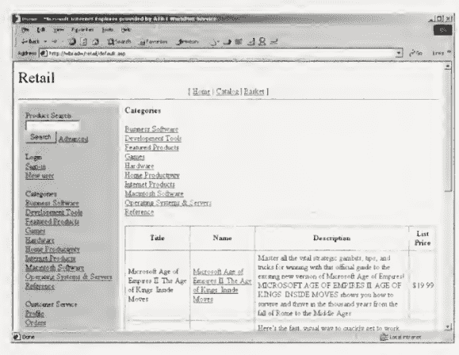

通过提供自定义 UI 的这一额外步骤，开发者可以非常快速且轻松地运行具有丰富 UI 和后端功能的电子商务网站，其中包括数据和流量分析工具（基于 SQL Server 2000 OLAP 引擎），这些工具允许组织跟踪销售情况、网站流量等。

Commerce Server 2000 的新功能包括：

-   强大的用户注册和个人资料分析系统
-   改进的目录管理
-   业务互联网分析（使用 SQL Server 2000 分析服务）


Host Integration Server 2000 是微软 SNA Server 的继任者。它的设计旨在允许在 Windows 平台上编写的应用程序访问遗留后端系统上的数据，并与这些程序进行交互，例如 AS/400 上的 DB2、CICS 和 IMS 事务系统，以及基于 MQ Series 的消息环境。Host Integration Server 允许通过 COM 访问遗留系统上的程序化功能，使得使用任何 COM 兼容语言（包括 .NET 组件）并使用 COM Interop 的组件开发者能够相对简单地利用现有遗留系统。


BizTalk Server 2000 是企业级服务器中最重要的之一。它让开发者能够快速创建高效、健壮且高度互操作的电子商务（企业间）应用程序。BizTalk Server 2000 的功能包括：

-   基于 XML 的文档转换
-   业务过程编排
-   文档路由和跟踪

BizTalk Server 允许你使用 BizTalk Mapper 基于 XML 的转换功能以任何格式发送和接收文档（如采购订单）。BizTalk Orchestrator 让你能够快速、轻松地绘制业务流程，并将每个步骤映射到执行该步骤的脚本或组件。一旦流程绘制了图表，BizTalk Orchestrator 就可以创建一个描述该业务流程的 XML 文档。该文档随后由 BizTalk Orchestrator 运行时用于执行该流程。这种方法的显著优势是它允许快速开发并显著更易地修改业务流程。


Internet Security and Acceleration Server 2000 (ISA Server) 设计为微软 Proxy Server 产品的继承者和扩展，提供了防火墙安全和缓存功能，组织可以使用这些功能来提高其连接网络的安全性和性能。ISA Server 的新功能包括：

-   集成式入侵检测
-   创建和执行互联网使用策略的能力
-   调度下载内容的能力
-   集成日志和报告功能


如果你曾经为单台服务器构建过 Web 应用程序，后来必须将该应用程序移动到 Web 集群以提供更大的扩展性，那么你将仔细查看 Application Center 2000。它的设计旨在简化创建和管理 Web 或应用程序集群的任务。Application Center 提供了一个管理控制台，可以轻松创建服务器集群、向集群添加新服务器（包括复制应用程序）和/或同步新服务器、为升级关闭或启动服务器等。

Application Center 2000 的重要功能包括：

-   简单的服务器集群创建和管理
-   自动故障转移和服务器健康监控
-   对性能/健康监控的动态响应
-   一键部署新服务器

## 语言与语言工具

.NET 平台最优秀的特性之一是，经典的 ASP 将开发者限制在脚本语言（带有固有局限性），而 ASP.NET 允许使用任何符合 .NET 标准的语言。这意味着你在 ASP.NET 中编写的代码经过编译，以获得更好的性能，并且你可以充分利用高级语言特性。

对于 .NET 平台，语言（以及你将要使用的工具）可能是最要讨论的话题之一，它们贯穿于全书。现在，让我们从高层次概述一些用于开发 .NET 应用程序的语言和工具。

## 记事本 “.NET”

你信可能不信，许多开发者（特别是 ASP 开发者）仍然在微软记事本中进行大部分开发，我曾亲切地称它为“Visual”记事本。现在我想我必须把它改成“.NET 版”记事本了。虽然记事本具有无处不在的巨大优势，但它并不是在使用 .NET Framework SDK（而不是 Visual Studio .NET）时使用的工具，不过你并没有理由不使用记事本进行所有的 .NET 开发。.NET Framework SDK 包含了用于 Visual Basic .NET、C#（读作“C sharp”）和 JavaScript .NET 的命令行编译器。因此，你可以在记事本中创建类、ASP.NET 页面等，然后你可以直接使用命令行编译器显式地编译它们，或者在 ASP.NET 的情况下，允许 ASP.NET 运行时在第一次请求时动态编译该页面。


### Visual Studio .NET

为了更简单更快速的开发，大多数开发者可能都想在 Visual Studio .NET 中工作。在微软平台上首次，Visual Studio .NET 为所有 .NET 语言提供了单一的集成开发环境（IDE）（等一下，让我重新读一遍上下文：在微软平台上首次，Visual Studio .NET 为所有 .NET 语言提供了单一的集成开发环境（IDE)）。

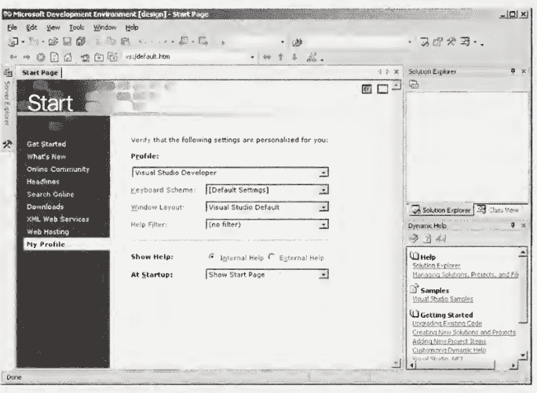

这意味着 Visual Basic、C++ 和 C# 的开发者将共享同一个环境。Visual Studio .NET 提供了大量的新功能，包括：

-   针对所有 .NET 语言以及针对 Windows 和 Web 的单一统一编程模型
-   拖放式开发
-   健壮的定制和可扩展性
-   对 XML 的强大支持

## Visual Basic .NET

如前所述，ASP.NET 开发者不再受限于 Visual Basic 的子集版本。他们现在可以利用 .NET 的完整力量。这种力量在 Visual Basic 中得到了大幅增强，通过添加继承、结构化异常处理以及对多线程编程的支持（这仅是一角）。

Visual Basic .NET 是一种托管语言，这意味着运行时管理 Visual Basic .NET 代码的执行。你不再需要像在 Visual Basic 6 及更早版本中使用 COM 组件那样通过 `Set object = Nothing` 来销毁对象引用。一旦没有客户端引用该组件，NET 垃圾回收器会自动回收组件使用的内存。

Visual Basic .NET 有许多新功能，但 VBScript 和 Visual Basic 6.0 的用户除非他们熟悉 .NET 编程模型，否则不会遇到什么困难。书中将大量的代码示例帮助你上手。

## C#

作为 Visual Studio 家族的新成员，C# 是 C 的后代。它类似于 C++，但设计更加简单易用。虽然 C# 并不一定比 Visual Basic 容易学习，但它比 C++ 简单得多，并提供了 C++ 开发者几乎所有的功能。由于 C# 与 Visual Basic .NET 一样都是托管语言，所有的内存管理由运行时处理。这是一个重要的优势，因为内存管理是 C++ 开发中最棘手的领域之一，也是导致许多应用程序崩溃的原因。

熟悉 C、C++ 和 Java 的开发者将很快上手 C#。书中将有一些 C# 代码示例，让你领略这种令人兴奋的新语言。

## 其它 .NET 语言

除了 Visual Basic .NET 和 C#（本书使用的两种语言），Visual Studio .NET 还随带了 JScript .NET、Visual C++ 以及用于 Visual C++ 的托管扩展，后者允许 C++ 开发者将应用程序目标运行时。


Visual Studio .NET 还提供了一种极其灵活的插件架构，允许其他为 .NET 平台编写或移植到该平台的语言能够轻松使用 Visual Studio IDE 的强大功能。

目前计划在 Visual Studio .NET 中支持的第三方语言列表包括：

- APL
- COBOL
- Pascal
- Eiffel
- Haskell
- ML
- Oberon
- Perl
- Python
- Scheme
- Smalltalk
- 以及其他许多（在编写本文时有 17 种语言）

在随 Visual Studio .NET 提供的带语言和将提供的第三方语言之间，应该有某种能够迎合几乎任何开发者的需求。

## ASP.NET 架构

虽然 ASP.NET 有许多熟悉的功能，但 ASP.NET 架构也发生了一些重大变化，包括许多改进和新功能。本节将从高层层面概览 ASP.NET 的新特性。

## 熟悉的功能

需要注意的是，ASP.NET 中的许多内容对于使用过经典 ASP 的开发者来说是熟悉的。广泛使用的 `Request` 和 `Response` 对象仍然存在，`Application`、`Session` 和 `Server` 对象也是如此，尽管它们有了新的属性和方法。你仍然可以使用 `<SCRIPT RUNAT="SERVER">` 块或 `<% % %>` 脚本分隔符来表示服务器端脚本。事实上，在大多数情况下，你编写 ASP.NET 页面的方式与编写经典 ASP 页面的完全相同。不过，一旦你习惯了 ASP.NET 的新的

## 第 1 章 ASP.NET 概述

编程模型，你将永远不会回到现在这种编写 ASP 应用程序的方式了。

此外，你不需要一次性迁移所有的现有的 ASP 应用程序。ASP.NET 设计为可以与经典 ASP 并行运行。因此，当你正在开发第一个新的 ASP.NET 应用程序时，你当前的 ASP 应用程序仍然可以并排运行。

## 新特性

ASP.NET 中有很多新东西，需要时间来学习所有内容。但一旦你学会了，你的生产力将远高于使用经典 ASP。让我们来看看 ASP.NET 的新功能列表。

- **Web Forms（Web 表单）**：这是 ASP.NET 的新编程模型。Web Forms 结合了 ASP 的优点与 Visual Basic 的开发易用性和生产力。你可以将控件拖到页面上，然后编写代码提供交互性、调用业务对象等。你将在第 9 章中学习 Web Forms。
- **Server controls（服务器控件）**：这是 Web Forms 模型的一个主要组件，ASP.NET 服务器控件大致对应于 HTML 元素（加上你之后将学习的额外控件），并提供了强大的服务器端可编程性。服务器控件运行在服务器上，并可以输出为未公开的浏览器定制的 HTML，例如 Internet Explorer 5.x 或更高版本，或适用于任何符合 HTML 3.2 标准的浏览器。第 10 章和第 12 章将深入介绍服务器控件。
- **Web Services（Web 服务）**：这是 ASP.NET 的关键部分，允许开发者通过互联网（或本地局域网）向其他开发者提供程序化的服务。Web 服务基于新兴的 SOAP（简单对象访问协议）标准，该标准将允许跨平台操作。你将在第 13 章中学习更多关于 Web 知识。
- **Caching（缓存）**：ASP.NET 包含一个强大的缓存引擎，允许开发者通过减少 Web 服务器和数据库服务器的处理负载来提高应用程序的性能。你将在第 14 章中学习更多关于缓存。
- **Configuration Improvements（配置改进）**：ASP.NET 使用了一种新的方法来存储 Web 应用程序的配置信息。不再让 IIS 将这些信息存储在难以访问的数据库，而是存储在基于 XML 的人类和机器可读的配置文件中。你将在第 7 章中学习这些配置文件是如何工作的。
- **State Management Improvements（状态管理改进）**：如果你曾必须构建运行在 Web 场（Web farm）上的 ASP 应用程序，你非常清楚状态管理方面存在巨大的局限性。ASP.NET 克服了这些局限性，由于它提供了跨服务器的状态管理，并且支持 Cookie。你将在第 6 章中学习这些（注：此处原文“学习如何这些ASP.NET”处可能存在翻译逻辑错误）。
- **Security（安全性）**：对于任何在 Web 上的应用程序来说，安全性是至关重要的。ASP.NET 极大地改进了安全性，包括改进的身份验证和基于角色的授权。你将在第 8 章中学习这些内容。
- **Improved Reliability（改进的可靠性）**：ASP.NET 包含了新的功能，以解决内存泄漏等问题，从而改进了可靠性。你将在第 9 章中学习这些。

## 结论

对于 ASP.NET 来说，我们只是触了皮毛。对于 ASP.NET 的许多特性，我们将在后续章节中详细介绍。对于 ASP.NET 的许多特性，我们将在后续章节中详细介绍。对于 ASP.NET 的许多特性，我们将在后续章节中详细介绍。对于 ASP.NET 的许多特性，我们将在后续章节中详细介绍。对于 ASP.NET 的许多


## 使用 ASP.NET 工具

- Notepad ".NET"
- 其他廉价的文本编辑器
- Visual Studio .NET

现在你已经了解了 ASP.NET 的一些功能，下一个问题是：如何使用它们？显然，你只需要一些工具。在本章中，我们将学习如何使用它们。


## 创建虚拟目录

在 IIS 中创建虚拟目录是一个相对简单的过程。

- 1. 点击“开始”、“程序”、“管理工具”、“Internet 服务管理器”，以启动用于 IIS 的 Microsoft 管理控制台。（这些说明适用于 Windows 2000。在 Windows NT 4.0 中，Internet 服务管理器控制台位于 Windows NT 4.0 选件包文件夹中）。

- 2. 点击计算机名称旁边的 “+” 号，展开你的计算机节点。

- 3. 右键点击“默认 站点”（Default Web site）节点（如果你设置了其他网站，也可以右键点击该网站的节点），并选择“新建”、“虚拟目录”。你将看到类似下图的内容。

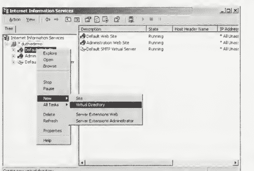

- 4. 在“创建虚拟目录向导”的第一页上，点击“下一步”。

- 5. 在第二页上，为新的虚拟目录输入一个别名（名称）。此名称将用于从 Web 浏览器访问虚拟目录中的内容。在本例中，使用名称 ASPNETTest。点击“下一步”。

- 6. 在文件系统中输入你希望存放虚拟目录内容的目录路径。这可以是一个现有的文件夹，也可以是一个新文件夹。如果你正在使用现有文件夹，或者你已经为内容创建了新文件夹，可以使用“浏览”按钮找到你需要的文件夹。在本例中，使用 C:\inetpub\WWWroot\ASPNETTest。点击“下一步”。


## 注意

在某些情况下，默认网站站点虚拟目录的文件系统目录存储在 C:\NetPub\WWWRoot 文件夹下。InetPub 是 IIS 安装过程设置的一个特殊文件夹，而 WWWRoot 是一个在 Web 服务器内容根目录下设置的文件夹。

这并不意味着你必须使用 WWWRoot 作为你的 Web 内容文件夹的父文件夹，但它是将你所有内容组织在单一易于找到的位置的便捷方便方法。然而，你应该记住，使用 WWWRoot（特别是在 C 盘的默认安装位置）会将你的所有应用程序都放在一个众为人知的位置，这可能会让黑客更容易对你的网站进行篡改（deface）或定位重要信息以进行窃取。

在“访问权限”页面上，你可以更改决定用户如何访问你新虚拟目录内容的设置。在这种情况下，默认设置是没问题的，因此点击“下一步”。

## 重要

> 在更改虚拟目录的访问权限时要加小心。允许你的虚拟目录具有“写入”、“执行”和/或“浏览”权限可能会允许不友好的人更改你的内容或在你的服务器上执行破坏性代码。只有在你理解这样做的影响时，才更改这些设置。

这就结束！你的虚拟目录创建完成了。点击“完成”。

现在你已经创建了 ASPNETTest 虚拟目录，请继续保存之前列出的 HTML 文档。

- 打开记事本。点击“开始”、“程序”、“辅助程序”、“记事本”。

- 输入第 18 页所示 HTML 代码。

- 将文档保存到你创建的用于存放虚拟目录内容的文件系统文件夹。将名称命名为 ASPNETHello.aspx。

现在你已经保存了文档，应该可以查看它了。打开 Web 浏览器并输入以下 URL：

```
http://localhost/ASPNETTest/ASPNETHello.aspx.
```


假设你的 Web 服务器已正确安装，并且你已根据本章之前的步骤创建了虚拟目录，你应该能看到如下图所示。

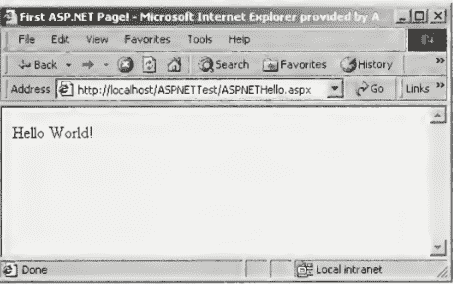

虽然此页面可能并不糟糕，但如果你正在使用 ASP.NET，你可能想看到类似以下的内容。

> 注意
Localhost 是用于 URL 指向本地的地址。在 ASP.NET 页面中，可以使用 localhost 访问本地。
本地回环地址 127.0.0.1。在 ASP.NET 页面中：
http://machiname/pagename/
在 ASP.NET 页面中，
pagename
在 ASP.NET 页面中，
machiname/pagename
在 ASP.NET 页面中，
pagename
在 ASP.NET 页面中，
pagename
在 ASP.NET 页面中，
pagename
在 ASP.NET 页面中，
index.html
在 ASP.NET，
index.html
在 ASP.NET 。

### 其他文本编辑器
记事本可能是 Windows 中最常用的编辑器，但如果你想进行 ASP.NET 开发，你可能想要 Visual Studio .NET 的某些功能。这些编辑器可以提供以下功能：

- 语法高亮：使用颜色来指示各种类型的关键字。
- 自动补全：在你输入时根据你已输入的内容建议可能的完成项。
- 可用的源代码：为想要编写代码的开发者提供。

如果你只是开始学习 ASP.NET，这些编辑器可能是一个很好的起点。但如果你想要完整的功能，可以使用 Visual Studio .NET。

### Visual Studio .NET
虽然可以使用记事本或其他文本编辑器创建 ASP.NET 应用程序，但如果你在进行真正的开发，你可能希望在 Visual Studio .NET 中工作。该工具优势包括：

- 强大的项目和多项目管理
- 与 Microsoft SourceSafe 的集成
- 用于 Web 服务、Web Forms 控件和数据库的 Visual 工具
- Web 应用程序的打包和部署
- 单个 IDE 支持多种语言

这只是一个简单的列表。该工具的功能远超一个章节的范围。话不多说，让我们看看如何在 Visual Studio .NET 中创建项目和页面。

## 创建 ASP.NET 应用程序

要在 Visual Studio .NET 中处理 ASP.NET，你首先要做的事情之一就是创建一个新项目，在 Visual Studio .NET 术语中 Web应用程序。以下是创建 Web 应用程序所需的步骤：

- 1 打开 Visual Studio .NET。

- 2 有三种方法可以打开“新建项目”对话框：

- 点击 Visual Studio .NET 页上的“新建项目”链接（首次打开 Visual Studio .NET 时禁用）。

- 点击工具栏上的“新建项目”按钮。

- 从“文件”菜单选择“新建”、“项目”。

- 3 在“新建项目”对话框中（如下图），选择所需的项目语言（在本例中为 Visual Basic），选择相应的模板（Web Application），并输入项目名称（ASPNETApp1）和位置。（对于本地项目，默认的 http://machiname/ 可以，你也可以使用 localhost。）点击“确定”。Visual Studio .NET 将创建一个 Web 应用程序以及该项目的物理和虚拟目录。

好了！你已经创建了第一个 ASP.NET Web 应用程序。我们将查看如何添加新页面。


在创建新项目时，有多种方法可以向应用程序添加新的 ASP.NET 页面（也称为 Web 表单，Web Form）。你应该使用哪种方法在很大程度上取决于你的工作习惯。方法如下：

- 在解决方案资源管理器窗口（见下图）中，右键点击应用程序名称，然后选择“添加”、“Web 表单”。你也可以选择“新建项”，并在“添加新建项”对话框的模板选择中选择“Web 表单”。

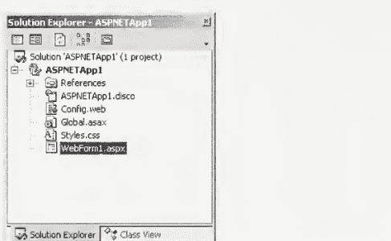

- 在 Visual Studio .NET 工具栏上，点击“新建项”按钮。你也可以点击此按钮旁边的箭头，然后从弹出菜单中选择“添加 Web 表单”。

- 从“项目”菜单，选择“添加 Web 表单”（或“添加新建项”）。

上述任何方法都会打开“添加新建项”对话框，如下所示。

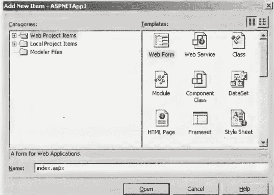


在“添加新建项”对话框中，选择“Web 表单”模板并为新页面指定名称。由于你将将其作为项目的起始页，请将其命名为 index.aspx。在完成之前，你可能想查看一些其他可用的模板类型，包括 Web 项目和本地项目。查看完成后，点击“打开”。Visual Studio .NET 将创建该页面，将其添加到项目中并在 Web 表单设计器中打开它（见下图）。

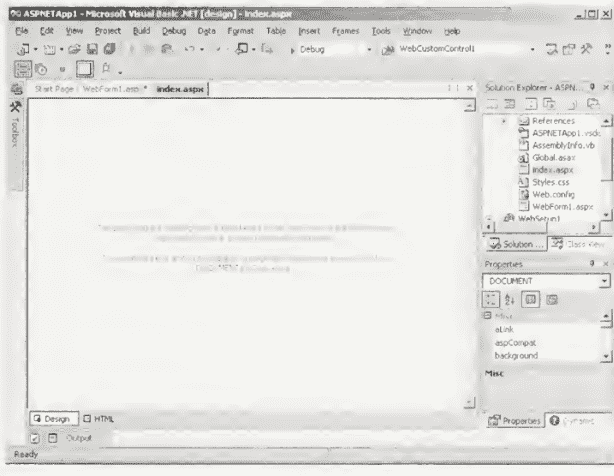

# 添加控件

现在你已经为新应用程序创建了起始页，你可以用它做什么呢？好了，让我们从让它的功能与你在记事本中创建的页面相同开始。这次不要使用纯 HTML 文本，而是使用 Label 控件（ASP.NET 服务器控件之一）向你的客户端显示 Hello World 问候语。以下是将 Label 添加到 Web 表单的步骤：

- 在设计模式下打开 Web 表单，将鼠标悬停在“工具箱选项卡上。（默认情况下，它位于代码编辑器/设计器窗口的左侧。）当工具箱出现时，确保 Web Forms 面板处于激活状态。（活动面板的标题栏显示在工具箱显示的控件正上方。）如果未激活，你可以点击其标题栏来激活它。

在 Web Forms 面板处于激活状态时，双击 Label 控件项（见下图）。一旦添加了标签，它应该会被默认选中。

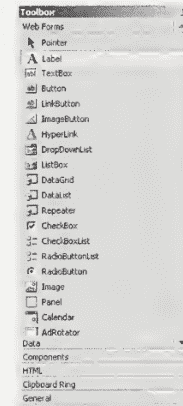

要让 Label 控件显示你想要的文本，你需要更改它的 `Text` 属性。点击属性窗口中 `Text` 输入右侧，然后将文本（默认为 Label）更改为 Hello World!，如下所示。

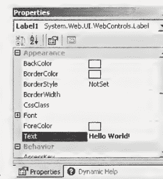

# 保存并浏览你的页面

现在你已经添加了服务器控件，请点击工具栏上的“保存”按钮来保存页面。你也可以通过从“文件”菜单选择 `<filename>` 来保存。

由于你使用的 Web 表单会自动为你的 Web 表单添加代码文件模块（code-behind），在浏览页面之前生成项目。（你将在后面的章节中学习更多关于代码文件的知识。）生成是编译项目中所有代码模块的过程，以便调用它们的页面和模块可以使用。要生成项目，从“生成”菜单中选择“生成”。

一旦保存了 Web 表单页面并生成了应用程序，你就可以右键点击页面并选择“在浏览器中查看”，在嵌入式浏览器窗口中查看页面。结果如下所示。

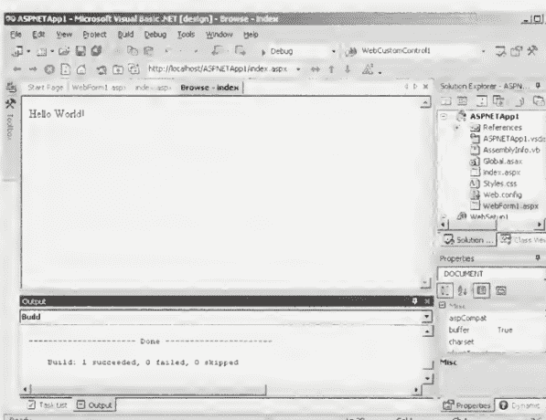


| 操作 | 执行此操作 | 按钮 |
| :--- | :--- | :--- |
| 在 IIS 中创建虚拟目录 |  Internet 服务管理器，右键点击你想添加虚拟目录的网站，然后选择“新建”、“虚拟目录”。按照虚拟目录创建向导中的说明操作。 | |
| 在 Visual Studio .NET 中创建新项目 | 点击“新建项目”按钮，选择项目语言和模板，然后为新项目提供名称和位置。 |  |
| 创建一个新的 Web Forms 页面 | 点击“新建项”按钮（或点击右侧箭头并选择“添加 Web 表单”）。为新的 Web 表单提供名称并点击确定。 |  |
| 保存文件 | 点击“保存”按钮，或从“文件”菜单选择“保存 <filename>”。 |  |


在本章中，你将学习到：

- ASP.NET 应用程序的类型
- 代码文件模型以及为什么你可能在 ASP.NET 开发中使用它

在上一章中，你学习了代码文件。本章将深入探讨：

- ASP.NET 应用程序的类型
- 代码文件在 ASP.NET 开发中的用途

你在 Web Forms 中编写的代码可以通过以下两种方式之一编写：

- 内联在 .aspx 文件中（如经典 ASP 所示）
 使用 使用代码文件模块

虽然你可以使用 .aspx 文件编写应用程序并利用 .NET 的改进，但建议养成使用代码文件的习惯。

# ASP.NET 项目类型

有两种类型的 ASP.NET 应用程序：

- Web Forms：该模型使用图形界面并允许通过拖放控件创建交互式应用程序。
- Web 服务：该模型用于在互联网或局域网上提供程序功能。


Web Forms 是任何 ASP.NET 应用程序的重要部分。简单来说，它们是允许你创建图形界面（GUI）交互式应用程序的 Web Forms。Visual Studio .NET 环境允许你通过 Web Forms 设计器进行可视化操作，也可以通过源代码编辑器进行文本操作。

# 代码文件

代码文件是 ASP.NET 的一项新功能，允许开发者将 HTML 与 VB、C# 或其他用于用户交互的语言分离。使用代码文件有许多优势，包括以下特性：

- HTML 和代码文件的清晰分离允许 HTML 设计师和开发者独立工作，同时最大限度地减少干扰对方的可能性。
- 更容易重用：混杂在 .aspx 页面中的代码更容易在其他项目中重用。
- 更易维护：由于代码与 HTML 分离，你的页面更容易阅读和维护。
- 无需源码部署：使用代码文件的 Visual .NET 项目可以作为编译后的代码进行部署（除了 .aspx 页面之外），允许你在需要时保护源代码。如果你在为客户创建应用程序但希望保留自己的知识产权，这将非常有用。


虽然没有人否认使用 ASP.NET（即使是经典 ASP）创建的 Web 应用程序非常有用，但长期以来一直缺乏一种简单的在互联网或局域网上提供程序功能的方法，而无需将客户端绑定到特定的 UI 上。这就是 ASP.NET Web 服务的用场。

XML Web 服务简单来说，就是一段可以通过 Web 访问的代码块。


联盟会（W3C）的 SOAP 规范。它允许从 Windows 服务器到 UNIX 工作站等不同平台的计算机通过 HTTP 协议提供和消费程序化服务。

> 注意：SOAP 可以使用其他协议（例如 FTP 或 SMTP），但 HTTP 是 SOAP 和 XML Web 服务最常用的协议，因为大多数防火墙都允许通过 HTTP 协议进行通信。

ASP.NET 让实现 XML Web 服务变得异常简单。事实上，你只需要对任何任何希望作为 XML Web 服务提供的方法添加一个声明即可。Visual Studio 通过处理所有必要的工作，使你的 XML Web 服务能够对潜在客户端可用，这让这一切变得更加简单。第五部分将详细讨论 XML Web 服务。


在 ASP.NET 中，你将看到一组新的文件类型。为了避免任何混乱，让我们花一点时间回顾一下你经常看到的几种类型，并讨论它们的用途。

- .aspx 你最常见的扩展名是 .aspx。它用于 Web Forms 页面，类似于经典 ASP 中的 .asp 扩展名。
- .ascx 用于 Web Forms 用户控件的扩展名是 .ascx。用户控件提供了 ASP.NET 重用代码的多种方法之一。它们与经典 ASP 中的包含文件有些相似，因为它们可以简单到只有几个 HTML 标签，也可以包含作者可能在许多页面中重用的复杂逻辑。用户控件使用 @ Register 指令添加到 Web Forms 中，该指令将在第四部分进行讨论。
- .asmx 用于实现 XML Web 服务的文件的扩展名是 .asmx。可以直接通过 .asmx 文件访问 XML Web 服务，或者 .asmx 文件可以将请求重定向到实现该 Web 服务的编译程序集。
- .vb Visual Basic .NET 代码模块的扩展名是 .vb。所有添加到 Visual Studio .NET 应用程序中且用 Visual Basic .NET 编写的 Web Forms 页面 (.aspx) 都会有一个与其相关的 Web Forms 页面同名的 .vb 后代码（code-behind）模块。
- .cs C# 模块的扩展名是 .cs。与 .vb 扩展一样，添加到 C# Studio .NET 应用程序中的 Web Forms 页面 (.aspx) 都会有一个与其相关的 Web Forms 页面同名的 .cs 后代码模块。
- Global.asax 类似于经典 ASP 中的 Global.asax，Global.asax 是一个用于定义应用程序级（Application）和会话级（Session）变量以及启动过程的文件。注意，虽然 Global.asax 的结构可以像 Global.asax 一样，将 Session_OnStart（ASP.NET 中的 Session_Start）等启动过程直接编写在 Global.asax 文件的 `<script runat="server">` 块中，但 Visual Studio 在 .vb（或 .cs）后代码中而非 Global.asax 文件本身实现这些过程。

经典 ASP Global 文件可用功能外，ASP.NET 还允许你导入命名空间、链接程序集并执行其他有用任务。你将在第五章中学习更多关于 Global.asax 的知识。
- Web.config 是 ASP.NET 中的一种新文件类型。它解决了经典 ASP 应用的一个主要麻烦：配置。Web.config 文件是一个人类可读且机器可读的 XML 文件，存储给定应用程序（或应用程序的一部分）的所有配置设置。Web.config 文件按分级解释；也就是说，应用程序子目录中的 Web.config 文件将覆盖其父目录中 Web.config 文件的设置。其优势在于配置设置可以在需要的地方被继承，但你也可以对配置进行细粒度的控制。

## 本书中使用的语言

虽然 Microsoft .NET Framework SDK 和 Visual Studio .NET 中有多种语言供选择，但本书将主要关注 Visual Basic .NET 和 C#。大多数代码示例将以 Visual Basic .NET 形式呈现，但在 Visual Basic 和 C# 语法之间存在重要差异时，将提供 C# 的替代示例。本节将帮助你决定哪种语言最适合你。

## Visual Basic .NET

如果你工作过 Visual Basic 或 Visual Basic 脚本版（VBScript），但没有 C、C++ 经验，那么在 Visual Basic .NET 中工作将让你感到最舒服。尽管自 Visual Basic 6.0 以来该语言发生了巨大变化，但 Visual Basic .NET 在语法上是类似的。本书并非作为 Visual Basic .NET 的语言教程，但我们尽力指出了 Basic .NET 语法与其前代版本之间存在重大差异。

从历史上看，Visual Basic 一直未视为面向对象或低级语言，但它的长期批评者会很高兴知道，Visual Studio .NET 版本的语言包含了继承和线程的完整实现。然而，为了保持 Visual Basic 安全（OS-safe）的传统，Visual Basic .NET 不允许内存操作等不安全操作。无疑，硬核的低级爱好者会认为这是一种限制，但对于大多数标准应用程序，易用性是考虑这种语言的良好理由。

## C#

如果你工作过 C、C++、JavaScript 或 Java，你可能最习惯使用 C#。像 Java 一样，C# 派生自 C 和 C++，因此你应该能够在很短时间内熟练 C#。与 C 和 C++（以及在某种程度上与 Java）不同，C# 的学习曲线并不陡峭，因此熟悉 Visual Basic 的开发者也希望看一看 C#。

与 Visual Basic .NET 不同，C# 允许你处理不安全代码（指针和内存操作等），尽管不建议初学者这样做。毕竟，它被称为不安全代码是有理由的！如果你需要进行直接内存访问或与 C++ 模块一起工作，C# 将更适合你。

## 多语言协作

正如第一章所述，在 Microsoft .NET Framework 内工作的一个优势是你不局限于单一语言。如果你想实现你选择的语言无法实现的功能（或者用另一种语言实现更容易），你始终可以使用另一种 .NET 的语言来绕过该限制。

例如，假设你的主语言是 Visual Basic .NET，但你需要访问用 C 编写的 DLL。你可以用 C# 创建类库来访问该 DLL，然后在 Visual Basic .NET 中继承该类。
## Visual Studio .NET 功能

上一章查看了如何使用 Visual Studio .NET 创建 Web 应用，但没有检查 Visual Studio .NET 环境。

## IDE 增强

你在 Visual Studio .NET IDE 中发现的一些新增强包括以下功能。

- 启动页每次启动 Visual Studio .NET 时显示的默认页面。它允许你设置 IDE 偏好、访问最近和现有项目并创建项目。
- 多语言 IDE 与 Visual Studio 6.0（每个语言使用不同的 IDE，尽管 Visual InterDev 和 Visual J++ 共享一个 IDE）不同，在 Visual Studio .NET 中，所有语言共享同一个 IDE。这意味着查找替换、调试等标准功能在不同语言之间是一致的。这些都是生产力的巨大增强。
- 命令窗口 Visual Basic 立即窗口和命令行的结合体，命令窗口允许你根据窗口模式执行 Visual Studio 命令或代码语句。下图显示了一个使用 `immed` 命令切换到立即模式的命令窗口。命令窗口有两种模式：
  - 命令模式允许你不使用菜单系统执行 Visual Studio 命令，或执行未出现在任何菜单中的命令。
  - 立即模式用于调试。允许你评估表达式、检查变量值、执行程序语句等。


为了简化同时编辑的多个文件的管理，选项页文档界面允许你一次查看所有正在编辑的文件。这使得在编辑窗口之间来回切换变得简单得多。不过，你仍然可以使用 Visual 6 使用的旧方法来设置 Visual Studio .NET。只需从工具（Tools）菜单中选择选项（Options），在环境（Environment）文件夹下选择常规（General）选项，将选项页文档（Tabbed Documents）切换为 MDI 环境，然后点击确定（OK）。你需要重启 Visual Studio .NET 才能使更改生效。

### 自动隐藏
我个人最喜的功能，自动隐藏的工作原理类似于 Windows 工具栏中的同名功能。要启用窗口的自动隐藏，请点击标题栏中的大头针图标（显示在边距中）。现在，当鼠标移开窗口时，窗口会自动隐藏到 IDE 侧边并停靠，只显示一个带有窗口标题的标签。将鼠标悬停在标签上会让窗口重新出现。这对于为代码窗口留出最大空间是一个非常棒的功能，并且可以让 IDE 中多个窗口的管理变得简单得多。

### 改进的 HTML 编辑器
与之前的 InterDev 不同，Visual Studio .NET HTML 编辑器同时提供了设计视图和 HTML（源）视图。Visual Studio .NET 删除了 Visual InterDev 提供的快速查看（Quick View）窗口。相反，你在嵌入式浏览器窗口中预览页面，这支持更真实的页面显示效果视图。改进后的编辑器还支持通过 `targetSchema` 属性指定你正在编写的 HTML 架构。设置 `targetSchema` 决定了哪些元素可以通过编辑器的语句完成功能可用，并允许 IDE 根据你所选架构的上下文对错误的语法提供反馈。

## 新功能

除了 IDE 的增强外，Visual Studio .NET IDE 还有许多全新的功能。

- *XML 编辑器*：这允许你根据正在编辑的 XML 文件类型，在源、数据或架构视图中编辑 XML 数据 (.xml) 和架构 (.xsd) 文件。

### 自动生成文档
目前 C# 中可用的一个兴奋功能，允许你使用特殊的注释分隔符 (///) 和语法从 C# 代码的注释生成文档。无论项目使用什么语言，Visual Studio 还会为项目解决方案生成 HTML 文档。

### 动态帮助
这是一个在 IDE 中工作时提供上下文帮助的功能，当你向项目添加文件、控件和代码时，它会建议感兴趣的话题。下图显示了在编辑 Web Form 的 \<html> 元素时出现的动态帮助窗口。

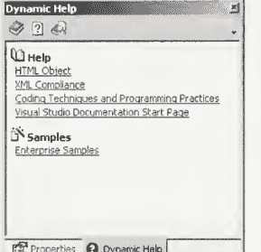

### 支持 Windows Installer
Visual Studio 现在支持这种针对 Windows 的改进技术，包括在出现安装问题时支持安装回滚。你甚至可以为 Web 应用程序创建部署包，允许你在当前尚未安装 .NET Framework 的机器上安装和运行 ASP.NET 应用程序。部署包将为你安装所有必要的运行时文件。


在用 Visual Studio .NET 工作期间，你会在 IDE 中遇到各种窗口，它们用于不同的目的。有些是新的，如上一节描述的动态帮助窗口，而另一些对于 Visual Studio 以前版本的用户来说非常熟悉。本节将介绍最常用的窗口。

## 开发概述

### 设计器/源编辑器
下图显示了 HTML 编辑模式下的设计器/源编辑器窗口。这是你将在 Visual Studio 环境中花费大部分时间的地方。该窗口集成了你在 Visual Studio 中将使用的几乎所有的设计器和源代码编辑器，包括 Web Forms、XML 架构和 HTML 设计器，以及一个支持 XML、HTML、SQL、层叠样式表 (CSS) 和所有 .NET 语言的统一源代码编辑器。编辑器提供了针对特定语言的增强功能。HTML 和 CSS 编辑器的两个特别令人兴奋的新功能是针对 HTML 和 CSS 的 IntelliSense 完成，以及对编辑器修改（或是否修改）HTML 和 CSS 文档格式的更好的控制。要更改格式设置，从菜单中选择选项（Options），选择文本编辑器（Text Editor）文件夹，选择 HTML（或 CSS）文件夹，并选择格式（Format）选项。

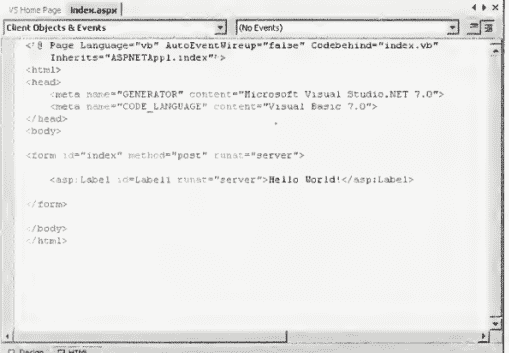

### 解决方案管理器
解决方案管理器窗口对于任何用过 Visual InterDev 6 的人来说都是熟悉的。它是你管理项目文件和资源的主要工具之一，包括添加、删除、打开、重命名和移动文件，以及设置启动页或项目，在文件的代码视图和设计视图之间切换（例如，源代码控制状态）。下图显示了解决方案管理器并标识了它的许多元素。

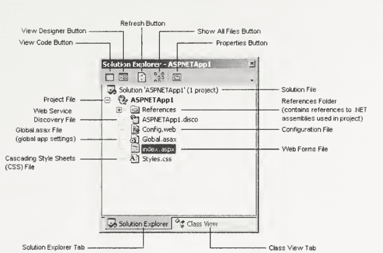

### 类视图
下图所示的类（Class）窗口包含了项目中所有类（包含在 .vb 或 .cs 模块中）的列表，以及在类中实现的方法、属性和接口。

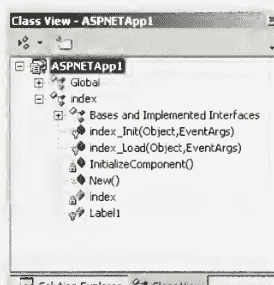

### 服务器管理器
所示的服务器管理器是 Visual Studio .NET 的一项新功能，允许你查看本地机器和远程服务器上的资源，包括数据连接、事件日志、消息队列和性能计数器。服务器管理器还允许将资源拖放到 Web Forms 或 .NET 组件上，从而实现了迄为止最高效的开发。

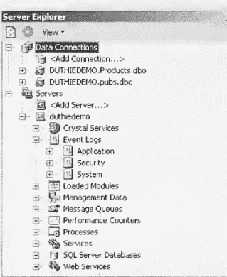

### 属性
属性窗口对于任何用过 Visual Studio 工具套的人来说都会非常熟悉。它提供了编辑器或设计器中当前选择对象的属性访问。下图显示了显示 ASP.NET Label 控件属性的属性窗口。注意，属性窗口允许你折叠或展开属性以便查看感兴趣的类别。你也可以点击对象选择菜单下方的字母按钮来查看类别。

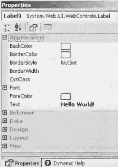

### Visual Studio .NET 工具箱
Visual Studio .NET 工具箱是另一个紧随 InterDev 环境的元素。它提供了大量的控件、组件和 HTML 元素。你可以通过双击工具箱中的项名称（此时项将插入到当前光标位置）或使用拖放（允许你在所需位置放置项）将工具箱项（本质上用于实现控件或组件的 HTML 标签或文本元素）添加到 Web Forms 或组件中。某些项在 Web Form 中使用时没有视觉表示。这些项通常显示在设计器窗口底部的单独窗口区域。下图显示了显示 Web Forms 控件的工具箱。

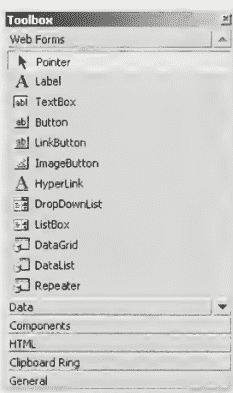


## 文档大纲
下图所示的“文档大纲窗口显示了 Web Forms 文档的大纲（在设计视图下）。它还提供了对“脚本大纲”的访问，后者显示了可以编写脚本的客户端对象和事件，并可为这些事件插入脚本事件处理器。

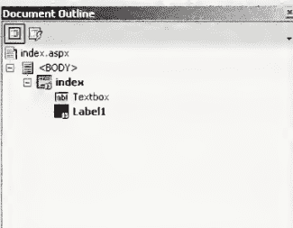

## 任务列表
任务列表窗口是 Visual Inter-Dev 中一个被低估且经常未被充分利用的工具，它允许开发者创建、排序和跟踪当前解决方案需要完成的任务。任务列表还可以包含由 Visual Studio 自动生成的任务，帮助开发者定位和纠正生成错误。可以根据开发者的需求对任务进行分类和优先级排序。类别包括：注释（由 TODO、UPGRADE_TODO 等注释指示）、用户任务、生成错误、快捷方式（通过在编辑器中右键点击代码行并选择“添加任务列表快捷方式”创建）以及 IntelliSense 检测到代码中的错误。下图显示了包含快捷方式、用户任务和注释任务的任务列表。

| 描述 | 文件 | 行号 |
|---|---|---|
| 添加新的 Web 表单 | | |
| 将输入更改在服务器上运行 | C:\documents and ...\ASNETApp\index.aspx | 10 |
| 检查标签的大小写 | | |
| TODO: 将列表更改为 'C:\Documents and ...\ASNETApp\index.vb 以外的其他内容 | 39 |

## 输出
使用过微软 C++ 或 Visual J++ 工具的开发者会对“输出窗口”感到熟悉。输出窗口的主要用途之一是显示与项目生成相关的消息。（生成是编译构成项目的所有代码文件的过程）。由于

# 第 3 章 ASP.NET 开发概述

在代码修改生效之前需要生成 ASP.NET Web 应用程序，因此你会经常看到这个窗口。下图显示了示例项目生成的输出。在这种情况下，生成成功了，没有错误或警告。如果有生成错误或警告，它们将显示在此窗口中。

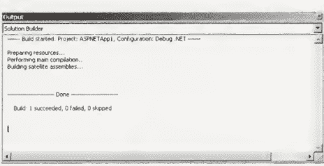

## 工具栏
在 Visual Studio .NET 中完成任务，你可能将使用 IDE 工具栏和菜单的组合。本节将介绍最常用的工具栏，下一节将介绍最常用的菜单。你可以通过右键点击任何工具栏（或空工具栏区域）查看可用工具栏的完整列表。由于 Visual Studio .NET IDE 的可定制性质，所有工具栏都可以通过添加、删除或重新排列按钮、移动工具栏以及显示/隐藏工具栏来完成自定义。

> 注意：鉴于 Visual Studio .NET 工具栏的灵活性，很容易导致你的工具栏看起来与安装 Visual Studio 时的样子完全不同。对于某些人来说，这可能是一件好事，但如果你想恢复原始配置，请点击每个工具栏右侧的“选项”按钮，点击“添加或删除按钮”，点击工具栏名称对应的菜单项，最后点击“重置工具栏”。

- 下图所示的“标准”工具栏包含用于常用文件和项目命令的按钮，包括打开文件和项目、创建新文件和项目以及访问 IDE 中的各种窗口。


## 格式
下图所示的“格式”工具栏包含与文本格式相关的按钮，包括字体和字体大小、文本对齐选项以及背景和前景颜色。此工具栏仅在你在设计视图中输入或编辑文本时启用。


## 文本编辑器
下图所示的“文本编辑器”工具栏包含与文本编辑器操作相关的按钮，包括访问 IntelliSense 功能、代码的缩进和注释以及书签。（你可以使用这些功能快速导航到代码的特定部分。）


## 调试
下图所示的“调试”工具栏包含调试命令按钮，从启动、停止和断点命令到访问各种调试窗口的按钮。请注意，调试将在第 16 章中介绍。


## 菜单
Visual Studio .NET 中提供了许多菜单，取决于你当前正在处理的任务。虽然我们不会介绍所有的菜单，但下面列出了你在 Visual Studio 旅程中遇到得最频繁的菜单。

- 文件菜单：文件菜单用于创建、打开和保存文件及项目，以及打印文件和退出程序。

- 编辑菜单：编辑菜单用于处理文本和对象，如剪切、复制、粘贴，以及特定文本的命令（如查找和替换）以及格式命令（如转为大写或转为小写）。

- 视图菜单：视图菜单用于访问当前隐藏的窗口或视图。使用此菜单从源代码切换到设计视图，或打开如任务列表之类的窗口，并选择显示哪些工具栏。

- 项目菜单：项目菜单用于向项目添加项、程序集引用或 XML Web 服务引用，并设置用于调试的启动页和启动项目。

- 生成菜单：生成菜单用于生成和重新生成项目或多个项目，以及用于部署项目的命令。

- 调试菜单：调试菜单用于启动、停止和暂停（断点）调试，并设置断点和访问调试窗口。

- 表格菜单：表格菜单用于处理 HTML 表格。使用此菜单插入或删除表格、行、列和单元格，以及合并或拆分单元格。

- 工具菜单：工具菜单包含与自定义 IDE 以及外部工具相关的命令（如 OLE/COM Object Viewer 和 Spy++）。你可以使用此菜单访问之前的“自定义”对话框，以及下一节将讨论的“选项”对话框。

- 查询菜单：查询菜单用于使用 Visual Studio 创建和运行数据库查询。

- 窗口菜单：窗口菜单用于导航和管理已打开的窗口。

- 帮助菜单：帮助菜单用于访问 Visual Studio .NET 文档以及支持。此菜单还包含打开 Visual Studio 时默认显示的启动页。如果你意外关闭了它，可以使用此菜单项将其恢复。

> 注意：在这些菜单中，你可以创建自定义菜单。要创建自定义菜单，右键点击菜单栏的任意位置并选择“自定义”。在对话对话框，点击“命令”选项卡。在“类别”下选择“新菜单”。在“命令”下点击并拖动“新菜单”项到菜单栏所需的位置。接下来，右键点击新菜单标题并使用“名称”输入为新菜单命名。现在你可以将其他类别的项拖到你的新菜单中。要创建子菜单，将另一个“新菜单”项拖到你菜单所在的位置。

## 选项
Visual Studio .NET 改进巨大的领域之一是自定义。Visual Studio .NET 中的许多可用自定义都通过所示的“选项”对话框进行控制。如前所述，你可以通过选择“工具”、“选项”来访问此对话框。不仅选项的数量增加了，对特定选项的控制程度也增加了。

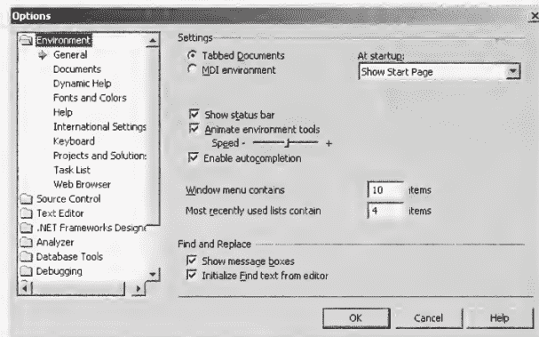

这种控制增强的一个很好的例子是代码格式化。VisualDev 开发者无疑对从设计视图切换到源视图时编辑器自动处理其 ASP 代码感到苦恼。Visual Studio .NET 仍然执行代码格式化，但开发者对这种格式化具有按语言控制权。（注意，并非所有语言都使用格式化，因此没有这些选项。）转到“文本编辑器”选项文件夹，选择语言（例如 HTML 或 CSS），并将选项设置为你的喜好设置。通过这种方式，你可以决定如何对代码进行格式化，或者对于某些语言，你可以关闭格式化。

> 注意：对于长期使用 BASIC 的用户，一个喜欢的选项是让 IDE 在文本编辑器中显示行号。然而，与 BASIC 不同，行号仅供参考；它们实际上并不是代码文件的一部分。此选项可以针对特定语言开启或关闭，也可以针对所有语言全局开启。


# 第 3 章 快速参考

| 目标 | 操作 |
|--- |--- |
| 在 Visual Studio .NET IDE 中执行 Visual Studio .NET 命令或程序语句 | 点击“视图”、“其他窗口”、“命令窗口”或按 Ctrl+Alt+A 打开命令窗口。 |
| 修改 Visual Studio .NET 中项的属性 | 在“属性”窗口中找到所需的属性并修改其值。 |
| 在 HTML 设计器中向文档添加项 | 打开“工具箱”，选择所需的调色板（HTML、Web Forms 等），并双击所需的项。 |
| 向任务列表添加快捷方式任务 | 在 Visual Studio .NET 源代码编辑器中右键点击某行代码，并选择“添加任务列表快捷方式”。 |
| 更改 Visual Studio .NET IDE 中的选项，例如编辑器字体、自动格式化选项、源代码格式选项等 | 点击“工具”、“选项”，选择相应的选项文件夹并修改其选项。 |

# 第 4 章

## 了解编程基础

- 在本章中，你将学习：
- 表达式、变量和常量
- 过程
- 流程控制
- 错误处理
- 面向对象编程

### 编程基础

本章面向几乎或没有直接编程经验的读者。它旨在提供一些基本编程概念的概述，这些概念将帮助你更好地理解书中介绍的示例。具有编程经验的读者可能希望跳过本章直接进入第 5 章。

虽然本章将提供基本编程概念的概述，但鼓励经验较少的读者使用其他资源来补充这些信息。这些资源包括编程基础书籍、诸如微软开发者网络站点（http://msdn.microsoft.com）等网站，以及可能对缺乏经验者帮助的新组和邮件列表。（微软在 msnews.microsoft.com 上维护了大量与微软工具相关的开发主题新闻组。你可以使用 Outlook Express 等邮件客户端阅读和向这些新闻组发布内容。）当然，学习 Visual Basic .NET 和 C# 编程概念的最佳（且常被忽视的）资源之一是 Visual Studio .NET 附带的 MSDN 文档（其子集作为季度 MSDN 库的一部分提供，可以通过 http://msdn.microsoft.com/subscription 订购）。MSDN 包含了 Visual Basic .NET、C#、C++ 托管扩展以及 JScript .NET 的示例、教程、语言参考和规范。

本章将讨论这些基本编程概念如何应用于 ASP.NET，以及你如何使用它们来创建有效的 ASP.NET 应用程序。尽管这些概念中的大多数并非特定语言，但它们在不同语言中的实现方式存在一些细微差异。在适当的情况下，我们将使用 Visual Basic .NET 和 C# 的代码示例指出这些差异。

> **注意**
在 ASP.NET 中，所有代码都包含在 Web Forms 页面、代码后台（code-behind）模块或构成 ASP.NET 应用程序外部的类库的模块中。在这种意义下，“模块”（module）指的是包含代码的 .cs 或 .vb 文件，而 Visual Basic .NET 文档所指的*模块* 是供同一命名空间内其他类和模块使用的代码容器。除非另有说明，本书中的*模块* 一词具有前者的含义而非后者。

在第 74 页中，类（class），正如你在“使用类作为代码容器”中所看到的，是一种特殊的代码容器，提供了许多实用功能。类包含在模块中（即扩展名为 .cs 或 .vb 的文件）。

### 表达式、变量和常量

表达式、变量和常量是计算机程序最基础的构建块之一，你将在 ASP.NET应用程序中广泛使用它们。

### 表达式

表达式是几乎所有计算机程序的核心。表达式允许你：

- 比较值之间的关系
- 执行计算
- 处理文本值

一个表达式可以简单如下所示：

```
1 + 1
```

然而，像这样的表达式本身并没有什么用。与人类可以轻易识别出“一加一”并填补空白（“等于二”）不同，计算机无法进行这种逻辑跳跃。为了让表达式有用，它需要告诉计算机不仅是把 1 加 1，还要将结果存储在我们可以利用它的地方（要么通过向用户显示它，要么在稍后的表达式中使用它）。这就是变量派上用场的地方。

### 变量

与上一个示例一样，在程序执行的某个时间点，你需要存储某种值。示例包括数学运算的结果（如上一个示例所示）、接收用户的文本输入以及比较的结果。简单来说，变量是数据的存储区域。这些数据可以是数字、文本或多种特殊类型之一。变量可以存储的数据类型类型由其数据类型决定。

### 数据类型

变量的数据类型定义了可以存储的数据类型，以及存储数据的格式（以及系统需要为变量分配的内存量）。下表列出了 Visual Basic .NET 和 C# 支持的数据类型以及它们映射到的 .NET Framework SDK 类型。标记有星号（）的数据类型没有原生表示。在声明变量时，你仍然可以使用相应的 System 类型访问这些数据类型。

变量的数据类型在声明变量时确定。这将在第 56 页的“声明变量”节中进一步讨论。

| VB 数据类型 | C# 数据类型 | .NET 数据类型 | 大小 |
|---|---|---|---|
| Boolean | bool | System.Boolean | 1 字节 |
| Byte | byte | System.Byte | 1 字节 |
| * | sbyte | System.SByte † | 1 字节 |
| Char | char | System.Char | 2 字节 |
| Date | * | System.DateTime | 8 字节 |
| Decimal | decimal | System.Decimal | 12 字节 |
| Double | double | System.Double | 8 字节 |

| VB 数据类型 | C# 数据类型 | .NET 数据类型 | 大小 |
|---|---|---|---|
| Integer | int | System.Int32 | 4 字节 |
| * | | System.UInt32 † | 4 字节 |
| Long | long | System.Int64 | 8 字节 |
| * | | System.UInt64 † | 8 字节 |
| Object | object | System.Object | 4 字节 |
| Short | short | System.Int16 | 2 字节 |
| * | | System.UInt16 † | 2 字节 |
| Single | float | System.Single | 4 字节 |
| String | string | System.String | 10 字节，加上 (2 x 长度) |
| 用户定义类型 | struct | System.TypeValue (继承) | 成员大小之和 |

- * 这些数据类型没有特定的语言表示。如果你需要使用这些类型，可以使用相应的 .NET 数据类型。
- † 这些数据类型不符合公共语言规范 (CLS)。

> **重要**
ASP.NET 包含了框架特定的数据类型以及特定 .NET 语言（如 Visual Basic .NET 和 C#）特定的数据类型。为了利用 .NET 环境的一些多语言功能，你需要将数据类型的使用限制在公共语言规范 (CLS) 支持的范围内，它是公共语言运行时支持的类型的子集。在前面的表中，标记有 †的数据类型不符合 CLS 标准。在希望供其他 .NET 语言使用的类中，请避免使用它们。

值类型与 引用类型
在 .NET 开发中，数据类型有两类：值类型和引用类型。虽然理解这些类型之间的区别并不是


# 第 4 章 了解编程基础 55

如果你想开发 ASP.NET ，这是绝对必要的，它可能帮助你更好地理解数据类型是如何运行的，以及如何处理由编码错误引起的错误消息。（尽管这些错误从未发生，对吧？）

值类型（Value types）是直接在内存中以值存储数据的数据类型。它们包括所有数值类型（int32, short, single, 等）、结构（基于 System.ValueType 的自定义数据类型）和枚举（表示定义值集的自定义数据类型），以及布尔型、char 和日期类型。值类型是直接访问的，如下例所示：

```
Dim myInt As Integer 'Visual Basic.NET 对 int32 的声明
'直接将值 123 赋值给变量的
myInt = 123
```

引用类型（Reference types）是存储指向包含数据的另一个内存位置引用的数据类型，这通常基于类，例如框架中的 String 类。引用类型包括 Object（作为 Visual Basic Variant 的替代品，在 .NET 中已不再支持）、String 以及所有数组，以及自定义类的实例。引用类型通过该类型所引用的类的成员来访问，如下例所示：

```
' 定义一个类
Class myClass
  Public myInt As Integer
End Class
```

```
' 创建类的实例
Dim myClassInstance As New MyClass()
'将值 123 赋值给 myClass 成员 myInt 的
myClass.myInt = 123
```

> 注意：值类型和引用类型之间的转换是通过称为装箱（boxing）和拆箱（unboxing）的过程实现的。装箱是创建引用类型对象的实例并将值类型的值赋值给该对象（同时存储有关该值的数据类型的信息）的过程。拆箱是将装箱的对象类型的值赋值给适当类型的变量（或兼容类型，例如将装箱的 int16 赋值给类型 int32 类型的变量）的过程。

## 声明变量

在程序中使用变量之前，你需要先声明它们。变量声明是指定变量特征（数据类型、生命周期、作用域和可见性）的过程，以便运行时系统知道为变量分配多少存储空间、允许对变量执行哪些操作，以及谁可以执行这些操作。在 Visual Basic .NET 中变量声明采用以下形式：

`Dim x Integer` 声明一个 Integer 类型的变量

C# 中相同的声明将采用以下形式：

```
int x; // 声明一个 int 类型的变量
```

> 上述示例使用 x 作为变量名。虽然对于语言编译器来说这是完全可以接受的，但你应该考虑给你的变量起一个更有意义的名字，例如 FirstName（用于存储姓名的字符串）、LoopCount（用于循环结构中的数值变量）或 Person（用于指向表示人员数据的类的引用）。这种命名约定使得记住变量的用途简单得多，并且将使你的代码更易于维护。

上述两个声明都指定了一个 Integer 类型的变量（或 int，两者都映射到 System.Int32 类型）。在两种情况下，变量都只在声明它们所在的模块内可访问。除了这些简单的声明外，你还可以利用声明的位置以及 Visual Basic .NET 和 C# 关键字来修改变量的生命周期、作用域和可访问性。

## 生命周期

生命周期是指从声明变量开始到它被销毁的时间跨度。变量的生命周期取决于它的声明位置。例如，在过程内部声明的变量的生命周期限于过程的执行。一旦过程执行完毕，变量就会被销毁，它所占用的内存也会被回收。示例所示：

```
'Visual Basic.NET Sub 过程
Sub HelloWorld()
'声明过程级字符串变量
Dim HelloString As String
HelloString = "Hello World!"
'输出 HelloWorld
Response.Write(HelloString)
'HelloWorld 的生命周期结束
End Sub
```

当过程完成后，变量就会被销毁，它所占用的内存也会被回收。如果 HelloWorld 声明在过程外部，它的生命周期就不限于过程。

```
'在过程外部声明变量
Dim HelloWorld As String

Sub HelloWorld()
HelloWorld = "Hello World!"
'输出 HelloWorld
Response.Write(HelloWorld)
'HelloWorld 的生命周期结束
End Sub
```

> 注意：Visual Basic .NET 文档建议在命名变量时使用全单词，每个单词的首字母大写（如 HelloString）。这是你命名变量时使用的多种命名约定之一。命名约定是关于程序中元素如何命名的简单标准。你选择哪种命名约定并不重要，通过 Static 关键字替代 Dim 关键字来扩展过程级变量的生命周期（在 C# 中你会使用 static 修饰符）。在示例中，HelloWorld 声明在过程内部，但因为它是 Static，它的生命周期直到包含它的类或模块结束：

```
'Visual Basic.NET Sub 过程
Sub HelloWorld()
'声明静态字符串变量
Static HelloString As String
HelloString = "Hello World!"
'输出 HelloWorld
Response.Write(HelloString)
'HelloWorld 的生命周期结束
End Sub
```

## 作用域

与变量生命周期相关的是它的作用域。作用域也称为可见性，是指可以变量的代码区域。变量的作用域取决于变量声明的位置，在 Visual Basic .NET 中它可能包括以下级别：

- 块级变量：声明在 If...Then、For...Next 或 Do...Loop 块中。虽然块级变量的作用域限于它们所在的块，但它们的生命周期是它们所在过程的。
- 过程级：也称为局部变量，它们仅在声明它们的过程内可见。
- 模块级：在模块、类或结构中，任何在过程之外声明的变量都是模块级变量。模块级变量的可访问性由其声明中使用的任何可访问性关键字决定（参见59页的“可访问性”）。
- 命名空间级变量：在模块级别声明但具有公共可访问性（Public 或 Friend）的变量被称为命名空间级变量。它们对于包含该变量模块的相同命名空间的任何过程可用。

生命周期和作用域之间的重要区别在于，变量可能超出作用域（即不可用），但尚未达到生命周结束。上述关于在过程内部的 Static 变量的示例是一个很好的例子。例如，变量在声明它的过程完成后将继续存在，但因为它具有过程级作用域，所以它仅在过程内可访问。以下是可以遵循的一些良好编程实践：

- 将变量限制在允许你实现目标的最窄的作用域内。
- 避免在同一个模块内为不同作用域的变量使用相同的名称。在这种情况下使用相同名称会导致混淆和错误。


## 命名空间

命名空间是一个用于作用域的容器。命名空间可以包含类、枚举、接口、委托。通过使用命名空间，你可以在一个程序中拥有多个同名的类，只要这些类位于不同的命名空间中。

在 Visual Basic .NET 中，使用 `Namespace...End Namespace` 语法声明命名空间，其中语句将要包含在命名空间内的类、结构体等括起来。C# 使用 `namespace` 语法，其中要包含在命名空间内的类和其他类型用大括号 `{}` 括起来。

命名空间还可以嵌套在其他命名空间中，形成一个层级树形结构。这种结构允许你将类按逻辑分组组合在一起，使得使用你命名空间的人更容易找到他们寻找的类。

遵循这些指南将使你的应用程序内存效率更高，并使你的代码更容易维护。

-   由于模块级和静态（Static）变量在类或模块运行期间会持续消耗内存，因此你应该只在需要时才使用它们。

## 可访问性

变量声明的最后一个重要概念是可访问性。变量的可访问性决定了它是否可以从声明它的模块（或应用程序）外部访问。在 Visual Basic .NET 中，可访问性是通过用以下关键字之一替换 `Dim` 关键字来定的。

-   使用 `Public` 关键字声明的公共变量可以在声明它的同一模块（或类）的任何地方、包含该模块的命名空间以及任何引用该声明应用程序的其他应用程序中访问。它们只能在模块级或类级别使用。

-   使用 `Friend` 关键字声明的内部变量可以在声明它的同一模块（或类）的任何地方以及包含该模块的命名空间访问。

-   使用 `Protected` 关键字声明的保护变量只能在声明它的类内部或继承自该类的类中访问。（参见第 74 页的“使用继承”）。`Protected` 关键字可以与 `Friend` 关键字结合，且只能用于声明类成员。

-   使用 `Private` 关键字声明的专用变量只能从声明它的模块、类或结构中访问。在类或模块中，使用 `Dim` 或 `Private` 声明变量对变量的可访问性效果相同，`Private` 会让你的意图更加明确。`Private` 关键字不能在过程中中使用。

## note

在 C# 中，所有变量必须在使用之前声明。未声明变量将导致编译错误。在 Visual Basic .NET 中，可以（但不建议）在使用未声明的变量。使用未显式声明的变量是 Visual Basic 程序中错误的主要来源，应该避免。

Visual Basic 的 `Option Explicit` 语句（放在模块或类的顶部）要求该模块中的所有变量必须显式声明。

```
Option Explicit On '开启 Option Explicit
Option Explicit Off '关闭 Option Explicit
```

为了进一步保护你的代码免受意外错误的影响，你还可以使用新的 `Option Strict` 语句。当 `Option Strict` 开启时，不允许会导致数据丢失的数据类型之间的转换，也不允许字符串与数值类型之间的转换。

```
Option Strict On '开启 Option Strict
Option Strict Off '关闭 Option Strict
```

遵循这些指南可以帮助减少代码中的错误数量，更重要的是，可以减少你在追溯这些错误上花费的时间。

`Option Strict` 语句包含了 `Option Explicit` 的所有限制，因此没有必要同时使用两者。

## 常量

常量与变量相似，但有一个重要的细节：一旦常量被声明并初始化，它的值就不能被修改。当你想要通过名称引用一个字面值时，常量非常有用。例如，如果你是 Douglas Adams 的粉丝，你可能想创建一个常量来引用字面值 42。

```
Const TheAnswer As Int = 42
```

在程序的任何地方（受与变量相同的作用域、生命周期和访问性规则限制），你都可以使用常量 `Answer` 代替字面值 42。

常量在替换可能使用的组件方法的参数字面值时特别方便。例如，在经典的 ADO（ActiveX 数据对象）中，存储过程参数的类型由数值值表示。尝试记住所有这些值是不现实的，因此 ADO 的开发者还允许使用常量（如 `adInteger`、`adChar` 等）代替字面量。

换句话说，常量允许你用易记的名字来代替难记的字面值。这使得你的代码更容易编写和维护。

## 过程

过程是 ASP.NET 开发中的重要工具，因为它们允许你在编写代码时确定代码段在运行时执行的顺序。过程还允许你根据每个单元提供的功能将代码更好地组织组织成离散的单元。例如，如果你编写了相乘两个数字并返回结果的代码，那么如果这段代码被封装在一个过程中，它将变得有用得多。使用过程允许根据需要从应用程序的多个地方调用代码，从而允许你重用代码，而不是在每次需要乘以两个数字时都重写一遍。

在 Visual Basic .NET 中，你会使用的两种主要的过程：Sub 过程和 Function 过程。（C# 只有函数。）

## Sub 过程

Sub 过程执行代码但不返回结果。Sub 过程中的代码由 `Sub` 和 `End Sub` 语句界定，如下：

```
'Sub 过程将输出写入到浏览器
Sub WriteHello()
    Response.Write("Hello World!")
End Sub
```

Visual Basic .NET 的 Sub 过程等于用 `void` 修饰符声明的 C# 函数。相同的过程在 C# 中看起来如下：

```sharp
// C# 过程将输出写入到浏览器
void WriteHello()
{
    Response.Write("Hello World!");
}
```

## 接收输入参数

注意，在 Visual Basic .NET Sub 过程和 C# 函数中，过程名称后面跟着一组空括号。这些括号除了占用空间外，还有其他用途。你可以在这些括号之间放置代码，以定义用户在调用过程时必须传递的一个或多个参数。参数可以按值传递（将值的副本传递给过程）或按引用传递（将值位置的引用传递给过程），这允许过程修改原始值。你使用 `ByVal` 或 `ByRef` 关键字来指定参数的传递方式。如果不使用关键字，参数将按值传递。以下代码显示了一些示例：

- ByVal 示例
Sub ModifyInt(ByVal myInt As Integer)
    '向 myInt 增加 42
    myInt = myInt + 42
    ' 如果在这里不做任何操作，修改后的值
    ' 将在过程外部可用
End Sub

# 第4章 了解基础

- ByRef 示例
Sub ModifyInt(ByRef myInt As Integer)
    '向 myInt 增加 42
    myInt = myInt + 42
    ' 修改后的将在过程外部可用
End Sub

- 隐式 ByVal 示例
Sub ModifyInt(myInt As Integer)
    '向 myInt 增加 42
    myInt = myInt + 42
    ' 如果在这里不做任何操作，修改后的值
    ' 将在过程外部可用
End Sub

你可以通过用逗号分隔每个参数来向过程传递多个参数，如下例所示：

```
Sub WriteHello(ByVal Name As String, ByVal Name2 As String)
Response.Write("Hello to both " & Name & " and " & Name2)
End Sub
```

important
在 Visual Basic 6 中，没有 `ByVal` 或 `ByRef` 关键字的参数定义默认按引用传递的。因为这种行为与大多数语言相反，Visual Basic 开发团队在 Visual Basic .NET 中更改了这种行为。
在 Basic .NET 中，没有 `ByVal` 或 `ByRef` 关键字的参数定义按值传递。
无论你是编写可能需要升级到 Visual Basic .NET 的 Visual Basic 6 代码，还是编写原生的 Visual Basic .NET，始终使用 `ByVal` 和 `ByRef` 显式声明参数的传递方式都是良好的编程习惯。


你可以通过在参数前加上 *Optional* 关键字，将过程中的一个或多个参数变为可选（这意味着由调用者决定是否传递该参数）。

```
Sub WriteHello(Optional ByVal Name As String = "Bob")
Response.Write("Hello, " & Name & "!")
```

当你使用可选参数时，你必须为每个参数提供一个值，如上例所示。此外，一旦你声明了可选参数，该过程的所有后续参数也必须是是可选的。

最后，你可以使用 *Public*、*Private*、*Friend* 和 *Protected* 关键字来更改 *Sub* 过程的访问权限。*Sub* 过程默认是公共的，这意味着它们可以从应用程序中的任何地方被调用。

## 函数过程 (Function Procedures)

Visual Basic .NET 中的函数过程与 Sub 过程非常相似，但有一个重要的细节不同——它们可以返回值。这使得你的过程能够：

- 返回一个表示错误或成功代码的数值值
- 以数组或 ADO.NET 数据集的形式返回数据
- 返回 True 或 False 以指示某些条件测试的结果

下面的代码示例接收两个字符串参数，将它们拼接，并将结果作为字符串返回给调用者：

```
Function ConcatStrings(ByVal String1 As String,
ByVal String2 As String) As String
ConcatStrings = String1 & String2
End Function
```

注意，由于 *函数过程本身被声明为字符串*，因此你不需要创建一个本地变量来存储两个字符串拼接的结果。相反，只需将结果赋值给函数名即可将其返回给调用者。

## 流程控制 (Flow Control)

任何程序的另一个重要部分是流程控制，它允许你在运行时决定哪些代码运行以及以什么顺序运行。流程控制语句是业务逻辑的基础，由条件逻辑（包括 *If* 和 *Case* 语句、循环结构（*For...* 和 *Do...* 循环））以及错误处理语句组成。

## If语句 (If Statements)

If 语句是条件逻辑的形式，也称为决策结构，你可能在程序中使用得频繁的就是这种结构。它允许你在程序中查找定义的条件，如果该条件为真，则执行特定的代码块。下面的代码检查 Session 变量中的已登录用户名（参见登录页面），以防止未登录你的 ASP.NET 应用程序的用户查看需要登录的页面：

```
If Session("LoggedIn") = "" Then
    Response.Redirect("Login.aspx")
End If
```

在 Visual Basic .NET 中，If 语句始终需要配套一个 End If 语句来表示 If 块的结束。你还可以通过添加 Else Select 语句来提供在定义条件为假时执行的代码，并可以使用一个或多个 `ElseIf` 语句来测试多个条件。这些技术在下面的示例中显示：

```
If Session("LoggedInUserName") = "" Then
    Response.Redirect("Login.aspx")
ElseIf Session("LoggedInUserName") = "SuperUser" Then
    Response.Write("You are a superuser!")
Else
    Response.Write("Hello, " & Session("LoggedInUserName") & "!")
End If
```

> note
Visual Basic .NET 支持单行 If 语句，如下：
If 1 < 2 Then Response.Write("1 is less than 2")
这种语法只应用于非常简单的 If 语句，因为它在本质上比多行语句更难阅读和调试。

## Select Case 语句 (Select Case Statements)

你经常使用的另一种条件逻辑形式是 Select Case 语句。当你合理合理预期正在测试的定义条件会评估为有限数量的值（或值范围）之一时，这种语句非常有用。例如，下面的代码检查用户选择了 listbox 中的哪一项，然后采取相应的行动。

## ASP.NET 逐步教程

Dim ColorString As String

ColorString = Request.Form("Colors")

```
Select Case ColorString
    Case "Red"
        Response.Write("<font color='" & ColorString & "'>")
        Response.Write("You chose Red")
        Response.Write("</font>")
    Case "Green"
        Response.Write("<font color='" & ColorString & "'>")
        Response.Write("You chose Green")
        Response.Write("</font>")
    Case "Blue"
        Response.Write("<font color='" & ColorString & "'>")
        Response.Write("You chose Blue")
        Response.Write("</font>")

End Select
```

你还可以添加 Case Else 语句，以便在测试的表达式不匹配你列出的任何值时执行特定代码，如下面的代码所示：

```
Select Case ColorString
    Case "Red"
    ...
    Case "Green"
    ...
    Case "Blue"
        Response.Write("<font color='" & ColorString & "'>")
        Response.Write("You chose Blue")
        Response.Write("</font>")

Case Else
    Response.Write("<font color='Black'>")
    Response.Write("You did not choose a color")
    Response.Write("</font>")

End Select
```

良好的编程习惯是始终包含一个 Case Else 语句，以防你测试的表达式出现意外的值（例如此示例中的 ColorString）。

## 循环语句 (Looping Statements)

循环语句是实用的功能，允许你重复执行操作，方法包括在设计时显式指定代码循环的次数、在运行时决定循环次数，或者遍历对象集合并对每个项目采取特定操作。有几种不同的循环语句类型，每种都有特定的语法并适用于不同的情况。循环类型包括：

- For... 循环
- For Each 循环（For 的特殊情况）
- Do... 循环

> note
Visual Basic 6 支持 While...End 语法。在 Visual Basic .NET 中，这种语法不再被支持。你应该使用 While...End 语法。

## 使用 For... 循环 (Using For... Loops)

For... 循环用于重复一组语句。语句执行的次数可以显式确定，也可以通过评估返回数值的表达式来确定。下面的示例（来自 ASP.NET 快速入门教程）使用一个从 0 到 7 的 For... 循环，每次循环输出一个字体等于计数器变量的消息：

```
<% i = 0 To 7 %>
<font size="<%=i%>">Welcome to ASP.NET</font>
```


你还可以使用 Step 关键字按大于 1 的步长循环，甚至通过指定负数来反向循环，如下：

```
<% i = 7 To 0 Step -1 %>
<font size="<%=i%>">Welcome to ASP.NET</font>
```

```

你还可以使用 For... 循环遍历数组元素，并将数组长度作为循环计数，如下：

```
<%
Dim s(5) As String
s(0) = "A"
s(1) = "B"
s(2) = "C"
s(3) = "D"
s(4) = "E"
For i = 0 To s.Length - 1
<font size="<%=i%>"><%=s(i)%></font><br>
<% Next %>
```

## 使用 For Each (Using For Each)

For Each 循环是 For... 循环的特殊形式，允许你遍历集合或一组元素并对每个项目采取操作。下面的示例演示了遍历日期数组中的项目：

```
Dim Dates(2) As Date
Dim DateItem As Date

Dates(0) = Now.Date
Dates(1) = Now.AddDays(7).Date
Dates(2) = Now.AddYears(1).Date
```

For Each DateItem In Dates
Response.Write("Date is: " & DateItem.ToString(".<br/>"))
Next


## 使用 Do... 循环

Do... 循环允许你在测试条件保持为真（true）时重复执行一组语句。Do... 循环（也称为 Do... While 循环）有几种变体。其中最基本的一种在如下所示：

```asp
<%
'Do While...Loop 语法:
Dim i as Integer = 1
Do While i <= 5
%
  <font size="<%=%>Welcome to ASP.NET</font><br>
%
  i = i + 1
Loop
%
```

只要变量 `i` 小于或等于 5，循环内的语句就会被执行。如果由于某种原因，在第一次执行 `Do` 语句时 `i` 已经大于或等于 5，则循环内的语句将不会执行。如果你想确保循环内的语句至少执行一次，可以将 `While` 表达式移动到循环的末尾，如下：

```asp
<%
'Do...Loop While 语法:
i = 0
Do
  i = i + 1
%
  <font size="<%=%>Welcome to ASP.NET</font><br>
%
Loop While i < 5
%
```

你也可以用 `Until` 代替 `While` 来测试条件，这将给你提供与 `While` 相相反的结果。

最终，`While` 和 `Until` 之间唯一的真实区别是：`While` 在测试条件求值为 True 时循环，而 `Until` 在测试条件求值为 False 时循环。

## 使用 While...End While 循环

`While...End While` 循环在本质上与 `Do While...` 循环相同，允许你在给定条件为真时执行一组语句。`While...` 循环没有 `Do...` 循环灵活，因为它们不提供 `Until` 关键字，也不允许将条件放在循环的末尾而不是开头。`While...End While` 循环的优点是语法更简单，可能更容易程序员一致地使用。一个与上述 `Do` 循环功能相同的 `While...` 循环看起来如下：

```vb
While...End While 语法:
Dim i as Integer = 1
While i <= 5
  <font size="%i">Welcome to ASP.NET</font><br>
  i = i + 1
End While
```

大多数程序会使用各种类型的循环。无论你选择哪种循环，重要的都是你针对特定任务正确且一致地使用它。这将使你的代码更容易阅读和维护。

## 错误处理

在任何应用程序中，开发者面临的挑战之一都是处理不可避免的错误。应用程序错误有三种：

- *语法错误 (Syntax Errors)*：这些包括拼写错误或缺失关键字（例如缺少 `If` 语句），或其他与你正在使用的语言语法相关的错误。语法错误通常由 IDE 标记，并可以在设计阶段轻松修复。
- *运行时错误 (Runtime Errors)*：这些错误在你的代码编译并运行后出现。运行时错误是由在编译器看来是正确的，但在某些值下无法运行的代码引起的。例如，将一个变量除以另一个变量的代码在编译器看来是正确的，但如果第二个变量为零，就会会导致运行时错误。
- *逻辑错误 (Logic Errors)*：这些是程序在某些（或大多数）情况下运行正常，但根据某些输入值给出了意想不到或意外结果的错误。这种错误极难追踪和修复，因为不会停止程序的执行。

## 第 4 章理解编程基础

这三种错误有一个共同点，即它们都必须以某种方式进行处理，否则它们会引起用户的不满。重要的第一步是预防。在 Visual .NET 中，你可以通过在应用程序中使用 `Option Explicit` 和 `Option Strict` 采取两个步骤来防止错误。（它们在 Visual Studio IDE 中默认开启的）。使用 `Option Explicit` 时，如果你尝试在声明变量之前使用它，将引发语法错误，这对于有漏掉变量名习惯的人来说非常有帮助。使用 `Option Strict` 时，如果你尝试进行会导致数据丢失的隐式数据类型转换，将引发语法错误。`Option Strict` 同时也隐式包含了 `Option Explicit`，因此 `Option Strict` 在任何尝试使用未声明变量的情况下都会引发语法错误。

下面的示例演示了 `Option Strict` 的用法：

```vb
Dim MyInt As Integer
Dim MyDouble As Double

MyDouble = 3.14159
MyInt = MyDouble '此行将在编译时引起错误
```

`Option Explicit` 和 `Option Strict` 必须出现在它们所在模块中任何其他代码之前。

## 使用 Error 语句

一旦你使用 `Option Explicit` 或最好使用 `Option Strict` 采取了预防措施，就是时候开始处理那些不可避免的错误了。错误处理（也称为异常处理）是另一种流程控制类型，允许你在发生错误或异常时执行你指定的代码。在 Visual Basic 6 中，错误处理唯一的可用选项是使用 `Error` 语句设置错误处理器。该选项在 Visual Basic .NET 中仍然存在。

```vb
Sub ExampleSub(Arg1, Arg2)
  On Error GoTo ErrorHandler
  '可能导致错误的代码
ErrorHandler:
  '错误处理代码
  Resume Next
End
```

`Error` 语句将执行转移到由 `ErrorHandler` 标签指示的代码段。一旦执行了错误代码，`Resume` 语句会将执行返回到导致错误的那行。

## 使用异常处理：逐步演进

你可以针对你想要处理的任意数量的错误定义 `Catch` 块。`Finally` 块可以用于任何你希望在异常发生后运行的代码，包括清理代码（如关闭文件）。下面的代码显示了 `Try...Catch...Finally`：

```vb
Dim a, b As Integer
Try
  '可能引发异常的代码
  a = 1
  b = 0
Catch DivideByException
  '处理异常的代码
Finally
  '在任何后执行的代码
End Try
```

## 理解面向对象编程基础

对于许多 Basic 程序员以及完全的新手学者来说，面向对象编程可能是一个新概念。本节将提供面向对象编程的概述，特别是与 .NET 平台相关的部分。面向对象编程是一个巨大的领域，因此建议你进行额外的阅读来补充这里的材料。Visual .NET 文档包含一个关于面向对象的整个章节，这是一个很好的起点。还有许多关于面向对象编程和设计模式的书。

用最简单的话来说，对象是面向对象语言（如 C#）中类的实例。对象通常反映其现实世界的对应：员工、发票和采购订单都是可以建模为对象的现实实体示例。对象通常提供属性（描述对象的特征，例如，员工可能有一个 `EmployeeID` 属性）和方法（允许执行操作，例如，发票可以暴露 `Process` 方法）。

除了属性和方法，面向对象编程还提供了三个非常有用的特性：继承、多态和封装。


## ASP.NET 循序渐进

封装允许将对象视为“黑盒”，只有程序员定义为公开的属性和方法在对象外部是可见的。对象的内部状态和公开方法的实现都通过封装被隐藏了。这种限制使得其他人员在不改变用于访问对象的公开定义接口的情况下，无法修改对象的内部状态和实现。

---

## 使用类作为代码的容器

类是面向对象应用程序的基本单元。Visual Basic .NET 或 C# 中的类通常包含属性和方法的定义，以及事件处理程序（一种特殊的方法类）。类通常通过命名空间分组到有用的集合中。命名空间包含类和其他命名空间。例如，由 .NET Framework SDK 定义的 System.Web 命名空间不仅包含 HttpRequest、HttpResponse 和 HttpServerUtility 等类（这些类提供了与 ASP Request、Response 和 Server 内置对象等的功能），还包含许多命名空间，包括 System.Web.UI、System.Web.Caching 和 System.Web.SessionState 命名空间，每个命名空间也包含类/或命名空间。

通过使用类和命名空间作为代码的容器，.NET 架构可以非常容易地创建一个丰富且直观的应用程序层次结构，从而使你的代码更容易于使用、调试和维护。

> 注意 当你在 Visual Studio .NET 环境中开发应用程序时，将创建一个与你的项目同名的根命名空间。如果你在代码模块中指定了额外的命名空间，这些将成为根命名空间的子命名空间。你可以通过在“解决方案管理器”窗口中右键点击项目并选择“属性”，根据需要更改根命名空间。

---

## 使用继承

现在你已经了解了一些面向对象编程，让我们来看一个如何使用它的简单示例。首先，让我们根据一个现实世界中的实体——动物来定义一个类。

Public Class Animal

```
Overridable Public Sub Eat()
Console.WriteLine("Yum!")
End Sub
```

```
Overridable Public Sub Sleep()
Console.WriteLine("Zzzzz...")
End Sub

End Class
```

接下来，创建一个更具体的动物类 Cat，它派自 Animal 类。注意第二行中使用了 Inherits 关键字。继承另一个类非常简单。此类将重写 Eat 方法的行为，但不会重写 Sleep 方法，如下所示：

Public Class Cat

```
Inherits Animal
```

```
Overrides Public Sub Eat()
Console.WriteLine("Yum, Yum...Meow, Meow!")
End Sub

End Class
```

你还会创建一个派自 Animal 的 Dog 类，它将重写 Sleep 方法但不重写 Eat 方法，如下所示：

Public Class Dog

```
Inherits Animal
```

```
Overrides Public Sub Sleep()
Console.WriteLine("Zzzzz...woofwoofwoofof...zzzz!")
End Sub

End Class
```

最后，在下面的代码中使用 Cat 和 Dog 类。注意你使用 Imports 语句来访问 Animals 命名空间的成员，而无需使用完全限定名（例如使用 Cat 而 Animal.Cat）。

---

## ASP.NET 循序渐进

Imports Animals

Public Class UseAnimals

```
Public Shared Sub Main()
    Dim MyCat As New Cat
    Dim MyDog As New Dog

    MyCat.Eat
    MyCat.Sleep
    MyDog.Eat
    MyDog.Sleep

End Sub
```

这段代码从命令行运行时，将提供以下输出：

Yum, Yum...Meow, Meow!
Zzzzz...
Yum!
Zzzzz...woofwoofwooof...zzzzzz!

尽管你调用了 Cat 和 Dog 类的方法，但你获得了在重写父类 Animal 方法时获得的行为，即你获得了你为特定动物指定的行为。当你没有重写时，输出显示你获得了继承自父类 Animal 的行为。你可以在随书附带的 光盘上的本章节源文件夹中找到此示例的完整源代码，以及用于编译所用类的批处理文件。

---

## 继承 .NET 基类

前面的示例可能看起来不是特别有用，诚实地说，通过继承 Animal 来创建你自己的 Cats 和 Dogs 将对你的开发工作很有帮助。幸运的是，此示例中演示的相同原理也适用于构成 .NET 框架的类。许多此类类可以用来派生你自己的专门化类。你将在第 12 章中看到相关的具体示例。

---

## 跨语言继承

.NET 框架和通用语言运行时的另一个巧妙特性是，它们允许你继承用其他语言编写的类。为什么

# 第 4 章 理解编程基础

这很重要吗？因为这意味着开发团队可以更好地利用开发者现有的技能组合，以及公司现有的代码库。例如，一个拥有经验丰富的 Visual Basic 开发者（以及现有的 Visual Basic 代码）的公司可以由这些开发者继续用 Visual Basic .NET 编写。如果公司还有一组技能精湛的 Java 开发者，他们可以轻松过渡到 C#，并通过继承使用 VB 开发者创建的现有类资源。

---

# 第 4 章 快速参考

| 目标 | 执行此操作 | 示例 |
|---|---|---|
| 在 Visual Basic .NET 中声明变量 | 使用 Dim 关键字以及所需的数据类型。 | Dim MyInt As Integer |
| 在 C# 中声明变量 | 使用数据类型，后跟变量名。 | int MyInt |
| 在 Visual Basic .NET 中修改变量或过程的可访问性 | 使用 Public、Private、Friend 或 Protected 关键字。 | Public Sub My() End Sub |
| 在 C# 中修改变量或过程的可访问性 | 使用 public、private、internal 或 protected 关键字。 | public void my() { |
| 在 Visual Basic .NET 中使用结构化异常 | 使用 Try...Finally 块。 |
| 在 C# 中使用结构化异常 | 使用 Try...Finally 块。 | |
| 在 Visual Basic .NET 中继承基类 | 使用 Inherits 关键字。 | class Dog Inherits Animal |
| 在 C# 中继承基类 | 将基类附加到派生类后面，用冒号分隔。 | class Dog : Animal { |

---

# 第三部分 ASP.NET 应用程序

## 创建 ASP.NET 应用程序

- 本章中你将学习
- 使用 Visual Studio .NET 创建 ASP.NET 应用程序
- 创建并配置 IIS 虚拟目录
- 创建 ASP.NET 表
- 创建 Global.asax 和 Web.config 文件

本章将引导你使用 .NET Framework 和 Visual Studio .NET 创建 ASP.NET 应用程序。虽然在 Visual Studio .NET 中创建应用程序很容易，但在需要时手动创建它也是个好主意。

## 使用 Visual Studio .NET 创建应用程序

要在 Visual Studio .NET 环境中创建应用程序，请遵循以下步骤：

1. 从开始菜单中选择程序、Visual Studio 7.0，然后点击 Visual Studio 7.0。
2. 从文件菜单中选择新建，然后选择项目。

在新项目对话框中，选择语言和项目类型（在本例中为 Web ），为项目提供名称和位置，并点击确定。

Visual Studio .NET 将创建所有必要的文件和一个 Internet 服务（IIS）虚拟目录。

尽管这个过程看起来非常简单，但背后有很多活动。下一节将向你展示如何在本地创建。

# 使用 SDK 创建 ASP.NET 应用程序

虽然 .NET Framework 提供了运行 ASP.NET 应用程序所需的所有内容，但使用 SDK 创建比使用 Visual Studio .NET 要复杂。然而，创建一个新的 Web 应用程序相对简单。过程包括以下步骤：

- 创建应用程序根
- 创建子目录
- 创建 .aspx 页面
- 创建 Global.asax 文件
- 创建 Web.config 文件

## 创建应用程序根

应用程序根是 IIS 中的一种特殊虚拟目录，作为 Web 应用程序的边界，既取决于应用程序包含的文件，也取决于它可能使用的任何 COM+ 服务。应用程序根还包含 Global.asax 和 Web.config 文件（如果你的应用程序使用了这些可选文件）。此外，应用程序根下的所有文件和文件夹都被视为应用程序的一部分。

要创建应用程序根，请遵循以下步骤：

- 从开始菜单中选择管理工具、Internet 服务管理器。

- 展开表示你机器的节点，以显示你机器上的网站和其他 Internet 服务。结果将如下图所示。


## 第 5 章 创建 ASP.NET Web 应用程序 83

3 在你想要创建应用程序根目录的网站下方点击鼠标右键，选择“新建”，并选择“虚拟目录”。

4 在“虚拟目录创建向导”的第一页上点击“下一步”，如下图所示。

5 在向导的第二页（如如下文所示）中，为应用程序根目录输入一个别名。该别名是你访问应用程序时使用的名称。（如果你在默认网站上创建了一个别名为 MyWebApp 的应用程序根目录，你就可以通过 URL http://localhost/MyWebApp 访问该应用程序。）输入别名后，点击“下一步”。

6 在向导的第三页（如如下文所示）中，输入或浏览并定位到包含应用程序中文件的文件系统文件夹路径。如果该文件夹尚不存在，请现在创建它。默认网站下虚拟目录或应用程序根目录的实体文件夹通常存储在 \Netpub\wwwroot 文件夹中，该文件夹通常位于 C 盘上。虽然你可以将内容放在文件系统的任何位置，但将内容文件夹保持在 \Netpub\wwwroot 下将更易跟踪所有的 Web 内容。输入内容文件夹的路径后，点击“下一步”。

7 在向导的第四页（如如下文所示）中，选择你允许在此虚拟目录上执行的操作。对于大多数应用程序，默认的“读取”和“运行脚本（如 ASP）”就已经足够。完成权限选择后，点击“下一步”。

8 点击“完成”退出向导。

完成向导后，你应该确保你的应用程序根目录已正确创建。应用程序根目录由左侧所示图标表示。

相比之下，不是应用程序根目录的虚拟目录由左侧所示图标表示。

如果你在想创建应用程序根目录时不小心创建了虚拟目录，可以通过简单的步骤将虚拟目录转换为应用程序根目录。

- 1 在 Internet 服务管理器的树形窗格中右键点击虚拟目录名称，然后选择“属性”。
- 2 在“虚拟目录”选项卡上（如如下文所示），点击“创建”按钮。
- 3 你可以使用通过 IIS 配置选项访问的选项按需要配置应用程序，在浏览器中输入 http://localhost/iisHelp/iis/misc/default.aspx 来查看 IIS 文档。
- 4 你可以通过点击“删除”按钮（创建应用程序根目录后，该按钮将取代“创建”按钮）从应用程序根目录创建虚拟目录。

## 创建子目录

如果你只需要一个子文件夹而不是虚拟目录，你可以在现有虚拟目录文件夹下方的文件系统中创建一个新文件夹，并向其中添加内容。当你刷新 Internet 服务管理器窗口时，你的文件夹和内容将显示在应用程序根目录（或虚拟目录）下。

## 创建 .aspx 页面

一旦创建了应用程序根目录并按需要配置了 IIS 应用程序设置，你可能想要开始创建一些内容。如果你安装了 .NET Framework SDK 并正确创建了应用程序根目录，你创建的任何 .aspx 扩展页面都将由 ASP.NET 运行时执行。

## 访问权限

在选择执行、写入或浏览权限之前，你应该确保理解每种权限的安全影响。如果使用不当，这些设置可能会导致你的应用程序受到黑客攻击。以下列表解释了可用访问权限的用途以及适用场景。

- 读取：设置此权限的客户端可以读取文件。默认勾选此项。
- 运行脚本：允许执行 ASP 等文件中的脚本，但不允许运行可执行文件（.exe, .dll）。
- 执行：允许执行如 .exe 和 .dll 程序等可执行文件类型，以及共同网关接口 (CGI) 。
- 写入：设置此权限的客户端可以写入目录。仅在必要时使用此权限。
- 浏览：输入未指定文件名或默认文档（如 index.htm 或 default.asp）的 URL 的客户端将收到其所浏览目录中的文件列表。由于这些信息可以帮助恶意用户破坏你的应用程序，因此浏览权限应限制在浏览是预期行为的情况下。

在生产系统中，这些权限中的某些应该很少使用，甚至不使用。更重要的是，你应该避免某些权限组合，例如“写入和运行脚本”或“写入和执行”。这些组合可能允许恶意用户上传并执行可能损害你的服务器或数据的或其他可执行内容。如果你需要允许写入权限，请始终设置一个不允许“运行脚本”或“执行”权限的独立文件夹。

如第 2 章所述，形成一个有效的 ASP.NET 页面只需要一个扩展名为 .aspx 的有效 HTML 文件。当然，这样的页面可能并不特别有用，所以你可能想要再多执行几步。第一步是为页面选择一种开发语言。

## 注意

你可能好奇 IIS 中目录和虚拟目录之间的区别。目录是你的应用程序根目录或虚拟目录主目录内的任何文件系统文件夹或目录。虚拟目录允许你映射主目录之外的文件系统文件夹或目录，以便在客户端看来它位于主目录中。

例如，默认网站的主目录是 C:\inet\wwwroot\。此文件夹内的内容可以通过 http://localhost/ 本地访问。要通过 http://localhost/MyWebApp 访问 MyWebApp，你需要在默认网站中创建一个虚拟目录（或应用程序根目录）。

## 选择页面语言

与在 Visual .NET 中开发不同，从头创建 ASP.NET 页面允许你使用任何 .NET 语言编写页面。很可能在同一个应用程序中使用多种语言会让代码变得困难，但一旦你为页面选择了语言，可以通过在 HTML 文件顶部添加以下行来让 ASP.NET 知晓你的选择：

```asp
@ Page Language="language" %>

## 注意

在开始编写页面和其他内容之前，花时间考虑你如何组织这些内容。例如，考虑使用 /images 文件夹将图像与其他内容分开。如果你计划使用自定义组件，还需要考虑的是，默认情况下，ASP.NET 会加载位于应用程序根目录下 bin 文件夹中的任何 .NET 程序集。因此，如果你想让 ASP.NET 页面能够定位你的自定义组件，你需要创建一个 bin 文件夹并确保程序集位于其中。

## 第 5 章 创建 ASP.NET Web 应用程序 89

在这里，languagechoice 是你开发页面所需的语言。如果你想用 Visual Basic .NET 进行开发，@ Page 声明看起来如下：

```asp
@ Page Language="VB" %>
```

在 C# 中，声明为

```asp
@ Page Language="C#" %>
```

所以，像你在第 2 章看到的带有 @ Page 指令的页面，其代码如下：

```asp
@ Page Language="C#" %>
<html>
<head>
<title>第一个 ASP.NET 页面!</title>
</head>
<body>
<p>Hello World!</p>
</body>
</html>
```

上述代码中 <script> 块或 <% > 渲染块中的任何代码都被假设为 C 代码。

## 代码位置选项

从头创建 ASP.NET 页面时，另一个重要的选择是将代码放置在 .aspx 文件本身中，还是在后代码模块中。使用后代码模块的优势是提供了更好的代码与表示（HTML）的分离。这可以使调试代码变得更容易，并让 UI 设计师和开发人员团队更容易合作而不会破坏对方的工作。由于后代码允许你创建仅包含 HTML 标签以及基于标签的服务器和用户控件的 .aspx 文件，UI 设计师可以更容易处理 .aspx 文件而不会破坏背后的代码。


## note

**注意**

虽然使用代码后模块（code-behind modules）将代码与表现分离的理论收益是巨大的，但实际收益可能会受到 UI 设计团队所用工具的限制。可以预期许多如果不是大多数 Web 设计工具最终都会识别并支持自定义的 ASP.NET 标签（例如用于服务器控件和用户控件的标签）。然而，在编写此时，许多工具无法识别这些标签，当你尝试编辑文件时，可能会返回错误信息。

许多 Web 设计和开发工具以及编辑器会在其网站上发布更新的语法和字典文件。如果你的开发工具默认不支持 ASP.NET 服务器控件标签，请检查其制造商的网站查看是否有可用更新。

如果你选择为 ASP.NET 代码使用代码后模型，你需要在 `@ Page` 指令中添加 `src` 属性，以告诉 ASP.NET 在何处找到你的代码模块，如下：

```aspnet
<@ Page Language="C#" src="filename.cs" %>
```

你还需要添加 `inherits` 属性，以告诉 ASP.NET 代码后文件暴露了哪个命名空间和类。

```aspnet
<@ Page Language="C#" src="filename.cs inherits="MyClass" %>
```

你将在第 9 章中学习更多关于代码后及其在 ASP.NET Web Forms 中的用法。

## 创建 Global.asax 文件

除了创建应用程序根目录并添加子文件夹和内容外，你还可以向 Web 应用程序添加一个名为 Global.asax 的文件。Global.asax（默认添加到 Visual Studio .NET 应用程序中）是一个主要用于提供应用程序和会话（每个用户）启动和清理代码的文件，并用于设置适用于整个应用程序的选项。在 Global.asax 中，你可以：

- 响应选定的应用程序和会话事件。
- 响应应用程序自定义 HttpModules 的事件。
- 使用 `@ Import` 指令将命名空间导入到应用程序中。然后你就可以在应用程序中的任何代码中使用该命名空间的成员，而不需要在每个页面都导入该命名空间。

## 第 5 章 创建 ASP.NET Web 应用程序

- 使用 `@ Assembly` 指令注册用于应用程序的程序集。
- 使用 `<object runat="server">` 标签语法创建应用程序级对象的实例。

## 使用 OnStart 和 OnEnd 处理程序

手动向项目添加 Global.asax 文件而不是让 Visual Studio .NET 为你添加的一个缺点是，你需要手动添加每个相应的应用程序和会话事件处理程序。优点是你可以选择性地仅添加你实际使用的事件处理程序，而不是为所有可用事件都准备处理程序。Visual Studio .NET 在 Global.asax 中自动处理的事件集如下：

- Application_OnStart：当接收到应用程序中任何 .aspx 页面的第一个请求时，触发此事件。它可以用于初始化应用程序所需的应用程序级变量，或执行其他启动代码。
- Session_OnStart：当请求来自在你的应用程序中没有当前会话的用户时，触发此事件。（默认情况下，这取决于是否在请求中传递了 SessionID 饼。。）它可以用于初始化会话级变量或执行每个用户的启动代码。
- Application_BeginRequest
- Application_EndRequest
- Session_OnEnd
- Application_OnEnd

Visual Basic .NET 中典型的 Global.asax 事件处理程序看起来如下：

```vb
<script language="VB" runat="server">
Sub Application_OnStart()
  ' 应用程序启动代码在此处...
End Sub

Sub Session_OnStart()
  ' 会话启动代码在此处...
End Sub

Sub Session_OnEnd()
  ' 会话清理代码在此处...
End Sub

Sub Application_OnEnd()
  ' 应用程序清理代码在此处...
End Sub

Overrides Sub HandleError(ErrorInfo as Exception)
  ' 发生应用程序错误
End Sub
</script>
```

你还可以处理由自定义 HttpModules 暴露的事件，这些是继承 IModule 接口并参与处理 ASP.NET 请求的类。处理自定义 HttpModules 暴露的事件与处理应用程序和会话事件本质上相同。Http-Module 暴露的事件必须使用命名模式 `modulename_eventname(eventargs)`。

## 在 Global.asax 中导入命名空间

向你的 ASP.NET 页面导入命名空间允许你引用该命名空间的成员，而无需完全限定成员名。例如，你可以引用 `Color` 而不是 `System.Drawing.Color`。虽然在单个 ASP.NET 页面中使用 `@ Import` 指令很方便，但通过在 Global.asax 中使用 `@ Import` 处理你在大多数或所有页面中使用的命名空间，可以节省时间。例如，如果你想在应用程序的任何 ASP.NET 页面中调用 System.Web.UI 命名空间，你只需添加以下行：

```aspnet
<@ Imports Namespace="System.Web.UI"
```

有两点需要记住：

- 如果你导入的两个或多个命名空间包含同名的成员，你仍然需要在代码中限定这些名称以避免冲突。
- 虽然避免输入额外代码是有用的（特别是在大型应用程序中），但请记住，通过不导入每个页面中使用的命名空间，你的你的代码在可读性和维护性方面会有所降低。也就是说，没有查看过 Global.asax 的人可能无法立即理解特定的命名空间来自哪里。

## 在 Global.asax 中导入组件

如果你的应用程序中使用的某些组件你希望在应用程序范围（跨所有用户共享）或会话范围（跨所有页面共享信息）内运行，你可以使用 `<object runat="server">` 语法来实例化。该语法可以使用 `classid` 属性实例化经典 COM 组件，或使用 `class` 属性实例化 .NET 组件。以下示例创建了一个可在整个应用程序使用的 System.Data.DataSet 实例：

```aspnet
<object runat="server" class="System.Data.DataSet" scope="Application">
```

如果你省略了 `scope` 属性，Global.asax 中创建的对象默认范围是 `AppInstance`，这意味着该对象是局部的，但你应该始终显式使用该范围属性。

以下是实例化组件时需要注意的set：

- 限制在应用程序或会话级别实例化的组件数量。记住，这些对象在整个应用程序（或会话）生命周期内都会消耗资源（如内存）。对于需要高扩展性的应用程序，这可能是一个问题。
- 由 `<object>` 标签实例化的任何组件应该是多线程的。在 .NET 世界中，这不是主要困难，但你应该避免使用这种语法编写的 Visual Basic 6 经典 COM 组件。


由 Web.config 控制的配置选项包括：

- **HttpModules 和 HttpHandlers** 处理特定类型的请求，类似于 ISAPI 过滤器。

- **会话状态（Session state）** 确定会话是在进程内、进程外（跨多个机器共享）还是由 SQL Server 存储。

- **浏览器能力（Browser capabilities）** 当 HTTPBrowserCapabilities 类遇到给定的浏览器时，自定义其返回的属性。

- **安全性（Security）** 确定身份验证、授权和标识的设置。

- **编译（Compilation）** 确定用于编译 ASP.NET 应用程序代码的设置，包括哪些外部程序集包含在应用程序的编译中。

- **跟踪（Trace）** 为 ASP.NET 应用程序跟踪提供配置设置。（有关应用程序跟踪的信息请参阅第 16 章）。

Web.config 文件还提供了更多配置区域可用。关于 ASP.NET 配置的更详细讨论可以参阅第 7 章。

## 第 5 章 快速参考

| 目标 | 执行此操作 |
|---|---|
| 在 Visual Studio .NET 中创建新项目 | 点击“新建项目”按钮，选择项目语言和模板，并提供新项目的名称和位置。或者，你可以进入“文件”菜单，选择“新建”，并选择“项目”。 |
| 在 IIS 中创建虚拟目录 | 启动 Internet 服务管理器，右键点击你想添加虚拟目录的网站，然后选择“新建”并选择“虚拟目录”。按照虚拟目录创建向导中的说明操作。 |
| 创建新的 Web Forms 页面 | 在 HTML 页面顶部添加带有 Language 属性的 @Page 指令，并以 .aspx 扩展名保存。使用带有 runat="server" 属性的 <script> 块或 <% %> 渲染块添加代码。 |
| 处理应用程序和会话级事件 | 在应用程序根目录下创建一个 Global.asax 文件，并带有相应的事件处理程序。 |
| 配置应用程序设置 | 创建带有适当配置部分的 Web.config 文件。你可以通过将应用程序划分为不同的文件夹，并在每个文件夹中放置一个拥有自己的配置设置的 Web.config 文件，来修改应用程序部分的配置设置。 |

## 管理应用程序状态

- 在本中，你将学习到：
- 使用应用程序状态
- 使用会话状态
- 配置状态存储
- 使用客户端 Cookie 进行状态存储
- 状态与可扩展性
- ASP.NET 控件状态

任何具有意义的应用程序都会使用某些数据或变量，这些数据需要在一系列请求之间进行维护，或者在应用程序的多个用户之间共享。这些数据被称为*状态（state）*。在富客户端应用程序中，通过在客户端机器内存中分配空间来维护单个用户状态相对简单。在 Web 应用程序中，管理用户和应用程序状态更具挑战性。主要原因是超文本传输协议（HTTP，通过 Web 浏览器发送和接收请求的协议）本质上是无状态的。也就是说，HTTP 本身并不提供一种让 Web 服务器识别一系列请求来自同一用户的方法，这使得 Web 服务器难以维护状态并与单个用户关联。

在经典 ASP 中，这种局限性是通过与 *Session* 内置对象关联的键值对内内存集合来克服的。然而，*Session* 集合本身也有许多重要的局限性，这些将在章的后部分进行讨论。

除了单个用户状态外，许多应用程序还需要存储和检索对 Web 应用程序所有用户全局的应用程序级状态信息。经典 ASP 在 Application 内置对象上暴露了类似于 Session 集合的集合。

## 使用应用程序状态

应用程序状态是指你希望在应用程序多个用户之间共享的任何数据。这可能包括数据库连接字符串信息（尽管这些信息通常最好限制在应用程序的业务层）、共享变量和缓存数据集（尽管这些可能更适合使用 ASP.NET 缓存引擎存储，内核将在第 14 章进行更详细的讨论）。事实上，管理应用程序状态的困难之一是从许多可用的存储状态的选项中进行选择。

像 ASP 一样，ASP.NET 提供了一个键值对集合，开发者可以使用该集合来存储值和对象实例。可以用与经典 ASP 相同的方式访问它（VB.NET 和 # 在访问 Application 集合的语法上略有不同）。

```vb
VB.NET
Application("MyApplicationVar") = "MyValue"
MyLocationVar = Application("MyApplicationVar")
```

```csharp
// C#
Application["MyApplicationVar"] = "MyValue";
MyLocationVar = Application["MyApplicationVar"]
```

ASP.NET 中的应用程序状态存储由 .NET HttpApplication 类提供，该类的一个实例暴露为 Page 类的 Application 属性。由于每个 ASP.NET 页面都继承自 Page 类，你可以像访问页面的固有属性一样访问 Application 属性，如前面的代码所示。

为了与经典 ASP 兼容，ASP.NET Application 对象暴露了一个 Contents 属性，可以使用适当的键访问单个值。

```vb
VB.NET
Application.Contents("MyApplicationVar") = "MyValue"
MyLocationVar = Application.Contents("MyApplicationVar")
```

## 第 6 章 管理应用程序状态

ASP.NET 新出的功能是可以使用由 Application 对象暴露的 Add 方法向 Application 集合添加项。你可以使用 Remove 方法（经典 ASP 中由 Application.Contents 集合暴露）从 Application 集合中删除项。

```vb
VB.NET
Application.Add("MyApplicationVar", "MyValue")
Application.Remove("MyOtherApplicationVar")
```

```csharp
// C#
Application.Add("MyApplicationVar", "MyValue");
Application.Remove("MyOtherApplicationVar");
```

你还可以通过使用 Application 对象暴露的 Clear 方法清除 Application 集合的内容。

```vb
VB.NET
以下行将清除应用程序状态
Application.Clear()
Application.RemoveAll()
```

Application 对象暴露了其他访问和修改 Application 集合的方法，如下表所示。

| 方法或属性 | 用途 |
|---|---|
| AllKeys 属性 | 返回可以访问 Application 集合的所有键集合。 |
| Count 属性 | 返回 Application 集合中对象的数量。 |
| Get 方法 | 根据键或索引从 Application 集合获取项。 |
| Set 方法 | 根据键或索引更新 Application 集合中的项。 |
| GetKey 方法 | 根据提供的索引返回键。 |
| ToString 方法 | 返回表示 Application 集合项的字符串。当需要字符串而不是对象引用时有用。 |

## ASP.NET ASP

除了在集合中存储值，你可以在 Global.asax 文件（或其关联的代码文件）中使用 <object runat="server"> 语法在应用程序状态中实例化并存储 .NET 组件的引用。这些对象变成了静态对象的一部分，可以通过关联的 id 属性在 ASP.NET Web Forms 页面中引用。

```xml
Global.asax
<object runat="server" id="MyClassInstance" class="MyClassName" scope="Application">
</object>
```

```csharp
Web Forms page
Response.Write("Value = " + MyClassInstance.MyValue);
```

注意，Global.asax（或其关联的代码文件）是创建应用程序作用范围对象实例的唯一机制。

> 重要
> 当你使用 Application 或 Session 集合时，最好在 Global.asax 的 Application_Start 和 Session_Start 事件处理程序并将你使用的变量初始化为默认值（例如字符串 "" 或数字 0）。

## 同步访问应用程序状态

管理多个用户共享状态信息的一个挑战是确保没有两个用户同时更新状态信息，这可能会导致存储的数据损坏。与经典 ASP 一样，ASP.NET Application 对象提供了 Lock 和 Unlock 方法，开发者使用这些方法来确保任何时候只有一个用户可以更新应用程序状态信息。开发者在修改存储在 Application 集合中的数据之前调用 Application.Lock()，并在完成后调用 Application.Unlock()。请记住，当应用程序锁定时，其他用户无法修改存储在 Application 集合中的数据，这会导致可扩展性问题。因此，你应该尽量保持应用程序锁定的时间最短，并在锁定期间执行尽可能少的工作。


## 第 6 章 管理应用程序状态

## 应用程序状态的建议

存储在应用程序状态中的信息可以轻松地在应用程序的所有用户之间共享。这使得人们非常想使用应用程序状态来存储各种数据，从数据库连接字符串等应用程序设置到频繁使用的缓存数据集（数据状态）。在许多情况下，有更有效的方法来存储这些数据。下表显示了您可能或不想将信息存储在应用程序状态中的某些示例，以及存储此类信息的替代方案。

| 应用程序状态建议 | 问题 | 替代方案 |
| --- | --- | --- |
| 数据库连接字符串或其他应用程序设置 | 通常，这些设置会被频繁访问。将此类信息存储在应用程序状态中效率并不高。 | 使用 Web.config 文件存储这些信息，并如文所述使用 `GetConfig` 对象进行检索。（参见第 7 章。） |
| 包含频繁读取数据的数据集 | 在应用程序级别缓存频繁使用的数据是高效的，但对数据何时刷新几乎没有自动控制。 | 使用 ASP.NET 缓存引擎缓存昂贵或频繁读取的数据。ASP.NET 缓存引擎对数据如何以及何时从缓存中刷新或清除提供细粒度的控制。（更多信息请参见第 14 章。） |
| 共享应用程序标志或计数器变量 | 应用程序多个用户可能更新的共享值可能会导致严重的可扩展性问题，正如第 107 页“状态与可扩展性”部分所述。 | 考虑将共享应用程序标志存储在数据库中，这将对单个值的读取和更新提供更细粒度的控制。 |
| 对象实例的引用 | 存储具有错误线程模型的对象的引用（例如使用 Visual Basic 创建的旧版 COM 组件）可能会对应用程序的可扩展性产生严重影响。 | 如果绝对有必要存储对象实例引用，请确保创建该对象的类是线程安全的。 |

## 应用程序状态的局限性

在决定如何管理状态信息时，您应该考虑应用程序状态的几点局限性。

- 持久性：应用程序状态的持续取决于 Web 应用程序的运行。如果 Web 应用程序或 Web 服务器关闭或崩溃，存储在应用程序级别的任何状态将被破坏。任何需要在应用程序重启之间持久的信息都应存储在数据库或持久化存储中。

- Web 农场（Web farms）：应用程序状态不在 Web 农场的多个服务器之间共享（但不在 Web 园的多个处理器之间共享）。如果您在这些场景下需要存储必须对所有用户可见的值，则应用程序状态不是一个合适的选择。

- 内存：任何给定服务器的物理内存都是有限的。过度使用应用程序状态可能会导致信息交换到虚拟内存（硬盘上用于提供补充“内存”存储的位置）。这可能会显著降低性能。

> 注意：Web 农场是一组配置相同的服务器，它们共同分担为特定 Web 应用程序提供用户请求服务的负载。每台服务器都可以包含并履行任何请求。请求通过硬件或软件负载均衡算法路由到各个服务器，该算法决定哪台服务器负载最低或随机将请求分配给定的服务器。Web 园（Web gardens）是 ASP.NET 中的一个新概念，应用程序可以设置为运行在多处理器服务器的特定处理器上。

## 使用会话状态

管理应用程序状态信息可能具有挑战性，但 HTTP 的无状态性为单个用户维护状态变得更具挑战性。首先，Web 服务器需要能够识别出一系列请求来自同一个用户。然后，Web 服务器必须将这些请求与特定用户的状态信息关联起来。

在经典 ASP 中，这些挑战通过 `Session` 内置对象得以解决。每个用户都有自己的会话实例，由会话 ID 识别，该 ID 可用于存储每个用户的状态信息。会话 ID 是应用程序运行期间生成的唯一值，然后被存储在客户端机器的 cookie 中。随后，它将在随后的每个请求中传回服务器，允许服务器识别与该用户相关的会话。

遗憾的是，经典 ASP 中的会话状态存在几个固有的局限性，使其变得不理想，特别是对于需要高可扩展性的应用程序。这些包括：

- Web 农场：在经典 ASP 中，会话状态无法跨 Web 农场的多个服务器进行扩展，限制了它在高可扩展性情况下的可用性。

- 持久性：在经典 ASP 中，会话状态会因服务器重启或崩溃而被破坏。这使得它对于内容应在事件后存在的购物车来说是一个糟糕的选择。

- 对 Cookie 的依赖：经典 ASP 没有为支持接受或不接受 Cookie 的浏览器提供会话状态的内置解决方案。虽然有后期解决方案，但它们通常涉及不可接受的性能权衡。

ASP.NET 解决了这些每一个局限性，提供了可扩展、可靠且在不支持 Cookie 的浏览器上（或对于不接受 Cookie 的用户）上可用的每个用户状态存储。有关 ASP.NET 会话状态可用选项及其如何解决这些局限性的更多信息，请参见第 108 页的“配置会话存储”。

与 ASP.NET Application 对象一样，ASP.NET Session 对象暴露为 Page 类的属性，所有 ASP.NET 都继承自该类。这允许使用 `Session` 关键字访问 `Session` 对象。

```vb
* VB.NET
Session("MySessionVar") = "MyValue"
MyLocalVar = Session("MySessionVar")
```

```csharp
// C#
Session["MySessionVar"] = "MyValue"
MyLocalVar = Session["MySessionVar"]
```

> 注意：在使用键直接访问 Session 或 Application 集合时，在 C# 中必须使用方括号，如前面的代码所示。在调用方法（如 Add 或 Remove 方法）时，VB.NET 和 C# 使用圆括号。

Session 对象的功能由 `HttpSessionState` 类提供，该类为每个启用了会话状态的用户会话创建一个实例。

与 Application 对象一样，Session 对象暴露了 `Contents` 集合以兼容经典 ASP。存储在 Session 集合中的任何值也可以通过 `Contents` 别名访问。

```vb
* VB.NET
Session.Contents("MySessionVar") = "MyValue"
MyLocalVar = Session.Contents("MySessionVar")
```

Session 集合也可以用于存储对象实例的引用，其语法与应用程序级别存储对象引用的语法类似。这些对象成为会话的 StaticObjects 集合的一部分，可以通过与关联对象的 id 属性在 ASP.NET Web Forms 页面中引用它们。

```xml
'Global.asax
<object runat="server" id="MyClassInstance" class="MyClassName"
scope="Session">
</object>
```

```vb
'Web Forms page
Response.Write("Value = " & MyClassInstance.Value)
```

下表列出了 Session 对象提供的检索和操作 Session 集合的一些附加属性和方法。

| 方法或属性 | 用途 |
| --- | --- |
| Keys 属性 | 返回用于访问 Session 集合的所有键。 |
| Count 属性 | 返回 Session 集合中对象的数量。 |
| SessionID 属性 | 返回包含当前会话 ID 的字符串。 |
| Timeout 属性 | 返回表示当前 Timeout 设置的 Int32 值。 |


## 第 6 章 管理应用程序状态

| 会话对象的属性和方法 |
| 方法或属性 | 用途 |
| :--- | :--- |
| Abandon 方法 | 终止当前用户会话。 |
| Clear 方法 | 从 Session 集合中删除所有项。 |
| RemoveAt 方法 | 根据在集合中的索引，从 Session 集合中删除特定项。 |
| ToString | 返回一个表示 Session 集合中项的字符串。当需要字符串值而不是对象引用时有用。 |

## 启用会话状态

与 Web 应用程序始终可用的应用程序状态不同，会话状态（session state）在使用之前必须启用。好消息是，服务器层面的默认配置文件（Machine.config）会自动启用会话状态，因此你不需要采取任何额外步骤来启用它。尽管如此，你应该意识到 Machine.config 配置文件以及你应用程序的 Web.config 配置文件中的设置决定了会话状态的启用或禁用。相关设置详细见见第 7 章。

如果你想在在需要时再创建会话，可以在所有不需要会话状态的页面的 @ Page 指令中添加 `EnableSessionState` 属性。

```asp
<% Page EnableSessionState="False" %>
```

在将 `EnableSessionState` 设置为 `False` 的页面上任何尝试访问 Session 对象将导致错误。请注意，一旦为特定用户创建了会话，将 `EnableSessionState` 属性设置为 `False` 不会导致现有会话的销。它只是防止从该页面访问 Session 对象。

你可以通过将 `EnableSessionState` 属性设置为 `ReadOnly` 来将特定页面的会话状态设置为只读。从该页面更新 Session 集合中存储值的任何尝试都将被忽略。

## 在 Visual Studio.NET 中启用会话状态

Visual.NET 通过将 `enableSessionState` 属性作为 `Document` 对象的属性暴露，使得在应用程序中更容易启用（或延迟启用）会话状态。这允许你使用下所示的 Visual Studio.NET 属性窗窗来查看并修改其值。

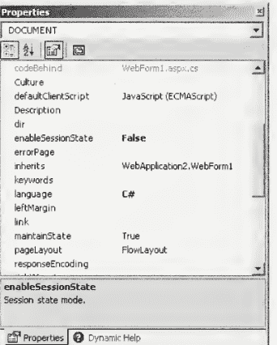

要更改其设置，请在属性窗口中选择 `enableSessionState` 条目，点击包含这些值的下拉列表，并选择所需的值。

## 会话状态建议

会话状态的易用性使其很容易被过度使用或滥用。下表列出了你可能或不想在会话状态中存储信息的示例，以及存储此类信息的替代方案。

| 状态建议 | 问题 | 替代方案 |
| :--- | :--- | :--- |
| 用户特定设置 | 取决于访问这些值的频率，会话状态可能不是存储这些设置的最有效效的方式。 | 对于低频访问的值，考虑在数据库中存储用户特定设置。 |

## 会话状态建议

| 状态信息 | 问题 | 替代方案 |
| :--- | :--- | :--- |
| 包含频繁读取数据的数据集 | 在会话级别缓存频繁使用的数据是高效的，但对数据何时刷新几乎没有控制。考虑为每个用户存储数据集的成本与从数据库检索数据集的成本相比是非常重要的。 | 使用 ASP.NET 缓存来缓存昂贵或频繁读取的数据。ASP.NET 缓存对如何以及何时刷新数据或从缓存中数据提供细粒度的控制。有关缓存的更多信息，请参阅第 14 章。 |
| 对象实例的引用 | 存储具有错误线程模型的对象（例如使用 Visual Basic 创建的旧 COM 组件）的引用会严重影响应用程序的可扩展性。考虑为每个用户会话存储引用的成本很重要。 | 如果绝对必须存储对象实例的引用，请确保创建对象的类是线程安全的。 |

## 会话状态的局限性

得益于 ASP.NET 的许多新功能，ASP.NET 会话状态的主要局限是内存。与应用程序状态一样，会话状态受限于 Web 服务器可用内存。一旦 Web 服务器上的可用物理内存耗尽，信息将存储在速度得多的虚拟内存中。

## 状态与可扩展性

你选择如何以及何处为应用程序存储状态信息会对应用程序的可扩展性产生巨大影响。可扩展性是指应用程序在不显著降低性能或响应时间的情况下，处理日益增加的用户请求的能力。

由于状态管理不当导致影响应用程序可扩展性的因素包括以下情况：

- 未在未使用时禁用会话状态：如果你在应用程序中未使用会话状态，通过将 Web.config 中 `sessionState` 配置部分的 `mode` 属性更改为 "off" 来禁用它。对于限制使用会话状态的应用程序，确保任何不使用会话状态的页面在其 @ Page 指令中包含 `EnableSessionState="false"` 属性。

- 误用 `Application.Lock()`：`Application.Lock()` 方法阻止除导致 `Application.Lock()` 调用的用户之外的所有用户访问所有应用程序值。这会持续到调用 `Application.Unlock()` 方法为止。你应该通过在更新值之前立即调用 `Application.Lock()` 并在之后立即调用 `Application.Unlock()`，来尽可能地缩短这些值被锁定的时间。

- 存储单线程（或单元公寓）线程对象的引用：在应用程序或会话级别存储非自由线程对象的引用会干扰 IIS 线程管理能力，并导致可扩展性问题。避免在应用程序或会话级别存储非自由线程对象。

- 进程内会话状态：为了跨场 扩展会话状态，通常需要使用多个服务器。进程内会话状态（默认设置）对于所有服务器。

- 过度使用会话状态：在应用程序级别或会话级别存储大量对象引用或数据集会迅速耗尽物理内存。你应该始终确保应用程序状态不会超过可用资源。

## 配置会话状态

ASP.NET 提供了多种存储会话状态的可能性。每种都是为了克服经典 ASP 的某些局限性。可用设置包括：

- 进程内 (InProc)：这是默认设置。其行为与经典 ASP 基本相同。

- 进程外 (StateServer)：此设置指定会话状态存储在运行 NT 服务的服务器进程中。连接到它的状态服务器由属性指定，请参阅“进程外会话状态”章节。

- SQL Server (SQLServer)：此设置指定会话状态存储在 SQL 数据库中。连接到的 SQL Server 由属性指定，请参阅“SQL Server 中的会话状态”。

- 无 Cookie 会话 (Cookeless Sessions)：此设置允许为无法处理 Cookie 的用户维护会话状态。

以下章节描述了如何配置每种设置。

### 存储进程内会话状态

默认情况下，在 Visual Studio.NET 中创建或手动创建的 Web 应用程序将会话状态存储在进程内。由于，这具有固有的局限性，包括缺乏可扩展性。然而，对于不需要跨服务器的可扩展性以及服务器重启或崩溃的状态持久性的应用程序，此设置可能运行良好。而且这是最简单的，因为不需要对应用程序配置文件进行任何更改。

### 存储进程外会话状态

解决会话状态可扩展性和持久性问题的第一个方案是将会话状态存储在进程外，由 NT 服务提供的专用 ASP.NET 状态进程中。这种方法的优势之一是 ASP.NET 状态服务可以为多个服务器服务，使得跨 Web 场扩展会话可能。另一个优势是 ASP.NET 状态服务在单独进程（甚至在单独机器）中运行，因此状态信息可以在特定 Web 应用程序进程重启或崩溃后生存。注意，状态服务的机器重启或崩溃时，状态信息不会生存。

要在进程外存储状态，请按照以下步骤操作：

1. 打开应用程序的 Web 配置文件并找到 `sessionState` 配置部分。
2. 将 `mode` 属性从 "InProc" 更改为 "StateServer"。
3. 修改 `connectionString` 属性，使其反映状态服务器名称（或 IP 地址）以及 ASP.NET 状态服务监控的端口（默认为 42424）。


4 使用本地机器上的 ASP.NET 状态服务的完整 `sessionState` 配置部分如下代码所示。（注意，本示例中未使用 `sqlConnectionString` 属性，并省略了 `codeless` 和 `timeout` 属性。完整属性列表可见第 7 章。）

```xml
<sessionState
mode="stateserver"
connectionString="tcpip=127.0.0.1:42424"/>
```

5 点击“开始”、“程序”、“管理工具”，启动服务管理控制台 (MMC) 节点。

6 在目标服务器的服务 MMC 节点上启动 ASP.NET 状态服务。

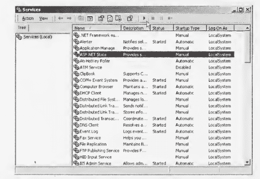

ASP.NET 将自动连接到指定的状态服务器为您的应用程序存储会话状态。如果指定服务器上的状态服务未运行，将收到错误消息。

请记住，虽然将会话状态存储在专用服务器进程中可以提高应用程序的扩展性，但将会话状态移出进程会有固有的性能影响。从不同的进程（特别是从不同的机器）检索信息的成本远比从同一进程内部检索要高得多。在生产应用程序中实现此类会话存储之前，您应该测试对计划存储的会话数据类型和数量产生的影响。

## 在 SQL Server 中存储会话状态

解决会话状态扩展性和持久性问题的第二个方案是将其在进程外存储在 SQL Server 数据库中。这种方法的优势之一是，指定的 SQL Server 可以接收来自多个服务器的请求，从而能够在 Web 农（Web farm）中扩展状态。此外，会话状态存储在 SQL Server 数据库中，因此状态信息可以在任何 Web 应用程序进程、任何 Web 服务器甚至 SQL Server 本身的重启或崩溃后生存。

要在 SQL Server 中存储会话状态，请按照以下步骤操作：

- 1. 对计划使用的 SQL Server 运行 `InstallSqlState.sql` 批处理（位于 .NET Framework 目录，默认路径 `%windir%\Microsoft\Framework\version%`）以设置 SQL Server 会话状态数据库。（有关运行批处理语句的信息，请咨询您的数据库管理员或查看 SQL Server 在线帮助）。
- 2. 打开应用程序的 `Web.config` 配置文件并找到 `sessionState` 配置部分。
- 3. 将 `mode` 属性从 "InProc" 改为 "SQLServer"。
- 4. 修改 `sqlConnectionString` 属性，使其反映目标 SQL Server 的 IP 地址以及访问 SQL Server 所需的用户 ID 和密码。
- 5. 在本地机器使用 SQL Server 的完整 `sessionState` 配置部分如下（注意省略了 `stateConnectionString` 属性以及 `cookeless` 和 `timeout` 属性）。

```xml
<sessionState
mode="SQLServer"
ConnectionString="data source=127.0.0.1;user id=;password="/>
```

> note
> 在 Web.config 的连接字符串中放置 SQL Server 用户 ID 和密码存在安全风险。在可能的情况下，更好的做法是使用到 SQL Server 的受信任连接。第 11 章描述了使用 SQL Server 受信任连接的必要步骤，以及其他连接技术。第 8 章进一步探讨了 ASP.NET 中的安全性问题，包括存储连接字符串信息的良好实践。

## 无 Cookie 会话

使用经典 ASP 的 Web 开发人员面临的一个持续挑战是：如何处理那些浏览器无法或不愿接受 cookie 的用户状态。经典 ASP 没有为这种情况提供内置支持。在 ASP.NET 中，这相对简单。

- 1. 打开应用程序的 `Web.config` 配置文件并找到 `sessionState` 配置部分。
- 2. 将 `cookless` 属性从 "false" 改为 "true"。
- 3. 完整的 `sessionState` 配置部分如下（注意省略了 `stateConnectionString`、`sqlConnectionString` 和 `timeout` 属性）。

```xml
<sessionState
  cookieless="true">
```

当 `cookieless` 属性设置为 "true" 时，ASP.NET 将自动将 `SessionID` 值嵌入所有请求的 URL 中。为了获得最佳效果，对应用程序内部的链接请始终使用相对 URL。相对 URL 仅包含请求资源的路径和文件信息，而不包含协议域名（这些被假设与当前页面相同）。

## 为无 Cookie 会话格式化 URL

ASP.NET 支持在应用程序的相对 URL 中自动嵌入会话 ID，但对于绝对 URL 或来自您的应用程序之外的 URL 则不支持。如果接收到设置了无 cookie 会话的应用程序内的页面请求，且该请求不包含嵌入的会话 ID，ASP.NET 将创建一个新的会话 ID 并将其嵌入到该 URL 中。

为了防止这个问题，可以通过调用 `Response` 对象的 `ApplyPathModifier` 方法并传递一个虚拟路径来手动格式化 URL。该方法将返回一个包含嵌入的 SessionID 的绝对 URL，用于无 cookie 会话。绝对 URL 包含请求给定资源所需的协议、域名、路径和文件名。该方法的语法如下：

```vbnet
Dim myAbsoluteURL As String
myAbsoluteURL = Response.ApplyPathModifier("foo.aspx")
```

## 第 6 章 管理应用程序状态

### 使用客户端 Cookie 存储状态

如果不至少简要提到另一种存储应用程序状态的选项：客户端 Cookie，那么关于状态管理的讨论将是不完整的。这种方法对于浏览器无法处理 cookie（或已关闭 cookie）的用户无效，但它是存储某些类型数据最轻量级的方法。

要在非持久性 cookie 中存储状态：

- 创建 `HttpCookie` 实例
- 设置 cookie 的 `Value` 属性
- 将 cookie 添加到 `Response` 集合中

```vbnet
Dim MyCookie As New HttpCookie("MyCookie")
MyCookie.Value = "MyValue"
Response.Cookies.Add(MyCookie)
```

## 使用持久性 Cookie

要存储跨浏览器会话的状态，需要使用持久性 cookie。为了让 cookie 具有持久性，其过期时间必须在未来。要在将上一个示例中的 cookie 设置为持久化之前，添加以下代码行：

```vbnet
MyCookie.Expires = Now.AddDays(2)
```

关于持久性 cookie 有以下几点需要考虑：由于某些 Web 公司跟踪用户的浏览习惯，cookie 声誉不佳，向用户解释您为什么要以及如何使用 cookie 是个主意。将持久性 cookie 的过期时间限制在小时或天，最多为月。将您的 cookie 过期设置为几年可能会导致更多用户拒绝您的 cookie。


## 重要

永远不要 cookie 中存储用户数据，例如信用卡号或其他在被拦截或泄露时面临风险的数据。

虽然避免在 cookie 中存储信用卡号等信息是显而易见的，但考虑在服务器端存储此类信息的安全影响同样重要，无论是在内存会状态中还是在数据库服务器中。存储敏感数据没有唯一的正确答案，以下是您应该遵循的指南：

- 仅在必要时存储敏感数据，并且时间最短。
- 对敏感数据进行加密以更好地防止其被泄露。
- 如果可能，将敏感数据存档在未连接互联网的系统中，从而降低受到攻击。
- 确保在所有的服务器上都遵循良好的安全实践，特别是暴露在互联网上的服务器。（我们将在第 8.5 节详细介绍）。

遵循这些指南不能保证您的 Web 应用程序不会被黑客破解，但将帮助您限制损失。

### ASP.NET 服务器控制状态

最后另一种由 ASP.NET 管理的状态类型是服务器控制状态。使用经典 ASP 创建数据驱动应用程序的开发人员必须设法在不同页面之间、或在映射自身的页面提交之间维护 ASP 页面上各种 HTML 元素的状态。HTML 没有提供维护单个表单元素状态的内置机制，因此开发者必须自己想办法维护和恢复这些信息。

所有 ASP.NET 服务器控件都能够通过名为 ViewState 的机制维护自身的状态。ViewState 以页面为单位进行维护，表现为一个隐藏的表单字段，其中包含了该页面所有表单元素的所有状态信息。

ViewState 和控件将在第 10 章和第 12 章进行详细讨论。


## 第 6 章 管理应用程序状态

## 第 6 章 快速参考

| 目标 | 操作 | 示例 |
| :--- | :--- | :--- |
| 在 Application 集合中存储信息 | 使用 Application 对象或 Application.Contents 集合将项目添加到集合中，或使用 Application.Add 方法。 | Application(key) = value |
| 修改 Application 集合中的信息 | 使用 Application 对象通过其键或索引访问并修改项，或使用 Application.Set 方法通过键访问并修改项。 | Application.Contents(key) = value<br>Application(key) = newvalue<br>Application(index) = newvalue |
| 在 ApplicationStaticObjects 集合中创建并存储对象 | 在 Global.asax 中添加带有 runat="server" 属性和 scope="application" 属性的 <Object> 标签。 | <object runat="server" id="myObject" scope="Application" class="ClassName"></object> |
| 在专用服务器进程中存储会话状态 | 修改应用程序 Web.config 文件中的 sessionState 配置部分，将 mode 属性更改为 "StateServer"，并将 stateConnectionString 属性更改为所用状态服务器的 IP 地址和端口。 | <sessionState mode="StateServer" stateConnectionString="tcpip=127.0.0.1:42424" /> |
| 在 SQL Server 数据库中存储会话状态 | 修改应用程序 Web.config 文件中的 sessionState 配置部分，将 mode 属性更改为 "SQLServer"，并将 sqlConnectionString 属性更改为所用 SQL Server 的相应数据源、ID 和密码。 | <sessionState mode="SQLServer" sqlConnectionString="data source=127.0.0.1;user id=sa;password=" /> |
| 提供无 Cookie 会话状态支持 | 修改应用程序 Web.config 文件中的 sessionState 配置部分，将 cookieless 属性更改为 "true"。 | <sessionState cookieless="true" /> |

## 配置 ASP.NET 应用程序

> 在本章，你将学习：
- ASP.NET 配置元素
- 从 ASP.NET 页面检索自定义配置设置

ASP.NET 最重要的新功能之一（考虑到它为开发者提供的优势）是为 ASP.NET 提供的新配置系统。该配置系统使用人类可读和机器可读的 XML 文件来存储配置信息。本章将介绍这些配置文件的工作原理，以及你如何在应用程序中使用它们。

## 理解 ASP.NET 配置

ASP.NET 中的配置基于一系列基于 XML 的文件，这些文件具有层次结构。每个服务器都包含一个名为 Machine.config 的主（或根）配置文件，存储在路径 c:\windows\Microsoft.NET\FrameworkVersion\CONFIG\Machine.config（见下图）。该主配置文件包含该服务器上所有 ASP.NET 应用程序的默认设置。此文件还包含机器级配置设置（如程序集绑定和远程通道）以及其他设置。编辑此文件时要小心，以免无意中做出影响其他应用程序的更改。

## ASP.NET 逐步指南

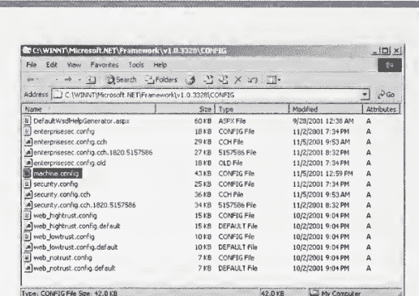

除了 Machine.config 之外，每个 ASP.NET Web 应用程序文件夹中都可能有一个或多个名为 Web.config 的文件。每个 Web.config 文件都必须位于自己的文件夹中，并且每个文件都会覆盖父文件夹中配置文件的设置。Web.config 中的设置仅适用于该文件所在的文件夹及其任何子文件夹中的内容。这允许你建立配置文件的层次结构，让你可以在最高级别设置应用程序配置选项，同时允许你在较低级别上覆盖这些设置。例如，如果你有一组必须限制访问的文件，可以将这些文件放在应用程序中的一个单独文件夹中，然后添加一个实现更严格安全限制的 Web.config 文件。你将在本章的稍后部分看到如何进行操作。

> 注意
> 如果你决定在应用程序中使用多级配置文件，你应该考虑使用注释来明确你在从哪里从父 Web.config 文件或 Machine.config 覆盖了设置。这样，需要维护应用程序的人就能理解你的意图。ASP.NET 配置文件中的注释使用 HTML 注释相同的语法：<!-- -->。
> 请记住，在 Web.config 和 Machine.config 中配置的许多设置也可以使用 @ Page 指令的属性在页面级别进行覆盖。确保项目中的所有开发者（以及将维护应用程序的人）都理解这一点，以避免混淆。

ASP.NET 运行时会自动检测配置文件设置的更改，并将其集成到应用程序的缓存配置设置中。

## 第 7 章 配置 ASP.NET 应用程序 119

当发生更改时，给定配置文件范围内的所有新资源请求将自动使用新的配置设置。

## 引入 Web.config

与 Machine.config 文件一样，Web.config 是基于 XML 的。这意味着每个 Web.config 文件由标签和属性组成，类似于 HTML。（XML 是一种基于结构化泛型标记语言 SGML 的标记语言，HTML 也是基于这种语言。）然而，Machine.config 和大多数 Web.config 文件不会包含每个可用配置设置的元素。事实上，ASP.NET 应用程序不需要 Web.config 文件即可运行。如果应用程序省略了 Web.config，它简单地从主配置文件 Machine.config 继承配置。

Web.config 文件具有以下基本结构：

```xml
<?xml version="1.0" encoding="utf-8" ?>
<configuration>
  <system.web>
    <element1>
      <child1
        attribute1=value
        attribute2=value
        attributeN=value />
      </element1>
    <element2>
      attribute1=value
      attribute2=value
      attributeN=value
    </element2>
    <elementN>
      attribute1=value
      attribute2=value
      attributeN=value />
    </elementN>
  </system.web>
</configuration>
```


元素提供特定的配置值，或带有更多属性的标签提供特定的配置值。如果元素没有子元素，可以通过在标签末尾添加 / 字符来省略关闭标签。（这是标准的 XML 语法。）你将在123页的“ASP.NET 配置元素”中看到这种格式的应用。

> 注意
许多开发者发现 VisualDev 6 按照其偏好重新格式化代码令人沮丧。该功能很难无法关闭。在 Visual Studio .NET 中，你不仅可以控制代码如何验证和格式化，而且大多数情况下可以完全关闭格式化。

在本书期间，Visual Studio .NET 环境编辑配置文件的工具限于语法高亮、XML 验证和代码格式化。由于 ASP.NET 配置文件是 XML 的，你可以使用你喜欢的 XML 编辑器（或文本编辑器）编辑 ASP.NET 配置文件。


## 第 7 章 配置 ASP.NET 

除了语法高亮和验证之外，Visual Studio .NET 为你创建的每个新 Web 项目提供了一个默认的 Web.config 文件。此默认文件包含了最常用的元素，以及解释每个元素可用选项的注释。默认的 Web.config 文件可以作为模板，用于你想要放置在 Web 应用程序子文件夹中的任何额外的 Web.config 文件。请记住，由于你正在应用程序的子文件夹中使用配置文件，因此将父文件配置设置中你想要覆盖的配置设置元素也包含在内是一个好主意。这有助于防止意外覆盖配置设置，并可能有助于减少应用程序配置的解析开销。

## 编辑主配置文件

主配置文件 `Machine.config` 不仅包含该台机器上所有 ASP.NET 应用程序的默认设置，还包含机器范围的配置设置。编辑此文件时要格外小心。在编辑之前创建一个该文件的备份副本是明智的。此外，请记住，除非你是该开发机器的唯一使用者，否则你对 `Machine.config` 进行的任何更改都将影响使用该机器的其他 ASP.NET 开发者。除非你正在处理与不快的同事，否则你应该先与他们讨论任何建议的更改。

## 配置 ASP.NET 应用程序

在编写本文时，还没有相应的 GUI 工具来编辑 Web.config 文件和修改配置设置。幸运的是，Visual Studio .NET Applications 创建的默认 Web.config 文件（如图所示）包含了针对最常用设置的特定注释。这些注释为给定配置元素的使用可用参数提供了指导（尽管并非所有配置元素都出现在默认 Web.config 文件中）。

除了 Visual Studio .NET 生成的 Web.config 文件中找到注释外，`Machine.config` 文件还包含针对某些元素的特定设置的注释。这些注释可以在你进行配置更改时提供引导。这些元素及其设置在第 123 页的“ASP.NET 配置元素”中进行了描述。


## 逐步学习 ASP.NET Web

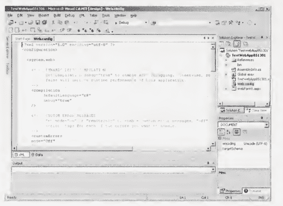

## 为子目录覆盖配置设置

一旦你创建了应用程序级别的 Web.config 文件并修改了其设置以适应你的需求，你可能想要修改应用程序中一部分的配置设置。例如，你可能想对一组特定的文件应用更严格的安全要求。在 ASP.NET 中，覆盖应用程序级别的配置设置非常简单。只需以下三个步骤：

-   在你的应用程序中创建一个子文件夹，并将对新的配置设置将生效的内容放在其中。
-   在新文件夹中创建一个新的 Web.config 文件。
-   在新的 Web.config 文件中添加你想要覆盖的配置设置。

在新的 Web.config 文件中仅包含你想要覆盖的配置设置。所有其他设置都继承自父文件夹的 Web.config 文件；或者如果该文件不存在（或它不包含所有可用配置元素的设置），则继承自你服务器的 `Machine.config` 文件。

## 锁定配置设置

显然，Web 开发者或管理员会有某些时候想要为整个服务器或站点配置设置，并防止它们被覆盖。这在身份验证和授权设置中，或者在防止覆盖安全策略设置的情况下可能是理想的。幸运的是，ASP.NET 提供了 `<location>` 标签专门为此目的。

## 第 7 章 配置 ASP.NET 应用程序 123

`<location>` 标签有两个属性：`path` 和 `allowOverride`。`path` 允许你指定一个路径，`<location>` 标签对内的设置适用于该路径。此属性允许你使用单个配置文件（例如 `Machine.config`）为同一台机器上的多个应用程序、虚拟目录或文件应用配置设置。某些设置只能在机器或应用程序级别设置。如果你尝试使用 `path` 属性在目录或文件级别设置这些内容，将会抛出异常。

> note
> 当你使用 `path` 属性将配置设置应用到多个位置时，请使用注释来澄清每组 `<location>` 标签的意图。在共享服务器环境中，请使用注释注明负责特定组配置设置的人员。

`allowOverride` 属性决定 `<location>` 标签对内的设置是否可以被应用于子配置文件的设置中的设置所覆盖。如果此属性被设置为 `false`，则任何在子配置文件中更改指定设置的尝试都将导致异常。

使用 `<location>` 标签锁定配置设置：

-   1 打开你想要锁定特定设置的配置文件（Web.config 或 Machine.config）。
-   2 在 `<configuration>` 和 `</configuration>` 标签内添加以下代码：
```xml
<location path="to lock down" allowOverride="false">
  <system.web>
  </system.web>
</location>
```
-   3 在 `<system.web>` 和 `</system.web>` 标签之间添加所需的配置元素。

## ASP.NET 配置元素

现在你已经查看了 ASP.NET 配置文件的位置和结构，以及如何用一个 Web.config 文件覆盖另一个文件的设置，现在请查看用于配置 ASP.NET 应用程序的各个配置元素。本节列出了每个配置元素的语法并描述了……

## 逐步学习 ASP.NET 配置

配置元素和属性的名称是区分大小写的。配置元素的名称全小写，而每个单词的首字母大写。例如，*sessionstate* 变为 *sessionState*。

## <trace>

`<trace>` 元素允许你启用或禁用范围范围跟踪（参见第 16 章），以及跟踪功能的参数。当启用跟踪时，可以在 `http://servername/appname/traced` 查看信息。`<trace>` 元素具有以下语法：

```xml
<trace enabled="true|false" localOnly="true|false" pageOutput="true|false" requestLimit="integer" traceMode="SortByTime|Sort" />
```

关于 `<trace>` 元素的属性，请参考下表：

| 属性 | 描述 | 选项 |
| :--- | :--- | :--- |
| enabled | 决定是否启用应用程序级跟踪。 | true：启用应用程序级跟踪。false：禁用应用程序级跟踪。默认为 false。 |
| localOnly | 决定本地服务器以外的计算机是否可以查看跟踪信息。 | true：仅从本地服务器查看跟踪输出。false：任何机器均可见。默认为 true。 |

## 第 7 章 配置 ASP.NET 应用程序 125

## <trace> 元素属性

| 属性 | 描述 | 选项 |
| :--- | :--- | :--- |
| pageOutput | 决定跟踪输出添加到每个 ASP.NET 还是仅通过 trace.axd 可用。 | true：跟踪输出添加到配置文件范围内的每个页面。false：仅通过浏览特殊的 trace.axd URL 可用。默认为 false。 |
| requestLimit | 决定通过 trace.axd 存储的请求数量。一旦达到此限制，必须通过浏览 trace.axd 清除当前跟踪以便收集后续请求的信息。 | 默认值为 10，但此数字越大，跟踪的开销越大。将此数字设置得越小越好。 |
| traceMode | 决定存储请求的排序。 | SortByTime：按处理顺序排序跟踪信息。Sort：按类别字母顺序排序跟踪信息。在使用 Trace.Write 方法时，这对于使用相同类别的 Trace.Write 语句非常有帮助。 |

## <globalization>

`<globalization>` 元素控制 ASP.NET 应用程序的本地化设置。这包含了请求、响应和文件的编码，以及指定与 Web 请求和本地搜索相关的文化设置。`<globalization>` 元素具有以下语法：

```xml
<globalization
culture="any valid culture string"
fileEncoding="any valid encoding string"
requestEncoding="any valid encoding string"
responseEncoding="any valid encoding string"
uiculture="any valid culture string" />
```


有关 <globalization> 元素的属性，请参考下表。

| 属性 | 描述 | 选项 |
| --- | --- | --- |
| culture | 确定处理传入的 Web 请求时使用的区域设置（例如默认语言）。 | 此属性必须设置为有效的区域字符串。要查看有效区域字符串列表，请参见 .NET Framework 文档中关于 System.Globalization.CultureInfo 类的节点。 |
| fileEncoding | 确定用于解析 ASP.NET 文件（.aspx、.asmx 和 .asax）时使用的字符编码类型。 | 此属性必须设置为有效的编码字符串。如果 Machine.config 或 Web.config 中未包含此属性，则编码将基于控制面板中机器的区域选项（Regional Options）设置。 |
| requestEncoding | 确定处理传入的 Web 请求时使用的字符编码类型。 | 此属性必须设置为有效的编码字符串。如果 Machine.config 或 Web.config 中未包含此属性，则编码将基于控制面板中机器的区域选项设置。默认值为 utf-8。 |
| responseEncoding | 确定用于对输出响应进行编码的字符编码类型。 | 此属性必须设置为有效的编码字符串。如果 Machine.config 或 Web.config 中未包含此属性，则编码将基于控制面板中机器的区域选项设置。默认值为 utf-8。 |
| uiCulture | 确定处理特定于区域或语言的搜索时使用的区域设置（例如默认语言）。 | 此属性必须设置为有效的区域字符串。要查看有效区域字符串列表，请参见 .NET Framework 文档中关于 System.Globalization.CultureInfo 类的节点。 |

## <httpRuntime>

<httpRuntime> 元素控制 ASP.NET HTTP 运行时的多个方面。<httpRuntime> 元素具有以下语法：

```
<httpRuntime
  appRequestQueueLimit="number of requests"
  executionTimeout="seconds"
  maxRequestLength="kbytes"
  minRequestFreeThreads="number of threads"
  minFreeThreads="number of threads"
  fullyQualifiedRedirectUrl="true|false" />
```

## 完全限定 URL 与相对 URL

用于 Web 页面创建超链接有两种基本的 URL 类型：完全限定 URL 和相对 URL。完全限定 URL（也称为绝对 URL）包含了浏览器（或其他客户端程序）定位 URL 中指定资源所需的所有信息。这包括协议前符（如 ftp://、http://、https:// 等）、服务器的域名或 IP 地址（在本地 Windows 网络上，也可以使用机器名）以及指向资源的路径。一个典型的完全限定 URL 如下：

```
http://localhost/quickstart/asplus/default.aspx
```

相对 URL 仅提供相对于当前文档（称为文档相对）或当前服务器或域（称为根相对）定位资源所需的必要信息。如果使用文档相对 URL 从同一虚拟目录下的一个页面向另一个页面链接到之前引用的页面，其格式如下：

- default.aspx

一个根相对 URL 的格式如下：
/quickstart/asplus/default.aspx

由于某些控件或应用程序可能不知道如何使用相对 URL，因此有时你可能需要使用完全限定 URL。

## ASP.Net 逐步教程

有关 <httpRuntime> 元素的属性，请参考下表。

| 属性 | 描述 | 选项 |
|---|---|---|---|| appRequestQueueLimit | 指定 ASP.NET 在没有可用线程处理请求时将队列的请求数，在返回“503 - 服务器繁忙 (Server Too Busy)”消息之前。 | 增加此值可能会导致用户出现意外的长时间等待，在调整此值时请务必小心并仔细测试。默认值为 100。 |
| executionTimeout | 确定 ASP.NET 请求在关闭之前可以继续执行的时间（以秒为单位）。 | 此属性类似于经典的 ASP.Server.ScriptTimeout，可防止挂起或长时间运行的请求消耗不必要的资源。此属性的设置应高于处理请求的平均时间，但不能高到允许恶意程序或低效率页面导致处理器过载使用。默认值为 90 秒。 |
| maxRequestLength | 确定传入文件上传的最大大小（以千字节为单位）。 | 此属性旨在帮助通过向服务器上传大文件来防止拒绝服务攻击。将其设置为您预计用户上传的文件所允许的最小大小。默认值为 4,096 字节。 |
| minFreeThreads | 配置 ASP.NET 为处理新请求而保留的最小空闲线程数。 | 默认值为 8。 |

## 第 7 章 配置 ASP.NET 应用程序

| 属性 | 描述 | 选项 |
| --- | --- | --- |
| minLocalRequestThreads | 配置 ASP.NET 为处理来自本地机器的请求而保留的最小空闲线程数。维护这些空闲线程有助于防止多线程处理中的死锁。 | 默认值为 4。 |
| useFullyQualifiedRedirectUrl | 确定客户端重定向时使用的是相对 URL 还是完全限定 URL。此属性允许开发者支持某些需要完全限定 URL 进行客户端重定向的移动控件。 | true 客户端重定向是完全限定的。false 客户端重定向是相对的。默认值为 true。 |

<compilation>

<compilation> 具有十属性和子元素，是 ASP.NET 配置元素中较为复杂的元素之一，它包含了决定 ASP.NET 如何编译你的 Web 应用程序和服务中代码的设置。你最频繁看到的设置是 `debug` 和 `defaultLanguage` 属性，当使用 Visual Studio 时，这些属性默认放置在应用程序的 Web.config 文件中。你最频繁看到的设置是 `debug` 和 `defaultLanguage` 属性，当使用 Visual Studio 时，这些属性默认放置在应用程序的 Web.config 文件中。<compilation> 元素具有以下语法：

```
<compilation
  batch="true|false"
  batchTimeout="seconds"
  debug="true|false"
  defaultLanguage="language"
  explicit="true|false"
  maxBatchSize="number"
  maxGeneratedFileSize="kbytes"
  numRecompilesBefore="number"
  strict="true|false"
  tempdirectory="directory" >
```

```
<compilers>
  <compiler
    extension="file extension"
    language="language"
    compilerOptions="compiler options"
    type=".NET type"
    warningLevel="number" />
  </compiler>
</compilers>
```

```
<assemblies>
  <add assembly="assembly name" />
  <remove assembly="assembly name" />
  <clear />
</assemblies>
```

</compilation>

有关 <compilation> 元素的属性，请参考下表。

| 元素 | 属性 | 描述 | 选项 |
|---|---|---|---|
| <compilation> | | 决定应用程序编译选项。支持 <compilers> 和 <assemblies> 子元素。 | 决定是否支持 ASP.NET 页面的批编译。启用批编译时，ASP.NET 在首次请求时尝试编译目录内的所有 ASP.NET 页面。这可以防止后续页面请求需要进行编译。 | true 支持批编译。false 页面将在请求时进行编译。默认值为 true。 |

## 第 7 章 配置 ASP.NET 应用程序 131

| 元素 | 属性 | 选项 |
| --- | --- | --- |
| | batchTimeout | 批编译超时前时间（以秒为单位）。如果超时，编译器将切换到按请求编译的模式。 | 此设置取决于应用程序的大小以及你愿意允许批编译的时间。默认值为 15 秒。 |
| | 如果超时，编译器将切换到按请求编译的模式。 | 默认值为 15 秒。 |
| | debug | 决定是否在编译的 ASP.NET 页面和 Web 服务中包含调试信息。在生产应用程序中，此属性应始终设置为 false，因为调试程序集更大，且性能不如发布类型的程序集。 | true 带有调试信息进行编译。false 不包含调试信息进行编译。默认值为 false。 |
| | defaultLanguage | 确定动态编译期间使用的语言。 | 此属性是语言名称，由其中一个 <compiler> 子元素指定。默认值为 vb。 |
| | explicit | 确定 ASP.NET 是否编译使用 Visual Basic Option Explicit 编译器的页面（强制显式声明变量）。启用此设置更容易定位和修复常见问题（例如变量拼写错误），否则这些问题在运行时可能无法被发现。 | true 开启。false 禁用。默认值为 true。 |


## ASP.NET 逐步教程

| 元素 | 属性 | 选项 |
| --- | --- | --- |
| | numRecompiles BeforeAppRestart | 决定在应用程序自动重启之前，可以动态重新编译多少应用程序资源。此设置可以在应用程序级别以及通过 Machine.config 在全局级别进行配置。 | 默认值为 15。 |
| | strict | 决定 ASP.NET 是否在将使用 Visual Basic 编写的页面使用 Basic Option Strict 编译器（该编译器可以防止导致数据丢失的类型转换、后期绑定和其他容易出错的编码习惯）编译到您的 .aspx 文件。 | true false。开启此项是一个良好做法，您可以通过 Machine.config 或 Web.config、通过 Visual Studio .NET 属性对话框中的 Build 选项（常规属性），或在您处理的页面或模块中添加 Option Strict 来启用。这使得修复常见问题变得更加容易，例如溢出或舍入错误，否则这些问题在运行时可能无法被发现。默认值为 false。 |
| | tempData | 决定动态编译产生的临时 ASP.NET 文件所处的目录。 | 任何有效目录。 |

<compilation> 元素属性（续）

<compilers>

包含单个 <compiler> 子元素的子元素。

## 第 7 章 配置 ASP.NET 应用程序 133

| 元素 | 属性 | 描述 | 选项 |
|---|---|---|---|
| <compiler> | 确定特定编译器的选项。这些子元素中的一个或多个可能包含在 <compilers> 元素中。确定用于特定编译器的动态编译后台（code-behind）模块使用的文件扩展名。表示扩展名的字符串 (.vb, .cs 等)。 | extension | 三种常用 ASP.NET 语言（Visual Basic .NET、C# 和 Jscript .NET）的扩展已包含在 Machine.config 中，因此您不需要手动设置它们，除非您想为这些语言之一添加额外的扩展。此属性是必需的。 |
| | language | 确定由特定编译器处理的语言名称列表。三个最常用 ASP.NET 语言（Visual Basic .NET、C# 和 Jscript .NET）的名称包含在 Machine.config 中，因此您不需要手动设置它们，除非您想为这些语言之一添加额外的名称。 | 表示语言名称的字符串 (vb:visualbasic; vbscript)。多个名称应用分号分隔。此设置应与 extension 属性中指定的语言匹配。此属性是必需的。 |
| | compilerOptions | 确定编译期间传递的任何特定编译器的选项。 | 请咨询 .NET Framework SDK 文档以确定可用选项。（续） |

## <compilation> 元素属性（续）

| 元素 | 属性 | 描述 | 选项 |
| --- | --- | --- | --- |
| | type | 确定使用 language 属性指定的语言或属性中的扩展名来编译资源时的 .NET 类和/或程序集。三个最常用 ASP.NET 语言（Visual Basic .NET、C# 和 JavaScript .NET）的类型包含在 Machine.config 中，除非您想修改这些语言之一的类型（不建议），否则您不需要手动设置。 | 此属性是一个由逗号分隔的列表，可以包含类名、程序集名称和版本信息。Machine.config 文件包含此属性的语法示例。 | 此属性是必需的。 |
| | warningLevel | 确定编译警告级别，该级别决定了编译器生成的警告消息类型（以及严重程度）。 | 此属性的值取决于所配置的语言编译器。C# 的默认值为 1。 | |
| <assemblies> | | 包含一个或多个 <add>、remove> 或 <clear> 子元素的子元素。 | <assemblies> 元素的子元素用于在编译期间添加程序集的引用。ASP.NET 在动态编译期间自动链接此处指定的程序集。 | |
| <clear> | | 指定应删除所有当前或继承的程序集引用。 | |

## 第 7 章 配置 ASP.NET 应用程序

| <compilation> 元素属性（续） | 选项 | | | |
| 元素 | 属性 | 描述 | | | |
| <add> | assembly | 通过程序集名称指定一个在动态编译期间引用的程序集。 | | 此设置应为目标程序集的程序集名称，而不是 DLL 名称。您还可以使用通配符 * 添加来自应用程序私有程序集缓存（默认在 bin 子目录中）的所有程序集。 | |
| <remove> | assembly | 通过程序集名称指定在动态编译期间从使用中移除的程序集。 | | 使用的程序集名称必须与之前的指令（例如，来自父级 Web.config）添加的程序集名称完全匹配。您可能无法在此属性中使用通配符。 | | |

<pages> <pages> 元素允许您设置页面级属性的默认值，这些属性通常与 @ Page ASP.NET 指令的属性相关联。此元素中的设置适用于未出现 @ Page 特定属性的所有页面。如果这些属性在 ASP.NET 页面中出现，其设置将覆盖 Machine.config 或 Web.config 配置文件中的设置。因此，<pages> 元素提供了一种在应用程序或子文件夹级别配置 SessionState、ViewState 和其他设置的极佳方法，让您对应用程序具有极大的控制力。

的 <pages> 元素具有以下语法：

```
<pages
AutoEventWireup="true|false"
buffer="true|false"
```

```
enableSessionState="true|false"
enableViewState="true|false"
enableViewStateMac="true|false"
pageBase="typename"
smartNavigation="true|false"
userControlType="typename" />
```

关于 <pages> 元素的信息，请参考下表：

| 属性 | 描述 | 选项 |
|---|---|---|
| autoEvent | 决定 ASP.NET 页面是否自动提供事件（如 Page_Load）。 | true 提供事件支持。false 不提供事件支持，必须手动连接事件。默认值为 true。 |
| buffer | 决定在发送到客户端之前对响应进行缓冲。此设置类似于经典 ASP 的 Buffer 属性。 | true 启用缓冲。页面处理完成或调用 HttpResponse 的 Flush 方法之前将缓冲。false 不启用。页面渲染时发送到客户端。默认值为 true。 |
| pageBase | 提供 ASP.NET 页面应继承的类的类型或程序集名称。在缺少此属性的情况下，默认继承自 System.UI 的 Page 类 | 如果您想提供基类 类未包含的功能，可以使用此属性提供派生自 Page 类的类。扩展 ASP.NET 应用程序的一种简单有效的方法。 |

## 第 7 章 配置 ASP.NET 应用程序 137

| 属性 | 描述 | 选项 |
|---|---|---|
| userControlBaseType | 提供 ASP.NET 控件 (.ascx 文件) 应继承的类的类型或程序集名称。在缺少此属性的情况下，默认继承自 System.Web 的 UserControl 类。 | 决定 ASP.NET 页面是否为当前用户创建新会话。注意，如果用户从之前的页面已有了会话且此属性设置为 false，则此属性将不会影响该会话。然而，如果设置为 ReadOnly，它将阻止页面修改在页面中设置的值。 | true（如果用户请求页面时没有当前会话，将为其创建一个新会话。），false（如果用户没有当前会话，则不会创建。如果用户有会话，可以在此属性为 false 的页面中读取其值。），ReadOnly（如果用户没有当前会话，则不会创建。如果用户有会话，可以在此属性被设置为 ReadOnly 的页面中读取其值，但不能对其进行修改。默认值为 true。） |
| enableViewState | 决定启用 ViewState（ASP.NET 服务器控件在页面请求之间存储其状态的方法）。 | true（启用 ViewState。服务器控件将在后续请求之间维护其值。），false（未启用 ViewState。服务器控件状态将在每次请求时重置。） |


## 属性（继续）

| 属性 | 说明 | 选项 |
| --- | --- | --- |
| enableViewStateMac | Determine当 Web 表单回传到服务器时，是否对 ViewState 数据执行机器身份验证 (MAC)。MAC 有助于识别客户端对 ViewState 隐藏字段的篡改。 | true 为 ViewState 启用 MAC。false 则不为 ViewState 启用 MAC。 |

## <customErrors>

<customErrors> 元素允许你自定义 ASP.NET 应用程序响应错误条件的方式。在此元素中，你可以指定 ASP.NET 生成的原始错误是否对本地或远程客户端可见，或者是否将客户端重定向到自定义错误页面，或针对所发生的错误指定的特定页面（根据错误的状态码）。<customErrors> 元素支持一个子元素 <error>，并具有以下语法：

```xml
<customErrors
  defaultRedirect="url"
  mode="on|off|RemoteOnly">
  <error
    redirect="url"
    statusCode="status code"/>
</customErrors>
```

有关 <customErrors> 元素属性的信息，请参阅下表。

| 元素 | 属性 | 说明 | 选项 |
| --- | --- | --- | --- |
| <customErrors> | | 决定如何处理 ASP.NET 错误。 | | |
| | defaultRedirect | 确定发生错误时用户被重定向到的页面。 | 此 URL 指向的页面可以是 .aspx 页面（在其中你尝试清理或从错误中恢复），也可以是静态 HTML 页面（用于通知用户错误并提供操作建议）。 |

## 第 7 章 配置 ASP.NET 应用程序

| 元素 | 属性 | 说明 | 选项 |
| --- | --- | --- | --- |
| | mode | 决定是否向客户端发送原始的 ASP.NET 错误消息。 | On 启用自定义错误。当发生错误时，客户端（无论是在本地 Web 服务器还是远程）都将重定向到由 defaultRedirect 属性指定的自定义错误页面（或 <error> 子元素中指定的页面）。<br><br>Off 不启用自定义错误。当发生错误时，客户端将看到 ASP.NET 生成的错误页面。请注意，取决于你的应用程序设计，这可能会向客户端暴露专有信息，因此你应该极少使用此设置。<br><br>RemoteOnly 为远程客户端启用自定义错误。当发生错误时，远程客户端将重定向到自定义错误页面，而本地 Web 服务器上的客户端将看到 ASP.NET 生成的错误页面。这允许开发者跟踪错误而无需让客户端看到原始错误页面。 |
| <error> | | 根据错误的 HTTP 状态码，为特定错误类型确定重定向页面。 | 添加 <error> 标签可以对错误处理方式提供更细粒度的控制。 |
| | redirect | 当发生 statusCode 属性中指定的类型错误时，确定用户被重定向到的页面。 | |

## <authentication>

<authentication> 元素控制 ASP.NET 中身份验证的配置。你可以从三种身份验证方法中选择一种，并为所选方法设置适当参数，或者完全不选择身份验证。<authentication> 元素支持两个子元素 <forms> 和 <passport>。此外 <forms> 元素支持一个子元素 <credentials>，该元素又支持子元素 <user>，如下例所示：

```xml
<authentication mode="Windows|Forms|Passport|None">

<forms>
    loginUrl="url"
    name="name"
    path="/"
    protection="All|None|Encryption|Validation"
    timeout="number"

    <credentials passwordFormat="Clear|MD5|SHA1">
        <user name="username" password="password" />
    </credentials>
</forms>

<passport redirectUrl="url" />

</authentication>
```

有关 <authentication> 元素属性的信息，请参阅下表。

## 第 7 章 配置 ASP.NET 应用程序

| 元素 | 属性 | 说明 | 选项 |
| --- | --- | --- | --- |
| <authentication> | mode | 决定如何处理 ASP.NET 身份验证。确定要使用的身份验证模式。将在第 8 章中详细讨论。 | Windows ASP.NET 默认使用 Windows 身份验证。与 IIS 的 Basic、Digest、NTLM 或基于证书的身份验证方法兼容。Forms ASP.NET 默认将使用基于表单的身份验证，这为“自定义”安全场景提供基本支持。Passport ASP.NET 将使用 Microsoft Passport 作为默认身份验证方法。ASP.NET 将不执行任何身份验证。 |
| <forms> | loginUrl | 确定与基于表单的身份验证相关的参数。 | 可以是 ASP.NET 应用程序中允许用户登录的任何页面。默认是 login.aspx。 |
| | name | 确定用于身份验证用户的 cookie 节点。 | 默认是 .ASPXAUTH。 |

## <authentication> 元素属性（继续）

| 元素 | 属性 | 说明 | 选项 |
| --- | --- | --- | --- |
| | path | 确定为身份验证 cookie 设置的路径。 | 默认是 /。为了防止浏览器对 URL 路径和 cookie 的大小写敏感导致 cookie 丢失。 |
| | protection | 确定用于保护身份验证不被破坏的方法。你选择使用哪种方法或是否使用，取决于你的安全需求与你愿意投入安全的资源量之间的平衡。通常情况下，安全性越高，性能开销越大。 | All（默认）将同时使用加密和数据验证来保护 cookie。这是推荐的设置。<br>**Encryption** 身份验证 cookie 将加密，但不会进行验证。这会让 cookie 受到某些类型攻击的影响。<br>**Validation** 将验证身份验证 cookie 以确保其在浏览器和服务器之间未被篡改。<br>**None** 都不使用加密或验证。不推荐。 |
> | timeout | 确定身份验证 cookie 过期的时间（分钟）。 | 默认值为 30。你应该将其设置为允许用户有效使用站点的最长时间。如果在表单身份验证中使用持久 cookie，它们将不会超时。 |

## 第 7 章 配置 ASP.NET 应用程序

| 元素 | 属性 | 说明 | 选项 |
| --- | --- | --- | --- |
| <credentials> | | 与 <user> 元素结合使用，允许通过配置文件身份验证。如果你在应用程序范围内的 Web.config 中存储凭据，且应用程序遭到破坏，入侵者可能获取存储的密码，即使它们经过了加密。记住加密方法是完美的。 |
| | passwordFormat | 确定存储密码的加密格式。 | Clear 不使用加密。不推荐。<br>MD5 使用 MD5 算法加密。<br>SHA1 使用 SHA1 算法加密。 |
| <user> | | 确定单个用户的用户名和密码。对于要存储在配置文件中的每组凭据，使用 <user> 子元素。 | |
| | name | 指定要身份验证的用户名。 | |
| | password | 指定要身份验证的密码。 | 此值应为使用 <credentials> 标签的 passwordFormat 属性指定的加密算法生成的加密密码。 | |
| <passport> | 用于设置 Microsoft Passport 身份验证参数的子元素。 | |
| | redirectUrl | 当用户未通过身份验证时，确定其重定向到的 URL。 | |

## <identity>

默认情况下，ASP.NET 应用程序请求需要身份验证的资源（例如由 NT 访问列表 ACL 保护的文件）是在 IUSR_MACHINENAME 或 IWAM_MACHINENAME 账户的范围内进行的，这取决于应用程序相对于 IIS 在进程内还是进程外运行。<identity> 元素允许 ASP.NET 应用程序执行身份冒充，即应用程序采用请求用户的安全上下文，或指定账户的安全上下文。<identity> 元素具有以下语法：

```xml
<identity
  impersonate="true"
  userName="username"
  password="password" />
```

有关 <identity> 元素属性的信息，请参阅下表。


## 第 7 章 配置 ASP.NET 

| 属性 | 说明 | 选项 |
|---|---|---|
| impersonate | 决定 ASP.NET 程序是否使用身份模拟（impersonation）。 | true 启用 ASP.NET 程序对安全账户的身份模拟。false 禁用 ASP.NET 程序对安全账户的身份模拟。 |
| userName | 指定受影响的 ASP.NET 程序模拟的用户帐户。 | 任意有效的用户账户。你应该确保选择的帐户仅具有所需资源的权限。例如，根据原则，让 ASP.NET 程序模拟管理员（Administrators）组中的帐户并不是一个好主意。如果省略，ASP.NET 将模拟已登录用户的帐户（由 IIS 提供）。 |
| password | 指定 userName 属性中指定帐户的密码。 | |

## <authorization>

<authorization> 元素允许指定哪些帐户或角色（组）被授权访问配置文件范围内的资源。<authorization> 元素支持两个子元素 <allow> 和 <deny>，每个子元素都有三个属性。<authorization> 元素具有以下语法：

```
<authorization>
<allow>
  users="userlist"
  roles="rolelist"
  verbs="verblist" />
<deny>
  users="userlist"
  roles="rolelist"
  verbs="verblist" />
</authorization>
```

有关 <authorization> 元素属性的信息，请参阅下表。

## 146 ASP.NET 逐步教程

| 元素 | 属性 | 说明 | 选项 |
| --- | --- | --- | --- |
| <authorization> | | 决定应用程序或目录的授权设置。包含一个或多个 <allow> 或 <deny> 子元素。 | |
| <allow> | | 根据用户帐户、组成员或 HTTP 请求方法允许访问资源。 | |
| | users | 授予访问资源的用户列表（NT 用户帐户）。 | 此属性接收一个逗号分隔的列表。可以使用 ? 通配符允许匿名用户访问，使用 * 通配符允许所有人访问。 |
| | roles | 授予访问资源的角色列表（NT 组）。 | 此属性接收一个逗号分隔的列表。 |
| | verbs | 授予访问资源的 HTTP 谓词（GET, POST 等）。 | 此属性接收一个逗号分隔的列表。可用的谓词有 GET、HEAD、POST 和 DEBUG。 |
| <deny> | | 根据用户帐户、组成员或 HTTP 请求方法拒绝访问资源。 |  |
| | users | 拒绝访问资源的用户列表（NT 用户帐户）。 | 此属性接收一个逗号分隔的列表。使用 ? 通配符拒绝匿名用户访问，使用 * 通配符拒绝所有人访问。 |

## 第 7 章 配置一个 ASP.NET 应用程序 147

| 元素 | 属性 | 选项 |
| --- | --- | --- |
| | roles | 拒绝访问资源的角色列表（NT 组）。 | 此属性接收一个逗号分隔的列表。 |
| | verbs | 拒绝访问资源的 HTTP 谓词（GET, POST 等）。 | 此属性接收一个逗号分隔的列表。可用的谓词有 GET、HEAD、POST 和 DEBUG。 |

## <machineKey>

<machineKey> 元素允许你指定用于表单验证（Forms-based authentication）中 cookie 数据加密和解密的密钥。此元素可以通过 machine.config 在机器级别使用，也可以通过 Web.config 在站点和应用程序级别使用，但不能在子目录级别使用。<machineKey> 元素具有以下语法：

```
<machineKey
decryptionKey="autogenerate|value"
validation="autogenerate|value"
validationKey="3DES|MD5|SHA1" />
```

有关 <machineKey> 元素属性的信息，请参阅下表。

| 属性 | 说明 | 选项 |
| --- | --- | --- |
| decryptionKey | 决定使用的解密密钥是自动生成的还是指定一个使用的值。 | autogenerate（默认）ASP.NET 将为解密生成一个随机密钥。value 代表用于解密密钥的字符字符串（最小 40 位，最大 128 位）。注意，128 个字符是推荐长度。对于较短的密钥，你应该确保密钥是随机生成的。此设置在 Web 农（Web farms）中是必要的，以确保所有服务器都使用相同的密钥，在提供透明用户访问的同时确保 |

## <machineKey> 元素属性（续）

| 属性 | 说明 | 选项 |
| --- | --- | --- |
| validation | 决定 ASP.NET 使用的加密类型。 | 3DES 数据使用三重 DES (3DES) 加密。MD5 数据使用 MD5 哈希算法加密。SHA1（默认）数据使用 SHA1 哈希算法加密。 |
| validationKey | 决定使用的验证密钥是自动生成的还是指定一个使用的密钥值。 | autogenerate（默认）ASP.NET 将为验证生成一个随机密钥。value 代表用于验证密钥的字符字符串（最小 40 位，最大 128 位）。注意，128 个字符是推荐长度。对于较短的密钥，建议确保密钥是随机生成的。此设置在 Web 农中是必要的，以确保所有服务器使用相同的密钥，在提供透明用户访问的同时充分利用加密优势。 |

## <securityPolicy>

<securityPolicy> 元素允许你根据其子元素 <trustLevel> 的 **name** 和 **policyFile** 属性，为代码访问安全指定若干命名安全策略之一或自定义策略。下一节描述的 <trust> 元素指定为给站点或应用程序实现命名策略中的哪一个。<securityPolicy> 元素支持一个子元素 <trustLevel>，具有两个属性，并具有以下语法：

```
<securityPolicy>
  <trustLevel
    name="value"
    policyFile="value" />
</securityPolicy>
```

有关 <securityPolicy> 元素属性的信息，请参阅下表。

## 第 7 章 配置 ASP.NET 应用程序

| 元素 | 属性 | 说明 | 选项 |
|---|---|---|---|
| <securityPolicy> | | 决定站点和应用程序可用的命名安全策略。 | |
| <trustLevel> | | 每个 <trustLevel> 子元素根据其属性设置一个命名策略。 | 指定用于策略的名称。由此属性指定的名称也由 <trust> 元素用于实现该命名策略。 |
| | policyFile | 指定包含代码访问安全设置的文件名。 | 此属性指定的文件相对于 Machine.config 文件的位置。 |

## <trust>

<trust> 元素用于实现由 <securityPolicy> 元素创建的命名策略之一。此元素可以通过 machine.config 在机器级别使用，也可以通过 Web.config 在站点和应用程序级别使用。但不能在子目录级别使用。<trust> 元素具有以下语法：

```
<trust level="Full|High|Low|None|custom name" originUrl="url" />
```

有关 <trust> 元素属性的信息，请参阅下表。

## ASP.NET 逐步教程

| 属性 | 说明 | 选项 |
| --- | --- | --- |
| level | 根据命名策略决定相应的信任级别。 | Full 基于 Machine.config 中默认的 Full 命名策略。High 基于 Machine.config 中默认的 High 命名策略。Low 基于 Machine.config 中默认的 Low 命名策略。None 基于 Machine.config 中默认的 None 命名策略。custom name 基于在 Machine.config 或站点/应用程序级 Web.config 文件中设置的自定义策略。 |
| originUrl | 指定应用程序的源 URL。 | 可选。此属性用于支持连接到源主机的 Socket 和 WebRequest 请求。 |

## <sessionState>

<sessionState> 元素用于配置 Session State HttpModule，包括使用的状态管理类型（进程内、进程外或 SQL 服务器）、默认会话超时时间以及不使用 cookie 将请求与用户会话关联。<sessionState> 元素具有以下语法：

```
<sessionState>
  connectionString="IP 地址:端口号"
  cookieseless="true|false"
  mode="Off|Inproc|StateServer|SqlServer"
  sqlConnectionString="SQL 连接字符串"
  timeout="number" />
```

有关 <sessionState> 元素属性的信息，请参阅下表。


## 第 7 章 配置 ASP.NET 

| 属性 | 描述 | 选项 |
| --- | --- | --- |
| connectionString | 指定当模式设置为 StateServer 时要连接的服务器地址和端口号。 | 当模式设置为 StateServer 时，需要指定此属性。默认值为 tcpip=127.0.0.1:42424。 |
| cookies | 确定是使用 cookies 将用户会话映射到请求，还是通过将用户的 SessionID 添加到用户请求的 URL 字符串中。 | true SessionIDs 会被添加到请求 URL 中，且不使用 cookies。false 使用 cookies 将用户请求映射到会话。默认值为 false。 |
| mode | 确定应用程序将使用的会话状态管理类型。 | Off 禁用会话状态。InProc 会话状态存储在应用程序内部，类似于经典 ASP。StateServer 会话状态由进程外的 NT 服务管理，允许 Web 场（Web farm）中的多个服务器共享单个状态存储。SQLServer 状态由 SQL Server 数据库管理，允许 Web 场中的多个服务器共享单个状态存储。此模式的额外优点是在 Web 服务器崩溃时提供持久状态。默认值为 InProc。 |
| sqlConnectionString | 指定用于连接存储状态信息的 SQL Server 数据库的连接字符串。 | 当模式设置为 SQLServer 时，需要指定此属性 |
| timeout | 指定用户会话过期前的时间（以分钟计算）。 | 类似于经典 ASP 的 Session.Timeout 属性，此属性使用滑动过期。用户的每个请求都会重置其会话过期前的剩余时间。默认值为 20 分钟。 |

## <httpHandlers>

<httpHandlers> 元素允许将特定类型的请求或特定资源分配给特定的处理器类。例如，在 Machine.config 中，ASP.NET 页面（带有 .aspx 扩展名的请求）的处理被分配给 System.Web.UI.PageFactory 类。<httpHandlers> 元素也可以通过将其分配给 System.Web.ForbiddenHandler 类来防止对某些类型文件的 HTTP ，配置文件（*.config）和源文件（例如 *.vb 和 *.cs）默认如此。

<httpHandlers> 元素支持三个子元素 <add>、<remove> 和 <clear>，其语法如下：

```
<httpHandlers>
<add>
  path="path"
  type="type, assembly name"
  validate="true|false"
  verb="verblist" />
<remove>
  path="path"
  verb="verblist" />
<clear />
</httpHandlers>
```

关于 <httpHandlers> 元素属性的信息，请参阅下表。

| 元素 | 属性 | 描述 | 选项 |
| --- | --- | --- | --- |
| <httpHandlers> | | 决定 ASP.NET 应用程序请求到 httpHandlers 的分配。 | |
| <add> | | 每个 <add> 子元素都将特定类型的请求映射给给定的 HttpHandler。 | |

#### 第 7 章 配置 ASP.NET 应用程序

| 元素 | 属性 | 选项 |
| :--- | :--- | :--- |
| path | 指定此 httpHandler 将处理的 URL 路径。 | 这可以是单个 URL（例如 trace.axd URL 映射到 System.Web.Handlers.TraceHandler 的默认映射），也可以使用通配符指定 httpHandler 应处理所有给定类型的请求（例如 *.aspx 或 *.asmx）。 |
| type | 指定应处理由 path 和 verb 属性指定的请求的 .NET 类。 | 这是一个包含逗号分隔列表的字符串，包含类名和其他信息（如版本和公钥），允许 ASP.NET 能够在应用程序的 bin 目录或全局程序集缓存中定位该类。 |
| verb | 指定 httpHandler 将处理请求的 HTTP 动词。 | 动词逗号分隔列表（GET, POST）或通配符（如 *），表示应处理所有动词。 |
| <remove> | 根据指定的 path 和 verb 属性删除 httpHandler 映射。 | |
| path | 指定要删除的 httpHandler 的路径。 | 此属性必须与之前通过 <add> 子元素添加的 httpHandler 的 path 属性完全匹配。 |
| verb | 指定要删除的 httpHandler 的动词。 | 此属性必须与之前通过 <add> 子元素添加的 httpHandler 的 verb 属性完全匹配。 |
| <clear> | 移除所有 httpHandler 映射，无论是当前文件配置的还是从父级配置文件中继承的。 | |

## <httpModules>

HttpModules 是实现 HttpModule 接口的类，用于为 ASP.NET 应用程序提供功能。例如，Machine.config 文件默认添加用于输出缓存、会话状态管理、身份验证和授权的 HttpModules。<httpModules> 元素允许向 ASP.NET 应用程序添加 HttpModules。

<httpModules> 元素支持三个子元素 <add>、<remove> 和 <clear>，其语法如下：

```
<httpModules>
<add>
  name="name"
  type="type, assembly name" />
<remove>
  name="name" />
<clear />
</httpModules>
```

关于 <httpModules> 元素属性的信息，请参阅下文。

| 元素 | 属性 | 描述 | 选项 |
|---|---|---|---|
| <httpModules> | | 决定在配置文件范围内 ASP.NET 应用程序可用的 httpModules。 | |
| <add> | | 每个 <add> 子元素添加指定的 httpModule。 | |
| | name | 指定用于引用模块的名称。 | |
| | type | 指定 httpModule 的类型。 | |

## 第 7 章 配置 ASP.NET 应用程序

| 元素 | 属性 | 描述 | 选项 |
| --- | --- | --- |
| <remove> | | 根据 name 和 type 属性删除 httpModule。 | |
| | name | 指定要删除的 httpModule 名称。 | 此属性必须与之前通过 <add> 子元素添加的 httpModule 的 name 属性完全匹配。 |
| <clear> | 移除所有 httpModules，无论是当前文件配置的还是从父配置文件继承的。 | |

<processModel> 元素配置与 ASP.NET 运行相关的设置，提供了许多提高应用程序可用性的功能。这些包括自动重启（可以根据通过时间或请求数配置）、允许内存内存以及 Web （可以与特定的处理器关联）。注意，当 ASP.NET 在 IIS 6.0 原生模式运行时，<processModel> 元素中的设置将被忽略，改用 IIS 管理界面的设置。

<processModel> 元素具有如下语法：

```
<processModel>
  clientConnectedCheck="time"
  comAuthenticationLevel="Default|None|Connect|Call|Pkt|
  PktIntegrity="PktPrivacy"
  comImpersonationLevel="Default|Anonymous|Identify|Impersonate|Delegate"
  cpuMask="number"
  enable="true|false"
  idleTimeout="time"
  logLevel="level"
  maxIOThreads="number"
  maxWorkerThreads="number"
  memoryLimit="number"
  pingFrequency="hh:mm:ss"
  pingTimeout="hh:mm:ss"
  requestQueueLimit="number"
  responseDeadQueueInterval="Infinite|hh:mm:ss"
  responseRestartDeadlockInterval="Infinite|hh:mm:ss"
  restartQueueLimit="number"
  serverErrorMessageFile="filename"
  shutdownTimeout="time"
  webGarden="true|false"
  username="user name"
  password="password />
```

关于 <processModel> 元素属性的信息，请参阅下文。

| 属性 | 描述 | 选项 |
| --- | --- | --- |
| clientConnectedCheck |  ASP.NET 在请求等待期间检查客户端是否仍连接的频率。 | 此属性采用 hh:min:sec 时间值。默认 0:00:05。此属性对于防止为已断开连接的客户端浪费处理器资源有用。 |


## 第 7 章 配置 ASP.NET 

| 属性 | 描述 | 选项 |
| --- | --- | --- |
| comAuthenticationLevel | 指定 DCOM 身份验证级别。 | **Default**: DCOM 将根据其标准的安全协商算法确定身份验证级别。<br>**None**: 无身份验证。<br>**Connect**: DCOM 在建立连接时验证客户端的凭据。<br>**Call**: DCOM 在每次远程过程调用时验证客户端的凭据。<br>**Pkt**: DCOM 验证所有收到的数据均来自来自预期的客户端。<br>**PktIntegrity**: 与 *Pkt* 相同，但还会验证数据在传输过程中未被修改。<br>**PktPrivacy**: 与 *PktIntegrity* 相同，但增加了加密。默认值为 *Connect*。 |
| comImpersonationLevel | 指定 COM 身份验证级别。 | **Anonymous**: 客户端是匿名的。当前版本不支持。<br>**Identify**: 服务器可以获取客户端的身份并冒充客户端进行 ACL 检查，但无法使用客户端的身份访问系统对象。（续上） |
| Delegate | 允许服务器冒充客户端并使用客户端的安全上下文访问系统资源，但此上下文只能跨越单个机器边界。 | 与 Impersonate 相同，但冒充令牌可以跨越多个机器边界 |
| cpuMask | 指定（多处理器服务器上）允许运行 ASP.NET 应用程序的处理器。此属性与 webGarden 属性配合使用。当 webGarden 设置为 true 时，cpuMask 决定适用于应用程序的处理器。 | 默认值为 0xffffff。 |
| enable | 启用或禁用 ASP.NET 应用程序的 processModel 设置。 | true 启用 processModel 设置。false 禁用 processModel 设置。 |
| idleTimeout | Determine ASP.NET 关闭非活动工作进程之前的等待时间（分钟）。 | 默认值为 Infinite（无限），在这种情况下，进程在空闲时不会关闭。 |

## 第 7 章 配置 ASP.NET 应用程序

| 属性 | 描述 | 选项 |
| --- | --- | --- |
| logLevel | 指定写入事件日志的进程事件类型。 | All 记录所有进程事件。Errors 仅记录意外关闭、内存限制关闭和死锁关闭。None 不记录任何事件。默认值为 *Errors*。 |
| maxIoThreads | 指定每个 CPU 的最大 IO 线程数。 | 5 到 100 之间的任何值均有效。默认值为 25。 |
| maxWorkerThreads | 指定每个 CPU 的工作线程数。 | 5 到 100 之间的任何值均有效。默认值为 25。 |
| memoryLimit | 决定 ASP.NET 应用程序允许的最大内存大小。 | 此属性取应用程序工作进程可以消耗的总系统内存百分比。如果超过此值，ASP.NET 将启动新进程，将现有请求重新分配给它，并关闭旧进程。 |
| pingFrequency | 决定 ASP.NET API 扩展检查工作进程是否正在运行的频率。如果进程在 *pingTimeout* 指定的时间间隔内没有响应，则将重启工作进程。 | 该值的格式为 *hh:mm:ss*。默认值为 *30 seconds*。 |
| （续上） | | |
| pingTimeout | 决定无响应的工作进程重启之前的时间间隔。 | 该值的格式为 hh:mm。默认值为 5 秒。 |
| responseDeadlockInterval | 决定当存在队列请求且在此间隔内未生成任何响应时，进程重启的时间间隔。 | 该值的格式为 hh:mm。默认值为 3 分钟。 |
| responseStartDeadlockInterval | 决定在发生重启以消除死锁（由 responseDeadlockInterval 指定）之前必须经过的时间间隔。 | 该值的格式为 hh:mm。默认值为 9 分钟。 |
| requestLimit | 决定应用程序在 ASP.NET 启动新工作进程并关闭旧进程之前可以完成的请求数。 | 默认值为 Infinite（无限），在这种情况下，无论请求数量，进程都不会关闭。可用于指定请求数后重启应用程序，有助于解决应用程序使用的遗留 COM 组件内存泄漏或进程被阻塞等问题。 |
| requestQueueLimit | 决定在 ASP.NET 返回“503 - Server Too Busy”状态错误之前可以队列的请求数。 | 默认值为 5000。 |

## 第 7 章 配置 ASP.NET 应用程序

| 属性 | 描述 | 选项 |
| --- | --- | --- |
| restartQueueLimit | 指定进程重启期间保留在队列中的请求数。 | 默认值为 10。 |
| serverErrorMessageFile | 为服务器不可用（Server Unavailable）错误条件提供自定义消息。 | 目标文件的路径和文件名。如果省略，则使用默认的服务器不可用消息。 |
| shutdownTimeout | 决定 ASP.NET 工作进程关闭自身所需的时间。 | 此属性采用格式为 hrs:min:sec 的时间。如果超过此属性指定的时间，ASP.NET 将强制关闭工作进程。默认值为 0:00:05。 |
| timeout | 决定 ASP.NET 关闭非活动工作进程之前的等待时间（分钟）。 | 可用于指定请求数后重启应用程序，有助于解决应用程序使用的遗留 COM 组件内存泄漏或进程被阻塞等问题。 |
| webGarden | 决定是否启用 Web 园（web gardening）。 | true 启用 Web 园。false 禁用 Web 园。 |
| password | 指定用户的密码。 | （续上） |

## 逐步说明

| <processModel> 元素（续上） |
| 属性 | 描述 | 选项 |
| --- | --- | --- |
| username | 运行 ASP.NET 进程的身份。 | 默认值为 MACHINE，以特权 ASP.NET（使用 SYSTEM 账户）运行出于安全考虑，不建议这样做。 |

## <webcontrols>

<webcontrols> 元素允许您指定 ASP.NET 控件（如验证控件）使用的脚本文件。<webcontrols> 元素具有以下语法：

```xml
<webcontrols clientScriptsLocation="path" />
```

有关 <webcontrols> 元素的属性，请参考下表：

| <webcontrols> 元素 |
| 属性 | 描述 |
| --- | --- | --- |
| clientScriptsLocation | 决定 ASP.NET 查找客户端脚本的位置。 | 此属性相对于根目录。 |

## 第 7 章 配置 ASP.NET 应用程序

## <clientTarget>

<clientTarget> 元素允许您设置用于 Page 类中 clientTarget 属性的别名。<clientTarget> 元素支持一个子元素 <add> 并具有以下语法：

```xml
<clientTarget>
  <add alias="aliasname" userAgent="true|false" />
</clientTarget>
```

有关 <clientTarget> 元素的属性，请参考下表。

| 元素 | 属性 | 描述 |
| --- | --- | --- |
| <clientTarget> | | 为特定的浏览器用户代理创建别名。 |
| <add> | | 将特定的用户代理字符串映射到别名。 |
| | alias | 指定别名的名称。 |
| | userAgent | 指定别名查找的浏览器用户代理。 |

## <browsercaps>

<browsercaps> 元素包含 ASP.NET 提供浏览器组件功能（通过 Request.Browser 属性访问）的设置。它提供了过滤过程，允许浏览器组件根据浏览器传递的用户代理字符串中包含的信息，填充其属性以用户浏览器能力的信息。<browsercaps> 元素支持三个子元素 <result>、<use> 和 <filter>。filter 元素支持一个子元素 <case>。<browsercaps> 元素具有以下语法：

```xml
<browserCaps>
  <result type="System.Web.HttpBrowserCapabilities" />
  <use var="HTTP_USER_AGENT" />
</browserCaps>
```


默认属性值列表

```
<filter>
  <case match="string1|string2|stringN">
    property=value
  </case>
</filter>
<browserCaps>
```

有关 <browserCaps> 元素属性的信息，请参考下表。

| 元素 | 属性 | 描述 | 选项 |
| --- | --- | --- | --- |
| <browserCaps> | | 允许对浏览器代理字符串中的字符串进行过滤和映射到浏览器能力组件的属性。 | |
| <result> | | 指定配置元素的类型类型。 | |
| | type | 用作结果类型的 .NET 类。 | 默认 System.Web.BrowserCapabilities。 |
| <use> | | 决定评估 <filter> 和 <case> 元素时使用的服务器变量。 | |
| | var | 评估 <filter> 和 <case> 元素时使用的服务器变量。 |  HTTP_USER_AGENT。 |

## 第 7 章 配置 ASP.NET 

| 元素 | 属性 | 描述 | 选项 |
|---|---|---|---|
| <filter> | | <filter> 包含一个或多个 <case> 子元素，用于在用户代理字符串搜索特定字符串。 | |
| <case> | | 每个 <case> 元素在用户代理字符串中搜索特定的字符串或多个字符串。 | |
| | match | 指定要在代码中查找的字符串或多个字符串（用 | 字符分隔）。 | 如果找到指定的字符串，将执行由 <case></case> 标签封装的属性赋值。 |

## 设置和检索自定义应用程序设置

最后一个配置元素是特殊的，因为它允许你配置自己的应用程序设置，然后可以在 ASP.NET 应用程序中轻松地检索这些设置。

## <appSettings>

<appSettings> 元素允许你以键/值对的形式创建自己的配置设置。你可以使用此配置元素将配置信息存储为数据访问的 DSN，然后使用以下语法在应用程序中检索它们：

```
Dim DSN As String
DSN = ConfigurationSettings.AppSettings("dsn")
```

这是假设你已经使用“dsn" 作为键存储了 DSN。

## ASP.NET 逐步教程

<appSettings> 元素具有以下语法：
<appSettings>
  key="string"
  value="string" />

有关 <appSettings> 元素属性的信息，请参考下表。

| 属性 | 描述 |
| key | 指定用于从 appSettings 哈希表中检索值的键。 |
| value | 指定要通过指定的键检索的值。 |

| 目标 | 执行此操作 |
| 配置 ASP.NET 应用程序 | 在应用程序的 Web.config 文件中添加所需的配置元素，并将其属性和子元素设置为适当的值。 |
| 配置机器上的所有 ASP.NET 应用程序 | 在机器的 Machine.config 文件中为所有应用程序添加所需的配置元素，并将其属性和子元素设置为适当的值。 |
| 存储特定特定的配置设置 | 在 Web.config 或 Machine.config 中，添加 <appSettings> 元素，将其键（key）和值（value）属性设置为所需的值。 |
| 锁定配置设置 | 将想要锁定的设置封装在 <location><location> 标签对中，并将 <location> 标签的 allowOverride 属性设置为 false。你可以选择地设置 path 属性以将设置应用于应用程序中的特定文件或文件夹。 |

## ASP.NET 中的安全性

- 在本章中，你将学习到
- Web 应用程序安全性的重要性
- 一些安全最佳实践
- ASP.NET 提供的安全功能
- 在你的应用程序中实现安全性

在过去，主要有两种类型的应用程序：单用户应用程序，其表示层、业务逻辑和任何必要的数据处理都发生在用户的客户端机器上；以及客户端/服务器应用程序，它将大部分或全部数据处理移到单独的数据库服务器。在那时，安全性很大程度上是为了确保在客户端/服务器情况下，用户只对他们被授权更改的数据进行修改。典型的应用程序开发者很少面临如拒绝服务攻击、端口嗅探等问题。

互联网永远地改变了这一切。暴露在互联网上的应用程序天生就容易受到各种问题的影响，从尝试窃取数据到网站篡改，再到拒绝服务攻击。无论你运行什么操作系统或其他软件，这种漏洞永远不会完全消失。软件是一门不完美的科学，遗憾的是，目前还没有一种操作系统是完全不受攻击的。

好消息是，包括 Windows 2000、Windows XP 和 IIS 在内的大多数软件，如果你遵循安全性的最佳实践（一套公认的建议程序和策略），就可以变得非常安全，例如在安全补丁发布后立即跟踪并安装它们。我们行业中安全实践的一个显著现象是，竟然有这么多服务器（无论是微软的还是其他的）直接暴露在互联网上，而没有安装已可用几个月甚至几年的补丁！

## 安全性的重要性

安全性是 Web 开发人员在设计和实现应用程序时首要考虑的问题之一（如果不是，它也绝对应该是）。在许多方面，不考虑安全性的设计应用程序等同于在没有安全性的设计应用程序。在事后为应用程序添加安全性比在开始时添加要困难得多。

尽管如此，安全性有不同的级别和类型。你的应用程序所需的类型和级别取决于你的应用程序的功能、你存储的数据类型和价值（如果有）、你能够接受的风险程度，以及你为了获得安全的应用程序而愿意投入的时间、精资金。例如，个人主页的安全性需求与企业内部网站点或零售电子商务网站的需求非常不同。下表描述了存在的威胁类型以及准备不足的后果。

> 注意
> 关于此主题的更全面的讨论，可以参考 Microsoft TechNet 上的 William Stallings 写的文章《Web Security》（http://www.microsoft.com/technet/security/website/chaptr4.asp），该文章摘自 Stallings 的著作《加密与网络安全：原理与实践》（第二版，Prentice Hall, PTR, 1998出版）。

## 第 8 章 ASP.NET 安全性 169

| 威胁类型 | 主要目标 | 后果 |
| --- | --- | --- |
| Web 服务器被破坏 | 所有 网站 | 这种威胁对个人来说可能很尴尬，但对公司来说可能代价高昂，不仅在于修复损坏的成本，还有由于被篡改或甚至发布了不准确或误导性信息对公司声誉的影响。被破坏的系统还可能用于向其他系统发起 DDoS 攻击——这是一个潜在的责任来源。 |
| 改改 | | |
| 用错误或误导信息替换有效信息 | | |
| 未授权访问内部网络 | | |
| 安装木马或分布式拒绝服务 (DDoS) 代码 | | |
| 拒绝服务 | 高知名站点 | 拒绝服务攻击通过非法请求等技术阻止用户使用你的网站。此类攻击很难防御。 |
| 数据丢失或泄露 | 所有传输和接收敏感数据的站点 | 不处理此威胁可能导致信用卡或其他敏感数据泄露，以及服务器数据被非法篡改。 |
| 通过数据嗅探导致数据泄露 | | |
| 服务器数据泄露导致身份冒充或数据伪造 | | |

## 安全基础

由于互联网应用程序面临许多潜在威胁，设计安全应用程序时往往不知道从何开始。本节将讨论你可以用来作为开始的一些策略。

- 服务器设置和应用程序设计 防止由于服务器设置不当和应用程序设计不良导致的 Web 服务器或数据泄露
- 补丁 防止服务器软件漏洞导致的 Web 服务器破坏
- 访问控制 防止由于访问设置不当导致的 Web 服务器或数据泄露
- 审核和日志记录跟踪谁访问了你的站点、做了什么以及何时
- 使用 SSL 和其他加密安全工具 防止数据泄露


## 服务器设置与应用设计

首先需要关注的领域之一是你如何设置服务器。如果有人可以通过某些你未修复补丁的漏洞直接绕过所有安全措施，那么设计一个实现身份验证（authentication）和授权（authorization）的应用将是徒劳。本节将讨论服务器设置和应用设计的良好实践，但这并不能替代对 IIS 安全的扎实理解。你应该考虑其他关于 IIS 安全的资源，例如 Microsoft Technet 网站（http://www.microsoft.com/technet/）以及美国国家安全局（NSA）提供的 Windows 2000 安全指南（包含一份 IIS 5 安全指南，可访问于 http://nsa2.www.concion.com/win2k/download.htm）。关于 IIS（以及 Web 应用）安全的一个特别好的信息来源是 Michael Howard 的书籍，他曾担任 Microsoft IIS 4.0 和 5.0 的安全程序经理，并加入过 Microsoft Windows XP 团队。他的书籍包括由 Microsoft Press 出版的《Designing Secure Web-based Applications for Microsoft Windows 2000》（2000年）和最近发布的《Writing Secure Code》（2002年）。

## 选择操作系统

当你选择操作系统时，第一个要问自己的问题是你需要多大的安全性。在许多与 Web 应用设计相关的问题中，在安全性和成本之间必须进行权衡。尽管 Windows 9x 系列等客户端操作系统可以通过“个人 Web 服务”（PWS）有限地作为 Web 服务器，但在安全性成为一个重要因素时，它们是不可接受的。

工作站或服务器操作系统（如 Windows NT 4.0 和 Windows 2000）提供了更健壮的扩展性和更好的安全特性，包括更好的访问控制（见第186页的“访问控制”）、日志记录和加密。

> 重要
> 选择 Windows NT 或 Windows 2000 来托管 Web 应用的原因之一是这些服务器操作系统可以使用 NTFS 文件系统，而 Windows 9x 系列则不能。NTFS 允许你在文件和文件夹级别提供健壮的访问控制，并且提供了文件加密的内置支持（在 Windows 2000 中）。FAT 和 FAT32（9x 系列中）对于需要强健安全性的 Web 应用来说是糟糕的选择。

服务器操作系统提供了最强大的安全特性，以及更好的扩展性、更易于配置，以及为开发者提供的更好的功能。

对于新应用来说，在 Windows NT 和 Windows 2000 之间选择相当容易。由于 Windows 2000 在可靠性、安全特性和性能上优于 NT 4.0，它应该是首选。然而，如果你在现有的 NT 4.0 环境中工作，在决定继续在该平台上开发，还是为新项目和现有 Web 应用的升级迁移到 Windows 2000 时，可能必须考虑到这一点。

最终，你对操作系统的选择取决于三个因素：

- 特性（在这种指安全性）
- 成本
- 现有环境

你的评估应该包含对所有这些因素的分析，目标是确定哪个操作系统符合你的安全需求（特性），同时允许你能够在成本和现有环境的限制（如果有）范围内工作。

> 重要
> Windows 2000 提供了许多重大安全改进，包括对文件系统加密、安全策略和模板（本节稍后讨论）的内置支持，以及安全配置和分析工具。该工具在判断你的系统配置是否能满足安全需求方面非常有用，如果不满足，它可以帮助你轻松地进行配置。由于这些原因，Windows 2000（或更高版本）应该是 Microsoft 平台上安全应用的默认选择。

## 选择用途

选择操作系统时另一个需要考虑的重要点是服务器的用途。对于扩展性要求较低的小型应用程序，将 Web 服务器、数据库服务器和组件都运行在同一台机器上是可以接受的。因为 IIS 和大多数数据库对内存和处理器性能都有很高要求，这种模型对于较大的应用程序扩展性并不良好。更重要的是，将数据库放在暴露于互联网的 Web 服务器上会大大增加该数据库中存储数据的安全风险。这对于其他服务器和应用软件（从邮件服务器到 Microsoft Office 等生产力应用）也是如此。重要的一点是，当你为服务器添加更多用途时，你也就增加了更多的安全暴露面。在配置服务器并决定每个服务器的用途时，请记住所有这些。

# 过多的服务

下一组重要决策发生在安装你选择的操作系统（例如 Windows 2000）时，或者当你确定你的应用程序将要使用的服务时（对于 Windows NT，IIS 4.0、Microsoft Transaction Server 和 ASP 都是操作系统的附加组件）。此选择涉及将安装哪些服务。

未使用的运行中服务可能构成重大的安全风险。例如，如果你安装了 FTP 或 SMTP 服务但没有保护这些服务所使用的端口，攻击者可能会检测到这些服务并尝试通过各种已知漏洞入侵你的服务器。（你也可以通过勤用应用补丁来降低入侵风险。更多信息请见第185页的“补丁”。）

如果不使用某个服务，你应该避免安装它，或使用“添加/删除程序”将其删除。以下是操作步骤：

1. 点击“开始”、“设置”、“控制面板”。
2. 双击“添加/删除程序”图标。
3. 在窗口左侧，点击“添加/删除 Windows 组件”按钮。
4. 检查已安装组件列表（如图所示）。特别感兴趣的是 IIS 节点。选择该节点并点击“详细信息”。
5. 要删除服务或组件，请取消勾选复选框，如图所示。点击“确定”关闭详细信息对话框。
6. 点击“下一步”应用你的更改。
7. 点击“完成”结束过程。

此外，如果你需要安装并非常用的服务，你应该将它们设置为“手动”启动而不是“自动”。这样你就可以控制这些服务的运行时间。

## 成为策略制定者

Windows 2000 操作系统家族的一个不为人知的特性是拥有一套强大的工具，用于快速且相对容易地设置机器安全。对这些工具的完整讨论超出了本书的范围（可能专门需要一本书），但让我们看看其中几个。

安全模板工具和安全配置与分析工具结合使用，可以让你创建、编辑和应用定义安全策略的模板，从最小密码长度到文件系统审核策略。这两个工具如图所示作为管理控制台（MMC）加载项实现。

## 注意

你也可以通过使用本地安全策略编辑器手动定义安全策略，可以通过“开始”、“程序”、“管理工具”、“本地安全策略”找到它。该工具允许你定义本地安全策略设置，并将安全模板应用到本地机器。

要访问安全模板工具，请执行以下步骤：

1. 打开现有的 MMC 控制台，或通过点击“开始”、“运行”创建一个。然后输入 `mmc` 并点击确定。
2. 从“控制台”菜单选择“添加/删除加载项”（Ctrl+M）。然后点击“添加”按钮。
3. 从可用加载项列表中选择“安全模板”加载项。然后点击“添加”按钮。
4. 点击“关闭”按钮关闭添加独立加载项对话框。然后点击“确定”关闭“添加/删除加载项”对话框。
5. 如果需要，通过从“控制台”菜单选择“保存”（Ctrl+S）或“另存为”保存你新的或修改过的 MMC 控制台。


## 第 8 章 ASP.NET 中的安全

> 注意
MMC 最少用但最有用的功能之一是创建并保存自定义控制台，其中包含你最常用的 MMC 嵌入单元（snap-ins）。你可以使用前面列出的相同过程将“安全配置和分析”嵌入单元（或其他任何嵌入单元）添加到控制台中。

使用安全模板工具创建和编辑安全模板的优势在于，它允许你单独创建安全策略模板，而不是将模板应用于本地计算机。要创建一个新的安全模板，请执行以下步骤：

- 1 右键单击你想要存储新模板的路径下的模板文件夹。然后选择“新建模板”。
- 2 为新模板输入名称和描述，然后点击“确定”。新模板将显示在你在步骤 1 中选择的路径文件夹下。
- 3 双击你的新模板以展开该节点，或者点击其旁边的 `+` 号以显示该模板可配置的选项。
- 4 使用与步骤 3 相同的技巧，展开你想要自定义的策略区域，例如“密码策略”（可以在“账户策略”节点下找到）。选择策略区域以便在控制台窗口的右窗格中查看其可用属性。
- 5 双击你想修改的属性。
- 6 勾选模板中的“定义此策略设置”复选框，如图所示。然后将值修改为你所需的值。

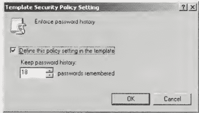
- 7 点击“确定”更改“模板安全策略设置”对话框，并将更改应用于模板。
- 8 在对模板进行任何其他所需的更改后，右键单击其名称并选择“保存”保存。

当然，一旦你创建了自定义模板，你可能希望使用它来配置一台或多台机器的安全。这可以使用“安全配置和分析”工具来实现，该工具还可以用于确定本地计算机上的哪些设置不符合你定义的模板（或预定义模板之一）。

你还可以使用模板为开发、测试和生产安全需求定义安全设置。开发或测试服务器的安全需求通常比生产服务器环境更宽松，而应用程序最终将部署在生产环境中。遗憾的是，当应用程序移动到限制严格严格生产服务器环境时，应用程序可能会由于安全限制而无法运行。通过为开发、测试和生产环境定义模板，你可以将这些模板应用于开发和/或测试服务器，以测试应用程序在这些环境更严格限制下是否能够工作。测试完成后，你可以恢复之前的模板以继续开发。

> 重要
由于安全模板工具可能会机器上的大量安全设置，因此在将模板应用于生产系统之前，在开发或测试系统上对其进行配置和测试是非常重要的。某些安全限制可能会阻止 Web 应用程序的运行（例如，通过限制对应用程序使用的账户的访问），因此在将模板应用于生产系统之前，你应该始终确保你的应用程序在模板定义的安全策略下正常工作。

### 将模板应用于本地计算机

- 1 打开包含“安全配置和分析”MMC 嵌入单元的控制台。
- 2 在选择新模板之前，你可能希望将当前设置保存为模板，以便在应用不同的模板后恢复它们。要保存包含当前设置的模板，请右键单击“安全配置和分析”节点，选择“导出模板”，为导出的模板提供一个 SCM 名称，然后点击“保存”。
- 3 右键单击“安全配置和分析”节点并选择“导入模板”。
- 4 从对话框中选择所需的模板并点击“确定”。在本示例中，使用内置的 `hisecweb.inf` 模板。

> 注意
微软制作了一个名为 `hisecweb` 的模板用于高安全 Web 服务器。此模板可以作为创建你自己的安全模板的起点。你可以从以下 URL 下载它：http://download.microsoft.com/download/win2000svr/SCM/1.0/NT5/EN-US/hisecweb.exe

- 5 要比较模板中的设置与本地计算机当前配置的设置，右键单击“安全配置和分析”节点，选择“现在分析计算机”，然后在“执行分析”对话框中点击“确定”。
- 6 展开“账户策略”节点以显示“密码策略”节点。然后选择“密码策略”节点查看其设置，如图所示。当本地设置与模板匹配时，有一个绿色勾号。当设置不匹配时，有一个红色的 X。

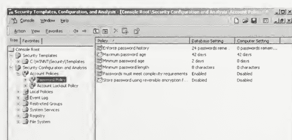
- 7 若要使用模板指定的设置配置本地计算机，右键单击“安全配置和分析”节点，选择“现在配置计算机”，然后在“配置系统”对话框中点击“确定”。
- 8 如果你想查看由模板修改的设置，将需要按照步骤 5 的描述重新分析计算机。

请记住，只有在模板中定义了值的设置才会被应用。所有其他设置将保持先前的配置状态。另请注意，当你正在配置的服务器是 Windows 2000 域的一部分时，在域级安全策略中配置的任何设置将进行覆盖。

### 弱密码或空密码

Web 安全中最容易被忽视的领域之一是密码。对于任何服务器，一个简单的经验法是它应该受到强密码的保护。很多时候，人们错误地假设空密码就足够了。对于连接到互联网的服务器，这等异于邀请黑客攻击。一家网站托管公司恰恰落入了这种陷阱（由于 MSDE 的默认配置）。结果是恶意分子利用 `xp_cmdshell` 删除了服务器上的大部分内容。该托管公司幸运地拥有备份并能够恢复服务器，但损害可能严重得多。

> 怎么强调都不为过：你必须对网络上的任何 SQL Server 或 MSDE 数据库的 sa 账户设置强密码。拥有 sa 账户访问权的恶意用户可以执行任何命令行的操作，添加或删除用户账户、安装和执行恶意代码以及删除系统文件。

如果你安装了 MSDE（ASP.NET 快速示例安装过程的一部分），请确保 sa 账户没有空密码。

- 在安装 MSDE 的机器上，打开命令提示符。
- 输入以下内容，使用 `osql` 命令行工具连接到快速示例安装的 MSDE .NetSDK 实例：
  osql -S(local)\NetSDK -U sa -P
- 如果连接成功，你将看到以下提示符（如果登录失败，将收到失败消息）：
  1>
- 如果登录成功，输入以下命令修改 sa 账户的密码。确保你记住所选择的密码，以免忘记。（尽量避免写下来。如果必须写下来，请确保将其放在别人窥探不到的地方。）将 `<password>` 替换为你选择的新密码，并按回键执行 `go` 命令：
  1> sp_password NULL, '<password>', 'sa'
  2> go
- 如果结果成功，你应该看到如下所示的消息。另请注意，在本示例中，选择了一个包含字母、数字和符号的密码。


## ASP.NET 逐步教程

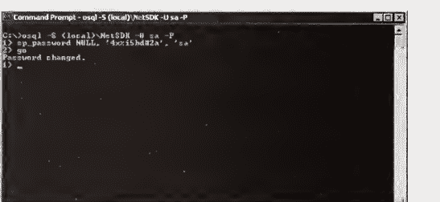

如果可用，你还可以使用 SQL Server 企业管理器（Enterprise Manager）实用程序来修改 MSDE 数据库的登录帐户和密码。

与空密码一样糟糕的是弱密码（容易被猜到），例如：

- 地名
- 日期，如生日或周年纪念日
- 字典中存在的单词
- 短密码（8 个字符或更少）
- 全是字母（全小写、全大写）或全数字

弱密码会让试图猜测账户密码的人得得变得容易得多。所谓的“字典攻击”使用包含常用术语或单词的字典来快速尝试登录账户。“暴力攻击”则会尝试所有可能的的值直到找到正确的密码为止。虽然强密码并不一定能消除暴力攻击，但它可以增加攻击成功所需的时间。结合适当的审核和记录，可以为你留出处理攻击的时间。

强密码符合长度和复杂性的最低要求。你可以使用安全模板（例如 `hisecweb.inf` 模板），通过本章前面介绍的安全配置和分析工具来要求安全密码。`hisecweb.inf` 模板设置了最小和最大密码年龄，强制执行密码历史（防止用户重复旧密码），将最小密码长度设置为八个字符，并要求密码满足最低复杂性要求，即密码必须包含以下类别字符中的三种：

- 大写字母
- 小写字母

## 第 8 章 ASP.NET 中的安全性

- 数字字符
- 非字母数字符号（如标点符号、特殊字符如 *、# 和 $ 等）

请注意，这些设置仅控制 NT 安全帐户的密码。如果你在应用程序中使用了自己的了自己的身份验证凭据，你将需要实现自己的解决方案来强制强密码，例如使用 `RegularExpressionValidator` 控件进行模式匹配。（有关验证控件的更多信息，请参阅第 10 章。）

## 密码的不安全存储

Web 应用程序中的另一个常见问题是在不安全的位置存储密码或其他敏感数据：作为 ASP 和 ASP.NET 页的明文文件、Global.asa 或 Global.asax 文件，以及 Web 空间中的配置文件（那些可以通过对 Web 服务器的 HTTP 请求访问的文件）。问题通常发生在开发者将数据库登录信息（包括密码）放在 Web 服务器上的明文文件时。开发者认为，由于默认阻止用户查看 `.asp`、`.aspx`、`.asa` 和 `.asax` 文件的源代码，信息就是安全的。

遗憾的是，只有当 Web 服务器没有被安全漏洞破解时，这才是真的。如果服务器被破解，恶意用户可能读取应用程序 Web 空间中的任何文件，并获取存储在该处的密码。

敏感信息（如数据库密码）可以使用以下选项进行保护：

- 如果你使用 SQL Server 或 MSDE，请使用信任连接（trusted connection）连接到数据库。此方法使用连接字符串中的 `Trusted_Connection` 属性告诉 SQL Server 使用当前用户的 NT 登录信息进行登录。这在内网场景下最有用，用户通过 NTLM 以及 NT 用户名和密码登录你的应用程序。这种方法的优点是不需要存储密码。

- 使用 `appSettings` 配置节（在第 15 章描述）将连接字符串存储在 `Machine.config` 文件中，该文件并不位于应用程序的 Web 空间中。虽然这种方法仍然不理想，因为密码信息仍以明文形式存储，但 `Machine.config` 文件存储在 Web 空间之外这一事实使得恶意用户很难获取它。为了通过这种方法提高安全性，包含 `Machine.config` 的目录和包含你的 Web 应用程序的目录应该位于不同的驱动器上。


此外，你还可以使用加密等方法让黑客的工作变得困难。底线是，没有任何存储密码的地方是百分之百安全的，但某些方法比其他方法更安全。在选择存储敏感信息的地方时，请平衡安全需求与其他因素。

> 注意：使用 SQL Server 的信任连接需要203页“使用冒用”中描述的 Windows 身份验证和冒用，或者将默认 ASPNET 帐户（运行 ASP.NET 工作进程的帐户）设置为访问的 SQL Server 数据库的登录帐户。该过程在第 11 章描述。

## 限制这些帐户

从 Windows 2000 帐户、数据库帐户以及你为应用程序创建的任何自定义帐户的角度来看，帐户限制是一项重要的安全策略。你应该配置每个帐户，使其仅具备其所代表的用户类型所需的权限。例如，对于应用程序中只需要读取和显示数据的页面（或组件），设置一个具有只读访问权限的数据库帐户通常是一个好主意。

这种做法的一个很好的例子是微软决定更改运行 ASP.NET 工作进程的默认帐户。以前使用的默认帐户是 `SYSTEM` 帐户，它拥有许多权限并可以在机器上执行几乎任何操作。现在默认是 `ASPNET` 帐户（由 `Web.config` 中 `<process>` 元素的 `username` 属性的 `MACHINE` 值指定），它的权限非常少。这种变化减少了单个应用程序破坏整个系统的可能性。

## 不提供示例，谢谢

对于不明智的管理员或 Web 开发者来说，另一个危险区域是示例应用程序。默认情况下，某些版本的 IIS 会安装用于帮助开发者的示例应用程序。.NET Framework SDK 也包含可能安装在 IIS 上的示例。这些示例有其用处，但不在生产服务器上。

示例应用程序不是为在生产服务器上运行设计的，因此通常不使用最佳实践来防止应用程序被破坏。一个例子是某个版本 IIS 的示例包含了一个允许用户查看 ASP 页面源代码的工具。遗憾的是，如果此工具安装在包含生产应用程序的服务器上，它可能会被用来攻击

如前所述，.NET QuickStart 示例会安装 MSDE 实例。在 Beta 2set中，该实例安装时的帐户密码为空。如果这些示例安装在暴露在互联网上的服务器上，将导致严重的漏洞。

此外，某些应用程序在安全性方面表现出极糟糕的做法。在早期版本中，QuickStart 示例使用了没有密码的帐户。这是一种极其糟糕的做法。这不仅强化了无密码帐户的习惯，而且用于数据访问的帐户权限比需要的大得多。好消息是，当前版本的 QuickStart 示例遵循了为示例应用程序专门创建 MSDE 帐户的最佳实践。该帐户仅具有访问示例数据库的权限

## 需要验证

验证是 Web 应用程序安全经常被忽视的领域。例如，开发者可能会包含验证代码以确保用户以正确的格式输入电子邮件地址或电话号码。但他们可能没有考虑其他文本字段，特别是大型文本字段或在应用程序其他地方显示的字段，可能会让应用程序面临不可接受的结果。

不对用户的所有输入进行验证的问题是，恶意用户可以输入文本，例如脚本命令、ASP.NET `<% % >` 渲染块或其他文本，这些文本在错误的上下文中可能会被允许执行，而不是被视为纯文本处理。此外，用于构建数据访问 SQL 语句的输入字段可能受到意外的


正在输入的命令。验证可以帮助你防止此类问题，并防止一些烦人的问题，例如用户尝试在用 ASP.NET 构建的访客簿或讨论列表中发布不雅内容。事实上，ASP.NET 让你非常容易地使用一组专为此目的设计的服务器控件来实现稳健的验证。这些控件将在本书第 10 章中进一步讨论。

需要记住的重要的一点是，在证明事实之前，你应该始终将来自用户的任何输入视为是可疑的。在使用、存储或显示用户输入之前，验证这些输入是你的预期。

## 注意这些端口！

互联网应用程序通过 TCP/IP 协议进行通信，这是互联网上计算机之间通信的基础。TCP/IP 使用两项信息来查找给定通信的端点：IP 地址（分配给机器的唯一数字）和 TCP 端口号（对于大多数应用程序来说，端口号是所有该类型应用程序一致使用的知名数字）。例如，所有服务器都使用 80 端口作为 HTTP（Web）通信的默认端口。这些端口号的知名性以及其上运行的服务，使得 Web 服务器和客户端更容易找到彼此。

其他知名端口还包括文件传输协议（FTP，端口 21）、简单邮件传输协议（SMTP，端口 25）和 POP3（端口 110）。知名端口的完整列表及其分配给它们的服务可以在 http://www.iana.org/assignments/port-numbers 找到。

为什么这对于安全发现和 Web 服务器设置至关重要？因为知名端口带来的这种易于发现的特性也为疏忽的人带来了安全风险。例如，在 Windows 2000 中，FTP、SMTP 和 POP3（以及其他）等服务的端口默认是开启的。这相当于给黑客提供了一份刻在骨子里的邀请函，让他们去探测这些端口，而其背后的软件极易受到攻击。鉴于 FTP、SMTP 以及其他基于互联网的服务中发现的许多漏洞，选择所有在应用程序中未使用的端口是至关重要的。

关闭端口可以通过多种方式实现，最常见的方法是包过滤（通过防火墙软件或硬件路由器）或使用 Windows 2000 IPSec 策略管理 MMC 嵌入单元。对于许多应用程序，首选解决方案是在 Web 服务器和互联网之间建立一个硬件防火墙，只允许通过 80 端口（HTTP）的流量，如果需要安全套接字 Web 流量，则可选允许 443 端口（HTTPS）（参见第 188 页的“使用 SSL 保护通信”获取更多关于安全套接字层通信的信息）。随后在 Web 服务器和内部网络之间添加第二个防火墙，只允许 Web 服务器访问其他服务器（如数据库服务器）所需的端口流量，并阻止 80 和 443 端口（以及防火墙中开启的任何其他端口）。这种方法将 Web 服务器置所谓的 DMZ（非军事化区），该区域旨在防止互联网与内部网络之间的直接通信。这保护了内部网络上的服务器免受攻击。

## 重要

无论你使用何种方法关闭 Web 服务器上的未使用端口，阻止指向你的应用程序未使用的任何端口流量都是至关重要的。然而，请记住，保持开启的端口仍然是一个安全风险。对服务器活动进行有效记录、频繁监控日志以及对开放端口运行的软件漏洞进行及时修复，都是防御你的服务器免受攻击的重要手段。

关于包过滤、路由和 IPSec 管理的讨论超出了本章的范围。请咨询你的防火墙或路由器的手册，或 Windows 2000 帮助文件以获取有关实现这些解决方案的更多信息。

## 补丁

一旦你的服务器正确且安全地设置完成，你可能会认为自己无事了。事实如此！即使应用程序的设计也会影响安全；配置最安全的服务器和设计最安全的应用程序也可能因为对持续维护的松懈态度而被破解。服务器和应用程序持续维护中最重要的方面之一，就是紧跟你使用的任何软件供应商发布的补丁。

在理想世界中，我们使用的软件从开始就应该是完美的。然而，现实是很少有程序是不包含漏洞的。当这些漏洞被发现时，通常程序供应商会发布一个旨在修复问题的补丁。遗憾的是，许多服务器管理员并没有一致地应用这些补丁，导致服务器容易受到攻击。

这是不公平的。大多数补丁都可以轻松应用，而且有很多方法可以自动收到微软软件的新补丁通知。这些包括关于补丁的信息源：

- Windows Update 网站 (http://windowsupdate.microsoft.com/) 让你分析特定系统的可用更新，并确定哪些当前已安装。Windows 98 以及 Windows 2000 及更高版本默认会在启动菜单中安装指向 Windows Update 的链接。

- Microsoft 产品安全通知服务允许你订阅漏洞和可用补丁的电子邮件通知。这种方法对于需要在无需访问多台机器的情况下跟踪补丁的管理员非常有用。你可以在此处订阅此服务：http://www.microsoft.com/technnet/treeview/default.asp?url=/technnet/security/bulletinnotify.asp

- 网络安全热补检查程序（Network Security Hotfix Checker）是一个命令行实用程序，它可以扫描本地或本地网络上 Windows NT 4.0、Windows 2000、IIS 4.0 和 5.0、SQL Server 7.0 和 2000 (MSDE) 以及 IE 5.0 的未安装补丁。

## 访问控制

访问控制是确定谁可以访问资源的过程。这包括身份验证（确定用户身份）和授权（确定用户是否有权限操作）。对于 ASP.NET 应用程序，有多种身份验证方法。你将在本书后续部分学习如何实现身份验证和授权。

重要的是不要忘记访问控制也包括对机器的物理访问。如果有人可以获得机器的物理访问并直接破坏障碍，那么最好的身份验证、授权和密码实践也无济于事。


## 注意

将 Web 服务器日志的位置从默认的 `%WinDir%\System32\LogFiles` 修改被认为是一项良好的做法，因为这使得获取系统访问权的黑客更难掩盖足迹。如果日志文件位于默认位置，黑客可以轻松地修改或删除它们以隐藏其活动。

## 使用 SSL 保护通信

默认情况下，通过 HTTP 请求和响应发送的信息是以明文形式发送的。这意味着有人可以捕获组成这些请求和响应的数据包，然后重新创建它们，包括提交页面上表单字段中的任何数据。如果此类表单包含敏感数据（如密码或信用卡号），这些数据可能会被盗取。

加密是保持此类信息安全的重要工具。Web 应用程序中最常用的加密形式是安全套接层（SSL）协议。SSL 用于在 Web 服务器和浏览器之间需要安全通信的站点，通过创建和交换密钥来对客户端与服务器之间的通信进行加密，帮助保护这些信息免受窥探。这通常是电子商务网站为了保护信用卡信息而采用的例如。SSL 对于保护其他信息也很有用，包括在使用基本身份验证或 ASP.NET 表单身份验证时保护 Session Cookie 和登录信息。有关基本身份验证的更多信息，请参考第 191 页的“启用身份验证”。

默认情况下，SSL 通发生在端口 443（与非 SSL Web 通信相反，后者默认使用端口 80），并使用 SSL 的 URL 使用 `https://` 前缀。为你的 Web 服务器启用 SSL 需要获取证书并将该证书绑定到你想要使用 SSL 的网站上。要向证书颁发机构请求服务器证书，请遵循以下步骤：

1. 打开 Internet 服务管理器（Internet Services Manager）。
2. 右键点击你想要通过 SSL 保护的站点，然后选择“属性”。
3. 在下图所示的“目录安全”选项卡上，点击“服务器证书”按钮。这将启动 Web 服务器证书向导。

4. 使用 Web 服务器证书向导创建一个新的证书请求。如果你想创建一个证书请求发送给第三方证书颁发机构（例如 Verisign 或 Thawte），这种方法非常有用，他们将验证请求中的信息并向你发送证书。或者，如果你在网络中的某台机器上安装了证书服务（Certificate Services），可以使用它来创建证书。（注意，你的客户端必须在浏览器中安装你的证书服务 CA 作为受信任的机构才能使用此方法。）有关创建和安装自定义证书的更多信息，请参考证书服务文档。

> 注意
> 无论你使用哪种方法生成证书请求，证书的通用名称（由证书服务 Web 请求页标识为 Name）必须与将安装的站点证书的完全限定域名匹配。否则，用户将收到警告，提示服务器证书有效但证书与请求的 URL 不匹配。

一旦你收到来自证书颁发机构包含你证书的响应，请按照以下步骤安装证书供 IIS 使用：

1. 找到你从证书颁发机构收到的证书文件。右键点击文件并选择“安装证书”。
2. 打开 Internet 服务管理器。
3. 右键点击你想要通过 SSL 保护的站点并选择“属性”。
4. 在“目录安全”选项卡上，点击“服务器证书”按钮。这将再次启动 Web 服务器证书向导。

5. 点击“下一步”进入向导的第二页。

6. 在下所示的向导“服务器证书”页面上，选择“分配现有证书”，然后点击“下一步”。

7. “可用证书”页面应列出当前机器上的所有证书，包括你刚刚安装的证书。选择所需的证书，然后点击“下一步”。

8. 检查“证书摘要”信息以确保你分配了正确的证书。然后点击“下一步”。

9. 点击“完成”完成向导。

一旦你为特定站点安装了证书，就可以让用户使用 `https://` 而不是 `http://` 请求页面，通过 SSL 加密该站点下任何虚拟目录的通信。但是，为了确保在没有 SSL 的情况下查看页面，你必须对想要保护的页面或目录要求 SSL。

1. 打开 Internet 服务管理器。
2. 右键点击你想要保护的站点、虚拟目录或文件并选择“属性”。
3. 在“目录安全”或“文件安全”选项卡上，点击现在可用的“编辑”按钮。这将打开所示的“安全通信”对话框。

4. 在“安全通信”对话框中，勾选“要求安全通道 (SSL)”复选框。你可以勾选“要求 128 位加密”以获得更高的安全性，但这需要客户端浏览器支持 128 位加密。
5. 点击“确定”关闭“安全通信”对话框，然后再次点击“确定”关闭你正在保护的站点、目录或文件的属性对话框。该资源现在应只能通过 `https://` 访问。

## 启用身份验证

正如本章早些部分讨论，身份验证是验证请求用户身份的过程。ASP.NET 与 IIS 工作执行基于几种类型之一的身份验证，这些将在后续节中讨论。

ASP.NET 中的身份验证和授权是紧密配合的并在两个级别上运行：IIS 级别和 ASP.NET 级别。

## 选择身份验证类型

ASP.NET 提供三种基本的身份验证类型：基于 Windows、Passport 和基于表单的身份验证。你选择的身份验证方法取决于你所处理的客户端类型、你对客户端浏览器的控制级别以及许多其他因素。接下来的章节将讨论可用方法、实现方式以及为什么你可能会选择一种方法而不是另一种方法。

## 重要
> 如果你没有这些功能的经验，IIS 和 ASP.NET 在身份验证和授权方面的交互可能会令人困惑。在理解各种选项之前，应在未暴露的机器上练习本节讨论的技术和程序。

ASP.NET 应用程序的请求通过两个不同的身份验证级别：IIS 级别和 ASP.NET 级别。你选择的身份验证类型决定了使用这些级别中的哪一个来确定请求是否通过验证。正如前面提到的，授权发生在两个级别，因此为你使用的身份验证类型选择正确的授权方法很重要。

身份验证类型由应用程序 Web.config 文件中的 `<authentication>` 标签决定。`<authentication>` 标签的语法将在第 7 章解释。

# 使用基于 Windows 的身份验证

在基于 Windows 的身份验证中，ASP.NET 依赖 IIS 使用其身份验证方法之一验证验证请求：

- 基本验证兼容大多数浏览器，密码以明文发送。仅当你可以使用 SSL 加密保护通信时才使用此方法。
- 摘要验证这种身份验证方法是作为 HTTP 1.1 的功能引入的，因此可能不支持所有浏览器。它发送哈希值而不是明文密码，比基本身份验证更安全。此方法需要 Windows 2000 域控制器。你需要在用于验证密码的域控制器上存储密码的明文版本，因此必须保护域控制器免受物理和网络入侵。如果可用 Windows 2000 域控制器，则此选项将不可用，如本章稍后所示的身份验证方法对话框所示。
- 集成 Windows (NTLM) 身份验证这种方法仅在 Internet Explorer 中可用。它是最安全的方法，因为它不会在网络上发送用户名或密码。如果你要求客户端使用 Internet Explorer 访问你的应用程序，请使用此方法。另外注意，集成 Windows 身份验证不会通过 HTTP 代理工作


## 第 8 章 ASP.NET 安全

连接，这可能导致使用公司网络代理的客户端无法通过 Internet 应用程序。它还要求每个登录您网站的每个人在 Web 服务器上或受 Web 服务器信任的域控制器上拥有 NT 账户。

如果勾选了多个身份验证类型复选框，摘要（Digest）和集成 Windows 身份验证（Integrated Windows）将始终优先于基本认证（basic）。

一旦 IIS 验证了用户，它会将验证后的身份传递给 ASP.NET，ASP.NET 然后可以使用该信息允许或拒绝访问应用程序内的资源。有关此类授权的更多信息，请参阅第 201 页的“授权用户和角色”。

要更改 IIS 使用的身份验证方法，请按照以下步骤操作：

1. 打开 Internet 服务管理器。
2. 右键点击要修改身份验证方法的站点、虚拟目录或文件。选择属性（Properties）。
3. 在目录安全选项卡的 匿名访问和身份验证控制部分（文件则使用文件安全选项卡），点击编辑（Edit）按钮。这将打开身份验证方法对话框。
4. 在身份验证方法对话框中，取消勾选 匿名访问复选框。然后勾选所需的身份验证方法的复选框，如图所示。

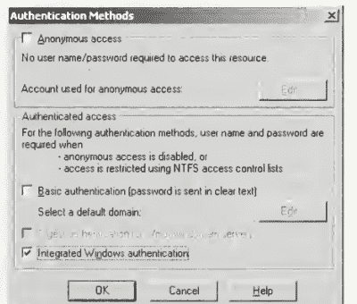

5. 点击确定关闭身份验证方法对话框，然后点击确定关闭您在第 2 步选择的资源的属性对话框。

要将 Windows 身份验证作为 ASP.NET 使用的身份验证类型

1. 在您偏好的文本编辑器或 Visual Studio .NET 中打开应用程序的 Web.config 文件（注意：Visual Studio .NET 会对配置文件进行颜色编码）。

2. 按照如下所示修改 `<authentication>` 配置部分。（注意：您只能在应用程序或服务器级别设置身份验证方法。尝试在子目录的 Web.config 中添加 `<authentication>` 标签会导致错误。）

`<authentication mode="Windows" />`

3. 如果需要，可以通过添加如下所示的 `<identity>` 部分让 ASP.NET 冒充登录用户（以便资源请求在登录用户的安全上下文中进行），有关冒充的更多信息请参阅第 203 页的“使用冒充”（Impersonation）：

`<identity impersonate="true"/>`

4. 保存并关闭 Web.config 文件。

一旦您将身份验证模式设置为 Windows，您需要设置所需的授权方法来保护所需的所需的资源。

## 使用 Passport 身份验证

Passport 身份验证使用微软提供的中心化 Passport 身份验证服务。Passport 身份验证为用户提供单一登录，可用于任何启用 Passport 的站点。要在 ASP.NET 中使用 Passport 身份验证，您必须下载并安装 Passport SDK，地址为 http://www.passport.com/business。ASP.NET 为 Passport 身份验证服务提供了封装，您可以通过为 Web.config `<authentication>` 标签设置适当的值来使用它。

配置 ASP.NET 使用 Passport 身份验证方法

1. 在您偏好的文本编辑器或 Visual Studio .NET 中打开应用程序的 Web.config 文件。（注意：Visual Studio .NET 会对配置文件进行颜色编码。）

2. 按照如下所示修改 `<authentication>` 配置部分：
`<authentication mode="Passport" />`

3. 如果需要，可以通过添加如下所示的 `<passport>` 部分为 Passport 身份验证设置内部重定向 URL：
`<passport redirectUrl="<URL>"/>`

4. 保存并关闭 Web.config 文件。

## 使用基于表单（Cookie）的身份验证

> 注意
> 下载并安装 Passport SDK 并在站点上使用 Passport 身份验证，您需要在 http://www.passport.com/business 注册并支付许可费用。

基于表单的身份验证（在 ASP.NET Beta 1 中称为 cookie 身份验证）允许开发者在应用程序中实现实现“安全性”。在经典 ASP 中，您需要在每个页面上添加文件或组件来查找身份验证 cookie，如果 cookie 不存在则重定向到登录页面；而 ASP.NET 基于表单的身份验证会为您处理这一切。

您只需要创建登录页面，告诉 ASP.NET 在何处找到它（通过 Web.config 中的设置），并设置授权限制。在您的登录页面中，您可以根据数据库、Windows 2000 活动目录或其他选的凭据存储来验证用户输入的用户名和密码凭据。一旦验证了用户凭据，您可以使用 FormsAuthentication 类公开的方法来移除身份验证 cookie、将用户重定向到请求的原始页面或刷新身份验证 cookie。

> 重要
> 在基于表单的身份验证中，用户名和密码以明文形式发送。为了确保此信息的安全性，您应始终对登录页面使用启用 SSL 的连接。

让我们来看一个示例。首先使用以下步骤创建一个新的 IIS 虚拟目录并向其添加测试页面和登录页面：

1. 在 IIS 中创建一个名为 Chapter8 的新虚拟目录。（有关如何执行此操作见第 2 章）暂时保持 Internet 服务管理器打开。
2. 在与虚拟目录关联的物理目录下创建两个新文件：test.aspx 和 login.aspx。这两个文件的内容如下列表所示。

### Test.aspx

```asp
<%@ Page Language="VB" %>
<%@ Import Namespace="System.Web" %>
<html>
<head>
  <script runat="server">
    Sub Page_Load(By As Object, e As EventArgs)
      User.Text = "Username is " & User.Identity.Name
    End Sub
  </script>
</head>
<body>
  <asp:Label id="User" runat="server" />
  <br/>
  <asp:Button id="logout" text="Log Out" OnClick="Logout_Click" runat="server" />
</body>
</html>
```

### Login.aspx

```asp
<%@ Page Language="VB" %>
<%@ Import Namespace="System.Web" %>
<html>
<head>
  <script runat="server">
    Sub Login_Click(By As Object, e As EventArgs)
      ' 为了简单起见，用户名和密码存储在下方
      ' 在生产环境中，这些值将从数据库或其他安全位置获取
      If Username.Text = "charliebrown" And Password.Text = "rats" Then
        FormsAuthentication.Auth(Username.Text, persist.Checked)
      Else
        Message.Text = "Incorrect Username or Password. Try again."
      End If
    End Sub
  </script>
</head>
<body>
  <form runat="server">
    <table>
      <tr>
        <td>Username:</td>
        <td><input id="Username" type="text" runat="server" /></td>
      </tr>
      <tr>
        <td>Password:</td>
        <td><input id="Password" type="password" runat="server" /></td>
      </tr>
      <tr>
        <td>Persist Authentication Cookie:</td>
        <td><asp:CheckBox id="persist" runat="server" /></td>
      </tr>
      <tr>
        <td>
          <asp:Button id="login" text="Login" OnClick="Login_Click" runat="server" />
        </td>
        <td><input type="reset" text="Reset Form" runat="server" /></td>
      </tr>
    </table>
    <asp:Label id="Message" ForeColor="red" runat="server" />
  </form>
</body>
</html>
```

接下来，向目录添加一个 Web.config 文件，内容如下：

```xml
<!-- web.config -->
<configuration>
  <system.web>
    <authentication mode="Forms">
      <forms name="formsauth" loginUrl="login.aspx" protection="All" timeout="60" />
    </authentication>
    <authorization>
      <deny users="?" />
    </authorization>
  </system.web>
</configuration>
```

在 Internet 服务管理器中，找到 test.aspx 文件，右键点击并选择转到页面。你应该看到如下图所示。注意 ReturnUrl 查询字符串参数。这允许 ASP.NET 在用户通过验证后返回其最初请求的页面。

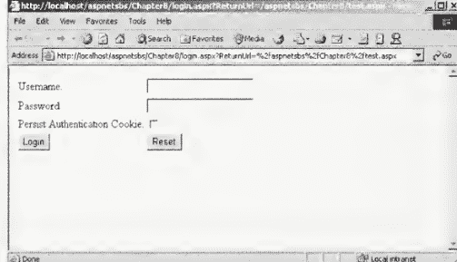

在用户名输入 charliebrown，密码输入 rats，然后点击登录。如果你勾选了 持久身份验证 Cookie 复选框，cookie 将保存到磁盘（如果你的浏览器设置允许），而不是在浏览器关闭时立即移除。一旦你点击登录，你应该看到如下图所示。


## 第 8 章 ASP.NET 中的安全性 199

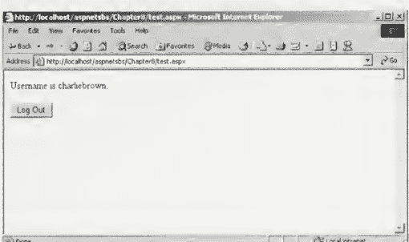

Test.aspx 使用 Page 对象的 `User` 属性来访问当前用户的身份。从身份中，你使用 `Name` 属性来显示已验证用户的名称。

- 7 点击“注出”按钮。这会调用 `FormsAuthentication` 辅助类的 `SignOut` 方法，这将移除身份验证 cookie。现在，如果你再次尝试浏览 test.aspx，将需要重新登录。

> 注意
> 在此示例 Web.config 文件中，登录页的 URL 通过 `forms` 标签的 `loginURL` 属性指定。（有关关于 `form` 标签所有属性的更多信息，请参阅第 7 章。）但是，如果你省略了此属性，ASP.NET 将提供 `login.aspx` 作为默认名称。
> 当调用 `FormsAuthentication.RedirectFromLoginPage` 时，如果没有找到 `RedirectUrl` 查询字符串，ASP.NET 也会提供 `default.aspx` 作为默认值。在前面的示例中，如果你直接调用登录页并成功验证，ASP.NET 将尝试将你重定向到 default.aspx。如果没有该页面，你将得到“找不到文件”错误。

## 使用授权 (Authorization)

在对请求的用户进行身份验证后，下一步是对请求进行授权。授权意味着决定是否允许用户访问请求资源。

ASP.NET 中的授权主要有两种形式：基于 NTFS 访问控制列表 (ACL) 的授权和基于 URL 的授权。

## 使用 NTFS ACL 进行授权

当你在 ASP.NET 中使用 Windows 身份验证时，基于 ACL 的授权非常有用。使用 ACL 授权，你可以使用 Windows 资源管理器中文件或文件夹的属性对话框设置允许访问给定资源的用户或组列表，以及每个用户拥有的权限（读取、写入、执行等）。使用 Windows 身份验证配合 ACL 授权的主要优势是它不需要在 ASP.NET 程序中编写任何特定的安全代码。所有安全设置都可以通过管理手段完成。

当资源（如 ASP.NET 页面）的请求进入时，IIS 会根据应用程序配置的任一方法（基本、摘要、集成 Windows）对请求进行身份验证。IIS 将登录用户的身份传递给 ASP.NET，然后 ASP.NET 模拟该用户的身份并检查请求资源的 ACL，以查看用户是否具有所需的权限。如果是，ASP.NET 将履行该请求。

为了利用基于 ACL 的授权，你需要执行以下操作：

- 1 通过向应用程序的 Web.config 中添加以下部分，配置你的 ASP.NET 使用 Windows 身份验证并模拟登录用户。
- 2 使用 Windows 资源管理器，在应用程序的物理目录中要限制访问的文件或文件夹上点击右键，并选择“属性”。
- 3 点击“安全”选项卡，并根据定义添加或删除用户或组。注意，如果存在 `Everyone` 组，你应该将其删除。如果你希望 ASP.NET 在不进行模拟的情况下也能访问资源，则应赋予 `SYSTEM` 账户访问资源的权限。完成权限应用后，点击确定关闭对话框。
- 4 浏览受保护的资源。系统将提示你输入 Windows 用户名和密码。如果你输入了步骤 3 中配置的帐户之一的凭据，你应该能够访问该资源。

```xml
<authentication mode="Windows" />
<identity impersonate="True" />
```

## 使用基于 URL 的授权

ASP.NET 新引入的基于 URL 的授权允许你使用 `<authorization>` 标签根据资源的 URL（因此得名）授予或拒绝对应用程序中资源的访问。与无法在应用程序子目录中使用或应用于子目录的 `<authorization>` 标签不同，通过在子目录中创建 Web.config 文件或通过使用 `<location>` 标签的 `path` 属性指定受保护资源的 URL，`<authorization>` 标签可以应用于子目录甚至单个文件。基于 URL 的身份验证还允许你指定适用于特定规则的 HTTP 方法。

## 授权用户和角色

ASP.NET 基于 URL 的授权的最基本形式如下：

```xml
<configuration>
  <system.web>
    <authorization>
      <allow users="Andrew" />
      <deny users="*" />
    </authorization>
  </system.web>
</configuration>
```

当在应用程序的 Web.config 中添加 `<authorization>` 部分时，它将允许 Andrew 访问应用程序根目录以及任何未设置冲突 `<authorization>` 权限的子目录中的资源，并拒绝所有其他用户的访问。`<allow>` 和 `<deny>` 标签的 `users` 属性允许你指定允许或拒绝访问受保护 URL 的用户逗号分隔列表。（注意，如果未指定路径，ASP.NET 将设置应用到包含设置的 Web.config 目录及其子目录。）ASP.NET 提供了以下两个通配符用于允许和拒绝访问：

- * 此通配符允许你允许或拒绝所有用户
- ? 此通配符允许你允许或拒绝匿名用户

你还可以通过添加 `<location>` 标签来指定逗号分隔的角色列表（等同于 NT 组）进行允许或拒绝。注意，如果未指定路径，ASP.NET 将设置应用到包含设置的 Web.config 目录及其子目录。ASP.NET 提供了以下两个通配符用于允许和拒绝访问：

- * 此通配符允许你允许或拒绝所有用户
- ? 此通配符允许你允许或拒绝匿名用户

*(注：后续文本存在大量OCR重复内容，已根据要求进行去重和合并处理)*


## 注意

如果你在 ASP.NET 中无法使用 Windows 身份验证和模拟，你可能仍然可以通过将默认的 ASPNET 帐户（用于运行 ASP.NET 工作进程的帐户）配置为 SQL Server 登录帐户来利用信任连接。但请记住，这将允许任何可以访问任何 ASP.NET 应用程序的人根据你为 ASP.NET 帐户设置的权限来更改数据库。将 ASPNET 帐户设置为 SQL Server 登录帐户的过程描述在第 11 章中。

## 理解代码访问安全

ASP.NET 的另一个新安全特性是代码访问安全。代码访问安全的全面讨论超出了本章的范围，但这里有一个概述。

代码访问安全是微软应对防止不可信代码执行挑战的解决方案，允许 ASP.NET 开发者和/或服务器管理员使用 Web.config 中的 `<securityPolicy>` 和 `<trust>` 标签来指定给定应用程序应具有的信任级别。（这些标签的更多信息，请参见第 7 章）。ASP.NET 预配置了一组代码访问安全模板，这些模板映射到 Machine.config 中的信任级别。根据`<trust>` 标签中指定的信任级别，为应用程序应用适当的代码访问安全权限。这可以包括此类权限，例如应用程序是否可以读取其 Web 空间之外的文件系统部分、是否可以写入其文件空间或仅允许执行。

就像允许在机器级锁定配置设置的`<location>` 标签一样，代码访问安全以及用于应用权限的模板在共享服务器环境中是理想的，在这种环境中，你想允许用户创建自己的 ASP.NET 应用程序，但希望能够选择不同用户编写的代码可以采取哪些操作。

## 安全资源

以下是在保护应用程序安全时可以备用的 URL。

- http://www.microsoft.com/technet/security 这是查找 Windows、IIS 以及其他微软产品安全相关信息的起点。在这里可以找到许多关于提高服务器和应用程序安全性的良好信息。
- http://www.microsoft.com/technet/security/iis5chk.asp 这是安全信息服务 5 检查表（Secure Internet Information Services 5 Checklist）。该文档由 Windows 2000 和 IIS 安全团队的 Michael Howard 编写，为保护 IIS 5 建议和最佳实践。
- http://www.microsoft.com/technet/treeview/default.asp?url=/technet/itsolutions/security/tools/tools.asp 这是通过 Microsoft Technet 网站提供的安全工具列表。
- http://ns2.www.conxin.com/uin2b/download.htm 这是美国国家安全局（NSA）编写的 Windows 2000 安全建议指南的下载站点。
- http://www.microsoft.com/technet/treeview/default.asp?url=/technet/columns/security/10immutablelaws.asp 这是安全的 10 条不变真律，失去计算机控制权的许多方法之一。
- http://www.microsoft.com/technet/treeview/default.asp?url=/technet/columns/security/10salaws.asp 这是安全管理的 10 条不变真律，为那些承担着保护系统沉重任务的人提供的智者建议。

## 第 8 章快速参考

| 目标 | 执行此操作 |
| :--- | :--- |
| 移除未使用的服务 | 打开控制面板，双击“添加/删除程序”图标，点击“添加/删除 Windows 组件”按钮。 |
| 创建 Windows 2000 安全模板 | 打开安全模板 MMC 单元，右键点击新模板文件夹，并选择“新模板”。 |
| 应用安全模板 | 打开安全配置和分析 MMC 单元，右键点击“安全配置和分析”节点并选择“导入模板”，导入所需的模板。右键点击“安全配置和分析”节点并选择“立即配置”，应用导入的模板。 |
| 更改 MSDE 默认安装的空白密码 | 使用 osql 命令行工具运行 sp_password 存储过程。你还可以使用 osql 和系统存储过程添加登录、删除登录并执行许多其他任务。 |
| 为网站启用日志 | 打开 Internet 服务管理器（IIS），导航到要配置的站点，右键点击并选择“属性”。在站点的属性对话框中，点击“网站”选项卡，并确保勾选了“启用日志”复选框。 |
| 为站点启用 SSL 通信 | 使用 Web 服务器证书向导创建证书请求（或遵循你选择的证书颁发机构的程序）。一旦收到并安装了证书，打开 Internet 服务管理器，导航到要配置 SSL 的站点并访问站点属性对话框。点击“目录安全”选项卡，点击“服务器证书”按钮，并使用 Web 服务器证书向导中的“分配现有证书”选项使用新安装的证书为站点分配 SSL 通信。你可以在“目录安全”选项卡上要求 SSL（编辑按钮）。 |
| 启用 ASP.NET 使用 Windows 身份验证 | 将 Web.config 中`<authentication>` 标签的 mode 属性设置为 Windows。 |
| 启用 ASP.NET 使用 Passport 身份验证 | 将 Web.config 中`<authentication>` 标签的 mode 属性设置为 Passport。 |
| 锁定授权 | 将`<location>` 标签的 allowOverride 属性设置为 false。 |

# 第四部分

# ASP.NET Web Forms

## 创建 Web Forms

- 在本章中，你将学习：
- 创建 Web Forms 页面
- Web 的各个部分如何协同工作
- 回调的自动处理
- 使用后代码类将执行代码与 HTML 标记分离

## ASP.NET Web Form 的结构

在之前的章节中，你看到了一些简单的 ASP.NET 页面的示例，也看到了一些复杂的示例。简单的 ASP.NET 页面由纯 HTML 组成并以 .aspx 扩展名命名。虽然它是有效的，但它缺少了许多 ASP.NET 页面及其强大之处。

## HelloSimple.aspx

```aspx
<!-- @ Page 指令示例 -->
<@ Page Language="vb" ClassName="Hello" %>
<html>
<head>
    <script runat="server">
        '这是一个脚本声明块
        Private _name As String = "Andrew"

        Public Property Name As String
        Get
            Return _name
        End Get
            _name = Value
        End Set

        Sub SayHello()
        Label.Text = "Hello, " & _name & "!"
        End Sub

        Sub Page_Load(Sender Object, E As EventArgs)
        If IsPostBack Then
            If TextBox.Text <> "" Then
                Name = TextBox.Text
            End If
            SayHello
        End If
        End Sub
    </script>
</head>
<body>
    <!-- 这是一个服务器端表单 -->
    <form runat="server">
        <!-- 服务器控件 -->
        <asp:Label id="NameLabel" runat="server">Name: </asp:Label>
        <!-- 服务器控件 -->
    </form>
</body>
</html>
```


# 第9 章 创建 Web 表单 211

```asp
<asp:textbox id="NameTextBox" runat="server"/>
<!-- 一个服务器控件 -->
<asp:button id="NameButton" text="Submit" runat="server"/>
<!-- 一个服务器控件 -->
<asp:Label id="Labell" runat="server"/>
</body
</html
```

此示例包含一个指令、HTML 标记、一个 `<script>` 代码声明块、一个服务器端表单以及多个服务器控件。接下来的章节描述了所有这些元素，以及可能在 Web 表单页面中使用的其他元素。

## 理解页面元素

HelloSimple.aspx（上一个列表）展示了 ASP.NET Web 表单中可能使用的许多元素示例。HelloSimple.aspx 中使用的元素包括服务器端控件、`@ Page` 指令、静态 HTML、包含事件处理程序和方法的服务器端 `<script>` 代码声明块，以及多个 ASP.NET 服务器控件。下表描述了 ASP.NET 页面中可能使用的元素。

| ASP.NET 页面元素 | 描述 |
| :--- | :--- |
| 静态 HTML 标签 | 这些标准的 HTML 元素被 ASP.NET 视为字量控件，并按照源文件中表示的形式渲染到客户端浏览器中。 |
| HTML 注释 | 语法：`<!-- -->`，HTML 注释允许在页面上添加描述性文本。这些文本会被发送到客户端，但不会被浏览器渲染。 |
| 指令 | 指令（如 `@ Page` 指令）为 ASP.NET 运行时提供有关如何处理页面的信息。通过指令，你可以控制诸如会话状态、事件接线和输出缓存等 ASP.NET 功能，还可以导入命名空间并为页面内使用注册自定义控件。（续上） |

## ASP.NET 页面元素（续下）

| 元素 | 描述 |
| :--- | :--- |
| 服务器端代码 | 代码可以包含在服务器端 `<script>` 代码块或 `<% %>` 渲染块中。请参阅第 228 页的“在 Web 表单中编写代码”以获取有关使用代码声明和渲染块的信息。ASP.NET 支持任何目标为运行时的语言服务器端代码。 |
| 事件处理程序 | 事件处理程序是用于包含 `<script>` 代码块的程序，这些代码块用于处理页面或服务器控件事件，例如 `Page_Load` 或控件 Click 事件。大多数 ASP.NET 代码应该在事件处理程序中编写或从事件处理程序调用，而不是位于渲染块中。 |
| `<script>` 代码声明块 | 这些块用于包含页面级程序并声明页面全局变量。除了代码声明块中的全局变量声明外，可执行代码必须包含在程序声明中。服务器端代码声明块必须具有 `run="server"` 属性，如 HelloSimple.aspx 所示。 |
| `<% %>` 渲染块 | 这些块用于包含不在程序内的可执行代码。过度使用渲染块可能会导致代码难以阅读和维护。 |
| 客户端 `<script>` 块 | 这些块用于包含在客户端执行的脚本代码，通常用于响应客户端事件。语言的选择（由 `language` 属性设置）取决于目标浏览器支持的语言。JavaScript 是客户端脚本中跨浏览器兼容性最常见的选择。 |
| 服务器端注释 | 语法：`<%-- --%>`。服务器端注释允许在页面上添加描述性文本。与 HTML 控件不同，这些文本不会发送到客户端。 |
| 用户控件 | 这些是在具有 `.ascx` 扩展的文件中声明式定义的自定义控件。它们为 UI 和 UI 相关代码的复用提供了简单直接的机制，并可以包含与 Web 表单页面大部分相同的元素。 |

| ASP.NET 页面元素（续下） 描述 |
| :--- | :--- |
| ASP.NET 服务器控件 | 这组内置控件为 ASP.NET 开发者提供了一个类似于 Visual Basic 的编程模型。控件被添加到页面中，程序员编写代码来处理运行时用户与控件交互引发的事件。ASP.NET 提供了组内置控件：HTML 控件，它为大多数 HTML 元素提供了服务器端控件的一对一 映射；以及 Web 控件，它提供了一组与 Visual UI 控件非常相似的控件。 |
| 自定义服务器控件 | 自定义服务器控件是 ASP.NET 中另一种复用机制。它们在类文件（`.cs` 或 `.vb` 文件）中定义，并在使用前预编译为托管程序。 |

## 理解页面生命周期

ASP.NET Web 表单编程模型的目标是提供一种类似于 Visual Basic 富客户端事件驱动应用程序的体验，在这种程序中，用户操作（如从列表中选择项目或点击按钮）会触发服务器端代码的执行。这是通过回传（postbacks）实现的。

当 ASP.NET Web 表单页面首次执行时，页面包含的代码（以及与页面相关的任何后代码类）会被编译成一个继承自 `Page` 基类的类。下图显示了页面、其后代码类（如果有）与编译程序集之间的关系。一旦编译完成，该类将被执行，生成的 HTML 渲染到浏览器，然后该类从内存中移除。

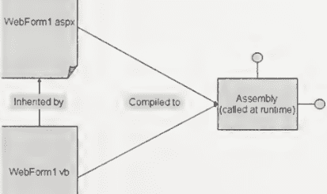

## ASP.NET 逐步教程

每个 ASP.Net Web 表单页面都包含一个服务器端 `<form>`。（注：原文此处存在多行重复，翻译已按要求去重）。


## 216 逐步学习 ASP.NET

| 属性 | 值 | 目的 |
|---|---|---||
| AutoEventWireup | true/false 默认值在 Machine.config 或 Web.config 的 <pages> 部分中设置。 | 决定是否自动设置如 Page_Load 等事件的处理程序。更多信息请参阅第 240 页的“事件处理”。默认值为 true。 |
| Buffer | true/false 默认值在 Machine.config 或 Web.config 的 <pages> 部分中设置。 | 决定渲染后的输出在发送到客户端之前是进行缓冲，还是在渲染时直接发送。默认值为 true。 |
| ClassName | 任何有效的类名。 | 决定动态编译页面时生成的页面名称。此属性可以配合或不配合 CodeBehind 使用，并可配合 Src 或 CodeBehind 属性使用。如果页面省略此属性，默认页面名称格式为 filename.aspx。 |
| ClientTarget | 任何有效的 UserAgent 字符串。可用值在 Machine.config 或 Web.config 的 <clientTarget> 部分中设置。 | 决定服务器控件应为哪个浏览器渲染输出。所使用的服务器控件应能识别 User Agent 字符串。 |
| CodeBehind | codeBehind 类的文件名。 | 此属性在 Visual Studio .NET 中用于在生成操作期间定位需要编译的后绑定类。它不被 ASP.NET 运行时使用。 |
| CodePage | 任何有效的代码页值。 | 与经典 ASP 相同。 |
| CompilerOptions | 包含有效编译器选项的字符串。 | 允许开发者为编译器传递页面编译选项。对于 Visual Basic .NET 和 C#，这可以是编译器的任何有效命令行开关序列。 |

# 第 9 章 创建 Web Forms 217

| 属性 | 值 | 目的 |
|---|---|---||
| ContentType | 任何有效的 MIME 类型（例如 "text/html" 或 "application/vnd.ms-excel"） | 设置页面输出的 MIME 类型。当向客户端返回二进制内容（如图像）时，此属性非常有用。 |
| Culture | 任何有效的文化字符串（如用于美国英语的 en-US） | 决定页面的文化设置。 |
| Debug | true/false 默认值由 Machine.config 或 Web.config 中 <compilation> 部分的 debug 属性设置。 | 决定编译页面时是否带有调试符号。此设置会影响性能，因此生产环境应用程序应将其设置为 false。默认值为 false。 |
| Description | 任何字符串。 | 提供页面的文本描述。此属性被 ASP.NET 运行时忽略。 |
| EnableSessionState | true/false/readonly 默认值在 Machine.config 或 Web 的 <pages> 部分设置。 | 决定对页面的请求是否会启动新会话，以及页面是否可以访问或修改存储在现有会话中的数据。默认值为 true。 |
| EnableViewState | true/false 默认值在 Machine.config 或 Web.config 的 <pages> 部分设置。 | 决定是否启用视图状态（ViewState）。ViewState允许服务器控件在每个请求之间保存其当前状态。默认值为 true。 |
| EnableViewStateMac | true/false 默认值在 Machine.config 或 Web.config 的 <pages> 部分设置。 | 决定 ASP.NET 是否对用于存储视图状态的隐藏表单字段内容运行机器身份验证 (MAC)，以确保其未被客户端更改。默认值为 false。 |

## ASP.NET 逐步学习

| 属性 | 值 | 目的 |
| --- |---|---|
| ErrorPage | 任何有效的 URL。 | 指定如果页面出现未处理的异常，客户端将重定向到的页面。 |
| Explicit | true/false 默认值在 Machine.config 或 Web.config 的 <compilation> 部分设置。 | 决定 Visual Basic 中编写的代码在编译时是否遵循 Option Explicit 规则。默认值为 true。 |
| Inherits | 任何派自 Page 类的类。格式为 "namespace.classname" 或 "classname"。 | 指定页面的后绑定类。页面中的任何代码将与后绑定类中的代码合并成单个类。 |
| Language | 已安装 .NET 语言的任何有效字符串（例如 "vb", "visualbasic", "c#", "csharp" 等）。默认值在 Machine.config 或 Web.config 的 <compilation> 部分设置。 | 指定用于编译页面的语言编译器。默认值为 vb。 |
| LCID | 任何有效的区域标识符。 | 与经典 ASP 相同。 |
| ResponseEncoding | 任何有效的编码字符串。默认值在 Machine.config 或 Web.config 的 <globalization> 部分设置。 | 用于全局化以设置 HTTP 响应的字符编码。默认值为 utf-8。 |
| Src | 后绑定类的文件名 | 指定要在运行时动态编译的后绑定类文件名。 |

# 第 9 章 创建 Web Forms 219

## @ Page 属性（续）

| 属性 | 值 | 目的 |
|---|---|---|
| Strict | true/false | 决定 Visual Basic 中编写的代码是否遵循 Option Strict 规则。 默认值为 false。 |
| Trace | true/false 默认值在 Machine.config 或 Web.config 的 <trace> 部分设置。 | 决定页面是否包含 trace 输出。默认值为 false。 |
| TraceMode | SortByTime/SortBy-Category 默认值在 Machine.config 或 Web.config 的 <trace> 部分设置。 | 在启用 trace 时决定 trace 输出的排序方式。默认值为 SortByTime。 |
| Transaction | true/false | 决定页面是否参与事务。默认值为 false。 |
| WarningLevel | 0–4 | 指定编译器中止的警告级别。默认值为 Supported。 |
| WarningLevel | 0–4 | 指定编译器中止的警告级别。数字越小允许的警告越多。默认值为 false。 |

## @ Page 示例

默认情况下，ASP.NET 页面是不带符号的。在本节中，我们将通过 @ Page 指令查看示例。第一个示例将显示如何启用调试，第二个示例将显示如何启用 trace。

## Debug

默认情况下，ASP.NET 页面是不带符号的。这对性能有好处，但 ASP.NET 提供的主要优势之一比经典 ASP 更丰富的调试信息。你可能希望在开发时开启它。

## Trace

默认情况下，ASP.NET 未启用 trace 功能。与 debug 属性一样，这对性能有影响。trace 允许查看有关当前请求的信息，包括集合（cookie、头部、查询字符串、服务器变量）。是在页面级别启用 trace 的方法：

- 在文本编辑器或 Visual Studio 中打开所需的页面。
- 向 @ Page 指令添加 trace 属性，值为 true。
- <% Page trace="true" %>
- 保存文件。当从浏览器请求该文件时，你可以在页面输出看到 trace 信息，如下：

| 类别 | 用法 | 来自(s) | 持续(s) |
|---|---|---|---|
| as+page | Begin Int | 0.0020 | 0.080 |
| as+page | End Int | 0.0135 | 0.055 |
| as+page | Begin Pre | 0.0351 | 0.0046 |
| as+page | Begin SaveState | 0.0351 | 0.170 |
| as+page | EndSaveState | 0.0396 | 0.0045 |
| as+page | Begin Render | 0.0450 | 0.0044 |
| as+page | End Render | 0.0596 | 0.156 |

| 控件 | 类型 | 编码大小（不包括子项） | 视图状态大小（不包括子项） |
|---|---|---|---|
| PAGE | _ASP_hello_asp+ | 77 | 0 |
| ctrl | System.Web.UI.Control | 0 | 0 |

| Cookies | 值 |
|---|---|
| ASP.Net_SessionId formsauth | F9B2E3B5FC30D94376A2096419758B7C5765A2E1A8BF2FB0AD7C9D16F |

有关 ASP.NET 应用程序中 trace 调试的更多信息，请参考第 16 章。

## @ Control

@ Control 指令仅允许 .ascx 文件，其功能与 @ Page 指令相同。然而，它不是为页面设置属性，而是为用户控件（以 .ascx 文件命名的可重用代码段）设置属性。@ Control 指令暴露的属性是 @ Page 指令属性的子集，其目的是


这些值与第 215 页的 @ Attributes 表格中的相同。@ Control 指令可用的属性如下：

- AutoEventWire
- ClassName
- Codebind
- CompilerOptions
- Debug
- Description
- EnableState
- Explicit
- Inherits
- Language
- Strict
- Src
- WarningLevel

## @ Import

@ Import 指令用于将 .NET Framework 命名空间或自定义命名空间导入到页面中。导入命名空间允许你针对该命名空间中的成员编写代码，而无需每次都显式指定该命名空间。@ Import 指令只有一个属性：Namespace（命名空间），它用于指定要导入的命名空间。每个 @ Import 指令只能有一个 Namespace 属性，因此你必须为每个想要导入的命名空间使用单独的 @ Import 指令。例如，为了使用 .NET Framework 的 SmtpMail 和 MailMessage 类从 ASP.NET 页面发送电子邮件，你需要向页面添加 System.Web.Mail 命名空间，如下所示：

```
<% namespace="System.Web.Mail" %>
```

然后，要创建 MailMessage 类的实例，你将使用以下代码：

```
Dim myMail As New MailMessage
```

如果没有 @ Import 指令，你将需要使用以下：

```
Dim myMail As New System.Web.Mail.MailMessage
```

## 第 9 章 创建 Web 表单

## @ Implements

@ Implements 指令用于在 ASP.NET 页面内部实现定义的接口。接口提供了一组方法和属性的抽象定义。当你实现一个接口时，你承诺支持该接口定义的方法和属性，并且你必须使用 <script> 块在你的 .aspx 文件中匹配方法和属性的定义。@ Implements 指令不能用于在后代码文件（code-behind file）中实现接口。它有一个属性：interface，用于指定正在实现的接口。

## @ Register

@ Register 指令同时用于用户控件和自定义服务器控件，用于将它们注册并在页面内使用。@ Register 指令的属性列如下表所示。

| 属性 | 值 | 目的 |
| --- | --- | --- |
| Assembly | 任何有效的程序集名称。程序集不应包含文件扩展名。 | 指定自定义服务器控件的预编译程序集。与 Namespace 和 TagPrefix 属性配合使用时，程序集需要对应用程序可用，可以通过将其放在应用程序的 bin 子目录或安装在全局程序集缓存（GAC）中。 |
| Namespace | 任何有效的命名空间名称。 | 指定与 TagPrefix 属性指定的标签前缀关联的命名空间。 |
| Src | 指向用户控件 (.ascx) 文件的任何有效路径。接受相对或绝对 URL。 | 指定与 TagName/TagPrefix 关联的用户控件的位置。 |
| TagName | 任何字符串（必须符合 XML 格式）。 | 指定用户控件的别名，用于在页面内实现该控件。必须与 TagPrefix 属性配合使用。 |
| TagPrefix | 任何字符串（必须符合 XML 格式）。 | 指定用户控件或自定义服务器控件的标签前缀别名，用于在页面内实现该控件。如果没有 TagName 属性（如自定义服务器控件），则标签名称与 Assembly 和 Namespace 属性指定的服务器控件程序集中定义的类名相同。 |

## ASP.NET 逐步教程

有关 @ Register 指令的用法示例，请参阅第 236 页“使用服务器控件”中的“创建和使用用户控件”。

## @ Assembly

@ Assembly 指令用于在编译时将程序集链接到页面中。这允许开发者使用程序集暴露的所有控件、方法等，就像它们是页面的一部分一样。@ Assembly 指令的属性列如下表。@ Assembly 指令的 Name 和 Src 属性每次只能使用其中一个。

| 属性 | 值 | 目的 |
| --- | --- | --- |
| Name | 任何有效的程序集名称。 | 指定页面编译时要链接的编译后程序集的名称。 |
| Src | 指向类源文件 (.vb, .cs 等) 的任何有效路径。 | 指定源文件路径，以便将其动态编译并链接到当前页面。 |

请注意，没有必要使用 @ Assembly 指令来链接位于应用程序 bin 子目录中的程序集。这些程序集默认根据 Machine.config 配置文件中 <compilation> 部分下的 <assemblies> 子节自动链接，该文件包含以下标记：

```
<add assembly="*">
```

这指定了 ASP.NET 应该链接 bin 子目录中的所有程序集。另外请注意，<assemblies> 子节中通过 <add> 标签指定的任何其他程序集都不需要通过 @ Assembly 指令进行链接。

## @ OutputCache

@ OutputCache 指令用于指定页面或其中用户控件的渲染输出应该被缓存，并指定了决定缓存持续时间的属性、缓存输出的位置，以及决定客户端何时接收新渲染内容而非缓存内容的属性。当页面内容相对静态，但其他内容频繁更新（导致其不适合缓存）时，用户控件中的输出缓存可能特别有用。在这种情况下，你可以将静态内容移动到用户控件中并使用 @ OutputCache 指令缓存其内容，而让页面的其余部分在每次请求时动态生成。

@ OutputCache 指令的属性列如下表。

## 第 9 章 创建 Web 表单

| 属性 | 值 | 目的 |
| --- | --- | --- |
| Duration | 秒数。（必填。） | 指定页面缓存的秒数。 |
| Location | 以下之一：Any, Server。（必填。） | 指定输出存储的位置。 |
| VaryByCustom | 任何有效字符串。 | 指定通过自定义字符串变化输出缓存。如果使用了浏览器，你需要覆盖 GlobalApplication 的 VaryByString 方法来实现你的自定义字符串。 |
| VaryByHeader | 用分号分隔的有效 Header 列表。 | 指定一个或多个 HTTP Header 来变化输出缓存。当接收到的指定 Header 值与任何缓存页面不匹配时，将渲染并缓存页面的新版本。配合用户控件使用。 |
| VaryByParam | 用分号分隔的查询字符串键或字段名，或以下之一：*。（必填。） | 指定 GET 请求传递的字符串名称或 POST 请求的字段名来变化输出缓存。如果设置为 *，输出缓存将根据所有 GET 和 参数变化。 |
| none | none | 如果设置为 none，输出缓存将不根据 GET 和 参数变化。 |

## ASP.NET 逐步教程

| OutputCache 属性（续） | 目的 |
| --- | --- |
| VaryByControl | 用分号分隔的用户控件暴露的属性列表。 | 指定一个或多个用户控件暴露的属性来变化输出缓存。当接收到的值与任何缓存页面的属性不匹配时，将渲染并缓存页面的新版本。配合用户控件使用。 |

## 启用输出缓存

对于内容不变化的页面或用户控件，输出缓存可以提供一种简单有效的方法提高应用程序性能。启用输出缓存后，匹配缓存页面的请求将从缓存中获取，这比重新渲染页面快得多。使用以下步骤在 Web Forms 页面上启用输出缓存：

- 在文本编辑器或 Visual Studio .NET 中打开所需的页面。
- 添加 @OutputCache 指令，至少包含必需的 Duration、Location 和 VaryByParam 属性。
  `@ OutputCache duration="60" location="Any" VaryByParam="*"`
- 保存文件。使用这些属性值，页面输出将缓存 60 秒。任何与现有缓存页面参数不匹配的 GET/POST 请求将获得新渲染的页面版本，且该版本将被缓存。


## 第 9 章 创建 Web 表单

## Page 类

`Page` 类提供了 ASP.NET 页面的许多功能。页面可以利用这些功能，因为每个页面都派自 `Page` 类，并继承了它暴露的所有方法和属性。由于位于 `System.Web.UI` 命名空间的 `Page` 类中一些显著成员包含在以下列表中。

- ASP 内生对象（Application、Session、Request、Response、Server 和 Context）在 ASP.NET 中以类实例的形式实现，并作为页对象的属性暴露。例如，Server 功能由名为 `HttpServerUtility` 的类提供。由于 `HttpServerUtility` 的实例被暴露为 `Page` 类的 `Server` 属性，你可以像在经典 ASP 中一样调用它的方法（例如 `Server.Transfer`）。
- `Controls` 集合提供了对页面定义的控件集合的访问。正如你在在本章后面看到的，你可以使用此集合在页面上添加或修改控件。
- `IsPostBack` 属性允许你确定当前请求是 GET 请求还是由于当前页面回到自身而产生的 POST 请求。正如你在在本章后面看到的，这对于决定加载 Web Forms 页面时该做什么非常有用。
- `User` 属性提供了对当前登录用户信息的访问。
- `Cache` 属性提供了对 ASP.NET 缓存引擎的访问，允许数据被缓存以备后检索。
- `FindControl` 方法允许你通过指定 `ID` 属性来定位页面 `Controls` 集合中的控件。
- `ViewState` 属性提供了对状态字典（基于 `StateBag` 类）的访问，允许你以键/值对的形式存储信息。这些信息随每次请求作为隐藏的 HTML 表单字段传递。
- `ClearViewState` 方法允许你删除页面上任何子控件的所有视图状态信息。如果你希望这些控件在大多数时候保持其状态，但在特定情况下想通过程序清除状态，这个方法很有用。

## ASP.NET 逐步教程

`Page` 类暴露了许多其他属性和方法。其中很大一部分继承自 `Control` 类（`Page` 类派生自它），而 `Control` 类又生自 `Object` 类（最终所有其他类都派生自它）。这就是继承如何允许你构建非常丰富的对象模型的示例。

ASP.NET 页面从 `Page` 类继承有两种方法。第一是在 `.aspx` 文件中添加 `@ Page` 指令，这会自动使 `Page` 类的所有属性和方法对页面中编写任何代码可用。第二种方法在本章后面会详细讨论，是在通过 `Src` 或 `Inherits` 属性与页面关联的代码文件（code-behind）中继承 `Page` 类。这不仅让 `Page` 类的所有成员对代码文件可用，还允许 ASP.NET 在编译时将 Web Form `.aspx` 文件中的代码与代码文件类合并成单个编译后的类。这个单一的编译类包含了由 `Page` 类暴露的所有方法和属性，以及你的代码实现的任何方法和属性。

`Page` 类的任何成员都可以在代码中调用，无需显式使用页面名。例如，使用 `Response` 对象的 `Write` 方法向浏览器写入文本，你会使用以下代码：

```asp
<%
Response.Write("Hello, World!")
%>
```

你也可以使用

```asp
<%
Page.Response.Write("Hello, World!")
%>
```

但没有必要添加 `Page` 属性，因为 `Response` 属性和其他 `Page` 成员是直接暴露的。

## 在 Web Forms 中编写代码

经典 ASP 的优势之一是你在编写代码时具有很大的灵活性。你可以将代码与 HTML 标记内联，作为 `<% %>` 渲染块的一部分。你可以在渲染块的子程序中编写代码。你还可以在 `<script>` 块中编写代码。

## 第 9 章 创建 Web 表单
## 229

虽然这种灵活性使得创建 ASP 页面变得非常容易，这也是经典 ASP 的一个主要弱点，因为它允许编写粗糙的代码。人们很容易编写出难以维护的意大利条式代码，带有内联代码、子程序中的代码等。此外，尽管经典 ASP 中渲染块中的代码是线性执行的，但`<script>` 块中的任意代码（包含在子中的代码）并非如此。这会导致混乱，因为这些代码的执行顺序与开发者的预期不符。ASP.NET 通过限制编写的代码类型解决了这些问题，而在经典 ASP 中，在 Web Forms 页面中编写代码有两种方式：`<script>` 块和 `<% %>` 渲染块。

## 使用 <script> 块

提到，在经典 ASP 中，你可以使用 `runat="server"` 属性在 `<script>` 块中编写任何想要的代码（属性和方法定义、任意代码等）。问题是无法确定 `<script>` 块中的任意代码相对于页面其他代码何时执行。由于由于原因，ASP.NET 不允许在 `<script>` 块中使用任意代码（现在被称为声明块），以强调它们声明属性和方法的作用。

如果你要在声明块中调用 `Response.Write`，你需要将其封装在方法内部。以下代码有效：

```asp
<script language="vb" runat="server">
Sub SayHello
  Response.Write("Hello, World!")
End Sub
</script>
```

以下代码会导致错误：

```asp
<script language="vb" runat="server">
  Response.Write("Hello, World!")
</script>
```

同样，你可以在声明块中声明成员变量，但不能在方法之外对其赋值。以下代码有效：

```asp
<script language="vb" runat="server">
Dim Name As String
Sub SetName
  Name = "Andrew"
End Sub
</script>
```


但以下会导致错误：

```asp
<script language="vb" runat="server">
Dim Name As String
Name = "Andrew"
</script>
```

变量赋值规则有一个例外。你可以通过变量声明的一部分初始化变量的值：

```asp
<script language="vb" runat="server">
Dim Name As String = "Andrew"
</script>
```

`<script>` 块的 `language` 属性是可选的。如果省略，值将默认为页面指令指定的语言。

## 使用 <% %> 渲染块

与 `<script>` 块一样，经典 ASP 中的 `<% %>` 渲染块几乎可以。在许多情况下，这导致了粗糙的编程习惯和难以维护的代码。ASP.NET 通过不允许在渲染块中使用内联代码和表达式以外的其他内容解决了这些问题。因此，以下代码会导致错误：

```asp
<%
Sub SayHello
  Response.Write("Hello, World!")
%>
```

而以下代码有效：

```asp
<%
Response.Write("Hello, World!")
%>
```

## 与经典 ASP 的兼容性

显然，这些变化引起的问题之一是，在经典 ASP 中编写的大量代码与声明和渲染块不兼容。因此，对你任何考虑迁移到 ASP.NET 的经典 ASP 代码进行这些不兼容性检查，以便在迁移之前解决它们。（而不是在太晚的时候发现代码无法工作！）

## 第 9 章 创建 Web 表单
## 231## 创建和使用控件

控件是 ASP.NET 的一项新功能，为从显示代码中获取复用性提供了简单快速的方法。控件在结合之前描述的 `OutputCache` 使用时还可以极大提高性能。它们有时被称为声明式控件（与编译的服务器控件相对）。

在最简单的情况下，控件由持久存在 `.ascx` 扩展名文件中的 HTML 标记或 ASP.NET 代码组成。正如你在本章早期看到的，控件不能直接使用。相反，它们必须在现有页面中使用。

控件可以包含 Web Forms 页面中使用的部分而非全部相同元素。例如，控件不应包含 `<html>`、`<body>` 或 `<forms>` 元素，因为这些元素预计已存在于使用控件的页面中。至少添加 `@ Control` 指令及其 `ClassName` 属性也是一个好主，如下：

```asp
<% Control ClassName="MyClass" %>
```

添加 `ClassName` 允许控件在以程序方式添加到页面时（与声明式添加相对）是强类型的。

## 创建控件

创建控件非常简单。

- 1. 使用你喜喜欢的文本编辑器创建一个名为 `Hello.ascx` 的新文件，并将其保存到设置为 IIS 虚拟目录的文件夹中。
2. 在文件中添加以下代码：

```asp
<% Control ClassName="Hello" %>
<script language="vb" runat="server">
    Private _name As String = ""

    Public Property Name As String
    Get
    Return _name
```


```vb
End Get
Set
_name = Value
End Property
```

```vb
Public Sub SayHello()
    Label1.Text = "Hello, " & _name & "!"
End Sub
</script>
<asp:Label id="Label" runat="server"></asp:label>
```

## 3 保存文件。

此代码声明了一个私有字符串变量 `_name`；一个名为 `Name` 的属性过程（Property），用于从用户控件外部检索 `_name` 变量的值；以及一个名为 `SayHello` 的过程（Sub），用于设置用户控件代码最后一行定义的 `Label` 服务端控件的 `Text` 属性。

若要在 Web Forms 页面中使用此控件，你需要将其添加到 Web Forms 页面中。有两种方法：声明式和编程式。声明式方法更简单，而编程式方法可以为你提供更好的运行时控制。

## 以声明式方式向页面添加用户控件

要在 Web Forms 页面中使用控件，你需要让该控件对页面可用，并在页面上实现该控件。正如第214页“使用指令”部分所述，用户控件可以使用 `@ Register` 指令或 `@ Reference` 指令对页面可用，这取决于你是以声明式还是编程式添加控件。如果你想以声明式添加控件，需要使用 `@ Register` 指令来设置控件的标签语法。

- 创建一个名为 `HelloContainer.aspx` 的新 Web Forms 页面，并将其保存到与 `Hello.ascx` 相同的文件夹。

- 向文件中添加以下代码：

```asp
<@ Page Language="vb" %>
<%@ Register TagPrefix="ASPNETs" TagName="Hello" Src="hello.ascx" %>
<html>
<head>
</head>
```

## 第9章 创建 Web Forms

```html
<body>
</body>
</html>
```

3 保存文件，但不要再次保存了，先关闭它。稍后你将向其中添加内容。

使用 `@ Register` 指令允许你使用类似于 HTML 的基于标签的语法（因此是声明式的）来声明用户控件实例。`@ Register` 指令中的 `TagPrefix` 和 `TagName` 属性决定了标签的语法。以下是向页面添加 `Hello.ascx` 用户控件实例的方法：

- 2 在 `HelloContainer.aspx` 页面的 `<body>` 部分添加以下行：

```html
<body>
<ASPNETSBS:Hello id="MyHello" runat="server"/>
</body>
```

- 2 保存文件，但再次强调不要关闭。

此标签为页面添加了一个在 `Hello.ascx` 中定义的用户控件实例，并为其分配了 ID `MyHello`。它还为用户控件生成的任何输出提供了页面占位符。

你需要做的最后件事是设置用户控件的 `Name` 属性并调用其 `SayHello` 方法，你可以通过在页面上添加 `Page_Load` 方法来实现。注意，你也可以在用户控件中定义 `Page_Load` 方法，让用户控件自己处理其属性设置和方法调用。要在你的 Web Forms 页面加载时设置属性并调用方法，请遵循以下步骤：

- 1 如图所示，在 `HelloContainer.aspx` 页面的 `<head>` 部分添加以下代码：

```asp
<head>
<script runat="server">
Sub Page_Load(Sender As Object, E As EventArgs)
    MyHello.Name = "Andrew"
    MyHello.SayHello
End Sub
</script>
</head>
```

- 2 保存页面。

ASP.NET Step by Step
234\HelloContainer.aspx

浏览 `HelloContainer.aspx`。你可以通过在浏览器地址框中输入保存文件的虚拟目录 URL 加上文件名来实现，也可以打开 Internet 服务管理器（Internet Services Manager），找到包含页面的文件夹，右键点击该页面并选择“浏览”（Browse），如图所示。

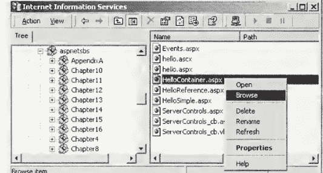

输出应该与下图相似。

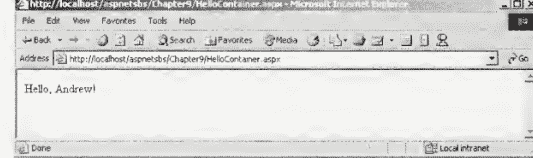

## 以编程式方式向页面添加用户控件

编程式向页面添加控件的步骤有些相似，但比声明式添加控件复杂一些。你仍然需要让控件对页面可用。对于要通过编程方式添加的控件，你可以像上一个示例一样使用 `@ Register` 指令，或者使用 `@ Reference` 指令。由于 `@ Register` 更多用于声明式控件，因此请使用 `@ Reference` 指令。

- 创建一个名为 `HelloReference.aspx` 的新 Web Page，并将其保存到与 `Hello.ascx` 相同的文件夹。

- 向文件中添加以下代码：

```asp
<@ Page Language="vb" %>
<% Reference Control="hello.ascx" %>
```

```html
<html>
<head>
</head>
<body>
</body>
</html>
```

3 保存文件，但不要关闭它。
`@Reference` 指令告诉 ASP.NET 在编译时将用户控件 `hello.aspx` 与页面进行编译和链接。这使得控件可以添加到页面中。由于你将把控件添加到页面，请使用占位符（Placeholder）控件来决定你希望输出出现在哪里。以下是向占位符添加控件的方法：

- 1 在 `HelloReference.aspx` 页面的 `<body>` 部分添加以下行：

```html
<body>
<asp:placeholder id="HelloHolder" runat="server"/>
</body>
```

- 2 保存文件，但不要关闭。
最后我们需要将控件添加到占位符，并调用 `SayHello` 方法，就像我们之前所做的那样。

- 1 在 `HelloReference.aspx` 页面的 `<head>` 部分添加代码：

```asp
<head>
<script runat="server">
Sub Page_Load(Sender As Object, E As EventArgs)
    Dim MyHello As Control = LoadControl("hello.ascx")
    HelloHolder.Controls.Add(MyHello)
    CType(MyHello, Hello).Name = "Andrew"
    CType(MyHello, Hello).SayHello
End Sub
</script>
</head>
```

- 2 保存页面。

## 用户控件与包含文件的比较

用户控件的功能与经典 ASP 中的服务器包含文件类似，但由于与页面模型的集成程度更高，它们要强大得多。用户控件可以有自己的控件，并且可以保存控件的视图状态（ViewState）或自身的视图状态。这允许用户控件在多个控件之间维持状态，而无需页面页面付出。包含文件在 ASP.NET 中仍然可用，主要是为了与经典 ASP 兼容。对于新的应用程序，使用用户控件更有意义。

## 使用服务端控件

与控件一样，ASP.NET 服务端控件允许开发者复用功能。ASP.NET 提供了各种内置的服务端控件，为开发者提供了大量可在应用程序中复用的功能。这些提供了标准 HTML 控件服务端等价物的控件、模拟 Visual Basic 风格控件的高级控件，以及允许对数据输入进行强大稳健验证的验证控件。开发者还可以创建自定义服务端控件来提供自己的功能。

内置服务端控件的优势之一是它们对任何 Web Forms 页面都可用。你不需要通过以下让它们可用：

- 3 浏览 `HelloReference.aspx`。像上一个示例一样，在浏览器地址框中输入保存文件的虚拟目录 URL 加上文件名。页面的输出应与上图相同。


根据需要使用 @ Register 或 @ Reference 指令，这用户控件（以及你将在本节稍后部分看到的自定义服务器控件）中是必要的。这意味着要使用服务器控件，你只需要向页面中添加相应的标签即可。

## 向页面添加 HTML 控件

HTML 控件使用与客户端 HTML 元素相同的语法，但有一个额外之处：`runat="server"` 属性。因此，为了向页面添加 HTMLInputButton（一种映射到 HTML `<input type="submit">`、`<input type="button">` 或 `<input type="reset">` 元素的服务器控件），请遵循以下步骤：

- 1. 使用你喜喜欢的文本编辑器，在与之前的示例相同的文件夹中创建一个新页面。将页面命名为 ServerControls.aspx。

- 2. 向页面添加以下代码：

```
<@ Page Language="vb" %>
<html>
<head>
</head>
<body>
<form runat="server">
<input id="NameButton" type="submit" runat="server"/>
</form>
</body>
</html>
```

- 3. 保存页面，但不要关闭它。你将在后续示例中使用此页面。通过向 HTML `<input>` 元素添加 `runat="server"` 属性，你创建了一个完整的服务器控件，现在可以通过服务器端代码对其进行编程操作。注意，为了方便对你的控件进行编程，你应该始终为它们提供一个 `id` 属性，以指定用于在服务器端代码中标识控件的名称。你还添加了一个服务器端 `<form>` 来封装你的服务器控件，这会导致在点击按钮时页面回传（post back）到服务器。

## 向页面添加 Web 控件

Web 控件使用的语法与 HTML 控件略不同。它与声明式向页面添加用户控件时使用的语法相似，不同之处在于不需要定义自己的标签前缀，所有的 Web 控件都使用前缀 `asp`。例如，向页面添加 TextBox 控件的标签将是 `<asp:TextBox id="myTextBox" runat="server"/>`。

## 注意事项

如果你熟悉 XML 命名空间，你可能会注意到 Web 控件、用户控件、自定义服务器控件和 XML 命名空间之间使用的标签前缀具有相似性。这并非偶然，因为服务器控件和用户控件标签语法的实现是基于 XML 命名空间的。

同样，用户控件和服务器控件标签也必须遵循 XML 标签的语法规则，这些规则要求任何包含文本或子标签的标签都要有起始和结束标签，例如 Label 控件，它允许通过将所需的文本放在起始和结束 `<asp:label>` 标签之间来设置其 `Text` 属性。单标签中的结束符 `/` 可用于不包含文本或子标签的标签，例如 HtmlButton 控件。

要添加一个 TextBox 控件和两个 Label 控件，请遵循以下步骤：

- 在上一个示例创建的 ServerControls.aspx 页面的服务器端表单中添加以下标签：

```
<asp:Label id="NameLabel" runat="server">Name: </asp:Label>
<asp:TextBox id="NameTextBox" runat="server"/>
```

在结束标签 `</form>` 正下方添加另一个 Label 控件。将 `id` 属性设置为“HelloLabel”。页面完成后的 `<body>` 部分应该如下：

```html
<body>
<form runat="server">
<asp:Label id="NameLabel" runat="server">Name: </asp:Label>
<asp:TextBox id="NameTextBox" runat="server"/>
<input id="NameButton" type="submit" runat="server"/>
</form>
<asp:Label id="HelloLabel" runat="server"/>
</body>
```

- 保存页面，但不要关闭它。
有了这些代码，你可以在 TextBox 控件中输入文本并通过点击按钮提交页面。但你仍然必须添加代码来处理在文本框中输入的文本。更多信息请参见第 240 页的“事件处理”。

## 服务器端表单、回传和 ViewState

回传（postback）一词描述了 ASP.NET 页面向自身发送 HTTP POST 请求的能力，通常用于响应用户点击按钮控件或与触发回传的另一个服务器控件交互。回传非常有用，因为允许单个页面既显示 UI 元素（例如供用户填写的表单字段），又处理用户输入的数据。页面开发者可以检查页面级的 `IsPostBack` 属性来确定当前请求是否为回传，然后采取适当的操作。

默认情况下，TextBox 和 DropDownList 等服务器控件会自动使用 ASP.NET 内置的 viewstate 功能从一个请求到另一个请求保存其状态。

回传和 viewstate 功能都需要使用服务器端 `<form>` 函数。HTML 控件和 Web 控件可以添加到 Web Forms 页面中而无需服务器端 `<form>` 元素来封装控件，控件仍然可以正常工作并进行程序化操作。但这些控件将无法参与回传，也无法将其状态保存到页面的 viewstate 中。由于由于原因，在使用服务器控件时，你通常希望将控件封装在服务器端 `<form>` 中。

## 向页面添加自定义服务器控件

自定义服务器控件使用的标签语法与用户控件基本相同，但使用形式略有不同的 `@Register` 指令，以使自定义控件对页面可用。用户控件的 `@Register` 指令包含 `TagPrefix` 和 `Name` 属性以指定用于调用用户控件的标签，以及一个指向包含用户控件的 `.ascx` 文件的 `Src` 属性；而自定义控件的 `@Register` 指令仅包含 `TagPrefix` 属性，控件的标签名称由类名提供。自定义控件的位置由包含编译程序集的 `Assembly` 属性提供。该程序集必须位于 Web 应用程序的 bin 子目录或全局程序集缓存中。自定义控件的 `@Register` 指令还需要一个 `Namespace` 属性，即包含控件的命名空间。

假设你有一个位于 `MyNS` 命名空间、`MyControl.dll` 程序集中的类名为 `ControlClass` 的自定义控件，该控件的 `@Register` 指令如下：

```
<@ Register TagPrefix="MyPrefix" Namespace="MyNS" Assembly="MyControl" %>
```

调用该控件的标签如下：
<MyPrefix:MyControl id="ControlID" runat="server"/>

有关 ASP.NETset的标准服务器控件的更多信息，请参考第 10 章。创建和使用自定义控件将在第 12 章详细介绍。

## 事件处理

经典 ASP 和 ASP.NET 之间最大的区别之一是执行模型。在经典 ASP 中，页面是从上到下的方式执行的。也就是说，除了执行函数的跳转外，经典 ASP 页面是过程性的而不是事件驱动的，类似于 Visual Basic 程序。

ASP.NET 通过服务器控件和回传将事件驱动编程引入 Web 开发，改变了这一点。在运行时，Web Form 中的代码以及与 Web Form 关联的代码类被编译成程序集。执行时，程序集中的代码会触发你可以处理的事件，包括由 Page 类暴露的事件以及由添加的服务器控件触发的事件。


# 页面处理阶段

Web Forms 页面经过以下处理阶段：

- *Init*（初始化）：根据请求初始化页面和控件设置。
- *LoadViewState*（加载视图状态）：恢复早前请求中保存到 viewstate 的服务器控件状态。
- *LoadPostData*（加载发布数据）：处理服务器表单字段中的任何数据，并更新相关的控件属性。
- *Load*（加载）：创建并加载控件，使控件状态与客户端输入的数据匹配。
- *RaisePostDataChangedEvent*（引发数据更改事件）：响应从上一个请求到当前请求的数据变化引发事件。
- *RaisePostBackEvent*（引发回传事件）：处理引起回传的事件，并引发相应的服务器端事件。
- *PreRender*（预渲染）：处理渲染页面之前需要进行的任何更改。在此之后的任何处理将不会被渲染到页面。
- *SaveViewState*（保存视图状态）：在销毁控件之前，将服务器控件状态保存回页面的 viewstate。
- *Render*（渲染）：将控件和页面输出渲染到客户端。
- *Unload*（卸载）：从服务器内存中移除页面及其组成控件。

在这些阶段中，你可以为 *Init*、*Load*、*PreRender* 和 *Unload* 事件添加页面级事件处理器。这些处理器通常分别命名为 *Page_Init*、*Page_Load*、*Page_PreRender* 和 *Page_Unload*。对于其他阶段，例如 *LoadViewState*、*SaveViewState* 和 *Render* ，你可以覆盖适当的方法来自定义这些阶段的处理。覆盖这些方法将在第12章中讨论。

## 处理页面事件

Web Forms 页面处理过程中的每个阶段都会触发一个事件，允许你在该阶段执行自己的处理。

为了说明这一概念，让我们完成在上一个示例中开始的 ServerControls.aspx 页面，通过添加一个事件处理器来使用 TextBox 服务器控件中输入的文本。

1. 如果你之前创建的 ServerControls.aspx 页面尚未打开，请打开它。
2. 在页面的 <head> 部分添加以下代码：

```
<head>
<script runat="server">
    Sub Page_Load(Sender As Object, E As EventArgs)
    If IsPostBack Then
        HelloLabel.Text = "Hello, & " 
        Server.HtmlEncode(NameTextBox.Text) & "!"
    End If
End Sub
</script>
</head>
```

3. 保存页面，然后在浏览器窗口中输入相应的 URL 访问它，如如下所示，或使用 Internet 服务管理器。

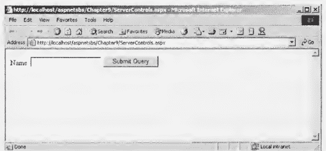

4. 在文本框中输入名称，然后点击提交查询（Submit Query）按钮。页面回传后，输出应该与下图相似。

## 第9章

## 创建 Web Forms

# 243

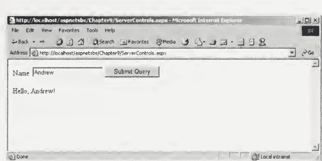

在前面的代码中，你为页面的 Page_Load 阶段添加了一个事件处理器。当页面被处理时，会调用此事件处理器。在事件处理器中，你检查页面级属性 IsPostBack 来判断页面是否由于客户端操作（在本例中为点击按钮）而回传。如果是的话，你将 HelloLabel 的 Text 属性设置为所需的文本，其中包含了你使用 Server.HtmlEncode 工具方法对用户输入的文本进行编码。这有助于防止恶意用户输入 <script> 标签或任何其他 HTML 内容执行你不希望他们执行的操作。使用 HtmlEncode 方法意味着任何此类内容将使用字符的 HTML 等效字符（如小于号 (<)、大于 (>) 和引号）写出。

> **重要**
前面的代码假设页面的 AutoEventWireup 属性已设置为 true。通常情况下，你不需要手动设置此，因为这是从 Machine.config 中 <pages> 配置部分继承的默认设置。然而，由 Visual Studio .NET 创建的页面其 @ Page 指令中的 AutoAuditEvent 属性被设置为 false。这意味着这些页面中的所有事件处理器都必须手动连接到它们要处理的事件上。你将在第10章中学习手动连接事件。

# 处理控件事件

处理由控件引发的事件非常简单。分为两个步骤。第一步与处理页面事件的方式类似，只是不再将事件处理器命名为 Page_eventname，而是使用 controlname_eventname 语法。

## ASP.NET 逐步教程

这与在 Visual Basic 中构造事件处理器的方式类似。第二步是使用控件标签的属性将控件引发的事件关联到事件处理器。

例如，如果你想为 ServerControls.aspx 添加一个事件处理器来处理 TextBox 服务器控件的 Changed 事件，你会在 ServerControls.aspx 的 <script> 块中添加以下代码：

```
Sub NameText_Box_TextChanged(Sender As Object, E As EventArgs)
    HelloLabel.Text &= " This text is different!"
End Sub
```

然后你将在 TextBox 服务器控件标签上添加以下属性：

```
<asp:TextBox id="NameTextBox" OnChanged="NameText_Box_TextChanged" runat="server" />
```

注意我们使用了 &= 运算符来添加 HelloLabel 的 Text 属性。&= 是以下内容的简写：

```
HelloLabel = " This text is different!"
```

如果你将此代码添加到 ServerControls.aspx 并运行，文本更改后的输出将所示。

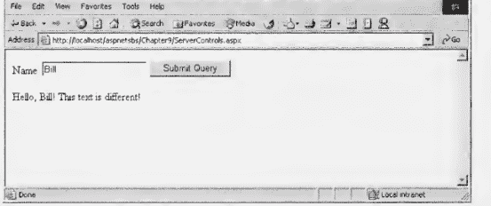

# 处理页面错误

虽然结构化异常处理对于捕获异常很有用（见第4章），但有时你需要在页面级别处理错误。这可以通过一个名为 Page_Error 的特殊处理器来实现。每当页面遇到未处理的异常时，就会引发 Page_Error。在 Page_Error 事件处理器中，你可以使用 Server.GetLastError 方法检查发生的异常并采取行动。

## 页面结构

如前所述，在运行时 ASP.NET 将页面中的代码和任何后置类合并为一个类，然后编译并执行该类。在此过程中，ASP.NET 构建了一个包含页面上所有控件的控件树，其中包含每个 HTML 部分的 Literal控件。

> **重要**
在编译页面时，ASP.NET 会自动创建表示标记的控件，使用 LiteralControl 服务器控件类。这允许在运行时轻松操作这些标记，并且具有更大的灵活性。然而，如果页面包含 <% %> 块，ASP.NET 将不会创建封装这些标记的控件。如果你想作为 LiteralControls 操作标记，请不要使用 <% %> 块。

控件树的顶部是代表页面的控件，其 ID 为 __PAGE。下面是页面 Controls 集合的子控件。根据控件类型，每个子控件可能拥有自己的包含子控件的 Controls 集合，依此类推。这种结构使得在运行时查找和操作控件变得容易。

## 查看页面

查看页面控件树的最方法是开启页面跟踪（tracing）。要查看之前创建的 ServerControls.aspx 页面的控件树，请按照以下步骤操作：

1. 使用文本编辑器打开 ServerControls.aspx。
2.为 @ Page 指令添加 Trace 属性并将其值设置为 true。完成后的指令如下：
<% Page Language="vb" Trace="true" %>
3. 保存文件并浏览页面。Server-Controls.aspx 跟踪输出中的控件树部分所示。注意，当控件通过其 id 标签属性被显式赋予 ID 时，控件树中将使用该 ID。


## ASP.NET 逐步教程

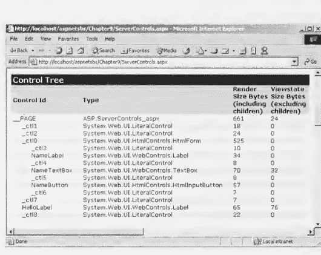

# 在运行时添加和操作控件

得益于 ASP.NET 在运行时构建的控件树，你可以轻松地在运行时添加、删除或操作控件，即使你不知道控件的名称。例如，你可以使用页面的 *Controls* 集合的 *Add* 方法在运行时向页面添加新控件。

```vb
Dim MyTextBox As New TextBox
Page.Controls.Add(MyTextBox)
```

如果你想将新控件放置在控件树的特定位置，可以使用 *AddAt* 方法。

```vb
Dim MyTextBox As New TextBox
Page.Controls.AddAt(2, MyTextBox)
```

若要通过名称删除控件，可以使用 *Remove* 方法。
```vb
Page.Controls.Remove(MyTextBox)
```

若要通过索引删除控件，可以使用 *RemoveAt*。

```vb
Page.Controls.RemoveAt(2)
```

若要通过 ID 定位特定的控件，可以使用页面或包含目标控件的控件的 *FindControl* 方法。

```vb
MyControl = Page.FindControl("TextBox")
```

注意，*FindControl* 返回一个 *Control* 类型的对象（而不是使用的特定控件类型），在使用特定控件类型的属性或方法之前，你需要将其转换为相应的控件类型。

# 在 Web Forms 中使用后代码（Code-Behind）

除了 ASP.NET 中 <script> 块和 <% %> 渲染块的更改使得编写整洁的代码更容易，ASP.NET 还引入了一个全新的概念——后代码，它允许开发者将可执行代码与 HTML 标记和服务器控件标签完全分离。

Web Form 的后代码由一个文件组成，其中包含一个派自 Page 类的类，并可选地包含在命名空间中。Web Form 在运行时继承后代码类，允许 Web Form 及其后代码类编译成单个程序集进行执行。

# 将代码与 UI 分离

为了向你证明这种方法的有效，让我们最后使用一次 ServerControls.aspx 页面。要在此页面中使用后代码，请按照以下步骤操作：

1. 在文本编辑器中打开 ServerControls.aspx。
2. 使用文本编辑器创建两个新文件，ServerControls.cb.aspx 和 ServerControls_cb.vb。
3. 复制 ServerControls.aspx 中的所有文本并粘贴到 ServerControls_cb.aspx，然后关闭 ServerControls.aspx。
4. 剪切 ServerControls_cb.aspx 中 <script> 块包含的所有代码并粘贴到 ServerControls_cb.vb，然后删除 <script> 标签。
5. 在 ServerControls_cb.aspx 的 @ Page 指令中添加 Src 和 Inherits 属性，以帮助 ASP.NET 定位后代码类文件。

```asp
<% Language="vb" Src="ServerControls_cb.vb"
Inherits="ServerControls" %>
<html>
<head>
</head>
<body>
<form runat="server">
<asp:Label id="NameLabel" runat="server">Name:</asp:Label>
<asp:TextBox id="NameTextBox"
TextChanged="NameTextBox_TextChanged" runat="server"/>
<input id="NameButton" type="submit" runat="server"/>
</form>
```

```asp
<asp:Label id="HelloLabel" runat="server"/>
</body>
</html>
```

7. 将以下代码添加到 ServerControls.cb.vb 中，位于你在步骤 4 中粘贴的文本之前：

```vb
Imports System
Imports System.Web
Imports System.Web.UI
Imports System.Web.UI.WebControls
```

```vb
Public Class ServerControls
Inherits Page
Public HelloLabel As Label
Public NameTextBox As TextBox
```

8. 在 ServerControls.cb.vb 中，位于你在步骤 4 中粘贴的文本之后添加 End 语句。完成后的代码如下：

```vb
Imports System
Imports System.Web
Imports System.Web.UI
Imports System.Web.UI.WebControls

```vb
Public Class ServerControls
Inherits Page
Public HelloLabel As Label
Public NameTextBox As TextBox

Sub Page_Load(Sender As Object, E As EventArgs)
  If IsPostBack Then
    HelloLabel.Text = "Hello, " & Server.HtmlEncode(NameTextBox.Text) & "!"
  End If

```vb
Sub NameTextBox_TextChanged(Sender As Object, E As EventArgs)
  HelloLabel.Text += " This text is different!"
  End Sub
End Class
```

9. 保存两个文件，并浏览 ServerControls_cb.aspx。输出应与之前的插图相同。

在此示例中，你将事件处理代码分离到了后代码类文件中。为了使之工作，你必须采取一些额外步骤。你向后代码文件添加了 Imports 语句，允许你使用 Label 和 TextBox 等类的名称，而无需使用本章前面介绍的 @ Import 指令显式添加命名空间。不同之处在于，与 Web Forms 页面不同，后代码文件必须显式导入任何命名空间以便在文件中使用类（除非所有类引用都使用类的完全限定名）。

你还添加了 Class 语句来定义类 ServerControls，以及 Inherits 语句，该语句指定了你想继承 Page 类。Src 属性告诉 ASP.NET 在何处定位后代码类文件。Inherits 属性告诉 ASP.NET 你想要继承哪个类。

## 第 9 章快速参考

| 目标 | 操作方法 |
|---|---|
| 修改 ASP.NET 运行时行为 | 在页面上添加 @ Page 指令并设置属性。 |
| 在不显式指定命名空间的情况下类 | 在 Web Form 中添加 @ Import 指令并指定命名空间。在 Basic 后代码中添加 Imports 语句。在 C# 后代码中添加 using 语句。 |
| 使用户控件或自定义服务器控件可用 | 在页面上添加 @ Register 指令并设置相应的属性。 |
| 启用输出缓存 | 在页面上添加 @ OutputCache 指令并设置属性。 |
| 创建用户控件 | 创建扩展名为 .ascx 的文件，包含所需的 HTML 标记、控件和代码。可选添加 @ Control 指令以修改控件的运行时行为。 |
| 在页面中创建服务器端函数 | 创建具有 runat="server" 属性的 <script> 块并将函数放在其中。 |
| 处理页面事件 | 在服务器 <script> 块中添加具有相应签名（如 Page_eventname）的事件处理器。 |

# 第 10 章

# 使用服务器控件

+ 本章你将学习：
* 两种主要服务器控件的作用：HTML控件和Web控件
* 如何使用特殊的Web控件，例如日历控件和验证服务器控件
* 如何对服务器控件进行数据绑定
* 如何在运行时操作服务器控件
* 如何处理服务器控件事件

第 9 章查看了 Web Forms 页面的构建，包括服务器控件的一些用法。本章将深入探讨服务器控件的使用。

## 控件类型

正如在前章中简要介绍的，ASP.NET内置服务器控件分为两组：HTML控件和Web控件，每组包含在自己的命名空间中。本节将讨论每组中的可用控件，并展示何时以及如何使用每种控件。还将讨论一些特殊的Web控件，包括Calendar和AdRotator控件。

## HTML控件

HTML控件与标准HTML元素建立1对1的映射。然而，某些HTML元素并没有直接映射到特定的HTML控件。你为什么想使用HTML控件而不是直接编写HTML呢？


你之所以这样做，是因为你可以通过程序更改控件的属性，在运行时轻松地操作页面外观和功能。

HTML 控件位于 `System.Web.Ui.HtmlControls` 命名空间，该空间 Web Forms 页面自动可用。下表显示了直接映射的 HTML 元素。

| HTML 元素 | 控件类型 | 用 |
| --- | --- | --- |
| <a> | HtmlAnchor | 允许程序化访问 HTML 锚点元素。触发 `ServerClick` 事件。 |
| <button> | HtmlButton | 允许程序化访问 HTML 按钮元素。该元素定义在 HTML 4.0 规范中，仅支持 Internet Explorer 4.0 及更高版本。触发 `ServerClick` 事件。 |
| <form> | HtmlForm | 允许程序化访问 HTML 表单元素。作为其他服务器控件的容器。任何需要参与回传（postbacks）的控件都应该包含 `HtmlForm` 控件中。 |
|  | HtmlImage | 允许程序化访问 HTML 图像元素。 |
| <input type="button"><br><input type="submit"><br><input type="reset"> | HtmlButton | 允许程序化访问按钮、`submit` 和 `reset` 输入类型的 HTML 输入元素元素。触发 `ServerClick` 事件。 |
| <input type="checkbox"> | HtmlInputCheckBox | 允许程序化访问 `checkbox` 输入类型的 HTML 输入元素元素。触发 `ServerChange` 事件。 |
| <input type="file"> | HtmlInputFile | 允许程序化访问 `file` 输入类型的 HTML 输入元素元素。 |

# HTML 元素到 HTML 控件的映射

| HTML 元素 | 控件类型 | 用途 |
| --- | --- | --- |
| `<input type="hidden">` | HtmlInputHidden | 允许程序化访问 *hidden* 输入类型的 HTML 输入元素元素。 <br>暴露 *ServerChange* 事件。 |
| `<input type="image">` | HtmlInputImage | 允许程序化访问 *image* 输入类型的 HTML 输入元素元素。 <br>暴露 *ServerClick* 事件。 |
| `<input type="radio">` | HtmlInputRadioButton | 允许程序化访问 radio 输入类型的 HTML 输入元素元素。 |
| `<input type="text">`<br><input type="password">` | HtmlInputText | 允许程序化访问 *text* 和 *password* 输入类型的 HTML 输入元素元素。 <br>暴露 *ServerClick* 事件。 |
| `<select>` | HtmlSelect | 允许程序化访问 HTML select 元素元素。 <br>暴露 *ServerChange* 事件。 |
| `<table>` | HtmlTable | 允许程序化访问 HTML 表格元素。注意某些子表（如 `<col>`, `<tbody>`, `<thead>`, 和 `<tfoot>`）并不不被 *HtmlTable* 控件支持。 |
| `<td>` 和 `<th>` | HtmlTableCellRow | 允许程序化访问 HTML 表格单元格元素。 |
| `<tr>` | HtmlTableRow | 允许程序化访问 HTML 表格行元素。 |
| `<textarea>` | HtmlTextArea | 允许程序化访问 HTML 文本区域元素。<br>暴露 *ServerChange* 事件。 |
| `<body>`, `<div>`, `<span>`,`<br><font>`, `etc.` | HtmlGenericControl | 允许程序化访问任何未由其特定的 HTML 控件类表示的 HTML 元素。 |

每个 HTML 控件类都派生自通用的 `HtmlControl` 类。此类提供了所有 HTML 控件通用的方法和属性，例如 `Attributes` 集合，它提供了标签定义中包含的任何属性的名称/值对集合（例如 `id="myControl"` 或 `border="1"`）。各个控件类随后会暴露其所代表的 HTML 元素的特定附加方法和属性。例如，`HtmlAnchor` 控件暴露了一个 `Href` 属性，允许你实际上地修改锚点标签链接的 URL，以及一个 `Target` 属性，它允许你修改锚点标签的目标。

## 重要

由于 HTML 控件没有为每个 HTML 元素暴露强类型控件等，你可以使用 `Attributes` 集合程序化地为任何 HTML 控件添加标签属性。这允许你设置未以声明方式由 HTML 控件暴露的标签属性。许多 HTML 控件还暴露了你可以响应的事件（继承自 `HtmlControl` 的标准事件）。有两个事件：`ServerClick` 和 `ServerChange`。HTML 控件支持这些事件。

## 注意

与 Web Forms 页面中仅处理服务器端的控件不同，HTML 控件可以同时处理服务器端事件和 HTML 元素的客户端事件。例如，`InputButton` 控件支持服务器端 `ServerClick` 和客户端 `Click` 事件。要处理两者，你会使用以下标签声明：

```
<input type="submit" onclick="client_handler" serverclick="server"/>
```

这允许你在页面回传到服务器之前在客户端执行操作。

由于它们与 HTML 元素的紧密映射，HTML 控件提供了从静态 HTML 转向 ASP.NET 服务器控件的最快、最简单的方法。

## ASP.NET 逐步步骤

在 Web Forms 页面中，关于大小写敏感有三个基本规则：

- 命名空间和类名是大小写敏感的。例如，C# 是大小写敏感的。
- 标签名称和属性不敏感。
- `<script>` 块或代码后类中的控件名称可能是大小写敏感的，取决于你使用的语言是否是大小写敏感。例如，在 C# 代码中使用错误的控件名称或属性会导致错误，例如“无法找到命名空间 `<namespace>`”。

# HTML 控件示例

HTML 控件对于动态添加和删除 `<select>` 项目非常有用。在接的示例中，你将看到如何在由 `HtmlControl` 创建的列表中动态动态添加和删除项目：

- 在你喜欢的文本编辑器中创建一个名为 `HtmlSelect.aspx` 的新文本文件。
- 将以下 HTML 添加到文件中：

```html
<html>
<body>
<form>
你最喜欢的冰淇淋是什么？<br/>
<select id="IceCream" size="1">
  <option>Chocolate</option>
  <option>Strawberry</option>
  <option>Vanilla</option>
</select>
<input id="Enter" type="button" value="Enter">
<h3><span id="Fave"></span></h3>
</form>
</body>
</html>
```

-3 给 `<form>`, `<select>`, `<input>`, 和 `<span>` 元素添加 `runat="server"` 属性以将它们转换为 HTML 控件。完成此步骤后，页面应该如下：

```html
<html>
<body>
<form runat="server">
  你最喜欢的冰淇淋是什么？<br/>
<select id="IceCream" size="1" runat="server">
  <option>Chocolate</option>
  <option>Strawberry</option>
  <option>Vanilla</option>
</select>
<input id="Enter" type="button" value="Enter" runat="server">
<h3><span id="Fave" runat="server"></span></h3>
</form>
</body>
</html>
```

-4 向页面添加 `Page_Load` 和 `Enter_Click` 事件处理程序，以向 `HtmlSelect` 控件添加新项目并显示用户的选择。（以下代码应该放在第一个 `<html>` 标签和随后的 `<body>` 标签之间。）

```html
<html>
<head>
<script language="vb" runat="server">
  Sub Page_Load(Sender As Object, E As EventArgs)
    Body.Attributes("bgcolor") = "Red"
    HelloFont.Attributes("size") = "7"
    HelloFont.Attributes("color") = "Blue"
  End Sub
</script>
</head>
<body id="Body" runat="server">
<font id="HelloFont" runat="server">Hello, World!</font>
</body>
</html>
```


## ASP.NET 逐步教程

End If
End Sub
Sub Enter_Click(Sender As Object, E As EventArgs)
  Fave.InnerHtml = "您的最爱是 " & IceCream.Value & ""
End Sub

```
<script>
</head>
```

最后在 `<input>` 标签中添加了 `OnServerClick` 属性，将 HtmlButton 控件的 ServerClick 路由到您的事件处理程序。完整的标签所示：

```
<input id="Enter" type="button"
OnServerClick="Enter_Click" runat="server">
```

保存页面，然后访问它。输出应该与下图相似。

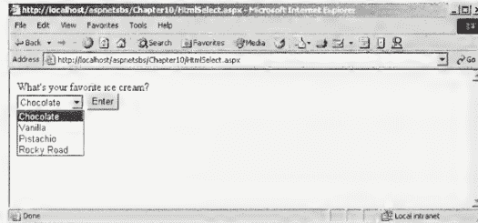

# Web 控件 (Web Controls)

Web 控件是 ASP.NET 皇冠上的明珠。这些服务器控件通过提供类似于 Visual Basic 的丰富事件驱动编程模型，为您提供了前所未有的生产力。Web 控件位于 `System.Web.WebControls` 命名空间，该命名空间对所有 Web Forms 自动可用。

Web 控件涵盖了广泛的功能，从简单的 `Button`、`TextBox` 和 `Label` 控件，到丰富的 `ListBox` 和 `DropDownList` 控件，再到更 `Calendar` 和 `AdRotator` 控件。还有专门为数据绑定设计的特殊控件，包括 `DataGrid`、`DataList` 和 `Repeater` 控件。您将在后面的章节中看到这些类型的控件示例。

> 注意
> 虽然 Web Forms 页面自动可以使用 `System.Web.WebControls` 和 `System.Web.HtmlControls` 命名空间，但与其关联的代码后台（code-behind）页面并非如此。如果您想在不使用全限定类名的情况下使用这些命名空间中的控件，需要在代码后台类中添加适当的语句（Visual Basic 使用 `Imports`；C# 使用 `using`）来导入命名空间。

# 在页面上添加服务器控件

正如您在上一章看到的，向页面添加服务器控件非常简单。有两种不同的方法向页面添加控件：声明式（declaratively）和程序式（programmatically）。每种方式都允许您按需设置控件的属性，并且都可以用于将控件放置在页面上的任何位置。

# 声明式添加控件

正如您在本章早期看到的，ASP.NET HTML 控件使用的语法与标准 HTML 元素基本相同，但 `runat` 属性除外，它始终被设置为 `server`。Web 控件也使用基于标签的语法，但带有 `runat:` 前缀。因此，您可以使用以下语法声明一个 HtmlInput 服务器控件：

```
<input id="Enter" type="button" value="Enter"
OnClick="Enter_Click" runat="server">
```

```
<asp:button id="Enter" Text="Enter" OnClick="Enter_Click"
runat="server" />
```

注意，在第二个示例中，在 `>` 字符之前添加了 `/` 字符。当您不完整的闭合标签时，这是要求的。这是一个闭合标签的示例：

```
<asp:label id="myLabel" runat="server">你好!</asp:label>
```

您将字面量 Hi there! 封装在开始标签和结束标签之间。该字面量变为 Label 控件的 `Text` 属性。Label 控件在客户端渲染为 `<span>`，它是许多控件之一，允许您在开始和结束标签之间将字面量封装在 `Text` 属性或其他控件属性中。其他控件包括 `Literal`、`Panel`、`Placeholder` 和 `TextBox` 控件。

# 选择正确的控件

由于有两组不同的服务器控件可供选择，您可能会好奇如何为应用程序选择正确的控件。通常，如果您对处理客户端事件感兴趣，或者正在将 HTML 元素转换为服务器控件，您应该查看 HTML 控件。如果您熟悉 Visual Basic 编程模型，Web 控件提供了一个与该模型非常贴合的模型。Web 控件还提供了额外的功能（例如验证），并为定制提供了坚实的基础。

您可以使用单标签语法实现相同的结果。
<asp:label id="myLabel" text="你好!" runat="server"/>

当您声明式地向页面添加控件时，您正在做两件事：为控件提供足够的信息以便正确地创建和初始化，以及为控件设置属性。第一部分通过 `asp` 前缀和标签（控件）名称加上 `id` 和 `runat` 属性来实现。创建服务器控件只需要前缀/标签名和 `runat` 属性，但如果您想在服务器端代码中引用控件，则需要 `id` 属性。

一旦提供了这些最小信息，您就可以通过向标签声明中您要设置的属性添加属性来添加额外属性。例如，如果您想将 Label 的 `Visible` 属性设置为 `false`（以便以声明方式设置消息并在稍后在服务器端代码中通过设置为可见来显示），您将如下所示修改声明：

```
<asp:label id="myLabel" text="你好!" visible="false" runat="server"/>
```

某些功能丰富的控件（如 `DataGrid` 控件）使用主定义中的属性和子标签（例如可与 `DataGrid` 或 `DataList` 控件配合使用的 `ItemStyle` 和 `AlternatingItemStyle` 标签）来定义控件的属性。您将在本章中看到这些示例。

# 程序式添加和操作控件

虽然声明式地向页面添加控件可能是最直接的方法，但您也可以程序式地向页面添加控件并对其操作。这为您提供了更大的控制力，因为您可以选择如何以及何时添加。

# 第10章 使用服务器控件 261

尽管声明式地向页面添加控件可能是最直接的方法，但您也可以程序式地向页面添加控件并对其操作。这为您提供了更大的控制力，因为您可以选择如何以及何时添加。

程序式添加控件就像是创建一个控件的实例并将其添加到 Controls 集合中，如下：

```
Dim myLabel As New Label'您也可以使用 Controls
Page.Controls.Add(myLabel)
myLabel.Text = "你好!"
```

当代码添加到 Web Forms 页面的 `Page_Load` 事件时，产生的输出如下。

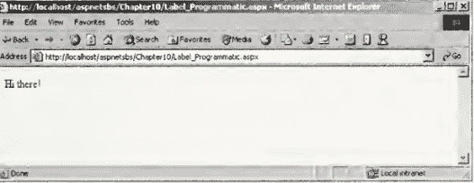

正如您所见，代码成功创建了 Label 控件并将其文本设置为“你好！”。唯一的问题是，按照这种写法，控件被添加到了 `</body>` 和 `<html>` 标签之后，发送到浏览器的代码是：

```
<html>
<head>
</head>
<body>
</body>
</html>
<span>你好！</span>
```

虽然这种输出在大多数浏览器中仍然会被渲染，但它并不是理想的，因为它们是不正确的 HTML 语法。当您处理声明式和程序式控件时，这会产生更严重的问题。那么该怎么办？

一种方案是调用 Controls 集合的 `AddAt` 方法，而不是 `Add`。`AddAt` 接受两个参数：表示应添加控件的位置的整数，以及要添加的控件名称。

```
Page.Controls.Add(3, myLabel)
```

问题在于，为了在您想要的位置渲染控件，您必须知道控件在集合中的精确位置。这并不总是可行的。

确保程序式创建的控件出现在您想要的地方的简单方法是使用 `Placeholder` 控件定位页面内容。`Placeholder` 控件没有自己的 UI。`Placeholder` 控件内的所有内容都由其 Controls 集合中的控件渲染。因此，为了确保之前示例中的控件显示在 HTML 文档的正文中，可以使用以下代码：

```
<@ Page Language="vb" %>
<html>
<head>
<script runat="server">
Sub Page_Load()
  Dim myLabel As New Label
  myPH.Controls.Add(myLabel)
  myLabel.Text = "你好!"
End Sub
</script>
</head>
<body>
<asp:placeholder id="myPH" runat="server" />
</body>
</html>
```

这产生了以下 HTML 输出：

```html
<html>
<head>
</head>
<body>
<span>你好！</span>
</body>
</html>
```

多个控件可以添加到同一个占位符中，同一个页面也可以使用多个占位符。


## 使用 Visual Studio .NET 添加控件

当然，将 ASP.NET 服务器控件添加到 Web Forms 中（并发现控件可用的所有属性）最简单的方法是使用 Visual Studio .NET 工具箱（Toolbox）将控件添加到页面中。下图显示了工具箱的 Web Forms 选项卡。

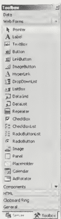

按照以下步骤在 Visual Studio .NET 中为 Web Forms 页面添加服务器控件：

- 1. 打开 Visual Studio .NET 并打开包含您要编辑的页面的解决方案。
- 2. 在解决方案管理器（Solution Explorer）窗口中双击页面，打开您想要添加服务器控件的页面。
- 3. 点击直接位于文本/设计编辑器下方的设计（Design）按钮，确保页面显示在设计模式下。
- 4. 将鼠标指针悬停在 IDE 的工具箱选项卡上以打开工具箱，并点击它选择工具箱的 Web Forms 选项卡。
- 5. 双击所需的服务器控件。如果页面处于流布局（FlowLayout）模式，控件将插入光标所在的位置；如果页面处于网格布局（GridLayout）模式，则将插入页面的左上角。在网格布局模式下，您也可以从工具箱中选择控件并像绘制 Visual Basic 风格控件一样将其绘制在表上。
- 6. 保存页面。

## 为控件应用样式

一旦您将控件添加到页面，最终您可能想要更改这些控件的显示方式。例如，您可能想让 Label 控件的文本变为红色。只需将控件的 `ForeColor` 属性设置为 `Red`，如下：

```html
<label id="myLabel" forecolor="red" runat="server">
Hi there!
</label>
```

如果你想做更复杂的操作呢？虽然像 Label 控件暴露了 `ForeColor` 和 `BackColor` 等属性，但有时这样做是不够的。假设你想将在其他地方定义的级样式表（CSS）类（页面顶部的 Style 块或链接样式表中）应用于服务器控件。或者您可能只想直接在控件中使用 CSS 样式。

对于这些情况，在 WebControl 基类中定义（并在所有 WebControl 类继承）的 `CssClass` 和 `Style` 属性大派用场。通过 `CssClass` 属性，您可以设置如下的 CSS 类：

```css
<style type="text/css">
.mylabel { font-size:24pt; font-weight:bold; color:red; }
</style>
```

您可以使用此方法格式化控件：

```html
<label id="myLabel" class="mylabel" runat="server">
Hi there!
</label>
```

这种技术对于链接的样式表同样有效。

`Style` 属性可以如下直接指定 CSS 样式：

```html
<label id="myLabel"
style="font-size:24pt; font-weight:bold; color:red;" runat="server">
Hi there!
</label>
```

注意，无论您是使用 `ForeColor` 属性设置 Label 控件的颜色，还是声明式地使用 `CssClass` 或 `Style` 属性，结果都会渲染为生成的 `<span>` 标签上的类或样式属性，该标签是 WebControl 控件的客户端表示。

## note

尽管您可以使用属性名作为声明控件的标签的属性来声明式设置控件属性，但某些复合属性（由另一个类表示的属性）需要您使用稍不同的属性语法。

一个很好的例子是 `Font` 属性（在 WebControl 类中定义），它返回一个 `Fontinfo` 类的实例。为了修改继承自 WebControl 的控件（如 Label 控件）的字体，您使用来自 `form-<propertyName>` 的属性，如下：

```html
<asp:label id="myLabel" font-name="arial" runat="server">
```

您也可以使用 `form <controlname>.Font.<propertyName>` 以编程方式访问这些属性，如下：

```csharp
myLabel.Font.Name = "Arial"
```

最后，您还可以根据控件的客户端表示对控件应用样式。如所述，Label 控件在客户端被渲染为 `<span>` 标签，因此，如果您定义了一个适用于所有 `<span>` 元素的样式，那么您的 Label 控件也将使用该样式。只要您知道特定控件的客户端表示（可以通过从浏览器查看页面源代码来获取），就可以创建一个样式表来格式化该控件。

## 额外的 Web 控件示例

Web 控件非常易于使用并提供了极大的灵活性。到此为止，您只使用了简单的示例。本节将查看更复杂的示例以演示各种 Web 控件的使用。第一个示例将向您展示如何使用服务器控件通过简单邮件传输协议（SMTP）为 ASP.NET Web Form 设置发送电子邮件表单。第二个示例将向您展示如何使用 Panel 控件在单个 Web Forms 页面内模拟向式的多页界面。

## 发送邮件

Web 应用的一个常见任务是向客户或访问者发送电子邮件。通常，这些电子邮件是自动生成的，不需要特定的数据输入。但网站操作员也希望有一种通过网站发送快速的方法。Web 控件结合 .NET 的 `SmtpMail` 和 `MailMessage` 类，可以使过程变得快速。


## 第 10 章 使用服务器控件

```html
<tr>
  <td>
    <asp:button id="Send" text="Send" runat="server"/>
  </td>
  <td>
    <input id="reset" type="reset" value="Reset Form" runat="server"/>
  </td>
</tr>
```

如果你保存并浏览该文件，输出结果将如底图片所示。

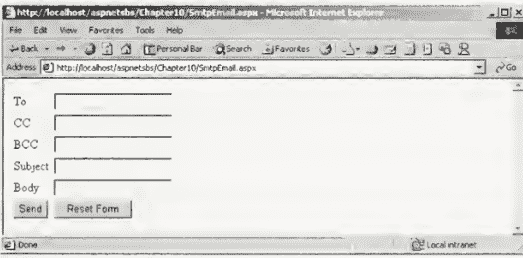

此输出唯一的实际问题是 Body 文本框对于输入电子邮件正文来说太小了。你可以通过为 Body TextBox 控件添加属性来解决这个问题。

```asp
<asp:textbox id="Body" textmode="multiline" rows="10" columns="60" runat="server"/>
```

现在你已经完成了 UI，你需要添加代码以便在点击 Send 按钮时发送邮件。通过在 `<head>` 和 `</head>` 标签之间添加一个服务器端的 `<script>` 块来实现：

```asp
<script runat="server">
</script>
```

为 Button 控件的 Click 事件添加另一个事件处理器。

```asp
<script runat="server">
  Sub Send_Click(Sender As Object, e As EventArgs)
    '在此处编写处理事件的代码
    Response.Write("Send Clicked!")
  End Sub
</script>
```

11. 为 Button 控件添加一个属性以将事件映射到事件处理器，然后保存文件。

```asp
<asp:button id="Send" text="Send" onclick="Send_Click" runat="server"/>
```

12. 如果刷新页面并点击 Send 按钮，输出应该如如下所示。（如果你收到 "Send Clicked!" 消息，说明事件生效了）。

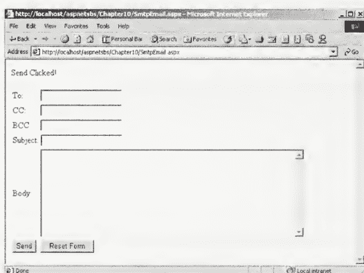

13. 该过程的最后一部分是添加代码使用用户输入的数据发送电子邮件。首先，添加一个 @ Import 指令来导入 `System.Web.Mail` 命名空间，这样你就可以在每次都使用命名空间的情况下引用它的类。该指令应该直接放在页面顶部的 @ Page 指令下方。

```asp
<@ Import Namespace="System.Web.Mail %>
```

14. 最后，将事件处理器中的 `Response.Write` 语句替换为以下代码。它创建了一个 `MailMessage` 类的实例，设置了必要的属性，然后使用 `SmtpMail` 类的 `Send` 方法发送消息。（由于 `Send` 方法是静态方法，因此无需创建 `SmtpMail` 实例即可使用该方法）。邮件发送后，代码将通过将每个控件的 `Visible` 属性设置为 `False` 来隐藏所有表单控件，并添加一个 `HyperLink` 控件链接回原始页面以便根据需要发送另一封邮件。注意，你需要使用 `Mail.From` 指定一个有效的电子邮件地址，使用 `SmtpMail.SmtpServer` 指定运行 SMTP 的可用服务器名称（除非本地机器正在运行 SMTP，则可以删除此行）。

```vb
'创建 MailMessage 实例，设置属性并发送
Dim Mail As New MailMessage
Mail.To = ToText.Text
Mail.CC = CCText.Text
Mail.BCC = BCCText.Text
Mail.Subject = SubjectText.Text
Mail.Body = BodyText.Text
Mail.From = <valid email address>
SmtpMail.SmtpServer = <local SMTP server>
SmtpMail.Send(Mail)

'使用第一个标签显示状态
ToLabel.Text = "Mail Sent"
```

```vb
'隐藏其他控件
ToText.Visible = False
CCLabel.Visible = False
CCText.Visible = False
BCCLabel.Visible = False
BCCText.Visible = False
SubjectLabel.Visible = False
SubjectText.Visible = False
BodyLabel.Visible = False
BodyText.Visible = False
Send.Visible = False
Reset.Visible = False
```

```vb
'添加 Hyperlink 控件允许发送另一封邮件
Dim Link As New HyperLink
Link.Text = "Click here to send another email."
Link.NavigateUrl = "SmtpEmail.aspx"
Page.Controls.Add(Link)
```

15. 保存并刷新页面。现在你应该能够通过填写字段单（至少必须在 To、CC 或 BCC 字段中有一个电子邮件地址）并点击 Send 按钮来发送邮件。输出应该类似于下面，并且你有一个返回主页的链接。

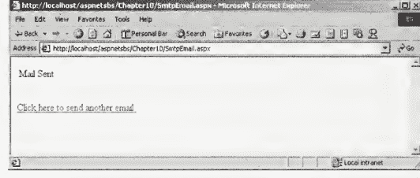

这个示例展示了在 Web Form 上使用服务器控件发送电子邮件是多么简单，但它也有几个缺点。其之一是如果你不在 To、CC 或 BCC 字段中输入地址，就会收到错误。另一个是在发送邮件后需要大量的代码来隐藏所有控件。你可以通过添加 Label 控件来修复第二个缺点。

## 注册向导

Web 程序的另一个常见需求是为用户提供便捷的注册方式。注册允许你为访问者提供个性化服务、保存的购物车以及其他有价值的服务。为了尽可能简单化，你可能希望使用与 Windows 界面类似的多页格式。这种类型的界面对于 Windows 用户来说会非常熟悉。下面的列表显示了作为 ASP.NET Web Form 实现的简单注册向导的代码。


ReviewState.Text += State.Text
ReviewZip.Text += Zip.Text

```
End Select
Sub Previous_Click(Sender As Object, e As EventArgs)
Select Case Sender.Parent.ID
Case "Page2"
Page2.Visible = False
Step2.Font.Bold = False
Page1.Visible = True
Step1.Font.Bold = True
Case "Page3"
Page3.Visible = False
Step3.Font.Bold = False
Page2.Visible = True
Step2.Font.Bold = True
```

```
End Select
End Sub
</script>
<style type="text/css">
div {
background:silver;
width:400px;
border:2px outset;
margin:5px;
padding:5px;
}
</style>
```

```
<head>
<body>
<form runat="server">
<asp:label id="RegWiz" text="注册向导"
font-bold="true" font-size="16" font-name="verdana"
runat="server"/>
<br/>
<asp:label id="Step1" text="步骤 1：输入个人信息"
font-name="verdana" runat="server"/>
<br/>
<asp:label id="Step2" text="步骤 2：输入地址信息"
font-name="verdana" runat="server"/>
```

# 第 10 章 使用服务器控件 277

```
<br/>
<asp:label id="Step3" text="步骤 3：审核"
font-name="verdana"
runat="server"/>
<br/>
<asp:panel id="Page1" runat="server">
<table align="center">
<tr>
  <td>
    <asp:label id="FirstNameLabel" text="姓:"
    runat="server"/>
  </td>
  <td>
    <asp:textbox id="FirstName" runat="server"/>
  </td>
</tr>
<tr>
  <td>
    <asp:label id="MiddleNameLabel" text="中间名:"
    runat="server"/>
  </td>
  <td>
    <asp:textbox id="MiddleName" runat="server"/>
  </td>
</tr>
<tr>
  <td>
    <asp:label id="LastNameLabel" text="名:"
    runat="server"/>
  </td>
  <td>
    <asp:textbox id="LastName" runat="server"/>
  </td>
</tr>
<tr>
  <td>
    <asp:label id="EmailLabel" text="邮箱:"
    runat="server"/>
  </td>
  <td>
    <asp:textbox id="Email" runat="server"/>
  </td>
</tr>
</table>
</asp:panel>
```

```
  </td>
<tr>
<td colspan="2" align="center">
  <asp:button id="P1Previous" Text="上一步"
  enabled="false" onclick="Previous_Click"
  runat="server"/>
  <asp:button id="P1Next" Text="下一步"
  onclick="Next_Click" runat="server"/>
  <input id="P1Reset" type="reset" runat="server"/>
</td></td></td>
</tr>
</table>
</asp:panel>
<asp:panel id="Page2" visible="false" runat="server">
<table align="center">
  <tr>
    <td>
      <asp:label id="AddressLabel" text="街道地址"
      runat="server"/>
    </td>
    <td>
      <asp:textbox id="Address" runat="server"/>
    </td>
  </tr>
  <tr>
    <td>
      <asp:label id="CityLabel" text="城市"
      runat="server"/>
    </td>
    <td>
      <asp:textbox id="City" runat="server"/>
    </td>
  </tr>
  <tr>
    <td>
      <asp:label id="StateLabel" text="州"
      runat="server"/>
    </td>
    <td>
      <asp:textbox id="State" runat="server"/>
    </td>
  </tr>
</table>
```

# 第 10 章

# 使用服务器控件

# 279

```
  </td>
</tr>
<td>
  <asp:label id="ZipLabel" text="邮政编码:"
  runat="server"/>
</td>
<td>
  <asp:textbox id="Zip" runat="server"/>
</td>
</tr>
<tr>
  <td colspan="2" align="center">
    <asp:button id="P2Previous" Text="上一步"
    onclick="Previous_Click" runat="server"/>
    <asp:button id="P2Next" Text="下一步"
    onclick="Next_Click" runat="server"/>
    <input id="P2Reset" type="reset" runat="server"/>
  </td>
</tr>
</table>
</asp:panel><panel id="Page3" visible="false" runat="server">
<table align="center">
<tr>
  <td colspan="2">
    <asp:label id="ReviewName" text="姓:"
    runat="server"/>
  </td>
</tr>
<tr>
  <td colspan="2">
    <asp:label id="ReviewName" text="中间名:"
    runat="server"/>
  </td>
</tr>
<tr>
  <td colspan="2">
    <asp:label id="ReviewName" text="名:"
    runat="server"/>
  </td>
</tr>
```
（图 50a7de154138ea336945aec2411_98.png）

```
  </tr>
<tr>
  <td>
    <asp:label id="ReviewEmail" text="邮箱:"
    runat="server"/>
  </td>
</tr>
<tr>
  <td colspan="2">
    <asp:label id="ReviewAddress" text="街道地址:"
    runat="server"/>
  </td>
</tr>
<tr>
  <td colspan="2">
    <asp:label id="ReviewCity" text="城市:"
    runat="server"/>
  </td>
</tr>
<tr>
  <td colspan="2">
    <asp:label id="ReviewState" text="州:"
    runat="server"/>
  </td>
</tr>
<tr>
  <td colspan="2">
    <asp:label id="ReviewZip" text="邮政编码:"
    runat="server"/>
  </td>
</tr>
<tr>
  <td colspan="2" align="center">
    <asp:button id="P3Previous" Text="上一步" onclick="Previous_Click" runat="server"/>
    <asp:button id="P3Next" Text="下一步" onclick="Next_Click" runat="server"/>
    <input id="P3Reset" type="reset" runat="server"/>
  </td>
</tr>
</table>
</asp:panel>
</form>
</body>
</html>

注册向导的控件包含了 `Label`、`TextBox` 和 `Button`（以及 `Input`）。注册向导的功能关键在于 `Next_Click` 和 `Previous_Click` 事件处理程序。

由于 ASP.NET 能够通过声明式方式维护 `Panel` 控件的状态，因此可以通过访问 `Text` 属性来显示或隐藏 `Panel` 控件。你可以通过使用运算符在标签中定义 `Text` 的 `Label` 控件。注册向导的第一页如图所示。

（图 50a7de154138ea336945aec2411_300.png）

# 控件

除了提供类似于 Visual Basic 控件功能的标准 Web 控件外，ASP.NET 还提供了一组功能丰富的特殊控件，它们位于 `System.Web.UI` 命名空间。这些控件包括 `AdRotator`、`Calendar` 和 `Xml` 控件。本节将描述这些控件的用途并展示示例。

## 注意

你定义的 `<style>` 块负责 `Panel` 控件的格式，通过为 `div` 元素定义所需的样式。注意，由于 `Panel` 控件在 Internet Explorer 中被渲染为 `div`，而在 Netscape 等非 IE 浏览器中渲染为 `table`，如果你想实现跨浏览器兼容，可能需要找到格式化的方法。

实现这一点的一种方法是通过浏览器检测。Page 类暴露的 `Request` 对象有一个 `Browser` 属性，提供做出请求的浏览器的信息。通过查询该属性（及其子属性），你可以执行简单的 `if` 语句，如果是 IE 则链接到样式表，否则链接到另一个样式表。

# AdRotator

`AdRotator` 控件用于从基于 XML 的广告文件中指定的广告集合中随机选择。广告文件为每个指定的广告包含一个 `<Ad>` 节点。该节点包含配置显示广告的图像路径、点击广告时导航的 URL、当图像不可用时显示的文本、广告在循环中出现的百分比时间以及与广告关联的任何关键字。（关键字可以用于过滤广告，允许在单个广告文件中使用多个 `AdRotator` 控件并为每个控件提供内容。）

要从 Web 表单使用此控件，请遵循以下步骤：

- 创建新文件并将其保存为 `AdRotator.aspx`。
- 在页面中添加 `@ Page` 指令、标准 HTML 元素和 `HtmlForm` 控件。


## 第10 章 使用服务器控件

```html
<head>
</head>
<body>
<form runat="server">
</form>
</body>
</html>
```

在 <form> 标签之间添加 3 个 Label 控件和 2 个 AdRotator 控件，属性如下文所示：

```asp
<asp:label id="title" font-name="Verdana" font-size="18"
text="AdRotator Example" runat="server"/>
<br/>
<asp:label id="Dev" font-name="Verdana" font-size="16"
text="Ad 1" runat="server"/>
<br/>
<asp:AdRotator id="AdRotDev" target="_blank" runat="server"
advertisementFile="Ads.xml" keywordfilter="Developers"/>
<br/>
<asp:label id="User" font-name="Verdana" font-size="16"
text="Ad 2" runat="server"/>
<br/>
<asp:AdRotator id="AdRotUsr" target="_blank" runat="server"
advertisementFile="Ads.xml" keywordfilter="Users"/>
```

保存 AdRotator.aspx。然后，创建一个名为 Ads.xml 的新文本文件，并将以下 XML 添加到文件中：

```xml
<Advertisements>
<Ad>
<ImageUrl>image1.gif</ImageUrl>
<NavigateUrl>http://www.microsoft.com/NavigateUrl</NavigateUrl>
<AlternateText>Microsoft Main Site</AlternateText>
<Impressions>60</Impressions>
<Keyword>Users</Keyword>
</Ad>
<Ad>
<ImageUrl>image2.gif</ImageUrl>
<NavigateUrl>http://msdn.microsoft.com/net/NavigateUrl</NavigateUrl>
<AlternateText>Microsoft .NET on MSDN</AlternateText>
<Impressions>80</Impressions>
<Keyword>Developers</Keyword>
</Ad>
```

- 5 将 Ads.xml 保存在同一位置，并浏览 AdRotator.aspx。输出结果应与下图所示。

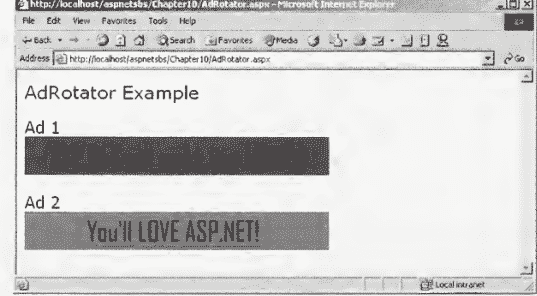

## Calendar

Calendar 控件是功能最丰富、最灵活的专用控件之一，提供了近 30 个属性来控制日历的外观。Calendar 控件允许你提供一个基于日历的界面来选择日期或查看与日期相关的数据。

例如，你可以查询一系列事件的数据，并使用 Calendar 控件通过将日期添加到日历的 `SelectedDates` 集合来显示它们。当用户点击日历上的选定日期时，你可以显示关于该日期事件的额外信息。

你还可以通过提供一个 Calendar 控件供用户点击，从而指定一个或多个日期进行数据输入。Calendar 控件支持选择单个日期和日期范围（按周或按月）。使用 Calendar 控件进行数据输入而不是文本框，可以帮助防止在将用户输入的日期转换为 `Date` 数据类型进行存储或处理时出现错误。

要创建一个使用 Calendar 控件进行数据输入的 Web Forms 页面，请完成以下步骤：

- 1 创建一个新文本文件并将其保存为 Calendar.aspx。

- 2 如上一个示例所示，向页面添加 @ Page 指令、标准 HTML 元素和 HtmlForm 控件。

- 3 通过向 HtmlForm 添加三个 Label 控件、两个 RadioButton 控件、两个文本框和一个 Calendar 控件来创建 UI。注意，`GroupName` 属性用于使单选按钮互斥。

```asp
<font runat="server">
  <asp:label id="title" text="Calendar Example"
      font-name="Verdana" font-size="18" runat="server"/>
  <br/>
  <asp:calendar runat="server"/>
  <asp:radiobutton id="Start" text="Start Date"
      groupname="Chooser" runat="server"/>
  <asp:radiobutton id="End" text="End Date"
      groupname="Chooser" runat="server"/>
  <br/>
  <asp:label id="StartDateLabel" text="Start Date"
      runat="server"/>
  <asp:textbox id="StartDate" runat="server"/>
  <br/>
  <asp:label id="EndDateLabel" text="End Date"
      runat="server"/>
  <asp:textbox id="EndDate" runat="server"/>
</font>
```


- 4 保存并浏览页面。输出结果应与下图所示。

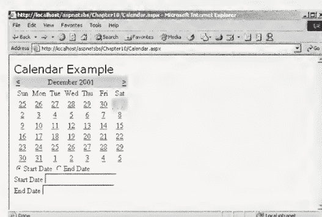

- 5 到目前为止看起来良好，但现在你需要使用一些可用属性。首先，在 <head> 部分添加 <script> 块。接下来，在页面上添加 <script> 事件。为 <asp:calendar> 标签使用 `OnSelectionChanged` 属性。

```asp
<script>
  Sub Page_Load(sender As Object, e As EventArgs)
    If Not IsPostBack Then
      ' 在处编写代码
    End If
  End Sub

  Sub OnSelectionChanged(sender As Object, e As EventArgs)
    If IsPostBack Then
      ' 在处编写代码
    End If
  End Sub
</script>
```

- 6 使用 `OnSelectionChanged` 属性为 <asp:calendar> 标签设置，如下代码所示。

```asp
<asp:calendar id="Calendar1"
onselectionchanged="SelectionChanged"
runat="server">
```

- 7 保存并浏览页面。输出结果应如如下所示。

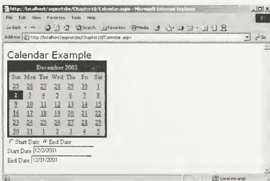

- 8 保存此文件。稍后我们将回到这里。

## Xml

Xml 控件是一种专用控件，允许在 ASP.NET Web Forms 页面中显示 XML 代码。这很重要，因为原始 XML 将无法预测地显示。Xml 控件可以从字符串、提供的 URL 或 `System.Xml.XmlDocument` 对象读取 XML。

除了显示来自给定源的 XML，Xml 控件还可以应用 XSLTransform 文档对 XML 进行格式处理。XSL 可以来自 URL，也可以由 `System.Xml.Xml.XslTransform` 对象提供。

## Validation Controls

另一组位于 System.Web.UI.Controls 命名空间的专用控件是验证控件，它们对其他控件执行各种类型的验证。

你可以使用验证来执行以下操作：

- 确保必填字段已
- 确保用户输入的数据在给定范围内
- 确保用户输入的数据匹配特定模式
- 比较两个控件的值的给定条件（相等、大于等）或将控件的值与指定值进行比较
- 在提交页面之前确保页面上的所有控件都是有效的

## Shared Members

所有验证控件共享一些重要的属性和方法。这些属性和方法继承自 `BaseValidator` 类，包括以下内容：

- ControlToValidate 属性设置或检索类型为 String 的值，指定要验证的输入控件。
- Display 属性设置或检索一个值，用于确定验证控件错误消息的显示方式。该值必须是 `ValidatorDisplay` 枚举中指定的值之一。默认值是 Static。
- EnableClientScript 属性设置或检索一个布尔值，用于确定是否执行客户端验证。无论设置如何，验证控件始终会执行服务器端验证。默认值是 true。


Enabled 此属性设置或检索一个布尔值，用于确定控件是否启用。默认值为 true。

ErrorMessage 此属性设置或检索一个 String 类型的值，用于指定当用户输入无效时要显示的错误消息。

ForeColor 此属性设置或检索一个 Color 类型的值，表示在 ErrorMessage 属性中指定的错误消息的颜色。默认值为 Color.Red。

IsValid 此属性设置或检索一个布尔值，表示由 ControlToValidate 属性指定的控件是否通过了验证。

Validate 此方法导致调用它的方法的控件执行验证，并用验证结果更新 IsValid 属性。

下表列出了 ASP.NET 中可用的验证控件。

| 控件类型 | 目的 | 重要成员 |
| --- | --- | --- |
| CompareValidator | 使用常量或另一个用户输入字段对用户键的字段进行验证。 | ControlToCompare: 此属性设置或检索一个 String 类型的值，该值包含一个控件的名称，该控件的值将与由 ControlToValidate 属性指定的控件的值进行比较。 |
| | | ControlToCompare 属性和 Value 属性是互斥的。如果两者都设置了，则 ControlToCompare 属性具有优先权。Operator: 此属性设置或检索一个表示要执行的比较类型的值。该值必须是 ValidationCompareOperator 枚举指定的指定值之一。默认值为 Equal。 |
| | | ValueCompare: 此属性设置或检索一个 String 类型的值，该值包含一个常量值，该值将与由 ControlToValidate 属性指定的控件的值进行比较。 |
| CustomValidator | 根据开发者指定的逻辑执行自定义验证。 | ServerValidate 当要执行服务器端验证时，会引发此事件。将验证控件标签中的 OnServerValidate 方法映射到所需的服务器端事件处理程序以执行自定义验证。 |
| | | ClientValidationFunction 此属性设置或检索一个 String 类型的值，该值包含一个用于执行客户端验证的客户端函数名称（如果需要的话）。 |
| RangeValidator | 对用户键入字段进行验证，以确保输入的值在指定的范围内。 | MaximumValue 此属性设置或检索设置或检索一个 String 类型的值，包含要验证的范围的最大值。MinimumValue 此属性设置或检索一个 String 类型的值，包含要验证的范围的最小值。 |
| RegularExpressionValidator | 对用户键入字段进行验证，以确保输入的值匹配指定的模式。 | ValidationExpression 此属性设置或检索一个 String 类型的值，包含用于验证的正则表达式。 |
| RequiredFieldValidator | 对用户键入字段进行验证，以确保为指定字段输入了值。 | InitialValue 此属性设置或检索一个 String 类型的值，包含要验证的范围的初始值。默认值为空字符串。如果将此属性设置为字符串值，则仅当用户键入的值匹配此属性的值时，控件的验证才会失败。 |
| ValidationSummary | 在给定的 Web Form 中提供验证错误的摘要，可以显示在 Web Form 页面上、消息框或其他位置。 | DisplayMode 此属性设置或检索一个值，用于确定控件的显示方式。该值必须是 ValidationDisplayMode 枚举指定的指定值之一。默认值为 BulletList。HeaderText 此属性设置或检索一个 String 类型的值，包含要为验证摘要显示的页眉文本。ShowMessageBox 此属性设置或检索一个布尔值，用于确定是否在客户端消息框中显示验证摘要。默认值为 false。如果将 EnableClientScript 设置为 false，则此属性无效。ShowSummary 此属性设置或检索一个布尔值，用于确定是否在 Web Form 页面中显示验证摘要。默认值为 true。 |

## 第 10 章 使用服务器控件

## 验证控件（继续）

## 验证必需字段

要查看验证控件是如何操作的，让我们回到早期的示例之一，名为 SmtpEmail.aspx 的 Web Form。你在该页面遇到的问题之一是可以在没有 To、CC 或 BCC 地址的情况下提交，这会抛出异常。你可以通过要求至少输入 Address 来防止这个问题。按照以下步骤操作：

1. 在你喜欢的文本编辑器中打开 SmtpEmail.aspx。
2. 在与 TextBox 控件相同的表格单元格中添加 RequiredFieldValidatorControl：

```html
<td
<asp:textbox id="To" runat="server"/>
<asp:requiredfieldvalidator id="ToValidator"
controltovalidate="Text"
display="dynamic" errorMessage="Required"
runat="server"/>
</td>
```

保存并浏览页面。现在，如果你不输入 To 地址，输出将类似于图所示，且你将无法提交页面。

这种设置的一个问题是，一旦你添加了 To 地址并提交页面，就会收到一个 JavaScript 错误。这是因为新添加的验证控件正在查找客户端上的文本框，但由于你通过将 Visible 属性设置为 False 在事件处理程序中隐藏了控件，该控件在客户端上不再存在。你可以通过修改隐藏元素的方式来解决这个问题。首先，你需要为你的状态添加一个新的 Label。（在原始页面中，第一个 label 是用于此目的。）此控件应该位于 HTML 元素之前。

```html
<asp:label id="status" runat="server"/>
```

现在，你需要通过添加属性和 `runat="server"` 属性将 HTML 元素转换为 HTMLControl。

```html
<table id="MailTable" runat="server">
```

现在，你需要取出 Send_Click 事件处理程序中设置状态消息的代码行，并替换为以下代码：

```csharp
'使用第一个 label 显示状态
Status.Text = "Mail Sent"
```

7. 最后，你需要将 Send_Click 事件处理程序中设置控件 Visible 属性的代码行替换为以下行：

```csharp
'隐藏表格
MailTable.Visible = False
```

除了使用 RequiredFieldValidator 确保输入了电子邮件地址之外，你还可以为每个地址字段添加 RegularExpressionValidator，以确保用户输入的数据匹配有效电子邮件地址的模式。这可以防止由于电子邮件格式不正确导致的投递错误，并防止邮件服务器尝试投递邮件时浪费资源。

## 通过比较进行验证

另一个可能出现问题的之前的示例是日历控件示例。如代码所示，可以使用日历控件设置一个晚于结束日期的开始日期。显然，如果你正在存储这些日期或使用它们来驱动某些程序逻辑，这将是你希望允许的。通常，CompareValidator 控件可以帮助防止此类问题，如下所示：

1. 打开 Calendar.aspx。
2. 在 EndDate TextBox 控件下方添加 CompareValidator 控件：

```html
<br/>
<asp:comparevalidator
id="DateValidator"
controltlovalidate="StartDate"
controlltcompare="EndDate"
type="Date"
operator="lessthan"
display="dynamic"
errorMessage="开始日期必须在结束日期之前!"
runat="server"/>
```

3. 在 Set_DateText 事件处理程序中添加一行代码，以便每次触发事件处理程序时都导致控件进行验证。Page.Validate 调用应该放在 End If 和 End Sub 语句之间。

```csharp
Page.Validate
```


4 保存并浏览文件。将结束日期设置为早于开始日期的日期。
将会显示验证错误信息，如图所示。此外，页面的 `IsValid` 属性将被设置为 `False`。你可以在保存日期之前测试此属性，以确保它们是合法的。

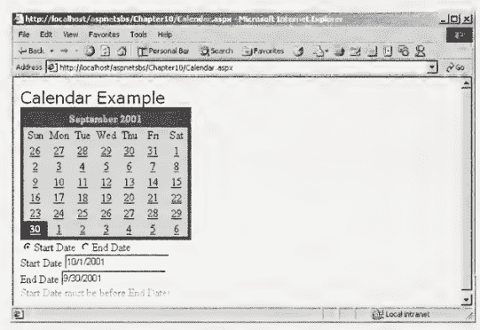

验证控件还可以提高应用程序的安全性。例如，你可以使用 `RegularExpressionValidator` 控件来确保用户输入的密码（例如在建立账户信息时）符合最小长度和复杂度要求。这使得坏人更难破解你的应用程序。

## 数据绑定控件

ASP.NET 最重大的进展之一是数据绑定领域。`System.Web.UI.WebControls` 命名空间包含一组数据绑定控件，它们提供了强大的功能和灵活性，而无需将前端 UI 逻辑绑定到后端数据库逻辑中，这在经典 ASP 中（通过 Visual InterDev 6.0 开发环境提供的数据绑定设计时控件）是必须的。数据绑定控件还允许无论客户端使用何种浏览器都提供数据绑定。这是因为这些控件运行在服务器上并向客户端返回纯 HTML，这与在 Internet Explorer 4.0 及更高版本中可能的某些数据绑定技术不同。

另一个主要改进是数据绑定控件还可以使用多种源，而不仅仅是数据库数据。ASP.NET 中的数据绑定控件可以绑定到来自数组、ADO.NET `DataSet`、`DataView` 以及任何实现了 `ICollection` 和 `IList` 接口的数据源的类型。数据绑定控件包括 `DataGrid`、`DataList` 和 `Repeater` 控件。第 11 章将详细讨论这些控件。

## 其他控件

除了 .NET Framework 自带的 HTML 控件和 Web 控件外，目前还有作为单独下载项提供的额外控件。这些是 ASP.NET 移动控件和 Internet Web 控件。

## ASP.NET 移动控件

ASP.NET 移动控件目前以 .NET Mobile Internet Toolkit 的形式提供。这些控件旨在为手持设备（如手机、PocketPC 和其他移动设备）定制输出内容。Mobile Internet Toolkit 目前可以在 http://download.microsoft.com/download/VisualStudioNET/Install/1/NT4XP/EN-US/MobileT.exe 获得。关于 Mobile Web Toolkit 的更多信息可以在 http://msdn.microsoft.com/studio/nextitenchnology/mobilewebforms.asp 找到。在编写本文时，尚不清楚这些控件未来会随 .NET Framework一起发布，还是继续作为单独下载。

## Internet Explorer Web 控件

Internet Explorer Web 控件是一组 ASP.NET 服务器控件，它们利用了 Internet Explorer 5.5 或更高版本的高级功能，同时通过渲染 HTML 3.2 输出为低版本浏览器来提供跨浏览器兼容性。这些控件包括：

- MultiPage：与 `TabStrip` 配合，在 ASP.NET 中提供复杂的标签页界面。
- TabStrip：为导航提供标签页界面。
- Toolbar：为 ASP.NET Web Forms 页面提供工具栏功能。
- TreeView：提供显示和导航分级结构或数据的能力。它可以用于站点导航，或提供基于 Web 的资源管理器风格界面。

Internet Explorer Web 控件可以从 http://msdn.microsoft.com/downloads/samples/internet/ASP_DOT_NET_ServerControls/WebControls/default.asp 下载。

你可以在 http://msdn.microsoft.com/workshop/webcontrols/overview/overview.asp 更多关于 Internet Explorer Web 控件的信息并使用它们。


在编写本文时，尚不清楚这些控件未来会随 .NET Framework一起发布，还是继续作为单独下载。

## 第 10 章快速参考

| 目标 | 执行操作 |
| :--- | :--- |
| 创建一个可以处理客户端和服务器端事件的控件 | 通过向所需的 HTML 元素添加 `id` 属性和 `runsat="server"` 属性来使用 HTML 控件（注意，该元素必须支持所需的客户端事件），并添加属性将事件映射到相应的客户端和服务器端处理程序 |
| 显示或隐藏 ASP.NET 服务器控件 | 修改控件的 `Visible` 属性 |
| 为未作为属性公开的 HTML 控件或 Web 控件添加或修改 HTML 属性 | 使用控件的 `Attributes` 集合通过名称添加或修改属性：`MyControl.Attributes("Attribute")`。注意所有属性（包括控件上公开的属性）都可以通过 `Attributes` 集合可用 |
| 为控件应用样式 | 将控件的 `Style` 或 `CssClass`（仅限 Web 控件）设置为所需的 CSS 样式或类字符串 |
| 验证用户输入 | 在页面上添加 `Validator` 服务器控件，并将其 `ControlToValidate` 属性设置为用户将用于输入的控件 ID。 |

## 访问和绑定数据

在本章中，你将学习到：
- 构成 ADO.NET 的命名空间
- ASP.NET 数据绑定控件
- 如何

在经典 ASP 中，访问数据最常用的方法是通过 ADO。开发者使用 `ADO Connection` 对象连接到数据库，然后使用 `ADO Command` 和 `Recordset` 对象检索、处理和更新数据。在设计应用程序时，特别是对于具有高扩展性需求或后端数据源可能会发生变化的应用程序，开发者需要小心不要将代码与后端数据库耦合。否则，一旦后端数据库发生变化，他们将重写所有内容。

ADO.NET 架构与经典 ADO 有所不同。ADO.NET 类分为两大类：数据源特定和非数据源特定。

### 理解 .NET 数据提供程序

特定数据源的类被认为与特定的 .NET 数据提供程序工作。.NET 数据提供程序是一组允许托管代码与特定数据源进行交互以检索、更新和处理数据的类。ADO.NET 连接两个 .NET 数据提供程序：SQL Server .NET Provider、OLE DB .NET Provider（后者为 SQL Server 数据库提供了优化访问，并允许你连接到任何已安装 OLE DB .NET Provider的数据源）。

> 重要提示
> OLE DB .NET Provider 不支持 OLE DB 2.5 接口。这意味着 Microsoft OLE DB Provider for Exchange 和 Microsoft OLE DB Provider for Internet Publishing 不能与 OLE DB .NET Provider 使用。此外，OLE DB Provider for ODBC 与 OLE DB Provider 不兼容。在编写本文时，微软正在提供一个可下载的 .NET Data Provider for ODBC，地址为 http://msdn.microsoft.com/downloads/sample.asp?url=msdn-files/027/001/668/msdncompositedoc.xml。尚不清楚该提供程序是否会成为发布产品的一部分。

下图显示了 SQL Server .NET Provider 的主要类以及它们之间的关系。


## 第 11 章 访问与绑定 299

| SqlConnection | SqlDataAdapter |
|---|---|
| SqlCommand | DeleteCommand |
| SqlParameterCollection | InsertCommand |
| SqlDataReader | SelectCommand |
| | UpdateCommand |

### 数据库

`SqlConnection` 类用于建立与 SQL 数据库的连接。与 ADO 连接对象不同，`SqlConnection` 类（或其 OLE DB 等效的 `OleDbConnection` 类）不能用于对数据源执行 SQL 语句。`SqlConnection` 类仅专门用于打开连接、设置或检索连接属性，或处理与连接相关的事件。你将在本章稍后的部分学习如何使用 `SqlConnection` 类连接到数据库。

`SqlCommand` 类用于在 SQL Server 数据库上执行 SQL 语句或存储过程。`SqlCommand` 类（以及其 OLE DB 等效的 `OleDbCommand` 类）可以执行不返回值、返回单个值、XML 或数据读取器的语句或存储过程。

`SqlDataReader` 类为从 SQL Server 数据库返回的行集提供前向、只读的访问。数据读取器（包括 `SqlDataReader` 和 `OleDbDataReader`）提供轻量级、高性能的只读数据访问，是访问要在 ASP.NET 中显示的数据的最佳选择。

`SqlDataAdapter` 类用作 `DataSet` 类与 SQL Server 之间的桥梁。它用于根据 `SqlCommand` 实例表示的 SQL 语句或存储过程创建数据集，根据数据集的内容更新后端 SQL Server 数据库，或向 SQL Server 数据库插入行或删除行。`OleDbAdapter` 类为 OLE DB 数据库执行相同的任务。

## 重要提示

你可能已在讨论组成 SQL .NET 数据提供程序的类时注意到，这些类的名称是以 Sql 而不是 SQL 开头的。这是因为 .NET Framework 中的类名遵循了 Pascal 命名法（遵循 Pascal 语言的风格），在该命名法中，给定类中每个独立单词的首字母都会大写。

这一点很重要，因为在 C# 等语言中，类名和命名空间是区分大小写的。使用错误的大小写名称（例如，使用 SQL Connection 而不是 Sql/Connection）会导致编译错误。因此，如果你收到错误提示类型未定义或命名空间不存在，那么很有可能是你遇到了大小写问题。

## 理解数据集

特定于数据源的主要类是 `DataSet`。这本质上是一个或多个数据表在内存中的表示。这些数据可以从 XML 文件或流读取，也可以是对数据源查询的结果。

关于 `DataSet` 类的一个重要点是，它对接收数据的数据源一无所知，除了数据本身以及有时数据列的类型。（参见本章稍后关于类型数据集的部分）。下图显示了与 `DataSet` 类相关的主要类以及它们之间的关系。请注意 `Rows`、`Columns` 和 `Constraints` 对象是 `DataTable` 类的属性。

数据集对其数据来源一无所知，这意味着它从后端数据源进行了抽象。这很重要，因为这意味着如果你将数据集传递给 Web Forms 页面用于数据检索的组件，两者都不关心数据来自何，只要数据集结构保持不变。可以更改后端数据库而无需更改 Web Forms 页面。这使得维护 Web 应用程序变得简单得多。

数据集包含表集合，每个表都包含行集合、列集合和约束集合。你可以使用这些集合来获取关于其中包含的对象的信息，还可以访问和更新单个数据值。数据集还可以包含其包含的表之间的关系集合，允许表示层级数据。你将在本章稍后部分详细学习 `DataSet` 类及相关类。

## ADO.NET 中的 XML

与经典 ADO 不同（经典 ADO 在初始对象模型创建后添加了 XML 支持），ADO.NET 模型从底层开始就设计了 XML 支持。`SqlCommand`、`OleDbCommand` 和 `DataSet` 等类内置了读取和写入 XML 数据的支持。特别是 `DataSet` 可以从 XML 构建或保存为 XML，使其成为多层应用程序层之间传输数据的理想选择，或临时存储数据到磁盘以供后检索。

## 创建和打开连接

从数据库访问数据的第一步当然创建连接。ADO.NET 提供了两个创建数据库连接的类：`SqlConnection` 和 `OleDbConnection`。使用哪一个取决于你将连接的数据库类型以及应用程序的需求。

## SqlConnection

对于使用 SQL Server 作为后端数据库且未来可能更改数据库的应用程序，`SqlConnection` 类是合适的选择。该类在连接到 SQL Server 数据库时针对性能进行了优化。在访问 MSDE 数据库数据时，`SqlConnection` 类也会提供卓越的性能，因为 MSDE 与 SQL Server 使用相同的数据库引擎和协议。

创建一个 `SqlConnection` 类非常简单，一行代码即可完成。

`Dim MySqlConn as New SqlConnection(ConnectionString)`

这创建了一个指向指定 SQL Server 的连接 `mySqlConnectionConn`，该连接通过传递给 `SqlConnection` 构造函数的 `ConnectionString` 指定。打开连接只需调用：`mySqlConn.Open`

关闭连接同样简单：`mySqlConn.Close`。与经典 ADO 一样，完成后关闭任何连接都是非常重要的。连接不会返回到池中，从而无法供其他客户端使用。除了通过向 `SqlConnection` 的构造函数传递连接字符串外，你还可以实例化后通过 `ConnectionString` 属性设置连接字符串。

连接字符串由分号分隔的键值对组成。值可以使用单引号或双引号限定，但不能混用。引号中的所有空格都会被忽略。

重要：当根据用户输入动态创建连接字符串时，务必验证输入，以防意外键意外添加到连接字符串中。例如，用户可能会在密码中添加数据库键以尝试连接到不同的数据库。由于同名的最后一个键将用于设置连接字符串的值，未验证输入可能会导致访问不当。

下表列出了 `SqlConnection` 连接字符串的有效键。

| 键 | 描述 |
| --- | --- |
| Application Name | 建立连接的应用程序名称。 |
| AttachDBFileName | 可附加数据库的主文件文件名和完整路径。此键需要 `Database` 键来指定数据库名称。 |
| Connect Timeout | 尝试连接或抛出异常之前的秒数。默认值为 15。 |
| Connection Lifetime | 池连接存活的时间（秒）。当连接返回连接池时，如果当前时间超过其创建时间该秒数，则将其销毁。默认值为 0，意味着连接不会被销毁。 |
| Connection Reset | 布尔值，决定从池检索连接时是否重置连接状态。如果设置为 false，则不重置连接状态，节省了与服务器的交互。但程序员必须手动采取必要步骤以确保连接状态适用于应用程序。默认值为 true。 |
| Current Language | SQL Server 语言名称。 |
| Data Source or Server or Address or Addr or Network Address |要连接的 SQL Server 实例的服务器名称或网络地址。 |
| Enlist | 决定连接是否自动加入创建者的事务上下文中。默认值为 true。 |
| Initial Catalog or Database | 要连接的数据库名称。 |


## SqlConnection 连接字符串键（续）

| 键 | 说明 |
|---|---|
| Integrated Security or Trusted Connection（集成安全性或信任连接） | 决定连接是否使用调用者的 Windows 身份验证依据对 SQL Server 进行身份验证。将其设置为 true 可以消除对用户 ID 和密码验证的需求，这意味着你不需要担心存储这些值。默认值为 false。 |
| Max Pool Size（最大池大小） | 决定连接池的最大连接数。默认值为 100。 |
| Min Pool Size（最小池大小） | 决定池中应有的最小连接数。连接到指定的 SQL Server 时使用的网络库。默认值为 dbmssocn，它指定 TCP/IP 套接库。其他有效值为 dbmnmpntw, dbmsrpcn, dbmsadsn, dbmsgnet, dbbsipcn, dbmsspxn, VIA, IPX/SPX。服务器必须拥有指定网络库的相应 DLL。 |
| Packet Size（包大小） | 指定与 SQL Server 通信时每个网络包的字节数。默认值为 8192。 |
| Password or Pwd（密码） | 指定登录 SQL Server 数据库时使用的密码。 |
| Persist Security Info（持久安全信息） | 如果设置为 false，当连接打开时，此键将防止敏感信息（如密码）作为连接的一部分返回。默认值为 false。 |
| Pooling（连接池） | 决定是否为此连接启用池。设置为 true 时，请求的连接将从相应的池中提取。如果池中没有可用连接，将创建请求的连接并在关闭时将其返回池中。默认值为 true。 |
| User ID（用户 ID） | 用于登录服务器的 SQL Server 用户帐户名称。 |
| Workstation ID（工作站 ID） | 连接到 SQL Server 的机器名称。默认值为本地机器名称。 |

## OleDbConnection

对于需要查询 SQL Server 其他数据库（如 Access 或 Oracle）的应用程序，OleDbConnection 类是合适的选择。该类使用标准的 OLE DB 字符串通过数据源的 OLE DB 提供程序连接到任何 OLE DB 数据源。

创建 OleDbConnection 非常简单，可以用一行代码定义。

```
Dim myOleDbConnection as New OleDbConnection(ConnectionString)
```

这创建了一个名为 myOleDbConn 的连接，该连接指向传递给 OleDbConnection 类构造函数的 ConnectionString 指定数据库。ConnectionString 参数是标准的 OLE DB 提供程序字符串。以下来自 MSDN .NET Framework 类引用的内容显示了分别连接 Oracle、MS Access 和 SQL Server 数据库的 OLE DB 提供程序示例：

```
Provider=MSDAOORA;Data Source=ORACLE817;User ID=OLEDB;",
```

```
Provider=Microsoft.Jet.OLEDB.4.0;
Data Source=c:\bin\LocalAccess40.mdb;
```

```
Provider=SQLOLEDB;Data Source=SqlServer;Integrated Security=SSPI;
必须指定 Provider。你还可以使用特定 OLE DB 提供程序支持的其他子句来为提供程序设置其他属性。例如，InitialCatalog 子句用于 SQL Server OLE DB 提供程序，用于指示运行查询的数据库。
```

你通过调用以下代码打开连接：

```
myOleDbConn.Open
```

通过调用以下代码关闭连接：

```
myOleDbConn.Close
```

> note
> 你不能在 OLE DB .NET 数据提供程序中使用用于 ODBC 的 OLE DB 提供程序。你可以从 http://msdn.microsoft.com/downloads/ 下载单独的 ODBC .NET 数据提供程序。

在本章的后后部分，你将看到使用连接执行数据访问的示例。

## 使用信任连接

如第 8 章所述，ASP.NET 默认配置使用无特权的 ASPNET 帐户运行 ASP.NET 工作进程。这意味着与 ASP.NET 的 beta 版本不同，你现在必须使用以下两种技术之一使用信任连接。

- 使用 Windows 身份验证和身份模拟，使用登录用户的凭据连接数据库
- 或
- 将 ASPNET 帐户设置为 SQL Server 登录

在本节中，你将学习如何使用后期技术在不需要 Windows 身份验证的情况下启用信任连接。

> important 在 SQL Server 中设置 ASPNET 帐户将允许 Web 服务器上的任何 ASP.NET 应用程序根据 ASPNET 帐户获得的任何权限访问数据库。出于此原因，此技术仅应用于开发系统或你控制所有 ASP.NET 应用程序的生产系统。此技术通常不应考虑用于共享服务器应用程序。

按照以下步骤使用 SQL Enterprise Manager 设置 ASPNET 帐户以访问 Pubs SQL Server 示例数据库。

1. 点击“开始”、“程序”、“Microsoft SQL Server”、“Enterprise Manager”打开 SQL Enterprise Manager。
2. 展开树并定位所需的 SQL Server 或 MSDE 实例。展开此实例并找到 Security（安全）节点。
3. 展开 Security 节点，右键点击 Logins（登录）节点，然后选择 New Login（新建登录）。
4. 在 General（常规）选项卡上，从 Domain 下拉列表中选择域（或本地计算机），然后点击 Name 文本框旁边的省略号 (...)
5. 找到并选择名为 ASPNET 的帐户（aspnet_wp 帐户），点击 Add，然后点击 OK。
6. 同样在 General 选项卡上，将 Database default更改为 pubs。点击 Database Access（数据库访问）选项卡。
7. 在 Database Access 选项卡上滚动到数据库，勾选 Permit（允许）复选框并点击 OK。

按照以下步骤使用 SQL Enterprise Manager 设置 ASPNET 帐户以访问 Pubs SQL Server 示例数据库。

1. 点击开始、程序、Microsoft SQL Server、Enterprise Manager 打开 SQL Enterprise Manager。
2. 展开树并定位所需的 SQL Server 或 MSDE 实例。展开此实例并找到 Security 节点。
3. 展开 Security 节点，右键点击 Logins 节点，然后选择 New Login。
4. 在 General 选项卡上，从 Domain 下拉列表中选择域（或本地计算机），然后点击 Name 文本框旁边的省略号 (...)
5. 找到并选择名为 ASPNET 的帐户（aspnet_wp 帐户），点击 Add，然后点击 OK。
6. 同样在 General 选项卡上，将 Database default更改为 pubs。点击 Database Access 选项卡。
7. 在 Database Access 选项卡上滚动到数据库，勾选 Permit 复选框并点击 OK。

一旦按照上述说明设置了 ASPNET 帐户，你应该能够使用信任连接访问所需的数据库，如本章后面部分使用的示例所示。

## 使用命令读取和更新数据

命令类 SqlCommand 和 OleDbCommand 是 ADO Command 对象的 ADO.NET 等价物。这些类用于通过数据器检索只读数据（你将在本章后面看到示例）、执行 Insert、Update、Delete 以及不返回记录的其他语句、检索聚合结果。SqlCommand 和 OleDbCommand还可以配合相关数据器使用，以填充数据集或使用来自数据集的更新更新后端。

## SqlCommand

当你想针对 SQL Server 运行命令时，SqlCommand 是合适的类。以下是使用 SqlCommand 对象时遵循的步骤。每个步骤概述了初始化或使用 SqlCommand 类类的方法。

- 创建 SqlCommand 对象。注意 SqlCommand 的构造函数是重载的，因此你可以通过向构造函数传递参数（例如用于命令的查询以及用于命令的 SqlConnection 对象）来节省步骤，而不是在创建对象后设置属性。

```
默认构造函数
Dim SqlCommand As New SqlCommand()
```

```
传递查询
Dim SqlString = "SELECT au_id FROM authors"
Dim SqlCommand2 as New SqlCommand(SqlString)
```

```
传递查询和连接
Dim SqlConnection As New _
SqlConnection("datasource=localhost\pubs;integratedsecurity=true")
Dim SqlString As String = "SELECT au_id FROM authors"
Dim SqlCommand3 as New SqlCommand(SqlString, SqlConnection)
```


## 传入查询、连接和事务

```vb
Dim mysqlConn As New SqlConnection("datasource=local\NetSDK;database=pubs;Integratedsecurity=true")
Dim sqlTrans As SqlTransaction = mysqlConn.BeginTransaction()
Dim sqlStr As String = "SELECT au_id FROM authors"
Dim sqlCmd4 As New SqlCommand(sqlStr, mysqlConn, sqlTrans)
```

如果你没有在构造函数中进行设置，请将 `CommandText` 属性设置为所需的 SQL 查询语句或存储过程名称，并将 `Connection` 属性设置为已打开的 `SqlCommand` 对象。

```vb
mySqlCommand.CommandText = "SELECT au_id FROM authors"
'假设 mysqlConn 已经创建并打开
mySqlCommand.Connection = mysqlConn
```

- 调用以下四个执行命令的方法之一：

```vb
'使用 ExecuteNonQuery 执行 INSERT、UPDATE 或
'DELETE 查询，其中该查询类型已通过
'CommandText 属性进行设置
mySqlCommand.ExecuteNonQuery()

'使用 ExecuteReader 执行 SELECT 命令并
'返回一个 dataareader
Dim SqlDataReader As SqlDataReader = mySqlCommand.ExecuteReader

'使用 ExecuteScalar 执行命令并返回
'第一行第一列的值。任何额外的结果都会被忽略。
Dim Result As Object
Result = mySqlCommand.ExecuteScalar()

'使用 ExecuteXml 执行 SELECT 命令并
'使用返回的 XmlReader 填充 DataSet
Dim SQLStr As String = "SELECT * FROM authors FOR XML AUTO, XMLDATA"
Dim sqlCmd As New SqlCommand(SQLStr, mysqlConn)
Dim myDS As New DataSet()
myDS.Read(mySqlCommand.ExecuteXmlReader(), XmlMode.Fragment)
```

- 完成后确保关闭连接。

以下列表显示了检索 Pubs 示例 SQL 数据库中 `Authors` 表内容作为 XML 并在 Web Forms 页面中显示数据的必要代码。

## 注意

书中的数据访问示例是针对 .NET Framework SDK 安装的 MSDE 示例数据库编写的。如果你针对 NetSQL MSDE 数据库以外的 SQL Server 数据库运行这些示例，或者无法无法到 SQL Server 或 MSDE 的信任连接，则必须修改示例中的连接字符串以匹配相应的服务器名称和登录依据。

### ExecuteXmlReader.aspx

```xml
<%@ Page Language="vb" %>
<%@ Import Namespace="System.Data" %>
<%@ Import Namespace="System.Data.SqlClient" %>
<%@ Import Namespace="System.Xml" %>
<html
  <script runat="server">
    Sub Page_Load(sender As Object, E As EventArgs)
      Dim ConnStr As String
      ConnStr = "data source=(local)\NetSQL;"
      ConnStr &= "database=pubs;integrated security=true"
      Dim mySqlConn As New SqlConnection(ConnStr)
      mySqlConn.Open
      Dim mySqlString As String = "SELECT * FROM authors FOR XML AUTO, XMLDATA"
      Dim mySqlCommand As New SqlCommand(mySqlString, mySqlConn)
      Dim myDS As New DataSet()
      myDS.ReadXml(mySqlCommand.ExecuteXmlReader(), XmlReaderMode.Fragment)
      XmlDisplay.DocumentContent = myDS.GetXml
    End Sub
  </script>
  <body>
    <xml id="XmlDisplay" transformsource="authors.xsl" runat="server"></xml>
  </body>
</html>
```

此代码列表代码创建并打开了一个指向 Pubs 数据库的 `SqlConnection`，创建了一个 SQL 查询字符串以获取 `Authors` 表的内容作为 XML，并创建了一个新的 `SqlCommand`，传入了 SQL 查询和 `SqlConnection`。然后它创建了一个数据集并使用 `SqlCommand` 的 `ExecuteXmlReader` 方法将 `XmlReader` 传递给数据集的 `ReadXml` 方法，允许数据集从 `XmlReader` 填充自身。最后，代码将声明的 Xml 服务器控件的 `DocumentContent` 设置为数据集 `GetXml` 方法的结果。Xml 控制使用 XSL 转换文档 `authors.xsl` 来格式化 Xml 控件显示的 Xml 内容。以下列表显示了 `authors.xsl` 的内容。

### Authors.xsl

```xml
<xsl:stylesheet version='1.0' xmlns:xsl='http://www.w3.org/1999/XSL/Transform>
<xsl:template match="//>
<style>
  header (font-weight:bold;color:white;background-color:black)
  value(font-family:arial;font-size:.7em;background-color:silver)
</style>
<table border="1" cellspacing="0" cellpadding="1" bordercolor="black">
  <tr class="header">
    <th>Author ID/</th>
    <th>Last Name/</th>
    <th>First Name/</th>
    <th>Phone/</th>
    <th>Address/</th>
    <th>City/</th>
    <th>State/</th>
    <th>Zip/</th>
    <th>Contract/</th>
  </tr>
<xsl:for-each select='Schema/authors'>
  <tr>
    <td nowrap="true" class="value">
      <xsl:value-of select='@au_id' />
    </td>
    <td nowrap="true" class="value">
      <xsl:value-of select='@au_iname' />
    </td>
  </tr>
</xsl:for-each>
</table>
</xsl:template>
</xsl:stylesheet>
```

## 第 11 章 数据的访问与绑定


## 注意

尽管之前的示例使用 Microsoft Access 来演示 `OleDbCommand` 对象连接非 SQL Server 数据库的能力，但我们不应该在 ASP.NET 应用程序中使用 Access。对于初始原型设计和开发，或者对于可扩展性要求很低（5–10 个并发用户或更少）的应用程序，MSDE 是更好的选择。

MSDE 是兼容 SQL Server 的数据库，可在多种 Microsoft 产品中使用，包括 SQL Server、Microsoft Office 和 Visual Studio。MSDE 的一个版本也随 .NET Framework SDK 一起提供，如果你选择安装它们，它将将安装好并准备好使用 SDK 示例程序。（有关安装示例应用程序的重要指导，请参阅第 8 章。）MSDE 构建在与 SQL Server 相同的引擎之上，但它针对大约 5 个并发用户进行了优化。

使用 MSDE 的优势在于，你的所有开发任务都与针对 SQL Server 的开发相同，且无需支付完整版 SQL Server 的许可费用。（使用和分发 MSDE 的许可包含在上述产品中。请检查最终用户许可协议以确保你的使用符合协议条款。）如果你的应用程序需要增长，你可以简单地将数据库迁移到 SQL Server 以提高性能和可扩展性，而无需更改代码或数据。

将对象的 `CommandText` 属性设置为你想要执行的存储过程名称，并将 `CommandType` 设置为 `CommandType.StoredProcedure`。如果你熟悉经典 ADO 下存储过程的执行，这与你使用 ADO `Command` 对象时的操作没有太大区别。

## 带参数调用存储过程

带有输入或输出参数的存储过程调用稍微复杂一些，但仍然非常直观。你只需创建参数（`SqlParameter` 或 `OleDbParameter` 对象）；设置适当的属性，如 `ParameterName`、`Direction`、类型（`SqlType` 或 `OleDbType`）和 `Value`；然后将参数对象添加到命令对象的 `Parameters` 集合中。下面的列表显示了执行 Pubs 示例 SQL Server 数据库中 `byroyalty` 存储过程所需的代码，它返回一个 `SqlDataReader`，然后将其绑定到 ASP.NET DataGrid 控件。（你将在本章晚些部分学习更多数据绑定的知识。）

## ExecuteReader_SP.aspx

```
<@ Page Language="vb" %>
<%@ Import Namespace="System.Data" %>
<%@ Import Namespace="System.Data.SqlClient" %>
<html
<script runat="server">
Sub Page_Load(sender As Object, E As EventArgs)
Dim ConnStr As String
ConnStr = "Data Source=(Local)\NetSDK;"
ConnStr &= ";database=pubs;integrated security=true"
Dim mySqlConn As New Connection(ConnStr)
mySqlConn.Open
Dim Sql As String = "byroyalty"
Dim mySqlCommand As New SqlCommand(Sql, mySqlConn)
mySqlCommand.CommandType = CommandType.StoredProcedure
Dim myParam As New SqlParameter(
```

接下来的图形显示了 ExecuteReader_SP.aspx 的输出。

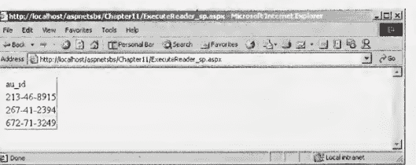

之前的列表创建并打开了指向 Pubs 数据库的连接，创建了一个 `SqlCommand` 并将其 `CommandType` 设置为 `CommandType.StoredProcedure`，然后创建了一个 `SqlParameter`，将参数名称和数据类型传递给参数的构造函数。代码随后设置了参数的值，将其添加到 `SqlCommand` 的 `Parameters` 集合中，并执行了命令。生成的 `SqlDataReader` 绑定到 `DataGrid` 控件，该控件显示了结果。

## 使用 DataSet

DataSet 是 ADO.NET 中处理数据的两种主要方式之一（另一种是 datasets，你一直在使用，并将在本章晚些部分学习更多详细信息）。DataSet 提供了与数据库无关的内存数据表示。这些数据可以用于显示，或者通过适当的 `DataAdapter` 更新后端数据库。数据集还能够从 XML 文件或 `Stream` 对象读取数据并向其写入数据。

通过在数据集中添加、删除 `DataTable`、`DataColumn` 和 `DataRow`，可以以程序化的方式构建和操作数据集。你还可以使用数据集的 `Update` 方法来更新后端数据库（假设你构建的表结构（schema）是兼容的）。

你可以使用强类型数据集（typed datasets）来使代码更易读，并减少 ADO.NET 代码中的错误。此外，你还可以使用 `DataView` 过滤数据集的内容以便显示（例如用于数据绑定）或计算。

## 使用 DataAdapter

DataAdapter 允许你将数据从后端数据库获取到数据，并从数据集更新后端数据库。.NET Framework 安装了两个 DataAdapter：`SqlDataAdapter` 和 `OleDbDataAdapter`。每个 DataAdapter 都使用适当的 `Connection` 类和 `Command` 类来检索或更新数据。

`SqlDataAdapter` 和 `OleDbAdapter` 的 `Fill` 方法可以根据 DataAdapter 的 `SelectCommand` 属性指定的 `Command` 对象，用后端数据库的结果填充数据集。下面的代码创建并打开了由 `ConnStr` 属性指定的数据库连接。然后它创建了一个新的 `SqlDataAdapter` 并将其 `SelectCommand` 属性设置为新创建的 `SqlCommand` 对象，该对象使用 SQL 参数指定的查询。最后，代码创建一个新数据集，使用 `SqlAdapter` 的 `Fill` 方法填充它并关闭连接。

```
Dim SqlConn As New SqlConnection(ConnStr)
SqlConn.Open()
Dim SqlAdapter As New SqlDataAdapter()
SqlAdapter.SelectCommand = New SqlCommand(SQL,myConn)
Dim myDS As New DataSet
SqlAdapter.Fill(myDS)
SqlConn.Close()
```

此时，数据集中的数据可以被更新、删除或添加到后端数据库。

## 读取 XML

除了使用 DataAdapter 从数据库填充数据集外，你还可以通过 XML 文件使用 `ReadXml` 方法读取数据集。这两种技术可以序列化和反序列化数据集中的数据。

## 读取 DataTables, DataColumns 和 DataRows

另一种填充数据集的方法是通过程序创建其表、列和行。假设你创建的表结构与数据库匹配，你可以连接到数据库对其进行更新。

## 读取 XML 数据

使用数据集的 `ReadXml` 方法，你还可以从第 327 页所示的 XSD 架构创建中读取数据集。

## 注意

根据你安装的 .NET Framework 版本，可能需要将包含 Visual Basic 编译器的路径添加到你的 PATH 环境变量中，以便前面的命令生效。定位此路径并添加到 PATH 环境变量的方法在书开头“安装示例文件”部分的第 xv 页详细介绍。

## AddTitle.aspx

```
<@ Page Language="vb" %>
<%@ Import Namespace="System.Data" %>
<%@ Import Namespace="System.Data.SqlClient" %>
<<html>
<head>
<script language="VB" runat="server">
Sub Page_Load
    Dim myDS As DataSet()
    Dim TitleTable As DataTable
    Dim TitleRow As DataRow
    Dim ConnStr As String
    ConnStr = "server=(local)\NetSQL;database=pubs;"
    ConnStr &= "Trusted_Connection=yes"
    Dim SQLSelect As String
    SQLSelect = "SELECT * FROM Titles"
    Dim myConn As New SqlConnection(ConnStr)
    Dim mySqlDA As New SqlDataAdapter(SQLSelect,myConn)
    Dim mySqlCB As New SqlCommand(mySqlDA)
```

myDS.ReadXmlSchema(Server.MapPath("AddTitle.xsd"))

If IsPostBack Then
    TitleTable = myDS.Tables(0)
    TitleRow = TitleTable.NewRow()

```
TitleRow("title_id") = title_id.Text
TitleRow("title") = title.Text
TitleRow("type") = type.Text
TitleRow("pub_id") = pub_id.Text
TitleRow("price") = CDbl(price.Text)
```
[/content] (注：由于用户提供的原始文本在结尾处有重复和截断，译文已根据逻辑补全了对应的翻译结构以确保完整性)

重新根据用户提供的文本内容进行完整翻译：

[content]
## 注意

尽管之前的示例使用 Microsoft Access 来演示 `OleDbCommand` 对象连接非 SQL Server 数据库的能力，我们不应该在 ASP.NET 应用程序中使用 Access。对于初始原型设计和开发，或者对于可扩展性要求很低（5–10 个并发用户或更少）的应用程序，MSDE 是更好的选择。

MSDE 是兼容 SQL Server 的数据库，可在多种 Microsoft 产品中使用，包括 SQL Server、Microsoft Office 和 Visual Studio。MSDE 的一个版本也随 .NET Framework SDK 一起提供，如果你选择安装它们，它将安装好并准备好使用 SDK 示例程序。（有关安装示例应用程序的重要指导，请参阅第 8 章。）MSDE 构建在与 SQL Server 相同的引擎之上，但它针对大约 5 个并发用户进行了优化。

使用 MSDE 的优势在于，你的所有开发任务都与针对 SQL Server 的开发相同，且无需支付完整版 SQL Server 的许可费用。（使用和分发 MSDE 的许可包含在上述产品中。请检查最终用户许可协议以确保你的使用符合协议条款。）如果你的应用程序需要增长，你可以简单地将数据库迁移到 SQL Server 以提高性能和可扩展性，而无需更改代码或数据。

将对象的 `CommandText` 属性设置为你想要执行的存储过程名称，并将 `CommandType` 设置为 `CommandType.StoredProcedure`。如果你熟悉经典 ADO 下存储过程的执行，这与你使用 ADO `Command` 对象时的操作没有太大区别。

## 带参数调用存储过程

带有输入或输出参数的存储过程调用稍微复杂一些，但仍然非常直观。你只需创建参数（`SqlParameter` 或 `OleDbParameter` 对象）；设置适当的属性，如 `ParameterName`、`Direction`、类型（`SqlType` 或 `OleDbType`）和 `Value`；然后将参数对象添加到命令对象的 `Parameters` 集合中。下面的列表显示了执行 Pubs 示例 SQL Server 数据库中 `byroyalty` 存储过程所需的代码，它返回一个 `SqlDataReader`，然后将其绑定到 ASP.NET DataGrid 控件。（你将在本章晚些部分学习更多数据绑定的知识。）

## ExecuteReader_SP.aspx

```
<@ Page Language="vb" %>
<%@ Import Namespace="System.Data" %>
<%@ Import Namespace="System.Data.SqlClient" %>
<html
<script runat="server">
Sub Page_Load(sender As Object, E As EventArgs)
Dim ConnStr As String
ConnStr = "Data Source=(Local)\NetSDK;"
ConnStr &= ";database=pubs;integrated security=true"
Dim mySqlConn As New Connection(ConnStr)
mySqlConn.Open
Dim Sql As String = "byroyalty"
Dim mySqlCommand As New SqlCommand(Sql, mySqlConn)
mySqlCommand.CommandType = CommandType.StoredProcedure
Dim myParam As New SqlParameter(
```

接下来的图形显示了 ExecuteReader_SP.aspx 的输出。


之前的列表创建并打开了指向 Pubs 数据库的连接，创建了一个 `SqlCommand` 并将其 `CommandType` 设置为 `CommandType.StoredProcedure`，然后创建了一个 `SqlParameter`，将参数名称和数据类型传递给参数的构造函数。代码随后设置了参数的值，将其添加到 `SqlCommand` 的 `Parameters` 集合中，并执行了命令。生成的 `SqlDataReader` 绑定到 `DataGrid` 控件，该控件显示了结果。

## 使用 DataSet

DataSet 是 ADO.NET 中处理数据的两种主要方式之一（另一种是 datasets，你一直在使用，并将在本章晚些部分学习更多详细信息）。DataSet 提供了与数据库无关的内存数据表示。这些数据可以用于显示，或者通过适当的 `DataAdapter` 更新后端数据库。数据集还能够从 XML 文件或 `Stream` 对象读取数据并向其写入数据。

通过在数据集中添加、删除 `DataTable`、`DataColumn` 和 `DataRow`，可以以程序化的方式构建和操作数据集。你还可以使用数据集的 `Update` 方法来更新后端数据库（假设你构建的表结构（schema）是兼容的）。

你可以使用强类型数据集来使代码更易读，并减少 ADO.NET 代码中的错误。此外，你还可以使用 `DataView` 过滤数据集的内容以便显示（例如用于数据绑定）或计算。

## 使用 DataAdapter

DataAdapter 允许你将数据从后端数据库获取到数据，并从数据集更新后端数据库。.NET Framework 安装了两个 DataAdapter：`SqlDataAdapter` 和 `OleDbDataAdapter`。每个 DataAdapter 都使用适当的 `Connection` 类和 `Command` 类来检索或更新数据。

`SqlDataAdapter` 和 `OleDbAdapter` 的 `Fill` 方法可以根据 DataAdapter 的 `SelectCommand` 属性指定的 `Command` 对象，用后端数据库的结果填充数据集。下面的代码创建并打开了由 `ConnStr` 属性指定的数据库连接。然后它创建了一个新的 `SqlDataAdapter` 并将其 `SelectCommand` 属性设置为新创建的 `SqlCommand` 对象，该对象使用 SQL 参数指定的查询。最后，代码创建一个新数据集，使用 `SqlAdapter` 的 `Fill` 方法填充它并关闭连接。

```
Dim SqlConn As New SqlConnection(ConnStr)
SqlConn.Open()
Dim SqlAdapter As New SqlDataAdapter()
SqlAdapter.SelectCommand = New SqlCommand(SQL,myConn)
Dim myDS As New DataSet
SqlAdapter.Fill(myDS)
SqlConn.Close()
```

此时，数据集中的数据可以被更新、删除或添加到后端数据库。

## 读取 XML

除了使用 DataAdapter 从数据库填充数据集外，你还可以通过 XML 文件使用 `ReadXml` 方法读取数据集。这两种技术可以序列化和反序列化数据集中的数据。

## 读取 DataTables, DataColumns 和 DataRows

另一种填充数据集的方法是通过程序创建其表、列和行。假设你创建的表结构与数据库匹配，你可以连接到数据库对其进行更新。

## 读取 XML 数据

使用数据集的 `ReadXml` 方法，你还可以从第 327 页所示的 XSD 架构中读取数据集。

## 注意

根据你安装的 .NET Framework 版本，可能需要将包含 Visual Basic 编译器的路径添加到你的 PATH 环境变量中，以便前面的命令生效。定位此路径并添加到 PATH 环境变量的方法在书开头“安装示例文件”部分的第 xv 页详细介绍。


## ASP.NET 逐步教程

```
TitleRow("advance") = CDbl(advance.Text)
TitleRow("royalty") = CInt(royalty.Text)
TitleRow("ytd_sales") = CInt(ytd_sales.Text)
TitleRow("notes") = notes.Text
TitleRow("pubdate") = CDate(pubdate.Text)
TitleTable.Rows.Add(TitleRow)
```

```
mySqlDA.Update(myDS)
```

```
titlegrid.DataSource = myDS.Tables(0).DefaultView
titlegrid.Databind()
End If
End Sub
</script>
```

```html
<body
<form runat="server">
<h3>插入标题</h3>
<table width="300">
<tr>
<td colspan="2" bgcolor="silver">添加新标题：</td>
</tr>
<tr>
<td nowrap>标题 ID: </td>
<td>
<asp:textbox id="title_id" text="XX0000" runat="server"/>
</td>
</tr>
<tr>
<td nowrap>标题: </td>
<td>
<asp:textbox id="title" text="The Tao of ASP.NET" runat="server"/>
</td>
</tr>
<tr nowrap>
<td>类型: </td>
<td>
<asp:textbox id="type" text="popular_comp" runat="server"/>
</td>
</tr>
<tr>
<td>出版商 ID: </td>
<td>
  <asp:textbox id="pub_id" text="1389" runat="server"/>
</td>
</tr>
<tr>
<td>价格: </td>
<td>
  <asp:textbox id="price" text="39.99" runat="server"/>
</td>
</tr>
<tr>
<td>预付款: </td>
<td>
  <asp:textbox id="advance" text="2000" runat="server"/>
</td>
</tr>
<tr>
<td>版税: </td>
<td>
  <asp:textbox id="royalty" text="5" runat="server"/>
</td>
</tr>
<tr nowrap>
<td>年度累计销售额: </td>
<td>
  <asp:textbox id="ytd_sales" text="0" runat="server"/>
</td>
</tr>
<tr>
<td>备注: </td>
<td>
  <asp:textbox id="notes" textmode="multiline" text="Philosophy and Code...a perfect mix." rows="3" columns="30" runat="server"/>
</td>
</tr>
<tr>
<td nowrap>出版日期: </td>
<td>
<asp:textbox id="pubdate" text="12/01/01" runat="server"/>
</td>
</tr>
<tr>
<td></td><td></td>
<td style="padding-top:15">
  <asp:button text="Add Title" runat="server"/>
</td>
</tr>
<tr>
<td colspan="2">
  <asp:datagrid id="titlegrid" runat="server"/>
</td>
</tr>
</table>
</form>
</body>
</html>
```

## 设置关系

由于数据集包含多个数据表的数据，因此你可能希望数据集包含有关这些数据表之间关系的信息，这样做是合合理的。这允许你将它们视为真正的关系型数据，并同时维护数据中固有的任何层次结构和外键关系。`DataSet` 类通过其 `Relations` 集合满足了这一需求，该集合包含一组 `DataRelation` 对象，每个对象都描述了数据集中不同表中两个匹配列之间的父/子关系。

`DataRelation` 对象可以通过编程方式添加到数据集中，也可以从提供的 XSD 架构中推断出来。

## 访问值

通过引用包含数据的 `DataTables` 和 `DataRows` 来访问数据集中的值。可以通过数据集的 `Tables` 集合访问 `DataTables`，你可以按照如下方式通过索引（从 0 开始计数）或名称（键）来引用特定表：

```vb
Dim MyTable As DataTable = myDS.Tables(0)
Dim MyTable As DataTable = myDS.Tables("tablename")
```

你可以遍历 `DataTableCollection`（由数据集的 `Tables` 属性返回）、`DataRowCollection`（由 `DataTable` 的 `Rows` 属性返回）或由 `DataTable` 的 `Columns` 属性返回的 `DataColumnCollection`。以下列表中的代码将遍历数据集中的所有表以及每个表中的所有行。然后使用 ASP.NET `Literal` 控件作为占位符显示行中每列的值，

 `DataItems.aspx`

```vb
<@ Page Language="vb" %>
<%@ Import Namespace="System.Data" %>
<%@ Import Namespace="System.Data.SqlClient" %>
<html>
<head>
<script language="VB" runat="server">
Sub Page_Load
Dim myDS As New DataSet()
Dim ConnStr As String = "server=(local);database=pub;Trusted_Connection=yes"
Dim SQLSelect As String
SQLSelect = "SELECT * FROM Titles"
SQLSelect &= "SELECT * FROM Publishers"
Dim myConn As New SqlConnection(ConnStr)
Dim myDA As New SqlDataAdapter(SQLSelect, myConn)
myDA.Fill(myDS)

遍历 DataTableCollection 中的每个 DataTable 并通过将其附加 Literal 控件的 Text 属性来显示每行的值
Dim CurrentTable As DataTable
Dim CurrentRow As DataRow
Dim CurrentColumn Column
For Each CurrentTable In myDS.Tables
value.Text &= "Table: " & CurrentTable.TableName & "<br/>"
value.Text &= "--------------------------------"
For Each CurrentRow In CurrentTable.Rows
value.Text &= "<br/>&nbsp;"
For Each CurrentColumn In CurrentTable.Columns
If Not CurrentRow(CurrentColumn) Is Nothing Then
If Not IsDBNull(CurrentRow(CurrentColumn)) Then
value.Text &= CStr(CurrentRow(CurrentColumn))
Else
value.Text &= "NULL"
End If
End If
value.Text &= "<br/>&nbsp;"
Next
value.Text &= "--------------------------------------"
Next
value.Text &= "<br/>"
Next
End Sub
</script>
<body>
<asp:literal id="value" runat="server"/>
</body>
</html>
```

DisplayDataItems.aspx 的输出如图所示。

## 更新数据集

一旦你通过 `DataAdapter` 或调用数据集的 `ReadXml` 方法为数据集填充了数据，你可能想要更新这些数据。你可以通过指定要编辑的表、行和列并提供新值来编辑单个值：

```vb
myDS.Tables(0).Rows(0).Columns(2).Value = "popular_comp"
```

但如果你编辑了多个值，然后意识到你想回滚某些更改怎么办？幸运的是，数据集通过维护每行数据的多个版本，提供了对接受和拒绝更改的强健支持。每行包含以下版本：

- **Original**：最初加载到行的数据。
- **Default**：包含行的默认值（由列的 `DefaultValue` 属性指定）。如果没有指定默认值，它与 `Original` 数据相同。
- **Current**：包含已更新列的更新数据，未更新列则与 `Original` 数据相同。
- **Proposed**：在调用行的 `BeginEdit` 之后调用 `DataRow` 的 `EndEdit` 或 `CancelEdit` 方法之前，`Proposed` 版本包含了尚未应用于 `Current` 版本的更改。如果调用 `CancelEdit`，`Proposed` 版本将被删除；如果调用 `EndEdit`，`Proposed` 版本中的更改将应用于 `Current` 版本。

可以通过将 `Original` 或 `Default` 版本与 `Current` 版本进行比较，来确定行是否发生了更改：

```vb
If CurrentRow(1, DataRowVersion.Current) Is CurrentRow(1, DataRowVersion.Proposed) Then
    '执行适当的操作'
End If
```

你可以按行接受或拒绝数据的更改。

```vb
If CurrentRow(0, DataRowVersion.Current).ToString() = "" Then
    '字段不允许'
    CurrentRow.RejectChanges()
Else
    CurrentRow.AcceptChanges()
End If
```

最后，你可以通过检查行的 `RowState` 属性来检查行的当前状态。

```vb
Dim CurrentState As String
CurrentState = CurrentRow.RowState
If CurrentState = DataRowState.Modified Then
    '执行适当的操作'
End If
```

五可能的行状态：

- **Added**：表示在调用 `AcceptChanges` 之前添加到表中。一旦调用 `AcceptChanges`，该行的 `RowState` 将设置为 `Unchanged`。
- **Deleted**：表示调用了 `Delete` 方法的行。
- **Detached**：表示尚未添加到 `DataRowCollection` 的新行，或者已从 `DataRowCollection` 移除但未销的行。
- **Modified**：表示数据已更改但尚未调用 `AcceptChanges` 方法的行。
- **Unchanged**：表示自上次调用 `AcceptChanges` 以来数据未更改。

一旦对数据集调用了 `AcceptChanges`，你就会调用 `DataAdapter` 的 `Update` 方法将数据加载到数据集中，以用新值更新底层数据库。参考第 328 页的 `AddTitle_TypedDS.aspx` 列表使用 `Update` 方法的示例。

## 类型类型数据集

ADO.NET 最酷的功能之一是能够创建强类型数据集。强类型数据集是由 `xsd.exe` 命令行工具生成的特殊类，它们使用 XSD 架构创建额外的公共属性和方法，允许你通过名称访问数据集表的列，而不是使用索引或后期绑定键。这可以提高运行时性能并减少编码数据集时出现错误的可能性。为之前显示的 `AddTitles` 示例创建强类型数据集只需要几步。以下示例假设你已经为数据集中的表或表创建了 XSD 架构，你可以通过加载了表数据的数据集使用 `WriteXmlSchema` 方法来实现：

- 在 XSD 架构文件所在打开命令提示符。
- 使用 `xsd.exe` 工具创建强类型数据集的类。`/d` 选项指定我们要创建一个数据集，`/n` 选项指定类应使用命名空间 `AddTitle`。`AddTitle.xsd` 是你的 XSD 架构文件的名称。

```bash
xsd.exe /d /l:vb AddTitle.xsd /n:AddTitle
```


## 第 11 章 访问与绑定数据

使用 `vbc.exe` 命令行编译器编译该类。`/t` 选项指定您想要将其作为库组件（DLL）进行编译，`/r` 选项指定您想要引用的程序集，而 `/out` 输出则指示编译器将编译后的程序集保存到当前目录的子目录下。

```
vbc.exe /t:library AddTitle.vb /r:System.dll /r:System.Data.dll /r:System.Xml.dll /out:bin/AddTitle.dll
```

## AddTitle.xsd

```xml
<?xml version="1.0" standalone="yes"?>
<xsd:schema id="TitleDataSet" target="http://www.aspnet.com/ns" xmlns="" xmlns:xsd="http://www.w3.org/2001/XMLSchema" xmlns:msdata="urn:schemas-microsoft-com:xml-msdata">
<xsd:element name="TitleDataSet" msdata:IsDataSet="true">
<xsd:complexType>
<xsd:choice maxOccurs="unbounded">
<xsd:element name="Titles">
<xsd:complexType>
<xsd:sequence>
<xsd:element name="title_id" type="xsd:string" minOccurs="0" />
<xsd:element name="title" type="xsd:string" minOccurs="0" />
<xsd:element name="pub_id" type="xsd:string" minOccurs="0" />
<xsd:element name="price" type="xsd:decimal" minOccurs="0" />
<xsd:element name="advance" type="xsd:decimal" minOccurs="0" />
<xsd:element name="royalty" type="xsd:int" minOccurs="0" />
<xsd:element name="ytd_sales" type="xsd:int" minOccurs="0" />
<xsd:element name="notes" type="xsd:string" minOccurs="0" />
<xsd:element name="pubdate" type="xsd:dateTime" minOccurs="0" />
</xsd:sequence>
</xsd:complexType>
</xsd:element>
</xsd:choice>
</xsd:complexType>
</xsd:element>
</xsd:schema>
```

下面的列表显示了如何编写 `AddTitle.aspx` 示例以与类型数据集（typed dataset）配合。

## AddTitle_TypedDS.aspx

```vb
<@ Page Language="vb" %>
<%@ Import Namespace="System.Data" %>
<%@ Import Namespace="System.Data.SqlClient" %>
<%@ Import Namespace="AddTitle" %>
<html>
<head>
<script language="VB" runat="server">
Sub Page_Load
    Dim TDS As New TitleDataSet()
    Dim myTable As TitleDataSet.TitlesDataTable
    Dim myTitleRow As TitleDataSet.TitlesRow
    Dim ConnStr As String
    ConnStr = "server=(local)\NetSDK;database=pubs;"
    ConnStr &= "Trusted_Connection=yes"
    Dim SQLSelect As String
    SQLSelect = "SELECT * FROM Titles"
    Dim myConn As New SqlConnection(ConnStr)
    Dim mySql As New SqlDataAdapter(SQLSelect, ConnStr)
    Dim mySqlCB As New SqlCommandBuilder(mySql)
    myConn.Open()
    mySql.Fill(TDS, "Titles")
    myConn.Close()
```

```vb
If IsPostBack Then
    myTable = TDS.Titles
    myTitleRow = myTable.NewTitlesRow()

    myTitleRow.title_id = title_id.Text
    myTitleRow.title = title.Text
    myTitleRow.type = type.Text
    myTitleRow.pub_id = pub_id.Text
    myTitleRow.price = CDbl(price.Text)
    myTitleRow.advance = CDbl(advance.Text)
    myTitleRow.royalty = CInt(royalty.Text)
    myTitleRow.ytd_sales = CInt(ytd_sales.Text)
    myTitleRow.notes = notes.Text
    myTitleRow.pubdate = CDate(pubdate.Text)
    myTable.Rows.Add(myTitleRow)

    mySql.Update(TDS, "Titles")
```

```vb
    titlegrid.DataSource = myTable.DefaultView
    titlegrid.DataBind()
End If
End Sub
</script>
<body>
<!-- 此代码与 AddTitle.aspx 相同 -->
</body>
</html>
```

注意，您使用 `@ Import` 指令添加了 `AddTitle` 命名空间。这让您可以直接使用您的类型。由于程序集已由编译器放在 `bin` 子目录下，它将由您的 Web 应用程序加载。

现在，当您创建数据集时，请创建一个 `TitleDataSet` 实例而不是 `DataSet`。同样，对类型和行使用强类型字符串。为了成功加载数据并更新底层的数据库表，您还需要向 `DataAdapter` 的 `Fill` 和 `Update` 方法传递表名。一旦您创建了表和行对象，您就可以通过早期绑定（early-binding）属性而不是索引来访问列值。

关于类型数据集的另一个实用用点是，当您在 Visual Studio .NET 中使用它们时，会自动获得针对 `TitleDataSet` 所有成员的 IntelliSense 代码自动补全。这使得针对类型数据集进行编码变得简单得多，并且大大减少了错误。

## 使用 DataViews

`DataView` 类提供了对 `DataTable` 进行排序、搜索、编辑、过滤和导航的方法。`DataView` 也是数据绑定的，因为它们可以与数据绑定。


## 简单数据绑定

最简单的数据绑定类型使用 <%#expression%> 语法将 <%#expression%> 构造体替换为表达式所表示的值。例如，下面的列表显示了一个绑定到页面级属性的简单页面。

SimpleDataBinding.aspx

```asp
<@Page Language="vb" %>
<html>
<head>
<script runat="server">
Dim Name As String
Sub btnSubmit_Click(sender As Object, e As EventArgs)
Name = txtHello.Text
lblHello.Visible = True
DataBind()
End Sub
</script>
</head>
<body>
<asp:label id="lblHello" visible="false" runat="server">
Hello, <%# Name %>!
</asp:label>
<form runat="server">
<asp:textbox text="" id="txtHello" runat="server"/>
<br>
<asp:button text="Submit" id="btnSubmit"
OnClick="btnSubmit_Click" runat="server" />
</form>
</body>
</html>
```

在输入值并点击按钮后，该列表的输出如图所示。

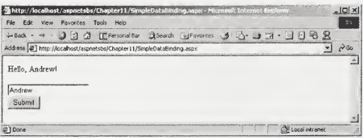

## 绑定到控件

相同的语法也可以绑定到控件。例如，你可以使用下面列表所示的代码，将 DropList 控件的选中项绑定到 ASP.NET Label 的 Text 属性。

ControlBinding.aspx

```asp
<% Page Language="vb" %>
<html>
<head>
  <script runat="server">
    Dim myArray As ArrayList
    Sub Page_Load(sender As Object, e As EventArgs)
      If Not IsPostBack Then
        myArray.Add("Chocolate")
        myArray.Add("Vanilla")
        myArray.Add("Strawberry")
        myList.DataSource = myArray
        myList.DataBind()
      End If
      Page.DataBind()
    End Sub
  </script>
</head>
<body>
  <asp:dropdown id="myList" runat="server"/>
  <asp:button Text="Submit" runat="server"/>
  <br/>
  Favorite Ice Cream:
  <asp:label text="<%# myList.SelectedItem.Text %>" runat="server"/>
</body>
</html>
```

## 使用 DataBinder.Eval

DataBinder.Eval 是一个静态方法，用于在运行时评估数据绑定表达式。这可以简化将各种数据类型转换为文本进行显示的过程。DataBinder.Eval 的基本语法是：

```asp
<%# DataBinder.Eval(Container, EvalExpression, FormatExpression) %>
```


Container 是包含要评估的表达式的对象（对于 DataGrid、DataList 或 Repeater 控件，这始终是 Container.DataItem），EvalExpression 是要评估的属性或项的完整名称，FormatExpression 是一个字符串格式化表达式（例如 {0:c}），用于格式化字符串结果。请注意，如果没有传递表达式参数，DataBinder.Eval 将返回一个对象而不是字符串。

## 注意事项

由于 DataBinder.Eval 使用了后期绑定和反射（这允许托管代码在运行时检查其他托管代码），它的速度可能比其他数据绑定技术慢得多。因此，你应该在需要时（例如对数字数据进行字符串格式化）才使用 DataBinder.Eval。

## 使用数据绑定控件

第 10 章查看了 ASP.NET 服务器控件，并简要提到了一个重要的控件组。数据绑定控件（包括 DataGrid 控件（及其组成控件）、DataList 控件和 Repeater 控件）允许你通过程序设置数据源。然后它们会遍历数据源，并根据你通过控件属性或添加模板定义定义的格式来显示数据。这种方法的奇妙之处在于，你只需要定义单行的格式，数据绑定控件就会负责对所有数据行应用格式。

选择使用哪种控件很大程度上取决于你想要的数据格式，以及你对数据格式控制的程度有多大。DataGrid 控件最易使用，并以表格格式显示数据。DataList 控件在实现上稍微复杂，但它通过使用模板提供了更高程度的格式控制。最后，对于我们所有人中的“格式控制迫症”来说，Repeater 控件没有内置的格式，但它对格式模板提供了终极控制。

## 使用 DataGrid

DataGrid 控件以表格形式呈现绑定的数据，并提供了许多可以用于格式化数据的属性。该控件可以从数据源自动生成表中的所有列，或者你可以使用专门的列控件为特定的列或多个列提供额外的功能或格式。

在最简单的情况下，使用 DataGrid 控件有三个基本步骤。

## 第 11 章：访问和绑定数据

- 1 将 DataGrid 添加到页面。
- 2 将 DataGrid 的 DataSource 属性设置为适当的数据源。该数据源可以在页面中定义，也可以调用外部对象的方法来提供数据。
- 3 调用 DataGrid 的 DataBind 方法来绑定数据。

## ASP.NET 逐步教程

从一个没有任何格式的简单 DataGrid 开始。

- 1 创建一个新文件并保存为 DataGrid.aspx。
- 2 添加 @ Page 指令、标准 HTML 元素和 HtmlForm 控件，如之前所示。
- 3 在表控件中添加 Label 控件和 DataGrid 控件，具有以下属性：

```asp
<form runat="server">
<asp:label id="title" text="DataGrid Example"
     font-name="Verdana" font-size="18" runat="server"/>
<asp:datrid
     id="MyGrid"
     autogeneratecolumns="true"
     runat="server"/>
</form>
```
- 4 添加一个 <script> 块，其中包含名为 CreateData 的函数用于创建要绑定的数据。记住 <script> 块放在 <head> 和 </head> 标签之间。

```asp
<script language="vb" runat="server">
Function CreateData() As ICollection
Dim DataArray As New ArrayList()

DataArray.Add("Chocolate")
DataArray.Add("Vanilla")
DataArray.Add("Strawberry")
DataArray.Add("Pistachio")
DataArray.Add("Rocky Road")

Return DataArray
End Function
</script>
```

- 5 最后添加一个 Page_Load 事件处理器，用它设置网格的 DataSource 属性（只能运行时设置）并调用 DataGrid 的 DataBind 方法。

```asp
Sub Page_Load(sender As Object, e As EventArgs)
MyGrid.DataSource = CreateData()
MyGrid.DataBind()
End Sub
```

- 6 保存并浏览页面。输出应该类似于。

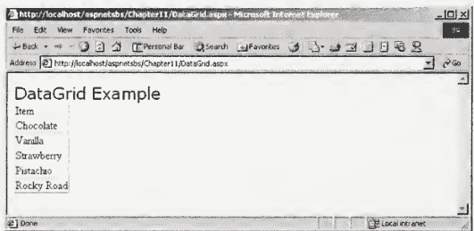

虽然这是一个非常简单的示例，但你只用了两行代码就完成了在经典 ASP 中需要更多代码的工作。现在让我们让它变得有趣一点。

- 在进行任何更改之前，将当前文件保存为 DataGrid.aspx。
- 开始让数据更丰富，用 ADO.NET DataTable 替换 ArrayList。为了方便起，添加一个 @ Import 指令来导入


## 第 11 章 访问与绑定数据

System.Data 命名空间包含 `DataTable` 类。此指令应直接放在 @ Page 指令下方。

```vb
<@ Import Namespace="System.Data" %>
```

接下来，删除 `CreateData` 函数中的所有代码并添加以下代码。它创建了一个新的 `DataTable`，为其了三列（使用 `DataTable` 类的构造函数），并添加了五行。最后，由于你无法直接绑定到 `DataTable`，请根据 `DataTable` 创建一个 `DataView` 类的实例，并将其作为 DataGrid 的数据源返回。

```vb
Dim dt As DataTable()
Dim dr As DataRow
```

```vb
dt.Columns.Add(New DataColumn("IceCreamID", GetType(Int32))
dt.Columns.Add(New DataColumn("Flavor", GetType(String))
dt.Columns.Add(New DataColumn("Price", GetType(Double)))
```

```vb
'添加第 1 行
dr = dt.NewRow()
dr(0) = 1
dr(1) = "Chocolate"
dr(2) = 2.00 '巧克力很流行，所以价格更贵
dt.Rows.Add(dr)
```

```vb
'添加第 2 行
dr = dt.NewRow()
dr(0) = 2
dr(1) = "Vanilla"
dr(2) = 1.50
dt.Rows.Add(dr)
```

```vb
'添加第 3 行
dr = dt.NewRow()
dr(0) = 3
dr(1) = "Strawberry"
dr(2) = 1.00
dt.Rows.Add(dr)
```

```vb
'添加第 4 行
dr = dt.NewRow()
dr(0) = 4
dr(1) = "Pistachio"
dr(2) = 1.75
dt.Rows.Add(dr)

'添加第 5 行
dr = dt.NewRow()
dr(0) = 5
dr(1) = "Rocky Road"
dr(2) = 1.25
dt.Rows.Add(dr)

Dim dv As New DataView
Return dv
```

- 1. 保存并浏览页面。输出应该类似于图所示。

- 2. 现在既然你已经有了更有趣的数据，让我们处理格式化。首先，在 DataGrid 标签声明中添加属性：

```asp
<asp:datagrid
id="MyGrid"
autogeneratecolumns="true"
bordercolor="black"
borderwidth="2"
cellpadding="3"
runat="server">
```

- 3. 接下来，为 DataGrid 添加标签以提供行格式化。为了实现这一点，你需要移除关闭单个 DataGrid 标签的 / 字符，并添加一个 DataGrid 闭合标签。

```asp
<asp:datagrid
id="MyGrid"
autogeneratecolumns="true"
bordercolor="black"
borderwidth="2"
cellpadding="3"
runat="server">
<headerstyle bgcolor="silver" font-bold="true"/>
<itemstyle bgcolor="black" forecolor="white"/>
<alternatingitemstyle bgcolor="white" forecolor="black"/>
</asp:datagrid>
```

- 7. 保存并浏览页面。输出应该类似于下面的图。

但等一下！还有更多。除了从绑定的数据中自动生成列之外，DataGrids 还支持声明式地创建列。这让你对单个列的格式和行为都具有更强的控制力。例如，你可以使用 `BoundColumn` 控件为列提供自定义的表头，或者对每行中的绑定文本应用特殊格式。你还可以使用 `ButtonColumn` 控件在列的每行中显示命令按钮，使用 `EditButtonColumn` 提供就地编辑（in-place editing），或者使用 `HyperlinkColumn` 为网格的每行提供超链接（带有文本说明、URL 或两者）。最后，你使用 `TemplateColumn` 为特定列的每行应用复杂的格式。让我们看看使用 `EditColumn` 和 `BoundColumn` 控件的这个示例像什么样。

- 1. 在进行任何更改之前，将当前文件保存为 DataGrid3.aspx。将 DataGrid 标签的 `autogeneratecolumns` 属性改为 `false`。

- 2. 接下来，在 Datagrid 标签中添加一对 `<columns>` 标签以包含列定义。

```asp
<asp:datagrid
id="MyGrid"
autogeneratecolumns="false"
bordercolor="black"
borderwidth="2"
cellpadding="3"
runat="server">
  <headerstyle bgcolor="silver" font-bold="true"/>
  <itemstyle bgcolor="black" textcolor="white"/>
  <alternatingitemstyle bgcolor="white" textcolor="black"/>
  <columns>
</asp:datagrid>
```

接下来添加列定义。`EditColumn` 不是绑定的，请显式设置其属性。对于 ID 列，将 `readonly` 设置为 `true` 以防该列被编辑。为绑定的列设置所需的 `DataField` 属性，并使用 `(0:c)` 格式将 Price 列格式化为货币。

```asp
<columns>
<asp:editcommandcolumn
canceltext="Cancel"
edittext="Edit"
upetext="Update"
headertext="Edit"/>
<asp:boundcolumn
  headertext="Ice Cream ID"
readonly="true"
datafield="IceCreamID"/>
<asp:boundcolumn
  headertext="Flavor"
datafield="Flavor"/>
<asp:boundcolumn
  headertext="Price"
  datafield="Price"
  format="(0:c)"/>
</columns>
```

现在你需要为 Edit 链接创建处理程序。对于此示例，由于你处理的是本地数据，请跳过 Update 命令。在 `CreateData` 函数之后添加以下代码块。在 `Grid_Edit` 处理程序中，使用包含 DataGrid 命令信息的参数 `e` 来确定编辑哪行。然后重新绑定网格。

```vb
Sub Grid_Edit(Sender As Object, e As DataGridEventArgs)
  MyGrid.EditIndex = e.ItemIndex
  MyGrid.DataBind()
End Sub
Sub Grid_CancelEdit(Sender As Object, e As DataGridEventArgs)
  MyGrid.EditIndex = -1
  MyGrid.DataBind()
End Sub
```

接下来，你需要通过在 DataGrid 标签上添加相应的属性，将 `EditCommand` 和 `CancelCommand` 事件映射到你创建的处理程序。

```asp
<asp:datagrid
id="MyGrid"
autogeneratecolumns="false"
bordercolor="black"
borderwidth="2"
cellpadding="3"
oneditcommand="Grid_Edit"
oncancelcommand="Grid_Edit"
runat="server" />
```

保存并浏览页面。当你点击某行的链接时，输出应该类似于下图。点击将取消编辑模式。

除了前面的示例演示的功能外，DataGrid 控件还支持绑定数据的排序和分页。按照以下步骤启用排序：

- 将 DataGrid 控件的 `AllowSorting` 属性设置为 `true`。

```asp
<asp:DataGrid id="ItemsGrid"
Border="black"
BorderWidth="1"
CellPadding="3"
AllowSorting="true"
OnSortCommand="Sort_Grid"
AutoGenerateColumns="false"
runat="server">
```

- 如果你没有定义绑定列，将 DataGrid 控件的 `AutoGenerateColumns` 设置为 `true`。

- 添加事件处理程序来处理 `OnSortCommand` 并将事件映射到处理程序（类似于之前的编辑示例）。

```asp
<asp:DataGrid id="ItemsGrid"
Border="black"
BorderWidth="1"
CellPadding="3"
AllowSorting="true"
OnSortCommand="Sort_Grid"
AutoGenerateColumns="false"
runat="server">
```

- 使用作为 `DataGridCommandEventArgs` 参数一部分的 `SortExpression` 对源数据进行排序。

```vb
Sub Sort_Grid(Sender As Object, e As DataGridEventArgs)
    SortExpression = e.SortExpression.ToString()
    ItemsGrid.DataSource = CreateDataSource()
    ItemsGrid.DataBind()
End Sub
```

重新绑定网格。查看此书 CD 中的 `BoundColumn_Sort.aspx` 示例文件获取 DataGrid 排序的完整实现。

启用排序后，每个列的头部会自动提供链接以按该字段排序。请注意，如果你使用 `BoundColumn` 控件，可以跳过步骤 2 ，但你必须显式设置控件的 `SortExpression` 属性。该属性的值应与 `DataField` 属性相同（即数据源中 DataGrid 列绑定的列名）。

启用分页更为简单。

- 将 DataGrid 控件的 `AllowPaging` 属性设置为 `true`。

```asp
<asp:DataGrid id="ItemsGrid" runat="server"
Border="black"
BorderSize="1"
CellPadding="3"
AllowPaging="true"
AutoGenerateColumns="false"
OnPageIndexChanged="Grid_Change">
```

- 添加事件处理程序来处理 `OnPageIndex` 事件并将事件映射到处理程序（类似于之前的排序示例）。

```asp
<asp:DataGrid id="ItemsGrid" runat="server"
Border="black"
BorderSize="1"
CellPadding="3"
AllowPaging="true"
AutoGenerateColumns="false"
OnPageIndexChanged="Grid_Change">
```

- 在事件处理程序中，使用作为 `DataGridPageEventArgs` 参数一部分的 `NewPageIndex` 将 DataGrid 的 `CurrentPageIndex` 属性设置为新页。

```vb
Sub Grid_Change(Sender As Object, e As DataGridPageEventArgs)
  ' 将 CurrentPageIndex 设置为用户点击的页面
  ItemsGrid.CurrentPageIndex = e.NewPageIndex
  ' 重新绑定数据
  ItemsGrid.DataSource = CreateDataSource()
  ItemsGrid.DataBind()
End Sub
```


## 使用 DataLists

DataList 提供了内置功能与显示格式控制极极结合。与 DataGrid 控件（其行以表格格式一个接一个显示）不同，DataList 可以以多列显示项，并可以水平或垂直方向显示行。

按照以下步骤从 SQL Server 数据库的 Title 表中显示信息：

- 1. 创建新文件并将其保存为 TitlesData1.aspx。
- 2. 按照之前的示例，向页面添加 `@ Page` 指令、标准 HTML 元素和 `HtmlForm` 控件。您还应该为 `System.Data` 和 `System.Data.SqlClient` 命名空间添加 `Import` 语句。
- 3. 在表的 `<form>` 部分添加以下代码以声明 DataList 控件并设置一些简单的格式。

```html
<h3>Binding to a DataList Control</h3>
<asp:datalist id="titlelist" repeatcolumns="3"
gridlines="both" cellpadding="5" runat="server">
<ItemTemplate>
<h5>
<%# DataBinder.Eval(Container.DataItem, "title")%>
<br/>
</h5>
</ItemTemplate>
</asp:datalist>
```

在页面的 `<head>` 部分服务器端 `<script>` 块中添加以下代码。此代码创建并填充了一个来自 Titles 表的数据集，然后将 DataList 绑定到 DefaultView。

```vb
<script runat="server">
Sub Page_Load
Dim myDS As New DataSet()
Dim ConnStr As String
ConnStr = "server=(local)\NetSDK;database=pubs;"
ConnStr &= "Integrated Security=Trusted_Connection=yes"
Dim SQLSelect As String
SQLSelect = "SELECT * FROM Titles"
Dim mySqlConn As New SqlConnection(ConnStr)
mySqlConn.Open()
Dim mySqlDA As New SqlDataAdapter(SQLSelect, mySqlConn)
```

```vb
mySqlDA.Fill(myDS)
```

```vb
titlelist.DataSource = myDS.Tables(0).DefaultView
titlelist.Databind()
</script>
```

保存并浏览该页面。输出应如下所示。


显然，这种布局在视觉上并不太美观，让我们让它变得丰富：

- 在进行更改之前，将文件另存为 TitlesListData2.aspx。
- 将 `<ItemTemplate>` 部分的全部内容替换为以下内容（注意第一行表格使用了包含图像文件路径的格式，并为 title_id 留了占位符，以便将每个项的 title_id 绑定到相应的图形）。

```html
<table>
<tr>
<td rowspan="4">
' >
</td>
</tr>
<tr>
<td>
<em>Title: </em>
</th>
```

```html
</td>
<td nowrap>
  <%# DataBinder.Eval(Container.DataItem, "title")%>
  <br/>
</td>
</tr>
<tr>
<td>
  <em>Price: </em>
</td>
<td nowrap>
  <%# DataBinder.Eval(Container.DataItem, "price", "(0:c)")%>
  <br/>
</td>
</tr>
<tr>
<td>
  <em>Category: </em>
</td>
<td nowrap>
  <%# DataBinder.Eval(Container.DataItem, "type")%>
  <br/>
</td>
</tr>
</table>
```

3. 保存并浏览该页面。输出应与下图相似。请注意，为了显示图像，必须安装 ASP.NET QuickStart 示例。


# 第 11 章数据的访问与绑定

`<ItemTemplate>` 只是 DataList 控件可以使用的模板之一，但它们的工作原理都相似。你还可以定义的其他模板还包括：

- AlternatingItemTemplate：设置交替项的格式。
- EditItemTemplate：当 DataList 中的项切换到编辑模式时，格式化使用的字段。
- FooterTemplate：设置 DataList 页脚的格式。
- HeaderTemplate：设置 DataList 头部的格式。
- SelectedItemTemplate：设置被用户选中的 DataList 项的格式。
- SeparatorTemplate：设置 DataList 项之间分隔符的格式。

与 DataGrid 类似，DataList 可以配置用于值的原地编辑。这需要在 ItemTemplate 中添加 `LinkButton` 或 `Button` 控件，并将 `CommandName` 设置为 "edit"；实现 EditItemTemplate；为 EditCommand、DeleteCommand、CancelCommand 和 UpdateCommand 事件设置事件处理程序；并将事件处理程序映射到这些事件。当点击某项的编辑按钮时，事件处理程序应将 EditItemTemplate 设置为被点击的项。Repeater 允许你随心所欲地使用模板。下面显示了你如何使用 Repeater 代替 DataList。


## 第 351 章
# 12
## 创建自定义服务器控件

在本章中，你将学习到：

- 为你的控件选择一个基类
- 为你的控件（多个）创建一个命名空间
- 在页面中注册并使用你的控件
- 扩展和聚合现有控件
- 在自定义服务器控件中维护状态
- 处理回传（postbacks）
- 使用模板化控件提供“无损”UI

### 自定义服务器控件

在花费了过去两个章节的时间学习了 ASP.NET、ADO.NET 和数据绑定之后，你现在可能在想：“这些服务器控件很酷，但我希望我能创建自己的控件。”很好，别只顾空想了！在本章中，你将学习如何创建 ASP.NET 服务器控件。

开发自定义服务器控件的理由与开发者的数量一样多，但通常它们分为三大主类：重用、专门化和维护。

创建自定义服务器控件让重用变得简单。。你可以将一组相关的功能和 UI 元素封装到一个控件中，并在需要该功能的地方重用该控件。例如，你可以创建一个封装了用户注册所需的所有字段和验证控件的服务器控件。这样，你就不需要每次需要用户注册界面时重写代码，只需将你的控件添加到页面中即可。

专门化是指取现有的功能（例如服务器控件）并向其添加你自己的自定义功能。ASP.NET 服务器控件的专门化通过继承或组合来实现。你通过继承一个提供了你大部分所需功能的类来专门专门化，然后添加额外的函数或重写现有函数，并对这些函数添加你自己的实现，从而实现了专门化。组合则允许你将两个或多个现有控件的功能组合成一个可重用的控件，并根据需要添加额外的功能。

最后，ASP.NET 服务器控件简化了应用程序的维护。一旦服务器控件经过开发和测试，它就可以在许多地方可靠地重用。如果你在控件中发现 bug，可以在一个地方（你控件的源类）进行修复，分发修复所需的仅是替换包含修复后控件的程序集。这与通过包含文件重用或完全不重用相比，是一项重大的改进。

## 创建你的第一个控件

使用 ASP.NET 创建自定义服务器控件非常直观。自定义 ASP.NET 服务器控件是任何继承自 `System.Web.Ui` 命名空间中的 `Control` 类的类，或者继承自 `Control` 派生控件的任何控件的类。从哪个类派生你的自定义控件，很大程度上取决于你想在控件中构建多少功能。你将在本节稍后的部分学习如何选择要继承的控件。

所有直接将输出发送到浏览器的服务器控件都是通过重写其派生控件的 `Render` 方法来实现的。派生自具有自身 UI 渲染功能的控件（如 `TextBox` 服务器控件）的控件也应该调用基类上的 `Render` 方法，以便基类控件渲染其自身的输出。这就是你在代码中调用基类 `Render` 方法的位置之所以重要的原因。书中示例文件 `TextBox.plus` 演示了这一点。

除了通过 `Render` 方法直接向浏览器发送输出外，某些自定义控件（特别是组合式控件）还通过重写基类 `Control` 类的 `CreateControls` 方法来间接地向浏览器发送输出，该方法用于在运行时向自定义控件添加控件。某些控件还会调用 `RenderChildren` 方法，这会导致给定控件的所有子控件执行它们的 `Render` 方法。

## 创建命名空间

每个自定义控件必须属于一个命名空间，因为使自定义控件在页面中可供使用的 `@ Register` 指令有一个 `Namespace` 属性，该属性用于定位运行时要实例化的控件类。

你使用 `namespace` 关键字创建命名空间。在 Visual Basic .NET 中，你同时使用 `Namespace` 关键字和结束 `End Namespace` 关键字来定义命名空间的作用域。

```vb
Namespace myNS
    '类定义等放在命名空间内部
End Namespace
```

在 C# 中，你使用 `namespace` 关键字和一对大括号来定义命名空间的作用域。

```csharp
namespace myNS
{
    //类定义等
}
```

请注意，如果你使用 Visual Studio .NET 创建自定义控件，IDE 将自动为你创建创建命名空间。

> **重要提示**
> 尽管 Visual Studio .NET 会自动为每个项目创建一个命名空间，但它的实现方式取决于你选择的语言。例如，在 Visual Basic .NET Web 应用程序中，项目的命名空间是由项目属性对话框中的“根命名空间”（Root Namespace）选项定义的。这意味着你实际上不会在类文件中看到 `Namespace` 关键字，命名空间会在类编译时创建。

在 Visual C# 项目中，`namespace` 关键字会自动添加到类文件和代码后文件中。

在这两种语言中，命名空间的默认名称都是项目名称。

## 创建类

每个自定义服务器控件都定义在一个类中。你可以在一个文件中的单个命名空间内定义多个类，但类定义了控件的边界。如果你愿意，可以将多个控件放在一个文件内。当你编译这些内容时，所有的类（以及它们代表的控件）都将编译成单个程序集。当你有多个相关的控件时，这可以让你你的控件的部署变得更简单。

你可以在 Visual Basic .NET 和 C# 中定义类。通过命名空间，Visual Basic .NET 中的类使用 `Class` 关键字和 `End Class` 关键字定义，它们共同定义了类的作用域。

```vb
Class myControl
  '变量、过程等。
End Class
```

C# 使用 `class` 关键字配合一对大括号来定义类的作用域。

```csharp
class myControl
{
  //变量、过程等。
}
```

## 继承基类

创建自定义服务器控件的最重要步骤之一是选择你的控件将继承的类。这可能比你想象的要困难得多，因为有太多的选择。

你需要考虑控件将如何被使用以及谁将使用它。创建自定义控件的初衷之一是重用具有你大部分（但不是全部）所需功能的控件，你可能倾向于直接继承一个功能丰富的控件以获得最大收益。但你应该记住，基类控件暴露的任何公共属性、方法或事件将自动由派生控件暴露。如果你不对此进行计划，你的控件可能会出现意想不到的结果，或者当有人以你未预料的方式使用控件时，你可能会无意中引入 bug。

如果你是为自己使用创建控件，这可能不是问题。然而，如果你计划将其共享给他人，请记住人们在寻找破坏软件的方法方面非常有创造力，而开发者比大多数人更有创造力。通过提供许多你没有编写的公共方法，你增加了他人破坏代码的概率。通常情况下，你应该从在提供所需功能的同时提供最少的类进行继承。

例如，假设你需要基础的 UI 代码但不需要 `TextBox` 或 `Label` 控件额外的功能。你可以继承 `WebControl` 类，它实现了诸如 `BackColor` 属性和 `ApplyStyle` 方法之类的 UI 功能。如果你不需要 UI 管道，可以继承 `Control` 类，它没有 UI 相关的成员。当然，这意味着你需要自己实现 UI 相关的代码。

对于第一个示例，你将继承 `Control` 类。在 Visual Basic .NET 中，代码如下：

```vb
Namespace myNS
  Public Class myControl
    Inherits System.Web.UI.Control
    '变量、过程等。
  End Class
End Namespace
```

当然，如果你想避免输入 `System.Web.UI`，可以添加 `Imports` 语句来导入命名空间：

```vb
Imports System.Web.UI
```

在 C# 中，代码如下：

```csharp
namespace myNS
{
  public class myControl : System.Web.UI.Control
  {
    //变量、过程等。
  }
}
```

## 从控件渲染输出

控件实现的最后一步是渲染它的输出。这通过重写基类的 `Render` 方法来实现。

```vb
Protected Overrides Sub Render(writer As HtmlTextWriter)
  '自定义渲染代码
End Sub
```

如提到的，你还可以调用基类的 `Render` 方法以便将其渲染后的输出也发送到浏览器。注意，对基类 `Render` 方法的调用可以出现在 `Render` 方法中的任何位置。


派生控件的，这允许你确定在自定义控件中，基类的渲染输出将出现的位置。

```vb
Protected Overrides Sub Render(writer As HtmlTextWriter)
  '自定义渲染代码
  MyBase.Render(writer)
  '如果需要，添加额外的自定义渲染代码

End Sub
```

请注意，由于 ASP.NET 在运行时自动调用重写的 `Render` 方法，并传入必要的 `HtmlTextWriter` 实例，因此你可以简单地将该实例作为参数传递给基类中的 `Render` 方法。

## 编译你的控件

为了让客户端能够使用你自定义的服务器端控件，你需要将其编译为受托管程序集，通常以库或 DLL的形式存在。你可以使用与创建控件的语言相相应的命令行编译器来实现此操作，或者如果你正在使用 Visual Studio .NET，可以通过发布“生成”（Build）命令（点击生成菜单上的“生成”）来实现。

编译用 Visual Basic .NET 编写的自定义控件的命令如下：

```
vbc /t:library <sourcefile> /r:System.Web.dll /r:System.dll
```

请注意，`sourcefile` 是包含你的控件类定义的文件（带有 .vb 扩展名）的。`/t` 参数指定编译器应创建一个库（DLL）程序集。`/r` 参数（可能有多个）指定在编译你的控件类时应引用的程序集。类类内部使用的每个程序集都必须使用指向该程序集物理名称的 `/r` 参数进行引用。你还可以添加 `/out` 参数，它指定了用于编译后的程序集的路径和文件名。其中一种方法是将编译后的输出直接放置在使用该控件的应用程序的 `bin` 目录，这样就节省了以后需要将程序集拷贝到那里的步骤。

用 C# 编写控件的编译命令如下：

## 第 12 章 创建自定义服务器端控件

```
csc /t:library <sourcefile> /r:System.Web.dll /r:System.dll
```

## 重要性

取决于你安装的 .NET Framework 版本，你可能需要将包含 Visual Basic .NET 编译器的文件夹路径添加到你的 `PATH` 环境变量中，以便使上述命令生效。查找此路径并将其添加到 `PATH` 环境变量的步骤，请参阅本书开头“安装示例文件”部分的第 xv 页。

不同之处在于编译器的名称（csc.exe 而不是 vbc.exe）以及 `sourcefile` 的扩展名，对于 C# 来说是 .cs。这凸显了 .NET 平台的优势之一，即跨语言操作的一致性得到了提高。这种一致性可以使开发者更容易在多种语言之间切换工作，而无需面对陡峭的学习曲线。

## 注意

当你使用 Visual Studio .NET 开发控件时，许多常用的程序集会由 IDE 自动为你引用。这意味着当你发布“生成”命令时，IDE 不需要显式地告诉编译器引用这些程序集。IDE 已经处理好了。Web 控件库项目引用的程序集有 `System`、`System.Data`、`System.Drawing`、`System.Management`、`System.Web` 和 `System.Xml`。

如果你使用了其他程序集，你需要为程序集添加引用。你可以通过右键点击解决方案资源管理器中的“引用”并点击“添加引用”，或者通过从项目菜单中选择“添加引用”来实现。任一一种方法都会打开“添加引用”对话框，允许你选择引用的 .NET 或 COM 组件或项目，并浏览查找未列出的程序集或组件。（仅列出已放入全局程序集缓存的 .NET 程序集和已注册的 COM 组件。）

请注意，如果你为 COM 组件添加了引用，Visual Studio .NET 将自动为该组件创建一个运行时调用封装器（RCW）。

自定义服务器端控件

## 整合一切：创建一个新控件

现在你已经查看了所有部分，由于你已经查看了创建自定义服务器端控件的所有部分，让我们把它们整合在一起创建一个控件。

- 1. 创建一个名为 `HelloControl.vb` 的文件，作为自定义控件。
- 2. 使用 `Imports` 语句导入 `System.Web` 命名空间。
- 3. 使用 `Namespace` 关键字定义 `ASNET`。

```vb
Namespace ASPNET
```

- 4. 在 `ASNET` 内部使用 `Public` 饰符创建类。

```vb
Public Class HelloControl
```

- 5. 在类中使用 `Inherits` 语句继承 `Control`。

```vb
Inherits Control
```

- 6. 最后，重写基类的 `Render` 方法以向浏览器发送消息。

```vb
Protected Overrides Sub Render(writer As HtmlTextWriter)
    writer.Write("Hello, World!")
End Sub
```

- 7. 打开命令行提示符，导航到 `HelloControl.vb` 所在的目录，使用前面的命令编译。

```
vbc /t:library HelloControl.vb /r:System.Web.dll /r:System.dll
```

现在你的程序集已经编译完成并可以使用了（除非使用了 `/out` 参数，否则你需要将程序集拷贝到目标应用程序）。

## 私有程序集与共享程序集

默认情况下，你创建的所有程序集都是私有的，仅对创建它们的应用程序可用。共享程序集允许在多个应用程序中重用。

要安装共享程序集，你需要对其进行强名称签名。GAC 支持程序集的版本控制。

## 注册你的控件

与 COM 组件不同，.NET 程序集不需要注册即可使用。相反，@Register 指令所示如下：

```
<@ Register TagPrefix="prefix" Namespace="namespace" Assembly="assembly" %>
```

在这里，`prefix` 是你在标签中使用的前缀，`namespace` 是命名空间的名称，`assembly` 是程序集的名称（不带 .dll 扩展名）。

## 在页面中使用控件

一旦注册了控件，你就可以通过向页面添加相应的标签在 Web 页面中使用它。自定义控件的标签语法为 `<prefix:classname id="identifier" runat="server">`。

在这里，`prefix` 是 @Register 指令中指定的标签前缀，`classname` 是类的名称，`identifier` 是你在服务器端代码中引用控件的唯一 ID。

## 通过代码添加控件

除了前面所示声明式地将控件添加到页面外，你还可以像使用标准 .NET 服务器控件一样，通过代码将自定义控件添加到页面。通过代码添加控件不需要 @Register 指令。但你可能需要添加 @ Import 指令，以避免使用全限定名称来引用你程序集中的控件。

通过代码向页面添加自定义控件与通过代码添加标准 ASP.NET 服务器控件本质相同，使用以下语法：

```vb
<@ Import Namespace="namespace" %>
<script runat="Load">
  Sub MyControl As New ControlClassName()
    me.Controls.Add(MyControl)
  End Sub
</script>
```

在这里，`namespace` 是包含控件的命名空间，`ControlClassName` 是控件类的名称。在前面的示例中，使用 `New` 关键字创建控件类的实例，然后将其添加到页面的 `Controls` 集合（由 `me` 关键字引用）。一旦控件添加到 `Controls` 集合，ASP.NET 就会为你处理渲染。


## 汇总整合：使用自定义控件

让我们让你的简单控件运行起来。首先，按照以下步骤练习声明式地实现控件：

- 1. 在你偏好的编辑器中创建一个新文件，并将其保存为 `HelloControl_Client.aspx`。此文件应保存到 IIS 应用程序目录，该目录还包含一个 `bin` 目录，包含自定义控件的编译程序集已复制到其中。

- 2. 在文件中添加 `@ Page` 指令和和标准的 HTML 标签。
```asp
<%@ Page Language="VB" %>
<html>
<body>
</body>
</html>
```

- 3. 接下来为该控件添加一个带有适当属性的 `@ Register` 标签（注册标签）。
```asp
<%@ Register TagPrefix="ASPNETBS" Namespace="ASPNETBS" Assembly="HelloControl" %>
```

- 4. 最后添加标签以声明该控件。此标签应该放在页面的 `<body>` 部分。
```asp
<ASPNETBS:HelloControl id="hello" runat="server"/>
```

- 5. 保存并浏览该页面。页面的输出应该如附所示。


以下是使用 HelloControl 控件的页面的完整代码：

```asp
<@ Page Language="VB" %>
<%@ Register TagPrefix="ASPNETBS" Namespace="ASPNETBS" Assembly="HelloControl" %>
<html>
<body>
<ASPNETBS:HelloControl id="hello" runat="server"/>
</body>
</html>
```

## 362 ASP.NET 逐步进阶

没错；只需七行代码即可使用你创建的控件。想象一下，通过将经常使用的代码封装到自定义控件中，你将节省多少时间！

既然你已经掌握了自定义控件的声明式用法，让我们按照以下步骤通过编程方式实现控件：

- 1. 在你偏好的编辑器中创建一个新文件，并将其保存为 `HelloControl_Client_Programmatic.aspx`。此文件应保存与上一个示例相同的位置。

- 2. 添加 `@ Page` 指令和标准的 HTML 标签。

- 3. 将以下代码添加到页面的 `<head>` 部分：
```html
<script runat="server">
Sub Page_Load
Dim myControl As New HelloControl()
me.Controls.Add(myControl)
End Sub
</script>
```

- 4. 保存页面并浏览它。输出应该与之前的图片相同。

虽然 `HelloControl_Client.aspx` 和 `HelloControl_Programmatic.aspx` 的输出看起来相同，但有一个显著区别：第二个示例中的文本 `Hello, World!` 出现在 `</html>` 标签之后。这是因为当你使用 `Add` 方法将控件添加到页面的 `Controls` 集合时，它会被添加到集合的末尾。

有两种方法可以修复这个问题：使用 `AddAt` 方法代替 `Add`，或者使用 ASP.NET `PlaceHolder` 控件。`AddAt` 方法同时接收控件名称和一个表示控件应插入集合中位置的整数。该方法的用性有限，因为你需要通过数字知道想让控件位于何，而且静态 HTML 内容在运行时会被动态转换为 ASP.NET `Literal` 控件。在页面上精确放置编程创建的控件最简单的方法是使用 `Placeholder` 控件。在页面的所需位置添加一个 `Placeholder` 控件，并确保为控件提供 `id` 属性。

```asp
<asp:placeholder id="ph1" runat="server"/>
```

然后，当你创建控件时，将其添加到 `Placeholder` 的 `Controls` 集合中，而不是页面的 `Controls` 集合。

```vb
ph1.Controls.Add(myControl)
```

## 添加功能

尽管用共 16 行代码创建并使用自定义服务器控件（包括控件本身和使用它的 Web Forms 页面）很酷，但它提供的功能非常少。显然，为了使其真正有用，你需要向控件添加更多功能。

接下来的几节将介绍如何向控件添加属性和方法、创建触发和处理事件、处理回传（postbacks）、在控件中维护状态以及创建模板控件。在本节结束时，你将能够为这个目前非常简单的控件添加大量功能。

## 添加属性和方法

为了让控件更具功能性，你将提供更改问候语从 `Hello, World!` 到 `Hello, <somename>!` 的能力，其中 `<somename>` 由你在控件中定义的属性提供。你还将定义一个方法向浏览器发送 HTML 和脚本，以显示弹出对话框。

## 添加属性

让我们按照以下步骤开始添加属性：

- 1. 打开 `HelloControl.vb`。
- 2. 复制 `HelloControl` 类并在原始类下方粘贴副本。将类名修改为 `HelloControlProp`。添加到类中的以下代码创建了一个私有变量和一个公共 `Property` 过程，以提供对私有成员变量的访问。它还修改了 `Render` 方法使用本地变量的值。

```vb
Public Class HelloControlProp
    Inherits Control
    Dim _name As String = "World"
    Public Property Name As String
        Get
            Name = _name
        End Get
        Set(ByVal Value As String)
            _name = Value
        End Set
    End Property
    Protected Overrides Sub Render(writer As HtmlTextWriter)
        writer.Write("Hello, " & _name & "<br>")
    End Sub
```

（此处为原文中重复的乱码片段）
```vb
Public Class HelloControlProp
    Inherits Control
    Dim _name As String = "World"
    Public Property Name As String
        Get
            Name = _name
        End Get
        Set(ByVal Value As String)
            _name = Value
        End Set
    End Property
    Protected Overrides Sub Render(writer As HtmlTextWriter)
        writer.Write("Hello, " & _name & "<br>")
    End Sub
```

等等，让我重新检查 OCR 文本。文本似乎是破碎或乱码的。我将根据提供的片段重构逻辑。（自我纠正：382-385 页的 OCR 文本非常混乱且重复。我将提供文本描述逻辑的干净版本。）

实际上，查看提示：“保留原始语言和信息，不要删除。”我将尝试修复 OCR 错误的同时清理提供的文本。


## 第 12 章 创建自定义服务器控件

```html
<ASPNETSBS:HelloControlProperty id="hellopropmeth" name="Andrew"
runat="server"/>

</body
</</html>
```

7 保存并浏览 HelloControl_Client.aspx。输出结果应该如下图所示。


请注意，尽管你创建了三个控件，但它们都在同一个程序集中并使用相同的命名空间，你只需要一个 `@ Register` 指令即可使用所有三个控件。

尝试将 `Page_Load` 事件处理程序中调用 `FormatClientMessage` 方法的行注释掉（在行开头添加单引号 ('')），看看这会对输出产生什么影响。

## 创建、触发和处理事件

创建自定义服务器控件的另一个重要方面是处理事件。虽然 ASP.NET 中的事件模型旨在模拟桌面应用程序中的事件处理，但作为一个 Visual Basic Forms 应用程序，两者在模型上存在显著差异。

最显著的区别是控件事件仅在服务器端被触发和处理。只有在 Web Forms 回传（post back）到服务器之后，才能检查每个控件的状态并触发和处理相应的事件。

另一个区别是，自定义 ASP.NET 服务器控件不处理客户端事件（如点击、鼠标悬停和按键），因为这些事件发生在客户端。要将客户端事件通信到服务器，控件必须启动回传。ASP.NET 提供了一个相对简单的方法允许控件启动回传，该方法在第 371 页的“处理回传（Handling Postbacks）”中进行了描述。

在自定义控件中处理事件包含三个部分：创建事件、触发事件和处理事件。（处理事件通常在控件外部完成，但使其正常运行的管道工作是在控件中设置的。）

## 创建和触发事件

ASP.NET 中的事件使用 `System.ComponentModel` 命名空间暴露的两个类：`EventHandler` 和 `EventArgs`。`EventHandler` 类作为创建新事件的基础，而 `EventArgs` 类用于随事件传递数据，或表示未传递任何事件数据。

你使用 `Events` 关键字如下所示创建事件：

```vb
Public Event EventName As EventHandler
```

`EventName` 是正在创建的事件名称。接下来

```vb
Public Overridable Sub RaisePostBackEvent(EventArgs String)
Implements IPostBackEventHandler.RaisePostBackEvent

    If SomeExpression = True Then
        RaiseEvent EventName(Me, EventArgs.Empty)
    End If
End Sub
```

此代码在页面执行期间调用 `RaisePostBackEvent` 方法时执行。它测试 `SomeExpression` 是否为 `True`，如果是，则触发 `EventName` 事件，该事件通常在控件外部进行处理。你将在第 371 页的“处理回传”中详细地学习 `RaisePostBackEvent`。

## 处理自定义事件

一旦你创建了事件以及触发它的代码，你（或使用事件的开发者）就需要编写代码来处理事件。这包含两个步骤：创建事件处理程序并将事件绑定到它。

事件处理程序是一个页面级过程，它接受两个参数：事件源和一个代表随事件传递任何数据的 `EventArgs` 实例。`EventName` 的事件处理程序如下：

```vb
Sub ControlName_EventName(Source As Object, e As EventArgs)
  '事件处理代码
End Sub
```

在此代码中，`ControlName` 代表定义事件的控件名称，`EventName` 代表事件名称。这种语法不是强制的，但它是事件处理程序通常遵循的命名规范。你可以为你的事件处理程序命名任何名称，但遵循命名标准将使你的代码更易阅读和维护。

要将事件处理程序绑定到你的控件，请在声明控件的标签中添加 `OnEventName` 属性，并将值设置为事件处理程序的名称。

```html
<ASPNETSBS:MyControl id="MC1" OnEventName="MC1_EventName"
runat="server">
```

在讨论处理回传之后，你将看到这些原则的完整实现。

## 覆盖继承的事件

你可以覆盖在你的控件所派生的基控件上定义的事件。控件类定义的标准事件如下：

- *Initialize*（初始化）：用于当前请求
- *Load*（加载）：在每个子控件创建并初始化后执行需要执行的操作
- *DataBinding*（数据绑定）：执行评估与控件相关的数据绑定表达式所需的的操作
- *PreRender*（预渲染）：在渲染控件之前对控件或数据进行任何修改
- *Unload*（卸载）：在控件从内存中删除之前执行清理任务

要覆盖由继承类暴露的事件，你需要覆盖其关联的 `OnEventName` 方法。例如，要覆盖 `PreRender` 事件，你将在控件中使用以下代码：

```vb
Protected Overrides Sub OnPreRender(Source As Object, e As EventArgs)
  '事件处理代码
  MyBase.OnPreRender(Source, e)
End Sub
```

## 控件执行顺序

在处理事件时，重要的是理解标准控件事件和方法是以一致顺序发生的，包括与回传相关的事件和方法。如果你在发生在其他事件之前的事件处理程序中编写代码，这一点很重要。以下是标准事件和方法的顺序：

- *Initialize*（初始化）：在此阶段，会触发 `Init` 事件。
- *ViewState*（视图状态）：在此阶段，控件使用 `ViewState`。
- *PostData*（发布数据）：在此阶段，会触发 `Load` 事件。
- *Load*（加载）：在此阶段，调用 `PostData` 方法。
- *RaiseDataChanged*（触发数据更改）：在此阶段，调用 `RaiseDataChanged` 方法。
- *RaisePostBack*（触发回传）：在此阶段，会触发 `RaisePostBack` 事件。
- *PreRender*（预渲染）：在此阶段，任何更改都保存到 `ViewState`。
- *SaveViewState*（保存视图状态）：在此阶段，调用 `SaveViewState` 方法。
- *Render*（渲染）：在此阶段，控件被渲染到浏览器。
- *Dispose*（释放）：在此阶段，执行清理工作。

在覆盖继承的事件（`Init`、`Load`、`PreRender` 等）时，最好要在覆盖版本中调用基实现。这确保了与事件关联的处理程序被调用。调用基处理器的语法如下：

```vb
Protected Overrides Sub Load(e EventArgs)
  '事件处理代码
  MyBase.Load(e)
End Sub
```

## 处理回传

如之前所述，回传是 Web Forms 页面响应某些用户操作（例如点击按钮）而提交 HTTP POST 请求的过程。在某个时刻，你可能希望开发一个处理回传数据和/或事件的控件在本节中，你将学习如何处理这两者。

在 ASP.NET Web Forms 页面的执行过程中，有三个阶段你有机会处理回传信息：`LoadPostData` 阶段、`RaiseDataChanged` 阶段和 `RaisePostBackEvent` 阶段。要处理关联的数据或事件，请覆盖对应的方法。要覆盖这些方法，你需要实现 `IPostBackDataHandler` 接口；`IPostBackDataHandler` 定义了 `LoadPostData` 阶段和 `RaiseDataChanged` 方法。`IPostBackEventHandler` 定义了 `RaisePostBackEvent` 方法。

按照你使用的语言来实现接口。对于 Visual Basic .NET，使用 `Implements` 关键字接口，你可以实现许多接口。`Implements` 语句应紧跟在控件的 `Inherits` 语句之后。用逗号分隔每个接口名称，如下：

```vb
Inherits Control
Implements IPostBackDataHandler, IPostBackEventHandler
```

在 C# 中，派生类以及它实现的任何接口都与类定义在同一行中。


```vb
public class classname : Control, IPostBackDataHandler, IPostBackEventHandler
```

注意，控件所派生的类必须位于列表的第一部，因为一个控件只能继承自单个类。列表中第一个项之后的所有项都被假设为接口，如果项目顺序不正确，会导致编译错误。

## 登录控件

为了演示事件处理和后回传（postback）处理，你将离开 `HelloControl` 示例，并构建一个可以处理用户登录的控件。你的控件将渲染两个文本框（一个用于用户名，另一个用于密码）以及一个提交（Submit）按钮。该控件将暴露两个事件 `AuthenticateSuccess` 和 `AuthenticateFailure`，客户端可以通过这些事件判断用户是否输入了正确的凭据。为了触发这些事件，你将使用之前描述的一些后回传方法。让我们开始吧。

- 1 创建一个名为 `LoginControl.vb` 的新文件。
- 2 在文件中添加以下 `Imports` 导入语句。

```vb
Imports System
Imports System.Web
Imports System.Web.UI
Imports System.Collections.Specialized
```

- 3 添加一个名为 `ASPNETNBS` 的命名空间，并在命名空间内定义一个名为 `LoginControl_VB` 的类。

```vb
Namespace ASPNETNBS
    Public Class LoginControl_VB
End Class
End Namespace
```

- 4 在类定义正下方添加一个 `Inherits` 语句以继承 `Control` 类。

```vb
Public Class LoginControl_VB
    Inherits Control
```

- 5 在 `Inherits` 语句正下方添加一个 `Implements` 语句以实现 `IPostBackDataHandler` 和 `IPostBackEventHandler` 接口。

```vb
    Implements IPostBackDataHandler, IPostBackEventHandler
```

# 第 12 章 创建自定义服务器控件

- 6 在类内部，为用户名和密码添加私有变量和公共属性过程。

```vb
Private _UserName As String = ""
Private _Password As String = ""
```

```vb
Public Property UserName As String
    Get
        Return _UserName
    End Get
    Set(ByVal Value As String)
        _UserName = Value
    End Set
End Property

Public Property Password As String
    Get
        Return _Password
    End Get
    Set(ByVal Value As String)
        _Password = Value
    End Set
End Property
```

- 7 重写 `Control` 类的 `Render` 方法，并显示所需的控件。`Me.UniqueID` 属性用于将渲染的客户端控件与包含它们的自定义控件关联。注意，虽然你将第一个文本框的值设置为 `UserName` 属性以允许其在后回传时预填充，但出于安全考虑，你对密码没有相同的操作。

```vb
Protected Overrides Sub Render(writer As HtmlTextWriter)
    writer.Write("<h3>UserName: <input name=" & Me.UniqueID & " id = UserNameKey" & " type=text value=" & Me.UserName & "</h3>")
    writer.Write("<h3>Password: <input name=" & Me.UniqueID & " id = Password" & " type=password ></h3>")
    writer.Write("<input type=client " & "value=Submit OnClick=""javascript:" & Page.GetPostBackEventReference(Me) & ""\"" & "\">")
    writer.WriteLine("<br>")
    writer.WriteLine("<br>")
End Sub
```

为身份验证成功和失败定义事件。

- 8 Public Event AuthSuccess As EventHandler
Public Event AuthFail As EventHandler

- 9 重写在 `IPostBackDataHandler` 接口中定义的 `LoadData` 方法，将回传的值加载到局部变量中。`Implements` 声明此事件程序提供了 `LoadData` 的必要实现。此函数的返回值决定了是否在该控件上调用 `RaiseDataChanged` 事件。

```vb
Public Overridable Function LoadData(postDataKey As String, values As NameValueCollection) As Boolean
    Implements IPostBackDataHandler.LoadData
    Dim newValues As String = values(postDataKey)
    Dim Index As Integer = newValues.IndexOf(",")
    Dim newUserName As String = ""
    Dim newPassword As String = ""

    '获取用户名
    UserName = (newValues.Substring(0, Index))
    '获取密码
    newPassword = (newValues.Substring(Index + 1, newValues.Length - Index - 1))

    If ((Not UserName = UserName) Or (Not Password = _Password)) Then
        _UserName = newUserName
        _Password = newPassword
        Return True
    Else
        Return False
    End If
End Function
```

- 10 重写 `RaisePostDataChanged` 事件。在你的控件中，你不对此方法执行任何操作，但你仍然需要实现它，因为它定义在你所实现的接口之一上。

```vb
Public Overridable Sub RaisePostDataChanged() 
    Implements IPostBackDataHandler.RaisePostDataChanged ' 响应回传数据的更改
End Sub
```

- 11 最后重写 `RaiseBackEvent` 方法。在以下代码中，你将局部变量 `_UserName` 和 `_Password`（在 `LoadData` 中通过回传的值填充）与静态文本值进行比较。如果两者都匹配，则触发该事件。

```vb
Public Overridable Sub RaiseBackEvent(event As String) 
    Implements IPostBackEventHandler
    If _UserName = "SomeUser" And _Password = "password" Then
        Raise AuthSuccess(EventArgs.Empty)
    Else
        Raise AuthFail(EventArgs.Empty)
    End If
End Sub
```

- 12 保存文件。
- 13 编译控件。
- 14 要使用该控件，创建一个新的 Web 页面，创建该控件。


控制器的完整代码在如下列表所示。

## LoginControl_Client_VB.aspx

```
Imports System
Imports System.Web
Imports System.Web.UI
Imports System.Collections.Specialized

Namespace ASPNETS

    Public Class LoginControl_VB
    Inherits Control
    Implements IPostBackHandler, IPostBackEventHandler

    Private _UserName String = ""
    Private _Password String = ""
    Public Property UserName String
    Get
        Return _UserName
    Set(ByVal Value As String)
        _UserName = Value
    End Set
    End Property
    Public Property Password String
    Get
        Return _Password
    Set(ByVal Value As String)
        _Password = Value
    End Set
    End Property

    Public Event AuthSuccess As EventHandler
    Public Event AuthFailure As EventHandler

    Public Overridable Function LoadPostData(postDataKey String,
    values As NameValueCollection) As Boolean -
    Implements IPostBackHandler.LoadPostData

    Dim newValues As String = values(postDataKey)
    Dim Index As Integer = newValues.IndexOf(".")
    Dim userName As String = ""
    Dim newPassword As String = ""

```
* 获取 UserName
userName = (newValues.Substring(0, Index))
* 获取 Password
Password = (newValues.Substring(Index + 1, -
newValues.Length - Index - 1))

If((Not userName = UserName) Or _
    (Not newpassword = _Password)) Then
    _UserName = newUserName
    _Password = newPassword
    Return True
Else
    Return False
End If
Function
```

Public Overridable Sub RaisePostDataChangedEvent() -
Implements IPostBackDataHandler.RaisePostDataChangedEvent
* 响应提交数据的更改
End Sub

```
Public Overridable Sub RaisePostBackEvent(eventArgument -
As String) Implements IPostBackEventHandler.RaisePostBackEvent
If Me._UserName = "SomeUser" And _
    Me._Password = "password" Then
    RaiseEvent AuthSuccess(Me, EventArgs.Empty)
Else
    RaiseEvent AuthFailure(Me, EventArgs.Empty)
End If
End Sub
```

```
Protected Overrides Sub Render(writer As HtmlTextWriter)
writer.Write("<h3>User Name: <input name=" & -
Me.UniqueID & _
    " id = UserNameKey & _
    " type=text value=" & _
Me.UserName & _
    "></3>")
```

```
writer.Write("<h3>Password: <input name=" &
Me.UniqueID & 
" id = Password" & 
" type=password ></h3>")
writer.Write("<input type=button " &
Value=Submit OnClick="javascript:" & 
Page.GetPostBackEvent(Me) & 
""")
writer.WriteLine(""")
writer.WriteLine("<br>")
writer.WriteLine("<br>")
```

End Sub
End Class
End Namespace

## 重要说明

ASP.NET 中使用的不同语言在处理事件方面存在显著差异。上一个示例中的代码演示了如何在 Visual Basic .NET 中创建、触发和处理事件。要查看如何在 C# 中实现相同的控件，请参阅随书附 CD 盘中的示例文件 LoginControl.cs 和 LoginControl_Client.aspx。

## 状态维护

在示例中，控件使用的数据已存储在局部变量中。对于许多控件，这种方法可能运行良好。除非你显式地检索提交的值并用值填充成员控件（如你在上一个示例的 `LoadPostData` 方法中所做的那样），否则当页面回传到服务器并返回结果时，成员控件将为空。在许多情况下，你可能希望维护自定义服务器控件的状态，而无需在每次回传时显式编写代码来测试新值并重新填充成员控件。为了解决这个问题，ASP.NET 提供了一种名为 ViewState 的状态管理机制。ViewState 以键值对的形式存储数据，这与 System.Web 命名空间中的 Session 类类似。要使用 ViewState，你可以如下指定值：

' Visual Basic .NET
ViewState("Key") =

```
// C#
ViewState["Key"]
```

## 重要说明

为了使用 ViewState，必须将 `EnableViewState` 属性设置为 true。这是大多数控件的默认值，但如果你不需要状态，可以将其设置为 false。向 ViewState 添加项时，使用 `Add` 方法。移除项时，使用 `Remove` 方法。更新项时，可以使用索引器：

' Visual Basic .NET
ViewState("Key") =

```
// C#
ViewState["Key"]
```

从 ViewState 检索值时，使用索引器：

' Visual Basic .NET
Dim val = ViewState("Key")
```csharp
// C#
var val = ViewState["Key"];
```

注意 State 存储的是对象，因此你可能需要将它们转换回原始类型：

' Visual Basic .NET
Dim val As String = CType(ViewState("Key"), String)
```

```csharp
// C#
string val = (string)ViewState["Key"];
```

使用 ViewState 有性能和安全影响。ViewState 的大小可能会影响发送到客户端的数据。此外，它存储在页面的隐藏字段中，因此是可见的。你不应该在 ViewState 中存储密码等敏感信息。

## 重要说明

使用 ViewState 有性能和安全影响。ViewState 的大小可能会影响发送到客户端的数据。此外，它存储在页面的隐藏字段中，因此是可见的。你不应该在 ViewState 中存储密码等敏感信息。

## 通过组合创建自定义控件

本章之前的两个示例都通过重写 Control 类的 `Render` 方法来渲染自定义输出。这种方法运行良好，但除非你继承它们并调用基类的 `Render` 方法，否则很难利用现有的控件。（更多信息请参见第 390 页的“扩展控件”）。

组合控件使用另一种技术，将多个现有或自定义控件组合成自定义控件。这些控件重写由 Control 类提供的 `CreateChildControls` 方法，并在方法内部实例化并设置构成自定义服务器控件的组件控件的属性。组合控件应实现 `INamingContainer` 接口，为组件控件提供一个新的命名范围，以确保它们的名称在页面内是唯一的。

## 重写 CreateChildControls

在组合控件中，`CreateChildControls` 方法取代了 `Render` 方法。示例 `CreateChildControls` 方法如下：

```
Protected Overrides Sub CreateChildControls()
    Dim MyLabel As New Label()
    MyLabel.Text = "Label: "
    Me.Controls.Add(MyLabel)
    Dim MyText As New TextBox()
    Me.Controls.Add(MyText)
    Dim MyButton As New Button()
    Me.Controls.Add(MyButton)
End Sub
```

组合服务器控件中不需要调用 `Render` 方法，因为所有添加到 Controls 集合的单个控件会在页面处理的 Render 阶段自行负责渲染。

如果你想在控件添加到 Controls 集合后对其进行操作，可以通过数字索引（如下所示），或者通过调用 Control 类的 `FindControl` 方法并传入要操作的控件的 ID 来访问。

```
Dim MyText As TextBox = Controls(1)
```


## 实现 INamingContainer

组合式控件始终应该实现 `INamingContainer` 接口。该接口不包含任何属性或方法声明。它为当前控件创建一个新的命名范围，以确保子控件的名称在页面内是唯一的。

在下一节中，你将看到关于重写 `CreateChildControls` 方法和实现 `INamingContainer` 的示例。

## 创建模板控件

ASP.NET 控件的另一个创新功能允许你通过内联模板将 UI 与控件的实现分离。模板控件本身不包含格式化代码。相反，它们依赖于控件的使用者添加模板，为控件的输出提供必要的格式化。

为了演示模板控件，让我们看看将你的 `HelloControl` 转换为模板控件的过程：

- 1. 打开 `HelloControl.vb` 文件，并将其另存为 `HelloControlTemplated.vb`。
- 2. 从文件中移除 `HelloControl` 和 `HelloControlPropMeth` 类，并将 `HelloControlProp` 类重命名为 `HelloControlTemplateItem`。
- 3. 在 `INamingContainer` 接口后的行上添加 `implements` 语句。这为构成自定义控件的控件设置了单独的命名范围。

```
Inherits Control
Implements INamingContainer
```

- 4. 从类中移除重写的 `Render` 方法。
- 5. 添加一个新方法，允许在创建 `HelloControlTemplateItem` 类时将 `Name` 属性传递进去。

```
Public Sub New(Name As String)
_name = Name
End Sub
```

将 `_name` 变量的默认值设置为 `""`。完成后的类应该如下：

```
Public Class HelloControlTemplated
Inherits Control
Implements INamingContainer
```

## 第 12 章 创建自定义服务器控件

```vb
Dim _name As String = ""

Public Sub New(Name As String)
    _name = Name
End Sub

Public Property Name As String
Get
    Name = _name
End Get
Set(ByVal Value As String)
    _name = Value
End Set
End Property
End Class
```

- 7. 复制 `HelloControlTemplateitem` 并在原始类下方粘贴副本。将副本重命名为 `HelloTemplate`。
- 8. 为类添加 `ParseChildren` 特性。在 Visual Basic .NET 中，类的属性定义出现在与类声明相同的行上，紧邻声明之前。（为了可读性，使用了 Visual Basic 续行符将它们放置在不同的行上。）`ParseChildren` 特性告诉 ASP.NET 如何解释控件声明内部的子元素。

```
<ParseChildren(true)>
Public Class HelloTemplate
```

- 9. 在模板的 `_name` 属性定义下方添加一个局部变量。该变量的类型为 `ITemplate`。

```
Private _name As String = ""
Private _nameTemplate As ITemplate = Nothing
```

- 10. 添加一个属性过程来获取 `TemplateName` 属性。属性的定义需要包含 `TemplateContainer` 特性，它告诉 ASP.NET 模板应该在哪个容器中创建。与 `ParseChildren` 特性一样，该属性位于 `Property` 声明所在的行（再次，为了可读性，使用 Visual Basic .NET 行续符符将其拆分为两行）。

```
<TemplateContainer(GetType(HelloControlTemplateItem))> _
Public Property NameTemplate As ITemplate
Get
    Return _nameTemplate
End Get
```

```
_nameTemplate = Value
End Set
```

End Property

- 11. 重写 `DataBind` 方法，调用 `Control` 类的 `EnsureChildControls` 方法。这确保在发生数据绑定之前所有子控件都已创建。调用基类的 `DataBind` 方法来执行数据绑定。

```
Public Overrides Sub DataBind()
EnsureChildControls()
MyBase.DataBind()
End Sub
```

- 12. 重写 `CreateChildControls` 方法以创建 `HelloTemplate` 类的实例（传递的 `Name` 属性将你在 Web Form 中声明式实例化的值）。然后将控件添加到 `HelloTemplate` 控件的 `Controls` 集合中。如果在 Web Forms 页面中没有定义 `NameTemplate` 标签，以下代码将简单创建一个具有 `Name` 属性值的 `LiteralControl`。

```
Protected Overrides Sub CreateChildControls()
If Not (NameTemplate Is Nothing)
    Controls.Clear()
    Dim HelloTemplateCtl As New \
        HelloTemplateItem(Me.Name)
    NameTemplate.InstantiateIn(HelloTemplate)
    Controls.Add(HelloTemplateCtl)
Else
    Me.Controls.Add(New LiteralControl(Me.Name))
End If
End Sub
```

- 13. 使用以下命令行编译该类，并将编译后的程序集复制到使用该控件的 Web 应用程序的 bin 目录。

```
vbc /t:library /r:System.Web.dll /r:System.dll HelloControlTemplated.vb
```

你可以创建一个批文件来加快编译过程。

在 Web Forms 页面中使用控件需要标准步骤：使用 `@ Register` 指令注册控件，并添加标签来声明式实例化控件。

## 第 12 章 创建自定义服务器控件 387

- 1. 创建新文件 `HelloControlTemplated_Client.aspx`，添加 `@ Page` 指令和标准的 HTML 控件，并保存文件。
- 2. 为你的新控件添加 `@ Register` 指令，它应该如下所示：

```asp
<% Register TagPrefix="ASPNETBS" Namespace="ASPNETBS" Assembly="HelloControlTemplated" %>
```

- 3. 添加标签来实例化控件。不是使用末尾带有 `/` 的单个标签来实例化控件，而是要使用标签对，因为你需要两个标签来包含 `NameTemplate` 标签。注意你的 `NameTemplate` 属性为 `World`。

```asp
<ASNETBS:HelloTemplate id="Hello" Name="World" runat="server">
    -- 此处放置模板和格式化标签 --
</ASNETBS:HelloTemplate>
```

- 4. 为 `HelloTemplate` 控件添加 `NameTemplate` 标签。`NameTemplate` 标签包含了应用于项目的 HTML 格式化。除了 HTML 格式化标签外，你还了字面内容来完善你的消息。

```asp
<ASNETBS:HelloTemplate id="hello" Name="World" runat="server">
    <NameTemplate>
        <h3><font color="Blue">
            <em>Hello, <% Container.Name%>!</em>
        </font></h3>
    </NameTemplate>
</ASNETBS:HelloTemplate>
```

- 5. 添加另一个 `HelloTemplate` 的声明式实例，这次使用单标签语法。这允许你在不带模板的情况下测试控件的输出。

- 6. 最后，添加一个带有 `Page_Load` 处理程序的 `<script>` 块，并调用 `DataBind` 方法。输出应该类似于下图。

```asp
<ASNETBS:HelloTemplate id="hello" Name="World!" runat="server"/>
```

```vb
Sub Page_Load()
    DataBind()
End Sub
```


```html
<html
<head>
<script runat="server">
  Sub Page_Load()
    DataBind()
  End Sub
</script>
</head>
<body>
<form runat="server">
<ASPNETBS:HelloTemplate id="hello" Name="World" runat="server">
  <NameTemplate>
    <h3><font color="Blue">
    <em>Name, <% Container.Name%></em>
    </font></h3>
  </NameTemplate>
</ASPNETBS:HelloTemplate>
<ASPNETBS:HelloTemplate id="hello2" Name="Hello, World!" runat="server"/>
</form>
</body>
</</html>
```

## 扩展现有控件

创建自定义服务器控件的一种相对简单的方法是找到一个能够实现你大部分需求的现有控件，并通过继承定义该控件的类（`Control`, `HtmlControl` 或 `WebControl`）来扩展它。你可以添加属性和方法来提供额外功能，并重写控件的 `Render` 方法来添加额外的 UI 元素。然后，通过调用基控件的 `Render` 方法，你可以利用基控件的内置渲染能力。

下面的列表 `TextBoxPlus.vb` 显示了扩展 `TextBox` 控件的代码，它添加了 `Label` 属性、`LabelColor` 属性、`LabelFontSize` 属性和 `LabelLocation` 属性，并根据这些属性渲染一个基于 `TextBox` 的文本标签。

### TextBoxPlus.vb

```vb
Imports System.ComponentModel
Imports System.Drawing
Imports System.Web.UI
Imports Microsoft.VisualBasic
Imports Microsoft.VisualBasic.Compatibility

Namespace ASPNETSBS
    Public Enum LabelLocations
        PreviousLine
        SameLineBefore
        SameLineAfter
    End Enum

    Public Class TextBoxPlus
        Inherits System.Web.UI.WebControls.TextBox

        Dim _label As String = "TextBoxPlusLabel"
        Dim _labelFontSize As Integer = 3
        Dim _labelFontColor As Color = Color.Black
        Dim _labelLocation As LabelLocations = LabelLocations.SameLineBefore

        Public Property Label() As String
            Get
                Return _label
            End Get
            Set(ByVal Value As String)
                _label = Value
            End Set
        End Property

        Public Property LabelFontColor() As Color
            Get
                Return _labelFontColor
            End Get
            Set(ByVal Value As Color)
                _labelFontColor = Value
            End Set
        End Property

        Public Property LabelFontSize() As String
            Get
                Return _labelFontSize
            End Get
            Set(ByVal Value As String)
                _labelFontSize = Value
            End Set
        End Property

        Public Property LabelLocation() As LabelLocations
            Get
                Return _labelLocation
            End Get
            Set(ByVal Value As LabelLocations)
                _labelLocation = Value
            End Set
        End Property

        Protected Overrides Sub Render(ByVal output As System.Web.UI.HtmlTextWriter)
            Select Case Me.LabelLocation
                Case LabelLocations.PreviousLine
                    output.Write("<font size="" & Me.LabelFontSize & "" color="" & Mid(Me.LabelFontColor.ToString, 8) & "">" & 
                    Me.Label & "</font><br>")
                    My.Base.Render(output)
                Case LabelLocations.SameLineAfter
                    My.Base.Render(output)
                    output.Write("<font size="" & Me.LabelFontSize & "" color="" & Mid(Me.LabelFontColor.ToString, 8) & "">" & 
                    Me.Label & "</font>")
                Case LabelLocations.SameLineBefore
                    output.Write("<font size="" & Me.LabelFontSize & "" color="" & Mid(Me.LabelFontColor.ToString, 8) & "">" & 
                    Me.Label & "</font>")
                    My.Base.Render(output)
            End Select
        End Sub
    End Class
End Namespace
```

编译上列表中代码的命令行看起来如下所示（整个示例应该是一条命令）：

```
vbc /t:library /r:System.Web.dll /r:System.Drawing.dll /r:Microsoft.VisualBasic.dll /r:Microsoft.VisualBasic.Compatibility.dll /r:System.dll /out:bin\TextBoxPlus.dll TextBoxPlus.vb
```

下面的列表 `TextBoxPlus_client.aspx` 显示了实例化 `TextBoxPlus` 控件并设置其属性所需的代码。

### TextBoxPlus_client.aspx

```asp
<@ Page Language="VB" %>
<%@ Register TagPrefix="ASPNETSBS" Namespace="ASPNETSBS" Assembly="TextBoxPlus" %>
<html
<head>
<script runat="server">
Sub Page_Load()
    MyText.LabelLocation = AccessLocations.SameLineBefore
    MyText.LabelFont = System.Drawing.Color.Blue
    MyText.LabelFontSize = 6
    MyText.Label = "Name: "
End Sub
</script>
</head>
<body>
<ASPNETBS:TextBoxPlus id="MyText" runat="server"/>
</body>
</html>
```

## 第 12 章 创建自定义服务器控件

| 目标 | 执行操作 |
| :--- | :--- |
| 创建命名空间 | 使用 Namespace |
| 继承类 | 使用 Inherits 关键字 |
| 渲染输出 | 重写 Render 方法 |
| 维护状态 | 将状态存储在 |
| 访问功能 | 为现有的创建后端 (Web-ends) |

## 创建和使用 Web 服务

在本章中，你将学习到：
- 什么是 Web 服务
- 如何创建 Web 服务
- 如何发布 Web 服务
- 如何消费 Web 服务


## 第 13 章 创建和使用 Web 服务


Web 服务是通过调用监听器来访问的，该监听器能够提供一个描述 Web 服务的约，并处理请求或将其传递给其他应用程序逻辑，并将任何响应返回给客户端。底图显示了 Web 服务应用如何进行分层。也可以使用 Web 服务来访问遗留逻辑以及新的应用程序逻辑，或者对遗留逻辑进行封装以便通过 Web 服务访问。


## SOAP 与 Web 服务

SOAP 协议是基于 XML 的 Web 服务的关键特性，作为应用程序集成和基于的软件服务的策略。SOAP 代表简单对象访问协议（Simple Object Access Protocol），是一种基于 XML 的消息协议，由万维网联盟（W3C）进行标准化，并得到了各种供应商的广泛支持。SOAP 规范为 SOAP 消息（称为 SOAP 封文）提供了强制性格式，还为数据编码、请求/响应处理以及 SOAP 消息到 HTTP 的绑定提供了可选标准。

SOAP 和基于 XML 的 Web 服务过于复杂，无法在一个章节中全部涵盖。幸运的是，ASP.NET 编程模型的优势之一就是将 SOAP 消息的复杂性从 Web 服务的开发中抽象出来。

## Web 服务的额外需求

正如本章前面提到的，Web 服务只是通过 Web 协议使用标准消息格式提供离散的应用程序功能单元的方法。然而，为了真正有用，Web 服务还需要提供以下内容：

- 一个指定其预期的参数和数据类型的合约，以及发送给调用者的返回类型（如果有），
- 一个定位 Web 服务的设施，或者一种发现由给定服务器或应用程序提供的 Web 服务的方法，以及对这些服务的描述。

接下来的几节将从 ASP.NET Web 开发者的角度检查创建、发布、定位和消费 Web 服务。

## 创建 Web 服务

在 ASP.NET 中，SOAP 消息和 HTTP 传输的复杂性从开发者中抽象出来，创建基于 XML 的 Web 服务实际上非常简单。这种抽象通过特性实现，这些特性告诉公共语言运行时（runtime）创建指定的类和方法作为 Web 服务。基于这些特性，运行时提供了将类和方法暴露为 Web 服务所需要的所有管道工作，并提供了客户端可以使用以确定如何调用 Web 服务以及从其期望什么返回类型的合约。

## 声明 Web 服务

ASP.NET 中的 Web 服务定义在具有 .asmx 扩展名的文件中。ASP.NET Web 服务的实际代码可以存在 .asmx 文件中，也可以存在预编译的类中。无论何种方式，都通过向文件添加 @WebService 指令在 .asmx 文件中声明 Web 服务。在 .asmx 文件内定义类并声明 Web 服务的语法为：

```
<@ WebService Language="VB" Class="ClassName" %>
```

ClassName 是包含 Web 服务方法的类名。在定义类和方法的编译类代码中声明 Web 服务的语法为：

```
<@ WebService Class="NamespaceName.ClassName,AssemblyName" %>
```

NamespaceName 是 Web 服务类所在的的命名空间名称，ClassName 是包含 Web 服务方法的类名称，AssemblyName 是包含 Web 服务编译代码的程序集名称。该程序集应该存在于 .asmx 文件所在 Web 应用程序的 bin 目录中。如果你没有为类指定命名空间，Class 属性的 Name 部分是可选的，但始终为类指定命名空间是一个良好的做法。Class 属性的 AssemblyName 部分也是可选的，如果没有提供名称，ASP.NET 将在 bin 目录中搜索程序集。然而，你应该始终提供程序集名称，以避免首次访问 Web 服务时进行搜索的性能影响。

> note
> 与使用 ASP.NET Web Forms 的代码后台（code-behind）不同，Web 服务不能使用 src src。这意味着你必须预编译将作为 Web 服务基础的代码后台类，可以是手动使用命令行编译器，也可以通过构建 Visual Studio .NET Web 服务应用程序。

## 创建 Web 服务类

每个 .asmx 文件都与单个类关联，可以是内联在 .asmx 文件中，也可以在代码后台类中。无论何种方式，Web 服务类的语法如下：

```
Imports System.Web.Services

Public Class ClassName
Inherits WebService
'由 Web 服务暴露的方法
End Class
```

ClassName 是 Web 服务类的名称。

## 继承自 WebService

在这个句法示例中，有一个导入 System.Web 命名空间的 Imports 语句。该命名空间包含了为 ASP.NET 提供基于 XML 的 Web 服务内置支持的类和特性。在这种情况下，我们关心的类是 WebService，它在示例中使用 Inherits 关键字被继承。

为了让 Web 服务运行，并不继承 WebService 类，但它提供了对各种功能的访问权限。

## 使用 <WebService> 特性指定命名空间

ASP.NET Web 服务中的特性除了提供对 Web 服务所使用的 XML 命名空间的访问外，还用于告诉 ASP.NET 给定方法将被暴露为 WebMethod。ASP.NET 提供了所有运行时功能，让 Web 服务客户端访问 WebMethod，而不需要程序员编写额外的代码。

## 元数据特性（Metadata Attributes）

在本章之前，特性术指的是添加到 HTML 或 ASP.NET 服务器控件的键值对，用于定义实体或控件的特定属性。本章介绍了元数据特性的概念。

ASP.NET 和 .NET 框架大量使用特性为类提供程序管道，并为托管程序集添加描述信息。你也可以使用自己的特性（通过创建派自 System.Attribute 的类）为你的类添加自己的描述信息。

## 使用 <WebMethod> 特性暴露方法

一旦你声明了实现 Web 服务的类，你就需要添加一个或多个提供 Web 服务功能的方法。每个方法将使用 WebMethod 元数据特性来声明该方法为 ASP.NET 应提供必要管道以暴露给客户端的方法。

要在 Visual Basic .NET 方法上添加 WebMethod 特性，使用以下语法：

```
<WebMethod()>
Public Function MethodName() As ReturnType
  方法代码
```

MethodName 是由 Web 服务暴露的方法名称，ReturnType 是方法返回的值（如果有）的类型。即使你的方法没有返回计算或其他操作的结果，返回一个能指示方法成功或失败的值通常也是好主意。


## <WebMethod()> 属性属性

与 WebService 属性类似，`WebMethod` 属性包含了一些可以使用来更改 Web 方法行为的属性。这些属性在下表中描述。

| 属性 | 描述 |
| :--- | :--- |
| BufferResponse | 决定方法的输出在发送到客户端之前是否在内存中进行缓冲。默认值为 True。 |
| CacheDuration | 允许 Web 服务方法的输出在服务器上缓存指定的持续时间（以秒为单位）。默认值为 0，即关闭缓存。 |
| Description | 设置 Web 服务方法的文本描述。此描述将显示在由 ASP.NET 自动生成的文档页面中，并包含在 Web 服务的 Web 服务描述语言 (WSDL) 合约中。 |
| EnableSession | 决定 Web 服务方法是否启用了会话支持。默认值为 False。启用会话状态需要 Web 服务类继承自 WebService。注意，为 Web 服务启用会话可能会对性能产生负面影响。 |
| MessageName | 允许为方法赋予别名。当你有重载方法时，这种方法非常有用，因为同一个方法名有多个接受不同输入参数的实现。在这种情况下，你可以为每个重载方法提供不同的 MessageName，以便唯一标识每一个方法。默认值为 null。 |
| TransactionOption | 允许在 Web 服务方法中添加对 COM+ 事务的支持。允许的值有 Disabled、NotSupported、Supported、Required 和 RequiresNew。默认值为 Disabled。注意，此属性需要使用 @Assembly 指令将 System.EnterpriseServices 程序集加载到 Web 服务应用程序中。 |

## 创建一个 HelloWorld Web 服务

让我们利用目前为止学到的信息来组合一个可以运行的 Web 服务。该 Web 服务将有一个方法，其目的是返回字符串值 `Hello, World!`。

- 在在 IIS 中被定义为应用程序的文件夹中，创建一个名为 HelloService.asmx 的新文件。

## 第 13 章 创建和使用 Web 服务

向文件添加 `@WebService` 指令，指定 Visual Basic .NET 为语言，并将 "Hello" 为实现 Web 服务的类名。

```vb
<WebService Language="VB" Class="Hello">
```

添加一个 `Imports` 语句来导入 `System.Web.Services` 命名空间，因为你将继承此过程中包含的 `WebService`。

```vb
Imports System.Web.Services
```

添加类定义，包括 `WebService` 属性（以便你可以修改默认命名空间）以及 `Inherits` 语句以继承 `WebService` 类。

```vb
<WebService(Namespace="http://www.aspnetbs.com/webservices/")
Public Class Hello
  Inherits WebService
  method declaration(s)
End Class
```

为名为 `SayHello` 的方法添加方法定义，返回类型为 `String`，返回字符串 `Hello, World!`。使用 `WebMethod` 属性告诉 ASP.NET 该方法是一个 Web 服务。

```vb
<WebMethod()>
Public Function SayHello() As String
  Return "Hello, World!"
End Function
```

保存文件。

通过输入 .asmx 文件的 URL（例如 http://localhost/classname/HelloService.asmx）浏览 Web 服务。ASP.NET 将生成一组描述可用 Web 方法以及客户端用于访问这些方法的的语法的页面。对 Web 服务的初始请求的输出如图所示。


8. 点击 Service Description 链接。ASP.NET 将返回描述 Web 服务的 WSDL 合约。客户端可以使用此合约来确定如何与 Web 服务交互。WSDL 在第 418 页的“理解 WSDL 文件”中进一步讨论。WSDL 输出的一部分如图所示。在查看完 WSDL 合约后，点击浏览器中的后退键。


9. 点击 SayHello 操作的链接。ASP.NET 将显示 SOAP、HTTP GET 和 HTTP POST 请求和响应的语法，以及一个允许你调用 SayHello 方法的按钮。其部分内容如图所示。

## 第 13 章 创建和使用 Web 服务


点击 Invoke（调用）按钮。将打开一个新的浏览器窗口，其中返回了方法调用的 XML 结果。该输出如图所示。


前面的示例显示了 Web 服务的实现，其中 Web 服务的类定义在 .asmx 文件中。接下来的列表 HelloService_CB.asmx 和列表 HelloService_CB.vb 显示了使用后置代码（code-behind）实现相同 Web 服务的代码。记住，当使用后置代码时，实现 Web 服务的类必须在可以使用 Web 服务之前手动编译。可以使用以下命令编译 `HelloService_CB.vb` 后置代码类（注意所有三行构成了一个单一编译命令）：

```bash
vbc /t:library /r:System.Web.dll /r:System.dll /r:System.Web.Services.dll HelloService_CB.vb
```

> > important
> 根据你安装的 .NET Framework 版本，你可能需要将包含 Visual Basic .NET 编译器的路径添加到你的环境变量中，以便该命令工作。将此路径添加到环境变量的步骤详见“安装示例文件”部分的第 xv 页。

## HelloService_CB.asmx

```xml
<@ WebService Class="ASPNETBS.Hello", HelloService_CB"%>
```

## HelloService_CB.vb

```vb
Imports System.Web.Services

Namespace ASPNETBS
    <WebService Namespace="http://www.aspnetbs.com/webservices/")>
    Public Class Hello
        Inherits WebService

        <WebMethod()>
            Public Function SayHello() As String
                Return "Hello, World!"
        End Function
    End Class
End Namespace
```

注意在后置代码实现中，添加了一个命名空间来封装 Hello 类。这是为了避免与其他可能使用的程序集发生命名冲突。

## important

与默认的 tempuri.org 命名空间一样，如果你打算在互联网上公开你的 XML 的 Web 服务，你不应该使用 http://www.aspnetbs.com/webservices/ 作为命名空间。相反，请使用你控制的 URI，以及一个能够确保你的服务可以被唯一标识的 URI。

## 使用基本数据类型

HelloService 没有任何输入参数，并且返回 `String` 类型。但基于 XML 的 Web 服务不仅限于字符串，还可以接受输入参数并返回值。

ASP.NET 中的基于 XML 的 Web 服务使用 XML 架构定义 (XSD) 草案规范指定 ASP.NET Web 服务支持的数据类型。这包括基本数据类型如 string、int、boolean、long 等，以及更复杂的类型如类或结构体。

添加两个数字并返回结果的 Web 服务方法的定义如下：

```vb
<WebMethod()>
Public Function Add(Num1 As Integer, Num2 As Integer) As Integer
Return (Num1 + Num2)
End Function
```

## 在 Web 服务中访问数据

除了基本类型、类和结构体外，ASP.NET Web 服务还可以返回或接受 ADO.NET 数据集作为输入参数。这是因为 DataSet 内置了支持序列化为 XML，从而轻松地通过 HTTP 连接发送。


添加 `Imports` 语句以导入 `System.Data`、`System.Data.SqlClient` 和 `System.Web.Services` 命名空间。

Imports System.Data
Imports System.Data.SqlClient
Imports System.Web.Services

为 `Authors` 类添加类定义。

```
<WebService(Namespace="http://www.aspnetsbs.com/webservices/")>
  Public Class Authors
    Inherits WebService
    ' method declaration(s)
  End Class
```

为类添加一个方法，将 Pubs 示例数据库中的 Authors 表作为数据集返回。注意，我们添加了 `WebMethod` 属性的 `Description` 属性来描述该方法的用途。有关在 ASP.NET 中使用 SQL Server 托管连接的更多信息，请参阅第 11 章。

```
<WebMethod(Description="Returns the Authors table.")>
  Public Function GetAuthors() As DataSet
    Dim Authors As New DataSet
    Dim SqlConn As New SqlConnection
    Dim ConnStr As String
    ConnStr = "server=(local)\NetSDK;database=pubs"
    ConnStr &= ";Trusted_Connection=yes"
    SqlConn.ConnectionString = ConnStr
    Dim SqlCmd As SqlSqlCommand
    SqlCmd = New
      New SqlDataAdapter("select * from Authors", SqlConn)
    SqlCmd.Fill(Authors, "Authors")
    Return Authors
  End Function
```

保存文件。

通过输入 `.asmx` 文件的 URL 来浏览 Web 服务。对 Web 服务初始请求的输出如图所示。注意，通过 `WebMethod` 属性的 `Description` 属性添加的描述作为输出的一部分显示。

# 第 13 章 创建和使用 Web 服务


8 点击 `GetAuthors` 链接。然后点击 `Invoke` 按钮查看 Web 服务返回的 XML，这是一个包含 Authors 表架构（schema）和数据的序列化数据集。

> 注意
这些关于 ASP.NET 中基于 XML 的 Web 服务所支持的数据类型的说明专门适用于使用 SOAP 进行请求和响应的 Web 服务。当使用 HTTP GET 或 HTTP POST 进行服务请求时，支持的数据类型较少，且所有类型在客户端处都以字符串形式表示。此外，输入参数只能通过值传递，而 SOAP 请求的参数既可以通过值传递，也可以通过引用传递。

# 推广 Web 服务

一旦你使用前面两个示例中的技术创建了 Web 服务，该 Web 服务就可以被客户端访问了。此时的挑战在于如何为客户端提供必要的信息以便他们访问你的 Web 服务。

在基于内网的场景下，这相对简单。你可以直接向潜在的内部客户端提供 Web 服务的 URL，可以通过电子邮件将其发送给需要的人，或者创建一个位于的 Web 页面，让组织内的用户可以浏览该页面以找到合适的 URL。然而，在基于互联网的场景下，你可能不知道你的潜在客户是谁。这使得确保他们能够找到并使用你的 Web 服务变得困难得多。

解决这种困境有两种方案：Web 服务发现，以及使用通用性描述、发现和集成（UDDI）的 Web 服务目录。

# 通过发现文档推广 Web 服务

发现文档是一个基于 XML 的文档，包含对 Web 服务和/或其它发现文档的引用。通过使用发现文档，你可以轻松地在单一位置列出 Web 服务器上所有可用的 Web 服务。

通过将发现文档发布到公开可用的 URL，你可以让客户端能够轻松定位并使用你所提供的 Web 服务。客户端可以使用 .NET Framework 提供的 `wsdl.exe` 命令行工具，或使用 Visual Studio .NET 的“添加 Web ”（Add Web Reference）对话框来访问发现文档，以便为 Web 服务创建客户端。我们将在第 415 页的“使用 Web 服务”中详细详细讨论这一过程。

发现文件使用 `.disco` 扩展名，包含两种节点：`contractRef` 节点和 `discoveryRef` 节点。`contractRef` 节点指向用于创建 Web 服务客户端的 WSDL 文件，而 `discoveryRef` 节点指向额外的发现文档。本章创建的两个示例 Web 服务的发现文档如下列表所示，`Chapter13.disco`。`contractRef` 节点的属性包含该 Web 服务 WSDL 合约的 URL，在这种情况下，该 URL 是 ASP.NET 通过向实现 Web 服务的 `.asm` 文件 URL 附加 `?WSDL` 参数生成的。`docRef` 属性包含 Web 服务文档的 URL，在这种情况下仅为 `.asm` 文件的 URL，因为 ASP.NET 会自动为 `.asm` 文件中实现的 Web 服务生成文档。`discoveryRef` 和 `contractRef` 节点中的 `xmlns` 属性建立了这些节点所处的 XML 命名空间。

# Chapter13.disco

```
<xml version="1.0" encoding="utf-8" ?>
<discovery xmlns="http://schemas.xmlsoap.org/disco">
<contractRef ref="AuthorsService.asmx">
<docRef ref="http://schemas.xmlsoap.org/disco/sc1/" />
<contractRef ref="HelloService.asmx?wsdl">
<docRef ref="HelloService.asmx">
<xmlns xmlns="http://schemas.xmlsoap.org/disco/sc1/" />
</discovery>
```

注意，为了可读性，列表中使用了相对 URL。发现文档可以包含相对 URL 或绝对 URL。当使用相对 URL 时，假设它们是相对于发现文档所在位置的。

# 第 13 章 创建和使用 Web 服务

# 通过 UDDI 推广 Web 服务

向潜在客户端推广 Web 服务的另一个选择是 UDDI。这是一个由 Ariba、IBM 和微软发起的跨厂商倡议，旨在提供一个基于互联网的业务注册表（或多个注册表），Web 服务的创建者可以在其中注册。UDDI 规范描述了如何以某种方式注册 Web 服务，允许客户端搜索所需的 Web 服务类型，或发现特定合作伙伴或公司提供的所有 Web 服务。

> 注意 尽管 UDDI 倡议基于 Web 标准以及如 DNS、HTTP、XML 和 SOAP 等提议标准，但 UDDI 本身并不是一个提议标准。相反，它是一个由 Ariba、IBM 和微软创建并维护的跨厂商规范。UDDI 规范的明确意图是最终过渡给标准机构。

UDDI 的模型是由多个参与者托管多个相同版本的 UDDI 业务注册表，为注册表提供冗余和负载均衡。Web 服务提供程序可以在任何节点注册其 Web 服务，信息将每天复制到所有注册表中，允许潜在客户端从任何注册表中找到这些服务。

目前，微软和 IBM 都提供了在线的 UDDI 注册表，都可以通过 http://www.uddi.org/ 访问。你还可以在那里找到许多关于 UDDI 的白皮书。

# Web 服务的安全

实现 Web 服务的一个挑战出现在当你需要限制访问权限时。例如，你可能希望将访问限制在仅支付了订阅费的客户端。或者，如果你的 Web 服务存储并使用了特定于用户的数据，你可能希望实现某些登录过程，允许客户端仅查看和修改他们特定的数据。

这的一个潜在问题是，基于 Web 服务的 SOAP 协议没有提供任何保护 Web 服务的规范。这意味着你需要自己选择一种保护 Web 服务的方法，既能提供你所需的安全级别，又对你和客户端来说都相对容易实现。你最不想看到的是你的 Web 服务变得如此难以使用，以至于潜在客户望而却之。


# 探索身份验证选项

你必须做的第一个选择是对你的 Web 服务的用户进行身份验证。有很多选项，每种选项都有其优缺点。

ASP.NET 没有为 Web 服务定义任何特定的身份验证和授权方法，你可以利用 IIS 提供的身份验证机制。这些机制在第 8 章“使用基于 Windows 的身份验证”节中进行了详细描述。

使用 IIS 身份验证机制之一的优点是其基础设施已经存在。你不需要为帐户信息创建自己的凭据存储器。缺点是，IIS 提供的每种方法都需要为应用程序的每个客户端创建 NT 账户。取决于你的 Web 服务器是否设置在 NT 域内或外部等，这可能难以管理。另一个缺点是，集成 Windows 身份验证方法虽然安全，但要求客户端属于同一个域（或受信任的域），这使其在 Internet 上使用变得并不实际。基基身份验证适用于 Internet 使用，但它以明文形式发送用户名和密码，很容易被破解。可以使用 SSL 加密来防止此问题，但如果每个 Web 服务请求中都传递用户凭据，这可能会增加不可接受的性能开销。

验证用户的另一种选项是第三方身份验证机制，例如 Microsoft Passport。遗憾的是，目前 Passport 对开发工具的支持仍然很差，而且大多数可用工具侧重于允许使用 Passport 验证来自 网站的用户，而不是 Web 服务。虽然 Passport 和其他第三方身份验证机制最终可能会为 Web 服务的简单实现添加支持，但今天这些机制可能需要你的客户端花费过多的精力。

最后，你可以通过在一个或所有 Web 服务中实现登录功能来“自建”服务身份验证，由登录方法返回一个唯一密钥（该密钥应经过哈希处理或加密）来标识登录用户。然后，该密钥将作为每个 Web 服务请求的参数传递，用指示该用户是经过验证的用户。为了保护用户名和密码，应该通过 SSL 连接请求登录 Web 服务方法，以避免 SSL 加密带来的性能开销。为了减少用户被截获登录密钥的人冒充的风险，这些密钥应以某种方式存储，以便它们在达到预设值后可以轻松过期（例如存储在后端数据库中）。

虽然这种身份验证方法比其他某些方法难以实现和维护，但对你的客户端来说它是最简单的。一旦你为客户端提供了帐户信息（用户名和密码），他只需要向登录 Web 服务（通过 SSL 连接）发出请求并存储他的登录密钥。在随后的每个请求中，他将密钥作为所调用的 Web 服务的参数之一传递。如果两次请求之间的超时过期，用户必须再次调用登录方法以接收新密钥。因此，该值的设置应该在安全性和便利性之间提供平衡。除了登录方法外，你还可以在 Web 服务中实现注销方法，以显式使登录密钥过期。

> 重要：
> 在使用身份验证控制 Web 服务的访问时，如果你正在向或从 Web 服务传递敏感数据，还应该考虑使用 SSL 加密通信。这包括验证用户时发送的用户名和密码。

# 使用 Web 服务

现在你已经有了几个实用的 Web 服务，你可能想知道如何使用它们，而不仅仅是通过浏览器调用它们来测试它们。虽然调用 Web 服务所需的 SOAP 请求和响应格式可能相当复杂，但 .NET Framework 抽象了大部分复杂性。

尽管如此，你仍然需要知道如何定位和使用 Web 服务，包括：

- 使用发现文档或 UDDI 定位 Web 服务
- 使用 WSDL.EXE 工具为 Web 服务创建代理类
- 从 ASP.NET 页面或控制台应用程序使用代理类来访问 Web 服务

# 定位 Web 服务

使用基于 XML 的 Web 服务的第一步是定位它。如果你处理的是你或你组织中的某人创建的 Web 服务，你可能已经知道了该 Web 服务的位置。如果是，你可以跳过此步。

## ASP.NET 逐步教程

定位 Web 服务本质上是发布 Web 服务的镜像，因此在 ASP.NET 中有两种定位 Web 服务的技术：发现文档和 UDDI。

# 使用发现文档定位 Web 服务

为了使用发现文档定位 Web 服务，你需要描述你感兴趣的服务的发现文档的 URL。你可能从组织公共网站上的列表、电子邮件或目录获取该文档的 URL。

一旦你有了发现文档的 URL，就可以使用 disco.exe 命令行工具为发现文档中描述的 Web 服务生成 WSDL 合约。disco.exe 工具的语法为 `disco [options] URL`。

在这里，options 代表该工具的一个或多个命令行选项，URL 代表发现文档的 URL。disco.exe 工具的选项如下表所示。

| disco.exe 选项 | 描述 |
| :--- | :--- |
| /d:domain 或 /domain:domain | 设置连接到需要身份验证的站点时使用的域。 |
| /nosave | 防止 disco.exe 为发现的 WSDL 和发现文档保存文件。 |
| /nologo | 防止显示启动横幅。 |
| /o:directory 或 /out:directory | 提供保存输出内容的目录名称。 |
| /p:password 或 /password:password | 设置连接到需要身份验证的站点时使用的密码。 |
| /proxy:url | 设置用于 HTTP 请求的代理。 |
| /pd:domain 或 /proxdomain:domain | 设置连接到需要身份验证的代理服务器时使用的域。 |
| /pp:password 或 /proxypassword:password | 设置连接到需要身份验证的代理服务器时使用的密码。 |

| 选项 | 描述 |
| :--- | :--- |
| /u:username 或 /proxyusername:username | 设置连接到需要身份验证的代理服务器时使用的用户名。 |
| /u:username 或 /username:username | 设置连接到需要身份验证的站点时使用的用户名。 |
| ? | 提供命令行选项的帮助。 |

# 使用 UDDI 定位服务

与使用发现文档定位 Web 服务不同，UDDI 不需要预先描述所需 Web 服务的文档 URL。任何 UDDI 业务提供者通常都会提供一个工具，用于在其注册表实例中搜索符合需求的业务或 Web 服务。你可以搜索的标准取决于托管该注册表的组织。例如，位于 http://uddi.microsoft.com 的 Microsoft UDDI 注册表支持按业务名称、业务位置、发现 URL、关键词以及各种标准进行搜索。以下显示了搜索 Microsoft UDDI 注册表的标准列表。

在 http://uddi.microsoft.com 注册表中搜索 Web 服务的有效技术是按发现 URL 搜索并包含 "wsdl" 的 URL。这些 URL 最可能指向用于访问 Web 服务的实时 WSDL 合约。


# 理解 WSDL 文件

WSDL 是一种基于 XML 的标准文档，用于描述由 Web 服务所公开的服务。你可以通过在浏览器中调用用 ASP.NET 创建的任何 Web 服务的 URL 并在其末尾附加 WSDL 来查看该服务的 WSDL 契约。

WSDL 契约与 COM 类型库或 .NET 元数据类似，它们被用于描述 Web 服务的公共成员，包括所有公开的方法、调用时所预期的参数（以及数据类型），以及任何返回值的返回类型。由于这些信息被编码在标准的 XML 格式中，任何客户端都可以读取 XML 并理解 WSDL，因此任何理解 SOAP 的客户端应该能够有效地消费 WSDL 契约所描述的 Web 应用程序。

> **重要**：SOAP 和 WSDL 规范仍处于标准化过程中。短期内，不同平台上的 WSDL 实现之间可能存在不一致之处，因为这些实现可能是基于提议标准的不同草案。在 WSDL 成为确定的标准（W3C 推荐）之前，你可能需要调整 WSDL 契约以实现不同 Web 服务实现方案之间的互操作性。除非这些规范获得 W3C 推荐批准，否则这应该不再是一个问题。在此，MSDN 库网站上有一篇关于各种 Web 服务实现之间互操作性的有趣文章，地址为 http://msdn.microsoft.com/library/en-us/dn_voices_webservice/html/service08152001.asp。

# 创建代理类

通过 SOAP 使用 Web 服务是一项相当复杂的工作。它涉及创建和格式化 SOAP 封包、一组 SOAP 头部和一个 SOAP 主体，所有这些都必须包含针对目标 Web 正确元素和属性。幸运的是，得益于 .NET Framework 对 Web 服务的内置支持，访问 Web 服务所需的所有管道工作都已为你提供。.NET Framework 提供了另一个命令行工具 wsdl.exe，通过为由 WSDL 契约描述的 Web 服务创建 .NET 代理类来提供帮助。

# 第 13 章 创建和使用 Web 服务 419

# 使用 wsdl.exe 工具

wsdl.exe 工具根据指定的 URL 或路径为 WSDL 契约生成 C#、Visual Basic .NET 或 JavaScript .NET 代理类。该代理类可以被任何客户端实例化并调用其方法，就像任何其他 .NET 类一样。

wsdl.exe 工具的语法如下：

```
wsdl [options] {URL | path}
```

在这里，options 代表该工具的一个或多个命令行选项，URL 代表指向 WSDL 契约的 URL。或者，也可以将 WSDL 契约的文件路径作为 path 参数传递。wsdl.exe 工具的选项见下表。

| 选项 | 描述 |
| --- | --- |
| /appsettingurl:key 或 /urlkey:key | 设置配置设置的键，从该设置读取生成代码的默认 URL。 |
| /appsettingurl:baseurl | 当 URL 参数指定了 URL 段时，设置用于计算相对 URL 的基 URL。 |
| /baseurl:baseurl | |
| /d:domain 或 /domain:domain | 设置连接到需要身份验证的站点时使用的域名。 |
| /l:language 或 /language:language | 设置生成代理类时使用的语言。有效值包括 CS、VB、JS 或任何实现 System.CodeDom.Compiler.CodeDomProvider 类的全限定名称。默认值为 CS (C#)。 |
| /n:namespace 或 /namespace:namespace | 设置生成代理类时使用的命名空间。 |
| /nologo | 防止显示启动横幅。 |
| /o:filename 或 /out:filename | 提供用于保存输出的文件名（和路径）。 |
| /p:password 或 /password:password | 设置连接到需要身份验证的站点时使用的密码。 |

（继续）

# wsdl.exe 选项（继续）

| 选项 | 描述 |
| --- | --- |
| /protocol:protocol | 设置请求时使用的协议（SOAP、HTTP-GET 或 HTTP-POST）。默认值为 SOAP。 |
| /proxy:url | 设置 HTTP 请求时使用的代理。 |
| /pd:domain 或 /proxydomain:domain | 设置连接到需要身份验证的代理服务器时使用的域名。 |
| /pp:password 或 /proxypassword:password | 设置连接到需要身份验证的代理服务器时使用的密码。 |
| /pu:username 或 /proxyusername:username | 设置连接到需要身份验证的代理服务器时使用的用户名。 |

/server 创建一个与 WSDL 契约中接口相同的抽象基类。

/u:username 或 /username:username 设置连接到需要身份验证的站点时使用的用户名。

/? 提供命令行选项的帮助。

按照以下步骤为本章之前创建的 HelloService 和 AuthorsService 示例 Web 服务在 Visual Basic .NET 中创建代理类：

1. 打开命令行并导航到你希望生成代理类的目录。（或者，你可以使用 /o 选项来指定保存代理类的路径和名称）。
2. 执行 wsdl.exe 工具，使用 /l 选项指定 Visual Basic .NET 为语言，并传递指向 HelloService.asmx 文件的 URL，包括 WSDL 参数，该参数告诉 ASP.NET 返回该 .asmx 文件的 WSDL 契约。（下面两行应组成单一命令）你应该指定的 URL 是你 Web 服务器上 .asmx 文件的位置，它---
   `wsdl /l:vb /url:http://yourserver/HelloService.asmx?wsdl`
3. 再次为 AuthorsService 执行 wsdl.exe 工具，使用与步骤 2 相同的语法：
   `wsdl /l:vb /url:http://yourserver/AuthorsService.asmx?wsdl`

# 第 13 章 创建和使用 Web 服务 420

# 创建 Web Forms 页面

需要注意的是，Web 服务客户端并不限于 ASP.Net Web Forms。你可以轻松地从 Windows Forms 应用程序、控制台应用程序或其他 Web 服务消费 Web 服务。为了演示从此类客户端消费 Web 服务是多么简单，请按照以下步骤创建一个使用本章之前创建的 AuthService 的简单控制台应用程序。


vbc /r:system.dll /r:system.data.dll
/r:microsoft.visualbasic.dll /r:system.xml.dll
/r:system.web.services.dll /r:bin\services.dll
/out:bin\authorsconsole.exe authorsconsole.vb
pause

打开命令行并导航到包含程序集的文件夹，使用以下命令执行它。

AuthorsConsole

下面的列表 AuthorConsole.vb 显示了控制台应用程序的所有代码。

# AuthorConsole.vb

```
Imports ASPNETSBS
Imports System
Imports System.Data
Imports System.Web.Services
Imports System.Xml
Imports Microsoft.VisualBasic

Public Class AuthorsConsole
    Public Shared Sub Main()
        Dim AuthorsDS As DataSet
        Dim thisRow As DataRow
        Dim thisColumn As DataColumn
        Dim thisTable As DataTable
        Dim AuthorsString As String
        Dim Authors As New Authors.GetAuthors()
        thisTable = AuthorsDS.Tables(0)
        For each thisRow In thisTable.Rows
            AuthorsString &= "--------------------------------"
            For thisColumn In thisTable.Columns
                AuthorsString &= vbCRLf & vbTab
                If Not (thisRow(thisColumn) Is Nothing) Then
                    If Not IsDBNull(thisRow(thisColumn)) Then
                        AuthorsString &= CStr(thisRow(thisColumn))
                    Else
                        AuthorsString &= "NULL"
                    End If
                Next
        Next
    End If
```

```
AuthorsString &= vbCrLf & vbCrTab
End If
Next
AuthorsString &= vbCrLf
Next
Console.WriteLine(AuthorsString)
End Sub
End Class
```

下面的图显示了控制台应用程序的部分输出。


# 第 13 章 ASP.NET 逐步快速参考

| 目标 | 执行操作 |
| --- | --- |
| 使用 ASP.NET 创建基于 XML 的 Web 服务 | 创建一个扩展名为 .asmx 的文件并向文件中添加 @WebService 指令。在文件中创建一个类来实现 Web 服务，并对每个希望从 Web 服务中暴露的方法添加 @WebMethod 特性。 |
| 测试 Web 服务 | 从 浏览器浏览包含 Web 服务的 .asmx 文件。ASP.NET 将为 Web 服务生成文档页面，并允许你调用该 Web 服务。 |
| 发布 Web 服务 | 可以为你的 Web 服务创建一个发现文档并将该文档发布到公共位置（例如你的组织网站），或者在公共可用的 UDDI 业务注册表之一注册你的 Web 服务，确保为你注册的每个 Web 服务提供 WSDL 合约的 URL。 |
| 从 ASP.NET 消费 Web 服务 | 使用 wsdl.exe 工具根据 Web 服务的 WSDL 合约创建代理类，编译代理类，并像处理任何其他 .NET 类一样从你的客户端应用程序中实例化该代理类。 |

# 使用缓存提高性能

- 在本章中，你将学习到
- 利用针对输出 Web Forms 页面和用户控件的缓存优势
- 利用针对从 ADO.NET 获取的数据的缓存优势
- 使用 Cache API 对缓存项的过期时间、依赖关系和其他属性进行细粒度控制

ASP.NET 的好消息是，由于它的改进——从使用编译型语言而非解释型语言，到完全重写 ASP.NET 执行引擎——使其很容易获得许多应用程序所需的性能。用 ASP.NET 编写的设计良好的应用程序几乎总是比用经典 ASP 编写的对应应用程序更快。

但仍然有一类应用程序，仅凭这些性能改进是不够的。这些可能是页面计算是密集密集型的应用程序（例如使用递归过程的页面），或者访问海量数据的应用程序，或者是需要扩展到大量并发用户的应用程序。

ASP.NET 为这类应用程序提供了新功能，包括一个用于输出缓存的简单 API 以及一个丰富且强大的缓存引擎和 API。

# 理解缓存

缓存是将资源临时存储在内存中的过程。这些资源可能是昂贵的，因为渲染它们需要大量的处理器时间，因为它们存储在磁盘上，或者因为它们位于另一台机器上的后端数据库中。

渲染昂贵的页面会消耗大量的处理器时间；当超过一定用户数后，Web 服务器将无法及时满足额外的请求。从磁盘检索页面和其他内容比从内存中提供要慢得多，而且当服务器需要同时满足许多请求时，这种性能差异会被放大。从后端数据库请求大量数据通常会遇到基于磁盘和网络的性能延迟。（这种从一个服务器到另一个服务器的调用比在同一台机器上满足请求要昂贵得多。）

由于这些原因，需要高性能缓存的 Web 应用可以缓解昂贵操作的性能成本。最近请求的输出或请求的数据被缓存在内存中。后续请求从此内存缓存中提供，而不是渲染页面或查询数据库。这可以显著提高应用程序的性能和扩展性。遗憾的是，在过去这是有代价的。使用经典 ASP 的开发者限于使用 Session 和 Application 内置对象进行缓存，或者自己编写缓存引擎。

ASP.NET 提供了一个丰富、健的框架，用于缓存页面输出和任意数据，开发者可以使用声明式和编程手段轻松地访问它们。缓存 API 提供了许多方法，允许开发者向缓存中添加项、从缓存中删除项，并设置决定存储项生存期的属性。

# 使用输出缓存

输出缓存允许你缓存任何 ASP.NET Web Forms 页面或用户控件的渲染输出，并从缓存提供后续请求。这可以显著减少 Web 服务器的负载，因为处理器不需要渲染内容未变化的页面。启用输出缓存有两种基本技术：声明式技术使用 @ OutputCache 指令及其属性启用输出缓存，而编程式技术使用 Response.Cache 属性通过编程设置缓存参数。

# 使用 @ OutputCache 指令

为给页面或用户控件快速设置输出缓存的最简单方法是添加 @ OutputCache 指令。该指令及其属性允许你设置缓存内容的时间、缓存的位置以及用于缓存页面多个版本的任何参数。下表描述了 @ OutputCache 指令的可用属性。

| 特性 | 描述 |
| --- | --- |
| Duration | 设置缓存内容的秒数。此属性是强制的。 |
| Location | 设置用于缓存内容的位置。可以是以下值之一：<br>Any: 内容可以被请求流中的任何缓存感知应用程序（如代理服务器）、Web 服务器或客户端浏览器缓存。<br>Client: 内容由请求客户端的浏览器缓存。<br>Downstream: 内容可以由履行请求的 Web 服务器下游的任何缓存感知应用程序缓存。<br>Server: 内容在 Web 服务器上缓存。<br>None: 不缓存。<br>Default: 默认值为 Any。此属性仅可用于 Web Forms 页面。 |
| VaryByControl | 设置用于变化用户控件输出缓存的用户控件属性名称。多个属性之间用分号分隔。此属性仅可用于用户控件。 |


# @ OutputCache 属性（续）

| 属性 | 描述 |
| :--- | :--- |
| VaryByCustom | 允许根据浏览器用户代理、浏览器能力或自定义逻辑来更改缓存内容。当设置为 `browser` 以外的任何值时，需要在 Global.asax 中重写 `HttpApplication.GetVaryByCustomString` 以实现自定义逻辑。 |
| VaryByHeader | 允许根据一个或多个 HTTP 请求标头的值来更改缓存内容。多个属性之间用分号分隔。此属性仅可用于 Web Forms 页面。 |
| VaryByParam | 允许根据 GET 请求中的一个或多个查询字符串的值，或 POST 请求中的表单字段的值来更改缓存内容。多个键或字段名之间用分号分隔。你还可以将此属性的值设置为根据所有参数进行变体，或者无论 GET/POST 参数如何都使用相同的缓存页面。此属性是必须的。 |

`OutputCache` 属性最重要的特性之一是 `VaryBy` 属性。这些属性使得即使页面和用户控件是由查询字符串值、字段值、HTTP 标头值甚至浏览器能力动态生成的，也能对它们进行缓存。

`Duration` 属性允许你限制输出缓存的时间长度。对于定期更新但频率低于每次请求都更新的页面，`Duration` 属性允许你精细调整输出缓存，以便在确保用户不会获取过时内容的同时，最大限度地利用缓存带来的收益。例如，如果你有一个页面平均每两小时更新一次，你可以将 `@OutputCache` 指令的 `Duration` 属性设置为 15。这将从页面上一次被请求开始的 15 分钟内缓存页面输出（受 `VaryBy...` 属性的影响）。这将确保页面每 15 分钟才渲染一次，无论接收到多少次请求，用户只有在 15 分钟的窗口内可以获取缓存页面而不是更新的数据。

最后，`Location` 属性决定了输出缓存的位置。为 `Location` 属性设置某些值会导致 ASP.NET 设置 `If-Modified-Since` HTTP 标头，以允许缓存页面或控件的输出。

# 缓存 Web Forms 页面

要缓存 Web Forms 页面的输出，请遵循以下步骤：

- 在在 IIS 中配置为应用程序的目录中创建一个新文件。文件命名为 `OutputCache.aspx`。

- 向页面添加适当的 HTML 标签和 `@ Page` 指令。

```html
<%@ Page Language="V8" %>
<html>
<head>
</head>
<body>
</body>
</html>
```

- 向页面的 `<body>` 部分添加一个 ASP.NET `Label` 控件和静态文本描述。

```html
<body>
<asp:Label id="Label1" runat="server"></asp:Label>
<p>上面的文本使用 ASP.NET Label 服务器控件渲染，然后输出被缓存了 10 秒。</p>
</body>
```

- 在文档的 `<head>` 部分添加一个 `<script>` 块，其中其中包含一个 `Page_Load` 事件处理程序。在事件处理程序中，设置 `Label` 控件的 `Text` 属性以控制当前的时间/日期（使用 Visual Basic 的 `Now` 属性）。

```html
<head>
<script runat="server">
Sub Page_Load()
    Label1.Text = Now()
End Sub
</script>
</head>
```

- 保存并浏览页面。`Label` 控件文本显示应该随着每次请求而变化。

- 向页面添加 `@ OutputCache` 指令，将 `Duration` 属性设置为 10，并将 `VaryByParam` 属性设置为 `None`。该指令应该出现在 `@ Page` 指令的正下方一行。

```html
<%@ OutputCache Duration="10" VaryByParam="None" %>
```

## ASP.NET 逐步教程

7. 保存并浏览页面。输出结果应该与下图所示。`Label` 控件文本显示的时间应该只每 10 秒变化一次。


# 缓存用户控件

缓存 Web 页面的输出非常有用，但有时由于内容更新的频率很高，你可能无法缓存整个页面。不用担心……你仍然可以通过将页面中更新较少的部分移动到一个或多个 ASP.NET 用户控件中，并缓存用户控件的输出来利用输出缓存。

缓存用户控件的输出与缓存页面输出几乎相同。对于用户控件，不是在包含用户控件的页面添加 `@ OutputCache` 指令，而是将指令添加到用户控件本身中。如第 429 页表格所示，某些 `@ OutputCache` 属性（如 `Location` 和 `VaryByHeader`）只能用于 Web Forms 页面，如果包含在用户控件中会导致错误。

要启用用户控件的缓存，请遵循以下步骤：

- 1. 在与上一个示例相同的目录下，创建两个新文件：`FragmentCache.aspx` 和 `FragmentCache.ascx`。

- 2. 将以下代码添加到 `FragmentCache.aspx` 并保存文件。

# FragmentCache.aspx

```asp
<@ Page Language="VB" %>
<%@ Register TagPrefix="ASPNETSBS" TagName="UC" 
Src="FragmentCache.ascx" %>
```

# 第 14 章 使用缓存提高性能 433

```html
<html>
<head>
  <script runat="server">
    Sub Page_Load()
      Label1.Text = Now()
    End Sub
  </script>
</head>
<body>
  <asp:Label id="Label1" runat="server"></asp:Label>
  <p>上面的文本来自页面。</p>
  <ASPNETSBS:UC runat="server"/>
</body>
</html>
```

3. 将以下代码添加到 `FragmentCache.ascx` 并保存。

# FragmentCache.ascx

```asp
<@ Control Language="VB" %>
<%@ OutputCache Duration="10" VaryByParam="none" %>
<script runat="server">
  Sub Page_Load()
    Label1.Text = Now()
  End Sub
</script>
<asp:Label id="Label1" runat="server"></asp:Label>
<p>上面的文本来自用户控件。</p>
```

4. 浏览 `FragmentCache.ascx`。页面显示的内容如下所示。


如果你多次刷新刷新，你会发现页面显示的时间每 10 秒更新一次。


# 缓存输出的版本

如果你的页面使用查询字符串（GET 请求）或表单字段（POST 请求）来动态生成内容，你仍然可以通过向带有 `Duration` 属性的指令添加 `VaryByParam` 属性来使用输出缓存。使用大量的参数来变体缓存会导致大量的内存消耗。这也适用于 `VaryByHeader` 属性。

使用 `VaryByParam` 属性请遵循以下步骤：

- 1. 在与上一个示例相同的目录下，创建一个名为 `VaryByParam.aspx` 的新文件。
- 2. 添加标准的 HTML 标签，包括带有 `runat="server"` 属性的 `<form>` 标签以及 `@ Page` 指令。

# 第 14 章 使用缓存提高性能 435

3. 在 `<form>` 部分添加一个 ASP.NET `Label` 控件和一个 `TextBox` 控件，以及一个 HTML 控件（一个带有 `runat="server"` 属性的 `<p>` 标签），并带有静态消息。

```html
<form runat="server">
<asp:label id="Label1" runat="server">输入你的姓名：</asp:label>
<asp:textbox id="Name" runat="server"></asp:textbox>
<p id="P1" visible="false" runat="server">上面的文本使用 ASP.NET Label 服务器控件渲染，然后输出被缓存了 30 秒。</p>
</form>
```

4. 在文档的 `<head>` 部分添加一个 `<script>` 块，其中包含一个 `Page_Load` 事件处理程序。在事件处理程序中，将 `TextBox` 控件的 `Visible` 属性设置为 `False`，将 HTML 控件的 `Visible` 属性设置为 `True`，并设置 `Label` 控件的 `Text` 属性为一个包含在 `TextBox` 控件中输入的姓名和当前时间/日期的问候。

```html
<head>
<script runat="server">
Sub Page_Load()
If IsPostBack Then
Name.Visible = False
P1.Visible = True
Label1.Text = "Hello, " & Name.Text
Label1.Text &= " . 当前日期和时间是 " & \
Now()
End If
End Sub
</script>
</head>
```

5. 向页面添加 `@ OutputCache` 指令，指定 30 秒的持续时间，并将变体参数设置为 `TextBox` 控件的名称。

```html
<%@ OutputCache Duration="30" VaryByParam="Name" %>
```

6. 保存并浏览页面。初始输出应该如下图所示。


# 436 ASP.NET 逐步教程


在文本框中输入一个名称，然后按 Enter 键提交页面。结果应该如下所示。


如果你点击浏览器的刷新按钮（并点击“重试”或“确定”以重新提交表单），页面将从缓存刷新。如果你点击“返回”并输入不同的名称，你将获得页的新版本。通过输入不同的名称、刷新，然后返回并输入与之前请求相同的名称，你应该看到所有具有相同名称的请求都被缓存 30 秒。

# 使用 Response.Cache

除了使用 @ OutputCache 指令外，你还可以使用 `HttpCachePolicy` 类的方法来为页面启用输出缓存，该类通过 `Response.Cache` 属性暴露。

下面的列表显示了执行与 OutputCache.aspx 示例相同输出缓存所需的代码。

# ResponseCache.aspx

```
<@ Page Language="VB" %>
<html>
<head>
<script runat="server">
Sub Page_Load()
  Label1.Text = Now()
  Response.Cache.SetExpires(DateTime.Now.AddSeconds(10))
  Response.Cache.SetCacheability(HttpCacheability.Public)
End Sub
</script>
</head>
<body>
<asp:Label id="Label1" runat="server"/>
<p>上面的文本是用 ASP.NET Label Server ... 渲染的 ...</p>
```

这段代码等同于一个持续时间为10且位置为 Any（或无位置属性）的 @@ OutputCache 指令。要将缓存位置设置为客户端，你将使用 `HttpCacheability.Private` 举举代替 `HttpCacheability.Public`。要完全关闭缓存，你将使用 `HttpCacheability.NoCache`。

除了列表 `ResponseCache.aspx` 中所示 `SetExpires` 和 `SetCacheability` 方法外，你还可以结合 `ResponseCache.aspx` 中的代码使用 `NoServerCaching` 方法，以提供等同于持续时间为10且位置为 Downstream 的 @ OutputCache 指令。

# 缓存任意数据

与 Application 和 Session 内建对象一样，ASP.NET 缓存引擎提供了一种简单直接的方法，可以将任意数据保存到缓存中，并通过键/值对访问数据。以下代码显示了如何将简单的文本值添加到缓存中并将其检索：

```
Cache("myFoo") = "foo"
Response.Write("myFoo")
```

一个重要的区别是，与可以通过键或数字索引访问的 Application 和 Session 集合不同，缓存项只能通过其键（key）访问。

你也可以使用这种技术存储不仅是字符串的内容。例如，下面列表 `CacheAuthors.aspx` 中的代码会检查缓存是否已存在数据集。如果不存在，它将调用一个方法从 Pubs 示例 SQL Server 数据库的 Authors 表中创建一个数据集，然后在将该数据集保存到缓存中之前，将 ASP.NET DataGrid 控件的 `DataSource` 属性设置为数据集中第一个表的默认视图 (0)。

# CacheAuthors.aspx

```
<@ Page Language="vb" %>
<%@ Import Namespace="System.Data" %>
<%@ Import Namespace="System.Data.SqlClient" %>
<html>
<head>
<script language="vb" runat="server">
Sub Page_Load(ByVal DS As DataSet = Cache("myDS"))
If Not DS Is Nothing Then
Msg.Text = "Dataset retrieved from cache"
Else
DS = GetData()
Cache("myDS") = DS
Msg.Text = "Dataset retrieved from database"
End If
MyGrid.DataSource = DS.Tables(0).DefaultView
MyGrid.DataBind()
End Sub
Function GetData() As DataSet
Dim myDS As New DataSet()
Dim ConnStr As String
ConnStr = "server=(local)\SQLDB;" &
ConnStr &= ConnStr & "database=pubs;Trusted_Connection=yes"
Dim SqlSelect As String
SqlSelect = "SELECT au_id, au_name, au_fname, " &
SqlSelect = SqlSelect & "zip FROM Authors WHERE zip = '94609'"
Dim mySqlConn As New SqlConnection(ConnStr)
Dim mySqlDA As New SqlDataAdapter(SqlSelect, ConnStr)
mySqlDA.Fill(myDS)
Return myDS
End Function
</script>
</head>
<body>
<asp:label id="title" text="DataSet Caching Example" font-name="Verdana" font-size="18" runat="server"/>
<asp:datagrid id="MyGrid" borderColor="black" borderwidth="2" cellpadding="3" runat="server">
<headerstyle backcolor="silver" font-bold="true">
<itemstyle backcolor="black" forecolor="white">
<alternatingitemstyle backcolor="white" forecolor="black">
</asp:datagrid>
<asp:label id="Msg" font-style="italic" runat="server">
</form>
</body>
</html>
```

页面第一次执行的输出如图所示。


后续请求的输出如下图所示。


> 要连接到 SQL Server 使用受信任连接，将启用 Windows 身份验证和模拟，见第 11 章。

# 使用缓存 API

脑中出现了一个问题：“我如何从缓存移除数据集？”这个问题有两个答案，一个是简单的，另一个复杂的。我们将复杂的答案留到下一节。简单的答案是通过编程调用从缓存移除项：

```
Cache.Remove("myDS")
```

# 理解过期与清理

关于如何从缓存移除项的复杂答案是，ASP.NET 实际上会为你完成。当你设置过期时间时，ASP.NET 根据优先级决定清理哪些项。随着时间的推移，如果某个项没有被访问，ASP.NET 将降低其优先级。

你也可以调用 `Insert` 方法并传递 `Key (String)` 和 `Item (Object)` 参数，或者传递 `Key`、`Item` 和 `CacheDependency` 参数，或者传递 `Key`、`Item`、`CacheDependency`、`AbsoluteExpiration (DateTime)` 和 `SlidingExpiration (TimeSpan)` 参数。

以下是设置过期时间的示例示例：

```
Cache.Insert("myDS", myDS, Nothing, DateTime.Now.AddMinutes(2), TimeSpan.Zero, CacheItemPriority.High, Nothing)
```

这会将具有键 "myDS" 的数据集插入缓存，将 `CacheDependency` 参数设置为 `Nothing`，设置从添加项起两分钟后过期，设置滑动过期为 `TimeSpan.Zero`，将缓存优先级设置为 `High`，并将项的回调函数设置为 `Nothing`。

 理解文件依赖和键依赖

另一个可以传递给 `Add` 或 `Insert` 方法的参数是 `CacheDependency` 参数，它接收 `CacheDependency` 类的实例作为值。`CacheDependency` 类允许你为缓存项对一个或多个目录（文件依赖）或多个其他缓存项（键依赖）创建依赖。`CacheDependency` 类的构造函数有以下三种形式：

- 监控文件或目录的变化
DimDependency As CacheDependency
myDependency = New CacheDependency("myfileDirName")

- 监控一组文件名或路径的变化
DimDependency As CacheDependency
myDependency = New CacheDependency(myfileDirArray)

- 监控一组文件名或路径以及一组键的变化
DimDependency As CacheDependency
myDependency = New CacheDependency(myfileDirArray, myKeyArray)


注意：为了在不产生文件依赖的情况下设置键依赖，你必须创建一个键数组（即使只有一个键），并将 `Nothing`（C# 中为 `null`）作为构造函数的第一个参数，将键数组作为第二个参数传递。

```
Dim Keys(0) As String
Keys(0) = "myKeyName"
myDependency = New CacheDependency(Nothing, Keys)
```

一旦创建了 `CacheDependency` 实例，就可以将其作为参数传递给 `Cache` 类的 `Add` 或 `Insert` 方法。
Cache.Insert("myDS", myDS, myDependency)

# 在数据更改时自动使缓存失效

在应用程序中使用缓存时，最大的挑战之一是如何充分利用其价值，即使当你处理的是频繁更新或必须保持如新的数据时也是如此。虽然为缓存项目设置绝对和/或滑动过期时间可以减少用户获取过旧数据的概率，但这种情况仍然可能发生。

你需要一种方法在数据表更新时通知 ASP.NET 缓存，或者从缓存中移除某个项。`CacheDependency` 类和 SQL Server Web Assistant 让这一切变得简单。

要强制让 `CacheAuthors.aspx` 示例中的 Authors 查询缓存副本在 Authors 表数据发生更改时失效，请按照以下步骤操作。由于此示例使用了 SQL Server Web Assistant（该工具未随 MSDE 一起发布），你需要安装完整的 SQL Server。

首先，在 Authors 表上创建一个触发器，该触发器使用 SQL Server Web Assistant 在表数据更改时写入新的 HTML 文件。

- 1 打开 SQL Server Enterprise Manager 并选择 Pubs 数据库的 Tables（表）（这应该是你 SQL Server 实例中的 Pubs 数据库，而不是你用于其他示例的 NetSDK 实例。）
- 2 在表列表中右键点击 authors 表，然后选择 All Tasks（所有任务）、Manage Triggers（管理触发器）。
- 3 确保 Name（名称）下拉列表中显示的是 `<new>`（插入）项。向触发器中添加以下文本，将 `filepath` 替换为你保存本章节示例的目录路径以及文件 `authors.htm` 的路径，然后点击 OK。

# 第 14 章 使用缓存提高性能

```sql
CREATE TRIGGER WriteFile ON [dbo]
FOR INSERT, UPDATE, DELETE
AS
EXEC sp_makewebtask filepath, 'SELECT * FROM authors'
```

现在，你需要按照以下步骤创建使用缓存的页面：

- 1. 先打开本章之前的 `CacheAuthors.aspx` 文件，并将其另存为 `AuthorsTrigger.aspx`。
- 2. 将 `Cache("myDS")=DS` 所在的行替换为以下代码，该代码为由 SQL Web Assistant 创建的文件添加了文件依赖：
Cache.Insert("myDS", DS, CacheDependency(Server.MapPath("authors.htm")))
- 3. 修改文件中的连接字符串，指向你创建触发器的 SQL Server 实例。
- 4. 保存并浏览该文件。结果应如下图所示。


如果你点击浏览器上的刷新按钮，数据将从缓存中提供，输出将如下图所示。


最后，为了确保此功能正常，在 SQL Enterprise manager 中打开 Authors 表（右键点击 Authors 表并选择 Open Table, Return all rows），更改符合 `CacheAuthors.aspx` 查询标准的行中的某一个值（zip=9469）。（将光标移出正在更新的行以确保更新发生。）现在刷新浏览器。输出应如第一幅图所示。

# 第 14 章 快速参考

| 要执行 | 执行此操作 |
|---|---|
| 缓存页面或用户控件的输出 | 在页面或用户控件上添加 `@ OutputCache` 指令，或使用 `Response.Cache` 暴露的方法。 |
| 根据用户输入更改缓存 | 在 `@ OutputCache` 指令中添加 `VaryByParam`、`VaryByHeader` 或 `VaryByControl` 属性。 |
| 缓存任意数据 | 使用简单语法 `Cache("myKey") = myItem` 或通过调用 `Cache` 类的 `Add` 或 `Insert` 方法将项插入缓存。 |
| 当项更改时使缓存项失效 | 使用带有另一个缓存项的键依赖插入要失效的项。 |

# 部署 ASP.NET 应用程序

- 在本章中，你将学习：
- ASP.NET Web 应用程序的运行时结构
- 存储应用程序特定的配置设置以便于部署
- 设置目标 IIS 应用程序的步骤
- 复制内容、Web Forms 页面、Web 服务和程序集的方法
- Visual Studio .NET 中的部署选项

部署应用程序一直是许多经典 ASP 开发者生活中的噩梦，这有其道理。虽然部署或替换静态内容以及 ASP 文件本身相当容易，但应用程序的其他部分（如组件和应用程序特定的配置设置）需要更大的精力来部署，并且通常需要关闭应用程序才能替换。

部署是 ASP.NET 改进真正大放异彩的领域之一。ASP.NET 消除了经典 ASP 中的许多部署缺点，使得首次通过将所有必要文件复制到应用程序将部署的 IIS 应用程序目录来部署 ASP.NET 应用程序成为可能。

本章将讨论手动和通过 Visual Studio .NET 部署 ASP.NET 的步骤。

# 理解 ASP.NET 的结构

虽然你在前面的章节中学习了 ASP.NET 的结构，但回顾这些信息仍然是有价值的。每个 ASP.NET 应用程序都需要相应的根目录才能运行。每个根目录定义了自身的应用程序边界。这种方法的一个优势是允许你根据需要对应用程序进行划分。例如，你可以为应用程序的不同部分自定义配置设置或使用不同版本的程序。然而，最重要的是根目录是 `bin` 目录以及 `Global.asax` 和 `Web.config` 文件所在。如果根目录没有配置为应用程序，某些配置设置可能会失败，且 `bin` 目录中的程序将无法加载。

要确定 IIS 中的目录是否已配置为应用程序，执行以下步骤：

- 通过点击开始、程序、管理工具打开 Internet Services Manager。
- 通过展开包含该目录的网站以及其他节点，导航到该目录。如果目录已配置为应用程序，它将显示一个带框的黑色地球图标。如果它未配置为应用程序，它将显示文件夹图标（位于应用程序根路径内的内容）或带有小地球的文件夹图标（位于文件系统其他位置内容）。下图显示了这些图标的示例。

如果目录未配置为应用程序，你可以在此级别创建一个应用程序根。右键点击目录，选择属性，然后在属性对话框的目录（Directory）或虚拟目录（Virtual Directory）选项卡上点击创建（Create）按钮。Chapter15目录的属性对话框如下

点击 OK 更新目录设置。该目录现在应显示应用程序根的图标，如下所示


## 区分物理路径与 URL

在讨论部署时，一个重要的区别是应用程序的物理路径（即应用程序在服务器文件系统中的位置）与应用程序的 URL 之间的区别。在讨论各种部署工具时，这种区别变得尤为重要，某些工具（如 DOS XCOPY 命令）使用文件或网络路径，而另一些工具（如 FTP 和 WebDAV）则使用 URL。

在 IIS 中，给定的应用程序根只有一个文件路径。然而，IIS 中可能存在多个目录映射到文件系统中的同一个物理目录。这允许你为同一个应用程序设置公共和私有访问的 URL，并为每个设置不同的 IIS 配置。如果多个 IIS 应用程序根指向文件系统中的同一个物理目录，每个 IIS 应用程序根将拥有其特定的 IIS 特定设置。但重要的是，如果该物理目录包含 ASPNET 特有的配置和启动文件（Web.config 和 Global.asax），则这些文件中的设置将被两个 IIS 应用程序共享。

这种共享的一个重要注意事项是：当包含 Web.config 文件和/或 Global.asax 文件的子文件夹被定义为一个 IIS 应用程序的应用程序根时。在第一种情况下（如图所示），对该子文件夹的请求将使用 Global.asax 文件中的启动代码。


在第二种情况下（如图所示），该子文件夹内的 Global.asax 文件将被忽略。


你还应该注意，Web.config 文件中的某些设置仅适用于应用程序根层级。例如，如果前图所示 Chapter 15 文件夹中的 Web.config 文件包含 `<authentication>` 节，将导致配置错误，因为该节只能在机器级（Machine.config）或应用程序根层级定义。

IIS 中特定应用程序根的 URL 是分配给 IIS 网站的 IP 地址所关联的域名（如果有）与应用程序根的产物。因此，在之前的图中，aspnetbs 应用程序根位于默认网站下，访问 Chapter 15 目录的 URL 将是 http://localhost/aspnetbs/Chapter15/ 或 http://servername/aspnetbs/Chapter15。

这之所以有效，是因为对 localhost 或 servername（其中 server 代表 Web 服务器名称）的请求会自动重定向到默认网站。如果你想让 Chapter 15 应用程序根的内容在互联网上可用，你需要创建一个新的 IIS 网站，为该网站分配机器上公用的 IP 地址，然后创建（或让 DNS 提供商创建）一个 DNS 条目，将你选择的域名（例如 www.aspnetbs.com）映射到该 IP 地址。然后，你在新网站下创建一个新的应用程序根，映射到文件系统中的 Chapter 15 目录。这样你就可以通过互联网 http://www.aspnetbs.com/Chapter15 访问此应用程序。

请注意，如果你禁用了目录浏览（默认设置），你需要在目录属性对话框的“文档”选项卡中设置默认文档，以防用户未输入文件名。默认文档名称应与目录中存在的页面名称匹配。这将允许使用不包含文档名称的 URL 访问内容，如下所示的 URL。否则，必须附加所需的文件名，否则发生错误。

## 存储应用程序特定的配置设置

在经典 ASP 中部署大多数非复杂 Web 应用程序的挑战之一，是确定如何存储应用程序特定的配置信息。在经典 ASP 中，有多种方法，包括在系统注册表中使用自定义键、在后端数据库中存储配置信息、从自定义配置文件读取配置设置以及将设置构建到组件中。每种方法都有自己的缺点，使得它们不那么理想。

例如，将配置信息存储在系统注册表中可以使信息相对安全（特别是当遵循注册表安全程序时）。然而，由于权限集的限制，从远程机器向注册表添加或修改信息可能是困难的，甚至是不可能的。

将配置信息存储在后端数据库或自定义配置文件中都无法为应用程序提供易于重复的操作。数据库解决方案需要对信息的更改进行同步。配置文件解决方案需要在页面中构建逻辑来检查设置是否已被修改。

为了简化这一点，ASP.NET 在 Web.config 和 Machine.config 文件提供了一个特殊部分，称为 `appSettings`，它允许你以键值对的形式存储应用程序设置。

```xml
<appSettings>
  <add key="myKey" value="myValue" />
</appSettings>
```

当你的应用程序启动时，ASP.NET 会在一个名为 `Configuration.AppSettings` 的字符串集合中缓存 `appSettings` 的值。可以通过传递请求的键来访问这些设置，如下所示：

`Label1.Text = ConfigurationSettings.AppSettings("myKey");`


可以使用任何数量的常用工具，从 XCOPY 命令到 WebDAV 均可实现。你甚至可以使用 Windows 资源管理器在网络共享文件夹之间进行文件的拖放。

如果你在 Web Forms 页面和/或用户控件中使用代码后代码（code-behind），你将需要决定是否将包含源代码的后代码类部署到目标服务器。如果你正在使用 `@ Page` 或 `@ Control` 指令的 `Src` 属性来让 ASP.NET 动态编译你的代码后代码类，你将必须部署这些后代码类，否则应用程序将无法运行。如果你想避免部署代码后代码类，则必须使用 `@ Page` 或 `@ Control` 指令的 `Inherits` 属性来代替 `Src` 属性。回想第 9 章的内容，使用 `Inherits` 属性要求你手动编译代码后代码类，并将程序集放在应用程序的 `bin` 子文件夹中。

## 部署内容

部署静态内容（如 HTML 页面和图像）、Web Forms 页面、用户控件和代码后代码类非常简单，只需将它们从开发应用程序目录复制到部署目标目录即可。例如，使用以下命令将内容从本地目录 `C:\inetpub\wwwroot\MyApp` 部署到已映射驱动器 `X:` 的远程目录：

```
xcopy c:\inetpub\wwwroot\ASPNetApp x:\ /E /K /O
```

传递给 XCOPY 的参数如下：

- `/E` 指定复制所有子目录，无论是否为空。
- `/K` 指定将目标位置上的文件和目录属性设置为与源位置一致。
- `/O` 指定应将所有权和 ACL 信息复制到目标位置。这在使用域域账户设置 ACL 时非常有用。

你可以通过执行 `XCOPY /?` 来了解 XCOPY 所有可用的命令行参数。

## 部署程序集

部署领域改进巨大的领域之一是 .NET 托管程序集 COM 组件。对于使用 COM 组件的经典 ASP 应用程序，你不仅需要将组件文件复制到部署应用程序的机器上，还需要在系统注册表中注册该组件，这在远程操作中是非常困难的。

此外，注册组件会使其对服务器上的任何应用程序都可用，这在共享服务器环境中是不被允许的。

由于 .NET 程序集是自描述的，且程序集默认对应用程序是私有的，你只需将程序集复制到应用程序的 `bin` 子目录，应用程序即可自动使用它。私有程序集不需要注册即可使用，并且它们仅对所在 `bin` 目录的应用程序可用。

## 全局程序集

XCOPY 部署规则的例外适用于你希望让服务器上的多个应用程序可以使用同一个程序集，而不想为每个应用程序都保留一个程序集的副本。这些程序集需要安装在 GAC 中。记住，安装在 GAC 中的程序集必须强命名。可以使用 `al.exe` 命令行工具完成此操作。一旦你有了强命名程序集，有多种方法可以将其安装到 GAC：

- **Windows Installer 2.0**：这是将程序集安装到 GAC 的首选方法，因为它执行计数和事务性安装，而其他选项均不具备这些功能。有关使用 Windows Installer 2.0 打包和安装应用程序的更多信息，请参阅 Windows Installer 文档。
- **gacutil.exe**：此命令行实用程序允许你向 GAC 添加程序集、从 GAC 移除程序集并列出 GAC 的内容。
- **Windows 资源管理器**：.NET Framework 安装了一个外壳扩展，允许从任何 Windows 文件夹将强命名程序集拖放到 GAC。GAC 位于 `%WinDir%\assembly`。

## 部署与程序集版本控制

全局程序集的一个巧妙之处在于弥补了从 GAC 安装和删除它们带来的额外开销，即它们可以包含版本信息。这允许同一个程序集的两个或多个版本并行执行，并允许客户端应用程序请求它们想要使用的程序集版本，或接受程序集的最新修订版本。

## 更新程序集

除了注册 COM 组件的问题外，IIS 会在调用任何 COM 组件时立即锁定它。因此，替换或更新 COM 组件通常需要停止 IIS Web 服务、注销旧组件、复制新组件、注册新组件并重启 Web 服务。对于许多应用程序而言，这意味着了无法接受的停机时间。

对于私有程序集，由于 ASP.NET 加载程序集的方式，这不再是一个问题。与经典 ASP 不同（后者会将组件加载到内存并锁定文件，直到 Web 应用程序（或 IIS）关闭），ASP.NET 会先为每个程序集文件创建一个影子副本（shadow copy），然后锁定影子副本文件而不是原始文件。ASP.NET 会监控原始文件的更改。如果检测到更改，ASP.NET 将使用当前程序集的副本处理任何现有请求，然后加载新程序集并使用更新后的程序集处理新请求，丢弃旧程序集。这允许你轻松更新应用程序使用的任何私有程序集，而无需临时关闭 Web 服务器。

## 为子目录设置 IIS 权限

一旦你将内容和程序集复制到目标目录，双重检查应用程序中子目录的 IIS 权限是一个好主意。遗憾的是，ASP.NET 实际上为你处理了最重要的检查之一。它会自动阻止对应用程序 `bin` 目录的所有权限，从而有效地防止该目录的内容被列出、读取、下载或执行。

现在，防止 IIS 代表客户端执行程序集听起来可能是一件坏事，但事实并非如此。事实上，当针对 ASP.NET 处理的资源发送请求时，IIS 仅将请求交给 ASP.NET。防止 IIS 尝试执行程序集是好事。

如果你有包含静态内容（如图像）的子目录，可以确保这些子目录的权限仅“读取”。

最重要的是，如果你需要允许用户向你的 Web 应用程序上传内容，必须为此设置一个独立的子目录，并仅设置“写入”权限。该目录绝不允许“读取”，且执行权限也不应设置为“无”。不遵循这些指南可能会导致攻击者在你的应用程序中上传并执行恶意代码。

## 第15 章 部署 ASP.NET 应用程序

你可以通过在服务管理器中右键单击目录并选择“属性”来查看和修改任何目录的 IIS 权限。权限在“目录”（或“虚拟目录”）选项卡上设置，如下图所示。

![50a47de154138ea3363945ae9c22411.png]

## Visual Studio .NET 中的部署选项

如果你使用 Visual Studio .NET 开发 Web 应用程序，仍然可以使用 XCOPY、WebDAV 等手动部署应用程序。但是，你可能会发现利用 Visual Studio .NET IDE 中内置的部署功能效率更高。这些包括复制项目命令（提供了一种从一台机器复制到另一台机器，或从同一机器的不同目录之间复制项目的快速简单方法）以及设置和部署项目类型（对应用程序的部署方式提供了更细粒度的控制）。

## 使用 Copy Project 部署 Web 应用程序

通过点击“项目”、“复制项目”访问复制项目命令，允许你仅复制运行应用程序所需的文件（仅 .aspx 文件和相关程序集，加上任何静态内容；不复制代码基类）、项目中的所有文件或源项目文件夹中的所有文件（无论它们是否属于该项目）。


# 456 ASP.NET 逐步教程

你可以使用 FrontPage 服务器扩展程序将文件复制到 URL，也可以复制到文件共享。下图显示了“复制项目”对话框。


使用“复制项目”功能既简单又直接，但它对复制哪些项目文件以及如何复制的控制非常有限。

## 使用 Web 设置项目部署 Web 应用程序

Visual Studio .NET 提供的部署 Web 程序的另一种方法是 Web 设置项目（Web Setup Project），它是“安装和部署项目”（Setup and Deployment Projects）类型中提供的模板之一。下图显示了在“添加新项目”对话框中选的 Web 设置项目。


# 第 15 章部署 ASP.NET 应用程序

Web 设置项目允许你指定应用程序部署的各种选项，范围从包含哪些文件到部署应用程序的名称，以及部署文件的位置。构建时，Web 设置项目会创建一个 Windows 安装程序 `.msi` 文件，该文件可以复制到目标机器并执行以部署应用程序。

你可以按照以下步骤使用 Web 设置项目部署 Web 应用程序。

- 1. 在 Visual Studio .NET 中打开现有的 Web 应用程序解决方案。
2. 在“解决方案管理器”窗口中，右键点击解决方案名称，选择“添加”、“新项目”。将出现“添加新项目”对话框。（请参见第 456 页的图表。）
3. 选择“安装和部署项目”类型，选择“Web 设置项目”模板，然后点击“确定”选择默认项目名称。将出现 Web 设置项目的“文件系统”编辑器。
4. 在“属性”窗口中，修改 `ProductName` 属性以与你在第 1 步中打开的 Web 应用程序项目名称匹配。
5. 在文件系统编辑器左窗格中，右键点击“Web 应用程序文件夹”节点，点击“添加”、“项目输出”。将出现“添加项目输出组”对话框，如图所示。


- 6. 从列表中同时选择“主输出”和“内容文件”项。使用 Ctrl 键选择多个项。然后点击“确定”。
- 7. 在文件系统编辑器中选择“Web 应用程序文件夹”节点。在“属性”窗口中找到 `VirtualDirectory` 条目，将其更改为部署目标上的目标目录名称。此目录不需要存在；它会被创建。
- 8. 同样在“属性”窗口中，将 `DefaultDocument` 属性设置为第 1 步中打开的 Web 应用程序的默认文档名称。
- 9. 点击“生成解决方案”生成解决方案。
- 10. 找到包含 Web 设置项目的目录下的 `Debug` 或 `Release` 子目录。它应该位于 `Debug` 或 `Release` 子目录中。将文件复制到目标服务器并执行它。
- 11. 使用 URL `http://machinename/vdidname/` 浏览新部署的应用程序，其中 `machinename` 是安装安装包的机器名称，`vdidname` 是你在第 7 步中为 `Virtual-Directory` 属性指定的名称。如果部署成功，你应该能看到 Web 应用程序的默认页面。

除了对包含在安装包中的文件和输出提供细粒控制外，此方法还允许你自动将共享程序集安装到 GAC。它还允许你通过单个命令卸载 Web 应用程序，可以通过右键点击安装包并选择“卸载”，或者在控制面板的 Windows“添加/删除程序”应用程序中找到应用程序条目。

# 第 15 章 快速参考

| 目的 | 方法 |
|---|---|
| 验证 IIS 中的目录是否为应用程序根 | 在 Internet 服务管理器中导航到该目录并查看目录图标。如果目录不是应用程序根，你可以通过右键点击目录、选择“属性”并点击“目录”选项卡上的“创建”来创建一个。 |
| 存储特定应用程序的配置设置 | 在 `Web.config` 或 `Machine.config` 文件中添加 `appSettings` 部分，为每个要添加到 `appSettings` 的项添加一个 `<add>` 标签。 |
| 部署内容和私有程序集 | 在要部署的机器上在 IIS 中设置目标目录。然后使用 XCOPY、WebDAV、Windows 资源管理器或其他方法将应用程序的文件和文件夹复制到目标目录。 |
| 创建具有对安装项细粒度控制和卸载能力的安装包 | 为要打包的 Web 应用程序解决方案添加 Web 设置项目，并根据需要设置其属性和输出。 |

# 跟踪和调试 ASP.NET 应用程序

- 在本章中，你将学习：
* 跟踪 (Tracing)
* 调试 (Debugging)
* 使用 .NET Framework SDK 调试器

本书涵盖了许多与 ASP.NET 开发相关的主题。希望你在开发 ASP.NET Web 应用程序时能够避免过多的问题。然而，不可避免的是，会有某些时候你的代码运行不符合预期，或者你会遇到阻止应用程序运行的错误或问题。最后一章将介绍如何处理。说经典 ASP 没有为开发者提供太多的调试支持是极其保守的说法。尽管经典 ASP 是一个非常简单高效的开发环境，但在调试方面存在许多不尽人意之处。

例如，在经典 ASP 中，没有方便的方法可以获取当前请求的信息（除了在每个应用程序中编写代码之外）来访问和记录，或向页面写入标头或其他集合的内容。ASP.NET 通过一项名为“跟踪”（tracing）的新功能解决了这个问题，这将在章的第一部分进行讨论。

此外，经典 ASP 的错误信息通常是晦涩难懂的。如果你足够好，它们会告诉你错误发生的 ASP 页面行号。遗憾的是，这些信息可能具有误导性。错误可能发生在该页面调用的函数中，但你无法从错误消息中获。ASP.NET 提供了比经典 ASP 更丰富的错误报告，包括导致错误的函数堆栈跟踪（stack trace），这使得更容易定位错误的根源。

.NET Framework SDK 自带一个调试器，因此不使用 Visual Studio .NET 的开发者可以将其附加到 ASP.NET 应用程序的进程，并逐步执行代码以查找并修复问题。改进后的报告机制和 SDK 调试器将在本章的后半部分讨论。

# 跟踪

提到的，经典 ASP 的一个弱点是缺乏获取当前请求信息的简单方法。除了创建重用文件来输出请求对象的各种集合的内容之外，没有简单的方法可以提供这些信息。ASP.NET 以“跟踪”的形式提供了解决方案，它为执行的请求（无论是页面级还是应用程序级）提供了大量信息，并提供了一种在不向应用程序用户暴露的情况下获取你自己的调试信息的方法。

# 启用页面级跟踪输出

访问跟踪信息的简单方法是通过 @ Page 指令的 `Trace` 属性。通过在任何 .aspx 页面中添加 `Trace` 属性，你可以指示 ASP.NET 将该页面的跟踪输出附加到页面渲染内容的末。下图显示了跟踪输出的一部分。


# 第 16 章 ASP.NET 程序的跟踪与调试

463

跟踪输出包含了表单 Cookie、Cookie 和查询集合等信息。因此，使用 `@ Page` 指令的 `Trace` 属性进行页面级跟踪应限制在非生产系统中，因为该输出对请求该页面的任何客户端都是可见。虽然可以使用 ASP.NET 下一节详细介绍的配置选项之一，仅为来自本地系统的请求提供页面级跟踪输出，但对于公开的应用程序，可能最好坚持使用应用程序级跟踪。

## 启用应用程序级跟踪输出

除了提供页面级跟踪输出外，ASP.NET 还可以配置为指定数量的请求记录跟踪输出，以便备后检查。这种方法的主要优势是它对页面用户隐藏了跟踪输出，允许在生产或面向客户的系统中使用，并且允许一次性对整个网站启用跟踪。

通过在应用程序的 Web.config 文件中添加 `<trace>` 部分并将其属性设置为所需的值，即可启用应用程序级跟踪。下面的列表显示了一个 `<trace>` 部分，它启应用程序级跟踪并告诉 ASP.NET 记录最后 40 次请求。（达到请求限制后，必须手动清除已记录的请求。）`<trace>` 部分的属性在第 7 章详细介绍。

## 包含 <trace> 部分的 Web.config

```xml
<configuration>
  <system.web enabled="true">
    <trace traceMode="SortByCategory"
      requestLimit="40"
      pageOutput="false"
      localOnly="true"/>
  </system.web>
</configuration>
```

为了允许访问记录的跟踪输出，ASP.NET 提供了一个映射到名为 trace.axd 的特殊 URL 的 HttpHandler。在应用程序的基 URL 后面附加 `trace.axd` 将显示当前可用的跟踪列表，如图所示。点击特定跟踪的“查看详情”（View Details）链接将显示其输出。点击“清除当前”（Clear Current）链接将清除跟踪日志中的所有当前条目并允许记录更多内容。

## 写入跟踪输出

在某些时刻，大多数尝试过调试经典 ASP 程序的开发者都曾求使用 `Response.Write` 将变量值输出到页面，或者在代码中放置标记，通过观察执行停止前加载了多少页面来确定代码在何处中断。这在过去（现在仍然）是一种非常有用的调试技术，它仅适用于用户无法访问的开发机。许多上述开发者曾接到主管的电话，因为他们在将页面迁移到生产服务器之前忘记删除 `Response.Write` 语句。

> **重要**
> 跟踪功能的页面级设置将覆盖 Web.config 中的设置。因此，即使您在 Web.config 中启用了跟踪，将 `@ Page` 指令的 `trace` 属性设置为 `False` 仍然会禁用该页面的跟踪。同样，如果在 Web.config 的应用程序级别禁用了跟踪，将页面级 `trace` 属性设置为 `True` 仍然会启用该页面的跟踪。出于此原因，如果您使用页面级跟踪，在发布到公共服务器之前，应始终双检页面，以确保每个页面的 `trace` 属性已删除或设置为 `False`。

ASP.NET 的跟踪功能通过允许开发者写入跟踪输出而不是写入页面输出，从而解决了这一问题。假设没有启用页面级跟踪输出，这可以防止终端用户看到开发者编写的跟踪语句。

> **重要**
> 为页面或应用程序启用跟踪会带来一些性能开销。尽管 ASP.NET 跟踪功能使得在开启跟踪且不让终端用户查看输出的情况下成为可能，但在性能非常重要时，在页面和应用程序级别都禁用应用程序跟踪是一个好主意。

跟踪输出通过 `TraceContext` 类暴露给开发者，该类可以通过 `Page.Trace` 属性访问（在页面内由于假设了 Page，因此只需通过 `Trace` 访问）。向跟踪输出写入内容有两种方法：`Trace.Write` 和 `Trace.Warn`。

## Determine是否已启用跟踪

为了防止开发者在未启用跟踪的情况下浪费时间尝试写入跟踪输出，`TraceContext` 暴露了一个布尔属性 `IsEnabled`，它包含页面的当前跟踪状态。

如果您在跟踪日志中执行高开销的操作或数据库查询，这将特别有帮助。

## 使用 Trace.Write

`TraceContext` 类的 `Trace.Write` 方法经过重载，可以通过以下三种方式之一调用：

```
Trace.Write(message)
Trace.Write(category, message)
Trace.Write(category, message, errorInfo)
```

`message` 是一个包含要写入跟踪输出的消息的字符串。`category` 是一个包含消息描述的字符串（变量、语句或开发者认为合适的类别的任何内容）。`errorInfo` 是一个异常对象，允许将异常记录到跟踪输出中。`category` 和 `messageInfo` 参数允许开发者通过定义特定的记录信息类别并在整个应用程序中一致地使用它们，建立复杂的应用程序范围跟踪。

下面的列表显示了一个测试是否已启用跟踪，然后写入一个简单消息的页面代码。

```asp
@Page Language="VB" Trace="true" %>
<html>
<head>
<script runat="server">
  Sub Page_Load()
    If IsEnabled Then
      Label1.Text = "Hello from Page!"
      Trace.Write("Hello from Page!")
    End If
  End Sub
</script>
</head>
<body>
  <asp:label id="Label1" runat="server"/>
</body>
</html>
```

下图显示了该页面的输出。

## 使用 Trace.Warn

`TraceContext` 提供的另一种向跟踪输出内容的方法是 `Trace.Warn`。两种方法之间的主要区别是使用 `Trace.Warn` 写入的内容在跟踪输出中以红色文本显示，非常适合突出异常等重要条目。

## 理解跟踪输出

页面的跟踪输出包含大量信息。下表列出了跟踪的各个部分并描述了每个部分的内容。

| Section | Description |
| :--- | :--- |
| Request Details | 显示请求信息，如会话 ID、请求类型、状态码和编码。 |
| Trace Information | 显示处理阶段的消息，以及这些阶段的执行时间。 |
| Control Tree | 显示页面所有控件的树形表示，包括源文件中的 LiteralControls。还显示渲染大小和 ViewState 大小。 |

（续）

| Section | Description |
| :--- | :--- |
| Cookies Collection | 显示请求发送的所有 Cookie 的名称、内容和大小。 |
| Headers Collection | 显示请求发送的所有 HTTP Header。 |
| Form Collection | 显示 POST 请求发送的所有表单字段的名称和值。 |
| Querystring Collection | 显示 GET 请求发送的所有查询字符串名称和值。 |
| Server Variables | 显示请求的服务器变量。 |

## 调试

在理想的世界里，程序员应该足够技巧且关注细节，编写出无 Bug 代码。遗憾的是，我们并不在一个理想的世界中。因此，调试（追踪程序错误和错误结果的源）是所有开发者都需要执行的一项重要任务。本节将讨论减少代码中 Bug 数量的技术，以及 ASP.NET 和 .NET 平台调试程序的工具和技术。

## 理解 Bug 类别

Bug 分三大类，具有不同的特征和不同的难度。

- 语法错误（Syntax errors）发生在代码违反所用语言的规则时，例如编写 VB Sub 语句时没有对应的 End Sub，或者在 C# 中忘记写右括号 `))`。这些错误最容易定位。语言编译器或 IDE 会提醒你，并在修复它们之前不允许你编译程序。
- 语义错误（Semantic errors）发生在代码符合编译器规则，但会导致意外问题（如崩溃或执行时挂起）。一个很好的例子是代码在循环中执行但从未退出循环，可能是因为循环依赖变量值与实际值不符，也可能是程序员忘记增加循环计数器。这些 Bug 更难检测，属于运行时错误的一种。


# 第 16 章 ASP.NET 应用程序的跟踪与调试 469

- 逻辑错误：这些错误与语义错误相似，因为它们是运行时错误。也就是说，它们在程序运行期间发生。与语义错误不同，它们不会导致应用程序崩溃或挂起。相反，逻辑错误会导致意想不到的值或输出。这可能是由于非常简单的原因，例如变量名拼写错误，该变量必须与程序中任何声明的变量匹配（这正是使用描述性变量名而非简单变量名的理由之一）。这类错误可能极其难以追踪和消除，特别是在复杂程序中，可能很难（甚至不可能）重现用户报告的逻辑错误。

## 预防 Bug

在讨论如何调试你在应用程序中可能遇到的各种错误之前，让我们先花些时间看看从从源上预防 Bug 的策略。预防 Bug 是生产无 Bug 软件更高效、成本更低的方法。

以下列表包含了一些有帮助的策略。这绝不是一份详尽列表，但一如一日地应用这些策略将帮你减少调试代码的时间，花更多时间来享受编写代码带来的回报。

- 编写可读性代码：选择（或制定）并一致地使用命名和编码标准。使用哪种标准并不重要，例如匈牙利命名法 (txtName) 与帕斯卡命名法 (FirstName)，只要你使用其中一种即可。你还应该努力保持注释的一致，并鼓励对代码进行大量注释。这使得代码更具可读性且易于理解，有助于从一开始消除 Bug。

- 创建测试计划：消除逻辑错误最有效的方法是使用用户可能输入的每个可能数据值（或代表性数据范围）测试应用程序的每条路径。如果没有有效的规划，这将是很难管理的。测试计划应该在设计应用程序的同时创建，并随着应用程序设计的修改而更新。为了确保有效性，测试计划需要描述如何测试应用程序中的每项功能。测试计划和其他设计文档还可以帮助在实现之前突出设计问题，从而防止大范围的 Bug 产生。

- 使用强大的 IDE：你不一定需要使用 Visual Studio .NET 开发 Web 应用程序，因为 ASP.NET 并不要求它，但你应该考虑在提供输入时语法检查的 IDE 中进行开发。如果你用记事本开发，很容易积聚许多未被发现的同步错误，直到你尝试运行页面才会发现。然后你就要花上半小时或更长的时间一个接一个地消除错误，直到代码能够运行。这并不是编写代码的高效方式。

- 找他人帮眼看：无论你是在团队中工作还是独立构建应用程序，让别人审查你的代码（如果可能，对其进行测试）都是非常重要的。开发者对自己的代码太熟悉，无法在测试之前捕捉到每一个 Bug，有时即使是另一双眼睛也能大有帮助。

## 在调试模式下编译 Web Forms 页面

如本章引言所述，当 Bug 或错误通过抛出异常停止应用程序的执行时，ASP.NET 会为开发者提供大量信息。其中一些信息（如堆栈跟踪）无论代码如何编译都是可用的。下图显示了在发布模式下编译的页面输出，该页面通过除零代码强制抛出异常。

其他信息只有在页面或应用程序在调试模式下编译时才可用，这使得调试信息对运行时可见，从而可以提供额外信息，例如发生错误的代码行。使用 SDK 调试器逐步执行代码也要求代码必须在调试模式下编译。

要指示页面应在调试模式下编译，请向 @ Page 指令添加 Debug 属性并将其值设置为 True。要指示应用程序中的所有页面都应在调试模式下编译，请编辑 Web.config 中的编译部分（如果不存在则添加），添加值为 true 的 debug 属性。

```xml
<configuration>
  <system.web>
    <compilation debug="true"/>
  </system.web>
</configuration>
```

将上图所示页面的 debug 属性设置为 true 会导致产生“溢出”的输出。Internet Explorer 显示了下图。

## 理解 ASP.NET 错误消息

任何见过臭名昭昭的 ASP 015 错误的人可能都会意识到，图中信息代表了多么巨大的进步。ASP.NET 会为语义错误和语法错误提供描述性信息，包括抛出的异常类型（这允许你在无法完全防止异常时提供有效且特定的异常处理）以及当前请求的堆栈跟踪。如之前所述，你还可以向跟踪输出写入内容，在执行被异常停止之前发生的任何跟踪语句将显示在跟踪输出中。

## 调用运行时调试器

虽然 ASP.NET 在运行时提供的错误信息对于定位语法错误很有用，但大多数语义错误和逻辑错误需要调试器。该工具使用程序的源代码让开发者逐行执行、设置断点并检查变量状态。你还可以使用 Debug 类的 Assert 方法（属于 System.Diagnostics）来测试代码中的条件，并在断言失败时向输出写入消息。

.NET Framework SDK 自带了一个调试器，它为 ASP.NET 应用程序提供了丰富的调试功能。调试器安装在 SDK 文件夹中，命名为 Dclr.exe。你可以通过在 Windows 资源管理器中双击此文件，或在运行对话框（开始，运行）中输入路径和文件名来执行运行时调试器。下图显示了启动时的运行时调试器。

### 打开源代码

为了调试 Web Forms 页面，你需要将页面源码加载到调试器中。为此，点击文件、打开、文件，并浏览到页面的源代码。记住，为了调试页面，它必须在调试模式下编译，可以通过在页面指令中插入 Debug 属性或在 Web.config 中启用调试来实现。

### 附加进程

一旦加载了页面源码，你需要在浏览器中调用页面，并将调试器附加到请求页面的浏览器窗口进程。但首先，你需要附加到 ASP.NET 工作进程，以允许调试器中断代码执行。

要附加 ASP.NET 工作进程和你的页面进程，请按照以下步骤操作：

- 在浏览器中打开要调试的页面。
- 点击工具、调试进程。进程窗口将出现，如下。
- 选择 aspnet_wp.exe 进程（在安装了 Beta 2 ASP.NET 增强版的系统上，这将是 aspnet_ewp.exe）并点击附加。
- 找到请求页面的浏览器进程（标题列可以帮助你定位正确的进程），选择它并点击附加。
- 点击关闭关闭进程对话框。


# 设置断点

一旦你加载了页面源代码并附加了必要的进程，你就可以在发生错误的代码行之前（如果已知）或第一行可执行代码处设置断点，从而逐行执行代码。断点会停止代码的执行，允许你检查局部变量的值并逐行通过代码。

要设置断点，点击编辑器窗口中所需代码行左侧边框。或者，你可以点击 Debug（调试）、New Breakpoint（新建断点）或按 Ctrl+B 打开新建断点对话话框。这允许你指定有关断点的附加信息，例如触发中断的条件或断点有效的次数。下图显示了在调试器中的示例页面 DivByZero，它在包含程序刷新的 Page_Load 事件处理程序的第一行设置了断点，当程序被刷新时，调试器将停止程序的执行，允许在 locals（局部）窗口中检查局部变量，并可以使用 Debug（调试）菜单中的命令进行逐行执行。


# 第 16 章 跟踪和调试 ASP.NET 应用程序 475

# 使用 Debug.Assert

如前所述，你可以向代码中添加 Debug.Assert 消息来测试某些条件。Assert 方法是重载的，采用以下形式：

```
Debug.Assert(condition)
Debug.Assert(condition, shortmessage)
Debug.Assert(condition, shortmessage, longmessage)
```

condition 是一个求值为真或伪的表达式，shortmessage 是一个包含短消息的字符串，当 condition 返回为假时显示，longmessage 是一个包含详细消息的字符串，当 condition 返回为假时显示。下图显示了运行时调试器跳过一条语句。注意 Output（输出）窗口正在显示由 Assert 语句定义的短消息。


为了为了在不显式包含命名空间的情况下调用 Debug 类，你需要使用 @ Import 指令导入 System.Diagnostics 命名空间，如图所示。

# # 第 16 章 快速参考

| 目的 | 执行此操作 |
|---|---|
| 启用页面级跟踪 |向 @ Page 指令中添加 Trace 属性并将其值设置为 true。 |
| 启用应用级跟踪 | 在 Web.config 中添加 <trace> 配置部分并带有所需的属性。至少需要 *enabled* 属性且应将其设置为 *true*。 |
| 写入跟踪输出 | 调用 *Trace.Write* 或 *Trace.Warn* 方法并传递适当的参数。 |
| 查看详细信息，或为使用运行时调试器做准备 | 编译你的页面或调试模式，方法是通过向 @ Page 指令中添加 *Debug* 属性并将其值设置为 *true*，或者在 Web.config 文件中添加 <compilation> 部分并将其 *debug* 属性设置为 *true*。 |
| 调用运行时调试器 | 找到 DbgCLR.exe 文件并执行它。 |
| 使用运行时调试器调试页面 | 确保页面设置为调试模式编译。加载浏览器的源代码，将页面加载到调试器中，然后附加 ASP.NET 工作进程和请求该页面的浏览器进程。按需要设置断点并在浏览器中重新加载。使用 Debug（调试）菜单中的命令逐行执行代码。 |

# 从 ASP 迁移到 ASP.NET

将经典 ASP 代码迁移到 ASP.NET 在许多情况下是一个相对无痛的过程，特别是如果编写代码时遵循了良好的编程规范（例如尽可能将代码分离到过程中）。由于 ASP 对象模型以及 Visual Basic 语言（ASP.NET 用它代替 Visual Script Editing）发生了变化，你可能需要对大多数（不是全部）经典 ASP 页面进行一些更改，以便它们在 ASP.NET 中运行。本附录将介绍迁移过程中可能遇到的一些问题，展示一个使用 ADO 访问数据的页面迁移示例，并讨论可以在持续经典 ASP 开发中使用的编程实践，以使迁移过程变得简单。

# 迁移概述

将经典 ASP 迁移到 ASP.NET 时遇到的几乎所有问题分为两类：页面结构和语言变化。接两个部分将讨论这些类别中的更改类型，以及你如何更新代码以适应它们。

# 页面结构变化

从经典 ASP 到 ASP.NET 的页面结构变化可以进一步分为两个领域：代码块结构的变化和页面指令语法的更改。

# 代码块

如第 9 章所述，经典 ASP 中的代码结构化方式与 ASP.NET 中的结构化方式之间存在重大变化。这些更改旨在使你的代码更具可读性和可维护性，可能是迁移中最常见的问题。

在经典 ASP 中，服务器端代码可以写在渲染块（由语法 <% %> 表示）或代码声明块（由 <script runat="server"><script> 语法表示）中。任何语法都可以用于页面的任何地方，并包含语句或过程。

一个问题是很难判断哪些代码将执行，导致不必要的购买。另一个问题是很容易写出面条条代码，整个页面到处都是渲染块。（注：此处由于提供的文本存在大量重复，翻译时已根据核心逻辑进行了去重处理）。


属性声明语法已经发生变化。不再使用 Property Set（属性设置）、Property Get（属性获取）和 Property Let（属性赋值），Visual Basic .NET 使用以下语法（请注意，`value` 是一个特殊的关键字，包含提交给属性语句中 `Set` 部分的值）。

```
Public Property MyProperty As String
Get
    MyProperty = MyInternalVariable
End Get
Set
    MyInternalVariable = value
End Set
End Property
```

向过程传递参数的默认方式已从 `ByRef`（引用传递）更改为 `ByVal`（值传递）。要按引用传递值，你必须显式添加 `ByRef` 关键字（引用参数允许你更改传递给过程中的值，并在过程外部检索其值）。

```
Sub MySub(ByRef MyValue As String)
MyValue = "Hello!"
End Sub
```

## 将数据访问页面迁移到 ASP.NET

为了演示这些变化的变化并向你展示如何处理它们，让我们逐步了解迁移一个经典 ASP 页面的过程。该页面访问 SQL Server 数据库中的数据并以 HTML 表格的形式写入页面。首先，你将完成使页面在 ASP.NET 中运行的过程，同时仍使用 ADO 进行数据访问，并使用相同的逻辑将数据写入 HTML 表格。然后，你将修改代码通过 ADO.NET 访问数据，并使用 ASP.NET DataGrid 自动将数据渲染为表格。接下来的列表显示了你将开始使用的经典 ASP 页面。

### GetAuthors.asp

```
<@ Language=VBScript %>
<<html>
<head>
<%
Dim objConn
Dim objCmd
Dim objRS
Dim strConn
```

## 附录 A 从 ASP 迁移到 ASP.NET

```
strConn = "PROVIDER=SQLOLEDB;INITIAL CATALOG=PUBS;
&SERVER=(local)\NetSdi;uid=sa;pwd;"
Set objConn = Server.CreateObject("ADODB.Connection")
Set objCmd = Server.CreateObject("ADODB.Command")
Set objRS = Server.CreateObject("ADODB.Recordset")
objCmd.CommandText = "SELECT * FROM Authors"
objConn.Open strConn
Set objCmd.ActiveConnection = objConn
Set objRS = objCmd.Execute
```

```
Sub FormatTable

Dim objField
```

```
If Not objRS.EOF Then
Response.Write("<table border=2 cellspacing=0>")
Do While Not objRS.EOF
Response.Write("<tr>")
For Each objField In objRS.Fields
Response.Write("<td>" & objField & "</td>")
Next
Response.Write("</tr>")
objRS.MoveNext
Loop
Response.Write("</table>")
Else
Response.Write("No Records!")
End If
```

```
End Sub
Sub CleanUp()
objConn.Close
Set objConn = Nothing
Set objCmd = Nothing
Set objRS = Nothing
End Sub
```

```
%>
</head>
<body>
```

### ASP.Net 逐步实现

```
<%
FormatTable()
CleanUp()
%>

</body>
</html>
```

接下来的图显示了该页面的输出。


| ID | Name | Phone | City | State | ZIP |
| --- | --- | --- | --- | --- | --- |
| 172-321-1798 | Johnson | 408-496-1092 Bage Rd | Menlo | CA | 94605 |
| 213-446-8155 | Mayor | 415-762-3093 Clay St | Oakland | CA | 94618 |
| 228-950-7764 | Green | 415-582-2587 Darlan | Berkeley | CA | 94705 |
| 267-421-0294 | Dean | 408-286-2428 Cleveland Av | San Jose | CA | 95128 |
| 274-830-9391 | Michael | 415-834-2920 Cadillac Ave | Berkeley | CA | 94609 |
| 343-212-3333 | Lewis | 415-776-5555 Freeman Dr | Berkeley | CA | 94705 |
| 409-507-6658 | Abraham | 415-658-9922 Bateman St | Oakland | CA | 94605 |
| 427-217-0331 | Ann | 415-846-7125 Palo St | Palo Alto | CA | 94301 |
| 472-279-03653 | Kingsley | 707-938-6722 Orange St | San Francisco | CA | 94102 |
| 498-259-3768 | Cheryl | 415-555-1111 Lake View | San Francisco | CA | 94109 |
| 527-722-0356 | Lawrence | 415-217-9752 Gray House | San Francisco | CA | 94109 |

## 短期迁移

在短期内，你的目标可能仅仅是将你的页面迁移到 ASP.NET，同时仍使用页面的大部分逻辑。考虑到这种选择对性能有影响，但它可以允许你分阶段进行迁移。让上一个列表中的代码在 ASP.NET 中运行，很大程度上取决于修改以符合 ASP.NET 代码的规则。

你应该做的的第一是将要迁移的页面保存为 .aspx 扩展名的副本并尝试运行它。虽然不太认为任何复杂的页面都能原样运行，但你可能会对某些页面可以直接运行感到惊讶。更重要的是，当你尝试运行页面并失败时，ASP.NET 会告诉你失败的原因以及哪一行代码导致了错误。（参考第 16 章，在调试模式下获取最多的错误信息，页面应设置为调试编译。你可以通过设置 @ Page 指令的 debug 属性或在 Web.config 中开启调试模式来实现。）接下来的图显示了尝试将 GetAuthors.asp 作为 ASP.NET 页面运行的结果。


正如你在前面的图中看到的，你得到了代码中需要移除 Set 语句的即时反馈。得益于 ASP.NET 错误信息的改进，你可以只需更改页面扩展名为 .aspx，尝试运行它，修复标记出的错误，再次尝试运行，修复下一个错误，以此类推直到页面无错误运行。


虽然创建和实例化 ADO 对象的代码在 ASP.NET 中无需修改即可直接在渲染块中运行，但 `FormatTable` 和 `Cleanup` 过程则不会。它们需要移动到 `<script>` 块中。由于将 ADO 代码留在渲染块中将导致你无法控制它的执行时机，请将其移动到 `<script>` 块并在 `Page_Unload` 事件处理程序中运行。将清理代码移动到 `Page_Load` 处理程序中（你不再需要 `Set obj = Nothing` 语句，因为 ASP.NET 会为你处理这些内容）。请注意，你还从代码中删除了 `Set` 语句，并在 `objConn.Open` 的调用中添加了参数。

```
<head>
<script runat="server">
Dim objConn
Dim objCmd
Dim objRS
Sub Page_Load()
Dim strConn="PROVIDER=SQLOLEDB;INITIAL CATALOG=PUBS;"&SERVER=(local)\NetSDK;uid=sa;pwd=;"
objConn = Server.CreateObject("ADODB.Connection")
objCmd = Server.CreateObject("ADODB.Command")
objRS = Server.CreateObject("ADODB.Recordset")

objCmd.CommandText = "SELECT * FROM Authors"
objConn.Open(strConn)
objCmd.ActiveConnection = objConn
objRS = objCmd.Execute
End Sub

Sub FormatTable
Dim objField

If Not objRS.EOF Then
Response.Write("<table border=2 cellspacing=0>")
Do While Not objRS.EOF
Response.Write("<tr>")
For Each objField In objRS.Fields
Response.Write("<td>" & objField.Value & "</td>")
Next
```


Response.Write("</tr>")
objRS.MoveNext
Loop
  Response.Write("</table>")
Else
  Response.Write("No Records!")
  End If
End Sub
Sub Page_Unload()
  objConn.Close
End Sub
</script>
</head>
```

- 4 保存页面并浏览。输出结果应与第 482 页的图示相同。

## 长期迁移

使用使用 `AspCompat` 允许在 ASP.NET 中使用 STA 组件等技术可以帮助你更快地生成页面并在 ASP.NET 中运行。从长远来看，最好是将代码迁移以利用 ASP.NET 和 ADO.NET 提供的功能。下面的列表显示了使用 ADO.NET 实现与 `GetAuthors.asp` 等效功能所需的更改，并使用 ASP.NET DataGrid 来显示数据，而不是编写自己的渲染代码。

## GetAuthors2.aspx

```
<@ Page Language="VB" %>
<%@ Import Namespace="System.Data" %>
<%@ Import Namespace="System.Data.SqlClient" %>
<html
<head>
<script runat="server">
  Sub Page_Load()
    Dim myDS As New DataSet()
    Dim ConnStr As String
    ConnStr = "server=(local)\NetSDK;database=pubs;"
    ConnStr &= "Trusted_Connection=yes"
    Dim SQLSelect As String
    SQLSelect = "SELECT * FROM Authors"
```

## 附录 A 从 ASP 迁移到 ASP.NET

Dim mySqlConn As New SqlConnection(ConnStr)
Dim mySqlDA As New SqlDataAdapter(SQLSelect, ConnStr)

```
mySQLDA.Fill(myDS)
myGrid.DataSource = myDS.Tables(0).DefaultView
DataBind()
<script>
</head>
<<body>
<form runat="server">
<asp:label id="title" text="ASP to ASP.NET Migration: Step 2" font-size="18" runat="server"/>
<asp:datagrid id="MyGrid" autogeneratecolumns="true" border="2" cellpadding="0" runat="server"/>
</form>
</body>
</html>
```

> note 
> 若要如上述列表所示使用信任连接连接到 SQL Server，你需要启用 Windows 身份验证和身份冒充，或者按照第 11 节所述，将 ASPNET 工作进程账户设置为 SQL Server 登录名。

上述列表代码提供了更好的性能，因为它不依赖 `AspCompat` 运行。它利用了 ADO.NET 而不是通过 COM 互操作使用 ADO，后者会带来一些性能开销。使用 ADO.NET DataReader 访问数据可以使代码更加高效。上述列表代码还为修改渲染表格的外观提供了更大的灵活性。现在你可以通过向 DataGrid 标签添加属性来修改这一点。使用 ASP.NET DataGrid 还提供了分页、编辑和过滤的内置支持。有关这些功能的更多信息请参见第 11 节。

## 准备 ASP.NET 的最佳实践

从此附录可以看出，从经典 ASP 迁移到 ASP.NET 并不痛苦。然而，这很大程度上取决于你的经典 ASP 代码是如何编写的。编写大量混合 HTML 和渲染块的代码将难以迁移，因为这些代码没有遵循良好的编码规范。以下是你在持续经典 ASP 开发中可以采用的若干编码规范，以使迁移到 ASP.NET 变得更容易：

- 对于带有参数的过程，使用 `ByVal` 或 `ByRef` 来显式声明所需的参数类型。这将防止依赖于经典 ASP 中 `ByRef` 默认假设的代码。


# 第12章

# LoginControl.cs

```csharp
using System;
using System.Web;
using System.Web.UI;
using System.Collections;
using System.Collections.Specialized;
using System.Web.UI.Controls;
```

```csharp
namespace ASPNETSBS {

    public class LoginControl_CS : Control, IPostBackDataHandler, IPostBackEventHandler {

        private string _UserName = "";
        private string _Password = "";

        public string UserName (
            get {
                return _UserName;
            }
            set {
                _UserName = value;
            }
        )

        public string Password (
            get {
                return _Password;
            }
            set {
                _Password = value;
            }
        )

        public event EventHandler AuthSuccess;
        public event EventHandler AuthFailure;
    }
}
```

```csharp
protected virtual void OnSuccess(EventArgs e) {
    if (AuthSuccess != null)
        AuthSuccess(this,e);
}
```

```csharp
protected virtual void OnFailure(EventArgs e) {
    if (AuthFailure != null)
        AuthFailure(this,e);
}
```

```csharp
public bool LoadPostData(String postDataKey,
    NameValueCollection values) {
    string newValues = values[postDataKey];
```

```csharp
string newUsername = "";
string newPassword = "";
```

```csharp
int Index = newValues.IndexOf(',');
```

```csharp
// 获取 UserName
newUsername = (newValues.Substring(0, Index));
// 获取 Password
newPassword = (newValues.Substring(Index + 1,
    newValues.Length - Index - 1));
```

```csharp
if((newUsername != UserName) ||
    (newPassword != _Password)) {
    _UserName = newUsername;
    _Password = newPassword;
    return true;
} else {
    return false;
}
```

```csharp
public void RaisePostDataChanged() {
    // 响应提交数据的变化
}
```

```csharp
public void RaisePostBackEvent(String eventArgument) {
    if (eventArgument == null) {
        return;
    }
    if (this._UserName == "SomeUser" &&
        this._Password == "password") {
        OnAuthSuccess(EventArgs.Empty);
    }
    else {
        OnAuthFailure(EventArgs.Empty);
    }
}
```

```csharp
protected override void Render(HtmlTextWriter output) {
    output.Write("<h3>User Name: <input name=" +
        this.UniqueID + " id = UserNameKey" + " type=text value=" +
        this.UserName + " </h3>");
    output.Write("<h3>Password: <input name=" + this.UniqueID +
        id = Password " + " type=password > </h3>");
    output.Write("<input type=button " +
        value=Submit OnClick="javascript:" +
        Page.GetPostBackReference(this) + "> ");
    output.WriteLine("");
    output.WriteLine("<br>");
    output.WriteLine("<br>");
}
```

# 附录 B 其他代码列表 495

# LoginControl_Client_CS.aspx

```asp
<@ Page Language="vb" %>
<%@ Register TagPrefix="ASPNETBSBS" Namespace="ASPNETBSBS"
    Assembly="LoginControl_CS" %>
<html>
<head>
    <script runat="server">
        Sub Auth_Success(Source As Object, e As EventArgs)
            Message.Text = "身份验证成功!"
    End Sub
```

```asp
Sub Auth_Failure(Source As Object, e As EventArgs)
    Message.Text = "身份验证失败!"
End Sub
</script>
</head>
<body>
<h3><font face="Verdana" color="black">
登录控件</font>
</</h3>
<form runat="server">
    <ASPNETBS:LoginControl_CS id="Login"
    OnAuthSuccess="Auth_Success"
    OnAuthFailure="Auth_Failure"
    runat="server" />
    <asp:label id="Message" Font-Bold="True" ForeColor="Red"
    runat="server"/>
</form>
</body>
</html>
```

# 后后记

当我第一次接触到 ASP+（即后来的 ASP.NET）时，我立刻想到了 Timbuk 3 乐队的一首 80 年代歌曲。副歌唱道：“未来如此光明，我必须戴上墨镜。”在过去的 18 个月里，我认为 Web 开发的未来以及 ASP.NET 在其中的地位变得更加光明。

在许多方面，ASP.NET 和 .NET 框架为那些仅存在于记事本和脚本语言世界的开发者们开启了新的可能性。在某些开发领域，ASP 开发者曾被视为二等公民——但现在不再如此了。无论你使用文本编辑器还是像 Visual Studio .NET 这样丰富的 IDE，.NET 框架和 ASP.NET 都为你提供全编译语言和面向对象编程的力量。

与任何重大的进步一样，迁移到这个新平台也是随着代价的。ASP.NET 中某些技术的学习曲线可能比经典 ASP 陡峭一些；但这种学习带来的回报是更大的力量、更高的生产力以及显著优的应用程序。

我希望这本书能帮助开发者快速跟上这项伟大技术。也希望读者能通过 feedback@aspnetbs.com 向我反馈我是否达到了这一目标。

G. Andrew Duthie

# 索引

- <a> element, 252
- Abandon method, 105
- access control, 186
- access permissions, 20, 87
- accounts, 182
- ACLs (Access Control Lists), 200
- ActiveX Data Objects, See ADO
- <add> element, 135, 152, 163
- Add dialog box, 24–25
- Add method, 362
- Added row state, 326
- Address connection key, 303
- ADO (ActiveX Data Objects), 5, 61
- ADO.NET, 297–298
- connections to databases, 301–305
- data-binding, 331, 333
- DataBound controls in, 339–344
- simple, 332
- data columns, 317–322
- data rows, 318–322
- data tables, 318–322
- Adapters, 317
- using DataViews, 329–330
- XML data, 318
- reading data with commands in, 308–317
- reading data with readers, 330–331
- up data with commands in, 308–317
- XML in, 301
- Rotator control, 282–284
- alias attribute, 163
- AllKeys property, 99
- <allow> element, 146
- <allow> tag, 201–202
- allowOverride, 123
- AlternatingTemplate, 347
- APL language, 14
- Application Center 2000, 10–11
- Application collection, 99
- application design, 170–185
- application flags, 101
- Application connection key, 303
- application root, 82–86, 446–447
- application state, 98–100
- itations of, 102
- and scalability, 107–108
- storing information in, 101
- synchronizing access to, 100
- using, 101
- Application.Lock() method, 100, 108
- Application.Unlock() method, 100
- Application_BeginRequest event, 91
- Application_EndRequest event, 91
- Application_OnStart event, 91
- appRequestStart event, 91
- appQueueLimit attribute, 128
- <appSettings> element, 165, 450
- arbitrary data, 437–439
- .ascx files, 34
- .asmx files, 34
- <asp:label> tags, 238
- ASP.NET architecture
- familiar features, 14
- new features, 14–16
- configuration, 117–119
- ASP.NET development tools, 17–27
- error messages, 472
- file types, 34–35
- migrating from classic ASP, 477
- best practices in, 48
- changes in language, 479–480
- changes in page structures, 477–478
- changes to syntax of page directives, 478–479
- data access page, 480–482
- long-term, 486–487
- short-term, 483–486
- Web applications, 32–33
- XML Web Services, 33–34
- server control state, 31
- server controls, 213, 236–237
- ASP.NET Mobile, 295
- ASP.NET pages
- adding controls, to, 25–26
- custom server controls, 239–240
- HTML controls, 237
- user controls, 232–236
- Web controls, 237–238
- browsing, 27
- code locations, 89–90
- compiling in debug mode, 470–471
- creating, 86
- debugging, 473–475
- elements, 211
- event handling in, 240
- Application_OnEnd event, 91–92
- Application_OnStart event, 91–92
- control events, 243–244
- page errors, 244
- page events, 242–243
- HTML codes for, 18
- importing namespaces into, 92
- lifetime, 213–214
- names, 21
- page language for, 88–89
- processing stages, 241
- runtime structure, 245–246
- saving, 27
- writing codes in, 228–229


# B

- 基类, 354–355
- 基本身份验证, 192
- batch 属性, 130
- batchTimeout 属性, 131
- 类的绑定, 333
- BizTalk Mapper, 10
- BizTalk Orchestrator, 10
- BizTalk Server 2000, 10
- 空白密码, 178–181
- 块级变量, 58
- <body> 元素, 253
- 布尔数据类型, 53
- 装箱, 55
- 断点, 474
- <browsCaps> 元素, 163–165
- 浏览方法, 87
- 浏览器, 27
- 配置, 94
- 暴力破解攻击, 180
- buffer 属性, 136, 216
- BufferResponse 类型, 404
- 错误, 468
    - 类别, 468–469
    - 预防, 469–470
- 生成错误, 44
- 生成菜单, 47
- 正在, 27
- <button> 元素, 252
- 按钮, 45
- Byte 数据类型, 53
- CacheDependency 类, 441–442
- CacheDurationPriority, 404
- CacheItem 枚举, 440
- CacheItemPriorityDecay 枚举, 440
- 缓存, 15, 428
    - 任意数据, 437–439
    - 缓存 API, 410–444
    - 过期, 440–441
    - 文件依赖项, 441–442
    - 在数据更改时失效, 442–494
    - 键依赖, 441–442
    - 输出的多个版本, 434–436
    - 输出, 226, 428
    - 垃圾回收, 440–441
    - 以及话状态, 107
    - 用户控件, 432–434
    - 在 Response.Cache 属性中使用, 436–437
    - Web Forms 页面, 431–432
- 日历控件, 248–287
- <case> 元素, 165
- Case Else 语句, 65–66
- 证书, 188–191
- CGI (通用网关接口), 87
- Char 数据类型, 53
- 字符编码, 126
- 子配置文件, 123
- 子元素, 123
- 类库, 5–6
- 类视图窗口, 216
- 类, 5–6
    - 作为代码容器, 74
    - 用于自定义服务器控件, 354
    - 派生类, 6, 73
    - 实例中的, 73–76
    - 列表, 41
    - 父类, 73

# C

- C# 编程语言, 13, 36
    - 数据类型, 53–54
    - 在其中声明变量, 60
    - 命名空间, 59
- 缓存 API, 440–444
- Cache 类, 440
- Cache 属性, 227
- ClassName 属性, 216
- <clear> 元素, 134, 153, 155
- Clear 方法, 99
- ClearChildViewState 方法, 227
- 客户端控制台应用程序, 422–824
    - clientConnectedCheck 属性, 156
    - clientScriptsLocation 属性, 162
    - 客户端 <script> 块, 212
    - 客户端代码, 113
- <clientTarget> 元素, 163
- clientTarget 属性, 216
- 客户端验证函数属性, 290
- CLS (通用语言规范), 5
    - 对数据类型的支持, 54
- COBOL 编程语言, 14
- 代码声明块, 212, 229–230
- 代码访问安全, 150, 204
- code-bind, 33
    - 在 Web Forms 中, 247–249
- Codebehind 属性, 216
- CodePage 属性, 216
- 代码
    - 块, 477–478
    - 代码后模块, 333
        - 容器, 74
        - 位置选项, 89–90
    - 方法, 27, 52
    - 参数, 62–64
    - 渲染块, 230
    - 重用, 33
    - 服务器端, 212
    - 在 Web Forms 中编写, 288–229
- 列, 318–322
- COM 组件, 92–93
    - comAuthentication 属性, 157
    - comImpersonationLevel 属性, 357
- 命令模式, 37
- 命令窗口, 37
- 命令, 37
- 注释任务, 44
- Commerce Server 2000, 8–9
- 通用网关接口 (CGI), 87
- 普通运行时
    - 调试器, 472
    - 对数据类型的支持, 54
    - Web Services 中, 400
- 通用语言规范。见 CLS
- CompareValidator 控件, 289, 293
- 编译选项, 94
- <compilation> 元素, 129–134
- <compiler> 元素, 133
- compilerOptions 属性, 133, 216
- 编译器, 5
    - 警告级别, 134
- <compilers> 元素, 132
- 配置元素
    - <appSettings>, 165
    - <authentication>, 140–444
    - <authorization>, 145–147
    - <browsers>, 163–165
    - <clientTarget>, 163
    - <compilation>, 129–134
    - <customErrors>, 138–140
    - <globalization>, 125–126
    - <httpHandlers>, 152–153
    - <httpModules>, 154–155
    - <httpRuntime>, 127–29
    - <identity>, 144
    - <machineKey>, 147
    - <pages>, 135–137
    - <processModel>, 156–161
    - <securityPolicy>, 150–151
    - <sessionState>, 148–49
    - <trace>, 124–125
    - <trust>, 149–150
    - <webControls>, 162
    - 配置文件
 - 子, 117–119
        - 编辑, 120–121
    - 配置设置
        - 锁定, 122–123
        - 覆盖, 122
        - 存储, 450–451
    - <configuration> 标签, 123
- ConfigurationSettings.AppSettings, 450
    - Connection 连接字符串键, 303
- Connection Reset 连接字符串键, 303
- 连接字符串键, 303–304
- Connection Timeout 连接字符串键, 303
- connectionString 属性, 151
- 控制台应用程序, 422–424
- 常量, 61
- ContentType 属性, 217
- Control 类, 228
- 指令, 221–222
- 控件事件, 223–244
- 控件树, 245–246
- 控件, 384–390
    - 添加到页面
        - 声明式, 259–260
        - 程序化, 260–262
        - 使用 Visual Studio .NET, 263
    - 应用样式, 264–265
    - 操作, 384–390
    - 类型, 251
- ASP.NET 移动端控件, 295
- HTML 控件, 251–258
- Internet Web 控件, 295
- 特殊控件, 281–295
- Web 控件, 258–260
- 控件集合, 227
- ControlToCompare 属性, 289
- ControlToValidate 属性, 288
- Cookie 身份验证, 195–199
- cookieless 属性, 151
- 无 Cookie 会话, 109, 112
    - 客户端, 113
    - 持久, 113–114
- 会话状态对的依赖, 103
- 复制项目命令, 455–456
- Count 属性, 99, 104
- 计数器变量, 101
- cpuMask 属性, 158
- CreateChildControls 方法, 352, 383
    - 创建
        - 根, 82–86
        - ASP.NET 页面, 23–25
        - ASPX 页面, 86–90
        - 客户端控制台应用程序, 422–424
        - 客户端 Web Forms 页面, 421
        - 自定义服务器控件, 352–362
        - Global.asax 文件, 90–93
        - 子目录, 86
        - 用户控件, 231–332
        - 虚拟目录, 19–20
        - Web 应用程序, 23
        - 使用 .NET Framework SDK, 82–94
        - 使用记事本, 18–21
        - 使用 Visual Studio .NET, 81–82
- Web Forms, 23–25
- Web Services, 400–745
- Web.config 文件, 93
- <credentials> 元素, 143
- 信用卡号, 114
- ..cs 文件, 35
- CSS (层叠样式表), 40
- culture 属性, 126, 217
- Current 数据, 325
- Current 连接字符串键, 303
- 自定义账户, 182
- 自定义服务器控件, 213
    - 功能, 363
    - 方法, 365–367
    - 属性, 363–364
    - 添加到页面, 239–240
    - 声明式, 360–362
    - 类, 354
    - 编译, 356–357
    - 创建, 352–362
    - 通过组合, 383–390
    - 事件中, 367–369
    - 扩展, 390–393
    - 继承自基类, 354–385
    - 命名空间, 353
- 自定义服务器控件, 继续
- 数据集, 继续
    - 注册, 359
    - 输出, 355–356
    - 模板化, 384–390
- <customErrors> 元素, 138–140
- CustomValidator 控件, 290
    - 在 ADO.NET 中, 317
    - 列, 318–322
    - 关系, 322
    - 行, 318–322
    - 表, 318–322
    - 类型, 326–329
    - 更新, 324–326
    - 使用 DataAdapters, 317
    - 使用 DataViews, 329–330

# D

- 数据加密, 114
- 伪造, 169
- Data 字符串键, 303
- 数据类型, 53–54, 409
- 大小, 53–54
- 类型, 54–55
- DataAdapters, 317
    - 数据库账户, 182
    - 连接字符串键, 307
    - 连接字符串, 101
    - 创建, 101–305
    - 使用命令, 308–317
- DataBind 方法, 331
- 在 DataBinder.Eval 中, 333
- 绑定到, 333
- DataBinder.Eval 方法, 333
- 在 DataBound 控件中, 334–349
- 简单, 332
- DataBinding 事件, 369
- DataBound 控件, 294, 334–349
- DataGrid 控件, 295, 334–343
- DataList 控件, 295, 334–347
- DataRows, 322–324
- DataSet 类, 300–301
- DataSource 属性, 331
- DataTable 类, 300, 322–324
- DataView 类, 329–330
- Date 数据类型, 53
- DCOM, 157
- DDoS (拒绝服务攻击), 169
- debug 属性, 131
- debug 菜单, 47
- 调试符号, 219
- 调试工具栏, 46
- Debug.Assert, 475
- 调试器, 472
- 调试, 37, 46, 468–475
- Decimal 数据类型, 53
- decryptionKey 属性, 147
- data 数据, 325
- data 页面, 21
- dataLanguage 属性, 151
- dataRedirect 属性, 138
- 已删除状态, 326
- 分隔符, 39
- <deny> 标签, 201–302
- 派生类, 6, 73
- Description 属性, 217
- Description 属性, 404
- 设计模式, 73
- 设计视图, 44
- 设计器/源窗口, 48
- 分离行状态, 326
- 开发工具, 17–27
- 对话框

# E

- 添加新项, 24–25
- 新项目, 23
- 选项, 48
- 字典攻击, 180
- 摘要身份验证, 192
- Dim 关键字, 59
- 指令, 211
- @ Assembly, 224
- @ Control, 221–222
- @ Implements, 223
- @ Output Cache, 429–430
- @ OutputCache, 224–226
- @ Page, 215–221
- @ Register, 223–224
- 目录, 88
- 子目录, 86
- 虚拟, 88
- - 编辑菜单, 46
- EditItemTemplate, 347
- Eiffel 编程语言, 14元素
- <a>, 252
- <add>, 135, 143, 152, 154, 163
- <allow>, 146
- <appSettings>, 165, 450
- <assemblies>, 134
- <authentication>, 140–144
- <authorization>, 145–147
- <body>, 253
- <browsCaps>, 163–165
- <button>, 252
- <case>, 165
- <clear>, 134, 153, 155
- <clientTarget>, 163
- <compiler>, 133
- <compilers>, 133
- <customErrors>, 138–140
- <div>, 253
- <error>, 139
- <filter>, 165
- <font>, 253
- <form>, 252
- <forms>, 141
- <httpHandlers>, 152–153
- <httpModules>, 154–155
- <identity>, 144
- , 252
- <input type="button">, 252
- <input type="checkbox">, 252
- <input type="file">, 252
- <input type="hidden">, 253
- <input type="image">, 253
- <input type="password">, 253
- <input type="radio">, 253


# 索引

元素，续

```
<input type="reset"> 252
<input type="submit"> 252
<input type="text"> 253
<machineKey>, 147
<pages>, 135–137
<passport>, 144
<processModel>, 155–161
<remove>, 135, 155
<result>, 164
<securityPolicy>,
<select>, 253
<sessionState>, 150–151
<span>, 253
<table>, 253
<td>, 253
<textarea>, 253
<th>, 253
<tr>, 253
<trust>, 149–150
<trustLevel>, 149
<use>, 164
<user>, 143
<webControls>, 162
```

- 错误处理, 70–71
- 结构化的, 72–73
- 非结构化的, 71–72
- ErrorMessage 属性, 289
- ErrorPage 属性, 218
- 错误, 70–72
- 逻辑, 70, 469
- 运行时, 70
- 语义的, 468
- 语法, 70, 468
- 事件处理程序, 91–92, 212
- 在 ASP.NET页面中, 240
- 在 Web Forms 中, 240
- EventName 事件, 368
- 事件, 367
- 创建, 368
- 处理, 368
- 继承的, 369
- 覆盖, 369
- 异常处理, 71
- 异常, 72
- Exchange 2000 Server, 8
- 执行权限, 87
- ExecuteReader 方法, 330
- executionTimeout 属性, 128
- Ex Sub 语句, 72
- explicit 属性, 121, 218
- <#expression%> 语法, 332
- 表达式, 52–53
- extension 属性, 133
- Else 语句, 65
- 电子邮件, 发送, 265–275
- enable 属性, 158
- Enable Logging 复选框, 187
- EnableClientScript 属性, 288
- enabled 属性, 124
- Enabled 属性, 289
- EnableSession 属性, 404
- EnableSessionState 属性, 137, 217
- viewViewState 属性, 137, 217
- viewViewStateMac 属性, 137, 218
- 封装, 74
- 加密, 114, 143
- Enlist 连接字符串键, 303
- 企业服务器, 7
- 封包, 400
- <error>-元素, 139

- FAT 文件系统, 170
- debug 属性, 217
- 文件依赖关系, 441–742
- 文件扩展名, 34–35
- 文件菜单, 46
- 文件系统目录, 220
- 文件系统, 170
- 文件传输协议 (FTP), 284
- fileEncoding 属性, 126

- <filter> 元素, 165
- FindControl 方法, 227
- 防火墙, 34
- 流控制, 64
- 错误处理, 70–71
- If 语句, 65
- 循环语句, 67
- Select case 语句, 65–66
- 文件夹
  - InetPub, 20
  - WWWRoot, 20
- <font> 元素, 253
- FontInfo 类, 265
- FooterTemplate, 347
- For Each...循环, 68
- For...循环, 67–68
- ForeColor 属性, 289
- <form> 元素, 252
- 格式工具栏, 46
- <form> 元素, 141
- 基于 Forms 的验证, 195–199
- Friend 关键字, 59
- FTP (文件传输协议), 366
- 全限定 URL, 127
- 函数过程, 64

# H

- 硬盘, 102
- Haskell 编程语言, 211
- HeaderTemplate, 347
- HeaderText 属性, 291
- HelloWorld Web Service
  - 创建, 404–408
  - 其中的原始数据类型, 409
- 帮助菜单, 47
- hisecweb.inf 模板, 177, 180
- Host Integration Server 2000, 9
- HTML (超文本标记语言), 33
- , 251–258
- 编辑器, 38
- 元素, 251–255
- HTML 注释, 211
- HTML , 237–258
- 示例, 255–258
- 另见服务器控件
- 另见 Web 
- HTML 编辑器, 38
- <html> 元素, 39
- HTML 元素, 252

# G

- GAC (全局应用程序缓存), 359
- gagutil.exe, 453
- Get 方法, 99
- GET 请求, 222
- GetKey 方法, 99
- Global Application Cache (GAC), 453
- global 程序集, 453
- Global.as 文件, 35
- 创建, 90–93
- 在组件中创建, 92–93
- 创建对象, 100
- 在事件处理程序中, 91–92
- 在导入命名空间中, 92
- <global> 元素, 125–162

```
<a>, 252
<body>, 253
<button>, 252
<div>, 253
<font>, 253
<form>, 252
, 253
<input type="button">, 252
<input type="checkbox">, 252
<input type="file">, 252
<input type="hidden">, 253
<input type="image">, 253
<input type="password">, 253
<input type="radio">, 253
<input type="reset">, 252
<input type="submit">, 252
<input type="text">, 253
```

# HTML 元素，续

- <select>, 253
- <span>, 253
- <table>, 253
- <td>, 253
- <textarea>, 253
- <th>, 253
- <tr>, 253

另见元素
- HtmlAnchor 控件, 252
- HtmlButton 控件, 252
- HtmlControl 类, 254
- HtmlForm 控件, 252
- HtmlGeneric 控件, 253
- HtmlImage 控件, 252
- HtmlInputControl, 237, 252
- HtmlInputCheckbox, 252
- HtmlInputFile, 253
- HtmlInputHidden, 253
- HtmlInfoPlist, 253
- HtmlInputRadioButton, 253
- HtmlInputText 控件, 253
- HtmlSelect 控件, 253
- HtmlTable 控件, 253
- HtmlTableCell 控件, 253
- HtmlTableRow 控件, 253
- HtmlTextArea 控件, 253

- HTTP (超文本传输协议), 34–184
- 应用程序状态, 97
- 默认端口, 184
- 头部, 225
- 方法类型, 202
- HttpApplication 类, 98
- HTTPCapabilities 类, 94
- <Handlers> 元素, 152–153
- HttpHandlers 配置选项, 94
- <HttpModules> 元素, 154–155
- HttpModules 配置选项, 94
- <Runtime> 元素, 127–129
- HttpServerUtility 类, 227
- HttpSession 类, 104

- IDE (集成开发环境), 17–18
- 多语言, 37
- <identity> 元素, 144
- <identity> 标签, 203
- idleTimeout 属性, 158
- IIS (信息信息服务), 17
- 验证方法, 193–194
- 在虚拟目录中创建, 19–20
- IL (中间语言), 5
-  元素, 252
- 立即时模式, 37
- impersonate 属性, 145
- 身份冒充, 145, 203
- @ Implements 指令, 223
- @ Import 指令, 222, 360
- NContainer 接口, 384
- include文件, 236
- NetPub 文件夹, 20
- 继承, 6, 73
- 跨语言, 76
- 在 .NET Framework 中, 76–77
- 使用, 74–76
- 继承的事件, 369
- Inherits 属性, 218, 452
- Init 事件, 369
- Initial 连接字符串键, 303
- Initialize 方法, 370
- InitialValue 属性, 290
- 进程内存状态, 109

```
<input type="button"> 元素, 252
<input type="checkbox"> 元素, 252
<input type="file"> 元素, 252
<input type="hidden"> 元素, 253
<input type="image"> 元素, 253
<input type="password"> 元素, 253
<input type="radio"> 元素, 253
<input type="reset"> 元素, 252
```

- <input type="submit"> 元素, 252
- <input type="text"> 元素, 253
- 实例, 100
- 引用, 101, 107
- Integer 数据类型, 54, 56
- Integrated Security 连接字符串键, 374
- 集成 Windows (NTLM) 验证, 192
- IntelliSense 任务, 44, 46
- 接口, 223
- Intermediate Language (IL), 5
- Internet, 67
- Internet Explorer Web 控件, 395
- Internet Protocol (IP), 21
- Internet Security and Acceleration Server 2000, 10
- IO 线程, 159
- IP (Internet协议), 21
- IPDataHandler 接口, 372
- IPBackEventHandler 接口, 372
- IsPostBack 属性, 227
- IsValid 属性, 289
- ItemTemplate, 345–347
- lifetime, 56–57, 213–214
- LiteralControl 控件, 245
- Load 事件, 369
- Load 方法, 370
- LoadPostData 方法, 370
- LoadViewState 方法, 370
- local 主机, 251
- local 变量, 58
- local 属性, 124
- Location 属性, 225, 429
- <location> 标签, 122–204
- Lock 方法, 100
- logging, 186–187
- logic 错误, 70, 469
- login 控件, 372–380
- loginUrl 属性, 141
- logLevel 属性, 159
- Long 数据类型, 54
- loopback 地址, 21
- 循环语句, 67
- Do...循环, 69
- For Each...循环, 67–68
- While...循环, 70

# J

- JavaScript, 35
- JavaScript .NET, 133

# K

- key 属性, 166
- key 依赖关系, 441–442
- Keys 属性, 104

# L

- language 属性, 133, 218
- language 工具, 11–14
- 语言, 11–14, 35–36
- LCID 属性, 218
- level 属性, 150

# M

- MAC (机器验证), 138
- machine name, 221
- Machine.config 文件, 117–118
- <machineKey> 元素, 147
- mailing lists, 51
- managed codes, 5
- manifests, 5
- master 配置文件, 117, 121
- match 属性, 165
- Max Pool Size 连接键, 304
- MaximumValue 属性, 290
- maxIoThreads 属性, 159
- maxRequestLength 属性, 128
- maxWorkerThreads 属性, 159

# N

- MD5 哈希算法, 148
- Me.UniqueID 属性, 373
- memory, 102
- memoryLimit 属性, 159
- 菜单, 46
- MessageName 属性, 404
- metadata, 5
- Metadata 属性, 402–403
- 方法, 73
- Microsoft .NET, 3–4
- 语言工具, 11–14
- .NET Enterprise Services, 7–11
- .NET Framework, 4–6
- Microsoft Developer Network (MSDN), 51
- Microsoft Intermediate Language (MSIL), 5
- Microsoft Management Console (MMC), 173–175
- Microsoft Passport, 414
- Microsoft Quantum Security service, 186
- Microsoft Technet, 170
- Microsoft Transaction Server (MTS), 172
- Min Pool Size 连接, 304
- mineThreads 属性, 128
- MinimumValue 属性, 290
- minLocalRequestFreeThreads 属性, 129
- ML 编程语言, 14
- MMC (Microsoft Management Console), 173–175
- mode 属性, 139, 141, 151
- Modified 行状态, 326
- module-level 变量, 58
- 模块, 52
- 编译, 27
- MSDE, 178–181, 315
- MSDN (Microsoft Developer Network), 51
- MSIL (Microsoft Intermediate Language), 5
- MTA (多线程单元), 479
- MTS (Microsoft Transaction Server), 172
- 多语言 IDE (集成开发环境), 37
- 多线程单元 (MTA), 479
- name 属性, 141, 149, 154, 224
- Namespace 属性, 223
- namespace-level 变量, 58
- 命名空间, 59
- 容器, 74
- 自定义服务器控件, 353
- 导入, 222
- 在 Global.asax 文件中, 92
- name, 359
- 在 XML 中, 238
- Net 连接字符串键, 304
- .NET Data Provider, 298
- .NET Enterprise Services, 7
- Application Center 2000, 10–11
- BizTalk Server 2000, 10
- Commerce Server 2000, 8–9
- Exchange Server 2000, 9
- Host Integration
- Internet Security and Acceleration Server 2000, 10
- SQL Server 2000, 7–8
- 另见服务器
- .NET Framework, 4
- 类库, 5–6
- 通用语言运行时 (runtime), 4–5
- 在继承中, 76–77
- 在多语言中工作, 36
- .NET Framework SDK (软件开发包)
  - 使用其创建 Web , 82–94
  - 数据类型, 53–54


# 索引

- Oberon 编程语言, 14
- 对象数据类型, 54
- <object> 标签, 93
- 面向对象编程, 73–74
- 对象, 73
- 封装, 44
- 实例, 100
- OLE DB .NET 数据提供程序, 298
- OlebDbAdapter 类, 299, 317
- OlebDbCommand 类, 299, 313–314
- OlebDbConnection 类, 299, 305
- OlebDbReader 类, 299, 330
- On Error 语句, 71–72
- OnEnd 事件处理程序, 91–92
- OnStart 事件处理程序, 91–92
- 操作系统, 170–171
- 对象属性, 289
- Option Explicit 语句, 60, 71
- Option Strict 语句, 60
-  对话框, 48
- 原始数据, 325
- Origin 属性, 150
- 进程外会状态, 109–110
- 输出缓存, 226, 428
- 输出窗口, 44
- @ OutputCache 指令, 224–226, 429–430
- <pages> 元素, 135–137
- 参数, 62–64
- 父类, 73
- Pascal 命名命名法, 300
- Pascal 编程语言, 14
- 护照认证, 194–195
- <passport> 元素, 144
- password 属性, 144–145, 161
- 密码连接字符串键, 304
- passwordFormat 属性, 143
- 密码, 416
- 空白, 178–181
- 存储, 181–182
- 弱引用, 178–181
- 补丁, 185
- path 属性, 123, 142, 153
- Perl 编程语言, 14
- 权限, 454–455
- Persist Security Info 连接字符串键, 304
- 持久 Cookie, 113–114
- 物理内存, 102
- pingFrequency 属性, 159
- timeout 属性, 160
- PlaceHolder 控件, 262
- policyFile 属性, 149
- 多态, 73
- Pooling 连接字符串键, 304
- 端口, 184–185
- POST 请求, 225
- 回回 (postbacks), 213, 239–372
- Pre-Reender 方法, 370
- 私有程序集, 359
- Private 关键字, 60
- 过程级变量, 58
- 过程, 61
- 函数过程, 64
- Sub过程, 62–64
- <processModel> 元素, 155–161
- 编程语言, 11–14, 35–36
- 项目菜单, 47

# P

- Packet Size 连接字符串键, 394
- Page 类, 6, 227–228
- @ Page 指令, 215–221
- AspCompat 属性, 479
- Trace 属性, 462–463
- 页面错误, 244
- 页面事件, 242–243
- 页面名称, 21
- Page_Error 事件处理程序, 244
- pageBaseType 属性, 136
- pageOutput 属性, 125
- requestQueueLimit 属性, 160
- 属性, 73
- RequiredFieldValidator 控件, 290–293
- 属性窗口, 42
- Response.Cache 属性, 436–437
- 建议数据, 325
- Response.Write 语句, 464–465
- Protected 关键字, 60
- responseDeadlockInterval 属性, 160
- protection 属性, 142
- responseEncoding 属性, 126, 218
- 代理, 416
- responseStartDeadlockInterval 属性, 160
- 代理类, 418–421
- restartQueueLimit 属性, 161
- Public 关键字, 59
- <result> 元素, 164
- PWS (个人网络服务), 170
- 角色, 202
- Python 编程语言, 124
- roles 属性, 146–147

# Q

- 根配置文件, 117
- 查询菜单, 47
- 根相对路径 URL, 127
- querystring 键, 225
- 行, 318–322

# R

- 数据中的多个版本, 325
- Run Scripts 权限, 87
- RaisePostBackEvent, 368, 370
- 运行时, 245–246
- RaisePostDataChangedEvent, 370, 370
- 运行时 (公共语言运行时), 4–5
- RangeValidator 控件, 290
- 运行时调用封装器 (RCW), 357
- RCW (运行时调用封装), 357
- 运行时错误, 70
- 读取权限, 87

# S

- 示例应用程序, 182–183
- ReadXml 方法, 318
- SaveViewState 方法, 370
- redirect 属性, 139
- redirectUrl, 144
- ASP.NET 页面, 27
- 引用类型, 54–55
- 区域选项设置, 126
- 可扩展性, 107–108
- @ Register 指令, 223–224, 239–240
- 清理 (scavenging), 440–441
- 注册向导, 275–281
- 架构, 38
- Scheme 编程语言, 124, 293–294
- 相对 URL, 127
- <script> 代码块, 212, 229–230
- <remove> 元素, 135, 155
- 脚本, 87
- RemoveAll 方法, 99
- RemoveAt 方法, 105
- 渲染块, 212, 230
- Render 方法, 352, 370
- Repeater 控件, 295, 334–347
- requestEncoding 属性, 126, 160
- requestLimit 属性, 125, 160
- 密码, 178–182
- 补丁, 185
- 服务器设置和应用设计, 170–185
- SSL (安全套接层) 协议, 188–191
- 验证, 183
- 安全配置工具, 176–178
- 安全配置选项, 94
- 安全模板, 174–176
- <securityPolicy> 元素, 148–149
- <securityPolicy> 标签, 204
- Select Case 语句, 66–66
- <select> 元素, 253
- SelectedItemTemplate, 347
- SeparatorTemplate, 347
- 服务器连接字符串键, 303
- 方法, 365–367
- 属性, 363–364
- 声明式, 259–260, 360–362
- 程序化, 260–262, 360–362
- 使用 Visual Studio .NET, 263
- 事件中, 367–369
- 命名空间, 353
- 注册, 359
- 渲染, 355–357
- 类型, 251
- ASP.NET 移动控件, 295
- HTML 控件, 251–258
- Internet Explorer 控件, 295
- 特殊控件, 281–295
- Web 控件, 258–260
- 使用, 236–237
- ServerChange 事件, 254
- ServerClick 事件, 254
- serverErrorMessageAttribute, 161
- 访问, 186
- 账户中, 182
- 审计, 186–187
- 证书, 188–191
- 在线资源, 170
- 操作系统, 170–191
- 通过, 178–182
- 目的, 171
- 示例应用程序中, 182–183
- 安全威胁, 169
- 服务, 172–173
- 设置, 170–185
- 服务器端代码, 212
- 验证中, 183
- 服务器端命令, 212
- ServerValidate 属性, 290
- 会话状态, 102–104
- 启用, 105–106
- 设置, 94
- 进程内, 109
- 进程外, 109–110
- 在 SQL Server 中, 111
- 使用无 Cookie 的会话, 184
- SessionID 属性, 104
- <sessionState> 元素, 150–151
- Set 方法, 99
- SetCache 方法, 437
- SetExpires 方法, 437
- SHA1 算法, 148
- 共享程序集, 101
- 购物车, 103
- 短字符串数据类型, 54
- MessageBox 属性, 291
- Summary 属性, 291
- timeout 属性, 161
- 单一数据类型, 54
- 单线程 (STA), 47
- 单用户应用程序, 166
- Site Server 3.0 版, 8
- SOAP (简单对象访问协议), 34, 265
- 封包, 400
- 资源管理器窗口, 40
- 源代码状态, 340
- 源文件, 22, 47
- <span> 元素, 253
- 数据绑定, 294
- 日历, 284–287
- 验证, 288–294
- SQL Server, 180
- 管理工具, 178
- 密码安全中, 178–181
- 存储会话状态, 111
- SQL Server .NET 数据提供程序, 298, 300
- 类, 298–8
- SQL Server 2000, 239, 308–312
- SQLConnection 类, 299, 203–304
- SqlConnectionString 属性, 151
- SQLDataAdapter 类, 299, 317
- SQLDataReader 类, 299, 330–331
- Src 属性, 218, 223–224
- SSL (安全套接层), 188–191
- STA (单线程), 479
- 堆栈跟踪, 470
- 标准工具栏, 45
- 状态管理, 16
- 状态, 98–102
- 可扩展性, 107–108
- 会话状态, 102–107
- StateBag 类, 381
- 静态 HTML 标签, 211
- 存储过程, 314–317
- strict 属性, 132, 219
- String 数据类型, 54
- 字符串, 165
- 过滤, 164
- 映射, 164
- 结构化异常处理, 72–73
- 结构化标记语言 (SGML), 119
- Sub过程, 62–64
- 子目录, 86
- 配置设置, 122
- 子文件夹, 86
- 语法着色, 22
- 语法错误, 70, 468
- System.Globalization.CultureInfo 类, 126
- <system.web> 标签, 123
- System.Web.UI 命名空间, 352
- <trace> 元素, 124–125
- Trace.Warn 方法, 467
- Trace.Write 方法, 466
- TraceContext 类, 465
- traceMode 属性, 125, 219
- 追踪, 94
- 启用, 220, 465–468
- Response.Write 语句中, 464–465

# T

- 选项卡文档, 38
- <table> 元素, 253
- 表格菜单, 47
- 表, 318–322
- TagName 属性, 223, 239
- TagPrefix 属性, 223, 239
- 列表窗口, 44
- TCP/IP (传输控制协议)/网络协议, 184
- <td> 元素, 253
- Technet, 170
- tempDirectory 属性, 132
- 模板控件, 384–390
- 编辑器工具栏, 46
- 文本编辑器, 21–22
- <textarea> 元素, 253
- TextBox 控件, 239
- <th> 元素, 253
- 第三方语言, 14
- 线程, 128
- timeout 属性, 142, 151, 161
- Timeout 属性, 104
- 工具栏, 45
- 调试, 46
- 格式化, 46
- 标准, 45
- 文本编辑器, 46
- 工具箱, 43
- 菜单, 47
- ToString 方法, 99, 105
- <tr> 元素, 253
- Trace 属性, 219, 462–463
- Trace 配置选项, 94
- 应用级, 463–465
- 页面级, 462–463
- 章节, 467
- 写入, 464–467
- Transaction 属性选项, 204
- 三重 DES (3DES) 加密, 148
- 特木马病毒, 169
- <trust> 元素, 149–150
- <trust> 标签, 204
- 可信连接字符串键, 369
- 可信连接, 306
- <trustLevel> 元素, 149
- Try... Catch... Finally 异常处理, 72
- type 属性, 134, 153, 164
- 类型数据集, 326–329

# U

- UDDI (通用描述、发现和集成), 413
- 使用定位 Web 服务, 417
- uiCulture 属性, 126
- 解箱, 55
- 未更改的行状态, 326
- UNIX 工作站, 34
- Unload 事件, 369
- 解锁方法, 106
- 非结构化异常处理, 71–722
- 基于 URL 的授权, 200–202
- URL (统一资源定位符)
- 格式化, 112


# 516

## 索引

## URLs（统一资源定位符），继续
- 完全限定的, 127
- 与物理路径对比, 448–450
- 相对路径, 127

## 验证控件，继续
- 通过比较, 293–294
- 必填字段, 291–294
- <use element, 164
- useFullyQualifiedRedirectUrl 属性, 239
- 用户控件, 212, 231
- 添加到页面
  - 声明式, 232–234
  - 编程式, 234–236
  - 缓存, 432–434
  - 创建, 231–232
  - 与包含文件对比, 236
  - 加载, 226
  - 注册, 223
- <element, 143
- User ID 连接字符串键名, 304
- 用户属性, 227
- 用户任务, 44
- userAgent 属性, 163
- userControlBase 属性, 137
- 用户定义数据类型, 54
- username 属性, 145, 162
- 用户, 417
  - 身份验证, 191
  - 授权, 201–202
  - users 属性, 146
- 用户特定设置, 106
- 另见：控件
- ValidationExpression 属性, 290
- validationKey 属性, 148
- ValidationSummary 控件, 291
- value 属性, 166
- 值类型, 54–55
- ValueToCompare 属性, 289
- var 属性, 164
- 变量, 53
- 可访问性, 59
  - 数据类型, 53–54
  - 声明, 56
  - 周期, 56–57
  - 局部的, 58
  - 命名, 56–57
  - 范围, 58
    - 块级, 58
    - 模块级, 58
    - 命名空间级, 58
    - 过程级, 58
  - 可见性, 58
- VaryByControl 属性, 226, 429
- VaryByCustom 属性, 225, 430
- VaryByHeader 属性, 225, 430
- VaryByParam 属性, 225, 430–436
- vb 文件, 34
- VBScript, 35
- verbs 属性, 146–147, 153
- 菜单, 46
- ViewState 方法, 137, 380–382
- ViewState 属性, 227
- 虚拟目录, 88
  - 访问权限, 20
  - 创建, 19–20
  - 默认页面, 21
  - 名称, 21
- 虚拟内存, 102
  - 可见性, 58
- Validate 属性, 289
- 验证, 183
- validation 属性, 148
- 验证控件, 288
- CompareValidator, 293–294
- RequiredFieldValidator, 291–293
- 共享成员, 288
- 类型, 289–291
- 使用...验证

## Visual Basic .NET, 12–13, 35–36
- 其中的命名空间, 59
- 过程, 61
  - 函数过程, 64
  - 子程序过程, 62–64

## Visual C++, 13

## Visual Studio .NET, 12
- 向页面上添加服务器控件, 263
- 页面, 22
- 使用 Visual Studio .NET 创建 Web 应用程序, 23, 81–82
- 定制化, 48
- 使用 Visual Studio .NET 部署 Web 应用程序, 455–458
- 在其中启用状态, 106
- 中的 HTML 编辑器, 38
- IDE（集成开发环境）
  - 增强, 37–38
  - 菜单, 46–47
  - 新功能, 38–39
  - 选项, 48
  - 工具栏, 45–46
  - 窗口, 39–45

## W
- warningLevel 属性, 134, 219
- 弱密码, 178–181
- Web 应用程序, 32–33
  - 向其添加新页面, 23–25
  - 根, 82–86, 446–447
  - 配置设置, 121, 450–451
  - 创建, 23
  - 使用 .NET Framework SDK, 82–94
  - 使用记事本, 18–21
  - 使用 Visual Studio .NET, 81–82
  - 调试, 468–475
  - 手动部署, 451–455
  - 将文件复制到目标目录, 451
  - 部署程序集, 452–454
  - 部署内容, 452
  - 为子目录设置 IIS 权限, 454–455
  - 使用 Visual Studio .NET 部署, 455–458
  - 使用 Copy 命令, 455–456
  - 使用 Web Setup Project, 456–458
  - 物理路径, 242–468
  - URLs（统一资源定位符）, 448–480
  - 另见：ASP.NET 页面, Web Forms, Web Services
  - 控件, 237–238
  - 示例, 265
  - 注册向导, 275–281
  - 发送邮件, 265–275
  - 类型, 258–260
  - 另见：HTML 控件, 服务器控件
  - 农场, 102–103
  - Web Forms, 15–32
  - 添加控件, 239–240, 360–363
  - HTML 控件, 237
  - 用户控件, 232–236
  - 浏览, 27
  - 缓存, 431–432
  - 客户端, 421
  - 后置代码中, 247–249
  - 在调试模式下, 470–471
  - 创建, 23–25
  - 调试, 473–475
  - 元素, 211
  - 事件处理, 240
  - 控件事件, 243–294
  - 页面错误, 244
  - 页面事件, 242–243
  - 示例, 209–211
  - 周期, 213–214
  - 58

## Web Forms, 继续
- 处理阶段, 241
- 运行时结构, 245–246
- 保存, 27
- 和 SOAP（简单对象访问协议）, 399
- 在其中编写代码, 228–229
- 使用, 415
- 另见：ASP.NET 页面, Web 应用程序
- 客户端 Web Forms, 421
- Web Gardening, 161
- Web Setup Project, 456–458
- Web 服务器证书, 188–189
- Web 站点
  - 主目录, 88
  - 访问控制, 186
  - 帐户, 182
  - 审计, 186–187
  - Web.config 文件, 35
  - 基础结构, 119
  - 创建, 93
  - 操作系统, 170–171
  - <trace> 部分, 463–465
  - 密码, 178–182
  - 另见：Machine.config 文件
  - <WebControls> 元素, 162
  - 目的, 171
  - WebGarden 属性, 161
  - 示例应用程序中, 182–183
  - <WebService()> 属性
- 使用...暴露方法, 403
- 服务, 172–173
- 属性, 404
- 设置, 170–185
- 使用 XML 命名空间指定, 402
- 在其中验证, 83
- WebService 类, 401
- 继承自, 402
- Web 服务, 15, 33–34
- While... End While 循环, 70
- 在其中中访问数据, 409–411
- 窗口菜单, 47
- 额外需求, 400
- 窗口, 39
- 类视图, 41
- 设计器/源, 40
- 文档大纲, 44
- 创建, 400–415
- 输出, 44
- 属性, 42
- 服务器资源管理器, 41
- 定位, 415
- 解决方案资源管理器, 40
- 使用发现文档, 416
- 使用 UDDI（通用描述、集成）, 417
- 任务列表, 44
- Windows .NET 服务器, 6
- 概述, 398–399
- Windows 2000, 170
- Windows 事件日志, 186

## Windows Explorer, 453
- Windows 安装程序, 39, 453
- Windows NT, 170
- Xml 控件, 288
- Windows 操作系统, 4
- XML 数据, 318
- Windows 服务器, 34
- XML 编辑器, 38
- Windows 更新站点, 185
- .xml 文件, 38
- Windows 身份认证, 192–194
- XML Web 服务, 33–34
- 工作线程, 159
- 在其中中访问数据, 409–411
- 工作站 ID 连接字符串键名, 304
- 广告, 411
- 工作站, 170
- 通过发现文档, 412
- WriteXml 方法, 318
- 写入权限, 87
- WSDL（Web 服务描述）, 412
- wwwroot 文件夹, 20
- XML（可扩展标记语言）, 38

## Web Services, 继续
- 在其中中访问数据, 409–411
- 广告, 411
- 通过发现文档, 412
- 使用 UDDI（通用描述、集成）, 417
- 处理阶段, 241
- 运行时结构, 245–246
- 保存, 27
- 在其中编写代码, 228–229
- 使用, 415
- 另见：ASP.NET 页面, Web 应用程序
- 客户端 Web Forms, 421
- Web Gardening, 161
- Web Setup Project, 456–458
- Web 服务器证书, 188–189
- Web 站点
  - 主目录, 88
  - 访问控制, 186
  - 帐户, 182
  - 审计, 186–187
  - Web.config 文件, 35
  - 基础结构, 119
  - 创建, 93
  - 操作系统, 170–171
  - <trace> 部分, 463–465
  - 密码, 178–182
  - 另见：Machine.config 文件
  - <WebControls> 元素, 162
  - 目的, 171
  - WebGarden 属性, 161
  - 示例应用程序中, 182–183
  - <WebService()> 属性
- 使用...暴露方法, 403
- 服务, 172–173
- 属性, 404
- 设置, 170–185
- 使用 XML 命名空间指定, 402
- 在其中验证, 83
- WebService 类, 401
- 继承自, 402
- Web 服务, 15, 33–34
- While... End While 循环, 70
- 在其中中访问数据, 409–411
- 窗口菜单, 47
- 额外需求, 400
- 窗口, 39
- 类视图, 41
- 设计器/源, 40
- 文档大纲, 44
- 创建, 400–415
- 输出, 44
- 属性, 42
- 服务器资源管理器, 41
- 定位, 415
- 解决方案资源管理器, 40
- 使用发现文档, 416
- 使用 UDDI（通用描述、集成）, 417
- 任务列表, 44
- Windows .NET 服务器, 6
- 概述, 398–399
- Windows 2000, 170
- Windows 事件日志, 186

## 关于作者
G. Andrew Duthie 是 Graymad, Inc. 的创始人兼负责人，提供 Web 开发技术的培训和咨询。自 Active Server Pages 推出以来，一直在开发多层应用程序。他是频繁的演讲者，涵盖 Software Development、DevConnections 系列会议、MicrosoftDays 以及最近的 VSLive！除了写作、咨询、培训和演讲外，Andrew 还喜欢听音乐、抽雪茄，最近和妻子在新的 Xbox 上玩 Dead or Alive 组对赛。你可以通过电子邮件联系 Andrew：andrew@graymad.com。

## 锤子
今天使用的大多数手动工具自中世纪以来没有太大变化，主要的改进是在切口处使用了钢而不是铁。最常见的手动工具包括锯、刨子和凿子，以及与螺丝配合使用的螺丝刀等杂杂工具。锤子由一个垂直于手柄的金属头组成，主要用于钉钉和敲击金属。在微软出版社，我们使用工具来为软件开发人员和 IT 专业人员编写的书籍。工具是人类创造力的优雅象征，也是人们扩展自身能力、精确性和范围的有力比喻。从基础卡尺、钳子到数字微米尺和激光，我们风格化的工具插图为每本书赋予了视觉身份，并为每个丛系列赋予了个性。有了工具和知识，创造和创新就没有限制。我们的口号说明了一切：让技术发挥所需的工具。


# 免费获取
电子邮件通讯报、更新、
特别优惠、相关书籍链接
以及更多，只需在网上注册即可！

在我们的网站上注册您的 Microsoft Press® 书籍，您即可免费订阅我们的电子邮件通讯报——Microsoft Press Connections。您将了解到新发布和即将推出的书籍籍及学习工具、在线活动、软件下载、针对 Microsoft Press 客户的特别优惠和优惠券，以及有关微软主要产品发布的信息。您还可以阅读关于我们出版的所有书目的有用额外信息，例如详细的书籍描述、目录和索引、示例章节、相关书籍和丛书的链接、作者简介以及其他客户的评价。

# 注册非常简单。只需访问此网页并填写您的信息：ownhttp://www.microsoft.com/mspress/register

# Microsoft®

购买证明
如果参与本书籍的促销或返利活动，请将此页面作为购买证明。购买证明必须与其他付款证明结合使用，例如带有日期的销售收据——参见优惠详情。

Microsoft® ASP.NET Step by Step
0-7356-1287-00

客户名称
Microsoft Press, PO Box 97017, Redmond, WA 98073-9830

## 微软软件许可协议
书籍配套 CD

**重要性——请仔细阅读：** 本微软最终用户许可协议（“EULA”）是您（个人或实体）与微软公司之间针对上述微软产品达成的法律协议，该产品包括软件并可能包括相关介质、印刷材料以及“在线”或电子文档（“软件产品”）。软件产品中包含的任何组件均附有单独的最终用户许可协议，应受该协议而非此处条款的约束。通过安装、复制或以其他方式使用软件产品，您即同意受本 EULA 条款的约束。如果您不同意本 EULA 的条款，则未获得安装、复制或以其他方式使用软件产品的授权；但是您可以将软件产品单元以及构成包含软件产品的微软产品的所有打印材料和其他物品退回获取处，以获得全额退款。

**软件产品**受美国版权法、国际版权条约以及其他知识产权法律和条约的保护。软件产品为许可而非出售。

- 1. **许可授予：** 本 EULA 授予您以下权利：
    - **软件产品：** 您可以在单台计算机上安装并使用一份软件产品的副本。安装软件产品的计算机的主要用户可以在其便携式计算机上制作第二份供其专享使用。
    - **存储/网络：** 您还可以在存储设备（如网络服务器）上安装或存储软件产品的副本，但仅用于通过内部网络在您的其他计算机上安装或运行软件产品；但是，您必须为从该设备安装或运行软件产品的每台独立计算机分配一个许可。软件产品的许可不得在不同的计算机上共享或并发使用。
    - **许可包：** 如果您在 Microsoft 许可包中获得本 EULA，您可以根据本 EULA 副本的授权，对软件产品的计算机部分制作数量额外的副本，并按照下文指定的方式使用每份副本。您还允许按照规定制作相应数量的便携使用的次级副本。
    - **示例代码：** 对于软件产品中在产品内被标识为代码的任何部分或部分部分（“示例代码”）。
    - **使用与修改：** 只要您遵守下述 d(iii)(ii) 的分发规定，微软授予您使用和修改示例代码源代码的权利。您不能以代码形式分发示例代码或示例代码的任何修改版本。
    - **可重新分发：** 如果您遵守下述 d(iii)的分发规定，微软授予您非排他的、免版税的许可，允许复制和分发示例代码的目标代码及其任何修改版本，但构成软件产品部分的 README 文件中指定的（“不可重新分发示例代码”）除外。不可重新分发示例代码外的所有示例代码统称为“可重新发部分”。
    - **重新分发要求：** 如果您重新分发可重新发部分，您同意：(i) 仅以代码形式结合并作为您的软件应用程序产品的一部分进行分发；(ii) 不使用微软的名称、徽标或商标来营销您的应用程序产品；(iii) 在您的软件应用程序产品中包含版权声明；(iv) 使微软免受因使用或分发您的软件应用程序产品而产生的任何和所有索赔和责任（包括律师费）的损害；(v) 不允许您的终端用户进一步分发可重新发部分。连接可重新发部分。

- 2. **其他权利和限制说明。**
    - **对反向工程、反编译和反汇编的限制：** 您对软件产品进行反向工程、反编译或反汇编，尽管有此限制，但适用法律明确允许此类活动的除外。
    - **组件分离：** 软件产品作为单一产品许可。其组件不能分离以在多台计算机上使用。
    - **租赁：** 您不得出租、租赁或借用软件产品。
    - **支持服务：** 微软可能会但没有义务为您提供与软件产品相关的支持服务（“支持服务”）。任何对支持服务的使用均。

- 3. **版权：** 软件产品的所有所有、版权和利益均归微软。您理解软件产品为许可而非出售。

- 4. **政府权利：** 如果政府使用此软件产品，政府的权利受限于本 EULA 的条款。

- 5. **出口权利：** 您特别同意不将限制组件出口到任何被禁止参与任何联邦机构的国家、实体或终端用户。


通过打开此磁盘装的封条，即表示您接受本书中所包含的微软许可协议条款。

如果您不同这些条款，请将本书以及所有未拆封的磁盘装及包装内的其他内容退还给微软出版社（Microsoft Press）。

# MICROSOFT® ASP.NET 逐步步阶

Active ASP.NET (ASP.NET) 提供了最先进的 Web 开发平台。通过这本易于入门、模块化的指南，您将牢牢掌握这一革命性的编程框架及其底层技术。

您将快速学会如何组合基础模块以开始使用 ASP.NET，并能从初学者和资深开发者每天面临的现实世界挑战中找到示例。易于理解的指令将帮助您理解基础工具和技术，例如公共语言运行时（CLR）、Web Forms、XML Web 服务以及 .NET Framework。在整本书中，您将找到关于使用 ASP.NET 创建可扩展、高性能 Web 应用程序的最佳实践的深刻见解。

## 涵盖主题包括：

- ASP.NET 概述
- ASP.NET 开发工具
- 使用 ASP.NET 开发基础
- 了解编程基础
- 创建 .NET Web 应用程序
- 管理应用程序状态
- 配置 ASP.NET 应用程序
- ASP.NET 安全
- 创建表单
- 使用服务器控件
- 访问和绑定数据
- 创建自定义服务器控件
- 创建和使用 XML Web 服务
- 部署 ASP.NET 应用程序
- 跟踪和调试 ASP.NET 应用程序

包含示例代码

## CD-ROM 特性：

- 使用 ASP.NET 开发的现实解决方案示例，包括 Microsoft Visual C#™ 中的示例代码

有关系统要求，请参阅本书的引言。

## 关于作者：

Andrew Duth 是 Graymaid Enterprises, Inc. 的创始人，该公司提供微软开发技术的培训和咨询。自 Active Server Pages 以来，Andrew 一直在开发多 Web 应用。他曾在微软出版社出版的《Microsoft Visual InterDev 6.0 Enterprise Developer's Workshop》中撰写过关于开发可扩展 n 层应用程序的文章。

要查看微软出版社开发资源的完整系列，请访问：microsoft.com/mspress/developer

| 分析业务需求 | 定义技术架构 | 方案设计 | 编码/实现 | 测试/调试 | 部署 | 维护/故障排除 |
|---|---|---|---|---|---|---|

ISBN 0-7356-1287-0

U.S.A. $39.99 Canada $57.99 [推荐]

编程/ Microsoft .NET Framework

