# Microsoft® JavaScript 入门指南


*我将本书献给 Rebecca、Jakob 和 Owen*

—STEVE SUEHRING

# 关于补充文件的说明

本书的补充文件和示例可以在 [`examples.oreilly.com/9780735666740-files/`](http://examples.oreilly.com/9780735666740-files/) 找到。请使用标准的桌面网络浏览器访问这些文件，因为这些文件可能无法在所有电子阅读器设备上访问。

书中引用的所有代码文件或示例都可以在线获取。对于附带光盘的纸质书，我们尽可能地发布了所有的 CD/DVD 内容。请注意，尽管我们通过免费下载提供了尽可能多的媒体内容，但我们有时受许可限制。请将任何问题或疑虑发送至 booktech@oreilly.com。

# 引言

JavaScript 是一种流行的 Web 编程语言。噢，我是五年前写下这句话的。现在 JavaScript 已经不仅仅是一种流行的 Web 编程语言了。除了 Web，JavaScript 现在还是是编写 Windows 8 应用程序的核心语言。使用 JavaScript，你现在不仅可以为 Web 编写强大的应用程序，还可以编写原生的 Windows 应用程序。

比以往任何时候，人们都渴望学习 JavaScript——而不仅仅是开发者——那些以前没有编写过程序的人，或者在此过程中创建过一两个网页的人，正在意识到 JavaScript 的重要性。现在学习 JavaScript 的绝佳时机，本书可以提供帮助。

本书不仅涵盖了 Web 的 JavaScript 编程，还涵盖了使用 JavaScript 进行 Windows 8 初级编程。尽管编写或运行 JavaScript 代码不需要微软工具，但本书显然是以微软为中心的。唯一不需要微软工具的例外是关于 Windows 8 应用程序的编程部分。如果你正在寻找一本更通用的 JavaScript 编程书籍，请参阅我的 *JavaScript Step by Step* 一本书，尽管它更高级，但它通过更宽的视角来看了 JavaScript 编程。

# 谁应该读这本书

本书旨在想要学习 JavaScript 但没有正式编程背景的读者。这类读者包括可能创建过网页，或只是足够好奇去查看网页源代码的人。它也包括熟悉另一种编程语言但想学习 JavaScript 的人。

无论你的背景如何，只要你正在阅读这本书，你很可能处于一个想要在某种结构化指导下学习 JavaScript 的阶段。你希望为实际应用编写 JavaScript 代码，并学习它*为什么*能够运行。

在书中，你将为示例创建代码并在一个或多个网络浏览器中测试这些代码。你可以在任何文本编辑器中编写 JavaScript，但本书将使用微软 Visual Studio 的免费版本作为 JavaScript 编辑器。

## 假设

本书假设你熟悉基本的计算机任务，如输入字体和保存文件，以及在计算机上操作程序。“网络浏览器”等术语的含义对你来说应该是清晰的，指的是 Internet Explorer、`Firefox`、`Chrome`、`Safari`、`Opera` 等程序。“文本编辑器”这样的词不应该吓跑你；希望你以前在 Microsoft Windows 中启动过类似 `Notepad` 类的程序。

# 谁不应该读这本书

本书不针对已经拥有丰富 JavaScript 编程经验的读者。此外，如果你对计算机完全陌生，并且不习惯使用互联网和计算机软件，那么这本书对你来说可能进展得有点快。

最后，如果你正在寻找一本解决 JavaScript 特定问题的书籍，或者一本以食谱式方式展示 JavaScript 程序的书籍，那么这本书并不适合你。同样，如果你对编程并不真的感兴趣，只想学习如何向你的页面添加一个计数器或其他 JavaScript 小部件，网络上有许多免费教程可以提供帮助。记住：本书不仅展示了某事*如何*运行的，还解释了某事*为什么*会那样运行。让某事运行一次很容易，但通过解释它并帮助你理解它为什么这样运行将在未来多年中让你受益。

# 本书的结构

本书由八章组成，环环相扣。在书的开头你会看到可以运行的代码。虽然你可以复制粘贴或使用示例辅助代码中的示例，但如果你手动输入示例、自己输入代码，将获得最大的成功。请参阅引言后面的代码示例部分以获取更多关于操作代码示例的信息。

# 本书中的约定和特征

本书使用设计的约定呈现信息，旨在使信息易于阅读和易于遵循。

*   书中包含了若干项帮助你学习 JavaScript 的练习。
*   每个练习由一系列任务组成，以编号步骤（1、2 等）的形式列出，列出了完成练习你必须采取的每项操作。
*   带有“注意（Note）”等标签的框元素提供了额外信息或成功完成某个步骤的替代方法。
*   你输入的文本（代码块除外）以加粗形式显示。
*   两个键名之间的加号（`+`）意味着你必须同时按下这些键。例如，“按下 Alt+Tab”意味着你在按住 `Alt` 键的同时按下 `Tab` 键。
*   两个或多个菜单项之间的垂直线（例如 `File | Close`）意味着你应该选择第一个菜单项，然后是后一个，依此类推。

# 系统要求

编写 JavaScript 技术上不需要除了网络浏览器和文本编辑器之外的任何特殊软件。为了完成练习，你需要以下硬件和软件：

*   虽然任何现代操作系统都可以运行，但如果你使用的是较新版本的 Windows（如 Windows 7 或 Windows 8），将会更容易。此外，为了遵循某些构建 Windows 8 应用程序的示例，你需要 Windows 8。
*   任何文本编辑器都行，但如果你使用 Visual Studio 11，将更容易处理示例（如果使用 Express 版，可能需要多次下载）。
*   配备 1.6GHz 或更快速器的计算机（推荐 2GHz）。
*   1 GB (32 位) 或 2 GB (64 位) 内存（如果在虚拟机或 SQL Server Express 版中运行，增加 512 MB；高级版更多）。
*   3.5GB 可用硬盘空间。
*   5400 转硬盘驱动。
*   支持 DirectX 9 的显卡，分辨率为 1024 x 768 或更高的显示器。
*   DVD 驱动器（如果从 DVD 安装 Visual Studio）。
*   下载软件或章节示例所需的互联网连接。

根据你的 Windows 配置，你可能需要本地管理员权限来安装或配置 Visual Studio 11。


` 标签未结束），我为您翻译了您提供的所有完整部分。以下是基于您提供文本的译文：

[content]
为了简单起见，你的大部分工作将集中在书中的单个 HTML 和单个 JavaScript 文件上。这意味着你不需要反复创建新文件；你将通过删除或替换代码来复用已有的文件以创建新的示例。

为了尽量减少手动编写示例代码时可能出现的错误，书中展示大部分代码（以及所有正式示例）都包含在本书的配套内容中。这些代码示例实际上书中的所有代码已经在 Internet Explorer 10 和 Firefox 10 中经过了测试，并在某些区域也经过了 Chrome 和 Safari 等其他浏览器。

> [`go.microsoft.com/FWLink/?Linkid=258536`](http://go.microsoft.com/FWLink/?Linkid=258536)

按照说明下载 `9780735666740_files.zip` 文件。

## 安装代码示例

按照以下步骤将代码示例安装到你的计算机上，以便在书中的练习中使用它们：

1. 解压从书官网下载的 `9780735666740_files.zip` 文件（如有必要，请指定特定目录并提供创建目录的说明）。
2. 如果提示，请查看显示的用户许可协议。如果你接受这些条款，请选择接受选项，然后点击“下一步”。

### 注意

如果没有出现许可协议，你可以从下载 `9780735666740_files.zip` 文件的同一网页访问它。

## 使用代码示例

代码组织在与每一章对应的子文件夹中。书中通过名称引用代码示例。你可以将代码文件和其他文件加载到 Visual Studio 项目中，或者打开文件并将内容复制粘贴到你将作为书书中部分要构建的文件中。

## 致谢

我已经写过几本书了，我在想我应该开始为致谢部分制定一个广告计划了。（在这里写下你的名字，只需 25 美元。）感谢 Russell Jones 和 Neil Salkind 让本书成为可能。自从我写完上一个致谢部分以来，Owen Suehring 出生了，并加入了他哥哥 Jakob 的行列，试图分散我写书业务的注意力。提到分心，请在 Twitter 上关注我：@stevesuehring。

当然，如果我不感谢 Partners 公司的 Rob 和 Tim，以及 Jim Oliva 和 John Eckendorf，这就不叫致谢部分了。感谢 Chris Tuescher。Pat Dunn 和 Kent Laabs：这就是我在更新你们网站期间所做的事情；我希望你们对这本书的喜爱超过对你们网站更新的热。

## 勘误与书籍支持

我们已尽努力确保本书及其配套内容的准确性。自本书出版以来报告的任何错误都列在我们 Microsoft Press 网站的 [oreilly.com](http://oreilly.com) 页面：

> [`go.microsoft.com/FWLink/?Linkid=258535`](http://go.microsoft.com/FWLink/?Linkid=258535)

如果你发现未列出的错误，可以通过同一页面向我们报告。

如果你需要额外支持，请发送电子邮件至 Microsoft Press 书籍支持：`mspinput@microsoft.com`(mailto:mspinput@microsoft.com)。

请注意，上述地址不提供 Microsoft 软件的产品支持。

## 我们想听听你的声音

在 Microsoft Press，你的满意是我们的首要任务，你的反馈是我们最宝贵的资产。请通过此处告诉我们你对这本书的看法：

> [`www.microsoft.com/learning/booksurvey`](http://www.microsoft.com/learning/booksurvey)

问卷很短，我们会阅读你的每一条评论和想法。感谢你的投入！

## 保持联系

让我们继续交流吧！我们在 Twitter 上：[`twitter.com/MicrosoftPress`](http://twitter.com/MicrosoftPress)

# 第 1 章 什么是 JavaScript？

**完成本章后，你将能够：**

* 理解 JavaScript 在网页中的作用
* 创建一个简单的网页
* 创建一个 JavaScript 程序

**欢迎来到** JavaScript 编程**世界**。本书介绍了针对 Web 以及针对 Microsoft Windows 8 的 JavaScript 编程。与其他许多关于 JavaScript 编程的书籍一样，本书展示了如何使用 JavaScript 创建程序的基础知识。然而，与其他 JavaScript 入门级书籍不同，本书不仅展示了某些功能是如何工作的，还解释了它们*为什么*会这样工作。如果你只是想将 JavaScript 代码复制粘贴到网页中，网络上有大量的教程可以帮助解决这些特定问题。

除了 JavaScript 运行机制和原理等基础知识外，本书还展示了 JavaScript 编程的最佳实践，以及你作为 JavaScript 程序员会遇到的一些真实世界场景。

为 Web 编程与其他语言编程或或其他平台的编程不同。你编写的 JavaScript 程序将运行在访问者的计算机上。这意味着在为 Web 编程时，你对程序运行的环境完全没有控制权。

虽然 JavaScript 在多年年来不断演进，但并非每个人的计算机都随之演进。实际影响是，你需要考虑程序可能运行的不同计算机和不同情况。你的 JavaScript 程序可能很容易地运行在 1996 年、使用 Internet Explorer 5.5 并通过拨号调制调器的计算机上，也可能运行在运行 Internet Explorer 10 的崭新计算机上。

在了解了 JavaScript 运行机制和原理的基础之后，本书将从代码开始。我这样做并不是为了吓跑你，而是为了迎合你通过示例进行学习的大脑。在这段简短的插曲之后，章节将探讨 JavaScript 在编程格局中的位置。然后你将编写自己的第一个 JavaScript 程序。

## 第一个 JavaScript 程序

在本章的后半部分，你将看到如何创建自己的程序，但为了让你立即开始思考代码，这里有一个嵌入了 JavaScript 程序的简单网页：

```
<!doctype html>
<html>
<head>
<title>Start Here</title>
</head>
<body>
<script type="text/javascript">
document.write("<h1>Start Here!</h1>");
</script>
</body>
</html>
```

你将在本章晚些时候看到如何创建一个这样的页面。在浏览器中查看时，该页面看起来就像图 1-1。我将在本章晚些时候向你展示如何创建一个页面。


图 1-1. 显示内容的简单 JavaScript 程序。

之前的列表中显示的大部分代码是标准的 HTML（超文本标记语言），稍后会解释。现在，你可以安全地忽略页面上的代码，除以以 script type="text/javascript` 开头的几行。

起始和结束的 script 标签告诉网页浏览器接下来的文本是以脚本的形式存在的——在这种情况下，它的类型是 *text/javascript*。浏览器看到起始 script 标签并将处理权交给其内部的 JavaScript 解释器，然后执行 JavaScript。在这种情况下，整个代码仅包含在一行：对 `document` 对象的 `write` 方法的调用，然后将某些 HTML 放入文档中。

实际的 JavaScript 包含一行：

```javascript
document.write("<h1>Start Here!</h1>");
```


该行被包含在起始和结束的 `<script>` 标签之间。每行 JavaScript 通常都以分号（`;`）结束，并且 JavaScript 从上到下执行。浏览器会读取每一行，然后对其进行解析并运行。从上到下执行的实际意义是，如果你在顶部出现错误，其下方的任何内容都不会被浏览器执行。当你预期某些事情发生时，这可能会导致一些困惑，例如，你本期待屏幕上出现文字，但实际上程序顶部附近发生了错误，导致代码从未运行。幸运的是，有用于 JavaScript 故障排除的工具和技术，我们将在稍后进行讨论。这种从上到下执行的唯一例外是在函数领域，你稍后也会看到。

如果你已经感到有些迷茫，不要担心。我会退一步，从 JavaScript 的基础开始介绍，并描述它在 Web 端以及其他编程语言中的地位。

### Note

这里展示的 `document.write` 用并不总是获取页面内容的首选方法。它虽然有效，但还有其他方法可以实现，尽管这些方法可能更难解释。目前，简单为好。

## JavaScript 的位置

JavaScript 在现代应用开发中起着关键作用，但 JavaScript 的起源非常卑微。新手 JavaScript 程序员（以及许多其他人）有一个共同的误区，认为 JavaScript 与 Java 编程语言有某种关系。这是本书的第一个学习机会：`JavaScript 与 Java 无关*。JavaScript 最初被构建是为了增强网页浏览体验，但它的增长已经远远超了浏览器，成为 Microsoft Windows 8 中一种重要的编程语言。

JavaScript 程序由文本组成，就像构成这本书每一页的文本一样。JavaScript 程序的文本按照特定的顺序创建并放置在特定的区域，以便网络浏览器对其进行处理。以类似的方式，书中的文本也是序列化的：现在，你正在阅读这些文本，解析这些单词，并产生诸如学习、验证你的知识或睡着的结果。

在计算机世界中，有一种模型被称为 `client-server`（客户端-服务器），其中客户端（如 `web browser`）向服务器请求资源（如 `webpage`），该服务器是通过 `URL`（统一资源定位符，例如 `http://www.microsoft.com`）发现的不同计算机。当你从 `http://www.microsoft.com` 请求内容时，你的网络浏览器就是客户端。它联系服务器获取网页。服务器将网页（由 `HTML`、`CSS` 和 `JavaScript` 组成）发送回浏览器。然后浏览器显示或 `renders`（渲染）页面供你欣赏。

JavaScript 运行最常见的地方是客户端网络浏览器。这种客户端执行应与运行在服务器上的基于服务器的语言（如 `C#`）区分来。在之前讨论过的网页示例中，微软网站可能正在运行 `Microsoft Visual Basic` 或 `C#` 之类的基于服务器的语言来创建网页。JavaScript 还运行在桌面小部件（特别是在 Windows 8 中）、PDF 文档以及其他类似地方。本节将探索 JavaScript 如何与其他客户端语言交互，以提供丰富的应用体验。

### Note

JavaScript 也常配合如 `Node.js` 等框架作为服务器端语言使用。

## HTML, CSS, and JavaScript

*(注：提供的原始文本包含大量重复章节和碎片化句子。我已在保持指令中要求的特定技术格式规则的前提下，对结构进行了清理。）*


某些版本的 Visual Studio 使用的是 XHTML DTD，尽管这在 Visual Studio 的版本和版本之间差异很大。XHTML DTD 看起来如下：

```
<!DOCTYPE html PUBLIC "-//W3C//DTD XHTML 1.0 Transitional//EN" "http://www.
w3.org/TR/xhtml1/DTD/xhtml1-transitional.dtd">
```

正如你所见的，今天的网页应该使用 HTML5 作为 DOCTYPE，以便能够利用 HTML5 提供的高级功能。HTML5 的 DTD 要简单得多：

```
<!DOCTYPE html>
```

本书的项目独独使用 HTML5 DTD。

网页的主体（body）紧跟在 `</head>` 标签之后。页面主体从 `<body>` 标签开始，以相应的 `</body>` 标签结束。在网页主体中，你可以找到实际内容，例如构成你在浏览器中查看页面时看到的文本和图像。用于标识或 `mark up` 这些内容的 HTML 也包含在正文中。JavaScript 代码也可以出现在网页的正文中。

在 `</body>` 闭合标签之后，页面本身由 `</html>` 闭合标签关闭，该标签与页面最顶部打开的 `<html>` 标签匹配。这里有一个简单的示例，简洁地向你展示了我刚才花五段解释的内容：

```
<!doctype html>
<html>
<head>
    <title>My Web Page</title>
</head>
<body>
    <div>My first content, in a div element</div></div></h1>
</body>
</html>
```

在浏览器中渲染这个简单的页面将得到一个与 图 1-2 相似的页面。

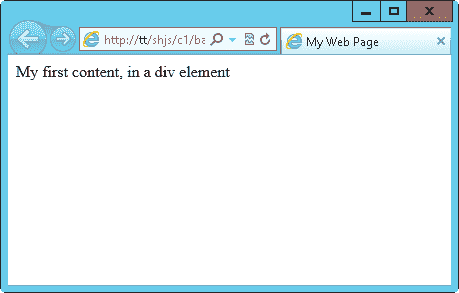

图 1-2。一个基础网页。

### Note

**更多信息** `HTML` 是一个广泛的主题。关于这个主题有无数许多书籍。本书将不会详细介绍底层的 HTML，但所有的示例都将根据它们与 JavaScript 的关系进行解释。有关 HTML 的进一步阅读，请参阅 Faithe Wempen 编写的 `HTML5 Step by Step》（Microsoft Press, 2011）。

### CSS

`HTML` 经常与 `CSS` 配对使用，以帮助浏览器交付视觉上吸引人的网页。本质上，`HTML` 描述内容的功能，而 `CSS` 负责提供这些内容的的外和感受。`CSS` 允许页面创建者定义诸如颜色、背景（包括背景图像）、元素大小等内容。例如，通过向之前的 HTML 示例添加一些 CSS，我可以更改 `<h1>` 元素的大小并为其添加边框。CSS 代码此处以粗体显示：

```
<!doctype html>
<html>
<head>
    <title>My Web Page</title>
</head>
<body>
    <h1 style="border: 1px solid black; font-size: 0.8em;">My first content,
        in an h1 tag</h1>
</body>
</html>
```

结果显示在 图 1-3。你可以在配套内容找到名为 `basic.html` 的代码。

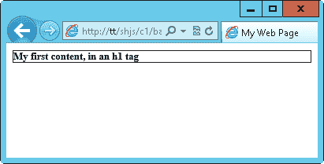

图 1-3. 使用 CSS 添加一些样式。

此示例为元素添加了边框并更改了字体大小。这两处更改都是使用 CSS 属性完成的。CSS 属性是你想要更改的样式属性，例如元素的颜色或字体。`CSS` 通过规则运行，你先选择项目，然后将样式规则应用于这些所选项目上。

可用的属性取决于浏览器以及被更改的元素。

### 警告

某些浏览器不支持 `CSS` 的所有功能，因此你需要确保查看页面的浏览器支持你在页面中使用的 CSS 属性。

此示例中的 CSS 使用了所谓的 `inline style`（内联样式）来更改应用样式的元素。内联样式是直接写在标签中的 CSS，这样做是完全没问题的。然而，更典型的做法是使用放置在外部 CSS 文件中的样式，并由你的 HTML 页面进行引用。你将在本章的稍后部分看到外部 CSS 的示例。使用外部文件的主要原因是，为某种类型元素编写的 CSS 可以应用于页面上该类型的所有元素。例如，如果此页面包含多个 `<h1>` 标签，你可以通过一行 CSS 对所有这些元素进行样式设置。

你可以使用标识符或 `ids` 将 CSS 仅定于某些元素。`id` 仅适用于页面上的单个元素。CSS 还使用了 `classes`（类）的概念。类定义了具有共同特征的 HTML 元素。例如，你可以创建一个只包含页面某部分的 HTML 元素的类。标签名、`ids` 和类名统称为 `selectors`（选择器）。CSS 的基本语法如下：

```
selector: { rule; }
```

如果目前觉得这一切似乎有点难以理解，请不要担心。随着你对本书的阅读，HTML 和 CSS 都会变得清晰。

### Note

**更多信息** `HTML` 是一个广泛的主题。关于这个主题有无数许多书籍。本书将不会详细介绍底层的 HTML，但所有的示例都将根据它们与 JavaScript 的关系进行解释。有关 HTML 的进一步阅读，请参阅 Faithe Wempen 编写的 `HTML5 Step by Step》（Microsoft Press, 2011）。

Windows 8 中的 JavaScript

一直到最近，JavaScript 主要用于客户端应用程序，但这种情况正在发生变化。Windows 8 将 JavaScript 在应用开发周期中提升到了显著地位。例如，你可以使用 JavaScript 在 Windows 8 中创建一个功能完备的应用程序。这些 JavaScript 程序可以访问文件系统并通过名为 Windows 8 Runtime (RT) 的库与 Windows 本身交互。换言之，JavaScript 在 Windows 8 中是 Visual Basic、C# 等传统应用程序语言的平等伙伴。JavaScript 在 Windows 8 中的大部分力量来自于另一个库，称为 WinJS，我们将在第 8 章 中详细介绍。

网页中放置 JavaScript

本节的总体标题是 JavaScript 的位置，但到目前我只讨论了 JavaScript 运行的概念环境。现在是时候讨论 JavaScript 代码在网页上的具体位置了。

正如你需要使用 HTML `` 标签来告知浏览器应该期待一张图像一样，你使用 `<script>` 标签来告知浏览器它将读取某种脚本。网页浏览器可以读取几种不同类型的脚本；JavaScript 就是其中之一。

将 JavaScript 放置在 HTML 文档的 `<head>` 或 `<body>` 部分（或两者都有），并且你可以在给页面上放置多个脚本。


浏览器在解析页面过程中遇到 JavaScript 就会执行它。这对 JavaScript 开发者来说具有实际意义。如果你的 JavaScript 程序尝试在 HTML 文档的某些元素加载之前就对其进行操作，程序将会失败。例如，如果你将 JavaScript 放在页面的 `<head>` 部分，而该代码尝试操作一个位于页面最底部的 HTML 元素，程序可能会失败，因为浏览器尚未完全加载该元素。遗憾的是，程序的失败可能会以一种微妙且难以排故障的方式发生：程序这一次运行正常，下一次就不行了。这是因为在执行 JavaScript 代码时，浏览器某一次已经加载了该 HTML 元素，而下一次则没有。另一个更“有趣”（其实并不风趣）的失败场景是：所有代码在你电脑的本地开发环境中运行良好，但在部署到真实世界（且网络极其缓慢）的情况下却失败了。解决这个问题的特别有效的方法是使用 jQuery 的 `ready()` 函数，正如你后面看到的那样。

JavaScript 与网页紧密耦合的基础是文档对象模型（DOM）。就像你对页面上元素的感知是通过文本编辑器或 Visual Studio 实现的一样，DOM 代表了页面上元素的程序化或浏览器视图。作为 JavaScript 程序员，你所做的大部分工作都是与 DOM 交互。遗憾的是，根据用于渲染页面的浏览器不同，DOM 的工作方式也不同。当然，如果你做过任何 HTML 和 CSS 工作，你已经熟悉了浏览器渲染页面的不同且细微的方式。对于 JavaScript 也是如此。你将花费大量的时间为各种浏览器编写代码，或者排查为什么某些功能在特定浏览器中无法工作。

对于除了最基础脚本的任何脚本，你应该使用外部 JavaScript 文件。这样做的好处是提供了可重用性、便于编程以及 HTML 与编程逻辑的分离。在使用外部脚本时（书本书后续章节中大多数示例都将采用这种方式），你使用 `<script>` 标签的 `src` 属性让浏览器指向特定的 JavaScript 文件，这与使用 `` 标签的 `src` 属性来指定 HTML 页面中图像的位置非常。你将在本章稍后的部分详细了解如何指定外部脚本，但这里有一个示例：

```
<script type="text/javascript" src="js/external.js"></script>
```

## 脚本类型

在我们讨论 `<script>` 标签时，是讨论 `type` 属性的好时机，你可以在上一个示例中看到它。`type` 属性指定脚本的多用途互联网邮件扩展格式（MIME）类型。关于是否应该使用 `type` 属性——以及如果使用，它对于 JavaScript 应该包含什么——存在大量的讨论。一些开发者完全不使用 `type` 属性，而另一些则使用 `language` 属性。有些开发者同时使用 `language` 属性和 `type` 属性。

对于 `type` 属性的值应该使用 `text/javascript`、`text/ecmascript` 还是较新的 `application/javascript` 或 `application/ecmascript` 也存在困惑。作为 JavaScript 程序员，请准备好看到 `type` 属性的变体、看到 `type` 属性缺失、看到 `language` 属性，或者看到它们的组合。

我在本书中使用的值是 `text/javascript`，因为在编写本书时，它在各个浏览器中具有最好的兼容性和支持。我在使用 `type` 属性方面取得了最大的成功。

### 没有 JavaScript？没问题。

有时，访问者的网络浏览器中不可用 JavaScript。用户可能正在使用辅助技术，或者可能她只是手动禁用了 JavaScript。无论情况如何，如果浏览器中不可用 JavaScript，`<noscript>` 标签就会有所帮助。大多数网络浏览器在脚本不可用时使用 `<noscript>` 标签。起始 `<noscript>` 和结束 `</noscript>` 标签之间的内容会显示给用户，通常（礼貌地）告知用户需要启用 JavaScript 网站才能正常运行。

### 注意

请参见 [http://www.w3schools.com/tags/tag_noscript.asp] 了解更多关于使用 `<noscript>` 标签的信息。

# 编写你的第一个 JavaScript 程序

在本节中，你将创建你的第一个 JavaScript 程序。作为副作用，你还创建了你的第一个带有 HTML 的网页。

JavaScript 是工具无关的，这意味着你可以使用任何文本编辑器或集成开发环境（IDE）来编写 JavaScript。例如，Microsoft Visual Studio 为编写 JavaScript 提供了强大的开发体验。开源 IDE Eclipse 也是如此。然而，创建和维护 JavaScript 并不一定需要 IDE。你也可以使用简单的文本编辑器（如记事本）或更强大的文本编辑器（如 Vim）来编写 JavaScript。

你才读了本书的几页，就已经要做一个重要的决定了：你应该使用什么工具来编写 JavaScript？我能为这个选择提供的指导是有限的，因为我认为你应该使用任何你感到编程舒服的工具。如果 JavaScript 需要专门的 IDE，那么选择将轻而易举：你必须使用那个 IDE。然而，你可以从简单的文本编辑器到像 Eclipse 或 Visual Studio 这样的全编程 IDE 的任何工具中编写 JavaScript，因此有些人甚至会认为直接使用文本编辑器更容易。

在我进行的大部分独立网页开发和 JavaScript 编写中，我使用 Vim，因为它轻量级且不干扰。不过，我也会使用 Eclipse 和 Visual Studio 进行开发，这很大程度上取决于我为哪个平台编写代码。如何偏好 JavaScript 取决你自己。虽然本书在 Visual Studio 中展示示例，但你不觉得必须使用该 IDE 来处理书中的代码。Visual Studio 让你的生活变得更容易的一个领域是编写 Windows 8 应用。我不会说编写基于 JavaScript 的 Windows 8 应用必须使用 Visual Studio，但对于本书来说，你应该在 Windows 8 章节看到该平台。


Visual Studio 11 Express 版可以在 [`www.microsoft.com/visualstudio/11/downloads#express`](http://www.microsoft.com/visualstudio/11/downloads#express) 免费下载，并附带其他相关的开发工具。为了本书的内容，你同时需要 Windows 8 的 Express 版和 Web 的 Express 版。本书的第一部分使用 Web 版 Express，而第 8 章 则需要使用针对 Windows 8 开发的模板。安装 Visual Studio 通常只需执行从微软下载的文件，但你应该在安装时参考其官方文档以获取最新信息。

## 在 Visual Studio 11 中编写 JavaScript

在 Visual Studio 11 中编写 JavaScript 涉及设置一个新项目，并编写用于你的 Web 应用程序页面或页面的一个或多个脚本。如果你使用文本编辑器或不同的 IDE，可以遵循这些示例，直接在本地 Web 浏览器中查看生成的文件。对于此示例，你将创建一个简单的网页，使用 JavaScript 显示文本，这与本章早些之前的第一个示例所示。

使用 Visual Studio 编写 JavaScript 的第一步是创建一个新项目。作为开发者，你有几种模板可用于启动项目。对于此示例以及书中的大多数示例，你将使用 `ASP.NET Empty Web Application` 模板，该模板位于 Web 类别下。`ASP.NET Empty Web Application` 模板避免了许多创建 JavaScript Web 应用程序时并非必要的 ASP.NET 相关材料。以下是步骤：

1. 在 Visual Studio 中，选择 `File`（文件），`New Web Site`（新建网站）。

2. 在出现的 `New Web Site` 对话框中（如图 1-4）所示），选择 `ASP.NET Empty Web Site`。在 `Web location`（Web 位置）文本框中输入 `StartHere` 作为名称（你可能需要向右滚动到文件系统的末尾，然后点击 `OK` 创建网站）。

   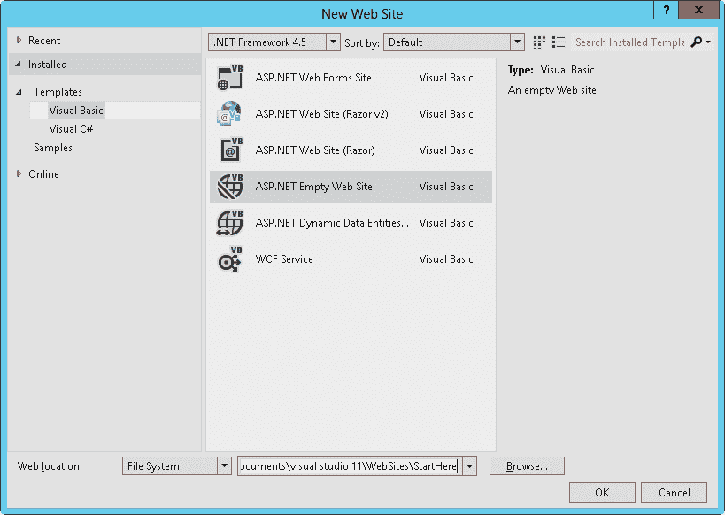

   图 1-4. 在 Visual Studio 11 中创建 ASP.NET 空 Web 项目。

   打开一个空白的空项目，如图 1-5 所示。

   现在是时候向项目添加文件了。

   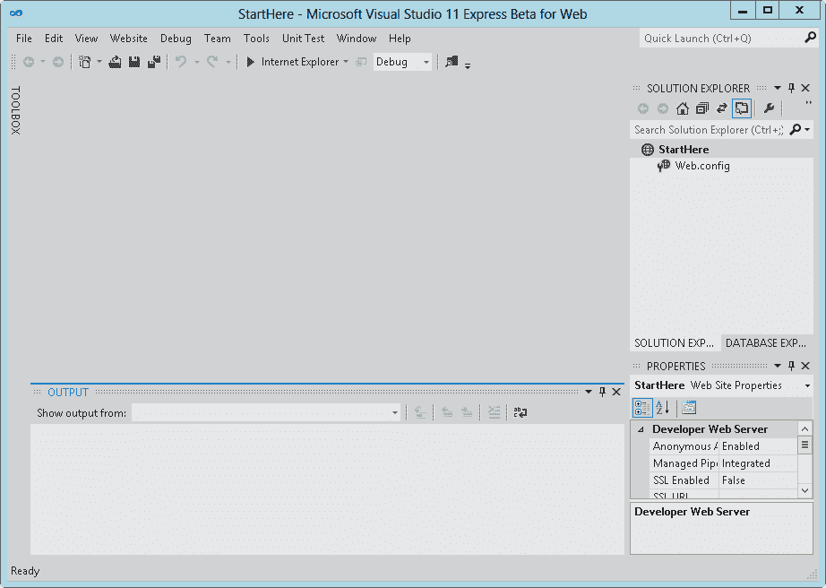

   图 1-5. Visual Studio 11 中的空 Web 项目。

3. 对于此第一个示例，添加一个 HTML 文件。在 `File` 菜单上，选择 `New File`（新建文件）。

   出现 `New File` 对话框，如图 1-6 所示。

   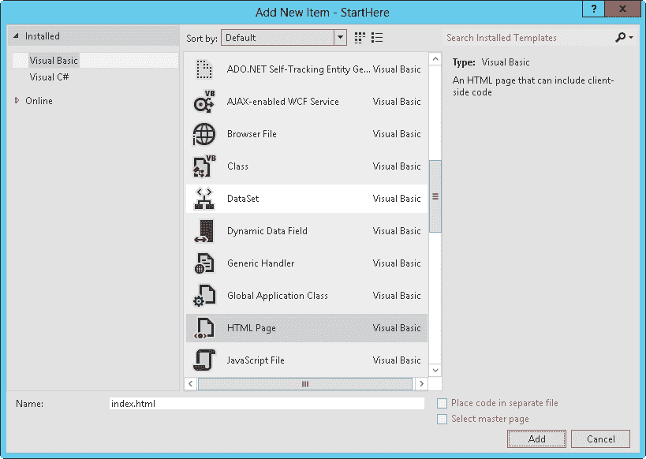

   图 1-6. Visual Studio 11 中的新建文件对话框用于向项目添加新文件。

4. 点击 `HTML Page`，将名称更改为 `index.html`，然后点击 `Add`（添加）。

取决于你使用的 Visual Studio 版本，你可能会看到一个基础 HTML 页面，它使用的 XHTML 文档类型与图 1-7 类似。某些版本的 Visual Studio 使用你在整章章节中看到的 HTML5 文档类型，因此你的屏幕看起来可能与此不同。

   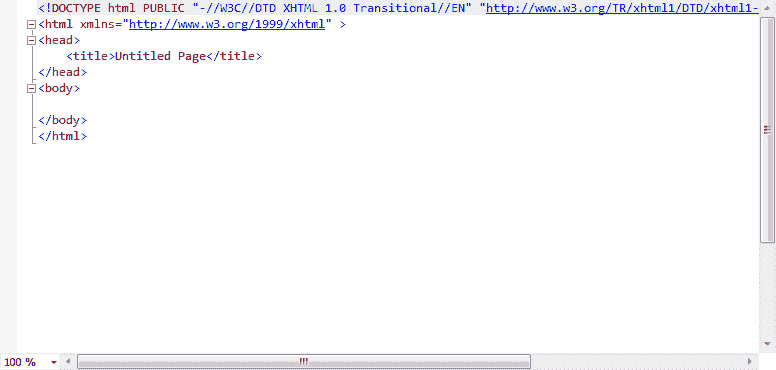

   图 1-7. 使用 Visual Studio 11 的起始页面。

5. 如果你的 Visual Studio 版本具有显示所示的 XHTML 文档类型，你需要做的第一件事是切换页面的 `DOCTYPE`。如果你的文档类型已经是 HTML5 文档类型（`<!DOCTYPE html>`），则无需更改，你可以跳过此步骤。如果你需要更改，在 Visual Studio 中高亮整个 `DOCTYPE` 声明并将其删除。用以下内容替换那个长长的（且丑陋的）DTD：

   ```
   <!DOCTYPE html>
   ```

6. 在 `<html>` 声明中，移除 `xmlns` 命名空间属性。这仅在它存在时才适用。某些版本的 Visual Studio 没有此属性。如果你的版本中没有，你不需要更改它。

   无论你使用的是哪个版本的 Visual Studio，你都需要更改 `<title>` 标签，使其包含 `Start Here` 单词。

   ```
   <!DOCTYPE html>
   <html>
   <head>
   <title>Start Here</title>
   </head>
   <body>
   </body>
   </html>
   ```

7. 如果你还没有保存文件，现在在 `File` 菜单上点击 `Save`（保存）或使用 `Ctrl+S` 快捷键。在某些 Visual Studio 版本中，你会看到 `Save As`（另存为）对话框，如图 1-9 所示。如果你使用的是 Visual Studio for Web，可能完全看不到此对话框。

   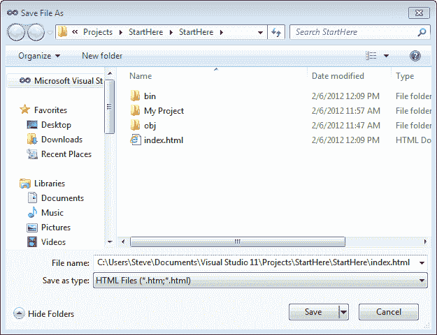

   图 1-9. 保存网页项目。

   ### 提示

      确保在项目内保存文件，如该对话框所示。Visual Studio 可能会将文件保存到项目之外（注意图 1-8 中的两个 StartHere 目录）。

8. 保存完成后，下一步是在浏览器中查看它。在 Visual Studio 中查看的最简单的方法是点击工具栏上的 `Run`（运行）按钮或从 `Debug` 菜单中选择 `Start Debugging`（启动调试）。当你这样做时，Visual Studio 会执行一些后台任务，启动 Web 服务器（信息服务服务，IIS），并启动默认 Web 浏览器。注意你可能会看到一个指示未启用调试的对话。接受默认设置，并点击 `OK` 以修改 `web.config` 来启用调试。

   如果一切顺利，你最终会看到如图 1-10 所示的页面。

   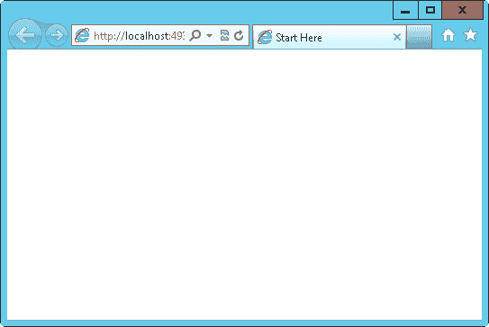

   图 1-10. 运行你的第一个网页。

   如果你在[图 1-10] 中看到这样的屏幕，说明你的项目运行成功。尽管页面本身是空白的，但注意标题栏由于你对页面 `<title>` 标签所做的更改而显示为“Start Here”。

9. 关闭你的 Web 浏览器。

   关闭浏览器的效果是停止项目运行，你将回到 *index.html* 页面的源码窗口。


### 10. 在 `index.html` 中，在起始 `<body>` 标签和结束 `</body>` 标签之间添加以下代码（保存为配套内容中的 `index-wjs.html`）：

```
<script type="text/javascript">
    document.write("<h1>Start Here!</h1>");
</script>
```

最终页面的代码看起来如下所示：

```html
<!DOCTYPE html>
<html>
<head>
    <title>Start Here</title>
</head>
<body>
    <script type="text/javascript">
        document.write("<h1>Start Here!</h1>");
    </script>
</body>
</html>
```

### 11. 若要运行该代码，在 `Debug`（调试）菜单上点击 `Start Debugging`，或者在工具栏上点击绿色的 `Run` 按钮。

你现在会看到一个类似于图 1-11 中的所示网页。

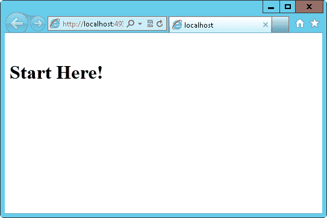

图 1-11。运行你的第一个 JavaScript 程序。

恭喜！你成功使用 Visual Studio 创建了第一个 JavaScript 程序。在关闭 Visual Studio 之前，你将添加两个文件夹为后续章节做准备。

### 12. 在 `Solution Explorer`（解决方案管理器，通常位于右侧）中，右键点击站点名称 `StartHere`，点击 `Add`（添加），然后点击 `New Folder`（新建文件夹）。将文件夹命名为 `js`。

### 13. 使用相同的过程添加另一个文件夹：在 `Solution Explorer` 中，右键点击 `StartHere` 项目，点击 `Add`，然后点击 `New Folder`。将此文件夹命名为 `css`。你的最终 `Solution Explorer` 应该像图 1-12 所示。

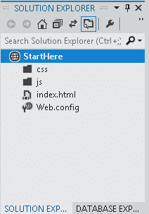

图 1-12。带有两个文件夹的最终解决方案管理器。

## 如果你的代码不起作用怎么办？

当你尝试运行程序或查看网页时，可能会收到错误。通常情况下，将该错误输入到你喜欢的搜索引擎中会产生有用的结果。然而，这里有一些可能帮助你的故障排除思路：

*   **检查语法**：JavaScript 是区分大小写的。确保你代码中使用的大小写情况与示例完全匹配。此外，确保你的 `<script>` 标签格式正确，并出现在起始 `<body>` 和结束 `</body>` 标签之间。
*   **检查文件位置**：如果你将网页保存在错误的位置，Web 服务器将无法找到它，你将收到一个指示未找到默认页错误。在项目内部移动文件并重新运行以解决此问题。
*   **查看调试输出**：Visual Studio 在 `Output`（输出）窗格中显示编译和就绪检查的输出。你可能会发现浏览器无法运行，或者在 `Output` 窗格中有其他有用信息，这些信息有助于解决问题。

## JavaScript 的局限性

在结束本章之前，你应该看到 JavaScript 的一些局限性。其中一些是微妙的，可能并不明显。JavaScript 很大程度上扮演着客户端角色，这意味着意味着在使用该语言进行开发时，有一些需要考虑的固有问题。

### 不要依赖 JavaScript 进行数据安全

JavaScript 在客户端执行。这意味着任何内容——包括数据，甚至程序本身——都可以由用户以他们认为必要的任何方式进行操纵。用户会尝试发送回坏数据（例如，更改购物车中的物品价格或他们能接触到的任何东西），他们还会尝试将脚本或自己的程序注入到你的代码中，以便让你的服务器执行。

当数据返回你的服务器时（无论是来自 Web 表单还是通过 JavaScript），你始终应该假设数据是不准确的。只有在你的服务器端程序中证明数据是有效的，你才应该在应用程序中使用它。在任何情况下，当数据受你控制时，都不应该在未在服务器端进行验证的情况下使用数据。

此警告特别包含了任何基于 JavaScript 的表单数据验证。例如，JavaScript 经常用于为向网页表单输入内容的用户提供即时反馈。然而，仅仅因为有 JavaScript 验证确保数据在浏览器中格式正确，并不意味着它实际上是格式正确的。这些数据需要在服务器端再次检查。

在这个领域，我看到过开发者尝试各种技巧来确保 JavaScript 验证的发生，而不是仅仅在服务器程序中检查数据。这些技巧都没有用，因此将时间花在你的服务器端程序中进行验证，比尝试添加另一层复杂度要好。

一个常见的误区是，使用 `POST` 请求而不是 `GET` 请求会保持数据安全。事实并非如此。通过 `POST` 发送的数据与通过 `GET` 发送的数据（参数显示在地址栏中）一样脆弱。那么你能做什么呢？在服务器程序中检查数据。

### 你无法强制在客户端使用 JavaScript

访问者的 Web 浏览器可能不运行 JavaScript，或者可能不运行你程序所需的 JavaScript 版本。作为开发者，你必须考虑客户端不可用的情况，无论是出于选择、无障碍考虑、设备限制还是其他原因。你的页面应该在没有 JavaScript 的情况下工作，提供完成任务或与应用程序交互的替代方案。

然而，今天的应用程序有时确实需要 JavaScript。在这种情况下，你应该检测哪些功能可用，并向用户提供提示信息。

从本质上说，你唯一的失败方式就是假设 JavaScript 总是用的，从而忽视了处理其缺失的方法。

### 注意

**更多信息**：关于功能检测和通用检测的更多信息，请参阅我的进阶书籍《JavaScript Step by Step》（Microsoft Press, 2011）。

该问题的变体是，JavaScript 版本及其实现在不同 Web 浏览器以及浏览器版本之间存在差异。JavaScript 定义在 `ECMA-262` 规范中，但每个浏览器厂商对该规范的解释都不同，就像这些厂商解释 HTML 和 CSS 标准一样。好消息是，理解这些浏览器差异的人总有工作要做；坏消息是，在代码中适应这些差异以使其在访问者使用的任何浏览器中运行可能是非常沮丧且耗费时间的。


其他浏览器如 Chrome、Firefox 和 Safari 均免费下载。我建议你也获取这些浏览器，并在这些浏览器中测试你的应用程序。

# 总结

本章介绍了 `JavaScript` 的基础知识，包括它能做什么和不能做什么，以及它如何与其他编程和标记语言相关联。在本章中，你看到 JavaScript 经常与标记语言 `HTML` 和 `CSS` 紧密配合，以提供当今网络用户所需的交互性。Windows 8 通过让 JavaScript 成为应用程序开发生命周期中的对等伙伴，为其引入了新层面的重要性。

你还学习了如何在 `Visual Studio` 中创建项目，以及如何创建一个简单的 JavaScript 程序。该程序的一部分内容是学习在页面的何处放置 JavaScript 代码。你还此了解了一些关于 JavaScript 的核心概念，包括你不能总是依赖用户的浏览器支持 JavaScript，而且你永远不要依赖 JavaScript 来实现数据安全。

在下一章中，你将将查看 JavaScript 语法的一些具体细节——包括关于空格、注释和大小敏感的平庸但重要的细节——然后再进入循环和条件判断等更有趣的内容。这将为你建立一个简短但坚实的基础，你可以在后续章节中基于此构建复杂的程序。

# 第 2 章 JavaScript 编程基础

**完成本章后，你将能够：**

*   知道在网页中放置 JavaScript 的位置
*   理解基础 JavaScript 语法
*   创建 JavaScript 变量并理解常见的数据类型
*   在 JavaScript 代码中使用循环和条件结构

**现在你已经领略了** JavaScript 的功能，现在是时候查看 JavaScript 的内部机制了。诚然地说，本章不会深入探讨内部机制——仅仅恰到让你变得精通而不会感到不知从。。在本章和下一章之间，你将拥有一个坚实的基础，能够此构建程序并排除现有 JavaScript 程序的故障。

在本章中，你将学习该语言的语法和规则。这包括从如何在程序中编写注释到如何创建变量和执行条件逻辑等简单内容。这些材料经过了大量的压缩，但仍然提供了你所需的知识。与 第 1 章 一样，本章也将主要关注 JavaScript 及其在 Web 中的应用。然而，这些信息同样适用于 Microsoft Windows 8 的 JavaScript。

## JavaScript 放置：回顾

你已经在 第 1 章 中了解到，JavaScript 程序被放置在网页的 `<head>` 或 `<body>` 部分。对于如 `jQuery` 等外部脚本，通常将引用放置在 `<head>` 部分，但并没有阻止你将外部脚本的引用放置在页面的 `<head>` 或 `<body>` 中。本节通过创建一个基础页面和一个外部 JavaScript 文件，扩展了 JavaScript 的放置位置。在这里创建的文件将作为全书中所有示例的基础。

将使用的基础 `HTML` 页面如果你刚学完 第 1 章，应该看起来很熟悉。事实上，本章将使用在 第 1 章 中创建的项目——具体为如 第 1 章 所示的结构化布局——并在项目或文档根目录下创建 `css` 和 `js` 文件夹。请参考 图 2-1 获取此类结构的示例。


图 2-1. 本书开发文件夹结构应在项目内包含 css 和 js 文件夹。

创建一个新文件，或修改你现有的 `index.html` 以匹配以下示例中的代码。如果你创建一个新文件，将其保存为 `index.html`（你可以在配套内容中找到 `index.html`）。

```
<!DOCTYPE html>
<html>
<head>
<title>Listing 1-1</title>
<script type="text/javascript" src="js/external.js"></script>
</head>
<body>
</body>
</html>
```

创建好 `index.html` 后，是时候创建一个外部 JavaScript 文件了。在 Microsoft `Visual Studio` 中，在“解决方案管理器（Solution Explorer）”中，右键点击 `js` 文件夹，点击“添加（Add）”，然后点击“添加新项（Add New Item）”。打开“添加新项”对话框。点击“JavaScript 文件（JavaScript File）”，然后在“名称（Name）”文本框中输入 `external.js`，如 图 2-2 所示。

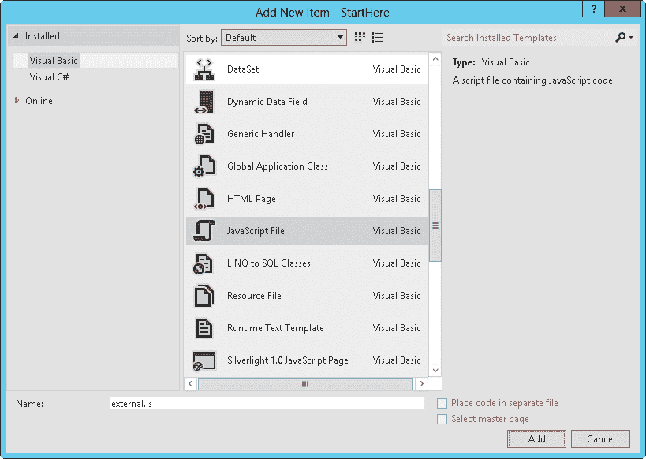

图 2-2. 创建新的 JavaScript 文件。

点击“添加”，一个新的 JavaScript 文件就会出现。某些版本的 `Visual Studio` 不允许在创建时设置文件名，如上一个示例所示。如果是这种情况，文件将被命名为 `JavaScript1.js`。然而，`HTML` 文件中引用的是 `js` 文件夹中的 `external.js`。因此，`JavaScript1.js` 文件名需要更改。在 `Visual Studio` 中，点击“文件（File）”然后选择“另存为（Save As）”。打开“另存为”对话框。打开 `js` 文件夹，然后在“文件名”文本框中输入 `external.js`，如 图 2-3 所示。（注意，你的截图可能与我的略有，再次，如果你的 Visual Studio 版本未在添加文件时允许命名，则这样做。）

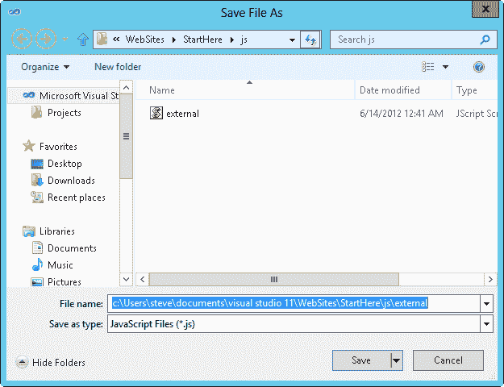

图 2-3. 保存 external.js 文件。

你现在有了基础 HTML 页面和一个外部 JavaScript 文件。从这里开始，本章的剩余部分（乃至本书）将使用这些文件展示示例。

### JavaScript 语法

学习外语需要学习语言的语法和句子结构，编程 `JavaScript`（或任何其他语言）也需要学习程序的语法和结构。在本节中，你将学习 JavaScript 的部分语法。

## JavaScript 语句和表达式

`JavaScript` 构建于语句和表达式，其中*语句*是简单的代码行，而*表达式*产生或返回值。考虑这两个示例：

*   语句：
    ```
    if (true) { }
    ```
*   表达式：
    ```
    var myVariable = 4;
    ```

在这些示例中，`myVariable` 是结果，因此它是一个表达式，而 `if (true)` 条件判断没有返回任何内容。虽然这诚然有些微妙，但你需要知道的是 JavaScript 有由语句和表达式组成的特定结构。

代码行通常以分号结束。此规则的例外包括条件判断、循环和函数定义，这些将在以后解释。

一个或多个 JavaScript 语句和表达式组成一个 JavaScript 程序或脚本。（这两个术语，程序和脚本，是互用的。）你在上一章中看到了 JavaScript 程序的示例。

## 名称和保留字


JavaScript 语句和表达式由有效的名称（在 ECMA-262 规范中称为 `identifiers`）和 JavaScript 自身保留的单词组成。你已经在书中看到了几个被使用的预留字。在 JavaScript 中，以下内容是预留字，因此应该仅用于它们的预定用途；例如，你不能将这些用作变量或函数名。

### 注意
**更多信息** 你可以在此处查看完整的 ECMA-262 规范：[`www.ecma-international.org/publications/standards/Ecma-262.htm`](http://www.ecma-international.org/publications/standards/Ecma-262.htm)。

| `break` | `delete` | `if` | `this` | `while` |
| :--- | :--- | :--- | :--- | :--- |
| `case` | `do` | `in` | `throw` | `with` |
| `catch` | `else` | `instanceof` | `try` | |
| `continue` | `finally` | `new` | `typeof` | |
| `debugger` | `for` | `return` | `var` | |
| `default` | `function` | `switch` | `void` | |

其他几个单词也被预留供未来使用；因此，你也不应该在程序中为了自己的目的使用这些词。

| `class` | `extends` | `let` | `public` |
| :--- | :--- | :--- | :--- |
| `const` | `implements` | `package` | `static` |
| `enum` | `import` | `private` | `super` |
| `export` | `interface` | `protected` | `yield` |

使用 JavaScript 时，你必须遵循某些命名规范。有效的名称以字母、美元符号（`$`）或下划线（`_`）开头，且不能是预留字。

### 注意
反斜线转义字符（`\`）也可以名称开头，但这种用法并不常见。

以下是有效的名称：
* `myVariable`
* `EMAILADDR`
* `SongName`
* `data49`

以下是无效的名称：
* `var`
* `3address`
* `deci#`

第一个示例 `var` 是一个预留字，因此不能用于为你自己的变量或函数命名。第二个 `3address` 以数字开头，最后一个示例 `deci#` 包含一个特殊字符。

### 提示
虽然不是强制要求的，但变量和函数名以小写字母开头（例如 `myVariable`）是很常见的。当变量以小写字母开头，并在其他单词中使用大写字母时，这被称为 `camelCase`（驼峰命名法）。还存在其他大小写规范。更多信息请参阅 [`msdn.microsoft.com/library/ms229043.aspx`](http://msdn.microsoft.com/library/ms229043.aspx)。

## 间距与换行
JavaScript 在很大程度上忽略空白字符，即元素和语句之间的空格。显然，你需要至少用一个空格来分隔行内的单词，但如果你使用两个或多个空格，JavaScript 通常并不在意。尽管如此，如果你只是坚持使用标准的单空格间距，你寻找棘手 bug 的时间将会更短。例如，这种写法是有效的：

```
var myVariable = 1209;
```

在这个示例中，在关键字 `var` 和变量名 `myVariable` 之间有一个空格。这个空格是 JavaScript 解释器运行代码所必需的。

与空白紧密相关的是换行符或回车，它们在 JavaScript 规范中正式称为 `line terminators`（行终止符）。通常情况下，并不需要换行。事实上，你有时会看到完全没有换行的 JavaScript 程序。这被称为 `minification`（代码压缩//混化）；它减少了访问者下载的 JavaScript 文件的大小。但是，我建议在开发程序时，在每个 JavaScript 语句和表达式之后使用标准的换行符。

## 注释
注释是程序中不执行的行。注释经常被用于在代码内部记录代码的行为。考虑这段代码：

```javascript
// myVariable 用于计算字符
// 当 myVariable 超过 10 个字符时生成一个警框
// 因为这表明我们超过了某些业务规则。
if (myVariable > 10) {
```

在这个示例中，在 `if` 语句之前有三行注释。

### 注释样式
示例中显示的注释不仅说明了 `myVariable` 的作用，还说明了我们为什么要测试它。在使用注释记录代码时，这是一个需要考虑的重要的一点。你编写代码的时间相对于维护代码的时间要短得多。通过代码 `if (myVariable > 10)` 可以明显看出，它在测试 `myVariable` 是否大于 10。然而，从代码本身并不清楚*为什么*要测试 `myVariable` 是否大于 10。换句话说：10 的意义是什么？在这个示例中，我注释道“大于 10 的条件”意味着变量的内容违反了某些业务规则。理想情况下，我应该在注释中说明违反了哪条业务规则。

JavaScript 注释有两种形式：带有双斜杠（`//`）的单行注释（如你所见），以及 C 风格的多行注释语法（`/* */`），因 C 编程语言而得名。你看到的双斜杠表示 JavaScript 解释器将忽略其后的内容。多行注释结构表示从起始 `/*` 到结束 `*/` 的所有内容都会被忽略，如下：

```javascript
/* myVariable 用于计算字符
当 myVariable 超过 10 个字符时生成一个警框
因为这表明我们超过了某些业务规则。 */
if (myVariable > 10) {
```

多行注释的一个重要点是它们不能嵌套。例如，这是无效的：

```javascript
/* 注释从这里开始

  /*
   myVariable 用于计算字符
   当 myVariable 超过 10 个字符时生成一个警框
   因为这表明我们超过了某些业务规则。
  */
  if (myVariable > 10) {

*/
```

在这个示例中，解释器会顺利开始注释，但一旦遇到第一个 `*/` 序列，它就会关闭注释。当解释器遇到最后一个 `*/` 序列时，就会出现混乱并导致错误。

### 提示
在实践中，我发现我经常使用双斜杠注释。这样做有两个原因：第一，输入双斜杠更容易；第二，双斜杠注释还允许我注释掉大块区域，并方便地避免了嵌套多行注释的问题。


```
document.getElementById("myExample");
```

在这个示例代码中，`id` 属性值（`myExample`）的大小写是关重要的。尝试使用 `MYEXAMPLE`、`myexample` 或 `MyExample` 来访问元素将无法不起。同样重要的是，JavaScript 函数 `getElementById` 本身是区分大小写的。使用 `GETELEMENTBYID` 或更微妙的 `getElementByID` 都将无法工作。如果你之前不在意大小写，现在是开始注意的时候了！

既然提到了大小写，在整个代码中保持大小写敏感是一个良好的习惯，无论是 JavaScript 还是其他语言。这在代码内部以及对于 URL 和文件名都是如此的。

## 运算符

JavaScript 拥有用于执行加法、减法和其他数学运算的运算符，以及用于测试相等的运算符。数学相关的运算符与你在小学数学课上学到的相同。使用加号（`+`）加法，减号（`–`）减法，星号（`*`）乘法以及斜杠（`/`）除法。以下是一些示例：

```
// Addition
var x = 5 + 3.29;
// Subtraction
var number = 4901 - 943;
// Multiplication
var multiplied = 3.14 * 3;
//Division
var divide = 20 / 4;
```

编程中一些重要的运算符是相等运算符。它们被用在条件语句内部来测试相等性。表 2-1 显示了这些相等运算符。

表 2-1. JavaScript 中的相等运算符

| 运算符 | 含义 |
| --- | --- |
| == | 相等 |
| != | 不相等 |
| === | 相等，使用更严格的相等性版本 |
| !== | 不相等，使用更严格的不相等性版本 |

普通相等运算符（`==`）和严格相等运算符（`===`）之间的区别是重要的。严格相等测试不仅要求值匹配，还要求类型匹配。考虑这个示例：

```
var x= 42;
var y = "42";

x == y  // True
x === y // False
```

在章的后面部分，你将创建一个测试这些运算符的示例程序。

关系运算符测试给定表达式如何与另一个表达式相关。这包括简单的内容，如大于（`>`）或小于（`<`），以及 `in` 运算符和 `instanceof` 运算符。你将看到 `in` 和 `instanceof` 运算符在使用时的示例和解释。

还有被称为`一元`运算符的运算符。它们包括递增运算符（`++`）、递减运算符（`––`）、删除运算符以及 `typeof` 运算符。与书中使用的其他运算符一样，当用法不显而易见时，会在你遇到时解释它们的用法。

# JavaScript 变量和数据类型

变量和数据类型定义了编程语言如何处理用户信息以完成有用操作。本节将介绍 JavaScript 如何定义变量以及语言中的数据类型。

## 变量

变量包含程序运行期间可能会变化的数据。变量使用 `var` 关键字声明。你已经在书中见过几个这样的示例了，但这里有更多几个：

```
var x = 19248;
var sentence = "This is a sentence.";
var y, variable2, newVariable;
```

### 注意

第三条语句一次声明三个变量，但没有对它们进行初始化。初始化变量包括为该变量设置一个值——带有等号（`=`）的部分。

变量值通过使用等号（`=`）或相等运算符来设置或初始化。

有两个项目以类似于变量的方式使用：数组和对象。对象将在下一章讨论。在 JavaScript 中，数组实际上是一个表现得像数组的对象。但对于我们的目的，我们将它们视为标准数组，因为在现阶段差异并不重要。

等一下，什么是数组？数组是按数字索引排列的项集合。换句话说，想一下你收件箱中的电子邮件。如果你像我一样，那个收件箱堆满了数百封邮件。在编程术语中，这就是一个电子邮件数组。我收件箱中的邮件从 1 开始一直到 163。然而在编程中，数组通常从数字 0 开始并继续下去——所以，我的不是不是 1 到 163 封邮件，而是 0 到 162 封。当我想访问收件箱数组中的某项时，我会使用它的数字索引来操作。

在 JavaScript 中，数组是使用所谓的数组字面量表示法 `[]` 创建的，如下：

```
var myArray = [];
```

该语法表示名为 `myArray` 的变量将是一个数组。所示代码仅声明该变量是一个数组而不是字符串或数字，就像一个空的收件箱。

与其声明空数组，你也可以创建数组的同时填充它，例如在这个示例中，它创建一个包含我房子外树木类型的数组：

```
var myArray = ['Pine','Birch','Maple','Oak','Elm'];
```

数组可以包含任何类型的值，例如数字和字符串，混合在数组中，如示例所示：

```
var anotherArray = [32.4,"A string value",4, -98, "Another string"];
```

数组有一个特殊的属性 `length`，它返回元素的数量。在 JavaScript 中，`length` 属性可能与定义的元素数量不一致。


| 方法 | 说明 |
| --- | --- |
| `concat` | 将两个数组合并或向数组末尾添加额外项，创建一个新数组。 |
| `join` | 根据数组中的值创建一个字符串。 |
| `pop` | 移除并返回数组的最后一个元素。 |
| `push` | 向数组中添加或追加一个元素。 |
| `reverse` | 改变数组中元素的顺序，使元素顺序反过来。如果元素是 a, b, c，在使用 `reverse` 之后它们将变为 `c`、`b`、`a`。 |
| `shift` | 从数组中移除第一个元素并返回它。 |
| `sort` | 对数组的元素进行排序。注意，此方法假设元素是字符串，因此它无法正确排序数字。 |
| `unshift` | 将一个或多个项置于数组开头。 |

此外，在本章的后后部分，你将看到如何使用 JavaScript 中的循环结构来遍历数组中的每个元素。

## 数据类型

语言的数据类型是程序内部使用的一些基本元素或构建块。根据你对*数据类型*的定义，JavaScript 有三种或六种数据类型。JavaScript 中的主要数据类型包括数字、字符串和布尔值，另外三个——null、undefined 和对象——是特殊数据类型。我们将在这里讨论大部分这些数据类型，并将对象的讨论留到第 3 章中。

### 数字

JavaScript 中只有一种数字类型，它可以同时表示浮点值和整数值（分别为 1.0 和 1）。此外，JavaScript 中的数字可以通过添加减号（–）运算符持有负值，例如 –1 或 –54.23。

JavaScript 提供了用于处理数字的内置函数或方法。其中许多通过 `Math` 对象访问，该对象将在第 3 章中讨论。然而，一个处理数字的方便函数是 `isNaN()` 函数。`isNaN()` 函数是“不是一个数字”的缩写，用于判断一个值是否为数字。在验证用户输入以确定是否输入了数字时，这个函数非常有用。考虑这个例子：

```
var userInput = 85713;
alert(isNan(userInput));
```

在这个例子中，输出将为 `false`，因为 85713 是一个数字。在使用此函数时，从否定的“不是一个数字”的角度来思考确实需要一点“大脑瑜伽”。如果该函数能定义为肯定形式，例如“这是一个数字吗？”，效果会更好。

### 字符串

字符串是用引号括起来的字符（一个或多个）的序列。以下是字符串的示例：

```
"Hello world"

"B"

"Another 'quotable string'"
```

最后一个示例需要一些解释。在 JavaScript 中，字符串可以使用单引号或双引号来括起来。当你需要在字符串内部包含一个被引号括的字符串时（如示例所示），你应该使用相反类型的引号。在示例中，使用双引号来封装字符串，而使用单引号来封装内部的被引用的字符串。

你还可以使用转义序列或转义字符在相同类型的引号中使用引号。反斜杠（`\ `）字符用于此目的，如下例所示：

```
'I\'m using single quotes within this example because they\'re common characters in
the text.'
```

其他转义序列见表 2-3。

表 2-3. JavaScript 中的转义序列

| 转义字符 | 序列值 |
| --- | --- |
| `\b` | 退格 |
| `\t` | 制表符 |
| `\n` | 换行 |
| `\v` | 垂直制表符 |
| `\f` | 分页符 |
| `\r` | 回车 |
| `\\` | 字面量反斜杠 |

字符串具有辅助其使用的的方法和属性。`length` 属性提供字符串的长度。这里有一个简单的示例：

```
"Test".length;
```

这个示例返回 `4`，即单词 `Test` 的长度。`length` 属性也可以用于变量，如下例所示：

```
var myString = "Test String";
myString.length;  // 返回 10
```

字符串包含许多其他方法，包括 `toUpperCase` 和 `toLowerCase`，它们分别将字符串转换为全大写或全小写。此外， JavaScript 允许通过加号（`+`）连接或合并字符串与其他类型。连接字符串可以简单到如下：

```
var newString = "First String, " + "Second String";
```

上一行代码将产生一个包含字符串“First String, Second String”的变量。你将在书中到处看到这种连接方式。

更改字符串的其他方法包括 `charAt`、`indexOf`、`substring`、`substr` 和 `split`。其中一些方法将在本书的剩余部分中使用，并在使用时进行深入解释。

### 布尔值

布尔值只有两个值：`true` 和 `false`，但你处理布尔值的方式与其他处理变量的方式不同。你不能创建一个布尔变量，但可以将变量设置为 `true` 或 `false`。


`Null` 是 JavaScript 中的一种特殊数据类型。`Null` 表示无；它代表并求值为为 `false`，但 `null` 与空、`undefined` 或 `Boolean` 有明显区别。变量可以是 `undefined` 的（例如，你还没有初始化它），或者变量可以是空的（例如，你将其设置为空字符串）。这两者都与 `null` 不同。

### Undefined

`Undefined` 是一种类型，表示不包含任何值或尚未初始化的变量或其他元素。在尝试确定变量是否存在或是否仍有待设置时，这种类型可能非常重要。你将在整本书中看到 `undefined` 的示例。

# JavaScript 中的循环与条件语句

在编程语言中，循环（loops）允许开发人员重复地执行某些操作、执行特定次数的代码，或者遍历列表。例如，你的网页上可能有一组链接，需要为这些链接应用特定的样式。与其逐个编写每种更改，不如你可以遍历（循环）这些链接，并在循环代码中为每个链接应用样式。本节将介绍 JavaScript 中循环或执行迭代的常用方法。

`Conditionals`（条件语句）是查找给定表达式的“真值”（truthiness）的语句。例如，数字 4 是否大于数字 2？如果是，则执行一些有趣的操作。条件语句是用程序化表达相同概念的另一种方法。如果满足特定条件，你的程序将执行某些操作。还有一种用于处理指定条件*未*满足时情况的条件，被称为 `else` 条件。本节还将检查这种形式的条件语句以及相关的条件语句。

## JavaScript 中的循环

`Loops`（循环）允许多次执行某些操作。在 JavaScript（或任何编程语言）中，循环通常用于遍历集合（如数组），并对其中的每个元素执行某些操作。

### Note

你可以在配套内容中找到所有这些代码被封装在一个名为 `loop.html` 的单个文件中。

`for` 循环是 JavaScript 中执行循环操作的主要结构，如下例所示：

```
var treeArray = ['Pine','Birch','Maple','Oak','Elm'];
for (var i = 0; i < treeArray.length; i++) {
    alert("Tree is: " + treeArray[i]);
}
```

在例示例中，数组 `treeArray` 中的每个元素都会通过 `alert()` 对话框显示。代码首先实例化了一个计数器变量 `i` 并将其初始化为 0，这（很方便）也是普通数组的第一个索引。接下来，计数器变量 `i` 与 `treeArray` 的长度进行比较。因为 `i` 是 0 且 `treeArray` 的长度为 5，括号内的代码将被执行。当括号内的代码执行完成后，计数器变量 `i` 增加（得益于 `for` 循环结构中的 `i++`），整个过程重新开始——但这次，计数器变量变为 1。再次，它与 `treeArray` 的长度（仍为 5）比较，因此代码继续。当计数器变量达到 5 时，循环结束。

JavaScript 中提供的类似循环结构是 `while` 循环。通过 `while` 循环，程序员具有更大的灵活性，因为测试条件可以被程序员在循环内部更改。这里是使用 `while` 循环编写的之前的示例。注意需要在循环内部手动增加计数器：

```
var treeArray = ['Pine','Birch','Maple','Oak','Elm'];
var i = 0;
while (i < treeArray.length) {
    alert("Tree is: " + treeArray[i]);
    i++;
}
```

JavaScript 中也提供了 `foreach` 语句。然而，截至本书写作，`foreach` 语句在许多旧版浏览器中不起作用。因此，本书将重点关注大多数地方更常见且支持更广泛的 `for` 循环。

此外，你可以通过如下方式将数组长度设置为循环结构之外的变量，获得略微的速度提升：

```
var treeArray = ['Pine','Birch','Maple','Oak','Elm'];
var treeArrayLength = treeArray.length;
for (var i = 0; i < treeArrayLength; i++) {
    alert("Tree is: " + treeArray[i]);
}
```

这种更改意味着代码不需要在循环的每次迭代中都检查 `treeArray` 的长度；相反，长度在循环开始之前检查一次即可。

## JavaScript 中的条件语句

条件语句用于判断当满足给定条件时应该发生什么的测试。这里有一个用大白话描述的例子：“如果外面在下雪，我就需要去铲人行道。”更准确地说，“如果雪深度大于两英寸，我就需要去铲。”更准确地说，我妻子需要去铲（她喜欢）；但我不会尝试用程序化的方式表示最后一种情况。在 JavaScript 中，这个雪深条件可以这样写：

```
if (snowDepth > 2) {
    goShovel();
}
```

`if` 条件语句的语法要求将测试放在括号中，并将执行的代码放在括号内，如前面的示例所示。这种结构与你在上一节看到的循环结构相似。

你还可以使用条件语句来定义“另一种”场景。回到之前的例子：“如果雪深度大于两英寸，去铲雪；否则看比赛。”在代码中，你可以用 `else` 来表示这种场景：

```
if (snowDepth > 2) {
    goShovel();
}
else {
    enjoyGame();
}
```

你不局限于评估单个条件；你也可以评估多个场景。例如，最后再一次使用雪的例子（我保证），如果雪深度超过 10 英寸，我想去滑雪。这在代码中用 `else if` 语句表示：

```
if (snowDepth > 10) {
    goSkiing();
}
else if (snowDepth > 2) {
    goShovel();
}
else {
    enjoyGame();
}
```

注意这些条件语句的顺序至关重要。例如，如果我先测试 `snowDepth` 是否大于 2 英寸，检查 `snowDepth` 是否为 10 英寸的代码永远不会执行，因为 10 英寸的雪也大于 2 英寸。

条件也可以组合一组测试，要么在逻辑上组合，要么作为二选一场景。这里是一些示例：

```
if (firstName == "Steve" || firstName == "Jakob") {
    alert("hi");
}
```

在示例中，如果 `firstName` 被设置为 Steve 或 Jakob，代码将执行。这段代码使用了逻辑或（OR）语法，用两个竖线 `||` 表示。条件可以使用逻辑与（AND）语法连接，用两个和符号 `&&` 表示，如下所示：

```
if (firstName == "Steve" && lastName == "Suehring") {
    alert("hi");
}
```

在示例中，如果 `firstName` 是 Steve 且 `lastName` 被设置为 Suehring，代码将执行。

### 条件示例

在本章节早期，你学习了两种等价运算符：双等号 `==` 和三等号 `===`。三等号运算符不仅测试值的等效性，还会检查每个值的类型是否相同。正如所承诺的，这里有一个更完整的示例。要尝试此示例，请使用你在本章节早期创建的示例页面和外部 JavaScript 文件。此代码可以在配套内容中的 `cond.html` 文件找到。

在 `external.js` JavaScript 文件中放置以下代码，替换文件中的任何代码：

```
var num = 42.0;
var str = "42";

if (num === str) {
    alert("num and str are the same, even the same type!");
}
else if (num == str) {
   alert("num and str are sort of the same, value-wise at least");
}
else {
    alert('num and str are different');
}
```


保存该文件并在 Visual Studio 中运行项目（按 F5）。会弹出一个警框，如图 2-10 所示。注意，你应该查看 `index.html` 页面，因为那是 `external.js` 被引用的位置。

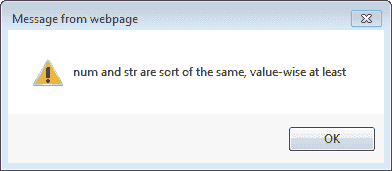

图 2-10. 使用字符串和数字测试等性运算符。

现在移除 `str` 变量上的引号，使其看起来像这样：

```
var str = 42;
```

再次查看页面，你将看到一个如图 2-11 所示所示的警框。

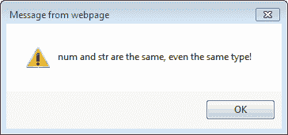

图 2-11. 使用严格相等测试在 JavaScript 中评估两个数字。

第二个示例说明了 JavaScript 的一个细微差别，如果你用过其他语言编程，可能意识不到这一点。注意 `num` 变量实际上是一个浮点数 42.0，而 `str` 变量现在持有一个整数。如前所述，JavaScript 并没有为整数和浮点数设置独立的类型；因此，这个测试显示 42.0 和 42 是相同的。

作为最后一个测试，将 `num` 变量更改为：

```
var num = 42.1;
```

最后一次查看页面。会弹出一个与图 2-12 所示类似的警框。

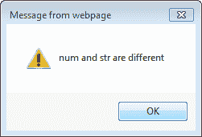

图 2-12. 使用不同的值测试等性。

这个最后的示例不仅展示了如何组合条件测试，还展示了等性运算符在 JavaScript 中是如何工作的。

# 总结

完成第二章后，你现在应该很好地掌握 JavaScript 的基础原始语法。在本章中，你学习了注释、空白、名称和保留字、JavaScript 语句和表达式，以及大小敏感性。你还学习了在程序中使用变量来存储数据，以及 JavaScript 有几种数据类型，包括数字、字符串、布尔值、null 和 undefined。这些内容将贯穿本书，以便你更好地感受它们在实践中的用法。

本章以回顾循环（主要通过使用 `for` 循环）和条件语句（主要使用 `if/else` 语句）作为结束。下一章将探索该语言中一些更强大的领域——即函数和对象。函数和对象都是大多数现代编程语言（包括 JavaScript）的核心。

# 第 3 章. 构建 JavaScript 程序

**完成本章后，你将能够：**

*   理解并在 JavaScript 中创建函数
*   理解并在 JavaScript 中创建对象
*   调试 JavaScript

**前两个章节创建了基石**，你可以在此基础上构建并增强你的 JavaScript 编程知识。起初看起来可能并不如此，但你到目前所看到的为你提供了一个极好的扩展基础。

本章将介绍 JavaScript 中的函数和对象，并以讨论调试 JavaScript 结束。在用任何语言进行编程时，调试都是关键。调试不仅包括工具，还包括成功解决问题和找出程序为何无法运行的技术。本章将同时讨论这两者。

## 函数

`function` 是一个或多个语句和表达式的集合，可以从 JavaScript 程序的其他部分（或完全另一个程序）执行。今天早些时候，我去了一家自动洗车店。我开车进入洗车店，车从里面干净地出来。从这个意义上说，可以说洗车店正在执行一个函数：它清洁了我的车。

站在洗车店外的人会看到脏的车进入洗车店，干净的车出来。脏车是洗车函数的输入，而干净的车是输出。洗车函数内部发生了什么其实并不重要，只要在过程结束时返回了干净的车辆即可。

你现在已经知道了关于函数的所有需要知道的，或者至少你已经知道了关于我今天为止的情况所需要的一切。你已经在之前的章节中看到过函数的示例。本节将介绍 JavaScript 中的函数，包括如何创建和使用它们。

### 函数概述

函数将一个或多个语句组合在一起执行某些操作，例如相加两个数字或对网页的部分进行更改，或者任何你能想象到的其他事情。函数可以可选地接受输入值，这些值被称为 `arguments`（参数），函数也可以返回一个值。

函数以 `function` 关键字开始，后面跟着用于可选参数的括号，然后是左大括号和大括号，如下名为 `listMusic` 的函数：

```
function listMusic() {
    // 函数代码放在这里
}
```

### 注意

带有 `function` 关键字后后跟函数名和括号的部分被称为`函数声明`（function declaration）。

函数在减少重复代码方面效果非常好。与其创建自上而下的代码来验证表单，你可以创建函数来根据输入类型执行基本验证。例如，如果你知道表单上的所有文本字段都不应超过 10 个字符，你可以写一个函数来检查长度：

```
function checkLength(textFieldValue) {
    if (textFieldValue.length > 10) {
        alert("长度过长：" + textFieldValue);
    }
}
```

然后每当你需要检查文本字段的长度时，就调用或运行这个函数。函数内部的代码在函数被 JavaScript 程序调用之前不会执行。

## 函数参数

函数可以接受参数，这些参数本质上是函数的输入。例如，这里有一个加两个数字的函数：

```
function addNumbers(num1, num2) {
    var sum = num1 + num2;
}
```

此函数接受两个参数，任意命名为 `num1` 和 `num2`，用逗号分隔。你可以为自定义函数指定任意数量的参数，包括没有。

如果函数声明参数比你实际发送的多，JavaScript 不会抱怨。在示例中，`addNumbers` 函数期望两个参数 `num1` 和 `num2`。仅用一个参数调用该函数不会导致错误，但你可能会得到意外的结果，因为函数可能依赖这些参数的正确设置。如果你调用时提供的参数比预期的多，也会发生类似的情况。JavaScript 会静地忽略额外的参数，就像它们从未存在一样。真无礼！

尽管如此，在 JavaScript 中，函数声明并不是定义预期参数的唯一地方。也就是说，你不需要在函数声明中声明输入，正如你在示例中所看到的两个参数（`num1` 和 `num2`）包含在函数声明本身中。JavaScript 会创建一个名为 `arguments` 的数组，并用发送到函数的参数填充它。例如，之前的加两个数字的函数可以写成：

```
function addNumbers() {
    var num1 = arguments[0];
    var num2 = arguments[1];
    var sum = num1 + num2;
}
```


然而，通常情况下你应该指定你期望接收的参数。通过在函数声明中包含参数，你可以让代码维护变得容易得多。因此，实现相同内容的另一种方法是接受一个数组作为函数的参数。这种方法允许你在函数内部添加任意数量的数字。你可以在配套内容的 `function.html` 文件中找到此方法的示例。

尽管如此，有时也有非常充分的理由不在函数声明中包含参数。考虑一下你在本节中一直学习的数字加法示例。它目前能够加两个（且仅两个）数字。然而，你可以使用 `arguments` 数组来重构函数，使其能够加任意数量的数字。在章节的稍后部分，你将看到如何操作。

## 重构

程序生命周期中的一个重要阶段是`refactoring`（重构）。重构意味着稍后返回代码对其进行改进。这种改进可以是精简代码、添加注释、更改代码以利用新功能，或者简单地更改间距使代码更具可读性。随着程序的演进，重构会让代码更加高效。

现在你已经了解了关于函数以及如何声明它们的知识，也了解了函数参数——它们是函数的输入。接下来，你将看到如何实际使用或`call`（调用）函数。

## 调用函数

通过像使用普通 JavaScript 语句一样使用函数并添加括号来调用或执行函数。例如，调用之前的 `addNumbers` 函数，你使用以下语法：

```
addNumbers(19, 39);
```

如果函数不接受参数，则调用形式如下：

```
myFunction();
```

在调用函数时必须包含括号。如果你尝试在不带括号的情况下调用函数，将得到意料之外的结果。很可能会返回函数本身的整个文本。这通常不是你想要的。

对函数的调用可以使用字面量（如你看到的字面量数字 19 和 39）、变量，在某些情况下也可以其他函数。这是一个示例，设置了两个变量并将它们传递给函数：

```
var firstNumber = 93;
var secondNumber = 29;
addNumbers(firstNumber,secondNumber);
```

发送到函数的参数顺序和类型至关重要。因此，作为程序员的你必须确保发送的参数是正确的类型（在本例中为数字），并且按照函数预期的正确顺序发送它们。例如，如果函数期望接收两个数字以便进行加法，你不能发送两个字符串并期望函数正常工作。

你可能还会注意到，发送到函数的变量名与函数声明中的变量名不同。这些名称不需要匹配；事实上，它们不匹配可能更好，这样你（或以后必须维护你代码的人）就不会遇到名称冲突或其他此类难以排错的代码问题。

## 名称冲突

如果我处在一个拥挤的房间里，有人大喊“Steve”，很有可能不止一个人会转过头来。这是`name collision`（名称冲突）的一个简单示例。编程中的名称冲突也是如此。如果你有两个同名的变量或函数，可能会导致程序本身的错误，并在稍后尝试排错或处理代码时产生困惑。

在实践中，代码编写与 bug 出现之间通常有很长的时间间隔。你在编写代码时越努力让事情变得简单，你以后在尝试修复它时花费的时间就越少。

## 返回值

到目前为止你看到的示例创建了函数，而函数本身执行了一些相加的工作。但等一下。函数内部的那些数字发生了什么呢？目前什么都没有发生，因为你没有返回结果，也没有在函数内部对结果进行任何操作。JavaScript 函数可以在`return`关键字的帮助下返回值。`return` 关键字会将其后面的表达式返回给调用者或调用函数，例如所示：

```
function addNumbers() {
    var num1 = arguments[0];
    var num2 = arguments[1];
    var sum = num1 + num2;
    return sum;
}
```

注意函数底部添加的 `return sum` 语句。在这个示例中，变量 `sum` 的内容被返回给调用该函数的任何人。从函数返回值的全部只有这些。尽管如此，从函数返回值还有一些不那么明显的特征是你应该注意的。当调用 `return` 时，函数内部的执行会立即停止，并在函数外部恢复执行。考虑这个示例：

```
function addNumbers() {
    var num1 = arguments[0];
    var num2 = arguments[1];
    var sum = num1 + num2;
    return sum;
    alert("Sum is " + sum);
}
```

在示例中，`alert()` 永远不会执行，因为它出现在 `return` 之后。

此外，你只能通过 `return` 返回一个值或表达式。以下是合法的：

*   `return sum;`
*   `return sum * 5;`
*   `return;`

最后一个示例完全没有返回任何值；它只是将执行权返回给调用函数。以下示例是无效的：

*   `return sum, anotherValue;`
*   `return`

    > `myValue;`

最后的示例表明有时换行是有要求的。你不能在 `return` 和要返回的值之间换行。

### 注意

如果你需要返回多个值，可以使用数组。

## 函数示例

在本节中，你将使用第一章（什么是 JavaScript？）和第二章（JavaScript 编程基础）中所示 HTML 和 JavaScript 文件构建示例函数。如果你还没有打开项目，请在 Visual Studio 中打开 `example1.html` 文件。该文件链接到 `js` 文件夹中的 `example1.js`。

### 简单示例

第一个示例展示了你在本节过的 `addNumbers` 函数。这次由你自己实现并对结果进行处理。为此示例做准备，请删除 `external.js` 文件中的所有代码。

1.  将以下代码放入 `external.js`。此代码可以在配套内容的 `example1.js` 中找到。

```
function addNumbers(num1, num2) {
    var sum = num1 + num2;
    return sum;
}
var finalResult = addNumbers(28,51);
alert(finalResult);
```

在 `external.js` 中包含此代码后，文件应该像图 3-1](#ch03.html_the_code_for_the_first_function_example_ "Figure 3-1. The code for the first function example, deployed in the external JavaScript file in Visual Studio.")所示。

![atomoreillycomsourcemspimages1290225.png)

图 3-1. 部署在外部 JavaScript 文件中的第一个函数示例的代码。

2.  此外，为了参考，`index.html` 文件应该像下面的代码。如果不是，请进行适当更改以使你的 `index.html` 文件与之一匹配。你可以在配套内容的 `example1.html` 中找到此 HTML。

```html
<!doctype html>
<html>
<head>
<title>Start Here</title>
<script type="text/javascript" src="js/external.js"></script>
</head>
<body>
</body>
</html>
```


3. 保存并运行项目，或在浏览器中查看 `index.html`。会弹出一个警框，类似于图 3-2 所示的样式。

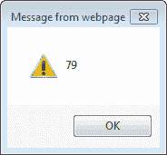

图 3-2. 第一个函数示例的结果。

此示例使用了一个类似于本章节开头所示的函数，简单地将两个数字相加。在该内部，返回了 `sum` 变量。在函数外部，代码通过以下行调用该函数，并将返回值赋值给命名为 `finalResult` 的变量：

```
var finalResult = addNumbers(28,51);
```

接下来，将 `finalResult` 变量发送到警框，然后发送到你的浏览器。注意，这也可以写成一行，将警框和函数调用结合：

```
alert(addNumbers(28,51));
```

我选择像示例那样这样做是为了更加显式，但在编写自己的程序时，哪种方式都可以的！

## 重构 addNumbers()

本节的下一个练习将向你如何重构 `addNumbers()` 函数，使其接受任意数量的参数并对其求和：

1. 从之前所示的示例开始，该函数声明中没有包含任何参数。

```
function addNumbers() {
    var num1 = arguments[0];
    var num2 = arguments[1];
    var sum = num1 + num2;
    return sum;
}
```

2. 将以下代码放入 `external.js`，并移除任何其他代码。你的初始 `external.js` 应该像图 3-3 所示。

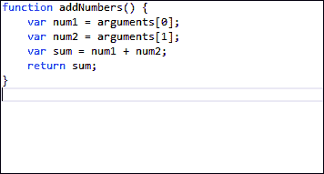

图 3-3. 包含此示例初始代码的 `external.js` 文件。

3. 现在修改函数使其最终如下所示：

```
function addNumbers() {
    var argumentsLength = arguments.length;
    var sum = 0;
    for (var i = 0; i < argumentsLength; i++) {
        sum = sum + arguments[i];
    }
    return sum;
}
```

这个修改后的函数检查 `arguments` 数组，并将变量 `argumentsLength` 设置为该数组的长度。声明变量 `sum` 并将其设置为 0。这很重要，因为将该变量设置为 0（零）会自动将其转换为（或创建）数字，这意味着你可以对其进行数学运算，而这发生在 `for` 循环内部。

随后创建一个 `for` 循环，并将 `arguments` 数组中的每个元素加到 `sum` 变量中。注意这种赋值也可以写成简写形式，如下：

```
sum += arguments[i];
```

然而，正如我之前做的那样，我选择更加显式而不是引入新的语法（可能会引起新的困惑）。

该函数的调用方式如下：

```
var finalResult = addNumbers(3, 5, 1);
```

与之前一样，也会创建一个带有 `finalResult` 的警框。最终代码看起来如下：

```
function addNumbers() {
    var argumentsLength = arguments.length;
    var sum = 0;
    for (var i = 0; i < argumentsLength; i++) {
        sum = sum + arguments[i];
    }
    return sum;
}

var finalResult = addNumbers(3, 5, 1);
alert(finalResult);
```

在 `external.js` 中有了这些代码后，它看起来像图 3-4。

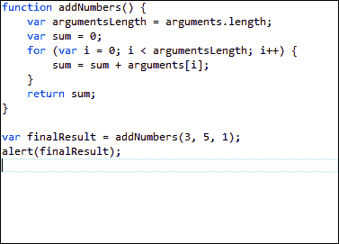

图 3-4. 最终函数示例的完整代码。

4. 执行此代码，或在浏览器中查看它。你应该能看到类似于图 3-5 所示的警框。

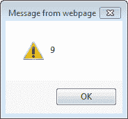

图 3-5. 本节中最终函数示例产生的警框。

为了更多实验，你可以更改函数调用以发送任意数量的参数，包括完全没有参数。通过将 `sum` 变量实例化为 0，即使没有参数也不会产生错误情况；只是


对象是被称为面向对象编程范式的一部分，有时缩写为 OOP。JavaScript 并不是一种完全面向对象的语言，但它的行为在很大程度上是像对象的。这使得程序员能够利用对象化带来的某些（但不是全部）优点。

正如第 2 章 中所讨论的，在 JavaScript 中，除了数字、字符串、布尔值、undefined 和 null 之外，一切都是对象。数组在 JavaScript 中是对象，而且，对象在 JavaScript 中也是对象。在深入研究对象之前，我会先退一步，用一个真实世界的例子来解释它们。

对象本质上是东西。从计算机编程之外举个例子，吉他就是一个对象。当我写这一章时，我身边有一把吉他。吉他具有某些特征，比如颜色、弦数、是电吉他还是原木吉他等。今天在我身边的吉他是一把红色六弦电吉他。在我的帮助下，吉他可以执行拨和弦或奏单根弦等操作。因此可以说这个吉吉对象具有某些属性并可以执行某些动作。

正如你将看到的，JavaScript 中的对象可以执行动作，称为方法（methods），并具有特征，称为属性（properties）。

## 对象看起来像什么样？

在 JavaScript 中，可以用多种方式创建对象。创建对象的主要方法是使用两个大括号，如下：

```
var myObject = {};
```

这被称为对象字面量。也可以使用 `new` 关键字创建对象，如下：

```javascript
var myObject = new Object;
```

在实践中，我在 JavaScript 程序中看到更多对象字面量写法，这也是你将在书中看到的最常见形式。

## 属性

在计算机编程的面向对象世界中，吉他的颜色、弦数和类型被称为它的属性。在 JavaScript 中，属性可以通过两种相似的方式创建：使用点点符表示法（dot notation）或在创建对象时添加属性。这里有一个例子：

```
var guitar = {};   //  创建一个对象
guitar.color= "red";
guitar.strings = 6;
guitar.type = "electric";
```

你也可以在对象的声明本身中创建属性，如下：

```javascript
var guitar = {
    "color": "red",
    "strings": 6,
    "type": "electric"
};
```

### 点点表示法

点点表示法是编程中当项之间用点隔开时使用的名称。在目前显示的示例中，对象的名称（`guitar`）与属性通过句号或点隔开。所以基本上，点点表示法就是用点分隔事物的华丽名称。

就像创建变量一样，你应该始终尝试为属性使用有效的、非保留的单词。然而，在创建属性时，有时在对象的语境下使用保留字是有意义的。这样做时，你用引号创建属性名，这就是你在整章章节中看到的创建对象的方式。

最后，你还可以嵌套对象，如示例所示（你可以在配套内容中找到 `objectproperty.js`）：

```javascript
var guitar = {
    "color": "red",
    "strings": {
        "number": 6,
        "smallGauge": 9,
        "largeGauge": 42
    },
    "type": "electric"
};
```

在这个示例中，创建了一个嵌套对象，它包含了关于吉他弦的属性，包括弦数和它们的规格（gauge）。

通过使用点点表示法或在括号中包含属性名来访问属性。这里有一个例子：

```javascript
guitar.color;   //red
guitar.strings.smallGauge;  // 9
guitar["color"];  //red
guitar["strings"]["smallGauge"]  //9
```

从可读性的角度来看，尽可能使用点点表示法通常是 preferred，但这实际上取决于开发者的偏好和你的编码标准，我将在整书中展示两种访问属性方法的结合，以确保你熟悉看到任何一种语法。

## 方法

除了拥有属性，许多对象还会执行某些操作。在我的帮助下，吉他可以在给定的弦上演奏单音符，也可以演奏多根弦的和弦。在 JavaScript 中，你可以创建一个函数，将其存储为属性，然后调用或触发该函数。这些函数本质上与你在本章前面学到的函数一样，只是它们在与对象一起使用时被称为方法。方法是被声明的，它们可以像函数一样接受参数，并且可以返回值。就此讨论而言，方法就是添加或附加到对象上的函数。

基于吉他对象，这里有一个播放单弦的方法：

```javascript
var guitar = {
    "color": "red",
    "strings": 6,
    "type": "electric",
    "playString": function (stringName) {
        var playIt = "I played the " + stringName + " string";
        return playIt;
    } //结束函数 playString
};
```

在这个示例中（你可以在配套内容的 `objectmethod.js` 中找到），声明了一个名为 `playString` 的方法，它接受一个参数。该变量称为 `stringName`，用于指示在吉他上演奏哪根弦，然后用于创建一个指示吉他弦已演奏的消息。

这个相同的方法稍后可以使用点点表示法创建并添加到吉他中。假设 `guitar` 对象已经创建，添加方法的形式如下：

```javascript
guitar.playString = function(stringName) {
        var playIt = "I played the " + stringName + " string";
        return playIt;
    }
```

### 使用 this 关键字

面向对象编程强大的方面之一是使用 `this` 关键字。`this` 关键字提供了对对象属性和方法的自访问。你可以使用 `this` 在对象内部执行高级操作。为了演示，你将通过一个示例。对于此示例，从 Visual Studio 中的 `Start` 项目开始。你也可以在配套内容中找到此示例 `this.html`。该文件链接到 `js` 文件夹中的 `this.js`。

1. 打开 `external.js` 并删除文件中的任何代码。在 `external.js` 中放置以下代码：

```javascript
var guitar = {
    "color": "red",
    "strings": 6,
    "type": "electric",
    "playString": function (stringName) {
        var playIt = "I played the " + stringName + " string";
        return playIt;
    },
    "getColor": function() {
        return this.color;
    },
    "setColor": function(colorName) {
        this.color = colorName;
    }
};

alert(guitar.getColor());
guitar.setColor("blue");
alert(guitar.getColor());
```

2. 保存 `external.js`。它看起来像图 3-9。

3. 运行项目并在网络浏览器中查看 `index.html` 文件。你首先将看到一个带有 `guitar` 对象初始 `color` 属性的警框，如图 3-10 所示。


点击“确定”关闭警报后会弹出另一个警报，显示颜色已更改为蓝色，这得益于 setter 方法 `setColor`。这在图 3-11 中所示。

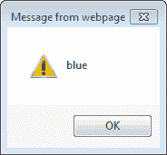

图 3-11。得益于 setter 方法，颜色属性已更改。

`guitar` 对象新增的两个部分是 getter 和 setter 方法，分别为 `getColor()` 和 `setColor()`。`getColor()` 方法如下：

```
"getColor": function() {
        return this.color;
 }
```

该方法仅按当前设置的值返回 `color` 属性。`setColor()` 方法如下：

```
"setColor": function(colorName) {
    this.color = colorName;
 }
```

`setColor()` 方法根据传入方法调用的参数设置颜色。

## 对象枚举

你可以使用 `for..in` 循环遍历或枚举对象中的属性，这类似于你在第 2 章中学到的 `for` 循环语法。然而，与你在该章节看到的数组示例不同，使用 `for..in` 枚举对象时，所有的属性和方法都会被枚举。因此，你需要使用 `typeof` 函数确保当前枚举的项确实是属性。这里有两个练习可以帮助说明这一点。该练习的 HTML 和代码可以在第 3 章 伴随内容中的 `typeof.html` 以及第 3 章 `js` 文件夹中的 `typeof.js` 中找到。

1. 清空 `external.js` 中的所有现有代码，并将以下 JavaScript 代码放入该文件：

```
var telephone = {
    "numLines": 4,
    "usedLines": 0,
    "isLineAvail": function() {
        if (this.usedLines < this.numLines) {
            return true;
        } else {
            return false;
        }
    },
    "getLine": function() {
        if (this.isLineAvail) {
            this.usedLines++;
            return true;
        } else {
            return false;
        }
    },
    "startCall": function (line,dialNum) {
        if (this.getLine) {
            return "Called " + dialNum + " on line " + line;
        } else {
            return "No lines available at this time.";
        }
    },
    "endCall": function (line) {
        this.usedLines--;
    }
};

for (var propt in telephone) {
    document.writeln(propt);
}
```

在浏览器中查看包含 `external.js` 的 `index.html` 文件，将得到一个如图 3-12 所示的页面。注意，取决于你的浏览器，输出可能会出现在单行中。

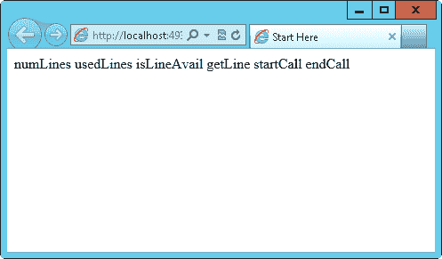

图 3-12。在 JavaScript 中枚举对象的属性（和方法）。

2. 必须使用 `typeof` 函数来确定给定值是否确实为属性。通过以下方式将 `for..in` 循环包含对 `typeof` 的判断，以输出属性：

```
for (var propt in telephone) {
    if (typeof telephone[propt] !== "function") {
        document.write(propt + "<br />");
    }
}
```

在此示例中，当 `typeof` 返回 `"function"` 时，你就知道它不是属性。这在图 3-13 中所示。


图 3-13。使用 typeof 方法。

## 类

面向对象编程的一个强大功能是类，即创建具有许多相同属性的对象。这听起来很复杂，但当你看到它运行时，其实并不难。遗憾的是，JavaScript 没有类的概念，但它提供了伪类。

1. 清空 `external.js` 中的所有代码并创建一个 `Person` 构造函数，如下（代码位于 `person.js` 中）：

```javascript
var Person = function(username,email,twitter) {
    this.username = username;
    this.email = email;
    this.twitter = twitter;
    this.listDetails = function() {
        document.write("Username: " + this.username + "<br />");
        document.write("E-mail: " + this.email + "<br />");
        document.write("Twitter ID: " + this.twitter + "<br />");
    }
}
```

2. 在 `external.js` 中，使用 `new` 关键字实例化 `Person` 对象，方式如下：

```javascript
var myPerson = new Person("steve","suehring@braingia.com","@stevesering");
```

3. 最后，通过在 `external.js` 中放置以下代码调用新创建的 `myPerson` 对象的方法：

```javascript
myPerson.listDetails();
```

`external.js` 的最终代码应该如下：

```javascript
var Person = function(username,email,twitter) {
    this.username = username;
    this.email = email;
    this.twitter = twitter;
    this.listDetails = function() {
        document.write("Username: " + this.username + "<br />");
        document.write("E-mail: " + this.email + "<br />");
        document.write("Twitter ID: " + this.twitter + "<br />");
    }
}

var myPerson = new Person("steve","suehring@braingia.com","@stevesering");
myPerson.listDetails();
```

4. 在 Visual Studio 中运行项目，或查看 `index.html`。你应该能看到如图 3-14 所示的结果。

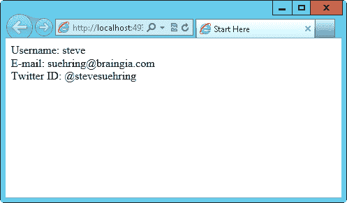

图 3-14。在 JavaScript 中创建 Person 对象，并在 Internet Explorer 中查看页面。


这是一个稍微详细一点的示例，用于展示伪类的威力。虽然从技术上说，这里没有之前没有介绍的内容，但这个示例确实变得有点复杂。你可以在第 3 章的配套内容中找到这个示例 `classes.js`。

这个示例从刚刚介绍的 `Person` 对象的变体开始。对 `Person` 对象的更改删除了 Twitter ID。然而，它并没有实例化 `myPerson` 对象，而是使用对象数组在循环中设置了几个 `Person` 对象：

```javascript
var Person = function (username, email) {
    this.username = username;
    this.email = email;
    this.listDetails = function () {
        document.write("Username: " + this.username + "<br />");
        document.write("E-mail: " + this.email + "<br />");
    }
}

// 创建数据数组
var usernames = ['steve', 'rebecca', 'jakob', 'owen'];
var emails = ['suehring@braingia.com', 'rebecca@braingia.com',
                'jake@braingia.com', 'owen@braingia.com'];

// 获取 usernames 数组的长度
var usernamesLength = usernames.length;

// 创建存储 Person 对象的数组
var myPeople = new Array();

// 遍历所有的用户名并创建 Person 对象
for (var i = 0; i < usernamesLength; i++) {
    myPeople[i] = new Person(usernames[i], emails[i]);
}

// 获取 myPeople 数组的长度
var numPeople = myPeople.length;

// 遍历 myPeople 中所有的 Person 对象并
//    显示详情。
for (var j = 0; j < numPeople; j++) {
    myPeople[j].listDetails();
}
```

此示例首先创建了名为 `usernames` 和 `emails` 的基础数据数组。在书的后面，以及在现实世界中编写 JavaScript 时（而不是你在阅读这本书时所生存的虚构世界），你经常会遇到诸如表单字段或从数据库返回的数据数组，它们看起来和这个数组类似。

接下来，获取该数组的长度并将其设置为名为 `usernamesLength` 的变量。该变量在 `for` 循环内部使用，用于遍历用户名并实例化新的 `Person` 对象，将当前的用户名和电子邮件地址作为实例化的一部分发送。每一个这些新创建的 `Person` 对象都被发送到 `myPeople` 数组中。

然后，将 `myPeople` 数组的长度放入 `numPeople` 变量中，该变量随后被用于 `for` 循环。示例中的最后一个 `for` 循环调用了每个 `Person` 对象的 `listDetails()` 方法。最终结果是，你创建并使用了几个 `Person` 对象，且重复代码最少。你可以通过将代码放在 `external.js` 并重新运行项目来运行这段代码。（务必清除之前示例中的任何代码。）图 3-15 显示了这段代码的结果。

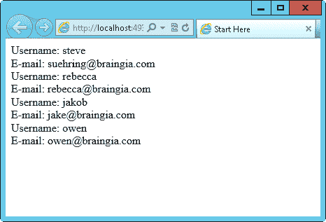

图 3-15. 使用数组和循环处理多个对象。

### 对象还是数组？

你可能会注意到对象和数组之间的一些相似之处。虽然这有点过于简化了，但我发现当我第一次这样想它时很有帮助，所以我把它传给你：当你需要包含命名参数（属性）时，使用**对象**；当简单的数字索引就足够时，使用**数组**。情况不仅于此（数组实际上也是对象），但它可能帮助你理解它们之间的区别。

前面的代码可能挑战你对 JavaScript 的理解，但它提供了一个可运行的、真实世界程序的完整示例。在学习 JavaScript 时，可以使用该程序作为参考。现在对对象的介绍已经完成，是时候查看 JavaScript 的调试问题了。

# 调试 JavaScript

排查程序故障是任何开发者的核心技能。这被称为 `debugging`（调试），当你的代码没有按照预期方式工作时，调试过程就开始了。错误可能由于任何原因出现。诸如漏掉分号或右括号、变量未创建或命名错误、尝试错误地使用函数、逻辑或流程错误，或者遇到浏览器解释该 JavaScript 的 bug 或差异，这些只是你在进行 JavaScript 编程时会遇到的许多 bug 中的少数几个。

在过去的几年里，调试 JavaScript 的基本过程发生了变化。在几年前，调试 JavaScript 的最佳方法是使用 Firefox 浏览器的 Firebug 插件。在许多方面，这仍然成立，我发现自己仍然将 Firebug 和 Firefox 作为主要的调试工具。然而，微软在最近几个版本中改进了 Visual Studio 和 Internet Explorer 的调试功能，使其对于新的 JavaScript 程序员来说成为一种可行的方法。最后，Google 的 Chrome 浏览器也有一个类似于 Firebug 的强大检查器。

本节将介绍如何使用 Internet Explorer 调试 JavaScript。然而，我强烈建议在尝试使用 Internet Explorer 调试后，也去寻找 Firebug 插件以及 Chrome。无论如何你都应该进行跨浏览器测试，因此使用这些浏览器不会带来过度的负担。

## 调试作为一个过程

调试的整体过程对很多人来说是神秘的。调试的过程是消除可能性并测试解决方案。调试最重要的阶段是消除可能性。例如，在调试 Web 应用时，你会遇到多个“活动部分”，包括服务器、浏览器、HTML、CSS、JavaScript 和网络。因此，当你尝试调试时，需要尽可能减少这些活动部分。

关注 JavaScript 问题的一种方法是简单地在 JavaScript 顶部、甚至在 HTML 中添加 `alert()`，位于页面其他位置之前的 `<head>` 部分。我发现自己在各个地方使用 `alert("我在这一节");`（以及章节名称）以查看 JavaScript 在停止之前运行了多久。这是解决棘手问题的一种极其简单有效的方法。

一旦你缩小了问题范围，就可以开始测试解决方案。找到问题位置并没有魔药可以找到解决方案。但是，通过使用像 Firebug 和我即将向你介绍的工具，你可以更快地解决问题。

## 在 Internet Explorer 中调试

从 Internet Explorer 9 开始，可以使用名为 `F12 developer tools` 的工具。这组工具可以通过在浏览器内部按 F12 访问。图 3-16 显示了在上一节页面内查看的 F12 开发者工具。

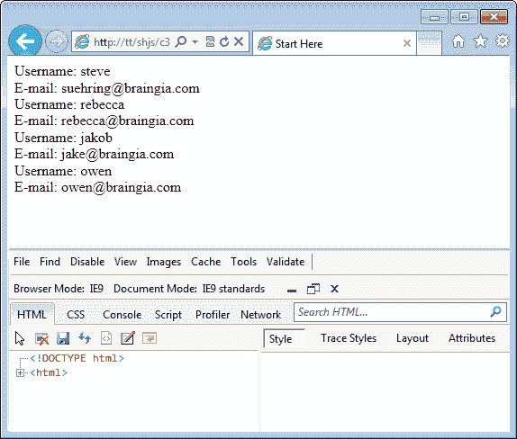

图 3-16. Internet Explorer 中的 F12 开发者工具。

在 F12 开发者工具的控制台中，你可以通过界面内的标签页查看 HTML、CSS、控制台、脚本和其他信息。F12 开发者工具非常强大。本节为你提供一个概述，以便你熟悉它们及其在 JavaScript 中的用法。关于 Internet Explorer 中 F12 开发者工具的更多信息，请参 [`msdn.microsoft.com/library/IE/gg589507.aspx`](http://msdn.microsoft.com/library/IE/gg589507.aspx)。


为了演示 F12 开发者工具，你将使用到今为止书中一直使用的 `external.js` 文件来创建一个包含错误的简单 JavaScript 程序。该代码可以在配套内容中的 `debug.html` 和 `debug.js` 中找到。

1.  清空 `external.js` 中的所有现有代码，并将以下代码放入该文件中：

```
var myVar = 0;
if (myVar < 3) {
    alert("hello);
}
```

2.  保存文件，并在 Internet Explorer 中查看调用 `external.js` 的 `index.html` 文件。务必漏掉结尾的双引号（”），因为你正尝试创建一个错误。

3.  如果 F12 开发者工具没有打开，请按 `F12` 打开它们。你可能需要按 `Ctrl+R` 重新加载页面。

在查看代码时，你应该会收到一个弹窗，因为 `myVar` 被定义并设置为 0，且条件在查找 `myVar` 是否小于 3，而它确实如此。因此，出错了。这是处理 JavaScript 时较困难的方面之一。在任何脚本中，一旦遇到一个错误，就不会再执行其他 JavaScript。因此，错误行之下的任何内容都不会被运行。

考虑到这一点，在调试复杂的 JavaScript 时，你需要保持耐心。从第一个错误开始，在这种情况下它应该是唯一的错误。如果你正在查看此页面并打开了 F12 开发者工具，你的屏幕应该看起来像图 3-17 所示。

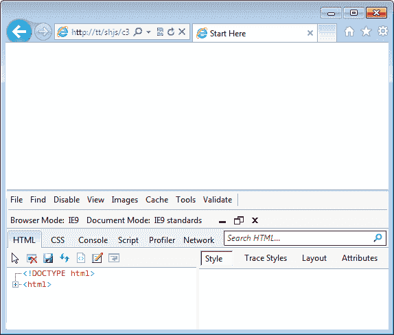

图 3-17. 查看带有错误的页面会停止 JavaScript 处理。

4.  点击 `Console`（控制台）选项卡。

再次，取决于你对 F12 开发者工具的使用，你可能需要按 `Ctrl+R` 重新加载页面以激活此控制台。在控制台中，你将看到类似于图 3-18

图 3-18. 在 F12 开发者工具 Console 选项卡中查看我们的 JavaScript 错误。

从此消息“Unterminated string constant”（未终止的字符串常量）可以看出一定存在错误。Internet Explorer 会尽力确定行号，有时甚至是错误的位置；然而，取决于 HTML、CSS 和 JavaScript 的交互方式，此行号和位置并不总是准确的。幸运的是，在我们情况下它是正确的。（你的行号可能与我的略有不同。）查看我代码中的第 3 行，我看到了 `alert("hello);`，问题显而易见：缺少双引号。

5.  向代码中添加缺失的双引号。它现在应该看起来像：

```
var myVar = 0;
if (myVar < 3) {
    alert("hello");
}
```

如果你在使用 Visual Studio，你需要停止项目或停止调试，然后进行更改。

6.  重新加载页面或重新运行项目以显示警告，正如你预期看到的那样（如图 3-19")所示）。

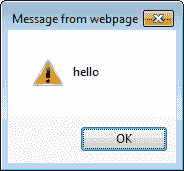

图 3-19. 修正 JavaScript 错误后的 alert()。

恭喜，你通过使用调试控制台修复了第一个 JavaScript 错误。从现在起我邀请你浏览互联网上的各种网页，并在浏览时打开 F12 开发者工具。你将感受到构建许多网页背后的复杂性。你可能会对在使用控制台时在网页上遇到的如此多错误感到惊讶。熟悉各种选项卡，根据你的好奇心探索 Network（网络）、Console（控制台）和其他选项卡。

# 总结

本章深入探讨了 JavaScript 中的一些编程概念。章节从函数开始，包括如何创建函数以及如何使用它们构建更复杂的 JavaScript 程序。函数是 JavaScript 编程中的核心概念。在对象部分，你学习了如何创建对象并添加属性、值、方法和伪类。你学习了如何枚举对象中的属性，以及如何使用数据数组创建多个对象。最后，本章以介绍如何调试 JavaScript 结束结束。Internet Explorer 现在包含了 F12 开发者工具，它类似于 Firefox 的 Firebug。本章展示了使用 F12 开发者工具的示例，我也建议使用 Firebug。

下一章将介绍 JavaScript 以及它如何通过文档对象模型（DOM）与浏览器交互。你到目前所学的内容已经为你准备好了所需的所有 JavaScript 知识。然而，你需要学习如何将这些知识付诸实践。


编程库和框架通过为常见且耗时的任务提供工具和辅助程序，为开发者提供了帮助。在过去的几年里，JavaScript 程序员工具箱中重大的补充之一就是 JavaScript 库和框架的流行及其强大性。在这些各种库出现之前，JavaScript 程序员需要编写大量的代码来执行如更改内容、验证 Web 表单以及网站的其他行为方面等任务。如今的 JavaScript 程序员利用库来让工作变得更加轻松。

最流行的 JavaScript 库之一名为 `jQuery`。`jQuery` 连同它的补充项目 `jQuery UI` 是 JavaScript 开发中必不可少的补充。`jQuery` 的流行通过其包含在 Microsoft Visual Studio 的某些版本中得到了证实。

本书将重点介绍 `jQuery`，你将在全书中看到它被频繁使用。在适当的情况下，我还会指出完成相同任务的传统 JavaScript 方法。在接下来的章节中，你将下载 `jQuery` 和 `jQuery UI` 并将它们添加到之前之前章节中创建的 `StartHere` 项目中。

# 获取 jQuery

`jQuery` 和 `jQuery UI` 可以下载到你的项目并在本地使用，也可以托管在其他地方并通过内容分发网络（CDN）访问。对于生产网站，我强烈建议下载 `jQuery` 用于你的本地项目或站点；请参阅库的托管 vs. 本 侧边栏，了解为什么在在线网站上你应该将 `jQuery` 保留在本地。然而，在开发期间以及在书中，使用 CDN 托管的版本的 `jQuery` 是可以的。`jQuery UI` 略有不同，因为它还附带了级联样式表（CSS）主题。这使得在基于 CDN 的解决方案中使用它变得稍微困难一些。考虑到这一点，我将展示如何在本地使用 `jQuery UI`。

## 库的托管 vs. 本

在提供网页时，时间至关重要，可靠性也是如此。流行的库和其他资源（如字体）既可以通过下载提供，也可以通过 CDN 提供。使用本地托管的资源副本是确保可靠性的同时提高网页速度的最佳方法。这是因为本地托管的资源（如 `jQuery`）完全在你的控制之下。你的 Web 服务器是提供文件的实体，你可以确保只要你的站点可用，本地文件就一直可用。

当文件托管在本地时，与该文件托管在 CDN 上相比，你节省了一个 DNS 查询，有时还节省了一个新的 TCP 连接。在 CDN 上，访问者的 Web 浏览器或设备需要进行额外的 DNS 查询，并与该 CDN 服务器打开新的 TCP 连接以获取资源。相对于资源加载所需的毫秒级时间，从相对意义上说，这是一个耗时的过程。

反方的论点是 CDN 比你的 Web 服务器更可靠，这通常是正确的。但如果你的 Web 服务器宕机了，你的 Web 应用程序就会宕机，因此你根本不需要该资源了。所以，CDN 多么可靠并不重要！CDN 还提供了库的最新版本，从而减轻了你手动更新本地副本的负担。最后，CDN 会分担服务器的一些负载，因为文件是从其他人的服务器提供的。

## 使用 jQuery 的本地副本

本节介绍如何获取用于本地托管选项的 `jQuery`。如果你使用 CDN 托管的 `jQuery` 库副本来遵循书中的示例，你可以安全地跳过此节，直接跳转到本章的使用 CDN 托管的 jQuery 库 章节。

你可以从 [`jquery.com`](http://jquery.com) 获取 `jQuery`。访问后，下载生产版本并将其保存到计算机上的适当位置——通常是你的“下载”文件夹。你稍后会将它复制到 Visual Studio 项目中；现在，只需将其保存在你能记得（或能找到）的地方以便随后的练习使用。

### 注意

你可以在第 4 章的配套内容中找到此练习的代码，以及版本 1.7.1 的 `jQuery`。然而，我建议在进行此练习时使用可用的最新版本的 `jQuery`。此练习的 HTML 在第 4 章的配套内容中名为 `jquery.html`。此外，请注意，如果你想对 jQuery 本身进行开发，则使用 `jQuery` 的开发版本（你将在 jQuery 网站上看到）。

要将 `jQuery` 添加到你的项目以及将使用的特定页面，请按照以下步骤操作：

1.  在 Visual Studio 中打开你的 `StartHere` 项目（如果尚未打开），点击`文件`，然后点击`打开项目`。

2.  在 `StartHere` 项目中，右键点击`解决方案资源管理器`窗格（通常位于屏幕右侧）。在弹出的右键菜单中，点击`添加`，然后点击`现有项`。

    你将看到“添加现有项”对话框。

3.  在“添加现有项”对话框中，导航到你的 `jQuery` 文件（例如，我的文件名为 `jquery-1.7.1.min.js`）并点击`添加`。注意，你可能需要从文件类型下拉列表中选择`脚本`或`所有文件`才能看到 `jQuery` 文件。此对话框如图图 4-1 所示](ch04.html_adding_jquery_to_project_by_solution_explorer)。

    图 4-1. 通过在解决方案资源管理器中添加 jQuery。

4.  将 `jQuery` 添加到你的项目以及将使用的特定页面后，下一步是将其添加到该页面。你可以使用 `<script>` 标签来实现此，如下：

    ```
    <script type="text/javascript" src="jquery-1.7.1.min.js"></script>
    ```

    将此 `<script>` 标签放在页面的 `<head>` 部分。例如，在本章之前创建的页面添加 `jQuery` 如下：

    ```html
    <!DOCTYPE html>
    <html>
    <head>
        <title>Start Here</title>
        <script type="text/javascript" src="jquery-1.7.1.min.js"></script>
    </head>
    <body>
        <script type="text/javascript">
            document.write("<h1>Start Here!</h1>");
        </script>
    </body>
    </html>
    ```

    在此段代码中，你可以看到在 `<head>` 中增加了 `<script>` 标签。

### 注意

根据你的设置，如果你查看此页面，某些版本的 Internet Explorer 会提示你允许内容。如果你在查看此页面时收到此类警告，请允许内容。

你现在已经将 `jQuery` 添加到页面，但尚未对其进行任何操作。你将在本章接下来的章节以及全书中学习如何使用 `jQuery`。

## 使用 CDN 托管的 jQuery 库

你可以使用托管在 CDN 的 `jQuery` 库。本节介绍如何将 CDN 托管版本的 `jQuery` 添加到项目中。注意，如果你遵循了上一节并已将 `jQuery` 添加到项目中，则不需要执行本节中的操作。


添加 jQuery，无论是本地托管还是通过 CDN，本质上都是相同的任务，使用的语法也相同。你所做的更改只是提供给 `src` 属性的位置。对于本地托管的 jQuery 副本，`src` 属性指向服务器自身的该副本。对于 CDN 托管的 jQuery，`src` 属性使用远程 jQuery 副本的 URL，如下所示：

```html
<script type="text/javascript" src="http://ajax.aspnetcdn.com/ajax/jQuery/
jquery-1.7.1.min.js"></script>
```

将 `<script>` 标签放在文档的 `<head>` 部分。以之前创建的页面为例，使用 CDN 托管 jQuery 的完整标记如下代码所示（你可以在第 4 章的辅助内容中找到 `cdnjquery.html`）：

```html
<!DOCTYPE html>
<html>
<head>
    <title>Start Here</title>
    <script type="text/javascript" src="http://ajax.aspnetcdn.com/ajax/jQuery/
jquery-1.7.1.min.js"></script>
</head>
<body>
    <script type="text/javascript">
        document.write("<h1>Start Here!</h1>");
    </script>
</body>
</html>
```

### 注意

根据你的设置，某些版本的 Internet Explorer 在你尝试查看此页面时，会提示你允许被阻止的内容。如果你收到此类警告，请选择允许内容。此外，示例代码指向 Microsoft 的 jQuery CDN。还有其他可用的 CDN，包括来自 Google 的。请访问 [`docs.jquery.com/Downloading_jQuery#CDN_Hosted_jQuery`](http://docs.jquery.com/Downloading_jQuery#CDN_Hosted_jQuery) 获取最新的 CDN 列表及其相应的 URL。

这就是向你的页面添加 jQuery 的全部内容。接下来，你将看到如何测试 jQuery 以确保它在此示例页面上按预期工作。jQuery 将贯穿本书。

## 测试 jQuery

现在你已经通过本地或 CDN 将 jQuery 链接到你的页面中，是时候第一次使用它了。为了做到，你将从本节之前创建的简单页面开始：

1.  从本节早之前的示例页面开始。移除 body 中现有的 `<script>` ，这样你就有了一个如下所示的基础。请注意，你的 jQuery 位置可能不同。（这里显示的是上一个节的 CDN 托管版本；你可能正在使用本节早之前的本地托管版本。）

    ```html
    <!DOCTYPE html>
    <html>
    <head>
        <title>Start Here</title>
        <script type="text/javascript" src="http://ajax.aspnetcdn.com/ajax/jQuery/
    jquery-1.7.1.min.js"></script>
    </head>
    <body>
    </body>
    </html>
    ```

2.  在此标记的 body 内部添加一个空的 `<div>` 元素。标记将如下所示：

    ```html
    <!DOCTYPE html>
    <html>
    <head>
        <title>Start Here</title>
        <script type="text/javascript" src="http://ajax.aspnetcdn.com/ajax/jQuery/
    jquery-1.7.1.min.js"></script>
    </head>
    <body>
        <div id="testDiv"></div>
    </body>
    </html>
    ```

    添加的 `<div>` 元素具有标识符（`id`）`testDiv`。现在添加一些 jQuery。

3.  在结束标签 `</body>` 之前添加以下 JavaScript：

    ```javascript
    <script type="text/javascript">
    $(document).ready(function () {
        $("#testDiv").text("Start Here, now with jQuery");
    });
    </script>
    ```

    最终的页面应该是这样的：

    ```html
    <!DOCTYPE html>
    <html>
    <head>
        <title>Start Here</title>
        <script type="text/javascript" src="http://ajax.aspnetcdn.com/ajax/jQuery/
    jquery-1.7.1.min.js"></script>
    </head>
    <body>
        <div id="testDiv"></div>
        <script type="text/javascript">
            $(document).ready(function () {
                $("#testDiv").text("Start Here, now with jQuery");
            });
        </script>
    </body>
    </html>
    ```

4.  代码就绪后，按 F5 或从调试菜单中选择“开始调试”来运行项目。你应该能看到类似图 4-3 的页面。 

    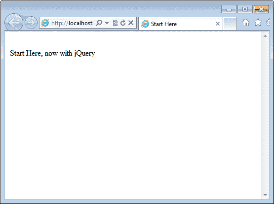

    图 4-3. 使用 jQuery 向页面添加内容。

    如果你没有按预期看到页面，Visual Studio 应该向你显示一个错误。例如，（就你所知）我故意在我的版本中写了一个语法错误。Visual Studio 高亮了出现错误的行，正如你在图 4-4 中所示。

    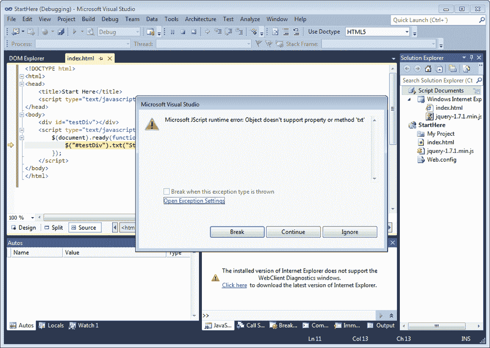

    图 4-4. Visual Studio 提供了一些调试。

    如果在尝试运行示例时只得到一个空页面，那么故障排除将变得有些困难。然而，Internet Explorer 包含了一些通过其开发工具加载程序提供的调试功能。在 Internet Explorer 9 中，你可以按 F12 查看 F12 开发工具。请查看第 3 章 获取更多调试信息。将在书中介绍更多关于 jQuery 的细节，以解释代码示例的作用。简短来说，是你使用了 `ready()` 函数，它确保了页面上与 DOM 相关的元素已准备好进行操作。在 `ready()` 函数内部，你使用 id 选择器访问了 `testDiv` 并更改了它的文本。

你现在已向页面添加了 jQuery 并使用它向页面添加了内容。下一步是 jQuery UI。

# 获取 jQuery UI

你可以从 [`jqueryui.com`](http://jqueryui.com) 获取 jQuery UI。jQuery UI 基于模块化架构构建，允许开发者仅下载其应用程序中使用的组件。就本书而言，你将下载全部内容。在 jQuery UI 网站上，点击“Build Custom”链接。默认情况下，所有组件都已选中，只需选择“Download”并将文件保存到计算机上。

### 注意

下载 jQuery UI 的步骤可能会随着时间而变化。下载的目标是获取所有的 jQuery UI 组件，无论在你阅读这本书时是通过什么实现的。

jQuery UI 以 zip 包形式提供，JavaScript 位于 `js` 文件夹中，相关的 CSS 存储在 `CSS` 文件夹中。将此 zip 包的内容解压到计算机上。例如，我在桌面上创建名为 `jqueryui` 的文件夹并将内容提取到该文件夹中，如图 4-5 所示。

    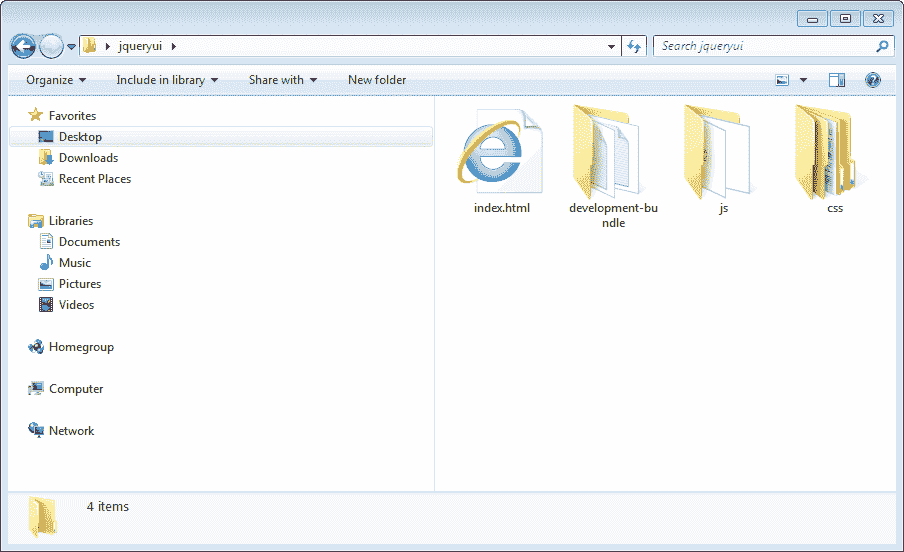

    图 4-5. 将 jQuery UI 提取到独立文件夹。


将 jQuery UI 添加到项目中并不像添加 jQuery 那样简单。困难之处在于 jQuery UI 包含了主题和 CSS。但 jQuery UI 提供的强大性和便利性使得这些额外工作是非常值得的。而且一旦你操作过几次，这个过程实际上并没那么麻烦。本质上，这个过程涉及将 CSS 和 JavaScript 放置在你的项目中。如果你没有使用 Visual Studio，你需要将 `css` 和 `js` 目录放置在网络浏览器可以访问的位置（如果你使用服务器进行开发，则放置在 Web 服务器上）。以下是一个创建文件夹的练习，也包括将 jQuery 文件移动到 `js` 文件夹中。如果你在之前的章节中已经在项目中创建了 `css` 和 `js` 文件夹，你只需要在本次练习中移动 jQuery 文件即可。

1.  如果在 Visual Studio 中尚未打开，请打开你的 `StartHere` 项目。

2.  在`解决方案管理器`（Solution Explorer）中（通常在右侧，如你之前看到的图所示），右键点击项目名称 `StartHere`，导航到`添加`（Add）并选择`新建文件夹`（New Folder）。项目中将创建一个新文件夹。该新文件夹应命名为 `css`。

3.  重复相同的操作：右键点击，导航到`添加`，选择`新建文件夹`，并添加一个名为 `js` 的文件夹。

4.  如果你在项目中有一个 `external.js` 文件，请确保它如所示出现在 `js` 文件夹中，或者将其拖入 `js` 文件夹。最后，将 jQuery 文件（如果你本地有一个的话）拖入 `js` 文件夹。你的项目看起来应该像图 4-6 所示，有两个文件夹（`css` 和 `js`）以及 `js` 文件夹中的 jQuery 文件。

    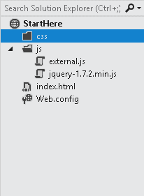

    图 4-6. 使用解决方案管理器创建了两个文件夹以存放 CSS 和 JavaScript 文件。

5.  文件夹创建完成后，接下来你将从 jQuery 压缩包中提取 CSS，并将其放置在项目项目创建的 `css` 文件夹中。使用 Windows 资源管理器，导航到解压 jQuery UI 压缩包的文件夹。（参见图 4-5 所示该文件夹的示例。

    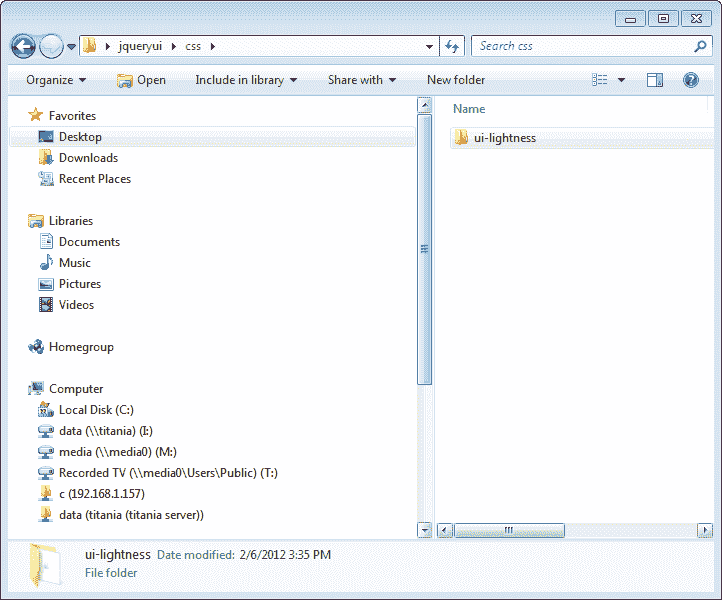

    图 4-7. jQuery UI 分发中 CSS 文件夹中的 ui-lightness 主题。

7.  右键点击主题文件夹（`ui-lightness`）并选择`复制`（Copy）。

8.  现在回到 Visual Studio，点击`解决方案管理器`中的 `css` 文件夹。右键点击 `css` 文件夹并选择`粘贴`（Paste）。你的`解决方案管理器`现在应该看起来像图 4-8 所示，`css` 文件夹内部有一个 `ui-lightness` 文件夹。

### 注意

如果你没有粘贴到正确的区域，请右键并删除 `ui-lightness` 文件夹并重试。

    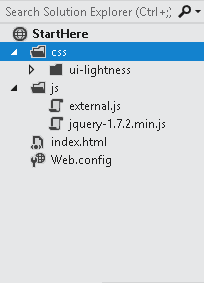

    图 4-8. StartHere 项目中 css 文件夹下方添加了 ui-lightness 文件夹。

最后，你可以在项目中的 `js` 文件夹内添加 jQuery UI JavaScript 文件。在`解决方案管理器`中右键点击 `js` 文件夹并选择`添加`（Add），然后点击`现有项`（Existing Item）。`添加现有项`对话框将打开，你可以导航到解压 jQuery UI 压缩包的文件夹。在 jQuery UI 文件夹中，打开 `js` 文件夹并选择 jQuery UI js 文件。与之前一样，你可能需要更改文件类型，以便看到`所有文件`或`脚本文件`从而看到 `js` 文件。示例在图 4-9 中所示。

### 提示

请确保你选择了名为命名为 `jquery-ui` 的文件，而不是标准的 `jquery` 文件。

    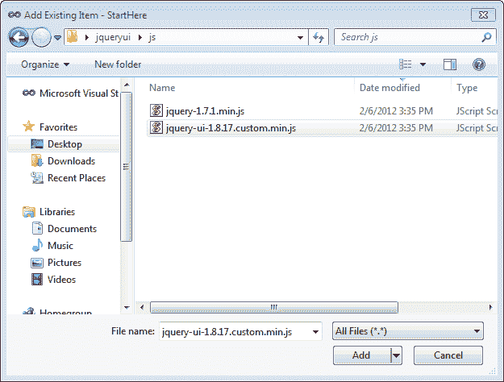

    图 4-9. 将 jQuery UI JavaScript 文件添加到你的项目中。

你项目的`解决方案管理器`现在看起来将类似于图 4-10。

    

## 测试 jQuery UI

现在 jQuery UI 已添加到你的项目中，是时候测试它了。为了这样做，你将添加 CSS 的引用以及 JavaScript 文件的引用。请注意顺序很重要：你应该先加载 `css` 文件，然后是 `jquery`，最后是 `jquery UI`。

你需要首先添加 `css` 的引用，如下：

```
<link rel="stylesheet" href="css/ui-lightness/jquery-ui-1.8.18.custom.css" rel="stylesheet">
```

然后你将添加 jQuery UI JavaScript 文件的引用，如下：

```
<script type="text/javascript" src="js/jquery-ui-1.8.18.custom.min.js"></script>
```

注意主题 `ui-lightness` 在你的实现中可能会不同。这个名称对应于`解决方案管理器`中的 `css` 文件夹。此外，jQuery UI 的版本在本书编写期间会变化。这一警告适用于 `css` 文件和 `js` 文件。

```html
<!DOCTYPE html>
<html>
<head>
    <title>Start Here</title>
    <link rel="stylesheet" href="css/ui-lightness/jquery-ui-1.8.18.custom.css" rel="stylesheet">
    <script type="text/javascript" src="js/jquery-1.7.1.min.js"></script>
    <script type="text/javascript" src="js/jquery-ui-1.8.18.custom.min.js"></script>
</head>
<body>
</body>
</html>
```

```
以之前的 HTML 代码为基础，应向页面的 `<body>` 部分添加以下 HTML 标记：

```html
<div id="startHere" style="border: 3px solid black;">
    <h1>Start Here</h1>
</div>
<div>
    <a href="#" id="hiderLink">Hide it!</a>
</div>
```


### 2. 在标记下方（但仍在 `<body>` 区域内），添加以下 JavaScript：

```javascript
<script type="text/javascript">
    $("#hiderLink").click(function () {
        $("#startHere").hide();
    });
</script>
```

整个页面看起来应该如下所示（再次注意，你的 jQuery 版本号会有所不同）：

```html
<!DOCTYPE html>
<html>
<head>
    <title>Start Here</title>
    <link type="text/css" href="css/ui-lightness/jquery-ui-1.8.18.custom.css"
      rel="stylesheet" />
    <script type="text/javascript" src="js/jquery-1.7.1.min.js"></script>
    <script type="text/javascript" src="js/jquery-ui-1.8.18.custom.min.js">
      </script>
</head>
<<body>
    <div id="startHere" style="border: 3px solid black;">
        <h1>Start Here</h1>
    </div>
    <div>
        <a href="#" id="hiderLink">Hide it!</a>
    </div>
    <script type="text/javascript">
        $("#hiderLink").click(function () {
            $("#startHere").hide();
        });
    </script>
</body>
</html>
```

### 3. 在网络浏览器中查看此页面。你应该会看到一个与图 4-11 类似的页面。

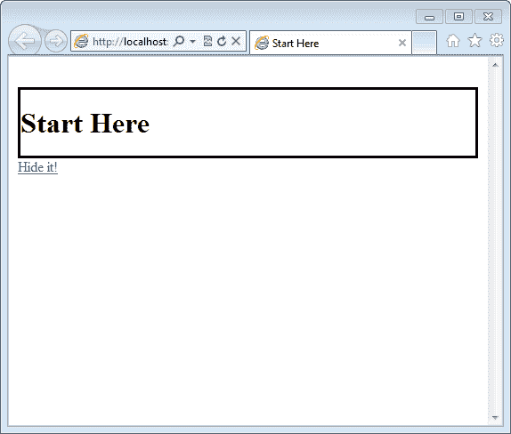

图 4-11. 构建一个与 jQuery UI 交互的页面。

### 4. 你可能已经点击过它，但如果你还没有，请点击“Hide it!”链接。“Start Here”字样将会消失。参见图 4-12。

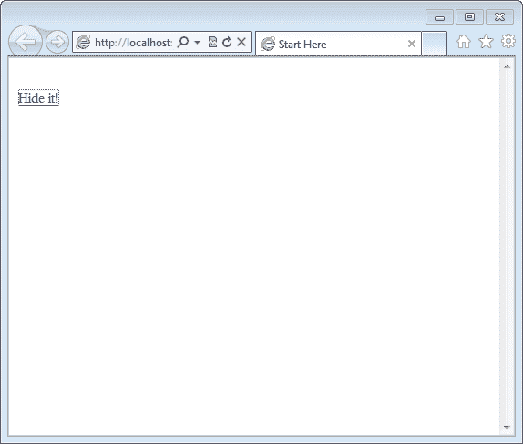

图 4-12. 使用 jQuery UI hide 函数隐藏元素。

诚然地说，你可能对此并不太深刻。事实上，jQuery 本身就包含一个 `hide()` 函数。但有几点需要注意：首先，有一个相应的 `show()` 函数可以用来找回你的内容；其次，jQuery UI 提供了几种效果，可以精确定义元素应该如何隐藏。这里是其中一种效果的示例。

在页页面的脚本部分，将 `hide()` 函数更改如下所示：

```javascript
$("#startHere").hide("slide", {}, 2000);
```

重新加载页面并点击“Hide it!”链接。Start Here `div` 现在会滑出屏幕，大约需要 2 秒（2000 毫秒）来完成。

在整本书中，将更深入地介绍 jQuery UI。目前，要记住的是，jQuery 和 jQuery UI 可以让你的生活变得更好，将创建复杂行为的一些艰性工作变得简单。

# 浏览器对象模型

浏览器对象模型 (BOM) 定义了一组 JavaScript 程序员可用于与网络浏览器交互的对象，并且它定义了在浏览器窗口内渲染的文档。这是一个很长的句子。我将尝试用另一种方式来解释。通过 BOM，你可以获取有关用户浏览器的信息（通过 `navigator` 对象），你可以查看浏览器历史（通过 `history` 对象），你可以对网页进行操作（通过 `document` 对象）。BOM 还有其他对象或部分。本节将介绍 BOM 中包含的一些对象。

## 事件与 window 对象

开发者可以使用 `window` 对象来处理和响应浏览器中的事件，例如当鼠标光标移动到元素上或遇到点击操作时。此外，`window` 对象包含了用于处理计时器的方法。你将在本章稍后的部分看到使用计时器的示例。

`window` 对象的大部分功能围绕网络浏览器提供的事件模型展开。有多种事件模型，并且在不同浏览器内部之间对这些事件模型的支持程度也不同。这意味着你需要针对每个浏览器中的每一个差异和细微差别进行编程。通常情况下，使用 jQuery 处理事件要高效得多，也更简单。jQuery 考虑了浏览器在事件模型支持和模型实现方面的这些差异。考虑到这一点，我会特别注意这一点。

### 注意

浏览器对象模型 (BOM) 定义了一组 JavaScript 程序员可用于与网络浏览器交互的对象，并且它定义了在浏览器窗口内渲染的文档。这是一个很长的句子。我将尝试用另一种方式来解释。通过 BOM，你可以获取有关用户浏览器的信息（通过 `navigator` 对象），你可以查看浏览器历史（通过 `history` 对象），你可以对网页进行操作（通过 `document` 对象）。BOM 还有其他对象或部分。本节将介绍 BOM 中包含的一些对象。

## screen 对象

`screen` 对象包含有关用户屏幕的信息（如屏幕分辨率），而 `navigator` 对象则提供了关于浏览器本身的信息。诸如浏览器名称、版本等项目都是通过 `navigator` 对象获取的。要查看通过 `navigator` 对象可属性，请修改上一节的代码，以枚举 `navigator` 对象而不是 `screen` 对象，如下所示：

```javascript
for (propt in screen) {
    document.write("Screen property " + propt + " is currently: ");
    document.write(screen[propt] + "<br />");
}
```


```javascript
for (propt in navigator) {
    document.write("navigator property " + propt + " is currently: ");
    document.write(navigator[propt] + "<br />\n");
}
```

如果你想查看这段代码的运行效果，只需将 `external.js` 中的现有代码替换为示例中的代码，并在 浏览器中查看 `index.html` 即可。或者，你也可以在第 4 章 代码中的 `navigator.html` 以及 第 4 章 js 文件夹中的 `navigator.js` 中找到对应的 HTML。结果应该类似于图 4-15 所示。

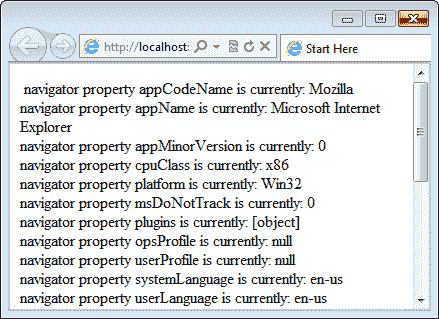

图 4-15. 枚举 navigator 对象。

`navigator` 对象经常用于收集有关访问者的信息，例如访问者使用的浏览器名称以及可用插件列表。这些信息有时是准确的，但这么说也意味着来自 `navigator` 对象的信息有时是不准确的。

例如，可以使用 `userAgent` 属性来粗略地判断浏览器，但与客户端提供的其他内容一样，`userAgent` 可以被访问者轻易地修改或伪造。此外，正如第 1 章 中中讨论的，JavaScript 可能完全不可用，如果是这样，`navigator` 对象也将无法使用。

本书将不会展示任何使用 `userAgent` 属性的示例，因为这样做并不是最佳实践。跨浏览器设计的最佳实践是根据客户端可用的资源来增强网站的功能。这一概念被称为`渐进式增强`（progressive enhancement），你将在书中各处看到它的示例。

## location 对象

BOM 层次结构中的另一个有趣对象是 `location` 对象。`location` 对象包含有关当前加载的 URL（统一资源定位符）、查询字符串以及请求到达 Web 服务器时的其他信息。将之前的 `for..in` 循环修改以枚举 `location` 对象，得到的代码如下：

```javascript
for (propt in location) {
    document.write("location property " + propt + " is currently: ");
    document.write(location[propt] + "<br />\n");
}
```

### 注意

此代码可以在配套内容的 `location.html` 和 `location.js` 中找到。

`location` 对象经常用于将访问者重定向到另一个页面。根据浏览的不同，可能提供 `replace()` 方法，它可以将新页面放入浏览器的历史记录中。如果 `replace()` 方法不可用，可以使用 `href` 属性，导致浏览器发生重定向。这里有一个创建一个立即重定向到另一个页面的练习。此代码可以在配套内容的 `redir.html` 和 `redir.js` 中找到。在本章的稍后部分，你将看到一个使用定时器自动重定向的示例，或者在 JavaScript 不可用时为访问者提供一个可以点击的链接。

1. 首先在 Visual Studio 中打开 StartHere 项目，然后打开 `index.html`。
2. 在 `index.html` 中，放置以下标记：
   ```html
   <!doctype html>
   <html
   <head>
   <title>Start Here</title>
   <script type="text/javascript" src="js/external.js"></script>
   </head>
   <body>
   <a href="http://www.braingia.org?shjs">如果你没有被重定向，请点击此处</a>
   </body>
   </html>
   ```
3. 保存 `index.html`。
4. 打开 `external.js`，并放置以下代码，替换之前练习中存在的任何其他代码：
   ```javascript
   if (typeof(location.replace) !== "undefined") {
       location.replace("http://www.braingia.org?shjs-replace");
   } else {
       location.href = "http://www.braingia.org?shjs-href";
   }
   ```
   这段代码首先检查 `location.replace()` 方法可用。它通过确保 `location.replace()` 方法的 `typeof` 不为 undefined 来实现。（注意严格的相等性测试形式 `!==`）。如果 `location.replace()` 可用，则用它将访问者发送到某个网站。如果 `location.replace()` 不可用，则改用 `location.href`。在 `index.html` 页面内部，有一个锚点 `<a>` 元素，包含指向同一网站的链接。如果访问者的浏览器中没有 JavaScript，访问者可以点击此链接。
5. 保存 `external.js` 并运行项目。浏览器将打开，你将立即被重定向到代码中指定的页面。

刚刚显示的代码可以从定时器调用，以便在重定向发生之前显示一个中间页。这是实现此操作的代码（同样位于配套内容的 `timer.js` 和 `timer.html` 中）：

```javascript
function redirect() {
    if (typeof(location.replace) !== "undefined") {
        location.replace("http://www.braingia.org?shjs-replace");
    } else {
        location.href = "http://www.braingia.org?shjs-href";
    }
}

setTimeout(redirect, 5000);
```


```html
<html
<head>
<title>Hello World</title>
</head>
<body>
<p>Here's some text.</p>
<p>Here's more text.</p>
<p>Link to the <a href="http://www.w3.org">W3</a></a></a>></p>
</body>
</html>
```

图 4-16 显示了以 DOM 树表示的此 HTML 结构。


图 4-16. HTML 结构的 DOM 节点。

## HTML 属性与 DOM

JavaScript 和 jQuery 包含了用于遍历（或行走）DOM 树形结构的方法。这意味着你可以对页面上所有特定类型的元素进行更改。然而，在实践中，你更有可能想根据元素的类型或它们在 DOM 中的位置来单独处理元素。

有两个 HTML 属性使得处理单个元素和特定类型的元素变得更容易。它们是 `id` 和 `class` 属性。`id` 属性为 HTML 页面中的元素提供唯一标识符。`id` 应该是唯一的——你不应该在多个元素之间共享同一个 id。如果你需要在多个元素之间共享一个 id，你应该使用 `class`。`class` 用于定义在多个元素间共享的标识符。以下是各自的示例：

```html
<div id="myDiv">This is a div element with an id</div>
<div class="myClass">This is a div element with a class</div>
```

`class` 和 `id` 也可以在同一个元素上结合使用。`class` 的典型用法是以相同的方式为元素样式。例如，如果你想让所有的 `<div>` 元素以某种颜色显示，你可以使用 `class`，然后对该 `class` 应用 CSS 样式。`id` 也可以用于指定特定的元素。

与你处理 CSS 的方式类似，你也可以通过 JavaScript 使用 `id` 或 `class` 来访问元素，正如你接下来将看到的 true。

# 使用 JavaScript 和 jQuery 获取元素

本节介绍了如何使用 JavaScript 和 jQuery 获取元素。本节首先从 jQuery 及其用法开始，然后跳回 DOM。

除非另有说明，本节及后续章节将使用以下 HTML 结构。该代码位于配套内容的 `elements.html` 中。请注意，此代码仍然引用了上一个练习中的旧 `external.js`，因此它会将你重定向。在章节后半部分，你将更新 `external.js`，所以现在不要尝试在浏览器中查看此 HTML！

```html
<!doctype html>
<html>
<head>
<title>Start Here</title>
<script type="text/javascript" src="js/jquery-1.7.1.min.js"></script>
<script type="text/javascript" src="js/external.js"></script>
</head>
<body>
<div id="myDiv">
<p><a id="silverwareLink" href="http://en.wikipedia.org/wiki/Silverware">Silverware</a></p>
    <ul id="myUL">
        <li class="classList">Fork</li>
        <li class="classList">Spoon</li>
        <li class="classList">Knife</li>
    </ul>
</div>
</body>
</html>
```

## 顺序很重要

在编写本章的示例 HTML 时，我错误地将加载 `external.js` 文件的 `<script>` 标签放在了加载 jQuery 的 `<script>` 标签之前。遗憾的是，示例无法正常工作，我花了一些时间排查为什么这些看起来简单的代码会静默失败，但有时又能正常运行。

答案是 `external.js` 在 jQuery 之前被加载了。本质上，我我不经意中忽略了自己的建议。调换顺序，让 jQuery 先加载，就解决了这个问题，正确的版本显示在之前的示例中。

## 简要使用 jQuery

在本章的早些部分，你已经学习了如何在网页中引入 jQuery，本节中的示例包含一个用于 jQuery 的 `<script>` 标签。在处理 DOM 时，jQuery 真正大放异彩。jQuery 的语法与 DOM 略有不同，正如你在本章早期看到的那样。

jQuery 定义了自己的函数，称为 `jquery()`。这让你允许你通过 `jquery()` 函数本身调用任何与 jQuery 相关的函数。然而，jQuery 还定义了 `jquery()` 函数的快捷方式 `$()`。使用 `$()` 访问与 jQuery 相关的函数比使用 `jquery()` 要常见得多，这也是你将在整本书中看到的语法。当你看到 `$()` 时，你应该知道它是对 `jquery()` 本身的引用，因此括号内的任何后续内容都是 jQuery 特有的。随着你对 jQuery 的使用，这将变得更加清晰（并且似乎并不重要）。

本节将更深入地解释 jQuery，为你之后在章节后半部分处理 DOM 做准备。你现在需要了解的两个关键点：`ready()` 函数和选择器。

### ready() 函数

当网页加载时，网络浏览器会从上到下顺序读取并解析 JavaScript 和 HTML。这意味着 JavaScript 代码可能会在页面加载之前被加载并执行。因此，如果 JavaScript 代码需要在元素加载之前对其进行操作，它可能会失败。JavaScript 通过使用 `onload()` 方法解决了这个问题，但在使用 jQuery 时，这并不推荐。`ready()` 函数是 `document` 对象的一部分，它提供了一种在 DOM 加载后执行 JavaScript 的方法。jQuery `ready()` 函数与 `onload()` 方法不同，因为 `onload()` 方法会等待所有内容加载，包括图片。

`ready()` 函数用于需要在页面加载后立即执行 JavaScript 但不需要等待图片的情况。

`onload()` 方法和 `ready()` 函数在页面上只能调用一次，且通常不建议同时使用。这意味着你需要相应地规划你的程序，使它们在 `ready()` 函数内部被调用。注意，这并不意味着你需要将所有的 JavaScript 都放在 `ready()` 函数中；相反，你需要将任何依赖加载的函数放在 `ready()` 函数中。

在本节的后续部分和整书中，你将看到 `ready()` 函数的使用，随着你处理示例，该函数将变得更加清晰。

### jQuery 选择器

选择器是 jQuery 的核心。选择器定义了 jQuery 代码执行的元素。选择器是对 DOM 元素分组并进行组合操作的强大方式。你不仅可以通过 HTML id 和 class 选择元素，还可以通过它们的祖先关系选择元素——例如，只选择 `<li>` 元素内的 `<a>` 元素——你还可以通过许多其他方式选择元素。


`getElementById()` 方法是通过 JavaScript 处理 HTML 元素和 DOM 的主要方法。`getElementById()` 方法的典型用法是实例化一个变量并关联一个元素，然后对该元素的一个或多个属性进行操作。以本节之前提到的 HTML 内容为参考，下面的示例展示了如何使用其 `id` 作为选择器，从页面上的 `<a>` 元素获取 `href` 属性的值。你可以在配套内容中找到名为 `getelementbyid.js` 的代码。

```javascript
var aLink = document.getElementById("silverwareLink");
alert(aLink.href);
```

一旦获取了该值，你就可以设置或更改属性。这种行为将在本章稍后的部分展示。

jQuery 的典型用法并不像刚才的示例那样调用元素获取。在使用 jQuery 时，通常的做法是将多个操作链在一起。例如，与其像上一个示例那样获取元素并将其赋值给变量，在使用 jQuery 时，你通常只需要直接获取属性，如下例所示：

```javascript
alert($('#silverwareLink').attr('href'));
```

在这个示例代码中，`href` 属性是从 `id` 为 `silverLink` 的 HTML 元素中获取的。这是通过 jQuery 的 `attr()` 函数实现的。jQuery 相关的代码封装在标准的 JavaScript `alert()` 函数中。

这里有一个练习，可以结合这段代码和本节之前提供的 HTML 内容进行操作。为了准备此练习，如果尚未打开，请打开你的 `StartHere` 项目。此练习的完整代码可以在配套内容中的 `retrievebyid.html` 和 `retrievebyid.js` 中找到。

1. 在 `index.html` 文件中，将 HTML 修改为与本节之前的示例一致。相对于现有 `index.html` 的更改已用**加粗**显示。

   ```html
   <!doctype html>
   <html>
   <head>
   <title>Start Here</title>
   <script type="text/javascript" src="js/jquery-1.7.1.min.js"></script>
   <script type="text/javascript" src="js/external.js"></script>
   </head>
   <body>
   <div id="myDiv">
   <p><a id="silverwareLink" href="http://en.wikipedia.org/wiki/Silverware">Silverware</a></p>
       <ul id="myUL">
           <li class="classList">Fork</li>
           <li class="classList">Spoon</li>
           <li class="classList">Knife</li>
       </ul>
   </div>
   </body>
   </html>
   ```

2. 保存 `index.html`。

3. 清空 `external.js` 中的所有代码，并将以下代码放入文件内。（你可以在配套内容中找到名为 `retrievebyid.js` 的代码。）

   ```javascript
   $(document).ready(function(){
       alert($('#silverwareLink').attr('href'));
   });
   ```

4. 保存 `external.js`。

5. 现在通过按 F5 或在网络浏览器中查看 `index.html` 来运行代码。你应该会收到一个类似于图 4-17 所示的警报框。

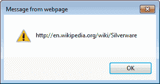

图 4-17. 使用 jQuery 从 href 属性获取值。

此练习中的代码使用了 jQuery 的 `ready()` 函数。在 `ready()` 函数内部，调用了带有 jQuery 的 `alert()` 来获取 HTML ID `silverwareLink` 的 `href` 值。

下一节将讨论通过 CSS 类获取元素，稍后你将看到如何使用 jQuery 更改 `href` 等属性。

## 通过类获取元素

与 `getElementById()` 函数类似，JavaScript 也提供了一个 `getElementsByClassName()` 函数。`getElementsByClassName()` 函数检索所有具有给定 CSS 类的元素。然而，旧版本的 Internet Explorer 不支持 `getElementsByClassName()`（从大约 8 版本开始）；因此目前还不能建议使用它。不过，jQuery 包含了一个在旧版浏览器中同样完全有效的类选择器。jQuery 的 ID 选择器使用哈希符号或井号 (#)，而类选择器使用单个点，如下所示：

```javascript
$('.classList')
```

该代码选取了页面上所有具有 `classList` 类的元素。是的，真的这么简单。ID 选择器和类选择器之间的一个主要区别是，类选择器通常返回多个项目。一个典型的场景是使用 jQuery 的 `each()` 函数来遍历获取的元素。`each()` 函数类似于 `for` 循环，用于遍历一组事物。之前显示的 HTML 包含了多个共享相同类的 `<li>` 元素。检索这些元素并使用 jQuery 的 `each()` 函数对它们进行迭代看起来所示：

```javascript
$('.classList').each(function() {
    alert($(this).text());
});
```

这段代码可以在配套内容中找到 `classlist.html` 和 `classlist.js`，它在 `each()` 函数内部创建了一个函数。这个内部函数（顺便说一下，这是一个匿名函数）仅仅使用 `alert()` 函数来显示文本。`each()` 函数大致等同于你见过的 `for` 循环。`$(this)` 是经过 jQuery 封装的元素。`text()` 方法获取每个项目的内容。

## 通过标签名获取元素

你还可以通过标签（如 `<li>`、`<a>`、`<div>` 等）来处理 DOM。与类示例一样，当你需要对一组元素进行操作时，通过标签名检索非常有用。JavaScript 有一个 `getElementsByTagName()` 函数可以用于检索 HTML 元素。在使用该函数时增加特异性的简单方法是检索其父元素。例如，在本章使用的 HTML 示例中，具有如下层次结构：

```html
<ul id="myUL">
    <li class="classList">Fork</li>
    <li class="classList">Spoon</li>
    <li class="classList">Knife</li>
</ul>
```

使用 JavaScript 的典型场景是检索父元素，然后使用 `for` 循环遍历其子元素。实现该操作的代码如下：

```javascript
window.onload = function() {
    var ulElm = document.getElementById("myUL");
    var liElms = ulElm.getElementsByTagName("li");
    for (var i = 0; i < liElms.length; i++) {
        alert(liElms[i].innerHTML);
    }
};
```

这段代码可以在配套内容的 `getelementbytagname.html` 和 `getelementbytagname.js` 中找到，它将 `window` 对象的 `onload` 方法设置为函数。在该函数内部，通过之前见过的 `getElementById()` 方法选取 `<ul>` 元素，并将结果放在变量 `ulElm` 中。接下来，使用 `getElementsByTagName()` 方法获取 `ulElm` 内部的所有 `<li>` 元素。这些 `<li>` 元素被放在变量 `liElms` 中。最后，创建一个简单的 `for` 循环并使用 `alert()` 将每个 `liElms` 变量发送到屏幕上。


jQuery 包含了通过标签名进行检索的选择器。它们的语法与你之前见过的 jQuery 选择器基本相同。请记住，基于 id 的选择器使用井号（`#`），而基于类的选择器使用点号（`.`）。使用 jQuery 通过标签名检索时会省略这些符号，直接通过标签名本身进行检索，这类似于原生 JavaScript 的 `getElementsByTagName()` 函数。这是一个示例：

```javascript
$(document).ready(function() {
    $('li').each(function() {
        alert($(this).text());
    });
});
```

这个示例使用了你之前见过的相同的 `each()` 函数，并遍历页面上的每个 `<li>` 元素并显示其文本。你可能会注意到这个示例与之前的原生 JavaScript 示例之间的区别。原生 JavaScript 示例首先通过 id 获取了特定的 `<ul>`，然后只对该 `<ul>` 内部或下方的 `<li>` 元素进行迭代。这里显示的 jQuery 示例实际上获取了页面上所有的 `<li>` 元素。然而，得益于 jQuery 高级的选择器语法，也可以实现相同的定位或层级行为。这是实现相同层级语法的一种方法，你可以在配套内容中找到 `tagselector.html` 和 `tagselector.js`：

```javascript
$(document).ready(function() {
    $('#myUL li').each(function() {
        alert($(this).text());
    });
});
```

此示例使用的语法选取了 id 为 `myUL` 内部的所有 `<li>` 元素。有多种方法根据元素在文档中的位置来选择元素。有关选择器的更多信息，请参 [`api.jquery.com/category/selectors`](http://api.jquery.com/category/selectors)。

# 总结

本章展示了许多在 Web 浏览器中使用 JavaScript 的强大功能的内容。浏览器对象模型 (BOM) 和文档对象模型 (DOM) 为 JavaScript 访问浏览器和网页元素提供了结构。

本章首先展示了如何安装和使用 jQuery 以及 jQuery UI。这些库是 JavaScript 程序员工具箱中重要的部分，能够让你使用跨多个 Web 浏览器的高级行为和样式。这意味着你可以专注于程序的逻辑，而不是关注如何让它在所有浏览器中正常工作。

本章接下来查看了 BOM 及其其中的一些重要对象。这包括对事件处理、屏幕对象以及 `navigator` 和 `location` 对象的查看。

本章最后对 DOM 及其在 JavaScript 编程中的重要性进行了解释。展示了使用原生 JavaScript 函数从网页中检索元素的示例。同时也使用了使用 jQuery 的示例。

你现在已经了解了如何检索元素。在随后的章节中，你将看到获取这些元素后可以对其做的一些事情。

# 第 5 章 使用 JavaScript 处理事件

**完成本章后，你将能够：**

*   识别常见的 JavaScript 事件
*   理解如何使用 JavaScript 和 jQuery 处理事件
*   验证输入到 Web 表单的数据

## 事件是你做出反应的（或有时是故意忽略的）。考虑一下当你房子或住所的温度下降到某个值时会发生什么——例如，在我家里是 69 华氏度。当温度低于 69 度时，事件发生；该事件的处理由恒温器完成。恒温器通过启动炉炉对事件做出反应或处理。当温度从 71 度下降到 70 度时，恒温器并不在乎；它忽略了此类事件。

对于网页，事件包括如鼠标点击、鼠标移动到元素上、点击表单元素、提交表单，甚至输入单个按键。在编写 JavaScript Web 应用程序时，你通过 `events` 对用户点击和其他用户发起的动作做出反应。`事件处理`只是用于描述你如何通过编程对这些事件做出反应的术语。

本章在 Web 浏览器的范围内查看事件，特别关注 JavaScript 经常使用的领域，例如验证 Web 表单数据。

# JavaScript 常见事件

以几乎任何方式与网页交互都会导致多个事件。即使是加载页面也会导致 `load()` 事件（这在上一章中讨论过）。在页面上移动鼠标、点击元素、填写表单、提交表单——所有这些操作都会导致一个或多个事件。有一套相当复杂的系统来处理事件并让 JavaScript 程序员可以使用。这种复杂性的结果是，你可以对事件做出反应并对其做一些事情，或者你可以忽略它们。

### 注意

可以在 [`www.quirksmode.org/js/introevents.html`](http://www.quirksmode.org/js/introevents.html) 阅读更多关于事件处理历史和复杂性的信息。

表 5-1 列出了一些常见事件。

表 5-1. JavaScript 可用的事件

| 事件 | 描述 |
| --- | --- |
| `mouseover` | 当鼠标光标移动到元素上时生成。 |
| `mouseout` | 当鼠标光标离开元素时生成。 |
| `mousedown` | 当鼠标按钮被点击时生成；鼠标点击的前半部分，即按钮按下时。 |
| `mouseup` | 当鼠标按钮被释放时生成；鼠标点击的后半部分。 |
| `click` | 当鼠标按钮按下并释放时生成。 |
| `dblclick` | 当鼠标按钮被点击两次时生成。 |
| `mousemove` | 随着鼠标移动而生成。此事件对于跟踪鼠标位置有用。 |
| `scroll` | 当用户在文档内滚动时生成。 |
| `focus` | 当指定的表单字段获得焦点时触发（无论是通过鼠标点击还是标签页切换）。 |
| `blur` | 与焦点事件相关。当指定的表单字段失去焦点时，触发 blur 事件。 |
| `submit` | 当表单提交时生成。 |
| `keypress` | 当按键按下时生成。 |
| `keydown` | 当按键按下时生成，在 `keypress` 事件之前。 |
| `keyup` | 当按键释放时生成。 |

本章的剩余部分将展示如何使用 JavaScript React 事件的示例。

# 处理鼠标事件

浏览器根据用户使用鼠标或指向设备（如触控板或手指触摸）产生鼠标事件。例如，当用户将鼠标光标移动到元素上时，你可以使用 JavaScript 改变元素或执行完全不同的操作，例如添加新元素。

### 注意

正如你以后在书中看到的，你现在也可以借助 CSS `:hover` 选择器来处理这些事件中的部分。


```html<!doctype html>
<html
<head>
<title>Start Here</title>
<script type="text/javascript" src="js/jquery-1.7.1.min.js"></script>
<script type="text/javascript" src="js/external.js"></script>
<style type="text/css">
    #mover, #movedest { border: 1px solid black; padding: 3px; }
</style>
</head>
<body>
    <div id="mover">
        Div 1: <p class="moveit">Some Text That Moves</p>
    </div>
    <div id="movedest">
        Div 2:
    </div>
</body>
</html>
```

上述 HTML 创建了两个 `<div>` 元素，其中一个包含一个 `<p>` 元素。得益于文件中包含的级联样式表（CSS），两个 `<div>` 元素都有边框。这段 CSS 帮助你看到你在本次练习中使用 `jQuery` 创建的效果。

3. 保存 `index.html`。

4. 打开 `external.js`，删除该文件中任何现有代码，并将其替换为以下 JavaScript：

```javascript
$(document).ready(function() {
    $('#mover').hover(function() {
         $('.moveit').appendTo("#movedest");
    });
});
```

这段代码再次使用了 `ready()` 函数，并在 id 为 `mover` 的元素上放置了 `hover` 函数。在 `hover()` 函数内部，任何带有 `moveit` 类的元素都会被追加到 id 为 `movedest` 的元素中。此代码使用了 `jQuery` 的 `appendTo` 函数，它会将选定的元素添加到参数指定的元素末尾——在本例中就是 `movedest` `<div>`。

5. 保存 `external.js`。

6. 在浏览器中加载 `index.html`——通常你通过按下 `F5` 来实现。你将看到一个如图 5-1 所示的页面。

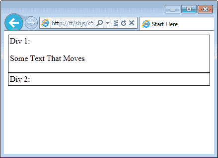

图 5-1. 本练习构建的页面有两个 div 元素，每个元素都有边框。

7. 将鼠标光标移动到 Div 1 框内的任何位置，文本将移动到 Div 2，如图 5-2 所示。

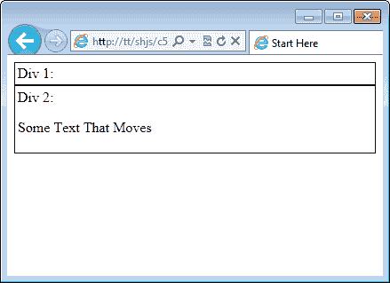

图 5-2. 通过将鼠标悬停在 Div 1 上，将文本移动到 Div 2。

本次练习使用了 `jQuery` `hover` 函数，它提供了许多你在构建鼠标相关行为时通常使用的相同功能。你可以在 `jQuery` 手册中找到其他相关函数：[`api.jquery.com/category/events/mouse-events`](http://api.jquery.com/category/events/mouse-events)。该手册包含了对 `mouseover`、`mouseout` 和其他事件的讨论。

你也可以对点击事件做出响应。用于此的一个有用 `jQuery` 函数是 `toggle()` 函数。在元素上使用 `toggle()` 可以创建一个开关式的体验，第一次点击执行一个操作，第二次点击恢复原始状态——就像打开开关然后再次关闭一样。下面的练习使用了 `toggle()` 函数。

从上一个练习的 HTML 开始。所需的 HTML 应该已经存在于 `index.html` 中；如果不存在，请参考上一个练习。如有必要，保存 `index.html`。你也可以在配套内容的 `toggle.html` 和 `toggle.js` 文件中找到这段代码。

1. 打开 `external.js`，删除文件中的任何现有代码。

2. 在 `external.js` 中输入以下代码：

```javascript
$(document).ready(function() {
        $('#mover').toggle(function() {
             $('.moveit').appendTo("#movedest");
        }, function() {
                $('.moveit').appendTo("#mover");
        });
});
```

3. 保存 `external.js`。

4. 在浏览器中查看 `index.html`。你将看到一个类似于图 5-1 的页面。

5. 点击 Div 1 内部。文本移动到 Div 2，正如你在上一个练习中看到的那样以及图 5-2 所示。


图 5-3. 在网络浏览器中查看此练习的页面。

9. 点击链接。你将看到一个类似于图 5-4 的警框。

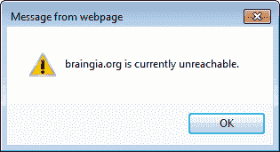

图 5-4. 本练习生成的警框。

10. 点击 OK 关闭警框对话框。你会立即注意到浏览器实际上正在遵循来自 `<a>` 元素的链接。然而，实际上，根据警框中显示的消息，我本想阻止浏览器遵循该链接。

接下来，你添加代码来阻止浏览器执行其默认操作并遵循链接。有两种方法可以实现。第一种方法是使用 `preventDefault()` 方法，这是防止默认操作发生的 JavaScript 标准方法。第二种方法是返回 `false`。`return false` 语句可以阻止默认操作的发生，因为你正处于处理事件的函数内部。以下是种方法的代码。你可以通过添加一行加粗的代码（如此处所示）来修改 `external.js` 以返回 `false`：

```
$(document).ready(function() {
    $('#myLink').click(function() {
        alert($('#myLink').text() + " is currently unreachable.");
        return false;
    });
});
```

11. 在 `external.js` 的该位置添加 `return false`，保存文件，然后在浏览器中查看 `index.html`。当你点击链接时，你会发现警框对话框仍然出现，但点击 OK 清除对话框并导致浏览器继续进入该网站。

第二种方法使用 `preventDefault()` 需要在函数声明内部添加调用事件。注意此代码中两处加粗的行（在配套内容中也位于第 5 章 js 文件夹下的 `preventdefault.js`）：

```
$(document).ready(function() {
    $('#myLink').click(function(e) {
        alert($('#myLink').text() + " is currently unreachable.");s
        e.preventDefault();
    });
});
```

应该使用哪种方法？答案是：这取决于情况。`preventDefault()` 方法仅阻止默认操作，而不阻止实际事件继续。相比之下，`return false` 两者兼顾。对于许多操作（如你在本示例中看到的这种），`preventDefault()` 就足够实现你的需求了。此外，如果你不在函数内部（如本示例所示），`return false` 的作用可能不符合你的预期——意味着它可能完全不起，或者可能会停止整个程序的运行。

### Note

另见 *有关更多关于事件处理和 jQuery 的信息，请参阅* [`api.jquery.com/event.preventDefault`](http://api.jquery.com/event.preventDefault) 和 [`api.jquery.com/event.stopPropagation`](http://api.jquery.com/event.stopPropagation)。

## 使用 On 为元素绑定事件

jQuery 中的点击事件处理器和其他事件处理器在大多数情况下都工作得很好。然而，有时你可能需要将事件处理器绑定到页面上不存在的元素。例如，如果你的应用程序部分在页面上添加或创建了新元素，你就无法（轻松地）将 `click` 事件或其他内容连接到这些元素。幸运的是，jQuery 有一个名为 `on()` 的函数，可以将事件绑定到页面上的元素。在下一节中，你将看到使用 `on()` 函数防止表单提交。

# 使用 jQuery 验证 Web 表单

JavaScript 早的用途之一是为访问者在 Web 上填写的表单提供验证。由于 JavaScript 运行在用户的浏览器中，任何无效的表单元素或必填字段都可以在用户的计算机上进行本地检查，而无需将表单内容全部发送回服务器。这在拨号调制器时代尤为重要，因为那时往返传输数据需要相当的时间。本节将检查在 Web 表单中验证用户输入的一些方法。

究竟什么让 Web 表单或其内容有效完全取决于你如何定义有效。例如，你可以要求为了有效，电子邮件地址字段的内容必须包含 @ 符号，或者电话字段必须包含特定数量的数字甚至是特定的格式。你还可以检查确保必填字段包含值。

jQuery 拥有许多与表单相关的选择器。其中一些显示在表 5-2 中。

表 5-2. 常见的 jQuery 表单选择器

| 选择器 | 语法示例 | 描述 |
| --- | --- | --- |
| `*:button*` | `$(‘:button’)` | 选择所有按钮 |
| `*:checkbox*` | `$(‘:checkbox’)` | 选择所有复选框 |
| `*:hidden*` | `$(‘:hidden’)` | 选择隐藏输入字段 |
| `*:image*` | `$(‘:image’)` | 选择作为按钮的 |
| `*:input*` | `$(‘:input’)` | 选择所有表单元素 |
| `*:password*` | `$(‘:password’)` | 选择输入类型 |
| `*:radio*` | `$(‘:radio’)` | 选择所有单选按钮 |
| `*:reset*` | `$(‘:reset’)` | 选择重置按钮 |
| `*:submit*` | `$(‘:submit’)` | 选择提交按钮 |
| `*:text*` | `$(‘:text’)` | 选择所有文本输入字段 |

除了这些选择器，还有过滤器，用于查找被选中的表单字段（如单选按钮或复选框）。这些过滤器 *:checked* 和 *:selected*，你将在本章稍后的部分看到它们的用法。

## 提交时验证

验证 Web 表单的最简单方法是在用户点击提交按钮时检查表单的内容。该过程本质涉及验证每个需要验证的字段，如果表单内包含无效或缺失的必要数据，则阻止默认操作（提交）的发生。这是一个有助于说明简单表单验证的练习。你可以在配套代码的 *validsubmit.html* 和 *validsubmit.js* 文件中找到这些代码。


```html
<!doctype html>
<html>
<head>
<title>从这里开始</title>
<script type="text/javascript" src="js/jquery-1.7.1.min.js"></script>
<script type="text/javascript" src="external.js"></script>
</head>
<body>
<form id="myForm" name="myForm" action="#" method="POST">
<fieldset>
        <label for="customerName">姓名:* </label>
        <input type="text" name="customerName" id="customerName">
        <br />
        <label for="emailAddress">电子邮箱:* </label>
        <input type="text" name="emailAddress" id="emailAddress">
        <br />
        <hr>
        <label for="musicFormat">订单类型: </label><br />
        外带: <input type="radio" name="orderType" value="carryout"><br />
        送货: <input type="radio" name="orderType" value="delivery">
        <br />
        <br />
        <label for="pizzaToppings">披萨配料: </label><br />
        全都要! <input type="checkbox" name="toppings" id="works"
                    value="works"><br />
        蘑菇: <input type="checkbox" name="toppings" id="mush"
                    value="mush"><br />
        青椒: <input type="checkbox" name="toppings" id="peppers"
              value="peppers"><br />
        香肠: <input type="checkbox" name="toppings" id="sausage"
                  value="sausage"><br />
        <br />
        <br />
        <label for="crust">饼底类型: </label>
        <select name="crust">
        <option value="">请选择...</option>
        <option value="thin">薄底</option>
        <option value="deepdish">深盘底</option>
        </select>
        <br />
        <hr>
        <input type="submit" name="submitForm">
        <p>* - 表示必填字段</p>
</fieldset>
</form>
</body>
</html>
```

3.  保存 `index.html`。

4.  打开 `external.js`，删除所有内容，并将以下 JavaScript 代码放入文件中：

```javascript
$(document).ready(function() {
    $('#myForm').submit(function() {
        var formError = false;
        if ($('#customerName').val() == "") {
            formError = true;
        }
        else if ($('#emailAddress').val() == "") {
            formError = true;
        }

        if (formError) {
            alert("缺少一个多个必填字段.");
            return false;
        } else {
            alert("表单有效，正在提交到服务器.");
            return true;
        }
    });
});
```

5.  保存 `external.js`。

6.  现在运行项目或在浏览器中查看 `index.html`。你将看到一个类似于图 5-5 所示的表单。

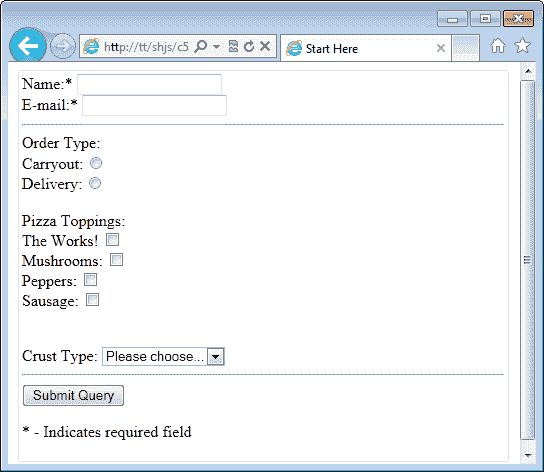

图 5-5. 一个 HTML 表单示例。

7.  在不填写任何表单详情的情况下，点击“提交查询”按钮。你将看到一个提示框，指示表单缺少必填字段，如图 5-6 所示。

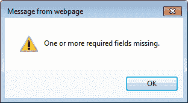

图 5-6. 基础表单验证。

8.  在两个文本字段（姓名和电子邮箱）中均填写内容并点击提交。你将看到一个提示框，显示表单已成功验证并将提交到服务器。这在图 5-7 中所示，但由于表单没有操作，表单数据不会去往任何地方。

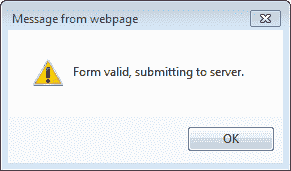

图 5-7. 表单已通过验证。

9.  花些时间练习这个验证练习，尝试清空表单并只使用空格代替单词，例如。

虽然这段代码没有引入多少新内容，但你会发现通过研究这些 JavaScript 非常有用，这样你就可以获得此示例结构的经验。整个示例都显示在你看过的 `ready()` 函数中。

首先，一个函数被绑定到 `submit()` 事件上。`submit()` 事件与你在本章中看到的其他事件一样，不同在于它是绑定到表单上的（因为在其他地方这没有意义）：

```
$('#myForm').submit(function() {
```

在 `submit()` 函数内部，创建了一个变量来存储验证状态。该变量名为 `formError`，被设置为 `false`：

```javascript
var formError = false;
```

接下来，`submit()` 事件的函数执行一个简单的检查，以测试用户是否在文本元素中输入了值。这是通过一个使用 `val()` 方法的 `if` 条件判断实现的。通过 `val()` 方法获取填充的值。在这种情况下，如果任何元素为空，代码会将 `formError` 设置为 `true`：

```javascript
if ($('#customerName').val() == "") {
    formError = true;
}
else if ($('#emailAddress').val() == "") {
    formError = true;
}
```

在 `submit()` 函数结束处，评估 `formError` 变量。如果发现 `formError` 为 `true`，页面会显示提示，指示缺少必填字段。此外，更重要的是，函数返回 `false`，正如你已经见过的，这意味着表单的默认操作被取消，直到用户修正错误并再次提交。

```javascript
if (formError) {
    alert("缺少一个多个必填字段.");
    return false;
} else {
    alert("表单有效，正在提交到服务器.");
    return true;
}
```

解释完这些代码，你可能已经在数无效数据返回服务器的方法。幸运的是，服务器程序始终需要对输入数据进行验证！目前，简单的空格就能让字段有效，这对于姓名或电子邮箱字段来说可能不是你想要的。电子邮箱字段本身也没有进行任何验证。确保邮箱地址中至少包含一个 @ 符号是一个很好的开始。因此，我将展示一些示例来改进验证。

## 正则表达式

作为编程初学者，你可能从未听说过正则表达式这个术语。它是一个使用符号表示字符来描述文本处理和匹配的术语。正则表达式使得验证邮箱地址是否包含 @ 符号、电话号码字段是否只包含数字（可能还有连字符或括号）、日期字段是否有效变得可能。

关于正则表达式有整整的书籍著作，互联网上也有大量的相关信息。本节（实际上是本本书）不会尝试在这些浅浅的介绍之外介绍正则表达式。然而，本节向你展示了还有更高级的验证技术。记住这些技术对于进一步的研究和学习是有益的。

正则表达式在表单验证中特别有用，而这里看到的只是这种有限的关注。在 JavaScript 中，可以通过两种方式定义正则表达式对象：

```javascript
var myRegex = new RegExp(pattern,modifiers);
```

或

```javascript
var myRegex = /pattern/modifiers;
```


正则表达式对象有几种用于处理文本的方法，其中一个在验证表单时特别受到关注：即 `test()` 方法。将之前的验证代码重写为使用正则表达式需要进行两处主要更改。首先，需要定义正则表达式本身，然后需要在条件语句中实现 `test()` 方法。

你可以在第 5 章 辅助内容的 `js` 文件夹下的 `regex.js` 文件中找到这段代码。该代码将定义两个正则表达式，每个文本字段对应一个。第一个正则表达式用于表单上的“客户名称”（Customer Name）文本框：

```
var customerRegex = /[\w\s]+/;
```

这个正则表达式创建了一个被称为“字符类”（character class）的结构，这是一个用于表示匹配字符的特殊字符集。字符类用括号 `[` 和 `]` 定义。正则表达式中的 `\w` 代表任何有效的字母或数字（字母数字字符）以及下划线字符。`\s` 代表一个空格字符。

通过将这些特殊字符放入字符类，该正则表达式将匹配任何字母数字字符（以及下划线）以及任意数量的空格。字母或数字的最小数量是一个，而且字符串中某处必须有一个空格，该正则表达式才能匹配。因此，即使使用户在文本框中输入“b ”，正则表达式也能匹配。然而，尽管有这个缺陷，这种正则表达式验证仍然比之前的示例有了巨大的改进，之前的示例只是简单地检查是否填写了某些内容。

同样，这里用于检查电子邮件地址的正则表达式也略显粗糙：

```
var emailRegex = /@/;
```

电子邮件正则表达式仅仅查找 `@` 符号的存在。人们很容易尝试让电子邮件地址的正则表达式变得更复杂，开始要求一个或多个字母，后面紧跟一个 `@` 符号，再是一个或多个字母，然后是一个点，最后是更多的字母，就像像 suehring@braingia.com 这样真实的电子邮件地址。然而，当考虑到包含多个点的电子邮件地址或不常见的域名结构时，这种方法就会失效。

定义好正则表达式后，下一个任务是更改程序中已有的条件语句，使用 `test()` 方法代替之前使用的标准等值测试。现在这两个条件语句看起来如下：

```
if (!customerRegex.test($('#customerName').val())) {
}

else if (!emailRegex.test($('#emailAddress').val())) {
}
```

本质上，每个字段的值被作为参数传递给每个正则表达式的 `test()` 方法。当正则表达式匹配时，意味着有人正确填写了该字段，因此使用感叹号（`!`）对条件语句进行了取反。用通俗的话说，这些条件语句现在的意思是：“如果客户字段不包含至少一个字母或数字和一个空格，则执行此操作”，以及“否则，如果电子邮件字段至少至少有一个 `@` 符号，则执行此操作”。

最终代码如下：

```
$(document).ready(function() {
    var customerRegex = /[\w\s]+/;
    var emailRegex = /@/;
    $('#myForm').submit(function() {
           var formError = false;
        if (!customerRegex.test($('#customerName').val())) {
            formError = true;
        }
        else if (!emailRegex.test($('#emailAddress').val())) {
            formError = true;
        }

        if (formError) {
            alert("One or more required fields missing.");
            return false;
        } else {
            alert("Form valid, submitting to server.");
            return true;
        }
    });
});
```

### 其他常见匹配

表 5-3 显示了一些你可能会发现有用的其他常见匹配配方。

表 5-3. 其他常见匹配

| 正 | | 类型 | 说明 |
| --- | --- | --- |
| `var zipRegex = /[0-9]/;` | 邮政编码数字 | 仅匹配数字，例如验证邮政编码时。 |
| `var zipRegex = /^[0-9]$/;` | 邮政编码的位置数字 | 使用特殊的位置字符确保只有当邮编仅包含数字时匹配才有效——即数字前后没有任何内容。 |
| `var zip5Regex = /^[0-9]{5}$/;` | 邮政编码数字的位置计数 | 确保至少有 5 位数字，例如 5 位邮政编码。 |
| `var zipRegex = /^[0-9]{5}\-[0-9]{4}$/;` | 邮编+4 位的位置计数 | 匹配 5 位邮编后跟一个连字符，然后是 4 位数字。 |
| `var dateRegex = /^[0-9]{4}\/[0-9]{2}\/[0-9]{2}$/;` | 日期数字的位置计数 | 匹配类似于 YYYY/MM/DD 格式的日期。 |
| `var dateRegex = /^[0-9]{2}\/[0-9]{2}\/[0-9]{4}$/;` | 日期数字的位置计数 | 匹配类似于 MM/DD/YYYY 格式的日期。 |
| `var urlRegex = /https?:\/\//;` | 网络 URL | 匹配 http 或 https 的 URL。 |


使用复选框，可以选择多个值。获取选中的值意味着遍历所有选中的元素并测试每一个元素以检查它是否被选中。在 jQuery 中，你可以通过一个简单的调用来实现这一点；事实上，选择已选中（“checked”）元素的的基本语法与判断哪个单选按钮被中的语法看起来是相同的：

```
$(':input[name="toppings"]:checked')
```

然而，因为可能有多个元素被选中，所以你不能像处理单选按钮那样仅仅使用 `val()` 来获取值，而是使用 jQuery 的 `each()` 函数来遍历每个选中的元素。`each()` 函数类似于 `for` 循环。在 `each()` 函数内部，你可以使用 `this` 关键字来处理当前元素的值。这里有一段示例代码，它会为每个选中的元素创建一个警报对话框：

```
$(':input[name="toppings"]:checked').each(function() {
    alert($(this).val());
});
```

### 验证单选按钮和复选框

使用正则表达式对值进行扩展验证时，单选按钮和复选框返回的值的处理方式与文本字段相同。然而，人们可能会认为在 JavaScript 内部并不真的需要对值进行扩展验证，因为用户不需要输入这些值。尽管如此，在服务器上验证这些元素是一项要求，因为用户仍然有更改这些值的能力（有时他们这样做，只是为了看看会发生什么）。

如果复选框或单选按钮组中没有元素被选中，它们的值将设置为 `undefined`。这使得测试用户是否从组中选择了任何复选框或单选按钮变得简单。以下是本节所示单选按钮示例，它结合了之前练习中的 `formError` 逻辑：

```
if ($(':input[name="orderType"]:checked').val() == undefined) {
        formError = true;
    }
```

验证复选框的过程完全相同。注意，你不需要在 `each()` 循环内部执行此操作；事实上，你希望在使用 `each()` 遍历值之前执行此验证。

```
if ($(':input[name="toppings"]:checked').val() == undefined) {
        formError = true;
    }
```

处理完单选按钮和复选框后，接下来你将看到如何处理选择或下拉列表。

### 确定选定的下拉元素

另一个常见的表单元素是下拉列表，在 HTML 术语中称为 `<select>`。示例表单使用了下拉列表，以便用户可以选择披萨的饼底类型。饼底可以是多个选项之一，但不能多于一个。通常，当页面上只有几个可以轻松显示的选项时，单选按钮效果很好；而当有很多选项时，下拉列表更好，例如从所有州中选择一个美国州（如威斯康星州、加利福尼亚州或夏威夷州）。所示的示例 HTML 使用了一个 `<select>` 元素为披萨饼底类型提供了两个选项：

```
<select name="crust">
<option value="">Please choose...</option>
<option value="thin">Thin</option>
<option value="deepdish">Deep Dish</option>
</select>
```

你可以使用 `:selected` 过滤器来确定用户选择了哪个下拉元素。其语法与确定复选框和单选按钮状态的语法相同：

```
$(':input[name="crust"] :selected').val()
```

显而易见的区别是之前的代码使用了 `:selected` 过滤器而不是 `:checked` 过滤器，但不那么明显的区别是，你必须在选择器 `:input[name=“crust”]` 和过滤器 `:selected` 之间包含一个空格，因为过滤器需要应用于选择器下方的元素（`<option>` 元素），而不是 `<select>` 元素本身。

### 注意

这种类型的选择框一次只能选择一个值，但多选列表可以返回多个值，正如本节之前所示的复选框示例那样。因此，你需要使用 `each()` 来获取所有可能的值。

### 验证 `<select>` 元素

验证 `<select>` 元素与你见过的其他元素类型不同。虽然概念相同，但实现方式不同。与单选按钮和复选框不同，`<select>` 元素没有 `undefined` 状态。在所示的示例中，标记为“Please Choose”的第一个元素有一个空的 `value` 属性。因此，验证过程可以简单地检查值是否为空。这与你在本章看到的第一个验证示例相似，代码看起来如下：

```
if ($(':input[name="crust"] :selected').val() == "") {
    formError = true;
}
```

### 总结表单验证

你现在已经了解了如何从各种类型的表单元素中获取值以及如何验证它们。以下是到目前为止 `external.js` 中的代码，它为本章之前练习中的表单提供了完整的验证。如果你想尝试这段代码，请删除你副本中 `external.js` 的任何代码，并将其替换为此处所示。你也可以在配套内容的 `allbasicvalidation.html` 和 `allbasicvalidation.js` 文件中找到这些代码。

```
$(document).ready(function() {
    var customerRegex = /[\w\s]+/;
    var emailRegex = /@/;
    $('#myForm').submit(function() {
        var customerRegex = /[\w\s]+/;
        var emailRegex = /@/;
        if ($(':input[name="orderType"]:checked').val() == undefined) {
            formError = true;
        } else if (!customerRegex.test(customerRegex)) {
            formError = true;
        } else if (!emailRegex.test("ust"] {
            () == "") {
                        Error = =;
        }} else {
            // 这是你知道表单有效的第一个地方
            // 所以你可以做一些有趣的事，比如遍历复选框
            // $('input[name="toppings"]:checked').each(function() {
            //  alert($(this).val());
            // });
        }

        if (formError) {
            alert("缺少一个多个字段。");
            return false;
        } else {
            alert("表单有效，正在提交到服务器。");
            return true;
        }
    });
});
```

下一节将回顾 `click()` 事件以展示另一种表单增强。

### 重温 click 事件

许多表单的一个功能是具有响应 *click* 事件的能力。在本章使用的示例表单中，当访问者选择 The Works! 配料时，所有相关的复选框都应该被选中。相反，如果用户清除了任何单独的配料，“The Works!”选项应该被清除。你可以通过多种方法执行此任务。我将展示的方法使用了 jQuery 的 `prop()` 函数。

`prop()` 函数设置元素的属性。在这种情况下，你想设置多个复选框的 `checked` 属性。相反，如果清除了其他元素中的任何一个，你想从 The Works! 复选框中移除 `checked` 属性。你可以使用 `removeProp()` 函数来实现这一点。

这个拼图的另一个部分是为每个复选框的 *click* 事件添加一个处理器。你通过已经见过的 `on()` 函数来实现这一点。这里有一个实现此功能的练习。你可以在配套内容的 *click-on.html* 和 *click-on.js* 文件中找到这些代码。


### 3. 在 `external.js` 中，放入以下代码：

```javascript
$(document).ready(function() {

    function theWorks(elm) {
        if (elm.val() == "works") {
            $('#mush').prop("checked","checked");
            $('#peppers').prop("checked","checked");
            $('#sausage').prop("checked","checked");
        } else {
            $('#works').removeProp("checked");
        }
    } //end function theWorks

      $(':input[name="toppings"]').on("click", function() {
            theWorks($(this));
        });

        // Validation Code
        var customerRegex = /[\w\s]+/;
        var emailRegex = /@/;
        $('#myForm').submit(function() {
            var formError = false;
            if ($(':input[name="orderType"]:checked').val() == undefined) {
                formError = true;
            }
            else if (!customerRegex.test($('#customerName').val())) {
                formError = true;
            }
            else if (!emailRegex.test($('#emailAddress').val())) {
                formError = true;
            }
            else if ($(':input[name="crust"] :selected').val() == "") {
                formError = true;
            }
            else if ($(':input[name="toppings"]:checked').val() == undefined) {
                formError = true;
            }
            else {
                // Here's the first place that you know the form is valid.
                // So you can do fun things like enumerate through checkboxes.
                // $(':input[name="toppings"]:checked').each(function() {
                //  alert($(this).val());
                // });
            }
            if (formError) {
                alert("One or more required fields missing.");
                return false;
            } else {
                alert("Form valid, submitting to server.");
                return true;
            }
        });
    });
```

### 4. 保存 `external.js`

### 5. 在浏览器中查看 `index.html`。你看到的和你之前在 图 5-5 中看到的表单相同。

### 6. 在“披萨配料”部分，选择“全家”（The Works）！现在所有的复选框都应该自动被选中，如图 图 5-8 所示。

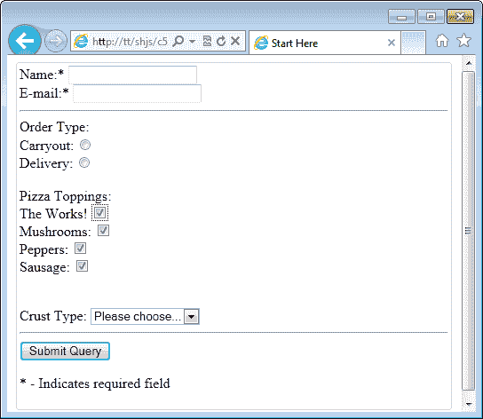

图 5-8。选择全家会自动勾选其他配料的复选框。

### 7. 清除蘑菇（或辣椒或香肠）的复选框。注意，“全家”的复选框也会被自动清空，如图 图 5-9 所示。

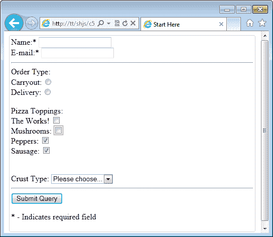

图 5-9。清空任何其他配料也会清空全家，因为这个披萨不再包含所有配料。

这个练习在之前解释的校验码代码的基础上，添加了一个新函数以及一个 `click` 事件处理程序，该处理程序使用了在本章之前介绍过的 jQuery `on()` 函数。以下是该代码的解释：

```javascript
function theWorks(elm) {
    if (elm.val() == "works") {
        $('#mush').prop("checked","checked");
        $('#peppers').prop("checked","checked");
        $('#sausage').prop("checked","checked");
    } else {
        $('#works').removeProp("checked");
    }
} //end function theWorks
```

该代码创建了一个名为 `theWorks` 的函数，它接受一个参数 `elm` —— 即被选中的元素。在该函数内部，如果元素的值（`val()`）是 `works`（来自表单的值），则会使用 jQuery 的 `prop()` 函数启用每个配料的 `checked` 属性。

另一方面，如果元素的值不是 `works` —— 句话说，如果选择了其他配料中的一种 —— 则“全家”应该被清空。代码通过 `removeProp()` 函数实现了这一点，该函数会移除 id 为 `works` 的元素的 `checked` 属性。

### 注意

完成此相同任务有多种方法，这里展示的方法直观、易于解释，并希望易于理解。

接下来，代码使用 jQuery 的 `on()` 函数添加了 `click` 事件处理程序。它应用于所有名称为 `toppings` 的输入元素。`click` 事件处理程序只做一件事：调用 `theWorks` 函数并将选中的元素传递给该函数。

```javascript
 $(':input[name="toppings"]').on("click", function() {
        theWorks($(this));
    });
```

你现在已经了解如何验证多种类型的表单元素，并且学习了 `click` 事件。

# 键盘事件与表单

你可以使用 JavaScript 并处理多个相关的事件。`keypress` 事件在按下键时触发，你可以使用 `keydown` 事件检测按键按下，并使用 `keyup` 事件检测按键释放。本节展示了如何创建一个带有文本区域的新表单。在这些表单上，当你输入时有时会看到一个字符计数器。此代码可以在配套内容 `char.html` 和 `char.js` 中找到。

1. 如果尚未，请打开 StartHere 项目。
2. 打开 `index.html` 并删除文件中的现有 HTML。
3. 将以下 HTML 放入 `index.html`：

```html
<!doctype html>
<html>
<head>
<title>Start Here</title>
<script type="text/javascript" src="js/jquery-1.7.1.min.js"></script>
<script type="text/javascript" src="external.js"></script>
</head>
<body>
<form id="myForm" name="myForm" method="POST">
<fieldset>
        <label for="messageText">消息：</label><br />
        <textarea rows="5" cols="20" name="messageText" id="messageText">
            </textarea>
        <br />
        <p>剩余字符：<span id="charRemain">100</span></p>
        <br />
        <hr>
        <input type="submit" name="submitForm">
</fieldset>
</form>
</body>
</html>
```

4. 保存 `index.html`。
5. 打开 `external.js` 并删除文件中的任何代码。
6. 将以下 JavaScript 放入 `external.js`：

```javascript
$(document).ready(function() {
        var charTotal = 100;
        $(':input[name="messageText"]').on("keyup",function() {
                var curLength = $('input[name="messageText"]').val().length;
                var charRemaining = charTotal - curLength;
                $('#charRemain').text(charRemaining);
            });
    });
```

7. 在浏览器中查看 `index.html`。你会看到与 图 5-10 相同的页面。

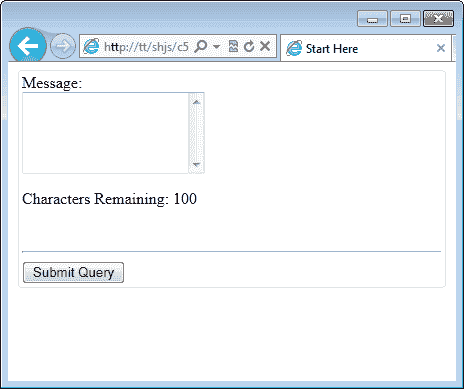

图 5-10。在浏览器中查看网页。


9. 开始在 Message 文本区域输入。每当你松开每个键时，计数器就会递减，显示你还可以输入的字符数。

此示例中的代码位于 jQuery `ready()` 函数内部，它结合了 jQuery 和 JavaScript 来完成任务：

```
var charTotal = 100;
$(':input[name="messageText"]').on("keyup",function() {
        var curLength = $(':input[name="messageText"]').val().length;
        var charRemaining = charTotal - curLength;
        $('#charRemain').text(charRemaining);
});
```

首先，将允许的字符总数赋值给名为 `charTotal` 的变量。接下来，将 `keyup` 事件绑定到名为 `messageText` 的文本区域上。使用你在本章之前看到过的 `:input` 和 `name` 选择器获取 `messageText` 元素，并使用你已经见过的 jQuery `on()` 函数将 `keyup` 事件绑定到该元素上。

对于 `keyup` 事件处理器，定义了一个函数，它首先获取同一文本区域值的当前长度（用户输入的文本）。该值是通过你已经见过的 `val()` 函数获取的。然后，代码使用 `length` 属性获取该值的长度。此长度被放在名为 `curLength` 的变量中。

然后从 `charTotal` 变量减去 `curLength` 变量，并将结果放在变量 `charRemaining` 中。最后，通过 id (`charRemain`) 获取 HTML 表单中的 `charRemain` 元素，并使用 jQuery `text()` 函数将 `charRemaining` 变量中的值放入 HTML 表单。与之前的章节一样，最后一个示例使用了一个可以在现实世界中使用的更复杂的示例。当你继续学习 JavaScript 时，这个示例及其解释可以作为参考。

# 总结

本章介绍了了表单验证和事件，这些都是会发生且你可以对其做出反应以执行操作（或有时故意忽略）的事情。鼠标移动、点击和按键按下是常见的事件，表单提交也是如此。

你可以通过多种方式对事件做出反应，在本章中你学习了当鼠标移动过 HTML 元素时如何更改它们，以及如何对鼠标点击做出反应。之后，本章查看了表单验证，在表单提交时添加基础验证。在简单正则表达式的帮助下，这种基础验证得到了扩展。接下来，章节展示了如何使用 `val()` 函数从表单字段获取值，以及如何验证其他类型的表单元素，如单选按钮、下拉列表和复选框。

展示了一个 `click` 事件的扩展示例，详细介绍了如何响应另一个复选框被选中来设置复选框的 `checked` 属性。这是通过 `prop()` 和 `removeProp()` 函数实现的。最后，讨论了键盘事件，并通过一个练习展示了如何在向有字符限制的文本区域中输入字符时倒数剩余字符数。

# 第 6 章.将数据引入 JavaScript

**完成本章后，你将能够：**

* 理解与服务器通信的不同方式
* 了解如何从服务器检索信息
* 使用 JavaScript 程序解析不同格式的信息
* 使用 JavaScript 和 jQuery 向服务器发送数据

**你可以在网络上的几乎任何地方** 找到将数据与 JavaScript 结合的网站示例。像 Google Maps、Twitter、Bing 等网站都使用 JavaScript 来获取结果、帮助你搜索，并帮助你点击和拖动地图。数据本身并不存储在 JavaScript 中；而是通过 JavaScript 和服务器上一个或多个程序的结合检索的。通过这种方式，Web 应用程序无需刷新页面即可从服务器获取数据。从访问者的角度来看，Web 应用程序的运行方式就像传统的桌面应用程序，在访问者与网页交互时提供实时反馈。

这一切都是通过一个名为 AJAX 的概念实现的。AJAX 是异步 JavaScript 和 XML（可扩展标记语言）的缩写，当它在 2005 年左右出现时，它彻底改变了 Web 体验。

本章介绍了使用 AJAX 使用 JavaScript 进行数据检索。

# AJAX 简述

在在 AJAX 出现之前，当需要从服务器检索数据时，用户通常需要点击按钮来启动传输。AJAX 取消了这种交互，而是使用一个特殊函数在后台向服务器发送请求。与 HTML、CSS 和 JavaScript 不同，AJAX 并不是规范或标准；而是使用 JavaScript 进行数据检索的一种概念或技术。

尽管 AJAX 中的 X 代表 XML，但并没有要求数据必须格式化为 XML，这是一件好事。XML 非常笨重，意味着为了传输简单的数据，就需要大量冗余且不必要的语法。幸运的是，还有其他轻量级的数据传输方式，更适合用户与服务器之间的往来传输。在章节后面，你将看到另一种方式：JavaScript 对象表示法 (JSON)。

在典型的 AJAX 场景中，客户端 浏览器使用 JavaScript 通过一个名为 `XMLHttpRequest` 的 JavaScript 对象向服务器发送请求。服务器随后返回适当的数据，JavaScript 程序解析响应以执行所需的任何操作，例如响应用户的放大或缩小而移动地图、加载邮件，或任何适用于该 Web 应用程序的操作。

## 关于服务器、GET 和 POST

AJAX 从服务器端程序检索数据。当你的 JavaScript 程序调用它时，服务器上的程序会做出响应。服务器端程序可以执行服务器端程序做的任何事情——从数据库检索数据、返回内容、执行数学运算或任何所需的任务。为了让 AJAX 工作，服务器程序需要与调用它的 JavaScript 处于同一个域。这意味着对于本章编写的 JavaScript 程序，你无法使用 AJAX 方法调用我网站上的服务器程序。

网络 使用一种名为超文本传输协议 (HTTP) 的协议，该协议主要由请求稿 (RFC) 2616 定义（[`www.rfc-editor.org/rfc2616.txt`](http://www.rfc-editor.org/rfc2616.txt)）。HTTP 标准定义了多种与服务器交互的方法。这些方法用于在客户端（通常是 浏览器）和服务器（通常是 Apache，也是 Microsoft Internet Information Services 等）之间发送和检索数据。

你每天看到（并使用的）两种方法是 `GET` 方法和 `POST` 方法。当你在浏览器中请求网页时，浏览器向浏览器地址栏中的服务器发送一个 `GET` 请求。对于大多数网页，对于每个额外的资源（如图像、JavaScript 和 CSS），都会向服务器发送更多额外的 `GET` 请求。服务器对每一个 `GET` 请求的响应都是一个状态码和请求的结果，例如 JavaScript 或图像文件本身。

`POST` 方法在处理 Web 表单时经常使用。`POST` 方法将 Web 表单数据发送回请求内部，而不是作为 URL 的一部分（正如使用 `GET` 方法的表单那样）。


所有这些信息都与 JavaScript 编程和 AJAX 直接相关。在编写 AJAX 时，你需要使用 JavaScript 创建一个 HTTP 连接，然后使用 `GET` 或 `POST` 发送请求与服务器程序进行交互。这听起来可能很复杂，但 jQuery 已经在很大程度上解决了这个问题。下一节将展示如何使用 JavaScript 创建 AJAX 请求。在章节的后半部分，你将看到更多使用 jQuery 的更复杂示例。

作为本章的一部分，我将为运行 Microsoft Visual Studio 的用户展示一个简单的 Microsoft Visual Basic .NET 服务端程序，同时也为使用 PHP 的展示一个同类程序。你可以使用该程序完成本章中的示例。设置 Web 服务器超出了本书的范围。不过，Visual Studio 包含一个开发服务器，它将用于本章及整本书的示例。如果你没有安装 Visual Studio，我建议获取一个 Apache 安装包，它可以运行在 Windows、Linux 或 Mac 上。另一个选项是使用提供 PHP 的托管提供商。这些提供商通常提供免费设置，且每月费用低于 5 美元。

# 构建服务器程序

本节展示了如何构建一个简单的服务器程序。在处理 AJAX 时，服务器程序是必须的。该程序将用于本章的初始示例，你将在跟随本章其他练习时对其进行修改。该程序是一个 ASP.NET 页面，简单地向回返回几个值，可以在配套代码中找到 `WebForm1.aspx`。我还将展示用 PHP 的相同代码示例。

1. 要开始此练习，请在 Visual Studio 中打开 `StartHere` 项目。
2. 在 `StartHere` 项目中，在解决方案资源管理器中右键点击 `StartHere` 项目，点击 `Add`（添加），然后点击 `New Item`（新建项）。将显示添加新项对话框，如图 6-1 所示。

   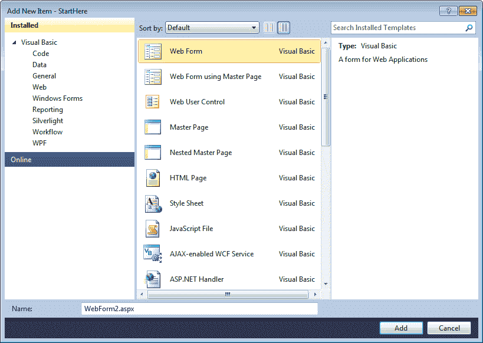

   图 6-1. 向 StartHere 项目中添加新项。

3. 在“添加新项”对话框中，从 Web 模板中选择 Web Form（Web 表单）并点击 `Add`（添加）。将创建一个新的 Web 表单，类似于图 6-2 所示。

   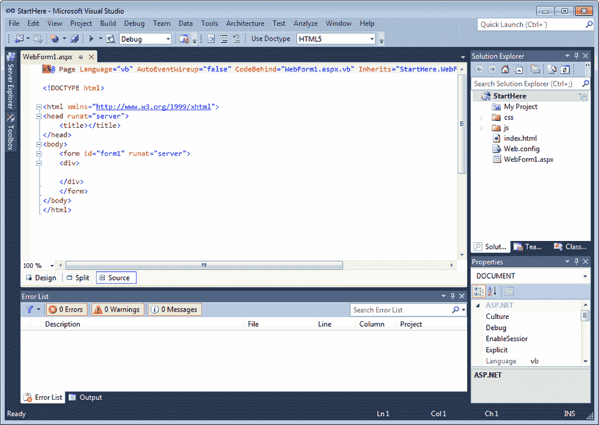

   图 6-2. Visual Studio 中的新 Web 表单。

4. 在新的 Web 表单内部，删除所有内容，并将其替换为以下代码：

```
<%
Response.Write("Maple|Pine|Oak|Ash")
%>
```

结果应该像图 6-3 所示。

   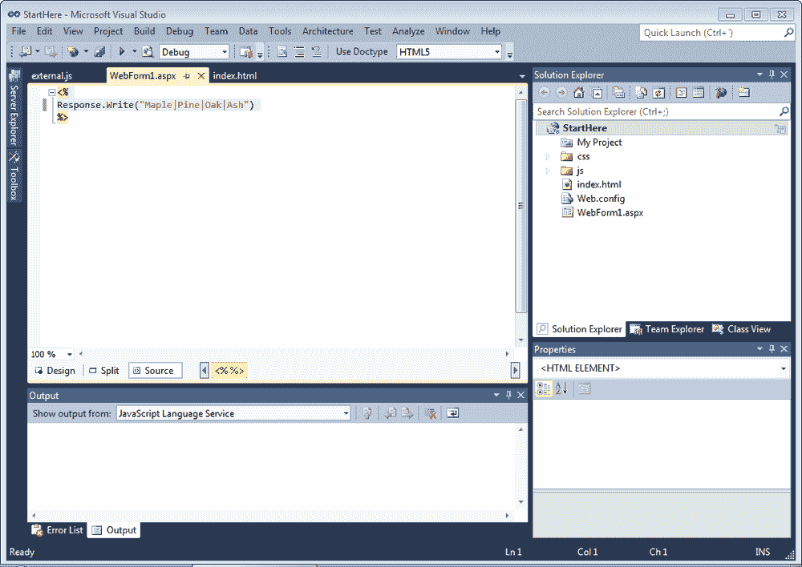

   图 6-3. 本章示例使用的基础服务端程序。

5. 在解决方案资源管理器中，右键点击 `WebForm1.aspx` 并从上下文菜单中选择 `View In Browser`（在浏览器中查看）。你将看到一个类似于图 6-4 的页面。

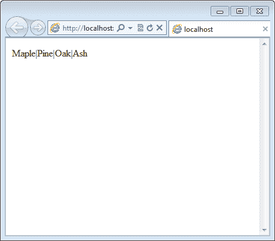

图 6-4. 通过 浏览器查看的 `WebForm1.aspx` 文件。

构建此代码后，你现在可以创建一个运行在本地开发计算机上的 AJAX 实现了。

## PHP 示例

如果你使用 PHP，这里是使用 PHP 创建类似服务器程序的源文件。该代码可以在配套代码中找到 `webform1.php`：

```
<?php

echo "Maple|Pine|Oak|Ash";

?>
```

### 确定你的开发服务器端口

Visual Studio 创建了一个本地开发服务器，你在本地开发和运行应用程序时可以无缝使用它。除了标准的 HTTP 端口 80 外，Visual Studio 会为服务器选择一个运行端口。对于书中的示例，你需要查出你的本地服务器正在使用哪个端口。要做到这一点，打开你的 `StartHere` 项目并在解决方案资源管理器中选择 `StartHere` 项目。项目属性面板显示在右下角。在那个项目属性面板中（如图 6-5），有一个名为 `URL` 的属性。


图 6-5. Visual Studio 在我的电脑上选择的端口是 49214，但你的可能会不同。

# AJAX 与 JavaScript

使用 JavaScript 开发 AJAX 使用一个名为 `XMLHttpRequest` 的特殊对象。该对象具有自己的方法和语法，负责发送请求。浏览器之间的细微差异使得使用 `XMLHttpRequest` 变得具有挑战性。这很大程度上通过使用 jQuery 得到了解决，在下一节中我们将看到如何使用 jQuery 进行 AJAX 请求。

```
var myXHR = new XMLHttpRequest;
```

创建对象后，接下来创建连接，这涉及调用 `open()` 方法、指定方法（如 `GET` 或 `POST`）并指定 URL。例如：

```
myXHR.open("GET","http://localhost:49214/WebForm1.aspx");
```

对于 `GET` 方法，下一步是将数据发送到服务器，这是通过恰命名的 `send()` 方法实现的：

```
myXHR.send();
```

`send()` 方法可以接受额外数据，正如使用 `POST` 方法时可能的情况。发送请求后，下一步是解析响应。正如你在本章早期创建的示例程序一样，你收到的是文本响应。

如前所述，这可能会变得相当复杂，因此通常优先考虑使用 jQuery 处理 AJAX。但如果你想了解更多关于使用 JavaScript 进行 AJAX 的信息，我推荐我的中级书籍《JavaScript by Step》（Microsoft Press, 2011）。

## 使用 jQuery 获取数据

如果你还没有发现的话，我再说一遍：jQuery 让 AJAX 变得更简单。嗯，jQuery 让很多 JavaScript 编程都变得更简单了，但它在 AJAX 领域真正表现出色。jQuery 处理服务器端数据的方法随时间一直在演变。本节检查了使用 jQuery 处理服务器数据的一些主要方法。访问 [`api.jquery.com/category/ajax`](http://api.jquery.com/category/ajax) 可 AJAX 相关方法的完整列表。

## 使用 get() 和 post()

### 使用 get() 和 post() 函数


`get()` 和 `post()` 函数接受多个参数，包括要使用的 URL、要传递给服务器程序的任何数据、对返回数据的操作方法以及要返回的数据类型。这里是一个使用 `get()` 的简单示例。此代码可以在第 6 章的配套内容中的 `basicindex.html` 和 `basicjs.js` 中找到。

```javascript
$.get('/WebForm1.aspx', function(resp) {
    alert("Response was " + resp);
});
```

此 `get()` 函数调用名为 `WebForm1.aspx` 的文件，检索数据，然后通过 `alert` 将该响应发送到屏幕上，如图 6-6 方法从服务器端程序获取基于 AJAX 的警报")所示。


图 6-6. 使用 jQuery 的 get() 方法从服务器端程序获取基于 AJAX 的警报。

这里是一个使用 `post()` 的简单示例：

```javascript
$.post('/WebForm1.aspx', function(resp) {
    alert("Response was " + resp);
});
```

当你开始向服务器程序发送数据，并对这些返回的数据进行复杂的 JavaScript 操作时，魔法就发生了。

### 在请求中发送数据

`GET` 和 `POST` 方法都可以向服务器发送数据。服务器随后处理这些数据。例如，你可能会发送一个邮编，服务器程序会查找并返回该邮编所属的城市。你可以看到带有附加数据的 `GET` 请求示例。这被称为`查询字符串`。以下是一个示例：

```http
http://www.contoso.com?zipCode=54481
```

### 注意

`contoso.com` 是一个示例性的非功能域名。如果你尝试此示例，它实际上不会产生任何效果！

当通过 `POST` 发送数据时，它不是作为 URL 的一部分，而是作为 HTTP 请求的一部分发送。使用 `POST` 有两个主要优势。首先，`POST` 请求中可以的数据长度没有限制。对于 `GET` 请求，URL 的长度有限制，且这些限制因浏览器和浏览器版本而异。`POST` 请求的第二个优势是它提供了少量的额外安全性。在 `GET` 请求中，用户可以很容易看到发送到服务器的变量名和值，并可能倾向观察更改这些变量会发生什么。在 `POST` 请求中，值不会出现在用户的地址栏中，尽管用户仍然控制这些值并因此可以更改它们。

### 注意

请记住，这种通过隐蔽实现的安全并不能提供实际的安全性。`GET` 和 `POST` 请求都可以被用户修改，因此你仍然需要假设用户发送了坏数据并在服务器上对数据进行验证。

## 构建交互式页面

本练习展示了如何使用 AJAX 构建 Web 表单元素。它使用一个基于服务器的程序检索数据并将其显示在页面上。本练习假设你已经完成了上一个练习，即让服务器程序显示我院子里的四种树的名称。此代码可以在配套内容中的 `inter.html` 和 `inter.js` 中找到。

1. 要开始练习，打开 StartHere 项目。
2. 打开 `index.html` 文件，删除文件中的任何现有代码，并将其替换为以下内容：

```html
<!doctype html>
<html>
<head>
<title>Start Here</title>
<script type="text/javascript" src="js/jquery-1.7.1.min.js"></script>

<script type="text/javascript" src="js/external.js"></script>
</head>
<body>
    <form name="myForm" id="myForm" method="get">
        <label id="treeNameLabel" for="treeName">
        </label>
    </form>
</body>
</html>
```
3. 保存 `index.html`。
4. 打开 `external.js`，删除文件中的任何代码。将其替换为以下代码，请注意用于 `WebForm1.aspx` 的名称和 URL。这可能需要根据你在环境中为服务器程序使用的的名称进行更改。

```javascript
$(document).ready(function () {
    $.get('/WebForm1.aspx', function (resp) {
        var splitResp = resp.split("|");
        var splitRespLength = splitResp.length;
        for (var i = 0; i < splitRespLength; i++) {
            $("#treeNameLabel").append('<input type="checkbox"' +
                        'name="treeName" value="' + splitResp[i] +
                        '">' + splitResp[i] + '<br />');
        }

    });
});
```
5. 保存 `external.js`。
6. 运行此项目，或在网络浏览器中查看 `index.html`。你将得到像图 6-7 所示的页面。


图 6-7. 使用 AJAX 创建表单元素。

本练习从服务器程序检索了树的名称并使用这些数据在表单上创建了复选框。`external.js` 中的第一件事是调用 `ready()` 函数，如后续代码块所示，以便在 DOM 可用后执行代码。如果不被封装在 `ready()` 函数中，很有可能 JavaScript 会在所有表单元素准备好之前执行，这会导致一团糟。

```javascript
$(document).ready(function () {
```

接下来调用 `get()` 函数以对 `/WebForm1.aspx` 创建 `GET` 请求。响应随后被传递到我定义的匿名函数。

```javascript
$.get('/WebForm1.aspx', function (resp) {
```

首先函数分割响应，其中找到管道 (|) 字符。用管道符分隔我的源数据可以像这样分割。分割结果存放在名为 `splitResp` 的变量中：

```javascript
var splitResp = resp.split("|");
```

由于 `splitResp` 变量将用于循环，因此将其长度赋值给变量 `splitRespLength`。请注意这并不是严格必要的，但它确实提供了细微的性能提升：

```javascript
var splitRespLength = splitResp.length;
```

接下来，创建一个 `for` 循环。这是代码的核心，也是创建每个表单元素的地方

```javascript
for (var i = 0; i < splitRespLength; i++) {
```

这行跨三行的代码向 ID 为 `treeNameLabel` 的标签添加了一个 `<input>` 元素。此处看到的 `for` 循环结构与书中看到的相同。这里添加的是 jQuery 的 `append()` 函数，它在选定的元素内构建并放置 HTML：

```javascript
$("#treeNameLabel").append('<input type="checkbox"' +
            'name="treeName" value="' + splitResp[i] +
            '">' + splitResp[i] + '<br />');
}
```

最后，关闭函数：

```javascript
 });
});
```


如前所述，`get()` 和 `post()` 函数是 `ajax()` 函数的快捷方式。`ajax()` 函数定义了几个在快捷函数 `get()` 和 `post()` 中未定义的额外参数。值得注意的是错误处理器（error-handler）选项。然而，该选项也可以通过使用 `error()` 函数被 `get()` 和 `post()` 访问。`error()` 函数作为 `get()` 或 `post()` 调用的一部分进行链式调用，并定义了当遇到错误时执行的操作。现在是示例时间！

### 链式调用错误处理器

在本节中，你将添加一个错误处理器，然后创建一个错误条件来检查你的工作结果。这些代码可以在配套内容中的 `errorhandler.html` 和 `errorhandler.js` 中找到。

1.  打开你的 StartHere 项目，并从上一个练习的代码开始。

2.  在 `external.js` 中，添加对 `error()` 函数的调用。每当从 AJAX 服务器检索数据出现问题时，就会调用此 `error()` 函数。在本例中，你将在表单中放置一个占位树种（`Birch`，白桦），每当发生错误时就会显示。当然，也可以使用指示未找到树种的错误消息，这种方法同样有效。选择哪种取决于你的需求。需要添加的错误处理代码如下：

    ```
    .error(function () {
            $("#treeNameLabel").append('<input type="checkbox"' +
                        'name="treeName" value="Birch"' +
                        '>Birch<br />');
        });
    ```

3.  该代码应该附加或链式调用到 `get()` 函数之后。`external.js` 的最终版本应该如下：

    ```javascript
    $(document).ready(function () {
        $.get('/WebForm1.aspx', function (resp) {
            var splitResp = resp.split("|");
            var splitRespLength = splitResp.length;
            for (var i = 0; i < splitRespLength; i++) {
                $("#treeNameLabel").append('<input type="checkbox"' +
                        'name="treeName" value="' + splitResp[i] +
                        '">' + splitResp[i] + '<br />');
            }
        }).error(function () {
            $("#treeNameLabel").append('<input type="checkbox"' +
                        'name="treeName" value="Birch"' +
                        '>Birch<br />');
       });
    });
    ```

4.  代码放置就绪并保存 `external.js` 后，运行项目或查看 `index.html`。你不应该注意到任何变化，`get()` 函数应该仍然像以前一样工作，且浏览器应该显示显示一个类似于 图 6-7 所示的页面。如果这不起作用，请确保你已经在正确的位置添加了 `error()` 函数，特别注意使用了一个单点（`.`）将 `get()` 和 `error()` 函数连接在一起。接下来，你将刻意创建一个错误条件以测试错误处理器。

5.  关闭浏览器或停止项目。

6.  在 `external.js` 中，将 `get()` 函数中的 URL 更改为一个你已知不存在的文件。例如，在显示的代码中，URL 为 `/WebForm1.aspx`。通过将其更改为 `WebForm67.aspx`，将创建一个错误条件，因为 `WebForm67.aspx` 不存在。那行新代码看起来如下：

    ```javascript
    $.get('/WebForm67.aspx', function (resp) {
    ```

7.  保存 `external.js`。

8.  再次运行项目或查看 `index.html`。这次你将看到一个浏览器窗口，其中只有一个复选框（针对 Birch），如 图 6-8 所示。

    

    图 6-8. 当 AJAX 请求出现问题时，使用错误处理器提供帮助。

9.  关闭浏览器或停止项目。

10. 将 `WebForm67.aspx` 改回 `WebForm1.aspx`，重新运行项目或查看 `index.html`。你将看到一个类似于 图 6-7 所示的页面，包含所有选项。

在这个练习中，你添加了一个备用方案，当 AJAX 调用发生错误时向用户显示某些内容。

# 使用 JSON 进行高效数据交换

你到为止看到的示例使用简单的数据结构，这种结构可以很容易通过管道符（|）进行表示和分离。然而，你经常需要表示更复杂的数据结构并通过 AJAX 消费它们。来传递这种数据的一种方法是使用 XML，即 AJAX 中的 `X`。然而，XML 仅打开就需要大量的额外。例如，考虑以下 XML：

```xml
<person>
    <firstname>Steve</firstname>
</person>
```

所有元素的开启和结束标签都需要从服务器传递到客户端并进行解析。这会迅速累积，尤其是在通过较慢的网络时。幸运的是，有一种更好的数据格式可用，被称为 JavaScript 对象表示（JSON）。同样的 person 结构如下：

```json
{
    "person": {
        "firstname": "Steve"
    }
}
```

JSON 格式的数据要简洁得多，但你并没有失去可读性——你可以轻松看出哪些字段代表什么。不过，JSON 和 XML 并不等同。请访问 [`www.json.org/fatfree.html`](http://www.json.org/fatfree.html) 获取更多关于这两种格式的信息。

# 使用 getJSON()

jQuery 包含了从服务器获取 JSON 的函数以及解析和处理 JSON 的函数，使其成为几乎所有 AJAX 交互的首选数据交换格式。

下一个练习将上一个练习的代码转换为 JSON 格式，包括服务器端和 JavaScript 客户端。代码可以在配套内容中的 `getjson.html` 和 `getjson.js` 中找到，该代码与配套内容中的服务器程序 `getjson.aspx` 连接。

1.  如果尚未打开，请打开你的项目。

2.  你首先将更改服务器程序返回 JSON 格式的数据。打开 `WebForm1.aspx`，删除其中的所有代码并替换为以下内容（在配套内容中对应 `getjson.aspx`）：

    ```vb
    <%
        Dim str = "{ ""Trees"": { " & _
            " ""0"": ""Maple""," & _
            " ""1"": ""Pine""," & _
            " ""2"": ""Oak""," & _
            " ""3"": ""Ash""" & _
            "} }"
        Response.Write(str)
        %>
    ```

3.  保存 `WebForm1.aspx`。

4.  打开 `external.js`，并删除该文件中的所有代码。

5.  将以下代码放入 `external.js` 中：


```javascript
$(document).ready(function () {
    $.getJSON('/WebForm1.aspx', function (resp) {
        $.each(resp["Trees"], function(element,tree) {
            $("#treeNameLabel").append('<input type="checkbox"' +
            'name="treeName" value="' + tree +
            '">' + tree + '<br />');
        })
    }).error(function () {
        $("#treeNameLabel").append('<input type="checkbox"' +
                    'name="treeName" value="Birch"' +
                    '>Birch<br />');
    });
});
```

6. 保存 `external.js`。

7. 运行项目，或在浏览器中查看 `index.html`。你不应该注意到与之前的练习相比有任何变化，页面看起来应该像图 6-7 所示所示。

除了为了发送 JSON 格式数据的服务器端程序更改外，唯一的实质性变化在 `external.js` 中。在该文件中，`get()` 函数被改为 `getJSON()`，接下来的更改删除了拆分响应并使用 `for` 循环迭代的代码。相反，使用了 jQuery 的 `each()` 函数来遍历每个结果：

```javascript
$.each(resp["Trees"], function(element,tree)
```

在 `each()` 函数内部，构建了相同的 HTML 代码，变化在于不再使用 `for` 循环变量，而是将变量命名为 `tree`：

```javascript
$("#treeNameLabel").append('<input type="checkbox"' +
    'name="treeName" value="' + tree +
    '">' + tree + '<br />');

```

除了这些更改外，`external.js` 保持不变，`index.html` 也是如此。到目前为止，你已经看到了 `get()` 和 `post()` 请求的示例，现在你看到了 `getJSON()`。然而，你仍然缺少拼图中的一块碎片：如何通过 AJAX 向服务器发送数据。

## 向服务器发送数据

许多表单和用户交互元素都是借助 AJAX 帮助构建的。这样做通常需要将数据发送到服务器进行处理。然后服务器程序会返回一些响应数据。本章目前为止的所有方法（`get`、`post` 和 `getJSON`）都可以向服务器发送数据。本节将检查如何使用 `getJSON()` 和 `post()` 向服务器发送数据。你可能会问带有 `get()` 方法的示例在哪里。它与 `getJSON()` 函数完全相同，因此查看 `getJSON()` 就提供了你这两种情况所需的功能。

## 使用 getJSON 发送数据

在你对 `getJSON()` 记忆犹新（希望我也是如此）时，我将展示一个使用该函数的示例。jQuery 允许你将数据作为额外参数发送，这就是你在这里看到的方式。然而，你也可以将数据添加到 URL 本身。数据作为 `getJSON()` 函数的第二个参数传递，而 `getJSON()` 函数会自动将其作为第一个参数附加到 URL 中。例如，假设一个名为 `convertTemp.aspx` 的服务器程序期望指示当前温度的输入数据，`getJSON()` 调用如下：

```javascript
$.getJSON('convertTemp.aspx','curTemp=73',function(resp) {
```

数据可以作为字符串发送（如此处所示），也可以像这样作为 map：

```javascript
$.getJSON('convertTemp.aspx', { curTemp: 73 }, function(resp) {
```

此示例以及下一个使用 `post()` 的示例都使用一个新的服务器程序。你将使用此程序构建一个在华氏和摄氏之间转换温度的 Web 应用程序。注意，你需要对此程序进行微调以配合 `post()` 使用，将在稍后显示。此特定代码在配套内容中于 `tempconvert.html` 和 `tempconvert.js`，服务器程序名为 `tempconvert.aspx`。

1. 要开始此练习，打开你的 StartHere 项目。

2. 打开 `WebForm1.aspx`，并移除文件中任何现有代码。

3. 将以下代码放入 `WebForm1.aspx`：

```asp
<%
    Dim inputTemp As String
    Dim inputTempType As String
    Dim outputTemp As Integer
    Dim outputTempType As String
    If IsNothing(Request.QueryString("temp")) Then
        inputTemp = ""
    Else
        inputTemp = CInt(Request.QueryString("temp"))
    End If
    If IsNothing(Request.QueryString("tempType")) Then
        inputTempType = ""
    Else
        inputTempType = Request.QueryString("tempType")
    End If
    If inputTempType = "f2c" Then

      outputTemp = (inputTemp - 32) * (5 / 9)
        outputTempType = "C"
    End If
    If inputTempType = "c2f" Then
        outputTemp = inputTemp * (9 / 5) + 32
        outputTempType = "F"
    End If
    Dim str = "{ ""Temp"": """ & outputTemp & """ " & _
        " ""TempType"": """ & outputTempType & """ " & _
        "}"
    Response.Write(str)
%>
```

此服务器端程序查找 `GET` 请求一部分的输入变量。变量名为 `temp` 和 `tempType`，你接下来将创建一个表单。

4. 保存 `WebForm1.aspx`。

5. 打开 `index.html`，并移除文件中的现有 HTML。

6. 将以下 HTML 放入 `index.html`：

```html
<!doctype html>
<html>
<head>
    <title>Start Here</title>
    <script type="text/javascript" src="jquery-1.7.1.min.js"></script>
    <script type="text/javascript" src="js/external.js"></script>
</head>
<body>
    <h1>Temperature Conversions Galore!</h1>
    <form name="myForm" id="myForm" method="get">
        <label id="tempLabel" for="temp">
            Temperature to Convert:
            <input type="text" size="5" name="temp" id="temp" />
        </label>
        <br />
        <br />
        <label id="tempTypeLabel" for="tempType">
            Type of Conversion:
            <select name="tempType" id="tempType">
                <option value="f2c">华氏度摄氏度</option>
                <option value="c2f">摄氏度华氏度</option>
            </select>
        </label>
        <br />
        <br />
        <input type="submit" value="Convert!" name="submit" id="submit" />
        <br />
        <br />
        <span id="resultText">Result: <span id="result"></span></span></span>
    </form>
</body>
</html>
```

7. 保存 `index.html`。

8. 打开 `external.js`，并移除该文件中的现有代码。

9. 将以下代码放入 `external.js`：

```javascript
$(document).ready(function () {
    $('#myForm').on('submit', function () {
        var inputTemp = $('#temp').val();
        var inputTempType = $('#tempType').val();
        $.getJSON('/WebForm1.aspx',
        { "temp": inputTemp, "tempType": inputTempType },
            function (resp) {
                $("#result").text(resp["Temp"] + " " + resp["TempType"]);
            }).error(function () {
                $("#result").text('发生了未知错误');
            });
        return false;
    });
});
```

10. 保存 `external.js`。

11. 现在在浏览器中查看 `index.html`。你会看到一个类似于图 6-9 所示的页面。

    

    图 6-9. 温度转换网页。

12. 在 Temperature To Convert 文本框中输入 50 等数字，点击 Convert! 按钮。

13. 你将在页面的 Result 区域看到结果，如图 6-10 所示。

    

    图 6-10. 转换后的温度。

14. 使用下拉列表并输入其他温度来测试你新的温度转换 Web 应用程序。


此练习的 JavaScript 代码如下：

```javascript
$(document).ready(function () {
    $('#myForm').on('submit', function () {
        var inputTemp = $('#temp').val();
        var inputTempType = $('#tempType').val();
        $.getJSON('/WebForm1.aspx',
        { "temp": inputTemp, "tempType": inputTempType },
            function (resp) {
            $("#result").text(resp["Temp"] + " " + resp["TempType"]);
        }).error(function () {
            $("#result").text('An unknown error has occurred.');
        });
        return false;
    });
});
```

这段 JavaScript 的第一部分为 HTML 表单的 `submit` 事件绑定了一个函数。这部分在 第 5 章 中已经解释过，接下来的两行也是如此，这两行代码获取了表单元素 `temp` 和 `tempType` 的值。

接下来，调用了 `getJSON()` 函数。

```javascript
$.getJSON('/WebForm1.aspx',
```

这里的主要区别在于，在 `getJSON()` 函数调用中发送了两个数据参数：

```javascript
{ "temp": inputTemp, "tempType": inputTempType },
```

接着，对响应进行了解析，并使用了一个错误处理器：

```javascript
function (resp) {
    $("#result").text(resp["Temp"] + " " + resp["TempType"]);
}).error(function () {
    $("#result").text('An unknown error has occurred.');
});
```

最后，通过在 `submit` 事件中返回 `false` 阻止了默认的表单提交行为：

```javascript
return false;
```

## 发送 Post 数据

发送大量数据时，使用 `post()` 有时比使用查询字符串的 `GET` 方法更优。本节展示了使用 `post()` 向服务器程序发送数据的示例，同样重要的是，如何告知 `post()` 方法将返回什么类型的数据。在这种情况下，将返回 JSON 数据，正如你所看到的，需要明确告诉 `post()` 这一点。你可以在配套内容中找到 `tempconvert-post.html` 和 `tempconvert-post.js` 代码，服务器程序是 `tempconvert-post.aspx`。

1.  如果尚未打开，请打开你的 StartHere 项目。

2.  如果你遵循了上一个示例，请打开 `WebForm1.aspx` 并将每个 `Request.QueryString` 参数简单更改为 `Request`，如下所示：

    ```
    Request("temp")
    ```

3.  这里是 `post()` 版本温度转换器的完整代码，请注意，唯一的变化是服务器程序获取数据的方式：

    ```asp
    <%
        Dim inputTemp As String
        Dim inputTempType As String
        Dim outputTemp As Integer
        Dim outputTempType As String
        If IsNothing(Request("temp")) Then
            inputTemp = ""
        Else
            inputTemp = CInt(Request("temp"))
        End If
        If IsNothing(Request("tempType")) Then
            inputTempType = ""
        Else
            inputTempType = Request("tempType")
        End If
        If inputTempType = "f2c" Then
            outputTemp = (inputTemp - 32) * (5 / 9)
            outputTempType = "C"
        End If
        If inputTempType = "c2f" Then
            outputTemp = inputTemp * (9 / 5) + 32
            outputTempType = "F"
        End If
        Dim str = "{ ""Temp"": """ & outputTemp & """, " & _
            " ""TempType"": """ & outputTempType & """ " & _
            "}"
        Response.Write(str)
    %>
    ```

4.  保存 `WebForm1.aspx`。

5.  打开 `index.html`，如所示将表单的方法更改为 `POST`：

    ```html
    <form name="myForm" id="myForm" method="POST">
    ```

6.  保存 `index.html`。

7.  打开 `external.js`，删除该文件中的任何代码。

8.  在 `external.js` 放入以下代码：

    ```javascript
    $(document).ready(function () {
        $('#myForm').live('submit', function () {
            var inputTemp = $('#temp').val();
            var inputTempType = $('#tempType').val();
            $.post('/WebForm1.aspx',
                { "temp": inputTemp, "tempType": inputTempType },
                function (resp) {
                    $("#result").text(resp["Temp"] + " " + resp["TempType"]);
                },
                "json"
            ).error(function () {
              $("#result").text('An unknown error has occurred.');
            });
            return false;
        });
    });
    ```

9.  保存 `external.js`。

10. 在网络浏览器中查看 `index.html`。你会看到与上一个练习相同的页面。（请参见 图 6-9）。如果你输入相同的温度 50，你理会得到相同的结果。

这个练习展示了如何使用 `post()` 函数向服务器发送数据。

## 额外的 AJAX 选项

本章显示的所有 AJAX 函数——`get()`、`post()` 和 `getJSON()`——都是更复杂的 `ajax()` 函数的快捷方式。通过设置参数，可以使用 `ajax()` 函数代替其中任何一个函数。例如，与其使用 `post()`，你可以使用以下代码：

```javascript
$.ajax({
type: "POST",
<other options>
})
```

你可能因为代码标准的原因或因为想要设置快捷函数未提供的额外选项而这样做。访问 [`api.jquery.com/jQuery.ajax`](http://api.jquery.com/jQuery.ajax) 获取更多关于 `ajax()` 函数的信息。

此外，还有一个名为 `ajaxSetup()` 的重要函数，你在使用 AJAX 函数时可以使用它设置扩展功能和选项。例如，我曾遇到过 AJAX 调用被浏览器缓存的问题。这意味着程序反复使用相同的数据，而实际上它应该从服务器获取新数据。为了解决这个问题，AJAX 函数提供了一个 `cache` 选项。将该选项设置为 `false` 可以强制请求不被缓存，从而解决问题。

访问 [`api.jquery.com/jQuery.ajaxSetup`](http://api.jquery.com/jQuery.ajaxSetup) 获取更多关于如何使用 `ajaxSetup()` 的信息。

## Summary

本章介绍了使用 JavaScript 与服务器交互。在本章中，你了解了 HTTP `GET` 和 `POST` 方法的区别，并学习了如何构建 AJAX 请求以与服务器上的程序进行交互。

你在本章中构建了几个服务器端程序，包括一个温度转换器。服务器端程序由你编写的 JavaScript 程序调用。这些程序结合使用了 JavaScript 和 jQuery 来检索和处理来自服务器的数据。


级联样式表（CSS）用于为网页提供样式信息。你随处都能看到 CSS，但甚至不会去在意它。网页上那些华丽的背景颜色？CSS。添加样式让 Web 表单变得美观？CSS。更改字体和字体大小？CSS。通过 CSS，可以在创建复杂布局的同时，让用户交互变得既简单又直观。

JavaScript 和 jQuery 都提供了操作 CSS 和页面样式的函数和方法。本章将主要介绍如何使用 jQuery 的函数来操作 CSS，因为它们远优于 JavaScript 提供的函数。

# 使用 JavaScript 样式

JavaScript 经常用于操作和更改页面样式。这通过在 HTML 元素上设置样式，或者通过添加和移除 CSS 类来实现。例如，你已经见过如何使用 JavaScript 验证输入到表单的数据。通过使用 CSS，你还可以高亮填写错误的表单字段。本节将介绍如何使用 JavaScript 和 jQuery 使用 CSS 进行样式设置。

## 复习 CSS

在 第 1 章 中，初步介绍了 CSS 及其在网页样式中的应用。在该章中，你看到 CSS 是通过选择器（如 id 选择器、类选择器和元素选择器）放置到 HTML 元素上的。通过这些选择器，一个或多个属性（例如 `font-color`、`background`、`font-size`）被赋予值，从而为所选元素提供样式。这里有一个示例：

```
p {
font-size: 12px;
}
```

在这个示例中，所有的 `<p>` 元素都被选中，因此 `p` 是选择器。属性是 `font-size`，该属性的值是 `12px`。

通过其 id 选择器将该样式应用于单个段落，其形式如下（假设 id 为 `myParagraph`）：

```
<p id="myParagraph">Here's some text</p>
#myParagraph { font-size: 12px; }
```

对同一个 `<p>` 标签应用一个类，然后对该类应用 CSS，其形式如下：

```
<p class="myClass" id="myParagraph">Here's some text</p>
.myClass { font-size: 12px; }
```

当你需要对页面上的多个元素应用相同样式时（例如你想要以相同方式样化的标题或段落），就会使用 CSS 类。这比为每个元素分配一个 id 并通过每个 id 应用这些样式要高效得多。

CSS 样式还具有级联性，因此得有了“级联样式表”（Cascading Style Sheets）的名称。这意味着属性及其值在页面内是会继承的。例如，所有段落都可以使用 12-px 的字体大小进行样式设置，某些元素可以使用类来获取蓝色字体，然后某些段落可以通过其 id 分配边框。最具体的属性（通过其 id 分配）仍然将具有 12-px 的字体大小和蓝色颜色，这是继承自其父元素的 CSS 样式。

通过外部样式表应用 CSS 是典型做法，这与你使用外部 JavaScript 文件的方式类似。外部样式表使用 `<link>` 元素连接到 HTML 文件，语法如下：

```
<link rel="stylesheet" type="text/css" href="mycss.css" />
```

此 `<link>` 标签被放置在页面的 `<head>` 内部。外部样式表包含了 CSS 本身——再次，与外部 JavaScript 只包含相关的 JavaScript 代码的方式类似。

CSS 也可以放置在页面本身以及元素本身上，但这样做通常不如使用外部样式表理想，因为外部样式表更于维护，并且有助于提高可重用性。

CSS 本身是一门广泛且强大的语言，创建基于 CSS 的成功布局是一个复杂的课题。如果你想了解更多关于 CSS 的信息，我推荐阅读 Simon Collision、Andy Budd 和 Cameron Moll 编写的书籍如 *CSS Mastery: Advanced Web Standards Solutions* (friendsofED, 2009)，或者访问网站 [`www.w3schools.com/css`](http://www.w3schools.com/css)。

## 更改 CSS 属性

jQuery 的 `css()` 函数用于同时获取和设置单个 CSS 属性。通过此函数，你可以选择单个元素并查看其任何 CSS 属性的值。例如，如果你有一个样式为红色的 `<div>` 元素，你可以查询它的 CSS `color` 属性并发现其值被设置为 `red`。使用相同的 `css()` 函数，你还可以将该值更改为其他内容，例如绿色。

这是一个基于 第 6 章 中温度转换程序的练习，旨在添加 CSS 样式并使用 `css()` 函数添加动态样式。

从打开你的 StartHere 项目开始此练习（如果它尚未打开）。在该项目中，你应该拥有名为 `index.html`、`external.js`（位于 js 文件夹）和 `WebForm1.aspx` 的文件。这些文件是在 第 6 章 中创建的。如果你没有这些文件，请参考 第 6 章 中的练习。你也可以在 第 7 章 的配套内容找到这些文件 `exercise1.html`、`exercise1.js` 和 `exercise1.aspx`。此外，本练习的 CSS 位于 第 7 章 文件夹中的 `exercise1.css` 中。


```html
<!doctype html>
<html
<head>
<title>从这里开始</title>
<link rel="stylesheet" type="text/css" href="css/StyleSheet1.css" />
<script type="text/javascript" src="js/jquery-1.7.1.min.js"></script>
<script type="text/javascript" src="js/external.js"></script>
</head>
<body>
    <h1>温度转换应有不穷！</h1>
    <form name="myForm" id="myForm" method="POST">
        <label id="tempLabel" for="temp">
            要转换的温度：
            <input type="text" size="5" name="temp" id="temp" />
        </label>
        <br />
        <br />
        <label id="tempTypeLabel" for="tempType">
            转换类型：
            <select name="tempType" id="tempType">
                <option value="f2c">华氏度转摄氏度</option>
                <option value="c2f">摄氏度转华氏度</option>
            </select>
        </label>
        <br />
        <br />
        <input type="submit" value="转换!" name="submit" id="submit" />
        <br />
        <hr />
        <br />
        <span id="resultText">结果：<span id="result"></span></span>
    </form>
</body>
</html>
```

6. 保存 `index.html`。

7. 通过运行项目在网络浏览器中查看 `index.html`。你将看到如图 7-2 所示的页面。注意主 `<h1>` 元素现在居中了，且页面的字体使用了 `arial`、`helvetica` 和 `sans-serif` 族。


图 7-2. 新样式的温度转换表单。

8. 关闭浏览器。

9. 打开 `external.js`。在 `external.js` 中，你将作为表单提交处理器的一部分添加一些 CSS 样式，并添加一个新的点击事件处理器。代码如下：

```
$(document).ready(function () {
    $('#myForm').on('submit', function () {
        var inputTemp = $('#temp').val();
        var inputTempType = $('#tempType').val();
        $.post('/WebForm1.aspx',
            { "temp": inputTemp, "tempType": inputTempType },
            function (resp) {
            $("#result").text(resp["Temp"] + " " + resp["TempType"]);
            $("#result").css("background-color", "#00FF00");
            },
            "json"
        ).error(function () {
            $("#result").text('发生了未知错误.');
            $("#result").css("background-color", "#FF0000");
        });
        return false;
    });
    $('#temp').on('click', function () {
        $("#result").text("");
        $("#result").css("background-color", "");
    });
});
```

10. 保存 `external.js`。

11. 现在在 Microsoft Visual Studio 中运行并再次查看 `index.html`。这次输入一个温度并点击“转换!”按钮。当返回一个值时，结果区域会变成绿色。此外，当你再次点击文本字段时，结果及其颜色都会被清除。这部分是通过添加到 `temp` 文本字段的新点击事件处理器实现的。

在本次练习中，你通过外部 CSS 文件为 Web 表单添加了样式，并在 `css()` 函数的帮助下对字段进行了修改。然而，通过这样做，你现在有两个可以设置样式信息的地方：外部 CSS 文件和 JavaScript。这使得维护工作变得更加困难，因为你需要弄清楚所有不同样式从何而来，然后在多个地方进行更改。

使用 JavaScript 更改 HTML 元素样式的有更好的方法：通过添加或移除类（classes）。这是设置样式的首选方法。下一节将展示如何使用 JavaScript 使用 CSS 类进行样式设置。

# 使用 CSS 类

类（类）是向页面上的元素应用 CSS 样式的主要方法，当使用 JavaScript 应用样式时，使用类是更好的选择。jQuery 有几个函数可以通过 JavaScript 通过类来应用样式，本节将专门查看以下函数：

* `hasClass()`
* `addClass()`
* `removeClass()`

## 使用 hasClass() 确定类

就像 `css()` 函数可以获取给定 CSS 属性的当前状态一样，`hasClass()` 函数可以判断一个 HTML 元素当前是否应用了某个 CSS 类。例如，你可以创建一个添加边框的类，然后将该类的样式应用到页面上所有需要边框的元素。CSS 类定义如下：

```
.myBorder { border: solid 1px black; }
```

然后将该类应用到具有类 属性的元素，如下所示：

```html
<h1 id="mainTitle" class="myBorder">温度转换应有不穷</h1>
```

现在你可以使用 `hasClass()` 函数来判断 `<h1>` 元素是否具有边框类。实现方式如下：

```
$('mainTitle').hasClass('myBorder');
```

`hasClass()` 函数对于想要判断元素是否已通过某种方式设置样式或已通过类样式有用。

## 添加和移除类

jQuery 提供了添加和移除类的函数，分别名为 `addClass()` 和 `removeClass()`。要添加的类需要已经存在于页面 CSS 中，或者通过外部样式表链接。

### 为表单添加错误样式

在下一个练习中，你将为温度转换应用程序添加基础表单验证。JavaScript 的频繁用法是为表单提供实时或近时的反馈。你已经在书中做过验证练习。本次练习将高亮未填充的字段，以便用户视觉上看到缺失的字段。此练习的代码可以在配套资源中的 `formerror.html`、`formerror.js` 和 `formerror.css` 中找到。该代码使用了之前相同的服务器端程序，可以在配套资源中找到 `exercise1.aspx`。

1. 如果尚未打开，请打开 StartHere 项目。
2. 在 StartHere 项目中打开样式表。如果你遵循之前的练习，样式表位于 `css` 文件夹中名为 `StyleSheet1.css`。
3. 向 CSS 文件中添加以下类：

```css
.formErrorClass
{
    background-color: #FF9999;
}
```

CSS 文件看起来应该是这样的：

```css
body {
    font-family: Arial, helvetica, sans-serif;
}

h1
{
    text-align: center;
    border: 1px solid black;
}

.formErrorClass
{
    background-color: #FF9999;
}
```

4. 保存 `StyleSheet1.css`。
5. 打开 `external.js`。
6. 在 `external.js` 中，在 AJAX `post()` 函数之前，添加以下验证逻辑：

```
if (inputTemp == "") {
    $("#temp").addClass("formErrorClass");
    return false;
} else {
    $("#temp").removeClass("formErrorClass");
}
```

7. 在 `#temp` 字段的点击事件处理器中，添加对 `removeClass()` 函数的调用：

```
$("#temp").removeClass("formErrorClass");
```

最终的 `external.js` 应该是这样的：


```javascript
$(document).ready(function () {
        $('#myForm').on('submit', function () {
            var inputTemp = $('#temp').val();
            var inputTempType = $('#tempType').val();
            if (inputTemp == "") {
                $("#temp").addClass("formErrorClass");
                return false;
            } else {
                $("#temp").removeClass("formErrorClass");
            }
            $.post('/WebForm1.aspx',
                { "temp": inputTemp, "tempType": inputTempType },
                function (resp) {
                $("#result").text(resp["Temp"] + " " + resp["TempType"]);
                $("#result").css("background-color", "#00FF00");
                },
                "json"
            ).error(function () {
                $("#result").text('An unknown error has occurred.');
                $("#result").css("background-color", "#FF0000");
            });
            return false;
        });
        $('#temp').on('click', function () {
            $("#result").text("");
            $("#result").css("background-color", "");
            $("#temp").removeClass("formErrorClass");
        });

    });
```

8. 保存 `external.js`。

9. 现在在网络浏览器中查看 `index.html`。

10. 在不填写任何温度的情况下，点击 Convert!（转换！）按钮。Temperature To Convert 文本框应该变成浅红色。这在图 7-3 中有所展示，尽管该颜色在书中可能显示得并不清晰。

    

    图 7-3. 错误处理程序类的样式设置。

11. 现在点击 Temperature To Convert 文本框。错误类将被移除。

此练习使用了 `addClass()` 和 `removeClass()` 来在字段未填充时向文本字段添加 CSS 类。

### 提示

另一个与处理 CSS 类工作相关的相关函数是 `toggleClass()` 函数。`toggleClass()` 函数在功能上等同于使用 `addClass()` 和 `removeClass()`。

# 使用 jQuery UI 的高级效果

jQuery UI 是一个由高级 JavaScript 和 CSS 组合集合，用于创建效果和其他用户界面元素。jQuery UI 可以轻松地添加如弹出日历、拖放效果和表单自动完成字段等，还可以创建高级的动画效果。在 jQuery UI 的术语中，有 `interactions`（交互，例如拖放）、`widgets`（组件，例如日历/日期选择器和标签）以及 `effects`（效果，例如动画）。本节介绍了 jQuery UI 提供的一些效果以及如何将这些效果集成到你的 JavaScript 中。请注意，本章其余部分的练习假设你已经安装并配置了 jQuery UI。如果不是如此，请参考第 4 章 中的获取 jQuery UI 节，该节包含一个用于安装 jQuery UI 的练习。

## 使用效果增强 Web 应用程序

jQuery UI 包含了许多可以应用于元素的效果。这些效果可以实现如让元素滑入或滑出页面、高亮元素、创建传输效果等。本节将构建一个演示页面，以便你看到这些效果的效果。这些代码可以在第 7 章 的伴随内容找到，分别为 `effect.html`、`effect.js` 和 `effect.css`。

1. 首先打开你的 StartHere 项目。

2. 在 StartHere 项目中，打开 `index.html`。

3. 清空 `index.html` 中的所有 HTML 内容，并将以下标记放置在其中：

```html
<!DOCTYPE html>
<html>
<head>
    <title>Start Here</title>
    <link type="text/css" href="css/ui-lightness/jquery-ui-1.8.18.custom.css"
        rel="stylesheet" />
    <link type="text/css" rel="stylesheet" href="css/StyleSheet1.css" />
    <script type="text/javascript" src="js/jquery-1.7.1.min.js"></script>
    <script type="text/javascript" src="js/jquery-ui-1.8.18.custom.min.js">
        </script>
    <script type="text/javascript" src="js/external.js"></script>
</head>
<body>
    <div id="workBox">
        <div id="startHereBox">
            <div id="startHereHeader">
                <h1>Start Here</h1>
            </div>
            This is text, it goes inside the box, below the header.
        </div>
        <form action="#" method="POST">
            <select name="effect">
            <option value="bounce">Bounce</option>
            <option value="drop">Drop</option>
            <option value="explode">Explode</option>
            <option value="fade">Fade</option>
            <option value="fold">Fold</option>
            <option value="highlight">Highlight</option>
            <option value="puff">Puff</option>
            <option value="pulsate">Pulsate</option>
            <option value="shake">Shake</option>
            <option value="slide">Slide</option>
            <option value="transfer">Transfer</option>
            </select>
        <input type="submit" name="submit" value="Run Effect">
        <input type="button" name="reset" value="Reset Page">
    </form>
    <span id="trash"></span>
</div>
</body>
</html>
```

4. 保存 `index.html`。

5. 打开你的 CSS 格（通常称为 `StyleSheet1.css`），它应该在 `css` 文件夹中。

6. 删除样式表中的任何 CSS，并将其替换为以下内容：

```css
body
    font-family: arial, helvetica, sans-serif;
}

#workBox {
    border: 3px solid black;
    padding: 10px;
}

#startHereHeader {
    width: 300px;
    background: #999;
    text-align: center;
}

#startHereBox {
    width: 300px;
    height: 200px;
    background: #CCCCCC;
    margin-bottom: 25px;
}

.transfer {
    border: 2px solid black;
}
```

7. 保存 `StyleSheet1.css`。

8. 打开 `external.js`，并删除文件中的任何代码。

9. 将以下代码放入 *external.js*：

```javascript
$(document).ready(function () {
    $("form").on('submit', function () {
        var effect = $("input[name=effect]").val();
        var options = {};
        var effectTime = 1000;
        if (effect === "transfer") {
            options = { to: "#trash", className: "transfer" };
            effectTime = 500;
        }
        $("#startHereBox").effect(effect, options, effectTime);
        return false;
    });
    (":input[name=reset]").on('click", function () {
        $("#startHereBox").removeAttr("style");
    });

});
```

10. 保存 `external.js`。

11. 在网络浏览器中查看 `index.html`。你应该得到像图 7-4 那样的页面。

    

    图 7-4. 构建 jQuery UI 效果的测试页面。

12. 从下拉列表中选择任何效果（或保留默认的 Bounce 效果），并点击 Run Effect（运行效果）。该特定效果将开始运行。

    某些效果会导致 Start Here 框消失。如果发生这种情况，点击 Reset Page（重置页面）将框带回来。

13. 使用下拉列表中的效果，并思考如何将这些效果整合到 Web 应用程序中。

 注意

如果你收到关于找不到 CSS 或其他项的错误消息，请检查你在 *index.html* 中包含的 jQuery 和 jQuery UI 版本。这些版本变化非常快，在你读到这句话时它们已经不同了。


此练习为 jQuery 效果创建了一个测试页面。这些效果通过 `effect()` 函数添加。

表单的 `submit` 事件被捕获了，就像你在之前的练习中看到的那样。在 `submit` 事件处理程序中，获取了名称为 `effect` 的输入元素的值。请注意，这里使用了 `:input` 选择器，而不是通过元素的 id 来选择（因为它没有 id）：

```
var effect = $(":input[name=effect]").val();
```

接下来，创建了一些默认值。`effect()` 函数接受某些参数，例如效果的名称。此外，某些效果——例如传输效果（transfer effect）——需要设置额外的选项（options）。最后一个参数是运行该效果所需要的时间，单位以毫秒为计。在此脚本中，该时间默认设置为 1000 毫秒（1 秒）。你可以更改此值以观察效果如何发生变化。

```
var options = {};
var effectTime = 1000;
```

接下来，使用一个条件判断来确定传入的请求效果是否为传输效果。如果是传输效果，则需要设置额外的选项。传输效果让元素看起来像是移动到了另一个元素，可以用来模拟将元素丢入垃圾桶。为传输效果设置的选项告诉它传输到何处以及如何设置传输样式。此外，我将 `effectTime` 设置为 500 毫秒，因为这种特定的效果看起来效果更好（至少在我看来是）。

```
if (effect === "transfer") {
    options = { to: "#trash", className: "transfer" };
    effectTime = 500;
}
```

最后，也就是快最后了，调用了 `effect()` 函数并传入效果名称、任何选项以及 `effectTime`：

```
$("#startHereBox").effect(effect, options, effectTime);
```

由于使用了 `submit` 事件，因此应该将其设置为 `false` 以便表单不会实际提交，下一步是这样做：

```
 return false;
});
```

最后，为重置按钮添加了一个点击事件，以移除效果样式并将页面恢复到正常状态：

```
$(":input[name=reset]").on('click', function () {
    $("#startHereBox").removeAttr("style");
});
```

当你将这些效果整合到页面中增强用户体验时，它们的威力就体现出来了。你在这里学习和使用的概念将为你在 Microsoft Windows 8 中构建 JavaScript 时提供帮助。

## 使用 jQuery UI 组件

现在你已经看到了一些可以通过 jQuery UI 添加到应用程序中的效果。本节将介绍 jQuery UI 组件（widgets），它们是效果、样式和 JavaScript 的预构建组合，可以节省常见任务的时间。

### 构建滑块（Slider）

滑块效果常见于酒店或航空公司预订网站，或者需要表示取值范围的地方，例如航班可接受的起降时间。本节将介绍如何使用 jQuery UI 构建滑块效果。

与 jQuery 和 jQuery UI 相关的其他内容一样，滑块效果简单简单，但提供了强大的选项。最基础的滑块只需调用 `slider()` 函数并将其附加到页面上的元素（通常是一个空的 `<div>`）即可访问。

例如，这里有一个滑块效果的基础页面和 JavaScript 代码，可以在配套内容中找到 `basicslider.html`：

```
<!DOCTYPE html>
<html
<head>
    <title>Start Here</title>
    <link type="text/css" href="css/ui-lightness/jquery-ui-1.8.18.custom.css"
        rel="stylesheet" />
    <script type="text/javascript" src="js/jquery-1.7.1.min.js"></script>
    <script type="text/javascript" src="js/jquery-ui-1.8.18.custom.min.js"></script>
</head>
<body
        <div id="slider"></div>
<script type="text/javascript">
$(document).ready(function () {
    $("#slider").slider();
});
</script>
</</body>>
</html>
```

在浏览器中查看时，该 HTML 和 JavaScript 会在页面上产生一个非常基础（且难以看到）的滑块效果，如图图 7-5](#ch07.html_a_basic_slider_created_with_jquery_ui "Figure 7-5.用 jQuery UI 创建的基础滑块.")。


图 7-5. 用 jQuery UI 创建的基础滑块。

`slider()` 函数可以使用许多参数，使滑块更有用并帮助根据你的需求进行定制。例如，`value` 和 `values` 选项允许你设置滑块上点的值，而 `step` 选项允许你在滑块内部创建停止点。除了确定滑块行为的选项外，滑块还具有事件，允许你在用户与滑块交互时做出反应。其中一个事件是 `slide` 事件，它在用户与滑块进行交互以移动它时触发。

例如，这里有一个创建一个滑块并为滑块上的每个点或每个步长增加 50 值的页面，可以在配套内容中找到 `slider.html`：

```
<!DOCTYPE html>
<html
<head>
    <title>Start Here</title>
    <link type="text/css" href="css/ui-lightness/jquery-ui-1.8.18.custom.css"
        rel="stylesheet" />

    <script type="text/javascript" src="js/jquery-1.7.1.min.js"></script>
    <script type="text/javascript" src="js/jquery-ui-1.8.18.custom.min.js"></script>
</head>
<body
        <div id="amount">$500</div>
        <br />
        <div id="slider"></div>
<script type="text/javascript">
$(document).ready(function () {
    $("#slider").slider({
        step: 50,
        min: 50,
        max: 2000,
        slide: function (event, uiElement) {
            $("#amount").text("$" + uiElement.value);
        }
    });
});
</script>
</body>
</html>
```

此代码使用了 `slider()` 函数并传入了多个参数，包括滑块的最小值和最大值，以及一个处理 `slide` 事件的函数。在 Web 浏览器中查看结果将如所示图 7-6。


图 7-6. 带有额外选项的滑块。

### 注意

另见 [`jqueryui.com/demos/slider`](http://jqueryui.com/demos/slider) 获取更多关于滑块的信息。

### 创建日历

jQuery UI 包含一个名为 `datepicker` 的函数，可以在表单或其他地方启用主题化的弹出日历。与其他函数一样，datepicker 通过 `datepicker()` 函数添加。带有日历的示例页面代码所示（你可以在配套内容中找到 `datepicker.html`）：

```
<!DOCTYPE html>
<html
<head>
    <title>Start Here</title>
    <link type="text/css" href="css/ui-lightness/jquery-ui-1.8.18.custom.css"
        rel="stylesheet" />
    <script type="text/javascript" src="js/jquery-1.7.1.min.js"></script>
    <script type="text/javascript" src="js/jquery-ui-1.8.18.custom.min.js"></script>
</head>
<body>
        Date: <input type="text" name="date" id="date">
<script type="text/javascript">
$(document).ready(function () {
    $("#date").datepicker();
});
</script>
</body>
</html>
```

在浏览器中查看时，它会产生一个带有空文本框的页面，如图 7-7](#ch07.html_a_basic_datepicker_text_field "Figure 7-7.基础的日历文本框.")。


图 7-7. 基础的日历文本框。

点击文本框会显示出一个日历，如图 7-8](#ch07.html_a_date_picker "Figure 7-8.日历.")。


图 7-8. 日历。

一旦选择了日期，它就会自动放置到日期文本框中。


你可以使用 jQuery UI 修改日期选择器（datepicker）的样式并设置设置与日期选择器相关的选项，例如日期范围、格式以及其他选项。有关日期选择器及其选项的更多信息，请访问 [`jqueryui.com/demos/datepicker`](http://jqueryui.com/demos/datepicker)。

## 其他有用的 jQuery UI 组件

你现在已经看到了 jQuery UI 提供的许多组件中的两个。还有许多其他组件可用，以及关于 jQuery UI 的许多其他方面在本书中将不会被讨论。不过，我邀请你浏览 [`jqueryui.com`](http://jqueryui.com) jQuery UI 网站，特别关注“Demos And Documentation”（演示与文档）区域，那里包含了 jQuery UI 功能的优秀运行演示。

# 整合应用：太空旅行演示

在本书中你已经走了很远的路，学习了使用各种 HTML、CSS 和 JavaScript 来创建网页、创建 Web 表单、响应事件、美化网页以及创建高级特效。现在是时候展示一个使用了你见过的许多元素的 Web 应用了。

本节将创建一个 Web 应用，用于接受星际旅行的预订。你的客户 Adventure Works 公司希望人们在其网站上预订太空飞行。该公司还希望提供一个接口，让人们选择自己的价格范围，之后 Adventure Works 预订系统将告诉访问者哪些行星是可用以及旅行的时长。

此时，你的任务是创建一些基础的模拟表单，这些表单将由设计师用于添加精美的图片和其他图形以及设计元素。换句话说，你不需要让它看起来很漂亮，但它应该是功能完备且响应式的，以便 Adventure Works 的高管可以点击应用程序并查看其流程。

此应用需要两个服务器端程序：一个名为 `details.aspx`，另一个名为 `flights.aspx`。这两个文件都可以在辅助内容找到（以及 PHP 对应文件）。其他代码可以在 第 7 章 的辅助内容中作为 `space.html`、`space.js` 和 `space.css` 找到。

1. 要开始创建应用程序，请打开你的 `StartHere` 项目。
2. 在 `StartHere` 项目中，打开 `index.html`。
3. 删除 `index.html` 中的所有现有代码。
4. 在 `index.html` 中放置以下标记：

```html
<!doctype html>
<html
<head>
<title>Start Here</title>
    <link type="text/css" href="css/ui-lightness/jquery-ui-1.8.17.custom.css"
        rel="stylesheet" />
    <link rel="stylesheet" type="text/css" href="css/StyleSheet1.css" />
    <script type="text/javascript" src="js/jquery-1.7.1.min.js"></script>
    <script type="text/javascript" src="js/jquery-ui-1.8.17.custom.min.js">
        </script>
    <script type="text/javascript" src="js/external.js"></script>
</head>
<body>
    <h1><span class="underline">Adventure Works</span></span>
        <span id="subhead">Interplanetary Space Travel</span></span>> </h1>
    <hr>
    <div id="container">
    <p>Price of Space Flight: $<span id="spanPrice">500,000</span></span></p>
        <div id="priceSlider"></div>
    </div>
    <div id="flights">
        <p>Available Flights at that Price</p>
        <ul id="flightList">

        </ul>
    </</div> <!-- end flightList -->

  <div class="hidden" id="flightDetails">
        <p>Flight Details</p>
    </div>
</body>
</html>
```

5. 保存 `index.html`。
6. 打开样式表，它位于 `css` 文件夹中，文件名为 `StyleSheet1.css`。
7. 清空该文件中的所有 CSS。
8. 在样式表中放置以下 CSS：

```css
body {
        font-family: arial, helvetica, sans-serif;
}
.underline { text-decoration: underline; }
.hiddenPrice { display: none; }
.hidden { display: none; }
#formDiv { height: 250px; }
#subhead { font-size: .6em; }

.detailsLi {
        list-style-type: none;
}

#priceSlider {
        height: 250px;
        margin-left: 100px;
}
#container {
        float: left;
        padding-left: 50px;
        width: 290px;
}

#flightList li {
        list-style-type: none;
        border: 1px dashed grey;
        text-align: center;
}

#flightList li:hover {
        background-color: grey;
}
#flights {
        float: left;
        height: 250px;
        padding-left: 50px;
}

#flightDetails {
        float: left;
        height: 250px;
        padding-left: 50px;
}

.priceSlider .ui-slider-handle {
    background: #000;
}

#priceSlider {
    background: #000;
}
```

9. 保存 `StyleSheet1.css`。
10. 打开 `external.js`，删除该文件中的所有 JavaScript。
11. 在 `external.js` 中放置以下 JavaScript：

```javascript
$(document).ready(function () {
    $.ajax({
        url: 'flights.aspx',
        dataType: "json",
        success: function(data) {
            var counter = 0;
            $.each(data, function(key, value) {
                $("#flightList").append('<li id="' + counter +
                           ' class="flightLi">' +
                           value['price'] + '<span class="hiddenPrice">' +
                           value['trip'] + '</span></li>');
                counter++;
            });
        }
    });
    $("#priceSlider").slider({
        orientation: "vertical",
        min: 10000,
        max: 500000,
        step: 10000,
        value: 500000,
        slide: function (event, uiElement) {
            $("#flightDetails").html("<p>Flight Details</p>").addClass("hidden");
            var numRegex = /(\d+)(\d{3})/;
            var inputNum = uiElement.value;
            var strNum = inputNum.toString();
            strNum = strNum.replace(numRegex, '$1' + ',' + '$2');
            $("#spanPrice").text(strNum);
            $("#inputPrice").val(uiElement.value);
            $(".hiddenPrice").each(function() {
                if ($(this).text() > inputNum) {
                    $(this).parent().addClass("hidden");
                }
                else if ($(this).text() < inputNum) {
                    $(this).parent().removeClass("hidden");
                }
            });
        }
    });
    $(".flightLi").on('click', function () {
        $("#flightDetails").html("<p>Flight Details</p>").addClass("hidden");
        var myId = $(this).attr("id");
        $.ajax({
            url: "details.aspx",
            dataType: "json",
            data: { "flightID": myId },
            type: "POST",
            success: function (data) {
                $("#flightDetails").removeClass("hidden").append('<ul>' +
                            '<li class="detailsLi">Trip Duration: ' +
                              data['duration'] + '</li>' +
                            '</ul>');
            }
        });
    }); //end flightLi live click.
});
```

12. 保存 `external.js`。
13. 向项目添加一个新项。（请参考 第 6 章 获取如何添加服务器端程序的详情。）新项应该是一个 Web 表单。
14. 清空新创建的 Web 表单中的所有代码，并将以下代码放置在该文件中：


```asp
<%
    Dim str = "[ " & _
        "{ ""trip"": ""Around the block"", " & _
        " ""price"": 10000 " & _
        "}, " & _
        "{ ""trip"": ""Earth to Moon"", " & _
        " ""price"": 50000 " & _
        "}, " & _
        "{ ""trip"": ""Earth to Venus"", " & _
        " ""price"": 200000 " & _
        "}, " & _
        "{ ""trip"": ""Earth to Mars"", " & _
        " ""price"": 100000 " & _
        "}, " & _
         "{ ""trip"": ""Venus to Mars"", " & _
        " ""price"": 250000 " & _
        "}, " & _
        "{ ""trip"": ""Earth to Jupiter"", " & _
        " ""price"": 300000 " & _
        "}, " & _
        "{ ""trip"": ""Earth to Sun - One Way"", " & _
        " ""price"": 450000 " & _
        "}, " & _
        "{ ""trip"": ""Earth to Neptune"", " & _
        " ""price"": 475000 " & _
        "}, " & _
         "{ ""trip"": ""Earth to Uranus"", " & _
        " ""price"": 499000 " & _
        "} " & _
        "]"
    Response.Write(str)
%>
```

15. 从`文件`菜单中选择`另存为`。

16. 将此文件命名为 `flights.aspx`。

17. 以同样创建一个另一个服务器端程序，添加一个新的 Web 表单。清除第二个 Web 表单中的所有代码。

18. 将以下代码放入此文件中：

```asp
<%
    Dim flightID As String
    Dim outputStr As String
    If IsNothing(Request("flightID")) Then
        flightID = "Unknown"
    Else
        flightID = Request("flightID")
    End If
    If flightID = "flight0" Then
        outputStr = "1 minute"
    ElseIf flightID = "flight1" Then
        outputStr = "5 Days"
    ElseIf flightID = "flight2" Then
        outputStr = "7 Days"
    ElseIf flightID = "flight3" Then
        outputStr = "8 Days"
    ElseIf flightID = "flight4" Then
        outputStr = "9 Days"
    ElseIf flightID = "flight5" Then
        outputStr = "12 Days"
    Else
        outputStr = "15 Days"
    End If

    Dim str = "{ ""duration"": """ & outputStr & """ }"
    Response.Write(str)
%>
```

19. 将此文件保存为 `details.aspx`。

20. 现在在 浏览器中查看 `index.html`。你会看到一个类似于图 7-9 所示的页面。


图 7-9. Adventure Works 模拟航班预订表单。

21. 向移动滑块以降低价格。注意滑块移动时，可用航班列表是如何变化的。

22. 将滑块设置为 $250,000，然后点击“从金星到火星”的行程。你将在右侧看到飞行时长，如图 7-10 所示。


图 7-10. 从金星到火星行程的航班详情。

## 代码分析

## 代码分析

我将从几个部分分析此项目的 JavaScript。第一部分从服务器（`flights.aspx`）获取所有可用航班列表。返回的每个结果都会添加到页面上的 `flightList ul` 元素中，并创建一个带有该航班价格的隐藏 `<span >` 元素：

```javascript
$.ajax({
    url: 'flights.aspx',
    dataType: "json",
    success: function(data) {
        var counter = 0;
        $.each(data, function(key, value) {
            $("#flightList").append('<li ' +
                   'id="flight' + counter + '"' +
                   ' class="flightLi">' +
                   value['trip'] + '<span class="hiddenPrice">' +
                   value['price'] + '</span></li>');
            counter++;
        });
    }
});
```

代码的接部分构建了滑块。滑块的方向设置为垂直方向，并设置了范围：

```javascript
$("#priceSlider").slider({
    orientation: "vertical",
    min: 10000,
    max: 500000,
    step:
```

（此处省略了重复的滑块配置代码）


本章涵盖了 JavaScript 与 CSS 的使用方法。章节查看了 CSS 本身，然后研究了通过 jQuery 的 `css()` 函数确定和设置当前 CSS 属性值的方法。接下来，通过提供 `hasClass()`、`addClass()` 和 `removeClass()` 函数的示例展示了添加和移除 CSS 类的功能。

本章展示了使用 jQuery UI 的高级效果，并构建了一个测试页面来查看 `effect()` 函数。章节中还展示了一些 jQuery UI 组件。最后，本章通过一个 Web 应用程序整合了全书的概念，使用 jQuery UI 元素以及 AJAX 调用构建了一个航班预订首页。

# 第 8 章：在 Microsoft Windows 8 中使用 JavaScript

**完成本章后，你将能够：**

* 理解 Microsoft Windows 8 和 JavaScript 如何交互
* 理解什么是网格化应用程序
* 创建一个完整的 Windows 8 应用程序

**Windows 8 改变了 JavaScript 的范式**。诚然，JavaScript 已经成为 Web 端主要的开发语言。但通过 Windows 8，微软将 JavaScript 提升到了更高的高度。

本章从为 Windows 8 编写应用程序的角度来看了 JavaScript 编程。尽管在 Windows 8 中使用 JavaScript 进行开发不需要 Microsoft Visual Studio，但需要软件开发工具包 (SDK)。你应该从 MSDN 的开发者下载中心获取 Windows 8 SDK，地址为 [`msdn.microsoft.com/windows/apps/br229516`](http://msdn.microsoft.com/windows/apps/br229516)。此外，为了运行本章中的示例，你需要 Windows 8。

### 注意事项

如果你使用的是适用于 Windows 8 的 Visual Studio 版本，你已经拥有了 SDK。

# JavaScript 在 Windows 8 中占据重要地位

随着 Windows 8 的发布，微软标志着客户端编程格局发生了重大变化。在 Windows 8 之前，JavaScript（主要））被用作 Web 的编程语言——你在书中到为止看到的所有内容都是基于这样一个前提：你正在编写一个将通过某种浏览器查看的 Web 应用程序。Microsoft Windows 8 改变了这一切。

在 Windows 8 之前，如果你想构建一个原生运行在操作系统上且不依赖浏览器的程序，你必须使用如 Microsoft Visual Basic、C#、C++ 或类似的语言等客户端语言。但有了 Windows 8，你现在可以使用 HTML、CSS 和 JavaScript 创建相同的原生应用程序。

幸运的是，你到目前为止学的 JavaScript 知识在为 Windows 8 编程时仍然适用。然而，为 Windows 8 编程是完全不同的领域。在用 JavaScript 为 Windows 8 编程时，你将依赖某些应用程序编程接口 (API) 和库来让你的程序运行。

## 什么是 API？

API 是你与其他开发者的代码交互的一种。在这种情况下，API 允许你访问 Windows 8 中的某些函数和数据。API 由创建代码库或程序的人定义。在这种情况下，API 是由创建 Windows 8 的微软开发者定义的。

将 API 想象成你在 jQuery 中的函数即可：你需要将它们包含在程序中，像调用函数一样调用它们，而该函数有时会接受参数，有时会返回结果。

Windows 8 引入了一个新界面——Windows 8 UI，它基于用户将触摸或点击屏幕而不是使用鼠标点击的假设。你可以在 图 8-1 中看到此界面的示例。


图 8-1. Windows 8 UI 的示例。

在 Windows 8 UI 中，程序通过 `tiles`（磁片）表示。磁片是动态的屏幕区域，不仅可以启动程序，还可以传递更新，并通过其他方式吸引用户点击、触摸和与之交互。

与使用 HTML、CSS 和 `JavaScript` 进行 Web 开发不同，在本书时，你需要微软提供的软件开发工具包 (SDK) 来开发 Windows 8 应用程序。SDK 类似于你在整本书中使用的 jQuery 库。Windows 8 应用程序 SDK 提供了访问 Windows 8 JavaScript 库的接口，并允许你连接到 Windows 8 的内部工作机制。

开发 Windows 8 应用程序简单的方法是使用 Visual Studio 11。这样做可以让你在原生环境中访问 SDK，并提供诸如 IntelliSense 等等优势，帮助使编码变得更简单。适用于 Windows 8 的免费 Express 版包含 SDK，你可以从 [`www.microsoft.com/visualstudio/11/downloads`](http://www.microsoft.com/visualstudio/11/downloads) 下载并安装它。

当你开发 Windows 8 应用程序时，可以从多种预定义布局中选择或设计自己的布局。例如，某些应用程序聚合来自博客文章的信息，而另一些则在系列屏幕上提供基于导航的信息。选择你的应用程序需要如何布局是 Windows 8 应用程序开发周期中的一个重要步骤。

事实上，良好的应用程序设计是一个如此重要的元素，以至于微软花费了大量资源来帮助你设计应用程序。这从模板布局中为你预写了大量 CSS 和 JavaScript 代码中得到了证明，你也可以在微软网站上的文档中看到这一点。访问 [`msdn.microsoft.com/library/apps/hh71237`](http://msdn.microsoft.com/library/apps/hh71237) 查看一个设计示例。你还应该查看 [`msdn.microsoft.com/en-us/apps`](http://msdn.microsoft.com/en-us/apps) 获取有关 Windows 8 开发的最新信息。并不是所有人都同意这些指南，但这些指南帮助公司确保一致的用户体验，就像苹果对其 iOS 应用程序所做的那样。

用 JavaScript 编写的 Windows 8 应用程序通过 HTML、CSS 和 JavaScript 的结合进行控制。Windows 8 应用程序中大部分 JavaScript 定义在 Windows JavaScript 库中，并通过数据属性连接到各种 HTML 元素。有时你会看到并使用 CSS 类来定义外观感觉以及行为。

通过这种方式，为 Windows 8 编程与你在整书中通过 jQuery 和 jQuery UI 所的操作相似。名称不同，有一组新函数需要学习，但概念是相同的。

Windows 8 应用程序依赖通过 JavaScript 获取的数据（例如 AJAX）或从 JavaScript 文件本身加载的数据。在本章后面，你将看到一个网格化 Windows 8 应用程序的示例。该应用程序的示例数据完全定义在 JavaScript 中，并通过 Windows JavaScript 库加载。

## 浏览 Windows 8 应用程序

本节将查看一个 Windows 8 应用程序。

为了跟随本节，通过 Visual Studio 11 中的文件菜单选择“新建项目”，创建一个网格应用程序。

1. 从 Windows 8 JavaScript 模板选择“网格应用程序”，并输入项目名称 `MyGrid`。
2. 创建了一个新的网格应用程序。从调试菜单选择“开始调试”。应用程序启动，你看到一个与 图 8-2 所示所示的屏幕。


图 8-2. 默认网格应用程序。


3. 按 `Alt+Tab` 或通过点击并拖动鼠标指针从应用程序顶部到底部返回 Visual Studio。

4. 在 Visual Studio 中，从 `Debug`（调试）菜单选择 `Stop Debugging`（停止调试）。

5. 项目停止后，检查 `Solution Explorer`（解决方案管理器）中的文件和资源。在 `Solution Explorer` 中，你会看到 `css`、`html`、`images` 和 `JavaScript`（命名为 `js`）文件夹。此外，解决方案中还有引用和其他文件。根目录下还有一个同名为 `default.html` 的文件。

6. 打开 `default.html` 并检查其内容。

`default.html` 文件的结构与你在整本书中一直使用的 HTML 类似，包含 `DOCTYPE` 声明、`head` 部分和 `body` 部分。在 `<head>` 内部，有三处对 Windows JavaScript 库 `WinJS` 的引用。这些引用看起来如下所示：

```
<!-- WinJS references -->
<link href="//Microsoft.WinJS.0.6/css/ui-dark.css" rel="stylesheet">
<script src="//Microsoft.WinJS.0.6/js/base.js"></script>
<script src="//Microsoft.WinJS.0.6/js/ui.js"></script>
```

如果你跟做了之前的练习，你会发现所使用的模式模式与 `jQuery` 和 `jQuery UI` 非常相似。它有一个 CSS 文件，随后是一个基础 JavaScript 库，然后是一个用户界面 (UI) 库。这些库提供了构建 Windows 8 应用程序所需的各种函数。

### 注意

`WinJS` 引用的出现顺序非常重要。请务必确保在 `ui.js` 文件之前包含 `base.js` 文件。

在 `default.html` 中找到的后续引用都是针对该应用程序特定的。这意味着它们将根据应用程序尝试执行的操作进行定制，例如显示待售房屋列表、显示新闻文章等。这些引用包含了该应用程序的 CSS 文件和三个 JavaScript 文件，如下所示：

```
<!-- MyGrid references -->
<link href="/css/default.css" rel="stylesheet">
<script src="/js/data.js"></script>
<script src="/js/navigator.js"></script>
<script src="/js/default.js"></script>
```

这些文件负责加载应用程序的数据和导航元素。在实际应用程序中，数据可以从 `AJAX` 加载，也可以存储在此文件中（如示例应用程序所示）。

在页面的 `body` 部分是该网格应用程序的后续定制。具体来说，在该部分中，`div` 元素非常重要：

```
<div id="contenthost" data-win-control="MyGrid.PageControlNavigator" data-win-
options="{home: '/html/groupedItemsPage.html'}"></</div>
```

此 `div` 使用两个 Windows 8 应用程序特定的属性：`data-win-control` 属性和 `data-win-options` 属性。这些属性将 HTML 元素连接到特定的 `WinJS` JavaScript 控件。情况下，它们将元素连接到 `PageControlNavigator` 控件，这是帮助用户在应用程序内移动的一些 JavaScript 函数的高级名称。

此 `div` 元素中还指定了 `data-win-options` 属性，它与 `Page ControlNavigator` 相关并提供了应用程序的主页。在示例应用程序中，主页显示定义在一个名为 `groupedItemsPage.html` 的页面中，你可以在 `html` 文件夹中找到它。

`groupedItemsPage.html` 文件包含了用于加载此应用程序特定的 HTML。该页面还包含其特定的 JavaScript 和 CSS 文件，定义在页面的 `<head>` 部分。该文件中大部分 HTML 对于网格样式应用程序来说不会更改。`groupedItemsPage.html` 文件负责加载屏幕。

应用程序内分组和项目详情页或显示的布局定义在 `html` 文件夹中找到的其他 HTML 文件中。然而，与 `default.html` 和 `groupItemsPage.html` 之间的链接不同，这些文件之间的连接是在 JavaScript 中定义的。正如已经过的，`groupItemsPage.html` 包含了它自己的 JavaScript 文件。打开 `groupedItemsPage.js` 可以查看该页面特定的 JavaScript。在该文件中，你会看到组的详情页是从 `groupDetailPage.html` 文件加载的。

当应用程序运行时，点击其中一个组标题标签将加载该 `groupDetailPage.html` 内容及其相关的 JavaScript。加载组详情的方式类似，项目的详情也是通过一个特定的 HTML 文件加载的。

### 快速检查点：Windows 8 应用程序

### 快速检查点：Windows 8 应用程序

现在你已经看到了 Windows 8 应用程序背后的一些代码，是时候重新整理并确保我们处于同一频道上了（我是指比喻，不是字面意思。如果你和我不在同一个页面上，我们如何能同时阅读这些呢？）

*   Windows 8 应用程序可以使用 HTML、CSS 和 JavaScript 构建。
*   Windows 8 应用程序中使用的许多 JavaScript 存储在 Windows JavaScript 库中，统称为 `WinJS`。
*   Windows 8 应用程序使用的 HTML 需要在 HTML 中使用特定的数据属性、特定的 CSS 类以及执行 `WinJS` JavaScript 函数来加载与应用程序相关的布局、导航和数据。
*   数据通常通过 JavaScript 加载，无论它是使用 `AJAX` 收集、存储在文件中还是通过其他方式访问。
*   编写 Windows 8 应用程序需要你使用与编写 `jQuery` 和 `jQuery UI` 许多相同的技能和概念。
*   Visual Studio 包含了几个模板，用于启动常见 Windows 8 布局的开发。


1. 首先打开 Visual Studio 11。

2. 从 `File` 菜单中选择 `New Project` 创建新项目。

3. 从 `Windows 8` 模板中选择 `Blank Application`，并将名称输入为 `mySiteReportr`。点击 `OK` 创建项目。参见图 8-3 示例。


图 8-3. 在 Visual Studio 11 中创建一个新的空白应用程序。

4. 当你创建一个新的空白应用程序时，系统会自动打开 `default.js` JavaScript 文件。如果没有打开，请打开 `js` 文件夹中的 `default.js`。`default.js` 中已经有很多现有代码。请保留这些代码不变。

5. 在 `default.js` 顶部附近找到 `WinJS.application` 的变量声明。它看起来如下：

```
var app = WinJS.Application;
```

6. 在该行下方放置以下两个变量声明：

```
var ui = WinJS.UI;
var utils = WinJS.Utilities;
```

7. 滚动到 `default.js` 底部附近，在 `app.start();` 行的正下方放置以下代码，并在 `app.start()` 之后开启一个新空行。此代码应放在 `app.start()` 之后、现有的闭括号和括号之前。

```javascript
function getSiteStatus() {
        var siteSubmit = document.getElementById("siteSubmit");
        siteSubmit.setAttribute("disabled", "true");
        var progress = document.getElementById("progress");
        progress.className = "win-ring";
        var siteURL = document.getElementById('siteURL').value;
        var resultMessage = document.getElementById('resultMessage');
        var resultStaticText = document.getElementById('resultStaticText');
        var appURL = "http://sr.sitereportr.com/siterep.php";

          var appID = "StartHere";
            // 替换为你的密钥值：
            var appKey = "5150";
            var params = "guid=" + appID;
            params += "&site=" + siteURL;
            params += "&key=" + appKey;
            WinJS.Promise.timeout(10000, WinJS.xhr({
                url: appURL,
                type: "POST",
                headers: { "Content-type": "application/x-www-form-urlencoded" },
                data: params
            }).then(function complete(result) {
                var siteSubmit = document.getElementById("siteSubmit");
                siteSubmit.removeAttribute("disabled");
                var progress = document.getElementById("progress");
                progress.className = "hide";
                if (result.responseText != "Invalid URL") {
                    var myResult = JSON.parse(result.responseText);
                } else {
                    var myResult = "Unknown";
                }
                if (myResult.status == "Up") {
                    resultMessage.innerHTML = myResult.status;
                    resultMessage.className = "resultUp";
                    resultStaticText.className = "";
                    resultMessage.setAttribute("display", "inline");
                } else if (myResult.status == "Down") {
                    resultMessage.innerHTML = myResult.status;
                    resultMessage.className = "resultDown";
                    resultStaticText.className = "";
                    resultMessage.setAttribute("display", "inline");
                } else {
                    if (myResult.status == "Message") {
                        resultMessage.innerHTML = myResult.message;
                    } else {
                        resultMessage.innerHTML = "Unknown";
                    }
                    resultMessage.className = "resultUnknown";
                    resultStaticText.className = "";
                    resultMessage.setAttribute("display", "inline");
                }
            }, function error(error) {
                var siteSubmit = document.getElementById("siteSubmit");
                siteSubmit.removeAttribute("disabled");
                var progress = document.getElementById("progress");
                progress.className = "hide";
                resultMessage.innerHTML = "Error";
                resultMessage.className = "resultUnknown";
                resultStaticText.className = "";
                resultMessage.setAttribute("display", "inline");
            },
            function progress(result) {
                var progress = document.getElementById("progress");
                progress.className = "win-ring";
            }));
        } //end function getSiteStatus

        ui.Pages.define("default.html", {
            ready: function (element, options) {
                document.getElementById('siteSubmit').addEventListener("click",
    getSiteStatus, false);
            }
        });
```

8. 在该代码中，有一个 `appKey` 变量声明，目前被设置为 `5150`。将该值更改为从 SiteReportr 获取的密钥值。注意，你收到的密钥可能会比 `5150` 长得多。

9. 保存 `default.js`。

10. 在解决方案资源管理器（Solution Explorer）中选择并打开 `default.html`。

11. 在 `<head>` 部分中，将 CSS 引用指向 `ui-light` 而不是 `ui-dark`。完成后，它看起来应该是这样的：

```
<link href="//Microsoft.WinJS.0.6/css/ui-light.css" rel="stylesheet">
```

12. 在 `default.html` 中，删除 `<body>` 部分中的 `<p>` 行：

```
<p>Content goes here</p>
```

13. 删除该行后，在开启 `<body>` 和闭合 `</body>` 之间放置以下 HTML 标记：

```html
 <h1 class="titlearea win-type-ellipsis"><a href="http://sitereportr.
com">SiteReportr</a></a></h1>
        <div id="siteLine">
            <span id="urlSpan">URL: </span>
            <input type="text" size="50" maxlength="100" name="siteURL"
                id="siteURL" />
            <progress id="progress" class="win-ring hide"></progress>
            <input type="submit" name="submit" value="Go" class="go-button"
                id="siteSubmit" />
            <div id="statusLine"><span id="resultStaticText" class="hide">Status:
    </span>
            <span id="resultMessage" class="hide"></span></div>
        </div>
```

14. 保存 `default.html`。

15. 打开 `css` 文件夹中的 `default.css`。

16. 在 `default.css` 中，在最后一个 `@media` 屏幕定义的闭括号之后，添加以下 CSS：


```css
#siteLine {
   margin-left:  75px;
}

#resultStaticText {
    margin-left: 40px;
    text-align:right;
    color:#000;
    font-size:16px;
    line-height:38px;
    font-family:Arial;
    letter-spacing:2px;
    font-weight:bold;
}

#resultMessage {
    padding-top: 5px;
    padding-bottom: 5px;
    padding-right: 50px;
    padding-left: 50px;
    height:  41px;
    margin-left: 10px;
    border: 1px solid black;
    text-align:center;
    text-transform:uppercase;
    color:#000;
    text-shadow:1px 1px 1px rgba(0,0,0,0.85);
    font-size:24px;
    line-height:38px;
    font-family:Arial;
    letter-spacing:2px;
    font-weight:bold;
}

.go-button {
    width:182px;
    height:41px;
    margin-left: 20px;
    text-align:center;
    text-transform:uppercase;
    color:#fff;
    text-shadow:1px 1px 1px rgba(0,0,0,0.85);
    font-size:1.4em;
    line-height:38px;
    font-family:Arial;
    letter-spacing:2px;
    font-weight:normal;
}

.show {
    display: inline;
}

.hide {
    display:  none;
}

.hideVis {
    visibility: hidden;
}
.resultUp {
    background: #00FF00;
}

#statusLine {
    margin-top: 50px;
}

.resultDown {
    background:  #FF0000;
}

.resultUnknown {
    background:  #FF9900;
}
```

17. 保存 `default.css`。

18. 从“调试”（Debug）菜单中选择“开始调试”（Start Debugging）来运行此应用程序。应用程序将构建、显示启动屏幕，最后显示应用程序。这看起来就像你在图 8-4 中看到的一样。


图 8-4 运行你的 Windows 8 应用。

19. 在 URL 文本框中输入 `braingia.org` 并点击“转”（Go）。你应该看到一个向上（UP）状态指示器，就像图 8-5 中所示的那样。


图 8-5 使用你的 SiteReportr Windows 8 应用。

20. 在 URL 文本框中输入一个不存在或处于关闭状态的网站并点击“转”。状态应变为向下（Down）。在 URL 文本框中输入垃圾文本并点击“转”将导致未知（Unknown）状态。

21. 当完成实验后，按 Alt+Tab 切换回 Visual Studio。

22. 在 Visual Studio 中，从“调试”菜单中选择“停止调试”（Stop Debugging）。

## 代码分析

HTML 和 CSS 是标准的，基于你已经看到的内容，因此在此不进行分析。`default.js` 中的 JavaScript 是你添加控制应用程序代码的地方。因此，分析从这里开始。

在 `default.js` 中，你添加了一个函数和一个 UI 页面。定义在自定义代码底部的 UI 页面如下：

```
ui.Pages.define("default.html", {
    ready: function (element, options) {
        document.getElementById('siteSubmit').addEventListener("click",
            getSiteStatus, false);
    }
});
```

这段代码使用 WinJS UI 库的 `Pages` 对象定义了与页面相关的 JavaScript。在该定义中定义了一个 `ready` 函数。这类似于你在整本书中看到的 jQuery `ready` 函数。在那个 `ready` 处理函数内部，为 ID 为 `siteSubmit` 的元素添加了事件监听器。该事件处理程序（一个点击事件处理器）将在元素被点击时调用函数 `getSiteStatus`。

这里展示了 `getSiteStatus` 函数的第一部分（如处所示），它通过定义变量和设置值来建立初始环境。在这些变量中包含了将在 SiteReportr 中调用的 URL 以及随调用一起发送的参数。

```
function getSiteStatus() {
        var siteSubmit = document.getElementById("siteSubmit");
        siteSubmit.setAttribute("disabled", "true");
        // ... (剩余的逻辑)
}
```
*(注：由于原文文本中 getSiteStatus 的代码块存在大量重复和混乱，此处已根据要求保留核心逻辑并进行排版)*


启动屏是在用户点击或触摸应用程序磁贴到应用程序完全加载期间所显示的界面。自定义启动屏可以为应用程序添加个性化特征，并增强用户体验。

## 添加启动屏

要添加启动屏，你首先需要创建一张图像。微软对启动屏有几项建议和要求：

* 图像应该是透明的 png 格式。
* 图像的尺寸应为 620 x 320 像素（可选尺寸为 868 x 420 和 1116 x 540 像素）。
* 图像应清晰地识别出应用程序。

其他建议可以在 [`msdn.microsoft.com/library/windows/apps/hh465338`](http://msdn.microsoft.com/library/windows/apps/hh465338) 找到。

一旦创建了图像，你就可以通过包清单文件将其添加到应用程序中。包清单文件包含指向资源的指针以及应用程序的整体定义。包清单文件位于 `package.appxmanifest` 文件，你可以通过在解决方案管理器中双击该文件来打开它。

通过 Visual Studio 查看时，包清单文件被分为几个选项卡。Application UI 选项卡包含与图标、应用程序磁贴图像以及启动屏的信息。这在 图 8-6 中所示。

只需点击“浏览”并找到图像即可添加新的启动屏。它将在下次运行应用程序时被添加并可用。为应用程序添加磁贴和图标也使用相同的流程。

你现在已经看到了一个简单但功能完整的 Windows 8 应用程序。但是 Windows 8 应用程序的功能远不止你所看到的。例如，用户界面可以进一步增强。微软围绕 Windows 8 应用程序的用户体验提供了多项优秀的资源和指南（参见 [`msdn.microsoft.com/library/windows/apps`](http://msdn.microsoft.com/library/windows/apps)）。具体关于改进应用程序设计的信息，请参见 [`msdn.microsoft.com/library/windows/apps/hh779072`](http://msdn.microsoft.com/library/windows/apps/hh779072) 中的“为应用程序设计 UX（Designing UX for apps）”。


图 8-6. 通过 Visual Studio 查看的清单文件。

你甚至可以通过销售应用程序或使用如 Bing AdCenter 等广告网络并在应用程序中投放广告来实现盈利。与其他平台不同，微软允许开发者使用任何广告网络，只要广告符合应用程序指南即可。有关应用程序盈利的信息请参见 [`msdn.microsoft.com/library/windows/apps/hh694084`](http://msdn.microsoft.com/library/windows/apps/hh694084)，并在 [`advertising.microsoft.com/windowsadvertising/developer`](http://advertising.microsoft.com/windowsadvertising/developer) Microsoft Advertising 网站上获取有关这些概念的更多信息，包括 Microsoft Advertising 的 SDK。

## Windows 8 应用程序的基础之外

Windows 8 应用程序的功能比你在这里看到的多得多。Windows 8 应用程序可以读写本地文件，包括播放和录制音视频。Windows 8 应用程序可以打印、与本地设备交互，并从 Microsoft SkyDrive 读取和写入数据。你还可以结合其加速度计功能创建一个很棒的游戏！

如果你想超越基础内容，我邀请你查阅微软 Windows 8 应用程序网站，并购买我的中级书籍 **JavaScript Step by Step* (Microsoft Press, 2011)，该书已针对 Windows 8 应用程序开发进行了更新。

# 总结

本章致力于介绍使用 JavaScript 进行 Windows 8 开发。本章讨论了 JavaScript 和 WinJS JavaScript 库的使用。在本章中，你看到了 Windows 8 界面并遍历了一个网格应用程序。

本章展示了一个完整示例，创建一个基础 Windows 8 应用程序，调用 SiteReportr 的 Web 服务来检查网站状态。你可以将此代码作为任何 Web 服务的基础，例如调用其他网站（如 Twitter）。

最后，本章讨论了增强应用程序的其他方法，包括添加图标、磁贴和启动屏。

# 索引

### 关于数字索引的说明

索引项中的链接显示为该条目所在的章节标题。由于某些章节有多个索引标记，条目拥有多个指向同一章节的链接并不稀奇。点击任何链接都将直接带你到正文中标记出现的位置。

### 符号

* . (点), 通过 HTML 标签名称检索元素
* :checked 过滤器 (jQuery), 确定选中的下拉列表元素
* ; (分号), 第一个 JavaScript 程序
* `<body>`, HTML
* `<h1>`, CSS
* `<head>` 章节, HTML, 改进应用程序设计。


以及构建服务器程序，构建服务器程序–使用 `get()` 和 `post()` 函数

作为服务器端程序，构建服务器程序

使用构建交互式页面，构建交互式页面–链式错误处理, 链式错误处理, 链式错误处理

使用错误处理处理，链式错误处理–向服务器发送数据, 使用 `getJSON()`, 向服务器发送数据

JavaScript 和，构建交互式页面

尖括号 (<`` 和 `>`),HTML

API 密钥 (SiteReportr)，构建应用

`app.start()` 函数，构建应用

`append()` 函数，链式错误处理

`appendTo` 函数 (jQuery),处理鼠标事件

应用程序接口 (APIs),漫览 Windows 8 

参数，调用函数–简单示例, 返回值, 返回值, 简单示例

函数，调用函数–简单示例, 返回值, 返回值, 简单示例

数组，作为过程的调试

基础数据，作为过程的调试

ASP.NET 空 Web 模板，在 Visual Studio 11 中编写 JavaScript

属性，HTML

`availHeight` 属性 (screen 对象),navigator 对象

### B

后端语言，HTML, CSS 和 JavaScript

浏览器对象模型 (BOM),screen 对象–DOM 树, screen 对象–location 对象, screen 对象, navigator 对象, navigator 对象, location 对象, location 对象, location 对象–DOM 树, DOM, DOM 树, DOM 树

location 对象中的，location 对象–DOM 树, DOM 树

screen 对象中的，screen 对象–location 对象, navigator 对象, location 对象

### C

C#,JavaScript 的适用之处

字符类，其他匹配

剩余字符，总结

click 事件，click 事件, 键盘事件和表单

`click()` 函数，阻止默认行为

客户端-服务器模型，JavaScript 的适用之处

客户端侧执行，JavaScript 的适用之处

闭合标签，HTML

条件，JavaScript 中的条件, 概述

示例，概述

内容分发网络 (CDN),使用本地 jQuery

JavaScript 的上下文，第一个 JavaScript 程序, 编写 JavaScript 程序

Windows 8 中的 JavaScript，[ch01.html_idx-CHP-1-082], 在网页中放置 JavaScript, 编写 JavaScript 程序

CSS (级联样式表)，HTML, CSS 和 JavaScript, CSS, CSS, 在网页中放置 JavaScript, 在 Visual Studio 11 中编写 JavaScript, JavaScript 放置：复习, 处理鼠标事件, CSS 复习, 更改 CSS 属性, 更改 CSS 属性, 为表单添加样式

鼠标事件和，处理鼠标事件

在类中操作类，为表单添加样式

CSS 类，为表单添加样式–使用效果增强 Web 应用, 为表单添加样式–为表单添加样式, 为表单添加样式, 为表单添加样式, 为表单添加样式, 使用效果增强 Web 应用, 使用效果增强 Web 应用, 使用效果增强 Web 应用

`hasClass()` 函数和，为表单添加样式–为表单添加样式, 为表单添加样式

### D

数据获取，AJAX 和 JavaScript,AJAX 和 JavaScript,使用 `get()` 和 `post()` 函数,请求中发送数据,构建交互式页面,构建交互式页面,构建交互式页面,构建交互式页面,错误处理,错误处理,使用 JSON 进行数据交换,使用 JSON 进行数据交换,使用 `getJSON()`,使用 `getJSON()`,使用 `getJSON()`,使用 `getJSON()` 发送数据,使用 `getJSON()` 发送数据,发送 Post 数据,用 JavaScript 更改样式

with AJAX，AJAX 和 JavaScript

with jQuery，构建交互式页面,构建交互式页面,错误处理,错误处理,使用 `getJSON()`,使用 `getJSON()`

数据安全是 JavaScript 的局限性，JavaScript 编程基础


- **数据类型, JavaScript**: 字符串––JavaScript 中的条件判断, Null, JavaScript 中的条件判断
- **日期，验证**: 验证单选按钮和复选框
- **调试**: 在 Visual Studio 11 中编写 JavaScript, 在 Internet Explorer 中调试–Web 浏览器中的 JavaScript, 在 Internet Explorer 中调试, 总结, Web 浏览器中的 JavaScript
- **在 Internet Explorer 中**: 在 Internet Explorer 中调试–Web 浏览器中的 JavaScript, 总结, Web 浏览器中的 JavaScript
- **在 Visual Studio 中**: 在 Visual Studio 11 中编写 JavaScript
- **设计技能**: JavaScript
- **桌面小组件**: JavaScript 的位置
- **开发者, web**: JavaScript
- **文档对象模型 (DOM)**: 在网页中放置 JavaScript, `ready()` 函数
- **document 对象，write 方法的**: 第一个 JavaScript 程序
- **文档类型声明 (doctype)**: HTML
- **文档类型声明 (DOCTYPE 声明, DTDs)**: HTML
- **document.write**: 第一个 JavaScript 程序
- **点表示法**: 方法
- **下拉元素，确定选中的项**: 重新复习 click 事件

### E
- **`each()` 函数**: 通过 HTML 标签名获取元素, 表单验证总结, 重新复习 click 事件
- **Eclipse**: 编写你的第一个 JavaScript 程序
- **`effect()` 函数**: 构建滑块–构建滑块, 构建滑块, 构建滑块
- **特效，使用特效增强 Web 应用**: 使用特效增强 Web 应用, 使用特效增强 Web 应用, 使用 jQuery UI 组件
- **枚举，对象**: 类–类, 类, 类, 类
- **错误样式，添加**: 为表单添加错误样式–使用特效增强 Web 应用, 为表单添加错误样式, 使用特效增强 Web 应用
- **`error()` 函数**: 使用 `getJSON()`
- **错误**: 链式错误处理器–向服务器发送数据, 使用 `getJSON()`, 向服务器发送数据, 向服务器发送数据
- **AJAX 调用**: 链式错误处理器–向服务器发送数据, 使用 `getJSON()`, 向服务器发送数据, 向服务器发送数据
- **事件（事件处理）**: 处理鼠标事件–服务器, GET 和 POST, 处理鼠标事件–处理鼠标事件, 处理鼠标事件, 处理鼠标事件, 提交时验证, 其他常见项, 验证单选按钮和复选框, 表单验证总结, 重新复习 click 事件, 键盘事件和表单, 总结, [服务器, GET 和 POST]
- **常见事件**: 处理鼠标事件–处理鼠标事件, 处理鼠标事件
- **Web 表单，使用 jQuery 验证**: 其他常见项, 验证单选按钮和复选框, 表单验证总结, 重新复习 click 事件
- **执行，自上而下**: 第一个 JavaScript 程序
- **外部样式表**: 更改 CSS 属性
- **external.js**: 对象枚举, 类, 重新复习 click 事件


# 自顶向下执行以及，第一个 JavaScript 程序

## G

`GET` 方法，在请求中发送数据, 构建交互式页面, 构建交互式页面

`GET` 请求，JavaScript 编程基础

`get()` 函数，构建交互式页面, 链式错误处理器, 使用 `getJSON()`

`getElementById()` 方法，通过类名检索元素

`getElementsByClassName()` 函数，通过 HTML 标签名检索元素

`getJSON()` 函数，通过 `getJSON` 发送数据

网格应用（Microsoft Windows 8），漫览 Windows 8 应用–构建应用, 构建 Windows 8 应用, 构建应用, 构建应用, 构建应用

## H

`hasClass()` 函数，为表单添加错误样式–为表单添加错误样式, 为表单添加错误样式, 为表单添加错误样式

标题，HTML

`hover()` 函数，处理鼠标事件

`HTML`（超文本标记语言，第一个 JavaScript 程序, HTML、CSS 和 JavaScript, HTML, HTML, CSS, CSS, CSS, 在网页中放置 JavaScript, 编写你的第一个 JavaScript 程序, 编写你的第一个 JavaScript 程序, 在 Visual Studio 11 中编写 JavaScript, 在 Visual Studio 11 中编写 JavaScript, 在 Visual Studio 11 中编写 JavaScript, 在 Visual Studio 11 中编写 JavaScript, 在 Visual Studio 11 中编写 JavaScript, JavaScript 放置：回顾

`CSS` 与，CSS

`HTML5`，HTML, HTML

## I

`ID`，通过 ID 检索元素，通过 ID 检索元素–总结, 通过 HTML 标签名检索元素, 总结

标识符 (ids)，CSS

`if`，条件示例

集成开发环境 (IDE),编写你的第一个 JavaScript 程序

`Internet`, `DOM`](ch04.html_idx-CHP-4-035)

`DOM` 和，`DOM`](ch04.html_idx-CHP-4-035)

## J

`JavaScript` 语言，`JavaScript` 与，JavaScript 的位置

`JavaScript` HTML、CSS 和 JavaScript–JavaScript 放置：回顾, HTML, HTML, CSS, CSS, 在网页中放置 JavaScript, 在 Visual Studio 11 中编写 JavaScript, 在 Visual Studio 11 中编写 JavaScript, 在 Visual Studio 11 中编写 JavaScript, 在 Visual Studio 11 中编写 JavaScript, JavaScript 放置：回顾, JavaScript 放置：回顾

`CSS` 和，`CSS`，CSS–JavaScript 放置：回顾, CSS, JavaScript 放置：回顾

`HTML` 和，`HTML`、`CSS` 和 JavaScript](#ch01.html_idx-CHP-1-0028)–JavaScript 放置：回顾, HTML, HTML, CSS, CSS, 在网页中放置 JavaScript, 在 Visual Studio 11 中编写 JavaScript, 在 Visual Studio 11 中编写 JavaScript, 在 Visual Studio 11 中编写 JavaScript, 在 Visual Studio 11 中编写 JavaScript, JavaScript 放置：回顾, JavaScript 放置：回顾

使用 `jQuery Selectors` 检索元素](ch04.html_idx-CHP-4-0349)–处理鼠标事件, 处理鼠标事件

`JavaScript` 解释器，第一个 JavaScript 程序


# jQuery

- 使用本地拷贝的 jQuery
- 在项目中添加 jQuery UI
- 使用本地拷贝的 jQuery
- 测试 jQuery
- 使用本地拷贝的 jQuery
- 使用 CDN 托管的 jQuery 库
- 使用 CDN 托管的 jQuery 库
- 测试 jQuery
- 测试 jQuery
- 测试 jQuery
- 测试 jQuery
- 测试 jQuery
- 测试 jQuery
- 获取 jQuery UI
- 在项目中添加 jQuery UI
- 在项目中添加 jQuery UI

## 元素选择

- 通过类名获取元素
- 通过 HTML 标签名获取元素

- 提交时验证
- 键盘事件与表单
- 提交时验证
- 提交时验证
- 正则表达式
- 正则表达式
- 其他常用匹配
- 确定选中的下拉元素
- 表单验证的总结
- 再次回顾 click 事件
- 再次回顾 click 事件
- 再次回顾 click 事件
- 键盘事件与表单
- 键盘事件与表单

## 数据处理与 AJAX

- 在请求中发送数据
- 向服务器发送数据
- 构建交互式页面
- 链式调用错误处理器
- 使用 JSON 进行高效数据交换
- 使用 getJSON()
- 向服务器发送数据
- 使用 getJSON 发送数据

- 其他常用的 jQuery UI 组件

## 技术细节

通过以下方式获取数据,在请求中发送数据, 向服务器发送数据, 构建交互式页面, 链式调用错误处理器, 使用 JSON 进行高效数据交换, 使用 getJSON(), 向服务器发送数据, 使用 getJSON 发送数据

通过以下方式获取元素,通过类名获取元素, 通过 HTML 标签名获取元素

使用 CDN 托管的 jQuery 库,测试 jQuery

使用本地拷贝的,使用本地拷贝的 jQuery, 测试 jQuery, 使用 CDN 托管的库, 测试 jQuery

使用以下方式进行 Web 表单验证,提交时验证, 键盘事件与表单, 提交时验证, 提交时验证, 正则表达式, 正则表达式, 其他常用匹配, 确定选中的下拉元素, 表单验证的总结, 再次回顾 click 事件, 再次回顾 click 事件, 再次回顾 click 事件, 键盘事件与表单, 键盘事件与表单
组件在,其他常用的 jQuery UI 组件

托管的 jQuery 库,测试 jQuery

`ready()` 函数,在网页中放置 JavaScript

jQuery UI,在项目中添加 jQuery UI, screen 对象, 在项目中添加 jQuery UI, 在项目中添加 jQuery UI, 在项目中添加 jQuery UI, 测试 jQuery UI, 测试 jQuery UI, 测试 jQuery UI, 测试 jQuery UI, 测试 jQuery UI, 事件与 window 对象, screen 对象, 使用 jQuery UI 组件, 构建滑块, 整合所有内容：太空旅行演示

添加到项目,在项目中添加 jQuery UI, 测试 jQuery UI

使用以下方式实现高级样式效果,使用 jQuery UI 组件, 构建滑块, 整合所有内容：太空旅行演示

`jquery()` 函数,通过 ID 获取元素

### K

- 键盘事件与表单,总结, 将数据引入 JavaScript, 将数据引入 JavaScript
- keydown 事件,总结
- keypress 事件,键盘事件与表单
- keyup 事件,键盘事件与表单
- 关键字,参数

### L

- 传统 DOM,DOM
- JavaScript 的局限性,放置
- 字面量值,返回
- location 对象,location, DOM, DOM

### M

- 匹配标签,HTML
- 方法,使用 this
- 对象枚举,类名
- Microsoft Windows 8,JavaScript 在 Windows 8 中的显著性, JavaScript 在 Windows 8 中的显著性, JavaScript 在 Windows 8 中的显著性, 回顾 Windows 8 之之旅：太空旅行演示, 回顾 Windows 8 之之旅：太空旅行演示, 回顾 Windows 8 之之旅：太空旅行演示–构建应用, 构建 Windows 8 应用, 构建所有内容, 构建所有内容, 构建所有内容, 构建所有内容, 添加启动屏幕、图标和元素, 添加启动屏幕、图标和元素

网格化应用在,回顾 Windows 8 之之旅：太空旅行演示–构建应用, 构建 Windows 8 应用, 构建所有内容, 构建所有内容


鼠标事件，处理鼠标事件–提交时验证, 处理鼠标事件, 提交时验证

mouseout 事件，处理鼠标事件

mouseover 事件，处理鼠标事件

多用途互联网邮件扩展类型 (MIME)，在网页中放置 JavaScript

### N

`navigator` 对象（浏览器对象模型），The location 对象–DOM 版本, DOM 版本

新项目，创建，在 Visual Studio 11 中编写 JavaScript

Node.js，JavaScript 的位置

### O

对象枚举，类–类, 类, 类, 类

对象字字量，属性

对象，属性–使用 this 关键字, 属性, 方法–在 Internet Explorer 中调试, 使用 this 关键字, 使用 this 关键字, 对象枚举, 类, 类–在 Internet Explorer 中调试, 类, 类, 在 Internet Explorer 中调试, 在 Internet Explorer 中调试

类和，类–在 Internet Explorer 中调试, 在 Internet Explorer 中调试

方法和，对象枚举

属性和，属性–使用 this 关键字, 使用 this 关键字, 使用 this 关键字

创建方式，属性

`on()` 函数，键盘事件和表单

`open()` 方法，构建交互页面

顺序，jQuery 选择器

结合 HTML，jQuery 选择器

### P

括号（在函数中），调用函数

解析，JavaScript 的位置

PHP，HTML, CSS 和 JavaScript

POST 方法，在请求中发送数据

`post()` 函数，发送 POST 数据

`preventDefault()` 方法，提交时

JavaScript 编程，基础语法, 名称和保留字, 注释, 注释, 注释, 运算符, JavaScript 变量和数据, 变量, 变量, 变量, 字符串, 字符串, JavaScript 中的循环和条件语句, JavaScript 中的循环, JavaScript 中的条件语句, 条件示例, 构建 JavaScript, 函数, 函数参数, 函数参数, 调用函数, 返回值, 函数示例, `重构 addNumbers()`](#ch03.html_idx-CHP-3-0217), `重构 addNumbers()`](#ch03.html_idx-CHP-3-0218), JavaScript 中的对象, 属性, 方法, 方法–在 Internet Explorer 中调试, 使用 this 关键字, 对象枚举, 类, 类–类, 类, 类, 类, 类, 类, 类, 类, 类, 类, 调试 JavaScript, 在 Internet Explorer 中调试, 总结, 网页中的 JavaScript, 网页中的 JavaScript

函数，函数参数, 返回值, `重构 addNumbers()`](#ch03.html_idx-CHP-3-0218)

对象枚举和，类–类, 类, 类, 类

对象和，方法–在 Internet Explorer 中调试, 类, 类, 类, 在 Internet Explorer 中调试

语法，注释, 注释, 注释

变量，字符串

编程，用于 Web 什么是 JavaScript?

属性，CSS

伪类，类

### Q

Quirks Mode，HTML

### R

单选按钮，确定下拉列表项–提交时验证, 提交时验证, 提交时验证

找到选中的，确定下拉列表项–提交时验证, 提交时验证, 提交时验证

ready() 函数，处理鼠标事件, 正则表达式, 错误处理

正则表达式，常用匹配–验证 <select> 元素, 常用匹配, 验证单选按钮和复选框, 验证 <select> 元素

`removeClass()` 函数，为表单添加错误样式


移除 CSS 类，向表单添加错误样式–使用效果增强 Web 应用, 向表单添加错误样式, 使用效果增强 Web 应用, 使用效果增强 Web 应用

渲染，HTML

预留词，注释, 大小写敏感

获取元素，通过 ID 获取元素–处理鼠标事件, 通过 ID 获取元素, 通过 ID 获取元素, 通过 ID 获取元素, 通过 ID 获取元素, 通过类获取元素–总结, 总结, JavaScript 常见事件, 处理鼠标事件

通过 ID，通过类获取元素–总结, 总结

使用 jQuery，通过 ID 获取元素, 通过 ID 获取元素

返回值（用于函数），重构 addNumbers()

### S

screen 对象（浏览器对象模型），screen 对象–location 对象, navigator 对象, location 对象

脚本，在网页中放置 JavaScript, 在网页中放置 JavaScript

类型，在网页中放置 JavaScript

选择器，CSS

分号 (;)，第一个 JavaScript 程序

使用...发送数据，发送 POST 数据, 发送 POST 数据

服务器程序。构建一个，PHP 示例, AJAX 和 JavaScript, 使用 get() 和 post()

服务器（s），发送 POST 数据, 发送 POST 数据, 发送 POST 数据

向...发送数据，发送 POST 数据, 发送 POST 数据

向服务器发送数据，发送 POST 数据

基于服务器的语言，JavaScript 的位置](#ch01.html_idx-CHP-1-0022)

SiteReportr，构建应用程序

滑块（jQuery UI 组件），构建滑块–整合一切：太空旅行演示, 整合一切：太空旅行演示

slider() 函数，构建滑块–整合一切：太空旅行演示, 创建日历, 整合一切：太空旅行演示

软件开发包 (SDK)，JavaScript 在 8](#ch08.html_idx-CHP-8-0573)

太空旅行演示，JavaScript 在 8](#ch08.html_idx-CHP-8-0572)

代码分析，JavaScript 在 8](#ch08.html_idx-CHP-8-0572)

src 属性，HTML, 在网页中放置 JavaScript, 测试 jQuery

语句，间距和换行, 注释

样式和设置，更改 CSS 属性–向表单添加错误样式, 使用 CSS 类, 向表单添加错误样式, 向表单添加错误样式, 向表单添加错误样式, 使用效果增强 Web 应用, 使用效果增强 Web 应用, 使用效果增强 Web 应用, 使用 jQuery 组件, 构建滑块, 创建日历, 创建日历

用 JavaScript 更改样式，更改 CSS 属性–向表单添加错误样式, 使用 CSS 类, 向表单添加错误样式

使用 CSS 类应用，向表单添加错误样式, 向表单添加错误样式, 使用效果增强 Web 应用

使用 jQuery UI 进行高级效果，使用效果增强 Web 应用, 使用 jQuery 组件, 构建滑块, 创建日历, 创建日历

submit 按钮，提交时验证

submit() 函数，正则表达式

提交，提交时验证，提交时验证–常见匹配, 提交时验证, 提交时验证, 正则表达式, 正则表达式, 常见匹配, 常见匹配

语法，间距和换行, 注释

### T

标签，HTML，HTML

温度转换程序，使用 getJSON 发送数据–用 JavaScript 更改样式, 使用 getJSON 发送数据, 发送 POST 数据, 发送 POST 数据, 用 JavaScript 更改样式

模板，在 Visual Studio 11 中编写 JavaScript

测试，测试 jQuery–向项目中添加 jQuery UI, 获取 jQuery UI, 向项目中添加 jQuery UI, 向项目中添加 jQuery UI, 测试 jQuery UI


# jQuery, 测试 jQuery–在项目中添加 jQuery UI, 获取 jQuery UI, 在项目中添加 jQuery UI, 在项目中添加 jQuery UI

jQuery UI, 测试 jQuery UI

文本编辑器，编写你的第一个 JavaScript 程序

文本，对于 JavaScript 程序而言，JavaScript 处于（何种位置）

自顶向下执行，第一个 JavaScript 程序

故障排除与调试，在 Internet Explorer 中调试–Web 浏览器中的 JavaScript, Web 浏览器中的 JavaScript

type 属性（`<script>` 标签），在网页中放置 JavaScript

### U

URL（统一资源定位符），JavaScript 处于（何种位置）

URL 属性，使用 `get()` 和 `post()` 函数

### V

`val()` 函数，正则表达式, 简要介绍 AJAX

验证，回顾点击事件, 为表添加错误样式

错误样式，为表添加错误样式

对于 `<select>`元素，回顾点击事件

变量，变量, 字符串, 字符串

JavaScript，变量, 字符串, 字符串

Vim，编写你的第一个 JavaScript 程序

Visual Basic，JavaScript 处于（何种位置）

Visual Studio，HTML, 编写你的第一个 JavaScript 程序, 编写你的第一个 JavaScript 程序, 编写你的第一个 JavaScript 程序, 在 Visual Studio 11 中编写 JavaScript, 使用 jQuery 获取数据

使用...构建服务器程序，使用 jQuery 获取数据

在...调试，在 Visual Studio 11 中编写 JavaScript

Express 版本，编写你的第一个 JavaScript 程序

Windows 8 以及，编写你的第一个 JavaScript 程序

Visual Studio 11，在 Visual Studio 11 中编写 JavaScript–总结, 在 Visual Studio 11 中编写 JavaScript, 在 Visual Studio 11 中编写 JavaScript, 不要依赖 JavaScript 进行数据安全, 总结

在...编写 JavaScript，在 Visual Studio 11 中编写 JavaScript–总结, 在 Visual Studio 11 中编写 JavaScript, 在 Visual Studio 11 中编写 JavaScript, 在 Visual Studio 11 中编写 JavaScript, 不要依赖 JavaScript 进行数据安全

### W

Web 应用，使用效果增强，使用效果增强 Web 应用–制作滑块](#ch07.html_I_indexterm7_id35819), 使用效果增强 Web 应用, 使用效果增强 Web 应用, 使用 jQuery UI, 制作滑块

Web 浏览器，第一个 JavaScript 程序, 第一个 JavaScript 程序, HTML, CSS, JavaScript 编程, 获取 jQuery, 使用本地副本 jQuery, 使用本地副本 jQuery, 使用 CDN 托管库, 测试 jQuery, 测试 jQuery, 测试 jQuery, 获取 jQuery UI, 在项目中添加 jQuery UI, 在项目中添加 jQuery UI–screen 对象, 在项目中添加 jQuery UI, 在项目中添加 jQuery UI, 测试 jQuery UI, 测试 jQuery UI, 测试 jQuery UI, 测试 jQuery UI, 浏览器对象模型, 事件与 window 对象, 事件与 window 对象, screen 对象–DOM 树, screen 对象, screen 对象, navigator 对象, navigator 对象, navigator 对象, location 对象, location 对象, location 对象, DOM 版本, DOM 版本, DOM 树, `ready()` 函数, `ready()` 函数, jQuery 选择器, 通过 ID 获取元素, 通过 ID 获取元素, 通过 ID 获取元素, 通过 HTML 标签名获取元素, 使用 JavaScript 处理事件, 使用 JavaScript 处理事件


# jQuery UI 与
- 在项目项目添加 jQuery UI
- screen 对象
- 在项目中添加 jQuery UI
- 测试 jQuery UI
- 测试 jQuery UI
- 测试 jQuery UI
- 事件与 window 对象
- screen 对象

# Web 开发者
- JavaScript

# Web 表单，使用 jQuery 进行验证
- 提交时验证
- 提交时验证
- 正则表达式
- 其他常用匹配
- 其他常用匹配
- 验证 <select> 元素
- 确定选定的下拉元素
- 结束表单验证
- 验证 <select> 元素
- 结束表单验证
- 重温点击事件
- 重温点击事件
- 重温点击事件
- 键盘事件与表单
- 键盘事件与表单

# 点击事件与
- 重温点击事件

## 下拉元素，确定选定
- 重温点击事件

## 提交时
- 提交时验证
- 提交时验证

## 单选按钮或复选框，查找选定
- 确定选定的下拉元素
- 结束表单验证
- 结束表单验证

# 使用正则表达式
- 其他常用匹配
- 验证 <select> 元素
- 验证 <select> 元素

## 网页，在...中放置 JavaScript
- 在网页中放置 JavaScript
- JavaScript 放置：重温
- 编写你的第一个 JavaScript 程序
- 在 Visual Studio 11 中编写 JavaScript
- 在 Visual Studio 11 中编写 JavaScript
- 在 Visual Studio 11 中编写 JavaScript
- 在 Visual Studio 11 中编写 JavaScript
- 在 Visual Studio 11 中编写 JavaScript
- JavaScript 编程基础
- JavaScript 放置：重温

# Wempen, Faithe
- HTML

# 组件 (widgets)
- 其他实用的 jQuery UI 组件

# jQuery
- 其他实用的 jQuery UI 组件

# 组件，jQuery UI
- 构建滑块

# 滑块 (slider)
- 构建滑块

# window 对象，在浏览器中
- indexterm34012)

# Windows 8，
- [编写你的第一个 JavaScript 程序

# Windows 8 应用
- 在项目项目添加 jQuery UI

# Windows 8 用户界面
- screen 对象

# WinJS 库
- 其他实用的 jQuery UI 组件

# WinJS 库
- screen 对象

# 世界维网联盟 (W3C)
- ch01.html_idx-CHP-1-0063)

# X
- [HTML

# XHTML
- HTML

# XML, AJAX 和
- 使用 JSON()

# 关于作者
### Steve Suehring
Steve Suehring 是一位技术架构师，曾在行业出版物中编写过编程、安全、网络和系统管理、操作系统等话题。他还担任技术杂志的编辑。

# Microsoft® 入门！学习 JavaScript
### Steve Suehring
编辑
### Russell Jones
Copyright © 2012 Steve Suehring

Microsoft 书可通过经销商和分销商购买。如果您需要与本书相关的支持，请通过电子邮件 mspinput@microsoft.com 联系 Microsoft Press 支持。请通过 [`www.microsoft.com/learning/booksurvey`](http://www.microsoft.com/learning/booksurvey) 告诉我们您对这本书的看法。

Microsoft 以及 [`www.microsoft.com/about/legal/en/us/IntellectualProperty/Trademarks/EN-US.aspx`](http://www.microsoft.com/about/legal/en/us/IntellectualProperty/Trademarks/EN-US.aspx) 列出的商标是微软公司的商标。所有其他标记均归所有者所有。

本书表达了作者的观点和意见。书中的信息不提供任何明示、法定或隐含的保证。作者、O’Reilly Media, Inc., Microsoft 公司及其零售商或分销商对因本书直接或间接引起的任何损害均不承担责任。

Microsoft Press
微软公司下分部
One Microsoft Way
Redmond, Washington 98052-6399

2012-08-23T19:57:50-07:00

