# Microsoft VBScript 专业项目指南

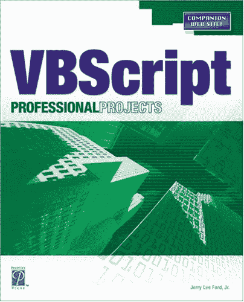

这本强大的指南是 VBA 和 Visual Basic 程序员的理想之书，它为高级用户提供了一种基于项目的方法，并涵盖了 VBScript 在 Web 和 WSH 脚本中的适用性。

使用 VBScript 完成真实世界中的专业任务。《微软 VBScript 专业项目》(Microsoft VBScript Professional Projects) 包含了四个实战项目，是你开启 VBScript 力量的钥匙。每个项目都关注一个特定的概念，并基于现实场景。你将能够利用书中学的技能来修改项目，以满足你的专业需求。

使用 VBScript 和 `WSH` 进行桌面管理：在开发可以与操作系统及其环境交互的 VBScript 的同时，学习如何自动化桌面计算机的管理。开发建立远程网络驱动器连接、配置 `Start Menu`（开始菜单）以及自动化创建新账户的 VBScript。在完成项目 1 的过程中，你将学习如何从 VBScript 内部直接执行 Windows 命令、自动化执行 Windows 实用程序以及直接访问 Windows 文件夹的内容。

开发日志分析器：在学习如何开发一组脚本来读取和处理单份报告以创建一个汇总总结报告时，掌握文件输入处理涉及的基本步骤。在整个完成项目 2 的过程中，你将开发各种编程技术，包括读取和处理格式化日志和报告文件的内容、创建新的文本文件以及通过程序自动地执行 VBScript。

创建报告管理站：在项目 2 的基础上，你将学习如何开发一个中央报告管理系统来存储报告。项目 3 将为你介绍许多解析报告中存储的信息所需的 VBScript 字符串函数。你还将学习如何自动化执行若干任务，包括远程管理存储在网络驱动器上的文件、发送弹出网络消息通知以及从 `Windows registry`（Windows 注册表）中检索数据。

通过 Web 报告摘要：在最后一个项目中，你将开发一个包含 HTML 页面的网站，这些页面嵌入了 VBScript，用于生成图形效果、对配置设置进行验证并将单个用户设置存储在 cookie 中。在完成此项目时，你将创建由 `WSH` 执行的 VBScript，创建显示报告内容的 HTML 页面、将其复制到 Web 服务器并远程管理 Web 服务器上的报告存档。

**关于作者**

Jerry Lee Ford, Jr. 是一位作家、教育工作者 IT 专业人士，在信息技术领域拥有 15 年经验，曾担任自动化分析师、技术经理、技术支持分析师、自动化工程师和安全分析师。Jerry 是 MCSE，还获得了微软的 `MCP` 和 `MCP + Internet` 认证。此外，他拥有弗吉尼亚联邦大学（位于纽约州 Richmond）的工商管理硕士学位。Jerry 还是其他 11 本书的作者，包括《周末学 JavaScript》(Learn JavaScript in a Weekend)、《周末学 VBScript》(Learn VBScript in a Weekend)、《微软 Windows 脚本和 WSH 管理员指南》(Microsoft Windows Shell Scripting and WSH Administrator's Guide)、《初学者微软 WSH 和 VBScript》(Microsoft WSH and VBScript for the Absolute Beginner) 以及《Windows XP 专业版管理员指南》(Microsoft Windows XP Professional Administrator's Guide)。作为兼任教师，教授信息技术网络课程已有五年经验。

# 微软 VBScript 专业项目

Jerry Lee Ford, Jr.

保留所有权利。未经 Premier Press 书面许可，不得以任何形式或手段（电子或机械，包括复印、录制或任何信息存储或检索系统）复制或传输本书的任何部分，但评论中的简短引用除外。

Microsoft 是美国及或其他国家 Microsoft 公司的注册商标。

所有其他商标均为其所有者的财产。

重要提示：Premier Press 不能提供软件支持。请联系相关软件制造商的技术支持热线或网站以寻求帮助。

Premier Press 和作者在书中尝试通过遵循制造商使用的大小写风格，将专有商标与描述性术语区分来。

书中包含的信息由 Premier Press 从其认为可靠的来源获得。然而，由于 Premier Press 或其他可能出现人为或机械错误，出版商不保证信息的准确性、充分性或完整性。读者应注意，自本书出版后某些事实可能发生变化。

25 Thomson Place

**技术评审员：**Zac Hester

> 献给 Alexander, William, Molly 和 Mary。

本书的目标是为具有编程背景的程序员、高级用户和系统管理员提供一种以项目为导向的方法学习 VBScript（视觉基本脚本）语言。VBScript 是 Visual Basic 编程语言家族的一员，该家族包括 Visual Basic 和 `VBA`（应用程序视觉基本）。

本书在两种不同的执行环境——`WSH` 和 Internet Explorer——的背景下涵盖了 VBScript。为了能够有效地在 `WSH` 中使用 VBScript，你将需要一些工具，包括：

*   `WSH` 版本 5.6，可以在 `http://msdn.microsoft.com/scripting` 免费获取
*   为了完成第三个项目，需要访问局域网上的一个或多台计算机

为了能够将书中提供的信息用于 Web 页面开发，你需要访问以下工具：

*   一台运行 Windows 操作系统的计算机
*   一个纯文本或脚本编辑器

## 本书使用的规范

本书包含了许多特殊元素，旨在方便你阅读和操作。这些特殊元素概述如下：

| 注意事项 | 这种特殊元素提供了额外的、帮助或有趣的信息，这些信息对于当前主题并非必不可少。 |
| 警告 | 这种特殊元素用于识别需要额外注意的情况，以防止问题的发生。 |

*术语*在全书中首次被提到时会斜体显示，以突出并强调关键信息。

# 第一部分：微软 VBScript 基础介绍

## 章节列表

*   第 1 章: 什么是 VBScript？
*   第 3 章: 条件逻辑和迭代结构
*   第 4 章: 过程
*   第 5 章: 数组
*   第 7 章: VBScript 对象
*   第 9 章: VBScript 与 WSH

# 第 1 章：什么是 VBScript？

*VBScript* 是由微软创建的一种脚本语言。它最初开发用于支持客户端 Web 页面开发。然而，微软随后将其移植到许多编程环境中，包括 `WSH`（Windows 脚本主机）。`WSH` 是一个旨在支持在 Windows 操作系统上执行脚本的执行环境。通过提供结合 VBScript 和 `WSH` 的能力，微软为高级用户、程序员以及系统和网络管理员提供了一种脚本语言，该语言使用与 Visual Basic 闻名的相同的友好且易于学习的语法来支持快速应用程序开发。

## 介绍 VBScript

VBScript 是一种解释型脚本语言。VBScript 需要一个执行环境才能运行。VBScript 执行环境示例包括 Internet Explorer 和 `WSH`。在 Web 页面开发背景下，VBScript 嵌入在 HTML（超文本标记语言）页面中执行。当通过 `WSH` 执行时，VBScript 以 `.vbs` 扩展名的纯文本文件存储，并在 Windows 命令行或桌面运行。

VBScript 是改进客户端 Web 页面开发以及开发用于 Windows 操作系统自动化任务的小型脚本的极佳语言。它也是快速开发小型应用程序和工具或原型设计的良好选择。

VBScript 受限于其执行环境的限制。这意味着虽然嵌入 HTML 页面中的 VBScript 可以验证表单内容并控制浏览器活动，但它无法访问执行计算机上的本地磁盘或其他资源。另一方面，通过 `WSH` 执行的 VBScript 可以访问本地驱动器和打印机，但它们无法与浏览器资源协作。

嵌入 Web 页面内部的 VBScript 可以执行的任务包括：

*   创建动画效果
*   使用对话框与 Internet 和内部网访问者交互
*   根据检测到的浏览器类型和版本将访问者重定向到特定的 HTML 页面集
*   验证 HTML 表单
*   管理 HTML 帧

为 `WSH` 设计的 VBScript 有完全不同的用途。由 `WSH` 运行的 VBScript 可以执行的任务包括：

*   创建用户账户
*   创建快捷方式
*   管理本地驱动器和打印机
*   管理网络驱动器和打印机
*   直接与其他应用程序交互
*   通过修改 Windows 注册表修改系统设置
*   管理 Windows 服务和服务日志

### VBScript 的历史

从编程语言来说，`VBScript` 仍然相对较新。微软于 1996 年首次引入它，作为 `Internet Explorer 3.0` 的客户端 Web 页面开发脚本语言。然而，在 `VBScript` 出现之前，还有另一种客户端脚本语言出现，它在当时被称为 `LiveScript`，后来重命名为 `JavaScript`。`JavaScript` 的领先优势，加上对 `VBScript` 专有性的担忧，导致微软这种新脚本语言的起步缓慢。此外，Netscape 从未在其浏览器中添加对 `VBScript` 的支持，这使得 `JavaScript` 成为唯一被普遍支持的客户端脚本语言。因此，尽管 `JavaScript` 很快被互联网社区接受，但 `VBScript` 的成功来得缓慢。

随着微软发布 `VBScript` 2.0 版本，`VBScript` 的流行开始增加，并使其为 `IIS 3.0`（Internet 信息服务器 3.0）提供了一种服务器端 Web 开发脚本语言。通过在 `ASPs`（活动服务器页面）中嵌入 `VBScripts`，Web 开发人员能够使用 `VBScript` 作为访问存储在服务器端数据库的数据手段，并更轻松地提供动态 Web 内容。

`VBScript` 3.0 版本作为许多微软产品的组成组件发布。该产品列表包括：

*   Internet Explorer 4
*   IIS 4
*   Outlook 98

`VBScript` 4.0 版本作为 `Microsoft Visual Studio` 应用开发套件的一部分引入，并被赋予了访问 `Windows` 文件系统的能力。`VBScript` 5.0 版本随着 `Windows 2000` 发布。此外，微软将其作为 `WSH 2.0` 和 `Internet Explorer 5.0` 的部分进行分发。当微软在 2001 年发布 `Windows XP` 和 `Internet Explorer 6.0` 时，包含了 `VBScript 5.6` 和 `WSH 5.6`，两者都代表了这些产品的当前发布版本。

`VBScript` 是组成 `Visual Basic` 编程语言族的三种语言之一。这三种语言包括：

*   `VBA`（Visual Basic Applications）。这种语言用于自定义支持 `VBA` 的桌面应用程序，例如 `Microsoft Excel` 或 `Microsoft Access`。

虽然这三种语言都紧密相关并共享许多相同特性，但每种设计都是为了适应不同的开发需求。`Visual Basic` 设计用于支持新应用程序的开发，而 `VBA` 设计为特定应用程序提供自动化设施。另一方面，`VBScript` 被设计为一种通用的脚本语言，部署在许多不同的环境中。

| 注意 | 提示 |
| :--- | :--- |
| | 你可以在微软 Visual Basic 网站 [`msdn.microsoft.com/vbasic`](http://msdn.microsoft.com/vbasic) 学习更多关于 `Visual Basic`。 |

`Visual Basic` 应用程序族的第二个成员是 `VBA`，是微软于 1993 年引入的。`VBA` 为特定应用程序提供了 `Visual Basic` 功能的子集。`VBA` 设计用于为特定应用程序如 `Microsoft Excel` 或 `Microsoft Access` 提供自定义功能。通过 `Microsoft Access` 使用 `VBA`，程序员可以开发一个使用 `Microsoft Access` 数据库的整个应用程序，而不是从零开始。

`VBA` 的当前版本是 6.3。它于 2001 年发布并支持以下应用程序列表：

*   Microsoft Excel
*   Microsoft Access
*   Microsoft Outlook
*   Microsoft FrontPage
*   Microsoft PowerPoint

| 提示 | 要了解更多关于 `Microsoft Excel` 的 `VBA`，请参考 Duane Birn 出版的 *Microsoft Excel VBA Projects* (Premier Press, 2003)。 |
| 提示 | 要了解更多关于 `Microsoft Access` 的 `VBA`，请参考 Michael Vine 出版的 *Microsoft Access VBA Programming for the Absolute Beginner* (Premier Press, 2002)。 |
| 注意 | 你可以在 [`msdn.microsoft.com/vba`](http://msdn.microsoft.com/vba) 了解更多关于 `VBA`。 |

### VBScript 执行环境

尽管 `VBScript` 起步平平，但微软对 `VBScript` 保持了强大的承诺，不断对其改进。自诞生以来，微软将 `VBScript` 移植到许多不同的环境中，展示了 `VBScript` 的灵活性和适应性。因此，`VBScript` 多年来日益流行，为程序员提供了利用其 VBScript 技能的多种途径。

以下列表列出了当前支持 `VBScript` 的主要执行环境：

*   **Internet Explorer**。`VBScript` 为 Web 页面开发提供强大的客户端脚本语言。
*   **WSH**。`VBScript` 为自动化日常或复杂的系统和网络任务提供脚本语言。
*   **IIS 和 ASP**。嵌入 `ASPs` 中的 `VBScript` 提供动态 Web 内容以及访问本地服务器端数据库的数据。
*   **Microsoft Windows Script Console**。这是一项新技术，允许将 `VBScript` 纳入第三方应用程序中，从而将其扩展到许多新环境中。

## VBScript Web 页面开发

`VBScript` 最初被开发为客户端 Web 脚本语言，多年来微软一直致力于这项技术。当用于客户端 Web 页面开发时，`VBScripts` 通常嵌入 HTML 页面中并作为 Web 页面的一部分下载到客户端浏览器中。

与包含它们的 HTML 页面一样，VBScript 可以使用任何可以纯文本保存文件的编辑器来创建。例如，微软记事本程序就是一个合格的编辑器。然而，如今有许多优秀的 HTML 编辑器，它们也包含了对 VBScript 开发的支持。

| **提示** | HTML 和脚本编辑器的一个极佳示例是 HomeSite。HomeSite 提供了许多功能，包括： |
| :--- | :--- |
| | * HTML 和 VBScript 语句的颜色编码 |
| | * 代码验证 |
| | * 模板和向导 |

VBScript 受 Microsoft Internet Explorer 浏览支持，但不受 Netscape Communicator 支持。VBScript 还受到更多第三方浏览器的支持，这些浏览器至少在部分程度上基于 Internet Explorer。这使得 VBScript 在互联网上的支持基础比通常人们认为的要广泛得多。

* AOL
* CompuServe
* EarthLink LiteOL
* Fast Browser Pro
* NeoPlanet
* ExplorerRapidBrowser
* SmartExplorer
* Oligo

## 在 Web 页面中添加 VBScript

使用 `<SCRIPT>` 和 `</SCRIPT>` 标签，您可以通过以下概述的三种不同方式向 HTML 页面添加 VBScript：

* 响应事件运行 VBScript，例如访问点击图像、按钮或链接
* 运行存储在包含 `<SCRIPT>` 和 `</SCRIPT>` 标签引用的 HTML 页面之外的脚本
* 将 VBScript 嵌入 HTML 页面以便其在页面加载时自动运行

将 VBScript 嵌入 HTML 页面以便其在页面加载时自动运行所需的语法概述如下。

```html
<SCRIPT LANGUAGE="ScriptingLanguage" TYPE="TEXT/Language" SRC="url"> </SCRIPT>
```

```vbscript
LANGUAGE="VBScript"
```
或者
```vbscript
LANGUAGE="VBS"
```

```vbscript
TYPE="TEXT/VBScript"
```
或者
```vbscript
TYPE="TEXT/VBS"
```

`</SCRIPT>` 标签标记 VBScript 的结束。在起始 `<SCRIPT>` 和结束 `</SCRIPT>` 标签之间，您可以包含任意数量的 VBScript 语句。例如，下面的 HTML 页面包含两个嵌入的 VBScript，一个在 BODY 部分，另一个在 HEAD 部分。

```html
<HTML>
  <HEAD>
    <SCRIPT LANGUAGE="VBScript">
      Sub DisplayPopup
        MsgBox "This message was displayed by a second VBScript."
    </SCRIPT>
  </HEAD>
  <BODY>
    <SCRIPT LANGUAGE="VBScript">
      MsgBox "Greetings. Click on OK to run the second VBScript."
      DisplayPopup
  </BODY>
</HTML>
```

当浏览器加载 HTML 页面时，BODY 部分中的 VBScript 会自动执行。并在弹出框中显示消息，如图 1.1 所示。第二个 VBScript 在 HEAD 部分被定义为子程序，并在被位于 BODY 部分的 VBScript 调用时执行，显示如图 1.2 所示的弹出对话框。

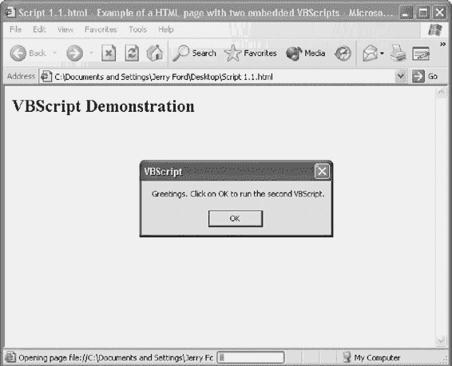

图 1.1：当定义它的 HTML 页面被 Internet Explorer 加载时显示的弹出对话框示例

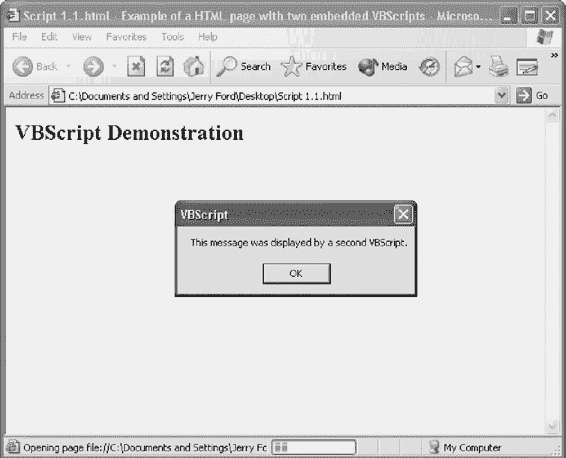

图 1.2：由另一个 VBScript 调用的 VBScript 子程序生成的弹出对话框

| **注意** | 上一个示例以及所有的 |

### 响应事件

嵌入 HTML 页面中的 VBScript 也可以设置为根据事件执行。浏览器事件的示例包括访问点击按钮、链接或图形。通过创建响应事件的 VBScript，您可以为 Web 页面添加大量的交互性。例如，您可以要求访问者确认表单是否填写正确。

为了设置此类引用，您必须在定义 `<SCRIPT>` 和 `</SCRIPT>` 标签时使用以下语法。

```html
<SCRIPT FOR="Object" EVENT="EventType" LANGUAGE="ScriptingLanguage" > </SCRIPT>
```

表 1.1：文档对象模型属性

| 事件 | 事件处理程序 | 说明 |
| :--- | :--- | :--- |
| `Abort` | `onAbort` | 当访问者中止图像加载时执行 |
| `Blur` | `onBlur` | 当当前对象失去焦点时执行 |
| `Click` | `onClick` | 当访问者点击对象时执行 |
| `DblClick` | `onDblClick` | 当访问者双击对象时执行 |
| `DragDrop` | `onDragDrop` | 当访问者将对象拖放到框架或窗口时执行 |
| `Focus` | `onFocus` | 当访问者选择对象时执行 |
| `KeyDown` | `onKeyDown` | 当访问者按下按键时执行 |
| `KeyPress` | `onKeyPress` | 当访问者按下并释放按键时执行 |
| `Load` | `onLoad` | 当 HTML 页面或图像加载完成时执行 |
| `MouseDown` | `onMouseDown` | 当访问者按下鼠标按钮时执行 |
| `MouseOut` | `onMouseOut` | 当访问者将指针移出对象时执行 |
| `MouseOver` | `onMouseOver` | 当访问者将指针移动到对象上执行 |
| `MouseUp` | `onMouseUp` | 当访问者释放鼠标按钮时执行 |
| `Move` | `onMove` | 当访问者移动帧或窗口时执行 |
| `Reset` | `onReset` | 当访问者点击重置按钮时执行 |
| `Resize` | `onResize` | 当访问者调整帧或窗口大小时执行 |
| `Submit` | `onSubmit` | 当访问者点击提交按钮时执行 |
| `Unload` | `onUnload` | 当访问者关闭浏览器窗口、帧或加载不同的 URL 时执行 |

```html
<HTML>
    <TITLE>Script 1.2 - 由浏览器事件触发的 VBScript 示例</TITLE>
  </HEAD>
  <BODY>
      <INPUT TYPE=button NAME="TestButton" VALUE="Click on Me">
      <SCRIPT FOR="TestButton" EVENT="onClick" LANGUAGE="VBScript">
      MsgBox "Greetings. Thanks for visiting!"
    </FORM>
  </BODY>
</HTML>
```

在此示例中，定义了一个名为 `TestForm` 的表单，它包含一个单表单元素——一个显示 `Click on Me` 信息的 `TestButton` 按钮。HTML 页面添加了一个 VBScript。它被设置为仅在 `TestButton` 发生 `click` 事件时才执行，如示例所示。当发生这种情况时，将显示图 1.3 所示的弹出对话框。

图 1.3: 由 VBScript `onClick` 事件处理器触发的弹出对话框演示

### 引用外部脚本

VBScript 还提供了一种功能，允许通过将 VBScript 存储为具有 `.vbs` 扩展名的外部文件并对其提供引用，将其从 HTML 中分离。此选项使你的 HTML 和 VBScript 代码分离，可能使两者都更易读且易于管理。此选项还允许你创建可以被任意 HTML 页面调用和共享的 VBScript。

```html
<HTML>
    <TITLE>Script 1.3 - 执行外部 VBScript 的示例</TITLE>
  </HEAD>
  <BODY>
  </BODY>
</HTML>
```

如你所见，`SRC="Script 1.4.vbs"` 参数标识了外部 VBScript 文件的名称。外部 VBScript 文件可以包含任意数量的 VBScript 语句。它必须保存为纯文本文件，且不能包含任何 HTML 内容。例如，如果将以下 VBScript 语句保存为 `Script 1.4.vbs`，当它被 HTML 示例执行时，将显示图 1.4 所示的弹出对话框。

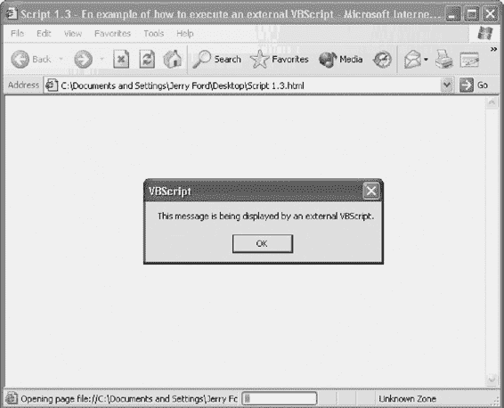
图 1.4: 由外部引用的 VBScript 显示的弹出对话框

```vbscript
MsgBox "This message was displayed by an external VBScript."
```

## WSH

WSH 是一个编程环境，支持直接从 Windows 桌面或命令提示符执行脚本。默认情况下，WSH 支持 VBScript 和 JScript 脚本语言，尽管也可以对其他脚本语言的第三方支持。WSH 为脚本提供了一个可以执行的环境。此外，WSH 为脚本提供了直接访问许多 Windows 资源的权限，包括：

* Windows 文件系统
* Windows 注册表
* Windows 服务
* 打印机和磁盘驱动器
* Windows 快速启动工具
* 其他 Windows

表 1.2: 微软操作系统对 WSH 的支持

| 操作系统 | 支持 | 版本 |
| :--- | :--- | :--- |
| Windows 95 | 是 | 否 |
| Windows 98 | 是 | 1.0 |
| Windows NT | 是 | 否 |
| Windows 2000 | 是 | 2.0 |
| Windows XP | 是 | 5.6 |

虽然 Windows 95 和 NT 4.0 未随附带它，但你可以将 WSH 升级到 `5.6` 版本。要下载最新的 WSH，请访问 [`msdn.microsoft.com/scripting`](http://msdn.microsoft.com/scripting)。

## WSH 架构

WSH 是一个 32 位应用程序，它由三个主要组件组成：

* 脚本引擎
* 执行主机
* 核心对象模型

脚本引擎为 WSH 提供了将特定脚本语言编写的语句转换为执行主机可执行格式的能力。WSH 提供了不同的执行主机。这些主机提供了从桌面或命令提示符运行脚本的能力。最后，核心对象模型为脚本提供了访问 Windows 资源的权限。图 1.5 描述了这三个组件之间的关系。

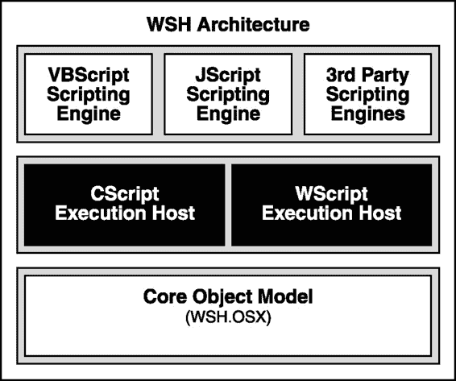

图 1.5: 组成 WSH 的组件

#### 脚本引擎

脚本引擎为 WSH 提供了解释特定脚本语言并转换为格式的能力。默认情况下，微软为 WSH 提供以下脚本引擎：

* VBScript
* JScript

表 1.3: 第三方 WSH 兼容脚本引擎

| 语言 | 引擎名称 | 网站 |
| :--- | :--- | :--- |
| Perl | ActivePerl | [`www.activestate.com`](http://www.activestate.com) |
| Python | ActivePython | [`www.activestate.com`](http://www.activestate.com) |

#### 执行主机

* `CScript.exe`: 提供从 Windows 命令提示符执行脚本，并赋予脚本在 Windows 命令控制台中显示文本消息的能力
* `WScript.exe`: 提供从 Windows 桌面执行脚本，并提供在图形弹出对话框中显示文本消息的能力

两种脚本执行主机之间的唯一区别在于 `WScript.exe` 执行主机具有以图形方式显示输出的能力。除此之外，两种脚本执行主机提供的功能是相同的。要从 Windows 桌面使用 `WScript.exe` 执行主机运行脚本，只需找到它并双击其图标即可。与 `Cscript.exe` 执行主机一样，`WScript.exe` 执行主机也可以用于从 Windows 命令行提示符运行脚本。如下所示，你可以在 Windows 命令行提示符中使用 `WScript.exe` 执行主机运行脚本。

```cmd
WScript scriptname
```

同样，你可以使用 `CScript.exe` 执行主机从 Windows 命令行提示符运行脚本，如下所示。

```cmd
CScript scriptname
```

如果你有任何需要传递给脚本的参数，请在脚本名称后用空格隔开输入它们，如下所示。

```cmd
CScript scriptname arg1 arg2
```

作为一个一般原则，当脚本从 Windows 命令行提示符运行或由 Windows 调度服务运行且不需要与用户进行交互时，通常会使用 `CScript.exe` 执行主机。当需要与用户交互时，最好使用弹出对话框而不是 Windows 命令行提示符，使得 `WScript.exe` 执行主机成为更好的选择。

## 核心对象模型

WSH 的核心对象模型提供了脚本以编程方式交互和操作 Windows 资源的能力，对象模型将这些资源暴露或表征为对象。WSH 核心对象模型实现为名为 `WSH.OCX` 的 ActiveX 控件。WSH 对象模型暴露的对象的示例包括驱动器、打印机、文件和快捷方式。WSH 对象模型暴露的每个对象都有一组属性和方法。VBScript 可以使用这些属性和方法来交互并控制这些资源。

`Properties`（属性）是对象的特定属性，用于描述或修改对象的特定功能或组件。例如，桌面快捷方式有一个文件名和一个文件扩展名。属性的值可以被查看和更改，从而对快捷方式产生直接影响。`method`（方法）是内置的 WSH 函数。方法可以用于对对象执行操作。例如，存在允许脚本创建和删除快捷方式的方法。

通过使用 WSH 核心对象模型暴露的对象的方法和属性，可以开发出 VBScript，在任何运行 Windows 95 或更高版本且已安装 WSH 的计算机上实现任务自动化。

## 编写 WSH VBScript

由 WSH 执行的 VBScript 保存为具有 `.vbs` 扩展名的纯文本文件。与 Visual Basic 或 VBA 不同，VBScript 不提供内置的 IDE。你可以使用任何编辑器来创建 VBScript 文件，只要该编辑器可以以纯文本格式保存文件。例如，所有版本 Windows 自带的记事本程序都适用于此目的。

| | 注意 |
|---|---|
| | 有许多第三方 VBScript 编辑器你可能想要研究，它们将会在与 WSH 工作时让 VBScript 开发变得更简单。这些编辑器提供了诸如行号、彩色语句着色以及在不退出编辑器的情况下测试脚本的功能。其中一个示例是 VbsEdit，你可以在 [`www.adersoft.com`](http://www.adersoft.com) 找到它。 |

```vbscript
UserName = InputBox("What is your name?")
MsgBox "Hello, " & UserName & "! Welcome to VBScript."
```

第一语句收集用户的用户名，第二语句接着使用用户名显示自定义问候语。一旦保存并执行，该 VBScript 将与用户进行交互，如 图 1.6 和 1.7 所示。

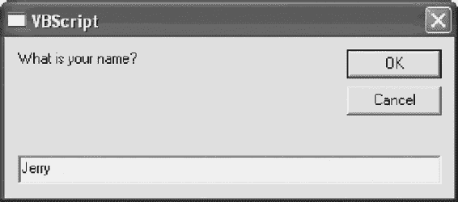

图 1.6：使用 WSH 运行一个收集用户名的 VBScript

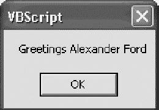

图 1.7：使用用户名显示自定义欢迎消息

## Windows 命令行提示符

良好理解如何操作 Windows 命令行提示符对于任何 VBScript 程序员来说都是一个重要的前提。Windows 命令行提示符是你与操作系统之间的文本界面。它可以作为操作 Windows GUI（图形用户界面）的有效替代方案。

要在运行 Windows XP 的计算机上访问 Windows 命令行提示符，点击“开始”、“所有程序”、“附件”，然后点击“命令提示符”。这将启动一个 Windows 控制台，如 图 1.8 所示。

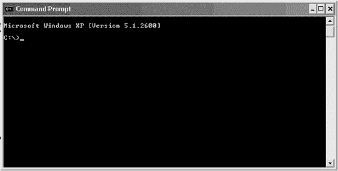

图 1.8：要操作 Windows 命令行提示符，你必须先打开 Windows 控制台

| | 提示 |
|---|---|
| | 要快速访问任何 Windows 计算机上的 Windows 命令行提示符，请点击“开始”然后点击“运行”。这将显示运行对话框。接着输入 `CMD` 然后点击“确定”。 |

```cmd
C:\>ver
Microsoft Windows XP [Version 5.1.2600]
C:\>
```

| | 注意 |
|---|---|
| | 有关命令的详细列表，请参阅 附录 A，“Windows 命令参考”。 |

以下 VBScript 语句代表一个单行 VBScript 文件。

```vbscript
WScript.Echo "Hello from the command line!"
```

当使用 CScript.exe 执行主机从命令行提示符执行时，该 VBScript 显示了如 图 1.9 所示的输出。

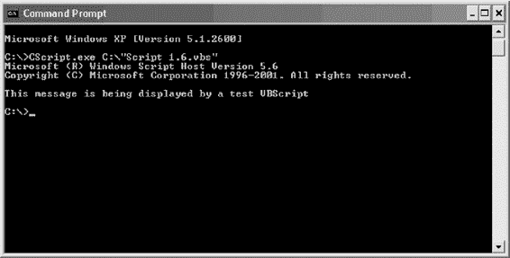

图 1.9：使用 CScript 执行主机查看结果

完成命令行操作后，你可以像关闭其他 Windows 程序一样关闭控制台。这可以通过点击对话框右上角的关闭图标来实现，也可以右键点击左上角的命令提示符图标并选择“关闭”。你也可以通过在 Windows 命令行提示符输入 `EXIT` 命令并按回车键关闭控制台。

## 总结

在本章，你学习了 VBScript 的起源。这包括对 Visual Basic 系列编程语言的概述，以及对微软移植 VBScript 的各种环境说明。此外，你学习了将 VBScript 集成到 HTML 页面的基本步骤。你还学习了 WSH 的基本架构。最后，你学习了如何使用 WSH 和 Internet Explorer 创建并执行脚本。

# 第二章：错误、常量和变量

本章将涵盖许多 VBScript 主题。它从 VBScript 语句及其语法要求开始，然后描述如何纠正和修复这些类型的错误。创建 VBScript 注释以及定义常量变量的语句也得到了审查。此外，本章将提供有关内置 VBScript 常量的信息。关于变量的各种主题，包括变量命名规则和限制变量作用域的方法也将进行讨论。

VBScript 由许多编程语句组成，每个语句都执行特定的功能。表 2.1 列出了构成 VBScript 编程语言的语句列表。本章将介绍处理 VBScript 注释、常量和变量 VBScript 语句。

### 表 2.1：VBScript 语句

| 语句 | 描述 |
| :--- | :--- |
| `Call` | 将脚本中的控制流重定向到过程 |
| `Class` | 定义类名 |
| `Const` | 定义常量 |
| `Do...Loop` | 只要条件为 `True` 或直到条件变为 `True`，就重复一组语句 |
| `Erase` | 重新初始化数组中的元素 |
| `Execute` | 执行指定的语句 |
| `Exit` | 终止循环、子程序 (sub) 或函数 (function) |
| `For Each...Next` | 迭代处理数组或集合的内容 |
| `For...Next` | 按指定的次数重复循环 |
| `If...Then...Else` | 根据所测试表达式的值执行一个或多个语句 |
| `On Error` | 开启错误处理 |
| `Option Explicit` | 在你的脚本中显式声明所有变量 |
| `Property Get` | 定义属性名、其参数并返回其值 |
| `Property Let` | 定义属性过程的名字和参数 |
| `Property Set` | 定义属性过程的名字和参数 |
| `Randomize` | 初始化随机数生成器 |
| `ReDim` | 定义或重新定义动态数组变量 |
| `Rem` | 用于在脚本中放置注释 |
| `Set` | 将对象引用赋值给变量 |
| `Sub` | 定义 `Sub` 名称及其参数 |
| `While...Wend` | 只要指定的条件保持 `True`，就执行一个或多个语句 |

## VBScript 语句语法

除了特定 VBScript 语句的特定语法要求外，在编写 VBScript 时，你还必须遵循许多通用规则。这些规则列在下方。

*   你可以通过在每个语句末尾添加冒号（`:`）字符，在单行内放置两个或多个语句。
*   你可以通过在每行末尾添加下划线（`_`）字符（称为续行符），将单个语句跨越多行。
*   默认情况下，VBScript 不区分大小写，这意味着在常量、变量、子程序名和函数名的拼写中允许使用不同的大小写。

### 语法错误

运行时错误可能难以追踪和发现，因为它们可能隐藏在脚本中较少使用的代码部分。另一方面，脚本中任何位置的语法错误都会阻止其执行。因此，语法错误应该在初始脚本开发和测试期间易于发现并修复。例如，以下语句在由 WSH 运行时，将产生图 2.1 所示的错误。

```vbscript
MsgBox "Text must be enclosed within a pair of double quotation marks
```

图 2.1：未遵循 VBScript 语句语法会导致终止脚本执行的错误

表 2.2 提供了可能发生的 VBScript 错误列表，这些错误是由于未遵循 VBScript 语法规则产生的。根据运行环境的不同，这些错误以十六进制或十进制格式报告。

表 2.2：VBScript 错误

| 十六进制 | 十进制 | 描述 |
| :--- | :--- | :--- |
| 800A03E | 1001 | 内存不足 |
| 800A0EA | 1002 | 语法错误 |
| 800A0EE | 1006 | `)` 缺失 |
| 800A0F2 | 1010 | 标识符错误 |
| 800A0F3 | 1011 | 重复定义 |
| 800A014 | 1044 | 调用 `Sub` 时不能使用括号 |
| 800A015 | 1045 | 预期字面量常量 |
| 800A016 | 1046 | 预期 `In` |
| 800A018 | 1048 | 必须在类内部定义 |
| 800A019 | 1049 | 属性声明中应有 `Let` 或 `Set` 或 `Get` |
| 800A01A | 1050 | 预期 `Property` |
| 800A01C | 1052 | 类中不能有多个默认属性/方法 |
| 800A040C | 1036 | `(` 缺失 |
| 800A040D | 1037 | `Me` 关键字使用无效 |
| 800A040F | 1039 | 无效 `exit` 语句 |
| 800A0410 | 1040 | 无效 `for` 循环控制变量 |
| 800A0411 | 1041 | 名称重定义 |
| 800A0403 | 1027 | 预期 `While` 或 语句结束 |
| 800A0404 | 1028 | 预期 `While`、`Until` 或 语句结束 |
| 800A0405 | 1029 | 预期 `With` |
| 800A041D | 1053 | 类初始化或终止不带参数 |
| 800A041E | 1054 | `Property Set` 或 `Let` 必须至少包含一个参数 |
| 800A0421 | 1057 | `Default` 规格必须指定 `Public` |
| 800A0422 | 1058 | `Default` 规格只能用于 `Property Get` |

| | 注意 | 有关运行时错误的详细说明以及如何处理和恢复这些错误，请参见第 6 章中的“数据收集、通知和错误报告”。 |

WSH 在发生错误时始终会显示错误。然而，默认情况下，Internet Explorer 会抑制错误消息的显示。这样做效果良好，因为大多数用户无法理解错误消息，或者无法对它们采取任何行动。相反，每当发生错误时，Internet Explorer 会在浏览器状态栏的左下角显示一个黄色图标。

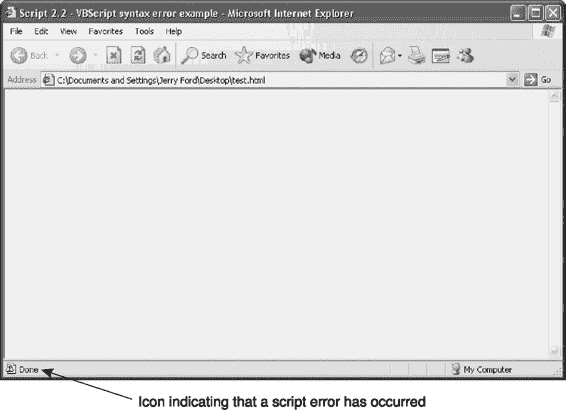

```html
<HTML>
    <TITLE>脚本 2.2 - VBScript 语法错误示例</TITLE>
  </HEAD>
  <BODY>
      <SCRIPT LANGUAGE="VBScript">
      MsgBox "Text must be enclosed within a pair of double quotation marks
    </SCRIPT>
  </BODY>
</HTML>
```

要查看导致 Internet Explorer 显示黄色图标的错误消息，请双击该图标，错误将如图 2.3 所示显示。

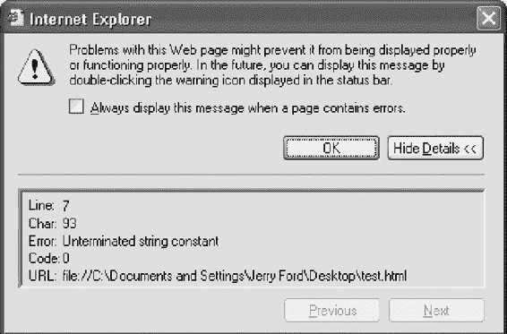

图 2.3：在 Internet Explorer 中检查典型的脚本错误

| | 提示 | Internet Explorer 对 VBScript 错误的抑制对大多数 VBScript 程序员来说通常是不方便的，因为这迫使他们必须去搜索并显示错误。幸运的是，Internet Explorer 足够灵活，允许你按照以下步骤配置其自动显示脚本错误消息： |
| :--- | :--- | :--- |
| | | 1. 打开 Internet Explorer 并从“工具”菜单选择“Internet 选项”。出现“Internet 选项”对话框。 |
| | | 3. 选择“对每个脚本错误显示通知”选项并点击“确定”。 |

## 使用注释编写 VBScript

注释提供了使脚本自文档化的能力，使其更容易供他人支持。你可以使用 `Rem` 语句为 VBScript 添加注释。`Rem` 语句的语法如下所示。

```vbscript
Rem comment
```

例如，`Rem` 语句可以如下面所示使用。

```vbscript
Rem The VBScript MsgBox() function displays text messages
MsgBox "Greetings!"
```

或者，你可以像下面所示用单引号（`'`）字符代替 `Rem` 关键字。

```vbscript
' The VBScript MsgBox() function displays text messages
MsgBox "Greetings!"
```

注释也可以添加到 VBScript 语句的末尾。为了使用 `Rem` 语句将注释添加到 VBScript 语句的末尾，你必须先在它前面加一个冒号，如下所示。

```vbscript
MsgBox "Greetings!" : Rem The VBScript MsgBox() function displays text messages
```

然而，如果你使用 `'` 字符代替 `Rem` 关键字，则可以省略冒号，如下面所示。

```vbscript
MsgBox "Greetings!"   ' The VBScript MsgBox() function displays text messages
```

注释的另一个良好用处是创建脚本模板，如下所示。

```vbscript
'Script Name: ScriptName.vbs
'Author: Author Name
'Created: mm/dd/yyyy
'*************************************************************************

'Initialization Section
'Main Processing Section

'Procedure Section
```

你将看到此模板用于记录书中项目章节出现的所有 WSH 脚本。模板的第一部分提供了一个记录脚本信息的地方。初始化部分将包含全局影响整个脚本的、或定义常量、变量、数组和对象的 VBScript 语句。主处理部分将包含控制脚本整体执行的 VBScript 语句，过程部分将用于存储组成脚本的所有过程。

```html
<SCRIPT LANGUAGE="VBScript">
     MsgBox "Greetings!"
  ' End VBScript statements -->
</SCRIPT>
```

像任何编程语言一样，VBScript 需要在执行时能够在内存中存储和检索数据。为了支持这一需求，VBScript 提供了三个定义常量、变量和数组的语句。这些语句见表 2.3。

| 语句 | 描述 |
| :--- | :--- |
| `Dim` | 定义 VBScript 变量或数组 |
| `ReDim` | 定义动态 VBScript 数组 |
| `Const` | 定义常量 |

常量是指在脚本执行期间不会改变的值。如果脚本有一个在执行期间不需要更改的已知值，它可以存储为常量。π 值就是一个常量示例。常量在 VBScript 中有两种不同的使用方式。首先，你可以定义自己的自定义常量。其次，你可以引用内置的 VBScript 运行时常量。

一旦定义了常量，就无法更改分配给它的值。这可以保护常量并防止其被意外修改。任何更改常量值的尝试都会导致“Illegal assignment xxxxxxxx”错误，其中 `xxxxxxxx` 是脚本尝试修改的常量名称。

## 定义常量

常量使用 `Const` 语句定义，其语法如下：

```vbscript
[Public | Private] Const cCONSTANT = expression
```

`Public` 和 `Private` 是可选关键字。`Public` 使常量在整个脚本中可用。`Private` 将对常量的访问权限限制在定义它的过程中。`cCONSTANT` 是分配给常量的名称，`expression` 是要分配的值。

| | 提示 | 考虑对您所有的常量应用命名规范，使它们与代码的其他部分区分开来。在书中，常量使用以下命名规范创建： |
| :--- | :--- | :--- |
| | | * 常量名称描述了其内容。 |
| | | * 常量名称的首字母以小写字母 `c` 开头。 |
| | | * 名称的其余部分全部大写拼写。 |

以下示例演示了如何定义常量并为其分配一个数值。

```vbscript
Const cTOTAL_VALUE = 1000
```

```vbscript
Const cCOMPANY_NAME = "XYZ Inc."
```

同样，要定义日期，请将值放在一对匹配的井号符号之间，如下所示。

```vbscript
Const cPROJECT_DEADLINE = #03-30-03#
```

```vbscript
Const cTITLEBAR_MSG = "Data Collection Utility"
MsgBox "Click on OK to post saved data.", , cTITLEBAR_MSG
```


图 2.5：使用常量代替硬编码数据以使脚本更易维护

VBScript 为编程人员提供了大量的预定义常量。通过在脚本中对这些常量添加引用，您可以节省时间并简化代码。例如，以下语句使用 `vbOkCancel` `MsgBox()` 常量来显示包含 `OK` 和 `Cancel` 按钮的弹出对话框。

```vbscript
MsgBox "Do you wish to continue?", vbOkCancel
```

VBScript 还提供了大量引用日期和时间的常量集合。表 2.4 显示了这些常量的列表。

表 2.4：VBScript 日期/时间常量

| 常量 | 值 | 说明 |
| :--- | :--- | :--- |
| `vbMonday` | 2 | 周一 |
| `vbTuesday` | 3 | 周二 |
| `vbWednesday` | 4 | 周三 |
| `vbFriday` | 6 | 周五 |
| `vbSaturday` | 7 | 周六 |
| `vbFirstFourDays` | 2 | 新年中至少四天的第一个完整周 |
| `vbFirstJan1` | 1 | 包含 1 月 1 日的一周 |
| `vbUseSystemDayOfWeek` | 0 | 操作系统指定的星期 |

```vbscript
TodaysDate = Weekday(Date())
```

在此示例中，只有当脚本在周一执行时，才会显示弹出对话框。另一个内置常量的例子是 VBScript 的字符串常量集合，如 表 2.5 所示。

表 2.5：VBScript 字符串常量

| 常量 | 值 | 说明 |
| :--- | :--- | :--- |
| `vbCr` | `Chr(13)` | 执行回车 |
| `vbCrLf` | `Chr(13) & Chr(10)` | 执行回车和换行符 |
| `vbFeed` | `Chr(10)` | 执行分页符 |
| `vbNull` | `Null` | 设置为空值的变体 |
| `vbString` | | 包含字符串的变体 |
| `vbTab` | `Chr(9)` | 执行水平制表符 |

变体（Variants）会识别分配给它们的数据类型并采取相应的行为。然而，你可以对 VBScript 查看待分配给变量的数据的方式进行某些控制。例如，你可以如下所示为变量定义一个数值：

```vbscript
intTotalCount = 100
```

要为变量分配字符串，请将其包含在匹配的引号内，如下两个示例所示：

```vbscript
Age = "4"
```

```vbscript
dtmDateOfBirth = #03/24/99#
```

你可以使用内置的 VBScript 函数将数据从一种类型转换为另一种类型，如下所示：

```vbscript
varDateOfBirth = #03/24/99#
varDateOfBirth = CStr(varDateOfBirth)
```

在此示例中，`varDateOfBirth` 存储的值类型从日期转换为字符串。

| | 备注 | VBScript 提供了许多转换函数，包括 `Asc()`、`Cbool()`、`Cbyte()`、`Ccur()`、`Cdate()`、`CDbl()`、`Chr()`、`Cint()`、`CLng()`、`CSng()` 和 `CStr()`。有关这些函数的更多信息，请参考第 4 章 中的“过程”。 |

### 变量命名规则

在为变量命名时，必须遵循许多规则。这些规则包括：

* 变量在作用域内必须是唯一的。
* 变量名长度必须小于 256 个字符。
* 变量名必须以字母开头。
* 变量名只能由字母、数字和字符 `_` 组成。
* 变量名不能由 VBScript 保留字组成。

```vbscript
strUnitColor
strunitcolor
```

表 2.7：匈牙利前缀

| 数据类型 | 前缀 |
| :--- | :--- |
| `Boolean` | `bln` |
| `Byte` | `byt` |
| `Date` | `dtm` |
| `Double` | `dbl` |
| `Error` | `err` |
| `Long` | `lng` |
| `Object` | `obj` |
| `Single` | `sng` |
| `Variant` | `var` |

以下示例演示了遵循上述约定的变量的使用。

```vbscript
strUserName = "Molly Ford"
intUnitCount = 100
```

### 定义变量

```vbscript
intTotalCount = intTotalCount + 1
```

动态创建变量被认为是不良的做法。强烈建议使用正式变量声明。正式变量声明使得脚本更易读和维护。VBScript 提供了 `Dim` 语句作为正式定义变量的手段。该语句的语法所示：

```vbscript
Dim variablename
```

```vbscript
Dim intTotalCount
```

为了减少定义变量所需的代码行数，VBScript 允许你使用单个 `Dim` 语句一次定义多个变量，如下所示：

```vbscript
Dim intTotalCount, intAvgCount, intFinalCount
```

即使你正式定义了所有变量，也始终可能在脚本的某处写错变量名。当这种情况发生时，VBScript 会将写错的变量视为新变量。VBScript 会为其分配内存，为其分配一个空值，并继续运行。

例如，看以下脚本。

```vbscript
Dim intUnitCount
intUnitCount = 5
MsgBox intUnitCount
```

```vbscript
Option Explicit
intUnitCount = 5
intUnitCount = intUnitCoun + 1
MsgBox intUnitCount
```

| | 备注 | VBScript 提供了许多转换函数，包括 `Asc()`、`Cbool()`、`Cbyte()`、`Ccur()`、`Cdate()`、`CDbl()`、`Chr()`、`Cint()`、`CLng()`、`CSng()` 和 `CStr()`。有关这些函数的更多信息，请参考第 4 章 中的“过程”。 |

*变量作用域*指的是脚本中可以引用变量的位置。*生命周期*指的是变量存在的时间。脚本开头定义的任何变量都具有全局作用域，这意味着可以在脚本内的任何位置被访问。此外，它们在脚本执行期间一直存在。

### 其他数据来源

* `InputBox()` 函数。该函数提供了显示弹出对话框的输入文本框的功能，用户可以使用它为脚本提供输入数据。该函数在第 6 章中介绍。
* 从输入文件读取的数据。第 17 章中的“使用配置文件控制脚本执行”演示了如何从文件收集脚本输入。
* 作为参数传递给脚本的数据。第 7 章中的“VBScript 对象”描述了设置脚本接收运行时参数的过程。

# 使用运算符操作变量

```vbscript
intUnitCount = 10
```

将等号与表 2.8 中列出的 VBScript 算术运算符结合使用，可以用多种方式修改赋值给变量的值。例如，以下脚本定义了一个名为 `intUnitCount` 的变量，为其分配了初始值 10，然后多次更改其赋值值。

表 2.8：VBScript 算术运算符

| 运算符 | 描述 |
| :--- | :--- |
| `+` | 加法 |
| `-` | 减法 |
| `*` | 乘法 |
| `/` | 除法 |
| `Mod` | 取模 |
| `-x` | 反转 x 的符号 |
| `^` | 幂 |

```vbscript
Dim intUnitCount
intUnitCount = 9 'intUnitCount = 9
intUnitCount = intUnitCount * 10 'intUnitCount = 100
intUnitCount = intUnitCount / 2 'intUnitCount = 50
intUnitCount = intUnitCount / 2 + 1 * 5 'intUnitCount = 30
```

执行此脚本时，它将显示图 2.8 所示所示的结果。


图 2.8：使用 VBScript 运算符操作赋值给变量的值

当一个表达式包含多个计算时，VBScript 会根据严格的优先级顺序执行计算来解析表达式的值。首先执行幂运算。然后取反，接着是乘法和除法，依此类推。表 2.9 概述了 VBScript 的优先级顺序。

表 2.9：VBScript 优先级顺序

| 运算符 | 描述 |
| :--- | :--- |
| `^` | 幂 |
| `-` | 取反 |
| `*`, `/` | 乘法和除法 |
| `\` | 整除 |
| `Mod` | 取模 |
| `+`, `-` | 加法和减法 |
| `&` | 字符串连接 |
| `=`, `<>`, `<`, `>`, `<=`, `>=` | 比较 |
| `Not` | 逻辑非 |
| `And` | 逻辑与 |
| `Or` | 逻辑或 |
| `Xor` | 逻辑异或 |
| `Eqv` | 逻辑等价 |
| `Imp` | 逻辑蕴含 |

注意：表格开头列出的运算符比表格后面出现的运算符先求值。

你可以通过将表达式的部分放在括号内来改变 VBScript 在解析表达式时的计算顺序。例如，查看以下表达式：

```vbscript
intUnitCount = 10
intUnitCount = intUnitCount / 2 + 1 * 5
```

在解析此表达式时，VBScript 首先将 10 除以 2，得到结果 5。接下来，它将 1 乘以 5，得到结果 5。最后，它将 5 加 5，得到最终结果 10。现在看给表达式添加括号如何改变 VBScript 解析表达式值时产生的结果。

```vbscript
intUnitCount = 10
intUnitCount = ((intUnitCount / 2) + 1) * 5
```

在本例中，VBScript 首先将 10 除以 2，得到 5。然后它在 5 上加 1，得到 6。最后它将 5 乘以 6，得到最终结果 30。

## VBScript 保留字

与所有编程语言一样，VBScript 保留了一组单词，称为保留字，供自身使用。你不允许这些单词作为变量、过程、常量或其他类型或标识符名称。在使用这些单词时，必须按照其文档概述的 VBScript 预期方式进行应用。VBScript 保留字列表显示在表 2.10 中。

表 2.10：VBScript 保留字

| `And` | `EndIf` | `LSet` | `RSet` |
| :--- | :--- | :--- | :--- |
| `As` | `Enum` | `Me` | `Select` |
| `Boolean` | `Eqv` | `Mod` | `Set` |
| `Byte` | `Exit` | `Next` | `Single` |
| `ByVal` | `False` | `Not` | `Static` |
| `Call` | `For` | `Nothing` | `Stop` |
| `Class` | `Get` | `On` | `Then` |
| `Const` | `GoTo` | `Option` | `To` |
| `Currency` | `If` | `Optional` | `True` |
| `Dim` | `Implements` | `ParamArray` | `TypeOf` |
| `Do` | `In` | `Preserve` | `Until` |
| `Double` | `Integer` | `Private` | `Variant` |
| `Empty` | `Let` | `Long` | `While` |
| `End` | `Raise` | `With` | `Wend` |
| `Else` | `Loop` | `ReDim` | `Xor` |

本章回顾了 VBScript 语法并提供了如何操作数据的示例。还讨论了如何识别常量。本章还介绍了使用 `If` 和 `Select Case` 语句设置条件测试。

### 表 3.1：VBScript 比较运算符

| 运算符 | 描述 |
| :--- | :--- |
| `=` | 等于 |
| `<>` | 不等于 |
| `<` | 小于 |
| `>` | 大于 |
| `>=` | 大于等于 |
| `<=` | 小于等于 |

例如，使用之前的代码示例，你可以修改 `If` 语句来判断 `intUnitCount` 的值是否小于或等于 `100`，如下所示。

```vbscript
If intUnitCount <= 100 Then
  MsgBox "Time to place a new inventory order"
  strOrderStatus = "In Progress"
End If
```

#### If 语句的替代形式

```vbscript
If intUnitCount < 100 Then
  strOrderStatus = "In Progress"
Else
  MsgBox "Current inventory levels are within specified limits"
End If
```

你可以修改上面的示例，以便在之前的比较证明为假时适应替代测试。这是通过添加 `ElseIf` 关键字实现的，如下：

```vbscript
If intUnitCount < 100 Then
  MsgBox "Time to place a new inventory order"
ElseIf intUnitCount < 150 Then
  MsgBox "Inventory levels are within acceptable limits"
  strOrderStatus = "Not in Process"
Else
  MsgBox "Current inventory levels are at maximum"
  strOrderStatus = "Not in process"
End If
```

#### 嵌套多个 If 语句

```vbscript
If intUnitCount < 100 Then
  If Weekday(Date()) = vbMonday Then
    MsgBox "Wait until Monday to place a new inventory order"
  Else
    MsgBox "Time to place a new inventory order"
  End If
Else
  MsgBox "Current inventory levels are within specified limits"
End If
```

嵌套 `If` 语句的层数没有限制。但从实际角度来看，深度超过几层对于大多数人来说会变得困惑。

`If` 语句提供了一种测试两个表达式值的有效机制。然而，在需要将单个表达式与多个可能的匹配表达式进行比较的情况下，VBScript 提供了使用 `Select Case` 语句的选项。

```vbscript
Select Case testexpression
  Case expressionlist
    liststatements
    .
    .
  Case Else
    elsestatements
End Select
```

`testexpression` 是将与一个或多个 `Case` 语句指定的其他表达式进行比较的表达式。`liststatements` 代表一个或多个 VBScript 语句，当 `Case` 语句指定的表达式之一等于 `testexpression` 的值时，这些语句将被执行。`elsestatements` 是当 `Case` 语句指定的任何表达式都不等于 `testexpression` 时，将执行的 VBScript 语句。

```vbscript
Select Case Weekday(Date())
  Case vbSunday
    MsgBox "Today is Sunday"
  Case vbMonday
    MsgBox "Today is Monday"
  Case vbTuesday
    MsgBox "Today is Tuesday"
  Case vbWednesday
    MsgBox "Today is Wednesday"
  Case vbThursday
    MsgBox "Today is Thursday"
  Case vbFriday
    MsgBox "Today is Friday"
  Case vbSaturday
    MsgBox "Today is Saturday"
End Select
```

在这个示例中，使用了 VBScript `Date()` 函数来获取当前系统日期。然后将其传递给 VBScript `Weekday()` 函数，该函数返回一个代表星期几的值。然后将结果的值与 `Case` 语句指定的七个 VBScript 日期常量进行比较，每个常量代表不同的星期，以确定执行哪个 `MsgBox()` 语句。

#### 使用循环

VBScript 提供了许多语句，允许你在脚本中建立循环。循环提供了使用最少量的编程语句高效处理大量数据的能力。这些语句列举如下。

* `Do...While`: 设置一个只要指定条件保持为真就会迭代的循环
* `Do...Until`: 设置一个直到指定条件变为真才停止迭代的循环
* `For...Next`: 设置一个按指定次数迭代的循环
* `While...Wend`: 设置一个只要指定条件保持为真就会迭代的循环
* `For Each...Next`: 设置一个遍历对象属性列表的循环

#### Do...While

`Do...While` 语句在指定条件保持为真时重复执行一组语句。VBScript 提供了两种不同的 `Do...While` 语句形式。在第一种形式中，`Do...While` 循环仅在测试条件初始为真时开始处理。其语法所示。

```vbscript
Do While condition
  statements
Loop
```

`condition` 是要测试的表达式，`statements` 代表循环每次迭代时执行的一个或多个 VBScript 语句。例如，以下语句创建了一个直到 `intCounter` 等于 5 的循环。

```vbscript
strMessageString = "Watch me count!" & vbCrLf & vbCrLf
intCounter = 0
Do While intCounter < 10
  intCounter = intCounter + 1
  strMessageString = strMessageString & intCounter & " "
Loop
```

在这个示例中，当 `intCounter`（初始值为 0）小于 10 时，循环执行。循环每次迭代，它会将 `intCounter` 的值加 1，并将 `intCounter` 的值添加到字符串的末尾。当循环最终终止时，脚本显示如图 3.1 所示的消息字符串。

图 3.1：使用 `Do...While` 循环演示如何数到 10

由于 `While` 关键字被放在循环的开头，循环仅在测试条件初始为真时才执行。`Do...While` 语句的第二形式将 `While` 关键字移动到循环的末尾，强制循环处理一次，无论其测试的条件初始是否为真。这种形式的 `Do...While` 语句的语法列如下。

```vbscript
Do
  statements
Loop While condition
```

下面的示例显示了一个小型 VBScript，它使用 `Do...While` 循环的第二形式从用户收集数据。在本例中，脚本提示用户输入名称、部件编号以及要包含在补货报告中的产品数量。数据收集通过 VBScript `InputBox()` 函数实现。

| | 注意 | `InputBox()` 函数在弹出对话框中显示消息并收集用户输入，然后可以使用你的脚本对其进行验证和处理。关于 `InputBox()` 的更多信息，包括其语法和用法，请参阅第 6 章，“数据收集、通知和错误报告”。 |

```vbscript
'Script Name: Script 3.1.vbs
'Author: Jerry Ford
'Created: 01/04/2003
'*************************************************************************
'初始化部分
Const cTITLEBARMSG = "Inventory Order Report"
Dim intCounter, strInventoryOrder, intPartNumber, intQuantity, strInvReport
intCounter = 0
'主处理部分
Do
  intCounter = intCounter + 1
  strInventoryOrder = InputBox("Please type the name of the product to be " & _
    "ordered or type {Quit} when done.", cTITLEBARMSG)
  If Len(strInventoryOrder) = 0 Then
    MsgBox "Either type a product to be ordered or type Quit", ,cTITLEBARMSG
  Else
    If UCase(strInventoryOrder) <> "QUIT" Then
      intPartNumber = InputBox("Please type the part number for " & _
        strInventoryOrder, cTITLEBARMSG)
      intQuantity = InputBox("How many " & strInventoryOrder & _
        " should be ordered?", cTITLEBARMSG)
      strInvReport= strInvReport & intCounter & ". " & "Item: " & _
        strInventoryOrder & vbCrLf
     End If
  End If
Loop While UCase(strInventoryOrder) <> "QUIT"
If Len(strInvReport) > 0 Then
  MsgBox strInvReport, ,cTITLEBARMSG
End If
```

每次循环时，名为 `intCounter` 的变量都会加 1。该变量用于跟踪循环迭代的次数。它在脚本后部分也被使用，通过为列表中的每个项目分配一个数字来帮助组织订购列表。
该脚本执行的第一件事是要求用户输入产品名称或输入 `Quit` 来退出脚本。它将用户的响应存储在名为 `strInventoryOrder` 的变量中。接下来，脚本检查 `strInventoryOrder` 的长度是否等于 0。如果是，说明用户点击了“取消”按钮或点击了“确定”按钮但没有输入产品名称。在这种情况下，脚本会在弹出对话框中显示说明，告知用户如何正确使用该脚本。

如果 `strInventoryOrder` 的长度不等于 0，脚本将检查用户是否输入了单词 `Quit`。脚本使用 VBScript 的 `Ucase()` 函数将用户的输入转换为全大写，以消除大小写带来的混义，然后使用 `If` 语句检查用户是否输入了 `Quit`。如果用户输入了 `Quit`，则 `Do...While` 循环终止。随后是另一个 `If` 语句，用于检查包含订购报告的显示字符串的长度。如果该字符串的长度为 0，则用户输入了 `Quit` 但从未输入过任何数据，因此没有可显示的内容。否则，用户输入的数据将在弹出对话框中显示。
如果用户没有输入 `Quit`，则通过另外两个 `InputBox()` 语句收集部件编号和数量（如图 3.2 所示。此脚本相对简单，只执行了有限的验证。然而，它展示了 `Do...While` 循环提供的强大功能以及 VBScript 收集和处理用户输入的能力。

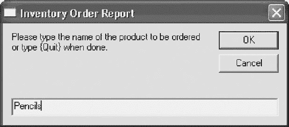
图 3.2：使用 `Do...While` 循环收集并处理用户输入

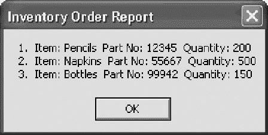
图 3.3：脚本产生的输出示例

### Do…Until

与 `Do...While` 语句（只要条件为真就执行）不同，`Do...Until` 语句直到条件变为真为止执行。与 `Do...While` 语句一样，`Do...Until` 语句支持两种形式。在第一种形式中，`Until` 关键字放在循环的开头。此版本的 `Do...Until` 循环语法所示：

```vbscript
Do Until condition
  statements
Loop
```

`condition` 代表要测试的表达式；`statements` 代表在每次迭代期间将执行的语句。接下来的示例展示了此版本 `Do...Until` 循环的运行情况。

```vbscript
intCounter = 0
strInvReport = ""
Do Until intCounter = 5
  strInventoryOrder = InputBox("Please enter the name of a contact.")
  If Len(strInventoryOrder) = 0 Then
    Exit Do
  End If
  intCounter = intCounter + 1
  strInvReport = strInvReport & intCounter & ". " & strInventoryOrder & vbCrLf
Loop
If Len(strInvReport) > 0 Then
  MsgBox strInvReport
End If
```

`Do...Until` 语句的第二形式将 `Until` 关键字移到循环末尾。此形式的语法所示：

```vbscript
Do
  statements
Loop Until condition
```

`condition` 代表要测试的表达式，`statements` 代表每次迭代期间执行的语句。由于 `Until` 关键字现在位于循环末尾，程序员可以确保循环至少执行一次。

#### For...Next

`For...Next` 循环用于设置执行指定次数的循环。`For...Next` 语句的语法所示：

```vbscript
For counter = begin To end [Step stepvalue]
  statements
Next [counter]
```

`counter` 是循环用于跟踪迭代次数的变量，`statements` 代表每次迭代期间执行的语句。`begin` 指定 `counter` 的起始值。`end` 指定其结束值。`stepvalue` 指定在每次迭代时 `counter` 递增的值。

```vbscript
Dim intCounter, strInvReport, strInventoryOrder
intCounter = 0
strInvReport = ""
For intCounter = 1 To 5
  strInventoryOrder = InputBox("Please enter the name of a contact.")
  If Len(strInventoryOrder) = 0 Then
    Exit For
  End If
  strInvReport = strInvReport & intCounter & ". " & strInventoryOrder & vbCrLf
Next
If Len(strInvReport) > 0 Then
  MsgBox strInvReport
End If
```

```vbscript
For intCounter = 1 To 20
  WScript.Echo intCounter
Next
```

使用可选的 `Step` 关键字，你可以更改 `For...Next` 循环在每次迭代时使用的递增值。例如，以下语句创建了一个起始值为 1 结束值为 20 的 `For...Next` 循环。

```vbscript
Dim intCounter
For intCounter = 1 To 20 Step 3
  WScript.Echo intCounter
Next
```

当此脚本保存为具有 `.VBS` 扩展名的文件并使用 `CScript.exe` 执行主机运行时，它将显示以下输出。

```cmd
C:\>cscript "Script 3.2.vbs"
Microsoft (R) Windows Script Host Version 5.6
1
4
7
10
13
16
19
C:\>
```

## While…Wend

`While...Wend` 语句用于创建一个只要条件保持为真就一直执行的循环。该语句的语法如下所示。

```vbscript
While condition
  statements
Wend
```

`condition` 是正在被测试的表达式，`statements` 代表在循环每次迭代期间执行的 VBScript 语句。`While...Wend` 语句是为了兼容而提供的，不建议继续使用。它的功能被 `Do...While` 和 `Do...Until` 语句重复，后者在应用上更加灵活。

例如，以下 HTML 页面包含一个 VBScript，使用 `While...Wend` 循环构建一个从 1 计数到 10 的字符串，如图 3.4 所示。

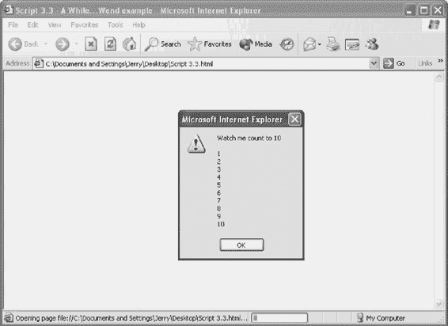
图 3.4：在 HTML 页面嵌入 VBScript 使用 `While...Wend` 循环

```html
<HTML>
  <HEAD>
    <TITLE>Script 3.3 - A While...Wend example</TITLE>
  </HEAD>
  <BODY>
    <SCRIPT LANGUAGE="VBScript">
      Dim intCounter, strDisplayString
      intCounter = 1
      strDisplayString = "Watch me count to 10" & vbCrLf & vbCrLf
      While intCounter <= 10
        strDisplayString = strDisplayString & intCounter & vbCrLf
        intCounter = intCounter + 1
      Wend
      MsgBox strDisplayString
    </SCRIPT>
  </BODY>
</HTML>
```

#### For Each…Next

`For Each...Next` 循环提供了程序化遍历属于对象的所有属性或存储在数组中的所有元素的能力。`For Each...Next` 循环的语法如下所示。

```vbscript
For Each element In collection
  statements
Next
```

`element` 是代表对象属性或数组存储元素的变量。`collection` 是对象或数组的名称。`statements` 代表在循环每次迭代期间执行的 VBScript 语句。

例如，使用 `For Each...Next` 循环，你可以编写一个 WSH VBScript，它可以处理任何 Windows 文件夹的文件内容，如下文所示。

```vbscript
'Script Name: Script 3.4.vbs
'Author: Jerry Ford
'Created: 01/04/2003
'loop to process all the files stored in a folder
'*************************************************************************
Option Explicit
Dim strFileList, intCounter
Set FsoObject = CreateObject("Scripting.FileSystemObject")
Set FolderName = FsoObject.GetFolder("C:\")
intCounter = 0
For Each Member in FolderName.Files
  intCounter = intCounter + 1
  strFileList = strFileList & intCounter & ". " & Member.Name & vbCrLf
Next
MsgBox strFileList, ,"List of files in " & FolderName.Path
```

为了完成此脚本，必须使用 VBScript `FileSystemObject`。该对象是一个 VBScript 运行时对象，直到书中第 17 章“使用配置文件控制脚本执行”中才会正式介绍。因此，这里仅提供最简要的解释。

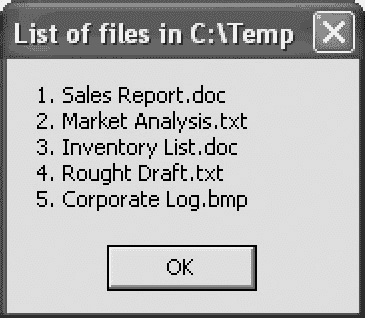

在本章中，你将看到如何使用 VBScript 程序来提高脚本的整体组织结构和管理性。你将学习 VBScript 支持的两种过程：子程序（subroutines）和函数（functions）。本章将介绍如何使用过程通过定义局部变量和全局变量来控制变量范围。你还将学习如何创建响应浏览器事件的事件处理程序，并检查 VBScript 可以响应的浏览器事件类型。最后，你将查看 VBScript 完整的内置函数集合。

VBScript 程序提供了 VBScript 组织的基础构建模块。过程允许你创建模块化的脚本，将语句组织成逻辑组，并作为一个单元执行。VBScript 支持两种不同类型的过程：

* `Subroutine`（子程序）：一种不向其调用语句返回结果的过程。
* `Function`（函数）：一种向其调用语句返回结果的过程。

过程有两个主要优点：首先，它们提供了一种将 VBScript 组织成更易管理格式的方法。其次，过程允许你创建可复用代码并减小脚本的整体体积。

### 增强脚本维护

过程允许你通过将相关语句分组在一起并作为一个单元执行，从而创建更易维护的脚本。因此，作为一个通用规则，你应该将过程作为 VBScript 的主要组织结构。通过使用 VBScript 开发模块化代码，你可以使脚本更易读、更容易维护。例如，通过将相关语句分组到一个过程中，你使它们更容易被找到。你还使脚本更容易更新，允许对单个模块或过程进行更新，而无需对脚本的其他部分进行重大更改。

通过使脚本更易管理，过程允许你增加复杂性，而不一定会增加你工作或维护的难度。正如第 2 章中所示，“错误、常量和变量”，在开发使用 WSH 运行的脚本时，考虑开发一个类似于以下示例的 VBScript 模板。

```vbscript
'Script Name: ScriptName.vbs
'Author: Author Name
'Created: mm/dd/yyyy
'*************************************************************************
'初始化部分
'主处理部分
'过程部分
```

使用此模板，你会将所有子程序和函数放在“过程部分”。这通过为存储和查找过程提供一个可预见的位置，为你的脚本提供了一致的组织结构。重要的一点是将你的过程放在一起，你可以在 VBScript 中轻松地找到它们。大多数 VBScript 程序员选择将子程序和过程存储在脚本的末尾。

### 可复用代码

过程还使脚本维护变得更容易，因为你只需要修改位于一个过程中的代码，而不需要对脚本中可能重复的代码反复进行相同的更改。

子程序和函数在 VBScript 中承担着几乎相同的角色。它们都提供了分组和执行相关语句集合的方法。它们都提供了限制变量范围的方法，这将在本章稍后部分讨论。它们甚至共享相似的语法。它们的不同在于将数据返回给调用它们的语句的能力。函数提供了这种能力，而子程序则不能向其调用语句返回结果。

子程序用于执行语句集合，而不向调用语句返回结果。一旦执行，子程序会将处理控制权返回给其调用语句之后的语句。

```vbscript
[Public | Private] Sub name [(arglist)]
  statements
End Sub
```

要调用子程序，你按以下格式输入其名称：

```vbscript
SubroutineName()
```

或者

```vbscript
SubroutineName(arg1, arg2, arg3, ... argn)
```


例如，以下 VBScript 语句定义了一个名为 `AboutRoutine()` 的子程序。

```
Sub AboutRoutine()
  MsgBox "UserAcctMgr.vbs" & vbCrLf & vbCrLf & _
         "Copyright © Jerry Ford 2003" & vbCrLf & vbCrLf & _
         "jf04@yahoo.com", ,"About Script"
End Sub
```

该子程序可能作为大脚本的一部分提供关于脚本的信息。调用时，`AboutRoutine()` 使用 `MsgBox()` 函数显示信息。该子程序没有设计为接受任何参数，可以使用以下语句从脚本的任何地方调用。

```
AboutRoutine()
```

执行时，该子程序将显示图 4.1 所示的对话框。
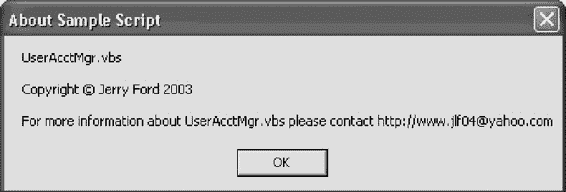

图 4.1：使用子程序显示脚本信息

下面的示例演示了如何定义一个在执行时接收并处理一个参数的子程序。

```
Sub DisplayMsg(strMsgText)
  MsgBox strMsgText, , "VBS Sub Demo"
End Sub
```

该子程序可以添加到任何 VBScript 中提供通用的消息显示过程。它接受单个参数，在本例中，该参数是调用语句传递给它的文本字符串。例如，可以使用以下语句执行 `DisplayMsg()` 子程序，结果显示图 4.2 所示的对话框。

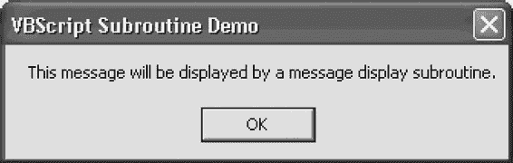
图 4.2：使用通用消息显示过程查看消息

### 函数

函数与子程序相似，不同之处在于它们还提供了向其调用语句返回结果的能力。函数的语法概述如下。

```
[Public | Private] Function Name([Arglist])
  Statements
End Function
```

`Public` 和 `Private` 是可选关键字。`Public` 关键字指定该函数可以被脚本中的其他过程调用。`Private` 关键字指定该函数无法被脚本中的其他过程调用。`Name` 是分配给函数的名称，且在脚本中必须是唯一的。`Arglist` 是一个由逗号分隔的参数列表，在调用函数时可以传递给函数。

例如，下面的函数表示了对之前一个子程序的重写，该子程序在弹出对话框中显示关于脚本的信息。

```
Function AboutRoutine()
  MsgBox "UserAcctMgr.vbs" & vbCrLf & vbCrLf & _
         "For more information about UserAcctMgr.vbs please contact " & _
         "jlf04@yahoo.com", ,"About Sample Script"
End Function
```

在定义该脚本的任何地方，都可以以下语句调用此函数：

```
AboutRoutine()
```

下面的示例演示了一个不接受参数但返回值的函数。

```
Function GetFileName()
  ' ... 返回文件名的逻辑
End Function
```

在此例中，函数返回的文件名被赋值给变量名 `strFileName`。调用该函数的另一种方法是在 VBScript 语句中包含它的引用，如下所示：

```
strFileName = GetFileName()
MsgBox "Click on OK to delete " & GetFileName()
```

函数还可以接受运行时传递给它们的参数，如下文所示。

```
Function DisplayMsg(strMsgText)
  MsgBox strMsgText, , "VBScript Subroutine Demo"
End Function
```

## 控制变量作用域

通过将变量值局部化，你消除了意外修改创建过程之外变量的可能性。作为一种编程技术，通常倾向于尽可能地局部化变量。下面的示例演示了局部变量和全局变量之间的区别。

```
'*************************************************************************
'Script Name: Script 4.1.vbs
'Author: Jerry Ford
'Description: This script demonstrates global and local variable scopes
'*************************************************************************

Option Explicit
Dim X, Y

X = 10
GetNewNumber()
MsgBox "X = " & X & " Y = " & Y

'Procedure Section
Function GetNewNumber()
  Dim Y
  Y = 20
End Function
```

图 4.3 显示了当 WSH 执行此脚本时产生的输出。


图 4.3：VBScript 过程内外的变量作用域演示

在客户端 Web 页面开发的背景下，VBScript 过程在构建响应浏览器事件的事件处理器方面起着特殊作用。这为 Web 页面增加了交互性，并允许在客户端计算机上执行前端处理。*事件*是浏览器内动作的发生。例如，对图像、按钮或链接的鼠标点击代表点击事件。事件的其他示例包括双击 Web 页面对象、在表单元素中输入文本、在对象上移动指针。浏览器事件还发生在页面加载或卸载时。

通过定义函数和子程序并存储在 HTML 页面的头部，你可以创建一个与 Web 页面上任何对象的事件处理器库。

表 4.1 提供了你可以定义事件处理器的浏览器事件列表。表 4.1 还提供了与每个事件关联的事件处理器名称以及事件和事件处理器的描述。你可以看到，事件处理器是通过在其关联的事件名称加上 *on* 来命名的。

| 事件 | 事件处理器 | 描述 |
| --- | --- | --- |
| `Blur` | `onBlur` | 当前对象失去焦点时执行 |
| `Change` | `onChange` | 用户更改对象时执行 |
| `Click` | `onClick` | 用户点击对象时执行 |
| `DragDrop` | `onDragDrop` | 用户将对象拖放到框架或窗口上时执行 |
| `Error` | `onError` | HTML 页面发生错误时执行 |
| `Focus` | `onFocus` | 用户选择对象时执行 |
| `KeyPress` | `onKeyPress` | 用户按下并释放按键时执行 |
| `KeyUp` | `onKeyUp` | 用户释放按键时执行 |
| `Load` | `onLoad` | HTML 页面或图像加载完成时执行 |
| `MouseMove` | `onMouseMove` | 用户移动指针时执行 |
| `MouseOut` | `onMouseOut` | 当访问者将指针移出对象时执行 |
| `MouseUp` | `onMouseUp` | 当访问者释放鼠标按钮时执行 |
| `MouseWheel` | `onMouseWheel` | 当滚动鼠标轮时执行 |
| `Move` | `onMove` | 当访问者移动框架或窗口时执行 |
| `Resize` | `onResize` | 当访问者调整框架或窗口大小时执行 |
| `Select` | `onSelect` | 当访问者选择表单选择菜单的内容时执行 |
| `Submit` | `onSubmit` | 当访问者点击提交按钮时执行 |

### 设置事件处理器

```
<BODY onLoad="window.alert('Greetings')">
```

在例例中，当浏览器加载 HTML 页面时，`onLoad` 事件会自动触发，并显示弹出窗口消息。虽然这种方法对于执行需要极少代码的任务很方便，但它具有局限性。VBScript 提供的另一种选项是设置事件处理器，如下所示。

```
<SCRIPT FOR="SubmitButton" EVENT="onClick" LANGUAGE="VBScript">
  window.alert "Thank you for shopping with us today."
</SCRIPT>
```

第三种也是最常用的选项是定义事件处理器，这些处理器调用存储在 HTML 页面 HEAD 部分内 VBScript 中的过程，如下所示。

```
Sub SubmitButton_onMouseOver
  window.status = "Click here to submit your request."
End Sub
```

当与事件处理器配合使用，过程名称是通过组合对象名称和相应事件处理器的名称创建的。例如，当指针移动到 HTML 页面上名为 `SubmitButton` 的表单按钮时，之前的子程序会被自动触发。执行时，它会在位于浏览器底部的状态栏中显示文本消息。

```
<HTML>
  <HEAD>
    <TITLE>Script 4.2 - onLoad event handler example</TITLE>
    <SCRIPT LANGUAGE="VBScript">
    <!-- Start hiding VBScript statements
      Function ShowGreetingMsg()
        MsgBox("Greetings and thanks for visiting us today.")
    ' End hiding VBScript statements -->
    </SCRIPT>
  </HEAD>
  <BODY onLoad="ShowGreetingMsg()">
    onLoad event handler example
  </BODY>
</HTML>
```

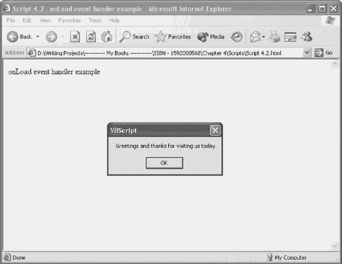

事件处理器的另一个流行用途是创建动画悬停效果，当指针移到对象或移出对象时，以某种方式更改链接、图像或对象的显示。悬停效果可以使用下方列出的 `onMouseOver` 和 `onMouseOut` 事件创建。

- `onMouseOver`: 每当指针移到对象上时触发
- `onMouseOut`: 每当指针移出对象时触发

例如，下面的脚本演示了如何设置一个带有两个悬停链接的 HTML 页面。一个用于 Premier Press 网站，另一个用于微软（Microsoft）网站。

```
<HTML>
  <HEAD>
    <SCRIPT LANGUAGE="VBScript">
    <!-- Start hiding VBScript statements
      Function Premier_onMouseOver
        Premier.style.color="red"
      End Function

      Function Premier_onMouseOut
        Premier.style.color="blue"
      End Function

      Function Microsoft_onMouseOver
        Microsoft.style.color="red"
      End Function

      Function Microsoft_onMouseOut
        Microsoft.style.color="blue"
      End Function
    ' End hiding VBScript statements -->
    </SCRIPT>
  </HEAD>
  <BODY>
    <A HREF="http://www.premierpressbooks.com" NAME="Premier">Premier</A><P>
    <A HREF="http://www.microsoft.com" NAME="Microsoft">Microsoft</A><P>
  </BODY>
</HTML>
```

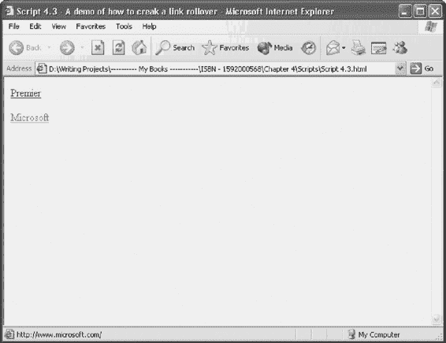

### 内置函数

表 4.2：VBScript 函数

| 函数 | 说明 |
| --- | --- |
| `Abs` | 返回数的绝对值 |
| `Array` | 根据提供的参数列表返回数组 |
| `Atn` | 逆三角函数，返回参数的反正切值 |
| `CBool` | 将表达式转换为布尔值并返回结果 |
| `CByte` | 将表达式转换为 `Byte` 变体并返回结果 |
| `CDate` | 将表达式转换为 `Date` 变体并返回结果 |
| `CDbl` | 将表达式转换为 `Double` 变体并返回结果 |
| `Chr` | 根据提供的 ANSI 代码返回字符 |
| `CLng` | 将表达式转换为 `Long` 变体并返回结果 |
| `Cos` | 返回参数余弦值的三角函数 |
| `CreateObject` | 创建一个自动化对象并返回其引用 |
| `CSng` | 将表达式转换为 `Single` 类型的变体子类型并返回结果 |
| `DateAdd` | 在当前日期上增加额外的时间间隔并返回结果 |
| `DateDiff` | 比较两个日期并返回它们之间的间隔数 |
| `DatePart` | 返回指定日期的部分内容 |
| `DateValue` | 将字符串表达式转换为 `Date` 类型的变体并返回结果 |
| `Day` | 将代表日期的表达式转换为 1 到 31 之间的数字并返回结果 |
| `Eval` | 返回经求值表达式的结果 |
| `Filter` | 根据提供的筛选标准对过滤后的元素集返回一个数组 |
| `FormatCurrency` | 返回已格式化为货币值的表达式 |
| `FormatDateTime` | 返回已格式化为日期或时间值的表达式 |
| `FormatPercent` | 返回已格式化为百分比的表达式（包括随后的 `%`） |
| `GetLocale` | 返回本地化 ID |
| `GetObject` | 返回自动化对象的引用 |
| `Hex` | 返回表示数字的十六进制字符串 |
| `Hour` | 返回一天中某小时的整数（0 到 23） |
| `InputBox` | 返回对话框中的用户输入 |
| `InStrRev` | 返回字符串中子字符串最后一次位置的结束位置 |
| `Int` | 返回指定数字的整数部分 |
| `IsArray` | 根据变量是否为数组返回 `True` 或 `False` |
| `IsEmpty` | 根据变量是否已初始化返回 `True` 或 `False` |
| `IsNull` | 根据表达式是否设置为 `Null` 返回 `True` 或 `False` |
| `IsNumeric` | 根据表达式是否求值为数字返回 `True` 或 `False` |
| `Join` | 返回通过连接数组内容创建的字符串 |
| `LBound` | 返回指定数组维的最小下标 |
| `LCase` | 返回小写字符串 |
| `Len` | 返回数字或字符串的字符长度 |
| `LoadPicture` | 返回图片对象 |
| `Log` | 返回指定参数的自然对数 |
| `Mid` | 根据提供的起始和长度参数从字符串中返回指定数量的字符 |
| `Minute` | 返回一小时内的分钟（0 到 59 之间的数字） |
| `Month` | 返回一年中的月份（1 到 12 之间的数字） |
| `MsgBox` | 返回用户在对话框中点击按钮的值 |
| `Now` | 返回当前日期和时间 |
| `Oct` | 返回包含八进制表示的字符串 |
| `RGB` | 返回表示 RGB 色的数字 |
| `Right` | 返回字符串右侧的字符 |
| `Rnd` | 返回随机数 |
| `RTrim` | 去除字符串结尾的任意空格并返回结果 |
| `ScriptEngine` | 返回标识当前脚本语言的字符串 |
| `ScriptEngineBuildVersion` | 返回脚本引擎的生成次数 |
| `ScriptEngineMinorVersion` | 返回脚本引擎的小版本号 |
| `Second` | 返回一分钟内的秒（0 到 59 之间的数字） |
| `Sgn` | 返回指定参数的正负号 |
| `Space` | 返回由指定数量空格组成的字符串 |
| `Split` | 将字符串组织为数组 |
| `Sqr` | 返回数字的平方根 |
| `String` | 返回由字符组成的字符字符串 |
| `Tan` | 返回参数正切值的三角函数 |
| `Time` | 返回系统当前时间 |
| `TimeSerial` | 返回包含时、分、秒的 `Date` 类型变体 |
| `TimeValue` | 返回指定时间的 `Date` 类型变体 |
| `Trim` | 在去除字符串两端空格后返回字符串 |
| `UBound` | 返回数组的最大下标 |
| `UCase` | 返回大写字符串 |
| `VarType` | 返回变体类型 |
| `WeekdayName` | 返回标识特定星期几的字符串 |
| `Year` | 返回指定的年份 |

作为使用内置函数节省时间并简化脚本的一个快速示例，请查看以下自定义函数，它由五条脚本语句组成：

```
Function SqrtSolver()
  intUserInput = InputBox ("输入一个数字", "自定义平方根函数")
  X = 1
  For i = 1 To 10
    X = X - ((X^2 - intUserInput) / (2 * X))
  Next
  MsgBox " " & intUserInput & " 的平方根是 " & X
End Function
```

函数中包含的五个语句要求用户输入数字，然后使用 `For...Next` 循环通过相当复杂的数学计算确定该数字的平方根。图 4.6 和 4.7 展示了该函数的操作。

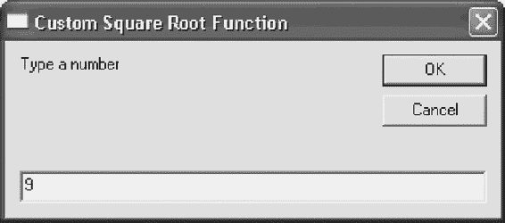
图 4.6：创建一个根据输入数字确定平方根的自定义函数

图 4.7：显示平方根计算的结果

使用 VBScript 内置的 `Sqr()` 函数，你可以像下面所示仅用两行代码完成相同的任务：

```
UserInput = InputBox ("输入一个数字", "平方根计算器")
MsgBox " " & UserInput & " 的平方根是 " & Sqr(UserInput)
```

使用 VBScript 内置 `Sqr()` 函数不仅减少了代码行数，还大大降低了脚本的复杂性，从而缩短了开发时间。

在本章中，你学习了如何通过将 VBScript 组织成子程序和函数来增强它们。这包括理解这两种类型程序之间的区别，以及如何利用 VBScript 内置函数集的强大功能和便利性。程序不仅使脚本更易于读取和维护，还提供了一种限制变量作用域的机制。你还学习了如何使用事件处理程序调用 VBScript 程序，以便开发能够对用户和浏览器活动做出动态响应的 VBScript。

# 第 5 章：数组

到目前，所有的讨论都集中在将变量作为脚本执行期间存储信息的主要手段。变量在有效处理大量数据方面的能力有限。脚本通常设计用于处理以某种方式相关的数据。VBScript 提供了数组结构作为更有效地管理大量相关数据的手段。在本章中，你将学习如何操作一维数组和多维数组。此外，你将学习调整数组大小的各种技术以及处理和删除其内容。

## 在数组中存储相关数据

通常，脚本处理以某种方式相关的数据。当要处理的数据量较小时，可以将其存储在单独变量中。然而，随着脚本处理的数据量增加，依赖变量变得越来越困难。例如，一个脚本可能需要处理一组用户名称。定义 100 个唯一的变量名将是一个异常艰巨的过程。相反，VBScript 提供了数组作为存储大量相关数据的结构。

`array` 是一个相关数据的索引列表。数组提供了以易于管理的方式存储相关信息的能力。大多数数组由单维度组成，可以被看作单列表格。VBScript 数组是基于 0 的，这意味着它们的第一个元素始终被分配索引值为 0。存储在数组中的第二个元素被分配索引值为 1，依此类推。通过指定数组名称和索引值，你可以引用存储在数组中的任何元素。

然而，VBScript 数组不仅限于单维度。例如，一个二维 VBScript 数组可以被看作是一个由多个列和行组成的表格，如图 5.1 所示。

| | `Cust_No` | `Cust_Name` | `Cust_Phone` |
| --- | --- | --- | --- |
| `Customer1` | `0,0` | `1,0` | `2,0` |
| `Customer3` | `0,2` | `1,2` | `2,2` |

随着额外维度的增加，数组变得更加复杂。例如，三维数组可以被看作是一个立方体。对于大多数人来说，超过三维的任何东西都很难概念化，图形表示同样困难。幸运的是，尽管 VBScript 可以支持多达 60 维的数组，大多数情况只需要一或二维数组。

## 操作一维数组

### 定义一维数组

```
Dim ArrayName(dimensions)
```

`ArrayName` 是分配给数组的名称，`dimensions` 是一个用逗号分隔的列表，用于指定数组的维度数及其长度。

```
Dim astrCustomerList(4)
```

> **提示**  
> 为了让数组与其他变量区分开来，请为它们开发一套独特的命名规范。在书中，数组名称开头会附加小写字母 a，后跟一个三个字符的匈牙利风格描述，用于说明数组中存储的数据类型，以及一个或多个标识数组内容的描述性单词。在前面的例中，`astrCustomerList` 数组包含代表客户名称的字符串数据。

一旦定义了数组，你就可以开始在其中存储元素。例如，以下语句创建一个名为 `astrCustomerList` 的数组，并为其五个元素中的每一个分配数据。

```
Dim astrCustomerList(4)
astrCustomerList(0) = "XYZ Corp."
astrCustomerList(1) = "ABC Co."
astrCustomerList(2) = "Acme Inc."
astrCustomerList(3) = "A&B Corp"
astrCustomerList(4) = "ZZZ Enterprises"
```

如果你想让用户为数组提供数据，可以如下所示收集。

```
For i = 0 To 4
  astrCustomerList(i) = InputBox("请输入客户名称")
Next
```

循环被设置为迭代五次（从 0 到 4）。它使用 VBScript 的 `InputBox()` 函数提示用户输入名称，如图 5.2 所示。然后通过将 `i` 的值与索引值关联，将用户输入的值存储在数组中。

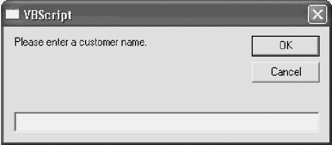
图 5.2：使用用户输入填充数组

### 处理一维数组

可以使用不同的技术来访问数组的内容。这包括通过引用索引值访问特定元素以及创建遍历所有元素的循环。这两种技术都将在接下来的章节中进行回顾。

#### 直接访问

一旦数组填充了数据，你就可以处理它。访问数组内容的方法是指定特定元素的索引值，如下所示。

```
MsgBox astrCustomerList(0)
MsgBox astrCustomerList(1)
MsgBox astrCustomerList(2)
MsgBox astrCustomerList(3)
MsgBox astrCustomerList(4)
```

图 5.3 显示了此脚本的输出。


图 5.3：访问存储在数组中的特定元素

#### For Each…Next

通过指定单个元素来处理数组内容通常是不实际的。相反，你可以创建一个 `For Each…Next` 循环遍历数组，允许你程序化地处理存储在数组中的每个元素。`For Each…Next` 循环的语法如下。

```
For Each element In group
  Statements ...
Next
```

`Element` 是一个在遍历数组时控制循环的变量。`Group` 指定要处理的数组名称。`Statements` 是用于处理数组内容的语句。

`For Each…Next` 循环会持续迭代，直到数组中存储的每一个元素都处理完毕，如下例所示。

```
<HTML>
  <HEAD>
    <TITLE>Array Example</TITLE>
  </HEAD>
  <BODY>
    <SCRIPT language="VBScript">
      Option Explicit
      Dim i
      Dim astrCustomerList(4)

      astrCustomerList(0) = "XYZ Corp."
      astrCustomerList(1) = "ABC Co."
      astrCustomerList(2) = "Acme Inc."
      astrCustomerList(3) = "A&B Corp"
      astrCustomerList(4) = "ZZZ Enterprises"

      Document.Write "<B>" & "Customer Contacts:" & "</B> " & "<BR>"

      For Each i In astrCustomerList
        Document.Write i & "<BR>"
      Next
    </SCRIPT>
  </BODY>
</HTML>
```

如你所见，一段 VBScript 被嵌入到 HTML 页面的 `BODY` 部分。该脚本首先定义了一个名为 `astrCustomerList` 的数组，它可以最多存储五个元素。接下来的五条语句在数组的每个元素中存储值。接着，使用 `Document.Write` 语句在 Web 上显示列标题。最后，使用 `For Each…Next` 循环遍历数组并显示其内容，内容由变量 `i` 表示。图 5.4 显示了加载此 HTML 页面时生成的输出。

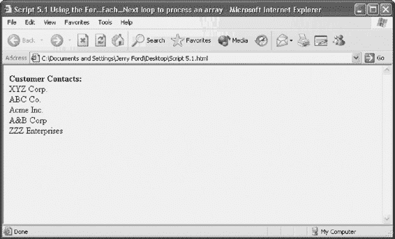
图 5.4：使用 `For Each…Next` 循环处理存储在数组中的所有元素

> **备注**  
> 关于如何使用 `For Each…Next` 循环的更多信息，请参阅第 3 章，“条件逻辑和迭代结构。”

VBScript 提供了两个函数，允许你通过编程确定数组的上限和下界。这些是 `UBound()` 和 `LBound()` 函数。`LBound()` 函数返回数组下界（即其最低元素）的值。然而，由于 VBScript 的数组始终从 0 开始索引，因此该函数的意义不大。

相反，`UBound()` 函数是有价值的。它用于检索数组上限（其最高元素）的值。当用于处理一维数组时，`UBound()` 函数的语法如下。

```
UBound(ArrayName)
```

```
x = UBound(ArrayName)
```

赋值给 `x` 的值等于数组中实际元素个数减 1。因此，要确定存储在数组中的元素个数，将 `UBound()` 返回的值加 1，如下所示。

```
x = UBound(ArrayName) + 1
```

```
'*************************************************************************
'Author: Jerry Ford
'Created: 01/17/2003
'Description: Using UBound() to determine an array's upper boundary
'*************************************************************************

Option Explicit
Dim astrCustomerList(4)
Dim intArrayUpperBound, i, strDisplayString

astrCustomerList(0) = "XYZ Corp."
astrCustomerList(1) = "ABC Co."
astrCustomerList(2) = "Acme Inc."
astrCustomerList(3) = "A&B Corp."
astrCustomerList(4) = "ZZZ Enterprises"

'Main Processing Section
intArrayUpperBound = UBound(astrCustomerList)
For i = 0 To intArrayUpperBound
  strDisplayString = strDisplayString & astrCustomerList(i) & " " & vbCrLf
Next
MsgBox "Contacts:" & vbCrLf & vbCrLf & strDisplayString, , "Contacts"
```

## 处理多维数组

```
Const cCustomerName = 0
Const cCustomerNo = 1
Const cCustomerPhone = 2

Dim astrCustomerList(2,4)

astrCustomerList(cCustomerName,0) = "XYZ Corp."
astrCustomerList(cCustomerNo,0) = 12345
astrCustomerList(cCustomerPhone,0) = "800-333-3333"
astrCustomerList(cCustomerName,1) = "ABC Co"
astrCustomerList(cCustomerNo,1) = 98765
astrCustomerList(cCustomerPhone,1) = "877-444-4444"
astrCustomerList(cCustomerName,2) = "Acme Inc."
astrCustomerList(cCustomerNo,2) = 11122
astrCustomerList(cCustomerPhone,2) = "800-555-5555"
astrCustomerList(cCustomerName,3) = "A&B Corp."
astrCustomerList(cCustomerNo,3) = 22233
astrCustomerList(cCustomerPhone,3) = "888-888-9999"
astrCustomerList(cCustomerName,4) = "ZZZ Enterprises"
astrCustomerList(cCustomerNo,4) = 33344
astrCustomerList(cCustomerPhone,4) = "877-444-1111"
```

> **提示**  
> 注意上一个示例中前三个语句对常量的使用。通过分配常量来表示数组中三列对应的值，代码变得具有自文档性，使其更易阅读和维护。

## 处理多维数组

一旦定义了多维数组并填充了数据，就可以对其进行处理。与静态数组一样，你可以指定单个元素的位置来访问它们的值。对于二维数组，这意味着要像下文所示同时指定行和列坐标。

```
WScript.Echo astrCustomerList(cCustomerName,2)
WScript.Echo astrCustomerList(cCustomerPhone,2)
```

然而，为了处理包含大量数据的多维数组，你需要建立一个循环，如下例所示。

```
'*************************************************************************
'Script Name: Script 5.3.vbs
'Author: Jerry Ford
'Description: 一个多维数组示例
'*************************************************************************

Option Explicit

Const cCustomerName = 0
Const cCustomerNo = 1
Const cCustomerPhone = 2

Dim astrCustomerList(2,4)
Dim intArrayUpperBound, i, strDisplayString

LoadArray()

intArrayUpperBound = UBound(astrCustomerList, 2)
For i = 0 To intArrayUpperBound
  strDisplayString = strDisplayString & _
    astrCustomerList(cCustomerName, i) & " " & _
    astrCustomerList(cCustomerNo, i) & " " & _
    astrCustomerList(cCustomerPhone, i) & vbCrLf
Next
MsgBox strDisplayString, , "Multidimensional Array Example"

Function LoadArray()
  astrCustomerList(cCustomerName,0) = "XYZ Corp."
  astrCustomerList(cCustomerPhone,0) = "800-333-3333"
  astrCustomerList(cCustomerName,1) = "ABC Co"
  astrCustomerList(cCustomerNo,1) = 98765
  astrCustomerList(cCustomerName,2) = "Acme Inc."
  astrCustomerList(cCustomerNo,2) = 11122
  astrCustomerList(cCustomerPhone,2) = "800-555-5555"
  astrCustomerList(cCustomerNo,3) = 22233
  astrCustomerList(cCustomerPhone,3) = "888-888-9999"
  astrCustomerList(cCustomerName,4) = "ZZZ Enterprises"
  astrCustomerList(cCustomerPhone,4) = "877-444-1111"
End Function
```

## 调整动态数组的大小

```
'*************************************************************************
'Script Name: Script 5.4.vbs
'Author: Jerry Ford
'Description: 演示如何调整数组大小
'*************************************************************************

Option Explicit

Dim astrCustomerList()
Dim strMessage

strMessage = "Dynamic Array Demonstration" & vbCrLf & vbCrLf

'Main Processing Section
DimTheArray()
ReDimTheArray()
DisplayResults()

'Procedure Section
Function DimTheArray()
  ReDim astrCustomerList(2)
  astrCustomerList(0) = "XYZ Corp."
  astrCustomerList(1) = "ABC Co."
  astrCustomerList(2) = "Acme Inc."
End Function

Function ReDimTheArray()
  ReDim Preserve astrCustomerList(4)
  astrCustomerList(3) = "A&B Corp."
  astrCustomerList(4) = "ZZZ Enterprises"
End Function

Function DisplayResults()
  Dim i
  For Each i In astrCustomerList
    strMessage = strMessage & i & vbCrLf
  Next
  MsgBox strMessage
End Function
```

接下来，执行 `ReDimTheArray()` 函数。该函数重新调整数组的大小，使其能够存储多达五个元素。包含 `Preserve` 关键字是为了确保数组中当前存储的数据不会丢失。随后为两个新的数组元素赋值了值。

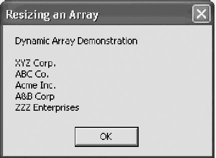

上一个示例演示了在预先知道数组需要扩展到多大的假设下如何调整动态数组。然而，在许多情况下，你无法预先知道动态数组应该有多大。接下来的示例演示了如何编写脚本，在每次添加新元素时动态地调整数组的大小。这允许脚本根据需要增加数组的大小，以适应任何所需的数据量。

```
'*************************************************************************
'Script Name: Script 5.5.vbs
'Author: Jerry Ford
'Description: 根据用户输入调整动态数组
'*************************************************************************

Option Explicit

Dim astrCustomerList()
Dim strMessage

ReDim astrCustomerList(0)

CollectInputData()
ProcessInputData()

'Procedure Section
Function CollectInputData()
  Dim i
  Dim strUserInput
  i = 0
  Do
    strUserInput = InputBox("Type a customer name (or 'quit' to exit)")
    If UCase(strUserInput) <> "QUIT" Then
      astrCustomerList(i) = strUserInput
      i = i + 1
      ReDim Preserve astrCustomerList(i)
    Else
      Exit Do
    End If
  Loop
End Function

Function ProcessInputData()
  Dim i
  For Each i In astrCustomerList
    strMessage = strMessage & i & vbCrLf
  Next
  MsgBox strMessage
End Function
```

脚本开始时定义变量并定义一个名为 `astrCustomerList` 的初始大小为 `0` 的数组。这允许数组存储单个元素。脚本的控制逻辑位于主处理部分，包含两个函数调用。第一个调用的函数是 `CollectInputData()`。该函数使用 `Do…While` 循环来控制数据收集。使用 VBScript 的 `InputBox()` 函数从用户处收集文本输入。数据收集持续到用户输入单词 `quit`。`UCase()` 函数用于测试用户输入的每条数据以查找单词 `QUIT`。每当输入新条目时，脚本将其分配为数组的最后一个元素，然后调整数组大小以容纳新元素。

> **提示**  
> `UCase()` 函数可将文本转换为全大写。这允许你进行全大写文本比较，而无需担心用户使用的大小写。例如，在之前的脚本中，用户可以输入 `QUIT`、`quit` 或 `QuIt` 来终止数据输入过程。

脚本中调用的最后一个函数使用 `For Each…Next` 循环处理存储在数组中的每个元素，构建显示字符串并显示结果。

### 调整多维动态数组的大小

在保留多维数组中存储的数据时，只有定义的最后一个维度可以被调整大小。例如，在本章之前介绍的二维数组中，设置了一个数组来存储客户名称、客户编号和客户电话号码。由于数组的第二个维度被用于存储客户记录（列），因此它是唯一可以调整大小的维度。幸运的是，这在这种情况下是可行的，因为客户姓名不太会更改，电话号码可能会变。

作为另一个示例，考虑以下二维数组：

```
ReDim astrCustomerList(2,2)
```

此语句定义的数组可以看作是一个三行三列的表格。然而，由于多维数组的最后一个维度可以调整大小，因此存储在第二个维度中的元素可以被调整大小。为了调整数组以包含更多数据，你可以如下所示增加其第二个维度的大小：

```
ReDim astrCustomerList(2,9)
```

此语句允许将第二个维度扩展到存储 10 个元素。

### 擦除数组

VBScript 提供使用 `Erase` 语句删除数组的功能。该语句的语法如下：

```
Erase arrayname
```

`Erase` 语句删除静态数组的内容，但不会缩小数组的大小。用于删除动态数组时，`Erase` 语句删除数组的内容并释放数组使用的所有存储，从而释放内存。

例如，以下语句删除名为 `astrCustomerList` 的数组的内容：

```
Erase astrCustomerList
```

### 使用 VBScript 函数处理数组

VBScript 提供了两个在处理数组时非常有用的函数。这些函数的简单定义如下：

*   `Array()`：获取一个包含数组的变体
*   `IsArray()`：提供判断变量是否为数组的能力

#### 使用 Array() 函数

`Array()` 函数的语法如下。

```
ArrayName = Array(arglist)
```

`Arglist` 是一个用逗号分隔的元素列表，用于存储在数组中。如果省略 `arglist`，则设置一个长度为零的数组。否则，数组的初始大小由 `arglist` 中提供的元素数量决定。例如，以下语句定义了一个包含五个元素的数组。

```
astrCustomerList = Array("ABC Corp", "XYZ Inc", "Acme Co.", "L&F Inc", "IV World")
```

`Array()` 函数允许你减少创建小型数组所需的语句数量。例如，上面的数组也可以同样像下面所示那样进行定义。

```
ReDim astrCustomerList(4)
astrCustomerList(0) = "XYZ Corp."
astrCustomerList(1) = "ABC Co."
astrCustomerList(2) = "Acme Inc."
astrCustomerList(3) = "A&B Corp"
astrCustomerList(4) = "ZZZ Enterprises"
```

#### 使用 IsArray() 函数

VBScript `IsArray()` 函数用于测试指定的变量是否为数组。如果测试的变量是数组，它返回 `True` 值。否则，返回 `False` 值。

除了数组外，VBScript 变量是标量的，这意味着它们只包含一个值。如果 VBScript 尝试对标量变量使用 `UBound()` 或 `LBound()` 等数组相关函数，就会发生错误并终止脚本执行。如果脚本尝试在引用标量变量时指定索引号将其作为数组处理，也会发生错误。防止意外将标量变量当作数组处理的一种方法是先使用 `IsArray()` 函数进行测试。

`IsArray()` 函数的语法如下。

```
IsArray(variablename)
```

例如，以下语句定义了一个数组，然后演示了如何使用 `IsArray()` 函数。

```
ReDim astrCustomerList(4)
X = IsArray(astrCustomerList)
If X = True Then
  MsgBox "This variable is an array."
Else
  MsgBox "This is a scalar variable."
End If
```

## 总结

在本章中，你学习了如何处理单维和多维数组。你还学习了如何处理静态和动态数组。此外，你学习了处理数组内容的不同技术，包括如何访问存储在特定数组单元格中的数据，以及如何创建循环来迭代处理整个数组的内容。本章涵盖的其他主题还包括如何调整数组大小，以及如何保留和删除其内容。

# 第 6 章：数据收集、通知与错误报告

在本章中，你将学习如何使用 VBScript 的 `InputBox()` 和 `MsgBox()` 函数显示弹出对话框，用于收集用户输入和显示输出。你学习如何控制这些弹出对话框内文本的呈现，以及如何查询用户指定的输入。此外，本章将介绍有关错误处理的信息，包括如何生成更友好的错误消息。

## 与用户交互

根据你开发 VBScript 的编程环境，你有多种不同的选项来显示输出并与用户交互。例如，在 HTML 页面中，你可以使用 `Window` 和 `Document` 对象提供的方法显示输出。这些方法在表 6.1 中进行了描述。

表 6.1：VBScript 输出方法

| 对象 | 方法 | 描述 |
| --- | --- | --- |
| `Document` | `Write` | 直接在 HTML 页面上显示文本 |
| `Window` | `Alert` | 在带有 `OK` 按钮的弹出对话框中显示文本 |
|  | `Prompt` | 在带有文本输入框以及 `OK` 和 `Cancel` 按钮的弹出对话框中显示文本 |
|  | `Confirm` | 在弹出对话框中显示文本消息，并要求用户通过点击 `OK` 或 `Cancel` 按钮提供确认 |
|  | `Status` | 在浏览器状态栏中显示文本消息 |

> **注意**  
> `Window` 和 `Document` 对象是浏览器对象。`Window` 对象代表当前打开的浏览器窗口或帧。`Document` 对象代表当前加载的 HTML 页面。关于这些对象的更多信息请参阅第 8 章，“VBScript and Internet Explorer”。

在为 WSH（Windows 脚本宿主）开发脚本时，程序员可以选择使用 `WScript` 和 `WshShell` 提供的方法显示输出。这些方法在下方指定。

*   `Echo()`：一个属于 `WScript` 对象的方法，可在 Windows 控制台或弹出对话框中显示文本消息。
*   `Popup()`：一个属于 `WshShell` 对象的方法，可在弹出对话框中显示文本消息，并控制图标和按钮的选择，且能够确定用户点击了哪个按钮。

> **注意**  
> `WScript` 和 `WshShell` 对象是 WSH 对象。`WScript` 对象是其他 WSH 对象的顶级或父对象。`WshShell` 对象提供了可用的方法和属性。

除了 Internet Explorer 提供的特定环境输出外，VBScript 还提供了一对始终可用于输出和收集输入的函数。这两个函数描述如下。

*   `InputBox()`：显示一个带有文本输入框的弹出对话框。
*   `MsgBox()`：显示一个包含文本消息和可选图标的弹出对话框。

## InputBox() 函数

VBScript 的 `InputBox()` 函数提供了在脚本执行期间提示用户输入数据的能力。这允许你开发可以与用户直接交互的脚本。`InputBox()` 函数显示具有以下能力的弹出对话框：

*   一个用于收集输入的文本字段
*   能够显示长达 1,024 个字符的文本消息
*   允许用户控制弹出对话框的 OK 和取消按钮

### 定义 InputBox() 函数

`InputBox()` 函数的语法如下。

```
Response = InputBox(Prompt[, Titlebarmsg][, Default][, Xpos][, Ypos][, Helpfile, Context])
```

`Response` 是一个带有字符串子类型的变体，用于存储用户提供的文本。`Prompt` 是一个长达 1,024 个字符的文本消息，为用户提供指令和方向。`Titlebarmsg` 是可选的。如果提供，将其显示在弹出对话框的标题栏中。如果省略，标题栏将显示“VBScript”。`Default` 是可选的。使用时，它提供一个自动显示在弹出对话框文本字段中的默认答案。`Xpos` 和 `Ypos` 是以点（twips）为单位指定的测量值。使用时，`Xpos` 指定从显示左侧到弹出对话框左侧的距离。`Ypos` 指定从显示顶部到弹出对话框顶部的距离。`Helpfile` 和 `Context` 是可选的。它们指定可用上下文帮助的外部文件位置。

> **注意**  
> *Twip* 是一种空间测量单位，代表点的 1/20 或英寸的 1/1440。

以下语句演示了如何使用 `InputBox()` 函数。

```
strUserName = InputBox("Please enter your name")
MsgBox ("Greetings " & strUserName)
```

此示例中的第一个语句显示了图 6.1 所示的弹出对话框。如你所见，它显示了一条消息并等待用户输入名称并点击 OK 按钮，或者点击 Cancel 按钮取消操作。

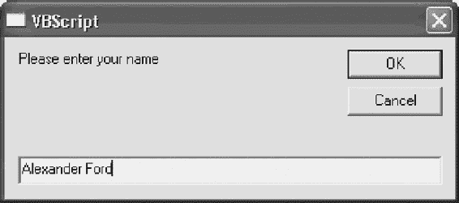
图 6.1：使用 `InputBox()` 函数从用户处收集数据输入

`InputBox()` 函数在点击 OK 按钮时返回用户输入的文本。然而，如果用户在未输入任何文本的情况下点击了 OK，或者点击了 `Cancel` 按钮，则会返回一个长度为零的字符串（即 ""）。在上一个示例中，用户输入的数据被保存为名为 `strUserName` 的变量，其类型为字符串子类型的变体。图 6.2 显示了上述第二个语句显示的弹出对话框。


图 6.2：按名称问候用户

`InputBox()` 函数的参数对位置敏感。如果你不使用特定参数，必须替换一个逗号以便继续添加被省略参数之后的后续参数。例如，以下语句将显示如图 6.3 所示的弹出对话框。此示例将显示一条消息和一个默认答案，而不会指定在弹出对话框标题栏中显示的任何消息文本。

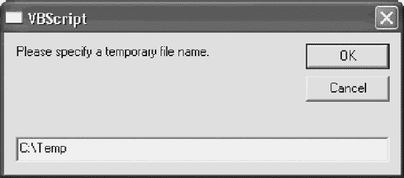
图 6.3：使用 `InputBox()` 函数显示带有默认答案的弹出对话框

```
strFileName = InputBox("Please specify a temporary file name.", ,"C:\Temp")
```

> **注意**  
> 如果在使用 `InputBox()` 函数时省略了 `titlebarmsg` 参数，VBScript 将在弹出对话框的标题栏中显示“VBScript”字样。

### 输入验证

用户可能是完全不可预测的。因此，对 `InputBox()` 函数返回的所有数据进行询问和验证至关重要，以确保它们符合你的 VBScript 的要求。例如，你可能会编写一个脚本，意图收集用户的姓名。然而，用户可能不会输入姓名，而是执行以下操作之一：

*   点击 Cancel 按钮
*   按下 Escape 键
*   在未输入任何文本的情况下点击 OK

每种操作都会导致一个长度为零的字符串。以下语句演示了在使用 `InputBox()` 函数时如何检查数据是否存在。

```
strUserName = InputBox("Please enter your name.", "User Questionnaire")
If strUserName = "" Then
  MsgBox "You did not provide any information!"
Else
  MsgBox "Greetings " & strUserName
End If
```

第二个语句检查由 `InputBox()` 函数返回并存储在 `strUserName` 中的数据是否等于 ""。

以下示例显示了另一种查看用户是否向 `InputBox()` 函数提供了数据的方法。

```
strChoice = InputBox("What do you prefer: Games, Utilities or Other?")
If Len(strChoice) = 0 Then
  MsgBox "You did not enter any data."
End If
```

在此示例中，使用了 VBScript 的 `Len()` 函数来查看存储在 `strChoice` 中的值是否为零长度。有时，在用户未能提供任何数据的情况下，提供一个默认答案可能是合适的，如下所示。

```
strChoice = InputBox("What do you prefer: Games, Utilities or Other?")
If Len(strChoice) = 0 Then
  strChoice = "Other"
End If
```

在此示例中，如果用户未能输入任何数据，`strChoice` 的值将自动设置为 `Other`。在某些情况下，提供默认答案是不够的。在这种情况下，你可以将 `InputBox()` 函数封装在一个循环中，该循环一直迭代直到用户提供正确的响应。例如，以下语句使用 `Do...While` 循环强制用户在 `InputBox()` 函数的提示下输入 `quit` 以退出循环。

```
Do While UCase(strChoice) <> "QUIT"
  strChoice = InputBox("What do you want to do?")
  If UCase(strChoice) <> "QUIT" Then
    MsgBox "Invalid option. Please specify your selection again."
  Else
    Exit Do
  End If
Loop
```

在此示例中，使用 `UCase()` 函数将所有用户的响应转换为大写字母。然后检查用户的响应以确认是否提供了正确的输入。

VBScript 为你提供了工具来控制 `InputBox()` 函数显示的提示消息的格式。你可以使用表 6.2 列出的任何 VBScript 常量来格式化文本输出。

表 6.2：VBScript 字符串常量

| 常量 | 说明 |
| --- | --- |
| `vbCr` | 执行回车操作 |
| `vbCrLf` | 执行回车和换行操作 |
| `vbLf` | 执行换行操作 |
| `vbTab` | 执行水平制表 |

以下示例演示了如何在 `InputBox()` 对话框中格式化文本。

```
intAnswer = InputBox("Please enter the number of one of the " & _
  "following options:" & vbCrLf & _
  "-- Choices --" & vbCrLf & _
  "1. View copyright information." & vbCrLf & _
  "2. View information about the script." & vbCrLf & _
  "3. View help.", "Menu List")
If IsNumeric(intAnswer) Then
  Select Case intAnswer
    Case 1
      MsgBox "Copyright 2003, Jerry Lee."
    Case 2
      MsgBox "This script demonstrates how to format text in " & _
        "InputBox()s"
    Case 3
      MsgBox "For additional assistance visit " & _
        "msdn.microsoft.com/scripting"
    Case Else
      MsgBox "Invalid selection."
  End Select
Else
  MsgBox "The only valid options are 1, 2 or 3."
End If
```

### 数据转换

VBScript 只支持变体类型。然而，它支持多种变体子类型。VBScript 会尽可能确定存储在变量中的数据类型。为了解决这个问题，VBScript 提供了两种更改子类型的方法：隐式转换和显式转换。

#### 隐式转换

`InputBox()` 函数无论用户输入什么，只返回字符串数据。然而，VBScript 提供了解决方法。在大多数情况下，VBScript 能够根据情况自动转换存储在变量中的数据。例如，如果用户在 `InputBox()` 弹出对话框的字段中输入数字 66，VBScript 将其视为字符串 "66"。如果执行使用该变量的数学运算，VBScript 将自动将其子类型转换为数值型。这被称为隐式转换。

使用隐式转换，以下 VBScript 能够自动将用户输入的任何数字从字符串转换为数值值。

```
dblAnswer = InputBox("Enter the number", "Implicit Conversion Example")
MsgBox TypeName(dblAnswer)
dblAnswer = 100 + dblAnswer
MsgBox TypeName(dblAnswer)
```

> **注意**  
> 上一个示例中使用的 VBScript `TypeName()` 函数返回显示指定变量子类型的字符串。`TypeName()` 函数可以返回以下任何字符串：
> *   `Byte`
> *   `Integer`
> *   `Long`
> *   `Single`
> *   `Double`
> *   `Currency`
> *   `Decimal`
> *   `Date`
> *   `String`
> *   `Boolean`
> *   `Empty`
> *   `Null`
> *   `Object`
> *   `Unknown`
> *   `Error`

执行时，此示例中的第二个语句将显示如图 6.4 所示的输出，证明 `InputBox()` 函数总是返回字符串值。


图 6.4：`InputBox()` 函数总是返回字符串值

脚本的第三行执行了一个数学操作，在用户输入的数字上加上 100。通过隐式转换，VBScript 会自动将变量的值转换为子类型为 `Double` 的 `Variant`。脚本最后一行显示的输出（如图 6.5 所示）证明了变量已经过转换。


图 6.5：VBScript 会根据情况自动尝试将变量从一个子类型转换为另一个子类型

#### 显式转换

虽然 VBScript 会尽力根据每个情况自动调整变量的子类型，但可能会出现它无法按你预期的进行调整的情况。当这种情况发生时，你可以尝试使用显式转换来强制子类型转换。VBScript 提供了大量的转换函数，如表 6.3 所示。

表 6.3：VBScript 转换函数

| 函数 | 说明 |
| --- | --- |
| `Asc` | 返回字符串中第一个字母的 ANSI 字符码 |
| `CBool` | 将变量转换为 `Boolean` 子类型 |
| `CByte` | 将变量转换为 `Byte` 子类型 |
| `CCur` | 将变量转换为 `Currency` 子类型 |
| `CDate` | 将变量转换为 `Date` 子类型 |
| `CDbl` | 将变量转换为 `Double` 子类型 |
| `Chr` | 返回指定的 ANSI 字符码字符 |
| `CInt` | 将变量转换为 `Integer` 子类型 |
| `CLng` | 将变量转换为 `Long` 子类型 |
| `CSng` | 将变量转换为 `Single` 子类型 |
| `CStr` | 将变量转换为 `String` 子类型 |
| `Hex` | 返回表示数字十六进制值的字符串 |
| `Oct` | 返回表示数字八进制数值的字符串 |

以下示例演示了 `CInt()` 转换函数的应用。

```
intUserNumber = InputBox("输入 0 到 9 之间的数字", "输入你的答案")
If IsNumeric(intUserNumber) = True Then
  intUserNumber = CInt(intUserNumber)
  If Len(CStr(intUserNumber)) = 1 Then
    MsgBox "你输入了 " & intUserNumber
  Else
    MsgBox "选择无效!"
  End If
Else
  MsgBox "无效非数字"
End If
```

`InputBox()` 函数用于提示用户输入 0 到 9 之间的值。为了确保用户输入的是数字而不是字母或特殊字符，使用了 `IsNumeric()` 函数。如果输入的是数字，则该函数返回的值将等于 `True`。在这种情况下，使用 `CInt()` 函数显式地将输入值转换为 `Integer` 值。虽然在这个示例中不是严格要求的，但使用 `CInt()` 函数可以让程序员的意图更加清晰。

> **注意**  
> `IsNumeric()` 函数返回一个布尔值，指定测试的值是否为数字。

## 类型不匹配

如果 VBScript 尝试对一个其子类型不支持的变量进行操作，就会发生错误。VBScript 无法对非数字数据进行算术比较。例如，以下脚本提示用户输入一个 1 到 9 之间的数值。

```
intAnswer = InputBox("输入 1 到 9 之间的数字", "菜单列表")
If intAnswer > 0 Then
  If intAnswer < 10 Then
    MsgBox "你输入了 " & intAnswer
  End If
End If
```

如果用户输入 1 到 9 之间的数字，将显示消息。如果用户输入范围之外的数字，则什么都不会发生。然而，如果用户输入字母或特殊字符而不是数值，就会发生类型不匹配错误，如图 6.6 所示。

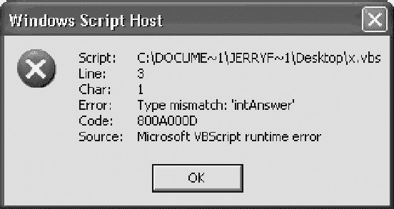
图 6.6：当 VBScript 尝试对一个子类型不支持的 Variant 执行操作时，会发生类型不匹配错误

为了避免类型不匹配错误的发生，你需要进行输入验证。这通常涉及测试变量以确定其子类型分配，可以使用 `TypeName()` 函数或使用表 6.4 中列出的任何子类型测试函数。

表 6.4：测试 Variant 子类型的 VBScript 函数

| 函数 | 说明 |
| --- | --- |
| `IsArray` | 根据指定的变量是否为数组返回 `True` 或 `False` |
| `IsDate` | 根据指定的变量是否为日期返回 `True` 或 `False` |
| `IsEmpty` | 根据指定的变量是否已初始化返回 `True` 或 `False` |
| `IsFinite` | 根据指定的数字是否为有限值返回 `True` 或 `False` |
| `IsNaN` | 根据指定的变量是否为 `NaN` 返回 `True` 或 `False` |
| `IsNull` | 根据指定的变量是否为空返回 `True` 或 `False` |
| `IsNumeric` | 根据指定的变量是否为数字返回 `True` 或 `False` |
| `IsError` | 根据指定的变量是否包含错误返回 `True` 或 `False` |

## MsgBox 函数

`MsgBox()` 函数提供了一种收集数据的方便方法。然而，你通常需要向用户展示一个范围供选择。你可以使用 `MsgBox()` 函数来实现这一点。

### 定义 MsgBox 函数

`MsgBox()` 函数的语法如下所示。

```
MsgBox(Prompt[, Buttons][, TitleMsg][, Helpfile, Context])
```

`Prompt` 是一个长达 1,024 个字符的消息，向用户提供指示。`Buttons` 是一个指定显示哪些按钮的值。`TitleMsg` 是可选的。提供时，将其显示在弹出框的标题栏中。如果省略，将显示 "VBScript"。`Helpfile` 和 `Context` 是可选的。它们指定了可用帮助文件的位置。

`MsgBox()` 函数提供了自定义弹出对话框的功能。这些功能列举如下：

*   显示的按钮组合
*   显示的图标
*   默认按钮
*   对话框的模态

这些选项均在随后的表格中描述。在使用 `MsgBox()` 函数显示弹出对话框时，你可以从每个表中选择一个选项。表 6.5 列出了可以通过 `MsgBox()` 函数显示的不同按钮。

表 6.5：VBScript `MsgBox()` 函数按钮

| 常量 | 数值 | 说明 |
| --- | --- | --- |
| `vbOKOnly` | 0 | 显示 `OK` 按钮 |
| `vbOKCancel` | 1 | 显示 `OK` 和 `Cancel` 按钮 |
| `vbAbortRetryIgnore` | 2 | 显示 `Abort`、`Retry` 和 `Ignore` 按钮 |
| `vbYesNoCancel` | 3 | 显示 `Yes`、`No` 和 `Cancel` 按钮 |
| `vbYesNo` | 4 | 显示 `Yes` 和 `No` 按钮 |
| `vbRetryCancel` | 5 | 显示 `Retry` 和 `Cancel` 按钮 |

以下示例演示了创建一个显示 `OK` 按钮的弹出对话框。

```
MsgBox "点击 OK 继续。"
```

由于 `vbOKOnly` 常量代表 `MsgBox()` 函数的默认选择，因此不需要指定它。但你可以像下面所示那样指定它，并获得相同的结果。


图 6.7：使用 `MsgBox()` 函数显示带有 `OK` 按钮的弹出对话框

```
MsgBox "点击 OK 继续。", vbOKOnly
```

## 替代方案

或者，你可以像这样替换 `vbOKOnly` 常量的数值值。

```
MsgBox "Click on OK to continue.", 0
```

表 6.6 列出了由 `MsgBox()` 函数可以显示的不同图标。

表 6.6：VBScript `MsgBox()` 函数图标

| 常量 | 值 | 描述 |
| --- | --- | --- |
| `vbCritical` | 16 | 显示严重图标 |
| `vbQuestion` | 32 | 显示问号图标 |
| `vbExclamation` | 48 | 显示感叹号图标 |
| `vbInformation` | 64 | 显示信息图标 |

下面的示例演示了如何创建一个显示 `OK` 和 `Cancel` 按钮以及问号图标的弹出对话框。

```
MsgBox "Click on OK to try again.", vbOKCancel + vbQuestion
```

或者，你也可以像所示重写此语句。

```
MsgBox "Click on OK to try again.", 1 + 32
```

你也可以如下所示重写。

```
MsgBox "Click on OK to try again.", 33
```

第一个示例的格式是最清晰且易读的。无论你使用上述哪种格式，图 6.8 中所示输出将始终相同。


图 6.8：使用 `MsgBox()` 函数向用户提示指令

表 6.7 提供了你可以使用的常量列表，用于指定弹出对话框的默认按钮。

表 6.7：VBScript `MsgBox` 按钮默认常量

| 常量 | 值 | 描述 |
| --- | --- | --- |
| `vbDefaultButton1` | 0 | 将第一个按钮设为默认 |
| `vbDefaultButton2` | 256 | 将第二个按钮设为默认 |
| `vbDefaultButton3` | 512 | 将第三个按钮设为默认 |
| `vbDefaultButton4` | 768 | 将第四个按钮设为默认 |

下面的示例演示了如何创建一个显示 `Yes`、`No` 和 `Cancel` 按钮的弹出对话框。此外，`Cancel` 按钮设置为默认按钮。

```
MsgBox "Please select an option.", vbYesNoCancel + vbDefaultButton3
```

图 6.9 显示了执行此语句时弹出对话框的样式。

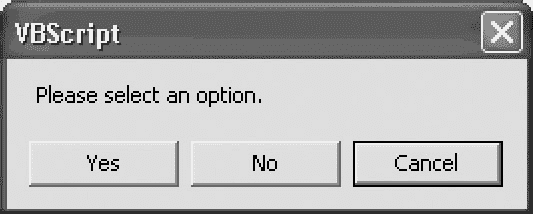
图 6.9：使用 `MsgBox()` 函数向用户提供多个选项

表 6.8 提供了你可以使用的常量列表，用于指定 `MsgBox()` 函数产生的弹出对话框的模态。

表 6.8：VBScript `MsgBox` 模态设置常量

| 常量 | 值 | 描述 |
| --- | --- | --- |
| `vbApplicationModal` | 0 | 用户在脚本继续之前必须做出响应。 |
| `vbSystemModal` | 4096 | 用户在脚本继续之前必须做出响应。此外，弹出对话框将保持显示在其他活动应用程序之上。 |

下面的示例演示了如何创建一个显示 `Retry` 和 `Cancel` 按钮以及感叹号图标的弹出对话框。此外，Cancel 按钮设置为默认按钮，且弹出对话框设置为应用程序模态。

```
MsgBox "Click on Retry to try again.", vbRetryCancel + vbExclamation + _
vbDefaultButton2 + vbApplicationModal
```

图 6.10 显示了执行此语句时弹出对话框的样式。


图 6.10：使用 `MsgBox()` 函数创建应用程序模态弹出对话框

### 查询结果

为了确定用户点击了哪个按钮，你需要使用 `MsgBox()` 函数，如下所示。

```
intChoice = MsgBox("Would you like to continue?", vbYesNo, "Confirmation dialog")
```

在这里，用户点击的按钮的数值由 `MsgBox()` 函数返回并存储在名为 `intChoice` 的变量中。表 6.9 概述了 `MsgBox()` 函数可能返回的所有值。在上例中，如果用户点击 Yes 按钮，则返回值 6；如果用户点击 No 按钮，则返回值 7。

表 6.9：VBScript `MsgBox()` 函数返回值

| 常量 | 值 | 描述 |
| --- | --- | --- |
| `vbOK` | 1 | 用户点击了 `OK` |
| `vbCancel` | 2 | 用户点击了 `Cancel` |
| `vbAbort` | 3 | 用户点击了 `Abort` |
| `vbRetry` | 4 | 用户点击了 `Retry` |
| `vbIgnore` | 5 | 用户点击了 `Ignore` |
| `vbYes` | 6 | 用户点击了 `Yes` |
| `vbNo` | 7 | 用户点击了 `No` |

## 处理错误

错误可能由于多种原因发生在 VBScript 中，包括语法错误、无效输入和资源可用。在错误、常量和变量中你学习了语法错误。另一类发生在 VBScript 中的错误是运行时错误。当 VBScript 语句尝试执行无效操作时（例如访问损坏的驱动器），就会发生运行时错误。由于运行时错误与语法错误不同，它们在解释阶段不会被检测，它们只在代码执行时发生。除非测试所有的 VBScript 部分，否则可能无法发现运行时错误。在许多情况下，你可以添加编程逻辑来预测并恢复运行时错误。然而，某些情况是你无法控制的，例如磁盘崩溃。在这种情况下，你通常只能向用户显示一个自定义错误消息，说明脚本为何未完成任务。

### 决定不采取行动

许多 VBScript 仅包含几个语句，为了快速自动化特定任务而在几分钟内编写。在这种情况下，最好省略任何错误处理逻辑并让错误直接发生，因为预测它们并编写处理代码的时间是昂贵的。这对于开发仅自己使用的小型工具脚本来说是可以接受的。如果脚本将与其他用户共享，可以提供说明，要求用户报告他们可能遇到的任何问题。

### 让 VBScript 忽略错误

处理运行时错误的另一种选择是告诉 VBScript 忽略它们并继续处理。这在许多情况下是一种有效的技术。下面的示例提示用户输入三个数字，然后将它们相加。

```
intNoOne = CInt(InputBox("Enter the first number"))
intNoTwo = CInt(InputBox("Enter the second number"))
intNoThree = CInt(InputBox("Enter the final number"))

intTotal = intNoOne + intNoTwo
intTotal = intTotal + intNoThree

MsgBox intTotal
```

如果用户按照要求输入三个数字，一切运行正常。但用户的行为往往不预期。例如，如果用户先输入数字 3，然后是数字 3，最后是单词“three”，就会发生运行时错误。然而，如果你通过将以下语句作为第一行来修改脚本，VBScript 将忽略该错误并显示值 6（即错误发生语句之前 `intTotal` 的值）。

```
On Error Resume Next
```

虽然这种方法有时有效，但仍应谨慎使用。在极少数情况下，忽略脚本某部分的错误不会导致在脚本执行的后续阶段出现另一个错误。此外，某些错误是该语句无法忽略的，并且会阻止脚本的执行。

当将 `On Error Resume Next` 语句添加到脚本开头时，该语句对整个脚本有效。如果你需要，稍后可以禁用此语句的效果；你可以通过在 VBScript 中添加以下语句来实现：

```
On Error GoTo 0
```

> **备注**  
> 就像变量一样，你可以将 `On Error Resume Next` 语句的作用范围局部化到过程（procedures）中。这使你能够将该语句的影响限制在脚本中可能有用的部分，而不影响整个脚本的行为。

### 开发错误处理例程

处理运行时错误的另一种方法是尝试开发能够处理这些错误的错误处理例程。为了能够有效地实施错误处理程序，你需要预测脚本中可能发生错误的位置，并能够设计出相应的逻辑来处理这种情况。可能的错误恢复操作示例包括：

*   要求用户报告错误
*   指导用户下一步该做什么
*   提供更具描述性的错误信息
*   尝试自动执行纠正操作
*   如果涉及数据输入，给用户再次尝试
*   为错误向用户道歉

为了创建错误处理例程，你需要了解如何与 VBScript 的 `Err` 对象配合。此 VBScript 对象提供了访问错误信息的接口，以及用于处理这些信息的方法。`Err` 对象有三个属性提供了有关错误事件的以下信息：

*   `Number`：上一次错误事件的错误编号
*   `Description`：上一次错误事件的描述
*   `Source`：引起错误的源对象

这些属性中的每一个都可以修改，允许你在将它们显示给用户之前对其进行重述并使其更易理解。下面的示例演示了如何创建一个自定义的错误处理例程。

```
On Error Resume Next

BogusProcedure()

If Err.Number > 0 Then
  Err.Number = 9000
  Err.Description = "This script has attempted to execute a " & _
    "procedure that has not been defined by the programmer."
  MsgBox "Error: " & Err.Number & " - " & Err.Description
  Err.Clear
End If
```

设置错误处理程序的第一步是在脚本或过程开头添加 `On Error Resume Next` 语句。然后，你必须在你认为可能发生错误的语句之后立即添加一个检查错误的语句。你可以通过判断分配给错误 `Err.Number` 的错误号是否大于 0 来检查特定错误或任何错误。你可以在 VBScript 中认为可能发生错误的任何点进行错误检查，并根据每种情况采取不同的操作。在前面的示例案例中，错误处理程序为用户提供了更具描述性的错误信息。

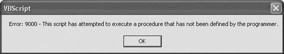
图 6.11：VBScript 提供了识别和对错误事件做出反应的能力

表 6.10 提供了 VBScript 运行时错误列表。

表 6.10：VBScript 运行时错误

| 十六进制 | 十进制 | 描述 |
| --- | --- | --- |
| `800A0005` | 5 | 无效的过程调用或参数 |
| `800A0006` | 6 | 溢出 |
| `800A0007` | 7 | 内存不足 |
| `800A0009` | 9 | 下标越界 |
| `800A000A` | 10 | 此数组已固定或临时锁定 |
| `800A000B` | 11 | 除以零 |
| `800A000D` | 13 | 类型不匹配 |
| `800A000E` | 14 | 字符串空间不足 |
| `800A0011` | 17 | 无法执行请求的操作 |
| `800A001C` | 28 | 栈空间不足 |
| `800A0023` | 35 | 未定义子或函数 |
| `800A0030` | 48 | 加载 DLL 错误 |
| `800A0033` | 51 | 内部错误 |
| `800A005B` | 91 | 对象变量未设置 |
| `800A005C` | 92 | For 循环未初始化 |
| `800A005E` | 94 | Null 的无效使用 |
| `800A01A8` | 424 | 需要对象 |
| `800A01AD` | 429 | ActiveX 组件无法创建对象 |
| `800A01AE` | 430 | 类不支持 |
| `800A01B0` | 432 | 自动化不支持 |
| `800A01B6` | 438 | 对象不支持此属性或方法 |
| `800A01BD` | 445 | 对象不支持此操作 |
| `800A01BF` | 447 | 对象不支持当前区域设置 |
| `800A01C0` | 448 | 命名参数未找到 |
| `800A01C1` | 449 | 参数不是可选的 |
| `800A01C2` | 450 | 参数个数错误 |
| `800A01C3` | 451 | 对象不是集合 |
| `800A01CA` | 452 | 远程服务器不支持 |
| `800A01CE` | 458 | 变量使用类型不匹配 |
| `800A01E1` | 462 | 无效引用 |
| `800A01F4` | 481 | 类未定义 |
| `800A01F6` | 500 | 发生异常 |
| `800A01F7` | 503 | 非法赋值 |
| `800A01F8` | 504 | 语法错误 |
| `800A01F9` | 505 | 意外的标记 |
| `800A01FA` | 506 | 意外的结束 |
| `800A01FB` | 507 | 无效范围 |
| `800A1390` | 5008 | 非法赋值 |
| `800A1399` | 5017 | 语法错误 |
| `800A139A` | 5018 | 意外的量词 |
| `800A139B` | 5019 | 缺少 `]` |
| `800A139C` | 5020 | 缺少 `)` |
| `800A139D` | 5021 | 无效范围 |

#### 清除错误

`Err` 对象提供了两个非常有用的方法。第一个方法是 `Clear()` 方法。如果脚本发生错误并进行了处理，允许脚本继续，随后发生了新错误，新错误的信息将覆盖 `Err` 对象存储的旧错误信息。然而，如果你的脚本之后检查错误而没有发生新错误，旧错误将被再次报告。为了防止这种行为，请使用 `Clear()` 方法删除已处理错误的信息。要使用 `Clear()` 方法，请将其放在错误处理例程的末尾，如下示例所示：

```
If Err.Number > 0 Then
  Err.Number = 9000
  Err.Description = "This script has attempted to execute a " & _
    "procedure that has not been defined by the programmer."
  MsgBox "Error: " & Err.Number & " - " & Err.Description
  Err.Clear
End If
```

> **备注**  
> VBScript 在执行 `On Error Resume Next` 语句时会自动执行 `Clear()` 方法。它在执行 `Exit Sub` 和 `Exit Function` 语句时也会执行 `Clear()` 方法。

#### 抛出错误

`Err` 对象的 `Raise()` 方法提供了在测试错误处理程序时模拟错误的能力。要使用此方法，请将其放在错误处理程序之前的代码中，如下示例所示：

```
Err.Raise(92)
```


本章介绍了使用 VBScript `InputBox()` 函数的方方面。这包括如何格式化在弹出的对话框中显示的文本，以及如何对 `InputBox()` 收集的数据进行查询和验证。你还学习了 VBScript 的隐式变量类型转换以及如何手动执行显式变量类型转换。本章涵盖了如何使用 `MsgBox()` 函数，包括对如何指定按钮、图标、默认按钮和模态的审查。此外，你还学习了如何确定用户选择了哪个按钮。本章还向你展示了如何捕获并重新格式化错误消息，以使其对用户来说更具描述性且更易于理解。

# 第 7 章：VBScript 对象

在本章中，你将研究 VBScript 如何通过操作对象与其环境交互。这包括对 VBScript 内置对象和运行时对象的检查，并完整列出与对象相关的属性和方法。此外，你将简要概述浏览器特定和 WSH（Windows 脚本主机）特定对象的重要性。你还将学习如何创建自己的具有完整 set 自定义属性和方法的自定义对象。

## VBScript 基于对象的编程

为了完成任何实际工作，VBScript 依赖于对象的使用。`object`（对象）通过方法和属性访问系统资源和数据操作结构。`Methods`（方法）是内置在对象中的函数，执行时与对象所代表的资源进行交互或操作。`Properties`（属性）是对象代表资源的特征，以某种方式描述资源。某些属性是只读的，允许 VBScript 收集有关资源的信息。其他属性可以修改，从而提供了直接更改对象所代表资源的某些属性的能力。

VBScript 本身的能力有限。它无法访问 HTML 页面元素、Windows 文件系统或其他系统资源。VBScript 仅提供了一小部分内置对象集合。这些对象为 VBScript 提供了响应错误以及从字符串中解析和提取数据的能力。VBScript 的内置对象列在表 7.1 中。

### 表 7.1：VBScript 内置对象

| 对象 | 描述 |
| --- | --- |
| `Class` | 提供创建自定义对象的能力<br>属性：此对象不支持任何属性<br>方法：此对象不支持任何方法<br>事件：`Initialize`、`Terminate` |
| `Err` | 提供运行时错误的详细信息<br>属性：`Description`、`HelpContext`、`HelpFile`、`Number`、`Source`<br>方法：`Clear`、`Raise`<br>事件：此对象不支持任何事件 |
| `Match` | 访问正则表达式匹配的只读属性<br>属性：`FirstIndex`、`Length`、`Value`<br>方法：此对象不支持任何方法<br>事件：此对象不支持任何事件 |
| `Matches Collection` | 正则表达式 `Match` 对象的集合<br>属性：此对象不支持任何属性<br>方法：此对象不支持任何方法<br>事件：此对象不支持任何事件 |
| `RegExp` | 支持正则表达式<br>属性：`Global`、`IgnoreCase`、`Pattern`<br>方法：`Execute`、`Replace`、`Test`<br>事件：此对象不支持任何事件 |
| `SubMatches Collection` | 访问正则表达式子匹配字符串的只读值<br>属性：此对象不支持任何属性<br>方法：此对象不支持任何方法<br>事件：此对象不支持任何事件 |

> **注意**：VBScript 的内置对象集合由 VBScript 解释器提供。无论在什么环境中执行，所有 VBScript 都可以使用这些对象。

### 属于 VBScript 内置对象的属性

如表 7.1 所示，VBScript 的内置对象集合提供了对许多不同属性的访问。表 7.2 列出了这些属性每一个并描述了它们的用途。

### 表 7.2：VBScript 对象属性

| 属性 | 描述 |
| --- | --- |
| `Description` | 获取错误消息 |
| `FirstIndex` | 返回指定子字符串在字符串中的第一个位置 |
| `Global` | 修改或检索 `Boolean`（布尔）值 |
| `HelpContext` | 获取帮助文件主题的上下文 ID |
| `HelpFile` | 返回帮助文件的路径 |
| `IgnoreCase` | 获取一个 `Boolean` 布尔值，指示模式搜索是否区分大小写 |
| `Length` | 返回搜索字符串匹配的长度 |
| `Number` | 返回指定错误的错误号 |
| `Pattern` | 获取搜索操作中的正则表达式模式 |
| `Source` | 获取生成错误的对象的名称 |
| `Value` | 返回搜索字符串匹配的值 |

### 属于 VBScript 内置对象的方法

VBScript 内置的 `Err` 和 `RegExp` 对象提供了少量方法的访问。表 7.3 列出了这些方法的每一个并描述了它们的用途。

### 表 7.3：VBScript 对象方法

| 对象 | 方法 | 描述 |
| --- | --- | --- |
| `Err` | `Clear` | 清除 `Err` 对象存储的当前错误信息 |
| `Err` | `Raise` | 提供生成和测试运行时错误的能力 |
| `RegExp` | `Execute` | 对字符串执行正则表达式搜索 |
| `RegExp` | `Replace` | 替换搜索中的文本 |
| `RegExp` | `Test` | 对字符串执行正则表达式搜索 |

## 使用 VBScript 内置对象

如表 7.1 所示，VBScript 提供了许多内置对象。这些对象提供了执行以下所有操作的能力：

* 处理 VBScript 运行时错误
* 定义自定义对象并为其分配属性和方法
* 执行字符和模式匹配

接下来的章节将介绍其中的一些对象。

### Err 对象

你已经在第 6 章“数据收集、通知和错误报告”中学习了如何使用内置的 `Err` 对象。该对象通过提供以下属性来访问运行时错误信息：

* `Description`：描述错误情况的字符串
* `Error Number`：与错误相关的 VBScript 错误号
* `Source`：报告错误的资源名称
* `HelpContext`：为指定的帮助文件主题设置上下文 ID
* `HelpFile`：包含信息的外部文件的名称和位置

此外，该对象提供了两个处理错误的方法：

* `Clear()`：删除 `Err` 对象存储的当前错误信息
* `Raise()`：提供生成和测试运行时错误的能力

### Class 对象

VBScript 支持许多不同的数据子类型，包括字符串和日期。VBScript 还支持更复杂的数组数据结构。VBScript 提供 `Class` 对象作为创建自定义复杂数据结构（自定义对象）的方法。通过创建自己的自定义对象，你可以封装数据函数来创建新对象，然后你的 VBScript 可以像访问其他对象一样访问它们。创建自定义对象为你的脚本提供了一个有助于确保数据一致性的工具，因为它允许你定义验证和强制执行对象属性以及控制对象操作的过程。

#### Class 对象语法

自定义对象使用 `Class`...`End Class` 语句创建。因此，`Class` 对象为定义其他对象及其结构提供了一个模板。一旦定义，这些对象就可以像其他对象一样实例化。该语句的语法概述如下。

```
Class ClassName
Statements
End Class
```

`ClassName` 代表分配给新对象的名称。`Statements` 代表在对象内部定义的变量、属性和方法。方法通过定义 `Sub` 或 `Function` 过程建立。属性通过使用以下任何语句来操作 `Class`...`End Class` 语句中定义的变量来定义：

- `Property Get`：提供检索分配给私有变量的值的能力
- `Property Let`：提供更改分配给私有变量的值的能力
- `Property Set`：提供更改对象变量值的能力

### 创建变量、属性和方法

可以使用 `Public` 和 `Private` 关键字将变量、属性和方法定义为公共（在整个脚本中可访问）或私有（仅在 `Class` 内部可用）。除非另说明，否则始终假设为 `Public`。

> **注意**：尽管你可以允许在 `Class`...`End Class` 语句中定义的变量具有公共范围，但不建议这样做。这会阻止你从对象内部验证分配给变量的值。相反，建议将所有变量设为私有，并使用 `Property Get` 和 `Property Let` 语句暴露它们。这样，你就可以在对象中构建数据验证逻辑并确保数据完整性。

下面的示例演示了如何使用 `Class` 对象创建一个名为 `Customer` 的自定义对象。

```
Class Customer

  Private strCustName

  Public Property Get CustomerName
    CustomerName = strCustName
  End Property

  Public Property Let CustomerName (strNameAssignment)
    StrCustName = strnameAssignment
  End property

  Function DisplayName
    MsgBox(strCustName)
  End Function
End Class
```

第一语句定义了一个名为 `strCustName` 的私有变量。接下来的三个语句使用该变量创建一个属性并使其可读。随后的三个语句使该属性变为可写。最后，`Class`...`End Class` 语句内的最后三个语句定义了一个将作为对象方法的函数。

现在已经定义了一个新对象，你可以对其进行实例化，如下所示。

```
Dim objCustName
Set objCustName = New Customer
```

你可以将客户名称存储到对象中。

```
objCustName.CustomerName = "ABC Inc."
```

然后你可以执行对象的 `DisplayName()` 方法。

```
objCustName.DisplayName()
```

> **注意**：存储在对象中的数据在脚本结束时会被删除。这对其价值产生了一定的限制。然而，有很多方法可以存储和检索对象数据。例如，在处理 WSH 时，你可以将对象数据写入文件或存储在系统变量中。同样，在 Web 页面开发中使用 VBScript 时，你可以使用 cookie 在客户端计算机本地存储非敏感对象数据。

### 设置初始化和终止过程

由 `Class`...`End Class` 语句创建的对象支持以下事件：

- `Class_Initialize`：如果存在，每当对象的实例创建时，该方法就会执行，提供了一个执行初始化任务（如定义初始变量值）的机会。
- `Class_Terminate`：如果存在，每当对象的实例被销毁时，该方法就会执行，提供了一个执行任何所需的清理任务的机会。

下面的语句演示了如何根据 `Class_Initialize` 和 `Class_Terminate` 事件的发生触发语句执行。

```
Private Sub Class_Initialize
  MsgBox("The Class_Initialize Subroutine is executing!")
End Sub

Private Sub Class_Terminate
  MsgBox("The Class_Terminate Subroutine is executing!")
End Sub
```

一旦添加到 `Class`...`End Class` 语句内部，这些事件会在关联对象的的新实例创建或销毁时自动执行。

> **注意**：你可以使用 `Set` 语句和 `New` 关键字创建自定义对象的新实例，如下所示。
> ```
> Set objCustName = New Customer
> ```
> 同样，可以使用 `Set` 语句销毁自定义对象。
> ```
> Set objCustName = Nothing
> ```
> `Nothing` 是 VBScript 关键字，用于将对象变量与对象解关联。只要没有其他对象变量引用该对象，存储其数据的内存就会被释放。

### RegExp 对象和其他相关对象

除了 `Err` 对象和 `Class` 对象外，VBScript 的所有其他内置对象都设计为配合正则表达式工作。正则表达式是由字符和元字符组成的文本模式。正则表达式提供了识别模式以及执行复杂搜索和替换操作的能力。

`RegExp` 对象允许你在 VBScript 中处理正则表达式。要向你的 VBScript 添加 `RegExp` 对象，你必须首先定义一个变量来表示它，然后使用 `New` 关键字对其实例化，如下所示。

```
Dim regExpObj
Set regExpObj = New RegExp
```

`RegExp` 对象有三个属性：

- `Pattern`：指定要匹配的正则表达式模式
- `IgnoreCase`：一个布尔值，决定是否执行大小写敏感的搜索
- `Global`：一个布尔值，决定是否应替换模式的所有出现处

此外，`RegExp` 对象提供了许多方法，其中之一是 `Replace()` 方法。该方法替换搜索字符串中的匹配文本模式。其语法所示所示。

```
RegExp.Replace(String1, String2)
```

`String1` 是发生替换的字符串，`String2` 是替换字符串。

例如，以下语句演示了如何使用 `RegExp` 对象搜索字符串变量 `strQuote` 并替换单词 `child` 的出现情况。

```
Dim regExpObj, strQuote
Set regExpObj = New RegExp
regExpObj.Pattern = "boy"
strQuote = "Once upon a time there was a little boy."
MsgBox RegExpObj.Replace(strQuote, "child")
```

此示例中的前两个语句定义并创建了一个名为 `regExpObj` 的 `RegExp` 对象实例。接下来的一行使用 `RegExp` 项目的 `Pattern` 属性来设置搜索模式。随后的语句设置了要搜索的字符串。最后，示例中的最后一个语句将字符 `boy` 的第一次出现替换为字符 `child`。

之前的示例仅替换指定模式匹配的第一次出现。然而，你可以像下面所示修改搜索模式，以搜索并替换搜索字符串中的模式匹配。

```
Dim regExpObj, strQuote
Set regExpObj = New RegExp
regExpObj.Pattern = "boy"
regExpObj.Global = True
strQuote = "Once upon a time there was a little boy."
MsgBox RegExpObj.Replace(strQuote, "child")
```

如你所见，示例中添加了一条新语句，该语句使用 `RegExp` 属性的 `Global` 属性来替换搜索字符串中的所有匹配项。VBScript 还提供了许多元字符，当与 `RegExp` 对象的 `Pattern` 属性工作时可以使用这些字符。例如，以下语句使用值范围执行模式替换：

```
Dim regExpObj, strQuote
Set regExpObj = New RegExp
regExpObj.Pattern = "[\d]"
regExpObj.Global = True
strQuote = "Your customer number is 8."
MsgBox RegExpObj.Replace(strQuote, "1008")
```

元字符 `\d` 指定将任何单个数字用作替换字符串。在本例中，数字 8 被替换为数字 1008。表 7.4 列出了 VBScript 正则表达式支持的元字符。

### 表 7.4：VBScript 正则表达式元字符

| 字符 | 描述 |
| --- | --- |
| `\` | 将下一个字符指定为特殊字符、反向引用、字面量或八进制转义字符 |
| `^` | 匹配输入字符串的开头 |
| `$` | 匹配输入字符串的结尾 |
| `*` | 匹配前面的表达式（0 次或多次） |
| `+` | 匹配前面的表达式（1 次或多次） |
| `?` | 匹配前面的表达式（0 次或 1 次） |
| `{n}` | 恰好匹配 *n* 次 |
| `{n,}` | 至少匹配 *n* 次 |
| `{n, m}` | 最少 *n* 次，最多 *m* 次 |
| `.` | 匹配除换行符以外的单个字符 |
| `(pattern)` | 匹配模式并允许从 `Matches` 集合中检索匹配的子字符串 |
| `x|y` | 匹配 *x* 或 *y* |
| `[xyz]` | 匹配指定的任意字符 |
| `[^xyz]` | 匹配除指定字符外的任何字符 |
| `[a-z]` | 匹配范围内的任何字符 |
| `[^a-z]` | 匹配范围指定字符外的任何字符 |
| `\b` | 匹配单词边界 |
| `\B` | 匹配非单词边界 |
| `\cx` | 匹配指定为 *x* 的控制字符 |
| `\d` | 匹配单个数字 |
| `\D` | 匹配任何单个非数字字符 |
| `\f` | 匹配分页符 |
| `\n` | 匹配换行符 |
| `\r` | 匹配回车符 |
| `\s` | 匹配任何空白字符（例如空格、制表符、分页符） |
| `\S` | 匹配任何非空白字符 |
| `\t` | 匹配制表符 |
| `\v` | 匹配垂直制表符 |
| `\w` | 匹配任何单词字符 |
| `\W` | 匹配任何非单词字符 |
| `\xn` | 匹配 *n*，其中 *n* 是两位十六进制转义值 |
| `\num` | 匹配 *num*，其中 *num* 是用于匹配的反向引用正整数 |
| `\n` | 指定八进制转义值或反向引用 |
| `\nml` | 匹配八进制转义值 *nml*，其中 *n* 是 0–3 范围八进制数字，*m* 和 *l* 是 0–7 范围八进制数字 |
| `\un` | 匹配 *n*，其中 *n* 是四位十六进制 Unicode 字符 |

`RegExp` 对象提供了下面列出的两个额外方法。

* `Test()`：搜索正则表达式并返回一个布尔值，指示是否找到了匹配模式
* `Execute()`：通过搜索正则表达式创建一个 `Matches` 集合

#### Test() 方法

`Test()` 方法允许你检查字符串是否包含模式匹配。其语法如下：

```
RegExp.Test(string)
```

例如，以下语句演示了如何使用 `Test()` 方法报告模式匹配是否存在：

```
Dim regExpObj, strQuote
Set regExpObj = New RegExp
regExpObj.Pattern = "boy"
strQuote = "Once upon a time there was a little boy."
If regExpObj.Test(strQuote) = True Then
  MsgBox "Match Found"
Else
  MsgBox "No Match Found"
End If
```

#### Execute() 方法

`RegExp` 对象的 `Execute()` 方法通过搜索正则表达式创建一个 `Matches` 集合，其语法如下：

```
RegExp.Execute(string)
```

生成的 `Matches` 集合是只读的，构成集合的单个 `Match` 对象也是只读的。一旦创建，你就可以遍历 `Matches` 集合中的每个对象并进行处理，如下例所示。

```
'*************************************************************************
'Script Name: Script 7.1.vbs
'Author: Jerry Ford
'Created: 02/05/2003
'Description: 执行正则表达式模式替换
'*************************************************************************

'初始化部分

Option Explicit

Dim regExpObj, strQuote, colMatchStmts, strDisplayText, intCount, Match
Set regExpObj = New RegExp

regExpObj.Pattern = "File" '指定要搜索的字符串

regExpObj.Global = True '执行全局模式匹配

'指定要搜索的字符串
strQuote = "Filename filename logFile logfile File file"

'主处理部分

CreateMatches()
ProcessMatches()
DisplayResults()

'过程/过程部分

Sub CreateMatches()
  '使用 RegExp 对象的 Execute() 创建匹配项集合
  Set colMatchStmts = regExpObj.Execute(strQuote)
End Sub

Sub ProcessMatches()
  '设置计数器统计匹配次数
  intCount = 0
  '遍历集合
  For Each Match In colMatchStmts
    '构建显示匹配位置的字符串
    strDisplayText = strDisplayText & "A match occurred at position " & Match.Index & vbLf
    intCount = intCount + 1
  Next
End Sub

Sub DisplayResults()
  '显示结果
  MsgBox "Total number of matches = " & intCount & vbLf & vbLf & strDisplayText
End Sub
```

第二组对象被称为 VBScript 运行时对象（runtime objects）。这些对象由一个名为 `scrrun.dll` 的外部 DLL（动态链接库）提供。它们为 VBScript 提供了访问 Windows 文件系统的能力。此外，VBScript 运行时对象还包含一个名为 `Dictionary` 的对象。`Dictionary` 对象允许你在一个关联数组中存储数据，并使用键（keys）而不是像普通 VBScript 数组那样的索引来检索存储在数组中的数据。VBScript 的运行时对象列在表 7.5 中。

### 表 7.5：VBScript 运行时对象

| 对象名称 | 说明 |
| --- | --- |
| `Dictionary` | 存储数据键值对。属性：`Count`, `Item`, `Key` 方法：`Add`, `Exists`, `Items`, `Keys`, `Remove`, `RemoveAll` |
| `Drive` | 为脚本提供磁盘属性的访问。属性：`AvailableSpace`, `DriveLetter`, `DriveType`, `FileSystem`, `FreeSpace`, `IsReady`, `Path`, `RootFolder`, `SerialNumber`, `ShareName`, `TotalSize`, `VolumeName` 方法：此对象不支持任何方法 |
| `Drives Collection` | 为脚本提供驱动器位置信息的访问。属性：`Count`, `Item` 方法：此对象不支持任何方法 |
| `File` | 为脚本提供文件属性的访问。属性：`Attributes`, `DateCreated`, `DateLastAccessed`, `DateLastModified`, `Drive`, `Name`, `ParentFolder`, `Path`, `ShortName`, `ShortPath`, `Size`, `Type` 方法：`Copy`, `Delete`, `Move`, `OpenAsTextStream` |
| `Files Collection` | 为脚本提供存储在指定文件夹中的文件的访问。属性：`Count`, `Item` 方法：此对象不支持任何方法 |
| `FileSystemObject` | 为脚本提供对文件系统的访问。属性：`Drives` 方法：`BuildPath`, `CopyFile`, `CopyFolder`, `CreateFolder`, `CreateTextFile`, `DeleteFile`, `DeleteFolder`, `DriveExists`, `FileExists`, `FolderExists`, `GetAbsolutePathName`, `GetBaseName`, `GetDrive`, `GetDriveName`, `GetExtensionName`, `GetFile`, `GetFileName`, `GetFolder`, `GetParentFolderName`, `GetSpecialFolder`, `GetTempName`, `MoveFile`, `MoveFolder`, `OpenTextFile` |
| `Folder` | 为脚本提供文件夹属性的访问。属性：`Attributes`, `DateCreated`, `DateLastAccessed`, `DateLastModified`, `Drive`, `Files`, `IsRootFolder`, `Name`, `ParentFolder`, `Path`, `ShortName`, `ShortPath`, `Size`, `SubFolders`, `Type` 方法：`Copy`, `Delete`, `Move`, `OpenAsTextStream` |
| `Folders Collection` | 为脚本提供位于另一个文件夹内的文件夹的访问。属性：`Count`, `Item` 方法：`Add` |

## 属于 VBScript 运行时对象的属性

WSH 提供的 VBScript 运行时对象提供了一系列丰富的属性集合。这些属性提供了有关 Windows 文件系统以及 Windows 文件和文件夹的信息。表 7.6 包含了运行时属性的完整列表。

### 表 7.6：VBScript 运行时属性

| 属性名称 | 描述 |
| --- | --- |
| `AtEndOfLine` | 根据文件指针是否已到达 `TextStream` 文件的行尾标记返回 `True` 或 `False` |
| `AtEndOfStream` | 根据是否已到达 `TextStream` 文件的末尾返回 `True` 或 `False` |
| `Attributes` | 修改或检索文件和文件夹属性 |
| `AvailableSpace` | 获取指定驱动器上可用的可用空间 |
| `Column` | 获取 `TextStream` 文件中当前的列位置 |
| `CompareMode` | 设置或返回用于比较 `Dictionary` 对象字符串键的比较模式 |
| `Count` | 返回一个表示集合或 `Dictionary` 对象中项数的值 |
| `DateCreated` | 获取文件或文件夹的创建日期 |
| `DateLastAccessed` | 获取文件或文件夹上次访问的日期时间 |
| `DateLastModified` | 获取文件或文件夹上次修改的日期时间 |
| `Drive` | 获取存储文件或文件夹的驱动器号 |
| `DriveLetter` | 获取指定驱动器的驱动器号 |
| `Drives` | 建立一个代表计算机上找到的所有驱动器的 `Drives` 集合 |
| `DriveType` | 返回一个识别驱动器类型的值 |
| `Files` | 建立一个 `Files` 集合，代表指定文件夹内的所有 `File` 对象 |
| `FileSystem` | 获取指定驱动器上使用的文件系统名称 |
| `FreeSpace` | 获取指定驱动器上可用的可用空间 |
| `IsReady` | 根据指定驱动器的可用性返回 `True` 或 `False` |
| `IsRootFolder` | 根据指定文件夹是否为根文件夹返回 `True` 或 `False` |
| `Item` | 根据键检索项 |
| `Key` | 在 `Dictionary` 对象中检索键 |
| `Line` | 返回 `TextStream` 中的行 |
| `Name` | 获取或修改文件或文件夹名称 |
| `ParentFolder` | 获取文件或文件夹的父文件夹 |
| `Path` | 获取文件或文件夹的路径 |
| `RootFolder` | 返回与驱动器相关的根文件夹对象 |
| `SerialNumber` | 获取驱动器的序列号 |
| `ShareName` | 获取或修改驱动器的共享名称 |
| `ShortName` | 获取文件或文件夹的短名称 |
| `ShortPath` | 获取文件或文件夹的短路径 |
| `Size` | 获取构成文件或文件夹的字节 |
| `SubFolders` | 获取文件夹内的文件夹 |
| `Type` | 获取文件或文件夹的类型 |
| `VolumeName` | 获取或修改卷名称 |

## 属于 VBScript 运行时对象的方法

VBScript 的运行时方法提供了访问文件系统、创建、修改和删除文件文件夹的能力。表 7.7 包含了 VBScript 提供的方法列表。

### 表 7.7：VBScript 运行时方法

| 方法名称 | 说明 |
| --- | --- |
| `Add (Dictionary)` | 向 `Dictionary` 对象添加键值对 |
| `Add (Folders)` | 向集合中添加 `Folder` |
| `BuildPath` | 为路径附加名称 |
| `Close` | 关闭打开的 `TextStream` 文件 |
| `Copy` | 复制文件或文件夹 |
| `CopyFile` | 复制一个或多个文件 |
| `CopyFolder` | 递归复制文件夹 |
| `CreateFolder` | 创建新文件夹 |
| `CreateTextFile` | 创建文件并返回一个 `TextStream` 对象以便读取和写入 |
| `Delete` | 删除文件或文件夹 |
| `DeleteFile` | 删除文件 |
| `DeleteFolder` | 删除文件夹的内容 |
| `DriveExists` | 根据驱动器是否存在返回 `True` 或 `False` |
| `Exists` | 根据 `Dictionary` 对象中是否存在键返回 `True` 或 `False` |
| `FileExists` | 根据指定的文件是否存在返回 `True` 或 `False` |
| `FolderExists` | 根据指定的文件夹是否存在返回 `True` 或 `False` |
| `GetAbsolutePathName` | 获取完整的路径名称 |
| `GetBaseName` | 获取不带文件扩展名的文件名 |
| `GetDrive` | 返回与指定路径中的驱动器相关的 `Drive` 对象 |
| `GetDriveName` | 返回驱动器的名称 |
| `GetExtensionName` | 获取文件的扩展名 |
| `GetFile` | 返回与指定路径相关的 `File` 对象 |
| `GetFileName` | 获取文件的名称 |
| `GetFolder` | 返回与指定路径相关的 `Folder` 对象 |
| `GetParentFolderName` | 获取文件或文件夹的父文件夹名称 |
| `GetSpecialFolder` | 返回一个 `Folder` 对象 |
| `GetTempName` | 返回临时文件的名称 |
| `MoveFile` | 移动文件 |
| `MoveFolder` | 移动文件夹 |
| `OpenAsTextStream` | 打开文件并获取 `TextStream` 对象以提供对文件的引用 |
| `OpenTextFile` | 打开文件并获取 `TextStream` 对象以提供对文件的引用 |
| `Read` | 返回一个包含 `TextStream` 文件中指定数量字符的字符串 |
| `ReadAll` | 读取整个 `TextStream` 文件及其内容 |
| `ReadLine` | 从 `TextStream` 文件中读取整行内容 |
| `Remove` | 删除 `Dictionary` 对象的键-项对 |
| `RemoveAll` | 删除所有 `Dictionary` 对象的键-项对 |
| `Skip` | 在处理 `TextStream` 文件时跳过指定数量的字符位置 |
| `SkipLine` | 在处理 `TextStream` 文件时跳过整行 |
| `Write` | 在 `TextStream` 文件中写入指定的字符串 |
| `WriteBlankLines` | 向 `TextStream` 文件写入指定数量的 `newline`（换行符） |
| `WriteLine` | 向 `TextStream` 文件写入指定的字符串 |

## 运行时字典对象

所有的 VBScript 运行时对象（`Dictionary` 对象外）都设计为与文件和 Windows 文件系统协同工作。这些对象的用法在本书的第三部分、第四部分和第五部分中有详细介绍。本节提供了 `Dictionary` 对象的回顾。

`Dictionary` 对象和 `FileSystemObject` 对象是两个顶级的 VBScript 运行时对象。`Dictionary` 对象提供了根据键-项对设置关联数组的能力。换句话说与传统的 VBScript 数组根据数据在数组中的索引位置来存储和检索数据不同，`Dictionary` 对象中存储的项是使用“键”来存储和检索的。该键可以是数字、字符串，或 VBScript 支持的任何数据子类型。`Dictionary` 对象甚至不支持使用索引数字，因为它不是根据顺序存储项的。`Dictionary` 对象具有数组的所有优点，同时在存储和检索数据方面提供了更大的灵活性。此外，`Dictionary` 对象还提供了许多属性和方法，增强了你控制存储在 `Dictionary` 对象中数据的能力。

`Dictionary` 对象支持以下三个属性：

* `Count`：获取存储在 `Dictionary` 对象中的项的数量
* `Item`：在 `Dictionary` 对象中检索或添加指定键的项
* `Key`：在 `Dictionary` 对象中添加一个键

此外，`Dictionary` 对象提供了对以下方法的访问：

* `Add`：向 `Dictionary` 对象添加一个键-项对
* `Exists`：如果指定的键存在于 `Dictionary` 对象中，则返回布尔值 `True`，否则返回 `False`
* `Items`：返回一个包含 `Dictionary` 对象中所有项的数组
* `Keys`：返回一个包含 `Dictionary` 对象中所有已存在的键的数组
* `Remove`：从 `Dictionary` 对象中移除一个键-项对
* `RemoveAll`：从 `Dictionary` 对象中移除所有键-项对

为了更好地演示 `Dictionary` 对象的实现，请考虑以下示例。要在 VBScript 中添加 `Dictionary` 对象的实例，必须首先定义一个可以引用它的变量，然后创建该对象的实例。

```
Dim dicObject
Set dicObject = CreateObject("Scripting.Dictionary")
```

一旦实例化，你就可以像下面所示将项及其关联键存储在对象中。

```
dicObject.Add "Aug2003Rpt", "AugReports.txt"
dicObject.Add "Sep2003Rpt", "SepReports.txt"
dicObject.Item("Oct2003Rpt") = "OctReports.txt"
```

前两个语句使用 `Add()` 方法向 `Dictionary` 对象添加数据。指定的第一个参数是用于与数据关联的键，它作为第二个参数出现。最后一条语句通过 `Item()` 属性添加了第三条数据，从而证明了如果你引用一个键/项对，它将会被添加。

```
If dicObject.Exists("Sep2003Rpt") = True Then
  MsgBox "The value stored in Sep2003Rpt is " & dicObject.Item("Sep2003Rpt")
End If
```

从 `Dictionary` 对象中移除键/项对与添加它们一样简单。例如，以下语句显示了如何使用 `Remove` 方法删除元素：

```
dicObject.Remove "Sep2003Rpt"
```

或者，如果你倾向于删除 `Dictionary` 对象中存储的所有数据，可以像下面所示使用 `RemoveAll()` 方法：

```
dicObject.RemoveAll
```

## 总结

在本章中，除了回顾这些对象及其相关的属性和方法外，你还学习了如何创建自定义对象。你学习了在开发运行 WSH 的 VBScript 时使用 `Dictionary` 对象创建关联数组。还讨论了其他对象模型，包括 Internet Explorer 和 WSH 提供的模型。

# 第 8 章：VBScript 与 Internet Explorer

在之前的章节中，你学习了 VBScript 编程的基础，并接触了 VBScript 的内置和运行时对象。本章重点关注在 Internet Explorer 中执行时为 VBScript 提供的特定对象模型。正如你所看到的，这些对象为你提供了使用浏览器对象方法和属性与浏览器对象进行交互的能力。这允许你打开和关闭浏览器窗口、显示弹出消息、验证表单输入、创建视觉效果以及控制用户访问你的 Web 页面时的许多其他方面。本章还将讨论基于器的事件以及开发对这些事件做出反应的代码。

## Internet Explorer 对象

基于对象的对象代表 Web 页面或器的特定功能或组件。它们是编程结构，提供了属性和方法，VBScript 可以利用它们交互并控制功能和组件。这些对象由 Internet Explorer 给 VBScript 提供，Internet 根据其加载的每个 Web 页面的内容暴露这些对象。

从 Internet Explorer 3 版本开始，该浏览器的每个新版本都引入了对额外浏览器对象的支持。在当前 Internet Explorer 6.X 版本中发现的许多对象在更早的版本中是不存在的。这使得编程环境变得具有挑战性，因为你无法控制访问者将使用哪种版本的 Internet Explorer 来查看你的 Web 页面。例如，如果你开发了一个包含 VBScript 的网页，该脚本利用了 Internet Explorer 6 版本中可用的对象，而访问者尝试使用 Internet Explorer 4 版本查看你的网页，你的脚本将会失败，结果将不尽如人意。

当然，你始终可以基于最小公约数（你打算支持的最低 Internet Explorer 版本）来开发脚本，但这意味着要放弃 Internet Explorer 6 版本提供的许多功能。这就是互联网的现状。幸运的是，如果你开发的用于公司内网运行的 Web 页面，你通常会发现所有用户运行的相同版本的 Internet Explorer。这允许你根据该特定浏览器版本支持的功能和特性来开发 VBScript。或者，你可以开发不同版本的网页，添加代码来测试每个访问者的浏览器类型，并将浏览器重定向到相应的网页集。

> **注意**：截至本书编写时，微软已发布了四个支持 VBScript 的 Internet Explorer 大版本（版本 3.X、4.X、5.X 和 6.X）。你在书中看到的所有脚本都是使用 Internet Explorer 6.0 开发和测试的。

Internet Explorer 将 Web 页面组织成逻辑树形结构，网页上发现的对象之间存在父、子和兄弟关系。为了演示 Internet Explorer 如何将此结构应用于典型的 Web 页面，请考虑以下示例。

```
<HTML>

  <HEAD>
    <TITLE>Script 8.1 - HTML Page Object Organization Example</TITLE>
  </HEAD>

  <BODY>
    <P>Welcome to the home page of</P>
    <P>ABC Enterprises Inc.</P>
  </BODY>

</HTML>
```

图 8.1 显示了 Internet Explorer 如何在逻辑上表示此网页。`document` 对象始终处于层次结构的顶端。`document` 对象的子是 `<HTML>` 元素。`<HTML>` 元素有两个子元素，即 `<HEAD>` 和 `<BODY>` 元素。`<HEAD>` 元素有一个子元素，而 `<BODY>` 元素有两个子元素。

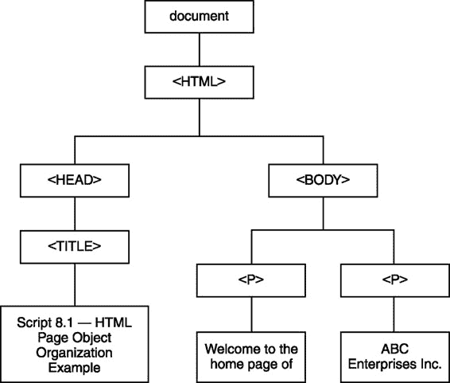

图 8.1：检查 Internet Explorer 逻辑上表示网页内容的方式

Internet Explorer 3 和 4 版本支持一组被称为 DHTML 对象模型的集合。从 Internet Explorer 5 版本开始，浏览器开始支持第二种对象模型，即 DOM。Internet Explorer 5 和 6 版本将 DOM 作为其主要对象模型，同时为了向后兼容而提供对 DHTML 对象模型的支持。DHTML 对象模型为 VBScript 提供了访问网页上大多数元素的权限，而 DOM 则提供了对每个元素的访问权限。

> **注意**：DOM 由一个名为世界维网联盟（World Wide Web Consortium）的团体开发，并已被所有主要的浏览器采用。要了解更多关于 DOM 的信息，请查看 [`www.w3c.org/DOM`](http://www.w3c.org/DOM)。

### 检查 DHTML 对象模型

DHTML 对象模型将网页上发现的元素组织成逻辑层次结构。`window` 对象位于 DHTML 对象模型的顶端。每个 Web 页面都有一个 `window` 对象，包含框架（frames）的页面除外，在这种情况下，除了单个父 `window` 对象外，每个框架都有一个 `window` 对象。`window` 对象提供了许多子对象的访问，如图 8.2 所示。

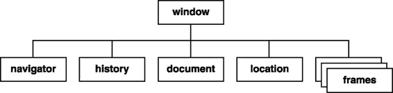

图 8.2：`window` 对象提供了对其他对象的访问，允许 VBScript 与 HTML 页面上的元素进行交互并控制它们

`window` 对象提供了你可以用于打开和关闭窗口、在浏览器状态栏或弹出对话框中显示文本以及将 URL 加载到 Web 页面的属性和方法。以下列表列出了其子对象提供的功能。

* `navigator` 对象。提供有关用于查看 HTML 页面的浏览器的信息。
* `history` 对象。提供对 `document` 对象历史列表的访问（即自浏览器窗口打开以来访问的 Web 页面）。
* `document` 对象。提供对当前 HTML 页面上元素的访问。
* `location` 对象。提供有关当前加载的 HTML 页面的信息以及加载新 URL 的能力。
* `frames` 集合。提供对代表 HTML 页面上定义的每个框架的索引列表的访问。

在 `window` 对象的所有子对象中，你会发现 `document` 对象是你最操作的一个。如图 8.3 所示，`document` 对象提供了对许多其他代表 HTML 元素类型的对象的访问。

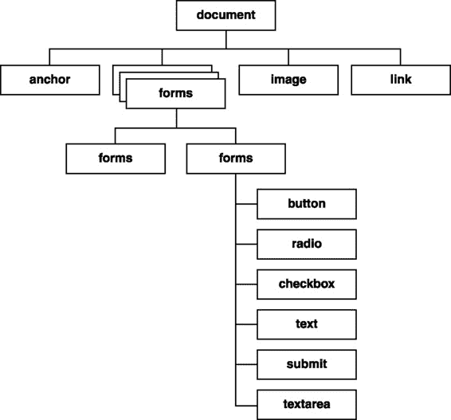

图 8.3：`document` 对象提供了其他对象的访问

要使用 DHTML 对象模型引用网页上的任何元素，必须根据 DHTML 对象模型引用其位置。例如，查看以下 HTML 语句。

```html
<FORM NAME="ApplicationForm">
  Last Name:
  <INPUT NAME="FirstName" TYPE="text" SIZE="10" MAXLENGTH="25">
</FORM>
```

这些语句定义了一个名为 `ApplicationForm` 的 HTML 表单，其中包含一个文本字段。虽然你可以选择开发不分配名称的 HTML 页面，但必须分配名称，VBScript 才能引用页面元素。例如，以下 VBScript 语句可以添加到插入 HTML 页面的 VBScript 中，以判断访问者是否输入了文本。

```vbscript
If Len(document.ApplicationForm.FirstName.value) < 1 Then
  MsgBox "Last name is a required field"
End If
```

可见，要确定是否在文本字段中输入了内容，必须指定其位置，从 HTML 页面的顶端元素（`document`）开始，然后是表单名称（`ApplicationForm`）、字段名称（`FirstName`），最后是 `value` 属性。

### 检查 DOM

DOM 对 HTML 页面上的所有元素提供了完全控制，并且比 DHTML 对象模型更容易访问。除了可以通过指定在逻辑层次结构中的位置来访问页面上的任何元素外，DOM 还允许你在层次结构中向上、向下和导航，而无需通过名称引用元素。DOM 通过使用表 8.1 中列出的属性来实现此功能。

### 表 8.1：DOM 属性

| 属性 | 描述 |
| --- | --- |
| `firstChild` | 对象的第一个子节点 |
| `lastChild` | 对象的最后一个子节点 |
| `childNodes` | 对象所有子对象的集合/数组 |
| `parentNode` | 对象的父对象 |
| `nextSibling` | DOM 树中紧随其子节点 |
| `prevSibling` | 在当前子节点之前的子节点 |
| `nodeName` | HTML 标签的名称 |
| `nodeType` | 指定一个表示 HTML 元素类型（标签、属性或文本）的值 |
| `nodeValue` | 分配给文本节点的值 |
| `data` | 所指定文本节点的值 |
| `specified` | 指定属性是否已设置 |
| `attributes` | 该对象所有属性的集合/数组 |

为了演示这是如何工作的，请考虑以下 HTML 页面：

```html
<HTML>
  <HEAD>
    <TITLE>Script 8.2 - A DOM Navigation Example</TITLE>
  </HEAD>

  <BODY ID="BodyTag">
    <P ID="TopParagraph" Name="FirstTag">Welcome to the home page of</P>
    <P ID="BottomParagraph">ABC Enterprises Inc.</P>
  </BODY>
</HTML>
```

图 8.4 描绘了 DOM 如何查看此页面的。如你所见，`document` 对象是父对象，它只有一个孩子，即 `<HTML>` 标签，该标签也被称为 `documentElement`。

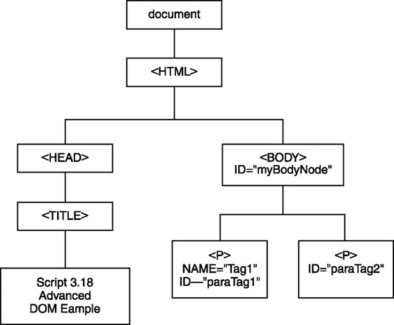

图 8.4：从 DOM 的视角查看 HTML 页面

以下语句演示了如何使用 DOM 导航到位于 HTML 页面上的元素。

```vbscript
window.alert("The ID for the first element is: " & _
   document.documentElement.firstChild.tagName)
```

这条 VBScript 语句通过指定其与 `document` 对象的关系，引用了 HTML 页面上的 `<HEAD>` 标签。下一条语句通过再次引用 `<BODY>` 标签与 `document` 对象的关系显示了 `<BODY>` 标签的。

```vbscript
window.alert("The ID for the second element is: " & _
  document.documentElement.firstChild.nextSibling.tagName)
```

下一个 VBScript 语句显示了如何显示 ID 为 `BottomParagraph` 的 `<P>` 标签第一个子节点的值。此 VBScript 使用 DOM `getElementById()` 方法执行此操作，如下所示。

```vbscript
window.alert("The Value associated with the BottomParagraph tag "& _
  element is: " & _
  document.getElementById("BottomParagraph").firstChild.nodeValue)
```

使用 DOM，你也可以更改分配给 HTML 元素的值，如以下 VBScript 语句所示。

```vbscript
document.getElementById("BottomParagraph").firstChild.nodeValue="ABC Inc."
```

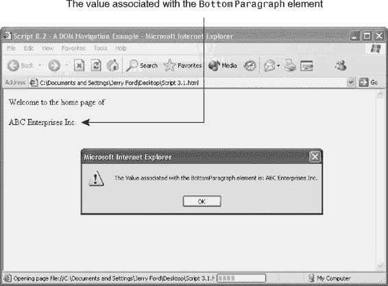

图 8.5：显示分配给特定 HTML 元素的值

该语句首先使用 `document` 对象的 `getElementById()` 方法引用第二个 `<P>` 标签（即 `BottomParagraph`）。然后它引用 `<P>` 标签的 `firstChild` 对象的 `nodeValue` 属性。结果是 HTML 页面的内容被动态更改了，如图 8.6 所示。

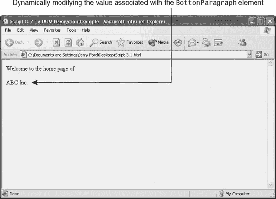

图 8.6：动态更改 HTML 页面的内容

显然，DOM 为导航 HTML 页面以及访问和操作其内容提供了一个强大的工具。DOM 非常复杂，本书书中无法完全涵盖所有的对象、属性和方法。然而，你可以访问 [`www.w3c.org/DOM`](http://www.w3c.org/DOM) 了解更多。

## 高级浏览器对象

若干高级浏览器对象值得特别关注。这些对象列在下方。

* `window`
* `document`
* `location`
* `history`
* `navigator`

这些每个对象将在后续章节中进行详细描述，并带有示例演示它们如何被嵌入在 HTML 页面中的 VBScript 使用。

### 使用 window 对象

`window` 对象是对象模型层次结构中的顶层对象。它也是 `document`、`location`、`history` 和 `navigator` 对象的父对象。 HTML 页面只建立一个 `window` 对象，除非该页面包含框架（frames），在这种情况下每个帧存在一个 `window` 对象，并且存在一个父 `window` 对象作为所有其他对象的父对象。

> **注意**：在图 8.2 中，描绘了多框架对象。在这种背景下，描绘的每个帧都代表 `window` 对象的另一个实例，并可以统称为集合。

除了子对象和集合外，`window` 对象还提供了对属性和方法集合的访问，这些在本章中以及本书的第五部分中都有演示。例如，以下 HTML 页面包含一个 VBScript，演示了如何使用 `window` 对象的若干方法。

```html
<HTML>

  <HEAD>
    <TITLE>Script 8.3 - Working with window object's methods</TITLE>
  </HEAD>

  <BODY onLoad="window.status = 'Welcome to the ABC Inc. Home page'">
    <H3>ABC Inc. Home Page!<H3>

    <SCRIPT LANGUAGE="VBScript">
    <!- Start VBScript statements

      Option Explicit
      Dim blnValue, strUserName

      blnValue = window.confirm("This web site is the exclusive " &
        property of ABC Inc. All material here is " &
        strictly confidential. Click on OK to confirm your &
        acceptance of these terms and access this site.")

      If blnValue = "True" Then
        strUserName = window.prompt("Please type your name.", "")
        window.alert("Welcome " & strUserName)
      Else
        window.open "http://www.yahoo.com", "Window1", "toolbar=no",
menubar=No", "scrollbar=no"
        window.close()
      End If

      'End VBScript statements ->
    </SCRIPT>

  </BODY>

</HTML>
```

此示例的基本原理是为访问者提供中间页面 URL，在重定向到公司网站之前提示他们确认隐私声明。首先，`window` 对象的 `status` 属性用于在浏览器状态栏中显示消息。然后它的 `confirm()` 方法用于提示访问者确认权利。接下来使用 document 对象的 `prompt` 方法收集姓名，然后使用 `alert()` 方法欢迎访问者。最后，使用 window 对象的 `open()` 方法打开一个新的浏览器窗口并将访问者重定向到公司的实际网站（[`www.yahoo.com`](http://www.yahoo.com) 在此示例中用于有一个去的地方）。此新窗口配置为没有滚动条、菜单栏或工具栏。此示例以 `close()` 方法关闭原始浏览器窗口结束。图 8.7 显示了访问者被重定向到的网站时第二个浏览器窗口的样子。

### 使用 document 对象

`document` 对象是最常用的对象。`document` 对象的属性和方法提供了对当前加载的 HTML 页面元素的访问。以下示例演示了如何使用这些 `document` 对象属性和方法：

* `bgColor`：获取或设置当前加载的 HTML 页面的背景颜色
* `fgColor`：获取或设置当前加载的 HTML 页面的前景颜色
* `write()`：在当前加载的 HTML 页面上显示或写入文本字符串

```
<HTML>

  <HEAD>
    <TITLE>脚本 8.4- 使用文档对象操作</TITLE>
  </HEAD>
  <BODY>

    <SCRIPT LANGUAGE="VBScript">
    <!-- 开始隐藏 VBScript 语句

      Option Explicit

      document.bgColor="black"
      document.fgColor="yellow"

      document.write("<B>使用 write() 方法显示 </B> <P>")
      document.write("<B>document 对象属性! </B> <P>")

      document.write("文档标题: " & document.title & "<P>")
      document.write("最后修改时间: " & document.lastModified & "<P>")

    ' 隐藏 VBScript 语句 -->
    </SCRIPT>

  </BODY>

</HTML>
```

如你所见，脚本首先将 HTML 页面的背景颜色和前景颜色更改为黑色和黄色。然后，使用 `document` 对象的 `write()` 方法在 HTML 页面上显示若干行输出。图 8.8 显示了该示例生成的 HTML 页面。

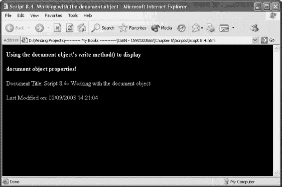

图 8.8：使用属于 `document` 对象的属性和方法控制 HTML 页面的内容和外观

> **注意**：`document` 对象提供了对许多其他属性的访问，你将在本书的第 V 部分中看到它们。一个特别有用的属性是 `cookie` 属性，它让你能够在每位访问者的计算机上存储少量数据。例如，使用 cookie，你可以存储并稍后检索访问者的姓名，并在用户下次返回你的网站时使用它来创建个性化问候消息。

### 使用 location 对象

`location` 对象提供了刷新当前显示的 HTML 页面或使用其 `replace()` 和 `reload()` 方法加载不同 URL 的功能。此外，`location` 对象的 `href` 属性可以设置或检索当前加载的 URL 名称。例如，你可以将以下语句添加到嵌入 HTML 页面中的 VBScript 中，以加载微软的主 URL：

```
location.href="http://www.microsoft.com"
```

作为一个工作性示例，以下 VBScript 显示了如何使用 `location` 对象的 `href` 属性通过 HTML 下拉选择表元素加载用户选择的 URL。

```
<HTML>

  <HEAD>
    <TITLE>脚本 8.5 - 使用 navigator 对象加载网页</TITLE>
  </HEAD>

  <BODY>

    <SCRIPT LANGUAGE="VBScript">
    <!-- 开始隐藏 VBScript 语句

      Option Explicit

      Function OpenButton_onClick()
        location.href=document.OnLineSitesForm.SupportList.value
      End Function

  ' 隐藏 VBScript 语句 -->
  </SCRIPT>

  <H2>在线支持网站</H2>

    <FORM NAME="OnLineSitesForm">
      <SELECT NAME="SupportList" size=1>
      <OPTION VALUE="http://www.microsoft.com"> Microsoft
      <OPTION VALUE="http://www.compaq.com"> Compaq
      <OPTION VALUE="http://www.dell.com"> Dell
      <OPTION VALUE="http://www.ibm.com"> IBM
      <OPTION VALUE="http://www.gateway.com"> Gateway
      </SELECT>
      <INPUT NAME="OpenButton" TYPE="button" VALUE="打开供应商站点">
    </FORM>
  </BODY>

</HTML>
```

HTML 页面和 VBScript 通过在访问者选择表单下拉列表中的某一项时触发 `OpenButton` 表单元素的 `click` 事件来工作。这反过来执行了 `OpenButton_onClick` 函数。该函数使用 `location` 对象的 `href` 属性加载与访问者选择相关的 URL，如下所示。

```
window.location=document.myForm.myList.value
```

图 8.9 显示允许访问者选择新 URL 的 HTML 页面。从下拉列表中选择一个供应商名称后，将加载与该选择相关的 URL，替换当前加载的 URL。

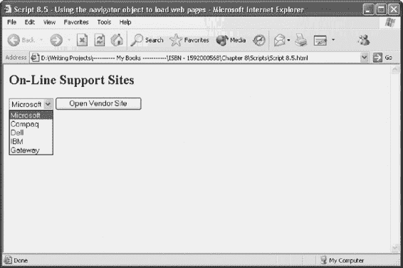

图 8.9：使用 `location` 对象的 `href` 属性开发自定义导航控制

### 使用 history 对象

`history` 对象提供了另一种控制浏览器导航的方法。通过使用该对象的 `back()` 和 `forward()` 方法，你可以程序化地遍历浏览器历史记录中存储的 URL 列表（此浏览器最近打开的 URL 列表）。此外，你可以使用 `history` 对象的 `go()` 方法加载列表中的任何 URL。例如，以下语句指示 Internet Explorer 加载之前过的 URL：

```
history.back()
```

同样，要向历史列表向前移动一个位置，可以使用以下语句：

```
history.forward()
```

要刷新当前加载的 URL，请使用以下语句：

```
history.go(0)
```

要在历史列表中向后或向前跳转若干位置，请向 `go()` 方法传递正数或负数。

### 使用 navigator 对象

`navigator` 对象提供了对以下属性的访问：

* `appCodeName`：返回分配浏览器的代码名称
* `appName`：返回浏览器名称
* `appVersion`：返回浏览器版本信息

以下示例演示了使用 `appName` 和 `appVersion` 属性的一种方法。该示例中的 VBScript 会询问浏览器并跳转到另一个 URL 或显示需要 Internet 的消息。该示例对于非 Internet 浏览器，显示相同的消息。

```
<HTML>

  <HEAD>
    <TITLE>脚本 8.6 - 检测浏览器类型和版本</TITLE>
  </HEAD>

  <BODY>

    <SCRIPT LANGUAGE="VBScript">
    <!-- 开始隐藏 VBScript 语句

      Option Explicit

      Dim strBrowserName, strBrowserVersion, strFindString
      Dim intVersionNumber

      strBrowserName=navigator.appName

      If strBrowserName = "Microsoft Internet Explorer" Then

        strBrowserVersion = navigator.appVersion

        strFindString = Instr(1, strBrowserVersion, "MSIE")
        strFindString = strFindString + 5
        intVersionNumber = Mid(strBrowserVersion, strFindString, 1)

        If intVersionNumber < 5 then
          'document.write("此网站需要 IE 5 或更高版本")
        Else
          window.location="http://www.yahoo.com"
        End If
      End If

    ' 隐藏 VBScript 语句 -->
    </SCRIPT>

    访问此网站请使用 Internet Explorer 5 或以上版本。
  </BODY>

</HTML>
```

此示例首先将 `strBrowserName` 设置为 `navigator.appName`。然后它检查赋值给此变量的值是否等于 `Microsoft Internet Explorer`。如果是，则将 `navigator.version` 的值赋值给名为 `strBrowserVersion` 的变量。以下三个语句随后解析出浏览器的版本号。

```
strFindString = Instr(1, strBrowserVersion, "MSIE")
strFindString = strFindString + 5
intVersionNumber = Mid(strBrowserVersion, strFindString, 1)
```

例如，如果使用 Internet Explorer 6.X 版本加载 HTML 页面，则 `strBrowserName` 的值将被设置为以下内容：

```
4.0 (compatible; MSIE 6.0; Windows NT 5.1; Q312461)
```

第一条语句使用 VBScript 的 `Instr()` 函数设置一个值，指示字母 `MSIE` 在 `strFindString` 中的起始位置。第二条语句在该数字的基础上加上 5。第三条语句接着使用 VBScript 的 `Mid()` 函数剥离浏览器的主版本号（即 6）。

如果浏览器的版本号小于 5（例如 Internet Explorer 4.X 版本），则网页上将显示一条消息，告知访问者需要 Internet Explorer 5.X 或更高版本才能访问该网站。如果版本号为 5 或更大，则使用 `location` 对象的 `href` 属性来加载指定的 URL。

> **注意**：如果访问者使用的是 Netscape Communicator 或任何非 Internet Explorer 兼容的浏览器，浏览器将自动忽略嵌入的 VBScript，转而显示位于 HTML 页面底部的以下消息：
> ```
> Sorry. To access this web site use Internet Explorer version 5 or above.
> ```

## 处理浏览器事件

为了与你网站的访问者真正交互，你需要开发 VBScript，以便在访问者导航和操作你的网站时做出反应。每当你的 HTML 页面发生任何变化时，就会发生一个事件。例如，当 HTML 页面加载到浏览器时，会发生 `load` 事件；当它卸载时，会发生 `unload` 事件。当访问者将指针移入或离开链接、按钮和图像，或者与 HTML 表单上的各种元素交互时，也会发生事件。

你可以使用 VBScript 创建事件处理器来对发生的事件做出反应。`event handler`（事件处理器）是一个在事件发生时触发的触发器。例如，你可以创建一个事件处理器，在访问者首次加载你的 HTML 页面时在弹出框中显示欢迎消息，或者在浏览器卸载你的 HTML 页面之前感谢用户的访问。此外，你还可以使用事件处理器通过在访问者指针悬过链接时更改文本颜色创建图形效果。你可能还会使用事件处理器在用户与 HTML 表单字段交互时对这些字段进行验证。

事件处理器与特定对象相关。换句话说，如果你有一个定义了四个链接的 HTML 页面，那么你可以创建单独的事件处理器来管理每个单独链接的用户交互性。

表 8.2 提供了浏览器事件及其相关事件处理器的列表。如你所示，事件处理器的名称是通过在其关联的事件名称开头添加单词 `on` 来确定的。

### 表 8.2：文档对象模型事件和事件处理器

| 事件 | 事件处理器 | 描述 |
| --- | --- | --- |
| `Abort` | `onAbort` | 当访问者在图像加载时中止加载时执行 |
| `Blur` | `onBlur` | 当当前选中的对象失去焦点时执行 |
| `Change` | `onChange` | 当访问者更改对象时执行 |
| `Click` | `onClick` | 当访问者点击对象时执行 |
| `DblClick` | `onDblClick` | 当访问者双击对象时执行 |
| `DragDrop` | `onDragDrop` | 当访问者将对象拖放到到框架或窗口上时执行 |
| `Error` | `onError` | 当 HTML 页面上发生错误时执行 |
| `Focus` | `onFocus` | 当访问者选择对象时执行 |
| `KeyDown` | `onKeyDown` | 当访问者按下按键时执行 |
| `KeyPress` | `onKeyPress` | 当访问者按下并释放按键时执行 |
| `KeyUp` | `onKeyUp` | 当访问者释放按键时执行 |
| `Load` | `onLoad` | 当 HTML 页面或图像加载完成时执行 |
| `MouseDown` | `onMouseDown` | 当访问者按下鼠标键时执行 |
| `MouseMove` | `onMouseMove` | 当访问者移动指针时执行 |
| `MouseOut` | `onMouseOut` | 当访问者将指针离开对象时执行 |
| `MouseOver` | `onMouseOver` | 当访问者将指针移过对象时执行 |
| `MouseUp` | `onMouseUp` | 当访问者释放鼠标键时执行 |
| `MouseWheel` | `onMouseWheel` | 当旋转鼠标轮时执行 |
| `Move` | `onMove` | 当访问者移动框架或窗口时执行 |
| `Reset` | `onReset` | 当访问者点击重置按钮时执行 |
| `Resize` | `onResize` | 当访问者调整框架或窗口大小时执行 |
| `Select` | `onSelect` | 当访问者选择表单文本字段的内容时执行 |
| `Submit` | `onSubmit` | 当访问者点击提交按钮时执行 |
| `Unload` | `onUnload` | 当访问者关闭浏览器窗口或框架或加载不同的 URL 时执行 |

在 HTML 页面中设置事件处理器有很多不同的方法。例如，你可以将它们直接嵌入 HTML 标签中，如下所示。

```
<BODY onLoad="window.status">
```

此语句会在 HTML 页面加载时在浏览器的状态栏中显示欢迎消息。设置事件处理器的另一种方法是将它们设置为过程。为了实现这一点，你必须根据想要使其反应的事件来命名你的过程。例如，为了创建一个在用户指针移过名为 `strLogo` 的链接时做出反应的事件处理器，你需要像下面所示命名你的过程。

```
Sub strLogo_onMouseOver
  window.status = 'ABC Enterprises Inc.'
End Sub
```

另一种设置事件处理器的方法是将它们嵌入 `<SCRIPT>` 标签中，如下所示。

```
<SCRIPT FOR="strLogo" EVENT="onMouseOver" LANGUAGE="VBScript">
  window.status = "ABC Enterprises Inc."
</SCRIPT>
```

这两条语句执行位于 HTML 页面 `HEAD` 部分的两个 VBScript 过程。第一条语句在浏览器最初加载 HTML 页面或访问者刷新页面时执行。第二条语句在访问者加载不同的 URL 或关闭浏览器时执行。无论哪种情况，都会显示一个弹出消息，欢迎访问者或与其告别。图 8.10 显示了当脚本的 `Goodbye()` 函数执行时（即触发 `Unload` 事件时）所弹出的对话框。


图 8.10：使用 `onLoad` 和 `onUnload` 事件处理器触发文本消息的显示

### 鼠标和键盘事件

作为设置事件处理器的最后一个示例，以下 VBScript 使用 `onMouseOver` 和 `onMouseOut` 事件处理器为几个 HTML 链接创建图形化菜单悬停效果。为了为这些链接设置悬停效果，必须在 HTML 页面上定义的每个链接上添加 `NAME` 属性。然后，必须为每个链接定义一对过程，一个用于 `onMouseOver` 事件处理器，另一个用于 `onMouseOut` 事件处理器。随后，每个过程必须修改分配给链接文本的颜色属性。

```
<HTML>
  <HEAD>
    <TITLE>脚本 8.8 - 使用鼠标事件创建悬停效果</TITLE>

    <SCRIPT LANGUAGE="VBScript">
    <!- 开始隐藏 VBScript 语句

      Function gateway_onMouseOver
        gateway.style.color="red"
      End Function
      Function gateway_onMouseOut
        gateway.style.color="blue"
      End Function

      Function compaq_onMouseOver
        compaq.style.color="red"
      End Function
      Function compaq_onMouseOut
        compaq.style.color="blue"
      End Function
      Function dell_onMouseOver
        dell.style.color="red"
      End Function
      Function dell_onMouseOut
        dell.style.color="blue"
      End Function

    ' 隐藏 VBScript 语句 -->
    </SCRIPT>
  </HEAD>

  <BODY>
    <B>选择供应商站点：B><P>
    <A HREF="http://www.gateway.com" NAME="gateway"> Gateway</A><P>
    <A HREF="http://www.compaq.com" NAME="compaq"> Compaq</A><P>
    <A HREF="http://www.dell.com" NAME="dell"> Dell</A><P>
  </BODY>
</HTML>
```

图 8.11 显示了 Web 页面由 Internet Explorer 加载时的外观。遗憾的是，这张图无法完全展示示例。为了更详细地查看此图，请从 [`www.premierpressbooks.com/download.asp`](http://www.premierpressbooks.com/download.asp) 下载它。正如你在运行时看到的那样，当指针移入和移离开链接时，颜色会从红色变为蓝色。

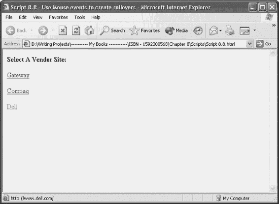

图 8.11：使用 `onMouseOver` 和 `onMouseOut` 事件处理器创建图形化悬停效果

## 总结

在本章中，你学习了 DOM 和 DHTML 对象模型。你还学习了如何开发与这些对象模型提供的对象交互的脚本，以增强你对 HTML 页面的控制。此外，你还学习了浏览器事件以及如何设置事件处理器，以开发允许你创建交互式 HTML 页面的过程。

# 第 9 章：VBScript 与 WSH

在本章中，你将学习 WSH 提供的对象、属性和方法。随后，你将学习如何使用这些对象来访问和操作大量的 Windows 资源。本章还将演示如何创建可以接收并处理运行时传递参数的脚本。最后，你将学习如何使用 XML（`扩展标记语言`）创建一种新的脚本文件，这将允许你将用不同脚本语言编写的两个或多个独立脚本合并到一个新的 Windows 脚本文件中。

## WSH 对象模型

WSH 的核心是它的核心对象模型。构成该模型的对象提供了直接访问其所代表的 Windows 资源的权限。WSH 核心对象模型总共由 14 个对象组成。这些对象及其它们之间的关系在图 9.1 中所示。


图 9.1：WSH 核心对象模型由 14 个独立对象组成

`WScript` 对象位于对象模型的顶端或根节点。`WScript` 对象由 WSH 在脚本执行开始时隐式实例化，这意味着脚本可以自动访问它的任何属性或方法。WSH 核心对象模型中的所有其他对象都必须先实例化，才能使用它们的属性和方法。

### 公共对象

`WScript` 对象在脚本执行开始时自动暴露。`WScript` 对象也被称为公共对象。`WScript` 对象包含了 `WshController`、`WshShell` 和 `WshNetwork` 对象。要实例化这些对象，必须使用 `WScript` 对象的 `CreateObject()` 方法。表 9.1 提供了构成 WSH 核心模型的 10 个对象列表。

### 表 9.1：低级对象

| 对象 | 实例化方法 |
| --- | --- |
| `WshArguments` | `WScript.Arguments` |
| `WshNamed` | `WScript.Arguments.Named` |
| `WshUnnamed` | `WScript.Arguments.Unnamed` |
| `WshRemote` | `WshController.CreateScript()` |


| `WshRemote` | `WshRemote.Error` |
| `WshShortcut` | `WshShell.CreateShortcut()` |
| `WshUrlShortcut` | `WshShell.CreateShortcut()` |
| `WshEnvironment` | `WshShell.Environment` |
| `WshSpecialFolders` | `WshShell.SpecialFolders` |
| `WshScriptExec` | `WshShell.Exec()` |

### WSH 对象属性和方法

对象模型中的每个对象都有其独特的属性和方法。表 9.2 提供了 WSH 对象的简要描述。此外，它还提供了与每个对象相关的属性和方法列表。

#### 表 9.2：WSH 对象

| 对象 | 描述 |
| --- | --- |
| `WScript` | 这是 WSH 的根对象。它提供了许多实用的属性和方法。它提供了对 WSH 对象模型中其余对象的访问。属性：`Arguments`、`FullName`、`Interactive`、`Name`、`Path`、`ScriptFullName`、`ScriptName`、`StdErr`、`StdIn`、`StdOut` 和 `Version`。方法：`ConnectObject()`、`CreateObject()`、`DisconnectObject()`、`Echo()`、`GetObject()`、`Quit()` 和 `Sleep()` |
| `WshArguments` | 该对象允许访问执行时传递给脚本的命令行参数。属性：`Count`、`Item` 和 `Length`；`Named` 和 `Unnamed`。方法：`Count()` 和 `ShowUsage()` |
| `WshNamed` | 该对象提供一组命名的命令行参数。属性：`Item` 和 `Length`。方法：`Count()` 和 `Exists()` |
| `WshUnnamed` | 该对象提供一组未命名的命令行参数。属性：`Item` 和 `Length`。方法：`Count()` |
| `WshController` | 该对象提供创建远程脚本进程的能力。属性：该对象不支持任何属性。方法：`CreateScript()` |
| `WshRemote` | 该对象提供了通过网络使用脚本管理远程计算机的能力。属性：`Status` 和 `Error`。方法：`Execute()` 和 `Terminate()` |
| `WshRemoteError` | 此对象提供访问远程脚本产生的错误信息。属性：`Description`、`Line`、`Character`、`SourceText`、`Source` 和 `Number`。方法：此对象不支持任何方法。 |
| `WshNetwork` | 此对象提供许多不同的网络资源，例如网络打印机和驱动器。属性：`ComputerName`、`UserDomain` 和 `UserName`。方法：`AddWindowsPrinterConnection()`、`AddPrinterConnection()`、`EnumNetworkDrives()`、`EnumPrinterConnections()`、`MapNetworkDrive()`、`RemoveNetworkDrive()`、`RemovePrinterConnection()` 和 `SetDefaultPrinter()` |
| `WshShell` | 此对象提供访问 Windows 注册表、事件日志、环境变量、快捷方式和应用程序。属性：`CurrentDirectory`、`Environment` 和 `SpecialFolders`。方法：`AppActivate()`、`CreateShortcut()`、`ExpandEnvironmentStrings()`、`LogEvent()`、`Popup()`、`RegDelete()`、`RegRead()`、`RegWrite()`、`Run()`、`SendKeys()` 和 `Exec()` |
| `WshShortcut` | 此对象为脚本提供了创建和操作 Windows 快捷方式的方法和属性。属性：`Arguments`、`Description`、`FullName`、`Hotkey`、`IconLocation`、`TargetPath`、`WindowStyle` 和 `WorkingDirectory`。方法：`Save()` |
| `WshUrlShortcut` | 此对象为脚本提供了创建和操作 URL 快捷方式的方法和属性。属性：`FullName` 和 `TargetPath`。方法：`Save()` |
| `WshEnvironment` | 此对象提供访问 Windows 环境变量。属性：`Item` 和 `Length`。方法：`Remove()` 和 `Count()` |
| `WshSpecialFolders` | 此对象访问特殊的 Windows 文件夹，允许脚本配置开始菜单、桌面、快速启动工具和其他特殊的 Windows 文件夹。属性：`Item`。方法：`Count()` |
| `WshScriptExec` | 此对象提供访问使用 `Exec` 方法运行的脚本的错误信息。属性：`Status`、`StdOut`、`StdIn` 和 `StdErr`。方法：`Terminate()` |

WSH 对象太多，无法在一个章节中全部涵盖。因此，本章将限于为您提供 WSH 对象引用，并提供一些操作某些 WSH 对象的示例。本书的其余章节将让您有机会操作属于表 9.2 所示对象的许多属性和方法。

### 核心对象属性

对象属性存储它们所代表的资源的信息。通过引用对象属性，VBScript 可以收集有关其执行环境的信息。此外，通过修改对象属性，VBScript 可以对该环境以及其中的 Windows 资源进行直接更改。

WSH 核心对象提供了对几十种不同属性的访问。表 9.3 列出了这些每一个属性。

#### 表 9.3：WSH 对象属性

| 属性 | 描述 |
| --- | --- |
| `Arguments` | 设置指向 `WshArguments` 集合的指针引用 |
| `AtEndOfLine` | 返回 `True` 或 `False`，取决于流中是否到达行结束符 |
| `AtEndOfStream` | 返回 `True` 或 `False`，取决于是否到达输入流末尾 |
| `Character` | 识别代码行中发生错误的特定字符 |
| `Column` | 返回输入流中的当前列位置 |
| `ComputerName` | 获取计算机名称 |
| `CurrentDirectory` | 设置或检索脚本的当前工作目录 |
| `Description` | 获取指定快捷方式的描述 |
| `Environment` | 设置指向 `WshEnvironment` 的指针引用 |
| `Error` | 提供暴露 `WshRemoteError` 对象的能力 |
| `ExitCode` | 返回使用 `Exec()` 启动的脚本的退出代码 |
| `FullName` | 获取快捷方式或可执行程序的路径 |
| `HotKey` | 获取与指定快捷方式关联的热键 |
| `IconLocation` | 获取图标的位置 |
| `Interactive` | 提供通过程序化设置脚本模式的能力 |
| `Item` | 从集合中检索指定的项，或提供对存储在 `WshNamed` 对象中的项的访问 |
| `Length` | 获取枚举项的计数 |
| `Line` | 返回输入流中当前行的行号，或识别脚本中发生错误的行号 |
| `Name` | 返回表示 `WScript` 对象名称的字符串 |
| `Number` | 提供对错误号的访问 |
| `Path` | 返回 `CScript` 或 `WScript` 执行主机所在文件夹的位置 |
| `ProcessID` | 获取使用 `WshScriptExec` 对象启动的进程的 PID（进程 ID） |
| `ScriptFullName` | 返回执行脚本的路径 |
| `ScriptName` | 返回执行的脚本的名称 |
| `Source` | 获取导致脚本错误的对象的标识 |
| `SourceText` | 获取创建错误的源代码 |
| `SpecialFolders` | 提供对 Windows 开始菜单和桌面文件夹的访问 |
| `Status` | 提供状态 |
| `StdErr` | 允许写入错误流 |
| `StdIn` | 允许对输入流进行访问 |
| `StdOut` | 允许对输出流进行访问 |
| `TargetPath` | 获取快捷方式指向对象的路径 |
| `UserDomain` | 获取域名称 |
| `UserName` | 获取当前登录用户的名称 |
| `Version` | 获取 WSH 版本 |
| `WindowStyle` | 获取快捷方式的窗口样式 |
| `WorkingDirectory` | 返回快捷方式关联的工作目录 |

### 使用对象属性

作为操作属性的示例，请查看以下 VBScript。在此脚本中，引用了 `WshNetwork` 对象的属性以收集网络信息。

```vbscript
'*****************************************
'Script Name: Script 9.1.vbs
'Author: Jerry Ford
'Created: 02/12/03
'Description: 此脚本演示了如何使用
'WshNetwork 对象的属性获取网络信息
'*****************************************
'初始化部分

Option Explicit

Dim WshNtwk, strDisplayText

'实例化 WshNetwork 对象
Set WshNtwk = WScript.CreateObject("WScript.Network")

'主处理部分

'调用收集并显示网络信息的过程
DisplayNetInfo()

'终止脚本执行
WScript.Quit()

'过程部分

'显示网络信息的子程序
Sub DisplayNetInfo()

  strDisplayText = "此计算机是 " & WshNtwk.ComputerName & ". " & _
    "它连接到以下域：" & vbCrLf & vbCrLf & _
    WshNtwk.UserDomain & vbCrLf & vbCrLf & vbCrLf

  MsgBox strDisplayText, , "网络信息"

End Sub
```

此脚本首先定义了两个变量，`WshNtwk` 和 `strDisplayText`。随后使用 `WshNtwk` 实例化 `WshNetwork` 对象，如下所示。

```vbscript
Dim WshNtwk, strDisplayText
Set WshNtwk = WScript.CreateObject("WScript.Network")
```

如你所见，设置 `WshNetwork` 对象的实例需要使用 `Set` 语句和 `WScript` 对象的 `CreateObject()` 方法。一旦实例化，你就可以引用该对象的任何属性和方法。接下来，脚本将执行一个名为 `DisplayNetInfo()` 的过程。该子程序包含两条语句。第一条语句使用 `strDisplayText` 变量以及以下 `WshNetwork` 属性创建一个显示字符串：

* `ComputerName`：检索分配给执行脚本的计算机的网络名称
* `UserDomain`：检索计算机所属的 Windows 域名称；如果计算机是基于工作组的网络的成员，则检索分配给该计算机的工作组名称。

`DisplayNetInfo()` 子程序中的第二条语句将如图 9.2 所示显示该字符串。最后，控制权返回主处理部分，使用 `WScript` 对象的 `Quit()` 方法终止脚本的执行。

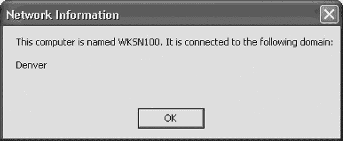

图 9.2：显示从属于 `WshNetwork` 属性收集的网络信息

### 核心对象方法

WSH 对象方法提供了交互和操作它们所代表资源的能力。这些资源包括桌面快捷方式、Windows 文件系统、打印机和 Windows 注册表。表 9.4 提供了 WSH 核心对象方法的列表。

#### 表 9.4：WSH 对象方法

| 方法 | 说明 |
| --- | --- |
| `AddPrinterConnection()` | 创建打印机映射 |
| `AddWindowsPrinterConnection()` | 创建新的打印机连接 |
| `AppActivate()` | 激活目标应用程序窗口 |
| `Close()` | 终止或结束打开的数据流 |
| `ConnectObject()` | 与对象建立连接 |
| `Count()` | 检索 `WshNamed` 和 `WshUnnamed` 对象中找到开关数量 |
| `CreateObject()` | 创建对象的新实例 |
| `CreateScript()` | 实例化代表远程运行脚本的 `WshRemote` 对象 |
| `CreateShortcut()` | 创建 Windows 快捷方式 |
| `DisconnectObject()` | 终止对象的连接 |
| `Echo()` | 显示文本消息 |
| `EnumNetworkDrives()` | 启用访问网络驱动器 |
| `EnumPrinterConnections()` | 启用访问网络打印机 |
| `Exec()` | 在子命令 shell 中执行应用程序并提供对环境变量的访问 |
| `Execute()` | 启动远程脚本对象的执行 |
| `Exists()` | 确定 `WshNamed` 对象中是否存在指定的键 |
| `ExpandEnvironmentStrings()` | 检索表示 `Process` 环境变量内容的字符串 |
| `GetObject()` | 检索一个 `Automation` 对象 |
| `GetResource()` | 根据 `<resource>` 标签指定的检索资源值 |
| `LogEvent()` | 在 Windows 事件日志中写入消息 |
| `MapNetworkDrive()` | 创建网络驱动器映射 |
| `Popup()` | 在弹出对话框中显示文本消息 |
| `Quit()` | 终止或结束脚本 |
| `Read()` | 从输入流中检索字符字符串 |
| `ReadAll()` | 检索由输入流中的字符组成的字符串 |
| `ReadLine()` | 从输入流中检索包含整行数据的字符串 |
| `RegDelete()` | 删除注册表键或值 |
| `RegRead()` | 检索注册表键或值 |
| `RegWrite()` | 创建注册表键或值 |
| `Remove()` | 删除指定的环境变量 |
| `RemoveNetworkDrive()` | 删除到指定网络驱动器的连接 |
| `RemovePrinterConnection()` | 删除到指定网络打印机的连接 |
| `Run()` | 启动新进程 |
| `Save()` | 保存快捷方式 |
| `SendKeys()` | 模拟击键并将输入数据发送到指定的窗口 |
| `SetDefaultPrinter()` | 建立默认 Windows 打印机 |
| `ShowUsage()` | 检索有关脚本预期执行方式的信息 |
| `Skip()` | 从输入流读取时跳过 `x` 个字符 |
| `SkipLine()` | 从输入流读取时跳过整整行 |
| `Sleep()` | 暂停脚本执行 `x` 秒 |
| `Terminate()` | 停止由 `Exec()` 启动的进程 |
| `Write()` | 在输出流中放置字符串 |
| `WriteBlankLines()` | 在输出流中留空行 |
| `WriteLine()` | 在输出流中放置字符串 |

### 使用 WSH 对象方法

作为如何使用 WSH 对象方法的示例，请检查以下 VBScript。在此 VBScript 中，使用了属于 `WshShell` 对象的方法来设置到网络文件夹的映射驱动器连接。

```vbscript
'*************************************************************************
'Script Name: Script 9.2.vbs
'Author: Jerry Ford
'Created: 02/12/03
'Description: 此脚本演示了如何使用属于
'the WshNetwork 对象的方法来映射网络驱动器
*************************************************************************

'初始化部分

Option Explicit
Dim WshNetworkk, strLetter, strPath

'实例化 WshNetwork 对象
Set WshNetworkk = WScript.CreateObject("WScript.Network")

strLetter = "z:"
strPath = "\\PC\Shared"

'主处理部分

'调用映射网络驱动器的过程
MapDrive strLetter, strPath

'终止脚本执行
WScript.Quit()

'过程部分
'此子程序创建网络驱动器

Sub MapDrive(letter, path)
  '创建到指定网络驱动器的映射
  WshNetworkk.MapNetworkDrive letter, path

End Sub
```

### 向脚本传递参数

在到目前为止看到的所有脚本中，数据要么被硬编码在脚本的常量、变量和数组中，要么通过弹出框与用户交互式收集。脚本还经常通过在运行时作为参数传递数据来接收需要处理的数据。例如，你可能会设置一个脚本来调用另一个脚本，并将第一个脚本的输出作为第二个脚本的输入。

或者，你也可以从 Windows 命令行向脚本传递参数。例如，以下命令将执行名为 `TestScript.vbs` 的脚本并向其传递三个参数：

```
WScript TestScript.vbs log txt doc
```

发生什么取决于脚本。例如，接收 `log`、`txt` 和 `doc` 作为输入的脚本可能会使用这些参数来构建一个需要以某种方式处理的文件列表。

> **注意**
> 您也可以向脚本传递包含空格的参数，但要做到这一点，您必须将参数封装在一对匹配的引号内，如下文所示。

```
CScript TestScript.vbs reports "log files" documents
```

脚本的设计必须能够处理可能传递给它们的任何参数输入。这可以使用属于 `WshArguments` 对象的属性来实现，如下例所示。

```vbscript
'*************************************************************************
'Script Name: Script 9.3.vbs
'Author: Jerry Ford
'Created: 02/12/03
'Description: 此脚本演示了如何处理传递给
'a VBScript 的参数
'*************************************************************************

'Initialization Section

Option Explicit

Dim WshArgs
Set WshArgs = WScript.Arguments

'Main Processing Section

If WshArgs.Count < 1 Then
  MsgBox "Error: 没有传递参数给此脚本。"
  WScript.Quit()
Else
  ProcessArguments()
End If
WScript.Quit()

'Procedure Section

Sub ProcessArguments()

  Dim i, strDisplayString

  strDisplayString = "Total number of arguments passed to this " & _
    "script: " & vbTab & WshArgs.Count & vbCrLf & vbCrLf

  For i = 0 to (WshArgs.Count - 1)
    strDisplayString = strDisplayString & WshArgs.Item(i) & vbCrLf
  Next

  MsgBox strDisplayString

End Sub
```

此 VBScript 执行的第一件事是定义一个变量并使用它实例化 `WshArguments` 对象的实例，如下所示。

```vbscript
Dim WshArgs
Set WshArgs = WScript.Arguments
```

在脚本的主处理部分中，脚本随后使用 `WshArguments` 对象的 `Count` 属性来确保至少传递了一个参数，如果是如此，则调用 `ProcessArguments()` 函数。否则，将显示错误消息并执行 `WScript` 对象的 `Quit()` 方法，终止脚本的执行。

`ProcessArguments()` 函数首先向显示字符串中添加一个标题，如下所示。

```vbscript
strDisplayString = "Total number of arguments passed to this script: " & _
    vbTab & WshArgs.Count & vbCrLf & vbCrLf
```

接下来，它使用 `For`…`Next` 循环遍历传递给脚本的参数列表。`WshArguments` 对象将参数存储在从零开始的索引列表中。循环从零开始一直运行到 `WshArgs.Count – 1`（例如，如果传递了五个参数，索引将从位置 0 开始，到位置 4 结束）。在循环的每次迭代中，都会根据变量 `i` 指定的索引号将每个参数的值添加到字符串中（例如，`WshArguments.Item(i)`），从而修改显示字符串的内容。

[图 9.4] 展示了当向此脚本传递 `SalesReport.doc`、`MarketReport.doc`、`Forecast.xls`、`MonthlyStats.xls` 和 `LogReports.log` 参数列表时产生的输出。

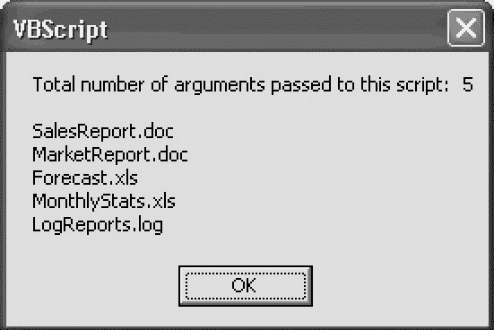

图 9.4：在运行时处理传递给 VBScript 的参数

### 使用 XML 创建 Windows 脚本文件

WSH 为编程人员提供了一个健壮的脚本环境，该环境包含对一组通用对象的访问权限。这些对象通过属性和方法访问它们所代表的 Windows 资源。WSH 的优势之一是，无论编程人员使用何种脚本语言，它都能提供相同级别的访问权限。

微软在发布 WSH 时自带了 VBScript 和 JScript，但同时也提供了第三方的、兼容 WSH 的脚本语言，包括 Perl、Python 和 Rexx。WSH 并不止于此。除了允许您使用选择的脚本语言外，它还提供了将两个或多个脚本（包括使用不同语言编写的脚本）合并成单个名为 `Windows Script File`（Windows 脚本文件）脚本的能力。Windows 脚本文件是以 `.wsf` 扩展名保存的纯文本文件。

WSH 使用 XML 的子集来创建 Windows 脚本文件。XML 是一种在语法上与 HTML 相似的标记语言。Windows 脚本文件中使用 XML 标签来标识或标记组成文件的组件。例如，Windows 脚本文件中的每个脚本都封装在一对 `<script> </script>` 标签中。WSH 目前对 XML 1.0 版本提供支持。

XML 是一种区分大小写敏感的标记语言。在格式化标签时，它必须遵循一套严格的规则。与 HTML 标记语言不同，您不能省略所需的闭合标签。本章的其余部分将演示一些常用的 XML 标签，如表 9.5 所示。

#### 表 9.5：Windows 脚本文件中常用的 XML 标签

| 标签 | 描述 |
| --- | --- |
| `<?XML ?>` | 此标签指定 Windows 脚本文件的 XML 级别。 |
| `<?job ?>` | 此标签用于启用或禁用指定作业的错误处理和调试。 |
| `<comment> </comment>` | 此标签提供了在 Windows 脚本文件中嵌入注释的能力。 |
| `<script> </script>` | 此标签标识 Windows 脚本文件内脚本的开始和结束。 |
| `<job> </job>` | 此标签标识 Windows 脚本文件内作业的开始和结束。 |
| `<package> </package>` | 此标签允许在 Windows 脚本文件中定义多个作业。 |
| `<resource> </resource>` | 此标签定义供脚本引用的静态数据（常量）。 |

> **注意**
> XML 1.0 允许标签使用大小写。然而，使用大写通常被认为是不规范的。

#### `<?XML ?>` 标签

`<?XML ?>` 标签是一个可选标签，指定 Windows 脚本文件执行所需的 XML 版本。如果使用，`<?XML ?>` 标签必须是 Windows 脚本文件的第一个语句。其语法所示：

```xml
<?XML version="X.X" standalone="dtdflag" ?>
```

`version` 指定所需的 XML 版本。`standalone` 指定一个布尔值，指示脚本是否包含外部 DTD（文档类型定义）。DTD 目前是一项不支持的 WSH 功能。然而，如果您愿意，可以包含它。如果这样做，必须将其指定为 `Yes`。`<?XML ?>` 标签没有闭合标签。

#### `<?job ?>` 标签

`<?job ?>` 标签是一个可选标签，允许您启用或禁用错误报告和调试。`<?job ?>` 标签没有闭合标签。其语法所示：

```xml
<?job error="errorflag" debug="debugflag" ?>
```

`errorflag` 是一个布尔值。当设置为 `True` 时，启用错误报告。如果省略，Windows 脚本文件将禁用错误报告。`debugflag` 也是一个布尔值，控制错误发生时是否会启动 Windows 脚本调试器。

> **Note**
> Microsoft Windows 脚本调试器是微软提供的一种实用程序，帮助编程人员调试脚本错误。访问 [msdn.microsoft.com/scripting](http://msdn.microsoft.com/scripting) 了解更多关于此工具。

以下示例演示了如何在 Windows 脚本文件中启用错误报告和脚本调试。

```xml
<job>
  <?job error="true" debug="true"?>
  <script language="VBScript">
    MsgBox "Error handling and debugging are now enabled."
  </script>
</job>
```

#### `<comment>` 和 `</comment>` 标签

`<comment>` 和 `</comment>` 标签提供了在 Windows 脚本文件中放置注释。`<comment>` 和 `</comment>` 标签也可用于将注释跨多行。`<comment>` 和 `</comment>` 标签的语法所示。

```xml
<comment> comment text  </comment>
```

以下示例演示了 `<comment>` 和 `</comment>` 标签的使用。

```xml
<job>
  <comment>在此处放置您的注释</comment>
  <script language="VBScript">
    MsgBox "Error handling and debugging are now enabled."
  </script>
</job>
```

#### `<script>` 和 `</script>` 标签

Windows 脚本文件包含一个或多个用各种 WSH 支持的脚本语言编写的脚本文件。`<script>` 和 `</script>` 标签用于识别 Windows 脚本文件中单个脚本的开始和结束。其语法所示。

```xml
<script language="scriptlanguage" [src="externalscript"]>
   ...
</script>
```

`language` 用于指定开发脚本使用的脚本语言。`src` 是可选的，用于指定外部脚本的位置。

以下示例演示了如何使用 `<script>` 和 `</script>` 标签在 Windows 脚本文件中嵌入 VBScript。

```xml
<job>
  <script language="VBScript">
    MsgBox "Windows Script Host - Script number 2 executing"
  </script>
</job>
```

下一个示例演示了如何设置与 Windows 脚本文件同一文件夹下的外部 VBScript 引用。

```xml
<job>
  <script language="VBScript" src="ScriptName.vbs" />
</job>
```

#### `<job>` 和 `</job>` 标签

Windows 脚本文件可以包含一个或多个作业，每个作业可以包含任意数量的脚本。每个作业使用 `<job>` 和 `</job>` 标签标识。至少，每个 Windows 脚本文件必须包含一个作业。这些标签的语法所示。

```xml
<job [id=jobid]>
  . . .
</job>
```

`id` 用于唯一标识包含多个作业的 Windows 脚本中的作业。在仅包含一个作业的 Windows 脚本文件中可以省略此参数。通过为 Windows 脚本文件中的每个作业分配作业 ID，你可以在执行 Windows 脚本文件时指定想要运行的作业。以下示例显示了一个由单个作业组成的 Windows 脚本文件。

```xml
<job>

  <script language="VBScript">
    MsgBox "The first VBScript is now executing."
  </script>

  <script language="VBScript" src="SecondVBScript.vbs" />

  <script language="JScript">
    WScript.Echo("The first JScript is now executing.")
  </script>

</job>
```

如你所见，此作业执行了三个脚本，两个用 VBScript 编写，一个用 JScript 编写。作业内定义的第二个 VBScript 代表一个外部脚本。

#### `<package>` 和 `</package>` 标签

为了在 Windows 脚本文件中放置多个作业，你必须首先指定 `<package>` 和 `</package>` 标签，并将作业嵌入这些标签中。`<package>` 和 `</package>` 标签的语法所示。

```xml
<package>
   . . .
</package>
```

以下示例演示了如何使用 `<package>` 和 `</package>` 标签向 Windows 脚本文件添加三个作业。

```xml
<package>

  <job id="Job_A">
    <script language="VBScript">
      MsgBox "Job_A is now executing."
    </script>
  </job>

  <job id="Job_B">

    <script language="VBScript">
      MsgBox "Job_B is now executing."
    </script>
  </job>

  <job id="Job_C">
    <script language="JScript">
      WScript.Echo("Job_C is now executing.")
    </script>
  </job>

</package>
```

第一个作业命名为 `Job_A`。它包含一个 VBScript。第二个和第三个作业分别命名为 `Job_B` 和 `Job_C`。

#### `<resource>` 和 `</resource>` 标签

XML `<resource>` 和 `</resource>` 标签允许你定义常量，这些常量可以被 Windows 脚本文件中同一作业定义的任何脚本访问。使用这些标签，你可以定义 Windows 脚本文件中单个脚本可能需要的一个或多个常量。这避免了为 Windows 脚本中的每个脚本重复定义常量的麻烦。这也有助于让你的脚本更容易支持。

# 第 15 章：创建管理员账户

## 项目 1 概述

在这个项目中，一家名为 ABC, Inc. 的小公司希望开始实现其桌面电脑管理的自动化。为了实现这一目标，ABC, Inc. 的管理层创建了一个桌面管理项目，并指派了一位程序员开始开发一系列 `VBScripts`，这些脚本将执行以下任务：

* 自动化桌面自定义
* 配置`开始`菜单
* 配置`快速启动`工具栏
* 建立远程网络驱动器连接
* 建立到网络打印机的连接
* 自动化创建新用户账户

在项目开发过程中，你将学习如何开发 `VBScripts`，使其能够多种方式与操作系统及其环境进行交互，包括：

* 直接访问 Windows 桌面和网络资源
* 使用 `VBScript` 登录脚本自动建立网络连接
* 直接访问 Windows 文件夹的内容
* 通过操作注册表键和值来配置系统
* 在 `VBScripts` 内部直接执行 Windows 命令
* 自动化执行 Windows 实用程序

# 第 10 章：项目案例研究——桌面自定义与部署

在本书的 `Part I` 中，你学习了 `VBScript` 编程的基础，包括如何在 `WSH` 和 `Internet Explorer` 执行环境中创建和执行 `VBScripts`。你还学习了 `WSH` 核心对象模型以及与其对象相关的属性和方法。在本章，你将开始编写一组桌面管理脚本，这些脚本将扩展你对许多 `WSH` 对象的工作知识。

## 项目概述

在这个项目中，你将研究并复制一家名为 ABC, Inc. 的虚拟公司近期开展的桌面管理项目。ABC, Inc. 在弗吉尼亚中部地区从事广播和报营销、广告和咨询业务。ABC, Inc. 是一家有 50 名员工的小公司。除了少数例外，这些员工都被认为精通电脑。

目前，公司每个员工都有一台用于工作的电脑。所有电脑都连接到一个小型 Windows 域网络上。公司拥有六台 `Windows NT` 和 `2000` 服务器，通过这些服务器支持公司网站、文件和打印服务以及客户和项目数据库。为了管理这些服务器和 Windows 网络，公司有两位 IT 员工：Rick 和 Sue。在大多数情况下，这些服务器的运行非常顺利，公司对 Rick 和 Sue 的维护工作非常满意。

然而，当涉及到桌面支持时，情况就不那么乐观了。由于公司拥有一批技术型员工，公司在桌面支持上投入的时间和精力很少。办公室经理 Carl 和他的助手 Becky 负责公司桌面。在大多数情况下，他们的职责仅限于购买和接收新电脑，然后为个人用户进行设置。在初始设置和配置之后，用户只能自己想解决桌面电脑问题。因此，ABC, Inc. 的桌面支持可以被归类为“松散支持”。

偶尔，用户会给 Carl 或 Becky 打电寻求他们无法解决的硬件或软件帮助。这通常会导致 Carl 或 Becky 上门，以判断是某些东西坏了需要更换，还是他们可以解决的软件或配置问题。许多时候，Carl 和 Becky 会寻求被视为公司电脑导师的 Rick 和 Sue 的帮助。

桌面支持对 Carl 和 Becky 来说只是兼职任务，他们尽可能少地关注它。由于缺乏关注，在过去的几年里，情况变得有些混乱。首先，管理层要求 Carl 和 Becky 在每次购买新电脑时都要寻找最优价格。结果是公司多年来从许多制造商处购买了电脑，包括 `IBM`、`Compaq`、`Dell` 和 `Gateway`。此外，Carl 和 Becky 现在发现自己支持多种不同的 Microsoft 操作系统，包括 `Windows 98`、`Workstation NT 4.0`、`Windows 2000 Professional` 和 `Windows XP Professional`。

更糟糕的是，用户开始发现他们的电脑没有足够的硬件资源（如处理器、内存和驱动空间）来支持新的应用程序。结果，Carl 和 Becky 注意到在过去的六个月里，他们投入到桌面支持的时间大幅增加。在与高层进行多次会议和讨论后，Carl 和 Becky 终于获得了授权招聘一名全职员工负责管理所有公司桌面。这个人是 Tom。

Tom 于上个月上班，并立即开始处理现有的用户问题。Tom 没有花很长时间就得出了结论，并迅速记录并将这些内容转给了 Carl 和 Becky。Tom 还给他们提供了一份正式报告，其中识别了一些他认为公司需要立即解决的问题。以下是这些问题的简要概述：

* 除了 5 台运行 `Windows 2000 Professional` 的电脑外，所有电脑都需要重大的内存、磁盘驱动器或处理器升级。
* 来自许多不同制造商的电脑型号太多，无法有效地支持每台电脑。Tom 建议在明年一年内用新电脑替换所有现有电脑。此外，他强烈建议公司将单一制造商的电脑系列作为标准，以简化未来的升级和故障排除，并在购买新电脑时获得谈判更优优惠的谈判筹码。
* Tom 建议采用 `Windows XP Professional` 作为所有电脑的标准桌面操作系统。`Windows XP` 为最广泛的硬件和业务软件提供支持，并配备了许多辅助计算机管理的软件工具和实用程序。这将有助于简化许多支持和维护问题。
* Tom 还提到了在办公室里流传的一个传言，称公司即将扩大规模，并在年底前将再增加 20 名员工。Tom 说，随着所支持的桌面数量的进一步增长，向标准化转型迫于必行的。

管理层对 Tom 的建议表示接受并决定实施。新电脑将每 10 台一组进行购买，并在五个月内完成对公司桌面环境的全面改造。`Dell` 被选为公司的桌面电脑供应商。已安排购买 50 台新电脑，每台均配备 `2GHz` 处理器、`256MB` 内存、`20GB` 硬盘、`17 英寸`显示器和预装网卡。所有电脑都将预装 `Windows XP Professional` 和 `Microsoft Office`。

第一批电脑预计在三周后到达，Tom 知道自己在配置和尽快部署这些电脑方面将面临着巨大的压力。此前，Carl 和 Becky 平均需要花费五个工作日来对新购买的电脑进行定制和部署。考虑到 Tom 在未来几个月内需要处理的电脑数量，他知道管理层不会对这种周转率满意。他决定设定一个目标：在收到电脑后的四天内交付 10 台。这不仅会让高层留下深刻印象，还能为 Tom 腾出更多时间协助培训用户并帮助他们排除故障。此外，这还能让 Tom 有更多时间与 Rick 和 Sue 合作，开始培训备份服务器管理员。

## 分析现有流程

Tom 计划开发一套 WSH VBS 脚本来加速桌面配置过程，他将其统称为“桌面部署工具包”（Desktop Deployment Toolkit）。开发完成后，这些脚本将允许 Tom 快速配置新桌面。这些脚本将消除因人为错误引起的问题和故障（例如错误输入配置设置、错误执行操作等）。

首先，Tom 坐下来记录了当前的桌面设置和配置过程，并寻找改进和加速它的的方法。当他完成工作时，Tom 将设置和配置新电脑的过程分解为以下步骤：

1. 当新电脑到达时，对其进行拆箱、组装并放置在临时台上，桌面每次最多可以放置两台电脑。
2. 随后，使用一对专门为此目的设置的网络连接将电脑物理连接到网络。
3. 每台电脑最初都使用 `Administrator` 账户登录。
4. 每台电脑都预装了操作系统和 Microsoft Office。对每个应用程序进行测试以验证其运行正常。然后，测试关键硬件（如 `CD-ROM` 驱动器和软盘驱动器）以确保它们可以使用。
5. 为每台电脑配置由 Rick 和 Sue 提供的计算机名称，并加入公司域。然后重启。
6. 接下来，使用 `User Accounts` 文件夹设置本地管理员账户，如图 10.1 所示。将该账户及其密码记录在纸上并存在保险箱中以确保安全。创建此账户的原因是在当用户和网络管理员（Rick 和 Sue）丢失对电脑的访问权限时，可以提供一个后门入口。

    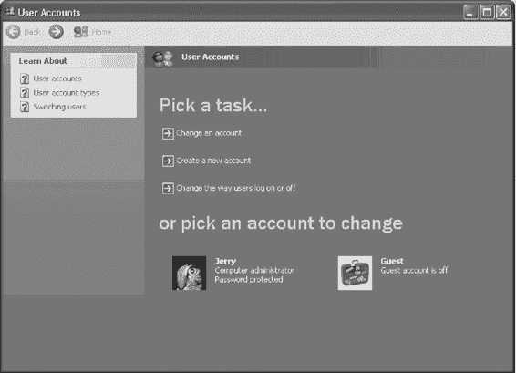

    图 10.1：创建一个用于紧急情况的本地管理员账户

7. 在 `Scheduled Tasks` 文件夹中为两个磁盘维护实用程序设置每月执行计划，如图 10.2 所示。

    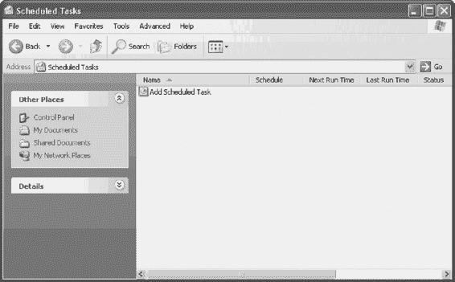

    图 10.2：计划任务文件夹用于设置和管理计划任务

    在计划的这些磁盘管理任务中的第一个是 `Disk Cleanup` 向导，如图 10.3 所示。该向导通过删除非关键文件来释放磁盘空间，包括：

    * 下载的程序文件
    * 临时 Internet 文件
    * 离线网页
    * 垃圾回收桶
    * 安装日志文件
    * 临时文件
    * 内容索引器的目录文件

    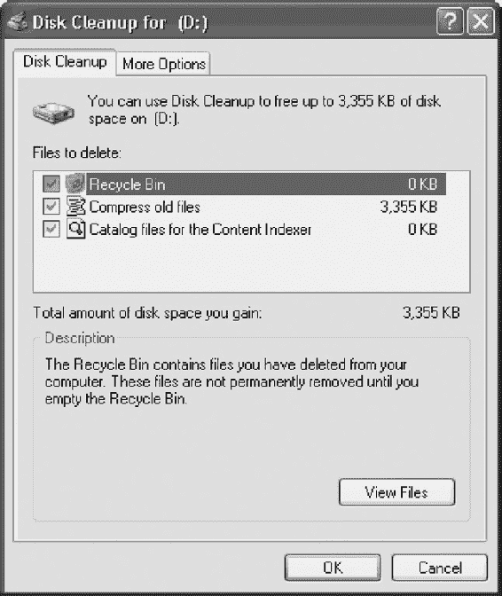

    图 10.3：使用磁盘清理向导从电脑中删除不需要的文件

    要设置的第二个磁盘管理任务是 `Disk Defragmenter` 实用程序，如图 10.4 所示。该实用程序用于保持每个用户电脑上的 `C:` 盘经过碎片整理。

    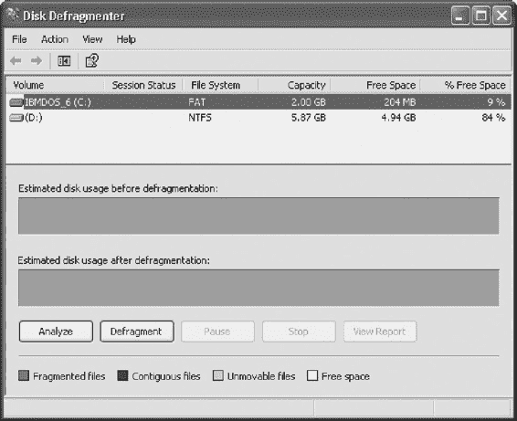

    图 10.4：设置磁盘碎片整理程序每月运行

8. 在电脑 `D:` 盘的根目录下创建一个 `Images` 文件夹，并将一个包含公司 Logo 的桌面背景文件的 `.bmp` 文件复制到该文件夹。
9. 接下来，安装若干应用程序，包括 `WinZip`、`Adobe Acrobat Reader`、`Paint Shop Pro` 和一个 FTP 程序。
10. 此时，每台电脑都关机并从组装台上移下，存放在房间角落，同时设置下一组电脑并重复之前的步骤。
11. 随后与个人用户预约时间以交付并完成其新电脑的设置。告诉每个用户将其当前电脑上存储的任何文件保存到公司文件服务器上，以便用户在新电脑交付并设置好后将它们移回来。
12. 在适当的时间，将电脑装上推车并交付到用户桌面，并在那里进行组装。然后要求用户登录。
13. 要求用户执行若干桌面自定义任务。使用 `Create Shortcut` 向导通过设置指向公司网站的快捷方式来自定义 Windows 桌面，如图 10.5 所示。

    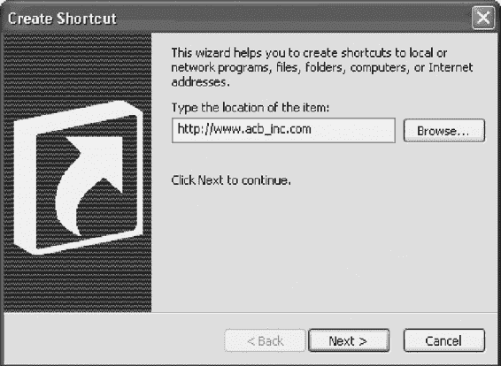

    图 10.5：使用快捷方式向导创建 URL | 注意：在加载用户配置之前，这些更改保存在注册表的 `HKEY_CURRENT_USER` 中。

14. 使用图 10.6 所示的 `Display Properties` 对话框，配置一个 15 分钟后启动的 Windows 屏幕保护。还配置密码保护。

    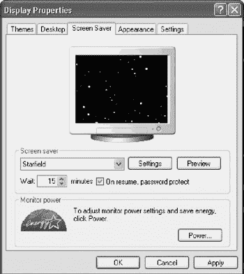

    图 10.6：设置屏幕保护在 15 分钟后启动

15. 随后配置 Windows 桌面显示 `D:\Images` 文件夹中的 Logo 文件，如图 10.7 所示。

    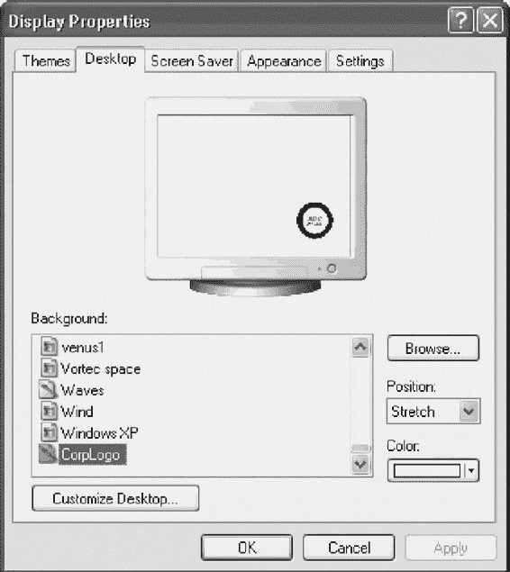

    图 10.7：配置桌面显示公司 Logo

16. 配置若干菜单和任务栏设置。这些设置包括创建一个 `Standard Applications` 文件夹，然后填充 `Microsoft Word`、`Adobe Acrobat Reader`、`Paint Shop Pro` 和一个 FTP 应用程序的快捷方式，如图 10.8 所示。

    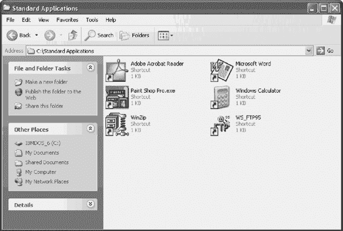

    图 10.8：创建一个包含所有人使用的应用程序的 Standard Applications 文件夹

17. 通过添加 `Windows Calculator` 和 `WinZip` 应用程序的链接来自定义 `Quick Launch` 工具栏。
18. 通过将 `Standard Applications` 文件夹添加到 `All Programs` 文件夹来自定义开始菜单，如图 10.9 所示。

    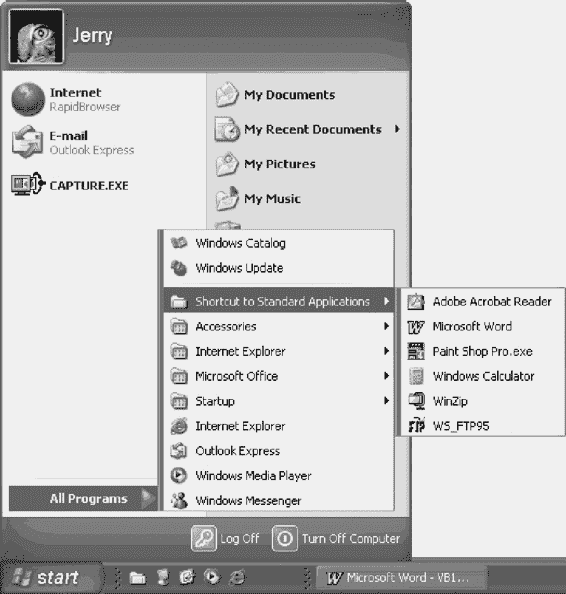

    图 10.9：在开始菜单上添加 Standard Applications 快捷方式

19. 完成的任务是设置到公司文件服务器和共享网络打印机的连接。设置网络打印机连接使用 `Add Printer Wizard` 向导，如图 10.10 所示。然后使用 `Map Network Drive` 向导创建驱动器映射，如图 10.11 所示。

    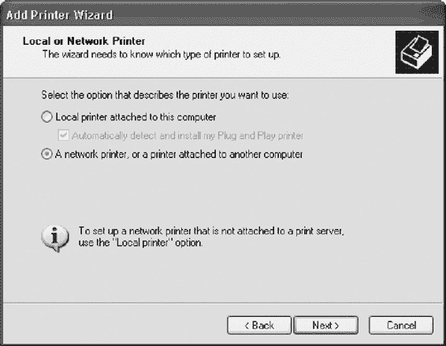

    图 10.10：使用“添加打印机”向导设置到公司网络打印机的连接

    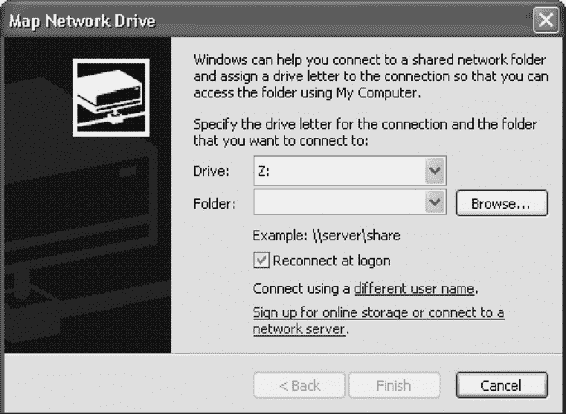

    图 10.11：使用“映射网络驱动器”向导将驱动器连接到公司的共享网络驱动器

20. 最后，将用户的旧电脑打包并带走。

### 确定哪些任务可以自动化

在研究部署流程一段时间后，Tom 确定通过使用 `VBScript` 和 `WSH` 自动化流程中的关键部分，可以显著提高速度。Tom 列出了一份他认为可以自动化的任务列表，并认为自己可以在未来三周内编写这些脚本。

随后，他将这些任务分成逻辑组，认为自己将一次专注于自动化一组相关任务。表 10.1 显示了 Tom 汇总的列表。

#### 表 10.1：桌面管理任务列表

| 任务类型 | 描述 |
| --- | --- |
| 桌面个性化 | 通过添加公司网站的快捷方式来自定义 Windows 桌面。设置每个用户的屏幕保护程序在 15 分钟后启动，并显示启用密码保护的星空屏幕保护程序。将 Windows 背景设置为显示公司标志。 |
| 开始菜单和任务栏 | 创建“标准应用程序”文件夹，并向其中填充 Microsoft Word、Adobe Acrobat Reader、Paint Shop Pro、WinZip 和 FTP 应用程序的快捷方式。通过添加 Windows 计算器和 WinZip 应用程序的链接自定义快速启动工具栏。通过将“标准应用程序”文件夹添加到开始菜单的“所有程序”文件夹中自定义开始菜单。 |
| 任务调度 | 计划每月执行一次“磁盘清理”向导。计划每月执行一次“磁盘碎片整理”工具。 |
| 网络连接 | 设置到公司网络打印机池的网络打印机连接。设置到公司文件服务器的映射驱动器。 |
| 账户管理 | 在每台计算机上添加一个本地管理员维护用户账户。 |

### 执行高级设计

作为一项准备工作，Tom 决定从开始研究他为了自动化每个任务而需要的 `WSH` 对象以及 Windows 实用工具和命令。作为一种设计策略，Tom 决定想要将任务拆分为较小的脚本，并且脚本应限制为执行不超过一个或两个任务。这将有助于脚本的快速开发和测试，这对 Tom 来说非常重要，因为距离第一批电脑预计到达只有几周时间了。

#### 桌面个性化

Tom 已将桌面个性化任务拆分为两个独立的任务，如下所示。

* 在桌面上添加 URL 快捷方式
* 配置屏幕保护程序和 Windows 桌面壁纸背景

Tom 确定要创建一个指向公司网站的 URL 快捷方式，他需要利用 `WSH` 的 `WshUrlShortcut` 对象，该对象提供了通过其 `TargetPath` 属性指定 URL 的功能。此外，他还需要使用 `WshShell` 对象的 `SpecialFolders` 属性来建立对 Windows 桌面的引用。

为了程序化配置 Windows 屏幕保护程序和桌面背景，Tom 了解到他需要更改 Windows 注册表。为此，他将需要使用 `WSH` `WshShell` 对象的 `RegWrite()` 方法来修改存储在 `HKCU\Control Panel\Desktop` 键中的屏幕保护程序和桌面壁纸值。

为了让桌面壁纸的更改生效，Tom 需要让用户注销并重新登录。Tom 发现 Windows XP 提供了 `logoff.exe` 命令行工具，他可以在脚本中使用它来自动注销用户。

#### 开始菜单和任务栏

Tom 将开始菜单和任务栏任务拆分为三个独立的任务：

* 创建“标准应用程序”文件夹并向其中填充应用程序快捷方式
* 自定义快速启动工具栏
* 自定义开始菜单

Tom 发现，为了创建一个文件夹，他需要学习如何处理 `VBScript` 运行时的 `FileSystemObject`。要创建桌面快捷方式，Tom 需要从建立 `WshShell` 对象的实例开始。然后，他需要使用 `WScript` 对象的 `SpecialFolders` 属性访问 Windows 桌面特殊文件夹。此外，Tom 还需要使用 `WshShell` 对象的 `CreateShortcut()` 来完成快捷方式的创建。

为了配置快速启动工具栏，Tom 发现他需要对其进行配置并添加快捷方式。为此，他需要学习如何处理另一个名为 `AppData` 的特殊文件夹。此外，他还需要学习如何处理代表开始菜单和“所有程序”菜单的特殊文件夹，以便配置开始菜单。

#### 任务调度

Tom 识别出两个需要设置每 30 天运行一次的磁盘管理任务。这些工具列如下：

* 磁盘清理向导
* 磁盘碎片整理工具

为了程序化地与 Windows 调度服务交互，Tom 计划使用 Windows `At` 命令。他发现，要在 `WSH` `VBScript` 内部执行此命令，他需要学习如何使用 `WshShell` 对象的 `Run()` 方法。

Tom 还了解到他可以使用 `defrag.exe` 命令行工具对硬盘驱动器进行碎片整理。可以向该工具传递参数，使其能够静默运行。

#### 网络连接

Tom 需要作为计算机设置的一部分设置两个网络连接。建立连接的网络资源概述如下：

* `\\PrinterServer\LazerPtr`：位于复印机房的高速打印机
* `\\FileServer\D-drive`：供所有员工使用的大容量硬盘

为了设置这两个网络连接，Tom 需要学习如何处理 `WshNetwork` 对象。具体而言，他将需要使用以下 `WshNetwork` 方法：

* `MapNetworkDrive()`：映射到指定的驱动器
* `AddPrinterConnection()`：建立到指定打印机的连接

#### 账户管理

Tom 计划使用 Windows `net user` 命令创建本地账户。为此，他将需要使用 `WshShell` 对象的 `Run()` 方法。一旦新账户添加到本地计算机，他将需要再次使用 `WshShell` 对象的 `Run()` 方法将其添加到管理员组。为了完成此任务，他计划执行 Windows `net localgroup` 命令。

| ID | Category | Description |
| :--- | :--- | :--- |
| 0200 | 开始菜单和任务栏 | 创建一个“标准应用程序”文件夹并在其中填充应用程序快捷方式。 |
| 0220 | 开始菜单和任务栏 | 向快速启动工具栏添加应用程序快捷方式。 |
| 0230 | 开始菜单和任务栏 | 向开始菜单上的“所有程序”菜单添加应用程序快捷方式。 |
| 0300 | 计划 | 计划 `defrag.exe` 工具的执行。 |
| 0310 | 计划 | 计划 `cleanmgr` 工具的执行。 |
| 0400 | 网络 | 自动设置网络打印机连接。 |
| 0410 | 网络 | 自动设置到公司文件服务器的映射驱动器。 |
| 0500 | 账户管理 | 创建本地管理员维护用户账户。 |

在审查了 Tom 的计划后，Carl 高兴地批准了它。然而，Carl 想知道 Tom 计划如何将这些脚本整合到发布过程中。Tom 解释说，虽然组成整个过程的步骤保持不变，但他现在能够更快速地执行这些步骤，同时消除过去经常发生的错误。

Tom 告诉 Carl，他计划将所有脚本拷贝到软盘上，当每台电脑首次放在组装台上时，将其插入电脑。然后他将从软盘运行每个代表组装台任务的脚本。接着，在交付每台电脑时，他会带上软盘的副本。在用户登录后，Tom 将插入软盘并运行剩余的脚本。这个过程不仅减少了对每个用户造成的干扰，还能让 Tom 在从组装台上移除电脑后，在一天内完成所有电脑的部署。

## 总结

在本章中，你了解了 ABC 公司。你回顾了该公司在桌面电脑支持和部署方面面临的挑战。此外，你还观察了公司新任桌面支持分析师 Tom 如何制定一个计划，通过开发 VBScript 来自动处理许多手动任务，从而精简桌面部署流程。在接下来的五章中，你将有机会跟随 Tom 如何通过开发这些脚本来实现他的计划。

# 第 11 章：自定义桌面

在本章中，你将学习如何开发两个 VBScript，以多种方式自定义 Windows 桌面。第一个脚本将演示如何创建 Internet URL 的快捷方式，以及如何与 Windows 特殊文件夹工作。第二个脚本将演示如何通过程序手段操作 Windows 注册表的内容，以配置 Windows 桌面壁纸和 Windows 屏幕保护程序。

## 为公司网站添加 URL 桌面快捷方式

需要完成的第一个脚本是在 Windows 桌面创建一个指向公司网站的快捷方式。这是两个脚本中最容易编写的，它将让来自第 10 章的新型桌面支持员工 Tom 有一个机会，在尝试学习如何通过程序手段与 Windows 注册表交互之前进行练习。

在开发第一个脚本时，你必须考虑许多不同的信息。首先，你需要学习如何与 `WshUrlShortcut` 对象进行工作。为了在 Windows 桌面上添加快捷方式，你还需要了解一种名为“特殊文件夹”的 Windows 管理功能。特殊文件夹用于表示和管理许多 Windows 功能，包括开始菜单、快速启动工具栏和桌面。

### 与特殊文件夹工作

Windows 特殊文件夹代表了许多重要的系统资源。通过操作这些文件夹的内容，你可以直接修改许多 Windows 资源，包括：

* 桌面 (Desktop)
* 收藏夹 (Favorites)
* 字体 (Fonts)
* 我的文档 (MyDocuments)
* 网络位置 (NetHood)
* 打印队列 (PrintHood)
* 程序 (Programs)
* 最近 (Recent)
* 发送到... (SendTo)
* 开始菜单 (StartMenu)
* 启动 (Startup)
* 模板 (Templates)

要检查这些特殊文件夹，右键点击 Windows XP 开始按钮并点击“资源”。这将打开一个资源管理器文件夹。默认情况下，“文档和设置”文件夹将展开，代表你个人用户配置设置的文件夹也会展开。要查看你的 Windows 桌面的内容，请选择“桌面”文件夹，如图 11.1 所示。


图 11.1：检查“桌面”特殊文件夹的内容

配置 Windows 桌面内容的一种方法是在此文件夹与之间拖放 Windows 快捷方式。

除了与你的特定配置相关的特殊文件夹外，Windows 还提供了第二组适用于计算机所有用户的特殊文件夹。要查看这些文件夹，请展开“所有用户”文件夹，如图 11.2 所示。


图 11.2：对存储在“所有用户”文件夹下的文件夹进行的更改影响计算机的所有用户

这些特殊文件夹并不易于识别。但它们的名称很容易解释。例如，下列表显示了常用特殊文件夹的名称。

* `AllUsersDesktop`：添加到此文件夹的项目在计算机上每个用户的桌面上可见。
* `AllUsersStartMenu`：添加到此文件夹的项目在计算机上每个用户的开始菜单上可见。
* `AllUsersPrograms`：添加到此文件夹的项目在计算机上每个用户的“所有程序”菜单上可见。
* `AllUsersStartup`：添加到此文件夹的项目在用户每次登录计算机时自动启动。

如你所见，这些特殊文件夹的名称是通过在文件夹名称（去掉任何空格）后附加 `AllUsers` 生成的。

### 与 WshUrlShortcut 对象工作

为了为 URL 创建快捷方式，你必须使用属于 `WshUrlShortcut` 对象的方法和属性。该对象是 `WshShell` 对象的子对象。为了与 `WshUrlShortcut` 对象工作，你必须首先实例化 `WshShell` 对象，如下所示。

```vbscript
Set WshShl = WScript.CreateObject("WScript.Shell")
```

为了在 Windows 桌面上放置快捷方式，你必须使用 `WshShell` 对象的 `SpecialFolders` 属性为其设置引用。该方法的语法如下：

```vbscript
WshShl.SpecialFolders(SpecialFolderName)
```

`SpecialFolderName` 指定特殊文件夹的名称，在 Windows 桌面的情况下为 `Desktop` 特殊文件夹。`Desktop` 特殊文件夹的引用设置如下：

```vbscript
DesktopFolder = WshShl.SpecialFolders("Desktop")
```

> **注意**
> 如果指定的文件夹不存在，WshShell 对象的 `SpecialFolders` 属性将返回空字符串。

一旦建立了 `WshShell` 对象并设置了特殊文件夹的引用，你就可以使用 `WshShell` 对象的 `CreateShortcut` 方法实例化 `WshUrlShortcut` 对象。该方法的语法如下：

```vbscript
WshShell.CreateShortcut(ShortcutPathname)
```

在特殊文件夹（如桌面特殊文件夹）中创建 URL 快捷方式时，分配 `ShortcutPathname` 参数的值由两个不同的部分组成。第一部分是特殊文件夹引用的名称。第二个部分是以 `.url` 结尾的描述性字符串。

这两个部分信息随后被连接到特殊文件夹名称，如下所示。

```vbscript
Set UrlShortcut = WshShl.CreateShortcut(DesktopFolder + "\\Premier Press Publishing.url")
```

在 Windows 桌面上设置 URL 快捷方式时，下一步是指定该快捷方式所代表的 URL 地址。设置 `WshUrlShortcut` 对象的 `TargetPath` 属性即可实现此操作。

```vbscript
UrlShortcut.TargetPath = "www.premierpressbooks.com"
```

剩下的唯一步骤是使用 `WshUrlShortcut` 对象的 `Save()` 方法将对象保存到磁盘，如下所示。

```vbscript
UrlShortcut.Save
```

完整组合后，上述语句将创建一个指向 Premier Press 网站的桌面快捷方式，如下所示。

```vbscript
Set WshShl = WScript.CreateObject("WScript.Shell")
DesktopFolder = WshShl.SpecialFolders("Desktop")
Set UrlShortcut = WshShl.CreateShortcut(DesktopFolder + "\\Premier Press Publishing.url")
UrlShortcut.TargetPath = "www.premierpressbooks.com"
UrlShortcut.Save
```

### 开发桌面 URL VBScript

通过复制上一个示例的逻辑，你可以轻松创建一个 VBScript，用于在 Windows 桌面上放置一个 URL 快捷方式，如下例所示。

```vbscript
'*************************************************************************
'Script Name: Script 11.1.vbs
'Author: Jerry Ford
'Created: 02/17/03
'Description: 此脚本在 Windows 桌面上创建一个指向公司网站的 URL
'*************************************************************************
'初始化部分

Option Explicit

Dim WshShl, DesktopFolder, UrlShortcut

Set WshShl = WScript.CreateObject("WScript.Shell")

'主处理部分

CreateUrlShortcut()

WScript.Quit()

'过程部分

'创建桌面 URL 快捷方式
Sub CreateUrlShortcut()

  DesktopFolder = WshShl.SpecialFolders("Desktop")

  Set UrlShortcut = WshShl.CreateShortcut(DesktopFolder + "\\ABC Inc " & _
    "Home Page.url")
  UrlShortcut.TargetPath = "www.abc_inc.com"
  UrlShortcut.Save

End Sub
```

该脚本以 `Option Explicit` 语句开始，然后定义了工作所需的变量。接下来实例化 `WshShell` 对象。主处理部分包含两条语句。第一条语句调用名为 `CreateUrlShortcut()` 的子程序，该子程序创建桌面 URL 快捷方式。第二条语句使用 `WScript` 对象的 `Quit()` 方法终止脚本的执行。

脚本的关键部分包含 `CreateUrlShortcut()` 子程序中。它首先设置对 `Desktop` 特殊文件夹的引用。接着创建快捷方式。然后分配其 URL 地址，最后将其保存到磁盘。运行后，此脚本将创建如图 11.3 所示的桌面 URL 快捷方式。


图 11.3：由 VBScript 创建的桌面 URL 快捷方式示例

> **Note**
> 本章对桌面快捷方式的介绍有限。如需详细回顾快捷方式（包括其属性和构造），请参考第 12 章“自定义开始菜单和任务栏”。

### 理解 Windows 注册表

现在你已经编写了一个用于配置桌面 URL 快捷方式的 VBScript，是时候开始编写一个自动配置 Windows 桌面壁纸和屏幕保护程序的脚本了。该脚本必须满足许多要求，包括：

* 如果 `D:\Images` 文件夹不存在则创建它
* 从软盘将 `CorpLogo.bmp` 桌面背景文件复制到 `D:\Images` 文件夹
* 将 `CorpLogo.bmp` 配置为 Windows 桌面壁纸
* 将 Windows 桌面背景设置为白色，这样桌面上显示的文字将没有背景颜色
* 禁止“壁纸填充”设置
* 启用屏幕保护程序
* 启用密码保护
* 在屏幕保护程序开始执行前设置 15 分钟延迟
* 启用“星空”屏幕保护程序
* 注销用户以使更改生效

## 使用注册表

Windows 注册表是一个内置数据库，为存储以下配置提供了中央仓库：

* 用户配置设置和配置文件信息
* Windows 操作系统设置
* 软件配置设置
* 硬件设置
* Windows 服务的配置信息
* 软件设备驱动程序的配置信息

注册表包含了关于 Windows 计算机几乎每个方面的配置信息。通过修改 Windows 注册表的内容，你可以配置许多 Windows 功能的操作，包括桌面设置、桌面壁纸和屏幕保护程序。

用户和管理员每天都在与注册表工作，往往甚至没有意识到。例如，位于 Windows 控制面板中的工具或小型程序提供了修改注册表的图形化界面。控制面板小型程序通过提供直观的界面简化了更改注册表的过程。处理 Windows 注册表的另一种方法是使用 `Regedit` 注册表编辑器。

> **Tip**
> 在 Windows NT、2000 和 XP 上，你也可以使用 `Regedt32` 注册表编辑器。

图 11.4 提供了 Windows XP 注册表的概要视图，它由五个根键组成。


图 11.4：使用 `Regedit` 注册表编辑器查看注册表内容

> **注意**
> 修改 Windows 注册表的内容可能会对计算机产生破坏性影响。在某些情况下，甚至会导致计算机无法启动。除非你非常确定对注册表进行更改的影响，否则不要进行更改。此外，尽可能利用控制面板小型程序和其他工具来避免手动修改注册表。最后，请定期备份注册表，以便从任何更改引起的问题中恢复。

### 理解注册表的组织结构

Windows 注册表在逻辑上组织为树状结构，具有五个根键（父键），如表 11.1 所示。

#### 表 11.1：Windows 注册表根键

| 键 | 缩写 | 说明 |
| --- | --- | --- |
| HKEY_CLASSES_ROOT | HKCR | 存储关于 Windows 文件关联的信息 |
| HKEY_CURRENT_USER | HKCU | 存储关于当前登录用户的信息 |
| HKEY_LOCAL_MACHINE | HKLM | 存储本地计算机的全局设置 |
| HKEY_USERS | N/A | 存储关于该计算机上所有用户的信息 |
| HKEY_CURRENT_CONFIG | N/A | 存储关于计算机当前配置的信息 |

> **注意**
> Windows 98 和 Me 上还有一个第六个根键 `HKEY_DYN_DATA`。该键引用了即插即用的信息。

在物理上，Windows 注册表由许多不同的文件组成。在运行 Windows 2000 或 XP 的计算机上，这些文件位于 `%systemroot%\system32\config`，并包括以下内容：

* `DEFAULT`
* `SAM`
* `SECURITY`
* `SOFTWARE`
* `SYSTEM`
* `Userdiff`

除了这些文件，信息还存储在单独的用户配置文件中。这些配置文件位于“文档和设置”文件夹中，并按用户名组织。

在这五个注册表项中，你可能只需要处理的是表 11.1 中列出的前三个键。为了方便起见，每个根键都有一个关联的缩写，你在处理这些键时，可以在 VBScript 中使用它们。其余两个键没有缩写。要处理这两个键，你必须使用它们的完整名称（`HKEY_CURRENT_CONFIG` 或 `HKEY_USERS`）来引用它们。

### 键、值与数据

Windows 注册表数据内部存储着由键和值组成的复杂层级结构。`key`（键）可以被看作是一个包含其他键或值的容器。五个根键类似于磁盘驱动器，而位于它们下方的各个级子键可以被看作类似于文件夹。注册表中的实际数据存储在值之中。因此，`value`（值）非常像文件，而文件又存储数据。

数据以以下格式存储在注册表中：

```
Key : key_type : value
```

`Key` 代表注册表键的名称。例如，以下语句引用了名为 `Desktop` 的键，它是 `Control Panel` 键的子键，而该键本身又是 `HKEY_CURRENT_USER` 根键的子键。

```
HKCU\
    Control Panel\
         \Desktop\
```

通过在键名末尾添加反斜杠 `\` 来区分键和值，如上所示。相反，值的指定时不带结尾的反斜杠 `\`，如下文所示。

```
HKCU\
   Control Panel\
        \Desktop
             \Wallpaper
```

在这个示例中，指定了位于 `Desktop` 键中的 `Wallpaper` 值。

`Key_type` 指定了要存储的数据类型。Windows 注册表支持存储多种类型的数据，如表 11.2 所示。`Value` 用于指定要存储的的数据。

#### 表 11.2：Windows 注册表数据类型

| 类型 | 说明 |
| --- | --- |
| `REG_BINARY` | 存储二进制值 |
| `REG_DWORD` | 存储十六进制 DWORD 值 |
| `REG_EXPAND_SZ` | 存储可扩展字符串 |
| `REG_MULTI_SZ` | 存储多个字符串 |
| `REG_SZ` | 存储字符串 |

注册表值有两种类型：`named`（命名）和 `unnamed`（未命名）。大多数注册表值都是 `named` 的。`named` 值是分配了一个名称的值，通过该名称可以引用值中存储的数据。`unnamed` 值是不带名称的值。每个注册表键都有一个 `unnamed` 值，代表其默认值（即在未指定命名值时会更改的值）。`Unnamed` 值在 Windows 注册表中用 `Default` 标签表示，如图 11.5 所示。


图 11.5：当使用 `Regedit` 工具查看时，`Unnamed` 值用 `Default` 标签表示

### 编写能够程序化与 Windows 注册表交互的 VBScript

为了使用 VBScript 和 WSH 程序化地与 Windows 注册表交互，你必须首先实例化 `WshShell` 对象。`WshShell` 对象提供了三个方法，你可以用于读取、写入、添加、删除和修改注册表键及值。这些方法描述如下：

* `RegRead()`：从注册表中检索键或值
* `RegWrite()`：创建或修改注册表键或值
* `RegDelete()`：从注册表中删除键或值

#### 读取注册表键和值

`WshShell` 对象的 `RegRead()` 方法提供了检查注册表键和值内容的能力。`RegRead()` 方法具有以下语法：

```vbscript
X = WshShell.RegRead(KeyOrValue)
```

`KeyOrValue` 指定了要检索的注册表键或值的名称。`RegRead()` 方法只能从注册表中检索以下类型的数据：

* `REG_SZ`
* `REG_MULTI_SZ`
* `REG_DWORD`
* `REG_BINARY`
* `REG_EXPAND_SZ`

如果 VBScript 尝试检索一个其内容未存储在上述数据类型之一的值，则会返回 `DISP_E_TYPEISMATCH` 值。

为了使用 `RegRead()` 方法，你必须首先建立 `WshShell` 对象的实例，如下所示。

```vbscript
Set wshObject = WScript.CreateObject("WScript.Shell")
```

然后你可以使用该方法从注册表中检索信息并将其赋值给变量以便稍后查询。

```vbscript
results = wshObject.RegRead("HKCU\TestKey\FileName")
```

在这个示例中，检索了赋值给 `FileName` 值的数据（存储在名为 `HKCU\TestKey` 的键中）。

#### 添加或更改注册表键和值

`WshShell` 对象的 `RegWrite()` 方法提供了创建新注册表键或值的能力。如果它们已经存在，它还提供了修改的能力。语法为：

```vbscript
WshShell.RegWrite(KeyOrValue, Data, DataType)
```

`KeyOrValue` 指定键或值的名称。`Data` 是要写入的值。`DataType` 指定数据的类型。

为了使用 `RegWrite()` 方法，你必须首先实例化 `WshShell` 对象，如下所示。

```vbscript
Set wshObject = WScript.CreateObject("WScript.Shell")
```

然后你可以使用该方法创建或修改注册表值。例如：

```vbscript
wshObject.RegWrite("HKCU\TestKey\FileName", "Error.log", "REG_SZ")
```

在这个示例中，创建了一个新值，如图 11.6 所示。它存储在名为 `Error.log` 的键中，该键位于 `HKCU\TestKey` 下。如果 `TestKey` 键不存在，`RegWrite()` 方法会自动创建它。


图 11.6：使用 `Regedit` 工具查看新值

要修改此值，只需为其赋值一个新的字符串，如下：

```vbscript
wshObject.RegWrite("HKCU\TestKey\FileName", "Error.txt", "REG_SZ")
```

在这个示例中，Error 文件的扩展名从 `.log` 改为 `.txt`。

注册表键可以存储无限数量的子键。例如，以下语句可用于在 `HKCU\TestKey\FileName` 下创建第二个值：

```vbscript
wshObject.RegWrite("HKCU\TestKey\FileStatus", "Active", "REG_SZ")
```

#### 删除注册表键和值

`WshShell` 对象的 `RegDelete()` 方法为 VBScript 提供了删除注册表键和值的能力。使用该方法时遵循语法：

```vbscript
WshShell.RegDelete(KeyOrValue)
```

`KeyOrValue` 指定要删除的键或值的名称。

Windows 2000 和 XP 如果注册表键包含其他子键，则不允许删除它。你必须在删除父键之前删除所有子键。Windows 98 和 Me 的情况不同，`RegDelete()` 方法允许删除包含子键的父键。

为了使用 `RegDelete()` 方法，你必须首先实例化 `WshShell` 对象。然后你就可以删除键或值。

```vbscript
Set wshObject = WScript.CreateObject("WScript.Shell")
wshObject.RegDelete "HKCU\TestKey\FileName"
```

在此示例中，从 `HKCU\TestKey` 中删除了名为 `FileName` 的值。同样，如下所示删除 `HKCU\TestKey` 键。

```vbscript
Set wshObject = WScript.CreateObject("WScript.Shell")
wshObject.RegDelete "HKCU\TestKey"
```

## 定义桌面壁纸和屏幕保护程序设置

修改桌面壁纸和屏幕保护程序设置的 VBScript 需要执行若干任务。这些任务包括创建一个文件夹来存储 `CorpLogo.bmp` 壁纸文件、修改位于 `HKCU\Control Panel\Desktop` 键下的 Windows 桌面壁纸和屏幕保护程序值，并在更改完成后注销用户。

### 初始化部分

与书中开发的所有 VBScript 一样，此 VBScript 被分为三个部分。初始化部分负责定义脚本使用的变量。它还实例化了 `WshShell` 对象和 `FileSystemObject` 对象，如下所示。

```vbscript
Option Explicit

Dim WshShl, ChangeSettings, shellApp, FsoObject
Set WshShl = WScript.CreateObject("WScript.Shell")
Set FsoObject = CreateObject("Scripting.FileSystemObject")
```

必须建立 `WshShell` 对象，脚本才能使用其 `RegWrite()` 方法。需要 `FileSystemObject` 对象来访问相关方法，允许脚本在电脑的 D 盘上创建 Images 文件夹，并将 `CorpLogo.bmp` 壁纸文件的副本存储在该文件夹中。

### 主处理部分

主处理部分控制脚本的整体执行，决定何时以及是否修改注册表。这是通过调用 `GetConfirmation()` 函数实现的，如果获得了运行脚本的权限，该函数将返回值 `6`。如果是如此，则将执行一系列子程序调用，这些子程序会将 `CorpLogo.bmp` 文件复制到电脑的磁盘驱动器上，修改背景壁纸和屏幕保护程序设置，然后启动注销过程。

```vbscript
ChangeSettings = GetConfirmation()

If ChangeSettings = 6 Then
  CopyCorpLogo()
  SetBackground()
  SetScreenSaver()
  ForceLogoff()
End If

WScript.Quit()
```

一旦这些每个子程序执行完毕，控制将返回主处理部分，并调用 `WScript` 对象的 `Quit()` 方法以终止脚本执行。

> **提示**
> 在此情况下，不需要使用 `WScript` 对象的 `Quit()` 方法，因为按照目前的编写方式，脚本在此处就会停止执行。然而，通过在主处理部分的末尾添加此方法，你可以使脚本更易读，并防止意外放置在过程部分中子程序之外的任何代码被意外执行。

## CopyCorpLogo() 子程序

`CopyCorpLogo()` 子程序使用属于 `FileSystemObject` 对象的多个方法来查询和操作 Windows 文件系统。首先，该子程序使用 `FolderExists()` 方法确定 `D:\Images` 文件夹是否已存在。如果不存在，则使用 `CreateFolder()` 方法创建它。由于 Tom 正在处理所有新电脑，该文件夹不应该已经存在。然而，添加此检查为 Tom 以后可能需要重新配置已部署的电脑提供了扩展脚本的基础。脚本执行的最后一件事是将 `CorpLogo.bmp` 文件复制到 `D:\Images` 文件夹。


# 复制公司 Logo 子程序

```vb
Sub CopyCorpLogo()
  If (FsoObject.FolderExists("D:\Images") = False) Then
    FsoObject.CreateFolder "D:\Images\"
  End If
  FsoObject.CopyFile "a:\CorpLogo.bmp", "D:\Images\"
End Sub
```

## `GetConfirmation()` 函数

`GetConfirmation()` 函数使用内置的 VBScript `MsgBox()` 函数在弹出对话框中显示消息。此过程被写成函数而不是子程序，因为它需要向其调用语句返回结果。如果点击“是”按钮，返回值 `6`；如果点击“否”按钮，则返回值 `7`。

```vb
Function GetConfirmation()
  GetConfirmation = MsgBox("This script will perform the following " & _
    "tasks:" & vbCrLf & vbCrLf & "1\. Configure the display of the " & _
    "Corporate Logo the Windows desktop" & vbCrLf & _
    "2\. Configure a password protected screen saver" & vbCrLf & _
    "3\. Initiate a restart of the of the computer so that " & _
    "changes may take effect" & vbCrLf & vbCrLf & _
    "Do you wish to continue?", 36)
End Function
```

## `SetBackground()` 子程序

`SetBackground()` 子程序使用 `WshShell` 对象的 `RegWrite()` 方法修改位于 `HKCU\Control Panel\Desktop` 子键的三个注册表值。第一个修改的值是 `Wallpaper`，设置为 `D:\Images\CorpLogo.bmp`。第二个要修改的值是 `TileWallpaper`，设置为 `0`。最后，`Background` 值设置为 `255 255 255`。

```vb
Sub SetBackground()
  'Set CorpLogo.bmp as the desktop
  WshShl.RegWrite "HKCU\Control Panel\Desktop\Wallpaper", _
    "D:\Images\CorpLogo.bmp"

  'Make sure the Tile option is disabled
  WshShl.RegWrite "HKCU\Control Panel\Desktop\TileWallpaper", "0"

  'Configure the background to be white
  WshShl.RegWrite "HKCU\Control Panel\Desktop\Background", "255 255 255"
End Sub
```

该脚本执行的注册表修改等同于打开桌面对话框（右键点击 Windows 并选择属性），然后在屏幕保护程序选项卡上修改设置，如图 11.7 所示。

## `SetScreenSaver()` 子程序

`SetScreenSaver()` 子程序修改位于 `HKCU\Control Panel\Desktop` 子键的四个屏幕保护程序注册表值。第一个更改的值是 `ScreenSaveActive`，设置为 `1`。这启用了 Windows 屏幕保护程序。接下来将 `ScreenSaverSecure` 值设置为 `1`。这启用了屏幕保护密码保护。然后将 `ScreenSaveTimeout` 值设置为 `900`。这配置了十五的延迟。最后，`SCRNSAVE.EXE` 值设置为 `("%SystemRoot%") & "System32\ssstars.scr"`。这设置为星空模拟屏幕保护程序。

> **注意**：Windows XP 屏幕保护程序存储在 `C:\Windows\System32` 并具有 `.scr` 扩展名。文件名相当晦涩，很难通过名称识别它们。然而，你可以双击它们来打开并查看。

```vb
Sub SetScreenSaver()
    'Enable the screen saver
    WshShl.RegWrite "HKCU\Control Panel\Desktop\ScreenSaveActive", 1
    'Enable password protection
    WshShl.RegWrite "HKCU\Control Panel\Desktop\ScreenSaverIsSecure", 1

    'Set up a 15 minute delay
    WshShl.RegWrite "HKCU\Control Panel\Desktop\ScreenSaveTimeOut", 900

    'Enable the Starfield screen saver
    WshShl.RegWrite "HKCU\Control Panel\Desktop\SCRNSAVE.EXE", ("%SystemRoot%") &
"System32\ssstars.scr"

End Sub
```

该脚本执行的注册表修改等同于打开桌面属性对话框，然后在屏幕保护程序属性选项卡上修改设置，如图 11.8 所示。

桌面壁纸和屏幕保护程序的配置设置与单个用户关联，并存储在每个用户的配置文件中（例如，`HKCU`）。为了更改 `HKCU`，用户必须登录到计算机。

一旦脚本更改了影响桌面壁纸和屏幕保护程序的设置，用户必须注销更改才能生效。

Windows XP 配备了一个名为 `logoff.exe` 的命令行实用工具，脚本可以调用该工具来自动注销用户。`WshShell` 对象有一个名为 `Run()` 的方法，VBScript 可以用它来执行任何 Windows 命令或命令行实用工具。下所示的 `ForceLogoff()` 子程序利用了 `Run()` 方法和 `logoff.exe`。当用户重新登录时，更改将会生效。

```vb
Sub ForceLogoff()
  WshShl.Run "%SystemRoot%\System32\logoff.exe"
End Sub
```

## 完整的脚本

整个 VBScript 脚本在下方组装。运行时，该 VBScript 将执行所需的 Windows 注册表更改并注销用户。

```vb
'*************************************************************************
'Script Name: Script 11.2.vbs
'Author: Jerry Ford
'Created: 02/16/03
'Description: 此脚本配置 Windows 桌面背景和
'屏幕保护程序。然后它启动系统重启。
'*************************************************************************

'初始化部分

Option Explicit

Dim WshShl, ChangeSettings, shellApp, FsoObject
Set WshShl = WScript.CreateObject("WScript.Shell")
Set FsoObject = CreateObject("Scripting.FileSystemObject")

'主处理部分
'验证用户是否意图更改其屏幕保护程序设置
ChangeSettings = GetConfirmation()

If ChangeSettings = 6 Then
  CopyCorpLogo()
  SetBackground()
  SetScreenSaver()
  ForceLogoff()
End If

WScript.Quit()

'程序部分

'此子程序将 CorpLogo.bmp 文件复制到 D:\Images
Sub CopyCorpLogo()
  If (FsoObject.FolderExists("D:\Images") = False) Then
    FsoObject.CreateFolder "D:\Images\"
  End If
  FsoObject.CopyFile "a:\CorpLogo.bmp", "D:\Images\"
End Sub

'此子程序提示是否继续执行
Function GetConfirmation()
  GetConfirmation = MsgBox("此脚本将执行以下 " & _
    "任务:" & vbCrLf & vbCrLf & "1\. 配置 Windows 桌面上的 " & _
    "公司 显示" & vbCrLf & _
    "2\. 配置受密码保护的屏幕保护程序" & vbCrLf & _
    "3\. 启动计算机重启以便更改 " & _
    "生效" & vbCrLf & vbCrLf & _
"您要继续吗?", 36)
End Function

'此子程序配置桌面背景
Sub SetBackground()
  '将 CorpLogo.bmp 设置为桌面壁纸
  WshShl.RegWrite "HKCU\Control Panel\Desktop\Wallpaper", _
  "D:\Images\CorpLogo.bmp"

  '确保平铺（Tile）选项已禁用
  WshShl.RegWrite "HKCU\Control Panel\Desktop\TileWallpaper", "0"

  '将背景颜色设置为白色
  WshShl.RegWrite "HKCU\Control Panel\Colors\Background", "255 255 255"
End Sub

'此子程序配置屏幕保护程序
Sub SetScreenSaver()
    '启用屏幕保护程序
    WshShl.RegWrite "HKCU\Control Panel\Desktop\ScreenSaveActive", 1

    '启用密码保护
    WshShl.RegWrite "HKCU\Control Panel\Desktop\ScreenSaverIsSecure", 1

    '设置 15 分钟延迟
    WshShl.RegWrite "HKCU\Control Panel\Desktop\ScreenSaveTimeOut", 900

    '启用星空屏幕保护程序
    WshShl.RegWrite "HKCU\Control Panel\Desktop\SCRNSAVE.EXE", _
      ("%SystemRoot%") & "System32\ssstars.scr"

End Sub

'此子程序启动系统注销
Sub ForceLogoff()
  WshShl.Run "%SystemRoot%\System32\logoff.exe"
End Sub
```

## 总结

在本章中，你学习了如何通过程序化的与 Windows 注册表交互，以配置桌面壁纸和屏幕保护程序相关的设置。通过使用本章介绍的技术，你将能够编写 VBScript，来配置运行 Windows 操作系统的计算机的几乎任何方面。

你还学习了如何创建桌面 URL 快捷方式，以及如何处理特殊文件夹。在下一章中，你将有机会扩展关于快捷方式的知识，并使用它们来配置开始菜单和快速启动工具栏。

# 第 12 章：自定义开始菜单和快速启动工具栏

## 概述

Tom 在 ABC, Inc. 的桌面脚本项目之一，是使他部署的所有新计算机上的 Windows 桌面的外观和感受达到标准化。他计划实现这一目标的方法之一是创建一个名为“标准应用程序”的文件夹，并向其中添加许多快捷方式。这些快捷方式将包括：

* WinZip
* Adobe Reader
* Paint Shop
* FTP 程序
* Microsoft Word

本章将详细解释快捷方式的工作原理，以及如何使用 `WshShortcut` 对象来实现这一目标。此外，本章将向你展示如何向开始菜单添加快捷方式，包括向快速启动工具栏添加快捷方式。

## 快捷方式构造

快捷方式为组织应用程序、文件、驱动器、打印机以及许多 Windows 资源的访问提供了工具。将快捷方式放置在 Windows 桌面上可以快速访问这些资源。然而，在 Windows 桌面上放置过多的快捷方式会导致混乱并分散注意力。

> **注意**：默认情况下，快速启动工具栏位于开始菜单的右侧。它为添加的任何快捷方式提供了单击访问。

快捷方式代表指向另一个资源的链接。通过在每台新 Windows 计算机上一致地创建并在相同位置放置快捷方式，Tom 希望向 ABC, Inc. 的员工引入桌面标准化的概念。

图 12.1 显示了 Windows 记事本程序的快捷方式。

> （图 12.1 记事本快捷方式）

你可以通过图标左下角的小弯箭头将快捷方式与与其代表的资源区分开。快捷方式具有许多控制其操作的属性。例如，`Target` 属性指定快捷方式所代表资源的位置和文件名。要查看与快捷方式的所有属性，请右键点击快捷方式并从菜单中选择“属性”。这将打开快捷方式的属性对话框并显示其快捷属性页。例如，图 12.2 显示了与记事本快捷方式相关的属性。

> （图 12.2 检查记事本快捷方式的属性）

表 12.1 列出了并描述了与快捷方式相关的所有属性。

| 属性 | 描述 |
| --- | --- |
| `Target` | 指定 Windows 对象的完整路径和文件名 |
| `Start in` | 指定应用程序的默认工作目录 |
| `Hotkey` | 指定一个用于打开快捷方式的键盘按键序列 |
| `Run` | 指定应用程序是在普通窗口中打开，还是在最大化或最小化的窗口中打开 |
| `Comment` | 指定可选的快捷方式描述 |
| `Icon filename` | 标识用于表示快捷方式的图标文件名 |

## 使用 `WshShortcut` 对象

要创建和管理快捷方式，你需要学习如何使用 `WshShortcut` 对象。此外，你还需要为想要保存每个快捷方式的位置建立一个引用。为了使用 `WshShortcut` 对象，你必须首先实例化它的父对象 `WshShell`，如下所示。

```vb
Set WshShl = WScript.CreateObject("WScript.Shell")
```

在继续实例化 `WshShortcut` 对象之前，你必须为保存快捷方式的位置设置一个引用。例如，要为 Windows 桌面设置引用，你必须使用 Windows 桌面特殊文件夹。

```vb
DesktopFolder = WshShl.SpecialFolders("Desktop")
```

现在，你就可以通过使用 `WshShell` 对象的 `CreateShortcut()` 方法来设置 `WshShortcut` 对象的实例，如下所示。

```vb
Set NotepadShortcut = WshShl.CreateShortcut(DesktopFolder & "\\Notepad.lnk")
```

如你所示，快捷方式是通过将其目标文件夹与其名称（`\\Notepad.lnk`）拼接来定义的。

> **注意**：在上一章中，你学习了如何使用 `WshUrlShortcut` 对象。URL 快捷方式的创建方法与标准快捷方式相同，区别在于你在快捷方式定义的末尾指定 `.url` 而不是 `.lnk`。指定 `.url` 会导致 `WshUrlShortcut` 对象的实例化，而指定 `.lnk` 则导致 `WshShortcut` 对象的实例化。

设置快捷方式的下一步是指定快捷方式要表示的 Windows 资源。这是使用 `WshShortcut` 对象的 `TargetPath` 属性实现的，如下所示。

```vb
NotepadShortcut.TargetPath = "%windir%\Notepad.exe"
```

创建快捷方式的最后一步是保存快捷方式。这是使用 `WshShortcut` 对象的 `Save()` 方法完成的：

```vb
NotepadShortcut.Save()
```

> **注意**：记事本应用程序默认位于运行 Windows 98、Me 和 XP 的计算机上的 `C:\Windows` 文件夹。然而，在 Windows 2000 上，它默认位于 `C:\Winnt`。此外，在安装操作系统期间，可以修改 Windows 系统文件存储文件夹的位置，在这种情况下，记事本应用程序可能位于完全不同的文件夹中。避免任何混淆并便于开发可在任何此类 Microsoft 操作系统上运行的单一脚本的一种方法，是利用 `%windir%` 环境变量。该变量由操作系统自动创建。它指定了 Windows 系统文件夹的位置，无论它位于何处。

### 桌面快捷方式示例

通过使用上述语句作为模板，可以很容易组装出一个创建记事本应用程序快捷方式的 VBScript。

```vb
'*************************************************************************
'Script Name: Script 12.1.vbs
'Author: Jerry Ford
'Created: 02/22/03
'Description: 此脚本为 Windows 记事本应用程序创建一个桌面
'*************************************************************************

'Initialization Section

Option Explicit

Dim WshShl, DesktopFolder, NotepadShortcut

Set WshShl = WScript.CreateObject("WScript.Shell")

'Main Processing Section

CreateShortcut()

WScript.Quit()

'Procedure Section

'创建桌面快捷方式
Sub CreateShortcut()
  DesktopFolder = WshShl.SpecialFolders("Desktop")
  Set NotepadShortcut = WshShl.CreateShortcut(DesktopFolder & _
    "\\Notepad.lnk")
  NotepadShortcut.TargetPath = "%windir%\Notepad.exe"
  NotepadShortcut.Save()
End Sub
```

> **注意**：你也可以使用 VBScript 删除快捷方式。要这样做，你需要像下所示使用 `FileSystemObject` 对象的 `Delete()` 方法。

```vb
Set WshShl = WScript.CreateObject("WScript.Shell")
DesktopFolder = WshShl.SpecialFolders("Desktop")
Set FsoObject = CreateObject("Scripting.FileSystemObject")
Set NotepadShortcut = FsoObject.GetFile(DesktopFolder & "\\notepad.lnk")
NotepadShortcut.Delete
```

### 修改快捷方式属性

之前的 VBScript 定义的快捷方式使用单个 `WshShortcut` 对象属性 `TargetPath` 属性定义的。因此，快捷方式的其他属性要么未定义，要么使用默认值设置的，如图 12.3 所示。


如表 12.2 所示，`WshShortcut` 对象提供了对与快捷方式相关的所有属性的访问。

表 12.2：`WshShortcut` 属性

| 属性 | 说明 |
| --- | --- |
| `Arguments` | 传递给应用程序的参数 |
| `Comment` | 注释 |
| `Hotkey` | 用于打开快捷方式的键盘序列 |
| `IconLocation` | 用于显示的图标 |
| `TargetPath` | 快捷方式表示的对象完整路径和文件名 |
| `WindowStyle` | 快捷方式启动时使用的窗口样式（普通、最小化、最大化） |
| `WorkingDirectory` | 快捷方式保存位置的默认目录 |

大部分这些属性都是指定特定信息的字符串。然而，其中三个属性需要进一步解释。

`WshShortcut` 对象的 `Hotkey` 必须包含一个修饰键和一个按键标识。修饰键可以是以下任何一种：

* `CTRL`: Ctrl 键
* `ALT`: Alt 键
* `SHIFT`: Shift 键
* `EXT`: Windows Key

按键标识可以是以下任何一种：

* 字母 A–Z
* 数字 0–9
* F1–F12
* 退格键
* 删除键
* 退出键
* 结束
* 空格键
* 清除键
* Tab 键
* Home 键
* 回车键

`WshShortcut` 对象的 `IconLocation` 用于指定表示快捷方式的图标索引位置。许多 Windows 对象（例如应用程序的可执行文件）包含索引图标列表，可以表示该应用程序。例如，图 12.4 显示了 Windows WordPad 应用程序可用的图标。可以通过右键点击 WordPad 应用程序的可执行文件图标、选择“属性”，然后在快捷方式属性表上点击“更改图标”来查看这些图标。


`WshShortcut` 对象的 `WindowStyle` 用于指定快捷方式应使用的窗口类型。表 12.3 列出了 `WshShortcut` 对象支持的三种 Windows 样式类型。

表 12.3：快捷方式窗口样式

| WindowStyle | 说明 |
| --- | --- |
| 1 | 通过恢复位置和大小来显示窗口 |
| 2 | 显示最大化窗口 |
| 7 | 最小化窗口 |

通过设置额外的快捷方式属性，你可以进一步细化快捷方式的定义。例如，以下 VBScript 是上一个示例的修改版本。除了创建记事本快捷方式外，新脚本还设置或修改了若干额外属性。例如，`Arguments` 属性的值被设置为 `"D:\DskTpError.log"`。该属性指定了当使用快捷方式打开它时，记事本应用程序将打开的一个文件。此外，`Description` 属性被设置为 `Desktop Error Log`。因此，每当用户将指针悬在快捷方式上时，都会显示此注释。最后，`Hotkey` 属性被设置为 `Ctrl+Alt+D`。这允许通过同时按下 Ctrl、Alt 和 D 键来打开该快捷方式。

```vb
'*************************************************************************
'Script Name: Script 12.2.vbs
'Author: Jerry Ford
'Created: 02/22/03
'Description: 此脚本为 Windows 记事本应用程序创建一个桌面快捷
'*************************************************************************

'Initialization Section

Option Explicit

Dim WshShl, DesktopFolder, NotepadShortcut

Set WshShl = WScript.CreateObject("WScript.Shell")

'Main Processing Section

CreateShortcut()

WScript.Quit()

'Procedure Section

'创建桌面快捷方式
Sub CreateShortcut()
  DesktopFolder = WshShl.SpecialFolders("Desktop")
  Set NotepadShortcut = WshShl.CreateShortcut(DesktopFolder & "\\Notepad.lnk")
  NotepadShortcut.TargetPath = "%windir%\Notepad.exe"
  NotepadShortcut.Description = "Desktop Error Log"
  NotepadShortcut.Arguments = "D:\DskTpError.log"
  NotepadShortcut.Hotkey = "CTRL+ALT+D"
  NotepadShortcut.Save()
End Sub
```

图 12.5 显示了如何为上一个脚本创建的快捷方式设置属性。


## 创建标准应用程序文件夹

Tom 的脚本项目之一是开发一个“标准应用程序”文件夹。Tom 计划创建此文件夹，并在其中填充若干应用程序快捷方式，以便快速访问公司内所有人使用的系列应用程序。

编写执行此任务的脚本的第一步是创建标准应用程序文件夹。这可以使用与 VBScript 运行时 `FileSystemObject` 对象相关的属性和方法来实现。

### 脚本创建文件夹

使用 `FileSystemObject` 的第一步是将其实例化，如下所示。

```vb
Set FsoObject = CreateObject("Scripting.FileSystemObject")
```

一旦完成此操作，你就可以访问它所有的属性和方法。然后，你可以使用 `FileSystemObject` 对象的 `CreateFolder()` 方法来创建标准应用程序文件夹。然而，在此之前，先验证文件夹是否已经存在是一个好习惯。你可以使用 `FileSystemObject` 对象的 `FolderExists()` 方法来实现这一点。以下 VBScript 语句演示了如何测试标准应用程序文件夹是否存在，以及在它不存在时如何创建。

```vb
Set FsoObject = CreateObject("Scripting.FileSystemObject")
If (FsoObject.FolderExists("D:\Standard Applications") = False) Then
  Set StndAppsFolder = FsoObject.CreateFolder("D:\Standard Applications")
End If
```

### 向 Windows 文件夹保存快捷方式

一旦创建了标准应用程序文件夹，你就可以为其添加快捷方式。可以将以下 VBScript 语句添加到上一个示例的末尾，为标准应用程序文件夹添加一个记事本应用程序的快捷方式。

```vb
Set WshShl = WScript.CreateObject("WScript.Shell")
Set NotepadShortcut = WshShl.CreateShortcut(StndAppsFolder & "\\Notepad.lnk")
NotepadShortcut.TargetPath = "%windir%\notepad.exe"
NotepadShortcut.Save()
```

### 创建并填充标准应用程序文件夹

本章现在涵盖了创建为 ABC, Inc. 创建并填充标准应用程序文件夹的 VBScript 所需的所有构建块，如下。

```vb
'*************************************************************************
'Script Name: Script 12.3.vbs
'Author: Jerry Ford
'Created: 02/22/03
'Description: 此脚本创建一个标准应用程序文件夹并
'向其中填充系列应用程序快捷方式
'*************************************************************************

'Initialization Section

Option Explicit

Dim FsoObject, WshShl, StndAppsFolder, ModelShortcut

Set FsoObject = CreateObject("Scripting.FileSystemObject")

Set WshShl = WScript.CreateObject("WScript.Shell")

'Main Processing Section

CreateStndAppsFolder()
PopulateWinZipShortcut()
PopulatePaintShopProShortcut()
PopulateAdobeAcrobatReaderShortcut()
PopulateWS_FTPShortcut()
PopulateMSWordShortcut()
WScript.Quit()

'Procedure Section

'查找并在必要时创建标准应用程序文件夹
Sub CreateStndAppsFolder()
    If (FsoObject.FolderExists("C:\Standard Applications") = False) Then
     Set StndAppsFolder = FsoObject.CreateFolder("C:\Standard Applications")
    Else
     FsoObject.DeleteFolder("C:\Standard Applications")
     Set StndAppsFolder = FsoObject.CreateFolder("C:\Standard Applications")
    End If
End Sub

'创建并添加 WinZip 快捷方式
Sub PopulateWinZipShortcut()
    Set ModelShortcut = WshShl.CreateShortcut(StndAppsFolder & _
      "\\WinZip.lnk")
    ModelShortcut.TargetPath = "C:\Program Files\WinZip\WinZip32.exe"
    ModelShortcut.Save()
End Sub

'创建并添加 Paint Shop Pro 快捷方式
Sub PopulatePaintShopProShortcut()
    Set ModelShortcut = WshShl.CreateShortcut(StndAppsFolder & _
      "\\Paint Shop Pro.lnk")
    ModelShortcut.TargetPath = "C:\Program Files\Paint Shop Pro\PSP.exe"
    ModelShortcut.Save()
End Sub

'创建并添加 Adobe Acrobat Reader 快捷方式
Sub PopulateAdobeAcrobatReaderShortcut()
    Set ModelShortcut = WshShl.CreateShortcut(StndAppsFolder & _
      "\\Adobe Acrobat Reader.lnk")
    ModelShortcut.TargetPath = _
      "C:\Program Files\Adobe\Acrobat 5.0\Reader\AcroRd32.exe"
    ModelShortcut.Save()
End Sub

'创建并添加 WS_FTP 快捷方式
Sub PopulateWS_FTPShortcut()
    Set ModelShortcut = WshShl.CreateShortcut(StndAppsFolder & _
      "\\WS_FTP LE.lnk")
    ModelShortcut.TargetPath = "C:\Program Files\WS_FTP\WS_FTP95.exe"
    ModelShortcut.Save()
End Sub

'创建并添加 MS Word 快捷方式
Sub PopulateMSWordShortcut()
    Set ModelShortcut = WshShl.CreateShortcut(StndAppsFolder & _
      "\\Microsoft Word.lnk")
    ModelShortcut.TargetPath = _
      "C:\Program Files\Microsoft Office\Office\Winword.exe"
    ModelShortcut.Save()
End Sub
```

脚本的 `Initialization Section` 定义了它将使用的变量和对象。`Main Processing Section` 执行了一系列过程调用，最后使用 `WScript` 对象的 `Quit()` 方法终止脚本执行。

## 配置开始菜单和快速启动工具栏

开始菜单被组织为一系列文件夹，开始菜单位于菜单层级结构的顶端。在其下方是“所有程序”菜单，它默认包含 `Programs` 文件夹和指向若干 Windows 应用程序的快捷方式，如图 12.6 所示。


位于 `Programs` 文件夹下的每个文件夹在从开始菜单查看时都充当菜单，而存储在这些文件夹中的每个快捷方式都充当一个菜单选项。通过从“所有程序”菜单向“标准应用程序”文件夹添加快捷方式，你可以让用户方便地访问他们最常用的应用程序。

### 向 Programs 文件夹添加链接

为了通过程序方式向开始菜单的“所有程序”菜单中添加菜单和菜单项，你首先需要知道如何访问它。以下 VBScript 语句演示了如何在开始菜单的“所有程序”菜单中为记事本应用程序添加一个菜单项。

```vb
Set WshShl = WScript.CreateObject("WScript.Shell")
StartMenuFolder = WshShl.SpecialFolders("StartMenu")
Set NotepadShortcut = WshShl.CreateShortcut(StartMenuFolder & _
  "\\notepad.lnk")
NotepadShortcut.TargetPath = "%windir%\notepad.exe"
NotepadShortcut.Save
```

同样地，以下 VBScript 语句演示了如何创建一个标准应用程序文件夹，将其作为子菜单添加到“所有程序”菜单中，然后为其添加一个记事本快捷方式。

```vb
Set WshShl = WScript.CreateObject("WScript.Shell")
StartMenuFolder = WshShl.SpecialFolders("StartMenu")
Set FsoObject = CreateObject("Scripting.FileSystemObject")
Set StndAppsFolder = FsoObject.CreateFolder(StartMenuFolder & _
  "\Standard Applications")
Set NotepadShortcut = WshShl.CreateShortcut(StartMenuFolder & _
  "\Standard Applications\Notepad.lnk")
NotepadShortcut.TargetPath = "%windir%\notepad.exe"
NotepadShortcut.Save
```

使用本章介绍的信息和示例，你现在已经拥有为 ABC, Inc. 开发 VBScript 所需的所有内容。此 VBScript 采用了本章早些开发的标准应用程序文件夹，并将其添加到开始菜单下的“所有程序”菜单中，如下所示。

```vb
'*************************************************************************
'Script Name: Script 12.4.vbs
'Author: Jerry Ford
'Created: 02/23/03
'Description: 此脚本向 Windows XP 所有程序菜单上的
'标准应用程序文件夹添加快捷方式
'*************************************************************************

'初始化部分

Option Explicit

Dim FsoObject, WshShl, StartMenuFolder, StndAppsFolder, StdAppsShortcut

Set FsoObject = CreateObject("Scripting.FileSystemObject")

Set WshShl = WScript.CreateObject("WScript.Shell")

'主处理部分

ModifyAllProgramsMenu()

WScript.Quit()

'过程部分

'将标准应用程序文件夹添加到“所有程序”菜单
Sub ModifyAllProgramsMenu()
  If (FsoObject.FolderExists("C:\Standard Applications") = False) Then
    MsgBox "无法修改“所有程序”菜单 - 未找到标准" & _
      "应用程序文件夹"
  Else
    StartMenuFolder = WshShl.SpecialFolders("StartMenu")
    Set StdAppsShortcut = WshShl.CreateShortcut(StartMenuFolder & _
      "\\Standard Applications.lnk")
    StdAppsShortcut.TargetPath = "C:\Standard Applications"
    StdAppsShortcut.Save
  End If
End Sub
```

此脚本的核心逻辑位于 `ModifyAllProgramsMenu()` 子过程中。它使用 `FileSystemObject` 对象的 `FolderExists()` 方法来验证标准应用程序文件夹是否存在。如果不存在，则显示错误消息。否则，会将快捷方式添加到开始菜单文件夹，使其出现在开始菜单中。图 12.7 演示了在添加到开始菜单后，标准应用程序文件夹的状态。


### 向快速启动栏添加快捷方式

另一种为用户提供应用程序快速访问的方法是向快速启动工具栏添加快捷方式。快速启动工具栏位于任务栏上。Windows XP 默认启用了快速启动工具栏。为了通过程序方式管理快速启动工具栏，你需要处理 `AppData` 特殊文件夹。向快速启动工具栏添加快捷方式的方法与向开始菜单添加快捷方式略有不同。以下 VBScript 语句演示了如何向快速启动工具栏添加记事本应用程序的快捷方式。

```vb
Set WshShl = WScript.CreateObject("WScript.Shell")
QuickLaunchToolbar = WshShl.SpecialFolders("AppData")
Set Shortcut = WshShl.CreateShortcut(QuickLaunchToolbar & "\Microsoft\Internet Explorer\Quick Launch\notepad.lnk")
Shortcut.TargetPath = "%windir%\notepad.exe"
Shortcut.Save()
```

通过扩展之前的示例，你可以创建为 ABC, Inc. 的计算机填充快速启动工具栏所需的 VBScript。

```vb
'*************************************************************************
'Script Name: Script 12.5.vbs
'Author: Jerry Ford
'Created: 02/23/03
'Description: 此脚本向快速启动工具栏添加快捷方式
'*************************************************************************

'初始化部分

Option Explicit

Dim WshShl, QuickLaunchToolbar, ApplicationPath, QuickLaunchShortcut

Set WshShl = WScript.CreateObject("WScript.Shell")

'主处理部分

ModifyQuickLaunchToolbar()

WScript.Quit()

'过程部分

'向快速启动工具栏添加应用程序快捷方式
Sub ModifyQuickLaunchToolbar()

  QuickLaunchToolbar = WshShl.SpecialFolders("AppData")
  ApplicationPath = _
    QuickLaunchToolbar & "\Microsoft\Internet Explorer\Quick Launch"

  Set QuickLaunchShortcut = WshShl.CreateShortcut(ApplicationPath & "\WinZip.lnk")
  QuickLaunchShortcut.TargetPath = "d:\Program Files\WinZip\Winzip32.exe"
  QuickLaunchShortcut.Save

  Set QuickLaunchShortcut = _
    WshShl.CreateShortcut(ApplicationPath & "\Calculator.lnk")
  QuickLaunchShortcut.TargetPath = "%SystemRoot%\System32\calc.exe"
  QuickLaunchShortcut.Save

End Sub
```

图 12.8 显示了在添加两个快捷方式后快速启动栏的样子。


## 总结

本章向你展示了如何使用 `WshShortcut` 对象和 VBScript 运行时 `FileSystemObject` 修改开始菜单上的菜单和菜单选项。你学习了如何配置各种快捷方式属性。本章还向你展示了如何管理快速启动栏的配置。Tom 可以利用本章介绍的信息编写 VBScript，用于自定义正在 ABC, Inc. 部署的新 Windows XP 计算机。

# 第 13 章：计划磁盘维护任务

本章将解决 Tom 的需求，即开发脚本来计划执行两种不同的磁盘维护任务：磁盘清理和磁盘碎片整理。在本章中，你将学习如何开发执行这两个任务的脚本。你还将学习如何编写一个设置脚本，为这两个磁盘维护脚本设置执行计划。

## 与 Windows 命令提示符一起工作

WSH 提供了使用 `WshShell` 对象的 `Run()` 方法执行任何 Windows 命令或命令行工具的能力。该方法将指定的命令或命令行工具作为新进程运行。`Run()` 方法具有以下语法结构：

```vb
WshShell.Run(Command, [WindowStyle], [WaitState])
```

`Command` 标识要执行的命令或命令行工具，并可能包含任何需要传递给命令或命令行工具的参数。`WindowStyle` 是一个可选参数，用于指定处理命令或命令行工具的窗口的外观。`WindowStyle` 的值指定为整数。表 13.1 提供了 `Run()` 方法支持的 Windows 样式选项列表。`WaitState` 是可选的布尔参数，用于指定脚本在继续运行之前是否等待命令或命令行工具执行完毕。将 `WaitState` 设置为 `True` 会暂停脚本执行。默认值为 `False`。

表 13.1：`Run()` 方法 Windows 样式选项

| Windows 样式 | 描述 |
| --- | --- |
| 0 | 隐藏并禁用窗口 |
| 1 | 激活并显示窗口，将其恢复到原始位置和大小 |
| 2 | 激活窗口并最小化 |
| 3 | 激活窗口并将其最大化 |
| 4 | 使用之前的位置和大小显示窗口，而不影响当前活动窗口 |
| 5 | 激活窗口，使用其当前位置和大小显示它 |
| 6 | 最小化窗口并禁用其焦点 |
| 7 | 显示最小化窗口，而不影响当前活动窗口 |
| 8 | 使用其当前位置和大小显示窗口，而不影响当前活动窗口 |
| 9 | 激活并显示窗口，将其恢复到原始位置和大小 |
| 10 | 使用调用程序的显示状态来显示窗口 |

以下示例演示了如何在 VBScript 中使用 `Run()` 方法启动 Windows 记事本应用程序。

```vb
Set WshShl = WScript.CreateObject("WScript.Shell")
WshShl.Run "%windir%\notepad"
```

下一个示例演示了如何启动记事本并传递要打开的文件名。

```vb
Set WshShl = WScript.CreateObject("WScript.Shell")
WshShl.Run "%windir%\notepad c:\docs\Activity.doc"
```

最后一个示例演示了如何启动记事本并让其显示打开它的脚本副本。为了实现这一技巧，脚本使用了 `WScript` 对象的 `ScriptFullName` 属性，该属性标识当前正在执行的脚本名称。

```vb
Set WshShl = WScript.CreateObject("WScript.Shell")
WshShl.Run "%windir%\notepad " & WScript.ScriptFullName
```

## 磁盘管理工具和命令行工具

近年来，硬盘容量大幅增加。与此同时，硬盘的成本不断下降。磁盘容量增长的同时，新应用程序的存储需求也在快速增长。因此，对于许多担心支持的用户持续抱怨的桌面管理员来说，仔细的磁盘管理是一项重要的考虑因素。

ABC, Inc. 的政策是要求所有员工在每月初运行两个 Windows 磁盘管理工具，帮助管理其桌面计算机的磁盘存储。这些工具是“磁盘清理”和“磁盘碎片整理”。磁盘清理工具通过删除不必要的文件来释放磁盘空间。碎片整理工具重新组织以碎片形式存储在硬盘上的文件。

幸运的是，像许多 Windows 工具一样，磁盘清理和磁盘碎片整理工具提供了命令行界面，开放了它们的功能并使其适用于 Windows 命令行。使用 `WshShell` 对象的 `Run()` 方法，你可以在 VBScript 内部执行这两个工具之一。

### 检查手动磁盘清理过程

Windows 应用程序在执行时通常会创建临时文件。通常会在关闭时清理这些文件。然而，系统崩溃或程序挂起等事件经常留下这些文件，不必要地占用磁盘空间。

计算机性能与其硬盘上的可用空间直接相关。随着驱动开始充满，性能会出现明显的变慢。通常，删除不必要的文件将释放足够的磁盘空间来提高性能并延长硬盘的存储寿命。

回收丢失空间的方法之一是手动搜索并删除不必要的文件。这不仅耗时，而且可能在此过程中意外删除关键的系统或应用程序文件。幸运的是，Windows XP 提供了磁盘清理工具。该工具为用户提供了一个手动查找和删除计算机中许多类型不必要文件的工具。磁盘清理工具可删除以下任何类型的文件：

* 下载的程序文件
* 临时 Internet 文件
* 回收站中的文件
* 临时文件
* WebClient/发布者临时文件
* 内容索引器的目录文件

ABC, Inc. 的员工已被指示在每月初运行磁盘清理工具。遗憾的是，当磁盘清理运行时，在计算机上工作是一个痛苦的过程。大多数用户已经习惯了不运行它，或者将其作为去咖啡休息的机会。

为了理解磁盘清理是如何工作的，至少运行一次是有帮助的。以下步骤概述了该过程的基本步骤。

1. 点击“开始/所有程序/附件/系统工具”，然后选择“磁盘清理”。如果安装了多个硬盘，将出现“选择驱动器”对话框，如图 13.1 所示。
2. 选择一个驱动器并点击“确定”。如图 13.2 所示的对话框出现。显示的选项将根据所选驱动器而异。
3. 选择要删除的文件类型并点击“确定”。
4. 在提示确认时点击“是”。

> **注意**：也可以通过 Windows 命令提示符调用其可执行文件来运行磁盘清理工具。要以此方式启动执行，点击“开始/运行”，然后输入 `cleanmgr` 并点击“确定”。

### 配置磁盘清理

在互联网上进行了一些研究后，Tom 了解到磁盘清理工具提供了命令行界面。因此，它的执行可以通过 VBScript 启动。一旦编写脚本，Tom 计划为该脚本设置自动执行计划。这样，就可以将其安排在用户不使用计算机的下班时间运行。

在自动化执行磁盘清理实用程序之前，必须先对其进行配置。遗憾的是，这是一个手动过程。但好消息是，这只需要操作一次。以下步骤概述了配置磁盘清理实用程序的涉及步骤。

1. 点击“开始”，然后点击“运行”。出现“运行”对话框。
2. 输入 `cleanmgr /sageset:1`，如图 13.3 所示，然后点击“确定”。


3. 出现“磁盘清理”对话框。选择要删除的文件类型，然后点击“确定”。

> **注意**：你可以通过指定不同的数字来创建额外的 `sageset` 配置文件。磁盘清理实用程序最多支持 65,536 个不同的配置。通过创建两个或多个不同的配置，你可以将清理过程分解成块，并更改每个配置的计划执行时间。

#### 创建清理脚本

一旦配置了磁盘清理实用程序以支持命令行执行，就可以对其执行进行脚本化，如下例所示。

```vb
'*************************************************************************
'Script Name: Script 13.3.vbs
'Author: Jerry Ford
'Created: 02/24/03
'Description: 此脚本安排在每月第一天 20:00 执行清理实用程序。
'此实用程序从本地磁盘驱动器删除不必要的文件。
'*************************************************************************

'初始化部分

Option Explicit

Dim WshShl, FsoObject, LogFile

Set WshShl = WScript.CreateObject("WScript.Shell")

Set FsoObject = WScript.CreateObject("Scripting.FileSystemObject")

'主处理部分

CheckForCleanupLog()

PerformCleanup()

WScript.Quit()

'程序部分

'此过程确保 cleanup.log 文件的存在
Sub CheckForCleanupLog()
  If (FsoObject.FileExists("D:\cleanup.log")) Then
    Set LogFile = FsoObject.OpenTextFile("D:\cleanup.log", 8)
    LogFile.WriteLine "Cleanup process Started on " & Date & " at " & Time
  Else
    Set LogFile = FsoObject.OpenTextFile("D:\cleanup.log", 2, True)
    LogFile.WriteLine "Cleanup process Started on " & Date & " at " & Time
  End If
End Sub

'此过程执行清理实用程序
Sub PerformCleanup()
  WshShl.Run "C:\WINDOWS\SYSTEM32\cleanmgr /sagerun:1"
End Sub
```

`主处理部分`执行名为 `CheckForCleanupLog()` 的子程序，该子程序首先向计算机 `D:\` 驱动器上名为 `cleanup.log` 的文件写入消息。此日志用于记录脚本的执行情况，便于稍后检查并查看脚本上次运行的时间。如果 `cleanup.log` 不存在（脚本首次运行时将如此），则将由下所示的语句创建。

```vb
Set LogFile = FsoObject.OpenTextFile("D:\cleanup.log", 8)
```

此语句使用 `FileSystemObject` 对象的 `OpenTextFile()` 方法打开指定的文件以便进行写入。该方法传递两个参数。第一个参数是文件的名称和位置，第二个参数是指定文件打开方式的整数。可用选项如下：

* `ForReading`。由值为 `1` 指定。
* `ForWriting`。由值为 `2` 指定。
* `ForAppending`。由值为 `8` 指定。

一旦文件被打开，子程序将执行以下语句：

```vb
LogFile.WriteLine "Cleanup process Started on " & Date & " at " & Time
```

此语句使用 `FileSystemObject` 对象的 `WriteLine()` 方法向文件写入整行文本，然后执行换行符和回车符。

一旦记录了执行情况，脚本将处理 `PerformCleanup()` 子程序。该子程序按所示运行磁盘清理实用程序。请注意，此时 `sagerun` 参数被传递给 `cleanmgr` 命令行工具，并提供了之前配置的配置编号。

```vb
WshShl.Run "C:\WINDOWS\SYSTEM32\cleanmgr /sagerun:1"
```

现在脚本已经写好，Tom 可以按照本章稍后描述的内容设置其计划执行。

### 检查手动磁盘碎片过程

随着时间的推移，所有磁盘驱动器都会填满。随着可用空间变得稀缺，Windows 被迫将文件拆分成更小的碎片，然后存储在磁盘驱动器上允许的任何位置。由于文件没有存储在连续的磁盘空间中，读取和写入它们需要更多的时间，从而减慢了计算机的整体性能。

为了限制碎片量并保持计算机高效运行，Tom 计划编写 VBScript 来自动执行碎片整理过程。到目前为止，ABC 公司的员工一直负责使用 Windows XP 的磁盘碎片整理工具对自己的硬盘驱动器进行碎片整理。磁盘碎片整理工具以名为 `defrag.exe` 的可执行文件形式提供了命令行界面，从而能够命令行执行。

#### 运行碎片整理实用程序

为了理解碎片整理的工作原理，手动运行一次是有帮助的。以下步骤概述了基本操作。

1. 点击“开始”，“所有程序”，“附件工具”，然后选择“磁盘碎片整理”。
2. 选择一个硬盘驱动器并点击“分析”以查看碎片状态，如图 13.4 所示。


3. 点击“碎片整理”启动碎片整理过程。
4. 将弹出一个对话框，宣布碎片整理已完成。点击“关闭”。

#### 运行 `defrag.exe`

使用 `defrag.exe` 命令，你可以从 Windows 命令行碎片整理硬盘。`defrag.exe` 命令的语法如下：

```text
defrag <volume:> [/a] [/f] [/v]
```

`<volume>` 指定要碎片整理的卷。其余参数均为可选。`/a` 参数显示指定驱动器的当前碎片状态分析。默认情况下，`defrag.exe` 需要磁盘驱动器 15% 的可用空间才能执行。`/f` 参数提供了在可用空间少于 15% 时强制执行 `defrag.exe` 的能力。`/v` 参数提供详细输出。

> **注意**：在运行 `defrag.exe` 之前安排磁盘清理，以确保尽可能获得可用空间。

以下步骤演示了如何从 Windows 命令行运行 `defrag.exe`。

1. 点击“开始”，“所有程序”，“附件”，然后点击“命令提示符”。一个 Windows 控制台打开并显示 Windows 命令行提示符。
2. 输入 `defrag volume: /a` 并按回车查看指定驱动器的分析。
3. 输入 `defrag volume: /f` 并按回车对指定的驱动器进行碎片整理。

```vb
'*************************************************************************
'Script Name: Script 13.2.vbs
'Author: Jerry Ford
'Created: 02/24/03
'Description: 此脚本安排在每月第一天的 22:00 执行 Windows defrag.exe。
'此实用程序对磁盘驱动器进行碎片整理。
'*************************************************************************

'初始化部分

Option Explicit

Dim WshShl, FsoObject, LogFile

Set WshShl = WScript.CreateObject("WScript.Shell")

Set FsoObject = WScript.CreateObject("Scripting.FileSystemObject")

'主处理部分

CheckForDefragLog()

PerformDefrag()

WScript.Quit()

'过程部分

'此过程确保 defrag.log 文件存在
Sub CheckForDefragLog()
  If (FsoObject.FileExists("D:\defrag.log")) Then
    Set LogFile = FsoObject.OpenTextFile("D:\defrag.log", 8)
    LogFile.WriteLine "Defrag.exe Started on " & Date & " at " & Time
  Else
    Set LogFile = FsoObject.OpenTextFile("D:\defrag.log", 2, True)
    LogFile.WriteLine "Defrag.exe Started on " & Date & " at " & Time
  End If
End Sub

'此过程执行 defrag.exe 命令行实用
Sub PerformDefrag()
  WshShl.Run "c:\Windows\System32\defrag C: /f"
End Sub
```

`主处理部分` 通过执行一个名为 `CheckForDefragLog()` 的子过程开始运行。该子过程的工作原理与之前清理脚本中同名的子过程完全相同：如果日志文件不存在，则创建一个日志文件并写入一条记录脚本执行情况的消息。

接下来执行 `PerformDefrag()` 子过程。该子过程执行以下语句：

```vb
WshShl.Run "c:\Windows\System32\defrag C: /f"
```

如你所见，使用 `WshShell` 对象的 `Run()` 方法来运行 `defrag.exe` 命令，并向其传递 `/f` 参数，以确保在硬盘空间开始不足时能够执行。

# 计划脚本执行

Windows XP 提供了一项名为“任务计划器”的后台服务，作为设置应用程序、实用程序、命令和脚本计划执行的工具。通过利用该服务的功能，你可以在更合适方便的时间安排脚本执行。

Windows XP 提供了两种与任务计划器交互的方法，如下所示。

* `at` 命令。一种命令行界面，可从 Windows 命令提示符创建和管理计划任务。
* **计划任务文件夹**。一个可以查看、删除和配置计划任务的特殊文件夹。该文件夹还提供了对“计划任务向导”的访问，向导会引导你完成手动设置新计划任务的过程。

> **注意**：当你手动运行 VBScript 时，它将使用分配给用户账户的安全权限和权限执行。这允许 VBScript 执行任何你有权完成的任务。然而，由任务计划器服务执行的脚本将使用另一组安全权限和权限运行。默认情况下，任务计划器服务被配置为使用“本地系统”账户运行。该账户的安全访问权限有限，可能无法运行你所有的 VBScript。解决这一困境的一种方法是在调度任务时将用户账户与特定脚本关联，从而允许脚本使用该账户的安全权限和权限运行。

> **提示**：任务计划器服务运行的脚本面临的另一个问题是，它们无法访问你运行时可用的相同执行环境。例如，如果你编写了一个依赖于你设置的映射网络驱动器存在的脚本，那么该脚本在由任务计划器服务运行时将失败。映射网络连接等资源与个人配置文件相关联，只有在由登录用户运行时，这些资源才对脚本可用。解决此类情况的一种方法是提供脚本设置自己的临时网络驱动器连接的能力，如 `WshNetwork` 对象的 `MapNetworkDrive()` 方法提供的那样。

为了了解如何使用计划任务向导或 `at` 命令调度你的 VBScript 的执行，手动操作一遍每个工具的过程将非常有帮助。接下来的两个部分简要概述了使用这两种选项手动调度 VBScript 执行的涉及步骤。

## 使用计划任务向导

在计划任务文件夹中找到的资源之一是指向“计划任务向导”的链接。该向导将引导你完成创建新计划任务的过程，如下过程所示。

1. 点击“开始/所有程序/附件工具/系统工具”，然后点击“计划任务”。打开计划任务文件夹。
2. 双击“创建计划任务”图标。出现计划任务向导。
3. 点击“下一步”。
4. 显示 Windows XP 应用程序列表。点击“浏览”，找到你的脚本，并点击“打开”。
5. 为计划任务输入一个描述性名称，选择其执行的时间范围，如图 13.5 所示，并点击“下一步”。


6. 指定额外的时间范围选项，如图 13.6 所示，并点击“下一步”。具体的选项将根据之前选择的类型而异。


7. 接下来，系统提示指定运行计划任务的可选用户名和密码，如图 13.7 所示。点击“下一步”。


> **注意**：你可能希望创建一个具有管理员权限且密码不过期的用户账户，以支持执行比本地系统权限更高的脚本。

8. 点击“完成”。你创建的任务将显示在计划任务中。

## 使用 Windows `at` 命令

`at` 命令是用于操作任务计划服务的命令行界面。其语法所示。

```text
at [\\ComputerName] [[id] [/delete] | /delete [/yes]]
at [\\ComputerName] time [/interactive] [/every:date[,...] | /next:date[,...]] command
```

`ComputerName` 是执行任务的计算机名称。如果省略，任务将在定义的计算机上执行。`at` 命令支持的参数概述如下。

* `id`。指定给现有计划任务的 ID 号。
* `/delete`。终止指定的计划任务。
* `/yes`。在执行指定操作之前需要确认。
* `time`。使用 24 小时制（hh:mm）指定任务执行时间。
* `/interactive`。允许与登录用户交互。
* `/every:date[,...]`。根据指定的星期或月份指定任务的执行计划；有效日期包括 M, T, W, Th, F, S, Su 或 1–31，并用逗号隔开。
* `/next:date[,...]`。将任务设置为在指定日期下次出现时执行。
* `command`。标识要调度的任务、应用程序或脚本。

你在 Windows 命令提示符中使用 `at` 命令。要查看所有当前已计划的任务，请输入 `at` 命令并按回车键，如下所示。

```text
C:\>at
Status ID    Day                         Time         Command Line
-------------------------------------------------------------------------
        1     Each 1                      8:00 PM     c:\Cleanup.vbs
        2     Each 1                     10:00 PM     c:\Defrag.vbs
```

如你所示，目前有两个计划任务。第一个任务被分配的 ID 为 `1`，第二个任务的 ID 为 `2`。这两个任务都安排在每月的第一天运行，第一个在晚上 8 点，第二个在晚上 10 点。

接下来的命令演示了如何设置第三个计划任务，该任务将在每周一、周三和周五的晚上 11 点执行。

```text
at 23:00 /every:M,W,F cmd /c "Script 13.1.vbs"
```

如果你重新执行 `at` 命令，你将会看到任务计划程序现在管理三个任务，如下所示。

```text
C:\>at
Status ID    Day                         Time         Command Line
-------------------------------------------------------------------------
        1     Each 1                      8:00 PM     c:\Cleanup.vbs
        2     Each 1                     10:00 PM     c:\Defrag.vbs
        3     Each M W F                 11:00 PM     cmd /c "Script 13.1.vbs"
```

以下语句演示了如何在不同的网络计算机上安排任务的执行。

```text
\\Desktop10 23:00 /every:M,W,F cmd /c "Script 13.1.vbs"
```

`at` 命令还提供了通过指定任务 ID 分配来删除计划任务的能力，如下所示。

```text
at 3 /delete
```

## 创建调度脚本

一旦你理解了任务调度的基本元素，就可以开发可以与任务执行进行交互并管理的 VBScript。为了实现这一点，你需要使用 `WshShell` 对象的 `Run()` 方法和 Windows `at` 命令。

下面的示例显示了 Tom 开发的脚本，用于调度清理和碎片整理 VBScript 的执行。

```vb
'*************************************************************************
'Script Name: Script 13.1.vbs
'Author: Jerry Ford
'Created: 02/24/03
'Description: This script schedules the execution of the Windows
'Cleanup.exe utility.
'*************************************************************************

'Initialization Section

Option Explicit

Dim WshShl

'Instantiate WshShell 对象
Set WshShl = WScript.CreateObject("WScript.Shell")

'Main Processing Section

ScheduleScripts()

WScript.Quit()

'Procedure Section

'此过程调度其他 VBScript 的执行
Sub ScheduleScripts()
  '使用 WshShell 对象的 Run() 方法来运行 at 命令
  WshShl.Run "at 20:00 /every:1 c:\Cleanup.vbs"
  WshShl.Run "at 22:00 /every:1 c:\Defrag.vbs"
End Sub
```

如你所示，`ScheduleScripts()` 子程序负责调度两个脚本的执行。

### 配置任务计划程序服务

此时，Tom 已编写了三个 VBScript。其中一个是为了自动化磁盘清理工具的执行。另一个是运行 `defrag.exe`，第三个脚本用于调度前两个脚本。此外，Tom 知道为了运行磁盘清理脚本，他必须在每台计算机上先为其配置 `sageset` 配置文件。

最后有一对任务仍然存在。任务计划程序服务使用的默认本地系统账户缺乏足够的访问权限和许可来运行磁盘清理或磁盘碎片整理脚本。为了运行磁盘碎片整理 VBScript，Tom 必须配置运行该脚本的任务，使用具有足够安全权限和许可的用户帐户。该账户将命名为 `MaintTasks`。它的创建将在第 15 章 中的“创建管理员帐户”中自动化。

磁盘清理脚本的要求略有不同。虽然运行不需要管理员权限，但它必须与特定的用户账户关联，以便执行某些任务，例如清空用户的回收站。

下面的步骤概述了将用户账户与现有计划任务关联所需的步骤。

1. 点击“开始/所有程序/附件/系统工具”，然后点击“计划任务”。出现“计划任务”文件夹。
2. 双击计划以打开其属性对话框。
3. 在“以以下身份运行”字段中输入与任务关联的帐户名称，如图 13.8 所示。


4. 点击“设置密码”，指定与用户帐户关联的密码，然后点击“确定”。
5. 点击“确定”关闭“计划任务属性”对话框。

> **注意**：Tom 在设置计算机桌面时，将能够配置并设置磁盘碎片整理和磁盘清理任务。

## 总结

在本章中，你学习了更多关于 `WshShell` 对象的 `Run()` 方法。你学习了如何使用它创建磁盘清理和碎片整理的脚本，以及任务计划程序服务。你还学习了如何配置单个计划任务，使其使用本地系统账户以外的用户权限和许可运行。

# 第 14 章：映射网络打印机和磁盘

现在是 Tom 开始处理自动化到打印服务器和文件服务器的桌面连接。这需要 Tom 学习如何处理与 `WshNetwork` 对象相关的属性和方法。此外，Tom 必须确定部署和执行其 VBScript 的方法。

## 计划变更

Tom 原定的计划是开发两个独立的脚本，并在每台计算机的登录过程中通过本地组策略执行它们。当在本地实施时，组策略使用 `GPEDIT.MSC` 管理。

为了以这种方式实现这些脚本，Tom 通过点击“开始”、“运行”、输入 `GPEDIT.MSC` 并点击“确定”来打开它。这将打开组策略文件夹，如图 14.1 所示。


脚本策略是组策略的一个组件。Windows 2000 和 XP 支持根据以下四个事件自动执行脚本：

* **启动**：脚本在系统启动期间、允许用户登录之前使用本地系统帐户的权限执行。
* **登录**：脚本在用户登录计算机时使用分配给用户的访问权限和许可执行。
* **注销**：脚本在注销过程中使用分配给用户的访问权限和许可执行。
* **关机**：脚本作为计算机关机过程中使用本地系统帐户的权限执行。

组策略可以针对用户和计算机进行配置。启动和关闭脚本适用于计算机。登录和注销脚本适用于用户。磁盘和打印机网络连接与单个用户关联。通过展开 `User Configuration\Windows Settings\Script`，你可以显示登录和注销策略。要向登录策略中添加脚本，请双击 `Logon`。这将打开“Logon 属性”对话框，如图 14.2 所示。然后点击 `Add`，输入登录脚本名称，并点击 `OK`。


在与 Rick 和 Sue 分享了该计划后，ABC 公司的两位 IT 分析师 Tom 改变了主意。Rick 和 Sue 解释说，他们可以轻松获取 Tom 的脚本，并使用 AD（活动目录）组策略来实现其执行。这将消除在每台单独服务器上配置脚本执行的需要，并允许从单一位置管理脚本。此外，Tom 决定将两个脚本的逻辑合并到一个脚本中，以便在将其交给 Rick 和 Sue 在 AD 组策略中实现时简化交接工作。

> **注意**：AD 组策略提供了在以下任一级别实施策略的能力：
> * OU（组织单位）
> * 站点
> * 域
>
> 在 AD 级别，组策略可以通过两个位置之一进行设置：
> * **活动目录站点和服务**。在站点级别设置组策略时使用。
> * **活动目录用户和计算机**。在域或 OU 级别设置组策略时使用。

## 使用 `WshNetwork` 对象

使用 VBScript 和 WSH 查询和管理网络资源的关键是 `WshNetwork` 对象。`WshNetwork` 对象提供的属性使 VBScript 能够访问计算机连接的网络信息。`WshNetwork` 对象的属性列如下。

* `UserName`。返回一个包含当前登录用户名称的字符串
* `ComputerName`。返回一个包含执行脚本的计算机分配名称的字符串
* `UserDomain`。返回一个包含用户已登录的 Windows 域名的字符串

`WshNetwork` 对象还提供了方法，使 VBScript 能够枚举打印机和网络驱动器，建立打印机和驱动器连接，并断开现有的打印机和驱动器连接。`WshNetwork` 对象的方法列如下。

* `EnumNetworkDrives()`。检索所有已建立的映射网络驱动器连接的信息
* `MapNetworkDrive()`。提供使用本地驱动器映射连接到网络驱动器的能力
* `RemoveNetworkDrive()`。断开或删除指定的映射驱动器连接
* `EnumPrinterConnections()`。检索所有已建立的打印机连接的信息
* `AddPrinterConnection()`。提供建立 MS-DOS 打印机连接的能力
* `AddWindowsPrinterConnection()`。提供建立 Windows 打印机连接的能力
* `RemovePrinterConnection()`。断开或删除指定的网络打印机连接
* `SetDefaultPrinter()`。指定默认打印机

### 访问 `WshNetwork` 属性

`WshNetwork` 对象的属性是只读的，这意味着它们不能通过 VBScript 修改。一旦设置了 `WshNetwork` 对象的实例，就可以轻松访问这些属性。使用 `WScript` 对象的 `CreateObject()` 方法实例化 `WshNetwork` 对象，如下。

```vb
Set WshNet = WScript.CreateObject("WScript.Network")
```

以下示例演示了如何引用 `WshNetwork` 对象的每个属性并在弹出的对话框中显示它们。

```vb
Set WshNet = WScript.CreateObject("WScript.Network")
MsgBox "UserName:" & vbTab & WshNet.UserName & vbCrLf & _
  "UserDomain:" & vbTab & WshNet.UserDomain & vbCrLf & _
  "ComputerName:" & vbTab & WshNet.ComputerName, ,"Examining WshNetwork Properties"
```

图 14.3 显示了此示例在名为 Desktop10 的计算机上运行时产生的输出。


## 使用网络驱动器

`WshNetwork` 对象提供了多个方法，允许你枚举当前映射网络驱动器的信息，并创建和断开到网络驱动器的网络连接。这些每个方法将在随后的章节中进行演示。

### 枚举网络驱动器

`WshNetwork` 对象的 `EnumNetworkDrives` 方法可用于检索所有已建立的映射网络驱动器连接的信息。`EnumNetworkDrives` 方法的语法所示。

```vb
objDriveList = WshNetwork.EnumNetworkDrives
```

`ObjDriveList` 是一个变量，将存储 `EnumNetworkDrives` 方法返回的信息。

以下示例演示了如何使用 `EnumNetworkDrives` 方法在弹出的对话框中显示当前映射的网络驱动器列表。


```
Set WshNet = WScript.CreateObject("WScript.Network")
SetMappedDrives = WshNet.EnumNetworkDrives

strDisplayString = "Currently mapped drives:" & vbCrLf & vbCrLf
strDisplayString = strDisplayString + "Drive Letter:" & vbTab & "Address" & _
   vbCrLf

For i = 0 to objMappedDrives.Count - 1 Step 2
  strDisplayString = strDisplayString & "Drive " & objMappedDrives.Item(i) & _
  vbTab & vbTab & objMappedDrives.Item(i+1) & vbCrLf
Next

MsgBox strDisplayString
```

`EnumNetworkDrives` 方法返回一个集合，脚本将其赋值给 `objMappedDrives`。该集合是一个简单的零索引数组。数组元素成对添加。每对中的第一个元素存储与驱动器关联的盘号，第二个元素存储其网络地址。为了处理数组的所有内容，设置了 `For...Next` 循环。设置 `Step = 2` 以便成对引用处理数组元素（通过 `i` 和 `i + 1`）。

图 14.4 显示了执行此示例产生的输出。


图 14.4：枚举用户当前映射的网络驱动器列表

### 映射网络驱动器

网络驱动器是一种特殊的 Windows 文件共享服务，允许远程计算机通过网络访问硬盘器或驱动器内目录的内容。映射网络驱动器是到网络驱动器的网络连接。通过映射连接到网络驱动器，你可以让网络驱动器看起来和用起来就像本地驱动器。一旦以这种方式连接，只要你有适当的安全访问权限，你的脚本就可以对网络驱动器进行读取和写入。

`WshNetwork` 对象的 `MapNetworkDrive` 方法提供了使用本地驱动器映射连接到网络驱动器的能力。`MapNetworkDrive` 方法的语法所示。

```
WshNetwork.MapNetworkDrive(LocalName, NetworkName, [ChangeProfile],
[UserName], [UserPassword])
```

`LocalName` 指定分配给驱动器连接的驱动器号。`NetworkName` 指定驱动器的网络名称。`ChangeProfile` 是可选的布尔参数。当设置为 `True` 时，映射的驱动器连接将存储在用户的配置文件中。其默认设置为 `False`。`UserName` 是一个可选的字符串，用于指定在设置映射驱动器连接时使用的用户帐户。`UserPassword` 也是可选的，与 `UserName` 参数配合使用，指定与特定用户帐户关联的密码。

下面的示例演示了如何使用此方法建立到名为 `ABCFileSvr` 的服务器上的共享驱动器的连接。

```
Set WshNet = WScript.CreateObject("WScript.Network")
WshNet.MapNetworkDrive "Z:", "\\ABCFileServer\D"
```

共享驱动器的名称为 `D`，分配的本地驱动器号为 `Z:`。图 14.5 显示了该示例创建的映射驱动器。如你所见，映射驱动器的图标通过在其下方显示网络电缆连接来表示。


图 14.5: 检查上一个示例创建的网络驱动器

### 断开网络驱动器

`WshNetwork` 对象的 `RemoveNetworkDrive` 方法用于断开或删除到网络驱动器的映射连接。`RemoveNetworkDrive` 方法的语法所示。

```
WshNetwork.RemoveNetworkDrive(Name, [Force], [ChangeProfile])
```

`Name` 指定要断开连接的映射驱动器的驱动器号。`Force` 是可选的布尔参数。使用时，`Force` 指定是否强制断开连接（在连接当前正在使用的情况下）。`ChangeProfile` 是一个可选参数，指定是否从用户的配置文件中删除该映射驱动器。该选项的默认值为 `False`。

下面的示例演示了如何使用此方法断开上一个示例中设置的映射驱动器。

```
Set WshNet = WScript.CreateObject("WScript.Network")
WshNet.RemoveNetworkDrive "Z:"
```

## 使用网络打印机

`WshNetwork` 对象提供了几种方法，能够枚举或发现打印机，并创建和断开打印机连接。这些方法中的每一个将在后续章节中演示。

### 枚举网络打印机

`WshNetwork` 对象的 `EnumPrinterConnections` 方法可检索有关所有当前打印机连接的信息。`EnumPrinterConnections` 方法的语法所示。

```
objPrinterList = WshNetwork.EnumPrinterConnections
```

`ObjPrinterList` 是存储 `EnumPrinterConnections` 方法返回信息的变量。

与 `EnumNetworkDrives` 方法类似，`EnumPrinterConnections` 方法返回一个脚本赋值给 `objNtwkPrinters` 的集合。该集合是一个从 0 开始索引的索引数组。元素成对添加到数组中。每对中的第一个元素存储本地打印机名称，第二个元素存储其分配的端口。

下面的示例演示了如何编写一个枚举用户打印机连接的脚本。

```
Set WshNet = WScript.CreateObject("WScript.Network")
Set objNtwkPrinters = WshNet.EnumPrinterConnections

strDisplayString = "当前建立的网络打印机连接：" & _
  vbCrLf & vbCrLf

strDisplayString = strDisplayString + "网络打印机名称" & vbTab & _
  vbTab & "端口:" & vbCrLf

For i = 0 to objNtwkPrinters.Count - 1 Step 2
  strDisplayString = strDisplayString & objNtwkPrinters.Item(i+1) & vbTab & _
  vbTab & objNtwkPrinters.Item(i) & vbCrLf
Next

MsgBox strDisplayString
```

设置了一个 `For`…`Next` 循环来处理集合的内容。与之前的网络驱动器枚举示例一样，此示例使用步长 `Step` `2` 来处理集合的内容（即数组），并将每对相关元素引用为 `i` 和 `i + 1`。

图 14.6 显示了此示例产生的输出。


图 14.6: 遍历用户当前已连接的打印机列表进行枚举

### 设置网络打印机连接

`WshNetwork` 对象提供了两种方法来建立打印机连接。`AddPrinterConnection` 方法用于设置到非 Windows 打印机的连接。`AddWindowsPrinterConnection` 方法应用于设置对 Windows 打印机连接的访问，ABC 公司的情况如此。

#### 使用 `AddPrinterConnection()` 方法

`WshNetwork` 对象的 `AddPrinterConnection` 方法提供了建立 MS-DOS 打印机连接的能力。`AddPrinterConnection` 方法的语法所示。

```
WshNetwork.AddPrinterConnection(LocalName, NetworkName [,ChangeProfile] [, UserName]
[,
UserPassword])
```

`LocalName` 指定分配给打印机连接的名称。`NetworkName` 指定打印机的网络名称。`ChangeProfile` 是可选的布尔参数。当设置为 `True` 时，打印机连接将存储在用户的配置文件中。其默认设置为 `False`。`UserName` 是可选的字符串，用于指定在设置打印机连接时使用的帐户。`UserPassword` 也是可选的，与 `UserName` 参数配合使用，指定与特定用户帐户关联的密码。

| | 提示 | `AddPrinterConnection` 方法应仅用于建立非 Windows 打印机的连接。要设置到 Windows 打印机的连接，请使用 `AddWindowsPrinterConnection` 方法。 |

下面的示例演示了如何使用 `AddPrinterConnection` 方法设置网络打印机连接。

```
Set WshNet = WScript.CreateObject("WScript.Network")
WshNet.AddPrinterConnection "LPT1", "\\ABCFileServer\LaserPrinter"
```

#### 使用 `AddWindowsPrinterConnection()` 方法

`WshNetwork` 对象的 `AddWindowsPrinterConnection` 方法提供了建立 Windows 打印机连接的能力。该方法不需要指定设置打印机连接所需的端口。`AddWindowsPrinterConnection` 方法有两种不同的语法，一种适用于在 Windows 98 和 Me 上运行的脚本，另一种仅适用于 Windows 2000 和 XP。

适用于 Windows 98 和 Me 脚本的 `AddWindowsPrinterConnection` 方法所示：

```
WshNetwork.AddWindowsPrinterConnection(PrinterPath, DriverName [,Port])
```

适用于 Windows 2000 和 XP 脚本的 `AddWindowsPrinterConnection` 方法所示：

```
WshNetwork.AddWindowsPrinterConnection(PrinterPath)
```

`PrinterPath` 指定打印机的路径。`DriverName` 标识打印机软件驱动程序的名称。`Port` 是可选参数，指定建立打印机连接时使用的端口。

| | 注意 | 为了让 `AddWindowsPrinterConnection` 方法在运行 Windows 98 或 Me 的计算机上工作，必须预先安装打印机软件驱动程序，否则将发生错误。 |

下面的示例演示了如何使用 `AddWindowsPrinterConnection` 方法在运行 Windows 98 或 Me 的计算机上设置打印机连接。

```
Set WshNet = WScript.CreateObject("WScript.Network")
WshNet.AddWindowsPrinterConnection _

"\\ABCFileServer\LaserPrinter", "HP DeskJet 710C"
```

下面的示例演示了如何使用 `AddWindowsPrinterConnection` 方法在运行 Windows 2000 或 XP 的计算机上设置打印机连接。

```
Set WshNet = WScript.CreateObject("WScript.Network")
WshNet.AddWindowsPrinterConnection "\\ABCPrintServer\LaserPrinter"
```

## 删除网络打印机连接

`WshNetwork` 对象的 `RemovePrinterConnection` 方法提供了断开现有网络打印机连接。`RemovePrinterConnection` 方法的语法所示。

```
WshNetwork.RemovePrinterConnection(PrinterName, [Force], [ChangeProfile])
```

`PrinterName` 是一个字符串，用于指定要删除的打印机连接名称。`PrinterName` 可以使用以下格式之一指定。

- UNC 名称（`\\ComputerName\PrinterName`）

- 端口（LPT1、LPT2 等）

`Force` 是一个可选的布尔值，用于指定是否应强制删除打印机连接（在连接当前正被使用的情况下）。默认值设置为 `False`。

`ChangeProfile` 是一个可选的布尔值，用于指定是否应将更改应用于用户配置文件（例如，跨登录会话进行保存）。默认值设置为 `False`。

以下示例演示了如何使用 `RemovePrinterConnection` 方法断开上一个示例中设置的打印机连接。

```
Set WshNet = WScript.CreateObject("WScript.Network")
WshNet.RemovePrinterConnection "\\ABCPrintServer\LaserPrinter"
```

## 建立默认打印机

`WshNetwork` 对象的 `SetDefaultPrinter` 方法可用于指定所有打印作业默认提交的打印机。`SetDefaultPrinter` 方法的语法所示。

```
WshNetwork.SetDefaultPrinter(PrinterName)
```

`PrinterName` 是要设置为默认打印机的打印机名称。其值使用其 UNC 名称指定。

以下示例演示了如何修改之前的示例以便将新的网络打印机设置为默认打印机。

```
Set WshNet = WScript.CreateObject("WScript.Network")
WshNet.AddWindowsPrinterConnection "\\ABCPrintServer\LaserPrinter"
WshNet.SetDefaultPrinter "\\ABCPrintServer\LaserPrinter"
```

## 创建登录脚本

如本章开头所述，Tom 决定将设置网络驱动器和打印机连接的任务合并到单个脚本中。一旦脚本完成，他将把它交给 Rick 和 Sue，使用 AD 组策略进行实现。然后 Rick 和 Sue 将把 Tom 的 VBScript 设置为登录脚本，从而确保它作为每个用户登录过程的一部分执行。

### 初始化部分

该脚本从定义脚本执行所需的变量和对象开始。除了使用 `Option Explicit` 之外，还添加了 `On Error Resume Next` 语句。这允许脚本在网络资源临时不可的情况下继续处理。脚本将编写创建其映射的网络驱动器连接，然后再创建打印机连接。`On Error Resume Next` 语句将允许脚本在网络驱动器不可用时继续运行。它还通过防止在登录期间显示错误消息来减少用户的困惑。

```
Option Explicit
On Error Resume Next

Dim WshNet, strDriveLetter, strNetworkDrive, strNetworkPrinter, FsoObject
Dim strUserName

Set WshNet = WScript.CreateObject("WScript.Network")

Set FsoObject = CreateObject("Scripting.FileSystemObject")

strDriveLetter = "Z:"
strNetworkDrive = "\\ABCFileSvr\D"
strCopyRoomPrinter = "\\ABCPrintSvr\HPLaserPrinter"
strMgmtPrinter = "\\ABCPrintSvr\CanonColorPrinter"
```

除了定义 `WshNetwork` 和 `FileSystemObject` 对象的实例外，“初始化部分”还为四个变量赋值，指定了驱动器号、网络驱动器地址以及公司两个网络打印机的网络地址。分配给 `strCopyRoomPrinter` 变量的网络打印机将设置为所有非管理人员使用的计算机上的网络打印机连接，而 `strMgmtPrinter` 变量将用于在所有公司管理人员使用的计算机上设置网络打印机连接。

### 主处理部分

VBScript “主处理部分”由系列子程序调用组成，如下。

```
DisplayNetworkData()

MapNetworkDrive strDriveLetter, strNetworkDrive

strUserName = WshNet.UserName

If Left(strUserName, 1) = "A" Then
  SetupPrinterConnection strCopyRoomPrinter
  SetDefaultPrinter strCopyRoomPrinter
  MsgBox "Copy Room Printer connected!"
Else
  SetupPrinterConnection strMgmtPrinter
  SetDefaultPrinter strMgmtPrinter
  MsgBox "Mgmt Printer connected!"
End If

WScript.Quit()
```

当此脚本运行时，用户将看到桌面上出现一个控制台。`DisplayNetworkData()` 子程序显示有关用户网络连接的信息。接下来，执行 `MapNetworkDrive()` 子程序。它负责将连接到公司的文件服务器。网络文件服务器的 UNC 地址被传递给子程序进行处理。

然后，为 `strUserName` 变量分配登录计算机的人员的用户名。ABC, Inc. 的每个用户都分配了一个根据以下指南创建的用户名：

- 用户名的第一个字符是 `M`（管理人员）或 `A`（其他关联人员）。

- 用户名的接下来的三个字母是用户名、中间名和姓名的首字母。

- 用户名的最后两个字符是一个用于区分不同用户的数字。

如果用户名的第一个字符是 `A`，则为 `strCopyRoomPrinter` 代表的打印机设置连接，并将该打印机设置为用户的默认打印机。否则，将为 `strMgmtPrinter` 代表的打印机设置连接，并将此打印机设置为默认打印机。

一旦建立了网络驱动器和打印机连接，脚本将执行 `WScript` 对象的 `Quit()` 方法以安全终止脚本执行。

### DisplayNetworkData() 子程序

`DisplayNetworkData()` 子程序显示有关用户网络连接的信息，所示。在控制台中显示的信息在脚本执行期间会短暂显示在用户的桌面上。

```
Sub DisplayNetworkData()
  WScript.Echo "Now configuring network drive and printer connections for:"
  WScript.Echo "Computer name: " & WshNet.ComputerName
  WScript.Echo "Domain name: " & WshNet.UserDomain
  WScript.Echo "User name: " & WshNet.UserName
End Sub
```

### MapNetworkDrive() 子程序

`MapNetworkDrive()` 子程序处理两个输入参数：设置映射时使用的驱动器号和网络驱动器的 UNC。它首先确定网络驱动器是否可用。如果不可，则显示相应信息。如果可用，则检查用于设置网络驱动器连接的驱动器号是否已在占用。如果是，则删除其连接。建立新的网络连接。

```
Sub MapNetworkDrive(strLetter, strDrive)
  If FsoObject.DriveExists(strDrive) Then
    If FsoObject.DriveExists(strLetter) Then
      WshNet.RemoveNetworkDrive strLetter
    End If
    WScript.Echo "Mapping drive to " & strDrive & " as drive letter " & _
      strLetter
    WshNet.MapNetworkDrive strLetter, strDrive
  Else
    WScript.Echo "Unable to map to network drive " & strDrive & _
      ". Resource not available"
  End If
End Sub
```

### SetupPrinterConnection() 子程序

`SetupPrinterConnection()` 子程序会显示一条记录其执行情况的消息，然后将传递给它的打印机 UNC 路径作为参数，建立与网络打印机的连接。

```
Sub SetupPrinterConnection(strPrinter)
  WScript.Echo "Connecting to network printer " & strPrinter
  WshNet.AddWindowsPrinterConnection strPrinter
End Sub
```

### `SetDefaultPrinter()` 子程序

`SetDefaultPrinter()` 子程序会显示一条记录其执行情况的消息，然后将传递给它的打印机 UNC 路径作为参数，将网络打印机设置为用户的默认打印机。

```
Sub SetDefaultPrinter(strPrinter)
  WScript.Echo "Setting connection to network printer " & strPrinter & _
    " as default"
  WshNet.SetDefaultPrinter strPrinter
End Sub
```

## 完整的脚本

整个 VBScript 脚本组装所示。它将在用户登录时作为活动目录（Active Directory）下的脚本策略运行。它将建立一组标准化的网络连接，从而确保所有用户都拥有相同的基础网络连接集。图 14.7 显示了脚本执行时在用户桌面上短暂出现的 Windows 控制台。


图 14.7: 登录脚本作为网络连接配置过程的一部分显示有关用户网络连接的信息

```
'*************************************************************************
'Script Name: Script 14.1.vbs
'Author: Jerry Ford
'Created: 02/23/03
'Description: 此脚本将作为 ABC Inc 的登录脚本
'用于配置网络打印机和网络驱动器访问
'*************************************************************************

'初始化部分

Option Explicit

On Error Resume Next

Dim WshNet, strDriveLetter, strNetworkDrive, strNetworkPrinter, FsoObject
Dim strUserName

Set WshNet = WScript.CreateObject("WScript.Network")

Set FsoObject = CreateObject("Scripting.FileSystemObject")
strDriveLetter = "Z:"

strNetworkDrive = "\\ABCFileSvr\D"
strCopyRoomPrinter = "\\ABCPrintSvr\HPLaserPrinter"
strMgmtPrinter = "\\ABCPrintSvr\CanonColorPrinter"

'主处理部分

DisplayNetworkData()

MapNetworkDrive strDriveLetter, strNetworkDrive

strUserName = WshNet.UserName

If Left(strUserName, 1) = "A" Then
  SetupPrinterConnection strCopyRoomPrinter
  SetDefaultPrinter strCopyRoomPrinter
Else
  SetupPrinterConnection strMgmtPrinter
  SetDefaultPrinter strMgmtPrinter
End If
WScript.Quit()

'程序部分

'显示网络信息
Sub DisplayNetworkData()
  WScript.Echo "Now configuring network drive and printer connections for:"
  WScript.Echo "Computer name: " & WshNet.ComputerName
  WScript.Echo "Domain name:   " & WshNet.UserDomain
  WScript.Echo "User name:     " & WshNet.UserName
End Sub

'将驱动器映射到公司网络驱动器
Sub MapNetworkDrive(strLetter, strDrive)
  If FsoObject.DriveExists(strDrive) Then
    If FsoObject.DriveExists(strLetter) Then
      WshNet.RemoveNetworkDrive strLetter
    End If
    WScript.Echo "Mapping drive to " & strDrive & " as drive letter " & _
      strLetter
    WshNet.MapNetworkDrive strLetter, strDrive
  Else
    WScript.Echo "Unable to map to network drive " & strDrive & _
      ". Resource not available"
  End If
End Sub

'建立到公司网络打印机的连接
Sub SetupPrinterConnection(strPrinter)
  WScript.Echo "Connecting to network printer " & strPrinter
  WshNet.AddWindowsPrinterConnection strPrinter
End Sub

'将网络打印机连接设置为用户的默认打印机
Sub SetDefaultPrinter(strPrinter)
  WScript.Echo "Setting connection to network printer " & strPrinter & _
    " as default"
  WshNet.SetDefaultPrinter strPrinter
End Sub
```

## 总结

在本章中，你学习了如何使用 `WshNetwork` 对象。这包括学习如何编写一个登录脚本，用于设置到网络驱动器和打印机的连接。你还学习了如何在运行 Windows XP Professional 的计算机上在本地应用组策略。此外，你还了解了 AD 组策略的基本概述。

# 第 15 章：创建管理员账户

Tom 想要处理的最后一个桌面设置任务是自动创建两个用户账户。其中一个账户将用作应急账户，在发生问题时为 Tom 提供本地登录到用户计算机的能力。另一个账户将用于配置计划任务（例如执行磁盘碎片整理脚本），这些任务需要管理员级权限才能执行。

## 创建本地管理员账户

Tom 的最后一个脚本作业是开发一个将用于创建以下用户账户的脚本：

*   `ADMA01`。一个本地桌面管理账户，是本地管理员组的成员。Tom 仅在需要本地登录计算机以解决问题或进行紧急维护时才会使用此账户。

*   `ASAT01`。一个本地调度账户，是本地管理员组的成员，使该账户具有足够的安全权限来运行任何设置为计划任务的脚本。

| 注意 | 为了管理用户账户，Tom 必须在所工作的环境中具有管理员权限。换句话说，Tom 必须是该计算机上本地管理员组的成员。同样，为了管理域用户账户，Tom 必须是域管理员组的成员。由于这些是开箱即用的新计算机，Tom 将使用内置的管理员账户来设置一切并运行桌面脚本。 |

### 手动创建用户账户的选项

Windows XP Professional 为 Tom 提供了两种不同的工具用于创建本地账户。这些工具如下：

*   用户账户文件夹

*   本地用户和组组件

用户账户文件夹位于 Windows 控制面板中。它对创建新账户的控制有限。它可以用于创建、修改和删除用户账户，但对账户功能（如组分配）的控制有限。本地用户和组组件可以在计算机管理控制台中找到。计算机控制台是一个内置的 MMC（微软管理控制台），可执行许多计算机管理任务，包括用户账户的创建和管理。

### 使用本地用户和组组件

通常情况下，Tom 会使用本地用户和组组件手动创建桌面管理和调度管理员账户。以下程序概述了 Tom 使用此组件手动创建本地 `ADMA01` 桌面管理账户时经历的步骤。相同的程序也可用于创建本地 `ASAT01` 调度账户。

1.  点击“开始”，右键点击“此计算机”，选择“管理”。打开计算机控制台，如图 15.1 所示。

    

    图 15.1: 使用计算机控制台手动管理用户账户

2.  如有需要，展开控制台树中的“系统工具”节点。

3.  展开“本地用户和组”节点。

4.  选择 `Users` 节点。计算机本地安全数据库中定义的用户账户列表显示在计算机管理控制台的右侧格中，如图 15.2 所示。

    

    图 15.2：检查 Windows XP 计算机上当前定义的用户账户

5.  右键点击 `Users` 并选择 `New User`。打开 `New User` 对话框，如图 15.3 所示。

    

    图 15.3：为新用户账户分配用户名和密码

6.  在 `User name` 字段中输入 `ADMT01`。在 `Full name` 字段中输入 `Desktop Management Acct`，在 `Description` 字段中输入 `Emergency Backdoor Desktop Management Acct`，并在 `Password` 和 `Confirm password` 字段中输入密码。

| | 注意 | Tom 为每个账户分配了不同的密码，并且再也不在其他计算机上使用相同的密码。为了确保创建的是强密码，他总是将密码长度为 10 个字符，从不使用单词或短语，并且始终包含数字、特殊字符以及大小写字母的组合。 |

7.  选择 `Password never expires` 以防止账户密码过期并防止在更改密码之前锁定账户。

8.  点击 `Create` 然后点击 `Close`。

9.  新账户将出现在计算机管理控制台的右侧格中。右键点击该账户并选择 `Properties`。出现账户的属性对话框。

10. 选择 `Member of` 属性页，如图 15.4 所示。默认情况下，新账户被设为本地 `Users` 组的成员。

    

    图 15.4：检查新账户的组组成

11. 点击 `Add`。出现 `Select Groups` 对话框。

12. 点击 `Advanced`。`Select Groups` 对话框展开以显示更多选项。

13. 点击 `Find Now`。将显示本地组账户列表，如图 15.5 所示。表 15.1 列出并描述了在图 15.5 中列出的内置本地组。

    

    图 15.5：定位可能添加用户账户的本地组账户

表 15.1：Windows XP 专业版的内置本地组账户

| 本地组账户 | 描述 |
| --- | --- |
| Administrators | 为其成员提供对所有计算机资源的控制权以及执行任何 Windows 管理任务的能力。 |
| Backup Operators | 为其成员提供备份和恢复存储在计算机上的所有文件的能力。 |
| Guests | 包含来账户，该账户对计算机资源的访问非常有限。 |
| Network Configuration Operators | 为成员提供配置 TCP/IP 和其他网络相关配置设置的能力。 |
| Power Users | 为此组成提供 Users 组的所有功能，外修改某些系统设置和安装应用程序的能力。 |
| Remote Desktop Users | 为此组成提供使用远程协助工具远程连接到计算机的能力。 |
| Replicator | 此组不用于管理用户账户。相反，它被操作系统用于支持域复制。 |
| Users | 为此组成提供运行应用程序、处理文件、提交打印作业、关闭计算机以及执行各种非管理任务的能力。 |
| HelpServicesGroup | 此组不用于管理用户账户。相反，它被操作系统用于支持帮助支持中心服务。 |

14. 选择 `Administrators` 组并双击 `OK`。

15. 本地 `Administrators` 组现在显示为该账户已添加的组之一。点击 `OK`。

16. 关闭计算机管理控制台。

表 15.1 提供了 Windows XP 专业版内置本地组账户的完整列表。

### Net 命令

在研究在运行 Windows XP 专业版的计算机上脚本创建本地用户账户的方案时，Tom 确定他想使用 Windows XP `Net User` 命令或 Windows XP 资源包的 `Addusers` 命令行工具。

`Addusers` 命令行工具提供了创建新账户并将账户密码配置为永不过期的能力。遗憾的是，当 Tom 请求资金购买 Windows XP 资源包时，他被告知公司已经投入资金升级桌面基础设施，目前没有额外的资金。

### Net 命令

### Net User

Tom 的计划是使用 `WshShell` 对象的 `Run()` 方法来执行 Windows XP `Net User` 命令。`Net User` 的语法概述如下：

```
net user [username [password *]] [options [/domain]
net user [username] [/delete] [/domain]
net user
```

当不带参数执行 `Net User` 时，它将显示用户账户列表。`Username` 指定要添加、删除、修改或查看的账户。星号 `*` 会提示密码。`/domain` 参数导致在域上创建账户。表 15.2 定义了 `Net User` 可用的参数。

表 15.2：Net User

| 参数 | 描述 |
| --- | --- |
| `/active:{no; yes}` | 启用或禁用账户 |
| `/comment:"text"` | 为账户添加注释 |
| `/countrycode:nnn` | 指定用于帮助和错误的国家/区域代码 |
| `/expires:{date; never}` | 指定账户过期状态 |
| `/fullname:"name"` | 设置用户的全名而非用户名 |
| `/homedir:path` | 建立用户的家目录 |
| `/passwordchg:{yes; no}` | 决定用户是否可以更改密码 |
| `/passwordreq:{yes; no}` | 指定密码要求 |
| `/profilepath:[path]` | 建立用户的登录配置文件 |
| `/scriptpath:path` | 建立用户的登录脚本路径 |
| `/times:{times; all}` | 定义允许使用计算机的时间段，例如：W,8AM-5PM; F,8AM |
| `/usercomment:"text"` | 决定管理员是否可以更改或添加用户注释 |
| `/workstations: {computername[,…]; *}` | 指定允许用户登录的最多工作站 |

以下 VBScript 语句演示了如何使用 `Net User` 命令创建名为 `TestAcct` 的用户账户并分配初始密码 `Wql#5?yi`。

```vbscript
Set WshShl = WScript.CreateObject("WScript.Shell")
WshShl.Run "net user TestAcct Wql#5?yi /add", 0
```

同样，通过添加 `/domain` 参数可以在 Windows 域级别定义相同的账户，如下所示。

```
Set WshShl = WScript.CreateObject("WScript.Shell")
WshShl.Run "net user TestAcct Wql#5?yi /add /domain", 0
```

遗憾的是，`Net User` 命令有一个缺点。你无法使用它来创建或配置密码永不过期的账户。这会给 Tom 带来麻烦，因为分配给 `ADMA01` 和 `ASAT01` 账户的这些密码将会过期，导致账户在 Tom 更改密码之前被禁用。虽然这不会影响桌面管理账户的用途，但它会影响调度器账户，并导致碎片整理脚本在执行时失败。为了解决这个问题，Tom 必须在脚本创建账户后手动修改用户账户，将其密码设置为永不过期。

## Net Localgroup（本地组管理）

除了提供创建、修改和删除本地及域用户帐户能力的 `Net User` 命令外，Tom 还需要一种方法来自动将用户账户添加到本地管理员组。在找一番后，他发现可以使用另一个 Windows 命令来完成此任务。该命令是 `Net Localgroup` 命令，它提供了向本地计算机和 Windows 域上的本地组添加用户帐户的能力。

| | Note | 组账户提供了一种轻松管理大量用户帐户的方法。当账户成为组账户的成员时，它将继承分配给该组的所有安全权限和权利。 |

`Net Localgroup` 命令有多种用法。下面列出了这些不同形式的 `Net Localgroup` 命令的语法。

```
net localgroup [groupname [/comment:"text"]] [/domain]
net localgroup groupname {/add [/comment:"text"] | /delete} [/domain]
net localgroup groupname name [...] {/add | /delete} [/domain]
```

当不带参数执行 `Net Localgroup` 时，它会显示计算机名称以及该计算机上定义的本地组。`Groupname` 指定要管理的本地组名称。`/comment:"text"` 参数为新组或现有组添加或修改注释。指定 `/domain` 会导致操作在域级别进行，而不是在本地计算机上。`name […]` 参数用于列出要从本地组添加或删除的一个多个用户名或组名。`/add` 参数指定添加操作，`/delete` 指定删除操作。

| | Note | 另一个可以用于配置组成员身份的 Windows XP 命令是 `Net Group` 命令。该命令提供了添加、显示和修改位于本地计算机或计算机连接的域上的全局组中的用户帐户的能力。该命令支持的各种语法形式概述如下。 |
```
net group [groupname [/comment:"text"]] [/domain]
net group groupname {/add [/comment:"text"] | /delete} [/domain]
net group groupname username[ ...] {/add | /delete} [/domain]
```

不带任何参数执行时，`Net Group` 命令会显示服务器上的组列表。`groupname` 参数指定要添加、扩展或删除的组名。`/comment:"text"` 参数用于为新组或现有组添加注释。指定后，`/domain` 参数在域级别执行操作，而不是在本地计算机上。`username[...]` 参数用于指定要从指定组中添加或删除的一个多个用户名。`/all` 参数指定添加操作，`/delete` 参数指定删除操作。 |

## 创建登录脚本

此时，Tom 已经审查了手动创建账户的过程，并确定了他在开发用于自动创建账户的 VBScript 时需要的 Windows 命令。他现在准备好编写脚本了。与之前的脚本一样，Tom 将以模块化的方式开发它。首先，他将定义组成“初始化部分”（Initialization Section）和“主处理部分”（Main Processing Section）的语句，然后将开发脚本的每个函数和子程序。

### 初始化部分

与他的所有其他脚本一样，Tom 从指定 `Option Explicit` 和 `On Error Resume Next` 语句开始，如下所示。

```
'Initialization Section

Option Explicit

On Error Resume Next
```

添加 `On Error Resume Next` 语句是为了防止脚本在发生错误时终止，并提供在命令执行后查询其返回状态的能力。这样，如果脚本由于某种原因在尝试创建第一个用户账户时遇到错误，它可以继续运行并尝试创建第二个账户。

接下来，定义了一个常量，用于在脚本生成的所有弹出对话框中显示标题栏消息。这将提供一致且专业的呈现效果。

```
Const cTitlebarMsg = "Administrative Account Creator"
```

接下来的四条语句（如下所示）定义了脚本使用的多个变量。第一个变量代表 `WshShell` 对象，其余定义的变量在脚本的“主处理部分”中使用。

| | Note | 脚本还使用了其他变量。这些变量定义在使用它们的函数和子程序中。尽可能地将变量声明移动到程序级别有助于收紧变量作用范围，并确保变量在脚本的其他部分不会意外重用或不当修改。 |

```
Dim WshShl
Dim intRunStatus
Dim strDskMgtct
Dim strSchedct
```

接下来，设置 `WshShell` 对象的实例，如下所示，以便后续使用 `Net User` 和 `Net Localgroup` 命令。

```
'Instantiate the WshShell object
Set WshShl = WScript.CreateObject("WScript.Shell")
```

“初始化部分”的最后两个语句为 `strDskMgtct` 和 `strSchedct` 变量赋值。这些值代表由脚本创建的账户名称。

```
strDskMgtct = "ADMA01"
strSchedct = "ASAT01"
```

### 主处理部分

脚本的“主处理部分”从调用 `CallVerification()` 函数开始，如下所示。

```
'Get permission to proceed
intRunStatus = CallRunVerification()
```

该函数会弹出一个对话框，请求许可继续执行脚本。如果授予许可，它返回值 `6`。函数返回的值赋值给 `intRunStatus` 变量，以便对其进行查询，如下。

```
If intRunStatus = 6 Then

  'Call the procedure that creates new accounts
  CreateAdminAcct(strDskMgtct)
  CreateAdminAcct(strSchedct)

End If
```

脚本的“主处理部分”像之前的脚本一样，通过执行 `WScript` 对象的 `Quit()` 方法结束，如下所示。

```
'Terminate script execution
WScript.Quit()
```

`CallRunVerification()` 函数旨在显示如图 15.6 所示的弹幅对话框，以确认其执行。


图 15.6：使用 VBScript 内置的 `MsgBox()` 函数创建确认提示

如下所示的 `CallRunVerification()` 函数定义了一个名为 `strMsgText` 的局部变量。然后，它将一个文本字符串赋值给该变量。为了使字符串更具可读性，使用了 VBScript 的 `vbTab` 和 `vbCrLf` 字符串格式常量来重构字符串在弹幅对话框中的呈现方式。随后执行 `MsgBox()` 函数并传递了三个参数。第一个参数是赋值给 `strMsgText` 变量的值。

```
Function CallRunVerification()

  Dim strMsgText

  'Display the splash screen and ask the user if he or she wants to play
  strMsgText = "This script will create the following Administrative level" & _
    " user accounts on the local computer:" & vbTab & vbCrLf & vbCrLf & _
    strDskMgtAcct & " - A Desktop Management Administrative Account" & vbCrLf & _
    strSchedAcct & " - A Admin level user account used to run scheduled tasks" & _
    vbCrLf & vbCrLf & "Do you wish to continue?"

  CallRunVerification = MsgBox(strMsgText, 36, cTitlebarMsg)

End Function
```

传递给 `MsgBox()` 函数的第二个参数是 `36`。这个数字代表赋值给 `vbYesNo`（值为 4）和 `vbQuestion`（值为 32）常量的数值之和。该参数的净效果是显示一个弹幅对话框，其中包含“是”和“否”按钮以及一个图形问号图标。

| | 注意 | 请参阅第 6 章中的第 6.5 表“VBScript MsgBox() Function Buttons”以及数据收集、通知和错误报告”，获取 `MsgBox()` 函数可以显示的按钮列表。此外，请参阅第 6 章中的第 6.6 表“VBScript MsgBox() Function Icons”，以查看可以显示的图标列表。 |

传递给 `MsgBox()` 函数的第三也是最后一个参数是 `cTitlebarMsg`。该参数代表脚本“初始化部分（Initialization Section）”中定义的常量，用于指定脚本显示的所有弹幅对话框的标准标题栏消息。

### The CreateAdminAcct() Subroutine

如下所示的 `CreateAdminAcct()` 子程序负责实际创建用户账户并将其添加到本地管理员组。它接受并处理一个名为 `strNewAcctName` 的参数，该参数作为输入传递给它。此变量将包含子程序要创建的用户账户名称。它首先定义两个局部变量。第一个变量是 `strPasswd`，用于存储账户密码。第二个变量是 `intCmdResult`，用于存储由 `Net User` 和 `Net Localgroup` 命令生成的返回代码。然后将 `strCmdResult` 值赋值为初始默认值 0。

随后，子程序调用 `GetValidPassword()` 函数，该函数提示指定一个有效的密码。函数调用返回的值随后被赋值给 `strPasswd` 变量。

```
Sub CreateAdminAcct(strNewAcctName)

  Dim strPasswd
  Dim intCmdResult

  intCmdResult = 0

  strPasswd = GetValidPasswd()

  'Create the new account

  intCmdResult = WshShl.Run("net user " & strNewAcctName & " " & _
    strPasswd & " /add", 0)

  'Add the account to the local administrators group
  If intCmdResult = 0 then
    intCmdResult= WshShl.Run("net localgroup Administrators /add " & _
      strNewAcctName, 0)
    If intCmdResult <> 0 then
      MsgBox "Error Code 2: Account creation failed for " & _
        strNewAcctName, , cTitlebarMsg
    Else
      MsgBox "Account creation successful for " & strNewAcctName, , cTitlebarMsg
    End If
  Else
    If intCmdResult <> 0 then
      MsgBox "Error Code 1: Account creation failed for " & _
        strNewAcctName, , cTitlebarMsg
    End If
  End If

End Sub
```

接下来，子程序执行 `WshShell` 对象的 `Run()` 方法，传递了 `Net User` 命令、`strNewAcctName` 变量、`strPasswd` 变量、`/add` 选项以及 `0`（会导致命令在后台隐藏）。该命令的结果存储在 `intCmdResult` 变量中，并对其进行检查。如果结果不为，则执行 `Net Localgroup` 命令将账户添加到本地管理员组。如果该命令的结果不为零，则显示错误消息。如果结果为零，则显示成功消息。

### The GetValidPassword() Function

脚本的最后一个过程如下所示，是一个名为 `GetValidPassword()` 的函数。它的任务是显示如图 15.8 所示的弹幅对话框。它首先定义两个局部变量。`strPasswd` 变量用于存储 Tom 输入的密码，`strValidPassword` 变量将用于测试是否提供了有效密码。


图 15.8：脚本并非将密码嵌入脚本中，而是设计为手动收集

```
Function GetValidPasswd()

  Dim strPasswd
  Dim strValidPassword

  strValidPassword = "NO"

  Do Until strValidPassword = "YES"

    'Prompt for a password to assign to the account
    strPasswd = InputBox("Type a password for the " & strDskMgtAcct & _
    " account and click on OK." , cTitleMsg)

    If strPasswd = "" Then
      MsgBox "Password Missing: You must enter a valid 8 character " _
        "Password to continue.", , cTitleMsg
    Else
      If Len(strPasswd) < 8 Then
        MsgBox "Incorrect password length. Password must be at least " _
          "8 characters", , cTitleMsg
      Else
        GetValidPasswd = strPasswd
        strValidPassword = "YES"
      End If
    End If

  Loop

End Function
```

## 完整的脚本

整个管理员账户创建脚本汇编如下。执行时，它将创建两个管理员级别的管理账户。随后需要 Tom 记得将 `ASAT01` 账户的密码设置为永久有效，以防止账户被锁定，从而导致碎片整理脚本无法执行。Tom 还需要修改运行碎片整理脚本的计划任务，使其使用此账户运行。

```
'*************************************************************************
'Script Name: Script 15.1.vbs
'Author: Jerry Ford
'Created: 03/15/03
'Description: 此脚本创建 2 个管理员级别的用户账户。
'其中为桌面支持团队提供进入计算机的后门。
'另一个提供运行计划性管理员
'脚本的足够权限。
'*************************************************************************

'Initialization Section

Option Explicit

On Error Resume Next

Const cTitlebarMsg = "Administrative Account Creator"

Dim WshShl
Dim intRunStatus
Dim strDskMgtAcct
Dim strSchedAcct

'Instantiate the WshShell object
Set WshShl = WScript.CreateObject("WScript.Shell")

strDskMgtAcct = "ADMA01"
strSchedAcct = "ASAT01"

'Main Processing Section

'Get permission to proceed
intRunStatus = CallRunVerification()

If intRunStatus = 6 Then

  'Call the procedure that creates new accounts
  CreateAdminAcct(strDkMgtAcct)
  CreateAdminAcct(strSchedAcct)
End If

'Terminate script execution
WScript.Quit()

'Procedure Section

Function CallRunVerification()

  Dim strMsgText

  'Display the splash screen and ask the user if he or she wants to play
  strMsgText = "This script will create the following Administrative level" & _
    " user accounts on the local computer:" & vbTab & vbCrLf & vbCrLf &
    strDkMgtAcct & " - A Desktop Management Administrative Account" & vbCrLf &
    strSchedAcct & " - A Admin level user account used to run scheduled tasks" & _
    vbCrLf & vbCrLf & "Do you wish to continue?"

  CallRunVerification = MsgBox(strMsgText, 36, cTitlebarMsg)

End Function

Sub CreateAdminAcct(strNewAcctName)

  Dim strPasswd
  Dim intCmdResult

  intCmdResult = 0

  strPasswd = GetValidPasswd()

  'Create the new account
  intCmdResult = WshShl.Run("net user " & strNewAcctName & " " & _
     strPasswd & " /add", 0)

  'Add the account to the local administrators group
  If intCmdResult = 0 then
    intCmdResult= WshShl.Run("net localgroup Administrators /add " & _
      strNewAcctName, 0)
    If intCmdResult <> 0 then
      MsgBox "Error Code 2: Account creation failed for " & _
        strNewAcctName, , cTitlebarMsg
    Else
      MsgBox "Account creation successful for " & strNewAcctName, , cTitlebarMsg
    End If
  Else
    If intCmdResult <> 0 then
      MsgBox "Error Code 1: Account creation failed for " & _
        strNewAcctName, , cTitlebarMsg
    End If
  End If

End Sub

'This procedure creates a backdoor account for the desktop management team
Function GetValidPasswd()

  Dim strPasswd
  Dim strValidPassword

  strValidPassword = "NO"

  Do Until strValidPassword = "YES"

    'Prompt for a password to assign to the account
    strPasswd = InputBox("Type a password for the " & strDskMgtAcct & _
    " account and click on OK." , cTitleBarMsg)

    If strPasswd = "" Then
      MsgBox "Password Missing: You must enter a valid 8 character " & _
      "password to continue.", , cTitlebarMsg
    Else
      If Len(strPasswd) < 8 Then
        MsgBox "Incorrect password length. Password must be at" & _
          "least 8 characters long", , cTitleBarMsg
      Else
          GetValidPasswd = strPasswd
          strValidPassword = "YES"
        End If
      End If

   Loop

End Function
```

## 总结

在本章中，你复习了手动创建新用户账户并将其添加到组中所需的步骤。你还学习了如何编写脚本创建新用户账户，以及如何将这些账户添加到组。使用这里介绍的技术，你可以开始开发各种账户管理脚本，这些脚本可用于本地计算机和 Windows 域上创建或修改用户账户。

# 第三部分：专业项目 2——分析应用程序日志

## 章节列表

- 第 16 章: 项目案例研究——分析应用程序日志

- 第 17 章: 使用配置文件控制脚本执行

- 第 18 章: 开发脚本日志分析器

- 第 19 章: 调度脚本执行

- 第 20 章: 维护 30 天摘要存档

### 项目 2 概览

在该项目中，Intuit Mechanical Tools 的一名程序员被分配改进一个内部开发系统的报告流程。通过使用 VBScript，你将学习如何创建一个汇总报告。

为了开发这些脚本，你将学习涉及文件输入的基本步骤。这包括在尝试处理文件之前验证文件是否存在、打开文件以及读取文件的各种技术。你还将学会在如何创建新文件、如何向这些文件写入数据，以及在脚本完成对文件的处理后关闭文件。

该项目还将向你展示如何执行文件管理操作，如移动和删除文件。在项目的开发过程中，你将学习许多技术，包括：

- 处理存储在 INI 文件中的配置设置

- 读取并分析格式化的报告文件

- 创建新的文本文件

- 向现有文本文件追加信息

- 程序化自动执行 VBScript 的执行

- 向 Windows 事件日志写入消息

由于团队规模较小，Intuit Mechanical Tools 的程序员们一直非常忙碌。最近情况变得糟糕，以至于他们的工作已经开始出现滞后。管理层要求他们寻找简化日常活动的方法，以便为公司想要为一种计算机化冷却系统开发的新应用程序腾出时间。

Molly 被分配的日常任务之一是每天早上对订单/库存应用程序生成的四个应用程序文件进行人工审核和整合，并汇总成一份供管理层审阅的报告。虽然这项任务并不复杂，但 Molly 每天需要花费一个多小时的时间来完成。为了帮助简化她的工作量，她建议将这一过程自动化。

起初，她考虑过修改内部应用程序，但决定使用 `C` 和 `C++` 来实现她所需要的功能将花费过的时间、精力和测试工作。她想要一种快速简单的方法来开发一个插件程序，让她能够以最少的工作量创建它，并且团队中的其他成员容易支持。最终，她决定 `VBScript` 是这项工作的正确工具。和团队中的其他程序员一样，Molly 对 Visual Basic 已经比较熟悉。她认为学习 `VBScript` 的曲线会很小。她还知道，作为一种脚本语言，`VBScript` 非常适合快速应用开发，并用于填充那些不值得投入大量开发时间（因此经常被忽略）的应用程序缺陷。

### 分析内部应用程序日志

遗憾的是 Molly 的是，尽管管理层批准了她的新 `VBScript` 项目，但他们并没有减少她的任何工作来为她提供额外时间处理该项目。这意味着她必须快速开发出解决方案，以免让她当前的工作进一步积压。

作为开始，Molly 决定花一点时间记录她每天都要经历的现有手动流程。等她完成时，Molly 将分析和整合订单/库存系统报告的过程分解为以下步骤。

1. 订单/库存应用程序生成的报告每天晚上 20:00 之前创建。每天早上，她都会前往 `Windows 2000` 服务器，应用程序在那里存储报告和日志文件。

2. 随后，她将四份报告中的每一个拷贝到软磁盘上并注销。

3. 接下来，她按照所示重命名这些报告中的每一个：

    * `Error.log ER-MM-DD-YY.txt`

    * `DailySales.txt DS-MM-DD-YY.txt`

    * `DailyReturns.txt DR-MM-DD-YY.txt`

    * `DailyProduction.txt DP-MM.DD.YY.txt`

4. 回到自己的桌面后，她打开每份报告并检查其内容。

5. 她开始将每份报告的部分剪切并粘贴到新报告中，并将其保存在计算机的硬盘上。

6. 最后，她打印一份报告副本，并将其放在公司运营经理 Hank 的收件箱里。

此外，Molly 保留了至少一个月的日志和报告文件历史。她这样做的方法是在每个新月的第一个工作日登录到报告和日志文件所在的 `Windows 2000 Server`，并删除除当前月和上个月文件以外的所有文件。

### 检查错误日志

不幸的是，当订单/库存应用程序每天运行时，它会将遇到的任何硬件或软件相关错误报告到一个名为 `Error.log` 的日志文件中。该文件的示例如图 16.1 所示，它仅仅是一个纯文本文件。所有的错误消息都由几部分信息组成，如下文所示。


图 16.1：写入 `Error.log` 的错误消息带有日期时间戳，并包含错误代码和描述

* `HH:MM:SS` 格式的时间戳

* `MM/DD/YY` 格式的日期时间戳

* 范围在 `1–5` 之间的错误代码，其中 `1` 表示严重错误，`5` 表示信息性错误

* 自由格式的消息文本，提供错误的详细说明

当 Molly 审核此报告时，她通常只寻找被分配为 `1`、`2` 或 `3` 级的错误。然后她将这些错误剪切并粘贴，作为她负责创建的新每日报告的首要条目。

### 检查每日销售报告

Molly 通常检查的第一份报告是每日销售报告，名为 `DailySales.txt`。一个典型的 `DailySales.txt` 报告示例如图 16.2 所示。


图 16.2：每日销售报告包含详细信息和摘要信息

在审核此报告时，Molly 将位于报告底部“按零件分类销售摘要”部分的信息拷贝到她的新报告中。

### 检查每日退货报告

在审核每日退货报告时（其示例如图 16.3 所示），Molly 关注报告底部提供的摘要信息。她将这些信息复制到她正在创建的摘要报告。


图 16.3：每日退货报告提供了项目详情和摘要

### 检查每日生产报告

Molly 每天早上检查的第四份报告是每日生产报告，称为 `DailyProduction.txt`。该报告将前一天的生产分为两个组：硬件和用品。Molly 将这两个部分的信息复制到摘要报告中。


图 16.4：每日生产报告将信息细分为多个

### 需求分析

为了确保管理层完全了解她要开始的项目范围，并确保获得他们的完全批准，Molly 决定列出她的项目将满足的需求列表。列表如下：

* 自动处理所有应用程序报告和日志文件

* 创建单个 `INI` 文件，用于存储控制 `VBScript` 执行的配置信息

* 创建单一摘要报告

* 在生成报告的 `Windows 2000 Server` 上自动建立一个月的报告和日志存档

* 在三周内完成此流程的开发和测试

* 将摘要报告的提取职责从 `Windows 2000 Server` 交给运营部门，以便完全将应用程序程序员从中移除

完成此列表后，她将其发送给老板批准。老板随后将其转发给运营经理 Hank。Hank 最初有些犹豫，但同意指派员工负责提取和打印摘要报告。Hank 随后将该电子邮件转发给夜班运营主管，通知几周后需要将此任务添加到服务器列表中。

### 执行概要设计

在获得经理和 Hank 的正式批准，并在研究了每天为运营经理生成摘要销售报告的流程后，Molly 开始进行概要设计工作。她确定可以通过开发一系列微小的 `VBScript` 来完成任务，每个脚本负责执行一个特定的任务。Molly 然后列出一份需要执行的任务列表并将其分组在一起，如表 16.1 所示。

# 表 16.1: 日志分析器报告合并任务列表

| 任务类型 | 描述 |
| --- | --- |
| 初始化文件 | 开发一个单一的 INI 文件，用于存储控制处理订单/库存系统每个报告和日志文件的脚本执行的配置信息。开发一个脚本化流程，用于读取和处理 INI 配置文件的设置。 |
| 日志分析器 | 开发一个 VBScript 日志分析器来读取并处理 `Error.log` 文件的内容。开发一个 VBScript 日志分析器来读取并处理 `DailySales.txt` 的内容。开发一个 VBScript 日志分析器来读取并处理 `DailyReturns.txt` 的内容。开发一个 VBScript 日志分析器来读取并处理 `DailyProduction.txt` 的内容。 |
| 脚本调度 | 调度处理报告和日志文件的执行脚本。调度每月运行一次的 VBScript，该脚本将维护为期一个月的报告和日志归档。 |
| 归档管理 | 开发一个 VBScript，该脚本在执行时可确保在生成日志和报告文件的 Windows 2000 服务器上维持一个月的日志和报告文件。 |

## 开发和处理 INI 配置文件

Molly 不想将脚本执行设置嵌入到她将开发的每个 VBScript 中，而是想创建一个单一的 INI 文件并在其中存储尽可能设置。这样，如果运营人员将来某天要求对脚本进行某些更改，可以通过修改 INI 文件而不是修改脚本来实现。这将有助于更轻松地执行配置更改，并消除在原本必须手动编辑的脚本中可能意外引入错误的机会。

Molly 仍在确定 INI 文件的确切格式和内容。目前，她知道自己想在 INI 文件中为每个日志分析器脚本创建一个节（section），如 图 16.5 所示。


图 16.5：Molly 目前正在开发的 INI 文件的大概视图

如你所见，Molly 已经开始在 INI 文件的第一个节中添加设置。这些设置及其目的将在 第 17 章，“使用配置文件来控制脚本执行”中进行详细介绍。

为了开发处理 INI 文件的 VBScript 过程，Molly 必须学习如何使用 VBScript 运行时 `FileSystemObject`。特别是，她需要学习如何使用它的许多方法，包括：

*   `FileExists()`：在尝试打开 INI 文件之前验证该文件是否存在

*   `OpenTextFile()`：处理 INI 文件的内容

*   `ReadLine()`：从 INI 文件中一次读取一行

*   `Close()`：在完成处理后关闭 INI 文件

## 创建日志和报告分析器

起初，Molly 曾考虑创建一个单一脚本来处理由订单/库存应用程序创建的每个报告和日志文件。然而，每个报告之间的显著差异将使这项开发工作成为一项繁琐的任务，因此她决定为每个文件开发一个日志分析器。这种方法的一个处是，她可以回来修改单个日志分析器脚本，而无需担心由于发生修改错误而导致所有日志分析器失效。如果以后报告和日志文件变得更加复杂并需要进一步修改，这种方法提供了最大的灵活性。

对于处理 `Error.log` 文件的日志分析器，Molly 希望能够读取报告并根据错误代码提取错误。她计划使用 INI 文件来指定要报告的告警级别。目前，她计划仅报告级别为 1、2 或 3 的错误消息。

用于 `DailySales.txt` 和 `DailyReturns.txt` 报告的报告分析器几乎完全相同。默认情况下，它们都将只提取存储在 INI 文件中的设置所指定的摘要报告信息。然而，这两个文件的报告分析器还被设计为在有必要时支持提取详细信息。

默认情况下，处理 `DailyProduction.txt` 文件的报告分析器将被设置为合并并报告位于硬件（Hardware）和物料（Supplies）部分的详细信息。但是，通过修改其在 INI 文件中对应节的设置，Molly 可以将报告限制在硬件部分或物料部分，或者完全禁用该文件对这两个部分的报告。

为了开发这些日志分析器脚本，Molly 必须学习如何使用 VBScript 运行时 `FileSystemObject`。特别是，她需要学习如何使用它的许多方法，包括：

*   `FileExists()`：在尝试打开日志或报告文件之前验证该文件是否存在

*   `OpenTextFile()`：处理日志或报告文件的内容

*   `ReadLine()`：从日志文件中一次读取一行

*   `SkipLines()`：在读取日志文件时跳过表头行

*   `Close()`：在完成处理后关闭日志或报告文件

*   `WriteLine()`：向摘要报告文件写入一行输出

*   `WriteBlankLines()`：在摘要报告文件中写入空行并格式化数据呈现

Molly 还计划为这些脚本提供向 Windows 事件日志写入其操作信息的能力。为了完成此任务，她将需要使用 `WshShell` 对象的 `LogEvent()` 方法。

图 16.6 显示了 Molly 手动创建的报告示例。如你所见，它由从四个文件手动复制粘贴的语句组成。


图 16.6：合并报告示例

通过 VBScript 自动创建此报告，Molly 将消除一项一直在执行的日常工作。此外，她还将消除手动创建报告时偶尔发生的错误。

## 调度分析器脚本的执行

将使用 Windows 任务调度服务来设置第一个分析文件的调度执行，该文件完成后将调用第二个分析器。通过这种单线程执行脚本的方法，Molly 确保了每个脚本都能访问生成的摘要报告文件，而不必担心是否有其他日志分析器正在访问它。第一个日志分析器将创建一个摘要报告，其余分析器在执行时向其追加数据。

除了日志分析器之外，Molly 将创建一个在任务调度控制下每月运行一次的 VBScript，以清理旧的日志、报告和摘要文件。由于这些脚本的调度只需要在一个服务器上执行一次性任务，Molly 将使用 Windows 2000 计划任务向导手动设置它们的调度执行。

为了实现该任务的自动化执行，Molly 将与 VBScript 运行时对象 `FileSystemObject` 一工作。具体来说，她需要学习如何使用它的许多方法，包括：

*   `FileExists()`：在尝试打开日志或报告文件之前，验证该文件是否存在。

*   `MoveFile()`：将一个或多个文件移动到归档文件夹，至少保留一个月。

*   `DeleteFile()`：在文件通过一个月的保留期后，删除存储在归档中的一个或多个文件。

Molly 还计划为脚本提供功能，能够向 Windows 应用程序事件日志写入其操作信息。为了完成这项任务，她将需要使用 `WshShell` 对象的 `LogEvent()` 方法。

## 总结

在本章中，你了解了 Molly Masterson 以及她面临的挑战——即为 Intuit Mechanical Tools 的订单/库存应用程序简化报表流程。在准备应对这项任务时，Molly 决定 VBScript 和 WSH 将为她提供快速开发新报告摘要生成和归档管理流程的最佳工具。

# 第 17 章：使用配置文件控制脚本执行

在本章中，你将观察 Molly 如何学习使用 INI 文件（读作 "eye 'n eye"）并确定她将向 INI 文件中添加哪些信息。你还将学习如何使用属于 VBScript 运行时对象 `FileSystemObject` 的方法，以开发一个可以处理 INI 文件内容的程序。这包括打开 INI 文件、定位相应的节、读取其设置，然后关闭 INI 文件。

## 创建控制脚本执行的配置文件

Molly 在开发报告和日志分析脚本时的设计目标之一是尽可能将脚本的配置外部化。Molly 与许多应用程序一起工作，这些应用程序使用 INI 文件来存储配置设置和用户偏好。需要时，她必须编辑这些文件，通常是遵循应用程序开发者提供的指令，或者作为尝试调试应用程序或硬件设备问题努力的一部分。

在大多数情况下，她从并不关注这些文件。然而，在决定如何设计设计她的 VBScript 时，她决定像她看到其他应用程序使用的那样，将脚本的配置设置外部化。为此，她决定创建一个单一的 INI 文件，并为她计划开发的每份报告和日志分析脚本存储配置设置。

在深入进入脚本开发过程之前，Molly 决定花一点时间在互联网上学习更多关于 INI 文件及其结构的知识。INI 或初始化文件是带有 `.ini` 扩展名的纯 ASCII 文本文件。多年来它们一直用于存储 Windows 操作系统及其硬件软件应用程序的设置。

INI 文件提供了在不修改代码的情况下修改应用程序、实用程序或脚本行为的能力。INI 文件使得维护此类资源变得更容易，并防止在修改硬编码配置设置时引入错误的可能性。此外，INI 文件为那些担心意外损坏注册表的缺乏经验的程序员提供了一个存储应用程序设置的替代位置。

INI 文件确实有一些缺点。与 Windows 注册表（对许多人来说仍然完全是一个谜团）不同，INI 文件很容易被发现和删除。INI 文件存储在计算机硬盘上，这意味着在处理它们时必须发生磁盘 I/O，这自然会减慢必须访问它们的应用程序或脚本。

### INI 文件的用途

INI 文件用于存储定制化设置和偏好。因为它们只是纯 ASCII 文本文件，所以任何文本编辑器都可以创建和修改 INI 文件。自从 Windows 95 发布以来，微软强烈鼓励应用程序和硬件开发者开始将所有配置设置存储在注册表中。大多数应用程序开发者都朝着这个方向发展。然而，如果你在运行 Windows 2000 或 Windows XP 的计算机上搜索 `*.INI`（例如），你仍然会发现几十甚至上百个正在使用的 INI 文件。

尽管微软继续推动应用程序和硬件供应商将所有设置移动到 Windows 注册表，但你会发现许多地方仍在使用 INI 文件。这对于旧的硬件和软件尤其是如此。为了兼容这些旧的程序和设备，微软保留了许多旧的 INI 文件。这样一来，在 Windows 注册表时代编写的旧应用程序仍然有地方存储和检索应用程序设置。你会在 Windows 系统目录中找到大量的 INI 文件。你还会在散落在硬盘各个文件夹中的中找到它们。

微软的操作系统也使用 INI 文件。例如，Windows 2000 和 XP 都会将启动信息存储在名为 `boot.ini` 的文件中。这个 INI 文件在计算机每次启动时都会引用，并用于显示启动选项列表。

微软还使用 INI 文件来存储其许多实用程序和应用程序的配置设置。例如，如果你玩纸牌游戏（Solitaire），你会发现应用程序的配置设置维护在一个名为 `Win.ini` 的文件中。为了证明这一点，你可以打开 `Win.ini` 并查看纸牌游戏应用程序的设置。关闭 `Win.ini`，打开纸牌游戏应用程序并进行配置更改。当你重新打开 `Win.ini` 文件并检查 `[Solitaire]` 节中的设置时，你会发现它们已经发生了变化。

| | 注意事项 |


| 你也可以使用如 Microsoft Word 等应用程序来修改 INI 文件。然而，像 Microsoft Word 这样的文字处理程序会嵌入许多隐藏字符，这会对 INI 文件造成破坏性影响。如果你使用 Microsoft Word 等应用程序来修改你的 INI 文件，请确保将它们保存为纯文件。 |

### INI 文件结构

INI 文件是一种可以被任何程序、实用程序或脚本读取或写入的文件。INI 文件具有特定的结构，并且通常按从上到下的顺序处理。INI 文件由一个或多个节组成。节名称包含在一对括号中。节可以在 INI 文件中任意顺序排列。

节包含零或多个 `key=value` 键，这些对也可以在节内任意顺序排列。如果在一个节内多次指定 `key=value` 对，则后一个实例通常覆盖之前的实例。

INI 文件还可以包含注释。注释使用分号（`;`）字符标记。你还可以向 INI 文件添加空行以提高其演示效果。然而，空行没有实际作用，在处理 INI 文件时会被忽略。

以下陈述演示了一个小型 INI 文件的格式和结构。

```
;示例 INI 文件

[Section1]
key1=value1
key2=value2
```

如你所见，这个 INI 文件示例以注释开始。它有一个名为 `[Section1]` 的节。节内存储了两个 `key=value` 对。可以根据需要添加更多的节。通常，INI 文件的命名与其存储设置的应用程序可执行文件名相同。例如，对于名为 `WordDoc.exe` 的应用程序，其 ini 文件可能是 `WordDoc.ini`。

> **提示**  
> 建议将您的 INI 文件命名为与 VBScript 文件名相同。这将有助于识别和管理它们。如果您创建一个包含多个独立脚本的 VBScript 应用程序，且所有脚本都共享同一个 INI 文件，您可能希望根据访问该文件的主或第一个 VBScript 来命名 INI 文件。最重要的一点是在命名方案中保持一致性和可预测性。

应用程序拥有一个 INI 文件是典型的，尽管应用程序确实可以有多个。有时一组相关的应用程序可能会共享同一个 INI 文件。在这种情况下，每个应用程序在 INI 文件中都有自己的节。在处理 INI 文件时，这些应用程序会搜索它们特定的节并解析其中的 `key=value` 对，以提取它们所需的配置设置。

## 设计报告和日志分析器的 INI 文件

在为报告和日志分析脚本创建 INI 文件的第一步，Molly 使用 Windows 记事本程序创建了一个名为 `RptLog.ini` 的空文件。然后，她为每个使用该 INI 文件的脚本添加了注释和节标题，如下所示。

```
;报告和日志分析器 INI 文件

[ErrorRpt]

[DailySales]

[DailyReturns]

[DailyProduction]
```

接下来，她开始处理 Error Report（错误报告）节。Molly 确定她想要外部化以下配置设置：

*   `SourDir`：`Error.log` 报告的路径和文件名。
*   `ReportOn`：要报告的错误消息最小级别。
*   `EventLog`：布尔值，指示脚本是否应在本地 Windows 应用程序日志中写入消息。
*   `DestFile`：摘要报告的路径和文件名。
*   `Debug`：布尔值，指示脚本在处理时是否应以弹出对话框的形式显示中间结果。

首先，Molly 修改了 `[ErrorRpt]` 节，如下所示。

```
[ErrorRpt]
SourDir=d:\Order_Inventory\Logs\Error.log
ReportOn=3
EventLog=True
DestFile=d:\Order_Inventory\Logs\Summary.txt
Debug=False
```

当处理每日错误日志分析脚本的 VBScript 运行时，它将在 `d:\Order_Inventory\Logs\Error.log` 中查找报告文件。它将仅报告严重程度分配为 `3` 或更高的错误。脚本在运行时会将消息写入 Windows 应用程序事件日志。它将输出写入 `d:\ApplicationName\Summary.txt`。最后，它将不会显示任何调试信息。

接下来，她修改了 `[DailySales]` 节，如下所示。

```
[DailySales]
SourDir=d:\Order_Inventory\Logs\DailySales.txt
ReportOn=SummaryOnly
EventLog=True
DestFile=d:\Order_Inventory\Logs\Summary.txt
Debug=False
```

该脚本设置中的唯一区别是修改了 `SourDir` 键和 `ReportOn` 键，后者被分配了 `SummaryOnly` 的值。此值将用于限制每日销售报告日志分析脚本收集的数据，使其仅包含报告底部的摘要信息。

> **备注**  
> 每个应用程序通常在 INI 文件中都有自己的节。在处理 INI 文件时，这些应用程序会搜索它们特定的节并解析其中的 `key=value` 对，以提取它们所需的配置设置。

## 创建 INI 文件处理

现在 Molly 已经设计了 `RptLog.ini` 文件，她开始开发一个可以用于处理它的过程。稍后当她开始编写每个脚本时，会将此过程整合到这些脚本中。为了访问和处理 INI 文件，她必须学习如何使用以下 `FileSystemObject` 方法：

*   `FileExists()`
*   `OpenTextFile()`
*   `ReadLine()`
*   `Close()`

使用 `FileSystemObject` 方法的第一步是设置它的实例。这是通过 `WScript` 对象的 `CreateObject()` 方法并引用为 `Scripting.FileSystemObject` 完成的，如下所示：

```
Set FsoObject = WScript.CreateObject("Scripting.FileSystemObject")
```

一旦如所示实例化，您就可以在脚本中使用 `FsoObject` 引用 `FileSystemObject`。

> **备注**  
> 如果您的 VBScript 将在使用 Windows NT、2000 或 XP 操作系统以及 NTFS 文件系统的计算机上运行，您必须采取措施确保您拥有执行 VBScript 任务所需的相应权限。

### 验证 INI 文件是否存在

在准备处理文件时，始终应该采取的第一步是在尝试打开文件之前验证该文件是否存在。这允许您在文件不存在时避免错误，或者根据需要创建一个新文件。要确定文件是否存在，请使用 `FileSystemObject` 对象的 `FileExists()` 方法。该方法的语法如下：

```
ObjectReference.FileExists(FileName)
```

`ObjectReference` 是脚本定义的 `FileSystemObject` 实例名称，`FileName` 是要验证是否存在的文件名和路径。如果文件存在，`FileExists()` 方法返回 `True`，如果不存在，则返回 `False`。

> **备注**  
> INI 文件可能会由于各种原因被意外删除或重命名。处理这种可能情况的方法是与系统管理员合作，加强 Windows 安全权限，防止非管理员访问存储脚本和 INI 文件所在文件夹的内容。应对这种情况的另一种方法是尽可能硬编码一组默认配置设置。

以下 VBScript 语句演示了如何使用 `FileExists()` 方法来确定名为 `Sample.ini` 的文件是否存在于与 VBScript 相同的文件夹中。

```vb
If (FsoObject.FileExists("Sample.ini")) Then
  MsgBox "Sample.ini already exists."
Else
  MsgBox "Sample.ini does not exist."
End If
```

> **注意**  
> 如果要验证存在性的文件不在与 VBScript 相同的文件夹中，你必须指定其完整路径和文件名。

### 打开 INI 文件

一旦你确认了存储 VBScript 配置设置的 INI 文件存在，你就可以打开它了。要打开一个文件，请使用 `FileSystemObject` 对象的 `OpenTextFile()` 方法。该方法打开指定的文件并返回一个 `TextStream` 对象，该对象可用于处理文件内容。`TextStream` 对象将文件表示为连续的数据流。`OpenTextFile()` 方法具有以下语法。

```
ObjectReference.OpenTextFile(FileName, [OpenMode, [Create, [FormatType]]])
```

`ObjectReference` 是分配给脚本内定义的 `FileSystemObject` 实例的名称，`FileName` 是要打开的文件名和路径。`OpenMode` 是一个可选参数，指定打开文件的模式，并使用下表所示的数值之一指定。

**表 17.1：`OpenTextFile()` 常量**

| 常量 | 说明 | 值 |
| --- | --- | --- |
| `ForReading` | 打开或创建文件以便读取 | 1 |
| `ForWriting` | 打开新文件并向其中写入 | 2 |
| `ForAppending` | 打开现有文件并追加到末尾 | 8 |

`Create` 是一个可选的布尔参数。当设置为 `True` 时，指定如果指定的文件不存在，则创建它。当设置为 `False` 时，如果指定的文件不存在，则不创建新文件。默认值为 `False`。`FormatType` 是一个可选参数，指定创建新文件时的文件格式。该参数的可用选项列在下表中。

**表 17.2：`OpenTextFile()` 文件格式类型选项**

| 值 | 说明 |
| --- | --- |
| `TristateTrue` | 以 Unicode 格式打开文件 |
| `TristateFalse` | 以 ASCII 格式打开文件 |
| `TristateUseDefault` | 使用操作系统默认的文件类型打开文件 |

> **注意**  
> 在指定要读取、写入还是追加文件时，要特别小心。如果你以 `ForWriting` 模式打开文件且该文件已存在，其内容将被重新初始化，导致所有现有数据丢失。

下面的示例演示了如何打开文件以进行写入。在此示例中，通过指定 `ForWriting` 为其 `OpenMode` 设置，如果文件不存在则创建它。然而，如果文件已存在，则使用 `ForAppending` 模式打开它。

```vb
Dim FsoObject, strSourceFile, OpenFile
Const cForReading = 1
Const cForWriting = 2
Const cForAppending = 8
Set FsoObject = WScript.CreateObject("Scripting.FileSystemObject")
strSourceFile = "D:\LogFiles\DailyRpt.log"

If (FsoObject.FileExists(strSourceFile)) Then
  Set OpenFile = FsoObject.OpenTextFile(strSourceFile, cForAppending)
Else
  Set OpenFile = FsoObject.OpenTextFile(strSourceFile, cForWriting, True)
End If
```

> **注意**  
> 不能同时对打开的文件执行不同类型的操作。换句话说，如果你使用 `ForReading` 模式打开文件，在先关闭并重新打开文件之前，无法切换到 `ForWriting` 或 `ForAppending` 模式。

### 读取 INI 文件

一旦你知道如何打开文件并设置适当的模式，就可以对文件进行读取、写入或追加了。在读取文件时需要采取下面所示的步骤：

* 确定文件是否包含任何数据
* 读取文件
* 完成后关闭文件

这些任务中的每一个都将在后续章节中介绍。

#### 确定文件是否包含任何数据

打开文件时要做的第一件事是确定它是否包含任何数据。否则，打开它并尝试从中读取是没有意义的。可以使用 `AtEndOfStream` 属性来实现，如果文件包含数据，该属性将返回布尔值 `True`；如果不包含，则返回 `False`。

你也可以在执行任何读取操作之前继续检查 `AtEndOfStream` 属性的值，以确保没有到达文件末尾。例如，下面的 VBScript 语句演示了如何确定文件是否存在以及是否包含数据。如果发现文件包含数据，则设置一个循环来处理文件，当 `AtEndOfStream` 的值变为 `True` 时终止。

```vb
Dim FsoObject, strSourceFile, OpenFile
Const cForReading = 1
Const cForWriting = 2
Const cForAppending = 8
Set FsoObject = WScript.CreateObject("Scripting.FileSystemObject")
strSourceFile = "D:\LogFiles\DailyRpt.log"

If (FsoObject.FileExists(strSourceFile)) Then
  Set OpenFile = FsoObject.OpenTextFile(strSourceFile, cForReading)
    Do While False = OpenFile.AtEndOfStream
      ' 处理逻辑
    Loop
Else
  MsgBox strSourceFile & " does not exist."
End If
```

如上所示，在示例开头定义了常量以便读取。接下来实例化 `FileSystemObject` 实例，并指定要读取的 INI 文件位置。然后执行 `If` 语句以确定 INI 文件是否包含任何数据。如果是，则打开文件进行读取，并执行一个循环来处理文件。循环直到到达文件末尾。

#### 读取整个 INI 文件

处理文件内容的一种方法是使用 `FileSystemObject` 对象的 `ReadLine()` 方法。该方法返回表示文件中一整行的输出字符串。`ReadLine()` 方法的语法如下：

```
ObjectReference.ReadLine()
```

`ObjectReference` 是分配给脚本内定义的 `FileSystemObject` 实例的名称。

通过修改上述示例，你可以开发一个处理之前开发的 `RptLog.ini` 全部内容的程序。

```vb
Dim FsoObject, strSourceFile, OpenFile
Const cForReading = 1
Const cForWriting = 2
Const cForAppending = 8

Set FsoObject = WScript.CreateObject("Scripting.FileSystemObject")

strSourceFile = "D:\VBScripts\Analyzers\RptLog.ini"

If (FsoObject.FileExists(strSourceFile)) Then
  Set OpenFile = FsoObject.OpenTextFile(strSourceFile, cForReading)
    Do While False = OpenFile.AtEndOfStream
      WScript.Echo(OpenFile.ReadLine())
   Loop
   OpenFile.Close
Else
  MsgBox strSourceFile & " does not exist."
End If
```

前面的示例确保在开始逐行读取内容之前，INI 文件存在且其中有数据。使用 `FileSystemObject` 对象的 `ReadLine()` 方法从头到尾读取 INI 文件。通过执行 `FileSystemObject` 对象的 `Close()` 方法结束。

> **Note**  
> 在允许 VBScript 结束执行之前，请始终使用 `FileSystemObject` 对象的 `Close()` 方法。否则，当你下次尝试处理该文件时，可能会导致错误的发生。这是因为文件的结束标记（EOF marker）可能没有被正确创建。

如果你将之前的 VBScript 语句保存为脚本并针对 Molly 的 `RptLog.ini` 文件运行，你将看到如图 17.1 所示的结果。


图 17.1：处理 INI 文件的全部内容

### 读取 INI 文件的某个节

在许多情况下，一次性读取并处理 INI 文件的全部内容可能是合适的。例如，当有多个脚本共享同一个 INI 文件时（如 Molly 项目中的情况），你需要一种方法来一次选择性地处理 INI 文件的单个节。以下 VBScript 语句演示了实现这一目标的一种方法。

```vb
Dim FsoObject, strSourceFile, OpenFile, strInputLine, intCounter

Const cForReading = 1
Const cForWriting = 2
Const cForAppending = 8

Set FsoObject = WScript.CreateObject("Scripting.FileSystemObject")

strSourceFile = "d:\VBScripts\Analyzers\RptLog.ini"

If (FsoObject.FileExists(strSourceFile)) Then
  Set OpenFile = FsoObject.OpenTextFile(strSourceFile, cForReading)

    Do Until Mid(strInputLine, 1, 15) = "[DailyReturns]"
      strInputLine = OpenFile.ReadLine
    Loop

    Do Until OpenFile.AtEndOfStream = True
      strInputLine = OpenFile.ReadLine
      If Mid(strInputLine, 1, 1) = "[" Then
        Exit Do
      End If
      WScript.Echo strInputLine
    Loop

  OpenFile.Close

Else
  MsgBox strSourceFile & " does not exist."
End If
```

设置了一个 `Do`...`Until` 循环来开始对 INI 文件进行初始处理。在本例中，`Do`...`Until` 循环会一直运行直到找到 `[DailyReturns]` 节头部。这是通过使用 VBScript 的 `Mid()` 函数实现的，传递了参数 `1` 和 `15`，它们代表了 `[DailyReturns]` 节头部中方括号的起始和结束字符位置。一旦找到位置，`Do`...`Until` 循环停止执行，并开始运行第二个 `Do`...`Until` 循环。该循环使用 `ReadLine()` 方法执行并处理存储在 `[DailyReturns]` 节中的键=值对。该循环将一直运行，直到找到下一个节头部（例如，通过查找后续每行的第一个字符是否为 `[` 字符）或到达文件末尾（例如，当 `AtEndOfStream` 的值等于 `True` 时）。

> **Note**  
> `Mid()` 函数用于从脚本中检索或解析指定数量的字符。其语法如下。
>
> ```
> Mid(string, StartPosition[, Length])
> ```
>
> `String` 代表要解析字符的字符串。`StartPosition` 指定字符串内解析操作应该开始的字符位置，`Length` 是一个可选参数，指定要返回的字符数。如果省略 `Length` 参数，则返回从起始位置到字符串结束的所有字符。

如果你将之前的 VBScript 语句保存为脚本并针对 Molly 的 `RptLog.ini` 文件运行，你将看到如图 17.2 所示的结果。


图 17.2：将 INI 文件的处理限制为单个节

使用之前的示例作为模板，你可以开发一个过程，并将其整合到报告和日志分析脚本中，以便这些脚本能够从 Molly 的 INI 文件中检索它们的配置设置。

## 总结

在本章中，你学习了如何使用 INI 文件作为存储 VBScript 配置设置的手段。这包括对其结构和设计的回顾，以及对验证其存在性、打开和读取一个或所有组成 INI 文件的节的步骤的解释，以及在完成后如何关闭它们。通过使用本章介绍的技术，你将能够将 INI 文件的处理整合到你的 VBScript 中，并开发下一章所需的报告和日志分析脚本。

# 第 18 章：开发脚本日志分析器

在本章中，你将学习如何编写一组报告和日志分析脚本，每个脚本都设计用于处理具有独特格式的文件。通过这样做，你将继续扩展对读取和处理文件相关技术的理解。此外，你还将学习创建输出文件和报告的基本技术。本章还将向你介绍许多 VBScript 函数和方法。

### 读取报告和日志文件

在上一章中，你学习了如何应用 `FileSystemObject` 的许多方法来读取报告文件的内容。在本章中，你将继续扩展文件 I/O 脚本的知识，通过学习处理文件的技术来开发本项目的报告和日志分析脚本。你还将学习使用 `SkipLine()` 方法。该方法允许你跳过文件中的行（例如标题），以开发输入文件。

`SkipLine()` 方法的语法如下：

```
ObjectReference.SkipLine()
```

`ObjectReference` 代表正在处理的文件的实例。

> **Note**  
> `SkipLine()` 不允许你反向遍历文件，且仅适用于读取模式打开的文件。

`SkipLine` 方法不接受任何参数，限制为一次跳过一行。然而，通过将其封装在循环中，你可以重复执行该方法以跳过所需的行数，如下所示：

```vb
Set FsoObject = CreateObject("Scripting.FileSystemObject")
Set SampleRpt = FsoObject.OpenTextFile("d:\VBScripts\Demo\SampleRpt.txt", 1)
For i = 1 To 3
  SampleRpt.SkipLine()
Next
```

在此示例中，打开名为 `SampleRpt.txt` 的文件并跳过了前三行。结果下一个操作将在第四行进行。

### 写入文件

为了完成报告和日志分析脚本的开发，你需要知道向文件中写入文本输出以生成摘要报告。为了执行此任务，你需要学习使用 `FileSystemObject` 对象的 `WriteLine()` 方法，其语法如下：

```
ObjectReference.WriteLine([TextMsg])
```

`ObjectReference` 代表 `FileSystemObject` 的实例。`TextMsg` 是一个可选参数，代表要作为文件中下一行写入的文本字符串。

> **Note**  
> `WriteLine()` 在向文件中写入每个文本字符串末尾自动附加换行符。另一种向文件中写入文本数据的方法是使用 `Write()` 方法，它在不附加换行符的情况下将文本字符串写入文件，从而允许通过多次写入操作在文件中创建单行文本。

以下示例演示了如何使用 `WriteLine()` 方法将字符串追加到报告文件的末尾。

```vb
Set FsoObject = CreateObject("Scripting.FileSystemObject")
Set SampleRpt = FsoObject.OpenTextFile("d:\VBScripts\Demo\SampleRpt.txt", 8)
SampleRpt.WriteLine("--- Account Summary Report ---")
SampleRpt.Close()
```

如果你在调用 `WriteLine()` 方法时不提供文本字符串，它将写入一个空行。你可能需要添加空行，以改进摘要报告中文本输出的显示效果。然而，写入空行的首选方法是使用 `WriteBlankLines()` 方法，其语法如下：

```
ObjectReference.WriteBlankLines(NoOfLines)
```

`ObjectReference` 是代表 `FileSystemObject` 实例的变量。`NoOfLines` 代表要写入的空行数。

示例演示了如何使用 `WriteBlankLines()` 方法在报告文件的末尾添加两个空行。

```vb
Set FsoObject = CreateObject("Scripting.FileSystemObject")
Set SampleRpt = FsoObject.OpenTextFile("d:\VBScripts\Demo\SampleRpt.txt", 8)
SampleRpt.WriteLine("--- Account Summary Report ---")
SampleRpt.WriteBlankLines(2)
SampleRpt.Close()
```

## 创建错误日志分析器

Molly 将处理第一个报告和日志分析脚本是 `ErrorAnalyzer.vbs`，它将负责执行以下任务：

* 设置脚本配置默认值，以防 `RptLog.ini` 文件缺少某些 `key=value` 对或已从 Windows 2000 服务器中删除
* 读取并处理 INI 文件
* 创建新的摘要报告
* 向 Windows 应用程序事件日志记录消息
* 读取并解析 `Error.Log` 日志文件，查找 3 级或更高级事件消息
* 写入摘要报告文件的 `Errors:` 章节

`ErrorAnalyzer.vbs` 需要读取位于 `D:\VBScripts\Analyzers` 的 `RptLog.ini` 文件，并处理来自 `[ErrorRpt]` 的 `key=value` 对条目，如下所示。

```
[ErrorRpt]
SourDir=d:\Order_Inventory\Logs\Error.log
ReportOn=3
EventLog=True
DestFile=d:\Order_Inventory\SummaryRpts\
Debug=False
```

此外，`ErrorAnalyzer.vbs` 必须读取并处理位于 Windows 2000 服务器 `D:\Order_Inventory\Logs` 中的 `Error.log` 文件。该文件的副本如下所示。

```
*******************************************************************************

Error Report 3/15/03

*******************************************************************************

Date     TimeCode Description

12:15:44 3/15/03 001 Unable to access card reader on device wkstn442
12:26:43 3/15/03 005 Invalid application password supplied by AMAT01
14:00:14 3/15/03 001 No inventory for part # 58694 - unable to fill order 39312
15:05:02 3/15/03 005 Invalid application password supplied by MJLF01
16:16:46 3/15/03 003 Unable to print summary rpt on master printer (no paper)

-------------------------------------------------------------------------------

Total number of errors reported = 5
```

### 初始化部分

下一页显示的脚本 `Initialization Section`（初始化部分）开始定义脚本全局需要的变量、常量和对象。这包括设置了一个名为 `astrReportArray` 的一维数组，将用于在读取 `Error.log` 文件时存储选定的文本行。

还定义了三个常量以使脚本更易读。这些常量被称为 `cForReading`、`cForWriting` 和 `cForAppending`。每个常量代表不同的文件 I/O 模式。`FileSystemObject` 也被全局实例化，因为它将被脚本中的多个过程使用。最后，变量 `strSourceFile` 被赋值脚本 INI 文件的名称和路径。

```vb
'*************************************************************************
'Script Name: Script 18.3.vbs
'Author: Jerry Ford
'Created: 03/22/03
'Description: 此脚本从 INI 文件中检索配置设置，
'处理报告文件并创建摘要报告文件。
'*************************************************************************

'Initialization Section

Option Explicit

Dim FsoObject, strSourceFile, OpenFile, strInputLine, intCounter
Dim strSourDir, strReportOn, strEventLog, strDestFile, strDebug

ReDim astrReportArray(0)

Const cForReading = 1
Const cForWriting = 2
Const cForAppending = 8

Set FsoObject = WScript.CreateObject("Scripting.FileSystemObject")

strSourceFile = "d:\VBScripts\Analyzers\RptLog.ini"
```

### 主处理部分

下一页显示的 `Main Processing Section`（主处理部分）调用了六个过程，然后执行 `WScript` 对象的 `Quit()` 方法。`SetUpDefault()` 调用子程序为脚本建立默认配置设置。`ProcessIniFile()` 打开 `RptLog.ini` 文件，从 `[ErrorRpt]` 章节提取 `key=value` 对，并将其赋值给本地变量，覆盖任何匹配的默认变量设置。`RefineOutputFileName()` 使用 VBScript 的 `Date()` 和 `Replace()` 函数为脚本将创建并写入输出的摘要报告创建一个带有日期戳的文件名。

接下来，使用 `If` 语句来确定是否向 Windows 应用程序日志记录消息，这是通过检查 `strEventLog` 的值并在适当的情况下调用来实现的。`ProcessReportFile()` 过程被调用。

```vb
'Main Processing Section

SetUpDefault()
ProcessIniFile()
RefineOutputFileName()

If strEventLog = "True" Then
  WriteToEventLog()
End If

ProcessReportFile()

RecordSummaryData()

'Terminate execution
WScript.Quit()
```

### SetUpDefaults 部分

默认值：

* `strSourDir`：指定 `Error.log` 文件的位置。
* `strReportOn`：指定要报告的最小消息级别。
* `strEventLog`：指定脚本是否向 Windows 应用程序日志记录消息。
* `strDestFile`：指定保存摘要报告的文件夹。
* `strDebug`：指定脚本是否以调试模式运行。在调试模式下运行时，弹出对话框将显示中间变量值并识别各个执行的过程，以跟踪脚本进度。

```vb
'Procedure Section

Sub SetUpDefaults()

  strSourDir = "d:\Order_Inventory\Logs\Error.log"
  strReportOn = 3
  strEventLog = "True"
  strDestFile = "d:\Order_Inventory\SummaryRpts\"
  strDebug = "False"

End Sub
```

### ProcessIniFile() 子程序

下所示的 `ProcessIniFile()` 子程序采用了从第 17 章“使用配置文件控制脚本执行”中的示例 INI 处理脚本中开发的逻辑。它处理 `RptLog.ini` 文件并提取位于 `[ErrorRpt]` 章节的 `key=value` 对。

```vb
Sub ProcessIniFile()

  Dim strKeyName, intGetEqualsPosition

  If (FsoObject.FileExists(strSourceFile)) Then
    Set OpenFile = FsoObject.OpenTextFile(strSourceFile, cForReading)
    Do Until Mid(strInputLine, 1, 10) = "[ErrorRpt]"
      strInputLine = OpenFile.ReadLine
    Loop

    Do Until OpenFile.AtEndOfStream = True
      strInputLine = OpenFile.ReadLine

      If Mid(strInputLine, 1, 1) = "[" Then
        Exit Do
      End If
      If Len(strInputLine) <> 0 Then
        intGetEqualsPosition = InStr(strInputLine, "=")
        strKeyName = Mid(strInputLine, 1, intGetEqualsPosition - 1)

        Select Case strKeyName
          Case "SourDir"
            strSourDir = Mid(strInputLine, intGetEqualsPosition + 1, _
              Len(strInputLine))
          Case "ReportOn"
            strReportOn = Mid(strInputLine, intGetEqualsPosition + 1, _
              Len(strInputLine))
          Case "EventLog"
            strEventLog = Mid(strInputLine, intGetEqualsPosition + 1, _
              Len(strInputLine))
          Case "DestFile"
            strDestFile = Mid(strInputLine, intGetEqualsPosition + 1, _
              Len(strInputLine))
          Case "Debug"
            strDebug = Mid(strInputLine, intGetEqualsPosition + 1, _
              Len(strInputLine))
        End Select

      End If

    Loop

    OpenFile.Close()

  End If

  If strDebug = "True" Then
    MsgBox "strSourDir = " & strSourDir
    MsgBox "strReportOn = " & strReportOn
    MsgBox "strEventLog = " & strEventLog
    MsgBox "strDestFile = " & strDestFile
    MsgBox "strDebug = " & strDebug
  End If
End Sub
```

当解析出 `key=value` 对时，会设置一个 `Select Case` 语句，将脚本配置设置赋值给本地变量，从而覆盖任何匹配的默认设置。

在此子程序结束时，会设置一个 `If` 语句来检查赋值给 `strDebug` 变量的值，以确定脚本是否在调试模式下运行。如果是，则按顺序显示这些变量的值，以显示脚本配置设置的状态。

### RefineOutputFileName() 子程序

下一页显示的 `RefineOutputFileName()` 子程序负责确定摘要报告保存的文件名。为了方便摘要报告存档的维护，每个报告都分配了一个包含日期戳的唯一文件名。该子程序使用 `Date()` 函数获取格式为 `mm/dd/yyyy` 的当前日期。然后使用 `Replace()` 函数将每个正斜杠（`/`）字符替换为连字符（`-`）。

> **注意事项**  
> Windows 不允许在文件名中使用正斜杠（`/`）字符。因此使用连字符（`-`）作为替换字符来分隔日期的月、日、年部分。

```vb
Sub RefineOutputFileName()

  Dim DataString

  DataString = Replace(Date(), "/", "-")

  strDestFile = strDestFile & DataString & "_SumRpt.txt"

End Sub
```

### ProcessReportFile() 子程序

下方所示的 `ProcessReportFile()` 子程序打开 `Error.log` 文件进行读取，建立一个 `Do...Loop` 来定位以 `Date` 单词开头的行，然后设置第二个循环来处理文件的剩余部分。在第二个循环的每次迭代中，使用 `InStr()` 函数来确定 `00` 字符的位置（每个错误事件编号都以两个前导零开头），然后使用 `Mid()` 函数来确定错误消息的事件错误级别。错误级别为 3 或更高的错误事件级别消息会被添加到名为 `astrReportArray` 的动态数组中。

如果脚本在调试模式下执行，则使用 `MsgBox()` 函数显示添加到数组中的每条错误消息。第二个 `Do...Loop` 将继续迭代，直到所有剩余的错误消息都检查完毕。最后关闭 `Error.log` 文件。

```vb
Sub ProcessReportFile()

  Dim FileRef, strRptLine, intGetFirstBlankPosition, OutPutFile

  Dim intArrayCounter, IntErrLevel
  intArrayCounter = 0

  If (FsoObject.FileExists(strSourDir)) Then
    Set FileRef = FsoObject.OpenTextFile(strSourDir, cForReading)
        Do Until Mid(strRptLine, 1, 4) = "Date"
          strRptLine = FileRef.ReadLine()
        Loop
        Do Until FileRef.AtEndOfStream

          FileRef.SkipLine()
          strRptLine = FileRef.ReadLine()
          If Left(strRptLine, 1) = "-" Then
            Exit Do
          End If
          intGetFirstBlankPosition = InStr(strRptLine, " 00")
          intErrLevel = Mid(strRptLine, intGetFirstBlankPosition + 3, 1)
          If intErrLevel >= 3 Then
            ReDim Preserve astrReportArray(intArrayCounter)
            astrReportArray(intArrayCounter) = strRptLine
          End If

          If strDebug = "True" Then
            MsgBox "Storing '" & strRptLine & "' in astrReportArray"
          End If

          intArrayCounter = intArrayCounter + 1
        Loop
    FileRef.Close()

  Else

    astrReportArray(intArrayCounter) = "Error.log file not available."
  End If

End Sub
```

### RecordSummaryData() 子程序

下一页显示的 `RecordSummaryData()` 子程序创建一个新的摘要报告文件，并使用 `WriteLine()` 和 `WriteBlankLines()` 函数写入标题以及 `Errors:` 部分。然后设置一个 `For...Each` 循环处理存储在 `astrReportArray` 中的字符串并将其写入摘要文件的 `Errors:` 部分。关闭摘要报告文件。最后，如果在调试模式下运行脚本，则使用 `MsgBox()` 函数显示显示该过程已执行的弹出消息。

```vb
Sub RecordSummaryData()

  Dim intArrayCounter, OutPutFile, strMessage

  intArrayCounter = 0

  Set OutPutFile = FsoObject.OpenTextFile(strDestFile, 2, True)

  If strDebug = "True" Then
    MsgBox "Now writing to the Summary Report"
  End If

  OutPutFile.WriteLine "***************************************************************"
  OutPutFile.WriteBlankLines(1)
  OutPutFile.WriteLine "Consolidated Summary report for " & Date()
  OutPutFile.WriteBlankLines(1)
  OutPutFile.WriteLine "***************************************************************"
  OutPutFile.WriteBlankLines(1)
  OutPutFile.WriteLine "Errors:"
  OutPutFile.WriteBlankLines(1)
  OutPutFile.WriteLine "Date     Time Code Description"

  For Each intArrayCounter In astrReportArray
    If Len(intArrayCounter) <> 0 Then
      OutPutFile.WriteLine intArrayCounter
    End If
  Next

  OutPutFile.Close()

  If strDebug = "True" Then
    MsgBox "Done writing to the Summary Report"
  End If

End Sub
```

### WriteToEventLog() 子程序

下方的 `WriteToEventLog()` 子程序实例化 `WshShell` 对象并使用其 `LogEvent()` 方法向 Windows 事件日志记录一条消息。该消息被赋值为 4，表示这是一个信息消息。最后，如果在调试模式下运行脚本，则使用 `MsgBox()` 函数显示该过程已执行的弹出消息。

```vb
Sub WriteToEventLog()

  Dim WshShl

  Set WshShl = WScript.CreateObject("WScript.Shell")

  '4 indicates an information message
  WshShl.LogEvent 4, "The Daily Error Log Analyzer Script is now running."

  If strDebug = "True" Then
    MsgBox "Event log message has been recorded"
  End If

End Sub
```

> **Note**  
> 要将错误消息写入 Windows 应用程序事件日志，你需要了解如何使用 `WshShell` 对象的 `LogEvent()` 方法。虽然本章使用该方法来演示如何写入事件日志消息，但并未对其进行详尽介绍。有关如何使用 `LogEvent()` 方法的详细说明，请参阅第 20 章“维护 30 天日志存档”。

## 创建每日销售报告分析器

与错误日志分析脚本类似，每日销售报告分析脚本读取位于 `D:\VBScripts\Analyzers` 下的 `RptLog.ini` 文件。具体而言，它会按照如下例所示处理 `[DailySales]` 部分。

```
[DailySales]
SourDir=d:\Order_Inventory\Logs\DailySales.txt
ReportOn=SummaryOnly
EventLog=True
DestFile=d:\Order_Inventory\SummaryRpts\
Debug=False
```

一旦读取了配置设置，脚本将处理如下文所示位于 `D:\Order_Inventory\Logs` 下的 `DailySales.txt` 文件。

```
******************************************************************************

Daily Sales 3/15/03

*******************************************************************************

Raw Sales:

    Part # Qty  Description               Cust #

1. 58694  12   Cordless temp reader      10034
2. 45643   2   200hp magnetic pump       10055
3. 17443   5   20 lb box of pump clips    10105
4. 10344  10   48 ounce solvent bottle   10003
5. 45643   1   200hp magnetic pump       10003
6. 17443  10   20 lb box of pump clips    10003
7. 58694   5   Cordless temp reader      10111
8. 10344  25   48 ounce solvent bottle   10054
9. 19365   2   3 speed electric drill     10034
10. 58694   2   Cordless temp reader      10103

Total number of sales orders = 10

-------------------------------------------------------------------------------

Sales summary by part number:

  Part # Qty Description

1. 58694 19 Cordless temp reader
2. 45643  3 200hp magnetic pump
3. 17443 15 20 lb box of pump clips
4. 10344 35 48 ounce solvent bottle
5. 19365  2 3-speed electric drill
```

下所示的每日销售报告分析脚本的结构与错误日志分析脚本非常相似。

```vb
'*************************************************************************
'Script Name: Script 18.2.vbs
'Author: Jerry Ford
'Created: 03/22/03
'Description: 此脚本从 INI 文件检索配置设置，
'处理报告文件，并创建一个摘要报告文件。
'*************************************************************************

'初始化部分

Option Explicit

Dim FsoObject, strSourceFile, OpenFile, strInputLine, intCounter
Dim strSourDir, strReportOn, strEventLog, strDestFile, strDebug

ReDim astrReportArray(0)

Const cForReading = 1
Const cForWriting = 2
Const cForAppending = 8

Set FsoObject = WScript.CreateObject("Scripting.FileSystemObject")

strSourceFile = "d:\VBScripts\Analyzers\RptLog.ini"

'主处理部分

SetUpDefaults()
ProcessIniFile()
RefineOutputFileName()

If strEventLog = "True" Then
  WriteToEventLog()
End If

ProcessReportFile()
RecordSummaryData()

'终止脚本执行
WScript.Quit()

'过程部分

Sub SetUpDefaults()

  strSourDir = "d:\Order_Inventory\Logs\DailySales.txt"
  strReportOn = "All"
  strEventLog = "False"
  strDestFile = "d:\Order_Inventory\SummaryRpts\"
  strDebug = "False"

End Sub

Sub ProcessIniFile()

  Dim strKeyName, intGetEqualsPosition

  If (FsoObject.FileExists(strSourceFile)) Then
    Set OpenFile = FsoObject.OpenTextFile(strSourceFile, cForReading)

      Do Until Mid(strInputLine, 1, 15) = "[DailySales]"
        strInputLine = OpenFile.ReadLine

      Loop

      Do Until OpenFile.AtEndOfStream = True
        strInputLine = OpenFile.ReadLine

        If Mid(strInputLine, 1, 1) = "[" Then
          Exit Do
        End If
        If Len(strInputLine) <> 0 Then
          intGetEqualsPosition = InStr(strInputLine, "=")
          strKeyName = Mid(strInputLine, 1, intGetEqualsPosition - 1)

          Select Case strKeyName
            Case "SourDir"
              strSourDir = Mid(strInputLine, intGetEqualsPosition + 1, _
                Len(strInputLine))
            Case "ReportOn"
              strReportOn = Mid(strInputLine, intGetEqualsPosition + 1, _
                Len(strInputLine))
            Case "EventLog"
              strEventLog = Mid(strInputLine, intGetEqualsPosition + 1, _
                Len(strInputLine))
            Case "DestFile"
              strDestFile = Mid(strInputLine, intGetEqualsPosition + 1, _
                Len(strInputLine))
            Case "Debug"
              strDebug = Mid(strInputLine, intGetEqualsPosition + 1, _
                Len(strInputLine))
          End Select

        End If

      Loop

    OpenFile.Close()

  End If

  If strDebug = "True" Then
    MsgBox "strSourDir = " & strSourDir
    MsgBox "strReportOn = " & strReportOn
    MsgBox "strEventLog = " & strEventLog
    MsgBox "strDestFile = " & strDestFile
    MsgBox "strDebug = " & strDebug
  End If

End Sub

Sub RefineOutputFileName()

  Dim DataString

  DataString = Replace(Date(), "/", "-")

  strDestFile = strDestFile & DataString & "_SumRpt.txt"

End Sub

Sub ProcessReportFile()

  Dim FileRef, strRptLine, intGetFirstBlankPosition, OutPutFile

  Dim intArrayCounter
  intArrayCounter = 0

  If (FsoObject.FileExists(strSourDir)) Then
    Set FileRef = FsoObject.OpenTextFile(strSourDir, cForReading)
    Do While False = FileRef.AtEndOfStream

      If strReportOn = "SummaryOnly" Then
        Do Until Mid(strRptLine, 1, 13) = "Sales summary"
          strRptLine = FileRef.ReadLine()
        Loop

        FileRef.SkipLine()
        FileRef.SkipLine()
        FileRef.SkipLine()

        Do Until FileRef.AtEndOfStream
          strRptLine = FileRef.ReadLine()
          intGetFirstBlankPosition = InStr(strRptLine, " ")
          strRptLine = Mid(strRptLine, intGetFirstBlankPosition + 1)

          ReDim Preserve astrReportArray(intArrayCounter)
          astrReportArray(intArrayCounter) = strRptLine

          If strDebug = "True" Then
            MsgBox "Storing '" & strRptLine & "' in the astrReportArray array"
          End If

          intArrayCounter = intArrayCounter + 1
        Loop
      Else
        Do Until FileRef.AtEndOfStream
          strRptLine = FileRef.ReadLine()
          ReDim Preserve astrReportArray(intArrayCounter)
          astrReportArray(intArrayCounter) = strRptLine

          If strDebug = "True" Then
            MsgBox "Storing " & strRptLine & " in the astrReportArray array"
          End If

          intArrayCounter = intArrayCounter + 1
        Loop
      End If
    Loop
    FileRef.Close()

  Else

    astrReportArray(intArrayCounter) = "DailySales.txt file was not available."
  End If
End Sub

Sub RecordSummaryData()

  Dim intArrayCounter, OutPutFile, strMessage

  intArrayCounter = 0

  Set OutPutFile = FsoObject.OpenTextFile(strDestFile, 8)

  If strDebug = "True" Then
    MsgBox "Now writing to the Report"
  End If

  OutPutFile.WriteBlankLines(1)
  OutPutFile.WriteLine "-----------------------------" & _
    "------------------"
  OutPutFile.WriteBlankLines(1)

  If strReportOn = "SummaryOnly" Then
    OutPutFile.WriteLine "Sales summary:"
    OutPutFile.WriteBlankLines(1)
    OutPutFile.WriteLine "Part # Qty Description"
    OutPutFile.WriteBlankLines(1)
  End If

  For Each intArrayCounter In astrReportArray
    OutPutFile.WriteLine intArrayCounter
  Next

  OutPutFile.Close()

  If strDebug = "True" Then
    MsgBox "Done writing to the Report"
  End If

End Sub

Sub WriteToEventLog()
  Dim Wshl

  Set Wshl = WScript.CreateObject("WScript.Shell")

  ' 4 indicates an information message
  Wshl.LogEvent 4, "The Daily Sales Report Analyzer Script is now running."

  If strDebug = "True" Then
    MsgBox "Event log message has been recorded"
  End If

End Sub
```

每日销售报告分析脚本与错误日志分析脚本的一个区别在于其默认变量设置，这些设置在 `SetUpDefaults()` 过程中指定。此外，`ProcessIniFile()` 过程被修改为查找 `[DailySales]` Header。另外，`ProcessReportFile()` 过程被修改为查找每日销售报告的 `Sales Summary` 部分并处理该部分的所有条目。这两个分析器之间的最后一个区别在于 `RecordSummaryData()` 过程，其中摘要报告是以 `ForAppending` 模式打开的，而不是 `ForWriting` 模式。

## 创建每日返回报告分析脚本

每日返回报告分析脚本与每日销售报告分析脚本几乎相同。它们都读取位于 `D:\VBScripts\Analyzers` 的 `RptLog.ini` 文件。然而，每日返回报告分析脚本处理 `[DailyReturns]` 部分，如下所示。

```
[DailyReturns]
SourDir=d:\Order_Inventory\Logs\DailyReturns.txt
ReportOn=SummaryOnly
EventLog=True
DestFile=d:\Order_Inventory\SummaryRpts\
Debug=False
```

一旦读取了其配置设置，脚本将处理位于 `D:\Order_Inventory\Logs` 的 `DailyReturns.txt` 文件，如下所示。

```
******************************************************************************
Daily Returns 3/15/03
*******************************************************************************

原始 Returns:

    Part # Qty  Description               Cust #

1. 58694  1    Cordless temp reader      10045
2. 17443  2    20 lb box of pump clips   10103
3. 10344  4    48 ounce solvent bottle   10111
4. 45643  1    200hp magnetic pump       10056
5. 19365  1    3 speed electric drill    10092
6. 58694  1    Cordless temp reader      10007
7. 17443  3    20 lb box of pump clips   10007
8. 17443  2    20 lb box of pump clips   10150

Total number of return orders = 8
-------------------------------------------------------------------------------

Return summary by part number:

  Part # Qty Description

1. 58694  2  Cordless temp reader
2. 17443  7  20 lb box of pump clips
3. 10344  4  48 ounce solvent bottle
4. 45643  1  200hp magnetic pump
5. 19365  1  3 speed electric drill
```

下一页显示的“每日退货”报告分析脚本其结构与“每日销售”报告分析脚本非常相似。


# VBScript 报告分析与调度自动化项目

## 脚本 18.1：每日退货报告分析器

### 初始化部分

```vbscript
'*************************************************************************
'Script Name: Script 18.1.vbs
'Author: Jerry Ford
'Created: 03/22/03
'Description: 此脚本从 INI 文件中提取配置设置，
'处理报告文件，并创建一个摘要报告文件。
'*************************************************************************

'Initialization Section

Option Explicit

Dim FsoObject, strSourceFile, OpenFile, strInputLine, intCounter
Dim strSourDir, strReportOn, strEventLog, strDestFile, strDebug

ReDim astrReportArray(0)

Const cForReading = 1
Const cForWriting = 2
Const cForAppending = 8

Set FsoObject = WScript.CreateObject("Scripting.FileSystemObject")

strSourceFile = "d:\VBScripts\Analyzers\RptLog.ini"
```

### 主处理部分

```vbscript
'Main Processing Section

SetUpDefaults()

ProcessIniFile()

RefineOutputFileName()

If strEventLog = "True" Then
  WriteToEventLog()
End If
ProcessReportFile()

RecordSummaryData()

'Terminate script execution
WScript.Quit()
```

### 过程部分

#### SetUpDefaults 子过程

```vbscript
Sub SetUpDefaults()

  strSourDir = "d:\Order_Inventory\Logs\DailyReturns.txt"
  strReportOn = "All"
  strEventLog = "False"
  strDestFile = "d:\Order_Inventory\SummaryRpts\"
  strDebug = "False"

End Sub
```

#### ProcessIniFile 子过程

```vbscript
Sub ProcessIniFile()

  Dim strKeyName, intGetEqualsPosition
  If (FsoObject.FileExists(strSourceFile)) Then
    Set OpenFile = FsoObject.OpenTextFile(strSourceFile, cForReading)

      Do Until Mid(strInputLine, 1, 15) = "[DailyReturns]"
        strInputLine = OpenFile.ReadLine
      Loop

      Do Until OpenFile.AtEndOfStream = "True"
        strInputLine = OpenFile.ReadLine

        If Mid(strInputLine, 1, 1) = "[" Then
          Exit do
        End If

        If Len(strInputLine) <> 0 Then
          intGetEqualsPosition = Instr(strInputLine, "=")
          strKeyName = Mid(strInputLine, 1, intGetEqualsPosition - 1)

          Select Case strKeyName
            Case "SourDir"
              strSourDir = Mid(strInputLine, intGetEqualsPosition + 1, _
                Len(strInputLine))
            Case "ReportOn"
              strReportOn = Mid(strInputLine, intGetEqualsPosition + 1, _
                Len(strInputLine))
            Case "EventLog"
              strEventLog = Mid(strInputLine, intGetEqualsPosition + 1, _
                Len(strInputLine))
            Case "DestFile"
              strDestFile = Mid(strInputLine, intGetEqualsPosition + 1, _
                Len(strInputLine))
            Case "Debug"
              strDebug = Mid(strInputLine, intGetEqualsPosition + 1, _
                Len(strInputLine))
          End Select

        End If

      Loop

    OpenFile.Close()

  End If

  If strDebug = "True" Then
    MsgBox "strSourDir = " & strSourDir
    MsgBox "strReportOn = " & strReportOn
    MsgBox "strEventLog = " & strEventLog
    MsgBox "strDestFile = " & strDestFile
    MsgBox "strDebug = " & strDebug
  End If
End Sub
```

#### RefineOutputFileName 子过程

```vbscript
Sub RefineOutputFileName()

  Dim DataString

  DataString = Replace(Date(), "/", "-")

  strDestFile = strDestFile & DataString & "_SumRpt.txt"

End Sub
```

#### ProcessReportFile 子过程

```vbscript
Sub ProcessReportFile()

  Dim FileRef, strRptLine, intGetEqualsPosition, OutPutFile

  Dim intArrayCounter
  intArrayCounter = 0

  If (FsoObject.FileExists(strSourceFile)) Then
    Set OpenFile = FsoObject.OpenTextFile(strSourceFile, cForReading)

      Do Until Mid(strInputLine, 1, 15) = "[DailyReturns]"
        strInputLine = OpenFile.ReadLine
      Loop

      Do Until OpenFile.AtEndOfStream = "True"
        strInputLine = OpenFile.ReadLine

        If Mid(strInputLine, 1, 1) = "[" Then
          Exit do
        End If

        If Len(strInputLine) <> 0 Then
          intGetEqualsPosition = Instr(strInputLine, "=")
          strKeyName = Mid(strInputLine, 1, intGetEqualsPosition - 1)

          Select Case strKeyName
            Case "SourDir"
              strSourDir = Mid(strInputLine, intGetEqualsPosition + 1, _
                Len(strInputLine))
            Case "ReportOn"
              strReportOn = Mid(strInputLine, intGetEqualsPosition + 1, _
                Len(strInputLine))
            Case "EventLog"
              strEventLog = Mid(strInputLine, intGetEqualsPosition + 1, _
                Len(strInputLine))
            Case "DestFile"
              strDestFile = Mid(strInputLine, intGetEqualsPosition + 1, _
                Len(strInputLine))
            Case "Debug"
              strDebug = Mid(strInputLine, intGetEqualsPosition + 1, _
                Len(strInputLine))
          End Select

        End If

      Loop

    OpenFile.Close()

  End If

  If strDebug = "True" Then
    MsgBox "strSourDir = " & strSourDir
    MsgBox "strReportOn = " & strReportOn
    MsgBox "strEventLog = " & strEventLog
    MsgBox "strDestFile = " & strDestFile
    MsgBox "strDebug = " & strDebug
  End If
End Sub
```

---

## 每日产量报告示例

一旦读取了配置设置，脚本将处理位于 `D:\Order_Inventory\Logs` 的 `DailyProduction.txt` 文件，如下所示：

```
*******************************************************************************

Daily Production 3/15/03

*******************************************************************************

Hardware:
   Part # Qty  Description             In Stock
1\. 58694  10   Cordless temp reader     25
2\. 45643   2   200hp magnetic pump      10
3\. 19365   5   3 speed electric drill    10

-------------------------------------------------------------------------------

Supplies:

   Part #  Qty   Description               In Stock
1\. 17443    20   20 lb box of pump clips   100
2\. 10344   100   48 ounce solvent bottle   250
```

---

## 脚本 18.4：每日生产报告分析器

下所示每日产量报告分析脚本的结构与每日销售报告分析脚本和每日退货报告分析脚本非常相似。

```vbscript
'*************************************************************************
'Script Name: Script 18.4.vbs
'Author: Jerry Ford
'Created: 03/22/03
'Description: This script retrieves configuration settings from an INI file,
'processes a Report file, and creates a Summary Report file.
'*************************************************************************

'Initialization Section

Option Explicit

Dim FsoObject, strSourceFile, OpenFile, strInputLine, intCounter
Dim strSourDir, strReportOn, strEventLog, strDestFile, strDebug

ReDim astrReportArray(0)

Const cForReading = 1
Const cForWriting = 2
Const cForAppending = 8

Set FsoObject = WScript.CreateObject("Scripting.FileSystemObject")

strSourceFile = "d:\VBScripts\Analyzers\RptLog.ini"

'Main Processing Section

SetUpDefaults()

ProcessIniFile()

RefineOutputFileName()

If strEventLog = "True" Then
  WriteToEventLog()
End If

ProcessReportFile()

RecordSummaryData()

'Terminate script execution
WScript.Quit()

'Procedure Section

Sub SetUpDefaults()

  strSourDir = "d:\Order_Inventory\Logs\DailyProduction.txt"
  strReportOn = "HardAndSupl"
  strEventLog = "False"
  strDestFile = "d:\Order_Inventory\SummaryRpts\"
  strDebug = "False"

End Sub

Sub ProcessIniFile()
  Dim strKeyName, intGetEqualsPosition

  If (FsoObject.FileExists(strSourceFile)) Then
    Set OpenFile = FsoObject.OpenTextFile(strSourceFile, cForReading)

      Do Until Mid(strInputLine, 1, 17) = "[DailyProduction]"
        strInputLine = OpenFile.ReadLine
      Loop

      Do Until OpenFile.AtEndOfStream = "True"
        strInputLine = OpenFile.ReadLine

        If Mid(strInputLine, 1, 1) = "[" Then
          Exit do
        End If
        If Len(strInputLine) <> 0 Then
          intGetEqualsPosition = Instr(strInputLine, "=")
          strKeyName = Mid(strInputLine, 1, intGetEqualsPosition - 1)

          Select Case strKeyName
            Case "SourDir"
              strSourDir = Mid(strInputLine, intGetEqualsPosition + 1, _
                Len(strInputLine))
            Case "ReportOn"
              strReportOn = Mid(strInputLine, intGetEqualsPosition + 1, _
                Len(strInputLine))
            Case "EventLog"
              strEventLog = Mid(strInputLine, intGetEqualsPosition + 1, _
                Len(strInputLine))
            Case "DestFile"
              strDestFile = Mid(strInputLine, intGetEqualsPosition + 1, _
                Len(strInputLine))
            Case "Debug"
              strDebug = Mid(strInputLine, intGetEqualsPosition + 1, _
                Len(strInputLine))
          End Select
        End If

      Loop

    OpenFile.Close()

  End If

  If strKeyName
    Select strKeyName
    Case "SourDir"
    Case "ReportOn"
    Case "EventLog"
    Case "DestFile"
    Case "Debug"
  End Select
  End If

End Sub

Sub RefineOutputFileName()

  Dim DataString

  DataString = Replace(Date(), "/", "-")

  strDestFile = strDestFile & DataString & "_Rpt.txt"

End Sub

Sub ProcessReportFile()

  Dim FileRef, strInputLine, intCounter
  intCounter

  intArrayCounter = 0

  If (FsoObject.FileExists(strSourceFile)) Then
    Set OpenFile = FsoObject.OpenTextFile(strSourceFile, cForReading)

      Do Until Mid(strInputLine, 1, 17) = "[DailyProduction]"
        strInputLine = OpenFile.ReadLine
      Loop

      Do Until OpenFile.AtEndOfStream = "True"
        strInputLine = OpenFile.ReadLine

        If Mid(strInputLine, 1, 1) = "[" Then
          Exit do
        End If
        If Len(strInputLine) <> 0 Then
          intGetEqualsPosition = Instr(strInputLine, "=")
          strKeyName = Mid(strInputLine, 1, intGetEqualsPosition - 1)

          Select Case strKeyName
            Case "SourDir"
              strSourDir = Mid(strInputLine, intGetEqualsPosition + 1, _
                Len(strInputLine))
            Case "ReportOn"
              strReportOn = Mid(strInputLine, intGetEqualsPosition + 1, _
                Len(strInputLine))
            Case "EventLog"
              strEventLog = Mid(strInputLine, intGetEqualsPosition + 1, _
                Len(strInputLine))
            Case "DestFile"
              strDestFile = Mid(strInputLine, intGetEqualsPosition + 1, _
                Len(strInputLine))
            Case "Debug"
              strDebug = Mid(strInputLine, intGetEqualsPosition + 1, _
                Len(strInputLine))
          End Select
        End If

      Loop

    OpenFile.Close()

  End If

  If strKeyName
    Select strKeyName
    Case "SourDir"
    Case "ReportOn"
    Case "EventLog"
    Case "DestFile"
    Case "Debug"
  End Select
  End If

End Sub

Sub RecordSummaryData()

  Dim intArrayCounter, OutPutFile, strMessage

  intArrayCounter = 0

  Set OutPutFile = FsoObject.OpenTextFile(strDestFile, 8)
  If strDebug = "True" Then
    MsgBox "Now writing to the Summary Report"
  End If

  OutPutFile.WriteBlankLines(1)
  OutPutFile.WriteLine "----------------------------" & _
    "-------------------"
  OutPutFile.WriteBlankLines(1)

  OutPutFile.WriteLine "Daily Production Summary"
  OutPutFile.WriteBlankLines(1)
  OutPutFile.WriteLine "Part # Qty Description                 In Stock"
  OutPutFile.WriteBlankLines(1)

  For Each intArrayCounter In astrReportArray

    If Len(intArrayCounter) <> 0 Then
      OutPutFile.WriteLine intArrayCounter
    End If
  Next

  OutPutFile.Close()

  If strDebug = "True" Then
    MsgBox "Done writing to the Summary Report"
  End If

End Sub

Sub WriteToEventLog()

  Dim WshShl

  Set WshShl = WScript.CreateObject("WScript.Shell")

  '4 indicates an information message
  WshShl.LogEvent 4, "The Daily Production Report Analyzer Script is now running."
  If strDebug = "True" Then
    MsgBox "Event log message has been recorded"
  End If

End Sub
```

---

## 汇总摘要报告示例

这四个报告和日志分析脚本最终将被设置为基于自动化的运行。脚本将按顺序执行，首先处理错误报告，接着是每日销售报告和每日退货报告，最后是每日生产报告。接下来的摘要报告显示了在所有脚本运行后，典型的摘要报告样式。

```
*******************************************************************************

2003/3/23 汇总摘要报告

*******************************************************************************

Errors:

Date     Time    Code Description
12:15:44 3/15/03 001  Unable to access card reader on device wkstn442
14:00:14 3/15/03 001  No inventory for part # 58694 - unable to fill order 39312
16:16:46 3/15/03 003  Unable to print summary rpt on master printer (no paper)

-------------------------------------------------------------------------------

Sales summary:

Part # Qty Description

58694  19  Cordless temp reader
45643   3  200hp magnetic pump
17443  15  20 lb box of pump clips
10344  35  48 ounce solvent bottle
19365   2  3 speed electric drill

-------------------------------------------------------------------------------

Return summary:

Part # Qty Description

58694  2   Cordless temp reader
17443  7   20 lb box of pump clips
10344  4   48 ounce solvent bottle
45643  1   200hp magnetic pump
19365   1   3 speed electric drill

-------------------------------------------------------------------------------

Daily Production Summary

Part # Qty  Description               In Stock
58694   10  Cordless temp reader       25
45643    2  200hp magnetic pump        10
19365    5  3 speed electric drill     10
17443   20  20 lb box of pump clips   100
10344  100  48 ounce solvent bottle   250
```

---

## 总结

在本章中，你学习了如何读取和处理报告及日志文件。你开发了一组脚本，根据存储在 `INI` 文件中的设置来处理这些报告和日志文件，然后创建一个摘要报告，汇总了从报告和日志文件中收集的信息。结果，你已经证明了如何应用 `VBScript` 来解决现实世界的问题，如果使用更传统的编程语言，解决这些问题将花费大量的精力。

# 第 19 章：调度脚本执行

在本章中，Molly 将编写一个新脚本，然后使用 Windows 任务计划程序每 24 小时执行一次。该脚本一旦执行，将负责按顺序运行每个报告和日志分析脚本。在学习本章内容的过程中，你将了解到为什么 Molly 选择创建一个调度脚本，而不是简单地将每个报告和日志分析脚本设置为独立的计划任务。你还将学习如何使用计划任务向导。

## 检查调度 VBScript 选项

现在 Molly 已经完成了每个报告和日志分析脚本的编写和测试，她需要设置它们的自动化执行。为了完成这项任务，她计划使用内置的任务计划程序服务。Molly 决定使用计划任务向导来定义报告和日志文件的执行计划。

Molly 了解到，为了让她的脚本在执行时具有适当的安全权限和权限，她需要设置一个特殊的用户账户（她将其称为 `service account`），然后将该账户与她的计划任务关联。Molly 已经设置了一个新用户账户用于运行任何需要按时间计划执行的脚本。她将此账户命名为 `ScriptSchlr`，并将其设置为存放订单/库存系统的 Windows 2000 服务器上的本地管理员帐户。

### 为每个脚本创建计划任务

Molly 发现，如果要单独设置每个脚本的计划执行，她必须反复运行计划任务向导，并将每个单独的脚本关联到 `ScriptSchlr` 账户。虽然这项任务并不困难，但 Molly 担心这些脚本以及 `ScriptSchlr` 账户的长期维护。

尽管她在创建 `ScriptSchlr` 账户时使用了永不过期的密码，但 Molly 知道，为了符合公司的 IT 审计策略，她必须至少每六个月手动更改一次密码。这意味着每隔六个月，她不仅要记得更改 `ScriptSchlr` 账户的密码，还要进入计划任务文件夹并修改每个报告和日志脚本的计划任务。这引入了她在修改计划时可能犯错并输错一个或多个计划任务密码的可能性。

### 创建中间调度脚本

为了简化操作，并在必须更改 `ScriptSchlr` 账户密码时尽可能减少可能发生的差错，Molly 决定创建一个名为 `MstrSched.vbs` 的新脚本。该脚本将负责按顺序运行每个报告和日志分析脚本，如图 19.1 所示。


图 19.1：通过单个 VBScript 自动执行多个脚本

通过这种方式，Molly 只需要配置一个计划任务即可设置所有报告和日志脚本的自动执行，而且她每六个月只需要修改一次计划任务的密码。

#### 使用 WshShell 对象的 Run() 方法

在花阅了一段时间 Windows 技术帮助文件后，Molly 发现了 `Run()` 方法。该方法属于 `WshShell` 对象，提供了作为新进程执行程序或脚本的能力。它还提供了等待使用 `Run()` 方法运行的子脚本完成后，再允许调用脚本继续执行的能力。

| | 注意 |
| :--- | :--- |
| Windows 技术帮助文件是可免费下载的 WSH（Windows Script Host）帮助文件。它提供了 WSH 对象模型的完整文档。此外，它包含了 `VBScript` 和 `JScript` 的完整文档。要下载 Windows 技术帮助文件，请访问 [`www.microsoft.com/scripting`](http://www.microsoft.com/scripting) 并寻找名为**可下载脚本文档**的链接。 |

确保每个报告和日志分析脚本按顺序执行对 Molly 来说是一个关键要求，因为这允许她创建一个脚本来顺序调度其他脚本的执行，以确保一次运行一个子脚本。通过强制报告和日志脚本顺序执行，Molly 无需担心如果两个或多个报告和日志分析脚本同时访问并写入摘要报告可能会发生的任何错误。

#### 测试她的假设

为了确保 `Run()` 方法按她所想的那样工作，Molly 决定进行一次快速测试并编写了以下脚本。

```vbscript
'*************************************************************************
'Script Name: Script 19.1.vbs
'Author: Jerry Ford
'Created: 03/22/03
'Description: This script demonstrates the ability of the WshShell object's
'Run() method to sequentially control the execution of multiple child
'scripts.
'*************************************************************************

'Initialization Section

Option Explicit

On Error Resume Next

Dim WshShl

Set WshShl = WScript.CreateObject("WScript.Shell")

'Main Processing Section

WshShl.Run "Notepad", 1, True

WshShl.Run "Notepad", 1, True

'Terminate script execution
WScript.Quit()
```

该脚本旨在调用记事本应用程序，在其执行期间暂停，通过启动另一个记事本实例恢复执行，然后再次暂停直到记事本应用程序关闭。使此过程实现的 VBScript 语句如下：

```vbscript
WshShl.Run "Notepad", 1, True
```

除了将记事本应用程序名称作为参数传递给 `Run()` 方法外，还传递了另外两个参数。第一个参数是一个数值，指定打开记事本应用程序时应使用的 Windows 样式。通过将此值指定为 `1`，脚本将以从开始菜单启动完全的方式打开记事本。传递给脚本的第二个参数决定脚本是否应该在等待记事本应用程序运行结束之前恢复其自身的执行。通过将此值设置为 `True`，Molly 确保了两个记事本实例都按顺序执行。如果她将第二个参数的值设置为 `False`，则两个记事本实例将同时打开。

## 监控后台进程

当 Molly 执行她的测试脚本时，她看到第一个记事本窗口出现。为了验证她的 VBScript 正在后台等待记事本应用程序关闭，她打开了 Windows 任务管理器实用程序并验证脚本仍在执行，如图 19.2 所示。


图 19.2：验证 VBScript 仍在作为后台任务执行

由于她是从 Windows 桌面运行脚本的，因此它默认使用 `WScript.exe` 执行主机进行处理。尽管脚本本身没有出现在任务管理器实用程序显示的活动进程列表中，但当她知道当前没有其他脚本正在执行时，一个活跃的 `WScript.exe` 执行主机的存在就足以让她推断出她的测试脚本仍在后台运行。通过在关闭第一个和第二个记事本实例时让任务管理器实用程序保持可见，Molly 能够见证测试 VBScript 的终止。

## 设置中间调度脚本

现在，Molly 已经确信她可以使用 `WshShell` 对象的 `Run()` 方法来强制报告脚本和日志分析脚本按顺序执行，她开始开发 `MstrSched.vbs` 脚本。为了完成该脚本的开发，Molly 还必须学习如何使用许多新的内置 VBScript 函数，正如在接下来的章节中讨论的那样。

### 创建限制脚本执行时间的逻辑

Molly 计划创建一个单一脚本，用于控制她的报告和日志文件分析脚本的执行，以及一个需要在每月第一天执行的存档管理脚本。Molly 计划使用内置的 VBScript `Day()` 和 `Date()` 函数，以确保名为 `ArchiveManager.vbs` 的存档管理脚本只在每月第一天执行。这样，Molly 就可以编写一个脚本，可以处理每天运行 `MstrSched.vbs` 以运行报告和日志分析脚本的调度，同时兼顾存档管理脚本的每月执行。

`Date()` 函数返回当前系统日期，其语法如下所示。

```vbscript
Date()
```

执行时，它会以 mm/dd/yyyy 的格式返回当前系统日期，如下所示。

```vbscript
strTodaysDate = Date()
MsgBox strTodaysDate
```

执行时，之前的 VBScript 语句将显示一个弹出对话框，如图 19.3 所示。


图 19.3：使用 `Date()` 函数显示当前系统日期

使用 `Date()` 函数返回的信息的一种方法是确定 VBScript 是否在每月第一天运行，即解析出日期字段的值并判断它是否等于 1。实现这一结果的更简单方法是将 `Date()` 函数的值作为 `Day()` 函数的输入。`Day()` 函数返回一个表示月份几号的数值。`Day()` 函数的语法如下所示。

```vbscript
Day(Date)
```

`Date` 代表任何指定日期的表达式。因此，通过如下所示将 `Date()` 函数封装在 `Day()` 函数内部，你可以轻松确定当前是月份几号。

```vbscript
strTodaysDate = Day(Date())
```

在每月第一天执行时，`strTodaysDate` 的值将被设置为 `1`。通过测试 `strTodaysDate` 的值，你可以将逻辑整合到脚本中，如果月份不是 `1`，则自动终止执行。

### 编写 MstrSched.vbs 脚本

`MstrSched.vbs` 脚本的设计非常基础。考虑到脚本相对简单的作用以及紧凑的项目开发计划，Molly 选择不在它上面花费过多时间，也没有给它添加过多的功能。例如，她认为没有必要将其设置外部化，也没有为接收参数的子程序添加额外的逻辑来验证这些参数。

#### 初始化部分

脚本的初始化部分（如下所示）启用了对变量名的严格解释和错误检查。该部分还定义并实例化了 `WshShell` 对象。

```vbscript
Option Explicit
On Error Resume Next

Dim WshShl
Set WshShl = WScript.CreateObject("WScript.Shell")
```

#### 主处理部分

主处理部分（如下所示）从一系列对名为 `RunScript()` 过程的调用开始。该过程接受一个参数，即要执行的脚本名称。这四个语句中的每一个都为 `RunScript()` 子过程传递了不同的脚本名称。由于 `MstrSched.vbs` 脚本每天运行，这四个脚本始终会被处理并按顺序执行。主处理部分的后续几行设计用于每月执行 `ArchiveManager.vbs` 脚本。使用 `If` 语句执行 VBScript 函数 `Day()` 和 `Date()`，以确保 `ArchiveManager.vbs` 脚本只在每月第一天执行。最后，该部分的最后一个语句使用 `WScript` 对象的 `Quit()` 方法终止脚本的执行。

```vbscript
RunScript("ErrorAnalyzer.vbs")
RunScript("SalesAnalyzer.vbs")
RunScript("ReturnsAnalyzer.vbs")
RunScript("ProductionAnalyzer.vbs")

If Day(Date()) = 1 Then
  RunScript("ArchiveManager.vbs")
End If

'Terminate script execution
WScript.Quit()
```

#### RunScript() 子过程

下所示的 `RunScript()` 子程序包含三条语句。第一条语句标识了子程序的名称并定义了程序的输入参数。该参数代表报告或日志分析脚本的名称，并由 `Run()` 方法用于指定要运行的脚本名称。此子程序运行的每个脚本都作为后台任务运行。此外，该脚本将在其调用的每个脚本完成之前，将处理控制权返回给调用它的语句。

```vbscript
Sub RunScript(ScriptName)
  WshShl.Run ScriptName, 1, True
End Sub
```

#### WriteToEventLog() 子程序

下所示的 `WriteToEventLog()` 子程序使用 `WshShell` 对象的 `LogEvent()` 方法将消息事件存储在 Windows 应用程序日志中。通过这种方式，Molly 可以通过检查系统日志来验证脚本的执行情况，她可以在她的 Windows XP 专业版桌面上使用位于计算机管理控制台中的“事件查看器”挂程序进行远程操作。

```vbscript
Sub WriteToEventLog()
  WshShl.LogEvent 4, "Report and Log Analyzer Scheduler Script executing."
End Sub
```

| 注意事项 |
| :--- |
| 在 Windows XP 专业版上，计算机管理控制台中的事件查看器挂程序是通过点击“开始”、右键点击“我的电脑”，然后从出现的右键菜单中选择“管理”启动的。这将打开计算机管理控制台。要查看具有适当安全权限和许可的 Windows 2000 服务器上的应用程序日志，右键点击控制台树顶部的“计算机（本地）”节点并选择“连接到其他计算机”。然后提供另一台计算机的名称或 IP 地址并点击确定。你只需要展开“系统工具”节点，然后是“事件查看器”节点，最后选择“应用程序”节点即可查看存储在远程计算机应用程序日志中的事件。 |

## 完整的脚本

整个 VBScript 组装如下。当执行时，它将按顺序运行每个报告和日志分析脚本。此外，在每个月的第一天，它将运行存档管理脚本。

```vbscript
'*************************************************************************
'Script Name: Script 19.1.vbs
'Author: Jerry Ford
'Created: 03/22/03
'Description: 此脚本运行报告和日志分析脚本，
'一次运行一个，在运行下一个脚本之前等待每个脚本完成。
'*************************************************************************

'初始化部分

Option Explicit
On Error Resume Next

Dim WshShl
Set WshShl = WScript.CreateObject("WScript.Shell")

'主处理部分

RunScript("ErrorAnalyzer.vbs")
RunScript("SalesAnalyzer.vbs")
RunScript("ReturnsAnalyzer.vbs")
RunScript("ProductionAnalyzer.vbs")

If Day(Date()) = 1 Then
  RunScript("ArchiveManager.vbs")
End If

'终止脚本执行
WScript.Quit()
'程序部分

Sub RunScript(ScriptName)
  WshShl.Run ScriptName, 1, True
End Sub

Sub WriteToEventLog()
  WshShl.LogEvent 4, "Report and Log Analyzer Scheduler Script executing."
End Sub
```

### 设置每日自动脚本执行计划

现在 Molly 已经写好了脚本，她需要创建一个计划任务来每天早上运行它，她决定在每天凌晨 4:00 运行。报告通常在每天午夜准备好进行处理，而服务器上接着运行的夜间备份作业通常在凌晨 2:00 完成。Molly 认为，通过额外增加两个小时，她就可以运行她的脚本，而不必担心报告是否准备就绪或备份作业是否仍在处理。

Molly 想过编写另一个 VBScript 来为 `MstrSched.vbs` 脚本设置计划任务。然而，考虑到这是一个一次性设置任务，她认为没有必要专门为此任务又编写另一个脚本。相反，她将按照后续步骤概述使用“计划任务向导”。

1. 点击“开始”，然后点击“控制面板”。打开控制面板。
2. 点击“性能和维护”。打开“性能和维护”文件夹。
3. 点击“计划任务”。打开“计划任务”文件夹，如图 19.4 所示。

    

    图 19.4：计划任务文件夹为管理所有计划任务提供了中心点

4. 每一个当前已计划的任务都会显示一个图标。要设置新的计划任务，双击“添加计划任务”图标。计划任务向导启动。点击“下一步”。
5. 向导提示你选择一个你想为其设置自动计划的程序，如图 19.5 所示。

    

    图 19.5：计划任务向导会自动列出可以自动执行的应用程序列表

6. 点击“浏览”。出现“选择要计划的程序”对话框。使用此对话框找到 `MstrSched.vbs` 脚本，如图 19.6 所示。
7. 选择你的脚本并点击“打开”。
8. 向导提示你为计划任务提供名称并选择一种计划类型，如图 19.7 所示。选择“每天”并点击“下一步”。
9. 提示你提供计划任务运行的特定时间，如图 19.8 所示。在“开始时间”字段中输入 `4:00 A.M.`。在对话框的“执行此任务”部分选择“每天”选项并点击“下一步”。
10. 接下来提示你指定用户账户的名称及其密码，如图 19.9 所示。Molly 在用户名字段中输入 `ScriptSchlr`，并在对话框的两个密码字段中输入账户密码。
11. 向导宣布它已成功创建了新的计划任务。点击“完成”。新的计划任务现在将显示在“计划任务”文件夹中。

---

# 第 20 章：存档管理脚本

Molly 需要编写的最后一个脚本将用于安排在每月第一天执行。它的任务是删除安装了订单/库存系统的 Windows 2000 服务器上，`D:\Order_Inventory\SummaryRpts` 文件夹中存储的所有摘要报告文件，如图 20.1 所示。


图 20.1：SummaryRpts 文件夹用于维护至少一个月摘要报告的存档集合

当脚本执行时，它将确定当前月份，然后删除两个月之前的月份的所有摘要报告文件。换句话说，如果脚本在 3 月 1 日运行，它将删除 1 月份的所有摘要报告文件，而保留 2 月的所有报告。

除了删除旧存档文件外，该脚本每次执行时还会向 Windows 应用程序事件日志记录一条消息。它还包含逻辑，通过仅允许在每月的第一天执行来防止其意外执行。

## 使用 FileSystemObject

VBScript 提供了两个具有可用于删除文件方法的不同对象。第一个是 `FileSystemObject` 对象的 `DeleteFile()` 方法。该方法使你能够一次性删除一个或多个文件的能力。该方法的语法如下所示。

```vbscript
ObjectReference.DeleteFile(FileName[, Force])
```

`ObjectReference` 是代表 `FileSystemObject` 实例的变量。`FileName` 是要删除文件的完整名称和路径。可以使用通配符来指定删除多个文件。

`Force` 是一个可选参数，当设置为 `True` 时，允许删除只读文件。

| | 备注 |
| :--- | :--- |
| `FileSystemObject` 对象还通过其 `CopyFile()` 和 `MoveFile()` 方法提供了复制和移动文件的能力。 |

以下 VBScript 语句演示了如何使用 `DeleteFile()` 方法删除位于 `D:\Temp` 的名为 `TestFile.txt` 的文件。

```vbscript
Set FsoObject = CreateObject("Scripting.FileSystemObject")
FsoObject.DeleteFile "d:\Temp\TestFile.txt"
```

| | 备注 |
| :--- | :--- |
| 如果 `DeleteFile()` 方法没有找到至少符合 `DeleteFile()` 语句指定标准的文件，则会发生错误。 |

如果 `TestFile.txt` 是只读文件，那么前面的示例将失败。然而，通过如下所示修改示例，可以处理这种情况。

```vbscript
Set FsoObject = CreateObject("Scripting.FileSystemObject")
FsoObject.DeleteFile "d:\Temp\TestFile.txt", True
```

通过添加通配符，你可以一次性删除多个文件，如下所示。

```vbscript
Set FsoObject = CreateObject("Scripting.FileSystemObject")
FsoObject.DeleteFile "d:\Temp\*.txt", True
```

在此示例中，`D:\Temp` 文件夹中所有具有 `.txt` 扩展的文件都将被删除。

## 使用 File 对象

作为使用 `FileSystemObject` 对象方法的替代方案，你可以使用属于 `File` 对象的方法。使用 `File` 对象方法，你可以直接管理单个文件。这些方法提供了复制、移动和删除文件的能力，如表 20.1 所示。

**表 20.1：File 对象方法**

| 方法 | 说明 |
| --- | --- |
| `Copy()` | 将单个文件或文件夹复制到指定位置 |
| `Move()` | 将单个文件或文件夹移动到指定位置 |
| `Delete()` | 删除指定的文件或文件夹 |

| | 备注 |
| :--- | :--- |
| `File` 对象的 `Copy()`、`Move()` 和 `Delete()` 方法能够作用于文件和文件夹。因此，在使用这些方法时要非常小心，因为例如，如果文件和子文件夹具有相同名称，很容易不小心删除位于文件同一文件夹下的子文件夹。 |

你可以使用 `File` 对象的 `Delete()` 方法删除单个文件。然而，由于该方法支持一次删除一个文件，在指定要删除的文件名时不能使用通配符。`File` 对象的 `Delete()` 方法的语法如下所示。

```vbscript
ObjectReference.Delete(Force)
```

`ObjectReference` 是代表 `File` 对象实例的变量。`Force` 是一个可选布尔值，当设置为 `True` 时允许删除只读文件或文件夹。

| | 备注 |
| :--- | :--- |
| 如果 `Delete()` 方法无法找到匹配的文件名（例如，如果指定的文件不存在），则会发生错误。 |

要使用 `File` 对象的 `Delete()` 方法，你必须首先实例化 `FileSystemObject`，如下所示。

```vbscript
Set FsoObject = CreateObject("Scripting.FileSystemObject")
```

接下来，你需要使用 `FileSystemObject` 对象的 `GetFile()` 方法来获取你打算删除的文件引用。

```vbscript
Set TargetFile = FsoObject.GetFile("d:\Temp\TestFile.txt")
```

最后，你可以删除该文件。

```vbscript
TargetFile.Delete()
```

| | 备注 |
| :--- | :--- |
| `FileSystemObject` 对象的 `GetFile()` 方法具有以下语法：`ObjectReference.GetFile(FileName)`。`ObjectReference` 是代表 `FileSystemObject` 实例的变量。`FileName` 是要管理的文件的完整名称和路径。如果传递给 `GetFile()` 的文件不存在，将发生错误。 |

## 构建脚本所需的 VBScript

在思考如何开发存档脚本时，Molly 决定使用 `FileSystemObject` 对象的 `DeleteFile()` 方法而不是 `File` 对象的 `Delete()` 方法。通过 `DeleteFile()`，她能够按月删除摘要报告。

Molly 还想在脚本运行时在事件日志中记录一条消息，以便有一个其执行记录。她将需要使用 `WshShell` 对象的 `LogEvent()` 方法。此外，在执行确定删除月份文件的子程序时，她需要学习使用内置的 VBScript `Instr()` 函数。

### WshShell 对象的 LogEvent() 方法

曾经，Molly 想过为她的应用程序创建一个自定义日志文件，脚本在执行时追加消息。她最终放弃了这个想法，认为这样做得不偿失，而是改为利用 Windows 应用程序事件日志。为了做到这一点，她将需要使用 `WshShell` 对象的 `LogEvent()` 方法，该方法的语法如下。

```vbscript
ObjectReference.LogEvent(intEventType, strMsg[, strComputer])
```

`ObjectReference` 是代表 `WshShell` 对象实例的变量。`IntEventType` 是指定事件类型的数值值。表 20.2 提供了可用事件类型的列表。`StrMsg` 代表要在应用程序事件日志中记录的消息，`strComputer` 是可选参数，指定发送事件的另一个计算机名称或 IP 地址。如果省略，事件将记录在本地。

**表 20.2：Windows 事件类型**

| 数值 | 说明 |
| --- | --- |
| 0 | 指定成功事件 |
| 1 | 指定错误事件 |
| 2 | 指定警告事件 |
| 4 | 指定信息事件 |
| 8 | 指定成功审计事件 |
| 16 | 指定失败审计事件 |

Windows NT、2000 和 XP 均维护应用程序事件日志。在 Windows 98 和 Me 上，应用程序事件存储在 `log` 文件中，该文件与 Windows 系统文件位于同一文件夹（通常为 `C:\Windows`）。

以下示例演示了如何使用 `LogEvent()` 方法向应用程序事件日志写入消息。

```vbscript
Set Wsh = WScript.CreateObject("WScript.Shell")
Wsh.LogEvent 1, "Test"
```

如下例所示，`LogEvent()` 方法在成功向 Windows 事件日志写入消息时会返回布尔值 `True`，在写入消息失败时则返回 `False` 值。

```vbscript
Set Wsh = WScript.CreateObject("WScript.Shell")
intAge = GetUserAge()
If intAge <= 18 Then
  Wsh.LogEvent 1, "Error - User not authorized to execute"
Else
  Wsh.LogEvent 0, "Script executing"
End If

Function GetUserAge()
  GetUserAge = InputBox("How old are you?")
End Function
```

在此示例中，程序将检查用户输入的数字以确定脚本是否应该执行。如果用户大于 18 岁，则允许脚本执行，否则不允许。将根据用户的年龄在应用程序事件日志中记录不同的消息。

### 内置 VBScript Instr() 函数

Molly 在归档管理脚本中需要执行的操作之一，是确定需要从系统中删除哪个月的摘要报告。为了完成这项任务，她将需要利用多个不同的 VBScript 函数，包括 `Instr()`、`Mid()` 和 `Date()`。`Mid()` 函数已在第 17 章中引入，`Date()` 函数在第 19 章中引入。`Instr()` 函数提供了检索数值值的能力，表示一个字符串在另一个字符串中首次出现的位置。其语法概述如下。

```vbscript
InStr([StartPosition,] String1, String2[, CompType])
```

`StartPosition` 是一个可选参数，用于指定搜索在 `String1` 中开始的字符位置。`String1` 代表要搜索的表达式。`String2` 代表要查找的字符串。`CompType` 是一个可选数值值，用于指定比较类型。值 `0` 表示二进制比较，值 `1` 表示文本比较。`Instr()` 方法返回的值根据多个标准而异。

**表 20.3: Instr() 返回值**

| 数值 | 条件 |
| --- | --- |
| `0` | `String1` 长度为零 |
| `Null` | `String1` 为空 |
| `Null` | `String2` 为空 |
| `0` | `String2` 长度为零 |
| `0` | 在 `String1` 中未找到 `String2` |
| `0` | `StartPosition` 大于 `String1` 的长度 |
| 找到的位置 | 在 `String1` 中找到了 `String2` |

## 编写归档管理脚本

Molly 现在已经熟悉开始编写归档管理脚本所需的所有知识。和她的所有其他脚本一样，她计划遵循标准设计，将脚本分为三个主要部分，并尽可能将对象和变量值本地化。

### 初始化部分

在所示的“初始化部分”中，Molly 定义了两个字符串变量。`strVerifyExecutionSchedule` 变量将在“主处理部分”中使用，用于存储指示脚本是否允许运行的值（例如，今天是否为每月的第一天）。`strDeleteMonth` 变量将用于存储代表要删除的月份摘要报告文件的值。该变量被脚本中的多个过程使用。

```vbscript
Option Explicit

Dim strVerifyExecutionSchedule, strDeleteMonth
```

### 主处理部分

在下一页所示的“主处理部分”中，Molly 首先调用名为 `OkToRunToday()` 的子程序来确定今天是否是每月的第一天。如果是，返回值为 `Yes`。接下来设置一个 `If...Then...Else` 语句来控制多个过程的执行。如果 `strVerifyExecutionSchedule` 表明今天是每月的第一天，则按照所示顺序调用以下过程：

* `MonthToDelete()` 确定应该删除哪个月的摘要报告文件。
* `WriteToEventLog()` 将作为变量传递的文本字符串写入 Windows 应用程序事件日志。
* `RemoveOldSummaryFiles()` 执行旧摘要报告文件的实际删除。

如果脚本不是在每月的第一天运行，则向 `WriteToEventLog()` 子程序传递一条指示脚本无法执行的文本消息，并执行 `WScript` 对象的 `Quit()` 方法以执行受控的脚本终止。

```vbscript
strVerifyExecutionSchedule = OkToRunToday()

If strVerifyExecutionSchedule = "Yes" Then
  MonthToDelete()
  WriteToEventLog("Summary Report executing.")
  RemoveOldSummaryFiles()
Else
  WriteToEventLog("Summary Report execution - invalid schedule.")
  WScript.Quit()
End If
```

### OkToRunToday 子程序

所示的 `OkToRunToday()` 子程序使用内置的 VBScript `Day()` 和 `Date()` 函数来确定脚本是否在每月的第一天执行。

```vbscript
Function OkToRunToday()
  If Day(Date()) = 1 Then
    OkToRunToday = "Yes"
  Else
    OkToRunToday = "No"
  End If
End Function
```

### MonthToDelete() 子程序

所示的 `MonthToDelete()` 子程序负责确定删除哪个月的摘要报告。它首先定义两个本地变量。`intGetSlashPosition` 变量用于存储日期中第一个斜杠（`/`）字符的位置。`strCurrentMonth` 变量将存储表示当前月份的数值。

赋值给 `intGetSlashPosition` 的值是通过使用 `Instr()` 函数在 `Date()` 函数获取的日期中搜索斜杠（`/`）字符确定的。`strCurrentMonth` 的值是通过使用 `Mid()` 函数解析日期的月份部分（格式为 `mm/dd/yyyy`）得到的。月份值通过提取从第一个字符到第一个斜杠（`/`）字符的所有字符来解析（即 `intGetSlashPosition - 1`）。

`strDeleteMonth` 的值通过从 `strCurrentMonth` 减 2 得到。例如，如果日期是 3 月 1 日，`strDeleteMonth` 的值将为 1（3 – 2 = 1）。随后设置两个 `If...Then` 语句，在当前月份为二月或一月时调整 `strDeleteMonth` 的值。如果当前月份是二月，则 2 – 2 等于零。在这种情况下应该删除的月份是十二月，第一个 `If` 语句将检查赋值给 `strDeleteMonth` 的值是否为 0，如果是则将其改为 12。同样，如果当前月份是一月，`strDeleteMonth` 的值将调整为 11（11 月）。

```vbscript
Function MonthToDelete()
  Dim intGetSlashPosition, strCurrentMonth, strDeleteMonth
  intGetSlashPosition = Instr(Date(), "/")
  strCurrentMonth = Mid(Date(), 1, intGetSlashPosition - 1)
  strDeleteMonth = CInt(strCurrentMonth) - 2
  If strDeleteMonth = 0 Then
    strDeleteMonth = 12
  ElseIf strDeleteMonth < 1 Then
    strDeleteMonth = 11
  End If
  ' 后续为删除文件的代码
End Function

Sub MonthToDelete()

  Dim intGetSlashPosition, strCurrentMonth

  intGetSlashPosition = Instr(Date(), "/")
  strCurrentMonth = Mid(Date(), 1, intGetSlashPosition - 1)

  strDeleteMonth = strCurrentMonth - 2

  If strDeleteMonth = 0 Then
    strDeleteMonth = "12"
  End If

  If strDeleteMonth = -1 Then
    strDeleteMonth = "11"
  End If

End Sub
```

### RemoveOldSummaryFiles() 子程序

下所示的 `RemoveOldSummaryFiles()` 子程序负责从 `D:\Order_Inventory\SummaryRpts` 摘要报告存档文件夹中删除两个月之前的摘要报告。它首先设置一个 `FileSystemObject` 实例，并定义一个名为 `strSummaryRptPath` 的变量，然后将其设为存储摘要报告的文件夹位置。

该子程序的最后一条语句使用 `FileSystemObject` 对象的 `DeleteFile()` 方法来删除两个月之前的摘要报告文件。这是通过拼接部分信息实现的。第一部分信息是 `SummaryRpts` 文件夹的路径。接着加上当前月份的数值，最后跟上 `*_SumRpt.txt`。例如，如果今天是 2003 年 3 月 1 日，那么传递给 `DeleteFile()` 方法的值将是 `D:\Order_Inventory\SummaryRpts\01_*_SumRpt.txt`。

```vbscript
Sub RemoveOldSummaryFiles()

  Dim FsoObject, strSummaryRptPath
  strSummaryRptPath = "d:\Order_Inventory\SummaryRpts\"

  Set FsoObject = WScript.CreateObject("Scripting.FileSystemObject")
  FsoObject.DeleteFile strSummaryRptPath & strDeleteMonth & "*_SumRpt.txt"

End Sub
```

### WriteToEventLog() 子程序

下所示的 `WriteToEventLog()` 子程序设置了一个 `WshShell` 对象的实例，然后使用它的 `LogEvent()` 方法向 Windows 应用程序事件日志写入信息消息。

```vbscript
Sub WriteToEventLog(strMessage)

  Dim WshShl

  Set WshShl = WScript.CreateObject("WScript.Shell")

  WshShl.LogEvent 4, strMessage

End Sub
```

### 完整组合的脚本

一旦完全组装所示存档管理脚本，Molly 就可以将其副本存放在存放订单/库存系统的 Windows 2000 服务器的 `D:\VBScripts` 文件夹中，并允许上一章开发的 `MstrSched.vbs` 脚本每月自动执行它。

```vbscript
'*************************************************************************
'Script Name: Script 20.1.vbs
'Author: Jerry Ford
'Created: 03/22/03
'Description: 此脚本删除除了今天的摘要文件和上个月文件之外的所有
'摘要报告文件。
'*************************************************************************

'初始化部分

Option Explicit

Dim strVerifyExecutionSchedule, strDeleteMonth

'主处理部分

strVerifyExecutionSchedule = OkToRunToday()

If strVerifyExecutionSchedule = "Yes" Then
  MonthToDelete()
  WriteToEventLog("Summary Report Archive Manager executing.")
  RemoveOldSummaryFiles()
Else
  WriteToEventLog("Summary Report Archive Manager execution " & _
    "terminated - invalid execution schedule.")
  WScript.Quit()
End If

'终止脚本执行
WScript.Quit()

'过程部分

Function OkToRunToday()

  If Day(Date()) = 1 Then
    OkToRunToday = "Yes"
  End If

End Function

Sub MonthToDelete()

  Dim intGetSlashPosition, strCurrentMonth

  intGetSlashPosition = Instr(Date(), "/")

  strCurrentMonth = Mid(Date(), 1, intGetSlashPosition - 1)

  strDeleteMonth = strCurrentMonth - 2

  If strDeleteMonth = 0 Then
    strDeleteMonth = "12"
  End If

  If strDeleteMonth = -1 Then
    strDeleteMonth = "11"
  End If

End Sub

Sub RemoveOldSummaryFiles()

  Dim FsoObject, strSummaryRptPath
  strSummaryRptPath = "d:\Order_Inventory\SummaryRpts\"

  Set FsoObject = WScript.CreateObject("Scripting.FileSystemObject")

  FsoObject.DeleteFile strSummaryRptPath & strDeleteMonth & "*_SumRpt.txt"

End Sub

Sub WriteToEventLog(strMessage)

  Dim WshShl

  Set WshShl = WScript.CreateObject("WScript.Shell")

  WshShl.LogEvent 4, strMessage

End Sub
```

## 总结

在本章中，你学习了如何使用 VBScript 的 `Instr()` 函数在文本字符串中搜索匹配模式。通过将此函数与 `Mid()` 和 `Date()` 函数结合，你可以在创建存档管理脚本时确定删除哪组文件。你还学习了文件管理的各种细节，包括如何删除一个或多个文件。最后，你学习了 `WshShell` 对象的 `LogEvent()` 方法以及如何使用它在 Windows 应用程序事件日志中记录消息。

# 第四部分：专业项目 3——创建报告管理站

## 章节列表

- 第 21 章：项目案例研究——创建集中式报告管理
- 第 22 章：开发设置脚本
- 第 23 章：收集远程报告
- 第 24 章：数据处理与合并
- 第 25 章：存档管理

### 项目 3 概述

本章开始了一个新的项目案例研究。在这个项目中，你将观察 Molly Masterson 如何为 Intuit Tools 的订单/库存系统开发一个新的集中报告管理站。通过完成这个项目，你将进一步获得在之前的项目中涵盖的许多任务的经验。此外，你还将学习如何自动化许多新任务，包括：

- 在 Windows 注册表中存储和检索配置数据
- 对存储在网络驱动器上的文件进行远程管理
- 创建纯文本文件和 Microsoft Word 文件
- 发送通知弹窗消息，在合并后的报告可用时提供通知

自从 Molly 完成订单/库存报告和日志分析脚本的开发与部署以来已经一个月。从那时起，Intuit Mechanical Tools 发生了一项令人兴奋的新进展。上周，该公司获得了与当地州政府的一份为期五年的合同，这将要求其产量几乎增加一倍。新合同的首批订单将于一周后开始交付。由于这份新合同在某种程度上是一个意外，Intuit Mechanical Tools 的每个人都必须手忙脚掌以做好准备。

作为处理日益增长的 IT 处理工作负载的短期解决方案，公司购买了一台新的 Windows 2000 服务器，并计划在其上安装订单/库存系统。该服务器将用于处理所有来自新政府合同的销售和退货。与此同时，现有的 Windows 2000 服务器将继续处理来自所有现有客户的销售和退货。在未来的日期（一旦招聘了更多程序员人员），公司将致力于修改订单/库存系统，并整合管理来自两台 Windows 2000 服务器的所有数据。这意味着 Intuit Mechanical Tools 内部的多个部门必须更加努力，以整合来自两个来源的销售、退货和生产信息。

由于上一个项目的成功完成，计算机运营部门要求 Molly 开发一个自动化流程，从两台 Windows 2000 服务器检索摘要报告的副本，并将其存储位于运营控制中心内的专用 Windows 2000 专业工作站上。此外，运营部门希望 Molly 自动处理来自两台服务器的摘要报告，并创建一个单一的合并报告，他们希望对该报告保留为期三个月的存档。

### 收集项目需求

Molly 在开始这个新项目的第一步是与运营部门的几位成员坐在一起，以确定他们在创建合并摘要报告方面的具体需求。在这次会议上，她被要求根据运营部门手动创建的以下示例报告开发一份每日报告。

```
******************************************************************************

2003/5/01 主合并汇总报告

*******************************************************************************

错误:

日期     时间    服务器代码 描述
12:15:44 3/01/03 Sr2 001 无法访问设备 wkstn442 上的读卡器
14:00:14 3/01/03 Sr2 001 零件 # 58692 无库存 - 无法完成订单
                     39312
16:16:46 3/01/03 Sr2 003 无法在主打印机上打印摘要报告（无
                     纸）
17:42:23 3/01/03 Sr1 002 执行作业 # 434 失败，调度 55 - 代码 0004534
18:19:19 3/01/03 Sr1 001 零件 # 58655 无库存 - 无法完成订单
                     39312
18:22:21 3/01/03 Sr1 001 无法访问设备 wkstn113 上的读卡器

-------------------------------------------------------------------------------

销售摘要:

政府:

零件 # 数量 描述

58694  19  无线温度读取器
45643   3  200hp 磁力泵
17443  15  20 磅装泵夹
10344  35  48 盎司溶剂瓶
19365   2  3 速电钻

其他客户:

零件 # 数量 描述

58694  23  无线温度读取器
45643   2  200hp 磁力泵
17443  10  20 磅装泵夹
10344  33  48 盎司溶剂瓶
19365   5  3 速电钻

-------------------------------------------------------------------------------

退货摘要:

政府:

零件 # 数量 描述

58694  2  无线温度读取器
17443  7  20 磅装泵夹
10344  4  48 盎司溶剂瓶
45643  1  200hp 磁力泵
19365  1  3 速电钻

其他客户:

零件 # 数量 描述

58694  1  无线温度读取器
17443  3  20 磅装泵夹
10344  4  48 盎司溶剂瓶
45643  3  200hp 磁力泵
19365  2  3 速电钻

-------------------------------------------------------------------------------

每日生产摘要

零件 # 数量 描述 库存中

58694   20  无线温度读取器 45
45643    4  200hp 磁力泵 20
19365   12  3 速电钻 20
17443   42  20 磅装泵夹 200
10344  240  48 盎司溶剂瓶 375
```

该报告代表了从两台 Windows 2000 服务器上生成的摘要报告中提取的信息。当前的 Windows 2000 服务器命名为 `Serv0001`。仍在配置中的新服务器将命名为 `Serv0002`。报告本身与现有的报告没有实质区别。

对于这个新的合并汇总报告，它仍然分为四个部分。**错误**部分现在报告来自两台 Windows 2000 服务器的错误。需要插入一个新字段来指定报告错误的服务器，使用缩写形式（Serv0001 使用 `Sr1`，Serv0002 使用 `Sr2`）。

销售摘要和退货摘要部分中的数据分为两组。第一组数据列出了来自 `Serv0001` 摘要报告的政府销售或退货，第二组数据代表来自 `Serv0002` 摘要报告的其他客户的销售或退货数据。

最后，每日生产摘要部分的信息展示了来自两个服务器的汇总。

### 项目需求分析

在与运营人员会面后，Molly 回到桌前写了一份项目需求列表，然后通过电子邮件发送给经理和运营经理审批。该列表如下：

- 自动化从 `Serv0001` 和 `Serv0002` 收集摘要报告
- 读取并处理来自两台服务器的摘要报告并生成合并报告
- 在位于运营控制中心的 Windows 2000 工作站上维护为期三个月的合并报告存档
- 将事件消息写入 Windows 2000 应用程序日志，以便审核和跟踪脚本活动
- 当合并报告可用时通过弹出对话框通知运营人员
- 创建合并报告的文本和 Microsoft Word 版本
- 在 30 天内完成项目的开发和测试


通过要求她的经理和运营经理确认接受这些需求，Molly 希望确保她将开发的自动化系统能够满足运营部门的需求。此外，通过预格式化项目需求并获得所有人的批准，可以防止功能蔓变（即在项目开发期间临时添加新需求）。一旦批准，对项目需求的任何更改都必须在以后处理。

## 执行层级设计

作为初步设计的一部分，为了帮助管理层和运营人员更好地理解项目的整体范围，Molly 绘制了图 21.1 所示的草图。


图 21.1：开发合并报告系统涉及不同组件的概述

如草图所示，Molly 计划通过从每台 Windows 2000 服务器复制汇总文件，并将它们存储在 Windows 2000 专业版工作站上，以此创建一个集中管理工作站。主汇总报告将存储在该工作站上。

为了方便自己说明，她描绘了每个远程 Windows 服务器上的 INI 文件，她在这些文件上存储了 VBScript 报告和日志分析器配置设置。由于远程 Windows 2000 服务器上一切运行良好，出于权便利的考虑，她计划将远程服务器上的 `INI` 文件保留在原处。然而，她决定将 Windows 2000 专业版工作站上的 Windows 2000 注册表作为她为这个新项目开发的脚本配置设置的中央存储库。

在收到她分发的需求的正式批准并回答了所有问题后，Molly 开始着高层设计工作。她再次决定使用 VBScript 和 `WSH`，通过开发一系列小型脚本来着处理这个项目，而不是尝试编写一个大型的全功能程序。

Molly 最终列出了如下表 21.1 所示的任务列表，她计划用单个 VBScript 完成每个任务。

#### 表 21.1：汇总订单/库存摘要报告任务

| 任务类型 | 说明 |
| --- | --- |
| 注册表设置 | 创建一个 VBScript，为项目创建一个注册表项，然后向该项填充值，每个值存储与该项目相关的脚本的特定配置设置 |
| 远程报告检索 | 创建一个脚本，连接到每台 Windows 2000 服务器，将每日汇总报告复制到 Windows 2000 工作站，并在汇总报告不可用时通知操作人员 |
| 报告合并 | 创建一个 VBScript，读取每天生成的两个汇总报告，根据操作人员指定的标准将它们的信息合并为单份报告，并在主汇总报告准备就同时通知操作人员 |
| 归档管理 | 创建一个 VBScript，维护为期三个月的主汇总报告归档，并在每个月的第一天执行此脚本以删除旧的报告文件 |

除了编写这些脚本外，Molly 还需要设置它们的计划执行。此任务的完成还包括在 Windows 2000 专业版工作站上一次性创建一个特殊的服务账户，以便于计划任务的执行。

### 创建注册表设置脚本

与其将脚本设置嵌入每个 VBScript 中或将它们存储在一个或多个 `INI` 文件中，Molly 决定学习如何将它们存储在 Windows 注册表中。这样，她的脚本运行得会更快，因为它们不需要为了检索设置而执行任何文件 I/O，而且她不需要手动编辑脚本，从而了在修改脚本设置时出现意外拼写错误的风险。事实上，使用 Windows 2000 或 Windows XP 提供的 `Regedt32` 工具，她能够从自己的桌面上远程地修改脚本的注册表设置，如图 21.2 所示。


图 21.2：使用 `Regedt32` 工具远程修改注册表项和值

Molly 仍在确定她具体将从她的脚本中外部化哪些种类型的配置数据，并将其存储在 Windows 注册表中。她确实知道自己计划在 `HKEY_LOCAL_MACHINE` 根键下创建一个名为 `Intuit` 的键。在此键下她将创建一个名为 `VBScripts` 的子键，并在该子键内额外创建一个名为 `MstSumRpts` 的键。在 `MstSumRpts` 子键中，她将存储运行在 Windows 2000 专业版工作站上的每个 VBScript 的所有配置设置。

| | 注意事项 |
| --- | --- |
| 有关于注册表结构及其运行方式的详细信息，请参考第 22 章，“开发设置脚本](#LiB0112_split_000.html_926)”。 |

为了开发创建注册表项并存储脚本配置设置的设置脚本，Molly 需要学习如何使用以下 `WshShell` 对象方法：

*   `RegWrite()`：提供创建和更改注册表项及值的能力
*   `RegRead()`：提供检索注册表项及值的能力
*   `RegDelete()`：提供删除注册表项及值的能力

### 创建远程摘要报告检索脚本

为了读取和处理来自每台 Windows 2000 服务器的摘要报告，Molly 计划将存储摘要报告的文件夹设置为共享文件夹。然后她计划编写脚本，远程连接到每个服务器上的共享文件夹，并将每日汇总报告复制到 Windows 2000 专业版工作站以便进一步处理。

为了远程连接存储在每台 Windows 2000 服务器上的报告共享文件夹，Molly 需要学习如何使用以下 `WshNetwork` 对象方法：

*   `MapNetworkDrive()`：建立到网络驱动器的连接
*   `RemoveNetworkDrive()`：断开与网络驱动器的连接

### 创建报告合并脚本

处理从两个 Windows 2000 服务器收集的报告的方式将与第 18 章，“开发分析器](#LiB0091_split_000.html_776)”中描述的报告和日志文件的处理方式非常相似。然而，存在一些不同之处。例如，Molly 在写入汇总报告时必须添加一列新列，以识别错误发生在哪种服务器。

汇总报告的另一个新要求是在报告末尾汇总生产库存总额。这种总额汇总需要 VBScript 根据零件号匹配行项目，以便计算每个项目的现有库存。

为了开发生成汇总报告的 VBScript，Molly 需要使用以下 `FileSystemObject` 对象方法：

*   `FileExists()`：在尝试打开之前验证日志或报告文件是否存在
*   `OpenTextFile()`：能够处理日志或报告文件的内容
*   `ReadLine()`：能够从 `INI` 文件中逐行读取
*   `SkipLines()`：在读取文件时能够跳过标题行
*   `Close()`：在处理完成后关闭 `INI` 文件
*   `WriteLine()`：能够向摘要文件写入一行输出
*   `WriteBlankLines()`：能够写入空行并格式化摘要文件中数据的呈现形式

- `D:\Order_Inventory\ConsolidatedRpts`。该目录存储了至少 90 天的汇总摘要报告，这些报告是由从 Serv0001 和 Serv0002 获取的单独摘要报告创建的。

Molly 将使用 Windows 任务计划程序服务来每月自动执行此脚本。由于此脚本的调度是一项一次性任务，只需要在 Windows 2000 专业版工作站上执行，因此 Molly 将使用“计划任务向导”手动设置其计划执行任务。

为了自动执行归档管理脚本，Molly 将需要使用以下 `FileSystemObject` 对象方法：

- `FileExists()`。在尝试打开文件之前，验证日志文件或报告文件是否存在。
- `MoveFile()`。将一个或多个文件移动到归档文件夹中，并至少保留一个月月。
- `DeleteFile()`。在存储于归档文件夹的文件过 30 天保留期后，删除其中一个或多个文件。

Molly 还计划为此脚本提供通知功能，在脚本执行完成且汇总摘要报告准备好打印时通知运维人员。此脚本实现的通知技术将包括向 Windows 2000 专业版应用程序事件日志发布消息，以及在 Windows 2000 专业版工作站上创建弹出消息。为了完成这两个任务，Molly 将不得不使用 `WshShell` 对象的 `LogEvent()` 方法和 Windows `Net Send` 命令。

## 总结

在本章中，你接触了一个新的项目案例研究。你获得了 Molly 从运维部门收集的信息的概述，以及项目需求列表。该项目开发了初步的高层级设计，并简要概述和解释了开发构成该项目的每个 VBScript 需要的主要 VBScript 语言结构。在接下来的四个章节中，你将有机会参与开发所有的 VBScript。

# 第 22 章：开发设置脚本

在本章中，你将学习如何读取、写入和修改存储在 Windows 注册表的数据。你将学习注册表的基本设计以及它用于存储数据的结构。然后，你将通过创建一个新注册键的 VBScript 来应用这些信息。新键将存储包含配置信息的值，用于供 Molly 开发的在 Windows 2000 专业版集中式管理工作站上执行的所有 VBScript。

## 使用 Windows 注册表

Windows 注册表是所有 Microsoft 操作系统中配置信息的内置数据库仓库。自 Windows 95 以来一直可用。微软和第三方硬件软件供应商使用 Windows 注册表来存储关于计算机几乎每个方面的信息，包括操作系统本身。

通过更改注册表的内容，你可以管理计算机运行的许多方面，以及硬件和软件的操作。人们经常操作注册表，通常甚至不知道。用户对桌面进行多数更改都存储在注册表中。例如，你可以从 Windows 显示对话框手动修改 Windows 屏幕保护程序设置，或通过直接修改注册表来实现。

| | 注意 |
| --- | --- |
| 要了解更多有关通过注册表管理 Windows 屏幕保护程序的注册键和值，请参阅第 11 章，“自定义桌面](#LiB0056_split_000.html_477)”。 |

注册表非常可靠。因此，大多数硬件和软件开发者已将数据从它们的 INI 文件迁移到此处。同样，你可以利用注册表作为所有 VBScript 配置设置的中央存储库，利用它的强大和便利性。

### 检查注册表根键

注册表按分级结构组织，该结构与文件系统非常相似。层次顶端有五个根键或父键，有时也称为单元（hives）。表 22.1 列出了这些根键，并对它们存储的信息类型提供了简要描述。

表 22.1：注册表根键

| 键 | 简写 | 描述 |
| --- | --- | --- |
| `HKEY_CLASSES_ROOT` | `HKCR` | 存储有关 Windows 文件关联的信息 |
| `HKEY_CURRENT_USER` | `HKCU` | 存储与当前登录计算机的用户相关的信息 |
| `HKEY_LOCAL_MACHINE` | `HKLM` | 存储有关全局计算机设置的信息 |
| `HKEY_USERS` | — | 存储关于共享该计算机的所有个人的信息 |
| `HKEY_CURRENT_CONFIG` | — | 存储关于计算机当前硬件配置的信息 |

### 理解数据如何存储

位于注册表中的数据以值的形式存储，值表示与数据关联元素名称。值在许多方面可以比比文件，文件在 Windows 文件系统上存储数据。值组织在键中，键充当某种文件夹或容器。注册键是一个存储值或其他注册键的容器。数据以以下格式存储在注册表中：

```
 Key : KeyType : Value
```

`Key` 代表注册键的完全限定名称。`KeyType` 指定该键存储的数据的类型。注册表存储了多种不同类型的数据，如表 22.2 所示。`Value` 指定要存储的实际数据。

表 22.2：注册表数据类型

| 类型 | 描述 |
| --- | --- |
| `REG_NONE` | 用于存储未定义类型 |
| `REG_BINARY` | 用于存储二进制值 |
| `REG_SZ` | 用于存储字符串 |
| `REG_EXPAND_SZ` | 用于存储扩展字符串，例如 `%COMPUTERNAME%` |
| `REG_MULTI_SZ` | 用于存储多个字符串 |
| `REG_LINK` | 微软保留使用的类型 |
| `REG_DWORD` | 用于存储 32 位整数 |
| `REG_DWORD_BIG_ENDIAN` | 用于以大端格式存储 32 位整数 |
| `REG_DWORD_LITTLE_ENDIAN` | 用于以小端格式存储 32 位整数 |
| `REG_QWORD` | 用于存储 64 位整数 |
| `REG_QWORD_LITTLE_ENDIAN` | 用于以小端格式存储 64 位整数 |
| `REG_RESOURCE_LIST` | 用于存储设备驱动列表 |
| | 注意 |
| 像 Windows NTFS 文件系统管理的每个文件和文件夹一样，每个 Windows 2000 注册键和值都使用安全权限保护。为了读取或修改注册键或值，你需要相应的安全权限。 |

### 手动访问注册表数据

Windows 注册表中存储的数据在计算机正常运行期间经常修改，大多数人完全不知道他们所做的更改实际上存储在注册表中。此外，许多用于配置各种 Windows 功能的 Windows 控制面板程序实际上只是用户友好的注册表界面。使用控制面板程序的优势在于，它们隐藏了注册表的复杂性并提供了数据验证，从而防止无效数据被添加到注册表中。

你也可以使用所有 Windows 操作系统提供的 Regedit 工具直接查看 Windows 注册表的内容，如图 22.1](#LiB0112_split_001.html_ch22fig01) 所示。使用 `Regedit`，你可以查看、添加、修改和删除注册键和值。


图 22.1：使用 Regedit 工具查看存储在注册表中的 Windows 显示设置

图 22.1 显示了注册表的五个高级根键。`HKEY_CURRENT_CONFIG` 键已展开以显示当前的 Windows 显示设置，所有这些设置都存储为字符串值（数据类型 `REG_SZ`）。

| | 注意 |
| --- | --- |
| | 如果您使用的是 Windows NT、2000 或 XP，那么您还可以使用 `Regedt32` 工具编辑注册表。 |
| | 在使用 Regedit 或 `Regedt32` 直接编辑 Windows 注册表时请务必极其小心。这两个工具都不提供“撤销”功能。在修改 Windows 注册表时不不小心出错可能会对计算机产生潜在的灾难性影响，甚至导致其无法运行。如果您不确定对注册表进行特定更改的影响，请勿进行操作。 |

## 使用 VBScript 和 WSH 程序化修改注册表

WSH 通过 `WshShell` 对象访问 Windows 注册表。使用属于该对象的方法，您可以创建 VBScript 脚本来创建、修改和删除注册表键及值。`WshShell` 对象提供的注册表操作方法如下：

*   `RegWrite()`。创建新的注册表键和值，或修改现有的注册表键和值
*   `RegRead()`。检索存储在注册表键和值中的数据
*   `RegDelete()`。删除存储在注册表键和值中的数据

| | 注意 |
| --- | --- |
| | 注意，与许多支持通过网络连接进行远程资源管理的 WSH 对象不同，与 `WshShell` 对象相关的注册表操作方法不提供管理远程计算机上 Windows 注册表的能力。 |

### 使用 RegWrite() 方法

为了使用 `WshShell` 对象的注册表操作方法，您必须首先在脚本中实例化 `WshShell` 对象。完成后，您就可以使用 `RegWrite()` 方法。该方法提供了向 Windows 注册表写入的能力。具体而言，它提供了以下功能：

*   创建新的注册表键
*   向注册键添加值并为其分配数据
*   修改现有的值赋值

`RegWrite()` 方法具有以下语法：

```
 ObjectReference.RegWrite(Name, Value [, Type])
```

`ObjectReference` 是代表 `WshShell` 对象实例的变量。`Name` 指定要创建或修改的键或值。`Value` 指定新键的名称、要添加到现有键的值的名称，或者要分配给现有值的数据。`Type` 是一个可选参数，用于指定与值关联的数据类型（字符串值）。

在指定注册表键时，`Name` 的值必须以反斜杠字符（`\`）结尾。在指注册表值时，则省略反斜杠字符。

`RegWrite()` 方法会自动将 `Value` 参数转换为字符串或整数。当指定时，`Type` 参数将标识用于存储数据的数据类型。尽管 Windows 注册表能够存储许多类型的数据，如表 22.2 所示，但 `RegWrite()` 方法仅支持这些方法的子集，列如下：

*   `REG_SZ`
*   `REG_EXPAND_SZ`
*   `REG_DWORD`
*   `REG_BINARY`

| | 注意 |
| --- | --- |
| | `RegWrite()` 方法不支持 `REG_MULTI_SZ` 数据类型，但 `RegRead()` 方法支持。 |

要使用 `RegWrite()` 方法，您只需要提供一个新注册表键或值的名称，并指定其在注册表五个根键之一下的完全限定位置。

| | 提示 |
| --- | --- |
| | 每个注册表键都包含一个默认值，其默认数据类型为 `REG_NONE`。如果您需要，可以更改默认值的数据类型和分配的数据。 |

以下示例演示了如何创建一个注册表键和值。

```
 Set WshShl = WScript.CreateObject("WScript.Shell")
WshShl.RegWrite "HKCU\TestKey\EventLogging", "Enabled"
```

执行该示例时，它会创建键 `HKCU\TestKey\` 并添加一个名为 `EventLogging` 的新值，然后为其分配字符串 `"Enabled"`，如图 22.2 所示。


图 22.2：查看新的注册表键和值

您可以使用 `RegWrite()` 方法来修改现有的注册表键或值，如下所示。

```
 Set WshShl = WScript.CreateObject("WScript.Shell")
WshShl.RegWrite "HKCU\TestKey\EventLogging", "Disabled"
```

在此示例中，分配给 `EventLogging` 值的数据被设置为 `Disabled`。您也可以更改键的默认值，如下所示。

```
 Set WshShl = WScript.CreateObject("WScript.Shell")
WshShl.RegWrite "HKCU\TestKey\", "Author: Jerry", "REG_SZ"
```

在此示例中，`Name` 的值必须以反斜杠结尾。注意，在此示例中没有提供值名称，因此该方法分配了键的默认值。正如示例中显式指定了数据类型为 `REG_SZ` 所示。

```
 Set WshShl = WScript.CreateObject("WScript.Shell")
WshShl.RegWrite "HKCU\TestKey\DebugMode", "Disabled"
WshShl.RegWrite "HKCU\TestKey\NetworkNotification", "Enabled"
```

图 22.3 显示了运行上述示例后 `TestKey` 键及其值的状态。


### 使用 RegRead() 方法

一旦您添加了注册表键和值，就可以使用 `WshShell` 对象的 `RegRead()` 方法检索它们。该方法具有以下语法：

```
 ObjectReference.RegRead(Name)
```

`ObjectReference` 是代表 `WshShell` 对象实例的变量。`Name` 指定要检索的键或值。`RegRead()` 方法可以从 Windows 注册表中检索任何任何数据类型：

*   `REG_BINARY`
*   `REG_DWORD`
*   `REG_EXPAND_SZ`
*   `REG_MULTI_SZ`
*   `REG_SZ`

以下示例演示了如何检索并显示由示例创建的值之一。

```
 Set WshShl = WScript.CreateObject("WScript.Shell")
strResult = WshShl.RegRead("HKCU\TestKey\EventLogging")
MsgBox strResult
```

图 22.4 显示了此示例的输出。


图 22.4：使用 `RegRead()` 从注册表中检索数据

如果您执行 `RegRead()` 操作并指定注册表键而不是值，那么该方法将返回分配给注册表键的默认值，如下所示。

```
 Set WshShl = WScript.CreateObject("WScript.Shell")
strResult = WshShl.RegRead("HKCU\TestKey\")
MsgBox strResult
```

### 使用 RegDelete() 方法

要删除注册表键或值，您需要学习如何使用 `RegDelete()` 方法。该方法具有以下语法：

```
 ObjectReference.RegDelete(Name)
```

`ObjectReference` 是代表 `WshShell` 对象实例的变量。`Name` 指定要删除的键或值。如果您指定一个注册表值，则该值将被删除。但是，如果您指定一个键，则该键及其存储在其下的所有值或子键都将被删除。

以下示例演示了如何删除注册表值。

```
 Set WshShl = WScript.CreateObject("WScript.Shell")
WshShl.RegDelete "HKCU\TestKey\EventLogging"
```

同样，你可以通过指定完全限定键名并在后面加上反斜字符 `\` 来删除整个键（以及其所有的子键和值），如下所示。

```
 Set WshShl = WScript.CreateObject("WScript.Shell")
WshShl.RegDelete "HKCU\TestKey\"
```

### 预防注册表错误

在使用 `RegRead()` 方法时，如果你指定了一个不存在的注册表键或值，将会发生错误，如图 22.5 所示。


图 22.5：VBScript 尝试读取不存在的值时生成的错误示例

为了防止错误终止脚本的执行，你可以使用 `On Error Resume Next` 语句，然后添加逻辑来从错误中恢复。

例如，以下过程演示了如何使用 `Err` 对象来判断 `RegRead()` 方法的执行是否成功。

```
 On Error Resume Next

Set WshShl = WScript.CreateObject("WScript.Shell")

strResult = WshShl.RegRead("HKCU\TestKey\EventLogging")

If Err <> 0 Then
  MsgBox "Add logic to proceed with a default setting and to log an event " & _
  "log message."
End If
```

如果 `RegRead()` 方法执行成功，示例将静默结束。然而，如果发生错误（例如值不存在），则会显示错误消息。

|  | 注意事项 |
| --- | --- |
| 有关如何使用 `On Error Resume Next` 语句和 `Err` 对象的更多信息，请参阅第 6 章，“数据收集、通知和错误报告](#LiB0035_split_000.html_239)”。 |

下一个示例是对前一个示例的扩展。它演示了如何在 VBScript 中创建一个函数，该函数可以在脚本尝试访问其内容之前，验证注册表键或值是否存在。

```
 Set WshShl = WScript.CreateObject("WScript.Shell")

strRegKey = "HKCU\TestKey\EventLogging"

If RegKeyExists(strRegKey) = True Then
  strEvtLogStatus = WshShl.RegRead(strRegKey)
Else
  strEvtLogStatus = "Disabled"
    WshShl.LogEvent 4, "HKCU\TestKey\EventLogging not found - proceeding with " & _
      "default setting."
End If

Function RegKeyExists(RegKey)

  Dim strKeyToTest
  RegKeyExists = True

  On Error Resume Next

  strKeyToTest = WshShl.RegRead(RegKey)

  If Err <> 0 Then
    RegKeyExists = False
  End If

End Function
```

此示例从实例化 `WshShell` 对象开始。然后，将名为 `strRegKey` 的变量赋值为 `HKCU\TestKey\EventLogging`。接下来，一个 `If` 语句执行名为 `RegKeyExists()` 的函数，并将 `strRegKey` 的值传递给它。该函数确定注册表键是否存在。如果存在，函数返回一个 `True` 值，并通过执行 `RegRead()` 方法将名为 `strEvtLogStatus` 的变量的值设为注册表值。如果函数返回的不是 `True`，则将 `strEvtLogStatus` 的值设置为默认设置。这允许脚本继续执行。一条信息消息也会写入 应用程序事件日志，如图 22.6 所示。


图 22.6：当脚本发生错误时，写入 应用程序事件日志的消息格式检查

`RegKeyExist()` 函数接受一个参数，即注册表键或值的名称。它首先定义一个名为 `strKeyToTest` 的变量。接下来，它将一个与函数同名的变量赋一个默认值 `True`。

|  | 注意事项 |
| --- | --- |
| 函数通过将要返回的值赋值给与函数同名的变量，来向其调用语句返回结果。 |

接下来，执行 `On Error Resume Next` 语句。通过将此语句放在函数内部，其作用域被限于函数。下一条语句获取 `strKeyToTest` 变量并将其赋值为 `RegRead()` 方法返回的值。然后检查 `Err` 对象属性的默认属性，以确定是否发生了错误（即键或值是否存在）。如果发生了错误，则将 `RegKeyExists` 的值设置为 `False`。如果没有发生错误，则 `RegKeyExists` 的值将保持为函数开始时设置的 `True`。

## 创建设置脚本

Molly 现在准备好为她的新项目编写第一个脚本了。这个 VBScript 设置脚本将负责对注册表项进行一次性设置，这些项将被她项目中的其他脚本使用。具体而言，此脚本将创建一个名为 `HKLM\Software\Intuit\VBScripts\MstSum` 的新注册表键。

### 初始化部分

所示的脚本“初始化部分”由三条语句组成。第一条语句开启了变量命名的强制执行。第二条语句定义了一个 `WshShell` 对象的变量以及另一个用于主处理部分判断脚本是否有权限运行的变量。该部分的最后一条语句初始化了 `WshShell` 对象。

```
 Option Explicit

Dim WshShl, IntResponse

Set WshShl = WScript.CreateObject("WScript.Shell")
```

### 主处理部分

所示的“主处理部分”首先调用 `GetPermissionToRun()` 函数。然后它使用一个 `If` 语句查询该函数返回的值，以判断其是否等于 6（即 Molly 在提示允许脚本继续执行时点击了“是”）。

如果允许执行，脚本接下来将调用八次 `CreateRegistryEntries()` 子程序，并传递注册表值的名称和分配给它的数据。由于 `HKLM\Software\Intuit\VBScripts\MstSum\` 键在第一次调用 `CreateRegistryEntries()` 子程序时不存在，该键和所述值将被创建。其余的函数调用将在该键下存储附加值。一旦所有键创建完成，脚本将使用 `WScript` 对象的 `Quit()` 方法终止执行。

```
 intResponse = GetPermissionToRun()

If intResponse = 6 Then
  CreateRegistryEntries
    "HKLM\Software\Intuit\VBScripts\MstSumRpts\EventLogging", "Enabled"
  CreateRegistryEntries
    "HKLM\Software\Intuit\VBScripts\MstSumRpts\DebugMode", "Disabled"
  CreateRegistryEntries
    "HKLM\Software\Intuit\VBScripts\MstSumRpts\NetworkNotification", "Enabled"
  CreateRegistryEntries
    "HKLM\Software\Intuit\VBScripts\MstSumRpts\NtkNotifiyList", "MJLF001
    ASCK001"
  CreateRegistryEntries
    "HKLM\Software\Intuit\VBScripts\MstSumRpts\Win2000Svrs",
    "SERV0001 SERV0002"
  CreateRegistryEntries
    "HKLM\Software\Intuit\VBScripts\MstSumRpts\SharedFolder", "SumReports"
  CreateRegistryEntries
    "HKLM\Software\Intuit\VBScripts\MstSumRpts\RptArchive",
    "d:\Order_Inventory\LogFiles"
  CreateRegistryEntries
    "HKLM\Software\Intuit\VBScripts\MstSumRpts\RptFormat", "Text"
End If

WScript.Quit()
```

### `GetPermissionToRun()` 函数

`GetPermissionToRun()` 函数使用内置的 VBScript `MsgBox()` 函数来显示提示框，在允许脚本继续执行之前获取确认。如果点击“是”按钮，则会向调用语句返回值 `6`。如果点击“否”按钮，则返回值 `7`。

```
 Function GetPermissionToRun()
  GetPermissionToRun = MsgBox("This script creates registry keys and " &_ _
    "values for the VBScripts that run on the Windows 2000 " & _
    "Professional centralized management workstation." & vbCrLf & vbCrLf & _
    "Do you wish to continue?", 4)

End Function
```

### `CreateRegistryEntries()` 子程序

所示的 `CreateRegistryEntries()` 子程序接受两个输入参数。`Key_Value` 存储要创建的注册表项或值的名称，`Data` 包含分配的实际数据。`On Error Resume Next` 语句是子程序的第一语句。添加它的目的是为了在创建单个注册表项或值发生错误时允许子程序继续执行。接下来，使用 `WshShell` 对象的 `RegWrite()` 方法创建新项或值。然后检查 `Err` 对象的默认属性（`Err.Number`）以判断写入操作是否成功。使用 `MsgBox()` 函数显示确认信息，说明已创建或发生了错误。

```
 Sub CreateRegistryEntries(Key_Value, Data)

  On Error Resume Next

  WshShl.RegWrite Key_Value, Data

  If Err <> 0 Then
    MsgBox "Error occurred writing " & Key_Value
  Else
    MsgBox Key_Value & " Created successfully."
  End If

End Sub
```

## 完整的脚本

下面显示了完整的 VBScript 脚本。执行后，它将为 Molly 为这个新项目开发的其他脚本创建注册表项。

```
 '*************************************************************************
'Script Name: Script 22.1.vbs
'Author: Jerry Ford
'Created: 04/05/03
'Description: 这是用于 Windows 2000 专业版集中管理
'工作站的设置脚本。它创建一个注册表项并为其分配
'若干值，这些值将在此计算机上运行的 VBScript 使用。
'*************************************************************************

'初始化部分

Option Explicit

Dim WshShl, IntResponse

Set WshShl = WScript.CreateObject("WScript.Shell")

'主处理部分

intResponse = GetPermissionToRun()

If intResponse = 6 Then
  CreateRegistryEntries
    "HKLM\Software\Intuit\VBScripts\MstSumRpts\EventLogging", "Enabled"
  CreateRegistryEntries
    "HKLM\Software\Intuit\VBScripts\MstSumRpts\DebugMode", "Disabled"
  CreateRegistryEntries
    "HKLM\Software\Intuit\VBScripts\MstSumRpts\NetworkNotification", "Enabled"
  CreateRegistryEntries
    "HKLM\Software\Intuit\VBScripts\MstSumRpts\NtkNotifiyList", "MJLF001
    ASCK001"
  CreateRegistryEntries
    "HKLM\Software\Intuit\VBScripts\MstSumRpts\Win2000Svrs",
    "SERV0001 SERV0002"
  CreateRegistryEntries
    "HKLM\Software\Intuit\VBScripts\MstSumRpts\SharedFolder", "SumReports"
  CreateRegistryEntries
    "HKLM\Software\Intuit\VBScripts\MstSumRpts\RptArchive",
    "d:\Order_Inventory\LogFiles"
  CreateRegistryEntries
    "HKLM\Software\Intuit\VBScripts\MstSumRpts\RptFormat", "Text"
  End If

WScript.Quit()

'过程部分

Function GetPermissionToRun()

  GetPermissionToRun = MsgBox("This script creates registry keys and " &_ _
    "values for the VBScripts that run on the Windows 2000 " & _
    "Professional centralized management workstation." & vbCrLf & vbCrLf & _
    "Do you wish to continue?", 4)

End Function

Sub CreateRegistryEntries(Key_Value, Data)

  On Error Resume Next

  WshShl.RegWrite Key_Value, Data

  If Err <> 0 Then
    MsgBox "Error occurred writing " & Key_Value
  Else
    MsgBox Key_Value & " Created successfully."
  End If

End Sub
```

Molly 通过复制并修改她为上一个项目开发的调度脚本，创建了下面所示的新脚本。

```
 '*************************************************************************
'Script Name: Script 23.1.vbs
'Author: Jerry Ford
'Created: 04/10/03
'Description: 此脚本运行以下脚本列表：
'     远程摘要报告收集脚本
'     报告合并脚本
'     存档管理脚本
'*************************************************************************

'初始化部分

Option Explicit
On Error Resume Next

Dim WshShl
Set WshShl = WScript.CreateObject("WScript.Shell")

'主处理部分

RunScript("SumRptRetrieve.vbs")
RunScript("RptConsolidator.vbs")
RunScript("ArchiveMgr.vbs")

If Day(date()) = 1 Then
  RunScript("ArchiveMgr.vbs")
End If

'终止脚本执行
WScript.Quit()

'程序部分

Sub RunScript(ScriptName)
  WshShl.Run ScriptName, 1, True
End Sub

Sub WriteToEventLog()
  WshShl.LogEvent 4, "Master Scheduler Script executing."
End Sub
```

## 创建网络文件夹

接下来，Molly 访问了这两台 Windows 2000 服务器，并将 `d:\Order_Inventory\SumReports` 文件夹设置为共享文件夹。按照下面的步骤，她授予了 `ScriptSchd` 账户访问此新网络文件夹的权限。

1. 登录到 Windows 2000 服务器后，Molly 双击“我的计算机”图标。打开“我的计算机”对话框。

2. 接着，她双击 `D:` 器，然后进入 `Order_Inventory` 文件夹。`Order_Inventory` 文件夹打开并显示其内容。

3. Molly 右键点击 `SummaryRpts` 文件夹，并在弹出菜单中选择“共享”选项。这将打开文件夹的“属性”对话框。

4. 然后她选择“共享此文件夹”选项，并在“共享名称”字段中输入 `SumRpts`，如图 23.1 所示。

   

   图 23.1：为每台 Windows 2000 服务器上的 `SummaryRpts` 文件夹创建网络共享

5. 接下来，她点击“权限”按钮。这将显示“SummaryRpts 权限”对话框。从这里，她可以指定哪些用户具有对共享文件夹的远程访问权限。她首先逐个选择所有当前定义的账户，并点击“删除”。然后她点击“添加”，并从显示的域账户列表中选择 `ScriptSchd` 账户。

6. Molly 随后点击三次“确定”以关闭所有已打开的对话框。

此时，`SummaryRpts` 文件夹已设置为共享网络文件夹，只有 `ScriptSchd` 域账户具有对该文件夹的远程访问权限。

| | 注意 |
| --- | --- |
| Molly 也可以通过配置 NTFS 文件权限（替代或增加共享权限）来限制对 `SummaryRpts` 文件夹的本地和远程访问。 |

### 设置到网络驱动器和文件夹的连接

报告检索脚本的基本目的是从两台 Windows 2000 服务器检索摘要报告文件。为了完成此任务，脚本必须能够访问每台服务器上报告所在的文件夹。这意味着脚本必须从执行脚本的 Windows 2000 专业版工作站到这些文件夹建立网络连接。

不幸的是，网络驱动器连接与单个用户配置文件相关，因此只有当定义了网络驱动器或文件夹连接的用户当前登录计算机时，连接才可用。由于 Molly 在没有用户登录计算机的情况下使用 Windows 任务计划服务执行摘要报告检索脚本，因此脚本必须负责建立到每台 Windows 2000 服务器上共享文件夹的网连接。

### 手动设置连接

连接到远程网络驱动器或文件夹的传统方法是为其创建一个驱动器映射。*映射驱动器*是一种逻辑网络连接，它使共享驱动器或文件夹看起来和操作起来就像本地连接到建立映射连接的计算机上一样。

| | 注意 |
| --- | --- |
| 为了映射到网络驱动器或文件夹，你必须在存在共享驱动器或文件夹的计算机上被授予适当级别的访问权限和许可。 |

可以按照相同的步骤手动设置到网络驱动器或文件夹的任何连接，并且可以在任何 Windows 文件夹（包括 Windows 资源管理器和“我的计算机”文件夹）中执行。例如，下面的步骤概述了在名为 `SERV0002` 的计算机上创建名为 `SumReports` 的远程文件夹映射的步骤。

1. 点击“开始”，然后点击“我的计算机”。出现“我的计算机”文件夹。

2. 点击“工具”并选择“映射网络驱动器”菜单选项。出现“映射网络驱动器”对话框。

3. 从“驱动器”下拉列表中选择一个可用的驱动器号。

4. 在“文件夹”字段中输入 `\\SERV0002\SumReports`，如图 23.2 所示。

5. 要设置在下次登录时将恢复的持久性驱动器映射，请确保选中了“登录时重新连接”选项。否则，请取消此选项。

   

   图 23.2：手动为网络文件夹创建连接

6. 点击“完成”。映射网络驱动器”对话框关闭，并被显示网络文件夹内容的窗口取代，如图 23.3 所示。

   

   图 23.3：查看映射文件夹的内容

一旦建立了映射驱动器，你就可以像操作本地磁盘一样操作它（前提是你拥有安全权限）。

#### 使用 WshNetwork

由于报告收集脚本将由任务计划服务运行，Molly 需要让其具备建立到每台 Windows 2000 服务器连接的能力。为了实现这一目标，Molly 需要使用与 `WshNetwork` 对象相关的方法。

`WshNetwork` 对象暴露了 Microsoft 网络上的许多相关资源。它提供了可以用于收集信息的属性。这些属性列如下。

* `ComputerName`
* `UserDomain`
* `UserName`

除了这些方法外，`WshNetwork` 对象还提供了许多用于处理网络磁盘和打印机资源的方法。这些方法包括：

* `EnumNetworkDrives()`
* `EnumPrinterConnection()`
* `AddPrinterConnection()`
* `RemovePrinterConnection()`
* `SetDefaultPrinter()`
* `MapNetworkDrive()`
* `RemoveNetworkDrive()`

| | 注意 |
| --- | --- |
| 要了解更多与 `WshNetwork` 对象相关的属性和对象，请参阅第 14 章](#LiB0071_split_000.html_617)“映射网络打印机和磁盘”。 |

##### 映射驱动器连接

为了自动化到网络驱动器的映射，Molly 需要学习如何使用 `WshNetwork` 对象的 `MapNetworkDrive()` 方法。该方法的语法概述在第 14 章](#LiB0071_split_000.html_617)中。执行后，`MapNetworkDrive()` 方法将设置网络驱动器连接，允许脚本对由连接表示的网络驱动器进行移动、复制、创建和删除文件及文件夹。

以下 VBScript 演示了如何建立到网络驱动器或文件夹的临时连接。

```vbs
 Dim WshNtk
Set WshNtk = WScript.CreateObject("WScript.Network")
WshNtk.MapNetworkDrive "z:", "\\SERV0002\D"
```

首先设置 `WshNetwork` 对象的实例。然后执行其 `MapNetworkDrive()` 方法，并传递一个驱动器号，用于创建映射以及网络驱动器或文件夹的 UNC 路径。

### 断开驱动器连接

为了规范，Molly 希望她的脚本能够显式断开其临时网络驱动器连接。为了实现，她需要使用 `WshNetwork` 对象的 `RemoveNetworkDrive()` 方法。该方法的语法在第 14 章中概述。

下一页显示了断开在上一个示例中设置的驱动器映射的示例。

```
 Dim WshNtk
Set WshNtk = WScript.CreateObject("WScript.Network")
WshNtk.RemoveNetworkDrive "z:"
```

可以看出，只需要代表网络连接驱动器号。

## 文件管理

在本地或通过网络管理文件涉及复制、移动和删除。WSH 为 VBScript 提供了使用 `FileSystemObject` 对象的方法来管理文件的能力。`FileSystemObject` 对象暴露了 Windows 文件系统，允许您的脚本直接与其交互并进行管理。`FileSystemObject` 对象还提供了对 `File` 对象的访问，该对象提供了复制、移动和删除单个文件的额外方法。

### 使用 FileSystemObject 对象

为了使用 `FileSystemObject` 对象进行工作，您必须首先实例化它，如下所示。

```
 Set FsoObj = New WScript.CreateObject ("Scripting.FileSystemObject")
```

`FileSystemObject` 对象提供了对可用于管理文件的方法的直接访下面列出了其中部分一些方法：

* `CopyFile()`。提供将一个或多个文件复制到不同文件夹的能力。
* `MoveFile()`。提供将一个或多个文件移动到指文件夹的能力。
* `DeleteFile()`。提供删除指定文件或文件的能力

这些方法中的每一个都允许您一次操作一个或多个文件。它们可以用于管理计算机连接的任何驱动器上的文件（前提是具有适当的访问访问权限）。有关这些方法的更多信息，请参阅第 14 章。

### 使用 File 对象

除了 `FileSystemObject` 对象提供的方法外，在管理文件时，您可能还可以使用 `File` 对象提供的若干方法，如下所示：

* `Copy()`。提供复制单个文件或文件夹的能力。
* `Move()`。提供移动单个文件或文件夹的能力。
* `Delete()`。提供删除指定文件或文件夹的能力。

这三个方法与 `FileSystemObject` 对象提供的方法之间的主要区别是，`File` 对象的方法一次只能处理一个文件。另一个区别是，`File` 对象的方法也可以用于管理文件夹，而 `FileSystemObject` 对象为处理文件夹提供了一套完全不同的方法。

为了使用 `File` 对象进行工作，您必须首先设置 `FileSystemObject` 对象的实例。一旦完成，您就可以使用 `FileSystemObject` 对象的 `GetFile` 方法来设置 `File` 对象的实例，该实例将代表您想要管理的文件。然后您可以执行 `File` 对象的任何方法。

在上述列出的三个 `File` 对象方法中，Molly 需要学习如何使用 `Copy()` 方法。使用该方法，她计划每天早上从两个运行订单/库存系统的 Windows 2000 服务器复制摘要报告，以便在 Windows 2000 专业工作站上处理。该方法的语法如下：

```
 ObjectReference.Copy(Target [, Overwrite])
```

`ObjectReference` 是代表 `File` 对象实例的变量。`Target` 指定要复制的目标文件或文件夹。`Overwrite` 是一个可选参数，当设置为 `True` 时，将强制覆盖现有文件或文件夹。

以下 VBScript 语句演示了如何使用 `Copy()` 方法将位于 `D:\Temp` 文件夹中名为 `TestFile.txt` 的文件复制到映射的网络驱动器上的文件夹。

```
 Set FsoObj = CreateObject("Scripting.FileSystemObject")
Set FileName = FsoObj.GetFile("d:\temp\TestFile.txt")
FileName.Copy "z:\Temp\TestFile.txt "
```

## 开发报告收集脚本

Molly 现在准备好编写摘要报告收集脚本。该脚本将负责检索和存储每天早上在位于订单/库存系统的 Windows 2000 服务器上生成的摘要报告本地副本。该脚本将由调度脚本执行，随后紧接着一个处理其检索到的报告的脚本。

### 初始化部分

Molly 开始脚本，像她的所有其他脚本一样，使用 `Option Explicit` 语句来强制执行变量名的严格解释。接下来，定义贯穿整个脚本的变量，并实例化 `WshNetwork`、`FileSystemObject` 和 `WshShell` 对象。最后，定义一个常量，将用于脚本显示的所有弹出对话框中。

```
 Option Explicit

Dim strEventLog, strDebug, strSvrList, strFolderList, strArchive
Dim WshNtk, FsoObj, WshShl, strRptFileName

Set WshNtk = WScript.CreateObject("WScript.Network")
Set FsoObj = CreateObject("Scripting.FileSystemObject")
Set WshShl = WScript.CreateObject("WScript.Shell")

Const cBarMsg = "Summary Report Script"
```

### 主处理部分

在下一页所示`主处理部分`中，一系列子程序和函数调用控制着脚本的整体执行。`SetDefaultSettings()` 子程序为脚本设置默认配置设置。然后，`GetRegistrySettings()` 子程序检索存储在 Windows 注册中的脚本设置，覆盖匹配的默认脚本设置。接下来，`If` 语句确定是否启用了日志，并在适当的情况下向 Windows 事件日志写入消息。

`MapNetworkDrive()` 函数被执行两次，每个 Windows2000 服务器执行一次。每次向函数传递一个驱动器号和一个 UNC 路径。UNC 路径通过在一个 Windows 2000 服务器名称前加上 `\\` 字符创建，该名称通过 `Left()` 或 `Right()` 函数从变量 `strSvrList` 中提取、反斜杠（`\`）以及 Windows 2000 服务器上共享网络文件夹的名称（`strFolder List`）。

```
 SetDefaultSettings()

GetRegistrySettings()

If strEventLog = "Enabled" Then
  WriteToEventLog ("Summary Report Collection script now executing.")
End If

MapNetworkDrive "X:", "\\" & Left(strSvrList, 8) & "\" & strFolderList
MapNetworkDrive "Y:", "\\" & Right(strSvrList, 8) & "\" & strFolderList

strSumRptFileName = GetSummaryRptFileName()

CopyFolders "X:\" & strSumRptFileName, Left(strSvrList, 8)
CopyFolders "Y:\" & strSumRptFileName, Right(strSvrList, 8)

DisconnectNetworkDrive("X:")
DisconnectNetworkDrive("Y:")

If strEventLog = "Enabled" Then
  WriteToEventLog ("Summary Report Collection script finished executing.")
End If

TerminateScript()
```

`主处理部分`中的下一条语句调用 `GetSummary RptFileName()` 函数，该函数返回要检索的摘要报告名称。然后调用两次 `CopyFolders()` 子程序，并传递要检索的文件名以及该文件所在的服务器名称。

一旦检索到两个摘要报告文件，将执行两次 `DisconnectNetworkDrive()` 子程序，以断开之前建立的到 Windows 2000 服务器共享文件夹的连接。如果适当，将向 Windows 应用程序事件日志写入另一个消息，并执行 `TerminateScript()` 子程序以停止脚本执行。

### SetDefaultSettings() 子程序

如下所示的 `SetDefaultSettings()` 子程序定义了脚本的默认配置设置。当在访问相应的注册表值时出现问题，这些设置将用于控制脚本的操作。

```vbs
 Sub SetDefaultSettings()

  strEventLog = "Enabled"
  strDebug = "Disabled"
  strSvrList = "SERV0001 SERV0002"
  strFolderList = "SumReports"
  strArchive = "d:\Order_Inventrory\LogFiles"

  If strDebug = "Enabled" Then
    MsgBox "Default settings initialized: " & vbCrLf & vbCrLf & _
      "strEventLog" & vbTab & "=" & vbTab & strEventLog & vbCrLf & _
      "strDebug" & vbTab & vbTab & "=" & vbTab & strDebug & vbCrLf & _
      "strSvrList" & vbTab & vbTab & "=" & vbTab & strSvrList & vbCrLf & _
      "strFolderList" & vbTab & "=" & vbTab & strFolderList & vbCrLf & _
      "strArchive" & vbTab & "=" & vbTab & strArchive, , cTitleBarMsg
  End If

End Sub
```

如果脚本在调试模式下执行（即 `strDebug` 的值等于 `Enabled`），则使用 VBScript的 `MsgBox()` 函数显示每个变量的值。

### GetRegistrySettings() 子程序

下一页所示的 `GetRegistrySettings()` 子程序首先执行 `On Error Resume Next` 语句，以防止从 Windows 注册表中检索配置设置时出现的问题导致脚本停止。这将允许脚本在需要时使用默认设置继续运行。

接下来子程序尝试读取存储脚本配置设置之一的注册表值。检查 `Err.Number`（`Err` 对象的默认属性）的值确定是否发生了错误。如果确实发生了错误并且启用了日志记录，将向 Windows 应用程序事件日志写入一条消息，并将 `Err.Number` 的值重置为零，以便在读取下一个注册表值之前清除错误。上述过程将重复直到处理完脚本所有的注册表值。

```vbs
 Sub GetRegistrySettings()

  On Error Resume Next

  strEventLog = _
    WshShl.RegRead("HKLM\Software\Intuit\VBScripts\MstSumRpts\EventLogging")
  If Err <> 0 Then
    If strEventLog = "Enabled" Then
      WriteToEventLog ("Summary Report Collection script - Using " & _
        "default for strEventLog.")
      Err.Number = 0
    End If
  End IF

  strDebug = WshShl.RegRead("HKLM\Software\Intuit\VBScripts\MstSumRpts\DebugMode")
  If Err <> 0 Then
    If strEventLog = "Enabled" Then
      WriteToEventLog ("Summary Report Collection script - Using " & _
        "default for strDebug.")
      Err.Number = 0
    End IF
  End IF

  strSvrList = _
    WshShl.RegRead("HKLM\Software\Intuit\VBScripts\MstSumRpts\Win2000Svrs")
  If Err <> 0 Then
    If strEventLog = "Enabled" Then
      WriteToEventLog ("Summary Report Collection script - Using " & _
        "default for strSvrList.")
      Err.Number = 0
    End IF
  End IF

  strFolderList = _
    WshShl.RegRead("HKLM\Software\Intuit\VBScripts\MstSumRpts\SharedFolder")
  If Err <> 0 Then
    If strEventLog = "Enabled" Then
      WriteToEventLog ("Summary Report Collection script - Using " & _
        "default for strFolderList.")
      Err.Number = 0
    End IF
  End IF

  strArchive = _
    WshShl.RegRead("HKLM\Software\Intuit\VBScripts\MstSumRpts\RptArchive")
  If Err <> 0 Then
    If strEventLog = "Enabled" Then
      WriteToEventLog ("Summary Report Collection script - Using " & _
        "default for strArchive.")
      Err.Number = 0
    End IF
  End IF

  If strDebug = "Enabled" Then
    MsgBox "Registry settings initialized: " & vbCrLf & vbCrLf & _
      "strEventLog" & vbTab & "=" & vbTab & strEventLog & vbCrLf & _
      "strDebug" & vbTab & vbTab & "=" & vbTab & strDebug & vbCrLf & _
      "strSvrList" & vbTab & vbTab & "=" & vbTab & strSvrList & vbCrLf & _
      "strFolderList" & vbTab & "=" & vbTab & strFolderList & vbCrLf & _
      "strArchive" & vbTab & "=" & vbTab & strArchive, , cTitleBarMsg
  End IF

End Sub
```

```
 Function GetSummaryRptFileName()

  GetSummaryRptFileName = Replace(Date(), "/", "-")

  GetSummaryRptFileName = GetSummaryRptFileName & "_SumRpt.txt"

  If strDebug = "Enabled" Then
    MsgBox "Summary Report Files Name = " & GetSummaryRptFileName, , _
      cTitleBarMsg
  End IF

End Function
```

### CopyFolders() 子程序

所示的 `CopyFolders()` 子程序首先确定摘要报告是否可以访问。如果无法访问，将通过调用 `TerminateScript()` 子程序终止脚本的执行。如果可以访问，则使用 `FileSystemObject` 对象的 `GetFile()` 方法实例化一个 `File` 对象的实例，并与摘要报告建立关联（由 `strFileNameToCopy` 指定）。

```
 Sub CopyFolders(strFileNameToCopy, strServerName)

  Dim strFileName

  If (FsoObj.FileExists(strFileNameToCopy)) Then
    If strDebug = "Enabled" Then
      MsgBox "File " & strFileNameToCopy & " found. Now copying...", , _
      cTitleBarMsg
    End IF
  ELSE
    If strDebug = "Enabled" Then
      MsgBox "File " & strFileNameToCopy & " does not exist. Stopping " & _
      "script execution.", , cTitleBarMsg
    END IF
    TerminateScript()
  END IF
  Set strFileName = FsoObj.GetFile(strFileNameToCopy)

  strFileName.Copy (strArchive & "\" & strServerName & "_" & _
    Mid(strFileNameToCopy,4))
  IF Err <> 0 THEN
    IF strEventLog = "Enabled" THEN
      WriteToEventLog "Summary Report Collection script - Unable to copy " & _
        strFileNameToCopy
    END IF
    IF strDebug = "Enabled" THEN
      MsgBox "Summary Report Collection script - Unable to copy " & _
        strFileNameToCopy, , cTitleBarMsg
    END IF
    TerminateScript()
  END IF

END SUB
```

实例化后，使用 `File` 对象的 `Copy()` 方法将摘要报告复制并重命名到 Windows 2000 Professional 工作站的本地文件夹。`strArchive` 中存储的值指定了存储摘要报告的文件夹。摘要报告的名称通过附加反斜杠（`\`）字符、`strServerName` 的值、下划线（`_`）字符以及 `strFileNameToCopy` 的值（去掉 `strFileNameToCopy` 前三个字符指定的驱动器号）来更改。

### DisconnectNetworkDrive() 子程序

两个摘要报告都复制到 Windows 2000 Professional 工作站后，将执行两次 `DisconnectNetworkDrive()` 子程序。该子程序通过执行 `On Error Resume Next` 语句来防止断开驱动器连接时可能发生的任何问题导致脚本停止。每次调用该子程序时，都会传递一个不同的驱动器号给它，以指定要断开的网络连接。

```
 Sub DisconnectNetworkDrive(strDriveLetter)

  On Error Resume Next

  IF strDebug = "Enabled" THEN
    MsgBox "Disconnecting " & strDriveLetter, , cTitleBarMsg
  END IF

  WshNtk.RemoveNetworkDrive strDriveLetter
  IF Err <> 0 THEN
    IF strDebug = "Enabled" THEN
      MsgBox "Error occurred when disconnecting " & strDriveLetter, , _
        cTitleBarMsg
    END IF
  END IF

END SUB
```

### WriteToEventLog() 子程序

`WriteToEventLog()` 子程序接受单个参数，代表要写入 Windows 2000 Professional 工作站应用程序事件日志的消息。然后它将此消息作为信息事件写入。

```
 Sub WriteToEventLog(strMessage)

  WshShl.LogEvent 4, strMessage

END SUB
```

## TerminateScript() 子程序

所示的 `TerminateScript()` 子程序在脚本以调试模式运行时，会在弹出对话框中显示终止消息。然后它执行 `WScript` 对象的 `Quit()` 方法来停止脚本的执行。

```
 Sub TerminateScript()

  IF strDebug = "Enabled" THEN
    MsgBox "Script execution terminated.", , cTitleBarMsg
  END IF
  WScript.Quit()

END SUB
```

## 完整的脚本

完整的脚本如下所示。执行时，它将从 Windows 注册表中检索配置设置，连接到位于每个 Windows 2000 服务器上的共享网络文件夹，并将当天的摘要报告复制到 Windows 2000 Professional 工作站。

```
 '*************************************************************************
'Script Name: Script 23.2.vbs
'Author: Jerry Ford
'Created: 04/11/03
'Description: 此脚本将文件从远程服务器复制到 Windows 2000 专业工作上的中央文件夹。
'*************************************************************************

'Initialization Section

Option Explicit

Dim strEventLog, strDebug, strSvrList, strFolderList, strArchive
Dim WshNtk, FsoObj, WshShl, strSumRptFileName

Set WshNtk = WScript.CreateObject("WScript.Network")
Set FsoObj = CreateObject("Scripting.FileSystemObject")
Set WshShl = WScript.CreateObject("WScript.Shell")

Const cTitleBarMsg = "Summary Report Collection Script"

'Main Processing Section

SetDefaultSettings()

GetRegistrySettings()

IF strEventLog = "Enabled" THEN
  WriteToEventLog ("Summary Report Collection script now executing.")
END IF

MapNetworkDrive "X:", "\\" & Left(strSvrList, 8) & "\" & strFolderList
MapNetworkDrive "Y:", "\\" & Right(strSvrList, 8) & "\" & strFolderList

strSumRptFileName = GetSummaryRptFileName()

CopyFolders "X:\" & strSumRptFileName, Left(strSvrList, 8)
CopyFolders "Y:\" & strSumRptFileName, Right(strSvrList, 8)

DisconnectNetworkDrive("X:")
DisconnectNetworkDrive("Y:")

IF strEventLog = "Enabled" THEN
  WriteToEventLog ("Summary Report Collection script finished executing.")
END IF

TerminateScript()

'Procedure Section

Sub SetDefaultSettings()

  strEventLog = "Enabled"
  strDebug = "Disabled"
  strSvrList = "SERV0001 SERV0002"
  strFolderList = "SumReports"
  strArchive = "d:\Order_Inventrory\LogFiles"

  IF strDebug = "Enabled" THEN
    MsgBox "Default settings initialized: " & vbCrLf & vbCrLf & _
      "strEventLog" & vbTab & "=" & vbTab & strEventLog & vbCrLf & _
      "strDebug" & vbTab & vbTab & "=" & vbTab & strDebug & vbCrLf & _
      "strSvrList" & vbTab & vbTab & "=" & vbTab & strSvrList & vbCrLf & _
      "strFolderList" & vbTab & "=" & vbTab & strFolderList & vbCrLf & _
      "strArchive" & vbTab & "=" & vbTab & strArchive, , cTitleBarMsg
  END IF

END SUB

Sub GetRegistrySettings()

  On Error Resume Next

  strEventLog = _
    WshShl.RegRead("HKLM\Software\Intuit\VBScripts\MstSumRpts\EventLogging")
  IF Err <> 0 THEN
    IF strEventLog = "Enabled" THEN
      WriteToEventLog ("Summary Report Collection script - Using " & _
        "default for strEventLog.")
      Err.Number = 0
    END IF
  END IF

  strDebug = WshShl.RegRead("HKLM\Software\Intuit\VBScripts\MstSumRpts\DebugMode")
  IF Err <> 0 THEN
    IF strEventLog = "Enabled" THEN
      WriteToEventLog ("Summary Report Collection script - Using " & _
        "default for strDebug.")
      Err.Number = 0
    END IF
  END IF

  strSvrList = _
    WshShl.RegRead("HKLM\Software\Intuit\VBScripts\MstSumRpts\Win2000Svrs")
  IF Err <> 0 THEN
    IF strEventLog = "Enabled" THEN
      WriteToEventLog ("Summary Report Collection script - Using " & _
        "default for strSvrList.")
      Err.Number = 0
    END IF
  END IF

  strFolderList = _
    WshShl.RegRead("HKLM\Software\Intuit\VBScripts\MstSumRpts\SharedFolder")
  IF Err <> 0 THEN
    IF strEventLog = "Enabled" THEN
      WriteToEventLog ("Summary Report Collection script - Using " & _
        "default for strFolderList.")
      Err.Number = 0
    END IF
  END IF

  strArchive = _
    WshShl.RegRead("HKLM\Software\Intuit\VBScripts\MstSumRpts\RptArchive")
  IF Err <> 0 THEN
    IF strEventLog = "Enabled" THEN
      WriteToEventLog ("Summary Report Collection script - Using " & _
        "default for strArchive.")
      Err.Number = 0
    END IF
  END IF

  IF strDebug = "Enabled" THEN
    MsgBox "Registry settings initialized: " & vbCrLf & vbCrLf & _
      "strEventLog" & vbTab & "=" & vbTab & strEventLog & vbCrLf & _
      "strDebug" & vbTab & vbTab & "=" & vbTab & strDebug & vbCrLf & _
      "strSvrList" & vbTab & vbTab & "=" & vbTab & strSvrList & vbCrLf & _
      "strFolderList" & vbTab & "=" & vbTab & strFolderList & vbCrLf & _
      "strArchive" & vbTab & "=" & vbTab & strArchive, , cTitleBarMsg
  END IF

END SUB
```

在本章中，你将学习如何开发一个 VBScript，用于读取并处理从 `SERV0001` 和 `SERV0002` Windows 2000 服务器收集的摘要报告文件。随后，你将学习如何以文本和 Microsoft Word 两种格式之一创建合并摘要报告。最后，你将学习如何开发一个进程，在合并报告生成可用时能够通知选定的操作人员。

## 解析字符串内容

在本章开发的脚本将大量使用许多与解析和操纵字符串内容相关的 VBScript 函数。在读取和处理两份摘要报告时，将使用这些函数来识别和处理所要处理的数据。在脚本后期编写合并摘要报告时，你将再次使用这些函数。

### 字符串内容的索引

用于开发本章脚本的 VBScript 函数之一是 `Split()` 函数。该函数接收一个字符串参数，并构建一个由从原始字符串提取的子字符串组成的一维数组。此函数将用于处理一个注册表值，其内容代表了要发送网�消息的用户名列表。通过将此名称列表拆分为数组，你随后可以使用 `For`...Next` 循环迭代处理数组中存储的每个用户名。`Split()` 函数具有以下语法：

```
 Split(Expression [, Delimiter [, Count [, Compare]]])
```


`Expression` 表示要处理的字符串。`Delimiter` 指定一个可选的字符，用于标识子字符串的边界。如果省略，则假设为空格字符。`Count` 是一个可选参数，可限制检索的子字符串数量，而 `Compare` 是一个可选参数，用于指定要执行的比较类型（指定值 0 执行二进制比较，指定值 1 执行文本比较）。

例如，以下语句演示了如何使用 `Split()` 函数。首先，定义一个存储名称列表的字符串，每个名称之间用空格隔开。然后使用 `Split()` 函数创建一个名为 `astrList` 的一维数组，将这三个名称中的每一个作为数组元素存储。

```
strList = "Mike Nick Mark"
astrList = Split(strList)
```

### 删除前导和后尾空格

在本章脚本中使用的另一个 VBScript 函数是 `Trim()` 函数。该函数获取一个没有前导或后尾空格的字符串副本，具有以下语法：

```
Trim(string)
```

`String` 指定要由函数处理的字符串。以下示例显示了一个构建带有若干空白空格字符串的语句。该语句之后是一个 `MsgBox()` 语句，它使用 `Trim()` 函数在显示字符串内容之前删除多余的空格。

```
strList = " Mike Nick Mark   "
MsgBox Trim(strList)
```

### 将字符串转换为整数

在本章 VBScript 中另一个非常有用的 VBScript 函数是 `CInt()` 函数。该函数获取一个转换为整数子类型的表达式。该函数的语法所示：

```
CInt(Expression)
```

`Expression` 表示一个字符串表达式。此函数在从文本字符串中提取数值时非常有用，如下所示。

```
strList = "There are 10 units on hand"
intCount = Cint(Mid(strList, 11,2))
```

在此示例中，定义了一个字符串，然后使用 `Mid()` 函数进行解析以提取库存单位数量。虽然 VBScript 通常能很好地将值从一种变体子类型转换为另一种子类型（例如当你指定数学操作时），但有时它无法正确调整子类型。通过使用上所示的 `Cint()` 函数，你可以显式地将值转换为整数子类型，以确保其被正确解释。

### 确定字符串长度

在本章 VBScript 中另一个非常有用的 VBScript 函数是 `Len()` 函数。该函数获取字符串或变量中的字符数。该函数的语法列如下：

```
Len(string | variable)
```

`String` 表示要计算长度的字符串。在本章的 VBScript 中，将反复使用 `Len()` 函数来判断报告文件中是否遇到了空行（即长度为零的字符串）。例如，以下 `If` 语句演示了如何确定变量是否分配了任何数据。如果没有分配数据，其长度将等于零。在此示例中，只有当有数据待处理时才会采取操作。

```
If Len(strText) > 0 Then
  ...
End If
```

### 其他 VBScript 函数

在处理摘要报告和创建合并摘要报告时，本章将利用许多其他 VBScript 函数。下列表函数已经在之前的章节中介绍过。

* `Mid()`：从字符串中提取子集
* `Instr()`：检索一个字符串在另一个字符串中首次出现的字符位置
* `Left()`：从字符串左侧提取子集
* `Right()`：从字符串右侧提取子集

## 使用 Word 对象模型

本章的脚本将读取从 Intuit 的 `SERV0001` 和 `SERV0002` Windows 2000 服务器收集的两个摘要报告。它将处理并合并这两个报告中的数据以创建一个新的摘要报告。该报告将以两种不同的格式提供：文本格式和可选的 Microsoft Word 格式。Word 版本的报告可以让 Intuit 的许多人更方便地查看，它可以使用不同的字体和选择性字符高亮，使其纯文本更具力。

为了编写合并报告的 Word 版本，你需要学习如何引用和使用 Word 对象模型。Word 对象模型的顶部是 `Application` 对象。当启动 Word 时，会自动创建一个 `Application` 实例。你可以使用属于该对象的属性和方法访问 Word 对象模型中的低级对象和集合。然后你可以使用这些对象和集合提供的属性和方法来自动化创建报告。以下语句演示了如何在 VBScript 中实例化 Word：

```
Set objMsWord = WScript.CreateObject("Word.Application")
```

该语句通过名为 `objMsWord` 的变量分配 Word `Application` 对象的引用。为了创建合并报告的 Word 版本，你需要学习如何处理以下对象：

* `Documents`：代表所有当前打开的 Word 文档的集合。该集合提供了创建、打开、保存和关闭文件所需的属性和方法。通过 `Application` 对象的 `Documents` 属性访问该集合。
* `Document`：单个 Word 文档的实例。`Document` 对象提供了创建、打开、保存和关闭文件所需的属性和方法。
* `Selection`：代表当前打开窗格的实例。通过 `Application` 对象的 `Selection` 属性访问该对象。`Selection` 对象用于在对 Word 文档上执行操作（如输入文本）时。
* `Font`：提供用于格式化文档内文本外观的属性访问权限。`Font` 对象通过 `Selection` 对象的 `Font` 属性访问。

另一个实用的 `Application` 对象属性是 `ActiveDocument`，它检索当前活动 Word 文档的引用。下面的示例演示了如何使用这些对象及其属性和方法来创建、写入和保存 Word 文件。脚本中使用的每个语句的文档说明通过嵌入脚本本身的注释提供。

```
' 定义一个变量用于存储对 Application 对象的引用
Dim objWordDoc
' 实例化 Word 并定义 Application 对象的引用
Set objWordDoc = WScript.CreateObject("Word.Application")

' 使用 Documents 集合的 Add 方法打开一个新的空 Word 文档
objWordDoc.Documents.Add()

' 使用 Font 对象的 Name、Size 和 Bold 属性格式化文本输出
objWordDoc.Selection.Font.Name = "Arial"
objWordDoc.Selection.Font.Size = 12
objWordDoc.Selection.Font.Bold = True

' 使用 Selection 对象的 Typetext() 方法写入一行文本
objWordDoc.Selection.Typetext("Report Header")

' 使用 Selection 对象的 TypeParagraph() 方法插入两个换行符
objWordDoc.Selection.TypeParagraph
objWordDoc.Selection.TypeParagraph

' 使用 Font 对象的 Size 和 Bold 属性格式化文本输出
objWordDoc.Selection.Font.Size = 10
objWordDoc.Selection.Font.Bold = False

' 使用 Selection 对象的 Typetext() 和 TypeParagraph() 方法写入
' 额外的文本
objWordDoc.Selection.Typetext("Line 1 of the report.")
objWordDoc.Selection.TypeParagraph
objWordDoc.Selection.Typetext("Line 2 of the report.")

' 使用 Applications 对象的 ActiveDocument 属性引用当前
' 文档，然后使用 Document 对象的 SaveAs() 方法保存 Word
' 文件
objWordDoc.ActiveDocument.SaveAs("c:\Temp\TextFile.doc")

' 使用 document 对象的 Close() 方法关闭 Word 文档
objWordDoc.ActiveDocument.Close()

' 终止当前活动的 Word 实例
objWordDoc.Quit()
```

| | 注意 | | 由于 Word 对象模型的大小和复杂性，书中没有足够的空间对其进行更深入的介绍。要获取更多关于 Word 对象模型的信息，请参阅 [`msdn.Microsoft.com/office`](http://msdn.Microsoft.com/office)。 |

## 开发网络消息过程

Molly 对此脚本设的目标之一是使其具备这种能力：当合并摘要报告可用时，以弹出对话框消息的形式通知选定的操作人员。她考虑过尝试在执行该脚本的 Windows 2000 专业版工作站上使用 `MsgBox()` 函数显示弹出消息。她发现这是行不通的，因为创建合并报告的脚本是使用 `WScript.exe` 执行宿主在后台运行的。因此，即使她尝试使用 `MsgBox()` 函数来显示一个交互式弹出对话框，该对话框也不会显示。相反，脚本将在等待用户响应弹出对话框时停止处理，而该对话框永远不会出现，因为其根本没有显示。

在进行了一些研究后，Molly 发现了 Windows 的 `Net Send` 命令。该命令提供了通过网络向指定的用户或计算机发送文本消息的能力。`Net Send` 命令的语法所示。

```
net send (name | * | /domain[:name] | /users) message
```

`Name` 代表要发送消息的用户或计算机的名称。为了让接收的用户或计算机能够接收并显示弹出消息，其计算机必须运行 Windows 消息传递服务。此外，用户在发送消息时必须已登录其计算机。星号（`*`）字符可将消息发送给发送计算机所属的域或工作组内的所有用户。`/domain:name` 参数可将消息发送到 Windows 域中定义的所有名称。`/users` 参数提供了将消息发送给与发送计算机具有活动网络连接的用户的能力。`Message` 代表要在弹出对话框中显示的消息文本。

为了在脚本内部使用 `Net Send` 命令，你需要使用 `WshShell` 对象的 `Run()` 方法，如下所示。

```
Set WshShl = WScript.CreateObject("WScript.Shell")
strUser = "Jford"
strMsgTest = "This is a test!"
WshShl.Run "Net Send " & strUser & " " & strMsgTest
```

执行此示例时，它将在用户名为 `Jford` 的用户当前登录的计算机上显示图 24.1 所示的弹出对话框。


图 24.1：检查使用 `Net Send` 命令创建的网络消息内容

## 创建合并报告脚本

合并摘要报告的创建脚本执行了许多不同的任务。它读取并存储摘要报告的内容到两个独立的数组中。然后它遍历数组，解析数据以创建合并报告。该过程涉及大量的 VBScript 字符串函数。除了创建文本外，脚本还具有创建 Word 版本的能力。其他活动包括从注册表中获取设置、支持调试模式、记录应用程序事件以及网络通知。

### 初始化部分

脚本的初始化部分如下所示，定义了整个脚本使用的变量。此外，它定义了三个动态数组，用于在处理期间存储内容。还定义了一组常量以及 `WshShell` 和 `FileSystemObject` 实例。

```
Option Explicit

Dim strEventLog, strDebug, strSvrList, strArchive, strConsolFolder
Dim strRpt1, strRpt2, strConsolptName, strRptFormat, strNetworkNotification

ReDim astrServ0001Array(0)
ReDim astrServ0002Array(0)
ReDim astrProductionArray(0)

Dim FsoObj, WshShl

Const cTitleMsg = "Consolidated Summary Report"
Const cForReading = 1
Const cForWriting = 2
Const cForAppending = 8

Set WshShl = WScript.CreateObject("WScript.Shell")
Set FsoObj = CreateObject("Scripting.FileSystemObject")
```

### 主处理部分

脚本的主处理部分由一系列过程调用组成。调用 `SetDefaultSettings()` 和 `GetRegistrySettings()` 子过程来设置脚本配置，正如之前的脚本所示。如果在脚本开始执行时启用了事件日志，将通过 `WriteToEventLog()` 子过程向 Windows 应用程序日志写入消息。`IdentifyRptsToProcess()` 创建一个指定当天摘要报告名称的变量。然后调用两次 `ReadSummaryReport()` 子过程并传递 Windows 2000 服务器的名称。该子过程读取并将每个报告的内容存储在数组中。

随后调用 `CreateConsolidatedTextReport()` 子过程以写入合并报告的文本版本。如果适用，随后执行 `CreateConsolidatedWordReport()` 子过程以创建报告的 Word 版本。如果启用了网络通知，接下来执行 `NotifyOperationsStaff()` 子过程。最后，如果启用了事件日志且通过调用 `TerminateScript()` 子过程终止脚本执行，则写入一条可选消息。

```
SetDefaultSettings()
GetRegistrySettings()

If strEventLog = "Enabled" Then
  WriteToEventLog("Consolidated Summary Report Creator executing.")
End If

IdentifyRptsToProcess()

ReadSummaryReport(Left(strSvrList, 8))
ReadSummaryReport(Right(strSvrList, 8))

CreateConsolidatedTextReport()

If strRptFormat = "Word" Then
  CreatConsolidatedWordReport()
End If

If strNetworkNotification = "Enabled" Then
  NotifyOperationsStaff()
End If

If strEventLog = "Enabled" Then
  WriteToEventLog("Consolidated Summary Report Creator finished.")
End If

TerminateScript()
```

### `SetDefaultSettings()` 子程序

正如之前的脚本所示，下所示的 `SetDefaultSettings()` 子程序为脚本建立了默认配置设置。

```
Sub SetDefaultSettings()

  strEventLog = "Enabled"
  strDebug = "Disabled"
  strSvrList = "SERV0001 SERV0002"
  strArchive = "d:\Order_Inventrory\LogFiles"
  strRptFormat = "Text"
  strNetworkNotification = "Enabled"
  strConsolFolder = "d:\Order_Inventory\ConsolidatedRpts"

  If strDebug = "Enabled" Then
    MsgBox "Registry settings retrieved: " & vbCrLf & vbCrLf & _
      "strEventLog" & vbTab & "=" & vbTab & strEventLog & vbCrLf & _
      "strDebug" & vbTab & vbTab & "=" & vbTab & strDebug & vbCrLf & _
      "strSvrList" & vbTab & vbTab & "=" & vbTab & strSvrList & vbCrLf & _
      "strArchive" & vbTab & "=" & vbTab & strArchive & vbCrLf & _
      "strRptFormat" & vbTab & "=" & vbTab & strRptFormat & vbCrLf & _
      "strNetworkNotification" & vbTab & "=" & vbTab & strNetworkNotification & _
        vbCrLf & _
      "strConsolFolder" & vbTab & "=" & vbTab & strConsolFolder, , cTitleBarMsg
  End If

End Sub
```

### `GetRegistrySettings()` 子程序

下所示的 `GetRegistrySettings()` 子程序从 Windows 注册表中检索配置设置，如果发生错误会在 Windows 应用程序事件日志中记录消息。

```
Sub GetRegistrySettings()
  On Error Resume Next

  strEventLog = _
    WshShl.RegRead("HKLM\Software\Intuit\VBScripts\MstSumRpts\EventLogging")
  If Err <> 0 Then
    If strEventLog = "Enabled" Then
      WriteToEventLog ("Summary Report Collection script - Using default " & _
        "for strEventLog.")
      Err.Number = 0
    End If
  End If

  strDebug = WshShl.RegRead("HKLM\Software\Intuit\VBScripts\MstSumRpts\DebugMode")
  If Err <> 0 Then
    If strEventLog = "Enabled" Then
      WriteToEventLog ("Summary Report Collection script - Using" & _
        "default for strDebug.")
      Err.Number = 0
    End If
  End If

  strSvrList = _
    WshShl.RegRead("HKLM\Software\Intuit\VBScripts\MstSumRpts\Win2000Svrs")
  If Err <> 0 Then
    If strEventLog = "Enabled" Then
      WriteToEventLog ("Summary Report Collection script - Using" & _
        "default for strSvrList.")
      Err.Number = 0
    End If
  End If

  strArchive = _
    WshShl.RegRead("HKLM\Software\Intuit\VBScripts\MstSumRpts\RptArchive")
  If Err <> 0 Then
  If strEventLog = "Enabled" Then
    WriteToEventLog ("Summary Report Collection script - Using" & _
      "default for strArchive.")

      Err.Number = 0
    End If
  End If

  strRptFormat = _
    WshShl.RegRead("HKLM\Software\Intuit\VBScripts\MstSumRpts\RptFormat")
  If Err <> 0 Then
    If strEventLog = "Enabled" Then
      WriteToEventLog ("Summary Report Collection script - Using" & _
        "default for strRptFormat.")
      Err.Number = 0
    End If
  End If

  strNetworkNotification =
WshShl.RegRead("HKLM\Software\Intuit\VBScripts\MstSumRpts\NetworkNotification")
  If Err <> 0 Then
    If strEventLog = "Enabled" Then
      WriteToEventLog ("Summary Report Collection script - Using default for
strNetworkNotification.")
      Err.Number = 0
    End If
  End If

  strConsolFolder = _
    WshShl.RegRead("HKLM\Software\Intuit\VBScripts\MstSumRpts\ConsolFolder")
  If Err <> 0 Then
    If strEventLog = "Enabled" Then
      WriteToEventLog ("Summary Report Collection script - Using" & _
        "default for strConsolFolder.")
      Err.Number = 0
    End If
  End If

  If strDebug = "Enabled" Then
    MsgBox "Registry settings retrieved: " & vbCrLf & vbCrLf & _
      "strEventLog" & vbTab & "=" & vbTab & strEventLog & vbCrLf & _
      "strDebug" & vbTab & vbTab & "=" & vbTab & strDebug & vbCrLf & _
      "strSvrList" & vbTab & vbTab & "=" & vbTab & strSvrList & vbCrLf & _
      "strArchive" & vbTab & "=" & vbTab & strArchive & vbCrLf & _
      "strRptFormat" & vbTab & "=" & vbTab & strRptFormat & vbCrLf & _
      "strNetworkNotification" & vbTab & "=" & vbTab & strNetworkNotification & _
        vbCrLf & _
      "strConsolFolder" & vbTab & "=" & vbTab & strConsolFolder, , cTitleBarMsg
  End If

End Sub
```

### `IdentifyRptsToProcess()` 子程序

`IdentifyRptsToProcess()` 的逻辑在书中已多次演示。该子程序负责设置赋值给今天的报告。

```
Sub IdentifyRptsToProcess()

  Dim strFileName

  strFileName = Replace(Date(), "-")

  strConsolptName = strConsolFolder & "\" & strFileName &
    "_Consolpt.txt"

  strRpt1 = strArchive & "\" & Left(strSvrList, 8) & "_" & strFileName
  strRpt2 = strArchive & "\" & Right(strSvrList, 8) & "_" & strFileName

  If strDebug = "Enabled" Then
    MsgBox "1st report to process = " & strRpt1 & vbCrLf &
    "2nd report to process = " & strRpt2

End Sub
```

### `ReadSummaryReport()` 子程序

下所示的 `ReadSummaryReport()` 子程序使用 `FileSystemObject` 对象的 `FileExists()`、`OpenTextFile()`、`ReadLine()` 和 `Close()` 方法以及 `Do` 循环处理报告。要处理报告通过传递给子程序的参数进行标识。该子程序将每个报告的内容存储在数组 `astr001Array` 或 `astr002Array` 中。

```
Sub ReadSummaryReport(strServerName)

  Dim strSourceFile

  Dim FileRef, strRptLine

  Dim intArrayCounter, IntErrLevel
  intArrayCounter = 0

  If strServerName = "SERV0001" then
    strSourceFile = strRpt1
  Else
    strSourceFile = strRpt2
  End If

  If (FsoObj.FileExists(strSourceFile)) Then
    Set FileRef = FsoObj.OpenTextFile(strSourceFile, cForReading)
      Do Until FileRef.AtEndOfStream

        strRptLine = FileRef.ReadLine()

        If strServerName = "SERV0001" Then
          If Instr(1, intArrayCounter, "Date") <> 1 Then
            If Instr(1, intArrayCounter, "Part") <> 1 Then
              ReDim Preserve astr001Array(intArrayCounter)
              astr001Array(intArrayCounter) = strRptLine
            End If
          End If
        Else
          If Instr(1, intArrayCounter, "Date") <> 1 Then
            If Instr(1, intArrayCounter, "Part") <> 1 Then
              ReDim Preserve astr002Array(intArrayCounter)
              astr002Array(intArrayCounter) = strRptLine
            End If
          End If
        End If

        intArrayCounter = intArrayCounter + 1

      Loop
    FileRef.Close()

  Else
    WriteToEventLog("Consolidated Summary Report Creator - unable to open " & _
      strSourceFile)
    TerminateScript()
  End If

End Sub
```

### `CreateConsolidatedTextReport()` 子程序

下所示的 `CreateConsolidatedTextReport()` 将每个报告复制到数组中，然后通过处理两个数组的内容创建汇总报告。它使用多种 VBScript 解析函数，在将数据添加到汇总报告之前，对每个汇总报告中的每行内容进行测试、提取和处理。

```vba
Sub CreateConsolidatedTextReport()

  Dim intArrayCounter, OutPutFile, strMessage, strLocator
  Dim intQtyOne, intQtyTwo, intTotalQty, intSpacing, strMatch, strMatchlist
  Dim intInStockOne, intInStockTwo, intTotalInStock, intSpaces, intCounter2
  intArrayCounter = 0

  strLocator = "False"

  Set OutPutFile = FsoObj.OpenTextFile(strConSolRptName, 2, "True")

  If strDebug = "Enabled" Then
    MsgBox "正在创建汇总摘要报告"
  End If

  '开始创建汇总摘要报告
  OutPutFile.WriteLine
"*******************************************************************************"
OutPutFile.WriteBlankLines(1)
OutPutFile.WriteLine "主汇总报告，日期：" & Date()
OutPutFile.WriteBlankLines(1)
OutPutFile.WriteLine
"*******************************************************************************"
  OutPutFile.WriteBlankLines(1)

  OutPutFile.WriteLine "错误："
  OutPutFile.WriteBlankLines(1)
  OutPutFile.WriteLine "日期     时间     服务器代码 描述"

  '处理第一台服务器的错误部分
  For Each intArrayCounter In astrServ0001Array

    If Instr(1, intArrayCounter, "Errors:") = 1 Then
      strLocator = "True"
  End If

  If strLocator = "True" Then
    If Instr(1, intArrayCounter, "Errors:") <> 1 Then
      If Instr(1, intArrayCounter, "Date Time Code Description") <> 1
Then
        If Instr(1, intArrayCounter, "-----") <> 1 Then
          If Len(intArrayCounter) > 0 Then
            intArrayCounter = Mid(intArrayCounter, 1, 17) & " Sr1 " & _
              Mid(intArrayCounter, 19)

              OutPutFile.WriteLine intArrayCounter
            End If
          Else
            Exit For
          End If
        End If
      End If
    End If

  Next

  intArrayCounter = 0
  strLocator = "False"

  '处理第二台服务器的错误部分
  For Each intArrayCounter In astrServ0002Array

    If Instr(1, intArrayCounter, "Errors:") = 1 Then
      strLocator = "True"
    End If

    If strLocator = "True" Then
      If Instr(1, intArrayCounter, "Errors:") <> 1 Then
        If Instr(1, intArrayCounter, "Date Time Code Description") <> 1
Then
          If Instr(1, intArrayCounter, "-----") <> 1 Then
            If Len(intArrayCounter) > 0 Then
              intArrayCounter = Mid(intArrayCounter, 1, 17) & " Sr2 " & _
                Mid(intArrayCounter, 19)
              OutPutFile.WriteLine intArrayCounter
            End If
          Else
            Exit For
          End If
        End If
      End If
    End If
  Next

  OutPutFile.WriteBlankLines(1)
  OutPutFile.WriteLine "-------------------------------------------------" & _
    "------------------------------"
  OutPutFile.WriteBlankLines(1)

  OutPutFile.WriteLine "销售摘要："
  OutPutFile.WriteBlankLines(1)
  OutPutFile.WriteLine "政府："
  OutPutFile.WriteBlankLines(1)
  OutPutFile.WriteLine "零件号 数量 描述"
  OutPutFile.WriteBlankLines(1)

  intArrayCounter = 0
  strLocator = "False"

  '处理第一台服务器的销售摘要部分
  For Each intArrayCounter In astrServ0001Array

    If Instr(1, intArrayCounter, "Sales summary") = 1 Then
      strLocator = "True"
    End If

    If strLocator = "True" Then
      If Instr(1, intArrayCounter, "Sales summary:") <> 1 Then
        If Instr(1, intArrayCounter, "Part # Qty Description") <> 1 Then
          If Instr(1, intArrayCounter, "-----") <> 1 Then
            If Len(intArrayCounter) > 0 Then
              intArrayCounter = Mid(intArrayCounter, 1, 17) & _
                Mid(intArrayCounter, 19)
              OutPutFile.WriteLine intArrayCounter
            End If
          Else
            Exit For
          End If
        End If
      End If
    End If

  Next

  OutPutFile.WriteBlankLines(1)
  OutPutFile.WriteLine "其他客户："
  OutPutFile.WriteBlankLines(1)
  OutPutFile.WriteLine "零件号 数量 描述"
  OutPutFile.WriteBlankLines(1)

  intArrayCounter = 0
  strLocator = "False"

  '处理第二台服务器的销售摘要部分
  For Each intArrayCounter In astrServ0002Array

    If Instr(1, intArrayCounter, "Sales summary:") = 1 Then
      strLocator = "True"
    End If

    If strLocator = "True" Then
      If Instr(1, intArrayCounter, "Sales summary:") <> 1 Then
        If Instr(1, intArrayCounter, "Part # Qty Description") <> 1 Then
          If Instr(1, intArrayCounter, "-----") <> 1 Then
            If Len(intArrayCounter) > 0 Then
              intArrayCounter = Mid(intArrayCounter, 1, 17) & _
                Mid(intArrayCounter, 19)
              OutPutFile.WriteLine intArrayCounter
            End If
          Else
            Exit For
          End If
        End If
      End If
    End If
  Next
    OutPutFile.WriteBlankLines(1)
    OutPutFile.WriteLine "----------------------------------" & _
      "-----------------------------"
    OutPutFile.WriteBlankLines(1)

    OutPutFile.WriteLine "退货摘要："
    OutPutFile.WriteBlankLines(1)
    OutPutFile.WriteLine "政府："
    OutPutFile.WriteBlankLines(1)
    OutPutFile.WriteLine "零件号 数量 描述"
    OutPutFile.WriteBlankLines(1)

    intArrayCounter = 0
    strLocator = "False"

    '处理第一台服务器的退货摘要部分
    For Each intArrayCounter In astrServ0001Array

      If Instr(1, intArrayCounter, "Return summary") = 1 Then
        strLocator = "True"
      End If

      If strLocator = "True" Then
        If Instr(1, intArrayCounter, "Return summary:") <> 1 Then
          If Instr(1, intArrayCounter, "Part # Qty Description") <> 1 Then
            If Instr(1, intArrayCounter, "-----") <> 1 Then
              If Len(intArrayCounter) > 0 Then
                intArrayCounter = Mid(intArrayCounter, 1, 17) & _
                  Mid(intArrayCounter, 19)
                OutPutFile.WriteLine intArrayCounter
              End If
            Else
              Exit For
            End If
          End If
        End If
      End If
    Next
    OutPutFile.WriteBlankLines(1)
    OutPutFile.WriteLine "其他客户："
    OutPutFile.WriteBlankLines(1)
    OutPutFile.WriteLine "零件号 数量 描述"
    OutPutFile.WriteBlankLines(1)

    intArrayCounter = 0
    strLocator = "False"

    '处理第二台服务器的退货摘要部分
    For Each intArrayCounter In astrServ0002Array

      If Instr(1, intArrayCounter, "Return summary:") = 1 Then
        strLocator = "True"
      End If

      If strLocator = "True" Then
        If Instr(1, intArrayCounter, "Return summary:") <> 1 Then
          If Instr(1, intArrayCounter, "Part # Qty Description") <> 1 Then
            If Instr(1, intArrayCounter, "-----") <> 1 Then
              If Len(intArrayCounter) > 0 Then
                intArrayCounter = Mid(intArrayCounter, 1, 17) & _
                  Mid(intArrayCounter, 19)
                OutPutFile.WriteLine intArrayCounter
              End If
            Else
              Exit For
            End If
          End If
        End If
      End If
    Next

  OutPutFile.WriteBlankLines(1)
  OutPutFile.WriteLine "----------------------------------" &
      "-----------------------------"
    OutPutFile.WriteBlankLines(1)

    OutPutFile.WriteLine "每日产量摘要："
    OutPutFile.WriteBlankLines(1)
    OutPutFile.WriteLine "零件号 数量 描述 库存"
    OutPutFile.WriteBlankLines(1)

    intArrayCounter = 0
    strLocator = "False"
    intCounter2 = 0

    '处理第一台服务器的每日产量摘要
    For Each intArrayCounter In astrServ0001Array

      If Instr(1, intArrayCounter, "Daily Production Summary") = 1 Then
        strLocator = "True"
      End If

      If strLocator = "True" Then

        If Instr(1, intArrayCounter, "Daily Production Summary") <> 1 Then
          If Instr(1, intArrayCounter, "Part # Qty Description In Stock") <> 1 Then
            If Len(intArrayCounter) > 0 Then

              ReDim Preserve astrProductionArray(intCounter2)
              astrProductionArray(intCounter2) = intArrayCounter
              intCounter2 = intCounter2 + 1

            End If
          End If
        End If

      Next

      intCounter2 = 0
      intArrayCounter = 0
      strLocator = "False"

      '处理第二台服务器的每日产量摘要
      For Each intArrayCounter In astrServ0002Array

        If Instr(1, intArrayCounter, "Daily Production Summary") = 1 Then
          strLocator = "True"
        End If

        If strLocator = "True" Then
          If Instr(1, intArrayCounter, "Daily Production Summary") <> 1 Then
            If Instr(1, intArrayCounter, "Part # Qty Description In Stock") <> 1 Then
              If Len(intArrayCounter) > 0 Then

                intArrayCounter = Mid(intArrayCounter, 1, 17) &
                  Mid(intArrayCounter, 19)

                '遍历 astrProductionArray 确定是否有匹配项进行处理
                intCounter2 = 0
                strMatch = "False"
                For Each intCounter2 In astrProductionArray
                  If Mid(intArrayCounter, 1, 5) = Mid(intCounter2, 1, 5) Then

                    strMatch = "True"
                    strMatchlist = strMatchList & " " &
                      Mid(intArrayCounter, 1, 5)

                    '提取两个项的数量，将这些值相加并写入单项
                    intQtyOne = Mid(intArrayCounter, 9, 5)
                    intQtyOne = CInt(intQtyOne)
                    intQtyTwo = Mid(intCounter2, 9, 5)
                    intQtyTwo = CInt(intQtyTwo)
                    intTotalQty = intQtyOne + intQtyTwo
                    intSpacing = Len(intTotalQty)
                    intSpacing = 5 - intSpacing

                    intInStockOne = Mid(intArrayCounter, 39, 3)
                    intInStockOne = CInt(intInStockOne)
                    intInStockTwo = Mid(intCounter2, 40, 3)
                    intInStockTwo = CInt(intInStockTwo)
                    intTotalInStock = intInStockOne + intInStockTwo
                    intSpaces = Len(intTotalInStock)
                    intSpaces = 4 - intSpaces

                    OutPutFile.WriteLine Mid(intArrayCounter, 1, 5) & " " &
                      intTotalQty & Space(intSpacing) &
                      Mid(intArrayCounter, 14, 25) & Space(intSpaces) &
                      intTotalInStock
                  End If
                Next
                If strmatch <> "True" Then
                  OutPutFile.WriteLine intArrayCounter
                End If

              End If
            End If
          End If
        End If

      Next

      '处理第二台服务器上非重复的产量库存数据
      For Each intArrayCounter In astrProductionArray
        If Instr(1, strMatchList, Mid(intArrayCounter, 1 ,5)) = 0 Then
          OutPutFile.WriteLine intArrayCounter
        End If
      Next

      If strDebug = "Enabled" Then
    MsgBox "完成摘要报告写入"
  End If

  OutPutFile.Close()

End Sub
```

## `CreateConsolidatedWordReport()` 子程序

下所示的 `CreateConsolidatedWordReport()` 子程序会创建一个汇总摘要报告的 Word 版本。为了简化该报告的创建，Molly 决定不再从头重新创建报告，而是设置一个 `Do...Until` 循环，并用它将报告文本版本的内容复制到数组中。然后，该子程序将使用 `For Each...Next` 循环以及 Word 对象模型的方法和属性对该数组进行处理。为了让汇总摘要报告的 Word 版本更易读，Molly 在子程序每次写入报告表头时，修改了 `Font` 对象的 `Name`、`Size` 和 `Bold` 属性。她通过设置一系列 `If` 语句实现了这一点，这些语句使用 `Instr()` 函数，在 `For Each...Next` 循环遍历汇总摘要报告文本版本的每一行时识别出表头。

```
Sub CreatConsolidatedWordReport()

  Dim objWordDoc, strSourFile, FileRef, strRptLine, intWordCounter
  Dim strFileNameString

  ReDim astrWordVersionArray(0)

  Set objWordDoc = WScript.CreateObject("Word.Application")

  Set FileRef = FsoObj.OpenTextFile(strConSolRptName, cForReading)

  strFileNameString = Replace(Date(), "/", "-")

  strConSolRptName = strConsolFolder & "\" & strFileNameString & _
  "_ConsolSumRpt.doc"

  intWordCounter = 0

  If strDebug = "Enabled" Then
    MsgBox "Writing the Word version of the consolidated summary report."
  End If

  'Read the entire report into an array
  Do Until FileRef.AtEndOfStream

    strRptLine = FileRef.ReadLine()

    ReDim Preserve astrWordVersionArray(intWordCounter)
    astrWordVersionArray(intWordCounter) = strRptLine

    intWordCounter = intWordCounter + 1

  Loop

  FileRef.Close()

  'Start creating the Word document
  objWordDoc.Documents.Add()

  objWordDoc.Selection.Font.Name = "Courier"
  objWordDoc.Selection.Font.Size = 8
  objWordDoc.Selection.Font.Bold = False

  'Spin through the array, format and write the Word version of the report
  For Each intWordCounter in astrWordVersionArray

    'Change Font properties for selected report headings
    If Instr(1,intWordCounter, "Master Consolidated Summary") Then

      objWordDoc.Selection.Font.Name = "Arial"
      objWordDoc.Selection.Font.Size = 12
      objWordDoc.Selection.Font.Bold = True
    End If

    If Instr(1,intWordCounter, "Errors:") Then
      objWordDoc.Selection.Font.Name = "Arial"
      objWordDoc.Selection.Font.Size = 10
      objWordDoc.Selection.Font.Bold = True
    End If

    If Instr(1,intWordCounter, "Sales summary:") Then
      objWordDoc.Selection.Font.Name = "Arial"
      objWordDoc.Selection.Font.Size = 10
      objWordDoc.Selection.Font.Bold = True
    End If

    If Instr(1,intWordCounter, "Returns summary:") Then
      objWordDoc.Selection.Font.Name = "Arial"
      objWordDoc.Selection.Font.Size = 10
      objWordDoc.Selection.Font.Bold = True
    End If

    If Instr(1,intWordCounter, "Daily Production Summary") Then
      objWordDoc.Selection.Font.Name = "Arial"
      objWordDoc.Selection.Font.Size = 10
      objWordDoc.Selection.Font.Bold = True
    End If

    'Write a line of the report
    objWordDoc.Selection.Typetext(intWordCounter)

    'Add a paragraph marker (.e.g. linefeed)
    objWordDoc.Selection.TypeParagraph

    'Reset default Font properties
    objWordDoc.Selection.Font.Name = "Courier"
    objWordDoc.Selection.Font.Size = 8
    objWordDoc.Selection.Font.Bold = False

  Next

  'Save the Word file
  objWordDoc.ActiveDocument.SaveAs(strConSolRptName)

  'Close the document
  objWordDoc.ActiveDocument.Close()

  'Exit Word
  objWordDoc.Quit()

End Sub
```

### `NotifyOperationsStaff()` 子程序

下所示的 `NotifyOperationsStaff()` 子程序使用 VBScript 的 `Split()` 函数创建一个数组，该数组包含选定的运营人员姓名，将向他们发送网络消息，告知汇总摘要报告现可用。随后设置一个 `For Each...Next` 循环遍历数组，并使用 `Net Send` 命令向每个用户名发送消息。

```
Sub NotifyOperationsStaff()

  On Error Resume Next

  Dim strUserName, strNtkNotifyList

  Dim astrNotifyArray

  strNtkNotifyList = "MJLF001 ASCK001"

  strNtkNotifyList = _
    WshShl.RegRead("HKLM\Software\Intuit\VBScripts\MstSumRpts\NtkNotifyList")
  If Err <> 0 Then
    If strEventLog = "Enabled" Then
      WriteToEventLog ("Summary Report Collection script - Using default " & _
        "for strNtkNotifyList.")
      Err.Number = 0
    End If

  End If

  astrNotifyArray = Split(strNtkNotifyList)

  For Each strUserName In astrNotifyArray
    WshShl.Run "Net Send " & strUserName & " " & "Order\Inventory " & _
      "consolidated report now available."
  Next

End Sub
```

### `WriteToEventLog()` 子程序

与之前的脚本一样，`WriteToEventLog()` 子程序使用传递它的字符串将信息写入 Windows 应用程序日志。

```
Sub WriteToEventLog(strMessage)

  WshShl.LogEvent 4, strMessage

End Sub
```

### `TerminateScript()` 子程序

下所示的 `TerminateScript()` 子程序使用 `WScript` 对象的 `Quit()` 方法终止脚本的执行。

```
Sub TerminateScript()

  WScript.Quit()

End Sub
```

## 完整的脚本

下所示为完整的 VBScript 脚本。Molly 将在位于运营控制中心的 Windows 2000 专业版工作站上作为后台任务运行它。根据注册表配置设置，它将创建汇总摘要报告的文本版本以及可能的 Word 版本，然后通知选定的运营人员该报告已可用。


# 脚本 24.1：汇总报告创建器

## 脚本信息

- **脚本名称**：`Script 24.1.vbs`
- **作者**：Jerry Ford
- **创建日期**：04/13/03
- **描述**：此脚本读取并处理来自运行 Order/Inventory 系统的 Windows 2000 服务器的每日汇总报告

## 初始化部分

```vb
Option Explicit

Dim strEventLog, strDebug, strSvrList, strArchive, strConsolFolder
Dim strRpt1, strRpt2, strConSolRptName, strRptFormat, strNetworkNotification

ReDim astrServ0001Array(0)
ReDim astrServ0002Array(0)
ReDim astrProductionArray(0)

Dim FsoObj, WshShl

Const cTitleBarMsg = "汇总报告创建器"
Const cForReading = 1
Const cForWriting = 2
Const cForAppending = 8

Set WshShl = WScript.CreateObject("WScript.Shell")
Set FsoObj = CreateObject("Scripting.FileSystemObject")
```

## 主处理部分

```vb
SetDefaultSettings()
GetRegistrySettings()

If strEventLog = "Enabled" Then
  WriteToEventLog("汇总报告创建器正在执行.")
End If

IdentifyRptsToProcess()

ReadSummaryReport(Left(strSvrList, 8))
ReadSummaryReport(Right(strSvrList, 8))

CreateConsolidatedTextReport()

If strRptFormat = "Word" Then
  CreatConsolidatedWordReport()
End If

If strNetworkNotification = "Enabled" Then
  NotifyOperationsStaff()
End If

If strEventLog = "Enabled" Then
  WriteToEventLog("汇总报告创建器已完成.")
End If

TerminateScript()
```

## 过程部分

### SetDefaultSettings()

```vb
Sub SetDefaultSettings()

  strEventLog = "Enabled"
  strDebug = "Disabled"
  strSvrList = "SERV0001 SERV0002"
  strArchive = "d:\Order_Inventrory\LogFiles"
  strRptFormat = "Text"
  strNetworkNotification = "Enabled"
  strConsolFolder = "d:\Order_Inventory\ConsolidatedRpts"
  If strDebug = "Enabled" Then
    MsgBox "已获取注册表设置: " & vbCrLf & vbCrLf & _
      "strEventLog" & vbTab & "=" & vbTab & strEventLog & vbCrLf & _
      "strDebug" & vbTab & vbTab & "=" & vbTab & strDebug & vbCrLf & _
      "strSvrList" & vbTab & vbTab & "=" & vbTab & strSvrList & vbCrLf & _
      "strArchive" & vbTab & "=" & vbTab & strArchive & vbCrLf & _
      "strRptFormat" & vbTab & "=" & vbTab & strRptFormat & vbCrLf & _
      "strNetworkNotification" & vbTab & "=" & vbTab & strNetworkNotification & _
      vbCrLf & _
      "strConsolFolder" & vbTab & "=" & vbTab & strConsolFolder, , cTitleBarMsg
  End If

End Sub
```

### GetRegistrySettings()

```vb
Sub GetRegistrySettings()

  On Error Resume Next

  strEventLog = _
    WshShl.RegRead("HKLM\Software\Intuit\VBScripts\MstSumRpts\EventLogging")
  If Err <> 0 Then
    If strEventLog = "Enabled" Then
      WriteToEventLog ("报告报告脚本 - 使用 " & _
        "strEventLog 的默认值.")
      Err.Number = 0
    End If
  End If

  strDebug = WshShl.RegRead("HKLM\Software\Intuit\VBScripts\MstSumRpts\DebugMode")
  If Err <> 0 Then
    If strEventLog = "Enabled" Then
      WriteToEventLog ("报告收集脚本 - 使用 " & _
        "strDebug 的默认值.")
      Err.Number = 0
    End If
  End If

  strSvrList = _
    WshShl.RegRead("HKLM\Software\Intuit\VBScripts\MstSumRpts\Win2000rs")
  If Err <> 0 Then
    If strEventLog = "Enabled" Then
      WriteToEventLog ("报告收集脚本 - 使用 " & _
        "strSvrList 的默认值.")
      Err.Number = 0
    End If
  End If

  strArchive = _
    WshShl.RegRead("HKLM\Software\Intuit\VBScripts\MstSumRpts\RptArchive")
  If Err <> 0 Then
    If strEventLog = "Enabled" Then
      WriteToEventLog ("报告收集脚本 - 使用 " & _
        "strArchive 的默认值.")
      Err.Number = 0
    End If
  End If

  strRptFormat = _
    WshShl.RegRead("HKLM\Software\Intuit\VBScripts\MstSumRpts\RptFormat")
  If Err <> 0 Then
    If strEventLog = "Enabled" Then
      WriteToEventLog ("报告收集脚本 - 使用 " & _
        "strRptFormat 的默认值.")
      Err.Number = 0
    End If
  End If

  strNetworkNotification = _
    WshShl.RegRead("HKLM\Software\Intuit\VBScripts\MstSumRpts\NetworkNotification")
  If Err <> 0 Then
    If strEventLog = "Enabled" Then
      WriteToEventLog ("报告收集脚本 - 使用默认值.")
      Err.Number = 0
    End If
  End If

  strConsolFolder = _
    WshShl.RegRead("HKLM\Software\Intuit\VBScripts\MstSumRpts\ConsolFolder")
  If Err <> 0 Then
    If strEventLog = "Enabled" Then
      WriteToEventLog ("报告收集脚本 - 使用默认的 ConsolFolder.")
      Err.Number = 0
    End If
  End If

  If strDebug = "Enabled" Then
    MsgBox "已获取注册表设置: " & vbCrLf & vbCrLf & _
      "strEventLog" & vbTab & "=" & vbTab & strEventLog & vbCrLf & _
      "strDebug" & vbTab & vbTab & "=" & vbTab & strDebug & vbCrLf & _
      "strSvrList" & vbTab & vbTab & "=" & vbTab & strSvrList & vbCrLf & _
      "strArchive" & vbTab & "=" & vbTab & strArchive & vbCrLf & _
      "strRptFormat" & vbTab & "=" & vbTab & strRptFormat & vbCrLf & _
      "strNetworkNotification" & vbTab & "=" & vbTab & strNetworkNotification & _
      vbCrLf & _
      "strConsolFolder" & vbTab & "=" & vbTab & strConsolFolder, , cTitleBarMsg
  End If

End Sub
```

### IdentifyRptsToProcess()

```vb
Sub IdentifyRptsToProcess()

  Dim strFileNameString

  strFileNameString = Replace(Date(), "/", "-")

  strConsolRptName = strConsolFolder & "\" & strFileNameString & "_ConsolRpt.txt"

  strFileNameString = strFileNameString & "_SumRpt.txt"

  strRpt1 = strArchive & "\" & Left(strSvrList, 8) & "_" & strFileNameString
  strRpt2 = strArchive & "\" & Right(strSvrList, 8) & "_" & strFileNameString
  If strDebug = "Enabled" Then
    MsgBox "待处理第一个汇总报告 = " & strRpt1 & vbCrLf & _
    "待处理第二个汇总报告 = " & strRpt2, , cTitleBarMsg
  End If

End Sub
```

### ReadSummaryReport(strServerName)

```vb
Sub ReadSummaryReport(strServerName)

  If strDebug = "Enabled" Then
    MsgBox "服务器 = " & strServerName, , cTitleBarMsg
  End If

  Dim strSourFile

  If strServerName = "SERV0001" then
    strSourFile = strRpt1
  Else
    strSourFile = strRpt2
  End If

  Dim FileRef, strRptLine

  Dim intArrayCounter, IntErrLevel
  intArrayCounter = 0

  If (FsoObj.FileExists(strSourFile)) Then
    Set FileRef = FsoObj.OpenTextFile(strSourFile, cForReading)
    Do Until FileRef.AtEndOfStream

      strRptLine = FileRef.ReadLine()

        If strServerName = "SERV0001" Then
          If Instr(1, intArrayCounter, "Date") <> 1 Then
            If Instr(1, intArrayCounter, "Part") <> 1 Then
              ReDim Preserve astrServ0001Array(intArrayCounter)
              astrServ0001Array(intArrayCounter) = strRptLine
            End If
          End If
        Else
          If Instr(1, intArrayCounter, "Date") <> 1 Then
            If Instr(1, intArrayCounter, "Part") <> 1 Then
              ReDim Preserve astrServ0002Array(intArrayCounter)
              astrServ0002Array(intArrayCounter) = strRptLine
            End If
          End If
        End If
        intArrayCounter = intArrayCounter + 1

      Loop
    FileRef.Close()
  Else
    WriteToEventLog("汇总报告创建器 - 无法打开 " & _
      strSourFile)
    TerminateScript()
  End If

End Sub
```

### CreateConsolidatedTextReport()

```vb
Sub CreateConsolidatedTextReport()

  Dim intArrayCounter, OutPutFile, strMessage, strLocator
  Dim intQtyOne, intQtyTwo, intTotalQty, intSpacing, strMatch, strMatchlist
  Dim intInStockOne, intInStockTwo, intTotalStock, intSpaces, intCounter2
  intArrayCounter = 0
  strLocator = "False"

  Set OutPutFile = FsoObj.OpenTextFile(strConsolRptName, 2, "True")

  If strDebug = "Enabled" Then
    MsgBox "正在创建汇总报告"
  End If

  '开始创建汇总报告
  OutPutFile.WriteLine "*****************************************************************"
  OutPutFile.WriteBlankLines(1)
  OutPutFile.WriteLine "主汇总报告日期: " & Date()
  OutPutFile.WriteBlankLines(1)
  OutPutFile.WriteLine "*****************************************************************"
  OutPutFile.WriteBlankLines(1)

  OutPutFile.WriteLine "Errors:"
  OutPutFile.WriteBlankLines(1)
  OutPutFile.WriteLine "Date     Time     Svr Code Description"

  '处理第一个服务器的错误部分
  For Each intArrayCounter In astrServ0001Array

    If Instr(1, intArrayCounter, "Errors:") = 1 Then
      strLocator = "True"
    End If

    If strLocator = "True" Then
      If Instr(1, intArrayCounter, "Errors:") <> 1 Then
        If Instr(1, intArrayCounter, "Date Time Description") <> 1 Then
          If Instr(1, intArrayCounter, "-----") <> 1 Then
            If Len(intArrayCounter) > 0 Then
              intArrayCounter = Mid(intArrayCounter, 1, 17) & _
              Mid(intArrayCounter, 19)
              OutPutFile.WriteLine intArrayCounter
            End If
          Else
            Exit For
          End If
        End If
      End If
    End If
  Next

  intArrayCounter = 0
  strLocator = "False"

  '处理第二个服务器的错误部分
  For Each intArrayCounter In astrServ0002Array

    If Instr(1, intArrayCounter, "Errors:") = 1 Then
      strLocator = "True"
    End If

    If strLocator = "True" Then
      If Instr(1, intArrayCounter, "Errors:") <> 1 Then
        If Instr(1, intArrayCounter, "Date Time Description") <> 1 Then
          If Instr(1, intArrayCounter, "-----") <> 1 Then
            If Len(intArrayCounter) > 0 Then
              intArrayCounter = Mid(intArrayCounter, 1, 17) & _
              Mid(intArrayCounter, 19)
              OutPutFile.WriteLine intArrayCounter
            End If
          Else
            Exit For
          End If
        End If
      End If
    End If
  Next

  OutPutFile.WriteBlankLines(1)
  OutPutFile.WriteLine "--------------------------------------------------"
  OutPutFile.WriteBlankLines(1)

  OutPutFile.WriteLine "Sales summary:"
  OutPutFile.WriteBlankLines(1)

  OutPutFile.WriteLine "Government:"
  OutPutFile.WriteBlankLines(1)
  OutPutFile.WriteLine "Part # Qty Description"
  OutPutFile.WriteBlankLines(1)

  intArrayCounter = 0
  strLocator = "False"

  '处理第一个服务器的销售汇总部分
  For Each intArrayCounter In astrServ0001Array

    If Instr(1, intArrayCounter, "Sales summary") = 1 Then
      strLocator = "True"
    End If

    If strLocator = "True" Then
      If Instr(1, intArrayCounter, "Sales summary:") <> 1 Then
        If Instr(1, intArrayCounter, "Part # Qty Description") <> 1 Then
          If Instr(1, intArrayCounter, "-----") <> 1 Then
            If Len(intArrayCounter) > 0 Then
              intArrayCounter = Mid(intArrayCounter, 1, 17) & _
              Mid(intArrayCounter, 19)
              OutPutFile.WriteLine intArrayCounter
            End If
          Else
            Exit For
          End If
        End If
      End If
    End If
  Next

  OutPutFile.WriteBlankLines(1)
  OutPutFile.WriteLine "Other Customers:"
  OutPutFile.WriteBlankLines(1)
  OutPutFile.WriteLine "Part # Qty Description"
  OutPutFile.WriteBlankLines(1)

  intArrayCounter = 0
  strLocator = "False"

  '处理第二个服务器的销售汇总部分
  For Each intArrayCounter In astrServ0002Array

    If Instr(1, intArrayCounter, "Sales summary:") = 1 Then
      strLocator = "True"
    End If
    If strLocator = "True" Then
      If Instr(1, intArrayCounter, "Sales summary:") <> 1 Then
        If Instr(1, intArrayCounter, "Part # Qty Description") <> 1 Then
          If Instr(1, intArrayCounter, "-----") <> 1 Then
            If Len(intArrayCounter) > 0 Then
              intArrayCounter = Mid(intArrayCounter, 1, 17) & _
              Mid(intArrayCounter, 19)
              OutPutFile.WriteLine intArrayCounter
            End If
          Else
            Exit For
          End If
        End If
      End If
    End If
  Next

  OutPutFile.WriteBlankLines(1)
  OutPutFile.WriteLine "--------------------------------------------------"
  OutPutFile.WriteBlankLines(1)

  OutPutFile.WriteLine "Returns summary:"
  OutPutFile.WriteBlankLines(1)
  OutPutFile.WriteLine "Government:"
  OutPutFile.WriteBlankLines(1)

  OutPutFile.WriteLine "Part # Qty Description"
  OutPutFile.WriteBlankLines(1)

  intArrayCounter = 0
  strLocator = "False"

  '处理第一个服务器的退货汇总部分
  For Each intArrayCounter In astrServ0001Array

    If Instr(1, intArrayCounter, "Return summary") = 1 Then
      strLocator = "True"
    End If

    If strLocator = "True" Then
      If Instr(1, intArrayCounter, "Return summary:") <> 1 Then
        If Instr(1, intArrayCounter, "Part # Qty Description") <> 1 Then
          If Instr(1, intArrayCounter, "-----") <> 1 Then
            If Len(intArrayCounter) > 0 Then
              intArrayCounter = Mid(intArrayCounter, 1, 17) & _
              Mid(intArrayCounter, 19)
              OutPutFile.WriteLine intArrayCounter
            End If
          Else
            Exit For
          End If
        End If
      End If
    End If
  Next

  OutPutFile.WriteBlankLines(1)
  OutPutFile.WriteLine "Other Customers:"
  OutPutFile.WriteBlankLines(1)
  OutPutFile.WriteLine "Part # Qty Description"
  OutPutFile.WriteBlankLines(1)

  intArrayCounter = 0
  strLocator = "False"

  '处理第二个服务器的退货汇总部分
  For Each intArrayCounter In astrServ0002Array

    If Instr(1, intArrayCounter, "Return summary:") = 1 Then
      strLocator = "True"
    End If

    If strLocator = "True" Then
      If Instr(1, intArrayCounter, "Return summary:") <> 1 Then
        If Instr(1, intArrayCounter, "Part # Qty Description") <> 1 Then
          If Instr(1, intArrayCounter, "-----") <> 1 Then
            If Len(intArrayCounter) > 0 Then
              intArrayCounter = Mid(intArrayCounter, 1, 17) & _
              Mid(intArrayCounter, 19)
              OutPutFile.WriteLine intArrayCounter
            End If
          Else
            Exit For
          End If
        End If
      End If
    End If
  Next

  OutPutFile.WriteBlankLines(1)
  OutPutFile.WriteLine "--------------------------------------------------"
  OutPutFile.WriteBlankLines(1)

  OutPutFile.WriteLine "Daily Production Summary:"
  OutPutFile.WriteBlankLines(1)
  OutPutFile.WriteLine "Part # Qty Description     Stock"
  OutPutFile.WriteBlankLines(1)

  intArrayCounter = 0
  strLocator = "False"
  intCounter2 = 0

  '处理第一个服务器的每日汇总部分
  For Each intArrayCounter In astrServ0001Array

    If Instr(1, intArrayCounter, "Daily Summary") = 1 Then
      strLocator = "True"
    End If

    If strLocator = "True" Then
      If Instr(1, intArrayCounter, "Daily Summary") <> 1 Then
        If Instr(1, intArrayCounter, "Part # Qty Description     Stock") <> 1 Then
          If Len(intArrayCounter) > 0 Then
            ReDim Preserve astrProductionArray(intCounter2)
            astrProductionArray(intCounter2) = intArrayCounter
            intCounter2 = intCounter2 + 1
          End If
        End If
      End If
    End If
  Next

  intCounter2 = 0
  intArrayCounter = 0
  strLocator = "False"

  '处理第二个服务器的每日汇总部分
  For Each intArrayCounter In astrServ0002Array

    If Instr(1, intArrayCounter, "Daily Summary") = 1 Then
      strLocator = "True"
    End If
    If strLocator = "True" Then
      If Instr(1, intArrayCounter, "Daily Summary") <> 1 Then
        If Instr(1, intArrayCounter, "Part # Qty Description     Stock") <> 1 Then
          If Len(intArrayCounter) > 0 Then
            intArrayCounter = Mid(intArrayCounter, 1, 17) & _
              Mid(intArrayCounter, 19)

            '遍历 astrProductionArray 并确定是否有匹配的项需要处理
            intCounter2 = 0
            strMatch = "False"
            For Each intCounter2 In astrProductionArray
              If Mid(intArrayCounter, 1, 5) = Mid(intCounter2, 1, 5) Then

                strMatch = "True"
                strMatchlist = strMatchList & " " & _
                  Mid(intArrayCounter, 1, 5)

                '提取两个条目的数量，将这些值相加
                '并写入单个条目
                intQtyOne = Mid(intArrayCounter, 9, 5)
                intQtyOne = CInt(Trim(intQtyOne))
                intQtyTwo = Mid(intCounter2, 9, 5)
                intQtyTwo = CInt(Trim(intQtyTwo))
                intTotalQty = intQtyOne + intQtyTwo
                intSpacing = Len(intTotalQty)
                intSpacing = 5 - intSpacing

                '提取两个条目的库存值，将这些值相加
                '并写入单个条目
                intInStockOne = Mid(intArrayCounter, 39, 3)
                intInStockOne = CInt(Trim(intInStockOne))
                intInStockTwo = Mid(intCounter2, 40, 3)
                intInStockTwo = CInt(Trim(intInStockTwo))
                intTotalInStock = intInStockOne + intInStockTwo
                intSpaces = Len(intTotalInStock)
                intSpaces = 4 - intSpaces
                OutPutFile.WriteLine Mid(intArrayCounter, 1, 5) & " " & _
                  intTotalQty & Space(intSpacing) & _
                  Mid(intArrayCounter, 14, 25) & Space(intSpaces)
              End If
            Next
          Else
            Exit For
          End If
        End If
      End If
    End If
  Next
```

---

图 24.2 显示了脚本创建的 Word 报告示例。如你所见，通过更改字体属性，报告变得更易读了。


图 24.2：检查汇总摘要报告的 Word 版本

## 总结

在本章中，你学习了如何开发一个 VBScript，来处理从支持 Intuit 订单/库存系统的两台 Windows 2000 服务器收集的摘要报告。你还学习了如何使用 Word 对象模型来开发汇总报告的 Word 版本。此外，你还学习了如何使用 `Net Send` 命令创建网络通知进程。

# 第 25 章：归档管理

在本章中，你将复制并修改在第 20 章中开发的“维护 30 天摘要日志存档”归档管理脚本，以便开发一个新的脚本，在位于运营指挥中心的 Windows 2000 专业工作站上维护三个月的报告归档。此新脚本将由在第 23 章中开发的“收集远程摘要报告”调度脚本每月执行一次。

## 管理报告文件

Molly 作为项目的一部分开发的最后一个脚本是归档管理脚本。它将在每月第一天按计划执行。它的任务是按照列表所示，在 Windows 2000 专业工作站上维护三个独立的为期三个月的归档。

* `D:\Order_Inventory\Sr1_SummaryRpts`。此文件夹将存储由 SERV0001 Windows 2000 服务器创建的至少 90 天的摘要报告。
* `D:\Order_Inventory\Sr2_SummaryRpts`。此文件夹将存储由 SERV0002 Windows 2000 服务器创建的至少 90 天的摘要报告。
* `D:\Order_Inventory\ConsolidatedRpts`。此文件夹将存储根据从 SERV0001 和 SERV0002 复制过来的摘要报告中提取的信息创建的至少 90 天的汇总报告。

图 25.1 显示了 Windows 2000 专业工作站上 `d:\Order_Inventory` 文件夹的内容。`LogFiles` 文件夹用于临时存储报告检索脚本复制的摘要报告文件。报告汇总脚本随后读取 `LogFiles` 文件夹中的摘要报告以创建汇总报告，这些报告存储在 `ConsolidatedRpts` 文件夹中。当归档管理脚本执行时，它会将 `LogFiles` 文件夹中的文件复制到到 `Sr1_SummaryRpts` 或 `Sr2_SummaryRpts` 文件夹。最后，归档管理脚本将删除 `ConsolidatedRpts`、`Sr1_SummaryRpts` 或 `Sr2_SummaryRpts` 文件夹中任何超过三个月的报告。


图 25.1：检查用于在 Windows 2000 专业工作站上管理和存储报告的文件夹结构

## 处理 Windows 文件夹和文件

为了执行归档管理任务，Molly 需要再次使用 `FileSystemObject` 对象的 `DeleteFile()` 方法。该方法的语法在第 20 章提供。此外，她还需要学习如何使用属于 `FileSystemObject` 的许多其他方法。这些方法包括：

* `FolderExists()`。提供确定文件夹是否存在的能力。
* `CreateFolder()`。提供创建新文件夹的能力。
* `MoveFile()`。提供将一个或多个文件移动到指定文件夹的能力。

### 判断文件夹是否存在

在开发脚本时，Molly 需要在尝试访问其内容或向其中存储文件之前确定某些文件夹是否存在。为了进行此测试，她计划使用 `FileSystemObject` 对象的 `FolderExists()` 方法，该方法根据指定文件夹是否存在返回 `True` 或 `False` 布尔值。`FolderExists()` 方法的语法如下所示。

```vb
ObjectReference.FolderExists(FolderName)
```

`ObjectReference` 是代表 `FileSystemObject` 对象实例的变量。`FolderName` 指定要测试的文件夹的完整路径和名称。

以下 VBScript 语句演示了如何确定 `d:\Order_Inventory\LogFiles` 文件夹是否存在。

```vb
Dim FsoObj
Set FsoObj = CreateObject("Scripting.FileSystemObject")

If (FsoObj.FolderExists("d:\Order_Inventory\LogFiles") = False) Then
  MsgBox "指定的文件夹不存在。"
Else
  MsgBox "指定的文件夹存在。"
End If
```

根据结果，脚本可能会执行任何操作，包括：

* 如果文件夹不存在则创建它
* 在文件夹中保存文件
* 将文件移动到文件夹
* 删除文件夹
* 检查内容

### 创建文件夹

在归档管理脚本首次运行时，`Sr1_SummaryRpts` 和 `Sr2_SummaryRpts` 文件夹不存在。Molly 决定让归档管理脚本执行任务，而不是手动创建这些文件夹。为了自动化此任务，她需要使用 `FileSystemObject` 对象的 `CreateFolder()` 方法。该方法的概述如下。

```vb
ObjectReference.CreateFolder(FolderName)
```

`ObjectReference` 是代表 `FileSystemObject` 对象实例的变量。`FolderName` 指定要创建的文件夹名称。

> 在尝试创建文件夹之前，始终使用 `FileSystemObject` 对象的 `FolderExists()` 方法确定文件夹不存在。否则会导致错误。

创建文件夹是一个简单的任务。首先，你必须实例化 `FileSystemObject`。然后你可以使用 `FolderExists()` 方法确保文件夹不存在，最后如示例所示使用 `CreateFolder()` 方法。

```vb
Dim FsoObj, strWorkingFolder
Set FsoObj = CreateObject("Scripting.FileSystemObject")

If (FsoObj.FolderExists("d:\Order_Inventory\Sr1_SummaryRpts ") = False) Then
  Set strWorkingFolder = _
    FsoObj.CreateFolder("d:\Order_Inventory\Sr1_SummaryRpts ")
End If
```

在此示例中，如果 `Sr1_SummaryRpts` 文件夹不存在，脚本将在 `D:\Order_Inventory` 中创建一个名为 `Sr1_SummaryRpts` 的文件夹。

> 你无法使用 `CreateFolder()` 方法初始化现有文件夹。如果你尝试这样做将会收到错误。但是你可以使用 `DeleteFolder()` 方法删除文件夹，然后使用 `CreateFolder()` 方法重新创建它。

### 在临时和归档文件夹之间移动文件

归档管理脚本需要能够将文件从 `Log Files` 文件夹移动到 `Sr1_SummaryRpts` 和 `Sr2_SummaryRpts` 归档文件夹。为了执行此任务，Molly 需要使用 `FileSystemObject` 对象的 `MoveFile()` 方法。该方法的语法如下：

```vb
ObjectReference.MoveFile (Source, Target )
```

`ObjectReference` 是代表 `FileSystemObject` 对象实例的变量。`Source` 指定要移动的文件的位置，`Target` 指定要存储这些文件的目标文件夹。

| | 提示 | 作为 `FileSystemObject` 对象的 `MoveFile()` 方法的替代，你可以使用 `File` 对象的 `Move()` 方法。然而，此方法一次只处理一个文件，因此为了使用它，你必须设置一个循环来处理 `LogFiles` 文件夹中的所有文件。 |

下述 VBScript 语句演示了如何使用 `MoveFile()` 方法将位于 `d:\Order_Inventory\Log Files` 文件夹的所有文本文件移动到 `d:\Order_Inventory\Sr1_SummaryRpts` 文件夹。

```vb
Dim FsoObj
Set FsoObj = CreateObject("Scripting.FileSystemObject")

Set FsoObj = CreateObject("Scripting.FileSystemObject")
FsoObj.MoveFile "d:\Order_Inventory\ LogFiles\*.txt", _
  "d:\Order_Inventory\Sr1_SummaryRpts "
```

# 开发存档管理脚本

Molly 在为 Windows 2000 专业工作站开发存档管理脚本时，意图复制并修改 第 20 章 中介绍的存档管理脚本。除了该脚本已经提供的功能外，Molly 还意图让脚本支持以下操作：

* 在可选的调试模式下运行
* 从 Windows 注册表中读取配置设置
* 管理多个日志文件
* 作为存档管理过程的一部分，在文件夹之间移动日志文件

### 初始化部分

如下所示的“初始化部分”（Initialization Section）以 `Option Explicit` 语句开始，以便在整个脚本中强制执行变量命名。接下来，它定义了全局使用的变量。然后，它定义了一个常量，指定了在在调试模式下运行时，脚本显示的所有弹出对话框中使用的文本字符串。最后，它实例化了 `FileSystemObject` 和 `WshShell` 对象。

```vb
Option Explicit

Dim strVerifyExecutionSchedule, strDeleteMonth, strEventLog, strDebug
Dim strSvrList, strArchive, strSvr1Folder, strSvr2Folder, strConsolFolder
Dim FsoObj, WshShl

Const cTitleBarMsg = "Master Archive Management Script"

Set WshShl = WScript.CreateObject("WScript.Shell")
Set FsoObj = CreateObject("Scripting.FileSystemObject")
```

### 主处理部分

如下所示的“主处理部分”（Main Processing Section）由子程序和函数调用组成。它首先执行 `OkToRunToday()` 函数，如果脚本在每月第一天执行，该函数将返回 `True` 值。该函数的返回值被赋值给 `strVerifyExecutionSchedule` 变量，然后对其进行测试以确定脚本是否可以执行。如果其值不等于 `True`，则向 Windows 应用程序事件日志写入一条消息并运行 `TerminateScript()` 子程序以停止脚本的执行。

```vb
strVerifyExecutionSchedule = OkToRunToday()

If strVerifyExecutionSchedule = "True" Then
  SetDefaultSettings()
  GetRegistrySettings()
  If strEventLog = "Enabled" Then
    WriteToEventLog("Consolidated Summary Report Archive Manager executing.")
  End If
  MoveSummaryReports()
  MonthToDelete()
  RemoveOldReportFiles()
  If strEventLog = "Enabled" Then
    WriteToEventLog("Consolidated Summary Report Archive Manager finished.")
  End If
Else
  WriteToEventLog("Consolidated Summary Report Archive Manager execution" & _
    " terminated - invalid execution schedule.")
  TerminateScript()
End If

TerminateScript()
```

如果赋值给 `strVerifyExecutionSchedule` 变量的值等于 `True`，则调用 `SetDefaultSettings()` 子程序以建立默认配置设置。接下来执行 `GetRegistrySettings()`。此子程序提取存储在 Windows 注册中的配置设置，覆盖匹配的默认配置设置。如果启用了事件日志，则向 Windows 应用程序事件日志写入一条消息，指定脚本现在正在运行。接下来执行 `MoveSummaryReports()` 子程序。它将摘要报告从临时文件夹复制到两个存档文件夹之一以进行长期存储。然后运行 `MonthToDelete()` 子程序，并确定应该删除哪个月份的摘要和合并报告。这些信息随后被 `RemoveOldReportFiles()` 子程序使用，该子程序执行报告文件的实际删除操作。最后，如果启用了事件日志且通过调用 `TerminateScript()` 子程序停止了脚本执行，则再次向 Windows 应用程序事件日志写入一条消息。

### OkToRunToday() 函数

如下所示的 `OkToRunToday()` 函数使用 VBScript 的 `Day()` 和 `Date()` 函数来确定脚本是否在每月第一天执行。如果是，则将名为 `OkToRunToday` 的变量值设置为 `True`。

```vb
Function OkToRunToday()

  If Day(Date()) = 1 Then
    OkToRunToday = "True"
  End If

  If strDebug = "Enabled" Then
    MsgBox "OkToRunToday = " & OkToRunToday
  End If

End Function
```

如果启用了调试，将使用 VBScript 的 `MsgBox()` 函数显示 `OkToRunToday` 的值。

### SetDefaultSettings() 子程序

如下所示的 `SetDefaultSettings()` 子程序为脚本设置默认配置设置，以便在从关联注册表值获取配置设置遇到问题时能够继续执行。如果启用了调试，则此子程序修改的每个变量值将在弹出框中显示。

```vb
Sub SetDefaultSettings()

  strEventLog = "Enabled"
  strDebug = "Disabled"
  strSvrList = "SERV001 SERV002"
  strArchive = "d:\Order_Inventory\LogFiles"
  strSvr1Folder = "d:\Order_Inventory\Sr1_Summarypts"
  strSvr2Folder = "d:\Order_Inventory\Sr2_Summarypts"
  strConsolFolder = "d:\Order_Inventory\ConsolidatedRpts"
  If strDebug = "Enabled" Then
    MsgBox "Default settings initialized: " & vbCrLf & vbCrLf &
      "strEventLog" & vbTab & "=" & vbTab & strEventLog & vbCrLf &
      "strDebug" & vbTab & vbTab & "=" & vbTab & strDebug & vbCrLf &
      "strSvrList" & vbTab & vbTab & "=" & vbTab & strSvrList & vbCrLf &
      "strArchive" & vbTab & "=" & vbTab & strArchive & vbCrLf &
      "strSvr1Folder" & vbTab & "=" & vbTab & strSvr1Folder & vbCrLf &
      "strSvr2Folder" & vbTab & "=" & vbTab & strSvr2Folder & vbCrLf &
      "strConsolFolder" & vbTab & "=" & vbTab & strConsolFolder, , cTitleBarMsg
  End If

End Sub
```

### GetRegistrySettings() 子程序

如下所示的 `GetRegistrySettings()` 子程序首先指定 `On Error Resume Next` 语句。这将确保在获取注册表值遇到问题时不会停止脚本的执行。当使用 `WshShell` 对象的 `RegRead()` 方法读取每个注册表值时，会检查 `Err` 对象的默认属性（`Err.Number`）以确定是否发生了错误。如果发生了错误，则向 Windows 应用程序事件日志写入一条消息并将 `Err.Number` 的值重置为零。

```vb
Sub GetRegistrySettings()

  On Error Resume Next

  strEventLog = _

    WshShl.RegRead("HKLM\Software\Intuit\VBScripts\MstSumRpts\EventLogging")
  If Err <> 0 Then
    If strEventLog = "Enabled" Then
      WriteToEventLog ("Summary Report Collection script - Using " & _
        "default for strEventLog.")
      Err.Number = 0
    End If
  End If

  strDebug = WshShl.RegRead("HKLM\Software\Intuit\VBScripts\MstSumRpts\DebugMode")
  If Err <> 0 Then
    If strEventLog = "Enabled" Then
      WriteToEventLog ("Summary Report Collection script - Using " & _
        "default for strDebug.")
      Err.Number = 0
    End If
  End If

  strSvrList = _
    WshShl.RegRead("HKLM\Software\Intuit\VBScripts\MstSumRpts\Win2000Svrs")
  If Err <> 0 Then
    If strEventLog = "Enabled" Then
      WriteToEventLog ("Summary Report Collection script - Using " & _
        "default for strSvrList.")
      Err.Number = 0
    End If
  End If

  strArchive = _
    WshShl.RegRead("HKLM\Software\Intuit\VBScripts\MstSumRpts\RptArchive")
  If Err <> 0 Then
  If strEventLog = "Enabled" Then
      WriteToEventLog ("Summary Report Collection script - Using " & _
        "default for strArchive.")
      Err.Number = 0
    End If
  End If

  strSvr1Folder = _
    WshShl.RegRead("HKLM\Software\Intuit\VBScripts\MstSumRpts\Svr1Folder")
  If Err <> 0 Then
    If strEventLog = "Enabled" Then
      WriteToEventLog ("Summary Report Collection script - Using " & _
        "default for strSvr1Folder.")
      Err.Number = 0
    End If
  End If

  strSvr2Folder = _
    WshShl.RegRead("HKLM\Software\Intuit\VBScripts\MstSumRpts\Svr2Folder")
  If Err <> 0 Then
    If strEventLog = "Enabled" Then
      WriteToEventLog ("Summary Report Collection script - Using " & _
        "default for strSvr2Folder.")
      Err.Number = 0
    End If
  End If

  strConsolFolder = _
    WshShl.RegRead("HKLM\Software\Intuit\VBScripts\MstSumRpts\ConsolFolder")
  If Err <> 0 Then
    If strEventLog = "Enabled" Then
      WriteToEventLog ("Summary Report Collection script - Using " & _
        "default for strConsolFolder.")
      Err.Number = 0
    End If
  End If

  If strDebug = "Enabled" Then
    MsgBox "Registry settings retrieved: " & vbCrLf & vbCrLf & _
      "strEventLog" & vbTab & "=" & vbTab & strEventLog & vbCrLf & _
      "strDebug" & vbTab & vbTab & "=" & vbTab & strDebug & vbCrLf & _
      "strSvrList" & vbTab & vbTab & "=" & vbTab & strSvrList & vbCrLf & _
      "strArchive" & vbTab & "=" & vbTab & strArchive & vbCrLf & _
      "strSvr1Folder " & vbTab & "=" & vbTab & strSvr1Folder & vbCrLf & _
      "strSvr2Folder" & vbTab & "=" & vbTab & strSvr2Folder & vbCrLf & _
      "strConsolFolder" & vbTab & "=" & vbTab & strConsolFolder, , cTitleBarMsg
  End If

End Sub
```

### MoveSummaryReports() 子程序

下所示的 `MoveSummaryReports()` 子程序负责将从 Windows 2000 服务器收集的汇总报告（存储在 Windows 2000 专业工作站的 `LogFiles` 临时文件夹中）移动到 `Sr1_SummaryRpts` 和 `Sr2_SummaryRpts` 存档文件夹中。它首先通过指定本地实例的 `On Error Resume Next` 语句，以防止脚本两次移动操作之一中的错误导致脚本终止执行。如果启用了调试，将弹出一个对话框显示正在处理的每个汇总报告的名称。

```vb
Sub MoveSummaryReports()

  On Error Resume Next

  Dim strNewFolder1, strNewFolder2

  If strDebug = "Enabled" Then
    MsgBox "Moving......." & vbCrLf & vbCrLf & _
      strArchive & "\" & Left(strSvrList, 8) & "*.*" & vbCrLf & _
      strArchive & "\" & Right(strSvrList, 8) & "*.*"
  End If

  If (FsoObj.FolderExists(strArchive) = False) Then
    TerminateScript()
  Else
    If (FsoObj.FolderExists(strSvr1Folder) = False) Then
      Set strNewFolder1 = FsoObj.CreateFolder(strSvr1Folder)
    End If
    If (FsoObj.FolderExists(strSvr2Folder) = False) Then
      Set strNewFolder2 = FsoObj.CreateFolder(strSvr2Folder)
    End If
    FsoObj.MoveFile(strArchive & "\" & Left(strSvrList, 8) & "*.*", strSvr1Folder & "\")
    FsoObj.MoveFile(strArchive & "\" & Right(strSvrList, 8) & "*.*", strSvr2Folder & "\")
  End If

End Sub
```

### MonthToDelete() 子程序

下所示的 `MonthToDelete()` 子程序负责确定需要删除哪个月的合并报告文件。它首先定义了三个变量。`intGetSlashPosition` 变量用于存储日期（格式为 mm/dd/yyyy）中第一个反斜杠（`/`）的位置。然后使用 `Mid()` 函数解析从第一个字符到反斜杠出现位置的所有字符，以确定 `strCurrentMonth`。通过从 `strCurrentMonth` 中减去 4 来确定 `strDeleteMonth` 的值。例如，如果当前月份是六月，则 `strDeleteMonth` 的值将为 1（5-4=1）。随后设置了四个 `If...Then` 语句，以便在当前月份为一、二、三或四月时调整 `strDeleteMonth` 的值。例如，如果当前月份是四月，4 减 4 等于零。在这种情况下需要删除的月份是十二月，第一个 `If` 语句会检查赋值给 `strDeleteMonth` 的值是否为 0 并将其更改为 12。同样，对于年的前三个月也进行了类似的调整。

```vb
Sub MonthToDelete()

  Dim intGetSlashPosition, strCurrentMonth

  intGetSlashPosition = Instr(Date(), "/")

  strCurrentMonth = Mid(Date(), 1, intGetSlashPosition - 1)
  strDeleteMonth = strCurrentMonth - 4

  If strDeleteMonth = 0 Then
    strDeleteMonth = "12"
  End If

  If strDeleteMonth = -1 Then
    strDeleteMonth = "11"
  End If

  If strDeleteMonth = -2 Then
    strDeleteMonth = "10"
  End If

  If strDeleteMonth = -3 Then
    strDeleteMonth = "9"
  End If

  If strDebug = "Enabled" Then
    MsgBox "strDeleteMonth = " & strDeleteMonth
  End If

End Sub
```

### RemoveOldReportFiles() 子程序

下所示的 `RemoveOldReportFiles()` 子程序负责删除超过三个月的汇总和合并报告。它以 `On Error Resume Next` 语句开始，以防止删除文件时发生的任何错误阻止脚本的执行。

如果启用了调试模式，将会弹出一个对话框，显示子程序将使用的字符串，用于识别它将删除哪些摘要报告和合并报告。接下来，使用 `DeleteFile()` 方法来删除文件。如你所见，指定要删除哪些文件的字符串相当复杂。它是通过指定存储报告的存档文件夹名称（`Sr1_SummaryRpts` 或 `Sr2_SummaryRpts` 文件夹），然后追加反斜杠（`\`）字符，最后加上要删除的文件名组合而成的。

指示要删除哪些文件名通过执行以下步骤确定的：

1. 使用 `Left()` 和 `Right()` 函数从 `strSvrList` 变量中解析出服务器名称。
2. 追加下划线（`_`）字符。
3. 追加要删除文件的月份数字（由 `strDeleteMonth` 指定）。
4. 附加 `_SumRpt.txt` 字符串。例如，删除 1 月份所有摘要报告所需的字符串将 `d:\Order_Inventory\Summaryrpts\SERV0001_1_SumRpt.txt`。

```vb
Sub RemoveOldReportFiles()

  On Error Resume Next

  Dim strSummaryRptPath

  If strDebug = "Enabled" Then
    MsgBox "Deleting ......" & vbCrLf & vbCrLf & _
      strSvr1Folder & "\" & Left(strSvrList, 8) & "_" & strDeleteMonth & _
        "*_SumRpt.txt" & vbCrLf &
      strSvr2Folder & "\" & Right(strSvrList, 8) & "_" & strDeleteMonth & _
      "*_SumRpt.txt" & vbCrLf &
      strConsolFolder & "\" & strDeleteMonth & "*_ConsolSumRpt.txt"
  End If

  strSummaryRptPath = "d:\Order_Inventory\SummaryRpts\"

  FsoObj.DeleteFile strSvr1Folder & "\" & Left(strSvrList, 8) & "_" & _
    strDeleteMonth & "*_SumRpt.txt"
  FsoObj.DeleteFile strSvr2Folder & "\" & Right(strSvrList, 8) & "_" & _
    strDeleteMonth & "*_SumRpt.txt"
  FsoObj.DeleteFile strConsolFolder & "\" & strDeleteMonth & _
    "*_ConsolSumRpt.txt"

End Sub
```

### WriteToEventLog() 子程序

下面的 `WriteToEventLog()` 子程序使用 `WshShell` 对象的 `LogEvent()` 方法将作为参数传递的信息消息写入 Windows 应用程序的事件日志。

```vb
Sub WriteToEventLog(strMessage)

  WshShl.LogEvent 4, strMessage

End Sub
```

### TerminateScript() 子程序

下面的 `TerminateScript()` 子程序使用 `WScript` 对象的 `Quit()` 方法停止脚本的执行。

```vb
Sub TerminateScript()

  WScript.Quit()

End Sub
```

## 完整组装的脚本

完整的存档管理脚本所示。它将在每个月的第一天执行，并维护从两台 Windows 2000 服务器收集的为期三个月的摘要报告存档，以及为期三个月的合并摘要报告存档。


```vscript
'*************************************************************************
'脚本名称: Script 25.1.vbs
'作者: Jerry Ford
'创建日期: 04/13/03
'描述: 此脚本对摘要和合并的 Order_Inventory 报告维护
'为期 90 天的日志归档
'*************************************************************************

'初始化部分

Option Explicit

Dim strVerifyExecutionSchedule, strDeleteMonth, strEventLog, strDebug
Dim strSvrList, strArchive, strSvr1Folder, strSvr2Folder, strConsolFolder
Dim FsoObj, WshShl

Const cTitleBarMsg = "主存档管理脚本"

Set WshShl = WScript.CreateObject("WScript.Shell")
Set FsoObj = CreateObject("Scripting.FileSystemObject")

'主处理部分

strVerifyExecutionSchedule = OkToRunToday()

If strVerifyExecutionSchedule = "True" Then
  SetDefaultSettings()
  GetRegistrySettings()
  If strEventLog = "Enabled" Then
    WriteToEventLog("合并摘要报告存档管理器正在执行.")
  End If
  MoveSummaryReports()
  MonthToDelete()
  RemoveOldReportFiles()
  If strEventLog = "Enabled" Then
    WriteToEventLog("合并摘要报告存档管理器已结束.")
  End If
Else
  WriteToEventLog("合并摘要报告存档管理器执行" & _
    "终止 - 无效的执行计划.")
  TerminateScript()
End If

TerminateScript()

'过程部分

Function OkToRunToday()

  If Day(Date()) = 1 Then
    OkToRunToday = "True"
  End If

  If strDebug = "Enabled" Then
    MsgBox "OkToRunToday = " & OkToRunToday
  End If

End Function

Sub SetDefaultSettings()

  strEventLog = "Enabled"
  strDebug = "Disabled"
  strSvrList = "SERV0001 SERV0002"
  strArchive = "d:\Order_Inventrory\LogFiles"
  strSvr1Folder = "d:\Order_Inventory\Sr1_SummaryRpts"
  strSvr2Folder = "d:\Order_Inventory\Sr2_SummaryRpts"
  strConsolFolder = "d:\Order_Inventory\ConsolidatedRpts"

  If strDebug = "Enabled" Then
    MsgBox "默认设置初始化: " & vbCrLf & vbCrLf & _
      "strEventLog" & vbTab & "=" & vbTab & strEventLog & vbCrLf & _
      "strDebug" & vbTab & vbTab & "=" & vbTab & strDebug & vbCrLf & _
      "strSvrList" & vbTab & vbTab & "=" & vbTab & strSvrList & vbCrLf & _
      "strArchive" & vbTab & "=" & vbTab & strArchive & vbCrLf & _
      "strSvr1Folder " & vbTab & "=" & vbTab & strSvr1Folder & vbCrLf & _
      "strSvr2Folder" & vbTab & "=" & vbTab & strSvr2Folder & vbCrLf & _
      "strConsolFolder" & vbTab & "=" & vbTab & strConsolFolder, , cTitleBarMsg
  End If

End Sub

Sub GetRegistrySettings()

  On Error Resume Next

  strEventLog = _
    WshShl.RegRead("HKLM\Software\Intuit\VBScripts\MstSumRpts\EventLogging")
  If Err <> 0 Then
    If strEventLog = "Enabled" Then
      WriteToEventLog ("报告收集脚本 - 使用" & _
        "strEventLog 的默认值.")
      Err.Number = 0
    End If
  End If

  strDebug = WshShl.RegRead("HKLM\Software\Intuit\VBScripts\MstSumRpts\DebugMode")
  If Err <> 0 Then
    If strEventLog = "Enabled" Then
      WriteToEventLog ("报告收集脚本 - 使用" & _
        "strDebug 的默认值.")
      Err.Number = 0
    End If
  End If

  strSvrList = _
    WshShl.RegRead("HKLM\Software\Intuit\VBScripts\MstSumRpts\Win2000Svrs")
  If Err <> 0 Then
    If strEventLog = "Enabled" Then
      WriteToEventLog ("报告收集脚本 - 使用" & _
        "strSvrList 的默认值.")
      Err.Number = 0
    End If
  End If

  strArchive = _
    "WshShl.RegRead(HKLM\Software\Intuit\VBScripts\MstSumRpts\RptArchive"
  If Err <> 0 Then
    If strEventLog = "Enabled" Then
      WriteToEventLog ("报告收集脚本 - 使用" & _
        "strArchive 的默认值.")
      Err.Number = 0
    End If
  End If

  strSvr1Folder = _
    WshShl.RegRead("HKLM\Software\Intuit\VBScripts\MstSumRpts\Svr1Folder")
  If Err <> 0 Then
    If strEventLog = "Enabled" Then
      WriteToEventLog ("报告收集脚本 - 使用" & _
        "strSvr1Folder 的默认值.")
      Err.Number = 0
    End If
  End If

  strSvr2Folder = _
    WshShl.RegRead("HKLM\Software\Intuit\VBScripts\MstSumRpts\Svr2Folder")
  If Err <> 0 Then
    ' 此处原文逻辑似乎有细微复制错误，此处保持原样
    If strEventLog = "Enabled" Then
      WriteToEventLog ("报告收集脚本 - 使用" & _
          "strS2Folder 的默认值.")
      Err.Number = 0
    End If
  End If

  strConsolFolder = _
    WshShl.RegRead("HKLM\Software\Intuit\VBScripts\MstSumRpts\ConsolidatedRpts")
  If Err <> 0 Then
    If strEventLog = "Enabled" Then
      WriteToEventLog ("报告收集脚本 - 使用" & _
        "strConsolFolder 的默认值.")
      Err.Number = 0
    End If
  End If

End Sub
```

# 第五部分：专业项目 4——通过 Web 报告应用程序汇总数据

## 章节列表

* 第 26 章：通过 Web 报告应用程序汇总数据
* 第 27 章：设计网站
* 第 28 章：构建网站主页
* 第 29 章：构建注册与配置设置页
* 第 30 章：将报告转换为 HTML 页面
* 第 31 章：构建报告存档页
* 第 32 章：报告发布与远程存档管理

### 项目 4 概述

在最后一个项目中，你将学习如何为 Intuit Mechanical Tools 开发一个订单/库存报告网站。该项目将涉及将汇总报告移动到公司 Web 服务器上。公司 Web 服务器上将维护一个为期三个月的 HTML 报告存档。此外，还将提供这些报告的 Microsoft Word 版本供下载。

该项目将涵盖整个网站的开发。网站的 HTML 页面将包含嵌入的 VBScript，用于管理数据的显示和呈现，以及存储和检索个性化配置设置。为了完成此项目，你还需要创建若干由 WSH 执行的 VBScript 脚本。这些脚本将：

* 创建显示单个报告内容的 HTML 页面
* 创建一个由每个可用 HTML 报告页链接组成的 HTML 页面
* 将新的 HTML 页面复制到公司 Web 服务器
* 远程管理 Web 服务器上为期三个月的报告存档

你将嵌入到网站 HTML 页面中的 VBScript 需要执行多项任务，包括：

* 将单个用户设置存储在 cookie 中
* 从客户端计算机检索 cookie
* 在 HTML 页面上生成图形效果
* 为尚未指定个性化配置设置的访问者实现浏览器重定向
* 执行表单验证以确保访问者指定的配置设置有效
* 使用浏览器检测验证访问者使用的是支持的 Internet Explorer 版本

# 第 26 章：通过 Web 报告应用程序汇总数据

## 亮点

本章定义了一个新的项目案例研究。再次，该项目仍然聚焦于持续改进 Intuit Mechanical Tools 订单/库存流程的努力。自从 Molly 完成她的汇总报告整合开发工作以来，已经过去几个月了。一切进展非常顺利，Molly 已经转而负责其他项目的开发。与此同时，运营管理部门的几位成员一直要求公司的 IT 人员再次通过提供基于浏览器的报告功能来改进订单/库存报告流程。这样一来，公司内部任何可以访问公司内网的人都可以直接从桌面访问汇总报告。

Intuit 最近聘佣了两名新程序员。他们是 Alexander Banks 和 William Carter。他们都具有 Visual Basic 编程背景，并对 HTML 有一些经验。IT 管理层认为，将他们分配到这个项目中将有助于他们更好地理解订单/库存系统，同时让他们获得与运营人员接触和交互的机会。

在完成此项目的过程中，你将学习如何通过嵌入利用 Internet Explorer 对象模型的 VBScript 来创建交互式 HTML 页面。你还将学习如何使用 VBScript 和 WSH 创建 HTML 文件并提供动态内容。此外，你将学习如何自动化其他许多任务，包括：

* 如何使用 `Folder` 对象来管理目录内容
* 如何使用 VBScript 创建存储在客户端计算机上配置设置的 cookie
* 如何使用 VBScript 增强网页以创建图形效果

## 项目概述

运营管理部门希望通过在公司内网中提供汇总报告来增强报告流程，以便所有人都能方便地访问。这不仅为公司内的许多人提供了便利，还将分担目前分配给运营人员的收集和分发订单/库存汇总报告的责任。

### 收集项目需求

Alexander 和 William 开始开展该项目工作时，首先与 Molly 会面，以了解她在之前的两个订单/库存报告项目中所做的工作。当他们觉得已经很好地了运作原理后，他们去与公司的 Web 管理员 Michael Barns 谈话，讨论如何最好开发项目的网站。在描述了他们的任务并与 Michael 讨论后，双方同意在公司的 Windows 2000 Web 服务器上建立一个名为 `d:\Intuit\OrderInventory\Reporting` 的新目录，并授予 Alexander 和 William 对该文件夹及其内容的完全控制权。此外，Michael 指导他们将主 HTML 页面命名为 `Default.html`，以便他可以为他们设置独立的 URL，他告诉他们该地址是 [`http://Intuit.com/OrdInv/Default.html`](http://Intuit.com/OrdInv/Default.html)。根据此模型，Alexander 和 William 可以在 `d:\Intuit\OrderInventory\Reporting` 目录下创建他们想要的任何文件和文件夹结构，以支持构成订单/库存网站的 HTML 和报告文件的存储。

在了解了现有报告架构以及如何在公司服务器上组织 HTML 和报告文件后，Alexander 和 William 的下一步是与运营部门会面，收集详细的项目需求。在会议期间，他们了解到运营部门对目前的汇总报告格式非常满意，不需要额外内容。此外，运营部门希望继续在 Windows 2000 专业版工作站上创建汇总报告时接收网络通知。因此，不需要对 Molly 编写的脚本进行修改。

运营人员希望通过 Internet Explorer 访问每日汇总报告。在讨论一段时间后，运营管理部门增加了一项需求：他们希望访问长达 90 天的历史汇总报告文件。运营部门还想知道报告数据是否可以以表格电子表格格式而不是文本文件形式呈现。他们认为这种格式将使报告更容易查看和分析。

最后，Alexander 和 William 被询问是否可以存储汇总存档报告的 Microsoft Word 版本并提供下载。这样，仍然需要原始报告纸质版的人就可以下载，而无需向运营部门索要。

### 文档项目需求

在与运营管理人员会面后，Alexander 和 William 在第二天一起汇总了他们收集的信息。他们还让 Molly 参加了会议以征求她的意见。他们根据与运营管理人员的会议内容共同制定了以下需求列表：

* 自动将汇总摘要报告分发到公司 Web 服务器
* 读取并处理每日的汇总摘要报告，并创建一个基于表格格式的 HTML 版本的报告
* 在公司 Web 服务器上维护为期三个月的 HTML 汇总摘要报告存档，并确保报告可以在在线访问
* 提供汇总摘要报告的 Word 版本供下载
* 在 30 天内完成项目的开发和测试

随后，Alexander、William 和 Molly 讨论了这些每项请求，以确定它们是否可以实现。他们得出结论，可以提供脚本解决方案来满足每项请求的需求。接下来，在 Molly 的建议下，Alexander 和 William 写了这份需求列表，并将其分发给他们的经理和运营管理人员进行审批。

### 执行高级设计

在对当前的脚本环境有了整体了解，并获得了一份批准的需求文档后，Alexander 和 William 坐下来开始进行初步的高级设计。他们决定采用一种涉及以两种不同方式使用 `VBScript` 的解决方案。首先，通过 `WSH`，他们将开发一组在 Windows 2000 专业工作站上执行的 `VBScripts`，如图 26.1 所示。


图 26.1：VBScript 和 WSH 将在后台用于创建显示汇总摘要报告的 HTML 页面

将在 Windows 2000 专业工作站上创建并执行以下脚本：

* `Scheduler`。这是一个调度脚本，用于管理在 Windows 2000 专业工作站上运行的其他三个脚本的顺序执行。
* `Report Deployment`。该脚本将与公司 Web 服务器上的 `d:\Intuit\OrderInventory\Reporting` 文件夹建立网络连接，并复制 HTML 和 Word 报告文件。
* `HTML Conversion`。该脚本将创建一个 HTML 页面，以表格格式显示当日的汇总摘要报告。
* `Archive Link Maintenance`。该脚本将创建一个 HTML 页面，列出存储在 Web 服务器摘要报告存档中的每个汇总摘要报告的链接。
* `Remote Archive Management`。该脚本将远程管理公司 Web 服务器上为期三个月的 HTML 页面和 Word 报告存档。

除了上述脚本列表外，`VBScripts` 将嵌入到构成订单/库存报告网站的 HTML 页面中。这些嵌入的 `VBScripts` 将控制框架导航和表单验证，并提供增强的视觉效果，如链接悬停效果和在 Internet Explorer 状态栏上显示消息。`VBScript` 还用于创建和管理 cookie，用于为访问网站的用户存储自定义配置设置。

Alexander 和 William 计划使用 HTML 框架来展示汇总摘要报告文件，并使用 `VBScript` 控制 HTML 汇总摘要报告的加载以及存档管理页面的加载。他们计划创建一个主页面，访问者从那里导航到三个三级页面，如图 26.2 所示。


图 26.2：嵌入 HTML 页面中的 VBScripts 将用于控制信息的导航和展示

| | 注意 | 关于支持此项目而将创建的 HTML 页面的详细说明，以及嵌入的 VBScripts 的精确位置和角色，请参见第 27 章，“设计网站”。 |

Alexander 和 William 决定完成此项目的最佳方式是分工合作，因此每人都将负责完成特定的任务。表 26.1 概述了他们之间分配的任务情况。

表 26.1：HTML 报告任务

| 任务类型 | 分配人员 | 描述 |
| --- | --- | --- |
| 前提任务 | Alexander | 修改在 Windows 2000 专业工作站上运行的调度脚本，以运行 Report Deployment 和 Remote Archive Management 脚本。在 Windows 2000 专业工作站上创建用于控制脚本执行的注册表项。 |
| 网站设计 | William | 确定网站的整体设计，包括 HTML 页面之间的链接、每个 HTML 页面的内容以及每个 HTML 页面上使用的设计元素。 |
| 开发首页 | William | 使用 HTML 框架创建首页。嵌入 VBScripts 以添加图形效果、检索存储在客户端 cookie 中的配置设置、提供框架控制，并提供指向从级 HTML 页面的 HTML 链接。 |
| 创建注册和配置设置页 | William | 创建一个 HTML 页面，收集有关用户的信息及其偏好的网站配置设置，并使用 cookie 将这些信息存储在每个访问者的计算机上。 |
| 将摘要报告转换为 HTML 页面 | Alexander | 创建一个脚本，通过在新报告中嵌入 HTML 标签并将当日的汇总摘要报告转换为 HTML 页面。 |
| 构建存档页 | Alexander | 创建一个脚本，遍历汇总摘要报告列表，并为存储在存档中的所有报告创建一个链接页面。 |
| 分发 HTML 和 Word 文件并执行存档管理 | Alexander | 创建一个脚本连接 Web 服务器 服务器，复制 HTML 和 Word 文件并管理为期三个月的 HTML 和 Word 报告存档。 |

### 完成前提任务

Alexander 负责执行项目的初步任务，包括自动调度执行该项目的 WSH VBScripts 以及创建新的注册表项。为了方便执行项目的 WSH 运行 VBScripts，Alexander 决定修改由 Molly 开发的在 Windows 2000 专业工作站上运行的调度脚本（见第 19 章，“调度脚本执行”），如下所示。

| | 注意 | 通过修改现有的调度脚本，Alexander 将消除许多安全障碍。Molly 已经设置让该脚本使用 `ScriptSchlr` 账户运行，该账户提供了管理员级权限。Alexander 已经请求公司 Web 主管 Michael Barns 为该账户提供公司 Web 服务器上 `d:\Intuit\OrderInventory\Reporting` 文件夹的完全访问权限。 |

```vb
'*************************************************************************
'Script Name: Script 26.1.vbs
'Author: Jerry Ford
'Created: 04/25/03
'Description: 此脚本运行与订单/库存报告
'报告系统相关的脚本
'*************************************************************************

'初始化部分

Option Explicit

On Error Resume Next

Dim WshShl, intRcChk

Set WshShl = WScript.CreateObject("WScript.Shell")

intRcChk = 0

'主处理部分

RunScript("ErrorAnalyzer.vbs")
RunScript("SalesAnalyzer.vbs")
RunScript("ReturnsAnalyzer.vbs")
RunScript("ProductionAnalyzer.vbs")

'为了支持基于 Web 的报告添加的三组新语句
intRcChk = RunScript("HTMLConvert.vbs")
If intRcChk > 0 Then
  NotifyOperationsStaff("HTMLConvert.vbs")
Else
  intRcChk = RunScript("ArchiveLinkMgr.vbs")
  If intRcChk > 0 Then
    NotifyOperationsStaff("ArchiveLinkMgr.vbs")
  Else
    intRcChk = RunScript("WebArchiveMgr.vbs")
    If intRcChk > 0 Then
      NotifyOperationsStaff("WebArchiveMgr.vbs")
    End If
  End If
End If

If Day(date()) = 1 Then
  RunScript("ArchiveManager.vbs")
End If

'终止脚本执行
TerminateScript()

'过程部分

Function RunScript(strScriptName)

 RunScript = WshShl.Run(ScriptName, 1, True)

End Function

Sub WriteToEventLog()

  WshShl.LogEvent 4, "Report and Log Analyzer Scheduler Script executing."

End Sub

Sub NotifyOperationsStaff(strFailedScript)

  Dim strUserName, strNtkNotifiyList

  Dim astrNotifyArray

  strNtkNotifiyList = _
    WshShl.RegRead("HKLM\Software\Intuit\VBScripts\MstSumRpts\NtkNotifiyList")

  astrNotifyArray = Split(strNtkNotifiyList)

  For Each strUserName In astrNotifyArray
    WshShl.Run "Net Send " & strUserName & " " & "Script " & _

    strFailedScript & " failed. " &_
    "Please notify The IT Dept."
  Next

End Sub

Sub TerminateScript()

  WScript.Quit()

End Sub
```

Alexander 计划在他负责开发的每个由 WSH 执行的 VBScript 中添加逻辑，以返回一个错误代码，指示这些脚本是否运行成功。通过这种方式，他让调度脚本具备了判断是否发生问题的能力。

| | 注意 | VBScript 可以使用 `WScript` 对象的 `Quit()` 方法向调用语句返回返回代码，如 第 30 章 中提到的，“将报告转换为 HTML 文档”所示。 |

Alexander 暂时决定不修改调度脚本现有执行调用的方式。相反，他将向 Molly 解释他做了什么，并建议她对她的 VBScript 进行改造，以支持相同的功能。然而，他为自己正在开发的脚本设置了脚本返回代码检查。他这样做的方法是定义名为 `intRcChk` 的变量，并使用它来存储 `RunScript` 函数返回的值。如果返回的值大于零，则表示调用脚本内部发生了错误，并将调用 `NotifyOperationsStaff()` 子程序并传递失败脚本的名称。

为了适应这一新功能，Alexander 必须修改 `RunScript()` 过程，将其从子程序改为函数。他还修改了该过程，以便返回由执行的每个脚本提供的返回代码。

Alexander 还修改了调度脚本，将 `WScript.Quit()` 语句移动到它自己的子程序中，以改进调度脚本的整体结构。最后，他在脚本中添加了 `NotifyOperationsStaff()` 子程序，该子程序是从创建汇总摘要报告的 VBScript 中复制粘贴的（来自 第 24 章，“处理和合并报告数据”）。通过使用该子程序，调度脚本可以在处理其脚本时向操作人员通知任何错误。这将让 IT 编程人员有机会在大家上班寻找汇总摘要报告的在线副本之前修复问题。

与其开发一个脚本来为此新脚本创建注册表项和值，Alexander 决定由于他只需要创建七个新的注册表值，不如使用 `Regedt32` 工具手动创建它们会更快。Alexander 在 `HKLM\Intuit\VBScript` 下创建了一个名为 `WebRpting` 的新注册表子项，用于存储他新脚本的每个值，下面简要解释如下：

* `HKLM\Intuit\VBScript\WebRpting\Debug`：指定脚本在执行时是否应在弹出对话框中显示中间结果（例如，当为了故障排除而手动执行时）
* `HKLM\Intuit\VBScript\WebRpting\EventLogging`：指定脚本是否应向 Windows 应用程序事件日志写入信息消息
* `HKLM\Intuit\VBScript\WebRpting\ConSolpt`：指定 HTML 报告所在的 Windows 2000 工作站文件夹
* `HKLM\Intuit\VBScript\WebRpting\HTMLFolder`：指定 HTML 报告所在的 Windows 2000 工作站文件夹位置
* `HKLM\Intuit\VBScript\WebRpting\WebServer`：指定分配给服务器的网络名称
* `HKLM\Intuit\VBScript\WebRpting\Share_Rpts`：指定存储报告副本的服务器共享文件夹名称
* `HKLM\Intuit\VBScript\WebRpting\Share_HTML`：指定存储报告 HTML 版本副本的服务器共享文件夹名称

| | 注意 | 有关 Windows 注册表及其如何工作的更多信息，请参阅 第 22 章，“开发设置脚本”。 |

### 设计网站

Alexander 负责开发项目中的 HTML 部分以及嵌入的 VBScript。正如前文图 26.2 所示，Alexander 计划创建一个主页面并使用框架来控制数据的显示。开发此网站需要对 HTML 语法的基础知识，以及对框架设计和实现的熟悉程度。此外，还需要创建和使用 HTML 链接来连接各个页面的知识。

### 开发主页

主页面或主页是所有访问者打开 Internet Explorer 浏览器并输入 [`http://Intuit.com/OrdInv/Default.html`](http://Intuit.com/OrdInv/Default.html) 时看到的默认页面。为了开发此 HTML 页面，Alexander 需要使用多种开发技术，包括：

* 嵌入 VBScript：提供图形效果并处理存储在客户端 Cookie 中的设置
* 创建链接页（左窗）：创建一个指向组成网站的其他 HTML 页面的链接的网页
* 创建欢迎页（右窗）：为访问者提供自定义的欢迎消息以及使用网站的说明
* 使用重定向：在允许新访问者访问网站之前，将其重定向到注册和配置页面
* 实现浏览器检测：确保访问者使用的是支持的 Internet Explorer 版本
* 读取 Cookie：检索网站注册和配置页面上建立的用户偏好和配置设置

## 创建注册和配置页面

注册与配置页面将用于收集订单/库存报告网站的每位访问者的姓名。此外，它还允许访问者指定个人偏好，例如链接页的背景颜色和他们偏好的默认页面。为了完成该页面的开发，William 将不得不使用以下技术：

* HTML 表单
* VBScript 表单验证功能
* VBScript 创建和存储 cookie 的能力
* VBScript 控制浏览器状态栏的能力
* VBScript 使用弹出对话框与访问者交互的能力

### 将汇总摘要报告转换为 HTML 页面

Alexander 想要开发一段 VBScript，根据文本版本报告的内容创建汇总摘要报告的 HTML 版本。为此，他将需要使用许多 `FileSystemObject` 对象方法，包括：

* `FileExists()`：用于在尝试打开文件之前先验证文件是否存在，以避免错误。
* `OpenTextFile()`：打开指定的文件，允许通过其他方法对其进一步处理。
* `ReadLine()`：提供读取文件中某行文本的能力。
* `Close()`：关闭之前打开的文件。
* `WriteLine()`：提供向指定文件写入一行文本的能力。
* `WriteBlankLines()`：提供在指定文件中写入一个空行的能力。

除了这些方法外，Alexander 还需要对 HTML 语法有深入的理解，并必须使用这些知识在此脚本生成的 HTML 文件中插入 HTML 格式标签。Alexander 还需要使用 `WshShell` 对象的 `RegRead()` 方法从 Windows 注册表中检索脚本的配置设置。

### 构建报告归档页面

除了设置归档链接管理脚本从 Windows 注册表中检索其配置设置外，Alexander 还需要熟悉以下对象、属性和方法：

* `GetFolder()`：一个 `FileSystemObject` 方法，提供检索指定文件夹引用的能力。
* `Folder Object`：文件夹对象。访问与文件夹相关的所有属性。
* `File Object`：文件对象。访问与文件相关的所有属性。
* `Files Collection`：文件集合。提供访问指定文件夹中所有文件的权限。
* `Files Property`：属于 `File` 对象的属性，用于检索 `Files Collection` 的引用。

除了这些新对象、属性和方法外，Alexander 还必须使用以下 `FileSystemObject` 方法来生成归档链接管理 HTML 页面：

* `OpenTextFile()`
* `Close()`
* `WriteLine()`
* `WriteBlankLines()`

### 分发 HTML 和 Word 文件并执行归档管理

在项目的最后一个脚本中，Alexander 需要学习如何使用 `File` 对象的 `Copy()` 方法，将 HTML 和 Word 文件从 Windows 2000 专业工作站复制到公司的 Web 服务器。此外，他还需要使用以下 `WshNetwork` 方法建立到 Web 服务器的网络连接，并在脚本完成后断开该连接。

* `MapNetworkDrive()`
* `RemoveNetworkDrive()`

具体而言，Alexander 需要将在 Windows 2000 专业工作站上创建的 HTML 页面和 Word 文件复制到 Web 服务器上列出的文件夹中：

* `D:\Order_Inventory\HTML`：存储至少 90 天的 HTML 报告，包含汇总摘要报告的 Web 版本。
* `D:\Order_Inventory\Rpts`：存储至少 90 天的 Word 报告，包含汇总摘要报告。

最后，为了自动执行归档管理过程，Alexander 必须使用以下 `FileSystemObject` 对象方法：

* `FileExists()`
* `DeleteFile()`

## 总结

本章向您介绍了书中的最后一个案例。提供了分配给 Alexander 和 William 的项目概述。这包括制定了一份项目需求列表。此外，还展示了一个层级设计，概述了提供 Web 报告解决方案的整体计划。这包括确定每个要开发的脚本，以及创建这些每个脚本时将使用的主要 VBScript 语言结构。在接下来的六章中，您将有机会看到 Alexander 和 William 如何应对完成此项目涉及的各项任务。

# 第 27 章：网站设计

在本章中，William 将根据上一章概述的高级设计，为订单/库存报告网站提供低级设计。这包括所有界面元素和数据内容的识别和布局。它还包括支持构成网站页面之间导航的链接的识别和布局。此外，William 将确定他想使用 VBScript 为网站上的每个页面添加哪些功能，并描述每个 VBScript 将提供什么。

## 订单/库存报告网站快速概述

正如第 26 章所述，“项目案例：通过企业内网报告应用程序摘要数据”，Alexander 和 William 计划将订单/库存报告网站组织成 HTML 页面集合。该网站将有一个主页（Main page），作为所有访问者的默认页面。从该页面，访问者可以直接访问以下三个页面：

* 每日汇总报告页面。显示今日摘要报告的 HTML 版本。
* 报告归档页面。显示以前摘要报告的链接列表，并提供下载这些报告的 Microsoft Word 版本的权限。
* 注册与配置设置页面。为访问者提供识别网站身份的能力，并指定自定义设置（如背景颜色和默认页面）。

网站主页和注册与配置设置页面提供的内容是静态的，这意味着它们将根据需要由 William 手动开发和更新。每日汇总报告页面和报告归档页面提供的内容是动态的，这意味着这些页面提供的内容将由 WSH VBScript 在每天早上根据摘要报告中找到的信息创建。

| | 注意 | 本章及接下来的章节假设读者对 HTML 有基础了解。因此，书中仅对创建 HTML 页面所涉及的 HTML 进行了简要解释。如果您觉得需要更多关于 HTML 以及如何使用它的额外信息，请参阅 Steve Callihan 编写的 *Learn HTML in a Weekend, 3rd Edition* (Premier Press, 2000)。 |

## 网站主页

William 决定使用 HTML 框架作为订单/库存报告网站的关键设计元素。他计划通过将显示划分为两个独立的框架来组织该网站所有内容的显示，如图 27.1 所示。

图 27.1：订单/库存报告网站处的数据将使用框架

左框架将命名为 `left_frame`，用于显示从主页面（Main page）可以直接访问的三个 HTML 页面的 链接。右框架将命名为 `right_frame`，用于显示网站提供的内容，包括报告、存档以及注册和配置设置页面的`链接`。

### 定义链接页面

为了在显示左侧提供链接列表，William 计划创建一个名为 `Links.html` 的 HTML 页面，并将此页面加载到 `Default.html` 页面（网站主页）的 `left_frame` 框架中。链接页面展示内容的示例参见图 27.2。


图 27.2：链接页提供了指向其他 HTML 页面的导航链接

将显示以下链接：

* 今日汇总摘要报告
* 汇总摘要报告存档
* 个人配置设置与注册

这些链接都将左对齐。为了增强这些链接的外观，William 计划在链接页面上嵌入若干 VBScript，提供下面概述的功能：

* `Link rollovers`。当鼠标移入和移出链接时，更改链接的颜色。
* `Status bar messages`。在状态栏中显示补充文本消息。

William 将添加悬停效果，当鼠标移动到链接上时，链接颜色将变为红色；移开时变为蓝色。通过这种方式实现悬停效果，William 将让访问者更容易识别当前哪个链接具有焦点（点击左键将打开哪个链接）。此外，每当访问者将指针移动到链接上时，William 将在浏览器状态栏上显示描述该链接指向的 HTML 页面的消息，从而在不拥挤主区域的情况下为访问者提供额外信息。

### 定义欢迎页面

默认情况下，所有访问订单/库存报告网站的访问者将在右框架中看到欢迎页面。页面上提供的内容所示图 27.3，将包含有关网站的基本信息，以及如果访问者有任何疑问或疑虑时的若干部门的联系信息。


图 27.3：欢迎页面将作为默认页面，通过名称问候访问者并提供有关网站的通用信息

在这个看似简单的 HTML 页面上显示的文本外，William 还计划以嵌入 VBScript 的形式添加大量的后台功能，如下所示：

* `Cookie retrieval`。从客户端缓存中检索访问者及其偏好的信息。
* `Browser detection`。确定访问者使用的浏览器类型及其版本号。
* `Redirection`。根据浏览器类型或用户偏好自动加载不同的 HTML 页面。

### 今日摘要报告页面

今日摘要报告页面所示图 27.5，是由在 Windows 2000 工作站上运行的 VBScript 创建的。它使用 HTML 表格显示今日的报告。Alexander 将此 HTML 页面保存为 `CurrentRpt.HTML`，用今日的摘要报告覆盖前一日的摘要报告。

```
今日摘要报告页面所示图 27.5，是由在 Windows 2000 工作站上运行的 VBScript 创建的。它使用 HTML 表格显示今日的报告。Alexander 将此 HTML 页面保存为 `CurrentRpt.HTML`，用今日的摘要报告覆盖前一日的摘要报告。
```

### 报告归档页面

报告归档页面所示图 27.6，将由在 Windows 2000 工作站上运行的 VBScript 创建。它将显示一个链接列表，每个链接指向存储在 Web 服务器上的一个汇总摘要报告。Alexander 将此 HTML 页面保存为 `Archive.html`。

```
报告归档页面所示图 27.6，将由在 Windows 2000 工作站上运行的 VBScript 创建。它将显示一个链接列表，每个链接指向存储在 Web 服务器上的一个汇总摘要报告。Alexander 将此 HTML 页面保存为 `Archive.html`。
```

### 注册与配置设置页面

注册与配置设置页面所示图 27.7，将由 William 手动创建。它将包含一个 HTML 表单，用于收集访问者的姓名和个人偏好。


图 27.7：注册与配置设置页面收集每位访问者的姓名和个人偏好

表单的文本字段将用于收集访问者的姓名。单选按钮的集合将允许每位访问者为网站指定默认页面。下拉列表将允许访问者从多个预定义的颜色方案中选择其中一种，这些方案将控制 `Links` 页面的背景颜色。最后，按钮将用于启动下文所概述的若干脚本任务。

* **创建 Cookie**。从客户端缓存中检索有关访问者及其偏好的信息。
* **表单验证**。确定访问者正在使用的浏览器类型以及其版本号。
* **基于弹出框的确认**。根据浏览器类型或用户偏好自动加载不同的 HTML 页面。
* **基于弹出框的帮助**。提供基于文本的帮助，解释页面上每个表单元素所需的信息。

## 总结

在本章中，你观察了 William 如何概述构成订单/库存报告网站的每个 HTML 页面的内容和格式。这包括定义了 HTML 页面之间的关系和链接，并确定了 VBScript 在这些 HTML 页面中的标识和位置。本章还解释了这些 VBScript 将如何增强网站的整体演示效果。

# 第 28 章：构建网站主页

在本章中，William 开始创建订单/库存报告网站，首先从创建网站的主页（或默认页）开始。该页面将使用一个由两个框架组成的 HTML `frameset`，以便在浏览器窗口左侧显示链接菜单，并在右侧框架中显示所选链接的内容。William 还将在 HTML 页面中嵌入了一个 VBScript，以为网站添加一系列图形效果。该脚本将执行诸许多任务，如将菜单链接转换为悬停链接、从客户端缓存中检索配置设置，以及管理加载到右侧框架的内容。

## 使用框架

订单/库存报告网站的主页称为 `Default.html`。构成该页面的 HTML 语句所示如下。页面被分为两个框架。第一个框架称为 `left_frame`，它将自动加载名为 `Links.html` 的 HTML 页面。第二个框架称为 `right_frame`，它将自动加载名为 `Welcome.html` 的 HTML 页面。

```html
<HTML>

 <HEAD>
   <TITLE>Script 28.1 - Define a Frameset for the main web site page</TITLE>
 </HEAD>

 <FRAMESET COLS="175,*">
   <FRAME SRC="Links.html" NAME="left_frame" SCROLLING="no" FRAMEBORDER="1"
     NORESIZE>
   <FRAME SRC="Welcome.html" NAME="right_frame" SCROLLING="auto"
     FRAMEBORDER="1" NORESIZE>
 </FRAMESET>

</HTML>
```

框架是通过 HTML 的 `<FRAMESET>` 和 `<FRAME>` 标签创建的`<FRAMESET>` 标签替换了通常用于定义 HTML 页面的 `<BODY>` 标签。第一个框架设置为宽度 175 像素，剩余空间留给右侧框架。

## 构建 Links.html 页面

`Links.html` 页面会自动加载到 `Default.html` 页面的 `left_frame` 框架中，提供了指向订单/库存报告网站上其他页面的链接列表。它由 HTML 语句和若干 VBScript 子程序组成。这些子程序为 `Links.html` 页面提供了以下功能：

* 设置页面背景颜色
* 创建链接悬停效果
* 在 Internet Explorer 状态栏上发布消息
* 将链接的 HTML 页面加载到 `right_frame` 框架中

### Links.html 页面的 HTML

创建 `Links.html` 页面所需的 HTML 所示如下。如你所见，它由一小部分 HTML 标签组成。需要关注的关键标签是 HTML 页面底部定义的三个链接标签。它们定义了三个名为 `DailyRpt`、`Archive` 和 `Config` 的链接，并显示代表每个链接的文本消息。另请注意，起始 `<FONT>` 标签将代表每个链接的文本颜色设置为蓝色。

```html
<HTML>
 <HEAD>
   <TITLE>Script 28.2 - This page provides links to subordinate HTML pages</TITLE>
 </HEAD>

 <BODY>
   <BR>
   <H3>Resource Links:</H3><P><BR>
<DIV STYLE="color:blue;">
     <A NAME="DailyRpt"> Consolidated Summary Report for Today</A><P><BR>
     <A NAME="Archive"> Consolidated Summary Report Archive</A><P><BR>
     <A NAME="Config"> Personal Configuration Settings and Registration</A><P>
   </DIV>
 </BODY>
</HTML>
```

### 向 HTML 页面添加 VBScript

一旦定义了 HTML 页面，你就可以通过嵌入 VBScript 来增强它。要嵌入 VBScript，你需要在 HTML 页面的页部或主体部分添加以下语句。这些语句标识了 VBScript 的开始和结束。

```html
<SCRIPT LANGUAGE="VBScript">
   <!-- Start VBScript -->
   .
   <!-- End VBScript -->
</SCRIPT>
```

正如你会看到的，添加到此页面的 VBScript 由一组子程序组成。这些子程序为 HTML 页面提供了不同的功能。

### 设置默认颜色

嵌入 `Links.html` 页面的第一个子程序是 `SetBackgroundColor()`。它在 `Links.html` 页面加载时执行。这是通过修改 `<BODY>` 标签实现的，所示如下：

```html
<BODY onLoad="SetBackgroundColor()">
```

该语句使用浏览器的 `onLoad` 事件触发子程序的执行，所示如下：

```vb
Sub SetBackgroundColor()
 If document.cookie <> "" Then
   astrCookieArray = Split(document.cookie,",")
   strColorScheme = astrCookieArray(2)
   document.bgcolor = strColorScheme
 Else
   document.bgcolor = "yellow"
 End If
End Sub
```

子程序首先检查 `document` 对象的 `cookie` 属性，以查看访问者的计算机上是否存在该网站的 Cookie。如果 `document.cookie` 的值为空，则使用 VBScript `Split()` 函数将其内容解析为名为 `astrCookieArray` 的数组。

订单/库存报告网站创建的 Cookie 包含三个部分：存储访问者的姓名、默认页面和偏好颜色方案。这些部分都被加载到 `astrCookieArray` 数组中。存储在 `astrCookieArray(2)` 中的值代表访问者的偏好颜色方案。将存储在 `astrCookieArray(2)` 中的值赋值给 `document` 对象的 `bgcolor` 属性，从而更改 `Links.html` 页面的背景颜色。然而，如果在访问者的计算机上未找到订单/库存报告网站的 Cookie，则使用默认的黄色背景。

### 创建链接悬停效果

接下来，William 通过向页面的 VBScript 添加六个新的子程序来修改 HTML 页面。这些子程序所示。如你所见，它们是成对的。第一对子程序为 `DailyRpt` 链接创建悬停效果（rollover effect）。其余子程序则管理 `Links.html` 页面另外两个链接的悬停效果。

```vb
Sub DailyRpt_onMouseOver
 DailyRpt.style.color="red"
End Sub
Sub DailyRpt_onMouseOut
 DailyRpt.style.color="blue"
End Sub

Sub Archive_onMouseOver
 Archive.style.color="red"
End Sub
Sub Archive_onMouseOut
 Archive.style.color="blue"
End Sub

Sub Config_onMouseOver
 Config.style.color="red"
End Sub
Sub Config_onMouseOut
 Config.style.color="blue"
End Sub
```

每对中的第一个子程序是通过将与子程序关联的链接名称附加到触发执行子程序的浏览器事件来命名的。在这种情况下，每对中的第一个子程序是 `onMouseOver` 事件。每当访问者将指针移动到与子程序关联的链接上时，该子程序会将代表链接的文本颜色变为红色。

每对中的第二个子程序在访问者将指针移离开关联的链接时，将链接颜色改回初始的蓝色。这六个子程序添加的动画结果是：`Links.html` 页面上的链接动态改变颜色，以帮助访问者识别当前中的链接。

### 在 Internet Explorer 状态栏上发布消息

一旦 William 正确运行了链接的悬停效果，他就通过修改控制这些效果的子程序，添加了逻辑：每当访问者将指针移动到 `Links.html` 页面任一链接上时，都在 Internet Explorer 状态栏上发布并清除消息。这个技巧通过修改 `window` 对象的 `status` 属性来实现。例如，以下这对子程序显示了 William 如何修改响应 `DailyRpt` 链接的 `onMouseOver` 和 `onMouseOut` 事件的子程序。

```vb
Sub DailyRpt_onMouseOver
 DailyRpt.style.color="red"
 window.status = "View today's consolidated summary report"
End Sub
Sub DailyRpt_onMouseOut
 DailyRpt.style.color="blue"
 window.status = ""
End Sub
```

如你所见，当 `DailyRpt` 链接触发 `onMouseOver` 事件时，会显示描述性文本。同样，当链接的 `onMouseOut` 事件触发时，`window.status` 的值被为空。

### 使用 VBScript 控制框架内容

William 创建 `Links.html` 页面的最后一个任务是创建一个包含三个子程序的集合，当访问者点击 `Links.html` 页面的某个链接时，控制在 `Default.html` 页面的 `right_frame` 框架中加载其他 HTML 页面。

这些子程序第一个称为 `DailyRpt_onClick()`。当访问者将指针移动到 `DailyRpt` 链接上并点击时，它执行。该子程序使用名为 `strFileNameString` 的变量来存储当天汇总摘要报告的版本名称。在编写该子程序之前，William 在 VBScript 的开头添加了以下语句来定义此变量：

```vb
Dim strFileNameString
```

接下来，他创建了如下所示的 `DailyRpt_onClick()` 子程序。该子程序的逻辑借自之前 WSH 执行的 VBScript，现在看起来应该很熟悉。首先，William 使用 `Date()` 函数收集当前系统日期，然后使用 `Replace()` 函数将所有的反斜杠（`/`）字符替换为破折号（`-`）。然后将字符串 `ConsolRpt.html` 追加到 `strFileNameString` 的末尾。最后，该子程序通过将 `strFileNameString` 变量的值赋值给 `top.right_frame.location`，将当摘要报告 HTML 版本加载到 `right_frame` 框架中。在该 HTML 页面的上下文中，`top` 用于引用在 `Default.HTML` 中定义的父框架集，而 `right_frame` 标识要加载摘要报告 HTML 版本的框架，这由框架对象的 `location` 属性指定。

```vb
Sub DailyRpt_onClick
 strFileNameString = Replace(Date(), "/", "-")
 strFileNameString = strFileNameString & "_ConsolRpt.html"
 top.right_frame.location = "..\Rpts\" & strFileNameString
End Sub
```

| | Note | 注意使用 `..\Rpts` 来指定 `Rpts` 文件夹的位置。在翻译时，`..\` 告诉脚本 `Rpts` 文件夹的位置可以通过退回到当前文件夹的父文件夹（从 `D:\Intuit\OrderInventory\Reporting\HTML` 回到 `D:\Intuit\OrderInventory\Reporting`）然后查找 `Rpts` 文件夹（`D:\Intuit\OrderInventory\Reporting\Rpts`）。 |

接下来的两个子程序比上一个子程序简单得多。所示的 `Archive_onClick()` 子程序使用 `location` 属性加载 `archive.html` 页面，该页面包含指向公司 Web 服务器上 HTML 报告存档的链接列表。

```vb
Sub Archive_onClick
 top.right_frame.location="..\Rpts\Archive.html"
End Sub
```

同样，所示的 `Config_onClick()` 子程序加载 `Config.html` 页面，允许访问者指定个人的配置偏好。

```vb
Sub Config_onClick
 top.right_frame.location="Config.html"
End Sub
```

### 完整组装的 Links.html 页面

完整组装的 `Links.html` 页面所示。当它加载到 `Default.html` 页面的 `left_frame` 框架时，它提供了一个链接菜单，允许访问者在订单/库存报告网站中进行导航。

## 构建 Welcome.html 页面

`Welcome.html` 默认在 `Default.html` 页面的 `right_frame` 帧中显示。然而，每个访问者如果需要，可以选择配置不同的默认页面。此页面提供了有关订单/库存报告（Order/Inventory Reporting）网站的基本信息。此外，它还包含一个嵌入的 VBScript，用于提供了大量的后台功能，包括：

* 检测访问网站时使用的浏览器类型和版本
* 对使用 Internet Explorer 5.0 或更高版本浏览器的访问者进行重定向
* 从客户端缓存（Cookie）中检索配置设置
* 将首次访问者重定向到注册和配置设置页面

### Welcome.html 页面的 HTML 代码

下面是 `Welcome.html` 页面的 HTML 代码。它使用标准的 HTML 标签来组织和显示有关网站的信息内容。

```html
<HTML>

 <HEAD>
   <TITLE>脚本 28.1 - 订单/库存主欢迎页</TITLE>
 </HEAD>

 <BODY>
   <HR>
   <UL>
     <LI>汇总摘要报告每天上午 06:00 可供在线
         查看。</LI><P>
     <LI>您也可以查看为期 3 个月的归档汇总摘要报告集。</LI><P>
     <LI>还可以下载汇总摘要报告的 Microsoft Word 副本。</LI><P>
     <LI>如果您需要查看本网站未提供的汇总摘要报告，请联系计算机运行部门
         （Computer Operations），要求他们为您提供纸质版。</LI><P>
   </UL>
     <HR>

     <B><PRE>
         命令中心帮助台：       分机 3737
         订单/库存热线：       分机: 4000
         其他问题或疑虑：   分机: 3230
     </PRE></B>
 </BODY>
</HTML>
```

图 28.2 显示了 `Welcome.html`页面直接加载到 Internet Explorer 时的外观。


图 28.2：`Welcome.html` 页面通过姓名问候访问者，并提供有关订单/库存报告网站可用内容的信息

### 针对不支持浏览器的重定向

年前，Intuit 将 Internet Explorer 定为公司的标准浏览器。Intuit 的 IT 员工已尽力确保公司的所有用户都已将浏览器升级到 Internet Explorer 6.0。然而，偶尔似乎有人在使用旧版本的 Explorer。

William 开发订单/库存报告网站时，假设是所有用户都将使用 Internet Explorer 5.0 或更高版本。然而，为了防止 Intuit 可能还有其他员工在使用旧版本的 Explorer 的可能性，William 在 `Welcome.html` 页面中添加了一个名为 `BrowserCheck()` 的子过程。该子过程会将浏览器重定向到名为 `Browser.html` 的页面。

设置 `BrowserCheck()` 子过程的第一步是在页面的 BODY 部分中定义以下 VBScript。该脚本会在 `Welcome.html` 页面加载时自动执行 `BrowserCheck()`。

```html
<SCRIPT LANGUAGE="VBScript">
<!-- 开始隐藏 VBScript 语句
 BrowserCheck()
<!-- 结束 VBScript 语句 -->
</SCRIPT>
```

下一步是在页面的头部 部分定义第二个 VBScript，并添加以下子过程：

| | 注意 | 嵌入 `Welcome.html` 的 VBScript 可以嵌入在 body 部分。然而，通过在头部部分定义它，您可以确保在 body 部分的语句引用之前，所有过程已加载并可用。 |

```vb
Sub BrowserCheck()

 browserName = navigator.appName

 If browserName = "Microsoft Internet Explorer" Then

   '使用 navigator appVersion 属性收集有关
   '访问者的 Internet 器的信息

   browserVersion = navigator.appVersion

   'Instr() 函数在字符串中搜索指定的字符集
   findString = Instr(1, browserVersion, "MSIE")
   findString = findString + 5
   versionNumber = Mid(browserVersion, findString, 1)

   If versionNumber < 5
     window.location = "Browser.html"
     End If
 Else
   window.location = "Browser.html"
 End If

End Sub
```

接下来使用 VBScript 的 `Instr()` 函数来确定字符串 `MSIE` 在 `browserVersion` 中的位置。一旦确定了该字符串的起始字符位置，就会在该基础上加 5，以计算浏览器版本号在字符串中的位置。接着，使用 `MID()` 函数来解析出正在使用的主版本号。然后，使用 `If` 语句来判断主版本号是否小于 5（即 Internet Explorer 5.x 版本）。如果小于 5，则 `Default.html` 页的 `right_frame` 将被重定向以添加 `Browser.html`。否则，不采取任何重定向操作。

图 28.3 显示了当使用 Internet Explorer 5.0 或更高版本的浏览器进行访问时，订单/库存报告（Order/Inventory Reporting）网站将呈现的样子。


图 28.3：默认情况下，所有订单/库存报告网站的访问者都将看到 `Links.html` 和 `Welcome.html` 页面

### 获取 VBScript Cookie

创建 `Welcome.html` 页的最后一项任务是添加逻辑，从存储在访问者计算机上的 Cookie 中提取访问者的偏好。该 Cookie 是在访问者访问网站的“注册和配置设置”页面时构建并存储在他们的计算机上的。如果在访问者的计算机上发现了订单/库存报告网站的 Cookie，则检索并解析其内容。否则，`Default.html` 页上的 `right_frame` 框架将重定向到“注册和配置设置”页面，以便访问者可以选择配置设置。

此过程将作为一个名为 `Cookie_Check()` 的子程序来实现。设置此过程的第一步是修改位于页面体部分的 VBScript，通过插入对 `Cookie_Check()` 子程序的调用，如下所示。

```html
<SCRIPT LANGUAGE="VBScript">
<!-- Start hiding VBScript statements
 BrowserCheck()
 Cookie_Check()
' End hiding VBScript statements -->
</SCRIPT>
```

一旦完成此操作，你就可以将 `Cookie_Check()` 子程序的代码添加到 `Welcome.html` 页头部部分定义的 VBScript 中。

```vb
Dim strFileNameString
Function Cookie_Check()

 If document.cookie <> "" Then
   astrCookieArray = Split(document.cookie,",")
   strUserName = Mid(astrCookieArray(0), 8)
   strDefaultView = astrCookieArray(1)
   strColorScheme = astrCookieArray(2)

   If strDefaultView = "Archive" Then
     window.location = "Archive.html"
   End If
   If strDefaultView = "Welcome" Then
     document.write("<H3>Order/Inventory Reporting Site</H3><P>")
     document.write("<B>Welcome " & strUserName & ",</B><P>")
   End If
   If strDefaultView = "Daily" Then
     strFileNameString = Replace(Date(), "/", "-")
     strConsSolRptName = strConsolFolder & "\" & strFileNameString & _
       "_ConsolSumRpt.txt"
     strFileNameString = strFileNameString & "_ConsolRpt.html"
     window.location = strFileNameString
   End If
 Else
   window.location = "Config.html"
 End If
End Function
```

为了判断访问者的计算机是否拥有属于订单/库存报告网站的 Cookie，子程序首先检查 `document` 对象的 `cookie` 属性值。如果空白，则 `Default.html` 页的 `right_frame` 框架将自动重定向到 `Config.html` 页面。如果 Cookie 不为空，则使用 VBScript `Split()` 函数将 Cookie 内容分配给名为 `astrCookieArray` 的数组。

Cookie 的前七个字符指定了名称和等号。为了从 Cookie 中提取访问者姓名，`Mid()` 函数将第一个数组元素从第 8 位开始的所有字符分配给名为 `strUserName` 的变量。接着，通过将 `astrCookieArray(1)` 的值分配给 `strDefaultView` 来提取访问者偏好的默认页面。然后，提取访问者偏好的颜色方案并分配给 `strColorScheme`。

随后执行三个 `If` 语句。第一个 `If` 语句检查 `strDefaultView` 是否等于 `Archive`。如果是，则 `Default.html` 页上的 `right_frame` 框架将重定向到 `..\Reports\Archive.html`。从访问者的角度来看，看起来就像 `Archive.html` 页面是自动加载的（不显示 `Welcome.html` 页面）。

第二个 `If` 语句检查 `strDefaultView` 是否等于 `Welcome`。如果是，则在 `Welcome.html` 页顶部写入一条标题消息，随后是一条使用 `strUserName` 变量存储的值对用户进行欢迎的消息。一旦完成此操作，`Welcome.html` 页上显示的其余内容将按照其 HTML 标签中的指定写入。

最后，最后一个 `If` 语句检查 `strDefaultView` 是否等于 `Daily`。如果是，`Config.html` 页面将自动加载到 `Default.html` 页的 `right_frame` 框架中。

### 完整装配的 Welcome.html

完整装配的 `Welcome.html` 页面所示。当加载到 `Default.html` 页的 `right_frame` 框架时，`Welcome.html` 页面将问候访问者并显示有关订单/库存报告网站的信息。然而，如果这是访问者第一次访问该网站，嵌入 `Welcome.html` 页的 VBScript 将引导访问者重定向到 `Config.html` 页面。最后，如果访问者在访问网站时没有使用正确版本的 Internet Explorer，嵌入 `Welcome.html` 页的 VBScript 将访问者重定向到 `Browser.html` 页面，在该页面上将建议访问者在查看网站提供的内容时应使用哪个版本的 Internet Explorer。


# 脚本 28.1 - 订单/库存主欢迎页

```html
<HTML>
  <HEAD>
    <TITLE>脚本 28.1 - 订单/库存主欢迎页</TITLE>

    <SCRIPT LANGUAGE="VBScript">
    <!-- 开始隐藏 VBScript 语句

      Dim strFileNameString

      '定义一个函数来检查 cookie，如果找到则将其用于
      '欢迎消息中
      Function Cookie_Check()

        If document.cookie <> "" Then
          astrCookieArray = Split(document.cookie,",")
          strUserName = Mid(astrCookieArray(0), 8)
          strDefaultView = astrCookieArray(1)
          strColorScheme = astrCookieArray(2)

          If strDefaultView = "Archive" Then
            window.location = "..\Rpts\Archive.html"
          End If
          If strDefaultView = "Welcome" Then
            document.write("<H3>订单/库存报告站点</H3><P>")
            document.write("<B>欢迎 " & strUserName & ",</B><P>")
          End If
          If strDefaultView = "Daily" Then
            strFileNameString = Replace(Date(), "/", "-")
            strConolRptName = strConsolFolder & "\" & strFileNameString & _
              "_ConsolSumRpt.txt"
            strFileNameString = strFileNameString & "_ConsolRpt.html"
            window.location = strFileNameString
          End If
        Else
          window.location = "Config.html"
          End If
        End Function

        Sub BrowserCheck()

          browserName = navigator.appName

          If browserName = "Microsoft Internet Explorer" Then

            '使用 navigator appVersion 属性来收集关于
            '访问者的 Internet 浏览器的信息

            browserVersion = navigator.appVersion

            'Instr() 函数在字符串中搜索指定的字符集
            findString = Instr(1, browserVersion, "MSIE")

              findString = findString + 5
                versionNumber = Mid(browserVersion, findString, 1)

              If versionNumber < 5 Then
                window.location = "Browser.html"
              End If
            Else
              window.location = "Browser.html"
            End If

          End Sub

        ' 结束隐藏 VBScript 语句 -->
        </SCRIPT>
      </HEAD>
    <BODY>

      <SCRIPT LANGUAGE="VBScript">
      <!-- 开始隐藏 VBScript 语句
      BrowserCheck()
      Cookie_Check()
    ' 结束隐藏 VBScript 语句 -->
    </SCRIPT>

    <HR>
    <UL>
      <LI>汇总摘要报告每天上午 06:00 可在线查看。</LI><P>
      <LI>您还可以查看过去 3 个月的存档汇总摘要报告合集。</LI><P>
      <LI>还提供汇总摘要报告的 Microsoft Word 副本供下载。</LI><P>
      <LI>如果您需要查看本站点未提供的汇总摘要报告，请联系计算机运营部门要求他们为您提供纸质版。</LI><P>
    </UL>
    <HR>

    <B><PRE>
        控制中心帮助热线：       分机 3737
        订单/库存热线：       分机: 4000
        其他问题或疑虑：   分机: 3230
    </PRE></B>

  </BODY>
</HTML>
```

## 创建 Browser.html 页面

如下页所示，组成 `browser.html` 页面的 HTML 代码非常简单。它只由 HTML 标签组成，不包含任何嵌入的 VBScript。其唯一目的是建议未使用 Internet Explorer 5 或以上版本的访问者返回使用适当浏览器，最好是 Internet Explorer 6.0。

```html
<HTML>

  <HEAD>

    <TITLE>对于未使用 Internet Explorer 5 或以上版本的访问者，请使用适当浏览器，最好是 Internet Explorer 6.0。</TITLE>

  </HEAD>

  <BODY>

    <div style="text-align:center;">

      <h3>对于未使用 Internet Explorer 5 或以上版本的访问者，请使用适当浏览器，最好是 Internet Explorer 6.0。</h3>

      <p>请使用 6.0 或更高版本的 Internet Explorer 访问站点。</p>

    </div>

  </BODY>

</HTML>
```

# 第 29 章：构建注册与配置页面

在本章中，William 需要开发一个收集访问者信息的页面。为了完成此任务，他将定义一个 HTML 表单并使用 VBScript 验证其内容。最终，页面会将用户的姓名和偏好保存在 cookie 中。

## Cookie 基础

使用变量可以在脚本生命期间存储和引用值。然而，这些值在脚本结束时就会丢失，下次运行时必须重新创建。为了构建交互式站点并提供允许访问者指定设置的机制，你需要一种跨脚本或会话存储数据的方法。方法是使用 cookie。

Cookie 是你的站点可以存储的文本字符串。Cookie 从互联网早期一直存在，设计用于在访问者的计算机上存储少量数据。今天，带有后端数据库的 Web 服务器能够存储和检索有关访问者、其偏好和操作的海量信息。对于像报告站点这样的网站（信息仅供查看，不进行实际的数据收集或处理），使用后端数据库存储少数信息是大材小用。更简单的解决方案是使用 cookie。

Cookie 为存储各种信息提供了高效手段。例如，使用 cookie 可以：

*   存储持久数据
*   提供区分访问者的手段
*   提供个性化体验
*   跟踪用户活动
*   存储用户偏好

Cookie 是你存储在浏览器内存中的文本字符串。默认情况下，cookie 在访问关闭浏览器时过期。然而，通过在创建 cookie 时设置过期日期，你可以指示浏览器保留你的 cookie。浏览器通过在其计算机本地硬盘上保存 cookie 的文本副本来响应这一请求。

|  | 注意 | 现代浏览器为用户提供了阻止 cookie 的功能。然而，大多数用户认为这样做不方便或实际。重要的一是，你的脚本实际上无法在你 Web 站点的人硬盘上存储 cookie。相反，你将 cookie 存储在浏览器内存中，由浏览器根据所有者指定的浏览器配置设置决定是否将其存储在计算机的硬盘上。 |

### Cookie 存储

Cookie 在客户端计算机上的存储方式取决于用于存储 cookie 的浏览器类型和版本，以及运行浏览器的操作系统。例如，Netscape Communicator 默认将其 cookie 作为文本字符串存储在位于 `C:\Programs Files\Netscape\Users\`Username`\cookies.txt` 路径下的一个大容量文本文件中。相比之下，Internet Explorer 将 cookie 存储为独立的文本文件。在运行 Windows 95、98 或 Me 的计算机上，Internet Explorer 默认将 cookie 文件存储在 `C:\Windows\Cookies` 中。在运行 Windows 2000 或 XP 的计算机上，Internet Explorer 默认将 cookie 文本文件存储在 `C:\Documents and Settings\`Username`\Cookies` 中。

|   | 备注 | 对 cookie 的真正详细讨论超出了本书的范围。如果你对学习超出本章介绍的基础知识的内容感兴趣，请访问 [`www.cookiecentral.com`](http://www.cookiecentral.com)。 |

Internet Explorer 是 Intuit 员工使用的浏览器。该浏览器将所有 cookie 存储为独立的文本文件，如图 29.1 所示。


图 29.1：Internet Explorer 将 cookie 存储为独立的文本文件，并将其与特定个人关联。

如你在图 29.1 中所示，Internet Explorer 在存储 cookie 时会将访问者的用户名与每个 cookie 关联。这样做是为了适应多个用户可能共享同一台计算机的情况。然而，用户名永远不会返回给创建 cookie 的网站；返回的只有 cookie 中存储的实际数据（不包括到期日期）。

Cookie 的大小可达 4KB。所有主流浏览器都支持 cookie，包括 Netscape Communicator 和 Internet Explorer。这两个浏览器都将计算机上可以存储的 cookie 数量限制为 300 个。一个网站在访问者计算机上可以存储的 cookie 最大值为 20 个。如果超过了这两个阈值之一，浏览器必须删除现有的 cookie 以为新 cookie 的到来留空间。由于这些限制，任何计算机上的 cookie 总上限被限制为 1.2MB（每个用户）。

### Cookie 与安全

默认情况下，cookie 只能从创建它的站点进行访问。这意味着其他网站将无法从访问过你网站的计算机读取你的 cookie。同样，你只能检索由你的网站负责创建的 cookie。因此，cookie 可以被认为具有一定的安全性。然而，由于 cookie 以明文文件形式存储在客户端计算机上，任何具有本地访问权限的人都可以自由地看到它们。这使得 cookie 不适合存储敏感信息，例如信用卡号和社保号码。cookie 的另一个限制是它们存储在计算机本地。如果访问者稍后使用另一台计算机返回该网站，则无法重新与访问者之前提供的数据建立关联。如果用户想要重新建立她的配置设置，则必须重新收集这些数据。

### Cookie 语法

你的 VBScript 可以 `document` 对象的 `cookie` 属性创建并检索 cookie。cookie 由一个或多个参数组成，每个参数之间用分号（`;`）分隔。创建 cookie 使用的语法所示。

```
 name=value [;expires=ExpDate] [;domain=DomName] [;path=PathName] [;secure]
```

`Name` 指定 cookie 的名称。`Value` 标识由 cookie 存储的数据字符串。`ExpDate` 指定一个决定 cookie 有效期的日期。`DomName` 指定一个可以访问 cookie 的备用主机名。`Path` 指定路径。`Secure` 是一个布尔值，只有在 HTTPS 连接时才有效。

`Name` 指定 cookie 的名称。`Value` 标识由 cookie 存储的数据字符串。`ExpDate` 指定一个决定 cookie 有效期的日期。`DomName` 指定一个可以访问 cookie 的备用主机名。`Path` 指定路径。`Secure` 是一个布尔值，只有在 HTTPS 连接时才有效。

#### 创建和检索简单的 Cookie

以下示例演示了如何创建一个名为 `VisitorName` 的 cookie 并设置值：

```
 document.cookie = "VisitorName=Jerry"
```

一旦创建，可以检索 cookie：

```
VisitorName = document.cookie
```

#### 创建持久性 Cookie

除非显式指定过期日期，否则 cookie 将在关闭浏览器时被删除。要使 cookie 具有持久性，需将其过期日期设置为比当前会话更长。以下示例演示了如何创建一个持续一年的 cookie：

```
 dtmExpDate = Weekdayname(DatePart("w",Date())) + ", "

dtmDayValue = DatePart("d",Date())

If Len(dtmDayValue) = 1 Then

  dtmDayValue = "0" & dtmDayValue

End If

dtmExpDate = dtmExpDate & dtmDayValue & "-"
  & Monthname(DatePart("m",Date(),1)) & "-" _
  & DatePart("yyyy",Date()) + 1 & " 00:00:00 GMT"

strCookie = "VisitorName=Jerry; expires=" + dtmExpDate
```

第一语句通过使用 `Date()` 函数检索当前日期创建一个变量 `dtmExpDate`。然后使用 `DatePart()` 函数提取表示星期几的数值。该值随后被输入 `Weekdayname()` 函数以确定当前星期几的名称（在本例中，当前星期几是周五）。在星期几名称后附加 `, ` 字符串。

下一语句使用 `Date()` 和 `DatePart()` 获取表示当前月份的数值。然后使用 `Len()` 函数确定该值是一位还是两位数字。如果只有一位（月份在 1 月到 9 月之间），则在该数字前面附加一个零以创建一个两位数。

接下来，通过将两位月份值附加到 `dtmExpDate` 后面，并加上 `-` 字符串，然后是当前月份的名称（`Monthname(DatePart("m",Date(),1))`）。再附加另一个 `-` 字符串和代表明年的数值（通过在当前年份上加 1），最后是 "00:00:00 GMT" 字符串。

最终结果是一个从创建之日起一年后的 cookie 字符串。例如，如果今天是 2003 年 5 月 2 日，该 cookie 字符串解析为：

```
 VisitorName=Jerry; expires=Friday, 02-May-2004 00:00:00 GMT
```

#### 指定有效的主机名

`domain` 参数允许你指定网站上的哪些主机名可以访问你的 cookie。默认情况下，会自动分配创建 cookie 的 Web 服务器的主机名。使用 `domain` 参数，你可以允许属于你的其他域名访问你的 cookie。例如，如果你在 [`www.intuitmechanical.com`](http://www.intuitmechanical.com) 上的服务器上创建了 cookie，默认情况下，它将只能从该站点访问。然而，如果该公司有第二个站点，例如 [`sales.intuitmechanical.com`](http://sales.intuitmechanical.com)，则无法从该站点访问该 cookie。通过使用 `domain` 参数，你可以像下面所示，让该 cookie 在两个站点上都可用。请注意，开头的点（在`.intuitmechanical.com` 中）是必须的。

```
 document.cookie = "string=" & strCookieString & ";domain=.intuitmechanical.com"
```

| | 注意事项 |
|---|由于 Intuit 只有一个 Web 服务器，William 在创建“订单/库存报告”网站站的 cookie 时不需要包含此参数。 |

## 确定哪些文件夹具有 Cookie 访问权限

浏览器的默认行为允许与创建 cookie 的页面位于相同文件夹的页面访问 cookie。浏览器还允许任何位于该文件夹子文件夹中的页面访问该 cookie。然而，来自 Web 服务器上其他文件夹的访问将被自动阻止。

例如，假设 Intuit Web 服务器上存在以下文件夹结构：

* `\Intuit\OrderInventory\Reporting\HTML`
* `\Intuit\OrderInventory\Reporting\Rpts`
* `\Intuit\OrderInventory\Reporting\Rpts\May`
* `\Intuit\OrderInventory\Reporting\HTML\June`

如果你有一个位于 `\Intuit\OrderInventory\Reporting\Rpts` 文件夹的 HTML 页面并由其创建了 cookie，那么该 cookie 将可以被该文件夹内的其他 HTML 页面访问，也可以被其两个子文件夹中的 HTML 页面访问。然而，该 cookie 将无法 `\Intuit\OrderInventory\Reporting\HTML` 文件夹访问。

使用 `path` 参数，你可以指定一个允许 cookie 被访问的更高层级的文件夹。例如，以下语句创建了一个 cookie，它可以从 Intuit Web 网站（或 Web 服务器）上任何文件夹中的任何 HTML 页面访问。

```
 document.cookie = "string=" & strCookieString & ";expires=" & dtmExpDate & ";path=/"
```

## 要求安全 Cookie 访问

最后一个 cookie 参数是 `secure` 参数。`secure` 参数是一个布尔值，用于确定在未使用安全协议（如 `HTTPS`）时是否可以创建 cookie。当其设置为 `True` 时，只有在在使用 `HTTPS` 时才会保存 cookie。当设置为 `False` 时，无论使用 `HTTP` 还是 `HTTPS` 连接到 Web 网站，都会保存 cookie。例如，以下语句仅在访问者已与网站建立 `HTTPS` 会话时才创建 cookie。

```
 document.cookie = "string=" & strCookieString & ";expires=" & dtmExpDate & "; True"
```

## 删除 Cookie

删除 cookie 是一个两步骤的过程。首先，你必须创建一个 cookie 字符串并将其值置为 null。接下来，在保存 cookie 之前，你必须为其分配一个过去的过期日期。如果你跳过第一步，仅使用过期的过期日期重新保存现有的 cookie，你的 cookie 将会被删除（当访问者关闭浏览器时）。然而，如果访问者离开了你的网站并在稍后返回，而在此期间没有关闭浏览器，那么你的 cookie 将仍然存在。通过将其设置为 null 然后保存，你就可以确保如果访问者在没有先关闭浏览器的情况下返回，当你再次检索你的 cookie 时，它看起来就像已经被删除了一样（它将返回一个空字符串）。

## 验证你的 Cookie 是否创建

有许多原因导致你的 cookie 可能无法在访问者的计算机上创建。例如，访问者可能配置了浏览器以拒绝 cookie，或者在存储 cookie 之前寻求许可。访问者可能在他们的计算机上运行个人防火墙等软件，这些软件会阻止收集 cookie。无论原因如何，你不能总是指望你的 cookie 能如预期地创建，特别是当你的网站连接到互联网时。

验证 cookie 是否已创建的一种方法是在创建它后立即尝试检索它。如果你能这样做，你就知道你成功创建了 cookie。然而，如果你发现 cookie 未被接受，你可能需要采取某种行动。例如，你可能会拒绝显示任何内容，而只显示一条信息，要求访问者在她的浏览器上启用接受 cookie。或者，你可以使用默认设置代替用户指定的设置，以便访问者访问你的网站，而无需向你提供任何信息。对于 William 来说，幸运的是，Intuit 的所有员工浏览器都应该启用了 cookie 接受，这消除了测试他的 cookie 是否创建的需求。

## 使用 HTML 表单收集信息

为此项目创建 cookie 的第一步是确定你想从中存储什么信息。对于 Intuit 来说，William 决定创建一个 HTML 表单来从网站访问者处收集信息。一旦访问者提供了网站所需的配置设置，嵌入在 HTML 页面中的 VBScript 将验证该表单已正确填写，并将访问者的个人配置设置保存在 cookie 中。图 29.2 显示了 William 将创建的 HTML 表单。

### Config.html 页面的 HTML

构建此表单所需的 HTML 所示。注意每个表单元素都分配了显式的 `Name` 值，以便 VBScript 访问元素的内容。

```html
 <HTML>

  <HEAD>

    <TITLE>脚本 27.1 - 订单/库存配置设置</TITLE>

  </HEAD>

  <BODY>

    <H3>订单/库存配置设置</H3>

    <BR>

    <FORM NAME="siteForm">

      <B>请告诉我们您的姓名：</B> <INPUT NAME="userName" TYPE="text" SIZE="25"

MAXLENGTH="40"><P><BR>

      <B>默认视图：</B><P>

      <INPUT NAME="siteRadio" TYPE="radio" VALUE="Welcome"> 欢迎页面<P>

      <INPUT NAME="siteRadio" TYPE="radio" VALUE="Archive"> 存档页面<P>

      <INPUT NAME="siteRadio" TYPE="radio" VALUE="Daily"> 日汇总汇总报告<P><BR>

      <P><B>选择颜色方案：</B>

      <SELECT NAME="siteList">

        <OPTION SELECTED VALUE="Yellow">黄色配白色</OPTION>

        <OPTION VALUE="LightBlue">浅蓝色配白色</OPTION>

        <OPTION VALUE="LightGreen">浅绿色配白色</OPTION>

        <OPTION VALUE="LightGrey">浅灰色配白色</OPTION>

        <OPTION VALUE="Pink">粉色配白色</OPTION>

      </SELECT></P><BR>

      <INPUT NAME="SaveButton" TYPE="button" VALUE=" 保存 ">

      <INPUT NAME="CancelButton" TYPE="reset" VALUE=" 取消 ">

      <INPUT NAME="HelpButton" TYPE="button" VALUE=" 帮助 ">

    </FORM>

  </BODY>

</HTML>
```

HTML 页面上的最后一个表单元素定义了一个下拉列表。图 29.3 显示了当访问者访问它们时，此列表提供的内容将如何显示。

一旦表单创建，你就可以开始编写嵌入其中的 VBScript 脚本。该脚本将执行两个主要任务：第一个任务是验证表单是否填写正确；第二个任务是将表单内容存储在 cookie 中。

表单在 HTML 页面底部有一个名为 `SaveButton` 的按钮。点击时，该按钮应启动一个名为 `ProcessSettings()` 的子程序，如下所示：

```
 <INPUT NAME="SaveButton" TYPE="button" VALUE=" Save " onClick="ProcessSettings()">
```

`ProcessSettings()` 子程序将检查每个表单元素，确保访问者提供了所需的信息。

## 表单验证

为了给 HTML 页面准备 VBScript 准备工作，William 首先在页面的头部部分嵌入了起始标签 `<SCRIPT>` 和结束标签 `</SCRIPT>`。接下，他定义了以下变量和常量：

```
 Option Explicit

Dim strRadioSelected, intCounter, strConfigSettings, strRadioSelection

Const cTitleBarMsg = "订单/库存配置设置帮助页"
```

完成上述步骤后，William 创建了 `ProcessSettings()` 函数，如下所示：

```
 Function ProcessSettings()

  If Len(document.siteForm.userName.value) < 1 Then

    MsgBox "您必须提供您的姓名以继续。", , cTitleBarMsg

    Exit Function

  End If

  strRadioSelected = "False"

  For intCounter = 0 To siteForm.siteRadio.length - 1

    If siteForm.siteRadio(intCounter).Checked = "True" Then

      strRadioSelection = siteForm.siteRadio(intCounter).value

      strRadioSelected = "True"

    End If

  Next

    If strRadioSelected = "False" Then

      MsgBox "您必须指定您偏好的默认页面。", , cTitleBarMsg

      Exit Function

    End If

    strConfigSettings = document.siteForm.userName.value & "," & _

      strRadioSelection & "," & siteForm.siteList.value

    BakeTheCookie(strConfigSettings)

    top.left_frame.document.bgcolor = siteForm.siteList.value

    MsgBox " 以下配置设置已保存：" & _

      vbCrLf & vbCrLf & _

      "Name = " & document.siteForm.userName.value & vbCrLf & _

      "Default View = " & strRadioSelection & vbCrLf & _

      "Color Scheme = " & siteForm.siteList.value, ,cTitleBarMsg

End Function
```

该函数首先判断访问者是否在表单的文本字段（`document.siteForm.userName.value`）中输入了姓名。如果没有提供姓名，则显示图 29.4 所示的弹出消息，并使用 `Exit Function` 语句终止函数的执行。


图 29.4：使用弹出对话框与访问者交互，以确保他们提供了必要信息

如果访问者确实提供了姓名，函数接下来将通过检查 `siteForm.siteRadio(intCounter).value` 的值，来检查是否选择了三个视图选项之一。如果选择了其中一个单选按钮，则将其值赋值给名为 `strRadioSelection` 的变量。否则，将显示图 29.5 所示的弹出对话框，函数停止执行。


图 29.5：如果未选择单选按钮，则会出现对话框

最后，将创建一个包含表单每个元素所指定值的字符串。该字符串随后被赋值给名为 `strConfigSettings` 的变量。接，调用 `BakeTheCookie()` 函数并传递由 `ProcessSettings()` 函数创建的字符串。当从 `BakeTheCookie()` 函数返回控制权时，`top.left_frame.document.bgcolor` 的值设置为 `siteForm.siteList.value` 指定的颜色。最终结果是 `Default.html` 页面 `left_frame` 框架中显示的背景颜色会立即更改，以反映访问者的偏好。最后，显示一个弹出对话框，告知访问者其配置设置已保存。图 29.6 显示了当访问者的设置成功收集时显示的弹出对话框。


图 29.6：显示访问者指定的配置设置

## 烘焙 Cookie

`BakeTheCookie()` 函数格式化用于制作 cookie 测试字符串，然后使用 `document` 对象的 `cookie` 属性保存 cookie。

```
 Function BakeTheCookie(strCookieString)

  Dim dtmExpDate, strCookie

  dtmExpDate = Weekdayname(DatePart("w",Date())) & ", " _

    & FormatDate(DatePart("d",Date())) & "-" _

    & Monthname(DatePart("m",Date(),1) + 1) & "-" _

    & DatePart("yyyy",Date()) _

    & " 00:00:00 GMT"

  strCookie = "=" & strCookieString & ";expires=" & dtmExpDate

  document.cookie = strCookie

End Function
```

### Cookie 过期

完成 HTML 的 VBScript 需要一个额外的函数，名为 `FormatDate()`。它的作用是如果 `dtmDate` 只有一个字符，则在其开头填充一个零。

```
 Function FormatDate(dtmDate)

  If Len(dtmDate) = 1 Then

    dtmDate = "0" & dtmDate

  End If

  FormatDate = dtmDate

End Function
```

### 取消配置更改

William 预计访问者有时会在配置页面上进行更改，并在思考后决定不保存。为了方便这些访问者，他在 VBScript 中添加了 `CancelButton_onClick()` 子程序。

```
 Sub CancelButton_onClick()

  history.back()

 End Sub
```

该函数的名称是通过将 `onClick` 追加到按钮名称创建的。通过这种命名方式，William 将其与 `CancelButton` 按钮关联，从而在 `onClick` 事件发生时自动执行。执行后，该子程序使用 `history` 对象的 `back()` 方法将之前显示的 URL 重新加载到 `Default.html` 页面的 `right_frame` 框架中。

## 显示帮助

为了让注册和配置页面更容易使用，William 选择为访问者提供帮助选项。其理念是在他们点击帮助按钮时提供如何正确填写表单的说明。为了实现此功能，William 计划使用 VBScript 的 `MsgBox()` 函数。但首先，他必须修改与按钮关联的 `<INPUT>` 标签，如下所示：

```
 <INPUT NAME="HelpButton" TYPE="button" VALUE=" Help " onClick="DisplayHelpDialog()">
```

William 的修改导致标签的 `onClick` 事件触发 `DisplayHelpDialog()` 子程序的执行，如下所示：

```
 Sub DisplayHelpDialog()

  MsgBox "此表单收集的所有信息都是必要的。" & vbCrLf & _

    vbCrLf & vbCrLf & vbTab & "* 请告诉您的姓名：" & _

    "- 输入您的姓名。" & vbCrLf & vbCrLf & _

    vbTab & "* 默认视图：- 选择您在访问此网站时默认加载的页面。" & vbCrLf & vbCrLf & _

    vbTab & "* 选择配色：- 选择您的背景和前景偏好。" & vbCrLf & vbCrLf & _

    vbTab & "* 保存 - 点击此按钮保存您的配置设置。" & vbCrLf & vbCrLf & _

    vbTab & "* 取消 - 点击此按钮返回上一页而不保存您的配置更改。" & vbCrLf & vbCrLf & _

    vbTab & "* 帮助 - 显示此帮助消息。", , cTitleBarMsg

 End Sub
```

`DisplayHelpDialog()` 子程序利用 `vbCrLf` 和 `vbTab` 常量来改进其内容的呈现效果。执行时，该子程序将显示如图 29.7 所示的弹出对话框。


图 29.7：使用 VBScript `MsgBox()` 函数为访问者提供如何正确填写表单的说明

## 完整的 Welcome.html 页面

下方显示了完整的 `Welcome.html` 页面。当加载到 `Default.html` 页面的 `right_frame` 框架时，`Welcome.html` 页面让订单/库存报告网站的访问者能够为网站配置个人设置。通过嵌入的 VBScript，页面将确定表单是否已正确填写，并在适当的情况下，将访问者的配置设置存储在 cookie 中。

```html
 <HTML>

  <HEAD>

    <TITLE>Script 27.1 - 订单/库存配置设置页面</TITLE>

    <SCRIPT LANGUAGE="VBScript">

    <!-- 开始隐藏 VBScript 语句

      Option Explicit

      Dim strRadioSelected, intCounter, strConfigSettings, strRadioSelection

      Const cTitleBarMsg = "配置设置帮助页面"

      Function ProcessSettings()

        If Len(document.siteForm.userName.value) < 1 Then

          MsgBox "您必须提供您的姓名以继续。", , cTitleBarMsg

          Exit Function

        End If

        strRadioSelected = "False"

        For intCounter = 0 To siteForm.siteRadio.length - 1

          If siteForm.siteRadio(intCounter).Checked = "True" Then

            strRadioSelection = siteForm.siteRadio(intCounter).value

            strRadioSelected = "True"

          End If

        Next

        If strRadioSelected = "False" Then

          MsgBox "您必须指定您偏好的默认页面。", , cTitleBarMsg

          Exit Function

        End If

        strConfigSettings = document.siteForm.userName.value & "," &

          strRadioSelection & "," & siteForm.siteList.value

        BakeTheCookie(strConfigSettings)

        top.left_frame.bgcolor = siteForm.siteList.value

        MsgBox "以下配置设置已保存：" &

          vbCrLf & vbCrLf &

          "Name = " & document.siteForm.userName.value & vbCrLf &

          "Default View = " & strRadioSelection & vbCrLf &

          "Color Scheme = " & siteForm.siteList.value, ,cTitleBarMsg

      End Function

      Sub DisplayHelpDialog()

        MsgBox "此表单收集的所有信息都是必须的。" &

          vbCrLf & vbCrLf &

          vbTab & "* 请告诉我们您的姓名：- 输入姓和 "

          "名。" & vbCrLf & vbTab &

          "* 默认视图：- 选择您希望在访问本网站时默认加载的页面。" & vbCrLf & vbCrLf &

          vbTab & "* 选择颜色方案：- 选择您的背景 "

          "和前景偏好。" & vbCrLf & vbTab &

          "* 保存 - 点击此按钮以保存您的配置 "

          "设置。" & vbCrLf & vbTab &

          "* 取消 - 点击此按钮返回上一个 "

          "页面而不保存您的配置更改。" & vbCrLf &

          vbTab &

          "* 帮助 - 显示此帮助消息。", ,TitleBarMsg

      End Sub

      Sub CancelButton_onClick()

        history.back()

      End Sub

      Function BakeTheCookie(strCookieString)

        Dim dtmExpDate, strCookie

        dtmExpDate = Weekday(DatePart("w",Date())) & ", " _

                  & FormatDate(DatePart("d",Date())) & "-" _

                  & Monthname(DatePart("m",Date()) + 1) & "-" _

                  & DatePart("yyyy",Date()) _

                  & " 00:00:00 GMT"

        strCookie = "string=" & strCookieString & ";expires=" & dtmExpDate

        document.cookie = strCookie

      End Function

      Function FormatDate(dtmInputDate)

        If Len(dtmInputDate) = 1 Then

          dtmInputDate = "0" & rawDate

        End If

        FormatDate = dtmInputDate

      End Function

    ' 隐藏 VBScript 语句

    </SCRIPT>

  </HEAD>

  <BODY>

    <H3> 配置设置</H3>

    <BR>

    <FORM NAME="siteForm">

      <B>请告诉我们您的姓名：</B> <INPUT NAME="userName" TYPE="text"

        SIZE="25" MAXLENGTH="40"><P><BR>

      <B>默认视图：</B><P>

      <INPUT NAME="siteRadio" TYPE="radio" VALUE="Welcome"> 首页<P>

      <INPUT NAME="siteRadio" TYPE="radio" VALUE="Archive"> 报告存档页<P>

      <INPUT NAME="siteRadio" TYPE="radio" VALUE="Daily"> 每日汇总

        摘要报告<P><BR>

      <P><B>选择颜色方案： </B>

      <SELECT NAME="siteList">

        <OPTION SELECTED VALUE="Yellow">黄色和白色

        <OPTION VALUE="Blue">蓝色和白色

        <OPTION VALUE="Green">绿色和白色

        <OPTION VALUE="Grey">灰色和白色

        <OPTION VALUE="Pink">粉色和白色

        <OPTION VALUE="Red">红色和白色

      </SELECT></P><BR>

      <INPUT NAME="SaveButton" TYPE="button" VALUE="保存"

        onClick="ProcessSettings()">

      <INPUT NAME="CancelButton" TYPE="reset" VALUE="取消">

      <INPUT NAME="HelpButton" TYPE="button" VALUE="帮助"

        onClick="DisplayHelpDialog()">

    </FORM>

  </BODY>

</HTML>
```

## 总结

在本章中，你学习了如何使用 HTML 表单从访问者那里收集数据。你还学习了如何处理各种表单元素，以及如何使用 VBScript 验证内容。一旦收集了有效数据，就可以使用 cookie 将保存以便以后参考。通过构建一个包含过期日期的字符串并存储在访问者的计算机上来实现。

# 第 30 章：将报告转换为 HTML 页面

在本章中，Alexander 将为订单/库存报告 Web 项目开发第一个 VBScript。该脚本的目的是根据每日汇总报告的内容创建一个 HTML 页面。他将通过打开文本版本的报告文件、读取它并使用其内容创建一个嵌入 HTML 标签的输出文件来完成此任务。输出文件将被保存为 HTML 文件。

## 准备创建 HTML 脚本

创建汇总报告的 HTML 版本不会使用任何新的 VBScript 或 WSH 函数或方法。它将使用你在其他章节中看到的 `FileSystemObject` 输入输出方法。主要的区别是本章创建的输出文件将包含创建网页所需的嵌入 HTML 标签。因此，你将大量使用 `FileSystemObject` 对象的 `WriteLine()` 方法，如下：

```vbscript
Dim FsoObj

Set FsoObj = CreateObject("Scripting.FileSystemObject")

Set strReportFile = FsoObj.OpenTextFile("D:\Temp\Test.HTML", 2, "True")

strReportFile.WriteLine("<HTML>")

strReportFile.WriteLine("  <HEAD>")

strReportFile.WriteLine("    <TITLE>Test HTML Page</TITLE>")

strReportFile.WriteLine("  </HEAD>")

strReportFile.WriteLine("  <BODY>")

strReportFile.WriteLine("  </BODY>")

strReportFile.WriteLine("</HTML>")

strReportFile.Close()
```

执行时，该示例将创建一个名为 `Test.html` 的 HTML 文件，其内容如下：

```html
 <HTML>

  <HEAD>

    <TITLE>Test HTML Page</TITLE>

  </HEAD>

  <BODY>

  </BODY>

</HTML>
```

为了创建汇总报告的 HTML 版本，VBScript 必须大量使用解析函数来识别和提取单个报告元素。在之前的章节中，这是通过使用 VBScript 实现的。然而，正如你所看到的，此脚本更复杂的解析需求还需要使用 `RegExp` 对象及其属性。

| | 注意 | `RegExp` 对象及其属性已在第 7 章中的“VBScript 对象”中介绍并演示。 |

本章脚本使用的最后一个脚本元素是 VBScript 的 `Ubound()` 对象。该函数检索指定数组的上界元素，并将与 `RegExp` 对象配合使用，用于处理当日汇总报告的部分内容。

| | 注意 | VBScript `Ubound()` 函数之前在第 5 章中的“数组”中介绍过。 |

## 创建 HTML 转换脚本

Alexander 计划提供 Molly 在其上一个项目中 VBScript 中提供的所有基本功能特性，包括对 Windows 注册表的支持、调试模式和事件日志。接下来的章节详细说明了 HTML 转换脚本的组件，并提供了它们设计和目的的概述。

### 初始化部分

脚本所示的“初始化部分”（Initialization Section）从要求严格变量解释开始。接下来，它定义了脚本全局使用的所有变量。它还定义了表示 `WshShell` 和 `FileSystemObject` 对象的变量，以及一个名为 `astrErrors` 的数组，该数组将用于存储报告每一行的内容。接着定义了一个常量集合。最后，将名为 `intReturnCode` 的变量设置为 0。该变量代表脚本将传回给执行它的脚本（调度脚本）的返回码值。在“初始化部分”中将变量设置为 0，可以确保除非在脚本执行期间显式更改了变量的值，否则将返回零返回码。

```vbscript
Option Explicit

Dim intReturnCode, strOutputFile, strReportFile, strSourceLine

Dim strSourceFile, strConsolTxtRpt, i, strFileNameString

Dim strEventLog, strDebug

Dim WshShl, FsoObj

Dim astrErrors

Set WshShl = WScript.CreateObject("WScript.Shell")

Set FsoObj = CreateObject("Scripting.FileSystemObject")

Const cForReading = 1

Const cForWriting = 2

Const cForAppending = 8

Const cTitleBarMsg = "HTML Report Conversion Script"

intReturnCode = 0
```

### 主处理部分

与书中介绍的其他脚本不同，此 VBScript 的“主处理部分”（Main Processing Section）非常复杂。它由过程调用、循环和条件测试组合，控制汇总报告文本版本的处理以及新 HTML 创建。

“主处理部分”首先调用 `GetRegistrySettings()` 子程序，该程序从 Windows 注册表中检索脚本的配置设置，随后调用 `AssembleFileNames()` 子程序，该程序构建两个代表当日报告名称的字符串。

```vbscript
GetRegistrySettings()

AssembleFileNames()
```

接下来，读取模式打开当前的汇总报告文件并创建一个 HTML 文件，如下所示

```vbscript
Set strSourceFile = FsoObj.OpenTextFile(strConsolTxtRpt, cForReading)

Set strReportFile = FsoObj.OpenTextFile(strOutputFile, cForWriting , "True")
```

下一组语句如果为脚本启用了事件日志，将向 Windows 应用程序事件日志写入消息。

```vbscript
If strEventLog = "Enabled" Then

  WriteToEventLog("HTML Report Conversion Script now executing.")

End If
```

同样，接下来的几语句只有在脚本以调试模式下手动运行时才会执行。

```vbscript
If strDebug = "Enabled" Then

  MsgBox "Beginning report development.", , cTitleBarMsg

End If
```

接下来的三条语句设置了一个 `For`…Next 循环，跳过由 `strSourceFile` 表示的每日汇总报告的标题。

```vbscript
For i = 0 to 8

  strSourceFile.SkipLine

Next
```

接下来的几语句调用子程序，将 HTML 标签集合写入文件。

```vbscript
WriteHeader()

BeginTableDefinition()

WriteTableHeader("Errors:")

WriteErrorsColHeadings()
```

接下来，使用所示的 `Do`…Until 循环来遍历报告的文本版本，直到找到第一个空行（到达报告中 `Errors:` 部分的结束）。在循环的每次迭代中，从报告中读取一行并将其赋值给变量 `strSourceLine`。然后检查赋值给 `strSourceLine` 的字符串长度以判断是否为零（空）。如果是，则终止循环；否则，使用 `Split()` 函数将字符串内容加载到数组中并调用 `WriteErrorsData()` 子程序。该子程序使用数组的内容向 HTML 页面写入一行数据。

```vbscript
Do Until strSourceFile.AtEndOfStream

  strSourceLine = strSourceFile.ReadLine()

  If Len(strSourceLine) = 0 Then

    Exit Do

  Else

    astrErrors = Split(strSourceLine, " ", 5)

    WriteErrorsData()

  End If

Loop
```

| | 注意 | 注意在一组语句中使用了 `Split()` 函数。它指定了一个值为 `5` 的第三个参数。该参数限制了由 `Split()` 函数创建的数组大小为五个元素。如果你将此语句与此脚本创建的 HTML 页面上的输出进行比较，你会发现它与报告中显示的五列数据匹配，其中第五列显示代表报告行中第五个单词之后所有剩余数据的字符串（即描述）。 |

接下来，调用 `EndTableDefinition()` 子程序。该子程序写入一个标记 `Errors:` 表格结束的 HTML 标签（`</Table>`）。

```vbscript
EndTableDefinition()
```

“主处理部分”中的其余语句通过重复你目前为止看到的一系列基本步骤来写入 HTML 文件的其余部分，并根据需要进行调整以指定适当的章节结束标记并打印正确的报告标题。

```vbscript
BeginTableDefinition()

WriteTableHeader("Sales Summary:")

WriteTableSubHeader("Government:")

WriteSalesAndReturnsColHeadings()

For i = 0 to 7

   strSourceFile.SkipLine

Next

Do Until strSourceFile.AtEndOfStream

  strSourceLine = strSourceFile.ReadLine()

  If Len(strSourceLine) <> 0 Then

    If Instr(1, strSourceLine, "Other Customers:") Then

      Exit Do

    End If

    astrErrors = Split(strSourceLine, " ", 3)

    WriteSalesAndReturnsData()

  End If

Loop

WriteTableSubHeader("Other Customers:")

WriteSalesAndReturnsColHeadings()

For i = 0 to 2

   strSourceFile.SkipLine

Next

Do Until strSourceFile.AtEndOfStream

  strSourceLine = strSourceFile.ReadLine()

  If Len(strSourceLine) <> 0 Then

    If Instr(1, strSourceLine, "----------") Then

      Exit Do

    End If

    astrErrors = Split(strSourceLine, " ", 3)

    WriteSalesAndReturnsData()

  End If

Loop

EndTableDefinition()

BeginTableDefinition()

WriteTableHeader("Returns Summary:")

WriteTableSubHeader("Government:")

WriteSalesAndReturnsColHeadings()

For i = 0 to 6

   strSourceFile.SkipLine

Next

Do Until strSourceFile.AtEndOfStream

  strSourceLine = strSourceFile.ReadLine()

  If Len(strSourceLine) <> 0 Then

    If Instr(1, strSourceLine, "Other Customers:") Then

      Exit Do

    End If

    astrErrors = Split(strSourceLine, " ", 3)

    WriteSalesAndReturnsData()

  End If

Loop

WriteTableSubHeader("Other Customers:")

WriteSalesAndReturnsColHeadings()

For i = 0 to 2

   strSourceFile.SkipLine

Next

Do Until strSourceFile.AtEndOfStream

  strSourceLine = strSourceFile.ReadLine()

  If Len(strSourceLine) <> 0 Then

    If Instr(1, strSourceLine, "----------") Then

      Exit Do

    End If

    astrErrors = Split(strSourceLine, " ", 3)

    WriteSalesAndReturnsData()

  End If

Loop

EndTableDefinition()

BeginTableDefinition()

WriteTableHeader("Daily Production Summary:")

WriteProductionColHeadings()

For i = 0 to 4

   strSourceFile.SkipLine

Next
```

脚本处理的每日汇总摘要报告的最后一部分是 `Daily Production Summary`（每日生产摘要）部分。与之前一样，该部分中的每一行数据都会被读入 `strSourceLine`。然而，这里没有使用 `Split()` 函数来解析报告行的内容，而是执行了 `ParseProductionData()` 子程序。之所以进行此更改，是因为报告最后这一部分的描述性信息位于每行的中间，且长度不可预测。因此，无法简单地将其拆分为数组并从那里写入 HTML 页面。需要更复杂的解析逻辑。Alexander 开发了 `ParseProductionData()` 子程序，使用 `RegExp` 对象及其方法和属性来解析此报告该部分每行中的数据。

```vbscript
Do Until strSourceFile.AtEndOfStream

  strSourceLine = strSourceFile.ReadLine()

  ParseProductionData(strSourceLine)

  WriteProductionData()

Loop

strSourceFile.Close()

WriteFooter()

If strDebug = "Enabled" Then

  MsgBox "Report development completed.", , cTitleBarMsg

End If

If strEventLog = "Enabled" Then

  WriteToEventLog ("HTML Report Conversion Script finished executing.")

End If
```

`Main Processing Section`（主处理部分）中的最后一个语句调用了 `TerminateScript()` 子程序并将存储在 `intReturnCode` 中的值传递给它。该函数使用 `WScript` 对象的 `Quit()` 方法终止脚本执行，并向调用脚本传递一个指示此脚本是否错误的返回码。

```vbscript
TerminateScript(intReturnCode)
```

### GetRegistrySettings() 子程序

正如之前所示，下面的 `GetRegistrySettings()` 子程序负责从存储在 Windows 注册表中的值获取脚本配置设置。如果在获取任何脚本配置设置时发生错误，会将消息发布到 Windows 应用程序事件日志，并将值 `4`（代表返回码）传递给 `TerminateScript()` 子程序。

```vbscript
Sub GetRegistrySettings()

  On Error Resume Next

  strEventLog = _

    WshShl.RegRead("HKLM\Software\Intuit\VBScripts\WebRpting\EventLogging")

  If Err <> 0 Then

    If strEventLog = "Enabled" Then

      WriteToEventLog ("HTML Report Conversion Script - Using default " & _

        "for strEventLog. RC = 4")

      TerminateScript(4)

    End If

  End If

  strDebug = WshShl.RegRead("HKLM\Software\Intuit\VBScripts\WebRpting\Debug")

  If Err <> 0 Then

    If strEventLog = "Enabled" Then

      WriteToEventLog ("HTML Report Conversion Script - Using default " & _

        "for strDebug. RC = 4")

      TerminateScript(4)

    End If

  End If

  strOutputFile = _

    WshShl.RegRead("HKLM\Software\Intuit\VBScripts\WebRpting\HTMLFolder")

  If Err <> 0 Then

    If strEventLog = "Enabled" Then

      WriteToEventLog ("HTML Report Conversion Script - Using default " & _

        "for strOutputFile. RC = 4")

      TerminateScript(4)

    End If

  End If

  strConsolTxtRpt = _

    WshShl.RegRead("HKLM\Software\Intuit\VBScripts\WebRpting\ConSolRptLoc")

  If Err <> 0 Then

  If strEventLog = "Enabled" Then

      WriteToEventLog ("HTML Report Conversion Script - Using default " & _

        "for strConsolTxtRpt. RC = 4")

      TerminateScript(4)

    End If

  End If

  If strDebug = "Enabled" Then

    MsgBox "Registry settings initialized: " & vbCrLf & vbCrLf & _

      "strEventLog" & vbTab & "=" & vbTab & strEventLog & vbCrLf &

      "strDebug" & vbTab & vbTab & "=" & vbTab & strDebug & vbCrLf &

      "strOutputFile" & vbTab & "=" & vbTab & strOutputFile & vbCrLf &

      "strConsolTxtRpt" & vbTab & "=" & vbTab & strConsolTxtRpt & _

      vbCrLf, ,cTitleBarMsg

  End If

End Sub
```

### AssembleFileNames() 子程序

下面的 `AssembleFileNames()` 子程序负责确定当天汇总摘要报告的名称，以及为报告的新 HTML 版本命名。

```vbscript
Sub AssembleFileNames()

  strFileNameString = Replace(Date(), "/", "-")

  strConsolTxtRpt = strConsolTxtRpt & "\" & strFileNameString & _

    "_ConsolSumRpt.txt"

  If strDebug = "Enabled" Then

    MsgBox "strConsolTxtRpt = " & strConsolTxtRpt, , cTitleBarMsg

  End If

  strOutputFile = strOutputFile & "\" & strFileNameString & _

    "_ConsolSumRpt.html"

  If strDebug = "Enabled" Then

    MsgBox "strOutputFile = " & strOutputFile, , cTitleMsg

  End If

End Sub
```

### WriteHeader() 子程序

下面的 `WriteHeader()` 子程序负责在 HTML 页面开头写入一组 HTML 标签。这些 HTML 标签定义了基础页面元素，并指定了字体类型和大小，以及脚本中每个表格的格式方式。

```vbscript
Sub WriteHeader()

  strReportFile.WriteLine("<html>")

  strReportFile.WriteLine("   <head>")

  strReportFile.WriteLine("     <title>HTML Conversion Script</title>")

  strReportFile.WriteLine("     <style>")

  strReportFile.WriteLine(" TD { font-family:arial;")

  strReportFile.WriteLine(" font-size:11pt;")

  strReportFile.WriteLine(" border-top: thin ridge black;")

  strReportFile.WriteLine(" border-bottom: thin ridge black;")

  strReportFile.WriteLine(" border-right: thin ridge black;")

  strReportFile.WriteLine(" border-left: thin ridge black; }")

  strReportFile.WriteLine("     </style>")

  strReportFile.WriteLine("   </head>")

  strReportFile.WriteLine("  <body>")

End Sub
```

### BeginTableDefinition() 子程序

下面的 `BeginTableDefinition()` 子程序由一条语句组成。调用时，它会向 HTML 页面写入一个开启的 `<table>` 标签。

```vbscript
Sub BeginTableDefinition()

  strReportFile.WriteLine(" <table width='100%' border='0' " & _

    "cellspacing='0' cellpadding='5'>")

End Sub
```

### WriteTableHeader() 子程序

下所示的 `WriteTableHeader()` 子程序负责写入指定 HTML 页面上表格格式的 HTML 标签。

```vbscript
Sub WriteTableHeader(strTableHeader)

  strReportFile.WriteLine("     <tr>")

  strReportFile.WriteLine("       <td colspan='5' style='background:purple; " & _

  "color:yellow;'>")

  strReportFile.WriteLine("         <center><b>" & strTableHeader & _

    "</b></center></td>")

  strReportFile.WriteLine(" </tr>")

End Sub
```

### WriteTableSubHeader() 子程序

下页所示的 `WriteTableSubHeader()` 子程序负责写入一个表示报告中章节标题的文本字符串。写入的文本作为参数传递给该子程序。

```vbscript
Sub WriteTableSubHeader(strTableHeader)

  strReportFile.WriteLine("     <tr>")

  strReportFile.WriteLine("       <td colspan='3'>")

  strReportFile.WriteLine("       <b>" & strTableHeader & "</b></td>")

  strReportFile.WriteLine("     </tr>")

End Sub
```

### WriteErrorsColHeadings() 子程序

下所示的 `WriteErrorsColHeadings()` 子程序负责写入报告中 `Errors:` 部分的列标题。

```vbscript
Sub WriteErrorsColHeadings()

  strReportFile.WriteLine("     <tr>")

  strReportFile.WriteLine("       <td><b>Date<b></td>")

  strReportFile.WriteLine("       <td><b>Time<b></td>")

  strReportFile.WriteLine("       <td><b>Svr<b></td>")

  strReportFile.WriteLine("       <td><b>Code<b></td>")

  strReportFile.WriteLine("       <td><b>Description<b></td>")

  strReportFile.WriteLine("     </tr>")

End Sub
```

### WriteErrorsData() 子程序

下所示的 `WriteErrorsData()` 子程序负责向 HTML 页面的 `Errors:` 部分写入一行数据。它通过引用 `astrErrors` 数组存储的元素并将其写入 HTML 文件来完成这项任务。

```vbscript
Sub WriteErrorsData()

strReportFile.WriteLine("     <tr>")

strReportFile.WriteLine("       <td>" & astrErrors(0) & "</td>")

strReportFile.WriteLine("       <td>" & astrErrors(1) & "</td>")

strReportFile.WriteLine("       <td>" & astrErrors(2) & "</td>")

strReportFile.WriteLine("       <td>" & astrErrors(3) & "</td>")

strReportFile.WriteLine("       <td>" & astrErrors(4) & "</td>")

strReportFile.WriteLine("     </tr>")

End Sub
```

### WriteSalesAndReturnsColHeadings() 子程序

下所示的 `WriteSalesAndReturnsColHeadings()` 子程序被调用以写入报告中销售摘要（Sales Summary）和退货（Returns）部分的列标题。

```vbscript
Sub WriteSalesAndReturnsColHeadings()

  strReportFile.WriteLine("     <tr>")

  strReportFile.WriteLine("       <td><b>Part #</b></td>")

  strReportFile.WriteLine("       <td><b>Qty</b></td>")

  strReportFile.WriteLine("       <td><b>Description</b></td>")

  strReportFile.WriteLine("     </tr>")

End Sub
```

### WriteProductionColHeadings() 子程序

下所示的 `WriteProductionColHeadings()` 子程序被调用以写入报告中生产（Production）部分的列标题。

```vbscript
Sub WriteProductionColHeadings()

  strReportFile.WriteLine("     <tr>")

  strReportFile.WriteLine("       <td><b>Part #</b></td>")

  strReportFile.WriteLine("       <td><b>Qty</b></td>")

  strReportFile.WriteLine("       <td><b>Description</b></td>")

  strReportFile.WriteLine("       <td><b>In Stock</b></td>")

  strReportFile.WriteLine("     </tr>")

End Sub
```

### WriteSalesAndReturnsData() 子程序

下所示的 `WriteSalesAndReturnsData()` 子程序向报告中的销售和退货部分均写入一行数据。

```vbscript
Sub WriteSalesAndReturnsData()

  strReportFile.WriteLine("     <tr>")

  strReportFile.WriteLine("       <td>" & astrErrors(0) & "</td>")

  strReportFile.WriteLine("       <td>" & astrErrors(1) & "</td>")

  strReportFile.WriteLine("       <td>" & astrErrors(2) & "</td>")

  strReportFile.WriteLine("     </tr>")

End Sub
```

### WriteProductionData() 子程序

下所示的 `WriteProductionData()` 子程序在报告的生产部分写入一行数据。

```vbscript
Sub WriteProductionData()

  strReportFile.WriteLine("     <tr>")

  strReportFile.WriteLine("       <td>" & astrErrors(0) & "</td>")

  strReportFile.WriteLine("       <td>" & astrErrors(1) & "</td>")

  strReportFile.WriteLine("       <td>" & astrErrors(2) & "</td>")

  strReportFile.WriteLine("       <td>" & astrErrors(3) & "</td>")

  strReportFile.WriteLine("     </tr>")

End Sub
```

### EndDefinition() 子程序

下所示的 `EndDefinition()` 子程序包含一条语句。当调用时，它写入 `</table>` 标签。

```vbscript
Sub EndDefinition()

  strReportFile.WriteLine("</table>")

End Sub
```

### Footer() 子程序

下所示的 `Footer()` 子程序写入 `</body>` 标签。

```vbscript
Sub Footer()

  strReportFile.WriteLine("</body>")

End Sub
```

### TableDefinition() 子程序

下所示的 `TableDefinition()` 子程序写入 `</html>` 标签。

```vbscript
Sub TableDefinition()

  strReportFile.WriteLine("</html>")

End Sub
```


### `ParseProductionData()` 子程序

下所示的 `ParseProductionData()` 子程序通过定义局部变量开始工作。接下来，它实例化 `RegExp` 对象。然后它通过给 `RegExp` 对象的 `Pattern` 属性赋值为 `" +"`，大致表示查找一个或多个空格。接下来，将 `RegExp` 对象的 `Global` 属性设置为 `True`，使模式搜索应用于字符串内的所有出现处。

使用 `Replace()` 方法将字符串中的任何一个或多个空格替换为单个空格。一旦删除了所有多余空格，使用 `Split()` 函数将字符串的内容加载到名为 `astrErrors` 的数组中。

使用 `For Each` 循环遍历数组。在第一次迭代中，跳过所有处理，因为 `astrErrors` 的值不大于 1，且 `astrErrors(0)` 代表生产部分的第一列数据。同样，循环的第二次迭代也不会产生任何结果。从第三次到倒数第二次迭代，循环创建一个字符串并将其赋值给变量 `strString2`。该字符串代表该部分每行的描述信息。随后将 `strString2` 的值赋值给 `astrErrors(2)`，并将数组最后一个元素的值（`astrErrors(UBound(astrErrors))`）赋值给 `astrErrors(3)`。

当此子程序终止时，`astrErrors` 数组已完全加载并准备好作为条目写入 HTML 页面。

```vbs
Sub ParseProductionData(strQuote)

  Dim regExpObj, strStrippedString, intCounter, strString2, intArrayCounter

  Set regExpObj = New RegExp

  regExpObj.Pattern = " +"

  regExpObj.Global = True

  strStrippedString = regExpObj.Replace(strQuote, " ")

  astrErrors = Split(strStrippedString, " ")

  intCounter = 0

  For Each intArrayCounter In astrErrors

    If intCounter > 1 Then

      If intCounter <> UBound(astrErrors) Then

        strString2 = strString2 & " " & intArrayCounter

      End If

    End If

    intCounter = intCounter + 1

  Next

  astrErrors(2) = strString2

  astrErrors(3) = astrErrors(UBound(astrErrors))

End Sub
```

### `WriteToEventLog()` 子程序

下文所示的 `WriteToEventLog()` 子程序将参数传递给它的信息性消息通过 `WshShell` 对象的 `LogEvent()` 方法写入 Windows 应用程序事件日志。

```vbs
Sub WriteToEventLog(strMessage)

  WshShl.LogEvent 4, strMessage

End Sub
```

## `TerminateScript()` 子程序

下文所示的 `TerminateScript()` 子程序是你在最近脚本中看到的子程序的修改版本。该子程序使用 `WScript` 对象的 `Quit()` 方法来终止脚本的执行，并向调用它的脚本返回一个数值，用以指示 HTML 转换脚本是否运行成功。

```vbs
Sub TerminateScript(intRC)

  If strDebug = "Enabled" Then

    MsgBox "Script execution terminated.", , cTitleBarMsg

  End If

  WScript.Quit(intRC)

End Sub
```

## 完整的脚本

下文显示了完整的 HTML 转换脚本。当它执行时，会自动确定当前当天汇总报告的名称，然后使用该文件作为输入来创建基于 Web 的版本的报告。

```vbs
'*************************************************************************
'脚本名称: Script 30.1.vbs
'作者: Jerry Ford
'创建日期: 05/03/03
'描述: 此脚本将每日合并摘要报告的文本版本转换为 HTML 文件
'*************************************************************************

'初始化部分
Option Explicit

Dim intReturnCode, strOutputFile, strReportFile, strSourceLine
Dim strSourceFile, strConsolTxtRpt, i, strFileNameString
Dim strEventLog, strDebug
Dim WshShl, FsoObj
Dim astrErrors

Set WshShl = WScript.CreateObject("WScript.Shell")
Set FsoObj = CreateObject("Scripting.FileSystemObject")

Const cForReading = 1
Const cForWriting = 2
Const cForAppending = 8
Const cTitleBarMsg = "HTML 报告转换脚本"

intReturnCode = 0

'主处理部分
GetRegistrySettings()

AssembleFileNames()

Set strSourceFile = FsoObj.OpenTextFile(strConsolTxtRpt, cForReading)
Set strReportFile = FsoObj.OpenTextFile(strOutputFile, cForWriting , "True")

If strEventLog = "Enabled" Then
  WriteToEventLog("HTML 报告转换脚本正在执行.")
End If

If strDebug = "Enabled" Then
  MsgBox "开始生成报告。", , cTitleBarMsg
End If

For i = 0 To 8
   strSourceFile.SkipLine
Next

WriteHeader()
BeginTableDefinition()
WriteTableHeader("Errors:")
WriteErrorsColHeadings()

Do Until strSourceFile.AtEndOfStream
  strSourceLine = strSourceFile.ReadLine()
  If Len(strSourceLine) = 0 Then
    Exit Do
  Else
    astrErrors = Split(strSourceLine, " ", 5)
    WriteErrorsData()
  End If
Loop

EndTableDefinition()
BeginTableDefinition()
WriteTableHeader("Sales Summary:")
WriteTableSubHeader("Government:")
WriteSalesAndReturnsColHeadings()

For i = 0 To 7
   strSourceFile.SkipLine
Next

Do Until strSourceFile.AtEndOfStream
  strSourceLine = strSourceFile.ReadLine()
  If Len(strSourceLine) <> 0 Then
    If InStr(1, strSourceLine, "Other Customers:") Then
      Exit Do
    End If
    astrErrors = Split(strSourceLine, " ", 3)
    WriteSalesAndReturnsData()
  End If
Loop

WriteTableSubHeader("Other Customers:")
WriteSalesAndReturnsColHeadings()

For i = 0 To 2
   strSourceFile.SkipLine
Next

Do Until strSourceFile.AtEndOfStream
  strSourceLine = strSourceFile.ReadLine()
  If Len(strSourceLine) <> 0 Then
    If InStr(1, strSourceLine, "----------") Then
      Exit Do
    End If
    astrErrors = Split(strSourceLine, " ", 3)
    WriteSalesAndReturnsData()
  End If
Loop

EndTableDefinition()
BeginTableDefinition()
WriteTableHeader("Returns Summary:")
WriteTableSubHeader("Government:")
WriteSalesAndReturnsColHeadings()

For i = 0 To 6
   strSourceFile.SkipLine
Next

Do Until strSourceFile.AtEndOfStream
  strSourceLine = strSourceFile.ReadLine()
  If Len(strSourceLine) <> 0 Then
    If InStr(1, strSourceLine, "Other Customers:") Then
      Exit Do
    End If
    astrErrors = Split(strSourceLine, " ", 3)
    WriteSalesAndReturnsData()
  End If
Loop

WriteTableSubHeader("Other Customers:")
WriteSalesAndReturnsColHeadings()

For i = 0 To 2
   strSourceFile.SkipLine
Next

Do Until strSourceFile.AtEndOfStream
  strSourceLine = strSourceFile.ReadLine()
  If Len(strSourceLine) <> 0 Then
    If InStr(1, strSourceLine, "----------") Then
      Exit Do
    End If
    astrErrors = Split(strSourceLine, " ", 3)
    WriteSalesAndReturnsData()
  End If
Loop

EndTableDefinition()
BeginTableDefinition()
WriteTableHeader("Daily Production Summary:")
WriteProductionColHeadings()

For i = 0 To 4
   strSourceFile.SkipLine
Next

Do Until strSourceFile.AtEndOfStream
  strSourceLine = strSourceFile.ReadLine()
  ParseProductionData(strSourceLine)
  WriteProductionData()
Loop

strSourceFile.Close()
WriteFooter()

If strDebug = "Enabled" Then
  MsgBox "报告生成完成。", , cTitleBarMsg
End If

If strEventLog = "Enabled" Then
  WriteToEventLog ("HTML 报告转换脚本执行完毕.")
End If

TerminateScript(intReturnCode)

'过程部分
Sub GetRegistrySettings()
  On Error Resume Next

  strEventLog = _
    WshShl.RegRead("HKLM\Software\Intuit\VBScripts\WebRpting\EventLogging")
  If Err <> 0 Then
    If strEventLog = "Enabled" Then
      WriteToEventLog ("HTML 报告转换脚本 - 使用 strEventLog 的默认值 " & _
        ".RC = 4")
      TerminateScript(12)
    End If
  End If

  strDebug = WshShl.RegRead("HKLM\Software\Intuit\VBScripts\WebRpting\Debug")
  If Err <> 0 Then
    If strEventLog = "Enabled" Then
      WriteToEventLog ("HTML 报告转换脚本 - 使用 strDebug 的默认值 " & _
        ". RC = 4")
      TerminateScript(4)
    End If
  End If

  strOutputFile = _
    WshShl.RegRead("HKLM\Software\Intuit\VBScripts\WebRpting\HTMLFolder")
  If Err <> 0 Then
    If strEventLog = "Enabled" Then
      WriteToEventLog ("HTML 报告转换脚本 - 使用 strOutputFile 的默认值 " & _
        ". RC = 4")
      TerminateScript(4)
    End If
  End If

  strConsolTxtRpt = _
    WshShl.RegRead("HKLM\Software\Intuit\VBScripts\WebRpting\SolRpt")
  If Err <> 0 Then
    If strEventLog = "Enabled" Then
      WriteToEventLog ("HTML 报告转换脚本 - 使用 strConsolTxtRpt 的默认值 " & _
        ". RC = 4")
      TerminateScript(4)
    End If
  End If

  If strDebug = "Enabled" Then
    MsgBox "注册表设置: " & vbCrLf & vbCrLf & _
      "strEventLog" & vbTab & "=" & strEventLog & vbCrLf & _
      "strDebug" & vbTab & vbTab & "=" & strDebug & vbCrLf & _
      "strOutputFile" & vbTab & "=" & strOutputFile & vbCrLf & _
      "strConsolTxtRpt" & vbTab & vbTab & "=" & strConsolTxtRpt & _
      vbCrLf, , cTitleBarMsg
  End If
End Sub

Sub AssembleFileNames()
  strFileNameString = Replace(Date(), "/", "-")
  strConsolTxtRpt = strConsolTxtRpt & "\" & strFileNameString & _
    "_ConsolSumRpt.txt"
  If strDebug = "Enabled" Then
    MsgBox "strConsolTxtRpt = " & strConsolTxtRpt, , cTitleBarMsg
  End If
  strOutputFile = strOutputFile & "\" & strFileNameString & _
    "_ConsolSumRpt.html"
  If strDebug = "Enabled" Then
    MsgBox "strOutputFile = " & strOutputFile, , cTitleBarMsg
  End If
End Sub

Sub WriteHeader()
  strReportFile.WriteLine("<html>")
  strReportFile.WriteLine("   <head>")
  strReportFile.WriteLine("     <title>报告转换脚本</title>")
  strReportFile.WriteLine("     <style>")
  strReportFile.WriteLine("        TD { font-family:arial;")
  strReportFile.WriteLine("        font-size:1pt;")
  strReportFile.WriteLine("        border-top: black;")
  strReportFile.WriteLine("        border-bottom: black;")
  strReportFile.WriteLine("        border-left: black;")
  strReportFile.WriteLine("     }</style>")
  strReportFile.WriteLine("   </head>")
  strReportFile.WriteLine("   <body>")
End Sub

Sub BeginTableDefinition()
  strReportFile.WriteLine("     <table width='100%' cellspacing='0' ")
  strReportFile.WriteLine("cellborder='0'>")
End Sub

Sub WriteTableHeader(strHeader)
  strReportFile.WriteLine("       <tr>")
  strReportFile.WriteLine("         <th style='background:purple; color:yellow'>")
  strReportFile.WriteLine(strHeader & "</th>")
  strReportFile.WriteLine("       </tr>")
End Sub

Sub WriteTableSubHeader(strHeader)
  strReportFile.WriteLine("       <tr>")
  strReportFile.WriteLine("         <td colspan='5'>")
  strReportFile.WriteLine(strHeader & "</td>")
  strReportFile.WriteLine("       </tr>")
End Sub

Sub WriteErrorsColHeadings()
  strReportFile.WriteLine("       <tr>")
  strReportFile.WriteLine("         <th>Errors</th>")
  strReportFile.WriteLine("         <th>Time</th>")
  strReportFile.WriteLine("         <th>Svr</th>")
  strReportFile.WriteLine("         <th>Code</th>")
  strReportFile.WriteLine("         <th>Description</th>")
  strReportFile.WriteLine("       </tr>")
End Sub

Sub WriteErrorsData()
  strReportFile.WriteLine("       <tr>")
  strReportFile.WriteLine("<td>" & astrErrors(0) & "</td>")
  strReportFile.WriteLine("<td>" & astrErrors(1) & "</td>")
  strReportFile.WriteLine("<td>" & astrErrors(2) & "</td>")
  strReportFile.WriteLine("<td>" & astrErrors(3) & "</td>")
  strReportFile.WriteLine("<td>" & astrErrors(4) & "</td>")
  strReportFile.WriteLine("       </tr>")
End Sub

Sub WriteSalesAndReturnsColHeadings()
  strReportFile.WriteLine("       <tr>")
  strReportFile.WriteLine("<th>Sales</th>")
  strReportFile.WriteLine("<th>Returns</th>")
  strReportFile.WriteLine("<th>Svr</th>")
  strReportFile.WriteLine("<th>Code</th>")
  strReportFile.WriteLine("       </tr>")
End Sub

Sub WriteSalesAndReturnsData()
  strReportFile.WriteLine("       <tr>")
  strReportFile.WriteLine("<td>" & astrErrors(0) & "</td>")
  strReportFile.WriteLine("<td>" & astrErrors(1) & "</td>")
  strReportFile.WriteLine("<td>" & astrErrors(2) & "</td>")
  strReportFile.WriteLine("       </tr>")
End Sub

Sub WriteProductionColHeadings()
  strReportFile.WriteLine("       <tr>")
  strReportFile.WriteLine("<th>Date</th>")
  strReportFile.WriteLine("<th>Time</th>")
  strReportFile.WriteLine("<th>Svr</th>")
  strReportFile.WriteLine("<th>Code</th>")
  strReportFile.WriteLine("<th>Description</th>")
  strReportFile.WriteLine("       </tr>")
End Sub

Sub WriteProductionData()
  strReportFile.WriteLine("       <tr>")
  strReportFile.WriteLine("<td>" & astrErrors(0) & "</td>")
  strReportFile.WriteLine("<td>" & astrErrors(1) & "</td>")
  strReportFile.WriteLine("<td>" & astrErrors(2) & "</td>")
  strReportFile.WriteLine("<td>" & astrErrors(3) & "</td>")
  strReportFile.WriteLine("<td>" & astrErrors(4) & "</td>")
  strReportFile.WriteLine("       </tr>")
End Sub

Sub WriteFooter()
  strReportFile.WriteLine("     </table><p>")
  strReportFile.WriteLine("   </body></html>")
End Sub

Sub ParseProductionData(strSourceLine)
  Dim regExpObj, strStrippedString, intCounter, strString2, intArrayCounter
  Set regExpObj = New RegExp
  regExpObj.Pattern = " +"
  regExpObj.Global = True
  strStrippedString = regExpObj.Replace(strSourceLine, " ")
  astrErrors = Split(strStrippedString, " ")
  intCounter = 0
  For Each intArrayCounter In astrErrors
    If intCounter > 1 Then
      If intCounter <> UBound(astrErrors) Then
        strString2 = strString2 & " " & intArrayCounter
      End If
    End If
    intCounter = intCounter + 1
  Next
  astrErrors(2) = strString2
  astrErrors(3) = astrErrors(UBound(astrErrors))
End Sub
```

# 第 31 章：构建报告存档页面

## 摘要

在本章中，你观察了 Alexander 如何创建一个从文本到 HTML 的报告转换脚本。在创建此脚本的过程中，你学习了如何在由 VBScript 生成的输出文件中嵌入 HTML 标签，以便在订单/库存网站上自动展示订单/库存数据。本章还为你提供了一个机会，让你使用 `RegExp` 对象及其属性和方法。

在本章中，Alexander 将创建一个由 WSH 执行的 VBScript，该脚本将创建一个 HTML 页面，页面包含指向 Intuit Web 服务器上报告归档文件夹中所有汇总摘要报告的链接。报告链接将按月份进行组织和显示。此页面还将显示第二组链接，允许访问者查看并下载 Microsoft Word 版本的汇总摘要报告副本。

## 使用 `Folder` 对象和 `Files` 集合

为了开发生成“报告归档”页的 VBScript，Alexander 需要学习如何同时操作 `Folder` 对象和 `Files` 集合。首先，他需要建立到 Web 服务器上共享文件夹的网络连接，该文件夹存储了汇总摘要报告的 HTML 版本。完成后，他可以使用 `FileSystemObject` 对象的 `GetFolder()` 方法来获取共享文件夹的引用。`GetFolder()` 方法的语法如下：

```
ObjectReference.GetFolder(FolderName)
```

`ObjectReference` 是代表 `FileSystemObject` 实例的变量。`FolderName` 指定目标文件夹的路径。

> **注意**
> 如果指定的文件夹不存在，`GetFolder()` 方法将返回错误。考虑在尝试使用 `GetFolder()` 方法之前，先使用 `FolderExists()` 方法检查文件夹是否存在。

由 `GetFolder()` 方法建立的引用建立了一个 `Folder` 对象。一旦建立，你的脚本就可以访问属于 `Folder` 对象的所有属性。例如，下面的 VBScript 语句演示了如何使用 `GetFolder()` 方法建立指向本地计算机 `C:\Temp` 文件夹的引用。

```vbs
Set FsoObj = CreateObject("Scripting.FileSystemObject")
Set strTargetFile = FsoObj.GetFolder("c:\Temp")
MsgBox "Folder " & strTargetFile & " was last accessed on " & _
  strTargetFile.DateLastAccessed
```

一旦建立了引用（通过 `strTargetFile`），就会显示 `Folder` 对象的 `DateLastAccessed` 属性。图 31.1 显示了此示例的输出结果。


一旦建立了 `Folder` 对象，你就可以使用其 `Files` 属性检索一个 `Files` 集合。该集合将由指定文件夹内的所有文件组成。例如，下面的 VBScript 语句演示了如何列出本地计算机 `C:\Temp` 文件夹中的所有文件。

```vbs
Set FsoObj = CreateObject("Scripting.FileSystemObject")
Set strTargetFolder = FsoObj.GetFolder("c:\Temp")
Set strFileList = strTargetFolder.Files
For Each x In strFileList
  strDisplayList = strDisplayList & x & vbCrLf
Next
MsgBox strDisplayList
```

`Files` 集合（由 `strFileList` 代表）通过将 `Folder` 对象 `Files` 属性（由 `strTargetFolder.Files` 代表）存储的值赋值给变量来建立。一旦建立，将设置 `For Each`…`Next` 循环来遍历文件集合并构建显示字符串。图 31.2 演示了此示例产生的输出。


Alexander 计划使用 `GetFolder()` 方法建立指向 Web 服务器上存储汇总摘要报告 HTML 版本文件夹的引用。他将使用 `Folder` 对象的 `Files` 属性为该文件夹建立 `Files` 集合。一旦集合建立，他就可以创建一个循环并使用它处理文件夹中的每个文件（为集合中的每个文件添加指向报告归档页的链接）。

## 组装报告归档页面

Alexander 现在准备好开始编写自动化创建报告归档页的脚本了。与他之前的脚本一样，他计划遵循 Molly 开发的组织模型。这将包括支持调试模式以及在 Windows 应用程序事件日志中记录消息。Alexander 还会添加提供脚本返回的逻辑。

### 初始化部分

所示脚本的“初始化部分”从强制执行变量命名的严格解释开始。然后它定义了整个脚本和“主处理部分”中使用的全局变量，包括代表配置设置的变量（将从注册表中提取）以及代表 `FileSystemObject`、`WshNetwork` 和 `WshShell` 对象的变量。

```vbs
Option Explicit

Dim strSharedFolder, strSharedFiles, strWordList, strArchiveFile
Dim strWordFileName, intMonth, strMonth, intMonthStore
Dim strEventLog, strDebug, strHTMLFolder, strSharedRptFolder, strWebSvrName
Dim intReturnCode, intYearLoc, dtmYear

Const cForReading = 1
Const cForWriting = 2
Const cForAppending = 8
Const cTitleBarMsg = "Archive Link Maintenance Script"

Dim FsoObj, WshNtk, WshShl

Set FsoObj = CreateObject("Scripting.FileSystemObject")
Set WshNtk = WScript.CreateObject("WScript.Network")
Set WshShl = WScript.CreateObject("WScript.Shell")

intReturnCode = 0
intMonthStore = 0
```

### 主处理部分

下一页所示的脚本“主处理部分”从调用 `GetRegistrySettings()` 子程序开始。该子程序检索脚本的配置设置，并提供如查找汇总报告归档的位置以及保存创建的 HTML 文件的位置。对话框将使用 `MsgBox()` 函数显示中间结果，并在脚本以调试模式运行时识别关键活动的发生情况。同样，如果启用了事件日志，`WriteToEventLog` 子程序会将信息消息记录在 Windows 应用程序事件日志中。

```vbs
GetRegistrySettings()

If strEventLog = "Enabled" Then
  WriteToEventLog("Archive Link Maintenance Script now executing.")
End If

If strDebug = "Enabled" Then
  MsgBox "Beginning development of the archive list.", , cTitleBarMsg
End If

Set strArchiveFile = FsoObj.OpenTextFile(strHTMLFolder & "\Archive.html", _
  cForWriting , "True")

MapNetworkDrive "V:", "\\" & strWebSvrName & "\" & strSharedRptFolder

Set strSharedFolder = FsoObj.GetFolder("V:")
Set strSharedFiles = strSharedFolder.Files

WriteHeader()
WriteH3Heading()

For Each strWordList In strSharedFiles
  If InStr(1, strWordList.Name, ".doc") = 0 Then
    int1stDash = InStr(1, strWordList.Name, "-")
    intLengthOfMonth = int1stDash - 1
    intMonth = Left(strWordList.Name, intLengthOfMonth)

    If intMonth <> intMonthStore Then
      intYearLoc = InStr(1, strWordList.Name, "_")
      dtmYear = Mid(strWordList.Name, intYearLoc - 4, 4)
      intMonthStore = intMonth
      strMonth = MonthName(intMonth)
      strArchiveFile.WriteLine("<B><P>" & strMonth & " " & dtmYear & "</B><P>")
    End If

    strWordFileName = Replace(strWordList.Name, "html", "doc" )
    strArchiveFile.WriteLine("<A HREF=../" & "\Rpts\" & strWordList.Name & _
      ">" & strWordList.Name & "</A>" & " - " & "<A HREF=../" & "\Rpts\" & _
      strWordFileName & ">(Download Word Version) </A><BR>")
  End If
Next

DisconnectNetworkDrive("V:")
WriteFooter()

If strDebug = "Enabled" Then
  MsgBox "Archive list now completed.", , cTitleBarMsg
End If

If strEventLog = "Enabled" Then
  WriteToEventLog ("Archive Link Maintenance Script finished executing.")
End If

TerminateScript(intReturnCode)
```

在 `Main Processing Section` 中执行的下一个活动是实例化代表 `Archive.html` 文件的变量，该脚本正在创建此文件。接下来，调用 `MapNetworkDrive()` 函数来建立到共享文件夹的网络连接，该文件夹存储了汇总摘要报告的 HTML 版本（位于 Web 服务器上）。然后，使用 `GetFolder()` 方法设置指向共享文件夹的工作引用。完成后，将设置一个 `Files` 集合并将其关联到名为 `strSharedFiles` 的变量上。

此时，可以开始写入新的 HTML 页面。首先，调用 `WriteHeader()` 子程序。该子程序写入 HTML 页面的起始的一组 HTML 标签。然后，调用 `WriteH3Heading()` 子程序写入页面的主标题。随后，使用 `For Each`…`Next` 循环来处理之前创建的 `Files` 集合中的文件。

循环开始时过滤掉任何具有 `.doc` 扩展的文件，只留下 HTML 文件进行处理。接下来的三条语句确定与文件关联的月份。这些语句找到文件名中第一个连字符 `-` 出现的位置，减去 1，然后使用 `Left()` 函数将 `intMonth` 设置为一位或两位的月份值。然后将该变量的值与 `intMonthStore` 的值进行比较（该值在脚本首次执行时被设置为 0）。如果值不同，则将月份和该月份发生的年份（**加粗**）写入 HTML 页面作为章节标题。此外，将 `intMonth` 的值设置为 `intMonthStore` 的值，从而确保如果循环后处理的是在不同月份创建的 HTML 文件，将写入新的月份-年份标题。

接下来，使用 `Replace()` 函数分配 HTML 页面对应的 Word 报告文件名的名称，并使用 `WriteLine()` 方法写入字符串。该字符串的第一部分代表与该链接关联的存档 HTML 文件的链接。其位置相对于脚本的位置指定。字符串的第二部分代表指向存档报告的关联 Word 版本的链接。

`Main Processing Section` 通过调用 `DisconnectNetworkDrive()` 子程序结束工作，该子程序会断开脚本为了获取 `Files` 集合而建立的映射驱动器连接。接下来，调用 `WriteFooter()` 子程序以写入 HTML 页面的结束 HTML 标签，然后执行 `TerminateScript()` 过程。

### `GetRegistrySettings()` 子程序

与 Alexander 之前的脚本一样，下面所示的 `GetRegistrySettings()` 子程序从 Windows 注册表中检索脚本的配置设置。

```vbs
Sub GetRegistrySettings()
  On Error Resume Next

  strEventLog = _
    WshShl.RegRead("HKLM\Software\Intuit\VBScripts\WebRpting\EventLogging")
  If Err <> 0 Then
    If strEventLog = "Enabled" Then
      WriteToEventLog ("HTML Report Conversion Script - Using default " & _
        "for strEventLog. RC = 4")
      TerminateScript(12)
    End If
  End If

  strDebug = WshShl.RegRead("HKLM\Software\Intuit\VBScripts\WebRpting\Debug")
  If Err <> 0 Then
    If strEventLog = "Enabled" Then
      WriteToEventLog ("HTML Report Conversion Script - Using default " & _
        "for strDebug. RC = 4")
      TerminateScript(12)
    End If
  End If

  strHTMLFolder = _
    WshShl.RegRead("HKLM\Software\Intuit\VBScripts\WebRpting\HTMLFolder")
  If Err <> 0 Then
    If strEventLog = "Enabled" Then
      WriteToEventLog ("HTML Report Conversion Script - Using default " & _
        "for strHTMLFolder. RC = 4")
      TerminateScript(12)
    End If
  End If

  strSharedRptFolder = _
    WshShl.RegRead("HKLM\Software\Intuit\VBScripts\WebRpting\Share_Rpts")
  If Err <> 0 Then
    If strEventLog = "Enabled" Then
      WriteToEventLog ("HTML Report Conversion Script - Using default " & _
        "for strSharedRptFolder. RC = 4")
      TerminateScript(12)
    End If
  End If

  strWebSvrName = _
    WshShl.RegRead("HKLM\Software\Intuit\VBScripts\WebRpting\WebServer")
  If Err <> 0 Then
    If strEventLog = "Enabled" Then
      WriteToEventLog ("HTML Report Conversion Script - Using default " & _
        "for strWebSvrName. RC = 4")
      TerminateScript(12)
    End If
  End If

  If strDebug = "Enabled" Then
    MsgBox "Registry settings initialized: " & vbCrLf & vbCrLf & _
      "strEventLog = " & strEventLog & vbCrLf & _
      "strDebug = " & strDebug & vbCrLf & _
      "strHTMLFolder = " & strHTMLFolder & vbCrLf & _
      "strSharedRptFolder = " & strSharedRptFolder & vbCrLf & _
      "strWebSvrName = " & strWebSvrName, , cTitleBarMsg
  End If
End Sub
```

### `WriteHeader()` 子程序

下面所示的 `WriteHeader()` 子程序负责写入 HTML 页面的起始 HTML 标签并指定起始 `<FONT>` 标签。选择此字体是因为它使用一致的大小打印每个字符，有助于报告数据呈现的一致性。

```vbs
Sub WriteHeader()
  strArchiveFile.WriteLine("<HTML>")
  strArchiveFile.WriteLine(" <HEAD>")
  strArchiveFile.WriteLine("   <TITLE>Environment Variables</TITLE>")
  strArchiveFile.WriteLine("     </HEAD>")
  strArchiveFile.WriteLine("   </BODY>")
  strArchiveFile.WriteLine("     <FONT FACE='Courier'>")
End Sub
```

### `WriteH3Heading()` 子程序

下一页的 `WriteH3Heading()` 子程序向 HTML 页面写入 `<H3>` HTML 标题，代表页面的标题。

```vbs
Sub WriteH3Heading()
  strArchiveFile.WriteLine("<H3>Order/Inventory Reporting Archive</H3><P>")
End Sub
```

### `WriteFooter()` 子程序

下面所示的 `WriteFooter()` 子程序写入 HTML 页面的结束 HTML 标签，包括结束的 `</FONT>` 标签。

```vbs
Sub WriteFooter()
  strArchiveFile.WriteLine(" </FONT>")
  strArchiveFile.WriteLine(" </BODY>")
  strArchiveFile.WriteLine("</HTML>")
End Sub
```

### `MapNetworkDrive()` 函数

下所示的 `MapNetworkDrive()` 函数负责建立到公司 Web 服务器上共享文件夹的网络连接，该文件夹存储了汇总报告 HTML 版本的归档副本。

```vbs
Function MapNetworkDrive(strLetter, strDrive)
  If strDebug = "Enabled" Then
    MsgBox "strLetter = " & strLetter & vbCrLf & "strDrive = " & _
      strDrive, , cTitleBarMsg
  End If

  If FsoObj.DriveExists(strDrive) Then
    If strDebug = "Enabled" Then
      MsgBox strDrive & " exists", , cTitleBarMsg
    End If

    If FsoObj.DriveExists(strLetter) Then
      If strDebug = "Enabled" Then
        MsgBox "Deleting drive letter " & strLetter, , cTitleBarMsg
      End If
      WshNtk.RemoveNetworkDrive strLetter
    End If

    WshNtk.MapNetworkDrive strLetter, strDrive
  Else
    If strDebug = "Enabled" Then
      MsgBox strDrive & " does not exist", , cTitleBarMsg
    End If

    If strEventLog = "Enabled" Then
      WriteToEventLog "Summary Report Collection script - Unable to map " & _
      "to network drive " & strDrive
    End If
    TerminateScript(4)
  End If
End Function
```

用于设置网络连接的驱动器号和远程文件夹的路径作为参数传递给该函数。使用 `FileSystemObject` 对象的 `DriveExists()` 方法来判断远程驱动器是否可用。如果不可用，则调用 `TerminateScript()` 子程序并传递值 `4`，这代表脚本的返回代码。如果网络驱动器可访问，函数接下来将检查指定的驱动器号是否已被占用。如果已占用，则使用 `RemoveNetworkDrive()` 方法断开其连接，并使用 `MapNetworkDrive()` 方法创建到 Web 服务器上共享文件夹的连接。

### `DisconnectNetworkDrive()` 子程序

在下一页所示的 `DisconnectNetworkDrive()` 子程序使用 `WshNetwork` 对象的 `RemoveNetworkDrive()` 方法断开网络驱动器连接。要终止的连接由名为 `strDriveLetter` 的变量指定，该变量作为参数传递给子程序。

```vbs
Sub DisconnectNetworkDrive(strDriveLetter)
  On Error Resume Next

  If strDebug = "Enabled" Then
    MsgBox "Disconnecting " & strDriveLetter, , cTitleBarMsg
  End If

  WshNtk.RemoveNetworkDrive strDriveLetter

  If Err <> 0 Then
    If strDebug = "Enabled" Then
      MsgBox "Error occurred when disconnecting " & strDriveLetter, , _
        cTitleBarMsg
    End If
  End If
End Sub
```

### `WriteToEventLog()` 子程序

下所示的 `WriteToEventLog()` 子程序将作为参数传递给的消息写入 Windows 应用程序事件日志。

```vbs
Sub WriteToEventLog(strMessage)
  WshShl.LogEvent 4, strMessage
End Sub
```

## `TerminateScript()` 子程序

在后续页所示的 `TerminateScript()` 子程序使用 `WScript` 对象的 `Quit()` 方法停止脚本执行。此外，它会将一个脚本返回代码（指示脚本是否运行成功）传回其调用脚本。该返回代码通过名为 `intRC` 的参数传递，该参数在脚本执行开始时最初被设置为零。

```vbs
Sub TerminateScript(intRC)
  If strDebug = "Enabled" Then
    MsgBox "Script execution terminated.", , cTitleBarMsg
  End If
  WScript.Quit(intRC)
End Sub
```

### 完整脚本

下所示的完整脚本通过连接到公司 Web 服务器来收集当前可用的 HTML 汇总报告文件列表，从而创建报告存档页面。然后它通过为找到的每个文件创建一个链接来构建 HTML 页面。此外，还为报告的 Word 版本添加了第二组链接，允许访问者查看并下载报告的正式副本。

### HTML 文件的内容

执行本章节 VBScript 的结果是创建一个 HTML 页面，该页面包含存储在 Web 服务器上的所有汇总报告的链接。下面的列表显示了 VBScript 创建的 HTML 页面示例。

```html
<HTML>
 <HEAD>
   <TITLE>环境变量</TITLE>
 </HEAD>
 <BODY>
   <FONT FACE='Courier'>
<H3>Order/Inventory Reporting Archive</H3><P>
<B><P>2003 年 5 月</B><P>
      <A HREF=../\Rpts\5-1-2003_ConsolSumRpt.html>
         5-1-2003_ConsolSumRpt.html</A> -
      <A HREF=../\Rpts\5-1-2003_ConsolSumRpt.doc>
         (下载 Word 版本) </A><BR>
      <A HREF=../\Rpts\5-2-2003_ConsolSumRpt.html>
         5-2-2003_ConsolSumRpt.html</A> -
      <A HREF=../\Rpts\5-2-2003_ConsolSumRpt.doc>
         (下载 Word 版本) </A><BR>
      <A HREF=../\Rpts\5-3-2003_ConsolSumRpt.html>
         5-3-2003_ConsolSumRpt.html</A> -
      <A HREF=../\Rpts\5-3-2003_ConsolSumRpt.doc>
         (下载 Word 版本) </A><BR>
<B><P>2003 年 6 月</B><P>
      <A HREF=../\Rpts\6-1-2003_ConsolSumRpt.html>
         6-1-2003_ConsolSumRpt.html</A> -
      <A HREF=../\Rpts\6-1-2003_ConsolSumRpt.doc>
         (下载 Word 版本) </A><BR>
      <A HREF=../\Rpts\6-2-2003_ConsolSumRpt.html>
         6-2-2003_ConsolSumRpt.html</A> -
      <A HREF=../\Rpts\6-2-2003_ConsolSumRpt.doc>
         (下载 Word 版本) </A><BR>
      <A HREF=../\Rpts\6-3-2003_ConsolSumRpt.html>
         6-3-2003_ConsolSumRpt.html</A> -
      <A HREF=../\Rpts\6-3-2003_ConsolSumRpt.doc>
         (下载 Word 版本) </A><BR>
<B><P>2003 年 7 月</B><P>
      <A HREF=../\Rpts\7-1-2003_ConsolSumRpt.html>
         7-1-2003_ConsolSumRpt.html</A> -
      <A HREF=../\Rpts\7-1-2003_ConsolSumRpt.doc>
         (下载 Word 版本) </A><BR>
      <A HREF=../\Rpts\7-2-2003_ConsolSumRpt.html>
         7-2-2003_ConsolSumRpt.html</A> -
      <A HREF=../\Rpts\7-2-2003_ConsolSumRpt.doc>
         (下载 Word 版本) </A><BR>
      <A HREF=../\Rpts\7-3-2003_ConsolSumRpt.html>
         7-3-2003_ConsolSumRpt.html</A> -
      <A HREF=../\Rpts\7-3-2003_ConsolSumRpt.doc>
         (下载 Word 版本) </A><BR>
<B><P>2003 年 8 月</B><P>
      <A HREF=../\Rpts\8-1-2003_ConsolSumRpt.html>
         8-1-2003_ConsolSumRpt.html</A> -
      <A HREF=../\Rpts\8-1-2003_ConsolSumRpt.doc>
         (下载 Word 版本) </A><BR>
      <A HREF=../\Rpts\8-2-2003_ConsolSumRpt.html>
         8-2-2003_ConsolSumRpt.html</A> -
      <A HREF=../\Rpts\8-2-2003_ConsolSumRpt.doc>
         (下载 Word 版本) </A><BR>
      <A HREF=../\Rpts\8-3-2003_ConsolSumRpt.html>
         8-3-2003_ConsolSumRpt.html</A> -
      <A HREF=../\Rpts\8-3-2003_ConsolSumRpt.doc>
         (下载 Word 版本) </A><BR>
   </FONT>
 </BODY>
</HTML>
```

在每月第一天，将执行存档管理脚本（将在下一章中开发）。该脚本将 HTML 和 Word 文件移动到存档文件夹。随着时间的推移，存档将不断增大。

## 2003 年 5 月

* `5-1-2003_ConsolSumRpt.html` - `5-1-2003_ConsolSumRpt.doc` (下载 Word 版本)
* `5-2-2003_ConsolSumRpt.html` - `5-2-2003_ConsolSumRpt.doc` (下载 Word 版本)
* `5-3-2003_ConsolSumRpt.html` - `5-3-2003_ConsolSumRpt.doc` (下载 Word 版本)

## 2003 年 6 月

* `6-1-2003_ConsolSumRpt.html` - `6-1-2003_ConsolSumRpt.doc` (下载 Word 版本)
* `6-2-2003_ConsolSumRpt.html` - `6-2-2003_ConsolSumRpt.doc` (下载 Word 版本)
* `6-3-2003_ConsolSumRpt.html` - `6-3-2003_ConsolSumRpt.doc` (下载 Word 版本)

## 2003 年 7 月

* `7-1-2003_ConsolSumRpt.html` - `7-1-2003_ConsolSumRpt.doc` (下载 Word 版本)
* `7-2-2003_ConsolSumRpt.html` - `7-2-2003_ConsolSumRpt.doc` (下载 Word 版本)
* `7-3-2003_ConsolSumRpt.html` - `7-3-2003_ConsolSumRpt.doc` (下载 Word 版本)

## 2003 年 8 月

* `8-1-2003_ConsolSumRpt.html` - `8-1-2003_ConsolSumRpt.doc` (下载 Word 版本)
* `8-2-2003_ConsolSumRpt.html` - `8-2-2003_ConsolSumRpt.doc` (下载 Word 版本)
* `8-3-2003_ConsolSumRpt.html` - `8-3-2003_ConsolSumRpt.doc` (下载 Word 版本)

# 第 32 章：报告分发与存档

在本章中，你将观察 Alexander 如何创建一个 VBScript 来移动三个月的 HTML 和 Word 文件。该脚本也将 HTML 和 Word 文件移动到存档文件夹。随着时间的推移，存档将不断增大。

## 实现远程管理

订单/库存报告项目中最后需要完成的任务是将文件从 Windows 2000 工作站移动到公司服务器。该脚本也将 HTML 和 Word 文件移动到存档文件夹。随着时间的推移，存档将不断增大。

当他坐下来思考如何完成这些任务时，Alexander 想出了三种方法。这些选项包括：

* 使用 Windows 2000 工作站上的 Windows 计划程序触发工作站上的脚本，该脚本建立网络连接并执行存档维护
* 在公司服务器上设置计划任务以触发本地脚本
* 使用 Windows 2000 工作站上的 Windows 计划程序将存档脚本复制到服务器并使用 Remote WSH 触发其执行

最初，Alexander 倾向于第二种方案，因为它最简单。该方案消除了对以下需求：

* 网络连接
* 建立远程驱动器
* 工作站可用性

然而，Molly 建议 Alexander 在服务器上设置计划 WSH VBScript 之前，最好咨询公司的网页管理员。事实证明 Molly 是正确的。公司的网页管理员 Michael Barns 毫不犹豫地告诉 Alexander 他不允许使用服务器的计划程序服务。Alexander 被允许在服务器本地存储和运行任何 VBScript。

在剩下的两个选项中，Alexander 决定选择 Remote WSH 选项，因为这允许他在本地执行存档维护脚本，而无需将其存储在 Web 服务器上。Remote WSH 提供了额外的优势，即允许监控远程执行的脚本。

### 介绍 Remote WSH

Remote WSH 提供了启动、监控、响应甚至终止远程执行脚本的能力。Remote WSH 是 WSH 版本 5.6 引入的新功能。使用它必须满足以下要求：

* 本地和远程计算机都支持 WSH 版本 5.6。
* 本地和远程计算机都运行 Windows NT 4.0 Service Pack 3 或更高版本。
* 远程计算机需要管理员权限。

除了这些要求外，必须在目标计算机上启用 Remote WSH。这是通过在以下注册表项上添加 `Remote` 值并将其设置为 1 来完成的：

```
HKCU\Software\Microsoft\Windows Script Host\Settings\
```

> **Note**
> 如果你正尝试使用 Remote WSH 在运行 Windows XP Professional 版本的计算机上执行远程脚本，你可能需要先在工作站上执行以下命令。
> ```
> WScript -regserver
> ```
> 此命令将 `WScript.exe` 执行宿主机注册为远程 COM 服务器。

## 远程 WSH 架构

Remote WSH 由几个对象组成。这些对象及其相关的属性、方法和事件如图 32.1 所示。


这些对象中位于顶端的是 `WshController` 对象。`WshController` 对象的实例化如下所示。

```vbs
Set WshControl = CreateObject("WshController")
```

`WshController` 对象没有任何属性，且仅支持一个方法 `CreateScript()`。`CreateScript()` 用于创建 `WshRemote` 对象（即实例化 `WshRemote` 对象）。`CreateScript()` 方法的语法如下。

```
ObjectReference.CreateScript(CommandLine,[ComputerName])
```

`ObjectReference` 代表对 `WshController` 对象的引用。`CommandLine` 是一个字符串值，指定要远程运行的脚本的位置以及任何需要包含的开关。必须指定脚本的路径，因为它相对于控制脚本执行的本地计算机的位置。`ComputerName` 指定执行远程脚本的远程计算机的 UNC 名称。如果省略了 `ComputerName`，则远程脚本将在本地运行。例如，可以使用以下语句设置一个名为 `RemoteScript` 的 `WshRemote` 对象引用，该引用会将名为 `TestScript.vbs` 的脚本复制到名为 `SERV0010` 的计算机并将其加载到 WSH 进程中。然而，此时远程脚本尚未开始执行。

```vbs
Set RemoteScript = WshControl.CreateScript("TestScript.vbs", "SERV0010")
```

`WshRemote` 对象（`RemoteScript`）代表远程脚本，并提供启动、监控和终止远程脚本的能力。

> **Note**
> 远程脚本存储在远程计算机的内存中。它永远不会写入远程计算机的硬盘驱动器，并在执行完成后被删除。

### `WshRemote` 方法

`WshRemote` 对象提供了两个方法的访问。`Execute()` 方法用于在脚本复制到远程计算机内存后触发脚本的远程执行。该方法具有以下语法。

```
ObjectReference.Execute
```

`ObjectReference` 指定对 `WshRemote` 对象的引用。为了让之前设置的远程脚本在远程计算机上运行，必须执行以下语句。

```vbs
RemoteScript.Execute
```

`WshRemote` 对象的第二个方法是 `Terminate()` 方法。该方法提供了终止远程脚本的能力。它具有以下语法。

```
ObjectReference.Terminate
```

`ObjectReference` 指定对 `WshRemote` 对象的引用。例如，要终止在上一个示例中设置远程执行的脚本，控制脚本必须执行以下语句。

```vbs
RemoteScript.Terminate
```

### `WshRemote` 事件


# 远程 WSH 事件处理

当远程脚本执行时，它们可以触发最多三个不同的事件，这些事件可以被控制脚本跟踪。要设置控制脚本来处理事件，你必须使用 `WScript` 对象的 `ConnectObject()` 方法，该方法用于将对象的事件与具有指定前缀的函数或子程序连接。远程 WSH 事件过程通过分配一个由该前缀加上下划线字符和事件名称组成的名称来建立。`ConnectObject()` 方法具有以下语法。

```
ObjectReference.ConnectObject(TargetObject, EventPrefix)
```

`ObjectReference` 代表 `WScript` 对象。`TargetObject` 指定要连接的对象名称，`EventPrefix` 指定将作为事件前缀的字符串值。例如，以下语句允许控制脚本使用 `RemoteScript_` 前缀捕获由远程脚本生成的事件。

```
WScript.ConnectObject RemoteScript, "RemoteScript_"
```

表 32.1 列出了远程脚本可以触发的三种类型的事件。

### 表 32.1：远程脚本触发的事件

| 事件 | 描述 |
| --- | --- |
| `Start` | 当远程脚本开始执行时触发 |
| `End` | 当远程脚本停止执行时触发 |
| `Error` | 当远程脚本发生错误时触发 |

使用上一个示例，你可以为远程脚本的 `Start` 事件建立一个事件处理器，如下所示。

```
Function RemoteScript_Start()
.
.
.
End Function
```

## WshRemote 属性

如果远程脚本发生错误，可以使用 `Error` 事件执行处理由 `WshRemoteError` 对象提供的错误信息的过程。如果远程脚本发生错误，你可以使用 `WshRemote` 对象的 `Error` 属性获取有关错误的信息。此属性检索 `WshRemoteError` 对象，该对象提供了属性列表访问。表 32.2 列出了与 `WshRemoteError` 对象相关的每个属性。

### 表 32.2：与错误对象相关的属性

| 属性 | 描述 |
| --- | --- |
| `Description` | 错误的描述 |
| `Number` | 与错误相关的数字错误代码 |
| `Line` | 发生错误的行号 |
| `Source` | 负责报告错误的对象 |
| `SourceText` | 生成错误的代码行 |
| `Character` | 错误发生代码行中的字符位置 |

> **Note**  
> 允许 `WshController` 对象工作的后台技术是 `DCOM`，它是分布式组件对象模型的缩写。使用 `DCOM`，`WshController` 对象会自动处理控制脚本和远程脚本之间所有的底层通信。

`WshRemote` 对象的另一个属性是 `Status` 属性，它提供了跟踪远程执行脚本状态的能力。`Status` 属性以数值表示远程脚本的状态。表 32.3 列出并解释了存储在 `Status` 属性中的不同值。

### 表 32.3：远程脚本执行状态

| 值 | 描述 |
| --- | --- |
| 0 | 远程脚本尚未开始执行。 |
| 1 | 远程脚本正在执行。 |
| 2 | 远程脚本已完成执行。 |

## 快速 Remote WSH 示例

为了确保他对 Remote WSH 有良好的理解，Alexander 决定进行快速测试。首先，他编写了一个 VBScript，在执行脚本的计算机的 `c:\temp` 文件夹中创建一个小型日志文件。他将此脚本命名为 `TestScript.vbs`。它作为远程脚本执行的。然后，他在 Windows 2000 Professional 工作站上创建并执行了以下控制脚本。

```
Set wshController = CreateObject("WshController")
Set wshRemote = wshController.CreateScript("TestScript.vbs", "\\SERV0010")

WScript.ConnectObject wshRemote, "RemoteScript_"

wshRemote.Execute

Do Until wshRemote.Status = strExecutionComplete
  WScript.Sleep 2000
Loop

Sub RemoteScript_Start()
  MsgBox "Script TestScript.vbs is not executing."
End Sub
Sub RemoteScript_End()
  MsgBox "Script TestScript.vbs is finished."
End Sub
```

控制脚本通过实例化 `WshController` 对象开始。随后，脚本将名为 `TestScript.vbs` 的脚本复制到名为 `SERV0010` 的计算机，并创建一个名为 `wshRemote` 的 `WshRemote` 对象实例以便进行交互。接下来，使用 `ConnectObject()` 方法定义事件前缀，以便控制脚本对远程脚本生成的事件做出响应。然后，使用 `Execute()` 方法启动远程脚本。控制脚本随后开始一个循环，每隔 2 秒检查一次远程脚本是否完成执行。在此期间，控制脚本的 `RemoteScript_Start()` 和 `RemoteScript_End()` 子程序会在远程脚本启动和结束执行时分别执行。

## 远程 WSH 的局限性

在处理远程 WSH 之前，你必须意识到它的若干局限性。首先，它不支持执行任何生成 GUI 界面的语句。换句话说，你不能在远程执行的脚本中使用 VBScript 的 `MsgBox()` 或 `InputBox()` 函数，或者 WSH 的 `Echo()` 和 `Popup()` 方法。

远程 WSH 脚本在远程计算机上执行时（使用启动者的凭据），无法访问共享文件夹。此外，远程 WSH 未提供将脚本输出返回给控制脚本的内置机制，将确定如何实现此点的责任留给了脚本开发者。

## 创建最终脚本

在审查了构成远程 WSH 的对象、方法、属性和事件后，Alexander 现在准备好开始开发报告分发和远程存档管理流程了。Alexander 将通过开发两个脚本来完成任务。第一个脚本将负责在 Windows 2000 专业版工作站与 Web 服务器之间复制和移动文件，并在每月第一天远程运行第二个较小的存档维护脚本。存档维护脚本将管理公司 Web 服务器上为期 3 个月的报告和 HTML 文件的存档存储。

### 初始化部分

第一个脚本（称为控制脚本）通过在其 `Initialization Section`（初始化部分）中定义全局变量、常量和对象开始，如下所示。`intReturnCode` 被赋值为零，这设置了脚本的默认返回代码。

```
Option Explicit

Dim strEventLog, strDebug, strHTMLFolder, strSharedRptFolder, strWebSvrName
Dim strConSolRptLoc, strSharedHTMLFolder, strWordRpt, strHTMLRpt, intReturnCode
Dim strResults

Const cTitleBarMsg = "Remote Archive Management Script"
Const strExecutionComplete = 2

Dim FsoObj, WshNtk, WshShl

Set FsoObj = CreateObject("Scripting.FileSystemObject")
Set WshNtk = WScript.CreateObject("WScript.Network")
Set WshShl = WScript.CreateObject("WScript.Shell")

intReturnCode = 0
```

### 主处理部分

后续所示的控制脚本 `Main Processing Section`（主处理部分）通过调用 `GetRegistrySettings()` 子程序开始，从 Windows 2000 专业版工作站的 Windows 注册表中检索配置设置。如果启用了调试模式和事件日志，将显示弹出消息并写入 Windows 应用程序事件日志，记录脚本的执行状态。然后调用两次 `MapNetworkDrive()` 函数，并传递公司 Web 服务器上存放报告文件的共享文件夹的驱动器号和 UNC 名称。

接下来，调用 `GetFileNames()` 子程序确定 HTML 和 Word 文件的名称，这些文件代表要复制到 Web 服务器的当日汇总摘要报告。随后，`CopyAndMoveFiles()` 子程序复制当天的 Word 文件并移动当天的 HTML 文件。此外，更新后的 `Archive.html` 页面也会被移动到 Web 服务器。然后执行两次 `DisconnectNetworkDrive()` 子程序，以删除脚本之前建立的网络驱动器连接。

接下来，执行 `TimeToCleanArchive()` 函数以确定是否到了远程运行每月存档维护脚本的时间。如果是，则实例化 `WshController` 对象。然后使用 `CreateScript()` 方法设置 `WshRemote` 对象引用，并将名为 `RemoteArchiveMgr.vbs` 的存档维护脚本移动到 Web 服务器。随后运行 `WScript` 对象的 `ConnectObject()` 方法，允许控制脚本跟踪远程脚本生成的事件。使用 `WshRemote` 对象的 `Execute()` 方法启动远程脚本的执行。设置一个 `Do...Until` 循环，该循环运行到 `WshRemote` 对象的 `Status` 属性值等于 `strExecutionComplete`（即 2）为止。此时，调用 `TerminateScript()` 子程序并结束脚本执行。

```
GetRegistrySettings()

If strEventLog = "Enabled" Then
  WriteToEventLog("Remote Archive Management Script now executing.")
End If

If strDebug = "Enabled" Then
  MsgBox "Remote Archive Management Script now executing.", , cTitleBarMsg
End If

MapNetworkDrive "W:", "\\" & strWebSvrName & "\" & strSharedRptFolder
MapNetworkDrive "X:", "\\" & strWebSvrName & "\" & strSharedHTMLFolder

GetFileNames()

CopyAndMoveFiles()

DisconnectNetworkDrive("W:")
DisconnectNetworkDrive("X:")

If strDebug = "Enabled" Then
  MsgBox "Remote Archive Management Script now completed.", , cTitleBarMsg
End If

If strEventLog = "Enabled" Then
  WriteToEventLog("Remote Archive Management Script finished executing.")
End If

strResults = TimeToCleanArchive()

If strResults = "Yes" Then

  Set wshController = CreateObject("WshController")
  Set wshRemote = wshController.CreateScript("RemoteArchiveMgr.vbs", "\\" & _
    strWebSvrName)

  WScript.ConnectObject wshRemote, "RemoteScript_"

  wshRemote.Execute

  Do Until wshRemote.Status = strExecutionComplete
             WScript.Sleep 2000
  Loop

End If

TerminateScript(intReturnCode)
```

### GetRegistrySettings() 子程序

正如你在许多示例中所看到的，下所示的 `GetRegistrySettings()` 子程序负责从 Windows 注册表中检索脚本的配置设置。

```
Sub GetRegistrySettings()

  On Error Resume Next

  strEventLog = _
    WshShl.RegRead("HKLM\Software\Intuit\VBScripts\WebRpting\EventLogging")
  If Err <> 0 Then
    If strEventLog = "Enabled" Then
      WriteToEventLog ("HTML Report Conversion Script - Using default " & _
        "for strEventLog. RC = 4")
      TerminateScript(12)
    End If
  End If

  strDebug = WshShl.RegRead("HKLM\Software\Intuit\VBScripts\WebRpting\Debug")
  If Err <> 0 Then
    If strEventLog = "Enabled" Then
      WriteToEventLog ("HTML Report Conversion Script - Using default " & _
        "for strDebug. RC = 4")
      TerminateScript(12)
    End If
  End If

  strHTMLFolder = _
    WshShl.RegRead("HKLM\Software\Intuit\VBScripts\WebRpting\HTMLFolder")
  If Err <> 0 Then
    If strEventLog = "Enabled" Then
      WriteToEventLog ("HTML Report Conversion Script - Using default " & _
        "for strHTMLFolder. RC = 4")
      TerminateScript(12)
    End If
  End If

  strConSolRptLoc = _
    WshShl.RegRead("HKLM\Software\Intuit\VBScripts\WebRpting\ConSolRptLoc")
  If Err <> 0 Then
    If strEventLog = "Enabled" Then
      WriteToEventLog ("HTML Report Conversion Script - Using default " & _
        "for strConSolRptLoc. RC = 4")
      TerminateScript(12)
    End If
  End If

  strSharedRptFolder = _
    WshShl.RegRead("HKLM\Software\Intuit\VBScripts\WebRpting\Share_Rpts")
  If Err <> 0 Then
    If strEventLog = "Enabled" Then
      WriteToEventLog ("HTML Report Conversion Script - Using default " & _
        "for strSharedRptFolder. RC = 4")
      TerminateScript(12)
    End If
  End If

  strSharedHTMLFolder = _
    WshShl.RegRead("HKLM\Software\Intuit\VBScripts\WebRpting\Share_HTML")
  If Err <> 0 Then
    If strEventLog = "Enabled" Then
      WriteToEventLog ("HTML Report Conversion Script - Using default " & _
        "for strSharedHTMLFolder. RC = 4")
      TerminateScript(12)
    End If
  End If

  strWebSvrName = _
    WshShl.RegRead("HKLM\Software\Intuit\VBScripts\WebRpting\WebServer")
  If Err <> 0 Then
    If strEventLog = "Enabled" Then
      WriteToEventLog ("HTML Report Conversion Script - Using default " & _
        "for strWebSvrName. RC = 4")
      TerminateScript(12)
    End If
  End If

  If strDebug = "Enabled" Then
    MsgBox "Registry settings initialized: " & vbCrLf & vbCrLf & _
      "strEventLog" & vbTab & "=" & vbTab & strEventLog & vbCrLf & _
       "strDebug" & vbTab & vbTab & "=" & vbTab & strDebug & vbCrLf & _
       "strHTMLFolder" & vbTab & "=" & vbTab & strHTMLFolder & vbCrLf & _
       "strConSolRptLoc" & vbTab & "=" & vbTab & strConSolRptLoc & vbCrLf & _
       "strSharedRptFolder" & vbTab & "=" & vbTab & strSharedRptFolder & _
       "strSharedHTMLFolder" & vbTab & "=" & vbTab & strSharedHTMLFolder & _
    vbCrLf & "strWebSvrName" & vbTab & "=" & vbTab & strWebSvrName & _
    vbCrLf, ,cTitleBarMsg
  End If

End Sub
```

### MapNetworkDrive() 函数

所示的 `MapNetworkDrive()` 函数与上一章节中的同名函数相同。它接受两个参数：驱动器号和共享网络驱动器或文件夹的位置，并创建一个网络驱动器连接。

```
Function MapNetworkDrive(strLetter, strDrive)

  If strDebug = "Enabled" Then
    MsgBox "strLetter = " & strLetter & vbCrLf & "strDrive = " & _
      strDrive, , cTitleBarMsg
  End If

  If FsoObj.DriveExists(strDrive) Then

    If strDebug = "Enabled" Then
      MsgBox strDrive & " exists", , cTitleBarMsg
    End If

    If FsoObj.DriveExists(strLetter) Then

      If strDebug = "Enabled" Then
        MsgBox "Deleting drive letter " & strLetter, , cTitleBarMsg
      End If

      WshNtk.RemoveNetworkDrive strLetter

    End If

    WshNtk.MapNetworkDrive strLetter, strDrive

  Else

    If strDebug = "Enabled" Then
      MsgBox strDrive & " does not exist", , cTitleBarMsg
    End If

    If strEventLog = "Enabled" Then
      WriteToEventLog "Summary Report Collection script - Unable to map " & _
      "to network drive " & strDrive
    End If
    TerminateScript(4)
  End If

End Function
```

### GetFileNames() 子程序

所示的 `GetFileNames()` 子程序负责确定当天汇总摘要报告的 Word 版本和 HTML 版本的名称，正如之前的章节中所演示的。

```
Sub GetFileNames()

  strHTMLRpt = Replace(Date(), "/", "-")

  strHTMLRpt = strHTMLRpt & "_ConsolSumRpt.html"

  strWordRpt = Replace(strHTMLRpt, "html", "doc")

  If strDebug = "Enabled" Then
    MsgBox "HTML Summary Report File Name = " & strHTMLRpt & vbCrLf & _
      "Word Summary Report File Name = " & strWordRpt, , cTitleBarMsg
  End If

End Sub
```

### CopyAndMoveFiles() 子程序

示例所示的 `CopyAndMoveFiles()` 子程序执行系列三个检查，使用 `FileSystemObject` 对象的 `FileExists()` 方法来验证其要复制或移动的三个文件是否存在。如果未找到任何文件，将调用 `TerminateScript()` 子程序并传递脚本返回代码值 4。如果找到这三个文件，则使用 `GetFile()` 方法建立对这三个文件的引用，然后使用 `File` 对象的 `Move()` 或 `Copy()` 方法将它们复制或移动到 Web 服务器。在每次移动或复制操作后都会检查 `Err` 对象以确保操作成功。如果在这些操作中的任何一个发生错误，将调用 `TerminateScript()` 子程序并传递脚本返回代码 8。

```
Sub CopyAndMoveFiles()

  Dim strFileName

  If (FsoObj.FileExists(strConSolRptLoc & "\" & strHTMLRpt)) = "False" Then
    If strDebug = "Enabled" Then
      MsgBox "File " & strHTMLRpt & " not 找到。正在停止 " & _
      "script execution.", , cTitleBarMsg
    End If
    If strEventLog = "Enabled" Then
      WriteToEventLog "Remote Archive Management Script failed. 无法 " & _
        "find file: " & strHTMLRpt
    End If
    TerminateScript(4)
  End If
  If (FsoObj.FileExists(strConSolRptLoc & "\" & strWordRpt)) = "False" Then
    If strDebug = "Enabled" Then
      MsgBox "File " & strWordRpt & " not 找到。正在停止 " & _
      "script execution.", , cTitleBarMsg
    End If
    If strEventLog = "Enabled" Then
      WriteToEventLog "Remote Archive Management Script failed. 无法 " & _
        "find file: " & strWordRpt
    End If
    TerminateScript(4)
  End If
  If (FsoObj.FileExists(strHTMLFolder & "\" & "Archive.html")) = "False" Then
    If strDebug = "Enabled" Then
      MsgBox "File Archive.html not 找到。正在停止 " & _
      "script execution.", , cTitleBarMsg
    End If
    If strEventLog = "Enabled" Then
      WriteToEventLog "Remote Archive Management Script failed. 无法 " & _
        "find file: Archive.html"
    End If
    TerminateScript(4)
  End If

  Set strFileName = FsoObj.GetFile(strConSolRptLoc & "\" & strHTMLRpt)
  strFileName.Move "W:\"
  If Err <> 0 Then
    If strEventLog = "Enabled" Then
      WriteToEventLog "Remote Archive Management Script failed moving " & _
        strHTMLRpt
    End If
    If strDebug = "Enabled" Then
      MsgBox "Remote Archive Management Script failed moving " & _
        strHTMLRpt, , cTitleBarMsg
    End If
    TerminateScript(8)
  End If

  Set strFileName = FsoObj.GetFile(strConSolRptLoc & "\" & strWordRpt)
  strFileName.Copy "W:\"
  If Err <> 0 Then
    If strEventLog = "Enabled" Then
      WriteToEventLog "Remote Archive Management Script failed copying " & _
        strWordRpt
    End If
    If strDebug = "Enabled" Then
      MsgBox "Remote Archive Management Script failed moving " & _
        strWordRpt, , cTitleBarMsg
    End If
    TerminateScript(8)
  End If

  Set strFileName = FsoObj.GetFile("X:\Archive.html")
  strFileName.Delete

  Set strFileName = FsoObj.GetFile(strHTMLFolder & "\" & "Archive.html")
  strFileName.Move "X:\"
  If Err <> 0 Then
    If strEventLog = "Enabled" Then
      WriteToEventLog "Remote Archive Management Script failed moving " & _
        "Archive.html"
    End If
    If strDebug = "Enabled" Then
      MsgBox "Remote Archive Management Script failed moving " & _
        "Archive.html", , cTitleBarMsg
    End If
    TerminateScript(8)
  End If
End Sub
```

*(注：根据您的指令，“代码块不需要翻译”，因此上述代码块保持原样。如果您的意思是代码内部逻辑保持原样，但对非代码部分的描述性进行翻译。)*

```vb
'*************************************************************************
'脚本名称: Script 32.1.vbs
'作者: Jerry Ford
'创建: 05/09/03
'描述: 此脚本将 Archive.html 页面以及当天的 HTML 和 Word 
'汇总摘要报告移动到企业网络服务器
'*************************************************************************

'初始化部分

Option Explicit

Dim strEventLog, strDebug, strHTMLFolder, strSharedRptFolder, strWebSvrName
Dim strConSolRptLoc, strSharedHTMLFolder, strWordRpt, strHTMLRpt, intReturnCode
Dim strResults

Const cTitleBarMsg = "远程存档管理脚本"
Const strExecutionComplete = 2

Dim FsoObj, WshNtk, WshShl

Set FsoObj = CreateObject("Scripting.FileSystemObject")
Set WshNtk = WScript.CreateObject("WScript.Network")
Set WshShl = WScript.CreateObject("WScript.Shell")

intReturnCode = 0

'主处理部分

GetRegistrySettings()

If strEventLog = "Enabled" Then
  WriteToEventLog("远程存档管理脚本正在执行.")
End If

If strDebug = "Enabled" Then
  MsgBox "远程存档管理脚本正在执行。", , cTitleBarMsg
End If

MapNetworkDrive "W:", "\\" & strWebSvrName & "\" & strSharedRptFolder
MapNetworkDrive "X:", "\\" & strWebSvrName & "\" & strSharedHTMLFolder

GetFileNames()

CopyAndMoveFiles()

DisconnectNetworkDrive("W:")
DisconnectNetworkDrive("X:")

If strDebug = "Enabled" Then
  MsgBox "远程存档管理脚本已完成。", , cTitleBarMsg
End If

If strEventLog = "Enabled" Then
  WriteToEventLog ("远程存档管理脚本执行完毕.")
End If

strResults = TimeToCleanArchive()

If strResults = "Yes" Then

  Set wshController = CreateObject("WshController")
  Set wshRemote = wshController.CreateScript("RemoteArchiveMgr.vbs", "\\" & _
    strWebSvrName)
  WScript.ConnectObject wshRemote, "RemoteScript_"

  wshRemote.Execute

  Do Until wshRemote.Status = strExecutionComplete
              WScript.Sleep 2000
  Loop

End If

TerminateScript(intReturnCode)

'过程部分

Sub GetRegistrySettings()

  On Error Resume Next

  strEventLog = _
    WshShl.RegRead("HKLM\Software\Intuit\VBScripts\WebRpting\EventLogging")
  If Err <> 0 Then
    If strEventLog = "Enabled" Then
      WriteToEventLog ("HTML 报告转换脚本 - 使用默认 " & _
        "for strEventLog. RC = 4")
      TerminateScript(12)
    End If
  End If

  strDebug = WshShl.RegRead("HKLM\Software\Intuit\VBScripts\WebRpting\Debug")
  If Err <> 0 Then
    If strEventLog = "Enabled" Then
      WriteToEventLog ("HTML 报告转换脚本 - 使用默认 " & _
        "for strDebug. RC = 4")
      TerminateScript(12)
    End If
  End If

  strHTMLFolder = _
    WshShl.RegRead("HKLM\Software\Intuit\VBScripts\WebRpting\HTMLFolder")
  If Err <> 0 Then
    If strEventLog = "Enabled" Then
      WriteToEventLog ("HTML 报告转换脚本 - 使用默认 " & _
        "for strHTMLFolder. RC = 4")
      TerminateScript(12)
    End If
  End If

  strConSolRptLoc = _
    WshShl.RegRead("HKLM\Software\Intuit\VBScripts\WebRpting\ConSolRptLoc")
  If Err <> 0 Then
    If strEventLog = "Enabled" Then
      WriteToEventLog ("HTML 报告转换脚本 - 使用默认 " & _
        "for strConSolRptLoc. RC = 4")
      TerminateScript(12)
    End If
  End If

  strSharedRptFolder = _
    WshShl.RegRead("HKLM\Software\Intuit\VBScripts\WebRpting\Share_Rpts")
  If Err <> 0 Then
    If strEventLog = "Enabled" Then
      WriteToEventLog ("HTML 报告转换脚本 - 使用默认 " & _
        "for strSharedRptFolder. RC = 4")
      TerminateScript(12)
    End If
  End If

  strSharedHTMLFolder = _
    WshShl.RegRead("HKLM\Software\Intuit\VBScripts\WebRpting\Share_HTML")
  If Err <> 0 Then
    If strEventLog = "Enabled" Then
      WriteToEventLog ("HTML 报告转换脚本 - 使用默认 " & _
        "for strSharedHTMLFolder. RC = 4")
      TerminateScript(12)
    End If
  End If

  strWebSvrName = _
    WshShl.RegRead("HKLM\Software\Intuit\VBScripts\WebRpting\WebServer")
  If Err <> 0 Then
    If strEventLog = "Enabled" Then
      WriteToEventLog ("HTML 报告转换脚本 - 使用默认 " & _
        "for strWebSvrName. RC = 4")
      TerminateScript(12)
    End If
  End If

  If strDebug = "Enabled" Then
    MsgBox "注册表设置初始化: " & vbCrLf & vbCrLf & _
      "strEventLog" & vbTab & "=" & strEventLog & vbCrLf & _
      "strDebug" & vbTab & "=" & strDebug & vbCrLf & _
      "strHTMLFolder" & vbTab & "=" & strHTMLFolder & vbCrLf & _
      "strConSolRptLoc" & vbTab & "=" & strConSolRptLoc & vbCrLf & _
      "strSharedRptFolder" & vbTab & "=" & strSharedRptFolder & vbCrLf & _
      "strSharedHTMLFolder" & vbTab & "=" & strSharedHTMLFolder & vbCrLf & _
      "strWebSvrName" & vbTab & "=" & strWebSvrName & vbCrLf,cTitleBarMsg
  End If
End Sub

Function MapNetworkDrive(strLetter, strDrive)

  If strDebug = "Enabled" Then
    MsgBox "strLetter = " & strLetter & vbCrLf & "strDrive = " & strDrive, cTitleBarMsg
  End If

  If FsoObj.DriveExists(strDrive) Then

    If strDebug = "Enabled" Then
      MsgBox strDrive & "存在", cTitleBarMsg
    End If

    If FsoObj.DriveExists(strLetter) Then
      If strDebug = "Enabled" Then
        MsgBox "正在删除驱动器 " & strLetter, cTitleBarMsg
      End If

      WshNtk.RemoveNetworkDrive strLetter

    End If

    WshNtk.MapNetworkDrive strLetter, strDrive

  Else

    If strDebug = "Enabled" Then
      MsgBox strDrive & " 不存在", cTitleBarMsg
    End If

    If strEventLog = "Enabled" Then
      WriteToEventLog "摘要报告收集 - 无法映射到" & _
      "网络驱动器 " & strDrive
    End If
    TerminateScript(4)

  End If
End Function

Sub GetFileNames()

  strHTMLRpt = Replace(Date(), "/", "-")

  strHTMLRpt = strHTMLRpt & "_ConsolSumRpt.html"

  strWordRpt = Replace(strHTMLRpt, "html", "doc")

  If strDebug = "Enabled" Then
    MsgBox "HTML 摘要报告文件名 = " & strHTMLRpt & vbCrLf & _
      "Word 摘要报告文件名 = " & strWordRpt, cTitleBarMsg
  End If
End Sub

Sub CopyAndMoveFiles()

  Dim strFileName

  If (FsoObj.FileExists(strConSolRptLoc & "\" & strHTMLRpt)) = "False" Then
    If strDebug = "Enabled" Then
      MsgBox "未找到文件 " & strHTMLRpt & "。正在停止 " & _
      "脚本执行。", cTitleBarMsg
    End If
    If strEventLog = "Enabled" Then
      WriteToEventLog "远程存档管理脚本失败。无法" & _
      "找到文件: " & strHTMLRpt
    End If
    TerminateScript(4)
  End If
  If (FsoObj.FileExists(strConSolRptLoc & "\" & strWordRpt)) = "False" Then
    If strDebug = "Enabled" Then
      MsgBox "未找到文件 " & strWordRpt & "。正在停止 " & _
      "脚本执行。", cTitleBarMsg
    End If
    If strEventLog = "Enabled" Then
      WriteToEventLog "远程存档管理脚本失败。无法" & _
      "找到文件: " & strWordRpt
    End If
    TerminateScript(4)
  End If
  If (FsoObj.FileExists(strHTMLFolder & "\" & "Archive.html")) = "False" Then
    If strDebug = "Enabled" Then
      MsgBox "未找到文件 Archive.html。正在停止 " & _
      "脚本执行。", cTitleBarMsg
    End If
    If strEventLog = "Enabled" Then
      WriteToEventLog "远程存档管理脚本失败。无法" & _
      "找到文件: Archive.html"
    End If
    TerminateScript(4)
  End If

  Set strFileName = FsoObj.GetFile(strConSolRptLoc & "\" & strHTMLRpt)
  strFileName.Move "W:\"
  If Err <> 0 Then
    If strEventLog = "Enabled" Then
      WriteToEventLog "远程存档管理脚本移动文件 " & _
        strHTMLRpt
    End If
    If strDebug = "Enabled" Then
      MsgBox "远程存档管理脚本移动文件 " & _
        strHTMLRpt, cTitleBarMsg
    End If
    TerminateScript(8)
  End If

  Set strFileName = FsoObj.GetFile(strConSolRptLoc & "\" & strWordRpt)
  strFileName.Copy "W:\"
  If Err <> 0 Then
    If strEventLog = "Enabled" Then
      WriteToEventLog "远程存档管理脚本复制文件 " & _
        strWordRpt
    End If
    If strDebug = "Enabled" Then
      MsgBox "远程存档管理脚本移动文件 " & _
        strWordRpt, cTitleBarMsg
    End If
    TerminateScript(8)
  End If

  Set strFileName = FsoObj.GetFile("X:\Archive.html")
  strFileName.Delete

  Set strFileName = FsoObj.GetFile(strHTMLFolder & "\" & "Archive.html")
  strFileName.Move "X:\"
  If Err <> 0 Then
    If strEventLog = "Enabled" Then
      WriteToEventLog "远程存档管理脚本移动文件 " & _
        "Archive.html"
    End If
    If strDebug = "Enabled" Then
      MsgBox "远程存档管理脚本移动文件 " & _
        "Archive.html", cTitleBarMsg
    End If
    TerminateScript(8)
  End If
End Sub
```

## 创建归档维护脚本

之前的 VBScript 执行了一个如下所示归档维护脚本。这是一个功能有限的短脚本。它首先定义了两个变量，分别代表要删除的上个月归档文件，以及归档文件所在的 Web 服务器上的文件夹位置。

Alexander 收到公司 Web 管理员 Michael Burns 的通知，他不被允许修改公司 Web 服务器上的 Windows 注册表。因此，他决定在脚本中硬编码归档文件夹的位置。脚本的“主处理部分”（Main Processing Section）仅由三条语句组成。第一条语句调用 `MonthToDelete()` 子程序，该子程序确定哪些归档文件符合删除条件。第二条语句调用 `RemoveOldSummaryFiles()` 子程序，执行实际的文件删除操作。第三条语句使用 `WScript` 对象的 `Quit()` 方法终止脚本的执行。`MonthToDelete()` 和 `RemoveOldSummaryFiles()` 子程序中的逻辑在本书之前的示例中已经介绍过多次。

```
'*************************************************************************
'Script Name: Script 32.2.vbs
'Author: Jerry Ford
'Created: 05/09/03
'Description: This script deletes HTML and Word versions of the
'consolidated summary reports that are older than 3 months old
'*************************************************************************

'Initialization Section

Option Explicit

Dim strDeleteMonth, strHTMLFolder

strHTMLFolder = "d:\Intuit\OrderInventory\Reporting\Rpts\"

'Main Processing Section

MonthToDelete()

RemoveOldSummaryFiles()

WScript.Quit()

'Procedure Section

Sub MonthToDelete()

  Dim intGetSlashPosition, strCurrentMonth

  intGetSlashPosition = Instr(Date(), "/")

  strCurrentMonth = Mid(Date(), 1, intGetSlashPosition - 1)
  strDeleteMonth = strCurrentMonth - 4

  If strDeleteMonth = 0 Then
    strDeleteMonth = "12"
  End If
  If strDeleteMonth = -1 Then
    strDeleteMonth = "11"
  End If
  If strDeleteMonth = -2 Then
    strDeleteMonth = "10"
  End If
  If strDeleteMonth = -3 Then
    strDeleteMonth = "9"
  End If

End Sub

Sub RemoveOldSummaryFiles()

  Dim FsoObject, strSummaryRptPath
  Set FsoObject = WScript.CreateObject("Scripting.FileSystemObject")

  FsoObject.DeleteFile strHTMLFolder & strDeleteMonth & "*"

End Sub
```

## 总结

在本章中，你学习了如何使用远程 WSH（Remote WSH）。这包括对 `WshController`、`WshRemote` 和 `WshRemoteError` 对象及其方法和属性的详细检查。然后，你学习了如何应用远程 WSH 对 Intuit 公司 Web 服务器上的 Word 和 HTML 文件进行远程文件管理。有了本章提供的信息，你现在拥有了开发脚本所需的背景，可以从一台 Windows 远程管理任意数量计算机。

# 第 VI 部分：Microsoft VBScript 基础介绍

## 附录列表

- 附录 A: Windows XP 命令参考
- 附录 B: 辅助网站有什么

# 附录 A：Windows XP 命令参考

本附录提供了 Windows 命令的按字母顺序参考。此命令列表基于 Windows XP 专业版和家庭版操作系统支持的命令。此处列出的某些命令将不支持其他 Windows 操作系统。每个 Windows 命令都有简要描述，并详细解释了其语法。有关这些命令的更多信息，请参考你所版本 Windows 提供的帮助系统。

## Append

允许程序打开位于不同文件夹中的文件，就像它们存储在当前文件夹一样。

### 语法

```
append [;] [[drive:]path[;...]] [/x:{on | off}][/path:{on | off}] [/e]
```

### 参数

| 参数 | 目的 |
| --- | --- |
| `;` | 清空追加文件夹列表。 |
| `[`drive`:]`path` | 设置要追加的驱动器、路径和文件夹。 |
| `/x:{on | off}` | 决定在运行程序时 MS-DOS 子系统是否搜索追加的文件夹。使用 `/x:on` 时程序执行搜索，使用 `/x:off` 则不执行。 |
| `/path:{on | off}` | 决定在提供程序查找的文件名的同时提供了路径，程序是否应搜索追加的文件夹。`/path:on` 是默认值。 |
| `/e` | 创建一个名为 `APPEND` 的环境变量，并将其值设置为追加文件夹列表。`/e` 开关只能在每次重启系统后使用一次。 |

## Arp

一种 TCP/IP 协议命令，用于显示和修改 ARP（地址解析协议）使用的 IP 到 MAC 地址的翻译表。

### 语法

```
arp -a [inet_addr] [-N [if_addr]]
arp -d inet_addr [if_addr]
arp -g [-N [if_addr]]
arp -s inet_addr ether_addr [if_addr]
```

### 参数

| 参数 | 目的 |
| --- | --- |
| `-a` | 列出 ARP 条目。 |
| `-g` | 以与 `-a` 相同的方式列出 ARP 条目。 |
| `[inet_addr]` | 指定 IP 地址。 |
| `-N` | 列出接口 ARP 条目。 |
| `[if_addr]` | 指定要修改翻译的接口。否则将使用第一个接口。 |
| `-d` | 删除由 `inet_addr` 指定的目。 |
| `-s` | 在 ARP 缓存中添加 `inet_addr` IP 地址与 `ether_addr` MAC 地址。 |
| `ether_addr` | 指定 MAC 地址。 |

## Assoc

列出或更改关联。

### 语法

```
assoc [.ext[=[filetype]]]
```

### 参数

| 参数 | 目的 |
| --- | --- |
| `None` | 列出当前的关联。 |
| `.ext` | 指定要列出或修改的扩展名。 |
| `[filetype]` | 指定文件类型。 |

## At

显示调度任务（命令、脚本或程序）列表并调度新任务的执行。

### 语法

```
at [\\computername] [[id] [/delete] | /delete [/yes]]
at [\\computername] time [/interactive] [/every:date[,...]
  | /next:date[,...]] command
```

### 参数

| 参数 | 目的 |
| --- | --- |
| `None` | 显示所有调度任务。 |
| `[\\computername]` | 指定执行任务的远程计算机。如果省略，则在本地调度。 |
| `id` | 指定分配给调度命令的 ID 号。 |
| `/delete]` | 终止调度命令。如果不存在 `id`，则终止所有调度任务。 |
| `/yes]` | 在终止调度任务前需要确认。 |
| `time` | 以 24 小时制的 `hh`:mm 指定执行任务的时间。 |
| `/interactive]` | 允许与桌面和登录用户交互。 |
| `/every:date[,...]` | 根据指定的星期或月份建立任务执行计划。日期指定为 M, T, W, Th, F, S, Su 或 1–31。多个日期用逗号隔开。如果省略，则计划设置为当天。 |
| `/next:date[,...]` | 在下一次指定的星期（M, T, W, Th, F, S, Su）或日期（1–31）时运行任务。多个日期用逗号隔开。如果省略，则计划设置为当天。 |
| `command` | 指定要执行的任务。 |

## Atmadm

监控连接和地址，并显示 ATM（异步传输模式）网络的统计数据。

### 语法

```
atmadm [-c][-a] [-s]
```

### 参数

| 参数 | 目的 |
| --- | --- |
| `[-c]` | 列出计算机到 ATM 网络已建立连接的信息。 |
| `[-a]` | 显示计算机上每个 ATM 网络接口注册的 ATM 网络服务访问点地址。 |
| `[-s]` | 为活动中的 ATM 连接提供统计数据。 |

## Attrib

列出或修改文件属性。

### 语法

```
attrib [+r|-r] [+a|-a] [+s|-s] [+h|-h] [[drive:][path] filename] [/s[/d]]
```

### 参数

| 参数 | 目的 |
| --- | --- |
| `[+r]` | 指定只读属性。 |
| `[-r]` | 清除只读属性。 |
| `[+a]` | 指定归档属性。 |
| `[-a]` | 清除归档属性。 |
| `[+s]` | 将文件标识为系统文件。 |
| `[-s]` | 清除系统文件属性。 |
| `[+h]` | 指定隐藏文件属性。 |
| `[-h]` | 清除隐藏文件属性。 |
| `[[drive:][path] filename]` | 设置处理的驱动器、路径和文件名。 |
| `[/s]` | 对当前目录及所有子目录中的匹配文件应用更改。 |
| `[/d]` | 处理目录。 |

## Cacls

显示或更改文件 ACL（访问控制列表）。

### 语法

```
cacls filename [/t] [/e] [/c] [/g user:perm] [/r user [...]]
  [/p user:perm [...]] [/d user [...]]
```

### 参数

| 参数 | 目的 |
| --- | --- |
| `filename` | 显示指定文件的 ACL。 |
| `[/t]` | 修改目录及其子目录中指定文件的 ACL。 |
| `[/e]` | 编辑 ACL 而不是替换它。 |
| `[/c]` | 无论出现错误都进行更改。 |
| `[/g user:perm]` | 设置指定用户的访问权限，包括：`n` 无，`r` 读取，`c` 更改，`f` 完全控制 |
| `[/r user]` | 移除用户访问权限。 |
| `[/p user:perm]` | 替换用户访问权限，包括：`n` 无，`r` 读取，`c` 更改，`f` 完全控制 |
| `[/d user]` | 拒绝用户访问。 |

## Call

调用标签或另一个脚本作为过程执行。

### 语法

```
call [drive:][path] filename [batch-parameters]
call :label [arguments]
```

### 参数

| 参数 | 目的 |
| --- | --- |
| `[[drive:][path] filename` | 设置脚本的位置和名称。 |
| `[batch-parameters]` | 指定传递给脚本的命令行信息。 |
| `label` | 指定脚本内跳转的标签。 |

## Chcp

显示或修改活动控制台代码页号。

### 语法

```
chcp [nnn]
```

### 参数

| 参数 | 目的 |
| --- | --- |
| `None` | 显示活动控制台代码页号。 |
| `[nnn]` | 指定以下代码页之一：`437`（美国），`850`（多语言（Latin I）），`852`（斯拉夫语（Latin II）），`855`（西里尔语（俄罗斯语）），`857`（土耳其语），`860`（葡萄牙语），`861`（冰岛语），`863`（加拿大法语），`865`（北欧语），`866`（俄罗斯语），`869`（现代希腊语） |

## Chdir (Cd)

显示当前目录名称或更改当前目录。

### 语法

```
chdir [/d] [drive:][path] [..]
cd [/d] [drive:][path] [..]
```

### 参数

| 参数 | 目的 |
| --- | --- |
| `None` | 显示当前驱动器和目录名称。 |
| `[/d]` | 更改当前驱动器和目录。 |
| `[drive:][path]` | 更改指定的驱动器和目录。 |
| `[..]` | 将当前目录更改为父目录。 |

## Chkdsk

显示磁盘状态并修正指定磁盘上的错误。

### 语法

```
chkdsk [drive:][[path] filename] [/f] [/v] [/r] [/i] [/c] [/l[:size]]
```

### 参数

| 参数 | 目的 |
| --- | --- |
| `None` | 显示当前驱动器的磁盘状态。 |
| `[drive:]` | 指定要检查的驱动器。 |
| `[path] filename` | 指定用于碎片整理的文件。 |
| `[/f]` | 修复磁盘错误。 |
| `[/v]` | 显示处理的每个文件名。 |
| `[/r]` | 查找坏道并尝试恢复丢失的数据。 |
| `[/x]` | 仅限 NTFS。强制卸载卷。 |
| `[/i]` | 仅限 NTFS。通过对卷进行不彻底的检查来加速 `chkdsk`。 |
| `[/c]` | 仅限 NTFS。消除对文件夹循环的检查。 |
| `/l[:size]` | 仅限 NTFS。显示或更改卷上的日志文件大小。 |

## Chkntfs

显示或调度初始化期间对 FAT、FAT32 或 NTFS 卷进行自动检查。

### 语法

```
chkntfs volume: [...]
chkntfs [/d]
chkntfs [/t[:time]]
chkntfs [/x volume: [...]]
chkntfs [/c volume: [...]]
```

### 参数

| 参数 | 目的 |
| --- | --- |
| `volume:` | 显示指定卷的系统类型。 |
| `/d` | 恢复默认设置。 |
| `/t` | 显示或修改自动检查的剩余时间。 |
| `/x` | 防止指定卷在初始化期间被检查。 |
| `/c` | 指定在初始化期间检查卷。 |

## Cipher

显示或修改 NTFS 卷上的文件夹和文件加密。

### 语法

```
cipher [/e| /d] [/s:dir] [/a] [/i] [/f] [/q] [/h] [/k] [/u] [/n] [pathname [...]] [/r:pathname] [/w:pathname]
```

### 参数

| 参数 | 目的 |
| --- | --- |
| `None` | 显示当前文件夹及其内容的加密状态。 |
| `[/e]` | 加密指定的文件夹，并对以后添加到该文件夹的任何文件开启加密。 |
| `[/d]` | 解密指定的文件夹，并对以后添加到该文件夹的任何文件关闭加密。 |
| `[/s:dir]` | 指定文件夹中的所有文件夹和子文件夹执行指定的操作。 |
| `[/a]` | 对所有指定的文件执行指定的操作。 |
| `[/i]` | 如果发生错误则执行指定的操作。 |
| `[/f]` | 无论加密状态如何，都加密或解密所有指定对象。 |
| `[/q]` | 将报告限制为基本信息。 |
| `[/h]` | 显示具有隐藏或系统属性的文件。 |
| `[/k]` | 创建新的加密密钥。 |
| `[/u]` | 更新加密密钥。 |
| `[/n]` | 防止更新加密密钥。 |
| `[pathname]` | 设置文件夹、文件或模式。 |
| `[/r:pathname]` | 创建新的恢复代理证书和新的私钥。 |

## Cls

清除命令控制台屏幕并显示提示符和光标。

### 语法

```
cls
```

## Cmd

启动一个新的 Windows 壳实例。

### 语法

```
cmd [ [/c | /k] [/s] [/q] [/d] [/a | /u] [/t:fg] [/e: on | off] [/f: on | off] [/v: on | off] string]
```

### 参数

| 参数 | 目的 |
| --- | --- |
| `[/c]` | 执行指定命令后退出 shell。 |
| `[/k]` | 执行指定命令并继续。 |
| `[/q]` | 禁用回显。 |
| `[/d]` | 防止执行 AutoRun 命令。 |
| `[/a]` | 以 ANSI 字符格式输出。 |
| `[/u]` | 以 Unicode 字符格式输出。 |
| `[/t:fg]` | 指定前景和背景颜色。 |
| `[/e: on | off]` | 打开命令扩展的支持。 |
| `[/f: on | off]` | 打开文件名和目录名补全。 |
| `[/v: on | off]` | 打开延迟变量扩展的支持。 |
| `[string]` | 设置要执行的命令。 |

## Color

设置控制台前景和背景颜色。如果尝试将前景和背景颜色设置为相同值，则返回 `ERRORLEVEL 1`。

### 语法

```
color fb
```

### 参数

| 参数 | 目的 |
| --- | --- |
| `none` | 恢复默认颜色。 |
| `f` | 根据十六进制值设置前景颜色。 |
| `b` | 根据十六进制值设置背景颜色。十六进制颜色分配包括：`0` 黑色 `1` 蓝色 `2` 绿色 `3` 青色 `4` 红色 `5` 紫色 `6` 黄色 `7` 白色 `8` 灰色 `9` 浅蓝 `A` 浅绿 `B` 浅青 `C` 浅红 `D` 浅紫 `E` 浅黄 `F` 白色 |

## Comp

对两个文件或两组文件进行逐字节比较。

### 语法

```
comp [data1] [data2] [/d] [/a] [/l] [/n=number] [/c]
```

### 参数

| 参数 | 目的 |
| --- | --- |
| `[data1]` | 设置第一个文件或一组文件的路径和文件名。 |
| `[data2]` | 设置第二个文件或一组文件的路径和文件名。 |
| `[/d]` | 使用十进制格式显示任何差异。 |
| `[/a]` | 使用字符格式显示任何差异。 |
| `[/l]` | 显示差异所在的行号。 |
| `[/n=number]` | 比较两个文件中指定的 `number` 行。 |
| `[/c]` | 执行不区分大小的比较。 |

## Compact

显示并更改 NTFS 分区上文件和文件夹的压缩设置。

### 语法

```
compact [/c|/u] [/s[:dir]] [/a] [/i] [/f] [/q] [filename[...]]
```

### 参数

| 参数 | 目的 |
| --- | --- |
| `None` | 显示当前文件夹的压缩状态信息。 |
| `[/c]` | 压缩文件夹或文件。 |
| `[/u]` | 解压缩文件夹或文件。 |
| `[/s:dir]` | 指定应处理所有子文件夹。 |
| `[/a]` | 显示隐藏或系统文件。 |
| `[/i]` | 指定忽略错误。 |
| `[/f]` | 强制对文件夹或文件进行压缩或解压缩。 |
| `[/q]` | 将报告限制为基本信息。 |
| `[filename]` | 设置文件或目录。 |

## Convert

将 FAT 和 FAT32 卷转换为 NTFS 卷。

### 语法

```
convert [volume] /fs:ntfs [/v] [/cvtarea:filename] [/nosecurity] [/x]
```

### 参数

| 参数 | 目的 |
| --- | --- |
| `volume` | 指定要转换的驱动器号。 |
| `/fs:ntfs` | 转换卷。 |
| `[/v]` | 开启详细消息。 |
| `[/cvtarea:filename]` | 指定主文件表写入现有的占位符。 |
| `[/nosecurity]` | 让转换后的文件和文件夹所有人都可以访问。 |
| `[/x]` | 在转换之前卸载卷。 |

## Copy

复制一个或多个文件。

### 语法

```
copy [/d] [/v] [/n] [/y | /-y] [/z] [/a | /b] source [/a | /b]
  [+ source [/a | /b] [+ ...]] [destination [/a | /b]
```

### 参数

| 参数 | 目的 |
| --- | --- |
| `[/d]` | 允许加密文件复制并保存为解密文件。 |
| `[/v]` | 验证复制操作是否成功。 |
| `[/n]` | 使用短文件名作为目标文件的新文件名。 |
| `[/y]` | 抑制任何确认提示。 |
| `[/-y]` | 显示确认提示。 |
| `[/z]` | 在复制网络文件之前开启可重新启动模式，这样如果网络连接断，`copy` 操作将在重新建立连接后恢复。 |
| `[/a]` | 将文件识别为 ASCII 文本文件。 |
| `[/b]` | 将文件识别为二进制文件。 |
| `source` | 指定要复制的文件或一组文件的文件名。 |
| `destination` | 指定文件要复制到的名称和目标位置。 |

## Country

配置 MS-DOS 子系统，使其可以使用国际日期、时间、货币、大小写转换和十进制分隔符。

### 语法

```
country=xxx[,[yyy][,[drive:][path] filename]]
```

### 参数

| 参数 | 目的 |
| --- | --- |
| `xxx` | 指定国家/区域代码。 |
| `[yyy]` | 指定国家/区域代码页。 |
| `[drive:][path] filename` | 设置包含国家/区域信息的文件的驱动器、路径和文件名。 |

## Cprofile

从配置文件中移除不必要的空间。

### 语法

```
cprofile [/l] [/i] [/v] [filelist]
cprofile [/ii] [/v] [filelist]
```

### 参数

| 参数 | 目的 |
| --- | --- |
| `[/l]` | 清理本地配置文件。 |
| `[/i]` | 在处理每个配置文件之前提示。 |
| `[/v]` | 显示已执行的每个操作的详细信息。 |
| `[filelist]` | 显示从其中移除用户特定文件关联的文件列表。 |

## Date

显示或更改当前日期。

### 语法

```
date [mm-dd-yy]
date [/t]
```

### 参数

| 参数 | 目的 |
| --- | --- |
| `[mm-dd-yy]` | 指定日期。`mm` 必须是 1–12 `dd` 必须是 1–31 `yy` 必须是 80–99 或 1980–2099 |
| `[/t]` | 在不提示更改日期的情况下显示日期。 |

## Debug

启动用于测试 MS-DOS 可执行程序的 Debug 程序。

### 语法

```
debug [[drive:][path] filename [parameters]]
```

### 参数

| 参数 | 目的 |
| --- | --- |
| `[drive:][path] filename` | 指定可执行程序的驱动器号、路径和文件名。 |
| `[parameters]` | 命令行参数。 |

## Defrag

整理本地卷上的数据以改进存储和检索。

### 语法

```
defrag volume [/a]
defrag volume [/v]
defrag volume
```

### 参数

| 参数 | 目的 |
| --- | --- |
| `volume` | 要进行整理的卷。 |
| `[/a]` | 显示分析报告。 |
| `[/v]` | 显示详细分析。 |

## Del (Erase)

删除文件。

### 语法

```
del [drive:][path] filename [...] [/p] [/s] [/q]
```

### 参数

| 参数 | 目的 |
| --- | --- |
| `[drive:][path] filename` | 指定要删除文件的驱动器、路径和文件名。 |
| `[/p]` | 提示确认。 |
| `[/s]` | 删除当前文件夹及其子文件夹中的文件。 |
| `[/q]` | 抑制确认。 |
| `[/a]` | 根据属性删除。 |

## Dir

显示目录列表。

### 语法

```
dir [drive:][path][filename] [...] [/p] [/q] [/w] [/d]
  [/a[:attributes]][/o[:sortorder]] [/s] [/l] [/n] [/x] [/c]
```

### 参数

| 参数 | 目的 |
| --- | --- |
| `None` | 显示磁盘卷标签、序列号和内容列表。 |
| `[drive:][path][filename]` | 指定要显示的驱动和路径。 |
| `[/p]` | 分页显示数据。 |
| `[/q]` | 显示所有权信息。 |
| `[/w]` | 多列显示文件夹列表。 |
| `[/d]` | 与 `/w` 相同但按列排序。 |
| `/a[:attributes]` | 限制为符合指定属性的目录和文件。可以使用以下属性：`h` 隐藏文件 `s` 系统文件 `d` 目录 `a` 存档文件 `r` 只读文件 `-h` 非隐藏文件 `-s` 非系统文件 `-d` 显示文件 `-a` 自上次备份以来未更改的文件 `-r` 非只读文件。 |
| `/o[:sortorder]` | 指定显示目录和文件的排序顺序。可以使用选项：`n` 按名称排序 `e` 按扩展名排序 `d` 按日期时间排序 `s` 按大小排序。 |
| `[/s]` | 显示当前文件夹及其子文件夹。 |
| `[/l]` | 以列表格式显示。 |
| `[/n]` | 以短文件名格式显示。 |
| `[/x]` | 以所有者格式显示。 |
| `[/c]` | 以分页格式显示。 |
| `g` | 在文件之前显示文件夹 |
| `-n` | 按名称反字母顺序排序 |
| `-e` | 按扩展名反字母顺序排序 |
| `-d` | 按日期和时间反序排序 |
| `-s` | 按大小反序排序 |
| `-g` | 在文件之后显示文件夹 |
| `/t [[:]timefield]` | 确定用于显示或或排序列表的时间字段。有效选项有： |
| `c` | 创建时间 |
| `a` | 最后访问时间 |
| `w` | 最后写入时间 |
| `/s` | 列出指定文件名的所有出现项。 |
| `/b` | 列出每个目录或文件名。 |
| `/l` | 显示未排序的小写文件夹和文件名。 |
| `/n` | 显示长列表格式。 |
| `/x` | 显示短名称。 |
| `/c` | 在显示文件大小时显示千分位符（逗号）。 |
| `/4` | 以四位年份格式显示日期。 |

## Diskcomp

比较两个软盘的内容。

### 语法

```
diskcomp [drive1: [drive2:]]
```

### 参数

| 参数 | 用途 |
| --- | --- |
| `[drive1]` | 标识第一个磁盘的位置。 |
| `[drive2]` | 标识第二个磁盘的位置。 |

## Diskcopy

将源磁盘的内容复制到目标磁盘。

### 语法

```
diskcopy [drive1: [drive2:]] [/v]
```

### 参数

| 参数 | 用途 |
| --- | --- |
| `[drive1]` | 标识源磁盘的位置。 |
| `[drive2]` | 标识目标磁盘的位置。 |
| `/v` | 验证复制操作是否成功。 |

## Diskperf

指定可与系统监视器使用的计数器类型。

### 语法

```
diskperf [-y[d|v]|-n[d|v] [\\computername]
```

### 参数

| 参数 | 用途 |
| --- | --- |
| `None` | 显示性能计数器的状态。 |
| `[-y]` | 指定在系统初始化时启动物理和逻辑磁盘性能计数器。 |
| `[-yd]` | 在系统初始化时启用物理驱动器的性能计数器。 |
| `[-yv]` | 在系统初始化时启用逻辑驱动器的性能计数器。 |
| `[-n]` | 防止性能计数器在系统初始化时启动。 |
| `[-nd]` | 在系统初始化时禁用物理驱动性能计数器。 |
| `[-nv]` | 在系统初始化时禁用逻辑驱动性能计数器。 |
| `[\\computername]` | 允许指定一个网络计算机进行查看。 |

## Doskey

执行 Doskey 程序，该程序可回想命令并创建宏。

### 语法

```
doskey [/reinstall] | [/listsize=size] | [/macros:[all | exename]]
  | [/history] | [/insert|] | [/overstrike] | [/exename=exename]
  | [/macrofile=filename] | [macroname=[text]]
```

### 参数

| 参数 | 用途 |
| --- | --- |
| `/reinstall` | 安装 Doskey 的新副本。 |
| `[/listsize=size]` | 设置历史缓冲区中包含的最大命令数。 |
| `/macros` | 显示宏。 |
| `all` | 显示所有可执行程序的宏。 |
| `[exename]` | 显示指定可执行程序的宏。 |
| `/history` | 显示当前存储在内存中的命令。 |
| `/insert | /overstrike` | 指定插入模式。 |
| `/exename=exename` | 标识将运行宏的程序。 |
| `/macrofile=filename` | 标识包含要安装宏的文件。 |
| `[macroname=[text]]` | 创建宏并分配由 `text` 设置的命令。 |

## Dosonly

防止非 MS-DOS 应用程序在 COMMAND.COM 中执行。

### 语法

```
Dosonly
```


### Driverquery

显示设备驱动程序信息。

**语法**

```
driverquery [/s computer] [/u domain\user /p password] [/fo table | list | csv] [/nh] [/v] [/si]
```

**参数**

| 参数 | 用途 |
| --- | --- |
| `[/s computer]` | 标识计算机或其 IP 地址。 |
| `/u domain\user /p password` | 使用所提供用户的权限执行命令。 |
| `[/fo table|list|csv]` | 指定返回结果的格式。 |
| `/nh` | 与 `/fo table` 选项配合使用时防止显示标题。 |
| `/v` | 显示驱动程序的详细信息。 |
| `/si` | 显示数字签名信息。 |

### Echo

显示消息或启用/禁用命令回显。

**语法**

```
echo [on | off] [message]
```

**参数**

| 参数 | 用途 |
| --- | --- |
| `None` | 显示当前的 `echo` 设置。 |
| `on | off` | 开启或关闭命令回显。 |
| `[message]` | 指定要显示的文本。 |

### Echoconfig

在 MS-DOS 子系统初始化期间处理 `CONFIG.NT` 和 `AUTOEXEC.NT` 文件时显示消息。

**语法**

```
echoconfig
```

### Edit

启动 MS-DOS 编辑器。

**语法**

```
edit [[drive:][path] filename] [/b] [/g] [/h] [/nohi]
```

**参数**

| 参数 | 用途 |
| --- | --- |
| `[drive:][path] filename` | 指定文本文件的驱动器、路径和文件名，如果文件不存在则创建它。 |
| `/b` | 以黑色背景和白色前景显示 MS-DOS 编辑器。 |
| `/g` | 加快 CGA 监器上的屏幕更新速度。 |
| `/h` | 显示显示器上可以显示的行数。 |
| `/nohi` | 从 16 色方案更改为 8 色方案。 |

### Edlin

启动面向行的 ASCII 文本编辑器。

**语法**

```
edlin [drive:][path] filename [/b]
```

**参数**

| 参数 | 用途 |
| --- | --- |
| `[drive:][path] filename` | 指定 ASCII 文件的驱动器、路径和文件名。 |
| `/b` | 指示 `edlin` 忽略文件结束符。 |

### Endlocal

结束脚本中环境更改的本地化，并将环境变量恢复到之前的值。

**语法**

```
Endlocal
```

### Evntcmd

显示 SNMP（简单网络管理协议）事件。

**语法**

```
evntcmd [/s sysname][/v number] [/n] filename
```

**参数**

| 参数 | 用途 |
| --- | --- |
| `/s sysname` | 设置目标系统名称。 |
| `/v number` | 设置消息级别：`0`=无；`10`=详细。 |
| `/n` | 在接收到陷获（trap）更改时防止重启 SNMP 服务。 |
| `filename` | 标识包含要陷获信息的配置文件。 |

### Eventcreate

为管理员提供向事件日志发布事件的能力。

**语法**

```
eventcreate [/s computer [/u domain\user [/p password]] [/l application
  | system] | [/so srcname] [/t error | warning | information |
  successaudit | failureaudit] [/id event] [/d description]
```

**参数**

| 参数 | 用途 |
| --- | --- |
| `/s computer` | 指定目标计算机名称。 |
| `/u domain\user` | 使用分配给指定用户的权限执行命令。 |
| `/p password` | 指定用户的密码。 |
| `/l application|system]` | 指定目标事件日志。 |
| `/so srcname` | 设置事件源。 |
| `/t error | warning | information | successaudit | failureaudit]` | 识别事件类型。 |
| `/id event` | 设置事件类型（1–65535 之间）。 |
| `/d description` | 指定事件描述。 |

### Eventquery

显示存储在事件日志中的事件。

**语法**

```
Eventquery[.vbs] [/s computer [/u domain\user [/p password]] [/fi filter]
  [/fo table | list | csv] [/r evtrange] [/nh] [/v] [/l [application]
  | [system] | [security] ["DNS server"] [userlog] [dirlogname] [*]]
```

**参数**

| 参数 | 用途 |
| --- | --- |
| `[/u]` | 使用指定用户的分配权限执行命令。 |
| `[/p]` | 指定用户的密码。 |
| `[/fi filter]` | 标识要包含的事件。 |
| `[/fo table &#124; list &#124; csv]` | 指定命令输出的格式。 |
| `[/r evtrange]` | 指定要显示的事件范围。`N` 列出日志中最近的 `n` 个事件。`-n` 列出日志中最早旧的 `n` 个事件。`n1–n2` 列出指定范围内的事件。 |
| `[/nh]` | 抑制列标题的显示。 |
| `[/v]` | 指定详细输出（verbose output）。 |
| `[/l application &#124; system &#124; security]` | 指定目标事件日志。 |
| `["DNS server"]` | 仅当目标计算机上的 DNS 激活时才能指定。 |
| `[userlog]` | 要处理的用户定义日志。 |
| `[dirlogname]` | 要处理的目录日志。 |
| `[*]` | 指定所有日志。 |

### Exit

终止 Windows Shell 会话。

**语法**

```
exit [/b] [exitcode]
```

**参数**

| 参数 | 目的 |
| --- | --- |
| `[/br]` | 退出当前处理的批文件。 |
| `exitcode` | 设置退出代码。 |

### Expand

从发行磁盘中解压压缩文件。

**语法**

```
expand [-r] source [destination]
expand -d source.cab [-f:files]
expand source.cab -f:files destination
```

**参数**

| 参数 | 目的 |
| --- | --- |
| `[-r]` | 在解压时重命名文件。 |
| `-d` | 显示指定源位置的文件列表。 |
| `[-f:files]` | 指定 .CAB 文件中要解压的文件。 |
| `[destination]` | 指定文件解压的位置。 |

### Fc

比较两个文件并报告它们的差异。

**语法**

```
fc [/a] [/b] [/c] [/l] [/lbn] [/n] [/t] [/u] [/w] [/nnnn]
  [drive1:][path1]filename1 [drive2:][path2]filename2
```

**参数**

| 参数 | 目的 |
| --- | --- |
| `[/a]` | 显示每组差异的第一行和最后一行。 |
| `[/b]` | 以二进制模式对文件进行比较。 |
| `[/c]` | 忽略大小差异。 |
| `[/l]` | 以 ASCII 模式对文件进行比较。 |
| `[/lbn]` | 指定内部行缓冲区使用的行数。此值必须大于或等于所比较文件中的差异行数。 |
| `[/n]` | 显示行号。 |
| `[/t]` | 防止将制表符扩展为空格。 |
| `[/u]` | 以 Unicode 文本对文件进行比较。 |
| `[/w]` | 在比较期间压缩空间。 |
| `[/nnnn]` | 设置在两个文件被识别为重新同步之前必须匹配的连续行数。 |
| `[drive1:][path1]filename1` | 设置第一个文件的驱动器、路径和文件名。 |
| `[drive2:][path2]filename2` | 设置第二个文件的驱动器、路径和文件名。 |

### Fcbs

限制 MS-DOS 子系统同时访问的 FCB 文件控制块数量。

**语法**

```
fcbs=x
```

**参数**

| 参数 | 目的 |
| --- | --- |
| `x` | 设置 FCB 数量，最大设定值为 255。 |

### Files

限制 MS-DOS 子系统一次可以打开的文件数量。

**语法**

```
files=x
```

**参数**

| 参数 | 目的 |
| --- | --- |
| `x` | 设置文件数量，最大设定值为 255。 |

### Find

在文件中搜索字符串并显示任何匹配项。

**语法**

```
find [/v] [/c] [/n] [/i] "string" [[drive:][path]filename]
```

**参数**

| 参数 | 目的 |
| --- | --- |
| `[/v]` | 显示不匹配字符串的行。 |
| `[/c]` | 显示匹配行的计数。 |
| `[/n]` | 在每行之前显示行号。 |
| `[/i]` | 执行忽略大小的搜索。 |
| `"string"` | 指定要搜索的字符串。 |
| `[drive:][path]filename` | 指定文件的驱动器、路径和文件名。 |

### Findstr

使用正则表达式在文件中搜索字符串。

**语法**

```
findstr [/b] [/e] [/l] [/r] [/s] [/i] [/x] [/v] [/n] [/m] [/o] [/p]
  [/offline] [/g:file] [/f:file] [/c:string] [/d:dirlist]
  [/a:color attribute] [strings] [[drive:][path] filename]]
```

**参数**

| 参数 | 目的 |
| --- | --- |
| `[/b]` | 指定匹配必须发生在行首。 |
| `[/c:string]` | 使用指定的字符串作为字面搜索字符串。 |
| `[/e]` | 指定匹配必须发生在行尾。 |
| `[/l]` | 使用搜索字符串进行字面搜索。 |
| `[/r]` | 将搜索字符串作为正则表达式。 |
| `[/s]` | 在当前文件夹及其所有子目录中搜索匹配。 |
| `[/i]` | 执行忽略大小的搜索。 |
| `[/x]` | 匹配整个单词。 |
| `[/v]` | 显示不包含匹配项的行。 |
| `[/n]` | 显示行号。 |
| `[/m]` | 只打印匹配的行。 |
| `[/o]` | 显示匹配项的字符位置。 |
| `[/p]` | 忽略空行。 |
| `[/offline]` | 离线模式查找。 |
| `[/g:file]` | 从文件中读取搜索字符串。 |
| `[/f:file]` | 从文件中读取搜索字符串。 |
| `[/c:string]` | 使用指定的字符串进行搜索。 |
| `[/d:dirlist]` | 从目录列表中读取字符串。 |
| `[/a:color attribute]` | 指定颜色属性。 |
| `[strings]` | 字符串。 |
| `[[drive:][path] filename]]` | 指定驱动器、路径和文件名。 |

### Format

格式化磁盘以与 Windows 一起使用。

**语法**

```
format volume [/fs:file-system] [/v:label] [/q] [/a:unitsize] [/c] [/x]
format volume [/fs:file-system] [/v:label] [/q] [/a:unitsize] [/c] [/x] [/s]
```

**参数**

| 参数 | 目的 |
| --- | --- |
| `volume` | 指定要格式化的卷的驱动器号、卷名或挂载点。 |
| `[/fs:file-system]` | 指定要使用的文件系统。 |
| `[/v:label]` | 指定卷标。 |
| `[/a:unitsize]` | 设置 FAT、FAT32 或 NTFS 卷上使用的分配单元大小。 |
| `[/q]` | 执行快速格式化。 |
| `[/f:size]` | 指定软磁盘的大小。 |
| `[/t:tracks]` | 指定磁盘上的磁道数。 |
| `[/n:sectors]` | 指定每个磁道上的扇区数。 |
| `[/c]` | 指定在新卷上创建的文件应自动压缩。 |
| `[/x]` | 在格式化卷之前如果需要，则自动卸载该卷。 |

### Ftp

与运行 FTP 服务的计算机之间传输文件。

**语法**

```
ftp [-v] [-d] [-i] [-n] [-g] [-s:filename] [-a] [-w:windowsize] [-A] [computer]
```

**参数**

| 参数 | 目的 |
| --- | --- |
| `[-v]` | 防止显示远程服务器的消息。 |
| `[-d]` | 启用调试。 |
| `[-i]` | 防止在传输多个文件时进行交互式提示。 |
| `[-n]` | 在初始连接时抑制自动登录。 |
| `[-g]` | 允许在本地文件名和路径名中使用通配符。 |
| `[-s:filename]` | 指定包含 FTP 命令的文本文件，这些命令将在 FTP 会话开始时自动执行。 |
| `[-a]` | 使用任何本地接口绑定数据连接。 |
| `[-w:windowsize]` | 将默认传输缓冲区大小从 4096 更改为新值。 |
| `[-A]` | 以匿名身份登录。 |
| `[computer]` | 指定要连接的远程计算机。 |

### Ftype

显示或修改用于关联文件扩展名的文件类型。

**语法**

```
Ftype [filetype[=[command]]]
```

**参数**

| 参数 | 目的 |
| --- | --- |
| `[filetype]` | 指定你想要处理的文件类型。 |
| `[command]` | 指定用于打开此类类型文件的打开命令。 |

### Getmac

显示网络设备的 MAC（介质访问控制）地址，并列出分配给每个地址的网络协议。

**语法**

```
Getmac[.exe] [/s computer [/u domain\user] [/p passwd]] [/fo [table | list | csv] [/nh] [/v]
```

**参数**

| 参数 | 目的 |
| --- | --- |
| `[/s computer]` | 通过名称或 IP 地址识别目标计算机。 |
| `[/u domain\user]` | 使用提供的用户权限执行命令。 |
| `[/p password]` | 指定用户的密码。 |
| `[/fo [table | list | csv]` | 指定返回结果的格式。 |
| `[/nh]` | 抑制列头的显示。 |
| `[/v]` | 指定详细输出。 |

### Goto

指示 shell 跳跃到脚本中的某个标签，并从下一行开始处理命令。

**语法**

```
goto label
```

**参数**

| 参数 | 目的 |
| --- | --- |
| `label` | 指定 shell 应该跳转到脚本中的某行。 |

### Gpresult

在目标计算机上显示组策略设置和策略结果集（RSo）。

**语法**

```
gpresult [/s computer] [/u domain\user /p password] [/user trgtusername] [/scope [user | computer]] [/v] [/z]
```

**参数**

| 参数 | 目的 |
| --- | --- |
| `[/s computer]` | 通过名称或 IP 地址识别目标计算机。 |
| `[/u domain\user /p password]` | 使用提供的用户权限执行命令。 |
| `[/user trgtusername]` | 指定要显示策略结果集的用户名。 |
| `[/scope [user | computer]]` | 指定是显示用户还是计算机的策略结果集。 |
| `[/v]` | 指定详细输出。 |
| `[/z]` | 指定超详细输出。 |

### Gpupdate

刷新组策略设置。

**语法**

```
gpupdate [/s computer] [/target:scope] [/target: computer]
```

**参数**

| 参数 | 目的 |
| --- | --- |
| `[/s computer]` | 通过名称或 IP 地址识别目标计算机。 |
| `[/target:scope]` | 指定更新的范围。 |
| `[/target: computer]` | 指定要更新的计算机。 |

### Graftabl

指示 shell 合并两个文件。

**语法**

```
graftabl [txt]
```

**参数**

| 参数 | 目的 |
| --- | --- |
| `[txt]` | 指定文本文件。 |

### Help

提供有关命令的信息。

**语法**

```
help [command]
```

**参数**

| 参数 | 目的 |
| --- | --- |
| `[command]` | 指定命令。 |

### Hostname

显示计算机的 TCP/IP 名称。

**语法**

```
hostname
```

### If

在脚本中支持条件逻辑。

**语法**

```
if [not] errorlevel number
if [not] string1==string2
if [not] exist filename
if [/i] string1 string2
if defined variable
```

**参数**

| 参数 | 目的 |
| --- | --- |
| `[not]` | 反转测试。 |
| `errorlevel number` | 如果上一个程序返回的退出码等于或大于 `number`，则返回真。 |
| `command` | 指定在满足前提条件时让 shell 执行的命令。 |
| `string1==string2` | 当 `string1` 和 `string2` 相同时时返回真。 |
| `exist filename` | 当 `filename` 存在时返回真。 |
| `[/i]` | 强制进行不区分大小写的字符串比较。 |
| `string1 string2` | 比较字符串。 |
| `defined variable` | 如果环境变量已定义则返回真。 |

### Ipconfig

一种诊断命令，显示并设置 TCP/IP 网络配置设置。

**语法**

```
ipconfig [/all [/renew [adapter]] [/release [adapter]] [/flushdns]
  [/displaydns] [/registerdns] [/showclassid adapter]
  [/setclassid adapter [classid]]
```

**参数**

| 参数 | 目的 |
| --- | --- |
| `None` | 显示每个网络接口的 IP 地址、子网掩码和默认网关。 |
| `[/all]` | 生成所有可用配置信息。 |
| `[/renew [adapter]]` | 提交更新 DHCP 配置参数请求。 |
| `[/release [adapter]]` | 丢弃当前的 DHCP 配置。 |
| `[/flushdns]` | 清除并重置 DNS 客户端缓存。 |
| `[/displaydns]` | 显示 DNS 客户端缓存。 |
| `[/registerdns]` | 为计算机注册 DNS 名称和 IP 地址。 |
| `[/showclassid adapter]` | 显示指定网络适配器的 DHCP 类 ID。 |
| `[/setclassid adapter [classid]]` | 为指定的网络适配器配置 DHCP 类 ID。 |

### Ipxroute

显示并更改 IPX（*国际数据包交换*）表信息。

**语法**

```
ipxroute servers [/type=x]
ipxroute ripout network
ipxroute resolve [guid | name] [guid | adapter]
ipxroute board=x [def] [gbr] [mbr] [remove=xxxx]
ipxroute config
```

**参数**

| 参数 | 用途 |
| --- | --- |
| `servers [/type=x]` | 显示 SAP（服务访问点）表。 |
| `ripout network` | 确定 `network` 是否可用。 |
| `resolve [guid | name] [guid | adapter]` | 将 GUID 解析为友好名称，反之亦然。 |
| `board=x` | 标识要查询的网络适配器。 |
| `[def]` | 使用 ALL ROUTES 广播传输数据包。当数据包发送到路由表中未列出的唯一 MAC 地址时，它将被发送到 SINGLE ROUTES 广播。 |
| `[gbr]` | 使用 ALL ROUTES 广播传输数据包。当数据包发送到广播地址 255 时，它将被发送到 SINGLE ROUTES 广播。 |
| `[mbr]` | 使用 ALL ROUTES 广播传输数据包。当数据包发送到多播地址时，它将被发送到 SINGLE ROUTES 广播。 |
| `[remove=xxxx]` | 从路由表中删除指定的地址。 |
| `config` | 显示所有 IPX 绑定的信息。 |

### Irftp

通过红外链路发送和接收数据。

**语法**

```
irftp [drive:\][[path]filename] [/h]
irftp /s
```

**参数**

| 参数 | 用途 |
| --- | --- |
| `[drive:] [[path]filename]` | 要传输的驱动器、路径和文件名。 |
| `/h` | 指定隐藏模式，防止显示无线链路对话框。 |
| `/s` | 打开无线链路属性。 |

### Label

创建、删除或修改磁盘的卷标签。

**语法**

```
label [drive:][label]
label [/MP] [volume] [label]
```

**参数**

| 参数 | 用途 |
| --- | --- |
| `none` | 指示 shell 提示更改或删除当前标签。 |
| `[drive:]` | 指定磁盘。 |
| `[label]` | 指定一个新的卷标签。 |
| `[/MP]` | 指定卷为挂载点或卷名。 |
| `[volume]` | 设置驱动器号、卷名或挂载点。 |
| `[label]` | 指定卷标签。 |

### Loadfix

将程序加载到常规内存的前 64KB 之上并执行。

**语法**

```
loadfix [drive:][path] filename
```

**参数**

| 参数 | 用途 |
| --- | --- |
| `[drive:][path]` | 指定程序的驱动器和路径。 |
| `filename` | 指定程序名。 |

### Lodctr

为服务和驱动程序注册性能计数器和文本。

**语法**

```
lodctr [\\computer] filename [/s:filename] [/r:filename]
```

**参数**

| 参数 | 用途 |
| --- | --- |
| `[\\computer] filename` | 在指定的目标计算机上注册 `filename` 中的性能计数器。 |
| `[/s:filename]` | 将性能计数器设置保存到 `filename`。 |
| `[/r:filename]` | 从 `filename` 还原性能计数器设置。 |

### Logman

调度性能计数器和事件跟踪日志收集。

**语法**

```
logman [create [counter | trace] collection] [start collection]
  [stop collection] [delete collection] [query collection | providers]
  [update collection]
```

**参数**

| 参数 | 用途 |
| --- | --- |
| `[create [counter | trace] collection]` | 创建收集查询或跟踪收集。 |
| `[start collection]` | 启动指定的收集查询。 |
| `[stop collection]` | 停止指定的收集查询。 |
| `[delete collection]` | 删除指定的收集查询。 |
| `[query collection | providers]` | `Collection` 显示指定收集的属性。Providers 显示所有已注册的提供程序。 |
| `[update collection]` | 更新收集查询。 |

### Lpq

一种诊断工具，提供运行 LPD 服务器的计算机上打印队列的状态信息。

**语法**

```
lpq --S server --P printer [-l]
```

**参数**

| 参数 | 用途 |
| --- | --- |
| `-S server` | 指定计算机。 |
| `-P printer` | 指定打印机名。 |
| `[-l]` | 提供详细状态。 |

### Lpr

用于向运行 LPD 服务器的计算机提交打印文件的程序。

**语法**

```
lpr [-S server] --P printer [-C bannercontent] [-J jobname] [-o | -ol]
  filename
```

**参数**

| 参数 | 用途 |
| --- | --- |
| `[-S server]` | 指定打印机所在计算机的计算机或 IP 地址。 |
| `-P Printer` | 指定打印机名。 |
| `[-C bannercontent]` | 指定横幅内容。 |
| `[-J jobname]` | 指定作业名。 |
| `[-o | -ol]` | 指定选项。 |
| `filename` | 指定文件。 |

### Mem

显示内存使用信息。

**语法**

```
mem [/program|debug|classify]
```

**参数**

| 参数 | 用途 |
| --- | --- |
| `/program` | 显示程序状态。 |
| `/debug` | 显示驱动程序状态。 |
| `/classify` | 显示内存区域状态。 |

### Mkdir (md)

创建目录或子目录。

**语法**

```
mkdir [drive:]path
md [drive:]path
```

**参数**

| 参数 | 用途 |
| --- | --- |
| `[drive:]` | 指定创建新文件夹的驱动器。 |
| `path` | 指定文件夹名。 |

### Mmc

打开 MMC（*微软管理控制台*）。

**语法**

```
mmc path\filename.msc [/a] [/64] [/32]
```

**参数**

| 参数 | 用途 |
| --- | --- |
| `path\filename.msc` | 使用现有控制台启动。 |
| `[/a]` | 以作者模式打开现有控制台。 |
| `[/64]` | 打开 64 位 MMC。 |
| `[/32]` | 打开 32 位 MMC。 |

### Mountvol

创建、删除或显示卷挂载点。

**语法**

```
mountvol [drive:]path VolumeName
mountvol [drive:]path /d
mountvol [drive:]path /L
mountvol drive: /s
```

**参数**

| 参数 | 用途 |
| --- | --- |
| `[drive:]path` | 指定包含挂载点的 NTFS 文件夹。 |
| `VolumeName` | 标识作为挂载点目标的卷名称。 |
| `/d` | 删除指定文件夹中的卷挂载点。 |
| `/L` | 显示指定文件夹中挂载的卷名称。 |
| `/s` | 在指定的驱动器和基于 Itanium 的计算机上挂载 EIF 系统分区。 |

### Move

将一个或多个文件从一个位置移动到另一个位置，并从原始位置删除。

**语法**

```
move [/y | /-y] [source] [target]
```

**参数**

| 参数 | 目的 |
| --- | --- |
| `[/y]` | 抑制确认提示。 |
| `[/-y]` | 启用确认提示。 |
| `[source]` | 指定要移动源文件的位置。 |
| `[target]` | 指定文件的目标位置。 |

### Msinfo32

显示有关操作系统、软件和硬件的信息。

**语法**

```
Msinfo32 [/pch] [/nfo filename] [/report filename] [/computer system]
  [/showcategories] [/category categoryID] [/categories categoryID]
```

**参数**

| 参数 | 目的 |
| --- | --- |
| `[/pch]` | 使用历史视图显示结果。 |
| `[/nfo filename]` | 将结果保存为 .nfo 文件。 |
| `[/report filename]` | 将结果保存为 .txt 文件。 |
| `[/computer system]` | 在目标计算机上启动系统信息工具。 |
| `[/showcategories]` | 使用所有可用类别 ID 在目标计算机上启动系统信息工具。 |
| `[/category categoryID]` | 使用指定的类别 ID 在目标计算机上启动系统信息工具。 |
| `[/categories categoryID]` | 使用指定的类别 ID 或类别 ID 在目标计算机上启动系统信息工具。 |

### Nbtstat

使用基于 TCP/IP 的 NetBIOS 显示当前的 TCP/IP 连接和统计。

**语法**

```
nbtstat [-a remotename] [-A IP address] [-c] [-n] [-r] [-R] [RR] [-s]
  [-S] [interval]
```

**参数**

| 参数 | 目的 |
| --- | --- |
| `[-a remotename]` | 使用名称显示远程计算机名称表。 |
| `[-A IP address]` | 使用 IP 地址显示远程计算机名称表。 |
| `[-c]` | 显示 NetBIOS 名称缓存的内容。 |
| `[-n]` | 显示本地 NetBIOS 名称。 |
| `[-r]` | 显示名称解析统计数据。 |
| `[-R]` | 清除 NetBIOS 名称缓存中的所有名称并重新加载 `Lmhosts` 文件。 |
| `[RR]` | 释放并刷新 NetBIOS 名称。 |
| `[-s]` | 尝试使用主机名显示客户端和服务器会话。 |
| `[-S]` | 以 IP 地址的形式显示客户端和服务器会话。 |
| `[interval]` | 在指定的 `interval`（秒）显示统计。 |

### Net accounts

修改用户账户数据库并更改登录和密码要求。

**语法**

```
net accounts [/forcelogoff:{minutes | no}] [/minpwlen:length]
  [/maxpwage:[days | unlimited]] [/minpwage:days] [/uniquepw:number]
  [/domain]

net accounts [/sync] [/domain]
```

**参数**

| 参数 | 目的 |
| --- | --- |
| `None` | 显示当前的域、登录和密码设置。 |
| `[/forcelogoff:{minutes | no}]` | 指定在用户登录时间过期后，终止与服务器的会话之前等待的分钟数。`No` 防止强制注销。 |
| `[/minpwlen:length]` | 设置最小密码长度。 |
| `[/maxpwage:[days | unlimited]]` | 设置密码有效期。 |
| `[/minpwage:days]` | 指定用户更改密码之前必须经过的最少天数。 |
| `[/uniquepw:number]` | 密码历史要求，防止用户在指定的次数内重复使用密码。 |
| `[/domain]` | 指定操作应在域控制器上执行，而不是在本地。 |
| `[/sync]` | 使主域控制器与所有备用域控制器同步。 |

### Net computer

在域数据库中添加或删除计算机帐户。

**语法**

```
net computer \\computername [/add | /del]
```

**参数**

| 参数 | 目的 |
| --- | --- |
| `\\computername` | 指定要添加或删除的计算机。 |
| `[/add]` | 添加计算机。 |
| `[/del]` | 删除计算机。 |

### Net config

显示并更改可配置活动活动。

**语法**

```
net config [server | workstation]
```

**参数**

| 参数 | 目的 |
| --- | --- |
| `[server]` | 显示或更改服务器服务的设置。 |
| `[workstation]` | 显示或更改工作站服务的设置。 |

### Net continue

重新激活挂起的服务。

**语法**

```
net continue service
```

**参数**

| 参数 | 目的 |
| --- | --- |
| `service` | 设置要重新激活的服务器。 |

### Net file

显示服务器上所有打开的共享文件列表以及每个文件的锁定数量。

**语法**

```
net file [id [/close]]
```

**参数**

| 参数 | 目的 |
| --- | --- |
| `None` | 显示服务器上打开的文件列表。 |
| `id` | 标识文件编号。 |
| `[/close]` | 关闭打开的文件并释放任何锁定记录。 |

### Net group

在 Windows 域上添加、显示或更改全局组。

**语法**

```
net group [groupname [/comment:"text"]] [/domain]
net group groupname {/add [/comment:"text"] | /delete} [/domain]
net group groupname username {/add | /delete} [/domain]
```

**参数**

| 参数 | 目的 |
| --- | --- |
| `None` | 显示服务器上的组。 |
| `[groupname]` | 指定要添加、扩展或删除的组名。 |
| `[/comment:"text"]` | 为新组或现有组添加注释。 |
| `[/domain]` | 在域控制器上执行操作，而不是在本地。 |
| `username` | 列出要从组中添加或删除的一个或多个用户名或组名。 |
| `/add` | 将用户名或全局组添加到本地组。 |
| `/delete` | 从本地组移除用户名或组名。 |

### Net help

列出提供帮助的网络命令，并为指定的网络命令提供帮助。

**语法**

```
net help [command]
```

**参数**

| 参数 | 目的 |
| --- | --- |
| `None` | 显示提供帮助的网络命令和主题列表。 |
| `[command]` | 指定要获取帮助的命令。 |
| `/help | /?` | 显示命令的语法。 |

### Net helpmsg

为 Windows 消息提供帮助。

**语法**

```
net helpmsg message#
```

**参数**

| 参数 | 目的 |
| --- | --- |
| `message#` | 指定错误消息的位数。 |

### Net localgroup

添加、显示或修改本地组。

**语法**

```
net localgroup [groupname [/comment:"text"]] [/domain]
net localgroup groupname {/add [/comment:"text"] | /delete} [/domain]
net localgroup groupname name [...] {/add | /delete} [/domain]
```

**参数**

| 参数 | 目的 |
| --- | --- |
| `None` | 显示服务器名称和服务器上的本地组。 |
| `[groupname]` | 指定本地组的名称。 |
| `[/comment:"text"]` | 为新组或现有组添加或更改注释。 |
| `[/domain]` | 在域控制器上执行操作，而不是在本地。 |
| `name` | 列出要从本地组中添加或删除的一个或多个用户名或组名。 |
| `/add` | 将用户名或全局组添加到本地组。 |
| `/delete` | 从本地组移除组名。 |

### Net name

显示接受消息的计算机名称列表，或添加或删除消息名称。

**语法**

```
net name [name [/add | /delete]]
```

**参数**

| 参数 | 目的 |
| --- | --- |
| `None` | 显示已使用的名称列表。 |
| `name` | 指定要添加或删除的消息名称。 |
| `[name]` | 为计算机指定一个名称。 |
| `[/add]` | 为计算机添加一个名称。 |
| `[/delete]` | 从计算机删除一个名称。 |

### Net pause

暂停正在运行的服务。

**语法**

```
net pause service
```

**参数**

| 参数 | 目的 |
| --- | --- |
| `service` | 服务名称。 |

### Net print

列出或管理打印作业和打印机队列。

**语法**

```
net print \\computername\sharename
net print [\\computername] job# [/hold | /release | /delete]
```

**参数**

| 参数 | 目的 |
| --- | --- |
| `\\computername` | 指定管理打印机队列的计算机名称。 |
| `sharename` | 指定打印机队列的名称。 |
| `job#` | 指定分配给打印作业的 ID 号。 |
| `[/hold]` | 暂停打印作业。 |
| `[/release]` | 释放挂起状态的打印作业。 |
| `[/delete]` | 删除打印作业。 |

### Net send

向用户、计算机和消息名称发送消息。

**语法**

```
net send {name | * | /domain[:name] | /users} message
```

**参数**

| 参数 | 目的 |
| --- | --- |
| `name` | 指定用户名、计算机名或消息名称。 |
| `*` | 向域或你的工作组中的所有名称发送消息。 |
| `/domain[:name]` | 如果未指定 `name`，则将消息发送到域中的所有名称。如果指定了 `name`，则将消息发送到指定域或工作组中的所有名称。 |
| `/users` | 向当前连接到服务器的所有用户发送消息。 |
| `message` | 指定消息文本。 |

### Net session

列出或终止连接计算机的客户端会话。

**语法**

```
net session [\\computername] [/delete]
```

**参数**

| 参数 | 目的 |
| --- | --- |
| `None` | 显示所有活动会话的信息。 |
| `[\\computername]` | 标识特定的网络计算机。 |
| `[/delete]` | 终止与 `\\computername` 的会话，并关闭该会话在计算机上所有打开的文件。 |

### Net share

创建、删除和显示共享资源。

**语法**

```
net share [sharename]

net share [sharename=drive:path [/users:number | /unlimited]
  [/remark:"text"] [/cache: [manual | automatic | no]]

net share [sharename [/users:number | unlimited] [/remark:"text"] "]
  [/cache: [manual | automatic | no]]

net share [[sharename | drive:path] /delete]
```

**参数**

| 参数 | 目的 |
| --- | --- |
| `None` | 显示计算机上当前共享的所有资源的信息。 |
| `sharename` | 指定分配给共享资源的名称。 |
| `drive:path` | 指定要共享文件夹的绝对路径。 |
| `/users:number` | 限制同时访问共享的最大用户数。 |
| `/unlimited` | 允许无限制地同时访问共享。 |
| `/remark:"text"` | 为共享资源添加注释。 |
| `/cache:automatic` | 启用离线缓存和自动重新整合。 |
| `/cache:manual` | 启用手动重新整合的离线缓存。 |
| `/cache:no` | 建议不使用离线缓存。 |
| `/delete` | 终止资源的共享。 |

### Net start

显示已启动的服务列表。用于启动服务。

**语法**

```
net start [service]
```

**参数**

| 参数 | 目的 |
| --- | --- |
| `None` | 显示活动服务的列表。 |
| `[service]` | 指定要启动的服务名称。 |

### Netstat

显示当前 TCP/IP 连接的统计数据。

**语法**

```
netstat [-a] [-e] [-n] [-o] [-p protocol] [-r] [-s] [interval]
```

**参数**

| 参数 | 目的 |
| --- | --- |
| `[-a]` | 显示所有连接。 |
| `[-e]` | 显示以太网相关的统计数据。 |
| `[-n]` | 以数字形式显示 IP 地址和端口号。 |
| `[-o]` | 显示活动的 TCP 连接并显示每个连接的进程 ID (PID)。 |
| `[-p protocol]` | 显示指定 TCP/IP 协议的连接。 |
| `[-r]` | 显示路由表。 |
| `[-s]` | 按协议组织的信息。 |
| `[interval]` | 按指定的 `interval`（秒）显示统计数据。 |

### Net statistics

显示本地工作站服务、服务器服务或任何可用统计数据的服务的日志统计信息。

**语法**

```
net statistics [workstation | server]
```

**参数**

| 参数 | 目的 |
| --- | --- |
| `None` | 显示提供统计数据的活动服务列表。 |
| `[workstation]` | 显示本地工作站服务统计数据。 |
| `[server]` | 显示本地服务器服务统计数据。 |

### Net stop

终止网络服务。

**语法**

```
net stop service
```

**参数**

| 参数 | 目的 |
| --- | --- |
| `Service` | 指定任何有效的 Windows NT 或 2000 服务。 |

### Net time

将计算机内部钟与另一台计算机的时钟同步。

**语法**

```
net time [\\computername | /domain[:domainname] | /rtsdomain[:domainname]]
  [/set]

net time [\\computername] [/querysntp] | [/setsntp[:ntp server list]]
```

**参数**

| 参数 | 目的 |
| --- | --- |
| `None` | 显示指定为网络时间服务器的计算机上的日期时间。 |
| `\\computername` | 指定网络服务器的名称。 |
| `/domain[:domainname]` | 指定要同步的域。 |
| `/rtsdomain[:domainname]` | 指定要同步的可靠时间服务器 (Reliable Time Server) 域。 |
| `/set` | 将计算机内部与指定的计算机或域同步。 |
| `/querysntp` | 显示网络时间协议 (NTP) 服务器的名称。 |
| `/setsntp[:ntp server list]` | 指定网络时间协议服务器列表。 |

### Net use

显示网络连接信息，并将计算机连接到网络资源。

**语法**

```
net use [devicename | *] [\\computername\sharename[\volume]]
  [password | *]] [/user:[domainname]]
  [/user:[dotteddomainname]]
  [/user:[username@dotteddomainname]]
  [.savecred] [/smartcard] [[/delete | /persistent:[yes | no]]]

net use devicename [/delete] /persistent:{yes | no}]
```

**参数**

| 参数 | 目的 |
| --- | --- |
| `None` | 显示网络连接列表。 |
| `[devicename]` | 为新连接分配名称或指定要断开的设备。对于磁盘驱动器使用 D: 到 Z%，对于打印机使用 LPT1: 到 LPT3。 |
| `[\\computername\sharename]` | 指定网络计算机及其共享资源的名称。 |
| `[\volume]` | 指定 NetWare 。 |
| `[password]` | 指定访问资源所需的密码。 |
| `[*]` | 指定提示密码。 |
| `[/user]` | 在建立连接时指定不同的用户名。 |
| `[domainname]` | 允许指定另一个域。 |
| `[username]` | 指定登录时使用的用户名。 |
| `[dotteddomainname]` | 完全限定 DNS 域名。 |
| `[/delete]` | 终止网络连接。 |
| `[/persistent]` | 允许定义跨系统重启的持久连接。 |
| `[yes]` | 在下次登录时恢复连接。 |
| `[no]` | 在下次登录时不恢复连接。 |

### Net user

显示用户账户信息，或添加和修改用户账户。

**语法**

```
net user [username [password | *] [options]] [/domain]

net user [username {password | *} /add [options] [/domain][
net user [username [/delete] [/domain][
```

**参数**

| 参数 | 目的 |
| --- | --- |
| `None` | 显示本地计算机上的用户账户列表。 |
| `[username]` | 指定要添加、删除、更改或查看的帐户名称。 |
| `[password]` | 为新账户分配密码或更改现有账户的密码。 |
| `*` | 提示输入密码。 |
| `/domain]` | 在主域控制器上执行操作，而不是在本地。 |
| `/add` | 添加用户账户。 |
| `[/delete]` | 删除用户账户。 |
| `[options]` | 指定以下任意选项： |
| `/active:{no | yes}` | 启用或禁用账户。 |
| `/comment:"text"` | 为账户添加注释。 |
| `/countrycode:nnn` | 指定用于帮助和错误消息的国家/地区代码。 |
| `/expires:{date | never}` | 指定账户过期的状态。 |
| `/fullname:"name"` | 设置用户的全名而非用户名。 |
| `/homedir:path` | 建立用户的家目录。 |
| `/passwordchg:{yes | no}` | 决定用户是否可以更改其密码。 |
| `/passwordreq:{yes | no}` | 指定密码要求。 |
| `/profilepath:[path]` | 建立用户的登录配置文件。 |
| `/scriptpath:path` | 建立用户登录脚本的路径。 |
| `/times:{times | all}` | 定义用户允许使用计算机的时间段。例如：W,8AM-5PM; F,8AM-1PM。 |
| `/usercomment:"text"` | 决定管理员是否可以更改或添加用户注释。 |
| `/workstations:} {computername[,…] |` | 指定用户登录的最多八个工作站。 |

### Net view

显示指定计算机共享的域、计算机或资源列表。

**语法**

```
net view [\\computername | /domain[:domainname]]
net view /network:nw [\\computername]
```

**参数**

| 参数 | 目的 |
| --- | --- |
| `None` | 显示域中的计算机列表。 |
| `[\computername]` | 指定一台计算机以便查看其资源。 |
| `/domain[:domainname]` | 指定要查看的域。 |
| `/network:nw` | 显示 Novell NetWare 网络上的服务器。 |

### Nslookup

显示来自 DNS（*域名系统*）名称服务器的信息。

**语法**

```
nslookup [-option ...] [computer-to-find | - [server]]
```

**参数**

| 参数 | 目的 |
| --- | --- |
| `[-option …]` | 指定作为命令行选项使用的 `nslookup` 命令。 |
| `[computer-to-find]` | 使用默认 DNS 服务器显示 `computer-to-find` 的信息。 |
| `[server]` | 指定一个不同的 DNS 服务器进行查询。 |

### Ntbackup

提供从命令提示符启动备份的手段。

**语法**

```
Ntbackup backup [systemstate] "@filename" /J ["jobname"] [/P ["poolname"]]
  [/G ["guidname"]] [/T ["tapename"] [/N {"medianame"]] [/F ["filename"]]
  [/D ["description"] [/DS ["server"]] [/IS ["server"]]
  [/A] [/V: {yes | no]] [/R: [yes | no]] [/L: [f | s | n]]
  [/M backuptype]] [/RS: [yes | no ]] [/HC: [on | off]] [/SNAP: [on | off]]
```

**参数**

| 参数 | 目的 |
| --- | --- |
| `backup` | 指定执行备份操作。 |
| `[systemstate]` | 备份系统状态数据。 |
| `"@filename"` | 标识使用的备份选择文件。 |
| `/J ["jobname"]` | 设置在作业文件中列出的作业名称。 |
| `/P ["poolname"]` | 设置媒体池值。 |
| `/G ["guidname"]` | 更改或添加 GUID。 |
| `/T ["tapename"]` | 更改或添加带名。 |
| `/N {"medianame"}` | 设置新的带名。 |
| `/F ["filename"]` | 指定路径和文件名。 |
| `/D ["description"]` | 设置备份集的标签。 |
| `/DS ["server"]` | 备份交换服务器上的目录服务文件。 |
| `/IS ["server"]` | 备份信息服务文件。 |
| `/A]` | 执行追加。 |
| `/V: {yes | no}` | 验证备份。 |
| `/R: [yes | no]` | 决定资源保留。 |
| `/L: [f | s | n]` | 指定日志。 |
| `/M backuptype]` | 指定备份类型。 |
| `/RS: [yes | no ]` | 指定增量备份。 |
| `/HC: [on | off]` | 使用硬件压缩。 |
| `/SNAP: [on | off]` | 指定影**副本。 |

### Ntprompt

运行 `CMD` 而不是 `prompt`。

**语法**

```
Ntprompt
```

### Path

建立搜索路径。

**语法**

```
path
```

**参数**

| 参数 | 目的 |
| --- | --- |
| `None` | 显示当前路径。 |
| `path[:]` | 设置搜索路径。 |

### Pathping

结合了 `ping` 和 `tracert` 命令功能的命令。

**语法**

```
pathping [-n] [-h hops] [-q [-p count]] computer-to-find
```

### Pause

暂停脚本的处理并提示用户按任意键继续。

**语法**

```
pause
```

### Pentnt

显示 `pentnt` 命令的帮助。

**语法**

```
pentnt
```

查找奔腾芯片中的浮点除法错误，如果找到则禁用浮点硬件并启用浮点仿真。

**语法**

```
pentnt [-c] [-f] [-o]
```

**参数**

| 参数 | 目的 |
| --- | --- |
| `[-c]` | 开启条件仿真。 |
| `[-f]` | 开启强制仿真。 |
| `[-o]` | 关闭强制仿真并启用浮点硬件。 |

### Perfmon

使用与 Windows NT 4.0 监视器程序相同的设置打开性能控制台。

**语法**

```
Perfmon.exe [filename] [/HTMLFILE:settingsfile]
```

**参数**

| 参数 | 目的 |
| --- | --- |
| `[filename]` | 指定可选设置文件的文件名。 |
| `[/HTMLFILE:settingsfile]` | 指定转换后的文件名称以及 Windows NT 4 设置文件的名称。 |

### Ping

测试 TCP/IP 网络上网络设备的连接。

**语法**

```
ping [-t] [-a] [-n count] [-l length] [-f] [-i ttl] [-v tos] [-r count]
[-s count] [[-j computer-list] | [-k computer-list]] [-w timeout]
 destination-list
```

**参数**

| 参数 | 目的 |
| --- | --- |
| `[-t]` | 持续 ping 指定的计算机。 |
| `[-a]` | 将 IP 地址解析为计算机名。 |
| `[-n count]` | 发送 `count` 指定数量的 `ECHO` 数据包。 |
| `[-l length]` | 传输指定 `length` 的 `ECHO` 数据包。 |
| `[-f]` | 防止数据包被网关分片。 |
| `[-i ttl]` | 将 `TTL` 字段设置为指定的 `ttl` 值。 |
| `[-v tos]` | 将 `TOS` 字段设置为指定的 `tos` 值。 |
| `[-r count]` | 在路由记录字段中存储发送数据包和返回数据包经过的路径。 |
| `[-s count]` | 为 `count` 指定跳数设置时间戳。 |
| `[-j computer-list]` | 通过 `computer-list` 指定的计算机列表路由数据包，并允许连续的计算机被中间网关分隔。 |
| `[-k computer-list]` | 通过 `computer-list` 指定的计算机列表路由数据包，并防止连续的计算机被中间网关分隔。 |
| `[-w timeout]` | 指定超时间隔（毫秒）。 |
| `destination-list` | 指定目标计算机列表。 |

### Popd

切换到由 `pushd` 的目录。

**语法**

```
popd
```

### Print

显示打印队列的内容或打印文本文件。

**语法**

```
print [/d:device] [[drive:][path] filename[ ...]]
```

**参数**

| 参数 | 目的 |
| --- | --- |
| `None` | 显示打印队列内容。 |
| `[/d:device]` | 指定打印设备。可以使用 `LPT1`、`LPT2` 和 `LPT3` 或 `\\servername\print_share`。 |
| `[drive:][path] filename` | 指定要打印文件的驱动器、路径和文件名。 |

### Prompt

更改命令提示符。

**语法**

```
prompt [text]
```

**参数**

| 参数 | 目的 |
| --- | --- |
| `none` | 将命令提示符重置为默认设置。 |
| `[text]` | 指定作为命令提示符显示的文本。除了文本，你还可以包含以下内容： |
| `$q` | 等号 |
| `$$` | 美元符号 |
| `$t` | 时间 |
| `$d` | 日期 |
| `$p` | 驱动器和路径 |
| `$v` | Windows 版本号 |
| `$n` | 驱动器 |
| `$g` | 大于符号 |
| `$l` | 小于符号 |
| `$b` | 管道 |
| `$_` | 回车换行符 |
| `$e` | ANSI 转义代码（代码 27） |
| `$h` | 退格符 |
| `$a &` | 和符号 |
| `$c` | 左括号 |
| `$f` | 右括号 |
| `$s` | 空格 |
| `$+` | 取决于 `pushd` 目录栈的深度，零个或多个加号 (+) 字符 |
| `$m` | 与当前驱动器相关的远程名称 |

### Pushd

记录当前目录名称供 `popd` 命令使用，然后切换到指定的目录。

**语法**

```
pushd [path]
```

**参数**

| 参数 | 目的 |
| --- | --- |
| `[path]` | 指定设置为当前目录的目录。 |

### Rasdial

自动化 RAS（*远程访问服务*）客户端连接过程。

**语法**

```
rasdial connection
```

**参数**

| 参数 | 目的 |
| --- | --- |
| `connection` | 指定连接名称。 |
| `password` | 指定连接的密码。 |
| `username` | 指定连接的用户名。 |
| `disconnect` | 断开连接。 |
| `persistent` | 在用户注销后保持连接活动。 |

### Rcp

在计算机之间复制文件。

**语法**

```
rcp [-a] [-b] [-h] [-r] source [/destination]
```

**参数**

| 参数 | 目的 |
| --- | --- |
| `[-a]` | 指定使用 ASCII 模式。 |
| `[-b]` | 指定使用二进制模式。 |
| `[-h]` | 指定使用隐藏属性。 |
| `[-r]` | 复制子目录的内容。 |
| `source` | 指定源计算机。 |
| `destination` | 指定目标计算机。 |

### Recover

尝试从损坏的磁盘恢复信息。

**语法**

```
recover [drive:][path] filename
```

**参数**

| 参数 | 目的 |
| --- | --- |
| `[drive:][path] filename` | 指定要恢复的文件驱动器、路径和文件名。 |

### Reg add

显示、更改或添加注册表子项和值。

**语法**

```
reg add keyname [/v entry] [/ve] [/t type] [/s separator] [/d value] [/f]
```

**参数**

| 参数 | 目的 |
| --- | --- |
| `keyname` | 指定子项的路径。 |
| `[/v entry]` | 指定要添加的项名称。 |
| `[/ve]` | 将项作为空值添加。 |
| `[/t type]` | 设置项类型（`REG_SZ`, `REG_MULTI-SZ`, `REG_DWORD_BIG_ENDIAN`, `REG_DWORD`, `REG_BINARY`, `REG_DWORD_LITTLE_ENDIAN`, `REG_LINK`, `REG_FULL_RESOURCE_DESCRIPTOR AND REG_EXPAND_SZ`）。 |
| `[/s separator]` | 使用 `REG_MULTI-SZ` 类型时，此参数指定用于识别多个部分的分隔符。 |
| `[/d value]` | 为新注册表项指定值。 |
| `[/f]` | 在不需要确认的情况下添加子项或项。 |

### Reg compare

比较两个注册表项或子项。

**语法**

```
reg compare key1 key2 [/v entry] [/ve] [[/oa] | [od] | [/os] | [/on]] [/s]
```

**参数**

| 参数 | 目的 |
| --- | --- |
| `key1` | 指定第一个项或子项的路径和名称。 |
| `key2` | 指定第二个项或子项的路径和名称。 |
| `[/v entry]` | 比较特定的子项项。 |
| `[/ve]` | 将比较限制为没有值的项。 |
| `[/oa]` | 显示所有差异和匹配项。 |
| `[od]` | 仅显示差异。 |
| `[/os]` | 仅显示匹配项。 |
| `[/on]` | 仅显示新项。 |
| `[/s]` | 对所有项和子项进行比较。 |

### Reg copy

复制注册表项。

**语法**

```
reg copy key1 key2 [/s] [/f]
```

**参数**

| 参数 | 目的 |
| --- | --- |
| `key1` | 指定第一个项或子项的路径和名称。 |
| `key2` | 指定第二个项或子项的路径和名称。 |
| `[/s]` | 复制所有项和子项。 |
| `[/f]` | 无需确认复制子项。 |

### Reg delete

删除注册表项和子项。

**语法**

```
reg delete key [/v entry | /ve | /va] [/f]
```

**参数**

| 参数 | 目的 |
| --- | --- |
| `key` | 指定项或子项的路径和名称。 |
| `[/v entry]` | 删除特定的项。 |
| `[/ve]` | 仅删除空值的项。 |
| `[/va]` | 删除子项上的所有项。 |
| `[/f]` | 无需确认执行删除。 |

### Reg export

将子项、项和值复制到外部文件，以便将其传输到另一台计算机。

**语法**

```
reg export key filename
```

**参数**

| 参数 | 目的 |
| --- | --- |
| `key` | 指定子项的路径和名称。 |
| `filename` | 指定外部文件的名称。 |

### Reg import

将外部文件中的子项、值和项复制到注册表中。

**语法**

```
reg import filename
```

**参数**

| 参数 | 目的 |
| --- | --- |
| `filename` | 指定外部文件的名称和路径。 |

### Reg load

将保存的项和子项复制到不同的注册表子项。

**语法**

```
reg load keyname filename
```

**参数**

| 参数 | 目的 |
| --- | --- |
| `keyname` | 指定子项的路径。 |
| `filename` | 指定要加载的文件的名称和路径。 |

### Reg query

显示指定子项的子项和子项。

**语法**

```
reg query key [/v entry | /ve] [/s]
```

**参数**

| 参数 | 目的 |
| --- | --- |
| `key` | 指定子项的路径。 |
| `[/v entry]` | 获取指定的项及其值。 |
| `[/ve]` | 仅返回空值的项。 |
| `[/s]` | 获取所有层级的所有项和子项。 |

### Reg restore

恢复保存的注册表子项和项。

**语法**

```
reg restore key filename
```

**参数**

| 参数 | 目的 |
| --- | --- |
| `key` | 指定子项的路径。 |
| `filename` | 指定包含项和子项的文件的名称和路径。 |

### Reg save

将指定的值、项和子项保存到文件中。

**语法**

```
reg save key filename
```

**参数**

| 参数 | 目的 |
| --- | --- |
| `key` | 指定子项的路径。 |
| `filename` | 指定将创建的文件名称和路径。 |

### Regsvr32

在注册表中注册 `.dll` 文件。

**语法**

```
Regsvr32 [/u] [/s] [/n] [/I:cmdline] dllname
```

**参数**

| 参数 | 目的 |
| --- | --- |
| `[/u]` | 卸销服务器。 |
| `[/s]` | 设置 `regsvr32` 在后台模式运行。 |
| `[/n]` | 禁止调用 `DllRegister`。 |
| `[/I:cmdline]` | 调用 `DllInstall` 如果存在则提供参数 `cmdline`。 |
| `dllname` | 指定要注册的 DLL。 |

### Reg unload

移除之前使用 `reg load` 命令加载的注册表部分。

**语法**

```
reg unload key
```

**参数**

| 参数 | 目的 |
| --- | --- |
| `key` | 指定子项的路径。 |

### Relog

从日志中提取性能计数器并将数据转换为不同的格式，包括文本、逗号分隔文本和 SQL。

**语法**

```
Relog [filename ...] [-a] [-c path [path ...]] [-cf filename] [-f [bin | csv | tsv | SQL]] [-t value] [-o outputfile | DSNcouterlog] [-b start_time] [-e stop_time] [-config filename] [-q]
```

**参数**

| 参数 | 目的 |
| --- | --- |
| `filename ...` | 指定一个或多个输入文件的路径和名称。 |
| `[-a]` | 追加输入文件的数据。 |
| `[-c path [path ...]]` | 指定记录的性能计数器路径。 |
| `[-cf filename]` | 指定文本文件的路径，该文件包含要添加到 `relog` 文件的计数器列表。 |
| `[-f [bin | csv | tsv | SQL]]` | 设置输出文件格式（`bin` = 二进制，`csv` = 文本，`tsv` = 逗号分隔文本，`sql` = SQL）。 |
| `[-t value]` | 指定采集间隔。 |
| `[-o outputfile | DSNcouterlog]` | 设置输出文件或存储计数器的 SQL 数据库路径。 |
| `[-b start_time]` | 设置从输入文件中复制第一个记录的开始时间。 |
| `[-e stop_time]` | 设置从输入文件中复制最后一条记录的停止时间。 |
| `[-config filename]` | 设置提供命令行参数的可选设置文件路径。 |
| `[-q]` | 显示指定输入文件的性能计数器时间范围。 |

### Rem

用于在脚本中放置注释。

**语法**

```
rem [comment]
```

**参数**

| 参数 | 目的 |
| --- | --- |
| `[comment]` | 一段描述性文本信息字符串。 |

### Rename (Ren)

重命名文件或一组文件。

**语法**

```
rename [drive:][path] filename1 filename2
ren [drive:][path] filename1 filename2
```

**参数**

| 参数 | 目的 |
| --- | --- |
| `[drive:][path] filename1` | 指定要重命名文件的驱动器、路径和文件名。 |
| `filename2` | 指定文件的新名称。 |

### Replace

用与目标目录中同名的文件替换其中的文件。

**语法**

```
replace [drive1:][path1] filename [drive2:][path2] [/a] [/p] [/r] [/w]
replace [drive1:][path1] filename [drive2:][path2] [/p] [/r] [/s] [/w] [/u]
```

**参数**

| 参数 | 目的 |
| --- | --- |
| `[drive1:][path1] filename` | 指定源文件的驱动器、路径和文件名。 |
| `[drive2:][path2]` | 指定目标文件的驱动器和路径。 |
| `[/a]` | 将文件添加到目标文件夹。 |
| `[/p]` | 在允许替换之前提示确认。 |
| `[/r]` | 允许替换只读文件。 |
| `[/w]` | 在开始查找源文件之前等待插入磁盘。 |
| `[/s]` | 搜索目标文件夹中的所有子文件夹并替换匹配文件。 |
| `[/u]` | 仅当目标文件夹中的文件旧于源文件夹中的文件时，才替换它们。 |

### Reset session

重置终端服务器会话。

**语法**

```
Reset session [sessionname | sessionid] [/server:servername] [/v]
```

**参数**

| 参数 | 目的 |
| --- | --- |
| `sessionname` | 要重置的会话名称。 |
| `sessionid` | 要重置的会话 ID。 |
| `[/server:servername]` | 识别会话所在的终端服务器。 |
| `[/v]` | 显示详细信息。 |

### Rexec

在支持 Rexec 远程计算机上执行命令。

**语法**

```
rexec computer [-l username] [-n] command
```

**参数**

| 参数 | 目的 |
| --- | --- |
| `computer` | 指定远程计算机。 |
| `[-l username]` | 指定远程计算机上的用户名。 |
| `[-n]` | 将 REXEC 的输入重定向到 `NULL`。 |
| `command` | 指定要执行的命令。 |

### Rmdir (Rd)

删除文件夹。

**语法**

```
rmdir [drive:]path [/s] [/q]
rd [drive:]path [/s] [/q]
```

**参数**

| 参数 | 目的 |
| --- | --- |
| `[drive:]path` | 指定要删除文件夹的驱动器和路径。 |
| `[/s]` | 删除文件夹及其子文件夹和内容。 |
| `[/q]` | 在不需要确认的情况下删除文件夹。 |

### Route

配置路由表。

**语法**

```
route [-f] [-p] [command [destination] [mask subnetmask] [gateway]
  [metric costmetric]] [if interface]]
```

**参数**

| 参数 | 目的 |
| --- | --- |
| `[-f]` | 清除路由表中的网关条目。 |
| `[-p]` | 使路由在系统重启后依然有效。 |
| `[command]` | 打印、添加、删除或更改目的地。 |
| `[destination]` | 指定发送命令的计算机。 |
| `[mask subnetmask]` | 为路由条目指定子网掩码。 |
| `[gateway]` | 指定网关。 |
| `[metric costmetric]` | 分配一个整数代价系数。 |
| `[if interface]` | 指定接口的索引。 |

### Rsh

在运行 RSH 服务的远程计算机上执行命令。

**语法**

```
rsh computer [-l username] [-n] command
```

**参数**

| 参数 | 目的 |
| --- | --- |
| `computer` | 指定远程计算机。 |
| `[-l username]` | 指定在远程计算机上用户名。 |
| `[-n]` | 将 `Rsh` 的输入重定向到 `NULL`。 |
| `command` | 指定命令。 |

### Runas

允许以与当前用户账户不同的权限执行特定的工具和程序。

**语法**

```
runas [/profile | /noprofile] [/env] [/netonly] [/smartcard]
  [/showtrustlevels] [/trustlevel] /user:UserAccountName program
```

**参数**

| 参数 | 目的 |
| --- | --- |
| `/profile` | 提供用户配置文件的名称。 |
| `/noprofile` | 防止加载用户配置文件。 |


| `/env` | 用当前网络环境替换用户的本地环境。 |
| `/netonly` | 指定用户信息将仅用于远程访问。 |
| `[/smartcard]` | 指定由智能卡提供凭据。 |
| `[/showtrustlevels]` | 显示 `/trustlevel` 选项。 |
| `[/trustlevel]` | 设置运行应用程序的授权级别。 |
| `/user:UserAccountName` | 指定用于执行程序的账户，格式为 `user@domain` 或 `domain\user`。 |
| `program` | 指定由特定账户执行的程序或命令。 |

### Set

显示、更改和删除环境变量。

## 语法

```
Set [[/a [expression]] [/p [variable=]] string]
```

## 参数

| 参数 | 目的 |
| --- | --- |
| `None` | 显示环境设置。 |
| `[/a expression]` | 将 `string` 设置为数值表达式。 |
| `[/p]` | 将变量值设置为输入行。 |
| `variable` | 标识要设置或修改的变量。 |
| `string` | 将变量的值设置为 `string`。 |

### Setlocal

在脚本中启动环境变量局部化。

## 语法

```
Setlocal [enableextension | disableextensions] [enabledelayedexpansion | disabledelayedexpansion]
```

## 参数

| 参数 | 目的 |
| --- | --- |
| `[enableextension]` | 启用命令扩展。 |
| `[disableextensions]` | 禁用命令扩展。 |
| `[enabledelayedexpansion]` | 启用延迟环境变量扩展。 |
| `[disabledelayedexpansion]` | 禁用延迟环境变量扩展。 |

### Setver

修改 MS-DOS 子系统向执行程序报告的版本号。

## 语法

```
setver [drive:path] [filename n.nn]
setver [drive:path] [filename [/delete [/quiet]]
setver [drive:path]
```

## 参数

| 参数 | 目的 |
| --- | --- |
| `None` | 显示当前版本表。 |
| `[drive:path]` | 指定 `SETVER.EXE` 的驱动器和路径。 |
| `[filename]` | 指定要添加到版本表的程序名。 |
| `[n.nn]` | 指定向指定的程序文件报告的 MS-DOS 版本。 |
| `[/delete]` | 删除指定程序的版本表条目。 |
| `[/quiet]` | 隐藏删除消息。 |

### Sfc

扫描受保护的文件系统并验证其完整性。

## 语法

```
Sfc [/scannow] [/scanonce] [/scanboot] [/revert] [purgecache] [/cachesize=x]
```

## 参数

| 参数 | 目的 |
| --- | --- |
| `[/scannow]` | 对所有受保护的文件系统进行立即扫描。 |
| `[/scanonce]` | 一次扫描所有受保护的文件系统。 |
| `[/scanboot]` | 每次启动计算机时扫描所有受保护的文件系统。 |
| `[/revert]` | 将扫描恢复默认设置。 |
| `[purgecache]` | 清除 Windows 文件保护缓存并执行立即扫描。 |
| `[/cachesize=x]` | 为 Windows 文件保护缓存设置最大缓存大小（单位：MB）。 |

### Shell

指定用于替代 MS-DOS 子系统的替代命令解释器。

## 语法

```
shell=[[drive:]path] filename [parameters]
```

## 参数

| 参数 | 目的 |
| --- | --- |
| `[[drive:]path] filename` | 指定替代命令解释器的驱动器、路径和名称。 |
| `[parameters]` | 提供命令解释器所需的任何命令行参数。 |

### Shift

移动（更改）脚本中参数的位置。

## 语法

```
Shift /n
```

## 参数

| 参数 | 目的 |
| --- | --- |
| `/n` | 标识开始移动的参数，`n` 是 0 到 8 之间的值。 |

### Shutdown

关闭 Windows，可选重启计算机或注销用户。

## 语法

```
shutdown [[-l | -s | -r | -a]] [-f] [-m [\\computer]] [-t xx] [-c "msg"] [-d[u][p]:xx:yy]
```

## 参数

| 参数 | 目的 |
| --- | --- |
| `[-l]` | 注销用户。 |
| `[-s]` | 关闭 Windows。 |
| `[-r]` | 重启计算机。 |
| `[-a]` | 取消关闭过程。 |
| `[-f]` | 强制终止活动应用程序。 |
| `[-m [\\computer]]` | 允许指定远程计算机。 |
| `[-t xx]` | 指定关闭之前等待的时间（秒）。 |
| `[-c "msg"]` | 在系统关闭区域显示消息。 |
| `[-d[u][p]:xx:yy]` | 列出原因代码（`u` = 用户代码，`p` = 计划代码，`xx` = 0 到 255 之间的主要原因代码，`yy` = 0 到 65536 之间的次要原因代码）。 |

### Sort

读取输入排序后输出。

## 语法

```
sort [/r] [/+n] [/m kilobytes] [/l locale] [/rec characters] [[drive1:][path1]filename1] [/t [drive2:][path2]] [/o [drive3:][path3]filename3]
[command |] sort [/r] [/+n] [/m kilobytes] [/l locale] [/rec characters] [[drive1:][path1]filename1] [/t [drive2:][path2]] [/o [drive3:][path3]filename3]
```

## 参数

| 参数 | 目的 |
| --- | --- |
| `/r` | 反转排序顺序。 |
| `/+n` | 指定 `sort` 开始比较的起始字符位置 `n`。 |
| `/m kilobytes` | 指定 `sort` 命令使用的内存分配（KB）。 |
| `/l locale` | 更改按默认区域定义的字符排序顺序。唯一可用选项是 `"C"` 区域。 |
| `/rec characters` | 设置输入文件中每行允许的最大字符数（默认值为 4096；最大值为 65535）。 |
| `[drive1:][path1]filename1` | 指定要排序的文件的位置。 |
| `/t [drive2:][path2]` | 指定文件夹的路径，当待排序的数据无法放入内存时，`sort` 命令可以使用其作为工作存储空间。 |
| `/o [drive3:][path3]filename3` | 指定排序后的输入文件的存储位置。 |

### Start

打开一个新的命令提示符窗口并执行指定的程序、脚本或命令。

## 语法

```
start ["title"] [/d path] [/I] [/min] [/max] [/separate | /shared] [/low | /normal | /high | /realtime | /abovenormal | /belownormal] [/wait] [/b] [filename] [parms]
```

## 参数

| 参数 | 目的 |
| --- | --- |
| `["title"]` | 在命令提示符标题栏中显示指定的标题。 |
| `[/d path]` | 指定启动文件夹的路径。 |
| `[/I]` | 将 `CMD.exe` 启动环境的环境传递给命令提示符窗口。 |
| `[/min]` | 将新窗口最小化。 |
| `[/max]` | 将新窗口最大化。 |
| `[/separate]` | 将 16 位应用程序加载到单独的内存空间。 |
| `[/shared]` | 将 16 位应用程序加载到共享内存空间中。 |
| `[/low]` | 运行程序并分配空闲优先级。 |
| `[/normal]` | 运行程序并为其分配普通优先级。 |
| `[/high]` | 运行程序并为其分配高优先级。 |
| `[/realtime]` | 运行程序并为其分配实时优先级。 |
| `[/abovenormal]` | 运行程序并为其分配高于正常的优先级。 |
| `[/belownormal]` | 运行程序并为其分配低于正常的优先级。 |
| `[/wait]` | 运行程序并等待其结束。 |
| `[/b]` | 在不打开命令提示符窗口的情况下启动应用程序。 |
| `[filename]` | 指定要执行的命令或应用程序。 |
| `[parms]` | 传递给命令或程序的参数。 |

### Subst

在路径和驱动器号之间建立关联。

## 语法

```
subst [drive1: [drive2:]path]
subst drive1: /d
```

## 参数

| 参数 | 目的 |
| --- | --- |
| `None` | 显示任何虚拟驱动器的名称。 |
| `[drive1:]` | 指定虚拟驱动器。 |
| `[drive2:]` | 指定包含指定路径的物理驱动器。 |
| `[path]` | 指定分配给虚拟驱动器的路径。 |
| `/d` | 移除虚拟驱动器。 |

### Systeminfo

显示关于计算机及其操作系统和硬件的配置信息。

## 语法

```
systeminfo[.exe] [/s computer [/u domain\user [/p passwd]]] [/fo [table | list | csv]] [/nh]
```

## 参数

| 参数 | 目的 |
| --- | --- |
| `[/s computer]` | 指定目标计算机名称或 IP 地址。 |
| `[/u domain\user]` | 使用提供的用户权限执行命令。 |
| `[/p passwd]` | 指定用户的密码。 |
| `[/fo [table | list | csv]]` | 指定输出格式（表格、列表或 CSV）。 |
| `[/nh]` | 抑制列标题。 |

### Taskkill

终止任务和进程。

## 语法

```
taskkill [/s computer] [/u domain\user [/p passwd]] [/fi filter] [/pid processid] | [/im image] [/f] [/t]
```

## 参数

| 参数 | 目的 |
| --- | --- |
| `[/s computer]` | 指定目标计算机的名称或 IP 地址。 |
| `[/u domain\user]` | 使用提供的用户权限执行命令。 |
| `[/p passwd]` | 指定用户的密码。 |
| `[/fi filter]` | 指定要终止或不终止的进程类型。 |
| `[/pid processid]` | 指定要杀死进程的进程 ID。 |
| `[/im image]` | 指定要杀死进程的映像名称。 |
| `[/f]` | 强制终止进程。 |
| `[/t]` | 终止父进程的所有子进程。 |

### Tasklist

列出应用程序和服务，包括它们的进程 ID。

## 语法

```
Tasklist[.exe] [/s computer] [/u domain\user [/p passwd]] [/fo [table | list | csv]] [/nh] [/fi filter] [/fi filter2 [...]] [/m [module] | /svc] /v]
```

## 参数

| 参数 | 目的 |
| --- | --- |
| `[/s computer]` | 指定目标计算机的名称或 IP 地址。 |
| `[/u domain\user]` | 使用提供的用户权限执行命令。 |
| `[/p passwd]` | 指定用户的密码。 |
| `[/fo [table | list | csv]]` | 指定命令输出的格式。 |
| `[/nh]` | 抑制列标题。 |
| `[/fi filter]` | 指定从输出中包含或排除的进程类型。 |
| `[/m [module]]` | 指定时，列出所有使用该模块的进程，否则将其排除。 |
| `[/svc]` | 显示所有可用服务信息。 |
| `[/v]` | 显示详细输出。 |

### Tcmsetup

配置电话客户端。

## 语法

```
tcmsetup [/q] [/x] /c server1 [server2 ... serverN]
tcmsetup [/q] /c /d
```

## 参数

| 参数 | 目的 |
| --- | --- |
| `[/q]` | 防止显示消息。 |
| `[/x]` | 设置为高流量。 |
| `/c` | 必需参数。 |
| `server1 [server2 ... serverN]` | 列出额外的服务器。 |
| `/d` | 清除服务器列表。 |

### Tftp

在本地和远程计算机之间传输文件（简单文件传输协议）。

## 语法

```
tftp [-i] computer [get | put] source [destination]
```

## 参数

| 参数 | 目的 |
| --- | --- |
| `[-i]` | 设置二进制模式。 |
| `computer` | 指定远程计算机。 |
| `[get | put]` | 上传或下载。 |
| `source` | 识别文件。 |
| `[destination]` | 指定传输的位置。 |

### Time

显示系统时间或更改计算机内部时钟。

## 语法

```
time [/t] [hours[:minutes[:seconds[:hundredths]]]] [A|P]
```

## 参数

| 参数 | 目的 |
| --- | --- |
| `None` | 显示当前时间并提示输入新时间。 |
| `[/t]` | 显示时间而不提示更改时间。 |
| `[hours]` | 设置小时。 |
| `[minutes]` | 设置分钟。 |
| `[seconds]` | 设置秒。 |
| `[hundredths]` | 设置百分秒。 |
| `[A|P]` | 为 12 小时制设置 A.M 或 P.M.。 |

### Title

在命令控制台标题栏上放置消息。

## 语法

```
title [string]
```

## 参数

| 参数 | 目的 |
| --- | --- |
| `[string]` | 指定消息文本。 |

### Tracerpt

处理来自跟踪提供程序的日志或数据并创建报告。

## 语法

```
tracerpt [filename [filename ...]] [-o [filename]] [-report [filename]] [-rt session [session ...]] [-summary [filename]] [-config [filename]]
```

## 参数

| 参数 | 目的 |
| --- | --- |
| `[filename [filename ...]]` | 指定跟踪会话期间使用的文件名。 |
| `[-o [filename]]` | 指定逗号分隔文件。 |
| `[-report [filename]]` | 设置输出报告文件的名称。 |
| `[-rt session [session ...]]` | 从实时源收集数据。 |
| `[-summary [filename]]` | 指定输出摘要文件的名称。 |
| `[-config [filename]]` | 指定命令行参数的设置文件的路径。 |

### Tracert

确定通往目的地路由的工具。

## 语法

```
tracert [-d] [-h maximum_hops] [-j computer-list] [-w timeout] target_name
```

## 参数

| 参数 | 目的 |
| --- | --- |
| `[-d]` | 防止将 IP 地址解析为主机名。 |
| `[-h maximum_hops]` | 设置最大跳数。 |
| `[-j computer-list]` | 指定沿 `computer-list` 的松散源路由。 |
| `[-w timeout]` | 为每个响应等待指定的毫秒数。 |
| `[target_name]` | 识别目标计算机。 |

### Tree

提供指定路径或磁盘文件夹结构的图形视图。

## 语法

```
tree [drive:][path] [/f] [/a]
```

## 参数

| 参数 | 目的 |
| --- | --- |
| `[drive:]` | 识别包含要显示目录结构的磁盘驱动器。 |
| `[path]` | 识别要显示目录结构的文件夹。 |
| `[/f]` | 显示每个目录中找到的文件名。 |
| `[/a]` | 设置 `tree` 命令在识别指向子文件夹链接时使用文本字符代替图形字符。 |

### Type

显示文本文件的内容。

## 语法

```
type [drive:][path] filename
```

## 参数

| 参数 | 目的 |
| --- | --- |
| `[drive:][path] filename` | 指定要查看的驱动器、路径和文件名。 |

### Typeperf

将性能计数器输出显示到控制窗口或记录到文件中。

## 语法

```
typeperf [path [path ...]] [-cf filename] [-f [csv | tsv | bin]] [-si interval] [-o filename] [-q [object]] [-qx [object]] [-sc samples] [-config filename] [-s computer]
```

## 参数

| 参数 | 目的 |
| --- | --- |
| `[path [path ...]]` | 指定要使用的性能计数器日志的路径和名称。 |
| `[-cf filename]` | 指定列出要监控计数器路径的文件名。 |
| `[-f [csv | tsv | bin]]` | 指定输出格式（`csv` = 逗号分隔文本文件，`tsv` = 制表符分隔文本文件，`bin` = 二进制）。 |
| `[-si interval]` | 以 `[mm:]ss` 格式设置集合之间的时间间隔。 |
| `[-o filename]` | 指定输出文件。 |
| `[-q [object]]` | 显示没有实例的计数器。 |
| `[-qx [object]]` | 显示带有实例的计数器。 |
| `[-sc samples]` | 指定要收集的样本数。 |
| `[-config filename]` | 指定包含命令行参数的文件名。 |
| `[-s computer]` | 指定目标计算机。 |

### Unlodctr

从注册表中卸载服务和设备驱动程序的性能计数器名称。

## 语法

```
unlodctr [\\computer] drivername
```

## 参数

| 参数 | 目的 |
| --- | --- |
| `[\\computer]` | 指定目标计算机。 |
| `drivername` | 卸载服务和设备驱动程序 `drivername` 的性能计数器名称。 |

### Ver

显示 Windows 版本号。

## 语法

```
ver
```

### Vol

显示磁盘的序列号和磁盘卷标签。

## 语法

```
vol [drive:]
```

## 参数

| 参数 | 目的 |
| --- | --- |
| `[drive:]` | 指定您想要显示的驱动器信息。 |

### Vssadmin

显示卷影拷贝备份和阴影拷贝写入器。

## 语法

```
vssadmin list [shadows [/set= [shadow copy of GUID]] | writers | providers]
```

## 参数

| 参数 | 目的 |
| --- | --- |
| `List [shadows [/set= [shadow copy of GUID]]]` | 显示阴影拷贝集的阴影拷贝。 |
| `[writers]` | 显示已安装的阴影拷贝写入器的信息。 |
| `[providers]` | 显示已安装的阴影拷贝提供者信息。 |

### W32tm

诊断 Windows 时间问题。

## 语法

```
W32tm [/config [/computer] [[/update] [/manualpeerlist:list fo names]] [/syncfromflags:listofflags]] | /monitor | /ntpte | /register | resync [[:computer] [/nowait] | [/rediscover]] | [/tz | /unregister]
```

## 参数

| 参数 | 目的 |
| --- | --- |
| `[/config [/computer] [[/update] [/manualpeerlist:list fo names]] [/syncfromflags:listofflags]]` | 更改目标计算机的时间设置。 |
| `/monitor` | 监控目标计算机。 |
| `/ntpte` | 将系统时间转换为可读格式。 |
| `/register` | 将执行注册为服务。 |
| `resync [[:computer] [/nowait] | [/rediscover]]` | 在第一个可用机会重新同步时。 |
| `[/tz]` | 显示时区信息。 |
| `[/unregister]` | 取消注册的服务和任何配置日期。 |

### Xcopy

复制文件夹及其内容，包括文件和子文件夹。

## 语法

```
xcopy source [destination] [/w] [/p] [/c] [/v] [/q] [/f] [/l] [/d[:date]] [/u] [/i] [/s [/e]] [/t] [/k] [/r] [/h] [/a|/m] [/n] [/o] [/x] [/exclude:file1[+[file2]][+[file3]]] [/y | /-y] [/z]
```

## 参数

| 参数 | 目的 |
| --- | --- |
| `source` | 指定文件的位置。 |
| `destination` | 指定目标。 |
| `[/w]` | 显示确认并等待回复。 |
| `[/p]` | 在创建目标文件之前提示确认。 |
| `[/c]` | 忽略所有错误。 |
| `[/v]` | 验证每次复制操作的成功与否。 |
| `[/q]` | 防止显示 `xcopy` 消息。 |
| `[/f]` | 显示正在复制的文件名。 |
| `[/l]` | 防止执行命令并显示将复制的文件列表。 |
| `/d[:date]` | 复制在 `date` 当天或之后更改的源文件。 |
| `[/u]` | 如果文件也存在于 `destination`，则从中复制。 |
| `[/i]` | 如果 `source` 是目录或包含通配符，且目标不存在，则创建文件夹。 |
| `[/s]` | 只要包含文件，就复制目录和子目录。 |
| `[/e]` | 复制所有子目录。 |
| `[/t]` | 复制子目录结构而不复制文件。 |
| `[/k]` | 将只读文件复制到目标，并在目标处保留只读状态。 |
| `[/r]` | 覆盖只读文件。 |
| `[/h]` | 复制具有隐藏和系统文件属性的文件。 |
| `[/a]` | 复制设置了归档属性的源文件。 |
| `[/m]` | 复制设置了归档属性的源文件，然后关闭归档属性。 |
| `[/o]` | 复制所有权和控制列表数据。 |
| `[/x]` | 复制审计设置和系统访问控制列表数据。 |
| `[/n]` | 使用 NTFS 短名称复制文件。 |
| `[/exclude:file1[+[file2]][+[file3]]]` | 排除指定文件中列出的文件。 |
| `[/y]` | 在覆盖现有目标文件时不显示提示。 |
| `[-y]` | 在覆盖现有目标文件时需要提示。 |
| `[/z]` | 以可恢复的模式向网络复制文件，以便在连接重新建立后恢复复制操作。 |

## 附录 B：伴侣网站上的内容

书中展示的所有脚本都可以从书籍伴侣网站下载。要访问该网站，请打开浏览器，在 URL 字段中输入 [`www.premierpressbooks.com/downloads.asp`](http://www.premierpressbooks.com/downloads.asp) 并按回车。该网站所示图 B.1。

图 B.1：Microsoft VBScript Professional Projects 伴侣网站

您可以在此网站找到的一些内容包括：

* 按章节下载书中呈现的所有 VBScript
* 可以一次性下载书中介绍的所有 VBScript 脚本
* 可以下载其他 Premier Press 出版书籍中的示例 VBScript，包括《Learn VBScript in a Weekend》和《Microsoft WSH and VBScript for the Absolute Beginner》

# 索引

### 符号

`:` (冒号), 30, 36; `;` (分号), 382, 673; `&` (安符), 42; `*` (星号), 49, 50, 544; `^` (脱字符符号), 49, 50; `-` (破折号)。参见 Dash (-); `"` (双引号), 31, 39; `=` (等号)。参见 Equal sign (=); `()` (括号), 76; `+` (加号), 49, 50; `#` (井号), 39; `'` (单引号), 36; `_` (下划线)。参见 Underscore (_); `/` (斜杠), 49, 50; `\` (反斜杠)。参见 Backslash (\); `<!` 注释标签, 37; `<` (小于号)。参见 Less than (<); `->` 注释标签, 37; `>` (大于号)。参见 Greater than (>)

### A

`Abort` 属性, 14, 82, 190; `Abs()`, 87; 账户管理。参见 本地管理员帐户; 账户, 系统, 508-509; `Add()`, 164, 166, 167; 加法运算符 (`+`), 49, 50; `AddPrinterConnection()`, 207, 242, 319, 325-326, 514; `Addusers`, 344; `AddWindowsPrinterConnection()`, 207, 319, 326-327; 管理, 桌面。参见 桌面管理案例研究; 管理员帐户。参见 本地管理员帐户; `Alert()`, 120, 181; 所有程序菜单, 287; 所有用户文件夹, 248; 安符 (`&`), 42; `Activate()`, 207; `CodeName` 属性, 187; `AppData` 特殊文件夹, 290; 应用程序日志分析案例研究, 364-468; 存档, 377, 454-468; INI 配置文件, 373-374, 380-396; 概览, 364, 366-372; 报告和分析器, 374-376, 398-436; 分析, 372; 调度, 376-377, 438-452 (此处原文误); `Application` 对象, 541; `appName` 属性, 187; `Version` 属性, 187; 存档 参见 Archive; 管理, 454-458; 维护, 787-789; 远程, 631-632; 报告, 590-591; 管理, 461-467; 脚本开发, 594-612; 30 天存档, 454-468; 3 个月报告, 483-484, 590-612; `Archive_onClick()`, 652; 参数, 211-214; `Arguments` 属性, 203, 278; 算术运算符, 49; `Array()`, 87, 116-117; 数组, 96-118; 定义, 97-98, 105-106, 110; 定义, 96-118; 动态, 109-115; 擦, 116; 函数, 116-117; 多维, 105-109, 115; 填充, 98-99, 106-107; 单维, 97-105, 110-115; 存储数据在, 96-97; `Asc()`, 88, 129; ASP (Active Server Pages), 6, 9; `AssembleFileNames()`, 695, 702; 星号 (`*`), 544; 乘运算符, 49, 50; `at` 命令, 241, 305, 308-310; `AtEndOfLine` 属性, 162, 203; `AtEndOfStream` 属性, 162, 203, 391; `Atn()`, 88; `Attributes` 属性, 162, 176; `AvailableSpace` 属性, 162

### B

`backback()`, 186, 684; 反斜杠 (`\`), 406, 463, 519, 524, 526, 602, 603; 除法运算符 (`/`), 49, 50; `BakeTheCookie()`, 682, 683; `BeginTableDefinition()`, 703; `bgColor` 属性, 182, 649; `Blur` 属性, 14, 82, 190; boot.ini, 381; `BrowserCheck()`, 657-659; `Browser.html` 页面, 657, 665-666; 浏览器, 10-11; 事件, 190-195; 对象, 基于浏览器的, 159-160, 170-189; `BuildPath()`, 164

### C

#### 调用语句

- `Call` 语句，28
- `CallRunVerification()`, 350-352
- `CancelButton_onClick()`, 684
- 井号 (`^`)，49, 50
- `CBool()`, 88, 129
- `CByte()`, 88, 129
- `CCur()`, 88, 129
- `CDate()`, 88, 129
- `CDbl()`, 88, 129
- 集中化报告管理站。参见 报告管理站项目案例研究

#### 属性

- 更改属性，14, 82, 190
- `Character` 属性，203, 761
- `CheckForCleanupLog()`, 300
- `CheckForDefragLog()`, 305
- `childNodes` 属性，175
- `Chr()`, 88, 129
- `CInt()`, 88, 129-130
- `Class` 对象，147, 149-153

#### 类对象与语句

- 初始化过程，152
- 语法，150
- 终止过程，152
- 变量创建，150-151
- `Class` 语句，28
- `End Class` 语句，150, 152
- `Class_Initialize`，152
- `Class_Terminate`，152
- `cleanmgr`，241

#### 方法与函数

- 清，磁盘。参见 磁盘清理
- `Clear()`, 142-143, 148, 149
- `Click` 属性，15, 82, 190
- `CLng()`, 88, 129
- `Close()`, 164, 181, 207, 374, 375, 387, 392, 393, 483, 551, 630
- 强制转换，129-130
- 隐式的，127-128
- 集合，180
- 冒号 (`:`), 30, 36
- `Column` 属性，162, 203
- `Command` 提示，23-25, 294
- `Comment` 属性，274
- `<comment>` 标签，215, 217
- `</comment>` 标签，215
- 注，35-37, 382
- `CompareMode` 属性，162
- 比较运算符，56
- 比较语句，54-59
- 控制台，446
- `ComputerName` 属性，203, 206, 318
- `Config.html` 页面，514
- `Config_onClick()`, 678-679
- 配置文件。参见 INI 文件
- `Confirm()`, 120, 181
- 连接，网络，241-242, 316-335
- 断开连接，512-516
- 驱动器，515-516
- 登录脚本，320-323
- 手动设置，328-335
- 映射，512-514
- 打印机，323-328
- 使用 `WshNetwork` 对象，318-320
- `ConnectObject()`, 514-516, 207, 760, 763
- 合并报告。参见 报告合并
- 每日汇总报告页面，640

#### 常量与变量

- `Const` 语句，28
- 常量，38
- 日期，38-42
- 定义，40-41
- `MsgBox()`, 135
- 命名规范，39
- `OpenText()`, 389
- 引用，40-42
- 字符串，41-42
- 时间，120
- 续行符，30
- 转换函数，44
- `Cookie` 属性，129
- `Cookie_Check()`, 661
- Cookies，670-677
- 访问，676
- 烘焙，683
- 创建，673-674
- 定义，638
- 删除，677
- 过期日期，684
- 主机名规范，675
- 持久性，674-675
- 处理内容，680-684
- 获取，660-662
- 安全，673-674
- 存储，676
- 语法，671-672
- 验证创建，673-676
- `Copy()`, 164, 456, 457, 517, 526, 631
- `CopyAndMoveFiles()`, 764
- `CopyCorpLogo()`, 770-773
- `CopyFile()`, 263, 164, 455
- `CopyFolder()`, 164, 519

#### 核心对象模型 (WSH)

- 核心对象模型 (WSH)，22, 160
- 对象方法，198-210, 200-202, 206-210
- 对象属性，180
- 公共对象，199

### D

#### 报告概述

- 每日汇总摘要表页，640
- 每日生产报告，371, 426-434
- 每日退货报告，370, 418-426
- 每日销售报告，369, 410-418

#### 函数与事件

- `DailyRpt_onClick()`, 651
- Dash (-), 406, 524, 652; 否定操作符，49, 50; 减法操作符，49, 50

#### 数据检索

- 来源，38-48; 存储，48, 38-48; 96-97, 256, 487-488; `data` 属性，176
- 数据类型更改，127-131
- 注册表，257, 488; VBScript

#### 日期与时间操作

- `Date()`, 127, 59, 88, 403, 406, 443, 444, 445, 460, 462, 463, 524, 597, 602, 652, 674
- 日期常量，774
- `DateAdd()`, 40-41, 88
- `DateCreated` 属性, 162
- `DateDiff()`, 88
- `DateLastAccessed` 属性, 162
- `DateLastModified` 属性，162
- `DatePart()`, 88
- `DateSerial()`, 674
- `DateValue()`, 88
- `Day()`, 89, 443, 444, 445, 462, 597
- `DblClick` 属性，774, 15, 82

#### 系统与调试

- DCOM（分布式组件对象模型），190
- 调试器，Microsoft Windows 脚本，761
- `DebugMode` 键，217
- `Default.html`, 499, 636
- `defrag.exe`, 646
- `Defragmenter`, 磁盘。参见 磁盘整理器
- `Delete()`, 302, 164, 277, 456, 457, 458
- `DeleteFile()`, 517, 164, 377, 454, 455, 456, 458, 484, 516, 591, 594
- `DeleteFolder()`, 632, 164, 286
- `Description` 属性，593, 139, 148, 149, 203

#### 桌面管理

- 桌面管理，761
- 账户管理，226, 242
- 现有进程分析，338, 230
- 任务自动化，238, 240
- 桌面自定义，240, 246
- 实现计划，246, 242
- 网络连接，241
- 概述，316
- 开始菜单，226, 228
- 任务调度，240, 241
- 任务栏，272, 294
- 桌面自定义，240, 272
- 注册表，246, 252
- 屏幕保护程序设置，261
- 公司网站快捷方式，261
- 壁纸设置，246, 252

#### 对象与对象

- HTML 模型，261
- 字典对象，159, 172
- `Dictionary` 对象，160, 166-168
- `Dim` 语句，28, 38, 46, 97-98, 105
- `DimTheArray()`, 110
- `DisconnectNetworkDrive()`, 112, 519, 526-527, 736, 740-741, 765
- `DisconnectObject()`, 773-774
- 磁盘清理，207, 296-301, 311, 298-299, 299-301
- 磁盘清理向导，232, 241
- 磁盘整理器，232, 241
- 运行，301-305, 302-303, 303-305
- 磁盘维护，241
- 创建脚本，294
- 调度脚本，241
- 工具，305
- 配置，311
- `Display()`, 736

### E

`Echo()`, 121, 207, 763; 元素, `Else` 关键字, 97; `ElseIf` 关键字, 56, 57; `End If` 关键字, 55; `EndTableDefinition()`, 696, 706; `EnumNetworkDrives()`, 207, 319, 320-321, 514; `EnumPrinterConnections()`, 207, 319, 324, 514; `Environment` 属性, 203; 等号 (=)赋值, 48-49; 等号运算符 (=), 56; 大于等于运算符 (>=), 56; 小于等于运算符 (<=), 56; `Erase` 语句, 28, 116; `Err` 对象, 139, 142, 147, 148, 149, 496; 错误日志分析器, 400-410; `Error Number` 属性, 149; `Error` 属性, 15, 82, 191, 203; Error.log, 368-369; 清除错误, 142-143; 处理, 137-143; 忽略, 138-139; 逻辑, 30; 抛出, 143; 注册表, 495-498; 运行时, 30, 141-142; 语法, 30-35; `Eval()`, 89; 事件处理器, 190-191, 192; 浏览器, 81-86; 设置, 83-86; `EventLogging` 键, 499; 事件, 81-86; 浏览器, 190-195; 定义, 81; 帧, 192-193; 键盘, 194-195; 鼠标, 194-195; 响应, 14-16; 类型, 459; 窗口, 192-193; `WshRemote`, 760-761; `Exec()`, 207; `Execute()`, 148, 156, 157-159, 207, 759, 763, 765; `Execute` 语句, 28; `Global` 语句, 28; `Exists()`, 164, 167, 207; `Exit Do` 语句, 72; `Exit` 语句, 72; `ExitCode` 属性, 203; `Exp()`, 89; `ExpandStrings()`, 207; 显式转换, 129-130; 幂运算符 (^), 49, 50

### F

`fgColor` 属性, 182; `File` 对象, 161; `FileSystem` 属性, 163; `FileSystem` 对象, 161, 166, 262, 282, 374, 454-456, 516; `Filter()`, 89; `firstChild` 属性, 175; `FirstIndex` 属性, 148, 159; `Focus` 属性, 15, 82, 191; `Folder` 对象, 161, 631, 730-732; `FolderCreate()`, 601; `FolderExists()`, 164, 263, 283, 286, 188, 190, 192; `browser`, 81-86; setting up, 83-86; `EventLogging` 键, 499; Events, 81-86; browser, 190-195; definition, 81; frame, 192-193; keyboard, 194-195; mouse, 194-195; responding to, 14-16; types, 459; window, 192-193; `WshRemote`, 760-761; `Exec()`, 207; `Execute()`, 148, 156, 157-159, 207, 759, 763, 765; `Execute` 语句, 28; `Global` 语句, 28; `Exists()`, 164, 167, 207; `Exit Do` 语句, 72; `Exit` 语句, 72; `ExitCode` 属性, 203; `Exp()`, 89; `ExpandStrings()`, 129-130; 幂运算符 (^), 49, 50

`GetAbsolutePathName()`, 164; `GetBaseName()`, 164; `GetConfirmation()`, 262, 263-264; `GetDrive()`, 164; `GetDriveName()`, 165; `getElementById()`, 177; `GetExtensionName()`, 165; `GetFile()`, 165, 457, 458, 517, 525, 771; `GetFileName()`, 79, 165, 764, 770; `GetFileVersion()`, 165; `GetFolder()`, 69, 165, 631, 730, 731, 732, 735; `GetLocale()`, 89; `GetObject()`, 89, 207; `GetParentFolderName()`, 165; `GetPermissionToRun()`, 500, 501-502; `GetRef()`, 89; `GetRegistrySettings()`, 518, 520-523, 545, 547-550, 596, 598-600, 695, 700-701, 733, 736-738, 764, 766-769; `GetResource()`, 207, 221; `GetSpecialFolder()`, 165; `GetSummaryRptFileName()`, 519, 524-525; `GetTempName()`, 165; `GetValidPassword()`, 352, 354-355; `Global` 属性, 148, 153; `go()`, 186; `Get.Name`, 164; `>` 大于, 56; `>=` 大于等于, 56; `<>` 不等于, 56; GUI 界面, 24

### G

`Help` 属性, 177, 178; `Help` 属性, 165, 179; `Hex()`, 89, 90; `history` 对象, 173, 174; Hives, 254-255; `HKEY_CLASSES_ROOT`, 254, 255; `HKEY_CURRENT_CONFIG`, 255, 256; `HKEY_CURRENT_USER`, 234, 254, 255; `HKEY_DYN_DATA`, 255; `HKEY_LOCAL_MACHINE`, 255, 256; `HKEY_USERS`, 255, 257; 主页. 参见 主页; 首页站点, 10; `HotKey` 属性, 203, 278, 279; `Hour()`, 89; HTML, 665; 用于 Config.html, 678-679; 用于 Links.html, 647-648; 用于 Welcome.html; HTML 页面，转换为, 630, 692-728; 自动生成的页面, 720-727; 准备, 692-693; 脚本创建, 693-709; HTML 标签; 匈牙命名法, 215-221, 45; `Icon filename` 属性, 274; `IconLocation` 属性, 203, 278, 279; IDE（集成开发环境), 7; `IdentifyRptsToProcess()`, 546, 550; `If` 语句, 54-57; 其他形式, 56-57; 比较操作, 55-56; 多层嵌套, 57; 语法, 54-55; 用法, 55; `If`…`Then`…`Else` 语句, 29; `IgnoreCase` 属性, 148, 153; 隐式转换, 127-128; INI 文件, 373-374, 380-396; 创建, 380-383; 设计, 383-386; 文件结构, 382-383; 打开, 388-390; 处理程序, 386-396; 读取, 390-396; 用法, 381; 验证存在性, 387-388; `Initialization Section` 档管理, 461, 595; 合并报告, 545; 错误日志分析器, 401-402; HTML 转换, 694; 登录, 328-329, 348-349; `MstrSched.bs`, 445; 注册表设置, 500; 存档管理, 764; 摘要报告, 518; 存档页面, 732-733; 屏保设置, 261-262; 壁纸设置, 261-262; `<INPUT>` 标签, 684; `InputBox ()`, 48, 61, 64, 79, 89, 99, 109, 121-131, 763; 数据转换, 127-131; 定义, 122-124; 显式转换, 129-130; 隐式转换, 127-128; 输入验证, 124-126; 语法, 122; 类型不匹配, 130-131; `Instr()`, 89, 189, 407, 460-461, 463, 540, 562, 602; `InStrRev()`, 89; `Int()`, 89; 整数除法 (`\`), 49, 50; `Interactive` 属性, 203; `Internet Explorer`, 4, 6, 9; cookie 存储, 10; 对象, 672, 170-179; 显示语法, 33-35; 版本, 171; Internet Server 3.0 (IIS 3.0), 5, 9; `IsArray()`, 89, 117; `IsDate()`, 90, 131; `IsEmpty()`, 90, 131; `IsFinite()`, 131; `IsNaN()`, 131; `IsNull()`, 90, 131; `IsNumeric()`, 90, 130, 131; `IsObject()`, 90; `IsReady` 属性, 163; `IsRoot` 属性, 163; `Item` 属性, 163, 166; `Items()`, 165, 167

### J

JavaScript, 5; `<?job ?>` 标签, 215, 216; `<job>` 标签, 215, 218-219; `</job>` 标签, 215, 218-219; `Join()`, 90; JScript, 20

### K

`Key` 属性, 163, 166; 键盘事件, 194-195; `KeyDown` 属性, 15, 82; `KeyPress` 属性, 15, 82; `Keys()`, 165, 167; `Keys` Windows 注册表, 256-257, 487; `KeyUp` 属性, 15, 82; `Key=value` 对, 382

### L

`lastChild` 属性, 175; `LBound()`, 90, 102; `Lcase()`, 90; 在周末学习 HTML, 635; `Left()`, 90, 519, 540, 602, 604; `left_frame`, 636; `Len()`, 90, 125, 540; `Length` 属性, 148, 203; 小于 (<), 56; 注释标签 (<!), 37; 小于或等于运算符 (<=), 56; 不等于运算符 (<>), 56; 生命周期, 47-48; `Line` 属性, 163, 203; 链接页面, 646, 647-655; 默认背景颜色, 648-649; 定义, 636-637; 框架内容控制, 651-653; 用于 HTML, 647-648; 消息发布, 651; 悬停效果, 650; 添加到 VBScript, 648; 主页，629, 635-639, 646-667; 另参阅 链接页；欢迎页; 组装，639; `browser.html` 页面，665-666; 框架，646-647; `Main Processing Section` 归档管理，461-462, 595-596; 合并，报告，545-547; 错误日志分析器，402-403; HTML 转换，694-700; 登录脚本，329-330, 350; `MstrSched.vbs`，445; 注册表设置，500-501; 远程归档管理，764-766; 远程摘要报告，518-520; 报告归档页，733-736; 屏幕保护程序设置，262-263; 壁纸设置，262-263; `MapDrive()`，210; `MapNetworkDrive()`，207, 210, 242, 306, 319, 322, 330, 331, 482, 515, 519, 523-524, 631, 735, 739-740, 764, 769-770; 映射驱动器，321-322, 512; `Match` 对象，147, 157; `Matches Collection` 对象，147; 方法，22; 核心对象，200-202, 206-210; 定义，146; `Dictionary` 对象，166-167; `File` 对象，456-458; 对象，内置，148; `RegExp` 对象，155-156; `RegWrite()`，491; 运行时对象，164-166; `WshNetwork` 对象，319, 514-515; `WshRemote` 对象，759-760; `WshShell` 对象，258, 490; Microsoft; 另参阅 Word; .NET 框架，7; 记事本，9, 295, 441; Outlook，9; Visual Studio，6; 调试器，217; Microsoft Access for Absolute，8; Microsoft Excel 项目，8; Microsoft Visual Basic.Net 项目，8; Microsoft 控制台，9; `Mid()`，189, 394, 395, 407, 460, 463, 539, 540, 602, 659, 662; `Minute()`，90; MMC (Microsoft 管理，316, 339; `ModifyAll()`，289; 取模运算符 (Mod)，49, 50; `Month()`，90; `MonthName()`，90; `MonthToDelete()`，462, 463-464, 596, 602-603, 787, 788; 鼠标事件，194-195; `MouseDown` 属性，15, 82, 191; `MouseMove` 属性，15, 82, 191; `MouseOut` 属性，15, 82, 191; `MouseOver` 属性，15, 82, 191; `MouseUp` 属性，15, 82, 191; `Mouse` 属性，15, 82, 191; `Move()`，165, 456, 457, 517, 771; `Move` 属性，15, 82, 191; `MoveFile()`，165, 377, 484, 516, 591, 594; `MoveFolder()`，602; `MoveSummary()`，596; `MsgBox ()`，按钮，133, 135, 132-136, 134, 136-137, 135, 137

`Name` 属性，163, 203; `named` 值，257; 命名规范; 数组，98; 常量，39; 变量，44-46; `navigator` 对象，173, 187-189; 否定运算符 (`-`), 49, 50; `Net Group` 命令，348; `Net Localgroup` 命令，346-347; `Net Send`，543-544; `Net User` 命令，344-346; 网络连接。参见 连接,网络; 网络驱动器。参见 驱动器,网络; 网络文件夹连接到，512-516; 设置，510-511; 网络消息，543-544; 网络打印机。参见 打印机,网络; `NetworkNotification` 键，499; `New` 关键字，153; `nextSibling` 属性，175; `nodeName` 属性，175; `nodeType` 属性，175; `nodeValue` 属性，176; 不等于运算符 (`<>`), 56; 记事本 (Windows), 9, 295, 441; `NotifyOperationsStaff()`, 546, 565-566, 627; `Now()`, 91; `NtkNotifiyList` 键，499; `Number` 属性，139, 148, 203, 761

### O

基于对象的编程，146-148; 对象，146; 另参见 核心对象模型 (WSH); 基于浏览器的，159-160, 170-189; 内置的，147-148; Internet Explorer，170-179; 方法，148, 200-202, 206-210; 属性，148, 200-206; 公共，199; 运行时，160-166; 处理，149-159; `Oct()`, 91, 129; `OkToRunToday()`, 461, 462-463, 595, 597; `On Error Resume Next` 语句，139, 140, 348, 495; `On Error` 语句，29; `onMouseOut`, 85, 86, 194, 651; `onMouseOver`, 85, 86, 194, 651; `open()`, 181; `OpenAsText()`, 165; `OpenTextFile()`, 165, 301, 374, 375, 386, 388, 483, 551, 630, 631; 常量，389; 格式类型，389; 语法，388; 算术，49; 比较，56; 结束性，50; 用法，48-50; `Option Explicit` 语句，29, 30, 47, 348; 订单/报告，518, 434-435; Outlook (Microsoft)，9

### P

`<package>` 标签，215, 219-220; `</package>` 标签，215, 219-220; 父键，254-255; `ParentFolder` 属性，163; 括号 (), 76; `parentNode` 属性，175; `ParseData()`, 699, 706-708; 密码，341; `Path` 属性，163, 203; `Pattern` 属性，148, 153; `PerformCleanup()`, 301; `PerformDefrag()`, 305; 持久性存储，670; 加号 (`+`), 49, 50; `Popup()`, 121, 207, 763; 井号 (`#`), 39; `Preserve` 关键字，110, 112; `prevSibling` 属性，175; 打印机，网络，323-328; 默认的，328; 枚举，324; 移除连接，327; 建立连接，325-327; `Private` 关键字，29, 38-39, 76, 78; 过程，150; 程序，74-76; 事件，86; 函数，78-79; 子程序，56; 作用域，80-81; `Arguments()`, 213); `ID` 属性，203; `IniFile()`, 402, 404-406; 处理，407-408; 设置，418; `Process()`, 434; 报告

### Q

快速启动栏; 配置，286-292; 定制，240-241, 272-292; 快捷键构建，272-282; 标准应用程序文件夹，282-286; `Quit()`, 207, 251, 262-263, 286, 330, 350, 402, 403, 445, 462, 501, 527, 566, 605, 700, 708, 741, 776, 788; 双引号 ("), 31, 39; 单引号（’），36

### R

#### Functions

- `Raise()`, 143, 148, 149
- 随机语句, 29
- `Read()`, 165, 208
- `ReadAll()`, 165, 208
- `ReadLine()`, 165, 208, 374, 375, 387, 392, 483, 551
- `ReadSummaryReport()`, 630, 546, 551-552
- `RecordSummaryData()`, 403, 408-409, 418

#### Statements and Utilities

- `ReDim` 语句, 29, 38, 110
- `ReDimTheArray()`, 112
- `RefineOutputFileName()`, 403, 406-407
- `RegDelete()`, 208, 258, 260-261, 482, 490
- `Regedit` 实用, 495, 253, 254
- `Regedit32` 实用, 489, 253

#### Objects and Properties

- `RegExp` 对象, 489, 147, 148, 153-159; 方法, 693; 155-156; 属性, 153
- 注册与配置设置页面, 630, 641-643, 670-690; 更改, 684; cookies, 670-677; 帮助, 684-685; 信息收集, 677-685
- 注册表, Windows; 252-261; 手动访问数据, 488-489; 数据存储在, 256, 487-489; 数据类型, 257, 488; 定义, 253, 486; 错误, 495-498; 键, 256-257, 287; 修改, 499-500; 组织, 258-261, 490-498; 根键, 254-256, 487; 设置脚本, 480-482, 486-505; 值, 256-257, 487, 499-500; 使用, 253-254, 486-489

#### Registry Operations

- `RegKeyExists()`, 497
- `RegRead()`, 498, 208, 258-259, 482, 490, 491, 493-494, 498, 598, 630
- 正则表达式
- `RegWrite()`, 153-159, 208, 240, 258, 259-260, 262, 264, 482, 490-493
- `reload()`, 502, 29, 35-36, 631-632, 756-789; 实现, 756-763; 脚本创建, 763-776; 远程摘要报告, 482, 508-535; 文件管理, 516-517; 网络连接, 512-516; 网络文件夹, 510-511; 前提任务, 508-511; 调度器脚本, 509-510; 开发, 518-535; 账户, 508-509; 远程 WSH, 757; 架构, 758-762; 事件, 760-761; 限制, 763

#### Remote Script

- `RemoteScript_End()`, 761-762, 763
- `RemoteScript_Error()`, 775-776
- `RemoteScript_Start()`, 763

#### File Operations

- `Remove()`, 774, 165, 167
- `ReadAll()`, 208, 165, 167
- `RemoveNetworkDrive()`, 208, 319, 322, 482, 515, 631
- `RemoveReportFiles()`, 596, 603-604
- `RemoveSummaryFiles()`, 462, 464-465
- `RemovePrinterConnection()`, 208, 319, 327, 515
- `Replace()`, 91, 148, 153, 184, 403, 406, 524, 652, 707

#### Report and Log Analysis

- Report and log analyzer, 383-386
- Daily Production Report, 398-436
- Daily Returns Report, 426-434
- Daily Sales Report, 418-426
- error log analyzer, 400-410
- Order Summary Report, 434-435
- reading files, 398-399
- writing to files, 399-400
- Report consolidation, 482-483
- network messaging, 538-540
- parsing string contents, 541-543
- script, 544-545
- report, 546-547
- data, 551-552

### S

- `sageset` 配置文件，299, 311
- `Save()`, 208, 250, 275
- 任务计划向，305, 306-308, 438
- 调度， 305-310, 376-377, 438-452
- 磁盘维护，241, 294-313
- 中间件，439-448
- 限制执行，443-444
- 脚本创建，509-510
- 独立脚本，438-439
- 范围，变量，80-81
- 屏幕保护程序设置，261-269
- `<script>` 标签，11, 37, 215, 217-218, 681
- `</script>` 标签，11, 12, 37, 215, 217-218, 681
- `ScriptEngine()`, 91
- `ScriptEngineBuildVersion()`, 91
- `ScriptEngineMajorVersion()`, 91
- `ScriptEngineMinorVersion()`, 91
- `ScriptFullName` 属性，203
- 脚本引擎，20-21
- `ScriptName` 属性，204
- `Second()`, 91
- 节，382, 393
- `Select Case` 语句，29, 54, 57-59
- `Select` 属性，15, 83, 191
- `Selection` 对象，541
- 分号 (;)，382, 673
- `SendKeys()`, 208
- `SerialNumber` 属性，163
- 服务帐户，438
- `Set` 语句，29, 153
- `Set()`, 264
- `SetBackgroundColor()`, 648
- `SetDefaultPrinter()`, 208, 319, 328, 332, 515
- `SetDefault()`, 518, 520, 545, 547, 596, 597-598
- `SetSaver()`, 265-266
- Setup 脚本，Windows 表表，480-482, 486-505
- `SetUpDefaults()`, 402, 403-404, 418, 426, 434
- `SetupPrinter()`, 331
- `Sgn()`, 91
- `SharedFolder` 键，500
- `ShareName` 属性，163
- `Shortcut` 键，274
- 快捷方式构造，272-274
- 到公司网站，246-252
- 修改属性，277-282
- 属性，274
- 快速启动栏，290-292
- 保存，283
- 用于 VBScript，250-252
- `WshShortcut` 对象，275-282
- `WshUrl` 对象，246
- `ShortName` 属性，249-250
- `ShortPath` 属性，163
- `ShowUsage()`, 208
- `Sin()`, 91
- 一维数组，97-98
- 填充，98-99
- 处理，99-105
- 调整大小，110-115
- `Size` 属性，163
- `Skip()`, 165
- `SkipLine()`, 208
- `Skip()`, 208, 375, 398, 483
- 斜杠 (/)，49, 50
- `Sleep()`, 208
- `Source` 属性，140, 148, 149, 204
- `SourceText` 属性，761
- `Space()`, 91
- 特殊文件夹，246-249
- `SpecialFolders` 属性，204
- `specified` 属性，176
- `Split()`, 91, 538, 539, 565, 649, 662, 696, 699, 707
- `Sqr()`, 91, 93
- 标准应用程序，282-286
- 创建，283-286
- 填充，283-286
- 保存快捷方式，283
- `Start in` 属性，274
- 开始菜单，286-292
- 自定义，240-241, 272-292
- 快捷方式构造，272-282
- 标准应用程序文件夹，282-286
- 语句，28-29
- 比较，54-59
- 语法错误，30-33
- 语法，29-35
- 静态数组，97
- `Status()`, 120
- `Status` 属性，181, 204, 762
- `StdErr` 属性，204
- `StdIn` 属性，204
- `StdOut` 属性，204
- 存储数据，38-48, 96-97, 256, 487-488
- 用户信息，670, 671-672
- `StrComp()`, 91
- `String()`, 91
- 字符串常量，41-42, 120, 126
- `Sub` 语句，29, 76
- `SubFolders` 属性，163
- `SubMatches` 对象，147
- `Submit` 属性，15, 83, 191
- 子程序，74, 76-78
- 减法运算符 (−)，49, 50
- 总结报告，远程。

`Tan()`, 91; `Target` 属性, 273; `TargetPath` 属性, 204, 275, 278; 任务调度程序, 305-310, 376; 配置, 311-313; 脚本创建, 310-313; 任务调度。参见 调度; 任务栏。参见 快速启动工具; `Terminate()`, 208, 760; `TerminateScript()`, 520, 523, 525, 527-528, 546, 566, 595, 596, 601, 605, 700, 708-709, 736, 740, 741-742, 765, 771, 776; `Test()`, 148, 156-157; `Time()`, 92; `Time` 常量, 40-41; `Timer()`, 92; `TimeSerial()`, 92; `TimeToCleanArchive()`, 765, 774; `TimeValue()`, 92; `TotalSize` 属性, 163; `Trim()`, 92, 539; Twip, 122; `Type` 属性, 163; `TypeName()`, 92, 127-128, 131

### U

`UBound()`, 92, 102-105, 108, 109, 693; `UCase()`, 62, 92, 114; 下划线 (_), 30, 42, 526, 604; `Unload` 属性, 15, 83, 191, 192; 未命名值, 257; 用户账户文件夹, 339; `user.dat`, 255; `UserDomain` 属性, 204, 206, 318, 514; `UserName` 属性, 204, 318, 514; 实用磁盘管理, 296-305; 本地用户和组单元, 339-344; 用户账户

### V

`Value` 属性, 148; 值, Windows 注册表, 256-257, 487; 值范围, 499-500; 变量, 514-514; Variant，命名, 520-528; 类型, 546-566; Variant 属性, 595-605; 版本, 700-709; 卷, 736-742; 卷名

# 项目索引

- 壁纸，桌面
- 261-269
- Web 报告项目案例研究
- 616-789
- 将报告转换为 HTML 页面
- 630
- 692-728
- 报告分
- 631-632
- 756-789
- 首页设计
- 629
- 635-639
- 646-667
- 概述
- 616
- 618-620
- 前提任务
- 624-629
- 注册与配置设置页
- 630
- 641-643
- 670-690
- 远程归档管理
- 631-632
- 756-789
- 报告归档页
- 631
- 640-641
- 730-753
- 要求
- 619-620
- 网站设计
- 629
- 634-643
- 网站

## 另阅

- 链接页
- 主页
- 注册与配置设置页
- 报告归档页
- 欢迎页

## 添加脚本到

- 11-18
- 每日合并汇总报告页
- 640
- 设计
- 629
- 634-643
- 概述
- 634-635
- 引用外部脚本
- 17
- 快捷方式到
- 246-252
- `Weekday()`
- 59
- 92
- `WeekdayName()`
- 92
- 674
- 欢迎页
- 646
- 655-665
- 浏览器和
- 657-660
- Cookie 检索
- 660-662
- 定义
- 637-639
- 用于的 HTML
- 656-657
- 带有注册与配置设置页
- 686-689
- `Welcome.html.` 参见 欢迎页
- `While...Wend` 语句
- 29
- 67-68
- 窗口事件
- 192-193
- `Window` 对象
- 120
- 173
- 180-181
- Windows 记事本。参见 Notepad (Windows)
- Windows 脚本文件
- 214-221
- Windows 脚本主机 (WSH)
- 4
- 6
- 9
- 18-25
- 另阅 核心对象模型 (WSH)
- 远程 WSH
- 架构
- 19-22
- 执行主机
- 21-22
- 帮助文件
- 440
- 对象
- 199-210
- 向脚本传递参数
- 211-214
- 脚本引擎
- 20-21
- Windows 提示符
- 23-25
- 写入 VBS
- 22-23
- Windows 脚本文件
- 440
- `Window` 属性
- 204
- 278
- 280
- 294-295
- Win2000s
- 499
- `With` 语句
- 29
- Word (微软)
- 382
- 模型
- 541
- 对象
- 540-543
- `WorkingDirectory` 属性
- 204
- World Web
- 172
- `Write()`
- 101
- 120
- 166
- 182
- 208
- `WriteLines()`
- 399
- 166
- 208
- 375
- 400
- 408
- 483
- 630
- 631
- `WriteHeadings()`
- 704
- `WriteData()`
- 696
- 704
- `Write()`
- 706
- 736
- `WriteHeader()`
- 702-703
- 735
- `WriteH3Heading()`
- 735
- 738-739
- `WriteLine()`
- 166
- 208
- 301
- 375
- 399
- 400
- 408
- 483
- 630
- 631
- 692
- 736
- `WriteProductionColings()`
- 705
- `WriteProductionData()`
- 706
- `WriteSalesAndReturnsColings()`
- 705
- `WriteSalesAndReturnsData()`
- 705
- `WriteTableHeader()`
- 703
- `WriteTableSubHeader()`
- 703-704
- `WriteToEventLog()`
- 403
- 410
- 446
- 462
- 465
- 527
- 545
- 566
- 708
- 741
- 776
- `Script`
- 121
- 198
- 199
- 200
- `Script.exe`
- 21
- 443
- 757
- WSH。参见 Windows Script Host (WSH)
- 199
- `Arguments`
- 200
- `Controller`
- 212
- `Environment`
- 200
- `Environment` `-`
- 199
- `Named`
- 200
- `Network`
- 199
- `Network`
- 201
- 482
- drives
- 319-320
- 319-323
- 514-515
- connections
- 319
- with
- 318-320
- WSH.
- 318
- `Remote`
- 199
- 200
- 759-760
- events
- 760-761
- limitations
- 761-763
- methods
- 760-761
- properties
- 761
- `RemoteError`
- 199
- 200
- `ScriptExec`
- 199
- `ScriptExec`
- 200
- `WshShell`
- 121
- 198
- 199
- 258
- 275
- 490
- `WshShortcut`
- 199
- 278
- 275-282
- `WshSpecialFolders`
- 199
- 202
- `WshUnnamed`
- 199
- 200
- `WshUrlShortcut`
- 199
- 201
- 246
- 249-250
- 275

# 目录

### X

XML（可扩展标记语言），214-221; `<?XML ?>` 标签，215, 216

### Y-Z

`Year()`, 92

# 图表列表

## 第 1 章： 什么是 VBScript?

图 1.1: 当 Internet Explorer 加载定义它的 HTML 页面时显示的弹出对话框演示
图 1.2: 由另一个 VBScript 用的 VBScript 子程序生成的弹出对话框
图 1.3: 由 VBScript `onClick` 事件处理器触发的弹出对话框演示
图 1.4: 由外部引用的 VBScript 显示的弹出对话框
图 1.5: 组成 WSH 的组件
图 1.6: 使用 WSH 运行收集用户名的 VBScript
图 1.7: 使用用户名称显示自定义的欢迎消息
图 1.8: 要操作 Windows 命令行提示符，必须先打开 Windows 控制台
图 1.9: 检查使用 `CScript.exe` 执行宿主运行的 VBScript 显示的结果

## 第 2 章： 错误、常量与变量

图 2.1: 未遵循 VBScript 语句语法会导致终止脚本执行的错误
图 2.2: Internet Explorer 自动抑制 VBScript 错误信息的显示
图 2.3: 在 Internet Explorer 中检查典型的脚本错误
图 2.4: 使用常量创建标准的标题栏消息
图 2.5: 使用常量代替硬编码数据以使脚本更容易维护
图 2.6: 使用 VBScript 字符串常量来控制弹出对话框中显示的输出内容
图 2.7: `Option Explicit` 语句标记所有未定义的变量，允许你在脚本开发期间修复它们
图 2.8: 使用 VBScript 运算符处理赋值给变量的值

## 第 3 章： 条件逻辑与迭代结构

图 3.1: 使用 `Do...While` 循环演示如何数到 10
图 3.2: 使用 `Do...While` 循环收集并处理用户输入
图 3.3: 脚本产的输出示例
图 3.4: 在嵌入 HTML 页面中的 VBScript 中使用 `While...Wend` 循环
图 3.5: 使用 `For Each...Next` 循环遍历文件夹的内容

## 第 4 章： 过程过程

图 4.1: 使用子程序显示有关脚本的信息
图 4.2: 查看使用通用消息显示子程序显示的消息
图 4.3: VBScript 过程内部和外部变量作用域演示
图 4.4: 由 VBScript 事件处理器调用的函数显示的弹出对话框


# 图表列表

## 第 4 章：过程

- 图 4.5：使用事件处理器创建悬停效果（rollovers）
- 图 4.6：创建一个确定输入数字平方根的自定义函数
- 图 4.7：显示平方根计算的结果

## 第 5 章：数组

- 图 5.1：检查二维数组的结构
- 图 5.2：用用户输入填充数组
- 图 5.3：访问存储在数组中的特定元素
- 图 5.4：使用 `For Each...Next` 循环处理数组中存储的所有元素
- 图 5.5：使用 `UBound()` 函数确定数组的上边界
- 图 5.6：当 VBScript 尝试访问数组上边界之外的元素时发生错误
- 图 5.7：处理存储在多维数组中的数据
- 图 5.8：如何调整数组的演示

## 第 6 章：数据收集、通知与错误报告

- 图 6.1：使用 `InputBox()` 函数收集用户数据
- 图 6.2：向用户问候
- 图 6.3：使用 `InputBox()` 函数显示默认对话框
- 图 6.4：`InputBox()` 函数返回字符串
- 图 6.5：`InputBox()` 函数返回字符串值
- 图 6.6：VBScript 尝试转换变体时发生类型不匹配（Type Mismatch）错误
- 图 6.7：使用 `MsgBox()` 函数弹出框
- 图 6.8：使用 `MsgBox()` 函数提示用户
- 图 6.9：使用 `MsgBox()` 函数显示
- 图 6.10：使用 `MsgBox()` 函数创建应用框
- 图 6.11：VBScript 能够响应错误

## 第 7 章：VBScript 对象

- 图 7.1：由 `RegExp` 对象创建的 `Matches` 集合

## 第 8 章：VBScript 与 Internet Explorer

- 图 8.1：Internet Explorer 表示内容的方式
- 图 8.2：`window` 对象提供了 VBScript 交互的对象
- 图 8.3：`document` 对象提供了 VBScript 交互的对象数量
- 图 8.4：从 DOM 视角检查 HTML 页面
- 图 8.5：显示赋值给 HTML 元素的值
- 图 8.6：动态更改 HTML 页面的内容
- 图 8.7：使用 `document` 对象的属性控制浏览器活动
- 图 8.8：使用 `document` 对象的属性和方法控制 HTML 页面的外观
- 图 8.9：使用 `location` 对象的 `href` 属性开发自定义导航控制
- 图 8.10：使用 `onLoad` 和 `onUnload` 事件处理器触发文本消息
- 图 8.11：使用 `onMouseOver` 和 `onMouseOut` 事件处理器创建图形悬停效果

## 第 9 章：VBScript 与 WSH

- 图 9.1：WSH 核心对象模型由 14 个独立对象组成
- 图 9.2：显示从 `WshNetwork` 对象属性中收集的网络信息
- 图 9.3：使用 `WshNetwork` 对象的 `MapNetworkDrive()` 方法映射网络驱动器
- 图 9.4：处理运行时传递给 VBScript 的参数

## 章节概述

进入 `/path/to/xxx` 目录，找到 `xxx.json`。

在表达式 `cvar = avar + bvar` 中，加法运算符 `+` 将 `avar` 与 `bvar` 相加，得到它们的和 `cvar`。

在 `List.of(arg0, arg1, arg2)` 中，`List` 接口的工厂方法 `of()` 接受一系列元素，返回它们的只读列表。

之后这样调用 `cmd arg0 arg1`：

```javascript
if (condVar > someVal) {
    console.log("xxx")
}
```

- 图 19.7：计划任务向导帮助你使用各种不同的安排设置计划任务
- 图 19.8：计划任务向导要求你指定计划任务执行的一天中的时间
- 图 19.9：提供具有足够安全权限和访问权限的用户帐户名称，以运行你的脚本

## 第 20 章：维护 30 天摘要日志存档

- 图 20.1：`SummaryRpts` 文件夹用于维护至少一个月的摘要报告存档集

## 第 21 章：项目案例研究——创建集中化报告管理站

- 图 21.1：开发主汇总报告系统涉及的各种组件概述
- 图 21.2：使用 `Regedt32` 实用程序远程修改注册表项和值

## 第 22 章：开发安装脚本

- 图 22.1：使用 `Regedit` 实用程序检查存储在注册中的 Windows 显示设置
- 图 22.2：检查新的注册表项和键值
- 图 22.3：检查分配给注册表项的新值
- 图 22.4：使用 `RegRead()` 从注册表中检索数据
- 图 22.5：当 VBScript 尝试读取不存在的值时生成的错误示例
- 图 22.6：检查脚本发生错误时写入 Windows 应用程序事件日志的消息格式
- 图 22.7：检查安装脚本创建的注册表项和键值

## 第 23 章：收集远程摘要报告

- 图 23.1：为每个 Windows 2000 服务器上的 `SummaryRpts` 文件夹创建网络共享
- 图 23.2：手动创建到网络文件夹的映射连接
- 图 23.3：检查映射文件夹的内容
- 图 23.4：检查复制到 Windows 2000 专业工作站后的摘要报告文件

## 第 24 章：处理和合并报告数据

- 图 24.1：检查使用 `Net Send` 命令创建的网络消息内容
- 图 24.2：检查汇总摘要报告的 Word 版本

## 第 25 章：存档管理

- 图 25.1：检查用于在 Windows 2000 专业工作站管理和存储报告的文件夹结构

## 第 26 章：通过 Web 发布报告应用程序摘要数据

- 图 26.1：VBScript 和 WSH 将在后台创建显示汇总摘要报告的 HTML 页面
- 图 26.2：嵌入在 HTML 页面中的 VBScript 将用于信息的导航和呈现

## 第 27 章：设计网站

- 图 27.1：订单/库存报告网站显示的数据将使用框架
- 图 27.2：`Links` 页面提供指向其他 HTML 页面的导航链接
- 图 27.3：欢迎页面将作为默认页面，问候访问者并提供有关网站的通用信息
- 图 27.4：订单/库存报告系统的首页将作为网站的默认页面
- 图 27.5：汇总报告的 HTML 版本将提供类似表格的视图
- 图 27.6：报告存档页提供前三个月的汇总报告
- 图 27.7：注册和配置页面收集访问者的姓名和偏好

## 第 28 章：构建网站主页

- 图 28.1：`Links.html` 页面提供访问订单/库存报告网站的其他页面
- 图 28.2：`Welcome.html` 页面问候访问者并提供订单/库存报告网站的内容
- 图 28.3：默认情况下，所有订单/库存报告网站的访问者都将看到 `Links.html` 和 `Welcome.html` 页面
- 图 28.4：`Browser.html` 页面建议访问者使用 Internet Explorer 5.0 或更高版本

## 第 29 章：构建注册和配置页

- 图 29.1：Internet Explorer 将 cookie 存储为单独的文件并与个人关联
- 图 29.2：使用表单收集访问者的姓名和偏好
- 图 29.3：使用下拉列表提供选择而不占用显示区域
- 图 29.4：使用弹出对话框与访问者交互，确保他们提供了所需信息
- 图 29.5：如果未选择单选按钮，则会出现对话框
- 图 29.6：显示访问者指定的配置设置
- 图 29.7：使用 VBScript `MsgBox()` 函数为访问者提供如何填写表单的说明

## 第 30 章：将报告转换为 HTML 页面

- 图 30.1：查看摘要报告的 HTML 版本

## 第 31 章：构建报告存档

- 图 31.1：使用 `Folder` 对象的属性访问文件夹信息
- 图 31.2：通过遍历 `Files` 集合，你可以程序化处理指定文件夹内的所有文件
- 图 31.3：检查维护在公司服务器上的汇总报告集
- 图 31.4：报告存档页上的任何汇总报告均可在线查看
- 图 31.5：检查汇总报告之一存档副本的 Word 版本

## 第 32 章：报告分发和远程存档管理

- 图 32.1：远程 WSH 由三个对象组成

## 附录 B：辅助网站上有什么

- 图 B.1：Microsoft VBScript 专业项目辅助网站

# 表格列表

## 第 1 章：什么是 VBScript？

- 表 1.1：文档对象模型属性
- 表 1.2：Microsoft 操作系统对 WSH 的支持
- 表 1.3：第三方兼容 WSH 的脚本引擎

## 第 2 章：错误、常量和变量

- 表 2.1：VBScript 语句
- 表 2.2：VBScript 语法错误
- 表 2.3：定义数据存储的 VBScript 语句
- 表 2.4：VBScript 日期时间常量
- 表 2.5：VBScript 字符串常量
- 表 2.6：VBScript 支持的变体类型
- 表 2.7：匈牙利前缀
- 表 2.8：VBScript 算术运算符
- 表 2.9：VBScript 优先级
- 表 2.10：VBScript 保留字

## 第 3 章：条件逻辑与迭代结构

- 表 3.1：VBScript 比较运算符

## 第 4 章：过程

- 表 4.1：浏览器事件与事件处理器
- 表 4.2：VBScript 函数

## 第 5 章：数组

- 表 5.1：将相关数据组织成二维表

## 第 6 章：数据采集、通知与错误报告

- 表 6.1：VBScript 字符串常量
- 表 6.2：VBScript 字符串常量
- 表 6.3：VBScript 转换函数
- 表 6.4：测试变体类型的 VBScript 函数
- 表 6.5：VBScript `MsgBox()` 函数按钮
- 表 6.6：VBScript `MsgBox()` 函数图标
- 表 6.7：VBScript `MsgBox` 按钮默认常量
- 表 6.8：VBScript `MsgBox` 模态设置常量
- 表 6.9：VBScript `MsgBox()` 函数返回值
- 表 6.10：VBScript 运行时错误

## 第 7 章：VBScript 对象

- 表 7.1：VBScript 内置对象
- 表 7.2：VBScript 对象属性
- 表 7.3：VBScript 对象方法
- 表 7.4：VBScript 对象方法
- 表 7.5：VBScript 运行时对象
- 表 7.6：VBScript 运行时属性
- 表 7.7：VBScript 运行时方法

## 第 8 章：VBScript 与 Internet Explorer

- 表 8.1：DOM 属性
- 表 8.2：文档对象模型事件与事件处理器

## 第 9 章：VBScript 与 WSH

- 表 9.1：使用低级 WSH 对象
- 表 9.2：WSH 核心对象
- 表 9.3：WSH 对象属性
- 表 9.4：WSH 对象方法
- 表 9.5：Windows 脚本文件中常用的 XML 标签

## 第 10 章：项目案例研究——桌面定制与部署

- 表 10.1：桌面管理任务列表
- 表 10.2：桌面配置与管理脚本开发进度

## 第 11 章：定义桌面

- 表 11.1：Windows 注册表根键
- 表 11.2：Windows 注册表数据类型

## 第 12 章：定义开始菜单和快速启动工具

- 表 12.1：快捷方式属性
- 表 12.2：`WshShortcut` 属性
- 表 12.3：快捷方式属性

## 第 13 章：调度磁盘维护

- 表 13.1：`Run()` 方法 Windows 样式选项

## 第 15 章：创建管理员帐户

- 表 15.1：Windows XP 专业版内置本地组帐户
- 表 15.2：`net user` 命令选项

## 第 16 章：项目案例研究——分析应用程序日志

- 表 16.1：日志分析报告列表

## 第 17 章：使用配置文件执行

- 表 17.1：`OpenTextFile()` 常量
- 表 17.2：`OpenTextFile()` 类型选项

## 第 20 章：维护 30 天存档

- 表 20.1：文件方法
- 表 20.2：Windows 事件类型
- 表 20.3：`Instr()` 返回值

## 第 21 章：项目案例研究——创建集中报告站

- 表 21.1：汇总订单/库存摘要任务

## 第 22 章：开发安装脚本

- 表 22.1：注册表根键
- 表 22.2：注册表数据类型
- 表 22.3：VBScript 项目注册键和值

## 第 26 章：通过 Web 报告应用程序摘要数据

- 表 26.1：HTML 报告任务

## 第 32 章：报告分发与远程存档管理

- 表 32.1：远程脚本触发的事件
- 表 32.2：与 `WshRemoteError` 对象相关的属性
- 表 32.3：远程脚本执行状态
