# Microsoft Windows 脚本编程初学者指南


> “本系列书籍证明了我们可以在不枯燥的情况下向新学者教授编程语言和良好的编程实践。”
—Lou GRINZO，$Dr. Dobb's Journal 评审员

CD 包含书中所有的
源代码


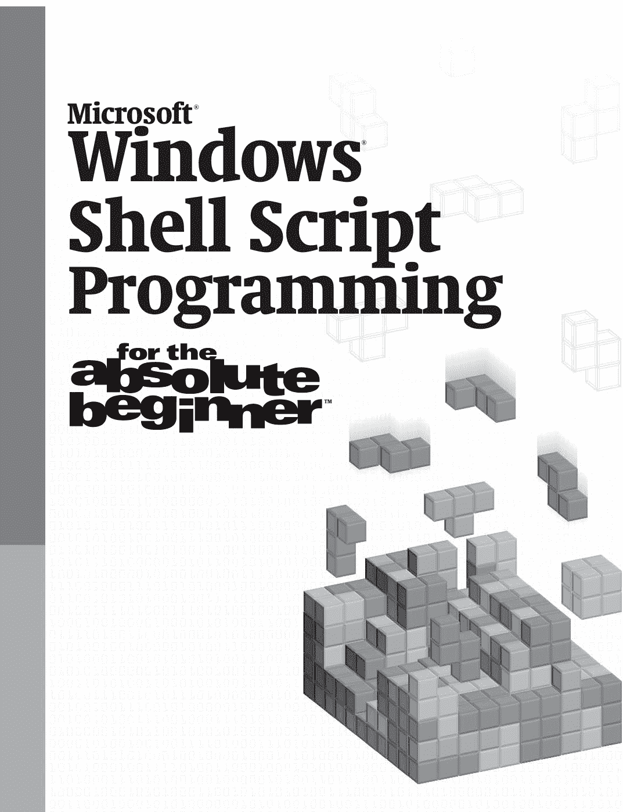

本页特意留白。


Sharon Shock


Kim Benbow


致 Alexander, William, Molly 和 Mary。

# 致谢

许多人在本书的工作中做出了应有的贡献。我特别想感谢 Todd Jensen，他担任本书的采购编辑，并曾与我合作过许多其他写作项目。我还要想感谢本书的项目编辑和校对编辑 Dan Foster，感谢他的指导和建议。最后，我要感谢本书的技术编辑和 CD-ROM 开发者 Keith Davenport，以及 Premier Press 的所有人员的辛勤付出。

# 关于作者

Jerry Ford, Jr. 是一位作者、教育工作者 IT 专业人士，在信息技术领域拥有超过 15 年的经验，担任过自动化分析师、技术经理、技术支持分析师、自动化工程师和安全分析师。Jerry 是 MCSE，并获得了微软的 MCP 和 MCP+ Internet 认证。此外，他拥有维吉尼亚州里士满市联邦立大学的工商管理硕士学位。

Jerry 编写了其他 12 本书，包括《周末学习 JavaScript》、《周末学习 VScript》、《微软 Windows 脚本编程与 WSH 管理员指南》、《VBScript 职业项目》以及《微软 Windows XP 专业版指南》。

他拥有兼职教师在信息技术领域教授网络课程的 5 年经验。Jerry 住在维吉尼亚州里士满，与妻子 Mary 以及孩子们 William、Alexander 和 Molly 生活在一起。


- 创建错误日志 ....................................................... 68


- 总结 ............................................................................................... 85

## 在变量中存储和检索信息 87


- 定义子程序 ................................................................ 204


- 权限不足 ................................................................ 261
- 使用 Windows 命令 ................................................ 262


## 系列编辑的信

在某个时刻，你可能已经开始想要对你的电脑有更多控制权。你可能想让程序的运行与默认设置有所不同，自动化繁琐的任务，或者自动执行某些操作。归根结底，这一切都源于编程。编程世界可能非常令人生畏，有各种集成环境、复杂的语言和令人眼花缭的资源。编程看起来很难，坦率地说，它看起来也很无聊。

在书中，Jerry Lee Ford 将向你展示如何以惊的方式控制你的电脑。你将学习到相对简单的技巧，这些技巧将深刻地改善你与计算机交互的方式，并在过程中学习到编程艺术的基础。Windows 脚本编写并不是最复杂的编程环境，这正是它魅力的很大来源。这种相当简洁的语言非常适合初学者，恰恰是因为它的专注。

虽然脚本编写非常有用，但这并不意味着学习它必须是枯燥无聊的。正如本系列中的所有书籍一样，这本书通过简单的游戏编程来进行教学。没有人会使用 Windows 脚本编写来编写下一款沉浸式 3D 动作游戏，但游戏可以成为学习编写更传统程序的有趣方式。别担心，在你阅读这本书的过程中，会有很多实用的示例。

如果你打算开始编程，你找不到比这本书更完美的起点了。如果你已经是一个经验丰富的程序员，你将对自己如何利用书中的技能来提升你的能力感到惊讶。无论如何，你将学到很多东西，并在这个过程中获得快乐时光。

《绝对初学者系列》系列编辑

## 导言

Windows 脚本编写是现代 Windows 操作系统内置的一种脚本语言。它提供了创建和运行小型程序或 Windows 脚本文件的能力，这些文件由 Windows Shell 脚本语句和 Windows 命令组成。Windows 脚本以纯文本文件的形式创建，并以 .bat 或 .cmd 文件扩展名保存，从 Windows 命令行中运行。

Windows 脚本通常是较小的文件，可以在几分钟内创建并测试。事实上，许多优秀的 Windows 脚本长度不足 10 或 15 行。这使得它成为快速自动化 Windows 任务的完美语言。这也使得 Windows 脚本编写成为非常棒的入门学习语言。

与现代编程语言不同，Windows 脚本编写不是面向对象的。此外，它并不要求你学习如何操作复杂的开发环境。然而，Windows 脚本编写确实拥有一套完整的语句——这些元素构成了它的编程语言。这让初级程序员能够专注于学习程序设计的基础，而不会被许多其他编程语言强加的额外要求所负担。

Windows 脚本提供了一种自动化复杂任务的方法，特别是那些容易人为错误的任务。一旦创建，Windows 脚本就可以与其他共享，允许你分发和分享你的工作。通过使用 Windows 脚本，你可以访问并操作 Windows 资源，如 Windows 文件系统、磁盘以及打印机资源，甚至可以自动化执行网络任务。此外，正如本书将展示的那样，你可以创建自动化并控制各种事务执行的 Windows 脚本。例如，这本书将向你展示如何创建 Windows 脚本：

- 玩像剪刀石头布和井格游戏之类的电脑游戏。
- 复制和移动文件及文件夹。
- 建立与网络资源（如网络磁盘驱动器和文件夹）的连接。
- 创建文本报告和日志文件。
- 执行 Windows 实用程序（如 Windows 磁盘碎片整理）。
- 创建用户账户并管理组成员身份。
- 控制第三方应用程序（如 WinZip）。

## 为什么选择 Windows 脚本编写？

Windows 脚本是开发自动执行常用任务的小脚本的极佳语言。同时，你可以用它创建极其复杂的脚本。然而，在大多数情况下，你会发现大多数 Windows 脚本并不大。通常，脚本文件的大小只有用 Visual Basic 和 C++ 等高级语言编写的程序的一小部分。这降低了复杂性并缩短了开发时间。它也让 Windows 脚本编写成为快速开发的绝佳工具，允许你快速创建、测试脚本，然后继续你的工作。

Windows 脚本编写是一个优秀的第一门编程语言。从编程语言而言，它是直观且易学习的。然而，通过 Windows 脚本编写，你可以学习最复杂的编程概念。开始创建 Windows 脚本只需要一个像 Windows 记事本这样的纯文本编辑器。

通过学习 Windows 脚本，你将开始为学习其他编程语言奠定基础。一旦你掌握了 Windows 脚本，你可能想尝试其他脚本语言，如 VBScript 或 JavaScript，这两者都可以在 Windows 计算机上执行高级脚本编写。你可能还想将 Windows 脚本编写作为 Visual Basic 和 C++ 等更高级面向对象编程语言的跳板。底是，学习使用 Windows 脚本将为你提供一个基础，有助于你学习其他编程语言。

## 谁应该读这本书？

我设计这本书是为了教你如何使用 Windows 脚本编写成为一名程序员。不需要具备先前的编程背景。然而，你需要对通用计算机有基础了解，并且对至少一个操作系统有良好的整体工作知识。

所以，无论你是一个寻找良好语言进行学习的初级程序员，还是想快速学习第二门编程语言，这本书都能为你提供帮助。此外，我认为你会发现，书中基于游戏的方法将帮助你在学习过程中保持乐趣。

## 开始前的准备工作

为了有效使用这本书，你需要一些东西。首先，你需要一个支持 Windows 脚本编写的 Windows 操作系统。这些操作系统包括：

- Windows NT 4.0
- Windows 2000
- Windows XP
- Windows 2003

你还需要一个纯文本文件的编辑器。作为入门编辑器，你可以从 Windows 记事本开始工作。然而，随着时间的推移，你可能会发现记事本相当有限，你会希望使用一个支持语法高亮和高级查找替换等功能的编辑器。为了帮助你，我在书中附带的光盘中包含了优秀的编辑器。要了解更多关于这些编辑器的信息，请查看附录 B，“光盘中的内容”。

## 本书的结构

我编写这本书的假设是你会从头到尾顺序阅读。如果这是你的第一次编程体验，或者你觉得需要复习编程，我建议你按照这种方式阅读。如果你是资深程序员，并打算将 Windows 脚本编写作为另一种语言学习，你可能想跳跃阅读你感兴趣的话题。

本书的第一部分介绍了 Windows 脚本编写。它提供了 Windows 脚本编写和 Windows 命令提示符的概述。

第二部分将你 Windows 脚本开发者的基础知识。它涵盖了如何显示脚本输出以及如何使用注释和变量。它还涵盖了提供条件逻辑和循环功能的脚本语句。

第三部分专注于各种高级主题。这里将向你展示如何使用过程和子程序来改进 Windows 脚本的组织。我将介绍涉及调试和处理脚本错误的步骤。

书的最后部分包含附录。在这里你将找到一个真实世界的示例脚本集、关于书中光盘材料的信息，以及关于可以在哪里继续你的 Windows 脚本教育的信息。


以下列出了书中包含的信息的详细大纲。

- 第 1 章——Windows Shell 脚本简介。本章解释了什么是 Windows Shell 脚本，以及为什么它是学习编程的极佳入门语言。本章提供了 Windows 脚本的简史，并将其与微软的另一种脚本技术 Windows Script Host（Windows脚本主机）进行了比较，解释了这两种脚本解决方案之间的区别。本章通过教你如何编写第一个 Windows 脚本游戏——“敲门声”（Knock Knock）笑话作为结束。

- 第 2 章——与 Windows Shell 交互。本章将为你回顾 Windows Shell 并解释如何对其进行操作（例如：启动新 shell、发布命令和关闭 shell）。章节将继续讨论如何使用 Windows 命令提示符，并解释命令语法。随后，将介绍影响 Windows 命令控制台外观的特定命令。这将引入对命令控制台自定义的讨论。最后，本章通过展示如何编写一个名为“不可预测命令”（Unpredictable Command）的脚本作为结束。

- 第 3 章——Windows Shell 脚本基础。在本章中，我将为你回顾基础 Windows 脚本技术，包括如何控制输出显示以及如何使用空行格式化显示。我将讨论创建文档模板的重要性。本章还将向你展示如何处理 shell 输入输出，以及如何重定向命令输出以创建报告和日志文件。本章还将教你如何创建“占卜师”游戏，该游戏回答玩家提出的问题。

- 第 4 章——变量中的脚本与信息检索。本章将向你展示如何编写运行时接受并处理输入的脚本。你还将学习如何检索计算机系统变量的信息。然后，你将学习适用于变量创建的规则。本章还将演示操作数值变量值的不同方法，以及如何访问存储在字符串变量中的全部或部分文本。本章将通过教你创建“奇迹巴巴的故事”游戏结束，该游戏会根据从用户处收集的信息创建一个自定义故事。

- 第 5 章——应用条件逻辑。在本章中，你将学习如何在脚本中应用条件逻辑。这将使你能够创建收集并测试数据值的脚本，并根据数据的值更改脚本的执行方式。你还将学习通过将一个逻辑测试嵌套在另一个之中开发更复杂的逻辑。本章通过介绍“猜数字”游戏作为结束，在游戏中，玩家被挑战用最少的猜测次数猜出 1 到 32,000 之间的数字。

- 第 6 章——创建循环处理数据集。本章涵盖了创建循环作为处理大量数据的方法。它将演示如何使用循环处理字符串内容、命令输出以及文件和文件夹内容。本章还向你介绍使用伪代码作为建立高层脚本设计的工具。本章通过教你如何创建“六百万美元问答”游戏结束。在游戏中，玩家将面对一系列问答问题，这些问题在回答后将进行评分并生成游戏得分报告文件。

- 第 7 章——调试程序与子程序。本章向你介绍了设计工具的使用。它还展示了如何在一个脚本中执行另一个脚本。章节还涵盖了过程和子程序的使用，这使你能够在增加复杂性的同时改进脚本结构。本章通过涵盖“剪刀石头布”游戏的开发结束。

- 第 8 章——调试与错误处理。在最后一章中，我将向你介绍几个不同的主题。我将提供关于如何以模块化方式开发脚本以及如何一次测试一个模块的提示。你将学习如何在脚本开发和测试期间测试中间引用。计算机系统的情况不断变化，你的结果可能会随着时间的推移而失效或出现问题。为了应对这些情况，我将提供一些基础调试技术，并给你帮助你检测和处理脚本错误的建议。本章将通过引导你完成最后一个名为“井字棋”（Tic-Tac-Toe）的游戏项目结束。

- 附录 A——Windows 脚本管理脚本。此附录提供了一系列实用示例，演示了在现实世界中使用 Windows 脚本。我包含此附录是为了帮助你从书中基于游戏的方法过渡到真实的脚本开发。

- 附录 B——CD-ROM 里面有什么？在本附录中，我将为你提供关于书中附带 CD-ROM 中示例脚本的信息。我还将为你提供 EditPad 文本编辑器的免费版本和 EditPad Pro 文本编辑器的共享软件版本，并对这些编辑器的功能进行简要概述。

- 附录 C——接下来做什么？在本附录中，我将提供关于如何继续你的 Windows 脚本教育的建议。我将包含一些你认为会有用的其他书籍引用，还将提供关于一些网站的信息，你可以在这些网站找到更多信息，包括许多可以下载的免费示例脚本。

- 术语表。本单元提供了贯穿全书的关键术语表。

本书使用游戏开发作为教你如何使用 Windows Shell 脚本进行编程的手段。你遇到的每个游戏都会比上一个稍微复杂一点。在前几章中，你会发现将包含书中在该阶段尚未涵盖的元素。对于这些脚本，你需要记住。


## 项目预览：敲门笑话 (The Knock Knock Joke)

本章与书中其他章节一样，最后通过向你展示如何使用 Windows 脚本开发电脑游戏来结束。你在本章中学习编写的游戏被称为“敲门笑话”（Knock Knock joke）。通过学习开发此游戏所需的步骤，你将学会创建和运行 Windows 脚本涉及的基础机制。

就基于游戏的 Windows 脚本而言，“敲门笑话”是一个非常简单的脚本。你可以通过打开 Windows 命令行提示符、输入脚本名称并按回车键来运行它。脚本将通过显示开头的“Knock Knock”消息作为响应，如图 1.1 所示。用户随后必须输入“Who is there?”（包括前后引号）并按回车。脚本将通过显示 Orange 的回复作为响应。用户随后必须输入“Orange Who?”，如图 1.2 所示。

> Windows 命令行提示符默认以驱动器号后加冒号、反斜杠字符以及“大于”符号的形式出现（例如 C:\>）。命令行提示符接受文本输入并将其传递给操作系统进行处理。

最后，脚本将显示笑话的包袱（punch line），如图 1.3 所示。如果玩家在输入笑话所需的任何响应时出现拼写错误，将显示图 1.4 和 1.5 所示两个消息之一。

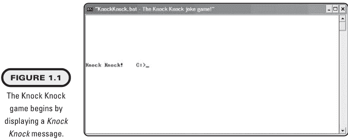

# 第 1 章 Windows 脚本脚本简介

## 图 1.2

游戏提示玩家对笑话的第二部分进行响应。

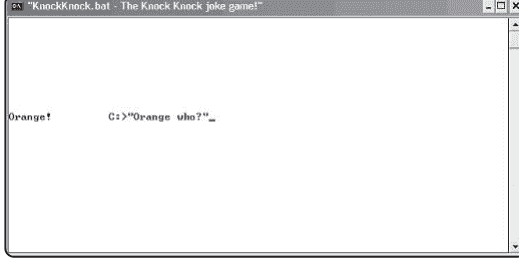

## 图 1.3

游戏呈现笑话的包袱。

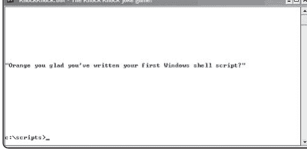

## 图 1.4

游戏通知玩家任何错误的输入。

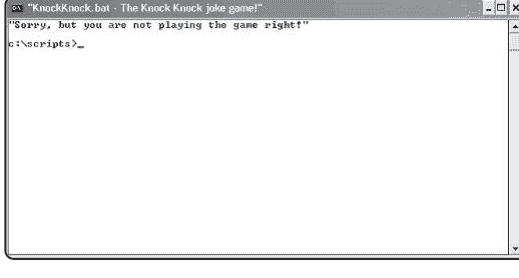

## 图 1.5

由于玩家输入错误，游戏可能会提前退出并生成错误消息。

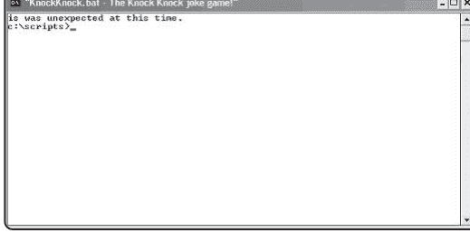

不用尝试理解你将输入到脚本中的每一行代码；在阅读此书的过程中，你将学会一切的含义。在本章中学习的重要内容是创建和保存第一个脚本涉及的步骤。通过完成此脚本，你将为后续章节介绍的更高级编程概念做好准备。

## Windows 脚本概述

在 Windows 操作系统系统的早期，并没有点点式的图形化用户界面。一切操作都是通过键盘在 Windows 命令行提示符中输入命令完成的。这意味着用户必须记忆各种命令才能使用他们的电脑。糟糕糟糕，大多数 Windows 命令可以使用多种变体进行输入，这使得几乎不可能记住所有可能的命令。自然地，这意味着人们花费大量时间查找命令。用户经常发现自己需要反复输入同一组命令。为了让这些操作变得更简单并消除输入错误，用户和管理员创建了批处理文件（batch files）。批处理文件是由你在 Windows 命令行提示符中输入的相同 Windows 命令组成的纯文本文件。批处理文件具有 .bat 扩展名。它们通过在命令行提示符中输入并按回车键来执行。操作系统将从文件开始，逐执行批处理文件中的每个命令。

20 世纪 80 年代初，微软引入了图形化用户界面，大多数用户高兴地遗弃了对 Windows 命令和命令行提示符的所有记忆。然而，批处理文件仍然是自动化执行命令和实用程序的价值工具，并且对高级用户和管理员特别有用。

批处理文件仍然局限于 Windows 命令的顺序执行。批处理文件的唯一可用替代方案是在 Windows 命令行提示符中手动执行命令、购买一个应用程序来执行任务，或使用 C 或 C++ 等高级语言创建自定义程序以创建一个能够执行所需任务的新自定义应用程序。

正如我确定你正在想的那样，这三个选项都不非常实用。它们需要比用户和管理员愿意花费更多的金钱或时间。最后，在 20 世纪 90 年代初，微软引入了 Windows NT。这种微软操作系统包含了一种名为 Windows 脚本的内置脚本语言。Windows 脚本与旧式批处理文件不同，它具有一套完整的编程语句，因此允许开发包含条件逻辑、迭代逻辑以及使用计算机内存进行数据存储和检索的脚本。

条件逻辑（conditional logic）一术是指脚本检查数据并根据条件分析的结果调整其行为的能力。

迭代逻辑（iterative logic）一术是指脚本反复执行一系列步骤的能力。

语句（statement）是一行代码。大多数语句在单行内重复；然而，长语句可以跨越多行。

微软此后在所有基于 Windows NT 技术构建的 Windows 操作系统（例如 Windows 2000、XP 和 2003）中增加了对 Windows 脚本的支持。

虽然构成 Windows 脚本的语句集合多年来基本保持不变，但某些语句已经过修改以扩展其功能。如果你计划编写在不同操作系统运行的脚本，你应该检查任何命令的语法以查看它支持什么。Windows 脚本以 .bat（批）或 .cmd（命令）文件扩展名保存。这样，当操作系统要求运行它们时，它将使用 Windows Shell 执行它们。

## 脚本可以做什么？

Windows 脚本可以完成任何可以在 Windows 命令行提示符中完成的任务。尽管微软不断改进图形化用户界面并通过提供点点式的体验让用户更方便，但它继续更新和扩展命令行功能（例如每个新操作系统添加新命令并完善现有命令）。

微软还对其许多实用程序提供了命令行访问，允许通过脚本进行访问和控制。例如，磁盘整理程序（重新组织存储在驱动器上的文件以实现更有效的存储）可以在 Windows XP 的图形界面上通过选择“开始”、“所有程序”、“附件”、“系统工具”，以及“磁盘整理”来运行。或者，你可以在脚本内部执行此实用程序。例如，通过输入 defrag c，你可以使用此实用程序自动整理你的驱动器。

Windows 脚本可用于自动化以下所有类别的任务：

- 复杂任务：该类脚本任务包括任何手动执行时极易出错的任务，例如驱动器和打印机等系统资源的管理。
- 重复性任务：这些脚本任务包括任何需要反复执行的任务，例如定期地从特定顺序中删除某些类型的文件。
- 耗时任务：这些脚本任务包括任何手动执行耗时过长的任务，例如创建几百个新用户账户。
- 计划任务：这些脚本任务包括任何必须在非工作时间运行的任务，即用户和管理员未使用电脑的时间段（例如磁盘整理程序）。


- 创建和管理计划任务
- 管理本地和网络打印机
- 设置到网络文件夹和驱动器的连接
- 执行 Windows 命令或命令行实用程序

## 支持的 Microsoft 操作系统

如前所述，Windows NT、2000、XP 和 2003 支持 Windows Shell 脚本编写。然而，其他的 Microsoft 操作系统并不支持它。这些其他操作系统包括 Windows 95、98 和 Me。当然，你仍然可以使用旧式的批处理文件（batch files）在这些操作系统上自动执行小量的命令集合，但在这些操作系统上仍然缺乏在 Windows Shell 脚本层级添加程序化逻辑的能力。如果你需要为这些操作系统开发脚本，你将需要考虑替代的脚本语言，我将在接下来的章节中介绍这些语言。

## Windows 脚本编写的替代方案

虽然 Shell 脚本编写可能是最容易学习的脚本语言，但微软和其他第三方软件开发者还提供了许多替代脚本语言。下面，我将简要描述其中一些其他脚本语言。不过，如果你是编程新手，我建议你先精通 Shell 脚本编写，然后再考虑并尝试学习更复杂的脚本语言。

## Windows 脚本宿主机 (Windows Script Host)

Windows 脚本宿主机（简称 WSH）为 Microsoft 操作系统提供了一个高级的脚本执行环境。使用 WSH，你可以开发可以在从 Windows 95 开始的任何 Windows 操作系统上运行的脚本。这意味着与仅在 Windows NT、2000、XP 和 2003 的 Windows Shell 脚本不同，WSH 脚本也可以在运行 Windows 95、98 或 Me 的计算机上运行（前提是这些计算机上安装了 WSH）。WSH 作为 Windows 操作系统的扩展运行，可以启用或禁用。默认情况下，Windows 2000、XP 和 2003 已安装并启用 WSH。

> **定义** 执行环境一术语指的是脚本执行所需的资源分组，例如脚本解释器，该解释器将脚本状态翻译成计算机可以执行的指令。

## WSH 的优点与缺点

在决定使用 Windows Shell 脚本编写还是 WSH 来自动化任务时，有许多标准需要考虑。WSH 提供了一个更全面的执行环境，并可以直接访问许多资源。例如，WSH 脚本可以向 Windows 事件日志写入消息，或读取和写入 Windows 注册表。因此，如果你的脚本需要访问这些资源，使用 WSH 可能更有意义。然而，许多任务并不需要访问此类资源，抵消了这些 WSH 优势。

> **定义**
Windows 应用程序日志是由 Windows NT、2000、XP 和 2003 系统维护的一个文件，其中记录了应用程序错误和消息以供后续审核审查。

> **定义**
Windows 注册表是一个特殊的内置数据库，是从 Windows 95 开始的所有 Windows 操作系统的的一部分，其中存储了有关系统、应用程序、硬件和用户设置的配置信息。

要使用 WSH，你需要知道如何使用一种脚本语言（如 VBScript 或 JavaScript）编写脚本。你还需要学习如何操作 WSH 执行环境。

通常情况下，在以下场景使用 WSH 创建脚本是有意义的

- 你精通 VBScript 或 JavaScript 等其他脚本语言，并且需要访问这些语言提供的编程功能
- 你需要在 Windows NT、2000、XP 和 2003 以外的 Windows 操作系统上运行脚本

## 在现实世界中

如果你拥有正在开发脚本的操作系统 Windows 资源工具包（Resource Kit），你可以使用资源工具包提供的命令行实用程序来间接访问系统资源。例如，使用 LOGEVENT 命令行实用程序，你可以从 Shell 脚本内部向 Windows 应用程序日志写入。同样，使用 REG 命令行实用程序，你可以访问并更改存储在 Windows 注册表中的信息。要了解更多关于 Windows 资源工具包的信息，请访问 www.microsoft.com/windows/reskits/default。

- 如果你有正在开发脚本的对应系统的 Windows 资源工具包，你可以使用资源工具包提供的命令行实用程序来间接访问系统资源。例如，使用 LOGEVENT 命令行实用程序，你可以从 Shell 脚本内部向 Windows 应用程序日志写入消息。同样，使用 REG 命令行实用程序，你可以访问并更改存储在 Windows 注册表中的信息。要了解更多关于 Windows 资源工具包的信息，请访问 www.microsoft.com/windows/reskits/default。

- 当你需要在 Windows NT、2000、XP 和 2003 以外的 Windows 操作系统上运行脚本

- 当你精通 VBScript 或 JavaScript 等其他脚本语言，并且需要访问这些语言提供的编程功能

- 当你需要在 Windows NT、2000、XP 或 2003 上运行脚本

- 当你精通 VBScript 或 JavaScript 等其他脚本语言，并且需要访问这些语言提供的编程功能

- 当你需要在 Windows NT、2000、XP 或 2003 上运行脚本

- 当你精通 VBScript 或 JavaScript 等其他脚本语言，并且需要访问这些语言提供的编程功能

- 当你想要自动化特定的任务
- 当你熟悉某种特定的脚本语言

- 当你精通 VBScript 或 JavaScript 等其他脚本语言，并且需要访问这些语言提供的编程功能

- 当你需要执行特定的任务
- 当你熟悉某种脚本语言

- 当你精通 VBScript 或 JavaScript 等其他脚本语言，并且需要访问这些语言提供的编程功能

- 当你想要自动化特定的任务
- 当你熟悉某种特定的脚本语言

- 当你需要执行特定的任务

## WSH 脚本的复杂性

为了编写 WSH 脚本，你必须首先学习使用一种脚本语言编写脚本。默认情况下，WSH 支持 VBScript 和 JavaScript。VBScript 是 Visual Basic 编程语言的一个子集。JavaScript 是 Netscape 脚本语言的微软版本。此外，你可以使用 Perl、Python 和 REXX 等许多 WSH 兼容脚本语言。

与 Shell 脚本编写相比，其他脚本语言涉及到特定的语句和命令，其中许多命令并不直观。因此，掌握这些语言需要更长时间。除了学习使用其他脚本语言开发脚本外，你还必须学习如何操作 WSH 对象模型。WSH 对象模型通过将打印机、文件和文件夹等 Windows 资源表示为对象，允许脚本访问并操作它们。WSH 对象模型非常复杂，需要大量的精力和努力才能掌握。初学者最好学习编写 Windows Shell 脚本。Windows Shell 脚本语言使用熟悉的 Windows 命令，不需要掌握对象模型，从而让初学者能够专注于学习核心编程概念和逻辑，而不需要学习高级概念。此外，Windows 脚本编写为转向其他许多高级脚本和编程语言提供了良好的平台。

## 第三方脚本语言

除了 Windows 脚本编写和 WSH，你还可以使用任何第三方脚本语言在 Windows 计算机上开发脚本。你可以使用的脚本语言之一是 Perl。Perl 代表实用提取和报告语言（Practical Extraction and Reporting Language）。Perl 最初是 UNIX 操作系统的脚本语言，最初用于从文本文件中读取和提取信息并创建新报告。

与 Windows Shell 脚本编写相比，Perl 是一种很难精的脚本语言，尤其是作为第一门语言时。多年来，大多数操作系统都增加了对 Perl 的支持。Perl 可以作为 WSH 兼容脚本语言使用，允许你创建利用 WSH 优势的脚本。

另一种具有 UNIX 血统并移植到 Windows 的脚本语言是 Python。Python 以喜剧剧团 Monty Python 命名。Python 在 Linux 用户中拥有巨大的支持，并且通常被认为比 Perl 更容易学习。现有的 Python 版本兼容 WSH。然而，与 Windows Shell 脚本编写相比，它仍然是一门困难的第一门语言。

Windows 用户和管理员可用的另一种脚本语言是 REXX。REXX 代表重构扩展提取语言（Restructured Extended Extractor language）。REXX 最初是作为大型机脚本语言开发的。IBM 将其作为其 OS/2 操作系统的内置脚本语言。今天，Windows 有许多版本的 REXX 可供选择。


# 第 1 章 介绍 Windows 脚本

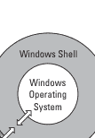

```
Command Prompt
Microsoft Windows XP (Version 5.1.2600)
(C) Copyright 1985-2001 Microsoft Corp.
C:\Documents and Settings\Jerry Ford\>
```

Windows Shell（外壳）接受来自 Windows 命令控制台的输入并将其转换为操作系统可以使用的格式。

在 Windows 命令提示符处输入命令。要与 Windows Shell 交互，你必须通过点击“开始”、“所有程序”、“辅助程序”，然后点击“命令提示符”来打开一个一个 Windows 命令控制台（如图 1.7 所示）。

```
Command Prompt
Microsoft Windows XP (Version 5.1.2600)
(C) Copyright 1985-2001 Microsoft Corp.
C:\Documents and Settings\Jerry Ford\>
```

图 1.7

Windows 控制台提供了访问 Windows 命令提示符的界面。

> 你也可以通过点击“开始”、“运行”，输入 CMD 并点击“确定”来启动一个新的 Windows 控制台会话。

默认情况下，Windows 命令控制台被设置为 80 字符宽、25 行高。不过，你可以根据自己的喜好修改 Windows 命令控制台的高度和宽度。在控制台的顶部，你会看到一个闪烁的下划线字符。这是命令提示符在告诉你它已准备好接收输入。

> 我将在第 2 章“与 Windows Shell 交互”中向你展示如何配置 Windows 控制台。如果你已经等不及想看到如何操作了，可以直接跳到第 2 章阅读“自定义 Windows 命令控制台”。

要将命令发送到 Windows Shell 处理，请在命令提示符处输入该命令并按回车键。例如，要显示当前工作目录的内容，输入 DIR 并按回车。

随后，Windows Shell 将 DIR 命令翻译成操作系统可以理解的格式。操作系统通过列出当前工作目录的内容的列表来处理该命令，然后将其传回给 Windows 控制台。Windows Shell 会重新显示命令输入，以便允许你进行任何额外的命令输入，如下所示。

```
C:\Documents and Settings\Jerry Ford>dir
Volume in C is IBMOS_6
Volume Serial Number is 286A-5F8F
```

Directory of C:\Documents and Settings\Jerry Ford

| Date | Time | Attribute | Name |
| :--- | :--- | :--- | :--- |
| 11/10/2003 | 01:29 PM | <DIR> | . |
| 11/10/2003 | 01:29 PM | <DIR> | .. |
| 11/10/2003 | 01:38 PM | <DIR> | My Documents |
| 11/10/2003 | 01:38 PM | <DIR> | Favorites |
| 11/10/2003 | 01:02 PM | <DIR> | Desktop |
| 11/10/2003 | 01:02 PM | <DIR> | Start Menu |
| 12/03/2003 | 11:47 PM | <DIR> | WINDOWS |
| | | 0 File(s) | 0 bytes |
| 7 Dir(s) | | 153,256,936 bytes free |

```
C:\Documents and Settings\Jerry Ford> _
```

> “当前工作目录”一词是指 Windows 命令控制台当前关注的 Windows 文件夹。默认情况下，Windows XP 设置当前工作目录为 Documents and Settings。

## 编写你的第一个脚本

要将命令发送到 Windows Shell 进行处理，请在命令提示符处输入它并按回车键。例如，要显示当前工作目录的内容，输入 DIR 并按回车。

Windows Shell 随后将 DIR 命令翻译成操作系统可以理解的格式。操作系统通过组合一份当前工作目录内容的列表来处理该命令，然后将其传回给 Windows 控制台。Windows Shell 会重新显示命令输入，以便允许你进行任何额外的命令输入，如下文所示。

```
C:\Documents and Settings\Jerry Ford>dir
Volume in C is IBMOS_6
Volume Serial Number is 286A-5F8F
```

### 组你的第一个脚本

现在，让我们检查在 Windows 命令提示符处输入命令并按回车键。例如，要显示当前工作目录的内容，输入 DIR 并按回车。

```
C:\Documents and Settings\Jerry Ford>dir
Volume in C is IBMOS_6
Volume Serial Number is 286A-5F8F
```

Directory of C:\Documents and Settings\Jerry Ford

| Date | Time | Attribute | Name |
| :--- | :--- | :--- | :--- |
| 11/10/2003 | 01:29 PM | <DIR> | . |
| 11/10/2003 | 01:29 PM | <DIR> | .. |
| 11/10/2003 | 01:38 PM | <DIR> | My Documents |
| 11/10/2003 | 01:38 PM | <DIR> | Favorites |
| 11/10/2003 | 01:02 PM | <DIR> | Desktop |
| 11/10/2003 | 01:02 PM | <DIR> | Start Menu |
| 12/03/2003 | 11:47 PM | <DIR> | WINDOWS |
| | | 0 File(s) | 0 bytes |
| 7 Dir(s) | | 153,256,936 bytes free |

```
C:\Documents and Settings\Jerry Ford> _
```

> “当前工作目录”一词是指 Windows 命令控制台当前关注的 Windows 文件夹。默认情况下，Windows XP 设置当前工作目录为 Documents and Settings。

## 编写你的第一个脚本

要将命令发送到 Windows Shell 进行处理，请在命令提示符处输入该命令并按回车键。例如，要显示当前工作目录的内容，输入 DIR 并按回车。

Windows Shell 随后将 DIR 命令翻译成操作系统可以理解的格式。操作系统通过组合一份当前工作目录内容的列表来处理该命令，然后将其传回给 Windows 控制台。Windows Shell 会重新显示命令输入，以便允许你进行任何额外的命令输入，如下文所示。

```
C:\Documents and Settings\Jerry Ford>dir
Volume in C is IBMOS_6
Volume Serial Number is 286A-5F8F
```

Directory of C:\Documents and Settings\Jerry Ford

| Date | Time | Attribute | Name |
| :--- | :--- | :--- | :--- |
| 11/10/2003 | 01:29 PM | <DIR> | . |
| 11/10/2003 | 01:29 PM | <DIR> | .. |
| 11/10/2003 | 01:38 PM | <DIR> | My Documents |
| 11/10/2003 | 01:38 PM | <DIR> | Favorites |
| 11/10/2003 | 01:02 PM | <DIR> | Desktop |
| 11/10/2003 | 01:02 PM | <DIR> | Start Menu |
| 12/03/2003 | 11:47 PM | <DIR> | WINDOWS |
| | | 0 File(s) | 0 bytes |
| 7 Dir(s) | | 153,256,936 bytes free |

```
C:\Documents and Settings\Jerry Ford> _
```

> “当前工作目录”一词是指 Windows 命令控制台当前关注的 Windows 文件夹。默认情况下，Windows XP 设置当前工作目录为 Documents and Settings。

## 编写你的第一个脚本

要将命令发送到 Windows Shell 进行处理，请在命令提示符处输入该命令并按回车键。例如，要显示当前工作目录的内容，输入 DIR 并按回车。

Windows Shell 随后将 DIR 命令翻译成操作系统可以理解的格式。操作系统通过组合一份当前工作目录内容的列表来处理该命令，然后将其传回给 Windows 控制台。Windows Shell 会重新显示命令输入，以便允许你进行任何额外的命令输入，如下文所示。

```
C:\Documents and Settings\Jerry Ford>dir
Volume in C is IBMOS_6
Volume Serial Number is 286A-5F8F
```

Directory of C:\Documents and Settings\Jerry Ford

| Date | Time | Attribute | Name |
| :--- | :--- | :--- | :--- |
| 11/10/2003 | 01:29 PM | <DIR> | . |
| 11/10/2003 | 01:29 PM | <DIR> | .. |
| 11/10/2003 | 01:38 PM | <DIR> | My Documents |
| 11/10/2003 | 01:38 PM | <DIR> | Favorites |
| 11/10/2003 | 01:02 PM | <DIR> | Desktop |
| 11/10/2003 | 01:02 PM | <DIR> | Start Menu |
| 12/03/2003 | 11:47 PM | <DIR> | WINDOWS |
| | | 0 File(s) | 0 bytes |
| 7 Dir(s) | | 153,256,936 bytes free |

```
C:\Documents and Settings\Jerry Ford> _
```

> “当前工作目录”一词是指 Windows 命令控制台当前关注的 Windows 文件夹。默认情况下，Windows XP 设置当前工作目录为 Documents and Settings。

## 编写你的第一个脚本

要将命令发送到 Windows Shell 进行处理，请在命令提示符处输入该命令并按回车键。例如，要显示当前工作目录的内容，输入 DIR 并按回车。

Windows Shell 随后将 DIR 命令翻译成操作系统可以理解的格式。操作系统通过组合一份当前工作目录内容的列表来处理该命令，然后将其传回给 Windows 控制台。Windows Shell 会重新显示命令输入，以便允许你进行任何额外的命令输入，如下文所示。

```
C:\Documents and Settings\Jerry Ford>dir
Volume in C is IBMOS_6
Volume Serial Number is 286A-5F8F
```

Directory of C:\Documents and Settings\Jerry Ford

| Date | Time | Attribute | Name |
| :--- | :--- | :--- | :--- |
| 11/10/2003 | 01:29 PM | <DIR> | . |
| 11/10/2003 | 01:29 PM | <DIR> | .. |
| 11/10/2003 | 01:38 PM | <DIR> | My Documents |
| 11/10/2003 | 01:38 PM | <DIR> | Favorites |
| 11/10/2003 | 01:02 PM | <DIR> | Desktop |
| 11/10/2003 | 01:02 PM | <DIR> | Start Menu |
| 12/03/2003 | 11:47 PM | <DIR> | WINDOWS |
| | | 0 File(s) | 0 bytes |
| 7 Dir(s) | | 153,256,936 bytes free |

```
C:\Documents and Settings\Jerry Ford> _
```

> “当前工作目录”一词是指 Windows 命令控制台当前关注的 Windows 文件夹。默认情况下，Windows XP 设置当前工作目录为 Documents and Settings。

## 编写你的第一个脚本

要将命令发送到 Windows Shell 进行处理，请在命令提示符处输入该命令并按回车键。例如，要显示当前工作目录的内容，输入 DIR 并按回车。

Windows Shell 随后将 DIR 命令翻译成操作系统可以理解的格式。操作系统通过组合一份当前工作目录内容的列表来处理该命令，然后将其传回给 Windows 控制台。Windows Shell 会重新显示命令输入，以便允许你进行任何额外的命令输入，如下文所示。

```
C:\Documents and Settings\Jerry Ford>dir
Volume in C is IBMOS_6
Volume Serial Number is 286A-5F8F
```

Directory of C:\Documents and Settings\Jerry Ford

| Date | Time | Attribute | Name |
| :--- | :--- | :--- | :--- |
| 11/10/2003 | 01:29 PM | <DIR> | . |
| 11/10/2003 | 01:29 PM | <DIR> | .. |
| 11/10/2003 | 01:38 PM | <DIR> | My Documents |
| 11/10/2003 | 01:38 PM | <DIR> | Favorites |
| 11/10/2003 | 01:02 PM | <DIR> | Desktop |
| 11/10/2003 | 01:02 PM | <DIR> | Start Menu |
| 12/03/2003 | 11:47 PM | <DIR> | WINDOWS |
| | | 0 File(s) | 0 bytes |
| 7 Dir(s) | | 153,256,936 bytes free |

```
C:\Documents and Settings\Jerry Ford> _
```

> “当前工作目录”一词是指 Windows 命令控制台当前关注的 Windows 文件夹。默认情况下，Windows XP 设置当前工作目录为 Documents and Settings。

## 编写你的第一个脚本

要将命令发送到 Windows Shell 进行处理，请在命令提示符处输入该命令并按回车键。例如，要显示当前工作目录的内容，输入 DIR 并按回车。

Windows Shell 随后将 DIR 命令翻译成操作系统可以理解的格式。操作系统通过组合一份当前工作目录内容的列表来处理该命令，然后将其传回给 Windows 控制台。Windows Shell 会重新显示命令输入，以便允许你进行任何额外的命令输入，如下文所示。

```
C:\Documents and Settings\Jerry Ford>dir
Volume in C is IBMOS_6
Volume Serial Number is 286A-5F8F
```

Directory of C:\Documents and Settings\Jerry Ford

| Date | Time | Attribute | Name |
| :--- | :--- | :--- | :--- |
| 11/10/2003 | 01:29 PM | <DIR> | . |
| 11/10/2003 | 01:29 PM | <DIR> | .. |
| 11/10/2003 | 01:38 PM | <DIR> | My Documents |
| 11/10/2003 | 01:38 PM | <DIR> | Favorites |
| 11/10/2003 | 01:02 PM | <DIR> | Desktop |
| 11/10/2003 | 01:02 PM | <DIR> | Start Menu |
| 12/03/2003 | 11:47 PM | <DIR> | WINDOWS |
| | | 0 File(s) | 0 bytes |
| 7 Dir(s) | | 153,256,936 bytes free |

```
C:\Documents and Settings\Jerry Ford> _
```

> “当前工作目录”一词是指 Windows 命令控制台当前关注的 Windows 文件夹。默认情况下，Windows XP 设置当前工作目录为 Documents and Settings。

## 编写你的第一个脚本

要将命令发送到 Windows Shell 进行处理，请在命令提示符处输入该命令并按回车键。例如，要显示当前工作目录的内容，输入 DIR 并按回车。

Windows Shell 随后将 DIR 命令翻译成操作系统可以理解的格式。操作系统通过组合一份当前工作目录内容的列表来处理该命令，然后将其传回给 Windows 控制台。Windows Shell 会重新显示命令输入，以便允许你进行任何额外的命令输入，如下文所示。

```
C:\Documents and Settings\Jerry Ford>dir
Volume in C is IBMOS_6
Volume Serial Number is 286A-5F8F
```

Directory of C:\Documents and Settings\Jerry Ford

| Date | Time | Attribute | Name |
| :--- | :--- | :--- | :--- |
| 11/10/2003 | 01:29 PM | <DIR> | . |
| 11/10/2003 | 01:29 PM | <DIR> | .. |
| 11/10/2003 | 01:38 PM | <DIR> | My Documents |
| 11/10/2003 | 01:38 PM | <DIR> | Favorites |
| 11/10/2003 | 01:02 PM | <DIR> | Desktop |
| 11/10/2003 | 01:02 PM | <DIR> | Start Menu |
| 12/03/2003 | 11:47 PM | <DIR> | WINDOWS |
| | | 0 File(s) | 0 bytes |
| 7 Dir(s) | | 153,256,936 bytes free |

```
C:\Documents and Settings\Jerry Ford> _
```

> “当前工作目录”一词是指 Windows 命令控制台当前关注的 Windows 文件夹。默认情况下，Windows XP 设置当前工作目录为 Documents and Settings。

## 编写你的第一个脚本

要将命令发送到 Windows Shell 进行处理，请在命令提示符处输入该命令并按回车键。例如，要显示当前工作目录的内容，输入 DIR 并按回车。

Windows Shell 随后将 DIR 命令翻译成操作系统可以理解的格式。操作系统通过组合一份当前工作目录内容的列表来处理该命令，然后将其传回给 Windows 控制台。Windows Shell 会重新显示命令输入，以便允许你进行任何额外的命令输入，如下文所示。

```
C:\Documents and Settings\Jerry Ford>dir
Volume in C is IBMOS_6
Volume Serial Number is 286A-5F8F
```

Directory of C:\Documents and Settings\Jerry Ford

| Date | Time | Attribute | Name |
| :--- | :--- | :--- | :--- |
| 11/10/2003 | 01:29 PM | <DIR> | . |
| 11/10/2003 | 01:29 PM | <DIR> | .. |
| 11/10/2003 | 01:38 PM | <DIR> | My Documents |
| 11/10/2003 | 01:38 PM | <DIR> | Favorites |
| 11/10/2003 | 01:02 PM | <DIR> | Desktop |
| 11/10/2003 | 01:02 PM | <DIR> | Start Menu |
| 12/03/2003 | 11:47 PM | <DIR> | WINDOWS |
| | | 0 File(s) | 0 bytes |
| 7 Dir(s) | | 153,256,936 bytes free |

```
C:\Documents and Settings\Jerry Ford> _
```

> “当前工作目录”一词是指 Windows 命令控制台当前关注的 Windows 文件夹。默认情况下，Windows XP 设置当前工作目录为 Documents and Settings。

## 编写你的第一个脚本

现在，让我们检查在 Windows 命令提示符处输入命令并按回车键。例如，要显示当前工作目录的内容，输入 DIR 并按回车。

### 组

要与 Windows Shell 交互，你必须通过点击“开始”、“所有程序”、“辅助程序”，然后点击“命令提示符”来打开一个一个 Windows 命令控制台（如图 1.7 所示）。

### 真实世界

与许多编程语言不同，脚本不需要你学习复杂的语法。相反，使用编辑器有许多优势：
- 允许你格式化代码
- 某些编辑器提供语法高亮
- 允许你管理脚本

幸运，你可以使用任何文本编辑器。接下来，保存文件后，会出现“另存为”对话框。在名称字段中输入 Hello.bat，然后点击“保存”。你现在应该会在文件夹中看到该文件。要运行脚本，转到 Windows 控制台并输入 hello。例如，如果你运行 Hello.bat，你应该看到以下内容：

```
C:\Documents and Settings\Jerry Ford>hello
Hello World!
```


prompt。默认情况下，工作目录将是 Windows 文件夹。输入 CD 并按回车键，然后输入 CD Scripts 切换到 C:\Scripts 文件夹。此时，你只需在命令提示符处输入脚本的名称，即可执行保在此文件夹中的任何脚本。

你可以通过配置新快捷方式，使其在打开新的 Windows 控制台时自动切换到 C:\Scripts，让操作变得简单一些。以下步骤概述了执行此任务的程序。

- 1. 右键点击你刚刚创建的新快捷方式并选择“属性”。出现 cmd.exe 属性对话框。
- 2. 在“起始于”字段输入 c:\scripts，如图 1.9 所示。

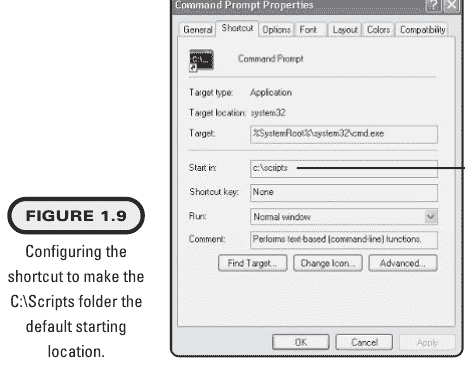

- 3. 点击“确定”。
现在，当你双击快捷方式时，自动打开的 Windows 控制台将焦点置于 c:\scripts（图 1.10）。

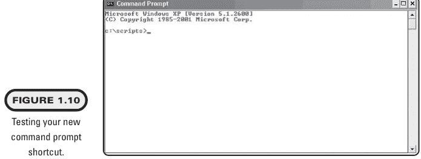

## 回到敲门笑话

现在让我们把注意力回到主项目：敲门笑话（Knock Knock joke）。通过这个脚本的开发，你将学习如何创建一个显示消息、收集玩家响应并根据玩家响应显示额外信息的交互式脚本。这种基础交互是所有 Windows Shell 脚本游戏的基础。

## 设计游戏

计算机游戏开发的第一步是规划游戏设计。敲门笑话游戏相对简单，因此不需要大量的前期设计。就像普通的敲门笑话一样，游戏将从在 Windows 控制台中显示消息“Knock Knock!”开始。它将等待玩家输入“Who is there?”进行响应。玩家必须按照所示的内容回答，包含引号和问号。一旦玩家输入所需的响应并按下回车键，游戏将显示消息“Orange!”并等待玩家输入“Orange who?”。当玩家正确输入第二个响应后，游戏将显示笑点并终止，重新设计 Windows 命令提示符。

该项目将分六步完成，如下文所示：

- 1. 创建一个初始空白脚本文件并将其命名为 KnockKnock.bat
- 2. 配置 Windows 命令控制台的标题栏和颜色方案
- 3. 使用空行格式化显示内容
- 4. 收集玩家响应
- 5. 确认玩家提供了有效输入
- 6. 显示笑话最后的笑点

## 脚本开发过程

创建敲门游戏的第一步是创建一个空文件 KnockKnock.bat 并将其保存到 C:\Scripts 文件夹。以下程序概述了使用 Windows 记事本编辑器执行此任务的步骤。

- 1. 点击“开始”、“所有程序”、“辅助工具”，然后点击“记事本”。出现记事本编辑器。
- 2. 点击“文件”然后点击“另存为”。出现另存为对话框。在“文件名”字段输入 KnockKnock.bat，并指定 c:\scripts 为保存位置。
- 3. 点击“保存”。

## 配置执行环境

此时，你应该正看到一个空的记事本文件。输入以下文本。

```
@ECHO off
```

```
TITLE "KnockKnock.bat - The KnockKnock joke game!"
```

```
COLOR OE
```

第一条语句防止在执行期间显示脚本语句，使脚本的输出更加美观。第二条语句使用 Windows TITLE 命令在 Windows 控制台标题栏中显示文本“KnockKnock.bat - The KnockKnock joke game”，同时使用 Windows COLOR 命令在脚本运行时将所有文本显示为黄色。此时，不要担心这些任何命令的细节或其语法。我将在第 2 章详细介绍。只需接受我对这些工作原理的简单解释，并在专注于你正在经历的整体流程的同时继续编写脚本。

## 格式化显示

Windows 命令控制台的默认行为是在生成输出的命令之后立即显示行。例如，如果你输入了两个命令，Windows 控制台将显示第一个命令及其输出，然后显示第二个命令及其输出。这可能导致显示非常混乱。为了格式化你的脚本输出并使其更容易与之交互，你可以做几件事。首先，你可以使用 CLS 命令清除 Windows 命令控制台，从而显示空白。然后你可以使用 ECHO 语句向 Windows 命令控制台显示空行，并控制文本显示的位置。例如，以下将清除 Windows 命令控制台然后显示 10 行空行。这样，显示的下一行文本将出现在 Windows 控制台的中间。注意，ECHO 命令后的点必须完全按照所示包含。

```
CLS

ECHO.
ECHO.
ECHO.
ECHO.
ECHO.
ECHO.
ECHO.
ECHO.
ECHO.
ECHO.
```

# 第 1 章 介绍 Windows 脚本

## 收集玩家响应

脚本现在需要显示 Knock Knock! 消息并收集玩家的响应。这通过向脚本添加以下代码来实现：

```
SET /p reply=>Knock Knock! C:>
```

该语句使用 Windows SET 命令显示 Knock Knock! 消息，随后是字符 C>，这些字符旨在模拟 Windows 提示符并让玩家感觉自己仍在那里。变量是对计算机内存中位置的引用，在其中存储数据。

## 验证玩家输入

接下来，将以下语句添加到脚本：

```
CLS

IF NOT %reply% == "Who is there?" (
ECHO Sorry, but you are not playing the game right!
GOTO :EOF
)
```

```
ECHO.
ECHO.
ECHO.
ECHO.
ECHO.
ECHO.
ECHO.
```

第一条语句清除 Windows 控制台。接下来的三条语句检查赋值给变量的值，以判断玩家是否正确输入了“Who is there?”。如果玩家提供了错误的响应，脚本将显示错误消息并终止执行。否则，脚本将继续。

## 显示笑点

最后，将以下语句添加到脚本末尾：

```
ECHO.
ECHO.
ECHO.
ECHO.
ECHO.
ECHO.
ECHO.
ECHO.
```

ECHO "Orange you glad you've written your first Windows script?"

```
ECHO.
ECHO.
ECHO.
ECHO.
ECHO.
ECHO.
ECHO.
ECHO.
```

第一组 ECHO 语句在 Windows 控制台中显示十行空行。然后显示游戏的笑点，随后是十行空行。添加最后十行空行的目的是将 Windows 命令提示符的显示移动到 Windows 控制台的底部，这样当脚本结束 Windows Shell 重新显示命令提示符时，它的重新出现不会干扰笑点的呈现。

## 最终结果

现在查看下所示完整的脚本。

```
@ECHO off
```

TITLE "KnockKnock.bat - The KnockKnock joke game!"

```
COLOR OE
```

```
CLS
```

```
ECHO.
ECHO.
ECHO.
ECHO.
ECHO.
ECHO.
ECHO.
ECHO.
ECHO.
```

```
SET /p reply="Knock Knock! C:\>"
```

```
CLS
```

```
IF NOT %reply% == "Who is there?" (
ECHO "Sorry, but you are not playing the game right!"
GOTO :EOF
)
```

```
ECHO.
ECHO.
ECHO.
ECHO.
```


# 23

# 第 1 章 Windows Shell 脚本简介

ECHO.
ECHO.
ECHO.
ECHO.
ECHO.
ECHO.

```
SET /p reply="Orange! C:>*"
CLS
IF NOT %reply%="Orange who?" (
ECHO "Sorry, but you are not playing the game right!"
GOTO :EOF
)
```

ECHO.
ECHO.
ECHO.
ECHO.
ECHO.
ECHO.
ECHO.
ECHO.
ECHO.

ECHO "Orange you glad you've written your first Windows shell script?"

ECHO.
ECHO.
ECHO.
ECHO.
ECHO.

ECHO,

ECHO.

如你所见，这个脚本并不复杂，如果你删掉 ECHO 语句，实际上只剩下了几行代码。每当脚本向 Windows 控制台写入内容时，它会首先执行 CLS 命令来清除屏幕，并将焦点置于新显示的文本上。不用担心构成此脚本的其他语句；它们将在第 2 章“与 Windows Shell 交互”中进行详细介绍。

一旦输入并保存了此脚本，请运行它。如果运行不符合预期，请重新打开脚本并仔细检查你的输入。一旦一切运行正常，请进入下一章，你将在那里学习如何配置 Windows 命令控制台。

## 总结

在本章中，你涵盖了大量内容。你学习了什么是 Windows Shell，以及它如何为你提供一个基于文本的 Windows 系统界面。你还了解了 Windows 系统可用的其他脚本选项。你创建、保存并运行了你的第一个 Windows Shell 脚本。最后，你创建了你的第一个 Windows Shell 脚本游戏——“敲敲”（Knock Knock）笑话。

## 练习题

- 1. 从计算机游戏来说，“敲敲”游戏非常简单。它的主要目的是向你介绍脚本创建和执行的机制。尝试通过添加额外的“敲敲”笑话来增强脚本。
- 2. 尝试使用 TITLE 语句，更改脚本在 Windows 命令控制台标题栏中显示的消息。
- 3. 修改当玩家未能正确响应笑话提示时显示的文本内容。尝试让消息变得更加清晰、易懂。


# # 与 Windows Shell 交互

在本章中，你将学习如何操作和控制 Windows Shell 环境。在此过程中，你还将学习如何配置 Windows 命令控制台和 Windows 命令提示符的外观与行为。你也将学习 Windows Shell 内部定义的命令。这些命令包含了构成 Windows Shell 脚本语言的所有编程语句。

本章还将解释 Windows Shell 如何与外部命令和实用程序协作，包括它如何定位并执行这些命令和实用程序。本章将通过演示如何开发“不可预测的命令提示符”脚本来结束。该脚本将趣味演示如何自动化配置 Windows Shell 环境。

具体而言，你将学习：

- Windows 命令语法的基础
- 启动 Windows 命令控制台和配置 Windows Shell 环境的不同方法
- 内部 Windows Shell 脚本命令与外部 Windows 命令及实用程序之间的区别
- 如何从 Windows 桌面手动自定义 Windows 命令控制台

## 项目预览：
不可预测的命令提示符

本章的主项目被称为“不可预测的命令提示符”。它演示了如何随机更改 Windows 命令控制台的外观。脚本自定义的 Windows 命令控制台功能包括控制台的前景和背景颜色、标题栏中显示的文本、Windows 命令提示符的格式，以及 Windows 命令控制台首次出现时初始显示的消息。

“不可预测”脚本在每次执行时都会随机配置三组不同设置中的一组。例如，如图 2.1 所示，在一种情况下，用户可能会被名字问候并被告知“代码顺利，大吉大利”（Code well and Prosper）。Windows 命令控制台中显示的文本为黑色背景上的绿色字体。

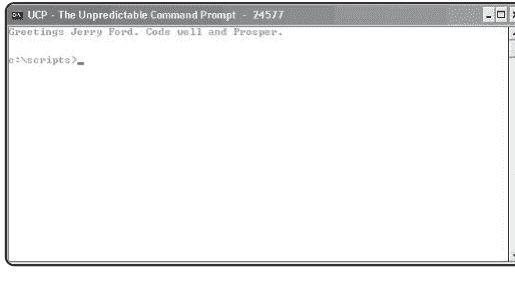

图 2.2 显示了用户可能会看到的第二视图。在这种情况下，用户会收到消息：“你好。很高兴今天与你合作！”此外，前景文本颜色更改为黄色，且 Windows 命令提示符现在同时显示星期和日期。

图 2.3 显示了用户将看到的最后一个视图。在这种情况下，会显示文本消息“波！我吓着你了吗？”，且文本以黑色字符显示在黄色背景上。

该脚本还让你预先了解其他几个重要的 Windows 脚本技术，这些技术将在书中后后的部分进一步探讨。这些技术包括在变量中存储数据、使用条件逻辑控制脚本执行以及进行数值比较的能力。

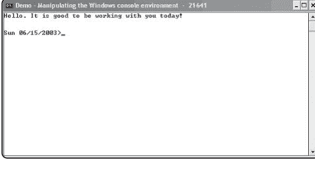

## 图 2.2

Windows 命令控制台的标题栏消息也发生了变化。

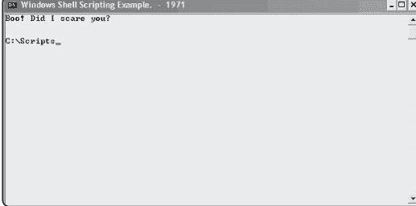

## 图 2.3

前景和背景颜色也发生了变化。

## 命令 Shell 语法

Windows Shell 提供了一个用于处理文本命令和实用程序的界面。此外，你将用它来运行 Windows Shell 脚本。集成在 Windows Shell 中的是脚本语言。这种脚本语言包含了大量的语句。

每个 Windows 命令都有其独特的语法，必须严格遵守才能使命令生效。然而，所有的 Windows 命令都遵循一种通用格式。图 2.4 分解了这种格式。

| 命令 | 参数 |
| --- | --- |
| cmd /t:70 /k dir |
| 修改符 | 参数 |
| 开关 | |

## 图 2.4

检查所有 Windows 命令使用的基本格式。

要从 Windows 命令提示符执行 Windows 命令，你只需输入命令名称，后跟一个或多个可选参数，这些参数告诉命令你想执行的操作。命令参数可以由几个不同的元素组成，包括：

- 开关（Switches）：修改命令的处理方式。开关由一个斜杠后跟一个或多个字符组成。每个 Windows 命令都有自己独特的开关集。
- 修改符（Modifiers）：更改开关的行为。修改符由一个冒号后跟一个或多个字符组成。每个 Windows 命令都有自己的修改符集。
- 参数（Parameters）：传递给命令进行处理的参数。


如果你不确定命令的语法，可以在 Windows 命令控制台中通过输入 `Help` 后加命令名称来查看。例如，如果你输入 `HELP DATE` 并按回车，你将看到：

```
C:\HELP DATE

显示或设置日期。

DATE [/T | date]
```

不带参数输入 DATE 显示当前日期设置并提示新日期。按回车键保持日期不变。

如果启用命令扩展，DATE 命令支持 `/T` 开关，用于仅输出当前日期而不提示新日期。

```
C:\
```

理解语法的一种好方法是查看示例。以下示例显示了 CMD 命令的语法：

```
CMD [/A | /U] [/Q] [/D] [/E:ON | /E:OFF] [/F:ON | /F:OFF] [/V:ON | /V:OFF]
[[S] [/C | /K] string
```

如所示，CMD 命令的语法由名称、一组开关（某些带有修改符）以及你想让 CMD 处理的任何字符串（例如脚本名称）组成。

在处理 Windows 命令时，必须遵循许多格式规则。这些规则如下：

- 使用空格分隔命令的每个组件
- 括号内的参数是可选的
- 括号内且非斜体的参数必须按照所示方式输入
- 斜体参数代表必须提供的值
- 括号内并用 `|` 符号分隔的参数是互斥的
- 包含空格的参数必须封装在匹配的双引号内

> > **定义** 对于 Windows 命令而言，*互斥*（mutually exclusive）意味着只能选择选项中的一个。例如，在执行命令时，你可以指定 `E:/ON` 或 `E:/OFF`，但不能同时指定这两个选项。

在书中，我选择用大写显示 Windows 命令。Windows 命令是不区分大小写的，这意味着你可以使用大写、小写或大小写组合并获得相同的结果。例如，对于 Windows Shell 而言，以下所有命令都是等价的：

- ECHO Greetings
* echo Greetings
* Echo Greetings
* EHo Greetings

# # 启动 Shell 会话

你可以使用两个命令之一启动 Shell 会话。这两个命令是 CMD 和 START。当从 Windows 运行（点击“开始”、“运行”、输入 CMD 并点击“确定”）执行时，CMD 会打开一个新的 Windows 命令控制台。


然而，当在打开的 Windows 命令控制台中执行时，CMD 命令会在当前控制台中打开一个新的全新的 Windows 命令行会话。相比之下，START 命令（仅在已打开的 Windows 命令控制台中有效）则每次执行时都会通过打开一个新的 Windows 命令控制台来启动一个新的 Windows 命令行会话。

## 使用 CMD 命令

大多数情况下，你将使用 CMD 命令来启动 Windows 命令行会话。CMD 命令的语法所示。表 2.1 定义了它的每一个开关。如果你在表中看到某些尚未学过的术语，请担心，它们将在书的后续内容中使用时进行解释。

```
CMD [/A | /U] [/E] | [/O] [/E:ON] | /E:OFF] [/F:ON] | /F:OFF] [/V:ON] | /V:OFF]
[/S] [/C | /K] string
```

| 表 2.1 CMD.EXE 命令开关 |
| 开关 | 功能 |
|---|---|
| /C | 执行命令并关闭 Windows 壳 |
| /K | 执行命令但不关闭 Windows 壳 |
| /S | 更改 /C 或 /K 开关后字符串的处理方式 |
| /Q | 禁用回显 |
| /D | 防止执行注册表中指定的 AutoRun 命令 |
| /A | 以 ANSI 格式格式化命令输出 |
| /U | 以 Unicode 格式格式化命令输出 |
| /T:FG | 设置 Windows 命令控制台的前景背景颜色 |
| /E:ON | 启用某些命令所需的 Windows 壳扩展 |
| /E:OFF | 禁用 Windows 壳扩展（某些命令需要） |
| /F:ON | 启用文件和文件夹名自动补全 |
| /F:OFF | 禁用文件和文件夹名自动补全 |
| /V:ON | 允许环境变量的延迟扩展 |
| /V:OFF | 防止环境变量的延迟扩展 |

命令行扩展是在后后版本的 Windows 操作系统中对 Windows 命令进行的改进。默认情况下，命令行扩展是启用的。你可能想要禁用它们的唯一原因是允许使用旧版本 Windows 命令的警报，因为旧命令不支持命令行扩展的执行。许多 Windows 命令都支持这些扩展，包括 ASOC, CALL, CD, COLOR, DEL, ENDOCAL, FOR, FTYPE, GOTO, IF, MD, POPD, PROMPT, PUSH, SET, LOCAL, SHIFT 和 START。

让我们来看如何使用 CMD 的几个示例。首先，点击“开始”、“运行”，输入 CMD 并点击“确定”以启动一个新的 Windows 命令行会话。这会打开一个新的 Windows 命令控制台，你可以开始使用 Windows 命令提示符进行工作。

如果你愿意，可以通过点击“开始”、“运行”，然后输入 CMD 以及下所示命令来同时启动一个新的 Windows 命令行会话并向其传递要执行的命令。

在此示例中，一个新的 Windows 命令控制台将打开，并在标题栏中显示“欢迎”文本消息。有时你可能只想启动一个新的 Windows 命令行会话，向其传递一个命令，让命令执行并自动关闭 Windows 命令控制台。你可以如下操作：

```
CMD /DEL C:\Temp\*.txt
```

CMD 展示了 /K 和 /C 开关作为互斥参数的示例。/K 指定 Windows 命令控制台在执行命令后应保持打开，而 /C 则指定 Windows 命令控制台在命令处理完成后应关闭。

下一个示例演示了如何使用修饰符来控制 CMD 命令的执行。在这个示例中，用于设置前景背景颜色的 /T 开关被用于将 Windows 颜色方案从白底黑字反转。

```
CMD /T:FO
```

在此示例中，开关是 /T。它有一个修饰符，其位于冒号字符之前。修饰符的第一个字符设置 Windows 命令控制台的前景颜色（例如文本颜色），修饰符的第二个字符设置背景颜色。你可以在 Windows 命令控制台中指定一系列不同的前景和背景颜色，如表 2.2 所示。

| 表 2.2 Windows 命令控制台颜色 |
| 颜色 | 值 |
|---|---|
| 黑色 | 0 |
| 蓝色 | 1 |
| 绿色 | 2 |
| 青色 | 3 |
| 红色 | 4 |
| 紫色 | 5 |
| 黄绿色 | 6 |
| 浅灰色 | 7 |
| 灰色 | 8 |
| 浅蓝色 | 9 |
| 浅绿色 | A |
| 浅青 | B |
| 浅红色 | C |
| 浅紫色 | D |
| 浅黄色 | E |
| 纯白色 | F |

## 使用 START 命令

START 命令提供了打开 Windows 命令控制台并启动新 Windows 命令行会话的另一种方法。START 命令在每次执行时都会自动打开一个新的 Windows 控制台。这提供了一种同时处理多个 Windows 控制台的方便方法。START 命令还为新的 Windows 会话提供了更多控制。START 命令的语法所示：

```
START ["TITLE"] [/Dpath] [/I] [/MAX] [/SEPARATE] [/SHARED] [/LOW] [/NORMAL] [/HIGH] [/REALTIME] [/ABENORMAL] [/BELOWNORMAL] [/WAIT] [/B]
```

你可以看到，START 命令接受大量的参数，见表 2.3。现在来看 START 命令的一个示例。

| 参数 | 描述 |
|---|---|
| "TITLE" | 显示在控制台标题栏中的文本 |
| /Dpath | 指定启动文件夹 |
| /B | 在不打开新控制台的情况下启动脚本 |
| /I | 重置执行环境为原始状态 |
| /MAX | 以最大化状态打开控制台 |
| /SEPARATE | 在独立的内存空间中启动 16 位程序 |
| /SHARED | 在共享内存空间中启动 16 位程序 |
| /LOW | 使用低优先级启动应用程序 |
| /NORMAL | 使用普通优先级启动应用程序 |
| /HIGH | 使用高优先级启动应用程序 |
| /REALTIME | 使用实时优先级启动应用程序 |
| /ABENORMAL | 使用高于优先级启动应用程序 |
| /BELOWNORMAL | 使用低于优先级启动应用程序 |
| /WAIT | 启动应用程序并等待其结束 |
| 程序/命令 | 要处理的可选程序或命令 |
| 参数 | 传递给程序的多个参数 |

## 内部命令与外部命令

Windows 壳处理两种类型的命令：内部和外部。内部命令内置在 Windows 壳中，而外部命令以文件的形式存在硬盘上。大多数 Windows 命令位于 \Windows\System32。内部和外部命令遵循相同的基本语法规则。表 2.4 提供了 Windows 内部命令的列表。

### 表 2.4 内置 Windows Shell 命令
| 命令 | 概述 |
|---|---|
| ASSOC | 显示或修改文件扩展关联 |
| CALL | 调用另一个脚本而不停止调用脚本。还提供了将处理控制权切换到脚本内标签的能力 |
| CD (CHDIR) | 更改当前目录 |
| CLS | 清空 Windows 命令控制台屏幕 |
| COLOR | 设置 Windows 命令控制台前景背景颜色 |
| COPY | 将一个或多个文件复制到另一个位置 |
| DATE | 显示或修改系统日期 |
| DEL | 删除一个或多个文件 |
| DIR | 显示指定目录的文件文件夹列表 |
| ECHO | 在 Windows 命令控制台中显示文本消息 |
| ENDLOCAL | 终止变量局部化，将变量恢复到执行之前的 SETLOCAL 命令前的值 |
| ERASE | 删除一个或多个文件 |
| EXIT | 关闭 Windows 命令控制台并结束命令行会话 |
| FOR | 对文件集中的每个文件执行命令 |
| FTYPE | 显示和修改与文件名扩展关联的文件类型 |
| GOTO | 通过将处理转移到包含指定标签的行来更改脚本处理流 |
| IF | 根据测试结果进行条件处理并更改脚本内的执行流 |


## 表 2.4 内置 Windows 命令行命令（续表）

| 命令 | 概述 |
| :--- | :--- |
| MD (MKDIR) | 创建新的目录或子目录 |
| MOVE | 将一个或多个文件从一个位置移动到另一个位置 |
| PATH | 配置 Windows 搜索路径以定位可执行文件 |
| PAUSE | 暂停脚本执行，直到用户按下任意键 |
| POPD | 将当前文件夹更改为由相应的 PUSH 命令存储的文件夹 |
| PROMPT | 更改 Windows 命令行提示符的显示 |
| PUSH | 切换到指定的文件夹，并存储之前的文件夹以供 POPD 命令以后引用 |
| RD (RMDIR) | 删除指定的文件夹 |
| REM | 提供在脚本中添加注释的能力 |
| REN (RENAME) | 重命名文件或文件夹 |
| SET | 创建、修改和删除变量 |
| SETLOCAL | 记录 Windows shell 中分配给环境变量的当前值，允许通过 ENDLOCAL 命令恢复它们 |
| SHIFT | 更改脚本参数的位置 |
| START | 启动一个新的 Windows shell 会话并执行指定的命令 |
| TIME | 显示并修改系统时间 |
| TITLE | 修改 Windows 命令行窗口标题栏中显示的文本 |
| TYPE | 在 Windows 命令行控制台中显示文件内容 |
| VER | 显示 Windows 版本号 |

外部命令和命令行工具的数量过多且种类繁多，无法在此尝试全部涵盖。你将在学习本书的过程中不断接触它们。这些命令由操作系统提供的任何可执行文件以及你可能在计算机上安装的任何应用程序组成。

## Windows 如何定位命令

为了高效地使用 Windows shell，了解它如何定位你想要执行的命令将非常有帮助。以下步骤概述了 Windows shell 在尝试执行你指定的命令时经历的过程。

- 1. 如果你提供了命令的完整路径，Windows shell 将指定的指定的文件夹查找并执行命令。如果没有找到命令，将生成错误。
- 2. 如果你指定的命令没有带路径，Windows shell 首先检查该命令是否为其内部命令之一，如果是，则执行该命令。
- 3. 接下来，Windows shell 在当前工作目录查找命令，如果找到了，则执行。
- 4. 如果此时未找到命令，Windows shell 将开始遍历 path 变量中的每个文件夹（按照它们列出的顺序）。如果找到匹配的命令，则执行并停止搜索。如果未找到命令，将生成错误。

## 使用 PATH 命令

Windows 在一个名为 path 的变量中存储命令位置的信息。该变量存储了一个文件夹列表，当 Windows shell 需要定位外部 Windows 命令时，它会搜索这些文件夹。你可以使用 PATH 命令查看和修改此变量的内容，其语法如下。

```
PATH [[drive:]:path{...}] [%path%]]
```

要查看存储在 path 变量中的文件夹列表，请打开 Windows 命令行提示符并输入 PATH。命令显示的输出将类似于以下。

```
C:\
PATH=C:\WINNT\system32;C:\WINNT\system32\WBEM
```

此示例中的输出显示，Windows shell 在查找要执行的命令时将搜索三个文件夹。文件夹按照呈现的顺序从左到右搜索。因此，将首先搜索 C:\WINNT\system32，如果没有找到命令，则将搜索 C:\WINNT，然后是 C:\WINNT\system32\wbem。

如果你愿意，可以向存储在 path 变量中的搜索列表列表中添加额外的文件夹。例如，你可能想将存储所有 Windows shell 脚本的文件夹添加到 path 变量，以便 Windows shell 始终能够找到它们。

以下示例演示了如何将文件夹 C:\Scripts 添加到存储在 path 变量中的文件夹列表的开头。

```
PATH C:\scripts;%path%
```

如所示：


将文件夹放在 path 变量搜索的开头可以确保它是第一个被检查的文件夹。这样，如果你提供的脚本名称恰好与某个 Windows 命令匹配，你的脚本将代替 Windows 命令执行。请记住，Windows shell 在找到第一个匹配项后就会停止查找命令。


我在这书中尚未介绍变量的使用，但它们是脚本编写中如此基础的一部分，以不使用它们几乎无法完成任何事情。目前，只需注意在脚本中引用变量时，必须将变量名包含在百分比符号内。继续阅读，我将在第 4  章“存储和检索变量”中详细解释如何使用变量。

你可以像下面所示轻松将文件夹添加到搜索列表中。

```
PATH C:\scripts;%path%
```


不要忘记在 path 变量的末尾添加 %path%。否则，当你关闭会话时所做的更改将丢失。

## PATHEXT

当你输入外部命令时，必须指定其名称。可以选择地指定扩展名。当你不带扩展名输入命令时，Windows shell 使用存储在 patext 中的扩展集合进行查找。找到第一个匹配即停止。

默认情况下，patext 变量按以下顺序列出扩展名：

- .COM
- .EXE
- .BAT
- .CMD

你可以通过在提示提示符输入以下命令来显示 patext 变量的内容。

```
ECHO %patext%
```

你得到的输出应该如下：

```
C:\ECHO %patext%
.COM;.EXE;.BAT;.CMD
```

然而，根据你计算机上安装的软件，你可能会看到额外的扩展名。如果你愿意，可以像下面所示为 patext 添加新的扩展名。

```
SET patext=%patext%.shl
```

在此示例中，使用 SET 命令将文件扩展 .SHL 添加到 patext 变量的末尾。在处理变量时，你会经常使用 SET 命令。我将在第 4 章“存储和检索变量”中详细解释。

## 其他常用的 Windows 命令

除了在本章过的命令外，还有许多其他命令可以配置 Windows shell 会话。这些命令包括

- TITLE
- PROMPT
- COLOR
- CLS
- ECHO

你需要了解如何使用这些命令来完成本章的项目，因此我将在后面的章节中介绍它们。

### 使用 TITLE 命令

TITLE 命令提供了在 Windows 控制标题栏区域显示自定义消息的能力。TITLE 命令的语法所示。

```
TITLE [string]
```

要查看 TITLE 命令如何工作，创建一个由以下语句组成的新 Windows shell 脚本。

```
Greetings!
```

当你运行脚本时，你将在标题栏区域看到 Greetings! 消息，如图 2.5 所示。

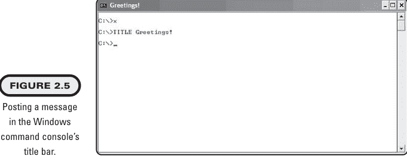


## 使用 PROMPT 命令

PROMPT 命令用于修改 Windows 命令行提示符显示。默认情况下，Windows 命令行提示符显示当前选定的驱动器文件夹，格式为驱动器字母后跟冒号、反斜杠和“大于”字符，如下所示。

```
C:\>
```

然而，使用 PROMPT 命令，你可以显示表 2.5 中列出的任何信息。

| 表 2.5 命令行提示符参数 |
| 参数 | 显示 |
| --- | --- |
| $A | & - 连符号字符 |
| $B | | - 管道字符 |
| $C | ( - 左括号字符 |
| $D | 当前日期 |
| $E | ANSI 转义代码 27 |
| $F | ) - 右括号字符 |
| $G | > - 大于字符（大于号） |
| $H | 退格字符 |
| $L | < - 小于字符（小于号） |
| $N | 当前驱动器名称 |
| $P | 当前驱动器和路径名称 |
| $Q | = - 等号字符（等号） |
| $S | 空格 |
| $T | 当前系统时间 |
| $V | Windows 版本号 |
| $_ | 执行回车和换行 |
| $$ | $ - 美元字符（美元符号） |
| $+ | 一个表示 pushd 堆栈深度的 + 号。 |

PROMPT 命令的语法如下所示。

```
PROMPT [text]
```

`text` 的值代表表 2.5 中列出的一个或多个参数的组合。例如，要将当前驱动器字母替换为当前时间，你需要输入以下内容：

```
PROMPT $D
```

执行后，之前的命令将把命令行提示符修改为如下所示。

```
C:\PROMPT $D
```

2003年6月18日，星期三

如果你更喜欢更短、不那么干扰的命令行提示符，请尝试以下命令：

```
PROMPT $G
```

此命令将命令行提示符变为 `>` 字符。如果需要，可以在修改命令行提示符时组合多个参数，如下所示。

```
C:\PROMPT $G
```

2003年6月18日，星期三>

如你所见，命令行提示符现在显示日期后跟“大于”字符。你还可以插入任何想要的自由格式文本作为命令行提示符，如下所示。

```
C:\PROMPT Welcome to my PC$G
```

Welcome to my PC>

我将命令行提示符更改为显示问候消息后跟“大于”字符。最后，如果你决定想将命令行提示符恢复为默认格式，只需输入 PROMPT 并按回车键，如下所示。

Welcome to my PC>PROMPT

```
C:\>
```

## 更改颜色

通过使用 COLOR 命令，你可以控制 Windows 命令行控制台中显示的前景颜色和背景颜色。COLOR 命令的语法如下所示。

```
COLOR BF
```

COLOR 命令需要两个参数。B 表示指定要使用的背景颜色的数值值，F 表示前景颜色（例如，显示文本的颜色）。COLOR 命令支持与 CMO 命令相同的颜色，这些颜色在之前的表 2.2 中已列出。

默认情况下，Windows 命令行控制台在黑色背景上显示白色文本。使用 COLOR 命令，你可以如下所示更改这些设置。

```
COLOR E4
```

此命令修改 Windows 命令行控制台，使其在黄色背景上显示红色文本。要将 Windows 命令行控制台颜色设置恢复为默认设置，你可以输入 COLOR OF，或者作为快捷，只需输入 COLOR 即可恢复 Windows 命令行控制台默认的黑底白字方案。

## CLS

Windows 命令行控制台在填满时会自动将文本滚动出屏幕。然而，这可能会导致控制台变得杂乱且难以阅读。如果你愿意，可以使用 CLS 命令清除所有当前显示的文本，只留下可见的命令。CLS 命令的语法如下所示。

```
CLS
```

如你所见，CLS 命令不接受任何参数，使其用起来非常简单。

## ECHO

ECHO 命令让你能够在 Windows 命令行控制台中显示文本消息。通过使用 ECHO 命令，你可以创建脚本，让用户了解脚本的执行状态并显示其结果。ECHO 命令的语法如下所示。

```
ECHO [ON | OFF] [message]
```

正如你已经看到的，ECHO 命令的用法非常直接。例如，创建一个包含以下文本的新 Windows Shell 脚本：

ECHO This is an example of how to use the ECHO command

执行时，Windows Shell 将显示以下输出：

```
C:\ECHO This is an example of how to use the ECHO command
```

This is an example of how to use the ECHO command

```
C:\>
```

如你所见，原始 ECHO 命令及其产生的输出都显示了出来。为了清理界面，通常的好做法是防止显示原始命令并只让其输出可见。你可以通过在 ECHO 命令开头添加 `@` 字符来实现这一点，如下所示。

@ECHO This is an example of how to use the ECHO command

如果你对脚本进行此更改并再次运行它，你将获得以下输出：

This is an example of how to use the ECHO command

```
C:\>
```

如你所见，命令行提示符现在显示日期后跟“大于”字符。你还可以插入任何想要的自由格式文本作为命令行提示符，如下所示。

- @ECHO Once upon there was a boy
- @ECHO who lived with his mother in a
- @ECHO cabin out the woods far from
- @ECHO the city. Once a wolf came upon
- @ECHO their house and

由于你已经看到，ECHO 命令的用法非常直接。例如，创建一个包含以下文本的新 Windows Shell 脚本：

ECHO This is an example of how to use the ECHO command

执行时，Windows Shell 将显示以下输出：

```
C:\ECHO This is an example of how to use the ECHO command
```

This is an example of how to use the ECHO command

```
C:\>
```

如你所见，原始 ECHO 命令及其产生的输出都显示了出来。为了清理界面，通常的好做法是防止显示原始命令并只让其输出可见。你可以通过在 ECHO 命令开头添加 `@` 字符来实现这一点，如下所示。

@ECHO This is an example of how to use the ECHO command

如果你对脚本进行此更改并再次运行它，你将获得以下输出：

This is an example of how to use the ECHO command

```
C:\>
```

如你所见，命令行提示符现在显示日期后跟“大于”字符。你还可以插入任何想要的自由格式文本作为命令行提示符，如下所示。

- @ECHO Once upon there was a boy
- @ECHO who lived with his mother in a
- @ECHO cabin out the woods far from
- @ECHO the city. Once a wolf came upon
- @ECHO their house and

由于你已经看到，ECHO 命令的用法非常直接。例如，创建一个包含以下文本的新 Windows Shell 脚本：

ECHO This is an example of how to use the ECHO command

执行时，Windows Shell 将显示以下输出：

```
C:\ECHO This is an example of how to use the ECHO command
```

This is an example of how to use the ECHO command

```
C:\>
```

## 自定义 Windows 命令行控制台

Windows 命令行控制台提供了基于文本的界面。默认情况下，它以25 行、80 列的宽度显示文本。文本显示为白色，背景颜色设置为黑色。与大多数 Windows 功能一样，命令行控制台可以从桌面上进行配置。

## 自定义选项

命令行控制台的自定义通过提示符对话框完成。你可以通过打开命令行控制台，右键点击左上角的提示符图标并选择“属性”来打开此对话框。该对话框组织为四个属性页。

- 选项
- 字体
- 布局
- 颜色

每个属性页都配置 Windows 命令行控制台的一组属性，如下文所示。

## 配置选项设置

Windows XP 选项属性页如图 2.6 所示，提供了对以下配置设置的访问：

d1ef3fa5bce28f9ca37c3c0b14a37...

使用选项属性页配置光标大小和命令历史以及显示和编辑选项。

- **大小大小。** 设置小、中、大光标大小。
- **显示选项。** 设置 Windows 命令行控制台以窗口或全屏模式打开。
- **命令历史。** 设置 Windows 命令行控制台可以调用的命令数量、可用缓冲区数量，并控制是否丢弃重复命令。
- **编辑选项。** 启用或禁用快速编辑和插入编辑模式。快速编辑允许从 Windows 命令行控制台中复制和剪切文本并粘贴，以及将文本粘贴到 Windows 命令行提示符。插入模式控制编辑时是覆盖还是插入文本。

配置字体大小时也会影响 Windows 命令行控制台的大小。对字体大小的任何更改都会立即反映在属性页的窗口预览部分。

## 指定字体设置

字体属性页如图 2.7 所示，提供了配置字体大小和类型的能力。当你配置字体大小时，你也会影响 Windows 命令行控制台的大小。对字体类型的更改也会影响命令行命令行控制台的大小。取决于你选择的字体类型，粗字体选项（位于列表右侧）可能会变为可用。此选项有助于使文本易读。你可以在选取字体部分预览字体选择的效果。


## 零基础学者 Windows Shell 编程

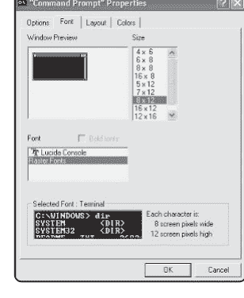

图 2.7

配置 Windows 命令控制台的字体和大小。

## 设置 Windows 命令控制台布局

图 2.8 所示的布局（Layout）属性页允许你配置 Windows 命令控制台在显示器上的初始大小和位置。此外，你还可以用它来配置显示行数以及可以向上滚动查看之前文本的行数。具体而言，你可以配置以下设置：

- **屏幕缓冲区大小（Screen Buffer Size）。** 宽度（Width）设置控制单行可以显示的字符数。高度（Height）设置决定 Windows 命令控制台在内存中保留的文本行数（即你可以回滚查看的行）。
- **Windows 大小（Windows Size）。** 宽度设置指定 Windows 命令控制台的初始宽度。高度设置指定 Windows 命令控制台的初始高度。不过，你可以通过通过右键点击控制台的某个边缘并将其拖动到新位置来手动调整 Windows 命令控制台的大小。但是，你无法将 Windows 控制台调整得超过屏幕缓冲区部分指定的高度和宽度。
- **Windows 位置（Windows Position）。** 这些设置允许你指定希望 Windows 命令控制台打开的显示器位置。位置以像素为单位指定，从左上角开始计算。
- **让系统决定窗口位置（Let System Position Window）。** 选择此选项让操作系统决定在显示器上打开 Windows 命令控制台的位置。


> **像素**（pixel）是图像元素（picture element）的缩写，代表计算机可以显示或打印的最小区域。

## 将屏幕缓冲区大小设置设置为窗口大小的三倍或四倍。这样你就能回滚并查看之前的命令及其输出。


# 第 2 章 与 Windows Shell 交互


配置 Windows 命令控制台的屏幕大小和 Windows 位置


## 指定颜色设置

你可以从颜色（Colors）属性页修改 Windows 命令控制台的前景色（前景）和背景颜色，如图 2.9 所示。该属性页的顶部提供了以下选项：

- **屏幕文本（Screen Text）。** 选择此选项，然后点击显示列表中的某种颜色来配置 Windows 命令控制台的前景色（例如，文本颜色）。
- **屏幕背景（Screen Background）。** 选择此选项，然后点击显示列表中的某种颜色来配置 Windows 命令控制台的背景颜色。
- **弹出文本（Popup Text）。** 选择此选项，然后点击显示列表中的某种颜色来配置 Windows 命令控制台命令历史对话框的前景色。
- **弹出背景（Popup Background）。** 选择此选项，然后点击显示列表中的某种颜色来配置 Windows 命令控制台命令历史对话框的背景颜色。
- **选择颜色值（Selected Color Values）。** 如果你愿意，可以选择上述四个选项之一，然后通过指定不同等级的红、绿、蓝为前景和背景色设置自定义颜色。

颜色属性页的底部可以快速预览你所做的任何更改将如何影响 Windows 命令控制台。

## 图 2.9

配置 Windows 命令控制台的前景色和背景颜色。


## 现实世界

根据定义，任何真正的高级用户或系统管理员都擅长操作 Windows Shell。通常操作 Windows Shell 意味着重复输入相同的命令集。为了加速并提高效率，高级用户和管理员会学习所有帮助他们更快工作的技巧。许多人使用的一种技术是访问快速历史，它提供了一个以前执行过的命令列表，你可以快速访问并重新运行。要访问 Windows Shell 的命令历史，请按 F7 键。使用上下箭头选择以前执行过的命令并按 Enter 键。

## 回到不可预测的命令提示符

现在让我们把到本章的主项目——“不可预测的命令提示符”。通过开发此脚本，你将学习如何创建一个与 Windows Shell 环境和 Windows 命令控制台交互的脚本。你还将获得更多操作变量和使用简单条件逻辑的机会。

## 设计游戏

不可预测的命令提示符设计用于每次执行时随机修改 Windows 控制台环境。总可能会发生三种不同的场景，每种场景都会修改 Windows 标题栏、命令提示符以及前景和背景颜色。此外，每次都会显示不同的消息。不可预测的命令提示符遵循以下步骤：

1. 获取随机数
2. 清空 Windows 控制台
3. 修改 Windows 标题栏
4. 修改前景和背景颜色
5. 修改命令提示符
6. 显示消息


## 更改背景和前景颜色

现在添加下方**加粗**的语句。该语句使用 `COLOR` 命令将 Windows 命令行控制的前的前颜色改为黄色，背景颜色改为黑色。

```
If %TestVariable% GTR 22000 (
  Cls
  TITLE UCP - The Unpredictable Command Prompt - %TestVariable%
  COLOR 02
)
```

## 向用户问候

创建“不可预测命令行提示符”（Unpredictable Command Prompt）脚本的下一步是添加下方**加粗**的两个行。这两行中的第一行通过将用户名封装在使用 `ECHO` 命令显示的文本消息中，向用户显示个性化的问候。`%username` 是 Windows 在每次登录时都会创建的环境变量。你的第二行使用 `ECHO` 命令显示一个空行。这将使得脚本结束并重新显示 Windows 命令行提示符时，脚本的输出更易读。

```
If %TestVariable% GTR 22000 (
  Cls
  TITLE UCP - The Unpredictable Command Prompt - %TestVariable%
  COLOR 02
  Echo Greetings %username%. Code well and Prosper.
  Echo.
)
```

## 更改命令行提示符

现在向你的脚本中添加下方**加粗**的语句。在没有任何额外参数的情况下，`PROMPT` 语句会将 Windows 命令行提示符重置为默认设置。

```
If %TestVariable% GTR 22000 (
  Cls
  TITLE UCP - The Unpredictable Command Prompt - %TestVariable%
  COLOR 02
)

Echo Greetings %username%. Code well and Prosper.

Echo.

PROMPT

)
```

## 终止脚本执行

现在添加下方**加粗**的语句。该语句使用 `GOTO` 命令更改脚本中语句执行的默认顺序。在这种情况下，它告诉脚本跳转到 `:EOF`，这是跳转到文件末尾的快捷（即停止执行）。通过将此语句放在此处，你可以确保脚本在执行完脚本此部分的所有语句后停止运行。这样，如果赋值给 `TestVariable` 的值大于 22,000，脚本将只处理下方显示的七行代码。

```
If %TestVariable% GTR 22000 (
  UCP - The Unpredictable Command Prompt - %TestVariable%
  COLOR 02
  Echo Greetings %username%. Code well and Prosper.
  PROMPT
  GOTO :EOF
)
```

如果你忘记并在脚本的这一部分遗漏 `GOTO :EOF` 语句，那么脚本此部分所做的任何更改都始终会被后续两个部分所做的更改覆盖。发生这种情况是因为脚本将继续处理其后面的语句。例如，此脚本的第三部分被设置为当 `TestVariable` 的值大于零时处理。因此，如果赋值给 `TestVariable` 的值恰好为 26,000，那么脚本第一部分所做的任何更改将在脚本稍后撤销。通过添加 `GOTO` 语句，你可以防止这种情况发生。

## 创建第二种场景

好的。脚本的第二部分实际上第一部分的变体。我在下方标出了这两个部分之间的差异。如你所示，此部分被设置为当 `TestVariable` 的值大于 11,000 时运行。此外，Windows 命令行控制台标题栏会显示不同的消息，并建立了不同的前景和背景颜色。此外，问候消息也发生了更改。同时，Windows 命令行提示符被改为显示系统日期后跟“大于”字符。

```
If %TestVariable% GTR 11000 (

CLS
TITLE Demo - Manipulating the Windows command console environment - %TestVariable%
COLOR 0E
ECHO Hello. It is good to be working with you today!

ECHO.
PROMPT $d$

GOTO :EOF
)
```

## 设置第三种场景

脚本的最后部分定义了第三种可能的执行场景（即当 `TestVariable` 的值大于零且小于 11,000 时仅执行）。我标出了此部分与第一部分之间的差异。

```
If %TestVariable% GTR 0 (

CLS
TITLE Windows Shell Scripting Example. - %TestVariable%
COLOR 0E
ECHO Boo Did I scare you?

ECHO.
PROMPT $p

GOTO :EOF
)
```

## 最终结果

现在查看下方完整的组装脚本。如要运行它，请打开一个新的 Windows 命令行控制台，在命令行提示符处输入脚本名称并按回车。

第 2 章 与 Windows Shell 交互

```
@ECHO off

SET TestVariable=%random%

If %TestVariable% GTR 22000 (
CLS
TITLE UCP - The Unpredictable Command Prompt - %TestVariable%
COLOR 02
Echo Greetings %username%, Code well and Prosper.
Echo.
PROMPT $d$
GOTO :EOF
)

If %TestVariable% GTR 11000 (
CLS
TITLE Demo - Manipulating the Windows command console environment - %TestVariable%
COLOR 0E
ECHO Hello. It is good to be working with you today!
ECHO.
PROMPT $d$
GOTO :EOF
)

If %TestVariable% GTR 0 (
CLS
TITLE Windows Shell Scripting Example. - %TestVariable%
COLOR 0E
ECHO Boo! Did I scare you?
ECHO.
PROMPT $p
GOTO :EOF
)
```

## 总结

本章的重点是介绍 Windows Shell 并熟悉它。这包括了如何更改颜色、提示符和标题。此外，你学习了内部命令和外部命令之间的区别，以及 Shell 如何定位这些命令。然后你完成了“不可预测命令行提示符”，这有助于联系本章中提出的许多概念。

第 2 章 与 Windows Shell 交互

## 练习题

- 创建一个新的脚本，自动添加你计划存储的文件夹名称和路径。
- 创建一个新的命令行提示符快捷方式，并配置其自动执行你的脚本。

# Windows 脚本编写基础

在本章中，我将解释在脚本中添加注释的重要性。我为你提供一个脚本模板，你可以将其作为组织和记录脚本的基础。你将学习一种名为*重定向*的编程技术，并学习如何使用它来控制输入和输出。

本章还向你展示了如何组合命令，并让一个命令的执行取决于另一个命令的结果。最后，你将学习如何创建算命游戏。这个游戏建立在之前游戏使用的编程技术的基础上，并演示了如何通过循环执行语句来创建一个持续运行的脚本。

具体来说，你将学习：

- 在脚本中添加注释
- 在同一行放置多个语句
- 设置条件命令执行
- 将一个命令的输出作为另一个命令的输入
- 创建报告和日志文件并向现有的报告和日志文件追加数据

## 项目预览：算命游戏

本章的主要项目被称为“算命游戏”。它演示了多种编程技术的应用，包括如何收集玩家输入、评估玩家输入以及创建一个在玩家决定退出游戏之前持续运行的脚本。

游戏开始向玩家显示一个欢迎屏幕，这有助于定义游戏的设定，如图 3.1 所示。

玩家必须按键游戏才能继续，接下来的屏幕将继续构建游戏的故事情，如图 3.2 所示。

接下来，算命师邀请玩家提问，并承诺尝试提供答案，如图 3.3 所示。


## 第 3 章 Windows 脚本脚本基础

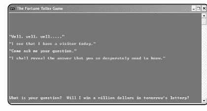

图 3.3

她邀请玩家提一个问题。

随后，游戏描述了占卜者运用灵异能力寻找答案的过程。如图 3.4 所示，占卜者并不总是能给玩家一个定的“是”或“否”回答。

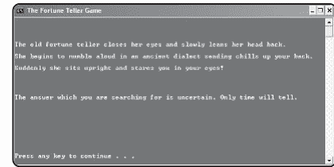

图 3.4

占卜者极力戏剧化地回答了玩家的问题。

在回答了玩家的第一个问题后，占卜者继续允许提出额外的问题，如图 3.5 所示。游戏一直持续，直到玩家关闭 Windows 命令行控制台或输入小写的 e 来结束退出游戏。


图 3.5

玩家可以根据意愿提尽可能的问题。

## 更多脚本基础

到目前为止，你已经学习了如何创建、保存和运行 Windows Shell 脚本。你学习了如何显示文本输出、在 Windows 命令行控制台的标题栏中发布消息，以及执行修改命令提示符等技巧。现在，你应该学习一些脚本维护事项。具体来说，我将向你展示如何为脚本添加注释，使其具有自文档功能。此外，我还将讨论使用注释创建 Windows Shell 脚本文档模板的重要性，你可以使用该模板来提高脚本的整体结构和可管理性。

## 使用注释为脚本编写

在 Windows Shell 脚本中添加注释可以使其更容易被他人理解。注释让你能够将文档嵌入脚本中，以便解释你为什么要那样写代码。在脚本中添加注释就像是留下一条面包屑。如果你发现以后在某个时刻需要修复或修改脚本，这些注释将为你提供可以遵循的线索。

Windows Shell 脚本使用 `REM` 语句添加注释，其语法如下：

```
REM Comment
```

`Comment` 是一个文本字符串，代表你希望嵌入脚本的文档。`REM` 语句对脚本的执行没有影响。Windows 在脚本执行期间会忽略它们。你可以通过两种方式使用 `REM` 语句。一种方法是将其单独放在一行，用于描述或记录其后跟一个或多个语句的操作，如下所示。

```
@ECHO off
```

```
REM Display the Welcome Screen

ECHO.
ECHO.
ECHO WELCOME TO THE
ECHO.
ECHO FORTUNE TELLER GAME!
ECHO.
ECHO.
ECHO.
```

```
REM 让玩家按任意键以继续游戏

PAUSE
```

```使用 `REM` 语句的另一种方法是将其放在另一个语句的末尾，如下所示。

PAUSE REM 让玩家按任意键以继续游戏

始终始终将 `@ECHO` 语句作为脚本的第一条语句。如果你忘记了并在脚本中遗漏了这条语句，那么你所有的脚本语句（包括注释）都将在脚本执行时显示出来，从而抵消了为脚本添加注释的大部分好处。

## 创建脚本模板

现在你已经知道如何使用 `REM` 语句为 Windows Shell 脚本添加注释，请考虑一下这个非常有用的语句的第二个应用。

与其仅仅使用 `REM` 语句来记录脚本逻辑，不如用它来改进脚本的整体结构？具体来说，我建议你创建一个类似于我下面创建的这一个 Windows Shell 脚本模板。

```
@ECHO off
REM *******************************************************************************************
REM
REM Script Name: Xxxxxxx.bat
REM Author: Xxxx XX, XXX
REM Date: XXXX XX, XXX
REM
REM Description: xxxxxxxxxxxxxxxxxxxxxxxxxxxxxxxxxxxxxxxxxxxxxxxxxREM
REM *******************************************************************************************
```

```
REM Script Initialization Section

REM Main Processing Section

REM Subroutine and Procedure Section
```

在这个示例中，模板以 `@ECHO off` 语句开始，然后使用 `REM` 语句格式化脚本表头，你可以在其中记录有关脚本的信息，包括它的名称、作者、创建日期和描述。模板底部还添加了三条语句，可将你的脚本组织成三个主要部分。在初始化部分（Initialization section）中，你将添加执行函数的语句，例如设置前景和背景颜色或在 Windows 命令行控制台标题栏中发布脚本名称。

主处理部分（Main Processing section）是你编写脚本核心内容的地方。稍后在第 7 章“创建过程和子程序”中，我将介绍如何将代码部分隔离到离散的子程序和过程中，你会将它们放置在模板的第三部分。

通过使用我提供的模板或创建一个你自己的模板，你为未来的所有脚本开发奠定了基础，具有一致的组织结构，便于遵循和更新。例如，下面的脚本演示了如何在创建新脚本时使用模板。

```
@ECHO off

REM *****************************************************************

REM Script Name: ScriptInit.bat
REM Author: Jerry
REM Date: June 21, 2003

REM
REM Description: Customize a Windows shell environment

REM
REM *****************************************************************

REM Script Initialization Section

REM Modify the command console title bar

TITLE - Script Configuration

REM Set background color to white and foreground color to black
COLOR F0

REM Add C:\Scripts to the search path
PATH %path%;C:\Scripts

REM Main Processing Section

REM Clear the screen
CLS

REM Tell the user that everything set
ECHO Environment complete

REM Subroutine and Procedure Section
```

由此你可以快速识别脚本的目的和作者。通过查看三个主要的注释，你也可以轻松定位脚本的部分。通过添加额外的注释，你可以创建自文档脚本。请注意，虽然这个特定示例没有任何子程序或过程，但你可能仍然想要包含这些注释作为占位符。

## 命令重定向

到目前为止，书中的所有示例都演示了脚本输出默认写入 Windows 命令行台。此外，所有输入都直接来自计算机键盘。然而，Windows Shell 允许指定不同的输入源，例如

- 键盘
- 文件
- 其他命令生成的输出

此外，Windows Shell 允许将输出发送到不同的目的地，例如

- Windows 命令行台显示
- 文件
- 打印机

## 检查数据输入和输出

Windows 可以处理三种不同的命令源，如下：

- **标准输入（Standard Input）**：Windows Shell 寻找命令输入的地方。默认是计算机键盘。
- **标准输出（Standard Output）**：Windows Shell 发送所有输出的默认位置。默认是 Windows 命令行台。
- **标准错误（Standard Error）**：Windows Shell 发送所有错误信息的默认位置。默认是 Windows 命令行台。

当你修改 Windows Shell 的默认输入或输出源时，你执行的操作被称为*重定向*。输入和输出重定向非常容易设置，并可执行许多实用任务，包括

- 自动为命令提供处理输入
- 报告生成
- 错误日志文件创建

为了支持输入输出重定向，Windows Shell 使用了一些特殊字符。这些字符及其功能列在表 3.1 中。

> 除了重定向输出到文件外，你还可以通过指定相应的端口号（如 LPT1）将其发送到打印机。

我将在后续章节中演示如何使用这些重定向操作符。


表 3.1 重定向运算符
| 算符 | 示例 | 说明 |
| --- | --- | --- |
| > | command > file | 将输出发送到文件或设备 |
| < | command < file | 从文件中检索输入 |
| >> | command >> file | 将输出追加到文件 |
| 2> | command 2> file | 将所有错误输出发送到文件或设备 |
| 2>& | command 2>& | 将所有错误输出重定向到与标准输出相同的位置 |
| | | command1 | command2 | 将一个命令的输出作为另一个命令的输入 |

## 将一个命令的输出作为另一个命令的输入

`|` 运算符允许你将一个命令的输出（管道）传递给另一个命令作为输入。我解释这一点最好的方法就是给你一个示例。首先，假设你创建了一个名为 TestFile.txt 的文本文件，并在其中添加了以下行：

- Strawberry
- Apple
- Grape
- Blue Berry
- Orange

从 Windows 命令行控制台查看文件内容的方法之一是使用 `TYPE` 命令，如下所示。

```
c:\scripts>TYPE TestFile.txt
```

- Strawberry
- Apple
- Grape
- Blue Berry
- Orange

> `TYPE` 命令通过将其输出发送到标准输出来显示文件内容。默认情况下，这是 Windows 命令行控制台。

正如你所看到的，`TYPE` 命令完全按照存储的方式显示 TestFile.txt 文件的内容。但是，假设你想在显示之前对文件中的目进行排序。实现这一点的方法是将 `TYPE` 命令的输出重定向到 `SORT` 命令，如下所示。

```
c:\scripts>TYPE TestFile.txt | SORT
```

- Apple
- Blue Berry
- Grape
- Orange
- Strawberry

`SORT` 命令对输入的数据进行排序并将结果发送到标准输出。

## 生成报告

重定向运算符允许你将命令输出发送到标准输出以外的目标。它提供了一种生成报告和日志文件的简单方法。此外，`>>` 运算符提供了将数据添加到现有报告和日志文件末尾的能力。来看这两个重定向运算符的操作示例。

```
@ECHO off
REM *********************************************************************************
REM
REM Script Name: Reporter.bat
REM Author: Jerry Ford
REM Date: June 28, 2003
REM
REM Description: A report generation example
REM
REM *********************************************************************************

REM 初始化部分

REM 指定保存报告的文件夹
SET dest=C:\Scripts\LogFiles\Sample.txt
```

```
REM 显示报告数据
ECHO Sample Windows shell script report > %dest%
ECHO >> %dest%
ECHO Date: %date% >> %dest%
ECHO >> %dest%
ECHO Created by %username% >> %dest%
ECHO >> %dest%
ECHO >> %dest%
ECHO Scripts residing in C:\SCRIPTS: >> %dest%
ECHO >> %dest%
ECHO *.bat >> %dest%
```

REM 通知用户报告现在已就绪
ECHO Sample.txt report has been created in %dest%

> `DIR` 命令提供存储在指定目录中的文件和文件夹列表。

在这个示例中，使用 `SET` 命令建立了一个名为 `dest` 的变量。它被赋值为脚本将创建的报告的名称和路径。报告实际上是在执行第一个 `ECHO` 语句时创建的，其输出被重定向到 `dest` 变量指定的文件夹。文件创建后，脚本继续通过使用 `>>`（追加）运算符重定向 `ECHO` 语句来写入文件。

除非目标文件夹的完整路径已经存在，否则此脚本将失败。在运行此脚本之前，请确保在 C:\Script 文件夹内创建一个名为 LogFiles 的子文件夹。

## 初学者的 Windows 脚本编程

在脚本第一次重定向后，记得从 `>` 运算符切换到 `>>` 运算符。否则，脚本不会向报告末尾追加额外数据，而是覆盖报告中的文本，只留下报告中的最后一行输出。

图 3.6 显示了此脚本创建的报告示例。

Sample: Notepad
File.txt Windows shell script report
Windows shell script report
Date: 06/28/2003
Created by Jerry Ford

Scripts residing in C:\SCRIPTS:
volume in drive C is
serial number is
directory of C:\scripts
| 名称 | 日期 | 时间 | 大小 |
|---|---|---|---|
| 06/21/2003 | 01:14 | knockback.bat | 766 |
| 06/21/2003 | 01:17 | reportables.bat | 1562 |
| 06/21/2003 | 01:17 | Fortune.bat | 2432 |
| 06/27/2003 | 01:44 | script.bat | 1558 |
| 06/28/2003 | 01:45 | .bat | 3095 |
| 06/28/2003 | 01:46 | x.bat | 911 |
| 06/28/2003 | 01:50 | for.bat | 566 |
| 06/28/2003 | 01:60 | free.bat | 177,864 bytes |

使用重定向的 Windows 脚本创建的报告。

## 创建错误日志

默认情况下，Windows 脚本将错误消息和输出发送到相同位置（例如命令行控制台）。但是，如果你愿意，可以将任何错误重定向到其他地方。例如，你可能在 C:\Scripts 中创建一个空的 Errors.log 文件，以便在开发和测试时监控发生了什么。一旦完成，你可以使用 `>` 重定向将任何脚本的错误写入到此文件。

```
TYPE C:\Reports\Report.txt 2> C:\Scripts\Errors.log
```

在这个示例中，`TYPE` 命令用于显示 Report.txt 文件的内容。如果 Report.txt 存在，则显示其内容。如果 Report.txt 文件不存在，将发生以下错误并写入脚本执行时的日志文件中。

## 条件命令执行

Windows Shell 提供了使用“组合命令”的技术来链多个命令的执行。组合命令使用表 3.2 所示的保留字符来建立两个或多个命令之间的关系。

表 3.2 组合运算符
| 算符 | 示例 | 说明 |
| --- | --- | --- |
| & | command & command | 运行第一个命令，然后运行第二个命令 |
| && | command && command | 如果第一个命令成功，则运行第二个命令 |
| || | command || command | 如果第一个命令发生错误，则运行第二个命令 |
| () | (command & command) | 定义命令执行的顺序 |
| | | | |

## 链接两个命令

最简单的命令类型是使用 `&` 运算符创建的。使用此运算符，你可以如下所示链接任何两个命令的执行。

```
MKDIR C:\Scripts\Reports & COPY *.txt C:\Scripts
```

此命令从执行 MKDIR 命令开始，它在 C:\Scripts 文件夹中创建一个名为 Reports 的新目录或子文件夹。一旦该命令执行完成，就会执行命令中的第二个命令。在这个示例中，COPY 将当前工作目录下所有 .txt 扩展的文件复制到 C:\Scripts\Reports。

## 设置条件执行

使用 `&&` 运算符创建更高级的组合命令。在第一个命令成功时才执行第二个命令。否则，跳过第二个命令的执行。例如，以下语句设置为显示当前工作目录下找到的所有 .log 文件，如果存在这些日志文件，则将其复制到 C:\Scripts\LogFiles。

```
DIR *.log && COPY *.log C:\Scripts\LogFiles
```

`||` 运算符是 `&&` 运算符的完全相反，仅在第一个命令失败时执行第二个命令。例如，以下组合命令显示当前工作目录下的所有 .log 文件。如果没有找到 .log 文件，则 `ECHO` 语句的结果被重定向到 C:\Scripts\Debug。

```
DIR *.log || ECHO No .log files found >> C:\Scripts\Debug.log
```

如果需要，Windows 允许同时链接多个命令。例如，以下语句链了三个命令：

```
DIR *.log & COPY *.txt C:\Temp & ECHO .LOG files have been copied.
```

## 分组命令

Windows 允许显式地分组命令以规定它们执行的顺序。这是通过 `()` 运算符实现的。例如，以下语句由五个不同的命令组成：

```
CD C:\Scripts\Reports && (COPY *.txt A:\ & COPY *.bak A:\) && (DEL *.txt & DEL *.bak).
```

第一个命令将当前工作目录更改为 C:\Scripts\Reports。第一个 `&&` 运算符确保剩余命令仅在第一个命令成功时执行。第二个和第三命令分组在一起，以确保它们在最后两个命令处理之前执行，而最后两个命令只有在前两个都处理成功时才会执行。这两个命令将所有 .txt 和所有 .bak 文件复制到计算机的软盘驱动器 (A:\)。最后，如果这两个命令执行成功，最后两个命令将删除 C:\Scripts\Reports 的所有 .txt 和 .bak 文件。

## 回到占卜游戏

现在回到章节的主项目——占卜游戏。通过开发这个脚本，你将继续扩展你的 Windows 脚本技能。具体来说，你将开发一个脚本，把玩家带到一个虚拟占卜师那里，她承诺使用她的灵异能力回答玩家的所有问题。


脚本将使用以下三种响应之一来回答玩家：

-   不！
-   是！
-   只有时间才能给出答案。

脚本开始时向玩家展示一系列屏幕，这些屏幕提供了游戏的背景信息，介绍了占卜师，并让她提示玩家提问。随后，脚本将通过显示随机选择三个响应之一来对玩家的问题生成答案。然后，脚本将允许玩家继续提问，直到玩家关闭 Windows 命令行控制台或输入小写字母 e 来结束游戏。

## 设计游戏

占卜师游戏将按照以下概述分八步完成：

-   1. 添加脚本模板并建立执行设置
-   2. 显示初始欢迎屏幕
-   3. 介绍占卜师
-   4. 收集玩家的问题
-   5. 判断玩家是否想要退出游戏
-   6. 随机选择响应
-   7. 显示占卜师的答案
-   8. 提示玩家提一个新问题

在您阅读本章的其余内容时，我将详细分解在这些每个步骤中必须创建的编程语句。当你完成后，占卜师游戏将准备好开始预测，你将有一些非常酷的东西可以和朋友分享。

## 建立执行环境

创建占卜师游戏的第一步是创建一个名为 Fortune.bat 的新 Windows 批脚本，并在其中输入以下语句：

```
ECHO off
```

```
REM *******************************************************************************
REM
REM Script Name: Fortune.bat
REM Author: Jerry Ford
REM Date: June 22, 2003
REM
REM Description: 这是一个 Windows 批脚本游戏，为玩家提出的
REM 问题提供随机答案。

REM
REM *********************************************************************
COLOR 5e

TITLE The Fortune Teller Game

CLS
```

第一条语句用于在执行期间显示脚本语句。
接下来的 10 条语句提供了一个记录脚本名称、作者和创建日期的空间，并提供了简要描述。`COLOR` 语句将 Windows 命令行控制台的颜色方案设置为紫色背景上的黄色文字。`TITLE` 语句在 Windows 命令行控制台的标题栏中发布游戏名称。最后`CLS` 语句清除显示并为游戏的第一个屏幕做好准备。

## 创建欢迎屏幕

玩家看到的第一个屏幕是欢迎屏幕，它显示一条欢迎消息和一个基于文本的晶体球图形，如下所示。

```
ECHO.
ECHO.
ECHO.
ECHO.                                     |
ECHO.
ECHO.
ECHO.
ECHO      WELCOME TO               / 
ECHO                                     ***
ECHO      THE FORTUNE             *   *
ECHO                                     *       _
ECHO      TELLER'S MAGIC          *   **
ECHO * *

ECHO CRYSTAL BALL! ***
ECHO / \
ECHO ----
ECHO.
ECHO.
ECHO.
ECHO.
ECHO.
ECHO Prepare好被占卜师强大的超能力所迷住吧。
ECHO 她知道一切，她看到一切，她说出一切！
ECHO.
ECHO.

Pause
```

为了防止上述屏幕在游戏执行时滚出屏幕，从而让玩家有机会阅读它，我们添加了 `PAUSE` 命令。

## 构建故事线

接下来，另一个 `CLS` 语句清空屏幕，以便显示游戏的第二个屏幕。生成此屏幕的语句所示：

```
CLS
ECHO.
ECHO.
ECHO.
ECHO.
ECHO.
ECHO.
ECHO 安静！她来了......
ECHO.
ECHO 门开了，一位拄着拐杖、走路跛脚的小女人缓慢地
ECHO.
ECHO 进入了房间。
ECHO.
ECHO.
ECHO.
ECHO.
ECHO.
ECHO.
ECHO.
ECHO.
ECHO.
ECHO.
ECHO.
PAUSE
```

如你所见，再次使用了 `PAUSE` 命令来确保玩家有机会查看此屏幕上的信息。

## 收集玩家的问题

再次使用 `CLS` 语句清空屏幕——这次是为了让占卜师提示玩家提问。同样，此屏幕大部分由用于设定故事线的 `ECHO` 语句组成。

```
CLS
ECHO.
ECHO.
ECHO.
ECHO.
ECHO.
ECHO.
ECHO "哟哟，哟，哟...."
ECHO.
ECHO "我看到今天来了一位访客。"
ECHO.
ECHO "来问我你的问题吧。"
ECHO.
ECHO "我将揭示你如此渴望知道的答案。"
ECHO.
ECHO.
ECHO.
ECHO.
ECHO.
ECHO.
ECHO.
ECHO.
ECHO.
:QUESTION
ECHO.
SET /p reply="你的问题是什么？ *"
SET trigger=%reply:-0.1%
```

在这一部分代码的末尾，你会看到一个像这样的语句：

```
:QUESTION
```

这条语句代表一个标签，它是 Windows 批脚本中可以被调用的位置。稍后你会看到我在末尾添加了一个 `GOTO` 语句来创建一个循环，允许游戏反复进行。

> **定义** 循环是重复执行的语句集合。

下一条语句提示玩家输入一个让占卜师回答的问题。通过将 `:QUESTION` 标签放在...之前。

```
IF %trigger%==e (
GOTO :EOF
)
```

脚本的接下来的几行执行一个测试，以判断玩家是否想要结束或退出游戏。如果输入了字母 e，则执行 `GOTO :EOF` 语句，终止脚本执行。否则，脚本将继续运行。

## 生成随机答案

脚本的下部分首先通过显示更多故事线开始，如下所示。

```
SET z~%random%

If %z% GTR 22000 (
SET answer=NO!
GOTO :Continue
)
```

```
If %z% GTR 11000
```


# 78

```batch
SET answer=YES!
GOTO :Continue
)

```
If %z% GTR 0 (
SET answer=uncertain. Only time will tell.
GOTO :Continue
)
```

在描述了占卜者的行为后，使用 `SET` 语句将一个随机数赋值给变量 `z`。与之前的脚本示例一样，接着使用一系列 `IF` 语句根据随机选取的变量的值为名为 `answer` 的变量赋值。具体来说，如果随机选取的变量值大于 22,000，则占卜返回的答案将为 `NO`，且 `GOTO` 语句将使脚本跳转到名为 `:Control` 的标签，并从脚本该点继续执行，跳过对随机选取变量的任何剩余验证。如果变量的值小于 22,000 且大于 11,000，返回的答案将是 `YES!`。否则，答案将设置为 `Uncertain. Only time will tell.`（不确定，只有时间才能证明）。

## 显示占卜者的预测

脚本的下一部分从标签 `:Continue` 开始。该标签提供了跳转到脚本此位置并继续处理的能力。接下来，使用 `ECHO` 语句对屏幕进行格式化，并显示占卜者选出的答案。然后，使用 `PAUSE` 语句停止脚本执行，给玩家留时间阅读其问题的答案。

```batch
:Continue
```

```batch
ECHO The answer which you are searching for is %answer%
ECHO.
ECHO.
ECHO.
ECHO.
ECHO.
ECHO.
ECHO.
```

初学者 Windows Shell 脚本编程

## 重新玩游戏

一旦玩家的问题被占卜者回答，屏幕将被清除，并使用 `GOTO` 语句跳转回脚本中的 `:QUESTION` 标签，从而允许玩家再次向占卜者提一个新问题。

## 最终结果

现在来看下面这个完整组装的脚本。为了进一步记录该脚本，我在各处添加了注释，以帮助解释正在发生的逻辑过程。

```batch
@ECHO off
REM *****************************************************************
REM
REM Script Name: Fortune.bat
REM Author: Jerry Ford
REM Date: June 22, 2003
REM
REM Description: This Windows shell script game provides random answers to
REM questions posed by the player.
REM
REM *****************************************************************

REM 在 Windows 命令控制台标题栏中发布游戏名称
TITLE The Fortune Teller Game

REM 清除显示
```

CLS

REM 将控制台颜色设置为紫色背景黄色文字

```batch
COLOR 5e

REM 显示欢迎屏幕
ECHO.
ECHO.
ECHO.
ECHO ^|
ECHO.
ECHO WELCOME TO \ /
ECHO ***
ECHO THE FORTUNE *\ *
ECHO - - -
ECHO TELLER'S MAGIC *\ *
ECHO *
ECHO CRYSTAL BALL! ***
ECHO / \ \nECHO -----
ECHO.
ECHO.
ECHO.
ECHO.
ECHO Prepare to be mystified by the great psychic power of the Fortune Teller.
ECHO She knows all, she sees all and she tells all!
ECHO.
ECHO.

REM 等待玩家按键

```

Pause

REM 清除显示

CLS

REM 显示额外的故事文本

```batch
ECHO.
ECHO.
ECHO.
ECHO.
ECHO.
ECHO Quiet! Here she comes......
ECHO.
ECHO The door opens and a small woman with a cane and a limp slowly
ECHO.
ECHO enters into the room.
ECHO.
ECHO.
ECHO.
ECHO.
ECHO.
ECHO.
ECHO.
ECHO.
ECHO.
ECHO.
ECHO.
ECHO.
```

REM 等待玩家按键

PAUSE

```batch
REM 清除显示
CLS

REM 显示额外的故事文本
ECHO.
ECHO.
ECHO.
ECHO.
ECHO.
ECHO.
ECHO.
ECHO.
ECHO "Well, well, well....."
ECHO.
ECHO "I see that I have a visitor today."
ECHO.
ECHO "Come ask your question."
ECHO.
ECHO "I shall reveal the answer that you so desperately need to know."
ECHO.
ECHO.
ECHO.
ECHO.
ECHO.
ECHO.
ECHO.
ECHO.
ECHO.
```

REM 此标签在脚本中提供了一个可调用返回点

:QUESTION

ECHO.

REM 提示玩家输入他们的问题
SET /p reply="What is your question?

REM 提取玩家响应的第一个字符
SET trigger=%reply:~0,1

REM 如果玩家输入了 "e"，则是结束游戏了
IF %trigger%==e (
GOTO :EOF
)

REM 清除显示
CLS

REM 显示占卜者答案之前的文本
ECHO.
ECHO.
ECHO.
ECHO The old fortune teller closes her eyes and slowly leans her back.
ECHO.
ECHO She begins to mumble aloud in an ancient dialect, sending chills down your back.
ECHO.
ECHO Suddenly she sits upright and stares you in eyes!
ECHO.
ECHO.
ECHO.

REM 获取一个随机数

SET z=%random%

```batch
REM 如果随机数大于 22,000
IF %z% GTR 22000 (
SET answer=NO
GOTO :Continue
)
```

```batch
REM 如果随机数小于 22,000 且大于 11,000
IF %z% GTR 11000 (
SET answer=YES!
GOTO :Continue
)
```

```batch
REM 否则，答案将设置为不确定
SET answer=uncertain. Only time will tell.
GOTO :Continue
```

## 显示占卜者的预测

:Continue

```batch
ECHO The answer which you are searching for is %answer%
ECHO.
ECHO.
ECHO.
ECHO.
ECHO.
ECHO.
ECHO.
```

初学者 Windows Shell 脚本编程

## 重新玩游戏

一旦玩家的问题被占卜者回答，屏幕将被清除，并使用 `GOTO` 语句跳转回脚本中的 `:QUESTION` 标签，从而允许玩家再次向占卜者提一个新问题。

## 最终结果

现在来看下面这个完整组装的脚本。为了进一步记录该脚本，我在各处添加了注释，以帮助解释正在发生的逻辑过程。

```batch
@ECHO off
REM *****************************************************************
REM
REM Script Name: Fortune.bat
REM Author: Jerry Ford
REM Date: June 22, 2003
REM
REM Description: This Windows shell script game provides random answers to
REM questions posed by the player.
REM
REM *****************************************************************

REM 在 Windows 命令控制台标题栏中发布游戏名称
TITLE The Fortune Teller Game

REM 清除显示
```

CLS

REM 将控制台颜色设置为紫色背景黄色文字

```batch
COLOR 5e

REM 显示欢迎屏幕
ECHO.
ECHO.
ECHO.
ECHO ^|
ECHO.
ECHO WELCOME TO \ /
ECHO ***
ECHO THE FORTUNE *\ *
ECHO - - -
ECHO TELLER'S MAGIC *\ *
ECHO *
ECHO CRYSTAL BALL! ***
ECHO / \ \nECHO -----
ECHO.
ECHO.
ECHO.
ECHO.
ECHO Prepare to be mystified by the great psychic power of the Fortune Teller.
ECHO She knows all, she sees all and she tells all!
ECHO.
ECHO.

REM 等待玩家按键

```

Pause

REM 清除显示

CLS

REM 显示额外的故事文本

```batch
ECHO.
ECHO.
ECHO.
ECHO.
ECHO.
ECHO Quiet! Here she comes......
ECHO.
ECHO The door opens and a small woman with a cane and a limp slowly
ECHO.
ECHO enters into the room.
ECHO.
ECHO.
ECHO.
ECHO.
ECHO.
ECHO.
ECHO.
ECHO.
ECHO.
ECHO.
ECHO.
ECHO.
```

REM 等待玩家按键

PAUSE

```batch
REM 清除显示
CLS

REM 显示额外的故事文本
ECHO.
ECHO.
ECHO.
ECHO.
ECHO.
ECHO.
ECHO.
ECHO "Well, well, well....."
ECHO.
ECHO "I see that I have a visitor today."
ECHO.
ECHO "Come ask your question."
ECHO.
ECHO "I shall reveal the answer that you so desperately need to know."
ECHO.
ECHO.
ECHO.
ECHO.
ECHO.
ECHO.
ECHO.
ECHO.
ECHO.
```

REM 此标签在脚本中提供了一个可调用返回点

:QUESTION

ECHO.

REM 提示玩家输入他们的问题
SET /p reply="What is your question?

REM 提取玩家响应的第一个字符
SET trigger=%reply:~0,1

REM 如果玩家输入了 "e"，则是结束游戏了
IF %trigger%==e (
GOTO :EOF
)

REM 清除显示
CLS

REM 显示占卜者答案之前的文本
ECHO.
ECHO.
ECHO.
ECHO The old fortune teller closes her eyes and slowly leans her back.
ECHO.
ECHO She begins to mumble aloud in an ancient dialect, sending chills down your back.
ECHO.
ECHO Suddenly she sits upright and stares you in eyes!
ECHO.
ECHO.
ECHO.

REM 获取一个随机数

SET z=%random%

```batch
REM 如果随机数大于 22,000
IF %z% GTR 22000 (
SET answer=NO
GOTO :Continue
)
```

```batch
REM 如果随机数小于 22,000 且大于 11,000
IF %z% GTR 11000 (
SET answer=YES!
GOTO :Continue
)
```

```batch
REM 否则，答案将设置为不确定
SET answer=uncertain. Only time will tell.
GOTO :Continue
```

## 显示占卜者的预测

:Continue

```batch
ECHO The answer which you are searching for is %answer%
ECHO.
ECHO.
ECHO.
ECHO.
ECHO.
ECHO.
ECHO.
```

初学者 Windows Shell 脚本编程

## 重新玩游戏

一旦玩家的问题被占卜者回答，屏幕将被清除，并使用 `GOTO` 语句跳转回脚本中的 `:QUESTION` 标签，从而允许玩家再次向占卜者提一个新问题。

## 最终结果

现在来看下面这个完整组装的脚本。为了进一步记录该脚本，我在各处添加了注释，以帮助解释正在发生的逻辑过程。

```batch
@ECHO off
REM *****************************************************************
REM
REM Script Name: Fortune.bat
REM Author: Jerry Ford
REM Date: June 22, 2003
REM
REM Description: This Windows shell script game provides random answers to
REM questions posed by the player.
REM
REM *****************************************************************

REM 在 Windows 命令控制台标题栏中发布游戏名称
TITLE The Fortune Teller Game

REM 清除显示
```

CLS

REM 将控制台颜色设置为紫色背景黄色文字

```batch
COLOR 5e

REM 显示欢迎屏幕
ECHO.
ECHO.
ECHO.
ECHO ^|
ECHO.
ECHO WELCOME TO \ /
ECHO ***
ECHO THE FORTUNE *\ *
ECHO - - -
ECHO TELLER'S MAGIC *\ *
ECHO *
ECHO CRYSTAL BALL! ***
ECHO / \ \nECHO -----
ECHO.
ECHO.
ECHO.
ECHO.
ECHO Prepare to be mystified by the great psychic power of the Fortune Teller.
ECHO She knows all, she sees all and she tells all!
ECHO.
ECHO.

REM 等待玩家按键

```

Pause

REM 清除显示

CLS

REM 显示额外的故事文本

```batch
ECHO.
ECHO.
ECHO.
ECHO.
ECHO.
ECHO Quiet! Here she comes......
ECHO.
ECHO The door opens and a small woman with a cane and a limp slowly
ECHO.
ECHO enters into the room.
ECHO.
ECHO.
ECHO.
ECHO.
ECHO.
ECHO.
ECHO.
ECHO.
ECHO.
ECHO.
ECHO.
```

REM 等待玩家按键

PAUSE

```batch
REM 清除显示
CLS

REM 显示额外的故事文本
ECHO.
ECHO.
ECHO.
ECHO.
ECHO.
ECHO.
ECHO.
ECHO.
ECHO "Well, well, well....."
ECHO.
ECHO "I see that I have a visitor today."
ECHO.
ECHO "Come ask your question."
ECHO.
ECHO "I shall reveal the answer that you so desperately need to know."
ECHO.
ECHO.
ECHO.
ECHO.
ECHO.
ECHO.
ECHO.
ECHO.
ECHO.
```

REM 此标签在脚本中提供了一个可调用返回点

:QUESTION

ECHO.

REM 提示玩家输入他们的问题
SET /p reply="What is your question?

REM 提取玩家响应的第一个字符
SET trigger=%reply:~0,1

REM 如果玩家输入了 "e"，则是结束游戏了
IF %trigger%==e (
GOTO :EOF
)

REM 清除显示
CLS

REM 显示占卜者答案之前的文本
ECHO.
ECHO.
ECHO.
ECHO The old fortune teller closes her eyes and slowly leans her back.
ECHO.
ECHO She begins to mumble aloud in an ancient dialect, sending chills down your back.
ECHO.
ECHO Suddenly she sits upright and stares you in eyes!
ECHO.
ECHO.
ECHO.

REM 获取一个随机数

SET z=%random%

```batch
REM 如果随机数大于 22,000
IF %z% GTR 22000 (
SET answer=NO
GOTO :Continue
)
```

```batch
REM 如果随机数小于 22,000 且大于 11,000
IF %z% GTR 11000 (
SET answer=YES!
GOTO :Continue
)
```

```batch
REM 否则，答案将设置为不确定
SET answer=uncertain. Only time will tell.
GOTO :Continue
```

## 显示占卜者的预测

:Continue

```batch
ECHO The answer which you are searching for is %answer%
ECHO.
ECHO.
ECHO.
ECHO.
ECHO.
ECHO.
ECHO.
```

初学者 Windows Shell 脚本编程

## 重新玩游戏

一旦玩家的问题被占卜者回答，屏幕将被清除，并使用 `GOTO` 语句跳转回脚本中的 `:QUESTION` 标签，从而允许玩家再次向占卜者提一个新问题。

## 最终结果

现在来看下面这个完整组装的脚本。为了进一步记录该脚本，我在各处添加了注释，以帮助解释正在发生的逻辑过程。

```batch
@ECHO off
REM *****************************************************************
REM
REM Script Name: Fortune.bat
REM Author: Jerry Ford
REM Date: June 22, 2003
REM
REM Description: This Windows shell script game provides random answers to
REM questions posed by the player.
REM
REM *****************************************************************

REM 在 Windows 命令控制台标题栏中发布游戏名称
TITLE The Fortune Teller Game

REM 清除显示
```

CLS

REM 将控制台颜色设置为紫色背景黄色文字

```batch
COLOR 5e

REM 显示欢迎屏幕
ECHO.
ECHO.
ECHO.
ECHO ^|
ECHO.
ECHO WELCOME TO \ /
ECHO ***
ECHO THE FORTUNE *\ *
ECHO - - -
ECHO TELLER'S MAGIC *\ *
ECHO *
ECHO CRYSTAL BALL! ***
ECHO / \ \nECHO -----
ECHO.
ECHO.
ECHO.
ECHO.
ECHO Prepare to be mystified by the great psychic power of the Fortune Teller.
ECHO She knows all, she sees all and she tells all!
ECHO.
ECHO.

REM 等待玩家按键

```

Pause

REM 清除显示

CLS

REM 显示额外的故事文本

```batch
ECHO.
ECHO.
ECHO.
ECHO.
ECHO.
ECHO Quiet! Here she comes......
ECHO.
ECHO The door opens and a small woman with a cane and a limp slowly
ECHO.
ECHO enters into the room.
ECHO.
ECHO.
ECHO.
ECHO.
ECHO.
ECHO.
ECHO.
ECHO.
ECHO.
ECHO.
ECHO.
ECHO.
```

REM 等待玩家按键

PAUSE

```batch
REM 清除显示
CLS

REM 显示额外的故事文本
ECHO.
ECHO.
ECHO.
ECHO.
ECHO.
ECHO.
ECHO.
ECHO "Well, well, well....."
ECHO.
ECHO "I see that I have a visitor today."
ECHO.
ECHO "Come ask your question."
ECHO.
ECHO "I shall reveal the answer that you so desperately need to know."
ECHO.
ECHO.
ECHO.
ECHO.
ECHO.
ECHO.
ECHO.
ECHO.
ECHO.
```

REM 此标签在脚本中提供了一个可调用返回点

:QUESTION

ECHO.

REM 提示玩家输入他们的问题
SET /p reply="What is your question?

REM 提取玩家响应的第一个字符
SET trigger=%reply:~0,1

REM 如果玩家输入了 "e"，则是结束游戏了
IF %trigger%==e (
GOTO :EOF
)

REM 清除显示
CLS

REM 显示占卜者答案之前的文本
ECHO.
ECHO.
ECHO.
ECHO The old fortune teller closes her eyes and slowly leans her back.
ECHO.
ECHO She begins to mumble aloud in an ancient dialect, sending chills down your back.
ECHO.
ECHO Suddenly she sits upright and stares you in eyes!
ECHO.
ECHO.
ECHO.

REM 获取一个随机数

SET z=%random%

```batch
REM 如果随机数大于 22,000
IF %z% GTR 22000 (
SET answer=NO
GOTO :Continue
)
```

```batch
REM 如果随机数小于 22,000 且大于 11,000
IF %z% GTR 11000 (
SET answer=YES!
GOTO :Continue
)
```

```batch
REM 否则，答案将设置为不确定
SET answer=uncertain. Only time will tell.
GOTO :Continue
```

## 显示占卜者的预测

:Continue

```batch
ECHO The answer which you are searching for is %answer%
ECHO.
ECHO.
ECHO.
ECHO.
ECHO.
ECHO.
ECHO.
```


# 神奇狗巴兹的故事

| 1. 你叫什么名字？ | Alexander |
| 2. 说出一种衣服 | 衬衫 |
| 3. 说出一种四轮车辆 | 迷你型面包车 |
| 4. 说出人体的一个部位 | 脚趾 |
| 5. 你最喜欢的动物是什么？ | 兔子 |

图 4.3

从五个问题中收集到的答案被替换到故事中。

这些看起来是非常棒的答案。现在，让我们开始故事吧。

按任意键继续 ...

一旦读者的输入被收集并分配给 Windows 命令行脚本中的变量，脚本就会如图 4.4 所示接收指令。随着故事的展开，从读者那里收集的输入将被写入故事中。

# 神奇狗巴兹的故事

| 从前，住着一只非常特别的小狗，名字叫 Buzz。Buzz 的好朋友是他的主人 Alexander。Buzz 和 Alexander 哪里都去。周日是他们最喜欢度过的一天，因为那天他们会在老树林旁的水边玩耍。 |

## 图 4.4

故事从介绍神奇狗巴兹的好友开始。

按任意键继续 ...

在整个故事展示完毕，脚本将结束，并显示 Windows 命令提示符，如图 4.5 所示。

# 神奇狗巴兹的故事

| “主人”Alexander 跑过去拥抱他的四条腿朋友。正这时，Buzz 意想不到地跳了起来，抓住了 Alexander 的衣领，戏弄着 Alexander，让他离开了 Alexander 正在跑步的小径。几刻之后，他的白色小兔子沿着那条小径窜去，神奇狗巴兹跟在后面追去。“我希望那只兔子没事，”司机说。“别担心，”Alexander 说，“Buzz 会救它的……” |

## 图 4.5

故事结束了。Buzz 再次化危为安。

全剧
c:\scripts\

89
第 4 节 在变量中存储和检索信息

通过完成完成这个项目，你将加强对如何在 Windows 命令行脚本中使用变量的理解，并为开发更高级脚本奠定基础。

## 在执行时向脚本传递数据

你可以编写完全自包含的脚本，这意味着它们在执行和执行实用功能时不需要任何额外信息。然而，许多脚本（尤其是游戏）需要与用户交互才能执行。在本书前面的部分，你已经看到关于使用变量作为收集用户输入手段的若干早期预览。本章将详细解释如何处理和控制变量。

但在我介绍这些内容之前，我想花一点时间介绍另一种向脚本传递数据的选项。使用此选项，你可以在运行脚本时将数据或参数传递给脚本。通过输入脚本名称、后跟一个空格，然后是一个或多个参数将参数传递给脚本，如下所示，每个参数之间用空格分隔。空格作为传递给脚本的每个参数之间的分隔符。

```
ScriptName argument1 argument2 ......
```

| 定义 |
| :--- |
| 参数是在命令或脚本执行时传递给该命令的一部分数据。 |
| 分隔符是一个标记，用于标识传递给脚本或命令的各个数据片段的边界。 |

如果你看到别人在 Windows 命令行脚本中使用逗号、制表符、等号或分号作为分隔符，请不要被误骗。虽然大多数程序员使用空格来分隔参数，但 Windows 允许这些字符中的任何一个作为分隔符。

## 在现实世界中

当你继续创建 Windows 命令行脚本时，你可能会发现需要多个脚本来处理某些任务。在这些情况下，你可能想要启动一个脚本，然后让它触发下一个脚本的执行。在这种情况下，你可能需要让第一个脚本将参数传递给第二个脚本，以便第二个脚本知道做什么。

Windows 命令行脚本通过将参数分配给参数来处理参数。Windows 命令行允许你同时访问最多十个不同的脚本输入参数，如表 4.1 所示。

## 表 4.1 Windows 命令行脚本参数

| 参数 |  |
| :--- | :--- |
| % | 列出所有传递给脚本的参数 |
| %0 | 存储脚本名称 |
| %1 | 存储传递给脚本的第一个参数 |
| %2 | 存储传递给脚本的第二个参数 |
| %3 | 存储传递给脚本的第三个参数 |
| %4 | 存储传递给脚本的第四个参数 |
| %5 | 存储传递给脚本的第五个参数 |
| %6 | 存储传递给脚本的第六个参数 |
| %7 | 存储传递给脚本的第七个参数 |
| %8 | 存储传递给脚本的第八个参数 |
| %9 | 存储传递给脚本的第九个参数 |

看一个编写处理执行时传递给的一对参数的 Windows 命令行脚本的示例。

```
@ECHO off
ECHO %1
ECHO %2
```

这个脚本应该很容易理解。它只是显示了传递给它的参数。继续创建并保存此脚本为 Test.bat。然后通过输入它的名称并后跟两个参数来运行它，如下所示。

Test.bat C:\Temp\Scripts

一旦执行，你应该会在 Windows 命令控制台中看到显示以下结果：

```
C:\Temp
C:\Scripts
```

## 处理大量参数

虽然 Windows 命令行允许你访问九个参数，但有时你可能需要处理更多。通过使用 SHIFT 命令，你可以将参数左移一位，从而访问下一个参数。

SHIFT 命令的工作原理是将 %2 的值移动到 %1，将 %3 移动到 %2，依此类推。位于 %1 的值被丢弃，%10 的值被移动到 %9。要访问十个参数，你需要使用一次 SHIFT 然后引用 %9。

## 处理包含空格的参数

有时单个参数可能由多个单词组成。换句话说，它可能包含空格。除非你采取特殊步骤标记参数的开始和结束，否则 Windows 命令行会将每个单词视为单独参数，从而在你的脚本中产生副作用。

为了防止这种情况发生，请确保在传递给脚本之前，将多单词参数包含在匹配的引号内。例如，假设你有一个脚本，你想向它传递以下参数：

```
C:\Temp\Rough Outline.txt
C:\Temp\Sample Report.doc
```

由于这两个文件名包含空格，你需要在传递之前将这两个文件名都括在双引号中，如下所示。

```
Test.bat "C:\Temp\Rough Outline.txt" "C:\Temp\Sample Report.doc"
```

脚本 Test.bat 就可以通过 %1 和 %2 引用这两个文件名。

## 操作变量

现在让我们关注理解和操作变量。变量是对内存中某个位置的引用，你的脚本可以在其中存储和检索数据。你在处理 Windows 命令行脚本时会遇到两种主要的变量类型：环境变量和脚本变量。脚本可以访问并使用存储在环境变量中的值。你使用的另一种变量是脚本变量。脚本变量在脚本执行期间创建，并在脚本停止运行时被删除。

Windows 命令行提供了 SET 命令作为显示、修改和删除变量的主要手段。SET 命令支持多种语法变体，如下。

```
SET Variable=[Value]
```

```
SET /A Expression
SET /P Variable=[MessagePrompt]
```


当使用 `SET` 命令的第一种形式时，它可以显示、创建、修改和删除变量。`Variable` 指定要显示、创建、修改或删除的变量名称。`Value` 指定一个可选的数据赋值。

`SET` 命令的第二种形式用于定义数值型变量。`/k` 指定存储在变量中的值被视为数字，而 `Expression` 指定分配给变量的值。

`SET` 命令的最终格式允许你交互式地提示用户输入内容，然后将输入赋值给变量。`/P` 指定 `SET` 命令应提示用户输入。`Variable` 定义了接收用户输入赋值的变量名称，`MessagePrompt` 是一个可选的文本字符串，你可以用它向用户提示你希望他们输入的内容。

## 访问环境变量

Windows 操作系统在名为“Windows 注册表”的特殊数据库中收集并存储有关计算机及其用户的信息。存储在注册表中的信息从几个来源收集。注册表的某些信息以环境变量的形式提供给您。环境变量有两种类型：

- 用户环境变量提供特定于单个用户的信息。
- 系统环境变量提供特定于计算机及其执行环境的信息。

## 查看环境变量

在 Windows XP 上，可以通过以下步骤从“系统属性”对话框访问多个环境变量：

- 1. 点击“开始”，右键点击“我的电脑”，并从出现的菜单中选择“属性”。
2. 选择“高级”选项卡。
3. 点击对话框底部的“环境变量”按钮。出现“环境变量”对话框，如图 4.6 所示。

与当前登录用户关联的用户变量显示在对话框顶部。在本示例中，显示了两个环境变量，其中指定了不同临时文件夹的位置。

### 图 4.6

在 Windows XP 上，可以从环境变量对话框查看并修改用户及系统环境变量。

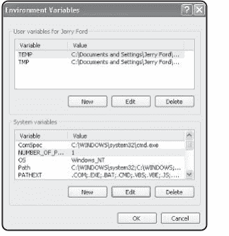

第 4 章 在变量中存储和检索信息

系统环境变量显示在对话框底部。你通常会在这里列出许多不同的系统环境变量，包括：

- COMSPEC：指定 Windows 壳的路径（例如 CMD.EXE）。
- OS：标识当前运行的 Windows 操作系统。
- PATH：指定默认搜索路径。
- PATHEXT：列出代表可执行程序的文件扩展名。
- Prompt：指定默认命令提示符格式。
- TEMP：指定系统可能存储临时文件的文件夹位置。
- WINDIR：标识系统文件所在的文件夹。

## 修改环境变量

虽然你可以在 Windows 脚本脚本内部查看和访问环境变量，但你无法永久更改它们。但是，只要你拥有正在操作的计算机的管理员权限，就可以环境变量对话框对用户和系统环境变量进行更改。

通过点击与用户或系统环境变量相关的“新建”、“编辑”或“删除”按钮，你可以创建、更改或删除环境变量。例如，创建一个新的系统变量，请点击环境变量对话框底部的“新建”按钮。将出现“新建系统变量”，如图 4.7 所示。要创建新变量，在“变量名”字段中输入其名称，在“变量值”字段中输入其值，然后点击“确定”。

### 图 4.7

定义一个新的系统环境变量。

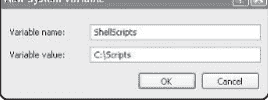

### 技巧

为了让你对环境变量的任何更改生效，你必须注销并重新登录计算机。为了让你对系统变量的任何更改生效，你必须重启计算机。

某些环境变量无法从环境变量对话框中查看。但是，Windows 壳允许你使用 `SET` 命令查看和引用它们。例如，要查看脚本可以访问的所有环境变量列表，请在 Windows 命令提示符中输入 `SET` 并按回车键。你应该看到类似下面的输出：

```
C:\SET
ALLUSERPROFILE=C:\Documents and Settings\All Users
APPDATA=C:\Documents and Settings\Jerry Ford Application Data
CommonProgramFiles=C:\Program Files\Common Files
COMPUTERNAME=WRKSTN001
ComSpec=C:\WINDOWS\system32\cmd.exe
HOMEDIVE=C:
PATH=\Documents and Settings\Jerry Ford
LOGONSERVER=\WRKSTN001
NUMBER_OF_PROCESSORS=1
OS=WINDOWS_NT
Path=C:\WINDOWS\system32;C:\WINDOWS;C:\WINDOWS\COMMAND;C:\WINDOWS\system32
2\WBEM
PATHEXT,.COM,.EXE;.CMD;.VBS;.VBE;.JS;.WSF;.WSH
PROCESSOR_ARCHITECTURE=x86
PROCESSOR_IDENTIFIER=x86 Family 6 Model 6 Steering 0. GenuineIntel
PROCESSOR_LEVEL=6
PROCESSOR_REVISION=0600
ProgramFiles=C:\Program Files
```

### PROMPT=$p$g

```
SESSIONNAME=Console
SystemDrive=C:
SystemRoot=C:\WINDOWS
TEMP=C:\DOCUME-1\JERRY-1\LOCALS-1
USERNAME=Jerry Ford
USERPROFILE=C:\Documents and Settings
windir=\WINDOWS
```

第 4 章 在变量中存储和检索信息

虽然你不能在脚本中对环境变量进行永久更改，Windows 2000 和 XP 还提供了对动态创建变量的访问。这些变量见表 4.2。

| 动态环境变量 | 描述 |
| :--- | :--- |
| CD | 表示当前目录的字符串 |
| DATE | 表示系统日期的字符串 |
| Time | 表示系统时间的字符串 |
| RANDOM | 获取 0 到 32767 之间的随机数 |
| ERRORLEVEL | 获取上一个执行命令的退出代码 |
| CMDEXTVERSION | 标识 Windows 版本的字符串 |
| CMDLINE | 显示启动当前会话的命令字符串 |

## 创建、修改和删除脚本变量

虽然脚本中对环境变量的操作受到限制，但你对脚本变量具有完全控制权。例如，要创建一个名为 `gamename` 的脚本变量并赋值为 `WonderDog`，你可以使用 `SET` 命令定义变量，如下：

```
SET gamename=WonderDog
```

注意，变量名和等号以及等号和赋值值之间没有空格。如果在等号之前添加空格，Windows 壳会将该空格解释为变量名的一部分。如果在等号和赋值值之间插入空格，Windows 壳会将该空格解释为赋值文本的一部分。

要更改分配给变量的值，你可以再次使用 `SET` 命令，如下所示：

```
SET gamename=BuzzTheDog
```

你还可以通过将变量赋为空来删除变量，如下所示：

```
SET gamename=
```

## 变量命名

虽然 Windows 壳在处理变量时非常灵活，但你仍必须遵循某些规则以避免错误。这些规则概述如下：

- 如果你在变量的赋值值中包含引号，除非用双引号括起来，否则 Windows 壳会将引号视为赋值值的一部分。
- 位于等号之前的空格被视为变量名的一部分。
- 位于等号之后的空格被视为赋值值的一部分。


除了这些规则之外，在处理变量时，我还有一些你应该记在心的额外友好建议。

- 变量名应尽可能地描述其内容。
- 虽然变量名的长度没有实际限制，但我建议将其长度保持在 20 个字符以内，以便于阅读和管理。
- 变量名对大小不敏感。然而，我建议你在所采用的任何命名规范中保持一致性。换句话说，不要将不同的规范混用。

## 确定变量访问的限制

默认情况下，变量在整个脚本中都是全局的，这意味着可以在脚本中的任何位置访问变量。但是，如果你希望对脚本中的变量进行严格控制，可以通过限制变量在脚本中引引的位置来实现对变量的访问范围进行局部化。要实现此技巧，你需要学习如何使用 `SETLOCAL` 和 `ENDLOCAL` 命令。

你结合使用 `SETLOCAL` 和 `ENDLOCAL` 命令是为了在脚本中定义一个可以引用变量及其取值的开始和结束位置。例如，考虑以下脚本：

```
SETLOCAL
SET x = %x%
ECHO x = %x%
ENDLOCAL
ECHO x = %x%
```

该脚本首先使用 `SETLOCAL` 命令将名为 `x` 的变量的值局部化。它为 `x` 赋值为 `true` 并显示其值。随后，使用 `ENDLOCAL` 命令结束 `x` 变量的作用范围，有效地将其删除。因此，当脚本尝试第二次引用它时，将不会显示任何值。以下输出显示了如果你创建并运行此脚本将会看到的内容。

```
x = true
x =
```

第 4 章 在变量中存储和检索信息

`SETLOCAL` 和 `ENDLOCAL` 命令也可以用于对现有变量的更改进行局部化，结果是局部范围内的对变量所做的任何更改在范围结束时都会丢弃。例如，考虑以下示例。

```
@ECHO off

SET x=true
ECHO x = %x%

SETLOCAL
SET x =false
ECHO x = %x%

ENDLOCAL
ECHO x = %x%
```

在这个示例中，脚本首先定义了一个变量 `x` 并赋值赋值为 `true`。它显示了该值。接下来，`SETLOCAL` 和 `ENDLOCAL` 命令建立了一个临时的局部范围，在该范围内 `x` 的值被更改为 `false` 并显示。然而，一旦局部范围结束，之前赋值给 `x` 的值就会被恢复。因此，当 `x` 的值再次被显示时，它的值等于 `true`，如下所示。

- x = true
- x = false
- x = true

> 技巧 `SETLOCAL` 和 `ENDLOCAL` 命令通常与子程序和过程结合使用，这些内容将在后的第 7 章“创建过程和子程序”中介绍。

## 处理数学变量

如前所述，当在使用 `SET` 命令配合 `/A` 开关时，Windows shell 知道它需要将分配给定义变量的任何数据视为数值。通过将一个值标记为数值，你能够使用数学表达式对其进行操作。Windows shell 能够处理从 `-2,147,483,648` 到 `2,147,483,647` 范围内的数字。任何尝试处理小于或大于此范围数字的操作都会导致错误。不过，我怀疑这种限制会影响你的脚本。

以下语句演示了如何为变量分配数值。

```
SET /Ax = 1
```

在这个示例中， `x` 已被设置为 `1`。你也可以使用数学表达式为变量分配数值，如下所示。

```
SET /Ax = x + 2
```

此外，你可以在构建表达式时使用在其他数值变量中存储的值，如下所示。

```
SET /A y = 2
SET /Az = x + y + 3
ECHO z
```

如果你运行这个示例，你将会看到 `z` 的值为 `6`。在这些每个示例中，`=`（等号）被用于为变量分配数值。Windows shell 还提供了许多其他算术运算符（如表 4.3 所示），你可以使用它们来为数值变量赋值。

| 运算符 | 用途 |
| --- | --- |
| += | 将两个值相加并分配结果 |
| -= | 从一个值中减去另一个值并分配结果 |
| *= | 将两个值相乘并分配结果 |
| /= | 将一个值除以另一个值并分配结果 |
| %= | 分配除法操作的剩余部分（例如模） |

例如，以下语句将 `x` 的值设置为当前 `x` 的值加 1。

```
SET /A x += 1
```

同样地，以下示例将 `x` 设置为 `x` 加 5。

```
SET /A x += 5
```

除了表 4.3 中列出的赋值运算符外，在操作数值变量的内容时，你仍然可以使用表 4.4 所示的任何算术运算符。

## 表 4.4 算术运算符

| 运算符 | 用途 |
| --- | --- |
| n + | 将数值相加 |
| - | 从一个值中减去另一个值 |
| * | 将两个值相乘 |
| / | 将一个值除以另一个值 |
| % | 确定两个数相除时的商（也称为模） |

例如，以下语句定义了一个名为 `x` 的变量，赋予其初始值 `2`，然后在减去 `3` 之前将结果乘以 `5`。

```
SET /A x = 2
SET /A x = x * 5 - 3
```

结果是 `x` 等于 `7`。

我不知道你是否注意到，当在使用 `SET` 命令配合 `/A` 开关时，Windows shell 会忽略运算符前后的空格。这使得你的脚本更具可读性。

Windows shell 在执行数学运算时遵循一套严格的规则。首先，它解析商值（即模）。然后从左到右执行乘法和除法。最后执行任何加法和减法。

## 变量字符串操作

Windows shell 还提供了处理字符串变量的工具。第一种编程技术被称为字符串替换，涉及对字符串内文本部分的替换。第二种技术是执行子字符串操作。子字符串操作是从字符串中提取部分文本。

### 替换字符串的一部分

使用字符串替换，你可以替换一个字符串的全部或部分。当你需要脚本编辑传递的参数或用户输入时，你可能会发现字符串操作非常有用。例如，你可能会创建一个脚本，提示用户输入字母 `Y` 以继续运行。然而，某些用户可能会输入 `Yes`。通过对用户输入执行子字符串操作，你可以将 `Yes` 字符串替换为 `Y` 字符串。

执行字符串操作时必须遵循的语法如下。

```
%VariableName=ReplacementString=OriginalString%
```

%VariableName 是你想要将子字符串操作的结果赋值的变量名。它紧跟着一个冒号。ReplacementString 是代表要替换字符串的占位符（例如前例中的 `Y` 字符串），OriginalString 是代表发生替换的字符串的占位符（例如前例中的 `Yes` 字符串）。

下面是字符串操作的一个示例。在这个示例中，一个名为 `x` 的变量被赋值为一个短语。然后，使用字符串替换，第二个变量 `z` 被赋值为 `x` 的值，但是在完成子字符串操作之后。在子字符串操作中，`blue` 替换了 `gray`。

```
ECHO off

SET x=The sky above was quite gray
SET z=%x:gray=blue%

ECHO %z%
```


# 如果你保存并运行此脚本，将看到如下所示的输出。

天空非常蓝

你也可以使用字符串替换来删除文本字符串中的部分。要实现此技巧，请将替换字符串留空。例如，要删除上一个示例字符串中的“gray”一词，你可以像下面所示设置 z 的值。


```
SET z=%x:gray=-%
```

## 提取字符串的片段

Windows shell 支持的另一种字符串处理技术是子字符串操作，即从字符串中提取部分文本。你只需要指定要提取的字符串第一个字符的起始位置，并可选地指定从该点开始提取的字符数。提取子字符串后，如何处理它由你决定。你可以将其赋值为一个新变量的值，或者重新赋值回原始变量，用子字符串替换原始字符串。

执行子字符串操作时遵循的语法如下。

```
%%VariableName:-StartPosition,Length%
```

首先，你指定变量名。然后，按照上方所示精确添加冒号和波浪号（~）。接下来，使用 StartPosition 占符指定子字符串中第一个字符的位置。Length 是可选的。如果省略了 Length，子字符串将包含从 StartPosition 开始到字符串末尾的所有字符。当指定了 Length，子字符串将包含从 StartPosition 开始的所有字符，加上起始位置右侧指定数量的字符。要查看子字符串操作如何工作，请看以下示例：

```
%CHO off
```

```
SET x=The sky above was quite gray
SET z=%x:-0,7%
```

```
%z%
```

在这个示例中，第二个 SET 语句从存储在变量 x 中的字符串中提取子字符串，然后将其赋值给变量 z。子字符串操作从位置零开始（例如字符串中第一个单词的首字母），并包含 7 个字符。如果你运行此脚本，将看到提取并赋值给 z 的子字符串是 The sky。

# 回到《神奇狗狗狗的故事》

《神奇狗狗的故事》的目的是加强你对如何在 Windows 脚本中创建和引用变量的理解。使用填空（Mad lib）格式，你将编写一个脚本，提示读者输入，脚本将使用这些输入来讲述故事。然而，技巧在于，读者不知道他们的输入将在故事中如何使用。当你运行完成的脚本时，这会导致意想不到的转折。

## 设计游戏

《神奇狗狗的故事》将通过以下五个步骤完成：

1. 初始化脚本环境
2. 显示欢迎界面
3. 通知读者需要帮助
4. 提示读者输入
5. 显示故事

在接下来的章节中，我将解释完成这些每个步骤所需的操作。

## 配置 Windows 控制台

与之前的 Windows 脚本一样，本项目通过禁用执行时的显示语句开始，如下所示。此外，前景颜色被修改为黄色。接下来，清除屏幕并将故事标题发布在 Windows 控制台的标题栏中。

```
@ECHO off
```

```
CLS

TITLE = THE STORY OF BUZZ THE WONDER DOG
```


## 构建欢迎界面

初始欢迎读者进入故事。它由一系列所示所示 ECHO 语句组成。

```
ECHO.
ECHO.
ECHO.
ECHO.
ECHO.
ECHO WELCOME TO THE ............
ECHO.
ECHO.
ECHO.
ECHO.
ECHO STORY OF BUZZ THE WONDER DOG!
ECHO.
ECHO.
ECHO.
ECHO.
ECHO.
ECHO.
ECHO.
ECHO.
ECHO.
ECHO.

PAUSE
```

本部分的最后一个语句使用 PAUSE 命令，确保读者有机会阅读即将讲述的故事。

## 为读者提供说明

读者看到的第二个屏幕告知他们，讲述故事需要他们的参与，并解释他们只需要回答几个简单的问题。

```
CLS

ECHO.
ECHO.
ECHO.
ECHO.
ECHO.
ECHO Your help is needed to tell this story. All that you have to do is
ECHO.
ECHO answer a few simple questions.
ECHO.
ECHO.
ECHO.
ECHO.
ECHO.
ECHO.
ECHO.
ECHO.
ECHO.
ECHO.
ECHO.
ECHO.
ECHO.
ECHO.
ECHO.
ECHO.
ECHO.
ECHO.
PAUSE
```

本章节与后续的所有章节一样，在显示任何文本之前清除屏幕，并在执行 PAUSE 命令结束。

## 从读者处收集故事元素

为了讲述故事，脚本需要从读者那里收集信息，然后将其赋值给以下脚本变量：

- player. 阅读故事的人（即 Buzz 的虚构主人的名字）。
- clothes. Buzz 第一次救主人时抓住的衣服部位。
- vehicle. 故事开始时差点撞到 Buzz 主人的车辆类型。
- bodypart. Buzz 第二次抓住的主人的身体某部位。
- animal. 故事结束时差点撞到 Buzz 主人的动物类型。

这些信息使用 SET /P 关进行收集并赋值给变量，如下所示。

```
CLS

ECHO.
ECHO.
ECHO.
ECHO.
ECHO.
ECHO.

SET /p player=1. What is your name?

ECHO.

SET /p clothes=2. Name of piece of clothing:

ECHO.

SET /p vehicle=3. Type of motor vehicle:

ECHO.

SET /p bodypart=4. Part of body:

ECHO.

SET /p animal=5. Type of animal:

ECHO.

ECHO.

PAUSE
```

## 使用变量替换来编写故事

从现在开始，脚本由显示故事的语句组成，让你决定故事的其余部分。

从前，住着一只叫 Buzz 的非常特殊的狗。Buzz 的好朋友是 %player%。

在一个特别热的周日，Buzz 和 %player% 正在路边行走，突然 Buzz 停下并转身，抓住 %player% 的衣服，将 %player% 拉出路面掉进沟里。一辆巨大的红色 %vehicle% 失控冲出，压过了 %player% 行走的路段。

“哇，”%player 说，“你真的救了我。但那辆 %vehicle% 怎么办？如果它不减速，就没法通过神奇狗狗树林的转弯了！”%player% 盯着直冲过去的 %vehicle%。当 %player% 回头寻找 Buzz 时，那只四足的朋友已经不见。

片刻，当 %vehicle% 就要撞进树林时，Buzz 从一块较大的岩石上跳到了 %vehicle% 上。然后，他挤进了 %vehicle% 后部的一个开口，发现司机已经失去了意识。

Buzz 反应迅速，将司机拉出危险区域并接管了方向盘，按下刹车并在 %vehicle% 到达树林边缘之前停了下来。当 %player% 几分钟后到达时，司机已经醒来并坐在地上，在 Buzz 舔他的脸时摸着它。“这是你的狗吗？”司机问。%player% 大笑着回答道，“看来我欠你很多。你的狗救了我的命。如果不是他给我做心肺复苏，我想我死得更早了！”司机说。

“好孩子，”%player% 说，跑过去抱住他的四足朋友。这时，Buzz 意外地跳起，抓住 %player% 的 %bodypart%，将 %player% 抛到土路之外。片刻，一只巨大的白色 %animal% 跑过那条路，神奇狗狗追了上去。“我希望那只 %animal% 没平安，”司机说。

完


我建议你在我在下一节展示我是如何完成它的之前，尝试自己完成这个故事的发展。然而，如果你不确定如何完成，或者现在没有时间完成，那么请务必继续阅读。

## 最终结果

现在看看完全组装好的脚本。为了记录脚本并方便阅读，我在处处添加了注释，解释了正在发生的逻辑过程。

```
@ECHO off

REM *********************************************************************
REM
REM 脚本名称: WonderDog.bat
REM  {: Jerry Ford
REM 日期: 2003年7月1日
REM
REM 描述: 此 Windows 命令行脚本通过读者提供的输入讲述了“神奇狗巴兹（Buzz the Wonder Dog)”的故事。
REM
REM *********************************************************************

REM 设置 Windows 命令行控制台黑底黄字
COLOR 6

REM 清空显示
CLS

REM 将故事标题写入 Windows 命令行的标题栏
TITLE = THE STORY OF BUZZ THE WONDER DOG

REM 显示欢迎界面
ECHO.
ECHO.
```

```
ECHO.
ECHO.
ECHO.
ECHO.
ECHO WELCOME TO THE ............
ECHO.
ECHO.
ECHO.
ECHO.
ECHO.
ECHO STORY OF BUZZ THE WONDER DOG!
ECHO.
ECHO.
ECHO.
ECHO.
ECHO.
ECHO.
ECHO.
ECHO.
ECHO

REM 暂停，直到读者按下任意键
PAUSE

REM 清空显示
CLS

REM 让读者知道编写故事需要他们的帮助
ECHO.
ECHO.
ECHO.
```

```
ECHO.
ECHO.
ECHO.
ECHO 讲述这个故事需要你的帮助。你所只需要
ECHO.
ECHO 回答几个简单的问题。
ECHO.
ECHO.
ECHO.
ECHO.
ECHO.
ECHO.
ECHO.
ECHO.
ECHO.
ECHO.
ECHO.
ECHO.
ECHO.
ECHO.
ECHO.
```

## 第 4 章在变量中存储和检索信息

```
REM 暂停，直到读者按下任意键
PAUSE

REM 清空显示
CLS

REM 开始收集读者的输入
ECHO.
ECHO.
ECHO.
ECHO.
ECHO.
```

ECHO.

ECHO.

REM 收集巴兹主人的名字。

SET /p player=1. 你的名字是什么？

ECHO.

REM 确定巴兹在第一次救主人时抓住的是哪件衣服

SET /p clothes=2. 衣服的名称：

ECHO.

REM 确定是什么种类型的车辆几乎撞到了巴兹和他的主人

SET /p vehicle=3. 说出一种四轮机动车的类型：

ECHO.

REM 确定巴兹在第二次救主人时抓住的是人体的部位

SET /p bodypart=4. 说出人体的一个部位：

ECHO.

REM 确定第二次几乎是什么种类的动物险些撞到了巴兹的主人

SET /p animal=5. 你最喜欢的动物是什么？

ECHO.
ECHO.
ECHO 这些看起来是很不错的答案。现在，我们继续讲故事吧。

ECHO.
ECHO.
ECHO.
ECHO.

REM 暂停，直到读者按下任意键
Pause

REM 清空显示
CLS

REM 讲述故事的第一部分

ECHO.
ECHO.
ECHO.
ECHO.
ECHO.
ECHO 从从前，住着一只叫巴兹（Buzz）非常特别的小狗。

ECHO.
ECHO 巴兹最好的朋友是他的主人 %player%。巴兹和 %player% 到处处去
ECHO 一起在一起。周日是他们最喜欢度过的日子，因为
ECHO 那天他们会在老树林（Old Man's Grove）旁的水边玩耍。
ECHO.
ECHO.
ECHO.
ECHO.
ECHO.
ECHO.
ECHO.
ECHO.
ECHO.
ECHO.
ECHO.
ECHO.
ECHO.
ECHO.

REM 暂停，直到读者按下任意键
PAUSE

REM 清空显示
CLS

REM 讲述故事的第二部分

ECHO.
ECHO.
ECHO.
ECHO.
ECHO 在一个特别热热的周日，巴兹和 %player% 走在
ECHO 通往老树林的土路边。老树林
ECHO 突然停下并转身，抓住了 %clothes%，
ECHO 将 %player% 从路面上拖到了沟里。几秒钟后
ECHO 一辆大红色的 %vehicle 失控了，冲过了
ECHO 巴兹和 %player% 刚才走过的路。
ECHO.
ECHO.
ECHO.

REM 暂停，直到读者按下任意键
PAUSE

REM 清空显示
CLS

REM 讲述故事的第三部分

ECHO.
ECHO.
ECHO.
ECHO “好孩子，”%player% 说，“你这次真的救了我。但是
ECHO %vehicle% 里的那个人，如果他没有在
ECHO 老树林转弯时慢一点！”%player% 看着 %vehicle%
当他回头看巴兹时，他的四足朋友
ECHO 消失了。
ECHO.
ECHO.
ECHO.
ECHO.

## 第 4 章在变量中存储和检索信息

```
ECHO.
ECHO.
REM 暂停，直到读者按下任意键
PAUSE
REM 清空显示
CLS
REM 讲述故事的第四部分

ECHO.
ECHO.
ECHO.
ECHO 几刻后，当 %vehicle% 就要撞进老树林时，巴兹
ECHO 从大岩石上跳到 %vehicle% 顶部。然后他通过
ECHO %vehicle 后的一个开口钻进去，发现司机已经失去了意识。
ECHO.
ECHO.
ECHO.
ECHO.
ECHO.
```

```
ECHO.
ECHO.
REM 暂停，直到读者按下任意键
PAUSE

REM 清空显示
CLS
REM 讲述故事的第五部分

ECHO.
ECHO.
ECHO.
ECHO.
ECHO 巴兹迅速反应，将司机从路中拉开，并接管了
ECHO 方向盘，迅速刹车，让 %vehicle% 在到达
ECHO 老树林之前停了下来。巴兹发现
ECHO 男没有呼吸，开始将他
ECHO 从 %vehicle% 中拉出来。
ECHO.
ECHO.
ECHO.
ECHO.
ECHO.
```

```
ECHO.
ECHO.
REM 暂停，直到读者按下任意键
PAUSE

REM 清空显示
CLS

REM 讲述故事的第六部分

ECHO.
ECHO.
ECHO.
ECHO.
ECHO 当 %player% 几分钟后到达时，男人已经苏醒，
ECHO 坐在地上抚摸着巴兹，小狗正
ECHO 舔他的脸。“这是你的狗吗？”司机问。“是的，”
ECHO %player% 带着大大的微笑说，“看来我欠你很多。
ECHO 你的狗救了我的命。如果他没有对我进行心肺复苏，我想
ECHO 我肯定没命了！”司机说。
ECHO.
ECHO.
ECHO.
ECHO.
ECHO.
```

ECHO.
ECHO.
REM 暂停，直到读者按下任意键
PAUSE

REM 清空显示
CLS

REM 讲述故事的最后部分

ECHO.
ECHO.
ECHO.
ECHO.
ECHO “哇！”%player% 说道，跑过去拥抱他的四足朋友。就在这时
ECHO 巴兹意料地跳了起来，抓住了 %player% 的 %bodypart%，将
ECHO %player% 从那条 %player% 一直跑的土路上甩开。几刻后，一只
ECHO 大白色的 %animal% 在那条路上窜过，而神奇狗
ECHO 巴兹离开了那里。“我希望 %animal% 会没事的，”司机说。
ECHO.
ECHO “别担心，”%player% 说，“巴兹会救他的……”
ECHO.
ECHO.
ECHO 完

现在脚本已经完成了，请运行它，运行几次，并确保每次都输入不同的内容。如果发生任何错误，请回去检查你的拼写，确保你没有写错脚本的任何语句。一旦一切都运行正常，就把你的游戏传给朋友，看看他们怎么想。

## 第 4 章在变量中存储和检索信息

## 总结

在本章中，你学习了如何编写可以接受并处理执行时传递给它们的脚本。你还学习了处理环境变量和脚本变量的细节。这包括学习了如何在 Windows 命令行脚本内部创建、修改和删除变量，以及如何访问和永久修改环境变量。此外，你还学习了如何操作和提取包含文本字符串的变量部分，以及如何对包含数字数据的变量执行数学运算。

- 1. 进一步扩展“神奇狗巴兹的故事”，增加几段故事情。
- 2. 尝试从脚本中的故事部分移除 CLS 语句。这将导致每当读者按下任意键恢复故事暂停时，产生一种滚动效果。
  提示：你将需要调整 ECHO 语句的数量以使效果看起来正确。
- 3. 通过查看故事并寻找关键词，将其替换为变量，然后提示读者为这些新变量提供输入，从而使故事的结果变得更加不可预测。


## 第 5 章
# 应用条件逻辑

在本书之前介绍的许多章节项目中，你已经见过条件逻辑的示例。这是因为条件逻辑是一个如此核心的编程概念，如果不使用某种形式的条件逻辑，几乎无法编写出任何复杂程度的实用脚本。

在第 3 章“Windows 脚本编写基础”中，你学习了如何使用复合命令来执行条件逻辑，其中其中一个命令的执行取决于另一个命令的成功或失败。在本章中，你将学习如何使用 `IF` 语句来实现超越简单复合命令能力的条件逻辑。你还将学习如何创建多行 `IF` 语句，允许你根据单个条件测试的结果执行多个命令。此外，你将学习如何嵌套或将一个 `IF` 语句嵌入另一个中语句中，以产生强大且复杂的逻辑。

具体来说，你将学习：

- 如何处理各种形式的 `IF` 语句
- 如何判断变量是否已定义
- 如何判断执行命令时是否发生错误
- 如何判断运行脚本时使用的是哪个版本的 Windows 壳
- 如何在尝试访问文件或文件夹之前判断它们是否存在

## 项目预览：猜数字游戏

本章的主要编程体验被称为“猜数字游戏”。它的设计是为了让你进一步获得处理条件逻辑的。为了完成这个游戏，你将创建一个 Windows 脚本，该脚本会欢迎玩家并请求数字，然后将该数字与随机生成的数字进行比较，判断它是小于、等于还是大于玩家选择的数字。游戏会给玩家提示，告知玩家猜的高了还是低了，并记录玩家在最终猜中随机神秘数字之前尝试的次数。

图 5.1 显示了游戏的启动界面，它欢迎玩家，显示游戏名称，并等待玩家按键后继续。

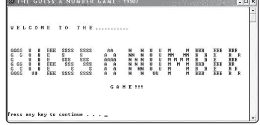

### 图 5.1
猜数字游戏的启动界面。

图 5.2 显示了游戏提示玩家进行第一次猜测。如你所示，玩家在提示所在的同一行输入猜测，并按回车键提交。

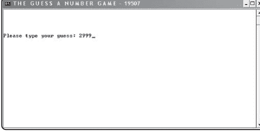

### 图 5.2
提示玩家输入猜测。

图 5.3 显示了当玩家猜低了时收到的反馈。游戏将继续提示玩家输入猜测，直到玩家正确猜中神秘数字。

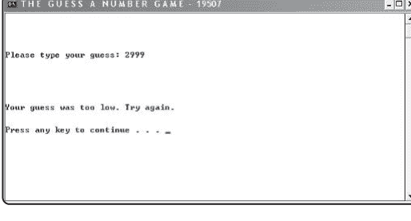

### 图 5.3
当玩家猜低了时，通知玩家。

同样，图 5.4 显示了当玩家猜高了时游戏显示的消息。

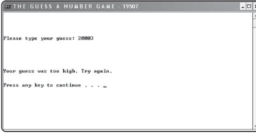

### 图 5.4
当玩家猜高了时，通知玩家。

当玩家最终猜中神秘数字时，会显示图 5.5 所示的屏幕，告知玩家猜对了。此外，还会显示玩家猜测的总次数。

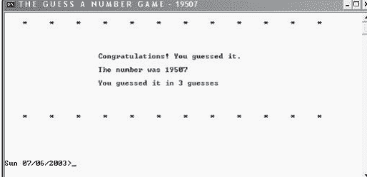

### 图 5.5
游戏结束时，玩家被告知花了多少次才猜中神秘数字。

## 将条件逻辑应用于脚本

虽然在开发 Windows 脚本时始终可以使用复合命令应用有限的条件逻辑，但 `IF` 语句提供了一个更灵活、强大的替代方案，能够对各种情况进行条件测试。`IF` 语句有许多形式，如表 5.1 所示。

表 5.1 IF 语句的类型
| 类型 | 功能 |
|---|---|
| IF | 执行真/假测试，以确定是否执行一个或多个命令 |
| IF...ELSE | 根据条件测试的结果执行两组命令 |
| IF DEFINED | 判断变量是否实际存在 |
| IF ERROR | 获取上一个执行命令的退出代码 |
| IF CMDVERSION | 获取当前 Windows 壳的数值值 |
| IF EXIST | 判断文件或文件夹是否存在 |
| IF NOT | 执行条件测试并根据否定结果采取行动 |

## 使用 IF 语句

`IF` 命令执行条件测试，如果结果为真，则执行指定的命令。人们总是进行这种类型的测试。例如，当我今天去吃午饭时，我可能根据钱包里的钱决定是否去吃。如果我有 $10，我会点牛排。否则不会。`IF` 语句的工作方式如下：

```
IF condition1 == condition2
```

直译来说，上述语句读起来是：“如果第一个条件等于第二个，则将执行命令。否则不会。”看下面的示例：

```
IF %OS% == Windows
```

在这个示例中，赋值给环境变量 `OS` 的值与字符串 `Windows` 进行比较。如果 `OS` 的值为 `Windows`，测试结果将为真，随后的 `ECHO` 命令将自动执行。否则 `ECHO` 命令将被跳过。该变量识别了当前运行 NT、XP 或 2003 的操作系统。


上一个示例在等号前后都包含了空格。虽然不是必须，但添加空格使其更易读。现在看另一个示例。在这个示例中，语句被设置为将传递给脚本的参数与字符串 `Play` 进行比较。如果测试结果为真，则将执行 `ECHO` 命令。

```
@ECHO off
IF %1 == Play
```

将此示例保存为脚本，并通过输入脚本名称后跟空格以及单词 `Play` 来运行。你应该看到以下输出：

Ready to play...

现在再次运行脚本并传递一个非 `Play` 的参数，或者输入任何内容。这时，会出现以下错误：

```
ECHO was unexpected at this time.
```

此错误的发生是因为 `%1` 的值未设置，导致 Windows 壳得到了如下所示的逻辑语句。由于该语句在语法上是不正确的，因此发生了错误：

```
IF ==
```

有时你可能希望你的脚本在没有任何参数启动时也能继续运行。例如，你可以执行一个测试来查看是否提供了参数，如果没有提供，你可以使用编写在脚本中的默认值。为了防止上述错误出现，你应该将 `IF` 语句测试的两个条件都括在对匹配的双引号内，如下所示：

```
IF "%1" == "Play"
```

这种方式使用双引号不会影响两个条件相等时的测试结果。即使添加了双引号，它们仍然保持相等。然而，在参数缺失的情况下，这种格式的语句可以防止 Windows 壳解释如下所示的命令。在语法上，它通过了测试并允许脚本无错误地继续执行：

```
IF "" == ""
```

在其他情况下，你也会希望将变量括在双引号内。例如，你可能在编写一个提示用户输入的脚本。然而，你可能无法知道用户是否会在回答中包含一个或多个空格。为了确保空格被正确解释，你应该将变量括在双引号中。你可能记得在第 1 章“简介 Windows 脚本编写”中，当你创建敲门笑话游戏时，你必须让玩家负责将其回答括在引号中。使用这种新技术，你可以重写脚本并减轻玩家的责任。

在上一个示例中，你将变量的值与硬编码的字符串进行比较。然而，你可以很容易地比较存储两个变量中的值，如下所示：

```
SET hisname=Alexander
SET hername=Molly
IF %hisname%== %hername% ECHO We have a match!
```

在比较字符串值时，Windows 壳不仅检查两个字符串的文本，还检查它们的大小写。因此，例如，它会将 `x` 和 `X` 解释为不相等。然而，如果你愿意，可以覆盖此大小写敏感的要求，并使用 `/I` 关执行不区分大小写的比较，如下所示：

```
SET hisname=Chris
SET hername=Chris
IF /I %hisname%== %hername% ECHO We have two people named Chris with us today.
```

除了判断两个字符串是否相等，`IF` 语句提供了执行大量数学比较的能力。例如，下面的语句演示了如何比较存储在两个数值变量中的值。


SET /A totalcount = 10
SET /A currentcount = 10
IF %totalcount% = %currentcount% ECHO Both values are the same

## 提供备选方案

IF 语句本身提供了测试两个条件并在测试结果为真时采取操作的能力。但如果你想在结果为真时执行一个操作，而在比较结果为假时执行另一个操作该怎么办？解决这一困境的办法是在 IF 语句后面附加 `ELSE` 关键字。IF 语句的语法如下：

```
IF condition1 == condition2 (command1) ELSE (command2)
```

如果两个条件相等，则执行 command1；否则，执行 command2。你将两个命令都放在括号内，以便 Windows 命令行外壳识别语句的 `ELSE` 部分。以下语句演示了 IF...ELSE 语句的一种特别好的用法：

```
IF "%OS%" == "Windows_NT" (ECHO Script now executing) ELSE (GOTO :EOF)
```

在这个示例中，IF 语句首先检查脚本是否运行在运行 Windows NT、2000、XP 或 2003 的计算机上。如果比较结果为真，则由一条消息宣布脚本现在开始执行。否则，如果比较结果为假，则执行语句的 `ELSE` 部分，此时 `GOTO :EOF` 会导致脚本终止自身的执行。

通过在 Windows 命令行脚本的开头包含对 OS 变量的检查，你可以防止脚本在不支持的操作系统（如 Windows 95、98 或 Me）上被意外执行。这些操作系统缺乏健壮的脚本运行环境，虽然你的脚本可以在它们上运行，但在发生错误之前，它们可能运行不了多久。

## 确定变量是否已经存在

当你的 Windows 命令行脚本遇到意料之外的情况时就会发生错误。意料之外的一个例子是缺少环境变量。例如，假设你创建了一个脚本来访问一个名为 `ScriptFolder` 的环境变量，该变量是你早时候创建的，用于存储存放命令行脚本文件的文件夹位置。如果你在任何其他计算机上运行此脚本，而没有先记住在另一台计算机上创建一个名为该环境变量的新实例，那么你的脚本在尝试引用一个未定义的变量时可能会失败。这是因为当 Windows 命令行外壳无法找到变量时，它会返回空值。

取决于你编写脚本的方式、它的设计功能以及变量引用在脚本中的何位置，结果可能是不可预测的。结果是，你的脚本可能什么都没做，或者它可能完成了部分任务，留你手动去弄清楚哪些做了，哪些没做，并可能留下一堆混乱需要清理。

然而，你可以通过在脚本开头添加代码来避免这个问题，以便在找不到你的自定义环境变量时防止其运行。这是通过使用 `IF DEFINED` 语句实现的，其语法如下：

```
IF DEFINED variable command
```

例如，以下语句演示了如何确定名为 `ScriptFolder` 的环境变量是否已定义：

```
IF DEFINED ScriptFolder SET sourcefolder=%ScriptFolder%
```

在这个示例中，会进行检查以确定 `ScriptFolder` 变量是否已定义。如果已定义，则脚本变量将被定义并设置为存储在 `ScriptFolder` 中的值。否则，脚本变量未定义。

在某些情况下，你可能为脚本提供默认设置，以便在它们无法找到环境变量时可以使用。例如，通过在上一个示例中添加 `ELSE` 关键字，你可以指定在需要时替换的默认文件夹。

```
IF DEFINED ScriptFolder (SET sourcefolder=%ScriptFolder%) ELSE (SET sourcefolder=C:\Scripts)
```

## 留意错误

当你跟随这本书学习并尝试复制你看到的脚本时，你已经经历了不止一个错误。有些错误是你的错。例如，在处理命令时可能使用了错误的语法。这被称为**语法错误**。你还可能在尝试让脚本执行它们无法做的事情时创建一个错误，例如尝试将一个数字和一个文本字符串相乘。我们称这些为**逻辑错误**。另一类错误是**运行时错误**，它们发生在脚本执行过程中遇到了并非由语法或逻辑问题引起的问题。例如，如果脚本尝试删除一个不存在的文件，就会发生运行时错误。可能是应用程序每晚都会创建这个文件，但在某一天晚上它没有如预期那样运行。也许是有人重命名了文件。运行时错误发生的原因有很多种。

通过在运行脚本之前双重检查代码，你可以防止许多语法错误。通过在开始编写之前花时间妥善设计你的脚本，并在开发过程中仔细测试，你可以防止许多逻辑错误。

即使是顶棒的程序员也会遇到语法和逻辑错误，所以当它们发生在你身上时不要感到惊讶。为了帮助你处理这类情况，我将在第 8 章“调试与错误处理”中给你一些基础的调试技巧。

处理运行时错误的一种方法是预判脚本中可能发生错误的地方，然后测试是否会发生。你可以使用 `IF ERRORLEVEL` 语句来实现，它检查上一个发布的命令的退出代码。

退出代码（或返回代码）是命令返回的数值，用于指示它们是运行成功还是发生了错误。

## 在现实世界中

几乎每个 Windows 命令和实用程序都以数字退出代码的形式提供信息。该代码由命令返回给调用它的资源（例如，你的 Windows 命令行脚本）。退出代码的值指示了命令是否认为自己运行正常。处理错误的命令将返回退出代码 0。任何大于 0 的值表示某种类型的错误。许多 Windows 命令和实用程序都记录了它们可能的退出代码范围及其含义。你可以通过检查 Windows 帮助系统或访问 www.microsoft.com 来查找给定命令或实用程序可能的退出代码范围。

在开发命令行脚本时，可以使用两种版本的 `IF ERRORLEVEL` 语句。第一个版本的语法如下：

```
IF ERRORLEVEL exitcode command
```

`exitcode` 是一个占位符，表示你要查找的最小错误级别。如果上一个命令返回的退出代码等于或大于 `exitcode` 指定的值，则执行指定的命令。否则不执行该命令。例如，查看以下语句：

```
COPY c:\Script.bat C:\Temp
```

```
IF ERRORLEVEL 1 ECHO copy terminated. The specified file was not found.
```

第一个语句尝试将文件复制到 C:\Temp 文件夹。第二个语句检查第一个语句执行时是否发生了错误，如果是显示错误消息。

第二个版本的语法如下：

```
IF ERRORLEVEL == exitcode
```

此退出代码指定了一个必须精确匹配的执行错误代码，才能触发指定命令的执行。换句话说，如果你如下所示将 `exitcode` 设置为 2，而返回的退出代码为 1，则会跳过指定的命令。

```
IF "%ERRORLEVEL%"==2 "Fatal error occurred" & GOTO :EOF
```


## 在现实世界中

正如第 2 章“与 Windows 壳交互”中所提到的，许多命令已经过增强以支持新的命令扩展。这些命令列表包括 ASSOC, CALL, CD, COLOR, DEL, ENDLOCAL, FOR, FTYPE, GOTO, IF, MD, MKDIR, PROMPT, PUSHF, SET, SETLOCAL, SHIFT, START。如果你创建了利用新命令扩展功能的 Windows 壳脚本，并尝试在运行不支持这些命令扩展的 Windows 版本上运行你的脚本，你的脚本将遇到错误。因此，你必须在你打算支持的所有操作系统上对 Windows 脚本进行严格测试。例如，如果你有一个需要在 Windows NT 4 上运行且使用 `SET /P` 开关与用户交互的脚本，你将需要重写该脚本以使用不支持的命令开关。例如，你可以使用 Windows NT 4 资源包中的 CHDICE.EXE 命令交互式地提示用户脚本所需的信息。

通过使用 `IF CMDEXTVERSION` 语句检查 `CMDEXTVERSION` 变量的值，你可以让脚本检测到正在使用哪个版本的 Windows 壳执行它们，并做出相应的反应。例如，如果你的脚本使用了命令扩展，你可以停止脚本执行，或者使用条件逻辑让脚本跳过某些步骤。

使用 `IF CMDEXTVERSION` 语句必须遵循的语法如下：

```
IF CMDEXTVERSION VersionNo Command
```

`VersionNo` 是一个占位符，代表你想测试的 Windows 壳版本号，`Command` 是一个 Windows 命令，当 `CMDEXTVERSION` 的值等于或小于 `VersionNo` 指定的值时，将执行该命令。例如，以下脚本检查脚本是否运行在运行 Windows NT、2000、XP 或 2003 的计算机上，如果不是，脚本将终止自身的执行。通过使用这种编程技术，你可以防止你的 Windows 壳脚本尝试在其他的 Windows 操作系统上运行。

```
@ECHO off
IF CMDEXTVERSION 1 ECHO Unsupported operating system & GOTO :EOF
```

## 查找文件和文件夹

`IF` 语句的一种特殊形式允许你在脚本尝试处理文件或文件夹之前，验证它们是否存在。例如，如果你的脚本被设计为从一个位置复制或移动特定文件到另一个位置，而该文件在脚本执行时不存在，那么执行 `COPY` 或 `MOVE` 命令就会就会错误。使用 `IF EXIST` 语句，你可以采取措施来防止此类错误。

## 判断文件是否已经存在

`IF EXIST` 语句具有以下语法：

```
IF EXIST file command
```

`file` 是一个占位符，代表要查找的文件名，`command` 指定了在找到指定文件时执行的命令。

看一个 `IF EXIST` 语句运行的示例。在下面的示例中，针对 `C:\Scripts` 文件夹中名为 `Games.txt` 的文件的 `IF EXIST` 语句。如果文件存在，则将其删除。否则，跳过该命令。

```
IF EXIST C:\Scripts\Games.txt DEL C:\Scripts\Games.txt & ECHO File Deleted
```

在下一个示例中，Windows 壳脚本首先判断 `C:\Scripts` 文件夹内是否存在名为 `Games.txt` 的文件。脚本在在使用 `SET` 语句之前，先使用 `ECHO` 语句显示一个提示，请求许可用新文件覆盖该文件。如果用户输入响应 `n`，则脚本将保留现有文件并终止自身的执行。然而，如果用户通过输入 `y`（除 `n` 以外的其他字符）做出响应，则脚本将使用 `>` 字符重定向 `ECHO` 语句的内容。该语句的作用是用 `ECHO` 语句提供的文本替换文件的内容。

```
@ECHO off
IF EXIST C:\Scripts\Games.txt ECHO File exists. & SET /P reply=Replace? [y/n]

IF /I %reply% == n (
  ECHO The File was not replaced & GOTO :EOF
) ELSE (
  ECHO C:\Scripts\Games.txt This report created at %TIME% on %DATE%
)
```

## 判断文件夹当前是否存在

检查文件夹是否存在与检查文件是否存在同样重要。例如，如果你要查找的文件夹不存在，你的脚本可以创建它然后继续运行而不会遇到错误。

从技术上来说，`IF EXIST` 语句实际上适用于文件，但你也可以用它来检查文件夹。不过，你也可以使用 `MKDIR` 命令在文件夹不存在时创建它。


## IF NOT ERRORLEVEL

你可以使用 `NOT` 关键字通过以下语法反转 `IF ERRORLEVEL` 语句：

```
IF NOT ERRORLEVEL exitcode command
```

例如，当执行以下脚本时，它会尝试将 C:\Scripts 文件夹中名为 TestScript.bat 的文件复制到 C:\Temp 文件夹。脚本随后使用 `IF NOT ERRORLEVEL` 语句来判断复制操作是否成功。如果在复制文件时发生错误，脚本将清除屏幕，显示错误消息并终止自身的执行。

```
@ECHO OFF
```

```
COPY C:\Scripts\TestScript.bat C:\Temp
```

```
IF NOT %ERRORLEVEL%==0 CLS & ECHO Fatal error occurred & GOTO :EOF
```

## IF NOT CMDTEXTVERSION

`NOT CMDTEXTVERSION` 语句用于验证 Windows shell 版本不低于指定值。这种 IF 语句的语法如下所示。

```
IF NOT CMDTEXTVERSION VersionNo Command
```

例如，以下 Windows 脚本在发现其未运行在 Windows 2000、XP 或 2003 操作系统上时会终止自身的执行：

```
@ECHO OFF
```

```
IF NOT CMDTEXTVERSION 2 ECHO Unsupported operating system & GOTO :EOF
```

同样，如果以下脚本不是在 Windows NT、2000、XP 或 2003 操作系统启动启动，它将终止脚本的执行。

```
@ECHO OFF
```

```
IF NOT CMDTEXTVERSION 1 ECHO Unsupported operating system & GOTO :EOF
```

## IF NOT EXIST

支持 `NOT` 关键字的 IF 语句的最后形式是 `IF NOT EXIST` 语句，其语法如下：

```
IF NOT exist file command
```

使用此语句，你可以在处理文件或文件夹之前判断其是否存在。例如，以下 Windows 脚本会检查 C:\Scripts 文件夹是否存在，如果不存在，则创建该文件夹。

```
@ECHO off
```

```
IF NOT C:\Scripts\ (
  ECHO C:\Scripts folder not found. Creating folder and report. & MKDIR C:\Scripts
) ELSE (
  ECHO C:\Scripts folder exists. Creating report.
```

## 构建多行 IF 语句

到目前为止，在本章中你看到的所有示例中，我都成功地在单行 IF 语句内完成了我需要做的一切（除非当然，我使用了 `ELSE` 关键字来提供备用执行路径）。

例如，以下语句检查之前执行命令的退出代码，然后使用复合命令执行三项任务：

```
IF NOT %ERRORLEVEL%== 0 CLS & ECHO Fatal error occurred & GOTO :EOF
```

虽然这种方法确实有效，但复合命令的用性是有限的。其一，在单行语句中堆叠过多命令会导致脚本难以阅读。通常情况下，将像上面那样的语句分散到多行效果更好。你会发现这会让脚本更易阅读和编写。

要将复杂的 IF 语句拆分成行，请使用以下语法：

```
if condition1 == condition2 command (
  -
  -
)
```

如你所见，使用这种形式的 IF 语句时，必须将所有想要 IF 语句执行的语句包含在一对匹配的括号内。例如，你可以使用多行 IF 语句来重写之前的复合命令，如下所示。

```
IF NOT %ERRORLEVEL% == 0 (
  CLS
  ECHO Fatal error occurred
  GOTO :EOF
)
```

如你所见，即使是这个小示例，IF 语句的多行形式也让阅读变得容易得多。

## 创建高级条件逻辑测试

很快你就会发现自己想要创建需要使用相当复杂的 Windows shell 脚本。例如，你可能想要测试一个条件，然后根据测试结果执行一次或多次额外的测试。为了方便这种逻辑思维，Windows shell 允许将 IF 语句嵌套在其中以创建嵌套 IF 语句。

要查看它是如何工作的，请看以下示例：

```
@ECHO off

SET /A MysteryNumber = %random%

REM 检查是否猜中了正确的数字
IF NOT "%1" == "%MysteryNumber%" (
  ECHO A match did not occur!

  REM 如果没有猜对数字，检查确保它在范围内
  IF %1 LSS 0 ECHO Your guess is out of bounds! & GOTO :HELP
  IF %1 GTR 32767 ECHO Your guess is out of bounds! & GOTO :HELP

  REM 猜词在范围内，所以检查是小了还是大了了
  IF %1 LSS %MysteryNumber% GOTO :GuessAgain
  IF %1 GTR %MysteryNumber% GOTO :GuessAgain
```

在这个示例中，脚本设置了一个名为 `MysteryNumber` 的变量，等于 0 到 32,767 之间的随机数。它检查传递给它的参数值，以判断参数值是否等于赋值给 `MysteryNumber` 变量的值。如果两个值相等，则什么都不会发生。但如果它们不等，嵌套在第一个 IF 语句中的 IF 语句将开始执行，以确定脚本应该做什么。如果将嵌套的 IF 语句从第一个 IF 语句内部移动到外部（如下所示），脚本仍然有效。但是，如果传递给脚本的参数等于随机生成的数字，之前嵌入的 IF 语句将被无意义地执行。

```
@ECHO off

SET /A MysteryNumber = %random%

REM 检查是否猜中了正确的数字
IF NOT "%1" == "%MysteryNumber%"
  ECHO match did not occur!

REM 如果没有猜对数字，检查确保它在范围内
IF %1 LSS 0 ECHO Your guess is out of bounds! & GOTO :HELP
IF %1 GTR 32767 ECHO Your guess is out of bounds! & GOTO :HELP

REM 猜词在范围内，检查是小了还是大了了
IF %1 LSS %MysteryNumber% GOTO :GuessAgain
IF %1 GTR %MysteryNumber% GOTO :GuessAgain
```

## 执行不同类型的比较

在本章的目前，你已经看到了如何使用 `==` 来表示比较条件。Windows shell 支持许多其他运算符，你可以使用它们执行更复杂的比较。这些运算符列在表 5.2 中。

表 5.2 比较运算符
| 运算符 | 说明 |
| :--- | :--- |
| == | 判断值是否相等 |
| EQ | 判断值是否相等 |
| LSS | 判断一个值小于 |
| GTR | 判断一个值大于 |
| LEQ | 判断一个值小于或等于 |
| GEO | 判断一个值大于或等于 |
| NEQ | 判断一个值不等于 |

例如，你可以如下所示比较变量的值：

```
IF NOT "%1%" == "Windows NT" GOTO :EOF
```

或者，你可以使用 `EQ` 运算符重写相同的语句，如下所示：

```
IF "%1%" EQ "Windows NT" GOTO :EOF
```

5.2 节列出的运算符允许你进行多种类型的比较，如下例所示：

```
SET /a Counter = 3
```

```
IF %Counter% LEQ 5 ECHO Terminating execution.
```

在这个示例中，变量的值被设置为 3，以便进行随后的比较。在这种情况下，该语句会在 Windows 控制台中显示消息。

## 回到数字游戏

好了，现在是时候运用对 IF 语句的知识并通过创建数字游戏来测试它了。与之前的项目一样，我将从讨论设计游戏的步骤开始。之后，我将带你了解特定步骤的细节，然后你可以运行并测试游戏，修复可能遇到的任何错误或其他问题。

## 设计游戏

数字游戏将通过五个步骤完成，每个步骤概述如下：

- 设置脚本的执行环境，定义脚本使用的变量并建立初始变量值
- 显示欢迎玩家的屏幕
- 提示玩家进行猜测，将玩家提供的数字分配给变量，并对猜测次数进行计数
- 询问玩家的每次猜测，以判断猜测是高、低还是正确，并在必要时返回允许玩家进行再次猜测
- 显示游戏结果，包括玩家获胜所需的猜测次数

## 配置执行环境

首先，创建一个名为 GuessANumber.bat 的新脚本。接下来，将脚本模板复制到文件中并添加以下语句：

```
@ECHO off

COLOR OE

CLS

SET RandomNo=%random%

SET /a NoGuesses = 0

TITLE - THE GUESS A NUMBER GAME - %RandomNo%
```


前三条语句用于禁用脚本语句显示、将 Windows 命令行控制的配色设置为黄底黑字并清除屏幕。

下一条语句使用环境变量 `random` 获取一个 0 到 32,767 之间的随机数，并将其值赋值给名为 `RandomMo` 的变量。接下来，定义了一个名为 `NoGuesses` 的数值变量并赋予初始值 0。脚本将使用该变量来跟踪玩家猜测的次数。上面的最后一条语句在 Windows 命令行控制的标题栏中显示游戏名称。


注意，我还在 Windows 命令行控制的标题栏中显示了随机生成数字的值。这样做是为了在开发过程中方便跟踪该值。每当我运行并跟踪脚本时，我都能轻松看出谜数字是多少，并判断脚本运行是否符合预期。当然，当你正在开发和测试脚本时，你会想要移除它的显示。

## 显示欢迎界面

与书中之前的脚本一样，欢迎界面由 `ECHO` 语句组成，首先显示游戏名称，然后是 `PAUSE` 语句，它要求玩家按键继续游戏。

```
ECHO.
ECHO.
ECHO.
ECHO.
ECHO W E L O M E T O T H E . . . . . . .
ECHO.
ECHO.
ECHO.
ECHO GGG G G U U EEE SSSS SSSS AA N N U U M M B B EEE RRR
ECHO G G U U E S S A A NN N U U MM M B B E R R R
ECHO G U U E SSS SSS AAAA N N N U U M M M M B B E RRR
ECHO G GG U U EEE SSS A A N N N U U M M M BBB EEE RR
```

ECHO G G U U E S S A A N N U U M B B E R R
ECHO GGGG UU EEE SSSS A A N N U U M BBB EEE R R

ECHO.

ECHO.

ECHO G A M E !!!

ECHO.

ECHO.

ECHO.

ECHO.

PAUSE

## 获取玩家输入

脚本的下一部分从定义一个名为 `:BEGINLOOP` 的标签开始。将此标签放在此处使脚本反复运行，直到玩家正确猜出游戏的谜数字。接下来，执行 `CLS` 语句以清除屏幕，并为后续 `SET` 语句的执行准备显示。

第一个 `SET` 语句显示提示“Please type your guess:”（请输入你的猜测：），然后等待玩家输入数字。每当脚本返回此位置且玩家做出新猜测时，第二个 `SET` 语句会将 `NoGuesses` 变量的值加 1。脚本稍后将显示此变量存储的值，告诉玩家最终猜了多少次才猜中谜数字。

:BEGINLOOP

CLS

ECHO.
ECHO.
ECHO.
ECHO.

第 5 章 应用条件逻辑

145

ECHO.

SET /p UserNumber=Please type your guess:

SET /a NoGuesses += 1

ECHO.
ECHO.
ECHO.
ECHO.

## 判断玩家的猜测是高、低还是正确

脚本真正的脑力核心体现在下一部分。在这里，你将使用条件逻辑来评估玩家提供的数字，以判断他的猜测是高、低还是正确。为了设置此逻辑，使用了两个 `IF` 语句。第一个 `IF` 语句将测试输入是否小于谜数字。第二个 `IF` 语句将测试输入是否大于谜数字。

如果任何一个 `IF` 语句的结果为真（例如，玩家输入的数字小于或大于谜数字），则玩家将被告知猜测太高或太低，并通跳转到 `:BEGINLOOP` 标签（在玩家按键后）获得另一次猜测的机会。

```
IF %UserName% LSS %RandomNo% (

ECHO.
CHO Your guess was too low. Try again.

ECHO.
ECHO.

PAUSE
GOTO :BEGINLOOP
```

)

```
IF %UserNumber% GTR %RandomNo% (

ECHO.
ECHO Your guess was too high. Try again.
ECHO.
CHO.

PAUSE
GOTO :BEGINLOOP
```

)


猜数字游戏预设玩家总是输入一个数字。然而，人是完全不可预测的，特别是当与计算机交互时。许多编程和脚本语言允许你测试输入以判断其是否为数字，允许你根据数据类型接受或拒绝用户输入。遗憾的是，Windows Shell 脚本并不提供此功能。你可能会认为，由于脚本被设置为期望数字输入，如果玩家输入非数字内容将会发生错误。然而，由于 Windows Shell 环境的工作方式，它不会产生错误。相反，玩家输入的任何文本都将被评估为大于谜数字（或任何数字）。

## 显示结果

（注：原文此部分存在大量重复段落，译文已按要求保留格式并进行翻译）


ECHO.

REM 等待玩家按下任意键继续

PAUSE

REM 此标签为脚本提供了一个可调用的返回点

:BEGINLOOP

REM 清除屏幕

CLS

ECHO.
ECHO.
ECHO.
ECHO.
ECHO.

REM 提示玩家输入猜测

SET /p UserNumber=请输入你的猜测:

REM 将玩家的猜测次数总数加1
SET /a NoGuesses += 1

ECHO.
ECHO.
ECHO.
ECHO.
ECHO.

REM 如果玩家猜测太小，执行的操作
IF %UserNumber% LSS %RandomNo% (

ECHO.
ECHO 你的猜测太了。请再试一次。

ECHO.
ECHO.

REM 等待玩家按下任意键继续

PAUSE

REM 回到循环让玩家再次猜测

GOTO :BEGINLOOP
)

REM 如果玩家猜测太大，执行的操作
IF %UserNumber% GTR %RandomNo% (

ECHO.
ECHO 你的猜测太大了。请再试一次。

ECHO.
ECHO.

REM 等待玩家按下任意键继续

PAUSE

REM 回到循环让玩家再次猜测

GOTO :BEGINLOOP
)

REM 清除屏幕

CLS

REM 反转游戏颜色方案为黑底黄字

COLOR EO

REM 祝贺玩家猜中数字并提供游戏统计数据

ECHO.
ECHO * * * * * * * * * *
ECHO.
ECHO.
ECHO.
恭喜！你猜对了。

ECHO.
数字是 %UserNumber%

ECHO.
你花了 %NoGuesses% 次猜测猜中

ECHO.
ECHO.
ECHO.
ECHO * * * * * * * * * *
ECHO.
ECHO.
ECHO.
ECHO.
ECHO.

REM 终止脚本执行

GOTO :EOF

一旦你完成了整个脚本的创建，就可以运行一下看看效果了。如果你在输入时没有出现任何拼写错误，你会发现它的运行方式完全如描述所示。在测试脚本时，尝试提供一系列不同的数据。例如，首先输入一个 1 到 32,767 之间的数字。运行正常后，再提供一个负数以及一个大于 32,767 的数字。当你确定脚本能够正确处理这些数字后，尝试输入几个文本字符作为输入，看看会发生什么。

## 总结

在本章中，你学习了如何使用 Windows Shell 支持的所有形式的 IF 语句。你学习了如何检查文件、文件夹和变量是否存在。你还学习了如何测试错误并确定正在运行你脚本的 Windows Shell 版本。此外，我向你展示了如何创建多行 IF 语句，以及如何在语句内部嵌套语句以创建强大的逻辑。你还学习了使用 NOT 关键字来反转条件测试。最后，我向你展示了如何创建一个“猜数字”游戏，在游戏中你学习了如何使用条件逻辑来创建一个直到玩家成功猜中生成的数字为止的游戏。

## 练习题

1. 为了让游戏更容易，将随机生成的数字显示在标题栏中。一旦游戏正常运行，请禁用该数字的显示。
2. 修改猜数字游戏，使其收集除尝试次数之外的额外统计数据。例如，分别记录猜高和猜低的次数。
3. 修改猜数字游戏，在玩家开始接近神秘数字时为其提供更好的线索。例如，当玩家“变热”并进入范围时，告诉他们“已经很近了”。
4. 修改猜数字游戏，使其提供重启选项让玩家玩另一局游戏。
5. 按照目前的设计，猜数字游戏对玩家输入的数字范围没有限制，尽管它期望玩家输入 1 到 32,767 之间的数字。使用条件逻辑修改游戏，如果玩家的猜测超出此范围，则通知玩家。

# 创建循环来处理数据

为了创建强大的脚本，你需要一种方法来重复一系列步骤，以有效地处理数据集合。例如，在你在第 5 章“应用条件逻辑”中创建的猜数字游戏中，你需要设置游戏，让它反复给玩家猜神秘数字的机会。这种迭代处理被称为“循环”。

Windows Shell 提供了 FOR 命令作为你创建循环的工具。与 IF 命令一样，FOR 命令有许多不同的用法，允许你创建循环遍历文件和文件夹集合以及文本字符串的 Shell 脚本，并能够重复执行一个或多个命令。通过创建迭代循环数据集合的脚本，你可以处理海量数据，并在几秒钟完成原本需要数小时才能的任务，而且可以避免人类在执行枯燥工作时经常犯的错误。具体来说，你将学习

- 如何处理文件和文件夹集合
- 如何按预定次数执行一组语句
- 如何循环遍历并处理执行命令后产生的输出
- 如何处理文件内容

# 项目预告：百万美元问答

在本章的主项目中，你将学习如何创建“百万美元问答”。这个问答将测试玩家对 20 世纪 70 年代电视节目《百万翁》（The Million Dollar Man）的了解。通过完成此脚本，你将学习如何创建和控制基于文本的菜单，以及如何创建游戏的帮助和关于界面。游戏将向玩家提出 10 个问题并对玩家输入的答案进行评分。结果将显示在 Windows 控制台中，并存储在文本报告中。

与书中所有其他游戏一样，游戏将通过向玩家展示欢迎界面开始。然而，这个欢迎界面具有双重作用，还向玩家展示一个控制游戏执行的文本菜单，如图 6.1 所示。

6.1
游戏的欢迎界面提供了控制游戏执行的文本菜单。

输入 Help，玩家可以查看游戏操作信息，如图 6.2 所示。这些帮助文本将一直留在屏幕上，直到玩家按下任意键，届时重新显示欢迎界面。

输入 About，玩家可以查看有关游戏及其作者的信息，如图 6.3 所示。同样，玩家在按下键后将返回到欢迎界面。

当玩家开始时，游戏会提出一系列 10 个问题。有些是“填空题”，如图 6.4 所示。其他是判断题。

6.2
添加一个帮助界面，为玩家提供额外的说明，并创建一个看起来专业的游戏。

6.3
通过创建关于界面，你提供了一个介绍你自己和你的游戏信息的地方。

6.4
每个问题都测试玩家对六百万冷知识的了解。

在玩家回答所有问题后，游戏将对他的答案进行评分并显示计分卡，如图 6.5 所示。

最后，游戏创建一个文本报告，提供有关玩家问答结果的详细信息，如图 6.6 所示。

6.5
查看问答结果。

6.6
检查详细计分卡。


不同类型的数据。具体来说，你可以创建 FOR 循环来迭代处理以下任何一种类型的资源：

- 字符串内容
- 命令输出
- 文件集合
- 文件夹集合
- 文本文件内容

此外，你还可以设置执行指定次数的循环。例如，你可以设置一个恰好执行 10 次的循环。

虽然略有不同，但由 FOR 命令创建的循环基于以下语法：

```
FOR /%%variable IN (collection) DO command
```

开关参数（switch）用于指定循环将处理的数据类型。表 6.1 提供了 FOR 命令支持的开关列表。

| 表 6.1 FOR 命令支持的开关 |
| 开关 | 描述 |
| :--- | :--- |
| /l | 设置循环处理一个范围内的值 |
| /f | 设置循环处理字符串中存储的所有元素 |
| /d | 设置循环处理指定文件夹内存储的所有文件 |
| /r | 设置循环处理指定父文件夹内存储的所有子文件夹 |

%%variable 是一种特殊的变量类型，称为迭代器（iterator）。迭代器必须是 A 到 Z 之间的单个字母。FOR 命令在循环每次重复时，会自动增加分配给迭代器的值。迭代器变量在 FOR 循环的作用范围内是局部的，这意味着它在循环执行之前之后都无法被引用。Collection 指定以下资源类型之一：

- 文本字符串
- 文件列表
- 文件夹列表
- 范围

Command 指定了每次执行循环时将运行的命令。

> 注意：FOR 循环的迭代器对大小写敏感。这意味着 I 和 i 不被视为相同的字符。在引用 FOR 循环迭代器变量时，请务必保持一致性，以免意外混淆大小写。

上述 FOR 命令的每种变体将在接后的章节中详细列出。

## 遍历字符串内容

FOR 命令的用途之一是设置一个可以遍历并解析字符串内容的循环。例如，你可能想编写一个 Windows Shell 脚本来删除作为参数传递给它的文件列表。由于 % 代表传递给脚本的所有参数列表，你可以创建一个循环来逐遍历每个参数。要设置此类类型的循环，请使用以下语法：

```
FOR /F ["options"] %%variable IN ("string") DO command
```

你可以通过指定表 6.2 中列出的任何选项来进一步完善此类循环的执行。

### 表 6.2 FOR 命令解析选项
| 选项 | 功能 |
| :--- | :--- |
| DELIMS=x | 将用于分隔数据的字符从默认的空格更改为指定的字符集 |
| EOL=c | 指定行尾结束符 |
| SKIP=n | 设置文件顶部要跳过的特定行数 |
| TOKENS=a,b,a-c | 设置处理数据时使用的标记（tokens） |

> 定义：一个标记（token）代表文本字符串中的一段数据。

这种特定形式的 FOR 循环会解析指定字符串的内容并将其分配给标记。通过在设置 FOR 循环时指定 TOKENS 选项，你可以指定脚本想要处理哪些标记。

你可以通过两种方式处理标记。第一方法是以 `a,b` 的形式指定特定标记，其中 a 和 b 代表字符串中的第一个和第二个数据元素。第二种方法是以 `a-c` 的形式指定标记范围。在这里，指定了字符串中的前三个标记。

下面是几个示例，帮助你理解如何使用这种版本的 FOR 循环。在第一个示例中，我写了一个脚本，使用 FOR 循环来解析并显示传递给脚本的前五个参数。

```
@ECHO off

FOR /F DELIMS=, TOKENS=1-5 %%a IN (**) DO (
ECHO %%a
ECHO %%b
ECHO %%c
ECHO %%d
ECHO %%e
)
```

通过指定 `DELIMS=`，我设置了 FOR 循环来解析传递给脚本并以逗号分隔隔的参数。通过指定 `TOKENS=1-5`，我配置了 FOR 循环仅处理传递给脚本的前五个参数，无论实际传递了多少个。执行时，该脚本会显示传递的前五个参数列表。然而，你可以通过将 ECHO 命令替换为不同的命令来轻松修改脚本的功能。例如，你可以将 ECHO 命令更改为 DEL，以便删除传递给脚本的文件列表。

在继续下一种类型的 FOR 循环之前，再看一个示例。在下方的示例中，设置了一个 Windows Shell 脚本来处理字符串变量的内容。该变量被分配了一个由名称组成的值，每个名称之间由空格分隔或限定。

```
@ECHO off

SET UserList=Alexander William Molly Mary Jerry

```
FOR /F "TOKENS=1-3" %%a IN (%%UserList%%) DO (
ECHO %%a
ECHO %%b
ECHO %%c
```

由于 FOR 命令的默认分隔符是空格，这次我没有需要指定 DELIMS 选项。此外，由于我只想解析字符串中存储的前三个名字，我将 TOKENS 设置为 3。

## 遍历命令输出

FOR 命令的另一种变允许脚本遍历输出。通过以下语法：

```
FOR /F ["options"] %%variable IN ('command')
```

开关参数用于指定循环将处理的数据类型。表 6.1 提供了 FOR 命令支持的开关列表。

%% 是一种特殊的变量类型，称为迭代器。迭代器必须是 A 到 Z 之间的单个字母。FOR 命令在循环每次重复时，会自动增加分配给迭代器的值。迭代器变量在 FOR 循环的作用范围内是局部的，这意味着它在循环执行之前之后都无法被引用。

这种形式的 FOR 循环的优点在于它会自动隐藏命令产生的输出。这样，我可以使用 ECHO 语句来选择我想显示的输出。

## 处理文件集合

FOR 命令的许多用途之一是处理位于给定文件夹中的所有文件。例如，你可能想创建一个在每个月底运行的脚本，删除你 C:\Temp 文件夹中的所有文件，以便
以帮助释放磁盘空间。当以这种方式处理文件时，FOR 命令具有以下语法：

```
FOR %%variable IN (collection) DO command
```

collection 指定了要处理文件的文件夹的路径。

例如，你可以使用以下语句通过 FOR 命令显示位于 `C:\MyDocs` 文件夹中的所有 Microsoft Word 文件：

```
FOR %%I IN (C:\MyDocs\*.doc) ECHO %%I
```

请注意，我使用了 `*` 字符来指示脚本处理所有 .doc 扩展名的文件。`*` 字符是通配符的一个示例。它用于根据模式创建匹配项。在示例中，模式被设置为匹配所有以 .doc 文件扩展名结尾的文件。我同样可以可以通过指定 `Jan*.doc` 来查找所有以字母 Jan 开头并以 .doc 文件扩展名结尾的文件。

Windows 命令行界面（shell）支持第二类型的通配符：`?` 字符。该字符匹配模式中的单个字符。例如，`Jan?.doc` 将匹配限制为文件名以 `Jan` 开头且在 `Jan` 和 .doc 文件扩展名之间包含单个字符的文件，如 `Jan7.doc`。

你可以通过空格将每个文件类型分开，设置 FOR 语句一次处理超过一种文件类型。例如，下面的 Windows 命令行脚本演示了如何处理所有以 .bat 或 .cmd 文件扩展名开头且与脚本位于同一文件夹中的所有文件：

```
:DisplayConsole

ECHO.
ECHO.
ECHO.
ECHO.
Windows Shell Script Console
ECHO.
FOR %%I IN (*.bat *.cmd) DO (
IF NOT %%I == ScriptConsole.bat ECHO %%I
)

ECHO.

ECHO

ECHO.

SET /P response= Enter script name and any required arguments:

START %response%

CLS

GOTO :Console
```

运行时，此脚本将显示一个与图 6.7 类似的屏幕。显示底部是使用 SET 命令创建的提示符。该提示符允许你输入 Windows 命令行脚本的。随后脚本使用 START 命令打开一个新的 Windows 控制台并运行指定的脚本。

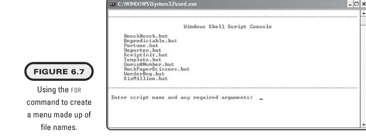

使用 FOR 命令创建文件名菜单。

Enter script name and any required arguments:

## 处理文件夹集合

你可以像处理文件集合一样轻松地使用 FOR 命令遍历文件夹集合。执行此任务的语法下文所示：

```
FOR /D %%variable IN (collection) DO command
```

> 目录（directory）和子目录（subdirectory）术语通常被同义使用，指代 Windows 文件夹。然而，子目录实际上是隶属于所引用的任何父目录的目录。

/D 指定要处理子文件夹（或子目录）。collection 指定了子文件夹所在的父文件夹的位置。例如，该脚本设计用于接受一个指定文件夹名称的参数，然后显示该文件夹内所有子文件夹的列表：

```
@ECHO

SET /A count = 0
ECHO
CHO Folder listing for: %1
ECHO
ECHO
FOR /d %%I IN (%%1\*) DO (
SET /A count += 1
ECHO%%
)
ECHO.
ECHO.
ECHO.
ECHO Total number of folders found is %1 is: %count%
ECHO.
PAUSE
```

注意，为了显示所有子文件夹，你必须在父文件夹名称末尾添加一个字符。按照编写方式，脚本期望用户传递一个如 `C:\Games` 这样的文件夹名称。脚本会在参数末尾附加 `\` 以创建 `C:\Games\*`。执行此脚本时，它将产生类似下面的结果。

Folder listing for: D:\Games

D:\Games\Dos
D:\Games\TextBased

D:\Games\Windows

Total number of folders found is D:\Games is: 3

Press any key to continue . . .

你可以使用 **FOR** 命令对特定父文件夹内的所有子文件夹进行递归检查。要执行此操作，请使用 **FOR** 命令的语法：

```
FOR /R [parentfolder] %%variable IN (.) DO command
```

在显示文件夹的语境下，**递归**（recursive）一词意味着迭代遍历 Windows 文件系统树，显示或处理每个接继的文件夹集合。


/R 切换指示 **FOR** 命令递归检查位于指定的父（或顶层）文件夹下的所有文件夹。还要注意，你必须将点字符包含在匹配的括号内，正如上面所示。例如，以下语句演示了如何显示 C:\Games 文件夹下的每个子文件夹：

```
FOR /R C:\Games %%i IN (.) DO ECHO %%i
```

执行时，显示的输出将类似于以下：

```
C:\Games\
C:\Games\Dos\
C:\Games\Dos\01d\
C:\Games\Dos\01d.\
C:\Games\TextBased\
C:\Games\TextBased\
```

## 读取文本文件

FOR 的另一个良好用途是读取和处理文本文件的内容。此类循环的语法下文所示。例如，假设你在 `contacts.txt` 文件中有以下内容：

```
=============================
Personal list
=============================
name      Internet_Address      Phone_No
Molly      zyinc.com             550-8888
William    abcd.net             550-9999
X-Man      alexander@xyz.com     050-9876
Mike       michael@ivworld.net   550-1234
Mark       markland@ivworld.com  550-7744
Nick       anyplace.com         666-8912
```

文件的前六行由标题和空行组成。文件的其余行包含制表符分隔的信息，包括姓名、电子邮件和电话。下面的脚本演示了如何使用 FOR 循环显示文件中所有人的信息：

```
FOR /F %% IN (contacts.txt) DO ECHO %%
```

在缺少 TOKENS 参数的情况下，脚本将默认使用 "TOKEN=1"。结果是，语句处理文件并显示每行的第一个令牌（例如每行的第一个单词）。结果是，语句显示如下输出：

```
Personal
Molly
William
X-Man
Mike
Mark
Nick
```

如果你想处理文件中存储的所有信息，可以如下所示重写语句：

```
FOR /F TOKENS=* %% IN (contacts.txt) DO ECHO %%
```

可以看出，语句中已添加了 TOKENS 选项并设置为 *，这意味着将处理所有令牌。执行时，该语句将在 Windows 控制台中显示如下输出：

| name | Internet_Address | Phone_No |
| :--- | :--- | :--- |
| Molly | zyinc.com | 550-8888 |
| William | abcd.net | 550-9999 |
| X-Man | alexander@xyz.com | 550-9876 |
| Mike | michael@ivworld.net | 550-1234 |
| Mark | markland@ivworld.com | 550-7744 |
| Nick | anyplace.com | 666-8912 |

如果你愿意，可以重新格式化语句，使其仅处理特定的令牌。例如，为了限制处理为文件中列出的每个人的姓名和电话，你需要指定 TOKENS=1,3。此外，你


可以通过添加 `SKIP` 选项并将其设置为 6（如下所示，用于跳过六行不需要的文本）来跳过文件头部的处理。

```
FOR /F %%TOKENS=1,3 SKIP=6 %%i IN (contacts.txt) DO ECHO Name: %%i
 ECHO Phone: %%j
```

在此示例中，标记 1 和 3 映射到参数 `%%i` 和 `%%j`。执行该语句将显示如下所示的输出。

- Name: Molly
Phone: 550-8888
- Name: William
Phone: 550-9999
- Name: X-Man
Phone: 050-9876
- Name: Mike
Phone: 550-1234
- Name: Mark
Phone: 550-7744
- Name: Nick
Phone: 666-8912

在使用 `FOR` 命令处理文件名包含空格的文件时要格外。除非你使用以下语法，否则将会导致错误：

```
FOR /F "options*" %%TYPE "filename*" command
```

使用此语法，文件名参数被替换为 `TYPE "filename"` 参数。`TYPE` 是一个必须的关键字，`filename` 是文件的名称。请确保使用如上所示的单引号和双引号。例如，可以使用以下语句处理存储在名为 `My Contacts.txt` 文件中的所有数据。

```
FOR /F "TOKENS=*" %%i IN ("My Contacts.txt") DO ECHO %%i
```

## 迭代指定的次数

`FOR` 命令支持的最后一种循环形式是按预定次数进行迭代。在这种形式的循环中，你必须为 `FOR` 命令提供一个指示起始点的数字、一个增量数字以及一个终止循环执行的最终数字。这种循环形式的语法如下。

```
FOR /L %%variable IN (begin,increment,end) DO command
```

例如，以下语句使用这种形式的 `FOR` 循环计数到 3。循环从 1 开始，每次迭代递增 1，并在第三次迭代后停止。

```
FOR /L %%i IN (1,1,3) DO ECHO %%i
```

该语句产生的输出所示。

- 1
2
3

现在看一种使用这种形式 `FOR` 循环更有用的方法。在这个示例中，我将使用 `FOR` 循环显示输出屏幕的内容。如你所见，我仅使用四条语句（不包括 `@ECHO off` 语句）就能创建屏幕。

```
@ECHO off

FOR /L %%i IN (1,1,11) DO ECHO
ECHO Welcome to ............
FOR /L %%i IN (1,1,11) DO ECHO.

PAUSE
```

图 6.8 显示了执行此脚本时显示的屏幕。

现在将此输出所需的语句数量与你在书中之前的方法使用的语句数量进行比较，如下。

```
@ECHO off

ECHO.
ECHO.
ECHO.
ECHO.
ECHO.
ECHO.
ECHO.
ECHO.
ECHO Welcome to ............
ECHO.
ECHO.
ECHO.
ECHO.
ECHO.
ECHO.
ECHO.
ECHO.
ECHO.
PAUSE
```

### 图 6.8
使用 `FOR` 循环用空行填充显示屏幕。

如果没有 `FOR` 循环，需要 24 条语句才能创建此显示。`FOR` 循环不仅为你完成了大部分工作，还可以简化你的代码，使你的脚本更小且更于管理。

这里讨论的 `FOR` 循环形式在执行之前始终检查其 `begin` 和 `end` 参数的值。如果你不小心给 `end` 参数赋值了一个大于 `begin` 参数的值，你的循环将永远不会运行。你的脚本将无声地直接跳过它，导致意想不到的结果以及难以追踪和发现的问题。因此，在使用这种形式的 `FOR` 循环时，请注意你的起始、增量和结束值。

## 回到百万美元测试

“百万美元测试”将向你介绍许多新技巧，包括在游戏欢迎界面上应用基于文本菜单，以及添加“帮助”和“关于”屏幕。此外，你还将学习如何创建一个计分报告并将其保存到玩家的硬盘上。

## 使用伪代码

随着你的 Windows 脚本变得越来越复杂，你会发现自己花费更多时间来设计它们。我认为你会发现一种特别实用的设计技术是伪代码。

伪代码是对计算机程序的高级描述，它使用自然语言而不是编程语言语法。它允许你专注于程序的逻辑，而不必担心特定语言的特定语法。


ECHO,
ECHO,
ECHO,
ECHO,

百万美元挑战赛

ECHO,
ECHO,
ECHO,
ECHO,
ECHO,
ECHO,
ECHO,
ECHO,
ECHO,
ECHO [开始] [退出] [帮助] [关于]

ECHO,

```
SET /p reply= 选项:
```

另一个让此欢迎界面与屏幕底部文本菜单显示不同的之处是：为了让菜单工作，你过去见过的 `PAUSE` 语句被 `SET` 语句取代了，后者会提示玩家从列出的菜单选项中选择一个。

# 处理菜单选择

在设计好欢迎菜单后，下一步是设置一个验证玩家输入的流程，然后引导脚本沿着正确的逻辑路径运行。必须遵循的基本逻辑之前已经使用伪代码进行了概述。

IF /I %reply%==1 CLS & GOTO :StartGame
IF /I %reply%==Play CLS & GOTO :Play
IF /I %reply%==Exit CLS & GOTO :EOF
IF /I %reply%==Help CLS & GOTO :Help
IF /I %reply%==About CLS & GOTO :About
CLS & GOTO :StartGame

如你所见，这段脚本由一系列 `IF` 语句组成，根据玩家输入的决定决定执行的操作。每种可能的行动方案都是使用 `GOTO` 命令实现的，它会将脚本的执行流切换到指定的标签。

# 创建帮助屏幕

现在是时候设置游戏的帮助屏幕了。如下所示，它从 `:HELP` 标签开始。该语句是为了允许当玩家在欢迎界面输入“帮助”时，可以使用 `GOTO` 语句跳转到脚本中的此位置。

```
:HELP

ECHO.
ECHO.
ECHO. ECHO 帮助说明
ECHO.
ECHO 在这个游戏中，你将面对一系列问题
ECHO 旨在测试你对《百万美元豪》电视剧的了解程度。
ECHO 有些问题是“填空题”，有些是判断题，还有一些是
ECHO 是否题。在你回答完所有
ECHO 问题后，系统将显示你的得分。
ECHO.
ECHO.
```

ECHO
ECHO.
ECHO.
ECHO 1. 输入 Play 并按 Enter 开始游戏。

ECHO
ECHO 2. 输入 Exit 并按 Enter 停止游戏。

ECHO.
ECHO 3. 输入 About 并按 Enter 了解更多关于游戏及其作者的信息。

ECHO
ECHO.
ECHO.
```
PAUSE
```

```
CLS
```

```
GOTO :StartGame
```

除了显示帮助玩家理解如何完成挑战的信息外，此部分还以一个 `GOTO: StartGame` 语句结束，在用户按下任意键后，脚本将关闭帮助屏幕并重新绘制欢迎界面。

# 创建关于屏幕

关于屏幕的设置与帮助屏幕完全相同，并以相同的 `GOTO :StartGame` 语句结束。包含此类屏幕的主要原因是给玩家一个了解更多挑战的机会。例如，此屏幕目前显示了脚本名称及其作者。它还显示了版权信息。然而，只需稍微修改，此屏幕就可以提供电子邮件地址或有关网站的信息。

```
:About
```

```
ECHO
```

```
ECHO.
```

```
ECHO.
```

```
ECHO.
```

```
ECHO
```

关于《百万美元挑战赛》

ECHO,
ECHO,
作者：

ECHO,
Jerry Lee Ford, Jr.

ECHO,
ECHO,
ECHO,
Copyright 2003

ECHO,
ECHO,
ECHO,
ECHO,
ECHO,
ECHO,
ECHO,
ECHO,
ECHO,
```
PAUSE
```
```
CLS
```

```
GOTO :StartGame
```

# 管理游戏运行

脚本的下一部分向玩家展示 10 个问题。每个问题逐一显示。一旦玩家回答第一个问题，屏幕就会清除并显示下一个问题。显示第一个问题并收集玩家响应的代码所示。

```
:Play
```

```
ECHO,
```

```
ECHO,
```

```
ECHO,
```

ECHO.
ECHO.
SET /p quest=1. 百万美元豪的第一个名是什么什么？

CLS

如你所见，玩家给出的答案存储在一个名为 `quest1` 的变量中。显示并收集挑战其余问题的代码与上面所示相同。为了避免重复生成相同的语句集，我在下方列出了挑战的所有问题及其对应的答案。

- 百万美元豪的第一个名是什么？Steve
- 他有 1 条还是 2 条仿生手臂？
- 他有机械眼睛或耳朵吗？
- 他的真实名字是什么？Majors
- 百万美元豪真妻的第一个名是什么？Farrah
- 扮演 Wagner 的演员是谁？
- 那个女人有机械眼睛或耳朵吗？是
- 百万美元豪是机械的吗？否
- 百万美元豪结婚过吗？是

# 开始评分

接下来，脚本开始创建评分卡。脚本使用 `MKDIR` 命令在文件夹不存在时创建它。

```
IF NOT EXIST C:\TEMP
MKDIR C:\TEMP

ECHO > C:\TEMP\Quiz.txt
ECHO 百万挑战赛评分卡 >> C:\TEMP\Quiz.txt
```

# 评分

接下来，脚本会将玩家的答案与正确答案进行比较。如果玩家正确，`right` 变量加 1。否则，执行 `ELSE` 语句，将消息重定向到文件并将 `wrong` 变量加 1。

```
IF %quest1%==Steve (
ECHO >> C:\TEMP\Quiz.txt
ECHO 1. 百万美元豪的第一个名是什么？ >> C:\TEMP\Quiz.txt
ECHO 答案：Steve - 正确！
SET /A right+=1
)
ELSE (
ECHO >> C:\TEMP\Quiz.txt
ECHO 1. 百万美元豪的第一个名是什么？ >> C:\TEMP\Quiz.txt
ECHO 答案：%quest1% - 错误。
SET /A wrong+=1
)
```

正如你预期的，评分剩余问题的代码与上面相同，为了空间，我决定不在这里列出。不过，你可以在章末的完整脚本中找到它。

# 记录结果

接下来，脚本会在评分报告中添加几个空行，随后是几行关于玩家提供的正确和错误答案的信息，如下所示。

```
ECHO >> C:\TEMP\Quiz.txt
ECHO >> C:\TEMP\Quiz.txt
ECHO >> C:\TEMP\Quiz.txt
----------------------------------------------------------------------
C:\TEMP\Quiz.txt
ECHO >> C:\TEMP\Quiz.txt
ECHO 评分卡：>> C:\TEMP\Quiz.txt
ECHO >> C:\TEMP\Quiz.txt
ECHO >> C:\TEMP\Quiz.txt
ECHO 挑战总问题数 = 10 >> C:\TEMP\Quiz.txt
ECHO >> C:\TEMP\Quiz.txt
ECHO 正确回答总数 = %right% >> C:\TEMP\Quiz.txt
ECHO >> C:\TEMP\Quiz.txt
ECHO 错误回答总数 = %wrong% >> C:\TEMP\Quiz.txt
```

# 显示结果

脚本的最后一部分所示。如你所见，它显示了上一个部分添加到评分报告中的相同摘要信息。此外，它还会显示一条告知玩家评分卡的存在和位置的消息。

```
CLS

ECHO
ECHO
ECHO
ECHO 百万豪评分卡
ECHO
ECHO
ECHO
ECHO
```


ECHO,

ECHO 测验总数 = 10

ECHO.

ECHO 正答总数 = %right%

ECHO.

ECHO 答错总数 = %wrong%

ECHO.

--------------------------------------------------------------------------------

ECHO.

ECHO.

ECHO.

ECHO 详细的评分卡报告可以在 C:\TEMP\Quiz.txt 找到。

ECHO.

ECHO.

ECHO.

ECHO.

GOTO :EOF

最后，尽管在脚本的此时阶段没有必要，但 GOTO :EOF 语句仍会执行，强制终止脚本。

## 最终结果

你现在已经有了完成“百万美元豪测验”所需的所有信息。我建议你在查看我在下方提供的完整代码之前，先尝试自己完成它。与之前的章节项目一样，我将脚本模板添加到“百万美元豪测验”中，并贯穿嵌入了注释，以解释每一步发生的情况。

```
@ECHO off
```

```
REM *********************************************************************
```

```
REM
```

```
REM 脚本名称: SixMillion.bat
```

```
REM 作者: Jerry Ford

REM 日期: 2003年7月12日

REM

REM 描述: 此 Windows 脚本游戏测试了玩家对
70 年代电视剧《百万豪翁》（Six-Million-Dollar Man）的了解。

REM

****************************************************************

REM 脚本初始化部分

REM 将颜色方案设置为黑底黄字

COLOR OE

REM 清除显示

CLS

REM 在 Windows 命令控制台标题栏中显示游戏名称

TITLE = THE SIX MILLION DOLLAR QUIZ

REM 定义并初始化将用于跟踪正答和答错
REM  总数的变量

SET /A Right = 0

SET /A Wrong = 0

REM 主处理部分

REM 创建一个返回点

:StartGame

REM 显示初始欢迎屏幕

ECHO.
ECHO.
ECHO.
ECHO.
ECHO.
ECHO.

S I X M I L L I O N D O L L A R Q U I Z

ECHO.
ECHO.
ECHO.
ECHO.
ECHO.
ECHO.
ECHO.
ECHO.
ECHO.
ECHO.
ECHO.
ECHO.
ECHO.
ECHO.

ECHO [开始] [退出] [帮助] [关于]

ECHO.

```
REM 获取玩家的响应
```

```
SET /p reply= 选项:
```

REM Determine玩家想做什么

```
IF /I "%reply%" == " CLS & GOTO :StartGame
```

```
IF /I %reply%== Play CLS & GOTO :Play
```

```
IF /I %reply%== Exit CLS & GOTO :EOF
```

IF /I %reply% -- Help CLS & GOTO :Help

IF /I %reply% -- About CLS & GOTO :About

REM 提供了错误的响应，因此重新显示欢迎屏幕
CLS & GOTO :StartGame

REM 设置帮助屏幕
:HELP

ECHO.
ECHO.
ECHO.
ECHO                                帮助说明
ECHO.
ECHO 在这个游戏中，你将面对一系列问题
ECHO 旨在测试你对《百万豪翁》电视剧的知识。
ECHO 有些问题是*填空题*，有些是判断题，有些是
ECHO 是否题。在你回答完所有
ECHO 问题后将显示分数。

ECHO.
ECHO.
ECHO.
ECHO.
ECHO 1. 输入 Play 并按回车开始游戏。
ECHO.
ECHO 2. 输入 Exit 并按回车停止游戏。
ECHO.
ECHO 3. 输入 About 并按回车了解更多关于游戏及其作者的信息。
ECHO.
ECHO.

ECHO.

ECHO.

REM 暂停给玩家时间阅读屏幕

PAUSE

REM 清除显示

CLS

REM 返回欢迎屏幕

GOTO :StartGame

REM 设置关于屏幕

:About

ECHO.
ECHO.
ECHO.
ECHO.

关于百万美元豪测验

ECHO.

作者：

ECHO.
ECHO.

Jerry Lee Ford, Jr.

ECHO.
ECHO.
ECHO.

版权所有 2003

ECHO.
ECHO.
ECHO.
ECHO.
ECHO.
ECHO.

ECHO.
ECHO.
ECHO.
ECHO.

```
REM 暂停给玩家时间阅读屏幕
PAUSE
```

```
REM 清除显示
CLS
```

```
REM 返回欢迎屏幕
GOTO :StartGame
```

```
REM 开始游戏
:Play
```

ECHO.
ECHO.
ECHO.
ECHO.

```
REM 问一个问题
SET /p quest1=1. 百万豪翁的名是什么？
```

```
REM 清除显示
CLS
```

ECHO.
ECHO.
ECHO.
ECHO.
ECHO.
ECHO.

REM 问一个问题
SET /p quest2=2. 他有 1 条还是 2 条机械手臂？

REM 清除显示
CLS

ECHO.
ECHO.
ECHO.
ECHO.
ECHO.

REM 问一个问题
SET /p quest3=3. 他有机械眼睛还是机械耳朵？

REM 清除显示
CLS

ECHO.
ECHO.
ECHO.
ECHO.
ECHO.

REM 问一个问题
SET /p quest4=4. 他的姓是什么？

REM 清除显示
CLS

ECHO.
ECHO.
ECHO.
ECHO.

REM 问一个问题
SET /p quest5=5. 百万豪翁妻的名是什么？

REM 清除显示
CLS

ECHO.
ECHO.
ECHO.
ECHO.

REM 问一个问题
SET /p quest6=6. 扮演机械女性的演员的姓是什么？

REM 清除显示
CLS

ECHO.
ECHO.
ECHO.
ECHO.
ECHO.

REM 问一个问题
SET /p quest7=7. 机械女性有机械眼睛还是机械耳朵？

REM 清除显示
CLS

ECHO.
ECHO.
ECHO.
ECHO.
ECHO.

REM 问一个问题
SET /p question=8. 对/错：机械女性比百万豪翁更贵。

REM 清除显示
CLS

ECHO.
ECHO.
ECHO.
ECHO.

REM 问一个问题
SET /p question=9. 对/错：百万豪翁被称为“大山谷”（Big Valley）。

REM 清除显示
CLS

ECHO.
ECHO.
ECHO.
ECHO.

REM 问一个问题
SET /p quest10=10. 是/否：百万豪翁和机械女性结婚了吗？

REM 清除显示
CLS

REM 如果 C:\TEMP 文件夹不存在，则创建它
IF NOT EXIST C:\TEMP
  MKDIR C:\TEMP

REM 如果 Quiz.txt 文件不存在，则创建它
ECHO > C:\TEMP\Quiz.txt

REM 开始将游戏结果写入报告
ECHO 百万豪翁测验报告 >> C:\TEMP\Quiz.txt
ECHO >> C:\TEMP\Quiz.txt
ECHO >> C:\TEMP\Quiz.txt

REM 确定十个问题中的每个正错，并添加相应的文本
IF /I quest1 == (
  ECHO >> C:\TEMP\Quiz.txt
  CHO 1. 百万豪翁的名是什么？ >> C:\TEMP\Quiz.txt
  ECHO >> C:\TEMP\Quiz.txt
  ECHO 你的答案是 Steve - 正确！ >> C:\TEMP\Quiz.txt
  ECHO >> C:\TEMP\Quiz.txt
  SET /A right += 1
) ELSE (
  ECHO >> C:\TEMP\Quiz.txt
  CHO 1. 百万豪翁的名是什么？ >> C:\TEMP\Quiz.txt
  ECHO >> C:\TEMP\Quiz.txt
  ECHO 你的答案是 %quest1% - 错误！ >> C:\TEMP\Quiz.txt
  ECHO >> C:\TEMP\Quiz.txt
)

# 第6章 创建循环处理数据

SET /A wrong == 1

IF /I %quest2% == 1 (
  ECHO. >> C:\TEMP\Quiz.txt
  CHO 2. 他有 1 条还是 2 条机械手臂？ >> C:\TEMP\Quiz.txt
  CHO. >> C:\TEMP\Quiz.txt
  CHO 你的答案是：1 - 正确！ >> C:\TEMP\Quiz.txt
  CHO. >> C:\TEMP\Quiz.txt
  SET /A right == 1
) ELSE (
  ECHO. >> C:\TEMP\Quiz.txt
  CHO 2. 他有 1 条还是 2 条机械手臂？ >> C:\TEMP\Quiz.txt
  CHO. >> C:\TEMP\Quiz.txt
  CHO 你的答案是：%quest2% - 错误！ >> C:\TEMP\Quiz.txt
  CHO. >> C:\TEMP\Quiz.txt
  SET /A wrong == 1
)

IF /I %quest3% == Eye (
  ECHO. >> C:\TEMP\Quiz.txt
  CHO 3. 他有机械眼睛还是机械耳朵？ >> C:\TEMP\Quiz.txt
  CHO. >> C:\TEMP\Quiz.txt
  CHO 你的答案是：眼睛 - 正确！ >> C:\TEMP\Quiz.txt
  CHO. >> C:\TEMP\Quiz.txt
  SET /A right == 1
) ELSE (
  ECHO. >> C:\TEMP\Quiz.txt
  CHO 3. 他有机械眼睛还是机械耳朵？ >> C:\TEMP\Quiz.txt
  CHO. >> C:\TEMP\Quiz.txt
  CHO 你的答案是：%quest3% - 错误！ >> C:\TEMP\Quiz.txt
  ECHO. >> C:\TEMP\Quiz.txt
)

SET /A wrong += 1

IF /I %quest4% == Majors (
  ECHO >> C:\TEMP\Quiz.txt
  CHO 4. 他的姓是什么？ >> C:\TEMP\Quiz.txt
  ECHO >> C:\TEMP\Quiz.txt
  ECHO 你的答案是：Majors - 正确！ >> C:\TEMP\Quiz.txt
  ECHO >> C:\TEMP\Quiz.txt
  SET /A right += 1
) ELSE (
  ECHO >> C:\TEMP\Quiz.txt
  CHO 4. 他的姓是什么？ >> C:\TEMP\Quiz.txt
  ECHO >> C:\TEMP\Quiz.txt
  ECHO 你的答案是：%quest4% - 错误！ >> C:\TEMP\Quiz.txt
  ECHO >> C:\TEMP\Quiz.txt
)

IF /I %quest5% == Farah (
  ECHO >> C:\TEMP\Quiz.txt
  CHO 5. 百万豪翁妻的名是什么？ >> C:\TEMP\Quiz.txt
  ECHO >> C:\TEMP\Quiz.txt
  ECHO 你的答案是：Farah - 正确！ >> C:\TEMP\Quiz.txt
  ECHO >> C:\TEMP\Quiz.txt
  SET /A right += 1
) ELSE (
  ECHO >> C:\TEMP\Quiz.txt
  CHO 5. 百万豪翁妻的名是什么？ >> C:\TEMP\Quiz.txt
  ECHO >> C:\TEMP\Quiz.txt
  ECHO 你的答案是：%quest5% - 错误！ >> C:\TEMP\Quiz.txt
  ECHO >> C:\TEMP\Quiz.txt)
```


```batch
SET /A wrong += 1
)
```

```batch
IF /I %quest6% == Wagner (
ECHO. >> C:\TEMP\Quiz.txt
ECHO 6. What was the last name of the actress who played the bionic woman? >> C:\TEMP\Quiz.txt
ECHO. >> C:\TEMP\Quiz.txt
ECHO Your answer was: Wagner - Correct! >> C:\TEMP\Quiz.txt
ECHO. >> C:\TEMP\Quiz.txt
SET /A right += 1
)
```

```batch
ELSE (
ECHO. >> C:\TEMP\Quiz.txt
ECHO 6. What was the last name of the actress who played the bionic woman? >> C:\TEMP\Quiz.txt
ECHO. >> C:\TEMP\Quiz.txt
ECHO Your answer was: %quest6% - Incorrect. >> C:\TEMP\Quiz.txt
ECHO. >> C:\TEMP\Quiz.txt
SET /A wrong += 1
)
```

```batch
IF /I %quest7% == Ear (
ECHO. >> C:\TEMP\Quiz.txt
ECHO 7. Did the bionic woman have a bionic eye or bionic ear? >> C:\TEMP\Quiz.txt
ECHO. >> C:\TEMP\Quiz.txt
ECHO Your answer was: Ear - Correct! >> C:\TEMP\Quiz.txt
ECHO. >> C:\TEMP\Quiz.txt
SET /A right += 1
)
```

```batch
ELSE (
ECHO. >> C:\TEMP\Quiz.txt
ECHO 7. Did the bionic woman have a bionic eye or bionic ear? >> C:\TEMP\Quiz.txt
ECHO. >> C:\TEMP\Quiz.txt
ECHO Your answer was: %quest7% - Incorrect. >> C:\TEMP\Quiz.txt
ECHO. >> C:\TEMP\Quiz.txt
SET /A wrong += 1
)
)
```

```batch
IF /I %quest8% == F (
ECHO >> C:\TEMP\Quiz.txt
ECHO 8. True/False: The bionic woman cost more than the Six-Million-Dollar Man. >> C:\TEMP\Quiz.txt
ECHO >> C:\TEMP\Quiz.txt
ECHO Your answer was False - Correct! >> C:\TEMP\Quiz.txt
ECHO >> C:\TEMP\Quiz.txt
SET /A right += 1
) ELSE (
ECHO >> C:\TEMP\Quiz.txt
ECHO 8. True/False: The bionic woman cost more than the Six-Million-Dollar Man. >> C:\TEMP\Quiz.txt
ECHO >> C:\TEMP\Quiz.txt
ECHO Your answer was: %quest8% - Incorrect. >> C:\TEMP\Quiz.txt
ECHO >> C:\TEMP\Quiz.txt
SET /A wrong += 1
)
```

```batch
IF /I %quest9% == T (
ECHO >> C:\TEMP\Quiz.txt
ECHO 9. True/False: The Six-Million-Dollar Man was known as Heath on the "Big Valley." >> C:\TEMP\Quiz.txt
ECHO >> C:\TEMP\Quiz.txt
ECHO Your answer was: True - Correct! >> C:\TEMP\Quiz.txt
ECHO >> C:\TEMP\Quiz.txt
SET /A right += 1
) ELSE (
ECHO >> C:\TEMP\Quiz.txt
ECHO 9. True/False: The Six-Million-Dollar Man was known as Heath on the "Big Valley." >> C:\TEMP\Quiz.txt
ECHO >> C:\TEMP\Quiz.txt
ECHO Your answer was: %quest9% - Incorrect. >> C:\TEMP\Quiz.txt
ECHO >> C:\TEMP\Quiz.txt
)
SET /A wrong += 1
)
```

```batch
IF /I %quest10% == Yes (
ECHO >> C:\TEMP\Quiz.txt
ECHO 10. Yes/No: Did the Six-Million-Dollar Man ever marry the Bionic woman? >> C:\TEMP\Quiz.txt
ECHO >> C:\TEMP\Quiz.txt
ECHO Your answer was: Yes - Correct! >> C:\TEMP\Quiz.txt
ECHO >> C:\TEMP\Quiz.txt
SET /A right += 1
) ELSE (
ECHO >> C:\TEMP\Quiz.txt
ECHO 10. Yes/No: Did the Six-Million-Dollar Man ever marry the Bionic woman? >> C:\TEMP\Quiz.txt
ECHO >> C:\TEMP\Quiz.txt
ECHO Your answer was: %quest10% - Incorrect. >> C:\TEMP\Quiz.txt
ECHO >> C:\TEMP\Quiz.txt
SET /A wrong += 1
)
```

REM Append a few blank lines and then append score card

```batch
ECHO >> C:\TEMP\Quiz.txt
ECHO >> C:\TEMP\Quiz.txt
ECHO >> C:\TEMP\Quiz.txt
ECHO >> C:\TEMP\Quiz.txt
ECHO >> C:\TEMP\Quiz.txt
ECHO Score Card: >> C:\TEMP\Quiz.txt
ECHO >> C:\TEMP\Quiz.txt
ECHO >> C:\TEMP\Quiz.txt
ECHO Total number of questions on the quiz = 10 >> C:\TEMP\Quiz.txt
ECHO >> C:\TEMP\Quiz.txt
ECHO Total number of correctly answered questions = %right% >> C:\TEMP\Quiz.txt
ECHO >> C:\TEMP\Quiz.txt
ECHO Total number of incorrectly answered questions = %wrong% >> C:\TEMP\Quiz.txt
```

REM Clear the screen
CLS
ECHO.
ECHO.
ECHO.
ECHO.
ECHO.
ECHO Score Card:
ECHO.
ECHO.
ECHO Total number of questions on the quiz = 10
ECHO.
ECHO Total number of correctly answered questions = %right%
ECHO.
ECHO Total number of incorrectly answered questions = %wrong%

REM Terminate the script
EXIT


# 整理你的 Windows Shell 脚本

正如你已经多次看到的，Windows Shell 脚本默认从上到尾执行的。然而，你可以使用 `GOTO` 命令配合 `LABEL`（标签）语句引导脚本从一个位置跳转到另一个位置并恢复执行。你也多次看到我使用 `GOTO` 命令和 `LABEL` 语句来设置循环。

Windows Shell 提供了 `GOTO` 命令和 `LABEL` 语句的另一个用途：创建子程序。每当你使用 `GOTO` 命令和 `LABEL` 语句将处理控制切换到脚本的后续部分时，就会创建一个子程序（与循环不同，循环中处理控制会传回脚本的较早部分）。

Windows 还允许你使用 `CALL` 命令和 `LABEL` 语句定义程序。通过程序，你可以将处理控制从脚本的一个部分切换到另一个部分，然后在程序执行完毕后返回。

# 理解标签 (Labels)

尽管你已经见过它们很多次，但我还没有正式定义过标签。标签是你放置在 Windows Shell 脚本内部的标记。标签用于建立循环、子程序和程序。`LABEL` 语句的语法所示所示。

```
:LABEL
```

如你所见，一个标签由冒号字符加上标签名称组成。标签名称不区分大小写，在指定标签时可以使用字母、数字的组合以及下划线字符。

# 定义子程序 (Subroutines)

当你设置一个子程序并执行它时，你的脚本会跳过 `GOTO` 命令之后、指定的 `LABEL` 语句之前的任何语句，如图 7.6 所示。

# 205

# 第 7 章 创建程序和子程序

```
@ECHO off
****************************************************************
REM
REM Script Name: Xxxxx.bat
REM Author: Jerry Ford
REM Date: XXXXX, XXXXX
REM
REM Description: XXXXXXXXXXXXXXXXXXXXXXXXX

REM
REM ***************************************************************

REM ****** Script Initialization Section *****

...
nREM ****** Main Processing Section ******

...
GOTO :ProcessFiles

REM ****** Procedure Section ******
:ProcessFiles
...
GOTO :EOF
```

# 图 7.6

子程序是通过使用 `GOTO` 命令和 `LABEL` 语句创建的。

如图 7.6 所示，`GOTO` 命令执行并调用了一个子程序 `:ProcessFiles`。箭头显示了脚本执行如何跳过 `GOTO` 命令和 `:ProcessFiles` 标签之间的所有语句。

子程序完全访问可能传递给脚本的任何参数。此外，子程序内对变量的任何更改都会影响整个脚本。


Windows Shell 提供了一个内置函数名 `:EOF`（文件结束），你整本书书中都见过它。Windows 脚本会在脚本文件末尾自动终止执行。因此，当你使用 `GOTO` 命令执行 `:EOF` 子程序时，你实际上只是告诉你的脚本假装已到达脚本文件的末尾。

# 技巧 (TRICK)

看一个包含三个子程序的脚本工作示例，如下所示。

```
@ECHO off

COLOR OE

TITLE = Subroutine Demo

CLS

FOR /L %%I IN (1,1,4) DO ECHO
CHO This script maintains the C:\Temp folder.
FOR /L %%I IN (1,1,16) DO ECHO.
ECHO Options: [Delete] [Rename] [Exit]
ECHO.

SET /P reply=What do you want to do to its contents?

IF /I %reply%==Delete (
GOTO :DeleteFiles
)

IF /I %reply%==Rename (
GOTO :RenameFiles
)

IF /I %reply%==Exit (
GOTO :Exit
)

GOTO :EOF

:DeleteFiles
```

ECHO Deleting all files stored in C:\TEMP

DEL C:\TEMP\.**

GOTO :EOF

:RenameFiles

ECHO Renaming all files stored in C:\Temp

REN C:\Temp\*.* *.bak

GOTO :EOF

:Exit

ECHO Terminating script execution

GOTO :EOF

> 使用通配符识别多个文件时要小心。可能会意外删除了你想要的文件。


此脚本设计用于维护 C:\Temp 文件夹。它可以执行三组不同的动作，每组动作都组织在自己的自己的函数中。第一个函数被称为 `:DeleteFiles`，它的工作是删除存储在文件夹中的所有文件。第二个子程序被称为 `:RenameFiles`，它的工作是使用 .bak 文件扩展名重命名文件夹中找到的所有文件。第三个子程序被称为 `:Exit`。它的工作是在用户意外运行脚本或改变删除或重命名 C:\Temp 文件夹中存储文件的主意时，终止脚本而不执行任何其他操作。


> 在上一个示例中，确保在指定的 SET 命令消息提示的文本末尾至少包含一个空格。否则，消息提示和用户提示将

在上一个示例中，确保在指定的 SET 命令消息提示的文本末尾至少包含一个空格。否则，消息提示和用户提示

Windows Shell 提供了一个内置函数名 `:EOF`（文件结束），你整本书书中都见过它。Windows 脚本会在脚本文件末尾自动终止。因此，当你使用 `GOTO` 命令执行 `:EOF` 子程序时，你实际上只是告诉你的脚本假装已到达脚本文件的末尾。

# 使用程序改进结构 (Improving Organization with Procedures)

正如我已经提到的，`CALL` 命令可以配合 `LABEL` 语句来设置程序。与子程序将处理控制切换到脚本的后续部分不同，程序在执行完毕后会返回控制。

Windows 支持两种类型的程序，如下所示：

- 内部程序：在脚本内定义的、被调用并返回程序。
- 外部程序：调用另一个脚本并执行并返回。

# 设置内部程序 (Setting Up Internal Procedures)

内部程序与子程序相似。然而，与子程序不同，它们如图 7.7 所示。

与子程序一样，内部程序以 `LABEL` 开始并以 `GOTO :EOF` 结束。如你所见，`CALL` 语句以 `CALL` 命令开头，跟着空格、冒号以及程序的名称。

```
CALL :ProcedureName
```

程序的开头由 `LABEL ProcedureName` 标记。程序的结束由 `GOTO :EOF` 标记。之间的这一切构成了程序本身。

# 209

```
@ECHO off
****************************************************************
REM
REM Script Name: Xxxx.bat
REM Author: Jerry Ford
REM Date: Xx, XXXXX
REM
REM Description: XXXXXXXXXXXXXXXXX***
REM
REM ***************************************************************

REM ****** Script Initialization Section *****


REM ****** Main Processing Section ******


CALL :ProcessFiles
...
REM ****** Procedure Section ******
```

# 第 7 章 创建程序和子程序


内部程序是通过 `CALL` 命令和 `LABEL` 语句创建的。

:ProcessFiles

GOTO :EOF


> 不要忘记用 `GOTO :EOF` 结束所有的程序。否则，Windows Shell 将将程序后的任何语句视为程序的一部分，导致不可预知的结果。

与子程序完全访问传递给脚本的所有参数不同，程序预期接受并处理它们自己的参数。要向脚本传递参数，只需将空格分隔的参数添加到 `CALL` 语句的末尾，如下所示。

```
CALL :ProcedureName arg1 arg2 arg3
```

程序可以像 %1, %2, %3 等访问这些程序参数，就像脚本访问脚本参数一样。由于程序有自己独特的一组参数，它们不允许直接访问脚本参数。即使程序没有处理任何程序级的参数，也是如此。然而，你始终可以将脚本级参数传递给


如有需要，可以调用过程。例如，要调用名为 `:ProcessFiles` 的过程并向其传递所有脚本参数，您将使用以下语句：

```
CALL :ProcessFiles %*
```

好的，现在来看看如何将过程作为脚本开发的组织工具。在这个示例中，第 2 章“与 Windows 命令行界面交互”中介绍过的 `Unpredictable.bat` 脚本已使用过程进行了重新设计。

```
@ECHO off

************************************************************************************
REM
REM Script Name: Unpredictable2.bat
REM Author: Jerry Ford
REM Date: July 20, 2003
REM
REM Description: This Windows shell script randomly adjusts the Windows shell
REM working environment
REM
************************************************************************************
```

```
REM Script Initialization Section
```

```
CLS
```

```
REM Main Processing Section
```

```
CALL :GetRandomVariable

If %TestVariable% GTR 22000 (

CALL :FirstConfiguration

GOTO :EOF
)
```

# 211

# 第 7 章 创建过程和子程序

```

If %TestVariable% GTR 11000 (

CALL :SecondConfiguration

GOTO :EOF

)

```

```
If %TestVariable% GTR 0 (

CALL :ThirdConfiguration

GOTO :EOF

)

```

```
REM Procedure Section
```

```
:GetRandomVariable

SET TestVariable=%random%

GOTO :EOF
```

```
:FirstConfiguration

CLS

TITLE UCP - The Unpredictable Command Prompt %TestVariable%

COLOR 02

ECHO Greetings %username%, Code well and Prosper.

ECHO.

PROMPT

GOTO :EOF
```

```
:SecondConfiguration

CLS

TITLE Demo - Manipulating the Windows console environment %TestVariable%

COLOR 0E

ECHO Hello. It is good to be working with you today!
```

```
ECHO.
PROMPT $dg
GOTO :EOF

:ThirdConfiguration
CLS
TITLE Windows Shell Scripting Example.  - %TestVariable%
COLOR E
ECHO Bool Did I scare you?
ECHO.
PROMPT $p
GOTO :EOF
```

如您所示，脚本的过程部分包含一个过程调用和三个条件 IF 语句，这些语句也会根据情况进行过程调用。当以此方式重新组织时，主处理部分承担了管理脚本整体执行流的任务。然而，实际工作是由位于脚本过程部分的四个过程集合完成的。

过程简化了脚本的组织结构，并有助于创建模块化代码。我所指的“模块化”是将相关的语句集合组合在一起。以这种方式分组语句可以提高您创建可重用代码的能力。此外，它通过隔离功能并为脚本提供可预测的结构，使得脚本维护变得更容易。

## 创建外部过程

外部过程是另一个 Windows 命令行脚本，您可以通过 `CALL` 命令从另一个 Windows 命令行脚本内部调用或启动它的执行。但您指定的不是一个过程名称，而是使用以下语法指定脚本名称：

```
CALL ScriptName
```

与内部过程一样，您也可以向外部过程传递参数。当被调用的脚本结束执行时，调用脚本将从 `CALL` 语句之后的语句开始继续执行自身的执行。图 7.8 描述了外部过程的工作原理。您可以根据意愿对外部脚本进行多次调用。每个外部脚本都在与调用脚本相同的执行环境中执行。因此，

# 213

@ECHO off
***************************************
REM
REM Script Name: Xxxxx.bat
REM Author: Jerry Ford
REM Date: XXXXX XX, XXXX
REM
REM Description: XXXXXXXXXXXXX

REM
REM ***************************************
REM ***** Script Initialization Section *****

...

REM ***** Main Processing Section *****

# 图 7.8

外部过程允许脚本执行另一个脚本，并等待被调用的脚本完成后继续执行自身的执行。

```
CALL ProcessFiles
```

REM ***** Procedure Section *****

第 7 章 创建过程和子程序

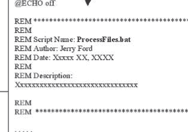

被调用脚本对最初由调用脚本定义的脚本变量所做的更改，一旦调用脚本恢复执行自身的执行将生效。

为了演示外部过程的操作，我如下所示重新设计了 `Unpredictable2.bat` 脚本。这次，我提取了构成脚本最后三个内部过程的语句，并将粘贴到三个外部脚本中，这些脚本将作为外部过程被调用和执行。我将脚本命名为 `FirstConfig.bat`、`SecondConfig.bat` 和 `ThirdConfig.bat`。

```
@ECHO off

REM ***************************************
REM

REM Script Name: Unpredictable3.bat

REM Author: Jerry Ford

REM Date: July 20, 2003

REM

REM Description: This Windows shell script randomly adjusts the Windows shell

REM working environment

REM

REM *********************************************************************************

# REM Script Initialization Section

```
CLS
```

# REM Main Processing Section

```
CALL :GetRandomVariable

If %TestVariable% GTR 22000 (
    CALL FirstConfig.bat
ECHO Configuration now set.
GOTO :EOF
)

If %TestVariable% GTR 11000 (
    CALL SecondConfig.bat
ECHO Configuration now set.
GOTO :EOF
)

If %TestVariable% GTR 0 (
    CALL ThirdConfig.bat
ECHO Configuration now set.
```

# 237

)

过程部分

:GetRandomVariable

SET TestVariable=%random%

GOTO :EOF

# 下述语句显示了 FirstConfig.bat。

CLS

TITLE UCP - The Unpredictable Command Prompt %TestVariable%

COLOR 02

ECHO Greetings %username%, Code well and Prosper.

ECHO.

PROMPT

GOTO :EOF

# 下述语句显示了 SecondConfig.bat。

CLS

TITLE Demo - Manipulating the Windows console environment %TestVariable%

COLOR 0E

ECHO Hello. It is good to be working with you today!

ECHO.
PROMPT $dg

# 下述语句显示了 ThirdConfig.bat。

CLS
TITLE Windows Shell Scripting Example.  - %TestVariable%
COLOR E
ECHO Bool Did I scare you?
ECHO.
PROMPT $p
GOTO :EOF

当执行时，新的 `Unpredictable3.bat` 脚本顺序调用每个外部过程，产生与之前相同的结果。

215

第 7 章 创建过程和子程序

# 216

外部脚本和调用脚本在相同的 实例中运行。这意味着被调用脚本可以访问调用脚本已定义的任何变量。因此，除非希望调用脚本和被调用脚本以这种方式共享变量，否则请确保在每个脚本中使用不同的变量集。


为了在过程内部局部化变量访问，请确保每个过程的第一条语句是 `SETLOCAL` 语句，最后一条语句是 `ENDLOCAL` 语句，如下所示。

:DemoProcedure

```
SETLOCAL

--

--

ENDLOCAL
GOTO :EOF
```

使用这种格式，在过程中定义的任何变量都将与脚本的其他部分隔离开来，并在过程结束时被销毁。

> 在过程内部局部化变量时，请格外小心，确保你记得执行 `ENDLOCAL` 命令。否则，你的过程变量将变成脚本变量，并可能产生破坏性影响。你应该特别警惕的是在过程中内部使用 `GOTO` 命令，因为这可能会在没有先完成过程的情况下将处理控制权转移到脚本的另一个部分。在这种情况下，你可以将 `GOTO` 命令转换为复合命令，以保留变量的局部化，如下所示。

```
ENDLOCAL & GOTO :ProcedureName
```

## 从你的过程中外传传数据（Tunneling Data）

虽然通过 `SETLOCAL` 和 `ENDLOCAL` 命令在过程内部局部化变量有优点，但它也有一个缺点。它使得你的内部过程很难将任何结果返回给脚本，这会极大地限制过程的有用性。例如，下面的过程演示了这种局限性：

:DemoProcedure

```
SETLOCAL
SET /A ret = 5
ENDLOCAL
GOTO :EOF
```

在这个过程中，名为 `ret` 的变量值被设置为 5。然而，该变量及其值在脚本的其他部分无法访问。

使用一种被称为“变量隧道（variable tunneling）”的编程技术，你可以绕过这个局限性。变量隧道的工作原理如下：首先，你创建一个包含你想要传递给脚本其他部分的任何变量，然后使用以下语法将 `ENDLOCAL` 命令转换为复合命令：

```
ENDLOCAL & SET ret=%%
```

结果将是一条语句，它在结束过程变量作用范围的同时，向外传出（或使 `ret` 变量变得可访问），如下面的示例所示：

:DemoProcedure

```
SETLOCAL
SET /A RET = 5
ENDLOCAL & SET ret=%%
GOTO :EOF
```

## 回到剪刀石头布布游戏

在剪刀石头布布游戏中，玩家从三个可用选项中选择一个。然后将玩家的选择与计算机随机生成的选择进行比较，并显示比较结果。确定游戏结果的标准非常简单，并列在表 7.1 中。

## 使用流程图作为脚本开发工具

正如你所看到的，剪刀石头布游戏提供了一个演示使用过程组织 Windows Shell 脚本优势的绝佳机会。在设计这个游戏的初步步骤中，让我们来看一种名为“流程图”的新型开发工具，我认为你会发现它很有用。

> 流程图是一个图形大纲，提供了脚本组件的高级概述，并显示了它们之间的关系。

## 表 7.1 剪刀石头布规则

| 玩家 1 选择 | 玩家 2 选择 | 结果 |
| --- | --- | --- |
| 石头 | 石头 | 平局 |
| 纸 | 纸 | 平局 |
| 剪刀 | 剪刀 | 石头破剪刀：玩家 1 获胜 |
| 石头 | 剪刀 | 石头破剪刀：玩家 2 获胜 |
| 纸 | 石头 | 纸住石头：玩家 1 获胜 |
| 石头 | 纸 | 纸住石头：玩家 2 获胜 |
| 剪刀 | 纸 | 剪刀剪纸：玩家 1 获胜 |
| 纸 | 剪刀 | 剪刀剪纸：玩家 2 获胜 |

程序员通常从从图设计开始开始复杂项目的开发。流程图为高层逻辑的大纲提供了视觉化工具。此外，它们还提供了作为优秀文档工具的额外益处。

图 7.9 显示我为这个剪刀石头布项目开发的流程图。正如你所看到的，流程图的设计并不复杂。我使用矩形来识别离散的代码模块。我使用菱形表示决策点，使用圆形表示结束。我使用箭头表示逻辑流。

大致上，流程图逻辑如下：首先初始化脚本。然后显示主菜单。脚本收集玩家选择并与计算机选择进行比较。最后，显示游戏结果。如果玩家决定再次玩，游戏将重新开始；否则，显示统计数据并结束游戏。

图 7.9 `) `

使用流程图有助于在 Windows 控制台中显示游戏标题的标题。

## 在现实世界中（THE REAL WORLD）

项目越复杂，流程图就越有益。使用流程图有助于将项目拆解为任务。

## 将流程图设计转换为脚本需求

使用流程图作为基础，将剪刀石头布游戏分为九个步骤：

- 1. 初始化部分
- 2. 主处理部分
- 3. :DisplayMenu 过程
- 4. :CollectChoice 过程
- 5. :GetComputerChoice 过程
- 6. :CompareChoices 过程
- 7. :CheckForInvalid 过程
- 8. :DisplayResults 过程
- 9. :DisplayStats 过程

### 创建初始化部分

脚本的初始化部分如下，在 Windows 标题中显示游戏名称并将颜色方案设置为黄色。此外，定义了整个脚本使用的四个变量并赋予了初始值。这些变量将在游戏结束时提供关于胜负、平局和无效选择的信息。

```
TITLE = Rock, Scissors
```

```
COLOR OE
```

```
SET /aWins = 0
SET /aLosses = 0
SET /aTies = 0
SET /aInvalid = 0
```


与所有过程一样，此过程以 `GOTO :EOF` 语句结束，该语句会将脚本的处理控制权返回到调用此过程的语句之后的语句。

## 开发 :CollectChoice 过程

下所示的 `:CollectChoice` 过程定义了一些变量，然后显示一个提示玩家输入选择的屏幕。

```
:CollectChoice

SET answer=No Answer*
SET response=N
SET results=None

CLS

FOR /L %%i IN (1,1,8) DO ECHO.

SET /p answer= Type either rock, paper or scissors:

GOTO :EOF
```

## 开发 :GetChoice 过程

下所示的 `:GetChoice` 过程通过引用随机环境变量获取一个 0 到 32,767 之间的随机数。如果随机数大于 22,000，则给计算机分配选择“石头”。如果随机数小于 22,000 且大于 11,000，则给计算机分配选择“剪刀”。最后，如果随机数小于 11,000，则给计算机分配选择“布”。

```
:GetChoice

SET GetRandomNumber=%random%

If %GetRandomNumber% GTR 22000 (
```
SET CardImage=rock
GOTO :Continue
)
```

```
IF %GetRandomNumber% GTR 11000 (
SET CardImage=scissors
GOTO :Continue
)
```

```
SET CardImage=paper

:Continue

GOTO :EOF
```

在此过程中包含 `:Continue` 标签允许该过程在第一个条件测试证明为真时，立即跳过任何剩余语句的执行。例如，如果随机生成的数字大于 22,000，那么该过程没有理由处理位于其第一个条件测试之外的其他语句。

## 开发 CompareChoices 过程

下所示的 `CompareChoices` 过程运行一系列 `IF` 语句，以确定玩家输入的选择是否等于石头、布或剪刀。如果玩家输入了其中一个选择，则将执行三个嵌套的 `IF` 语句来判断玩家是赢了、输了还是平。

:CompareChoices

```
IF /I %answer% == rock (
IF %CardImage% == rock (
SET results=*You Tie
SET /a NoTies = NoTies + 1
)
IF %CardImage% == scissors (
```
```
SET results="You Win"
SET /a NoWins = NoWins + 1
)
IF %CardImage% == paper (
SET results="You Lose"
SET /a NoLosses = NoLosses + 1
)
IF /I %answer% == scissors (
IF %CardImage% == rock (
SET results="You Lose"
SET /a NoLosses = NoLosses + 1
)
IF %CardImage% == scissors (
SET results="You Tie"
SET /a NoTies = NoTies + 1
)
IF %CardImage% == paper (
SET results="You Win"
SET /a NoWins = NoWins + 1
)
IF /I %answer% == paper (
IF %CardImage% == rock (
SET results="You Win"
SET /a NoWins = NoWins + 1
)
IF %CardImage% == scissors (
SET results="You Lose"
```
```
SET /a NoLosses = NoLosses + 1
)
IF %CardImage% == paper (
SET results="You Tie"
SET /a NoTies = NoTies + 1
)
```

GOTO :EOF
赋值给名为 `results` 的变量的值是一个描述游戏结果的字符串。此外，赋值给 `NoWins`、`NoLosses` 和 `NoTies` 变量的值会根据情况增加。

## 开发 :CheckForInvalid 过程

下所示的 `:CheckForInvalid` 过程检查 `results` 变量的值，确保其值是由上一个过程设置的。如果上一个过程没有设置值，则玩家没有输入有效选择，变量的默认设置仍将为 `None`。如果是这种情况，将清除屏幕并显示错误消息。

:CheckForInvalid

```
IF %results%==None (

CLS

SET /a NoInvalid = NoInvalid + 1

FOR /L %%i IN (1,1,3) DO ECHO

ECHO Sorry. Your answer was not recognized.

ECHO.
```

227
第 7 章
创建过程与子程序

```
ECHO Use all lower case when you enter your choice.

FOR /L %%I IN (1,1,4) DO ECHO.

PAUSE

)

GOTO :EOF

在玩家读取错误消息并按键后，游戏将继续。

## 开发 :DisplayResults 过程

在每局游戏结束后，执行下所示的 `:DisplayResults` 过程。它的工作是显示玩家和计算机的选择，并判断谁赢了（如果有）。该过程还负责提示玩家玩另一局。它将玩家的回复赋值给名为 `response` 的变量。当过程将处理权返回主处理部分时，该部分将查询变量的值以决定是否重启游戏。

```
:DisplayResults
```
```
CLS

FOR /L %%I IN (1,1,3) DO ECHO.

ECHO          GAME RESULTS
ECHO --------------------------------
ECHO.
ECHO.
ECHO  You picked:      %answer%
ECHO.
ECHO  The computer picked: %CardImage%
ECHO.
ECHO.
ECHO.
CHO.
```
```
ECHO Results: %Results%

FOR /L %%i IN (1,9) DO ECHO.

SET /p response=Play another round (y/n):

GOTO :EOF

## 开发 :DisplayStats 过程

下所示的 `:DisplayStats` 过程在最后被调用，用于显示游戏收集的胜、负、平统计数据，以便玩家查看与计算机对抗的表现。此外，还会显示无效游戏（或手牌）的数量。

:DisplayStats

CLS

FOR /L %%i IN (1,3) DO ECHO.

```
ECHO GAME STATISTICS
ECHO ---------------
ECHO.
ECHO.
ECHO Category Results
ECHO ---------------
ECHO Ties %NoTies%
ECHO.
ECHO Wins %NoWins%
ECHO.
ECHO Losses %NoLosses%
ECHO.
ECHO Invalid Hands %NoInvalid%
```


ECHO 2. 布比石头获胜。

ECHO.

ECHO 3. 石头剪破剪刀获胜。

ECHO.

ECHO 4. 剪刀剪破布获胜。

REM 在显示屏添加五行空行

```batch
FOR /L %%i IN (1,5) DO ECHO.
```

REM 让玩家按任意键继续

PAUSE

GOTO :EOF

REM 此过程收集玩家的选择

:CollectChoice

REM 定义存储和分析玩家响应所需的变量

```batch
SET answer="No Answer*"
```

```batch
SET response=N
```

```batch
SET results=None
```

REM 清除显示屏

CLS

REM 在显示屏添加八行空行

```batch
FOR /L %%i IN (1,8) DO ECHO.
```

REM 让玩家做出选择

```batch
SET /p answer= 输入石头、布或剪刀： 
```

GOTO :EOF

REM 此过程随机决定电脑的选择

:GetComputerChoice

REM 获取随机数

SET GetRandomNumber~%random%

REM 如果随机数大于 22,000，电脑选择了石头

IF %GetRandomNumber% GTR 22000 (
SET CardImage=rock
GOTO :Continue
)

REM 如果随机数大于 11,000，电脑选择了剪刀

IF %GetRandomNumber% GTR 11000 (
SET CardImage=scissors
GOTO :Continue
)

REM 否则，将布设为电脑的选择

SET CardImage=paper

REM 此标签用于跳过此过程中的不必要的条件测试

:Continue

GOTO :EOF

REM 此过程判断玩家是胜、输还是平局

:CompareChoices

REM 当玩家选择石头时比较选择

IF "%answer%"=="rock" (
IF "%CardImage%"=="rock" (
SET results="You Tie"

```batch
SET /a NoTies = NoTies + 1
)
IF "%CardImage%"=="scissors" (
SET results="You Win"
SET /a NoWins = NoWins + 1
)
IF "%CardImage%"=="paper" (
SET results="You Lose"
SET /a NoLosses = NoLosses + 1
)
```

```batch
REM 当玩家选择剪刀时比较选择
IF "%answer%"=="scissors" (
IF "%CardImage%"=="rock" (
SET results="You Lose"
SET /a NoLosses = NoLosses + 1
)
IF "%CardImage%"=="scissors" (
SET results="You Tie"
SET /a NoTies = NoTies + 1
)
IF "%CardImage%"=="paper" (
SET results="You Win"
SET /a NoWins = NoWins + 1
)
)
```

```batch
REM 当玩家选择布时比较选择
IF "%answer%"=="paper" (
IF "%CardImage%"=="rock" (
SET results="You Win"
SET /a NoWins = NoWins + 1
)
```

# 初学者 Windows Shell 脚本编程

```batch
)
IF "%CardImage%"=="*scissors" (
SET results="You Lose"
SET /a NoLosses = NoLosses + 1
)
IF "%CardImage%"=="paper" (
SET results="You Tie"
SET /a NoTies = NoTies + 1
)
)
```

```batch
GOTO :EOF
```

REM 此过程检查无效选择
:CheckForInvalid

```batch
IF "%results%"==None (

REM 清除显示屏
CLS
```

REM 统计玩家无效选择的总数
SET /a NoInvalid = NoInvalid + 1

```batch
REM 在显示屏添加三行空行
FOR /L %%i IN (1,3) DO ECHO.
```

```batch
ECHO 抱歉。您的答案未被识别。
ECHO.
ECHO 在输入选择时请全部使用小写字母。
```

REM 在显示屏添加四行空行

# 第 7 节 创建过程和子程序

FOR /L %%I IN (1,1,4) DO ECHO.

```batch
REM 让玩家按任意键继续
PAUSE

GOTO :EOF
```

REM 此过程显示游戏结果
:DisplayResults

```batch
REM 清除显示屏
CLS

REM 在显示屏添加三行空行
FOR /L %%I IN (1,1,3) DO ECHO.
```

```batch
ECHO      游戏结果
ECHO.
ECHO      ---------------------------------
ECHO.
ECHO      你选择了：      %answer%
ECHO.
ECHO      电脑选择了：  %CardImage%
ECHO.
ECHO      ---------------------------------
ECHO.
ECHO      结果：           %results%
```

REM 在显示屏添加九行空行

FOR /L %%i IN (1,1,9) DO ECHO.

REM 询问玩家是否想再玩一次游戏

SET /p response=再玩一局吗 (y/n)?

GOTO :EOF

REM 此过程显示游戏统计数据

:DisplayStats

REM 清除显示屏

CLS

REM 在显示屏添加三行空行

FOR /L %%i IN (1,1,3) DO ECHO.
```

```batch
ECHO          游戏统计
ECHO.
ECHO.
ECHO.
ECHO          类别             结果
ECHO.
ECHO          平局次数        %NoTies%
ECHO.
ECHO          胜利次数        %NoWins%
ECHO.
ECHO          输局次数        %NoLosses%
ECHO.
ECHO          无效次数        %NoInvalid%
ECHO.
```

```

ECHO

REM 在显示屏添加四行空行
FOR /L %% IN (1,4) DO ECHO.

GOTO :EOF

现在你已经完成了石头剪刀游戏，我认为你也会同意我的观点：使用过程来组织脚本绝对是正确的做法。

## 总结

在本章中，你学习了如何使用子程序和过程重组你的 Windows 脚本。这包括如何创建内部和外部过程，以及如何在过程内部局部化变量，以及如何从过程中退出。你还接触了流程图作为辅助开发 Windows 脚本的工具。最后，你学习了如何创建石头剪刀游戏，并使用过程来组织整个游戏。

## 练习题

- 1. 修改石头剪刀游戏。
- 2. 修改石头剪刀游戏的欢迎界面，使其包含一个帮助、退出和开始游戏的菜单。
- 3. 在石头剪刀游戏结束后跟踪并显示统计信息，包括胜、输、平的百分比。
- 4. 使用你喜欢的任何对象创建一个你自己独特的石头剪刀游戏版本。


# 243

# 第8章 调试与错误处理

# 图 8.3

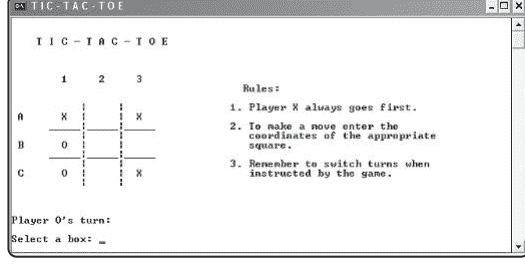

玩家的操作会立即发布在井井棋棋盘上。

游戏会验证每个玩家的操作，以确保其在游戏支持的坐标范围内（即 A1-A3、B1-B3 和 C1-C3），并确保玩家不会尝试选择已经选过的方格。当玩家犯错误时，将显示图 8.4 所示的屏幕，出错的玩家将获得另一次操作的机会。

# 图 8.4

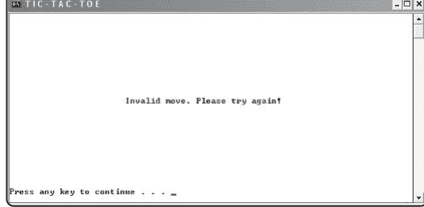

脚本会捕获无效选择或尝试选择上已存在方格的行为。

游戏会跟踪所有游戏活动，并自动判断玩家获胜或游戏平局，如图 8.5 所示。

# 图 8.5

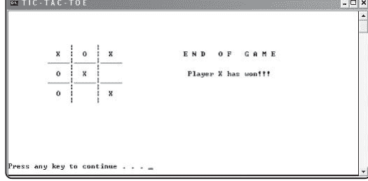

游戏自动判断玩家获胜或平局。

与所有优秀的电脑游戏一样，井井棋游戏为玩家提供了额外的帮助信息，如图 8.6 所示。


```
井井棋（游戏）
帮助说明
这是一个基于文本的井井棋游戏实现。在游戏中，
电脑与玩家 X 对战，游戏会告诉每个玩家何时轮到他们的回合。当提示玩家操作时，
玩家输入想要放置标记（X 或 O 字符）的单元格。例如，要在 5 号单元格放置标记，输入 5。
游戏会跟踪每局游戏的进度，并自动判断
获胜、失败或平局。
按任意键继续 - - -
```

此外，井井棋游戏提供了“关于”界面，玩家可以在那里找到更多关于游戏及其作者的信息，如图 8.7 所示。


```
井井棋
关于井井棋游戏
作者：
Jerry Lee Ford, Jr.
版权所有 2003
\按任意键继续 - - -
```

我认为你会同意，井井棋游戏是展示电脑游戏可以多么复杂且具有图形化的一个非常好的例子。

## 理解 Windows Shell 脚本错误

无论程序员变得多么优秀，有一点始终是真实的——错误总会发生。对于刚起步的程序员来说，错误可能格外的令人沮丧。本章的目标之一是帮助你为错误发生时做好准备。另一个目标是提供避免错误的建议和技巧。然而，现实情况是，某些错误是无法避免的；通常你所能做的就是让你的脚本尽可能优雅地终止，也许通过记录错误或显示用户友好的错误消息。

## 语法错误

Windows Shell 脚本错误发生在不同的时间，由于不同的原因引起。你确定会遇到的一种错误是语法错误。当你误写 Windows Shell 脚本中的语句时，就会发生此类错误。例如，你可能写错了命令的拼写，或者在多行 IF 语句中漏掉了右括号。

> 定义：当程序员未能遵循控制命令格式的语法规则时，就会发生语法错误。

语法错误通常在你的脚本开始运行时被 Windows 捕获，并阻止你的脚本执行。Windows Shell 显示一条错误消息，指示它在脚本中发现的第一个语法错误的原因。利用错误消息提供的信息和一点侦探工作，你可以在脚本开发和测试期间消除大多数语法错误。

## 运行时错误

你将遇到的另一类错误是运行时错误。运行时错误只有在产生这些错误的语句执行时才会发生。因此，除非你非常仔细地测试脚本中每条语句的执行情况，否则运行时错误可能会溜掉。例如，你可能有一个脚本，包含一个并不总是被使用的过程。如果该过程包含一个会产生运行时错误的语句，你直到以后某个时候才会发现。

> 定义：执行错误（或运行时错误）是由于脚本尝试执行非法操作的结果而发生的错误。一个很好的例子是 GOTO 或 CALL 命令尝试引用在 Windows Shell 脚本中未定义的标签。

好消息是，在大多数情况下，你可以通过开发过程中仔细设计和测试脚本来避免运行时错误。遗憾的是，你可能无法完全防止运行时错误的发生。例如，用户是不可预测的。你永远无法完全确保他们提供的脚本数据是有意义的，从而导致运行时错误。其他原因包括环境问题。例如，如果磁盘已满，你的脚本将失败。

## 逻辑错误

程序员经常遇到的另一类错误是逻辑错误。当你让脚本执行某事而实际上想让它做另一件事时，就会发生逻辑错误。

> 定义：逻辑错误是由于程序员出错导致的，例如让脚本加上两个本该相减的数字。

逻辑错误通常以意外输出的形式表现。由于逻辑错误不会以错误消息的形式出现，它们可能是最难追踪的。幸运的是，花时间合理规划脚本的设计可以防止大多数逻辑错误。例如，一个好的设计从流程图和伪代码概述开始。即使有了最好的设计，逻辑错误有时也会进入脚本。

## 查看 Windows Shell 错误消息

Windows Shell 会自动生成语法错误和运行时错误消息。默认情况下，所有错误消息都显示在 Windows 控制台中。然而，使用第 3 章“Windows 脚本基础”中讨论的 I/O 重定向，你可以将错误重定向到其他地方。

## 常见语法错误

遗憾的是，Windows 产生的错误消息往往不尽人意。与其他显示错误代码、描述以及产生错误语句所在行号的脚本语言不同，Windows Shell 提供的信息非常乏，仅限于通常提供有限信息的晦涩消息。例如，考虑以下 Windows Shell 脚本。

```
@ECHO OFF

SET /A X = 5
SET /A Y = 10

IF X GTR Y ECHO X 大于 Y ELSE Y 大于 X
```

此脚本有一个错误。如果你保存并运行脚本，将看到的错误消息所示：

命令语法不正确

如你所见，Windows Shell 告诉它发现了一个错误，但没有提供任何其他有用信息。如果你仔细观察，你会发现错误是脚本第四行末尾缺少了一个左括号。现在看另一个常见的 Windows Shell 脚本错误示例。

```
@ECHO OFF

SET WindowsFiles=%windir%

%WindowsFiles%
```

在这个例子中，windir 环境变量的名称拼写错误。Windows Shell 会自动为任何未定义的变量分配空值。因此，脚本 WindowsFiles 没有关联任何数据。在此时，脚本仍在顺利运行。然而，


当脚本的 ECHO 语句尝试显示赋值给 WindowsFiles 变量的内容时，将显示以下错误消息：

ECHO is off.

再次，此错误并没有提供多少信息，尽管它确实表明该错误是由执行 ECHO 语句产生的。当然，正如你所看到的，真正的错误存在于 SET 语句中。在像这里这样的小型脚本中，这种错误很容易追踪。然而，随着脚本规模和复杂性的增加，找到这类错误并不总是那么容易。

接下来的脚本演示了另一个 Windows 命令行脚本错误。

```
@ECHO OFF
```

```
SET /A X = 5

SET /A Y = 10
SET /A Z = 15

IF Z GTR Y (
IF Y GTR X (
IF X GTR 0 (
ECHO All is well with the world!
)
)
)
PAUSE
```

执行时，将显示以下错误消息。虽然有些晦涩，但这次提供了一些有用信息。具体来说，你知道在脚本的某处，Windows 命令行找到了它预期的 ) 字符之外的内容。

) was unexpected at this time.

由于 ( 和 ) 字符通常用于创建多行 IF 语句，你可能会开始检查脚本中最近添加的 IF 语句的语法。如果你这样做，你会发现与第二个 IF 语句相关的结束 ) 字符被不小心反转成了 ( 字符。

通过定义初始化部分（Initialization Section）的内容开始脚本开发。尽管此时还没有执行任何操作，但请运行脚本以确保没有产生语法错误。然后通过向主处理部分（Main Processing Section）添加几行来启动脚本其余，并再次运行脚本查找错误。从现在开始，当你开始定义子程序和过程时，逐一个编写并测试它们，而不是试图一次创建所有它们。这样，当发生错误时，你可能会在最近添加的一组语句中找到它。

## 典型的运行时错误

现在来看一个运行时错误的示例。在这个例子中，编写了一个小型 Windows 命令行脚本，旨在将计算机 C:\Temp 文件夹中找到所有 .log 扩展名的文件复制到网络驱动器。对该驱动器的访问本应通过一个名为 Z 的映射驱动器提供。这样的脚本可以在每个工作日结束时运行，作为公司网络服务器上存储日志副本的快速方法。

```
COPY C:\Temp\*.log Z:\\LogFiles
```

现在，假设某天公司的网络驱动器发生了故障。可能是网络中断了，或者存放共享网络驱动器的计算机崩溃了。如果你在网络问题解决之前尝试运行此脚本，可能会发生以下错误。

The system cannot find the drive specified.

在这个例子中，脚本本身没有问题。相反，一个不可控的环境问题阻碍了它作为运行时执行。

## 典型的逻辑错误

接下来来看一个常见的逻辑错误示例。在下所示示例中，我创建了一个脚本尝试乘以两个数值变量中存储的值。然而，只有其中一个变量被定义了。从语法上说，脚本没有问题，由于 Windows 命令行处理变量的方式非常宽松，它不会发生运行时错误。

```
@ECHO off

```
SET /A X = 5
```

```
SET Y=C:\Temp
```

```
SET Z = X * Y
```

```
ECHO Z = %%
```

```
PAUSE
```

但从逻辑上讲，脚本是不完整的，并生成了所示所示输出。要修复此类错误，你必须追踪脚本中应该定义另一个变量的位置并将其添加。

```
Z =
```

```
Press any key to continue . . .
```

## 处理错误的不同方法

你有多种不同的方法可以尝试处理 Windows 命令行脚本中的错误。首先，你可以：

-   教育你的用户，让他们在你的脚本遇到错误时知道该怎么办。
-   开发脚本跟踪功能，帮助你追踪和修复错误。
-   尝试预测最可能导致错误的命令，并尝试通过程序化的修复或绕过问题。
-   将发生的错误记录在错误日志文件中以便日后审查。
-   在错误发生时立即通过显示它们来报告错误。

我将在后面的章节中详细讨论这些选项。

## 教育你的用户

即使是优秀且经验最丰富的程序员也会遇到错误。这是现代编程和脚本开发现实的一部分。你处理无法预料或无法防止的错误的方法之一是对与你共享脚本的人进行教育。

我所说的教育，是指你应该向他们提供发生问题时该做的详细说明。例如，你可能会：

- 要求用户记录显示的任何错误消息。
- 要求用户准确记录导致错误的具体步骤（例如，他们给脚本提供了什么输入，以及何时启动脚本，等）。
- 要求用户立即报告任何发生的问题。

通过向你提供这类信息，用户可能会让你能够重现并识别错误，这样就可以防止错误在未来再次发生。记住：除非你向他们提供说明，否则大多数用户在脚本出现错误时不知道该做什么。通过提前提供说明，

## 脚本内部跟踪

有时错误很难追踪，特别是当脚本完全编写完成后。不幸的是，与某些高级语言不同，Windows 命令行没有提供内置的跟踪机制。处理此问题的方法是在脚本中嵌入 ECHO 语句。例如，你可以在脚本的开头和结尾放置以下内容：

```
ECHO Procedure not
```

```
ECHO Procedure finished
```

通过这种方式在脚本中分散 ECHO 语句，你可以追踪每个组件的执行。除了跟踪，你还希望跟踪变量以确保它们分配正确。再次，你可以通过使用 ECHO 语句来实现，如下所示：

```
ECHO Variable: TotalCount = %TotalCount%
```

通过在设置或修改变量的地方添加 ECHO 语句，你可以追踪它们的执行。一旦你的脚本测试完全正常，你可以删除这些额外的 ECHO 语句，或者最好将它们改为 REM语句，如下所示：

```
REM Variable: TotalCount = %TotalCount%
```

我有一个更好的建议可以让你这种跟踪技术更有用。这在准备阶段需要更多工作，但如果你正在处理一个关键脚本，这可能是值得的。

你仍然需要在脚本中嵌入语句，显示哪些部分正在执行以及变量的当前值。改变的是你启用和禁用调试语句的方式。与其将调试语句写作

```
ECHO Variable: TotalCount = %TotalCount%
```

你应该将其写为

```
%trace Variable: TotalCount = %TotalCount%
```

注意，名为 trace 的变量替换了 ECHO 或 REM 命令。以这种方式编写，你可以通过在脚本开头放置类似下面的语句来提供切换 ECHO 和 REM 的功能：

```
IF "$1"=="Debug" (SET trace=ECHO) ELSE (SET trace=REM)
```

正如你所看到的，当脚本传递参数 Debug 时，该语句将 trace 的值设置为 ECHO。否则，它将 trace 的值设置为 REM。结果是，如果你只是在命令行提示符处输入其名称并按回车运行脚本，trace 的值等于 REM，你嵌入脚本中的所有额外语句都变成了注释。这将是脚本的默认执行模式。


通过此示例，启用调试只需要在运行脚本时使用以下语法将 `Debug` 单词作为第一个参数传递给脚本：

ScriptName Debug

本章介绍的跟踪和调试技术之所以有效，是因为 Windows Shell 在执行语句之前始终会替换变量值。

现在来看一个这种调试技术的实际应用示例。以下脚本被称为 `TestScript.bat`。如你所见，它很小并且包含了一些调试语句，其中第一条根据作为脚本参数传递的 `Debug` 单词来启用或禁用跟踪模式。

```
@ECHO off
```

```
IF / %1=="Debug" (SET trace=ECHO) ELSE (SET trace=REM)
```

```
%trace% TestScript.bat executing in trace mode.
```

```
%trace% Beginning copy operations.
```

```
COPY *.bak C:\Temp > C:\ScriptLog.log 2>&1
```

```
IF ERRORLEVEL 1 (
%trace% No backup files were found.
)
```

```
COPY *.rpt C:\Temp > C:\ScriptLog.log 2>&1
```

```
IF ERRORLEVEL 1 (
%trace% No report files were found.
)
```

```
%trace% All copy operations now complete.
```

```
GOTO :EOF
```

在非调试模式下执行时，此脚本将执行且不在 Windows 命令控制台中显示任何文本。然而，在调试模式下执行时，将显示类似下面的输出：

```
c:\scripts>TestScript.bat
TestScript.bat executing in trace mode.
Beginning copy operations.
No backup files were found.
No report files were found.
All copy operations now complete.
```

```
c:\scripts>
```

如果你在调试模式下测试脚本时发现 Windows 命令控制台屏幕上的数据传输过快，可以通过在脚本中添加几个合适的 `PAUSE` 命令来减慢速度。

如你所见，这是一个非常好的调试技术，但实现它需要付出额外的精力。它的实用性取决于许多因素，包括你正在处理的脚本的复杂性和重要性。一个由几行组成的小脚本可能不值得投入额外的工作，而你为雇编写的脚本可能非常需要额外的努力。

## 命令错误检查

另一个重要的调试技术是尝试预测脚本中最可能产生错误的命令，并开发在错误发生时尝试处理错误的流程。处理错误的可用选项包括：

- 向用户显示指令，以便联系你报告错误。
- 重新措述晦涩的错误信息以便用户能够理解。
- 尝试采取纠正措施，例如让用户再次尝试。
- 记录错误消息以便日后审查。

要实现错误检查，你必须熟悉 `IF ERRORLEVEL` 语句。该语句允许你测试之前执行的命令的退出代码值，以确定其是执行成功还是带错误完成。退出代码 0 表示上一个命令成功。任何比它大的值通常意味着发生了错误。

以下是一个使用 `IF ERRORLEVEL` 语句判断文件复制操作是否成功的示例。如果操作失败，`COPY` 命令将返回错误代码 1 作为退出代码，脚本将显示错误消息。然而，脚本将继续运行并尝试执行第二次复制操作。

```
@ECHO off
```

```
CLS
```

```
ECHO.
ECHO Beginning copy operations.
ECHO.
PAUSE
```

```
COPY *.bak C:\Temp > C:\Temp\ScriptLog.log 2>&1
```

```
IF ERRORLEVEL 1 (
ECHO.
ECHO No backup files were found.
ECHO.
)
```

```
COPY *.rpt C:\Temp > C:\Temp\ScriptLog.log 2>&1
```

```
IF ERRORLEVEL 1 (
ECHO No report files were found.
)
```

```
ECHO.
ECHO All copy operations now complete.
```

ECHO,

PAUSE

GOTO :EOF

在例例中，脚本被设定为在继续执行的同时报告错误。该脚本的另一种编写方式是在第一次出现错误时停止执行。或者，可以添加额外的逻辑来重试复制操作。

Windows Shell 支持 `IF ERRORLEVEL` 语句的不同变体。要了解更多关于该语句如何工作的信息，请参考第 5 章“应用条件逻辑”。

## 记录错误消息

处理问题的方法是写入日志或报告文件，以便日后审查和分析。这样，通过查看日志文件，你可以观察到随时间发生的问题，包括用户可能没有麻烦报告的问题。例如，以下语句演示了如何创建并向 `ScriptLog.log` 的错误日志添加语句。

```
@ECHO off

COPY *.bak C:\TEMP

IF ERRORLEVEL 1 (
IF EXIST C:\TEMP\ScriptLog.log (
ECHO %date% %time% - Backup files copied to C:\Temp\ScriptLog.log
) ELSE (
ECHO %date% %time% - Backup files copied to C:\TEMP > ScriptLog.log
)
)
```

GOTO :EOF


`NetSend.bat` 脚本依赖于内置 Messenger（消息传递）服务的启用并正在运行。该服务允许 Windows 操作系统发送和接收网络消息。如果你在公司网络上的计算机上工作，可能会发现系统管理员禁用了此服务，在这种情况下，`NET SEND` 命令和此脚本将无法工作。

图 8.9 显示了此脚本执行并遇到错误时显示的图形化弹出对话框。

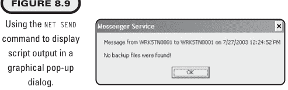

# 创建返回自定义退出代码的脚本

如果你计划开发利用外部过程的脚本，以创建可以被多个 Shell 脚本共享的可重用代码，你将会喜欢这个主题。如你所知，使用过程的优点之一是你可以使用它们来隔离对过程变量的访问。然而，这同时也限制了过程与脚本其余部分共享变量访问的能力。

变量隧道（Variable tunneling）提供了一种将数据传回给调用语句或脚本的方法。从外部过程返回数据的另一种方法是将其配置为传回一个退出代码。调用脚本可以查询此退出代码并确定它代表什么。要实现这一点，你需要使用 `EXIT` 命令。该命令会终止外部过程（或脚本）的执行，并传回一个自定义的退出代码。

`EXIT` 命令的语法概述如下。

```
EXIT [/B] [ExitCode]
```

`/B` 开关是可选的。使用时，它会将 `ExitCode` 占位符指定的数值传回调用脚本。要查看它是如何工作的，请查看以下这对脚本。

第一个脚本将作为外部过程被调用。执行时，它尝试将当前工作目录下所有 `.bak` 扩展的文件复制到 `C:\Temp`。任何输出或错误都会重定向到 `C:\Temp\ScriptLog.log`。如果在执行复制操作时发生错误，将执行脚本的 `:EXIT`过程。该过程使用 `EXIT` 命令并向调用或父脚本返回退出代码 `4`。

@ECHO off

```
COPY *.bak C:\Temp > C:\Temp\ScriptLog.log 2>&1

IF ERRORLEVEL 1 GOTO :EXIT

GOTO :EOF

:EXIT
EXIT /B 4
```

以下语句构成了调用的父脚本。如你所见，它调用外部过程（例如 `TestScript.bat`），等待其执行完成，然后检查外部过程返回的退出代码，查看其是否等于 `4`。

@ECHO off

```
CALL TestScript.bat

IF ERRORLEVEL 4 (
ECHO No backup files were found
)
```

# 其他需要注意的事项

最后，接下来的章节将回顾在你开始更多地使用 Windows Shell 和 Windows 脚本时可能会遇到的一些问题和困难。此外，我将为你提供一些建议，以避免、修复或解决这些问题和困难。

# 权限不足

在某些时刻，你可能会发现脚本失败，因为你没有执行给定任务所需的适当权限或权利。要记住的一点是，如果你在 Windows 桌面上无法执行特定任务，那么在 Windows Shell 中也无法执行。

底线是，除非你被分配了计算机的管理级访问权限，否则你面临无法执行某些任务的风险。例如，Windows 通过运行称为“服务”的内部程序和实用程序提供关键功能。你可能是本地计算机的管理员并对计算机的服务拥有完全控制权，但你可能会发现，如果你创建一个启动和停止服务的脚本并带到另一台计算机上，它将不会被允许工作。这可能是因为你在该台计算机上缺乏适当的的安全权限。

当你在公司网络上开发脚本并受到系统管理员实施的安全限制时，经常会产生安全问题。在这种情况下，你可能需要请求额外的安全权限。当你尝试在开发和测试脚本之外的计算机上运行脚本时，也会出现安全问题。你可能需要寻求系统管理员的帮助。

除了上述安全顾虑外，你可能会发现当其他人开始运行脚本时，脚本开始失败。这可能是因为他们没有与你相同级别的安全访问权限。

# 处理难以阅读和理解的脚本

在编写脚本时，请务必始终使用大量的注释和书中所示的脚本模板对它们进行文档记录。使用缩进作为让代码更易于阅读和理解的技术，并在语句组之间添加大量空格以帮助在视觉上组织内容。

除了遵循这些步骤外，请确保你专注于保持尽可能简单。例如，使用 `SET /A X +=1` 而不是 `SET /A X = X + 1`。它更短且同样易于理解。最后，考虑在脚本中添加检查，以防止它们被不当执行。例如，我建议在脚本模板中包含以下检查：

```
IF NOT "%OS%" == "Windows_NT" GOTO :EOF
```

# 使用 Windows 命令

Windows 命令不区分大小写，因此如果你在 Windows Shell 脚本中包含它们时混淆大小写，也不会遇到麻烦。然而，这种混合大小写的方式会让你的脚本难以阅读。

# 处理文件和文件夹

文件和文件夹管理可能很复杂。你永远不知道何时会有人来重命名或删除它们。同样，你期望由另一个应用程序创建的文件可能并没有被创建。这可能是应用程序没有运行，或者它发生了错误。在任何情况下，你都可以使用 `IF EXIST` 语句在创建、修改或删除文件之前验证文件是否存在，以防止此类情况。

此外，在处理文件和文件夹时，请确保任何包含空格的文件或文件夹名称都在双引号内。否则，将发生错误。注意，不要向你想要写入的文件追加数据，而是覆盖你想要追加数据的文件。在编写语句时，必须确保在开始写入文件时只使用一次 `>`，使用 `>>` 字符来追加数据。

# 循环预防

循环是一个强大的脚本工具。它允许你重复执行一组语句并处理海量数据。然而，如果构造不当，循环也会产生问题。从开始，要始终确保在创建循环时提供一种退出方法，以避免创建死循环。

> 一个无限运行的循环会导致你的脚本永远无法结束或完成任务。

例如，你可能会通过设置一个从 1 到 5 增量为 1 的命令来意外创建一个死循环。然而，在意外输入它时，Windows Shell 对你的循环迭代器减 1，它永远不会等于 5。因此，请检查创建循环的代码，并确保它最终会结束。

尽管你尽了努力，如果确实发生了死循环，如果是你手动启动的脚本，你可以跳出来。按下 `CTRL+C` 并在提示终止脚本时响应 `Y`。然而，如果脚本是使用 Windows 任务计划服务以后台模式启动的，你需要使用 Windows 任务管理器来终止它。


此外，请记住 `FOR` 命令的迭代字符是区分大小写的。因此，`%$` 和 `%%%` 不是同一个变量。

## 保持过程逻辑清晰

过程（Procedures）是组织脚本和创建可用代码集合的强大工具。然而，它们并非没有问题。不要忘记，过程无法访问脚本参数。如果你的过程需要访问脚本参数，请将参数作为过程参数传递给过程。或者，你也可以将数据存储在文件中并设置过程以这种方式读取和访问它们。

当你结合过程使用 `SETLOCAL` 和 `ENDLOCAL` 命令时，你可以通过局部化访问来对过程变量进行严格控制。然而，当你这样做时，也会让过程向脚本返回任何结果变得困难。尽管如此，你有不同的方法可以对过程变量实施控制，而不会阻止过程返回任何输出。一种方法是使用变量隧道（variable tunneling）传输变量。如果你的过程有大量需要返回的数据，你可以始终尝试写入文件，然后让脚本打开并读取该文件。

## 回到井字游戏

现在让我们开始书中最后一个章节的项目工作：井字游戏。这个脚本将方便计算机化双玩家对战游戏的执行。计算机将显示游戏棋盘、收集玩家输入、控制玩家回合、确保只有有效选择被处理，并最终决定谁（如果有人的话）赢得了游戏。

考虑到游戏的规模和复杂性，你在开发这个游戏时肯定会遇到一些错误。这将为你提供一个机会，去测试你在本章中学到的某些调试和错误解决技术。在此过程中，我将为你提供一些技巧以避免问题，并指出几个你可能想要避开的陷阱。

## 设计游戏

井字游戏的整体结构由以下部分的开发组成，这些部分恰恰与构成此书标准 shell 模板的三个部分相对应：

- 初始化部分（Initialization Section）。此部分将设置脚本的执行环境。
- 主处理部分（Main Processing Section）。此部分将控制游戏主菜单的显示和处理，并启动最终终止游戏的执行。
- 过程部分（Procedure Section）。此部分将由 10 个过程组成，每个过程都被设计用于执行游戏功能的特定子集。

由于此脚本相当长，你将需要专注于将过程作为组织脚本的主要手段。否则，考虑到此脚本的复杂性，随着你需要处理的变量和任务数量开始堆积，你所有的代码开始交织，你很早就会遇到麻烦。

这 10 个过程需要执行的任务列如下所示。本章将按照下面建议的顺序开发这些过程。然而，这不是强制要求的。你可以按照几乎任何对你认为合理的顺序来开发这些过程，尽管某些过程之间关系紧密，最好按顺序开发。

1. 初始化游戏棋盘值
2. 显示欢迎屏幕
3. 显示游戏棋盘
4. 创建帮助屏幕
5. 创建“关于”屏幕
6. 创建游戏控制过程
7. 验证玩家选择
8. 将玩家选择与棋盘方格关联
9. 显示游戏结果
10. 检查胜利、失败或平局

## 执行脚本初始化任务

要开始井字游戏脚本，创建一个新的脚本文件，复制 shell 脚本模板，然后在初始化部分添加以下语句：

```
@ECHO off

COLOR OE

TITLE = T I C - T A C - T O E

CLS
```

第一条语句关闭脚本语句的自动显示，接下来的三个语句将 Windows 命令控制台的配色方案设置为黑底黄，在控制台标题栏中发布游戏名称，并清除控制台。

## 构建脚本的主处理部分

脚本的主处理部分如下所示，从名为 `:StartOver` 的标签开始。该标签稍后将用于脚本以重启游戏。接下来，定义了一系列变量。`Player` 用于确定轮到哪个玩家。默认情况下，玩家 X 先。`Winner` 用于判断谁赢得了游戏。`Nooves` 用于记录总回合数。当总数达到 9 且没有玩家连成三个 X 或 O 时，游戏宣告平局。

```
:StartOver

SET Player=X
SET Winner=None
SET /A Nooves = 0

CALL InitializeBlanks

CALL Welcome

IF /I %reply==Play goto Play
IF /I %reply==Quit goto Quit
IF /I %reply==Help goto Help
IF /I %reply==About goto About
```

接下来将调用 `:InitializeBlanks` 过程。该过程将棋盘每个格子的变量设置为空。通过这种方式，当棋盘最初显示时，它是空的。接下来将调用 `:Welcome` 过程。它的任务是欢迎玩家并提示执行以下操作：

- Play：按回车开始游戏。
- Quit：按回车退出游戏。
- Help：按回车查看帮助。
- About：按回车查看关于。

随后将有一系列 `IF` 语句，每个语句都旨在分析玩家提供的输入。

## 初始化游戏棋盘值

如前所述，`:InitializeBanks` 过程将棋盘中的变量设置为空格。

```
:InitializeBanks

SET A1=
SET A2=
SET A3=

SET B1=
SET B2=
SET B3=

SET C1=
SET C2=
SET C3=
```

确保你在处理此过程时，在 `SET` 语句结尾输入一个空格。如果没有它们，由 `:DisplayBoard` 显示的棋盘将无法正常显示。

## 构建欢迎屏幕

下面的欢迎屏幕应该看起来很熟悉。它使用 `FOR` 和 `ECHO` 命令来格式化并显示欢迎消息。

```
:Welcome
CLS
FOR /L %%i IN (1,1,8) ECHO.
ECHO WELCOME TO TIC-TAC-TOE
ECHO.
ECHO.
ECHO            Windows script style!
FOR /L %%i IN (1,1,9) ECHO.
ECHO Options: [Play] [Quit] [Help] [About]
ECHO.
SET /p reply=Enter selection:
```

## 显示井字游戏棋盘

游戏在开始时以及每个玩家做出移动后需要显示其棋盘。这是通过调用下面的 `:DisplayBoard` 过程实现的。

```
:DisplayBoard
CLS
ECHO.
ECHO  T I C - T A C - T O E
ECHO.
ECHO.
ECHO.
ECHO  1  2  3
Rules:
ECHO.
ECHO  1. Player X always goes first.
ECHO  A  %A1% ^  %A2% ^  %A3%
ECHO  2.   make a move enter the
ECHO  coordinates of the appropriate
ECHO  B  %B1% ^  %B2% ^  %B3%
square.
ECHO  3. Remember to switch turns when
ECHO  C  %C1% ^  %C2% ^  %C3%
instructed by the game.
ECHO.
ECHO.
ECHO.
ECHO Player %player%s turn:
ECHO.
GOTO :EOF
```


此时，你应该已经有了模板和前两个部分。接下来，我建议你创建 `:Play`、`:Help`、`:About`、`:InitializeBlanks` 和 `:Welcome` 程序，并让它们保持为空。完成后，请停止并测试脚本，以确保没有任何语法错误。此外，通过测试主处理部分（Main Processing Section）中测试的每个条件，你可以验证欢迎界面的菜单操作。

# 提供帮助

游戏的 `:Help` 过程如下所示，旨在为玩家在需要时提供额外的指令说明。

```
:HELP

CLS

FOR /L %%I IN (1,1,5) DO ECHO

ECHO HELP INSTRUCTIONS
ECHO.
ECHO.
ECHO 这是一个井字棋游戏的文本实现版本。在游戏中，
ECHO 由电脑控制动作。玩家 X 总是先手。游戏会在
ECHO 轮到每个玩家时提醒他们。在提示执行回合时，玩家
ECHO 必须输入想要放置标记的方格坐标（即 X 或 O 字符）。例如，要在左上角的格子中放置标记，玩家将输入 AI。
ECHO.
ECHO 游戏会跟踪每个游戏的进度，并自动判断
ECHO 游戏何时胜、负或平局。

FOR /L %%I IN (1,1,6) DO ECHO.

PAUSE

GOTO :EOF
```

# 声明作品

游戏的 `:About` 过程如下所示，其工作方式与 `HELP` 过程完全相同。

:About

```
CLS

FOR /L %% IN (1,7) DO ECHO.

ECHO             关于井字棋游戏
ECHO.
ECHO                     作者：
ECHO.
ECHO             Jerry Lee Ford, Jr.
ECHO.
ECHO.
--------------------------------------
ECHO.
ECHO.
ECHO             Copyright 2003
```

```
FOR /L %% IN (1,7) DO ECHO.
```

```
PAUSE :EOF
```

现在你已经填充了位于 `:HELP` 和 `:About` 过程中的语句，我建议你停止并测试脚本，确保你没有意外输入导致语法错误的类型。如果你确实写了，那么在向脚本添加更多复杂性之前，现在追踪它们会容易得多。

# 创建控制游戏活动的程序

好了，现在开始变得有趣了。在本节概述的 `:Play` 程序负责控制游戏流程。然而，在很大程度上，它的成功取决于它所调用的程序。由于其复杂性，我将此程序拆分成许多部分，并顺序涵盖每个部分。

`:Play` 程序如下所示，从三个 `IF` 语句开始判断游戏是否已经结束。这三个语句决定是玩家 X 还是玩家 O 赢了游戏或者是平局。如果游戏结束或发生了平局，则游戏结束并调用 `:DisplayGameResults` 程序，之后通过执行 `GOTO` 语句将处理切换回 `:StartOver` 标签，显示游戏的欢迎菜单。

```
:Play
```

```
IF %Winner%="%X" (
  CALL :DisplayGameResults
PAUSE
GOTO :StartOver
)
```

```
IF %Winner%="%O" (
  CALL :DisplayGameResults
PAUSE
GOTO :StartOver
)
```

```
IF %Winner%="%Nobody" (
  CALL :DisplayGameResults
PAUSE
GOTO :StartOver
)
```

如果游戏尚未胜负或平局，则调用 `:DisplayBoard` 程序，并将任何已选择的方格显示为已用相应的 Xs 或 Os 填充。提示当前玩家（初始为玩家 X）执行回合。玩家输入的数据随后由 `:ValidateResponse` 程序进行验证，以确保它是有效的游戏方格且所选方格未被占用。

```
CALL :DisplayBoard

SET /P response=Select a box:

CALL :validateResponse
```

接下来执行 `If...Else` 语句。如果玩家的操作有效，`NoMoves` 的值加1，并调用 `:FillInSquare` 程序。否则，将显示错误消息并给玩家另一个机会（因为 `NoMoves` 值不会增加且游戏不会切换）。

```
IF %ValidMove==True (
SET /A NoMoves += 1
CALL :FillInSquare
) ELSE (
CLS
FOR /L %%IN IN (1,11) DO ECHO Invalid move. Please try again!
FOR /L %%IN IN (1,11) DO PAUSE
```

`:Play` 程序中的下一个 `IF` 语句负责在所有方格都已满且未宣布获胜者时宣布游戏为平局，或者通过调用 `:SeeIfWon` 实现。`:SeeIfWon` 程序的任务是检查游戏面板并查看是否有玩家拥有连续的三个方格。

```
IF %NoMoves==9 (
SET Winner=Nobody
) ELSE (
CALL :SeeIfWon
)
```

该程序的最后一个 `IF` 语句在每个回合结束时将 `player` 的值从 X 切换到 O 或从 O 切换到 X。

```
IF "%player%"=="X" (
  SET Player=O
) ELSE (
  SET Player=X
)
```

最后，程序中的最后一个语句使用 `GOTO` 命令重新启动程序，如下所示。

```
GOTO :Play
```

由于其复杂性以及它对所调用程序的依赖，我建议在编写组成此程序的语句时将其作为独立脚本。你可以使用硬编码变量独立测试每个程序，确保在将它们复制回井字棋游戏之前运行正常。此时你的脚本将完成。按照这种方法并假设正确测试了每个程序的操作，任何错误都可以在 `:Play` 程序中发现。

# 确保选择有效

`:ValidateResponse` 程序通过将 `ValidMove` 的默认值设置为 `true` 开始。此变量在 `:Play` 程序中用于确定增加 `NoMoves` 的值并切换玩家。由于其规模，我将此程序拆分为几个部分并顺序涵盖每个部分。首先，程序检查玩家是否在未选择的情况下按了 Enter 键。如果是这样，`ValidMove` 的值将被设置为 false。

```
:ValidateResponse
SET ValidMove=True
IF NOT "%response%"="" (
SET ValidMove=False
GOTO :EOF
)
```

接下来，程序检查玩家的操作是否匹配输入，如下所示。如果玩家没有输入 A1, A2, A3, B1, B2, B3, C1, C2 或 C3，则 `ValidMove` 的值被设置为 false。

```
IF /I %response%==A1 (
IF / NOT %response%==A2 (
IF / NOT %response%==A3 (
IF / NOT %response%==B1 (
IF / NOT %response%==B2 (
IF / NOT %response%==B3 (
IF / NOT %response%==C1 (
IF / NOT %response%==C2 (
IF / NOT %response%==C3 (
SET ValidMove=False
GOTO :EOF
)
)
)
)
)
)
)
)
)
```

程序执行的下一组测试检查玩家选择的方格是否已被占用。可用方格内部的变量将被为空，如果之前已被占用，则将包含 X 或 O。

```
IF /I %response%==A1 (
  IF NOT "A1"==" (
    SET ValidMove=False
  )
)
IF /I %response%==A2 (
  IF NOT "A2"==" (
    SET ValidMove=False
  )
)
IF /I %response%==A3 (
  IF NOT "A3"==" (
    SET ValidMove=False
  )
)
IF /I %response%==B1 (
  IF NOT "B1"==" (
    SET ValidMove=False
  )
)
IF /I %response%==B2 (
  IF NOT "B2"==" (
    SET ValidMove=False
  )
)
IF /I %response%==B3 (
  IF NOT "B3"==" (
    SET ValidMove=False
  )
)
IF /I %response%==C1 (
  IF NOT "C1"="" (
    SET ValidMove=False
  )
)
IF /I %response%==C2 (
  IF NOT "C2"="" (
    SET ValidMove=False
  )
)
IF /I %response%==C3 (
  IF NOT "C3"="" (
    SET ValidMove=False
  )
)
GOTO :EOF
```

# 将玩家移动与游戏面板格关联

如下所示的 `:FillInSquare` 程序非常简单。它将存储在所选方格中的变量设置为与当前玩家相关的字母（即根据 `player` 变量当前值指定的 X 或 O）。

:FillInSquare

```
IF /I %response%==A1 SET A1=%%player%
IF /I %response%==A2 SET A2=%%player%
IF /I %response%==A3 SET A3=%%player%
IF /I %response%==B1 SET B1=%%player%
IF /I %response%==B2 SET B2=%%player%
IF /I %response%==B3 SET B3=%%player%
IF /I %response%==C1 SET C1=%%player%
IF /I %response%==C2 SET C2=%%player%
IF /I %response%==C3 SET C3=%%player%
```


IF /I %response%==C3 SET C3=%player

Goto :EOF

# 显示游戏结果

下面所示 `:DisplayGameResults` 过程会检查赋值给 `Winner` 变量的值，以判断其中一名玩家是否获胜。否则，宣布为平局。游戏结果根据 `Winner` 变量的值确定，并显示在 `messagetext` 变量中，该变量由此过程嵌入。

:DisplayGameResults
CLS
SET messagetext=平局 - 无胜者
IF "%Winner%"="X" SET messagetext=玩家 X 胜了！
IF "%Winner%"="O" SET messagetext=玩家 O 胜了！

FOR /L %%i IN (1,5) DO ECHO.
ECHO %A1% %A2% %A3%
ECHO %B1% %B2% %B3%
ECHO %C1% %C2% %C3%
FOR /L %%i IN (1,9) DO ECHO.

Goto :EOF

# 判断游戏结束

脚本的最后一个过程是 `:SeelfWon` 过程，如下所示。每当调用此过程时，它都会检查当前玩家（玩家 X 或玩家 O）是否成功连成了三个连续的方格（垂直、水平或对角线）。如果合适，它会将赋值给 `Winner` 的值设置为 X 或 O。

:SeelfWon
IF /I "%A1%"="%player%" (
IF /I "%A2%"="%player%" (
IF /I "%A3%"="%player%" (SET Winner=%player%)
)
IF /I "%B1%"="%player%" (
IF /I "%B2%"="%player%" (
IF /I "%B3%"="%player%" (SET Winner=%player%)
)
IF /I "%C1%"="%player%" (
IF /I "%C2%"="%player%" (
IF /I "%C3%"="%player%" (SET Winner=%player%)
)
IF /I "%A1%"="%player%" (
IF /I "%B2%"="%player%" (
IF /I "%C1%"="%player%" (SET Winner=%player%)
)
IF /I "%A2%"="%player%" (
IF /I "%B2%"="%player%" (
IF /I "%C2%"="%player%" (SET Winner=%player%)
)
IF /I "%A3%"="%player%" (
IF /I "%B2%"="%player%" (
IF /I "%A3%"
player%" (SET Winner
player%)
)
IF /I "%A1%"="%player%" (
IF /I "%B1%"="%player%" (
IF /I "%C3%"="%player%" (SET Winner=%player%)
)
IF /I "%A2%"="%player%" (
IF /I "%B2%"="%player%" (
IF /I "%C2%"="%player%" (SET Winner=%player%)
)
IF /I "%A1%"="%player%" (
IF /I "%B2%"="%player%" (
IF /I "%C1%"="%player%" (SET Winner=%player%)
)
)
Goto :EOF

## 最终结果

为了方便，我在下方汇成了完整的井字棋游戏。如你所见，我添加了标准脚本模板并大量使用注释使脚本自解释。

```
@ECHO off

REM *********************************
REM 脚本名称: TicTacToe.bat
REM 作者: Jerry Ford
REM 日期: 2003年7月22日
REM 描述: 这是一个流行的“井字棋”游戏的 Windows 脚本实现。

REM

REM ************************************

REM ***** 脚本初始化部分 *****

REM 将颜色方案设置为黑底黄字
COLOR OE

REM 在 Windows 控制台标题栏显示游戏名称
TITLE T I C - T O E

REM 清除显示
CLS

REM ***** 主处理部分 *****

每当游戏需要重启时调用此标签

:StartOver

REM 整个脚本使用的全局变量
SET Player=X
SET Winner=None
SET /A NoMoves = 0
SET /A NoMoves = 0

REM 将游戏板上的所有方格重置为空
CALL :InitializeBlanks

REM 显示欢迎界面并提示指令
CALL :Welcome

REM 处理玩家指令
IF /I %reply%=="" CLS & GOTO :StartOver
IF /I %reply%==Play CLS & CALL :Play
IF /I %reply%==Quit CLS & GOTO :EOF
IF /I %reply%==Help CLS & CALL :Help
IF /I %reply%==About CLS & CALL :About
GOTO :StartOver
Goto :EOF

REM ***** 主处理部分 ******

REM 将游戏板上的所有方格重置为空
:InitializeBlanks
SET A1=
SET A2=
SET A3=

SET B1=
SET B2=
SET B3=

SET C1=
SET C2=
SET C3=

Goto :EOF

REM 调用时显示欢迎界面
:Welcome
REM 清除显示
CLS

REM 在显示中添加 8 行空行
FOR /L %%i IN (1,8) DO ECHO.
ECHO 欢迎来到井字棋
ECHO.
ECHO Windows 脚本风格！

REM 在显示中添加 9 行空行
FOR /L %%i IN (1,9) DO ECHO.

REM 显示选项菜单
ECHO 选项: [游戏] [退出] [帮助] [关于]
ECHO.

REM 提示玩家进行选择
SET /P reply=选择:
Goto :EOF

REM 显示游戏板
:DisplayBoard
REM 清除显示
CLS
ECHO.
ECHO T I C - A C - T E
ECHO.
ECHO 1 2 3
ECHO 规则:
ECHO.
ECHO %A1% %A2% %A3%
ECHO %B1% %B2% %B3%
ECHO %C1% %C2% %C3%
ECHO.
ECHO 回到玩家 %player%：
ECHO

1. 玩家 X 先手。
2. 要移动请输入相应的方格。
3. 按照游戏指示时切换回合。
Goto :EOF

REM 调用时显示帮助界面
:HELP
REM 清除显示
CLS

REM 在显示中添加 5 行空行
FOR /L %%i IN (1,5) DO ECHO.
ECHO 指令

这是一个井字棋游戏的文本实现。玩家 X 总是先手。玩家必须输入他们想要放置标记（X 或 O 字符）的方格坐标。例如，要在左上框放置标记，玩家应输入 A1。

游戏会跟踪每局游戏的进度，并自动判断何时胜、负或平局。

REM 在显示中添加 6 行空行
FOR /L %%i IN (1,6) DO ECHO.

REM 让玩家按键继续
PAUSE
Goto :EOF

:About
REM 清除显示
CLS

REM 在显示中添加 7 行空行
FOR /L %%i IN (1,7) DO ECHO.
ECHO 关于井字棋游戏

# 初学者的 Windows 脚本编写

ECHO.
ECHO 作者:
ECHO.
Jerry Lee Ford, Jr.
ECHO.
ECHO
ECHO.
ECHO 版权所有 2003

REM 在显示中添加 7 行空行
FOR /L %%i IN (1,7) DO ECHO.


GOTO :Play

GOTO :EOF

REM 确保玩家提供的选择是有效的
:ValidateResponse

REM 默认假设已做出有效的选项
SET ValidMove=True

REM 直接按回车而不输入选择是无效的
IF / NOT %response% == "" (
SET ValidMove=False
GOTO :EOF
)

## 第8章 调试与错误处理

REM 确保指定了有效的单元格 (A1-A3, B1-B3 & C1 - C3)
IF / NOT %response%==A1 (
IF / NOT %response%==A2 (
IF / NOT %response%==A3 (
IF / NOT %response%==B1 (
IF / NOT %response%==B2 (
IF / NOT %response%==B3 (
IF / NOT %response%==C1 (
IF / NOT %response%==C2 (
IF / NOT %response%==C3 (
SET ValidMove=False
GOTO :EOF
)
)
)
)
)
)
)
)
)
)
)
)
)

```
REM 之前选择过的单元格是无效的
IF / %response==A1 (
IF NOT "*A1*"==* (
SET ValidMove=False
)
IF / %response==A2 (
IF NOT "*A2*"==* (
SET ValidMove=False
)
IF / %response==A3 (
IF NOT "*A3*"==* (
SET ValidMove=False
)
IF / %response==B1 (
IF NOT "*B1*"==* (
SET ValidMove=False
)
IF / %response==B2 (
IF NOT "*B2*"==* (
SET ValidMove=False
)
IF / %response==B3
IF NOT "%B3%"="" * (
SET ValidMove=False
)
IF /I %response%==C1 (
IF NOT "%C1%"="" * (
SET ValidMove=False
)
IF /I %response%==C2 (
IF NOT "%C2%"="" * (
SET ValidMove=False
)
IF /I %response%==C3 (
IF NOT "%C3%"="" * (
SET ValidMove=False
)
```

## 第8章 调试与错误处理

GOTO :EOF

REM 将玩家的选择与相应的单元格关联
:FillInSquare

IF /I %response%==A1 SET A1=%-player%
IF /I %response%==A2 SET A2=%-player%
IF /I %response%==A3 SET A3=%-player%
IF /I %response%==B1 SET B1=%-player%
IF /I %response%==B2 SET B2=%-player%
IF /I %response%==B3 SET B3=%-player%
IF /I %response%==C1 SET C1=%-player%
IF /I %response%==C2 SET C2=%-player
IF /I %response%==C3 SET C3=%player%

Goto :EDF

REM 显示游戏结果
:DisplayGameResults

REM 清除屏幕
CLS

REM 设置默认消息为平局
SET messagetext=Tie - No Winner

REM 如果玩家获胜，设置包含自定义消息的变量
IF "%Winner%"="X" SET messagetext=Player X has won!!!
IF "%Winner%"="O" SET messagetext=Player 0 has won!

REM 在屏幕上增加5行空行
FOR /L %%i IN (1,1,5) DO ECHO

REM 显示最终棋盘并显示游戏结果消息
ECHO ^| %A1% ^ %A2% ^ %A3% END OF GAME
ECHO ^|____^|____|_____
ECHO ^| ^|
ECHO %B1% ^ %B2% ^ %B3%
ECHO ^|____^|____|_
ECHO ^| ^|
ECHO %C1% ^ %C2% ^ %C3%
ECHO ^| ^|

REM 在屏幕上增加9行空行
FOR /L %%I IN (1,1,9) DO ECHO


以下示例提供了一个关于如何设置和断开共享网络驱动器连接的实际运行演示。为了适配并测试此示例，你需要访问本地局域网的权限，且该网络包含一个你有权连接的共享网络文件夹或驱动器。

@ECHO

********************************************************************************

REM

REM 脚本名称: MapNtwkDDrive.bat

REM 作者: Jerry Ford

REM 日期: 2003年8月1日

REM

REM 描述: 此脚本演示了如何连接和断开

REM 网络驱动器的连接。

REM

********************************************************************************
REM 如果在运行 Windows 2000、XP 或 2003 的计算机上运行则中止执行。

```
IF NOT "%os%" == "Windows_NT*" (
ECHO.
ECHO.
ECHO Unsupported Operating system
ECHO.
ECHO.
GOTO :EOF
)
```

REM 定义一个指定要使用的驱动器的变量。

SET DriveLetter=X:

REM 定义一个指定网络驱动器位置的变量。

SET NetworkDrive=\SERV0001\C

REM 在 Windows 命令控制台标题栏中显示脚本名称。

TITLE = MapNtwkDrive.bat

REM 将颜色方案设置为黑底黄字。

COLOR DE

REM ****** 脚本初始化部分 *****

REM 调用显示介绍消息的程序。

CALL :DisplayUserMsg

REM 调用创建网络驱动器连接的程序。

CALL :EstablishConnection

REM 确定是否发生错误。

IF %ERRORLEVEL%=0 (

REM 如果没有发生错误，提示用户验证
REM 映射驱动器连接是否已创建。

CALL :VerifyConnection

REM 调用断开网络驱动器连接的程序

CALL :BreakConnection
)

GOTO :EOF

REM ****** 主处理部分 *****

REM 显示介绍消息。

```
:DisplayUserMsg
```

```
CLS
```

```
ECHO.
```

```
ECHO.
```

ECHO DEMO: 正在连接和断开网络驱动器

```
ECHO.
```

```
ECHO.
```

```
PAUSE
```

```
GOTO :EOF
```

```
REM 建立到指定网络驱动器的连接。
```

```
:EstablishConnection
```

```
CLS
```

```
ECHO.
```

```
ECHO Issuing NET USE Command.
```

```
ECHO.
```

REM 使用 NET USE 命令连接到指定的网络驱动器

REM 并使用指定的驱动器字母建立连接。

NET USE %driveletter% %NetworkDrive%

```
IF ERRORLEVEL 1 (
ECHO.
ECHO.
ECHO Error occurred setting up network connection.
ECHO.
PAUSE
GOTO :EOF
)
```

```
ECHO.

REM 提示用户检查以确保驱动器连接已建立。

```
:VerifyConnection
```

```
ECHO.
ECHO 请在通过按键响应之前，实实新的驱动器连接是否已
ECHO 建立。
ECHO.
ECHO 指示:
ECHO --------------------------------
ECHO 点击“开始”然后点击“我的电脑”。你不应该在“我的电脑”对话框的硬盘部分
ECHO 看到标记为 X: 的驱动器。
ECHO.
PAUSE

GOTO :EOF
```

REM 断开与网络驱动器的连接。

```
:BreakConnection
```

```
CLS

REM 使用 NET USE 命令根据指定的驱动器字母删除连接。

NET USE %driveletter% /DELETE

```
IF ERRORLEVEL 1 (
ECHO.
ECHO.
ECHO Error occurred when disconnecting the drive.
ECHO.
) ELSE (
ECHO.
ECHO.
ECHO The drive connection has been disconnected.
ECHO.
)
:EOF
```

脚本首先验证其是否已启动。如果在运行 Windows NT、2000、XP 或 2003 的计算机上运行则中止执行。它定义 `DriveLetter` 变量并赋值为 `X:`。随后定义 `NetworkDrive` 变量赋值为 UNC 地址。使用 `NET USE` 命令来创建网络驱动器连接。如 `Admin所示` 所示 `AdminCreator.bat`。正确执行此脚本的语法如下所示。

## 账户管理

Windows 提供了许多命令来管理用户账户。这些命令包括：

- NET USER. 创建用户账户。
- NET GROUP. 将用户添加到全局组。
- NET LOCALGROUP. 将用户添加到本地组。
- NET ACCOUNTS. 配置账户策略。

这些命令允许你配置本地和域用户账户。在下一个 Windows 示例中，我将演示如何自动化账户的创建。资源包提供了一个名为 `ADDUSERS.EXE` 的命令行工具，你也可以用它来从逗号分隔的文本文件中创建账户。

脚本源代码如下所示。

```
@ECHO off

REM *********************************
REM
REM 脚本名称: AdminCreator.bat
REM 作者: Jerry Ford
REM 日期: 2003年8月1日

REM
REM 描述: 此脚本演示了如何创建一个本地用户账户

REM 并将其添加到本地管理员组。

REM

********************************************************************************

REM 脚本初始化部分 *****

REM 如果在运行 Windows NT、2000、XP 或 2003 的计算机上运行则中止执行。

```
IF NOT "%~os%" = "Windows_NT" (
ECHO.
ECHO.
ECHO Unsupported Operating system
ECHO.
ECHO.
GOTO :EOF
)
```

REM 如果未作为参数传递用户名给脚本则中止。脚本会将颜色方案设置为黑底黄字。

如果 `X:` 已使用。

```
IF "%1"="" (
ECHO.
ECHO.
ECHO Invalid number of arguments received.
ECHO.
ECHO Syntax:
ECHO.
ECHO AdminCreator Username
ECHO.
ECHO.
GOTO :EOF
)
```

REM 将变量赋值为传递给脚本的参数。

```
SET user=$1
```

```
REM 清除显示。
CLS
```

```
REM ****** 主处理部分 *****
```

```
CALL :GetConfirmation

PAUSE

IF /I "%reply%=="*"" (
CALL :CreateAccount
CALL :AddToAdmingGroup
) ELSE (
CALL :ScriptExecutionAborted
)

GOTO :EOF
```

```
REM ****** 程序部分 ******

REM 在继续之前提示用户确认。
:GetConfirmation
```

```
ECHO.
ECHO.
ECHO 选项: [Y/N]
```


ECHO.

SET /P reply=你已指示此脚本为 %user% 创建一个新的管理员账户。继续吗？

GOTO :EOF

REM 创建新用户账户并检查错误。
:CreateAccount

NET USER %user% /ADD

IF ERRORLEVEL 1 (

CLS

ECHO.
ECHO.
ECHO 为 %user% 创建新账户时发生错误。
ECHO.
ECHO.

PAUSE

GOTO :EOF
)

GOTO :EOF

REM 将新账户添加到本地管理员组并检查错误。
:AddToAdminGroup

NET LOCALGROUP Administrators /ADD %user%

```
IF ERRORLEVEL 1 (

CLS

ECHO.
ECHO.
ECHO 将 %user% 添加到本地 Administrators 组时发生错误。
ECHO.
ECHO.

PAUSE

GOTO :EOF
)
GOTO :EOF

REM 如果用户选择中止脚本执行，显示以下消息。
:ScriptExecutionAborted

ECHO.
ECHO.
ECHO 脚本执行中止。未为 %user% 创建新账户。
ECHO.
ECHO.
```

## 附录 A Windows Shell 脚本管理脚本

脚本首先验证其是否运行在支持的 Windows 操作系统上。然后，它会检查是否向脚本传递了代表新用户账户名的参数。如果缺少参数，将显示错误消息；否则，脚本将继续执行。

接下来，脚本会在 Windows 命令控制台的标题栏中发布消息，并将名为 `user` 的变量设置为传递给脚本的参数。控制台屏幕将被清除，并在脚本终止执行之前执行一系列程序。

调用的第一个程序是 :GetConfirmation。它使用 SET 命令要求用户响应 `a` 或 `y` 以确认脚本是否继续执行。一旦收到确认，将执行 :CreateAccount 和 :AddToAdminGroup 过程。如果没有收到确认，则将运行 :ScriptExecutionAborted。

:CreateAccount 过程使用 NET USER 命令创建新用户账户，如下所示：

```
NET USER %user% /ADD
```

随后执行 ERRORLEVEL 语句以验证命令是否处理成功。如果没有成功，脚本将继续执行；否则，执行将终止。:AddToAdminGroup 过程使用 NET LOCALGROUP 命令，如下所示，将新用户账户添加到计算机的本地管理员组。

```
NET LOCALGROUP Administrators /ADD %user%
```

随后执行另一个 ERRORLEVEL 语句以验证该命令是否处理成功。如果没有成功，将显示错误消息。执行时，:ScriptExecutionAborted 过程将显示一条消息，指示脚本执行中止且未建立新账户。

以下输出显示了如果脚本执行并传递账户名 Alex0001，将显示的结果。

```
C:\Scripts>admincreator Alex0001
```

选项: [Y/N]

你已指示此脚本为 Alex0001 创建一个新的管理员账户。继续吗？

选项: [Y/N]

你已指示此脚本为 Alex0001 创建一个新的管理员账户。继续吗？ N

按任意键继续 . . .

脚本执行中止。未为 Alex0001 创建新账户。

```
C:\Scripts>
```

选项: [Y/N]

你已指示此脚本为 Alex0001 创建一个新的管理员账户。继续吗？ Y
按任意键继续 . . .

为用户输入密码：
再次输入密码以确认：
命令已成功完成。

命令已成功完成。

```
C:\Scripts>
```

图 A.3 显示新账户已创建，并且已添加到本地管理员组。

## 图 A.3

一个新用户账户被创建并添加到本地管理员组。


## 磁盘碎片整理

在接下来的示例中，我将演示如何执行 DEFRAG.EXE 命令行工具对计算机的本地硬盘进行碎片整理。此脚本还将生成一份其活动的摘要报告。

随着时间的推移，存储在硬盘上的文件会产生碎片。这会导致性能缓慢并增加硬盘磨损。当硬盘进行碎片整理后，其文件将重新组织并更有效地存储。

```
@ECHO off

****************************************************
REM 脚本名称: Defrager.bat

****************************************************
REM 脚本名称: Defrager.bat
REM 作者: Jerry Ford
REM 日期: 2003年7月31日
REM 描述 本脚本演示如何在 Windows 脚本中运行碎片工具
****************************************************

REM 脚本初始化 *****

REM 如果操作系统不是 NT 或 XP，则中止执行。
IF NOT "%0" == "%Windows%" (
ECHO.
ECHO 不支持的操作系统
ECHO.
ECHO.
GOTO :EOF

SET DefragRpt=C:\Temp\Defrag.txt

****** 主处理 ******

CALL :DeleteExistingRpt

CALL :CreateNewDefragpt

CALL :PerformDefrag

GOTO :EOF

****** 程序段 ******

:DeleteExistingRpt
REM 如果存在 defrag.txt，则将其删除。
IF EXIST %DefragRpt% DEL %DefragRpt%
GOTO :EOF

:CreateNewDefragpt
REM 创建一个新的 defrag.txt 报告。
ECHO. > %DefragRpt%
ECHO DEFRAG.EXE 执行报告 >> %DefragRpt%
ECHO. >> %DefragRpt%
ECHO %date% %time% 正在碎片整理 C: >> %DefragRpt

```
ECHO.
GOTO :EOF

:PerformDefrag
REM 碎片整理清理磁盘碎片。
ECHO 系统正在进行碎片整理。请稍候...
DEFRAG C: /F >> %DefragRpt%

IF ERRORLEVEL 1 (
ECHO %date% %time% 错误: %ERRORLEVEL% >> %DefragRpt%
) ELSE (
ECHO %date% %time% DEFRAG.EXE 执行完成。 >>DeDefragRpt%
)
GOTO :EOF
```

该脚本设计为后台进程运行，以便由 Windows 调度器执行（我将在本附录稍后介绍）。因此，它不会在 Windows 控制台的标题栏发布消息或更改颜色方案。当然，如果你需要，也可以手动运行该脚本。

脚本首先确保没有在不支持的操作系统上启动。然后它定义了一个变量 `DefragRpt` 来指定报告文件的写入位置，并在终止前执行一系列程序。调用的第一个程序是 :DeleteExistingRpt。该程序使用 IF EXIST 语句判断计算机是否已创建过报告文件，如果是则将其删除。接下来，运行 :CreateNewDefragpt 过程。它的工作是格式化报告文件的开头。最后，执行 :PerformDefrag 过程。它发出 DEFRAG.EXE 命令，使用 /F 交换指定要碎片整理的驱动器。这告诉命令在无需先提示确认的情况下运行。

命令产生的输出被重定向到脚本的报告文件。当命令执行完成时，执行 ERRORLEVEL 语句来决定向报告文件写入成功还是失败的消息。图 A.4 显示脚本生成的示例报告。


```
碎片整理 - 记事本
文件 编辑 查看 帮助

DEAG.EXE 执行报告
2003/08/02 11:03:35, 正在碎片整理 C:
Windows 整理
Copyright (C) 2003 Microsoft Corp. 保留所有权利。
分析报告
2.00 GB 总计，188 MB (可用)，8% 碎片
已碎片整理 2.00 GB，188 MB (可用)，8% 碎片
2003/08/02 11:13:19 DEFRAG.EXE 执行完成。
```

## 调度脚本执行

Windows Shell 脚本的主要优点之一是它方便了任务的自动执行。这允许你使用 Windows 操作系统的内置任务计划程序服务在任何你需要的时间运行脚本。例如，在本附录早期开发的 Defrager.bat 脚本就是设置计划任务的好候选者。该脚本中使用的 DEFRAG.EXE 命令运行时间较长并消耗大量系统资源，导致你的计算机运行变慢。通过作为计划任务运行此脚本，你可以在睡眠或任何其他方便的时间对硬盘进行碎片整理。

Windows 提供两种不同的方法来操作 Windows Scheduler 服务。第一个选项是使用 Windows AT 命令。AT 命令是一个基于文本的界面，通过你可以查看、添加和删除计划任务。第二个选项是使用 Windows 任务计划程序向导，它会引导你完成手动设置新计划任务所需的步骤。这两个选项将在接下来的章节中进行详细讨论。

## AT 命令

AT 命令允许你设置 Windows Shell 脚本的计划执行。在不带任何额外参数的情况下使用 AT 命令，可以显示当前计划任务的列表如下所示。

```
C:\AT
状态 ID 时间 命令行
0 每周六 5:00 AM Defrager.bat
1 明天 11:00 AM DiskClean.bat
```


在这里，设置了两个脚本作为计划任务执行。第一个脚本名为 `Defrager.bat`，设置为在每周周六凌晨 5 点运行。第二个脚本名为 `DiskClean.bat`，设置为在次日上午 11 点运行。

在 Windows NT、XP、2000 和 2003 上，只有管理员可以配置计划任务。

以下命令演示了如何使用 `AT` 命令为名为 `TestScript.bat` 的脚本设置新任务的计划执行。

```
AT 22:00 /EVERY:M,T,W,Th,F,S,Su CMD /C TestScript.bat
```

在此示例中，作为计划任务运行的 Windows 将在每周的每天晚上 10 点执行。你也可以通过传递分配给任务的 ID 来使用 `AT` 命令删除计划任务，如下文所示。

```
AT 1 /DELETE
```

在此处，我告诉 `AT` 命令从执行计划中删除 `DiskClean.bat` 脚本。

如果你想删除所有当前已计划的任务，可以按照如下方式执行 `AT` 命令来节省时间：

```
AT /DELETE
```

只需确保这确实是你想要的操作即可。

`AT` 命令也可用于在其他网络计算机上设置脚本的执行。要实现此目标，必须使用目标计算机名称的 UNC 格式，如下：

```
AT \\ServerName 22:00 /EVERY:M,T,W,Th,F,S,Su CMD /C Defrager.bat
```

`AT` 命令的用法比我附录中能涵盖的要多。要了解更多关于此命令的信息，请在 Windows 命令提示符中输入 `AT HELP`，或在 Windows 系统帮助中搜索有关该命令的信息。

当由 Windows 计划服务（Windows Scheduler Service）运行时，你的脚本将无法访问手动执行它们时可用的相同资源。例如，你可能设置了映射驱动器对脚本是不可用的。在这种情况下，你必须赋予脚本建立到它们可能需要的任何资源连接的能力。

以下脚本演示了如何在 Windows Shell 脚本中使用 `AT` 命令。在此示例中，我创建了一个调度脚本，为其他五个 Windows Shell 脚本设置计划任务。当你负责在大量计算机上设置同一组计划任务时，这种脚本将非常有用，例如如果你在公司的桌面支持团队工作的话。

```
@ECHO off

REM *************************************************
REM Script Name: MastSched.bat
REM Author: Jerry Ford
REM Date: August 1, 2003
REM
REM Description: 此脚本演示了如何使用 REM Windows 计划服务和 AT 命令调度脚本。
REM
REM *************************************************

REM ***** 脚本初始化部分 *****

REM 如果操作系统不是 Windows NT、2000、XP 或 2003 则终止执行
IF NOT "%OS%" == "Windows_NT" (

ECHO.
ECHO.
ECHO Unsupported Operating system
ECHO.
ECHO.
GOTO :EOF
)

REM 定义一个指定此脚本日志文件位置的变量。
SET ReportFile=C:\Scripts\ATReport.txt

REM ***** 主处理部分 *****

REM 调用记录此脚本执行情况的程序。
CALL :SetUpSchedLog

REM 调用设置计划任务的程序。
CALL :SetUpSchedule

GOTO :EOF

REM ***** 过程部分 *****

REM 此过程向报告文件写入日期时间条目。
:SetUpSchedLog

ECHO %date% %time%Mastched.bat - Now executing. > %ReportFile%

GOTO :EOF

REM 此过程使用 AT 命令设置其他 Windows Shell
REM 脚本的计划执行。
:SetUpSchedule

```
AT 20:00 /EVERY:T CMD /C DiskClean.bat >> %ReportFile%
AT 21:00 /EVERY:M,W,F CMD /C MapNtwkDrive.bat >> %ReportFile%
AT 21:00 /EVERY:M,W,F CMD /C Archiver.bat >> %ReportFile%
AT 22:00 /EVERY:M,W,F CMD /C BreakDrive.Map.bat >> %ReportFile%
AT 22:00 /EVERY:Th CMD /C Defrager.bat >> %ReportFile%
```
GOTO :EOF

# 附录 A Windows Shell 脚本管理脚本

脚本开始时确保没有在不支持的操作系统上启动。它定义了一个变量 `Reportfile` 并为其分配了一个脚本维护日志文件的文件位置。随后脚本在终止执行之前执行了两个过程。脚本调用的第一个过程是 `:SetUpSchedLog`。此过程将 `ECHO` 命令的输出重定向到指定的日志文件，以记录每个脚本运行的日期和时间。接下来执行 `:SetUpSchedule` 过程。此过程执行一系列 `AT` 命令，如下：

```
AT 20:00 /EVERY:T CMD /C DiskClean.bat >> %ReportFile%
AT 21:00 /EVERY:M,W CMD /C Maphtwkdrive.bat >> %ReportFile%
AT 21:00 /EVERY:M,W,F CMD /C Archiver.bat >> %ReportFile%
AT 22:00 /EVERY:W,F CMD /C BreakDriveMap.bat >> %ReportFile%
AT 22:00 /EVERY:Th CMD /C Defrager.bat >> %ReportFile%
```

脚本开始时确保没有在不支持的操作系统上启动。它定义了一个变量 `Reportfile`，并为其分配了一个用于脚本维护日志文件的文件位置。随后脚本在终止执行之前执行了两个过程。脚本调用的第一个过程是 `:SetUpSchedLog`。此过程将 `ECHO` 命令的输出重定向到指定的日志文件，以记录每个脚本运行的日期和时间。接下来执行 `:SetUpSchedule` 过程。此过程执行一系列 `AT` 命令，如下：

```
AT 20:00 /EVERY:T CMD /C DiskClean.bat >> %ReportFile%
AT 21:00 /EVERY:M,W CMD /C Maphtwkdrive.bat >> %ReportFile%
AT 21:00 /EVERY:M,W,F CMD /C Archiver.bat >> %ReportFile%
AT 22:00 /EVERY:W,F CMD /C BreakDriveMap.bat >> %ReportFile%
AT 22:00 /EVERY:Th CMD /C Defrager.bat >> %ReportFile%
```

当由 Windows 计划服务（Windows Scheduler Service）运行时，你的脚本将无法访问手动执行它们时可用的相同资源。例如，你可能设置了映射驱动器对脚本是不可用的。在这种情况下，你必须赋予脚本建立到它们可能需要的任何资源连接的能力。

以下脚本演示了如何在 Windows Shell 脚本中使用 `AT` 命令。在此示例中，我创建了一个调度脚本，为其他五个 Windows Shell 脚本设置计划任务。当你负责在大量计算机上设置同一组计划任务时，这种脚本将非常有用，例如如果你在公司的桌面支持团队工作的话。

作为计划任务脚本将在每周的每天晚上 10 点执行。你也可以通过传递分配给任务的 ID 来使用 `AT` 命令删除计划任务，如下文所示。

```
AT 1 /DELETE
```

在此处，我告诉 `AT` 命令从执行计划中删除 `DiskClean.bat` 脚本。

如果你想删除所有当前已计划的任务，可以按照如下方式执行 `AT` 命令来节省时间：

```
AT /DELETE
```

只需确保这确实是你想要的操作即可。

`AT` 命令也可用于在其他网络计算机上设置脚本的执行。要实现此目标，必须使用目标计算机名称的 UNC 格式，如下：

```
AT \\ServerName 22:00 /EVERY:M,T,W,Th,F,S,Su CMD /C Defrager.bat
```

`AT` 命令的用法比我附录中能涵盖的要多。要了解更多关于此命令的信息，请在 Windows 命令提示符中输入 `AT HELP`，或在 Windows 系统帮助中搜索有关该命令的信息。

当由 Windows 计划服务（Windows Scheduler Service）运行时，你的脚本将无法访问手动执行它们时可用的相同资源。例如，你可能设置了映射驱动器对脚本是不可用的。在这种情况下，你必须赋予脚本建立到它们可能需要的任何资源连接的能力。

以下脚本演示了如何在 Windows Shell 脚本中使用 `AT` 命令。在此示例中，我创建了一个调度脚本，为其他五个 Windows Shell 脚本设置计划任务。当你负责在大量计算机上设置同一组计划任务时，这种脚本将非常有用，例如如果你在公司的桌面支持团队工作的话。

```
@ECHO off

REM *************************************************
REM Script Name: MastSched.bat
REM Author: Jerry Ford
REM Date: August 1, 2003
REM
REM Description: 此脚本演示了如何使用 REM Windows 计划服务和 AT 命令调度脚本。
REM
REM *************************************************

REM ***** 脚本初始化部分 *****

REM 如果操作系统不是 Windows NT、2000、XP 或 2003 则终止执行
IF NOT "%OS%" == "Windows_NT" (

ECHO.
ECHO.
ECHO Unsupported Operating system
ECHO.
ECHO.
GOTO :EOF
)

REM 定义一个指定此脚本日志文件位置的变量。
SET ReportFile=C:\Scripts\ATReport.txt

REM ***** 主处理部分 *****

REM 调用记录此脚本执行情况的程序。
CALL :SetUpSchedLog

REM 调用设置计划任务的程序。
CALL :SetUpSchedule

GOTO :EOF

REM ***** 过程部分 *****

REM 此过程向报告文件写入日期时间条目。
:SetUpSchedLog

ECHO %date% %time%Mastched.bat - Now executing. > %ReportFile%

GOTO :EOF

REM 此过程使用 AT 命令设置其他 Windows Shell
REM 脚本的计划执行。
:SetUpSchedule

```
AT 20:00 /EVERY:T CMD /C DiskClean.bat >> %ReportFile%
AT 21:00 /EVERY:M,W,F CMD /C MapNtwkDrive.bat >> %ReportFile%
AT 21:00 /EVERY:M,W,F CMD /C Archiver.bat >> %ReportFile%
AT 22:00 /EVERY:M,W,F CMD /C BreakDrive.Map.bat >> %ReportFile%
AT 22:00 /EVERY:Th CMD /C Defrager.bat >> %ReportFile%
```
GOTO :EOF

# 附录 A Windows Shell 脚本管理脚本

脚本开始时确保没有在不支持的操作系统上启动。它定义了一个变量 `Reportfile` 并为其分配了一个用于脚本维护日志文件的文件位置。随后脚本在终止执行之前执行了两个过程。脚本调用的第一个过程是 `:SetUpSchedLog`。此过程将 `ECHO` 命令的输出重定向到指定的日志文件，以记录每个脚本运行的日期和时间。接下来执行 `:SetUpSchedule` 过程。此过程执行一系列 `AT` 命令，如下：

```
AT 20:00 /EVERY:T CMD /C DiskClean.bat >> %ReportFile%
AT 21:00 /EVERY:M,W CMD /C Maphtwkdrive.bat >> %ReportFile%
AT 21:00 /EVERY:M,W,F CMD /C Archiver.bat >> %ReportFile%
AT 22:00 /EVERY:W,F CMD /C BreakDriveMap.bat >> %ReportFile%
AT 22:00 /EVERY:Th CMD /C Defrager.bat >> %ReportFile%
```

作为计划任务脚本将在每周的每天晚上 10 点执行。你也可以通过传递分配给任务的 ID 来使用 `AT` 命令删除计划任务，如下文所示。

脚本开始时确保没有在不支持的操作系统上启动。它定义了一个变量 `Reportfile` 并为其分配了一个用于脚本维护日志文件的文件位置。随后脚本在终止执行之前执行了两个过程。脚本调用的第一个过程是 `:SetUpSchedLog`。此过程将 `ECHO` 命令的输出重定向到指定的日志文件，以记录每个脚本运行的日期和时间。接下来执行 `:SetUpSchedule` 过程。此过程执行一系列 `AT` 命令，如下：

```
AT 20:00 /EVERY:T CMD /C DiskClean.bat >> %ReportFile%
AT 21:00 /EVERY:M,W CMD /C Maphtwkdrive.bat >> %ReportFile%
AT 21:00 /EVERY:M,W,F CMD /C Archiver.bat >> %ReportFile%
AT 22:00 /EVERY:W,F CMD /C BreakDriveMap.bat >> %ReportFile%
AT 22:00 /EVERY:Th CMD /C Defrager.bat >> %ReportFile%
```

作为计划任务脚本将在每周的每天晚上 10 点执行。你也可以通过传递分配给任务的 ID 来使用 `AT` 命令删除计划任务，如下文所示。

在 Windows NT、XP、2000 和 2003 上，只有管理员可以配置计划任务。

以下命令演示了如何使用 `AT` 命令为名为 `TestScript.bat` 的脚本设置新任务的计划执行。

```
AT 22:00 /EVERY:M,T,W,Th,F,S,Su CMD /C TestScript.bat
```

在此示例中，作为计划任务运行的 Windows 将在每周的每天晚上 10 点执行。你也可以通过传递分配给任务的 ID 来使用 `AT` 命令删除计划任务，如下文所示。

```
AT 1 /DELETE
```

在此处，我告诉 `AT` 命令从执行计划中删除 `DiskClean.bat` 脚本。

如果你想删除所有当前已计划的任务，可以按照如下方式执行 `AT` 命令来节省时间：

```
AT /DELETE
```

只需确保这确实是你想要的操作即可。

`AT` 命令也可用于在其他网络计算机上设置脚本的执行。要实现此目标，必须使用目标计算机名称的 UNC 格式，如下：

```
AT \\ServerName 22:00 /EVERY:M,T,W,Th,F,S,Su CMD /C Defrager.bat
```

`AT` 命令的用法比我附录中能涵盖的要多。要了解更多关于此命令的信息，请在 Windows 命令提示符中输入 `AT HELP`，或在 Windows 系统帮助中搜索有关该命令的信息。

当由 Windows 计划服务（Windows Scheduler Service）运行时，你的脚本将无法访问手动执行它们时可用的相同资源。例如，你可能设置了映射驱动器对脚本是不可用的。在这种情况下，你必须赋予脚本建立到它们可能需要的任何资源连接的能力。

以下脚本演示了如何在 Windows Shell 脚本中使用 `AT` 命令。在此示例中，我创建了一个调度脚本，为其他五个 Windows Shell 脚本设置计划任务。当你负责在大量计算机上设置同一组计划任务时，这种脚本将非常有用，例如如果你在公司的桌面支持团队工作的话。

```
@ECHO off

REM *************************************************
REM Script Name: MastSched.bat
REM Author: Jerry Ford
REM Date: August 1, 2003
REM
REM Description: 此脚本演示了如何使用 REM Windows 计划服务和 AT 命令调度脚本。
REM
REM *************************************************

REM ***** 脚本初始化部分 *****

REM 如果操作系统不是 Windows NT、2000、XP 或 2003 则终止执行
IF NOT "%OS%" == "Windows_NT" (

ECHO.
ECHO.
ECHO Unsupported Operating system
ECHO.
ECHO.
GOTO :EOF
)

REM 定义一个指定此脚本日志文件位置的变量。
SET ReportFile=C:\Scripts\ATReport.txt

REM ***** 主处理部分 *****

REM 调用记录此脚本执行情况的程序。
CALL :SetUpSchedLog

REM 调用设置计划任务的程序。
CALL :SetUpSchedule

GOTO :EOF

REM ***** 过程部分 *****

REM 此过程向报告文件写入日期时间条目。
:SetUpSchedLog

ECHO %date% %time%Mastched.bat - Now executing. > %ReportFile%

GOTO :EOF

REM 此过程使用 AT 命令设置其他 Windows Shell
REM 脚本的计划执行。
:SetUpSchedule

```
AT 20:00 /EVERY:T CMD /C DiskClean.bat >> %ReportFile%
AT 21:00 /EVERY:M,W,F CMD /C MapNtwkDrive.bat >> %ReportFile%
AT 21:00 /EVERY:M,W,F CMD /C Archiver.bat >> %ReportFile%
AT 22:00 /EVERY:M,W,F CMD /C BreakDrive.Map.bat >> %ReportFile%
AT 22:00 /EVERY:Th CMD /C Defrager.bat >> %ReportFile%
```
GOTO :EOF

# 附录 A Windows Shell 脚本管理脚本

脚本开始时确保没有在不支持的操作系统上启动。它定义了一个变量 `Reportfile` 并为其分配了一个用于脚本维护日志文件的文件位置。随后脚本在终止执行之前执行了两个过程。脚本调用的第一个过程是 `:SetUpSchedLog`。此过程将 `ECHO` 命令的输出重定向到指定的日志文件，以记录每个脚本运行的日期和时间。接下来执行 `:SetUpSchedule` 过程。此过程执行一系列 `AT` 命令，如下：

```
AT 20:00 /EVERY:T CMD /C DiskClean.bat >> %ReportFile%
AT 21:00 /EVERY:M,W CMD /C Maphtwkdrive.bat >> %ReportFile%
AT 21:00 /EVERY:M,W,F CMD /C Archiver.bat >> %ReportFile%
AT 22:00 /EVERY:W,F CMD /C BreakDriveMap.bat >> %ReportFile%
AT 22:00 /EVERY:Th CMD /C Defrager.bat >> %ReportFile%
```

作为计划任务脚本将在每周的每天晚上 10 点执行。你也可以通过传递分配给任务的 ID 来使用 `AT` 命令删除计划任务，如下文所示。


# 322

初学者 Windows Shell 脚本编程

## 图 A.8
为你的 Windows Shell 脚本选择执行频率。

- 5. 如果你选择“每天”（Daily）计划，向导将显示以下选项列表，允许你进一步细化任务执行计划。
- 开始时间。指定任务开始运行的时间。
- 执行此任务（Perform this task）。将任务配置为每天、工作日或特定日期运行。
- 开始日期。指定任务首次运行的日期。
填入所需信息，点击“下页”（Next），并跳转到第 11 步。

- 6. 如果你选择“每周”（Weekly）计划，向导将显示以下选项列表，允许你进一步细化任务执行计划。
- 开始时间。指定任务开始运行的时间。
- 每隔 __ 周（Every __ weeks）。将任务配置在设定的周期间执行。
- 在下方选择星期几（Select the day(s) of the week below）。指定执行任务的一个或多个星期几。
填入所需信息，点击“下页”（Next），并跳转到第 11 步。

- 7. 如果你选择“每月”（Monthly）计划，向导将显示以下选项列表（如图 A.9 所示），允许你进一步细化任务执行计划。
- 开始时间。指定任务开始运行的时间。
- 日期（Day）。指定任务运行的每月日期。
- 第 __ 天（The __）。指定运行任务的每月日期。
- 在 __ 个月（Of the __ month(s)）。指定运行任务的月份。
填入所需信息，点击“下页”（Next），并跳转到第 11 步。

- 8. 如果你选择“仅一次”（One time only）计划，向导将显示以下选项列表，允许你进一步细化任务执行。
- 开始时间。指定任务开始运行的时间。
- 开始日期。指定任务开始运行的日期。
填入所需信息，点击“下页”（Next），并跳转到第 11 步。

## 图 A.9
提供关于脚本执行的详细信息。

9. 如果你选择“计算机启动时”（When my computer starts）计划，向导将显示以下选项列表（如图 A.10 所示），允许你进一步细化任务执行计划。

- **输入用户名（Enter the user name）。**指定与任务关联的用户账户名称。
- **输入密码（Enter the password）。**指定该账户关联的密码。
- **确认密码（Confirm password）。**对指定的账户密码进行确认。填入所需信息，点击“下页”（Next），然后跳转到第 12 步。

## 图 A.10
将用户账户及其密码与你的 Windows Shell 脚本关联。

10. 如果你选择“在计划登录时”（When I am on schedule）计划，向导将显示以下选项列表，允许你进一步细化任务执行计划。

- **输入用户名（Enter the user name）。**指定与任务关联的用户账户名称。
- **输入密码（Enter the password）。**指定该账户关联的密码。
- **确认密码（Confirm password）。**对指定的账户密码进行确认。填入所需信息，点击“下页”（Next），然后继续到第 12 步。

## 11. 向导显示以下选项列表：

- 输入用户名。指定与任务关联的用户账户名称。
- 输入密码。指定该账户关联的密码。
- 确认密码。对指定的账户密码进行确认。

12. 点击“完成”（Finish）。

完成后，向导会在“计划任务”（Scheduled Tasks）文件夹中为新任务添加一个条目，如图 A.11 所示。

> 图 A.11
> 检查由计划任务向导创建的任务。

## 创建聊天脚本

在下一个示例中，我将向你展示如何构建一个类聊天脚本。我之所以说类聊天，是因为这个脚本模拟了一个聊天程序。

```batch
@echo off

REM ************************************************
REM 脚本名称: NetSend
REM 作者: Ford
REM 日期:2003年7月25日
REM 描述: 此脚本旨在实现两台计算机之间的通信
REM ************************************************

REM  初始化部分
REM 设置脚本颜色为黄色背景
COLOR E
TITLE NetSend Messenger

REM 主处理部分
REM 显示脚本欢迎界面
:WelcomeScreen
cls
echo.
echo 欢迎使用 NetSend 即时消息工具
echo.
echo 此脚本允许你在两台计算机之间进行通信。
echo
echo 1. 在提示时，输入目标计算机的名称。
echo 2. 消息将以对话框形式显示。
echo 3. 若要发送消息，输入文本并按回车。
echo 4. 若要切换其他用户，输入 Switch 并按回车。
echo 5. 若要结束聊天，输入 Quit 并按回车。
echo.
set /p answer=目标计算机名称:

REM 如果用户未输入内容，则重新提示
if "%answer%"=="" goto TryAgain

REM 如果用户输入 Quit，则终止脚本执行
if /I "%answer%"=="Quit" exit

REM 获取目标计算机名称的程序
:UserName
cls
for /l %%i in (1,23) do echo.
set /p answer=目标计算机名称:
exit

REM 收集并发送消息的程序
:Chatting
cls
for /l %%i in (1,4) do echo.
echo 你正在与 %answer% 聊天。
echo.
echo 输入消息并按回车发送，或输入 Quit 退出。
echo.
set /p MsgText=消息:

REM 如果用户直接按回车未输入内容，则重新提示
if "%MsgText%"=="" goto Chatting

REM 如果用户输入 Quit，则退出
if /I "%MsgText%"=="Quit" goto exit

REM 如果用户输入 Switch，则重新开始以切换目标计算机
if /I "%MsgText%"=="Switch" goto TryAgain

REM 向目标计算机发送消息
net send %answer% "%MsgText%"

REM 提示用户输入新消息
goto Chatting
```


# 329

# 附录 A Windows 壳脚本管理脚本

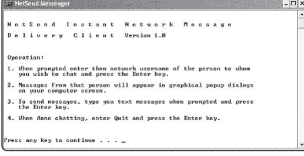

# 图 A.12

使用 NET SEND 命令创建聊天脚本。

:Again 标签，位于脚本的开头。如果用户输入 Quit，脚本将清除显示屏幕并终止执行。
接下来，调用 :StartChatting 过程。该过程使用 SET 语句收集用户输入，并将其存储在名为 MsgText 的变量中，如图 A.13 所示。

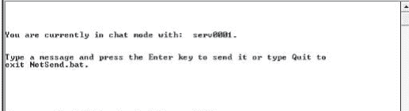

# 图 A.13

输入要发送到另一台计算机上的消息。

该过程执行一系列三个 IF 语句来确定接下来的操作。如果 MsgText 的值为空，则说明用户没有输入测试消息，因此该过程将通过 GOTO 命令重新运行自身，给用户另一个输入新文本的机会。如果用户输入了另一个开关（Switch），则使用 GOTO 命令将处理控制切换到脚本开头 :Again 标签之后的语句。通过这样，用户可以输入不同的计算机名称来与其他人启动会话，或者如果用户输入了无效的计算机名称，可以重新开始并输入正确的计算机名称。

用户也可以从此界面输入 Quit 而不是消息，以终止脚本的执行。最后，如果用户没有按 Enter 键、没有输入 Switch 或输入 Quit，他们的文本消息将通过 NET SEND 命令发送到另一台网络计算机，随后另一个 GOTO 命令将重启 :StartChatting 过程，允许发送新的聊天消息。图 A.14 展示了文本消息在接收方计算机上的显示方式。

# 图 A.14

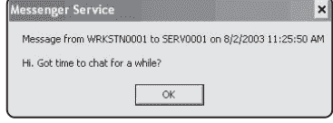

查看在目标计算机上显示的文本消息。

当然，为了让 NetSend.bat 脚本有效运行，必须将它的副本分发给两个想要在网络上互相聊天的个人。

# 添加图形界面

正如你在上一个聊天示例中所看到的，你可以利用 Windows NET SEND 命令在图形化弹出对话框中向用户显示信息。这为向用户展示信息提供了一个有效的方案。但是通过图形化方式收集用户信息呢？嗯，那也可以做到。要这样做，你需要从互联网下载若干个免费分发的实用程序。其中一个实用程序称为 MESSAGEBOX.EXE，你可以通过访问 http://optimumx.com/ 下载它；另一个类似的实用程序称为 MSGBOX.EXE，你可以通过从 http://claudiosoft.online.fr/msgbox.html 下载它。

你可以编写 Windows 脚本来执行这些实用程序中的任何一个并传递要显示的消息。你还可以指定你想要显示的按钮（OK、OK/Cancel、Yes/No 等）。MessageBox.EXE 以 Zip 文件格式下载。使用它的一种方法是将其内容解压到存储你的 Windows 壳脚本的文件夹中。要学习其语法，打开 Windows 命令控制台，将当前工作目录更改到解压实用工具的文件夹，并像下面所示输入 MSGBOX。

```
C:\MSGBOX
```

Claudiosoft MessageBox 1.2

此程序是供私用使用的免费软件（FREEWARE）。

(C) Claudiosoft 2001

用法：MsgBox Message Title Flag | YESNO | OKCANCEL | YESNANCEL

示例：MsgBox 'Do you want to continue?' 'Title' YESNO

MsgBox 返回：

如果答案为 NO，返回 7；

如果答案为 YES，返回 6；

如果答案为 CANCEL，返回 2；

如果答案为 OK，返回 1。

MESSAGEBOX.EXE 实用程序的语法更容易访问。只需找到并双击 MESSAGEBOX.EXE，就能看到图 A.15 中的弹出对话框。

# 图 A.15

查看
MESSAGEBOX.EXE
命令行
实用程序的语法。

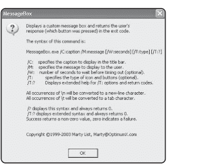

作为使用此类外部命令行工具的示例，请查看以下 Windows 壳脚本。它使用 MSGBOX 命令行工具生成一个图形化弹出对话框，显示带有 YES/NO 按钮的消息，询问玩家是否想再玩一个游戏。

```
@ECHO off

REM ***********************************************************************
REM
REM 脚本名称: Popup.bat

REM 作者: Jerry Ford

REM 日期: 2003年8月1日

REM
REM 描述: 此脚本演示了如何使用 Claudios 的 MSGBOX.EXE
REM 程序通过弹出对话框与用户进行交互。

REM
```

REM ****************************************************************************

REM ****** 脚本初始化部分 ******

REM 如果在未运行以下系统的计算机上运行，则中止执行

```
REM Windows NT, 2000, XP, 或 2003.
IF NOT "%os%" == "Windows_NT" (
    ECHO.
    ECHO.
    ECHO Unsupported operating system
    ECHO.
    ECHO.
    GOTO :EOF
)
```

```
REM 定义一个指定位置的变量
SET msgbox=C:\MSGBOX
```

REM ****** 处理部分 ******

```
REM 调用一个演示如何使用 MSGBOX.EXE 的过程
CALL :DisplayResults
```

```
REM 如果 MSGBOX.EXE 返回的退出代码 7，则用户点击了 NO
IF ERRORLEVEL 7 GOTO :Exit
```

```
REM 如果 MSGBOX.EXE 返回的退出代码 6，则用户点击了 YES
IF ERRORLEVEL 6 GOTO :PlayAgain
```

REM ****** 过程部分 ******

```
ECHO.
ECHO.
ECHO 这里就是你使用 GOTO 命令重启游戏的地方。
ECHO.
ECHO.
```

:PlayAgain
```
ECHO.
ECHO.
ECHO "You win!
n to play again?" YESNO
```


:
```
:DisplayResults
```
ECHO.
ECHO.
ECHO "Thanks for playing!
nPlease come back soon!" YESNO
```
GOTO :EOF

:Exit
```
ECHO.
ECHO.
ECHO "Thanks for playing!
nPlease come back soon!" OK
```
GOTO :EOF

脚本首先确保没有在不支持的操作系统上运行。接下来它定义了一个名为 msgbox 的变量，存储 MSGBOX.EXE 的位置。脚本调用 :DisplayResults 过程。该过程使用 MSGBOX 工具显示图 A.16 所示的弹出对话框。

# 356

# 334

# 图 A.16

使用弹出对话框收集输入。

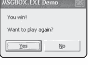

Windows 壳编程：初学者入门

注意，MSBOX.EXE 实用程序会将 \n 字符转换为换行和回车操作。这让你对弹出对话框内文本的方式具有某些控制权。

接下来，使用 ERRORLEVEL 语句查询 MSBOX.EXE 返回的退出代码以确定玩家点击了哪个按钮。退出代码 7 表示玩家点击了 NO 按钮，退出代码 6 表示玩家点击了 YES 按钮。如果点击了 NO 按钮，则调用 :Exit 过程。该过程使用 MSBOX 工具在图 A.17 所示的弹出对话框中显示消息。如果玩家点击了 YES 按钮，则调用 :PlayAgain 过程。

# 图 A.17

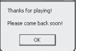

# 与第三方应用程序交互

你可以创建 Windows 壳脚本来与许多由微软以外开发的应用程序进行交互并控制它们。你可以这样做是因为许多开发者在他们的应用程序中内置了命令行支持，允许你从 Windows 命令行控制应用程序。

应用程序命令行界面的功能程度各不相同。有些开发者不提供命令行功能，有些提供基础应用程序功能，而另一些开发者则尝试使其 GUI 界面中的每个功能和特性都可用。

通过命令行暴露应用程序功能的第三方应用程序优秀示例是 WinZip。WinZip 是一个流行的文件压缩和存档管理程序。WinZip 是一种共享软件，你可以在决定是否购买之前下载并试用。你可以从 www.winzip.com 下载最新版本的 WinZip。


要启动 WinZip，请双击名为 WINZIP32.EXE 的可执行文件，该文件默认安装在 `C:\Program Files\WinZip`。然而，WINZIP32.EXE 还提供了一个命令行界面，让您能够在 Windows 外壳脚本的控制下创建和提取 Zip 文件。WINZIP32.EXE 的语法下所示。

```
WINZIP32 [-min] [action] filename[.zip] files
```

`-min` 参数允许 WinZip 以最小化模式运行，这样当您的脚本运行它时，就不会看到它的图形用户界面（GUI）。您必须从以下开关中选择一个来定义 `action` 参数：

- -a. 创建一个新的 Zip 文件。
- -f. 刷新压缩包。
- -u. 更新现有的压缩包。
- -m. 移动压缩包。

您可以使用以下任何参数来替换 `options` 占符：

- -r. 将文件和文件夹添加到 Zip 文件中。
- -p. 为每个文件包含有关文件夹成员的信息。
- -hs. 包含任何隐藏文件和系统文件。
- -s. 指定可选密码，生成的 Zip 文件将受保护并加密。密码使用 `-setPassword` 格式指定。

您可以选择性地指定以下任何开关来替换 `options` 占符：

- -ex. 应用 WinZip 的最高压缩率。
- -en. 应用 WinZip 的默认压缩率。
- -ef. 应用比正常低的压缩率。
- -es. 应用可用的最低压缩率。
- -e. 创建一个未压缩的 Zip 文件。

最后，WINZIP32.EXE 的 `files` 参数用于指定添加到 Zip 文件中的一个或多个文件。例如，下面的命令演示了如何使用 WINZIP32.EXE 命令在 C:\Tmp 文件夹中创建一个名为 TestArchive 的新 Zip 文件，并将 C:\Reports 文件夹中找到的所有 .txt 文件添加到该文件中。

```
WINZIP32 -A C:\Tmp\TestArchive C:\Reports\*.txt
```

接下来的 Windows 外壳脚本演示了如何利用 WinZip 内置的命令行支持来自动化创建新的 Zip 文件。在此示例中，脚本将创建一个 Zip 文件，存储计算机 C:\Scripts 文件夹中找到的所有外壳脚本。

```
@ECHO off
****************************************************
REM
REM Script Name: Zipper.bat
REM Author: Jerry Ford
REM Date: August 1, 2003
REM Description: 此脚本演示了如何在 Windows 外壳脚本中
REM 执行 WinZip 的功能。
****************************************************

***** 脚本初始化 *****

REM 指定 WinZip 的安装位置。
SET InstallLocation=D:\Program Files\WinZip

REM 指定要压缩的文件。
SET ScriptFileLoc=C:\Scripts\*.bat

REM 指定要创建的 Zip 文件名
SET ZipFileName=C:\Scripts\Scriptzip

REM 调用该过程，将 WinZip 文件夹临时添加到
REM 搜索路径中。
CALL :UpdatePath

REM 显示一条消息，给用户提供一个停止
REM 执行的机会。
CALL :DisplayWarning

REM 调用创建新 Zip 文件的过程。
CALL :CreateArchive
GOTO :EOF

REM 此过程将 WinZip 文件夹添加到搜索路径末尾。
:UpdatePath
SET path=%path%;%InstallLocation%
GOTO :EOF

REM 此过程显示一条消息，给用户一个停止
REM 执行的机会。
:DisplayWarning
ECHO
ECHO.
ECHO This script creates a new Zip file containing copies of all
REM .bat files located in %ScriptFileLoc%.
ECHO.
PAUSE
GOTO :EOF

REM 此过程创建新的 Zip 文件。
:CreateArchive
CLS
REM 执行 WINZIP32.EXE 命令，以最小化模式运行，并
REM 向其传递要创建的 Zip 文件名以及要添加到
REM 存档的文件名称和位置。
WINZIP32 -A C:\Tmp\TestArchive C:\Reports\*.txt

REM 检查 WINZIP32.EXE 命令返回的值以判断是否发生错误。
IF ERRORLEVEL 1 (
CLS
ECHO.
ECHO This script creates a new Zip file containing copies of all
REM .bat files located in %ScriptFileLoc%.
ECHO.
PAUSE
) ELSE (
CLS
ECHO.
ECHO A Zip file %FileName% was created.
ECHO.
)
```


# 表 B.1 光盘上的示例脚本（续续）

| 书籍引用 | 脚本 | 说明 |
|---|---|---|
| 第 8 章 | 井字游戏 | 展示了如何重新创建流行的井字棋游戏 |
| 附录 A | 脚本调度器 | 展示了如何通过程序使用 AT 命令来自动化其他脚本的执行 |
| 附录 A | 网络驱动器连接器 | 展示了如何通过程序映射连接到网络驱动器 |
| 附录 A | 网络断路器 | 展示了如何通过程序断开网络连接 |
| 附录 A | Windows 服务管理器 | 展示了如何通过程序停止和启动 Windows 服务 |
| 附录 A | 用户账户管理器 | 展示了如何通过程序创建新的用户账户 |
| 附录 A | 网络信使 | 展示了如何向另一个已登录的用户发送网络消息 |
| 附录 A | 打印机队列管理器 | 展示了如何自动化打印任务的管理 |
| 附录 A | 本地网络共享管理器 | 展示了如何自动化共享驱动器和文件夹的管理 |

## Shell 脚本编辑器

这本书的光盘还包含两个出色的编辑器。其中一个是免费的，另一个是以共享软件形式分发的，允许你在购买或停止使用它之前免费使用 30 天。除非你已经有了一个非常喜欢的脚本编辑器，或者你正受困于使用 Windows 记事本，否则我建议你花几分钟对每种编辑器都进行试用。

与记事本不同，这两个编辑器都允许你同时打开、创建并处理多个文件。当你发现需要从一个脚本剪切并粘贴行到另一个脚本时，这一功能特别方便。

## JGsoft EditPad Lite

JGsoft EditPad Lite 文本编辑器旨在取代 Windows 记事本。与记事本不同，EditPad Lite 允许你同时打开无限数量的文件进行编辑。每个打开的文件都通过标签页显示，方便在文件之间切换，如图 B.1 所示。

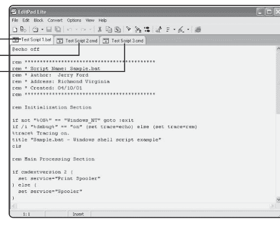

> 图 B.1
JGsoft EditPad Lite 编辑器提供了同时处理多个脚本的能力。

EditPad Lite 以免费软件的形式发行，这意味着它对非商业用途免费的。它的主要功能包括：

- 对所有打开文件的高级搜索和替换
- 无限次重做和撤销
- 行号和列号
- 缩进和取消缩进选项
- 可的自动换行
- 配置几十种影响编辑器运行的偏好
- 使用 Reopen 菜单打开最后 16 个文件
- 执行小写、大写和反转大小的操作
- 打印预览功能

## 提示

要了解更多关于 JGsoft EditPad Lite 文本编辑器的信息，请访问 www.editpadlite.com/editpadlite.html。

## 附录 B 光盘上有什么？

## JGsoft EditPad Pro

JGsoft EditPad Pro 是一个全功能的文本编辑器，提供了 EditPad Lite 中的所有功能以及更多功能。你可以从 www.editpadpro.com/editpadpro 下载 EditPad Pro 副本，如图 B.2 所示。

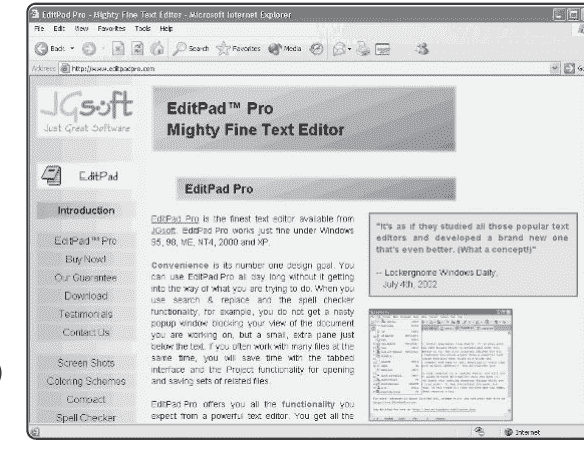

图 B.2
访问 EditPad Pro 网站。

EditPad Pro 的最佳功能之一是能够为特定类型的文件（如 Windows shell 脚本）定义语法着色方案。一旦配置，语法着色功能通过用不同的颜色高亮脚本中的关键字，使 Windows 脚本更易处理。例如，许多注释可以显示为红色，使其更容易被发现和修改。EditPad Pro 附带有许多支持不同文件类型的预定义语法着色方案。虽然它没有为 Windows shell 脚本提供默认的着色方案，但你可以访问 JGsoft 网站 www.editpadpro.com/cgi-bin/cscsllist.pl（如图 B.3 所示），并为各种不同的文件类型（包括 shell 脚本）下载各种预定义的颜色方案。

## EditPad Pro 的自定义语法着色方案 - Internet Explorer

|  way | 扩展名 | 作者 | 添加日期 | 下载量 |
| --- | --- | --- | --- | --- |
| HTML | .html, .htm, *.html | Stefan Wagner | 2001-08-30 | 7794 |
| PHP | .php, .phtml, *.php | Boris Force | 2004-01-15 | 7110 |
| CSS | .css, *.css | Various | 2009-11-18 | 6017 |
| JavaScript | .js, *.js | Various | 2011-08-04 | 5915 |
| XML | .xml, *.xml | Various | 2011-06-29 | 5915 |

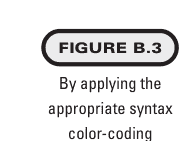

通过应用适当的语法方案，你可以将 EditPad 变成 Windows shell 编辑器。

（注：此处原文包含大量重复内容和 OCR 错误，已根据逻辑流进行清理。）


# Windows NT 脚本编程

作者：Tim Hill

ISBN: 1578700477, Que, 1998

尽管本书没有涵盖 Windows 2000 和 XP 中提供的 Windows 脚本编程最新增强功能，但它仍然为 Windows 脚本编程提供了坚实的回顾。

# 定位互联网资源

对于 Windows 脚本编程，书籍并不是你获取信息的唯一来源。也许最好的免费信息来源是互联网，你可以在那里找到额外的文档和大量的免费示例脚本。以下是一个你可以学习更多内容的网站列表。

www.labmice.net/scripting

“脚本与批处理资源”网站提供了有关 Windows 脚本编程以及其他编程语言的信息。在这里，你将找到 Windows 命令参考、Windows 资源包（Resource Kit）参考，以及提供所有与 Windows 脚本编程相关信息的文章链接。

图 C.1
www.labmice.net/scripting/default.htm 上的脚本资源。

# www.robvandwoude.com

另一个优秀的资源是 Rob van der Woude 的脚本页面网站（图 C.2）。在这里你将找到大量的 Windows 脚本编程示例。然而，该网站指出其主要目标是帮助你教授如何创建脚本。你可以预期找到大量关于脚本如何工作的信息。此外，你还会找到关于许多其他脚本语言的信息。

图 C2
www.robvandwoude.com 上的 Batches 页面。

# www.onesmartclick.com/programming/batch-files.html

另一个优秀的网站是 www.OneSmartClick.com（图 C.3）。该网站充满了指向文章的链接，你可以在其中找到与 Windows 脚本编程相关的所有信息。

# www.windowshellscripting.com

最后一个推荐的网站（图 C.4）适合查找更多关于 Windows 脚本编程的信息。你将在这里找到涵盖 Windows 脚本编程的教程以及可以下载的示例脚本。此外，该网站还有一个在线讨论论坛，你可以在那里发布问题并收到其他 Windows 脚本编程人员的解答。

# 附录 C 接下来？

# OneSmartClick

| 首页 | 所有Batch (编程) | 工程 | 宝莱坞 | 网页设计 | 娱乐 |
|---|---|---|---|---|---|
| Doe 音乐 | 印度特辑 | 职位/面试 | 科学 | Marabuti 区域 | RDS | 类型技巧 |

- 编程
- C++
- JS
- JDBC
- Visual Basic
- Web
- HTML/HTML5
- Oracle
- 批处理文件
- 编程
- 面向对象
- Unix
- 案例研究

Windows/DOS 批处理编程@@OneSmartClick.com

网站管理员：如果您发现此页面有用，请添加链接。

未设置主题。因此，我们为每项内容创建了单独的章节。此处展示的内容将满足你的基础需求。

- DOS 批处理文件
- DOS 编程手册与教程
- 高级 MS-DOS 批处理编程 (Zip, 371K)
- 创建 DOS 批处理文件
- 将 DOS 批处理文件转换为 Unix 脚本
- 批处理文件
- 批处理文件帮助

图 3.4
OneSmartClick.com 包含了信息链接。

# Windows 脚本编程

脚本脚本、活动服务器页面 (ASP)、VBScript、JavaScript、Windows Script Host 等更多。

windowhell-scripting-dot-com/
你好，欢迎来到我们关于 Windows 区域脚本的网站。关于 VBScript、脚本以及致力于……的信息。

欢迎访客
您最后访问于：2005年2月29日，14:53

- 注册 | 登录

| 访客 | 静音 | 文章 | 提问与 | 附加 |
|---|---|---|---|---|
| 首页 | 脚本 | 常见问题 | 回答板 | 资源 |

图 4.4
www.windowsscripting.com 提供下载和讨论论坛。

提问并获取答案
有问题吗？请随时点击此处。使用我们的在线论坛在下方的留言板发布您的消息。订阅即可在有人回复时接收自动通知！

# 阅读教程

阅读关于脚本和批处理文件的教程
- 脚本编程简介
- 日期脚本
- 高级批处理文件技术

# 浏览脚本

浏览完整脚本集以找到你寻找的内容，或仅获取思路。

# 提交脚本

提交你的脚本代码！想与世界分享吗？

# 术语表

@. 一种 Windows 脚本命令，用于抑制 Windows 命令控制台上任何语句的显示。

@ECHO off. 一种 Windows 脚本命令，用于抑制所有语句的显示。

.bat. 分配给批处理文件的扩展名。

.cmd. 分配给命令文件的扩展名。

:EOF. 文件结束标记，提供了终止过程的能力。

应用程序事件日志 (Application Event Log)。Windows NT、XP、2003 系统维护的日志文件，其中写入错误信息。

参数 (Argument)。传递给命令或脚本的单个数据。

算术运算符 (Arithmetic Operators)。你用于指定数学运算类型的字符 (+, -, *,/)。

赋值运算符 (Assignment Operators)。当给变量赋值时使用的字符 (+=, -=, *=, /=, %)。

ASSOC. 一个 Windows 命令，用于显示或修改文件扩展名关联。

AT. 一个 Windows 命令，提供了查看、创建和修改计划任务的能力。

批处理文件 (Batch Files)。具有 .bat 扩展名并包含 Windows 脚本的文件。

CALL. 一种脚本命令，用于执行内部或外部过程，调用脚本会暂停等待被调用脚本执行完毕。

CD (CHDIR)。用于更改当前目录的 Windows 命令。

CHOICE. 一种 Windows 资源包命令，提供了主动提示用户输入文本的能力。

CLS. 一种 Windows 命令，用于清除 Windows 控制台屏幕，只留下命令提示符。

COLOR. 一种 Windows 命令，用于设置 Windows 控制台的前景和背景颜色。

命令扩展 (Command Extensions)。自 Windows 脚本发布以来对命令进行的修改。

命令历史 (Command History)。在使用 Windows 控制台按 F7 时可以回溯并执行的先前命令列表。

命令提示符 (Command Prompt)。允许 Windows 控制台接受文本输入，然后将其传递给操作系统处理。

注释 (Comments)。嵌入在脚本中的语句，不影响其执行。（参见 REM）。

比较运算符 (Comparison Operators)。你在制定 IF 语句时指定要执行的比较类型的字符 (==, EQ, LSS, GTR, LEQ, GEQ)。

复合命令 (Compound Commands)。使用一组保留字符 (&, && |, ()) 执行两个或多个命令，指定如何以及何时执行第一个命令之后的命令。

计算机名称 (Computename)。一个存储本地计算机名称的环境变量。

COMSPEC。一个标识 Windows 脚本位置（例如 CMD.EXE）的环境变量。

COPY。用于从一个位置复制一个或多个文件到另一个位置的 Windows 命令。

CMD. 用于在当前 Windows 控制台中打开一个新的 Windows 脚本会话的 Windows 命令。

CMDEXTVERSION。一个存储标识 Windows 脚本版本号字符串的环境变量。

date。提供访问当前系统日期的变量。

DATE。用于显示或修改系统日期的 Windows 命令。


- Debug（调试）：用于指代定位和修复脚本及程序中错误的过程术语。

- Defrag（碎片整理）：一个 Windows 命令行实用程序，用于对存储在硬盘上的文件进行碎片整理，通过创建更大的连续空闲区域重新组织磁盘空间并提高磁盘性能。

- Defragmenter（磁盘整理程序）：一种图形化的 Windows 工具，用于对存储在硬盘上的文件进行碎片整理，通过创建更大的连续空闲区域重新组织磁盘空间并提高磁盘性能。

- DEL：一个 Windows 命令，用于移除或删除一个或多个文件。

- Delimiter（分隔符）：一种标记（例如空格、逗号、制表符等），用于识别传递给命令、过程或脚本的各个数据单元之间的边界。

- DIR：一个 Windows 命令，用于显示指定文件夹或目录中的文件和文件夹。

- Directory（目录）：与文件夹（folder）和子文件夹（subfolder）同义的术语。

- Dynamic Environment Variables（动态环境变量）：操作系统生成的随时间变化的环境变量。

- ECHO：一个 Windows Shell 命令，用于在 Windows 命令行控制台中显示文本和空行。

- Endless Loop（死循环）：一种永远不会完成处理的循环，会阻止脚本完成任务。

- ENDLOCAL：一个 Windows Shell 命令，通过将变量恢复到先前的 SETLOCAL 命令执行之前的值，来终止变量局部化。（参见 SETLOCAL。）

- Environment Variable（环境变量）：由操作系统定义并管理的变量。

- ERASE：一个 Windows 命令，用于移除或删除一个或多个指定的文件。

- Error（错误）：在脚本执行期间发生的问题。

- ERRORLEVEL（错误级别）：一个动态生成的变量，包含一个代表之前执行的命令所产生的退出代码的数值。

- Execution Environment（执行环境）：脚本运行的环境。对于 Windows Shell 脚本，这就是 Windows Shell。

- EXIT：一个终止脚本执行并关闭 Windows 命令行控制台的命令。该命令还能够将退出代码返回给调用它的命令或脚本。

- Exit Code（退出代码）：命令返回的数值，用于指示该命令是运行成功还是发生了错误。也称为返回码（Return Code）。

- Expression（表达式）：用于计算变量值的脚本语句。

- External Command（外部命令）：存储在计算机硬盘上作为可执行文件的非 Windows Shell 命令。（参见 Internal Command。）

- External Procedure（外部过程）：被另一个脚本调用的 Windows Shell 脚本。（参见 Internal Procedure。）

- Flowchart（流程图）：一种图形大纲，提供了脚本组件的高级概述并显示了它们之间的关系。

- FOR：一个 Windows 命令，重复执行一个或多个命令，以便处理文件、文件夹、命令输出和脚本。

- FTYPE：一个 Windows 命令，用于显示和修改与文件名扩展名关联的文件类型。

- Global Variables（全局变量）：可以在脚本任何位置访问的变量。

- GOTO：一个 Windows Shell 命令，通过将控制转移到包含指定标签的行，来更改脚本内的处理流。

- GUI（图形用户界面）：用于控制 Windows 操作系统及其应用程序的点击式图形化界面。

- HELP：一个 Windows 命令，通过命令行提示符访问有关 Windows 命令的额外信息。

- IF：一个 Windows Shell 命令，用于执行条件处理并根据测试结果更改脚本内的执行流。

- IFCMDEXTVERSION：IF 语句的一种形式，用于获取指示 Windows Shell 当前版本的数值。

- IF DEFINED：IF 语句的一种形式，提供了判断变量是否已存在的能力。

- IF...ELSE：IF 语句的一种形式，提供了根据条件测试的结果执行两组命令的能力。

- IF ERRORLEVEL：IF 语句的一种形式，提供了检查之前执行命令的退出代码的能力。

- IF EXIST：IF 语句的一种形式，提供了判断文件或文件夹是否存在的能力。

- IF NOT：IF 语句的一种形式，提供了执行条件测试并在否定结果采取行动的能力。

- Integrated Development Environment（集成开发环境）：用于促进其他脚本或程序的开发和调试的应用程序。

- Internal Command（内部命令）：内置 Windows Windows 中的命令。（参见 External Command。）

- Internal Procedure（内部过程）：在脚本内部定义的过程，当被调用时会执行并将控制权返回给调用它的语句之后的语句。（参见 External Procedure。）

- Iterate（迭代）：执行一个或多个命令的行为。

- JScript：一种基于 Netscape JavaScript 编程语言的 Microsoft 脚本语言。

- Label（标签）：放置在 Windows Shell内部的标记，用于设置循环、子程序和过程。

- Local Variables（局部变量）：在过程中创建且无法在过程外部访问的变量。

- LOGEVENT.EXE：一个 Windows Resource Kit 命令行实用程序，可向 Windows 应用程序日志写入消息。

- Logical Error（逻辑错误）：当程序员让脚本执行的操作与实际意图不符时产生的错误，例如将两个本应相减的数字相加。

- Loop（循环）：一组重复执行的语句。

- MD (MKDIR)：一个 Windows 命令，创建一个新的子目录或子文件夹。

- Modifiers（修饰符）：可以更改命令开关行为的参数。

- MOVE：一个 Windows 命令，将一个或多个文件从一个位置移动到另一个位置。

- Multi-line IF Statement（多行 IF 语句）：IF 语句的一种形式，允许程序员在 IF 内部嵌入多个语句。

- Mutually Exclusive（互斥）：指一组选项中只能选择其中一个的情况术语。

- Nested IF Statement（嵌套 IF 语句）：另一个 IF 语句内部的一个或多个 IF 语句。

- NET CONTINUE：一个 Windows 命令，重新激活已挂起的服务。

- NET GROUP：一个 Windows 命令，修改全局组的成员身份。

- NET LOCALGROUP：一个 Windows 命令，修改本地组的成员身份。

- NET PAUSE：一个 Windows 命令，暂停服务的执行。

- NET START：一个 Windows 命令，启动服务。

- NET SEND：一个 Windows 命令，向其他用户发送消息。

- NET STOP：一个 Windows 命令，终止服务的执行。

- NET USE：一个 Windows 命令，建立到网络驱动器、文件夹和打印机的连接。

- NET USER：一个 Windows 命令，通过程序化创建用户账户。

- Order of Precedence（优先级）：指 Windows 执行不同类型操作的顺序的术语。

- OS：一种标识当前正在运行的操作系统的环境变量。

- Parameter（参数）：传递给命令、过程的一个或多个参数。

- Parsing（解析）：提取字符串部分的行为。

- path：一个环境变量，指定在查找命令时要搜索哪些文件夹。

- PATH：在整个 Windows 会话期间有效的变量。

- pathext：一种标识文件扩展名列表的环境变量。

- PAUSE：一种 Shell 命令，停止执行直到用户按下按键。

- Perl（实用型提取和报告语言）：最初因在 UNIX 系统上使用而闻名的脚本语言。

- Pipe（管道）：将一个命令的输出重定向到另一个。该输出作为第二个命令的输入进行处理。

- Pixel（像素）：显示器上显示的最小区域。

- PPOD：将目录更改到 PUSH 命令存储的文件夹。（参见 PUSH。）

- Procedure（过程）：一组可以执行的语句。过程用于将控制权从脚本的一部分切换到另一部分，并在过程完成后返回。

- Procedure Variable（过程变量）：在过程中被局部化的变量，阻止脚本的其他部分访问它。（参见 Script Variable。）

- PROMPT（提示符）：一个用于修改 命令行提示符格式的 Windows 命令。

- Pseudo Code（伪代码）：脚本全部或部分逻辑的一种类似于英语的原始概述。

- PUSH：将当前工作目录更改为指定的文件夹并存储之前的目录以便供 PPOD 命令引用。（参见 PPOD。）

- Python：一种具有 UNIX 遗产的脚本语言，以 Monty Python 命名。

- random：返回 1 到 32767 之间随机生成的数字的环境变量。

- RD (RMDIR)：一个 Windows 命令，移除或删除指定的文件夹。

- Recursive（递归）：脚本重新启动自身执行或特定一组语句的执行时所经历的状态。

- Redirection（重定向）：更改命令的默认输入或输出源。

- REG：一个 Windows Resource Kit 命令行实用程序，提供了访问和更改存储在 Windows 注册表中信息的能力。

- Registry（注册表）：Windows 计算机用于存储有关用户、硬件、软件和操作系统配置设置信息的特殊数据库。

- REM：一个 Windows Shell 命令，提供了在脚本中添加注释的能力。

- REN (RENAME)：一个 Windows 命令，重命名文件或文件夹。

- Return Code（返回码）：命令和外部过程返回的数值，用于指示它们是运行成功还是由于错误终止。也称为退出代码（Exit Code）。


REXX (重构扩展提取器语言)。一种最初为在大型机上运行而开发的脚本语言，后被移植到 Windows。

运行时错误 (Run-Time Error)。当脚本尝试执行非法操作（例如引用不存在的磁盘驱动器）时发生的错误类型。（也称为执行错误。）

计划任务文件夹 (Scheduled Task Folder)。Windows 操作系统用于存储和管理计划任务的文件夹。

计划任务向导 (Scheduled Task Wizard)。一个辅助创建计划任务的图形界面。

脚本 (Script)。由一个或多个脚本语言语句组成的可执行文件。

脚本编辑器 (Script Editor)。一种特殊的文本编辑器，通过提供颜色编码和行号等功能方便脚本的开发。

脚本变量 (Script Variable)。在执行 Windows 脚本期间创建的变量，可以从脚本中的任何位置访问。（参见过程变量 Procedure Variable.）

SET。一种 Windows shell 命令，提供收集并为变量赋值值的能力。

SETLOCAL。一种 Windows shell 命令，记录当前赋值给 Windows shell 中环境变量的当前值，允许稍后通过 ENDLOCAL 命令恢复它们。（参见 ENDLOCAL。）

SHIFT。一种 Windows shell 命令，通过更改脚本参数的位置，允许 Windows 脚本访问超过九个脚本输入参数。

快捷方式 (Shortcut)。指向应用程序或资源的图形链接（通常放置在 Windows 桌面上）。

SORT。一种 Windows shell 命令，对提供的输入数据进行排序，并将结果发送到标准输出。

标准错误 (Standard Error)。Windows shell 发送所有错误消息的默认位置。（默认情况下，这是 Windows 命令控制。）

标准输入 (Standard Input)。Windows shell 查找命令输入的位置。（默认情况下，这是计算机键盘。）

标准输出 (Standard Output)。Windows shell 发送所有输出的默认位置。（默认情况下，这是 Windows 命令控制。）

START。一种 Windows shell 命令，用于启动一个新的 Windows shell 会话并打开一个新的 Windows 命令控制。

语句 (Statement)。脚本或程序中的行代码。

字符串替换 (String Substitution)。对字符串中的部分文本进行查找和替换。

子目录 (Subdirectory)。指文件夹和子文件夹的另一个术语。

子程序 (Subroutine)。脚本跳转并继续处理的语句集合。与过程（procedures）不同，子程序不会将处理控制返回给执行该子程序之后的语句。

子字符串 (Substring)。从文本字符串中提取的文本部分。

切换 (Switch)。一种可选的控制结构，用于修改命令的处理方式。

语法 (Syntax)。一组概述了执行时必须遵循的命令格式规则。

语法错误 (Syntax Error)。当程序员未能遵循控制命令格式的语法规则时发生的错误类型。

systemroot。一种环境变量，指定 Windows 系统根文件夹的位置。

TEMP。一种环境变量，标识一个可供应用程序临时存储的文件夹名称。

time。一种环境变量，用于存储一个表示当前系统时间的字符串。

TIME。一种 Windows shell 命令，用于显示和修改系统时间。

TITLE。一种 Windows shell 命令，用于修改 Windows 命令控制标题栏中显示的文本。

标记 (Token)。位于文本字符串中的某部分数据的表示。

TMP。一种环境变量，标识一个可供应用程序临时存储的文件夹名称。

跟踪 (Tracing)。在脚本执行期间跟踪每个脚本执行流或变量值的过程。

TYPE。一种 Windows 命令，通过将其内容输出发送到标准输出来显示文件内容。

username。一种环境变量，存储当前登录用户的用户名。

**变量 (Variable)。**指向计算机内存中脚本存储值的位置的引用。

**变量隧道 (Variable Tunneling)。** 用于用于将过程变量及其值传递到已实现本地化的过程之外的技术。

**VBScript。**一种 WSH 支持的脚本语言，由 Visual Basic 编程语言的子集组成。

**VER。**一种 Windows shell 命令，用于显示 Windows 版本号。

**通配符 (Wild Card)。**一种特殊字符（" 或 ?），可根据模式创建匹配文件。

**WINDIR。**一种环境变量，标识存储 Windows 系统文件的文件夹。

**Windows 命令控制 (Windows Command Console)。**一个通过命令提示符访问新 Windows shell 会话的窗口。

**Windows 注册表 (Windows Registry)。**一种特殊的内置数据库，是自 Windows 95 开始的所有 Windows 操作操作系统的一部分，存储了有关系统、应用程序、硬件和用户设置的配置。

**Windows Shell (Windows Shell)。**一种指向 Windows 操作系统的文本界面，提供对文本命令和实用程序的访问。

**Windows Shell 脚本 (Windows Shell Scripting)。**一种在 Windows NT、XP、2000 和 2003 上可用的内置脚本语言，具有完整的编程语句集，允许开发支持条件逻辑、迭代逻辑以及通过计算机内存存储和检索数据的脚本。

**工作目录 (Working Directory)。**当前 Windows 命令控制聚焦的 Windows 文件夹的引用。

**WSH (Windows Script Host)。**一种自 Windows 95 开始的所有 Windows 操作系统上可用的替代脚本环境。

**WSH 对象模型 (WSH Object Model)。**由 Windows Script Host提供的对象集合，提供对打印机和驱动器等系统资源的访问。

# 索引 Index

# A

+ /A 选项
CMD 命令, 30
SET 命令, 100
关于屏幕，创建, 179–180
访问
访问限制, 变量, 99–100, 216–217
权限不足, 261
分配 ass
环境变量, 94–95
Windows shell, 10
账户管理, 305–311
管理, 帐户, 305–311
追加顺序, 重定向, 67
应用程序事件日志, Windows, 8
应用程序, 第三方, 334
账户, 305–311
管理, 帐户, 305–311
追加顺序, 重定向, 67
应用程序事件日志, Windows, 8
应用程序, 第三方, 334
账户, 305–311
管理, 帐户, 305–311
追加顺序, 重定向, 67
应用程序事件日志, Windows, 8
应用程序, 第三方, 334
账户, 305–311
管理, 帐户, 305–311
追加顺序, 重定向, 67
应用程序事件日志, Windows, 8
应用程序, 第三方, 334
账户, 305–311
管理, 帐户, 305–311
追加顺序, 重定向, 67
应用程序事件日志, Windows, 8
应用程序, 第三方, 334
B, COLOR 命令, 42
带有空行的, 93
定义的, 90
格式规则, 29
大量的, 92
修改, 28
参数, 28
PROMPT 命令, 列表
40
规则, 28
算术运算符, 102
赋值运算符, 101
ASSOC 命令, 34
AT 命令, 脚本, 315–319
内置, 列表, 34–35

# B

+ B COLOR 命令, 42
背景颜色, 42
.bat 扩展, 5
批处理文件, 5
空行, 93
旧文本, 45
内置命令, 列表, 34–35
疯狂狗游戏示例
组合脚本, 111–121
命令控制, 105
游戏设计, 105
项目, 105
故事元素, 109
变量, 111
欢迎屏幕, 106

# C

+ /C 选项, CMD 命令, 30–31
CALL 命令
查看, 34
大小敏感, 29, 262
标签, 204
FOR 循环, 160
CD 命令, 34
类聊天脚本, 324–330
CHDIR 命令, 34
关闭窗口, 14
CLS 命令, 18
查看, 34
语法, 42
不可预测的命令游戏
示例, 49

# 索引 Index

CMD 命令, 11
示例, 31
打开会话, 29–30
选项, 列表, 30
语法, 28
.cmd 扩展, 5
代码示例. 参见游戏
集合
for 文件夹处理, 164–166
for 文件处理, 166–168
颜色编码, 语句, 13
COLOR 命令, 18
B 参数, 42
参数, 42
概述, 34
语法, 42
不可预测的命令游戏
示例, 51
颜色
背景, 42
前景色, 26
Windows 命令控制, 32
颜色选项卡-Command 对话框, 47
命令定义文件, 169
命令控制, Windows, 11
命令提示符 (Command Prompt 对话框), 45
颜色选项卡, 47
字体选项卡, 45
布局选项卡, 46
选项卡, 44–45
概述, 16
命令
参数
带有空行的, 93
定义的, 90
格式规则, 29
大量的, 92
修改, 28
参数, 28
选项, 28
ASSOC 命令, 34
AT 命令, 脚本执行, 315–319
内置, 列表, 34–35


- 集合 (collections), 159
- 文件 (files), 处理, 164–166
- 文件夹 (folders), 166–168
- 迭代预定义次数, 172–174
- 循环命令输出, 162–164
- 循环字符串内容, 160–161

- 概述 (overview), 35
- 语法 (syntax), 41
- PUSHD, 35
- RD, 35
- REM

- 概述 (overview), 35
- 语法 (syntax), 60
- REN, 35
- RENAME, 35
- RMIDIR, 35
- 保存 (Save), 14, 17

- 概述 (overview), 34, 158
- 解析选项 (parsing options), 160
- 支持的开关 (switches supported by), 159
- 语法 (syntax), 159
- 读取文本文件 (text files, reading), 169–171
- 格式 (format of), 27
- 格式规则 (formatting rules), 29

## SET
- /A 开关, 100
- p 选项, 19, 94
- DELIM 参数, 163
- 数值 (numeric values), 94
- 概述 (overview), 35
- 语法 (syntax), 39
- 不可预测的命令提示符示例 (Unpredictable Command Prompt gage example), 49

## FTYPE, 34
## GOTD
- 概述 (overview), 34
- :Processfiles 子程序, 205
- 分组 (grouping), 70
- IF, 34
- 修改变量值 (variable values, changing), 98

## SETLOCAL
- 概述 (overview), 35
- 变量访问限制 (variable access limits), 99–100, 216–217

## SHIFT
- 内部与外部 (internal versus external), 34

## MD, 35
## MKDIR
- 复合命令 (compound commands), 69
- 概述 (overview), 35
- 大量参数 (arguments, large numbers of), 92
- 概述 (overview), 35
- SORT, 66

## START
- 使用打开会话 (opening sessions using), 29–30
- 概述 (overview), 35

## MOVE, 35
- 互斥 (mutually exclusive), 29
- 重命名 (renaming), 38

## NET ACCOUNTS, 305
- NET GROUP, 305
- NET LOCALGROUP, 305
- NET USE, 216, 298
- NET USER, 305
- 参数列表 (parameters, list of), 33
- 语法 (syntax), 32
- 查看语法 (syntax, viewing), 28
- 基于文本 (text-based), 27, 174–175

## TIME, 35

## PATH
- 概述 (overview), 35
- 路径变量 (path variable), 36–37
- 文本变量 (text variable), 38
- 语法 (syntax), 36

## PAUSE
- 占卜师游戏示例 (Fortune Teller game example), 73–74
- 概述 (overview), 35

## TITLE
- 占卜师游戏示例 (Fortune Teller game example)
- 概述 (overview), 35
- 语法 (syntax), 39
- 不可预测的命令提示符示例 (Unpredictable Command Prompt gage example), 50

## POPD, 35
## PROMPT
- 参数列表 (arguments, list of), 40

## TYPE
- 错误日志 (error logs), 68
- 输入/输出重定向 (input/output, redirection), 65–66
- 概述 (overview), 35
## VER, 35

# 368
- 在脚本中添加注释 (comments, adding to scripts), 60–61
- 比较运算符 (comparison operators), 142
- 复合命令 (compound commands), 69–70
- 压缩工具 (compression utilities), 334–339
- COMSPEC 环境变量 (COMSPEC environment variable), 95
- 条件逻辑 (conditional logic), 5
- 控制台 (console)。另见 Windows 控制台
- COPY, 34
- 创建快捷方式向导 (Create Shortcut wizard), 15
- 创建快捷方式 (creating shortcuts),
- 当前工作目录 (current working directory), 12
- 光标大小选项（命令提示符属性对话框）（Cursor size option (Command Prompt Properties dialog box)), 45
- 自定义 Windows 控制台 (customizing Windows console)
- 颜色设置 (color settings), 47
- 字体设置 (font settings), 45
- 配置选项设置 (options settings, configuring), 44–44
- 显示混乱 (displays, cluttered), 18
- doc 文件扩展名 (doc file extension), 165
- 文档错误处理 (documentation, error handling), 251
- 动态环境变量 (dynamic environment variables), 97

# E
## ECHO 命令
- 概述 (overview), 34
- 语法 (syntax), 42
- 用户名变量 (username variable), 51
- Echo 语句 (Echo statement), 18
- 编辑选项选项（命令提示符属性对话框）（Edit Options option (Command Prompt Properties dialog box)), 45
- 编辑器 (editors)
    - 基于 GUI (GUI-based), 13
    - JSEditPad Lite, 344
    - JSEditPad Pro, 345–347
    - EditPad Lite 编辑器 (EditPad Lite text-editor), 347
    - EditPad Pro 编辑器 (EditPad Pro text-editor), 347–354
- educ 错误处理 (educ, error handling), 250–251
- ELSE 关键字, IF_ELSE 语句 (ELSE keyword, IF_ELSE statement), 129
- 文件末尾 (end of file (EOF)),
- 无限循环 (endless loops), 263
## ENDLOCAL 命令
- 概述 (overview), 34
- 变量访问限制 (variable access limits), 99–100, 216–217
- 环境变量 (environment variables)
    - 访问 (accessing), 94–95
    - 创建 (creating), 95
    - 已定义 (defined), 93
    - 动态 (dynamic), 97
    - 系统环境变量 (system environment variables), 94
    - 用户环境变量 (user environment variables), 94
    - 查看 (viewing), 96–97
- EOF（文件末尾)(EOF (end of file)), 205
- EQU 比较运算符 (EQU comparison operator), 142
## ERASE 命令, 34
- 错误 (errors)
    - 错误处理 (error handling)
        - 命令检查 (command checking), 254–256
        - 文档 (documentation), 251
        - 文件/文件夹 (files/folders), 263
        - 图形弹出对话框显示 (graphical pop-up dialogs, error display), 258–259
        - 权限不足 (insufficient authority), 261

# D
- /D 开关命令, 30
- 数据 (data)
    - 传递给脚本 (passing to scripts), 90–91
    - 过程 (procedures), 217–218
- DATE 命令, 34
- 任务日期 (date of tasks, scheduling), 322
- 磁盘碎片整理 (defragmentation), 312–315
- 碎片整理工具 (Defragmenter utility), 6
## DEL 命令, 34
- DELIM 参数, 命令, 163
- 分隔 (delimited), 90
- 对话框 (dialog boxes)
    - 命令提示符属性 (Command Prompt Properties), 16
    - 颜色标签页 (Color tab), 47
    - 字体标签页 (Font tab), 45
    - 布局标签页 (Layout tab), 46
    - 选项标签页 (Options tab), 44–45
    -  (Run), 29
    - 保存 (Save As), 17
- DIR 命令 (DIR command), 12
- 概述 (overview), 34
- 重定向 (redirection), 67
- 当前工作目录 (current working directory), 12
- 磁盘碎片整理 (disk defragmentation), 312–315
- 显示选项（命令提示符属性对话框）（Display Option (Command Properties dialog box)), 45
- 日志消息 (logging messages), 256–257
- 逻辑流 (logic flow, tracing), 251–254
- 用户教育 (user education), 250–251
- 用户友好错误消息 (user-friendly error messages, creating), 257–258
- 错误日志 (error logs, creating), 68
- 执行 (execution), 245
- IFLEVEL 语句, 131–132
- 逻辑常见类型 (logical common types), 249–250
- 已定义 (defined), 246
- 消息 (messages, execution), 20
- 运行时 (run-time), 131
- 常见类型 (common types), 249
- 已定义 (defined), 245
- 语法 (syntax), 131
- 常见类型 (common types), 246–248
- 已定义 (defined), 245
- 事件日志 (event logs), 8
- 示例代码 (example code)。见示例
- AT 命令 (AT command), 315–319
- 命令 (commands), 28, 36
- 执行环境 (execution environment, WSH), 7
- 执行错误 (execution errors), 245
- 退出代码 (exit code), 131
## EXIT 命令
- 外部过程 (external procedures), 260
- 概述 (overview), 334
- 语法 (syntax), 259
- 创建 (creating), 212–216
- 已定义 (defined), 208
- 外部与外部命令 (external versus internal commands), 34

# F
- 参数, COLOR 命令 (argument, COLOR command), 42
- 文件命令 (File command), 14, 17
- 批处理 (batch), 4–5
- 集合处理 (collections for processing), 164–166
- 错误处理 (error handling), 263
- 扩展名 (extensions)
    - .bat, 4–5
    - .cmd, 5
    - .doc, 165
    - 搜索 (searching), 133–136
    - 文本文件读取 (text files, reading), 169–171
-  文件夹处理, 166–168
- 错误处理 (error handling), 263
- 文件 (files), 67
- 搜索 (searching), 133–136
- 字体标签页（命令提示符属性对话框）（Font tab (Command Properties dialog box)), 45
## FOR 命令
- 大写敏感性 (case-sensitivity), 160
- 集合 (collections), 159
- 文件夹处理 (folders, processing), 166–166
- 迭代预定义次数 (iterating predefined of times), 172–174
- 循环命令输出 (looping through command output), 162–164
- 循环字符串内容 (through string contents), 160–161
- 概述 (overview), 34, 158
- 解析选项 (parsing options), 160
- 支持的开关 (switches supported by), 159
- 语法 (syntax), 159
- 文本文件读取 (text files, reading), 169–171
- 前景颜色 (foreground colors), 26, 42
- 格式规则 (formatting rules, commands), 29
- 占卜师游戏示例 (Fortune Teller game example)
- 组装脚本 (assembled script), 79–85
- 执行环境 (execution environment), 71–72
- 退出过程 (exit process), 77
- 游戏设计 (game design), 71
- 游戏回放 (game replay), 79
- 玩家的 (player's), 74–76
- 预测 (predictions), 78
- 项目预览 (project preview), 58–59
- 随机答案 (random answers), 77–78
- 故故事线 (story line), 73–74
- 欢迎界面 (welcome screen), 72–73
## FTYPE 命令, 34

# G
- 游戏示例 (game examples)
- 奇妙狗狗 示例 (buzz the Wonder Dog example)
- 组装脚本 (assembled script), 111–121
- 命令控制台配置 (command console, configuring), 105
- 游戏设计 (game design), 105
- 项目回顾 (project review), 88–89
- 读者说明 (reader instructions), 107
- 故事元素 (story elements), 108
- 变量替换 (variable substitution), 109
- 欢迎界面 (welcome screen), 106
- 占卜师 (Fortune Teller)
- 组装脚本 (assembled script), 79–85
- 执行环境 (execution environment), 71–72
- 退出过程 (exit process), 77
- 游戏设计 (game design), 71
- 游戏回放 (game replay), 79
- 玩家任务 (player's quests), 74–76
- 预测 (predictions), 78
- 项目回顾 (project review), 58–59
- 随机答案 (random answers), 77–78
- 故故事线 (story line), 73–74
- 欢迎界面 (welcome screen), 72–73
## 猜数字 (Guess a Number)
- 组装脚本 (assembled script), 149–153
- 正确判断 (correct guess, determining), 146–147
- 执行环境 (execution environment), 143–144
- 游戏设计 (game design), 143
- 游戏结果 (game results), 147–148
- 玩家输入 (player input), 145–146
- 项目回顾 (project review), 124–125
- 欢迎界面 (welcome screen), 144–145
## 敲门笑 (Knock Knock, joke)
- 组装脚本 (assembled script), 22–24
- 显示格式 (display of, formatting), 18–19
- 执行环境 (execution environment), 18
- 玩家输入 (player input, validating), 19–20
- 玩家响应收集 (player responses, collecting), 19
- 预览 (preview), 2–3
- 句梗显示 (punch line, displaying), 21
- 脚本开发过程 (script development process), 17
## 石剪剪刀石头 (Rock, Paper, Scissors)
- 组装脚本 (assembled script), 230–239
- 检查无效性过程 (CheckForInvalid procedure), 222–228
- 选择过程 (CollectChoice procedure), 224
- 比较过程 (CompareChoices procedure), 225–227
- 菜单过程 (DisplayMenu procedure), 223–224
- 结果过程 (DisplayResults procedure), 228–229
- 统计过程 (DisplayStats procedure), 229–230
- 脚本开发工具流程图 (flowcharts, as script tool), 218–220
- 获取电脑 (GetComputer procedure), 224–225
- 初始化部分 (Initialization section), 221
- 主处理部分 (Main Processing section), 222
- 项目回顾 (project review), 202–203
## 百万富翁 (Six Million Dollar quiz)
- 关于界面 (About screen), 179–180
- 组装脚本 (assembled script), 184–199
- 执行环境 (execution environment), 175–176
- 游戏设计 (game design), 175–179
- 游戏管理 (game play, managing), 180–181
- 游戏结果显示 (game results, displaying), 183–184
- 帮助屏幕 (helps screen), 177–178
- 菜单选择 (menu selections), 177–178
- 玩家结果评分 (player results, grading), 182–183
- 项目回顾 (project review), 156–157
- 伪代码 (pseudo code), 174–175
- 测验结果 (quiz results, coding), 143–148
- 评分卡报告 (score card report), 181–182
- 欢迎界面和主菜单 (welcome screen and main menu), 176–177
## 井字 (Tic-Tac)
- 关于过程 (About procedure), 271–273
- 组装脚本 (assembled script), 280–294
- 棋盘设计 (board design), 268–269
- 游戏控制活动 (game control activity), 271–274
- 游戏设计 (game design), 264–265
- 游戏结束 (game over), 279–280
- 游戏结果 (game results), 278
- 帮助过程 (help procedure), 271
- 初始化任务 (Initialization tasks), 265
- 主处理部分 (Main Processing section), 222
- 玩家的 (player's), 74–76
- 预测 (predictions), 78
- 项目回顾 (project review), 58–59
- 随机答案 (random answers), 77–78
- 故故事线 (story line), 73–74
- 欢迎界面 (welcome screen), 72–73
- 不可预测的命令提示符 (Unpredictable Command Prompt)
# H
- hello.bat 脚本 (hello.bat script), 15
- 帮助标签 (help label), 178

# I
- IF CMDVERSION 语句 (IF CMDVERSION statement), 132–133
- IF 命令 (IF command), 34
- IF ERRORLEVEL 语句 (IF ERRORLEVEL statement), 131–132
- IF EXIST 语句 (IF EXIST statement), 134–136
- IF NOT CMDVERSION 语句 (IF NOT CMDVERSION statement), 138
- IF NOT DEFINED 语句 (IF NOT DEFINED statement), 137–138
- IF NOT ERRORLEVEL 语句 (IF NOT ERRORLEVEL statement), 138
- IF EXIST 语句 (IF EXIST statement), 139–140
- If 语句 (If statement)
    - 多行 (multi-line), 139–140
    - 嵌套 (nested), 140–141
- 概述 (overview), 127–128
- 语法 (syntax), 126
- 类型 (types of), 126
- IF_Else 语句 (IF_Else statement), 129
- 缩进 (indentation), 261
- 输入 (input), 63–65
- 标准权限错误处理 (standard authority, error handling), 261
- 图形界面 (interface, graphical), 330–334
- 内部过程 (internal procedures)
    - 已定义 (defined), 208
    - 设置外部 (setting up external), 208–211
- 内部与外部命令 (internal versus external commands), 34
- 互联网资源 (Internet resources), 351–353
- 参数中的斜体 (italics, arguments in), 29
- 迭代逻辑 (iterative logic, defined), 5
- 迭代变量 (iterative variables), 159

# J
- JSEditPad Lite 编辑器 (JSEditPad Lite-editor), 344
- JSEditPad Pro 编辑器 (JSEditPad Pro text-editor), 345–347

# K
- /k 开关, CMD 命令 (/k switch, CMD command), 30–31
- 敲门游戏示例 (Knock Knock game example)
- 组装脚本 (assembled script), 22–24
- 显示格式 (display of, formatting), 18–19
- 执行环境 (execution environment), 18
- 玩家输入验证 (player input, validating), 19–20
- 玩家响应收集 (player responses, collecting), 19
- 预览 (preview), 2–3
- 句梗显示 (punch line, displaying), 21
- 脚本开发过程 (script development process), 17

# L
- 标签 (labels), 204
- 布局标签页（命令属性）（Layout tab (Command Properties))
- 对话框 (dialog box), 46
- LEQ 比较运算符 (LEQ comparison operator), 142
- 行，空行 (lines, blank lines), 18, 21, 93
- LogFiles 文件夹 (LogFiles folder), 67
- 记录错误消息 (logging error messages), 256–257


# M

- 逻辑错误
- 常见类型, 249–250
- 定义, 246
- 循环
- 遍历命令输出, 162–164
- 遍历字符串内容, 160–161
- 循环。参见命令
- 定义, 75
- 无限循环, 263
- 注意事项, 263–264
- LSR 比较操作符, 142
- 映射网络驱动器, 298
- 数学变量, 100–102
- MD 命令, 35
- 菜单
- 创建, 176
- 章节, 177–178
- 文本界面, 174–175

Microsoft Windows XP Professional Resource Kit 文档, 350

- MIN 参数, START 命令, 33
- MKDIR 命令
- 复合命令, 69
- 概述, 35
- 修饰符, 定义, 28
- MOVE 命令
- 互斥命令, 29
- 命名
- 命令, 38
- 变量, 98–99

# N

- NEQ 比较操作符, 142
- 嵌套 IF 命令, 140–141
- NET ACCOUNT 命令, 305
- NET GROUP 命令, 305
- NET LOCALGROUP 命令, 305
- NET USE 命令, 216, 298
- NET USER 命令, 305
- 网络驱动器, 298–303
- NOT 关键字, IF NOT 语句, 136–147
- 记事本, 13

# O

- OneSmartClick.com , 352
- 操作符
- 附加, 重定向, 67
- 算术, 102
- 赋值, 101
- 比较, 142
- 复合命令, 69
- 重定向, 65
- 选项选项卡 (命令提示符)
- 对话框, 44–45
- OS 环境变量, 95
- 输出
- 命令输出, 遍历, 162–164
- 重定向, 64–65

# P

- /p , SET 命令, 19, 94
- 参数
- 定义, 28
- Shell 脚本, 91
- START 命令, 列表, 33
- TOKENS, 169
- 解析选项, FOR 命令, 160
- 密码, 任务调度, 323
- PATH 命令
- 概述, 35
- 路径变量, 36–37
- pathtext 变量, 38
- 语法, 36
- PATH 环境变量, 95
- 路径变量, PATH 命令, 36–37
- PATHTEXT 环境变量, 95
- 路径变量, PATH 命令, 38
- PAUSE 命令
- 占卜示例游戏, 73–74
- 概述, 35
- Perl 脚本语言, 10
- 弹出对话框, 错误处理, 258–259
- POPD 命令, 35
- 过程
- 外部
- 创建, 212–216
- 定义, 208
- 内部
- 定义, 208
- 设置, 208–211
- 注意事项, 264
- 数据外传数据, 217–218
- 变量访问, 局部化, 216–217
- :ProcessFiles 子程序, 205
- PROMPT 命令
- 参数, 列表, 40
- 概述, 35
- 语法, 31
- 伪代码, 174–175
- PUSHD 命令
- Python 脚本语言, 10

- 石剪石头布游戏示例
- 汇编脚本, 230–239
- CheckForInvalid 过程, 227–228
- CollectChoice 过程, 224
- CompareChoices 过程, 225–227
- DisplayMenu 过程, 223–224
- DisplayResults 过程, 228–229
- DisplayStats 过程, 229–230
- Flow图, 作为开发工具, 218–229
- GetComputerChoice 过程, 224–225
- 初始化部分, 221
- 主预览部分, 222
- 项目视图, 202–203
- 运行对话框, 29
- 运行时错误, 131
- 常见类型, 249
- 定义, 245

# Q

- JQ/switch, CMD 命令, 30
- 引号, 2

# R

- 随机值, 49–50
- RD 命令, 35
- 读取文本文件, 169–171
- 重定向
- 附加操作符, 67
- 输入/输出, 64–65
- 输入源, 63–64
- 操作符, 65
- SORT 命令, 66
- 注册表, Windows, 8
- REM 命令
- 概述, 35
- 语法, 60
- REN 命令, 35
- RENAME 命令, 35
- 回复变量, 19–20
- 报告, 66–68
- 资源
- Internet, 351–353
- 推荐阅读, 350–351
- 返回代码, 13
- REXX 脚本语言, 10
- RMDIR 命令, 35
- Rob der Wilde 脚本页面, 352

# S

- S , CMD 命令, 30
- 另存为对话框, 14, 17
- Save 命令, 14, 17
- 任务向, 320–324
- 计划任务, 320–324
- 脚本变量, 93
- 脚本与批处理
- Perl, 10
- Python, 10
- REXX, 10
- 第三方, 10
- VScript, 9
- 脚本。参见游戏示例
- hello.bat, 15
- 传递数据到, 90–91
- 自包含脚本, 90
- 存储, 15
- 搜索文件/文件夹, 133–136
- 自包含脚本, 90
- 会话, 开始, 29–30
- 分号字符, 37

- SET 命令
- /A 关, 100
- /p 选项, 19, 94
- DELIM 参数, 163
- 数值值, 94
- 概述, 35
- 语法, 93
- 示例, 49
- 变量, 修改, 98
- SETLOCAL 命令
- 概述, 35
- 变量访问限制, 99–100, 216–217
- 共享网络驱动器, 298–303
- Shell, Windows
- 访问, 10
- 传递命令到, 12
- Shell 脚本
- 替代方案, 7–10
- 支持的操作系统, 7
- 用途, 6–7

- SHIFT 命令
- 大数字, 92
- 概述, 35
- 快捷方式, 创建, 15
- 站点, 351

- 百万美元示例
- 关于场景, 179–180
- 汇编脚本, 184–199
- 执行环境, 176
- 游戏设计, 175–176
- 游戏制作, 180–181
- 游戏结果, 显示, 183–184
- 帮助屏幕, 178–179
- 菜单选择, 177–178
- 玩家结果, 评分, 182
- 项目评审, 185–187
- 伪代码, 174–175
- 测验结果, 记录, 183
- 分数卡, 181–182
- 欢迎场景和主菜单, 176–177

- 调整 Windows 控制台, 46

- SORT 命令, 66
- 空格分隔文本文件, 169
- 空格格式规则, 29
- 标准输入, 64
- 标准输出, 64

- START 命令
- 使用会话, 29–30
- 概述, 35
- 参数列表, 33
- 语法, 32
- 启动计划任务服务, 321
- 会话, 29–30

- 语句
- 颜色编码, 13
- 定义, 5
- ECHO, 18, 21
- IF
- 多行, 139
- 嵌套, 140–141
- 概述, 127–128
- 语法, 126
- 类型, 126
- IF CMDEXTVERSION, 132–133
- IF ERRORLEVEL, 131–132
- IF EXIST, 134–136
- IF NOT, 136–137
- IF NOT CMDEXTVERSION, 138
- IF NOT DEFINED, 137–138
- IF NOT ERRORLEVEL, 138
- IF NOT EXIST, 139
- IF_Else, 129

- 存储脚本, 15
- 字符串子串, 103
- 内容, 遍历, 160–161
- 提取部分, 104–105
- 替换部分, 103–104
- 子程序, 76

- 子程序
- 创建, 204–206
- 定义, 204

- 子串操作, 103
- 子串, 76

- 开关
- CMD 命令列表, 30
- 定义, 28
- FOR 循环, 159
- CALL 命令, 212
- CLS 命令, 42
- COLOR 命令, 159
- ECHO 命令, 42
- EXIT 命令, 259
- IF 语句, 126
- PATH 命令, 218
- PROMPT 命令, 41
- REM 命令, 60
- SET 命令, 93
- START 命令, 32
- TITLE 命令, 39
- 查看, 28
- 常见类型, 246–248
- 定义, 245
- 系统环境变量, 94
- 任务初始化, 265–266
- 主处理部分, 266–267
- 玩家移动, 277–278
- 项目视图, 242–244
- 有效玩家选择, 247–277
- 欢迎屏幕, 268
- TIME 命令, 35
- 任务调度, 322

- TITLE 命令
- 井字游戏示例, 72
- 概述, 35
- 语法, 39
- 不可预测命令提示符示例, 50
- TOKENS 参数, 169
- 跟踪流, 251–254
- 隧道变量, 218

- TYPE 命令
- 错误日志, 68
- 输入/输出, 重定向, 65–66
- 概述, 35
- /T 关, CMD 命令, 30–31
- 制表符分隔文本文件, 169
- 计划任务, 320–324
- TEMP 环境变量, 95
- 示例创建, 61–63
- 文本命令, 27, 174–175
- 文本文件, 读取, 169–171
- 第三方应用, 334–339
- 第三方脚本语言, 10
- 井字游戏示例
- 关于, 271
- 汇编设计, 280–294
- 棋盘设计, 268–269
- 游戏活动, 271–274
- 游戏设计, 264–265
- 游戏覆盖, 279–280
- 游戏结果, 278
- 帮助, 270

- /U 关, CMD 命令, 30
- UNC (通用命名规范), 298
- 下划线 (_), 11
- 通用命名规范 (UNC), 298
- 不可预测命令提示符示例
- 汇编脚本, 54
- 颜色，前景和背景, 51
- 游戏设计, 48–49
- 项目视图, 26
- 随机数字选择, 49–50
- 标题栏, 50
- 用户，问候, 51
- Windows 控制台, 清除, 50
- 用户账户管理, 305–311
- 用户教育, 错误处理, 250–251
- 用户名变量, ECHO 命令, 51
- 工具, 碎片整理, 6

# V

- 变量
- 访问, 局部化, 216–217
- 访问限制, 99–100
- 定义, 19, 93
- 环境
- 访问, 94–95
- 创建, 95
- 定义, 93
- 动态, 97
- 系统环境变量, 94
- 用户环境变量, 94
- 查看, 96–97
- 迭代器, 159
- 数学, 100–102
- 命名, 98–99
- 路径, PATH 命令, 36–37
- path2, PATH 命令, 38
- 回复, 19–20
- 规则, 26
- 脚本, 定义, 93
- 字符串子章节, 103
- 子串操作, 103
- 隧道, 218
- 用户名变量, ECHO 命令, 51
- 值, 98
- VBScript 脚本语言, 9

- 当前工作目录, 12
- 注册表, 8
- Shell 脚本
- 替代方案, 7–10
- 支持的操作系统, 7
- 用途, 6–7
- 窗口, 关闭, 14
- Windows 2000 命令手册, 350
- Windows 命令控制台, 11
- 用户颜色, 32
- 自定义选项
- 颜色设置, 47
- 字体设置, 45
- 选项设置, 44–45
- 调整, 46
- Windows NT 脚本, 351
- Windows Resource Kits, 8
- Windows Script Host (WSH)
- 优缺点, 8–9
- 复杂度, 9–10
- 执行环境, 7
- Windows Shell
- 访问, 10
- 概述, 11
- 发送命令到, 12
- Windows Shell Scripting and WSH 员指南, 350
- windowsshellcripting.com 网站, 352–353
- WinCompression, 334–339
- 向导
- 创建脚本输出, 15
- 计划任务, 320–324
- WSH (Windows Script Host)
- 优缺点, 8–9
- 复杂度, 9–10
- 执行环境, 7

- VER 命令, 35
- 查看
- 环境变量, 94–97
- 语法, 28

# W

- 网站, 资源, 351
- 宽度设置控制, 缓冲区大小, 46
- 通配符, 165
- WINDIR 环境变量, 95
- Windows
- 事件日志, 8
- 命令提示符, 2


# 零基础入门系列

# 趣味学习编程之道

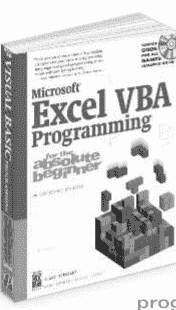

## 让我们面对现实。

C++、JavaScript 和 Java 可能会让人望而生畏。这就是为什么 Premier Press 开发了“零基础入门”系列——这是一个有趣、不令人恐惧的编程世界介绍。该系列中的每本书都通过简单的游戏编程作为教学辅助，教授一种特定的编程语言。如果你是编程新手，想要学习并获得乐趣，那么 Premier Press 的“零基础入门”系列正是你一直在寻找的！

- 零基础入门 ASP 编程 - ISBN 0-7615-3620-5
- 基础入门 C 编程 - ISBN 1-931841-52-7
- 零基础入门 C++ 编程 - ISBN 0-7615-3523-3
- 零基础入门 Excel VBA 编程 - ISBN 1-931841-04-7
- 零基础入门 Java™ 编程 - ISBN 0-7615-3522-5
- 零基础入门 JavaScript™ 编程 - ISBN 0-7615-3410-5
- 零基础入门 Microsoft Access VBA 编程 - ISBN 1-59200-039-8
- 零基础入门 Microsoft C# 编程 - ISBN 1-931841-16-0
- 零基础入门 Microsoft™ Visual Basic .NET 编程 - ISBN 1-59200-002-9
- 零基础入门 Palm™ 编程 - ISBN 0-7615-3524-1

立即致购


## 许可协议/有限保证声明

通过打开书中的密封光盘，即表示您同意以下条款和条件。如果在阅读以下许可协议和有限保证声明后，您不同同意所列的条款和条件，请将未使用的书和光盘退回购买处以退款。

## 许可：

随附软件版权归软件光盘上指定的版权所有者所有。我们被许可将软件复制到单个计算机上供单个用户使用，并复制到备份光盘上。未经版权所有者的书面许可，您不得复制、制作副本或分发副本或租赁全部或软件。您可以将随附的光盘连同本许可转让给受让人，前提是您必须销毁软件的所有其他副本并传输许可条款。您不得对软件进行反编译、反向汇编或反向工程。

## 有限保证声明：

Premier Press 保证随附光盘自最终用户购买书/光盘组合之日起六十（60）日内在材料和工艺上没有物理缺陷。在六天的有限保证期内，Premier Press 将收到缺陷光盘后提供更换光盘。

## 有限责任：

违反本有限保证的补救措施应完全限于更换缺陷光盘。在任何情况下，Premier Press 或作者均不对任何其他损害负责，包括数据丢失或损坏、硬件或操作系统功能特征的变化、与其他软件的有害交互作用，或可能发生的任何其他特殊、偶然或后果性的损害，即使 Premier 和/或作者此前已告知此类损害的可能性。

## 保证免责：

Premier 和作者特别此否认任何和所有保证（无论是明示还是暗示的），包括对销销性、特定任务或目的的适用性或无错误的保证。某些州不允许排除暗示性保证或限制偶然或后果性损害，这些限制可能不适用于您。

## 其他：

本协议受印第安纳州法律管辖，不考虑法律冲突原则。明确排除了《国际货物销售合同公约》。本协议构成了您与 Premier Press 之间关于使用软件的完整协议。

