# Microsoft Word 入门指南

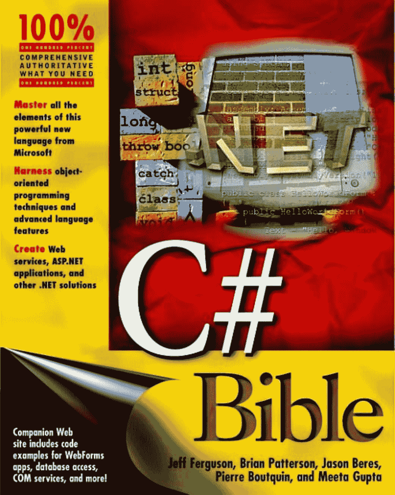

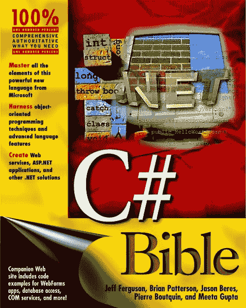

## 关于作者

**Jeff Ferguson** 是 Magenic Technologies 的高级顾问，这家软件咨询公司专门使用 Microsoft 工具和技术解决业务问题。自 1989 年以来他一直担任专业软件开发人员，使用 `C`、`C++` 和 `C#` 为 Unix、DOS 和 Windows 系统开发过软件。可以通过 JeffF@magenic.com 向 Jeff 发送电子邮件（记得地址部分包含全部三个 "F"）。

**Brian Patterson** 目前在 Affina, Inc. 担任技术团队负责人，在那里通常在 HP-UX 或 Windows 上使用 `C++` 以及各种 Visual Studio 语言进行开发。Brian 自 1994 年以来一直在为各种 Visual Basic 出物撰稿，并合著了几本与 `.NET` 相关的书籍，包括*Migrating to Visual Basic*、*.NET* 和 *.NET Enterprise Development with VB.NET*。你可以在 MSDN 新组中看到他的帖子，或通过电子邮件 BrianDPatterson@msn.com 与他联系。

**Jason Beres** 拥有 10 年的软件开发经验。他目前是佛罗里达南部地区的顾问，专门从事 Microsoft 技术。Jason 拥有微软的 `MCT`、`MCSD` 和 `MCDBA` 认证。不在教学、咨询或写作时，他会格式化硬盘，安装 Microsoft 最新的测试产品，并关注《星际迷航》的最新集。

**Pierre Boutquin** 是某大型加拿大银行的高级软件架构师，在那里协助开发领先的市场风险管理软件。他拥有十多年基于 PC 的计算机系统的经验，对分布式系统设计、数据仓库、`Visual Basic`、`Visual C++` 和 `SQL` 有深入了解。他合著了许多编程书籍，并为其他书籍提供了关于 `VB`、`COM+`、`XML` 和 `SQL` 的材料。他的两只爱的缅甸猫 Koshka 和 Sasha 占据了 Pierre 大部分的空闲时间。在摸它们时，他经常想如果能有更多时间回到棋类或关注他母国比利时的新闻有多好。你可以通过 boutquin@hotmail.com 与他联系。

**Meeta Gupta** 拥有计算机工程硕士学位。网络是她的真爱。她目前就职于 NIIT，在那里为从学生到企业客户的各种受众设计、开发并编写了关于广泛范围主题的书籍。

**NIIT** 是一家全球性的 IT 解决方公司，创建定制培训产品，并在全球设有 2000 多家培训中心。NIIT 与 Microsoft 和 AT&T 等大型公司建立了战略合作伙伴关系。

## 系列编辑

**Michael Lane Thomas** 是活跃的开发社区和计算机行业分析师，目前担任微软的技术推广员。在与六家出版社合作期间，Michael 写了许多关于各种主题的书籍，包括`Visual Basic`、`Visual C++` 和 `.NET`。他是微软认证计划的积极支持者，获得了 `MCSD`、`MCSE+I`、`MCT`、`MCP+SB` 和 `MCDBA`。

Michael 的技术之旅始于堪萨斯大学大学时期，在那里积累了经验并获得了几个学位。在担任东京 `Global Online Japan` 的短期技术和业务顾问后，他回到美国晋升。他担任过各种职位，包括 IT 经理、现场工程师、培训师、独立顾问，甚至是一家成功的电子商务公司的临时 CTO，但他认为目前担任微软 `.NET` 推广员是最好的。可以通过电子邮件 mlthomas@microsoft.com 与他联系。除了技术写作，Michael 还经常出现在广播节目中，包括在 `Entercom` (http://www.entercom.com/) 电台（通常是堪萨斯城的 News Radio 980KMBZ），你也可以在网上 MSDN Webcast (http://www.microsoft.com/usa/webcasts/) 上讨论 `.NET` 等下一代 Web 应用技术。

## 致谢

**高级策划编辑：** Sharon Cox

**项目编辑：** Eric Newman

**开发编辑：** Sydney Jones

**校稿编辑：** Luan Rouff

**技术编辑：** Sundar Rajan

**编辑经理：** Mary Beth Wakefield

**副总裁兼执行集团经理：** Richard Swadley

**副总裁兼出版经理：** Joseph B. Wikert

**项目协调员：** Ryan T. Steffen

**图形与制作专家：** Beth Brooks, Melanie DesJardins, Joyce Haughey, Barry Offringa

Laurie Petrone, Betty Schulte, Jeremey Unger

## 质量控制员

Laura Albert, Susan Moritz

## 校对与索引

TECHBOOKS Production Services

*献给我的家人和朋友。*

***Jeff Ferguson***

*这本书献我的叔叔 Brian Weston，当我去拜访并花一整天玩他的 TRS-80 Model II 时，他似乎并不介意。*

***Brian Patterson***

*致 Nitin，他是核心动力。*

***Meeta Gupta***

# 前言

微软的 `.NET Framework` 代表了自 Windows 推出以来，微软操作系统在软件开发方法上最重的变化。它采用一种架构构建，允许不同的软件语言协同工作、共享资源和代码，从而为开发者提供构建下一代桌面和互联网功能应用程序所需的先进工具。微软的 Visual Studio .NET 产品包含了针对 .NET 开发的新版 Visual Basic 和 C++ 编译器产品，还包含了一种名为 C#（读作 "C-sharp"）的全新语言。

*C# 圣经*将向你展示如何使用这种全新的语言来编写代码。语句、变量、控制循环和类等语言结构都将涵盖在内。此外，本书将向你展示如何将 C# 应用开发者在现实世界中面临的编程任务。书的最后部分将展示如何使用 C# 开发网站、访问数据库、处理旧有的 COM 和 COM+ 对象、开发 Windows 桌面应用程序、处理各种 `.NET Framework` 概念等。

本书的重点是使用 C# 作为实现语言，并以 .NET Framework 的 C# 命令行编译器作为主要开发工具进行 .NET 开发。本书不涵盖使用 Visual Studio .NET 工具进行 C# 开发的章节，尽管一旦充分掌握了使用 C# 进行 .NET 开发的基础，就可以轻松掌握使用 Visual Studio .NET 开发 C# 应用程序的任务。

## 谁应该读这本书

本书的编写兼顾了初学者和经验丰富的开发者。如果你对软件开发的基础一无所知，这本书将带你从基础知识开始，教你变量、控制循环和类是如何工作的。这本书也适用于任何技能水平的开发者，展示可用于 C# 开发的 .NET 工具，并提供技巧，使你自己的 C# 应用程序在 .NET Framework 开发指南内无缝运行。

如果你已经深入了创建 .NET 应用程序的世界，你会发现这本书是一份非常有用的资源，因为它深入涵盖了 .NET 开发的每一个方面。

本书的前三部分作为使用 C# 语言特性的说明参考。相比之下，书的最后部分致力于展示 C# 作为一个应用程序开发平台，阐述 C# 在桌面、Web、数据库和基于组件的应用程中的作用。

本书假设你是第一次接触 C#，旨在不任何任何先语言专业知识的情况下提供对该语言的理解。然而，本书假设你熟悉与 C# 应用程序配合使用的应用程序环境。书的最后部分涵盖了 C# 在桌面、Web、数据库和组件应用程序中的用法，但并未详细解释这些平台。相反，本书假设你已经拥有这些应用程序平台的操作知识。

## 本书的结构

本书分为五个部分外加一个附录。

# 第一部分：C# 语言基础

书的第一部分提供了 C 家族编程语言的简要概述，并讨论 C# 的基本语法问题。变量、语句、流控制循环和方法调用都将得到讨论。初次开发者也将找到关于这些语法元素用法的讨论，并能够理解如何使用这些结构构建代码。

### 第二部分：使用 C# 进行面向对象编程

第二部分的章节涵盖了 C# 中 `class`（类）的概念。`class` 是 C# 应用程序代码的基本单元，理解类是构建运行良好的 C# 应用程序的关键。第二部分涵盖了类设计、基类、派生类和运算符重载等主题。

### 第三部分：高级 C#

书的第三部分专注于更高级的 C# 应用程序所特定语言特性。异常处理、接口实现、命名空间、特性和不安全代码等主题均被涵盖。第三部分的最后一章节专门介绍一些使用 C# 实现的棘手编程问题的解决方案。

### 第四部分：使用 C# 开发 .NET 解决方案

第四部分展示了如何在利用 .NET Framework 各部分的应用程序中使用 C#。这部分与其他章节不同，其他章节致力于介绍 C# 的语言特性。第四部分使用 C# 利用各种 .NET 应用程序平台构建应用程序，从 Windows Forms 到 Web Forms，再到 ASP.NET 应用程序和数据库访问。我们还将查看如何使用 C# 与一些高级 .NET 技术工作，包括线程、程序集和反射。

### 第五部分：C# 与 .NET Framework

书的最后部分描述了如何使用 C# 与 .NET Framework 本身协作。解释了程序集、反射、线程以及 COM/COM+ 组件互操作等 Framework 概念。每一章都解释了相应的 Framework 概念，并展示了如何使用 C# 作为实现语言来利用该技术。

### 附录

书的最后部分是一个附录，“XML 入门指南”，它提供了可扩展标记语言（XML）的概述。它概述了 XML 的历史，以及开发者如何利用 XML 以标准方式描述数据。许多 .NET 项目以不同形式使用 XML，若干 .NET 配置文件也是基于 XML 基础设施的。

## 伴随网站

本书提供了一个配套网站，你可以从那里下载各个章节的代码。所有代码列表都位于一个 WinZip 文件中，你可以访问 `www.wiley.com/extras` 并选择 *C# Bible* 链接来下载。下载文件后，如果你的系统中已安装了 WinZip，可以通过双击来打开并提取内容。如果你目前没有 WinZip，可以从 `www.winzip.com` 下载评估版本。

## 如何阅读本书

对软件开发完全陌生的读者（也许来自 Web 管理员背景的读者）通过先阅读第一部分和第二部分来良好掌握软件应用程序的机制将从书中获得最大的益处。对于新开发者来说，理解软件开发的基础以及所有部分如何组合在一起构建一个完整的 C# 应用程序是非常重要的。

带有 C++ 背景接触 C# 的读者会发现 C# 非常熟悉。C# 的设计考虑了 C 和 C++，其语法与这些较旧语言相似。这些读者可能希望快速浏览第一部分和第二部分以感受语法的差异，然后可能想直接进入第三部分以理解该语言的高级特性。第三部分的许多主题深入了区分 C# 与其前身语言的概念。

已经熟悉 C# 的开发者也会发现这些很有用。第四部分和第五部分展示了 C# 在各种 .NET 平台应用程序中的用法，并展示了几个示例，说明了可以用于执行各种任务的 C# 代码。最后两部分将本书从理论语言层面提升到了实践层面，对于想要了解如何使用 C# 实现各种应用程序的任何级别的来说都是理想的。

## 本书使用的约定

本书的每一章开头都有对该章涵盖主题的提示，结尾对你阅读本章后应该学到的内容进行总结。

在全书中，你会在边边看到突出显示特殊或重要信息的图标。请留意以下图标：

- **警告 (Caution)**：`Caution` 图标表示一种可能会导致困难甚至数据丢失的程序；请密切关注 `Caution` 图标，以避免常见和常见的编程陷阱。

- **交叉引用 (Cross-Reference)**：`Cross-Reference` 图标指向关于某个主题的额外信息，你可以在书的其他部分找到这些信息。

- **注释 (Note)**：`Note` 图标突出有趣或补充的信息，通常包含关于某个主题的额外技术信息。

- **提示 (Tip)**：`Tip` 图标引起对方便的建议、有用的提示和建议的关注。

除了之前列出的图标外，书中还使用了以下排版约定：

- 代码示例使用等宽字体显示。

- 其他代码元素（如数据结构和变量名）使用等宽字体显示。

- 文件名和万网地址 (URL) 也使用等宽字体显示。

- 章节中重要术语的首次出现用*斜体*（italic）文本突出。

- *斜体*（Italic）也用于占位符——例如，`ICON <icon> <file name>`，其中 `<icon> <file name>` 代表位图文件的名称。

- 菜单命令按层级指示，每个菜单命令之间用箭头分隔。例如，`File → Open` 意味着点击菜单栏上的 `File` 命令，然后选择 `Open`。

- 键盘快捷键使用以下语法表示：`Ctrl+C`。

## 什么是侧边栏？

侧边栏主题提供了额外信息。侧边栏文本包含了与章节正文相关的讨论，但对于理解正文并非至关重要。

## 致谢

**Jeff Ferguson**：像这样规模和深度的书籍很少是由单个人完成的，本书也不例外。我向许多人在撰写本书期间提供的帮助和鼓励深表谢意。

首先，我必须感谢我的父母的养育。如果没有父母的指导，我就不会变成现在的这个样子，也无法完成任何规模的任务。我不仅一直感谢你们，也感谢整个家人一直以来给予我的爱和支持。

我要感谢 Wiley 的所有人员，他们在这些材料制作中的领导作用。

感谢 Andrea Boucher、Sharon Cox、Eric Newman 和 Chris Webb 带领我走过了令人生畏的技术书籍出版世界。还要感谢 Rolf Crozier，他在早期就与我讨论过这个项目。我特别要感谢我的同事 Bob Knutson，他审阅了书中材料的草稿。

感谢 Greg Frankenfield 和 Paul Fridman，他们创建了一个顶尖的基于微软的咨询机构，让我既能从事客户项目，也能从事自己的项目。我在 Magenic 工作期间经历的技术增长是无法估量的。

祝 Magenic 持续取得成功。

感谢互联网上 DOTNET 邮件列表和新闻组的每个人。仅仅通过阅读你们的帖子，我就对 .NET Framework 和 C# 学习了大量的知识。来回的调侃让我更好地了所有这些新部分是如何整合在一起的。

**Brian Patterson**：我想感谢我的妻子 Aimee，她允许我有许多躲在电脑后的时光，以便我能完成这本书的工作。特别感谢 Steve Cisco 在书中付出的巨大努力，他为我们其他人指了道路；感谢策划编辑 Sharon Cox，她不断让我保持进度；感谢项目编辑 Eric Newman，他让一切都井井有条；感谢系列编辑 Michael Lane Thomas，他审阅了每一个章节，提出了许多非常好的建议，并对微软和 .NET 框架提供了宝贵的见解。

**Pierre Boutquin**：创作一本书投入了大量精力，而不仅仅是封面上提到的这些人。我必须特别感谢 Wiley 团队，他们为制作高质量书籍付出了巨大的奉献。评审员让我看起来像个有造诣的作家，他们功不可没。

最后，如果没有家人和朋友的支持，这种努力是不可能的：Sandra、Andrea、Jennifer 和 Paul、Tindy 和 Doel、Marcel 和 Diana Ban、Margaret Fekete，以及 John 和 Nadine Marshall。

**Meeta Gupta**：感谢 Anita 给了我这个机会。然而，我最大的感谢来自 Nitin，为了……嗯，一切。

# 第一部分：C# 语言基础

- 第 2 章：编写你的第一个 C# 程序

- 第 4 章：表达式

- 第 6 章：使用方法

环境。.NET Framework 的设计考虑了三个主要目标。首先，它旨在让 Windows 应用程变得更加可靠，同时提供更高安全性的应用程序。其次，它旨在简化 Web 应用程序和服务的开发，这些服务不仅可以在传统意义上运行，还可以在移动设备上运行。最后，该框架的设计目标是提供一组可以与多种语言协作的单一库。接下来的章节将介绍 .NET Framework 的每个组件。

图 1-1：.NET Framework 的四个组件

## Web 开发

.NET Framework 的设计初衷只考虑了一点：驱动互联网的发展。

这种添加到互联网开发中的新燃料被称为 `Web Services`（Web 服务）。你可以将 `Web Services` 为一个与程序而非人交互的网站。`Web Service` 并不交付 Web 页面，而是接收格式为 `XML` 的请请求，执行特定功能，然后将响应作为 `XML` 消息返回给请求者。

请注意，`XML`（或可扩展标记语言）是一种自描述性语言，非常与 `HTML` 相似。另一方面，`XML` 没有预定义的标签，因此它在表示各种对象时具有极大的灵活性。

一个 `Web Service` 的典型应用是作为企业计费系统的上层架构。当用户浏览网页并在你的网站购买产品时，购买信息会被发送到 `Web Services`，它会计算所有产品的总和，向应收账数据库添加记录，然后返回带有订单确认号的响应。该 `Web Service` 不仅可以与 页面交互，还可以与其他 `Web Services`（例如企业应付账系统）交互。

为了让 `Web Service` 模型能够适应编程语言的自然演变，它包含的内容远不止简单的 Web 接口。Web 服务模型还包括协议，允应用程序在局域网或互联网上发现可用 `Web Services`。该协议还允许应用程序探索 `Web Service` 并确定如何与其通信以及如何交换信息。为了实现 `Web Service` 发现，建立了通用发现、描述和集成 (`UDDI`)。这允许根据公司名称、服务类型和地理位置等关键信息对 `Web Services` 进行注册和服务。

## 应用程序开发

除了 Web 开发之外，你仍然可以使用 .NET Framework 构建传统的 Windows 应用程序。使用 .NET Framework 创建的 Windows 应用程序基于 `Windows Forms`。这些 `Windows Forms` 某种程度上是 `Visual Basic 6` 表单与 `Visual C++` 表单的混合体。尽管表单的外观与其前身相同，但它们是完全面向对象且基于类的，就像 `Microsoft Foundation Class` 中的表单对象一样。

这些新的 `Windows Forms` 现在支持 `Visual Studio` 中的许多经典控件，如 `Button`、`TextBox` 和 `Label`，以及 ActiveX 控件。除了传统控件外，还支持 `PrintPreview`、`LinkLabel`、`ColorDialog` 和 `OpenFileDialog` 等新组件。

使用 `.NET` 构建应用程序还为你提供了许多其他语言中没有的增强功能，例如安全性。这些安全措施可以决定应用程序是否可以读写磁盘文件。它们还允许你将数字签名嵌入应用程序中，以确保该程序是由可信源编写的。.NET Framework 还允许你在实际代码中嵌入组件信息和版本信息。这使得软件按需、自动或在完全没有用户干预的情况下安装成为可能。这些这些大大降低了企业内部的支持成本。

## 通用语言运行时

编程语言通常由编译器和运行时环境组成。编译器将你编写的代码转换为用户可以运行的可执行代码。运行时环境为你的可执行代码提供一组操作系统服务。

这些服务被构建在运行时层中，因此你的代码不需要担心与操作系统交互的低级细节。内存管理和文件 I/O 等操作就是运行时环境可能提供的服务示例。

在 .NET 出现之前，每种语言都带有自己的运行时环境。`Visual Basic` 带有一个名为 `MSVBVM60.DLL` 的运行时。`Visual C++` 带有一个名为 `MSVCRT.DLL` 的 DLL。这些运行时模块每一个都为开发者编写的代码提供一组低级服务。开发者编写代码，然后针对相应的运行时构建该代码。可执行代码会随运行时一起发布，如果用户机器上尚未安装运行时，则会被安装。

这些运行时环境的主要问题是，它们是为单一语言设计的设计的。`Visual Basic` 运行时为内存操作和启动 `COM` 对象等操作提供了很好的功能，但这些功能仅 `Visual Basic` 用户可用。使用 `Visual C++` 的开发者无法使用 `Visual Basic` 运行时的功能。`Visual C++` 用户有自己的运行时及其自己的长长功能列表，但这些功能对 `Visual Basic` 用户是不可用的。这种“独立运行时”的方法阻止了语言之间的无缝协作。例如，无法在一段 `Visual Basic` 代码中获取某些内存，然后将其交给一段 `Visual C++` 代码由后者释放内存。不同的运行时以自己的方式实现自己的功能集。各种运行时的功能集是不一致的。即使是现在多个运行时中存在的功能，其实现方式也不同，使得用不同语言编写的代码片段无法工作。

.NET Framework 的设计目标之一是统一运行时引擎，以便所有开发者都能使用单一的运行时服务。.NET Framework 的解决方案被称为通用语言运行时 (`CLR`)。`CLR` 为任何与 .NET Framework 协作的语言提供内存管理、安全和健的错误处理等功能。受益于 `CLR`，所有 .NET 语言都可以可以使用运行时服务，而开发者无需担心其特定语言是否支持某种功能。

`CLR` 还允许语言之间进行互操作。内存可以由一种语言（例如 `Visual Basic .NET`）分配，并由另一种语言（例如 `C#`）释放。同样，错误可以在一种语言中抛出并在另一种语言中处理。

## .NET 类库

开发者喜欢使用已经过测试并证明有效的代码，例如 `Win32 API` 和 `MFC` 类库。代码复用一直是软件开发社区的目标。然而，代码复用的实用性远达到预期。

许多语言都可以访问预先测试、即用的代码库。`Visual C++` 受益于类库，例如 `Microsoft Foundation Classes (MFC)`（它使 `C++` 开发者能够快速构建 Windows 应用程序）以及 `Active Template Library (ATL)`（它为构建 `COM` 对象提供了支持）。然而，这些库的语言特性使得无法在其他语言中使用。`Visual Basic` 开发者在构建 `COM` 对象时无法使用 `ATL`。

.NET 提供了许多类帮助开发者复用代码。.NET

类库包含了用于编程主题的代码，如线程、文件 I/O、数据库支持、XML 解析以及数据结构（如栈和队列）。最棒的是，这整个

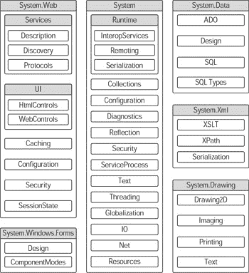

类库适用于任何支持 `.NET Framework` 的编程语言。

得益于 `CLR`，任何 `.NET` 语言都可以使用 `.NET` 类库中的任何类。由于所有语言现在都支持相同的运行时（runtime），它们可以重用任何与 `.NET Framework` 兼容的类。这意味着，对某一种语言可用的任何功能，也适用于任何其他 `.NET` 语言。

当 `.NET Framework` 描绘的“类库重用”图当你意识到重用范围扩展到了你自己的代码，而不仅仅是微软随 `.NET` 提供的代码时，这种体验变得更加完美了。微软在 `.NET` 类库代码库中提供的代码在架构上与你编写的代码无异。微软的代码仅仅是使用 `.NET` 支持的语言编写，并使用 `.NET` 开发工具构建的。这意味着微软正在使用与你编写代码时完全相同的工具。你可以编写出可以在其他 `.NET` 语言中使用的代码，就像微软对其类库所的那样。`.NET Framework` 允许你使用 `C#` 编写代码，并将其交给 `Visual Basic .NET` 开发者，他们可以在他们的应用程序中使用你编译后的代码。图 1-2 包含了 .NET 类库的高级概述。

图 1-2：.NET Framework 类库

### .NET 编程语言

.NET Framework 提供了一系列工具，帮助你构建与 `.NET Framework` 协作的代码。微软提供了一系列已经是“.NET 兼容”的语言。

`C#` 就是其中一种语言。新版本的 `Visual Basic` 和 `Visual C++` 也被创建出来以利用 `.NET Framework`，一个版本的 `Jscript.NET` 也在此路上。

`.NET` 兼容语言的开发并不限于微软。微软的 .NET 组已发布了文档，展示了语言供应商如何让他们的语言与 .NET 协作，供应商们正在使 `COBOL` 和 `Perl` 等语言与 `.NET Framework` 兼容。目前，来自第三方供应商和机构正在开发的 20 种或更多语言正准备接入 `.NET Framework`。

### ASP.NET 环境

互联网最初旨在向 Web 浏览器传递静态内容。这些 Web 页面从不改变，对于每个访问该位置的用户来说都是完全相同的。微软发布了 Active Server Pages（活动服务器页），以便根据用户输入和与网站的交互创建动态页面。这是通过在 Web 页面背后运行脚本实现的，通常使用 `VB Script`。当用户访问网站时，他们可能会被提示验证信息（通过手动方式或从 `cookie` 获取），然后脚本将生成一个结果 Web 页面返回给用户。

`ASP.NET` 通过提供后置代码（code-behind）改进了原始的 `ASP`。在 `ASP` 中，HTML 和脚本混合在一个文档中。通过 `ASP.NET` 和后置代码，代码和 HTML 可以分离。现在，当网站的逻辑需要更改时，没有必要在成百上千行 HTML 中反复查找需要更改的脚本。

与 `Windows Forms` 类似，`ASP.NET` 也支持 `Web Forms`。`Web Forms` 允许你将控件拖放到表单上，并像在任何典型的 Windows 应用程序中一样对它们进行后置代码编写。

由于 `ASP.NET` 使用了 `.NET Framework`，它也使用了即时编译（JIT）编译器。

传统的 `ASP` 页面运行非常慢，因为代码是被解释执行的。`ASP.NET` 在代码安装在服务器上或第一次被请求时进行编译，这极大地提高了速度。

### C、C++ 和 C# 的历史

`C#` 编程语言是秉着 `C` 和 `C++` 编程语言的精神创建的。这解释了它强大的特性和易于学习的曲线。`C` 和 `C++` 则不能这么说，但由于 `C#` 是从零开始创建的，微软特意去掉了一些更具负担的特性——例如指针。本节将回顾 `C` 和 `C++` 语言，追溯它们演进为 `C#` 的过程。

`C` 编程语言最初设计用于 `UNIX` 操作系统。

`C` 被用于创建了许多 `UNIX` 应用程序，包括一个 `C` 编译器，并最终被用于编写 `UNIX` 本身。它在学术界的广泛接受扩展到了商业领域，像 `Microsoft` 和 `Borland` 这样的软件供应商为个人电脑发布了 `C` 编译器。原始的 `Windows API` 设计用于与用 `C` 编写的 Windows 代码配合，直到今天，核心 Windows 操作系统的最新 API 仍然保持与 `C` 兼容。

从设计的角度来看，`C` 缺乏一个如 `Smalltalk` 等语言已经接纳的细节：对象的概念。你将在第 8 章“编写面向对象的代码”中学习更多关于对象的知识。现在，请将对象视为数据的集合以及一组可以在该数据上执行的操作。对象风格的编码可以使用 `C` 实现，但该语言并没有强制执行对象的概念。如果你想让你的代码结构看起来像一个对象，没问题；如果你不想，也没问题。`C` 真的不在乎。对象不是该语言的固有部分，因此许多人并不关注这种编程范式。

在面向对象开发的概念开始获得关注后，很显然 `C` 需要经过精炼以适应这种新方式。`C++` 正为了体现这种精炼而创建的。`C++` 被设计为与 `C` 向后兼容（这使得所有 `C` 程序都是 `C++` 程序，并可以使用 `C++` 编译器编译）。`C++` 语言的主要新增是对类（即对象的模板）的支持，这使得整整一代 C 程序员能够以对象及其行为进行思考。`C++` 语言是 `C` 的改进，但它仍然有一些缺点。由于 `C++` 有与 C 向后兼容的设计目标，`C++` 无法脱离 C 的低级水平。

微软设计 C# 时保留了大量 C 和 C++ 的语法。熟悉这些语言的开发者可以很快学会 C# 代码。然而，C# 的巨大优势在于，其设计者选择不让它与 C 和 C++ 向后兼容。这听起来可能是个坏事，但实际上是个好消息。C# 消除了让 C 和 C++ 变得难以处理的问题。因为所有 C 代码都是 C++ 代码，所以 C++ 必须保留在 C 中发现的所有原始怪癖和缺陷。

class Class1

    public string FirstName;

    {

    }

```

注意：单继承意味着 C# 类只能继承自一个基类。
C# 允许你将类分组到一个名为 `namespace`（命名空间）的类集合中。命名空间具有名称，可以帮助将类集合组织成逻辑分组。
当你开始学习 C# 时，你会明显发现所有与 .NET Framework 相关的命名空间都以 `System` 开头。微软还选择了一些有助于后兼容性和 API 访问的类。这些类包含在 `Microsoft` 命名空间。
## 数据类型
C# 允许你处理两种数据：值类型和引用类型。`Value types`（值类型）存储实际的值。`Reference types`（引用类型）存储存储在内存其他处的值的引用。
`char`、`int` 和 `float` 等原始类型，以及枚举值和结构都是值类型。引用类型持有处理对象和数组的变量。C# 带有预定义的引用类型（`object` 和 `string`）以及预定义的值类型（`sbyte`, `short`, `int`, `long`, `byte`, `ushort`, `uint`, `ulong`, `float`, `double`, `bool`, `char` 和 `decimal`）。你也可以在代码中定义自己的值类型和引用类型。所有的值类型和引用类型最终都派自名为 `object` 的基类型。
C# 允�你将一种类型的值转换为另一种类型的值。你可以使用 `implicit`（隐式）转换和 `explicit`（显式）转换。隐式转换总是成功且不会丢失任何信息（例如，你可以将 `int` 转换为 `long` 而不会丢失任何数据，因为 `long` 比 `int` 大）。显式转换可能会导致数据丢失（例如，将 `long` 转换为 `int` 可能会导致数据丢失，因为 `long` 可以存储比 `int` 更大的值）。你必须在代码中编写转换运算符来执行显式转换。
交叉引用：请参阅第 3 章“使用变量”，以获取关于隐式和显式转换的更多信息。
你可以在 C# 中处理一维数组和多维数组。多维数组可以是矩形的（即每个数组的维度相同），也可以是锯形的（即每个数组的维度不同）。
类和结构可以拥有名为 `properties`（属性）和 `fields`（字段）的数据成员。`Fields` 是与所属类或结构关联的变量。例如，你可以定义一个名为 `Employee` 的结构，它有一个名为 `Name` 的字段。如果你定义了一个类型为 `Employee` 的变量 `CurrentEmployee`，你可以通过编写 `CurrentEmployee.Name` 来获取员工姓名。`Properties` 类似于字段，但允许你编写代码来指定当代码访问该值时应该发生什么。例如，如果必须从数据库读取员工姓名，你可以编写代码说：“当有人请求 `Name` 属性的值时，从数据库读取名称并作为字符串返回名称。”
## 函数
函数是一段可调的代码，它可能也可能不向最初调用它的代码返回值。函数的一个示例是本章中 `Family` 类中之前显示的 `FullName` 函数。`function`（函数）通常与返回信息的代码段相关，而 `method`（方法）通常不返回信息。然而，就我们的目的而言，我们将它们统称为函数。
函数可以有四种参数：
- 输入参数具有被发送到函数的值，但函数不能更改这些值。
- 引用参数传递指向另一个值的引用。它们有一个传入函数的值，且该值在函数内部可以被更改。


.NET 没有这一缺点。描述代码中类所需的所有信息都存放在元数据（metadata）中。你可以将元数据理解为具有 COM 类型库的所有优点，但没有局限性。
## 程序集 (Assemblies)
有时，你会使用 C# 构建端用户应用程序。这些应用程序被封装为扩展名为 `.EXE` 的可执文件。Windows 一直将 `.EXE` 文件作为应用程序来运行，而 C# 完全支持构建 `.EXE` 文件。
然而，某些时候你可能不想构建整个应用程序。相反，你可能想构建一个可以供他人使用的代码库。你可能还想在 C# 中编写一些工具类（例如），然后将代码交给 Visual Basic .NET 开发者，他们将在 Visual Basic .NET 应用程序中使用你的类。在这种情况下，你并不是在构建应用程序。相反，你正在构建一个 `assembly`（程序集）。
一个 `assembly` 是代码和元数据的包。当你向一个 `assembly` 部署一组类时，你是在将这些类作为一个单元进行部署；而且这些类共享相同的版本控制级别、安全信息和激活需求。将 `assembly` 想象成一个“逻辑 DLL”。如果你熟悉 Microsoft Transaction Server 或 COM+，你可以将 `assembly` 视为 .NET 中等包包。
程序集有两种：`private assemblies`（私有程序集）和 `global assemblies`（全局程序集）。当你构建 `assembly` 时，不需要指定想要构建私有程序集还是全局程序集。区别在你部署 `assembly` 时是显而易见的。通过 `private assembly`，你让你的代码对单个应用程序可用。你的 `assembly` 被封装为 `DLL`，并安装到使用它的程序相同的目录中。通过部署 `private assembly`，唯一可以使用你代码的应用程序是与你的 `assembly` 位于同一目录下的可执行文件。
如果你想在许多应用程序之间共享代码，可能需要考虑将代码部署为 `global assembly`（全局程序集）。`Global assemblies` 可以被系统上的任何 .NET 应用程序使用，无论它们安装在哪个目录下。Microsoft 将程序集作为 .NET Framework 的一部分发布，每个 Microsoft 程序集都作为 `global assembly` 安装。.NET Framework 在一个名为 `global assembly cache`（全局程序集缓存）的设施中包含了一个全局程序集列表，而 .NET Microsoft Framework SDK 包含了从全局程序集缓存中安装和删除程序集的实用工具。
## 总结
在本章中，你学习了 .NET Framework 的基础知识。在追踪从 C 到 C++ 再到 C# 的演变后，你检查了 C# 功能列表的亮点。你还研究了 C# 编译器的输出、MSIL 代码和元数据，并回顾了程序集作为编译 .NET 代码构建块的使用。
## 第二章：编写你的第一个 C# 程序
### 本章
本章将引导你开发一个简单的 C# 应用程序。你还将学习简单的 C# 应用程序是如何构建的，以及如何调用 C# 编译器将你的源代码转换为 .NET Framework 可以执行的代码。最后，你将学习如何使用源代码注释来记录代码，以及你如何自动将你的注释转换为 XML 文档。
### 选择编辑器
在用 C# 为 .NET Framework 编写代码时，有很多选择。最符合逻辑的选择是使用 `Visual Studio .NET`。通过使用 `Visual Studio`，你可以获得 `IntelliSense`、语法高亮以及许多其他增强生产力工具的处。
许多第三方编辑器试图包含 `Visual Studio` 内部的生产力工具。其中几个工具可以作为共享软件下载，另一些则是免费软件。本章提供的示例仅使用 `Windows Notepad`（记事本）。通过使用 `Notepad`，你不仅学会了任何文本编辑器都可以编写 C# 应用程序，还学习了编译应用程序所需的基础知识。同样通过使用 `Notepad`，你了解到并不依赖于向导来为你生成代码。你只需要专注于语言本身，而无需学习 IDE 的来来去。但请记住，对于较大的应用程序，你可能更倾向于使用显示行号的编辑器，这在你追踪故障代码时会有很大帮助。
### 编写 Hello World!
列表 2-1 所示的代码是一个完整的 C# 应用程序。它在控制台窗口中运行，并在屏幕上打印消息 Hello World!。接下来的部分将逐行介绍这段代码。
列表 2-1：向控制台写入
```csharp

{

    {

    }

```
### 构建一个类
我们 C# 程序的的第一行定义了一个 `class`（类）。`class` 是程序应用程序内包含的所有代码的容器。与 C/C++ 不同，你的所有代码必须包含在 `class` 中，只有极少数例外。此规则的例外是 `using` 语句、结构声明和命名空间声明。任何尝试编写包含在 `class` 之外的代码都会导致编译器错误。
你的 Hello World 应用程序的第一行以 `class` 关键字开头，然后是 `HelloWorld` 单词。`HelloWorld` 是代码创建的 `class` 的名称。所有类必须分配一个唯一的名称，以便以后引用它们。
紧接类声明之后，你必须有一个左大括号。左大括号用于开启类的代码体。你在类中编写的所有代码必须放置在这个左大括号之后。除了左大括号，必须有一个右大括号，如 HelloWorld 应用程序的最后一行所示。确保所有的编程内容都位于这两个之间。
### 从 Main() 方法开始
每个 C# 应用程序都必须有一个名为 `Main()` 的方法。该方法是执行操作的操作。它可以向调用它的部分返回信息，但在某些情况下它并不一定。
注意：`method`（方法）和 `function`（函数）通常通常互换使用，但存在区别。`method` 是包含在 `class` 的函数。`function` 通常是不包含在 `class` 内的一组指令，通常位于 C 或 C++ 等语言中。由于在 C# 中不能在类之外添加代码，因此你永远不应该有函数。
你 `Main()` 方法声明中的 `public` 关键字也包含了 `public` 单词，它告知编译器你的 `Main()` 方法应该是公开可的。`Main()` 方法不仅在你的应用程序内部可以被其他方法调用，还可以从外部的其他应用程序调用。通过将你的 `Main()` 方法声明为 `public`，你正在为 Windows 在用户想要运行程序时创建一个入口点。
当用户双击 HelloWorld 应用程序图标时，Windows 会在可执文件中搜索该名称的入口点。如果没有找到，应用程序将无法运行。
方法声明中的 `Static` 单词意味着编译器应该允许在任何时间内内存中只存在一个方法的副本。因为 `Main()` 方法是进入应用程序的入口点，允许入口点加载多次将是灾难性的；这会在内存中产生多个应用程序副本，并无疑导致严重的错误。

在 `Main` 单词之前，你看到了 `Void` 单词。`Void` 是你的 `main` 函数执行完毕返回的内容。`Void` 意味着你的应用程序在完成后没有返回任何值。这个示例应用程序并不高级，因此不需要返回值；但在正常情况下，`Main()` 函数通常会通过将 `void` 单词替换为 `int` 来返回一个整数值。有效的返回值可以是 `.NET Framework` 中定义的任何简单数据类型。
与类声明一样，你定义的任何方法也必须包含一对起始和结束大括号，方法的所有代码都放置在大括号内。你可以在列表 2-1 的第 4 行和第 6 行看到 `Main()` 方法的起始和结束大括号。
## 写入控制台
列表 2-1 的第 5 行包含一个对 `WriteLine` 方法的调用。该方法包含在 `.NET Framework` 中，并将字符串写入控制台。如果从控制台窗口内部运行，文本将显示在屏幕上。如果你在 Visual Studio 环境中运行此命令，它产生的任何输出将显示在输出窗口中。
你已经学过 C# 中的所有函数必须定义在类内部。`.NET Framework` 中的函数也不例外。`WriteLine()` 函数位于一个名为 `Console` 的类中。在 `WriteLine()` 函数调用之前使用的 `Console` 关键字告诉编译器 `WriteLine()` 函数可以在名为 `Console` 的类中找到。`Console` 类是 `.NET Framework` 中的许多类之一，而 `WriteLine()` 函数是 `Console` 类的成员。句号将类名与调用的函数名分开。
`System` 名称紧跟在 `Console` 类之前。`.NET Framework` 中的类被组织成称为*命名空间*（namespaces）的组。命名空间将在第 12 中有更详细的介绍。目前，你可以将命名空间类为类的集合。
`Console` 类位于名为 `System` 的 .NET 命名空间，你必须在代码中编写此命名空间名称。C# 编译器需要找到 `WriteLine()` 的代码以便你的应用程序正常运行，你必须在编译器找到 `WriteLine()` 代码之前向其提供关于命名空间和类的足够信息。
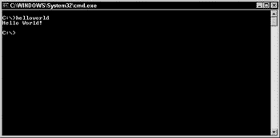
`WriteLine()` 括号内的文本是一个字符串。C# 中的*string*（字符串）是一组用双引号括起来的字符，并作为一个单元保持在一起。将字符串放在括号内告诉编译器你打算将该字符串作为参数传递给 `WriteLine()` 函数。`WriteLine()` 函数将字符串写入控制台，函数的参数告诉 `WriteLine()` 应该写入哪个字符串。
第 5 行包含大量信息，你可以这样读取它：“C# 编译器，我想调用带有参数 'Hello World!' 字符串参数的 `WriteLine()`。`WriteLine()` 函数可以在名为 `Console` 的类中找到，而 `Console` 类可以在名为 `System` 的命名空间中找到。”
第 5 行以分号结尾。所有的 C# 语句必须以分号结束。在 C# 中，分号将一个语句与另一个语句分开。
## 编译并运行程序
现在你已经查看了列表 2-1 中的代码，是时候让它运行了。将列表 2-1 中的代码输入到你喜爱的文本编辑器中，并将其保存为名为 `Listing2-1.cs` 的文件。`.cs` 扩展名是所有包含 C# 代码的文件的扩展名。
在编译 C# 示例之前，你必须确保 C# 编译器在你的 `Path` 中。`csc.exe` 应用程序通常位于 `c:\windows\Microsoft.NET\Framework\v1.0.xxxx` 文件夹（将 `V1.0.Xxxx` 替换为你的 .NET Framework 版本），你可以通过在 Windows 中搜索它来验证。要向路径添加条目，请在 Windows 帮助文件中搜索关键字 `Path`。
现在打开命令提示符窗口并进入保存 `HelloWorld.cs` 文件的文件夹。在那里，你可以输入以下命令：
```

```
`csc` 命令调用 .NET Framework 的 C# 编译器。运行此命令会生成一个名为 `HelloWorld.exe` 的可执行文件，你可以像运行任何 Windows 应用程序一样运行它。运行此可执行文件会将文本如图 2-1 所示写入控制台窗口。
图 2-1：命令提示符窗口显示 Hello World 程序的运行。
恭喜！你刚刚编写了第一个 C# 应用程序。
## 理解关键字和标识符
列表 2-1 中的 C# 应用程序包含许多由空格分隔的单词。它使用了两种名称：关键字（keywords）和标识符（identifiers）。本节描述了这两种类型之间的区别。
*关键字*是 C# 语言中具有特殊含义的单词。这些单词在 C# 中被预留，被称为*保留*（reserved）单词。`class`、`static` 和 `void` 是列表 2-1 中的保留字。每个关键字都由 C# 语言定义为具有特殊含义。以下列表包含了 C# 定义的所有关键字。
abstract
finally
as
fixed
base
float
bool
for
break
foreach
byte
goto
case
if
catch
implicit
char
in
checked
int
class
interface
const
internal
protected
this
public
throw
readonly
true
ref
try
return
typeof
sbyte


class @virtual
    static void Main()
        System.Console.WriteLine("Hello World!");
}


Class
```

{

    {System.Console.WriteLine("Hello World!");}

```
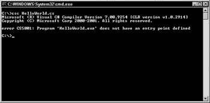
如果你编译并运行列表 2-3，你会发现它的行为与列表 2-1 中的代码完全一致：它输出了字符串 `Hello World!`。新的空白布局样式不会影响编译器编译代码的能力，也不会影响代码在运行时的行为。
## 使用 Main() 函数启动程序
列表 2-1 所示的应用程序定义了一个带有 `Main()` 函数的类。`Main()` 函数是 C# 应用程序的重要部分，因为 `Main()` 函数是程序执行开始的地方。
你编写的每个 C# 应用程序必须包含一个带有 `Main()` 函数的类。`Main()` 函数被称为应用程序的入口点，你的 C# 应用程序的执行就从 `Main()` 中的代码开始。如果你的代码包含多个类，则只能有一个类拥有名为 `Main()` 的函数。如果你忘记定义 `Main()` 函数，你将收到来自编译器的几处错误，如图 2-3 所示。
图 2-3：缺少 `Main()` 函数会导致编译器错误。
列表 2-1 中定义的 `Main()` 函数没有返回值（因此使用了 `void` 关键字），并且不接受任何参数（因此括号是空的）。实际上，C# 编译器接受 `Main()` 函数的四种可能的构造：
- `public static void Main()`
- `public static int Main()`


- `Arguments[1]: Param2`


- 所有的 `Main()` 函数形式都需要 `static` 关键字。
当 C# 应用程序运行时，用户总是会提供命令行参数。但是，如果 C# 应用程序是用不接受任何参数的 `Main()` 函数形式之一编写的，应用程序将无法读取参数。用户为未编写支持参数的 C# 应用程序指定参数是合法的（尽管这可能没用）。
## 为代码添加注释
为代码添加注释允许你在 C# 源文件中添加说明。。这些说明可以帮助你记录应用程序的设计和流程。注释可以出现在 C# 源代码中任何允许出现空白字符的地方。
### 使用单行注释
单行注释以两个斜杠开始，并在该行的剩余部分保持有效：
```csharp

    System.Console.WriteLine("C#"); // 调用 WriteLine()

```
### 使用普通注释
普通注释以斜杠后接星号开始，直到找到星号后接斜杠为止保持有效。普通注释可以跨多行：
```csharp

这是 C# 中的一个普通注释。

由换行符分隔。

```
C# 编译器不允许你将一个普通注释嵌入另一个普通注释中：
```csharp

外部注释

内部注释

更多外部注释文本

```
你不能将一个普通注释嵌入另一个普通注释中，因为编译器会找到第一组 `*/` 字符并假设它已经到达了多行注释的末尾。它随后认为 `*/` 字符之后的文本是 C# 源代码并尝试将其解释为代码。
然而，你可以在普通注释中嵌入单行注释：
```csharp

外部注释

更多外部注释文本

```
### 从注释生成 XML 文档
C# 编译器的一个有趣特性是，它可以读取特殊格式的注释，并根据这些注释生成 XML 文档。你随后可以将此 XML 显示在 Web 上，为需要了解应用程序结构的开发人员提供额外级别的文档。
要使用此功能，你必须做两件事：
- 使用三个斜杠进行注释。C# 编译器不会为任何以三个斜杠开头的注释生成 XML 文档。同样，它也不会为普通的、多行的注释生成 XML 文档。


/// HelloWorld 类是 HelloWorld 类中
/// Main() 函数。该类不包含
class HelloWorld
/// Main() 函数是 Listing2_4 类的。
/// 参数。它向控制台打印 "Hello World!"
static void Main()
    System.Console.WriteLine("Hello World!");
}


<?xml version="1.0"?>
<assembly>
</assembly>
<member name="T:HelloWorld">
/// 唯一的类。该类实现了应用程序
/// 函数。
<member name="M:HelloWorld.Main">
/// 它不返回值，也不接受任何
/// 并退出。
</members>
```

你随后可以为此 XML 文档编写样式表并将其显示在 Web 页面上，为他人提供一份最新的代码文档。

XML 文档的主要部分位于 `<members>` 元素中。该元素为源代码中的每个被记录的项包含一个 `<member>` 标签。`<member>` 标签包含一个名为 `name` 的属性，用于命名被记录的成员。`name` 属性的值以一个单字母前缀开头，用于描述所描述的信息类型。表 2-1 描述了 `name` 属性值的第一个字母的选项及其含义。

### 表 2-1：`<member>` `"name="` 属性前缀

| 前缀 | 含义 |

| E | 元素正在为事件提供文档。 |

| M | 元素正在为方法提供文档。 |

| P | 元素正在为属性提供文档。 |

| ! | C# 编译器遇到错误，无法确定此成员的正确前缀。 |

前缀之后是一个冒号和成员的名称。对于类型成员，`name=` 属性列出了类的名称。对于方法成员，`name=` 属性列出了包含该方法的类名称，后面跟着一个句号，然后是方法的名称。

你的 XML 文档注释可以嵌入任何有效的 XML 元素来辅助你的文档工作。 .NET Framework 文档建议了一组你可能想在文档中使用的 XML 元素。本节的其余部分将检查这些元素中的每一个。记住，你必须将有效的 XML 编码到注释中，这意味着每个元素必须在注释的某处包含一个匹配的结束元素。

注意：*tag*（标签）一词是指 XML 中包含任何描述项目。标签始终用符号 `<` 和 `>` 包围。

#### `<c>`

/// 此函数是 <c>Main()</c> 函数，

```
#### `<code>`

/// 使用三个参数调用此应用程序将
/// 包含三个元素：
/// Argument[0]: 命令行参数 1
/// Argument[2]: 命令行参数 3
```

#### `<example>`

/// <example>这是一个客户端调用

/// <code>

/// </code>

```
#### `<exception>`

/// <exception cref="System.Exception">
/// </exception>


/// <exception cref="junk">testing</exception>


<member name="M:MyClass.Main">
</member>


你可以使用 `<list>` 标签描述文档中的项目列表。你可以描述项目符号列表、编号列表或表格。`<list>` 标签使用名为 `type` 的属性来描述列表的类型。表 2-2 列出了 `type` 属性的可能值并描述了它们的含义。
### 表 2-2：`<list>` `"type"` 属性值
| 值 | 含义 |
| bullet | 列表是符号列表。 |
| table | 列表是表格。 |
符号和编号样式还应该包含 `<list>` 标签内的一个或多个 `<item>` 标签。每个 `<item>` 标签对应列表中的一个项目。每个 `<item>` 标签应该包含一个 `<description>` 标签，其文本定义了列表项的文本：
```csharp

/// <item>

/// </item>

/// <description>这是项目 2。</description>

```
列表类型还应该包含 `<listheader>` 标签。`<listheader>` 包含一个或多个 `<term>` 标签来描述表格：
```csharp

/// <listheader>

/// </listheader>

/// <description>这是项目 1。</description>

/// </list>

使用 `<param>` 标签记录函数的参数。`<param>` 标签使用一个属性 `name`，其值命名了被记录的参数：

```csharp
```

C# 编译器确保 `name` 属性的值确实指定了参数的名称。如果不是，如下代码会产生警告：

`warning CS1572: 'Main(string[])' 的 XML 注释具有 'junk' 的 param 标签，但没有对应的参数`

<member name="M:Class1.Main(String[])">

</member>

你可以使用 `<paramref>` 标签在描述内部引用参参数。该标签不得包含任何文本；但它带有名为 `name` 的属性。`name` 属性的值必须列出被引用的参数名称：

```csharp
/// 命令行指定的参数。

使用 `<permission>` 标签记录给定函数或变量的权限。对类代码数据的访问可以是访问所有代码，也可以限制为某些子集。你可以使用 `<permission>` 标签记录代码和数据的可用性。
`<permission>` 标签使用一个属性：`cref`。`cref` 元素的值必须命名正在记录权限的函数或变量：
```csharp

/// 所有人都可以访问 Main()。

```
#### `<remarks>`

/// <remarks>
/// CLR 将调用 Main() 来启动


/// <returns>
/// 如果应用程序成功处理了数据，
/// 未被成功处理，则将返回 1。
```

### <see>

使用 `<see>` 标签对文件中其他地方找到的函数或变量添加引用。`<see>` 元素使用一个名为 `cref` 的属性，其值指定了所引的方法或变量名称。`<see>` 标签不应包含任何文本：

```
```

C# 编译器确保 `cref` 属性的值实际上指定了方法或变量的名称。如果不是，编译器将发出警告。因此，如下所示的代码：

```csharp
/// <see cref="junk" />

public static void Main(string [] strArguments)
{

}
```

会产生如下警告：

`warning CS1574: XML comment on 'Class1.Main(string[])' has cref attribute 'junk' that could not be found`

即使 `cref` 属性错误，`<see>` 标签也会放置在 XML 文档文件中：

```xml
<member name="M:Class1.Main(System.String[])">
<see cref="!:junk"/>
</member>
```

### <seealso>

类似于 `<see>`，你可以使用 `<seealso>` 标签对文件中其他地方找到的函数或变量添加引用。你可能需要生成包含 `<see>` 引用部分以及另另（See Also）引用部分的文档，C# 编译器通过支持 `<see>` 和 `<seealso>` 标签允许你进行这种区分。`<seealso>` 标签使用一个名为 `cref` 的属性，其值指定了所引的方法或变量名称。`<seealso>` 标签不应包含任何文本：

```
/// <seealso cref="Class1.Main" />
```

C# 编译器确保 `cref` 属性的值实际上指定了方法或变量的名称。如果不是，编译器将发出警告。再次，如下所示的代码：

```c
/// <seealso cref="junk" />

public static void Main(string [] strArguments)
{

}
```

会产生如下警告：

`warning CS1574: XML comment on 'Class1.Main(string[])' has cref attribute 'junk' that could not be found`

即使 `cref` 属性错误，`<seealso>` 标签也会放置在 XML 文档文件中：

```xml
<member name="M:Class1.Main(System.String[])">
<seealso cref="!:junk"/>
</member>
```

### <summary>

使用 `<summary>` 标签为一段代码提供摘要描述。该标签不支持任何属性。其文本应该描述摘要信息：

```
/// <summary>
/// `Main()` 函数是此
/// 应用程序的入口。
/// </summary>
```

`<summary>` 标签类似于 `<remarks>` 标签。通常情况下，你应该使用 `<summary>` 标签提供关于方法或变量的信息，而应该使用 `<remarks>` 标签提供关于项目类型的信息。

### <value>

使用 `<value>` 标签描述类的类的属性。`<value>` 标签不带任何属性。其文本应该记录该属性：

```
/// <value>
/// MyValue 属性返回从数据库
/// 读取的记录数。
/// </value>
```

```csharp
public int MyValue
{
// ... 属性代码放在此处 ...
}
```

## 总结

本章教你了如何使用简单的文本编辑器（如记事本）创建 C# 应用程序。你还查看了编写代码的 Visual Studio 的替代方案。

你构建了自己的第一个 C# 应用程序。C# 应用程序无论大小，必须包含一个带有 `Main()` 函数的类。`Main()` 函数是你的 C# 应用程序的起点。

你还学习了如何为 C# 源代码添加注释。你可以为代码添加注释，以帮助其他开发者理解你源代码的结构。你还可以按这种格式化注释，使 C# 编译器可以将注释转换为 XML 文档；通过添加特殊关键字，你可以让 XML 文档变得丰富且信息量大。

# 第 3 章：使用变量

## 本节内容

你的 C# 代码经常处理在编写代码时还未知的数值。你可能需要处理运行时从数据库读取的值，或者你可能需要存储计算结果。当你需要在运行时存储一个值时，使用变量。`变量` 是你在代码中处理的数值的占位符。

### 为变量命名

你在 C# 代码中使用的每个变量都必须有一个名称。变量名被 C# 编译器解释为 `identifiers`（标识符），并且遵循标识符的命名规范：

- 标识符的第一个字符必须以大写或小写字母或下划线字符开头。

- 第一个字符之后的字符可以是以下任意：

    - 大写或小写字母

    - 数字

    - 下划线

注意 C# 支持使用 Unicode 字符编写的源代码。如果你使用 Unicode 字符集编写 C# 源代码，可以使用任何 Unicode 字符类 `Lu`, `Ll`, `Lt`, `Lm`, `Lo`, `Nl`, `Mn`, `Nd`, `Pc` 和 `Cf`。详细信息请参见 Unicode 规范第 4.5 节。

### 为变量分配类型

当你需要在运行时存储一个值时，使用变量。`变量` 是你在代码中处理的数值的占位符。

表 3-1：常见 C# 数据类型

| 类型 | 描述 |

| :--- | :--- |

| `sbyte` | 8 位有符号整数。`sbyte` 中的 `s` 代表有符号，这意味着变量的值可以正也可以为负。范围：-128 到 127。 |

| `byte` | 8 位无符号整数。与 `sbyte` 不同，`byte` 是无符号的，只能存储正数。范围：0 到 255。 |

| `short` | 16 位有符号整数。范围：-32768 到 32767。 |

| `ushort` | 16 位无符号整数。`ushort` 中的 `u` 代表无符号。范围：0 到 65535。 |

| `int` | 32 位有符号整数。范围：-2,147,483,648 到 2,147,483,647。 |

| `uint` | 32 位无符�整数。`uint` 中的 `u` 代表无符号。范围：0 到 4,294,967,295。 |

| `long` | 64 位有符号整数。范围：-9,223,372,036,854,775,808 到 9,223,372,036,854,775,807。 |

| `ulong` | 64 位无符号整数。`ulong` 中的 `u` 代表无符号。范围：0 到 18,446,744,073,709,551,615。 |

| `char` | 16 位 Unicode 字符。`char` 变量的最小值是 Unicode 字符的... |

数值为 0；最大的可能值是值为 65,535 的 Unicode 字符。

### float

`float` 类型的变量可以存储一个 32 位有符号浮点值。`float` 类型的最小可能值约为 $1.5 \times 10^{-45}$；最大可能值约为 $3.4 \times 10^{38}$。

### double

`double` 类型的变量可以存储一个 64 位有符�浮点值。`double` 的最小可能值约为 $5 \times 10^{-324}$；最大可能值约为 $1.7 \times 10^{308}$。

### decimal

`decimal` 类型的变量可以存储一个 128 位有符号浮点值。`decimal` 类型的变量适用于财务计算。`decimal` 类型的最小可能值约为 $1 \times 10^{-28}$；最大可能值约为 $7.9 \times 10^{28}$。

### bool

`bool` 类型的变量可以存储两个可能值之一：`true` 或 `false`。`bool` 类型的用法是 C# 与其 C 和 C++ 传统区别之处之一。在 C 和 C++ 中，整数值 0 等同于 `false`，任何非零值等同于 `true`。但在 C# 中，这些类型并不是等同的。你不能将整数变量转换为等效的 `bool` 值。如果你想处理需要表示真或假条件的变量，请使用 `bool` 变量而不是 `int` 变量。

#### 表 3-1：常见的 C# 数据类型

| 类型 | 描述 |

### 声明你的变量

在使用变量之前，你必须在代码中对其进行声明。`声明`一个变量会告诉 C# 编译器关于变量的名称和类型。你通过编写其类型、在类型后跟一些空白字符，然后跟上变量名称来声明变量。用分号结束声明。变量声明的示例包括：

```
byte MyByteVariable;
int _Value123;
ulong AVeryLargeNumber;
```

### 确定变量的大小

你可能在奇怪为什么 C# 支持所有这些不同的变量。较小的值可以放入较大类型的变量中，那么为什么要提供较小的类型呢？如果 `short` 可以存储从 -32,768 到 32,767 的值，而 `long` 可以存储从 -9,223,372,036,854,775,808 到 9,223,372,036,854,775,807 的值，那么显然所有可能的 `short` 值都可以存储在 `long` 变量中。那么，为什么要用 `short` 呢？为什么不全部使用 `long` 呢？

答案是内存占用。`long` 变量可以存储比 `short` 变量更大的值，但也占更多内存。`short` 使用 16 位（两个字节）内存，而 `long` 使用 32 位（四个字节）内存。如果你处理的值不会超过 `short` 变量的限制，请使用 `short`。使用所需的内存是良好的做法，但不要过度使用。

注意 `Whitespace` 定义为为了可读性所需的任意空格。

你必须在类内部或函数内部声明你的变量。以下代码是合法的：

```cs
class MyClass
{
    int MyIntegerVariable;
    static void Main()
    {
        float AnotherVariable;
        System.Console.WriteLine("Hello!");
    }
}
```

注意，在何处声明变量取决于你，但请记住这一点：如果你在函数中声明它（如前面的示例中的 `AnotherVariable` 变量所示），只有该函数中的代码可以使用该变量。如果你在类中声明它（如前面的示例中的 `MyIntegerVariable` 变量所示），该类中的任何代码都可以使用该变量。如果你获取示例中的代码并向类中添加另一个函数，则该新函数中的代码可以使用 `MyIntegerVariable` 变量，但不能使用 `AnotherVariable` 变量。如果该新函数尝试访问在 `Main()` 函数中声明的 `AnotherVariable` 变量，你将收到 C# 编译器的以下错误消息：

`error CS0103: The name 'AnotherVariable' does not exist in the class or namespace 'MyClass'`

### 为变量使用默认值

在其他编程语言中，在不先给变量赋值的情况下使用变量是合法的。这种漏洞是 bug 的根源，如下代码所示：

```cs
class MyClass
{
    static void Main()
    {
        int MyVariable;
        // 这里 "MyVariable" 的值是什么？
    }
}
```

当 `Main()` 执行时，`MyVariable` 的值是多少？它的值是未知的，因为代码没有给变量赋值。

C# 的设计者已经意识到在使用未显式赋值的变量可能会出现错误。C# 编译器会查找此类情况并发出错误消息。如果前面的代码所示的 `MyVariable` 变量在 `Main()` 中在没有赋值的情况下被引用，C# 编译器将呈现以下错误消息：`error CS0165: Use of unassigned local variable 'MyVariable'`

C# 区分了已赋值（assigned）和未赋值（unassigned）变量。已赋值的变量在代码的某处被赋予了值，而未赋值的变量没有被赋值。

#### 表 3-2：变量的默认值

| 变量类型 | 默认值 |

| :--- | :--- |

| sbyte | 0 |

| byte | 0 |

| short | 0 |

| ushort | 0 |

| int | 0 |

| uint | 0 |

| long | 0 |

| ulong | 0 |

| char | 值为 0 的 Unicode 字符 |

| float | 0.0 |

| double | 0.0 |

| decimal | 0.0 |

| bool | false |

### 给变量赋值

在代码的某个时刻，你想给变量赋一个值。给变量赋值很简单：你编写变量名、一个等号、值，然后用分号结束语句：

`MyVariable = 123;`

你也可以在声明变量时给它赋值：

`int MyVariable = 123;`

你将在本章后面的“初始化数组元素值”和“理解值类型和引用类型”部分学习其他为变量赋值的方法。

### 使用变量数组

`数组` 是连续的内存字节，通过数组索存储数据元素。本节检查单维数组、多维数组和交错数组。

### 声明一维数组

假设你正在编写一个 C# 程序，老师可以用它输入他们班级每个学生的成绩。你想声明变量来存储每个学生的成绩。因为成绩在 0 到 100 之间，你可能决定使用 `byte` 类型。如果你的程序支持一个班 25 个学生，你的第一个想法可能是声明 25 个独立的变量：

```cs
byte TestScoreForStudent1;
byte TestScoreForStudent2;
byte TestScoreForStudent3;
// ... hơn ...
byte TestScoreForStudent25;
```

这将大量的输入工作，而且这么多变量会让你的代码变得难以阅读和维护。你需要一种方法来表示“我想包含 25 个变量的集合”。这就需要数组。

`array`（数组）是变量的集合，每个变量具有相同的变量类型。数组具有大小，规定了数组可以包含多少个项。数组的声明如下：

```csharp
byte [] TestScoresForStudents;
```

`byte` 声明指定数组中的所有项都是 `byte` 类型的值。方括号告诉 C# 编译器你想创建一个变量数组，而不是单个变量，而 `TestScoresForStudents` 标识符是该数组的名称。

此声明中缺失的项是数组的大小。这个数组可以包含多少个项？你通过使用 C# 的 `new` 运算符来指定数组的大小。`new` 运算符告诉 C# 编译器你想为一个新变量留出足够的内存——在这种情况下，这是一个包含 25 个 `byte` 变量的数组：

```csharp
byte [] TestScoresForStudents;
TestScoresForStudents = new byte[25];
```

`byte` 关键字告诉编译器你想创建一个新的 `byte` 变量数组，而 `[25]` 告诉编译器你想为 25 个 `byte` 变量留出足够的存储空间。数组中的每个变量被称为数组的 `element`（元素），你刚刚创建的数组包含 25 个元素。

在使用 `new` 关键字时，必须记住指定数组类型，即使你在声明时已经指定了数组的类型。如果你在使用 `new` 时忘记了类型，你会收到编译器的错误信息。以下代码

```csharp
byte [] TestScoresForStudents;
TestScoresForStudents = new [25];
```

会导致 C# 编译器发出错误：

`error CS1031: Type expected`

此错误的出现是因为代码在 `new` 关键字和数组大小之间没有变量类型。

你还必须记住使用与声明数组时相同的类型。如接下来的代码所示：

```csharp
byte [] TestScoresForStudents;
TestScoresForStudents = new long[25];
```

这段代码会导致 C# 编译器发出错误：

`error CS0029: Cannot implicitly convert type 'long[]' to 'byte[]'`

发生错误的原因是声明中的类型（`byte`）与 `new` 语句中的类型（`long`）不匹配。

这样的数组被称为 `single-dimensional arrays`（一维数组）。一维数组有一个因素决定其大小。在这种情况下，决定数组大小的唯一因素是班级的学生人数。

数组项的初始值根据数组类型的默认值进行设置。数组中的每个元素都根据表 3-2 使用默认值进行初始化。

由于此数组包含 `byte` 元素，因此数组中的每个元素的默认值为 0。

### 在一维数组中操作值

你刚刚创建了一个包含 25 个 `byte` 元素的数组。数组中的每个元素都有一个数字。数组中的第一个元素从索引零开始，数组中的最后一个元素比数组中的元素总数少一（在这种情况下，最后一个元素是第 24 个元素）。C# 数组被称为 `zero-based arrays`（基于零的数组），因为它们的元素编号从零开始。

操作数组中的单个元素非常简单。要从数组中获取值，可以使用数组名和括号中的变量数字来访问它，如下代码所示：

```csharp
byte FirstTestScore;
FirstTestScore = TestScoresForStudents[0];
```

这段代码访问 `TestScoresForStudents` 数组的第一个元素，并将其值赋值给变量 `FirstTestScore`。

要将值放入数组，只需使用相同的语法访问元素，但将数组名和元素编号移到等号左侧：

```csharp
TestScoresForStudents[9] = 100;
```

这段代码将值 100 存储在 `TestScoresForStudents` 数组的第十个元素中。

C# 不允许访问数组中找不到元素。由于由于定义的数组包含 25 个元素，有效的元素编号为 0 到 24（包含边界）。如果你使用的元素编号小于 0 或大于 24，你将得到运行时错误，如下代码所示：

```csharp
TestScoresForStudents[1000] = 123;
```

这段代码编译时没有任何错误，但运行应用程序时会失败，因为在你包含 25 个元素的数组中不存在第 1000 个元素。当执行到此语句时，公共语言运行时 (CLR) 会停止程序并发出异常消息：

`Exception occurred: System.IndexOutOfRangeException: An exception of type System.IndexOutOfRangeException was thrown.`

`IndexOutOfRangeException` 意味着应用程序尝试访问一个对数组没有意义的元素编号。

异常引用（Exceptions）将在第 16 章中介绍。

### 初始化数组元素值

假设你想创建一个包含五个整数的数组，并且你想让每个元素的值不是默认值。你可以编写单独的语句来初始化数组中的值：

```csharp
int [] MyArray;
MyArray = new int [5];
MyArray[0] = 0;
MyArray[1] = 1;
MyArray[2] = 2;
MyArray[3] = 3;
MyArray[4] = 4;
```

如果你知道数组的值，可以在声明数组时使用逗号分隔的列表来初始化：

```csharp
int [] MyArray = { 0, 1, 2, 3, 4 };
```

使用这种语法，你不需要指定 `new` 运算符或数组的大Size。C# 编译器会根据你的列表确定大小。

### 声明多维数组

你可以将简单的数组视为一条线，它向一个方向延伸。二维维数组可以被视为网格。它的维度不仅向外延伸，还向下。本节介绍了最常用的数组类型。

### 使用矩形数组

继续之前的成绩示例。上一节的一维数组包含一组 25 个学生的成绩。每个学生在数组中都有一个元素来存储成绩。但如果你想为多个学生存储多个成绩怎么办？现在你有两个影响大小的因素：学生人数和考试次数。假设你的 25 个学生将在一年内参加十次考试。这意味着老师一年需要批改 250 份试卷。你可以声明一个一维数组来存储所有 250 份成绩：

```csharp
byte [] TestScoresForStudents;
TestScoresForStudents = new byte[250];
```

但这可能会引起困惑。如何使用该数组？是一个学生的所有成绩在前，还是所有学生的第一次考试成绩在前？

声明数组数组方法是分别指定每个维度。声明多维数组只需在括号内放入逗号。根据你的多维数组所需的维度数量，少放一个逗号，如下声明所示：

```csharp
byte [,] TestScoresForStudents;
```

此声明定义了一个两个维度的多维数组。

使用 `new` 运算符创建这种类型的数组数组只需在方括号中用逗号分隔指定各个维度，如下代码所示：

```csharp
byte [,] TestScoresForStudents;
TestScoresForStudents = new byte [10, 25];
```

这告诉 C# 编译器你想创建一个一个维度为 10、另一个维度为 25 的数组。你可以将二维数组想象成一个具有 10 行和 25 列的 Microsoft Excel 表格。表 3-3 显示了如果该数组数据在表格中，它看起来像的样子。

### 表 3-3: 二维数组的表格表示

| 测试学生 | 1 | 学生 | 2 | 学生 3... | 学生 25 |

| :--- | :--- | :--- | :--- | :--- | :--- |

| 测试 10 | 100 | 100 | 100 | 100 | | |

要访问二维数组中的元素，你使用的元素编号规则与一维数组相同。（元素编号从 0 开始，到维度大小减 1。）你还使用了与使用 `new` 运算符时相同的逗号语法。编写代码来为第 25 个学生的第 1 次测试存储 75 分的分，看起来将如下所示：

```csharp
TestScoresForStudents[0, 24] = 75;
```

读取第 16 个学生第五次测试的分数所示：

```csharp
byte FifthScoreForStudent16;
FifthScoreForStudent16 = TestScoresForStudents[4, 15];
```

换句话说，当处理二维数组并将其视为表格时，请将第一个维度视为表格的行数，将第二个数字视为表格的列数。

你可以在声明数组变量时初始化多维数组的元素。要实现这一点，将每个维度的值集合放在由大括号包围的逗号分隔列表中。这组大括号本身是用逗号分隔的，而整个列表被另一组大括号包围：

```csharp
int [,] MyArray = {{0, 1, 2}, {3, 4, 5}};
```

该语句声明了一个具有两行三列的二维数组。整数值 0、1 和 2 在第一行；而值 3、4 和 5 在第二行。

具有这种结构的二维数组被称为 `rectangular arrays`（矩形数组**）。矩形数组的形状像表格；表格中的每一行都有相同数量的列。

C# 允许你定义超过两个维度的数组。只需在数组声明中使用更多的逗号即可。例如，你可以使用以下定义定义一个 `long` 类型的四维数组：

```csharp
long [,,,] ArrayWithFourDimensions;
```

在使用 `new` 运算符时，务必定义所有维度：

```csharp
ArrayWithFourDimensions = new long [5, 10, 15, 20];
```

你以相同的方式访问数组中的元素。忘记指定所有的数组元素：

```csharp
ArrayWithFourDimensions[0, 0, 0, 0] = 32768436;
```


## 定义交错数组

C# 允许你定义 `jagged arrays`（交错数组），其中每行可以有不同数量的列。回到学生测试分数的示例进行解释。假设班上的 25 名学生参加的测试次数不同。假设最多有十次测试，但某些学生如果在之前的测试中表现良好，可以免除随后的测试。


你可以根据存储需求创建矩形数组，但你可能会在矩形数组中得到未使用的元素。如果某些学生没有参加所有测试，你的矩形数组中就会出现未使用的元素。未使用的元素等同于浪费内存，这是你想要避免的。

更好的方法是定义一个数组，其中数组中的每个元素本身也是数组。

图 3-1 解释了这一概念。它显示了学生 1 有三个测试分数的空间，学生 2 有五个测试分数的空间，学生 3 有两个测试分数的空间，而学生 25 有所有十次测试分数的空间（图中未显示其他学生）。

图 3-1：交错数组允许你定义一个包含其他数组的数组，每个数组具有不同数量的元素。

这些交错数组是二维的，与矩形数组一样，但每行可以有不同数量的元素（这使得数组具有锯齿状的形状）。

你通过在数组类型名称后紧跟使用两对空方括号来定义交错数组。当你调用 `new` 时，你为第一个维度（我们示例中的学生数组）指定大小，但不指定第二个。在定义了第一个数组后，再次调用 `new` 来定义其他数组（此示例中的分数数组）：

```csharp
byte [][] ArraysOfTestScores;
ArraysOfTestScores = new byte [25][];
ArraysOfTestScores[0] = new byte[3];
ArraysOfTestScores[1] = new byte[5];
ArraysOfTestScores[2] = new byte[2];
ArraysOfTestScores[24] = new byte[10];
```

构建交错数组后，你可以像访问矩形数组一样访问它的元素。

## 理解值类型和引用类型

回想我们对数组的讨论，你必须使用 `new` 关键字来创建数组。

此要求与目前为止讨论的类型不同。例如，当你处理使用 `int` 或 `long` 变量的代码时，可以在不调用 `new` 的情况下使用该变量：

```csharp
int IntegerVariable;
IntegerVariable = 12345;
```

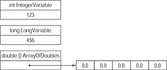

为什么数组会有不同？为什么创建数组时需要 `new`？答案在于值类型和引用类型之间的区别。

值类型，变量存储值。引用类型，变量存储指向内存某处的引用。图 3-2：值类型持有数据。引用类型存储在内存的其他地方。值类型，你不需要使用 `new` 关键字来创建空间。CLR 包含一个名为 `garbage collector`（垃圾回收器）的机制，它在程序不再使用变量时自动释放内存。

## 类型转换

你可能会遇到这样的情况：你可能与一个类型工作，而你需要将其传递给需要另一种类型的函数。例如，你正在与 `int` 类型工作，并且需要将其转换为 `long` 类型。

C# 支持两种类型的转换：隐式转换和显式转换。接下来的章节将介绍这些类型的转换。

### 理解隐式转换

隐式转换由 C# 编译器自动执行。考虑以下代码：

```csharp
int IntegerVariable;
long LongVariable;
IntegerVariable = 123;
LongVariable = IntegerVariable;
```

在这段代码中，整数变量被赋值为 123，长型变量被赋值为 `IntegerVariable` 的值。当这段代码执行时，`LongVariable` 的值为 123。

C# 编译器将整数值转换为 `long` 值，因为从 `int` 值到 `long` 值的转换是 C# 允许的。表 3-4 列出了 C# 允许的隐式转换。第一列列出了变量的原始类型，顶部列出了你可以转换的数据类型。单元格中的 `X` 表示可以从左侧类型隐式转换为顶部的类型。

表 3-4：隐式值类型转换

| | sbyte | byte | short | ushort | int | uint | long | char | float | ulong | decimal | double |
| :--- | :--- | :--- | :--- | :--- | :--- | :--- | :--- | :--- | :--- | :--- | :--- | :--- |
| **sbyte** | X | | X | | X | X | X | X | | | | |
| **byte** | | X | X | X | X | X | X | | | | | |
| **short** | | | X | X | X | X | X | X | | | | |
| **ushort** | | | | X | X | X | X | X | | | | |
| **int** | | | | | X | X | X | X | X | | | |
| **uint** | | | | | | X | X | X | X | X | | |
| **long** | | | | | | | X | X | X | X | X | X |
| **char** | | | | X | X | X | X | X | X | X | X | X |
| **float** | | | | | | | | | X | | | |
| **ulong** | | | | | | | | | | X | | |
| **decimal** | | | | | | | | | | | X | |
| **double** | | | | | | | | | | | | X |

注意：你不能将任何类型转换为 `char` 类型（除非通过 `char` 变量，但这并不算是真正的转换）。此外，你不能在浮点类型和十进制类型之间进行转换。

### 理解显式转换

如果你编写的代码尝试使用不支持隐式转换的类型来转换值，C# 编译器会抛出错误，如下所示：

```csharp
char CharacterVariable;
int IntegerVariable;
IntegerVariable = 9;
CharacterVariable = IntegerVariable;
```

C# 编译器会产生以下错误：

`error CS0029: Cannot implicitly convert type 'int' to 'char'`

产生此错误的原因是，从 `int` 变量到 `char` 变量的转换不支持的隐式转换。如果你确实需要进行此转换，则必须执行显式转换。

显式转换写在你的源代码中，并告诉编译器“即使无法隐式执行，也请执行此转换”。在 C# 代码中编写显式转换需要你将要转换到的类型放在括号中。括号紧放置在你作为转换源的变量之前。以下是使用显式转换后之前所示的代码：

```csharp
char CharacterVariable;
int IntegerVariable;
IntegerVariable = 9;
CharacterVariable = (char)IntegerVariable;
```

这种技术被称为将整数变量*强制转换*（casting）为字符变量。

即使你在代码中编写了显式强制转换操作，某些类型也无法转换。表 3-5 列出了 C# 支持的显式转换。第一列列出了变量的原始类型，顶部的列列出了你可以将其转换到的数据类型。单元格中的 X 意味着你可以使用强制转换操作从左侧的类型显式转换为顶部的类型。

#### 表 3-5：显式值类型转换

| | sbyte | byte | short | ushort | int | uint | long | char | float | ulong | double | decimal |
| :--- | :---: | :---: | :---: | :---: | :---: | :---: | :---: | :---: | :---: | :---: | :---: | :---: |
| **sbyte** | X | X | - | X | X | - | X | X | - | - | - | - |
| **byte** | - | X | X | - | - | - | - | X | - | - | - | - |
| **short** | - | - | X | X | X | X | X | X | - | - | - | - |
| **ushort** | - | - | - | X | X | X | - | - | - | - | - | - |
| **int** | - | - | - | - | X | X | X | X | X | X | X | - |
| **uint** | - | - | - | - | X | X | X | X | - | - | - | - |
| **long** | - | - | - | - | X | X | X | X | X | X | X | - |
| **char** | - | - | - | - | - | - | - | X | - | - | - | - |
| **float** | - | - | - | - | - | - | - | - | X | X | X | X |
| **ulong** | - | - | - | - | - | - | - | - | - | X | X | - |
| **double** | - | - | - | - | - | - | - | - | - | - | X | X |
| **decimal** | - | - | - | - | - | - | - | - | - | - | X | X |

你也可以通过将值转换为适当类型来对值类型执行显式转换，如下例所示。

```csharp
int IntegerVariable;
long LongVariable;
IntegerVariable = 123;
LongVariable = (long)IntegerVariable;
```

这种语法并不是强制要求的，因为 C# 允许从 `int` 变量到 `long` 变量的隐式转换，但如果你愿意，可以这样写。

### 处理字符串

C# 支持一种名为 `string` 的引用类型。`string` 数据类型表示 Unicode 字符字符串。

注意：Unicode 是全球性的字符编码标准。Unicode 字符为 16 位，允许 65,536 种可能的字符。ASCII 字符为 8 位，允许 256 种可能的字符。

使用以下代码在 C# 中创建并初始化字符串：

```csharp
string MyString;
MyString = "Hello from C#!";
```

与所有变量一样，你可以在声明的同一行初始化字符串：`string MyString = "Hello from C#!";`。

### 在字符串中使用特殊字符

C# 允许你使用特殊语法在字符串中嵌入特殊字符。这些特殊字符见表 3-6。

#### 表 3-6：C# 特殊字符

| 字符 | 用途 |
| :--- | :--- |
| `\t` | 特殊字符 `\t` 将制表符嵌入字符串中。定义为 `hello\tthere` 的字符串存储在内存中，单词 *hello* 和 *there* 之间有一个制表符。 |
| `\r` | 特殊字符 `\r` 将回车符嵌入字符串中。定义为 `hello\rthere` 的字符串存储在内存中，单词 *hello* 和 *there* 之间有一个回车符。 |
| `\v` | 特殊字符 `\v` 将垂直制表符嵌入字符串中。定义为 `hello\vthere` 的字符串存储在内存中，单词 *hello* 和 *there* 之间有一个垂直制表符。 |
| `\f` | 特殊字符 `\f` 将换页符嵌入字符串中。定义为 `hello\fthere` 的字符串存储在内存中，单词 *hello* 和 *there* 之间有一个换页符。 |
| `\n` | 特殊字符 `\n` 将换行符嵌入字符串中。定义为 `hello\nthere` 的字符串存储在内存中，单词 *hello* 和 *there* 之间有一个换行符。 |
| `\x` | 特殊字符 `\x` 允许你使用十六进制数字指定 ASCII 字符。十六进制数字必须紧跟在 `\x` 之后，并且是你想要输出的 ASCII 字符。例如，空格字符的 ASCII 代码为十进制 32。十进制 32 等于十六进制 20。因此，定义为 `hello\x20there` 的字符串存储在内存中，单词 *hello* 和 *there* 之间有一个空格。 |
| `\u` | 特殊字符 `\u` 允许你使用四个十六进制数字指定 Unicode 字符。四个十六进制数字必须紧跟在 `\u` 之后，并且是你想要输出的 Unicode 字符。例如，Unicode 空格的 Unicode 代码为十进制 32。十进制 32 等于十六进制 20。因此，定义为 `hello\u0020there` 的字符串存储在内存中，单词 *hello* 和 *there* 之间有一个空格。 |
| `\\` | 特殊字符 `\\` 允许你在当前位置指定反斜杠字符。定义为 `hello\\there` 的字符串存储在内存中，单词 *hello* 和 *there* 之间有一个反斜杠。使用两个反斜杠的原因很简单：使用单个反斜杠可能会导致 C# 编译器误认为另一个特殊字符的开头。 |

### 关闭字符串中的特殊字符

你可以通过在字符串前加上 `@` 符号指示 C# 编译器忽略字符串中的特殊字符：

```csharp
string MyString = @"hello\there";
```

这段代码将 `MyString` 变量的值设置为文本 hello\there。由于字符串前带有 `@` 符号，将 `\t` 字符解释为制表符的默认行为被关闭了。

这种语法还允许你在 `C#` 文件名字符串中编写目录名称，而无需使用双反斜杠语法。默认情况下，你总是需要使用双反斜杠：`string MyFilename = "C:\\Folder1\\Folder2\\Folder3\\file.txt";`

然而，通过 `@` 前缀，你只需要单个反斜杠即可：

`string MyFilename = @"C:\Folder1\Folder2\Folder3\file.txt";`

### 访问字符串中的单个字符

你可以像访问数组一样访问字符串中的字符。在概念上，你可以将字符串看作字符数组。你可以使用数组元素的方括号 `[]` 来访问字符串中的任何字符：

```csharp
char MyCharacter;
string MyString = "Hello from C#!";
MyCharacter = MyString[9];
```

这段代码将值 `m` 存入 `MyCharacter` 变量中。如果你将字符串视为字符数组，那么字符 `m` 位于字符串的元素 `9` 处。此外，请记住，这个字符数组是从 0 开始的。字符串中的第一个字符实际上位于元素 `0`。正如你所学到的，此字符串中的第十个字符位于元素 `9`。

## 声明枚举

与目前讨论的变量不同，枚举本身并不是一种类型，而是值类型的一种特殊形式。枚举派自 `System.Enum`，并为值提供名称。枚举表示的底层类型必须是 `byte`、`short`、`int` 或 `long`。

枚举中的每个字段都是静态的，并代表一个常量。

要声明枚举，你必须提供关键字 `enum`，后跟枚举的名称。然后，你必须提供一个左括号，后面是枚举字符串列表，并用右括号结束，如下例所示：

```csharp
public enum Pizza
{
    Supreme,
    MeatLovers,
    CheeseLovers,
    Vegetable,
}
```

这段代码创建了一个名为 `Pizza` 的枚举。`pizza` 枚举包含四个不同的名称/值对，描述不同类型的披萨，但没有定义值。当你声明枚举时，你定义的第一个名称将取值 `1`。列出的第二个名称将取值 `2`，以此类推。你可以通过为每个名称赋值来覆盖此功能，如下所示：

```csharp
public enum Pizza
{
    Supreme = 2,
    MeatLovers = 3,
    CheeseLovers = 4,
    Vegetable = 5,
}
```

每个枚举字段的值都增加了 `1`。不过，并不是所有代码都是必须的。通过为 `Supreme` 赋值 `2`，后续字段将按顺序排列。因此，你可以删除对 `MeatLovers`、`CheeseLovers` 和 `Vegetable` 的赋值。

枚举器可以通过两种方式之一引用。你可以围绕它们的字段名编写程序，也可以围绕它们的值编写程序。例如，你可以通过以下代码将字段名赋值给字符串变量：

```csharp
string MyString = Pizza.Supreme;
```

你可能还想引用字段的值。你可以通过显式类型转换来实现这一点。例如，你可以通过以下代码获取 `Supreme` 字段的值：

```csharp
int MyInteger = (int)Pizza.Supreme;
```

## 总结

本章介绍了变量及其类型。有很多不同的值类型，每种类型都有其自身的特性和内存要求。某些类型可以隐式转换为其他类型，而某些类型必须使用强制转换语法进行显式转换。

数组包含相同类型变量的集合。当你需要维护一组相似变量时，数组非常有用。`C#` 支持单维数组和多维数组。

`C#` 数组是从 0 开始的：也就是说，数组中的第一个元素编号是元素 `0`。

字符串帮助你在代码中处理文本片段。它们是 Unicode 字符的集合。`C#` 允许你在字符串中嵌入特殊字符，但提供了 `@` 前缀来指定不需要对特殊字符进行处理的情况。

字符串中的字符可以像字符数组一样被访问。

# 第 4 章：表达式

## 本章内容简介

表达式是任何编程语言中最基础、最核心的部分。

通过使用运算符，表达式允许应用程序执行简单的比较、赋值，甚至是人类花费数百万年才能完成的极其复杂的操作。

本章涵盖了使用运算符执行数学函数、为变量赋值以及进行比较的内容。在你掌握了这些基础元素之后，你将查看一些高级表达式，这些表达式使用了 `C#` 语言特有的运算符，这使其具有优于大多数其他编程语言的优势。为了结束本章，你将查看使用运算符来操作字节的微小部分——位（bit）的表达式。

### 使用运算符

表达式可以使用变量、硬编码值（称为*字面量值*，参见本章后文“使用字面量”章节）以及称为*运算符*的符号来编写。`C#` 支持多种运算符，每个运算符执行不同的操作。在表达式中出现的变量或字面量称为*操作数*。运算符应用于操作数，操作的结果是另一个值。

`C#` 将运算符分为以下三类之一：

- **一元运算符**对单个操作数操作。包含一个操作数和一个运算符的表达式产生单个值。
- **二元运算符**对两个操作数操作。包含两个操作数和一个运算符的表达式产生单个值。
- **三元运算符**对三个操作数操作。`C#` 仅支持一种三元运算符。

### 使用主表达式

主表达式允许你定义表达式中的操作顺序，声明新变量，它们是 `C#` 代码的基础构建块。`C#` 定义了多种不同类型的主表达式：

- 字面量
- 标识符
- 括号表达式
- 成员访问
- 方法调用表达式
- 元素访问
- `this` 关键字
- 基类访问
- 后置增/减运算符
- `new` 运算符
- `typeof` 运算符
- `checked` 和 `unchecked` 运算符

主表达式允许你定义表达式中的操作顺序，定义新字面量（例如硬编码值）以及声明用于应用程序的新变量。在接下来的几节中，你将探索什么是主表达式，以及如何使用它们。

### 使用字面量

字面量是你直接写在 `C#` 源代码中的硬编码值。有很多不同类型的字面量。为了演示字面量，让我们查看下面行使用 `Brian` 字面量值的 `C#` 代码：

```csharp
if (FirstName == "Brian")
```

在这里，我们为了比较硬编码了 `Brian` 的值。与其硬编码值，更好的做法是将字符串存储在变量中，这样如果值需要更改，你只需要在一个地方更改它们，而不需要在应用程序的每行中搜索。以下行是存储和使用字符串的推荐方法：

```csharp
string MyFirstName = "Brian";
if (FirstName == MyFirstName)
```

你可以看到，这是使用字面量值要清晰得多的方法。

### 理解布尔字面量

`C#` 定义了两个布尔字面量——关键字 `true` 和 `false`：

```csharp
bool MyTrueVariable = true;
bool MyFalseVariable = false;
```

这两个值的值类型都是 `bool`。关键字 `True` 的整数等值为负一 (-1)，而 `False` 的等值为零。

### 使用十进制和十六进制表示法的整数字面量

你可以使用十进制表示法或十六进制表示法编写整数字面量。与之前讨论的字面量一样，使用字面量清理代码的方法。字面量值可以放在代码列表的顶部。如果这些值需要更改，更改该处的值是一个非常简单的任务。

十进制整数字面量由一个或多个字符 `0`、`1`、`2`、`3`、`4`、`5`、`6`、`7`、`8` 和 `9` 组成：

```cs
int MyVariable = 125;
```

十进制字面量还可以包含一个指定类型的单字符后缀。如果字面量带有大写或小写的 `U`，则该十进制字面量被视为无符号类型：

```cs
uint MyVariable = 125U;
```

`unsigned type`（无符号类型）术语意味着数字不是特定的正数或负数。因此，如果你将负值 `100`（`-100`）转换为无符号值，你的结果将仅仅是百（`100`）。

如果该值小到可以放入 `uint` 类型，C# 编译器会将该字面量视为 `uint` 类型。如果整数字面量的值对于 `uint` 类型来说太大了，C# 编译器会将该字面量视为 `ulong` 类型。不同的类型表示了你正在存储的信息的大小。`uint` 类型可以包含从 `0` 到 `4,294,967,295` 的数字；而 `ulong` 值可以包含从 `0` 到 `18,446,744,073,709,551,615` 之间的值。

如果字面量带有大写或小写的 `L` 后缀，则十进制字面量被视为长整型（long）：

```cs
long MyVariable = 125L;
```

如果该值在 `long` 范围内，C# 编译器会将该字面量视为 `long` 类型。

如果该值不在 `long` 类型范围内，C# 编译器会将该字面量视为 `ulong` 类型。

注意：尽管 C# 编译器接受小写的 `l` 或大写的 `L` 作为后缀，但你可能倾向于使用大写的 `L`。小写的 `l` 看起来非常像数字 `1`，其他阅读你代码的开发者可能会将 `l` 误认为 `1`。

如果字面量同时带有 `L` 和 `U` 后缀，则十进制字面量被视为无符号长整型（ulong）：

```cs
ulong MyVariable = 125LU;
```

C# 编译器接受 `L` 在 `U` 之前的后缀，也接受 `U` 在 `L` 之前的后缀。此外，C# 编译器还接受大小写字母混合。后缀 `LU`、`Lu`、`lU`、`lu`、`UL`、`Ul`、`uL` 和 `ul` 都表示 `ulong` 后缀。

以十六进制格式编写整数字面量可以使用字母 `A` 到 `F` 以及数字 `0` 到 `9` 来编写字面量。十六进制字面量必须以字符 `0X` 或 `0x` 为缀：

```cs
int MyVariable = 0x7D; // 十进制 7D = 十进制 125
```

你可以在十六进制表示中使用大写或小写字母。你也可以使用与十进制字面量相同的字符后缀：

```cs
long MyVariable = 0x7DL;
```

是否使用十六进制值完全取决于程序员的意愿。

使用十六进制而非另一种类型的字面量与任何其他类型的数字没有区别。然而，当你构建一个具有十六进制格式规范的应用程序时，使用十六进制值是一个好主意。例如，你可能正在为计算机中的调制调器卡编写一个接口。你对调制调器的程序员手册可能会指定某些操作的十六进制格式值。与其阅读程序员手册并将所有数字转换为十进制，你通常直接将这些十六进制数编码到你的应用程序中，从而避免任何转换错误。

### 用于浮点数的实数字面量

实数字面量（Real literals）允许你在 C# 代码中编写浮点数值。实数字面量可以包括小数点以及指数。

小数点可以出现在实数字面量中，数字可以出现在小数点的前后。实数字面量以小数点开头也是合法的，这在你想要编写大于 0 但小于 1 的值时非常有用。像 `2.5` 和 `.75` 等值就是实数字面量的示例。C# 对小数点前后的数字个数没有任何限制，只要字面量的值在目标类型的范围内即可。

你也可以在实数字面量中指定指数。指数紧跟在数字的小数部分之后，使用大写或小写的 `E`。一个或多个数字紧跟在 `E` 之后，表示指数的值。这意味着你可以将值 `750` 写为实数字面量 `7.5e2`。在 `E` 和指数值之间也可以出现加或负号。加号表示正指数值；减号表示负指数值。实数字面量 `7.5e+2` 定义了值 `750`，实数字面量 `7.5e-2` 定义了值 `.075`。如果你不使用任何符号，C# 编译器会假设你的指数值为正。

和十进制字面量一样，实数字面量后面也可以跟跟一个指定类型的单字符后缀。如果你没有在实数字面量上使用后缀，C# 编译器假设你的字面量类型为 `double`。

如果实数字面量带有大写的 `F` 后缀，C# 编译器会将字面量视为 `float` 类型：

```cs
float MyVariable = 7.5F;
```

如果实数字面量带有大写的 `D` 后缀，C# 编译器会将字面量视为 `double` 类型：

```cs
double MyVariable = 7.5D;
```

如果实数字面量带有大写的 `M` 后缀，C# 编译器会将字面量视为 `decimal` 类型：

```cs
decimal MyVariable = 7.5M;
```

### 使用字符字面量赋值字符

字符字面量允许你在 C# 代码中编写字符值。字符字面量通常位于单引号之间：

```cs
char MyVariable = 'a';
```

你也可以使用转义序列。

注意：如果你想将单引号作为字符字面量，需要在前面加上反斜杠。写 `'''` 会让编译器产生困惑。

你可以通过使用 `\x` 转义序列并后跟一个、两个或三个十六进制字符来定义十六进制值：

```cs
char MyVariable = '\x6';
```

### 使用字符串字面量嵌入字符串

字符串字面量允许你在 C# 代码中嵌入字符串。你通过双引号编写字符串字面量：

```cs
string MyVariable = "Hello from C#!
```

C# 编译器会重用相同的字符串字面量，从而节省执行空间，如下所示：

```cs
string String1 = "Hello";
string String2 = "Hello";
```

### 理解标识符

标识符是你在 C# 代码中定义的变量、类、方法或其他实体的名称。标识符必须以字母或下划线开头，后跟任意数量的字母、数字或下划线。标识符区分大小写。

你不能使用 C# 关键字作为标识符，除非在标识符前加上 `@` 符号。例如，`@class` 是合法的标识符，但 `class` 不是。

如果你尝试在同一作用域内重复定义标识符，C# 编译器会抛出错误。例如：

```csharp
int MyVariable = 123;
float MyVariable = 1.25;
```

C# 编译器会在尝试将 `MyVariable` 重新定义为 `float` 值的行处抛出错误信息：

`error CS0128: A local variable named 'MyVariable' is already defined in this scope`

然而，如果该标识符出现在单独的代码块中，你可以重用它：

```csharp
public static void Main()
{
    int MyVariable = 123;
}

public void AnotherFunction()
{
    float MyVariable = 1.25;
}
```

### 理解括号表达式

正如其名称所示，括号表达式是包裹在圆括号内的表达式。

C# 编译器会评估括号内部的表达式，括号表达式的值就是该评估的结果。例如，括号表达式 `(3+2)` 的值是 `5`。

### 使用成员访问表达式调用方法

当你需要调用对象中的方法时，你编写对象的名称，紧接着是一个点（`.`），然后是方法的名称。当 CLR 调用你的 `Main()` 方法来开始运行应用程序时，它会从你的类创建一个对象，并在该对象上调用 `Main()` 函数。如果你在 C# 中编写这段代码，你可能会写如下所示：

```csharp
MyClass MyObject;
MyObject = new MyClass();
MyObject.Main();
```

对象将在第 8 章和第 9 章中详细介绍。现在需要注意的重要点是，调用 `Main()` 的语句包含一个“成员访问表达式”，它包含一个对象、一个点和一个函数调用。

在后面的章节中，你会看到对象可以包含数据也可以包含代码。你可以使用相同的成员访问表达式语法来访问数据。

### 使用调用表达式调用方法

你使用调用表达式来调用对象中的方法。成员访问用例中的代码也显示了调用表达式。该代码调用了一个方法——在本例中为 `Main()`——这导致代码在对象上调用了 `Main()` 方法。

如果你从同一对象的另一个方法调用该方法，你可以在调用中使用方法的名称。你不需要指定对象或类名，也不需要使用成员访问语法，如列表 4-1 所示。

**列表 4-1：调用表达式**

```csharp
class MyClass
{
    public static void Main()
    {
        MyClass myclass = new MyClass();
        myclass.DoWork();
    }
    void DoWork()
    {
        // 在处工作
    }
}
```

在此示例中，`Main()` 方法调用了 `DoWork()` 方法。然而，你需要先创建 `myClass` 的引用，然后调用 `DoWork()` 方法。

调用表达式的类型是被调用函数返回的类型。例如，如果你的 C# 代码调用了一个返回 `int` 类型的函数，那么调用该方法的调用表达式的类型就是 `int`。

### 使用元素访问表达式指定数组元素

元素访问表达式允许你指定数组元素。你在方括号内编写元素索引：

```csharp
int [] MyArray;
MyArray = new int [5];
MyArray[0] = 123;
```

在此示例中，名为 `MyArray` 的数组的第 0 个元素被赋值为值 `123`。

C# 允许任何结果类型为 `int`、`uint`、`long` 或 `ulong` 的表达式用作元素表达式。C# 还允许使用任何结果类型可以隐式转换为 `int`、`uint`、`long` 或 `ulong` 类型的表达式。在前面的代码中，使用了整数字面量作为元素表达式。你也可以编写另一种类型的表达式来指定元素，如列表 4-2 所示。

**列表 4-2：元素访问**

```csharp
class MyClass
{
    public static void Main()
    {
        int [] MyArray;
        MyClass myclass = new MyClass();
        MyArray = new int [5];
        MyArray[myclass.GetArrayIndex()] = 123;
    }
    int GetArrayIndex()
    {
        return 0;
    }
}
```

这段代码之所以工作，是因为 `GetArrayIndex()` 方法返回一个 `int`，并且方法调用表达式的结果是 `int`。由于任何值为 `int` 的表达式都可以用作数组元素表达式，C# 允许这段代码执行。

元素访问表达式本身的结果是所访问元素的类型，如下面代码所示：

```csharp
int [] MyArray;
MyArray = new int [5];
MyArray[0] = 123;
```

`MyArray[0]` 元素访问表达式的类型为 `int`，因为表达式中访问的元素类型为 `int`。

### 使用 this 关键字访问对象

C# 定义了一个 `this` 关键字，你可以它为需要访问该对象的代码指定一个对象。`this` 关键字在查看类的部分会有更详细的介绍。列表 4-3 使用了 `this` 关键字。

**列表 4-3：关键字访问**

```csharp
class MyClass
{
    public static void Main()
    {
        // 在此对象上调用 DoWork()
        MyClass myclass = new MyClass();
        myclass.DoWork();
    }
    void DoWork()
    {
        MyClass myclass = new MyClass();
        this.DoWork();
        // 在此处工作
    }
    void DoWork2()
    {
    }
}
```

在此示例中，`Main()` 方法调用了 `DoWork()` 方法。然而，首先你需要创建 `myClass` 的引用，然后调用 `DoWork()` 方法。

调用表达式的类型是被调用函数返回的类型。例如，如果你的 C# 代码调用了一个返回 `int` 类型的函数，那么调用该方法的调用表达式的类型就是 `int`。

### 使用 typeof 运算符获取类型信息

`typeof` 运算符允许你获取类型的 `System.Type` 对象。你可以使用 `typeof` 运算符后跟类型名称来获取类型信息。

### 使用 checked 和 unchecked 运算符控制溢出检查

`checked` 和 `unchecked` 运算符允许你控制算术运算的溢出检查行为。

列表 4-5 展示了一个数学溢出问题。它声明了两个整数 `Int1` 和 `Int2`，以及第三个整数 `Int1PlusInt2`，其值存储另外两个整数之和。将这两个整数相加并将相加的结果存储在第三个整数变量中。然后将第三个变量的值打印到控制台。

列表 4-5：数学运算中的溢出

```csharp
class Listing4_5
{
    public static void Main()
    {
        int Int1;
        int Int2;
        int Int1PlusInt2;
        Int1 = 2000000000;
        Int2 = 2000000000;
        Int1PlusInt2 = Int1 + Int2;
        System.Console.WriteLine(Int1PlusInt2);
    }
}
```

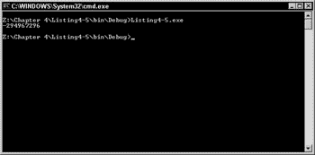

`Int1` 和 `Int2` 整数分别被赋值为二十亿。这并不是一个问题，因为整数变量可以存储略高于 21 亿的值。然而，将这两个整数相加并将结果存储在另一个整数中将产生问题。总和将是四十亿，这大于略高于 21 亿的整数最大值。

使用标准命令行编译上述代码：

`csc Listing4-1.cs`

当你运行 `Listing 4-1.exe` 时，你将得到一个很大的负数，如图 4-1 所示。

图 4-1：溢出产生不可预测的结果。

你得到一个负数是因为 C# 处理大到无法放入预期的承载变量中的值的方式。C# 无法在整数中表示整个目标值，因此它取了预期的值（四十亿），并从其减去了 32 位值的最大值（`4,294,967,296`），然后将结果输出到控制台。

显然，你的代码生成了与你预期的不同的结果。如果你没有意识到这种数学错误，你的代码可能会表现出不可预测的行为。为了在这样的代码中引入一种安全措施，你可以使用 `checked` 运算符，如列表 4-6 所示。

列表 4-6：数学运算中的溢出检查

```csharp
class Listing4_6
{
    public static void Main()
    {
        int Int1;
        int Int2;
        int Int1PlusInt2;
        Int1 = 2000000000;
        Int2 = 2000000000;
        Int1PlusInt2 = checked(Int1 + Int2);
        System.Console.WriteLine(Int1PlusInt2);
    }
}
```

编译并运行列表 4-6 会向控制台写入一个不同的结果：

`Exception occurred: System.OverflowException: An exception of type System.OverflowException was thrown. at Listing4_1.Main()`

与其向控制台写入一个无意义的数学值，溢出异常消息会让你知道加法的值已经经过了合法性检查，且该检查未通过测试。系统会报告一个异常并终止应用程序。

`unchecked()` 表达式是默认情况。标记为 `unchecked()` 的表达式不会进行合法值检查，应用程序将继续使用未检查的、无意义的值进行运行。

默认行为是不检查任何操作。但是，如果你想在不使用代码中的 `checked()` 运算符的情况下对所有操作都进行合法值检查，可以使用编译器的 `/checked+` 选项。使用以下命令行编译列表 4-1：

`csc /checked+ Listing4-1.cs`

当你运行列表 4-1 的可执行文件时，你将得到与列表 4-2 相同的异常消息，因为 `/checked+` 选项会导致所有数学运算都经过合法值检查。

### 理解一元表达式

一元表达式作用于单个操作数。C# 支持以下一元表达式：

- 一元加运算符
- 一元减运算符
- 逻辑取反运算符
- 按位取反运算符
- 间接引用运算符
- 取地址运算符
- 前缀增和递减运算符
- 强制转换表达式

接下来的章节将详细讨论这些一元表达式。

### 使用一元加运算符返回操作数值

一元加运算符（`+`）返回操作数的值。你可以将其视为数学上的正运算符。C# 为类型为 `int`、`uint`、`long`、`ulong`、`float`、`double` 和 `decimal` 的操作数定义了一元加运算符。

### 使用一元减运算符返回操作数值

一元减运算符（`-`）返回操作数的值。你可以将其视为数学上的负运算符。带有一元减运算符的操作数的值是该操作数数学上的相反数。C# 为类型为 `int`、`long`、`float`、`double` 和 `decimal` 的操作数定义了一元减运算符。

### 使用逻辑取反运算符反转布尔表达式

逻辑取反运算符反转布尔表达式的值。该运算符将 `True` 值变为 `False`，将 `False` 值变为 `True`。

使用感叹号（`!`）在你的 C# 代码中编写逻辑取反运算符。将运算符放置在你想要取反的布尔表达式之前，如列表 4-7 所示。

列表 4-7：逻辑取反运算符

```csharp
class MyClass
{
    public static void Main()
    {
        bool MyBoolean;
        MyBoolean = true;
        MyBoolean = !MyBoolean;
    }
}
```

### 使用按位取反运算符

取反运算符允许你对 `int`、`uint`、`long` 和 `ulong` 应用按位取反。通过将波浪符号（`~`）放在需要取反的表达式之前来指定按位取反，如列表 4-8 所示。

列表 4-8：按位取反运算符

```csharp
class MyClass
{
    public static void Main()
    {
        int Int1;
        Int1 = 123;
        Int1 = ~Int1;
    }
}
```

### 前缀增和递减运算符

`++` 和 `--` 运算符可以以后一种方式使用。你已经看过了后缀版本，它们出现在表达式之后。前缀版本出现在表达式之前，如列表 4-9 所示。

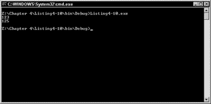

列表 4-9：前缀增递减运算符

```csharp
class MyClass
{
    public static void Main()
    {
        int MyInteger;
        MyInteger = 125;
        ++MyInteger; // 现在是 126
        --MyInteger; // 变回 125
    }
}
```

使用递增递减运算符的表达式类型与其增加或递减的类型相同。注意这些前缀运算符与后缀运算符之间的细微差别：对于前缀运算符，值在求值之前改变。

对于后缀运算符，值在求值之后改变。列表 4-10 阐释了这种差异。

列表 4-10：前缀和后缀运算符的差异

```csharp
class Listing4_10
{
    public static void Main()
    {
        int Int1;
        Int1 = 123;
        System.Console.WriteLine(Int1++);
        System.Console.WriteLine(++Int1);
    }
}
```

编译并运行列表 4-3。该应用程序的输出如图 4-2 所示。

图 4-2：后缀和前缀运算符的使用

列表 4-10 中的第一条语句使用后缀递增运算符，这意味着值在语句执行后增加。应用程序将当前值 123 写入控制台，然后将值增加到 124。第二条语句使用前缀递增运算符，这意味着值在语句执行前增加。

应用程序首先将当前值增加到 125，然后将当前值写入控制台。

### 理解算术运算符

算术运算符允许你在 C# 代码中执行算术运算。使用算术运算符的表达式是二元表达式，因为执行数学运算需要两个操作数。

### 使用赋值运算符分配新值

赋值运算符为变量分配新值。等号（`=`）被用作赋值运算符：

`MyInteger = 3;`

`MyInteger` 的值被设置为 3，`MyVariable` 的原有值丢失。

复合赋值运算符允许你在一个语句中使用多次赋值运算符：

```cs
MyInteger = MyOtherInteger = 3;
```

最右侧表达式的值被用变量的新值。在示例中，`MyInteger` 和 `MyOtherInteger` 都被赋予了新值 3。

### 使用乘法运算符

使用乘法运算符的表达式的值是两个操作数值之值的乘积。星号字符 `*` 被用作乘法运算符，如列表 4-11 所示。

列表 4-11：乘法运算符

```csharp
class MyClass
{
    public static void Main()
    {
        int MyInteger;
        MyInteger = 3 * 6; // MyInteger 的结果为 18
    }
}
```

如果你正在将一个值乘以一个变量并将结果放在同一个变量中，可以写一个简写语句来执行乘法。写一个星号后跟一个等号，可以将一个值乘以一个变量，并用结果更新变量的值：`MyInteger *= 3;`。

该语句是以下内容的简写：

```csharp
MyInteger = MyInteger * 3;
```

### 使用除法运算符

使用除法运算符的表达式的值是两个操作数值之值的商。正斜杠字符 `/` 被用作除法运算符，如列表 4-12 所示。

列表 4-12：除法运算符（示例 1）

```csharp
class MyClass
{
    public static void Main()
    {
        int MyInteger;
        MyInteger = 6 / 3; // MyInteger 的结果为 2
    }
}
```

如果除法运算产生余数，则只有商本身是运算的结果（参见列表 4-13）。

列表 4-13：除法运算符（示例 2）

```csharp
class MyClass
{
    public static void Main()
    {
        int MyInteger;
        MyInteger = 7 / 3;
    }
}
```

当这段代码执行时，`MyInteger` 变量的值为 2，因为 7 除以 3 得到的商为 2，余 1。

如果你正在将一个值除入一个变量并将结果放在同一个变量中，可以写一个简写语句来执行除法。写一个正斜杠字符后跟一个等号，可以将一个值除入一个变量，并用结果更新变量的值：`MyInteger /= 3;`。

前述语句是以下内容的简写：

```csharp
MyInteger = MyInteger / 3;
```

### 使用取余运算符

使用取余运算符的表达式的值是除法运算的余数。百分号字符 `%` 被用作除法运算符（参见列表 4-14）。

列表 4-14：取余运算符

```csharp
class MyClass
{
    public static void Main()
    {
        int MyInteger;
        MyInteger = 7 % 3;
    }
}
```

当这段代码执行时，`MyInteger` 变量的值为 1，因为 7 除以 3 得到的商为 2，余 1。

如果你正在使用一个变量计算余数并将结果放在同一个变量中，可以写一个简写语句来执行取余运算。写一个百分号后跟一个等号，可以计算变量的余数，并用结果更新变量的值：`MyInteger %= 3;`。

前述语句是以下内容的简写：

```csharp
MyInteger = MyInteger % 3;
```

### 使用加法运算符

使用加法运算符的表达式的值是两个操作数值之值的和。加号字符 `+` 被用作加法运算符（参见列表 4-15）。

列表 4-15：加法运算符

```csharp
class MyClass
{
    public static void Main()
    {
        int MyInteger;
        MyInteger = 3 + 6; // MyInteger 的结果为 9
    }
}
```

如果你正在将一个值加一个变量并将结果放在同一个变量中，可以写一个简写语句来执行加法。写一个加号后跟一个等号，可以将一个值加一个变量，并用结果更新变量的值：`MyInteger += 3;`。

前述语句是以下内容的简写：

```csharp
MyInteger = MyInteger + 3;
```

当两个操作数是字符串时，加法运算符具有特殊含义。两个字符串相加会将第一个字符串与第二个字符串拼接：

```csharp
string CombinedString = "Hello from " + "C#";
```

当这段代码执行时，`CombinedString` 的值为 Hello from C#。

### 使用减法运算符

使用减法运算符的表达式的值是两个操作数值之值的差。连字符字符 `-` 被用作减法运算符（参见列表 4-16）。

列表 4-16：减法运算符

```csharp
class MyClass
{
    public static void Main()
    {
        int MyInteger;
        MyInteger = 7 - 3; // MyInteger 的结果为 4
    }
}
```

如果你正在从一个变量中减去一个值并将结果放在同一个变量中，可以写一个简写语句来执行减法。写一个减号后跟一个等号，可以从一个变量中减去一个值，并用结果更新变量的值：`MyInteger -= 3;`。

前述语句是以下内容的简写：

```csharp
MyInteger = MyInteger - 3;
```

### 移位运算符

移位运算符允许你在值中移动位。使用移位运算符的 C# 代码需要两个操作数来执行移位运算。

### 左移运算符

使用左移运算符的表达式的值将位向左移动特定的位数。两个小于号字符 `<<` 被用作左移运算符（参见列表 4-17）。

列表 4-17：左移运算符

```csharp
class MyClass
{
    public static void Main()
    {
        int MyInteger;
        MyInteger = 6 << 3;
    }
}
```

当这段代码执行时，`MyInteger` 变量的值为 48，因为原始值 6 被视为二进制值为 0000110 的二进制数，原始值中的位向左移动三位，得到移位运算符后的值，并在低位补零。

如果你正在对一个值和变量进行左移运算并将结果放在同一个变量中，可以写一个简写语句来执行左移运算。写两个小于号后跟一个等号，可以对变量和值进行左移运算，并用结果更新变量的值：`MyInteger <<= 3;`。

前述语句是以下内容的简写：

```csharp
MyInteger = MyInteger << 3;
```

### 右移运算符

使用右移运算符的表达式的值将位向右移动特定的位数。两个大于号字符 `>>` 被用作右移运算符（参见列表 4-18）。

列表 4-18：右移运算符

```csharp
class MyClass
{
    public static void Main()
    {
        int MyInteger;
        MyInteger = 48 >> 3;
    }
}
```

当这段代码执行时，`MyInteger` 变量的值为 6，因为原始值 48 被视为二进制值为 00110000 的二进制数，原始值中的位向右移动三位，得到移位运算符后的值，并在高位补零。

`int`、`uint`、`long` 和 `ulong` 类型的值可以对其应用右移。其他可以转换为其中一种类型的表达式也可以进行右移。`int` 和 `uint` 的表达式一次可以移位 32 位。`long` 和 `ulong` 的表达式一次可以移位 64 位。

写入两个大于号后跟一个等号，可以计算变量和一个值之间的右移操作，并用结果更新变量的值：

```csharp
MyInteger >>= 3;
```

述语句是以下代码的简写：

```csharp
MyInteger = MyInteger >> 3;
```

### 使用关系运算符比较表达式

关系运算符允许你比较两个表达式，并获得一个布尔值，该值指定了两个表达式之间的关系。使用关系运算符的表达式是二元表达式，因为执行关系操作需要两个操作数。

### 使用相等运算符测试相等性

相等运算符用于测试两个表达式的值是否相等。如果两个表达式的值相同，则相等运算符的结果为 True（真）；如果它们不相等，则相等运算符的结果为 False（假）。两个等号用作相等运算符：

```csharp
MyInteger == 123;
```

如果变量 `MyInteger` 的值为 `123`，则相等运算符的结果为 True。如果它是任何其他值，则相等运算符的结果为 False。

当两个操作数是字符串时，相等运算符具有特殊含义。比较两个字符串比较的是字符串的内容。如果两个字符串具有相同的长度，并且在字符串的每个位置上具有相同的字符，则认为这两个字符串是相等的。

### 使用不等运算符测试不相等性

不等运算符用于测试两个表达式的值是否不等。如果两个表达式的值不同，则不等运算符的结果为 True。如果它们相等，则不等运算符的结果为 False。一个感叹号后跟一个等号用作不等运算符：

```csharp
MyInteger != 123;
```

如果变量 `MyInteger` 的值为 `123`，则不等运算符的结果为 False。如果它是任何其他值，则不等运算符的结果为 True。

当两个操作数是字符串时，不等运算符具有特殊含义。比较两个字符串比较的是字符串的内容。如果两个字符串长度不同，或者在字符串的至少一个位置上具有不同的字符，则认为这两个字符串是不等的。

### 使用小于运算符测试值

小于运算符用于测试两个表达式的值，以查看一个值是否小于另一个值。如果第一个表达式的值小于第二个表达式的值，则小于运算符的结果为 True。如果第一个表达式的值大于或等于第二个表达式的值，则小于运算符的结果为 False。

小于号（`<`）用作小于运算符：

```csharp
MyInteger < 123;
```

如果变量 `MyInteger` 的值小于 `123`，则小于运算符的结果为 True。如果它的值大于或等于 `123`，则小于运算符的结果为 False。

### 使用大于运算符测试值

大于运算符用于测试两个表达式的值，以查看一个值是否大于另一个值。如果第一个表达式的值大于第二个表达式的值，则大于运算符的结果为 True。如果第一个表达式的值小于或等于第二个表达式的值，则大于运算符的结果为 False。大于号（`>`）用作大于运算符：

```csharp
MyInteger > 123;
```

如果变量 `MyInteger` 的值大于 `123`，则大于运算符的结果为 True。如果它的值小于或等于 `123`，则大于运算符的结果为 False。

### 使用小于等于运算符测试值

小于等于运算符用于测试两个表达式的值，以查看一个值是否小于或等于另一个值。如果第一个表达式的值小于或等于第二个表达式的值，则小于等于运算符的结果为 True。如果第一个表达式的值大于第二个表达式的值，则小于等于运算符的结果为 False。小于号后跟一个等号用作小于等于运算符：

```csharp
MyInteger <= 123;
```

如果变量 `MyInteger` 的值小于或等于 `123`，则小于等于运算符的结果为 True。如果它的值大于 `123`，则小于等于运算符的结果为 False。

### 使用大于等于运算符测试值

大于等于运算符用于测试两个表达式的值，以查看一个值是否大于或等于另一个值。如果第一个表达式的值大于或等于第二个表达式的值，则大于等于运算符的结果为 True。如果第一个表达式的值小于第二个表达式的值，则大于等于运算符的结果为 False。大于号后跟一个等号用作大于等于运算符：

```csharp
MyInteger >= 123;
```

如果变量 `MyInteger` 的值大于或等于 `123`，则大于等于运算符的结果为 True。如果它的值小于 `123`，则大于等于运算符的结果为 False。

### 理解整数逻辑运算符

整数逻辑运算符允许你对两个数值执行布尔算术。使用整数逻辑运算符的表达式是二元表达式，因为执行逻辑操作需要两个操作数。

### 使用与运算符测试值

与运算符用于测试两个表达式的值。与与符号（`&`）用作与运算符：

```csharp
MyInteger = 6 & 3;
```

变量 `MyInteger` 的值为 `2`。记住，只有当两个操作数的相同位均为 1 时，与运算的结果为 1。如果你对一个值和一个变量执行与运算并将结果赋给变量，可以写一个简写语句来执行此操作。写入与符号后跟一个等号可以计算变量和一个值之间的与操作，并用结果更新变量的值：

```csharp
MyInteger &= 3;
```

述语句是以下代码的简写：

```csharp
MyInteger = MyInteger & 3;
```

### 使用异或运算符测试值

异或运算符用于测试两个表达式的值。异或符号（`^`）用作异或运算符：

```csharp
MyInteger = 6 ^ 3;
```

变量 `MyInteger` 的值为 `5`。记住，只有当两个操作数的相同位恰好有一个 1 时，异或运算的结果为 1。如果你对一个值和一个变量执行异或运算并将结果赋给变量，可以写一个简写语句来执行此操作。写入异或符号后跟一个等号可以计算变量和一个值之间的异或操作，并用结果更新变量的值：

```csharp
MyInteger ^= 3;
```

述语句是以下代码的简写：

```csharp
MyInteger = MyInteger ^ 3;
```

### 使用或运算符测试值

或运算符用于测试两个表达式的值。竖线符号（`|`）用作或运算符：

```csharp
MyInteger = 6 | 3;
```

变量 `MyInteger` 的值为 `7`。记住，只有当两个操作数的相同位中至少有一个 1 时，或运算的结果为 1。值 `6` 的二进制表示为 `110`，而 `3` 的二进制表示是 `011`。对 `110` 和 `011` 执行布尔 OR 运算的结果布尔值为 `111`，即十进制的 7。

如果你正在对一个值和一个变量计算 OR 运算并将结果存在同一个变量中，你可以编写一个快捷语句来执行 OR 运算。写一个 `|` 符号后跟一个等号可以计算变量与值之间的 OR 运算，并用结果更新变量的值：

```csharp
MyInteger |= 3;
```

上述语句是以下语句的简写：

```csharp
MyInteger = MyInteger | 3;
```

### 理解条件逻辑运算符

条件逻辑运算符是整数逻辑运算符对应的条件版本。

使用条件逻辑运算符的表达式是二元表达式，因为执行条件逻辑操作需要两个操作数。

#### 使用条件 AND 运算符比较布尔值

条件 AND 运算符用于比较两个布尔表达式。如果两个操作数的值都为 True，则运算结果为 True；如果一个或两个操作数的值为 False，则结果为 False。使用两个 `&` 符号作为条件 AND 运算符：`MyBoolean = true && false;`

`MyBoolean` 的值为 False，因为其中一个操作数的值为 False。

#### 使用条件 OR 运算符比较布尔值

条件 OR 运算符用于比较两个布尔表达式。如果一个或两个操作数的值为 True，则运算结果为 True；如果两个操作数的值都为 False，则结果为 False。使用两个 `|` 符号作为条件 OR 运算符：`MyBoolean = true || false;`

`MyBoolean` 的值为 True，因为其中一个操作数的值为 True。

#### 使用条件运算符比较布尔值

条件运算符评估一个布尔表达式。如果输入表达式为 True，表达式的结果有一个值；如果输入表达式为 False，则有另一个值。使用条件运算符的表达式是三元表达式，因为执行条件逻辑操作需要三个操作数。条件运算符是 C# 语言支持的唯一三元表达式。

编写条件运算符涉及编写输入表达式，后面跟一个问号。接下来是 True 值，然后是冒号，最后是 False 值：`MyInteger = (MyVariable == 123) ? 3: 5;`

你可以这样读取此语句：“将 `MyVariable` 的值与 123 进行比较。如果该表达式为 True，则将 `MyInteger` 的值设为 3。如果该表达式为 False，则将 `MyInteger` 的值设为 5。”

### 理解运算顺序

C# 允许在单个语句中放置多个运算符：

```
MyVariable = 3 * 2 + 1;
```

这里 `MyVariable` 的值是多少？如果 C# 先应用乘法，它将该语句读取为“先乘 3 和 2，然后加 1”，结果为 7。如果 C# 先应用加法，它将该语句读取为“先加 2 和 1，然后乘以 3”，结果为 9。

C# 将运算符组合成组，并对每个组应用优先级顺序。这种优先级顺序指定了哪些运算符在其他运算符之前求值。C# 的优先级列表如下，按优先级从高到低的顺序列出：

- 主表达式
- 一元运算符 `+ - ! ~ ++ --`
- 乘法运算符 `* / %`
- 加法运算符 `+ -`
- 移位运算符 `<< >>`
- 关系运算符 `< > <= >=`
- 相等运算符 `== !=`
- 逻辑 AND
- 逻辑异或 OR
- 逻辑 OR
- 条件 AND
- 条件 OR
- 条件三元
- 赋值运算符

再次观察以下语句：

```
MyVariable = 3 * 2 + 1
```

C# 给 `MyVariable` 赋予的值为 7，因为乘法运算符的优先级高于加法运算符。这意味着乘法运算符先求值，加法运算符后求值。

你可以用括号覆盖优先级顺序。括号中的表达式在应用运算符优先级规则之前求值：

```
MyVariable = 3 * (2 + 1)
```

在这种情况下，C# 给 `MyVariable` 赋予的值为 9，因为加法表达式被包含在括号中，强制它在执行乘法运算之前求值。

## 总结

C# 定义了许多运算符来帮助你评估表达式并从这些操作中计算新值。该语言允许编写执行数学函数和布尔运算的表达式，并比较两个表达式从比较中获得布尔结果。

在本章中，你接触了 C# 运算符，并学习了如何在带有字面量和变量的表达式中使用这些运算符。你还回顾了运算符表达式以及在表达式中使用这些运算符的优先级。当你检查第 8 章中的类时，你会发现你的类可以重新定义其中一些运算符。这被称为*运算符重载*，它使你能够重新定义运算符计算结果的方式。

# 第 5 章：控制代码的流

## 本章内容

你的 C# 代码的行为通常取决于运行时确定的条件。

例如，你可能想编写一个应用程序，如果当前时间在下午 12:00 之前，则用“早上好”的消息问候用户；或者如果当前时间在下午 12:00 到下午 6:00 之间，则显示“下午好”。

这种行为要求你的 C# 代码在运行时检查值并根据值采取行动。C# 支持多种代码结构，允许你检查变量并根据这些变量执行一个或多个操作。本章将介绍控制语句，它们将作为应用程序的大脑。

## C# 中的语句

*语句*是有效的 C# 表达式，定义了代码的操作。语句可以检查变量值、为变量设置新值、调用方法、创建对象或采取其他操作。

C# 中最短的语句是*空语句*。空语句仅由分号组成：

```
;
```

你可以使用空语句表示“这里什么都不做”。这看起来没什么用，但它确实有发挥之地。所有 C# 语句都以分号结束。

语句被分组为*语句列表*。语句列表由顺序多个语句组成：

```
int MyVariable;
MyVariable = 123;
MyVariable += 234;
```

通常，语句单独成行。然而，C# 并不强制这种布局。

C# 忽略语句之间的任何空白，只要每个语句用分号隔开即可接受任何布局：

```
int MyVariable; MyVariable = 123; MyVariable += 234;
```

语句列表被包含在大括号内。在大括号内的语句列表被称为*语句块*。你在编写函数时经常使用语句块。函数的整个语句列表都在大括号内。在语句块中使用单个语句是完全合法的：

```csharp
public static void Main()
{
    System.Console.WriteLine("Hello!");
}
```

C# 对语句块中可以放置的语句数量不作限制。

### 使用语句声明局部变量

*声明语句*在你的代码中声明局部变量。你已经见过很多这种语句的示例。声明语句指定局部变量的类型和名称：

```
int MyVariable;
```

你也可以在声明变量时初始化它，使用等号并为变量分配值：

```
int MyVariable = 123;
```

C# 允许在同一语句中列出多个变量。使用逗号分隔变量名：

```
int MyFirstVariable, MySecondVariable;
```

语句中的每个变量都具有指定的类型。在前面的示例中，`MyFirstVariable` 和 `MySecondVariable` 都是 `int` 类型。

`常量声明`定义了一个在代码执行过程中值不能改变的变量。常量声明使用 C# 关键字 `const`，并且在声明变量时必须为变量赋值：

```csharp
const int MyVariable = 123;
```

常量声明的优点包括可读性和代码管理。你的代码中可能包含常量值，为它们命名命名比直接使用这些值更具可读性。此外，如果这些值需要更改，在整个代码中使用这些值将是一项繁琐的任务。使用常量时，你只需要更改一行代码。例如，假设你正在为一个执行几何测量的应用编写代码。你想要处理的值之一是 `pi`，即圆周与直径的比率。如果没有常量声明，你编写的代码可能如下所示：

```csharp
Area = 3.14159 * Radius * Radius;
```

使用常量表达式会让代码变得更容易理解：`const double Pi = 3.14159;`

```csharp
Area = Pi * Radius * Radius;
```

如果你在代码中多次使用 `pi` 的值，这就会特别有用。

## 使用选择语句选择代码的执行路径

选择语句从多个可能的代码执行路径中选择一个进行执行。选定的代码路径基于表达式的值。

### if 语句

`if` 语句适用于一个求值为布尔值的表达式。如果布尔表达式求值为 `true`，则执行嵌入在 `if` 语句中的语句。如果布尔表达式求值为 `false`，则不执行嵌入在 `if` 语句中的语句：

```csharp
if(MyVariable == 123)
    System.Console.WriteLine("MyVariable's value is 123.");
```

布尔表达式包含在括号中。嵌入语句紧跟括号之后。使用分号来结束嵌入语句，但并不结束布尔表达式。

注意：当你使用 `if` 语句检查相等性时，必须始终使用两个等号。两个等号用于检查相等性，而一个等号执行赋值。如果你不小心在 `if` 语句中使用了一个等号，`if` 语句将始终返回 `true` 条件。

在前面的示例中，`MyVariable` 的值与字面量 `123` 进行比较。如果该值等于 `123`，表达式求值为 `true` 并向控制台写入 `MyVariable's value is 123.`。如果该值不等于 `123`，表达式求值为 `false`，控制台不打印任何内容。

`if` 语句可以跟一个 `else` 子句。`else` 关键字后面跟着嵌入语句，如果 `if` 子句中使用的布尔表达式求值为 `false`，则执行该语句：

```csharp
if(MyVariable == 123)
    System.Console.WriteLine("MyVariable's value is 123.");
else
    System.Console.WriteLine("MyVariable's value is not 123.");
```

在前面的示例中，`MyVariable` 的值与字面量 `123` 进行比较。如果该值等于 `123`，表达式求值为 `true` 并向控制台写入 `MyVariable's value is 123.`。如果该值不等于 `123`，表达式求值为 `false` 并向控制台写入 `MyVariable's value is not 123.`。

`else` 子句可以后跟它自己的 `if` 子句：

```csharp
if(MyVariable == 123)
    System.Console.WriteLine("MyVariable's value is 123.");
else if(MyVariable == 124)
    System.Console.WriteLine("MyVariable's value is 124.");
else
    System.Console.WriteLine("MyVariable's value is not 123.");
```

`if` 和 `else` 子句允许你将语句与子句关联。通常情况下，C# 允许你只将单个语句与子句关联，如下面的代码所示：

```csharp
if(MyVariable == 123)
    System.Console.WriteLine("MyVariable's value is 123.");
System.Console.WriteLine("This always prints.");
```

向控制台写入 `This always prints.` 的语句始终执行。它不属于 `if` 子句，无论 `MyVariable` 的值是否为 `123` 都会执行。

唯一依赖于 `MyVariable` 与 `123` 比较的语句是向控制台写入 `MyVariable's value is 123.` 的语句。如果你想将多个语句与 `if` 子句关联，请使用语句块：

```csharp
if(MyVariable == 123)
{
    System.Console.WriteLine("MyVariable's value is 123.");
    System.Console.WriteLine("This prints if MyVariable == 123.");
}
```

你也可以在 `else` 子句中使用语句块：

```csharp
if(MyVariable == 123)
{
    System.Console.WriteLine("MyVariable's value is 123.");
    System.Console.WriteLine("This prints if MyVariable == 123.");
}
else
{
    System.Console.WriteLine("MyVariable's value is not 123.");
    System.Console.WriteLine("This prints if MyVariable is not 123.");
}
```

由于 `if` 语句可以检查 `MyVariable` 与 `123` 的相等性，因此它可以包含多个语句。

### switch 语句

`switch` 语句评估一个表达式，并将其值与多个 `case` 进行比较。每个 `switch` 语句可以执行一个代码块，该路径的基础是匹配表达式的值。

### 迭代语句

`迭代语句` 执行多次嵌入的语句。与迭代语句关联的表达式控制嵌入语句执行的次数。

### while 语句

只要 `while` 表达式求值为 `true`，`while` 语句就会执行嵌入的语句列表。控制 `while` 语句的布尔表达式被包含在 `while` 关键字后的括号中。在布尔表达式求值为 `true` 时执行的语句紧跟括号之后：

```csharp
int MyVariable = 0;

while(MyVariable < 10)
{
    System.Console.WriteLine(MyVariable);
    MyVariable++;
}
```

此代码向控制台输出以下内容：

0
1
2
3
4
5
6
7
8
9

只要 `MyVariable` 的值小于 10，`while` 语句中的嵌入语句就会继续执行。嵌入语句将 `MyVariable` 的值打印到控制台，然后增加其值。当 `MyVariable` 的值达到 10 时，布尔表达式 `MyVariable < 10` 求值为 `false`，嵌入 `while` 语句的语句列表不再执行。一旦 `while` 语句的布尔表达式求值为 `false`，`while` 语句之后的语句就会执行。

### do 语句

`while` 语句执行零次或多次其嵌入语句。如果 `while` 语句使用的布尔表达式求值为 `false`，则嵌入的语句都不会执行：

```csharp
int MyVariable = 100;

while(MyVariable < 10)
{
    System.Console.WriteLine(MyVariable);
    MyVariable++;
}
```

此代码不会向控制台输出任何内容，因为 `while` 语句使用的布尔表达式 `MyVariable < 10` 在第一次执行时就求值为 `false`。由于布尔表达式立即求值为 `false`，嵌入语句永远不会执行。

如果你想确保嵌入语句至少执行一次，可以使用 `do` 语句。`do` 语句后面跟着嵌入语句，之后是 `while` 关键字。控制循环执行次数的布尔表达式紧跟 `while` 关键字：

```csharp
int MyVariable = 0;

do
{
    System.Console.WriteLine(MyVariable);
    MyVariable++;
}
while(MyVariable < 10);
```

此代码向控制台输出以下内容：

0
1
2
3
4
5
6
7
8
9

嵌入语句始终至少执行一次，因为布尔表达式是在嵌入语句执行后求值的，如下代码所示：

```csharp
int MyVariable = 100;
do
{
    System.Console.WriteLine(MyVariable);
    MyVariable++;
}
while(MyVariable < 10);
```

此代码向控制台输出以下内容：

100

### for 语句

`for` 语句是迭代语句中最强大的。`for` 语句中的控制代码由三部分组成：

- 一个 `initializer`（初始化器），设置 `for` 语句循环的起始条件
- 一个 `condition`（条件），指定保持 `for` 语句继续执行的布尔表达式
- 一个 `iterator`（迭代器），指定在每次遍历嵌入语句结束时执行的语句

`for` 语句以 `for` 关键字开始，后面跟着括号。括号内包含初始化器、条件和迭代器语句，它们都用分号分隔。

嵌入语句紧跟括号之后。

来看这个简单的 `for` 循环：

```csharp
int MyVariable;

for(MyVariable = 0; MyVariable < 10; MyVariable++)
{
    System.Console.WriteLine(MyVariable);
}
```

此 `for` 循环中的初始化器是语句 `MyVariable = 0`。初始化器在 `for` 循环中只执行一次，并且在嵌入语句第一次执行之前执行。

此 `for` 循环中的条件是语句 `MyVariable < 10`。`for` 循环中的条件必须是一个布尔表达式。只要这个布尔表达式求值为 `true`，`for` 循环中的嵌入语句就会一直执行。当表达式求值为 `false` 时，嵌入语句将不再执行。

此 `for` 循环中的迭代器是语句 `MyVariable++`。迭代器在 `for` 循环中每次遍历嵌入语句后执行。

当你将所有这些信息整合在一起时，可以这样读取 `for` 语句：“将 `MyVariable` 设置为零。只要 `MyVariable` 的值小于 10，就将该值写入控制台，然后增加 `MyVariable` 的值”。这些指令向控制台输出以下内容：

0
1
2
3
4
5
6
7
8
9

`for` 循环中的初始化器、条件和迭代器都是可选的。如果你选择不使用其中某部分，只需写一个分号而不指定语句即可。以下代码在逻辑上与之前的代码等效：

```csharp
int MyVariable = 0;

for(; MyVariable < 10; MyVariable++)
{
    System.Console.WriteLine(MyVariable);
}
```

此代码也与原始代码等效：

```csharp
int MyVariable;

for(MyVariable = 0; MyVariable < 10; )
{
    System.Console.WriteLine(MyVariable);
    MyVariable++;
}
```

在省略 `for` 循环的条件部分时要小心。以下代码说明了遗漏条件可能引起的问题：

```csharp
int MyVariable;

for(MyVariable = 0; ; MyVariable++)
{
    System.Console.WriteLine(MyVariable);
}
```

此代码会一直运行，直到 `MyVariable` 最终导致错误，因为它包含了一个大到无法存储的数字。发生这种情况是因为 `for` 循环中没有条件最终求值为 `false`，导致变量一直增加到超过其限制。由于 `for` 循环中的条件始终为 `true`，`for` 语句永远不会停止其嵌入语句。

初始化器、条件和迭代器可以包含多个语句，用逗号分隔。以下代码是合法的：

```csharp
int MyVariable;
int SecondVariable;

for(MyVariable = 0, MyVariable < 10; MyVariable++)
{
    System.Console.WriteLine(MyVariable);
    System.Console.WriteLine(SecondVariable);
}
```

### foreach 语句

你可以使用 `foreach` 语句遍历集合中的元素。数组支持 `foreach` 语句，你可以可以使用 `foreach` 语句轻松地处理数组中的每个元素。

通过输入 `foreach` 关键字后跟括号使用 `foreach` 语句。括号包含以下信息：

- 集合元素的类型
- 元素的标识符名称
- 关键字 `in`
- 集合的标识符

嵌入语句紧跟括号之后。

列表 5-1 显示了 `foreach` 语句的用法。它创建了一个五元素整数数组，然后使用 `foreach` 语句访问数组中的每个元素并将其打印到控制台。

列表 5-1：使用 foreach 语句

```csharp
class Listing5_1
{
    public static void Main()
    {
        int [] MyArray;
        MyArray = new int [5];
        MyArray[0] = 0;
        MyArray[1] = 1;
        MyArray[2] = 2;
        MyArray[3] = 3;
        MyArray[4] = 4;

        foreach(int ArrayElement in MyArray)
            System.Console.WriteLine(ArrayElement);
    }
}
```

`ArrayElement` 标识符是 `foreach` 循环中定义的变量。它包含数组元素的值。`foreach` 循环访问数组中的每个元素，这在不需要知道数组大小的情况下处理数组中的每个元素时非常有用。

## 使用跳转语句在代码中移动

*跳转语句*跳转到特定的代码。跳转语句始终执行，不受任何布尔表达式控制。

### break 语句

你在 switch 语句部分中见过 `break` 语句。C# 还允许你使用 `break` 语句跳出当前的语句块。通常，`break` 语句用于跳出迭代语句块：

```csharp
int MyVariable = 0;

while(MyVariable < 10)
{
    System.Console.WriteLine(MyVariable);
    if(MyVariable == 5)
        break;
    MyVariable++;
}
System.Console.WriteLine("Out of the loop.");
```

上述代码会在控制台中输出以下内容：

0
1
2
3
4
Out of the loop.

这段代码的意思是：“如果 `MyVariable` 的值为 5，则跳出 `while` 循环。”当 `break` 语句执行时，C# 会将控制权转移到迭代语句嵌入语句之后的后续语句。`break` 语句通常用于 `switch`、`while`、`do`、`for` 和 `foreach` 语句块。

### continue 语句

`continue` 语句将控制权返回到控制迭代语句的布尔表达式，如下代码所示：


```csharp
int MyVariable;

for(MyVariable = 0; MyVariable < 10; MyVariable++)
{
    if(MyVariable == 5)
        continue;
    System.Console.WriteLine(MyVariable);
}
```

上述代码会在控制台中输出以下内容：

0
1
2
3
4
6
7
8
9

这段代码的意思是：“如果 `MyVariable` 的值为 5，则继续 `for` 循环的下一次迭代，而不执行任何其他嵌入语句。”这就是为什么输出中缺少了 5。

当 `MyVariable` 的值为 5 时，控制权返回到 `for` 循环的顶部，对于该 `for` 循环的这次迭代永远不会调用 `WriteLine()`。

与 `break` 语句一样，`continue` 语句通常用于 `switch`、`while`、`do`、`for` 和 `foreach` 语句块。

### goto 语句

`goto` 语句无条件地将控制权转移到标记的语句。你可以在 C# 中对任何语句进行标记。语句标记是位于语句之前的标识符。语句标记后跟着一个冒号。`goto` 关键字之后是一个标签标识符，`goto` 语句将控制权转移到由标签标识符命名的语句，如下代码所示：

```csharp
int MyVariable = 0;

while(MyVariable < 10)
{
    System.Console.WriteLine(MyVariable);
    if(MyVariable == 5)
        goto Done;
    MyVariable++;
}

Done: System.Console.WriteLine("Out of the loop.");
```

上述代码会在控制台中输出以下内容：

0
1
2
3
4
Out of the loop.

当 `MyVariable` 的值为 5 时，执行 `goto` 语句并将控制权转移到带有标签 `Done` 的语句。无论正在执行任何迭代语句，`goto` 语句始终会执行。

你还可以在 `switch` 语句的 `case` 标签中结合 `goto` 关键字，而不是使用 `break` 语句：

```csharp
switch(MyVariable)
{
    case 123:
        System.Console.WriteLine("MyVariable == 123");
        goto case 124;
    case 124:
        System.Console.WriteLine("MyVariable == 124");
        break;
}
```

注意：在许多地方使用 `goto` 语句可能会导致代码混乱、难以阅读。

最佳实践是尽可能避免使用 `goto` 语句。尝试重构你的代码，使其不需要使用任何 `goto` 语句。

### 使用语句安全地执行数学计算

你已经看到了 `checked` 和 `unchecked` 关键字如何控制你的数学表达式中错误条件的行为。你还可以将这些关键字作为语句，来控制数学操作的安全性。在应该受 `checked` 或 `unchecked` 关键字影响的语句块之前使用这些关键字，如下代码所示：

```csharp
checked
{
    Int1 = 2000000000;
    Int2 = 2000000000;
    Int1PlusInt2 = Int1 + Int2;
    System.Console.WriteLine(Int1PlusInt2);
}
```

## 总结

C# 提供了多种方法来控制代码的执行，让你能够根据布尔表达式的结果多次执行一段代码块，或者有时完全不执行。

`if` 语句执行一次代码，但仅当随附的布尔表达式求值为 `true` 时执行。`if` 语句可以包含一个 `else` 子句，当布尔表达式求值为 `false` 时，执行该代码块。

`switch` 语句执行多个可能代码块中的一个。每个代码块都由 `case` 语句列表前缀。C# 评估 `switch` 语句中的表达式，然后寻找值与 `switch` 语句中评估的表达式匹配的 `case` 语句列表。

`while`、`do` 和 `for` 语句只要指定的布尔表达式为 `true`，就会继续执行代码。当布尔表达式求值为 `false` 时，嵌入语句将不再执行。`while` 和 `for` 语句可以被设置为其布尔表达式立即求值为 `false`，这意味着它们的嵌入语句实际上永远不会执行。然而，`do` 语句至少执行一次其嵌入语句。

`foreach` 语句提供了一种快速遍历数组中元素的良好方法。

你可以指示 `foreach` 循环遍历数组中的元素，而无需知道数组的大小或其元素是如何填充的。

所有方法都必须有一个名称。方法名是一个标识符，并且方法名必须遵循任何标识符的命名规则。记住，标识符必须以大写字母、小写字母或下划线开头。第一个字符之后的可以是大写字母、小写字母、数字或下划线。

### 参数列表

调用方法时可以带有参数，用于向方法传递数据。在前面的示例中，一个方法将两个数字相加，你需要向方法发送要相加的两个整数的值。这个变量列表被称为方法的 `parameter list`（参数列表）。

方法的参数列表包含在括号中并位于方法名之后。参数列表中的每个参数都用逗号分隔，并包含参数的类型及其后的名称。

你还可以在参数列表中的参数前加上修饰符，以指定这些值在方法内部如何使用。你将在本章后面的部分查看这些修饰符。

你可以定义一个不接受任何参数的方法。如果你想写一个不接受任何参数的方法，只需写一个空括号即可。你已经在编写的 `Main()` 方法见过这种情况。你也可以在括号内放置 `void` 关键字，以指定该方法不接受任何参数。

### 方法体

方法体是构成方法代码的语句块。方法体包含在大括号中。左大括号紧跟方法的参数列表，右大括号紧跟方法体的最后一条语句。

### 调用方法

要调用方法，请在你的代码中应该执行方法代码的地方编写其名称。在方法名后跟上一对括号，如列表 6-1 所示。与 C# 中的所有语句一样，方法调用语句必须以分号结束。

列表 6-1：调用简单方法

```csharp
class Listing6_1
{
    public static void Main()
    {
        Listing6_1 MyObject;
        MyObject = new Listing6_1();
        MyObject.CallMethod();
    }
    void CallMethod()
    {
        System.Console.WriteLine("Hello from CallMethod()!");
    }
}
```

注意：在调用对象的方法之前，你需要在 `Main()` 中编写创建新 `Listing6_1` 对象的语句。第 9 章将讨论 C# 的类和对象概念。

如果定义方法时带有一个参数列表，则在调用方法时必须指定参数值。你必须按照方法参数列表中指定的相同顺序来指定参数，如列表 6-2 所示。

列表 6-2：带参数调用方法

```csharp
class Listing6_2
{
    public static void Main()
    {
        int MyInteger;
        Listing6_2 MyObject;
        MyObject = new Listing6_2();
        MyObject.CallMethod(2);
        MyInteger = 3;
        MyObject.CallMethod(MyInteger);
    }
    void CallMethod(int Integer)
    {
        System.Console.WriteLine(Integer);
    }
}
```

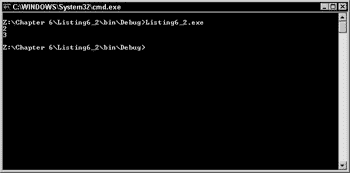

当你编译并运行列表 6-2 时，你会看到输出与图 6-1 类似。

图 6-1：简单调用方法会产生如处所示的输出。

这是因为 `Main()` 方法调用了两次 `CallMethod()`：一次使用值 2，另一次使用值 3。`CallMethod()` 方法的方法体将提供的值写入控制台。

当你为方法参数提供值时，可以使用字面量值（如列表 6-2 中的 2），你也可以提供一个其值会被使用的变量（如列表 6-2 中的 `MyInteger` 变量）。

当调用方法时，C# 会获取指定的值并将这些值分配给方法中使用的参数。在列表 6-2 的第一次调用 `CallMethod()` 中，字面量 2 被用作方法的参数，方法的 `Integer` 参数被赋予了值 2。在列表 6-2 的第二次调用 `CallMethod()` 中，变量 `MyInteger` 被用作方法的参数，方法的 `Integer` 参数被赋予了变量 `MyInteger` 的值：3。

你在调用方法时指定的参数必须与参数列表中指定的类型匹配。例如，如果方法参数列表中的某个参数指定为 `int`，那么你传递给它的参数必须是 `int` 类型，或者是可以转换为 `int` 的类型。在编译你的代码时，任何其他类型都会产生错误。C# 是一门类型安全的语言，这意味着在在你编译 C# 代码时，会检查变量类型的合法性。对于方法而言，这意味着在指定参数时，你 必须指定正确的类型。列表 6-3 显示了指定参数时的正确类型。

列表 6-3：方法参数列表中的类型安全

```csharp
class Listing6_3
{
    public static void Main()
    {
        Listing6_3 MyObject;
        MyObject = new Listing6_3();
        MyObject.CallMethod("a string");
    }
    void CallMethod(int Integer)
    {
        System.Console.WriteLine(Integer);
    }
}
```

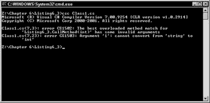

此代码无法编译，如图 6-2 所示。

图 6-2：使用无效数据类型调用方法会产生编译器的错误。

C# 编译器发布这些错误是因为 `CallMethod()` 方法正在使用字符串参数执行，而 `CallMethod()` 的参数列表指定必须使用整数作为其参数。字符串不是整数，且无法转换为整数，这种不匹配导致 C# 编译器发布了错误。

如果方法返回一个值，你应该声明一个变量来保存返回的值。用于保存函数返回值的变量放置在方法名之前，用等号将变量的标识符与方法名分开，如列表 6-4 所示。

列表 6-4：从方法返回值

```csharp
class Listing6_4
{
    public static void Main()
    {
        Listing6_4 MyObject;
        int ReturnValue;
        MyObject = new Listing6_4();
        ReturnValue = MyObject.AddIntegers(3, 5);
        System.Console.WriteLine(ReturnValue);
    }
    int AddIntegers(int Integer1, int Integer2)
    {
        int Sum;
        Sum = Integer1 + Integer2;
        return Sum;
    }
}
```

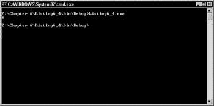

这段代码中发生了几件事：

- 声明了一个名为 `AddIntegers()` 的方法。该方法的参数列表中有两个参数：`Integer1` 和 `Integer2`。

- `AddIntegers()` 方法体将两个参数值相加，并将结果赋值给局部变量 `Sum`。返回 `Sum` 的值。

- `Main()` 方法使用值 3 和 5 调用 `AddIntegers()` 方法。`AddIntegers()` 方法的返回值放在局部变量 `ReturnValue` 中。

- `ReturnValue` 的值打印到控制台。

图 6-3 包含了列表 6-4 中程序的结果。

图 6-3：数据从方法返回并显示在控制窗口。

### 理解参数类型

C# 允许参数列表中存在四种类型的参数：

- 输入参数（Input parameters）
- 输出参数（Output parameters）
- 引用参数（Reference parameters）
- 参数数组（Parameter arrays）

### 输入参数

`Input parameters` 是值被发送到方法的参数。到目前为止的所有参数都是输入参数。输入参数的值发送到函数，但方法体无法永久地更改它们的值。

上一个示例中的列表 6-4 定义了一个带有两个输入参数的方法。输入参数是*按值*传递给方法的。方法基本上看到的是参数值的副本，但不被允许更改调用者提供的值。示例参见列表 6-5。

列表 6-5：修改输入参数的副本

```csharp
class Listing6_5
{
    public static void Main()
    {
        int MyInteger;
        Listing6_5 MyObject;
        MyObject = new Listing6_5();
        MyInteger = 3;
        MyObject.CallMethod(MyInteger);
        System.Console.WriteLine(MyInteger);
    }
}
```

```csharp
void CallMethod(int Integer1)
{
    Integer1 = 6;
    System.Console.WriteLine(Integer1);
}
```


在列表 6-5 中，`Main()` 方法设置了一个名为 `MyInteger` 的整数变量并将其赋值为 `3`。然后，它将 `MyInteger` 作为参数调用了 `MyMethod()`。`CallMethod()` 方法将参数的值设置为 `6`，然后将其值打印到控制台上。当 `CallMethod()` 方法返回时，`Main()` 方法继续执行并打印 `MyInteger` 的值。

当你运行这段代码时，输出应该与图 6-4 相似。

图 6-4：使用 `CallMethod()` 函数演示输入参数。

出现此输出是因为 `CallMethod()` 方法修改了其输入参数的副本，但该修改不会影响由 `Main()` 提供的原始方法的值。在 `CallMethod()` 方法返回后，`MyInteger` 的值仍然为 `3`，因为 `CallMethod()` 更改调用者输入参数的值。它只能更改其值副本的值。

### 输出参数

`输出参数`（Output parameters）是在调用方法时未设置其值的参数。

相反，方法会设置这些值并通过输出参数将这些值返回给调用者。

例如，假设你想写一个方法来统计数据库表中的记录数。假设你还想指定操作是否成功。（例如，如果数据库表不可用，操作可能会失败。）现在你有两项信息需要方法返回：

*   一个记录计数
*   一个操作成功标志位

C# 允许方法只返回一个值。当你想要返回两项信息时，该怎么办？

答案在于输出参数的概念。你可以让你的方法以 `Boolean` 值的形式返回操作成功标志，并将记录计数指定为输出参数。该方法将记录计数存储在一个输出变量中，调用者会获取该变量的值。

输出参数在参数列表中使用关键字 `out` 来指定。在参数列表中，`out` 关键字必须在参数类型之前（注：应为类型之前）。当你调用带有输出参数的方法时，你必须声明一个变量来存放输出参数的值，如列表 6-6 所示。

列表 6-6：使用输出参数

```csharp
class Listing6_6
{
    public static void Main()
    {
        int MyInteger;
        Listing6_6 MyObject;
        MyObject = new Listing6_6();
        MyObject.CallMethod(out MyInteger);
        System.Console.WriteLine(MyInteger);
    }

    void CallMethod(out int Integer1)
    {
        Integer1 = 7;
    }
}
```

`Listing6-6` 定义了一个名为 `CallMethod()` 的方法，该方法定义了一个名为 `Integer1` 的输出参数整数。方法体将输出参数的值设置为 `7`。`Main()` 方法声明了一个名为 `MyInteger` 的整数，并将其作为输出参数传递给 `CallMethod()` 方法。当 `CallMethod()` 返回时，`MyInteger` 的值被写入控制台。图 6-5 包含了这些输出参数测试应用程序的结果。

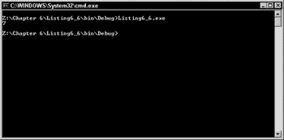

图 6-5：一个输出参数返回了适当的值。

你必须对每个参数使用两次 `out` 关键字：一次是在参数列表中声明该参数时，另一次是在调用方法时指定输出参数时。如果你在调用带有输出参数的方法时忘记了 `out` 关键字，你会从 C# 编译器得到以下错误：

```
Listing6-6.cs(9,6): error CS1502: The best overloaded method
match for 'Listing6_6.CallMethod(out int)' has some invalid arguments
Listing6-6.cs(9,26): error CS1503: Argument '1': cannot convert
from 'int' to 'out int'
```

在调用方法之前赋值给用作输出参数变量的任何值都会丢失。原始会被方法赋值给它们的值所覆盖。

### 引用参数

`引用参数`（Reference parameters）通过引用提供值：换句话说，方法在调用时接收的是调用时指定的变量的引用。将引用参数想象为既是输入变量也是输出变量：方法可以读取变量的原始值，也可以像输出参数一样修改原始值。

引用参数在参数列表中使用关键字 `ref` 来指定。在参数列表中，`ref` 关键字必须在参数类型之前。当你调用带有引用参数的方法时，你必须声明一个变量来存放引用参数的值，如列表 6-7 所示。

列表 6-7：使用引用参数

```csharp
class Listing6_7
{
    public static void Main()
    {
        int MyInteger;
        Listing6_7 MyObject;
        MyObject = new Listing6_7();
        MyInteger = 3;
        System.Console.WriteLine(MyInteger);
        MyObject.CallMethod(ref MyInteger);
        System.Console.WriteLine(MyInteger);
    }

    void CallMethod(ref int Integer1)
    {
        Integer1 = 4;
    }
}
```

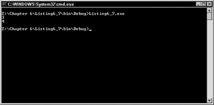

`Listing 6-7` 中的 `CallMethod()` 方法使用了一个名为 `Integer1` 的引用参数。方法体将引用参数设置为 `4`。`Main()` 方法声明了一个名为 `MyInteger` 的整数并赋值为 `3`。它将其值打印到控制台，然后作为参数传递给 `CallMethod()` 方法。当 `CallMethod()` 返回时，`MyInteger` 的值被打印到控制台。运行 `Listing 6-7` 的结果如图 6-6 所示。

图 6-6：引用参数直接更改你的变量。

第二行读取 `4` 是因为引用参数允许方法更改原始变量的值。这与 `Listing 6-5` 中的输入参数示例不同。

### 参数数组

`方法`通常被编写为接受特定数量的参数。具有三个参数的列表总是期望以三个参数的形式调用——不多也不少。然而，有时方法在设计时并不知道应该接受多少个参数。你可能正在编写一个接受字符串列表以指定从磁盘删除的文件。方法应该允许多少个字符串？为了灵活，方法的设计应该允许调用者指定尽可能多或尽可能少的字符串。这使得调用方法变得更加灵活，因为调用者可以决定传递多少个字符串。但是，当方法不知道将传递多少参数时，你应该如何编写方法的参数列表？

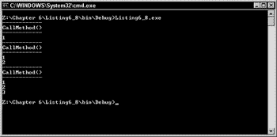

参数数组解决了这个设计困境。`参数数组`允许你的方法接受数量数量的参数。你在参数列表中通过 C# 关键字 `params` 来指定参数数组，后面跟着调用者应该提供的变量类型。类型规范后面是方括号，紧接着是参数数组的标识符，如列表 6-8 所示。

列表 6-8：使用参数数组

```csharp
class Listing6_8
{
    public static void Main()
    {
        Listing6_8 MyObject;
        MyObject = new Listing6_8();
        MyObject.CallMethod(1);
        MyObject.CallMethod(1, 2);
        MyObject.CallMethod(1, 2, 3);
    }

    void CallMethod(params int[] ParamArray)
    {
        System.Console.WriteLine("------------");
        System.Console.WriteLine("CallMethod()");
        System.Console.WriteLine("------------");
        foreach(int ParamArrayElement in ParamArray)
            System.Console.WriteLine(ParamArrayElement);
    }
}
```

在 `Listing 6-8` 中，`CallMethod()` 方法被编写为接受数量数量的整数。

该方法接收一个整数数组作为参数。方法体使用 `foreach` 语句遍历参数数组，并将每个元素打印到控制台。

`Main()` 方法调用了三次 `CallMethod()` 方法，每次调入的参数数量都不同。这之所以是法的，是因为 `CallMethod()` 在声明时使用了参数数组。

图 6-7 显示，所有参数都完整无损地传递给了该方法。

图 6-7：`params` 关键字允许任意数量的参数。

你可以在方法的参数列表中使用一个参数数组。你也可以将参数数组与方法参数列表其他参数结合。但是，如果你在方法参数列表中使用参数数组，它必须被指定为列表中的最后一个参数。

你不能在参数数组上使用 `out` 或 `ref` 关键字。

### 方法重载

C# 允许你在同一个类中定义多个同名的方法，只要这些方法具有不同的参数列表。这被称为对方法名进行“重载”（`overloading`）。示例请参阅列表 6-9。

列表 6-9：使用重载方法

```csharp
class Listing6_9
{
    public static void Main()
    {
        Listing6_9 MyObject;
        MyObject = new Listing6_9();
        MyObject.Add(3, 4);
        MyObject.Add(3.5, 4.75);
    }

    void Add(int Integer1, int Integer2)
    {
        int Sum;
        System.Console.WriteLine("adding two integers");
        Sum = Integer1 + Integer2;
        System.Console.WriteLine(Sum);
    }

    void Add(double Double1, double Double2)
    {
        double Sum;
        System.Console.WriteLine("adding two doubles");
        Sum = Double1 + Double2;
        System.Console.WriteLine(Sum);
    }
}
```

列表 6-9 实现了两个 `Add()` 方法。其中一个 `Add()` 方法接受两个整数作为输入参数，另一个接受两个双精度浮点数。由于这两个实现具有不同的参数列表，C# 允许这两个 `Add()` 方法在同一个类中共存。`Main()` 方法调用了两次 `Add()` 方法：一次使用两个整数参数值，一次使用两个浮点值。

如你在图 6-8 所示，两个方法都成功运行并处理了正确的数据。

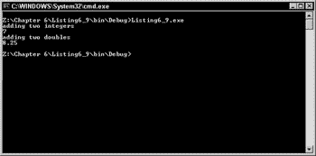

图 6-8：重载方法添加整数和双精度浮点数。

当 C# 编译器遇到对具有多个实现方法的调用时，它会查看调用中使用的参数，并调用参数列表与调用中所用参数最匹配的方法。在第一次调用 `Add()` 时使用了两个整数。C# 编译器随后会将此调用匹配到接受两个整数输入参数的 `Add()` 实现，因为调用中的参数与整数的参数列表匹配。在第二次调用 `Add()` 时使用了两个双精度浮点数。C# 编译器随后会将此调用匹配到接受两个双精度浮点数输入参数的 `Add()` 实现，因为调用中的参数与双精度浮点数的参数列表匹配。

并不是所有重载方法都在其参数列表中使用相同数量的参数，参数列表中的所有参数也不需要是相同类型。C# 施的唯一要求是函数具有不同的参数列表。重载函数的一个版本可以在其参数列表中有一个整数，而另一个版本可以在其参数列表中有一个字符串、一个长整型和一个字符。

### 虚方法

为了跟进虚方法的讨论，你必须理解继承。继承（`Inheritance`）基于现有类创建一个类，根据需要添加或删除功能。在接下来的章节中，我们将检查虚方法是如何创建和使用的。

### 重写方法

在本节的开始部分，你将构建一个名为 `Books` 的示例类。该类包含两个名为 `Title` 和 `Rating` 的方法。`Title` 方法返回书名，`Rating` 方法返回一个字符串，指示该书的星级。列表 6-10 中的代码是你应用程序的完整源代码。将其输入到你喜欢的编辑器中，并像以前那样对其进行编译。

列表 6-10：使用以下类显示书籍标题和评分信息使用 System;

```csharp
namespace BookOverride
{
    class Book
    {
        public string Title()
        {
            return "Programming Book";
        }

        public string Rating()
        {
            return "5 Stars";
        }
    }

    class Class1
    {
        static void Main(string[] args)
        {
            Book bc = new Book();
            Console.WriteLine(bc.Title());
            Console.WriteLine(bc.Rating());
        }
    }
}
```

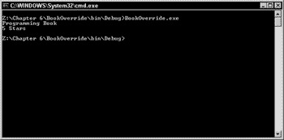

在运行此程序之前，请快速查看它。如你所见，一个类包含了你的 `Main()` 方法。该方法是你实例化你的 `BookOverride` 类实例的地方，该类包含 `Title` 和 `Rating` 方法。在实例化类实例之后，你调用 `Title` 和 `Rating` 方法并将输出写入控制台。结果可以在图 6-9 中看到。

图 6-9：你的书籍标题和评分如预期返回。

接下来，你通过创建一个基于 `Book` 类的类来重写 `Title` 方法。要创建一个基于 `Book` 类的类，只需正常声明类并在类名后加上冒号以及你想基于的类。将列表 6-11 所示的代码添加到你创建的应用程序中。

列表 6-11：通过继承 Book 类覆盖方法

```csharp
class Wiley : Book
{
    new public string Title()
    {
        return "C# Bible";
    }
}
```

此代码创建了一个继承 `Book` 类的 `Wiley` 类。现在你可以创建一个名为 `Title` 的新公共方法。由于你给这个方法命名了与基类中相同的名称，你重写了 `Title` 方法。

注意成员是指定义在类内部的方法、属性和事件。

既然你已经重写了 `Title` 方法，必须更改 `Main()` 方法以使用你的新类。按照列表 6-12 所示更改 `Main()` 方法。

列表 6-12：修改 Main 方法以覆盖类

```csharp
static void Main(string[] args)
{
    Wiley bc = new Wiley();
    Console.WriteLine(bc.Title());
    Console.WriteLine(bc.Rating());
}
```

在你的 `Main()` 方法中，你更改了变量 `bc` 以实例化 `Wiley` 类。

正如你可能猜的那样，当你调用 `Title` 方法时，书的标题从 Programming Book 变为 C# Bible。注意你仍然可以访问最初定义在 `Book` 类中的 `Rating` 方法。

重写基类中的方法是更改特定功能的极佳方式。

**总结**

C# 允许你在 C# 类中编写方法。方法可以帮助你将代码划分成易理解的部分，并为可能多次调用的代码提供单一位置。

函数可以接收参数。输入参数是传递到方法的值，但其值不能更改。输出参数由方法赋值，赋值后的值对调用者可见。引用参数是可以提供给函数的值，也可以由方法更改其值。

参数数组允许你编写接受变长参数的方法。

C# 还允许你重载方法。重载方法具有相同的名称但不同的参数列表。C# 在代码执行时使用调用中提供的参数来确定调用哪个方法。

C# 允许你将变量分组到结构中。通过为你的数据定义结构，无论结构中包含多少变量，整个组都可以在单个结构名称下进行管理。通过操作单个结构，可以轻松地处理整个变量集，而不需要单独跟踪每个变量。结构可以包含字段、方法、常量、构造函数、属性、索引器、运算符以及其他结构。

C# 中的结构是值类型，而不是引用类型。这意味着结构变量直接包含结构体的值，而不是维护对内存中其他处找到的结构体的引用。

你在 C# 代码中声明的某些变量可能与你声明的其他变量存在逻辑关系。例如，假设你想编写一个处理屏幕上某个点的代码。你可能声明两个变量来描述该点：`int XCoordinateOfPoint;` 和 `int YCoordinateOfPoint;`。

该点有两个值 —— 它的 `x` 坐标和 `y` 坐标 —— 这两个值共同描述了该点。

虽然你可以用这种方式编写 C# 代码，但这会变得非常繁琐。在任何想要处理该点的代码中，这两个值必须一起使用。如果你想让一个方法来处理该点，你必须单独传递这些值：

```cs
void WorkWithPoint(int XCoordinate, int YCoordinate);
void SetNewPoint(out int XCoordinate, out int YCoordinate);
```

当多个变量协同工作以描述单个实体时，情况会变得更加复杂。例如，人力资源数据库中的员工可能有代表名字、姓氏、地址、电话号码和当前薪资的变量。

将这些作为单独的变量并确保它们作为一个组被使用可能会变得非常混乱。

## 声明结构

你使用 `struct` 关键字来声明结构的内容。你必须使用跟随 `struct` 关键字的标识符为结构命名。构成结构的变量列表包含在跟随结构标识符的大括号中。结构成员声明通常应该以 `public` 关键字作为前缀，以告诉 C# 编译器它们的值对于类中的所有代码都是公开可见的。每个成员声明都以分号结束。

声明一个定义点的结构可能如下所示：

```cs
struct Point
{
    public int X;
    public int Y;
}
```

在前面的示例中，结构的成员 `X` 和 `Y` 具有相同的类型。然而，这不是强制要求的。结构也可以由不同类型的变量组成。

之前讨论的员工示例可能如下：

```cs
struct Employee
{
    public string FirstName;
    public string LastName;
    public string Address;
    public string City;
    public string State;
    public ushort ZIPCode;
    public decimal Salary;
}
```

与 C# 中的所有语句一样，你只能在类内部声明结构。

**注意**：C# 不允许任何语句出现在类声明之外。

结构成员的初始值遵循第 3 章“处理变量”中表 3-1 描述的值初始化规则。值被初始化为零的某种表示形式，字符串则被清空。C# 不允许你在声明结构成员时对其初始化。请看以下代码中的错误：

```cs
struct Point
{
    public int X = 100;
    public int Y = 200;
}
```

此声明会导致编译器的产生错误：

`error CS0573: 'MyClass.Point.X': cannot have instance field initializers in structs`

`error CS0573: 'MyClass.Point.Y': cannot have instance field initializers in structs`

你可以使用一种称为 `构造函数` 的特殊方法将结构成员初始化为非零值。你将在本章的稍后部分检查构造函数。

## 在代码中使用结构

在你定义结构之后，你可以使用其标识符作为变量类型，就像你使用 `int` 或 `long` 类型一样。提供结构的标识符，后面跟上一些空白符，然后是结构变量的标识符：

```cs
Point MyPoint;
```

**交叉引用**：标识符可以在第 3 章“处理变量”中找到。

此语句声明了一个名为 `MyPoint` 的变量，其类型为 `Point` 结构。你可以像使用任何变量一样使用此变量，包括在表达式中以及作为方法的参数。

访问结构的单个成员与编写结构变量标识符名称、一个点（.）、然后是结构成员一样。列表 7-1 显示了如何在代码中使用结构。

### 列表 7-1：访问结构成员

```cs
class Listing7_1
{
    struct Point
    {
        public int X;
        public int Y;
    }

    public static void Main()
    {
        Point MyPoint;
        MyPoint.X = 100;
        MyPoint.Y = 200;
        System.Console.WriteLine(MyPoint.X);
        System.Console.WriteLine(MyPoint.Y);
    }
}
```

示例运行的输出如下：

```
100
200
```

只要结构类型相同，你就可以将一个结构变量赋值给另一个。当你将一个结构变量赋值给另一个时，C# 将等号左侧结构变量的值设置为等号右侧结构中对应的值，如列表 7-2 所示。

### 列表 7-2：将一个结构变量赋值给另一个

```cs
class Listing7_2
{
    struct Point
    {
        public int X;
        public int Y;
    }

    public static void Main()
    {
        Point MyFirstPoint;
        Point MySecondPoint;
        MyFirstPoint.X = 100;
        MyFirstPoint.Y = 100;
        MySecondPoint.X = 200;
        MySecondPoint.Y = 200;

        System.Console.WriteLine(MyFirstPoint.X);
        System.Console.WriteLine(MyFirstPoint.Y);
        MyFirstPoint = MySecondPoint;
        System.Console.WriteLine(MyFirstPoint.X);
        System.Console.WriteLine(MyFirstPoint.Y);
    }
}
```

上述代码将 `MyFirstPoint` 的成员设置为 100，将 `MySecondPoint` 的成员设置为 200。将 `MyFirstPoint` 的值写入控制台，然后 `MySecondPoint` 变量的值复制到 `MyFirstPoint` 变量。赋值后，再次将 `MyFirstPoint` 的值写入控制台。当此代码编译并执行时，输出应如图 7-1。

## 在结构中定义方法

结构也可以包含方法。如果你需要编写处理结构内容的代码，你可以考虑将方法写在结构内部。

## 使用构造函数方法

结构可以包含一种称为 `构造函数` 的特殊方法。当运行时执行使用结构类型的变量声明时，构造函数方法会执行。

结构可以有零或多个构造函数。结构构造函数的声明与类方法的声明非常相似，但有以下例外：

- 构造函数不返回任何值。编写结构构造函数时不要使用返回类型关键字——即使是 `void`。
- 构造函数标识符与结构本身的名称相同。
- 构造函数必须至少有一个参数。C# 不允许你定义无参数的构造函数。C# 总是为你定义一个无参数的默认构造函数。这是将所有结构成员初始化为零或等值的构造函数。

结构可以定义多个构造函数，只要这些构造函数的参数列表不同。列表 7-3 显示了一个具有两个构造函数的 `Point` 结构。

### 列表 7-3：结构构造函数

```cs
class Listing7_3
{
    struct Point
    {
        public int X;
        public int Y;

        public Point(int InitialX)
        {
            X = InitialX;
            Y = 1000;
        }

        public Point(int InitialX, int InitialY)
        {
            X = InitialX;
            Y = InitialY;
        }
    }

    public static void Main()
    {
        Point MyFirstPoint = new Point();
        Point MySecondPoint = new Point(100);
        Point MyThirdPoint = new Point(250, 475);
        System.Console.WriteLine(MyFirstPoint.X);
        System.Console.WriteLine(MyFirstPoint.Y);
        System.Console.WriteLine(MySecondPoint.X);
        System.Console.WriteLine(MySecondPoint.Y);
        System.Console.WriteLine(MyThirdPoint.X);
        System.Console.WriteLine(MyThirdPoint.Y);
    }
}
```

图 7-2 显示了如果你编译并运行列表 7-3 中的代码时，控制台上显示的内容。

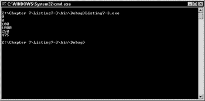

图 7-2：结构体如预期地显示了预定义值。

注意列表 7-3 中的几个有趣的概念：

- `Point` 结构体声明了两个构造函数。一个接受一个整数作为参数，另一个接受两个整数作为参数。两者都带有 `public` 关键字前缀，以便其代码可以被类的其他代码公开访问。

- 带有一个整数参数的构造函数将结构体的 `X` 成员设置为该整数参数的值，并将结构体的 `Y` 成员设置为 1,000。

- 带有两个整数参数的构造函数将结构体的 `X` 成员设置为第一个整数参数的值，并将结构体的 `Y` 成员设置为第二个整数参数的值。

- 代码声明了三个 `Point` 类型的变量。它们每个都调用了 `Point` 构造函数之一。`MyFirstPoint` 的声明调用了零参数的构造函数。这是 C# 为每个结构体定义的默认构造函数。`MySecondPoint` 的声明调用了带有一个参数的构造函数，而 `MyThirdPoint` 的声明调用了带有两个参数的构造函数。

请务留注意列表 7-3 中调用结构体构造函数的语法。如果你想调用一个结构体的构造函数，必须使用 `new` 关键字，随后是结构体的名称，然后是括号中的构造函数参数。该表达式的值被赋值给你正在声明的变量。看下面的语句：

`Point MyThirdPoint = new Point(250, 475);`

该语句的意思是：“使用两个整数的构造函数创建一个新的 `Point` 结构体。将其值赋值给变量 `MyThirdPoint`。根据之前描述的结构体赋值规则，`MyThirdPoint` 变量的成员被设置为新结构体成员的值。你不需要对调用 `new` 时创建的新结构体进行任何其他操作。公共语言运行时 (CLR) 检测到该结构体不再使用，并通过其垃圾回收机制将其释放。”

无参数构造函数的语法也显示在列表 7-3 中：

```cs
Point MyFirstPoint = new Point();
```

这告诉 C# 编译器你想使用其默认行为初始化结构体。在使用结构体之前，你必须为结构体的所有成员赋值，方法是通过调用其无参数构造函数或显式地为其所有字段设置值。

看列表 7-4。

列表 7-4：在初始化之前使用结构体会导致编译错误类 `Listing7_4`

```cs
class Listing7_4
{
    struct Point
    {
        public int X;
        public int Y;
    }

    public static void Main()
    {
        Point MyPoint;
        System.Console.WriteLine(MyPoint.X);
        System.Console.WriteLine(MyPoint.Y);
    }
}
```

前面的代码是错误的，编译它会产生来自 C# 编译器的以下错误消息：

`error CS0170: Use of possibly unassigned field 'X'`

`error CS0170: Use of possibly unassigned field 'Y'`

`warning CS0649: Field 'Listing7_4.Point.X' is never assigned to, and will always have its default value 0`

`warning CS0649: Field 'Listing7_4.Point.Y' is never assigned to, and will always have its default value 0`

错误消息告诉你，对 `WriteLine()` 的调用使用了结构体中的数据成员，但这些数据成员尚未被赋值。`MyPoint` 变量没有通过调用无参数构造函数进行初始化，其成员也没有被显式地设置为任何值。除非你在代码中写了该调用，否则 C# 不会调用无参数构造函数。

这是 C# 编译器保护你的代码免受不可预测行为的另一个示例。所有变量在使用之前都必须初始化。

### 从结构体调用方法

你也可以在你的结构体中编写方法。这些方法遵循与类方法相同的规则：它们必须指定返回类型（或 `void`），并有一个标识符和一个参数列表（列表可以为空）。在结构体中调用方法使用与访问类方法时相同的点符号语法。看列表 7-5。

列表 7-5：调用结构体方法

```cs
class Listing7_5
{
    struct Point
    {
        public int X;
        public int Y;
        public Point(int InitialX, int InitialY)
        {
            X = InitialX;
            Y = InitialY;
        }

        public bool IsAtOrigin()
        {
            if((X == 0) && (Y == 0))
                return true;
            else
                return false;
        }
    }

    public static void Main()
    {
        Point MyFirstPoint = new Point(100, 200);
        Point MySecondPoint = new Point();
        if(MyFirstPoint.IsAtOrigin() == true)
            System.Console.WriteLine("MyFirstPoint is at the origin.");
        else
            System.Console.WriteLine("MyFirstPoint is not at the origin.");

        if(MySecondPoint.IsAtOrigin() == true)
            System.Console.WriteLine("MySecondPoint is at the origin.");
        else
            System.Console.WriteLine("MySecondPoint is not at the origin.");
    }
}
```

列表 7-5 中的 `Point` 结构体声明了一个名为 `IsAtOrigin` 方法。该方法的代码检查结构体的值，如果坐标是 (0, 0) 则返回 `true`，否则返回 `false`。`Main()` 方法声明了两个变量：`MyFirstPoint` 使用显式构造函数设置为坐标 (100, 200)，`MySecondPoint` 使用默认构造函数设置为 (0, 0)。`Main()` 方法随后对两个点调用 `IsAtOrigin` 方法并根据返回值打印消息。

如果你编译并运行列表 7-5 中的代码，你会看到以下输出：

MyFirstPoint is not at the origin.

MySecondPoint is at the origin.

### 在结构体中定义属性

结构体中的属性允许你使用访问器读取、写入和计算值。与字段不同，属性不被视为变量；因此，它们不指定存储空间。由于属性不分配存储空间，不能作为 `ref` 或 `out` 参数传递。

属性将在第 9 章“C# 类”中详细讨论。

列表 7-6 在 `Point` 结构体包含一个属性。

列表 7-6：在结构体中定义属性

```cs
class Listing7_6
{
    struct Point
    {
        private int x;
        public int X
        {
            get
            {
                return x;
            }
            set
            {
                x = value;
            }
        }
    }

    public static void Main()
    {
        int retval;
        Point MyPoint = new Point();
        MyPoint.X = 10;
        retval = MyPoint.X;
        System.Console.WriteLine(retval);
    }
}
```

该代码将值赋值给结构体中的 `X` 成员，然后将此值检索到变量 `RetValue` 中。列表 7-6 的输出显示在图 7-3 中。

索引器（Indexers）是允许结构以与数组相同的方式进行索引的对象。通过索引器，你可以同时声明多个结构，并使用索引号引用每个结构。列表 7-7 展示了这一点，它声明了一个名为 `MyStruct` 的结构，其中包含一个字符串和一个索引。

列表 7-7：在结构内部包含索引器

```csharp
class Listing7_7
{
    struct MyStruct
    {
        public string []data ;
        public string this [int index]
        {
            get
            {
                return data[index];
            }
            set
            {
                data[index] = value;
            }
        }
    }

    public static void Main()
    {
        int x;
        MyStruct ms = new MyStruct();
        ms.data = new string[5];
        ms[0] = "Brian D Patterson";
        ms[1] = "Aimee J Patterson";
        ms[2] = "Breanna C Mounts";
        ms[3] = "Haileigh E Mounts";
        ms[4] = "Brian W Patterson";
        for (x=0;x<5;x++)
            System.Console.WriteLine(ms[x]);
    }
}
```

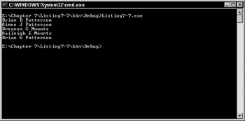

你可以看到，这个示例创建了一个新的 `MyStruct` 对象，然后将其数据成员设置为 5，这表示使用了该结构的 5 个副本。你使用索引号（`0` 到 `5`）引用该结构的每个副本，并在该结构中存储名称。为了确保你的所有数据都完整无 way，你对可能的索引号进行简单的循环，并将输出写入控制台。

你可以在图 7-4 中看到列表 7-7 的输出。

图 7-4：在结构内部包含索引器以便于检索数据。

当你在处理大量相同的数据时，结构内部的索引器会非常有用。例如，如果你从数据库中读取地址信息，这将是存储它的极佳位置。你可以在维护所有字段的同时，提供一种易于访问记录中每条数据的机制。

### 在结构体中定义接口

接口（Interfaces）是一种确保使用你的类的人遵守你所设定的所有规则的方法。这可以包括实现特定的方法、属性和事件。

当你暴露一个接口时，该接口的用户必须继承该接口；通过这样做，他们被限制必须创建某些方法等。这确保了你的类和/或结构是按照预期方式使用的。

你也可以在结构中包含接口。列表 7-8 向你展示了如何正确实现接口。

列表 7-8：在结构内部实现接口

```csharp
class Listing7_8
{
    interface IInterface
    {
        void Method();
    }
    struct MyStruct : IInterface
    {
        public void Method()
        {
            System.Console.WriteLine("Structure Method");
        }
    }

    public static void Main()
    {
        MyStruct DemoStructure = new MyStruct();
        DemoStructure.Method();
    }
}
```

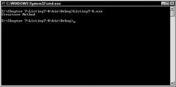

此代码创建了一个名为 `IInterface` 的接口。该接口包含一个名为 `Method` 的方法的定义。你创建自己的结构并在结构名称后加上冒号，然后跟随你想要继承的接口名称。在你的结构内部，你包含了该方法，它只是向控制台输出了一行文本。你可以在图 7-5 中看到此程序的输出。

图 7-5：在结构内部实现接口

为了演示接口有多么重要，请注释掉 `MyStruct` 结构中组成 `Method` 方法的四行代码。现在重新编译程序，你应该会看到以下错误消息：

`Class1.cs(8,9): error CS0535: 'Listing7_8.MyStruct' does not implement interface member 'Listing7_8.IInterface.Method()'`

C# 编译器确定你没有实现接口所列出的所有方法。由于没有实现正确的方法，程序无法编译，从而确保你遵循了所有规则。

### 使用 C# 简单类型作为结构

第 3 章中描述的原始类型——`int`、`uint`、`long` 等——在 .NET CLR 中实际上是实现为结构体的。表 7-1 列出了 C# 值变量关键字以及实际实现它们的 .NET 结构名称。

表 7-1：值类型的 .NET 结构名称

| C# 关键字 | .NET 结构名称 |
| :--- | :--- |
| sbyte | `System.SByte` |
| byte | `System.Byte` |
| short | `System.Int16` |
| ushort | `System.UInt16` |
| int | `System.Int32` |
| uint | `System.UInt32` |
| long | `System.Int64` |
| ulong | `System.UInt64` |
| char | `System.Char` |
| float | `System.Single` |
| double | `System.Double` |
| bool | `System.Boolean` |
| decimal | `System.Decimal` |

这种设计使得你的 C# 代码可以移植到其他 .NET 语言。C# 值映射到可以被任何 .NET 语言使用的 .NET 结构，因为任何 .NET 结构都可以被 CLR 使用。将 C# 值映射到 .NET 结构允许结构使用运算符重载等技术来定义类型在表达式中使用时的行为。当你学习类时，将学习运算符重载。

如果你愿意，可以使用实际的 .NET 结构名称。列表 7-9 显示了如果使用 .NET 名称，7-5 的代码将像什么样。

列表 7-9：使用 .NET 结构

```csharp
class Listing7_9
{
    struct Point
    {
        public System.Int32 X;
        public System.Int32 Y;
        public Point(System.Int32 InitialX, System.Int32 InitialY)
        {
            X = InitialX;
            Y = InitialY;
        }

        public System.Boolean IsAtOrigin()
        {
            if((X == 0) && (Y == 0))
                return true;
            else
                return false;
        }
    }

    public static void Main()
    {
        Point MyFirstPoint = new Point(100, 200);
        Point MySecondPoint = new Point();
        if(MyFirstPoint.IsAtOrigin() == true)
            System.Console.WriteLine("MyFirstPoint is at the origin.");
        else
            System.Console.WriteLine("MyFirstPoint is not the origin.");

        if(MySecondPoint.IsAtOrigin() == true)
            System.Console.WriteLine("MySecondPoint is at the origin.");
        else
            System.Console.WriteLine("MySecondPoint is not the origin.");
    }
}
```

## 总结

结构允许你将一组变量组合在一个单一名称下。可以使用结构标识符声明变量。

结构使用 `struct` 关键字声明。所有 C# 结构都有一个名称和一个数据成员列表。C# 对结构可以包含的数据成员数量没有限制。

结构成员使用 `StructName.MemberName` 符号访问。你可以在任何允许使用数据类型的地方它们，包括表达式和方法参数。

结构也可以实现方法以及变量。结构成员使用 `StructName.MethodName` 符号调用，其使用方式与类方法相同。

结构还可以实现特殊方法，称为*构造函数*，这些方法在结构在使用之前将其初始化为已知状态。

软件编程语言始终围绕两个基本概念设计：数据以及作用于数据的代码。随着时间的推移，语言不断演变，这两个概念相互作用的方式。最初，像 `Pascal` 和 `C` 这样的语言引导开发者编写软件时将代码和数据视为两个独立的、不关联的实体。这种方法赋予了开发者自由选择代码如何处理数据的权利，但同时也增加了了负担。此外，这种方法迫使开发者将需要用软件建模的现实世界转换为使用数据和代码的计算机特定模型。

`Pascal` 和 `C` 等语言是围绕“过程”（`procedure`）概念构建的。过程是一个命名的代码块，就像今天的 `C#` 方法一样。使用此类语言开发的软件风格被称为`过程化编程`（`procedural programming`）。在过程化编程中，开发者编写一个或多个过程，并与程序中定义的 set 独立变量一起工作。所有的过程对于应用程序中的任何代码都是可见的，所有的变量都可以从任何代码进行操作。

20 世纪 90 年代，过程化编程让位于 `Smalltalk` 和 `Simula` 等语言，这些语言引入了“对象”（`objects`）的概念。这些语言的发明者意识到，人类并不是通过一组作用于变量集合的代码块来表达思想的；而是通过对象来表达思想。`对象`是具有定义的值集（对象的`状态`/`state`）和在该对象上执行的操作集（对象的`行为`/`behaviors`）的实体。以空间穿器为例。空间穿器具有状态，例如载载燃料量和乘客人数，以及行为，例如“发射”和“着陆”。此外，对象属于`类`（`classes`）。同类的对象具有相似的状态和相同的行为集。对象是类的具体实例。空间穿器是一个类，而名为 `Discovery`（发现号）的空间穿器是一个对象，是空间穿器类的具体实例。

注意 注意，即使在过程化编程中，并不是所有的过程和变量都是可见的。

就像在 `C#` 中一样，过程化语言具有作用域规则（`scoping rules`），它们规定了代码和数据的可见性。过程和变量（在本章中被称为“项”，`items`）通常可以被设置为在过程、源文件、应用程序或外部级别可见。每个作用域的名称都是言自自明的的。在过程级别可见的项仅在定义它的过程内部可以访问。并不是所有语言都允许你在过程中内部创建过程。在源文件级别可见的项在定义该项的文件内部可见。在应用程序级别，该项对于同一应用程序中的任何代码都是可见的。在外部级别，该项对于任何应用程序中的任何代码都是可见的。

重点是，在过程化编程中，数据和代码的交互是由实现细节决定的，例如定义变量的源文件。一旦你决定让一个变量在自己的过程之外可见，你就无法获得任何保护对该变量访问的帮助。在具有数千个变量的大型应用程序中，这种保护的缺失会导致难以发现的错误。

面向对象的软件开发与过程化软件开发相比有两个显著的优势。第一个优势是，你现在可以使用非技术用户熟悉的词汇来指定软件应该做什么以及它将如何执行。你使用对象来结构化你的软件。这些对象属于该软件目标业务用户熟悉的类。例如，在设计 ATM 软件期间，你使用诸如 `BankAccount`（银行账户）、`Customer`（客户）、`Display`（显示器）等类名。这减少了将现实情况转换为软件模型所需的工作，并更容易与对最终产品有利益的非软件人员进行沟通。这种更简单的软件设计方法导致了描述面向对象软件设计标准的出现。这种语言被称为统一建模语言，或 `UML`。

面向对象的软件开发的第二个优势在实现阶段发挥作用。因为你现在可以拥有类级作用域，你可以在类定义内部隐藏变量。每个对象将拥有它自己的一组变量，这些变量通常只能通过类定义的操作进行访问。例如，持有 `BankAccount` 对象状态的变量仅可以通过调用与该对象相关的 `Withdraw()`（取款）或 `Deposit()`（存款）操作来访问。`BankAccount` 对象（或任何其他对象）无法访问另一个 `BankAccount` 对象的私状态，例如余额。这种原则被称为封装（`encapsulation`）。关于它的更多内容将在“封装”章节介绍。

随着时间的推移，由于开发者接受这种新的软件设计方式，面向对象的软件开发变得越来越流行`C#` 是一种面向对象的语言，它的设计确保了 `C#` 开发者遵循良好的面向对象编程概念。

注意 `Smalltalk`、`Java` 和 `C#` 是`纯`面向对象的语言，因为你无法在不使用对象的情况下编写程序。其他语言，如 `C` 和 `Pascal`，被称为过程化或非面向对象的语言，因为它们没有允许你创建对象的内置支持。第三类语言，如 `C++`，是混合语言，在这些语言中你可以选择是否使用对象`C++` 的发明者 `Bjarne Stroustrup` 选择不强制 `C++` 程序员使用对象，因为 `C++` 也是 `C` 编程语言的更好版本。与现有 `C` 代码的兼容性帮助 `C++` 变成了主要的语言。

在本章中，你将学习构成面向对象语言的概念，从基石（类和对象）开始，然后进入更高级的概念（抽象、抽象数据类型、封装、继承和多态）。讨论围绕概念展开，并尽量避免这些概念在 `C#` 中的具体实现细节。

### 类和对象

首先，本节回顾了对象和类之间的区别。本书经常使用这两个术语，区分它们是非常重要的。

类是代码和变量的集合。类通过它们包含的变量管理状态，通过它们包含的方法管理行为。然而，类只是一个模板。你永远在代码中创建类。相反，你创建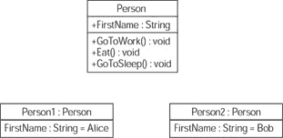对象。

“Alice”和另一个名字名为“Bob”的对象。每个对象的状态都存储在不同的变量集合中。重新读一遍之前的句子。它包含了理解面向对象编程如何运作的关键要点。当你每创建一个不同的对象时，都不需要进行任何特殊编码就能获得一组不同的变量时，那么该语言就具有对对象的支持。

图 8-1：此 `person` 类拥有两个 `person` 对象。

注意：如果一种语言支持对象内部的自动状态管理，但缺乏本节节讨论的其他某些功能，那么它通常被称为`基于对象的语言`（`object-based language`）。Visual Basic 6 支持对象，但不支持实现继承；因此，它不被视为真正的面向对象语言。真正的面向对象语言的示例有 SmallTalk、Java 和 C#。

## 面向对象软件设计的术语

在阅读描述面向对象软件开发的文献时，你会遇到许多术语，在编写 `C#` 代码时，你很可能会遇到其中许多术语。以下是几个最常用的术语：

• 抽象（Abstraction）
• 抽象数据类型（Abstract data types）
• 封装（Encapsulation）
• 继承（Inheritance）
• 多态（Polymorphism）

接下来的章节将详细定义这些术语。

### 抽象

必须意识到，编程`并不是`为了复制某个给定概念在现实世界中的每一个方面。例如，当你编写一个 `Person` 类时，你并不是试图对所有关于人的信息进行建模。相反，你在特定的应用程序语境内工作。你只对该应用程序所需的元素进行建模。

人的某些特征（如国籍）可能存在于现实世界，但如果它们对你的特定应用程序不需要，则会被省略。银行应用程序中的人感兴趣的方面与，例如，第一人称射击游戏中的人是不同的。这个概念被称为`抽象`，它是处理现实世界概念无限复杂性的必要技术。因此，当你对对象和类提问时，请务必记住，你应该在特定应用程序的语境下提出大部分这类问题。

### 抽象数据类型

抽象数据类型是修复编程中使用数据方式的首次尝试。

引入抽象数据类型是因为在现实世界，数据并不是由一组独立的变量组成的。现实世界是由相关数据的集合组成的。例如，一个人在特定应用程序中的状态可能包括名、姓和年龄。当你想要在程序创建一个人时，你想要创建这些变量的集合。抽象数据类型允许你将三个变量（两个字符串和一个整数）打包成一个整体，并方便地使用这个包来保存人的状态，如下例：

```cs
struct Person
{
    public String FirstName;
    public String LastName;
    public int Age;
}
```

当你为代码中的变量分配数据类型时，可以使用`primitive`（原始）数据类型或`abstract`（抽象）数据类型。原始数据类型是 `C#` 语言安装后即可支持的类型。`int`、`long`、`char` 和 `string` 等类型是 `C#` 语言中的原始数据类型。

抽象数据类型是 `C#` 语言安装后不支持类型。在使用之前，你必须在代码中声明抽象数据类型。抽象数据类型定义在你的代码中，而不是由 `C#` 编译器定义。

以你的 `Person` 结构（或类）为例。如果你编写使用 `Person` 结构（或类）的 `C#` 代码，但不编写代码告诉 `C#` 编译器 `Person` 结构（或类）长什么样以及如何运行，你将收到编译器的错误。看下面的代码：

```cs
class MyClass
{
    static void Main()
    {
        Person MyPerson;
        Person.FirstName = "Malgoska";
    }
}
```

编译这段代码会产生来自 `C#` 编译器的错误：

`error CS0234: The type or namespace name 'Person' does not exist in the class or namespace 'MyClass'`

这段代码的问题在于数据类型 `Person` 不是原始数据类型，也不是由 `C#` 语言定义的。因为它不是原始类型，`C#` 编译器假设该类型是抽象数据类型，并在搜索代码以查找 `Person` 数据类型的声明。然而，`C#` 编译器找不到任何关于 `Person` 抽象数据类型的信息，并抛出错误。

在定义抽象数据类型后，你就可以像使用原始数据类型一样在你的 `C#` 代码中使用它。`C#` 中的结构和类都是抽象数据类型的示例。一旦你定义了一个结构（或类），你就可以在另一个结构（或类）内部使用该类型的变量。例如，以下 `LearningUnit` 结构包含两个 `Person` 变量：

```cs
struct LearningUnit
{
    public Person Tutor;
    public Person Student;
}
```

### 封装

通过封装，数据被隐藏或`封装`在类内部，该类实现了一种设计，允许其他代码以高效的方式访问该数据。

将封装想象为围绕你的 `C#` 类数据的保护性封装。作为封装的示例，再次查看你在第 7 章中使用过的 `Point` 结构。

```cs
struct Point
{
    public int X;
    public int Y;
}
```

该结构的数据成员被标记为 `public`，这使得实现该设计的其他代码能够获取这些数据。

该结构的数据成员标记为 `public`，允许访问结构的任何代码访问数据成员。因为任何代码都可以访问数据成员，代码可以将数据成员设置为任何 `int` 值。

然而，直接设置值可能存在问题。假设你正在使用 `Point` 结构来表示分辨率为 800x600 的屏幕。如果是这样，那么将 `X` 设置在 0 到 800 之间、将 `Y` 设置在 0 到 600 之间才有意义。但由于数据成员是公开的，实际上没有什么能阻止代码将 `X` 设置为 32000，将 `Y` 设置为 38000。`C#` 编译器允许这样做，因为这些值可以放入整数中。问题在于，逻辑上并不允许如此大的值。

封装解决了这个问题。基本上，解决方案是将数据成员标记为 `private`，以便代码无法访问数据成员。然后，你可以在点类上编写如 `SetX()` 和 `SetY()` 的方法。`SetX()` 和 `SetY()` 方法可以赋值，也可以在调用者尝试使用过大的参数调用 `SetX()` 或 `SetY()` 时包含抛出错误的代码。图 8-2 展示了 `Point` 类的样子。

图 8-2：`Point` 类中的成员变量被封装了。

注意：数据成员前面的减号是 UML 符号，表示成员具有 `private` 可见性。方法前面的加号是 UML 符号，表示方法具有 `public` 可见性。

将数据成员标记为 `private` 解决了代码直接设置值的问题。

在数据成员标记为 `private` 后，只有类本身可以看到数据成员，任何其他尝试访问数据成员的代码都会收到编译器的错误。

与其直接访问数据成员，不如类声明了名为 `SetX()` 和 `SetY()` 的公开方法。

如果新值超出范围，该方法将返回一个错误。如果新值在范围内，该方法可以继续设置新值。以下伪代码说明了 `SetX()` 方法可能的实现方式：

```
bool SetX(int NewXValue)
{
    if(NewXValue is out of range)
        return false;
    X = NewXValue;
    return true;
}
```

这段代码封装了 `X` 坐标数据成员，并允许调用者设置其值，同时防止了调用者将 `X` 坐标设置为非法值。

由于在某种设计中 `X` 和 `Y` 坐标值现在是私有的（private），其他代码片段无法检查它们的当前值。面向对象设计中的私有访问权限（Private accessibility）防止了调用者读取当前值也无法存储新值。为了暴露这些私有变量，你可以实现诸如 `GetX()` 和 `GetY()` 等方法，将坐标的当前值返回给调用者。

在此设计中，该类封装了 `X` 和 `Y` 值，同时允许其他代码读取和写入它们的值。封装提供了一个额外的的好处，即访问器方法（accessor methods）防止了 `X` 和 `Y` 数据成员被设置为无意义的值。

### 继承

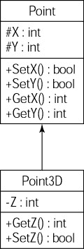

某些类（如 `Point` 类）是从零开始设计的。类的状态和行为定义在类类内部。然而，其他类则借用了另一个类的定义。与其从头开始编写另一个类，你可以从另一个类中借用状态和行为，并将它们作为新类的起点。这种使用另一个类作为起点来定义一个类的行为被称为 `inheritance`（继承）。

### 单继承

假设你正在使用 `Point` 类编写代码，并发现你需要在同一段代码中处理三维点。你已经定义的 `Point` 类模拟了一个二维点，你无法用它来描述三维点。你决定需要编写一个名为 `Point3D` 的新类。你可以通过两种方式之一设计该类：

* 你可以从头编写 `Point3D` 类，定义名为 `X`、`Y` 和 `Z` 的数据成员，并编写获取和设置这些数据成员的方法。
* 你可以继承自 `Point` 类，该类已经实现了对 `X` 和 `Y` 成员的支持。继承自 `Point` 类为你提供了处理 `X` 和 `Y` 成员所需的所有内容，因此你只需要在 `Point3D` 类中实现对 `Z` 成员的支持。图 8-3 展示了这在 UML 中可能的样子。

图 8-3：`Point3D` 类继承了 `Point` 类的方法和变量。

注意：数据成员前的井号（#）是一种 UML 表示法，表示成员具有受保护的可见性（protected visibility）。保护意味着对于派生类是公开的，对于所有其他类是私有的。

图 8-3 展示了 `single inheritance`（单继承）。单继承允许类派生自单一基类。以这种方式使用继承也被称为从一个类派生另一个。`Point3D` 类的一些状态和行为派生自 `Point` 类。

在这种继承情况下，作为起点的类被称为 `base class`（基类），而新类被称为 `derived class`（派生类）。在图 8-3 中，`Point` 是基类，`Point3D` 是派生类。

从另一个类派生一个类会自动...（文本根据提供的逻辑继续）

```csharp
Console.WriteLine("Meow!");

}

}

class Dog : Animal

{

    public override void MakeNoise()
    {
        Console.WriteLine("Woof!");
    }
}

class PolyMorphism

{
    static int Main(string[] args)
    {
        ArrayList Zoo;
        Zoo = new ArrayList(3);
        Cat Sasha, Koshka;
        Sasha = new Cat();
        Koshka = new Cat();
        Dog Milou;
        Milou = new Dog();
        Zoo.Add(Milou);
        Zoo.Add(Koshka);
        Zoo.Add(Sasha);
        foreach (Animal a in Zoo)
        {
            a.MakeNoise();
        }
        // 等待用户确认结果
        Console.WriteLine("Hit Enter to terminate...");
        Console.Read();
        return 0;
    }
}
```

## 总结

C# 是一种面向对象的语言，面向对象语言中使用的概念也适用于 C#。

`抽象数据类型`（Abstract data types）是你自己在代码中定义的数据类型。与基本数据类型不同，抽象数据类型不是 C# 语言内置的。你可以像使用基本数据类型一样在代码中使用抽象类型，但前提是你已经在代码中定义了该抽象数据类型。

`封装`（Encapsulation）是指设计类的行为，为类的数据提供全套功能，而不直接暴露数据。通常情况下，你希望编写代码来保护类免受其他代码提供的非法值的影响。封装允许你通过将数据成员设为私有（private）来“隐藏”数据，同时将获取和设置数据成员值的方法设置为公共（public）。其他代码可以调用这些方法，这些方法可以检查值并在值不时不抛出错误。

`继承`（Inheritance）允许你根据另一个类来定义类。派生类继承自基类。派生类自动继承基类的状态和行为。你可以使用继承为现有类添加新功能，而无需完全从头开始写新类。某些面向对象的语言同时支持单继承和多继承，尽管 C# 只允许单继承。

`多态`（Polymorphism）允许你以统一的方式处理派自同一个基类的派生类集合。你以基类的形式获取派生类，而 C# 会自动调用派生类中正确的方法。

本章将从广义上讨论面向对象的概念，而不会探讨这些概念在 C# 代码中的具体用法。本书的这部分的其余章节将说明这些概念在 C# 中是如何实现的。

# 第 9 章：C# 类

## 本章内容

C# 的设计深受面向对象软件开发概念的影响。因为类是面向对象软件的基础，所以类是 C# 中最重要的思想，这并不令人意外。

面向对象软件开发世界中的类包含代码和数据。在 C# 中，数据通过数据成员实现，代码通过方法实现。`数据成员`（Data members）是任何可以向类传递输入输出数据的项。数据成员的两种主要类型是字段（fields）和属性（properties）。你可以在 C# 代码中编写任意数量的数据成员和方法，但它们都必须封装在一个或多个类中。如果你尝试在类定义之外定义任何变量或实现任何方法，C# 编译器会发出错误。

本章将讨论构建类的基础。你将学习如何构建构造函数和析构函数、添加方法和成员，以及在创建类后使用。

## 声明类

声明类类似于声明结构体（structure）。主要区别在于声明以 C# 关键字 `class` 开始，而不是 `struct`。你已经在之前的章节中看到过类的定义，但让我们回顾一下类声明的布局：

- 可选的类修饰符
- `class` 关键字
- 用于命名类的标识符
- 可选的基类信息
- 类体
- 可选的分号

C# 中最精的类声明如下：

```csharp
class MyClass
{
}
```

大括号括住了类体。类变量和方法放置在大括号内。

## 理解 Main 方法

每个 C# 应用程序都包含一个名为 `Main` 的方法。这是程序运行的入口。你可以将此方法放在项目中的任何类中，因为编译器足够聪明，在需要的时候会寻找它。

`Main` 方法有两个在应用程序正常工作之前必须满足的特殊要求。首先，方法必须声明为 `public`（公共）。这确保了方法是可访问的。其次，方法必须声明为 `static`（静态）。`static` 关键字确保在任何给定时间只能加载方法的副本。

考虑到这些规则，请看下面的代码：


```csharp
class Class1
{
    public static void Main()
    {
    }
}
```

如你所见，这个示例有一个名为 `Class1` 的类。该类包含了应用程序的 `Main` 方法。这个 `Main` 方法是你放置所有运行程序代码的地方。虽然将此方法与应用程序的其他代码放在同一个类和同一个文件中是可以的，但通常为 `Main` 方法创建一个单独的类和文件是一个好主意。这有助于可能需要处理你代码的其他开发人员。

## 使用命令行参数

许多为 Windows 平台构建的应用程序接受命令行参数。要在你的 C# 应用程序中接受命令行参数，你必须声明一个字符串数组作为 `Main` 方法的唯一参数，如下代码所示：

```csharp
class Class1
{
    public static void Main(string[] args)
    {
        foreach (string arg in args)
            System.Console.WriteLine(arg);
    }
}
```

在这里，典型的类包含了 `Main` 方法。注意 `Main` 方法有一个参数，即存储在 `args` 中的字符串数组。它使用 `foreach` 命令遍历 `args` 中的所有字符串，然后将这些字符串输出到控制台。

> **注意** 如果你使用 Visual Studio 进行 C# 开发，会自动为你添加字符串数组。

如果不带参数运行上述应用程序，将什么都不会发生。如果你像这样运行应用程序：

`Sampleap.exe parameter1 parameter2`

应用程序的输出如下：

parameter1

parameter2

命令行参数是为应用程序提供开关的极佳方式；例如，在应用程序执行时开启日志文件。

## 返回值

当你创建一个应用程序时，向启动它的应用程序返回一个值通常是有用的。这个值是向调用程序或批处理脚本指示程序成功或失败的指标。你可以通过给 `Main` 方法赋予 `int` 返回值而不是 `void` 来简单地实现这一点。如下所示：

```csharp
class Class1
{
    public static int Main(string[] args)
    {
        if (args[0] == "fail")
            return 1;
        return 0;
    }
}
```

此应用程序接受参数 `fail` 或任何其他单词——例如 success。如果单词 `fail` 作为参数传递给此应用程序，程序返回值 `1`，表示程序失败。否则，程序返回 `0`，表示程序正常退出。你可以使用简单的批处理文件来测试此程序，运行应用程序并根据返回码采取某些操作。下面的代码是一个执行此功能的简单批处理文件：

```batch
@echo off
retval.exe success
goto answer%errorlevel%

:answer0
echo Program had return code 0 (Success)
goto end

:answer1
echo Program had return code 1 (Failure)
goto end

:end
echo Done!
```

在前面的代码中，你可以看到程序是带有 success 参数调用的。

当你运行此批处理程序时，你应该能看到以下消息：

Program had return code 0 (Success)

如果你编辑此批处理程序并将单词 `fail` 作为参数传递，你将会看到一条消息，确认你的程序以退出代码 1 终止。

## 理解类体

类体可以包含功能属于以下一类别的语句：

- 常量
- 字段
- 方法
- 属性
- 事件
- 索引器
- 运算符
- 构造函数
- 析构函数
- 类型

### 使用常量

类 `constants` 是其值不会改变的变量。在代码中使用常量会让代码更具可读性，因为常量可以包含标识符，向阅读代码的人描述该值的含义。你可以编写如下所示的代码：

```csharp
if(Ratio == 3.14159)
    System.Console.WriteLine("Shape is a circle");
```

> **交叉引用** `Constants` 将在第 4 章“表达式”中介绍。

C# 编译器乐意地接受这段代码，但它可能有点难以阅读，特别是对于第一次阅读这段代码并好奇浮点值是多少的人来说。

给常量取一个名字——例如 `pi`——可以让你编写如下所示的代码：

```csharp
if(Ratio == Pi)
    System.Console.WriteLine("Shape is a circle");
```

在代码中使用常量还有其他益处：

- 你在声明常量时赋予它们一个值，并且在代码中使用它们的名称而不是它们的值。如果由于某种原因你需要更改常量的值，你只需要在一个地方进行更改：即声明常量的地方。如果你在 C# 语句中硬编码了实际值，那么值的更改就意味着你需要遍历整个代码并更改硬编码的值。
- 常量专门告诉 C# 编译器，与普通变量不同，常量的值不能更改的。C# 编译器会对任何尝试更改常量值的代码抛出错误。

常量语句的结构如下：

- 关键字 `const`
- 常量的数据类型
- 标识符
- 等号
- 常量的值

为 `pi` 定义常量可能如下所示：

```csharp
class MyClass
{
    public const double Pi = 3.1415926535897932384626433832795;
    public static void Main()
    {
    }
}
```

> **交叉引用** 本章使用 `public` 关键字来描述类体元素对于应用程序的其余代码是公开的。第 11 章“类继承”查看了当你从一个类继承到另一个类时可以使用的 `public` 关键字的替代方案。

C# 允许你在同一行上放置多个常量定义，前提是所有常量共享相同的类型。你可以用逗号将类常量定义隔开，如下：

```csharp
class MyClass
{
    public const int One = 1, Two = 2, Three = 3;
    public static void Main()
    {
    }
}
```

### 使用字段

`fields` 是类的数据成员。字段是包含在类中的变量，在面向对象的术语中，它们管理类的状态。类中定义的字段可以被同类定义的任何方法访问。

你可以像定义任何变量一样定义字段。字段有类型和标识符。你也可以定义一个没有初始值的字段：

```csharp
class MyClass
{
    public int Field1;
    public static void Main()
    {
    }
}
```

你也可以定义带有初始值的字段：

```csharp
class MyClass
{
    public int Field1 = 123;
    public static void Main()
    {
    }
}
```

要将字段标记为只读，请在声明前加上 `readonly` 关键字。如果你使用 `readonly` 关键字，它应该紧邻字段类型出现：

```csharp
class MyClass
{
    public readonly int Field1;
    public static void Main()
    {
    }
}
```

只读字段的值可以在字段声明时或在类的构造函数中设置。它的值不能在任何其他时间设置。任何更改 `readonly` 字段值的尝试都会被 C# 编译器捕获并显示为错误：

```
error CS0191: A readonly field cannot be assigned to (except in a constructor or a variable initializer)
```

只读字段的行为与常量非常相似，因为它们都在创建类对象时进行初始化。常量和只读字段的主要区别在于，常量的值必须在编译时设置——也就是说，你必须在编写代码时给它们一个值。只读字段允许你在运行时为字段确定值。因为你可以在类构造函数中设置只读字段的值，所以你可以在运行时确定其值并在代码运行时设置它。

假设，你正在编写一个 C# 类，用于管理从数据库读取的一组记录。你可能希望该类发布一个值，指定该类维护的记录数。对于此值来说，常量不是正确的选择，因为常量的值必须在编写代码时设置，而在代码运行之前，你不知道类持有多少条记录。由于你可以在类构造函数中设置只读字段的值，所以你可以在运行时确定其值并在代码运行时设置它。

理想情况下，你希望兼顾两者的优点：你既希望客户端能够使用简单的赋值语句直接读取和写入字段值，又希望代码在此之前介入，执行任何必要的工作，以获取字段的最新值或在设置新值之前对其进行验证。幸运的是，C# 通过一种名为 `properties`（属性）的类概念提供了这一功能。

`properties` 是提供对象状态访问的命名成员。属性具有类型和标识符，并有一段或两段代码：一个 `get` 代码块和一个 `set` 代码块。这些代码块被称为 `accessors`（访问器）。当客户端访问一个属性时，会执行该属性的 `get` 访问器。当客户端为属性设置新值时，会执行该属性的 `set` 访问器。

为了说明属性的工作原理，列表 9-1 使用了一个 `Point` 类，它将其 `X` 和 `Y` 值作为属性暴露。

#### 列表 9-1：作为类属性的点值

```csharp
class Point
{
    private int XCoordinate;
    private int YCoordinate;

    public int X
    {
        get
        {
            return XCoordinate;
        }
        set
        {
            if((value >= 0) && (value < 640))
                XCoordinate = value;
        }
    }

    public int Y
    {
        get
        {
            return YCoordinate;
        }
        set
        {
            if((value >= 0) && (value < 480))
                YCoordinate = value;
        }
    }

    public static void Main()
    {
        Point MyPoint = new Point();
        MyPoint.X = 100;
        MyPoint.Y = 200;
        System.Console.WriteLine(MyPoint.X);
        System.Console.WriteLine(MyPoint.Y);
        MyPoint.X = 600;
        MyPoint.Y = 600;
        System.Console.WriteLine(MyPoint.X);
        System.Console.WriteLine(MyPoint.Y);
    }
}
```

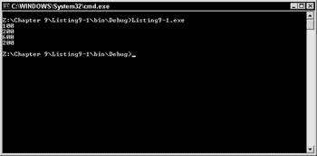

这段代码的目标是声明一个 `Point` 类，并将 `X` 和 `Y` 值作为该类的属性。`Main()` 方法创建了 `Point` 类的新对象并访问了类的属性。

`Point` 类定义了两个私有字段来存储点的坐标值。由于这些字段是私有的，`Point` 类外部的代码无法访问它们的值。该类还定义了两个公共属性，允许其他代码处理点的坐标值。这些属性是公开的（public），其他代码部分可以使用它们。

`X` 属性是管理私有字段 `XCoordinate` 值的公共属性，而 `Y` 属性是管理私有字段 `YCoordinate` 值的公共属性。这两个属性都具有一个 `get` 和 `set` 访问器。列表 9-1 的输出如图 9-1 所示。

图 9-1：类属性有助于存储你的点值。

##### Get 访问器

`get` 访问器只需返回相应字段的当前值：属性 `X` 的 `get` 访问器返回 `Xcoordinate` 的当前值，属性 `Y` 的 `get` 访问器返回 `YCoordinate` 的当前值。

每个 `get` 访问器最终必须返回一个与属性类型匹配或可以隐式转换为该类型的值。如果你忘记从 `get` 访问器返回值，C# 编译器会发出以下错误消息：

`error CS0161: 'MyClass.Property.get': not all code paths return a value`

##### Set 访问器

示例中的 `set` 访问器稍微复杂一些，因为它们需要在将新值实际赋值给关联字段之前对其进行验证。

注意，`set` 访问器使用了一个名为 `value` 的关键字。该标识符的值是在调用 `set` 访问器时位于等号后面的表达式的值。例如，查看列表 9-1 中的以下语句：

`MyPoint.X = 100;`

C# 编译器确定该语句正在为 `Point` 对象的 `X` 属性设置新值。它执行 `Point` 类的 `set` 访问器以满足赋值操作。

由于属性被设置为值 100，因此 `set` 访问器中 `value` 关键字的值将是 100。

列表 9-1 中的 `set` 访问器会设置相应的字段，但仅当值在合法范围内时。在 C# 中，不允许从 `set` 访问器返回值。

> **注意** 由于 C# 不允许 `set` 访问器返回值，因此你无法返回一个指定赋值是否成功的值。但是，你可以使用异常来报告任何错误。第 16 章“处理异常”涵盖了异常。

##### 只读和只写属性

列表 9-1 中的属性可以使用其 `get` 访问器读取，使用其 `set` 访问器写入。这些属性被称为 `读/写属性`。当你设计 C# 类时，你可能需要实现只读或只写属性。这在 C# 中很容易就能做到。

如果你需要实现一个只读属性，请指定一个具有 `get` 访问器但没有 `set` 访问器的属性：

```csharp
public int X
{
    get
    {
        return XCoordinate;
    }
}
```

如果你需要实现一个只写属性，请指定一个具有 `set` 访问器但没有 `get` 访问器的属性：

```csharp
public int X
{
    set
    {
        XCoordinate = value;
    }
}
```

#### 事件

C# 允许类在发生事件时通知其他代码。这种机制被称为 `event`（事件）。你可能希望使用事件来通知其他代码某个操作已经完成。例如，假设你在设计一个 C# 类，在读取完成时通知其他代码。当读取完成时，类可以触发一个事件，表示“读取已完成”。

> **引用** C# 中的事件处理机制与另一个概念 `delegate`（委托）协同工作。在第 15 章“事件和委托”中更深入地了解委托。

#### 索引器

你设计的某些类可以作为值的容器。例如，假设你编写名为 `Rainbow` 的 C# 类，按顺序访问颜色的值。列表 9-2 展示了你的 C# 代码可能的样子。

```csharp
class Rainbow
{
    public int GetNumberOfColors()
    {
        return 7;
    }

    public bool GetColor(int ColorIndex, out string ColorName)
    {
        bool ReturnValue;
        ReturnValue = true;
        switch(ColorIndex)
        {
            case 0:
                ColorName = "Red";
                break;
            case 1:
                ColorName = "Orange";
                break;
            case 2:
                ColorName = "Yellow";
                break;
            case 3:
                ColorName = "Green";
                break;
            case 4:
                ColorName = "Blue";
                break;
            case 5:
                ColorName = "Indigo";
                break;
            case 6:
                ColorName = "Violet";
                break;
            default:
                ColorName = "";
                ReturnValue = false;
                break;
        }
        return ReturnValue;
    }

    public static void Main()
    {
        int ColorCount;
        int ColorIndex;
        Rainbow MyRainbow = new Rainbow();
        ColorCount = MyRainbow.GetNumberOfColors();
        string ColorName;
        bool Success;
        for(ColorIndex = 0; ColorIndex < ColorCount; ColorIndex++)
        {
            Success = MyRainbow.GetColor(ColorIndex, out ColorName);
            if(Success == true)
                System.Console.WriteLine(ColorName);
        }
    }
}
```

列表 9-2：具有字符串值的类

`Main()` 方法创建了 `Rainbow` 类的一个新对象，并请求该对象提供它维护的颜色数量。然后它进入一个 `for` 循环，请求每个颜色的名称。颜色名称被写入控制台。此应用程序的输出如图 9-2 所示。

图 9-2：索引器用于检索颜色名称。

你可能已经意识到该类维护了一个具有相同值类型的集合，这听起来非常像数组。事实上，这个 `Rainbow` 类也可以实现为数组，调用者可以使用方括号元素访问器语法来检索单个颜色名称：

`ColorName = Rainbow[ColorIndex];`

C# 的索引器（indexers）概念允许你让你的类像数组一样被访问。

你通过编写一段称为 `索引器访问器`（indexer accessor）的代码，以指定当调用者使用方括号语法访问类中的元素时应该返回什么内容。

了解此后，你可以重写 `Rainbow` 类，允许调用者使用方括号语法访问颜色名称。删除 `GetColor()` 方法并将其替换为索引器。

将 `GetColorCount()` 方法替换为名为 `Count` 的只读属性，如列表 9-3 所示。

#### 列表 9-3：带有索引器的 Rainbow 类

```csharp
class Rainbow
{

public int Count
{
get
{
return 7;
}
}

public string this[int ColorIndex]
{
get
{
switch(ColorIndex)
{
case 0:
return "Red";
case 1:
return "Orange";
case 2:
return "Yellow";
case 3:
return "Green";
case 4:
return "Blue";
case 5:
return "Indigo";
case 6:
return "Violet";
default:
return "";
}
}
}

public static void Main()
{
int ColorIndex;
Rainbow MyRainbow = new Rainbow();
string ColorName;
for(ColorIndex = 0; ColorIndex < MyRainbow.Count; ColorIndex++)
{
ColorName = MyRainbow[ColorIndex];
System.Console.WriteLine(ColorName);
}
}
}
```

索引器与属性非常相似，它们拥有 `get` 和 `set` 访问器。如有必要，可以省略任何一个访问器。列表 9-3 中的索引器没有 `set` 访问器，这意味着该类的集合可以被读取但不能被写入。

索引器的结构包含以下项：

- 表示从访问器返回的数据类型的类型
- 关键字 `this`
- 一个左方括号
- 参数列表，其结构化方式与方法参数列表的结构化方式一致
- 一个右方括号
- 由大括号括起来的代码体

列表 9-4 中的索引器接收一个整数参数并返回一个字符串，这类似于列表 9-2 中的 `GetColor()` 方法。

#### 列表 9-4：返回字符串的整数参数

```csharp
string ColorName;
for(ColorIndex = 0; ColorIndex < MyRainbow.Count; ColorIndex++)
{
ColorName = MyRainbow[ColorIndex];
System.Console.WriteLine(ColorName);
}
```

新代码正在使用数组元素方括号语法从 `MyRainbow` 对象中获取颜色名称。这导致 C# 编译器调用类的索引器代码，该代码将 `ColorIndex` 的值作为参数传递进来。索引器返回一个字符串，该字符串被写入控制台。

一个类可以实现多个索引器，只要这些索引器具有不同的参数列表。索引器中的参数列表可以有多个参数，并且可以是你代码中可以使用的任何类型。索引器并不一定需要使用整数作为索引。

对于 `Rainbow` 类，你也可以同样容易地实现一个接受 `double` 值的索引器：

`public string this[double ColorIndex]`

> **注意** 与属性一样，C# 不允许索引器中的 `set` 访问器返回值。然而，你可以使用异常来报告任何错误。第 16 章涵盖了异常。

### 使用运算符

运算符允许你定义当你的类在带有一元或二元运算符的表达式中使用时的行为。这意味着你可以扩展预定义运算符的行为以适应你类的需求。例如，`Point` 类可以实现代码，指定两个 `Point` 对象可以使用 `+` 运算符相加。相加的结果将是第三个 `Point` 对象，其状态是另外两个点相加的结果。

> **交叉引用** 参阅“第 10 章，重载运算符”以了解运算符。

### 使用构造函数

结构体的 `构造函数`（constructors）是在创建结构体类型变量时执行的特殊方法。构造函数通常用于将结构体初始化为已知状态。

你可以像在 C# 结构体中使用构造函数一样在你的 C# 类中使用构造函数。你可以定义任意数量的构造函数，只要每个构造函数都有不同的参数列表。你可以像编写 `Point` 结构体时一样编写带有构造函数的 `Point` 类，如列表 9-5 所示。

#### 列表 9-5：带有两个构造器的 Point 类

```csharp
class Point
{
public int X;
public int Y;
public Point()
{
X = 0;
Y = 0;
}
public Point(int InitialX, int InitialY)
{
X = InitialX;
Y = InitialY;
}

public static void Main()
{
Point MyFirstPoint = new Point(100, 200);
Point MySecondPoint = new Point();
}
}
```

在许多面向对象的编程语言中，当变量不再可用时，会调用类的析构函数。例如，假设你写了一个方法并在方法中声明一个 `Point` 对象为局部变量。当该方法被调用时，`Point` 对象被创建，方法就可以对该 `Point` 对象进行操作。当方法到达代码块的末尾时，`Point` 对象无法再次使用并被销毁。在 C++ 等语言中，这会导致在方法退出时调用类的构造函数。

这在 C# 中并非如此。事实上，类的析构函数可能根本不会被调用。

请记住 `CLR` 实现了一个名为“垃圾回收”（garbage collection）的功能，它会销毁代码中不再使用的对象。垃圾回收可能在对象变得无法访问很久之后发生。请看列表 9-7 中的 `Main()` 方法：

#### 列表 9-7：使用 Point 结构演示垃圾回收

```csharp
public static void Main()
{
    Point MyFirstPoint = new Point(100, 200);
    Point MySecondPoint = new Point();
}
```

`Main()` 方法创建了两个本地 `Point` 对象。在 `Main()` 方法执行完毕后，这些本地 `Point` 对象无法再使用，并会被 `CLR` 标记为垃圾回收器执行时可以被销毁的对象。然而，垃圾回收器不会立即启动，这意味着对象的析构函数也不会被立即调用。

> **注意** C# 类中的析构函数是在对象被销毁时调用的，而不是在其变量不再可用时。在设计 C# 类时，务必记住这一点。

作为一个示例，假设你想写一个 C# 类来管理磁盘上的文件。你可能会写一个名为 `File` 的类，它包含一个用于打开文件的构造函数和一个用于关闭文件的析构函数：

```csharp
class File
{
    File(string Name)
    {
        // open file
    }
    ~File()
    {
        // close file
    }
}
```

你可能想在方法中使用此类来处理文件：

```csharp
public static void Main()
{
    File MyFile = new File("myfile.txt");
}
```

`File` 类的析构函数负责关闭文件，但析构函数的实际执行直到 `CLR` 垃圾回收器启动才会发生。这意味着在 `MyFile` 变量变得无法访问后，文件可能仍然处于打开状态。如果你想确保文件尽快关闭，可以考虑为 `File` 类添加一个 `Close()` 方法，在调用它时关闭文件。

> **注意** 你可以要求 `CLR` 按需执行垃圾回收算法，这会增加垃圾回收器收集你的对象并调用其析构函数的几率（但仍不能保证）。更多信息请参阅第 20 章“脑筋急转弯”（Brainteasers）。

## 使用类型

类可以使用 C# 内置的类型之一——例如 `int`、`long` 和 `char`——它们也可以定义自己的类型。类可以包含其他项目的声明，例如结构体甚至是其他类。

> **交叉引用** 再次查看第 7 章“使用结构体分组数据”中的列表 7-6。该列表定义了一个名为 `Listing7_6` 的类。该类包含了一个名为 `Point` 的结构体的定义。这个 `Point` 结构定义在 `Listing7_6` 类内部，它可以作为一种类型使用，就像类使用 C# 内置的任何类型一样。

## 使用 this 关键字作为标识符

在 C# 中，你可以使用 `this` 关键字来标识正在执行代码的对象，这反过来让你能够引用当前对象。

你可以通过多种方式使用 `this` 关键字。你已经看到它是如何在索引器中使用的。你也可以将其作为变量标识符的前缀，以告诉 C# 编译器某个表达式引用的是类字段。

例如，考虑列表 9-8 中的 `Point` 类。

#### 列表 9-8：同名的字段和参数

```csharp
class Point
{
    public int X;
    public int Y;
    Point(int X, int Y)
    {
        X = X;
        Y = Y;
    }
    public static void Main()
    {
    }
}
```

这段代码的行为不会如预期那样，因为 `X` 和 `Y` 标识符被使用了两次：一次作为类字段标识符，一次在构造函数的参数列表中。代码需要区分字段标识符 `X` 和参数列表标识符 `X`。对于这种具有歧义的代码，C# 编译器假设构造函数语句中对 `X` 和 `Y` 的引用是指参数，而代码只是将参数设为它们已经包含的值。

你可以使用 `this` 关键字来区分字段标识符和参数标识符。

列表 9-9 显示了使用 `this` 关键字作为字段名前缀的修正代码。

#### 列表 9-9：在字段中使用 this

```csharp
class Point
{
    public int X;
    public int Y;
    Point(int X, int Y)
    {
        this.X = X;
        this.Y = Y;
    }
    public static void Main()
    {
    }
}
```

## 理解 static 修饰符

当你在类上定义字段或方法时，代码创建的类的每个对象都有自己的字段值和方法副本。通过使用 `static` 关键字，你可以覆盖这种行为，允许同类的多个对象共享字段值和方法。

### 使用静态字段

作为一个示例，让我们回到 `Point` 类。`Point` 类可能有两个字段用于表示点的 *x* 和 *y* 坐标。从 `Point` 类创建的每个对象都拥有这些字段的副本，但每个对象可以拥有自己的 *x* 和 *y* 值。

```csharp
Point FirstPoint = new Point(100, 200);
Point SecondPoint = new Point();
```

`Main()` 方法创建了两个本地 `Point` 对象。在 `Main()` 方法执行完毕后，这些本地 `Point` 对象无法再使用，并会被 `CLR` 标记为垃圾回收器执行时可以被销毁的对象。然而，垃圾回收器不会立即启动，这意味着对象的析构函数也不会被立即调用。

> **注意** 在字段定义之前放置 `static` 修饰符表示类的所有对象共享同一个值。当类的静态字段发生变化时，类的所有对象都会反映该变化。请看列表 9-10。

#### 列表 9-10：静态字段

```csharp
class Point
{
    public static int XCoordinate;
    public static int YCoordinate;
    public int X
    {
        get
        {
            return XCoordinate;
        }
    }
    public int Y
    {
        get
        {
            return YCoordinate;
        }
    }
    public static void Main()
    {
        Point MyPoint = new Point();
        System.Console.WriteLine("Before");
        System.Console.WriteLine("======");
        System.Console.WriteLine(MyPoint.X);
        System.Console.WriteLine(MyPoint.Y);
        Point.XCoordinate = 100;
        Point.YCoordinate = 200;
        System.Console.WriteLine("After");
        System.Console.WriteLine("=====");
        System.Console.WriteLine(MyPoint.X);
        System.Console.WriteLine(MyPoint.Y);
    }
}
```

列表 9-10 中的 `Point` 类维护了名为 `XCoordinate` 和 `YCoordinate` 的静态整数字段。它还维护了两个只读属性 `X` 和 `Y`，返回静态变量的值。

`Main()` 方法创建一个新的 `Point` 对象并将其坐标输出到控制台。然后它更改静态字段的值并再次输出 `Point` 对象的坐标。结果如图 9-3 所示。

还要注意处理静态字段的语法。表达式中使用的静态字段的前缀不是对象标识符，而是持有静态字段的类名。以下语句是错误的，因为 `MyPoint` 指向对象，而 `XCoordinate` 指向静态字段：

```csharp
MyPoint.XCoordinate = 100;
```

像这样编写代码会导致 C# 编译器抛出错误：

```text
error CS0176: Static member 'Point.XCoordinate' cannot be accessed with an instance reference; use typename instead
```

静态字段必须带有类名名前缀：

```cs
Point.XCoordinate = 100;
```

### 使用静态常量

常量的工作方式与字段相同，除非它们带有 `static` 关键字前缀；如果是这样，该类的每个对象都将维护一份常量的副本。然而，让类中的每个对象都维护一份常量的副本是浪费内存的。

假设你正在编写一个名为 `Circle` 的类，用于管理一个圆。由于你正在处理圆，你可能会频繁使用 `pi` 这个值。你明智地决定将 `pi` 设为常量，这样你就可以在代码中使用名称来引用它，而不是每次都使用长长的浮点数。

现在，如果你创建了一千个圆形对象会发生什么？默认情况下，它们每个都会获得一份 `pi` 常量的副本。你将在内存中拥有一千份 `pi` 副本。这是对内存的浪费，尤其是 `pi` 是一个常量且其值永远不会改变。对于 `Circle` 类中的每个对象来说，使用一份 `pi` 常量副本更有意义。

这就是 `static` 关键字大显身场的地方。对常量使用 `static` 关键字可以确保类的每个对象都使用内存中某一个常量值的副本：

```cs
const double Pi = 3.1415926535897932384426433832795;
```

通常，尽量将所有的常量都设为 `static` 常量，以便在任何时刻内存中只有一份常量值的副本。

### 使用静态方法

当你第一次查看 `Main()` 方法时，回想起它需要用 `static` 关键字定义。用 `static` 关键字定义的方法称为 `静态方法`。

没有用 `static` 关键字定义的方法称为 `实例方法`。

静态方法列在类中，但不属于某个特定的对象。与静态字段和静态常量一样，类的所有对象共享一份静态方法的副本。静态方法不能引用对象的任何未标记为静态的 string，如列表 9-11 所示。

#### 列表 9-11：静态方法调用类实例方法

```cs
class Listing9_9
{
    public static void Main()
    {
        CallMethod();
    }

    void CallMethod()
    {
        System.Console.WriteLine("Hello from CallMethod()");
    }
}
```

上述代码无法编译，C# 编译器会发出以下错误：

```text
error CS0120: An object reference is required for the nonstatic field, method, or property 'Listing9_9.CallMethod()'
```

列表 9-11 中代码的问题在于，静态方法 `Main()` 试图调用实例方法 `CallMethod()`。这是被禁止的，因为实例方法是对象实例的一部分，而静态方法不是。

要纠正这段代码，静态 `Main()` 方法必须创建该类的另一个对象，并从该新对象调用实例方法，如列表 9-12 所示。

#### 列表 9-12：静态方法调用对象实例方法

```cs
class Listing9_10
{
    public static void Main()
    {
        Listing9_10 MyObject = new Listing9_10();
        MyObject.CallMethod();
    }

    void CallMethod()
    {
        System.Console.WriteLine("Hello from CallMethod()");
    }
}
```

列表 9-12 的输出见图 9-4。

图 9-4：演示在同一类内部调用静态方法

与所有静态类条项一样，静态方法在内存中只出现一次，这就是为什么你必须将 `Main()` 方法标记为静态。当 .NET 代码加载到内存时，CLR 从执行 `Main()` 方法开始。记住，任何时刻内存中只能有一个 `Main()` 方法。如果一个类有多个 `Main()` 方法，当代码需要运行时，CLR 将不知道该执行哪一个 `Main()` 方法。在 `Main()` 方法上使用 `static` 关键字可以确保内存中只有一个 `Main()` 方法的副本。

> **注意** 通过使用 C# 编译器的命令行参数，可以在你的应用程序中包含多个 `Main()` 方法。当你为了调试目的想要尝试多种方法时，这非常有用。

## 总结

C# 是一门面向对象的语言，面向对象语言中使用的概念也适用于 C#。C# 类可以使用几种类型的类成员：

- **常量**：为代码执行过程中不改变的值赋予名称。使用常量使你的代码更具可读性，因为你可以在代码中使用常量名代替硬编码的字面量。
- **字段**：维护类的状态。字段是与对象关联的变量。
- **方法**：维护类的行为。方法是为你的类执行特定操作的命名代码段。
- **属性**：允许你将类的状态暴露给调用者。调用者使用与访问字段相同的 `object.identifier` 语法访问属性。属性相对于字段的优势在于，你可以在检索或设置属性值时编写代码。
- **事件**：允许在发生某些操作时通知调用者。调用者可以订阅事件并在事件发生时接收通知。
- **索引器**：允许你的类像数组一样被访问。调用者可以使用方括号元素语法执行你的类代码。当你的类包含一组值且将其视为数组是有意义时，使用索引器。
- **运算符**：你的类可以重载运算符，如第 10 节所示。运算符有助于确定类在表达式中的行为。
- **构造函数**：在创建对象时执行的特殊方法。你可以定义多个构造函数，每个都有不同的参数列表。你也可以定义没有构造函数的类。在这种情况下，C# 编译器会生成一个默认构造函数，仅将对象的所有字段初始化为零。
- **析构函数**：在销毁对象时执行的特殊方法。类只能有一个析构函数。由于与 .NET 代码和 CLR 的交互，析构函数在垃圾回收时执行，而不是对象标识符不再被代码访问时。
- **类**：定义自己的类型，这些类型可以包含结构定义甚至是其他类的定义。
- **this**：引用对象的当前实例。它作为前缀区分字段标识符与同名的参数标识符。
- **static**：告诉 C# 编译器类的所有对象共享一份字段或方法。

通过 C#，你可以定义许多标准运算符的行为，以便用于你自己的结构体和类。你编写特殊的方法来定义类在带有 C# 运算符的表达式中的行为。这使得你的类能够用在对于其他代码编写来说自然的表达式中。例如，假设你正在编写一个管理从数据库读取的记录集的类。如果另一部分代码有两个你定义的类的对象，它可能想要编写一个表达式将记录合并成第三个对象。这听起来像是一个加法操作，而且对于其他代码编写如下代码看起来很自然：

```
Records Records1;
Records Records2;
Records Records3;
Records3 = Records1 + Records2;
```

你的 `Records` 类将包含一个方法，指定类对象在与加法运算符配合表达式时的行为。

这些方法被称为 `用户定义运算符实现`（user-defined operator implementations），在类中定义运算符行为的面向对象术语称为 `运算符重载`（operator overloading）。之所以使用“重载”一词是因为你的代码体重载了相同运算符的含义，并根据运算符使用的上下文使其表现出不同的行为。

所有运算符重载方法必须同时使用 `static` 和 `public` 关键字声明。

## 可重载的一元运算符

C# 允许你在类和结构体中重载以下一元运算符的行为：

- 一元加
- 一元减
- 逻辑取反
- 按位取反运算符
- 前缀自增
- 前缀自减
- `true` 关键字
- `false` 关键字

### 重载一元加

如果你需要在你的类或结构体中重载一元加、一元减、取反或按位取反运算符，请定义一个具有以下特征的方法：

- 你选择的返回类型
- `operator` 关键字
- 正在重载的运算符
- 参数列表，指定一个与包含重载运算符方法的类或结构体类型相同的参数

作为一个示例，重回顾第 9 章中的 `Point` 类。假设你想为该类添加一个一元加运算符，在使用它时，它会确保点的坐标均为正数。这在列表 10-1 中实现。

#### 列表 10-1：重载一元加运算符

```csharp
class Point
{
    public int X;
    public int Y;

    public static Point operator + (Point RValue)
    {
        Point NewPoint = new Point();
        if(RValue.X < 0)
            NewPoint.X = -(RValue.X);
        else
            NewPoint.X = RValue.X;
        if(RValue.Y < 0)
            NewPoint.Y = -(RValue.Y);
        else
            NewPoint.Y = RValue.Y;
        return NewPoint;
    }

    public static void Main()
    {
        Point MyPoint = new Point();
        MyPoint.X = -100;
        MyPoint.Y = 200;
        System.Console.WriteLine(MyPoint.X);
        System.Console.WriteLine(MyPoint.Y);
        MyPoint = +MyPoint;
        System.Console.WriteLine(MyPoint.X);
        System.Console.WriteLine(MyPoint.Y);
    }
}
```

`Main()` 方法创建了一个 `Point` 类型的对象并将其初始坐标设置为 (100, 200)。它随后对对象应用一元加运算符，并将结果重新赋给该点。它将 *x* 和 *y* 坐标打印到控制台。

列表 10-1 的输出如图 10-1 所示。

图 10-1：重载一元运算符

点的坐标已从 (-100, 200) 变为 (100, 200)。当执行以下语句时，会执行重载运算符的代码：

```
MyPoint = +MyPoint;
```

当执行此语句时，`Point` 类的一元加运算符重载被执行。等号右侧的表达式作为参数传递给方法。

> **注意** 赋值运算符右侧的表达式通常称为 `rvalue`（右值），它是“right value”的缩写。赋值运算符左侧的表达式通常称为 `lvalue`（左值），它是“left value”的缩写。

在运算符重载方法中将参数命名为 `RValue` 可以清晰地表示赋值的 `rvalue` 正在传入。这仅仅是一种命名规范，并不是强制要求。你可以使用 C# 允许的任何合法标识符来命名你的参数。

此方法创建一个新的 `Point` 对象，然后检查所提供的 `rvalue` 的坐标。如果任一参数为负，则它们的值将取取反，从而变为正值；并将这些现在为正的值赋值给新点。非负值在不进行任何转换的情况下赋值给新点。然后从方法返回新点。运算符的返回值将用作原始语句的 `lvalue`。

一元加、一元减、取反或按位取反运算符的运算符重载的返回类型不需要与 `rvalue` 的类型相同。可以是任何对该运算符最有意义的 C# 类型。

### 重载一元减

与一元加类似，你可以以相同的方式执行一元减重载。

列表 10-2 重载了减运算符来处理 `Point` 类。

#### 列表 10-2：重载一元减

```csharp
class Point
{
    public int X;
    public int Y;

    public static Point operator - (Point RValue)
    {
        Point NewPoint = new Point();
        if(RValue.X < 0)
            NewPoint.X = -(RValue.X);
        else
            NewPoint.X = RValue.X;
        if(RValue.Y < 0)
            NewPoint.Y = -(RValue.Y);
        else
            NewPoint.Y = RValue.Y;
        return NewPoint;
    }

    public static void Main()
    {
        Point MyPoint = new Point();
        MyPoint.X = -100;
        MyPoint.Y = 200;
        System.Console.WriteLine(MyPoint.X);
        System.Console.WriteLine(MyPoint.Y);
        MyPoint = -MyPoint;
        System.Console.WriteLine(MyPoint.X);
        System.Console.WriteLine(MyPoint.Y);
    }
}
```

在你重载了减运算符来处理 `Point` 类后，你定义了它在面对 `Point` 类型变量时应采取的操作。列表 10-2 声明了 *x* 坐标为 -100，*y* 坐标为 200。你将这些值打印到控制台以验证你的重载运算符。

在你的应用程序从 `Point` 类中减去值后，结果被打印到控制台以显示符合预期。图 10-2 是列表 10-2 的输出。

图 10-2：重载一元运算符

到为止，本章涵盖了一元减和一元加。这些运算符作用于一个值，因此被称为“一元”。其他基本运算符也可以相同的方式重载。

下一节描述了一种不同运算符——按位取反。

### 重载按位取反

按位取反运算符对 `int`、`uint`、`long` 和 `ulong` 有定义。列表 10-3 重载了它以与类工作。

#### 列表 10-3：重载按位取反运算符

```csharp
class Point
{
    public int X;
    public int Y;

    public static Point operator ~ (Point RValue)
    {
        Point NewPoint = new Point();
        NewPoint.X = ~RValue.X;
        NewPoint.Y = ~RValue.Y;
        return NewPoint;
    }

    public static void Main()
    {
        Point MyPoint = new Point();
        MyPoint.X = 5;
        MyPoint.Y = 6;
        System.Console.WriteLine(MyPoint.X);
        System.Console.WriteLine(MyPoint.Y);
        MyPoint = ~MyPoint;
        System.Console.WriteLine(MyPoint.X);
        System.Console.WriteLine(MyPoint.Y);
    }
}
```

按位取反运算符的输出直到你查看操作的十六进制结果后才会显现。列表 10-3 生成了整数值 5 和 6 的补码。

该操作的输出（如图 10-3 所示）分别为 -6 和 -7。当你查看输入和输出值的十六进制值时，你很快就会发现发生了什么。

图 10-3：重载按位取反

表 10-1：按位取反操作的输入和输出值

| 输入 | 输出 |
| :--- | :--- |
| 0x0000000000000005 | 0xfffffffffffffA |
| 0x0000000000000006 | 0xfffffffffffffff9 |

在重载运算符之前，务必完全理解它的工作原理。否则，你可能会得到一些意想不到的结果。

### 重载前置增运算符

如果你需要在类或结构体中重载前置递增或前置递减运算符，请定义一个具有以下特征的方法：

- 返回类型，指定包含该重载运算符方法的类或结构体的类型
- 关键字 `operator`
- 正在被重载的运算符
- 参数列表，指定一个参数，其类型为包含该重载运算符方法的类或结构体类型

例如请参见列表 10-4。该类修改了 `Point` 类以重载前置增运算符。该运算符被重载为用于将 `x` 和 `y` 坐标增加一个单位。

#### 列表 10-4: 重载前置增运算符

```csharp
class Point
{
    public int X;
    public int Y;
    public static Point operator ++ (Point RValue)
    {
        Point NewPoint = new Point();
        NewPoint.X = RValue.X + 1;
        NewPoint.Y = RValue.Y + 1;
        return NewPoint;
    }
    public static void Main()
    {
        Point MyPoint = new Point();
        MyPoint.X = 100;
        MyPoint.Y = 200;
        System.Console.WriteLine(MyPoint.X);
        System.Console.WriteLine(MyPoint.Y);
        MyPoint = ++MyPoint;
        System.Console.WriteLine(MyPoint.X);
        System.Console.WriteLine(MyPoint.Y);
    }
}
```

编译并运行列表 10-4 中的代码将在控制台输出以下内容：

100

200

101

201

### 重载前置递减运算符

现在你将检查如何重载递减运算符来处理 `Point` 类。列表 10-5 包含了完整的代码列表，以类似于上面介绍的前置增运算符的方式重载该运算符。

#### 列表 10-5: 重载前置递减运算符

```csharp
class Point
{
    public int X;
    public int Y;
    public static Point operator -- (Point RValue)
    {
        Point NewPoint = new Point();
        NewPoint.X = RValue.X - 1;
        NewPoint.Y = RValue.Y - 1;
        return NewPoint;
    }
    public static void Main()
    {
        Point MyPoint = new Point();
        MyPoint.X = 100;
        MyPoint.Y = 200;
        System.Console.WriteLine(MyPoint.X);
        System.Console.WriteLine(MyPoint.Y);
        MyPoint = --MyPoint;
        System.Console.WriteLine(MyPoint.X);
        System.Console.WriteLine(MyPoint.Y);
    }
}
```

图 10-4: 编译并运行列表 10-4 中代码的输出

再次，你传入了 100 的 `x` 坐标和 200 的 `y` 坐标。图 10-5 包含了在你重载的递减运算符从 `x` 和 `y` 中减去后程序的输出。

图 10-5: 重载前置递减运算符

在重载运算符时，始终假设最坏的情况。传入的数据可能是坏的，你会发现你的重载函数并不具备处理这些数据的能力。之前的示例没有去捕获在传入错误或意外值时可能抛出的异常。尝试一下这些函数并尝试稍微加强错误捕获是一个好主意。

### 重载 true 和 false 运算符

如果你需要在类或结构体中重载 `true` 或 `false` 运算符，请定义一个具有以下特征的方法：

- `bool` 返回类型
- 关键字 `operator`
- 正在被重载的运算符
- 参数列表，指定一个参数，其类型为包含该重载运算符方法的类或结构体类型

例如请参见列表 10-6。它修改了 `point` 类，使其根据点是否位于原点来评估为 true，否则评估为 false。

#### 列表 10-6: 重载 true 和 false 运算符

```csharp
class Point
{
    public int X;
    public int Y;
    public static bool operator true (Point RValue)
    {
        if((RValue.X == 0) && (RValue.Y == 0))
            return true;
        return false;
    }
    public static bool operator false (Point RValue)
    {
        if((RValue.X == 0) && (RValue.Y == 0))
            return false;
        return true;
    }
    public static void Main()
    {
        Point MyPoint = new Point();
        MyPoint.X = 100;
        MyPoint.Y = 200;
        if(MyPoint)
            System.Console.WriteLine("The point is at the origin.");
        else
            System.Console.WriteLine("The point is not at the origin.");
    }
}
```

重载 `true` 和 `false` 运算符允许 `Point` 对象在布尔表达式中使用，如 `if` 语句所示。由于由于点不在原点，`MyPoint` 结果为 false，如图 10-6 所示。

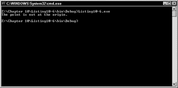

图 10-6: 重载 true 和 false 运算符

如果类或结构体重载了 `true` 或 `false` 运算符，它们都必须被重载。如果你只重载了其中一个，C# 编译器会发出类似于“' requires both”的错误信息。

## 可重载二进制运算符

以下是可以重载的二进制运算符列表：

- 加法
- 减法
- 乘法
- 除法
- 与
- 或
- 异或
- 左移
- 右移
- 等于
- 不等于
- 大于
- 小于
- 大于等于
- 小于等于

如果你需要在类或结构体中重载任何二进制运算符，请定义如下方法：

- 你的类型
- 关键字 `operator`
- 正在被重载的运算符
- 指定两个参数的列表，其中一个必须是你的类型

重载二进制运算符可以让你变得非常灵活。如果你需要将一个对象和一个浮点值相并得到布尔结果，你可以像 own 这样编写一个重载方法：

`static bool operator + (MyPoint, float)`

你可以定义相同运算符的多个重载，只要参数列表使用不同的类型：

`static bool operator + (MyPoint, FloatValue)`

`static bool operator + (MyPoint, IntValue)`

列表 10-7 提供了一个示例。它为 `Point` 类添加了等号和不相等运算符。这些运算符在两个 `Point` 对象具有相同坐标时返回 true 结果，否则返回 false。

#### 列表 10-7: 重载等号和不相等运算符

```csharp
class Point
{
    public int X;
    public int Y;
    public static bool operator == (Point Point1, Point Point2)
    {
        if(Point1.X != Point2.X)
            return false;
        if(Point1.Y != Point2.Y)
            return false;
        return true;
    }
    public override bool Equals(object o)
    {
        return true;
    }
    public override int GetHashCode()
    {
        return 0;
    }
    public static bool operator != (Point Point1, Point Point2)
    {
        if(Point1.X != Point2.X)
            return true;
        if(Point1.Y != Point2.Y)
            return true;
        return false;
    }
    public static void Main()
    {
        Point MyFirstPoint = new Point();
        Point MySecondPoint = new Point();
        Point MyThirdPoint = new Point();
        MyFirstPoint.X = 100;
        MyFirstPoint.Y = 200;
        MySecondPoint.X = 500;
        MySecondPoint.Y = 750;
        MyThirdPoint.X = 100;
        MyThirdPoint.Y = 200;
        if(MyFirstPoint == MySecondPoint)
            System.Console.WriteLine("MyFirstPoint and MySecondPoint are at the same coordinates.");
        else
            System.Console.WriteLine("MyFirstPoint and MySecondPoint are not at the same coordinates.");
        if(MyFirstPoint == MyThirdPoint)
            System.Console.WriteLine("MyFirstPoint and MyThirdPoint are at the same coordinates.");
        else
            System.Console.WriteLine("MyFirstPoint and MyThirdPoint are not at the same coordinates.");
    }
}
```

`Main()` 方法定义了三个点：

- `MyFirstPoint`，坐标为 (100, 200)
- `MySecondPoint`，坐标为 (500, 750)
- `MyThirdPoint`，坐标为 (100, 200)

该方法随后使用相等运算符判断 `MyFirstPoint` 点和 `MySecondPoint` 点是否指向相同的坐标。接着它再次使用相等运算符判断 `MyFirstPoint` 点和 `MyThirdPoint` 点是否指向相同的坐标。

编译并执行列表 10-7 中的代码将得到图 10-7 所示的输出。

图 10-7：重载等号和不等于运算符

以下操作对必须一起重载：

- 等于和不等于
- 小于和大于
- 小于等于和大于等于

如果你重载了这些操作对中的一个而没有重载另一个，C# 编译器会发出如下的错误消息：

```
error CS0216: The operator 'Point.operator ==(Point, Point)'
requires a matching operator '!=' to also be defined
```

## 可重载的转换运算符

你还可以编写运算符重载方法，将一种类型转换为另一种类型。你的重载方法还可以定义 C# 编译器是将该转换视为隐式转换还是显式转换。

如果你需要在你的类或结构体中定义一个新的转换运算符，请定义一个具有以下特征的方法：

- 如果转换被视为隐式转换，则使用 `implicit` 关键字；如果转换被视为显式转换，则使用 `explicit` 关键字
- `operator` 关键字
- 指定转换目标类型的类型
- 指定转换源类型的参数列表

列表 10-8 定义了从 `Point` 类对象到 `double` 的隐式转换。`double` 类型使用勾股定理指定了从原点到该点的距离。

```csharp
class Point
{
    public int X;
    public int Y;
    public static implicit operator double(Point RValue)
    {
        double Distance;
        double Sum;
        Sum = (RValue.X * RValue.X) + (RValue.Y * RValue.Y);
        Distance = System.Math.Sqrt(Sum);
        return Distance;
    }

    public static void Main()
    {
        double Distance;
        Point MyPoint = new Point();
        MyPoint.X = 100;
        MyPoint.Y = 200;

        Distance = MyPoint;
        System.Console.WriteLine(Distance);
    }
}
```

> **注意** `System.Math.Sqrt()` 方法由 .NET Framework 定义，用于计算提供参数的平方根。该方法是静态的，因此你可以在没有 `System.Math` 类型对象的情况下调用它。

`Main()` 方法声明了一个 `Point` 类型的对象，并将其坐标设置为 (100, 200)。随后它将该对象赋值给 `double` 类型的变量，这是合法的，因为 `Point` 类定义了一个将 `Point` 对象转换为 `double` 的转换运算符。由于该转换运算符被定义为隐式转换，因此不需要强制类型转换。`Main()` 方法随后将转换后的 `double` 值打印到控制台。

图 10-8 显示了列表 10-8 的输出。

图 10-8：定义隐式转换

## 不可重载的运算符

C# 不允许你重新定义下列表运算符的行为。这主要是为了简单起见。C# 语言的设计者希望这些运算符保持简单，并始终执行其预期的功能；因此，不允许重载。

- 赋值
- 条件逻辑与
- 条件逻辑或
- 条件
- `new`、`typeof`、`sizeof` 和 `is` 关键字

## 总结

C# 允许你根据自己的需求定制某些内置运算符的行为。

类和结构体可以包含称为*运算符重载方法*的方法，这些方法定义了运算符出现在包含你的类或结构体的表达式时的行为。

要在你的类或结构体中重载一元加、一元减、否定或按位取反运算符，你需要定义一个返回类型由你选择、被重载运算符以及一个类型为包含该重载方法的类或结构体的单个参数的方法。

要在你的类或结构体中重载前缀递或或前缀减运算符，你需要定义一个返回类型指定包含该重载方法的类或结构体类型的方法。你还需要定义被重载的运算符以及一个类型为包含该重载方法的类或结构体的单个参数。

要在你的类或结构体中重载 true 或 false 运算符，你需要定义一个返回类型为 `Boolean`、被重载运算符以及一个类型为包含该重载方法的类或结构体的单个参数的方法。

要在你的类或结构体中重载任何二元运算符，你需要定义一个具有返回类型、被重载运算符以及两个参数的方法。这两个参数中至少有一个必须是包含该重载方法的类或结构体类型。

你还可以为你的类或结构体定义新的转换。你可以指定该转换被视为隐式运算符还是显式运算符。转换运算符方法同时指定了被转换变量的类型以及变量应被转换的类型。

# 第 11 章：类继承

## 本章内容

简单的 C# 项目可能使用一个或两个类。然而，在较大的 C# 项目中，你会编写很多类。许多这些类可能具有类似的字段或方法，在这些类之间共享代码是合理的。

C# 拥抱面向对象中的*继承*概念，它允许一个类继承另一个类。C# 类可以从基类继承代码，继承的构造可以在你的类中使用。

继承在面向对象软件开发中用于重用代码。以 Windows 中的单选列表框和多选列表框为例。这两个列表框的功能不同——一个允许选择多个项目，另一个则不允许——但它们也有许多相似之处。它们在用户滚动列表时的行为相同，选中项的颜色也是相同的。

如果你将这两个列表框编写为 C# 类，你可以分别编写它们，每个类互不感知。然而，这将是一种浪费，许多代码将是相同的。更好的做法是编写包含公共代码的类以及派生自该类的类。例如，你可以编写一个名为 `ListBox` 的类来持有公共代码，然后编写继承自 `ListBox` 的 `SingleSelectionListBox` 类提供单选列表框特有的代码。你可能还可以编写一个名为 `MultipleSelectionListBox` 的类，它继承自 `ListBox` 但提供多选列表框特有的代码。

这种情况的另一个优势与维护代码有关。如果你在列表框中发现 bug，可以追溯到公共代码中的 bug。如果你修复了公共代码中的 bug，重新编译项目将修复单选和多选列表框类中的 bug。一个 bug 修复就能解决两个类的问题。

在 C# 中处理继承意味着你将处理多个 C# 类。

C# 对于这些类相对于你的源文件的排列方式并不严苛。你可以将所有类都放在一个单一的源文件中，也可以将每个类放在一个单独的源文件中。

显然，除了规模最小的项目外，将所有类实现在单个文件中是组织代码的一种较差的方法。这种做法不尽人意的原因之一是，每当你对程序的任何部分进行更改时，所有类都会重新编译。要从命令行使用单独的源文件编译项目，你只需要在编译器名称之后列出每个文件，如下所示：

```
csc file1.cs file2.cs file3.cs
```

C# 编译器默认以第一个源文件名为输出的可执行文件命名。上述的编译器命令行会生成一个名为 `file1.exe` 的可执行文件。如果你不喜欢这个默认设置，可以使用 `/out` 参数更改输出文件的名称：

```
csc /out:myapp.exe file1.cs file2.cs file3.cs
```

此编译器命令行会生成一个名为 `myapp.exe` 的可执行文件。

> **注意** 请记住，你的类中必须且仅有一个类指定了静态 `Main()` 方法。

## 在 C# 中指定基类

让我们回到 `Point` 类示例，查看 C# 中的继承是如何工作的。假设你设计了一个名为 `Point2D` 的类，它描述了 2D 空间中具有 `X` 和 `Y` 坐标的点：

```csharp
class Point2D
{
    public int X;
    public int Y;
    //更多代码
}
```

现在假设你想在保留 `Point2D` 类的同时，添加对 3D 空间点的支持。继承允许你设计一个新类，保留为 `Point2D` 类编写的所有代码，并添加一个 `Z` 坐标。

在 C# 中命名基类的方法是在派生类名后跟一个冒号和基类的名称。从 `Point2D` 类派生 `Point3D` 类的形式如下：

```csharp
class Point3D : Point2D
{
    public int Z;
    // Point3D 类的代码
}
```

根据基类的作用域规则（在本章的“作用域”部分介绍），基类（`Point2D`）中的所有字段和属性在派生类（`Point3D`）中都是可用的。例如，当类派生自基类时，根据作用域，派生类中的代码可以访问基类中的字段和属性。

从一个类继承另一个类时，你只能列出一个基类。某些面向对象的语言（如 `C++`）允许你为派生类指定多个基类。这种概念被称为`多重继承`。C# 支持单继承不支持多重继承。在讨论包含性的中，你会看到一种在 C# 中模拟多重继承的技术。

列表 11-1 显示了如何结合使用 `Point3D` 类和 `Point2D` 类。

#### 列表 11-1：从 Point2D 派生 Point3D

```csharp
class Point2D
{
    public int X;
    public int Y;
}

class Point3D : Point2D
{
    public int Z;
}

class MyMainClass
{
    public static void Main()
    {
        Point2D My2DPoint = new Point2D();
        Point3D My3DPoint = new Point3D();
        My2DPoint.X = 100;
        My2DPoint.Y = 200;
        My3DPoint.X = 150;
        My3DPoint.Y = 250;
        My3DPoint.Z = 350;
    }
}
```

注意，`Main()` 方法创建了一个 `Point2D` 对象和一个 `Point3D` 对象。`Point3D` 对象拥有 `X`、`Y` 和 `Z` 坐标的字段，尽管 `Point3D` 的声明中只声明了一个名为 `Z` 的字段。`X` 和 `Y` 字段继承自 `Point2D` 基类，其使用方式就像它们直接声明在 `Point3D` 类中一样。

## 作用域

当你设计类继承架构时，你可能决定基类中的成员不应该对派生类或外部世界可见。例如，你可能在基类中写一个帮助计算某个值的方法。如果该计算在派生类中没有用，你可能希望防止派生类甚至调用该方法。

在编程术语中，变量或方法的可见性被称为其 `scope`（作用域）。

某些变量或方法可能是公共作用域（public），其他可能是私有作用域（private），还有一些介于两者之间。

C# 定义了五个关键字，允许你定义类中任何成员（变量或方法）的作用域。成员的作用域会影响它对派生类以及创建类实例代码的可见性。这些关键字在下列表中列出，位于成员声明中任何其他关键字之前。

- 标记为 `public` 的成员对派生类和创建类对象的代码可见。到目前为止我们一直在使用 `public`。
- 标记为 `private` 的成员仅对定义它们的类可见。私有成员无法从派生类访问，也无法从创建类对象的代码访问。
- 标记为 `protected` 的成员仅对定义它们的类或派生自该类的类可见。受保护成员无法从创建类对象的代码访问。
- 标记为 `internal` 的成员对同一二进制文件中的任何代码都可见，但对其他二进制文件中的任何代码不可见。请记住 `.NET Framework` 包含了程序集（assemblies）的概念。

## 在派生类中重用标识符

C# 允许在派生类中重用基类标识符，当检测到此类时，C# 编译器会发出警告。考虑列表 11-2 所示的代码。

#### 列表 11-2：重用基标识符

```csharp
class Point2D
{
    public int X;
    public int Y;
}

class Point3D : Point2D
{
    public int X;
    public int Y;
    public int Z;
}

class MyMainClass
{
    public static void Main()
    {
        Point2D My2DPoint = new Point2D();
        Point3D My3DPoint = new Point3D();
        My2DPoint.X = 100;
        My2DPoint.Y = 200;
        My3DPoint.X = 150;
        My3DPoint.Y = 250;
        My3DPoint.Z = 350;
    }
}
```

派生类 `Point3D` 定义了 `X` 和 `Y` 字段，这些与基类 `Point2D` 中的标识符冲突。当编译此代码时，C# 编译器会发出警告：`warning CS0108: 'Point3D.X' 上需要 new 关键字，因为它隐藏了继承的成员 'Point2D.X'` 以及 `warning CS0108: 'Point3D.Y' 上需要 new 关键字，因为它隐藏了继承的成员 'Point2D.Y'`。


# C# 继承与多态

## 使用 `new` 关键字重用基类标识符

C# 编译器发出警告是因为派生类中的标识符隐藏了基类中使用相同标识符的定义。如果你想重用这些名称并指示 C# 编译器不要发出警告，请在派生类中重用标识符时使用 `new` 运算符。列表 11-3 所示的代码在编译时没有警告。

### 列表 11-3：使用 `new` 重用基类标识符

```csharp
class Point2D
{
    public int X;
    public int Y;
}

class Point3D : Point2D
{
    new public int X;
    new public int Y;
    public int Z;
}

class MyMainClass
{
    public static void Main()
    {
        Point2D My2DPoint = new Point2D();
        Point3D My3DPoint = new Point3D();
        My2DPoint.X = 100;
        My2DPoint.Y = 200;
        My3DPoint.X = 150;
        My3DPoint.Y = 250;
        My3DPoint.Z = 350;
    }
}
```

## 使用继承的方法

C# 允许基类和派生类中的方法以多种方式进行交互。该语言允许以下方法结构：

- 虚方法（`virtual`）和覆盖方法（`override`）
- 抽象方法（`abstract`）

### 虚方法与覆盖方法

你可能希望派生类在保持方法名称相同的同时，更改基类中方法的实现。例如，假设我们的 `Point2D` 类实现了一个名为 `PrintToConsole()` 的方法，该方法将点的 `X` 和 `Y` 坐标打印到控制台。你可能也希望派生类 `Point3D` 提供它自己的 `PrintToConsole()` 实现。然而，它不能使用 `Point2D` 类提供的 `PrintToConsole()` 方法，因为该实现仅适用于 `X` 和 `Y` 坐标，而 `Point3D` 类还有一个 `Z` 坐标。`Point3D` 类必须提供相同 `PrintToConsole()` 方法的自己的实现。

如果基类方法允许重新实现该方法，可以在派生类中重用方法名。在派生类中重新实现基类方法被称为“重叠”（overlapping）基类方法。在 C# 中覆盖基类方法时，你需要注意到两个要求：

- 基类方法必须使用 `virtual` 关键字声明。
- 派生类方法必须使用 `override` 关键字声明。

使用 `virtual` 关键字的基类方法称为 `虚方法`，使用 `override` 关键字的派生类方法称为 `覆盖方法`。

列表 11-4 显示了如何为 `Point2D` 和 `Point3D` 类实现 `PrintToConsole()` 方法。

### 列表 11-4：覆盖虚方法

```csharp
class Point2D
{
    public int X;
    public int Y;
    public virtual void PrintToConsole()
    {
        System.Console.WriteLine("({0}, {1})", X, Y);
    }
}

class Point3D : Point2D
{
    public int Z;
    public override void PrintToConsole()
    {
        System.Console.WriteLine("({0}, {1}, {2})", X, Y, Z);
    }
}

class MyMainClass
{
    public static void Main()
    {
        Point2D My2DPoint = new Point2D();
        Point3D My3DPoint = new Point3D();
        My2DPoint.X = 100;
        My2DPoint.Y = 200;
        My3DPoint.X = 150;
        My3DPoint.Y = 250;
        My3DPoint.Z = 350;
        My2DPoint.PrintToConsole();
        My3DPoint.PrintToConsole();
    }
}
```

> **注意**：列表 11-4 中调用的 `WriteLine()` 语法与此书中之前使用的语法不同。字符串中大括号内的数字是占位符。其他参数的值被写入控制台而不是占位符。`{0}` 占位符被替换为字符串参数之后第一个参数的值，`{1}` 占位符被替换为字符串参数之后第二个参数的值，以此类推。

列表 11-4 向控制台打印以下内容：

```
(100, 200)
(150, 250, 350)
```

除非基类方法使用了 `virtual` 关键字，否则你无法覆盖基类方法。如果你尝试这样做，C# 编译器会抛出错误：

```
error CS0506: 'Point3D.PrintToConsole()' : cannot override
inherited member 'Point2D.PrintToConsole()' because it is not
marked virtual, abstract, or override
```

然而，你可以覆盖一个已经被覆盖的方法。如果由于某些特殊原因，你决定实现 `Point4D` 类并派生自 `Point3D`，你可以覆盖 `Point3D` 的 `PrintToConsole()` 方法。

## 多态

覆盖方法的概念引入了 `多态` 。当你覆盖一个方法时，你希望从任何调用该被覆盖方法的处，都能调用正确的方法。

列表 11-5 显示了这一概念的应用。你为 `Point2D` 添加了一个 `UsePrintToConsole()` 方法，该方法调用了虚方法 `PrintToConsole()`。`Point3D` 从 `Point2D` 继承了该方法。当在该函数中调用 `PrintToConsole()` 时，你希望调用属于相应类的版本。换句话说，在属于 `Point2D` 类的 `UsePrintToConsole()` 方法中，你希望调用该类的版本；在 `Point3D` 类的 `UsePrintToConsole()` 方法中，你希望调用该类的版本。由于基类方法被声明为虚方法，这会自动处理运行哪个版本。这正是控制台输出的结果：

```
(100, 200)
(150, 250, 350)
```

## 抽象方法

某些基类可能无法提供方法的实现，但你可能仍希望派生类提供。例如，假设你正在用 C# 写一个几何应用程序，并编写了 `Square` 和 `Circle` 类。

你决定所有形状将使用某些公共功能，因此实现了一个名为 `Shape` 的基类：

```csharp
class Shape
{
}

class Circle : Shape
{
}

class Square : Shape
{
}
```

现在假设你决定所有形状都能计算面积，因此编写了一个 `GetArea()` 方法。在 `Shape` 基类中编写该代码的问题是，基类没有足够信息计算面积。每个形状使用不同的公式。

你可以在 `Shape` 基类中定义一个抽象方法。抽象方法不提供自己的实现，而是提供派生类必须实现的方法签名。抽象方法表示：“我不知道如何实现这个方法，但派生类知道，所以请它们按照我指定的参数和返回值来实现它。”以下代码显示了如何在 `Shape` 类中声明抽象方法。

```csharp
abstract class Shape
{
    public abstract double GetArea();
}
```

注意，抽象类使用 `abstract` 关键字。它们没有方法体；参数列表后面是分号。

抽象方法根据定义也是虚方法，并且必须由派生类使用 `override` 关键字进行覆盖：

```csharp
class Square : Shape
{
    public override double GetArea()
    {
        // 实现面积计算
    }
}
```

包含至少一个抽象方法的类被称为抽象类，并在 `class` 关键字之前包含 `abstract` 关键字。如果你在定义类时忘记使用 `abstract` 关键字，你会收到 C# 编译器的错误：

```
error CS0513: 'Shape.GetArea ()' is abstract but it is
contained in nonabstract class 'Shape'
```

C# 编译器不允许从抽象类创建对象。如果你尝试从抽象类创建对象，C# 编译器会发出错误：

```
error CS0144: Cannot create an instance of the abstract class
or interface 'Shape'
```

抽象类最常用于一组类创建一个公共基类。这允许你在将派生类存储在某种集合中时使用多态。

你在第 8 章“编写面向对象的代码”中已经通过 Zoo 示例看到过这一特性的应用了。

## 基类：处理继承的属性和索引器

在 C# 中，你可以像处理方法一样，将基类和派生类中的属性和索引器标记为 `virtual`、`override` 和 `abstract`。

> **注意**：索引器（Indexers）粗略等同于重载的 `[]` 运算符，并使用 `this[]` 语法声明。当你希望以类似于数组的方式访问类属性时，就可以使用它们。

`virtual` 和 `override` 属性和索引器的工作方式与 `virtual` 和 `override` 方法完全相同。属性和索引器可以在基类中标记为 `virtual` 并在派生类中进行重写（override）。基类可以定义 `abstract` 属性和索引器，这些成员没有自己的实现。包含至少一个抽象属性或索引器的基类必须标记为 `abstract`（抽象）类。抽象属性和索引器必须在派生类中被重写。

### 使用 `base` 关键字

C# 语言提供了 `base` 关键字，以便派生类可以访问其基类的功能。你可以在创建派生类对象时使用 `base` 关键字调用基类构造函数。要调用基类构造函数，在派生类构造函数后跟一个冒号、`base` 关键字，然后是传递给基类的参数。

列表 11-6 显示了其工作原理。它为 `Point2D` 和 `Point3D` 类添加了构造函数，并且 `Point3D` 构造函数调用了其基类的构造函数。

### 列表 11-6：调用基类构造函数

```csharp
class Point2D
{
    public int X;
    public int Y;
    public Point2D(int X, int Y)
    {
        this.X = X;
        this.Y = Y;
    }
    public virtual void PrintToConsole()
    {
        System.Console.WriteLine("({0}, {1})", X, Y);
    }
}

class Point3D : Point2D
{
    public int Z;
    public Point3D(int X, int Y, int Z) : base(X, Y)
    {
        this.Z = Z;
    }
    public override void PrintToConsole()
    {
        System.Console.WriteLine("({0}, {1}, {2})", X, Y, Z);
    }
}

class MyMainClass
{
    public static void Main()
    {
        Point2D My2DPoint = new Point2D(100, 200);
        Point3D My3DPoint = new Point3D(150, 250, 350);
        My2DPoint.PrintToConsole();
        My3DPoint.PrintToConsole();
    }
}
```

`Point2D` 类的构造函数使用传递给它的两个整数设置类的 `X` 和 `Y` 字段。`Point3D` 类的构造函数接受三个参数。前两个参数通过 `base` 关键字传递给基类的构造函数，第三个参数用于设置派生类的 `Z` 字段。

### 使用 `base` 关键字访问基类字段

你也可以使用 `base` 关键字访问基类中的成员。在派生类中，你可以通过在成员名称前加上 `base` 关键字和点 `.` 来操作基类成员。你可以使用以下语法访问基类字段：`base.X = 100;`

你还可以使用此语法调用基类方法：`base.PrintToConsole();`

### 密封类（Sealed Classes）

如果你不希望代码从你的类派生，可以使用 `sealed` 关键字标记你的类。你不能从密封类派生任何类。你可以如下所示在 `class` 关键字之前放置 `sealed` 关键字来指定密封类：

```csharp
sealed class MySealedClass
```

如果你尝试从密封类派生一个类，C# 编译器会抛出错误：`error CS0509: 'Point3D' : cannot inherit from sealed class 'Point2D'`

## 包含与委托

继承（Inheritance）是一种 IS-A（是一个）关系，而*包含*（Containment）是一种 HAS-A（拥有）关系。缅甸猫**是一只**猫（所以你可能想让你的缅甸猫类继承自通用的 `Cat` 类）；而汽车**拥有** 4 个轮胎（所以你的 `Car` 类可能包含 4 个 `Tire` 对象）。包含的有趣之处在于，你可以将其作为继承的替代方案。使用包含而不是继承的主要缺点是你会失去多态性的优势。然而，你将获得代码重用的所有优点。

在 C# 中，有两种常见情况你别选择使用包含而不是继承：处理多重继承时以及处理密封类时。下面的示例说明了这种技术是如何工作的。此外，你将看到多态性的实际应用。

假设你有一个如下代码段所示的 `AlarmClock` 类和 `Radio` 类，并且你想创建一个结合了这两个类的 `ClockRadio` 类。如果 C# 支持多重继承，你可以让 `ClockRadio` 同时继承自 `AlarmClock` 类和 `Radio` 类。然后你可以添加一个 `radioAlarm` 布尔变量来决定是蜂鸣还是收音机响，并重写 `SoundAlarm()` 来使用该变量。遗憾的是，C# 不支持多重继承。不用担心；你可以使用包含代替继承，并仍然获得代码重用的所有好处。注意它是如何工作的：

逻辑上，你可以使用包含代替继承，并仍然获得代码重用的所有好处。注意它是如何逐步工作的：

```csharp
class Radio
{
    public void On() { Console.WriteLine("Radio on"); }
    public void Off() { Console.WriteLine("Radio off"); }
}

class AlarmClock
{
    public virtual void SoundAlarm() { Console.WriteLine("Buzzer"); }
}

class ClockRadio : AlarmClock
{
    private Radio radio;
    private bool radioAlarm;

    public ClockRadio()
    {
        radio = new Radio();
    }

    public void SetRadioAlarm(bool useRadio)
    {
        radioAlarm = useRadio;
    }

    public override void SoundAlarm()
    {
        if (radioAlarm)
        {
            radio.On();
        }
        else
        {
            base.SoundAlarm();
        }
    }
}
```

因为你想要重写 `AlarmClock` 中的 `SoundAlarm()` 函数，你需要将 `SoundAlarm()` 方法的声明更改为 `protected`。此外，由于你会在 `Run()` 函数中需要多态行为，你需要将此方法标记为 `virtual`：

```csharp
class AlarmClock
{
    private int currentTime;
    private int alarmTime;

    protected virtual void SoundAlarm()
    {
        Console.WriteLine("Buzz!");
    }

    // Other Methods...
}
```

在 `AlarmClock` 中重写 `SoundAlarm()` 是非常简单的。根据 `radioAlarm` 的设置，你可以开启收音机，或者调用基类中的 `SoundAlarm()` 方法来触发蜂鸣器，如下：

```csharp
class ClockRadio : AlarmClock
{
    private Radio radio;
    private bool radioAlarm;

    //---------- 重写 AlarmClock ----------
    protected override void SoundAlarm()
    {
        if (radioAlarm)
        {
            RadioOn();
        }
        else
        {
            base.SoundAlarm();
        }
    }

    // Other Methods...
}
```

基本上就是这样！在 `AlarmClock` 类的 `Run()` 方法内部发生着一些非常有趣的事情（如下代码段所示）：之前提到的多态行为。`ClockRadio` 类从其基类继承了此方法，并且没有重写它。因此，此 `Run()` 方法可以从 `AlarmClock` 对象或 `RadioClock` 对象执行。因为我们将 `SoundAlarm()` 声明为 `virtual`，C# 足够智能，根据哪个类调用了 `Run()` 方法来调用相应的 `SoundAlarm()`。

```csharp
class AlarmClock
{
    private int currentTime;
    private int alarmTime;

    public void Run()
    {
        for (int currTime = 0; currTime < 43200; currTime++)
        {
            SetCurrentTime(currTime);
            if (GetCurrentTime() == GetAlarmTime())
            {
                Console.WriteLine("Current Time = {0}!", currentTime);
                SoundAlarm();
                break;
            }
        }
    }

    // Other Methods...
}
```

这个示例清楚地突出了继承的一个主要优势之一：多态性。此外，当你向基类添加新的公共（或受保护的）方法时，它们会自动在派生类中可用。列表 11-7 是完整的代码列表，包含一个示例 `main()` 方法，你可以对此示例进行实验。

### 列表 11-7：可以使用包含模拟多重继承

```csharp
using System;

namespace Containment
{
    class Radio
    {
        protected bool on_off;

        public void On()
        {
            if (!on_off) Console.WriteLine("Radio is now on!");
            on_off = true;
        }

        public void Off()
        {
            if (on_off) Console.WriteLine("Radio is now off!");
            on_off = false;
        }
    }

    class AlarmClock
    {
        private int currentTime;
        private int alarmTime;

        protected virtual void SoundAlarm()
        {
            Console.WriteLine("Buzz!");
        }

        public void Run()
        {
            for (int currTime = 0; currTime < 43200; currTime++)
            {
                SetCurrentTime(currTime);
                if (GetCurrentTime() == GetAlarmTime())
                {
                    Console.WriteLine("Current Time = {0}!", currentTime);
                    SoundAlarm();
                    break;
                }
            }
        }

        public int GetCurrentTime()
        {
            return currentTime;
        }

        public void SetCurrentTime(int aTime)
        {
            currentTime = aTime;
        }

        public int GetAlarmTime()
        {
            return alarmTime;
        }

        public void SetAlarmTime(int aTime)
        {
            alarmTime = aTime;
        }
    }

    class ClockRadio : AlarmClock
    {
        private Radio radio;
        private bool radioAlarm;

        public ClockRadio()
        {
            radio = new Radio();
            radioAlarm = false;
        }

        //---------- 委托给 Radio ----------
        public void RadioOn()
        {
            radio.On();
        }

        public void RadioOff()
        {
            radio.Off();
        }

        //---------- 重写 AlarmClock ----------
        protected override void SoundAlarm()
        {
            if (radioAlarm)
            {
                RadioOn();
            }
            else
            {
                base.SoundAlarm();
            }
        }

        //---------- 新 ClockRadio 功能 ----------
        public void SetRadioAlarm(bool useRadio)
        {
            radioAlarm = useRadio;
        }
    }

    class ContInh
    {
        static int Main(string[] args)
        {
            ClockRadio clockRadio;
            clockRadio = new ClockRadio();
            clockRadio.SetRadioAlarm(true);
            clockRadio.SetAlarmTime(100);
            clockRadio.Run();
            // 等待用户确认结果
            Console.WriteLine("Hit Enter to terminate...");
            Console.Read();
            return 0;
        }
    }
}
```

## .NET Object 类

C# 中的所有类最终都派自于 .NET Framework 构建的名为 `object` 的类。如果你在 C# 中编写一个类，它实际上会派自 `object`：

```csharp
class MyClass
{
}
```

如果你在 C# 中编写一个类并显式地派自 `object`：

```csharp
class MyClass : object
{
}
```

如果你在 C# 中编写一个类并显式地派自另一个基类：

```csharp
class MyClass : BaseClass
{
}
```

> **注意**：C# 不支持多重继承，因此 `class MyClass : BaseClass1, BaseClass2` 这种语法是非法的。

`object` 类包含了以下方法，所有 C# 类都可以使用它们：

- `public virtual bool Equals(object obj)`：比较两个对象，如果对象相等则返回 `true`，否则返回 `false`。该方法标记为 `virtual`，意味着你可以在类中重写它。
- `public virtual int GetHashCode()`：计算对象的哈希值。该方法标记为 `virtual`，意味着你可以在类中重写它以生成适用于类的哈希值。
- `public Type GetType()`：返回当前类的类型对象。该方法没有标记为 `virtual`，意味着你不能在类中重写它。
- `public virtual string ToString()`：返回对象的字符串表示。该方法标记为 `virtual`，意味着你可以在类中重写它。当 .NET 方法如 `Console.WriteLine()` 需要将变量转换为字符串时，会调用对象的 `ToString()` 方法。你可以重写此方法以返回更适合表示类状态的字符串。
- `protected virtual void Finalize()`：当通用语言运行时的垃圾回收器删除对象时，可能会被调用。该方法标记为 `virtual`，意味着你可以在类中重写它。该方法也被标记为 `protected`，意味着它只能在类或其派生类内部调用。`object` 类的 `Finalize()` 实现什么都不做，但如果你需要，可以实现它。你也可以为类编写析构函数，这将产生相同的效果。事实上，C# 编译器会将你的析构函数翻译成重写的 `Finalize()` 方法。
- `protected object MemberwiseClone()`：创建对象的克隆，用当前对象的状态填充克隆，并返回克隆对象。该方法没有标记为 `virtual`，意味着你不能在类中重写它。该方法也被标记为 `protected`，意味着它只能在类或其派生类内部调用。

由于所有类和结构最终都派生自 .NET 对象类型，因此当方法需要对其接收的数据具有灵活性时，该类型在参数列表中被频繁使用。

例如，考虑本书随处使用的 `System.Console.WriteLine()` 方法。

该方法已用于向控制台写入字符串、整数和双精度浮点数，而无需使用任何强制转换操作符。在列表 11-4 中，它打印了一个带有占位符的字符串，而这些占位符被替换为提供它的参数值。这到底是如何运作的？`System.Console.WriteLine()` 如何知道你将向它传递什么类型？

答案是它并不知道。微软在你编写列表 11-4 很久以前就构建了 `System.Console.WriteLine()` 方法，因此他们不可能知道你会传递什么类型的数据。微软实现了一个具有以下签名的 `System.Console.WriteLine()` 方法：

```csharp
public static void WriteLine(string format, params object[] arg);
```

第一个参数是要输出的字符串，第二个参数是一个参数数组，其中包含的项目数量是在代码编译时计算的。但该参数数组的类型是什么？该参数数组的类型是 `object`。考虑此 `WriteLine()` 的调用：`System.Console.WriteLine("({0}, {1})", X, Y);`

C# 编译器为我们将 `X` 和 `Y` 参数转换为一个参数数组并调用 `WriteLine()`。`X` 和 `Y` 参数的类型是 `integer`，正如你已经所知，它是一个名为 `System.Int32` 的结构的别名。由于 C# 结构继承自 .NET 对象类型，这些变量继承了对象类型并可以使用参数数组。

在第 4 章中讨论的字面量（Literals）是一个棘手的问题。与其使用对象，你也可以很容易地编写以下代码：

```csharp
System.Console.WriteLine("({0}, {1})", 100, 200);
```

这段代码也能按预期工作。C# 如何知道如何将字面量值转换为对象，以便在需要对象的方法调用中使用它？答案在于一种称为`装箱`（boxing）的技术。

装箱允许任何值类型（包括字面量）转换为对象。当 C# 编译器遇到需要引用类型的值类型时，它会创建一个临时对象变量，并用该值类型的值填充它。这种技术将值“装箱”进对象中。再次查看之前的 `WriteLine()` 调用：

```csharp
System.Console.WriteLine("({0}, {1})", 100, 200);
```

C# 编译器遇到字面量并将它们都装箱为对象。这些对象通过参数数组提供给方法调用，然后这些临时对象就会被销毁。看以下语句：

```csharp
int MyValue = 123;
object MyObject = MyValue;
```

C# 将 `MyValue` 的值装箱到 `MyObject` 对象中。

C# 还允许拆箱（unboxing），这仅仅是装箱的反向过程。拆箱将引用类型转换回值类型。

根结底，每个类型都是一个对象。装箱和拆箱帮助我们理解这个概念。

由于一切都是对象，所以一切事物——包括字面量——都可以被视为对象，并在它们上调用来自 `object` 类的方法。得益于 C# 编译器的装箱，以下代码实际上可以运行：

```csharp
string MyString;
MyString = 123.ToString();
```

C# 编译器简单地将字面量值 `123` 装箱为对象，并在该对象上调用 `ToString()` 方法。

## 总结

在面向对象的软件开发术语中，继承用于描述继承自基类成员的类。C# 支持单继承，即一个类可以派生自单个基类。C# 不支持多重继承，某些面向对象的语言支持多重继承以允许一个类派生自多个基类。

C# 中的基类在声明类时指定。当声明派生类时，基类标识符跟在派生类名称之后。

C# 允许类成员与作用域属性关联。成员的作用域决定了它对派生类以及处理该类对象的代码的可访问性。标记为 `public` 的类成员对派生类以及创建该类对象的代码可见。标记为 `private` 的类成员仅对定义它们的类可见。标记为 `protected` 的类成员仅对定义它们类，或从派生自该类的类可见。标记为 `internal` 的类成员对同一二进制文件中的任何代码可见，但对二进制文件外部的任何代码**不**可见。标记为 `protected internal` 的类成员对同一二进制文件中的任何代码以及派生自该类的外部类可见。缺少任何特定作用域关键字的类成员默认为 `private`。

基类中的方法和属性可以在派生类中重新实现以提供新的实现。用 C# 关键字 `virtual` 标记的虚方法和属性可以在派生类中重新实现，只要新的实现保留相同的标识符、返回类型和参数列表。虚方法和属性的新实现被称为`重写`（overridden），并且必须标记为 C# 关键字 `override`。

`抽象方法`（abstract methods）是基类中无法实现的方法。抽象方法通常不在基类中实现，因为基类没有足够的信息来提供完整的实现。包含至少一个抽象方法的类称为`抽象类`（abstract classes），并在类声明中必须使用 `abstract` 关键字。

C# 提供了 `base` 关键字，允许派生类访问基类的成员。

成员标识符可以使用 `base` 关键字前缀，你可以使用 `base` 关键字从派生类中调用基类的构造函数。

默认情况下，你可以将任何 C# 类作为基类，并且任何类都可以派生自任何类。通过将 C# 类标记为 `sealed` 关键字可以防止这种行为。密封类不能作为基类，且 C# 编译器不允许类派生自密封类。

# 第 12 章：命名空间

用 .NET 语言编写的代码通过类名来引用类，而所有这些类一起使用暗示了一个显而易见的困境：如果开发者想要使用两个同名的类会发生什么？

假设你写了一个 `C#` 类来从数据库中读取记录，并将该类命名为 `Recordset`。想要使用你的类的代码可能会如下所示创建对象：

```csharp
Recordset MyRecordset = new Recordset();
```

现在，假设你将类打包成一个 .NET 程序集（assembly）并分发该程序集供其他应用程序使用。此外，假设获得了你的程序集并将其集成到他的应用程序中。如果该应用程序也使用了其他人编写的另一个程序集，而该程序集也包含一个名为 `Recordset` 的类，会发生什么？当应用程序代码创建一个新的 `Recordset` 对象时，使用哪个类来创建对象：是你的类还是另一个程序集中的类？

这个问题可以通过 `C#` 的 `namespaces`（命名空间）概念来解决。命名空间将类组织在一个命名的组下，命名空间名称可以帮助区分两个同名的类。你的 `C#` 代码应该使用命名空间来帮助在公共分组下进一步识别你的类，特别是当你计划构建一个供其他开发者使用的程序集时。命名空间在你构建的 `C#` 应用程序中可能非常有用，因为你的 `C#` 应用程序可能会使用与你的类名相同的外部程序集。

## 声明命名空间

你使用 `C#` 的 `namespace` 关键字声明命名空间。内核关键字之后是命名空间标识符和花括号。包含在命名空间中的类必须在命名空间的花括号内声明，如下代码所示：

```csharp
namespace MyClasses
{
    class MyFirstClass
    {
    }
}
```

这段代码在名为 `MyClasses` 的命名空间中声明了一个名为 `MyFirstClass` 的类。另一个开发者也可以写一个名为 `MyFirstClass` 的类，但只要使用不同的命名空间名称，`C#` 编译器就能找到用于特定语句的正确类。

如果你愿意，可以在命名空间内嵌套命名空间。只需在第一个声明内部包含另一个命名空间声明即可：

```csharp
namespace MyClasses
{
    namespace MyInnerNamespace
    {
        class MyFirstClass
        {
        }
    }
}
```

> **提示**：当你计划以类的形式提供多个一个不同的产品时，嵌套命名空间通常是一个好主意。例如，Widget 公司提供了一个压缩产品和一些终端仿真程序。这些命名空间将成为 `Widget.Compression` 和 `Widget.Emulation`，它们按公司对产品进行分组，但又将它们在 `Widget` 命名空间下分开。

如果你不想以这种方式嵌套命名空间，可以在同一语句上声明两个命名空间并用点符号分隔它们来实现相同的效果，如下：

```csharp
namespace MyClasses.MyInnerNamespace
{
    class MyFirstClass
    {
    }
}
```

以下类型的声明可以出现在命名空间中：

- 类（Classes）
- 结构体（Structures）
- 接口（Interfaces）（更多信息请参见第 13 章）
- 枚举（Enumerations）（更多信息请参见第 14 章）
- 委托（Delegates）（更多信息请参见第 15 章）

在尝试生成应用程序时，不在此列表中的任何类型声明都会导致编译错误。

## 在多个源文件中声明命名空间

`C#` 编译器允许你在多个源文件中使用相同的命名空间名称。它随后构建一个二进制文件，将所有类组合到同一个命名空间中。

例如，假设你想构建一个类位于 `MyAssembly` 命名空间的程序集。你想为该程序集编写两个类并包含其中，且希望在单独的文件中定义类。你只需要在两个源文件中重用命名空间名称即可。第一个源文件可以包含第一个类的声明，如下：

```csharp
namespace MyAssembly
{
    class MyFirstClass
    {
    }
}
```

第二个源文件可以包含第二个类的声明，并可以使用相同的命名空间名称：

```csharp
namespace MyAssembly
{
    class MySecondClass
    {
    }
}
```

当两个源文件构建成单个程序集时，`C#` 编译器会构建一个具有单一命名空间 `MyAssembly` 的程序集，该命名空间有两个类。这为你（开发者）提供了便利，如果你想将某些功能分离到单独的文件，或者只是想将每个源文件的长度保持在最少。

## 在命名空间中使用类

如果你想引用特定命名空间中的类，需要在类名前面加上其命名空间名称：

```csharp
MyClasses.MyFirstClass MyObject = new MyClasses.MyFirstClass();
```

使用这种语法有助于你区分不同代码库中同名的类。`C#` 编译器现在有足够的信息来找到正确的类，因为也知道要查询哪个命名空间来寻找你寻找的类。

如果你正在处理声明在嵌套命名空间中的类，则在引用类时所有命名空间名称都必须出现：

```csharp
Namespace1.Namespace2.MyClass MyObject = new Namespace1.Namespace2.MyClass();
```

列表 12-1 展示了命名空间概念。

### 列表 12-1：不同命名空间中的类

```csharp
namespace Namespace1
{
    class TestClass
    {
        public TestClass()
        {
            System.Console.WriteLine("Hello from Namespace1.TestClass!");
        }
    }
}

namespace Namespace2
{
    class TestClass
    {
        public TestClass()
        {
            System.Console.WriteLine("Hello from Namespace2.TestClass!");
        }
    }
}

class MainClass
{
    public static void Main()
    {
        Namespace1.TestClass Object1 = new Namespace1.TestClass();
        Namespace2.TestClass Object2 = new Namespace2.TestClass();
    }
}
```

列表 12-1 说明了命名空间概念。

12-1 中的代码声明了两个名为 `TestClass` 的类。这两个类声明位于不同的命名空间，每个类的构造函数都会向控制台打印消息。消息不同使得你能判断消息来自哪个类。12-1 中的 `Main()` 方法创建了两个对象：一个 `Namespace1.TestClass` 另一个 `Namespace2.TestClass`。由于类的构造函数向控制台写入消息，运行 12-1 中的代码的结果如图 12-1 所示。

> **图 12-1：引用命名空间中的类**

注意列表 12-1 中的 `MainClass` 类没有在命名空间中。这在 `C#` 中是合法的。你不需要将类封装在命名空间中。然而，没有在命名空间中的类不能在另一个没有命名空间的类中使用同名。

如果你需要使用声明在命名空间中的类，则在使用类名时必须加上其命名空间名称。如果你忘记这样做，会收到来自 `C#` 编译器的错误消息。例如，假设 12-1 中的 `Main()` 方法尝试创建一个 `TestClass` 类的对象：

```csharp
TestClass Object1 = new TestClass();
```

`C#` 编译器在命名空间之外找不到名为 `TestClass` 的类，并发出以下错误：

`error CS0234: 类型或命名空间名称 'TestClass' 不在类或命名空间 'MainClass' 中`

你可以以多种方式使用 C# 关键字 `using` 来让命名空间的操作变得更加简单，并节省大量的输入时间。初看之下，`using` 关键字类似于典型的 C/C++ 指令 `#include`。不要被它误导了；它的优势要强大得多。接下来的章节将描述其中一些用处。

### 使用 `using` 关键字为类名取别名

编写包含命名空间标识符的完全限定类名可能会有些繁琐，特别是当名称很长时。你可以使用 `using` 关键字为完全限定类标识符提供别名，一旦建立了别名，你就可以使用别名代替完全限定类标识符。

你可以使用具有以下结构的语句对名称进行别命名：

- `using` 关键字
- 别名
- 等号
- 带有命名空间标识符的完全限定类名
- 结束语句的分号

列表 12-2 通过将类名别命名为更短的等价项对列表 12-1 扩展。随后，`Main()` 方法使用这些更短的名称来处理这些类的对象。

### 列表 12-2：类名别命名

```csharp
using Class1 = Namespace1.TestClass;
using Class2 = Namespace2.TestClass;

namespace Namespace1
{
    class TestClass
    {
        public TestClass()
        {
            System.Console.WriteLine("Hello from Namespace1.TestClass!");
        }
    }
}

namespace Namespace2
{
    class TestClass
    {
        public TestClass()
        {
            System.Console.WriteLine("Hello from Namespace2.TestClass!");
        }
    }
}

class MainClass
{
    public static void Main()
    {
        Class1 Object1 = new Class1();
        Class2 Object2 = new Class2();
    }
}
```

与之前的示例一样，列表 12-2 输出你之前看到的相同消息。你可以在图 12-2 中看到这些结果。

> **图 12-2：类名别命名**

`using` 语句必须出现在源代码中命名空间声明之前。如果 `using` 语句出现在命名空间声明之后，你将收到 C# 编译器的以下错误消息：

`error CS1529: A using clause must precede all other namespace elements`

在第 7 章中，你看到定义变量类型的 C# 关键字实际上是由 .NET Framework 定义的结构体。再次查看表 7-1 并注意以下几点：

- 值类型结构体位于 .NET `System` 命名空间。
- `using` 关键字用于将 .NET 结构体名称别命名为等价的 C# 关键字。你可以想象表 7-1 在 .NET Framework 内部使用类似下面的 C# 语句实现：

```csharp
using sbyte = System.SByte;
using byte = System.Byte;
using short = System.Int16;
// ... 更多声明 ...
```

你也可以像对类一样对命名空间名称进行别命名，如列表 12-3 所示。

### 列表 12-3：命名空间别命名

```csharp
using N1 = Namespace1;
using N2 = Namespace2;

namespace Namespace1
{
    class TestClass
    {
        public TestClass()
        {
            System.Console.WriteLine("Hello from Namespace1.TestClass!");
        }
    }
}

namespace Namespace2
{
    class TestClass
    {
        public TestClass()
        {
            System.Console.WriteLine("Hello from Namespace2.TestClass!");
        }
    }
}

class MainClass
{
    public static void Main()
    {
        N1.TestClass Object1 = new N1.TestClass();
        N2.TestClass Object2 = new N2.TestClass();
    }
}
```

### 使用 `using` 关键字声明命名空间指令

如果你使用了在命名空间中定义的类，你必须在类名前加上命名空间名称，即使你没有处理任何其他可能具有同名类的命名空间。这就是为什么目前为止的示例一直使用 `System` 命名空间限定符调用 `WriteLine()`：

```csharp
System.Console.WriteLine("Hello from C#!");
```

默认情况下，忘记使用命名空间名称会导致 C# 编译器发出错误：`error CS0234: The type or namespace name 'Console' does not exist in the class or namespace 'Namespace1'`

为每个类名加上 `System` 等命名空间名前缀会很繁琐，特别是当你需要多次这样做时。幸运的是，你可以使用 `using` 关键字来帮助减少编码时间。

对命名空间名称使用 `using` 关键字告诉 C# 编译器，你想引用命名命名空间中的类，而无需为类名加上命名空间。例如，查看以下语句：

```csharp
using System;
```

这被称为*命名空间指令*。命名空间指令告诉 C# 编译器，代码将使用来自该命名空间的类，且这些类不会带有命名空间名前缀。C# 编译器负责在命名空间指令中引用的某个命名空间中查找每个类的定义。

列表 12-4 是列表 12-2 的修改版本；它包含一个引用 .NET `System` 命名空间的 `using` 语句。

### 列表 12-4：使用命名空间指令

```csharp
using System;
using Class1 = Namespace1.TestClass;
using Class2 = Namespace2.TestClass;

namespace Namespace1
{
    class TestClass
    {
        public TestClass()
        {
            Console.WriteLine("Hello from Namespace1.TestClass!");
        }
    }
}

namespace Namespace2
{
    class TestClass
    {
        public TestClass()
        {
            Console.WriteLine("Hello from Namespace2.TestClass!");
        }
    }
}

class MainClass
{
    public static void Main()
    {
        Class1 Object1 = new Class1();
        Class2 Object2 = new Class2();
    }
}
```

列表 12-4 中的 `System` 命名空间指令允许在不加命名名前缀的情况下引用 `Console` 类。

## .NET 命名空间快速览

.NET Framework 包含了各种命名空间中的类，你可以在 C# 代码中使用它们。以下列表描述了其中一些：

- `System` 命名空间包含基本功能，如数据类型转换、数学运算、程序调用和进程环境。`System` 命名空间是提供的最大的。.NET Framework 还包含一个 `Microsoft` 命名空间，提供向后兼容功能以及其他有用用途。
- `System.CodeDOM` 命名空间包含代表源代码文档元素的类。
- `System.Collections` 命名空间包含对象的集合，如列表、队列、数组、哈希表和字典。
- `System.ComponentModel` 命名空间包含用于创建运行时和设计时组件的类。该命名空间提供了创建属性、绑定各种数据源、构建许可组件以及类型转换器的接口和类。
- `System.Data` 命名空间包含组成 ADO.NET 数据访问架构的类。ADO.NET 架构允许你构建能够断开或连接模式管理多个数据源组件。
- `System.Diagnostics` 命名空间包含帮助调试 .NET 应用程序的类，并允许你跟踪代码的执行。`System.Diagnostics` 命名空间还包含使用性能计数器监控应用程序性能的类。虽然该功能并不真正被认为是诊断性的，但此命名空间也允许启动和停止进程。
- `System.Drawing` 命名空间包含实现图形设备接口 (GDI) 图功能的类。此命名空间默认可用；你必须从项目菜单引用它。
- `System.IO` 命名空间包含可以从数据流和磁盘文件读写的类。此命名空间中的类可以管理同步和异步输入/输出。
- `System.Messaging` 命名空间包含与消息队列工作的类。此命名空间默认可用；你必须从项目菜单引用它。
- `System.Net` 命名空间包含对当今可用许多网络协议进行类封装的类。此命名空间提供了处理 DNS 请求、`HTTP` 和 `FTP` 请求的类。除了通用的网络访问类外，还有大量的网络安全类用于处理安全问题，范围从访问 Web 网站到套接字级别的访问。
- `System.Reflection` 命名空间包含了一些类，它们提供了 .NET 应用程序可用的类型、方法和字段的视图。你甚至可以使用 `System.Reflection` 命名空间中的类在运行时动态地创建和调用类型。
- `System.Resources` 命名空间提供了一些类，允许开发者创建、存储和管理特定区域的资源，以供应用程序内部使用。
- `System.Runtime` 命名空间本身并不实用。然而，它提供了许多类，涵盖了丰富的功能。例如，`System.Runtime.InteropServices` 允许从 .NET 访问 COM 对象和原生 API。
- `System.Security` 命名空间包含一些类，允许你访问 .NET Framework 底层的安全结构。安全命名空间是其他用于许多加密服务的更高级命名空间的起点。这些服务包括数据的加密和解密、哈希生成和随机数生成。
- `System.Text` 命名空间包含一些类，允许你处理 ASCII、`Unicode`、`UTF-7` 和 `UTF-8` 字符编码。
- `System.Threading` 命名空间包含一些类，允许你在 .NET 应用程序中实现多个操作系统线程，从而创建一个真正的多线程应用程序。
- `System.Timers` 命名空间包含一些类，允许你在定时间隔或更复杂的时间调度上触发事件。这些定时器是基于服务器的定时器。基于服务器的定时器能够在线程之间移动以触发 `elapsed` 事件，这比典型的 Windows 定时器具有更大的灵活性。
- `System.Web` 命名空间包含实现了 Web 浏览器通过万维网访问页面时使用的超文本传输协议（`HTTP`）的类。此命名空间默认不可用；你必须从项目菜单向其添加引用。
- `System.Windows.Forms` 命名空间包含你可以用于构建功能全 Windows 应用程序的类。`System.Windows.Forms` 命名空间中的类提供了围绕熟悉的 Windows 控件（如对话框、菜单和按钮）的 .NET 类框架。此命名空间默认不可用；你必须从项目菜单向其添加引用。
- `System.Xml` 命名空间包含可以处理 XML 数据的类。该命名空间支持 `XML 1.0`、`XML 命名空间`、`XML 架构`、`XPath`、`XSL` 和 `XSLT`、`DOM Level 2` 以及 `SOAP 1.1`。

这不是一个完整的列表，但它可以让你感受到 .NET Framework 已实现的命名空间中大量的代码。请检查 .NET Framework SDK 文档获取命名空间和类的完整列表。

## 总结

你开发的类和结构可以封装在一个名为命名空间的具名分组中。命名空间有助于将你的类和结构与其他具有相同名的类和结构区分开。

完全限定的类或结构名称包含该类或结构所在的命名空间名称。当你引用命名空间中的类或结构时，必须通过以前缀命名空间名称并加点来对名称进行限定。

你可以使用 C# 的 `using` 关键字来帮助你在 C# 代码中处理命名空间名称。

`using` 关键字可以用于为特定命名空间中的类提供简短的别名。它也可以用作命名空间指令，告诉 C# 编译器你的代码将引用特定命名空间中的类，并且代码不会在这些命名空间中的类加命名空间标识符前。

你可以构建自己的命名空间，并可以使用本章概述的技术使用他人开发的命名空间中的代码。.NET Framework 附带各种填充类的命名空间，帮助你编写从 Windows 应用程序到 XML 处理器和安全程序的各种代码。.NET Framework 中的命名空间还提供了你可以使用高级技术（如多线程软件和反射）构建 C# 代码的类。

# 第 13 章：理解接口

## 本章内容

C# 中的接口是一组分组在共同名称下的方法、属性、事件或索引器签名。接口充当一组定义好的功能，这些功能可以被 C# 类或结构实现。实现接口的类或结构为接口中定义的所有方法提供了实现。

假设例如，你希望 C# 项目中的类支持将它们的字段值保存到数据库中，并在稍后从数据库中检索它们。在实现这一需求时，你可能决定所有的类都应该实现一个名为 `Load()` 的方法另一个名为 `Save()` 的方法。你还可能决定在一个名为 `IPersistToDisk` 的接口中定义方法（接口名称传统上以字母 `I` 开头，尽管这不是 C# 的要求），并要求你的类实现此接口。

C# 代码可以查询对象以确定它是否支持某个接口。查询对象的接口基本上是在提问：“你支持此接口吗？”

对象要么说“是的，我支持”，要么说“不，不支持”。如果对象说“是的，我支持”，你可以调用接口上的方法。在接口上调用的方法始终具有相同的参数列表和返回值，尽管它们的实现可能不同。

将接口想象成一份合同——一个类将实现一组特定功能的承诺。如果对象说“是的，我支持你请求的接口”，它就保证了为接口上定义的每个方法都提供了实现。

接口本身不提供方法实现。它们只提供方法标识符、参数列表和返回值。提供实现是实现接口类的责任。实现相同接口的两个类可能以完全不同的方式实现接口。

只要类维持接口定义中定义的方法签名，这就是没有问题的。

让我们以 `IPersistToDisk` 接口作为一个例子。你可能在应用程序中有一些需要从磁盘加载状态并将状态保存回磁盘的对象。你可能决定在这些对象上实现 `IPersistToDisk` 接口。对于每个实现 `IPersistToDisk` 的对象，你需要为接口的 `Load()` 和 `Save()` 方法编写代码。你的某些对象可能有简单的状态存储需求，因此这些对象可以使用简单的磁盘 I/O 代码实现 `Save()` 和 `Load()` 方法。其他对象可能更复杂，可能需要事务 I/O，即整个持久化操作要么成功要么全部失败。对于这些对象，你可能希望使用更健壮的事务代码来实现 `Load()` 和 `Save()` 方法。关键在于使用这些对象的代码不需要知道对象在实现中使用的是简单还是事务代码。它只需要询问每个对象：“你支持 `IPersistToDisk` 方法吗？”对于回答是支持的对象，使用这些对象的代码就可以调用 `Load()` 或 `Save()`，而无需知道方法实际上是如何实现的。

从概念上讲，接口非常像抽象基类：两者都提供了一份必须由其他代码实现的方法列表。然而，它们存在一个重要的区别。

- 接口的实现不需要考虑实现类在类层次结构中的位置。在使用抽象基类时，所有想要实现该功能的类都必须直接或间接地继承自该抽象基类。而接口并非如此：接口可以在任何类上实现，无论其基类是什么。

类在实现接口之前，不需要派生自任何特定的基类。

接口作为一种软件设计模式的概念已经存在了一段时间了；然而，微软的组件对象模型（COM）普及了这一概念。COM 将接口的理念——即由对象实现的特定功能集——推向了 Windows 软件开发的前沿。C# 进一步发展了这一概念，在源代码级别将其作为一种语言特性予以接纳。尽管 COM 接口是用早期版本的 C++ 或 Visual Basic 构建的，但这些语言并不支持将该概念作为一种语言特性。C# 的 `interface` 关键字为接口编程概念提供了源码支持，使得即使代码没有使用 COM，也可以供代码使用。

本章将向你展示如何使用 C# 处理接口。你将看到如何使用 `interface` 关键字定义接口。你还将学习如何在接口上定义和实现方法、属性、索引器和事件，以及如何访问由对象实现的接口。

### 定义接口

在 C# 中处理接口的第一步是定义构成接口的方法。C# 中使用以下语法定义接口：

- `interface` 关键字
- 接口标识符
- 可选的基接口
- 左大括号 `{`
- 一个或多个接口成员声明
- 右大括号 `}`

接口可以定义方法、属性、索引器和事件。这些语言构造在接口上的工作方式与在 C# 类中的方式相同。接口方法定义了命名的代码块；属性定义了可以使用访问器代码进行验证的变量，而事件定义了可以在代码中发生的动作。

### 定义接口方法

在接口中添加方法意味着任何想要实现该接口的对象都必须提供该接口方法的实现。它为代码提供了一种保证，即实现接口的对象（包括该方法的实现）以及该实现是可以被代码调用的。要在接口中定义方法，请提供一个方法声明，该声明应提供方法的返回类型、标识符和参数列表。在 C# 中定义章节引言中提到的 `IPersistToDisk` 接口如下：

```csharp
interface IPersistToDisk
{
    bool Load(string FileName);
    bool Save(string FileName);
}
```

接口定义了两个方法，但没有为这些方法提供任何实现。方法声明以分号结束。实现 `IPersistToDisk` 接口的 C# 类承诺它们将按照接口中定义的方式提供 `Load()` 和 `Save()` 方法的实现。

### 定义接口属性

属性定义了接口可以定义的变量。与类属性一样，接口属性与访问器函数相关，访问器函数定义了在属性值被读取或写入时应该执行的代码。要在接口中定义属性，请提供属性类型、标识符以及访问器关键字，并在后加上分号。访问器关键字被包裹在大括号中。实现接口的类或结构负责提供属性访问器的实现。

要在接口中定义一个读/写属性，请同时使用 `get` 和 `set` 访问器关键字：

```csharp
interface Interface1
{
    int RecordCount { get; set; }
}
```

要在接口中定义只读属性，请仅包含 `get` 访问器关键字：

```csharp
interface Interface1
{
    int RecordCount { get; }
}
```

要在接口中定义只写属性，请仅包含 `set` 访问器关键字：

```csharp
interface Interface1
{
    int RecordCount { set; }
}
```

### 定义接口索引器

索引器是特殊的属性，允许代码像访问存储在数组中的数据一样访问数据。索引器可以在接口中定义，就像可以在类中一样。要在接口中定义索引器，请提供索引器类型、`this` 关键字、方括号中的索引器参数列表以及访问器关键字，并在后加上分号。访问器关键字包裹在大括号中。实现接口的类或结构负责提供索引器访问器的实现。

要在接口中定义读/写索引器，请同时使用 `get` 和 `set` 访问器关键字：

```csharp
interface Interface1
{
    int this [int Index] { get; set; }
}
```

要在接口中定义只读索引器，请仅包含 `get` 访问器关键字：

```csharp
interface Interface1
{
    int this [int Index] { get; }
}
```

要在接口中定义只写索引器，请仅包含 `set` 访问器关键字：

```csharp
interface Interface1
{
    int this [int Index] { set; }
}
```

### 定义接口事件

事件可以在接口上定义，就像可以在类上定义一样。例如，你可能想在章节引言中提到的 `IPersistToDisk` 接口上添加事件，当 `Save()` 和 `Load()` 的实现实际上开始与磁盘协作加载或保存对象数据时触发它。要在接口中定义事件，请使用 `event` 关键字、事件类型以及事件标识符：

```csharp
interface Interface1
{
    event EventHandler ClickEvent;
}
```

参见第 15 章深入探讨事件。

### 派生基接口

接口可以派生基接口，就像类派生基类一样。基接口列在派生接口名称冒号之后。与基类不同，接口可以派生自多个基接口。多个基接口名称之间用逗号分隔，如下例所示：

```csharp
interface Interface1
{
    void Method1();
}

interface Interface2
{
    void Method2();
}

interface Interface3 : Interface1, Interface2
{
}
```

当接口在设计后需要添加一组方法、属性和事件签名时，派生基接口是非常有用的。例如，.NET 框架定义了多个可以在 C# 中实现和使用的接口。由于这些接口已经是 .NET 框架的一部分，它们支持的方法、属性、索引器和事件列表已经固化，无法更改。如果你想使用一个定义的接口并需要根据自己的需求在该接口上添加额外的签名，你可能考虑派生自已定义的接口并在你的派生接口中添加新签名。

实现派生接口的类必须为基接口定义的所有方法提供实现。当类实现接口时，它必须为接口中定义的每个方法提供代码体。如果一个类实现了 `Interface3`（使用上一个示例），该类必须为 `Method1()` 和 `Method2()` 提供方法实现。

你不能让接口派生自自身。查看以下接口定义：

```csharp
interface Interface1 : Interface1
{
    void Method1();
}
```

此错误会导致 C# 编译器发出以下错误消息：

`error CS0529: 继承接口 'Interface1' 导致 'Interface1' 的接口层次结构中出现循环`

此错误消息表明代码正尝试从自身派生接口，这在 C# 中是不允许的。接口只能从其他接口派生。

## 使用 `new` 关键字重用标识符

你可以使用 `new` 关键字重新定义基类中使用的标识符。假设你正在处理一个定义了名为 `ID` 属性的接口：

```csharp
interface BaseInterface
{
    int ID { get; }
}
```

现在你想从该接口派生，但想将 `ID` 标识符作为方法的名称：

```csharp
interface DerivedInterface : BaseInterface
{
    int ID();
}
```

这种构造会导致 C# 编译器发出与重用标识符 `ID` 相关的警告：

`warning CS0108: The keyword new is required on 'DerivedInterface.ID()' because it hides inherited member 'BaseInterface.ID'`

编译器正在警告标识符 `ID` 被使用了两次：一次在基接口中作为属性标识符，另一次在派生接口中作为方法名。这种名称重用极可能会让该接口的用户感到困惑。编译器警告意味着，在派生接口中使用 `ID` 关键字的优先级高于基接口中使用 `ID` 关键字。如果代码获取了 `DerivedInterface` 接口的实现，该代码无法调用 `ID()` 方法，但无法访问基接口中的 `ID` 属性。在派生接口中重用 `ID` 标识符隐藏了基类中的 `ID` 标识符，客户端无法访问基接口的属性。

为了解决这个问题，可以在重用标识符时使用 `new` 关键字。如下例所示的 `new` 关键字用法告诉 C# 编译器，你打算为重用的符号提供一种新的用法：

```csharp
interface DerivedInterface : BaseInterface
{
    new int ID();
}
```

## 在类和结构体中实现接口

定义接口后，你可以在 C# 类和结构体中实现该接口。在类或结构体上实现接口告诉类或结构体的用户，它提供了接口中定义构造的实现。例如，在介绍中提到的 `IPersistToDisk` 接口在类上的实现会通知用户该类提供了接口中 `Save()` 和 `Load()` 方法的实现，并且这些方法是可以调用的。命名你正在实现的接口的方法与命名基类相同——在类或结构体标识符后跟随冒号，并跟上名称列表：

```csharp
interface Interface1
{
    void Method1();
}

class MyClass : Interface1
{
    void Method1()
    {
    }
}
```

此代码定义了一个名为 `Interface1` 的接口。`Interface1` 方法声明了一个方法：名为 `Method1()` 方法。代码还声明了一个名为 `MyClass` 的类，它实现了 `Interface1` 接口。`MyClass` 类包含了 `Interface1` 接口定义的 `Method1()` 方法的实现。

虽然你的类只能派生自一个基类，但你的类可以实现任意数量的接口。只需如下所示列出接口并用逗号分隔每个接口名称：

```csharp
class MyClass : Interface1, Interface2, Interface3
```

多个接口实现用于整个 `.NET Framework`。例如，`System.String` 类实现了由 `.NET Framework` 定义四个接口：

- `IComparable`：比较相同类型的两个对象的值
- `ICloneable`：创建一个与另一个具有相同状态的新对象
- `IConvertible`：将一种类型的值转换为另一种类型的值
- `IEnumerable`：允许代码迭代集合

由于 `System.String` 类实现了这四个接口，因此每个接口提供的功能都由 `System.String` 类支持。这意味着字符串可以与其他字符串进行比较，可以被克隆，可以转换为其他类型，并且字符串中的字符可以作为集合进行迭代。作为 C# 开发者，你也可以使用这种多接口实现概念。

C# 还允许你同时从基类派生类并实现接口：

```csharp
class MyDerivedClass : CMyBaseClass, Interface1, Interface2
```

类必须实现其所实现的接口中的任何方法、属性、索引器或事件声明。如果你忘记这样做，将收到来自 C# 编译器的错误。以下代码失败是因为是因为 `MyClass` 类实现了 `Interface1`，但没有提供 `Interface1` 中定义的 `Method1()` 方法的实现：

```csharp
interface Interface1
{
    void Method1();
}

class MyClass : Interface1
{
    public static void Main()
    {
    }
}
```

当编译代码时，C# 编译器会发出以下错误消息：

`error CS0535: 'MyClass' does not implement interface member 'Interface1.Method1()'`

由于类实现了 `Interface1`，该类必须为 `Interface1` 定义的 `Method1()` 接口提供实现。下面的示例纠正了错误：

```csharp
interface Interface1
{
    void Method1();
}

class MyClass : Interface1
{
    public static void Main()
    {
    }

    public void Method1()
    {
    }
}
```

## 实现同名的接口方法

由于方法名可能出现在多个接口中，并且一个 C# 类可能实现多个接口，因此 C# 类可能需要为相同名称的方法提供多个实现。查看以下代码中的 `DoWork()` 方法：

```csharp
interface Interface1
{
    void DoWork();
}

interface Interface2
{
    void DoWork();
}

class MyClass : Interface1, Interface2
{
    void DoWork()
    {
    }
}
```

此代码无法编译。C# 编译器在错误消息中显示了以下作用域语法：

`error CS0535: 'MyClass' does not implement interface member 'Interface1.DoWork()'. 'MyClass.DoWork()' is either static, not public, or has the return type.`

`error CS0535: 'MyClass' does not implement interface member 'Interface2.DoWork()'. 'MyClass.DoWork()' is either static, not public, or has the return type.`

接口/方法名称显示在错误消息中，提示类实现所需的语法。

问题在于 `MyClass` 类需要为 `Interface1` 定义的 `DoWork()` 方法以及 `Interface2` 定义的 `DoWork()` 方法提供实现，而这两个接口都重用了 `DoWork` 名称。一个 C# 类不能包含两个相同名称的方法，那么如何定义这两个接口方法呢？

解决方案是用接口名称前缀方法实现并分隔接口名称和实现名称，如下：

```csharp
class MyClass : Interface1, Interface2
{
    void Interface1.DoWork()
    {
    }

    void Interface2.DoWork()
    {
    }
}
```

该类可以编译，因为它包含了两个 `DoWork()` 实现，每个对应一个定义的接口。因为方法名通过接口名称进行了限定，C# 编译器可以区分它们，并验证两个接口都已在类实现。

## 访问接口成员

在 C# 中处理实现接口的类是非常直接的。当你处理实现接口的类时，通常会执行三个操作：

- 查询对象以查看其是否支持特定接口
- 访问对象上的接口
- 访问最初在接口中定义的类成员

后续章节将介绍这些操作。

### 查询对象的接口

由于你是你设计并实现了自己的代码，因此你已经知道应用程序中使用了哪些类以及它们支持哪些接口。然而，当你编写可以用于其他 .NET 应用程序的代码，并且其他代码将对象传递给你时，你并不能确定这些对象支持哪些接口。例如，如果你正在编写一个程序集，并编写了接受泛型对象类型的代码，你无法知道这些对象是否支持特定的接口。

你可以使用 C# 关键字 `is` 来检查对象是否支持某个接口。`is` 关键字用作布尔表达式的一部分，构造方式如下：

- 一个对象标识符
- 关键字 `is`
- 一个接口标识符

如果对象支持命名的接口，该表达式求值为 `True`，否则求值为 `False`。列表 13-1 显示了 `is` 关键字的工作原理：

### 列表 13-1: 使用 `is` 关键字处理接口

```csharp
using System;

public interface IPrintMessage
{
    void Print();
};

class Class1
{
    public void Print()
    {
        Console.WriteLine("Hello from Class1!");
    }
}

class Class2 : IPrintMessage
{
    public void Print()
    {
        Console.WriteLine("Hello from Class2!");
    }
}

class MainClass
{
    public static void Main()
    {
        PrintClass PrintObject = new PrintClass();
        PrintObject.PrintMessages();
    }
}

class PrintClass
{
    public void PrintMessages()
    {
        Class1 Object1 = new Class1();
        Class2 Object2 = new Class2();

        PrintMessageFromObject(Object1);
        PrintMessageFromObject(Object2);
    }

    private void PrintMessageFromObject(object obj)
    {
        if (obj is IPrintMessage)
        {
            IPrintMessage PrintMessage;
            PrintMessage = (IPrintMessage)obj;
            PrintMessage.Print();
        }
    }
}
```


# 接口、枚举、事件与委托、异常处理

## 接口

### 定义与实现接口

列表 13-1 定义了一个名为 `IPrintMessage` 的接口。`IPrintMessage` 接口定义了一个名为 `Print` 的方法。与 C# 中所有的接口成员一样，`IPrintMessage` 接口定义了成员但没有实现它们。

该列表实现了两个测试类，分别称为 `Class1` 和 `Class2`。`Class1` 类实现了一个名为 `Print()` 的方法。因为 `Class1` 没有继承自 `IPrintMessage` 接口，所以该类实现的 `Print()` 方法与 `IPrintMessage` 接口定义的 `Print()` 方法没有任何关系。`Class2` 类实现了一个名为 `Print()` 的方法。因为 `Class2` 继承自 `IPrintMessage` 接口，C# 编译器认为该类实现的 `Print()` 方法是 `IPrintMessage` 接口所定义的 `Print()` 方法的实现。

列表 13-1 接着定义了一个名为 `MainClass` 的类，该类实现了应用程序的 `Main()` 方法，以及另一个名为 `PrintClass` 的类。列表 13-1 中的 `Main()` 方法创建了 `PrintClass` 类的对象，并调用其公共方法来执行实际工作。

列表 13-1 最后声明了一个名为 `PrintClass` 的类。`PrintClass` 类实现了一个名为 `PrintMessages()` 的公共方法和一个名为 `PrintMessageFromObject()` 的私有辅助方法。`PrintMessages()` 方法是 `Main()` 方法调用的方法。由于 `PrintMessageFromObject()` 被标记为私有，它只能从 `PrintClass` 对象的其他代码部分调用，不能从其他类的代码中调用。

`PrintMessages()` 方法创建了 `Class1` 类对象和 `Class2` 类的对象，并将每个对象传递给私有的 `PrintMessageFromObject()` 方法。私有的 `PrintMessageFromObject()` 方法接受一个 `object` 类型的参数作为参数。

注意使用 `object` 类型的参数是合法的，因为 CLR 支持的所有变量类型最终都派自 `System.Object`，而 C# 关键字 `object` 是 `System.Object` 类型的别名。C# 中可以表示的任何类型都可以作为期望 `object` 类型的方法的参数，因为所有类型最终都是 `System.Object` 对象。

在列表 13-1 的后续行代码中，`PrintMessageFromObject()` 方法首先检查对象以确定是否实现了 `IPrintMessage` 接口：`if(obj is IPrintMessage)`

如果对象实现了该接口，布尔表达式 `obj is IPrintMessage` 求值为 `True`，执行 `if` 测试下面的代码。如果对象没有实现该接口，布尔表达式 `obj is IPrintMessage` 求值为 `False`，则不执行 `if` 测试下面的代码。

如果对象支持该接口，就可以访问该对象的接口实现。你可以通过声明一个接口类型的变量，然后将对象强制转换为接口类型来访问对象的接口实现如下：

```csharp
IPrintMessage PrintMessage;
PrintMessage = (IPrintMessage)obj;
```

在初始化接口类型的变量后，你可以使用熟悉的点表示法访问接口的成员：

```csharp
PrintMessage.Print();
```

在列表 13-2 中，`Object1` 被传递到 `PrintMessageFromObject()` 方法，控制台没有打印任何内容，因为 `Object1` 对象是 `Class1` 类的，而 `Class1` 没有实现 `IPrintMessage` 接口。当 `Object2` 传递到 `PrintMessageFromObject()` 方法时，控制台输出了：Hello from Class2!

这是因为 `Object2` 对象是 `Class2` 类，且 `Class2` 实现了 `IPrintMessage` 接口。如果对象支持该接口，就可以访问该对象的接口实现。

### 在对象上访问接口

使用 `is` 运算符处理接口需要你的代码访问对象两次：

- 一次查询对象以确定其是否实现了接口
- 一次使用强制转换符访问对象的接口实现

你可以通过使用 `as` 运算符合并这两个访问。列表 13-2 是列表 13-1 的修改版本，它使用了 `as` 语句代替了 `is` 语句：

#### 列表 13-2: 使用 `as` 关键字处理接口

```csharp
using System;

public interface IPrintMessage
{
    void Print();
};

class Class1
{
    public void Print()
    {
        Console.WriteLine("Hello from Class1!");
    }
}

class Class2 : IPrintMessage
{
    public void Print()
    {
        Console.WriteLine("Hello from Class2!");
    }
}

class MainClass
{
    public static void Main()
    {
        PrintClass PrintObject = new PrintClass();
        PrintObject.PrintMessages();
    }
}

class PrintClass
{
    public void PrintMessages()
    {
        Class1 Object1 = new Class1();
        Class2 Object2 = new Class2();
        PrintMessageFromObject(Object1);
        PrintMessageFromObject(Object2);
    }

    private void PrintMessageFromObject(object obj)
    {
        IPrintMessage PrintMessage;
        PrintMessage = obj as IPrintMessage;
        if(PrintMessage != null)
            PrintMessage.Print();
    }
}
```

`as` 运算符用作表达式的一部分，构造方式如下：

- 一个对象标识符
- 关键字 `as`
- 一个接口标识符

如果表达式中的对象实现了表达式中命名的接口，则将对象的接口实现作为表达式的结果返回。如果表达式中的对象没有实现表达式中命名的接口，则表达式的结果将赋值为由 C# 关键字 `null` 表示的空值。

私有 `PrintMessageFromObject()` 方法的新实现使用了 `as` 运算符。它声明了一个接口类型的局部变量，并使用 `as` 运算符访问对象的实现。

在 `as` 操作完成后，检查接口实现变量是否具有 `null` 值。如果该变量不等于 `null`，则已知提供的对象实现了接口，并且可以调用接口的方法。

### 接口的访问修饰符

当你设计接口时，你可以将接口标记为 `public`、`protected`、`internal` 或 `private`。如果你决定使用这些关键字之一为接口提供作用域级别，它必须紧邻接口关键字出现。

- 标记为 `public` 的接口对任何在运行时可以访问接口定义所在代码的程序段都是可见的。如果你开发了一个程序集并在该程序集中实现了一个 `public` 接口，任何访问该程序集的 .NET 应用程序都可以与该接口进行交互。
- 标记为 `private` 的接口仅对其定义所在的类可见。只有定义嵌套在类中的接口才能被标记为 `private`。
- 标记为 `protected` 的接口仅对其定义所在的类可见，或者对该类的派生类可见。只有定义嵌套在类中的接口才能被标记为 `protected`。
- 标记为 `internal` 的接口对同一二进制文件中的任何代码都可见，但对其他二进制文件中的任何代码不可见。如果你在 C# 中定义接口并将类编译成程序集，程序集中的任何代码段都可以访问 `internal` 接口。然而，如果另一个代码段使用了你的程序集，它无法访问该接口。

C# 允许你不指定任何作用域关键字的情况下指定接口。如果你在不指定任何作用域关键字的情况下声明接口，则接口默认具有 `public` 访问权限。

### 实现由 .NET Framework 定义的接口

.NET Framework 定义了你可以在类中实现的接口。

本章早些时候提到，.NET Framework 定义了一些接口，例如 `ICloneable`、`IEnumerable`、`IComparable` 和 `IConvertible` 接口，这些接口由 `System.String` 类实现。实现 .NET Framework 定义的接口可以帮助你的类与 .NET Framework 以及通用语言运行时（简称为 `CLR`）集成。让我们来看一个例子。

#### 使用 IEnumerable 和 IEnumerator 支持 foreach

第 9 章中的代码列表 9-3 实现了一个名为 `Rainbow` 的类，它包含一个索引器，允许该类的内容——命名彩虹颜色的字符串——作为数组元素，如下例所示：

```csharp
Rainbow MyRainbow = new Rainbow();
for(ColorIndex = 0; ColorIndex < MyRainbow.Count; ColorIndex++)
{
    string ColorName;
    ColorName = MyRainbow[ColorIndex];
    System.Console.WriteLine(ColorName);
}
```

你可以通过结合类使用 `foreach` 关键字来进一步减少这些代码，如下代码段所示：

```csharp
Rainbow MyRainbow = new Rainbow();
foreach(string Color in MyRainbow)
    Console.WriteLine(ColorName);
```

默认情况下，类不支持 `foreach` 关键字，使用该关键字访问类元素会导致 C# 编译器发布以下错误消息：

```
error CS1579: foreach statement cannot operate on variables of type 'Rainbow' because 'Rainbow' does not contain a definition for 'GetEnumerator', or it is inaccessible
```

然而，如果类实现了一个名为 `IEnumerable` 的 .NET Framework 接口，你就可以对你的类使用 `foreach`。`IEnumerable` 接口包含了 .NET Framework 用于从你的对象中提取元素的方法。如果你的类包含一个元素集合，并且你想让其他代码使用 `foreach` 关键字来遍历集合中的每个元素，你应该在你的类上实现 `IEnumerable` 接口。

`IEnumerable` 接口包含一个单一的方法定义：

```csharp
IEnumerator GetEnumerator();
```

必须在你的类中实现 `GetEnumerator()` 方法，并且必须返回一个实现了另一个名为 `IEnumerator` 的 .NET Framework 接口的对象。`IEnumerator` 接口负责实现返回单个类元素的代码。

`IEnumerator` 接口定义了如下属性和两个方法：

- `object Current {get;}`
- `bool MoveNext();`
- `void Reset();`

`Current` 属性返回集合中当前元素的引用。`MoveNext()` 方法移动到集合中的下一个元素，如果存在下一个元素则返回 `True`，如果已到达集合末尾且没有下一个元素则返回 `False`。`Reset()` 方法将迭代器重置回集合的开始。

当你使用 `foreach` 结构访问类的数据时，.NET Framework 使用类似下面的伪代码来访问你的类的 `IEnumerable` 和 `IEnumerator` 接口：

```csharp
IEnumerable IEnumerableImplementation;
IEnumerator IEnumeratorImplementation;
IEnumerableImplementation = YourClass as IEnumerable;
if(IEnumerableImplementation != null)
{
    IEnumeratorImplementation = IEnumerableImplementation.GetEnumerator();
    If(IEnumeratorImplementation != null)
    {
        while(IEnumeratorImplementation.GetNext() == true)
            CurrentValue = IEnumeratorImplementation.Current;
    }
}
```

`IEnumerable` 和 `IEnumerator` 接口都定义在名为 `System.Collections` 的 .NET Framework 命名空间中，在处理这些接口时必须引用该命名空间。你可以显式地引用命名空间：

```csharp
class MyClass :
    System.Collections.IEnumerable,
    System.Collections.IEnumerator
```

如果你愿意，可以使用 `using` 关键字来引用命名空间：

```csharp
using System.Collections;
class MyClass :
    IEnumerable,
    IEnumerator
```

#### 列表 13-3: 使用 IEnumerable 和 IEnumerator 支持 foreach

```csharp
using System;
using System.Collections;

class Rainbow : IEnumerable, IEnumerator
{
    private short IteratorIndex = -1;

    public IEnumerator GetEnumerator()
    {
        return this;
    }

    public object Current
    {
        get
        {
            switch(IteratorIndex)
            {
                case 0: return "Red";
                case 1: return "Orange";
                case 2: return "Yellow";
                case 3: return "Green";
                case 4: return "Blue";
                case 5: return "Indigo";
                case 6: return "Violet";
                default: return "*** ERROR ***";
            }
        }
    }

    public bool MoveNext()
    {
        IteratorIndex++;
        if(IteratorIndex == 7)
            return false;
        return true;
    }

    public void Reset()
    {
        IteratorIndex = -1;
    }

    public static void Main()
    {
        Rainbow MyRainbow = new Rainbow();
        foreach(string ColorName in MyRainbow)
            Console.WriteLine(ColorName);
    }
}
```

然而，这样做是多余的，因为 C# 编译器已经可以看到此对象——即当前正在执行的对象——实现了 `IEnumerator` 接口。如果你使用这段代码返回一个 `IEnumerator` 引用，你会收到 C# 编译器的以下警告：`warning CS0183: The given expression is always of the provided ('System.Collections.IEnumerator') type`。

`Rainbow` 类的其余部分实现了 `IEnumerator` 接口的成员。第一个成员提供了 `IEnumerator.Current` 属性的实现。它检查类私有属性 `IteratorIndex` 的值，并返回代表 `IteratorIndex` 属性值所索引的虹色的字符串。`Current` 属性返回类型为 `object` 的变量，但由于字符串与其他所有数据类型一样都是对象，因此 CLR 接受字符串返回值。

`IEnumerator.MoveNext()` 方法的实现增加了私有属性 `IteratorIndex` 的值。因为彩虹七种颜色，`MoveNext()` 的实现假设 `IteratorIndex` 的合法范围是从 0 到 6。如果值增加到 7，`MoveNext()` 的实现假设迭代器已达到限制并将返回 `False`。否则，实现返回 `True`。增加 `IteratorIndex` 值的语句要求 `IteratorIndex` 的初始值设置为 -1。当第一次调用 `MoveNext()` 时，递增语句将 `IteratorIndex` 的值从 -1 增加到 0，从而在循环的迭代中为 `IteratorIndex` 提供了一个合法值。

`IEnumerator.Reset()` 方法的实现简单地将私有属性 `IteratorIndex` 的值重置为 -1。如果在该对象上调用了多个 `foreach` 结构，并且 .NET Framework 需要将对象的枚举状态重置为初始值，则会调用此方法。

所有这些实现使得 `Main()` 方法非常简单。该方法可以创建 `Rainbow` 类的对象，并使用 `foreach` 遍历类中的每个颜色名称。

#### 使用 IDisposable 支持清理

CLR 包含一种用于自动清理对象的机制，称为**垃圾回收**（garbage collection）。理解该系统是如何运作的、它与其他系统的不同之处，以及你的 C# 代码如何尽可能与这种处理创建对象的算法保持兼容，是非常重要的。

在 C++ 中，使用 `new` 关键字创建对象，该操作返回一个指向对象的指针，该对象是在应用程序的内存堆上创建的。当对象不再需要时，由 C++ 开发人员负责通过对该指针调用 `delete` 来显式地释放这些内存。调用 `delete` 会释放对象占用的内存并调用类的**析构函数**，以便该类可以执行任何类特定的清理操作。

忘记对 `new` 返回的对象指针调用 `delete` 会导致内存泄漏。

在某些运行时（如 Visual Basic 和 COM）中，对象是按引用计数的。运行时会维护一个附加到对象的代码线程计数器，并在引用计数为零时自动释放对象。这让开发者免于了忘记调用像 `delete` 这样的析构语句的负担，并有助于消除整类与内存泄漏问题相关的错误。

CLR 使用一种名为 `garbage collection` 的内存回收方案。当一个对象的最后一个引用被释放时，对象并不会被销毁（像 `COM` 和 `COM+` 这样的引用计数系统那样）。相反，对象将在之后的某个时候由 CLR 垃圾回收器执行并销毁准备好删除的对象时销毁。C# 对象的析构函数不是在对象的最后一个引用被释放时执行，而是在垃圾回收器释放用于跟踪对象的内部 CLR 数据结构时执行。

在设计 C# 类时，务必记住这种垃圾回收设计。

管理那些在对象销毁时需要显式关闭的资源的类（例如文件句柄或数据库连接）应该在对象不再使用时立即关闭。将清理代码放在类的析构函数中意味着在垃圾回收器销毁对象之前资源将不会被释放，这可能比对象的最后一个引用被释放要晚得多。

.NET Framework 支持一个名为 `IDisposable` 的接口，类可以实现该接口以支持类资源的清理。`IDisposable` 接口位于 .NET Framework 的 `System` 命名空间中。它支持一个名为 `Dispose()` 的方法，该方法不接受参数且没有返回值，如下所示：

```csharp
using System;

public class MyClass : IDisposable
{
    public MyClass()
    {
    }

    ~MyClass()
    {
    }

    public void Dispose()
    {
    }
}
```

该类支持一个构造函数（在创建类对象时调用）、一个析构函数（在类对象被垃圾回收器销毁时调用）以及一个 `Dispose()` 方法（当客户端代码释放对象时调用）。

客户端代码可以查询对象是否支持 `IDisposable` 接口，并在垃圾回收器销毁对象之前调用其 `Dispose()` 方法以释放类资源。C# 语言通过涉及 `using` 关键字的特殊语法使这种查询变得简单。

`using` 关键字可以在包含创建新对象的括号括表达式表达式中使用：

```csharp
using(MyClass MyObject = new MyClass())
{
    // 在此处使用 "MyObject"
}
```

在此示例中，`using` 关键字被用于创建一个名为 `MyObject` 的新对象。新对象的类型是 `MyClass` 类。该对象可以使用包含在 `using` 关键字之后的大括号内的任何语句。当代码路径到达 `using` 关键字所在的大括号时，对象会被销毁。`using` 关键字被用于创建一个名为 `MyObject` 的新对象。如果 `using` 语句中创建的对象支持 `IDisposable`，那么类的 `Dispose()` 方法将被自动调用。

#### 列表 13-4：IDisposable 和 using 关键字

```csharp
using System;

public class MyClass : IDisposable
{
    public MyClass()
    {
        Console.WriteLine("constructor");
    }

    ~MyClass()
    {
        Console.WriteLine("destructor");
    }

    public void Dispose()
    {
        Console.WriteLine("implementation of IDisposable.Dispose()");
    }
}

public class MainClass
{
    static void Main()
    {
        using(MyClass MyObject = new MyClass())
        {
        }
    }
}
```

此控制台应用程序实现了列表 13-4 所示的 `MyClass` 类，并在构造函数、析构函数和 `Dispose()` 实现中包含了向控制台输出消息的语句。列表 13-4 还在其 `Main()` 方法中包含一个 `using` 语句创建一个 `MyClass` 类型的对象。执行列表 13-4 将导致以下消息写入控制台：

```
constructor
implementation of IDisposable.Dispose()
destructor
```

注意，`IDisposable` 接口的 `Dispose()` 实现无需 `Main()` 方法干预即可自动调用。

请记住，只有对于维护必须显式释放的资源的类（例如数据库连接或窗口句柄），才应该实现 `IDisposable` 接口。如果你的类只维护由 CLR 管理的对象，那么你不需要实现 `IDisposable`。实现 `IDisposable` 意味着 CLR 需要执行额外工作来销毁你的对象，这些额外工作会减慢垃圾回收过程。需要时请实现 `IDisposable`，但并非必要就不要实现它。

### 总结

将接口（interface）理解为一个类的一种承诺，承诺该类将实现接口中定义的方法、属性、索引器和事件。接口提供了成员的定义，但不提供任何具体实现。实现接口的类必须提供接口中每个成员的实现。一个类可以实现多个接口，尽管它只能继承一个基类。接口可以继承自接口，就像类可以继承自基类一样。

C# 关键字 `is` 和 `as` 可用于处理实现接口的对象。`is` 关键字用于布尔表达式，如果对象实现了某个接口，则表达式结果为 `True`，否则结果为 `False`。`as` 关键字将对象变量转换为接口类型的变量。使用 `as` 关键字的表达式如果对象没有实现指定的接口，将返回 `null`。

在本章中，你查看了一个实现由 .NET Framework 定义的接口的示例。.NET Framework 实现了许多接口，你应该查阅文档并研究它们。.NET Framework 中的接口以字母 `I` 开头。查看每一个接口。你可以使用 .NET Framework 接口来实现从自定义控制台格式化、序列化到垃圾回收对象释放语义的所有内容。

## 第 14 章：枚举

### 本章内容

你在代码中定义的某些变量可能用于存储从一组可能的值中获取的值。例如，你可能需要跟踪文件的状态。你可能会选择定义一个变量来描述文件是打开、关闭还是未找到。实现此目的的方法之一是留一些常量来定义各种选项，并使用一个整数来包含实际值，如下代码所示：

```cs
const int FileOpen = 1;
const int FileClosed = 2;
const int FileNotFound = 3;
int FileStatus;
FileStatus = FileClosed;
```

这段代码是有效的 C# 代码并且可以编译。然而，开发者可以合法地将变量设置为定义常量集合中不存在的值。上述 `FileStatus` 的数据类型是整数（integer），C# 编译器会乐意地接受任何将变量设置为任何合法整数值的代码，尽管其意图是将合法值范围限制在由常量定义的集合内。理想情况下，将 `FileStatus` 的值设置为未定义的常量值应该是非法的，因为原始意图是将可能的值范围限制在为该变量定义的集合内。

在这种情况下，理想的开发情况是：你应该能够定义一个变量并将值与一组合法的可能值相关联。此外，C# 编译器应该能够防止将变量设置为可能值集合中未定义的值。事实证明，C# 支持一种名为枚举（enumeration）的结构，它恰好处理了这种情况。

枚举是在通用名称下定义的一组常量。在定义枚举后，枚举的名称可以作为变量类型使用。当使用定义为枚举类型的变量时，C# 编译器确保分配给枚举类型变量的值与枚举定义中常量集合中的某个值相匹配。

在变量需要与特定值集合相关联的情况下，枚举是理想的选择。例如，假设你正在编写一个控制电子门的 C# 类。你决定为你的类添加一个名为 `DoorState` 的属性，用于打开或关闭门：

```cs
public int DoorState
{
    set
    {
        InternalDoorState = value;
    }
}
```

你可能还会决定定义一些常量供代码使用，使代码更具可读性：

```cs
public const int DoorStateOpen = 1;
public const int DoorStateClosed = 2;
```

该属性和常量使得处理你的类对象的代码可以编写出如下的可读性代码：

```cs
DoorStateObject = new DoorClass();
DoorObject.DoorState = DoorClass.DoorStateOpen;
DoorObject.DoorState = DoorClass.DoorStateClosed;
```

之前的代码可以编译并执行，没有任何问题。然而，`DoorState` 属性被定义为 `int`，没有任何可以阻止调用者使用无意义的值并赋值给 `DoorState` 属性：

```cs
DoorObject.DoorState = 12345;
```

这段代码也是合法的，因为字面量 `12345` 在 C# 整数的合法范围内，且 `DoorState` 属性被定义为 `int` 类型。虽然从 C# 编译的角度来看这段代码是合法的，但在类级别上它不符合逻辑，因为门的状态实际上应该只有打开或关闭。

你可以在 `DoorState` 属性中构建一些错误检查以仅接受合法值，但如果能在代码构建时让 C# 编译器为你强制执行该约束，会更好。

枚举提供了你所需要的编译时机制。它们允许你将相关的常量（例如 `DoorStateOpen` 和 `DoorStateClosed` 常量）归到一个组名称下，并将该组名称作为值类型。例如，你可以将 `DoorStateOpen` 和 `DoorStateClosed` 常量归类到名为 `LegalDoorStates` 的枚举下；你可以重新定义 `DoorState` 属性以与 `LegalDoorStates` 类型而非 `int` 工作。此时 C# 编译器将确保分配给属性的值是枚举的成员，如果该值在枚举中不存在，它将产生错误。

### 声明枚举

你可以使用以下语法在 C# 中声明枚举：

- `enum` 关键字
- 枚举标识符
- 可选的基类型
- 花括号内逗号分隔的枚举值标识

在前节讨论的 `LegalDoorStates` 枚举定义如下：

```cs
enum LegalDoorStates
{
    DoorStateOpen,
    DoorStateClosed
}
```

枚举的成员每个关联有一个数值值。默认情况下，第一个成员的数值值为零；其他每个成员的值比前一个大一。使用这些规则和定义的枚举，`DoorStateOpen` 的默认值为 0，`DoorStateClosed` 的值为 1。如果你愿意，可以在定义成员时通过赋值来覆盖这些值：

```cs
enum LegalDoorStates
{
    DoorStateOpen = 100,
    DoorStateClosed = 150
}
```

你可以将成员分配字面量值或常量表达式的结果：

```cs
enum LegalDoorStates
{
    DoorStateOpen = (75 + 25),
    DoorStateClosed = 150
}
```

如果你没有为特定的枚举成员赋值，则应用默认值赋值规则。考虑以下枚举：

```cs
enum LegalDoorStates
{
    DoorStateOpen = 100,
    DoorStateClosed
}
```

使用该枚举和默认值赋值规则，`DoorStateOpen` 的值为 100，`DoorStateClosed` 的值为 101。

C# 还允许你使用一个枚举标识符为另一个标识符赋值：

```cs
enum LegalDoorStates
{
    DoorStateOpen = 100,
    DoorStateClosed,
    LastState = DoorStateClosed
}
```

在这个示例中，`LastState` 枚举的值等于 `DoorStateClosed` 枚举的值，在当前情况下等于 101。这表明枚举中的两个标识符可以具有相同的值。

枚举对应于特定的值类型。这个对应的类型被称为枚举的“底层类型”（underlying type）。枚举可以显式转换为其底层类型。默认情况下，所有枚举的底层类型都是 `int`。如果你想使用不同的底层类型，可以在枚举标识符后的冒号后指定底层类型：

```cs
enum LegalDoorStates : short
{
    DoorStateOpen = 100,
    DoorStateClosed
}
```

你指定的任何显式值赋值必须使用位于枚举底层类型合法范围内的值。查看以下枚举中的错误：

```cs
enum Weather : uint
{
    Sunny = -1,
    Cloudy = -2,
    Rain = -3,
    Snow = -4
}
```

此枚举声明是错误的，因为其底层类型是 `uint`，而赋值使用了超出 `uint` 范围的负值。编译上述枚举会产生 C# 编译器抛出的错误：

```
error CS0031: Constant value '-1' cannot be converted to a 'uint'
error CS0031: Constant value '-2' cannot be converted to a 'uint'
error CS0031: Constant value '-3' cannot be converted to a 'uint'
error CS0031: Constant value '-4' cannot be converted to a 'uint'
```

### 使用枚举

在定义枚举后，你可以将枚举标识符作为变量类型。

#### 列表 14-1：使用 LegalDoorStates 枚举

```cs
public enum LegalDoorStates
{
    DoorStateOpen,
    DoorStateClosed
}

class DoorController
{
    private LegalDoorStates CurrentState;
    public LegalDoorStates State
    {
        get
        {
            return CurrentState;
        }
        set
        {
            CurrentState = value;
        }
    }
}

class MainClass
{
    public static void Main()
    {
        DoorController Door;
        Door = new DoorController();
        Door.State = LegalDoorStates.DoorStateOpen;
    }
}
```

`LegalDoorStates` 枚举定义在类声明之外。这在 C# 中是合法的，这样做使得枚举对源文件中的所有类可见。作为替代方案，你可以在类声明内部定义枚举，并使用作用域关键字之一（`public`、`protected`、`internal` 或 `private`）来指定枚举对其他类的可见性。

定义 `LegalDoorStates` 枚举后，你可以使用其名称作为变量类型。它被用作 `DoorController` 类中私有字段 `CurrentState` 的类型，以及同类公共属性 `State` 的类型。

在代码中，你通过使用枚举名称和枚举中的其中一个标识符来引用枚举。这些标识符用点号分隔，如下句所示：

```cs
Door.State = LegalDoorStates.DoorStateOpen;
```

`LegalDoorStates.DoorStateOpen` 表达式的值与 `LegalDoorStates` 枚举中 `DoorStateOpen` 标识符的值相等。该值被赋值给 `State` 属性。

这种基于枚举的设计的优势是，编译器现在可以识别出代码尝试将 `State` 属性设置为来自枚举值之外的值的地方。检查以下语句中的错误：

```cs
Door.State = 12345;
```

上述代码是错误的，因为 `State` 属性被定义为接收 `LegalDoorStates` 类型的值，而这里赋值的是一个整数。上一个示例中的代码会产生 C# 编译器的以下错误：

```
error CS0029: Cannot implicitly convert type 'int' to 'LegalDoorStates'
```

### 在枚举值上使用运算符

由于枚举值具有底层类型和值，因此编写处理底层值的代码是有合逻辑的。你可以对枚举值使用多种 C# 运算符：

- 等于
- 不等于
- 小于
- 大于
- 小于等于
- 大于等于
- 加
- 减法
- 与 (AND)
- 异或 (exclusive OR)
- 或 (inclusive OR)
- 按位取反
- 递增
- 递减

例如，查看列表 14-2。

#### 列表 14-2：在枚举中使用运算符

```cs
using System;

public enum FileAttributes
{
    AttrNone = 0,
    AttrReadOnly = 1,
    AttrHidden = 2,
    AttrReadyForArchive = 4
}

class MainClass
{
    public static void Main()
    {
        FileAttributes FileAttr;
        FileAttr = FileAttributes.AttrReadOnly | FileAttributes.AttrHidden;
        Console.WriteLine(FileAttr);
    }
}
```

列表 14-2 定义了一组枚举值，用于指定磁盘上文件的属性。文件可以没有特殊属性（`FileAttributes.AttrNone`）、只读属性（`FileAttributes.AttrReadOnly`）、隐藏属性（`FileAttributes.Hidden`）或准备归档的属性（`FileAttributes.AttrReadyForArchive`）。

`Main()` 方法中的代码定义了一个名为 `FileAttr` 的局部变量，其类型为 `FileAttributes`。代码通过对 `FileAttributes.AttrReadOnly` 和 `FileAttributes.AttrHidden` 属性执行 `OR` 操作，设置值以指定一个隐藏的只读的文件。然后将局部变量的值写入控制台。

编译并执行列表 14-2 会产生以下控制台输出：

```
3
```

列表 14-2 输出值 `3` 是因为 `FileAttributes.AttrReadOnly` 枚举的值 `1` 与 `FileAttributes.Hidden` 枚举的值 `2` 通过 `OR` 操作结合在一起。对值 `1` 和 `2` 执行布尔 `OR` 操作产生的结果为 `3`。

你也可以将枚举值强制转换为具有枚举底层类型的值：

```cs
enum IntEnum
{
    EnumOne = 1,
    EnumTwo,
    EnumThree
}

IntEnum EnumValue;
int IntValue = (int) EnumValue; //  2
```

此代码将枚举转换为其整数值。

### 使用 System.Enum 类

C# 中的 `enum` 类型实际上是 `System.Enum` 类的别名。你可以对定义的枚举使用 `System.Enum` 类的任何成员。

#### 获取枚举名称

#### 列表 14-3：使用 GetName() 获取枚举名称

```cs
using System;

public enum LegalDoorStates
{
    DoorStateOpen,
    DoorStateClosed
}

class DoorController
{
    private LegalDoorStates CurrentState;
    public LegalDoorStates State
    {
        get
        {
            return CurrentState;
        }
        set
        {
            CurrentState = value;
        }
    }
}

class MainClass
{
    public static void Main()
    {
        DoorController Door;
        string EnumName;
        Door = new DoorController();
        Door.State = LegalDoorStates.DoorStateOpen;
        EnumName = LegalDoorStates.GetName(typeof(LegalDoorStates), Door.State);
        Console.WriteLine(EnumName);
    }
}
```

列表 14-3 中的 `Main()` 方法使用 `System.Enum` 类的 `GetName()` 方法来获取枚举值的字符串。第一个参数是指定要查询枚举的 `Type` 对象。表达式 `typeof(LegalDoorStates)` 返回指定类型（此处为 `LegalDoorStates` 枚举）的 .NET `Type` 对象。第二个参数是想要获取字符串表示的实际枚举值。以下语句显示了如何使用 `GetName()` 方法获取枚举值的名称：“该值是 `LegalDoorStates` 枚举的一部分。”

运行并执行列表 14-3 在控制台上打印以下内容：

```
DoorStateOpen
```

你也可以使用 `Format()` 方法根据其数值值来检索枚举值的名称。列表 14-3 中的 `GetName()` 调用可以替换为以下对 `Format()` 的调用：

```cs
EnumName = LegalDoorStates.Format(typeof(LegalDoorStates), 0, "g");
```

`Format()` 的第一个参数与 `GetNames()` 的第一个参数相同，即在调用时使用的枚举类型。`Format()` 的第二个参数是数值值，该调用将返回该值所对应的枚举名称。`Format()` 的最后一个参数是一个字符串，用于指定调用将返回的字符串内容。格式字符串可以是以下之一：

- `g`：表示返回数值值与第二个参数值相匹配的枚举值。
- `x`：表示将第二个参数的值以十六进制表示法的字符串形式返回的值。
- `d`：表示将第二个参数的值以十进制表示法的字符串形式返回的值。
- `f`：表示将该值视为一组组合的枚举值，并且方法应返回一个逗号分隔的值列表作为字符串。`f` 格式值设计用于表示位值的枚举。请考虑以下枚举：

```csharp
public enum BitsToSet
{
    Bit0Set = 1,
    Bit1Set = 2,
    Bit2Set = 4,
    Bit3Set = 8,
    Bit4Set = 16,
    Bit5Set = 32,
    Bit6Set = 64,
    Bit7Set = 128
}
```

上述枚举表示字节中可能被设置的一组位。可以使用布尔逻辑或运算符在变量中设置不同的位，例如所示：`BitsToSet Byte;`

`Byte = BitsToSet.Bit1Set | BitsToSet.Bit3Set | BitsToSet.Bit6Set;`

在 `Byte` 变量上使用 `f` 格式参数调用 `Format()` 方法，将返回一个表示变量中所枚举值的名称字符串：`Bit1Set, Bit3Set, Bit6Set`

#### 比较枚举值

`System.Enum` 类的 `CompareTo()` 方法可以比较一个枚举值另一个枚举值，并返回一个描述两个值之间关系的整数。查看列表 14-4，它比较了枚举变量的值与同一枚举中的命名值：

#### 列表 14-4：使用 `CompareTo()` 比较枚举值

```csharp
using System;

public class MainClass
{
    public enum Color
    {
        Red = 0,
        Orange,
        Yellow,
        Green,
        Blue,
        Indigo,
        Violet
    }

    static void Main()
    {
        Color MyColor;
        MyColor = Color.Green;
        Console.WriteLine("{0}", MyColor.CompareTo(Color.Red));
        Console.WriteLine("{0}", MyColor.CompareTo(Color.Green));
        Console.WriteLine("{0}", MyColor.CompareTo(Color.Violet));
    }
}
```

列表 14-4 声明了一个带有名为 `Color` 的公共枚举类。其值范围从 0 到 6。`Main()` 方法声明了一个类型为 `Color` 的变量 `MyColor`，并给该变量赋值为 `Green`。然后，它调用 `CompareTo()` 将变量的值与枚举中的其他值进行比较。`CompareTo()` 方法返回三个值之一：

- 如果作为 `CompareTo()` 参数传递的值大于用于调用该方法的枚举值，则返回 -1。
- 如果作为 `CompareTo()` 参数传递的值小于用于调用该方法的枚举值，则返回 1。
- 如果两个值相等，则返回 0。

在列表 14-4 中，`CompareTo()` 被调用了三次。在第一次调用中，将 `MyColor` 变量与 `Red` 的值比较。由于 `Green`（值为 3）大于 `Red`（值为 0），`CompareTo()` 返回 1。在第二次调用中，将 `MyColor` 变量与 `Green` 的值比较。由于两个值相等，`CompareTo()` 返回 0。在最后一次调用中，将 `MyColor` 变量与 `Violet` 的值比较。由于 `Green`（值为 3）小于 `Violet`（值为 6），`CompareTo()` 返回 -1。

调用 `CompareTo()` 时使用的参数必须与调用该方法的枚举类型相同。使用任何其他类型（包括枚举的底层类型）都会在运行时产生错误。

#### 在运行时发现底层类型

使用 `GetUnderlyingType()` 方法在运行时发现枚举的底层类型是非常简单的。该方法在枚举类型上调用而不是该类型的变量上调用，它接收一个表示枚举类型的 `Type` 参数，并返回另一个表示枚举底层类型的 `Type` 对象。可以在返回的 `Type` 对象上调用 `ToString()` 方法以获取该类型的可读名称，如下代码所示：

```csharp
string FormatString;
Type UnderlyingType;
UnderlyingType = BitsToSet.GetUnderlyingType(typeof(BitsToSet));
Console.WriteLine(UnderlyingType.ToString());
```

此代码检索名为 `BitsToSet` 的枚举的底层类型，并将类型名称打印到控制台，产生如下字符串：`System.Int32`

#### 获取所有枚举值

`GetValues()` 方法返回一个包含所有枚举值的数组，按数值升序排列，如下代码所示：

```csharp
Array ValueArray;
ValueArray = Color.GetValues(typeof(Color));
foreach(Color ColorItem in ValueArray)
    Console.WriteLine(ColorItem.ToString());
```

你通过编写枚举的名称、句号以及枚举标识符的名称来指定枚举中的一个值。枚举标识符可以隐式转换为枚举的底层类型。这种隐式转换还允许你使用 C# 中的几个运算符来处理枚举值。

C# 中的所有枚举都派自一个名为 `System.Enum` 的 .NET 基类。`System.Enum` 类包含了几个非常有用的方法，可以帮助你充分利用枚举。本章已经检查了这些方法中的大部分。

## 第 15 章：事件与委托

### 本章内容

在典型的面向对象软件的通用流程中，一段代码会创建一个类的实例对象，并在该对象上调用方法。在这种情况下，调用者是活动代码，因为它是调用方法的代码。对象是被动的，因为它会一直处于等待状态，只有当它的某一个方法被调用时才会执行操作。

然而，相反的情况也是可能的。对象可以执行某些工作，并在过程中发生某些事情时通知调用者。这种*某些事情*被称为*事件*，而对象发布该事件的行为被称为*引发事件*。

事件驱动处理（当发生有趣事件时由一段代码通知其他代码）对于 .NET 来说并不新。Windows 用户界面层一直使用某种形式的事件，在用户使用鼠标、按下键盘按键或移动窗口时通知 Windows 应用程序。当用户采取影响控件的操作时，ActiveX 控件会向 ActiveX 控件容器引发事件。

C# 语言包含了一些特殊的关键字，使你能够轻松地在 C# 代码中触发、发布和订阅事件。你可以使用这些关键字允许你的 C# 类以最小的努力触发并处理事件。

### 定义委托

当你设计 C# 类引发的事件时，你需要决定其他代码如何接收该事件。其他代码需要编写一个方法来接收并处理你发布的事件。例如，假设你的类实现了一个 Web 服务器，并希望在每当从互联网收到页面请求时就引发一个事件。

其他代码可能希望在你的类触发此新请求事件时执行某些操作，这些代码应该包含一个在事件引发时执行的方法。

你的类的用户所实现的用于接收和处理你的事件的方法，是由一个 C# 概念称为*委托*（delegate）的定义的。委托是一种“函数蓝图”，描述了你的用户的事件处理程序必须是什么样的。委托也是一种类，它具有签名并持有对方法的引用。它就像函数指针，但它可以持有对静态方法和实例方法的引用。对于实例方法，委托存储了对函数入口点的引用，以及对对象的引用。委托定义了用户的事件处理程序应该返回什么，以及它的参数列表应该是怎样的。

在 C# 中定义委托，请使用以下语法：

- C# 关键字 `delegate`
- 事件处理程序的返回类型
- 委托标识符
- 用括号括起来事件处理程序的参数列表

如果你在引发事件的类中声明委托，可以为它们加上 `public`、`protected`、`internal` 或 `private` 关键字作为前缀，正如在下例委托定义中所示。

```csharp
public delegate void EvenNumberHandler(int Number);
```

在这个示例中，你创建了一个名为 `EvenNumberHandler` 的公共委托，它不返回任何内容。该委托只定义了一个要传递的参数，类型为 `int`。委托标识符 `EvenNumberHandler` 可以是你选择的任何名称，只要不给它赋予 C# 关键字名称即可。

### 定义事件

为了澄清事件到底是什么，让我们从一个示例开始。你正开车在路上行驶，仪表盘上出现了低油量灯。实际发生的情况是，油箱中的一个传感器向计算机发出了燃料低的信号。计算机随后引发一个事件，从而点亮了仪表盘上的灯，让你知道需要购买更多燃料。简单来说，事件是计算机向你报警某种状态的手段。

你使用 C# 关键字 `event` 来定义你的类引发的事件。在最简单的形式下，C# 事件声明使用以下语法：

- C# 关键字 `event`
- 事件类型
- 事件标识符

事件类型与委托标识符匹配，如下面的 Web 服务器示例所示：

```csharp
public delegate void NewRequestHandler(string URL);

public class WebServer
{
    public event NewRequestHandler NewRequestEvent;
    // ...
}
```

此示例声明了一个名为 `NewRequestHandler` 的委托。`NewRequestHandler` 定义了一个委托，该委托用作处理新请求事件的方法的模板。任何需要处理新请求事件的方法都必须遵循委托的调用约定：它们不能返回任何数据，并且必须具有单条字符串作为其参数列表。事件处理程序的实现可以使用任何方法名称，只要它们的返回类型和参数列表与委托的蓝图匹配即可。

`WebServer` 类定义了一个名为 `NewRequestEvent` 的事件。该事件类型为 `NewRequestHandler`。这意味着只有编写为匹配委托调用约定的事件处理程序才能用于处理 `NewRequestEvent` 事件。

### 安装事件

在你编写事件处理程序之后，必须创建它的新实例并将其安装到引发事件的类中。你通过创建一个委托类型的新变量并将你的事件处理方法名称作为参数传递来创建一个新的事件处理程序实例。使用 Web 浏览器示例，创建新的事件处理程序实例可能如下：

```csharp
public void MyNewRequestHandler(string URL)
{
}

NewRequestHandler HandlerInstance;
HandlerInstance = NewRequestHandler(MyNewRequestHandler);
```

创建新的事件处理程序实例后，使用 `+=` 运算符将其添加到事件变量中，如下：

```csharp
NewRequestEvent += HandlerInstance;
```

该语句将 `HandlerInstance` 委托实例挂载到 `NewRequestEvent`。使用 `+=` 运算符，你可以将多个委托实例挂载到事件。

同样，你可以使用 `-=` 运算符从事件中移除委托实例：

```csharp
NewRequestEvent -= HandlerInstance;
```

该语句从 `NewRequestEvent` 事件中取消挂载 `HandlerInstance` 委托实例。

### 引发事件

你可以通过将事件标识符（例如事件的名称）像方法一样使用，从类中引发事件。像方法一样调用事件就会引发事件。在你的浏览器示例中，引发新请求可能如下：`NewRequestEvent(strURLOfNewRequest);`

引发事件使用的参数必须匹配委托的参数列表。该事件的委托定义为接受字符串参数；因此在从类引发事件时必须提供字符串。

### 整合

#### 列表 15-1：检索偶数事件

```csharp
using System;

public delegate void EvenNumberHandler(int Number);

class Counter
{
    public event EvenNumberHandler OnEvenNumber;

    public Counter()
    {
        OnEvenNumber = null;
    }

    public void CountTo100()
    {
        int CurrentNumber;
        for(CurrentNumber = 0; CurrentNumber <= 100; CurrentNumber++)
        {
            if(CurrentNumber % 2 == 0)
            {
                if(OnEvenNumber != null)
                {
                    OnEvenNumber(CurrentNumber);
                }
            }
        }
    }
}

class EvenNumberHandlerClass
{
    public void EvenNumberFound(int EvenNumber)
    {
        Console.WriteLine(EvenNumber);
    }
}

class MainClass
{
    public static void Main()
    {
        Counter MyCounter = new Counter();
        EvenNumberHandlerClass MyEvenNumberHandlerClass = new EvenNumberHandlerClass();
        MyCounter.OnEvenNumber += new EvenNumberHandler(MyEvenNumberHandlerClass.EvenNumberFound);
        MyCounter.CountTo100();
    }
}
```

要编译此应用程序，请在 Visual Studio 中创建一个新的控制台应用程序并粘贴源代码，或者你可以简单地使用记事本保存文件，然后使用：

```bash
csc <filename>
```

列表 15-1 实现了三个类：

- `Counter` 类是执行计数的类。它实现了一个名为 `CountTo100()` 的公共方法和一个名为 `OnEvenNumber` 的公共事件。`OnEvenNumber` 事件的类型为委托类型 `EvenNumberHandler`。
- `EvenNumberHandlerClass` 类包含一个名为 `EvenNumberFound` 的公共方法。该方法作为 `Counter` 类 `OnEvenNumber` 事件的事件处理程序。它将作为参数提供的整数打印到控制台。
- `MainClass` 类包含应用程序的 `Main()` 方法。

`Main()` 方法创建了 `Counter` 类的对象并命名为 `MyCounter`。它还创建了 `EvenNumberHandlerClass` 类的新对象并调用了对象 `MyEvenNumberHandlerClass`。

`Main()` 方法调用了 `MyCounter` 对象的 `CountTo100()` 方法，但在向 `Counter` 类中安装委托实例之前不会调用。该代码创建了一个新的委托实例来管理 `MyEventNumberHandlerClass` 对象的 `EvenNumberFound` 方法，并使用 `+=` 运算符将其添加到 `MyCounter` 对象的 `OnEvenNumber` 事件中。

`CountTo100` 方法的实现使用局部变量从 0 计数到 100。

在每次计数循环中，代码通过检查数字除以 2 是否有余数来检查该数字是否为偶数。如果该数字确实是偶数，代码将触发 `OnEvenNumber` 事件，并将偶数作为参数提供以匹配事件委托的参数列表。

由于 `MyEvenNumberHandlerClass` 的 `EvenNumberFound` 方法被安装为事件处理程序，并且该方法会将提供的参数打印到控制台，因此编译并运行列表 15-1 中的代码会将 0 到 100 之间的所有偶数打印到控制台。

### 标准化事件设计

尽管 C# 乐于接受任何可以编译的委托设计，但 .NET Framework 鼓励你采用标准的委托设计。首选的委托设计使用两个参数；例如 `SystemEventHandler`：

- 触发事件的对象的引用
- 一个包含与事件相关数据的对象

第二个参数（包含所有事件数据）应该是派生自名为 `System.EventArgs` 的 .NET 类的对象。

#### 列表 15-2：使用 .NET 委托约定和 System; 检索偶数事件

```cs
public delegate void EvenNumberHandler(object Originator, OnEvenNumberEventArgs EvenNumberEventArgs);

class Counter
{
    public event EvenNumberHandler OnEvenNumber;

    public Counter()
    {
        OnEvenNumber = null;
    }

    public void CountTo100()
    {
        int CurrentNumber;
        for(CurrentNumber = 0; CurrentNumber <= 100; CurrentNumber++)
        {
            if(CurrentNumber % 2 == 0)
            {
                if(OnEvenNumber != null)
                {
                    OnEvenNumberEventArgs EventArguments;
                    EventArguments = new OnEvenNumberEventArgs(CurrentNumber);
                    OnEvenNumber(this, EventArguments);
                }
            }
        }
    }
}

public class OnEvenNumberEventArgs : EventArgs
{
    private int EvenNumber;
    public OnEvenNumberEventArgs(int EvenNumber)
    {
        this.EvenNumber = EvenNumber;
    }

    public int Number
    {
        get
        {
            return EvenNumber;
        }
    }
}

class EvenNumberHandlerClass
{
    public void EvenNumberFound(object Originator, OnEvenNumberEventArgs EvenNumberEventArgs)
    {
        Console.WriteLine(EvenNumberEventArgs.Number);
    }
}

class MainClass
{
    public static void Main()
    {
        Counter MyCounter = new Counter();
        EvenNumberHandlerClass MyEvenNumberHandlerClass = new EvenNumberHandlerClass();
        MyCounter.OnEvenNumber += new EvenNumberHandler(MyEvenNumberHandlerClass.EvenNumberFound);
        MyCounter.CountTo100();
    }
}
```

列表 15-2 添加了一个名为 `OnEvenNumberEventArgs` 的新类，它派生自 .NET `EventArgs` 类。它实现了一个接收整数并将其存储在私有变量中的构造函数。它还暴露了一个名为 `Number` 的只读属性，返回私有变量的值。

委托的签名也发生了更改以符合新约定。它接受两个输入参数：触发事件对象的引用和一个类型为 `OnEvenNumberEventArgs` 的对象。

当 `Counter` 类准备触发事件时，它首先创建一个 `OnEvenNumberEventArgs` 类型的新对象并用偶数对其进行初始化。然后它将此对象作为第二个参数传递给事件。

`EvenNumberFound` 方法的新实现检查了第二个参数（一个 `OnEvenNumberEventArgs` 对象）。

### 静态事件

使用 `static` 关键字修饰的事件与静态字段非常相似，其在于虽然类的每个副本都包含所有字段的独立副本，但在任何时刻，静态成员只能有一个副本。该类的所有对象共享静态事件。当引用这些事件时，必须通过类名而不是对象名进行引用，如下：

```csharp
public class Counter
{
    public static event EvenNumberHandler OnEvenNumber;
    // ...
}

Counter.OnEvenNumber += new EvenNumberHandler(MyEvenNumberHandlerClass.EvenNumberFound);
```

如你所见，你必须通过指定类名来引用静态事件 `OnEvenNumber`。

### 虚拟事件

使用 `virtual` 关键字修饰的事件会将任何添加（add）或移除（remove）事件访问器标记为虚拟。虚拟事件访问器可以在派生类中重写。

### 重写事件

使用 `override` 关键字修饰的事件会将任何添加（add）或移除（remove）事件访问器标记为重写基类中同名的添加或移除访问器。

### 抽象事件

使用 `abstract` 关键字修饰的事件会将任何添加（add）或移除（remove）事件访问器标记为抽象。抽象事件访问器不提供自己的实现；相反，实现是由派生类中找到的重写事件提供的。

### 总结

当设计要求通知客户端类所执行的操作时，你的类可以触发事件。如果没有事件，用户调用方法来执行操作，但他们实际上并不知道该操作的进度。例如，考虑一个从 Web 检索 Web 页面的方法。该操作包含几个步骤：

- 连接到 Web 服务器
- 请求 Web 页面
- 获取返回的 Web 页面
- 断开与 Web 服务器的连接

你可以设计这样一个类，并在每个这些动作开始时触发事件。在处理过程的关键步骤触发事件，可以让该类的用户了解你的代码处于处理的什么种阶段。

调用者通过注册被称为*事件处理程序*（*event handlers*）的方法响应事件。当类触发事件时，就会调用这些事件处理程序。这些方法与参数列表匹配，并返回一个名为*委托*（*delegate*）的特殊方法模板的值。委托描述了事件处理程序的设计，规定了它必须支持哪些参数以及它的返回代码必须是什么。

事件处理程序使用 `+=` 运算符安装。事件通常被声明为类中的公共字段，调用者通过创建委托类的新对象并使用 `+=` 运算符将该对象分配给事件，从而向类添加事件处理程序。C# 允许为单个事件指定多个事件处理程序，同时也允许你使用 `-=` 运算符从事件中移除事件处理程序。

C# 并不强制你对委托使用单一的设计模式，但 .NET 框架推荐了一种设计。使用推荐的设计提供了一个标准，遵循该标准可以使你的委托拥有的方法参数列表与其它开发人员设计的委托保持一致。.NET 框架建议所有委托在设计时，参数列表中应包含两个项：一个指定触发事件的对象的，以及一个派生自 `.NET System.EventArgs` 类的对象，该对象包含了事件的参数。

C# 让你在类中实现事件变得非常容易。在最简单的层面上，每个事件都被声明为公共字段，你可以管理任意数量的事件。如果你的类将管理许多事件，并且该类中公共字段的数量看起来像代码量过大，你可以编写事件访问器，以便你控制类如何管理事件处理程序。与其为你的事件定义公共字段，事件访问器允许你通过带有 `add` 和 `remove` 代码块的属性来定义事件。当事件处理程序被添加到你的事件时，调用 `add` 代码块；当事件处理程序从你的事件移除时，调用 `remove` 代码块。你可以通过将事件处理程序存储在数组或列表中以便日后使用来实现这些代码块。

C# 的事件和委托概念对于 C 语言族来说是一项新特性。C 和 C++ 可以使用其他机制通过某些机制触发事件，但这些语言没有定义关键字来使事件工作。在 C# 中，事件和委托是它们独立的定义项，并且对事件处理的全支持已经内置在语言和编译器中。

在 C# 中使用事件的另一个优点是它们受 `CLR` 支持，这意味着你可以在 C# 中设置事件机制，并可以触发由另一种 .NET 语言处理的事件。由于 `CLR` 在运行时级别支持事件，你可以在 C# 中触发事件，并让另一种语言（如 Visual Basic .NET）进行处理和响应。

## 第 16 章：处理异常

### 本章内容

检查错误并适当处理它们是正确设计软件的基本原则。理想情况下，你会编写代码，并且每一行代码都能如广告所示运行，并且你使用的每种资源都始终可用。然而，在现实世界中并非如此。其他程序员（当然，不是你）可能会犯错，网络连接可能会断开，数据库服务器可能会关闭，磁盘文件可能不包含应用程序预期的内容。简之，你编写的代码必须能够检测此类错误并做出适当响应。

报告错误的机制与错误本身一样多样化。某些方法可能被设计为返回一个布尔值，以指示方法的成功或失败。其他方法可能会将错误写入日志文件或某种数据库。错误报告模型的多样性意味着，你编写用于监控错误的代码必须足够健壮。

你使用的每个方法可能以不同的方式报告错误，这意味着你的应用程序将充斥着检测不同类型错误所需的大量代码。

.NET 框架提供了一种标准机制，称为*结构化异常处理*（*structured exception handling*, SEH），用于错误报告。该机制依赖于异常来指示失败。

异常是描述错误的类。它们被 .NET 框架用于报告错误，也可以被你编写的代码使用。

### C# 中的异常处理

注意：面向对象社区中有一个长期反复的争论，即是否应该使用异常处理所有错误（包括你预计可能会频繁发生的错误），还是仅将其用于灾难性错误（所谓的“异常错误”，即仅在资源意外失败时发生的错误）。这场争论的核心在于抛出和捕获异常需要相对较大的开销，而这种开销可以通过使用返回代码等其他错误处理方法来避免。

.NET Framework 应对这一困境的答案是：对所有错误都使用结构化异常处理，因为这允许你确保在发生错误时，所有资源都能被正确释放。这符合当前对这一争议性论题的共识。深入研究（主要由 C++ 社区完成）得出结论：在不使用异常的情况下避免资源泄漏在实践上是不可能的。当然，C# 通过垃圾回收避免了内存泄漏，但你仍然需要一种机制来避免各种类型操作系统句柄的资源泄漏。

与所有设计指南一样，盲目地对每一个错误使用异常是过度行为。

当错误局限于某个代码块内部时，错误返回代码可能是合适的。在实现表单验证时，你经常看到这种方法。这是一个可以接受的权衡，因为验证错误通常局限于收集输入的表单。换句话说，当发生验证错误时，你显示一条错误消息并要求用户重新正确输入所需的信息。由于错误和处理代码都是局部的，处理资源泄漏就是简单直观的。另一个例子是读取文件时处理文件结束（EOF）的情况。这种情况可以很好地处理，而无需支付异常所需的开销。再次，错误条件在错误发生的代码块内部被完全处理。当你看到调用了错误发生地代码块之外的代码时，你应该强烈倾向于使用 SEH（结构化异常处理）来处理错误。

### 指定异常处理

C# 关键字 `try` 指定你有一段代码，它应该监控代码在执行期间抛出的任何异常。使用 `try` 关键字非常简单。使用 `try` 关键字，后跟一个左括号 `{`，然后是执行执行时需要监控抛出异常的语句，最后是一个右括号 `}`：

```csharp
try
{
    // 在此处放置语句
}
```

如果在 `try` 块中的任何语句执行时抛出了异常，你可以在你的代码中捕获该异常并对其进行适当处理。

### 捕获异常

如果你使用 `try` 关键字指定你想被通知抛出的异常，你需要编写代码来捕获异常并处理从代码报告的错误。

紧跟在 `try` 块之后的 C# 关键字 `catch` 用于指定捕获到异常时应该执行哪些代码。`catch` 关键字的工作方式与 `try` 关键字相似。

#### 使用 try 关键字

最简单的 `catch` 代码块形式会捕获前一个 `try` 块中代码抛出的任何异常。`catch` 块的结构与 `try` 块相似，如下所示：

```csharp
try
{
    // 在此处放置语句
}
catch
{
    // 在此处放置语句
}
```

如果从 `try` 块抛出异常，则执行 `catch` 块中的语句。如果 `try` 块中没有任何语句抛出异常，则 `catch` 块中的任何代码都不执行。

#### 捕获特定类型的异常

你还可以编写一个 `catch` 块来处理由 `try` 块中某个语句抛出的特定类异常。你将在本章后面的“介绍由 .NET Framework 定义的异常”章节中学习更多关于类异常的知识。

这种形式的 `catch` 代码块使用以下语法：

- `catch` 关键字
- 一个左括号 `(`
- 你想要处理的异常类
- 异常的变量标识符
- 一个右括号 `)`
- 一个左大括号 `{`
- 当前一个 `try` 块抛出指定类型的异常时应该执行的语句
- 一个右括号 `}`

考虑以下代码：

```csharp
try
{
    // 在此处放置语句
}
catch(Exception thrownException)
{
    // 在此处放置语句
}
```

示例中的 `catch` 块捕获由前一个 `try` 块抛出的 `Exception` 类型的异常。它定义了一个名为 `thrownException` 的 `Exception` 类型变量。`thrownException` 变量可以在 `catch` 块的代码中使用，获取有关抛出异常的更多信息。

`try` 块中的代码可能会抛出不同类的异常，而你想处理每种不同的类。C# 允许你指定多个 `catch` 块，每个块处理一种特定类型的错误：

```csharp
try
{
    // 在此处放置语句
}
catch(Exception ThrownException)
{
    // 捕获块 1
}
catch(Exception ThrownException2)
{
    // 捕获块 2
}
```

在此示例中，会检查 `try` 块中的代码是否有异常异常。如果 `CLR` 发现 `try` 块中的代码抛出了异常，它将检查异常类并执行相应的 `catch` 块。如果抛出的异常是 `Exception` 类的对象，则执行 `Catch Block 1` 中的代码。如果抛出的异常是 `Exception2` 类的对象，则执行 `Catch Block 2` 中的代码。如果抛出的异常是其他类的对象，则两个 `catch` 块都不会执行。

你还可以向你的 `catch` 代码块列表添加一个通用的 `catch` 块，如下所示：

```csharp
try
{
    // 在此处放置语句
}
catch(Exception ThrownException)
{
    // 捕获块 1
}
catch
{
    // 捕获块 2
}
```

在这里，检查 `try` 块中的代码是否有异常。如果抛出的异常是 `Exception` 类的对象，则执行 `Catch Block 1`。如果抛出的异常是其他类的对象，则执行通用的 `catch` 块 —— `Catch Block 2`。

### 异常清理

代码块可以跟在你的 `catch` 块之后。这段代码在异常异常以及未发生异常时都会执行。如果你想执行此类代码，可以编写一个 `finally` 块。C# 关键字 `finally` 指定你有一段代码将在 `try` 代码块之后执行。`finally` 代码块的格式与 `try` 块相同：

```csharp
finally
{
    // 在此处放置语句
}
```

`finally` 代码块是释放方法早期分配资源的好地方。例如，假设你编写了一个打开三个文件的方法。如果你将文件访问代码放在 `try` 块中，你将能够捕捉打开、读取或写入文件相关的异常。然而，在代码结束时，你想关闭这三个文件，即使发生了异常。你可能希望将关闭文件的语句放在 `finally` 块中，你可以这样构造代码：

```csharp
try
{
    // 打开文件
    // 读取文件
}
catch
{
    // 捕获异常
}
finally
{
    // 关闭文件
}
```


C# 编译器允许你在没有 `catch` 块的情况下定义 `finally` 块。你可以在 `try` 块之后直接编写 `finally` 块。

## 理解异常类

.NET Framework 抛出的异常都是派生自 `System.Exception` 类的。表 16-1 描述了该类的一些有用成员。

**表 16-1：System.Exception 类成员**

- `HelpLink`: 指向提供更多信息的帮助文件的链接
- `Message`: 提供的（通常作为异常构造函数的一部分）描述错误状况的文本
- `Source`: 导致异常应用程序或对象的名称
- `StackTrace`: 堆栈上的方法调用列表
- `TargetSite`: 抛出异常的方法名称

## 介绍 .NET 框架定义的异常

.NET Framework 定义了多种异常，当你的 C# 代码或调用的方法发现某些错误时，就会抛出这些异常。所有异常都是标准的 .NET 异常，可以使用 C# 的 `catch` 块进行捕获。

每个 .NET 异常都定义在 .NET `System` 命名空间中。接下来的章节描述了一些常见的异常。这些异常仅代表了 .NET 框架基类库中定义的异常的极小部分。

### `OutOfMemoryException`

当 CLR 内存耗尽时，会抛出 `OutOfMemoryException` 异常。如果你的代码尝试使用 `new` 运算符创建对象，而 CLR 没有足够的内存来满足该请求，CLR 将抛出 `OutOfMemoryException` 异常，如列表 16-1 所示。

**列表 16-1: `OutOfMemoryException` 异常**

```csharp
using System;

class MainClass
{
    public static void Main()
    {
        int[] LargeArray;
        try
        {
            LargeArray = new int[2000000000];
        }
        catch (OutOfMemoryException)
        {
            Console.WriteLine("The CLR is out of memory.");
        }
    }
}
```

列表 16-1 中的代码尝试分配一个包含二十亿个整数的数组。由于一个整数占用四个字节内存，容纳此大小的数组需要八十亿字节内存。很可能你的机器上没有这么多可用内存，分配将失败。代码将分配操作封装在 `try` 块中，并定义了一个 `catch` 块来处理由 CLR 抛出的任何 `OutOfMemoryException` 异常。

> **注意**：这种语法——即指定异常的类但不赋予其名称——是合法的。当你想要捕获一类异常但不需要特定异常对象本身提供的任何信息时，这种写法非常好用。

### `StackOverflowException`

当 CLR 栈空间耗尽时，会抛出 `StackOverflowException` 异常。CLR 管理着名为 `stack` 的数据结构，它记录了被调用的方法以及调用的顺序。CLR 可用的栈空间是有限的，如果栈满了，就会抛出异常。列表 16-2 显示了 `StackOverflowException` 异常。

**列表 16-2: `StackOverflowException` 异常**

```csharp
using System;

class MainClass
{
    public static void Main()
    {
        try
        {
            Recursive();
        }
        catch (StackOverflowException)
        {
            Console.WriteLine("The CLR is out of stack space.");
        }
    }

    public static void Recursive()
    {
        Recursive();
    }
}
```

列表 16-2 中的代码实现了一个名为 `Recursive()` 的方法，它在返回之前会调用自己。该方法由 `Main()` 方法调用，并最终导致 CLR 栈空间耗尽，因为 `Recursive()` 方法永远不会返回。`Main()` 方法调用 `Recursive()`，`Recursive()` 又调用 `Recursive()`，再次调用 `Recursive()`，以此类推。最终，CLR 栈空间耗尽并抛出 `StackOverflowException` 异常。

### `NullReferenceException`

在此示例中，编译器捕获了对空对象的解引用尝试。列表 16-3 显示了 `NullReferenceException` 异常。

**列表 16-3: `NullReferenceException` 异常**

```csharp
using System;

class MyClass
{
    public int Value;
}

class MainClass
{
    public static void Main()
    {
        try
        {
            MyClass MyObject = new MyClass();
            MyObject = null;
            MyObject.Value = 123;
            // 等待用户确认结果 
            Console.WriteLine("Hit Enter to terminate...");
            Console.Read();
        }
        catch (NullReferenceException)
        {
            Console.WriteLine("Cannot reference a null object.");
            // 等待用户确认结果 
            Console.Read();
        }
    }
}
```

列表 16-3 中的代码声明了一个类型为 `MyClass` 的对象变量并将该变量设置为 `null`。（如果你没有使用 `new` 语句，而只是声明了一个类型为 `MyClass` 的对象变量，编译器在编译时会发出以下错误：“使用了未赋值的局部变量 `MyObject`”）。随后它尝试操作对象的公共字段 `Value`，这是非法的，因为空对象不能被引用。CLR 捕获此错误并抛出 `NullReferenceException` 异常。

### `TypeInitializationException`

当类定义了静态构造函数且构造函数抛出异常时，CLR 会抛出 `TypeInitializationException` 异常。如果构造函数没有 `catch` 块来捕获该异常，CLR 将抛出 `TypeInitializationException` 异常。

### `InvalidCastException`

如果显式转换失败，CLR 会抛出 `InvalidCastException` 异常。这种情况可能发生在接口场景中。列表 16-4 显示了 `InvalidCastException` 异常。

**列表 16-4: `InvalidCastException` 异常**

```csharp
using System;

class MainClass
{
    public static void Main()
    {
        try
        {
            MainClass MyObject = new MainClass();
            IFormattable Formattable;
            Formattable = (IFormattable)MyObject;
            // 等待用户确认结果 
            Console.WriteLine("Hit Enter to terminate...");
            Console.Read();
        }
        catch (InvalidCastException)
        {
            Console.WriteLine("MainClass does not implement IFormattable.");
            // 等待用户确认结果 
            Console.Read();
        }
    }
}
```

列表 16-4 中的代码使用转换运算符尝试获取 `IFormattable` 接口的引用。由于 `MainClass` 没有实现 `IFormattable` 接口，转换失败，CLR 抛出 `InvalidCastException` 异常。

### `ArrayTypeMismatchException`

当代码尝试将元素存储到类型不匹配的数组中时，CLR 会抛出 `ArrayTypeMismatchException` 异常。

### `IndexOutOfRangeException`

当代码使用超出数组边界的索引存储元素时，CLR 会抛出 `IndexOutOfRangeException` 异常。列表 16-5 演示了 `IndexOutOfRangeException` 异常。

**列表 16-5: `IndexOutOfRangeException` 异常**

```csharp
using System;

class MainClass
{
    public static void Main()
    {
        try
        {
            int[] IntegerArray = new int[5];
            IntegerArray[10] = 123;
            // 等待用户确认结果 
            Console.WriteLine("Hit Enter to terminate...");
            Console.Read();
        }
        catch (IndexOutOfRangeException)
        {
            Console.WriteLine("An invalid element access was attempted.");
            // 等待用户确认结果 
            Console.Read();
        }
    }
}
```

列表 16-5 中的代码创建一个包含五个元素的数组，然后尝试为索引 10 的元素赋值。由于索引 10 超出了数组边界，CLR 抛出 `IndexOutOfRangeException` 异常。

### `DivideByZeroException`

当代码尝试执行导致除以零的数学运算时，CLR 会抛出 `DivideByZeroException` 异常。

### `OverflowException`

当受 C# `checked` 运算符保护的数学运算发生溢出时，CLR 会抛出 `OverflowException` 异常。列表 16-6 显示了 `OverflowException` 异常。

**列表 16-6: `OverflowException` 异常**

```csharp
using System;

class MainClass
{
    public static void Main()
    {
        try
        {
            checked
            {
                int Integer1;
                int Integer2;
                int Sum;
                Integer1 = 2000000000;
                Integer2 = 2000000000;
                Sum = Integer1 + Integer2;
            }
            // 等待用户确认结果 
            Console.WriteLine("Hit Enter to terminate...");
            Console.Read();
        }
        catch (OverflowException)
        {
            Console.WriteLine("A mathematical operation caused an overflow.");
            // 等待用户确认结果 
            Console.Read();
        }
    }
}
```

列表 16-6 中的代码相加两个整数，每个整数的值均为二十亿。结果（四十亿）被赋值给第三个整数。问题在于，加法结果大于了 C# 整数类型可以赋值的最大可能值，因此抛出了数学溢出异常。

## 使用你自定义的异常

你可以定义自己的异常，并像使用 .NET Framework 定义的异常一样在代码中使用它们。这种设计的一致性允许你编写 `catch` 块，这些代码块可以处理从任何代码抛出的任何异常，无论该代码是位于 .NET Framework 中、你自己的类中，还是你在运行时执行的程序集中。

### 定义你自定义的异常

.NET Framework 声明了一个名为 `System.Exception` 的类，它是 .NET Framework 中所有异常的基类。预定义的公共语言运行时类派生自 `System.SystemException`，而后者又派生自 `System.Exception`。此规则的例外是 `DivideByZeroException`、`NotFiniteNumberException` 和 `OverflowException` 异常，它们派生自名为 `System.ArithmeticException` 的类，而后者又派生自 `System.SystemException`。你定义的任何异常类都必须派生 `System.ApplicationException`，该类也派生自 `System.Exception`。

`System.Exception` 类包含四个只读属性，`catch` 块中的代码可以使用这些属性获取更多有关抛出异常的信息：

- `Message` 属性包含异常原因的描述。
- `InnerException` 属性包含导致当前异常抛出的异常。此属性可能为 `null`，表示没有内部异常可用。如果 `InnerException` 不为 `null`，则它指向一个导致当前异常抛出的异常对象。`catch` 块可能会捕获一个异常并抛出另一个。在这种情况下，`InnerException` 属性将包含对 `catch` 块捕获的原始对象的引用。
- `StackTrace` 属性包含一个显示异常抛出时正在执行的方法栈的字符串。最终，此堆栈跟踪将追溯到 CLR 对应用程序 `Main()` 方法的原始调用。
- `TargetSite` 属性包含抛出异常的方法。

这些属性中的某些可以在 `System.Exception` 类的其中构造函数中指定：

```csharp
public Exception(string message);
public Exception(string message, Exception innerException);
```

你定义的异常可以在你的构造函数中调用基类的构造函数，以便设置这些属性，如下代码所示：

```csharp
using System;

class MyException : ApplicationException
{
    public MyException() : base("This is my exception message.")
    {
    }
}
```

这段代码定义了一个名为 `MyException` 的类，它派生自 `ApplicationException` 类。它的构造函数使用 `base` 关键字调用基类的构造函数。基类的 `Message` 属性被设置为 `This is my exception message`。

### 抛出你自定义的异常

你可以使用 C# 的 `throw` 关键字抛出自己的异常。`throw` 关键字后面必须跟一个求值为 `System.Exception` 类或派生自 `System.Exception` 类对象的表达式。

考虑示例 16-7 所示的代码。

**示例 16-7：抛出你自定义的异常**

```csharp
using System;

class MyException : ApplicationException
{
    public MyException() : base("This is my exception message.")
    {
    }
}

class MainClass
{
    public static void Main()
    {
        try
        {
            MainClass MyObject = new MainClass();
            MyObject.ThrowException();
            // 等待用户确认结果
            Console.WriteLine("Hit Enter to terminate...");
            Console.Read();
        }
        catch (MyException CaughtException)
        {
            Console.WriteLine(CaughtException.Message);
            // 等待用户确认结果
            Console.Read();
        }
    }

    public void ThrowException()
    {
        throw new MyException();
    }
}
```

示例 16-7 中的代码声明了一个名为 `MyException` 的新类，它派生自 .NET Framework 定义的基类 `ApplicationException`。

`MainClass` 类包含一个名为 `ThrowException` 的方法，它抛出一个类型为 `MyException` 的新对象。该方法由 `Main()` 方法调用，该调用被封装在 `try` 块中。`Main()` 方法还包含一个 `catch` 块，其实现将异常消息输出到控制台。由于消息是在 `MyException` 类对象构造时设置的，因此它是可用的并且可以打印。编译并运行示例 16-7 会在控制台打印以下内容：

`This is my exception message.`

### 在构造函数和属性中使用异常

C# 中的一些结构包含可以执行但无法返回值来指示所执行代码成功或失败的代码。类构造函数和属性设置访问器就是很好的例子。抛出异常是报告此类代码块错误的极佳方法。

在第 9 章，你检查了一个实现计算机屏幕点的类。该类具有表示点 `x` 和 `y` 坐标的属性，属性的设置访问器确保在实际存储值之前该值在有效范围内。示例 9-1 代码的问题在于，对于提供的值超出范围的情况，没有错误报告。

示例 16-8 是示例 9-1 的改进，因为它添加了异常处理来报告超出范围的坐标。

**示例 16-8：从属性访问器抛出异常**

```csharp
using System;

public class CoordinateOutOfRangeException : ApplicationException
{
    public CoordinateOutOfRangeException()
    : base("The supplied coordinate is out of range.")
    {
    }
}

public class Point
{
    private int XCoordinate;
    private int YCoordinate;

    public int X
    {
        get
        {
            return XCoordinate;
        }
        set
        {
            if ((value >= 0) && (value < 640))
                XCoordinate = value;
            else
                throw new CoordinateOutOfRangeException();
        }
    }

    public int Y
    {
        get
        {
            return YCoordinate;
        }
        set
        {
            if ((value >= 0) && (value < 480))
                YCoordinate = value;
            else
                throw new CoordinateOutOfRangeException();
        }
    }

    public static void Main()
    {
        Point MyPoint = new Point();
        try
        {
            MyPoint.X = 100;
            MyPoint.Y = 200;
            Console.WriteLine("({0}, {1})", MyPoint.X, MyPoint.Y);
            MyPoint.X = 1500;
            MyPoint.Y = 600;
            Console.WriteLine("({0}, {1})", MyPoint.X, MyPoint.Y);
            // 等待用户确认结果
            Console.WriteLine("Hit Enter to terminate...");
            Console.Read();
        }
        catch (CoordinateOutOfRangeException CaughtException)
        {
            Console.WriteLine(CaughtException.Message);
            // 等待用户确认结果
            Console.Read();
        }
        catch
        {
            Console.WriteLine("An unexpected exception was caught.");
            // 等待用户确认结果
            Console.Read();
        }
    }
}
```

示例 16-8 中的代码检查属性设置访问器中的值，以确保提供的值在有效范围内。如果不是，则会抛出异常。第一个点赋值是成功的，因为两个值都在允许范围内。然而，第二个点赋值不成功，因为 `x` 坐标超出了范围。这个超出范围的值导致 `CoordinateOutOfRangeException` 类对象被抛出。

编译并运行示例 16-8 会在控制台输出以下内容：

`(100, 200)`
`The supplied coordinate is out of range.`

C# 代码可以抛出并捕获异常。C# 代码也可以捕获由 `.NET Framework` 抛出的异常。

使用异常的优势在于，你不需要检查每一个方法调用是否可能发生错误。你可以将一组方法调用封装在 `try` 块中，并在编写代码时，像该块中的每个方法调用都成功了一样。这使得 `try` 块中的代码变得整洁得多，因为不需要任何内联错误检查。从 `try` 块代码中抛出的任何异常都将在 `catch` 块中处理。

# 第 17 章：使用特性

## 本章介绍

之前的章节介绍了定义类及其成员行为的关键字。例如，`public`、`private`、`protected` 和 `internal` 关键字定义了声明对代码中其他类的可访问性。这些修饰符由预定义关键字实现，其含义内置在 C# 语言中且无法更改。

C# 还允许你通过在运行时由其他 C# 类解释的信息来改进你的类和类成员的声明。这种信息是通过一种称为 `attribute`（特性）的结构来指定的。特性允许你在类及其成员中包含指令。特性的行为由你编写的代码或 `.NET Framework` 提供的代码定义。通过编写特性类，你可以扩展 C# 语言，从而在代码执行时增强其他类的行为，尽管在用户将特性应用到他们自己的类之前，你就写好了特性的实现类。

当你编译应用程序时，你添加的特性信息会被发射到程序集的元数据中，允许其他应用程序或工具查看特性的使用情况。

使用 IL 反汇编器 (`ILDASM`) 或 `System.Reflection` 命名空间中的类，你可以轻松看到哪些特性被添加到了代码段中，并判断它们是否有用。在 C# 中，可以使用两种类型的特性：语言内置的特性以及你创建的自定义特性。在本章的第一部分中，你将学习如何使用特性并检查 C# 的一些内置特性。在第二部分中，你将学习如何编写自定义特性，以及你的应用程序或其他应用程序如何利用这些特性。

### 特性简介

C# 允许特性作为以下 C# 语言结构的前缀出现：

- 类 (Classes)
- 类成员，包括常量、字段、方法、属性、事件、索引器、运算符重载、构造函数、析构函数
- 结构 (Structures)
- 接口 (Interfaces)
- 接口成员，包括方法、属性、事件和索引器
- 枚举（Enumerations）和枚举成员
- 委托（Delegates）

你通过使用特性的名称并将其放在方括号中在代码中指定特性。特性规范必须出现在该特性应该应用的声明之前。

简单的特性可能如下所示：

`[MyAttribute]`

简单特性的一个很好的例子是在 C# 中创建控制台应用程序时应用的线程模型。在下面的代码段中，注意应用到 `Main()` 函数的 `[STAThread]` 特性。该特性告诉编译器在执行任何基于 COM 的代码之前，`Main()` 函数必须进入 COM 单线程单元 (STA)。

```csharp
/// <summary>
/// 应用程序的主入口点。
/// </summary>
[STAThread]
static void Main(string[] args)
{
    //
    // TODO: 在此处添加启动应用程序的代码
    //
}
```

你也可以用修饰符前缀特性，该修饰符定义了特性应用的 C# 元素。特性修饰符出现在特性名称之前，后面跟着一个冒号。这被称为*绑定*（binding）特性。表 17-1 列出了特定特性的声明类型及其目标。特性的目标是预先定义的；例如，如果一个 `.NET` 类包含一个仅针对枚举的特性类，那么该特性只能用于枚举，而不能应用于其他 C# 语言结构（如类和结构）。在本章的后半部分，你将学习如何为你的自定义特性类指定特性目标。

#### 表 17-1：特性目标枚举

| 声明目标 (Declaration Target) | 目标 (Target) |
| :--- | :--- |
| Assembly | Assembly |
| Module | Module |
| Class | Type |
| Struct | Type |
| Interface | Type |
| Enum | Type |
| Delegate | Type |
| Type (default) or Return Value | Method |
| Method (default) or Return Value | Parameter |
| Parameter Param | Field |
| Field | Property |
| Property - Indexer | Property |
| Property - Get Accessor | Method |
| Method (default) or Return Value | Property |
| Property - Set Accessor | Method |
| Method (default), Param or Return Value | Event |
| Event - Field | Event |
| Event (default), Field or Method | Event |
| Event - Property | Event |
| Event (default), Property | Event |
| Event - Add | Method |
| Method (default) or Param | Event |
| Event - Remove | Method |
| Method (default) or Param | |

为了将特性显式绑定到方法，例如你可以编写如下内容：

```csharp
[method:MyAttribute]
int MyMethod()
{
}
```

特性修饰符对于绑定可能存在歧义的情况非常有用，如下例所示：

```csharp
[MyAttribute]
int MyMethod()
{
}
```

这个示例并没有让绑定变得清晰。`MyAttribute` 特性是应用于方法还是其返回类型？显式指定绑定（如上一个示例所示）可以让 C# 编译器明确该特性适用于整个方法。在创建控制台应用程序时将 `[STAThread]` 特性应用到 `Main()` 函数的示例中，你可以将其修改如下形式以使绑定更加明显：

```csharp
/// <summary>
/// 应用程序的主入口点。
/// </summary>
[method: STAThread]
static void Main(string[] args)
{
    //
    // TODO: 在此处添加启动应用程序的代码
    //
}
```

某些特性设计为可以接受参数。特性参数紧随特性名称并括在括号中。括号本身被括在方括号中。带有参数的特性可能像这样：

`[MyAttribute(Parameter)]`

现在你已经对特性的语法有了基本的了解，可以检查 `.NET` 提供的内置特性类。请注意，特性类是跨语言的，尽管你是在 C# 类型上编写特性，但该特性信息可以被 Visual Basic .NET、JScript .NET 以及所有针对通用语言运行时 (`CLR`) 的语言使用。使用特性的目的是扩展语言的功能。

### 使用 .NET Framework 特性

`.NET Framework` 提供了数百个预定义的内置特性。这些特性初看起来并不易见，因为 SDK 没有按字母顺序提供每个特性的列表。

根据你使用的类，特性派生自 `System.Attribute` 类，这些特性可以与特定的对象一起使用。例如，在处理 `.NET Framework` 允许 `.NET` 代码与遗留 COM 代码互操作的能力（称为 COM Interop）时，可以在修饰符上使用 20 多个特性类，范围从 `ComAliasName` 特性到 `TypeLibType` 特性不等。下面的代码说明了 `DllImport` 特性，它让你了解如何从 C# 调用 Win32 DLLs 中的外部方法：

```csharp
namespace System.Runtime.InteropServices
{
    [AttributeUsage(AttributeTargets.Method)]
    public class DllImportAttribute : System.Attribute
    {
        public DllImportAttribute(string dllName) { ... }
        public CallingConvention CallingConvention;
        public CharSet CharSet;
        public string EntryPoint;
        public bool ExactSpelling;
        public bool PreserveSig;
        public bool SetLastError;
        public string Value { get { ... } }
    }
}
```

如果没有属性，你将无法有效地告诉 C# 编译器你打算如何使用外部 DLL 中的特定方法；如果 C# 语言在基础语言中包含此功能，它将不够通用，无法在其他平台上运行。

通过使用属性通过语言调用 Win32 组件的能力，你可以控制调用外部方法时使用哪些属性（如果有的话）。

> **注意**：第 34 节详细描述了 `DllImportAttribute` 类。

由于 .NET Framework 中有许多属性类，无法在单个章节中描述每一个属性类。此外，由于属性类特定于它们被定义的类，因此它们仅在这些类的上下文中是有用的。

随着你编写应用程序并对你编写代码的 .NET Framework 命名空间越发熟悉，与命名空间相关的属性类将变得越来越明显。

几个预留的属性类可以独立存在并直接影响 C# 语言本身。`System.ObsoleteAttribute` 类、`System.SerializableAttribute` 类和 `System.ConditionalAttribute` 类是可以独立使用的属性类，并且直接影响你代码的结果。

> **注意**：在 .NET Framework 中，属性类有别名，因此在使用属性类时，你通常会看到属性类的名称而不带有 "Attribute" 后缀。该后缀是假设的，因此短形式不会导致错误。例如，`ObsoleteAttribute` 可以用作 `Obsolete`，因为属性被包含在括号中，这显而易见它们是属性而不是其他修饰类型。

让我们来看 .NET Framework 中提供的许多属性类中的几个。通过这种方式，你将感受到这些类是如何工作的，以及如何将属性应用于你的 C# 代码。

### `System.Diagnostics.ConditionalAttribute`

`Conditional` 属性是 `System.Diagnostics.ConditionalAttribute` 的别名，你只能将其应用于类方法声明。它指定只有当 C# 编译器定义了属性参数中出现的符号时，该方法才会被作为类的一部分被包含。

**列表 17-1：使用 Conditional 属性**

```csharp
using System;
using System.Diagnostics;

public class TestClass
{
    public void Method1()
    {
        Console.WriteLine("Hello from Method1!");
    }

    [Conditional("DEBUG")]
    public void Method2()
    {
        Console.WriteLine("Hello from Method2!");
    }

    public void Method3()
    {
        Console.WriteLine("Hello from Method3!");
    }
}

class MainClass
{
    public static void Main()
    {
        TestClass MyTestClass = new TestClass();
        MyTestClass.Method1();
        MyTestClass.Method2();
        MyTestClass.Method3();
    }
}
```

> **注意**：记得在代码中引用 `System.Diagnostics` 命名空间，这样在使用 `Conditional` 属性类时就不需要使用完全限定的命名空间，C# 编译器可以找到类的实现。

列表 17-1 声明了两个类：`TestClass` 和 `MainClass`。`TestClass` 类包含三个方法：`Method1()`、`Method2()` 和 `Method3()`。`Method1()` 和 `Method3()` 类在没有任何属性的情况下实现，但 `Method2()` 使用了带有 `DEBUG` 参数的 `Conditional` 属性。这意味着只有当 C# 编译器在定义了名为 `DEBUG` 的符号的情况下构建代码时，`Method2()` 方法才是类的一部分。如果 C# 编译器在未定义 `DEBUG` 符号的情况下构建类，则该方法不会作为类的一部分，任何对该方法的调用都将被忽略。

`MainClass` 类实现了应用程序的 `Main()` 方法，该方法创建了 `TestClass` 类型的对象并调用了类中的三个方法。

列表 17-1 的输出取决于代码的编译方式。首先，尝试在定义 `DEBUG` 符号的情况下编译列表 17-1。你可以使用 C# 编译器的 `/D` 命令行参数为编译器定义符号：

```bash
csc /D:DEBUG Listing17-1.cs
```

当在定义 `DEBUG` 符号的情况下编译列表 17-1 中的代码时，`TestClass` 类中的 `Method2()` 方法包含在构建中，运行应用程序将在控制台写入以下内容：

```
Hello from Method1!
Hello from Method2!
Hello from Method3!
```

现在尝试在未定义 `DEBUG` 符号的情况下编译列表 17-1：

```bash
csc Listing17-1.cs
```

当在未定义 `DEBUG` 符号的情况下编译列表 17-1 中的代码时，`TestClass` 类中的 `Method2()` 方法不包含在构建中，`Main()` 方法中对 `Method2()` 方法的调用被忽略。在未定义 `DEBUG` 符号的情况下构建列表 17-1 中的代码生成的代码在执行时会在控制台输出以下内容：

```
Hello from Method1!
Hello from Method3!
```

正如你所看到的，`Conditional` 属性是强大且实用的。在你在使用此类之前，请注意以下适用规则：

- 标记 `Conditional` 属性的方法必须是类中的方法。
- 标记 `Conditional` 属性的方法不能是重写方法（override method）。
- 标记 `Conditional` 属性的方法返回类型必须为 `void`。
- 虽然标记 `Conditional` 属性的方法带有 `override` 修饰符，但它可以被标记为 `virtual` 修饰符。
- 标记 `Conditional` 属性的方法不能是接口的实现（interface method），否则会发生编译时错误。

### `System.SerializableAttribute`

`Serializable` 属性是 `System.SerializableAttribute` 类的别名，它向 .NET Framework 表明类的成员可以序列化到存储介质，如硬盘。使用此属性使得你的类状态可以保存到磁盘并在稍后恢复。当序列化类型时，标记为 `Serializable` 的类数据在数据持久化时会被保存。如果类中有你不希望持久化的类型，可以使用 `NonSerialized` 属性标记它们，该属性是 `System.NonSerializableAttribute` 类的别名。在以下代码段中，标记为 `NonSerialized` 的 `password` 字符串不会持久化到写入类数据的文件或流中：

```csharp
[Serializable()]
public class Users
{
    public string username;
    public string emailaddress;
    public string phonenumber;
    // 不持久化的字段
    [NonSerialized()] public string password;

    public void FillData()
    {
        username = "admin";
        password = "password";
        emailaddress = "billg@microsoft.com";
        phonenumber = "555-1212";
    }
}
```

为了演示完整的序列化示例，列表 17-2 再次查看之前的章节中使用过的 `Point2D` 类。该类标记了 `Serializable` 属性，意味着它可以保存到并从数据流读取。

**列表 17-2：使用 Serializable 属性**

```csharp
using System;
using System.IO;
using System.Runtime.Serialization.Formatters.Binary;

[Serializable]
class Point2D
{
    public int X;
    public int Y;
}

class MyMainClass
{
    public static void Main()
    {
        Point2D My2DPoint = new Point2D();
        My2DPoint.X = 100;
        My2DPoint.Y = 200;
        Stream WriteStream = File.Create("Point2D.bin");
        BinaryFormatter BinaryWrite = new BinaryFormatter();
        BinaryWrite.Serialize(WriteStream, My2DPoint);
        WriteStream.Close();

        Point2D ANewPoint = new Point2D();
        Console.WriteLine("反序列化之前的新点：({0}, {1})", ANewPoint.X, ANewPoint.Y);

        Stream ReadStream = File.OpenRead("Point2D.bin");
        BinaryFormatter BinaryRead = new BinaryFormatter();
        ANewPoint = (Point2D)BinaryRead.Deserialize(ReadStream);
        ReadStream.Close();

        Console.WriteLine("New Point After Deserialization: ({0}, {1})", ANewPoint.X, ANewPoint.Y);
    }
}
```

列表 17-2 中的代码创建了一个新的 `Point2D` 对象并为其填充了坐标 `(100, 200)`。然后，它将该类序列化到名为 `Point2D.bin` 的文件中。接着，代码创建了一个新点并将 `Point2D.bin` 文件的内容反序列化到新的 `Point2D` 对象中。反序列化过程读取 `Point2D.bin` 文件，并将对象的值设置为在二进制文件中找到的值。执行列表 17-2 中的代码会在控制台上输出以下内容：

```
New Point Before Deserialization: (0, 0)
New Point After Deserialization: (100, 200)
```

当创建新的 `Point2D` 对象时，其成员被初始化为默认值 0。这些值会通过反序列化过程被更改，该过程会根据 `Point2D.bin` 文件中存储的数据设置值。

列表 17-2 在序列化过程中使用了两个 .NET Framework 类。`Stream` 类位于 `System.IO` 命名空间，用于管理对数据流（包括磁盘文件）的访问。`BinaryFormatter` 位于 `System.Runtime.Serialization.Formatters.Binary` 命名空间，处理将数据转换为二进制表示。.NET Framework 还包含了其他格式化器，你可以使用它们用其他格式表示序列化数据。例如，`SoapFormatter` 类可以将序列化数据格式化为适用于 XML SOAP 的格式。

> **注意**：`BinaryFormatter` 类是 .NET Framework 特有的。如果你计划针对可能无法理解二进制格式的其他系统，请考虑使用 `SoapFormatter` 类将数据以 XML 格式持久化，以便其他系统可以理解。

### `System.ObsoleteAttribute` 类

`Obsolete` 特性可以应用于 C# 中的任何类型，但程序集、模块、参数和返回值除外。`Obsolete` 特性允许你定义正在被替换或不再有效的代码部分。`Obsolete` 类的 `Message` 和 `IsError` 属性允许你控制编译器如何处理标记有 `Obsolete` 特性的类型。通过将 `IsError` 属性设置为 `True`，编译器会产生错误，错误信息即为设置在 `Message` 属性上的字符串属性。`IsError` 属性的默认值为 `False`，这会在编译你的代码时产生一个警告。在下面的代码中，`HelloWorld` 方法被标记为 `Obsolete`。

```csharp
using System;

public class RunThis
{
    public static void Main()
    {
        // 这产生一个编译警告。
        Console.WriteLine(HelloWorld());
        Console.ReadLine();
    }

    // 将 HelloWorld 标记为 Obsolete
    [Obsolete("Next version uses Hello Universe")]
    public static string HelloWorld()
    {
        return ("HelloWorld");
    }
}
```

图 17-1 显示了编译上述代码时产生的编译器警告任务列表。

**图 17-1：使用 Obsolete 特性的警告输出**

如果你想确保发生错误而不仅仅是警告消息，你可以通过 `IsError` 属性的 `true` 值来修改标记的代码，这样类将无法编译。如果你将之前代码中的 `Obsolete` 特性修改为以下内容，就会发生错误：

`[Obsolete("Next version uses Hello Universe", true)]`

如你所示，使用 `Obsolete` 特性允许你在保留现有代码的同时，确保开发者不使用过时的类型。

### 编写自己的特性类

.NET Framework 附带大量的特性类，你可以将其用于各种用途。然而，你可能需要一个涵盖 .NET Framework 未包含的功能的特性。例如，你可能希望有一个代码审查特性，为类标记一个日期，指定同僚最后一次审查该类代码的时间。在这种情况下，你需要定义自己的特性，并让它们的运行方式就像 .NET Framework 带的任何特性一样。事实证明，.NET Framework 完全支持构建新的特性类。在本节中，你将看到 .NET 代码如何开发和使用新的特性类。

你可以编写自己的特性类并在代码中使用它们，就像使用来自 .NET Framework 的特性一样。自定义特性类的作用就像普通类一样；它们具有属性和方法，允许特性的使用者设置和检索数据。

特性是通过特性类实现的。特性类派生自 .NET System 命名空间中名为 `Attribute` 的类。按照惯例，特性类以单词 `Attribute` 结尾：

```csharp
public class CodeAuthorAttribute : Attribute
{
}
```

该类定义了一个名为 `CodeAuthorAttribute` 的特性。该特性名称可以在类定义后作为特性使用。如果特性名称以 `Attribute` 后缀结尾，则特性名称可以在方括号中使用带或不带后缀的形式：

`[CodeAuthorAttribute]`
`[CodeAuthor]`

这两个特性都指向 `CodeAuthorAttribute` 类。在定义特性类后，你可以像使用其他其他 .NET 特性类一样使用它。

### 限制特性的使用

特性类本身可以使用特性。最常见的例子是名为 `AttributeUsage` 的特性。`AttributeUsage` 特性包含一个参数，指定特性可以使用的地方。某些特性在所有 C# 构造上都没有意义。例如，之前讨论的 `Obsolete` 特性对方法有意义。标记单个变量为过时是没有意义的，因此 `Obsolete` 特性仅适用于方法。`AttributeUsage` 类包含一个公共枚举 `AttributeTargets`，其成员见表 17-1。

这些 `AttributeTargets` 成员可以一起出现，并作为 `AttributeUsage` 特性的参数使用，以指定特性类定义的特性只能在某些上下文中使用，如下所示：

```csharp
[AttributeUsage(AttributeTargets.Class | AttributeTargets.Struct)]
public class CodeAuthorAttribute : Attribute
{
}
```

此构造声明了一个名为 `CodeAuthorAttribute` 的类，并指定该特性只能用于类和结构。

C# 编译器强制你对特性的使用，以确保按照 `AttributeUsage` 特性指定的 `AttributeTargets` 枚举值使用。如果你在未定义的表达式上使用特性，将产生错误。

假设你写了一个名为 `Name` 的特性，并仅使用 `AttributeTargets.Class` 枚举作为 `AttributeUsage` 特性的参数：

```csharp
[AttributeUsage(AttributeTargets.Class)]
public class NameAttribute : Attribute
{
}
```

如果你尝试将 `Name` 特性应用于类以外的任何地方，你将收到类似下面的错误消息：

`error CS0592: Attribute 'Name' 在此声明类型上无效。它仅对'class' 有效。`

### 允许多个特性值

你还可以使用 `AttributeUsage` 特性来指定你的类是否允许在特定的 C# 代码上使用多个特性实例。这是通过一个名为 `AllowMultiple` 的属性参数实现的。如果 `AllowMultiple` 的值设置为 `True`，你可以在特定的 C# 元素上使用多个特性实例。如果 `AllowMultiple` 设置为 `False`，则在任何特定的 C# 元素上只能使用单个实例（尽管你仍然允许将特性应用于多个 C# 构造上）：

```csharp
[AttributeUsage(AttributeTargets.Class, AllowMultiple = true)]
public class NameAttribute : Attribute
{
    public NameAttribute(string Name)
    {
    }
}
```

使用多个属性允许你使用单个属性为 C# 构造体分配多个值。以下构造体将 `Name` 属性标记为可多次使用的属性，并允许开发者在单个 C# 元素上多次使用该属性：

```csharp
[Name("Jeff Ferguson")]
[Name("Jeff Ferguson's Assistant")]
public class MyClass
{
}
```

多次可使用的属性也可以出现在同一组方括号中，并用逗号分隔：

```csharp
[Name("Jeff Ferguson"), Name("Jeff Ferguson's Assistant")]
public class MyClass
{
}
```

如果你不为 `AllowMultiple` 参数指定值，则不允许多次使用。

### 设置属性参数

你的属性类可以接受参数，这些参数显示在属性名称后的圆括号中。在之前的的示例中，`Name` 属性接受一个命名为代码作者的 `string` 参数。某些属性需要参数来将数据与属性关联，例如上面所示的 `Name` 属性中的名称字符串。参数的值被传递给属性类的构造函数，并且属性类必须实现一个可以接收参数的构造函数：

```csharp
[AttributeUsage(AttributeTargets.Class | AttributeTargets.Struct)]
public class CodeAuthorAttribute : Attribute
{
    public CodeAuthorAttribute(string Name)
    {
    }
}
```

每当使用此属性时，都必须提供一个 `string` 参数：

`[CodeAuthor("Jeff Ferguson")]`

在使用该属性时，你必须提供类构造函数中指定的参数。如果你忘记这样做，编译器会返回一个错误：

`error CS1501: No overload for method 'CodeAuthorAttribute' takes '0' arguments`

传递给属性类构造函数的参数称为`位置` 参数（`positional` `parameters`）。位置参数根据数据在参数列表中的位置，将参数数据与其参数名称关联起来。例如，第二个参数数据项与函数声明中参数列表中指定的第二个参数变量相关联。你还可以提供命名参数（named parameters），它们由属性类中实现的属性存储。命名参数通过属性名称、等号和属性值来指定。命名参数可以按任何顺序出现，因为变量名与其值之间的关联是通过参数名称指定的，而不是通过值在参数列表中的位置。

假设你向 `CodeAuthorAttribute` 属性中添加了一个名为 `Date` 的命名参数。这意味着该类可以支持一个名为 `Date` 的属性，其值可以在属性定义中设置：

```csharp
[AttributeUsage(AttributeTargets.Class | AttributeTargets.Struct)]
public class CodeAuthorAttribute : Attribute
{
    public CodeAuthorAttribute(string Name)
    {
    }

    public string Date
    {
        set
        {
        }
    }
}
```

在定义属性之后，当属性出现在代码中，可以通过命名参数设置其值：

`[CodeAuthor("Jeff Ferguson", Date = "Apr 01 2001")]`

与位置参数不同，命名参数是可选的，可以在属性规范中省略。

### 通过示例学习属性类

在本节中，你将构建一个名为 `ClassAuthor` 的新属性并在某些 C# 代码中使用它。这让你感受 .NET 代码是如何定义和使用新属性的。列表 17-3 为列表 17-2 中的代码添加了一个新类。该类名为 `ClassAuthorAttribute`，并派生自 .NET 的 `Attribute` 类。

**列表 17-3：定义新属性类**

```csharp
using System;
using System.Diagnostics;
using System.Reflection;

[AttributeUsage(AttributeTargets.Class)]
public class ClassAuthorAttribute : Attribute
{
    private string AuthorName;

    public ClassAuthorAttribute(string AuthorName)
    {
        this.AuthorName = AuthorName;
    }

    public string Author
    {
        get
        {
            return AuthorName;
        }
    }
}

[ClassAuthor("Jeff Ferguson")]
public class TestClass
{
    public void Method1()
    {
        Console.WriteLine("Hello from Method1!");
    }

    [Conditional("DEBUG")]
    public void Method2()
    {
        Console.WriteLine("Hello from Method2!");
    }

    public void Method3()
    {
        Console.WriteLine("Hello from Method3!");
    }
}

public class MainClass
{
    public static void Main()
    {
        TestClass MyTestClass = new TestClass();
        MyTestClass.Method1();
        MyTestClass.Method2();
        MyTestClass.Method3();

        object[] ClassAttributes;
        MemberInfo TypeInformation;
        TypeInformation = typeof(TestClass);
        ClassAttributes = TypeInformation.GetCustomAttributes(typeof(ClassAuthorAttribute), false);

        if (ClassAttributes.GetLength(0) != 0)
        {
            ClassAuthorAttribute ClassAttribute;
            ClassAttribute = (ClassAuthorAttribute)(ClassAttributes[0]);
            Console.WriteLine("Class Author: {0}", ClassAttribute.Author);
        }
    }
}
```

列表 17-3 中的代码从一个名为 `CodeAuthorAttribute` 的新属性类开始。该类作为一个只能应用于其他类的属性类。该类接受一个 `string` 参数，该参数存储在私有变量中，并通过名为 `Author` 的只读属性公开访问。该参数的意图是标记一个类关联了特定的开发者名称，以便其他开发者在对该类的实现有疑问时知道联系谁。

`TestClass` 类使用了 `CodeAuthor` 属性并提供了一个 `Jeff Ferguson` 参数。

列表 17-3 中有趣的特性是 `Main()` 方法，它从类中获取属性对象并打印出作者名称。它是通过一个名为“反射”（`reflection`）的概念实现此点的，反射是由 `.Reflection` 命名空间中的类实现的。使用反射，代码可以在运行时查看类并发现它是如何构造的。反射是一个非常强大的功能，并被 .NET Framework 完全支持。

列表 17-3 中的代码使用反射获取与特定类关联的属性列表。属性代码首先获取 `TestClass` 的 `Type` 对象。使用 C# 运算符 `typeof()` 来获取该 `Type` 对象。`typeof()` 运算符将要获取的类名称作为参数。返回的 `Type` 对象定义在 .NET Framework `System` 命名空间中，充当目录，描述了关于请求类的所有信息。

`.NET Framework` 允许在 `CLR` 下运行的语言使用属性（attributes）。属性的概念为通过类扩展 .NET 语言的功能打开了门，这些类可以为代码添加行为。C# 语言允许你既可以在 C# 代码中使用他人构建的属性，也可以编写自己的属性，并将其分发给其他 .NET 开发者。

属性概念并不是 C# 特有的；相反，它适用于任何在 `CLR` 下运行的语言。属性赋予了你扩展语言环境的能力，并为处理 .NET 代码的开发者提供了新功能。序列化过程就是此的一个完美例子。序列化并没有内置在 C# 语言规范中，但其功能可以通过微软编写的一个属性类来实现。该属性类在运行时扩展了语言，以支持一项语言本身未设计的功能。

与 `.NET Framework` 中的所有其他结构一样，属性也是对象。属性由派生自 .NET Framework `System.Attribute` 类的类定义。你可以通过从 `System.Attribute` 派生一个新类来使用 C# 开发新的属性类。通过在方括号中紧接属性的类名，任何支持 `CLR` 的语言都可以使用 .NET 已经定义的属性，以及你在 C# 中开发的属性。你可以通过从 `System.Attribute` 派生新类来简单地使用 C# 开发新的属性类。属性可以以参数的形式接受数据，这些数据可以通过反射（Reflection）代码检索并与属性关联状态数据。

# 第 18 章：类的版本化

## 本章内容

如今的应用程序代码随着时间演进。软件项目从一组需求开始，你设计类来满足这些需求。最初的代码作为版本 1.0 的源码。然而，大多数应用程序都会生存到 1.0 版本之外。应用程序升级源于一组更新的需求，1.0 代码的代码必须修订以实现更新的需求。

C# 语言结构允许类在需求变化时能够稳健演进。在本章中，你将学习如何使用 `new` 和 `override` 关键字，以确保类在应用程序需求变化时继续可用。

### 查看版本化问题

在学习使用 `new` 和 `override` 关键字之前，让我们看看如果不使用这些关键字会什么样。`.NET Framework` 的基类库是基于这种模型的；你在开发 .NET 应用程序时所用的一切都是基于基类 `System.Object`。属性展示了基类和派生类的特征。

**示例 18-1：基类和派生类**

```csharp
using System;

public class BaseClass
{
    protected int Value;

    public BaseClass()
    {
        Value = 123;
    }
}

public class DerivedClass : BaseClass
{
    public void PrintValue()
    {
        Console.WriteLine("Value = " + Value);
    }
}

class MainClass
{
    public static void Main()
    {
        DerivedClass DerivedClassObject = new DerivedClass();
        DerivedClassObject.PrintValue();
    }
}
```

示例 18-1 中的代码相对简单。它包含一个名为 `BaseClass` 的基类，其中有一个保护整数变量。另一个名为 `DerivedClass` 的类派生自 `BaseClass` 并实现了一个名为 `PrintValue()` 方法。`Main()` 方法创建一个 `DerivedClass` 类型的对象并调用其 `PrintValue()` 方法。运行示例 18-1 中的代码，控制台将输出：

`Value = 123`

现在假设需求发生了变化，在你继续对 `DerivedClass` 类进行添加时，另一个开发者接手了 `BaseClass` 类的开发。如果该开发者向 `BaseClass` 类添加了一个名为 `PrintValue()` 的方法并提供了一个略不同的实现会怎样？代码看起来就像示例 18-2。

**示例 18-2：在 BaseClass 类中添加 PrintValue()**

```csharp
using System;

public class BaseClass
{
    protected int Value;

    public BaseClass()
    {
        Value = 123;
    }

    public virtual void PrintValue()
    {
        Console.WriteLine("Value: " + Value);
    }
}

public class DerivedClass : BaseClass
{
    public void PrintValue()
    {
        Console.WriteLine("Value = " + Value);
    }
}

class MainClass
{
    public static void Main()
    {
        DerivedClass DerivedClassObject = new DerivedClass();
        DerivedClassObject.PrintValue();
    }
}
```

现在，问题出现了。`DerivedClass` 类派生自 `BaseClass` 类，它们都实现了一个名为 `PrintValue()` 的方法。`BaseClass` 类已修订为新版本，而 `DerivedClass` 类仍保持其原始实现。在示例 18-2 中，基类中的 `PrintValue()` 方法与派生类中的 `PrintValue()` 方法之间的关系是不明确的。编译器必须知道哪个方法取代了基类版本。而且编译器不知道当 `Main()` 方法调用 `PrintValue()` 方法时应该执行哪个实现。

事实证明，这种歧义被 C# 编译器标记为警告：

`warning CS0114: 'DerivedClass.PrintValue()' 隐藏了继承成员 'BaseClass.PrintValue()'。要重写当前成员，请添加 override 关键字。否则请添加 new 关键字。`

这是一个很好的警告，因为 C# 语言的哲学强调清晰性，且 C# 编译器会对不明确的代码结构警告。

### 解决版本化问题

C# 提供两种方法来解决示例 18-2 中的歧义：
- 使用 `new` 修饰符指定两个方法实际上是不同的。
- 使用 `override` 修饰符指定派生类方法取代基类方法。

让我们检查这两种方法。

#### 使用 new 修饰符

如果示例 18-2 中的两个方法实现需要被视为恰好同名的独立方法，则派生类中的方法需要加上 `new` 修饰符。通过使用 `new` 修饰符，你可以显式地隐藏继承自基类实现的成员。你只需要在派生类中声明同名的成员，在声明处加上 `new` 修饰符，并使用派生类的功能，如示例 18-3 所示。

**示例 18-3：使用 new 关键字解决歧义**

```csharp
using System;

public class BaseClass
{
    protected int Value;

    public BaseClass()
    {
        Value = 123;
    }

    public void PrintValue()
    {
        Console.WriteLine("Value: " + Value);
    }
}

public class DerivedClass : BaseClass
{
    new public void PrintValue()
    {
        Console.WriteLine("Value = " + Value);
    }
}

class MainClass
{
    public static void Main()
    {
        DerivedClass DerivedClassObject = new DerivedClass();
        DerivedClassObject.PrintValue();
    }
}
```

> **注意**：`new` 运算符和 `new` 修饰符是 `new` 关键字的两种实现。`new` 运算符用于创建对象，而 `new` 修饰符用于隐藏继承自基类的成员。

示例 18-3 中的代码在 `DerivedClass` 类的 `PrintValue()` 方法实现中使用了 `new` 关键字。这指示 C# 编译器将该方法视为一个与基类方法不同的方法，尽管这两个方法具有相同的名称。使用 `new` 关键字消除了这种歧义，并允许 C# 编译器在不发出任何警告的情况下编译代码。

在这种情况下，`Main()` 方法调用了派生类中的方法，示例 18-3 在控制台输出了以下内容：

`Value = 123`

你仍然可以执行基类的方法，因为 `new` 关键字从上确保了每个类中的两个 `PrintValue()` 方法可以被分别调用。你可以通过将派生类对象转换为基类类型对象来调用基类方法：

`BaseClass BaseClassObject = (BaseClass)DerivedClassObject;`
`BaseClassObject.PrintValue();`

如你所见，使用 `new` 修饰符仅仅是允许你重写基类中的功能。如果你需要使用原始类的功能，请使用类成员的完全限定类名，以确保你使用的是正确的功能。

#### 使用 override 修饰符

解决方法重名歧义的另一种选择是使用 `override` 修饰符，指定派生类的实现取代了基类的实现。`override` 修饰符的作用正如其名称所示：它“重写”了它所取代的基类成员的功能。要重写类成员，重写成员的签名必须与基类成员相同。例如，如果重写成员具有构造函数，则构造函数中的类型必须与基类成员中的类型匹配。在示例 18-4 中，你可以看到 `override` 修饰符的实际用用。

**示例 18-4：使用 override 修饰符解决歧义**

```csharp
using System;

public class BaseClass
{
    protected int Value;

    public BaseClass()
    {
        Value = 123;
    }

    public virtual void PrintValue()
    {
        Console.WriteLine("Value: " + Value);
    }
}

public class DerivedClass : BaseClass
{
    override public void PrintValue()
    {
        Console.WriteLine("Value = " + Value);
    }
}

class MainClass
{
    public static void Main()
    {
        DerivedClass DerivedClassObject = new DerivedClass();
        DerivedClassObject.PrintValue();
    }
}
```

在示例 18-4 中，`override` 关键字告诉 C# 编译器派生类中 `PrintValue()` 的实现重写了基类中相同方法的实现。基类的实现对调用者是隐藏的。与示例 18-3 不同，示例 18-4 中的代码只包含一个 `PrintValue()` 的实现。

即使代码将派生类对象转换为基类对象并并在基类对象上调用该方法，`Main()` 方法中的代码也无法访问基类的 `PrintValue()` 实现。因为在示例 18-4 中使用了 `override` 关键字，所有通过转换对象对方法的调用都将重定向到派生类中的重写实现。

看一看在使用 `new` 操作符解决歧义时，调用基类 `PrintValue()` 实现所使用的代码：

`BaseClass BaseClassObject = (BaseClass)DerivedClassObject;`
`BaseClassObject.PrintValue();`

在使用 `override` 关键字时，这段代码不足以强制调用基类的实现。这是因为该对象是作为 `DerivedClass` 类的对象创建的。你可以调用基类的方法，但由于基类中的实现已被派生类中的代码重写，因此仍会调用派生类的实现。你必须使用 C# 关键字 `base` 来调用基类的实现，如下例所示：

`base.PrintValue();`

该语句调用当前类基类中找到 `PrintValue()` 实现。例如，将此语句放在 `DerivedClass` 类中，会调用在 `BaseClass` 类中找到 `PrintValue()` 实现。你可以将 `base` 关键字等同于使用完全限定的 `object.method` 语法，它只是引用了你正在使用的正确基类实例。

## 总结

本章的示例为了简单起见，将所有的类都放在同一个源文件中。然而，现实世界的开发可能会更加复杂。如果多个开发者正在进行同一个项目，该项目可能由多个源文件组成。开发基类的开发者可能将其放在一个 C# 源文件中，而开发派生类的开发者可能将其放在另一个 C# 源文件中。

如果基类被编译成一个程序集，而派生类实现在引用该程序集的项目中，情况可能会更加复杂。

这里的重点是，基类和派生类可以来自许多不同的源，协调类的设计变得非常重要。至关重要的一点是，随着项目的进行，基类和派生类会不断增加功能。

作为一名开发者，你应该记住这一点：设计你的类，以便它们可以在项目的多个版本中使用，并能随着项目要求的演变而演进。

可以认为，解决版本问题的另一种方法更为简单：不要对具有不同实现的方法使用相同的名称，除非你实际上在重写基类功能。虽然这在理论上可能是最好的方法，但在实践中并不总是可行。C# 中的 `new` 和 `override` 关键字可以帮助你绕过此问题，并在需要时重用方法名。`override` 关键字的主要用途是声明基类中方法的新实现，但它在 C# 中也起着版本控制的作用。

# 第 19 章：处理不安全代码

## 本章内容

当你使用 `new` 关键字创建引用类型的实例时，你是在请求 CLR 留出足够的内存。CLR 分配内存并将其与变量关联。在正常情况下，你的代码并不知道内存的实际地址。在操作成功后，你的代码就可以使用这些内存，而无需知道它们的具体位置。

在 C 和 C++ 中，开发者可以直接访问内存。当 C 或 C++ 代码请求访问某些内存时，它会获得分配内存的特定地址，并直接对该内存位置进行读取和写入。这种方法的优点是直接访问内存的速度极快，适用于高效代码。然而，存在的问题超过了优点。直接访问内存的问题在于它很容易被误用，而误用内存会导致崩溃。行为不当的 C 或 C++ 代码很容易写入已删除的内存，或者写入属于另一个变量的内存。CLR 的架构通过为你管理内存，消除了所有这些问题。

语言支持一种名为 `unsafe mode`（不安全模式）的特殊模式，它允许你在 C# 代码中直接操作内存。

这种特殊的 C# 结构被称为不安全模式，因为你的代码不再受 CLR 提供的内存管理保护。在 `unsafe` 模式下，你的 C# 代码被允许直接访问内存，如果你在管理内存时不是极其小心，它可能会出现在 C 和 C++ 代码中发现的同类内存相关错误。

在本章中，你将查看 C# 语言的 `unsafe mode`，以及如何使用它通过 C 和 C++ 风格的指针结构直接访问内存位置。

## 理解指针基础

C# 使用一种名为指针（pointer）的特殊数据类型来访问内存。`pointer` 是一个变量，其值指向特定的内存地址。在 C# 中声明 `pointer` 时，指针类型和标识符之间放置一个星号 `*`，如下所示：

```csharp
int* MyIntegerPointer;
```

该语句声明了一个名为 `MyIntegerPointer` 的整数指针。指针的类型表示指针可以指向的变量类型。例如，整数指针只能指向由整数变量使用的内存。

指针必须被赋予内存地址，C# 允许你轻松编写一个求值为变量内存地址的表达式。在单目表达式前面加上 C# 取地址运算符（address-of operator）即符号 `&`，可以求出一个内存地址，如下代码所示：

```csharp
int MyInteger = 123;
int* MyIntegerPointer = &MyInteger;
```


上述代码做了两件事：

- 它声明了一个名为 `MyInteger` 的整数变量，并给它赋值为 `123`。
- 它声明了一个名为 `MyIntegerPointer` 的整数指针，并让它指向 `MyInteger` 变量的地址。

图 19-1 展示了这种赋值在内存中是如何解释的。

图 19-1：指向变量的指针

指针实际上有两个值：

- 指针内存地址的值
- 指针所指向的变量的值

C# 允许你编写求值为这两个值中任一个表达式。在指针标识符前面加上星号 `*`，可以让你获取指针所指向的变量的值，如下代码所示：

```csharp
int MyInteger = 123;
int * MyIntegerPointer = &MyInteger;
Console.WriteLine(*MyIntegerPointer);
```

这段代码将 `123` 写入控制台。

### 理解指针类型

指针可以是以下类型之一：

- `sbyte`
- `byte`
- `short`
- `ushort`
- `int`
- `uint`
- `long`
- `ulong`
- `char`
- `float`
- `double`
- `decimal`
- `bool`
- 枚举类型（enumeration type）
- `void`，用于指定指向未知类型的指针

你不能声明指向引用类型（reference type，如对象）的指针。对象的内存由 CLR 管理，当垃圾回收器需要释放对象内存时，该内存可能会被删除。如果 C# 编译器允许你维持指向对象的指针，你的代码将面临指向一个可能在某点被 CLR 垃圾回收器回收的对象的风险。

假设 C# 编译器允许你编写如下的代码：

```csharp
MyClass MyObject = new MyClass();
MyClass * MyObjectPointer;
MyObjectPointer = &MyObject;
```

`MyObject` 使用的内存由 CLR 自动管理，当所有对象的引用被释放且 CLR 垃圾回收器执行时，其内存会被释放。

问题在于，你的不安全代码现在维持着指向已释放内存对象的指针。CLR 无法知道你有一个指向该对象的指针，结果就是垃圾回收器释放内存后，你拥有一个指向空位的指针。C# 通过不允许你维持指向由 CLR 管理内存的引用类型变量来解决这个问题。

## 编译不安全代码

默认情况下，C# 编译器只编译安全的 C# 代码。要强制编译器编译不安全的 C# 代码，你必须使用 `/unsafe` 编译器参数：

```bash
csc /unsafe file1.cs
```

`unsafe` 代码允许你编写直接访问内存的代码，跳过托管应用程序中管理内存的实例。不安全代码在某些类型的应用程序中性能更好，因为直接访问了内存位置。该命令编译 `file1.cs` 源文件并允许不安全的 C# 代码被编译。

注意：在 C# 中，`unsafe` 代码允许你像在 C++ 中一样声明和使用指针。

## 在 unsafe 模式下指定指针

C# 编译器默认不允许在你的 C# 代码中使用指针。如果你尝试在代码中使用指针，C# 编译器会发出以下错误信息：`error CS0214: Pointers may only be used in an unsafe context`

指针仅在 C# `unsafe` 模式下有效，你必须向编译器显式定义不安全代码。你通过使用 C# 关键字 `unsafe` 来这样做。`unsafe` 关键字必须应用于使用指针的代码块。

你可以通过在代码体的声明上应用 `unsafe` 关键字，指定某个代码块在 C# `unsafe` 模式下执行，如列表 19-1 所示。

列表 19-1：不安全方法

```csharp
using System;

public class MyClass
{
    public unsafe static void Main()
    {
        int MyInteger = 123;
        int * MyIntegerPointer = &MyInteger;
        Console.WriteLine(*MyIntegerPointer);
    }
}
```

列表 19-1 中的 `Main()` 方法在其声明中使用了 `unsafe` 修饰符。这告诉 C# 编译器方法中的所有代码都被认为是不安全的。在使用该关键字后，方法中的代码就可以使用指针结构。

`unsafe` 关键字仅适用于它出现的方法。如果列表 19-1 中的类包含另一个方法，除非该方法也被声明为 `unsafe` 关键字，否则它不能使用不安全结构。以下规则适用于 `unsafe` 修饰符：

- 类、结构体（structures）和委托（delegates）可以包含 `unsafe` 修饰符，表示该类型的整个体是不安全的。
- 字段、方法、属性、事件、索引器、运算符、构造函数、析构函数和静态构造函数可以使用 `unsafe` 修饰符定义，表示该特定成员是不安全的。
- 代码块可以使用 `unsafe` 修饰符进行标记，表示整个代码块都是不安全的。

## 通过指针访问成员值

C# 的 `unsafe` 模式允许你使用 `->` 运算符访问由指针引用的结构体成员。该运算符的键入为连字符加大于符号，它允许你直接访问成员，如列表 19-2 所示。

列表 19-2：使用指针访问结构成员

```csharp
using System;

public struct Point2D
{
    public int X;
    public int Y;
}

public class MyClass
{
    public unsafe static void Main()
    {
        Point2D MyPoint;
        Point2D * PointerToMyPoint;
        MyPoint = new Point2D();
        PointerToMyPoint = &MyPoint;
        PointerToMyPoint->X = 100;
        PointerToMyPoint->Y = 200;
        Console.WriteLine("({0}, {1})", PointerToMyPoint->X, PointerToMyPoint->Y);
    }
}
```

这与默认 C# 安全模式下的成员访问不同，后者使用 `.` 运算符。如果你在错误的模式下错误的运算符，C# 编译器会发出错误。如果你对不安全指针使用 `.` 运算符，C# 编译器会发出以下错误信息：`error CS0023: Operator '.' cannot be applied to operand of type 'Point2D*'`

如果你在安全上下文中使用 `->` 算符，C# 编译器也会抛出错误消息：`error CS0193: The * or -> operator must be applied to a pointer`

## 使用指针将变量固定到特定地址

当变量的内存由 `CLR` 管理时，你的代码操作的是变量，而关于变量内存的管理细节则由 `CLR` 处理。在 `CLR` 的垃圾回收过程中，运行时可能会移动内存以整合运行时可用的内存堆。这意味着在应用程序运行期间，变量的内存地址可能会发生变化。`CLR` 可能会获取你的变量数据并移动到不同的地址。

在正常情况下，你的 C# 代码对这种重定位策略是无知的。因为你的代码操作的是变量标识符，你通常通过变量标识符访问变量的内存，你可以信任在操作变量时，`CLR` 正在处理的是正确的内存块。

然而，当你使用指针时，情况就没那么简单了。指针指向特定的内存地址。如果你将指针赋值给变量所使用的内存地址，而 `CLR` 随后移动了该变量内存的位置，那么你的指针将指向不再被你的变量使用的内存。

C# 的 `unsafe` 模式允许你将变量指定为不受 `CLR` 提供的内存定位的影响。这让你能够将变量保持在特定的内存地址，使你可以对变量使用指针，而不必担心 `CLR` 可能将变量的内存地址从你的指针下方移动。C# 关键字 `fixed` 用于指定变量的内存地址应被固定。`fixed` 关键字后面跟着一个括号表达式，其中包含一个带有变量赋值的指针声明。`fixed` 表达式之后是一个代码块，在整个固定代码块中，固定的变量保持相同的内存地址，如列表 19-3 所示。

列表 19-3：在内存中固定托管数据

```csharp
using System;

public class MyClass
{
    public unsafe static void Main()
    {
        int ArrayIndex;
        int [] IntegerArray;
        IntegerArray = new int [5];
        fixed(int * IntegerPointer = IntegerArray)
        {
            for(ArrayIndex = 0; ArrayIndex < 5; ArrayIndex++)
                IntegerPointer[ArrayIndex] = ArrayIndex;
        }
        for(ArrayIndex = 0; ArrayIndex < 5; ArrayIndex++)
            Console.WriteLine(IntegerArray[ArrayIndex]);
    }
}
```

列表 19-3 中的 `fixed` 关键字声明了一个指向整数数组的整数指针。其后是一个代码块，该代码块使用指针向数组写入值。在这个代码块中，`IntegerArray` 数组的地址保证是固定的，`CLR` 不移动它的位置。这使得代码可以使用指针操作数组，而不必担心 `CLR` 会移动数组的物理内存位置。在固定代码块退出后，该指针将无法再，`CLR` 再次将 `IntegerArray` 变量视为内存重定位的候选对象。

## 理解指针数组元素语法

列表 19-3 同样说明了数组元素指针语法。下一行代码将 `unsafe` 模式下的指针视为字节数组：

```csharp
IntegerPointer[ArrayIndex] = ArrayIndex;
```

这行代码将指针视为数组。数组元素指针语法允许你的 `unsafe` C# 代码将指针指向的内存视为一个可以进行读取或写入的变量数组。

## 比较指针

C# 的 `unsafe` 模式允许你使用以下算符比较指针：

- 相等 (`==`)
- 不等 (`!=`)
- 小于 (`<`)
- 大于 (`>`)
- 小于等于 (`<=`)
- 大于等于 (`>=`)

与值类型一样，这些算符在与指针类型配合使用时会求值为 `True` 或 `False` 的布尔值。

## 理解指针算术

指针可以在数学表达式中与整数值结合，以改变指针指向的位置。`+` 算符为指针增加一个值，`-` 算符从指针中减去一个值。

列表 19-3 中的 `fixed` 语句也可以写如下：

```csharp
fixed(int * IntegerPointer = IntegerArray)
{
    for(ArrayIndex = 0; ArrayIndex < 5; ArrayIndex++)
        *(IntegerPointer + ArrayIndex) = ArrayIndex;
}
```

在这个代码块中，指针偏移了一个值，该和被用于指向一个内存位置。指针算术在以下语句中执行：

```csharp
*(IntegerPointer + ArrayIndex) = ArrayIndex;
```

该语句的含义是：“取 `IntegerPointer` 的值，并根据 `ArrayIndex` 指定的位置数对其递增。将 `ArrayIndex` 的值放在该位置。”

指针算术根据所指向类型的大小，将指针位置增加指定数量的字节数。列表 19-3 声明了一个整数数组和一个整数指针。当在整数指针上使用指针算术时，用于偏移指针的值指定的是移动的变量个数，而不是字节数。以下表达式使用指针算术将指针位置偏移三个字节：`IntegerPointer + 3`

此表达式中的字面值 `3` 指定指针应该增加三个整数所占的空间，而不是三个字节。因为指针指向的是整数，所以 `3` 被解释为“三个整数的空间”。

## 使用 sizeof 算符

你可以在 `unsafe` 模式下使用 `sizeof` 算符来计算存储特定类型所需的字节数。该算符后跟一个括号内的托管类型名称，表达式求值为指定所需字节数的整数。

表 19-1 列出了支持的托管类型及其返回的值。

表 19-1：支持的 sizeof 类型

| 表达式 | 结果 |
| :--- | :--- |
| `sizeof(sbyte)` | 1 |
| `sizeof(byte)` | 1 |
| `sizeof(short)` | 2 |
| `sizeof(ushort)` | 2 |
| `sizeof(int)` | 4 |
| `sizeof(uint)` | 4 |
| `sizeof(long)` | 8 |
| `sizeof(ulong)` | 8 |
| `sizeof(char)` | 2 |
| `sizeof(float)` | 4 |
| `sizeof(double)` | 8 |
| `sizeof(bool)` | 1 |

## 在栈上分配内存

C# 在安全代码中提供了一种简单的内存分配机制。你可以在 `unsafe` 模式下使用 `stackalloc` 关键字请求内存，如列表 19-4 所示。

列表 19-4：在栈上分配内存

```csharp
using System;

public class MyClass
{
    public unsafe static void Main()
    {
        int * CharacterBuffer = stackalloc int [5];
        int Index;
        for(Index = 0; Index < 5; Index++)
            CharacterBuffer[Index] = Index;
        for(Index = 0; Index < 5; Index++)
            Console.WriteLine(CharacterBuffer[Index]);
    }
}
```

`stackalloc` 关键字后跟一个数据类型。它返回一个指向分配内存块的指针，你可以像使用由 `CLR` 分配的内存一样使用该内存。

没有显式的操作来释放 `stackalloc` 关键字分配的内存。

当分配内存退出时，内存会被释放。

## 总结

C# 中的 `unsafe` 模式允许你的代码直接操作内存。使用它可以提高性能，因为你的代码直接访问内存，而无需经过 `CLR`。然而，`unsafe` 模式具有潜在危险，如果你不恰当处理内存，可能会导致代码崩溃。

通常情况下，避免使用 C# 的不安全模式（unsafe mode）。如果你需要代码的最后一点性能提升，或者你正在处理需要指定特定内存位置的遗留 C 或 C++ 代码，你应该坚持使用默认的安全模式，并让 `CLR` 为你处理内存分配细节。由此导致的轻微性能下降，与其从代码中减轻内存管理负担、以及获得编写无内存管理相关 Bug 代码的自由相比，完全是值得。

# 第 20 章：理解高级 C#

## 本章内容

在本章中，你将研究 C# 语言的一些有趣方面。你还将查看一些示例代码，并学习代码为何是这样运行的。理解本章提出的这类编程问题将帮助你理解如何应对自己的棘手 C# 编程问题。

首先，你将查看 C# 的隐式转换功能，并观察它如何应用于将派生类对象作为基类对象访问。记住，你可以编写隐式运算符（implicit operator）方法，来定义如何处理从一种类型到另一种类型的隐式转换；但正如你所看到的，在处理编译时类型和运行时类型时，情况会变得复杂一些。

接下来，你将深入研究结构体初始化的问题。结构体与类一样，可以包含字段和属性。然而，带有字段的结构体的初始化与带有属性的结构体的初始化方式略有不同。在本章中，你将发现其原因，并发现如何解决这个问题。

在本章的第三节中，你将研究将派生类对象传递到期望基类对象的方法调用中的问题。由于派生类对象本质上就是基类对象，在期望基类对象的地方传递派生类对象似乎很直接。在这一节中，你将了解到为什么这种技术并不看起来那么简单。

最后，你将深入研究类索引器（indexers）的高级用法。在大多数情况下，你编写的索引器用于让类的行为像元素数组。通常，数组接受整数作为索引元素指定符。在本节中，你将查看一种使用整数以外的数据类型作为数组索引的技术。

### 理解隐式运算符和非法转换

记住，你的类可以包含隐式运算符转换代码。隐式运算符用于在没有任何特殊代码的情况下将一种类型转换为另一种类型。C# 语言内置了许多隐式转换。例如，整数可以在没有任何特殊代码的情况下隐式转换为长整型（long）：

```csharp
int MyInt = 123;
long MyLongInt = MyInt;
```

C# 没有为所有可能的数据类型组合定义隐式转换。然而，正如你在前面的章节中看到的，你可以编写隐式运算符转换代码，告诉通用语言运行时 (`CLR`) 当类的用户尝试在你的类和另一种类型之间进行隐式转换时如何表现。在这一节中，你将探索隐式转换运算符处理两个不同类之间转换的一个方面。

列表 20-1 包含两个类：`TestClass` 和 `MainClass`。`MainClass` 类包含应用程序的 `Main()` 方法。`TestClass` 类维护一个 `MainClass` 私有变量。它还定义了一个隐式运算符方法，将 `TestClass` 对象转换为 `MainClass` 对象。隐式运算符的实现返回 `TestClass` 对象的私有 `MainClass` 对象的引用。

列表 20-1：带有隐式运算符的无效转换异常

```csharp
public class TestClass
{
    private MainClass MyMainClassObject;

    public TestClass()
    {
        MyMainClassObject = new MainClass();
    }

    public static implicit operator MainClass(TestClass Source)
    {
        return Source.MyMainClassObject;
    }
}

public class MainClass
{
    public static void Main()
    {
        object MyObject;
        MainClass MyMainClassObject;
        MyObject = new TestClass();
        MyMainClassObject = (MainClass)MyObject;
    }
}
```

`Main()` 方法中的代码创建了一个新的 `TestClass` 对象，然后将该对象转换为类型为 `MainClass` 的另一个对象。由于在 `TestClass` 中定义了隐式运算符，此转换应该成功。然而，如果你执行列表 20-1，你将在控制台上接收到以下消息：

```
Unhandled Exception: System.InvalidCastException: Exception of type System.InvalidCastException was thrown.
at MainClass.Main()
```

为什么即使定义了隐式运算符，`CLR` 仍然认为这种转换是非法的？
这里的问题在于，转换发生在编译时类型之间，而不是运行时类型之间。

`Main()` 方法创建了一个 `TestClass` 类型的新对象，并将新对象赋值给 `object` 类型的变量。该变量随后被强制转换为 `MainClass` 类类型。由于该对象是作为 `TestClass` 类型对象创建的，你可能期望转换是从 `TestClass` 类型对象转换为 `MainClass` 类型对象。

然而，C# 并不根据创建对象时使用的类型来执行强制转换。
相反，它是根据用于持有新对象的变量类型来执行强制转换。在列表 20-1 中，新对象被赋值给 `object` 类型的变量。因此，C# 编译器生成了将对象从 `object` 类型转换为 `MainClass` 类型的代码。由于没有定义从 `object` 到 `MainClass` 的转换，强制转换失败。

### 理解结构体初始化

如你所知，结构体可以包含类中找到的语言结构，包括方法、字段和属性。你使用赋值语句为结构体的的方法和字段赋值。然而，记住属性和字段的区别在于，为属性赋值会执行编译进结构体中的代码。这意味着在为新创建的结构体属性赋值时必须格外小心。你将在这一节中查看这个问题。

#### 结构体初始化

列表 20-2 包含两个结构体。第一个结构体称为 `StructWithPublicMembers`，包含两个整数成员 `X` 和 `Y`。第二个结构体称为 `StructWithProperties`，包含两个公共属性 `X` 和 `Y`，它们管理两个私有整数。

列表 20-2 中的 `Main()` 方法创建了两个变量，一个 `StructWithPublicMembers` 结构体类型，另一个 `StructWithProperties` 结构体类型。代码随后为每个结构体的 `X` 和 `Y` 成员赋值。

列表 20-2：访问属性和公共成员结构体

```csharp
public struct StructWithPublicMembers
{
    public int X;
    public int Y;
}

public struct StructWithProperties
{
    private int PrivateX;
    private int PrivateY;

    public int X
    {
        get { return PrivateX; }
        set { PrivateX = value; }
    }

    public int Y
    {
        get { return PrivateY; }
        set { PrivateY = value; }
    }
}

public class MainClass
{
    public static void Main()
    {
        StructWithPublicMembers MembersStruct;
        StructWithProperties PropertiesStruct;
        MembersStruct.X = 100;
        MembersStruct.Y = 200;
        PropertiesStruct.X = 100;
        PropertiesStruct.Y = 200;
    }
}
```

列表 20-2 无法编译。C# 编译器输出了以下错误：

```
error CS0165: 使用未赋值的局部变量 'PropertiesStruct'
```

此错误的有趣之处在于，它引用了 `Main()` 方法中定义的第二个结构体变量。然而，C# 编译器确实编译了与第一个结构体变量操作的代码。换句话说，在列表 20-2 中访问公共成员是可以的，但在列表 20-2 中访问公共属性是不允许的。区别在哪里？

#### 解决初始化问题

简短的答案是代码必须使用 `new` 运算符来创建一个新的结构实例。

如果创建了结构引用，则列表 20-2 可以通过编译：

```csharp
StructWithProperties PropertiesStruct = new StructWithProperties();
```

这个答案背后的原因在于 C# 编译器在为应用程序生成微软中间语言 (MSIL) 代码时，会将属性实现为公共函数。你可以通过查看 C# 编译器生成的 MSIL 来证明这一点。.NET Framework 附带了一个名为 `ILDASM` 的工具，全称是 ILDisASseMbler。你可以使用该工具检查 .NET 编译器生成的任何 CLR 兼容二进制输出的中间语言 (`IL`) 和元数据。

修改列表 20-2 以包含 `new` 操作并将其编译为名为 `Listing20-2.exe` 的可执行文件。生成可执行文件后，你可以使用 `ILDASM` 查看可执行文件的内容。使用以下命令行使用 `Listing20-2` 中的可执行文件启动 IL 反汇器：

```bash
ildasm Listing20-2.exe
```

图 20-1 显示了打开的 `ILDASM` 窗口，其中加载了 `Listing20-2.exe` 可执行文件。

可执行文件包含程序集（manifest），它包含了可执行文件的标识信息，还包含了描述可执行文件中代码的元数据。

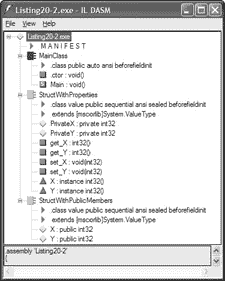

图 20-1：ILDASM 加载了来自 Listing20-2 的可执行文件

ILDASM 以树视图格式显示可执行文件的类和结构。树的 `StructWithPublicMembers` 部分显示了两个 `int32` 公共变量，名为 `X` 和 `Y`。这些变量反映了设计中结构的两个属性。

树的 `StructWithProperties` 部分显示了两个私有变量；它还显示了四个没有写入结构的方法：

- `int32 get_X()`
- `int32 get_Y()`
- `void set_X(int32)`
- `void set_Y(int32)`

这些方法实际上实现了结构的属性访问。`get_X()` 方法包含来自 `X` 属性 `get` 访问器的代码，`get_Y()` 方法包含来自 `Y` 属性 `get` 访问器的代码。同样，`set_X()` 方法包含来自 `X` 属性 `set` 访问器的代码，`set_Y()` 方法包含来自 `Y` 属性 `set` 访问器的代码。这意味着当你的代码访问属性时，你实际上是在调用一个实现属性功能的方法。

列表 20-2 的问题在于，`PropertiesStruct` 变量在使用之前没有用 `new` 运算符进行初始化。这意味着变量没有与结构实例关联，并且无法在不存在的实例上调用方法。`Main()` 方法中的属性语句强制调用底层的属性方法，但没有可用的实例供调用使用。C# 编译器检测到这个问题，并输出了列表 20-2 之后显示的错误消息。

公共成员初始化是成功的，因为类和结构可以直接初始化，而无需使用构造函数，只要实例的所有变量都显式地赋予了值。

### 理解派生类

在讨论 C# 类时，你已经看到类如何从其他类中派生。派生类继承其父类（或基类）的功能。派生类与基类之间的关系在面向对象的术语中被称为“是”（is-a）关系。C# 中的所有类最终都派生自 `.NET System.Object` 类型，例如，你可以说你的类“是一个” `System.Object`。

由于所有派生类都继承其基类的功能，你可能认为派生类的对象可以在任何期望基类类对象的地方使用。然而，C# 语言内置的类型安全性具有优先级，本节的代码解释了这个问题。

#### 传递派生类

列表 20-3 包含一个名为 `TestClass` 的类，其中包含一个名为 `Test()` 的公共方法。`Test()` 方法接受一个对象引用作为参数。

列表 20-3：在期望对象的地方传递字符串

```csharp
public class TestClass
{
    public void Test(ref object ObjectReference)
    {
    }
}

public class MainClass
{
    public static void Main()
    {
        TestClass TestObject = new TestClass();
        string TestString = "Hello from C#!";
        TestObject.Test(ref TestString);
    }
}
```

列表 20-3 还包含一个名为 `MainClass` 的类，它创建了 `TestClass` 类的对象和一个字符串。该字符串被用作调用 `TestClass` 对象 `Test()` 方法的参数。

列表 20-3 无法编译。C# 编译器输出了以下错误：

```
Listing20-3.cs(16,9): error CS1502: The best overloaded method match for 'TestClass.Test(ref object)' has some invalid arguments
Listing20-3.cs(16,29): error CS1503: Argument '1': cannot convert from 'ref string' to 'ref object'
```

乍看之下，这似乎并不合理。因为每个 .NET 数据类型都是对象，任何数据类型最终都应该转换为 `object` 类型的变量。这应该包括 `string` 对象。为什么 `string` 对象不能隐式转换为 `object` 类型的变量呢？

#### 解决传递派生类时出现的问题

编译问题源于 C# 语言内置的严格类型安全规则。列表 20-3 中的 `Test()` 方法接受 `object` 类型的值作为参数，如果提供了对象以外的任何内容，编译器就会发出错误。

列表 20-3 的另一个问题源于 `Test()` 方法使用的 `ref` 参数。`ref` 修饰符允许方法实现更改变量的值，并且该更改对调用者是可见的。这使得 `Test()` 方法有权用任何可以回转为对象的值来覆盖 `ObjectReference`。考虑以下 `Test()` 方法的另一种实现方式：

```csharp
public void Test(ref object ObjectReference)
{
    TestClass TestObject;
    TestObject = new TestClass();
    ObjectReference = (object)TestObject;
}
```

在此实现中，创建了一个 `TestClass` 类的对象，并将 `ObjectReference` 引用变量赋值为该对象，并且调用者可以看到这一点。

问题是列表 20-3 向 `Test()` 方法传递了字符串。如果在列表 20-3 中使用这种新的 `Test()` 方法，调用者将传入字符串并返回一个 `TestClass` 对象。调用者可能没有预料变量类型会更改其最初提供的不同类型，如果调用者在假设变量仍然是字符串继续工作，就会产生许多问题。C# 通过强制在调用方法时使用正确的参数类型来避免这个问题。

### 使用非整数作为数组元素

C# 语言规定只有整数可以作为数组元素。然而，有时你可能会遇到整数不是代码中表示数组索引最方便方式的情况。例如，考虑一个棋盘，传统上从 A 到 H 的字母引用棋盘的八列，而从 1 到 8 的数字传统上引用棋盘的八行。如果你需要在 C# 代码中表示棋盘，你可能会选择二维矩形数组：

```csharp
int [,] Chessboard;
Chessboard = new int [8,8];
```

在初始化棋盘数组后，你可能想使用传统的棋盘单元语法引用单元。例如，你可能这样引用单元 B7：

```csharp
Chessboard['B',7];
```

然而你不能这样做，因为 C# 不允许你使用字符（例如示例中的 B）作为数组元素引用。

列表 20-4 使用索引器来解决这个问题：

列表 20-4：使用索引器表示棋盘

```csharp
using System;

public class Chessboard
{
    private int [,] Board;

    public Chessboard()
    {
        Board = new int[8,8];
    }

    public int this [char Column, int RowIndex]
    {
        get
        {
            int ColumnIndex;
            switch(Column)
            {
                case 'A':
                case 'a':
                    ColumnIndex = 0;
                    break;
                case 'B':
                case 'b':
                    ColumnIndex = 1;
                    break;
                case 'C':
                case 'c':
                    ColumnIndex = 2;
                    break;
                case 'D':
                case 'd':
                    ColumnIndex = 3;
                    break;
                case 'E':
                case 'e':
                    ColumnIndex = 4;
                    break;
                case 'F':
                case 'f':
                    ColumnIndex = 5;
                    break;
                case 'G':
                case 'g':
                    ColumnIndex = 6;
                    break;
                case 'H':
                case 'h':
                    ColumnIndex = 7;
                    break;
                default:
                    throw new Exception("Illegal column specifier.");
            }
            Console.WriteLine("(returning cell [{0},{1}]", ColumnIndex, RowIndex);
            return Board[ColumnIndex, RowIndex];
        }
    }
}

public class MainClass
{
    public static void Main()
    {
        int CellContents;
        Chessboard MyChessboard = new Chessboard();
        CellContents = MyChessboard ['B', 7];
    }
}
```

`Listing 20-4` 中的代码声明了一个名为 `Chessboard` 的类，用于表示棋盘。该类包含一个名为 `Board` 的私有整数二维数组，该数组可以表示哪些棋子位于棋盘的哪些单元格上。（为了保持代码列表简单，该数组并没有被实际使用。）

该类还实现了一个带有 `get` 访问器的索引器。该索引器接受两个参数：一个字符和一个整数。索引器假设第一个参数中指定的字符代表列的标识符，并将该字符转换为私有数组中的一列。列指定符 `A` 翻译为私有 `Board` 数组中的列 `0`；列指定符 `B` 翻译为私有 `Board` 数组中的列 `1`，依此类推。索引器向控制台输出一条指定翻译后的索引元素的消息，然后返回索引器参数所引用的数组元素的值。

`Listing 20-4` 中的 `Main()` 方法创建了类型为 `Chessboard` 的新对象，并使用索引器引用 B7 方格：

`CellContents = MyChessboard ['B', 7];`

当运行 `Listing 20-4` 中的代码时，`Main()` 方法中的代码会调用索引器，会在控制台打印以下内容：

`(returning cell [1,7]`

索引器将第一个参数 `B` 翻译成基于整数的列引用，C# 编译器需要该引用来访问私有数组中的元素。这种方案允许你设计使用符合应用程序自然语法的类——在本例中是基于字符的数组元素索引——同时仍然符合 C# 对基于整数的数组元素索引的要求。

## 总结

解决困难 C# 编程问题的最佳方法是尝试使用编译器进行不同的编码方法。不要害怕实验。如果你做错了，C# 编译器会通过你。

你可能还会考虑利用 `ILDASM` 工具来查看程序集的内部结构，查看 C# 编译器如何从你的源代码生成可执行代码。

理解 C# 编译器生成的代码有助于你理解为什么你的代码会那样工作。在本章中，你学习了你编写的属性访问器代码会被 C# 编译器转换成特有的方法。如果不查看 `ILDASM` 生成的代码，这可能很难理解。`ILDASM` 工具适用于任何由生成 MSIL 的 .NET 编译器产生的程序集。使用 `ILDASM` 查看一些程序集和 .NET 应用程序。将它们加载到工具中并查看它们是如何构建的。

查看其他程序集及其内容可以让你更好地理解 .NET 代码是如何工作的，并帮助你成为一名更优秀的 .NET 开发者。

### 第四部分：使用 C# 开发 .NET 解决方案

## 列表

- 第 21 章：构建 WindowsForms 
- 第 22 章：使用 WebForms 创建 Web 应用程序
- 第 23 章：使用 ADO.NET 和 XML 进行数据库编程
- 第 24 章：处理文件和 Windows 注册表
- 第 25 章：访问数据流
- 第 26 章：使用 GDI+ 绘图
- 第 27 章：构建 Web 服务
- 第 28 章：在 ASP.NET 中使用 C#
- 第 29 章：构建自定义控件
- 第 30 章：构建移动应用程序

# 第 21 章：构建 WindowsForms 

### 本章

关于 .NET Framework 的大部分内容集中在为编写互联网应用程序的开发者提供的支持上。`ASP.NET` 引擎和“软件即服务”开发模型确实是开发互联网应用程序的强大工具。然而，NET Framework 并不仅仅关于互联网。

微软意识到，尽管许多开发者正在编写基于互联网的应用程序，但许多其他开发者正在编写基于桌面的 Win32 风格的桌面应用程序。.NET Framework 并没有忘记这些开发者。它包含了一组 .NET 类，可以轻松开发 Windows 桌面应用程序。

这组类及其支持的编程模型被称为 `WindowsForms`。

在本章中，你将了解 WindowsForms 应用程序的基本结构。你将看到如何创建表单以及如何向表单添加控件。我们将查看 WindowsForms 中可用的 .NET 类，还将查看一些用于添加程序集信息的属性。

### 理解 WindowsForms 架构

开发 WindowsForms 应用程序需要理解 WindowsForms 基类如何与应用程序配合使用。本节将检查 WindowsForms 类库的架构。

构建 WindowsForms 应用程序的所有类都位于名为 `System.Windows.Forms` 的 .NET 命名空间中。该命名空间包含了所需的所有类。

应用程序使用两个基本的 .NET 类：`Form` 类管理应用程序的表单以及表单上的控件，`Application` 类管理应用程序处理发送和接收自表单的 Windows 消息。这两个类都在 .NET Framework 的 `System.Windows.Forms` 命名空间中，构成了 WindowsForms 应用程序的基础结构。

在标准的 Windows 应用程序中，主代码运行在一个循环中，并接收来自 Windows 操作系统的消息。当用户移动鼠标、按下键盘上的按键、选择菜单项或执行任何窗口可能需要响应的操作时，操作系统会记录该操作并向相应的窗口发送消息，通知该窗口该操作的发生。窗口代码负责负责以适当的方式处理这些消息。

在 WindowsForms 架构中，基本概念保持不变。WindowsForms 应用程序有一部分代码等待来自操作系统的用户交互消息，然后由该代码将消息路由到相应的窗口。在 WindowsForms 架构中，`Application` 类是管理此消息处理的主代码，而 `Forms` 类是处理由 `Application` 类发送给它的消息的类。

`Application` 类是密封的（sealed）。你不能从它派生类。它的方法是静态的，这意味着你可以在没有可用 `Application` 类对象的情况下调用它的方法。

## 创建你的第一个 WindowsForms 应用程序

列表 21-1 显示了一个简单的 WindowsForms 应用程序。它代表了一个显示单个表单并持续运行直到用户关闭表单的简单 WindowsForms 应用程序。

列表 21-1：Hello, WindowsForms 应用程序

```csharp
using System.Windows.Forms;

public class SimpleHelloWorld : Form
{
    public static void Main()
    {
        Application.Run(new SimpleHelloWorld());
    }

    public SimpleHelloWorld()
    {
        Text = "Hello, WindowsForms!";
    }
}
```

列表 21-1 中的代码声明了一个名为 `SimpleHelloWorld` 的类。它派生自 .NET Framework 的 `Form` 类，这使得该类成为 Windows Form 类。该类包含一个 `Main()` 方法，该方法创建 `SimpleHelloWorld` 类的新对象，并将该对象作为参数传递给 `Application` 类中的名为 `Run()` 方法。`SimpleHelloWorld` 类的构造函数将继承的 `Text` 属性设置为 `Hello, WindowsForms!`。此字符串作为表单的标题显示。图 21-1 显示了执行列表 21-1 中的代码时表单的样子。

图 21-1：列表 21-1 显示了一个简单的表单。

## 编译你的 WindowsForms 应用程序

与使用 C# 设计的控制台应用程序一样，WindowsForms 应用程序在执行代码之前必须使用 C# 编译器进行编译。取决于代码如何编译，使用 C# 编译器编译的 WindowsForms 应用程序在启动时的行为可能略有不同。至少在编译列表 21-1 中的代码时可以使用可以使用命令行：

```bash
csc Listing21-1.cs
```

与所有 C# 应用程序一样，这会生成一个名为 `Listing21-1.exe` 的可执行文件。如果你从控制台运行此可执行文件，应用程序窗口将会出现。然而，在 Windows 资源管理器中双击可执行文件的图标时，会发生有趣的事。从 Windows 资源管理器启动可执行文件会弹出两个窗口：一个空控制台窗口和一个应用程序的 WindowsForms 窗口。这种行为与大多数 Windows 应用程序不同。大多数 Windows 应用程序在启动时不会弹出空控制台窗口。为什么列表 21-1 的可执行文件会弹出控制台窗口？更重要的是，你如何消除它？

默认情况下，C# 编译器生成控制台应用程序。这些应用程序需要一个控制台窗口，以便 `Console.WriteLine()` 等方法有一个控制台来向其输出消息。.NET 运行时在启动时查询可执行文件，如果可执行文件被构建为控制台应用程序，运行时加载器会为应用程序创建一个新的控制台窗口。如果你使用默认 C# 编译器命令行编译列表 21-1，你将生成一个基于控制台的 .NET 应用程序。这解释了运行生成的可执行文件时出现的空控制台窗口。

WindowsForms 使用窗口而不是控制台，WindowsForms 应用程序不需要控制台窗口。C# 编译器支持一个名为 `target` 的命令行参数，你可以使用它来指定要构建的应用程序类型。你可以使用此参数告诉 C# 编译器你想构建一个不需要控制台的 Windows 应用程序。以下命令行

```bash
csc /target:winexe Listing21-1.cs
```

指示 C# 编译器编译 `Listing21-1.cs` 文件并使用其内容构建不需要控制台的 Windows 可执行文件。如果你使用此命令行构建列表 21-1 中的代码，从 Windows 资源管理器内部启动可执行文件将弹出应用程序的表单，而不会弹出空控制台窗口。

注意 C# 编译器接受 `/t` 作为 `/target` 的简写。前面的命令行可以缩短为 `csc /t:winexe Listing21-1.cs`。

## 理解程序集：为你的 WindowsForms 应用程序添加版本信息

默认情况下，WindowsForms 应用程序不携带任何版本信息。然而，你可以使用 .NET Framework 内置的属性为你的应用程序添加版本信息。这些属性在程序集级别生效，并被添加到 C# 编译器输出的代码中。所有这些属性都是可选的，但使用它们为你的 .NET 二进制文件添加版本和版权信息。添加这些信息使最终用户可以使用 Windows 资源管理器右键点击应用程序，从上下文菜单中选择“属性”，并检查你的嵌入属性值。最终用户可以像检查标准 Win32 应用程序相同信息一样，检查你的 .NET WindowsForms 应用程序的版本和版权信息。

实现这些属性的类位于一个名为 `System.Reflection` 的 .NET 命名空间中。在使用这些属性时，你必须使用 `using` 关键字引用该命名空间，或者使用程序名称。这些属性指定的某些信息被写入程序集清单，而其他信息作为嵌入程序集中的版本资源存储。你可以通过 ILASM 工具查看程序集清单，并可以在 Windows 资源管理器中右键点击文件选择“属性”来查看可执行文件的版本资源。

提示 你可以将这些属性添加到任何 .NET 代码项目中。版本信息在你的代码编译输出中始终可用。

在本节中，我们将查看以下属性：

- `AssemblyTitle`：为程序集分配标题。
- `AssemblyDescription`：为程序集分配描述。
- `AssemblyConfiguration`：描述构建程序集时的选项。
- `AssemblyCompany`：为程序集分配公司名称。
- `AssemblyProduct`：为程序集分配产品信息。
- `AssemblyCopyright`：为程序集分配版权信息。
- `AssemblyTrademark`：为程序集分配商标信息。
- `AssemblyCulture`：为程序集分配区域信息。
- `AssemblyVersion`：为程序集分配版本号。

### AssemblyTitle

`AssemblyTitle` 属性允许为程序集指定标题。该属性在构造函数中接受一个字符串参数来指定标题，如下所示：

```csharp
[assembly: AssemblyTitle("Listing 21-2")]
```

程序集标题没有写入程序集清单，但在编译文件版本信息块的描述（Description）字段中可用。

### AssemblyDescription

`AssemblyDescription` 属性允许为程序集提供描述。该属性在构造函数中接受一个字符串参数来指定描述，如下所示：

```csharp
[assembly: AssemblyDescription("一个简单的 WindowsForms 应用程序描述.")]
```

```assembly
[assembly: AssemblyDescription("This executable was produced by compiling the code in Listing 21-2.")]
```

程序集描述被写入程序集的清单（manifest）中；它也可以在编译文件版本信息块的 `Comments` 字段中使用。

### AssemblyConfiguration

`AssemblyConfiguration` 属性允许你为程序集指定构建配置信息。例如，程序集配置信息可以指定程序集是为零售（retail）配置还是调试（debug）配置构建的。该属性在它的构造函数中接收一个字符串参数，用于指定配置信息，如下所示：

```assembly
[assembly: AssemblyConfiguration("retail")]
```

程序集描述被写入程序集的清单中，但不会在编译文件的版本信息块中可用（可用）。

### AssemblyCompany

`AssemblyCompany` 属性允许你指定一个与程序集关联的公司名称。该属性在它的构造函数中接收一个字符串参数，用于指定公司名称，如下所示：

```assembly
[assembly: AssemblyCompany("John Wiley, Inc.")]
```

程序集公司名称被写入程序集的清单中；它也可以在编译文件版本信息块的 `Company Name` 字段中使用。

### AssemblyProduct

`AssemblyProduct` 属性允许你指定一个与程序集关联的产品名称。该属性在它的构造函数中接收一个字符串参数，用于指定产品名称，如下所示：

```assembly
[assembly: AssemblyProduct("C# Bible")]
```

程序集产品名称被写入程序集的清单中；它也可以在编译文件版本信息块的 `Product Name` 字段中使用。

### AssemblyCopyright

`AssemblyCopyright` 属性允许你为程序集指定版权信息。该属性在它的构造函数中接收一个字符串参数，用于指定版权信息，如下所示：

```assembly
[assembly: AssemblyCopyright("(c) 2002 John Wiley, Inc.")]
```

程序集产品名称被写入程序集的清单中；它也可以在编译文件版本信息块的 `Copyright` 字段中使用。

### AssemblyTrademark

`AssemblyTrademark` 属性允许你为程序集指定商标信息。该属性在它的构造函数中接收一个字符串参数，用于指定商标信息，如下所示：

```assembly
[assembly: AssemblyTrademark("Windows is a trademark of Microsoft Corporation.")]
```

程序集产品名称被写入程序集的清单中；它也可以在编译文件版本信息块的 `Legal Trademarks` 字段中使用。

### AssemblyCulture

`AssemblyCulture` 属性允许你为程序集指定文化信息。

文化信息指定了程序集工作时使用的语言和国家信息。该属性在它的构造函数中接收一个字符串参数，用于指定文化信息，如下所示：

```assembly
[assembly: AssemblyCulture("us-en")]
```

文化字符串由名为 `RFC1766` 的互联网标准定义。该标准标题为《Tags for the Identification of Languages》，可以在互联网上的 `www.ietf.org/rfc/rfc1766.txt` 获取。程序集产品名称被写入程序集的清单中；它也可以在编译文件版本信息块的 `Legal Trademarks` 字段中使用。

注意：文化信息只能添加到库和模块中。文化信息不能添加到可执行文件中，因为可执行文件无法进行本地化。只有基于库的程序集可以进行本地化。如果你尝试向编译为可执行目标的代码库添加 `AssemblyCulture` 属性，C# 编译器会发出以下错误消息：

```
error CS0647: Error emitting 'System.Reflection.AssemblyCultureAttribute' attribute - 'Executables cannot be localized, Culture should always be empty'
```

程序集描述被写入程序集的清单中，但不会在编译文件的版本信息块中可用。

### AssemblyVersion

`AssemblyVersion` 属性允许你为程序集分配一个版本号。

`.NET` 中的版本号由四个部分组成：
- 主版本号（major）
- 小版本号（minor）
- 修订版本号（revision）
- 生成号（build）

这些每个部分都用点分隔。该属性在它的构造函数中接收一个字符串参数，用于指定版本号，如下所示：

```assembly
[assembly: AssemblyVersion("1.0.0.0")]
```

你必须始终指定版本号。如果你指定了主版本号和小版本号，可以让 C# 编译器在构建代码时自动生成其他数字。

如果你希望代码的每次构建都具有唯一的版本号，你可能想要这样做。通过使用星号 `*` 作为生成号，C# 编译器会自动分配一个。生成的生成号等于于自 2000 年 1 月 1 日以来的天数，如下所示：

```assembly
[assembly: AssemblyVersion("1.0.0.*")]
```

此示例为程序集提供了主版本号 1、小版本号 0、修订版本号 0 以及由 C# 编译器自动分配的生成号。

如果你对修订号使用星号，C# 编译器会自动分配一个修订号和一个生成号。生成的修订号等于本地时间午夜以来的秒数对 `2` 取模。生成的生成号等于自 2000 年 1 月 1 日以来的天数，如下所示：

```assembly
[assembly: AssemblyVersion("1.0.*")]
```

此示例为程序集提供了主版本号 1、小版本号 0，以及由 C# 编译器自动分配的修订号和生成号。

程序集产品名称被写入程序集的清单中；它也可以在编译文件版本信息块的 `Assembly Version`、`Product Version` 和 `File Version` 字段中使用。

列表 21-2 为列表 21-1 中的代码添加了程序集属性。

列表 21-2: 带有版本信息的简单应用程序

```csharp
using System.Reflection;
using System.Windows.Forms;

[assembly: AssemblyTitle("Listing 21-2")]
[assembly: AssemblyDescription("This executable was produced by compiling the code in Listing 21-2.")]
[assembly: AssemblyConfiguration("Retail")]
[assembly: AssemblyCompany("John Wiley, Inc.")]
[assembly: AssemblyProduct("C# Bible")]
[assembly: AssemblyCopyright("(c) 2002 John Wiley, Inc.")]
[assembly: AssemblyVersion("1.0.*")]

public class SimpleHelloWorld : Form
{
    public static void Main()
    {
        Application.Run(new SimpleHelloWorld());
    }

    public SimpleHelloWorld()
    {
        Text = "Hello, WindowsForms!";
    }
}
```

### 详细查看 Application 对象

`Application` 对象包含了可以在 WindowsForms 代码中使用的属性、方法和事件。在本节中，你查看最常用的类成员。

#### 理解 Application 事件

`Application` 类支持在 WindowsForms 应用程序中处理四个事件：

- `ApplicationExit` 事件在应用程序即将关闭时触发。可以将 `EventHandler` 类型的委托分配给此事件。`EventHandler` 委托定义在 `System` 命名空间中。该委托接收两个参数：引用发送事件的对象和一个指定事件参数的 `EventArgs` 对象。它不返回任何值。
- `Idle` 事件在应用程序完成分发操作系统消息并即将进入空闲状态时触发。当应用程序确定有更多消息需要处理时会离开空闲状态。可以将 `EventHandler` 类型的委托分配给此事件。`EventHandler` 委托定义在 .NET System 命名空间中。该委托接收两个参数，一个对象引用发送事件的对象，以及一个指定事件参数的 `EventArgs` 对象。它不返回任何值。
- 当抛出未捕获的线程异常时，会触发 `ThreadException` 事件。可以将类型为 `ThreadExceptionEventHandler` 的委托分配给此事件。`ThreadExceptionEventHandler` 委托定义在 .NET 的 `System.Threading` 命名空间中。该委托接收两个参数：一个引用发送事件的对象的，以及一个指定事件参数的 `ThreadExceptionEventArgs` 对象。它不返回任何值。
- 当线程即将关闭时，触发 `ThreadExit` 事件。当应用程序的主线程即将关闭时，会先引发此事件，然后是 `ApplicationExit` 事件。可以将类型为 `EventHandler` 的委托分配给此事件。`EventHandler` 委托定义在 .NET 的 `System` 命名空间中。该委托接收两个参数：一个引用发送事件的对象，以及一个指定事件参数的 `EventArgs` 对象。它不返回任何值。

## 在代码中使用事件

列表 21-3 中的代码通过处理来自 `Application` 对象的事件，扩展了列表 21-2 中的表单代码。

列表 21-3：处理 Application 事件

```csharp
using System;
using System.Threading;
using System.Reflection;
using System.Windows.Forms;

[assembly: AssemblyTitle("Listing 21-3")]
[assembly: AssemblyDescription("This executable was produced by compiling the code in Listing 21-3.")]
[assembly: AssemblyCompany("John Wiley, Inc.")]
[assembly: AssemblyProduct("C# Bible")]
[assembly: AssemblyCopyright("(c) 2002 John Wiley, Inc.")]
[assembly: AssemblyVersion("1.0.*")]

public class HelloWorldForm : Form
{
    public HelloWorldForm()
    {
        Text = "Hello, WindowsForms!";
    }
}

public class ApplicationEventHandlerClass
{
    public void OnApplicationExit(object sender, EventArgs e)
    {
        try
        {
            Console.WriteLine("The application is shutting down.");
        }
        catch(NotSupportedException)
        {
        }
    }

    public void OnIdle(object sender, EventArgs e)
    {
        Console.WriteLine("The application is idle.");
    }

    public void OnThreadException(object sender, ThreadExceptionEventArgs e)
    {
        Console.WriteLine("an exception thrown from an application thread was caught!");
    }

    public void OnThreadExit(object sender, EventArgs e)
    {
        Console.WriteLine("The application's main thread is shutting down.");
    }
}

public class MainClass
{
    public static void Main()
    {
        HelloWorldForm FormObject = new HelloWorldForm();
        ApplicationEventHandlerClass AppEvents = new ApplicationEventHandlerClass();
        Application.ApplicationExit += new EventHandler(AppEvents.OnApplicationExit);
        Application.Idle += new EventHandler(AppEvents.OnIdle);
        Application.ThreadException += new ThreadExceptionEventHandler(AppEvents.OnThreadException);
        Application.ThreadExit += new EventHandler(AppEvents.OnThreadExit);
        Application.Run(FormObject);
    }
}
```

列表 21-3 中的新类名为 `ApplicationEventHandlerClass`，包含了处理从 `Application` 对象触发的事件的方法。`Main()` 方法创建 `ApplicationEventHandlerClass` 对象，并将其代码添加到 `Application` 类的事件处理程序列表中。

`ApplicationEventHandlerClass` 中的事件处理程序会写入控制台。这在 WindowsForms 应用程序中也是完全合法的。如果你使用控制台执行目标（`csc /target:exe Listing21-3.cs`）编译列表 21-3 中的代码，事件处理程序的消息将写入用于启动应用程序的控制台窗口。如果你使用 Windows 执行文件目标（`csc /target:winexe Listing21-3.cs`）编译列表 21-3 中的代码，则没有关联的控制台，控制台消息不会显示。

## 理解 Application 属性

`Application` 类支持多种可以在 C# 应用程序中使用的属性。以下章节描述了如何使用这些属性。

### AllowQuit

布尔值 `AllowQuit` 属性指定你的代码是否可以通过程序方式结束应用程序。如果你的代码可以指示应用程序退出，该属性返回 `True`，否则返回 `False`。此属性是只读的，无法设置。通常，用户可以通过关闭应用程序的主表单来结束应用程序。某些应用程序托管在容器（如 Web 浏览器）中，这些应用程序无法通过程序结束。它们只有在容器关闭时才会退出。如果 `AllowQuit` 属性返回 `true`，你可以调用名为 `Exit()` 的 `Application` 方法来程序结束应用程序。你可以在“理解 Application 方法”章节中查看 `Application` 对象的方法。

### CommonAppDataRegistry

`CommonAppDataRegistry` 属性返回一个 `RegistryKey` 类对象的引用。返回的 `RegistryKey` 对象引用了 `Registry` 中的一个键，应用程序可以使用该键来存储对应用程序所有用户都有效的 `Registry` 数据。此属性是只读的，无法设置。

`RegistryKey` 类是 .NET Framework 的一部分，位于名为 `Microsoft.Win32` 的命名空间中。它代表注册表中的一个特定键，并包含了允许你创建子项、读取值以及执行与注册表键相关的其他工作的方法。

### CommonAppDataPath

字符串属性 `CommonAppDataPath` 引用文件系统上的一个路径，应用程序可以使用该路径来存储对应用程序所有用户都有效的基于文件的数据。此属性是只读的，无法设置。

应用程序数据路径存储在所有用户的文档路径之下，该路径通常为 `C:\Documents and Settings\All Users\Application Data`。实际的应用程序路径指向“所有用户”文档路径下的一个文件夹，格式为 `ProductName\ProductVersion`。`CompanyName`、`ProductName` 和 `ProductVersion` 文件夹名称基于同名应用程序属性的值。如果你没有设置这些属性，`Application` 类提供了默认值。例如，列表 21-1 中的代码应用程序数据路径为 `C:\Documents and Settings\All Users\Application Data\SimpleHelloWorld\SimpleHelloWorld\V0.0\`。如果列表 21-1 中的代码设置了 `Application` 类的 `CompanyName`、`ProductName` 或 `ProductVersion` 属性，数据路径中的文件夹名称将反映这些属性的值。

产品版本文件夹路径仅使用应用程序中指定的次次版本号，无论你在应用程序的 `AssemblyVersion` 属性中设置了多少值。例如，如果你的应用程序使用值为 `1.2.3.4` 的 `AssemblyVersion` 属性，则应用程序数据路径的版本部分将为 `1.2`。字母 `V` 总是前缀应用程序的主版本号。

### CompanyName

字符串属性 `CompanyName` 返回与应用程序关联的公司名称。此属性是只读的，无法设置。默认情况下，此值被设置为包含应用程序 `Main()` 方法的类名。如果你的应用程序使用 `AssemblyCompany` 特性指定了公司名称，则该属性的值将用作应用程序 `CompanyName` 属性的值。

### CurrentCulture

`CurrentCulture` 属性允许你处理应用程序的区域设置信息。该属性可以读取也可以写入。该属性的类型为 `CultureInfo` 类，该类是由 .NET Framework 定义的并位于 `System.Globalization` 命名空间。`CultureInfo` 类包含方法和属性，使你的代码能够处理与应用程序执行文化环境特定的数据。从 `CultureInfo` 对象可以获取首选日期/时间格式、日历设置和数字格式等信息。

### CurrentInputLanguage

`CurrentInputLanguage` 属性允许你处理应用程序当前的输入语言。该属性的类型为 `InputLanguage` 类，该类是由 .NET Framework 定义并存在于 `System.Windows.Forms` 命名空间。`InputLanguage` 类包含方法和属性，使你的代码能够处理应用程序对键盘物理键的理解，以及这些键与可以输入应用程序的字符之间的关系。不同语言版本的 Windows 将物理键盘键映射到不同的特定语言字符，而 `CurrentInputLanguage` 类指定了这种映射的形式。

### ExecutablePath

字符串 `ExecutablePath` 属性返回应用程序可执行文件的路径。此属性是只读的，无法设置。

### LocalUserAppDataPath

字符串 `LocalUserAppDataPath` 属性引用文件系统上的路径，应用程序可以使用该路径存储基于文件的数据，这些数据应对当前登录到机器的用户可用。此属性是只读的，无法设置。它用于在本地机器上具有操作系统个人配置的本地用户。具有跨网络漫游个人配置的用户使用名为 `UserAppDataPath` 的单独属性来指定其应用程序数据的存储位置。

与 `CommonAppDataPath` 属性类似，本地用户数据路径指向登录用户文档路径下的一个文件夹，其文件夹结构为 `CompanyName\ProductName\ProductVersion`。`CompanyName`、`ProductName` 和 `ProductVersion` 文件夹名称基于同名应用程序属性的值。如果你不设置这些属性，`Application` 类将提供合理的默认值。如果你的代码设置了 `Application` 类的 `CompanyName`、`ProductName` 或 `ProductVersion` 属性，本地用户应用程序数据路径中的文件夹名称将发生变化，以反映这些属性的值。

与公共应用程序数据路径类似，产品版本文件夹路径仅使用应用程序中指定的的主版本和次版本号，无论你在应用程序的 `[AssemblyVersion]` 特性中设置了多少个值。例如，如果你的应用程序使用了值为 1.2.3.4 的 `[AssemblyVersion]` 特性，则本地用户应用程序数据路径的版本号部分为 1.2。在数据路径的版本号部分中，字母 `V` 始终作为你应用程序主版本号的前缀。

### MessageLoop

布尔值 `MessageLoop` 属性在应用程序存在消息循环时返回 `True`否则返回 `False`。此属性是只读的，无法设置。由于所有 WindowsForms 应用程序都需要消息循环以便 Windows 消息路由到正确的表单，因此 WindowsForms 应用程序对此属性返回 `True`。

### ProductName

字符串 `ProductName` 属性返回与应用程序相关的产品名称。此属性是只读的，无法设置。默认情况下，此值设置为包含应用程序 `Main()` 方法的类名。如果你的应用程序使用 `[AssemblyProduct]` 特性指定了产品名称，该特性的值将作为应用程序 `ProductName` 属性的值。

### ProductVersion

字符串 `ProductVersion` 属性返回与应用程序相关的版本号。此属性是只读的，无法设置。默认情况下，此值设置为 `0.0.0.0`。如果你的应用程序使用 `[AssemblyVersion]` 特性指定了版本号，该特性的值将作为应用程序 `ProductVersion` 属性的值。

### SafeTopLevelCaptionFormat

字符串 `SafeTopLevelCaptionFormat` 属性引用格式字符串，当应用程序从不安全上下文执行时，运行时会将其应用于顶层窗口标题。

安全性是 .NET Framework 和通用语言运行时 (CLR) 的不可或缺的一部分。CLR 尊重 Internet Explorer 中设置的不同安全区域（Internet、本地局域网、信任站点和受限制站点），并将运行时服务限制运行在不受信任区域的应用程序。从不受信任区域（例如 Internet 区域）运行的 WindowsForms 应用程序将带有警告标签，描述应用程序源自不受信任的位置。此警告标签的文本根据存储在 `SafeTopLevelCaptionFormat` 属性中的字符串格式模板进行格式化。

### StartupPath

字符串 `StartupPath` 属性返回启动应用程序的可执行文件的路径。此属性仅返回路径，不包含可执行文件的名称。此属性是只读的，无法设置。

### UserAppDataPath

字符串 `UserAppDataPath` 属性引用文件系统上的路径，应用程序可以使用该路径存储基于文件的数据，这些数据应对当前登录到机器的网络用户可用。此属性是只读的，无法设置。它用于在网络上具有操作系统配置的本地用户。具有不跨网络使用的本地机器配置的用户使用名为 `LocalUserAppDataPath` 的单独属性来指定其应用程序数据的存储位置。

与 `CommonAppDataPath` 属性类似，本地用户数据路径指向登录用户文档路径下的一个文件夹，其文件夹结构为 `CompanyName\ProductName\ProductVersion`。`CompanyName`、`ProductName` 和 `ProductVersion` 文件夹名称基于同名应用程序属性的值。如果你不设置这些属性，`Application` 类将提供合理的默认值。如果你的代码设置了 `Application` 类的 `CompanyName`、`ProductName` 或 `ProductVersion` 属性，本地用户应用程序数据路径中的文件夹名称将发生变化，以反映这些属性的值。

### UserAppDataRegistry

`UserAppDataRegistry` 属性返回 `RegistryKey` 类对象的引用。与 `CommonAppDataRegistry` 属性类似，该属性返回 `RegistryKey` 类型的对象。返回的 `RegistryKey` 对象引用注册表中的键，可以使用它可以存储仅对当前用户用的注册表数据。此属性是只读的，无法设置。

## 理解应用程序方法

`Application` 类支持你在 C# 应用程序中调用的八个方法。这些方法将在后续章节描述。

### AddMessageFilter

`AddMessageFilter()` 方法为你的应用程序添加消息过滤器，以监控 Windows 消息路由到其目的地的情况。安装到你的应用程序中的消息过滤器会在发送到你的表单之前接收 Windows 消息。通过 `AddMessageFilter()` 安装的消息过滤器可以选择处理发送给它的消息，并且过滤器可以选择是否将该消息转发到你的表单。

列表 21-4 显示了如何在 WindowsForms 应用程序中使用消息过滤器。消息处理程序查找在表单上点击左鼠标键时发布的消息。

列表 21-4: 安装消息过滤器

```csharp
using System;
using System.Windows.Forms;

public class BlockLeftMouseButtonMessageFilter : IMessageFilter
{
    const int WM_LBUTTONDOWN = 0x201;
    const int WM_LBUTTONUP = 0x202;

    public bool PreFilterMessage(ref Message m)
    {
        if(m.Msg == WM_LBUTTONDOWN)
        {
            Console.WriteLine("左鼠标键已按下.");
            return true;
        }

        if(m.Msg == WM_LBUTTONUP)
        {
            Console.WriteLine("The left mouse button is up.");
            return true;
        }

        return false;
    }
}

public class MainForm : Form
{
    public static void Main()
    {
        MainForm MyForm = new MainForm();
        BlockLeftMouseButtonMessageFilter MsgFilter = new BlockLeftMouseButtonMessageFilter();
        Application.AddMessageFilter(MsgFilter);
        Application.Run(MyForm);
    }

    public MainForm()
    {
        Text = "Message Filter Test";
    }
}
```


`AddMessageFilter()` 方法接受一个参数：名为 `IMessageFilter` 接口的实现。`IMessageFilter` 接口由 .NET Framework 定义，位于 `System.Windows.Forms` 命名空间。`IMessageFilter` 接口声明了一个方法：`public bool PreFilterMessage(ref Message m);`。

`PreFilterMessage()` 方法输入一个名为 `Message` 的结构体的实例引用。`Message` 结构体描述了一个 Windows 消息，并包含以下属性：

- `HWND`，描述应该接收消息的窗口句柄。
- `LParam`，描述随消息发送的一段整数数据。
- `Msg`，描述消息的整数 ID 数字。每个可能的 Windows 消息都有其对应的整数 ID。
- `Result`，描述在处理消息后应返回给 Windows 的值。
- `WParam`，描述随消息发送的另一段整数数据。

列表 21-4 开始声明一个名为 `BlockLeftMouseButtonMessageFilter` 的类。该类实现了 `IMessageFilter` 接口。该类 `PreFilterMessage()` 方法的实现检查了传递给方法的消息 ID。它检查该 ID 是否表示左鼠标键已按下。如果是，则向控制台写入一条显示 `The left mouse button is down.` 的消息。然后它检查该 ID 是否表示左鼠标键已释放。如果是，则向控制台写入一条显示 `The left mouse button is up.` 的消息。

注意：`BlockLeftMouseButtonMessageFilter` 类声明了常量，为过滤器查找的 Windows 消息命名。这些名称以 `WM` 开头，代表 Windows Message（Windows 消息），并与微软定义的名称匹配。所有可用 Windows 消息及其数值都在 Microsoft Platform SDK 文档中有记录。

`PreFilterMessage()` 方法必须返回一个布尔值，描述消息在通过你的过滤器后是否应该转发到你的表单。如果消息不需要转发到你的过滤器，则过滤器应该返回 `True` 值。如果消息需要转发到你的过滤器，则过滤器应该返回 `False` 值。列表 21-4 中的消息过滤器对它处理的两个消息返回 `True`，而对所有其他消息返回 `False`。

列表 21-4 中的 `Main()` 方法创建了 `BlockLeftMouseButtonMessageFilter` 类的新对象，并在调用 `Application` 对象的 `AddMessageFilter()` 方法时使用它。在安装消息过滤器后，主表单被创建并执行。

你可以通过编译列表 21-4 中的代码来看到消息过滤器的工作情况。当你运行代码时，应用程序的主表单会显示。当表单出现时，将鼠标移动到表单内部的光标处并点击左鼠标键。鼠标点击消息会被写入应用程序的控制台。

### DoEvents

`DoEvents()` 方法处理当前应用程序中 Windows 消息队列中的所有消息。该方法不接受任何参数，也不返回值。如果你希望在执行其他工作时，确保等待中的 Windows 消息被发送到你的表单，你可能需要调用此方法。

例如，假设你创建了一个执行耗时计算的表单。如果在计算期间，另一个窗口移动到你的表单前面，Windows 会向你的应用程序发送一个 Windows 消息，说明你的表单需要重绘。然而，由于你的代码正在执行耗时计算，重绘消息将位于应用程序的消息队列中；毕竟，你的代码正忙于计算，没有处理消息。你可以在处理过程的某些点调用 `DoEvents()` 方法，以确保当代码忙于其他工作时，等待的 Windows 消息得到处理。

### Exit

`Exit()` 方法强制结束应用程序。该方法通知你的应用程序消息队列应该终止，在队列中的最后一个 Windows 消息被处理后，你的表单将被关闭。它不接受任何参数，也不返回值。

在简单的情况下，你的代码不需要调用 `Exit()` 方法。默认的 Windows 表单在右上角有一个关闭（Close）框，点击该框会向你的 Windows 消息队列发送退出消息。然而，如果你的表单包含一个控件（例如按钮或菜单项），在该控件被选中时应退出应用程序，你可能需要调用 `Exit()`。

### ExitThread

`ExitThread()` 方法退出消息循环并关闭当前线程上的所有表单。该方法不接受任何参数，也不返回值。

如果你的 WindowsForms 应用程序只包含一个线程（大多数都是），那么调用 `ExitThread()` 就等同于调用 `Exit()`。然而，如果你的应用程序使用多个线程，那么这两个方法的行为就不同。`ExitThread()` 方法关闭一个线程但允许其他线程继续运行。而 `Exit()` 方法会一次关闭所有线程。像所有 Windows 进程一样，WindowsForms 应用程序会一直运行直到线程结束。

### OleRequired

`OleRequired()` 方法在当前线程上初始化 OLE。如果你的应用程序将使用 COM 相关技术（如 COM、DCOM、ActiveX 或 OLE），你必须在使用 COM 之前调用此方法。该方法不接受参数，但它返回一个名为 `ApartmentState` 的枚举值，描述进入的 COM 单元类型。`ApartmentState` 枚举定义在 .NET Framework 的 `System.Threading` 命名空间，它可以具有以下值之一：

- `STA`：CLR 通过单线程单元初始化 COM 时返回。
- `MTA`：CLR 通过多线程单元初始化 COM 时返回。

### OnThreadException

`OnThreadException()` 方法引发 `ThreadException` 事件。该事件可以由安装到 `Application` 对象的 `OnThreadException()` 事件处理器进行捕获。

#### 列表 21-5: 使用线程异常

```csharp
using System;
using System.Threading;
using System.Windows.Forms;

public class BlockLeftMouseButtonMessageFilter : IMessageFilter
{
    const int WM_LBUTTONDOWN = 0x201;

    public bool PreFilterMessage(ref Message m)
    {
        if (m.Msg == WM_LBUTTONDOWN)
        {
            Exception LeftButtonDownException;
            LeftButtonDownException = new Exception("The left mouse button was pressed.");
            Application.OnThreadException(LeftButtonDownException);
            return true;
        }
        return false;
    }
}

public class ApplicationEventHandlerClass
{
    public void OnThreadException(object sender, ThreadExceptionEventArgs e)
    {
        Exception LeftButtonDownException;
        LeftButtonDownException = e.Exception;
        Console.WriteLine(LeftButtonDownException.Message);
    }
}

public class MainForm : Form
{
    public static void Main()
    {
        ApplicationEventHandlerClass AppEvents = new ApplicationEventHandlerClass();
        MainForm MyForm = new MainForm();
        BlockLeftMouseButtonMessageFilter MsgFilter = new BlockLeftMouseButtonMessageFilter();
        Application.AddMessageFilter(MsgFilter);
        Application.ThreadException += new ThreadExceptionEventHandler(AppEvents.OnThreadException);
        Application.Run(MyForm);
    }

    public MainForm()
    {
        Text = "Application Exception Test";
    }
}
```

Listing 21-5 与 `Listing 21-4` 类似，它包含一个消息处理器，用于寻找宣布在应用程序表单上点击左鼠标键的消息。不同之处在于，当在 `Listing 21-5` 中接收到左鼠标键按下消息时，会抛出一个异常。消息处理器构造了一个新的 `Exception` 对象，并使用 `Application` 对象的 `OnThreadException()` 方法将其抛出。

`Listing 21-5` 中的代码还包含一个应用程序事件处理程序，它实现在一个名为 `ApplicationEventHandlerClass` 的类中。该类处理 `OnThreadException()` 事件，而应用程序的主方法使用 `Application` 对象的 `ThreadException` 属性安装该事件处理程序。

安装在 `ApplicationEventHandlerClass` 类中的线程异常处理程序从处理程序的 `ThreadExceptionEventArgs` 对象中提取异常，并将异常的消息打印到控制台上。当你运行 `Listing 21-5` 中的代码时，应用程序的主表单会出现。当表单出现时，将鼠标移动到表单内部的光标并点击左鼠标键。消息处理器抛出一个异常，应用程序的异常处理程序会将异常消息打印到应用程序的控制台上。

### RemoveMessageFilter

`RemoveMessageFilter()` 方法移除由 `AddMessageFilter()` 方法安装的消息过滤器。它从应用程序的消息循环中移除该消息过滤器。`RemoveMessageFilter()` 方法接受一个参数：名为 `IMessageFilter` 接口的实现。该参数应该引用一个实现了 `IMessageFilter` 的类，并且该类已经在调用 `AddMessageFilter()` 时使用。`Listing 21-6` 显示了该方法的工作原理。

#### Listing 21-6：移除已安装的消息过滤器

```csharp
using System;
using System.Windows.Forms;

public class BlockLeftMouseButtonMessageFilter : IMessageFilter
{
    const int WM_LBUTTONDOWN = 0x201;

    public bool PreFilterMessage(ref Message m)
    {
        if (m.Msg == WM_LBUTTONDOWN)
        {
            Console.WriteLine("The left mouse button is down.");
            Application.RemoveMessageFilter(this);
            return true;
        }
        return false;
    }
}

public class MainForm : Form
{
    public static void Main()
    {
        MainForm MyForm = new MainForm();
        BlockLeftMouseButtonMessageFilter MsgFilter = new BlockLeftMouseButtonMessageFilter();
        Application.AddMessageFilter(MsgFilter);
        Application.Run(MyForm);
    }

    public MainForm()
    {
        Text = "Message Filter Removal Test";
    }
}
```

`Listing 21-6` 中的代码安装了一个寻找左鼠标键按下消息的消息过滤器，就像 `Listing 21-4` 所做的那样。这里的不同之处在于，`Listing 21-6` 中消息过滤器的实现在接收到消息时会移除该消息过滤器。

当你运行 `Listing 21-6` 中的代码时，无论你在鼠标指针悬停在表单上时点击左鼠标键多少次，控制台上都只有一条消息。这是因为在接收到第一条消息时，消息过滤器就会从应用程序中移除；并且因为消息过滤器被移除，将不会再检测到后续消息。消息仍然发送到你的表单，但 `Listing 21-6` 中的代码在对象从应用程序的事件过滤器列表中移除后，移除了第一个尝试检测消息的对象。

提示：`Listing 21-6` 使用关键字 `this` 作为调用 `Application` 对象的 `RemoveMessageFilter()` 方法的参数。请记住，`this` 关键字用于引用正在执行其代码的实例。你可以将 `Listing 21-6` 中调用 `RemoveMessageFilter()` 的语句理解为“从 `Application` 对象中移除对此消息过滤器的引用”。

### Run

`Run()` 方法启动应用程序的 Windows 消息循环。本章中的所有列表都使用了 `Run()` 方法，该方法接受表单对象的引用作为参数。你应该已经熟悉 `Run()` 方法的工作方式了。

### 向表单添加控件

WindowsForms 应用程序创建的默认表单并不有趣。它包含一个标题栏、默认图标以及 Windows 标准的最小化、最大化和关闭按钮。真实世界应用程序中的表单包含控件，例如按钮、文本框、标签等。本节将解释你如何向你的 C# 应用程序中的表单中添加控件。

在本节中，你将查看在 .NET Framework 内部如何支持控件。框架包含了对 Windows 操作系统内置控件的 .NET 类支持，本节中的示例将说明它们在构建使用应用程序表单控件的 WindowsForms 应用程序中的应用。

### 理解控件类层次结构

.NET Framework 在 `System.Windows.Forms` 命名空间中包含了几个封装控件行为的类。用户界面元素（如按钮、列表框、复选框等）都由一个控件类表示。

所有这些类都继承自一个名为 `Control` 的基类。图 21-2 显示了控件类的层次结构。所有用户界面控件共享某些功能：它们都必须能够在其父容器中定位自己，并管理它们的前景和背景颜色。由于所有控件共享这种行为，因此将其封装在基类中并派生特定控件的功能是有意义的。

.NET Framework 控件类的作者在构建时采用了这种设计方法。

图 21-2：类层次结构

### 在表单上使用控件

Listing 21-7 显示了一个包含按钮的 WindowsForm 应用程序。该按钮在点击时会在消息框中显示消息。

#### Listing 21-7：在表单上使用按钮

```csharp
using System;
using System.Drawing;
using System.Windows.Forms;

public class MainForm : Form
{
    public static void Main()
    {
        MainForm MyForm = new MainForm();
        Application.Run(MyForm);
    }

    public MainForm()
    {
        Button MyButton = new Button();
        Text = "Button Test";
        MyButton.Location = new Point(25, 25);
        MyButton.Text = "Click Me";
        MyButton.Click += new EventHandler(MyButtonClicked);
        Controls.Add(MyButton);
    }

    public void MyButtonClicked(object sender, EventArgs Arguments)
    {
        MessageBox.Show("The button has been clicked.");
    }
}
```

`Listing 21-7` 列出了在使用 WindowsForms 控件时需要注意的几个重要概念。首先考虑构造函数。它创建了一个 `Button` 类的新对象，并使用按钮的 `Location` 属性设置其在表单上的位置。

该属性继承自 `Control` 类（这意味着任何派生自 `Control` 的控件都可以使用该属性），并设置按钮相对于容器的位置。在 `Listing 21-7` 中，按钮的位置被设置为距离表单左边缘右 25 像素，距离顶部下方 25 像素。该位置是使用名为 `Point` 的结构的新实例设置的，该结构可用 .NET Framework 的 `System.Drawing` 命名空间：

`MyButton.Location = new Point(25, 25)`

提示：`Listing 21-7` 使用 `Location` 属性设置控件的位置。对于具有许多控件的复杂表单，使用该属性通过编程定位控件可能会非常繁琐。

`Listing 21-7` 中的下一个重要概念涉及控件的事件处理。

控件类支持许多在用户与控件交互时触发的事件。这些事件中的许多位于 `Control` 基类中，尽管特定的控件类会处理其他事件。对于按钮控件，最显而易见的事件就是 `Click` 事件。如果表单上的按钮不能响应用户点击按钮的操作，那么它们就是毫无用处的。

`.NET Framework` 中的控件使用标准的委托/事件模型来支持其事件。控件事件通过使用名为 `EventHandler` 的委托实例来安装。`EventHandler` 委托接受两个参数：一个指定事件发送者的对象，以及一个名为 `EventArgs` 的类的对象，该对象封装了事件的参数。列表 21-7 中的表单代码包含一个名为 `MyButtonClicked` 的方法，它模拟了 `EventHandler` 委托。该方法被用作新的事件处理程序并绑定到按钮的 `Click` 事件上：

```csharp
MyButton.Click += new EventHandler(MyButtonClicked);
```

`Form` 类通过显示消息框来处理按钮的 `Click` 事件。名为 `MessageBox` 的类支持显示 Windows 消息框。`MessageBox` 类包含名为 `Show()` 的静态方法，用于在消息框中显示消息。

列表 21-7 中的最后一个重要概念是将控件添加到表单的语句：`Controls.Add(MyButton);`。

`Controls` 属性定义在 `Control` 基类中（记住 `Form` 类派生自 `Control` 类）。它是一个名为 `ControlsCollection` 的类的对象，管理着由当前控件管理的子控件列表。`WindowsForms` 代码必须在实际使用控件之前将它们添加到其容器表单的 `Controls` 集合中。

### 使用资源

在 Windows 中，资源被定义为应用程序的一部分，但不会影响代码的执行数据。这些资源可能包括图标、位图和字符串。`WindowsForms` 系统允许你在开发期间将资源存储在单独的文件中并在需要分发时将其包含在程序集中。

将应用程序的资源保留在独立的资源存储库中的主要优势是辅助开发。例如，如果你将所有字符串嵌入到 `C#` 代码中，那么只有熟悉 `C#` 的人才知道去哪里查找更改字符串值。如果你使用英语字符串编写应用程序，然后需要更改应用程序以显示德语字符串，你必须通读整个源代码并更改所有字符串。如果你将字符串保留在单独的字符串表文件中，你可以将该单独的文件交给翻译人员，他们可以将英语字符串翻译为相应的德语，而无需更改你的 `C#` 源代码。在你的应用程序中，你的代码将是“从字符串表读取字符串”，而不是在应用程序中硬编码字符串。

### 使用字符串资源

字符串资源定义在独立的文本文件中，该文件的扩展名应为 `.txt`。该文件应包含一组由等号分隔的键值对。每个字符串的键应该是该字符串的唯一名称，你将在 `C#` 代码中使用该名称来引用它。实际的字符串值位于等号之后。

你可以在字符串表文件中放置注释。注释以井号符号开头，并延伸到行尾。

列表 21-8 显示了一个示例字符串表文件。该文件包含一个字符串，其键名为 `Message`，值为 `Hello from the string table!`。

#### 列表 21-8：示例字符串表文本文件

```text
#=============
# String Table
#=============
Message = Hello from the string table!
```

字符串表文件必须被编译到程序集中，以便从你的 `C#` 应用程序中读取。这些文件使用名为 `ResGen` 的工具编译到程序集中。`ResGen` 工具随 `.NET Framework SDK` 一起提供。它是一个控制台应用程序，读取文本文件并输出扩展名为 `.resources` 的表格二进制表示。如果列表 21-8 中的字符串表被写入名为 `Listing21-8.txt` 的文本文件，你可以使用以下命令行编译字符串表：

```bash
resgen Listing21-8.txt
```

这会生成一个名为 `Listing21-8.resources` 的文件。在为应用程序生成资源文件后，你可以使用 `C#` 编译器的 `/res` 参数将其编译到程序集中，如下命令行所示：

```bash
csc /res:string.resources /out:test.exe test.cs
```

此命令行指示 `C#` 编译器从 `C#` 源文件 `test.cs` 创建一个名为 `test.exe` 的可执行文件。它还指示 `C#` 编译器将 `string.resources` 文件中找到的资源嵌入到 `test.exe` 可执行文件中。由于资源已嵌入到可执行文件中，当你在交付应用程序时只需提供可执行文件即可。运行时不需要二进制资源文件。

在资源嵌入到应用程序之后，你可以从 `C#` 代码中读取资源。列表 21-9 是列表 21-7 的修改，其中消息框中显示的消息是从字符串资源读取的。

#### 列表 21-9：从字符串资源读取

```csharp
using System;
using System.Drawing;
using System.Windows.Forms;
using System.Resources;
using System.Reflection;

public class MainForm : Form
{
    public static void Main()
    {
        MainForm MyForm = new MainForm();
        Application.Run(MyForm);
    }

    public MainForm()
    {
        Button MyButton = new Button();
        Text = "Button";
        MyButton.Location = new Point(25, 25);
        MyButton.Text = "Click Me";
        MyButton.Click += new EventHandler(MyButtonClicked);
        Controls.Add(MyButton);
    }

    public void MyButtonClicked(object sender, EventArgs Arguments)
    {
        ResourceManager FormResources = new ResourceManager("StringTable", Assembly.GetExecutingAssembly());
        string Message;
        Message = FormResources.GetString("Message");
        MessageBox.Show(Message);
    }
}
```

列表 21-9 编译时使用的字符串表资源文本内容如下：

```text
#=============
# String Table
#=============
Message = The button has been clicked.
```

该文本文件名为 `StringTable.txt`，通过以下命令编译为二进制资源文件 `StringTable.resources`：

```bash
resgen StringTable.txt
```

当主 `C#` 代码使用以下命令行编译时，该资源会被链接到应用程序：

```bash
csc /res:StringTable.resources Listing21-9.cs
```

### 使用二进制资源

文本字符串表并不是你可以嵌入程序集的唯一资源。你还可以嵌入二进制资源，例如图形和图标。二进制资源使用 BASE64 编码到特殊格式的 XML 文档中。该 XML 文档扩展名为 `.resx`，并使用 `resgen` 编译为资源文件。从那里，你可以使用 `ResourceManager` 类中的方法来处理二进制资源，就像处理文本资源一样。

遗憾的是，.NET Framework SDK 并不包含一个根据二进制文件输入生成带有 BASE64 编码的 XML 文档的工具。然而，Visual Studio .NET 包含了将二进制资源嵌入你的程序集中的支持。

## 总结

本章回顾了使用 C# 构建 WindowsForms 应用程序开发过程的基础知识。它研究了一些基本类，例如管理整个 WindowsForms 应用程序的 `Application` 类，以及管理应用程序内表单的 `Form` 类。你还浏览了 WindowsForms 控件类架构，并了解了可以为程序集添加版本和描述性信息的程序集特性。

.NET Framework 包含了一系列丰富的类，用于构建 WindowsForms 应用程序。WindowsForms 子系统由若干个类组成；遗憾的是，由于空间限制，本书无法对它们进行完全描述。你可以查看每个 WindowsForms 类的文档。利用本章中解释的概念，开始你对 WindowsForms 命名空间下所有类的研究。

## 第 22 章：创建 Web 应用程序

### 使用 WebForms

## 本章内容

过去的十年中见证了互联网作为一个商业平台前所未有的增长。今天，大多数商业模式都以互联网为中心，或至少包含了互联网的概念。因此，重点已经从桌面应用程序转向了基于 Web 的应用程序。这种转变凸显了对能够简化 Web 应用程序开发的技术的需求。

为了构建 Web 应用程序，.NET Framework 包含了 ASP.NET，它是 ASP 3.0 的下一个版本。你可以使用 Visual Basic .NET 或 Visual C# 作为服务器端脚本语言在 ASP.NET 中构建应用程序。Visual C# 使程序员能够开发出强大的 Web 应用程序。更重要的是，它帮助程序员应对日益加速的开发周期，因为它让他们用更少的代码和更少的错误完成更多工作，从而大大降低了项目成本。

尽管创建 ASP.NET Web 应用程序所需的一切只是一个文本编辑器（如记事本），但你可能会使用开发平台，例如 Visual Studio .NET。Visual Studio .NET 为设计 Web 页面提供了一系列工具。与早期的需要进行大量编码的 Web 语言相比，Visual Studio .NET 提供了所见即所得（WYSIWYG）界面。该界面允许你将控件拖放到 WebForms 上，然后你可以使用 Visual C# 对其进行编程。通过在 Visual Studio .NET 中进行编程，你可以将 WebForm 上的代码和 HTML 内容分离。这使得将编程逻辑与显示逻辑分离变得非常容易，让你能够专注于实现项目的功能实现，而不是数据的展示。

在本章中，你将学习如何使用 Visual C# 创建 ASP.NET Web 应用程序。在创建应用程序的过程中，你将设计一个使用服务器控件（如标签、文本框、列表框、超链接和按钮）的 WebForm。最后，你将学习如何处理由服务器控件生成的事件。

#### ASP.NET Web 应用程序基础

ASP.NET Web 应用程序是部署在 Web 服务器上的应用程序。这些应用程序由一个或多个 WebForms 组成，这些 WebForms 使用 Visual C# 或 Visual Basic .NET 进行编程。

在本节中，你将学习 ASP.NET Web 应用程序的特性和优势，以及 Visual C# 如何帮助你创建 ASP.NET 应用程序。你还学习了 ASP.NET 应用程序与 ASP 3.0 应用程序何不同。

#### ASP.NET 的新特性

ASP.NET 包含了若干 ASP 3.0 中不具备的新特性。本节将简要描述这些特性。

#### 在 .NET Framework 环境中的执行

与早期的 Web 编程语言相比，Visual C#（以及其他 Visual Studio .NET 语言）的应用程序在 .NET 框架环境中执行。因此，这些应用程序独立于客户端浏览器，并在所有客户端平台上以相同的方式运行。

为 ASP.NET 使用不同运行时的另一个优势是 ASP 3.0 应用程序可以与 ASP.NET 应用程序共存。因此，你可以在同一个 Web 服务器上部署 ASP 3.0 和 ASP.NET 网站。

#### WebForms 简介

WebForms 是 Web 应用程序的基础。Web 使用它们与用户交互。WebForm 可以包含许多服务器控件，如文本框、标签、列表框、单选按钮、复选框和按钮，所有这些有助于用户与应用程序的交互。

一个 WebForm 由两个部分组成：用户界面（UI）和编程（应用程序）逻辑。用户界面是 WebForm 的视觉组件；它由 HTML 和特定于 Web 应用程序的控件组成。用户界面是显示在 Web 页面上的文本和控件的容器。它指定在扩展名为 `.aspx` 的文件中。

ASP.NET Web 应用程序的编程逻辑包含在一个单独文件中，该文件包含处理用户与表单交互的代码。该文件被称为后台文件（code-behind file）。当用 C# 编写的表单执行时，后台文件会动态生成页面的 HTML 输出。C# 中的后台文件扩展名为 `.aspx.cs`。

将代码与内容分离的优势是，程序员不需要专注于用于显示输出的逻辑。Web 设计师可以处理此任务。

#### 与 Visual Studio .NET 的集成

Visual Studio .NET 是用于 ASP.NET 的快速应用程序开发工具。Visual Studio .NET 提供了与 ASP.NET 的完整集成，允许你拖放服务器控件并设计用户查看时应显示的 WebForms。在 Visual Studio .NET 中创建 ASP.NET 应用程序的其他优势总结如下：

- Visual Studio .NET 是一种快速应用程序开发（RAD）工具。与其通过代码将每个控件添加到 WebForm，它可以帮助你通过使用工具箱添加这些控件，节省了编程工作。
- Visual Studio .NET 支持自定义控件和复合控件。你可以创建封装了你可能在多个应用程序中需要的常用自定义控件，就像使用 Visual Studio .NET 提供的 ASP.NET 控件一样。

#### 服务器控件简介

除了 ASP 3.0 时代存在的 HTML 控件外，ASP.NET 还引入了服务器控件，它们是 Web 应用程序的组件，在服务器端执行并封装了应用程序的功能。

HTML 控件指的是你在 WebForms 中使用的 HTML 元素。通常，当 HTML 控件通过浏览器发送到服务器时，服务器认为 HTML 控件是不透明的。也就是说，服务器不处理它们。然而，通过将这些控件转换为服务器控件，可以将它们暴露给服务器进行处理。通过使用 `ID` 和 `RUNAT` 等属性，你可以将 HTML 控件转换为服务器控件。你可以通过工具箱的 HTML 选项卡将这些控件添加到 WebForm 中。

另一方面，服务器控件对应用程序是完全透明的，它们允许开发者在服务器端处理事件以管理 Web 应用程序。

除了传统的文本框和按钮控件外，此类控件还包括验证控件。验证控件是可编程控件，可以帮助你验证用户输入。例如，你可以使用这些控件来验证字段的值或用户输入的字符模式。要验证用户输入，你需要将这些控件挂载到输入控件上。

### 复合控件和用户控件

如果你想在多个页面上复制一组控件，一种方法是在每个表单上单独绘制控件。这并不是一个非常有实用的选项。然而，ASP.NET 提供的另一种方法是通过用户控件和复合控件来实现。

用户控件是普通的 WebForms，它们通过移除控件的 `<HTML>` 和 `<FORM>` 标签被转换成控件。因此，它们代表了代码和布局的单元，可以导入到另一个 WebForm 中。

ASP.NET 提供的另一组控件是复合控件。复合控件是编译成库的一组控件。要使用复合控件，你可以像包含其他库的引用一样包含对该库的引用。

### WebForms 中常用的控件

设计 Web 应用程序的基本任务是向 WebForm 中添加控件。WebForm 上最常用的控件包括 `Label`、`TextBox`、`CheckBox`、`RadioButton`、`ListBox`、`DropDownList`、`HyperLink`、`Table`、`Button` 和 `ImageButton`。以下章节将要讨论这些控件。

### Label 控件

你使用 `Label` 控件在 WebForm 中显示静态文本。用户无法编辑 `Label` 控件中的文本。当你添加一个 `Label` 控件时，文本 `Label` 会出现。但通过设置控件的 `Text` 属性，你可以修改控件的标题。

你可以在后台文件（`.cs` 文件）在运行时设置 `Label` 控件的属性。例如，你可能希望在用户点击按钮时更改标签的文本。你可以使用以下代码来实现：

```csharp
Label1.Text = "Welcome";
```

在前面的代码中，`Label1` 是你想更改标识的 `Label` 控件的 ID。如果你想在用户点击按钮时让 `Label` 控件消失，可以使用以下代码：

```csharp
Label1.Visible = false;
```

### TextBox 控件

`TextBox` 控件用于从 WebForm 中的用户获取信息，如文本、数字和日期。默认情况下，`TextBox` 控件是一个单行控件，允许用户仅在单行输入字符。然而，你也可以将 `TextBox` 控件设置为多行控件。多行文本框显示多行并允许文本换行。

`TextBox` 控件还可以接收密码。用于接收密码的 `TextBox` 控件会屏蔽用户输入的字符，将其显示为星号（`*`）。

你可以通过其属性（如 `BackColor` 或 `ForeColor`）设置 `TextBox` 控件的外观。你还可以更改 `TextBox` 控件的 `TextMode` 属性，以确定控件是作为接收密码的单行文本还是多行文本。

### CheckBox 和 CheckBoxList 控件

复选框允许用户从给定的选项集中选择一个或多个。你可以使用 `CheckBox` 或 `CheckBoxList` 控件向 WebForm 添加复选框。`CheckBox` 控件代表单个复选框，而 `CheckBoxList` 控件代表多个复选框的集合。要将这些控件添加到表单，只需从工具箱将它们拖到表单上。

在添加 `CheckBoxList` 控件后，你需要向它添加项目列表。执行此操作，请执行以下步骤：

1. 在属性窗口中，点击 `CheckBoxList` 控件 `Items` 属性的省略号按钮。打开 `ListItem Collection Editor` 对话框。
   注意：如果属性窗口未打开，按 `F4`。你也可以在菜单栏上选择 `查看 → 属性窗口`。
2. 在 `ListItem Collection Editor` 对话框中，点击 `Add` 创建新项目。创建一个新项目，其属性将显示在对话框的右侧。
3. 验证该项目在 `Members` 列表中被选中，然后设置项目属性。

每个项目都是一个独立的对象，具有以下属性：
- `Selected`：表示一个布尔值，指示项目是否被选中。
- `Text`：代表列表中项目显示的文本。
- `Value`：代表项目相关的值。控件的值不会显示给用户。但是，服务器使用该值来处理来自控件的信息。例如，你可能将一个项目的 `Text` 属性设置为 `City Name`，并将 `Value` 属性设置为该城市的邮政编码，作为唯一标识。当服务器处理由 `City Name` 字段表示的信息时，文本框提供的文本将被忽略，任何处理将基于该字段使用的对应值。

4. 指定要显示给用户看的文本。
5. 重复步骤 2-4，向 `CheckBoxList` 控件添加所需的控件。
6. 点击 `OK` 关闭 `ListItem Collection Editor` 对话框。

提示：使用 `CheckBox` 控件还是 `CheckBoxList` 控件取决于具体需求。`CheckBox` 控件对页面上复选框的布局提供了更多的控制。例如，你可以单独设置复选框的字体和颜色或复选框之间包含文本。另一方面，如果你需要添加一系列复选框，`CheckBoxList` 控件是更好的选择。

### RadioButton 和 RadioButtonList 控件

单选按钮提供了供用户选择的选项。你可以通过 `RadioButton` 控件或 `RadioButtonList` 控件向 WebForm 添加单选按钮。`RadioButton` 控件代表单个单选按钮。`RadioButtonList` 控件是一个按钮集合。单选按钮很少单独使用。相反，它们被分组使用。单选组提供一组互斥的选项。这意味着组内只能选择一个按钮。一组单选按钮可以通过以下两种方式分组：

- 你可以向页面添加一组 `RadioButton` 控件，并将它们手动分配到一个组。你可以使用 `GroupName` 属性来实现。
- 你可以添加一个 `RadioButtonList` 控件。控件中的单选按钮会自动分组，因此你不需要手动分组。

在 WebForm 中添加 `RadioButtonList` 控件后，你需要添加单选按钮。你可以像处理 `CheckBoxList` 控件一样使用 `Items` 属性来实现。

### ListBox 控件

`ListBox` 控件代表列表项目的集合。该控件允许用户从列表中选择一个或多个项目。你可以使用 `Items` 属性添加单个列表项目。你还可以通过 `ListBox` 控件的 `SelectionMode` 属性指定用户是否可以从单列表中选择多个项目。

### DropDownList 控件

`DropDownList` 控件允许用户从预定义项目集中选择一个项目——每个项目都是具有独立属性的独立对象。你可以通过使用 `Items` 属性向 `DropDownList` 控件添加项目。与 `ListBox` 控件不同，你一次只能选择一个项目，并且列表在用户点击下拉按钮之前保持隐藏状态。

### HyperLink 控件

`HyperLink` 控件允许用户在应用程序中从一个 WebForm 导航到另一个 WebForm。它还允许用户导航到可能与控件关联的 URL。使用 `HyperLink` 控件，文本或图像都可以作为链接。当用户点击控件时，将打开目标 WebForm 或 URL。以下代码段说明了如何设置 `NavigateUrl` 属性：

```csharp
Hyperlink1.NavigateUrl = "http://www.amazon.com";
```

### Table、TableRow 和 TableCell 控件

你使用表格（table）以表格格式显示信息。你可以通过使用 `Table` 控件向 WebForm 中添加表格。该控件可以在设计时通过设置行和列来静态地显示信息。但是，你也可以通过编程让 `Table` 控件在运行时动态地显示信息。

你可以在 WebForm 上使用的另外两个表格相关的控件是 `TableRow` 和 `TableCell`。使用 `TableRow` 控件声明一行，使用 `TableCell` 控件声明表格中的单元格。

若要了解 `Table`、`TableRow` 和 `TableCell` 控件之间的相互关系，请向你的 WebForm 添加一个 `Table` 控件（从解决方案管理器中拖入），并执行以下步骤向表格添加行和单元格：

1. 在属性窗口中，点击 `Table` 控件的 `Rows` 属性的省略号按钮。将打开 `TableRow` 集合编辑器对话框。
2. 在代表 `TableRow` 控件的 `TableRow` 集合编辑器对话框中，点击 `Add`（添加）创建一个新行。将创建一个新行，其属性将显示在对话框的右侧。
3. 验证列表中选中了该行，然后点击 `Cells` 属性的省略号按钮为该行添加一个单元格。将打开 `TableCell` 集合编辑器对话框。
4. 在代表 `TableCell` 控件的 `TableCell` 集合编辑器对话框中，点击 `Add` 创建新单元格。将创建一个新单元格，其属性将显示在对话框的右侧。
5. 指定要在单元格中显示的文本，并点击 `OK` 关闭 `TableCell` 集合编辑器对话框。
6. 点击 `OK` 关闭 `TableRow` 集合编辑器对话框。

注意，在执行完上述步骤后，表单中将添加了一个 1 x 1 的表格。

表 22-1 描述了 `Table`、`TableRow` 和 `TableCell` 控件的一些属性。

#### 表 22-1：Table、TableRow 和 TableCell 控件属性

| 可用属性 | 应用 | 说明 |
| :--- | :--- | :--- |
| ID | Table | 代表控件的唯一 ID。 |
| Rows | Table | 代表 `TableRow` 对象的集合。`TableRow` 控件代表表格中的行。 |
| Cells | TableRow | 代表 `TableCell` 对象的集合。`TableCell` 控件代表表格中某行的单元格。 |
| VerticalAlign | TableCell | 代表垂直对齐，例如单元格的顶部和底部。 |
| HorizontalAlign | TableCell | 代表单元格的水平对齐。 |

### ImageButton 控件

`ImageButton` 控件允许程序员在 WebForm 中显示图像，并在设计时或运行时管理这些图像。该控件表示一个图形按钮，增强了 WebForm 的外观。你可以设置 `ImageUrl` 属性指向特定的图像。

### Button 和 LinkButton 控件

WebForm 上的 `Button` 控件用于将页面提交到服务器。可以向 WebForm 添加三种类型的服务器控件按钮：

* `Button`：代表标准按钮。
* `LinkButton`：代表导致页面提交到服务器的按钮。此外，它还可以作为跳转到另一个网页或 WebForm 的链接。
* `ImageButton`：该控件在上一节中介绍过。

### 创建和配置 Web 应用程序

Visual C# 提供了 ASP.NET Web 应用程序模板来创建 ASP.NET Web 应用程序。ASP.NET Web 应用程序模板包含构建、处理和部署 ASP 应用程序所需的信息。

在创建 Web 应用程序项目之前，你需要确保开发平台满足了 Web 应用程序的以下基本要求：

* 你应该能够访问运行 Microsoft IIS 服务器的计算机。
* 你应该将 IIS 服务器安装在 NTFS 分区上。NTFS 分区可以提高服务器的安全性和性能。

满足这些要求后，你可以使用 Visual Studio .NET 创建 ASP.NET Web 应用程序。创建 Web 应用程序，请执行以下步骤：

1. 为你的应用程序添加 ASP.NET Web 应用程序项目。
2. 创建 Web 应用程序的用户界面。
3. 编写应用程序逻辑。

创建新项目的步骤将在下一节给出。

### 创建新项目

你使用 ASP.NET Web 应用程序模板来创建 Web 应用程序项目。使用此模板创建新 Web 应用程序的步骤如下：

1. 选择 `File`（文件）→ `New`（新建）→ `Project`（项目）打开新建项目对话框，如图 22-1 所示。

图 22-1：你可以从新建项目对话框选择一个或多个企业模板。

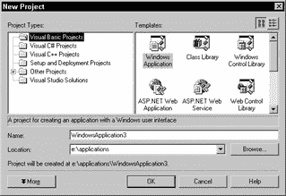
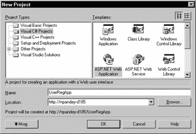
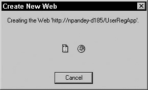

提示：你也可以按 `Ctrl+Shift+N` 打开新建项目对话框。

2. 从项目类型列表中选择 `Visual C# Projects`。
3. 从新建项目对话框的模板列表中选择 `ASP.NET Web Application`。
4. 在 `Name`（名称）框中输入项目名称。
5. 在 `Location`（位置）框中输入 IIS 服务器的名称，或接受默认位置。

完成后的新建项目对话框如图 22-2 所示。

图 22-2：在新项目对话框中选择模板并指定应用程序名称。

提示：如果 Web 服务器已安装在你的计算机上，你也可以在 Location 框中输入 `http://localhost`。

6. 点击 `OK`。当 Visual Studio .NET 创建新应用程序时，对话框会短暂显示。该对话框如图 22-3 所示。

图 22-3：Visual Studio .NET 正在创建项目。

注意：在 ASP.NET 创建项目期间，你可能需要等待一段时间。在创建应用程序之前，还应确保 Web 服务器已启动。要启动 Web 服务器，选择 `Start`（开始）→ `Run`（运行）。在 Run 对话框中，输入 `net start iisadmin` 并按 Enter。

在创建新的应用程序项目后，向导程序会自动创建必要的项目文件——例如 `AssemblyInfo.cs`、`Config.Web` 和 `Global.asax`——以及主文件 `WebForm1.aspx`。图 22-4 显示了解决方案管理器中的这些文件。

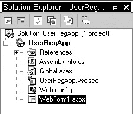

图 22-4：解决方案窗口显示了所有的文件。

Visual Studio .NET 中的 WebForm 有两种视图——*设计视图*和 *HTML 视图*：

* *设计视图*：你在设计视图中设计 WebForm 的用户界面。设计视图为 WebForm 两种布局：网格布局和流布局：
    * **网格布局**：在网格布局中，你可以根据每个控件的坐标在 WebForm 上排列控件。
    * **流布局**：在流布局中，你可以像设计 Microsoft Word 文档一样线性地设计 WebForm。
  你可以通过右键点击 WebForm 并选择属性来切换不同的布局。在属性页上，可以选择相应的布局。

* *HTML 视图*：此视图代表 WebForm 对应的 ASP.NET 语法。你需要点击 HTML 标签打开 HTML 视图。如果 HTML 标签不可见，可以右键点击并从快捷菜单中选择查看 源代码。

### 向 WebForm 添加控件

你可以通过两种方式向 WebForm 添加控件：

- **使用工具箱：** 你可以使用 Visual Studio .NET 包含的工具箱，在 WebForm（`.aspx` 文件）的设计视图中添加控件。在工具箱中，不同类型的控件被归类在单独标签页下，例如 `WebForms`、`HTML` 和 `Data`。例如，你可以使用 `HTML` 标签页创建 HTML 服务器控件，使用 `WebForms` 标签页创建 ASP.NET 服务器控件。之前讨论的所有控件都属于工具箱的 `WebForms` 标签页。当你使用工具箱在设计视图中添加 Web 控件时，会自动生成相应的 `C#` 语法。

提示：当你使用 `HTML` 控件时，需要将它们转换为服务器控件，以便在服务器端进行代码编写。你可以通过右键点击所需的 HTML 控件并从快捷菜单中选择“作为服务器控件运行”（Run As Server Control）选项来实现。这种方法可以让你方便快速地创建复杂的 WebForms。

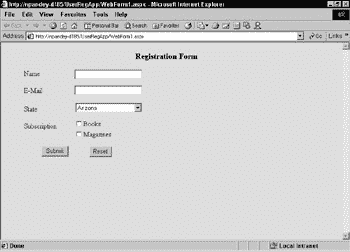

- **使用 Visual C# 语法程序化添加控件：** 你也可以使用 Visual C# 语法向 WebForm 添加 Web 控件。你可以在页面的 HTML 视图（`.aspx` 文件）中使用 `C#` 语法。实际的语法取决于你想添加的控件类型。例如，用于添加 HTML 文本框控件的语法如下：

```html
<input id=Text1 Type=text runat="server">
```

注意：Visual Studio .NET 允许你使用可扩展标记语言（`XML`）标签添加 ASP.NET 服务器控件。你添加 ASP.NET `TextBox` 控件的语法如下：

```html
<asp:TextBox id=TextBox1 runat="server"></asp:TextBox>
```

每个控件都有一个 `ID` 属性，用于唯一标识控件。若要在运行时设置控件的属性，你需要使用以下语法：

`Control_ID.Property = Value`

在上述语法中：

- `Control_ID` 代表控件的 `ID` 属性。
- `Property` 代表控件的属性。
- `Value` 代表分配给控件属性的值。

图 22-5 显示了一个包含常用 Web 控件的 WebForm，例如标签、文本框、超链接、单选按钮、复选框和按钮。正如你所看到的，该 WebForm 是一个用户注册表单。该表单设计用于在各种控件中接受用户输入。填写表单后，用户可以点击 `Submit`（提交）按钮完成注册过程。

`Submit` 按钮会打开另一个 WebForm，显示消息以及在 `name TextBox` 控件中输入的用户名。如果用户点击 `Reset`（重置）按钮，用户填入的信息将从表单上的控件中移除。

图 22-5：用户注册表单显示了可以添加到 WebForms 中的常用控件。

要创建图 22-5 所示表单，请遵循以下步骤：

1. 选择 `WebForm1.aspx` 表单，按 `F4` 查看 `Properties`（属性）窗口。
2. 在 `Properties` 窗口中，点击 `bgColor` 属性的省略号（Ellipsis）按钮，并选择 `Properties`。颜色选择器（Color Picker）对话框打开。
3. 在颜色选择器对话框中，选择一种粉色调并点击 `OK`。WebForm 的颜色将变为你指定的颜色。
4. 向表单添加控件并更改它们的属性，如表 22-2 所示。

#### 表 22-2：要添加到 WebForm 的控件

| 控件 | 属性 | 放置 |
| :--- | :--- | :--- |
| Label | `Text=Registration Form`, `Font=Bold=True`, `Size=Larger` | 放置于表单顶部居中 |
| 姓名、电子邮件、州、订阅的标签 | 每个标签的文本应垂直排列，并与所需的标题对齐 | 位于屏幕左侧 |
| TextBox | `ID=txtName` | 位于姓名标签旁 |
| TextBox | `ID=txtEmail` | 位于电子邮件标签旁 |
| DropDownList | `ID=lstState`, `Items=Arizona, California, Florida` | 位于州标签旁 |
| CheckBoxList | `ID=lstOptions`, `Items=Books, Magazines` | 位于订阅标签旁 |
| Button | `ID=BtnSubmit`, `Text=Submit` | 位于订阅标签下方 |
| Button | `ID=BtnReset`, `Text=Reset` | 位于提交按钮旁 |

你的 WebForm 界面如图 22-6 所示，已就绪。

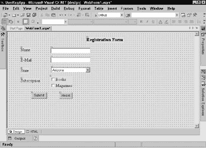

图 22-6：你的 WebForm 完成后应该像这样。

你将在下一节中添加 `Submit` 和 `Reset` 按钮的功能。但在继续之前，先向 Web 应用程序添加另一个表单，当用户点击 `Submit` 时显示注册用户的详情。要添加 WebForm，请遵循以下步骤：

1. 选择 `Project → Add WebForm`。打开 `Add New Item` 对话框。
   提示：如果你在 `Project` 菜单下没有找到 `Add WebForm` 选项，请点击 `Form` 窗口中的任意位置然后选择该菜单选项。
2. 从 `Templates` 列表中选择 `WebForm`，为 WebForm 指定名称（或保留默认名称），并点击 `Open` 创建一个新的 WebForm。

你可以使用新添加的 WebForm 向用户显示消息。因此，你需要添加一个 `Label` 控件。将标签命名为 `lblMessage`。

添加控件后，你需要处理在 WebForm 控件上生成的事件。下一节将描述处理由控件生成的事件的方法。

### 处理事件

当用户与页面上的不同控件交互时，会触发事件。*事件*是用户或系统执行的操作。例如，当点击鼠标按钮或按下按键时会产生事件。

在传统的客户端表单中，事件在客户端触发并处理。在 Web 应用程序中，事件是在服务器端触发的。然而，ASP.NET 服务器控件仅支持服务器端事件，而 HTML 服务器控件支持两端事件。

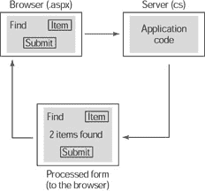

### 理解往返（Round-trips）

WebForms 在服务器上处理。例如，考虑一个用户注册表单。当用户指定用户名时，服务器必须确保用户提供的用户名是唯一的。你可以通过拦截按钮的 `Click` 事件并查询数据库来确保用户名的唯一性。每当交互需要在服务器上处理时，WebForm 会被提交到服务器进行处理，然后返回给客户端。这种处理信息的序列被称为往返（round-trip）过程，如图 22-7 所示。

图 22-7：往返过程

大多数与服务器控件的交互都会导致往返。由于往返涉及将 WebForm 发送到服务器并在浏览器中显示处理后的表单，服务器事件会影响响应时间。因此，WebForm 中可用的事件数量应越少越好。

通常，这些仅限于 `Click` 事件。

注意：脚本语言中经常发生的事件（如 `OnMouseOver`）不受服务器控件支持。然而，某些服务器控件支持在值变化时发生的事件。

表 22-3 描述了与不同 ASP.NET 服务器控件相关的常见事件。

#### 表 22-3：ASP.NET 服务器控件相关事件

| 控件 | 事件 | 说明 |
| :--- | :--- | :--- |
| TextBox | `TextChanged` | 当焦点离开控件时发生 |
| RadioButton 和 CheckBox | `CheckedChanged` | 当你点击控件时发生 |
| RadioButtonList, CheckBoxList 和 ListBox | `SelectedIndexChanged` | 当你更改选择时发生 |
| DropDownList, Button, LinkButton 和 ImageButton | `Click` | 当你点击时发生 |

在 `WebForm` 中，默认情况下，只有 `Button`、`LinkButton` 和 `ImageButton` 服务器控件的 `Click` 事件可以导致表单提交到服务器进行处理。在这种情况下，`WebForm` 会被*回传（posted back）到服务器*。当其他控件产生更改事件时，这些事件会被捕获并缓存。它们不会导致表单立即提交。只有当由于点击按钮导致表单回传时，所有缓存的事件才会被触发并处理。在服务器上处理这些更改事件没有特定的顺序。然而，`Click` 事件会在所有其他更改事件处理完毕后才被处理。

### 理解事件处理器

当事件被触发时，需要对其进行处理以备后续操作。在事件发生时执行的程序被称为*事件处理器*。事件处理器可以自动创建，也可以手动创建。

当你自动方式处理事件时，在 `WebForm` 的设计视图（`.aspx` 文件）中双击控件会创建一个事件处理器。例如，当双击按钮 `btnSubmit` 时，会生成以下代码。然后，你可以在 Visual Studio .NET 生成的函数的事件处理器中编写代码：

```csharp
public void btnSubmit_Click(Object sender, System.EventArgs e)
{
}
```

在上述代码中，`btnSubmit_Click` 程序是按钮的 `Click` 事件的事件处理器。该程序接受两个参数。第一个参数包含事件发送者。*事件发送者*是一个对象（例如表单或控件），它可以产生事件。第二个参数包含与事件相关的附加信息，例如点击鼠标按钮时所在位置的 *x* 和 *y* 坐标。

要手动创建事件处理器，可以从属性（Properties）窗口的下拉列表中选择它。

你现在准备好为图 22-5 所示的 `WebForm` 实现事件处理了。

当你点击提交（Submit）按钮时，应该显示新页面（在本文中为 `WebForm2.aspx`），该页面将显示欢迎消息以及注册用户的名称。要实现此功能，你需要在 `WebForm1.aspx` `WebForm` 提交按钮的 `Click` 事件中编写以下代码：

```csharp
private void BtnSubmit_Click(object sender, System.EventArgs e)
{
    Response.Redirect("WebForm2.aspx?strName=" + txtName.Text);
}
```

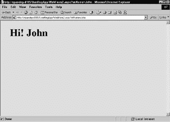

提示：为提交按钮编写事件，请在设计视图中双击按钮。

在上述代码中，`HttpResponse` 类的 `Redirect` 方法将用户重定向到 `WebForm2.aspx` 页面，并将 `txtName` 参数的值传递到目标页面。

在传递文本框 `txtName` 的值后，你需要初始化 WebForm2 以处理从注册表单传来的字符串。为了做到这一点，`WebForm2.aspx` 应在 `Load` 事件中具有以下代码：

```csharp
private void Page_Load(object sender, System.EventArgs e)
{
    lblMessage.Text = "Hi! " + Request.QueryString.Get("strName");
}
```

提示：为 `WebForm2.aspx` 表单编写 `Load` 事件，请在设计视图中双击表单。

在上述代码中，存储在变量 `strName` 中的值被设置为 `WebForm2.aspx` 文件中标签 `lblMessage` 的标题。当用户点击 `WebForm1.aspx` 上的提交按钮时，他或她将被重定向到 `WebForm2.aspx` 页面，如图 22-8 所示。

图 22-8：当用户重定向到另一个页面时，用户名通过查询字符串传递。

当用户点击重置（Reset）按钮时，必须生成一个事件来移除用户在 `WebForm1.aspx` 中填充的所有控件。要实现此功能，你如下所示编写重置按钮的 `Click` 事件：

```csharp
private void BtnReset_Click(object sender, System.EventArgs e)
{
    txtName.Text = "";
    txtEmail.Text = "";
    lstState.ClearSelection();
    lstOptions.ClearSelection();
}
```

在上述代码中，当点击注册表单中的重置按钮时，表单恢复到初始状态。

### 处理数据回传

如前所述，只有当点击 `Button`、`LinkButton` 或 `ImageButton` 控件时，`WebForm` 才会回到服务器。表单提交到服务器后，将在服务器上进行处理。你可以通过以下方式之一处理对应于按钮点击的数据回传：

- 为按钮的 `Click` 事件编写事件处理器。
- 为 `WebForm` 的 `Load` 事件编写事件处理器。`Load` 事件在表单加载时产生。你可以在 `Load` 事件中使用 `IsPostBack` 属性来判断页面是第一次处理的还是通过按钮点击处理的。以下代码描述了 `WebForm` `Load` 事件的事件处理器：

```csharp
protected void Page_Load(object sender, EventArgs e)
{
    if (!IsPostBack)
    {
        // 浏览器第一次访问页面时为真
    }
}
```

### 使用状态（View State）

在传统的 Web 应用中，每当服务器处理 Web 页面时，页面都会从头创建。服务器在处理信息并将页面发送给客户端（浏览器）之后会丢弃当前的页面信息。由于服务器没有保留页面信息，这些页面被称为*无状态的*。然而，ASP.NET 框架绕过了这个限制，可以保存表单及其控件的状态信息。为了管理状态信息，Visual Studio .NET 提供了以下：

- **保存视图状态**：你可以将服务器控件的视图状态保存到对象中。在每次往返（round-trip）中，都可以从保存的状态加载控件的状态，这样用户就可以查看之前选择的所有。
- **StateBag（状态包）**：`StateBag` 类是服务器控件的存储机制。该类提供了以键值对存储信息的属性。例如，如果你想为页面存储用户指定的数据，可以使用 `StateBag` 实例来存储这些数据。

每个服务器控件都包含一个 `ViewState` 属性。当你将此属性设置为 `true` 时，控件的状态在往返之间将保留。

## ADO.NET 在之前的数据访问技术的基础上进行了构建和改进

微软对通用数据访问尝试始于开放数据库连接（`ODBC`）。这种 `ODBC` 技术背后的理念——创建一种以编程方式访问数据库的标准方法——已被后续所有来自华盛顿州雷德蒙德（微软总部所在地）的数据访问技术所采纳。在 `ODBC` 的情况下，这种标准方法被记录为 `ODBC API`（应用程序编程接口）。任何想要声称符合 `ODBC` 标准的数据库供应商都负责构建软件，将根据 API 发送的 `ODBC` 调用转换为原生数据库调用。

这种软件被称为 `ODBC 驱动程序`（`ODBC driver`），它是通用客户端应用程序与特定数据库之间的桥梁。通过这种方法，应用程序程序员可以免于学习如何使用特定供应商的数据库 API。应用程序程序员只需要知道如何使用 `ODBC API` 编写客户端应用程序。这提高了工作效率，并让你能够编写出适用于不同数据库的程序。

然而，`ODBC API` 最初主要是针对 C 语言应用程序程序员设计的，并且在其他语言（如 Visual Basic）中很难使用。这最终导致了活动数据对象（`ADO`）的引入，这是一种为用于任何支持微软通用对象模型（`COM`）的语言设计的数据访问技术。`ADO` 引入了一个简单的对象模型，使得在 MS Windows 程序中访问数据变成了一个简单的任务。此外，`ADO` 引入了“离线记录集”（`disconnected recordsets`）的概念，作为分布式应用程序层之间传输数据的方法。`ADO` 后面的底层 API 被称为 `OLE DB`。该 API 为 C++ 程序员设计，数据库供应商通常使用它来编写 `OLE DB 提供程序`（`OLE DB providers`，`OLE DB` 驱动程序的常用术语，将 `ADO` 调用转换为原生数据库调用的软件）。微软还为 `ODBC` 编写了一个 `OLE DB 提供程序`。该提供程序允许你对任何符合 `ODBC` 标准的数据库发出 `ADO` 调用。

正如本章所示，`ADO.NET` 保留了与 `ADO` 相似的对象模型，并通过提供一种将更多信息封装到名为 `DataSet` 的 `ADO.NET` 对象中的方法改进了离线记录集的概念。事实上，`ADO.NET` 设计时就考虑了离线数据，因为这种无状态的方法对于分布式 Internet 最有效。在本章中，你将学习如何使用 `ADO.NET` 来处理数据。如果你熟悉 `ADO`，许多概念将看起来很眼熟，甚至代码也不会完全陌生。

## 理解 DataSet 类及其相关类

本节将检查 `ADO.NET` 类。如果你熟悉 `ADO`，你将识别出这里介绍的许多概念。但请注意，某些 `ADO` 概念在 `ADO.NET` 中已经有了巨大的进步，并且与其原始形式相比得到了大幅扩展。

让我们从这个新成员开始：`DataSet` 类及其相关类。

`DataSet` 扩展了在 `ADO` 中找到的记录集（recordset）概念。正如其名称所示，`ADO` 的记录集是一组记录的抽象，例如通过执行 `SQL Select` 语句检索到的结果数据。记录集实际上可以包含多组记录，但这些记录之间是独立的，必须通过调用 `NextRecordSet()` 顺序处理。`ADO.NET` 的 `DataSet` 是整个数据库的抽象。`DataSet` 不仅可以包含多组记录（恰当地称为 `DataTable`），你还可以定义 `DataTables` 之间的关系。表 23-1 描述了所有与 `DataSet` 相关的类。

类似于 `ADO` 类，`ADO.NET` 类大量使用了集合：`DataSet` 类包含一个 `DataTables` 集合；`DataTable` 类包含一个 `DataColumns` 集合，依此类推。

### 表 23-1：DataSet 及相关类

| 类 | 描述 |
| :--- | :--- |
| `DataSet` | 数据的内存缓存，可能由几个相关的 `DataTables` 组成。为分布式应用程序中的离线使用设计。 |
| `DataTable` | 数据容器，可能由几个 `DataColumns` 组成。每行数据包含在 `DataRow` 中。 |
| `DataRow` | `DataTable` 中的特定行数据。 |
| `DataColumn` | `DataTable` 中列的定义（名称、数据类型等）。 |
| `DataRelation` | `DataSet` 内部两个 `DataTables` 之间的关系，通常用于表示外键关系。 |
| `Constraint` | 对一个或多个 `DataColumns` 的限制，用于表示唯一性等约束。 |
| `DataColumnMapping` | 将数据库表的列名映射到 `DataSet` 中 `DataTable` 的列名。 |
| `DataTableMapping` | 将数据库中的表名映射到 `DataSet` 中 `DataTables` 的名称。 |
| `DataView` | `DataTable` 的自定义视图，可排序、过滤和搜索。 |

`ADO` 的 `RecordSet` 逐渐演变为分布式应用程序层之间传输数据的标准方法。`DataSet` 在 `ADO.NET` 中接管了这一角色，并提供了许多方法来将内存数据缓存与数据库中的源数据进行同步。这些方法包括 `AcceptChanges()`、`GetChanges()`、`HasChanges()`、`HasErrors()` 和 `RejectChanges()`。这些方法允许你以更改后的 `DataSet` 形式检索任何更改，检查更改是否有错误，并决定是否接受这些更改。

## 理解 OLE DB 和 SQL Server 支持

`ADO.NET` 包含两组相似的类。一组是用于访问具有 `OLE DB` 提供程序的通用类。另一组类针对微软的旗舰数据库 `SQL Server` 进行了精细调整。通用类的名称都以 `OleDb` 开头。SQL Server 特定的类都以 `Sql` 开头。每个通用类都有对应的 SQL Server 特定类。例如，对 SQL Server 执行 SQL 语句的类是 `SqlCommand`。通用类是 `OleDbCommand`。

注意：如果查看针对 .NET Framework 第一个公共 Beta 设计的代码，你会看到带有 `Ado` 前缀的代码。该前缀从 Beta 2 开始改为 `OleDb`。

本章使用了通用类，即使在访问 `SQL Server` 数据库也是如此。当你编写访问 `SQL Server` 的应用程序时，你需要决定使用速度更快的 SQL Server 特定类，还是可以通过更改连接字符串切换数据库供应商的通用类。权衡是速度与移植性。SQL Server 类直接调用原生数据库层。通用类使用 `OleDb` 并在调用原生数据库层之前通过 `COM` 层。额外层的开销会导致性能下降。

`DataSet` 类与 `OLE DB` 提供程序和 `SQL Server` 提供程序结合使用。表 23-2 列出了特定提供程序的类。许多类对于有经验的 `ADO` 读者来说看起来很眼熟。

### 表 23-2：DataSet 及相关类

| SQL Server 提供程序 | OLE DB 提供程序 | 描述 |
| :--- | :--- | :--- |
| `SqlCommand` | `OleDbCommand` | SQL 语句的类封装。该类可以管理直接 SQL 语句（如 SELECT、UPDATE、DELETE 或 INSERT 语句）以及存储过程调用。 |
| `SqlCommandBuilder` | `OleDbCommandBuilder` | 用于生成 SELECT、UPDATE、DELETE 或 INSERT 语句。 |
| `SqlConnection` | `OleDbConnection` | 到数据库的连接。 |
| `SqlDataAdapter` | `OleDbDataAdapter` | 一组 SELECT、UPDATE、DELETE 或 INSERT 语句以及到数据库的连接，用于填充 `DataSet` 并更新底层的 `database`。 |
| `SqlDataReader` | `OleDbDataReader` | 一组只读的向前记录集。 |
| `SqlError` | `OleDbError` | 数据库返回的警告或错误，包含在 `Errors` 集合中。 |
| `SqlException` | `OleDbException` | 当发生数据库错误时抛出的异常类型。 |
| `SqlParameter` | `OleDbParameter` | 用于存储过程的参数。 |
| `SqlTransaction` | `OleDbTransaction` | 一个数据库事务。 |

在下一节中，你将学习这些类如何与常用类（`DataSet` 及其相关类）配合，以执行常用的数据库操作。

# 使用 ADO.NET 理解常用数据库操作

本节中显示的每个示例为了简单起见都省略了 `using` 声明。

假设本章中始终存在以下三个命名空间声明：

* `using System;`
* `using System.Data;`
* `using System.Data.OleDb;`

此外，大多数函数都是从它们的类上下文中提取出来的。这些函数应该作用于以下类定义的作用域内：

```csharp
namespace ADOdotNET
{
    class ADOdotNET
    {
        // 注意：函数放在此处
    }
}
```

在完成这些说明之后，我们就可以深入研究 ADO.NET。本节将逐一检查可以使用 ADO.NET 执行的每一类操作：

* 不返回行的操作
* 仅返回一行的操作
* 仅影响一行的操作
* 返回多行的操作
* 影响多行的操作
* 返回层级数据的操作

## 不返回行的操作

许多 SQL 操作（例如 `Insert`、`Delete` 和 `Update` 语句）仅返回成功或失败（或受操作影响的行数）。

注意：SQL Server 程序员通过 `SET NOCOUNT [ON | OFF]` 语句控制是否从存储过程中返回受影响的行数。SQL Server 程序员通常通过 `SET NOCOUNT ON` 关闭此功能，因为这可以略微提高性能。

列表 23-3 显示了在 ADO.NET 中执行不返回行的 SQL 语句是多么简单。在这个过程中，你使用了两个对象。首先，你使用 `OleDbConnection` 对象来建立与数据库的连接。列表 23-1 显示了用于访问本地安装的 SQL Server 上的 Northwind 数据库的示例连接字符串。

### 列表 23-1：SQL Server 的示例连接字符串

```csharp
private static string oleDbConnectionString
{
    get
    {
        // 注意：在生产应用中使用 sa 账户
        // 显然是一个非常、非常糟糕的
        // 做法。此外，将 sa 账户的密码
        // 留空同样是不可接受的。
        return "Provider=SQLOLEDB.1;"
             + "User ID=sa;Initial Catalog=Northwind;Data Source=localhost;";
    }
}
```

### 列表 23-2：Microsoft Access 的示例连接字符串

```csharp
private static string oleDbConnectionString
{
    get
    {
        // 注意：这假设 Microsoft Office Pro
        // 安装在默认位置。
        return "Provider=Microsoft.Jet.OLEDB.4.0;"
             + "Data Source=C:\\Program Files\\Microsoft Office\\Office\\Samples\\Northwind.MDB";
    }
}
```

用于执行查询的第二个对象是 `OleDbCommand` 对象。它的构造函数接收一个字符串参数（你想要执行的 SQL 语句的文本）和一个 `OleDbConnection` 对象。`CommandType` 属性允许你指定正在执行的命令是存储过程、Access 查询还是纯文本。查询通过 `ExecuteNonQuery()` 方法执行。错误（如主键违背）通过异常进行报告。

你也可以使用 `Command` 对象来执行不返回数据行的 SQL 命令，例如列表 23-3 示例所示：

### 列表 23-3：使用 Command 执行不返回行的 SQL 语句的模板

```csharp
// 为 oleDbConnectionString 和 strSQLStatement 声明并设置适当的值
// 创建 OleDb 对象
OleDbConnection databaseConnection = new OleDbConnection(oleDbConnectionString);
OleDbCommand databaseCommand = new OleDbCommand(strSQLStatement, databaseConnection);

// 注意：以下两个语句只用其中一个，不要两个都用。
// 如果我们处理的是 SQL 语句（即不是存储过程），使用：
databaseCommand.CommandType = CommandType.Text;
// 如果我们处理的是存储过程，使用：
databaseCommand.CommandType = CommandType.StoredProcedure;

try
{
    // 建立数据库连接
    databaseConnection.Open();
    // 执行 SQL 命令
    int numRows = databaseCommand.ExecuteNonQuery();
    // 执行其他操作，例如报告 numRows
}
catch (Exception e)
{
    // 处理异常，例如：
    Console.WriteLine("****** 捕获到异常:\n{0}", e.Message);
}
finally
{
    databaseConnection.Close();
}
```

带参数调用存储过程稍微复杂一点。列表 23-4 显示了你想要调用的存储过程的 SQL 代码。

### 列表 23-4：插入记录的 SQL Server 存储过程

```sql
USE [Northwind]
GO
CREATE PROCEDURE [pc_insCustomers]
(
    @CustomerID_1 nchar,
    @CompanyName_2 nvarchar,
    @ContactName_3 nvarchar,
    @ContactTitle_4 nvarchar,
    @Address_5 nvarchar,
    @City_6 nvarchar,
    @Region_7 nvarchar,
    @PostalCode_8 nvarchar,
    @Country_9 nvarchar,
    @Fax_11 nvarchar
)
AS
INSERT INTO [Northwind].[dbo].[Customers]
([CustomerID], [CompanyName], [ContactName], [ContactTitle], [Address], [City], [Region], [PostalCode], [Country], [Fax])
VALUES(@CustomerID_1, @CompanyName_2, @ContactName_3, @ContactTitle_4, @Address_5, @City_6, @Region_7, @PostalCode_8, @Country_9, @Fax_11)
```


唯一棘手的地方在于如何定义和设置参数。这是通过 `Parameters` 集合实现的。与任何集合一样，你通过 `Add()` 方法创建新成员。返回新创建的对象，你可以设置方向（仅输入、仅输出或两者）以及值。`Add()` 方法的参数是存储过程参数的名称、数据类型和大小。列表 23-5 显示了整个过程的代码。

### 列表 23-5：在 ADO.NET 中调用带参数的存储过程

```csharp
static void TestWithSP(string customerID)
{
    // 设置 SQL 语句
    strSQLInsert = "[pc_insCustomers]";

    // 创建 OleDb 对象
    OleDbConnection databaseConnection = new OleDbConnection(oleDbConnectionString);
    OleDbCommand insertCommand = new OleDbCommand(strSQLInsert, databaseConnection);

    // 我们处理的是存储过程（即不是 SQL 语句）
    insertCommand.CommandType = CommandType.StoredProcedure;

    // 添加参数 (#1 之 11)
    OleDbParameter param = insertCommand.Parameters.Add("@CustomerID_1", OleDbType.VarChar, 5);
    param.Direction = ParameterDirection.Input;
    param.Value = customerID;

    // 添加参数 (#2 之 11)
    param = insertCommand.Parameters.Add("@CompanyName_2", OleDbType.VarChar, 40);
    param.Direction = ParameterDirection.Input;
    param.Value = "Hungry Coyote Export Store";

    // 添加参数 3-10
    // 等

    // 添加参数 (#11 之 11)
    param = insertCommand.Parameters.Add("@Fax_11", OleDbType.VarChar, 24);
    param.Direction = ParameterDirection.Input;
    param.Value = "(503) 555-2376";

    try
    {
        // 建立数据库连接
        databaseConnection.Open();

        // 执行 SQL 命令
        int numRows = insertCommand.ExecuteNonQuery();

        // 报告结果
        Console.WriteLine("插入了 {0} 行(s)。", numRows.ToString());
    }
    catch (Exception e)
    {
        Console.WriteLine("****** 捕获到异常:\n{0}", e.Message);
    }
    finally
    {
        databaseConnection.Close();
    }
}
```

## 返回单行实体的数据操作

某些数据操作（例如根据主键检索记录）只返回单行数据。`ADO.NET` 提供了三种检索单行的方法。其中一种方法仅适用于单行实体，而另外两种方法是通用的，可以用于检索多行数据（你将在下一节中学习到）。

检索单行实体最有效的方法通常是通过输出参数（output parameter）。

然而，只有当你确定存储过程只返回单行时，才能使用此方法。`Listing 23-6` 显示了一个通过输出参数检索单个记录的 `SQL Server` 存储过程。

### 列表 23-6：用于检索单个记录的 SQL Server 存储过程

```sql
USE [Northwind]
GO

CREATE PROCEDURE [pc_getContact_ByCustomerID]
(
    @CustomerID_1 nchar,
    @ContactName_2 nvarchar output,
    @ContactTitle_3 nvarchar output
)
AS
SELECT
    @ContactName_2 = [ContactName],
    @ContactTitle_3 = [ContactTitle]
FROM [Northwind].[dbo].[Customers]
WHERE
    [CustomerID] = @CustomerID_1
```

调用此类存储过程与用于调用插入行的存储过程的代码相似（请参阅 `Listing 23-3`）。当然，输出参数的方向被设置为 `ParameterDirection.Output`。在执行存储过程后，你可以使用 `Parameters` 集合来检索输出参数的值，如 `Listing 23-7` 所示。

### 列表 23-7：通过输出参数检索单个记录

```csharp
static void TestSPWithOutParam(string customerID)
{
    // 设置 SQL 语句字符串
    string strSQLSelect = "[pc_getContact_ByCustomerID]";

    // 创建 OleDb 对象
    OleDbConnection databaseConnection = new OleDbConnection(oleDbConnectionString);
    OleDbCommand selectCommand = new OleDbCommand(strSQLSelect, databaseConnection);

    // 我们处理的是存储过程（即：不是 SQL 语句）
    selectCommand.CommandType = CommandType.StoredProcedure;

    // 添加每个参数（3 个中的第 1 个）
    OleDbParameter param = selectCommand.Parameters.Add("@CustomerID_1", OleDbType.VarChar, 5);
    param.Direction = ParameterDirection.Input;
    param.Value = customerID;

    // 添加每个参数（3 个中的第 2 个）
    param = selectCommand.Parameters.Add("@ContactName_2", OleDbType.VarChar, 30);
    param.Direction = ParameterDirection.Output;

    // 添加每个参数（3 个中的第 3 个）
    param = selectCommand.Parameters.Add("@ContactTitle_3", OleDbType.VarChar, 30);
    param.Direction = ParameterDirection.Output;

    try
    {
        // 建立数据库连接
        databaseConnection.Open();

        // 执行 SQL 命令
        selectCommand.ExecuteNonQuery();

        // 报告结果
        string contactName = selectCommand.Parameters["@ContactName_2"].Value.ToString();
        string contactTitle = selectCommand.Parameters["@ContactTitle_3"].Value.ToString();
        Console.WriteLine("Contact name is {0}, title is {1}.", contactName, contactTitle);
    }
    catch (Exception e)
    {
        Console.WriteLine("****** 捕获到异常:\n{0}", e.Message);
    }
    finally
    {
        databaseConnection.Close();
    }
}
```

现在，看看通用的数据读取方法。第一种使用 `OleDbDataReader` 对象。`Command` 对象有一个 `ExecuteReader()` 方法，该方法返回一个 `OleDbDataReader` 对象。你可以使用 `Read()` 方法遍历 `DataReader` 的内容。当读取过程中发现数据时，`Read()` 返回 `True`，否则返回 `False`。

`Listing 23-8` 显示了如何实现。请注意，此示例使用 SQL 语句访问存储过程仅是为了演示调用存储过程的另一种方法。这仅出于教学目的，因为像 `Listing 23-7` 所示的方式调用存储过程更高效。

### 列表 23-8：通过 DataReader 检索单个记录

```csharp
static void TestSelectWithDataReader(string customerID)
{
    // 设置 SQL 语句字符串，假设 customerID 不包含任何嵌入引号
    string strSQLSelect = "EXEC [pc_getCustomer_ByCustomerID] @CustomerID_1='" + customerID + "'";

    // 创建 OleDb 对象
    OleDbConnection databaseConnection = new OleDbConnection(oleDbConnectionString);
    OleDbCommand selectCommand = new OleDbCommand(strSQLSelect, databaseConnection);

    // 我们处理的是 SQL 语句（即：不是存储过程）
    selectCommand.CommandType = CommandType.Text;

    try
    {
        // 建立数据库连接
        databaseConnection.Open();

        // 执行 SQL 命令
        OleDbDataReader rowReader = selectCommand.ExecuteReader();

        // 报告结果
        if (rowReader.Read())
        {
            string contactName = rowReader["ContactName"].ToString();
            string contactTitle = rowReader["ContactTitle"].ToString();
            Console.WriteLine("Contact name is {0}, title is {1}.", contactName, contactTitle);
        }
        else
        {
            Console.WriteLine("No rows found!");
        }
    }
    catch (Exception e)
    {
        Console.WriteLine("****** 捕获到异常:\n{0}", e.Message);
    }
    finally
    {
        databaseConnection.Close();
    }
}
```

另一种检索数据的通用方法是使用多功能的 `DataSet` 对象。由于 `DataSet` 对象的设计旨在独立于其原始数据源使用，因此没有 `OleDbDataSet` 或 `SqlDataSet`，只有 `DataSet`。一个 `DataAdapter` 对象包含四个嵌入命令对象来执行操作：
- `InsertCommand`
- `SelectCommand`
- `UpdateCommand`
- `DeleteCommand`

在设置了 `SelectCommand` 对象后，你可以使用 `Fill()` 方法填充 `DataSet`。下一节将显示如何使用其他三个命令来更改 `DataSet` 中包含的数据。`DataSet` 包含一个或多个 `DataTable` 对象。每个 `DataTable` 包含一个或多个 `DataRow` 对象。这些 `DataRow` 对象存储在 `DataSet` 的 `Rows` 集合中。`Row` 和 `Column` 集合可以通过索引和名称进行索引。实际上，你可以将 `DataSet` 对象认为是一个内存中的数据库。`Listing 23-9` 显示了一个使用 `DataSet` 检索单个记录的示例程序。

### 列表 23-9：通过 DataSet 检索单个记录

```csharp
static void TestSelectWithDataSet(string customerID)
{
    // 设置 SQL 语句字符串
    string strSQLSelect = "EXEC [pc_getCustomer_ByCustomerID] @CustomerID_1='" + customerID + "'";

    // 创建 OleDb 对象
    OleDbConnection databaseConnection = new OleDbConnection(oleDbConnectionString);
    OleDbCommand selectCommand = new OleDbCommand(strSQLSelect, databaseConnection);
    OleDbDataAdapter dsCmd = new OleDbDataAdapter();
    DataSet resultDataSet = new DataSet();

    // 我们处理的是 SQL 语句（即：不是存储过程）
    selectCommand.CommandType = CommandType.Text;

    try
    {
        // 建立数据库连接
        databaseConnection.Open();

        // 执行 SQL 命令
        dsCmd.SelectCommand = selectCommand;
        int numRows = dsCmd.Fill(resultDataSet, "Customers");

        // 报告结果
        if (numRows > 0)
        {
            string contactName = resultDataSet.Tables["Customers"].Rows[0]["ContactName"].ToString();
            string contactTitle = resultDataSet.Tables["Customers"].Rows[0]["ContactTitle"].ToString();
            Console.WriteLine("Contact name is {0}, title is {1}.", contactName, contactTitle);
        }
        else
        {
            Console.WriteLine("No rows found!");
        }
    }
    catch (Exception e)
    {
        Console.WriteLine("****** 捕获到异常:\n{0}", e.Message);
    }
    finally
    {
        databaseConnection.Close();
    }
}
```

## 影响单行实体的数据操作

本节将查看 `DataAdapter` 对象的 `InsertCommand`、`UpdateCommand` 和 `DeleteCommand` 属性。对于这些命令中的每一个，你可以通过编程设置命令或让命令自动生成。编程设置命令通常会产生更好的性能，因为开销较小。

### 影响单行实体的插入操作

列表 23-10 中的代码使用了一种常用惯用法，这在自动生成 `Insert` 语句时非常有用。通过 `SelectCommand` 获取一个空的 `DataSet`。此 `Fill()` 调用的唯一目的是获取你想要操作的行结构。这比通过程序显式定义该结构更具灵活性。

### 列表 23-10：通过自动生成的 InsertCommand 添加单条记录

```csharp
static void TestAutoInsertWithDataSet(string customerID)
{
    // 设置 SQL 语句字符串，我们只需要元数据，
    // 所以即使没有记录匹配此 CustomerID 也没关系。
    string strSQLSelect = "EXEC [pc_getCustomer_ByCustomerID] @CustomerID_1='???'";

    // 创建 OleDb 对象
    OleDbConnection databaseConnection = new OleDbConnection(oleDbConnectionString);
    OleDbCommand selectCommand = new OleDbCommand(strSQLSelect, databaseConnection);
    OleDbDataAdapter dsCmd = new OleDbDataAdapter();

    // 下面是自动生成语句的关键！！！
    OleDbCommandBuilder custCB = new OleDbCommandBuilder(dsCmd);

    DataSet resultDataSet = new DataSet();

    // 我们处理的是 SQL 语句（即：不是存储过程）
    selectCommand.CommandType = CommandType.Text;

    try
    {
        // 建立数据库连接
        databaseConnection.Open();

        // 执行 SQL 命令
        dsCmd.SelectCommand = selectCommand;

        // 这获取了 Customers 表的结构
        int numRows = dsCmd.Fill(resultDataSet, "Customers");

        // 创建新行
        DataRow workRow = resultDataSet.Tables["Customers"].NewRow();

        // 填充行数据
        workRow["CustomerID"] = customerID; // 1
        workRow["CompanyName"] = "Hungry Coyote Export Store"; // 2
        workRow["ContactName"] = "Yoshi Latimer"; // 3
        workRow["ContactTitle"] = "Sales Representative"; // 4
        workRow["Address"] = "City Center Plaza 516 Main St."; // 5
        workRow["City"] = "Elgin"; // 6
        workRow["Region"] = "OR"; // 7
        workRow["PostalCode"] = "97827"; // 8
        workRow["Country"] = "USA"; // 9
        workRow["Phone"] = "(503) 555-6874"; // 10
        workRow["Fax"] = "(503) 555-2376"; // 11

        resultDataSet.Tables["Customers"].Rows.Add(workRow);

        // 与数据源同步更改
        dsCmd.Update(resultDataSet, "Customers");

        // 报告结果
        Console.WriteLine("Inserted 1 row.");
    }
    catch (Exception e)
    {
        Console.WriteLine("****** 捕到异常:\n{0}", e.Message);
    }
    finally
    {
        databaseConnection.Close();
    }
}
```

自动生成 `DataAdapter` 命令的秘密在于使用 `DataAdapter` 作为构造函数中的参数来创建一个 `CommandBuilder` 对象，如下面的代码所示：

```csharp
// 下面是自动生成语句的关键！！！
OleDbCommandBuilder custCB = new OleDbCommandBuilder(dsCmd);
```

如果没有这些行，后续的 `Update()` 将失败，因为 `InsertCommand` 无法自动生成。自动生成 `UpdateCommand` 和 `DeleteCommand` 操作也存在相同的要求。

列表 23-10 展示了完整的操作流程。在通过存储过程（如列表 23-11 所示）获取 `Customers` 表的结构后，通过调用 `NewRow()` 方法创建一个新行。然后为新行的每一列设置值。接着，通过调用 `AddRow()` 方法将新填充的行添加到 `Rows` 集合中。最后，通过调用 `DataAdapter` 的 `Update()` 方法将此更改传播到原始数据源。

### 列表 23-11：用于获取 Customers 表结构的存储过程

```sql
USE [Northwind]
GO

CREATE PROCEDURE [pc_getCustomer_ByCustomerID]
(
    @CustomerID_1 nchar
)
AS
SELECT
    [CustomerID],
    [CompanyName],
    [ContactName],
    [ContactTitle],
    [Address],
    [City],
    [Region],
    [PostalCode],
    [Country],
    [Phone],
    [Fax]
FROM [Northwind].[dbo].[Customers]
WHERE [CustomerID] = @CustomerID_1
```

你需要通过程序定义一个命令来执行插入操作。你已经在列表 23-5 中学习了如何使用参数化存储过程来实现这一点（顺便说一下，这是执行数据操作最高的方法之一）。在定义了命令及其参数后，你只需要设置 `DataAdapter` 的 `InsertCommand` 即可，如列表 23-12 所示。代码其余部分（创建新行、设置列值、添加新行和更新数据源）与使用自动生成的 `InsertCommand` 时使用的代码相同。由于你使用了类似的方法来手动创建 `UpdateCommand` 和 `DeleteCommand`，因此接下来的章节仅展示如何使用自动生成的命令。

### 列表 23-12：通过 InsertCommand 添加单条记录

```csharp
static void TestInsertWithDataSet(string customerID)
{
    // 设置 SQL 语句字符串，我们只需要元数据，
    // 所以即使没有记录匹配此 CustomerID 也没关系。
    string strSQLSelect = "EXEC [pc_getCustomer_ByCustomerID] @CustomerID_1='???'";

    // 创建 OleDb 对象
    OleDbConnection databaseConnection = new OleDbConnection(oleDbConnectionString);
    OleDbCommand selectCommand = new OleDbCommand(strSQLSelect, databaseConnection);
    OleDbDataAdapter dsCmd = new OleDbDataAdapter();

    // 下面是自动生成语句的关键！！！
    OleDbCommandBuilder custCB = new OleDbCommandBuilder(dsCmd);

    DataSet resultDataSet = new DataSet();

    // 我们处理的是 SQL 语句（即：不是存储过程）
    selectCommand.CommandType = CommandType.Text;

    try
    {
        // 建立数据库连接
        databaseConnection.Open();

        // 执行 SQL 命令
        dsCmd.SelectCommand = selectCommand;

        // 这获取了 Customers 表的结构
        int numRows = dsCmd.Fill(resultDataSet, "Customers");

        // 创建新行
        DataRow workRow = resultDataSet.Tables["Customers"].NewRow();

        // 填充行数据
        workRow["CustomerID"] = customerID; // 1
        workRow["CompanyName"] = "Hungry Coyote Export Store"; // 2
        workRow["ContactName"] = "Yoshi Latimer"; // 3
        workRow["ContactTitle"] = "Sales Representative"; // 4
        workRow["Address"] = "City Center Plaza 516 Main St."; // 5
        workRow["City"] = "Elgin"; // 6
        workRow["Region"] = "OR"; // 7
        workRow["PostalCode"] = "97827"; // 8
        workRow["Country"] = "USA"; // 9
        workRow["Phone"] = "(503) 555-6874"; // 10
        workRow["Fax"] = "(503) 555-2376"; // 11

        resultDataSet.Tables["Customers"].Rows.Add(workRow);

        // 与数据源同步更改
        dsCmd.Update(resultDataSet, "Customers");

        // 报告结果
        Console.WriteLine("Inserted 1 row.");
    }
    catch (Exception e)
    {
        Console.WriteLine("****** 捕到异常:\n{0}", e.Message);
    }
    finally
    {
        databaseConnection.Close();
    }
}
```

### 列表 23-13：通过自动生成的 UpdateCommand 更新单条记录

```csharp
static void TestAutoUpdateWithDataSet(string customerID)
{
    // 设置 SQL 语句字符串
    string strSQLSelect = "EXEC [pc_getCustomer_ByCustomerID] @CustomerID_1='" + customerID + "'";

    // 创建 OleDb 对象
    OleDbConnection databaseConnection = new OleDbConnection(oleDbConnectionString);
    OleDbCommand selectCommand = new OleDbCommand(strSQLSelect, databaseConnection);
    OleDbDataAdapter dsCmd = new OleDbDataAdapter();

    // 以下这一行是自动生成语句的关键！！！
    OleDbCommandBuilder custCB = new OleDbCommandBuilder(dsCmd);

    DataSet resultDataSet = new DataSet();

    // 我们处理的是 SQL 语句（即：不是 存储过程）
    selectCommand.CommandType = CommandType.Text;

    try
    {
        // 建立数据库连接
        databaseConnection.Open();

        // 执行 SQL 命令
        dsCmd.SelectCommand = selectCommand;
        int numRows = dsCmd.Fill(resultDataSet, "Customers");

        // 报告结果
        if (numRows > 0)
        {
            resultDataSet.Tables["Customers"].Rows[0]["ContactTitle"] = "Sr. Sales Representative";

            // 与数据源同步更改
            dsCmd.Update(resultDataSet, "Customers");
            Console.WriteLine("1 row updated!");
        }
        else
        {
            Console.WriteLine("No rows found!");
        }
    }
    catch (Exception e)
    {
        Console.WriteLine("****** 捕获到异常:\n{0}", e.Message);
    }
    finally
    {
        databaseConnection.Close();
    }
}
```

## 影响单行实体的删除操作

当然，并不是所有影响单行实体的操作都需要通过 `DataSet` 执行。你也可以使用存储过程或 SQL 语句。列表 23-14 显示了如何使用 SQL 语句删除单行。

### 列表 23-14：通过 SQL 语句删除单条记录

```csharp
static void TestDeleteStatement(string customerID)
{
    // 设置 SQL 语句字符串
    string strSQLDelete = "DELETE FROM Customers WHERE CustomerID = '" + customerID + "'";

    // 创建 OleDb 对象
    OleDbConnection databaseConnection = new OleDbConnection(oleDbConnectionString);
    OleDbCommand deleteCommand = new OleDbCommand(strSQLDelete, databaseConnection);

    // 我们处理的是 SQL 语句（即：不是 存储过程）
    deleteCommand.CommandType = CommandType.Text;

    try
    {
        // 建立数据库连接
        databaseConnection.Open();

        // 执行 SQL 命令
        int numRows = deleteCommand.ExecuteNonQuery();

        // 报告结果
        Console.WriteLine("Deleted {0} row(s).", numRows.ToString());
    }
    catch (Exception e)
    {
        Console.WriteLine("****** 捕获到异常:\n{0}", e.Message);
    }
    finally
    {
        databaseConnection.Close();
    }
}
```

列表 23-15 通过展示如何使用这种方法删除单行，完成了对自动生成命令的覆盖。在填充 `DataSet` 之后，你可以调用 `Delete()` 来移除某行。始终需要调用 `Update()` 来将此更改持久化到数据源中。

### 列表 23-15：通过自动生成的 DeleteCommand 删除单条记录

```csharp
static void TestAutoDeleteWithDataSet(string customerID)
{
    // 设置 SQL 语句字符串
    string strSQLSelect = "EXEC [pc_getCustomer_ByCustomerID] @CustomerID_1='" + customerID + "'";

    // 创建 OleDb 对象
    OleDbConnection databaseConnection = new OleDbConnection(oleDbConnectionString);
    OleDbCommand selectCommand = new OleDbCommand(strSQLSelect, databaseConnection);
    OleDbDataAdapter dsCmd = new OleDbDataAdapter();

    // 以下这一行是自动生成语句的关键！！！
    OleDbCommandBuilder custCB = new OleDbCommandBuilder(dsCmd);

    DataSet resultDataSet = new DataSet();

    // 我们处理的是 SQL 语句（即：不是 存储过程）
    selectCommand.CommandType = CommandType.Text;

    try
    {
        // 建立数据库连接
        databaseConnection.Open();

        // 执行 SQL 命令
        dsCmd.SelectCommand = selectCommand;
        int numRows = dsCmd.Fill(resultDataSet, "Customers");

        // 报告结果
        if (numRows > 0)
        {
            resultDataSet.Tables["Customers"].Rows[0].Delete();

            // 与数据源同步更改
            dsCmd.Update(resultDataSet, "Customers");
            Console.WriteLine("1 row deleted!");
        }
        else
        {
            Console.WriteLine("No rows found!");
        }
    }
    catch (Exception e)
    {
        Console.WriteLine("****** 捕获到异常:\n{0}", e.Message);
    }
    finally
    {
        databaseConnection.Close();
    }
}
```

## 返回行集的数据操作

当你检查如何检索单行时，已经看到了检索行集的两种方法。列表 16 使用存储过程来演示行集的获取。列表 17 与列表 23-8 之间的显著区别在于使用了 `while` 循环（而不是 `if` 语句）来遍历所有记录。

### 列表 16：用于选择行集的 SQL Server 存储过程

```sql
USE [Northwind]
GO

CREATE PROCEDURE [pc_getCustomer]
AS
SELECT TOP 5
    [CustomerID],
    [CompanyName],
    [ContactName],
    [ContactTitle],
    [Address],
    [City],
    [Region],
    [PostalCode],
    [Country],
    [Phone]
```

### 列表 17：使用 DataReader 获取行集

```csharp
static void TestSelectManyWithDataReader(string customerID)
{
    // 设置 SQL 语句字符串
    string strSQLSelect = "[pc_getCustomer]";

    // 创建 OleDb 对象
    OleDbConnection databaseConnection = new OleDbConnection(oleDbConnectionString);
    OleDbCommand selectCommand = new OleDbCommand(strSQLSelect, databaseConnection);

    // 我们处理的是 存储过程（即：不是 SQL 语句）
    selectCommand.CommandType = CommandType.StoredProcedure;

    try
    {
        // 建立数据库连接
        databaseConnection.Open();

        // 执行 SQL 命令
        OleDbDataReader rowReader = selectCommand.ExecuteReader();

        // 报告结果
        while (rowReader.Read())
        {
            string contactName = rowReader["ContactName"].ToString();
            string contactTitle = rowReader["ContactTitle"].ToString();
            Console.WriteLine("Contact name is {0}, title is {1}.", contactName, contactTitle);
        }
    }
    catch (Exception e)
    {
        Console.WriteLine("****** 捕获到异常:\n{0}", e.Message);
    }
    finally
    {
        databaseConnection.Close();
    }
}
```

使用 `DataSet` 对象检索行集看起来同样熟悉（参考列表 9）。再次，你只需要添加迭代来处理获取的记录。这可以通过 `for` 循环来实现，如列表 18 所示。

### 列表 18：使用 DataSet 获取行集

```csharp
static void TestSelectManyWithDataSet(string customerID)
{
    // 设置 SQL 语句字符串
    string strSQLSelect = "[pc_getCustomer]";

    // 创建 OleDb 对象
    OleDbConnection databaseConnection = new OleDbConnection(oleDbConnectionString);
    OleDbCommand selectCommand = new OleDbCommand(strSQLSelect, databaseConnection);
    OleDbDataAdapter dsCmd = new OleDbDataAdapter();
    DataSet resultDataSet = new DataSet();

    // 我们处理的是 存储过程（即：不是 SQL 语句）
    selectCommand.CommandType = CommandType.StoredProcedure;

    try
    {
        // 建立数据库连接
        databaseConnection.Open();

        // 执行 SQL 命令
        dsCmd.SelectCommand = selectCommand;
        int numRows = dsCmd.Fill(resultDataSet, "Customers");

        // 报告结果
        if (numRows > 0)
        {
            for (int i = 0; i <= numRows - 1; i++)
            {
                string contactName = resultDataSet.Tables["Customers"].Rows[i]["ContactName"].ToString();
                string contactTitle = resultDataSet.Tables["Customers"].Rows[i]["ContactTitle"].ToString();
                Console.WriteLine("Contact name is {0}, title is {1}.", contactName, contactTitle);
            }
        }
        else
        {
            Console.WriteLine("No rows found!");
        }
    }
    catch (Exception e)
    {
        Console.WriteLine("****** 捕获到异常:\n{0}", e.Message);
    }
    finally
    {
        databaseConnection.Close();
    }
}
```

影响一组行的数据操作与影响单行的操作具有相同的结构。列表 23-19 在调用 `Update()` 命令之前添加了两个新行。通过与列表 23-10 的对比发现，除了显而易见地增加了创建、设置和添加第二行的代码外，没有其他区别。由于单行代码与多行代码之间存在相似之处，本节将不再重复之前展示的用于影响多行的 `Update` 语句和 `Delete` 语句的所有示例。

### 列表 23-19：通过自动生成的 InsertCommand 添加两条记录

```csharp
static void TestAutoInsert2WithDataSet(string customerID1, string customerID2)
{
    // 设置 SQL 语句字符串
    string strSQLSelect = "EXEC [pc_getCustomer_ByCustomerID] @CustomerID_1='???'";

    // 创建 OleDb 对象
    OleDbConnection databaseConnection = new OleDbConnection(oleDbConnectionString);
    OleDbCommand selectCommand = new OleDbCommand(strSQLSelect, databaseConnection);
    OleDbDataAdapter dsCmd = new OleDbDataAdapter();

    // 下面这一行是自动生成语句的关键！！！
    OleDbCommandBuilder custCB = new OleDbCommandBuilder(dsCmd);

    DataSet resultDataSet = new DataSet();

    // 我们处理的是一个 SQL 语句（即：不是存储过程）
    selectCommand.CommandType = CommandType.Text;

    try
    {
        // 建立数据库连接
        databaseConnection.Open();

        // 执行 SQL 命令
        dsCmd.SelectCommand = selectCommand;
        int numRows = dsCmd.Fill(resultDataSet, "Customers");

        // 创建第一个新行
        DataRow workRow = resultDataSet.Tables["Customers"].NewRow();

        // 填充 workrow 数据
        workRow["CustomerID"] = customerID1; // 1
        workRow["CompanyName"] = "Hungry Coyote Export Store"; // 2
        workRow["ContactName"] = "Yoshi Latimer"; // 3
        workRow["ContactTitle"] = "Sales Representative"; // 4
        workRow["Address"] = "City Center Plaza 516 Main St."; // 5
        workRow["City"] = "Elgin"; // 6
        workRow["Region"] = "OR"; // 7
        workRow["PostalCode"] = "97827"; // 8
        workRow["Country"] = "USA"; // 9
        workRow["Phone"] = "(503) 555-6874"; // 10
        workRow["Fax"] = "(503) 555-2376"; // 11

        resultDataSet.Tables["Customers"].Rows.Add(workRow);

        // 创建第二个新行
        workRow = resultDataSet.Tables["Customers"].NewRow();

        // 填充 workrow 数据
        workRow["CustomerID"] = customerID2; // 1
        workRow["CompanyName"] = "Hungry Coyote Export Store"; // 2
        workRow["ContactName"] = "Yoshi Latimer"; // 3
        workRow["ContactTitle"] = "Sales Representative"; // 4
        workRow["Address"] = "City Center Plaza 516 Main St."; // 5
        workRow["City"] = "Elgin"; // 6
        workRow["Region"] = "OR"; // 7
        workRow["PostalCode"] = "97827"; // 8
        workRow["Country"] = "USA"; // 9
        workRow["Phone"] = "(503) 555-6874"; // 10
        workRow["Fax"] = "(503) 555-2376"; // 11

        resultDataSet.Tables["Customers"].Rows.Add(workRow);

        // 与数据源协调更改
        dsCmd.Update(resultDataSet, "Customers");

        // 报告结果
        Console.WriteLine("Inserted 2 rows.");
    }
    catch (Exception e)
    {
        Console.WriteLine("****** 捕到异常：n{0}", e.Message);
    }
    finally
    {
        databaseConnection.Close();
    }
}
```

## 返回分级数据的操作

ADO 的一个不为人知的特性是，你可以在一次通过中检索几组数据。ADO.NET 也具有这一功能。在列表 23-20 中列出的存储过程中，注意这两个连续的存储过程。（再次，为了测试目的，输出被限制为各五条记录。）

### 列表 23-20：带有两个 Select 语句的 SQL Server 存储过程

```sql
USE [Northwind]
GO

CREATE PROCEDURE [pc_getOrdersAndDetails]
AS
SELECT TOP 5
    OrderID,
    CustomerID,
    EmployeeID,
    OrderDate,
    RequiredDate,
    ShippedDate,
    ShipVia,
    Freight,
    ShipName,
    ShipAddress,
    ShipCity,
    ShipRegion,
    ShipPostalCode,
    ShipCountry
FROM Orders

SELECT TOP 5
    OrderID,
    ProductID,
    UnitPrice,
    Quantity,
    Discount
FROM [Order Details]
GO
```

要检索这些数据，你以与检索一组行类似的方式使用 `DataReader`。然而，如果你将列表 23-21 中的代码与列表 23-17 中的代码进行比较，你会发现在行迭代周围有一个额外的循环。当 `NextResults()` 为 `False` 时，该额外的循环结束。这正是检索多行集所需的。

### 列表 23-21：使用 DataReader 检索多组数据

```csharp
static void TestSelectWithDataReader()
{
    // 设置 SQL 语句字符串
    string strSQLSelect = "[pc_getOrdersAndDetails]";

    // 创建 OleDb 对象
    OleDbConnection databaseConnection = new OleDbConnection(oleDbConnectionString);
    OleDbCommand selectCommand = new OleDbCommand(strSQLSelect, databaseConnection);

    // 我们处理的是一个 SQL 语句（即：不是存储过程）
    selectCommand.CommandType = CommandType.StoredProcedure;

    try
    {
        // 建立数据库连接
        databaseConnection.Open();

        // 执行 SQL 命令
        OleDbDataReader rowReader = selectCommand.ExecuteReader();

        // 报告结果
        for (;;)
        {
            while (rowReader.Read())
            {
                string row = "";
                for (int i = 0; i < rowReader.FieldCount; i++)
                {
                    row = row + rowReader[i] + ", ";
                }
                Console.WriteLine("Row is {0}", row.Substring(0, row.Length - 2));
            }

            if (!rowReader.NextResult())
                break;
            else
                Console.WriteLine("Next Results:");
        }
    }
    catch (Exception e)
    {
        Console.WriteLine("****** 捕到异常：n{0}", e.Message);
    }
    finally
    {
        databaseConnection.Close();
    }
}
```

在最后一个代码部分中，你发现了 `DataSet` 的优势之一：检索相关数据。接两个列表说明了数据检索。列表 23-22 显示了如何通过 SQL 语句检索相关数据，而列表 23-23 显示了如何使用 `DataSet` 检索相关数据。

### 列表 23-22：使用 SQL 语句检索相关数据

```sql
SELECT
    Orders.OrderID,
    Orders.CustomerID,
    Orders.EmployeeID,
    Orders.OrderDate,
    Orders.RequiredDate,
    Orders.ShippedDate,
    Orders.ShipVia,
    Orders.Freight,
    Orders.ShipName,
    Orders.ShipAddress,
    Orders.ShipCity,
    Orders.ShipRegion,
    Orders.ShipPostalCode,
    Orders.ShipCountry,
    [Order Details].ProductID,
    [Order Details].UnitPrice,
    [Order Details].Quantity,
    [Order Details].Discount
FROM Orders
INNER JOIN [Order Details]
ON Orders.OrderID = [Order Details].OrderID
```

### 列表 23-23：使用 DataSet 检索相关数据

```csharp
static void TestSelectHierWithDataSet()
{
    // 设置 SQL 语句字符串
    string strSQLSelect = "[pc_getOrdersAndDetails]";

    // 创建 OleDb 对象
    OleDbConnection databaseConnection = new OleDbConnection(oleDbConnectionString);
    OleDbCommand selectCommand = new OleDbCommand(strSQLSelect, databaseConnection);
    OleDbDataAdapter dsCmd = new OleDbDataAdapter();
    DataSet resultDataSet = new DataSet();

    // 我们正在处理一个存储过程（即：不是 SQL 语句）
    selectCommand.CommandType = CommandType.StoredProcedure;

    try
    {
        dsCmd.TableMappings.Add("Orders", "Orders");
        dsCmd.TableMappings.Add("Orders1", "Order Details");

        // 建立数据库连接
        databaseConnection.Open();

        // 执行 SQL 命令
        dsCmd.SelectCommand = selectCommand;

        // 在调用 Fill 方法之前，DataSet 内部没有表，
        // OleDbDataAdapter 将自动为 DataSet 创建表
        // 并用返回的数据填充它们。如果你在执行 FillDataSet 方法之前
        // 构建了表，则 OleDbDataAdapter 将仅仅填充现有的表。
        int numRows = dsCmd.Fill(resultDataSet, "Orders");

        // 通过保存表的引用来减少点号的数量
        DataTable orderTable = resultDataSet.Tables["Orders"];
        DataTable detailsTable = resultDataSet.Tables["Order Details"];

        // 为表设置主键
        orderTable.PrimaryKey = new DataColumn[] {
            orderTable.Columns["OrderID"]
        };

        detailsTable.PrimaryKey = new DataColumn[] {
            detailsTable.Columns["OrderID"],
            detailsTable.Columns["ProductID"]
        };

        // 在表之间建立外键关系
        resultDataSet.Relations.Add(new DataRelation("Order_Detail",
            new DataColumn[] {
                orderTable.Columns["OrderID"]
            },
            new DataColumn[] {
                detailsTable.Columns["OrderID"]
            }));

        // 报告结果
        // 显示一个订单
        DataRow orderRow = orderTable.Rows[0];
        Console.WriteLine("Order ID is {0}, date is {1}, Ship To is {2}.",
            orderRow["OrderID"],
            orderRow["OrderDate"],
            orderRow["ShipName"]);

        // 使用关系的名称获取订单的子行
        DataRow[] detailRows = orderRow.GetChildRows("Order_Detail");

        // 对子行集合进行操作
        DataRow detailRow;
        for (int i = 0; i <= detailRows.Length - 1; i++)
        {
            // 对详细行进行操作
            detailRow = detailRows[i];
            Console.WriteLine("Product ID is {0}, Quantity is {1}.",
                detailRow["ProductID"],
                detailRow["Quantity"]);
        }
    }
    catch (Exception e)
    {
        Console.WriteLine("****** Catch 到异常:\n{0}", e.Message);
    }
    finally
    {
        databaseConnection.Close();
    }
}
```

## 总结

本章描述了你可能想要使用 ADO.NET 执行的所有类型的操作。你将看到 `System.Data` 命名空间中的对象是多么简单且多功能，包括强大的 `DataSet` 对象，它充当内存数据库的作用。它还描述了如何返回带有实体的行，以及删除和更新操作。

请记住，ADO.NET 提供程序架构反映在支持 ADO.NET 的 .NET Framework 类中。你可以使用 `Sql` 类来利用 ADO.NET SQL Server 提供程序，或者使用 `OleDb` 类来利用 ADO.NET OLE DB 提供程序。如果你的应用程序仅支持 SQL Server，那么你应该使用 `Sql` 类，因为针对 SQL Server 时，ADO.NET SQL Server 提供程序比 OLE DB 提供程序更高效、性能更好。如果你的应用程序可能需要支持 SQL Server 以外的数据库，那么使用 `OleDb` 类将是更好的选择。

# 第 24 章：处理文件和 Windows 注册表

## 本章内容

文件操作是每个程序员某个时候都必须处理的问题。`System.IO` 类包含了许多用于从文件读写数据的方法。该类使得文件 IO 和操作变得简单，同时在访问文件时让你能够拥有极大的控制权。与过去的文件 IO 类似，访问 Windows 注册表一直是一项枯燥的任务。访问 Windows 注册表涉及许多 API 调用，这会降低应用程序性能，通常迫使程序员为这些操作编写自己的封装类。有了 .NET，这一切都改变了。

在本章中，你将学习如何从文件中读写数据。本章涵盖了处理标准文本以及二进制数据的 IO 操作。随后，它将涵盖了一些实用的文件操作，如移动、重命名和删除文件。最后，你将学习如何监控文件系统针对特定文件的变化，然后进入 Windows 注册表的导航。

## 访问文件

.NET 中的文件访问通常由流对象处理。然而，有几个类依赖流对象来访问文件。在本章中，你将检查这些类中的两个，以扩展你对文件 IO 的知识。

### 二进制访问

`BinaryReader` 和 `BinaryWriter` 类支持二进制文件访问。这些类允许在流之间进行二进制操作。由于使用了流，这些类可以非常灵活，并且它们不需要处理细节，例如流的位置或访问权限。接下来的部分将检查 `BinaryWriter` 访问类。

#### BinaryWriter

`BinaryWriter` 类允许将原始数据类型写入流中；通过使用子类，你可以覆盖该类的方法并满足你独特的字符编码需求。由于该类使用底层流，因此你需要处理的方法和属性非常少。表 24-1 包含了你在处理 `BinaryWriter` 类时通常使用的五个基本属性和方法。

##### 表 24-1：基本 BinaryWriter 类

| 名字 | 类型 | 目的 |
| :--- | :--- | :--- |
| `BaseStream` | 属性 | 允许访问 BinaryWriter 的底层流 |
| `Close` | 方法 | 关闭 BinaryWriter 类和底层流 |
| `Flush` | 方法 | 刷新待处理写入操作 |
| `Seek` | 方法 | 设置流中的当前位置 |
| `Write` | 方法 | 此重载方法将值写入当前流。支持数据类型变体 |

要向文件写入二进制数据，首先必须创建一个文件流。然后你可以实例化 `BinaryWriter` 类，并将要写入的数据传递给它，如示例 1 所示。

```csharp
// 示例 1：使用 BinaryWriter 向文件流写入字符串数据
static void Main(string[] args)
{
    FileStream myFStream = new FileStream("c:\\TestFile.dat", FileMode.OpenOrCreate, FileAccess.ReadWrite);
    BinaryWriter binWrit = new BinaryWriter(myFStream);
    string testString = "这是一个测试字符串";
    binWrit.Write(testString);
    binWrit.Close();
    myFStream.Close();
}
```

确保在完成 `BinaryWriter` 类的工作后关闭它和流。未关闭 `BinaryWriter` 或 `FileStream` 类会导致数据丢失。

#### BinaryReader

`BinaryReader` 类与 `BinaryWriter` 类一样依赖 `FileStream` 对象来访问文件。为了演示 `BinaryReader` 类，请检查示例 2 中的应用程序，它从位图文件中读取二进制头信息。从这些头信息中，你可以确定图片的水平和垂直尺寸以及位深。

```csharp
// 示例 2：BitmapSize 应用程序
using System;
using System.IO;

namespace BitmapSize
{
    class Class1
    {
        static void Main(string[] args)
        {
            long bmpWidth = 0;
            long bmpHeight = 0;
            int bmpPlanes = 0;
            int bmpBitCount = 0;
            string[] cma = Environment.GetCommandLineArgs();

            if (cma.GetUpperBound(0) >= 1)
            {
                FileStream myFStream = new FileStream(cma[1], FileMode.Open, FileAccess.Read);
                BinaryReader binRead = new BinaryReader(myFStream);
                binRead.BaseStream.Position = 0x12;
                bmpWidth = binRead.ReadInt32();
                bmpHeight = binRead.ReadInt32();
                bmpPlanes = binRead.ReadInt16();
                bmpBitCount = binRead.ReadInt16();
                Console.WriteLine("[{0}] {1}x{2} {3}-bit", cma[1], bmpWidth, bmpHeight, bmpBitCount);
            }

            binRead.Close();
            myFStream.Close();
        }
    }
}
```

在此应用程序中，你必须执行的第一件事是声明一些变量来存储你从位图文件中读取的信息，然后将所有命令行参数存储在一个字符串数组中。在前面的示例中，你将命令行参数存储在数组中，因为其中一个参数决定了要处理哪个文件。

字符串数组的第一个元素应包含要处理的文件名。在确定是否存在命令行参数后，可以通过传递文件名和想要使用的打开文件模式来创建一个 `FileStream` 对象，如下：

```csharp
FileStream myFStream = new FileStream(cma[1], FileMode.Open, FileAccess.Read);
```

与 `BinaryWriter` 类一样，你创建了自己的 `BinaryReader` 对象，并将想要使用的 `FileStream` 对象传递给它。此时，你已经准备好使用二进制模式读取文件了。在检查了位图文件的布局后，你知道想要获取的信息从文件中的第 18 位置（十六进制位置 12）开始。通过使用 `BinaryReader` 类的 `BaseStream` 对象，你可以直接访问 `FileStream` 对象。从这里，你将对象的 `Position` 属性设置为 `0x12`，这将寻文件到你想要读取的位置。

当文件指针处于指定位置时，你需要从文件中读取两个长型（long）值，然后是两个整数（integer）值。长型值占用四个字节，因此你使用两次 `ReadInt32` 方法来检索值。之后，你使用 `ReadInt16` 方法从文件中检索两个整数文件。请参表 24-2 获取 `BinaryReader` 类中最常用方法的列表。

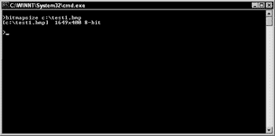

##### 表 24-2：BinaryReader 类中的常用方法

| 方法 | 描述 |
| :--- | :--- |
| `Close` | 关闭 `BinaryReader` 对象和基流 |
| `PeekChar` | 从流中读取下一个可用字节，但不会移动文件中的字节或字符位置 |
| `ReadBoolean` | 从流中读取一个布尔值（真/假） |
| `ReadByte` | 从流中读取单个字节。还有一个 `ReadBytes` 方法用于指定读取的字节数 |
| `ReadChar` | 从流中读取单个字符值。还有一个 `ReadChars` 方法用于指定读取的字符数 |
| `ReadInt16` | 读取一个整数值（2 字节） |
| `ReadInt32` | 读取一个长型值（4 字节） |
| `ReadInt64` | 读取一个八字节有符号整数 |

从文件中检索到信息后，你只需将存储的值输出到控制台。编译此应用程序后，进入控制台窗口并使用位图图像进行测试，如图 24-1 所示。

图 24-1：使用 BinaryReader，你可以查看位图文件的大小。

## 监控文件更改

使用 `FileSystemWatcher` 对象，用 C# 监控文件更改已变得越来越容易。该对象允许你监控特定文件、一组文件、一个目录或整个驱动器的各种事件，包括文件更改、文件删除、文件创建和文件重命名。

你可以通过两种方式之一开始使用 `FileSystemWatcher` 对象。你可以使用代码创建 `FileSystemWatcher` 对象，然后构建方法来处理各种事件；或者你可以采用更简单的方法。Visual Studio.NET IDE 中的工具箱也包含一个 `FileSystemWatcher` 对象，你可以通过双击将其插入项目。

应用程序（如 Microsoft Word 和 Microsoft Excel）都会监控你正在使用的文件，以防文件发生外部更改。此时系统会向你提供重新加载文件的选项，以便你查看对文件进行的所有更改。为了探索 `FileSystemWatcher` 对象的特性，你编写一个监控 C 盘根目录下所有文本文件的应用程序，并在应用程序窗口中显示相关信息。

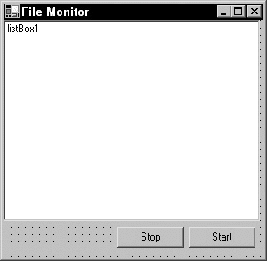
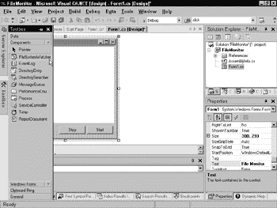

## 使用文件监控

要开始此示例应用程序，你需要启动一个新的 C# Windows 应用程序。当新项目窗口打开时，添加两个按钮和一个列表框。在将组件添加到 `Form1` 之后，将按钮名称更改为 `btnStart` 和 `btnStop`。将这些按钮的 `Text` 属性分别改为 `Start` 和 `Stop`。现在控件已就位，按照类似于图 24-2 的方式排列它们。

图 24-2：如图所示，将控件拖放到文件监控界面上。

你还需要向项目添加一个额外的对象：`FileSystemWatcher`。选择工具箱中的“组件”（Components）选项卡，如图 24-3 所示。双击 `FileSystemWatcher` 将此对象的实例添加到项目中。

图 24-3：工具箱中的“组件”选项卡包含 FileSystemWatcher 对象。

在表单设计器中选择 `Form1` 下方的 `fileSystemWatcher1` 组件。`EnableRaisingEvents` 属性激活该对象并允许其开始监控文件系统事件。由于你有一个启动和停止按钮来完成此操作，你需要确保该对象在应用程序运行时不会激活。将 `EnableRaisingEvents` 属性更改为 `False`。`Filter` 属性允许你设置要监控的文件掩码。你想监控所有文本文件，因此将 `Filter` 属性设置为 `*.txt`。最后，你需要定义要监控文件的文件夹。将 `Path` 属性设置为 `C:\`，以确保你只监控 C: 盘根目录下的文件。通过将 `IncludeSubdirectories` 属性设置为 `True`，可以监控整个驱动器，但这可能会降低系统性能。

双击 `Form1` 上的启动按钮，并将代码列表 24-3 中的代码添加到 Click 事件处理程序中。

### 代码列表 24-3：启动按钮事件

```csharp
private void btnStart_Click(object sender, System.EventArgs e)
{
    fileSystemWatcher1.EnableRaisingEvents = true;
    btnStop.Enabled = true;
    btnStart.Enabled = false;
}
```

前面的代码将 `EnableRaisingEvents` 属性设置为 `True`，从而激活了 `FileSystemWatcher` 对象。然后你禁用启动按钮，使其无法再次点击，并启用停止按钮。现在你必须在停止按钮上添加一些代码来禁用 `FileSystemWatcher`。将列表 24-4 中的代码添加到停止按钮的 Click 事件中。

### 代码列表 24-4：停止按钮事件

```csharp
private void btnStop_Click(object sender, System.EventArgs e)
{
    fileSystemWatcher1.EnableRaisingEvents = false;
    btnStop.Enabled = false;
    btnStart.Enabled = true;
}
```

`FileSystemWatcher` 现在可以运行，但你需要添加事件处理程序来捕获所有事件。双击 `Form1` 返回表单编辑器，然后点击 `fileSystemWatcher1` 对象。在属性窗口中，点击工具栏上的“事件”（Events）图标。当你点击窗口中出的事件时，会被带到代码编辑器以修改这些事件处理程序。列表 24-5 包含了你应该输入到事件中的代码。

### 代码列表 24-5：FileSystemWatcher 事件处理器


private void fileSystemWatcher_Deleted(object sender, System.IO.FileSystemEventArgs e)
{
    listBox1.Items.Add("[" + e.Name + "] Deleted");
}

private void fileSystemWatcher_Renamed(object sender, System.IO.RenamedEventArgs e)
{
    listBox1.Items.Add("[" + e.OldName + "] 重命名为 " + e.Name);
}

private void fileSystemWatcher_Changed(object sender, System.IO.FileSystemEventArgs e)
{
    listBox1.Items.Add("[" + e.Name + "] Changed");
}

private void fileSystemWatcher_Created(object sender, System.IO.FileSystemEventArgs e)
{
    listBox1.Items.Add("[" + e.Name + "] Created");
}

这些事件处理程序非常简单；它们只是在发生文件操作时在列表框中显示一条消息。在测试此应用程序之前，有几点重要的。正如你从这些函数中看到的，`Changed`、`Created` 和 `Deleted` 事件暴露了相同的数据；因此，它们具有相同的签名。这里与众不同的是 `Renamed` 事件。由于四个事件中有三个将相同的数据传递到事件处理过程中，因此你可以使用一个事件处理程序来处理这三个事件，但你仍然需要一个单独的处理程序来处理 `Renamed` 事件。

按 `F5` 运行程序，你就可以按照以下步骤开始测试：

1. 当程序打开时，点击 `Start` 按钮。应用程序正在监控 `C:\` 盘根目录下文本文件的更改。
2. 打开 `Windows 资源管理器`；在资源管理器窗口中右键点击，选择 `新建` → `文本文档` 打开一个新文档。
3. 在新文档中，你会在 `File Monitor` 应用程序的列表框看到一个项目，表示文件已创建。打开这个新文本文件；向其中添加一些文本并保存。再次，你在应用程序的日志窗口中看到条目。
4. 现在尝试重命名文件然后删除它。结果应该类似于图 24-4 所示。

### 图 24-4：你的文件监控器实时显示文件活动

请理解，`Changed` 事件可能会触发多次，因为 `FileSystemWatcher` 正在监控文件的多个特征。如果文件大小发生变化，`Changed` 事件就会触发。如果文件的修改日期和时间戳发生变化，`Changed` 事件会再次触发。如果事件触发了多次，不要气馁；这通常不是应用程序的问题，而是确保设置了正确的 `NotifyFilters` 的保险。

### 编写 FileSystemWatcher

你可以在不使用 Visual Studio 工具箱的情况下向你的 C# 项目中添加 `FileSystemWatcher`。要实现这一点，请在类下方添加该对象的声明，如列表 24-6 所示。

#### 列表 24-6：在类声明中添加 FileSystemWatcher 实例
```csharp
public class Form1 : System.Windows.Form
{
    private FileSystemWatcher MyFileWatcher = new FileSystemWatcher();
}
```

由于你是在运行时创建控件的，因此无法进入 `Properties` 窗口并根据需要设置各种属性。相反，在 Start 按钮的 `Click` 事件中处理这些任务。在你像列表 24-6 中的上一个示例那样设置好属性后，你需要创建事件处理程序并将它们指向适当的函数。列表 24-7 显示了你的 Start 按钮 Click 事件更新后的列表。

#### 列表 24-7：在 Start 按钮的 Click 事件中创建事件处理程序声明
```csharp
private void btnStart_Click(object sender, System.EventArgs e)
{
    MyFileWatcher.Path = "c:\\";
    MyFileWatcher.Filter = "*.txt";
    MyFileWatcher.IncludeSubdirectories = false;
    MyFileWatcher.EnableRaisingEvents = true;
    this.MyFileWatcher.Renamed += new System.IO.RenamedEventHandler(MyFileWatcher_Renamed);
    this.MyFileWatcher.Changed += new System.IO.FileSystemEventHandler(MyFileWatcher_Changed);
    btnStart.Enabled = false;
    btnStop.Enabled = true;
}
```

你可以继续为 Stop 按钮添加一些代码，然后为 `FileSystemWatcher` 创建事件处理程序。这些事件处理程序的函数名称必须与你在 Start 点击事件中放置的声明相匹配。列表 24-8 包含了 Stop Click 事件以及 `Changed` 和 `Renamed` 事件的事件处理程序。

#### 列表 24-8：为 FileSystemWatcher 对象创建事件处理程序
```csharp
private void btnStop_Click(object sender, System.EventArgs e)
{
    MyFileWatcher.EnableRaisingEvents = false;
    btnStop.Enabled = false;
    btnStart.Enabled = true;
}

private void MyFileWatcher_Changed(object sender, System.IO.FileSystemEventArgs e)
{
    listBox1.Items.Add("[" + e.FullPath + "] Changed");
}

private void MyFileWatcher_Renamed(object sender, System.IO.RenamedEventArgs e)
{
    listBox1.Items.Add("[" + e.OldName + "] renamed to " + e.Name);
}
```

### 操作文件

文件操作是指仅操作文件本身而不操作内容的访问。操作文件可能包括复制文件、删除文件或移动文件。.NET 在 `System.IO` 命名空间内提供了一个名为 `FileInfo` 的类用于此类操作。本节描述了一些操作方法以及如何正确使用它们。

### 复制文件

`FileInfo` 类包含一个用于复制文件的方法。该方法 `CopyTo` 是重载的，并有两种变体。变体一简单地接受目标文件名。如果已存在同名文件，该方法将终止。变体二接受一个目标文件名和一个布尔值，该值指示是否应该覆盖文件。

为了演示 `CopyTo` 方法，本节向你展示如何构建一个用于复制文件的控制台应用程序。由于 Windows 已经配备了 `Copy` 命令，因此我们将其命名为 `cp`，这是 UNIX 世界中的复制命令。列表 24-9 显示了 Copy 命令的完整 C# 实现。

#### 列表 24-9：文件复制命令的 C# 实现
```csharp
using System;
using System.IO;

namespace cp
{
    class Class1
    {
        static void Main(string[] args)
        {
            string[] cla = Environment.GetCommandLineArgs();
            if (cla.GetUpperBound(0) == 2)
            {
                FileInfo fi = new FileInfo(cla[1]);
                fi.CopyTo(cla[2], true);
                Console.WriteLine("Copied " + fi.Length + " bytes.");
            }
            else
                Console.WriteLine("Usage: cp <input file> <output file>");
        }
    }
}
```

此代码使用 `Environment` 类的 `GetCommandLineArgs` 方法检索传递的命令行参数。如果参数数量不等于 2，则显示用法消息；否则，命令行参数存储在你的 `cla` 字符串数组供以后使用。

在使用 `FileInfo` 类时，你必须创建一个 `FileInfo` 对象并向其传递要处理的文件名。在使用应用程序时，第一个命令行参数是源文件名。因为它存储在数组的元素 1 中，只需将其传递给 `FileInfo` 对象。

使用该类复制文件，只需调用其 `CopyTo` 方法，以及目标文件名（位于数组的元素 2）和一个指示是否覆盖同名文件的布尔值。编译后通过命令行提示符测试此程序，如图 24-5 所示。

#### 图 24-5：使用 CopyTo，你可以复制文件并显示额外信息

你在这个程序上做了一点小改进，正如你所看到的。在 `CopyTo` 方法完成后，你在控制台上显示了操作已完成的消息；并由于 `FileInfo` 类的 `Length` 属性显示了复制的字节数。

### 删除文件

使用 `FileInfo` 类删除文件只需调用 `Delete()` 方法即可。如果你要删除的文件设置了只读属性，你将收到异常。列表 24-10 中的示例创建了文件删除命令的 C# 实现。在删除文件后，实用程序会显示被删除的文件及其属性。

#### 列表 24-10：使用 FileInfo 类轻松删除文件
```csharp
using System;
using System.IO;

namespace rm
{
    class Class1
    {
        static void Main(string[] args)
        {
            string[] cla = Environment.GetCommandLineArgs();
            if (cla.GetUpperBound(0) == 1)
            {
                FileInfo fi = new FileInfo(cla[1]);
                fi.Delete();
                Console.WriteLine("File : " + cla[1]);
                Console.WriteLine("Attributes: " + fi.Attributes.ToString());
                Console.WriteLine("File Deleted...");
            }
            else
                Console.WriteLine("Usage: rm <filename>");
        }
    }
}
```

与之前的示例一样，你将命令行参数存储在一个字符串数组中。如果该数组不包含正确数量的元素，你只需显示用法信息并退出。

提示：通过使用 `FileSystemInfo` 类的 `Delete()` 方法，你可以删除目录，也可以删除文件。

在调用 `FileInfo` 类的 `Delete()` 方法后，你可以向用户显示文件名及其属性，指示该文件已删除。通过 `Attributes` 属性，你可以在删除文件之前安全地判断其是否设置了 `Read-Only`（只读）属性。如果是，你可以提示用户并/或使用 `Attributes` 属性结合 `FileAttributes` 枚举器移除 `Read-Only` 属性。

程序编译后，转到命令提示符并进行测试。只需输入 `rm` 后跟文件名即可进行删除。结果应该与图 24-6 所示。

## 移动文件

`FileInfo` 类的 `MoveTo()` 方法实际上封装了两个不同的方法：`CopyTo()` 和 `Delete()`。在文件被复制到适当的文件或目录后，`MoveTo()` 只需删除该文件，就像 `Delete()` 方法所做。

下面的示例应用程序接受两个命令行参数：源文件名和目标文件名。在移动文件后，程序会显示文件的实际创建时间以及文件移动到的位置。这两个输出在实际应用中并没有太大用途，仅用于演示如何获取某些属性，例如使用 `CreationTime` 属性获取创建时间。

### 列表 24-11：文件移动实现
```csharp
using System;
using System.IO;

namespace mv
{
    class Class1
    {
        static void Main(string[] args)
        {
            string[] cla = Environment.GetCommandLineArgs();
            if (cla.GetUpperBound(0) == 2)
            {
                FileInfo fi = new FileInfo(cla[1]);
                fi.MoveTo(cla[2]);
                Console.WriteLine("File Created : " + fi.CreationTime.ToString());
                Console.WriteLine("Moved to : " + cla[2]);
            }
            else
                Console.WriteLine("Usage: mv <source file> <destination file>");
        }
    }
}
```

图 24-7 显示了你的文件移动工具的输出。

注意，在示例中，目标文件名可以是文件名，也可以是目录名。如果指定了目录名，文件将被移动。如果存在文件名，文件将被重命名并/或移动。`MoveTo()` 方法本质上将复制和重命名功能集成在一个方法中。

## 访问注册表

使用 Windows API 访问注册表相当繁琐。C# 为你提供了一些类对象，让你能够对注册表进行读写操作。

使用注册表相比旧的方法（如文本文件）具有若干优势。由于注册表是有索引的，因此搜索键的速度很快。

## 读取键值

要读取注册表键，必须使用 `RegistryKey` 对象。要开始探索此功能，请在源代码顶部包含以下行：

```csharp
using Microsoft.Win32;
```

```csharp
namespace CPUInfo
{
    class Class1
    {
        static void Main(string[] args)
        {
            RegistryKey RegKey = Registry.LocalMachine;
            RegKey = RegKey.OpenSubKey(@"HARDWARE\DESCRIPTION\System\CentralProcessor\0");
            Object cpuSpeed = RegKey.GetValue("~MHz");
            Object cpuType = RegKey.GetValue("VendorIdentifier");
            Console.WriteLine("You have {0} running at {1}", cpuType, cpuSpeed);
        }
    }
}
```

建立 `RegistryKey` 对象后，调用其 `OpenSubKey()` 方法并提供想要打开的键。在这种情况下，你想导航到 `HKEY_LOCAL_MACHINE\HARDWARE\DESCRIPTION\System\CentralProcessor\0` 键并读取两个值。记住，在字符串中必须包含双反斜杠字符，以免它们被解释为转义字符。打开子键后，执行以下两行代码以检索子键内的 `~MHz` 和 `VendorIdentifier` 值：

```csharp
Object cpuSpeed = RegKey.GetValue("~MHz");
Object cpuType = RegKey.GetValue("VendorIdentifier");
```

现在你将值存储在相应的变量中，可以在屏幕上显示信息。从控制窗口测试程序，如图 24-8 所示。

#### 图 24-8：RegistryKey 类简化了从注册表中读取重要信息的过程

在多处理器机器运行的用户可以通过枚举 `CentralProcessor` 键获取所有处理器的列表。你可以在 `CentralProcessor` 内找到机器中每个 CPU 的子键。

#### 表 24-3：注册表公共字段

| 名称 | 描述 |
| :--- | :--- |
| ClassesRoot | 定义文档类型以及与类型相关的属性。 |
| CurrentConfig | 包含有关计算机硬件的信息。 |
| CurrentUser | 当前用户的所有偏好都存储在此。 |
| DynData | DynData |
| LocalMachine | 包含计算机的配置信息。 |
| PerformanceData | 此基键存储有关不同软件组件的性能相关信息。 |
| Users | 此键包含应用于默认用户的信息。 |

## 写入注册表键

创建和写入注册表键也可以使用 `RegistryKey` 对象完成。在写入键时，RegistryKey 类中的几个方法非常有用。表 24-4 描述了一些常用成员的用途。

#### 表 24-4：常用 RegistryKey 成员

| 名称 | 类型 | 描述 |
| :--- | :--- | :--- |
| SubKeyCount | 属性 | 此属性获取当前键的子键计数。 |
| ValueCount | 属性 | 此属性获取当前键的值计数。 |
| Close | 方法 | 此方法关闭当前键。如果对键进行了更改，更改将刷新到磁盘。 |
| CreateSubKey | 方法 | 如果不存在则创建新的子键，如果已存在则打开该子键。 |
| DeleteSubKey | 方法 | 此方法删除子键。该方法有重载版本，并包含一个布尔参数，允许在找不到键时抛出异常。 |
| DeleteSubKeyTree | 方法 | 此方法删除子键及其所有子项，递归处理子键。 |
| DeleteValue | 方法 | 此方法从键中删除一个值。该方法已重载，并包含一个布尔参数，用于在值缺失时允许抛出异常。 |
| GetSubKeyNames | 方法 | 此方法返回一个包含所有子键名称的字符串数组。 |
| GetValue | 方法 | 此方法为特定键检索一个值。该方法已重载，并包含一个允许指定默认值的参数。如果未找到键对应的值，将返回你指定的默认值。 |
| GetValueNames | 方法 | 此方法返回一个包含指定键所有值的字符串数组。 |
| OpenSubKey | 方法 | 此方法打开一个子键以进行处理（具有读/写权限）。 |
| SetValue | 方法 | 此方法为键设置一个值。若要为键设置默认值，请将 `subKey` 参数设置为空字符串。 |

**注意：写入值可能是危险的，如果不小心，可能会导致你的系统无响应。在测试任何向注册表写入值的应用程序之前，请务必双重检查代码。**

列表 24-13 显示了一个简单的应用程序，它先向注册表写入两个值，然后读回这些值并显示。

#### 列表 24-13：向注册表写入文本和 DWord 值
```csharp
using System;
using Microsoft.Win32;

namespace WriteRegValues
{
    class Class1
    {
        static void Main(string[] args)
        {
            RegistryKey RegKeyWrite = Registry.CurrentUser;
            RegKeyWrite = RegKeyWrite.CreateSubKey(@"Software\CSHARP\WriteRegistryValue");
            RegKeyWrite.SetValue("Success", "TRUE");
            RegKeyWrite.SetValue("AttemptNumber", 1);
            RegKeyWrite.Close();

            RegistryKey RegKeyRead = Registry.CurrentUser;
            RegKeyRead = RegKeyRead.OpenSubKey(@"Software\CSHARP\WriteRegistryValue");
            Object regSuccessful = RegKeyRead.GetValue("Success");
            Object regAttemptNumber = RegKeyRead.GetValue("AttemptNumber");
            RegKeyRead.Close();

            if ((string)regSuccessful == "TRUE")
                Console.WriteLine("Succeeded on attempt # {0}", regAttemptNumber);
            else
                Console.WriteLine("Failed!");
        }
    }
}
```

在创建了 `RegistryKey` 对象后，可以使用 `CreateSubKey()` 方法创建一个新的子键。确保在使用此方法时，你使用的是双反斜杠字符，以便编译器不会将这些字符解释为转义序列。在这个示例中，你正在 `HKEY_CURRENT_USER` 下创建一个新键。将你的值存储在 `\Software\CSHARP\WriteRegistryValue` 子键中。

新键准备就绪后，使用 `SetValue()` 方法指定值的名称和实际值。此示例在 `Success` 值中存储了文本，在 `AttemptNumber` 值中存储了 DWord。在设置值之后，最好关闭该键，以防断电或类似的故障。此时，更改已提交到注册表。如果你打开 `RegEdit` 并导航到正确的键，你应该能看到图 24-9 所示显示的值。

#### 图 24-9：RegEdit 显示你的值已保存

与上一个示例一样，你现在创建一个新的 `RegistryKey` 对象并将这些值读回。如果 `Success` 值实际上为 True，你像图 24-10 所示在屏幕上显示信息。

#### 图 24-10：从注册表读取的键显示在控制台上

此应用程序演示了向注册表写入值的简单技术。这种方法将对于跟踪程序设置、记录应用程序界面的最后位置和大小等非常有用。可能性是无限的。

### 枚举注册表键

枚举注册表键与 Windows 中的“查找文件”功能非常相似。它允许你从注册表的任何一点开始扫描，并检索该起始点以下的所有子键和值。

目前 .NET 内置用于枚举注册表键的方法；这取决于你如何构建函数来支持你的需求。了解你想枚举的键的结构将使事情变得简单得多，因为你可以简单地使用循环。如果注册表项的结构未知，你必须创建一个可以调用自己的函数，并在每次调用时传递起始键。

列表 24-14 是枚举注册表键的一个示例。在此示例中，你扫描注册表以获取计算机上安装的所有软件列表。此程序列出了任何出现在控制面板“添加/删除程序”部分中的应用程序。

#### 列表 24-14：枚举注册表键
```csharp
using System;
using Microsoft.Win32;

namespace Installed
{
    class Class1
    {
        static void Main(string[] args)
        {
            RegistryKey myRegKey = Registry.LocalMachine;
            myRegKey = myRegKey.OpenSubKey(@"SOFTWARE\Microsoft\Windows\CurrentVersion\Uninstall");
            String[] subkeyNames = myRegKey.GetSubKeyNames();
            foreach (String s in subkeyNames)
            {
                RegistryKey UninstallKey = Registry.LocalMachine;
                UninstallKey = UninstallKey.OpenSubKey(@"SOFTWARE\Microsoft\Windows\CurrentVersion\Uninstall\" + s);
                try
                {
                    Object oValue = UninstallKey.GetValue("DisplayName");
                    Console.WriteLine(oValue.ToString());
                }
                catch (NullReferenceException)
                {
                }
            }
        }
    }
}
```

# Chapter 25: Accessing Data Streams

## In This Chapter

The .NET Framework ships with classes that provide a high level of support for reading and writing data. Traditionally, languages have provided built-in support for reading and writing to disk-based files, and have relied on operating system programming interfaces to provide support for reading and writing to other types of data streams, such as network sockets or memory-based files. The .NET Framework unifies data I/O by providing a common set of classes that support data reads and writes regardless of the underlying storage mechanism used to provide the data access. All of these classes can be used from C# code.

In this chapter, you learn to use streams. You learn how to use readers and writers to read data from and write data to a stream and how to perform file operations in the background.

#### 图 25-1：数据 I/O 类层次结构

**Understanding the Data I/O Class Hierarchy**

图 25-1 展示了用于数据 I/O 操作的 .NET Framework 基础类的层次结构。这些类被分为三类之一：流（streams）、写入器（writers）和读取器（readers）。

## 使用流

流类提供了引用数据容器的机制。流类共享一个名为 `Stream` 的公共基类，该类定义在 .NET Framework 命名空间 `System.IO` 中。`Stream` 基类包含了属性和方法，允许调用者处理数据流。

.NET Framework 提供了多个派生自基类 `Stream` 的类。每个类都为特定环境提供了数据流的特定实现。

例如，`FileStream` 类提供了一种实现，允许调用者处理与磁盘文件绑定的数据流。同样，`NetworkStream` 类提供了一种实现，允许调用者处理通过网络访问的数据流。

## 使用写入器

流支持字节级的数据访问。它们包含了名为 `Read()` 和 `Write()` 的方法，这些方法在调用过程中对一个字节数组进行处理。然而，在字节级上工作对于你的应用程序可能并不是理想的。例如，假设你的应用程序需要向流中写入一系列整数。由于 32 位实现中的整数宽度为四个字节，因此你的 C# 代码需要将每个整数转换为四个字节的字符串，以便在调用流的 `Write()` 实现时使用。

.NET Framework 包含了写入器类，支持向流中写入各种高级别的数据类型。写入器可能支持 `Write()` 方法的许多重载。例如，写入操作可以接受如 `int`、`long` 或 `double` 这样的数据类型。写入器类的实现会将数据类型转换为一系列字节，并将该转换后的字节流传递给 `Stream` 对象。这种类设计使你的代码无需处理字节级的流即可解脱。例如，你的 C# 应用程序代码可以简单地声明“将此无符号长整型写入流中”，并让写入器类完成所需的工作，将该值作为一系列字节存储到流中。

## 使用读取器

读取器类补充了写入器类。与写入器类一样，读取器类提供了读取数据类型的支持，这些类型超越了流类提供的简单字节数组支持。在 .NET Framework 中，每个写入器类都有一个匹配的读取器类。

读取器类提供了 `Read()` 方法的多个重载，允许你的应用程序代码读取多种类型的数据，例如字符串、整数、长整型等。

## 与流交互

流支持两种 I/O 方法：

- 同步 I/O（Synchronous I/O）：其中执行流 I/O 的方法调用在请求的 I/O 操作完成之前不会返回给调用者。
- 异步 I/O（Asynchronous I/O）：其中执行流 I/O 的方法调用在请求的操作完成之前就会返回，并在稍后通知调用者操作已完成。

## 理解同步 I/O

列表 25-1 展示了同步流 I/O。它创建了一个文件并向文件中写入 256 个字节的二进制数据。然后，它从文件中读回这 256 个字节，并确保读取的数据与写入的数据匹配。

#### 列表 25-1：同步文件 I/O
```csharp
using System;
using System.IO;

class FileTestClass
{
    private FileStream BinaryFile;
    private byte[] ByteArray;

    public FileTestClass()
    {
        BinaryFile = new FileStream("test.dat", FileMode.Create, FileAccess.ReadWrite);
        ByteArray = new byte[256];
    }

    public void WriteBytes()
    {
        int ArrayIndex;
        for (ArrayIndex = 0; ArrayIndex < 256; ArrayIndex++)
            ByteArray[ArrayIndex] = (byte)ArrayIndex;
        BinaryFile.Write(ByteArray, 0, 256);
    }

    public bool ReadBytes()
    {
        int ArrayIndex;
        BinaryFile.Seek(0, SeekOrigin.Begin);
        BinaryFile.Read(ByteArray, 0, 256);
        for (ArrayIndex = 0; ArrayIndex < 256; ArrayIndex++)
        {
            if (ByteArray[ArrayIndex] != (byte)ArrayIndex)
                return false;
        }
        return true;
    }
}

class MainClass
{
    static public void Main()
    {
        FileTestClass FileTest = new FileTestClass();
        bool ReadTest;
        FileTest.WriteBytes();
        ReadTest = FileTest.ReadBytes();
        if (ReadTest == true)
            Console.WriteLine("The readback test was successful.");
        else
            Console.WriteLine("The readback test failed.");
    }
}
```

列表 25-1 实现了两个 C# 类：`FileTestClass`（包含流 I/O 代码）和 `MainClass`（包含应用程序的 `Main()` 方法）。`Main()` 方法创建了 `FileTestClass` 类的对象，并请求该对象写入和读取数据。

`FileTestClass` 类包含一个表示 `FileStream` 对象的私有成员。类的构造函数使用一个接受三个参数的构造函数创建一个新的 `FileStream` 对象：

- 要操作的文件流的路径名
- 文件操作模式规范
- 文件访问模式规范

文件操作模式规范由名为 `FileMode` 的枚举表示。`FileMode` 枚举位于 .NET 的 `System.IO` 命名空间中，并支持以下枚举成员：

- `Append`：指示文件流类打开文件。如果文件存在，文件流将初始化为写入现有文件的末尾。如果文件不存在，则它将创建一个新文件。
- `Create`：指示文件流创建文件。如果文件已存在，则将被覆盖。
- `CreateNew`：指示文件流创建文件。与 `Create` 的区别在于对现有文件的处理。当指定 `CreateNew` 且文件已存在时，文件流将抛出 `IOException`。
- `Open`：指示文件流打开文件。
- `OpenOrCreate`：指示文件流创建文件。如果文件已存在，FileStream 对象将打开文件。
- `Truncate`：指示文件流打开文件并将其截断为零字节。

文件访问模式规范由名为 `FileAccess` 的枚举表示。`FileAccess` 枚举同样位于 `System.IO` 命名空间，并支持以下枚举成员：

- `Read`：指示 `FileStream` 类允许对文件进行读取访问。可以从文件中读取，但不能写入文件。
- `ReadWrite`：指示 `FileStream` 类允许对文件进行读取和写入访问。
- `Write`：指示 `FileStream` 类允许对文件进行写入访问。可以写入文件，但不能读回。

列表 25-1 中的 `FileTestClass` 构造函数创建一个管理名为 `test.dat` 文件的文件流。该文件以读写创建模式打开。

`FileTestClass` 的 `WriteBytes()` 方法填充了一个 256 字节的缓冲区，该缓冲区由类的构造函数创建。它用从十六进制 `00` 到 `FF` 的 256 个字节填充缓冲区。然后通过文件流方法 `Write()` 将缓冲区写入流。`Write()` 方法接受三个参数：

- 要写入数据的缓冲区引用
- 指定缓冲区中要写入的第一个字节的数组元素
- 指定要写入字节数的整数

`Write()` 方法是同步的，在数据实际写入流之前，该方法不会返回。

`FileTestClass` 的 `ReadBytes()` 方法读取由 `WriteBytes()` 写入的 256 个字节，并将字节与 `WriteBytes()` 实现的字节模式进行比较。

#### 图 25-2：流 I/O 推进流位置

`ReadBytes()` 方法执行的第一个操作涉及将流指针移回文件开头。流定位是一个重要的概念，值得特别提及。流支持文件定位的概念。流位置指的是流中下一次 I/O 操作将发生的位置。通常，在流初始化时，流位置被设置为流的开头。当从流中读取或向写入数据时，流位置会移动到上一次操作之后的位置。

图 25-2 阐释了这一概念。它显示了一个包含六个字节数据的流。

当流最初打开时，流位置指向流中的第一个字节。

这在图 25-2 的上方的图中得到了说明。假设管理流的代码从文件中读取了三个字节。这三个字节被读取后，流位置将指向上一次读取位置之后的字节。通过这个例子，流位置指向流中的第四个字节。这在图 25-2 的下方的图中得到了说明。

列表 25-1 中代码的问题在于创建了一个文件并向文件中写入了 256 个字节。在写入字节后，它们被重新读回。然而，记住两个流定位概念非常重要：

- 文件位置在每次读或写操作后都会更新，指向上一次操作之后的位置。
- 读和写操作从流位置所指的字节开始。

当列表 25-1 中的代码创建新的文件流时，文件位置被设置为（空）文件的起始位置。在写入 256 个字节后，文件位置被更新为指向 256 个字节之后的位置。如果代码在写入操作后立即读取这 256 个字节，则读取操作将失败，因为在写入操作后流位置指向文件的末尾，而读取操作将尝试从该位置开始读取 256 个字节，但该位置没有可供读取的字节。代码需要说明：“在读取操作开始之前，将文件指针调回流的开头，以便读取操作成功。”

`Stream` 类中有一个名为 `Seek()` 的方法可以完成任务。`Seek()` 方法允许你的代码将流位置移动（或查找）到流中任何可用位置。`Seek()` 方法接受两个参数：

- 一个长整型整数，指定以字节为单位的定位偏移量
- 一个来自名为 `SeekOrigin` 的枚举的值，它指定了应作为查找操作起始点的流位置

`SeekOrigin` 枚举定义在 `System.IO` 命名空间中，并支持以下值：

- `Begin`，表示查找操作应相对于流的开头执行
- `Current`，表示查找操作应相对于当前流位置执行
- `End`，表示查找操作应相对于流的末尾执行

`Seek()` 方法调整流位置，使其指向由 `SeekOrigin` 枚举所引用的流位置，然后根据指定的字节数进行偏移。`Seek()` 方法中使用的字节偏移量可以是正的也可以是负的。接下来的示例使用了正偏移值：

```csharp
File.Seek(4, SeekOrigin.Begin);
```

上一行代码调整流指针，使其指向流开头之后的四个字节。正偏移值将流指针向流的末尾移动。接下来的示例使用了负偏移值：

```csharp
File.Seek(-2, SeekOrigin.End);
```

此示例调整流指针，使其指向流末尾之前的两个字节。负偏移值将流指针向流的开头移动。

列表 25-1 中的代码在读取 256 个字节之前使用了以下查找代码：`BinaryFile.Seek(0, SeekOrigin.Begin);`。

此调用将流指针调回流的开头。当读取操作开始时，它从流的开头开始读取。

`ReadBytes()` 方法使用 `FileStream` 类的 `Read()` 方法在流上执行同步读 I/O。`Read()` 方法接受三个参数：

- 指向字节缓冲器的引用，用于包含从流中读取的字节
- 一个整数，指定缓冲区中包含从流中读取数据的第一个字节的数组元素
- 一个整数，指定要读取的字节数

`Read()` 方法是同步的，在数据实际从流中读取之前它不会返回。当读取操作完成后，代码会检查数组中找到的字节模式，以确保它与写入的字节模式匹配。

### 理解异步 I/O

列表 25-2 是列表 25-1 的修改，说明了异步 I/O。与同步 I/O 不同（同步 I/O 的读和写操作调用在操作完成之前不会返回），而异步 I/O 操作的调用在调用后很快就会返回。实际的 I/O 操作在后台执行，由 .NET 框架中异步 I/O 方法实现的独立线程执行，并在操作完成后通过委托通知你的代码。异步 I/O 的优势在于，你的主代码不需要被等待 I/O 操作完成所阻塞。

在后台执行耗时的 I/O 操作可以释放你的应用程序来执行其他任务，例如在 Windows Forms 应用程序中处理 Windows 消息。

#### 列表 25-2：同步写入，异步读取
```csharp
using System;
using System.IO;
using System.Threading;

class FileTestClass
{
    private FileStream BinaryFile;
    private byte[] ByteArray;
    private IAsyncResult AsyncResultImplementation;
    private AsyncCallback ReadBytesCallback;

    public FileTestClass()
    {
        AsyncResultImplementation = null;
        BinaryFile = new FileStream("test.dat", FileMode.Create, FileAccess.ReadWrite);
        ByteArray = new byte[256];
        ReadBytesCallback = new AsyncCallback(ReadBytesComplete);
    }

    public void WriteBytes()
    {
        int ArrayIndex;
        for (ArrayIndex = 0; ArrayIndex < 256; ArrayIndex++)
            ByteArray[ArrayIndex] = (byte)ArrayIndex;
        BinaryFile.Write(ByteArray, 0, 256);
    }

    public void ReadBytes()
    {
        BinaryFile.Seek(0, SeekOrigin.Begin);
        AsyncResultImplementation = BinaryFile.BeginRead(ByteArray, 0, 256, ReadBytesCallback, null);
    }

    public void ReadBytesComplete(IAsyncResult AsyncResult)
    {
        int ArrayIndex;
        int BytesRead;
        int Failures;
        BytesRead = BinaryFile.EndRead(AsyncResult);
        Console.WriteLine("Bytes read........: {0}", BytesRead);
        Failures = 0;
        for (ArrayIndex = 0; ArrayIndex < 256; ArrayIndex++)
        {
            if (ByteArray[ArrayIndex] != (byte)ArrayIndex)
            {
                Console.WriteLine("Read test failed for byte at offset {0}.", ArrayIndex);
                Failures++;
            }
        }
        Console.WriteLine("Read test failures: {0}", Failures);
    }

    public void WaitForReadOperationToFinish()
    {
        WaitHandle WaitOnReadIO;
        WaitOnReadIO = AsyncResultImplementation.AsyncWaitHandle;
        WaitOnReadIO.WaitOne();
    }
}

class MainClass
{
    static public void Main()
    {
        FileTestClass FileTest = new FileTestClass();
        FileTest.WriteBytes();
        FileTest.ReadBytes();
        FileTest.WaitForReadOperationToFinish();
    }
}
```

### 异步读取

列表 25-2 在列表 25-1 所示示例的基础上通过异步方式执行读取操作。写入操作仍然以同步方式执行。无论以何方式执行 I/O，流的初始化都是相同的。可以使用同步方式执行所有 I/O 操作，也可以以异步方式执行所有 I/O 操作，或者以同步和异步结合的方式执行。

列表 25-2 中的写操作代码是同步处理的，其代码与列表 25-1 中的写操作代码相同。然而，读操作则完全不同。

列表 25-2 中的读操作代码并不是从调用流的同步 `Read()` 方法开始，而是从调用流的异步 `BeginRead()` 方法开始。该调用接受参数。前三个参数与同步 `Read()` 方法接受的参数匹配，但后两个参数是新的：

- 一个指向字节缓冲器的引用，用于存储从流中读取的字节
- 一个整数，指定缓冲区中用于第一个字节的数组元素索引，用于存储从流中读取的数据
- 一个整数，指定要读取的字节数
- 一个 `AsyncCallback` 委托，指向在读取操作完成时调用的方法
- 一个用户定义的对象，将作为状态信息传递给回调方法

回调委托程序必须是一个名为 `AsyncCallback` 的类的实例对象。`AsyncCallback` 类声明在 .NET Framework 的 `System` 命名空间中，它管理一个无返回值且接受名为 `IAsyncResult` 接口引用的方法。列表 25-2 在 `FileTestClass` 类的构造函数创建了此委托的实例：`ReadBytesCallback = new AsyncCallback(ReadBytesComplete);`。

列表 25-2 中的 `FileTestClass` 类包含一个名为 `ReadBytesComplete()` 的新方法，它被用作委托方法。当读操作完成时，`Stream` 对象会调用此委托。

作为 `AsyncCallback` 委托参数的 `IAsyncResult` 接口定义在 .NET Framework 的 `System` 命名空间中。它支持四个属性，用于获取更多有关异步操作性质的信息：

- `AsyncState`：指向作为 `BeginRead()` 方法最后一个参数提供的对象的引用。异步 I/O 方法允许你通过 I/O 方法的最后一个参数将数据与特定操作关联。在 `AsyncState` 属性中可以使用该数据的副本。列表 25-2 不需要将数据与调用关联，因此它将 `null` 作为最后一个参数传递给 `BeginRead()`。结果是 `AsyncState` 属性的值也为 `null`。你可能想要使用这些数据，例如用于区分一个 I/O 调用和另一个。在多次异步 I/O 调用中使用同一个委托引用是合法的，例如，你可能想传递区分不同调用的数据。
- `AsyncWaitHandle`：指向 `WaitHandle` 类对象的引用。`WaitHandle` 类声明在 .NET Framework 的 `System.Threading` 命名空间中。该对象封装了一个同步原语，并作为特定原语（如互斥锁和信号量）的基类。你的代码可以等待此句柄以确定读操作何时真正完成。列表 25-2 中的代码正是这样做的。
- `CompletedSynchronously`：这是一个 `Boolean` 值，如果 `BeginRead()` 调用同步完成，则设置为 `True`，否则设置为 `False`。大多数流实现在接口引用异步 I/O 操作时，此属性返回 `False`。
- `IsCompleted`：这是一个 `Boolean` 值，当 `Stream` 对象完成异步操作时，会被设置为 `True`。在此之前，该属性设置为 `False`。在 `IsCompleted` 属性返回 `True` 后，你的代码可以销毁任何与流相关的资源。

`BeginRead()` 的调用还会返回 `IAsyncResult` 接口的实现。列表 25-2 中的代码缓存了接口引用以供以后使用。

`AsyncCallback` 方法（在列表 25-2 中为 `ReadBytesComplete()` 方法）在异步操作完成时由 `Stream` 对象调用。列表 25-2 中的实现开始调用 `EndRead()`，它返回从操作实际读取的字节数。此数字应该与 `BeginRead()` 请求读取的字节数匹配。

提示：列表 25-2 中显示 `EndRead()` 调用是为了找到受异步操作影响的字节数。如果你的代码不需要此值，则完全不需要调用 `EndRead()`。

`ReadBytesComplete()` 方法实现的剩余部分检查从 I/O 操作读取的字节模式，并将结果报告到控制台。

列表 25-2 中的 `Main()` 方法在列表 25-1 的代码基础上添加了一个新方法调用，即调用 `FileTestClass` 对象的私有方法 `WaitForReadOperationToFinish()`。由于异步读操作是代码中的最后一个操作，应用程序可能会在读操作完成之前退出。

记住，异步 I/O 操作的处理是在单独线程上执行的。如果主线程在 I/O 线程有机会完成之前退出，`ReadBytesComplete()` 中的代码可能没有机会执行。`WaitForReadOperationToFinish()` 方法确保操作在返回给调用者之前完成。

`WaitForReadOperationToFinish()` 方法使用 `IAsyncResult` 接口实现中的等待句柄来工作。该方法调用 `WaitHandle` 方法 `WaitOne()` 等待等待句柄发出信号。在等待句柄发出信号之前，`WaitOne()` 的调用不会返回。`Stream` 对象仅在 I/O 操作完成后才会信号等待句柄。

### 异步写入

异步写入与异步读取非常相似。你不调用 `Write()`，而是调用 `BeginWrite()`。`BeginWrite()` 的参数与 `BeginRead()` 的参数匹配，只是第二个参数是一个包含要写入数据的缓冲区，而不是一个用于接收数据的缓冲区。当写入操作完成时，`Stream` 对象调用你提供的 `AsyncCallback` 委托。在委托方法中，你调用 `EndWrite()` 来完成操作。

```csharp
FileTest.WriteBytes();
FileTest.ReadBytes();
FileTest.WaitForReadOperationToFinish();
```

与 `EndRead()` 方法不同，`EndWrite()` 方法不返回任何值。然而，这两个方法的相似之处在于，它们都会阻塞直到 I/O 操作完成。

# 了解写入器和读取器

.NET Framework 自带了多种读取器和写入器类，帮助你处理比简单字节流更复杂的数据。读取器和写入器封装了流，并提供了一个翻译层，将值转换为相应的字节流（对于写入器），反之亦然（对于读取器）。

.NET 中的读取器和写入器类通常根据反映它们执行的格式类型命名。例如，`HtmlTextWriter` 类写入旨在由 ASP.NET 发送的 HTTP 响应信息的值，而 `StringReader` 类则读取使用其字符串表示写入的值。

写入器和读取器类还处理不同的编码方案，这在使用低级流对象时是无法实现的。例如，派生自抽象 `TextWriter` 类的类允许你的 C# 代码写入文本，并使用 `ASCII`、`Unicode`、`UTF7` 或 `UTF8` 编码算法在流中对其编码。

# 使用 BinaryWriter 写入流

列表 25-4 展示了 `BinaryWriter` 类的用法。`BinaryWriter` 类的任务是将 C# 数据类型转换为一系列可以写入底层流的字节。

#### 列表 25-4：使用 BinaryWriter 类进行工作
```csharp
using System;
using System.IO;

class FileTestClass
{
    private BinaryWriter Writer;
    private FileStream BinaryFile;

    public FileTestClass()
    {
        BinaryFile = new FileStream("test.dat", FileMode.Create, FileAccess.ReadWrite);
        Writer = new BinaryWriter(BinaryFile);
    }

    public void WriteBinaryData()
    {
        Writer.Write('a');
        Writer.Write(123);
        Writer.Write(456.789);
        Writer.Write("test string");
    }
}

class MainClass
{
    static public void Main()
    {
        FileTestClass FileTest = new FileTestClass();
        FileTest.WriteBinaryData();
    }
}
```

列表 25-4 中的代码结构设计类似于列表 25-3 中的设计。

代码包含一个 `MainClass` 和 `FileTestClass`。列表 25-4 中 `FileTestClass` 类的构造函数创建了一个文件流，然后创建一个 `BinaryWriter` 对象。文件流的引用被传递给 `BinaryWriter` 对象的构造函数，这建立了一个二进制写入器与其写入数据的数据流之间的关系。在列表 25-4 中，所有写入二进制写入器的数据最终都会进入构造函数中设置的文件流。

`WriteBinaryData()` 方法向底层流写入了一个字符、一个整数、一个双浮点数和一个字符串。`BinaryWriter` 类实现了多个名为 `Write()` 的方法重载。`Write()` 方法重载支持将以下数据类型写入写入器类：

- 布尔值
- 字节
- 字节数组
- 字符
- 字符数组
- 十进制值
- 双浮点数值
- 有符号和无符号短整数值
- 有符号和无符号整数值
- 有符号和无符号长整数值
- 符号字节
- 浮点值
- 字符串

如果你编译并执行列表 25-4 中的代码，将创建一个名为 `test.dat` 的文件。你可以使用十六进制编辑器查看新文件的内容，以验证值的二进制表示已写入文件。

# 使用 BinaryReader 从流中读取

列表 25-5 在列表 25-4 的代码基础上添加了 `BinaryReader` 类。该类将流字节重新组装回它们的组成数据类型，并将值返回给调用者。

#### 列表 25-5：使用 BinaryReader 类进行工作
```csharp
using System;
using System.IO;

class FileTestClass
{
    private BinaryReader Reader;
    private BinaryWriter Writer;
    private FileStream BinaryFile;

    public FileTestClass()
    {
        BinaryFile = new FileStream("test.dat", FileMode.Create, FileAccess.ReadWrite);
        Writer = new BinaryWriter(BinaryFile);
        Reader = new BinaryReader(BinaryFile);
    }

    public void ReadBinaryData()
    {
        char ReadCharacter;
        double ReadDouble;
        int ReadInteger;
        string ReadString;
        BinaryFile.Seek(0, SeekOrigin.Begin);
        ReadCharacter = Reader.ReadChar();
        ReadInteger = Reader.ReadInt32();
        ReadDouble = Reader.ReadDouble();
        ReadString = Reader.ReadString();
        Console.WriteLine("Character: {0}", ReadCharacter);
        Console.WriteLine("Integer: {0}", ReadInteger);
        Console.WriteLine("Double: {0}", ReadDouble);
        Console.WriteLine("String: {0}", ReadString);
    }

    public void WriteBinaryData()
    {
        Writer.Write('a');
        Writer.Write(123);
        Writer.Write(456.789);
        Writer.Write("test string");
    }
}

class MainClass
{
    static public void Main()
    {
        FileTestClass FileTest = new FileTestClass();
        FileTest.WriteBinaryData();
        FileTest.ReadBinaryData();
    }
}
```

与 `BinaryWriter` 类（为所有操作包含一个重载方法）不同，`BinaryReader` 类为每个数据类型包含单独的读取方法。列表 25-5 使用这些读取方法从 `WriteBinaryData()` 方法写入流中读取值。执行列表 25-5 应该会在控制台上产生以下输出：Character: a Integer: 123 Double: 456.789 String: test string

# 使用 XmlWriter 向流写入 XML

流不仅可以简单地读取和写入各种流，还可以向发送的数据添加值。这种技术的一个很好的例子是 `XmlWriter` 类，它将发送到流的数据封装在良好的 XML 元素中。结果是一个良好的 XML 文档，如列表 25-6 所示。

#### 列表 25-6：使用 XmlWriter 类写入 XML
```csharp
using System;
using System.IO;
using System.Xml;

class XMLStreamWriterClass
{
    private XmlWriter XmlWriter;

    public void WriteXML()
    {
        XmlWriter = XmlWriter.Create(Console.Out);
        XmlWriter.WriteStartDocument();
        XmlWriter.WriteComment("This XML document was automatically generated by C# code.");
        XmlWriter.WriteStartElement("BOOK");
        XmlWriter.WriteElementString("TITLE", "C# Bible");
        XmlWriter.WriteElementString("AUTHOR", "Jeff Ferguson");
        XmlWriter.WriteElementString("PUBLISHER", "Wiley");
        XmlWriter.WriteEndElement();
        XmlWriter.WriteEndDocument();
        XmlWriter.Flush();
    }
}

class MainClass
{
    static public void Main()
    {
        XMLStreamWriterClass XMLStreamWriter = new XMLStreamWriterClass();
        XMLStreamWriter.WriteXML();
    }
}
```

列表 25-6 中的代码创建了 `XmlWriter` 类的实例，并与控制台输出流关联，从而将流输出发送到应用程序控制台。代码只需调用 `XmlWriter` 类中的各种方法来输出数据，这些方法会在调用时用指定的 XML 元素名称封装数据。

编译并执行列表 25-6 中的代码会将以下良好的 XML 文档发送到应用程序控制台：

```xml
<?xml version="1.0" encoding="IBM437"?>
<!--This XML document was automatically generated by C# code.-->
<BOOK>
<TITLE>C# Bible</TITLE>
<AUTHOR>Jeff Ferguson</AUTHOR>
<PUBLISHER>Wiley</PUBLISHER>
</BOOK>
```

## 总结

流为你的 C# 提供了强大的同步和异步 I/O 支持。流在字节级别运行，并要求你读取和写入字节块。读取器和写入器封装了流，并提供更高层次的数据访问。

你可以使用读取器和写入器来处理标准的 C# 数据类型，使读取器和写入器能够在类型值与其字节表示之间进行转换。

你的 C# 代码很可能会使用读取器和写入器，因为它们提供了对处理标准数据类型的支持，而无需你担心数据类型值与其二进制表示之间的转换。然而，如果你觉得需要直接处理流，则可以使用流。如果你读取的数据是 .NET Framework 自带的标准读取和写入器类不支持的私有格式，你可能还需要处理流。你可能还会考虑开发派生自基 `TextReader` 或 `StreamReader` 类的读取器类，并使用你的类从私有格式流中读取。

# 第 26 章：使用 GDI+ 绘图

## 本章内容

在 Windows 中，对图形子系统的程序访问最初是通过自 Windows 3.1 起提供的 GDI API 实现的。GDI 为开发者提供了控制任何类型用户界面元素的能力，这种能力在 .NET Framework 中从底层进行了重构。GDI+ 已经取代 GDI 成为访问 Windows 图形子系统的 API。通过 GDI+，你可以在 C# 应用程序中访问字体、操作任何类型的图像并处理形状。为了完整了解如何在你的应用程序中使用 GDI+，你需要理解如何使用 `Graphics`、`Pen`、`Brush` 和 `Color` 对象。通过这四种对象，你几乎可以完成在 .NET 中对 GUI 和图像所需的几乎任何操作。本章将探索这些对象，并让你熟悉在 C# 中使用 GDI+。GDI+ 中可用的类足以写成一本几千页的书，因此对于本章未涵盖的更复杂且使用频率较低的图形功能，你仍应将 SDK 作为参考。

## 处理图形

在 .NET 中处理 GDI+ 时，你需要处理的主要对象是 `Graphics` 对象。`Graphics` 对象是用于绘制形状、处理图像或显示文本的实际表面。Visual Basic 6 及更早版本对处理图形提供了有限的内置支持，这使得 VB 开发者编写自定义图形应用程序变得困难。VB 所做的一件事是跟踪表单以及表单上的对象如何在屏幕上绘制。`AutoRedraw` 属性允许你的表单让 Windows 跟踪其他窗口上方的内容，并在必要时，如果另一个表单在任何时间内位于其上方，则自动重绘表单。你被隐藏了无需处理表单实际绘制的过程。而在 .NET 中，情况恰恰相反。

`Graphics` 对象没有记录它何时被绘制，或用它绘制了什么。

因此，如果其他窗口最终位于你的窗口上方，你需要根据需要重新绘制对象。这看起来可能很麻烦，但表单 `Paint` 事件中的 `PaintEventArgs` 变量可以很好地处理这个问题。如果将你的绘图代码保留在那里，那么每当 Windows 绘制实际表单时，你的对象都会被正确地绘制。

下面的代码段通过表单 `Paint` 事件中的 `PaintEventArgs` 变量接收 `Graphics` 对象的引用：

```csharp
private void Form1_Paint(object sender, System.Windows.Forms.PaintEventArgs p)
{
    Graphics g = p.Graphics;
}
```

你也可以使用控件或表单的 `CreateGraphics` 方法创建 `Graphics` 对象。

以下代码演示了 `CreateGraphics` 方法：

```csharp
private void createManually()
{
    Graphics g;
    g = this.CreateGraphics();
}
```

创建 `Graphics` 对象的第三种也是最后一种方法是在实例化时直接将图像文件传递给该对象，如下代码通过从文件系统获取位图图像所所示：


private void createFromFile()
{
    Graphics g;
    Bitmap b;
    b = new Bitmap(@"C:\Enterprise.bmp");
    g = Graphics.FromImage(b);
}

如果你一直在将这些代码段添加到 `WindowsForm` 中，很显然，当执行任何代码时，什么都不会发生。要实际实现某些功能，你需要使用 `Graphics` 类的成员来让操作发生。

注意：如果你使用 `CreateGraphics` 方法创建了 `Graphics` 对象，你应该在完成使用后对该对象调用 `Dispose`。这确保了 `Graphics` 对象从内存中释放。

表 26-1 列出了 `Graphics` 类的属性，表 26-2 列出了 `Graphics` 类的可用方法。`Graphics` 类位于 `System.Drawing` 命名空间，该命名空间在创建新的 Windows Forms 应用程序时作为默认引用。这并不意味着你不能在 ASP .NET 中使用 `Graphics` 对象；事实上，你可以在 ASP .NET 中使用 `Graphics` 对象编写极优化的图像处理应用程序。

### 表 26-1：Graphics 类属性

| 属性 | 说明 |
| :--- | :--- |
| Clip | 获取或设置 `Region` 对象，该对象限制此 `Graphics` 对象的绘制区域 |
| ClipBounds | 获取 `RectangleF` 结构，该结构限定此 `Graphics` 对象的裁剪区域的边界 |
| CompositingMode | 获取一个值，指定复合图像如何绘制到此 `Graphics` 对象上 |
| CompositingQuality | 获取或设置绘制到此 `Graphics` 对象上的复合图像的渲染质量 |
| DpiX | 获取此 `Graphics` 对象的水平分辨率 |
| DpiY | 获取此 `Graphics` 对象的垂直分辨率 |
| InterpolationMode | 获取或设置与此 `Graphics` 对象关联插值模式 |
| IsClipEmpty | 获取一个值，指示此 `Graphics` 对象的裁剪区域是否为空 |
| IsVisibleClipEmpty | 获取一个值，指示此 `Graphics` 对象的可见裁剪区域是否为空 |
| PageScale | 获取或设置此 `Graphics` 对象中世界单位与页单位之间的缩放 |
| PageUnit | 获取或设置此 `Graphics` 对象中页坐标的测量单位 |
| PixelOffsetMode | 获取或设置一个值，指定在渲染此 `Graphics` 对象时像素如何偏移 |
| RenderingOrigin | 获取或设置用于抖动和填充刷具的渲染原点 |
| SmoothingMode | 获取或设置此 `Graphics` 对象的渲染模式 |
| TextContrast | 获取或设置渲染文本的伽马修正值 |
| TextRenderingHint | 获取或设置与此 `Graphics` 对象关联的文本渲染提示 |
| Transform | 获取或设置此 `Graphics` 对象的变换 |
| VisibleClipBounds | 获取或设置此 `Graphics` 对象可见裁剪区域的边界矩形 |

### 表 26-2：Graphics 类方法

| 方法 | 说明 |
| :--- | :--- |
| AddMetafileComment | 向当前 Metafile 对象添加注释 |
| BeginContainer | 保存当前 Graphics 对象状态的图形容器并打开并使用新的图形容器 |
| Clear | 清除整个绘制表面并用指定的背景颜色填充 |
| DrawArc | 绘制由一对坐标、宽度和高度指定的椭圆的弧 |
| DrawBezier | 绘制由四个 `Point` 结构定义的贝塞尔曲线 |
| DrawBeziers | 从 `Point` 结构数组绘制一系列贝塞尔曲线 |
| DrawClosedCurve | 绘制由 `Point` 结构数组定义的闭合样条值曲线 |
| DrawCurve | 通过指定的 `Point` 结构数组绘制样条值曲线 |
| DrawEllipse | 绘制由一对坐标、高度和宽度指定的边界矩形定义的椭圆 |
| DrawIcon | 在指定坐标处绘制指定的 `Icon` 对象所表示的图像 |
| DrawIconUnstretched | 在不扩展图像的情况下绘制指定的 `Icon` 对象所表示的图像 |
| DrawImage | 在指定位置绘制指定的 `Image` 对象 |
| DrawImageUnscaled | 在坐标对指定的位置按其原始大小绘制指定的 `Image` 对象 |
| DrawLine | 绘制连接由坐标对指定的两个点之间的线 |
| DrawLines | 绘制一系列连接 `Point` 结构体数组的线段 |
| DrawPath | 绘制 `GraphicsPath` 对象 |
| DrawPie | 绘制饼图形状，该形状由一个坐标对指定的椭圆（由宽度和高度定义）以及两条径向线定义 |
| DrawPolygon | 绘制由 `Point` 结构体数组定义的多边形 |
| DrawRectangle | 绘制由坐标对、宽度和高度指定的矩形 |
| DrawRectangles | 绘制一系列由 `Rectangle` 结构体指定的矩形 |
| DrawString | 使用指定的 `Brush` 和 `Font` 对象在指定位置绘制指定的文本字符串 |
| EndContainer | 关闭当前图形容器，并将此 `Graphics` 对象的状态恢复到通过调用 `BeginContainer` 方法时保存的状态 |
| EnumerateMetafile | 将指定的 `Metafile` 对象中的记录逐条发送到回调方法，以便在指定点显示 |
| ExcludeClip | 更新此 `Graphics` 对象的裁剪区域，以排除 `Rectangle` 结构体指定的区域 |
| FillClosedCurve | 填充由 `Point` 结构体数组定义的闭合基数样条曲线内部 |
| FillEllipse | 填充由一对坐标、宽度和高度指定的边界矩形所定义的椭圆内部 |
| FillPath | 填充 `GraphicsPath` 对象的内部 |
| FillPie | 填充由一对坐标、宽度和高度指定的椭圆以及两条径向线定义的饼形区域内部 |
| FillPolygon | 填充由 `Point` 结构体指定的点数组定义的多边形内部 |
| FillRectangle | 填充由一对坐标、宽度和高度指定的矩形内部 |
| FillRectangles | 填充由 `Rectangle` 结构体指定的系列矩形的内部 |
| FillRegion | 填充 `Region` 对象的内部 |
| Flush | 强制执行所有待处理的图形操作，并立即返回，无需等待操作完成 |
| FromHdc | 从指定的设备上下文句柄创建新的 `Graphics` 对象 |
| FromHwnd | 从指定的窗口句柄创建新的 `Graphics` 对象 |
| FromImage | 从指定的 `Image` 对象创建新的 `Graphics` 对象 |
| GetHalftonePalette | 获取当前 Windows 半色调调板的句柄 |
| GetHdc | 获取与此 `Graphics` 对象关联的设备上下文句柄 |
| GetNearestColor | 获取与指定的 `Color` 结构体最近的颜色 |
| IntersectClip | 更新此 `Graphics` 对象的裁剪区域为当前裁剪区域与指定的 `Rectangle` 结构体的交集 |
| IsVisible | 表示由坐标对指定的点是否包含在此 `Graphics` 对象的可见裁剪区域内 |
| MeasureCharacterRanges | 获取 `Region` 对象数组，每个对象都限制了指定字符串内一段字符位置的范围 |
| MeasureString | 测量使用指定的 `Font` 对象绘制指定字符串时的尺寸 |
| MultiplyTransform | 将此 `Graphics` 对象的世界变换与指定的 `Matrix` 对象参数相乘 |
| ReleaseHdc | 释放通过此 `Graphics` 对象的之前的 `GetHdc` 方法获得的设备上下文句柄 |
| ResetClip | 将此 `Graphics` 对象的裁剪区域重置为无限区域 |
| ResetTransform | 将此 `Graphics` 对象的世界变换矩阵重置为单位矩阵 |
| Restore | 将此 `Graphics` 对象的状态恢复到 `GraphicsState` 对象表示的状态 |
| RotateTransform | 将指定的旋转应用于此 `Graphics` 对象的变换矩阵 |
| Save | 保存此 `Graphics` 对象的状态并用 `GraphicsState` 对象标识保存的状态 |
| ScaleTransform | 通过将指定的缩放操作置于对象的变换矩阵之前，将其应用于此 `Graphics` 对象的变换矩阵中 |
| SetClip | 将此 `Graphics` 对象的裁剪区域设置为指定 `Graphics` 对象的 `Clip` 属性 |
| TransformPoints | 使用此 `Graphics` 对象的当前世界和页面变换将点数组从一个坐标空间转换到另一个坐标空间 |
| TranslateClip | 在水平和垂直方向上按指定的量移动此 `Graphics` 对象的裁剪区域 |
| TranslateTransform | 将指定的平移置于此 `Graphics` 对象的变换矩阵之前 |

如你所见，`Graphics` 类提供了你可能需要的用于处理任何类型 GUI 元素的各种可能方法。列表 26-1 使用了 `Graphics` 类中的几个方法来生成图 26-1 所示的输出。

**图 26-1：使用 Graphics 类成员的输出**

> **注意**：由于没有 `AutoRedraw` 属性，你仍然需要一种方法在表单调整大时重绘。使用 `SetStyles` 方法并传递 `ControlStyles.ResizeRedraw` 样式可以正确调用表单的 `Paint` 方法。在表单的 `InitializeComponent` 调用之后，您应该输入 `SetStyle(ControlStyles.ResizeRedraw, true)` 以确保在表单调整大时会调用 `Paint` 事件。

### 列表 26-1：使用 Graphics 类方法

```csharp
private void drawLine()
{
    /* 创建一个可以在每个样本
     * 重用的 Graphics 对象 */
    Graphics g;
    g = this.CreateGraphics();
    // 使用 Pen 对象创建线
    Pen p;
    p = new Pen(Color.Red, 50);
    /* DrawLine 是一个重载方法
     * 传递 x1, y1, x2, y2 坐标 */
    g.DrawLine(p, 100F, 100F, 500F, 100F);
    // 从文件系统绘制图标
    Icon i;
    i = new Icon(@"C:\Desktop.ico");
    // 调用 DrawIcon 并传递 x 和 y 坐标
    g.DrawIcon(i, 150, 15);
    // 绘制矩形
    Pen p2;
    p2 = new Pen(Color.PapayaWhip, 7);
    /* 传递 x, y、高度和宽度 绘制 Rectangle */
    g.DrawRectangle(p2, 50, 50, 100, 100);
}
```

## 在 GDI+ 中处理图像

如果你需要渲染存在于文件系统的图像，`Image` 类提供了在 `Graphics` 对象创建的表面上渲染图像的能力。`Image` 类包含在 `System.Drawing` 命名空间中，它是一个抽象类，为你提供了在使用 `Graphics` 对象使用位图、图标和元文件所需的所有功能。图像类型可以是 JPG、ICO 或 BMP。

在列表 26-2 中，你从本地驱动器加载一个 `JPG` 文件并显示在表单上。这个示例与你之前的操作略有不同。在这里，你将重写表单的 `OnPaint` 事件，这样当另一个窗口恰好位于你的窗口上方时，图像不会被破坏。此示例还展示了如何在表单销毁时调用用于绘制 `JPG` 图像的 `Graphics` 对象的 `Dispose` 方法。

### 列表 26-2：使用 GDI+ 使用图像

```csharp
namespace RenderJPG
{
    public class Form1 : System.Windows.Forms.Form
    {
        private System.ComponentModel.Container components = null;
        // 图像变量
        private Image img;
        public Form1()
        {
            InitializeComponent();
            // 加载图像
            img = new Bitmap(@"C:\money.jpg");
        }
        protected override void Dispose(bool disposing)
        {
            if (disposing)
            {
                // 对 Img 对象调用 Dispose
                img.Dispose();
                if (components != null)
                {
                    components.Dispose();
                }
            }
            base.Dispose(disposing);
        }
        static void Main()
        {
            Application.Run(new Form1());
        }
        // 重写 OnPaint 事件
        protected override void OnPaint(PaintEventArgs p)
        {
            Graphics g = p.Graphics;
            g.DrawImage(img, 0, 0);
        }
    }
}
```

运行此应用程序应该产生与图 26-2 所示类似的输出。

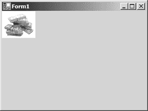
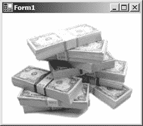

图 26-2：使用 GDI+ 使用 JPG 列表 26-2 的输出

用于在表单上绘制图像的 `DrawImage` 方法大约有 20 个重载构造函数。基本上，每个构造函数都指导方法如何绘制图像，例如坐标或高宽。通过对 `DrawImage` 方法进行简单的更改，你可以位图填充整个表单。如果你将常量 `ClientRectangle` 传递给 `DrawImage`（如下一个代码段所示），你的输出将看起来像图 26-3，整个位图填充了屏幕：

图 26-3：填充整个表单的图像

```csharp
// 重写 OnPaint 事件
protected override void OnPaint(PaintEventArgs p)
{
    Graphics g = p.Graphics;
    g.DrawImage(img, ClientRectangle);
}
```

你还可以在不显示图像的情况下返回图像的属性。在接下来的 `Load` 事件中，你检查了之前加载的 `money.jpg` 图像的几个可用属性：

```csharp
private void Form1_Load(object sender, System.EventArgs e)
{
    MessageBox.Show(img.PhysicalDimension.ToString());
    MessageBox.Show(img.Height.ToString());
    MessageBox.Show(img.Width.ToString());
    MessageBox.Show(img.RawFormat.ToString());
    MessageBox.Show(img.Size.ToString());
}
```

表 26-3 描述了通过 `Image` 类 get 图像可用的每个属性。

### 表 26-3：Image 类属性

| 属性 | 说明 |
| :--- | :--- |
| Flags | 获取此 Image 对象的属性标志 |
| FrameDimensionsList | 获取表示此 Image 对象中帧尺寸的 GUID 数组 |
| Height | 获取此 Image 对象的高度 |
| HorizontalResolution | 获取此 Image 对象的水平分辨率（单位为每英寸像素） |
| Palette | 获取或设置用于此 Image 对象的调色板 |
| PhysicalDimension | 获取此 Image 对象的宽度和高度 |
| PixelFormat | 获取此 Image 对象的像素格式 |
| PropertyIdList | 获取存储在此 Image 对象中的属性 ID 数组 |
| PropertyItems | 获取描述此 Image 对象的 PropertyItem 对象数组 |
| RawFormat | 获取此 Image 对象的格式 |
| Size | 获取此 Image 对象的宽度和高度 |
| VerticalResolution | 获取此 Image 对象的垂直分辨率（单位为每英寸像素） |
| Width | 获取此 Image 对象的宽度 |

你还可以使用 `Image` 类中的几个方法，这些方法使你能够以近乎无限的方式操作你的图像。以下代码将图像旋转了 90 度：`img.RotateFlip(RotateFlipType.Rotate90FlipY)`。

`RotateFlipType` 枚举允许你指定如何在图形表面上翻转或旋转图像。

表 26-4 列出了 `Image` 类中你可以使用的用于操作图像的其余方法。

### 表 26-4：Image 类方法

| 方法 | 描述 |
| :--- | :--- |
| Clone | 创建此 Image 对象的精确副本 |
| FromFile | 从指定的文件创建 Image 对象 |
| FromHbitmap | 从 Windows 句柄创建 Bitmap 对象 |
| FromStream | 从指定的数据流创建 Image 对象 |
| GetBounds | 获取此 Image 对象在指定单位内的边界矩形 |
| GetEncoderParameterList | 返回关于指定图像编码器支持的参数的信息 |
| GetFrameCount | 返回指定尺寸的帧数 |
| GetPixelFormatSize | 返回指定像素格式的颜色深度（每个像素的比特数） |
| PropertyItem | 获取此图像对象的属性项 |
| GetThumbnailImage | 获取此图像的缩略图 |
| IsAlphaPixelFormat | 返回值以指示像素格式是否包含 alpha 信息 |
| IsCanonicalPixelFormat | 返回值以指示像素格式是否为规范 |
| IsExtendedPixelFormat | 返回值以指示像素格式是否扩展 |
| RemovePropertyItem | 从此 Image 对象删除指定的属性项 |
| RotateFlip | 此方法旋转、翻转或旋转 |
| Save | 将此 Image 对象保存到指定的流 |
| SaveAdd | 添加指定的 EncoderParameters |
| SelectActiveFrame | 选择由尺寸和索引指定的帧 |
| SetPropertyItem | 设置指定的属性项 |

正如本节所示，`Image` 类在与 `Graphics` 使用时提供了非常强大的功能。在下一节中，你将学习使用笔和画刷。

### 使用 Pen 类

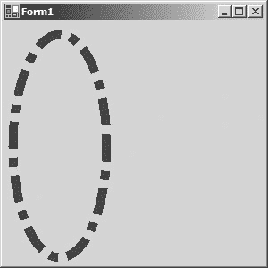

`Pen` 类允许你在图形表面上绘制线条和曲线。包含 `Pen` 和 `Brush` 类所用功能的命名空间是 `System.Drawing.Drawing2D`，因此请确保在类文件中添加了此 `using` 语句。通过设置 `Pen` 实例的各种属性，你可以更改笔显示的结果。通过调用 `Graphics` 类的方法，你可以决定想要输出的形状类型。

以下代码设置了 `Color` 和 `DashStyle` 属性，创建一个类似于图 26-4 所示的椭圆：

```csharp
private void Form1_Load(object sender, System.EventArgs e)
{
    Pen p = new Pen(Color.Blue, 10);
    p.DashStyle = DashStyle.DashDot;
    Graphics g = this.CreateGraphics();
    g.DrawEllipse(p, 10, 15, 105, 250);
}
```

表 26-5 列出了 `DashStyle` 枚举的可能值，用于设置椭圆中虚线的样式。

### 表 26-5：DashStyle 枚举

| 值 | 描述 |
| :--- | :--- |
| Custom | 指定用户定义的自定义虚线样式 |
| Dash | 指定由虚线组成的线 |
| DashDot | 指定由虚线点重复模式组成的线 |
| DashDotDot | 指定由虚线点点重复模式组成的线 |
| Dot | 指定由点组成的线 |
| Solid | 指定实线 |

你还可以使用 `LineCap` 枚举通过 `StartCap` 和 `EndCap` 属性来自定义线条，该枚举也位于 `System.Drawing.Drawing2D` 命名空间。代码列表

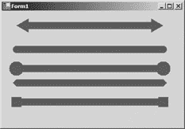

代码列表 26-3 展示了使用 `LineCap` 枚举绘制不同类型线条的几种变体，结果如图 26-5 所示。

图 26-5：使用 `LineCap` 枚举

代码列表 26-3：使用 `LineCap` 枚举

```csharp
protected override void OnPaint(PaintEventArgs e)
{
    Graphics g = e.Graphics;
    Pen p = new Pen(Color.Brown, 15);
    // set the Arrow
    p.StartCap = LineCap.ArrowAnchor;
    p.EndCap = LineCap.ArrowAnchor;
    g.DrawLine(p, 30, 30, Width - 50, 30);
    // round ends
    p.StartCap = LineCap.Round;
    p.EndCap = LineCap.Round;
    g.DrawLine(p, 30, 80, Width - 50, 80);
    // round Anchor
    p.StartCap = LineCap.RoundAnchor;
    p.EndCap = LineCap.RoundAnchor;
    g.DrawLine(p, 30, 120, Width - 50, 120);
    // triangle
    p.StartCap = LineCap.Triangle;
    p.EndCap = LineCap.Triangle;
    g.DrawLine(p, 30, 150, Width - 50, 150);
    // square Anchor
    p.StartCap = LineCap.SquareAnchor;
    p.EndCap = LineCap.SquareAnchor;
    g.DrawLine(p, 30, 190, Width - 50, 190);
}
```

图 26-5 显示了使用 `LineCap` 枚举运行上述代码的结果。

### 使用 Brush 类

将 `Brush` 类结合 `Graphics` 对象结合，可以让你在绘制表面上渲染图像和实心对象。以下代码演示了如何创建一个实心填充的椭圆：


```csharp
protected override void OnPaint(PaintEventArgs e)
{
    Graphics g = e.Graphics;
    SolidBrush sb = new SolidBrush(Color.Black);
    g.FillEllipse(sb, ClientRectangle);
}
```

运行上述代码会产生与图 26-6 所示类似的图像。

图 26-6：使用画刷的实心椭圆

你可以创建的画刷类型有多种。在上一个示例使用的 `SolidBrush` 用纯色填充形状。使用 `HatchBrush` 则可以让你你的图形外观更加奇幻多彩。`HatchBrush` 使用 `HatchStyle` 枚举和 `HatchFill` 枚举来显示不同的图案类型。代码列表 26-4 使用 `HatchStyle` 枚举打印了 `HatchBrush` 的几种变体。`HatchStyle` 枚举有 40 多个成员，因此值得在 .NET Framework SDK 中进行查阅。如果你需要进行任何类型的图案绘制，可以找到大量的支持。

代码列表 26-4：使用 HatchStyles 的 `HatchBrush` 类

```csharp
protected override void OnPaint(PaintEventArgs e)
{
    Graphics g = e.Graphics;
    HatchBrush hb = new HatchBrush(HatchStyle.Plaid, Color.AntiqueWhite, Color.Black);
    g.FillEllipse(hb, 30, 30, Width - 50, 30);
    HatchBrush hb2 = new HatchBrush(HatchStyle.LargeCheckerBoard, Color.AntiqueWhite, Color.Black);
    g.FillEllipse(hb2, 30, 80, Width - 50, 30);
    HatchBrush hb3 = new HatchBrush(HatchStyle.DashedHorizontal, Color.AntiqueWhite, Color.Black);
    g.FillEllipse(hb3, 30, 130, Width - 50, 30);
    HatchBrush hb4 = new HatchBrush(HatchStyle.ZigZag, Color.AntiqueWhite, Color.Black);
    g.FillEllipse(hb4, 30, 180, Width - 50, 30);
}
```

运行上述代码会产生与图 26-7 所示类似的内容。

图 26-7：具有不同 `HatchStyles` 的 `HatchBrush`

表 26-6 描述了 `PenType` 枚举中可用的画笔类型，你可以结合 `Brush` 类使用。你已经见过过 `HatchFill` 和 `SolidColor` 的效果。根据它们的描述，你可能可以在没有看到运行效果的情况下想象出其他画刷类型。

表 26-6：`PenType` 枚举

| Member | Description |
| :--- | :--- |
| HatchFill | 指定阴影填充 |
| LinearGradient | 指定线性渐变填充 |
| PathGradient | 指定路径渐变填充 |
| SolidColor | 指定实心填充 |
| TextureFill | 指定位图纹理填充 |

处理文本和字体也需要结合 `Graphics` 对象使用 `Brush` 对象。

要使用文本，你需要创建一个 `Font` 类的实例（该类位于 `System.Drawing` 命名空间），并设置字体、样式和字体大小属性，然后从持有画刷的 `Graphics` 对象中调用 `DrawString` 方法。代码列表 26-5 将“C# is cool”短语打印到当前表单上，并输出与图 26-8 类似的内容。

图 26-8：使用 `DrawString` 方法

```csharp
protected override void OnPaint(PaintEventArgs e)
{
    Graphics g = e.Graphics;
    // ... code to setup font and brush ...
    g.DrawString("C# is cool", font, brush, 15, 15);
}
```

# 第 27 章：Web 服务

## 理解 Web 服务的工作原理

定义 Web 服务涉及两种可选用技术：`发现机制`（discovery mechanism）和`服务描述`（service description）。通过使用其他通信手段可以跳过这两种技术；例如，如果 Web 服务的开发者与访问该服务的客户端开发者之间存在某种对话（例如电话通话）。

发现机制使用服务器上的 XML 文档，使客户端应用程序能够检测到 Web 服务的存在，并找到该服务的详细描述。最初，微软提议使用 `DISCO`（Web 服务发现）作为这种发现机制，但从那以后 `UDDI`（通用描述、发现与集成）已成为发现的事实标准。

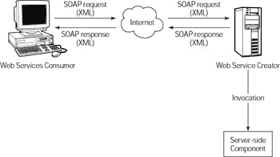

你可以在 `http://www.uddi.org` 找到更多关于 `UDDI` 的信息。服务描述描述了 Web 服务的输入和输出。服务描述使用 Web 服务描述语言（`WSDL`）标准，该标准将在本章稍后部分描述。`UDDI`（或其已废弃前身 `DISCO`）和 `WSDL` 是创建有关如何调用 Web 服务的精确文档的重要构建模块。而且由于这些技术是标准化的，这些描述也可以被应用程序读取。然而，在客户端实现之后，可能不再需要使用发现机制或引用服务描述。对于创建或使用面向特定应用程序的 Web 服务来说，这些技术并非必不可少。

在实际调用 Web 服务期间，涉及三种技术：`线缆协议`（wire protocol）、`消息格式`（message format）和`调用机制`（invocation mechanism）。只有前两种在 Web 服务标准中得到了规定。线缆协议是用于客户端和服务器之间通信的传输机制。通常，这是基于 TCP/IP 的网络协议 `HTTP`。消息格式是调用 Web 服务时使用的格式。可以使用原始的 `HTTP` 或使用一种名为简单对象访问协议（`SOAP`）的特定格式的 XML 消息来调用 Web 服务。第三种控制服务器端组件如何被调用的技术并未 Web 服务标准规定。也就是说这是一个由 Web 服务实现者自行决定的实现细节。换句话说，构建 Web 服务的程序员可以选择用于调用服务器上业务代码的技术：Visual Basic 开发者可能使用 `COM+` 调用 `COM` 对象，Java 开发者可能使用 `RMI` 调用 Java 对象，以此此类推。

Web 服务的两个端可以描述为创建者（客户端）和消费者（服务器）。创建者开发服务器端组件并将此服务开放给适当的受众。例如，一家金融机构开发了一套信用卡验证系统，并将其开放给在线商户。开放 Web 服务意味着发布用户调用 Web 服务时所需的 `URL`。消费者可以通过向已发布的 `URL` 发送 `SOAP` 请求消息来使用该已开放的服务。在接收到用 `XML` 编写的 `SOAP` 请求消息后，位于 Web 服务背后的服务器端组件将在创建者的服务器上被调用。该调用的结果被格式化为 `SOAP` 响应消息，并发送回服务消费者。图 27-1 显示了参与 Web 服务的各方。

图 27-1：Web 服务有两个端：消费者和创建者。

Web 服务使用一组标准来定义客户端和服务器之间交互的实现。这些标准定义了要使用的传输机制以及交互的格式和内容。在传输层，使用了无处不在的 `HTTP` 协议。服务器和客户端使用 `XML` 消息相互通信。这些消息的内容也是标准化的，并且符合 `SOAP` 的规则（关于这些规则的更多信息将在本章后面介绍）。Web 服务中可用服务的性质可以在 `XML` 文件中描述，其内容符合 Web 服务描述语言（`WSDL`）的规则。最后，客户端可以通过检索内容符合 `DISCO` 规则的 `XML` 文件，动态发现某个站点开放了哪些 Web 服务。

注意，目前尚未提到任何特定公司的技术。本文没有假设运行在客户端或服务器上的操作系统、用于编写服务器端组件的编程语言，或用于调用服务器端组件的机制。这些选择与 Web 服务无关。例如，运行在 `Windows XP` 上的 `C#` 编写的客户端可以调用运行在 `Sun Solaris` 上的 `Java` 编写的 Web 服务。事实上，客户端无法在使用什么技术来开放 Web 服务。

Web 服务的影响是深远的。微软通过引入 `OLE` 控件（`OCXs`）启动了组件化编程，这是对 Visual Basic 控件（`VBXs`）引入的开创性概念的改进。`OCXs` 基于微软的组件对象模型（`COM`），并且运行良好。然而，`COM` 及其分布式对应的分布式组件对象模型（`DCOM`）在范围上是有限的。除了 Windows 系列操作系统外，对 `COM/DCOM` 的支持有限。此外，尽管在桌面端 Windows 系列被广泛使用，但在服务器端使用的操作系统种类更多。例如，多种变型的 `UNIX` 操作系统（如 `Solaris` 和 `Linux`）具有重要地位。在集成两个 Web 应用程序时，Web 服务消除了选择运行在服务器上的操作系统的需求。使用 Web 服务，你现在可以使用来自其他网站的组件来构建应用程序。例如，你可以使用信用卡公司的 Web 服务来验证信用卡，使用运输公司的 Web 服务来计算运费，以此此类推。这就是 Web 服务的本质和承诺：面向下一代分布式应用的下一代组件化编程。

## Web 服务与 Visual Studio .NET

如果 Web 服务与平台无关，那么微软希望从中获得什么？答案很简单：微软已公开表示，将使 `Windows` 成为托管 Web 服务的最佳操作系统，使 `Visual Studio .NET` 成为创建 Web 服务的最佳开发环境。由于本编程书籍是关于 `C#` 的，因此对 Web 服务的讨论专注于 `C#` 及其集成开发环境。在本章后面的实际操作部分，你将能够亲自判断 `Visual Studio .NET` 开发环境有多么灵活易用。

Visual Studio .NET 在简化 Web 服务的创建和消费方面做得非常好。许多对程序员不友的工作（例如创建所有 `XML` 文档）都是自动完成的，不需要程序员花费过多精力。在编程时，你只需声明将某些代码暴露为 Web 服务的意图，工具就会完成大部分工作。事实上，工具完成得如此出色，以至于你在构建 Web 服务和 Web 服务消费者时，可能根本看不到任何 `XML`。事实上，这正是你在本章中所要做的。在开始之前，请快速查看一眼让这一切成为可能的概念。它是基于属性的编程。

基于属性的编程是一个强大的概念，它使 Visual Studio .NET 能够自动化许多对程序员不友好的任务（例如为 Web 服务创建 `WSDL` 文档）。你只需以特殊方式标记一段代码（例如 `class` 或 `method`），以表示你打算对其进行什么操作。结果，Visual Studio .NET 会生成实现你意图所需的必要文件。一个简短的示例展示了在将类转换为 Web 服务的范围内，它是如何工作的。

### 列表 27-1：一个简单的游戏

```csharp
namespace MyFirstWebService
{
    public class GameWS
    {
        // 简单游戏示例
        // 示例游戏返回字符串 "Sorry, you lose!"
        // 要测试此游戏，请按 F5
        public string Play(string opponentName)
        {
            return "Sorry " + opponentName + ", you lose!";
        }
    }
}
```

将这段代码转换为 Web 服务的第一步是将代码保存到名为 `GameWS.asmx` 的新文件中。然后，执行以下四个步骤：

1. 添加一个头部来指示三信息：该文件包含一个 Web 服务、使用的语言，以及包含实现的类：
```xml
<%@ WebService Language="c#" Class="MyFirstWebService.GameWS" %>
```
2. 在 Web 服务头部正下方添加一个 `System.Web.Service` 指令：
```csharp
using System.Web.Services;
```
3. 将类标记为 Web 服务，并选择与 Web 服务关联的 XML 命名空间：
```csharp
[WebService(Namespace="http://www.boutquin.com/GameWS/")]
public class GameWS : System.Web.Services.WebService
```
4. 将类中的方法标记为可以从 Web 访问：
```csharp
[WebMethod]
public string Play(string opponentName)
```

### 列表 27-2：暴露为 Web 服务的简单游戏

```csharp
<%@ WebService Language="c#" Class="MyFirstWebService.GameWS" %>
using System.Web.Services;
namespace MyFirstWebService
{
    [WebService(Namespace="http://www.boutquin.com/GameWS/")]
    public class GameWS : System.Web.Services.WebService
    {
        // WEB 服务示例
        // Play() 方法返回字符串 "Sorry, you lose!"
        // 要测试此 Web 服务，请按 F5
        [WebMethod]
        public string Play(string opponentName)
        {
            return "Sorry " + opponentName + ", you lose!";
        }
    }
}
```

在 Visual Studio 中构建 Web 服务项目时，会自动创建一个描述 Web 服务的服务描述文件。该文件是一种称为 Web 服务描述语言 (`WSDL`) 的 XML 变体。`WSDL` 文件看起来如下：

```xml
<?xml version="1.0" encoding="UTF-8"?>
<methods href='http://www22.brinkster.com/boutquin/GameWS.asmx'>
  <method name='Play' href='Play'>
    <request>
      <param dt='string'>opponentName</param>
    </request>
    <response dt='string'/>
  </method>
</methods>
```

`WSDL` 描述了暴露的函数（所示的格式实际上是实际格式的简化，但概念保持不变）。你可以通过 URL（在此例下为 `www22.brinkster.com/boutquin/GameWS.asmx/Play?opponentName=Pierre`）调用服务，或者向 URL 发送格式正确的 XML 消息（通过 HTTP post 或 get 语句）。这样的 XML 消息将是所示的 SOAP 消息：

```xml
<?xml version="1.0" encoding="utf-8"?>
<soap:Envelope
xmlns:xsi="http://www.w3.org/2001/XMLSchema-instance"
xmlns:xsd="http://www.w3.org/2001/XMLSchema"
xmlns:soap="http://schemas.xmlsoap.org/soap/envelope/">
  <soap:Body>
    <Play xmlns="http://www.boutquin.com/GameWS/">
      <opponentName>Pierre</opponentName>
    </Play>
  </soap:Body>
</soap:Envelope>
```

通过 URL 或通过发布 SOAP 消息调用服务，将产生所示的 XML 响应：

```xml
<?xml version="1.0" encoding="UTF-8"?>
<string xmlns="http://www.boutquin.com/GameWS/">Sorry Pierre, you lose!</string>
```

接下来的章节将检查 SOAP 和 `WSDL` 的要素，之后你将深入研究 Web 服务创建和调用的细节。

### 理解 Web 服务描述语言 (WSDL)

`WSDL` 是用于描述 Web 服务的 XML 词汇。该描述包含了关于 Web 服务的信息。该描述包含了如何访问它们。`.NET` 框架负责生成这些 Web 服务，因此你不需要了解 `WSDL` 就可以使用它们。要查看服务的 `WSDL` 像什么样，可以在 URL 后面添加 `?wsdl`，例如 `www22.brinkster.com/boutquin/GameWS.asmx?wsdl`。

`WSDL` 使用一个命名空间。它使用一个根元素 `definitions` 并包含多个部分。其中之一是服务。以下片段是 `WSDL` 的框架：

```xml
<?xml version="1.0" encoding="UTF-8"?>
<definitions xmlns="http://schemas.xmlsoap.org/wsdl/">
  <service name="GameWS">
    <port name="GameWS">
      <binding name="GameWoap">
        <soap:address location="http://www22.brinkster.com/boutquin/GameWS.asmx"/>
      </binding>
    </port>
  </service>
</definitions>
```

如果 Web 服务通过 HTTP post 或 get 语句暴露，其位置存储在 `http:address` 元素中：

```xml
<port name="GameWS" binding="s0:GameHttpPost">
  <http:address location="http://www22.brinkster.com/boutquin/GameWS.asmx"/>
</port>
```

接下来，你需要定义输入和输出参数。你通过 `message` 元素来实现此操作。在这样的元素中，你为每个消息命名；在消息内部，你描述每个参数（名称和数据类型）：

```xml
<message name="PlayInput">
  <part name="opponentName" element='xsd:string'/>
</message>
<message name="PlayOutput">
  <part name='Result' type='xsd:string'/>
</message>
```

你可以使用 `portType` 元素将消息与端口关联。在 `portType` 中，使用你在端口元素中分配给端口的名称；对于每个 Web 服务，你创建一个包含输入和输出元素的 `operation` 标签，使用消息作为属性：

```xml
<portType name="GameWSSop">
  <operation name="Play">
    <input message="PlayInput" />
    <output message="PlayOutput" />
  </operation>
</portType>
```

最后，`binding` 元素描述与所用传输机制相关的细节。例如，SOAP 绑定需要指定 SOAP 操作：

```xml
<binding name="GameWSSap" type="s0:GameWSSop">
  <soap:binding transport="http://schemas.xmlsoap.org/soap/http" style="document"/>
  <operation name="Play">
    <soap:operation soapAction="http://www.boutquin.com/GameWS/Play" style="document"/>
    <input>
      <soap:body use="literal"/>
    </input>
    <output>
      <soap:body use="literal"/>
    </output>
  </operation>
</binding>
```

### 理解简单对象访问协议 (SOAP)

SOAP 是 Web 服务使用的 XML 方言。它指定了你想要调用的哪个服务器端操作，以便将信息（即参数）传递给 Web 服务。SOAP 还规定了信息如何从 Web 服务返回（包括返回值和异常）。

SOAP 消息遵循标准格式：一个标识该消息为 SOAP 消息的外层封包（envelope），一个包含主要负载的主体部分（body），以及一个用于存放消息附加信息的可选头部部分（header）。你可以使用头部部分来传递本身不属于服务器端调用的信息。例如，你可以在此头部中传递请求的日期或用户身份验证。主体包含一个元素，其名称与被调用的服务器端方法的名称匹配。该元素的子元素是名称与参数名称匹配的元素：

```xml
<?xml version="1.0" encoding="utf-8"?>
<soap:Envelope
xmlns:xsi="http://www.w3.org/2001/XMLSchema-instance"
xmlns:xsd="http://www.w3.org/2001/XMLSchema"
xmlns:soap="http://schemas.xmlsoap.org/soap/envelope/">
<soap:Header>
  <!-- 可选信息放在这里 -->
</soap:Header>
<soap:Body>
  <MethodName>
    <Param1Name>value1</Param1Name>
    <Param2Name>value2</Param2Name>
    <!-- 等等 -->
  </MethodName>
</soap:Body>
</soap:Envelope>
```

使用相同的格式来返回响应。响应中的参数名称（在此处的 `Param1Name` 和 `Param2Name`）当然是输出参数；或者当方法只返回一个值时使用“return”（例如，`<return>value</return>`）。

当发生错误时，错误信息将通过故障（fault）部分返回。故障部分位于 SOAP 主体中：

```xml
<soap:Fault>
  <faultcode>x00</faultcode>
  <faultstring>description</faultstring>
  <runcode>Yes</runcode>
</soap:Fault>
```

# 使用 Visual Studio .NET 创建 Web 服务

使用 Visual Studio .NET 创建（在接下来的节中将访问）Web 服务看起来非常简单。你甚至不需要意识到使用了 XML。

你将在本节中构建的 Web 服务将简单地检索并显示书籍列表。

这模拟了基于 Web 的商业网站的目录功能，尽管实际上你可能更想引入类别以避免返回巨大的书籍列表。由于本章的重点是构建 Web 服务所需要的内容，因此业务方面被简化了。

你在这里构建的示例使用一个表和一个存储过程。创建此内容的代码在下面的示例中（你可能也想在 `Books` 表中放入一些示例数据）：

```sql
CREATE TABLE [Books] (
  [ISBN] [char] (14) NOT NULL ,
  [Title] [varchar] (150) NOT NULL ,
  [Price] [money] NOT NULL
)
GO
ALTER TABLE [dbo].[Books] WITH NOCHECK ADD
CONSTRAINT [PK_Books] PRIMARY KEY CLUSTERED
(
  [ISBN]
) ON [PRIMARY]
GO
CREATE PROCEDURE [pc_getBooks]
AS
SELECT
  [ISBN],
  [Title],
  [Price]
FROM [Books]
GO
```

现在你已经准备好使用存储过程构建一个返回书籍列表的简单 Web 服务了：

1. 打开 Visual Studio .NET 并选择文件（File）→ 新项目（New Project）。
2. 在新建项目对话框中选择 ASP.NET Web Service 作为项目类型。
3. 将项目命名为 `BookSeller`（见图 27-2）。

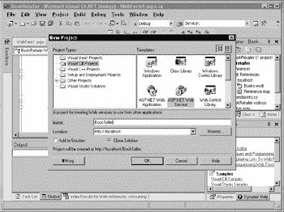
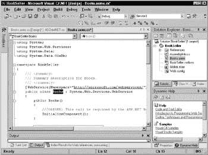

图 27-2：Web 服务是一种独立的项目类型。

4. 将 Web 服务从 `Service1.asmx` 重命名为 `Books.asmx`。
5. 点击 `Books.asmx.cs` 标签切换到代码视图，并将所有的 `Service1` 更改为 `Books`（见图 27-3）。

图 27-3：你可以将默认服务改为更具描述性的。

6. 修改 `using` 部分以包含以下内容：

```csharp
using System;
using System.Web.Services;
using System.Data;
using System.Data.OleDb;
```

7. 在 `Books` 类中添加以下方法和属性：

```csharp
private static string oleDbConnectionString
{
    get
    {
        // 注意：在生产应用中使用 sa 账户
        // 显然是一个非常非常糟糕的做法。此外，
        // 为 sa 账户留空密码同样是不可接受的。
        return "Provider=SQLOLEDB.1;"
        +"User ID=sa;Initial Catalog=WebService_1_0_0;Data Source=localhost;";
    }
}
// WEB 服务示例
[WebMethod]
public DataSet getList()
{
    // 设置 SQL 语句字符串
    string strSQLSelect = "[pc_getBooks]";
    // 创建 OleDb 对象
    OleDbConnection databaseConnection = new OleDbConnection(oleDbConnectionString);
    OleDbCommand selectCommand = new OleDbCommand(strSQLSelect, databaseConnection);
    OleDbDataAdapter dsCmd = new OleDbDataAdapter();
    DataSet resultDataSet = new DataSet();
    // 我们使用的是存储过程
    selectCommand.CommandType = CommandType.StoredProcedure;
    try
    {
        // 建立数据库连接
        databaseConnection.Open();
        // 执行 SQL
        dsCmd.SelectCommand = selectCommand;
        int numRows = dsCmd.Fill(resultDataSet, "Books");
    }
    catch (Exception e)
    {
        Console.WriteLine("捕获到异常：n{0}", e.Message);
    }
    finally
    {
        // 关闭
        databaseConnection.Close();
    }
    return resultDataSet;
}
```

`oleDbConnectionString` 属性包含到 SQL Server 的连接字符串。在生产代码中，你会使用具有适当权限的账户而不是 "sa" 账户。`getList()` 方法通过 `pc_getBooks` 检索书籍集。你可以在第 23 章找到更多关于 ADO.NET 的细节。以下示例展示了创建 C# 客户端应用程序所需的步骤：

1. 打开 Visual Studio .NET 并选择文件（File）→ 新项目（New Project）。
2. 选择 ASP.NET Web Application 作为项目类型。
3. 将项目命名为 `BookRetailer`。
4. 选择项目（Project）→ 添加引用（Add Reference）。
5. 点击本地服务器（Local Server）上的 Web 引用让 Visual Studio .NET 自动检测可用的 Web 服务。
6. 选择 `http://localhost/BookSeller/BookSeller.vsdisco` 然后点击添加引用。你已经导入了调用此 Web 服务所需。
7. 在设计模式下，在页面顶部添加 Label 控件，在标签下方添加 DataGrid 控件，然后切换到代码视图。
8. 在 ASP.NET 页面上添加 `using` 声明：这告诉编译器你将使用来自 Web 服务的代码。

```csharp
using BookRetailer.localhost;
```

9. 在 `Page_Init` 方法中添加以下代码。在本示例中，你为标签设置文本，并用简单的方法填充 DataGrid（此页面不会获得任何审美奖）：

```csharp
private void Page_Init(object sender, EventArgs e)
{
    //
    // 代码生成：此调用是 ASP.NET Windows
    // 设计器所要求的。
    //
    InitializeComponent();
    // 由 PGB 添加
    Label1.Text = "可用书籍";
    Books books = new BookRetailer.localhost.Books();
    DataSet bookList = books.getList();
    DataGrid1.DataSource = bookList.Tables["Books"].DefaultView;
    DataGrid1.DataBind();
    // End PGB Addition
}
```

命名空间是避免名称重复的方法。使用唯一的前缀来区分同名的 Web 服务。通常使用 URL 作为这些唯一名称的基础。这与附录中描述的 URL 在 XML 命名空间中的用法一致。

```csharp
[WebService(Namespace="http://microsoft.com/webservices")]
public class Books : System.Web.WebService
```

10. 保存项目，然后按 F5 测试 Web 服务。

保存并运行项目（使用 F5 快捷键）。会出现一个与图 27-4 所示类似的屏幕。

图 27-4：运行中的 Web 服务，已从 Web 服务提供商处检索了书籍列表。

让我们回顾一下我们所完成的工作。你创建了一个 Web 服务（运行在连接到互联网的服务器上）。在本节中，你构建了一个网页（运行在不同的服务器上），该网页使用此 Web 服务从第一个服务器检索书籍列表。

## 总结

在本章中，你检查了 Web 服务背后的基于 XML 的标准。你查看了定义 Web 服务涉及的两种可选技术：用于发现机制的 `UDDI` 和用于服务描述的 `WSDL`。你还查看了实际调用 Web 服务期间使用的消息格式：`SOAP`。你使用 Visual Studio 构建了一个简单的 Web 服务。然后，你构建了第二个项目，该项目使用了你之前构建的 Web 服务。

# 第 28 章：在 ASP.NET 中使用 C#

## 本章

互联网和企业内部网的出现导致了分布式应用程序的发展。分布式应用程序可以访问跨多个地理位置的不同数据源的信息。Visual Studio .NET 通过允许利用 Web 服务和 Web 服务客户端将分布式应用程序推向新的高度。

ASP.NET Web 服务是暴露在互联网上的基于 XML 的服务，可以被其他 Web 服务和 Web 服务客户端访问。Web 服务暴露了可以被 Web 服务客户端访问的 Web 方法，这些客户端实现了 Web 服务的功能。

在 Visual Studio .NET 出现之前，ASP 编程是使用 `VBScript` 完成的。然而，随着 Visual Studio .NET 的出现，你可以使用两种语言进行 ASP 编程：`Visual C#` 和 `Visual Basic .NET`。`Visual C#` 允许你为 Web 服务和 Web 应用程序编写 ASP.NET 代码。最后，你可以学习使用 Visual Studio .NET 部署 Web 应用程序。

在本章中，你将学习使用 `C#` 创建 ASP.NET 。你首先在 Visual C# 中创建一个 Web 服务。在创建 Web 服务之后，你在 `C#` 中创建一个 Web 服务客户端，该客户端实际上是一个使用 Web 服务的 Web 应用程序。

## 创建 Web 服务

在 Visual Studio .NET 中，Web 服务用于将远程应用程序与你现有的业务解决方案集成。从广义上说，Web 服务提供了两个优势：

- 你可以利用另一个组织提供的 Web 服务为你的组织构建定制化应用程序。例如，你可以使用 `Microsoft Passport` 身份验证服务来在你的网站上启用 `Microsoft Passport` 身份验证。你可以从这项活动中受益，因为你不需要为在网站上实现自定义身份验证而建立必要的设施。此外，你的网站可以服务更大的受众，因为所有在 `Passport` 服务注册的用户（包括所有 `Hotmail` 和 `MSN` 用户）都可以登录你的网站。
- 你还可以利用 Web 服务与你的业务伙伴进行通信。举一个简单的例子，考虑一个收藏了多个出版商书籍的书商。如果每个出版商都能托管一个 Web 服务，提供有关他们发布的最新书籍的信息，该书商就可以开发一个连接到这些 Web 服务并检索这些书籍详情的 Web 服务客户端。

交叉引用：有关 Web 服务的更多信息，请参阅第 27 章。

现在，你要创建一个利用数据库的 Web 服务。因此，在第一步中，你学习如何为 Web 服务创建数据库。接下来，你学习如何使用数据库并创建 Web 服务。

**注意**：在创建示例中的 Web 服务时，你仅专注于涉及其创建的任务。请参阅第 27 章以了解实现 Web 服务涉及的概念。

## 为 Web 服务创建数据库

Web 服务或 Web 应用程序通常使用数据库来存储与应用程序相关的数据。在企业环境中，数据库如 `Microsoft SQL Server` 和 `Oracle` 非常适用于数据。

在本章创建的 Web 服务中，你使用 `SQL Server` 数据库。在为 Web 服务创建 `SQL Server` 数据库和表之前，快速回顾重要的关系型数据库管理系统（RDBMS）概念。

### 关系型数据库管理系统概念

关系型数据库管理系统（RDBMS）最适用于企业解决方案。RDBMS（如 `Microsoft SQL Server`、`Oracle` 和 `DB2`）允许对关系数据库进行创建、更新和管理。`关系数据库` 是一个以表格形式组织的数据集合。应用程序可以使用结构化查询语言（`SQL`）语句访问表中的数据。在 RDBMS 中，你可以访问数据并重新组织数据，而无需重新组织整个数据库。这大大提高了数据库的性能。此外，你还可以轻松对 RDBMS 表中的数据应用业务规则、验证和约束。业务规则和验证确保了数据完整性。例如，当你在航空公司预订系统中为乘客订机票时，航班号应该存在。你可以通过建立业务规则并在订票时使用它确定航班号。

### SQL Server 数据类型

数据库中的数据以行和列的形式存储在表中。表的列存储分类信息，例如产品识别码、产品名称等。应用程序可以使用结构化查询语言（`SQL`）语句访问表中的数据。在 RDBMS 中，你可以在不重新组织整个数据库的情况下访问并重新组织数据。表 28-1 描述了某些 SQL Server 数据类型。

**表 28-1：SQL 类型**

| 数据类型 | 描述 |
| :--- | :--- |
| `Integer` | 用于存储整数。 |
| `Float` | 用于存储浮点数。 |
| `char(n)` | 用于存储字母、数字、特殊字符（如 `#`、`%` 或 `$`）或它们的组合。`char` 数据类型存储单个字符。要存储多个字符，使用 `char(n)`，其中 `n` 是要存储的字符数量。 |
| `varchar(n)` | 用于存储字符，其中 `n` 是要存储的字符数量。`varchar` 数据类型与 `char` 数据类型不同，因为 `varchar` 类型的内存取决于数据的大小，而 `char` 类型的内存是预先定义的。 |
| `Datetime` | 用于存储日期和时间数据。 |
| `Money` | 用于存储需要高精度的货币数值。 |

提示：每个表必须至少有一列可以唯一标识行（称为 `记录`）。该列是该表的主键。例如，`Products` 表中的 `ProductID` 列唯一标识每行，因此它是主键。主键中的没有两个值不能相同。

## 创建数据库和表

在 `Microsoft SQL Server` 中，你可以使用 Transact-SQL (`T-SQL`) 创建数据库、表、存储过程和查询。

提示：你还可以使用 `SQL Server Enterprise Manager` 创建数据库和表。`SQL Server Enterprise Manager` 提供了一个图形界面，用于执行与使用 T-SQL 语句相同的步骤。

要使用 T-SQL 创建数据库或表，可以使用 `Create` 语句。例如，要在查询分析器中创建 `Sales` 数据库，编写以下代码：

```sql
Create Database Sales
```

创建数据库后，你可以向其中添加表。使用以下语法向 `Sales` 数据库添加 `Products` 表：

```sql
Create Table Products
(
  ProductID VarChar (4) Primary Key,
  ProductName VarChar (20),
  UnitPrice Integer,
  QtyAvailable Integer
)
```

### 获取数据

你可以使用 `Select` 语句检索存储在表中的信息。例如，要检索 `Sales` 数据库中 `Products` 表的所有记录，你需要使用以下语句：

```sql
Use Sales
Select * From Products
```

### 插入、更新和删除数据

你可以通过下列表列出的步骤对 SQL Server 数据库进行添加、更新和删除操作：

- **添加记录：** 要向 SQL Server 表中添加新行，需使用 `Insert` 语句。例如，要向 `Products` 表添加一条新记录，使用以下语句：
```sql
Insert Into Products (ProductID, ProductName, UnitPrice, QtyAvailable)
Values ('P001', 'Baby Food', 2.5, 12000)
```
注意：为了使插入操作成功，必须按照表中列的相同顺序提供列值。此外，如果列的数据类型为 `char`、`varchar` 或 `datetime`，则需要用引号指定值。

- **修改记录：** 要修改 SQL Server 表中的某条记录，使用 `Update` 语句：
```sql
Update Products
Set UnitPrice=75
Where ProductID="P010"
```
上述代码将产品 ID 为 `P010` 的记录的单价更新为 `75`。

- **删除记录：** 要从表中删除记录，需使用 `Delete` 语句。例如，要删除 `Products` 表中产品 ID 为 `P011` 的记录，你需要指定以下语句：
```sql
Delete From Products where ProductID="P011"
```

### 使用存储过程

`stored procedure` 是用于执行特定任务的 SQL 语句集合。存储过程存储在 SQL Server 上，可以由任何具有适当权限执行。你可以使用 `Create Procedure` 语句创建存储过程。

使用以下代码创建一个接受 `ProductID` 作为参数并返回与 `ProductID` 匹配的记录单价的存储过程：

```sql
Create Procedure ProductPrice (@id char (4))
As
Select UnitPrice
From Products Where ProductID=@id
Return
```
上述过程在执行时需要一个参数 `@id`。

当你需要在数据库上连续执行多项任务时，存储过程 特别有用。例如，当你想要取消乘客的预订时，可能需要计算需要退还给客户的费用，并从 `reservations` 表中删除客户的预订。同时，你可能还需要更新可能在该航班上超订的其他乘客的状态。

你不需要在每次取消预订时都指定 SQL 查询语句，而是可以使用存储过程来取消乘客的预订。

注意：每个存储过程必须以 `Return` 语句结束。

执行上述过程以显示 ID 为 `P010` 的产品价格，使用以下代码：

```sql
Execute ProductPrice "P010"
```

### 创建数据库结构

在本章中，你需要为你的 Web 服务创建一个 `Sales` 数据库。在创建 `Sales` 数据库后，向数据库添加一个 `Products` 表。要创建 `Sales` 数据库并向其中添加 `Products` 表，请遵循以下步骤：

1. 选择 `Start` → `Programs` → `Microsoft SQL Server` → `Query Analyzer` 打开 `Query Analyzer`。将弹出 `Connect to SQL Server` 对话框。
2. 在 `Connect to SQL Server` 对话框中，在 `SQL Server` 文本框中输入 SQL Server 名称，在 `Login Name` 文本框中指定登录名称，并在 `Password` 文本框中指定该登录名的密码。
3. 点击 `OK` 连接到 SQL Server 并打开查询编辑器。
4. 在查询编辑器中，输入以下语句创建 `Sales` 数据库并向数据库添加 `Products` 表：
```sql
Create database Sales
GO
Use Sales
Create Table Products
(
  ProductID VarChar (4) Primary Key,
  ProductName VarChar (20),
  UnitPrice Integer,
  QtyAvailable Integer
)
GO
```
5. 选择 `Select Query` → `Execute` 执行查询。

执行查询后，数据库结构就绪了。你现在准备好创建 Web 服务——这是你在本章中创建的第一个 ASP.NET 应用程序。在本章创建的 Web 服务将向在本节中创建的 `Sales` 数据库的 `Products` 表中添加记录。

### 使用 ASP.NET Web 服务模板

你需要使用 ASP.NET Web Service 项目模板来创建 Web 服务。该项目作为创建 Web 服务组件的 Web 模板。要创建 Web 服务，请执行以下步骤：

1. 选择 `File` → `New` → `Project` 打开 `New Project` 对话框。
   提示：你也可以同时按 `Ctrl+Shift+N` 打开 `New Project` 对话框。
2. 从 `Project Types` 列表中，选择 `Visual C# Projects`。
3. 从右侧的 `Templates` 格中选择 `ASP.NET Web Service`。
4. 在 `Name` 框中输入 `Orders`。在 `Location` 框中输入地址 `http://<servername>`。点击 `OK`。
   提示：如果服务器安装在当前计算机上，可以在 `Location` 框中输入 `localhost`。
   注意：Visual Studio 创建 Web 服务时需要等待一段时间。

在 Visual Studio 创建 Web 服务后，你可以配置该服务。这将在下一节中进行。

### 为 Web 服务添加数据控件

你需要为 Web 服务添加数据控件，以便与你创建的 `Sales` 数据库通信。为了与数据库通信，你需要添加以下控件：
- `SqlDataAdapter`：在数据源之间传输数据。
- `SqlConnection` 和 `SqlDataAdapter`：连接数据源。
- `SqlCommand`：连接数据源后，使用 `OleDbCommand` 控件访问数据。
- `DataSet`：使用 `DataSet` 控件存储数据。

添加 `SqlDataAdapter` 控件的步骤如下：

1. 选择 `View` → `Toolbox` 打开工具箱。
2. 在工具箱中，点击 `Data` 激活 `Data` 选项卡。
3. 从工具箱将 `SqlDataAdapter` 控件拖入 `Component Designer`。
4. 当从工具箱拖入 `SqlDataAdapter` 控件时，启动 `Data Adapter Configuration` 向向。在欢迎界面点击 `Next`。
5. 显示 `Choose Your Data Connection` 对话框（如图 28-1）。点击 `New Connection` 使用 `OleDbDataAdapter` 控件创建新连接。
6. 弹出 `Data Link Properties` 对话框。默认选中该对话框的 `Connection` 选项卡。在 `Select or Enter a Server Name` 对话框中指定 SQL Server 名称。选择用户名和密码连接到 SQL Server，并在 `Select the Database on the Server` 下拉列表中选择 `Sales` 数据库。完成后的 `Data Link Properties` 屏幕如图 28-2 所示。点击 `OK`。
7. 配置的数据器出现在 `Choose Your Data Connection` 对话框中。点击 `Next` 继续。
8. 打开 `Choose a Query Type` 对话框。要使用 SQL 语句从数据库检索数据，请保留默认选项 `Use SQL Statements` 并点击 `Next`。
9. 打开“生成 SQL 语句”对话框。在此对话框中，输入查询 `Select * from Products` 并点击“下一步”。
10. 打开“查看向导结果”对话框。此对话框汇总了您在向导之前的各个对话框中选择的选项。点击“完成”以完成数据适配器配置向导。

完成数据适配器配置向导后，您的应用程序已配置了 `SqlDataAdapter` 控件。如图 28-3 所示，`sqlDataAdapter1` 和 `sqlConnection1` 控件已添加到您的应用程序。

图 28-3：`sqlDataAdapter1` 和 `sqlConnection1` 控件已添加到您的应用程序。

接下来，将 `SqlCommand` 控件添加到 Web 服务中。`SqlCommand` 控件用于指定需要在数据源上执行的命令。按照以下步骤向您的应用程序添加 `SqlCommand` 控件：

1. 从工具箱将 `SqlCommand` 控件拖到组件设计器中。
2. 打开“属性”窗口，为 `SqlCommand` 控件的 `Connection` 属性选择 `sqlConnection1`。

接下来，您需要生成一个存储由数据控件检索的数据的数据集：
1. 要生成数据集，选择您在前面的步骤中添加的 `SqlCommand1` 控件，并选择 `Data → Generate Dataset` 菜单。
2. 打开“生成数据集”对话框。在此对话框中，已选择 Sales 数据库的 `Products` 表。勾选“将此数据集添加到设计器”复选框，并点击“确定”以生成数据集并添加到组件设计器中。

您已添加到 Web 服务的四个控件现在显示在组件设计器中。您现在需要为 Web 服务的方法编写代码，这将在下一节中完成。

### 为 Web 服务编码

在将数据控件添加到 Web 服务之后，您需要为 Web 服务的方法编写代码。本章演示了如何使用 Web 服务编写一个方法将产品添加到 Products 数据库中。

在编写 Web 服务的方法之前，请为 Web 服务添加描述并更改其默认命名空间。Web 服务的描述和命名空间能够让 Web 服务客户端开发者理解 Web 服务的使用。要为 Web 服务添加描述并更改关联默认命名空间，请按照以下步骤操作：

1. 双击组件设计器以打开代码编辑器。
2. 在代码编辑器中，找到语句 `public class Service1`。
3. 在第 2 步找到的语句之前添加以下代码：

```text
[WebService(Namespace="http://ServiceURL.com/products/",
Description="Use the Web service to add products to the Sales database.")]
```

输入上述代码行后，Web 服务的命名空间为 `http://ServiceURL.com/products/`，并且 Web 服务添加了描述。

接下来，编写向 Products 表添加产品的代码。此代码需要写在 Web 服务声明的正下方。将产品详情添加到 Products 表的 `AddProduct` 方法如下：

```csharp
[WebMethod(Description="Specify the product ID, product name, unit price, and quantity to add it to the Sales catalog")]
public string AddProduct(string PID, string ProductName, int Price, int Qty)
{
    try
    {
        ProductName = ProductName.Trim();
        if (Price < 0)
            return "Please specify a valid value for price";
        if (Qty < 0)
            return "Please specify a valid value for quantity";
        // ... 后续代码省略
    }
    catch (Exception ex)
    {
        return "Error: " + ex.Message;
    }
}
```


        return "Please specify a valid value for quantity";

        sqlConnection1.Open();

        sqlCommand1.CommandText="INSERT INTO Products(ProductID, ProductName, UnitPrice, QtyAvailable) VALUES ('" + PID + "', '" + ProductName + "', '" + Price + "', '" + Qty + "')";

        sqlCommand1.ExecuteNonQuery();

        sqlConnection1.Close();

        return "Record updated successfully";

    }

    catch(Exception e)

    {

        return e.Message;

    }

}

```

上述代码使用 `sqlConnection1` 控件向 Products 表添加记录。

当您向 Web 服务添加记录时，您使用提供给 `AddProduct` 函数的值作为参数。

在编写 Web 服务的 `AddProduct` 方法时，您可以编写其他方法来检索 Products 数据库中的产品详情或执行其他自定义操作。在向 Web 服务添加方法后测试它，请按照以下步骤操作：

1. 选择 `Build → Build Solution` 以生成 Web 服务。
2. 要调试 Web 服务，选择 `Debug → Start` 菜单选项。

Web 服务将在 Internet Explorer 中打开。第一个对话框显示了您为 Web 服务编写的方法。要测试 `AddProduct` 方法，请按照以下步骤操作：
1. 在 `Service1` Web 服务对话框上点击 `AddProduct`。
2. 打开 `AddProduct` 对话框，如图 28-4 所示。在此对话框中，您可以在提供所需参数后调用 `AddProduct` 函数以测试其输出。

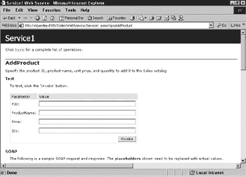
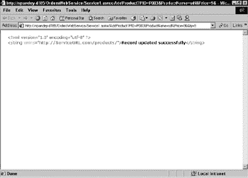

图 28-4：指定 `AddProduct` 函数的参数以便测试。

3. 分别输入参数 `PID`、`ProductName`、`Price` 和 `Qty` 为 `P002`、`PDA`、`100`、`200`，并点击 `Invoke` 测试其输出。
4. 当记录成功添加到 Web 服务时，您将看到图 28-5 中的输出。

28-5：成功向 Web 服务添加记录时的输出。

在成功测试 Web 服务后，可以创建一个 Web 服务客户端来访问它。

## 创建 Web 服务客户端

ASP.NET 中的 Web 服务客户端是一个包含更多 WebForms 的应用程序。在本节中，您将创建一个访问之前创建的 Web 服务的应用程序。

交叉引用：有关 WebForms 的更多信息，请参见第 22 章“使用 WebForms 创建应用程序”。

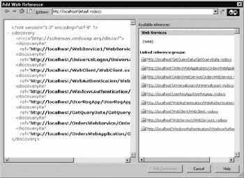

要创建 Web 服务客户端，您需要按照以下步骤操作：

1. 创建一个新的 ASP.NET 应用程序项目。
2. 为应用程序添加引用。
3. 在应用程序中实现 Web 服务的方法。

下节将详细检查这些步骤。

### 创建新的 ASP. 应用程序项目

要创建应用程序项目，请按照以下步骤操作：

1. 选择 `File → New → Project` 菜单选项。打开新建项目对话框。
2. 在项目对话框中，从 Visual C# 项目列表中选择 `ASP.NET Web Application project` 模板。
3. 输入项目名称 `OrdersWebApplication` 并点击确定创建应用程序。

### 添加引用

在创建 Web 服务后，您需要为该 Web 服务添加引用。当您添加引用时，Web 服务客户端会下载 Web 服务的描述并为之创建代理类。代理类包含了 Web 服务方法的代理函数。要为 Web 服务添加引用，请按照以下步骤操作：

1. 选择 `WebForm1.aspx` Web 表，然后选择 `Project → Add Web Reference` 菜单选项。打开添加引用菜单选项。
2. 在添加引用对话框中，点击 `Web References on Local Web Server` 链接。本地服务器上可用的 Web 服务显示在可用列表中，如图 28-6 所示。

图 28-6：添加引用对话框中显示的可用 Web 服务。

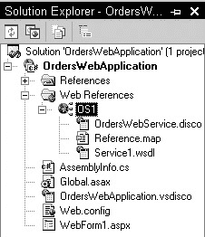
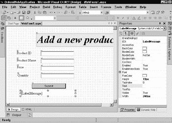

3. 在添加引用对话框中，选择 `OrdersWebService` 服务的链接，并点击 `Add Reference` 为 Web 服务添加引用。

您添加的 Web 服务引用显示在解决方案管理器中。默认情况下，它名为 `localhost`。您可以将 Web 服务命名更改为喜欢的名称。在图 28-7 中，它被命名为 `OS1`。

图 28-7：解决方案管理器中显示的 Web 服务引用。

# 实现 Web 服务的方法

要实现 Web 服务的方法，你需要设计一个 `WebForm`。`WebForm` 用于接收需要添加到销售（Sales）数据库中的信息。为 Web 应用设计的 `WebForm` 如图 28-8 所示。

图 28-8：设计一个 `WebForm` 以接收用户信息。

要设计表单，你可以添加表 28-2 中列出的控件。

#### 表 28-2：Web 表单控件

| 控件类型 | 修改的属性 |
| :--- | :--- |
| Label | 添加了六个标签：分别是页面主标题、产品 ID（Product ID）、产品名称（Product Name）、价格（Price）、数量（Quantity）和消息（Message）。最后一个标签的 ID 改为 `LabelMessage` 并清空了文本。 |
| TextBox | `ID=PID` |
| TextBox | `ID=ProductName` |
| TextBox | `ID=Price` |
| TextBox | `ID=Quantity` |
| Button | `ID=Submit`, `Text=Submit` |

设计好 `WebForm` 后，为 `Submit` 按钮的 `Click` 事件编写代码。当用户点击 `Submit` 按钮时，`Click` 事件的代码应执行以下操作：

1. 创建 Web 服务的实例。
2. 调用 Web 服务的 `AddProduct` 方法，并将用户在 `WebForm` 上输入的值作为参数传递。
3. 将 `AddProduct` 方法的返回值显示在 `LabelMessage` 标签中。

以下是完成上述任务的 `Submit` 按钮的 `Click` 事件代码：

提示要为 `Submit` 按钮的 `Click` 事件输入代码，请在设计视图中双击 `Submit` 按钮。

```csharp

private void Submit_Click(object sender, System.EventArgs e)

{

    OS1.Service1 Web1=new OS1.Service1();

    LabelMessage.Text=Web1.AddProduct(PID.Text, ProductName.Text,

    Convert.ToInt32(Price.Text), Convert.ToInt32(Quantity.Text));

}

```

4. 选择 `Debug` → `Start` 运行 Web 服务。Web 应用的输出如图 28-9 所示。

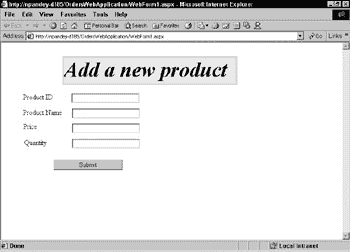
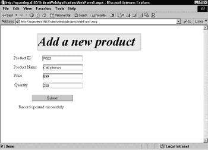

图 28-9：此 `WebForm` 代表了 Web 应用的输出。

在产品 ID、产品名称、价格和数量文本框中指定值并点击 `Submit`。Web 应用会将所需信息添加到销售数据库，`LabelMessage` 标签中会出现一条消息，如图 28-10 所示。

图 28-10：你可以通过 Web 应用向销售数据库中添加记录。

## 部署应用程序

集成各种 Visual Studio .NET 应用程序最后一步是部署你构建的应用程序。要部署你的应用程序，可以使用 Visual Studio .NET 提供的一个或多个部署项目。接下来的章节将检查 Visual Studio .NET 提供的部署项目，然后描述部署 ASP.NET 的步骤。

### Visual Studio .NET 中的部署项目

Visual Studio .NET 提供了四种类型的项目：`Cab projects`、`Merge Module projects`、`Setup projects` 和 `Web Setup projects`。以下列表描述了这些项目类型：

* **Cab projects：** 你可以为打包 ActiveX 控件创建箱（CAB）文件。当你在 `CAB` 文件中打包 ActiveX 控件时，该控件可以从互联网下载。
* **Merge Module projects：** 你可以为想要包含在多个应用程中的应用程序组件创建合并模块。例如，你可能创建的一个服务器控件可以封装为合并模块项目，并包含到 Windows 应用程序的 `Setup projects` 中。
* **Setup projects：** 你可以使用 `Setup project` 来打包 Windows 应用程序。`Setup project` 会创建一个 Microsoft 安装程序（MSI）-文件，该文件可用于在目标计算机上安装应用程序。
* **Web Setup projects：** 对于 ASP.NET Web 应用或 Web 服务，你可以使用 `Web Setup project` 模板。

下一节将描述如何为 ASP.NET Web 应用创建部署项目。

### 使用部署项目部署应用程序

部署 ASP.NET 应用程序的步骤如下：

1. 在解决方案管理器（Solution Explorer）窗口中，右键点击解决方案 `OrdersWebApplication`。从弹出的快捷菜单中选择 `Add`（添加）→ `New Project`（新建项目）。
2. 在打开的 `Add New Project`（新建项目）对话框中，从项目类型窗格中选择 `Setup` 和 `Deployment Projects`（部署项目）。
3. 在模板窗格中，选择 `Web Setup Project`（Web 安装项目）。输入项目名称 `WebSetupDeploy` 并点击 OK。新项目被添加到解决方案中，并在解决方案管理器中可见。默认情况下为部署项目打开文件系统编辑器（File System Editor）。文件系统编辑器可帮助你向部署项目添加文件。
4. 在 `File System Editor`（最左侧窗格）中，选择 `WebApplication Folder`。
5. 要将 `OrderWebApplication` 的输出添加到部署项目，选择 `Action`（操作）→ `Add`（添加）→ `Project Output`（项目输出）。打开 `Add Project Output Group`（添加项目输出组）对话框。
6. 在 `Add Project Output Group` 对话框中，必要时从 `Projects` 下拉列表中选择 `OrderWebApplication`。
7. 按住 `Ctrl` 键从文件列表中选择 `Primary Output`（主输出）和 `Content Files`（内容文件）。选定的选项如图 28-11。

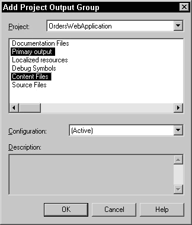

图 28-11：`Add Project Output Group` 对话框显示了你选择的选项。

8. 点击 OK 关闭 `Add Project Output Group` 对话框。
9. 在 `File System Editor` 中，右键点击 `WebApplication Folder`。从快捷菜单中选择 `Properties`（属性）打开属性窗口。
10. 在 `VirtualDirectory` 属性中输入 `WebApplication` 作为虚拟目录名称并关闭属性窗口。
11. 选择 `Build`（生成）→ `Build Solution`（生成解决方案）。创建一个 Microsoft 安装程序（MSI）文件。你可以双击该文件安装应用程序。

### 通过 Copy Project 部署项目

如果你不想为应用程序创建部署项目并使用该项目进行部署，也可以使用 Visual Studio .NET 中的 `Copy Project` 选项将项目复制到目标文件夹。

`Copy Project` 选项在网绚上部署项目时有用。但是，当你需要将应用程序部署到无法访问网络的远程计算机时，该选项不起作用。

使用 `Copy Project` 选项的步骤如下：

1. 打开要复复的项目。
2. 选择 `Project` → `Copy Project` 菜单。打开 `Copy Project` 对话框。
3. 在 `Destination project folder`（目标项目文件夹）对话框中指定要复制项目的目标路径。
4. 选择要复制的项目文件，并点击 OK。你的项目将被复制到你指定的位置。

在本章中，你将学习如何构建自定义控件。这些控件可以是一个可以添加到表单的可见组件，也可以仅仅是封装在 DLL 中的类对象。在任何情况下，当你开始将功能封装并分发为可以反复使用的控件时，这些控件都是建立在你对代码复用的知识之上的。

### 理解 Windows 控件库

Windows 控件库（Windows Control Library）是一个允许你构建与 Visual Studio IDE 工具箱中显示的组件类似的组件的项目。在过去，这些控件一直是 COM 对象或 ActiveX 控件。现在，你可以将 COM 组件添加到工具箱，也可以创建一个以动态链接库（DLL）形式呈现的控件。

以前版本的 Visual Studio 提供了向导来帮助创建控件，Visual Studio.NET 也不例外。由于包含了向导，与创建属性、方法和字段相关的任务被简化了。

### 属性（Properties）

你主要使用属性来设置和检索控件参数。当属性在设计时被授予了读取（Read）和读写（Read-Write）访问权限时，它们由两个名为 `get` 和 `set` 的函数组成。由于属性在赋值或从其检索值时必须调用方法，因此它可以随时执行计算或其他有用函数。在这方面，它们与字段（fields）大不相同。属性的一个示例是


`BackColor` 属性。通过此属性，你可以指定要作为控件背景颜色的颜色，也可以检查当前的背景颜色是什么。

通过使用 Visual Studio.NET IDE 中一个非常简单的向导，可以在项目中轻松实现属性。在类视图（Class View）窗口中，右键点击你的控件类，然后选择 `Add → Add Property`（添加 → 添加属性）。如图 29-1 所示向导允许你设置访问类型、属性类型（`int`、`bool` 等）、属性名称、访问器和修饰符。

图 29-1：添加属性向导允许你向项目添加属性。

完成向导后，你将看到一个用于该属性的骨架代码：

```csharp

public int TestProperty

{

    get

    {

        return 0;

    }

    set

    {

    }

}

```

这段代码中缺少了一些基本元素。在给属性设置值时，信息并没有被存储。你必须首先创建一个私有类变量，该属性可以使用它来存储和检索该值。在这种情况下，你只需要在类声明顶部包含以下声明：

```csharp

private int m_TestProperty;

```

在属性的 `set` 方法内部，你可以使用 `value` 关键字将数据分配给私有变量：

```csharp

set

{

    m_TestProperty = value;

}

```

现在属性的值已存储在私有类变量中，你必须确保在使用 `Get` 方法时返回正确的值。以下代码实现了这一点；如代码片段所示，只需在 `get` 块中返回私有变量的值即可：

```csharp

get

{

    return m_TestProperty

}

```

将控件中现有组件映射也是非常有用的。例如，假设你创建了一个包含标签的控件。你的控件应该包含一个 `Font` 属性，该属性可以获取并设置控件内部标签组件的字体。为了让容器操作标签的字体，只需如下创建属性：

```csharp

public Font CurrentFont

{

    get

    {

        return label1.Font;

    }

    set

    {

        label1.Font = value;

    }

}

```

此代码创建了一个名为 `CurrentFont` 的属性，它在请求时返回标签控件的当前字体。当容器想要更改字体时，你只需将标签控件的当前字体设置为 `value` 的值。

### 方法（Methods）

方法被定义为类的一部分函数。方法的实现方式与其他许多语言相同，如 `C++`、`C`、`VB` 等。方法最常用于启动控件内的操作。这的一个例子是 Timer 控件中的 `Start` 方法。

你可以通过两种方式向控件添加方法。你可以使用 C# 方法向导（在类视图下通过解决方案管理器（Solution Explorer）可以访问该向导），或者你可以直接向你的项目添加一个公共函数。

图 29-2 所示的 C# 方法向导允许你以非常直接的方式指定方法名称、返回类型、访问方法和参数信息。


图 29-2：C# 方法向导创建方法所需的骨架代码。

方法向导的缺点是它只为你提供简单的返回类型。例如，假设你想要一个返回 `Font` 类型值的方法。`Font` 类型在返回类型组合框中并不是一个选项。当你尝试使用向导时，你会发现你可以在这些框中输入自己的类型；你并不限于它们包含的选项。

呈现的选项仅仅是最常用的类型，以免让初级程序员感到困惑。毕竟，如果此向导中显示每个选项，那么在列表中搜索你所需的类型将花费大量时间。

.NET Framework 还为方法带来了一些急需的功能。方法现在可以被重载。也就是说，只要它们的参数列表不同，它们就可以有相同的名称。

### 字段（Fields）

字段只是定义在控件内部的公共变量。容器可以为字段设置特定值并检索该值。由于字段仅仅是变量，它们没有关联的功能；在设置或检索值时无法执行计算或调用方法。

字段有两种类型：实例（instance）和静态（static）。字段默认被定义为实例字段。实例字段在包含它的对象中包含自己的数据。当字段被声明为静态时，它在所有实例之间共享相同的数据。静态字段通常不是一个好主意，因为其他实例可以更改值，而其他实例对此无知。

字段提供了低开发开销，但在功能方面也存在局限性。你可以设置和检索字段的值，但这样做无法触发控件内的其他操作。

字段在需要分配操作参数时非常有用。

### 事件（Events）

要定义事件，你必须先进行公共类声明，如下：

```csharp

public event EventHandler Expired;

```


你可以通过两种方式使用控件事件：你可以点击属性窗口中的事件图标并双击事件自动添加处理程序，或者你可以自己创建处理程序。

基本事件声明为 `EventHandler` 类型，但你有更多事件类型可以选择，且每个类型都有独特的签名。每个事件的参数包含一个 `System.EventArgs` 结构。该结构允许控件向事件传递信息，定义许多内容，例如触发事件的对象、哪个控件导致了事件触发等。在为控件选择事件类型之前，务必探索不同的类型以及它们传递的参数。

**通过示例学习**

让我们从构建倒计时器控件开始。这个练习使你能够检查构建控件的细节。

**创建倒计时器**

# 简介

在开始构建倒计时器控件之前，你需要确定该控件应该做什么以及不应该做什么。这种映射可以简化控件的构建过程。在启动控件项目之前，提前做好所有的映射始终是一个好主意，甚至比任何典型的编程项目都要如此。这个特定的控件应该具有以下功能：

* 控件应该是一个可以放置表单上的可见组件。该控件应该具有典型的属性，例如 `BackColor`、`Anchor` 等。
* 控件应该接受一个表示要倒计时秒数的值。
* 控件应该有一个 `Start()` 和 `Stop()` 方法来开始和结束倒计时。
* 最后，当倒计时到达零时，控件应该触发一个事件。

定义好需求后，就可以开始构建你的控件了。

## 设置项目

打开 Visual Studio 并创建一个新的 Windows Control Library 项目。将项目命名为 `CountDown`，如图 29-3 所示。

图 29-3：创建一个新的 Windows Control Library 项目。


1. 当 Visual Studio 创建好骨架控件后，你将看到一个 `UserControl`。这将是你的 `CountDown` 控件的视觉界面。在这里放置任何你想让用户查看和/或交互的视觉元素。
2. 你必须执行的第一件事是在 `UserControl` 上放置一个 `Label` 控件，如图 29-4 所示。

图 29-4：在 `UserControl` 上放置标签。

3. 将此 `Label` 控件的 `Anchor` 属性更改为 `Top,Left,Bottom,Right`。这确保了当控件调整大小时，标签也会随之调整大小。在向控件添加现有组件时要非常小心，因为当用户将控件放在表单上时，许多元素可能会发生视觉变化。
4. 现在你必须从工具箱项目中添一个 `Timer` 控件。`Timer` 控件允许你每次计数一次，直到确定时间过期。你的控件的视觉部分已经完成。现在你必须添加代码来支持此控件。
5. 在列表 29-1 中，你声明了一个成员变量来存储倒计时器开始计数的秒数。你还必须声明一个 `EventHandler`，在控件倒计时结束时触发。在 `UserControl` 的类声明下方放置以下代码：

  29-1：公共成员
```

private int m_Seconds;

public event EventHandler Expired;

```

6. `m_Seconds` 变量不需要暴露给控件容器，只需暴露给控件本身，因此你将变量设置为私有。通过声明公共的 `EventHandler`，`Expired` 会出现在事件窗口中。你只需双击它即可编写该事件。
7. 在 `Timer` 对象的 `Tick` 事件中，你必须从总秒数中减去一。然后你可以检查流过的总秒数是否到达零。如果是，你必须停止计时器然后触发 `Expired` 事件。之后，你可以更新 `Label` 控件以反映你的 CountDown Timer 控件的当前值。


在属性窗口中，点击对象选择器组合框并选择 `Timer` 控件。接下来点击属性窗口顶部的事件栏按钮。你会看到 `Timer` 控件暴露的所有事件。双击 `Tick` 事件并添加以下内容：

```csharp

private void timer1_Tick(object sender, EventArgs e)

{

    m_Seconds -= 1;

    if (m_Seconds <= 0)

    {

        timer1.Stop();

        Expired.Invoke(this, EventArgs.Empty);

    }

    label1.Text = m_Seconds.ToString();

}

```

8. 现在你必须为控件添加一个 `Start()` 方法。在列表 29-1 中，你声明了一个成员变量来存储倒计时器开始计数的秒数。你还必须声明一个 `EventHandler`，在控件倒计时结束时触发。

9. 要添加方法，请在解决方案管理器中展开 `UserControl` 类，右键点击并选择 `添加 → 方法`。将此方法命名为 `Start` 并确保它是 `public` 的。将列表 29-3 所示的代码添加到 `CountDown` 控件中：

```csharp

public void Start()

{

    timer1.Interval = 1000;

    timer1.Start();

    label1.Text = m_Seconds.ToString();

}

```

10. `Stop()` 方法完善了你的 `Start()` 方法。它应该停止 `Timer` 使其不再触发。创建一个名为 `Stop` 的方法并添加列表 29-4 中的代码：

```csharp

public void Stop()

{

    timer1.Stop();

    m_Seconds = this.Seconds;

}

```

11. 你还没有创建 `Seconds` 属性。此属性允许你获取和设置控件将计数的总秒数。从类视图，右键点击并选择 `添加 → 属性`。将此属性命名为 `Seconds` 并确保类型为 `int`。添加列表 29-5 所示的代码：

```csharp

public int Seconds

{

    get

    {

        return m_Seconds;

    }

    set

    {

        m_Seconds = value;

    }

}

```

## 创建倒计时测试平台

Visual Studio 的优势之一是它允许你向现有项目添加项目，这在测试控件时起着重要作用。这种功能允许你创建一个使用刚创建的控件的测试应用程序。当遇到错误时，不仅你的应用程序会崩溃，而且会在控件故障的代码处崩溃。这为你节省了大量的调试代码的时间。按照以下步骤创建测试平台：

1. 在 `CountDown` 控件项目中，点击文件菜单并选择新建 → 项目。
2. 选择 Windows 应用程序并将此应用程序命名为 `CDHarness`。在此窗口底部，确保点击“添加到解决方案”单选按钮。点击确定。
3. 解决方案管理器显示两个项目。在解决方案管理器中右键点击 `CDHarness` 应用程序并选择“设置为启动项目”。

4. 通过在解决方案资源管理器中点击它，确保你正处于 `CDHarness` 项目中。右键点击工具箱并选择 `Customize Toolbox`（自定工具箱）。

5. 当 `Customize Toolbox` 窗口打开时，点击 `.NET Framework Components` (.NET Framework 组件）选项卡。你在这里将新控件添加到项目中。


6. 点击 `Browse`（浏览）按钮并查找 `CountDown` 计时控件。找到后，选中并高亮它。点击 `OK`。

7. 在控件列表中你会看到此控件；勾选旁边的复选框。现在你可以点击此表单上的 `OK` 了。在工具箱内部，你会看到列出的 `CountDown` 计时控件。

8. 双击该控件将其添加到你的项目中。在操作工具箱时，也向你的表单添加两个按钮。第一个按钮用于启动倒计时计时器；第二个按钮用于停止 `CountDown` 控件。按照图 29-7 所示排列并设置文本属性。

图 29-7：你的 `CountDown` 调优应用程序的主界面 9. 双击应用程序中的 `Start` 按钮以开始编码。将列表 29-6 中的代码添加到 `Start` 按钮的 `Click` 事件中。

列表 29-6：启动你的控件
```csharp

private void button1_Click(object sender, System.EventArgs e)

{

    cdTimer1.Seconds=60;

    cdTimer1.Start();

}

```

10. `Start` 按钮只有一个用途：准备并启动你的 `CountDown` 控件。开始时，将秒数设置为 `60`，然后调用控件的 `Start` 方法。

11. 你还需要能够停止你的控件。双击 `Stop` 按钮，以便在该处按钮的 `Click` 事件中放置代码。将列表 29-7 中的以下代码放在 `Stop` 按钮的 `Click` 事件中。

列表 29-7：停止你的控件
```csharp

private void button2_Click(object sender, System.EventArgs e)

{

    cdTimer1.Stop();

}

```

12. `CountDown` 控件的 `Expired` 事件需要执行某些操作，以便让你知道倒计时已归零。在属性窗口中，点击工具栏上的 `Events`（事件）按钮。现在双击 `Expired` 事件。你需要在这段代码中编写此特殊操作。你不需要尝试任何大范围的操作；只需将表单的标题更改为 `Done` 即可。将列表 29-8 所示的代码放入。

列表 29-8：Expired 事件代码
```csharp

private void cdTimer1_Expired(object sender, System.EventArgs e)

{

    this.Text="Done!";

}

```

你的控件和测试应用程序现在就绪了。按 `F5` 运行。当应用程序打开时，点击 `Start` 按钮开始倒计时。你的测试应用程序将开始倒计时。当倒计时归零时，由于你的 `Expired` 事件，表单标题将会改变。使用类库

类库是重用和分代码高效的方法。类库存储在 `DLL` 中，但不需要像 C++ 等语言那样使用导出语句和声明。与任何可重用组件一样，类库提供了初始化和清理的构造函数和析构函数，但这些项并不是必须的。要开始你的类库之旅，构建一个带有几个演示用方法的简单 `DLL`；然后在此控件上添加一些额外的功能。

构建风感计算类

你的风感计算类库不仅提供一个计算风感的函数，还会提供从华氏转换为摄氏以及从摄氏转换为华氏的功能。由于你在类库中执行的操作属于两个类别：Conversion（转换）和 Calculation（计算），你将包含两个类。创建一个类库项目并将其命名为 `Temperature`。Visual Studio 创建了列表 29-9 所示的框架代码。

列表 29-9：Visual Studio 创建的类库代码
```csharp

using System;

namespace Temperature

{

    /// <summary>

    /// Class1 的摘要描述。

    /// </summary>

    public class Class1

    {

        public Class1()

        {

            // TODO：在此添加构造函数逻辑

        }

    }

}

```

Visual Studio 创建了一个命名空间、一个类和一个构造函数。该类和构造函数都是公共的。这并不是偶然。任何使用此库的应用程序都需要访问类中的特定成员。

1. 为了开始你的示例，删除该类和构造函数，并用列表 29-10 所示的代码替换它们。

列表 29-10：Calc 类和构造函数
```csharp

public class Calc

{

    public Calc()

    {

}

```

2. `Calc` 类是你放置风感方法的地方。这确保你的风感计算与你即将添加的转换方法分离。将列表 29-11 所示的代码粘贴到 `Calc` 类中。

列表 29-11：计算风感
```csharp

public double WindChill(double DegreesF, double WindSpeedMPH)

{

    double WindRaised;

    WindRaised = System.Math.Pow(WindSpeedMPH,.16);

    return 35.74 + (.6215 * DegreesF) - (35.75 * WindRaised) + (.4275

    * DegreesF

    * WindRaised);

}

```

3. 你还将添加一些不是计算而是转换的方法。因此，你需要添加新类。这个新类将命名为 `Conversion`，如列表 29-12 所示。

列表 29-12：向类库添加第二个类
```csharp

public class Conversion

{

    public Conversion()

    {

}

}

```

4. 你的新类从一个根据摄氏度计算华氏度的函数开始。返回值和参数都不可能是整数值，因此将它们都设为 `double` 类型是重要的。列表 29-13 包含了完整的函数。将此代码添加到 `Conversion` 类。

列表 29-13：摄氏转华氏
```csharp

public double CelcToFahr(double Celsius)

{

    return (9/5) * (Celsius + 32);

}

```

5. 因为你已经包含了摄氏转华氏的函数，在相反方向包含一个转换是逻辑性的。将列表 29-14 所示的方法添加到 `Conversion` 类中。

列表 29-14：华氏转摄氏
```csharp

public double FahrToCelc(double Fahrenheit)

{

    return (5/9) * (Fahrenheit - 32);

}

```

你想包含在类库对象中的功能到此，你可以通过选择 `Build Solution` 来创建 `DLL`。现在一切已就绪，看看如何利用其中包含的公共方法。

1. 创建控制台应用程序项目并命名为 `DLLTest`。从项目菜单选择 `Add Reference`（添加引用），然后点击 `Browse`（浏览）按钮。找到你刚刚创建的 `DLL` 并双击它。你可以点击 `OK` 退出 `Add Reference` 窗口。


2. 添加引用后，你可以简单地创建一个相应类型的变量，并引用你选择的方法。列表 29-15 包含了 `DLLTest` 应用程序的完整代码。

列表 29-15：DLLTest 应用程序源代码
```csharp

using System;

namespace DLLTest

{

    /// <summary>

    /// Class1 的摘要描述。

    /// </summary>

    class Class1

    {

        static void Main(string[] args)

        {

            Temperature.Calc WCMethod = new Temperature.Calc();

            Temperature.Conversion ConvMethod = new Temperature.Conversion();

            Console.WriteLine("50 度 35 英里的风风感：{0}

度",WCMethod.WindChill(50,35));

            Console.WriteLine("32 华氏度摄氏度：{0}

度",ConvMethod.FahrToCelc(32));

            Console.WriteLine("0 摄氏度华氏度：{0}

度",ConvMethod.CelcToFahr(0));

        }

    }

}

```

使用 `Temperature.Conversion` 和 `Temperature.Calc` 并访问它们的公共方法。此示例应用程序计算在温度为 50 度、风速为 35 英里/小时时的当前风寒指数；然后计算摄氏度和华华氏度的温度。该应用程序的输出如图 29-8 所示。

图 29-8：`DLLTest` 展示了你如何使用类库控件。

## 总结
NET 在构建控件的方式上引入了一些极其重要的改进。当你为自己的项目构建控件或将其部署到 Web 时，编程领域的的进步（例如 `State` 对象）会显现出来，并为你节省大量时间。

# 第 30 章：构建移动应用程序

## 本章内容
移动 Web 应用程序是一组新兴技术，使你能够将 Web 内容推送到比目前互联网更广泛的受众。你可以让在公司大楼内穿梭的员工，或跨越大洲出差的员工可以使用企业内网应用程序。本章将描述了移动 Web 应用程序的几个领域。

### 理解无线网络
使用移动设备访问互联网的概念已经存在了一段时间，但进展一直缓慢。创建移动 Web 内容的适当工具相当匮乏。`.NET Framework` 配合 `Microsoft Mobile Internet Toolkit` 允许你创建用于许多不同类型移动设备的令人兴奋的 Web 应用程序。

这些移动设备包括 `Windows CE` 设备、`Pocket PC` 驱动的设备以及许多手机。显然，与我们习惯使用的 Web 浏览器相比，大多数移动设备的限制极大。移动设备不仅为内容提供的实际屏幕空间更小，而且许多设备没有色彩，或者其他缺乏显示图形的能力。

本章首先介绍你需要的软件，以及在你没有能够连接互联网的移动设备时，可以用于测试目的的合适模拟器。

### 介绍移动网络工具包
`Microsoft Mobile Internet Toolkit` 允� `Visual Studio` 通过从“新建项目”菜单中将其作为一个项目来创建移动 Web 应用程序。该工具包目前未随 `Visual Studio .NET` 一起发布，因此必须从微软网站单独下载。

`Mobile Internet Toolkit` 目前是 1.0 版本，可以从 `http://msdn.microsoft.com/download` 下载。进入此页面后，你必须在浏览器的左侧框架中选择 `Software Development Kits`（软件开发包），然后选择 `Microsoft Mobile Internet Toolkit`。

当前的软件开发包（`SDK`）略大于 4MB，包含了许多用于生成无线标记语言（`WML`）和多种 HTML 的 `ASP.NET` 控件，以及实际的 `Visual Studio .NET` 插件、文档和示例应用程序。确保在安装 `SDK` 时，关闭所有 `Visual Studio` 实例。


### 理解模拟器
模拟器允许你为设备编写应用程序，并在无需实际购买其中一个设备的情况下测试应用程序。有手机、PDA、台式机以及其之间所有设备的模拟器。接下来的章节将介绍你可以下载并开始为之编写应用程序的一些流行的模拟器。

#### Nokia
在 Nokia 网站（`http://www.nokia.com`）上，你可以下载 Nokia 手机模拟器来测试你的移动 Web 应用程序。该下载大小约为 22MB，并且需要 Java 运行时环境，这会给你的下载时间增加 5MB。目前的 Nokia 模拟器允许你从三种不同的 Nokia 型号中进行测试。该应用程序在测试你的程序时证明是一项宝贵的资产。

#### Pocket PC
`Pocket PC` 模拟器包含在 `Microsoft Embedded Devices Toolkit` 中。如果你实际上没有拥有 `Pocket PC`，这是一个非常好的模拟器，因为 `Pocket Internet Explorer` 支持比市场上许多其他移动设备更丰富的功能。请注意，该工具包目前的大小超过 300MB。如果你没有高速互联网连接，你应该坚持下一节讨论的 `Microsoft Mobile Explorer`。

#### Microsoft Mobile Explorer
`Microsoft Mobile Explorer` 下载仅需 3MB，主要用于集成到 `Visual Studio` 中。在测试应用程序时，将 `MME` 设置为你的默认浏览器。

### 构建年龄计算器
在安装 `Microsoft Mobile Internet Toolkit` 后，创建一个新的 C# 项目。你会看到一个名为 `Mobile Web Application` 的新选项，如图 30-1 所示。

图 30-1：安装 `Mobile Internet Toolkit` 后增加了新的 `Mobile Web Application` 选项。


此示例应用程序接受你的出生年份，然后计算你现在的年龄（或未来的年龄）。

1. 将项目命名为 `YourAge`，当 `Visual Studio` 创建你的骨架应用程序时，你会看到一个标题为 `Form1` 的空白移动 Web 表单。
2. 右键点击此表单并选择 `Copy`。现在在表单下方右键并选择 `Paste`。此应用程需要两个表单：一个用于从用户获取信息，另一个用于显示结果。
3. 现在你有了两个表单，在 `Form1` 上放置一个 `Button`、一个 `Label` 和一个 `TextBox` 控件。在 `Form2` 上放置一个 `Label` 和一个 `Link Label` 控件。如图 30-2 所示安排这些控件。

图 30-2：你的 `YourAge` 需要这些表单。

安排控件后，你需要为它们分配所有适当的属性。

表 30-1 包含了每个控件的属性。在继续之前请设置它们。

表 30-1：`YourAge` 控件

| 表单 | 控件 | Name 属性 | Text 属性 |
| :--- | :--- | :--- | :--- |
| Form1 | Label | Label1 | Year of Birth |
| Form1 | TextBox | txtDOB | |
| Form1 | Button | Command1 | Show Age |
| Form2 | Label | lblCurrentAge | |
| Form2 | Link Label | Link1 | Try Again! |

在开始编写程序代码之前，检查这些移动表单的代码。在表单设计器的底部有两个标记为 `Design` 和 `HTML` 的按钮。点击 `HTML` 按钮显示这些表单的 HTML 代码，类似于列表 30-1。

列表 30-1：YourAge Web 表单的 HTML 代码

```html<%@ Register TagPrefix="mobile" Namespace="System.Web.UI.MobileControls" Assembly="System.Web.Mobile, Version=1.0.3300.0, Culture=neutral, PublicKeyToken=b03f5f7f11d50a3a" %>

<%@ Page language="c#" Codebehind="MobileWebForm1.aspx.cs" Inherits="YourAge.MobileWebForm1" AutoEventWireup="false" %>

<meta name="GENERATOR" content="Microsoft Visual Studio 7.0">

<meta name="CODE_LANGUAGE" content="C#">

<meta name="vs_targetSchema" content="http://schemas.microsoft.com/Page">

<body xmlns:mobile="http://schemas.microsoft.com/WebForm">

<mobile:Form id="Form1" runat="server">

<mobile:Label id="Label1" runat="server">Year of Birth:</mobile:Label>

<mobile:TextBox id="txtDOB" runat="server"></mobile:TextBox>

<mobile:Command id="Command1" runat="server">Show Age</mobile:Command>

</mobile:Form>

<mobile:Form id="Form2" runat="server">

<mobile:Label id="lblCurrentAge" runat="server"></mobile:Label>

<mobile:Link id="Link1" runat="server" NavigateUrl="#Form1">Try Again!</mobile:Link>

</mobile:Form>

</body>

```

此代码是标准 HTML 结合了由 `MobileControls` 命名空间定义的元素。这种 HTML 页面与 .NET `MobileControls` 类的链接可以在 `Namespace` 之后的行中看到。当你开始编写代码时，请注意，正因此原因，项目已经自动添加了几个命名空间。

你现在准备好开始编写你的移动 Web 应用程序了。此项目要求在一个地方编写代码。双击你之前放置在 `Form1` 上的按钮。列表 30-2 包含了你应该放置在该按钮点击事件背后的代码。

### 列表 30-2：在点击事件中计算年龄

```csharp

private void Command1_Click(object sender, System.EventArgs e)

{

    int iDOB = System.Convert.ToInt16(txtDOB.Text);

    int YearsOld;

    if (iDOB > 1000)

        YearsOld = 2002 - iDOB;

    else

        YearsOld = 100 - iDOB + 2;

    lblCurrentAge.Text = YearsOld.ToString() + " years old.";

    ActiveForm = Form2;

}

```


在这段代码中，你只需要完成几项任务。首先，你使用 `Convert` 类将输入的年份转换为整数值。然后，根据该年份的大小（两位或四位），以 2002 年为当前年份相应地计算年龄。

计算年龄后，你将年龄和一个字符串赋值给你的当前年龄标签。

你的应用程序现在已经可以运行了，尽管你已经将输出赋值给了相应的标签，但你还没有显示包含信息的页面。在列表 30-2 的最后一行中，你将 `ActiveForm` 设置为 `Form2`。这将 `Form2` 加载到用户的浏览器中显示结果。

你可以通过按 `F5` 运行此应用程序；如果所有代码编写正确，默认 Web 浏览器将打开。要在移动设备上查看此应用程序，请运行你喜欢的模拟器并相应输入 URL。图 30-3 显示了在 Pocket PC 模拟器中运行的应用程序。

### 图 30-3：在 Pocket PC 模拟器上运行 YourAge

输入出生年份后，点击“显示年龄”按钮，你将看到图 30-4 所示的 `Form2`。


### 图 30-4：Pocket PC 上 YourAge 的结果

恭喜你完成了第一个移动 Web 应用程序。对于那些使用 Internet Explorer 或 Pocket PC 模拟器进行测试的人，你可能好奇 Web 应用程序在手机上是如何呈现的。图 30-5 显示了在诺基亚手机模拟器中运行的相同应用程序。

### 图 30-5：运行 YourAge 程序的 Nokia 7110

如你所见，页面看起来与之前的模拟器非常相似，除了一些导航细节外。因为 Pocket PC 是点按设备，所以导航处理得流畅得多。另一方面，手机使用其包含的 20 多个按钮处理所有导航。因此，你不能简单地点击按钮或链接继续操作——你必须使用提供的按钮向上向下滚动并在选择链接之前才能进入它们。

### 了解移动设备能力

`System.Web.Mobile.MobileCapabilities` 类包含几十个属性，用于检测移动设备的能力。例如，你可以检查设备的屏幕分辨率，查看它是以彩色还是黑白显示，并检查设备是否能够发送电子邮件，这仅是其中几个。

在构建移动 Web 应用程序时，考虑可能访问你应用程序的各种类型设备是非常。与功能差异微小的传统浏览器不同，当你从手机手机与从 Windows CE 驱动的 PDA 查看页面时，你会看到巨大的差异。你需要确保你的页面在每个设备上都能正确渲染。

首先使用 `Device` 类检查你的移动设备在屏幕上水平和垂直方向允许的最大字符。打开你在列表 30-2 中开发的 `YourAge` 应用程序，并在 `Form2` 上添加两个 `Label` 控件。将这些标�的 `Name` 属性更改为 `lblHeight` 和 `lblWidth`。

现在，你必须修改原始源代码，在 `Form2` 显示后填充这些标签。列表 30-3 包含了你必须添加（加粗部分）的代码，以便此新功能生效。

### 列表 30-3：显示设备能力

```csharp

private void Command1_Click(object sender, System.EventArgs e)

{

    int iDOB = System.Convert.ToInt16(txtDOB.Text);

    int YearsOld;

    if (iDOB > 1000)

        YearsOld = 2002 - iDOB;

    else

        YearsOld = 100 - iDOB + 2;

    lblCurrentAge.Text = YearsOld.ToString() + " years old." ;

    lblHeight.Text = "Height: " + Device.ScreenCharactersHeight;

    lblWidth.Text = "Width: " + Device.ScreenCharactersWidth;

    ActiveForm = Form2;

}

```

在 Pocket PC 上，你可以实现 17 x 34 个字符，而在诺基亚 7110 上只能实现 4 x 22 个字符，如图 30-6 所示。


### 图 30-6：Pocket PC 模拟器上的屏幕高度和宽度

并不是所有在该类中的属性在所有设备上都有效。该帮助文件包含一个定义了哪些属性通常在 HTML 和 WML 中工作。

### 了解移动控件的工作原理

移动 Web 控件在显示视觉界面方面必须非常灵活。某些控件需要的空间比移动设备提供的空间多。在这种情况下，由控件决定如何处理。接下来的章节将涵盖这两个控件——`Calendar` 和 `Image`——以及它们在需要时如何更改视觉界面。

#### 使用 Calendar 控件

`Calendar` 控件允许你在移动 Web 页面显示完整的日历。为了检查此控件的通用性，创建一个新的 Mobile 应用程序并在 `Form1` 上放置一个 `Calendar` 控件。

当你使用默认浏览器或 Pocket PC 模拟器运行此新应用程序时，你会看到一个完整的月日历，允许你点击周中的任何一天。图 30-7 显示此应用程序在 Pocket PC 上运行。


### 图 30-7：在 Pocket PC 上运行日历应用程序

你不再看到日历，而是看到当前日期后面跟着两个选项。这些选项允许你直接输入日期，或按周浏览，然后按每周的每一天浏览。图 30-8 显示了相同的 Web 应用程序在手机模拟器中运行。


### 图 30-8：在诺基亚模拟器上运行日历应用程序

这种行为不需要编程即可完成，这大大减轻了程序员的负担。

#### 使用 Image 控件

`Image` 控件是另一个类似于 `Calendar` 控件的独特控件。它允许你通过少量编程在许多类型的移动设备上显示图像。创建一个 C# 移动 Web 应用程序并在 `Form1` 上放置一个 `Image` 控件。将此 `Image` 控件的 `ImageUrl` 属性设置为要显示的图像的路径。此图像可以是位图 (`bmp`)、JPEG 图像 (`jpg`) 或其他几种之一。为了演示目的，请选择彩色 `jpg` 图像。

在 Pocket PC 上运行此应用程序，图片将正确显示，如图 30-9 所示。

图 30-9：Pocket PC 显示了你的图像，没有明显的问题。如果你尝试用诺基亚手机仿真器查看此页面，你将收到一条错误消息，提示页面无法加载。这显然是因为该图像类型无法在如此小尺寸的黑白屏上显示。

然而，你可以解决这个问题。你可以将你的 `JPG` 图像转换为双色（黑白）位图——也称为 `无线比特位图` (WBMP)，这样移动设备就可以处理这种格式了。在 `Form1` 的 `Page Load` 事件中，你可以检查 `Device.PreferredRenderingType` 属性以查看应该加载什么类型的图像。如果此属性返回 `wml11`，你应该将 `Image` 控件的 `ImageUrl` 属性设置为 `WBMP` 图片；否则，你可以显示原始图像。

## 移动设备上的分页

也称为 `pagination`，分页（* paging）是指移动设备将大量内容拆分成若干页信息的能力。例如，当你在移动 Web 表单上显示长联系人列表，而特定设备无法在其小屏幕上显示这么多内容时，就会发生这种情况。

你会很高地知道，只需更改两个属性，就可以让移动 Web 表单自动处理这种行为。当将 `Paginate` 属性设置为 `True` 时，它会根据远程设备的能力自动将所有内容拆分成若干页信息。你必须为特定控件（例如 `List` 控件）设置 `ItemsPerPage` 属性，以强制分页到指定数量的项目。通常情况下，这是不需要的，因为默认的 7 个通常效果良好。

你可以通过创建一个名为 `Contacts` 的新移动 Web 应用程序来测试这一点。将 `Form1` 的 `Paginate` 属性设置为 `True`，然后在页面上添加一个 `List` 控件。将 `List` 控件的 `ItemsPerPage` 属性设置为 `7`。

现在，你需要向此 `List` 控件添加若干个项目，如下代码所示：

```

List1.Items.Add("Kim Pack");

List1.Items.Add("Timothy Hyde");

List1.Items.Add("Donna Malone");

List1.Items.Add("Joshua Trueblood");

List1.Items.Add("Staci Springer");

List1.Items.Add("Chris Stephens");

List1.Items.Add("Amy Sherman");

List1.Items.Add("Steve Million");

List1.Items.Add("Jim Mattingly");

List1.Items.Add("Ryan Boyles");

List1.Items.Add("Scott Leathers");

```

这 11 个项目被添加到了你的列表中。因此，你应该在第一页上看到七个项目，以及一个指向包含四个项目的第二页的 `Next` 链接。

在你选择的移动设备上运行应用程序。如预期的，你的前七个项目显示在第一页，并带有一个指向下一页的链接，如图 30-10 所示。


图 30-10：列表的前七个项目

用户可以点击 `Next` 按钮查看第二页。在第二页上，你看到的不是预期的四个项目而是整整七个项目，因为你的 `List` 控件将第一页的内容包装到了第二页，如图 30-11 所示。

图 30-11：剩余的列表项目显示在第二页上。

在此处所示启用分页后，现在可以利用几个属性，例如 `Page`，它允许你指定要查看的页面索引号。

## 总结

在本章中，你查看了 Mobile Internet Toolkit 的不同功能，该工具使你能够将 Web 内容部署到移移动设备上。你构建了几个应用程序，演示了移动 Web 控件如何根据其使用的移动设备在运行时动态地改变其呈现方式。你还探索了检测设备能力的方法以利用各种移动设备的功能。

尽管本章仅涉及了这些功能的一部分，但你现在已经为移动部署构建极动态的 Web 内容提供了一个极佳起点。

## 第五部分：C# 与 .NET 框架

## 章节列表

- 第 31 章：使用程序集
- 第 32 章：反射
- 第 33 章：C# 多线程
- 第 34 章：使用 COM
- 第 35 章：使用 COM+ 服务
- 第 36 章：使用 .NET Remoting
- 第 37 章：C# 与 .NET 安全

## 第 31 章：使用程序集

### 本章简介

设计用于利用 .NET 框架的代码被构建在一个名为 `assembly`（程序集）的单元中。程序集是 .NET 框架代码部署和安全策略的核心，因此理解它们及其工作原理非常重要。

在本章中，你将查看程序集以及你如何编写 C# 代码来处理程序集中的信息。.NET 框架包含一个名为 `Assembly` 的类，它使得处理程序集变得简单，本章将向你介绍 `Assembly` 类的内部机制。

### 理解程序集

程序集可以包含代码、资源或两者的结合。程序集中所包含的代码必须包含可以由公共语言运行时 (`CLR`) 执行的实际微软中间语言 (`MSIL`) 指令，还必须包含一个描述代码内容的 `manifest`（清单）。`Manifests` 包含了向 `CLR` 描述代码的类型和其他信息。程序集还为其包围的代码形成边界。程序集形成了类型边界，因为任何在任何程序集中都可以使用的类型都源自单个程序集，类似地，来自不同程序集的同名类型实际上是不同的类型。程序集还形成了安全边界，使得程序集中的所有代码都具有同一组的安全信息、限制和许可。

程序集使用 Win32 可移植执行文件格式进行封装，并可以封装为 `dll` 或 `exe`。任何由感知 `CLR` 的编译器产生并构建为控制台可执行文件、Windows 可执行文件或库的代码都被封装成程序集。这种封装构成了程序集中一组类型的部署单元。不要假定只有基于 `DLL` 的 .NET 代码才能被视为程序集。任何目标为可执文件或库的 .NET 代码、资源和元数据的封装都是程序集，即使该封装的形式是可执行文件。例如，WinForms 应用程序是有效的 .NET 程序集，正如同基于 `DLL` 的类库是有效的程序集一样。

请记住，C# 编译器也可以产生模块，但模块不是程序集。模块是编译的代码片段（以及可能的资源），它们在以后会被合并到程序集中。模块包含 `MSIL`，并包含描述模块类型的元数据，但不包含清单。模块无法被 `CLR` 加载和执行，因此不能视为程序集。

### 查找加载的程序集

你通过编写一个小型控制台应用程序来列出加载到进程中的程序集信息，以此开始探索程序集概念。如果类型信息来自程序集，`CLR` 必须将程序集信息加载到执行 .NET 代码的进程空间中。对于应用程序引用的每个类型，`CLR` 必须从包含该类型的程序集中检索信息，以便 `CLR` 正确使用该类型。这些程序集被称为引用程序集，，因为它们被另一个 .NET 程序集引用。

发现引用程序集的列表是一个简单的过程。考虑列表 31-1 中的简单控制台应用程序。

```

Listing 31-1: 获取引用程序集列表

using System;

using System.Reflection;

public class MainClass

{

    static void Main()

    {

    Assembly EntryAssembly;

    EntryAssembly = Assembly.GetEntryAssembly();

    foreach(AssemblyName Name in EntryAssembly.GetReferencedAssemblies())

    {

    Console.WriteLine("Name: {0}", Name.ToString());

    }

    }

}

```

}


列表 31-1 引入了许多重要概念。首先，它引入了一个名为 `Assembly` 的 .NET 类，它位于 .NET `System.Reflection` 命名空间。`Assembly` 类是任何 .NET 代码通过其检查并处理 .NET 程序集内容的类。如果你需要对某个 .NET 程序集进行任何操作，你需要使用 `Assembly` 类来检查程序集的内容。

列表 31-1 反映的第二个重要概念是“启动程序”（entry assembly）。启动程序集是在当前进程中开始执行的第一个程序集。对于可执文件（例如列表 31-1 生成的控制台可执行文件），启动程序是包含入口函数的程序集。通常，对于基于可执文件的程序集，入口函数命名为 `Main()`，尽管可以通过 C# 使用 `/main` 参数为程序集指定另一个入口点。访问启动程序集是通过 `Assembly` 类上的一个名为 `GetEntryAssembly()` 的静态方法实现的。该方法返回一个 `Assembly` 对象的实例，该实例引用了启动程序集。

列表 31-1 反映的第三个重要概念是程序集可能包含引用的程序集。有关引用程序集的信息通过调用一个名为 `GetReferencedAssemblies()` 的程序集方法获取。该方法返回一个名为 `AssemblyName` 的类的对象数组。`AssemblyName` 对象完整地描述了程序集的名称，并可以使用熟悉的 `ToString()` 方法轻松地将其转换为简单的字符串。

获取程序集名称的字符串表示形式，使得应用程序很容易在用户界面中显示程序集名称信息。

根据这些信息，理解列表 31-1 的操作就很简单。代码获取了启动程序集的引用，并将引用的程序集的名称发送到控制台。

编译并执行列表 31-1 中的代码将产生以下发送到控制台的信息：

```

Name: mscorlib, Version=1.0.3300.0, Culture=neutral,

PublicKeyToken=b77a5c561934e089

```

.NET Framework 如何知道列表 31-1 引用了 `mscorlib` 程序集呢？

该信息存储在列表 31-1 程序集的清单（manifest）中。要查看此信息，请启动 .NET Framework 附的 ILDASM 工具，并将列表 31-1 程序集加载其中。双击出现树结构中的清单项，程序集的清单将在单独的窗口中显示，如图 31-1 所示。

图 31-1：清单中的外部程序集引用

清单包含一个标记为 `.assembly extern` 的项。该清单项描述了包含该清单的程序集所依赖的外部程序集。该项指出包含此清单的程序集依赖于名为 `mscorlib` 的外部程序集的 `1.0.3300.0` 版本。.NET Framework 的任务是读取此清单并将依赖程序集加载到当前执行的进程空间中。

注意：`mscorlib` 程序包含了诸如 `System.Object` 等类的核心类型信息，并且始终不需要任何特殊编译器参数即可被引用。可以使用 C# 命令行编译器的 `/r` 选项，或者使用 Visual Studio .NET 中的“添加引用”菜单项引用其他程序集。

### 理解强名称程序集

列表 31-1 的输出起初看起来可能有点困惑，因为列出的不仅仅是程序集名称（在此例中名为 `mscorlib`）。此输出实际上为程序集名称定义了四部分信息：

- 名称本身（`mscorlib`）
- 版本号（`1.0.3300.0`）
- 文化信息（`neutral`）
- 公钥令牌（`b77a5c561934e089`）

至少，所有程序集都包含名称、版本和文化。然而，程序集可以包含公钥。包含这四部分信息的程序集被称为“强名称”（strongly named）。

只有包含强名称的程序集才能存储在全局程序集缓存中。全局程序集缓存（`GAC`）是一个基于磁盘的 .NET 程序集集合，可以包含 GAC 的机器上的任何 .NET 代码访问。当需要加载程序集时，.NET Framework 会在启动程序集的目录中查找程序集。这种部署方案非常简单；但是对于频繁使用的程序集，它会在磁盘卷上创建程序集的多个副本，因为每个程序集都需要复制到每个需要该程序集的启动程序集中。.NET Framework 包含了 GAC 以简化操作，使得频繁使用的程序集（例如随 .NET Framework 发布的程序集）可以放置在机器上一次并被多次引用。.NET Framework 在搜索程序集时会检查 GAC。

当 .NET Framework 安装在机器上时，安装程序会安装一个 Windows 资源扩展，使 GAC 看起来像标准的 Windows 文件夹。基础 Windows 目录（在大多数机器上为 `C:\WINDOWS`）在安装了 .NET Framework 的机器上包含一个名为 `assembly` 的文件夹。该文件夹显示 GAC 的内容，强名称信息分列，如图 31-2 所示。


图 31-2：作为 Windows 文件夹查看 GAC

你可以将具有不同强名称的程序集并排放在全局程序集缓存中，即使分段名称相同。例如，名为 `assembly.dll` 的程序集的 `1.0.0.0` 版本可以与 `2.0.0.0` 版本一起安装在全局程序集缓存中。引用强名称程序集的代码在清单中列出了强名称，即使强名称的某些部分相同。

例如，如果启动程序集引用 `assembly.dll` 的 `1.0.0.0` 版本，.NET Framework 始终将 `assembly.dll` 的 `1.0.0.0` 版本加载到进程空间中，即使 GAC 中存在其他版本的 `assembly.dll`。

为程序集设置组成强名称的信息只需向源文件添加某些属性。这些属性可以添加到包含 C# 代码的文件中，也可以添加到仅包含属性的单独文件中。

注意：Visual Studio .NET 为新的 C# 项目添一个名为 `AssemblyInfo.cs` 的源文件，并将强名称程序集所需的属性放在该文件中。在创建后可以更改文件名，只要重命名后的文件仍是项目的一部分，就可以正常工作。

### 设置版本信息

可以使用名为 `AssemblyVersion` 的属性设置版本信息。`AssemblyVersion` 属性接受一个描述程序集版本的字符串，该版本是一系列四个整数。第一个整数是主版本号；第二个整数是次版本号；第三个整数是生成号；第四个整数是修订号。使用 `AssemblyVersion` 属性为程序集指定四个数字：

```csharp

[assembly: AssemblyVersion("1.0.0.0")]

```

作为快捷方法，如果使用星号代替修订号，C# 编译器会自动生成一个修订号：

```csharp

[assembly: AssemblyVersion("1.0.0.*")]

```

此语法指示 C# 编译器为程序集分配一个它选择的修订号。C# 编译器计算从午夜到你编译代码时间的秒数，将该数字除以二，并将该除法的余数作为生成唯一修订号的基础。（这被称为 `modulo 2` 操作，因为模运算计算两个操作数之间除法的余数。）这使得每次构建都能生成一个唯一的版本号。

作为进一步的捷径，如果使用星号作为版本号，C# 编译器会自动生成一个生成号和一个修订号：

```

[assembly: AssemblyVersion("1.0.*")]

```

此语法指示 C# 编译器为程序集分配一个其选择的生成号和修订号。除了已经描述的自动修订号计算外，C# 编译器还根据从 2000 年 1 月 1 日到代码编译之日的天数来计算生成号。

### 设置文化信息

文化信息（Culture information）指定了程序集设计的文化。文化信息使用一个名为 `AssemblyCulture` 的属性来指定。该文化属性接受一个描述程序集设计文化的字符串。该字符串可以指定为空字符串，这会通知 `.NET Framework` 该程序集是文化中立的，不包含任何特定于文化的代码或资源：

```

[assembly: AssemblyCulture("")]

```

该字符串还可以指定为程序集设计的语言和国家。指定语言和国家信息的字符串必须符合 Internet RFC 1766 中记录的格式，其形式为“语言-国家”：

```

[assembly: AssemblyCulture("en-US")]

```

提示：RFC 1766 标准标题为“语言标识标记”，可以在 Internet 上的 http://www.ietf.org/rfc/rfc1766.txt 获取。

只有基于 DLL 的程序集应该指定文化信息。基于 EXE 的程序集应使用空字符串作为文化信息。为基于 EXE 的程序集指定文化信息会导致 C# 编译器报错。

### 设置密钥信息

`.NET Framework` 带有一个名为强名称工具（简称为 `sn`）的命令行实用，它可以帮助为 `.NET` 程序集构建强名称。它最频繁使用的功能之一允许生成一组新的数字签名密�，这些密钥可以安装到程序集中，并用作程序集强名称的一部分。密钥被写入二进制文件，该文件的文件名通过 `sn` 工具的 `-k` 参数指定，如下方的命令行所示：

```

sn -k KeyPair.snk

```

此命令行指示 `sn` 工具生成一对新的数字签名密钥，并将密钥输出到名为 `KeyPair.snk` 的二进制文件中。该文件是作为名为 `AssemblyKeyFile` 属性的参数进行命名的：

```

[assembly: AssemblyKeyFile("KeyPair.snk")]

```

`.snk` 扩展名不是必须的。强名称工具生成的密钥文件可以使用任何扩展名。

### 使用 Assembly 类

现在你已经接触了 `Assembly` 类，可以更仔细地观察它了。

接下来的章节描述了如何使用它的属性和方法。

#### 查找程序集位置信息

`Assembly` 类包含描述程序集位置的属属性。`Location` 属性指定包含程序集清单（manifest）的文件位置。`CodeBase` 属性以统一资源标识符（URI）指定程序集的位置。相关的 `EscapedCodeBase` 属性指定程序集的 URI，并将特殊字符替换为等效转义代码（例如，`CodeBase` 值中的空格替换为 `EscapedCodeBase` 属性中的转义序列 `%20`）。`GlobalAssemblyCache` 属性是一个布尔值，如果程序集是从 GAC 加载的，则值为 `True`，否则为 `False`。

列表 31-2 显示了一个简单的控制台应用程序，它获取应用程序入口程序集的引用并将其位置信息发送到控制台。

列表 31-2：检查位置信息

```cs

using System;

using System.Reflection;

public class MainClass

{

static void Main()

{

Assembly EntryAssembly;

EntryAssembly = Assembly.GetEntryAssembly();

Console.WriteLine("Location: {0}", EntryAssembly.Location);

Console.WriteLine("Code Base: {0}", EntryAssembly.CodeBase);

Console.WriteLine("Escaped Code Base: {0}", EntryAssembly.EscapedCodeBase);

Console.WriteLine("Loaded from GAC: {0}", EntryAssembly.GlobalAssemblyCache);

}

}

```

编译并执行列表 31-2 中的代码将向控制台发送以下信息：

* **Location:** `C:\Documents and Settings\User\My Documents\Listing31-2\bin\Debug\Listing31-2.exe`
* **Code Base:** `file:///C:/Documents and Settings/User/My Documents/Listing31-2/bin/Debug/Listing31-2.exe`
* **Escaped Code Base:** `file:///C:/Documents%20and%20Settings/User/My%20Documents/Listing31-2/bin/Debug/Listing31-2.exe`
* **Loaded from GAC:** `False`

路径信息取决于代码执行时的实际位置，但结果基本上相同：`Location` 属性引用磁盘上的某个位置，而 `CodeBase` 和 `EscapedCodeBase` 属性以 URI 的形式引用程序集位置。

#### 查找程序集入口点

某些程序集包含 `entry points`（入口点）。可以将入口点设为程序集的“启动方法”。程序集入口点最明显的例子是基于 C# 的可执行文件中找到的 `Main()` 方法。CLR 加载可执文件，搜索程序集的入口点，并从该入口点方法开始执行。

相比之下，基于 DLL 的程序集通常没有入口点。这些程序集通常持有其他代码部分使用的资源或类型，并且它们在被调用之前是静态状态的。

`Assembly` 类包含一个名为 `EntryPoint` 的属性。`EntryPoint` 的类型为 `MethodInfo`，位于 `System.Reflection` 命名空间。`MethodInfo` 类描述方法的细节，对 `MethodInfo` 对象调用 `ToString()` 会返回描述方法返回类型、名称和参数的字符串。如果程序集引用没有入口点，则 `EntryPoint` 属性为 `null`；如果程序集引用有入口点，则返回有效的 `MethodInfo` 对象，如列表 31-3 所示。

列表 31-3：处理程序集入口点

```cs

using System;

using System.Reflection;

public class MainClass

{

static void Main(string[] args)

{

Assembly EntryAssembly;

EntryAssembly = Assembly.GetEntryAssembly();

if(EntryAssembly.EntryPoint == null)

Console.WriteLine("The assembly has no entry point.");

else

Console.WriteLine(EntryAssembly.EntryPoint.ToString());

}

}

```

编译并执行列表 31-3 将向控制台发送以下信息：`Void Main(System.String[])`

在列表 31-3 的简单示例中，`EntryPoint` 属性永远为 `null`，但对于复杂的代码，检查空值始终是一个良好的习惯。

### 加载程序集

在许多应用程序中，应用程序所需的程序集在构建应用程序时被引用。然而，也可以通过编程加载程序集。有多种方法可以动态加载程序集，每种加载技术都会返回一个引用已加载程序集的 `Assembly` 对象。

第一种程序集加载技术使用一个静态程序集方法 `Load()`。`Load()` 方法接收一个命名要加载程序集的字符串。如果找不到命名的程序集，`Load()` 方法将抛出异常。相比之下，`LoadWithPartialName()` 方法会在应用程序目录和 GAC 中搜索指定的程序集，并使用调用者提供的尽可能命名信息。列表 31-4 阐释了这两种方法之间的区别。

```cs

using System;

using System.Reflection;

using System.IO;

public class AssemblyLoader

{

private Assembly LoadedAssembly;

public AssemblyLoader(string LoadedAssemblyName, bool PartialName)

{

try

```


### 列表 31-4：加载程序集

```csharp
Loader = new AssemblyLoader("System.Xml, Version=1.0.3300.0, Culture=neutral, PublicKeyToken=b77a5c561934e089", false);

Loader = new AssemblyLoader("System.Xml", false);

Loader = new AssemblyLoader("System.Xml", true);
```

列表 31-4 展示了一个名为 `AssemblyLoader` 的类，其构造函数接受一个程序集名称和一个 `Boolean` 标志，该标志指定是否使用部分名称（partial name）加载指定的程序集。该构造函数加载程序集，然后调用私有方法将加载程序集的某些基命名和位置属性打印到控制台。

列表 31-4 中的 `Main()` 方法创建了 `AssemblyLoader` 类的新对象，并尝试以各种方法加载位于 `GAC` 中的 .NET Framework `System.Xml` 程序集。

执行列表 31-4 将导致以下信息写入控制台：

```text
+---------------------
| Loading Assembly System.Xml, Version=1.0.3300.0, Culture=neutral, PublicKeyToken=b77a5c561934e089
+---------------------
Full Name: System.Xml, Version=1.0.3300.0, Culture=neutral, PublicKeyToken=b77a5c561934e089
Location: c:\windows\assembly\gac\system.xml\1.0.3300.0__b77a5c561934e089\system.xml.dll
Code Base: file:///c:/windows/assembly/gac/system.xml/1.0.3300.0__b77a5c561934e089/system.xml.dll
Escaped Code Base: 561934e089/system.xml.dll
Loaded from GAC: True
+---------------------
| Loading Assembly System.Xml
+---------------------
EXCEPTION: Cannot load assembly.
+---------------------
| Loading Assembly System.Xml
+---------------------
Full Name: System.Xml, Version=1.0.3300.0, Culture=neutral, PublicKeyToken=b77a5c561934e089
Location: c:\windows\assembly\gac\system.xml\1.0.3300.0__b77a5c561934e089\system.xml.dll
Code Base: file:///c:/windows/assembly/gac/system.xml/1.0.3300.0__b77a5c561934e089/system.xml.dll
Escaped Code Base: file:///c:/windows/assembly/gac/system.xml/1.0.3300.0__b77a5c561934e089/system.xml.dll
Loaded from GAC: True
```

仔细观察这里发生的情况。在第一情况下，`Main()` 方法指定了 `System.Xml` 程序集的强名称（strong name），包括其名称、公钥、版本信息和特定区域。由于 `System.Xml` 程序集位于 `GAC` 中，它没有存储在应用程序目录中，`Load()` 方法无法在包含列表 31-4 可执行文件的目录中找到该程序集。然而，由于指定了程序集的强名称，`Load()` 方法拥有足够的信息在 `GAC` 中搜索程序集。`Load()` 方法可以在 `GAC` 中找到程序集，加载操作成功。

在第二情况下，`Main()` 方法仅指定了 `System.Xml` 程序集的基名称（base name）。由于 `System.Xml` 程序集位于 `GAC` 中，它没有存储在应用程序目录中，`Load()` 方法无法在包含列表 31-4 可执行文件的目录中找到该程序集。此外，`Load()` 方法没有足够的信息在 `GAC` 中定位程序集，因为 `GAC` 中可能存在不同版本号或公钥的多个 `System.Xml` 实例，导致加载失败。

在第三情况下，`Main()` 方法仅指定了 `System.Xml` 程序集的基名称，并指示加载器仅使用部分名称查找程序集。同样，由于 `System.Xml` 程序集位于 `GAC` 中，它没有存储在应用程序目录中，`LoadWithPartialName()` 方法无法在包含列表 31-4 可执行文件的目录中找到该程序集。然而，`LoadWithPartialName()` 方法接受部分名称并尝试将名称匹配到 `GAC` 中的程序集。如果程序集具有多个版本、区域或公钥，`LoadWithPartialName()` 实例可能与预期不同。尽可能使用 `Load()`。

### 31-5 查找并创建程序集类型

```csharp
using System;
using System.Reflection;

public class MainClass
{
    static void Main(string[] args)
    {
        Assembly XMLAssembly;
        Type[] XMLTypes;

        XMLAssembly = Assembly.Load("System.Xml, Version=1.0.3300.0, Culture=neutral, PublicKeyToken=b77a5c561934e089");
        XMLTypes = XMLAssembly.GetExportedTypes();

        foreach(Type XMLType in XMLTypes)
        {
            object NewObject;
            try
            {
                Console.Write(XMLType.ToString());
                NewObject = XMLAssembly.CreateInstance(XMLType.ToString());
                if(NewObject != null)
                    Console.WriteLine(" - Creation successful");
                else
                    Console.WriteLine(" - CREATION ERROR");
            }
            catch(Exception e)
            {
                Console.WriteLine(" - EXCEPTION: {0}", e.Message);
            }
        }
    }
}
```

列表 31-5 中的代码从 `GAC` 加载 `System.Xml` 程序集，并调用 `Assembly` 类的 `GetExportedTypes()` 方法获取表示程序集中找到的可以导出的类型数组。代码访问数组中的每个类型，并调用另一个程序集方法 `CreateInstance()` 创建指定类型的对象实例。如果创建成功，`CreateInstance()` 方法返回有效的对象引用。如果创建失败，取决于错误的性质，`CreateInstance()` 返回空对象引用或抛出异常。

以下是列表 31-5 的前几行输出：

```text
System.Xml.XPath.Navigator - EXCEPTION: Constructor on type System.Xml.XPath.Navigator not found.
System.Xml.IHasXmlNode - EXCEPTION: Constructor on type System.Xml.IHasXmlNode not found.
System.Xml.XPath.XPathNodeIterator - EXCEPTION: Constructor on type System.Xml.XPath.XPathNodeIterator not found.
System.Xml.EntityHandling - Creation successful
System.Xml.IXmlLineInfo - EXCEPTION: Constructor on type System.Xml.IXmlLineInfo not found.
System.Xml.XmlNameTable - EXCEPTION: Constructor on type System.Xml.XmlNameTable not found.
System.Xml.NameTable - Creation successful
System.Xml.ReadState - Creation successful
System.Xml.ValidationType - Creation successful
System.Xml.WhitespaceHandling - Creation successful
```

产生异常是因为并不是所有导出的类型都有构造函数，而且只有具有适当构造函数的引用类型才能通过 `CreateInstance()` 创建。

> **提示**：获取 `Type` 对象的引用后，可以通过 `Type` 对象的 `Assembly` 属性找到包含该类型的程序集的引用。这使得代码可以发现引用类型的程序集。

## 为程序集生成原生代码

当 CLR 需要执行程序集中的代码时，它会将代码通过即时编译（JIT）编译器，并将 MSIL 转换为机器 CPU 可以执行的原生代码。

这种 JIT 设计的优势在于，你可以分发 MSIL 代码，而无需担心为目标处理器优化你的代码。.NET Framework 极有可能被移植到在从计算机到手持系统的各种设备中发现各种 CPU 架构上，而尝试为这些处理器中的每一个编写优化的代码将是一项艰巨的任务。这项工作是没必要的，因为 .NET Framework 的每个实现版本都带有一个 JIT 编译器，该编译器会将 MSIL 指令转换为针对目标 CPU 优化的指令。

如果性能对你的应用程序至关重要，你可以通过名为**原生映像生成**（`native image generation`）的过程将你的 MSIL 代码转换为特定 CPU 的机器码。在此过程中，程序集中的 MSIL 指令被翻译为特定的 CPU 原生指令，然后可以写入磁盘。原生映像生成完成后，CLR 就可以利用这些代码，并跳过通常用于程序集的 JIT 步骤。

.NET Framework 带有一个名为原生映像生成器（Native Image Generator）的工具，它可以为程序集生成原生映像。此命令行工具位于名为 `ngen.exe` 的可执行文件中，并接受程序集名称作为输入：

```bash
ngen assembly
```

原生映像被放在程序集的原生映像缓存中。

记住，`ngen` 必须在执行生成代码的设备上运行。例如，你不能在构建过程中构建程序集、在程序集上运行 `ngen` 然后将原生映像发送给客户。你的构建机器 CPU 可能与客户的机器不同，而 `ngen` 生成的是针对执行 `ngen` 的 CPU 的代码。如果对客户来说拥有你程序集的原生映像很重要，你必须作为安装过程的一部分在客户的机器上运行 `ngen`。

同样重要的是，即使原生映像缓存中存在原生代码，原始的 .NET 程序集也必须始终可用。原生映像是标准的 Win32 可移植执行文件（PE）文件，并且缺少 .NET 程序集中可用的所有元数据。如果代码加载了你的原生映像程序集并执行了强制 .NET Framework 检查元数据的代码（例如，使用 `Reflection` 来获取程序集的类型信息），则原始的 .NET 程序集必须可用，以便 CLR 能够查询其元数据。元数据不会随原生映像一起携带。

## 总结

在本章中，你从访问程序集信息的 C# 应用程序的角度检查了 .NET 程序集的概念。对程序集信息的访问通过 `Assembly` 类执行。`Assembly` 类暴露了程序集的命名信息，并允许程序集被动态加载。由程序集管理的类型可以动态创建。

你可以将本章中阐明的概念用于构建一些非常强大的 .NET 应用程序。.NET Framework 附带的一些工具（例如 `ILDASM` 工具）使用了 `Assembly` 类方法和其他 `System.Reflection` 命名空间中其他类的结合，以对已编译程序集提供完全详尽的视图。即使用于构建程序集的源代码不可用，你也可以使用 `Assembly` 类的方法和其他反射类从程序集中获取大量信息。

# 第 32 章：反射（Reflection）

## 本章内容

.NET Framework 的一个重要特性是其在运行时发现类型信息的能力。具体而言，你可以使用 `Reflection` 命名空间来查看程序集中包含的类型信息，稍后你可以将其绑定到对象，你甚至可以使用此命名空间在运行时生成代码。这项技术扩展了许多人可能熟悉的 COM 自动化技术。

作为程序员，你可能经常需要使用一个对象而并不完全理解该对象的作用。使用 `Reflection`，你可以获取一个对象并检查它的属性、方法、事件、字段和构造函数。由于 `Reflection` 围绕 `System.Type` 运行，你可以检查程序集并使用如 `GetMethods()` 和 `GetProperties()` 之类的方法返回来自程序集的成员信息。通过这些信息，你可以使用 `MethodInfo` 方法进一步深挖，以返回参数列表，甚至可以使用名为 `Invoke` 的方法调用程序集内部的方法。

在本章中，你将学习如何使用 `Reflection` 命名空间在运行时检查对象。

你还学习了对对象进行后期绑定，并使用这些后期绑定对象的方法和属性。

### 理解 Type 类

`Type` 类充当通往反射 API 的窗口，允许访问元数据。抽象类 `System.Type` 代表通用类型系统（CTS）中的一种类型。这种通用类型系统使你能够检查 .NET 家族中所有语言的对象。由于每个对象都使用相同的框架、运行时和类型系统，因此可以很容易获取对象和类型信息。

`Type` 类最大的资产之一是动态创建对象并在运行时使用它们的能力。

### 获取类型信息

可以使用几种方法从对象获取类型信息。接下来的章节描述了如何通过三种不同的方式实现此操作：通过使用类型名称、通过使用进程名称或通过指定程序集名称来检索信息。尽管所有这些实现本质上执行相同的任务，但每种方法都有其用途。根据你的应用程序的需求，你可能只需要使用类型收集能力的一种形式。

#### 通过名称检索类型

只需指定类型名称，你就可以查询对象的所有方面。你可以判断该对象是否为类、它的基系统类型是什么，以及许多其他属性。

为了测试这一点，你可以构建一个简单的应用程序来查看 `System.String` 类的属性，如列表 32-1 所示。

**列表 32-1：按名称查询类型信息**

```csharp
using System;
using System.Reflection;

class NameType
{
    public static void Main()
    {
        Type t = Type.GetType("System.String");
        Console.WriteLine("Name : {0}", t.Name);
        Console.WriteLine("Underlying System Type : {0}", t.UnderlyingSystemType);
        Console.WriteLine("Is Class : {0}", t.IsClass);
    }
}
```

图 32-1 显示 `System.String` 是基系统类型，且该对象确实是一个类。

> **图 32-1**：按对象名称查询类型。

#### 通过实例检索类型

与其使用类型的名称，你可能只需使用你想要检查的对象实例。列表 32-2 代表了一个与前一个相似的示例。

**列表 32-2：使用对象的实例查询类型信息**

```csharp
using System;
using System.Reflection;

class InstanceType
{
    public static void Main()
    {
        String myVar = "Brian Patterson";
        Type t = myVar.GetType();
        Console.WriteLine("Name : {0}", t.Name);
        Console.WriteLine("Underlying System Type : {0}", t.UnderlyingSystemType);
        Console.WriteLine("Is Class : {0}", t.IsClass);
    }
}
```

在这个示例中，你并没有直接指定要查看 `System.String` 的类型信息，而是创建一个字符串变量的实例，然后在该实例上调用 `GetType()` 方法。在这里获取的信息与上一个示例中获取的信息相同，区别在于你不需要预先知道该类型。你只需调用 `GetType()` 方法并将其赋值给一个 `Type` 对象，你可以对该对象查询其名称、底层系统类型等。

### 在程序集中检索类型

很多时候，你可能想要检查包含在程序集中的类型。该程序集可以是一个可执行文件，甚至是系统上的一个动态链接库（DLL）。

列表 32-3 包含了检查可执行文件本身类型信息所需的代码。

**列表 32-3：检查正在运行进程的类型信息**

```csharp
using System;
using System.Reflection;
using System.Diagnostics;

class AssemType
{
    public static void Main(string[] args)
    {
        Process p = Process.GetCurrentProcess();
        string assemblyName = p.ProcessName + ".exe";
        Console.WriteLine("Examining : {0}", assemblyName);
        Assembly a = Assembly.LoadFrom(assemblyName);
        Type[] types = a.GetTypes();

        foreach(Type t in types)
        {
            Console.WriteLine("\nType : {0}", t.FullName);
            Console.WriteLine("\tBase class : {0}", t.BaseType.FullName);
        }
    }
}
```

前面的代码引入了几个新项。`Process` 类型用于检查正在运行的进程。在此上下文中，你使用它来获取程序的名称，然后在名称末尾添加 `.exe`，以便检查该程序集。你同样可以硬编码应用程序的名称，但这种方法可以确保无论你给应用程序起什么名字，它都能工作。

图 32-2 显示了该程序的输出。结果并不特别显著，因为你的程序只包含一个类。

> **图 32-2**：使用反射 API 获取的进程信息

如图 32-2 所示，你检查了当前正在运行的进程以及应用程序本身，并显示了所有内部类及其类型。为了实验，尝试向此项目添加几个虚拟类，然后重新运行应用程序。你应该能看到其中包含的所有类及其类型。

### 询问对象

列表 32-4 包含了 `ReflectionTest` 应用程序的源码，它检查一个类并提供有关该类的详细信息。该应用程序是你到目前为止学到的所有反射（Reflection）知识的良好集合。

**列表 32-4：轻松遍历类对象以获取成员信息**

```csharp
namespace ReflectionTest
{
    using System;
    using System.Reflection;

    public class Class1
    {
        public static int Main()
        {
            Type t = typeof(aUsefulClass);
            Console.WriteLine("Type of class: " + t);
            Console.WriteLine("Namespace: " + t.Namespace);

            ConstructorInfo[] ci = t.GetConstructors();
            Console.WriteLine("-----------------------------------------------");
            Console.WriteLine("Constructors are:");
            foreach(ConstructorInfo i in ci)
            {
                Console.WriteLine(i);
            }

            PropertyInfo[] pi = t.GetProperties();
            Console.WriteLine("-----------------------------------------------");
            Console.WriteLine("Properties are:");
            foreach(PropertyInfo i in pi)
            {
                Console.WriteLine(i);
            }

            MethodInfo[] mi = t.GetMethods();
            Console.WriteLine("-----------------------------------------------");
            Console.WriteLine("Methods are:");
            foreach(MethodInfo i in mi)
            {
                Console.WriteLine("Name: " + i.Name);
                ParameterInfo[] pif = i.GetParameters();
                foreach(ParameterInfo p in pif)
                {
                    Console.WriteLine("Type: " + p.ParameterType + " parameter name: " + p.Name);
                }
            }
            return 0;
        }

        public class aUsefulClass
        {
            public int pubInteger;
            private int _privValue;

            public aUsefulClass() { }

            public aUsefulClass(int IntegerValueIn)
            {
                pubInteger = IntegerValueIn;
            }

            public int Add10(int IntegerValueIn)
            {
                Console.WriteLine(IntegerValueIn);
                return IntegerValueIn + 10;
            }

            public int TestProperty
            {
                get { return _privValue; }
                set { _privValue = value; }
            }
        }
    }
}
```

在这里你创建了两个类 `Class1` 和 `aUsefulClass`。`Class1` 包含了应用程序的主入口（`Main`），而另一个类仅用于检查目的。

要检查 `aUsefulClass`，请在主过程中执行以下步骤：首先，声明一个 `Type` 对象，并使用 `typeof` 关键字将其指向 `aUsefulClass`。然后显示该类的 `Type`。你接着使用 `GetConstructors` 获取构造函数列表并遍历显示。然后，使用 `GetProperties` 获取属性并显示。最后使用 `GetMethods` 获取方法并显示其名称，以及参数的类型和名称。

### 通过反射生成动态代码

你可以使用 `System.Reflection.Emit` 命名空间在运行时创建代码。使用该命名空间中的类，可以在内存中定义程序集，为程序集创建模块，为模块定义新类型，并应用程序逻辑发射 MSIL 指令。

> **注意**：“Opcodes”是操作码的缩写。这是由 .NET 编译器生成的代码。

列表 32-5 包含了用于运行时生成代码的代码。

**列表 32-5：运行时动态生成代码**

```csharp
using System;
using System.Reflection;
using System.Reflection.Emit;

namespace DynamicCode
{
    class CodeGenerator
    {
        Type t;
        AppDomain currentDomain;
        AssemblyName assemName;
        AssemblyBuilder assemBuilder;
        ModuleBuilder moduleBuilder;
        TypeBuilder typeBuilder;
        MethodBuilder methodBuilder;
        ILGenerator msilG;

        public static void Main()
        {
            CodeGenerator codeGen = new CodeGenerator();
            Type t = codeGen.T;
            if (t != null)
            {
                object o = Activator.CreateInstance(t);
                MethodInfo helloWorld = t.GetMethod("HelloWorld");
                if (helloWorld != null)
                {
                    // 运行 HelloWorld 方法
                    helloWorld.Invoke(o, null);
                }
                else
                {
                    Console.WriteLine("Could not retrieve MethodInfo");
                }
            }
            else
            {
                Console.WriteLine("Could not access the Type");
            }
        }

        public CodeGenerator()
        {
            // 获取当前的应用程序域。
            // 构建代码时需要它。
            currentDomain = AppDomain.CurrentDomain;

            // 为我们的方法创建一个程序集
            assemName = new AssemblyName();
            assemName.Name = "BibleAssembly";

            assemBuilder = currentDomain.DefineDynamicAssembly(assemName, AssemblyBuilderAccess.Run);

            // 在程序集内创建一个新模块
            moduleBuilder = assemBuilder.DefineDynamicModule("BibleModule");

            // 在模块内创建一个新类型
            typeBuilder = moduleBuilder.DefineType("BibleClass", TypeAttributes.Public);

            // Now we can add the
            // HelloWorld method to the class that was just
            // created.
            methodBuilder = typeBuilder.DefineMethod("HelloWorld", MethodAttributes.Public, null, null);

            // Now we can generate some Microsoft Intermediate
            // Language Code that simply writes a line of text
            // out to the console.
            msilG = methodBuilder.GetILGenerator();
            msilG.EmitWriteLine("Hello from C# Bible");
            msilG.Emit(OpCodes.Ret);

            // Create a type.
            t = typeBuilder.CreateType();
        }

        public Type T
        {
            get
            {
                return this.t;
            }
        }
    }
}
```

正如预期，此应用程序只是向控制台打印了一条消息。

> **图 32-4**：动态生成代码的结果

反射这种在运行时生成对象和代码的能力确实令人印象深刻，它为生成能够根据需要进行适应和学习的模糊逻辑应用提供了支持。

> **注意**：模糊逻辑被定义为一种代数形式，它使用真和假的值根据不精确的数据做出决策。模糊逻辑通常被归于人工智能系统。

## 总结

当你需要在运行时发现类型信息时，`Reflection` 和 `Type` 类是密不可分的。这些类允许你检查对象、在运行时动态加载对象，并根据需要生成代码。

# 第 33 章：C# 多线程

## 本章内容

.NET Framework 的多线程能力允许你使用任何 .NET 语言编写非常健壮的多线程应用程序。在本章中，你将学习线程的各种细节。章节首先概述了不同类型的线程以及它们在 .NET Framework 中如何工作，然后你将学习在自己的应用程序中使用多线程可以做什么。在阅读本章时，在实现之前，务必仔细考虑向应用程序中添加多个线程的危险，因为多线程并不是一个简单的概念。

## 理解线程

在开始编写多线程应用程序之前，你应该理解线程创建时会发生什么，以及操作系统是如何处理线程的。

当应用程序执行时，会创建一个主线程，应用程序的范围基于该线程。应用程序可以创建额外的线程来执行额外的任务。创建主线程的一个例子是启动 Microsoft Word。应用程序执行启动了主线程。在 Word 应用程序中，后台打印文档就是创建一个额外的线程来处理另一个任务的例子。

当你仍在与主线程（Word 文档）交互时，系统正在执行你的打印请求。主应用程序线程被杀死后，由于该线程而创建的所有其他线程也会被杀死。

考虑以下来自微软基础类软件开发包 (MFC SDK) 的两个定义：

- **进程 (Process)**：应用程序的执行实例
- **线程 (Thread)**：内部的执行路径

C++ 和 `MFC` 长期以来支持开发多线程应用程序的概念。

由于 Windows 操作系统的核心是使用这些工具编写的，因此它们能够支持创建可以在其中分配并执行任务的线程是非常重要的。

在 Windows 3.1 早期，不存在多任务处理；这个概念在 Windows NT 3.5、NT 4.0，以及后续的 Windows 95、98、2000、ME 和 XP 中变成了现实。

### 理解抢占式多任务处理

抢占式多任务允许操作系统中断运行中的线程以为另一个线程提供 CPU 时间。这确保了没有单个线程可以独占处理器。当线程的时间片过期时，操作系统会保存其上下文并切换到另一个线程。这是现代操作系统响应式多任务处理的基础。

### 理解线程优先级和锁定

当线程被创建时，由程序员或操作系统为它们分配一个优先级。如果一个应用程序似乎锁定了系统，它具有最高优先级，并且阻止了其他线程获取任何时间片。这在 Windows 中经常发生。

编写使用多线程应用程序的程序员面临的最大危险之一是**锁定**情况，即两个或多个线程尝试使用相同的资源。当共享资源被一个线程访问，而另一个具有相同优先级的线程尝试访问该资源时，就会发生线程锁。如果两个线程具有相同的优先级，且锁的代码不正确，系统就会缓慢崩溃，因为它无法释放任何一个高优先级线程。

### 理解对称多处理

在 `multiprocessor` (多处理器) 系统上，多个任务可以真正同时发生。由于每个处理器都可以为请求工作的任务分配时间片，因此你可以一次执行多个任务。这被称为 `symmetrical` (对称) `multiprocessing` (多处理) (`SMP`)。

SQL 在此更进一步，它可以在不同的处理器之间执行查询，在最后一个线程完成后将数据汇聚，并将数据输出给用户。这被称为 `thread synchronization`（线程同步）。创建多个线程的主线程必须等待所有线程完成后才能继续后续进程。

在使用 `SMP` 系统时，请注意单个线程仍然只运行在单个处理器上。

如果你为你的单线程 VB6 程序增加另一个处理器，它的性能并不会有任何提升。你的 16 位 Access 2.0 程序运行得同样不会更好，因为 16 位仍然等同于单个进程。你实际上需要在其他处理器上创建进程，以便利用它们。这意味着你不需要设计一个多处理器的 GUI。

你只需要创建一个 GUI，该 GUI 可以创建其他进程，并在这些进程完成或被中断时做出反应，同时允许用户使用该 GUI 来执行其他任务。

#### 使用资源：越多越好

线程会消耗资源。当使用过多的资源时，你的电脑会变得极其缓慢。如果你尝试在内存为 `96MB RAM` 的电脑上安装 `Exchange 2000` 的同时，尝试打开 80 个 `Visual Studio .NET` 实例，你会发现屏幕没有正常刷新，鼠标移动非常缓慢，而且你正在 `Windows Media Player` 中听的音乐不再播放了。这些性能问题是由于在硬件无法处理如此工作量的操作系统上，同时运行了过多的线程导致的。如果你在你新的服务器（一台配有 `1 terabyte of RAM` 的 32 处理器 `Unisys` 设备）上尝试相同的操作，你完全不会看到任何性能下降。内存越大，运行应用程序拥有的物理地址空间就越多，从而创建更多线程。当你编写创建线程的应用程序时，务必考虑这一点。你创建的线程越多，应用程序消耗的资源就越多。取决于操作系统，这实际上可能会导致性能比单线程应用程序更差。“越多越好”并不适用于线程。因此，在你用 `C#` 编写那个新版本的多线程俄罗斯方块游戏时，创建线程请务必谨慎。

#### 理解应用域

早些时候你学过 `MFC SDK` 将进程定义为应用程序的执行实例。每个正在执行的应用程序都会创建一个主线程，该线程贯穿整个应用程序实例的生命周期。由于每个应用程序都是进程，因此每个应用程序实例都必须具有进程隔离性。两个独立的 `Microsoft Word` 实例相互独立运行。当你点击 `Spell Check`（拼写检查）时，`Word` 的 `InstanceA` 不会对运行在 `Word` `InstanceB` 中的文档进行拼写检查。即使 `Word` 的 `InstanceA` 尝试向 `Word` 的 `InstanceB` 传递内存指针，`InstanceB` 也不知道如何处理它，甚至不知道去哪里寻找它，因为内存指针仅相对于其运行的进程。

在 `.NET Framework` 中，应用域（application domains）用于为托管代码提供安全性和应用程序隔离。多个应用域可以运行在单个进程或线程上，其保护程度与应用程序运行在多个进程上的效果是一致的。这种概念减少了开销，因为如果应用程序需要共享数据，调用不需要跨越进程边界进行封送（marshaled）。相反，单个应用域也可以跨越多个线程运行。

这种可行性是因为 `CLR` 执行代码的方式。一旦代码准备好执行，它已经通过了 `JIT` 编译器的验证过程。通过这一验证过程后，可以保证代码不会执行无效操作，例如访问不应访问的内存导致页错误。这种 `type-safe`（类型安全）代码的概念确保了在验证器批准代码从 `MSIL` 转换为 `PE code` 后，你的代码不会违反任何规则。在典型的 `Win32` 中，没有机制防止一段代码取代另一段代码，因此每个应用程序都需要进程隔离。在 `.NET` 中，由于保证了类型安全，在同一个应用域内运行来自多个供应商的应用程序是安全的。

#### 理解多线程应用程序的优势

几种类型的应用程序可以利用多线程优势：

*   具有长耗进程的应用程序
*   轮询和监听应用程序
*   GUI 中带有 `Cancel` 按钮的应用程序

以下章节将分别阐述这些理由。

##### 具有长耗进程的应用程序

涉及不需要用户交互的长耗进程应用程序可以从多线程中获益，因为长时间运行的进程可以在工作线程上处理信息，直到向调用该线程的进程发出线程已完成的通知。在此期间，用户不需要盯着沙漏光标等待下一个任务。

##### 轮询和监听应用程序

轮询应用程序和监听应用程序可以从多线程中获益。假设你有一个应用程序创建了正在监听或轮询的线程。当发生某些事情时，某个线程可以处理该特定事件，而其他线程可以继续轮询或监听事件的发生。这方面的例子是监听网络端口请求的服务，或者检查 `Microsoft Message Queue (MSMQ)` 消息状态的轮询应用程序。现成轮询应用程序的例子是 `Microsoft Biztalk Server`。`Biztalk` 不断轮询目录中的文件或 `SMTP server` 上的文件。它无法在单个线程上完成所有这些工作，因此由多个线程轮询不同的资源。`Microsoft Message Queue` 为 `Windows 2000` 提供了一个插件，并在 `Windows XP` 中有一个名为 `Message Queue Triggers` 的功能。通过 `MSMQ Triggers`，你可以设置触发事件的属性。这是一个可以处理数千并发请求的服务。

##### 取消按钮

任何带有 `Cancel` 按钮的表单应用程序应遵循以下步骤：
1. 模态显示表单。
2. 在新线程上启动进程。
3. 等待线程完成。
4. 卸载表单。

通过遵循这些步骤，当用户在其他线程执行执行时，`Cancel` 按钮的点击事件就会发生。如果用户确实点击了 `Cancel` 按钮，由于进程正在处理点击事件的线程之外运行，你的代码应该停止另一个运行线程上的进程。这是一个让良好的应用程序变为优秀应用程序的 GUI 功能。

### 创建多线程应用程序

现在是创建多线程应用程序了。线程通过 `System.Threading` 命名空间处理。你使用的 `Thread` 类常用成员如表 33-1 所示。

**表 33-1：常用成员**

| 成员 | 描述 |
| :--- | :--- |
| `CurrentContext` | 返回线程执行的上下文 |
| `CurrentThread` | 返回当前运行线程的引用 |
| `ResetAbort` | 重置中止请求 |
| `Sleep` | 挂起当前线程指定的时间 |

### 线程操作

- `Interrupt`：中断处于 `WaitSleepJoin` 状态的线程。
- `Join`：等待一个线程。
- `Resume`：恢复一个已挂起的线程。
- `Start`：开始执行线程。
- `Suspend`：挂起线程。

## 创建新线程

创建一个 `System.Threading.Thread` 类型的变量可以允许你创建一个新线程来开始工作。由于线程的概念涉及另一个任务的独立执行，因此 `Thread` 构造函数需要一个过程的地址，该过程将为你正在创建的线程执行工作。`ThreadStart` 委托是构造函数开始使用该线程时需要的唯一参数。

要测试此代码，请使用 `Console` 应用程序模板创建一个新项目。列表 33-1 中的代码创建了两个新线程并调用 `Thread` 类的 `Start` 方法使线程运行。

**列表 33-1：创建新线程**

```csharp
using System;
using System.Threading;

public class Threads
{
    public void Threader1()
    {
    }

    public void Threader2()
    {
    }
}

public class ThreadTest
{
    public static int Main(String[] args)
    {
        Threads testThreading = new Threads();
        Thread t1 = new Thread(new ThreadStart(testThreading.Threader1));
        t1.Start();
        Thread t2 = new Thread(new ThreadStart(testThreading.Threader2));
        t2.Start();
        Console.ReadLine();
        return 0;
    }
}
```

当你创建一个类型为 `Thread` 的变量时，处理该线程的过程必须存在于 `ThreadStart` 委托中。如果不存在，会发生错误且你的应用程序将无法编译。

`Name` 属性设置或检索线程的名称。这允许你使用有意义的名称而不是地址或哈希值来引用运行中的线程。这在使用 `Visual Studio .NET` 的调试功能时非常有用。在调试工具栏中，提供了运行线程名称的下拉列表。虽然你无法通过调试器“跳出”一个线程并跳到另一个线程，但知道错误可能发生在哪个线程上是很有用的。

既然线程变量已经声明、命名并启动，你需要在你创建的线程上执行一些操作。传递给线程构造函数的程序名称被称为 `Threader1` 和 `Threader2`。你现在可以向这些方法添加一些代码以观察它们的行为。你的代码现在看起来应该类似于列表 33-2。

**列表 33-2：获取运行中线程的信息**

```csharp
using System;
using System.Threading;

public class Threads
{
    public void Threader1()
    {
        Console.WriteLine(" *** Threader1 Information ***");
        Console.WriteLine("Name: " + Thread.CurrentThread.Name);
        Console.WriteLine(Thread.CurrentThread);
        Console.WriteLine("State: " + Thread.CurrentThread.ThreadState);
        Console.WriteLine("Priority: " + Thread.CurrentThread.Priority);
        Console.WriteLine(" *** End Threader1 Information ***");
    }

    public void Threader2()
    {
        Console.WriteLine(" *** Threader2 Information ***");
        Console.WriteLine("Name: " + Thread.CurrentThread.Name);
        Console.WriteLine(Thread.CurrentThread);
        Console.WriteLine("State: " + Thread.CurrentThread.ThreadState);
        Console.WriteLine("Priority: " + Thread.CurrentThread.Priority);
        Console.WriteLine(" *** End Threader2 Information ***");
    }
}

public class ThreadTest
{
    public static int Main(String[] args)
    {
        Threads testThreading = new Threads();
        Thread t1 = new Thread(new ThreadStart(testThreading.Threader1));
        t1.Name = "Threader1";
        t1.Start();
        Thread t2 = new Thread(new ThreadStart(testThreading.Threader2));
        t2.Name = "Threader2";
        t2.Start();
        Console.ReadLine();
        return 0;
    }
}
```

当你运行应用程序时，你的控制台输出应该类似于图 33-2 所示。

> **图 33-2**：线程应用程序输出

图 33-2 中显示的输出并不美观。如果你还记得，你正在处理线程。如果不设置一两个属性，你的 `Threader1` 过程将不会在 `Threader2` 启动之前完成。

当以下代码执行时：
`t1.Start();`

它开始执行 `Threader1` 代码。因为是一个线程，它大约有 20 毫秒的时间片。在这段时间内，它到达了函数中的第二行代码，将控制权交回操作系统，并执行了下一行代码：
`t2.Start();`

`Threader2` 随后执行其时间片并被 `t1` 线程抢占。这种往来的过程一直持续到两个过程都能完成。

### 理解线程优先级

为了让 `Threader1` 在 `Threader2` 过程开始之前完成，你需要将 `Priority` 属性设置为正确的 `ThreadPriority` 枚举，以确保 `t1` 线程优先级高于任何其他线程。在调用 `t1.Start` 方法之前，添加以下代码：
`t1.Priority = ThreadPriority.Highest;`

当你将优先级设置为最高时，`t1` 在 `t2` 之前完成。如果你再次运行应用程序，你的输出应该类似于图 33-3 所示。

> **图 33-3**：设置线程优先级后的输出

`ThreadPriority` 枚举规定了给定线程如何根据运行线程进行调度。`ThreadPriority` 可以是：`AboveNormal`、`BelowNormal`、`Highest`、`Lowest` 或 `Normal`。默认情况下，创建一个新线程时，它的优先级为 `Normal`。

### 理解线程状态

当你创建一个新线程时，你会调用 `Start()` 方法。除了 `Start`，你最常用的线程状态是 `Sleep` 和 `Abort`。通过向 `Sleep` 构造函数传递毫秒数，你是在指示线程放弃剩余的时间片。调用 `Abort` 方法会停止执行。

**列表 33-3：使用 Sleep 方法**

```csharp
using System;
using System.Threading;

public class Threads
{
    public void Threader1()
    {
        for(int intX = 0; intX < 50; intX++)
        {
            if(intX == 5)
            {
                Thread.Sleep(500);
                Console.WriteLine("Thread1 Sleeping");
            }
        }
    }

    public void Threader2()
    {
        for(int intX = 0; intX < 50; intX++)
        {
            if(intX == 5)
            {
                Thread.Sleep(500);
                Console.WriteLine("Thread2 Sleeping");
            }
        }
    }
}

public class ThreadTest
{
    public static int Main(String[] args)
    {
        Threads testThreading = new Threads();
        Thread t1 = new Thread(new ThreadStart(testThreading.Threader1));
        t1.Priority = ThreadPriority.Highest;
        t1.Start();
        Thread t2 = new Thread(new ThreadStart(testThreading.Threader2));
        t2.Start();
        Console.ReadLine();
        return 0;
    }
}
```

> **图 33-4**：线程休眠输出示例

如果你注意到，`Priority` 属性已为 `t1` 线程设置为最高。这意味着无论如何，它都会在 `t2` 启动之前执行。然而，在 `Threader1` 过程中，你有以下 if 块：

```csharp
for(int intX = 0; intX < 50; intX++)
{
    if(intX == 5)
    {
        Thread.Sleep(500);
        Console.WriteLine("Thread1 Sleeping");
    }
}
```

`Thread.Suspend` 方法会无限期地挂起线程，直到另一个线程将其唤醒。如果你曾经注意到在没有丢失内存的情况下，任务管理器中的处理器占用率会飙升至 100%，那么你就能理解线程被挂起时发生了什么。要让线程恢复正轨，你需要在另一个线程中调用 `Resume` 方法，以便它可以重新启动。以下代码演示了 `Suspend` 和 `Resume` 方法：

```csharp
Thread.CurrentThread.Suspend();
Console.WriteLine("Thread1 Suspended");
Thread.CurrentThread.Resume();
Console.WriteLine("Thread1 Resumed");
```

> **警告**：挂起线程可能会导致意外的后果。你必须确保该线程由另一个线程恢复。图 33-4 展示了上述段落中描述的问题。注意图中控制台窗口停留在 `Thread1 Suspended` 所在行上。这个示例反映了一个测试用例，所以你可以去掉 `Resume` 方法。任务管理器的结果说明了系统的状态。

> **图 33-5**：挂起线程导致的处理器占用飙升

`ThreadState` 是 `FlagsAttribute` 枚举的位按位组合。在任何给定时刻，线程都可能处于多个状态。例如，如果一个线程是后台线程且它目前正在运行，那么它的状态将同时是 `Running` 和 `Background`。表 33-2 描述了线程可能处于的所有状态。

**表 33-2：`ThreadState` 成员**

| 成员 | 描述 |
| :--- | :--- |
| `Aborted` | 线程已中止。 |
| `AbortRequested` | 已发出中止线程的请求。 |
| `Background` | 线程作为后台线程执行。 |
| `Running` | 线程正在执行。 |
| `Suspended` | 线程已挂起。 |
| `SuspendRequested` | 请求挂起线程。 |
| `Unstarted` | 线程尚未启动。 |
| `WaitSleepJoin` | 线程阻塞在 `Wait`、`Sleep` 或 `Join` 调用上。 |

### 合并线程

`Thread.Join` 方法在继续处理之前会等待线程完成。如果你创建了几个旨在完成特定任务的线程，但在让前台应用程序继续运行之前，你需要确保创建的所有线程都已完成，那么这种方法非常有用。在以下代码中，将 `t2.Join();` 替换为 `Console.WriteLine("Writing");`，第二次运行代码时会得到两组结果。`Writing` 的控制台输出会在两个线程都完成后才会显示。

**列表 33-4：合并线程**

```csharp
using System;
using System.Threading;

public class Threads
{
    public void Threader1()
    {
        for(int intX = 0; intX < 50; intX++)
        {
            if(intX == 5)
            {
                Thread.Sleep(500);
                Console.WriteLine("Thread1 Sleeping");
            }
        }
    }

    public void Threader2()
    {
        for(int intX = 0; intX < 50; intX++)
        {
            if(intX == 5)
            {
                Thread.Sleep(500);
                Console.WriteLine("Thread2 Sleeping");
            }
        }
    }
}

public class ThreadTest
{
    public static int Main(String[] args)
    {
        Threads testThreading = new Threads();
        Thread t2 = new Thread(new ThreadStart(testThreading.Threader2));
        t2.Start();
        Thread t1 = new Thread(new ThreadStart(testThreading.Threader1));
        t1.Priority = ThreadPriority.Highest;
        t1.Start();

        /* 调用 Join 等待所有线程完成 */
        t2.Join();
        Console.WriteLine("Writing");
        Console.ReadLine();
        return 0;
    }
}
```

如你所见，在线程上设置各种属性可以非常容易地控制它们。请记住，挂起一个线程后，你需要恢复它，否则你的系统将消耗不必要的资源。

### 同步线程

数据同步是使用线程的关键方面。尽管这不是一项复杂的编程任务，但如果你未能处理它，你的数据将面临损坏的风险。

当线程运行时，它们在与其他运行的线程共享时间。这在这一章中运行的示例中显而易见。如果你有一个方法在多个线程上运行，那么每个线程在操作系统抢占该线程以给同一方法中的另一个线程分配时间之前，只有几毫秒的处理器时间。如果你正处于数学语句的中间，或者正在拼接名称的过程中，你的线程很可能会停止几毫秒，而另一个运行的线程会覆盖另一个线程正在使用的数据。然而，这并不是毁灭性的，因为几种方法可以让你阻止这种情况的发生。考虑以下代码：

```csharp
int Y;
int V;
for(int Z = 0; Z < 20; Z++)
{
    return Y * V;
}
```

在循环期间，一个运行的线程极有可能停止，让另一个线程有机会执行此方法。请记住，只有当你允许多个线程访问此代码块时才会发生这种情况。当你编写多线程应用程序时，这种情况经常发生，所以你需要知道如何处理这种情况。以下代码解决了这个问题：

```csharp
lock(this)
{
    int Y;
    int V;
    for(int Z = 0; Z < 20; Z++)
    {
        return Y * V;
    }
}
```

`lock` 语句是强制合并线程的一种方式。它的实现与 `Join` 方法不同。使用 `Lock` 时，你是在评估传递给 `Lock` 块的表达式。当线程到达 `Lock` 块时，它会等待获取排斥锁。

`Monitor` 类通过 `Monitor.Enter`、`Monitor.TryEnter` 和 `Monitor.Exit` 实现同步。在你对代码区域拥有锁后，可以使用 `Monitor.Wait`、`Monitor.Pulse` 和 `Monitor.PulseAll` 方法。

### 轮询与监听

轮询和监听是代表线程用例的两个实例。类库例如 `System.Net.Sockets` 包含了用于创建 TCP 监听、UDP 监听以及许多其他需要多线程的任务。

> **注意**：`System.Threading` 命名空间中的 `Timer` 类。它与你目前使用的其他类非常相似，不同之处在于构造函数允许按特定间隔进行轮询。你可以通过向表单添加计时器控件来实现相同的结果，但通过使用 `Timer` 类，计时和对处理过程的回调是自动的。

列表 33-5 使用计时器回调轮询目录。如果发现文件，将立即将其删除。以下示例代码预期 `C:\Poll` 目录。

**列表 33-5：使用 Timer 回调轮询目录**

```csharp
using System;
using System.IO;
using System.Threading;

namespace cSharpTimerCallBack
{
    class Class1
    {
        public static void Main()
        {
            Console.WriteLine("每 2 秒检查一次目录更新.");
            Console.WriteLine("(按回车终止示例)");
            Timer timer = new Timer(new TimerCallback(CheckStatus), null, 0, 2000);
            Console.ReadLine();
            timer.Dispose();
        }

        static void CheckStatus(Object state)
        {
            string[] str = Directory.GetFiles("C:\\Poll");
            if(str.Length > 0)
            {
                for(int i = 0; i < str.Length; i++)
                {
                    Console.WriteLine(str[i]);
                    File.Delete(str[i]);
                }
            }
            Console.WriteLine("目录为空");
        }
    }
}
```

运行此程序一段时间并定期将几个文件复制到 `C:\Poll` 目录后，控制台输出应该与图 33-5 所示类似。

> **图 33-6**：列表 33-5 的输出

## 总结

在本章中，你学习了如何使用 `System.Threading` 命名空间在 C# 中实现多线程。

多线程的基本原理非常简单：通过创建多个线程，你可以同时完成多个任务。创建的线程数量必须通过可靠的测试来确定。过多的线程会导致资源问题；而线程不足则可能导致你的应用程序无法发挥全部性能。

通过你在这里创建的示例，你应该已经具备了在自己的应用程序中实现线程的能力。只需避免“带剪刀运行”，因为在你发过来之前，你的多线程应用程序可能会变成一个多线程头疼问题。

与其他任何事情一样，请在之前仔细考虑你的应用程序，并在规划过程中决定多线程是否作为其的一部分合适。

# 第 34 章：处理 COM

## 本章内容

作为 Windows 开发者，你很可能创建过许多 COM 组件，无论是独立的 DLL 还是运行在 COM+ 服务内部的 DLL。随着 .NET 的出现，你可能会想是否需要用这种新语言重写一切。好消息是，你不需要重写任何组件。微软非常友好地提供了所需的工具，让你可以在 .NET 中使用现有组件。

此外，这些组件可以在公共语言运行时（CLR）环境中安全地调用。在本章中，你将学习如何轻松利用你的现有代码并从 .NET 托管客户端中使用它。客户端可以是任何形式——Web 应用程序、另一个 .NET 组件，甚至是基于服务的应用程序。这并不重要；核心功能在所有类型的应用程序中都能工作。

虽然你始终拥有重写代码的选项，但不必这样做。你可能希望开始在所有的开发中使用 .NET，特别是 GUI 开发，因为它比之前的版本要易用得多。同时，你也不想重写应用程序所使用的所有核心业务逻辑。有了 .NET，这都是可能的；你可以在将应用程序迁移到 .NET 的同时，仍然使用已在组件中编写的数千行现有代码。

在本章中，你将学习如何使用 .NET 提供的工具从 .NET 客户端消耗现有的 COM 组件，并了解其底层是如何运作的。

> **注意**：第 35 章涵盖了处理 COM+ 服务的内容，例如 C# 中的事务和对象池。本章涵盖了与 COM 对象互操作的基础知识。

### 引入运行时调用包装器 (RCW)

> **图 34-1**：COM DLL、RCW 和托管 .NET 应用程序之间的关系

.NET 代码可以通过一个称为运行时调用包装器（Runtime-Callable Wrapper，简称 RCW）的代理访问未托管代码。RCW 使 .NET 应用程序能够将未托管组件视为托管组件。它通过对方法调用、事件和属性进行封送（marshalling）来实现，这些封装是由你的应用程序创建的，或使用 Framework 提供的工具（如类型库导入器）手动创建的。利用 COM 类型库中的信息，RCW 处理托管代码与未托管代码之间的互操作性。

当你的应用程序运行时，它并不知道正在执行的代码来自未托管或 COM DLL。组件的消费者不需要关于代码是如何编写的、用什么语言编写的或它是否为 .NET 组件的特殊知识。托管环境的所有功能（如垃圾回收和异常处理）对 .NET 客户端都可用，就像它在消耗托管代码一样。这使得将预 .NET 应用程序中的模块迁移到 .NET 变得极其简单，无需重新发明轮子，无需完全理解你所使用的任何 .NET 语言（无论是 C#、J# 还是 VB .NET 等）的细节。你可以通过 COM 互操作重构客户端代码并保留现有的业务和数据逻辑。

### 从 COM 组件创建 .NET 程序集

要在你的 .NET 应用程序中使用 COM 组件，你需要创建一个互操作程序集（Interop Assembly）或 RCW，将从 .NET 客户端的方法调用封送到 COM 服务器。

在 .NET 中有几种方法可以实现此目标。两种常用的方法如下：

- .NET Framework 提供的类型库导入器工具 `Tlbimp.exe`
- 在你的 VS .NET C# 应用程序中直接引用 COM

这两种方法都将在本章中详细介绍。

为互操作创建的代理是基于你尝试访问的 COM 组件类型库中暴露的元数据。COM 类型库可以以两种形式之一可用：

- 类型库可以独立文件的形式存在。独立类型库通常具有 `TLB` 扩展名。旧的独立类型库可能带有 `OLB` 扩展名。如果你正在创建一个 Visual Basic ActiveX DLL，可以通过项目属性对话框中选择“远程服务器文件”选项为你的组件创建一个独立类型库。
- 类型库也可以作为二进制资源嵌入在 COM 服务器中。封装为 DLL 的进程内 COM 服务器，以及封装为 EXE 的进程外 COM 服务器，都可以将类型库作为资源包含在 COM 服务器本身中。

使用 Visual Basic 构建的 COM 组件其类型库是编译在 DLL 内部的。

在下一节中，你将学习如何使用本节开头介绍的两种方法从 COM DLL 创建互操作程序集：使用 Tlbimp 工具和从 Visual Studio 直接引用 DLL。

### 使用 Tlbimp 工具

`Tlbimp.exe` 工具是一个独立的控制台程序，根据你指定的 COM DLL 创建 .NET 互操作程序集。它位于 Program Files 中的 Framework 目录。以下代码片段演示了 `tlbimp` 的语法：

```bash
tlbimp [COMDllFilename] [/options]
```

`tlbimp.exe` 的命令行选项见表 34-1。

**表 34-1：Tlbimp.exe 选项**

| 选项 | 描述 |
| :--- | :--- |
| `/asmversion:versionumber` | 指定要创建的程序集版本 |
| `/delaysign` | 通知 Tlbimp 使用延迟签名对程序集 |
| `/help` | 显示 tlbimp.exe 的帮助选项 |
| `/keycontainer:containername` | 使用 containername 参数指定的密钥容器中的公/私钥对程序集进行强名称签名 |
| `/nologo` | 抑制微软启动标志的显示 |
| `/out:filename` | 指定要创建的输出。默认情况下，输出文件名与 COM DLL 相同，但如果你尝试覆盖相同路径下的文件，则会收到警告 |
| `/primary` | 为类型库生成主互操作程序集 |
| `/publickey:filename` | 指定用于为生成的程序集签名的公钥文件 |
| `/reference:filename` | 指定用于解析当前类型库之外定义的类型的程序集文件 |
| `/silent` | 抑制成功消息的显示 |
| `/strictref` | 如果工具无法解析当前程序集或通过 `/reference` 选项指定的程序集中定义的引用，则不导入类型库 |
| `/sysarray` | 将任何 COM 风格的 SafeArray 导入为托管 `System.Array` 类类型 |
| `/unsafe` | 生成不带 .NET Framework 安全检查的接口。除非你意识到暴露代码为不安全的风险，否则不应使用此选项 |
| `/verbose` | 显示关于导入类型库的附加信息 |
| `/?` | 显示关于 `tlbimp.exe` 语法的帮助 |

此命令生成一个具有 `.dll` 扩展名的 .NET 程序集，其基本名称设置为类型库文件中嵌入的库名称（该名称可能与类型库本身的文件名不同）。`tlbimp` 命令可以接受类型库文件的名称作为输入：

```bash
tlbimp server.tlb
```

它也可以接受包含嵌入类型库的 COM 服务器名称：
```bash
tlbimp server.dll
```

通过使用 `/out` 选项，你可以为创建的 .NET 程序集指定备选名称：
```bash
tlbimp server.dll /out:dotNetServer.dll
```

`Tlbimp.exe` 工具输出的程序集是标准的 .NET 程序集，你可以使用 `Ildasm.exe` 对其进行查看。该程序集不包含 COM 服务器的代码；相反，它包含了帮助 `CLR` 找到托管在服务器中的 COM 对象的引用，例如 COM 对象的 `GUIDs`。将 `tlbimp` 生成的程序集视为连接你的 .NET 代码和 COM 服务器的桥梁。由于 COM 代码仍然存在于 COM 服务器中，你需要记住安装并注册任何你计划与 .NET 应用程序使用的 COM 服务器。这实际上对你有利。因为 COM 服务器仍然在 Windows 中注册，因此不感知 .NET 的标准 COM 应用程序可以继续使用同一个 COM 服务器，而无需将任何代码移动到特定的 .NET 平台。

### 创建 COM 组件

在使用 `Tlbimp` 实用程序之前，你需要一个可以操作的 COM 组件。列表 34-1 显示了一个简单的 VB6 ActiveX DLL 的代码，它包含几个常用的类函数，例如设置和检索属性、触发事件，以及从具有输入参数的方法返回值。

**列表 34-1：Visual Basic 6.0 COM 服务器代码**

```vb
Option Explicit

Private strMessage As String

Public Event COMEvent(Message As String)

Private Sub Class_Initialize()
    strMessage = "Default Message"
End Sub

Public Property Get Message() As String
    Message = strMessage
End Property

Public Property Let Message(ByVal vNewValue As String)
    strMessage = vNewValue
End Property

Public Function SquareIt(int1 As Integer, int2 As Integer) As Integer
    SquareIt = int1 * int2
End Function

Public Sub FireCOMEvent()
    RaiseEvent COMEvent(strMessage)
End Sub
```

此代码被放置于名为 `COMObject` 的类模块中。该类模块封装在一个名为 `VB6COMServer` 的项目中。Visual Basic 6.0 将此代码编译为进程内 COM 服务器并将类型库嵌入服务器中。用 COM 接口描述语言 (IDL) 编写的类型库的可读表示如列表 34-2 所示。

**列表 34-2：列表 34-1 中 COM 服务器的 IDL 源代码**

```idl
// Generated .IDL file（由 OLE/COM Object Viewer 生成）
//
// typelib filename: VB6COMServer.dll

[
  uuid(B4096C50-ACA4-4E1F-8D36-F36F1EE5F03B),
  version(1.0)
]

library VB6COMServer
{
  // TLib : OLE Automation :
  {00020430-0000-0000-C000-000000000046}
  importlib("stdole2.tlb");

  // 前向声明此 typelib 中定义的所有类型
  interface _COMObject;
  dispinterface __COMObject;

  [
    odl,
    uuid(5960D780-FEA2-4383-B2CB-9F78E4677142),
    version(1.0),
    hidden,
    dual,
    nonextensible,
    oleautomation
  ]
  interface _COMObject : IDispatch {
    [id(0x68030000), propget]
    HRESULT Message([out, retval] BSTR* );
    [id(0x68030000), propput]
    HRESULT Message([in] BSTR );
    [id(0x60030002)]
    HRESULT SquareIt(
      [in, out] short* int1,
      [in, out] short* int2,
      [out, retval] short* );
    [id(0x60030003)]
    HRESULT FireCOMEvent();
  };

  [
    uuid(50730C97-09EB-495C-9873-BEC6399AA63A),
    version(1.0)
  ]
  coclass COMObject {
    [default] interface _COMObject;
    [default, source] dispinterface __COMObject;
  };

  [
    uuid(A4D4C3D8-DFFF-45DB-9A14-791E4F82EF35),
    version(1.0),
    hidden,
    nonextensible
  ]
  dispinterface __COMObject {
    properties:
    methods:
      [id(0x00000001)]
      void COMEvent([in, out] BSTR* Message);
  };
};
```

为了创建一个允许你的 C# 应用程序调用未托管 DLL 的互操作程序集，`Tlbimp.exe` 工具输出的程序集是标准的 .NET 程序集，你可以使用 `Ildasm.exe` 对其查看。该程序集不包含 COM 服务器的代码；相反，它包含了帮助 `CLR` 找到托管在服务器中的 COM 对象的引用，例如 COM 对象的 `GUIDs`。

```csharp
private __COMObject_COMEventEventHandler COMEventHandlerInstance;

private void button1_Click(object sender, System.EventArgs e)
{
    // 创建 COMObject 类的一个新实例
    COMObject ObjectInstance;
    short Num1;
    short Num2;
    short Sum;
    ObjectInstance = new COMObjectClass();
    Num1 = 5;
    Num2 = 6;
    // 调用 SquareIt 方法
    Sum = ObjectInstance.SquareIt(ref Num1, ref Num2);
    listBox1.Items.Add(Sum.ToString());
    listBox1.Items.Add(ObjectInstance.Message);
    // 设置与默认值不同的消息
}
```


ObjectInstance.Message = "C# Rocks";

COMEventHandlerInstance = new `__COMObject_COMEventEventHandler`(COMEventHandler);

ObjectInstance.COMEvent += COMEventHandlerInstance;

ObjectInstance.FireCOMEvent();

}

void COMEventHandler(ref string Message)

{

    listBox1.Items.Add(Message);

}

}

```

此应用程序的输出与图 34-6 所示。


图 34-6：使用 COM 组件的 C# 客户端的输出

与 `.NET` 中的任何其他对象一样，你使用 `new` 运算符来创建 `COMObject` 类的新实例，如下代码所示：

```csharp
ObjectInstance = new COMObject();
```

一旦变量名 `ObjectInstance` 实例化，你就可以像使用任何其他 `.NET` 对象一样使用它；不需要进行任何特殊操作。`RCW` 会处理所有类型的互操作、类型转换和对象封送，因此你完全无法感知到正在发生的任何 COM 封送内部细节。

如果你在 VB .NET 中用过 COM Interop，你会发现参数传递给 C# 方法的方式略有不同。如果你查看 `SquareIt` 方法的 C# 代码，请注意添加的 `ref` 关键字：

```csharp
Num1 = 5;
Num2 = 6;

// 调用 SquareIt 方法
Sum = ObjectInstance.SquareIt(ref Num1, ref Num2);
```

Visual Basic COM 服务器可能会按值或按引用传递值。你的 C# 代码在向 COM 方法调用传递参数时需要使用适当的关键字。你可以使用 `ILDASM` 来帮助判断参数应该按值还是按引用传递。

使用 `ILDASM` 工具打开由 `Tlbimp` 生成的程序集并查看要调用方法的定义。在这种情况下，你需要调用 `SquareIt()` 方法。`SquareIt()` 方法在程序集列表中列出的签名如下：

`SquareIt : int16(int16&,int16&)`

方法返回值的类型位于冒号后面。`SquareIt()` 方法的签名列出了返回类型 int16，这在中间语言中表示 16 位整数。参数类型后的 `&` 符号表示


参数必须按引用传递。按引用传递的参数在 C# 客户端必须用 `ref` 关键字修饰。按值传递的参数在程序集中不会显示 `&` 符号。在这种情况下，C# 客户端不需要在参数上使用 `ref` 关键字。

### 在 C# 中直接引用 COM DLL

在上一节中，你学习了如何在 C# Windows Forms 应用程序中使用从 `Tlbimp.exe` 创建的互操作程序集。使用 `Tlbimp.exe` 创建互操作程序集的主要原因是可以使用 `SN.exe` 工具为其指定强名称，然后安装到全局缓存（GAC）。一旦进入 `GAC`，该程序集就可以被许多其他 `.NET` 程序集共享。如果你正在编写使用互操作的应用程序，可以直接通过 Visual Studio 直接引用 COM。

要向 C# 项目添加 COM DLL 的引用，请按照以下步骤操作：

1. 在解决方案资源管理器中右键点击 `References` 文件夹。打开“添加引用”对话框。
2. 选择 COM 选项卡。

```csharp
using VB6Server;

ObjectInstance = new COMObjectClass();
```

你可以看到，直接引用 COM 组件比使用 `Tlbimp` 更简单。

### 处理错误

在 .NET 框架中，通过抛出异常来报告错误。在 COM 中，`HRESULT` 映射到相应的 .NET 异常。

#### HRESULT 到 .NET 异常映射

- `COR_E_VERIFICATION` -> `VerificationException`
- `COR_E_WEAKREFERENCE` -> `WeakReferenceException`
- `COR_E_VTABLECALLSNOTSUPPORTED` -> `VTableCallsNotSupportedException`
- 所有其他 HRESULT：`COMException`

如果你的应用程序需要获取扩展错误信息，并且 COM 对象支持 `IErrorInfo` 接口，你可以使用 `IErrorInfo` 对象来获取有关异常的进一步信息。表 34-3 描述了额外的错误信息。

### 表 34-3：COM 互操作扩展错误信息

| 异常字段 | COM 源信息 |
| :--- | :--- |
| `ErrorCode` | 方法调用返回的 `HRESULT` |
| `HelpLink` | 如果 `IErrorInfo->HelpContext` 不为零，则字符串由连接 `IErrorInfo->GetHelpFile`、`#` 和 `IErrorInfo->GetHelpContext` 形成。否则，返回从 `IErrorInfo->GetHelpFile` 获取的字符串。 |
| `InnerException` | 始终为 `null` |
| `Message` | 从 `IErrorInfo->GetDescription` 返回的字符串 |
| `Source` | 从 `IErrorInfo->GetSource` 返回的字符串 |
| `StackTrace` | .NET 为此异常生成的堆栈跟踪 |
| `TargetSite` | 导致 `HRESULT` 传回 .NET 的方法名 |

显然，即使你在使用 COM 互操作，也需要在你的应用程序中包含错误处理。在编写 COM 组件和 .NET 程序集时，代码编写方式本质上没有区别，因此在编写可能导致异常的代码时，应该始终使用 .NET 中的结构化异常处理。

## 使用平台调用

如果你是 Visual Basic 6 开发者，Win32 API 一直是利用 Windows 开发真实力量的方式。在 .NET 中，你仍然可以从 `C#` 访问 Win32 API，尽管你可能需要使用的部分或全部功能已经存在于 .NET Framework 中。从 C `DLL` 调用导出的函数是通过使用 `Platform Invoke`（平台调用）服务实现的。`Platform invoke` 是一项允许托管代码调用非托管 `DLL` 函数的服务。通过使用 `DllImportAttribute` 类，你可以指定在你的 C# 应用程序中需要的 `DLL` 名称和 `DLL` 函数。就像在 VB6 中访问 Win32 API 一样，你需要知道要执行的 `DLL` 名称以及该 `DLL` 中的函数。一旦完成这一步，你就可以在标记有 `static` 和 `extern` 修饰符的方法中使用 `DllImport` 特性来简单地调用该函数，如下代码所示：

```csharp
using System.Runtime.InteropServices;

[DllImport("user32.dll")]
public static extern int MessageBox(int hWnd, String text, String caption, uint type);
```

使用平台调用时，你可能需要更改托管代码与非托管代码之间互操作的默认行为。你可以通过修改 `DllImportAttribute` 类的字段来实现。表 34-4 描述了可以为 `DllImportAttribute` 类自定义的字段。

### 表 34-4：DllImportAttribute 字段

| 对象字段 | 描述 |
| :--- | :--- |
| `EntryPoint` | 指定要调用的 `DLL` 入口点 |
| `CharSet` | 控制字符串参数封送到函数的方式。默认值是 `CharSet.Ansi`。 |
| `ExactSpelling` | 防止入口被修改以对应字符集。默认值随编程语言而异。 |
| `CallingConvention` | 指定传递方法参数时使用的调用约定值。默认值是 `WinAPI`，对于基于 Intel 的 32 位平台，对应于 `__stdcall`。 |
| `PreserveSig` | 表示托管方法签名不应转换为返回 `HRESULT` 的非托管签名，并且在返回值上可能带有一个额外的 `[out, retval]` 参数。默认值为 `True`（签名不应被转换）。 |
| `SetLastError` | 允许调用者使用 `Marshal.GetLastWin32Error` API 函数来判断执行方法时是否发生错误。在 Visual Basic 中，默认值为 `True`；在 C# 和 C++ 中，默认值为 `False`。 |

从 `C#` 调用 `DLL` 函数与从 Visual Basic 6 调用它们相似。然而，通过 `DllImport` 特性，你仅仅是传递了需要调用的 `DLL` 名称和方法。

**注意**：建议将你的 `DLL` 函数调用分组在单独的类中。这简化了编码，隔离了外部函数调用并减少了开销。

## 总结

本章描述了如何在 .NET 代码中使用 COM 对象，以及如何使用 `Tlbimp` 工具生成 .NET 程序集。你还简要地查看了如何解释生成的程序集。此外，你学习了如何在 `C#` 中编写 COM 客户端代码，包括调用 COM 方法和处理 COM 属性。如你所见，.NET Framework 允许你轻松将现有 COM 代码集成到你的 .NET 应用程序中。这种轻松集成让你有机会逐渐将应用程序的部分移动到 .NET，而无需在 `C#` 中重写所有的 COM 组件逻辑。

# 第 35 章：使用 COM+ 服务

## 本章内容

自 1993 年首次发布以来，微软一直在不断增强 COM 子系统的功能。COM 模型的最重大增强之一是 1997 年随 Microsoft Transaction Server（MTS） 引入的。MTS 作为 Windows 4.0 的附加组件发布，允许开发者使用提供事务、基于角色的安全和资源池的服务进行开发。

随着 Windows 2000 的发布，微软将 MTS 提供的模型提升为了原生子系统。COM+ 在很大程度上是传统 COM 模型和 MTS 模型的结合。首次，操作系统直接提供了对传统 COM（未配置）组件和属性（已配置）组件的支持。.NET Framework 为编写组件软件的开发者提供了这两种样式。本章将探讨如何开发作为 COM+ 配置组件的 C# 类。

**注意**：虽然 .NET Framework 适用于多种操作系统平台，但 COM+ 并不适用于相同的平台。利用 COM+ 服务的 C# 代码只能在支持 COM+ 的平台上运行。如果你的代码尝试访问平台上不存在的功能，.NET Framework 构建的 COM+ 类将抛出 `PlatformNotSupported` 异常。

## 理解 System.EnterpriseServices 命名空间

任何 C# 类都可以被 COM 作为 COM 组件使用，无论类的继承树如何。C# 类即使仅继承自 `System.Object` 也可以作为 COM 组件使用。然而，在 C# 类中利用 COM+ 服务则需要更严格的继承策略。

`System.EnterpriseServices` 命名空间提供了编写利用 COM+ 及其企业级服务所需的类、枚举、结构体、委托和接口。如果你在 C++ 或 Visual Basic 6 中编写过并在 COM+ 服务运行时运行的组件，那么本章的大部分内容对你来说非常熟悉。对于丰富的 COM+ 开发者来说，`System.EnterpriseServices` 命名空间封装了你以前可以通过编程访问的功能。如果你在 VB6 中编写过组件，那么你会很高兴地发现以前无法的功能（如对象池）现在可以通过 Framework 完全使用。诸如即时（JIT）激活、对象池、事务处理和共享属性管理等服务，都作为 `System.EnterpriseServices` 命名空间中的类或特性可用。

表 35-1 描述了 `System.EnterpriseServices` 命名空间中的每个类。

### 表 35-1：System.EnterpriseServices 类

| 类 | 描述 |
| :--- | :--- |
| `ApplicationAccessControlAttribute` | 为托管应用程序的库或服务器应用程序启用安全配置。此类无法继承。 |
| `ApplicationActivationAttribute` | 指定程序集中的组件是在创建者的进程中运行还是在系统进程中运行。 |
| `ApplicationIDAttribute` | 指定此程序集的应用程序 ID（作为 GUID 形式）。此类无法继承。 |
| `ApplicationNameAttribute` | 指定用于安装程序集中的组件时使用的 COM+ 应用程序名称。此类无法继承。 |
| `ApplicationQueuingAttribute` | 为标记的程序集启用队列支持，并允许应用程序从消息队列队列读取方法调用。此类无法继承。 |
| `AutoCompleteAttribute` | 将被属性标记的方法标记为 `AutoComplete` 对象。此类无法继承。 |
| `BYOT` | 封装了 COM+ 的 `ByotServerEx` 类以及 COM+ DTC 接口 `ICreateWithTransactionEx` 和 `ICreateWithTipTransactionEx`。此类无法继承。 |
| `ComponentAccessControlAttribute` | 对组件的调用启用安全检查。此类无法继承。 |
| `COMTIIntrinsicsAttribute` | 允许你将上下文属性从 COM 事务集成器（COMTI）传递到 COM+ 上下文。 |
| `ConstructionEnabledAttribute` | 启用 COM+ 对象构造支持。此类无法继承。 |
| `ContextUtil` | 获取有关 COM+ 对象上下文的信息。此类无法继承。 |
| `DescriptionAttribute` | 设置程序集（应用程序）、组件、方法或接口的描述。此类无法继承。 |
| `EventClassAttribute` | 将被属性标记的类标记为事件类。此类无法继承。 |
| `EventTrackingEnabledAttribute` | 为组件启用事件跟踪。此类无法继承。 |
| `ExceptionClassAttribute` | 为被队列类设置队列异常类。此类无法继承。 |
| `IISIntrinsicsAttribute` | 允许从 `ContextUtil.GetNamedProperty` 访问 ASP 内置值。此类无法继承。 |
| `InterfaceQueuingAttribute` | 为标记的接口启用队列支持。此类无法继承。 |
| `JustInTimeActivationAttribute` | 开启或关闭即时 (JIT) 激活。此类无法继承。 |
| `LoadBalancingSupportedAttribute` | 决定组件是否参与负载均衡（前提是服务器上安装并启用了组件负载均衡服务）。 |
| `MustRunInClientContextAttribute` | 在可能的情况下，强制被属性标记的对象在创建者的上下文中创建。此类无法继承。 |
| `ObjectPoolingAttribute` | 为组件启用并配置对象池。此类无法继承。 |
| `PrivateComponentAttribute` | 将组件标识为私有组件，该组件仅由同一应用程序中的组件看到和激活。此类无法继承。 |
| `RegistrationErrorInfo` | 获取有关多个 COM+ 对象相关方法的扩展错误信息。这还包括安装、导入和导出 COM+ 应用程序及组件的方法。此类无法继承。 |
| `RegistrationException` | 在检测到注册错误时抛出的异常。 |
| `RegistrationHelper` | 在 COM+ 目录中安装和配置程序集。此类无法继承。 |
| `ResourcePool` | 在当前事务中存储对象。此类无法继承。 |
| `SecureMethodAttribute` | 确保在用安全服务时，基础架构通过接口对某个方法或类中的每个方法进行调用。类需要使用接口来使用安全服务。此类无法继承。 |
| `SecurityCallContext` | 描述导致当前方法调用的调用者链。 |
| `SecurityCallers` | 提供当前调用链中标识的有序集合。 |
| `SecurityIdentity` | 包含有关 COM+ 调用链中标识的信息。 |
| `SecurityRoleAttribute` | 为应用程序或组件配置角色。此类无法继承。 |
| `ServicedComponent` | 代表所有使用 COM+ 服务的类的基类。 |
| `ServicedComponentException` | 在服务化组件中检测到错误时抛出的异常。 |
| `SharedProperty` | 访问共享属性。此类无法继承。 |
| `SharedPropertyGroup` | 代表共享属性的集合。此类无法继承。 |
| `SharedPropertyGroupManager` | 控制对共享属性组的访问。此类无法继承。 |
| `SynchronizationAttribute` | 设置组件的同步值。此类无法继承。 |
| `TransactionAttribute` | 指定被属性标记的对象可事务类型。允许的值是 `TransactionOption` 枚举的成员。 |

如果你计划编写在 COM+ 服务内部运行的类，你将编写所谓的“服务化组件”。服务化组件利用 `System.EnterpriseServices` 命名空间中的功能，允许你使用 COM+ 可用的企业级功能。

## 理解 ServicedComponent 类

任何设计用于利用 COM+ 服务的类都必须直接继承自 `ServicedComponent`，或者继承自继承树中包含 `ServicedComponent` 的类。你使用的所有 COM+ 服务都可以通过在派自 `ServicedComponent` 的类上设置属性来实现。

`ServicedComponent` 类不支持任何属性；但它支持一组可以由类客户端调用的公共方法。这些方法（包括 `Activate()`、`Deactivate()` 和 `CanBePooled()`）映射到 COM+ 接口（如 `IObjectControl`）定义的方法。这些是虚方法，可以由派生类重写以提供特定功能。

列表 35-1 显示了一个用 C# 写的简单 COM+ 类。此对象参与 COM+ 对象池。

### 列表 35-1：C# 中的可池化 COM+ 组件

```csharp
using System.EnterpriseServices;

[ObjectPooling(5, 10)]
public class PooledClass : ServicedComponent
{
    public PooledClass()
    {
    }

    ~PooledClass()
    {
    }

    public override bool CanBePooled()
    {
        return true;
    }

    public override void Activate()
    {
    }

    public override void Deactivate()
    {
    }
}
```

列表 35-1 中的类使用名为 `ObjectPooling` 的 .NET 框架属性将 `PooledClass` 类标记为应被池化的类。`ObjectPooling` 属性支持多个构造函数。列表 35-1 使用接受两个整数代表最小和最大池大小的构造函数。代码使用了 5 和 10，这指示 COM+ 在对象池中至少支持五个、最多支持十个此类对象。

你的可池化 COM+ 组件也可以重写 `ServicedComponent` 的虚拟方法，即 `Activate()` 和 `Deactivate()`。当对象从对象池中移除并分配给客户端时，会调用 `Activate()` 方法；当对象被客户端释放并返回池时，会调用 `Deactivate()` 方法。你应该遵循标准 COM+ 开发的指南，将所有重要的对象状态构造和销毁代码放在 `Activate()` 和 `Deactivate()` 方法中。你的类的构造函数和析构函数会被调用，但它们只会被调用一次。构造函数仅在 COM+ 为你的对象创建实例以放入 COM+ 对象池时被调用，析构函数仅在 COM+ 从池中移除你的对象后销毁该对象时被调用。`Activate()` 方法与你的构造函数的区别在于，它在每次实例分配给 COM+ 客户端时都会被调用。`Deactivate()` 方法与你的析构函数的区别在于，它在每次实例从 COM+ 客户端释放并返回 COM+ 对象池时都会被调用。如果你有任何代码需要在每次新客户端使用对象时执行任何初始化操作，请将代码放在 `Activate()` 中，而不是类的构造函数中。同样，如果你有任何代码需要在新客户端释放对象时执行任何取消初始化操作，请将代码放在 `Deactivate()` 中，而不是类的析构函数中。

### 在 COM+ 中注册类

设计用于 COM+ 程序的 C# 类必须遵循与为经典 COM 客户端设计的 C# 类相同的基本规则。第 34 章描述了如何使用 C# 构建 COM 组件。与用 C# 编写的 COM 组件一样，用 C# 编写的 COM+ 组件必须编译成基于 DLL 的程序集，并且必须具有强名称（这要求程序集具有公钥对和版本信息）。与 COM 组件一样，这些信息可以通过在 C# 源代码中指定的属性为 COM+ 组件指定。

你可以使用 .NET Framework 附带名为 `regsvcs` 的命令行工具将你的类安装到 COM+ 应用程序中。该命令行工具会将基于 DLL 的程序集中找到的所有公共类注册到 COM+ 中，并执行使这些类作为 COM+ 类可见所必需的所有注册操作。

列表 35-2 是列表 35-1 的微调版本。它包含了准备生成的程序集支持强名称所需的属性。

### 列表 35-2：带有强名称属性的可池化 COM+ 对象

```csharp
using System.Reflection;
using System.EnterpriseServices;

[assembly: AssemblyKeyFile("keyfile.snk")]
[assembly: AssemblyVersion("1.0.*")]

[ObjectPooling(5, 10)]
public class PooledClass : ServicedComponent
{
    public PooledClass()
    {
    }

    ~PooledClass()
    {
    }

    public override bool CanBePooled()
    {
        return true;
    }

    public override void Activate()
    {
    }

    public override void Deactivate()
    {
    }
}
```

你只需要几个命令行工具即可将此类暴露为 COM+ 类。首先，使用标准的 `sn` 命令行工具为程序集的强名称生成新的密钥对：


```
sn -k keyfile.snk
```

然后将代码编译为基于 DLL 的程序集：

```
csc /target:library Listing35-2.cs
```

生成程序集后，可以使用 `regsvcs` 工具将程序集注册到 COM+：

```
regsvcs /appname:Listing28-2App Listing35-2.dll
```

**提示**：.NET/COM+ 互操作基础支持基于全局程序集缓存（GAC）的 COM+ 应用程序。如果有多个客户端使用你的代码，你可能在注册 COM+ 之前将程序集安装到全局程序集缓存中。

`regsvcs` 工具的 `/appname` 参数指定用于存放程序集中找到公共类的 COM+ 应用程序名称。当运行 `regsvcs` 时已存在同名的 COM+ 应用程序，这些类将被添加到已存在的应用程序中。

图 35-1 显示了运行中的 COM+ Explorer，其中来自列表 35-2 代码生成的程序集已注册到 COM+。`PooledClass` 被注册过程自动检测并添加到 COM+ 应用程序中。

图 35-1：带有已注册 .NET 程序集的 COM+ Explorer

通过执行以下步骤启动 COM+ Explorer：

1. 点击 Windows 资源管理器开始按钮。出现开始菜单。
2. 选择 程序 → 管理工具。出现管理工具程序组中的应用程序图标。
3. 选择 组件服务。出现 COM+ Explorer。

图 35-2 显示了 `PooledClass` 类的 COM+ 属性页。注意列表 35-2 属性中指定的对象池化信息会被注册过程自动检测并添加到 COM+ 应用程序中。


图 35-2：带有对象池信息的 COM+ 类属性页

### 用于 COM+ 类的属性

列表 35-2 中使用的对象池化属性只是你在 C# 类中可以使用许多 .NET 属性之一。.NET Framework 支持多种可以使用来为 C# 类配置 COM+ 设置的属性。所有与 COM+ 相关的 .NET 属性都位于 `System.EnterpriseServices` 命名空间。以下章节描述了其他一些有趣的 COM+ 服务属性。

**注意**：对于 `System.EnterpriseServices` 命名空间中的 COM+ 属性，未配置的默认值是指当代码中省略该属性时 COM+ 分配给该属性的值。已配置的默认值是指当你分配了属性但省略了其值时分配给该属性的值。

#### ApplicationAccessControl

`ApplicationAccessControl` 属性指定是否可以为程序集配置安全性。此属性接受一个布尔参数，如果允许安全则必须为 `True`，否则为 `False`。未配置的默认值是 `False`，而已配置的默认值是 `True`。

#### ApplicationActivation

`ApplicationActivation` 属性是一个程序集级属性，用于指定类是否应被添加到库或服务器 COM+ 应用程序。该属性接受一个类型为枚举 `ActivationOption` 的参数。`ActivationOption` 枚举支持以下值：

- `Library`：指定一个 COM+ 库应用程序
- `Server`：指定一个服务器应用程序

未配置的默认值是 `Library`。

#### ApplicationID

`ApplicationID` 属性可用于指定分配给存放 COM+ 类 COM+ 应用程序的 GUID。GUID 使用其字符串表示指定，并传递给属性的构造函数。

`ApplicationID` 属性必须在程序集级别应用，如下代码段所示：

```csharp
[assembly: ApplicationID("{E3868E19-486E-9F13-FC8443113731}")]

public class MyClass
{
}
```

该属性接受一个描述应用程序 GUID 的字符串参数。

#### ApplicationName

你使用 `ApplicationName` 属性指定分配给存放 COM+ 类 COM+ 应用程序的名称。你将名称传递给属性的构造函数。如果你在代码中指定了此属性，则不需要为 `regsvcs` 命令行工具提供 `/appname` 参数。

```csharp
[assembly: ApplicationName("MyName")]

public class MyClass
{
}
```

该属性接受一个描述应用程序名称的字符串参数，对于未配置的默认值为程序集名称。

#### ApplicationQueuing

你使用 `ApplicationQueuing` 属性指定该类应被配置为 COM+ 队列组件。该属性不接受任何参数。

`ApplicationQueuing` 特性必须应用于程序集级别，如下所示代码片段所示：

```csharp
[assembly: ApplicationQueuing]

public class MyClass
{
}
```

该特性不接受任何参数。

#### AutoComplete

`AutoComplete` 特性可以应用于 COM+ 类中的方法。如果标记为 `AutoComplete` 方法的调用是在事务范围内进行的，且该方法调用正常完成，则 .NET Framework 会自动在随后调用 `SetComplete()`。你不需要对 `AutoComplete` 方法显式地调用 `SetComplete()`。如果 `AutoComplete` 方法抛出异常，则会调用 `SetAbort()` 并回滚事务。

`AutoComplete` 特性必须应用于方法级别，如所示代码片段所示：

```csharp
public class MyClass
{
    [AutoComplete]
    public void MyMethod()
    {
    }
}
```

`AutoComplete` 特性不接受任何参数。对于未配置的默认值，`False` 是默认值，`True` 是配置后的默认值。

#### ComponentAccessControl

`ComponentAccessControl` 特性启用或禁用对类实例调用的安全检查。该特性接受一个 `Boolean` 作为参数，如果应该启用调用级安全检查，则应为 `True`，否则为 `False`。

`ComponentAccessControl` 特性必须应用于类级别，如所示代码片段所示：

```csharp
[ComponentAccessControl]
public class MyClass
{
}
```

`ComponentAccessControl` 特性不接受任何参数。对于未配置的默认值，`False` 是默认值，`True` 是配置后的默认值。

#### ConstructionEnabled

`ConstructionEnabled` 特性启用 COM+ 对象的构造。COM+ 对象构造机制允许将字符串作为构造函数字符串传递给实例化的对象实例。该特性并不指定该字符串；它仅仅启用了 COM+ 对象构造支持。该特性接受一个 `Boolean` 参数，如果应该为该类启用 COM+ 对象构造，则应为 `True`，否则为 `False`。支持对象构造的 C# 类必须实现 `IObjectConstruct` 接口。COM+ 会调用接口的 `Construct()` 方法以将构造函数字符串传递给对象。

`ConstructionEnabled` 特性必须应用于类级别，如所示代码片段所示：

```csharp
[ConstructionEnabled]
public class MyClass
{
}
```

`ConstructionEnabled` 特性不接受任何参数。对于未配置的默认值，`False` 是默认值，`True` 是配置后的默认值。

#### JustInTimeActivation

`JustInTimeActivation` 特性启用或禁用类的即时激活（JIT 激活）。该特性接受一个 `Boolean` 参数，如果应该为该类启用 JIT 激活，则应为 `True`，否则为 `False`。对于参与事务的对象必须始终启用 JIT 激活。

`JustInTimeActivation` 特性必须应用于类级别，如所示代码片段所示：

```csharp
[JustInTimeActivation]
public class MyClass
{
}
```

`JustInTimeActivation` 特性不接受任何参数。对于未配置的默认值，`False` 是默认值，`True` 是配置后的默认值。

#### LoadBalancingSupported

`LoadBalancingSupported` 特性启用或禁用类的负载均衡支持。

该特性接受一个 `Boolean` 参数，如果应该为该类启用负载均衡支持，则应为 `True`，否则为 `False`。

`LoadBalancingSupported` 特性必须应用于类级别，如所示代码片段所示：

```csharp
[LoadBalancingSupported]
public class MyClass
{
}
```

`LoadBalancingSupported` 特性不接受任何参数。对于未配置的默认值，`False` 是默认值，`True` 是配置后的默认值。

#### SecurityRole

`SecurityRole` 特性指定一个安全角色。该特性可以应用于类、方法或整个程序集。构造函数接受一个 `string` 作为参数，该字符串必须指定调用者应当所属的角色名称，如所示代码片段所示：

```csharp
[assembly: SecurityRole("MySecurityRole")]

public class MyClass
{
}
```

### 处理事务

COM+ 中的事务支持是导致其受欢迎的最大驱动力之一。

有了事务支持，你可以编写执行多项任务的代码，但应用程序将其视为单个工作单元，例如更新一个数据库中的一个表，并删除完全不同的数据库中另一个表中的一条记录。通过事务，你可以保证此类场景适用“全有或全无”的模型。如果第二个数据库中的删除操作失败，第一个数据库中的更新也将被回滚。

如果没有事务，数据将不匹配，你就无法编写企业级应用程序。微软发布的第一个使用事务支持的示例应用程序名为 `ExAir`。`ExAir` 是一家虚构的航空公司。该应用程序背后的基本概念是票务代理接受航班预订。当客户请求航班时，他或她必须请求某种类型的食物，例如肉类、素食或意面。应用程序的食物部分尝试将数据插入航空公司座位图数据库以外的数据库中。不同的数据库代表到另一家公司（食品供应商）的分布式事务。如果第一个方法包含将票务请求插入航空公司数据库的代码，而第二个方法包含尝试将数据插入食品供应商数据库的代码，如果食品供应商的数据库宕机会发生什么？

包含航班信息的原始信息将插入航空公司数据库，但当客户乘坐航班时，他们将没有食物，因为事务的第二部分没有成功。显然，这对于企业级应用程序不是一个理想的场景。如果食品供应商宕机，机票不应插入航空公司数据库。这种困境可以通过将两个方法调用封装进事务来轻松解决。注意在 `ExAir` 示例中，仅仅因为食品供应商数据库连接中断而拒绝订机票并不符合航空公司的利益。在这种情况下，解决方案是使用位于 `System.Messaging` 命名空间中的队列组件或微软消息队列（MSMQ）。

通过消息队列服务，你可以将食物请求发送到消息队列而不是尝试立即写入远程数据库，从而保证食物请求的最终交付。在这种架构下，应用程序可以始终接受订单，食品供应商可以在准备好处理订单时从消息队列取出消息。

#### ACID 特性

为了使事务生效，必须符合 ACID 特性。ACID 是原子性、一致性、隔离性和持久性的缩写。表 35-2 描述了 ACID 特性的定义。

### 表 35-2：ACID 特性

| ACID 特性 | 描述 |
| :--- | :--- |
| 原子性 | 所有工作都是原子的，或者作为单个工作单元发生。 |
| 一致性 | 事务使用的所有数据都保持在一致状态。 |
| 隔离性 | 每个事务与其他事务相互隔离，允许事务覆盖其他进程中的数据，从而维护一致性。 |
| 持久性 | 事务提交后，所有数据必须位于持久化存储中（如数据库）。如果事务失败，事务中使用的所有数据必须回滚。持久性保证数据能够生存自然事件，如断电或飓风。 |

### 编写事务组件

`Transaction` 属性指定了该对象应支持的事务支持级别。该属性接受一个参数，其来自 `System.EnterpriseServices` 命名空间中名为 `TransactionOption` 的枚举，该枚举支持以下任何一个值：

- `Disabled`：指定对象应忽略当前上下文中的任何事务。
- `NotSupported`：指定对象应在没有管理事务的上下文中创建。
- `Required`：指定如果存在事务，则对象应共享该事务；必要时则创建一个新事务。
- `RequiresNew`：指定无论当前上下文状态如何，对象都应创建一个新事务并组件。
- `Supported`：指定如果存在事务，则对象应共享该事务。

`Transaction` 属性必须应用在类级别，如如下代码段所示：

```csharp
[Transaction(TransactionOption.Supported)]
public class MyClass
{
}
```

该属性接受单个参数，命名为 `TransactionOption` 枚举中的值，并描述类设计支持的事务级别。该属性也可以不带参数使用，如下代码段所示：

```csharp
[Transaction]
public class MyClass
{
}
```

在不指定参数的情况下指定 `Transaction` 属性，会将类的事务支持级别设置为 `Required`。

列表 35-3 显示了 `ExAir` 场景的完整代码。有两个方法，每个方法访问不同的资源；由于它们被封装在事务中，因此可以保证以下几点：订单的处理作为一个单一工作单元进行；该过程与可能发生的其他订单隔离；订单数据保持在一致状态；一旦订单提交，它将存储在持久性数据存储中。

### 列表 35-3：事务数据库示例

```csharp
namespace TransactionSupport
{
    using System;
    using System.Data.SqlClient;
    using System.EnterpriseServices;

    [Transaction(TransactionOption.Required)]
    public class ExAirMain : ServicedComponent
    {
        public void Process()
        {
            /* 调用方法添加食物信息和票信息 */
            AddFood process1 = new AddFood();
            AddAirline process2 = new AddAirline();
            process1.Add();
            process2.Add();
        }
    }

    [Transaction(TransactionOption.Supported)]
    [AutoComplete]
    public class AddFood : ServicedComponent
    {
        public void Add()
        {
            SqlConnection cnn = new SqlConnection("FoodSupplierConnection");
            SqlCommand cmd = new SqlCommand();
            cnn.Open();
            cmd.Connection = cnn;
            cmd.CommandText = ""; // 插入数据库的语句
            cmd.ExecuteNonQuery();
            cnn.Close();
        }
    }

    [Transaction(TransactionOption.Supported)]
    [AutoComplete]
    public class AddAirline : ServicedComponent
    {
        public void Add()
        {
            SqlConnection cnn = new SqlConnection("AirlineConnection");
            SqlCommand cmd = new SqlCommand();
            cnn.Open();
            cmd.Connection = cnn;
            cmd.CommandText = ""; // 插入数据库的语句
            cmd.ExecuteNonQuery();
            cnn.Close();
        }
    }
}
```

## 访问对象上下文

`System.EnterpriseServices` 命名空间包含一个名为 `ContextUtil` 类，C# 类可以使用它来访问对象的 COM+ 运行时上下文。在 Visual Basic 6 中，你通过 `ObjectContext` 对象访问当前组件的对象上下文，如下代码所示：

```vb
Dim ctx as ObjectContext
ctx = GetObjectContext
```

`ContextUtil` 类包含多个属性和方法，允许调用者访问 COM+ 上下文状态信息。类中的所有方法和属性都是静态的，这意味着你可以直接从 `ContextUtil` 类访问成员，而无需创建该类的对象。表 35-3 描述了 `ContextUtil` 类的属性，表 35-4 描述了 `ContextUtil` 类的方法。

### 表 35-3：ContextUtil 类属性

| 属性 | 描述 |
| :--- | :--- |
| `ActivityId` | 获取包含组件的活动的 GUID |
| `ApplicationId` | 获取当前应用程序的 GUID |
| `ApplicationInstanceId` | 获取当前应用程序实例的 GUID |
| `ContextId` | 获取当前上下文的 GUID |
| `DeactivateOnReturn` | 获取或设置 COM+ 上下文中的完成位 |
| `IsInTransaction` | 获取一个指示当前上下文是否为事务性的值 |
| `IsSecurityEnabled` | 获取一个指示当前上下文基于角色的安全性是否激活的值 |
| `MyTransactionVote` | 获取或设置 COM+ 上下文中的一致位 |
| `PartitionId` | 获取当前分区的 GUID |
| `Transaction` | 获取一个描述当前 COM+ DTC 事务的对象 |
| `TransactionId` | 获取当前 COM+ DTC 事务的 GUID |

### 表 35-4：ContextUtil 类方法

| 方法 | 描述 |
| :--- | :--- |
| `DisableCommit` | 将 COM+ 上下文中的一致位和完成位都设置为 `False` |
| `EnableCommit` | 将 COM+ 上下文中的一致位设置为 `True`，完成位设置为 `False` |
| `GetNamedProperty` | 从 COM+ 上下文中返回一个命名属性 |
| `IsCallerInRole` | 确定调用者是否在指定的角色中 |
| `SetAbort` | 将 COM+ 上下文中的一致位设置为 `False`，完成位设置为 `True` |
| `SetComplete` | 将 COM+ 上下文中的一致位和完成位都设置为 `True` |

列表 35-4 中的代码实现了一个事务 COM+ 组件，该组件实现了一个名为 `DoWork()` 的公共方法。`DoWork()` 方法检查 `IsCallerInRole()` 属性以确定调用者的 COM+ 角色。如果调用者的角色是 `ClientRole` 角色，则通过调用 `SetComplete()` 提交对象的事务。如果调用者的角色是 `ClientRole` 以外的角色，则通过调用 `SetAbort()` 回滚对象的事务。

### 列表 35-4：通过 ContextUtil 类访问 COM+ 上下文

```csharp
using System.Reflection;
using System.EnterpriseServices;

[assembly: AssemblyKeyFile("keyfile.snk")]
[assembly: AssemblyVersion("1.0.*")]

[ObjectPooling(5, 10)]
[Transaction(TransactionOption.Required)]
[SecurityRole("ClientRole")]
public class PooledClass : ServicedComponent
{
    public PooledClass()
    {
    }

    ~PooledClass()
    {
    }

    public override bool CanBePooled()
    {
        return true;
    }

    public override void Activate()
    {
    }

    public override void Deactivate()
    {
    }

    public void DoWork()
    {
        bool IsInRole;
        IsInRole = ContextUtil.IsCallerInRole("ClientRole");
        if (IsInRole == true)
            ContextUtil.SetComplete();
        else
            ContextUtil.SetAbort();
    }
}
```

## 总结

将 C# 类暴露为 COM+ 只需要非常少的努力，并且比在早期版本的 Visual Studio 6.0 中实现相同的要容易得多。使用 Visual C++ 6.0 编写 COM+ 应用需要更多代码来完成相同的任务，而 Visual Basic 6.0 编写的 COM+ 组件甚至不支持某些 COM+ 功能（如对象池）。

使用 C# 开发 COM+ 组件涉及四个简单的概念：

- 派生自 `ServicedComponent` 类
- 添加属性以描述应用程序设置
- 使用 `regsvcs` 工具为你的公共类构建 COM+ 应用程序
- 在运行时调用 `ContextUtil` 类的方法和属性以访问 COM+ 上下文

# 第 36 章：使用 .NET 远程调用

.NET Framework 提供了几种机制，允许你编写运行在不同应用程序域、服务器进程或机器上的应用程序。根据你的应用程序需求（例如非 .NET 服务器访问你数据的能力），你可以选择不同类型的对象通信方法中的任何一种。在本章中，你将学习 .NET 远程调用。通过远程调用，你可以跨越进程边界对对象和方法调用进行封送，并在应用程序之间高效地传递数据。

在较早的章节中，你已经了解到 ASP.NET 和 XML Web 服务也是在进程边界之间传递对象和数据的极佳方式，但取决于你的应用程序基础设施，这些服务可能不是最佳选择。远程调用填补了这些服务留下的任何空白。在本章中，你将学习如何实现远程调用、如何在远程调用框架中创建客户端对象和服务器端对象，以及如何使用远程调用跨越进程边界有效地传递数据。

## 介绍远程调用

.NET 远程调用允许应用程序在位于不同服务器、不同进程或不同应用程序域的对象之间进行通信。在引入 .NET Framework 之前，你可以使用分布式 COM 或 `DCOM` 跨越进程边界传递对象。DCOM 运行良好，但它存在局限性，例如可以传递的数据类型，以及在客户端调用者和服务器激活之间传递的安全上下文。此外，它是基于 COM 的，这意味着虽然你可以跨机器边界进行通信，但所有机器都必须运行微软操作系统。这并不是一个致命的局限，但它限制了你对现有基础设施可以进行的操作范围。在 .NET 中，远程调用解决了这些问题，并扩展了 DCOM 提供的功能，成为一种对象间远程通信的可行方法。

通过远程调用，你实现一个服务器（或主机应用程序）和一个客户端应用程序。在主机或客户端上，应用程序可以是任何 .NET 应用程序模板，包括控制台应用程序、Windows 服务应用程序、ASP.NET 应用程序、Windows Forms 应用程序和 IIS 应用程序。在主机上，通过编程方式配置——或使用配置文件指定——允许客户端使用的激活类型。客户端可以使用多种激活方法之一，包括 `Singleton`（单例）和 `SingleCall`（单次调用），这将在本章后面的“激活远程对象”节中介绍。在此时，你指定对象进行通信的通道和端口，以及数据在主机和客户端之间传递时的格式。你将在稍后学习通道和端口的实现。根据系统设计，数据格式很重要；你可以使用二进制数据、SOAP 或自定义格式对数据进行封送。在指定通道、端口和格式后，根据你暴露的远程调用主机类型，你需要确定如何向客户端暴露元数据。你可以通过多种方式实现，例如允许调用者下载程序集，或让调用者可以使用源代码。无论何种方式，客户端都需要知道它正在创建哪个对象，因此需要以某种形式向调用者提供元数据。在主机正确构建和配置后，你再编写客户端。在客户端上，你只需要在指定的通道和端口上创建一个等待服务器接收请求的对象实例即可。你通过编程方式或通过配置文件来实现这一点。在此时，方法调用与你从 .NET 应用程序中使用的任何其他对象调用没有区别。在创建对象后，你可以调用方法、设置和检索属性、并触发事件，就像你处理未使用远程调用框架的对象时一样。

这看起来可能有很多步骤，但在操作过一次之后，实际上非常简单。你可以将整个过程分解为以下更宽泛的任务，如图 36-1 所示。

1. 指定在主机和客户端之间封送对象的通道和端口。
2. 使用格式化器指定数据在主机和客户端之间序列化和反序列化的格式。
3. 确定主机对象如何激活以及激活持续多长时间。

在接下来的章节中，你将学习如何在远程调用场景中创建主机应用程序，包括格式化器、通道和端口的细节，以及主机将如何激活。在构建主机之后，你将学习如何从客户端应用程序使用远程对象。

## 创建远程主机程序集

要启动你的远程调用应用程序，你需要创建一个包含主机应用程序将要使用的实际方法调用的程序集。一旦创建了程序集，你就可以创建一个主机应用程序，用于接收对程序集中方法的客户端请求。在接下来的步骤中，你构建实现要调用方法的程序集：

1. 创建一个新的 C# 类库应用程序并将其命名为 `HostObject`。为了简单起见，我在我的 C 盘上创建了一个名为 `cSharpRemoting` 的目录，并添加了三个名为 `Host`、`HostObject` 和 `Client` 的子文件夹。你可能已经看出我们的意图。`HostObject` 类库应用程序应该在 `cSharpRemoting\HostObject` 目录下创建。这让你稍后运行创建的控制台应用程序更容易。
2. 在创建 `HostObject` 类库应用程序后，添加一个接受参数 `customerID` 的公共方法，该方法根据传递进的 `customerID` 从 SQL Server 的 Northwind 数据库中返回客户名称。你完成的 `HostObject` 应用程序类应该类似于列表 36-1 所示。

### 列表 36-1：创建主机对象应用程序

```csharp
using System;
using System.Data;
using System.Data.SqlClient;

namespace HostObject
{
    public class Class1 : MarshalByRefObject
    {
        public string thisCustomer;

        public Class1()
        {
            Console.WriteLine("HostObject has been activated");
        }

        public string ReturnName(string customerID)
        {
            // 创建到 SQL 连接和命令对象
            string cnStr = "Initial Catalog=Northwind;Data Source=localhost;Integrated Security=SSPI;";
            SqlConnection cn = new SqlConnection(cnStr);
            string strSQL = "Select CompanyName from Customers where CustomerID = '" + customerID + "'";
            SqlCommand cmd = cn.CreateCommand();
            cmd.CommandText = strSQL;
            cn.Open();
            SqlDataReader rdr = cmd.ExecuteReader(CommandBehavior.CloseConnection);
            while (rdr.Read())
            {
                thisCustomer = rdr.GetString(0);
            }
            Console.WriteLine(thisCustomer + " was returned to the client");
            return thisCustomer;
        }
    }
}
```

前面的代码执行了一个简单的 SQL 查询，根据传入的参数 `customerID` 获取 `Customers` 数据库中的 `CompanyName` 字段。如你所见，这段代码与你在 C# 中创建任何其他类库都没有区别。下一步是创建一个为该类库提供服务的主机应用程序。

## 创建远程服务器

要创建托管 `HostObject` 程序集的应用程序（即你实际上开始使用列表 36-1 中创建的某些远程功能的地方），你需要在 `C:\cSharpRemoting\Host` 目录下创建一个名为 `Host` 的控制台应用程序。该主机应用程序是使用 `System.Runtime.Remoting` 命名空间功能的实际远程服务器。

在你开始任何编码之前，需要描述远程调用的几个关键特性。包含远程调用功能的命名空间是 `System.Runtime.Remoting` 命名空间，其类如表 36-1 所示。尽管在编写远程调用应用时并不使用所有这些类，但有几个类对于实现远程基础设施至关重要；即 `ObjRef` 类、`RemotingConfiguration` 类、`RemotingServices` 类以及 `WellKnownObjectMode` 枚举。在本节的后部分，当你编写宿主应用程序代码时，将详细学习其中每个类的更多信息。

### 表 36-1：System.Runtime.Remoting 类

| 类 | 描述 |
| :--- | :--- |
| `ActivatedClientTypeEntry` | 存储在客户端注册的类型值，该类型可以在服务器端上被激活 |
| `ActivatedServiceTypeEntry` | 存储在服务端注册的对象类型值，该类型可以根据客户端的请求被激活 |
| `ObjectHandle` | 封装按值序列化的对象引用，使其能够通过间接层返回 |
| `ObjRef` | 存储生成与远程对象通信的代理所需的所有相关信息 |
| `RemotingConfiguration` | 提供配置远程基础设施的各种静态方法 |
| `RemotingException` | 当远程调用过程中发生错误时抛出的异常 |
| `RemotingServices` | 提供若干用于使用和发布远程对象及代理的方法。此类不能被继承 |
| `RemotingTimeoutException` | 当服务器或客户端在之前指定的时间内无法访问时抛出的异常 |
| `ServerException` | 当客户端连接到无法抛出异常的非 .NET Framework 应用程序时，用于向客户端传递错误信息的异常 |
| `SoapServices` | 提供若干用于以 SOAP 格式使用和发布远程对象的方法 |
| `TypeEntry` | 实现一个基类，该类持有用于激活远程类型实例的配置信息 |
| `WellKnownClientTypeEntry` | 存储在客户端注册的已知类型对象类型值（单次调用或单例） |
| `WellKnownServiceTypeEntry` | 存储在服务端注册的已知类型对象类型值（单次调用或单例） |

要开始编写宿主应用程序，你需要了解远程基础设施运行所需的条件。为了复习创建宿主应用程序需要采取的步骤，请查看本章早期概述的以下三个步骤：

1. 指定在宿主和客户端之间对对象进行序列化的通道和端口。
2. 使用格式化器指定数据在宿主和客户端之间进行序列化和反序列化的格式。
3. 确定宿主对象如何被激活，以及激活持续多久。

后续章节将检查这些步骤中的每一个。

### 指定通道和端口

在远程基础设施中，通道负责处理客户端和服务器对象之间消息或数据的传输。回想一下对对象进行远程调用时实际上发生了什么：你正在跨越一个边界，例如应用程序域、服务器进程或物理机器。你提供的特定通道负责处理从远程对象获取和发送数据的所有底层细节；你只需指定通道类型，所有的脏活都会由系统为你完成。`System.Runtime.Remoting.Channels` 类提供了用于在你的远程宿主中创建通道的实现。当你在应用程序中注册通道时，必须确保在尝试访问远程对象之前已完成注册。未能正确注册通道会导致错误。如果另一个应用程序正在你尝试监听的通道上监听，则发生错误且你的宿主应用程序将无法加载。你需要根据客户端调用的内容了解正在使用哪些通道，以及你的应用程序需要使用哪个通道。在声明要使用的通道类型实例后，调用 `ChannelServices` 类的 `RegisterChannel()` 方法来注册该通道供使用。表 36-2 描述了你可以使用的 `ChannelServices` 类的方法。

### 表 36-2：ChannelServices 类方法

| 方法 | 描述 |
| :--- | :--- |
| `AsyncDispatchMessage` | 根据消息嵌入的 URI 异步将给定消息调度到服务器端链 |
| `CreateServerChannelSinkChain` | 为指定的通道创建通道接收器链 |
| `DispatchMessage` | 分发传入的远程调用 |
| `GetChannel` | 返回指定名称的已注册通道 |
| `GetChannelSinkProperties` | 返回给定代理的属性字典 (`IDictionary`) |
| `GetUrlsForObject` | 返回所有可访问指定对象的 URL 数组 |
| `RegisterChannel` | 向通道服务注册通道 |
| `SyncDispatchMessage` | 根据消息嵌入的 URI 同步将传入的消息调度到服务器端链 |
| `UnregisterChannel` | 从已注册的通道列表中注销特定通道 |

此表中未列出 `ChannelServices` 类中的一个名为 `RegisteredChannels` 的属性，用于设置或获取当前对象实例中的已注册通道。

以下代码段使用 `ChannelServices` 类的 `RegisterChannel` 方法在特定端口创建并注册了 TCP 和 HTTP 通道：

```csharp
TcpChannel chan1 = new TcpChannel(8085);
ChannelServices.RegisterChannel(chan1);
HttpChannel chan2 = new HttpChannel(8086);
ChannelServices.RegisterChannel(chan2);
```

当你创建通道时，还需要为通道指定格式化器类型。后续章节将描述可用的格式类型。

### 指定通道格式

在创建通道的同时，你还需要为所选通道类型指定一种格式。`System.Runtime.Remoting.Channels` 命名空间提供了默认格式类型：TCP 通道和 HTTP 通道。

#### System.Runtime.Remoting.Channels.Tcp 命名空间

`System.Runtime.Remoting.Channels.Tcp` 命名空间包含使用 TCP 协议在远程对象之间传输数据的通道。TCP 的默认编码是二进制编码，这使其成为在远程对象之间传递数据的一种高效方式。使用 TCP 协议的缺点是它是一种专用格式，因此它只适用于理解这种格式的系统。为了提高你的远程对象的可访问性，你应该使用 HTTP 通道进行编码，因为它通过 SOAP 协议传输数据。表 36-3 总结了 `System.Runtime.Remoting.Channels.Tcp` 命名空间中的可用类。

### 表 36-3：System.Runtime.Remoting.Channels.Tcp 命名空间

| 类 | 描述 |
| :--- | :--- |
| `TcpChannel` | 提供使用 TCP 协议传输消息的发送-接收通道的实现。此类是 `TcpClientChannel` 类和 `TcpServerChannel` 类的组合，实现了 TCP 上的自动双向通信 |
| `TcpClientChannel` | 提供使用 TCP 协议传输消息的客户端通道的实现 |
| `TcpServerChannel` | 提供使用 TCP 协议传输消息的服务器通道的实现 |

#### System.Runtime.Remoting.Channels.Http 命名空间

`System.Runtime.Remoting.Channels.Http` 命名空间包含使用 HTTP 协议在远程对象之间传输数据的通道。HTTP 的默认编码协议是 `SOAP`，这使得在远程对象之间传递数据变得灵活。表 36-4 总结了 `System.Runtime.Remoting.Channels.Http` 命名空间中的可用类。

### 表 36-4：System.Runtime.Remoting.Channels.Http 命名空间

| 类 | 描述 |
| :--- | :--- |
| `HttpChannel` | 提供发送-接收通道的实现，该通道使用 `HTTP` 协议传输消息。该类是 `HttpClientChannel` 类和 `HttpServerChannel` 类的组合，实现了通过 `HTTP` 的自动双向通信。 |
| `HttpClientChannel` | 提供客户端通道的实现，该通道使用 `HTTP` 协议传输消息。 |
| `HttpRemotingHandler` | 实现一个 ASP.NET 处理程序，将请求转发到远程 HTTP 通道。 |
| `HttpRemotingHandlerFactory` | 初始化 `HttpRemotingHandler` 类的新实例。 |
| `HttpServerChannel` | 提供服务器通道的实现，该通道使用 `HTTP` 协议传输消息。 |

到目前为止，你可以添加正确的命名空间和代码，为宿主应用程序注册 HTTP 通道和 TCP 通道。列表 36-2 显示了注册通道后宿主应用程序的样子。

### 列表 36-2：注册通道

```csharp
using System;
using System.Runtime.Remoting;
using System.Runtime.Remoting.Channels;
using System.Runtime.Remoting.Channels.Http;
using System.Runtime.Remoting.Channels.Tcp;
using HostObject;

namespace Host
{
    /// <summary>
    /// Class1 的摘要描述。
    /// </summary>
    class Class1
    {
        /// <summary>
        /// 应用程序的主入口点。
        /// </summary>
        [STAThread]
        static void Main(string[] args)
        {
            TcpChannel chan1 = new TcpChannel(8085);
            ChannelServices.RegisterChannel(chan1);
            HttpChannel chan2 = new HttpChannel(8086);
            ChannelServices.RegisterChannel(chan2);

            RemotingConfiguration.RegisterWellKnownServiceType(
                typeof(HostObject.Class1), "ReturnName",
                WellKnownObjectMode.SingleCall);

            Console.WriteLine("按任意键退出");
            Console.ReadLine();
        }
    }
}
```

**注意**：你不需要在宿主应用程序中使用 HTTP 通道和 TCP 通道。如果你允许客户端调用两种类型的通道，你可以注册这两种类型；但通常情况下，你会根据访问远程对象的客户端类型使用一种格式化器，`TCP` 或 `HTTP`。

### 激活远程对象

托管远程对象要执行的最后一个任务是与远程框架注册程序集。在你的宿主应用程序中，在激活包含方法的程序集之前，首先需要添加对该程序集的引用。右键点击“解决方案资源管理器”中的 `References` 对象，这将弹出“添加引用”对话框。在在此处编写的应用程序中，你需要浏览到 `C:\cSharpRemoting\HostObject` 目录并将 `HostObject.dll` 程序集添加到你的应用程序中。添加之后，你可以使用 `using` 语句在类文件中添加 `HostObject` 命名空间，如下代码段所示：

```csharp
using System;
using System.Runtime.Remoting;
using System.Runtime.Remoting.Channels;
using System.Runtime.Remoting.Channels.Http;
using System.Runtime.Remoting.Channels.Tcp;
using HostObject;
```

现在你已经为之前创建的远程程序集添加了引用，可以添加将对象注册到远程框架的代码。你可以通过两种方式之一来实现：

- 使用 `RemotingConfiguration` 类的 `RegisterWellKnownServiceType()` 方法来传递你正在创建的对象类型、对象的 `URI` 以及对象的激活模式。
- 使用 `RemotingConfiguration` 类的 `Configure()` 方法来传递包含对象激活细节的配置文件。

每种激活方法的工作方式相同，但将你的激活细节存储在配置文件中，如果任何激活细节发生变化（例如你正在使用的通道端口号），将给你更大的灵活性。你会考虑这两种激活类型，但首先分别查看表 36-5 和表 36-6 中描述的 `RemotingConfiguration` 类的可用方法和属性。除了之前描述的激活方法，你还可以使用此类中的许多有用方法和属性在运行时发现有关运行对象的信息。

### 表 36-5：RemotingConfiguration 类方法

| 方法 | 描述 |
| :--- | :--- |
| `Configure` | 读取配置文件并配置远程基础设施。 |
| `GetRegisteredActivatedClientTypes` | 获取在客户端上注册的对象类型数组，这些类型将作为远程激活类型。 |
| `GetRegisteredActivatedServiceTypes` | 获取在服务端注册的对象类型数组，这些类型可以根据客户端的请求进行激活。 |
| `GetRegisteredWellKnownClientTypes` | 获取在客户端注册的对象类型数组，这些类型为已知类型。 |
| `GetRegisteredWellKnownServiceTypes` | 获取在服务端注册的对象类型数组，这些类型为已知类型。 |
| `GetType` (继承自 `Object`) | 获取当前实例的类型。 |
| `IsActivationAllowed` | 返回一个布尔值，指示指定的类型是否允许被客户端激活。 |
| `IsRemotelyActivatedClientType` (重载) | 检查指定的对象类型是否已注册为远程激活客户端类型。 |
| `IsWellKnownClientType` (重载) | 检查指定的对象类型是否已注册为已知客户端类型。 |
| `RegisterActivatedType` (重载) | 在客户端注册为允许客户端激活的类型。 |
| `RegisterActivatedServiceType` (重载) | 在服务端注册为可以根据客户端请求进行激活的类型。 |
| `RegisterWellKnownClientType` (重载) | 在客户端注册为已知类型。 |
| `RegisterWellKnownServiceType` (重载) | 在服务端注册为已知类型。 |

### 表 36-6：RemotingConfiguration 类属性

| 属性 | 描述 |
| :--- | :--- |
| `ApplicationId` | 获取执行应用程序的 ID |
| `ApplicationName` | 获取或设置远程应用程序的名称 |
| `ProcessId` | 获取执行进程的 ID |

### 使用 RegisterWellKnownServiceType 注册对象

要用 `RemotingConfiguration` 类的 `RegisterWellKnownServiceType()` 方法注册对象，你只需传递类名（即 `HostObject.Class1`）、远程对象的 `URI`（即 `ReturnName`）以及创建对象的模式类型（在本例中为 `SingleCall`）。将在本节稍后查看 `WellKnownObjectMode` 枚举。列表 36-3 使用 `RegisterWellKnownServiceType` 方法完成了宿主应用程序。

### 列表 36-3：使用 RegisterWellKnownServiceType

```csharp
using System;
using System.Runtime.Remoting;
using System.Runtime.Remoting.Channels;
using System.Runtime.Remoting.Channels.Http;
using System.Runtime.Remoting.Channels.Tcp;
using HostObject;

namespace Host
{
    /// <summary>
    /// Class1 的摘要描述。
    /// </summary>
    class Class1
    {
        /// <summary>
        /// 应用程序的主入口点。
        /// </summary>
        [STAThread]
        static void Main(string[] args)
        {
            TcpChannel chan1 = new TcpChannel(8085);
            ChannelServices.RegisterChannel(chan1);
            HttpChannel chan2 = new HttpChannel(8086);
            ChannelServices.RegisterChannel(chan2);

            RemotingConfiguration.RegisterWellKnownServiceType(
                typeof(HostObject.Class1), "ReturnName",
                WellKnownObjectMode.SingleCall);

            Console.WriteLine("按任意键退出");
            Console.ReadLine();
        }
    }
}
```

由于宿主应用程序是一个控制台应用程序，我们在末尾添加了 `Console.ReadLine` 语句，以便在客户端使用远程对象时控制窗口保持打开。通道的寿命取决于窗口打开的时间。当你关闭控制窗口后，通道将被销毁，远程框架中该特定通道的租约也将过期。

`WellKnownObjectMode` 枚举包含两个定义对象创建方式的成员。如果 `WellKnownObjectMode` 为 `SingleCall`，则来自客户端的每个请求都由一个新的对象实例提供服务。可以通过以下伪代码表示：

```
Create Object X
Call Method of Object X
Return data back to caller
Destroy Object X
Garbage Collect
```

如果 `WellKnownObjectMode` 为 `Singleton`，则来自客户端的每个请求都由同一个对象实例提供服务。可以通过以下伪代码描述：

```
Create Object X
Call Method of Object X
Return data back to caller
Call Method of Object X
Return data back to caller
... continue until channel destroyed
```

此循环将一直持续，直到该对象在远程框架中注册的通道被销毁。

根据你正在编写的应用程序类型，可以通过考虑以下因素来决定使用哪种激活模式：

- **开销**：如果创建远程对象消耗资源并耗时间，那么使用 `SingleCall` 模式可能不是创建对象的最高效的方法，因为对象在每个客户端使用后就会被销毁。
- **状态信息**：如果你在远程对象中存储状态数据（例如属性），则应使用 `Singleton` 对象，它能够维护状态数据。

### 使用 Configure 方法注册对象

如果你需要一种更灵活的方式来维护远程框架注册对象时所需的配置数据，可以使用 `RemotingConfiguration` 类的 `Configure()` 方法。存储在文件中的配置信息与你可以在 `RegisterWellKnownServiceType()` 方法使用的信息是相同的。使用配置文件的用处在于，如果对象的任何设置发生变化，你可以修改配置文件，而无需更改任何代码。配置的架构如列表 36-4 所示，每个元素的解释见于表 36-7。

### 列表 36-4：远程配置文件

```xml
<configuration>
  <system.runtime.remoting>
    <application>
      <lifetime>
      <channels>
        <channel>
        <serverProviders>
          <provider>
          <formatter>
        <clientProviders>
          <provider>
          <formatter>
      <client>
        <wellknown>
        <activated>
      <service>
        <wellknown>
        <activated>
        <soapInterop>
          <interopXmlType>
          <interopXmlElement>
          <preLoad>
      <channels>
        <channel>
        <serverProviders>
          <provider>
          <formatter>
        <clientProviders>
          <provider>
          <formatter>
      <channelSinkProviders>
        <serverProviders>
          <provider>
          <formatter>
        <clientProviders>
          <provider>
          <formatter>
      <debug>
    </application>
  </system.runtime.remoting>
</configuration>
```

尽管配置文件中有许多选项，但你只需要使用应用程序需要的部分。例如，列表 36-5 中的代码片段表示一个用于 `SingleCall` 模式对象的 HTTP 激活对象的配置文件。

### 列表 36-5：配置文件示例

```xml
<configuration>
  <system.runtime.remoting>
    <application>
      <client url="http://localhost/HostObject">
        <wellknown type="HostObject.Class1,ReturnName" url="http://localhost/HostObject/Class1.soap" />
      </client>
      <channels>
```


<channel ref="http" />

</channels>

</application>

</system.runtime.remoting>

</configuration>

创建配置文件后，创建宿主机对象比使用 `RemotingConfiguration` 类的 `RegisterWellKnownServiceType()` 方法注册对象简单得多。列表 36-6 中的代码演示了如何使用 `Configure()` 方法注册对象。

### 列表 36-6：在主机类中使用远程配置文件

```csharp
namespace Host
{
    /// <summary>
    /// Class1 的摘要描述。
    /// </summary>
    class Class1
    {
        /// <summary>
        /// 应用程序的主入口点。
        /// </summary>
        [STAThread]
        static void Main(string[] args)
        {
            RemotingConfiguration.Configure("Host.Exe.Config");
            Console.WriteLine("Press any key to exit");
            Console.ReadLine();
        }
    }
}
```

你可以看到，你的代码从大约 15 行减少到了 1 行。

**注意：** 配置文件的名称应该是可执行文件的名称（包括 exe 扩展名），并添加额外的 config 扩展名。对于主机应用程序，配置文件将命名为 `host.exe.config`，该文件将位于宿主机应用程序可执行文件所在的 `Bin` 目录。

表 36-7 列出了远程配置文件架构中所有可用元素及其用途。

### 表 36-7：远程设置配置文件架构

| 元素 | 描述 |
| :--- | :--- |
| `<system.runtime.remoting>` | 包含有关远程对象和通道的信息 |
| `<application>` | 包含应用程序消耗和暴露的远程对象 |
| `<lifetime>` | 包含由此应用程序提供的所有客户端激活对象的生命周期信息 |
| `<channels> (Instance)` | 包含应用程序用于与远程对象通信的通道 |
| `<channel> (Instance)` | 配置应用程序用于与远程对象通信的通道 |
| `<serverProviders> (Instance)` | 包含通道汇点提供程序，当模板在配置文件的其他地方引用时，这些提供程序将成为默认服务器端通道调用链的一部分 |
| `<provider> (Instance)` | 包含插入到通道汇点链中的通道汇点提供程序 |
| `<formatter> (Instance)` | 包含插入到通道汇点链中的格式化器汇点的通道汇点提供程序 |
| `<clientProviders> (Instance)` | 包含通道汇点提供程序，当模板在配置文件的其他地方引用时，这些提供程序将成为默认客户端通道汇点调用链的一部分 |
| `<client>` | 应用程序消耗的客户端 |
| `<wellknown> (Client Instance)` | 应用程序想要使用的服务器激活对象信息 |
| `<activated> (Client Instance)` | 应用程序想要使用的客户端激活对象信息 |
| `<service>` | 应用程序向其他应用程序域或上下文暴露的对象 |
| `<wellknown> (Service Instance)` | 应用程序想要发布的服务器激活对象信息 |
| `<activated> (Service Instance)` | 应用程序想要发布的客户端激活对象信息 |
| `<soapInterop>` | 与 SOAP 使用的类型映射 |
| `<interopXmlType>` | 创建通用语言运行时类型与 XML 类型和命名空间之间的双向映射 |
| `<interopXmlElement>` | 创建通用语言运行时类型与 XML 元素和命名空间之间的双向映射 |
| `<preLoad>` | 指定从扩展 SoapAttribute 的类加载映射的类型 |
| `<channels> (Template)` | 应用程序用于与远程对象通信的通道模板 |
| `<channel> (Template)` | 指定如何与远程对象通信或监听其请求的通道模板 |
| `<channelSinkProviders>` | 客户端和服务器通道汇点提供程序的模板。在此元素下指定的任何通道汇点提供程序可以在可能注册通道汇点提供程序的地方被引用 |
| `<serverProviders> (Template)` | 包含可以插入服务器通道调用链的汇点模板 |
| `<provider> (Template)` | 通道的通道汇点提供程序模板 |

插入到服务器或客户端通道的汇（sink）

汇链链（sink chain）

`<formatter>` (模板)

包含用于插入到客户端或服务器通道汇链的格式化器汇的通道汇提供程序

`<clientProviders>` (模板)

包含可以插入到客户端通道调用链的通道汇模板

`<debug>` 明在应用程序启动时，是否应该在配置文件中加载类型

到目前为止，本章已经解释了创建宿主应用程序以将远程对象注册到远程框架中的细节。现在，你需要编写一个向远程对象发送请务的客户端应用程序，这正是下一节的主题。

# 编写远程客户端

到目前，你已经创建了宿主对象和宿主服务器应用程序，后者通过远程框架管理对宿主对象的客户端请求。编写此远程应用程序的最后一步是编写向远程对象发送请求的客户端应用程序。

在这种情况下，客户端调用 `HostObject` 程序集中的 `ReturnName` 方法，并传递 `customerID` 参数，该参数将用于 `ReturnName()` 方法在 Northwind 数据库中查找客户的公司名称。

首先，在 `C:\cSharpRemoting\Client` 目录下创建一个名为 `Client` 的新控制台应用程序。你可以使用任何类型的应用程序调用远程对象，为了简单起见，你创建了一个控制台应用程序。

从客户端调用远程对象可以通过三种方式之一实现：

* 调用 `Activator` 类的 `GetObject()` 方法，该方法是服务器激活的。
* 调用 `Activator` 类的 `CreateInstance()` 方法，该方法是客户端激活的。
* 使用 `new` 关键字，它可以是服务器激活的或客户端激活的。

客户端激活与服务器激活之间的区别在于对象实际上被创建的*时间点*。每种类型的激活都可以通过编程或配置文件（使用与表 36-7 描述相同的格式）来实现，但对于客户端激活，在调用 `CreateInstance()` 方法时，会与服务器进行一次往返以创建对象。相反，当对象被服务器激活时，在客户端对该方法进行调用之前，服务器对象不会被创建。被服务器激活的对象会创建一个代理，客户端使用该代理来发现服务器对象上可用的属性和方法。服务器激活的主要缺点是只允许默认构造函数，因此如果你需要向方法的构造函数传递多个参数，则需要通过 `Activator` 类的 `CreateInstance()` 方法使用客户端侧激活。`Activator` 类的所有方法列在表 36-8 中。

### 表 36-8：Activator 类方法

| 方法描述 |
| :--- | :--- |
| `CreateComInstanceFrom` | 使用命名的程序集文件和最匹配指定参数的构造函数，创建指定名称的 COM 对象实例。 |
| `CreateInstance` | 重载方法。使用最匹配指定参数的构造函数创建指定类型的实例。 |
| `CreateInstanceFrom` | 重载方法。使用命名的程序集文件和最匹配指定参数的构造函数，创建指定名称的类型实例。 |
| `GetObject` | 重载方法。为当前运行的远程对象、服务器激活的已知对象或 XML Web 服务创建代理。 |

在你决定了应用程所需的激活类型后，你就可以编写客户端代码代码了。列表 36-7 显示了完整的客户端应用程序代码。像宿主代码一样，你首先注册一个通道。从客户端注册通道时，你不需要指定通道号。对 URI 端点的调用将客户端指向正确的通道，因为它包含在 `GetObject()` 方法调用中；你指定了你尝试创建的对象以及该对象的位置。对象创建后，你可以像处理任何其他类一样调用方法并设置属性。

### 列表 36-7：远程客户端应用程序

```csharp
using System;
using System.Runtime.Remoting;
using System.Runtime.Remoting.Channels;
using System.Runtime.Remoting.Channels.Tcp;
using HostObject;

namespace Client
{
    /// <summary>
    /// Class1 的摘要描述。
    /// </summary>
    class RemotingClient
    {
        [STAThread]
        static void Main(string[] args)
        {
            ChannelServices.RegisterChannel(new TcpChannel());
            HostObject.Class1 x = (Class1)Activator.GetObject(
                typeof(Class1),
                "tcp://localhost:8085/ReturnName", null);
            Console.WriteLine(x.ReturnName("ALFKI"));
            Console.ReadLine();
        }
    }
}
```

编写完客户端后，你可以运行 `Host.exe` 应用程序，然后运行客户端应用程序；你应该能看到与图 36-2 显示相似的结果。宿主应用程序会一直开启，直到你关闭它，而每个客户端应用程序对宿主应用程序的调用都会返回客户 ID `ALFKI` 的公司名称，该客户 ID 是在客户端应用程序中传递的客户 ID。

**图 36-2：运行 Host.exe 和 Client.exe 的结果。**

如果你将原始宿主应用程序代码留在 `SingleCall` 模式中，那么每次运行客户端应用程序时，服务器对象都会销毁并重建。通过将 `WellKnownObjectMode` 更改为 `Singleton`，你会注意到 `SingleCall` 模式和 `Singleton` 模式之间的区别。以下代码段显示了以 Singleton 模式创建对象的宿主应用程序代码：

```csharp
RemotingConfiguration.RegisterWellKnownServiceType(
    typeof(HostObject.Class1), "ReturnName",
    WellKnownObjectMode.SingleCall);
```

**图 36-3 显示了多次运行客户端后输出的区别。你可以看到，Singleton 模式在方法超出范围后不会销毁对象。**

## 总结

本章让你对 .NET 中的远程框架有了深入的理解。通过远程技术，你可以跨进程边界、应用程序域和机器边界激活对象。如果你打算实现远程技术，SDK 中的一些高级主题值得关注：

* **创建自定义格式化器**：如果 TCP 和 HTTP 格式化器不能满足你的数据封装需要，你可以创建自定义格式化器。在 SDK 中搜索 `Sinks` 和 `Sink Chains`。
* **异步远程**：远程是另一种具有异步能力的 .NET 技术。在 SDK 中搜索 `Asynchronous Remoting` 以学习如何在远程中使用委托和事件。

调查远程技术有很多理由，但在深入研究之前，请确保你查看了 XML Web 服务和 ASP.NET 实现跨进程通信的能力。这可以节省你创建宿主应用程序和修改客户端实例化对象的时间和精力。

# 第 37 章：C# 和 .NET 安全

在本章中

转向 C# 和 .NET 框架时，需要记住最重要的事情就是安全。在构建多层应用程序时，你必须确保安全是首要任务，因为分布式应用程序出现安全泄露的可能性比独立应用程序大得多。正因如此，.NET 框架在设计时就考虑了安全性，这体现在框架的每一个方面。.NET 框架能够远程执行、动态下载新组件甚至进行动态执行。

在这样的环境中，如果程序员的任务是创建安全模型，编写该模型的时间可能超过编写实际程序本身的时间。

在构建应用程序时，使用的安全模型通常基于用户级别或组级别。应用程序要么执行某些功能，要么不执行。`.NET Framework` 为开发者提供了一种定义`基于角色的安全`(role-based security）的方法，其工作方式与用户级和组级安全类似。基于角色的安全被抽象为主体（principals）和身份（identities），同时也提供了代码级安全，这通常被称为`代码访问安全`(code-access security）或`基于证据的安全`(evidence-based security）。

当用户启动一个采用`代码访问安全`的应用程序时，他/她确实可以访问某些资源（例如，网络驱动器），但如果应用程序中包含的代码不受信任，则程序将无法访问该网络驱动器。这种安全基于移动代码。你可能不希望使用某个移动应用程序并让该程序访问你所托付的所有资源。基于角色的安全可以防止恶意程序员编写能够以你的身份运行、并在你的本地计算机或跨企业网络上执行任意数量操作的应用程序。

`.NET Framework` 包含的安全机制建立在操作系统（OS）已包含的安全机制之上。第二层安全比操作系统安全具有更高的可扩展性。OS 安全和 `.NET Framework` 安全这两种类型可以互为补充。

本章涉及了几个安全相关问题，例如使用 Windows 角色来确定权限。然后，你将学习在执行`Registry` 操作时要求和拒绝权限。最后，你将学习如何使用基于属性的权限来定义代码在运行时所拥有的权利。

### 理解代码安全

`code 访问安全`根据几项证据决定是否允许某个程序集运行，例如程序集来源的 URL 以及控件的作者。当你安装 `.NET Framework` 时，系统会配置默认权限，这极大地减少了来自互联网或本地局域网的不可信任控件在你的机器上运行的概率。如果你尝试运行任何应用程序或使用来自网络驱动器且需要特殊安全权限的任何控件，你可能遇到过这种情况。

这些特殊的安全权限包括写入磁盘文件、读取或读写`Registry` 以及与网络相关的操作。如果你在尝试执行这些操作时，没有更改安全策略以允许此类行为，你通常会收到类似下面的安全异常：

```
Unhandled Exception: System.Security.SecurityException: Request for the
permission of type System.Security.Permissions.FileIOPermission
...
The state of the failed permission was:
<IPermission class="System.Security.Permissions.FileIOPermission, mscorlib, Version=1.0.3300.0, Culture=neutral, PublicKeyToken=b77a5c561934e089"
version="1"
Read="Z:\test.dat"
Write="Z:\test.dat"/>
```

`代码访问安全`仅对可验证的代码有效。在即时编译（`JIT`）期间，会检查微软中间语言（`MSIL`）以确保类型安全。

类型安全代码只能访问其拥有权限的内存位置。指针操作等操作是被禁止的，因此函数只能从预定义的入口和出口进入和退出。这并不是万无一的方法；错误仍然可能发生。然而，它确保了恶意代码无法强制在你的应用程序中生成错误，然后利用操作系统的某些漏洞从而获取堆栈访问。在这种情况下，当恶意代码强制生成错误时，产生错误的代码只能访问 `JIT` 确定其有权访问的内存位置。

### 理解代码安全策略

`代码访问安全`允许平台为应用程序或程序集分配安全级别。由于这是通过从相关组件收集的证据实现的，因此`代码访问安全`也被称为`基于证据的安全。从代码中收集的证据可能是代码下载的互联网位置、代码内部的数字签名，或者作者实际编写的代码。

代码安全策略定义了多个代码组，每个组都有一组权限。

当应用程序执行后，将对其进行证据分析。根据代码内部的证据，代码被放入一个代码组，从而继承该组的权限。这些安全策略可以在企业、机器、用户或应用程序域级别上设置，从而对运行运行的内容及其访问权限提供强有力的控制。

你可能已经允许你的代码拥有无限制的权利，但你的网络管理员可以定义某些优于你设置的企业安全策略。

### 理解代码权限

`CLR` 在授予安全权限时，仅对代码被允许执行的操作授予权限。`CLR` 使用称为`permissions`的对象在托管代码上实现这种安全机制。权限的主要用处如下：

*   代码可以请求其意图使用或可能需要的权限。`.NET Framework` 的任务是确定这些请求是否合规。只有当从代码中收集的证据允许其这样做时，安全请求才会被遵守。代码接收到的权限绝不会超过当前安全允许的范围。另一方面，代码接收到的权限可以少于请求指定的权限。
*   `CLR` 根据几个因素向代码授予权限：代码的身份（例如获取代码的 URL、编写代码的人等）；你请求的权限；以及各种安全策略定义的代码受信任程度。
*   代码可以对某些权限提出要求。如果代码发出了要求，则应用程序范围内运行的所有代码也必须拥有该权限，权限才能被授予。

代码可以被授予三种权限，每种都有特定的目的：

*   `代码访问权限`代表对受保护资源的访问或执行受保护操作的权限。
*   `身份权限`表示代码拥有支持特特定身份的凭据，例如代码可以拥有“管理员”身份，并以管理员所拥的所有权限运行。
*   `基于角色的安全权限`提供了一种机制，用于发现用户（或代表用户的代理）是否具有特定身份或是指定角色的成员。`PrincipalPermission`是唯一的基于角的安全权限。

运行时在多个命名空间中提供了内置的权限类，并为设计和实现自定�权限类提供了支持。

### 理解用户安全

今天使用的许多安全系统都实现了所谓的`用户安全`。这类安全系统需要寻求访问权限的用户的信息。例如，它们需要知道此人是谁，以及该用户可以访问什么。用户安全在计算机系统中起着重要作用，因为当你在计算机上运行应用程序时，该应用程序通常会承担运行它的人的身份。因此，如果你运行了一个应用程序，该应用程序在你的本地机器和跨企业网络上将拥有你所的所有权利和权限。

与 Windows 服务不同（服务允许你配置应用程序以什么身份运行），典型的 Windows 驱动的应用程序以前从未真正为我们提供过这种控制权。这一事实导致了计算机用户和企业每天必须对的许多病毒和木马。通过允许你确定应用程序在你的机器上拥有何种权限，你可以极大地减少受到恶意代码攻击的概率。某些操作，例如读取 `Registry`、覆盖系统文件或遍历你的个人通讯录，将变得是不可能的。你可以通过尝试列表 37-1 所示的程序，快速测试你执行的应用程序是否以运行该程序的用户身份运行。

### 列表 37-1：用于简单安全任务的环境变量

```csharp
using System;
namespace SimpleSecurity
{
class Class1
{
    [STAThread]
    static void Main(string[] args)
    {
        Console.WriteLine("I am currently running as:");
        Console.WriteLine("User : {0}",Environment.UserName);
        Console.WriteLine("Domain : {0}",Environment.UserDomainName);
    }
}
```


当你运行此程序时，你应该看到你登录 Windows 时使用的名称，以及你的域名称，如图 37-1 所示。

图 37-1：`Environment` 类可以用于简单的安全任务。

如果你没有登录到网络域，你只会看到你的计算机系统名称作为域名。在这种情况下，你可能实现的最简单的安全性就是让你的代码将用户名和域名与有效值进行比较，如果一切正常，则继续运行你的程序。在将应用程序移动到另一台机器之前，这是足够的，但之后它就会停止工作，因为你在代码中使用了强类型名称。接下来的部分将回顾这种安全性以及其他简单类型。

### 理解 .NET 和基于角色的安全性

基于角色的安全性基于 `PrincipalPermission` 类。你可以使用 `PrincipalPermission` 来确定当前用户是否具有特定名称（例如 John Doe）或该用户是否属于特定组。该类是 .NET Framework 类库提供的唯一基于角色的安全权限。

在定义 `Identity` 和 `Principal` 对象后，你可以通过以下方式之一对它们执行安全检查：

*   使用命令式安全检查
*   使用声明式安全检查
*   直接访问 `Principal` 对象

在使用托管代码时，你可以使用命令式或声明式安全检查来确定特定的主体对象是否是已知角色的成员、具有已知身份，或代表一个在角色中执行的已知身份。要使用命令式或声明式安全执行安全检查，必须对 `PrincipalPermission` 对象提出请求。

在安全检查期间，公共语言运行时会检查调用者的主体对象，以确定其身份和角色是否与所请求的 `PrincipalPermission` 所代表的匹配。如果主体对象不匹配，则会抛出 `SecurityException`。当发生这种情况时，只会检查当前线程的主体对象。`PrincipalPermission` 类不会像代码访问权限那样遍历堆栈，因为这会导致严重的安全问题。

此外，你可以直接访问主体对象的值，并在没有 `PrincipalPermission` 对象的情况下执行检查。在这种情况下，你只需读取当前线程的 `Principal` 的值或使用 `IsInRole` 方法来执行授权。


### 分配 Windows 角色

通常，当你需要将多个用户分配到特定的角色或组时，最好使用 Windows NT 4.0、Windows 2000 和 Windows XP 内置的组功能。

与其按用户添加权限，不如创建一个具有特定访问权限的新组，然后将用户添加到该特定组。这些角色节省了大量时间，并允许服务器管理员控制大量用户。

让我们从在 Windows 2000/Windows XP 中添加新组开始：

1.  右键点击“我的计算机”并选择`管理`。当 Microsoft 管理控制台打开时，展开左侧面板中的树形视图，通过点击“本地用户和组”来显示用户组，然后点击“组”。
2.  当你点击“组”时，你会看到 Windows 操作系统内置的约七个组的列表，如图 37-2 所示。

图 37-2：组管理通过 Microsoft 管理控制台完成。

3.  在右侧面板中右键点击并选择“添加组”。将此组命名为 `Developers`，如图 37-3 所示。

图 37-3：向 Windows 中添加 Developers 组。

4.  创建此组后，点击“添加”按钮并将你的用户账户添加到组中。在本示例中，请确保你不在 `Administrator` 组中。如果你是管理员，可能想用备用 Windows 账户测试以下应用程序。

现在你已经准备好了新组，你将深入研究 `WindowsPrincipal` 和 `WindowsIdentity` 类。当这两个类一起使用时，可以确定当前 Windows 用户是否属于特定的组。检查列表 37-2 所示的示例应用程序。

### 列表 37-2：`WindowsPrincipal` 允许你检查角色成员身份

```csharp
using System;
using System.Security.Principal;
class Class1
{
    static void Main()
    {
        WindowsIdentity wi = WindowsIdentity.GetCurrent();
        WindowsPrincipal wp = new WindowsPrincipal(wi);
        // 如果你在域中，这将检查本地管理员权限
        if (wp.IsInRole(WindowsBuiltInRole.Administrator))
            Console.WriteLine("Your are an Administrator!");
        else
            Console.WriteLine("You are not an Administrator.");
        if (wp.IsInRole("POWERHOUSE\\Developer"))
            Console.WriteLine("You are in the Developer group!");
        else
            Console.WriteLine("You are not in the Developer group.");
    }
}
```

此代码使用 `GetCurrent()` 方法创建一个新的 `WindowsIdentity` 对象（基于当前用户的身份）。`WindowsPrincipal` 对象在其构造函数中使用此身份对象作为参数，以便检索有关人员或对象的某些信息。然后它调用 `WindowsPrincipal` 类的 `IsInRole` 方法来确定用户是否属于 `Administrator` 组。`IsInRole` 方法有三种重载变体，你使用了两种。第一个接受 `WindowsBuiltInRole` 枚举。

当检查 Windows 内置的任何组时，你应该使用此枚举。

根据你是否是管理员，你会看到两条消息之一。

代码检查当前用户是否属于你的新 Developer 组，使用 `IsInRole` 方法的第二个变体。该变体仅接受字符串参数，指定计算机或域名以及组名。

在前面的代码中，将单词 `POWERHOUSE` 替换为你的域或计算机名称。那些属于 Administrator 组和 Developer 组的人可能会注意到此示例应用程序显示你仅在 Administrator 组中，如图 37-4 所示。


图 37-4：属于 Administrator 组可能会混淆 `IsInRole`。

.NET 应用程序中的每个线程都关联一个 `CLR` 主体（principal）。`principal` 包含一个代表运行该线程的用户 ID 的身份。通过使用名为 `Thread.CurrentPrincipal` 的静态属性，你可以返回与当前线程关联的主体。

`Principal` 对象实现了 `IPrincipal` 接口。`IPrincipal` 接口仅包含一个方法和一个属性。`Identity` 属性返回当前身份对象，而 `IsInRole` 方法用于判断用户是否属于某个特定的角色/安全组。

目前，.NET 框架中包含两个主体类：`WindowsPrincipal` 和 `GenericPrincipal`。当你需要实现自己的主体时，使用 `GenericPrincipal` 类。`WindowsPrincipal` 类表示一个 Windows 用户及其关联的角色/组。

`Identity` 对象实现了 `IIdentity` 接口。`IIdentity` 接口只有三个属性：

- `Name` 是与当前身份关联的字符串。这是由身份验证程序的操作系统提供给公共语言运行时（CLR）的。`NTLM`（Windows NT 挑战/响应）用于验证 Windows NT 登录，它就是身份验证程序的一个示例。
- `IsAuthenticated` 是一个布尔值，指示用户是否已通过验证。
- `AuthenticationType` 是一个字符串，指示使用了哪种身份验证类型。

可能的身份验证类型包括 `Basic`、`Forms`、`Kerberos`、`NTLM` 和 `Passport`。

## 理解代码访问权限

在执行任何 .NET 应用程序之前，它必须通过一系列安全检查，这些检查将授予应用程序执行某些操作的权限。授予代码的权限可以在代码中请求，也可以被代码拒绝。所有这些权限都由 .NET 框架高度依赖的安全策略进行决定。这些安全策略包含了对资源的权限，如表 37-1 所示。

### 表 37-1：常见代码访问权限

| 资源权限 | 描述 | 描述 |
| :--- | :--- | :--- |
| DNS | `DNSPermission` | 访问域名命名服务。 |
| 环境变量 | `EnvironmentPermission` | 访问系统内的环境变量。 |
| 事件日志 | `EventLogPermission` | 访问事件日志。包括访问现有事件日志和创建新的事件日志。 |
| 文件操作 | `FileIOPermission` | 访问文件操作，如从文件读取或写入文件。 |
| 注册表 | `RegistryPermission` | 访问 Windows 注册表。 |
| 用户界面 | `UIPermission` | 访问用户界面功能。 |
| Web | `WebPermission` | 访问 Web 地址以建立或接受连接。 |

当你运行应用程序时，上述任何权限的权利完全取决于代码是否有拥有该权限的权利。这与运行实际代码的用户是哪个并无关。因此，这些权限被称为代码访问安全（code-access security）。

## 创建简单的权限代码请求

在本节中，你将检查使用代码请求执行特定操作的权限有多简单。在这个示例中，你尝试从 `Registry` 中读取一个键，该键指示了当前操作系统注册的所有者。

使用 `RegistryPermission` 类时，你只需要指定你需要的对 `Registry` 的什么类型的访问（读取、写入等）以及你想要访问的具体键。

通常情况下，如果你只需要对注册表中的某个键拥有读取权限，你应该只请求读取权限。这确保了你不会无意覆盖任何注册表信息，并且随后的恶意代码无法更改这些信息。此外，你应该始终将权限请求封装在某种结构化错误处理器中。如果公共语言运行时拒绝了权限请求，将抛出 `SecurityException`。如果你在 `try/catch` 块中尝试此请请求，你不会遇到任何问题，因为你的错误被优雅地处理了。虽然你可能知道在开发机器上有这种权限，但你无法预见可能会在其他机器或网络上阻止此类访问的安全策略。

创建权限请求后，你只需调用 `RegistryPermission` 类的 `Demand()` 方法。如果 `Demand()` 执行而没有产生异常，则你的权限请求已获得。列表 37-3 包含了示例应用程序。

### 列表 37-3：使用结构化错误处理程序请求权限

```cs
using System;
using Microsoft.Win32;
using System.Security.Permissions;
class Class1
{
    static void Main(string[] args)
    {
        try
        {
            RegistryPermission regPermission = new RegistryPermission(RegistryPermissionAccess.AllAccess,"HKEY_LOCAL_MACHINE\\SOFTWARE\\Microsoft\\Windows NT\\CurrentVersion");
            regPermission.Demand();
        }
        catch (Exception e)
        {
            Console.WriteLine(e.Message);
            return;
        }
        RegistryKey myRegKey=Registry.LocalMachine;
        myRegKey=myRegKey.OpenSubKey ("SOFTWARE\\Microsoft\\Windows NT\\CurrentVersion");
        try
        {
            Object oValue=myRegKey.GetValue("RegisteredOwner");
            Console.WriteLine("OS Registered Owner: {0}",oValue.ToString());
        }
        catch (NullReferenceException)
        {
        }
    }
}
```

请记住，即使 .NET 安全策略允许此代码执行，底层操作系统的安全策略也必须允许其执行。

在你请求了适当 `Registry` 键的权限后，你只需读取 `RegistredOwner` 键并在控制台窗口中显示信息。

## 拒绝权限

与之前提到的 `Demand` 方法一样，你也可以调用 `Deny()` 方法，它会移除操作权限。通常，在事实之前移除你知道不再需要的权限是一个好主意。你可以根据需要请求权限。当你完成某项操作并知道不再需要进一操作时使用 `Deny()` 方法。

拒绝权限有多个用途。例如，如果你在使用第三方库，你希望确保在你操作注册表后，其他代码不允许再次操作。拒绝权限是实现这一目的的方法。

列表 37-4 中的代码使用了演示示例的修改版本，首先拒绝注册表。权限被拒绝后，它尝试读取注册表，会导致 `SecurityException`。如果你想在代码中撤销拒绝操作，只需使用 `RevertDeny()` 方法移除拒绝；任何进一步读取键的尝试都将成功。

### 列表 37-4：拒绝你不想访问的权限

```cs
using System;
using Microsoft.Win32;
using System.Security.Permissions;
class Class1
{
    static void Main(string[] args)
    {
        try
        {
            RegistryPermission regPermission = new RegistryPermission(RegistryPermissionAccess.AllAccess,"HKEY_LOCAL_MACHINE\\SOFTWARE\\Microsoft\\Windows NT\\CurrentVersion");
            regPermission.Deny();
        }
        catch (Exception e)
        {
            Console.WriteLine(e.Message);
            return;
        }
        RegistryKey myRegKey=Registry.LocalMachine;
        myRegKey=myRegKey.OpenSubKey ("SOFTWARE\\Microsoft\\Windows NT\\CurrentVersion");
        try
        {
            Object oValue=myRegKey.GetValue("RegisteredOwner");
            Console.WriteLine("OS Registered Owner: {0}",oValue.ToString());
        }
        catch (NullReferenceException)
        {
        }
    }
}
```

如果你在 Visual Studio 中运行此示例，应用程序应该在你的注册表操作行处断断。从控制台运行此应用程序会导致产生长串异常错误。

## 使用基于属性的权限

基于属性的权限请求是一种确保你在应用程序实际运行之前对各种资源拥有足够权限的方法。JIT 和 CLR 在应用程序编译时解析这些属性。

在列表 37-5 中，你使用了 `RegistryPermissionAttribute` 和在 `SecurityAction` 上的 `Demand`。

如果此权限在编译时被授予，应用程序将无法执行。在编写应用程序时，这并不总是最佳方法；通常你有更有效的方法来处理此类错误。例如，在创建网络聊天程序时，如果程序没有文件 IO 权限，那么阻止其运行并不是一个好主意，因为你始终提示用户输入操作参数。然而，如果应用程序没有访问网络操作的权限，禁止其运行则是合理的。这种类型的安全请求对于上述应用程序的运行至关重要。

### 列表 37-5：使用属性权限

```csharp
using System;
using Microsoft.Win32;
using System.Security.Permissions;
[RegistryPermissionAttribute(SecurityAction.Demand)]
class Class1
{
    static void Main(string[] args)
    {
        RegistryKey myRegKey=Registry.LocalMachine;
        myRegKey=myRegKey.OpenSubKey ("SOFTWARE\\Microsoft\\Windows\\NT\\CurrentVersion");
        try
        {
            Object oValue=myRegKey.GetValue("RegisteredOwner");
            Console.WriteLine("OS Registered Owner: {0}",oValue.ToString());
        }
        catch (NullReferenceException)
        {
        }
    }
}
```

### 理解安全策略
安全策略是基于证据的安全机制的核心。从程序集中检索到证据后，该代码将被分配给一个代码组。该代码组反过来拥有一组权限集，定义了代码可以做什么和不能做什么。你不仅可以修改安全策略以适应你的需求，可以在多个级别上进行修改；你可以创建自定义代码组来配合你定义的安全策略。

### 理解安全策略级别
共有四种安全策略级别：企业、机器、应用程序域和用户。所有这些级别必须对安全权限达成一致，否则权限将被拒绝，如图 37-5 所示。


图 37-5：安全策略级别重叠以确定最终的安全级别。

如果你将机器策略更改为允许从 Internet 下载的代码执行某些类型的操作，例如你的网络管理员可以应用企业安全策略来禁止这些操作。

### 理解代码组
所有的安全策略级别都包含代码组，代码组反过来包含每个代码组的区域。这导致了跨所有策略级别对安全设置的非常详细的调整，并允许根据相关代码的区域在每个策略级别实现不同类型的安全。

代码组下方是 `All_Code` 节点。正如名称所示，这些权限集适用于所有代码。除了此 `All_Code` 节点，你还可以添加更多节点以适应你的需求。例如，你可以为从顾问或任何来源接收的代码创建节点。

在评估安全级别时，请记住代码策略的实际评估方式。对于安全策略中的每个级别，程序集的权限将合并在一起。通过合并所有这些权限，你将得到一个非常大的权限集。这些权限集中的每一个都将重叠，以便进行比较，然后将每个权限的最限制性值用于最终的权限集。

### 理解命名权限集
命名权限集是管理员或开发者可以与代码组关联的权限集。一个命名权限集至少包含一个权限，以及针对该特定权限集的名称和描述。管理员可以使用命名权限集来建立或修改代码组的安全策略，就像使用 Windows NT 组来管理用户组一样。你可以将多个代码组与同一个命名权限集关联。

表 37-2 描述了公共运行时提供的内置命名权限集。

表 37-2：内置命名权限集

| 权限集 |  |
| :--- | :--- |
| Nothing | 无权限（代码无法运行） |
| Execute | 运行（执行）的权限，但没有使用受保护资源的权限 |
| Internet | 适用于未知来源内容的默认策略权限集 |
| LocalIntranet | 企业内部的默认策略权限集 |
| Everything | 所有标准（内置）权限，但跳过验证权限除外 |
| FullTrust | 对所有资源的完全访问权限 |

### 修改安全策略
在实际实验通过编码技术请求和拒绝安全权限之前，你应该首先熟悉用于更改安全设置的工具。到目前为止讨论的安全设置存储在 XML 文件中。机器安全策略存储在 `\WINNT\Microsoft.NET\Framework\vx.x.xxxx\CONFIG` 目录下的 `security.config` 文件中。用户设置可以在 `\Documents and Settings\<UserName>\Application Data\Microsoft\CLR Security Config\vx.x.xxxx` 目录下的 `security.config` 中找到。

你可以导航到控制面板，选择管理工具，然后选择 Microsoft .NET Framework 配置来满足你所有的配置需求。此工具不仅有几个可以简化配置过程的内置向导，而且比 XML 编辑器用用得多。

打开配置工具后，展开运行时安全策略节点，如图 37-6 所示。


图 37-6：Microsoft .NET Framework 配置工具

在这里，你实际上可以看到不同的安全级别、每个层级的代码组、权限集和策略程序集。

添加新的代码组非常简单。在左侧窗格中点击右键并选择新建。向导会打开，询问此新代码组的名称以及它是基于现有组建模还是具有自定义权限（见图 37-7）。此向导将引导你完成所有权限，你甚至可以选择策略策略到企业。

图 37-7：向导帮助你创建自定义安全策略。

## 总结
.NET Framework 构建在大量的安全代码之上，这些代码监控应用程序或用户的每个方面。此安全框架允许开发和企业管理员控制应用程序可以做多少。你学习了用户身份安全和代码访问安全。通过将这两者与底层操作系统安全相结合，你可以让应用程序比任何时候都安全。

### 附录：XML 入门
除非你过去几年一直住在山洞里，否则你已经听说过 XML。

确实，XML 获得了许多好评，大部分是它应得的。然而，尽管你在某些光鲜亮的宣传册上可能读到，XML 可能无法解决饥饿、带来世界和平或治愈所有疾病。读完本节后，你将掌握 XML 及其相关标准（如架构和命名空间）的精要。

XML 是一种可扩展的标记语言。当然，考虑到其缩词的含义（eXtensible Mark-up Language），这并不是什么新发现，但指出这一显而易见的实是有很有，因为它真正捕捉了 XML 的本质。“Extensible`（可扩展）意味着你可以根据特定需求向语言添加新词汇。标记语言在文档中嵌入特殊符号以实现某些特定目的。这些目的因标记语言的不同而异。XML 的优势之一是它的用途非常广泛：它作为一种通用的基于文本的数据语言。

超文本标记语言（`HTML`）、标准通用标记语言（`SGML`）和富文本格式（`RTF`）是你可能听过的其他标记语言示例。

**注意**：由于 XML 是一种通用的计算机语言，有些人创造了“计算机的世界语”这一术语来指代 XML。这是一个很好的比喻，尽管世界语通常并不认为被认为是一个成功的案例。

在深入研究 XML 的语法和结构之前，有必要检查其创建者设定的 XML 十个设计目标。这些目标列在此处，并在下文中对每一个目标都进行了更详细的解释。其中一些目标具有较强的技术性，直到在本附录的后期解释它们提到的某些术语（例如，文档类型定义）时才会变得完全清晰。然而，大多数目标立即提供了关于 XML 意图的有价值见解。

1. XML 应该能够在互联网上可以直接使用。
2. XML 应支持各种应用程序。
3. XML 应与 `SGML` 兼容。
4. 易于编写处理 XML 文档的程序。
5. XML 中可选功能的数量应保持在最低，理想情况下为零。
6. XML 文档应该是人类可读的且清晰的。
7. XML 设计应该能够快速准备。
8. XML 设计应该是正式且简洁的。
9. XML 文档应该是易于创建的。
10. XML 标记的简洁性性最小。

### 目标 1：XML 应该能够在互联网上可以直接使用

这个目标`并不`意味着 XML 文档应该可以使用当前的浏览器进行读取。相反，这个目标指的是大局：考虑到运行在大型规模网络环境（如互联网）中的分布式应用程序的需求。

Web 服务使这一目标成为现实。至于哪些浏览器支持 XML，`Internet Explorer 5.x` 及更高版本以及 `Netscape Navigator 6.x` 都支持 XML。

### 目标 2：XML 应支持各种应用程序

第二个目标可以被视为对第一个目标的平衡。XML 的设计是为了在互联网上良好运行，但不仅限于互联网。这一目标已实现的证明是网络之外有大量使用 XML 的应用领域，例如出版、数据交换和数据库应用程序。此外，XML 的快速采用得益于工具的普及：编写工具、简单过滤器、显示引擎、格式化引擎和翻译器。

### 目标 3：XML 应与 SGML 兼容

建立这一目标是为了让 `SGML` 工具能够处理（即解析）XML 文档。

该目标有 4 个子目标：
1. 现有的 `SGML` 工具将能够读取和写入 XML 数据。
2. XML 实例本身就是 `SGML` 文档，无需对实例进行任何更改。
3. 对于任何 XML 文档，都可以生成文档类型定义（`DTD`），使得 `SGML` 产生与 XML 处理器相同的“解析结果”。
4. XML 的表达能力在本质上与 `SGML` 相同。

虽然这个目标（及其子目点）确保了 XML 文档也是一个 `SGML` 文档，但反之则不然：一个 `SGML` 文档并不是 XML 文档。这是因为 XML 忽略了 `SGML` 的许多复杂功能。

### 目标 4：易于编写处理 XML 文档的程序

这个目标最初通过一个基准来衡量：一个拥有计算机科学学位的人应该能够在一周或两周内写出一个基本的 XML 处理器。回想起来，这个定量目标可能有点过于心勃，但大量可用的（许多是免费的）XML 处理器清楚地表明这一目标在定性上已经实现。然而，另一方面，最近 相关 标准（`XML Schema`、`X-Path`、`X-Link` 等）的激增导致一些人宣布 XML 未能达到这一特定目标。

### 目标 5：XML 中可选功能的数量应保持在最低，理想情况下为零

设定这一目标是为了确保所有 XML 处理器之间具有一致的功能集，因为对于实现哪些功能没有选择可说。因此，世界上每个 XML 处理器都应该能够读取世界上每个 XML 文档（假设它能够解码字符——稍后会详细介绍）。相比之下，`SGML` 在规范中有许多可选功能。在实践中，这意味着在用一个 `SGML` 处理器创建的 `SGML` 文档与另一个处理器之间交换，取决于每个处理器实现了哪些可选功能。

### 目标 6：XML 文档应该是人类可读的且清晰的

这个目标不言自明，它的优点是你可以使用文本编辑器，即使是像 `Notepad` 这样基础的编辑器来完成有效的 XML 工作。

### 目标 7：XML 设计应该能够快速准备

规定这一目标是为了赢得发布标准的竞赛。XML 的创建者意识到，如果他们等待太久，另一个机构可能会提出另一个标。

### 目标 8：XML 设计应该是正式且简洁的

这个目标与易编程的目标（#4）密切相关。只有当程序员可以轻松理解规范时，数据格式才是对程序员友好的。为了实现这一点，XML 规范使用了计算机科学家使用的符号：扩展巴科斯-诺尔范式（`EBNF`）。

- `EBNF` 是一组规则，称为产生式
- 每条规则都描述了一个特定的语法片段
- 如果一个文档可以通过重复应用规则简化为单个规则且没有剩余输入，则该文档是有效的

### 目标 9：XML 文档应该是易于创建的

这个目标扩展了目标 4 和目标 6。虽然文本编辑器适用于小型 XML 文档，但大型文档使用专用工具更易创建。这个目标表达了设计 XML 的意图，使其使设计和构建 XML 编写系统变得简单直观。

### 目标 10：XML 标记的简洁性性最小

这个目标表明，当在清晰和简洁之间做出选择时，原则上选择了清晰度。

## 关于 HTML 的简短课程

由于 `HTML` 与 XML 有许多相似之处，以下是关于该语言的简要概述。

如果你熟悉 `HTML`，这会降低 XML 的学习曲线。（如果你不熟悉 `HTML`，不要担心——我们会一步步解释。）为了演示方便，我们对 `HTML` 的涵盖省略了一些细节（例如，它可能暗示某些内容是强制的，而实际上是可选的），并限于与 XML 的共同部分。

当然，你已经知道这两种语言的主要区别：XML 是可扩展的，而 `HTML` 不是（稍后会详细介绍）。

`HTML` 是用于描述网页的语言。*网页*是一个包含特殊标记（称为*标签*）的文档，这些标记定义了如何在网络浏览器中呈现内容。

起始标记和结束标记（我们从现在将统称为标签）包裹内容，例如：

```html
<tag>content</tag>
```

起始标签、内容和结束标签合称为一个 `element`（元素）。角括号（`<` 和 `>`）包围起始标签和结束标签。结束标签使用与起始标签相同的单词，并在前面加上正斜杠（`/`）。因此，如果起始标签是 `<font>`，则结束标签必须是 `</font>`。在 XML 中，标签是区分大小写的，因此起始标签和结束标签中使用的单词大小必须一致。因此，在 XML 中，你不能使用 `<font>`（小写 `f`）作为起始标签，而使用 `</Font>`（大写 `F`）作为结束标签。在 HTML 中，标签是不区分大小写的，因此不同大小写写的标签会被接受。

在 HTML 中，你可以使用的标签是预定义的。HTML 标签的示例包括用于标题 1（Header 1）的 `h1`（`<h1>` 和 `</h1>`）以及用于粗体（bold）的 `b`（`<b>` 和 `</b>`）。知道 HTML 意味着知道在何时使用每个预定义标签。例如，为了在浏览器中以粗体形式显示“Abbreviation”一词，你会写 `<b>Abbreviation</b>`。当浏览器读取这种标签和内容的组合时，它会剥离标签并以粗体显示内容。

HTML 标签和内容的任意组合通常不会产生有效的 HTML 文档。HTML 页面必须遵循特定的结构。文档的内容必须包含在 `<html>` 和 `</html>` 之间，并由一个 `<head>`（头部）和一个 `<body>`（主体）组成。这些部分中的每个都由标签（意外地被称为 `head` 和 `body`）分隔，并包含内容，内容可以被演示标签包围。列表 A-1 显示了 HTML 文档的结构。顺便提到，该列表还演示了注释是如何嵌入 HTML 页面中的：`<!-- COMMENT GOES HERE -->`。

### 列表 A-1：HTML 文档的结构

```html
<html>
<head>
<!-- HEAD CONTENT GOES HERE -->
</head>
<body>
<!-- BODY CONTENT GOES HERE -->
</body>
</html>
```

注意：注释会被忽略，并且对页面在浏览器中的显示方式没有影响。它们仅用于向阅读 HTML 源代码的人类读者传达信息。某些注释包含特定程序（例如 Web 服务器）可以理解的特殊代码，但这超出了我们对 HTML 简短讨论的范围。

HTML 还有一种向标签添加更多信息的机制，称为属性（attributes）。属性指定了属于标签的属性，例如字体的大小。例如，为了让“Meaning”一词以字号为 4 的字体出现，你会写 `<font size="4">Meaning</font>`。

正如从上面的示例所示，属性写在起始标签中，并用空格分隔标签名和属性名。它们的格式为：
`attribute_name=value_string`

或者，显示整个元素：
`<tag attribute_name=value_string>content</tag>`

在 HTML 中，每个每个标签可以使用的属性与标签一样是预定义的。例如，字体标签有一个 `size` 属性。属性值必须包含在一对双引号或单引号中（使用哪种引号无所谓，只要起始和结束引号的类型相同即可）。

一个标签可以包含多个属性。每个属性之间用空格分隔。例如，你可能想指定表格的边框、宽度和高度，例如 `<table border="1" width="359" height="110"></table>`。实际上，HTML 也接受不包含引号的属性值。而 XML 则要求引号。你可能已经发现了这里的趋势：XML 的规则集比 HTML 更严格。

列表 A-2 显示了一个简单的 HTML 文档，将标签（某些带有一个或多个属性）与内容混合在一起。以防你试图解析此文档中的 HTML 标签，这里是 HTML 表格的创建方法（HTML 表格看起来像文字处理器中的表格）。表格包含在 `<table>` 标签中。每一行包含在 `<tr>`（表格行）标签中。在每行内部，使用 `<td>`（表格单元格）标签创建一个单元格。HTML 文档的其他部分是非常言而易明的。（如果在阅读此 HTML 文档时有你不理解的细节，请担心。这是一个关于 XML 的章节，所以对 HTML 的涵盖只是浅表。）

### 列表 A-2：简单的 HTML 文档

```html
<html>
<head>
<title>A Glossary in HTML</title>
</head>
<body>
<h1>Glossary</h1>
<div align="left">
<table border="1" width="359" height="110">
<tr>
<td width="125" height="22">
<b><font size="4">Abbreviation</font></b>
</td>
<td width="234" height="22">
<b><font size="4">Meaning</font></b>
</td>
</tr>
<tr>
<td width="125" height="22">
ADO
</td>
<td width="234" height="22">
<b>A</b>ctive <b>D</b>atata <b>O</b>bjects
</td>
</tr>
<tr>
<td width="125" height="22">
SOAP
</td>
<td width="234" height="22">
<b>S</b>imple <b>O</b>bject <b>A</b>ccess
<<b>P</b>rotocol
</td>
</tr>
<tr>
<td width="125" height="22">
XML
</td>
<td width="234" height="22">
</td>
</td>
</tr>
</table>
</div>
</body>
</html>
```

# XML 实例

**标题：** XML 实例
**类别：** Web 开发
**作者：** Benoit Marchal

## 书籍 (ISBN: 1-861003-11-0)
**标题：** 专业 XML (Professional XML)
**类别：** 互联网
**类别：** 互联网编程
**类别：** XML
**作者：** Richard Anderson
**作者：** Mark Birbeck
**作者：** Michael Kay
**作者：** Steven Livingstone
**作者：** Brian Loesgen
**作者：** Didier Martin
**作者：** Stephen Mohr
**作者：** Nikola Ozu
**作者：** Bruce Peat
**作者：** Jonathan Pinnock
**作者：** Peter Stark
**作者：** Kevin Williams

## 书籍 (ISBN: 0-7356-0562-9)
**标题：** 战 XML (XML in Action)
**类别：** 互联网
**类别：** XML
**作者：** William J. Pardy

## XML 简介

`Listing A-3` 中的第 1 行包含完整的 XML 声明，包含了所有三个属性。

第 2 行和第 3 行是注释，在此处指示文档的目的。XML 文档的正文随其后，从第 4 行开始到第 34 行结束。该文档通常不包含结尾。文档元素被 `<XMLBooks>` 标签包裹（起始标签在第 4 行，结束标签在第 34 行）。文档元素包含三个子元素，每个子元素都被 `<Book>` 标签包裹。子元素 1 从第 5 行开始到第 9 行。子元素 2 从第 10 行开始到第 27 行。子元素 3 从第 28 行开始到第 33 行。每个 `<Book>` 元素都有一个 `ISBN` 属性和若干子元素：一个 `<Title>`、一个或多个 `<Category>` 以及一个或多个 `<Author>`。在这里你可以看到 XML 相比传统文本文件的显著优势：XML 非常适合处理父/子结构。

值得注意的是，作为文档创建者，我发明了文档中使用的标签和属性（`XMLBooks`、`Book`、`ISBN`、`Title`、`Category`、`Author`）。例如，另一个作者可能更倾向于使用 `<ShelvingCategory>` 而不是 `<Category>`。你也可以自己判断当前的 XML 规范在实现目标 #6（XML 文档应该是人类可读且足够清晰的）方面表现如何。

## 文档类型定义

上述 `Listing A-3` 中的 XML 文档具有比 XML 强制要求的结构更具体的结构。文档类型定义 (DTD) 提供了一种指定这种结构的方法，即对应数据模型的数据模型。这可以与定义数据库数据模型的数据库模式进行类比。

```xml
<?xml version="1.0" encoding="UTF-8"?>
<!DOCTYPE XMLBooks [
  <!ELEMENT XMLBooks (Book*)>
  <!ELEMENT Book (Title, Category+, Author+)>
  <!ATTLIST Book ISBN CDATA #REQUIRED>
  <!ELEMENT Title (#PCDATA)>
  <!ELEMENT Category (#PCDATA)>
  <!ELEMENT Author (#PCDATA)>
]>
<XMLBooks>
  <Book ISBN="1-861003-11-0">
    <Title>Professional XML </Title>
    <Category>Internet</Category>
    <Category>Internet Programming</Category>
    <Category>XML</Category>
    <Author>Richard Anderson</Author>
    <Author>Mark Birbeck</Author>
    <Author>Michael Kay</Author>
    <Author>Steven Livingstone</Author>
    <Author>Brian Loesgen</Author>
    <Author>Didier Martin</Author>
    <Author>Stephen Mohr</Author>
    <Author>Nikola Ozu</Author>
    <Author>Bruce Peat</Author>
    <Author>Jonathan Pinnock</Author>
    <Author>Peter Stark</Author>
    <Author>Kevin Williams</Author>
  </Book>
  <Book ISBN="0-7356-0562-9">
    <Title>XML in Action</Title>
    <Category>Internet</Category>
    <Category>XML</Category>
    <Author>William J. Pardy</Author>
  </Book>
</XMLBooks>
```

上述 `Listing A-3` 中显示的 XML 文档具有比 XML 强制要求的结构更具体的结构。文档类型定义 (DTD) 提供了一种指定这种结构的方法，即对应数据模型的数据模型。这可以与定义数据库数据模型的数据库模式进行类比。（注：原文此处存在大量重复语句，译文已去重保留核心逻辑）

## XML Schema

2001 年 5 月 2 日，管理 XML 的标准宣布 XML 家族的一个重要成员已达到状态（建议书）。该标准被称为 XML Schema，有望取代 DTD 成为验证 XML 的优选方法。相比 DTD，XML Schema 有两个优势：
- XML Schema 是一个 XML 文档
- XML Schema 允许你指定元素和属性的数据特征（如类型、大小）

Schema 如下：

```xml
<?xml version="1.0" encoding="UTF-8"?>
<xs:schema xmlns:xsd="http://www.w3.org/2001/XMLSchema">
  <xs:element name="XMLBooks">
    <xs:complexType>
      <xs:sequence>
        <xs:element name="Book" maxOccurs="unbounded">
          <xs:complexType>
            <xs:sequence>
              <xs:element name="Title" type="xs:string"/>
              <xs:element name="Category" type="xs:string" maxOccurs="unbounded"/>
              <xs:element name="Author" type="xs:string" maxOccurs="unbounded"/>
            </xs:sequence>
            <xs:attribute name="ISBN" type="xs:string" use="required"/>
          </xs:complexType>
        </xs:element>
      </xs:sequence>
    </xs:complexType>
  </xs:element>
</xs:schema>
```

schema 元素的 `xmlns:xsd` 属性是一个命名空间声明。注意此属性的值随时间推发生了变化；如果你遇到不同值的属性（例如 `www.w3.org/2000/10/XMLSchema`），那么该 schema 是根据草案版本正确创建的。

因此，如果你如下定义一个 `Book` 元素，那么 `Book` 元素需要按照确定的顺序包含 `Title`、`Category` 和 `Author` 元素（例如，`Title`、`Author` 和 `Category` 的顺序将是非的）。

```xml
<xsd:element name="Book">
<xsd:complexType>
<xsd:sequence>
<xsd:element name="Title">
</xsd:element>
<xsd:element name="Category"/>
<xsd:element name="Author"/>
</xsd:sequence>
</xsd:complexType>
</xsd:element>
```

元素的基数假设为 1。如果你想创建一个重复的元素，可以通过在元素定义中添加 `maxOccurs="unbounded"` 属性来实现。如果你想创建一个可选的元素，可以通过在元素定义中添加 `minOccurs="0"` 属性来实现。当然，你也可以结合这些属性来创建一个可选的重复元素。

最后，你可以通过 `type="xsd:datatype"` 属性来指定元素的数据类型。在我们的示例中，我们只使用了 `string` 数据类型。XML Schema 允许广泛的数据类型，例如 `integer`、`long`、`date`、`time`、`double`、`float` 等。

列表 A-5 列出了与上述 DTD 对应的 XML Schema。XML Schema 具有 `.xsd` 文件扩展名，因此有时被称为 XSDs。

### 列表 A-5：对应 DTD 的 XML Schema

```xml
<?xml version="1.0" encoding="UTF-8"?>
<!-- W3C Schema for a List of Books -->
<xsd:schema xmlns:xsd="http://www.w3.org/2001/XMLSchema">
<xsd:element name="XMLBooks">
<xsd:annotation>
<xsd:documentation>顶层元素
XMLBooks 是一份书籍列表。</xsd:documentation>
</xsd:annotation>
<xsd:complexType>
<xsd:sequence>
<xsd:element name="Book" maxOccurs="unbounded">
<xsd:annotation>
<xsd:documentation>一个 Book
元素包含 1 个 Title、1 或多个 Category 以及 1 或多个
Author。</xsd:documentation>
</xsd:annotation>
<xsd:complexType>
<xsd:sequence>
<xsd:element name="Title" type="xsd:string">
<xsd:annotation>
<xsd:documentation>Title, Category, 和 Author 元素
包含文本。</xsd:documentation>
</xsd:annotation>
</xsd:element>
<xsd:element name="Category" type="xsd:string" minOccurs="0" maxOccurs="unbounded"/>
<xsd:element name="Author" type="xsd:string" maxOccurs="unbounded"/>
</xsd:sequence>
<xsd:attribute name="ISBN" type="xsd:string" use="required" id="isbn">
<xsd:annotation>
<xsd:documentation>一个 Book 有 1 个必选
属性。</xsd:documentation>
</xsd:annotation>
</xsd:attribute>
</xsd:complexType>
</xsd:element>
</xsd:sequence>
</xsd:complexType>
</xsd:element>
</xsd:schema>
```

列表 A-6 显示了 XML 文档如何引用其关联的 XML Schema。

### 列表 A-6：引用关联 XML Schema 的 XML 文档

```xml
<?xml version="1.0" encoding="UTF-8"?>
<XMLBooks xmlns:xsi="http://www.w3.org/2001/XMLSchema-instance" xsi:noNamespaceSchemaLocation="./Books.xsd">
<Book ISBN="0-7897-2242-9">
<Title>XML By Example</Title>
<Category>Web Development</Category>
<Author>Benoit Marchal</Author>
</Book>
<Book ISBN="0-7356-0562-9">
<Title>XML in Action</Title>
<Category>Internet</Category>
<Category>XML</Category>
<Author>William J. Pardy</Author>
</Book>
</XMLBooks>
```

### XML 命名空间 (Namespaces)

XML 的扩展性既是祝福也是诅咒。允许任何人创建自己的标签存在产生“巴比伦式混乱”的风险。幸运的是，XML 标准的设计者意识到了这种危险并提出了解决方案，即命名空间（Namespaces）。通过对 C# 的学习，你已经熟悉命名空间的概念（相同的理念存在于 C++、Java 和其他 .NET 语言中）。实现方式在不同情况下有所不同，但基本思想始终是一的。

你将一个唯一名称与前缀关联，并使用此前缀来限定那些如果没有前缀可能会发生冲突的名称。由于 XML 是基于 Web 的，设计者选择 URL 作为唯一名称。

你通过向 schema 添加 `targetNamespace="www.myurl.com"` 属性来指定 XML Schema 使用的命名空间。通过向 schema 元素添加特殊的 `xmlns` 属性来定义此命名空间。你可以使用冒号分隔 `xmlns` 属性和前缀，从而附加该前缀。确保该属性值的唯一性是 Schema 设计者的责任。这通常通过使用公司的 URL 实现。

`xmlns:prefix="http://www.myurl.com"`

定义命名空间前缀后，你需要将其附加到命名空间内包含的所有元素。

```xml
<?xml version="1.0" encoding="UTF-8"?>
<!-- W3C Schema for a List of Books -->
<xsd:schema targetNamespace="www.myurl.com" xmlns:xsd="http://www.w3.org/2001/XMLSchema" xmlns:book="www.myurl.com">
<xsd:element name="XMLBooks">
<xsd:annotation>
<xsd:documentation>顶层元素
XMLBooks 是一份书籍列表。</xsd:documentation>
</xsd:annotation>
<xsd:complexType>
<xsd:sequence>
<xsd:element name="Book" maxOccurs="unbounded">
<xsd:annotation>
<xsd:documentation>一个 Book
元素包含 1 个 Title、1 或多个 Category 以及 1 或多个
Author。</xsd:documentation>
</xsd:annotation>
<xsd:complexType>
<xsd:sequence>
<xsd:element name="Title" type="xsd:string">
<xsd:annotation>
<xsd:documentation>Title, Category, 和 Author 元素
包含文本。</xsd:documentation>
</xsd:annotation>
</xsd:element>
<xsd:element name="Category" type="xsd:string" minOccurs="0" maxOccurs="unbounded"/>
<xsd:element name="Author" type="xsd:string" maxOccurs="unbounded"/>
</xsd:sequence>
<xsd:attribute name="ISBN" type="xsd:string" use="required" id="isbn">
<xsd:annotation>
<xsd:documentation>一个 Book 有 1 个必选
属性。</xsd:documentation>
</xsd:annotation>
</xsd:attribute>
</xsd:complexType>
</xsd:element>
</xsd:sequence>
</xsd:complexType>
</xsd:element>
</xsd:schema>
```

以下 XML 文档显示了如何使用命名空间创建一个 schema 的 XML 文档。这是通过向根元素添加三个属性实现的。第一个属性定义了命名空间使用的前缀以及与该命名关联的唯一字符串。第二个属性指指定了你使用的 XML Schema 版本。最后，第三个属性告诉你 XML Schema 使用哪个命名空间以及 XML Schema 所在地。

```xml
<?xml version="1.0" encoding="UTF-8"?>
<book:XMLBooks xmlns:book="www.myurl.com" xmlns:xsi="http://www.w3.org/2001/XMLSchema-instance" xsi:schemaLocation="www.myurl.com ./Books.xsd">
<Book ISBN="0-7897-2242-9">
<Title>XML By Example</Title>
<Category>Web Development</Category>
<Author>Benoit Marchal</Author>
</Book>
<Book ISBN="0-7356-0562-9">
<Title>XML in Action</Title>
<Category>Internet</Category>
<Category>XML</Category>
<Author>William J. Pardy</Author>
</Book>
</book:XMLBooks>
```

由于 XML 文档中的大多数元素都属于同一个命名空间，可以创建一个默认命名空间并省略命名空间前缀，例如 `xmlns="www.myurl.com"`。

最后，可以在同一个 XML 文档中拥有多个命名空间声明。这是通过将所有命名空间属性添加到根元素来实现的。但请注意，文档只能指向 1 个 XML Schema。
