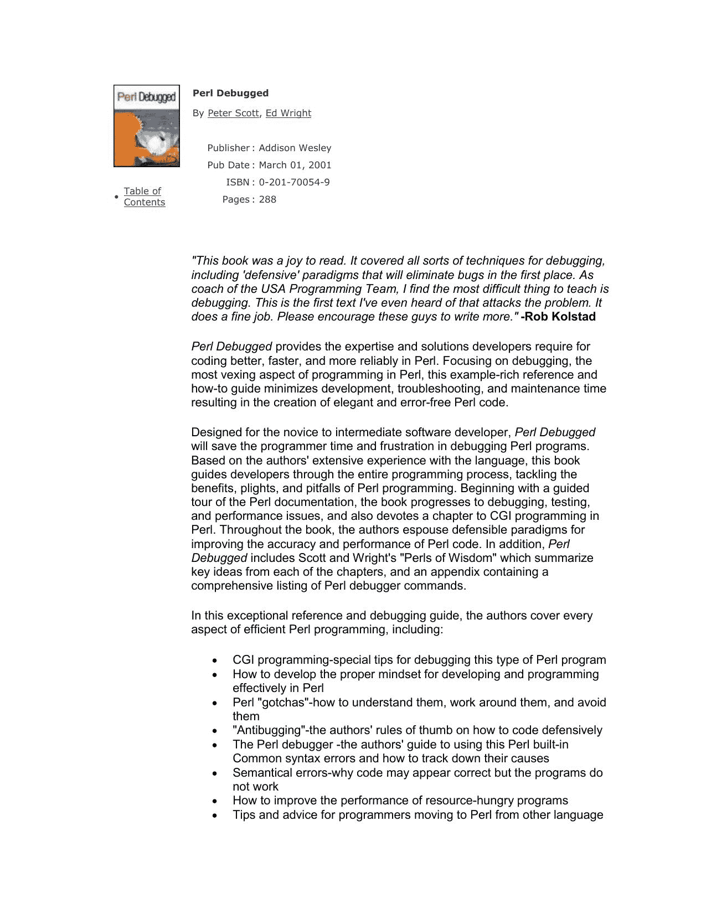
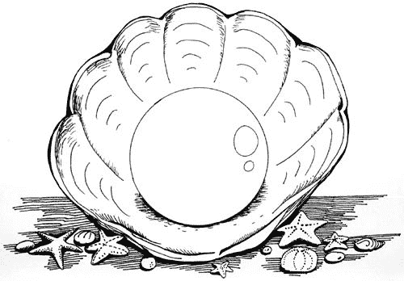
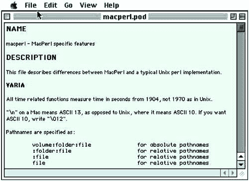
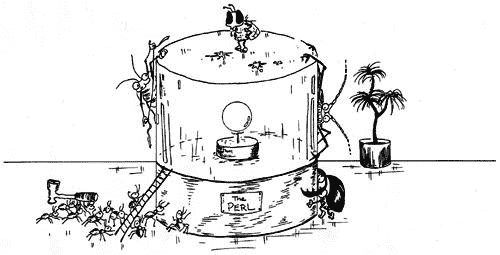
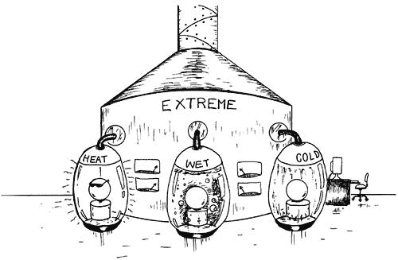
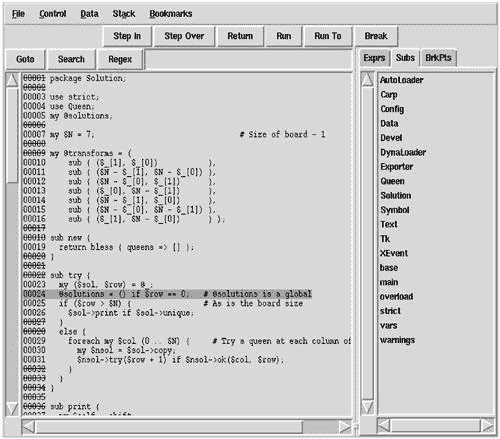
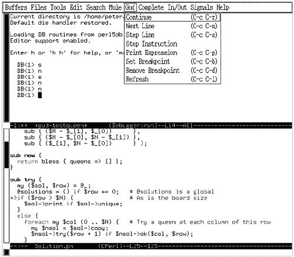
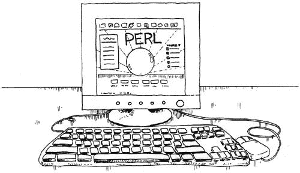
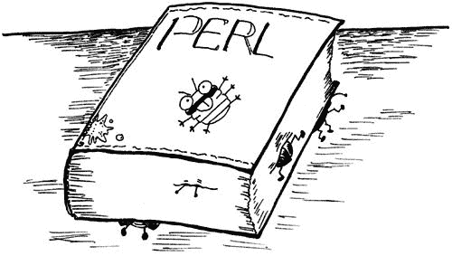

# Microsoft Word 目录.doc




## 目录

页数：288

“这本书读起来真是一种享受。它涵盖了各种调试技术，包括从源头上消除 Bug 的‘防御性’范式。作为美国编程小组的教练，我发现最难教的就是调试。这是我听过的第一本直接从问题本身着手的教材。它做得非常好。请鼓励这些小伙子写更多内容。”——**Rob Kolstad**

`Perl Debugged` 为开发者提供了在 Perl 中编写更佳、更快、更可靠代码所需的专业知识和解决方案。本书专注于 Perl 编程中最令人头疼的问题——调试。这本包含丰富示例的指南和操作指南，最大限度地缩短开发、故障排除和维护时间，从而创建出优雅且无误的 Perl 代码。

本书专为初级到中级的软件开发者设计，`Perl Debugged` 将节省程序员在调试 Perl 程序时的时间和挫败感。

基于作者对该语言丰富的经验，本书引导开发者完成整个编程过程，应对 Perl 编程中的优势、困境和陷阱。书中从 Perl 文档的引导之旅开始，逐步过渡调试、测试和性能问题，还专门安排了一个章节讲解 Perl 中的 CGI 编程。在全书中，作者推崇防御性范式以提高 Perl 代码的准确性和性能。此外，`Perl Debugged` 还包含了 Scott 和 Wright 的“智慧之珠”（Perls of Wisdom），总结了每个章节的核心思想，以及一个包含 Perl 调试器命令完整列表的附录。在这部卓越的参考书和调试指南中，作者涵盖了高效 Perl 编程的各个方面，包括：

- CGI 编程——调试此类 Perl 程序的特殊技巧

- 如何培养在 Perl 中进行高效开发和编程的正确心态

- Perl “陷阱”（gotchas）——如何理解它们、绕过它们并避免它们

- “反调试”（Antibugging）——作者关于如何进行防御性编码的经验法则

- Perl 调试器——作者关于使用这一 Perl 内置工具的指南

- 常见语法错误以及如何追踪其原因

- 语义错误——为什么代码看起来正确但程序无法正常工作

- 如何提高资源密集型程序的性能

- 为从其他语言环境转向 Perl 的程序员提供的提示和建议


通过专注于 Perl 编程过程以及识别和纠正错误的准则，`Perl Debugged` 帮助开发者立即编写出更好的 Perl 程序，并在总体上成为更优秀的程序员。

## 前言

“我的脑子里充满了想法，但我并不知道它们到底是什么。”

—— 爱丽丝，摘自《爱丽丝镜中奇游和爱丽丝在其中发现了什么》**Perl 性**（Perlness）

在语言的世界里，Perl 之国是一个巨大的熔炉，欢迎所有的文化、宗教和信仰。“带上你们疲惫的、受支持匮乏的程序员、带上那些渴望摆脱人工限制的拥挤的人群来这里吧，” Perl 说道。那些登陆它岸边的人发现，他们不再受限于语言设计者对于优雅语义和窒息语法纯洁性的奇幻妙想。

Perl 的随处可用和易用性使其成为最民主的编程语言。与其他许多语言不同，初学者也可以编写出实用的程序，而其他语言中的高效程序员通常需要花费更多的时间来学习语法、操作符和函数。一个 Perl 程序员可能拥有这种专业知识，也可能是一个修改了某些示例脚本以执行新功能的新手。

但新手还有另一个问题：缺乏调试技能。经验迫使精明的人由于多年积累的痛苦而培养出内在的调试直觉。我们希望尽量减少这种痛苦，因为我们也曾深受其苦。Perl 的易用性让知识匮乏的程序员也能创建可用（尽管脆弱）的代码。调试一个 Perl 程序所需的时间因人而异。我们的目标是帮助你最大限地减少为自己的 Perl 程序所需的开发、调试和维护时间。

不要认为这本书的标题意味着我们在这些页面中是在调试 Perl 本身。Perl 解释器中存在的少数 Bug 是微不足道的奇异现象（或奇特的细节），它们会由支持 Perl 的优秀志愿者团队迅速解决。一个更准确的标题应该是`调试你的 Perl 程序`（Debugging Your Perl Programs），但那感觉太平庸了，而且失去了那种“不插插头”（unplugged）的双关语趣味。

我们写这本书是因为我们希望让你看到开发过程的运作。大多数编程书籍都包含精心制作的示例，这些示例通过汗水实践打磨得完美无缺，作为作者优雅风格的无证词。它们没有向你展示为了让示例成型而经历的丑陋、恼人的过程；然而，这些示例实际上并不是从创造者的额脑中完整生成的。

由于你在开发自己的程时也会经历同样的过程，因此我们希望引导你完成这一过程，并描述绕过阻碍在你与“伟大编程”之间的尴尬、羞辱和意外陷阱的各种方法。

书中，我们描述了新手 Perl 程序员可能的最常见且令人恼的错误，然后详�介绍了识别和纠正这些 Bug 以及任何其他错误的步骤。你应该对 Perl 有*一些*了解；已经有几本优秀的教程可以让我们免于解释标量、数组、哈希表等内容的沉重责任。

本前言提到了其中一些最实用的教程。

我们不会尝试去定义或描述一种恰当的编程“风格”。风格就像个人身份一样独特——但一些通用规则可以创建一个共同的参考，以便我们能够轻松地阅读彼此的程序。

这也不是一本“如何编程”的书。虽然我们有时会探讨编程的机制和基础，但我们的意图并不是向完全的新手灌输编程纪律的思想。

### 你是谁？

如果你已经用 Perl 编程了一周到一年，并希望加快开发周期，那么这本书就是为你准备的。我们还将解决与团队开发相关的问题。本书旨在为开始学习 Perl 的人员提供实践建议。

### 本书涵盖内容

你将在书中找到：

- **第 1 章**：引言及 Perl 文档的引导之旅

- **第 2 章**：培养正确的编程和高效开发心态

- **第 3 章**：Perl 中的“陷阱”：处理编程中某些难以理解或难以正确的问题

- **第 4 章**：反调试：如何进行防御性编码

- **第 5 章**：如何对代码进行插桩

- **第 6 章**：如何测试你的 Perl 程序

- **第 7 章**：perl 调试器之旅：使用这一内置工具的指南

- **第 8 章**：语法错误类型以及追踪其原因的方法

- **第 9 章**：运行时错误

- **第 10 章**：语义错误：当程序看起来在运行但没有做正确的事时

- **第 11 章**：如何提高资源密集型（内存、CPU 周期等）程序的性能

- **第 12 章**：从其他语言转向 Perl 的者的提示和陷阱

- **第 13 章**：常见网关接口（CGI）编程：调试此类 Perl 程序的特殊技巧

- **第 14 章**：结

- **附录 A**：Perl 调试器命令参考

# 附录 B：我们的“智慧之言”列表

我们将花费大量时间回顾问题示例以及你可能如何调试这些问题。

## 获取 Perl

虽然这不是一本关于如何构建或构建 perl 的书，[1] 但我们至少欠你一些最基础的指导，教你如何获取一个你自己的 perl。

[1] 这不是拼写错误。按照惯例，大写的 `Perl` 指的是抽象的语言，而小写的 `perl` 指的是运行 Perl 程序的程序。

- 对于 Windows 机器，获取免费的 `ActivePerl` 分发版：[`www.activeState.com/ActivePerl/download.htm`](http://www.activeState.com/ActivePerl/download.htm)

- 对于 Macintosh：[`www.cpan.org/ports/index.html#mac`](http://www.cpan.org/ports/index.html#mac)

- 对于适用于所有其他机器的二进制发行版：[`www.cpan.org/ports/`](http://www.cpan.org/ports/)

- 获取 `perl` 本身的源码：[`www.cpan.org/src/`](http://www.cpan.org/src/)

在受支持的 Unix 架构上从源码编译 `perl` 只需在下载并解压正确的文件后执行以下命令：

```bash
./Configure
make
make test
make install # 如果 make test 成功
```


`Configure` 步骤会向你提出无数个问题，大多数人根本不知道其中许多问题在说什么；但 `Configure` 推荐的默认答案通常是正确的。

出于教育目的，你可能想要构建一个启用了调试功能的 `perl`。（在这里我们指的是允许你使用特殊的 `-DDEBUGGING` 标志来输出信息的 perl，这些信息告诉你 `perl` 正在对你的程序做什么。这与 Perl 内置的交互式调试器无关——我们在第 7 章会讨论它——所有的 perl 都有那个功能。）如果你想这样做，请从源码编译 `perl`，当 `Configure` 询问“Any additional cc flags?”时，将它已经显示的括号内的内容作为默认值粘贴进去，并添加 `-DDEBUGGING`。更多信息请参见 `perlrun` POD 页面（后文介绍）。

我们偶尔会提到不是 Perl 核心发行版的一部分但在全面 Perl 归档网络（CPAN）上可以找到模块。关于如何从 CPAN 查找、下载和安装模块的说明，请参阅 http://www.cpan.org/misc/cpan-faq.html](http://www.cpan.org/misc/cpan-faq.html)。

## 排版规范

我们在本书中使用了以下规范：

- 标准文本：Times Roman

- 作者注释：Arial

- 代码示例和 URL：Courier

- 用户输入：**粗体 Courier**

有时我们的代码示例在原句中没有换行的地方有了换行。在这些换行会导致问题或不明显的地方，我们在行末尾放置了一个反斜杠（`\`），表示该行应与下一行合并。

偶尔，我们希望让你知道是我们中的谁在对你说话，所以我们使用了这种风格的注释来让你知道。（顺便说一下，这是 Ed。）那些页边图标是我妻的姐姐 Ann Palmer 为本书创作的精彩插画的一部分。（顺便说一下，这是 Peter。）

## 延伸参考

访问本书的网站 [位于 http://www.perldebugged.com](http://www.perldebugged.com)。

通过以下资源（按用性粗略排序）获取 Perl 编程介绍：


- *Learning Perl*, 第 2 版，Randal Schwartz 和 Tom Christiansen 编写（O'Reilly & Associates, 1997）

- *Programming Perl*, 第 3 版，Larry Wall, Tom Christiansen 和 Jon Orwant 编写（O'Reilly & Associates, 2000）

- *Perl, the Programmer's Companion*,Nigel Chapman 编写（John Wiley & Sons, 1998）

- *Elements of Programming with Perl*,Andrew Johnson 编写（Manning Publications, 1999）

- *Effective Perl Programming*,Joseph Hall 与 Randal Schwartz 编写（Addison-Wesley, 1998）

## Perl 版本

在书中，我们指的是 Perl 的最新“稳定”版本，截至本书时为 `5.6.0`。

我们所说的大部分内容在旧版本的 Perl 5 上也可以直接运行，但不适用于 Perl 4。

如果你使用任何早于 `5.004_04` 的 Perl 版本，你应该升级；`5.003` 存在安全问题和内存泄漏等问题。你可以通过传递 `-v` 标志查找你的 `perl` 版本号：

```bash
perl -v
```

This is perl, v5.6.0 built for i586-linux

Copyright 1987-2000, Larry Wall

[...]

如果存在 `-v` 标志，Perl 将不会执行命令行上指定命名的脚本。可以通过 `-V` 标志获取关于你的 `perl` 配置的更详细描述；如果你提交错误报告，该功能会自动将此信息包含在你的报告中。[2]

[2] 使用随 `perl` 附的 `perlbug` 程序。

一个独立的开发轨道用于你的 `perl` 发行版包含一个。在第四届 Perl 会议（加利福尼亚，2000 年 7 月）上宣布 Perl 开发开始认真，向后兼容性并不妨碍某些事情。如果你发现你有一个且并不想要它，你可能访问了错误的 FTP。

## 致谢

我想感谢 David Noble 让我了解调试器的复杂性。我最感谢我的妻子 Grace 在这段忙碌时间的支持与爱。




一如既往，感谢我的奶奶 Charles D. Wright 让我玩电脑并阅读书籍，感谢最初联系我关于项目的 O'Brien。

此外，我们感谢编辑 Mike Hendrickson 及其同事 Julie Debaggis 和 Marcy Barnes 的持续支持、耐心和理解，他们在我们承担风险时并引导我们进入作者领域。在 Addison-Wesley 的其他人员中，我们感谢 Cathy Comer, Mary Cotillo, Jacquelyn Doucette, John Fuller, Karin Hansen, Katie Noyes, Heather Olszyk 和 Heather Peterson。

我们感谢 Elaine Ashton 的评审和截图，感谢 Brad Appleton, Sean M. Burke, Joseph Hall, Jarkko Hietaniemi, Michael G. Schwern 以及其他评审者的建设性建议，这些建议极大地改进了本书。任何剩余错误都不归他们。

# 第 1 章：引言

“良好的开始是成功的一半。”

——玛·波平

## 1.1 现实

遗憾对于编程世界（以及程序员）来说，软件开发在项目被宣布完成（这是一个日益任意且通常不准确的标签）后仍在继续。维护和调试花费的时间可能比原始编码更多，特别是因为负责程序维护的人员可能不是原始程序员。这意味着我们花费大量时间来推断代码中发现的某些算法的细节：它是如何实现的，为什么要这样做，以及为什么它现在不起工作了。[1]

[1] 在这方面的一部里程碑著作是 Fred Brooks 写的《人人神谭》（Addison-Wesley, 1995）。

3. 隔离 bug 所在的位置——问题出在哪里？（这就是调试器的发明原因。）

4. 确定导致 bug 的条件。是什么触发了它？为什么你之前没有发现它？

5. 修复 bug——并始终重新测试修改过的代码。

6. 这个 bug 最初是怎么进去的？如果你只是写了一个拼写错误并在 5 分钟后通过单元测试发现，那是一回事。如果 bug 是由逻辑错误引起并一直到了发布，那么你有另一个问题了。找出如何改进你的开发流程，以便任何类似的 bug 能更早被发现。

## 1.2 为什么选择 Perl？

很有可能，如果你使用 Perl，你知道为什么选择它，不需要进一步的传教了。

但额外的论据总没有坏处——如果你必须向你的管理层为 Perl 辩护，好吧，Perl 并没有一个跨国巨型集团来投入数以亿计的资金进行营销活动[2]——所以我们需要像我们这样的用户用实际的方式来歌颂它的美德。

[2] 如果你认为我们心中有一个具体的例子，你可能是正确的。

每当我们需要用程序解决问题时，解决方案首先出现在我们的脑海中，以思维图像和文字的形式，大多数开发方法论会在将其翻译成代码之前，让我们将其阐述为英语（或我们的母语）的算法描述。如果算法描述是完整且无歧义的，那么只要计算机能理解我们的术语，它就可以由计算机执行。[3] 但目前不存在可以解析自由格式英语算法描述的解析器，因此我们将描述翻译成某种机器*可以*理解的语言。

[3] 当然，在实践中，当我们稍后编写代码时，总是会发现自然语言描述中的歧义和不足，但这可以被视为仅仅是描述写得不够充分。我们怀疑这很常见，因为我们大多数人无论都急于尽快开始编码。

问题就在于：一种理想的计算机语言在实现描述时对程序员不产生任何额外开销。这样的语言并不存在，所以我们想要一种能将开销降至的语言。这因任务而异——如果你正在编写设备驱动程序，你的最佳选择很可能是汇编语言。如果你正在编写图形用户界面，至少有一部分问题可能最好用用 WYSIWYG（所见即所得）编辑器来创建一个布局规范。

在编写程序时，每当你为了满足语言要求而非问题需求而对代码创建一个需求时，你都会意识到它的开销。例如，在编写 C 和 C++ 程序时，一个频繁的例子就是为动态数据结构分配内存，以及在何处何时释放内存。

对于我们必须解决的大多数问题，Perl 为程序员施加了我们使用的任何语言中最小的额外开销。在付出极小学习成本的情况下，我们能够在极短的时间内创建非常短的程序来解决复杂问题。

因为语言开销很小，需求的变化不会迫使代码中大量无关部分发生改变，因为从解决方案的英语描述到 Perl 版本存在一种更自然的映射。而且由于 Perl 对解决方案的表达如此简洁，读者一眼过去就能涵盖更多内容。

事实上，在许多方面，Perl 在良好解决歧义的能力、其直观且正交的接口，甚至在读起来的听感上，都与英语相似。[4] Perl 的创始人 Larry Wall 经常阐述，他的语言学背景如何引导他有意识地构筑这种类比。[5] Perl 的资深行家将这种集体现象称为 Perl 的 DWIM（按我意执行）行为。

[4] 我们不知道这是否让非英语母语者学习 Perl 变得更容易或更难。这是一个真正的研究课题。

[5] 你可以在这里找到 Larry 对其指导原则的阐述：[`www.wall.org/~larry/natural.html`](http://www.wall.org/~larry/natural.html)。

如果你需要那些能说服经理倾向于 Perl 的论据，请查看 [`perl.oreilly.com/news/success_stories.html`](http://perl.oreilly.com/news/success_stories.html) 上的 Perl 成功故事。如果你需要那些能说服科学家的论据，请查看 Lutz Prechelt 写的语言对比论文，地址位于 [`wwwipd.ira.uka.de/~prechelt/Biblio/jccpprtTR.pdf`](http://wwwipd.ira.uka.de/~prechelt/Biblio/jccpprtTR.pdf)。

## 1.3 了解环境

对语言的知识包括在不同环境中对错误实际含义的经验。如果一个 Unix 程序返回错误 segmentation fault（段错误，其他系统上的用户可能会将其地体验为 ABEND、%SYSTEM-F-ACCVIO 或你的机器死机），经验丰富的程序员首先会怀疑内存问题，通常是由于越界对数组进行读取或写入导致的。另一个 Unix 错误响应 bus error（总错误）通常发生在子程序或函数调用具有不参数列表时。高效的错误识别伴随着经验。这本书试图总结编写 Perl 程序时所犯错误的经验。

## 1.4 了解语言


正如每个国家都有自己的习俗，每种计算机语言也是如此。当我们采纳它的习俗而不是假装自己更懂并试图强迫这种新语言适应我们旧的偏见时，我们才能最好使用使用。

年前，在我于第一台大型主机（运行 George III 的 ICL 1903）工作后，我接触到了第二台（运行 VMS 的 VAX 11/780）。我花了一些时间在新系统中定义符号，以便能像在旧系统中那样列出文件等命令。一位明智的程序员问道：“你为什么想让 VMS 像 George III 一？”任何了解各自界面威力的人都会欣赏这种讽刺。

找出常见的 Perl 习语并练习使用它们。它们流行通常有很好的理由。至少，采用它们会让你的代码更具可维护性。

这些习语的范围从简单的双元素“open or die”：`open FH, $file or die "Can't open $file: $!"` 到令人目眼缭乱（乍看时）的 Schwartzian Transform：

```perl
@sorted = map $_->[0],
sort { $a->[1] <=> $b->[1] }
map ...;
```

第一个习语很快就变成了本能（我们的手指现在会自动输入它），尽管初次学习语言时可能会写成：

```perl
if (open FH, $file)
{
    ...
}
else
{
    die "Unable to open $file: $!"
}
```

并不难理解为什么这个习语流行。（简之，这是它的工作原理：open 在失败时返回假，而 or 逻辑运算符是短路的，这意味着如果第一个参数为真，则不会求值第二个参数。）

第二个习语为那些在排序之前需要处理的项提供了一种高效的方法。当你学习这个时，


并意识到其中只有两个标记可以在每次调用之间发生变化时，6]，你的眼睛自然会发现 map-sort-map 模式，并在适当的情况下将其翻译为“Schwartzian Transform”。

[6] 比较函数可以是 <=> 或 cmp，而且你提供的用于将不可排序数量转换为可排序数量的函数名称也会所异。

幸运的是，Perl 随带的文档涵盖了你可能想了解 Perl 的大部分内容。不幸的是，你可能想了解的 Perl 的所有内容多得惊人。然而，只要有一点引导，你就能很快学会如何在文档中穿行，与其他方案相比，这可以节省大量时间。文档采用 POD（Plain Old Documentation）格式，这是一种作为 Perl 一部分的非常简单的标记语言。

熟悉文档的使用方法是一项至关重要的调试工具。由于这一点非常重要，我们在整书中使用一种设备来突出此类提示，以引起大家的注意，这种设备被夸大其词地称为*Perl 箴言（Perls of Wisdom）：**要熟悉文档，并能够从中找到任何内容。*

（我们已将所有的提示收集在附录 B 的列表中，以便快速查阅。）近年来，忽视这一建议最严重的例子之一是关于 1999 年后 `localtime` 函数行为引发的骚动。许多人查看了返回的年份值，错误地认为它是由实际年份的最后两位组成的，因此他们编写了处理年份窗口的代码，或者直接在数字前面加上“19”来获取真实年份。遗憾的是，根据 Perl 文档：

… `$year` 是自 1900 年以来的年数，也就是说，在 2023 年，$year` 是 123，而*不是*年份的最后两位。如果你假设它是，那么你就会创建不符合 Y2K 标准的程序——你不想那样做，对吧？

正如你所看到的，文档编写人员由于这一解释没有引起关注而感到沮丧，增加了文本。

1998 年，我被要求修复一个 10 多年前在 VMS 机器上编写的程序，该程序未能通过 Y2K 测试。我惊讶地发现，我编写了处理年份窗口的代码，假设 C `tm` 结构体返回的年份只包含最后两位，结果程序打印的日期是“19100”年。在修复程序后，我找到了编写它时使用的原始 VMS C 手册，并查询了 `localtime`。奇妙地发现，它竟然宣布年份字段包含最后两位！（（得益于控制其文档的开源流程，这样的 bug 在 Perl 文档中不会存在太久。）

### 1.5.1 Windows 上的 Perl 文档

如果你使用的是适用于 Microsoft Windows 的 ActiveState 版本的 perl，`perldoc` 页面已转换为格式良好的超链接 HTML。[7]。你可以通过“开始”按钮访问：

[7] 参见前言中的“获取 Perl”部分，获取如何获取 ActivePerl 的信息。

开始 -> ActivePerl -> 在线文档

或者进入安装的 ActivePerl 根目录下的 html 目录，并打开那里的 `index.htm` 文件。`Core Perl FAQ`、`Core Perl Docs` 以及 `Module Docs` 下的大部分列表也包含在任何其他平台上找到的标准 perl 分发版中。如果你点击主框架中的 `Perl Documentation`，你将进入 Perl 自身核心文档的根目录，而不是 ActiveState 创建的页面。

这是浏览文档的一种好方法，我们非常喜欢这个界面。然而，仅仅浏览是不够的；你经常需要在一个篇大大的文档章节中精确定位某个特定部分。假设你想知道如何使用 `split`；你必须进入巨大的 `perlfunc` 页面并向下滚动到合适的位置。为了解决这个问题，你可以使用命令行版本，让我们让我们开始 `perldoc` 之之旅吧。

### 1.5.2 perldoc 命令

每个安装了 perl 分发版的系统都包含 `perldoc` 以及它引用的文件。

如果没有，请要求安装人员再次正确地进行安装。提供一个没有文档以供正确使用的工具，在技术上不属于七大罪之一，但我们正在争取在他们的下一个版本中加入它。

只需输入 `perldoc` 产生的输出很少，但有一个引人入胜的线索：

```
% perldoc
```

用法: `perldoc [-h] [-r] [-i] [-v] [-t] [-u] [-m] [-l] [-F] [-X] PageName|ModuleName|ProgramName

perldoc -f PerlFunc

perldoc -q FAQKeywords

```

`-h` 打印更多帮助信息。也可以尝试“perldoc perldoc”来熟悉系统。

这是关于 `perldoc` 本身如何工作的信息，如果你试图寻找更多关于 `perldoc` 程序的信息则很有用，但如果你在寻找 Perl 手册则没用。如果你尝试上述两个建议之一（`perldoc -h` 或 `perldoc perldoc`），你最终只会得到关于 `perldoc` 可以接受的所有选项的更详细的信息。


开启 Perl 语言本身文档大门的钥匙是 `perldoc perl`：

```

% perldoc perl

```

[...]

为了方便访问，Perl 手册被分成了若干章节：

- `perl`: Perl 概述（本章节）
- `perldelta`: 自上一个版本以来 Perl 的变化
- `perl5005delta`: 5.005 版本中的 Perl 变化
- `perl5004delta`: 5.004 版本中的 Perl 变化
- `perlfaq`: Perl 常见问题

[...]

搞定！你可以通过 `perldoc` 浏览的所有不同章节都列在你面前，这引出了我们的第二个 Perl 箴言：要开始学习文档，请输入 perldoc perl。

之所以这样是因为 `perldoc` 章节与 Unix 手册页之间存在等效关系。在 Unix 系统上，相同的章节可以通过 `man` 命令读取，而主文档是 `man perl`，任何 Unix 用户都会首先使用它。

现在你可以通过输入 `perldoc` 加上章节名来浏览每一个不同的章节：

```

% perldoc delta

```

NAME

delta - 5.005 的新变化

DESCRIPTION

此文档描述了 5.004 和此版本之间的差异

[...]
```

`perldoc perl` 下看到的章节列表已经按照逻辑顺序排列，方便浏览。以下是我们的快速提示，告诉你根据特定用途使用哪个章节：

- **perlsyn:** Perl 程序很大程度上由函数调用或运算符处理的变量组成。变量、函数和运算符之间的内容就是语法。在这里你可以找到所有关于例如循环语句如何工作的信息，以及如何在语句后添加 if 修饰符。

- **perldata:** 该章节介绍了你可以在程序中创建的所有类型的变量。不过，不要在这里寻找多维数组（Perl 中称为“列表的列表”）；我们稍后会介绍。

- **perlop:** 在这里你将学习 Perl 极其丰富的运算符，从平凡的 `+` `-` `*` `/` 到应用于字符串的后增（`++`）魔力。这里还有一些你可能想不到会出现在此处的条目：用逗号分隔列表成员、不同的字符串引号方式以及它们内部的插值原理`m//`（匹配）和 `s///`（替换）运算符如何工作（但它们作为参数接受的正则表达式在 `perlre` 中记录）、使用反引号捕捉程序输出、从文件句柄中读取行，以及浮点数的奥秘。

- **perlre:** 在这里你可以找到如何编写正则表达式。Perl 拥有任何地方都最强大、功能最全的正则表达式实现。该章节涵盖了从最基础到最高级的所有细节；尽情阅读直到你的头真的要爆炸了为止，剩下的部分等你恢复体力后再读吧。

- **perllol:** 当你想知道如何实现多维数组或复杂数据结构时，这里就是你的选择。“lol”代表“列表的列表”，

严格来说，这是一个误称，因为它真正的含义是“指向数组或哈希的数组或哈希”，但听起来顺口得多。如果你是从 Pascal、Fortran 或 C 过去的，并且在疑惑记录（records）或结构体（structs）在哪里，不用别处寻找了。如果你想全面了解如何创建和使用能够构建嵌套列表的引用，请参考 `perlref`。

*   `perlsub`：这包含了你想要了解关于如何在 Perl 中编写自己的子程序（函数或过程）的所有内容，以及远多于此的内容，包括你可能意想不到的条目，例如本地命令和类型通配符（typeglobs）。请明智地挑选你需要的部分，并将那些令人眼花缭的部分留到以后。

我们省略了许多章节，以避免在现阶段让你感到无所适从。当你觉得准备就绪时，返回 `perldoc perl` 查看我们省略的更高级的章节。

我们未能列出的另一个不高级的章节是 `perlfunc`。原因为你在职业生涯中极少需要按线性顺序查阅 `perlfunc`。[8] 这是因为包含了 Perl 所有数千个内置函数的字母列表，其中许多你永远都不会用到。

幸运的是，`perldoc` 的 `-f` 选项允许你指定要查找的函数：

[8] 这只是轻描淡写。虽然委婉其辞并不是 Perl 程序员文档记载的美德，但它似乎是 Perl 作者的一种美德。

% `perldoc -f split`

```
split /PATTERN/,EXPR,LIMIT
split /PATTERN/,EXPR
split /PATTERN/
split
```

将字符串拆分为字符串数组并返回它。

默认情况下，会保留开头的空字段，并删除末尾的空字段。

[...]

`perldoc` 的最后一个特性值得解释。Perl 文档付出了超乎常人的努力来解答常见问题，以至于 FAQ 包含了*九个*文件。简单地通过扫描 FAQ 来查找特定主题（不要假设你的问题不在其中——它涵盖了非常广泛的内容）是一项艰巨的任务。但另一种选择是，如果你将问题发布到网上，可能会面临被成千上万人的回复围攻的风险。因此，`perldoc` 通过 `-q` 单词选项让你更容易判断你的问题是否是经常被问到的，[9] 该选项会在所有常见问题（但不包括答案）中搜索单词，然后向你显示问题及其答案：

[9] 实际上，参数可以是一个正则表达式。

% `perldoc -q sleep`

位于 `/usr/local/perl/lib/5.6.0/pod/perlfaq8.pod`

我该如何让 `sleep()` 或 `alarm()` 小于一秒？

如果你想要比 `sleep()` 函数提供的 1 秒更精细的粒度，[...]

你可以在 [`perlfaq.cpan.org/`](http://perlfaq.cpan.org/) 查看更多关于 Perl FAQ（以及 FAQ 本身）的信息。

`perldoc` 还可以使用 `-m` 选项显示模块的，这节省了你去 `@INC` 中搜索它的麻烦。

但如果你想在整个 Perl 文档集中查找某些内容呢？该用你计算机自带的工具了。要找到提到 "readline" 的 POD 文件，

*   在 Unix 上（使用 `csh` 或其变体）：

    *   % `find `perl -e '$_="@INC";s/ \.|\. //;print'` `

    *   `-name "*.pod" -print | xargs grep -l readline`

    *   `/usr/local/perl/lib/5.00503/pod/perldebug.pod`

    *   `/usr/local/perl/lib/5.00503/pod/perlfaq5.pod`

    *   `/usr/local/perl/lib/5.00503/pod/perlfunc.pod`

    *   `/usr/local/perl/lib/5.00503/pod/perlmodlib.pod`

    *   `/usr/local/perl/lib/5.00503/pod/perlop.pod`

    *   `/usr/local/perl/lib/5.00503/pod/perltoc.pod`

    *   `/usr/local/perl/lib/5.00503/pod/perltrap.pod`

    解释：我们告诉 Perl 打印它搜索模块的目录，从列表中删除当前目录，然后将该列表作为 `find` 命令的参数，搜索文件名由 `grep` 输出且包含匹配的 POD 文件。这些文件应该都在同一个目录下，所以一旦你知道了它在哪里，就可以直接在该目录下进行 `grep` 而无需使用 `find` 了。（但如果你以后想在所有 `.pm` 文件中搜索内容，请记住这个 `find` 命令。）为了针对常用术语获得更相关的命中，可以将结果传递给另一个搜索 `=head;` 的 `grep`，这样你只会在标题中找到匹配项。

*   在 Windows 上：

    在 ActiveState Perl 中，导航到安装根目录下的 HTML 目录，并使用 Tools -> Find in the Explorer 查找所有包含文本 readline 的 `*.html` 文件。如果你有另一个 Perl 版本，没有为所有 POD 创建

    

    HTML 文件，导航到安装根目并找到名为 `.pod` 的文件。

*   在 Macintosh 上：

    使用 `shuck`。（参见下一节。）

### 1.5.3 MacPerl 中的 Perl 文档

由 Matthias Neeracher 移植到 Macintosh 的 Perl 包含一个简单的 GUI 实用工具程序——`shuck`——用于查看 POD 文件。[10] 如图 1-1 所示，`shuck` 读取一个 POD 文件，然后渲染出一个格式正确的版本。

**图 1-1：在 shuck 中查看 perl**

## 1.6 参考文献

学习 Perl 的精髓（按重要性排序）：

*   *Programming Perl*,作者 Larry Wall, Thomas Christen (O'Reilly, 2000)

*   *Object Oriented Perl*,作者 Damian Conway (Manning, 1999)

*   *Effective Perl*,作者 Joseph Schwartz (Addison-Wesley, 1998)

    

*   *The Perl Cookbook*,作者 Thomas Tington (O'Reilly, 1998)

*   *Mastering Regular Expressions*,作者 Jeffrey Friedl (O'Reilly, 1997)

*   *Perl 5 Pocket Reference*, 第 3 版，作者 Johan Vomans (O'Reilly, 2000)

*   [`search.cpan.org/`](http://search.cpan.org/) 访问综合归网络

*   [`www.perldoc.com/`](http://www.perldoc.com/) 访问标准文档

# 第 2 章 Perl 开发之禅

“狂野是我的荣耀。”

—— *A Wrinkle in Time*, 作者 Madeleine L'Engle


### 先了解你自己，才能更容易了解你的程序。

在程序员中观察，你很快就会发现人与人之间确实好得多。我们一直对性能为何存在如此差异感到痴迷——对于任何给定任务，最好的在速度、准确性和可维护性方面的表现可能有几个数量级的差异——我们已经了解到，这种差异大部分源于区别他人的*态度*、*信念*和*行为*。

是的，天赋和先天智力很重要，但没有你想的那么大。是的，知识和经验对于创建高质量程序是必要的，但它们可能会被糟糕的态度和限制性的信念所削弱。

这是一个好消息！因为明智的人知道他们可以改变态度、信念和行为，并且知道如何做。

Perl 在这里处于什么位置？Perl 的设计初衷是将你的便利性置于抽象的美学或优雅感概念之上。Perl 的设计是为了让你从一个解决问题的想法到创建解决方案本身变得尽可能容易，无论你来自何种计算背景。Perl 有许多种实现方法（Ways To Do It），因为 Perl 是一种多语言语言。其他计算机语言就像你的八年级法语老师：

你：“老师，老师，储藏室着火了！”

老师：“啊-啊-啊-啊！Et, maintenant *en Français,* s'il vous plaît!（现在请用法语！）”

而 Perl 会尽全力去理解你：

你：“Yo， fraulein mine, yon edifice hast une conflagation, eh wot?”

Perl：“听起来你是说那边着火了……我这就去叫救！”

让我们看看什么样的态度、信念和行为最能服务我们。

## 2.1 态度

你不仅与人建立关系（尽管有些人坐在键盘前待得那么久，以至于我们怀疑他们是否还有这种关系）；你与所互动的一切事物都存在关系，这包括你的电脑和你的程序。而且如果你


你不认为你和它们有关系，或者不相信你和它们有关系，那么你就拥有一种潜意识的“这并不是一种关系”的关系。

这不仅仅是新时代的胡言乱语；这是你坐在键盘前能否成功的成败核心。当你这样做时，你的第一反应是什么？在某个量表上，介于“天哪——我不敢相信我做这事就能拿钱！”和“该死。又要工作。等不及周六的球赛了”。

这不仅仅是在衡量你的反应，更是在衡量你的热情；而你的热情与你的表现水平直接相关。

有时候，热情源于恐惧而非激情——当你老板要求你在明天之前完成一个项目，否则你就会被开除时，你不会称产生的情绪状态是*热情的*，但你会称之为*有动力的*。这与源于激情的热情几乎一样有效，但这是一个糟糕的替代品——由此产生的压力、愤怒和怨恨会带来代价。所以这里有我们关于热情的第一条 Perl 智慧：**通过你想追求的目标来激励自己，而不是通过你想要避开的目标。**

在这一行，你通常有足够的需求，以至于你不必继续为一个用威胁来激励你的老板工作；但如果这种情况还是发生了，不要把那种愤怒和恐惧带到键盘前（因为在这些情绪影响下很难清晰地思考）。相反，想想你的工作带给你什么让你觉得留住它是一件好事：让家人保持健康的医疗计划，让你衣食无忧的钱，创造美丽事物的机会。没错。这样看，你不是觉得感觉好多了吗？

Perl 对态度也有一些评论。（Perl 文档有时会变得很有哲学性、神智学和本体论色彩。）它告诉我们，程序员的三大美德是懒惰、傲慢和不耐烦。为什么？

*   **懒惰（Laziness）**：因为重复做同一件事是代码设计糟糕的标志。如果你天生懒惰，你自然会反斥重复自己的想法。

*   **傲慢（Hubris）**：自视自大的华丽词汇。面对现实吧；成为程序员需要*胆量（chutzpah）*。仅仅是认为你可以战胜一个没人能*完全*知道其内部构造的东西，认为你可以击败已知的和未知的 bug，就需要一种近乎鲁莽的自信。许多人之所以这样做，主要是为了通过创造他人会与他们联系起来的事物来获得自尊心的。（这并不是要贬低 Gerald Weinberg 提倡的深思熟虑的“无我编程”概念……但你会注意到它并没有在到处流行。程序员往往比大多数人更傲慢。）

*   **不耐烦（Impatience）**：因为你做这些不仅仅是为了在键盘上打字；你想创造某些东西。Perl 的创建是为了满足成千上万的人，他们厌倦了花费大量时间去满足语言的需求，而不是解决方案的需求。所以打开那个不耐烦过滤器，开始注意你何时做了本不需要做的事情。如果你能看到机器如何完成你正在做的事情，长远来看可以节省时间，就让机器去做吧。生命太短，不要浪费在无意义的字上。

## 2.2 信念

我们所说的*信念*，是指那些潜在心里不说的愚蠢念头，如果它们如果暴露在理性的光芒下，在一秒钟的检查下就会崩塌。就像那种让你在割草机启动失败时踢它的信念，尽管唯一的结果是撞到脚趾（“这东西本该运行的，我正在惩罚它的不听话”）。

或者是那种因为配偶没有给牙膏管盖上盖而对他/她发火的信念，尽管他/她犯的同样的错误一样（“他们应该符合某些标准，而我甚至自己为没达到这些标准而受到惩罚”）。或者，用一个更熟悉的例子，即认为可以省略错误返回检查的信念（“这只是一个小测试程序……不会出任何错的”）。

信念可以是赋能的（“我可以！”），也可以是限制性的。看看这些常见的限制性信念，看看是否有听起来熟悉的：

*   “我永远无法成为某某程序员。”

*   “我的程序就是不对。”

*   “我永远无法理解那些复杂的科学。”

你认为自己是一个多好的人就是*自尊（self-esteem）*。而且，它确实对你的编程水平有影响。根据我们的经验，自尊低的人（在 Perl 语语中为缺乏傲慢）是那些潜意识里与电脑比较并落败的人。如果你认为电脑会击败你，那你就是在白白给自己增加负担。你需要那种胆气去相信你可以处理它投而来的任何问题，即使是你从未遇到过的类型。当然，没有什么比成就记录更能滋养自尊，但有些拥有这种记录的人仍然不承认。如果你还没有成就记录，该如何获得？你有哪些资源可以提高知识、技能和经验？

带着限制性信念坐在电脑前，在你开始之前就限制了自己。但要意识到自己拥有信念并不容易，因为它们几乎总是不说出来的，甚至在脑海中也不发声。它们就像匿名政府办公室里的无脸官僚一样，对你的希望和抱心盖上“申请拒绝”。

所以，就像天文学家发现黑洞一样，你通过它对周囶环境的影响来识别限制性信念。一个好方法是观察没有良好解释的情绪变。如果你正在编写程序，发现自己进入办公室时心情愉快，现在却坐在阴云下，问问自己发生了什么，什么时候发生的？如果你足够意识到那是你坐在键盘前的那一刻发生的，你那时脑子里在想什么？

就像夜晚的萤火虫，限制性信念会触发突然的负面陈述，它们在你的脑中闪过，快到让你难以察觉。那是“电脑总是会击败我”的念吗？还是“我担心我会把事情搞得很糟糕”的念？或者是成千上万种其他可能性之一？无论是什么，只要你捕捉到它，它就会在意识的力量下像蒲公英一样消散。

谈到提升专业知识的资源，让我们进入了最后一个感性的概念：行为。如果你有正确的态度和良好的信念，你就需要配合正确的行为，或者，如果你更倾向于这种说法，就是养成“良好的习惯”。来看看这些内容吧。

### 2.3.1 整洁

混乱的组织会导致凌乱的心态，进而导致混乱的代码。别管你的办公室有多整洁；你是否有一堆名为 `foo`、`tmp`、`fred`、`latest`、`latest2` 等的文件散落在到处？把它们删掉，或者归档到某个有意义的标签的地方。你遵循一致的缩进风格吗？如果没有，就复制一个你喜欢的程序员的代码风格，直到你觉得可以根据个人喜味进行微调为止。只需保持一致即可！

### 2.3.2 沟通

你对正在编写的程序的需求有多几大把握？你是否向客户确认过他们使用的各种术语具体是什么意思？你是否向他们解释了你在解读他们的需求时所做的哪些假设？

### 2.3.3 实验

人们一次又一次地问：“如果我做了 X 会发生什么？”，而实际上他们尝试一下所需的时间可能比得到答案的时间还要短（而且那个答案可能是错误的）。不要花大量时间去猜机器的反应；去弄清楚。如果 Perl 典籍中还有第四种美德，那将是`好奇心`。如果你不急于发现在你那活跃的大脑构思的某些奇怪情况下会发生什么，那么请培养好奇心的态度，因为拥有好奇心的人在学习曲线上的移动会比没有的人快得多。

感到可以放心实验的方法是知道自己的边界。许多人害怕弄机器或破坏数据。因此，学习哪些操作可能会导致这些，哪些是安全的。找到你能找到的最安全的游乐场。如果你有一台有空闲磁盘空间的 PC，如果你担心弄坏重要的东西，可以为你最喜欢的操作系统的特殊版本创建额外的分区。像 `Partition Magic` 这样的工具会让这个过程变得简单。然后拿一个可以正常工作的东西，故意去弄坏它。

探索它可能出错的所有方式。如果你在自己的分区上创建了一个“随用随弃”的 `Linux`，去弄清楚损坏它有多难。在经过足够的这类尝试后，你就会很清楚哪些操作是可以的，而且在真实环境中调试时会少很多焦虑。

好奇心是开发 Perl 的人员以及那些花费大量时间尝试你见过的最奇异代码的人的必备特质，这一切都是为了探索 Perl 的边界，也许是为了弄坏它。

### 2.3.4 精确

Perl 努力适应不同的思维方式和编程风格。然而，这种*随遇而安*（laissez faire）的接受并不意味着 Perl 本身的术语没有严谨的定义。为了与他人准确交流并保持脑海中思路清晞，请学习你使用的每个事物的正确术语，并严格区分它们。例如，Perl 中的列表（lists）和数组（arrays）之间有巨大的区别：



确保你知道它们分别是什么。[[1]] 当你说“系统调用”时，你是指使用操作系统的调用还是 `system()` 调用？当你说“局部变量”时，是指用 `my` 声明的私有变量，还是用 `our` 或 `local` 声明的包变量的临时？

[1] 参见 `perlfaq4` 中的“列表和数组有什么区别？”

## 2.4 提高你的手艺

如果你热爱你所做的事情，提高技能是自然而然的。如果你不喜欢，做得更好是一场艰苦的战斗。（如果你不喜欢，你真的需要做它吗？）提升业务水平的途径是很多。每当你觉得已经征服了那座山时，你可以查看软件工程研究所的软件开发能力成熟模型（`SW-CMM`）[2]，它描绘了开发小组可以实现的五个等级，按有效性递增。很少有获得过 5 级认证。这是一个可以的目标。

[2] [`www.sei.cmu.edu/cmm/cmm.html`](http://www.sei.cmu.edu/cmm/cmm.html)

## 2.5 总结

如果你有良好的态度和信念，正确的行为很容易学习——它们大多是细节。因此在下一章中，我们将回到编程细节的左脑模式，讨论实用的行为。

# 第 3 章 反 Bug（Antibugging）

“在没有数据之前就建立理论是一个致命的错误。人们会不自觉地开始扭曲事实来迎合理论，而不是让理论来迎合事实。”

—— *阿瑟·柯南·道尔爵士，《波希米亚恋人》中的洛拉克·福尔摩*


从章节标题可以看出，我们不惜为了节省空间而创造出可怕的新词。（当我们的出版社按字数付我们钱时，我们会乐意更啰嗦一些，但按字数付钱就像通过代码行数来衡量程序员的表现一样愚蠢。）

*反 Bug*（Antibugging）描述了一组编程技术，这些技术旨在设计设计或输入时减少向程序引入 bug 的概率。你也可以称之为*防御性编程*。我们正在应用在前一章中开发的原则，提出一些良好的 Perl 开发行为。

### 3.1 开始

在将你的想法转化为代码之前，先用自然语言描述它们。**如果你不能用自然语言表述，你就无法用 Perl 表述它们。**

极捷开发方法（在第 6 章中详细介绍）在这方面很有帮助，它坚持在编写代码前编写测试，并要求结对编程，这促进了这种交流。我见过太多次这样的情况：某人在练习时遇到极大困难，是因为他们的代码在屏幕上到处都是。当我问他们代码是如何工作的时，他们无法解释清楚。

这说明方法从一开始就没有经过充分思考。

### 3.2 写代码

你的代码在视觉上应该越好看越好，即使仅仅是为了让你在看它时感到愉悦而不是退缩。你更倾向于以下哪一个子程序？

```
sub iterate (&$$){

for ($_[1] = 0,my $i = 0;$i <= _[2];

$_[1] = ++$i/$_[2]){&{$0] };

}

}
```

或者

```
sub iterate (&$$)

{

for ($_[1] = 0, my $i = 0;

$i <= _[2]);

$_[1] = ++$i / $_[2])


{

&{$0]};

}

}
```

### 3.2.1 风格

关于风格唯一可靠的评论就是你应该拥有一种风格。如果你还没有固执地迷恋某种风格，请阅读 `perlstyle` 手页并采用所示的风格。

不进行正确的缩进是没有借口的。我在课程中见过许多人在练习时挣扎，完全是因为他们的代码紧贴着左边距，处在等死。（Emacs 的 `cperl` 模式只需按下 TAB 键即可自动缩进。）

**每个项目使用一致的风格。**

无论你选择什么风格，整洁的风格都是好的风格。建议：编写代码时就像预期它会被出版（并获得图灵奖）一样——使用大量的留白和充足注释。

选择清晰的变量名。通常情况下，变量在代码中出现的频率越低（或其作用域越小），它的名称应该越长，因为读者需要更多的提示来记住它的用途。不过，对于循变量使用单字母变量名（它们有着悠久且卓越的历史）或者对于数学或科学变量使用单字母变量名是没有问题的（`$e=$m*$c**2` 和 `$energy=$mass*$speed_of_light**2` 一样合理；至少对于任何应该使用这段代码计算这些数值的人来说是如此的）。

### 3.2.2 编辑器的帮助

对于那些担心在程序中通过数数来匹配 `()`、`{}` 和 `[]` 符号会累瞎眼睛的人来说，有一些工具可以让你免于使用白手杖。一个可以帮助美化 Perl 程序等一些例性工作的智能编辑器会产生奇妙的效果。如果你每删除一个外层块都必须手动重新缩进代码，那么你很可能不会去这样做。Perl 大师们喜欢说：“只有 perl 能解析 perl”，作为一个推论，没有编辑器足够智能到可以正确地布局所有可能的 Perl 程序。

有道理；但其中一些已经足够接近且派用用了。

Peter 最喜欢的之一是 `cperl`，这是一个由 Ilya Zakharevich 维护的 Emacs Perl 模式。

标准的 Perl 分发版包含一个 `emacs` 目录，其中包含 `cperl-mode.el` 文件。如果你的 Emacs 还没有 `cperl`，请将此文件复制到你存储本地 Emacs 模式文件的地方（你可以在家目录下的 `.emacs` 文件中为自己设置一个专门的位置）；如果你在那里发现了另一个版本，请确定哪一个 `cperl-mode.el` 更新。将此行

```perl
(autoload 'perl-mode" "cperl-mode" "alternate mode for editing Perl programs" t)
```

插入你的 `.emacs` 文件中，以启用 `cperl-mode` 而不是 Emacs 自带的普通 `perl-mode`。

`cperl` 会为你匹配各种 `()`、`[]` 和 `{}`。[1] 它还执行语法高亮，所以如果你配置 Emacs 将所有字符串都染成 `puce`，而你的整个文件突然变红了，你就知道某处漏掉了一个引号。最有用的是，它会跟踪括号的嵌套层，按下 `TAB` 键即可带你到达该行的正确缩进点。这可以捕捉各种类型的拼写错误，例如第 1 行漏掉的分号：

```perl
1 my $marsupial = 'wombat'
2 my $crustacean = 'king crab';
```

当你点击第 2 行的 `TAB` 时，错误就会暴露出来：语句没有与第 1 行对齐，而是多缩进了一层，因为当前语句尚未完成。

不过，`cperl` 也有一些问题：如果你使用 Perl 4 语法，用单引号来分隔包限定标识符中的路径组件，它可能会产生困惑。但只需将单引号（`'`）更改为冒号（`::`），就没事了。在正则表达式的字符类中使用某些字符（如 `#` 或 `'`）也会让它感到困惑，但在它们前面加上反斜杠（`\`）（即 **backwhacking*）就能解决问题。

我们喜欢的其他编辑器还有：`vim/gvim`，它在语法高亮方面表现出色，并有一个极佳的 Windows 版本；以及 Macintosh 上的 `BBEdit`。

关于喜爱编辑器的主题是软件开发中一个具有宗教色彩的话题，你应该预期别人会不同意你的偏好；只要你身边有同样有分量的开发者支持你，你选择什么或别人说什么并不重要。

你对一个良好的 Perl 编辑器应该期待什么？它应该在你的分隔符不匹配时警告你，它应该根据你想要的样式自动缩进，并且应该尽可能地对你的个人文本编辑需求保持灵活和适应。它既不会在不警告你的情况下插入字符（例如，不可见的二进制格式提示），也不会删除任何字符（例如，末尾空格），除非给你提供选择性或全局禁用此功能的选项。

### 3.2.3 双重检查

无论你的编辑器是否会警告你分隔符不匹配，这里有一个实用的技巧：在输入起始分隔符的同时输入结束分隔符。然后在它们之间插入你需要的内容。从外向内操作，分组分组错误的概率将大大降低。例如，如果你计划写一段最终将变为：`print table(map { Tr(map td($_), split /[:\s]+/) } <IN>);`（如果使用 `CGI.pm`，这将从来自文件句柄 `IN` 的剩余文本打印出一个 HTML 表格，每行一个，由空格和/或冒号分隔的元素形成表格元素），那么你的输入策略将遵循以下步骤：

1. `print table();`

2. `print table(map {} <>);`

3. `print table(map { Tr() } <IN>);`

4. `print table(map { Tr(map td(), split //) <IN>);`

5. `print table(map { Tr(map td($_), split /[:\s]+/) } <IN>);`

### 3.2.4 清晰

检查这个简单的单行程序：

```perl
$x=1; $y=2; $z=$x+$y; print"$x+$y=$z\n";
```

这并不难理解：初始化 `$x` 和 `$y`，将 `$z` 设置为它们的和，然后打印所有三个。

假设我们通过调试器跟踪其执行（详细讨论见第 7 章）。

```bash
% perl -de '$x=1; $y=2; $z=$x+$y; print"$x+$y=$z\n"'
main::(-e:1): $x=1; $y=2; $z=$x+$y; print"$x+$y=$z\n"; DB<1> **n**
main::(-e:1): $x=1; $y=2; $z=$x+$y; print"$x+$y=$z\n"; DB<1> **n**
main::(-e:1): $x=1; $y=2; $z=$x+$y; print"$x+$y=$z\n"; DB<1> **n**
main::(-e:1): $x=1; $y=2; $z=$x+$y; print"$x+$y=$z\n"; DB<1> **n**
1+2=3
Debugged program terminated...
DB<1> **q**
```

我们观察到了什么？调试器打印了单行程序：`main::(-e:1): $x=1; $y=2; $z=$x+$y; print"$x+$y=$z\n"` 打印了 4 次 `1+2=3`。为什么？调试器显示 perl 执行的下一行代码。将程序重构为每行一个命令：

```perl
$x = 1;
$y = 2;
$z = $x+$y;
print"$x+$y=$z\n";
```

然后使用调试器。你可以将这些行放在文件中，或者使用像 Bourne shell 那样允许在单引号内输入新行的 shell。

```bash
% perl -d dbformat.pl
```

这种“编造内容”是如何显示的？假设某人运行一个包含以下代码的程序用于向他们发送报告：`open MAIL, "|$SENDMAIL $address"`

……等等其他；它还允许 Emacs 作为 perl 调试器的前端运行。在 Emacs 中调试将在第 7 章中讨论。

```perl
and print MAIL "Subject: Report for ". localtime, "\n\n"

and print MAIL `/usr/local/bin/dbquery $month $day`and close MAIL

or die "Unable to send to $address: $!\n";
```

但在执行时，他们收到了一封空邮件。经过进一步检查，他们发现程序（我们暂且称之为 `frozzle`）输出了以下内容：

```
Can't exec "/usr/local/bin/dbquery": Permission denied at ...
```

此时，他们联系了系统管理员并说：“嘿，`frozzle` 程序没有权限向我投递邮件。”

发生了什么呢？系统管理员开始徒劳地奔波，寻找设置错误的信箱权限、错误的防火墙设置或损坏的 sendmail 规则。

嗯，通常并不会这样。任何称职的系统管理员都不会仅仅仅仅从表面上接受这个问题报告，而是会问这三个问题：

* 你做了什么？

* 计算机是如何反应的？

* 你原本期望它做什么？

而对这些问题的回答**完全不需要任何计算机知识、智力或猜测，**，只需要观察：

* 我运行了 `frozzle` 程序。

* 它输出了 `Can't exec "/usr/local/bin/dbquery"` ... 然后我收到了一封空邮件。

* 通常它什么都不打印，而我会在邮件里收到一份报告。

然而，在今天，管理层在用户和系统管理员之间介入是非常常见的现象。如果用户必须拨打帮助热线，由他们将问题报告转录到故障工单数据库，然后从池中分配一个系统管理员来处理问题，那么系统管理员最终陷入徒劳奔波的可能性就会大得多（特别是因为帮助热线可能将工单分配给了邮件服务器组）。

当你与客户打交道时，你会训练他们通过这三个问题来描述他们的问题。但即使作为开发者，你也需要熟练地自己这样做。当出现问题时，要清楚“发生了什么”以及“你对其含义的猜测”。作为开发者，我们经常会经历比前面描述的更加疯狂的徒劳奔波，全是因为我们对自己认为的真实发生的事情钻了牛角尖。

## 3.4 文档

我们知道，真正的程序员不写文档。“写起来很难，理解起来也应该很难。”我们理解你的痛苦。然而，你节省下的理智可能可能是你自己的。你可以足够频繁地更换工作，以至于永远不需要重新查看你六个月以前编写的程序。[2] 或者，你可以为它编写文档，以便你理解自己做过什么。


[2] 但如果你从不为个人使用编写程序，你就不能称自己为一个`真正的`程序员。

关于程序文档这个主题，已经写了大量的价值材料，其中大部分由不是程序员的人编写的，或者在那些认为自己是“真正”程序员的人看来，这些人充其量是边缘程序员。如果文档是你的宿敌，我们并不打算模仿那些高尚的人，他们会确切地告诉你应该如何以及为什么要写大量的层级化文档。

因为我们也讨厌它。

所以，这里有一份纯粹出于自私动机的、针对**懒人的文档指南**。（当然，在某些编程环境中，你别无编写详尽的文档，因为管理层有要求。根据我们的经验，这些环境很少见。）

1. 想象这是一个由别人写的程序，而你被要求或命令接手它。为了理解它，你需要什么帮助？尽管这个场景听起来很疯狂，但它比任何其他事情都接近事实。很多时候，你`必须`对一个你写过但六个月没见过的程序做某些处理，很多时候，你对如何编写它的记忆远远不足，无法进入状态。

2. 如果它写得很快且容易理解，就不要浪费时间为它写文档。世界上`确实`存在自解释代码这种东西，你写得越好，浪费在解释自己上的时间就越少。当然，并不是所有代码都是自解释的。尽管如此，编写以下代码需要一些注释和审查：

3. for (my $i = 0; $i <= $#a; $i++)

4. {

5. $b[$i] = $a[$i] * 86400;

6. }

而在写

```perl
@seconds = map $_ * $SECS_PER_DAY, @days
```

时可能就不需要。

7. 你`确实`需要文档的部分是那些你花费了很长时间才弄懂的部分。

任何特定代码段随附的注释量应该与其创建它的时间成正比。

我曾花了大约一个月的时间在一个程序里弄对`一个数字`。那是一个通信板的驱动程序，那个数字代表一个相当重要的寄存器的组合标志位设置。供应商提供的文档不足以推算出正确的设置，每尝试一次组合都需要几个小时的详尽回归测试。当我们终于弄对那个数字时，那个数字获得了`非常多`的注释。


4. 仅仅说事情`如何`工作是不够的，你还必须说`为什么`。每当你做一个显而易见的选择时，请解释它。否则，六个月后当你回到这里时，你会盯着那里疑惑：“我当时为什么要那样做？”

5. 注释是不够的。它们可能解释代码的原理和原因，但它们没有说明你最初为什么要这样做。为什么在你的类中这里有一个模块？如果你是从平面文件读取数据，而不是大家使用的 Oracle 数据库，是因为你的数据文件比多了一个属性，请说明。如果一个想法花费了思考，那么这种思考就需要记录下来。

Perl 提供了几种在编写代码时进行记录的方法，并且位于理想位置——就在代码旁边。[3] 第一种方法是传统的行尾注释，用于告知代码维护者复杂代码的操作或做出非显易见选择的原因。第二种方法是 POD——纯文本文档——一种将接口文档嵌入程序本身的原始系统，随后可以通过 Perl 带的程序提取为 Unix 手页、HTML 或其他格式。[4]

[3] Brad Appleton 将这种优势称为`引用局部性原理`，并在 `http://c2.com/cgi/wiki?LocalityOfReferenceDocumentation` 上有详细讨论。

[4] 查看程序 `pod2man`、`pod2html` 或 `pod2anything-else-you-mite-to-use`。

## 注释困难的部分。使用 POD。

这些文档是给程序或模块的用户看的，他们可能幸运地永远看不到源代码。将这些文档与代码放在同一个文件中的优势有两个：它减少了你需要交付的文件数量，并且让你能够将外部文档放在离其引用的代码尽可能近的地方。（尽管不是乱序——POD 就像 Donald Knuth 的“文献化编程”工具 WEB 的一个缺了牙的远亲，WEB 灵活到可以进行这种重新排序，并能产生排版精美的注释程序版本。遗憾的是，WEB 用户还必须学习 TEX，以及如何将 TEX 和程序代码嵌入到让 TEX 宏读起来像 Seuss 博士的符号汤中。但怀旧了。）

POD 几乎是你用户文档的最佳选择，因为人们期望在 Perl 文件中找到它。

直言之，一个合格的程序由一组集合定义，包括执行代码、描述代码原理和原因的注释，以及描述程序功能（带示例）的文档。真正的汉子女战士会给代码写注释！


## 3.5 开发

知识是不可替代的。编写你不理解的代码应该在你的脑中敲响警报：“我刚刚写的这段代码到底在做什么？”那是该实验的时候了。

我见过太多人写代码时采用“散枪法”的方法：他们只是在屏幕上乱射出一串字符，然后不断排列它们，直到某个东西运行起来。很多时候，老师培养了这样一种心态，认为唯一重要的是得到正确答案：我不断发现有人在程序里放了某些东西“因为它能运行”——在*那个*特定的情况下——但他们并不理解自己在做什么，因此无法将其扩展到其他情况，或者没有意识到它可能在哪里失败。

尽管如此，有时你必须做一些完全超出你当前能力或学习速度范围的事情。这里有一些实用的“作弊”方法：

1. **偷窃。** Tom Christiansen 和 Nathan Torkington 已经在你当地书店的一本厚书[5]里留下了一堆代码，你可以随心所欲使用，他们永远不会抱怨。如果你在里面发现了你试图解决的任务，尽管去用吧。你始终可以将你的整体任务分解为更小的、更通用的逻辑单元，因此它们更有可能出现在书中。

[5] *The Perl Cookbook* (O'Reilly & Associates, 1998)。

2. **变异。** 从使用与你需求类似的良好代码开始，然后逐渐修改它以适应你的需求。尽管其中可能有你不理解的代码，但它们可能与你的更改隔离开来，所以你不需要担心它们。（任何对模块进行子类化的人熟悉这种思维方式。）如何识别好代码？模仿最优秀的。

现在，每当我们询问应该模仿谁时，人们总是不愿指名道姓某个人。我们赞赏他们的公平感，但结果是令人沮丧的。

因此，我们呈现了这份完全偏颇、不完整但仍然非常有用的作者列表，你可以在网上找到他们的代码，复制它们可能会带来良好的结果。[6] 我们按照字母顺序排列这些名字，以避免引起不必要的愤慨。

[6] 然而，如果你看到这些人或其他人发布的代码中提到了高尔夫（golf）或保龄（bowling），意味着他们正在竞争谁能用最少或最多的字符解决问题。无论哪种情况，胜者都不可能易于理解。

[查看 http://www.perlfaq.com/faqs/id/154]

Gisle Aas

Uri Guttman

Chip Salzenberg

Greg Bacon

Joseph N. Hall

Gurusamy Sarathy

Graham Barr

Jarkko Hietaniemi

Randal Schwartz

Tim Bunce

Nick Ing-Simmons

Michael G. Schwern

Alan Burlison

Ronald Kimball

Lincoln Stein

Nigel Chapman

John Macdonald

Mike Stok

Tom Christiansen

Tad McClellan

Nathan Torkington

Damian Conway

Chris Nandor

Hugo van der Sanden

Simon Cozens

Jon Orwant

Johan Vromans

Mark-Jason Dominus

Tom Phoenix

Larry Wall

Jan Dubois

John Porter

Ilya Zakharevich

brian d foy

Larry Rosler

给那些缺乏常识能力的人的提示：这不是人气选秀，我们没有发奖。当然，我们本可以加入其他几十个人，如果我们能意识到他们所有人的话，还有成百上千的人值得进入此类列表。（如果你属于那类人，我们向你道歉。）我们在这里印出它，因为这是我们在开始学习 Perl 时想要但没找到的那种列表。尽管它是任意且不完整的，但我们认为它比完全没有列表要好。

现在，当你对代码进行变异时，务必在更改之前测试原始代码是否运行正常！[7] 这一告诫与其作者的可靠性无关，而是因为每个人的环境都是不同的，也许你和作者之间的差异是巨大的。（有时，我们花了大量时间试图在变异代码时做的更改中寻找 bug，结果发现问题出在原始代码上。）

[7] 这和我们的其他一些建议属于 Joseph N. Hall 在《Effective Perl Programming》（Addison-Wesley, 1998）中称为“不要忽视显而易见的事”的范畴。

然后每次尽可能只修改最少的内容，以获得你可以测试的东西。先修改你最擅长的部分——比如输入/输出文件名和电子邮件日志地址——测试，然后继续处理更难的部分。（任何对模块进行子类化并重写过方法的人熟悉这种方法。）

## 3.6 预防意外

这些技巧属于“安装洒水系统而不是打磨消防管”的类别。

### 3.6.1 使用严格模式

将 `use strict` 指令放在文件的第一行（如果有 `#!` 行则放在其后），包括你编写的每个模块（词法作用域的，而不是程序作用域的）。尤其是你不理解时。这让 Perl 对那些通常可以忽略的错误变得更加严格，那些顶尖 Perl 专家对其不可或缺的立场是坚定的。[8]

[8] 除非他们在参加混淆 Perl 竞赛（www.tpj.com/contest），那高度依赖不使用严格模式。这应该能说明问题。


不要认为先让程序运行，然后再回来插入严格模式并清理产生的错误会更快。这样做慢得多，原因有两个：第一，不使用严格模式开发会导致错误更难发现、修复时间更长；其次，当你对从未使用严格模式的长程序添加严格模式时，打印出的错误数量可能是巨大的，修复它们可能并不简单。

这并不是夸张，特别是当你的非严格代码已经升级到运行环境时。你可能没有选择关闭一切来重新编码和重新测试。

让 `use strict` 成为我们朋友的原因是，它提出的大部分反对会导致不符合良好实践的程序运行。（这被称为引起编译时异常。尽管有一类错误它只在运行时捕获。）`use strict` 为你提供的最大帮助是强制你用 `my` 语句声明所有变量，否则它会抱怨你在没有显式包名的情况下引用了变量。换句话说，没有用 `my` 声明的变量属于一个你很少使用的变量族；事实上，少用以至于 `use strict` 要求你通过全名（包括它们所在的包）来引用这些变量。

为什么这是一个巨大的帮助？因为它可以防止常见的拼写错误肆肆破坏。

考虑这段代码：

```perl
my $enrolled_so_far = 0;

foreach my $student (@students)
{
  foreach my $class (keys %registry)
  {

    $enroled_so_far++, last
    if exists $registry{$class}{$student};
  }
}

print "Number of enrollees so far = $enrolled_so_far\n";
```

没有 `use strict`，这段代码会愉快地运行，无论数据如何都会输出“0”。

由于最内层循环中的一个微小错误，`perl` 增加了一个名为 `$enroled_so_far` 的*不同*变量，它会在我们讨论过的这一类不同的变量中自动创建它。但在 `use strict` 使得，`perl` 将拒绝运行这段代码，因为 `$enroled_so_far` 既没有通过 `my` 语句引入，也没有通过包名进行限定。[9]

[9] Perl 既然是 Perl，总会有例外（除非在没有例外的情况下），你可以通过 `our` 或 `use vars` 编译指令来防止 `perl` 对对未限定的包变量进行抱怨。

 

使用 `use strict` 可以保护你免受许多错误以及你可能永远不需要学习的 Perl 部分。

**尽可能将你的所有变量声明为作用域变量（lexical）。**

文档或文章中的许多代码片段没有用 `my` 声明变量；作者认为这对于他们的示例来说太麻烦了。在不使用 `use strict` 的情况下，代码可能正常运行，但每个变量都会自动创建为*动态*（dynamic）或*包*（package）变量，其行为与作用域变量略有不同，并且使用旧的 `local` 关键字创建临时版本。

`use strict` 强迫你区分作用域变量和动态变量。

在 Perl 程序中，使用后者（或 `local`）的理由非常少，例外是：

- 特殊的包变量，如 `@ISA`

- 局部化特殊变量，如 `$_`，这些变量无法转变为作用域变量

- 你创建并希望出于继承目的从其他类访问的包变量

当你遇到这些情况之一时，通常会知道该做什么。

### 3.6.2 宽容地对待警告

始终使用 `-w` 选项运行你的程序以启用警告。其中一些警告是在编译时产生的（例如，在同一作用域内声明已经声明过的 `my` 变量——你可能认为这足以让 `use strict` 失败，但 `perl` 在这方面奇地仁慈），而另一些是在运行时产生的，因为无法更早地检测到。（例如，警告你使用了未初始化或以其他方式获取了哨兵值 `undef` 的变量值。[10] `Perl` 高兴地在数值上下文中为该变量分配默认值 `0`，在字符串上下文中分配 `""`，但很可能，你在那个点读取未定义的变量对来说是一个错误。）[11]

[10] 另一个例外：如果你对未定义变量进行的操作是 `++`，则不会发生警告。如果你查看某些这样使用 `++` 的代码，就会明白为什么这很有用。

[11] 如果你的变量在程序的该时间点可以合法地获取 `undef` 值，那么请使用 `defined` 操作符对其进行测试。

现在，对于是否在运行中或交付的代码中保留 `-w` 标志，意见在某种程度上分歧。支持者认为，既然你设计程序使其在 `-w` 下不产生任何警告（称为 `"-w clean"`），那么如果它真的生成了警告，那就是错误，并且应该以这种错误的形式显示出来。反对者反驳说，即使你消除了这些可能性，有一天你的程序触发的新警告可能会被添加到 `Perl` 中，你不希望客户敏感的神经被 `Perl` 有时不合寻常的言论所冒犯。此外，有时警告可以发送到某种输出过滤器（如一个


Web 服务器——我们将在第 13 章展示如何处理 CGI 程中的错误）并产生混淆。

我们在矛盾中徘徊，最终倒向了支持者的一边。编写得最好的代码也可能以我们从未预料的方式出错，[12]，而最好的工具是那些能够捕获各种错误并将其像抽绳式猫砂盆内衬一样打包给维护人员的工具。

在生产环境代码中找到重定向警告的方法，以便信息被保存但不必一定暴露给用户，因为如果你今天所做的某些事情在以后版本的 `Perl` 中生成了警告，它可能会导致后续 `Perl` 版本的故障。

[12] *Peter:* 我曾写过一个程序，在 24/7 的实时环境中成功运行了九*年*后才遇到一个 bug。

`Perl 5.6.0` 增加了一个极大扩展了 `-w` 功能的功能：作用域警告。

`perldoc perllexwarn` 告诉你可以如何插入 `use warnings` 编译指令的变体，以便在作用域范围内选择性地启用和禁用类警告。由于该功能不支持 `5.6.0` 之前的版本，而且这本书并不关注对警告的精细控制，我们坚持使用 `-w` 语法。

**在所有程序中使用 -w 和 use strict。**

有时 `perl` 感谢 `-w` 吐出的单行信息过于简洁，一眼无法看懂。你可以通过查找 `perldiag` 手页找到对该消息更详细的解释，或者你可以在程序中插入 `use diagnostics;` 行，这会导致更详细的解释随单行信息一起打印。

**使用 use diagnostics 来解释错误信息。**

修改你的程序或浏览 `perldiag` 的替代方案是使用随 `perl` 分发的 `splain` 程序。只需将你的程序的输出通过 `splain` 过滤，它就会为每个错误信息附加更详细的解释，就像使用了 `diagnostics` 一样。

## 3.7 减少复杂性的技巧

“复杂性是敌人，我们的目标是杀死它。”

*Jan Baan*

Perl 的优势之一是它的表达能力和极度的简洁性。复杂性是软件开发的祸根：当程序增长到某种程度时，它变得更难以测试、维护、阅读或扩展。任何可以减少程序复杂性的操作都会带来丰厚的回报。程序的复杂性是以下因素的函数：

- 不同标记的数量

- 字符的数量

- 控制传递到不同点的分支数量

- 在任何范围内不同的程序对象数量

语言允�你修改代码以减少这些因素，你就能减少复杂性。

### 3.7.1 丢弃临时变量

临时变量是复杂性的典型。任何语言在你和解决方案之间的干扰都会降低解决方案的能力。所有语言在某种程度上都是如此；Perl 例外。[13 在大多数语言中，交换变量 `a` 和 `b` 使用以下算法：

```c
[13] 我们想要说“少于剩余”
声明一个与 a 和 b 类型相同的 temp
temp = a;
a = b;
b = temp;
```

但大多数语言不是 Perl：

```perl
($b, $a) = ($a, $b);
```

遍历数组通常需要一个索引变量和数组中存储的元素计数：

```c
int i;
for (i = 0; i < count_lines; i++)
{
strcat (line[i], suffix);
}
```

而在 Perl 中，你有从 shell 借来的 `foreach` 结构：

`foreach my $line (@lines) { $line .= $suffix }`

如果你觉得必须写 `foreach` 而不是简单的 `for` 很有遗憾，那么你好运了，因为它们是彼此的同义词；所以如果你想，尽管写 `for`（Perl 可以看出是指哪一个）。

因为函数可以返回列表，你不再需要构建特殊的结构来返回多值数据。因为 Perl 执行引用计数垃圾回收，你可以从创建它们的子程序返回变量，并知道它们不会被践踏，但在它们不再被使用时其存储会被释放。由于 Perl 对标量没有强类型，你可以用异构值填充分级数据结构，而不需要构造联合数据类型和某种类型描述符。


带有异构值。

由于内置函数在合理的情况下接受参数列表，因此你可以将其他函数的执行结果传递给它们，而无需构建迭代循环：

```
unlink grep /~$/, readdir DIR;
```

而 `map` 函数允许你从一个旧列创建一个新列表，且不需要任何不必要的临时变量：

```perl
open PASSWD, '/etc/passwd' or die "passwd: $!\n";

my @usernames = map /^([^:]+)/, <PASSWD>;

close PASSWD;
```

由于 Perl 的数组会自动增长和收缩，并且有简单的运算符来插入、修改或删除数组元素，因此你不需要构建链表，也不必担心遍历终止条件是否编写正确。此外，由于 Perl 拥有哈希（hash）数据类型，你可以通过键快速定位特定的信息块，或者查找集合中的成员是否存在。

### 3.7.2 缩小问题范围

当然，有时候临时变量是不可避免的。尽管如此，每当你创建一个变量时，请务必在尽可能的内层作用域内创建（也就是说，在包含所有该变量引用的最深嵌套的大括号内）。

**尽可能在内层作用域内创建变量。**

例如，假设在程序的某处我正在遍历 Netscape 历史文件，并想将过去 10 天内访问的 URL 保存到 `@URLs` 中：


```perl
use Netscape::History;

my $history = new Netscape::History;

my (@URLs, $url);

while (defined($url = $history->next_url() ))
{
    push @URLs, $url if
time - $url->last_visit_time < 10 * 24 * 3600;
}
```

这表面上相当合理，但如果我们稍后在程序中创建一个名为 `$history` 或 `$url` 的变量怎么办？我们会收到这样的消息：

"my" variable `$url` 屏蔽了相同作用域中的早先声明

这将迫使我们在代码中向回搜索，以找到具体指的是哪一个。注意“在相同作用域内”这一句——如果在此期间你在不同的作用域创建了变量 `$url`，那么当你用文本编辑器向回搜索时，找到的可能是那个，但它并不是正确的那个。你可能需要检查你的缩进级别来确定作用域级别。

这个过程可能会非常耗时。而且实际上，问题出在之前的代码中，它们创建变量 `$history` 或 `$url` 的作用域范围太宽了。我们可以（从 perl 5.004 开始）将 `$url` 的 `my` 声明直接放在它在 `while` 语句中首次使用的地方从而将其作用域限制在 `while` 块内。对于 `$history`，我们可以将所有代码包裹在一个裸块中来限制这些变量的作用域：

```perl
use Netscape::History;

my @URLs;
{
    my $history = new Netscape::History;

    while (defined(my $url = $history->next_url() ))
    {
        push @URLs, $url
        if time - $url->last_visit_time < 10 * 24 * 3600;
    }
}
```

如果你想创建一个多处使用的常量值，请使用 `constant.pm` 来确保它不会被重写：

```perl
$PI = 3.1415926535897932384;

use constant PI => 3.1415926535897932384;

my $volume = 4/3 * PI * $radius ** 3;

$PI = 3.0; # “印第安纳机动”生效了！

PI = 3.0; # 但这无效
```

针对最后一条语句，Perl 返回错误信息：“Can't modify constant item in scalar assignment”（无法修改标量赋值中的常量项）。

`constant.pm` 创建了一个同名的子程序，返回赋值给它的值，因此尝试重写它就像尝试给子程序调用赋值。尽管这种荒谬性听起来足以解释 `use constant` 是如何工作的，但实际上，最新版本的 perl 允许你给子程序调用赋值，只要子程序的结果是可以存储该值的地方。例如，子程序可以返回一个标量变量。这种特性的称为 *lvaluable subroutine*（可左值子程序）。

但由于 `use constant` 创建的子程序结果不是左值（lvalues），因此可左值子程序不会为它们引起问题。

# 第 4 章 Perl 陷阱

“是否有哪一点是你希望引起我注意的？”

“关于深夜狗的离奇事件。”


“那只狗在晚上什么都没做。”

“那是件离奇事件，”夏洛克·霍姆斯评论道。

— 阿瑟·柯南·道尔作品《银色马》中

在本章中，我们并不是为了“针对” Perl。列举人们在使用 Perl 时可能掉入的陷阱就像在电影《阿波罗 13 号》中寻找技术错误；这样做是因为他们可以，而在许多其他语言（或电影）中，细节多到不值得尝试去挑。我们将涵盖一些增加知识有助于防止常见错误的地方。你可以在 Perl 核心文档部分 `perltrap` 中找到更多内容。

## 4.1 语法糖

Perl 有着“只写不读语言”的毫无根据的名声。我们怀疑这是因为从未见过它的程序员认为他们应该理解他们该理解的内容。但 Perl 提供了许多简洁的惯用法和快捷方式，使得程序变得短得多，而你只需要熟悉它们即可。

### 4.1.1 并不存在的变量

新手经常感到困惑的地方是 Perl 程序似乎在对以下内容说话：

```perl
while (<STDIN>)
{
    chomp;
    
    s/#.*//
    next unless /\S/;
}
```

到底在操作什么？答案是特殊变量 `$_`，它主要在缺失时使用。有很多时候你*必须*输入 `$_`，因为它是 `chomp`、`s///` 和 `m//` 的默认变量，并且会被赋值为输入行。根据经验，对 `$_` 的隐式引用数量应该让显式引用变得有意义；如果你对 `$_` 有太多的显式引用，那么你可能应该将它们改为具有有用名称的变量的显式引用。否则，你在增加困惑的同时并没有节省足够的打字量。

**如果你对同一个 `$_` 实例有多个显式引用，请使用命名变量。**

在某些情况下，使用 `$_` 可行但不值得麻烦。例如，如果你将一个使用 `$_` 作为循环变量的循环嵌套在另一个循环中，如下：

```perl
my @list = qw(alpha);

$_ = "aleph";

foreach (@list)
{
    while (<STDIN>)
    {
        # 执行某些操作
    }
}
```

当从 STDIN 读取行的循环结束烟雾消散后，`$_` 将具有什么值？如果你回答是 "aleph"，理由是你在循环时 `$_` 应该被保存，那么恭喜你，你是正确的。但在庆祝之前，请看看 `@list` 的内容。它仍然包含一个元素，但它的值现在变成了 `undef` 而不是 "alpha"。糟糕

原因是 `foreach` 循环将 `$_` 别名为列表中的每个元素。因此，对 `$_` 的任何操作都会作用于该数组元素。[1] 而 `foreach` 循环保存（或局部化）了它的循环变量 `$_`，`while` 循环没有。所以当它从 STDIN


读取一行时，它被读取 `foreach` 正在使用的同一个 `$_` 中，从而覆盖了数组元素。

[1] 因为它是可写的。尝试更改不是左值的别名列表元素会触发错误“Modification of a read-only value attempted.”（尝试修改只读值）

真讨厌！对此我们能做什么？难道是说你不应该在一个循环内部嵌套另一个使用 `$_` 作为循环变量的循环吗？考虑以下情况：子程序 proc

```perl
sub proc

{

while (<STDIN>)
{

# do something
}
}
```

现在我们必须检查每个调用 `proc()` 及其祖先节点的地方，看它是否在 `foreach` 循环内部吗？大不必。

我们可以做的是记住，`while` 是唯一一个不局部化 `$_` 的循环语句，因此每当我们构建一个可能处于 `$_` 已经被使用的上下文的 `while` 语句时，我们只需要手动处理即可：

```perl
sub proc

{

local $_;
while (<STDIN>)
{

# do something
}
}
```

现在，你可以安全地在 `foreach` 循环内部尽情地调用 `proc()` 了。

**在使用设置了 `$_` 的 `while` 循环时，如果可能从其他地方调用，请先局部化 `$_`。**

注意，当我们说*局部化*（localize）时，这确实需要调用 `local` 运算符，而我们通常倾向于避免使用它。原因是：你无法用 `my` 创建词法作用 `$_`，因为它是一个特殊的伪全局变量，它不支持所有权赋值。

### 4.1.2 消失的括号案例

与现有的几乎所有其他过程化语言不同，当你在 Perl 中调用函数或过程（在 Perl 术语中都称为“子程序”）时，并不总是需要将参数放在括号内。如果 Perl 可以在没有括号的情况下判断参数是什么，你就不需要把它们放进去。这使得代码更具可读性，更说减少了输入量；例如

```perl
print join ' ', reverse split /:/;
```

这认为比下面的代码更有美感：

```perl
print(join(' ', reverse(split(/:/))));
```

并且让你感觉自己不像在写 LISP。

另一方面，在必要时千万不要漏掉括号：

```perl
my %userdb = (pjscott => "Peter Scott",

ewright => "Ed Wright");
print "Usernames: ", join " ", sort keys %userdb, "\n";
```

结果是

```
Usernames:
ewright pjscott
```

末尾没有换行符。这是因为 `sort` 的原型是 `sort optional_subroutine_or_block *LIST`，那么 Perl 如何知道 `LIST` 在何处结束呢？只要有看起来像列表元素的项，它们就会被包含进来，这意味着 `"\n"` 会和哈希键一起被排序。因此在这种情况下，你实际上需要弯曲手指按下括号键，并输入

```perl
print "Usernames: ", join " ", sort (keys %userdb), "\n";
```

事实上，这种操作有不止一种方法，查看一些其他可能性是很有启发性的：

```perl
print "Usernames: ", join " ", (sort keys %userdb), "\n";
print "Usernames: ", join (" ", sort keys %userdb), "\n";
print "Usernames: ", (join " ", sort keys %userdb), "\n";
```

我们在这里使用了两种不同的方法来限制 `sort` 参数的作用范围。一种是将函数的参数放在括号内；另一种是将函数名同其参数一起放在括号内。我们通过两种不同的手段得到了相同的结果：当函数参数包含在括号内时，Perl 执行了一条名为“如果它看起来像函数，那么它就是函数”的解析规则，括号界定了函数参数列表。当函数及其参数包含在括号内时，括号创建了一个项，防止 `sort` 消耗该项之外的任何参数（参见 4.2 节中的表 4-1）。

那么这个呢：

```perl
print ("Usernames: ", join " ", sort keys %userdb), "\n";
```

如果你在不使用 `-w` 标志的情况下尝试，你会发现换行符没有被打印。如果你加上 `-w` 标志，就会发现原因：

```
print (...) interpreted as function at line 1.
Useless use of a constant in void context at line 1.
```

这个原因从我们已经陈述的规则中显而易见：Perl 正在执行“如果它看起来像函数，那么它就是函数”规则，这意味着 `print` 函数的参数包含在括号内，而其后的是逗号运算符和一个常量。由于该常量没有被赋值或传递给任何地方，它就没有任何用处，Perl 警告我们把一个常量放在了无用处的地方。[2]

[2] 如果你好奇为什么 Perl 不对被使用或引入的模块末尾应该放置的 "1" 提出类似的反对，答案是它位于一个虚拟块的末尾——文件本身——因此它被解析为返回值。

如果你发现自己面临了那个警告，但你确实是如你所言，并且想让警告消失，你可以在括号前面加一个 `+`：`print +("Usernames: ", join " ", sort keys %userdb), "\n";`，这不会改变打印的内容，但会产生你想要的解释方式。通常，不需要这种不符合直觉的操作。如果你想在不将其放入块的情况下执行多条语句，低优先级的逻辑运算符是完美的：

```perl
warn "We're out of $food\n" and return
unless exists $menu{$food};
```

这不需要任何括号。（但确保 `and` 之前的语句求值为真。）

这是另一个相同问题的例子：尝试用以下代码填充数组：

```perl
my @nums = 1..100;
my %square = map ($_, $_), @nums;
```

Perl 认为随后的内容可能是参数，导致 `Use of array in void context` 错误。这可以通过在括号前加 `+` 来解决。

### 4.1.3 大括号的多重面

当你考虑到大括号的各种用途时，[4] Perl 能够分清所有这一切真是神奇。它们被用于界定代码块、哈希键、匿名哈希引用以及正则表达式量词，还可以作为 `q`、`qq`、`qr`、`qw`、`qx`、`m//`、`s///` 和 `tr//` 运算符的分隔符。那些代码块用在许多地方，如子程序声明、sort 或 map 例程，甚至是变量标识符的一部分：

```perl
print "Three largest cities: @{$state_info{NY}{Megalopoles}}[0..2]";
```

[4] 在 Perl 中。我们不想知道你用来固定裤子或牙齿的什么。

(如果不加 `-w`，不会有任何输出；在你深入阅读这本书之前，你将会确信没有任何 Perl 程序应该允许在没有它的情况下运行。) 这并不是一个直接的错误，因为实际上在语法上实际上是有效的：它创建了一个只有一个键的哈希，该键的值为 `undef`。该键是一个匿名哈希引用的字符串化形式，所以它看起来像 `"HASH(0xbd864)."`。它所指的匿名哈希是初学者想要创建的，但他们在何时与哈希配合使用大括号时感到困惑了。（右侧应该是一个列表，而字面量列表由括号括起来。）

省略必要的大括号最常见的地方是对复合结构的解引用，例如“三个最大的城市”的示例。如果我们漏掉一组大括号，并将变量写成：

```
@$state_info{NY}{Megalopoles}[0..2]
```

我们就会触发编译错误：

```
Can't use subscript on hash slice
```

这提示我们 Perl 试图将其解析为：

```
@{$state_info}{NY}{Megalopoles}[0..2]
```

其意思是：“将 `$state_info` 视为哈希的引用，返回该哈希中键为 `NY` 的切片，然后取其中键为 `Megalopoles` 的元素——哇，我们正尝试取下标的东西不是哈希！”

## 4.2 优先级殿堂

Perl 拥有复杂的优先级排序；能够快速查阅是有帮助的（幸运的是，它是 `perldoc perlop` 输出第一个内容）。我们在这里重现了该表（表 4-1），因为我们会引用它。

### 表 4-1. Perl 运算符的优先级和结合性

| 结合性 | 运算符 |

| :--- | :--- |

| 左结合 | 终端和列表运算符（左向） |

| 左结合 | `->` |

| 非结合 | `++`, `--` |

| 右结合 | `**` |

| 右结合 | `!`, `~` 以及一元 `+` 和 `-` |

| 左结合 | `=~`, `!~` |

| 左结合 | `*`, `/`, `%`, `x` |

| 左结合 | `+`, `-`, `.` |

| 左结合 | `<<`, `>>` |

| 非结合 | 命名一元运算符和文件测试运算符 |

| 非结合 | `<`, `<=`, `>=`, `lt`, `gt`, `le`, `ge` |

| 非结合 | `==`, `!=`, `<=>`, `eq`, `ne`, `cmp` |

| 左结合 | `&` |

| 左结合 | `|`, `^` |

| 左结合 | `&&` |

| 左结合 | `||` |

| 非结合 | `..`, `…` |

| 右结合 | `?:` |

| 右结合 | `=`, `op=` |

| 左结合 | `,`, `=>` |

| 非结合 | 列表运算符（右向） |

| 右结合 | `not` |

| 左结合 | `and` |

| 左结合 | `or`, `xor` |

*结合性*告诉你在表达式中连续出现的多个相同优先级运算符的计算顺序。因此，算术表达式 `3 - 4 + 5` 的计算方式为 `(3 - 4) + 5`，因为虽然 `-` 和 `+` 具有相同的优先级，但它们是左结合的，这意味着最左侧的元素优先最右侧的元素。

“非结合”（Nonassoc）意味着运算符不结合；换句话说，如果不加括号，你不能连续使用多个运算符来产生有效的含义。所以虽然某些语言允许你写 `[5]`

[5] Peter 学习的第一语言之一是 BCPL，它允许这样做。

```
if (0 <= $percent <= 100)
```

Perl 不是其中之一。[6]

[6] 目前尚未如此。这在 Perl 6 中被讨论过。

正如 `perlop` 手页所说，“借自 C 的运算符彼此之间保持相同的优先级关系，即使 C 的优先级稍微有点古怪。”事实证明，C 的某些优先级规则之所以被选择是为了匹配其前身 B 语言，即使那些规则也有些古怪。（向后兼容有其陷阱。）因此，C 中大多数优先级陷阱都被 Perl 继承了。例如，如果你正在检查一个包含逻辑或在一起的标志选择的变量是否等于某个候选值（我们将在第 5 章中这样做），那么这一行：

```
warn "Database opened\n" if ($opt_D & $DB_LOG != 0)
```

有一个不幸的缺陷，因为它的计算方式是 `warn "Database opened\n" if ($opt_D & ($DB_LOG != 0))`。因此，如果 `$opt_D` 是 6，而 `$DB_LOG` 是 2，那么 warn 语句将被错误地忽略，因为 `2 != 0` 结果为 1，而 `1 & 6` 是 0，即假。

解决办法在于简单：

```
warn "Database opened\n" if ($opt_D & $DB_LOG)
```

代价是牺牲了微小的清晰度。

这里另一个优先级结合函数参数周围可选括号导致我们麻烦的例子：

```
vec $v, $offset, 32 = 1; # 错误
```

程序员认为既然 `vec` 的原型是 `$$$`，那么其参数的处理在 32 之后就会结束，这没有意识到 `=` 的优先级高于分隔列表参数的逗号。因此 Perl 将其解析为：

```
vec($v, $offset, (32 = 1));
```

并抛出错误：

```
Can't modify constant item in scalar assignment.
```

还有哪些优先级陷阱在追踪 Perl 程序员？后面还有几个。

### 4.2.1 正则绑定

假设你想检查数组的下一个元素是否匹配正则表达式，你写道：

```
if (shift @marsupials =~
/platypus|wallaby|(kanga)?roo|joey/) ...
```

这会导致一个警告（带 `-w` 时）和一个错误：

```
Applying pattern match to @array will act on scalar(@array)..
Type of arg 1 to shift must be array (not pattern match)...
```

原因：绑定运算符 `=~` 在表 4-1 中位于“命名一元运算符”之上。所以它尝试将正则表达式绑定到 `@marsupials`（这会将数组置于标量语文中，因此产生警告），然后 shift 正则匹配的结果（导致了错误）。


幸运的是，有许多正确编写的方法，这种陷阱不太可能意外遇到。像所有的优先级误解一样，插入括号是解决它的方法之一：

```
if (shift(@marsupials) =~
/platypus|wallaby|(kanga)?roo|joey/)
```

**在不确定优先级时使用括号。**

### 4.2.2 键上的算术

假设你有一个哈希 `%h`，你想知道它有多少个元素，所以你输入：

```
print "Number of elements: " . keys %h . "\n";
```

逻辑完美地认为点号会强制键进入标量语境，从而返回 `%h` 的数量而不是列表。然而，Perl 的响应是：

```
Type of arg 1 to keys must be hash (not concatenation)
```

扫一眼表 4-1 我们发现“命名一元运算符”的优先级低于 `.`；因此 Perl 将语句解析为 `print "Number of elements: " . keys (%h."\n");`，这对于 Perl 来说毫无意义。我们可以通过将第二个点改为逗号来轻松地解决它：

```
print "Number of elements: " . keys %h, "\n";
```

（这个逗号被评估为表 4-1 中的“右向列表运算符”。）当然，我们可以将此推广到所有命名一元运算符（原型接受单个参数的函数）。查阅 `perlfunc` 手页以找到它们。

## 4.4 杂项

### 4.4.1 自动实例化

你通常不会仅仅通过查看某个值来改变它的值。所以，当这种情况发生时（即使有充分理由），值得注意它以备防范。*自动实例化”（Autovivification）是一个高级的 Perl 术语，你可以用来装装朋友。这意味着在需要时某些变量会自动为你创建。Perl 在创建多维数据结构方面语法非常友好。例如，假设你正在填充 4.1.3 节中的哈希 `%state_info`；你有第一级键是州缩写，第二级键是州属性名称，其中之一是大城市。

你可以直接插入这些城市的条目：

```
$state_info{NY}{Megalopoles} = ['New York',

'Albany',

'Rochester'];
```

这种做法的独特之处在于它是如此简单。一个正在接触 Perl 的 C 程序员看到这里会说：“呃，难道不需要至少在这一……之前的第一级值中插入一个对哈希（hash）的引用吗？”他们的意思是，前面的代码揭示了 `%state_info` 的值是对哈希的引用；如果 `$state_info{NY}` 尚不存在，那么为什么上面的赋值在尝试对一个未定义的值进行解引用以寻找第二级键 `Megalopoles` 的值时，不会发生崩溃呢？要在 C 中实现同样的操作，程序员必须先 `malloc` 一个包含 `NY` 字段的新 `state_info` 结构体，将其插入二叉搜索树中，再 `malloc` 另一个另一个包含 `Megalopoles` 字段的结构体，并将它的指针插入之前的结构体中，然后再 `malloc` 三个带有城市名称的结构体，将它们链接成一个列表，并将列表头部的指针放入 `Megalopoles` 结构体中。呼，呼。

Perl 没有崩溃是其哲学的另一个例子：“如果可以做些有用的事情，就不要抛出异常。”当执行上面的赋值时，Perl 会查看 `%state_info` 哈希中是否存在键 `NY`；如果没有（或者如果存在但对应值为 `undef`），它将创建一个键，其值包含一个对带有 `Megalopoles` 键的匿名哈希的引用，该键的值是一个包含列出的三个城市的匿名数组的引用。现在你知道什么是“自动创建”（autovivification）了。

这与本节的森堡式引言有什么关系呢？嗯，有时当你只是想查看是否存在第二级（或第三级、等）哈希键时，Perl 却不由不通过这个自动创建过程创建一个第一级值。例如，我的 `%state_info;` # 这样你就知道此时它是空的

```perl
print "The Big Apple is here!\n"

if exists $state_info{NY}{Megalopoles};

use Data::Dumper;

print Dumper \%state_info;
```

输出结果：

```
$VAR1 = {
'NY' => {}
}
```


换句话说，仅仅是查看键 `Megalopoles` 是否存在就导致了 Perl 自动创建了中间哈希。文档说这种行为可能会在未来的 Perl 版本中修复，但看起来也极其困难。

**在测试低级哈希键的存在性之前，如果它们可能缺失，请测试高级级键的存在性。**

我们将在第 5 章详细讨论非常有用的 `Data::Dumper` 模块。

### 4.4.2 split

`split` 函数值得拥有自己的独立章节。它的特殊情况多到几乎可以成为一门编程语言。我们第一个潜在的陷阱出现在验证 Unix `passwd` 文件的每行字段数量是否正确时：

```perl
@ARGV = '/etc/passwd';

while (<>)
{
    print "Wrong # of fields in line $.\n"
    unless split /:/ == 7;
}
```

我们的第一个问题是，它没有找到任何字段数量错误的行；它静默地失败了。我们刚刚创建了另一个优先级问题：参考表 4-1，我们看到列表运算符的优先级低于 `==` 运算符，而 `split` 是一个列表运算符；因此我们刚刚给它提供了一个第一个参数 `:/ == 7`。

通过将 `unless` 子句改为 `split(/:/) == 7`，我们创建了可以工作的代码，但遗憾的是，它不是安静的代码。在开启警告的情况下，perl 会打印 `Use of implicit split to @_ is deprecated`，因为由于历史原因，`split` 在标量上下文中会将其结果放入 `@_` 数组中，这是 Perl 维护者希望有一天能消除的行为。

我们不希望代码引起任何警告，无论警告多么微不足道。

**在继续进一步开发之前，消除程序中所有的警告信息。**

显然，我们不能在标量上下文中调用 `split` 而不引起警告；因此我们有两个选择：要么禁用警告：

```perl
@ARGV = '/etc/passwd';

while (<>)
{
    local $^W; # 设置此块的警告标记为 undef
    print "Error on line $.\n" unless split /:/ == 7;
}
```

或者在列表上下文中调用它：

[7] 如果你想在不使用临时变量的情况下做到这一点，我们赞赏这种情怀。然而，解决方案是 `print "Error on line $.\n" unless (() = split (/:/, $_, 7)) == 7`，这可一点也不感性。

```perl
@ARGV = '/etc/passwd';

while (<>)
{
    my @split = split /:/;
    print "Error on line $.\n" unless @split == 7;
}
```

常见的 `split` 错误是提供一个字符串面量作为第一个参数，并期望它按该字符串进行分割。然而，该参数仍然被解释为正则表达式，如果它包含元字符，行为将出乎意料。这种现象最常见的出现似乎是尝试使用 `split '|'` 按竖线进行分割（这是一个很好的字段分隔符），但它实际上被解释为正则的逻辑或，结果导致对每个字符进行分割。

另一个我们想要引起注意的 `split` 陷阱是 `//` 的行为。在 `split` 中，`//` 意味着“重复正则表达式”。

### 4.4.3 Reserved Words（保留字）

Perl 为各种原因保留了一些全大写单词。完整列表很大，包括用作子程序的标识：

- `AUTOLOAD`
- `BEGIN`
- `CHECK`
- `CORE`
- `DATA`
- `END`
- `GLOBAL`
- `INIT`
- `EQ`
- `GE`
- `GT`
- `LE`
- `LT`
- `NE`
- `CONSTANT`
- `FILEHANDLE`
- `LOOP`
- `PRIDE`
- `ENVY`
- `GLUTTONY`
- `LUST`
- `ANGER`
- `GREED`
- `SLOTH`
- `OBFUSATION`

你不应该用全大写命名任何子程序，因为它具有特殊含义。从 5.6 开始，句柄可以放入标量 `open my $fh, $filename;`，这比使用 `FILEHANDLE` 要干净得多。顺便说，注意 Perl 内置函数的名称，否则可能会遇到：

```perl
#!/usr/bin/perl -wl
use strict;

sub sin
{
    (qw(Pride Envy Gluttony Lust Anger Greed Sloth Obfuscation))[_0]+1;
}

print sin(5);
```

产生 `Ambiguous call resolved as CORE::sin(), at ./sin line 9.-95892427466318`。Perl 发现了你定义的子程序与内置函数 `sin`（功能不同）之间的冲突，并选择了后者。更糟糕的是，如果在调用它之后才定义我们的 `sin` 版本，虽然这通常没有关系，在这种情况下我们甚至不会得到歧义警告。[8]

换句话说，无法逃避原始的 `sin`。

有几种方法可以解决这种可能性。首先，我们可以熟悉 Perl 的内置函数名称，以便不给子程序命名相同的名称。其次，我们可以在使用代码之前声明子程序，这样我们就会收到冲突警告。注意我们说是*声明*而不是*定义*：你可以通过省略块在任何地方插入前置声明。这还允许使用子程序原型：`sub version ($$);` # 

# 时间流逝...

`version 1, 5;`


# 更多时间流逝...

`sub version ($$)` # 定义

`{ my ($major, $minor) = @_; #...; }`

第三，我们可以对调用所有的自己的子程序时加上 `&` 前缀，这可以防止与内置函数的混淆。我们个人并不喜欢这个解决方案，因为它在视觉上不那么吸引我们，但对初学者来说可能非常有用。

## 4.4.4 秘密函数原型

我们的下一个陷阱涉及到分配给内置函数的“秘密”函数原型。如果你执行以下代码：

```perl
my @arglist = ("My %s has %d %s\n");
push @arglist, 'aunt', 3, 'cats';
printf @arglist;
print sprintf @arglist;
```

（这并不是说你会真的做这么奇怪的事，但我们是在说明一种你可能更间接地地遇到的现象），结果是：

My aunt has 3 cats

4

发生了什么？第一行是正确的，那第二行是怎么了？

`sprintf()` 有一个隐式的*原型*（prototype）。如果你是自己写一个 `sprintf`，[9] 你会这样开始它：

[9] 始终是一个度过雨后下午的愉快方式。

```perl
sub sprintf ($@)
```

这是 Perl 中一个颇有争议的特性，它允许你在以此意愿的情况下，模拟内置函数在调用参数时省略括号的能力。

嗯，它确实允许你模拟*某些*内置函数，但我们稍后谈到这一点。

这个原型表示 `sprintf` 接收一个标量（变量或字面量表达式），后面跟着列表。因此，第一个参数将在标量上下文中被解释。我们在示例中传递的第一个（也是唯一的）参数是 `@arglist`，它在标量上下文中产生数组的元素个数：4。

“好吧，”你说道，一边舔着伤口，一边决定要杀回来战斗，“那么为什么 `printf` 没出现同样的问题呢？它们有什么区别？”

区别在于 `printf` 并没有被赋予相同的内部原型。（这在 perl 的后续版本中可能会改变。）但在 `printf` 的情况下，即使你的命悬一线，你也无法为它写一个原型，因为 `printf` 可以接受文件句柄作为特殊的第一个参数：

```perl
printf STDOUT "The answer is %d\n", 42;
```

注意它后面没有逗号！（Perl 普通*用户*可使用的原型机制并不允许这样做。）

Perl 中大多数内置（“核心”）的函数都有隐式原型。从 5.005 版本开始，你可以通过 `prototype` 函数并在内置函数前加上字符串 `"CORE::"`[10] 来找出它们是什么。

[10] 如你所猜的，`prototype` 可以用于发现任何函数的原型，而不只是内置函数。

```bash
perl -le 'print prototype "CORE::substr"'
```

`$$$`

`$` 表示预期标量，而 `;` 意味着后面的参数是可选的。如果你将其与 perlfunc 中 `substr` 的条目进行比较，你会发现它可以接收两个、三个或四个标量参数。如果一个函数特殊到你无法为它写写一个原型（如 `printf`），`prototype` 将返回 `undef`。

你不太会在 `sprintf` 之外的地方遇到任何绊脚，因为其他内置函数的原型特点是：如果你在 Perl 期望某些标量的地方传递了一个数组，你将得到一个编译时错误，提示函数参数不足。这就是这些原型存在的原因：在编译时告诉你你没有为例程提供足够的参数。

遗憾的是，这里存在一种权衡：如果你想确保用户提供了两个标量作为函数参数（例如内置的 `crypt`），并在他们没有提供时抛出编译时异常，那么你应该用 `$$` 原型声明该函数。但这样一来用户就无法向函数提供一个包含两个参数的数组并得到他们想要的结果。（再次回到，谁又可能想通过数组为 `crypt` 提供两个参数呢？）无论*你*是否使用子程序原型，请注意，大多数 Perl 内置函数都使用了原型，而且 Perl 移植者（porters）无论在我们那个人造的例子中发生了什么，都认为 `printf` 是需要修复的接口，而不是 `sprintf`。

如果你想从这个吹毛求疵的点中总结出一个更通用的规则，那么“智慧之 Perl”应该是：


**不要向通常期望标量的内置函数传递数组。**

## 4.4.5 循环作用域

在 for 循环之后，循环变量保留了它最后被设置的值（除非它的作用域被限制在循环本身，在这种情况下它就不存在了）。但在 foreach 循环之后（即没有将变量作用域限制在循环内的循环），变量将保持它在循环*之前*的值：

```bash
perl -le 'my $i = 42; for ($i=0; $i<10; $i++) {} print $i'
```

10

```bash
perl -le 'my $i = 42; foreach $i (1..10) {} print $i'
```

42

如果你使用 `last` 跳出 foreach 循环（因为你找到了你要找的东西），这种行为会变得特别不符合直觉。

**不要依赖循环变量在循环后仍保留其值；如果需要它们，请显式地保存它们。**

# 第 5 章 追踪代码

“1545 继电器 #70 面板 F（虫）位于继电器中。首次发现 bug 的实际案例。”

—— *格蕾丝·霍珀将将的日志，1945 年 9 月 9 日*

在调试的进化史中，“原生时代（Protozoic）”的方法是在代码的各个处插入如下代码行：

```perl
print "\$variable = \$variable";
```

然而，在第 7 章进展到交互式调试器之前，我们还有很多内容要介绍。我们不应该轻易轻视卑微的 `print` 语句，因为通过调优，它可以变成非常有用的工具。通过将你的追踪输出发送到 `STDERR`，你没有扰乱程序的正常输出，这意味着如果你愿意，它可以继续作为管道中的命令运行。你还可以向这样的程序（有时称为*过滤器*）向 `STDERR` 输出状态信息。

在这种情况下，识别你的程序是一个好主意，这样你就能知道管道中的哪个命令在和你对话：

```bash
grep -li pseudo-hash //local/perl/man1/* | mytran | mail -s "Secrets you requested, tovarich"
```

**gyorgi@kgb.moskvax.ru**

mytran: Translating /usr/local/perl/man/man1/perldelta.1 into Russian...

mytran: ***DEBUG*** $trans{perl} => 'zhemchuzina'

mytran: Translating /usr/local/perl/man/man1/perldiag.1 into

Russian...

[...]

你通过在输出字符串中插入 `$0` 来做到这一点。`$0` 是调用你程序时的字符串。注意，这可能包含绝对或相对路径的起始部分，因此你可能想要剥离文件名组件之前的所有内容。实现此独立于操作系统的方法是：

```perl
use File::Basename;
my $prog = fileparse($0);
```

## $prog 现在包含了程序名以及任何后缀

## 5.1 转储你的数据

这对于标量和数组来说都很好，但它甚至无法处理哈希（hashes），更不用说嵌套列表了。处理这些数据的好方法是使用 `Data::Dumper` 模块中的 `Dumper` 函数，它可以让你以格式良好的方式打印你给它的任何内容，无论它有多复杂：

```perl
use Data::Dumper;
# 从某些数据库或平面文件设置 %state
```

`warn Dumper(\%state);`

产生输出：

```
$VAR1 = {
  'WI' => {
    'BIRD' => 'Robin',
    'NAME' => 'Wisconsin',
    'LARGEST_CITY' => 'Milwaukee',
    'CAPITAL' => 'Madison',
    'FLOWER' => 'Wood Violet'
  },
  'MS' => {
    'BIRD' => 'Mockingbird',
    'NAME' => 'Mississippi',
    'LARGEST_CITY' => 'Jackson',
    'CAPITAL' => 'Jackson',
    'FLOWER' => 'Magnolia'
  },
  [...]
}
``` 注意，我们将正在检查的哈希（hash）通过了一个引用传递给了 `Dumper`。如果我们传递的是哈希本身，那么 `%state` 的所有元素都将成为例程的列表输入，并且每个元素都会显示得像是一个独立的变量一样（因此标记为 `$VAR1`、`$VAR2` 等）。通过传递 `%state` 的引用，`Dumper` 仅看到一个变量（一个对哈希的引用），并能够将其输出格式化为键和关联值。

`Dumper` 还可以检测它之前追踪过的引用，从而最小化输出输出的大小（并避免循环引用的问题）。

使用 `Data::Dumper` 模块可以打印任何变量或层次级数据结构的格式化转储（dump）。

## 5.2 使其变为可选

在输入一个追踪语句后，在代码“正常工作”后将其移除，然后当代码诡异地停止工作时又将其放回，你会有动力寻找一种方法将其保留其中并进行选择性地启用。

最原始的方法是将其注释掉，但由于 Perl 程序没有独立编译的二进制可执行文件[4]，这种方案不像在 C 语言中那样糟糕——你必须重新构建可执行文件，并需要一种方法来判断它是否与源代码同步。只需确保如果你的 `print` 语句超过了一行，请注释/取消注释所有行即可。

[4] 尽管有少数带有限制条件的例外。

下一个最基本的选项是创建一个程序范围内的布尔变量，用于控制你的追踪语句是否执行：这是全局变量的一种可以接受的用法。

```perl
use constant DEBUG => 1;

# 稍后在同一个程序中...

warn "***DEBUG*** Tax rate = $tax_rate\n" if DEBUG;
``` 注意，我们将 `DEBUG` 定义为常量，以防止它在其他地方被意外覆盖。

如果代码中有足够多的 `warn` 语句，“懒惰原则”就会显现：`use constant DEBUG => 1;`

```perl
sub dbgprt (@);

# 代码 ...

dbgprt "$. lines in input file\n";

# 更多代码 ...

sub dbgprt (@)
{
  warn "***DEBUG*** ", @_ if DEBUG;
}
```

现在，我们将所有可能想要更改的追踪语句的功能（它们使用什么标记文本、如何决定是否打印它们、它们使用什么输出函数）都抽象到了一个地方，我们只需要在那里修改一次即可。我们在第一次使用 `dbgprt` 子程序之前为它创建了一个原型，以便我们能像使用 `warn` 一样使用它（在这种情况下，传递给一个参数列表，而不需要给它们加上括号）。

完全进化了，你这么说吗？*恰恰相反*，我们只是进化到了水生阶段。如果我们真的想在陆地上行走，是时候找到自己的脚了。

## 5.3 举旗

到目前为止，我们的选项是二元的：要么打印追踪语句，要么不打印。但假设我们想要区分并在某些时间打印某些追踪语句，而在另一些时间打印其他语句。也许我们想要保留最早的追踪语句；尽管我们怀疑随着周围代码的运行，这些语句已经变得多余，但我们仍想保留它们。没问题。我们可以对追踪语句分类，并为每一类分配一个数字：

| 数字 | 语句类 |

| :--- | :--- |

| 1 | 我们进入的最最开始的追踪语句 |

| 2 | 我们接着进入的追踪语句，我们希望它们保持独立 |

| 4 | 另一组与 1 和 2 不同的语句 |

以此此类推。这种编号方案不是随机的：通过使用连续的 2 的幂次，它允许我们通过一个数字指定任何标志的任意组合[5]。现在 `DEBUG` 常量不再是一个布尔值：

[5] 只要我们不超过整数的位数即可。

```perl
use constant DEBUG => 1 | 4; # 选择类别 1 和 4

sub dbgprt ($@);

# 代码 ...

dbgprt 2, "DTD schema = $dtd\n";

# 更多代码 ...

sub dbgprt ($@)
{
  my $class = shift;
  warn "***DEBUG*** ", @_ if DEBUG & $class;
}
```

通过逻辑或 (`|`) 组合代表我们想要打印的类别的数字，我们可以创建一个表示集合的单一数字。现在，每个追踪语句都将调试类数字作为第一个参数传递给 `dbgprt`，它只需将其与 `DEBUG` 常量进行逻辑与 (`&`) 操作；如果结果不为零，则请求了该类别，因此语句将打印。

不过，这些调试类标识符并不是特别好用。它们对我们可能意味着某些意义，但很可能无法帮助接手我们代码的下一个人。而且随着你代码的成熟，你不应该按时间顺序分配调试类，而应该根据某些逻辑功能来区分它们。所以，让我们使用符号名称，并为每个类确定一个标题。假设我们正在编写一个与 CGI 脚本和数据库交互的购物车程序：

| 标识符 | 语句类 |

| :--- | :--- |

| WEB | 关于 Web 连接的语句 |

| SQL | 提交到数据库的 SQL 语句 |

| REG | 关于注册表的语句 |

这只需要很少修改：

```perl
use constant WEB => 1;

use constant SQL => 2;

use constant REG => 4;
use constant DEBUG => WEB | REG; # 选择这些类别

sub dbgprt ($@)
{
  my $class = shift;
  warn "***DEBUG*** ", @_ if DEBUG & $class;
}
```

我们只需要在输出中包含消息类：

```perl
dbgprt WEB, "Using port $port on $server\n";
```

你可能会发现在输出中包含消息类很有用。这样你以后可以在日志文件中搜索特定的消息类了。

## 5.4 听你差

在运行时更改调试标志的组合，比每次需要不同输出时都修改源代码更好。

**将选项设置迁移到尽可能方便的输入界面。**

换句话说，当你有一个可以更改的选项时，最不理想的地方是在源代码中（尽管其中有好坏之分的方法）；下一个最佳选择是输入文件（如果你的程序支持的话）、环境变量或命令行选项。许多人编写支持所有四种方法的程序，每种方法都会覆盖前一种。我们只需演示如何从命令行设置调试标志，回退到源代码。

```perl
use constant WEB => 1;

use constant SQL => 2;

use constant REG => 4;

use Getopts::Std;

use vars qw($opt_D);

$opt_D = WEB | REG; # 默认

sub dbgprt ($@);

getopts('D:') or die &usage;

# 代码 ...

dbgprt SQL, "Query returned $rows rows\n";

# 更多代码 ...

sub dbgprt ($@)
{
  my $class = shift;
  warn "***DEBUG*** ", @_ if $opt_D & $class;
}
```

现在我们可以使用命令行选项 `-D` 调用我们的程序，后面跟上所有所需选项组合得到的数字[6]：

[6] 当然，电子商务中间件不太可能从命令行启动，或将其输出日志到终端，但这些是正交的问题。

% **whizzbang.pl -D 5** # 设置 WEB 和 REG 选项

```perl
my %dbg_flag = (
  WEB => WEB,
  SQL => SQL,
  REG => REG);

use Getopt::Std;

use vars qw($opt_D);

my $DEBUG = WEB | REG; # Default
sub dbgprt ($@);

getopts('D:') or die &usage;

if ($opt_D)
{
  $DEBUG = 0;
  $DEBUG |= $dbg_flag{uc $_}
  || die "Unknown debug flag $_\n"
foreach split /,/, $opt_D;
}

# code ...

dbgprt REG, "User $username has \$$bal left in account\n";
# more code ...

sub dbgprt ($@)
{
  my $class = shift;
  warn "***DEBUG*** ", @_ if $DEBUG & $class;
}
```

这里没有什么好畏惧的。首先，我们添加了一个哈希 `%dbg_flag`，将符号名称映射到它们的值。我们明智地选择了让输入字符串与源代码中的符号常量相同的名称，这样哈希的初始化变得极其容易维护（左侧的键是裸字，不需要引号即可转换为字符串，因为我们使用 `=>` 运算符来自动完成转换）。

然后我们为 `$DEBUG` 设置了默认值，它是存储要打印的调试消息类别的变量，并检查 `$opt_D` 是否设置——只有当用户在命令行中输入它时，它会被设置。如果设置了，我们就将选项值中用逗号分隔的每个字符串对应的哈希值进行逻辑位或运算，而且，如果用户指定了错误的选项，我们会提供反馈。

## 5.5 另一种方法

解析选项的另一种替代方法是使用核心模块 `Getopt::Long`：`use Getopt::Long;`

```perl
use constant WEB => 1;
use constant SQL => 2;
use constant REG => 4;

my %dbg_flag = (
  WEB => WEB,
  SQL => SQL,
  REG => REG);

my %dbg;

GetOptions(\%dbg, "D=s@");

my $DEBUG = WEB | REG unless $dbg{D};

$DEBUG |= $dbg_flag{$_}
|| die "Unknown debug flag $_\n"
foreach @{$dbg{D}};
```

（我们只展示了解析选项的部分。）这种接口略有不同；我们不再用逗号分隔多个值，而是必须重复使用 `-D` 标志：

`% whizzbang.pl -D WEB -D REG`

（我们也可以说 "-D=WEB -D=REG"。）

当然，`Getopt::Long` 允许比这更多的选择。如果你有一个复杂的程序（特别是由多个程序员编写的程序），请参考它来获取你认为有用的调试标志设置接口支持。Brad Appleton 说：“有时，我会为一个包含许多模块的大型 Perl 程序的每个重要子系统都设置一个调试标志。每个标记将具有一个整数值。有时，我会设置一个类似如下格式的调试参数：

`-debug Pkg1=f1,f2,... -debug Pkg2=f3,f4,...`

如果 `Pkg1` 的值是整数，它将设置整个包的调试级别/标记。否则，它将指定要调试包中的哪些特定函数。”

如果你一直认为“追踪代码”意味着分析其运行性能，那么请永远不要担心；我们将在第 11 章讨论这个话题。

# 第 6 章 测试 Perl 程序

“运行一下就知道了。”

—鲁德亚德·吉普林《丛林之书》，里奇·蒂基·塔维



所有讨厌测试代码的人请举手。是的，我们早就料到了。而且谁能怪你呢？那些让测试变得痛苦的隐藏观念根深蒂固：

- 我可能会发现严重的错误，以至于我必须进行彻底的更改。
- 如果我发现了错误，我就得推迟交付。
- 我是一个代码编写者，不是一个代码测试员。
- 如果我发现了错误，除非我花时间修复它，否则我将失去合理的推卸理由。
- 现在的写法已经很优雅了。我不想被可能没人会碰到的特殊情况打扰。
- 用户是最好的测试者。他们有真实的测试用例。

很少有程序员不抱有至少一种这种想法（我们也一起举手了）。不幸的是，尽管这项工作很脏，但确保交付最优异的代码是你的责任，而不是别人的责任。所以，让我们越过这种不适感和冷漠，看看我们能做什么。

测试越来越受到关注，这得益于一种被称为“极端开发”（XP）的新方法，它不仅规定一切都必须经过测试，而且规定测试要在被测试的代码之前编写。以下是不同类型测试的分解：

- 检查测试，或代码审查。不执行任何代码；人们只需阅读代码。
- 单元测试。对每个单独组件在设计条件下的预期响应以及在所有其他条件下的正确错误响应进行测试。虽然对于组件应该有多大没有明确的定义，但预计它应该足够小，以便你可以测试所有或几乎所有可能的边界条件和执行路径，并且相对容易隔离测试该组件。在大多数语言中，单元是一个子程序。
- 集成测试。测试一个子程序或一组子程序在 API 以及与其它子程序的连接方面，功能是否符合设计规范。
- 系统测试。根据客户需求对整个系统（或无论你称呼它为什么什么）进行测试。
- 回归测试。这与系统测试相同，但该术语意味着当进行任何更改时都会执行，以确保系统仍然正常运行。
- 饱和测试，或负载测试。在一个处理任意负载的系统（如 Web 服务器）中，找出其极限是有关重要的。这种测试向系统发送更多、更频繁的请求，直到系统失败或你大幅超过了需求。
- 验收测试。这个不是给你的；它是给客户的。他们需要一种方法来判断你交付的内容是否符合他们的需求。

XP 只需要单元测试和回归测试；某种形式的代码审查发生是因为程序员被要求结对工作。

其他人会查看你的代码——他们可能会发现 bug——而且他们很可能对代码的可读性和可维护性发表意见。如果你选择了统一的风格（参见《Perl 之智慧 #6》）并一致地对代码进行注释，他们在这个方面可以挑的毛病就会减少。

你没有义务接受评审代码的人提出的每条意见（这些人应该是你的同级；这个过程不是管理职能），只需要接受那些合理的意见。你越能控制好自尊心就越好，因为你希望在这个过程中有所学习；仅仅展示你的代码有多聪明对提高你的技艺毫无帮助。

这个问题没有通用的解决方案。如果你们业务的惯例是按照最低公约数编写代码，那么初学者的加入会拖整个团队的后腿。如果惯例是按照大多数人的水平编写代码，那么专家的价值就会被平庸的团队削弱。另一方面，如果专家离开后，团队中没有人能看懂他的代码，那么专家的代码对公司来说将是毫无用处的（尽管这可能会激励他们这些人去提高技能）。只有明智的经理才能为自己的团队做出正确的决定。如果你正在管理一个拥有“独行侠”（prima donna）的团队，试着向那个人建议：最伟魔法师是那种能用初学者也能理解的方式展示高级用法（idiom）的人。[1]

[1] 如果他们蔑视这个建议，请向他们推荐物理学家理查德·费曼（Richard Feynman）的著作，他可能是他们的英雄之一，而且他坚信任何真正被理解的物理原理都可以在高中水平进行解释。

我们能提供的唯一建议是尽可能使用标准的习语和风格。如果你以其他人熟悉的方式编写代码，那么即使他们不在你的公司工作，也可以被录用，或者其他团队成员可以通过书籍和互联网共享的内容来学习这种用法。如果审查者说你编写了某个已有已知习语的代码，请找出那个习语是什么。在这方面，经常访问互联网新闻组和邮件列表的益处是巨大的。

如果你在 Perl 中创建大型系统，它们几乎应该按照面向对象的行进行拆分。逐一理解每个对象类会容易得多。

你可能还会考虑 CPAN 模块 `B::Fathom`。它能生成一个分数，代表其输入的代码的复杂性衡量。

## 6.2 单元测试

Perl 在单元测试方面表现出色。虽然没有经验数据来证明这一点，但口头证据表明，大多数 Perl 程序足够短，以至于单元测试等同于系统测试。人们经常报告，程序从 C 转换为 Perl 后，代码量缩小了 90%（我们的经验也证实了这一点）。一个 1000 行的 C 程序比一个 100 行的 Perl 程序需要更大量的测试。

### 6.2.1 单行命令（One-Liner）

虽然严格不属于单元测试范畴，但我们必须提到单行命令（oneliner）的实用性。Perl 中的几个标志让你可以在甚至无需编写脚本的情况下测试某种用法，只需在命令行上输入代码即可。其中第一个是：

- `-e code`: 执行代码，就像它在脚本中运行一样。在 Unix 上在代码周围加单引号，以防 shell 被元字符混扰；在 DOS 上使用双引号。

如果想启用警告，可以与 `-w` 标志结合使用。假设我们想检查 `printf` 如何舍入 `0.5`：

```
perl -we 'printf "%1.1f %1.f\n", $_+.5, $_+.5 for 1..4'
```

1.5 2

2.5 2

3.5 4

4.5 4

（不，这不是错误；这是 IEEE 浮点标准规定的运行方式。）

顺便注意一下，`-e` 标志必须是代码之前的最后一个标志；你不能写成 `perl -ew …`

- `-p -n`: 对输入中的每一行执行代码，并在完成后自动打印 `$_`（`-p`）或不打印（`-n`）。

假设你想找出键盘上某些键生成的 ASCII 码；你可以输入

```
perl -pe 's/(.)/" ".ord $1/ge'
```

然后按一个键并跟上回车即可查看其 ASCII 值。

- `-l`（字母 'l'，不是数字一）：在打印语句后自动附加换行符。与 `-n` 或 `-p` 结合时，还会从输入中自动去掉换行符符。

假设你想找出 Unix `/etc/passwd` 文件列出的用户中哪些在 `/home` 下有目录：

```
perl -nle 's/:.*//; print if -d "/home/$_"' /etc/passwd
```

这最有效的用法是作为命令管道的第一阶段，然后对结果继续进行其他操作。或者，你可能想要一个 Perl 程序作为管道的最后阶段，定期报告它读取了多少行：

```
... | perl -nle 'BEGIN{ $SIG{ALRM} = \**sub{ print $.; alarm 10 }; \**alarm 10 }'
```

在这种情况下，在处理每行输入的循环中，完全没有任何代码被执行！

`-l` 标志在单行命令或短测试程序中特别有用，在这些程序中你只有几个打印语句，想省去在所有语句中输入 `\n` 的麻烦。

然而，不要将其留在生产环境代码中；设置这样的全局标志会影响所有打印语句的行为，并会对未预料到此的模块（如 `CGI.pm` 和 `Benchmark`）产生不愉快的结果。

- `-Mmodule`: 在执行任何代码之前执行 `use module`。

你可以用它对你的单行命令实施严格限制，并作为快速测试你需要的模块是否已安装：

```
perl -MTime::HiRes -e 0
```

如果安装了 `Time::HiRes` 模块，这不会输出任何内容，如果没有安装，则会报错。

- `-c`: 在不实际运行的情况下检查 Perl 程序的语法。由于许多错误检查在 Perl 运行时才进行，


这种用法非常有限，但在某些情况下可以作为快速的安全检查。

**使用单行命令对代码结构进行快速原型设计。**

关于单行命令力量的一些丰碑建立在

http://history.perl.org/oneliners/ 和 http://www.itknowledge.com/tpj/oneeliners01.html（曾出现在 *The Perl Journal* 上）。

### 6.2.2 断言你自己

CPAN 模块 `Carp::Assert` 由 Michael G. Schwern 编写，导出 `assert` 过程，允许你在测试期间触发带有解释的致命异常，然后在应用前全局禁用它们。

### 6.2.3 设计契约

*设计契约*是来自 Eiffel 世界的一个想法，认为你可以在测试中添加断言，表示执行前后应满足的条件。由 Damian Conway 编写的新 `Class::Contract` 模块为对象模块提供了这种功能，但你需要使用它的方法来创建对象；对于现有类来说重构比较困难。

## 6.3 系统测试或回归测试

Perl 自带用于测试的代码，你也可以使用这些工具进行回归测试。它们看起来非常简单。由 Andreas König 维护的 `Test::Harness` 模块导出 `runtests` 过程，它以运行程序的名称作为参数。它寻找格式如“1..*max*”的头部行，以及输出“ok *n*”或“not ok *n*”的行，其中 *n* 在 1 到 *max* 之间；所有其他输出都会忽略并丢弃。在完成所有测试后，它会打印一个摘要，包含魔法单词“successful”或可怕的单词“FAILED”。

等一下，还有更多。由 Joshua Nathaniel Pritikin 编写的 `Test` 模块[2] 让你的程序轻松输出 ok/not ok 行。它导出 `ok` 过程，该过程评估其参数以确定输出哪种行（根据参数的数量和类型有一系列方便的选择），以及 `plan` 子程序，用于输出包含测试数量的头部。

[2] 这两个模块都比我们简短说明的要强大得多；我们只是列出了重点。

因此 `Test` 提供了输出成功/失败信息的断言机制，这些信息可以通过 `Test::Harness` 从多个脚本进行记录，它将输出一个摘要，告诉你整个测试是否通过，或识别哪些子测试失败了。

仿佛这还不够似的——这些 Perl 程序员确实很懒惰[3]——Perl 还提供了更多实用工具来自动完成测试框架的构建。`h2xs` 程序会为新的 Perl 模块创建一个骨架目录树（尽管在急需情况下它也可以被用于应用程序），包括一个 `Makefile.PL` 文件和一个骨架测试脚本 `test.pl`。

[3] 记住，这是一种美德。

当你通过 `perl` 运行此文件时（你通常需要对其进行一些修改，以反映你的模块所需的额外文件和依赖项），它会生成一个大得多的 `makefile`（尽管尺寸在今天的 makefiles 中很典型）。该 `makefile` 包含一个测试目标，它会在 `test.pl` 上运行 `Test::Harness::runtests`。如果你在创建 makefile 之前创建一个名为 `t` 的子目录，`make test` 就会将该目录下所有以 `.t` 结尾的文件都包含在 `runtests` 中。

这里有一个简单的示例，展示了所有这些是如何协同运作的。假设我们要创建一个模块，导出一个将颜色名称转换为其数值的函数。在许多 Unix 系统上，文件 `rgb.txt` 中有一个转换表，通常存储在 `/usr/lib/X11`，所以我们直接将其用于。我们将此包命名为 `ColorConv`，因此从 `h2xs` 开始：

```bash
h2xs -XA -n ColorConv
Writing ColorConv/ColorConv.pm
Writing ColorConv/Makefile.PL
Writing ColorConv/test.pl
Writing ColorConv/Changes
Writing ColorConv/MANIFEST
```

然后我们进入新目录 `ColorConv` 并开始编辑 `ColorConv.pm`。

你会发现它已经已经填充了文档占位符和一个框架，我们在接下来的版本中去掉了这些内容，以只展示我们的代码：

```perl
package ColorConv;

use strict;

my %COLOR;

if (open COLORS, '/usr/lib/X11/rgb.txt')
{
    while (<COLORS>)
    {
        next unless my ($r, $g, $b, $name) = /^\s*(\d+)\s+(\d+)\s+(\d+)\s+(.*)/;
        $name =~ tr/ //d;
        $COLOR{lc $name} = sprintf "#%02X%02X%02X", $r, $g, $b;
    }
    close COLORS;
}
else
{
    warn "Can't open color file ($!), translations impossible\n";
}

sub conv
{
    $COLOR{lc shift} || 'Unknown';
}

1;
```

你会注意到它还为你创建了一个 `test.pl`。虽然它默认没有使用 `Test.pm`，但我们将修改它使其使用：

```perl
#!/usr/bin/perl -w

use strict;

use ColorConv;
use Test;

my %color = (
    bisque => '#FFE4C4',
    tomato1 => '#FF6347',
    red => '#FF0000',
    green => '#00FF00',
    blue => '#0000FF',
    plum => '#DDA0DD',
    puce => 'Unknown');

plan tests => scalar keys %color;

for (keys %color)
{
    ok(ColorConv::conv($_), $color{$_});
}
```

现在当我们运行它时，输出如下：

```
1..7
ok 1
ok 2
ok 3
ok 4
ok 5
ok 6
ok 7
```

如果我们现在就创建 makefile（通过 `perl Makefile.PL`），那么当我们输入 `make test` 时就会看到这些内容。然而，如果我们先创建一个子目录 `t`，并将 `test.pl` 放在 `t/testcol.t` 中，那么在运行 `make test` 时，我们可以通过 `Test::Harness` 获得更高层次的视角：

```bash
make test
PERL_DL_NONLAZY=1 /usr/bin/perl -Iblib/arch -Iblib/lib -I/usr/lib/perl5/5.6.0/i586-linux -I/usr/lib/perl5/5.6.0 -e 'use Test::Harness qw(&runtests $verbose); $verbose=0; runtests @ARGV;' t/*.t
t/testcol...........ok
All tests successful.
```

在这种情况下，`testcol.t` 是 `t` 目录中唯一的 `.t` 文件。如果我们在那里放入更多文件，每一个都将按顺序运行，因此我们可以构建一套回归测试套件。

你应该如何编写回归测试？这是一个简单得欺骗的问题。Jarkko Hietaniemi 的建议是：“尝试破坏你自己的代码。给函数/程序提供太少或过多的参数、类型错误的参数（例如，在期望文件时提供目录）。在期望数字时提供 `undef`、空值或巨大的标量、字符串，反之亦然。要得‘邪恶’一点。”你会发现，当我们添加一个测试时，我们铭记了那个建议，即添加不存在的（在我们看来是不公平的）颜色 `puce` 导致了正确类型的错误。你的回归测试应该尽可能地测试你的代码可能产生的所有失败模式。

当你输入 `make test` 时，Perl 使用此框架运行大约 *12,000* 次测试。

### 6.3.1 覆盖分析

在此处，我们可能想确定我们是否真的测试了应用程序中的所有代码，或者遗漏了什么。CPAN 模块 `Devel::Coverage` 由 Randy J. Ray 编写。

```perl
# 这是对逻辑的简化表示
在此处，我们可能想确定我们是否真的测试了
# 应用程序中的代码，或者遗漏了什么。
```

CPAN 模块 `Devel::Coverage` 由 Randy J. Ray 编写。

### 6.4 饱和测试

对于字符串输入，Perl 可以简洁地生成给定长度的随机字符串：

```perl
my @visible = grep /[print:]]/ map chr, 0..255;
sub randstring { join '', map $visible[rand @visible], 1 .. shift }
```

以及给定长度的全字母字符串：

```perl
sub permstring { 'a'x$_[0] .. 'z'x$_[0] }
```

尽管对于长度约为五的情况这并不可用。参见 `String::Random`。

### 6.5 验收测试

你需要向客户交付代码，我们之前构建的 makefile 包含了几个目标：

- `tardist`：创建一个 Unix tar 文件（如果你不在 Unix 上，则会将文件转换为 Unix 格式）。
- `dist`：默认为 `DIST_DEFAULT`，后者又默认为 `tardist`。
- `uutardist`：创建一个 uuencode 的 tar 包（适用于电子邮件）。
- `zipdist`：使用 `ZIP` 指定的程序创建一个压缩发行文件。

可以通过 `perldoc ExtUtils::MakeMaker` 获取 makefile 的完整文档。

### 6.6 References

- *Improving Software Quality*, by Lowell Jay Arthur (Wiley & Sons, 1993)
- *Extreme Programming Explained*, by Kent Beck (Addison-Wesley, 1999)
- *Code Complete*, by Steve McConnell (Microsoft Press, 1993)
- *The Art of Software Testing*, by Glenford J. Meyers (Wiley & Sons, 1979)

一个交互式的、以命令行为导的调试器并没有达到“刑具”的实际定义，但对于许多本就无畏且干练程序员来说，这种区别显得过于细微——因为当被要求使用它时，他们会感到绝望而发抖畏缩。调试器本身并不邪恶，但看起来确实相当晦涩，其用法与其说是一项实用技能，不如说是一门艺术。

我的班里曾有人认为调试器是用来从代码中移除 bug 的工具。如果真如此就好了。因此，可能需要解释一下：与它的名称相反，调试器仅仅是一个设备，允许你增量地执行程序，同时在执行过程中有机会检查并更改它的内部状态。

这个概念对于 Perl 来说并不新鲜。像 Perl 这样的交互式调试器已经存在了几十年了，Perl 调试器的特殊之处在于它赋予了你对其内部的访问权限，允许你根据需要创建自定义的调试界面（后文将详细介绍）。

## 7.1 基本操作

通常情况下，perl 会无碍地运行你的程序，但调试器提供了一种让 perl 和你共同运行程序的方法。在程序执行的任何点，你都可以让 perl 暂停并告诉你它到目前为止做了什么。将 Perl 运行时系统想象成一只老鼠，吞噬着由程序操作码（opcodes）组成的面包屑路径。调试器允许你让老鼠在你指定的点停下，并询问它消化系统的内容。如果你不喜欢某些变量的值，可以修改它们（我们不会尝试将这个比喻扩展到这一点）。

事实上，Perl 的调试器是一个使用通过 `-d` 开启的钩子（hooks）编写的插件。可以编写程序利用这些钩子执行除交互式命令行界面以外的操作，而且已经有几人这样做了。我们已经看到一个例子，即第 6 章中的 Devel::Coverage，将在第 11 章中介绍 Devel::DProf。

## 7.2 启动

`-d` 命令行选项会让你的脚本在调试器下运行。你可以将它添加到脚本开头 `#!` 行的选项中，也可以通过显式通过 perl 运行脚本来覆盖选项。例如，如果 `wombat.pl` 目前设置了 `-w` 选项，你可以将第一行更改为：

```
#!/usr/bin/perl -wd
```

或者输入：

```
% perl -wd wombat.pl
```

这样可以在不修改脚本的情况下对其进行调试。与某些调试器不同，使用这个时你在命令行上为程序提供参数，而不是作为调试器命令的一部分；例如：

```
% perl -wd wombat.pl kangaroo platypus wallaby
```

调试器会宣告自己并提供一个提示符：

```
Loading DB routines from perl5db.pl version 1.07
Emacs support available.
Enter h or `h' for help.
main::(wombat.pl:1): my $marsupial = shift;
DB<1>
```

从现在起，在重现调试会话时，我们将省略第一个提示符（以及它停止的代码）之前的所有内容。

首先，让我们来看一些简单的命令。感兴趣的第一个当然是用于帮助的 `h`。它的输出有几个屏幕长，这给了我们机会提到一个应用于所有命令的选项：在任何命令之前放置一个竖线（`|`），它将把输出通过你的分页器（即一次打印一屏并等待你告知何时继续的程序——大体如此）。

### 7.2.1 观察代码执行：s, n, r

在 `debug.pl` 中输入这个简单程序：

```perl
#!/usr/local/bin/perl -w
use strict;

my @parole = qw(Salutations Hello Hey);

print_line(@parole);

print "Done\n";

## 我们的子程序接受一个数组，然后打印
# 每个元素的值，并附加 "Perl World."。
sub print_line
{
    my @parole = @_;
    foreach (@parole)
    {
        print "$_ Perl World\n";
    }
}
```

现在在调试器下运行它，并使用 `n`（next）命令逐语句单步执行程序：

```
% perl -dw debug.pl
main::(debug.pl:4): my @parole = qw(Salutations Hello
Hey);
DB<1> n
main::(debug.pl:6): &print_line(@parole);
DB<1> n
Salutations Perl World
Hello Perl World
Hey Perl World
main::(debug.pl:7): print "Done\n";
DB<1> n
Done
Debugged program terminated. Use q to quit or R to restart,
use O inhibit_exit to avoid stopping after program termination, h q, h R or h O to get additional info.
DB<1> q
```

在提示符之前，调试器会打印包含下一步要执行的语句的源代码行。（如果你在行中有多个可执行语句，它会在你每次输入 `n` 时都打印该行，直到执行完该行上的所有语句。）注意，我们程序的输出到终端的内容与调试器的文本交织在一起了。还要注意，当我们调用 `print_line(@parole)` 时，我们在获得下一个提示符之前已经执行了子程序中的所有语句。

（从现在起，我们不再重现调试器打印的乐观的“Debugged program terminated”结束语。）

假设我们想单步执行子程序内部的代码，可以使用 `s`（single step）命令。进入子程序内部的。让我们通过另一个方便的命令 `r`（return）来看看它是如何使用的：

```
% perl -d debug.pl
main::(debug.pl:4): my @parole = qw(Salutations Hello Hey);
DB<1> s
main::(debug.pl:6): &print_line(@parole);
DB<1> n
main::(debug.pl:13): my @parole = @_;
DB<1> n
main::(debug.pl:14): foreach (@parole)
DB<1> n
main::(debug.pl:15): print "$_ Perl World\n";
DB<1> r
Salutations Perl World
Hello Perl World
Hey Perl World
main::(debug.pl:7): print "Done\n";
DB<1> s
Done
Debugged program terminated.
```

`r` 的效果是执行到代码结束。（这些命令字母都是拷贝自现有的 Unix 调试器且易于记忆：next, step, return）。此外，注意直接按回车键什么都不会做。）

### 7.2.2 检查变量：p, x, V

单步执行代码很棒，但我们如何检查变量的值呢？使用 `p expression` 输出表达式的结果（等同于打印到 `DB::OUT`，因此表达式处于列表上下文），或使用 `x variable` 以整洁的格式打印变量并跟踪引用。再次使用这个简单程序：

```
% perl -wd debug.pl
main::(debug.pl:4): my @parole = qw(Salutations Hello Hey);
DB<1> p @parole
DB<2> n
main::(debug.pl:6): print_line(@parole);
DB<2> p @parole
SalutationsHelloHey
DB<3> x @parole
0 'Salutations'
1 'Hello'
2 'Hey'
```

在第一个命令中，我们指示调试器打印 `@parole` 的值。然而，`@parole` 的赋值尚未执行，所以没有任何输出。跳过赋值后用 `p` 打印；我们看到了数组的列表状态。用 `x` 打印数组，我们看到了带有索引的独立元素。

你可以使用 `V` 命令查看给定包（默认：main::）的所有动态变量。这听起来没那么好用，因为不像 `x` 或 `p` 命令，它不会显示任何局部变量（即你用 `my` 声明的变量）。然而，你希望尽可能让你的变量成为局部变量（见 Perl of Wisdom #8）。遗憾的是，没有（简单）的方法可以列出包中所有的局部变量，因此你只能打印你所知的那些。

一个常见的问题是程序运行到末尾并收到“Debugged program terminated（被调试的程序已终止）”的消息。此时，你所有的变量都已经被销毁了。如果你想在程序最后一行执行后检查变量的状态，可以添加一个哑行（单独写一个 `1` 即可），这样你就可以在上面设置断点。

### 贴士

在检查哈希（hash）时，请改为检查它的*引用*。这能让 `x` 命令看到你正在检查的数据类型，而不是接收它被求值后的列表，并且它可以以更美观的格式进行输出：

```perl
DB<1> %h = (Craig => 'Stirling', \Sharron => 'Macready', Richard => 'Barrett');
DB<2> x %h
0 'Sharron'
1 'Macready'
2 'Craig'
3 'Stirling'
4 'Richard'
5 'Barrett'
DB<3> x \%h
0 HASH(0x8330d5c)
'Craig' => 'Stirling'
'Richard' => 'Barrett'
'Sharron' => 'Macready'
```


**在调试器中检查哈希的引用而非哈希本身，可以获得格式良好的输出。**

### 7.2.3 检查源码：`l`, `-`, `w`

有时你希望获取比仅仅是当前行更多的程序上下文。以下命令可以显示你的源码部分：

`l`

从即将执行的当前行开始列出连续的源码窗口。

`l x+y`

从第 `x` 行开始列出 `y + 1` 行源码。

`l x-y`

列出从第 `x` 行到 `y` 行的源码。

`-`

列出当前之前的之前的源码窗口。

`w`

列出当前行周围的行窗口。

`w <line>`

列出 `line` 行周围的行窗口。

`.`

将窗口列表的指针重置为当前行。

可以设置断点的源码行（即带有 `*` 的行可以在其前面插入断点——见下一节）在行号后有一个冒号。

### 7.2.4 在沙盒中运行

由于调试器是一个功能完整的 Perl 环境，你可以随时输入 Perl 代码来检查其在调试器下的效果；[1] 有人将此作为快速测试代码的方法，而无需将其输入脚本，或在达到文件结束符之前完美地输入所有内容。（你刚刚在 7.2.2 节末尾看到我们这样做。）

[1] 那么，你可能会想，如何输入恰好看起来像调试器命令的 Perl 代码呢（因为你定义了一个名为 `l` 的子程序）？在 5.6.0 之前的 Perl 版本中，如果你在文本前输入空格，调试器会认为这是 Perl 代码而非调试器命令。所以小心不要在输入调试器命令之前不小心按下空格键。从 5.6.0 版本开始，这就不再成立。


输入 `perl -de 0` 进入此环境。[2] 让我们将其作为测试 Perl 构造的沙盒：

[2] 当然，除了 0 之外，还有许多表达式同样有效。Perl 只需要一些无害的内容运行。

```perl
% perl -de 0
DB<1> $_ = 'What_do*parens-in=split+do%again?';
DB<2> @a = split /(\W+)/;
DB<3> x @a
0 'What_do'
1 '*'
2 'parens'
3 '-'
4 'in'
5 '='
6 'split'
7 '+'
8 'do'
9 '%'
10 'again'
11 '?'
```

你甚至可以使用此功能更改你正在调试的程序中的变量值，这是一种观察程序在不同情况下行为的有效策略。如果你的程序构建某些内部变量值的方式复杂，且需要对输入进行大量修改才能使其形成不同的变量，那么玩“如果……怎样”的好方法是在调试器中正确的地方停止程序并手动修改值。我们该如何停止它呢？看看……

### 7.2.5 设置断点：`c`, `b`, `L`

调试器的一个重要功能是允许程序继续执行，直到满足某些条件。最常见的条件是调试器到达源码中的某特定行。你可以使用 `c`（代表 continue，继续）命令告诉 Perl 调试器运行到特定的行号：

```perl
main::(debug.pl:4): my @parole = qw(Salutations Hello Hey);
DB<1> c 16
main::print_line(debug.pl:16): print "$_ Perl World\n"; DB<2>
```

调试器实际上做的是在第 16 行设置了一个单次断点，然后执行你的代码直到那里。如果它在此之前遇到了另一个断点，它会先停在那里。

那么什么是断点呢？它是你在某行代码之前立即设置的标记，对 perl 调试器以外的任何人都是不可见的，它会导致调试器到达该处时停止并将调试器提示符将控制权返回给你。如果你在之前列出的源码检查命令打印出的代码行设置了断点，你会在它旁边看到一个 `b`。

### 7.2.6 执行操作：`a`, `A`

在调试器中执行任意代码的设施的一种更高级的用法是*动作（action）*功能。通过 `a` 命令（语法为 `a line code`），你可以指定在某行即将执行之前执行的代码。（如果该行设置了断点，则动作会先执行；然后你将获得调试器提示符。）动作可以任意复杂，并且与编译语言调试器中的此类设施不同，它允许让你进入程序内部：

```perl
main::(debug.pl:4): my @parole = qw(Salutations Hello Hey);
DB<1> a 16 s/Hey/Greetings/**
DB<2> c
Salutations Perl World
Hello Perl World
Greetings Perl World
Done
Debugged program terminated.
```

```perl
83: $inventory->remove($item);
84: $order->add($item);
85 }
86 else
87 {
88: $order->back_order($item);
89: $inventory->order($item);
90 }
91 }
```

DB<2> `a 81 printf "Item: %25s, Cost: %5.2f\n", $item->name, $item->cost`

DB<3> `c 92`

Item: Forbidden Planet, Cost: 24.50

Item: Kentucky Fried Movie, Cost: 29.95

Item: Eraserhead, Cost: 14.75

```
main::(cart.pl:92): $customer->charge($order->total); DB<3>
```

## 7.2.7 观察点 (Watch It): W

假设你想根据一个条件并非由某行代码决定，而是由特定变量的变化的变化来触发断点。这被称为*观察点*（watchpoint），在 Perl 中，你通过 `W` 命令后跟变量名来设置它。[3]

[3] 实际上，Perl 可以监控任何评估为左值（lvalue）的内容，因此你可以只观察特定的数组或哈希项，例如。

假设你正在读取一个电话号码文件及其所属者存到一个哈希表中，你希望在读到号码 555-1212 时停止，以便在检查其他内容之前检查下一行输入：

```perl
main::(foo:1): my %phone;
DB<1> `l 1-5`
1==> my %phone;
2: while (<>) {
3: my ($k, $v) = split;
4: $phone{$k} = $v;
5 }
```

DB<2> `W $phone{'555-1212'}`

DB<3> `c`

观察点 0: `$phone{'555-1212'}` 发生了变化：

旧值: undef

新值: 'Information'

```perl
main::(foo:2): while (<>) {
DB<3> `n`
main::(foo:3): my ($k, $v) = split;
DB<3> `p`
555-1234 Weather
```

使用空白的 `W` 命令删除所有观察点。

## 7.2.8 追踪 (Trace): t

调试器的 `t` 命令为那些需要对程序执行完整追踪的实例提供了跟踪模式。在激活跟踪模式的情况下运行程序：

```bash
perl -wd debug.pl
```

```perl
main::(debug.pl:4): my @parole = qw(Salutations Hello
Hey);
DB<1> `t`
Trace = on
DB<1> `n`
main::(debug.pl:6): print_line(@parole);
DB<1> `n`
```

```perl
main::print_line(debug.pl:13): my @parole = @_;
main::print_line(debug.pl:14): foreach (@parole)
main::print_line(debug.pl:15): {
main::print_line(debug.pl:16): print "$_ Perl World\n"; Salutations Perl World
main::print_line(debug.pl:14): foreach (@parole)
main::print_line(debug.pl:15): {
main::print_line(debug.pl:16): print "$_ Perl World\n"; Hello Perl World
main::print_line(debug.pl:14): foreach (@parole)
main::print_line(debug.pl:15): {
main::print_line(debug.pl:16): print "$_ Perl World\n"; Hey Perl World
main::print_line(debug.pl:14): foreach (@parole)
main::print_line(debug.pl:15): {
main::(debug.pl:7): print "Done\n";
```


注意，追踪模式会导致调试器在执行进入 `print_line` 子程序时输出调用树。

## 7.2.9 与调试器的程序化交互

你可以在程序中编写代码，以强制在特定点调用调试器。例如，假设你正在逐行处理一个长输入文件，并希望在到达某特定行时开始追踪。你可以设置条件断点，但你也可以通过创建“启用调试器”行来扩展你输入的语义。考虑以下代码：

```perl
while (<INPUT>)
{
$DB::trace = 1, next if /debug/;
$DB::trace = 0, next if /nodebug/;
# 更多代码
}
```

在调试器下运行时，这会在循环遇到包含 "debug" 的输入行时启用追踪，并在读到包含 "nodebug" 的行时停止追踪。你甚至可以通过将变量 `$DB::single` 设置为 `1` 来强制调试器产生断点，这恰好提供了一种可以在 `BEGIN` 块中调试代码的方法（通常情况下，这些块在控制权交给调试器之前就会执行）。

## 7.2.10 优化

尽管 Perl 调试器在运行时会显示代码行，但重要的是，这些并不是实际执行的内容。Perl 内部执行的是其编译后的操作码树（opcode tree），这并不总是与你输入的代码行对应，这是由于编译和优化的过程导致的。你过去对 C 代码使用交互式调试器时……

## 7.2.11 另一个“坑”

如果你将一个词法变量设置为块的最后一个语句，那么在块退出后无法查看它的值。代码为什么要这样做？用一个词来说：*闭包*（closures）。例如：

```perl
{ # 开始一个闭包块
my $spam_type; # 此词法变量生命周期比块长
sub type_spam
{
# ...
$spam_type = $complex_func();
}
}
```

在这种情况下，`type_spam` 或闭包中的其他子程序有理由看到最后。但如果你在调试器中单步执行，在语句执行后，调试器会跳到一个 `$spam_type` 不在作用范围范围。不幸的是，在这种情况下，如果函数的结果没有被调用者使用，你就没办法。

# 7.3 获取图形界面

程序员可以选择多种 Perl 调试器的图形化界面。我们将描述其中两种免费替代方案。[4] 我们不会提供关于它们使用的细节，因为它们只是 Perl 内部调试器之上的图形化层。

### 7.3.1 ddd

ddd 由 Andreas Zeller 开发，是许多调试器（包括 Perl）的 GNU 图形界面；可以从 [`www.gnu.org/software/ddd/ddd.html`](http://www.gnu.org/software/ddd/ddd.html) 获取。目前没有 Windows 版本，但在下载所需的 RPM 或包文件后，在 Linux 上可以很容易编译。在图 7-1 中，注意断点、当前语句指针和各种显示。

**图 7-1. 作为 Perl 调试器界面的 ddd**

（该应用程序是一个解决“皇后问题”的面向对象程序：打印在 *n* x *n* 棋盘上放置 *n* 个皇后的所有可能方法，且彼此互不攻击。）



### 7.3.2 ptkdb

`ptkdb` 由 Andrew E. Page 开发，是一个基于 Tk 的免费图形界面，用于内置的 perl 调试器，设计简洁且直观。你可以从 [`search.cpan.org/search?dist=Devel-ptkdb`](http://search.cpan.org/search?dist=Devel-ptkdb) 获取 `ptkdb`。它还需要 Nick Ing-Simmons 提供的 `PerlTk` ([`search.cpan.org/search?dist=Bundle-Tk`](http://search.cpan.org/search?dist=Bundle-Tk))。

`ptkdb` 作为调试器插件调用，因此要调试 `myprog.pl`，请输入 `perl -d:ptkdb myprog.pl`。

关于 `ptkdb` 的描述我们不需要增加什么。在图 7-2 中，我们看到当前行被高亮，不可断的行号被划掉，右侧的标签页用于检查表达式、子程序和断点。界面的外观可以广泛地自定义。

**图 7-2. ptkdb 界面**

`ptkdb` 的一个关键优势是它可以用于调试在 CGI 过程中使用的 Perl 程序。我们在第 13 章中提供了这些示例。

### 7.3.3 Emacs




这款免费且强大的 GNU 文本编辑器远多于命令行，少于 GUI，它包含了准图形支持，通过 `cperl` 模式提供了一个简单但直观的 perl 调试器界面（见第 3 章）。要在活动缓冲区中启动调试会话，输入 `M-x perldb RET`，你会得到类似图 7-3 的界面，其中一个子窗口包含源代码，另一个用于与调试器交互。

**图 7-3. 通过 cperl-mode 使用 emacs 访问 Perl 调试器** 当以彩色查看源代码时，语法高亮显而易见。（关键字为蓝色，子程序原型为深蓝色，注释为红色，双引号字符串为灰色；如果你不喜欢其中任何赋值，可以很容易更改。）Emacs 适用于任何 Linux 系统，并可以从几乎任何平台下载 [`www.gnu.org/software/emacs/emacs.html`](http://www.gnu.org/software/emacs/emacs.html)。

不要忽视调试器作为教学工具的使用。我经常使用 `ptkdb` 来监控程序执行时变量（标量、数组、哈希）的演变。这种演示让新程序员观察变量在各种情况下的值和作用域——当你被迫解释局部变量和包变量之间的区别时，这非常有用。


# 第 8 章 语法错误

“火坏了！”

——处于杀意挫败情绪中的弗兰肯斯坦的怪物

“拼写错误坏！”

——第一位程序员，同样的情绪

我们意识到，为一个像“拼写错误”这样平庸的主题专门写一章可能是在招致嘲笑，但必须有人来做这些脏活。为什么？考虑一下 Clive Thompson 写的 shift.com 文章中的这段摘录[1]：

[1] [`www.shift.com/shiftstd/SiteMap/frames/mag7.6.asp?searchfor=7.6bombsquad`](http://www.shift.com/shiftstd/SiteMap/frames/mag7.6.asp?searchfor=7.6bombsquad)

尽管如此，按照任何标准，速度都会杀死质量。考虑 Watts Humphrey 正在进行的研究，他是一位拥有 45 年行业经验的老兵，软件工程研究所的成员。通过研究程序员的工作，他发现他们每写七到十行代码就会犯一个错误——这是一个令人震惊的错误水平。而这些错误中几乎五分之一仅仅是拼写错误。总之，代码人员每小时编程引入了 4.2 个缺陷。Humphreys 指出，如果你挥鞭强迫人们移动得更快，情况会更加糟糕。他补充道：“[行业]无法在这种质量下生存。”

既然我们要说平庸的话，那就彻底地定义一下什么是拼写错误（typo）。《美国传统英语词典》（第三版）仅说明为“排版错误”（这很准确，但对我们来说有点太平庸了）。所以我们只需说，当屏幕上显示的字符不是你本想要输入的字符时，你就犯了一个拼写错误。

一个包含拼写错误的程序在语法上仍然可能是正确的，即使在语义上不是，正如那些依赖 Microsoft Word 中拼写错误下方波浪线的打字员们令他们恼发现的那样[2]。

[2] 也不要指望在它认为语法上不正确的语句下画的波浪线能救你：Word 97 对“Aye fought eyesore a putty cat.”这个句子没有问题。

*语法*（Syntax）简单指的是程序是否遵守解析器预期的语法；*语义*（Semantics）指的是程序的含义。国际象棋游戏中的某一步在语法上可能是无效的（例如将兵向前移动六格），或者在语法上有效但在语义上是愚蠢的（例如一次易位让你离被将死仅差一步）。

## 8.1 拼写错误病理

稍我们将处理更复杂的问题，即你输入的完全是你想要想要输入的内容，但程序仍然无法运行。技巧在于找到那个拼写错误：我们展示了许多追踪并消灭它们的技术：

1. *删除*（Deletion）
2. *插入*（Insertion）
3. *修改*（Alteration）
4. *易位*（Transposition）

让我们考虑每个类别的示例：

```perl
$message = "Hello World";
print "$message\n"
exit;
```

Perl 编译器像我们熟悉的任何其他编译器一样，在报告问题之前通常会在你的程序中比实际错误处走得远一点。由于我们从未遇到过会在包含第一个错误的行之前的行号报告错误的编译器，我们可以将 Perl 报告的行号作为上限，并从那里向回查找。在这种情况下，它报告的行本身就是文件的最后一行（这通常会发生），但事实已如此。

### 8.1.1 删除

删除错误最常见的示例必须是在两个语句之间没有放置分号。（Perl 要求分号作为语句分隔符，而不是终止符；区别在于块中的最后一个语句不需要末尾分号。我们建议在每个语句后插入分号，即使在块的末尾也是，因为你不知道何时会回来在后面插入另一个语句。）


修复这个问题的策略：“语法错误”告诉你 Perl 已经确定问题是一个直接的拼写错误……Perl 给了我们额外信息，即下一个标记是 exit。如果我们运气好，这意味着错误发生在该单词紧之前，所以那正是我们开始寻找的地方。

`syntax error at line 3, next token "exit"`

我们立即注意到第 2 行缺少一个分号。

成功！问题已定位并识别。案件结案。（不，没有什么东西能替代用“一代人的肉眼”来仔细检查代码。然而，如果你有海量的代码需要搜索，可以通过选择性地删除或注释掉部分代码，直到错误消息发生变化，从而减少需要检查的内容。）

现在让我们考虑另一个隐蔽的缺失分号：`use strict`

```perl
my $message = "Hello World\n";

print $message;

exit;
```

这个程序可以正常编译，甚至运行也没有错误。遗憾的是，它运行后没有任何输出。`$message` 的内容去哪儿了？可以使用长方法或短方法来调试此问题。让我们先尝试长方法（选择这个方法的理由就会显而易见）。

我们将启动调试器（见第 7 章）。调试器的第一个（有意义的）输出是：

```
main::(-:3): print $message;
DB<1>
```

嗯。这里有点不对。调试器停止在了第一行可执行的代码上。（`use` 语句是一个编译时直接指令，所以我们不期望在调试器中看到它。）为什么我们没有看到对 `$message` 的赋值？难怪当我们检查 `$message` 时，那里什么都没有：

```
DB<1> x $message
0 undef
```

出于某种原因，第 2 行未被视为可执行代码。它没有被注释掉，所以它一定是在编译时执行的。再次嗯。这听起来很耳。等一下，它紧跟在一个 `use` 语句后面。难道 Perl 将它视为 `use` 语句的一部分了吗？

此时，我们发现了缺失的分号，可能由于太松了一口气而没去理会它是如何发生的。但对于你们中好奇的人，这里有一个解释：分号的缺失以及所有空格（包括换行符）在 Perl 看来都是相同的，这意味着第 1 行和第 2 行解析为：

```perl
use strict my $message = "Hello World\n";
```

如果我们查看 `use` 语句的规范，可以看到它是 `use Module *LIST`

因此，模块名后面跟着一个列表——而赋值是列表的有效成员！因为求值是在 `use` 语句的作用域内，`my $message = "Hello Perl World\n"` 最终作用域在 `use` 创建的隐式 `BEGIN` 块内部，因此由于它是局部变量，在下一行就消失了。

调试器演示了寻找我们拼写错误的长方法，但在这种情况下存在一种更短的错误分析方法。`-w` 标志会对常见的 Perl 编程问题产生警告。使用 `-w` 标志运行程序，Perl 返回：`Name "main::message" used only once: possible typo at typo.pl line 3.`

`Use of uninitialized value at typo.pl line 3.`

正如我们现在所知，由于拼写错误，`$message` 的赋值发生在错误的地方。

警告提醒我们，当 `$message` *被* 使用时，它尚未包含一个定义值。

这个例子应该让你感到困扰。如果你在所有程序中都加上了 `use strict`（如果你还没有这样做，在你读完这本书时你也会这么做的），你现在应该怀疑严格模式是否生效。要检查这一点，请从 `$message` 赋值中移除 `my`。如果严格模式生效，Perl 将抱怨 `$message` 缺少显式的包名。

```perl
use strict

$message = "Hello World";

print "$message\n";

exit;
```

运行后，Perl 返回：`Hello World`。惊喜吧！拼写错误阻止了严格模式的开启。`my` 关键字的缺失允许赋值成功。

（由于它是全局的，赋值发生在不可见的 `BEGIN` 块中的这一事实并不重要。）

这是能想象到的最隐蔽的错误之一：一个字符的错误既没有产生警告也没有产生错误，却阻止了程序员试图开启的错误检查功能。

### 8.1.2 谜题

这是另一个删除类的例子。你能看出哪里出了问题吗？

```perl
use strict;

sub foo
{
    my $sref = shift;
    foreach my $d (@)
    {
        find ($sref, $d);
    }
}

sub find { }
```

结果是：

```
Global symbol "$d" requires explicit package name at typo.pl line 6.
syntax error at typo.pl line 7, near "}"
syntax error at typo.pl line 8, near "}"
Execution of typo.pl aborted due to compilation errors.
```

`foreach my $d (@)` 应该是 `foreach my $d (@_)`。嗯，`(@)` 在 Perl 中是一个有效的变量——虽然这是一个奇怪的变量，而且不是你刻意想要使用的类型——但它终归是一个变量。这夺走了 `foreach` 列表的右括号，并导致了一场奇妙的连锁反应。

### 8.1.3 插入

插入类拼写错误的发生频率可能与删除类错误相当，尽管病理机制不同。

变量名中的额外字符会被 Perl 标记（如果你使用了 `-w`），而拼写错误的命令会产生运行时异常。当拼写错误仍然是一个有效的 Perl 语句但执行了意外的功能时，插入类错误就会变得危险。

考虑一个包含多余字符的程序：

```perl
use strict;

my $x = 1;

my $y = 2;

$x == $y;

print "$x,$y\n";
```

运行程序，Perl 输出 `1,2`。没有产生错误或警告；这是预料之中的，因为每个语句都是有效的 Perl。现在考虑一个与上一个差了一个字符的程序：

```perl
use strict;

my $x = 1;

my $y = 2;

$x = $y;

print "$x,$y\n";
```

运行后，Perl 输出 `2,2`。第一个程序是赋值给 `$x`，后者是布尔测试。前者本意是 `$x=$y`，但逻辑反反了。这揭示了在每个程序中使用 `-w` 的另一个理由：使用 `-w` 运行第一个程序，Perl 会警告我们的错误导致了本质的操作：`Useless use of numeric eq in a void context. File 'typo1.pl'; Line 4.`

### 8.1.4 修改

让我们来看另一个单字符错误：

```perl
use strict;

$message = "Hello World';

print "$message\n";

exit;
```

运行期间，Perl 返回以下内容：

```
Scalar found where operator expected at typo.pl line 3, at end of line (Might be a runaway multi-line string starting on line 2) (Do you need to predeclare print?)
syntax error at typo.pl line 3, near "print "$
Global symbol "message" requires explicit package name at typo.pl line 3.
Backslash found where operator expected at typo.pl line 3,
near "$message \" (Missing operator before \?)
Bareword "n" not allowed while "strict subs" in use at typo.pl line 3.
String found where operator expected at typo.pl line 3, at end of line (Missing semicolon on previous line?)
Can't find string terminator '"' anywhere before EOF at typo.pl
line 3.
```

一个错误产生了条信息！让我们专注于第一个错误，暂时忽略其他的。第一个错误抱怨第 3 行有一个标量而不是错误。幸运的是，我们得到了一个关于错误的提示：

`Might be a runaway multi-line "" string starting on line 2`

这提示我们要关注第 2 行引号的使用，在那里我们发现字符串由双引号（")和单引号（'）界定。字符串边界符在前后必须匹配。由于此字符串中没有插值变量或双字节字符，任何类型的引号都可以，只要在字符串的两端使用同一种即可。

只处理 Perl 输出的第一个警告或错误消息；不要去读其他的，重新编译即可。

第一个错误消息之后的错误信息可能是级联反应，因此可以通过消除第一条消息的原因来消除它们。通常不值得花时间去分析每条消息来确定是否是这种情况。

### 8.1.5 易位 (Transposition)

正则表达式为拼写错误提供了肥沃的土壤。假设你想匹配并保存行尾由空白开头的最后一个字母字符串：

```perl
/\s([a-z])+$/i
```

看起来没错，对吧？但试在一个例子上运行一下：

```perl
while (<DATA>)
{
  print "Match = $1\n" if /\s([a-z])+$/i;
}

__END__
The boy stood on the burning duck
What comes out but
Match = k
```

哎。我们想要的是最后一个单词，而不是最后一个字母。这里有一个解决此问题的方法：我们打印了 `$1`，它是括号之间保存的文本。我们可以忽略正则表达式中包含的任何内容，专注于括号之间的内容，即 `[a-z]`，我们立即识别出这是一个没有经过量词修饰的字符类。因此，它只能代表一个字符，这正是我们得到的结果。（当正则表达式中因为量词导致括号匹配匹配多次时，只有最后一次匹配会被保存。人们可能希望有一个开关可以返回所有匹配项的列表。）和大多数拼写错误一样，识别它就完成了目标的 90%。修复方法很容易预测：`/\s([a-z]+)$/i`。

这里有一种更高层次的易位。在阅读解释之前，你能看出它是什么吗？

```perl
#!/usr/bin/perl -w
use strict;
my $fmt = "%10s "x5;
printf "$fmt\n", qw(Kelvin Celsius Rankine Fahrenheit Reaumur);
$fmt = "%10.2f "x5;
for (my $kelvin = 0; $kelvin += 10; $kelvin < 500)
{
  my $celsius = $kelvin - 273.15;
  my $rankine = $kelvin * 9 / 5;
  my $fahrenheit = $rankine - 459.67;
  my $reaumur = $celsius * 4 / 5;
  printf "$fmt\n",$kelvin,$celsius,$rankine,$fahrenheit, $reaumur;
}
```

运行这段代码，它不会终止！你将计算出超出大爆炸时期经历的温度。但输出的第一行是 `Useless use of numeric lt (<) in void context at temp.pl line 13`。

奇怪。第 13 行是 `printf` 语句，它没有 `<`。根据《Perl 之言》#24，我们应该向后扫描直到找到一个。它在 `for` 语句的开头：显而易见，我们把测试句和迭代句易位了。

如果你想知道为什么 Perl 指向的是第 13 行而不是第 7 行（`for` 语句），你将在第 10 章中找到解释。

## 8.2 拼写错误集


此时，我们将对具有不同诊断的拼写错误示例进行遍历。

### 8.2.1 可引用的引言

我们的第一个程序建立了一个以作者为索引的哈希 `%quotation`，然后继续：

```perl
while (my ($author, $quote) = each %quotation)
{
  print 'Quote of the Day: "$quote" by $author\n';
}
```

这个程序可以运行，但它理解得太字面了：

`Quote of the Day: "$quote" by $author\nQuote of the Day: "$quote" by $author\nQuote of the Day: "$quote" by $author\n...`

啊！没有任何内容被插值，因为我们使用了单引号。我们将它们改为双引号：

```perl
3 while (my ($author, $quote) = each %quotation)
4 {
5 print "Quote of the Day: "$quote" by $author\n"; 6 }
```

天哪，现在我们得到了三个错误：

`Scalar found where operator expected at typo.pl line 4, near ""Quote of the Day: "$quote" (Missing operator before $quote?)`

`syntax error at typo.pl line 4, near ""Quote of the Day: "$quote"`

`String found where operator expected at typo.pl line 4, near "$quote" by $author\n"" (Missing operator before " by $author\n"?)`

`Execution of typo.pl aborted due to compilation errors.`

这一次我们只考虑第一条消息。每当 Perl 在错误后提供提示时，请仔细阅读。Perl 建议我们在 `$quote` 之前漏掉操作符，但为什么它会在字符串中间期待一个操作符呢？啊——我们已经不在字符串中了。

到这里，我本该指出 Emacs `cperl mode` 的语法高亮功能会显示这一点，但我答应过 Ed 不会做挑衅性的文本编辑器广告。

至少我们不需要找远就能找到问题；字符串在 `$quote` 之前一个字符处过早结束了。当然，修复方法有多种。我们可以用反斜杠转义字符串内部的 `"`，或者使用酷炫的 `qq` 操作符，它允许我们选择任何分隔符作为双引号字符串：

```perl
while (my ($author, $quote) = each %quotation)
{
  print qq(Quote of the Day: "$quote" by $author\n);
}
```

### 8.2.2 大写字母错误

我们的下一个恐惧是：在阅读解释之前，你能看出这是什么吗？

```perl
#!/usr/bin/perl -w
use strict;
use Getopt::Std;
my %options = getopts('q');
sub usage {
  print "Usage: $0 [-q]\n";
  exit;
}
unless ($options{q}) {
  usage();
}
print "Starting program...\n";
```

运行这个，它没有终止！你将计算出超出大爆炸时期经历的温度。但输出的第一行是 `Useless use of numeric lt (<) in void context at temp.pl line 13`。

奇怪。第 13 行是 `printf` 语句，它没有 `<`。根据《Perl 之言》#24，我们应该向后扫描直到找到一个。它在 `for` 语句的开头：显而易见，我们把测试句和迭代句易位了。

如果你想知道为什么 Perl 指向的是第 13 行而不是第 7 行（`for` 语句），你将在第 10 章中找到解释。


我们应该使用 `exit` 而不是 `Exit`。（Perl 内置函数不包含大写字母。）

# 9 运行时异常

“当你排除了所有不可能，剩下的无论多么不可信，也一定是事实。”

—— 洛克·福尔斯，《探案新索》当我写我的第一个独立编译语言时（之前我使用的是 BASIC）。经过大量工作，我让程序在没有错误的情况下通过编译。

让我们运行它：

`Unknown option: q`

`Allowable options: -a, -c, -e, -n`

`Starting program...`

这里的 `unrecognized switch: -` which can drive you crazy until you discover that it's from running a program with DOS-style line terminations on Unix.

在运行时，你会看到：

`Bareword "Exit" not allowed while "strict" at typo.pl line 8.`

`Execution of typo.pl aborted due to compilation errors.`

我们在此介绍了解决运行时异常的方法。在对所有可能的输入和环境变化下运行程序之前，无法知道是否已经消除了所有的运行时错误。[1]

[1] 除了正确性证明之外；但再次，正确性证明似乎从未附在任何超过 10 行的代码上。

`error`（错误）与 `exception`（异常）之间的区别在本书中可能一直淡带过，但现在我们需要明确这一点。`error` 仅仅意味着出现了一些问题；例如，系统例程可能会返回一个值，表示它无法执行你要求的操作。一个良好的程序此时会建立一些错误处理并检查返回代码（稍后会详述）。但程序仍在运行。

当某些代码声明发生了不可忍的情况时（用术语说是“抛出”，“thrown”），就会发生 `exception`。除非你明确知道如何处理（或“捕获”）该 `exception`，否则 Perl 将不会允许你的程序继续运行。此时，你的程序可能正处于任意深度嵌套的子程序调用和 `{}` 块中间。它会在任何地方停止执行，并开始沿着堆栈向上回溯，检查每一层是否有声明可以捕获该异常的处理器。如果一直到顶层仍未找到这样的处理程序，它将执行默认异常处理程序，在 Perl 中，这意味着使用 `die` 打印消息并退出。

来自 Perl 的运行时异常可能是内置的、由 `use strict` 引起的，或者是由你生成的。`-w` 标志可能会导致显示运行时警告消息，但你的程序将继续执行。如果你遵循良好的编码实践，你应该担心这种可能性，因为这可能表明 Perl 正在处理错误数据（本应该定义但未定义的数据）。如果你想确保 Perl 在生成此类警告时停止，可以在程序的开头附近放置此伪信号处理器：[2]

[2] 这是 `warn` 和 `print STDERR` 之间区别变得显而易见的少数情况之一；前者被这种类信号处理器捕获，而后者不是。

```
local $SIG{__WARN__} = sub { die $_[0] }
```

并且 Perl 在打印警告后退出。

## 9.1 符号引用 (Symbolic References)

既然你已经在所有程序中都加入了 `use strict`，让我们让我们来看看它可能生成的运行时异常类。其中一个例子就是使用符号引用。

什么是符号引用（symbolic reference）？它是指一个标量包含一个命名另一个变量的字符串，而你尝试将该标量当作 `hard`（硬）引用来使用。如果你没有使用 `strict` 或者选择性地禁用了 `use strict` 中防止该行为的组件，这是可以生效的。[3]

[3] 你通过 `no strict 'refs'` 语句实现这一点。

在 Perl 4 中，将变量名存储在另一个变量中是执行某些非常常见任务的唯一方法（并且要求你也使用 `eval`）。但自 Perl 5 引入硬引用以来，几乎没有你需要使用符号引用的情况。然而，可能有更多时候你*认为*自己需要它。所以，让我们检查其中一些情况。

接下来的程序是一个假设的蔬菜店库存计数器，它读取由水果或蔬菜以及该物品购买和销售的箱数组成的数据，数据在换行时用空格分隔。[4]

[4] 注意，我们违背了自己的的缩进风格，将 `if` 语句块每个放在了一行，并省略了它们唯一语句后的分号。这说明，有时如果打破规则能给你带来更高的可读性等优势，那么没必要做风格的奴隶。

```
1 $fruit_cases_bought = 0;
2 $fruit_cases_sold = 0;
3 $vegetables_cases_bought = 0;
4 $vegetables_cases_sold = 0;
5 %vegetable = map { ($_, 1) } qw(carrots broccoli
6 kale spinach leeks);
7 %fruit = map { ($_, 1) } qw(apples kumquats
8 pears bananas kiwis);
9 while (<DATA>)
10 {
11 ($food, $cases_bought, $cases_sold) = split;
12 if (exists $vegetable{$food}) { $type = 'vegetable' }
13 elsif (exists $fruit{$food}) { $type = 'fruit' }
14 else { warn "I don't know the food type $food\n" }
15
16 if (defined $type)
17 {
18 ${$type.'_cases_bought'} += $cases_bought;
19 ${$type.'_cases_sold'} += $cases_sold;
20 }
21 }
22
23 print $vegetable_cases_bought - $vegetable_cases_sold,
24 " cases of vegetables on hand\n";
25
26 print $fruit_cases_bought - $fruit_cases_sold,
27 " cases of fruit on hand\n";
```

这种代码对于一个程序员来说非常常见，他们乐于识别出不同水果和蔬菜变量集的相同性质，并将其用法抽象到某种程度，以至于可以使用相同的代码进行求和。然而，符号引用并不是必要的：它们不仅破坏了 `use strict`，而且不作用于作用域变量（lexical variables），这也就是为什么这个程序没有任何 `my` 关键字。嗯，这不符合“Perl 智慧第 8 条”，所以我们应该寻找一种不使用动态变量的方法编写这个程序。

我们不需要远远寻找。每当你想要创建并行变量集时，请改用哈希表，其键为变量名中发生变化的部分。这里是新程序：

```
1 my $cases_bought = (fruit => 0, vegetables => 0);
2 my $cases_sold = (fruit => 0, vegetables => 0);
3 my %vegetable = map { ($_, 1) } qw(carrots broccoli
4 kale spinach leeks);
5 my %fruit = map { ($_, 1) } qw(apples kumquats
6 kiwis);
7 while (<>)
8 {
9 my ($food, $bought, $sold) = split;
10 my $type;
11
12 if (exists $vegetable{$food}) { $type = 'vegetables' }
13 elsif (exists $fruit{$food}) { $type = 'fruit' }
14 else { warn "I don't know the food type $food\n" }
15
16 if (defined $type)
17 {
18 $cases_bought->{$type} += $bought;
19 $cases_sold->{$type} += $sold;
20 }
21 }
22
23 foreach my $type (qw(fruit vegetables))
24 {
25 print $cases_bought->{$type} - $cases_sold->{$type},
26 " cases on hand\n";
27 }
```

现在，如果你觉得第一个例子应该使用哈希表，请注意掉入这个陷阱比你想象的要容易，尤其是当你有一堆可以类似处理的差异变量时。**不要在程序的不同地方输入相同的文本并依赖于保持同步。** 或者至少，我们希望在发生此类拼写错误时代码拒绝运行。[5]

[5] 得益于 `-w`，当我们打印一个不存在的项时，它会在第 26 行生成警告。

Perl 5 提供了一种新的数据类型——*伪哈希*（pseudo-hash），我们可以用它来实现这一点。在下面的列表中，结构上似乎没有变化。但如果你犯了我们刚刚讨论的拼写错误，Perl 不会运行，而是会输出错误：No such array field at grerocer.pl line 16, <> chunk 1，即使我们在第 11 和 21 行以相同的方式拼错了 vegetables。

```
1 my $cases_bought = [{vegetables => 1, fruit => 2}, 0, 0];
2 my $cases_sold = [{vegetables => 1, fruit => 2}, 0, 0];
3 my %vegetable = map { ($_, 1) } qw(carrots broccoli
4 kale spinach leeks);
5 my %fruit = map { ($_, 1) } qw(apples kumquats
6 kiwis);
7 while (<>)
8 {
9 my ($food, $bought, $sold) = split;
10 my $type;
11
12 if (exists $vegetable{$food}) { $type = 'vegetables' }
13 elsif (exists $fruit{$food}) { $type = 'fruit' }
14 else { warn "I don't know the food type $food\n" }
15
16 if (defined $type)
17 {
18 $cases_bought->{$type} += $bought;
19 $cases_sold->{$type} += $sold;
20 }
21 }
22 foreach my $type (qw(fruit vegetables))
23 {
24 print $cases_bought->{$type} - $cases_sold->{$type},
25 " cases on hand\n";
26 }
```

伪哈希（pseudo-hash）需要一些解释，因为它非常新。[6] 如果数组的第一个元素是对一个哈希的引用，那么该数组的其他元素不仅可以通过索引访问，还可以通过使用数组的引用来访问，就像使用一个哈希引用一样，其键取自该第一个元素。由第一个元素所引用的哈希必须将你想要使用的键映射到数组中值的索引。通过示例来理解这要容易得多：

[6] 自 perl 版本 `5.005_03` 起。它不仅是新的，还是实验性的，所以请检查你所使用的晚于 `5.6.0` 的任何 Perl 文档，查看它是否仍然存在。从最新的讨论来看，它不太可能生存到 Perl 6；然而，能够创建键是固定的哈希是非常实用的，因此这种能力可能会以某种形式持续存在。

```
$sound = [ { dog => 1, cat => 2, bird => 3},
'bark', 'meow', 'tweet' ];
```

你必须确保匿名哈希中的数值对应于相应值的位置，但现在你可以说 `$sound->{dog}` 来产生 'bark'。你也可以通过 `$sound->[1]` 获取它，但这并没有体现伪哈希的意义。你不能做的是这种方式向伪哈希中放入新键：`$sound->{frog} = 'ribbit';` 因为这将产生一个错误（在伪哈希中放入新键是可能的，但比这要困难）。但如果你的应用程序不需要在运行时插入新键，那么伪哈希的这个功能将确保如果你输错了键名，会立即收到警告。

由于伪哈希的未来尚不确定，我们还不会对它们总结出 Perl 之言（Perl of Wisdom）。请根据具体情况评估使用它们的收益。我们在这里提出的一个更通用的观点，这个观点*值得*成为 Perl 之言：**尽可能让错误在编译时发生，而不是在运行时发生。**

这个小程序还可以进一步进行加固。它仍然需要在伪哈希和输入识别循环中重复 `vegetables`（蔬菜）和 `fruit`（水果）。如果我们能某种方式将它们绑定在一起，我们出现编译时错误的概率就会降低。

来看看我们最新的修订版本。在这里，我们进行了一些更彻底的手术。你会注意到，我们通过创建一个单个哈希 `%food_type` 来将库存物品映射到蔬菜或水果，从而消除了在遍历输入循环时引用哈希键的需求。

```
1 use fields;
2 $_ = fields::phash(vegetables => 0, fruit => 0)
3 for my ($cases_bought, my $cases_sold);
4 my %food_type = (map ({ ($_, 'vegetables') }
5 qw(carrots broccoli kale spinach leeks)), 6 map { ($_, 'fruit') }
7 qw(apples kumquats pears bananas kiwis)
8 );
9 while (<>)
10 {
11 my ($food, $bought, $sold) = split;
12 if (my $type = $food_type{$food})
13 {
14 $cases_bought->{$type} += $bought;
15 $cases_sold->{$type} += $sold; 16 }
17 else
18 {
19 warn "I don't know the food type $food\n"; 20 }
21 }
22
23 foreach my $type (keys %$cases_bought)
24 {
25 print $cases_bought->{$type} - $cases_sold->{$type}, 26 " cases of $type on hand\n";
27 }
```

我们为 Perl `5.6.0` 引入了一个函数 `fields::phash`，它消除了创建伪哈希的繁琐，并同时避免了我们在上一个版本前两行的重复。如果伪哈希在 Perl 的后续版本中被保留，但其实现方式发生了变化，`fields::phash` 将被修改，以向你隐藏这种实现上的变化。当我们想要遍历不同的食物类型以打印报告时，我们只需要使用伪哈希的键即可（这意味着我们不再能够选择顺序，除非我们对键进行排序）。

### 9.2 检查返回代码！

可能会失败的 Perl 内置函数会返回一个特殊值来提醒你已经执行了。通常，这个值是虚假的。（调用操作系统执行工作的函数会将错误类型放在 `$!` 变量中。）这允许使用许多种检查和处理它的常用口语表达，其中最著名的是“打开或死亡”（open-or-die）惯用写法：

```perl
open DICT, '/usr/dict/words'
or die "I'm at a loss for words: $!";
```

既然是 Perl，有许多其他方法可以表达相同的意思。选择一个适合你的方法即可：

```perl
if (mkdir $tmpdir, 0755)
{
  copy $dbfile, "$tmpdir/$dbfile.$$"
}
else
{
  die "Couldn't create $tmpdir because $!";
}

die "Can't chdir to $subdir: $!" unless chdir $subdir; 
print chmod (0644, @files) ? "Success!" : "Failure: $!";
```


注意，你并不需要固守一种惯用写法。如果你想编写高质量的程序，必须对检查返回代码非常狂热。例如，在前面的例子中，`File::Copy` 中的 `copy` 函数也返回真或假，并在失败时设置 `$!`。

某些函数返回真/假以外的内容，例如，`chmod`、`chown` 和 `unlink` 每个都接受一个文件列表进行操作，返回实际修改的文件数量，如果发生任何错误，则会将 `$!` 设置为最后一个错误。**了解你的操作系统。**

我课程中的其中一个学生遇到了以下情况。作业是创建一个临时目录并在其中创建一组文件，对它们执行一些操作，然后删除文件和目录。他的代码部分看起来如下：

```perl
foreach $file (@files)
{
  open OUT,">$file" or die "Can't open $file: $!";
  # 向文件写入内容
}
die "Unlink didn't get everything: $!" unless unlink @files == @files;
chdir '..' or die "Couldn't go up a level: $!";
rmdir $tmpdir or die "Couldn't rmdir $tmpdir: $!";
```

问题在于他在文件的循环中省略了 `close` 语句。每当 Perl 遇到使用现有句柄的 `open` 语句时，它会自动关闭该文件句柄，所以除了最后一个之外的所有文件都已关闭。在 Unix 上，如果有任何进程打开了文件，那么在文件关闭之前 `unlink` 无法将其删除，因此在执行 `rmdir` 时，最后一个文件尚未被删除。

但随后程序退出了，这意味着它所有打开的文件句柄都被关闭了；此时文件被删除，销毁了证据。其他操作系统可能会以不同的方式处理这种情况。由于 Perl 使用底层的操作系统，你必须熟悉适用于那里的特性和陷阱。

### 9.3 自行异常

在讨论了如何处理 Perl 生成的异常后，现在是时候讨论我们如何产生异常了。你已经习惯了最基本的异常产生方法，即调用 `die`。参数会被打印，你的程序将以非零返回代码退出。（具体是哪个非零返回代码在 `perldoc -f die` 中有详尽文档。）

你可能会看到 `die` 输出的额外文本，例如它崩溃时的代码行号。

如果显示的是 `(eval 13)`，它在告诉你它正在执行第 13 次 `eval` 调用，并打印的是相对于被 eval 执行的代码的行号，而不是包含该 eval 的程序的行号。如果显示的是 `<FOO> chunk 42`，意味着你打开了文件句柄 `FOO`，并且对其调用了 42 次 `readline` 函数（或 `<>`）。如果你没有修改 `$/` 变量以便让 `readline` 一次读取多行，较新版本的 Perl 会显示 `<FOO> line 42` 代替 `chunk`。

可能你已经厌倦了在每个系统调用后面都跟上 `' or die...'`，只想让它自动发生。那么，从 5.005_03 版本开始，你可以使用 Lionel Cons 和 Ilya Zakharevich 编写的 `Fatal.pm`，只需指定你希望哪些例程发生这种魔法行为即可。只需在 `use` 语句中列出它们即可：

```
use Fatal qw(open mkdir chdir);
```

这些例程必须是可重写的，这并不是凡人可以轻易判断的（翻译：你必须查看源代码）。底线是：为了看看它是否有效，先在你想要用它的任何核心函数上尝试一下。

请注意，虽然你可以对任何函数这样做（包括你自己的函数），但它对于像 `chmod` 这样的函数是没有用的，因为后者返回的是被修改的文件数（除非你每次只修改一个文件）。尽管你不能在 `exec` 或 `system` 调用上使用它（出于某些冷门原因），但即使可以，它对系统调用也没有什么用处，因为该调用在成功时会返回 0。

### 9.4 追赶进度

假设你想反其而行之，与其将错误转换为异常，不如想知道程序何时准备挂掉。粗暴的方法是为 `__DIE__` 定义一个伪信号处理程序：

```
$SIG{__DIE__} = sub { print "Igor lives!\n" };
```

但由于几个原因，这种方法相当无济于事。首先，我们不知道程序为什么要崩溃（除非解析参数，而参数是一个任意字符串）。其次，在不从参数中解析出行号的情况下，我们不知道程序在哪里崩溃（但仔细想想，这个信息在你的程序*内部*绝对是没用的）。第三，这个处理程序所做的浮士德交易只持续到它执行完毕为止；一旦处理程序退出，你的程序还是会挂掉。[7]

[7] 与真实的信号处理程序不同，后者会返回到信号到达时正在执行任何代码。

幸运的是，有一种方法可以同时解决这两个问题，那就是使用 `eval` 算符的块形式。将你想检查的代码放在块中，如果块内部的任何内容导致其崩溃，Perl 将将权转移到块的末尾，并将 `die` 的消息放在特殊变量 `$@` 中。例如，我的 `%dotfiles;`：

```
while (my ($username, $home) = (getpwent)[0,7])
{
    eval
    {
        opendir HOME, $home or die "$home: $!";
        foreach (grep -f && /^\./, readdir HOME)
        {
            open DOT, "$home/$_" or die "$_: $!";
            $dotfiles{$username}{$_} = () = <DOT>;
            close DOT;
        }
        closedir HOME;
    }; # 注意这里需要的分号
    if ($@)
    {
        print "Problem with $username, reason: $@";
    }
}
```

因为我们可以选择将多少代码放入 `eval` 块中，所以我们可以决定决定捕获异常的粒度。这段代码——它正在构建一个包含用户主目录下隐藏文件行数的哈希表——使用 `eval` 来捕获两种可能的异常（分别是打开目录或文件失败），然后继续运行。为了在遇到任何问题时立即退出，我们将 `eval` 包裹在 `while` 循环之外。

如果程序在 `eval` 块的照顾下由于某种原因崩溃，它将不会退出。

然而，我们仍然必须在块之后解析 `$@` 以找到异常发生的原因，如果存在多个可能的原因的话。

这种异常处理方法的有用之处在于，在 `eval` 块内部，我们可以调用任意深度的子例程，深陷我们的代码和他人库的糟糕混合体中，而不知道它们内部可能发生了什么；然而，如果它们内部的任何语句发出了 `die`，它将会被该 `eval` 块捕获。

**通过捕获异常并优雅地处理它们来让你的程序万无一击。**

让我们别绕圈子了。我们真正想要的是输入异常并最好还能对它们进行子类，然后根据类来捕获它们，同时传递实例特定的数据。[8] 就像在 Java 中一样。而且它应该使用相同的 `try ... throw ... catch` 语法。

[8] 公平地说，并不是每个人都这样想的。如果你更倾向于坚持 `die... eval`，你会有很多同伴。

看起来 Perl 的吉祥物完全可以是变色龙，也可以是骆驼，因为它可以变成各种颜色。`try ... throw ... catch` 功能的实现在 Graham Barr 编写的 `Error.pm` 模块中，位于 CPAN 上 [(http://search.cpan.org/search?dist=Error)](http://search.cpan.org/search?dist=Error))。它允许你写出这样的代码：

```
try
{
    # 某些数据库代码。这里可能会抛出一个异常
    throw Exception::SQL('Bad statement');
}
catch Exception::SQL
{
    # 处理 SQL 异常
}
catch Exception::IO
{
    # 处理 I/O 异常
}
otherwise
{
    # 处理其他类型的异常
};
```

`Exception::SQL` 和 `Exception::IO` 是我们之前通过继承 `Error` 创建的类：

```
@Exception::SQL::ISA = 'Error';
@Exception::IO::ISA = 'Error';
```

`Error.pm` 的替代方案是 Brad Appleton 的 `AtExit`，它可以在当前范围退出时指定一个处理例程，类似于 C++ 的 `auto_ptr` 类。例如：

```
use AtExit;
...
{
    # 获取连接
    atexit(&cleanup);
    # 可能会失败的数据库代码
}
```

这确保了无论该代码如何退出，清理例程都会运行。

### 9.5 坦白对灵魂有好处

有时你的程序并不是在你的代码中崩溃，而是在你调用的模块中崩溃——这就是连坐死亡。一个想要崩溃的模块应该调用 `Carp::croak` 而不是 `die`，因为 `croak` 报告的位置是模块被调用的地方，而不是包含 `croak` 调用的模块行。

如果这种情况发生，这里有一个快速的方法强制它坦白。在程序的开头，插入以下内容：

```
use Carp qw(cluck verbose);
$SIG{__DIE__} = sub { confess $@ };
$SIG{__WARN__} = sub { cluck $@ };
```

现在每当你的程序调用 `die/croak` 或 `carp/warn` 时，它最终会调用 `confess` 或 `cluck` 代替，它们的效果完全相同，只是打印出一个追溯到你主程序的调用堆栈。

[9] Perl 有什么不能怪癖呢？可能在这种情况下，这有助于消除围绕整个程序死亡话题的阴森气氛。

# 10 语义错误

“关注细微末节。”

——《五五书》，宫本武藏*

语义错误是一种说法，即当其他一切都成功时，你仍然可能是错误的。

程序编译通过了；运行也没有出现任何运行时异常；它只是没有按照你预期的方式运行。这就是为什么我们需要系统测试（见第 6 章）。

（如果你是 Perl 的初新手，这一章可能会让你感到有些背发凉。在你对这种语言更熟悉之后，可以随时回来这里看。）让我们来看看这种讨厌的 Bug 品的一些示例。

### 10.1 逻辑上不太通

Perl 有几种方式来表示 *and*（和）和 *or*（或）：

**表 10-1. Perl 中的 *And*、*Or* 和 *Xor* 运算符**

| 操作 | 类型 | 运算符 |

| :--- | :--- | :--- |

| AND | 位运算（非短路） | `&` |

| OR | 逻辑（高优先级） | `&&` |

| OR | 逻辑（低优先级） | `||` |

| XOR | 逻辑（低优先级） | `and`, `or`, `xor` |

（没有高优先级的逻辑异或运算符。）从错误的行中选择运算符的后果通常是令人恼人的错误，例如 `open (FH, $file) | die "Error opening $file: $!\n";`，无论 `open` 是否成功，它都会报错，因为 `|` 运算符严格来说是一个位运算或字符串运算符，它会计算两个操作数，以便返回它们位“或”的结果。在这种情况下，你需要 `||`，它是一个逻辑运算符，会评估其左侧，如果为真则返回它；否则它会评估并返回右侧。


更好的选择是 Perl 5 中引入的 `or` 运算符，它的优先级低到你甚至可以省略 `open` 上的括号：

```
open FH, $file or die "Error opening $file: $!\n";
```

### 10.2 读取目录

这个问题让我们坑过的次数比我们愿意承认的多得多：`readdir()` 返回目录中的文件名列表，但它们并没有通过目录本身进行限定。

考虑以下程序：

```perl
use strict;
use File::stat;

my $dir = shift || '.';

opendir DIR, $dir or die "Error opening directory $dir: $!\n"; while (defined (my $file = readdir DIR))
{
    print "File $file was last modified on "
    . localtime(stat($file)->mtime), "\n";
}

closedir DIR;
```

它接受目录作为参数，默认为当前目录。此程序打印当前目录中所有文件的名称和修改时间。

如果不带参数运行，程序运行正常。如果我们接着带一个参数运行它（此示例在 Unix 上），它似乎开始工作了然后失败了：

`File . was last modified on Sun Mar 28 14:36:27 1999`

`File .. was last modified on Tue Aug 3 15:29:12 1999`

`Can't call method "mtime" without a package or object reference`

`at mod_times.pl line 9.`

发生了什么？

首先，我们看到错误指向第 9 行，并且 perl 试图在一个甚至不是对象上调用 `mtime` 方法。那个对象是什么？它是调用 `stat($file)` 的结果（在这里我们使用的是 `File::stat` 模块中的 `stat` 例程，而不是返回列表的 Perl 核心 `stat` 例程；这避免了我们去查找 `mtime` 元素的索引）。

该函数的规范说，如果 `$file` 不存在，`stat` 返回 `undef`，这显然不是一个对象。因此 `$file` 不存在。它不存在的原因是 `$file` 不包含绝对路径，因此被解释为相对于当前目录。当前目录不会包含与通过 `readdir` 读取的相同的文件，除了每个目录都包含的两个文件（`.` 和 `..`）。这就是为什么我们得到了一些初始输出，看起来好像脚本在工作。其实不是；它报告的是 `.` 和 `..` 的时间，而不是我们想要的。

修复方法很简单：只需对 `$file` 进行限定：

```perl
use strict;
use File::stat;

my $dir = shift || '.';

opendir DIR, $dir or die "Error opening directory $dir: $!\n"; while (defined (my $file = readdir DIR))
{
    print "File $file was last modified on "
    . localtime(stat("$dir/$file")->mtime), "\n";
}

closedir DIR;
```

即使 `$dir` 是相对路径或包含 `../`，这也是有效的。使用 `/` 作为目录分隔符在 Unix 和 Windows 上都有效（在后者，Perl 会将其转换为 `\`）。一种真正的与操作系统无关的路径方法是使用 `File::Spec` 并将"$dir/$file"` 替换为 `File::Spec->catfile($dir, $file)`。

### 10.3 这是什么意思？

下面的程序旨在重新打印输入行，并在前面加上跳过周末的递增日期：

```perl
#!/usr/bin/perl -w
use strict;
use Time::Local;

my $t = timelocal(0,0,0,31,11,99); # 1999 年 12 月 31 日
while (<>)
{
    my ($m, $d, $y) = (localtime $t)[4,3,5];
    $y %= 100;
    $m++;
    print "$m/$d/$y $_";
    dp { $t += 86400 } while (localtime $t)[6] == 0
    || (localtime $t)[6] == 6;
}
```

然而，输出显示的日期没有变化：


`12/31/99 is the first line`

`12/31/99 is the second line`

`12/31/99 is the third line`

关于国旗的下一个版本；但他认为

它们经常被与地鼠（gopher）混淆

(gopher://gopher.tc.umn.edu:70/11/)。

期望看到输出：[3]

[3] 我们在输入和输出中对延续行进行了缩进，以便阅读。

[发现 URL: http://www.whitehouse.gov/president/](http://www.whitehouse.gov/president/)

[发现 URL: http://www.ferretcentral.org](http://www.ferretcentral.org)

发现 URL: ftp://ftp.optics.rochester.edu/pub/pgreene/ icons/central-logo-t.gif

发现 URL: gopher://gopher.tc.umn.edu/11

但相反，我们看到了：

[发现 URL: 4294967294

发现 URL: 4294967295

发现 URL: 4294967294

发现 URL: 4294967294]

如果你通过 Deparse 运行此程序，你会看到这一行：

```
$url = ~s[:$port{$2}/][/] if $port{$2};
```

如果我们还没有发现那个拼写错误，这行代码给了我们足够的线索。我们不小心在正则绑定操作符内部放入的空格将它的含义变成了“`url` 被赋值为对 `$_` 执行此替换结果的反反码（在标量上下文中即执行替换的次数）”。

### 10.3.1 回顾……

还记得在第 8 章中，我们好奇为什么 Perl 会将带有转置 for 子句的错误放在错误的行上吗？现在我们知道如何找到它！

```
$ perl -MO=Deparse temp.pl
```

```
Useless use of numeric lt (<) in void context at temp.pl line 13.

my $fmt = '%10s ' x 5;

printf "$fmt\n", qw(Kelvin Celsius Rankine
Fahrenheit Reaumur);

$fmt = '%10.2f ' x 5;

my $kelvin = 0;

while ($kelvin += 10)
{

my $celsius = $kelvin - 273.15;
my $rankine = $kelvin * 9 / 5;
my $fahrenheit = $rankine - 459.67;
my $reaumur = $celsius * 4 / 5;
printf "$fmt\n", $kelvin, $celsius, $rankine,
$fahrenheit, $reaumur;
}

continue
{
$kelvin < 500
}
```

好吧，看那。for 循环的肮脏真相显现了：它们不过穿着华丽衣服的 while 循环。测试子句被移动到了 continue 块中，在那个那里它是没有意义的，因为是一个空值上下文中的表达式。

### 10.4 printf 格式不强制执行上下文

如果你是一个硬核 C 语言程序员（还有别的吗？），你可能会认为为了打印数组中的条目数量，由于 `%d` printf 格式说明符意味着“数字”，

天哪，数字是一个标量，所以它会把参数放入该上下文：`printf "Number of entries in \@foo = %d", @foo;`

但到那时你已经太了解我们了，不会掉进那个陷阱……是的，这里 `@foo` 在列表上下文中，因为 `printf` 的原型是接收它的。所以你要么会打印 `@foo` 的第一个条目，要么在它不是数字时收到报错。

### 10.5 条件化的 my


你有一个子程序，应该根据某些条件设置私有变量。这情，你可能会编写如下通用形式的代码：

```
sub ordinal
{

my $what = shift;
my $res = 'first' if $what == 1;
$res = 'second' if $what == 2;
return $res;
}
```

但你错了。如果我们通过 `perl -l` 运行这个 `for (1..3) { print ordinal($_) }`，我们得到如下结果：

```
first
second
second
```

诶？最后一行不应该应该是关于未定义值的警告吗？遗憾的是，你触碰了 Perl[4] 的一个内部优化，该优化在词法变量消失后仍保留分配的存储，前提是它们很快可能再次被需要。

`my` 语句既有编译时影响（声明变量），又有运行时影响（将其设置为 `undef`，除非该语句被失败的条件修饰）。

[4] 这在未来的版本中可能会改变。

**永远不要用条件修饰 my 语句。**

注意，这里说的的不是在条件*内部*放置 `my` 语句：

```
if ((my $tag = $element->tag) ne 'p')
{

# 使用 $tag 的代码
}
```

```
while (my ($key, $value) = each %hash) { ... }
```

这是一个非常好的惯用法，因为它简洁地将新变量的作用范围精确限制在需要它的块中。

### 10.6 引入一些闭包

理解词法变量如何工作是值得的。假设你已经进步到了理解闭包的阶段——给自己拍拍掌吧——你决定编写几个使用这种私有变量的子程序：

```
{
my $protocol = "ftp"; # 默认
sub get_proto
{

return $protocol;
}

sub set_proto
{

$protocol = shift;
}
}
```

### 11 资源失效

“他死了，吉姆。”


— *星际迷航中的 McCoy 医生* 计算机科学家专业地谈论“图完备”编程语言，据此指的是一种被证明等同于图灵机的语言。图灵机是由艾兰·图灵发明的假设设备，由通过读写头的磁带组成，该头根据规则表读取并打印字符。遗憾的是，任何编程语言的实现都没有或永远达到“图完备”的严格定义，因为图灵规定他的机器配备了无限长的带。他还规定机器被允许任意的时间来解决问题，这对于学术界以外的人来说是一种奢侈。

本章关于当你的有限资源变得过于有限时该怎么办。我们将讨论当耗尽时间、内存或磁盘空间时如何应对。

### 11.1 先优化人，后优化资源

注意，我们没有说“如何*避免*耗尽……”。这有一个很好的理由：如果你从一开始就开始担心这个，你优化的对象错了。虽然你会在 Usenet 上看到许多资深人士抱怨某些代码没有他们最新的变体那样高效，但请理解他们处于一种处境：在这种语境下，他们刚刚写出的复杂代码对他们来说就像其他任何代码一样清晰。通常，他们提出这些性能增强是为了让问题更有趣。

到目前为止，软件领域最占主要的资源成本并不是 CPU 速度、RAM 或磁盘空间；而是人。人们在开发、文档、维护、继承、阅读、移植、修改、增强、理解或调试应用程序上花费的时间，是信息技术中最宝贵且稀缺的资源。因此，我们在此之前的的建议一直集中在如何开发应用程序以最好地利用这些时间。

此外，不要低估摩尔定律对你者的帮助。换句话说，如果你正在开发的应用程序在一年半后才会运行，那么到那时处理器的速度将翻倍，RAM 的价格将减半，磁盘驱动器的容量将增加一倍。如果你能用开发者的时间换采购资金（很奇怪的是，很多公司对员工时间的贬值程度远高于其硬件，尽管它们的银行账户并不知道这种区别），并且该问题可以通过更好的硬件更廉价地解决，那就尽管去做吧。

以后会有很多机会练习编写高效程序，因为有时你真的没有足够的资源来运行它们，那时你就不得不让它们运行得更好。然而，无论你在开发什么，都不要假设你预先知道自己可能会耗尽哪种资源。上述的资深人士知道，即使是他们中最优秀的人，预测此类事情的能力也是臭名的不可靠的。[1]

[1] 这并不是说资源限制在某些不是显而易见的。如果你正在归档整个万维网，你可能在开始之前就应该担心磁盘空间。（如果你*确实*在使用 `Perl` 归档整个万维网，请给我们留言；我们有几个问题要问你。）

我们将展示如何针对速度、内存或磁盘空间优化你的程序。

然而，这些并不是独立的变量；它们通常存在权衡（例如，以牺牲磁盘空间为代价获取内存）。同样常见的是并行增益：例如，当你改进代码风格时，由于内存访问的减少，内存占用可能会降低，执行速度可能会提高。

## 11.2 基准测试（Benchmark It!）

因为通常通过观察代码很难看出瓶颈在哪里（尤其是由于瓶颈可能会根据你的硬件配置而移动），你必须能够客观地测量它们。你可能别无选择使用操作系统的原生工具，特别是测量虚拟内存的使用情况。（参见 `Perl of Wisdom #29`）。在这方面，我们承认自己在各种 Unix 平台上的经验远比在 Macintosh 或 Windows 上丰富得多。[2]

[2] 我们尝试在 Windows 98 上使用名为 `prcview` 的免费工具测量进程大小，结果令我们非常困惑。似乎几十个进程中的每一个都使用了至少 20 MB 内存。

### 11.2.1 测量内存占用

大多数 Unix 变体中都提供的 `top` 程序非常适合确定当前进程消耗多少处理器时间和虚拟内存。若要从脚本内部收集相同的信息，或者如果你的 `top` 仅限 root 使用，请使用 `ps` 程序获取编号为 `pid` 的进程信息。在 `SYSV` 系统上，使用 `ps -lp pid`；在 `BSD` 系统上，使用 `ps u pid`。（你通常可以在 `SYSV` 上重复使用 `-w` 标志或在 BSD 上使用 `w` 标志来查看更多被截断的命令列。）在每情况下，都有列标记为 `SZ`（或 `VSZ`）和 `RSS`。粗来说，它们分别是进程正在使用的总虚拟内存和使用的物理内存量，单位都是 KB。请注意，Unix 进程分配的内存在其终止之前永远不会减少；每当它释放内存时，它只让该进程稍后再次重用。（它不会返回到其他进程使用的空池。）

我有一个每小时报告一次体量的庞大长程序刚刚显示了：

```
USER PID %CPU %MEM SZ RSS TT S START TIME COMMAND
peter 28679 51.9 48.5 35248 30072 ? S 08:42:02
279:33 [truncated]
```

这显示它的总内存占用为 35 MB，其中 30 MB 在物理内存中。（输出经过了微调，因为 `ps` 输出的列实际上连在了一起。）因为它遇到过内存不足的问题，这提供了周期性的统计数据，告诉我它实际使用了多少。

如果你想监控你自己的 Perl 脚本的进度，请用 `$$` 代替 `pid`：`printf "Current virtual memory: %sk\n", unpack('@24A5', (`ps u $$`)[1];`

（你必须使用的实际 unpack 模板可能根据你的 `ps` 而不同。通过在列表上下文中对反引号使用下标，我们可以忽略 `ps$` 输出的标题行。）你可以像这样使用 `ps` 来查看你的程序在执行时实际使用的内存。（并记住，在 Unix 上，无论你在程序中释放了多少内存，进程大小永远不会减小。你的进程永远不会比它最大的内存分配要小。）

在 MacOS 下，从 Apple 菜单访问“关于本机”。一个图形显示了每个进程分配的内存和使用比例（见图 11-1）。

**图 11-1. MacOS 下的内存占用**

### 11.2.2 测量 CPU 占用

当然，同样的 `ps` 或 `top` 命令也会告诉你进程使用了多少 CPU 和运行时间。你也可以使用 `time` 命令查看：

```
time myprog
0.050u 0.180s 3.68
```

这说明 `myprog` 花费了 3.68 秒时间，但 CPU 仅花费了 0.23 秒。

我们可以看到，将元素设置为 `undef` 或 `1` 并没有区别，但使用哈希切片（hash slice）一次性将所有元素设置为 `1` *有*显著的提升，而使用哈希切片将它们全部设置为 `undef` 的提升更为巨大（推测可能是因为我们没有花时间在右侧构建一个大型列表）。当我们仅使用哈希来测试键是否存在时，这个小技巧会非常有用；我们可以使用哈希切片来设置键，而无需设置值，并在稍后用 `exists` 测试存在性。

等一下，等一下。使用 `exists` 函数而不是测试哈希值的真值是否会产生性能损耗？既然我们可以进行基准测试，何必去猜呢？


```perl
use Benchmark;

my %h;

@h{map int rand 1000, 1..100} = (1) x 100;

timethese (1000000,

{ exists => '$x++ if exists $h{int rand 1000}',

true => '$x++ if $h{int rand 1000}',

});
```

我们首先在哈希中填充从 0 到 999 范围内随机选择的最多 100 个整数键，然后比较测试元素是否存在的操作与测试其真值的操作。(`$x++` 只是为了让 Perl 有些事情要做，这样我们就不必担心智能优化器可能会完全跳掉我们的代码。)结果如下：


```
Benchmark: timing 1000000 iterations of exists, true...

exists: 7 wallclock secs ( 6.52 usr + 0.02 sys =

6.54 CPU)

true: 7 wallclock secs ( 6.28 usr + 0.00 sys =

6.28 CPU)
```

没有（显著）差异。

**使用 `Benchmark` 模块来比较不同代码策略的相对速度。**

我们从这本《智慧 Perl》中还能学到什么呢？嗯，你可能在奇怪，为什么在第一个 `Benchmark` 示例中没有抱怨哈希 `%h` 没有被声明。

我们可以从 3.6.1 节（指出 `use strict` 是词法作用域的）推断出，`Benchmark` 在独立于其环境的词法作用域内评估每段代码。因此，如果你测试的代码足够长，值得进行严格检查，请在每个代码块开头加上 `use strict`。这种作用域效应意味着你在主程序中声明的任何词法变量在基准测试代码块内部都是不可见的。

我们应该指出，对于程序不会运行很多很多次的代码，进行基准测试几乎没有意义。所以，如果代码只运行一次，就不要费劲去基准测试了，除非它 (a) 花了非常非常长的时间，或者 (b) 需要运行得非常非常快（例如，必须实时响应用户）。

基准测试需要深思熟虑，并且是一门艺术。测试了错误的对象，你得出的结论很容易与正确答案相反。假设你正在基准测试一段在循环中使用常量函数的代码。如果你将定义放在代码块中，它将在每次迭代中执行一次，而在你的程序中，它只会执行一次。这两种方法之间的差异在这个基准测试中可见，它展示了将常量定义放在循环中是如何改变结果的：

```perl
use constant OUTSTR => 'The cat sat on the mat';

timethese(10000000,

{

inconst => q(use constant INSTR =>
'The cat sat on the mat';
INSTR =~ /cat/),

outconst => q(OUTSTR =~ /cat/),

});
```

```
inconst: 31 wallclock secs (31.27 usr + 0.00 sys =

31.27 CPU)

outconst: 29 wallclock secs (28.78 usr + 0.00 sys =

28.78 CPU)
```

注意我们是如何使用 `q()` 运算符而不是 `'...'` 来为代码块创建一个视觉块的。

因此，使你基准测试的代码尽可能接近你实际在生产环境中使用的代码。确保机器没有负载过重，因为一台非常繁忙的机器可能会花费大量时间整理它的内务，从而偏偏 CPU 数值。

因此，让基准测试足够短，以便在它们运行时可以使用 `top` 或同等工具监控系统，这样你就可以再次运行它们以确保结果的一致性。

### 11.2.3 问问教授 (Ask de Prof)

我们对 `Benchmark` 的讨论假设你已经知道代码中的关键区域。毕竟，如果你有一个子程序只消耗了程序运行时间的 1%，那么无论对其进行多少次优化，都不会让你的整体性能提升超过 1%。

找到程序在何处花费时间时间方法是使用 `Devel::DProf` 模块。为了看到它的作用，我们将构建一个非常简单的程序来统计系统上不同类型的文件：

```perl
use strict;

my ($symlinks, $dirs, $regulars,
$sockets, $blocks, $chars, $others) = (0) x 7;

doit ('/');

print <<"EOF";
Symlinks: $symlinks, Dirs: $dirs, Regulars: $regulars
Sockets: $sockets, Blocks: $blocks, Chars: $chars, Others:
$others
EOF

sub doit
```

使用 `Devel::DProf` 对程序进行性能瓶颈分析。

# 11.3 让变得更好

在这里我们将讨论改进程序资源利用的几种方法。你可以在 *Programming Perl* 中找到更多简短的描述（第二版第 8 章，第三版第 24 章）。

## 11.3.1 提高执行速度

执行速度的提升通常是以牺牲可读性为代价的。添加查找缓存、重新排列语句顺序以及内联子程序调用会共同降低程序的可维护性；因此，正如我们之前所说的，只有在别无时才做这些事情。

一旦你确定了耗时最长的代码，下一步就是优化这些代码。以下是几个建议。

### 在循环内部，利用一切机会尽早退出循环。

我刚刚正在编写一些代码来解析日志文件，其中包含类似 `20010208001507:POP3-Server:[198.137.241.43]:gwbush` 的行。

循环中的第一条语句是：

```perl
next unless my ($year, $month, $day, $hour, $minute, $second, $user)
= /(\d\d\d\d)(\d\d)(\d\d)(\d\d)(\d\d)(\d\d):POP3-Server:.*:(.*)/;
```

这可能是对显而易见的解决方案的自然翻译，但在处理 300 万行的日志文件时有点慢！由于许多输入行并不匹配此模式，我能够在循环开头插入以下这行代码来加速对这些行的过滤：`next unless index ($_, ':POP3-Server:') > 0;`（在此之前，我犯了漏掉括号的错误——你能看出为什么那是错的吗？）。

之所以有效，是因为字符串 `:POP3-Server:` 仍然能唯一标识我们需要的的行。

我们还可以做得更多；通常情况下，简单的字符串操作比正则表达式更快，因此我们可以用以下语句接替那行最初开始循环的语句：

```perl
my ($year, $month, $day, $hour, $minute, $second)
= unpack "A4A2A2A2A2A2", $line;

my ($user) = $line =~ /:POP3-Server:.*:(.*)/;
```

然而，这个基准测试的结果并没有比之前的代码快。我们可以利用关于该行的另一个信息来获得改进：用户名之前的最后一个字符是 `]:`，它们在行的其他任何地方都没有出现。对这段代码进行基准测试显示，比替代方案快了 50%：

```perl
use Benchmark;

$line = <DATA>;
timethese (200000, {
  'unpack' => q{
my ($year, $month, $day, $hour, $minute, $second)
= unpack "A4A2A2A2A2A2", $line;
my $user = substr $line, index ($line, ']:')+2;
},
  'regex' => q{
my ($year , $month , $day, $hour, $minute, $second, $user)
= ($line =~ /(\d\d\d\d)(\d\d)(\d\d)(\d\d)(\d\d)(\d\d):POP3-Server:.*:(.*)/);
}
});

__END__
20010208001507:POP3-Server:[198.137.241.43]:gwbush
```

```
Benchmark: timing 200000 iterations of regex, unpack...
regex: 15 wallclock secs (15.63 usr + 0.02 sys = 15.65 CPU)
unpack: 10 wallclock secs (10.42 usr + 0.00 sys = 10.42 CPU)
```


### 对带常用参数的函数进行缓存。

使用 Mark-Jason Dominus 的 CPAN 模块 `Memoize` (http://search.cpan.org/search?dist=Memoize) 可以透明地记住任何函数调的结果，为你提供了一种以内存换速度的方法。你可以通过创建适当的数据结构并在调用函数之前检查是否存在项在程序中实现相同的操作，且执行开销略小，但 `Memoize` 允许你只需一行代码即可切换此功能，甚至可以将结果保存到磁盘以使其持久化。

我们可以通过一个查找各种服务器规范 Internet 主名的示例来说说明这一点。在例如处理日志文件的应用程序中，对相同的输入多次调用 `gethostbyname` 是很常见的，假设在短时间内（比如几分钟内）结果不会改变是合理的。这里有一个基准测试：

```perl
use Benchmark;
use Memoize;

sub get_host_info {
  (gethostbyname shift)[0] || 'undefined';
}

sub get_hosts {
  for (1..shift) {
    my $true_name = get_host_info "www.$_.com"
    for 'aaa' .. 'abc';
  }
}

get_hosts(1); # 预热缓存
timethese (200000, {
  'bare' => q{ get_hosts },
  'memo' => q{ get_host_info }
});
```

当你只是想逐个遍历元素时，某些操作会生成巨大的列表。结构化数据通常可以逐行进行解析：`while (<INPUT>) { ... }`

而不是读取整个文件：

```perl
{
local $/;
$file = <INPUT>;
}
```

虽然对于那些不是按行结构化的数据来说，这可能真的是你的最佳选择。最两头兼顾的情况是使用了错误的循环语句：

```perl
for my $line (<INPUT>) { ... }
```

因为那会将文件中所有的行都读入一个列表，然后逐个地遍历它们。

如果你用蔑视的眼光看那个例子，心想：“但*我*绝不会做*那事*，”那么这个又呢？

```perl
for my $file (grep !/^\.\.?$/, readdir DIR) { ... }
```

这看起来像是一个足够无害的标准惯用法，而且确实是安全的，只要你没有任何包含海量条目的目录即可。但如果你确实有，请注意，它需要临时空间来存储一个几乎是这些条目两倍大小的列表。如果你想让代码针对这种意外情况万无一失，请尝试这个：

```perl
while (defined (my $file = readdir DIR))
{
    next if $file =~ /^\.\.?$/;
    ...
}
```

如果你有非常大的哈希（hashes），考虑将它们绑定（tie）到数据库，以内存换取速度和磁盘空间：

```perl
use DB_File; # 有几种替代方案
my %large_hash;
tie %large_hash, # 要绑定的哈希表
'DB_File', # 使用的数据库类型
'database'; # 存储数据库的文件
# 使用 %large_hash...
untie %large_hash; # 关闭数据库文件
```

然而，你可能会通过使用一个常见的惯用法而轻易抵消你的节省：`for my $key (keys %large_hash) { ... }` # 错误！

因为这会导致 Perl 在内存中形成所有键的列表。请使用 `each` 代替，因为它每次只返回两个值（或者在标量语境下返回一个）：`while (my ($key, $value) = each %large_hash) { ... }`

（尽管你不能在循环内部添加或删除哈希元素。）如果你的哈希值包含引用（你的哈希键不会，除非你使用了 `Tie::RefHash` 模块），那么你应该使用 Gurusamy Sarathy 来自 CPAN 上的 `MLDBM`（多级数据库）模块 [(http://search.cpan.org/search?dist=MLDBM)](http://search.cpan.org/search?dist=MLDBM) 。否则，你的引用指向的对象将不会存储在数据库中。


**避免不必要的拷贝。**

Perl 喜欢拷贝数据。当你写一个子程序时，例如 `sub bake { my ($temperature, $how_long) = @_; [...] }`，将其第一行看作一种原型是很方便的，但实际上它正在复制数据。在向子程序传递巨大的变量时，你可能需要重新考虑这种方法。注意：虽然直接从 `@_` 获取数据没问题，但要注意 `@_` 是你原始参数的别名；确保你在没有记录该操作的情况下修改其中任何一个。

此外，命名参数传递通过将 `@_` 拷贝到哈希中工作；你必须另想方法来识别非位置参数。

Sean M. Burke 指出了这一原理的另一个应用：我曾写过一个程序，对一种奇特的标记语言进行一些相当糟糕的数据转换。现在，逐行处理是不可能的——因为那种表示法类似于 SGML，即具有自由格式的空白。大部分或所有的操作都是如下形式：

```perl
$lexicon =~ s{<subhead>(.*?)</subhead>}{handle_subhead($1)}ieg;
```

问题是 `$lexicon` 非常大（250+ KB），而且应用大量的、大量的正则搜索和替换操作花费了大量的时间！为什么？因为对大型标量的每次修改都涉及跨越条目边界（即记录边界）。有一天，我突然想到可以将词汇分成条目，然后通过 `foreach` 对这些条目中的每一个应用字符串替换。由于每个条目只有约 2KB，痛苦的交换少得多，因此程序运行速度快了大约 50 倍！

### 11.3.3 改进磁盘空间利用

**避免临时文件。**

如果你的操作系统支持管道（pipes），请使用它们。即使你的操作系统不支持，你系统上的 Perl 可能支持；试一试。[5]

[5] 从版本 5.6.0 开始，Perl 中的 `fork` 在 Windows 上可以工作。


如果你程序的某部分写入一个临时文件供另一部分读取，你可以将其改为使用管道，但前提是你能让程序的这两个部分合理地并发执行。否则，当你向管道写入数据时它会被填满，你的程序将无所可事地转手指等待管道疏通。（如果你在周末需要过管道工，你就知道那种感觉了。）如果你编写了类似这样的代码，考虑将其拆分为两个可以并发运行的程序。

# 第 12 章 作为第二语言的 Perl

“穿越未来的黑暗，魔法师渴望看到。”—— *BOB 在双峰顶* 许多人在学习了一门或多种语言后接触 Perl。（我们认为 Perl 作为第一门语言并不是一个好的选择，人们应该先学习 C 这样的过程化语言或 Java 这样的面向对象语言。）对于那些优势在于本章列出的语言的人，这里有专门针对他们的建议。

关于这一点，在 man 手页中已有很好的信息，我们在这里没有重复，但敦促你去查阅。你还会发现 Nigel Chapman 写的 *Perl: The Programmer's Companion* (Wiley, 1998) 是关于 Perl 的很好的介绍。

## 12.1 给每个人的建议

从更熟悉的语言转向 Perl 时，你需要进行一些调整：

- 变量以类型指示符[1]（某些人称为 *sigils* 符号）开头。这并不像是匈牙利表示法的报复——谢天地这里没有 mblkMessages[]。Perl 初学者最难理解的是，例如 `@animals` 是数组的名字，而 `$animals[14]` 是其中某个特定元素的名称，而 `@animals[2..7]` 是该数组的一个切片的名称。只需记住规则：当你引用恰好一个东西时，它是一个标量，因此以 `$` 开头；而多个东西是数组——某种程度上——并以 `@` 开头。

[1] 嗯，大多数情况下如此。文件句柄（Filehandles）不是，除非你用 `IO::File` 或 5.6 的新功能在标量中创建一个，或者分配一个类型全局变量别名。而且你很难区分一个可左赋值的子程序和一个变量。

- 函数参数不需要圆括号括围。加上它们无害，但知道什么时候可以省略它们会让你的程序更易读。（参见第 4 章的“消失的括号案例”）。

- 因为 Perl 强制要求条件语句为块，所以不存在“悬空 else”问题。

## 12.2 给 C 语言程序员的建议

你不再必须在块的开头、任何执行代码之前声明所有变量。事实上，尽可能晚地声明是一个良好的习惯，因为可以将属于同一个功能单元的语句保持在一起。

Perl 的标量变量（scalar variables）不是强类型的。它们可以根据你的心情像像蛎一样在整数、浮点数和字符串之间切换（尽管如果你曾经将一个引用转换为字符串，就无法将其转回去了）。即使你给一个变量赋值了一个特定类的对象，也没有什么能阻止你用另一个类的对象、甚至一个根本不是对象的东西来覆盖它。这是多态性的极致体现。（截至 5.005 版本，已经有了能力向编译器声明某个标量是属于某个特定类的对象（如 `my Dog $spot`），但即使这也只是一个松散的约定，你可以在任何随意的时候打破它。[2]（它允许对字段访问进行编译时检查，这是实现实例数据的一种方式。）

[2] 截至出版时，Damian Conway 提出了一个*可以*限制变量为特定对象类的模块，但甚至名称都尚未确定。

动态变量（即非词法作用域变量）除非用 `local` 语句修饰，否则它们具有全局作用域。但无论你也不想以这种 BASIC 风格进行编程；将所有变量声明为词法作用域（lexical），作用域规则就是你已经熟悉的那些。

你再也不用担心你的 `free` 是否匹配你的 `malloc` 了！在 Perl 中，意外创建内存泄漏是非常困难的。每当你看到像这样的代码时 `$soldier = make_warrior ('squaddie');`：

```perl
sub make_warrior
{
    my $fighter;
    ...
    return $fighter;
}
```

这在 C 语言中会让你心提到嗓子眼，放松吧。从 C 的角度来看，`$fighter`是从堆分配的，而不是栈，所以它不会在 `make_warrior` 的栈帧销回时立即变得失效。此外，只要还有对 `$fighter` 的引用，分配给它的空间就不会被释放，而 `$soldier` 就是这样一个引用。只要有东西需要这个空间，它就会保持分配状态；一旦不再需要它，它就会被释放。这就是你在 C 中习惯花费大量时间苦结的事情。

如果你没有参数要提供给函数，函数后面不需要加 `()`，但如果你对你自己的函数这样做，那么它们的定义（或原型声明）应该在它们的使用之前。

虽然在 C 中中表达式 `a[i]` 和 `i[a]` 是等价的，但在 Perl 中对应的表达式并不等价。如果你觉得这很惊讶，你可能需要比我们提供的更多的帮助。

虽然 Perl 从 C 继承了许多运算符（以及它们的优先级），并可能最努力让 C 程序员更容易上手，但它也力做到尽可能正交（orthogonal）。

例如，虽然 Perl 提供了与 C 相同的 `&&` 和 `||` 运算符，但它们返回的是输入值而不是布尔值。换句话说，如果 `$a` 为真，则 `$a || $b` 是 `$a`；否则它是 `$b`。（运算符以相同的方式进行短路）。在另一个例子中，Perl 认为任何可以是左值（lvalue）的东西都应该是，因此包含三元运算符 `(?:)` 的术项如果其左右部分都是左值，它就是一个左值。如果 `substr` 函数第一个参数的结果是可修改的，那么它就是一个左值。从 5.6.0 版本开始，你甚至（在一个实验性功能中）可以创建一个自己的左值函数。

尽管 Perl 中没有 `switch` 语句，但这并没有阻止人们发明几十种模拟它的方法，最新的是 `Switch.pm`，这是 Damian Conway 在第四届年度 Perl 大（[`conference.perl.com/`](http://conference.perl.com/)））上展示的模块。没有 switch 的原因是，当你开始实现一个时，考虑到 Perl 运算符的广度，你的平均 switch 语句似乎非常局限。

为什么每个 `case` 只是一个简单的等值测试？为什么不能也能与正则表达式进行比较呢？（甚至 Bourne shell 都能做到这一点。）为什么要排除庞大的逻辑比较集？在 `Switch.pm` 出现之前，似乎没有任何可以实现的东西看起来不像语言其他部分的劣质品。（现在看来 `Switch.pm` 的某些版本将被纳入核心 Perl 6 语言中。）分层数据结构在 Perl 中是完全无类型的（非典型的吗？）；不再需要折腾 `union` 语句来遍历异构列表了。有时，人们担心这意味着他们必须按部就班地检查复杂对象的每个元素的类型，以确保不会错误地解引用某些东西；也就是说，直到他们意识到自己可能就是构造该对象的人，而且他们通常可以信任自己。

不要寻找 `struct` 的对应物并指望你会频繁使用它。如果你想实现完全相同的效果（复合变量的命名成员），你可以通过哈希引用（或对象）来实现；但在实践中，你对这些东西的大多数用途并不是必要的。不需要为链表编写特殊代码（尽管你有某些特殊需求 [3]，有一本书会教你怎么做）；Perl 的数组按需增长得足够好。构建树的大部分理由通过 Perl 高效查找哈希中元素的算法解决了。（再次，如果你有某种能压倒这种机制的需求，该书提供了替代方案。）

[3] *Mastering Algorithms with Perl*, 作者 Jon Orwant, Jarkko Hietaniemi 和 John Macdonald (O'Reilly, 1999)。

## 12.3 给 FORTRAN 程序员的提示

Perl 代码对 FORTRAN 程序员来说很奇怪。FORTRAN 专门使用 `()` 进行索引。数组元素的形式为 `ARREL(1)`，矩阵元素的形式为 `MATEL(1,1)`，子程序调用的形式为 `CALL ASUB (VALUE1, VALUE2)`，而 Perl 根据数据类型和函数以多种方式使用 `()`、`[]` 和 `{}`。例如，而 `$a[$i]` 是数组的元素，而 `$a{$i}` 是哈希中的值。忘记这些分隔符的正确用法是 FORTRAN 新手的常见错误。

如果你使用 FORTRAN 是为了其原生的高精度浮点数（如果不是——你用它干什么？），你会发现 Perl 的 IEEE 浮点数是不精确的（就像用 C 语言编程一样）。你可以在 CPAN 的 `PDL` 模块或核心的 `Math::BigFloat` 模块中找到慰藉。

`COMMON` 块是一种同时传递大量全局变量的糟糕方式，在 FORTRAN 中的使用频率远高于应该。（如果你想定义多个 FORTRAN 文件使用的公共常量，请使用预处理器；这不是 60 年代了。）在 Perl 中提供共享主题常量集合的方法是将它们放入一个模块，使用 `Exporter`，然后在需要的地方导入：

```myconsts.pm
package myconsts;

use Exporter;

@ISA = qw(Exporter);

@EXPORT_OK = qw(PI E);

use constant PI => 3.14159265;

use constant E => 2.71828183;

1; # 模块必须返回真值
```

```mytest
#!/usr/local/bin/perl

use myconsts qw(PI E);

print "PI*E = ", PI * E, "\n";
```

```text
% mytest
PI*E = 8.53973421775655
```

这值得作为一条 Perl 格言：

**将公共的常量集合放在自己的模块中，使用 `Exporter`，并在需要的地方导入它们。**

如果你喜欢使用 `EQUIVALENCE`——那么，是时候改掉这个习惯了。在 Perl 中你可以为同一个变量创建别名，但这通常没用。如果你非要这样做，`Alias` 模块提供了一个简单的方法。如果你想将一个变量别名映射到多个存储空间，或者反之（就像你使用 `EQUIVALENCE` 时的那样），那么，你做不到。而且我们不会给你任何同情。

如果你是一个从不使用、也不打算使用 `EQUIVALENCE` 语句或 `COMMON` 块的 `FORTRAN` 程序员，那太好了！只有天知道这些怪物般的产物给人类造成了多大程度痛苦和心碎。

## 12.4 给 Shell 程序员的建议

你和 C 语言程序员是 Perl 最受宠的孩子（假设我们所说的“shell”指的是 Unix 类的；DOS/NT 命令行界面是完全不同的另一物种）。

在其他新来者中，只有你一个人认为标量变量以 `$` 开头是非常自然的，而且你只需要习惯在赋值和引用时 `$` 都在那里即可。起初，调用外部程序必须封装在 `system()` 中可能让你觉得很束缚，尽管你使用反引号（`` `` ``）捕获程序输出时感到很自如。但如果你试图通过使用 `Shell.pm` 来补偿以避免那些 `system()` 调用，请尝试不使用它吧。Shell 脚本调用外部程序时需要较低的语法开销，因为它本身能做的很少；而 Perl 能做的事情很多，所以调用其他程序的频率要低得多。克服调用那些喜爱的 `cut`、`head`、`sed`，是的，甚至用 `awk` 进行文本过滤的倾向；一旦你学会了在 Perl 中完成相同的工作，你很少会觉得需要回去。如果你尝试将 Shell 脚本转换为 Perl，你会发现随着你反复剔除对实用程序程序的调用，这一原则会不断显现。

Shell 程序是逐行解释的，这意味着你可以对脚本的未来方向写下任何旧的垃圾来代表你的想法，只要这些语句不会真的执行到那一步即可。Perl 要求在尝试执行任何代码之前，整个脚本在语法上必须正确，这意味着你甚至不能在 `if (0) { ... }` 块中隐藏某些内容而不必确保它在语法上是正确的。

但你可以通过插入一行仅包含 `__END__` 的行来实现你想要的效果，程序的其余部分将被忽略。（实际上，如果你愿意，它可以供你的程序通过文件句柄 `DATA` 读取。）

Perl 的引用规则将是一个令人欣慰的解脱——不再需要为了得到你想要的结果与 `'`、`"` 和 `\` 的组合作斗争。简单的规则是：插值（Perl 的术语，即你所称的参数替换）仅取决于最外层引号的类型。例如，如果你想向 `grep` 程序传递一个可能包含空格的变量，只需说：

```
system "grep -s '$quote' @files";
```

整个命令周围的双引号确保了 `$quote` 和 `@files` 被插值。前者被用单引号修饰，后者的元素默认用空格分隔，这正是我们想要的。如果你想在双引号之间嵌入 `$quote` 呢？Perl 允许通过在双引号前加一个反斜杠来在双引号字符串中放入双引号，但有一个更酷的解决方案，使用 Perl 的 `qq` 引用运算符，它允许你选择不同的分隔符，从而消除对引号进行转义的需求：

```
system qq(grep -s "$quote" @files);
```

然而，如果 `$quote` 可以包含任何字符，且你不希望其中任何一个字符被 Shell 或 `grep` 命令解释为元字符，你需要确保所有潜在的麻烦制造者都经过转义，而 Perl 有一对特殊的转义序列对专门完成这项工作：

```
system "grep -s \Q$quote\E @files"
```

将其扩展到处理 `@files` 成员可能包含空格或元字符的情况，就留给读者练习。

提到操作符，Perl 对字符串使用 `eq` 和 `ne`，对数字使用 `==` 和 `!=`，你可能认为这种顺序是反过来的。

你会高兴地发现，反引号和 `system` 命令的返回码存储在熟悉的 `$?` 中。然而，那个返回码不是你所熟悉的那个；它是 C 语言程序员从 `system` 调用中得到的那个，所以需要将其向右移动八位以得到你需要的代码。（低八位包含了大多数人不感兴趣的信息，例如程序是否核心转储，或者什么信号中断了它，至少在 Unix 上是这样。）

## 12.5 给 C++ 或 Java 程序员的建议

Perl 的面向对象特性可能看起来稀少得惊人；事实上，它们是为了避免语言不必要的膨胀而精心设计的结果。例如，在方法中没有引用当前对象的 `this` 关键字；相反，它是作为第一个参数传递的，你可以选择你自己的名字。大多数人选择 `$self` 是因为 `my $self ...` 这个声明听起来很好听（或者因为他们以前是过 Smalltalk 程序员）。

仅凭运行时语义就能决定一个例程是对象方法还是类方法，所以你可以轻松地写一个兼顾两者的方法。（一种常见的惯用法让构造方法变成一个对象方法。）

在 Perl 中，构造方法并没有特殊之处；你可以称它为任何名字，但大多数 Perl 程序员称它为 `new` 以让你感到亲切。不仅底层实现是暴露的，而且你必须从大量的选择中自己实现它。（你会感到最舒服的选择是哈希；在掌握它之前甚至不要考虑其他的。）而且，它没有原生支持创建或继承实例属性，尽管有一些可选的编译指令（`base`, `fields`）为这样做提供了一些语法糖。

无论如何，你的调用者不应直接访问实例数据，而是通过访问方法。你可以使用模块（如 `Class::Struct`）自动创建这些方法，尽管现在看来任何值得写的类在每个访问方法中都需要自定义逻辑。

除非你费力将实例数据私有化，否则调用者可能会修改对象的实例数据。（参见 perlot 文档页中的“闭包作为对象”。）由于 Perl 中没有（你习惯的那种）函数原型，因此没有具有不同原型方法的重载。你可以在运行时验证调用你的方法的参数数量和类型，如果你想的话。

Perl 无法在编译时强制抽象（纯虚）方法被重写，但你可以创建一个在运行时抛出异常的方法，除非它已经被重写。

你可以在 Damian Conway 的优秀书籍《Object-Oriented Perl》（Manning, 1999）中找到关于 Perl、C++ 和 Java 之间更有系统方法的对比。

### 12.5.1 给 Java 程序员的特定建议

在 Perl 中，你可以选择创建一个完全不是面向对象的程序，而且——恐怖——甚至不是一个类。这实际上是解决许多问题的最佳方法，尽管在每次写程序时都进行类层次分解的习惯可能很难改掉。

“发布供重用的代码在多大程度上应该是面向对象的”这个问题在 Perl 社区引发了激烈的派系争论，光谱两端都有充满激情的支持者。结果是，你可以采取任何立场，并通过诉诸权威来证明其合理性。[4] 我们的经验法是：如果你编写的是仅供自己使用且不太可能有重大重用性的代码，那么将其面向对象的开销可能不值得。如果你编写的是供他人使用的代码，那么一个 O-O 接口可能是值得投入的，考虑到它可以整洁地将接口与实现分离，并让你免于除了确保接口符合其承诺之外提供任何额外支持的需要。

[4] 利用一切对你有利的 ...

Perl 中的垃圾回收不是异步发生的，而是完全确定的（程序结束时进行全局析构期间释放对象的顺序除外）。当对象的引用计数降为零时，它会被立即销毁。

尽管 Java 允许只继承一个具体的基类和多个抽象类，但 Perl 对这两种类没有区别，并称你可以随心所欲进行多重继承。然而，你可能会发现你对同源继承关系的担忧并不会发生。

Perl 中的反射通过几种方法实现。如果对象 `$obj` 实现为哈希结构，你可以通过键 `%$obj` 发现它的属性集。你可以通过 `$obj->can('meth')` 检查它是否支持给定的方法 `meth`，并且通过遍历包的符号表查找子程序来获取它支持的所有方法列表。最后，你可以通过跟踪 `@ISA` 数组包变量或使用 CPAN 模块 `Class::ISA` 来构建继承层次结构

`[(http://search.cpan.org/search?dist=Class-ISA](http://search.cpan.org/search?dist=Class-ISA))` 它为这提供了一个友好的接口。

析构函数链在 Perl 中也不会自动发生——Perl 中析化的术语是 `DESTROY`——原因与 Java 中的许多情况相似。

与 Perl 的宽容哲学一致，没有等于 final 的机制来防止方法在派生类中被重写。

## 12.5.2 给 C++ 程序员的特定建议

缺乏强类型可能对 C 程序员来说似乎是种解放，但对你来说可能可能是被冒犯的。（在掌握 Perl 精神之前，Perl 看起来可能是烦人的自由格式。）Perl 确实有运算符重载，尽管它的使用频率没有你想象的那么高。`perldoc overload` 会告诉你关于它的所有信息。

由于 Perl 没有强类型，你将不需要为泛型操作构建模板类，因为它们本身就是泛型的。

我们个人认为在 C++ 中使用引用是很烦人的，因为函数原型的改变会改变函数调用时传递的实际值。如果你真的喜欢这个功能，你可以用 Perl 称为*子程序*（subroutine）*原型*（prototypes）的东西来以某种方式复制它——它们对你来说看起来不像原型——它们更像是指定可以传递的参数顺序和类型的模式——但结果之一是，你可以构造一个原型，允许子程序用数组被调用，并接收该数组的引用，而在通常情况下它接收的是数组中所有元素的列表。

我们建议你不要急于使用这一特性，主要因为与 C++ 不同，Perl 并不要求声明原型才能运行程序，而且如果你的原型由于某种原因未能被声明——或者声明得太晚——那么你程序的语义将以极妙不可预测的方式发生变化。

## 第 13 章 调试 CGI 程序



“请告诉我，从这里我该往哪个方向走？”

“这在很大程度上取决于你想去哪里，”猫说。

—— *刘易斯·卡罗尔《爱丽丝仙仙境游记》* 谢奇猫以含蓄的评论和倾向于在不方便的时候部分或完全消失而闻名。通过 Web 服务器运行通用网关接口（CGI）程序可能会让人感觉很像爱丽丝（包括被拉伸和压扁）。

## 13.1 CGI

一眼 `comp.lang.perl.misc` 可以发现许多人并不理解 CGI 协议与使用它的 Perl 脚本之间的区别。因此，我们认为花时间在这里解释它是我们的公民义务，尽管我们谈论的是某种不是 Perl 的东西。（这就是 Perl 的联系——它与 Perl 毫无关系。这非常具有哥德尔风格。）

通用网关接口（CGI）是一个关于 Web 服务器如何交付动态内容的规范。它说你可以有一个 URL，指向的不是静态文件，而是一个程序，该程序的输出将发送到浏览器。浏览器用户通过查看服务器返回的内容无法区分 CGI 程序和静态文件；唯一的线索是 URL 通常看起来不同。（不是以 `.html` 结尾，它可能以 `.cgi` 结尾或包含 `/cgi-bin/`。不过这个规则并没有硬性规定。配置 Web 服务器返回 URL 看起来像 CGI 程序的静态页面很容易，反之亦然。）但重点是，他们不应该关心是什么产生了输出。

CGI 规范详细说明了通过这种方式调用的程序如何接收浏览器的输入（作为使用 `HTTP GET` 命令的 URL 的一部分，或者在带有 `POST` 命令的 HTTP 内容中），程序如何看到这些输入（分别在 `QUERY_STRING` 环境变量和标准输入中），输入是如何编码的（一种将许多字符转换为十六进制表示的格式），以及程序除了浏览器可见内容之外还要发送什么（指定该内容的 HTTP 头）。

*CGI 规范并没有规定 CGI 程序的特定语言。* 这就是为什么在 Perl 组提 CGI 问题的人会被攻击。攻击者希望这些问题去的小组是 comp.infosystems.www.authoring.cgi。

那么如何判断你的问题是 Perl 相关还是 CGI 相关？

- 如果你的程序在命令行运行时产生明显正确的输出，但 Web 浏览器显示 500 - Server Error，那就是 CGI 问题。如果你无法在 Web 服务器的命令行运行程序，请查看我们后面的提示。

- 如果你的程序无法获取表单输入且你使用了 `CGI.pm`，那么 Web 服务器有问题。请使用我们后面的 `cgi-test` 程序进行测试。如果你没有使用 `CGI.pm`，很少有人会帮助你，因为你让任务变得异常困难。

- 如果你的程序花费太长时间产生任何输出，浏览器将放弃并显示“文档不包含数据”。如果你的 Web 服务器否则会缓冲你的输出，你可能需要使用非解析头（nph）脚本，否则设如何在浏览器超时之前产生输出。

有关 CGI 的参考信息请参见 [`hoohoo.ncsa.uiuc.edu/cgi/interface.html`](http://hoohoo.ncsa.uiuc.edu/cgi/interface.html)。

## 13.2 Web 服务器

世界上有许多类型和版本的 Web 服务器、平台和操作系统。它们的行为差异不在本书的范围内。我们的目标是使建议适用于尽可能广泛的组合，但在失败时（除非另有说明），我们所说的内容是在 Linux 上的最新版本 Apache 上经过测试的。

# Apache 参考文献：

* *Apache 权威指南*（Apache: The Definitive Guide），第 2 版，Ben & Peter Laurie 著（O'Reilly, 1999）

* [`www.apache.org/`](http://www.apache.org/)

## 13.3 500—服务器错误

Unix 的原始编辑器 `ed` 对任何错误情况只有一种响应：打印一个 '?'。[1] 尽管从那以后，用户界面设计已从这种极简主义方法趋于成熟，但 Web 服务器的引入却使其发生了一次巨大的倒退，因为它们对几乎任何错误的响应都接近于


[1] `ed` 是由 Ken Thompson 编写的。有人建议他的汽车仪表盘上只有一个指示灯：一个巨大的 '?'，当出现任何问题时它就会亮起，经验丰富的司机通常知道那意味着什么。

### 内部服务器错误

服务器遇到内部错误或配置错误，无法完成您的请求。

它通常会建议您查看服务器错误日志，但遗憾的是，它并没有费力包含可能相关的部分。

**如果可能，请获取你正在开发的 Web 服务器的交互式登录权限。如果你无法登录，请考虑使用其他服务。**

这有几个原因，首先，如果我们能使用 `tail` 或 `less` 等程序查看错误日志文件，比通过 Web 页面查看整个内容要容易得多。如果你无法获取交互式登录，你仍然可能查出你的 Web 服务器存储日志文件的位置（默认值是为人知且常用的），然后你可以使用类似下面的 CGI 程序来查看最后（假设为）十行：

```perl
#!/usr/bin/perl -Tw

use strict;
use CGI qw(:standard);

my $TAIL = 10;

print header, start_html;

my @lines;

# 根据需要修改下一行
my $file = "/usr/local/apache/logs/error_log";

open (IN, $file) or die p(b("Unable to open $file: $!")); while (<IN>)
{
    push @lines, $_;
    shift @lines if @lines > $TAIL;
}

print p("Total number of lines = $.\nLast $TAIL lines:\n"); close IN;

print pre(@lines), end_html;
```

像这样的小工具装满了 CGI 程序员在不同工作间随身携带的包。事实上，如果你甚至无法在一个无法登录的 (Unix) 站点上让 Perl 运行，这里有一个 Bourne shell 的版本：

```sh
#!/usr/bin/sh

LOG=/var/log/httpd/error_log
TAIL=10

echo "Content-type: text/plain"
echo

echo "Total number of lines = 'wc -l $LOG'"
echo

tail -$TAIL $LOG
```

## 13.4 基础

为了避免那些“额！”的时刻，请确保：

* 你的程序在 Unix 系统上设置了执行位。缺少此设置的代价是产生 403 Forbidden 错误，这可能会让你误认为 Web 服务器无法进入包含该程序的目录。

* 你的程序开头有正确的 `#!` 行。写错它会导致你得到 500 服务器错误。

这两个问题都可以通过在 Web 服务器上从命令行运行程序来立即检测到。如果这样做有效，但当你通过 Web 浏览器访问时仍然收到错误，说明 Web 服务器用户的权限设置不正确；请联系 Web 服务器管理员。

## 13.5 安全

不久前，安全仍然被许多人认为是可选的。今天，这种态度被广泛认为对他人和自己都是危险的。互联网安全问题引起了全球关注，而主机被攻破的方法之一是通过编写糟糕的 CGI 程序。

不要让你的程序成为其中之一。

### 13.5.1 污染模式 (Taint mode)

Perl 提供了一种保护你的 CGI 程序的强大机制。它被称为*污染模式*（taint mode），你放在 Web 上的任何程序都不应该缺少它。你通过 `-T` 标志调用它，使脚本的第一行变为：

```perl
#!/usr/bin/perl -wT
```

（当然，你的 perl 路径可能不同。）

污染模式本身并不会对保护你的程序做任何事情。它的作用是强迫你处理每一个可能出现安全漏洞的地方。你看，CGI 程序安全漏洞的主要原因是恶意用户输入被用于影响程序之外的事。如果你从未见过这有多简单，你将会大吃一惊。

假设你的电子商务 网站包含一个反馈表单，供用户输入电子邮件地址和赞美信息。遗憾的是，假设你的发货部门给客户寄了一个芭比娃娃，而不是他订购的索尼 PlayStation 游戏机，而不是赞美，这位即将成为前任的客户对你有了另一条不同的信息。在电子邮件地址字段中，他输入了 `rm *`。你的脚本在将用户输入读入变量 `$email` 后，合理地发送了响应：

```perl
open MAIL, "|$SENDMAIL $email" or die $!;
```

（我们稍后会讨论信号错误的更好方法。）结果是：混乱。如果你运行在 DOS 上，也不认为自己是安全的；那个用户可能输入了 `; erase *`。污染模式的作用是强迫你像我们刚刚描述的那样清洗输入数据。任何来自程序外部的数据（甚至是环境变量或目录列表）都带有一个特殊标记，将其标记为*已污染*。任何尝试使用污染数据影响程序外部内容的尝试（例如作为外部程序的输入）都会在发生之前导致运行时异常。（错误信息会提到“不安全依赖”。）而且，如果你在表达式中使用污染变量并赋值给另一个变量，该变量也会被污染。


从污染数据导出未污染数据的*唯一*方法是对其执行带捕获括号的正则表达式匹配，并使用生成的 `$1, $2` 等。我们假设你付出了如此努力，你已经构造了一个能够产生安全数据的正则表达式。Perl *并不—*也*无法—*检查你是否真的做到了。如果你只是简单地：

```perl
($untainted) = $tainted =~ /(.*)/s;
```

那么这就等同于在没有检查弹膛的情况下就把枪口对着头部扣动扳机。

**从一开始就创建带有污染检查（taint checking）的 CGI 程序。**

**在现有程序上后补 `-T` 是既乏味又令人沮丧的。**

污染模式是极其偏执的。环境变量被污染的后果之一是你的 `path` 也被污染了，因此任何运行外部程序的尝试都会因为路径中存在不安全的依赖而失败，除非你取消污染 `$ENV{PATH}`，这通常意味着将其显式地设置为你信任的目录列表（用冒号 `:` 或分号 `;` 分隔）。

### 13.5.2 在污染模式下调试

如果你对一个 `#!` 行中包含 `-T` 的程序进行语法检查，你会看到类似这样的输出：`$ **perl -c foo.cgi**

`foo.cgi` 第 1 行太晚了无法使用 "-T"` 选项。

这是由 Perl 实现的一个晦特性引起的，它要求在启动过程非常早阶段开启污染模式。（如果你还记得 Perl 之禅第 10 条——使用 `use diagnostics` 来解释错误消息——你就会看到解释了。）只需加上 `-T` 即可：

`$ **perl -cT foo.cgi**

## 13.6 预防错误

你的程序的输出通常会通过 Web 服务器解析（除非你使用越来越少见的 `nph` 功能），这会添加一些头部信息，如状态行（除非你自己提供）、服务器标识行和日期。你必须记住的关键头部信息是 `Content-type`：你必须输出这一个。

（额……事实的真相要复杂得多，但意义不大。你可以输出任意数量的看起来像头部的行 [根据实验，任何包含冒号且冒号两边至少有一个非空格字符的行]，这些行会被服务器忠实地传递，就好像它们确实具有某种意义。只要你在输出内容之前输出一个空行，它就能通过；如果你不输出 `Content-type` 头部，某些服务器会为你设置一个（设置为 `text/plain`）；某些浏览器会解释缺失 `Content-type` 头部意味着它的类型是 `text/html`。这顶多仅具有学术兴趣。）


底线是，你程序的第一个输出必须是包含 `Content-type` 头部的头部行，并且在内容之前必须紧跟一个空行。如果你使用 `CGI.pm`，头部例程就是你正确输出头部的全部；只要你在调用其他产生输出的操作之前调用它，你就不需要担心了。但有时，Bug 会聚集在一起对你破坏这一策略。

**从命令行运行你的 CGI 程序，以检查它是否按正确的顺序产生了正确的输出。**

弄清楚你的程序输送到 `STDERR` 的内容至关重要。`die` 和 `warn` 的输出就到了这里，包括来自 `use strict` 或 `-w` 的任何抱怨。流行的 Apache 服务器将 `STDERR` 放在错误日志文件中，但 Netscape 企业服务器按照接收到的顺序将它们重定向到浏览器。那会是什么呢？让我们来看一个除了输出之外还会产生警告的简单脚本：

```perl
#!/usr/bin/perl -w

use strict;

my $x;

print "Content-type: text/plain\n\n";

print "Value of \$x is $x\n";
```

`foo.cgi` 第 5 行：`Use of uninitialized value in concatenation (.)`

`Value of $x is` 但那并不是输出到 Web 服务器的顺序！因为我们正在输出到终端，`STDOUT` 默认是行缓冲的，这意味着它的输出在每个换行符处都会刷新。然而，如果输出不是发送到终端，`STDOUT` 是全缓冲的（除非 Web 服务器另有决定），并且在输出到 `STDERR` 之后才会出来。

结果：在同样会将 `STDERR` 发送到浏览器的服务器上尝试这样做，你将会得到 500 错误。对于服务器来说，`foo.cgi` 第 5 行有 `Use of uninitialized value in concatenation (.)`。`Content-type: text/html` `Value of $x is`。第一行看起来不像头部。呼！这需要记的东西太多了吧吗？这就是为什么我们重申：先从命令行测试你的程序，并遵循 Perl 之禅第 17 条——在继续开发之前消除所有警告。此外，在程序开头添加 `$| = 1` 来缓冲 `STDOUT`，这样当你发送输出时，会被立即传递给 Web 服务器。

### 13.7 cgi-test

```perl
#!/usr/bin/perl -Tw
use strict;
print "Content-type: text/plain\n\n";
print "$_: $ENV{$}\n" for sort %ENV;
print <STDIN>;
```

每当你怀疑表单发送了什么时，就使用这个。只需将此脚本作为目标，你就能获得环境变量和任何通过 `POST` 发送内容的简要导出。

### 13.8 窃听

有时你只想听听浏览器和服务器之间的对话。也许你正在处理缓存行为可疑的浏览器，你不想猜测获取了什么。你可以使用像 `tcpdump` 这样的连接嗅探工具来监控客户端和服务器之间的流量，但这通常需要超级用户权限来将网络接口设置为“混杂”模式。因此，尝试我们的 `proxylog` 工具：

```perl
#!/usr/bin/perl -w
use strict;
use Getopt::Std;
use IO::Socket;
use IO::Select;

sub usage
{
print<<"EndUsage";
$0 -i clientport -o serverhost:port [-v]
- incoming port 要监听的端口
- outgoing port 用于仅向一个客户端请求建立的端口，然后退出

注意事项:
- 不处理并发连接。
- 读取是异步的，写入是同步的。
- 大于 64K 的消息将被分段。
EndUsage
}
... (后续代码未提供)
```

假设你想查看访问类似 [`http://webhost/path/file.html`](http://webhost/path/file.html) 的 URL 时，浏览器和服务器之间确切传输了什么内容。请按如下方式运行此脚本：

```bash
% proxylog -i 2222 -o webhost:80
```

现在脚本正在监听端口 `2222` 。（你可以选择任何你喜欢的数字——在 Unix 系统上，你需要 root 权限才能选择 `1024` 以下的任何数字——但你希望避开你计算机可能已经在使用的任何已知服务的端口。）[2] 假设你运行 `proxylog` 的机器名为 `listener`。[3] 在你的浏览器中输入 URL [`http://listener:2222/path/file.html`](http://listener:2222/path/file.html)，并观察 `proxylog` 打印出的事务信息：

[2] 例如，6667 (IRC) 或 6699 (Napster)。

[3] 我们在这里从主机名中省略了 `.com` 等域名，但在你运行 `proxylog` 时可能需要它们。

### 客户端:

```http
GET / HTTP/1.0

Connection: Keep-Alive

User-Agent: Mozilla/4.72 [en] (Win98; I)

Pragma: no-cache

Host: 204.179.152.52:2222

Accept: image/gif, image/x-xbitmap, image/jpeg, image/pjpeg,

image/png, */*

Accept-Encoding: gzip

Accept-Language: en

Accept-Charset: iso-8859-1,*,utf-8
```

##### 服务器:

```http
HTTP/1.1 200 OK

Date: Tue, 01 Aug 2000 19:54:37 GMT

Server: Apache/1.3.12 (Unix) (Red Hat/Linux) PHP/3.0.15

mod_perl/1.21

Last-Modified: Wed, 01 Mar 2000 18:37:44 GMT

ETag: "32ae2-9cf-38bd6378"

Accept-Ranges: bytes

Content-Length: 2511

Keep-Alive: timeout=15, max=100

Connection: Keep-Alive

Content-Type: text/html

<!DOCTYPE HTML PUBLIC "-//W3C//DTD HTML 3.2 Final//EN">

[...]
```

当获取未指定 Web 服务器的锚点或嵌入 URL（如图像）时，它们也会通过 `proxylog`。[4] 可以从 [www.perldebugged.com](http://www.perldebugged.com) 下载 `proxylog`。

### 13.9 CGI.pm

我们已经多次提到 `CGI.pm`，但现在是时候深入讨论一下它了。该模块提供了一个生成 HTML 的函数式接口[5]、处理表单输入的面向对象或函数式接口，以及支持与通过 CGI 进行交互的任何其他可能的操作的函数。如果你关心性能——考虑到《Perl 之禅 #33》——那么你可能想要查看 `mod_perl`、`FastCGI` 和 `CGI::Lite` 等选项。这些在本书的范围之外，以下是它们的一些参考文献：

[5] 甚至在最近的版本中使其符合 XHTML 标准。

• *Writing Apache Modules with Perl and C: The Apache API and mod_perl*，Lincoln Stein 和 Doug MacEachern 著 (O'Reilly, 1999)
• *Writing CGI Applications with Perl*，Kevin Meltzer 和 Brent Michalski 著 (Addison-Wesley, 2001)
• [`www.fastcgi.com/`](http://www.fastcgi.com/)
• [`search.cpan.org/search?dist=CGI-Lite`](http://search.cpan.org/search?dist=CGI-Lite)

编写处理 CGI 协议的代码比看起来困难；自己编写而不是使用 `CGI.pm` 就像在有一个闪光的电动搅拌机闲置在一旁时，用叉子打奶油。[6] 我们在这里只简单提一下调试问题；关于 `CGI.pm` 的详细文档，请查看：

[6] 这可以做到，但对手肘来说很痛苦。

• *Official Guide to Programming with CGI.pm*，Lincoln Stein 著 (Wiley, 1998)
• *CGI Programming with Perl*，第 2 版，Scott Guelich, Shishir Gundavaram 和 Gunther Birznieks 著 (O'Reilly, 2000)

如果有人要检查 `CGI.pm` 程序生成的 HTML（无论是为了命令行调试还是从 浏览器查看源码），你可能希望将 `use CGI` 语句改为使用 `CGI::Pretty`。这将插入换行和缩进以创建……嗯，漂亮的输出。

## 13.10 命令行测试

`CGI.pm` 程序可以很容易从命令行进行测试；一旦程序调用 `CGI` 方法或创建 `CGI` 对象，它就会提示（离线模式：在标准输入上输入 name=value 对），然后你就可以输入一系列行：

```text
address="742 Evergreen Terrace"

phone=555-8707
```

用任何字符结束当前 shell 的输入。你无法提供的输入有：

- Path: `ENV{PATH}`
- Cookies: `ENV{COOKIE}`
- User: `ENV{REMOTE_USER}`
- Environment: `ENV{HTTP_HOST}`
- Current directory: `ENV{PWD}`
- Content: `ENV{CONTENT_TYPE}`
- Length: `ENV{CONTENT_LENGTH}`
- Info: `ENV{REQUEST_INFO}`
- URI: `ENV{URI}`
- Method: `ENV{REQUEST_METHOD}`
- Query: `ENV{QUERY_STRING}`
- Script: `ENV{SCRIPT_NAME}`
- Server: `ENV{SERVER_NAME}`
- Port: `ENV{SERVER_PORT}`
- Protocol: `ENV{SERVER_PROTOCOL}`
- Version: `ENV{SERVER_VERSION}`
- Accept: `ENV{HTTP_ACCEPT}`
- Encoding: `ENV{HTTP_ACCEPT_CODING}`
- Language: `LANG`
- Refer: `ENV{HTTP_REFERER}`
- Agent: `ENV{HTTP_USER_AGENT}`
- Connection: `ENV{HTTP_CONNECTION}`
- Auth: `ENV{HTTP_AUTHORIZATION}`
- Cache: `ENV{HTTP_CACHE_CONTROL}`
- Pragma: `ENV{HTTP_PRAGMA}`
- Proxy: `ENV{HTTP_PROXY_CONNECTION}`
- Modified: `ENV{HTTP_MODIFIED}`
- Etag: `ENV{HTTP_ETAG}`
- Ranges: `ENV{HTTP_ACCEPT_RANGES}`
- Type: `ENV{HTTP_CONTENT_TYPE}`
- Timeout: `ENV{HTTP_TIMEOUT}`
- Max: `ENV{HTTP_MAX}`

## 13.11 程序崩溃

CGI 编程中最棘手的问题可能是如何处理异常。如果程序中的某个部分崩溃，它（通常）会向 STDERR 打印消息并退出。这主要通过 `CGI::Carp` 模块解决。通过 `use CGI::Carp qw(fatalsToBrowser);` 语句，如果程序崩溃，消息将被捕获并输出到浏览器。[7] 如果去掉 `fatalsBrowser` 参数，输出到 STDERR 的内容将被识别并加上时间戳。因此，为了使用一个短示例，请考虑以下：

```perl
#!/usr/bin/perl -w

use strict;

use CGI (:standard);

use CGI::Carp qw(fatalsToBrowser);

my ($num_angels, $pinhead_size) = (1_000_000_000, 0);

print header, start_html, h1('Philosophy 101');

print p(<<"EOP");

Other Web sites wonder how many angels can dance on the

head of a pin; we calculate it for you.

EOP

print p('The answer is ', $num_angels/$pinhead_size);

print end_html;
```

这将产生类似的内容：

```html
**Philosophy 101**

Other Web sites wonder how many angels can dance on the

head of a pin; we calculate it for you

Content-type: text/html

Software error:

Illegal division by zero at .../foo.cgi line 12.

For help, please send mail to the webmaster.
```

在生产代码中，出于审美和安全考虑，不建议向终端用户显示错误消息。Randal Schwartz 最近在 *Linux Magazine* 专栏发表了关于 `FatalsToEmail` 模块的文章，可以将错误通过发送给开发者；见：

[`www.stonehenge.com/merlyn/LinuxMag/col14.html``](http://www.stonehenge.com/merlyn/LinuxMag/col14.html)。另见 Jonas Liljegren 的 CPAN module `CGI::Debug` [at http://search.cpan.org/search?dist=CGI-Debug](http://search.cpan.org/search?dist=CGI-Debug) 提供了一些错误报告和追踪功能。

## 13.12 调试器交互

如果你在调试器下执行一个使用了 `fatalsToBrowser` 的 CGI 程序，你可能会看到满屏幕丑陋（但无害）的输出，如下：

<H1>Software error:</H1>

```html
<CODE>Can't locate Term/ReadLine/Gnu.pm in @INC</CODE>
```

这个问题的原因在于 Perl 中复杂的领域之一。Perl 交互式调试器[8] 会加载 `Term::ReadLine` 模块，该模块包含了以下几行：

[8] 如果感兴趣，可以查看 `perl5db.pl` 文件。

```perl
eval "use Term::ReadLine::Gnu; 1"

or eval "use Term::ReadLine::Perl; 1";
```

如果 `Term::ReadLine::Gnu` 存在，这种加载方式非常合理；如果不存在，则加载 `Term::ReadLine::Perl`。遗憾的是，当发生错误时，由 `CGI::Carp` 安装的 `$SIG{__DIE__}` 处理器（见第 9.4 节）会被调用。即使建立了其他捕捉异常的机制，该机制也没有机会查看。如果你亲眼观察这种效果，可以尝试这个程序：

```perl
#!/usr/bin/perl -w

use strict;

BEGIN { $SIG{__DIE__} = sub { print "Arrgh: @_" } }

eval { my $x = 1 / @ARGV };

print "Caught exception: $@";
```

我们除以 `@ARGV` 而不是 `0` 的原因是，优化器在可能的情况下编译时执行除法，这会掩盖我们想要表达的观点。该程序会打印：

`Arrgh: Illegal division by zero at line 4.
Caught exception: Illegal division by zero at line 4.`

这种行为在未来的 Perl 版本中发生完全是可能的（读作：理想的）。

在此期间，如果你想避免启动调试器时出现这些信息，可以安全地将

`use CGI::Carp qw(fatalsToBrowser);`

替换为以下内容：

```perl
BEGIN

{

  unless (exists $DB::{DB})

  {

    require CGI::Carp;

    import CGI::Carp qw(fatalsToBrowser);

  }

}
```

### 13.12.1 污染检查异常行为

如果你尝试在调试器下运行一个开启了污染检查（taint checking）的程序，当你尝试在调试器提示符下检查或更改数据时，会发生糟糕的事情。这应该在 Perl 5.6.1 版本中修复；如果没有修复（或者你等不及），并且你需要交互式调试无法或不想移除 `-T` 标志的脚本，你必须找到 `perl5db.pl` 文件并对其进行补丁，插入下方加粗所示的代码，该代码应位于第 1510 行或附近：

```perl
local $otrace = $trace;

local $osingle = $single;

local $od = $^D;

{ ($evalarg) = $evalarg =~ /(.*)/s; }

@res = eval "$usercontext $evalarg;\n"; # '\n' 用于友好的递归调试

$trace = $otrace;

$single = $osingle;
```

## 13.13 ptkdb


`ptkdb` 调试器（见第 7 章）提供了一种让你在服务器上运行时调试 CGI 程序的方法，这几乎等于“鱼和又要”。必须满足以下条件：

- 服务器必须安装了 `Tk`、`PerlTk` 和 `ptkdb`。
- 调试客户端必须运行 X Window System 服务器。不过，这台机器不需要与运行请求的浏览器是同一台。
- 服务器上的环境变量 `PTKDB_DISPLAY` 必须设置为调试客户端的 X 显示器。
- 你必须能够在不中断输出流足够长到导致浏览器超时的情况下完成调试。在那之后，你可能可以继续调试程序，但你看不到它的输出。

由于 `PTKDB_DISPLAY` 必须在程序调用的极早期设置，因此在 `%ENV` 中甚至在 `BEGIN` 块中设置它是没用的。规避这一点简单的方法是将你的 Perl 程序封装在 shell 脚本中，如下：

```sh
#!/bin/sh

PTKDB_DISPLAY=client.perldebugged.com:0

export PTKDB_DISPLAY

/usr/bin/perl -Twd:ptkdb <<\END_OF_CGI_PROGRAM

Perl CGI program appears here

END_OF_CGI_PROGRAM
```

注意，我们在运行 `perl` 时必须包含 `-T` 和 `-d` 选项。将它们留在 `#!` 行是不起的。

最后一点：永远不要相信切雪猫会按照你预期的去做。

# 第 14 章 结论

“你永远无法停止成为曾经的自己。这就是为什么今天做一个正确的人很重要，而不是把它推迟到明天。”

—Larry Wall，Perl 创建者


### 14.1 结语

不要假设书中描述的技巧和建议代表了所谓的“正确的调试方法”。这种东西并不存在。

### 14.2 结束

我们通过扩展这一点作为结束。目的不是教你如何调试，而是演示调试。一些热爱 Perl 的人表达这种情感的方式有：

- 代码高夫（Golf）：与他人竞争看谁能用最少的字符编写出解决方案。
- 保龄球（Bowling）：与他人竞争看谁能把简单问题的解决方案写得最长最晦涩。
- 混淆（Obfuscation）：这种行为的典型竞技场是 `Perl Journal` 的年度竞赛。经典的混淆载是 `JAPH`，一段能够打印“Just another Perl hacker”的代码，但通过最不可捉摸手段实现的。

- IRC 上的 `#perl` 频道由 `purl` 驻守，它是一个关于 Perl 和其他事务不断更新知识的自主代理。已知人类也会聚集在那里；请参见 `http://pound.perl.org/`。建议：在说任何话之前，先花时间观察该频道，看看那里的文化是可以接受的。

- 可以在 `http://www.perlmonks.org` 找到包含讨论、聊天和调查的 Perl 门户。

- 以新闻为导向的 Perl 位于 `http://use.perl.org`。

如果你想从一些不太为人知的角度了解更多 Perl，可以尝试：

- 位于 `http://history.perl.org/` 的 `of Perl` 历史网站。

- 位于 `http://www.perl.org/perl6/` 的关于 Perl `6` 开发的新闻。

## 14.3 这真的结束了

我们想把最后的话留给 Larry Wall。这是引用他在 Perl 源代码附带的 README 文件中的：

> 只是一个个人说明：我想让你们知道，我创建这些美好的东西是因为这能让我故事的作者感到很快乐。如果这让你感到困扰，那么你对“作者”的概念就需要修订了。但你仍然可以使用 perl。:-) 作者。

# 附录 A. Perl 调试器命令



“跟随白兔。”

—— Trinity，《黑客帝国》

本附录介绍了截至 `5.6.0` 版本 Perl 内部调试器中提供的命令。其大部分内容归功于 `perldebug` pod 页面和调试器内部帮助屏幕。

### A.1 通用语法

以下内容适用于调试器中输入的所有命令：

#### A.1.1 延续行

以反斜杠（`\`）结尾的行在评估之前会与下一行合并。反斜杠不允许不允许任何空格。

#### A.1.2 分页

| command | 说明 |
| :--- | :--- |
| `\| command` | 运行调试器命令，并将调试器输出通过当前分页器进行处理。 |
| `\|\| command` | 运行调试器命令，并将程序输出通过当前分页器进行处理。 |

#### A.1.3 命令历史

- `![n]`
- `![pattern]`

运行编号 `n` 的命令（默认：上一个命令）或以 `pattern` 开头的最后一个命令。如果 `n` 是负数，则是当前命令之前的第 `n` 条命令。可以使用 `recallCommand` 选项（后文讨论）更改 `!` 字符。

- `H [*- *number]`

你可以使用 `H` 命令显示最后 `number` 条命令。按下向上向下方向键通常可以滚动命令历史。只有大于一个字母的命令会被存入。

#### A.1.4 Shell 交互

- `!! command`

在子 shell 中运行 `command`。你可以使用 `shellBang` 选项（后文讨论）更改 `!` 字符。

#### A.1.5 命令别名

- `= [alias command]`

将 `alias` 设置为 `command` 的别名；然后列出所有别名。如果省略，则列出所有别名。没有清除别名的方法。

## A.2 命令

#### A.2.1 帮助

- `h`
- `h h`

分别获取详细或简洁的帮助屏幕。[1]
[1] 更准确的说是，分别获取简洁的帮助屏幕和一个极其简洁的帮助屏幕。

- `h command`

为指定的调试器命令获取一行帮助信息。

- `man page`

查看指定的手册页。如果你的系统没有 `man` 命令，它将使用 `perldoc`；该命令可以通过设置变量 `$DB::doccmd` 来覆盖。

#### A.2.2 停止或重启

- `q`
- `R`

`q` 命令退出调试器（终端上的文件结束符也是如此）。`R` 命令尝试重新运行程序，并保留你所做的状态更改。某些状态可能会丢失；断点、历史、操作、选项设置以及 `-w`、`-I` 和 `-e` 命令行选项将被保留。

#### A.2.3 单步

- `n [expr]`
- `s [expr]`
- `<CR>`
- `r`

`n` 和 `s` 单步执行（分别跳过或进入子程序调用）。如果提供了 `expr`，则先执行并单步通过该表达式。单独的回车键会重复上一次 `n` 或 `s`；如果没有，则什么都不做。`r` 执行代码直到当前子程序的最后一条语句。

#### A.2.4 检查包数据

- `V [package [vars]]`
- `X [vars]`
- `S [[! [ ]pattern]`
- `m expr`

`V` 列出 `package` 中的变量（默认：当前包）。`vars` 可以是空格分隔的列表。`X` 等同于 `V current_package`。`S` 列出匹配（或带有 `!` 则不匹配）给定模式的子程序。像 `%ENV` 这样的全局变量不属于特定的包，因此不会通过 `V` 或 `X` 命令转储；请使用 `x` 代替。

`m` 在列表上下文中评估 `expr`并将第一个元素解释为类名或对象；然后打印可以在其上调用的方法（其包及其祖先包中的子程序）。

#### A.2.5 检查包或局部数据

- `p expr`
- `x expr`

`p` 打印 `expr`。`x` 评估 `expr`。

#### A.2.6 显示版本信息

- `v`

`v` 命令显示加载模块的版本和位置。

#### A.2.7 断点

- `b [point [condition]]`
- `b $var`
- `c [point]`

`b` 设置断点（默认：当前行）。`c` 继续执行；如果给定了位置，则设置一次性断点。`point` 是行号或一个变量。`condition` 是到达断点时评估的 perl 表达式。

- `b load filename`
- `b compile sub`
- `b postpone sub`

`b` 的 `load` 形式在加载文件时触发。对于尚未加载的子程序，`compile` 形式在编译触发；`postpone` 形式在子程序的第一执行行设置断点。

- `d [line]`
- `D`

没有通过子程序名删除断点的命令，除了 `D` 删除所有断点。`d` 删除指定行的断点（默认：当前行）。

#### A.2.8 操作

- `a [line [action]]`
- `A`

`a` 在到达指定行时执行 Perl 代码 `action`（默认：当前行）。如果 `action` 缺失，则删除该行的操作。`A` 删除所有操作。

#### A.2.9 操作/断点显示

- `L`

`L` 列出所有断点和操作。

#### A.2.10 栈显示

- `T`

`T` 显示栈（通往当前行的子程序列表及其相应的参数）。

#### A.2.11 源码列表

- `l start+ delta`
- `l begin- end`
- `l sub`
- `l $var`
- `l`
- `-`

`l` 列出源代码：从行号 `start` 开始的后续 `delta` 行，或者从 `begin` 到 `end`，或者从子程序第一行开始的窗口。`l` 单独使用显示下一个窗口；`-`（减）列出上一个窗口。

- `w [line]`
- `.`

`w` 列出指定行的窗口（默认：当前行），`.`（点）将窗口列表指针重置为当前行。

- `f filename`
- `/pattern/`
- `?pattern?`

`f` 将查看的文件切换到指定文件（必须已加载），`filename` 必须是完整路径或匹配加载文件的正则表达式。`/pattern/` 和 `?pattern?` 将列表指针移动到匹配模式的下一个或上一个行。

#### A.2.12 跟踪

- `t [expr]`

开启跟踪模式（显示执行的行）。如果提供了 `expr`，则执行并跟踪它。

#### A.2.13 监视点

- `W [expr]`

监视变量（或由 `expr` 指定的左值）。当其变化时，调试器会报告旧值和新值并中断。如果省略 `expr`，则删除所有监视点。

### A.2.14 提示时操作

- `< command`
- `< ?`
- `<`
- `<< command`


`< command` 指定了在每个调试器提示符之前执行的 Perl 代码；`<< command` 向列表中添加一个命令。`< ?` 列出所有命令，而单独的 `<` 则删除这些命令。

如果你将上述列表中的 `<` 替换为 `>`，你将影响另一组在调试器提示符后执行的命令。

如果你将上述列表中的 `<` 替换为 `{`，你将影响另一组在调试器提示符前执行的调试器命令（而非 Perl 代码）。没有对应的 `}` 对应项。

## A.2.15 选项设置

可以更改多个内部开关以影响不同的状态。

`O option`

`O [option?]`

`O option= value`

单独使用 `O` 命令会列出所有当前的选项设置；`O option?` 会列出该选项的设置。可以通过第一个命令将选项设置为真 (1)，通过最后一个命令将其设置为 `value`。在同一行中可以放置多个查询或设置（用空格分隔），以同时影响多个选项。可能选项的列表在下一节中。如果选项值是包含空格的字符串，请将其加上引号。

## A.2.16 Perl 代码

任何不符合上述类别的内容都将作为 `DB` 软件包中的 Perl 代码执行。

## A.3 选项

在使用 `O` 命令设置选项时，只需输入足够的起始字母以与其他选项区分开即可。它们不区分大小写。

`recallCommand`

`shellBang`

分别更改用于命令召回或 shell 转义的字符。注意，在后者的情况下，字符仍然需要重复；你更改的是每个 `!`，而不是字符串 `!!`。

`pager`

设置为 `|` 并在其后跟上你想要用于分页的程序名称；例如：`O pag='|less'`。

### A.3.1 影响 V, X 和 x 命令的选项

`arrayDepth`

`hashDepth`

设置打印元素的最大数量。

`quote`

`HighBit`

`undefPrint`

更改字符串转储的样式。`quote` 的有效值为 `"`、`'` 或 `auto`。

`globPrint`

这是一个布尔值，指示是否打印类型全局（typeglobs）。

`DumpDBFiles`

`DumpPackages`

`DumpReused`

这些分别控制是否转储存储调试文件的数组、包符号表和重用地址的内容。

`bareStringify`

如果变量重载了其字符串化运算符，则不调用它；而是打印原始变量。

`usageOnly`

导致 `V` 和 `X` 显示每个包的内存使用统计，而不是列出变量值。

### A.3.2 影响异常处理的选项

`signalLevel`

`dieLevel`

`warnLevel`

通过将这些值从默认的 0 修改，可以让调试器拦截信号、警告和 die。当值为 1 时，即使是 eval 内部的 die 也会被拦截；当值为 2 时，即使你创建了 `$SIG{__DIE__}` 处理程序来捕获它们，die 也会被拦截。

### A.3.3 影响另一个程序控制的选项

`RemotePort`

以 `host*: *port` 的格式指定用于远程控制调试器的远程主机和端口号。

`tkRunning`

如果是在 PerlTk GUI 下运行，则设置此项。

`inhibit_exit`

根据文档，这控制调试器是否允许“从脚本末尾退出”，但该功能可能存在缺陷。

`immediateStop`

调试器应该“尽快停止”。如果在调用之前在 `PERLDB_OPTS` 中设置了此项，即使在 `BEGIN` 块中，调试也会从第一行开始。这对于调试已使用的模块非常有用，因为通常调试器在出现提示符之前会跳过它们。

### A.3.4 杂项选项

`compactDump`

`veryCompact`

这些影响列表的嵌套列表显示的详细程度。

`frame`

`frame` 可以设置为一个位标志组合的数字，指定每当栈帧更改时（即进入或退出子程序时）要转储的某些信息。在编写本文时，某些编号较高的标志存在问题；我们只需说 `frame=1` 显示子程序进入，而 `frame=2` 也显示子程序退出。

`PrintRet`

将此选项设置为 false 以禁止在使用 `r` 命令时打印返回信息。

`AutoTrace`

这是由 `t` 命令设置的开关。

`maxTraceLen`

用于设置跟踪中用于参数打印的最大输出长度。

`ornaments`

这影响输出的显示；关于值的解释，请参见 `Term::ReadLine` 软件包。

## A.4 环境变量

以下环境变量影响调试器的运行：

`PERL5DB`

它包含启动调试器的代码；如果缺失，则默认为 `BEGIN { require 'perl5db.pl' }`。

`PERLDB_OPTS`

此变量可以包含使用选项的初始化命令，例如，可能会导致调试器以非交互模式运行并将跟踪信息转储到文件中。更多信息请参阅 perldebug POD 页面。

`PERLDB_RESTART`

如果定义了此变量，调试器将重新启动。

`PERLDB_VISITED`

`PERLDB_HIST`

`PERLDB_ON_LOAD`

`PERLDB_POSTONE`

`PERLDB_INC`

`PERLDB_OPT`

`PERLDB_PRETYPE`

`PERLDB_PRE`

`PERLDB_POST`

`PERLDB_TYPEHEAD`

`PERLDB_NOTTY`

这是用于指定连接终端的。

## 附录 B. 格言

1. 要开始学习，请输入 `perldoc perl`。
3. 关注你想得到的事，而不是你想逃避的事。
5. 如果你不能用自然语言表达它，你就无法用 Perl 表达它。
6. 为每个项目保持一致的风格。
7. 注释困难的部分。使用 POD。
8. 尽可能将你的变量声明为词法。
9. 在所有程序中使用 `-w` 和 `use strict`。
10. 使用诊断信息来解释错误。
11. 尽可能在最窄的作用范围内创建变量。
12. 如果对 `_` 有显式引用，请使用命名变量代替。
13. 在使用 `_` 的 while 循环时，如果它可能在其他地方调用，请先对其局部化（localize）。
14. 对于可以接收参数但未接收的函数，加上空括号。
15. 在不确定优先级时使用括号；这没有坏处。
16. 在测试低层哈希键之前，先测试高层键是否存在（如果它们可能不存在的话）。
17. 在继续之前，消除所有警告信息的原因。
18. 提前声明子程序，避免与 Perl 内置函数冲突，或使用 `&` 调用它们。
19. 不要将数组传递给通常需要标量的内置函数。
20. 不要依赖循环变量在循环结束后保留值；如果需要，请显式保存它们。
21. 使用 `Data::Dumper` 模块打印任何变量或分层数据结构的格式化转储。
22. 将选项设置迁移到最方便的输入界面。
23. 在调试器中检查引用而非哈希本身，以获得格式良好的输出。
24. 你的程序中的实际语法错误可能发生在 Perl 报告的行，也可能发生在它之前的任何行。
25. 只处理 Perl 输出的第一条警告或错误；不要理会其他的，只需重新编译即可。

27. 不要在一个程序的不同位置输入相同的文本，并依赖于让它们保持同步。
28. 尽可能让错误在编译时而不是运行时发生。
29. 了解你的操作系统。
30. 通过捕获异常并优雅地处理它们，来使你的程序变得“无弹性的”。
31. `readdir()` 返回目录中的文件名列表，但这些文件名并不包含目录本身的限定限定路径。
32. `Deparse` 模块通常可以解释 `perl` 是如何解析你的代码的。
33. 永远不要让 `my` 语句带有条件。
34. 首先为了代码的可读性和维护性优化代码；只有在对运行版本进行性能分析并发现需要时，才进行性能优化。
35. 使用 `Benchmark` 模块比较不同代码策略的相对速度。
36. 使用 `Devel::DProf` 对程序进行性能分析以寻找瓶颈。
37. 在循环内部，利用一切机会尽早退出循环。
38. 对带有常用参数的函数调用进行记忆化（Memoize）。
39. 尽可能在 Perl 中完成一切，而不是调用外部程序。
40. 不要创建不列表。
41. 避免不必要的拷贝。
42. 避免使用临时文件。
43. 使用 `Exporter` 将常用的常量组放在自己的模块中，并在需要的地方使用这些模块。
44. 如果可能的话，为你正在开发的 Web 服务器获取交互式登录权限。如果不行，请考虑使用其他服务。
45. 从一开始就创建带有污染检查（taint checking）的 CGI 程序。在现有程序上后期添加 `-T` 是既枯燥又沮丧的。
46. 从命令行运行你的 CGI 程序，检查它是否以正确的顺序产生了正确的输出。
