# 现代异步 JavaScript 入门指南


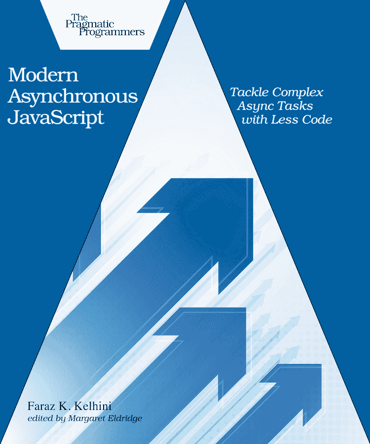


Pragmatic Bookshelf 是一家敏捷出版公司。我们在这里是因为我们想要改善开发者的生活。我们通过创建由程序员为程序员编写的、及时的且实用的著作来实现这一点。

我们的 Pragmatic 课程、工作坊和其他产品可以帮助你和你的团队创建更好的软件并增加乐趣。欲了解更多信息以及最新的 Pragmatic 书籍，请访问我们的网站 [`pragprog.com`](http://pragprog.com)。

我们的电子书不包含任何数字版权管理（DRM），并且一直都是无 DRM 的。我们开创了“测试书”（beta book）概念，你可以在书籍仍在编写时购买并阅读，并向作者提供反馈以帮助为所有人写出更好的书。所有购买者的免费资源包括源代码下载（如适用）、勘误表和讨论论坛，均可在 pragprog.com 的书籍主页获取。我们在这里是为了让你的生活变得更容易。


想跟进我们的最新书籍、公告以及偶尔的特别优惠吗？只需在 [pragprog.com](https://pragprog.com) 创建一个账户（只需一个电子邮件地址和一个密码）并勾选框框接收新闻邮件。你还可以在 twitter 上关注我们 @pragprog。


如果你直接从 [pragprog.com](https://pragprog.com) 购买，你可以以一个价格获得所有可用格式的电子书。你可以通过 Dropbox 在所有设备（包括 iPhone/iPad、Android、笔记本电脑等）之间同步你的电子书。你可以在版本的有效期内获得免费更新。当然，当你需要时可以随时回来重新下载书籍。从 Amazon Kindle 商店购买的电子书受 Amazon 政策限制。Amazon 文件格式的限制可能会导致电子书在不同设备上的显示不同。更多信息，请参阅我们在 [pragprog.com/#about-ebooks](https://pragprog.com/support/#about-ebooks) 的 FAQ。要了解更多关于本书的信息并访问免费资源，请访问书籍主页 [`pragprog.com/book/fkajs`](https://pragprog.com/book/fkajs)。

感谢你的持续支持，

Andy Hunt

The Pragmatic Programmers

制作本书的团队包括：Dave Rankin (CEO), Janet Furlow (COO), Tammy Coron (执行编辑), Margaret Eldridge (开发编辑), L. Sakhi MacMillan (校对), Andy Hunt 和 Dave Thomas (创始人)

需客户支持，请联系 support@pragprog.com。

需国际版权，请联系 rights@pragprog.com。


对于想要提升异步 JavaScript 命令和理解水平的开发者来说，特别是对于 Promise API 中较新且不熟悉的方法来说，这是一份不可或缺的参考和可靠的指南。Faraz Kelhini 带你了解围绕迭代器进行异步操作的棘手问题，并提供了优秀且启发性的示例以及易于学习的源代码。

| → | Karl Stolley |
|  | Web 开发者、研究员、教授、《Programming WebRTC》作者，伊利诺伊理工学院 |

Faraz Kelhini 高效的组织和精妙的写作使得《现代异步 JavaScript》成为该主题极具价值的介绍。书中包含几十个简洁的代码示例，为中高级 JavaScript 开发者完善了一套不可或缺的包。

| → | Victor Gavenda |
|  | Pearson Education/Peachpit Press 前执行主编 |

JavaScript 发展非常快，即使是老练的开发者也需要关注以跟上这种语言。《现代异步 JavaScript》是一本关于新引入的 JavaScript 特性的简明入门教程，有助于让异步代码更简洁、更安全。任何编写异步 JavaScript 代码的人（无论运行在浏览器还是 Node.js 中）都应该关注。我最近写的所有那些糟糕的 JavaScript 代码都希望我能早点读读这本书。

| → | Lukas Mathis |
|  | 软件工程师、UI 设计师、《Designed for Use》作者，Appway |

在职业生涯中，我与无数技术作家合作过，Faraz 在他们中脱颖而出，能够清晰地解释复杂的话。他在《现代异步 JavaScript》中的工作符合这些高标准。对于像我这样的非开发者来说，Faraz 也能让我轻松掌握这些概念。

| → | Matt Angelosanto |
|  | LogRocket 博客编辑 |


编写和制作一本书需要团队的努力。衷心感谢整个 Pragmatic 团队为完成这本书付出的巨大努力。特别感谢我的编辑 Margaret Eldridge，她敏锐的眼睛发现了我写作中的漏洞并避免了错误。

非常感谢在出版前评审书籍的专家，包括 Karl Stolley、Lukas Mathis、Michael Fazio、Trevor Burham、Kevin Gisi、Matthew Margolis、Mike Riley、Francesco Piccoli 和 Stefan Turalski。这些优秀的开发者提供了非常有用的见解和改进建议。

感谢我的家人支持并忍受作者的脾气，我很感激。特别感谢我亲爱的朋友 Mahsa 和 Asal 在写作期间的鼓励。你们太棒了！

最后，感谢那些在测试阶段购买书籍的积极读者。你们信任我，我很感激。


现代应用程序日益依赖异步编程来执行多个任务，JavaScript 正在快速进化以满足这一需求。JavaScript 的许多新功能旨在异步异步运行。因此，掌握有效执行异步任务的知识是当今 JavaScript 开发者的必修课。

设计响应异步程序最初可能具有挑战性，但一旦掌握了窍门，结果将是值得的。本书将帮助你。你将发现许多示例可以帮助你使用 ES2020、ES2021 和 ESNext 引入的 JavaScript 功能编写高级程序。你还将发现各种高效管理和协调代码中异步部分的技术。


如果你是一名中级到高级 JavaScript 程序员或 Web 开发者，那么这本书就是为你准备的。我们将完全关注异步编程的实用方面——即每种技术设计用于实现什么，以及如何在你的程序中使用它。如果你一直使用第三方库来管理异步代码，现在想切换到原生 JavaScript API，那么本指南将受益匪浅。


在使用这本书之前，你应该已经熟悉 JavaScript 和 HTML。HTML 的使用频率很低且相当基础，我会详细解释每个 JavaScript 示例。因此，即使你的 JavaScript 或 HTML 比较生疏，你也能理解代码是如何运行的。


《现代异步 JavaScript》（Modern Asynchronous JavaScript）刻意保持简洁。你不会学到异步编程的所有知识，以便能够快速掌握关键的技巧和技巧。在每一章中，我们将直接进入不同的主题，因此你可以自由跳转到书中的任何章节。


要下载书书中使用的示例代码，请访问 Pragmatic Bookshelf 网站。你可以在书籍论坛页面提交反馈和错误条目，获取最新信息，并参与讨论。如果你正在阅读 PDF 格式的书，可以点击代码上方的小灰色框来查看或下载特定示例。

接下来是引言。如果你是经验丰富的 JavaScript 程序员，引言中的大部分概念你都会很熟悉；而如果你处于中级水平，可能会发现关于回调（callbacks）和承诺（promises）的讨论有所帮助。

### 脚注

[[1]](#f_0009.xhtml_FNPTR-1)

[`www.pragprog.com/titles/fkajs`](https://www.pragprog.com/titles/fkajs)


ES2015 中 promise 引入改变了我们在 JavaScript 中编写异步程序的方式。与回调和事件类似，promise 定义了一个在操作完成后执行的代码块。但与旧方法不同，它为我们提供了一种健壮的机制来跟踪多个异步任务的状态，并验证它们是否全部成功。

但当我们说一个程序是异步的时，我们到底意味着什么？


将同步执行想象成一队等待买电影票的人。如果你在队伍的末尾，在前面所有的人买完票之前，你就无法买票。将异步执行想象成在餐厅点餐。你不需要等比你先来的其他人拿到食物就可以点自己的菜。每个人都可以随时点餐，并在准备好时接收。根据你点的食物类型，你可能比其他人更早或更晚拿到食物。

柱状图可以更好地说明这种差异：

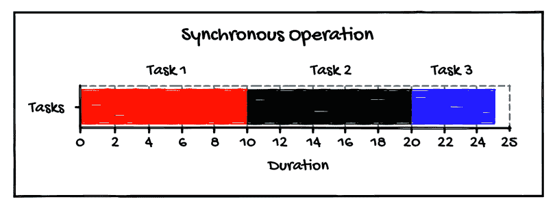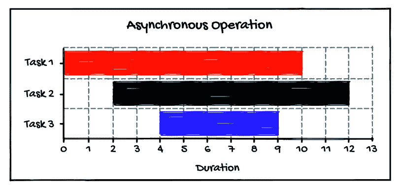

理解异步和多线程是两个完全不同的概念。JavaScript 通常被认为是一种单线程语言，主要因为 Web 浏览器每个全局环境运行一个线程。

但 JavaScript 作为一种编程语言，并不是单线程的。而且有些 JavaScript 环境是多线程的。随着 `Web Workers` 的引入，你甚至可以在 浏览器中运行多个线程（尽管它们不在同一个全局环境中运行）。

但即使在单线程上，JavaScript 也能执行异步代码。线程不是并行任务的唯一方式。想象一家只有一个厨师的餐厅。厨师可以开始煎汉堡并设置计时器，然后把一些披萨放入烤箱并设置计时器。在食物烹饪期间，他可以清理厨房。当计时器响时，他取出食物并上菜。如果任务之间的切换足够高效，你就不会注意到任何延迟。

你可以将多线程环境想象成一家有多个厨师的餐厅。一个厨师负责煎汉堡，另一个负责做披萨。但现在你必须花费更多精力维护其他厨师，并确保他们正确共享资源以防止冲突。换句话说，线程描述的是工人数量，而异步是关于任务的。


JavaScript 语言是为了给网页添加交互性，因此它需要一种检测并响应用户操作的方法。JavaScript 这种解决方案是事件：每当你与网页交互时（例如点击按钮时），就会发生事件，允许 JavaScript 代码对操作做出响应。

尽管事件让 JavaScript 程序能够检测与对象的交互并做出响应，但其缺乏灵活性对一些开发者来说是一个大问题。例如，事件可能在程序开始监听之前就已经发生了。

如果用户在分配 `onmouseover` 属性之前将光标移动到框，代码将不会执行。因此，始终必要在事件发生之前分配事件处理程序。

此外，在处理多个元素时，使用事件可能会令人沮丧。例如，没有简单的方法可以检测一组图像是否已加载，或者检查它们的加载顺序。


在 JavaScript 中，最简单的异步执行可能是 `setTimeout()` 函数。该函数定义了一个回调函数，将在未来独立于主程序流进行执行，因此它不会阻塞程序的执行。


使用回调的主要优势是，在其他任务运行时，程序可以继续执行有用的工作，因此感觉更加灵敏，“卡顿”也会更少。

嵌套回调是 JavaScript 中的常见做法。但嵌套过多的回调会导致代码难以理解，并导致被称为“回调地狱”的可维护性问题。以下代码是回调地狱的示例：


[intro/intro_ex01.js](http://media.pragprog.com/titles/fkajs/code/intro/intro_ex01.js)

firstFunction((x) => {
  // process...
  secondFunction(x, (y) => {
    // process...
    thirdFunction(y, (z) => {
      // And so on...
    });
  });
});
```


[intro/intro_ex02.js](http://media.pragprog.com/titles/fkajs/code/intro/intro_ex02.js)

```javascript
firstFunction((x) => {
  // process...
  secondFunction(x);
});

secondFunction(x, (y) => {
  // process...
  thirdFunction(y);
});

thirdFunction(y, (z) => {
  // process...
  fourthFunction(z);
  // And so on...
});
```

通过将函数移动到顶层，我们将获得一个更浅的、被分成小逻辑部分的代码。这种小的改变使得代码更易于。

尽管如此，当需要更复杂的功能时，回调模型仍然难以使用。通过 promises，你可以动态地链多个异步任务。例如，你可以同时发送两个异步请求，等待结果，然后根据中间结果决定其他异步任务。或者可以使用 promise 来跟踪多个异步操作的状态，并在其中一个完成时立即做出反应。这并不意味着你应该停止使用回调。当你的代码可能接收多次通知时，回调仍然有用。例如，`setInterval()` 方法定义了一个重复执行的回调函数，每次调用之间有固定的时间延迟。一旦 promise 执行，你就无法再次调用它，但你可以多次调用回调函数。


最初，promise 构造被 `Q`、`RSVP.js` 和 `WinJS` 等库使用。但它很快变得流行，促使 Ecma 技术委员会在 ES2015 标准中利用它。

较新的 JavaScript API 使用 promise 对象而不是传统的回调函数。例如，`Fetch API` 相比 `XMLHttpRequest` 的复杂 API 不仅提供了更简单的语法，还通过返回 promise 防止了回调地狱。让我们来看一个简单的例子：

[intro/intro_ex03.js](http://media.pragprog.com/titles/fkajs/code/intro/intro_ex03.js)

```javascript
const promise = fetch('https://eloux.com/async_js/examples/1.json');

promise.then((result) => {
  // process
}, (error) => {
  console.log(error);
});

`fetch()` 方法允许我们跨网络检索文件。该方法返回一个 promise 对象，作为操作未来结果的占位符。为了对结果做出反应，我们使用 `then()` 方法。

`then()` 接受两个函数作为参数。第一个函数在 promise 成功后调用一次，并将履行值作为参数传递给该函数。第二个函数仅在 promise 失败时被调用，并将拒绝原因作为参数传递。

`fetch()` 返回的 promise 保持 pending（等待）状态直到 Ajax 请求完成。规范使用 `unsettled` 一词来描述处于等待状态的 promise。接收数据后，promise 将转换到 fulfilled（已履行）或 rejected（拒绝）状态。此时，promise 被认为 settled（已解决）。


## 创建已解决的承诺 (Settled Promises)

在学习此书中的示例时，你可能想要输入并修改每个示例以获得练习。静态 `Promise.resolve()` 和 `Promise.reject()` 方法允许你快速创建已解决的 promise，并观察在提供不同值时代码是如何运行的。

例如，以下代码创建了一个已经以值 10 履行的 promise：

[intro/intro_ex05.js](http://media.pragprog.com/titles/fkajs/code/intro/intro_ex05.js)

```javascript
const promise = Promise.resolve(10);

promise.then((data) => {
  console.log(data); // 10
});
```

在这里，我们有一个代表已知值的已解决 promise。这个 promise 永远不会处于 rejected 状态，因此添加处理程序是没有意义的。要创建一个 rejected 状态的 promise，我们可以使用 `Promise.reject()`，如下：

```javascript
const promise = Promise.reject('Error!');

promise.then((data) => {
  console.log(data); // 这不会被调用
});
```

[intro/intro_ex06.js](http://media.pragprog.com/titles/fkajs/code/intro/intro_ex06.js)

```javascript
const promise = Promise.reject('Error!');

promise.catch((error) => {
  console.error(error);
});
```


处理被拒绝 promise 有主要方法。在上一个示例中，我们使用了 `then(fulfill, reject)`，但也可以使用 `catch()` 方法：

[intro/intro_ex07.js](http://media.pragprog.com/titles/fkajs/code/intro/intro_ex07.js)

```javascript
const promise = Promise.reject('Error!');

promise.catch((error) => {
  console.error(error);
});
```

在链式 promise 时发生错误，解释器会跳过后续所有的 `then()` 方法并执行它找到的第一个 `catch()` 方法。考虑以下：

[intro/intro_ex08.js](http://media.pragprog.com/titles/fkajs/code/intro/intro_ex08.js)

const promise = Promise.reject('Error!');

promise.then((value) => {
  console.log(value); // 这不会被调用
}).catch((error) => {
  console.error(error); // 这会被调用
});
```

在这里，我们使用 `catch()` 将多个拒绝处理器合并为一个。需要注意的是，`then(fulfill, reject)` 并不总是等同于 `then(fulfill).catch(reject)`。交替使用这些模式可能会导致错误。例如：

[intro/intro_ex09.js](http://media.pragprog.com/titles/fkajs/code/intro/intro_ex09.js)

const promise = Promise.resolve(10);

promise.then((result) => {
  throw new Error('An error in the fulfillment handler');
}, (error) => {
  console.error(error); // 这不会被调用
});
```

此代码中的履行处理器抛出了错误，但拒绝处理器没有被执行。切换到 `catch()` 可以解决这个问题：

[intro/intro_ex10.js](http://media.pragprog.com/titles/fkajs/code/intro/intro_ex10.js)

```javascript
const promise = Promise.resolve(10);

promise.then((result) => {
}).catch((error) => {
  console.error(error); // 这会被调用
});
```


`then()` 方法中的拒绝处理器（rejection handler）无法处理成功处理器（fulfillment handler）中发生的错误。你需要链式调用额外的 `then()`，或者更好的是使用 `catch()` 方法。


我们可以链式多个 promise 来按顺序执行额外的异步操作。但如果我们想同时执行多个 promise 并在其中一个或全部完成（settled）时立即做出响应怎么办？JavaScript 提供了以下方法来实现这一目的：

* `Promise.race()` – 只要给定的 promise 中有一个变为完成（fulfill）或拒绝（reject），就会通知你。
* `Promise.allSettled()` – 当所有给定的 promise 都变为完成或拒绝时，就会通知你。
* `Promise.all()` – 只要给定的 promise 中有一个被拒绝，或者所有它们都完成时，就会通知你。
* `Promise.any()` – 只要给定的 promise 中有一个变为完成，或者没有一个被完成时，就会通知你。

`Promise.race()` 和 `Promise.all()` 自 ES2015 引入 promise 对象以来就存在了，而 `Promise.allSettled()` 和 `Promise.any()` 分别在 ES2020 和 ES2021 中引入。在书的后面部分，我们将学习如何在异步程序中利用这些方法的每一种。但在在此之前，让我们来看一种处理来自外部源数据的重要技术：异步迭代。


遍历集合（collections）是编程中最常见的任务之一。这就是为什么 ECMAScript 的几乎每一个新版本都引入了改进语言迭代能力的特性。这些新特性使得编码变得更加简单、高效，并允许你执行以前可能需要外部库的任务。

作为一名 JavaScript 开发者，你经常会处理同步数据，例如通过内存列表存储的客户订单信息。迭代器（Iterators）为你提供了一种整洁的方式来处理它们，允许你在数据结构中的元素之间移动。那么当你需要通过 Web API 处理异步数据（例如股票价格）怎么办？同步迭代器无法表示此类数据源，这时你就需要使用异步迭代。

异步迭代的过程有点像在煎锅上煎煎饼。第一步是加热一个涂了少量油的煎锅。然后你把面糊倒在煎锅上，填满煎饼。你等到边缘开始出现气泡，这表明它们准备好翻面了。每个煎饼准备好的时间不同，取决于你什么时候倒面糊以及热源有多均匀。在煎饼做好时将其翻面并取下。因此，在准备这份简单食物的过程中，从某种意义上说，你充当了一个异步迭代器函数。

在本章中，你将熟悉迭代器并学习创建自己的自定义迭代器。由于同步和异步迭代器密切相关，我们将从同步迭代器开始。然后你将利用所学知识创建异步迭代器。


迭代器自 ES2015 起就存在，因此浏览器支持非常稳定。以下是本章将讨论的 JavaScript 特性，以及指向浏览器支持最新资源的链接：

* 异步函数（Async functions）
* `for await...of` 循环
* `async` 和 `await` 关键字

在 Node 环境中，你需要至少 `7.6.0`  Node 版本来使用 `async` 和 `await` 关键字，至少 `10.0.0` 版本来使用 `for await...of`。你也可以使用 Babel 插件在旧版本的浏览器或 Node 版本中使用这些特性。


集合对象（包括 `Array`、`Set` 和 `Map`）带有内置的迭代器，允许我们导航其值。因此，我们不需要创建自己的迭代器。但有时这些对象并不符合我们的需求。如果我们想自定义对象的迭代行为，以反向或随机的方式返回值呢？或者遍历一个普通对象或类（它们默认都是不可迭代的）？在这种情况下，我们需要定义自己的 `Symbol.iterator`。

| Set 和 Map |
| --- |
| ES2015 引入了两个新数据结构：`Set` 和 `Map`。`Set` 类似于数组，值的集合，但它不能包含重复项，且无法单独访问项。相反，`Set` 提供了遍历其元素或断言它是否包含某个值的方法。`Map` 类似于对象，将键映射到值，但在某些情况下提供了更多功能。Maps 通常用作存储数据的缓存，在需要时可以随时访问。 |

| --- |
| `Iterable` 是一个允许其值在 `for...of` 结构中进行循环的对象。它通过提供一个键为 `Symbol.iterator` 的方法来实现这一点。该方法应该能够产生任意数量的迭代器。相反，`Iterator` 是用于获取要迭代值的对象。 |

记住，要被分类为可迭代对象（iterable），一个对象必须带有 `Symbol.iterator` 属性，并指定每次迭代的返回值。在接下来的示例中，我们有一个可迭代的普通对象，这是因为我们定义了一个可迭代协议，允许我们逐个访问对象的各个项：

[iterators/iterator_ex03.js](http://media.pragprog.com/titles/fkajs/code/iterators/iterator_ex03.js)

```javascript
  a: 10,
  b: 20,
  c: 30,
  [Symbol.iterator]() {
    let i = 0;
    return {
      next() {
        return {
          value: Object.keys(this)[i++],
        }
      }
    }
  }
};

const iterator = collection[Symbol.iterator]();
console.log(iterator.next()); // {value: 10, done: false}
console.log(iterator.next()); // {value: 20, done: false}
console.log(iterator.next()); // {value: 30, done: false}
console.log(iterator.next()); // {value: undefined, done: true}

`next()` 方法返回对象的迭代结果。该方法始终返回一个包含两个属性的对象：`value` 和 `done`。`value` 属性持有迭代器返回的值。`done` 属性持有一个布尔值，仅在没有值返回时被为 true。

我们需要一种方法来跟踪要返回的值，所以我们定义了一个初始值为 `0` 的计数器。为了定义返回值，我们使用了 `Object.keys()`，它获取属性名的数组。现在当我们调用 `collection[Symbol.iterator()]` 时，它返回一个包含 `next()` 方法的对象。每次调用 `next()`，它都会返回一个 `{value, done}` 对。

使用 `next()` 不是遍历可迭代对象的唯一方法。`for...of` 语句允许我们创建循环，并在可迭代对象上重复执行相同的函数。如果我们想快速获取对象中所有项的值，`for...of` 更好。相反，`next()` 更加冗长，但它允许我们看到每次迭代发生了什么。让我们使用 `for...of` 重写这个示例以简化代码：


```javascript
const collection = {
  a: 10,
  b: 20,
  c: 30,
  [Symbol.iterator]() {
    let i = 0;
    const values = Object.keys(this);
    yield values[i++];
  }

for (const value of collection) {
  console.log(value);
}
```


```javascript
{
  return {
    {
      value: this[values[i++]],
      done: i > values.length
    }
  };
}

  console.log(value);
}

// logs:
// ⇒ 10
// ⇒ 20
// ⇒ 30
```

`Symbol.iterator()` 的工作原理与其他任何方法相似，不同之处在于如果我们对对象使用 `for...of`，它会被自动调用。下面的图片展示了 `for...of` 在背后的工作原理：

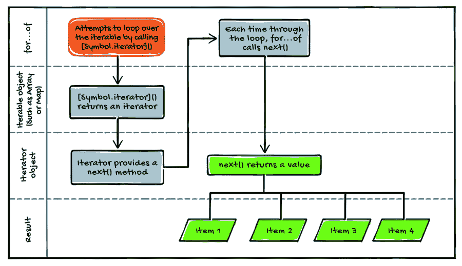
迭代器对象的设计用于维护一个指向项目位置的内部指针；每次循环循环时，它都会提供下一个值。

现在，当我们使用 `for...of` 遍历一个已经可迭代的原生对象（例如数组）时，会发生什么？在数组上调用 `Symbol.iterator()` 将返回 `values()` 方法的结果，因为那是数组的默认迭代器。

虽然 `values()` 是集合（sets）和数组的默认迭代器，但 `entries()` 是映射（maps）的默认迭代器。一个对象可以有多个迭代器，例如 `keys()`、`values()` 和 `entries()`，但其中只有一个会作为默认迭代器。内置迭代器使得轻松遍历集合对象成为可能，而自定义迭代器允许我们定义或自定义对象的迭代行为。但如果我们想处理异步源，我们需要创建自定义的异步迭代器。

## 创建自定义异步迭代器
假设我们想要一个函数，获取多个 URL，并在移动到下一个 URL 之前单独处理每个 URL 的结果。换句话说，我们希望异步获取并解析 URL，而不是获取结果。这是异步迭代器很有用的一种场景。

一个异步迭代器与普通的非异步迭代器非常相似，不同之处在于它的 `next()` 方法返回一个 promise 而不是普通对象。因此，promise 不会立即返回结果，而是在未来的某个点提供值（或失败原因），就像我们开头比喻中的烤架，它会在某个时刻产出煎饼。

当一个对象拥有一个返回异步迭代器的 `Symbol.asyncIterator` 方法时，它被归类为异步可迭代对象。话多说，让我们来看一个异步可迭代对象的简单示例：

[iterators/iterator_ex04.js](http://media.pragprog.com/titles/fkajs/code/iterators/iterator_ex04.js)

```javascript
const collection = {
  a: 10,
  b: 20,
  c: 30,
  [Symbol.asyncIterator]() {
    const keys = Object.keys(this);
    let i = 0;
    return {
      next: () => {
        return new Promise((resolve, reject) => {
          setTimeout(() => {
            resolve({
              value: this[keys[i++]],
            });
          }, 1000);
        });
      }
    };
  }
};

const iterator = collection[Symbol.asyncIterator]();

iterator.next().then(result => {
});

iterator.next().then(result => {
  console.log(result); // {value: 20, done: false}
});

iterator.next().then(result => {
  console.log(result); // {value: 30, done: false}
});

iterator.next().then(result => {
  console.log(result); // {value: undefined, done: true}
});

通常，同步迭代器返回一个包含 `next()` 方法的对象。每次调用 `next()`，都会返回一个 `{value, done}` 键值对，其中 `value` 属性包含产出的值。同样，异步迭代器返回一个包含 `next()` 方法的对象。但 `next()` 返回的不是普通对象而是一个 promise（第 10 行），该 promise 将解析为 `{value, done}`。

为了简单起见，我们使用了 `setTimeout()` 方法在了一秒后解析 promise。但在现实世界的示例中，我们更有可能调用 API 并等待响应。

### 单独获取 URL

让我们来看一个更具体的例子。还记得 创建自定义异步迭代器 中的用例吗？即一个异步迭代器，它用于获取多个 URL 并单独处理它们。这里是我们可以实现它的方式

[iterators/iterator_ex05.js](http://media.pragprog.com/titles/fkajs/code/iterators/iterator_ex05.js)

const srcArr = [
  'https://eloux.com/async_js/1.json',
  'https://eloux.com/async_js/2.json',
  'https://eloux.com/async_js/3.json'
];
srcArr[Symbol.asyncIterator] = function() {
  let i = 0;
  return {
    async next() {
      if (i === srcArr.length) {
        return {
        };
      }
      const url = srcArr[i++];
      const response = await fetch(url);
      if (!response.ok) {
        throw new Error('Unable to fetch URL: ' + url);
      }
      return {
        value: await response.json(),
        done: false
      };
    }
  };

const iterator = srcArr[Symbol.asyncIterator]();

iterator.next().then(result => {
  console.log(result.value); // John
});

iterator.next().then(result => {
  console.log(result.value); // Peter
});

iterator.next().then(result => {
});
```

## 使用 for…await…of 遍历异步可迭代对象

在上一个例子中，我们调用可迭代对象的 [Symbol.asyncIterator]() 来获取迭代器对象，并调用其 `next()` 方法来恢复迭代器的执行。但有时我们希望有一种更直接的方法来访问异步可迭代对象的项目。


`for..of` 循环允许你遍历迭代对象，但它无法用于异步迭代器（会返回 `undefined`）。ES2018 引入了 `for...await...of` 作为 `for...of` 的变体，它可以同时遍历同步和异步迭代器。
为了看到这一语句的运作，让我们看看上一个示例的重写版本。注意 `for...await...of` 如何通过对每个属性的值执行相同的语句来减少代码行数：

[iterators/iterator_ex06.js](http://media.pragprog.com/titles/fkajs/code/iterators/iterator_ex06.js)

```javascript
const srcArr = [
  'https://eloux.com/async_js/examples/1.json',
  'https://eloux.com/async_js/examples/2.json',
  'https://eloux.com/async_js/examples/3.json',
];

srcArr[Symbol.asyncIterator] = function() {
  return {
    async next() {
      if (i === srcArr.length) {
        return {
          done: true
        };
      }
      const url = srcArr[i++];
      const response = await fetch(url);
      if (!response.ok) {
        throw new Error('Unable to retrieve URL: ' + url);
      return {
        value: await response.json(),
        done: false
      };
    }
  };
};

(async function() {
  for await await (const url of srcArr) {
    console.log(url.firstName);
  }

// logs:
// ⇒ John
// ⇒ Peter
// ⇒ Anna
```

当我们运行这段代码时，JavaScript 引擎会执行对象的 `Symbol.asyncIterator` 方法来获取异步迭代器。在循环的每次迭代中，迭代器都会执行 `next()` 方法并返回一个 promise（这在后台发生）。一旦 promise 一完成，`value` 属性的值就会赋值给 `url`。与 `for...of` 一样，循环将一直持续直到 `done` 的值为 `true`。

由于我们只能在异步函数和生成器中使用 `for...await...of`，因此我们将该语句封装在一个 IIFE（立即执行函数表达式）中。否则，代码将抛出 `SyntaxError`。


[iterators/iterator_ex07.js](http://media.pragprog.com/titles/fkajs/code/iterators/iterator_ex07.js)

```javascript
const collection = {
  [Symbol.asyncIterator]() {
    return {
      next: () => {
        return Promise.reject(new Error('Something went wrong.'))
      }
    };
  }

(async function() {
  try {
    for await await (const value of collection) {}
  } catch (error) {
    console.error('Caught: ' + error.message);
  }
})();

// logs:
// ⇒ Caught: Something went wrong.

这个迭代器返回了一个被拒绝的 `Promise` 对象。如果没有 `try...catch`，我们将在浏览器控制台中看到 `Uncaught (in promise) Error`。`try...catch` 语句允许我们在抛出异常时指定响应。`for...await...of` 语句提供了一种访问异步迭代器项的便捷简洁的方法。通过将其封装在 `try...catch` 语句中，我们能够按照我们想要的方式处理拒绝。

## 迈向无限之外

 迭代器的一个有趣方面是它们是无限。例如，你可能有一个交付无限序列的斐波那契迭代器。

### 检测对象是否可迭代

到目前为止，我们一直处理的是我们“拥有”的可迭代对象。在遍历一个尚未创建的对象之前，确保该对象是可迭代的重要的；否则代码可能会抛出 `TypeError`：


```javascript
// a plain object
const collection = {
  a: 10,
  b: 20,
  c: 30
};

for (let value of collection) { // ⇒ TypeError: collection is not iterable
  console.log(value);
}

检测一个对象是否可迭代并不复杂：检查对象上是否存在 `Symbol.iterator` 并确保它是一个函数（`for...of` 构造也执行了类似的检查）：

[iterators/iterator_ex09.js](http://media.pragprog.com/titles/fkajs/code/iterators/iterator_ex09.js)

```javascript
function isIterable(object) {
  return typeof object[Symbol.iterator] === "function";
}

console.log(isIterable({a: 10, b: 20})); // ⇒ false
console.log(isIterable("abc")); // ⇒ true
console.log(isIterable([10, 20, 30])); // ⇒ true
```

检测异步迭代器是否可迭代的过程几乎相同，只是你需要在对象上查找 `Symbol.asyncIterator`：

[iterators/iterator_ex10.js](http://media.pragprog.com/titles/fkajs/code/iterators/iterator_ex10.js)

```javascript
const collection = {
  [Symbol.asyncIterator]: async function() {
    // ...
};

function isAsyncIterable(object) {
  return typeof object[Symbol.asyncIterator] === "function";
}

console.log(isAsyncIterable(collection)); // ⇒ true
```

在处理来自外部的对象时，你可能期望它们始终保持某种形状。但基于这种假设编写代码会导致错误。在使用尚未创建的对象之前，始终确保它们具有你所需的属性。
## 总结

`Symbol.iterator` 和 `Symbol.asyncIterator` 是可对象的基石，你可以利用它们创建自定义迭代器。自定义迭代器允许你定义或自定义 JavaScript 迭代行为。你不能使用 `for...of` 遍历异步迭代器；相反，你应该使用 `for...await...of`。接下来，我们将使用生成器函数来增强你的 JavaScript 代码。

### 脚注

https://caniuse.com/async-functions

[3]
https://caniuse.com/mdn-javascript_statements_for_await_of

[4]
https://caniuse.com/mdn-javascript_operators_await

[5]
https://babeljs.io/docs/en/babel-plugin-proposal-async-generator-functions


每一个生成器函数（generator function）都是迭代器（iterator），但反则不然。当你需要一个具有复杂状态维护行为的对象，或者你想提供 `next()` 之外的其他方法时，你可能想要直接定义自定义迭代器协议。但在大多数其他情况下，你最适合定义一个返回迭代器的生成器，因为状态维护工作主要由它为你完成。

在本章中，我们将通过调整上一章节中的示例，涵盖同步生成器和异步生成器的工作原理。然后我们将查看一个真实世界的示例，让你亲眼看到异步生成器在什么情况下有用。

## 准备工作

与迭代器一样，生成器函数自 ES2015 起就可用，且浏览器支持已经非常稳定。在 Node 环境中，你至少需要 `4.0.0` 版本的 Node。如果你想在旧版本的浏览器或 Node 版本中使用生成器，可以使用 Babel 插件。
## 使用生成器定义自定义迭代器

生成器函数通过提供迭代算法，增强了定义可迭代协议的过程。当被调用时，生成器函数不会立即执行其体。相反，它会返回一种特殊的迭代器，称为生成器对象（generator object），如下图所示。

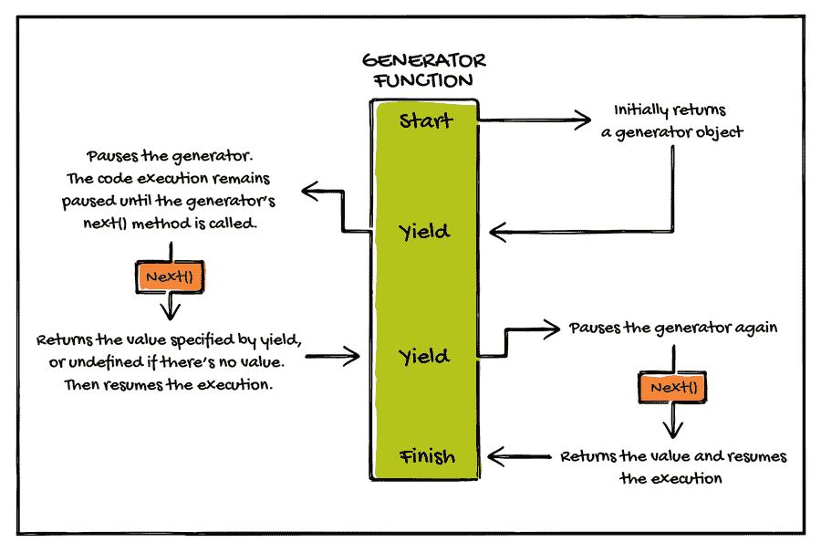

我们可以通过调用其 `next()` 方法来运行生成器的体。`yield` 关键字会暂停生成器并指定要返回的值。考虑到这一点，让我们来调整创建自定义迭代器 中的示例。这段代码的结果是相同的，但实现起来要简单得多。

注意第 5 行 `function` 关键字后面的星号。这是我们的生成器函数，它为集合定义了一个自定义的迭代器：

[generators/gen_ex01.js](http://media.pragprog.com/titles/fkajs/code/generators/gen_ex01.js)
```javascript
1:  const collection = {
  -   a: 10,
  -   b: 20,
  -   c: 30,
5:   [Symbol.iterator]: function*() {
  -     for (let key in this) {
  -       yield this[key];
  -     }
  -   }
10:  };
  -   console.log(iterator.next()); // ⇒ {value: 10, done: false}
15: console.log(iterator.next()); // ⇒ {value: 20, done: false}
  -   console.log(iterator.next()); // ⇒ {value: 30, done: false}
  -   console.log(iterator.next()); // ⇒ {value: undefined, done: true}
```

我们在生成器内部使用了 `for...in` 循环来遍历对象的属性。在每次迭代中，`yield` 关键字都会停止循环的执行，并将后续属性的值返回给调用者。

可以根据需要多次调用生成器函数，每次调用它都会返回一个新的生成器对象。但生成器对象只能被迭代一次。由于生成器返回的对象始终是迭代器，我们也可以使用 `for...of` 语法来迭代结果。

现在我们已经知道了同步生成器是如何工作的，可以准备好查看它的异步对应版本了。
## 创建异步生成器

异步生成器与同步生成器的相似之处在于，调用 `next()` 会恢复生成器的执行，直到遇到 `yield` 关键字。但 `next()` 返回的不是一个普通对象，而是一个 promise。

你可以将异步生成器理解为异步函数和生成器函数的组合。让我们使用生成器函数重写单独获取 URL 中的示例。注意第 7 行的 `async` 关键字和星号符号（*），它们表示这是一个异步生成器函数：

[generators/gen_ex02.js](http://media.pragprog.com/titles/fkajs/code/generators/gen_ex02.js)

```javascript
1:  const srcArr = [
  -   'https://eloux.com/async_js/examples/2.json',
  -   'https://eloux.com/async_js/examples/3.json',
5: ];
  -   srcArr[Symbol.asyncIterator] = async function*() {
  -     let i = 0;
  -     for (const url of this) {
10:      const response = await fetch(url);
  -      if (!response.ok) {
  -        throw new Error('Unable to retrieve URL: ' + response.status);
  -      }
15:    }
  - };
  -   const iterator = srcArr[Symbol.asyncIterator]();
  -   
20: iterator.next().then(result => {
  console.log(result.value.firstName); // ⇒ John
  });
  -   iterator.next().then(result => {
25: console.log(result.value.firstName); // ⇒ Peter
  });
30: console.log(result.value.firstName); // ⇒ Anna
  });
```

在这个生成器内部，我们使用了 `await` 关键字来等待 fetch 操作完成。与生成器函数一样，`yield` 将结果返回给调用者。在生产环境中，你还需要使用 `catch()` 处理迭代期间的错误。你可以像处理它的兄弟方法一样链式调用 `catch()`。例如：

```javascript
iterator.next()
  .then(result => {
    // ...
  })
    console.error('Caught: ' + error.message);
  });
```

## 迭代分页数据

我们想要使用异步迭代的情况是处理提供分页数据的 API。通过使用异步迭代器，我们可以无缝地发起网络请求并迭代结果。例如，GitHub 提供了一个允许我们获取仓库 commit 的 API。响应是 JSON 格式，包含了最后 30 个 commit 的数据。假设我们要获取剩余 commit 信息。我们可以使用异步迭代器，或者使用生成器来实现。让我们创建一个异步生成器并对其进行分页处理：

[generators/gen_ex03.js](http://media.pragprog.com/titles/fkajs/code/generators/gen_ex03.js)

1:  // 创建异步生成器函数
  -  async function* generator(repo) {
  -    // 创建无限循环
5:    for (;;) {
  -      // 获取仓库
  -      const response = await fetch(repo);
  -      
10:     // 将正文文本解析为 JSON
  -     const data = await response.json();
  -     
  -     for (let commit of data) {
15:       yield commit;
  -     }
  -     
  -     // 从响应头中提取下一页的 URL
  -     const link = response.headers.get('Link');
20:     repo = /<([^>]+);\s*rel="next"/.exec(link)?.[1];
  -     
  -     // 如果没有“下一页”，则跳出循环
  -     if (repo === undefined) {
  -       break;
  -   }
  -  }
  - }
```


```javascript
  // set a counter
  let i = 0;
  for await (const commit of generator(repo)) {
    // process the commit
    console.log(commit);
    // break at 90 commits
    if (++i === 90) {
      break;
    }
  }
}
```

在这里，我们创建了两个 `async` 函数，其中一个是一个生成器（generator）。生成器函数负责获取资源、将其解析为 JSON，并将每个 commit 的信息发送给生成器的调用者。

为了获取最后 90 个 commit，而不仅仅是 30 个，我们在生成器内部的循环中放置了这些任务。每经过一次循环，我们都会获取下一批 commit。第 19 行的表达式 `response.headers.get('Link')` 从标头中提取下一页的 URL，并将其赋值给 `repo` 变量，以便我们可以在下次循环中访问新 URL。

如果标头中没有“下一页”，则意味着没有更多 commit 需要获取，因此我们跳出循环（第 24 行）。

在 `getCommits()` 函数中，我们定义了一个计数器来跟踪已获取 commit 的数量。当数量达到 90 时，我们停止调用生成器（第 40 行）。这个示例的启示是：异步生成器允许我们平滑且连续地进行多次网络请求并对结果进行迭代。


## 总结

生成器通过提供迭代算法增强了创建可迭代对象的过程。`async` 生成器与 `sync` 生成器类似，但它返回的是 promise 而不是普通对象。当你不想操作对象维护状态的行为时，请使用生成器函数。

掌握了异步迭代器和生成器的基础后，你现在可以编写更强大的异步程序。接下来，你将使用 ES2020 的 `Promise.allSettled()` 方法来获取互不依赖的多个 promise 的结果。

### 脚注

- [`caniuse.com/es6-generators`](https://caniuse.com/es6-generators)
- [`babeljs.io/docs/en/babel-plugin-proposal-async-generator-functions#installation`](https://babeljs.io/docs/en/babel-plugin-proposal-async-generator-functions#installation)

Copyright © 2021, The Pragmatic Bookshelf.

# 第 3 章：获取多个资源

假设你想在多个异步请求完成后执行某项操作，无论它们成功还是失败。例如，你需要从四个独立的 Web API 获取数据并处理结果，但对于某个你可以没有的资源，可能会发生网络错误。`Promise.all()` 方法并不适用于此任务，因为单个网络错误会导致该方法立即拒绝（reject）。

幸运的是，ECMAScript 提供了一个较新的工具，用于报告所有请求的结果：`Promise.allSettled()`。通过这种方法，我们可以跟踪多个 promise 的状态，而不会让任何 promise 破坏其他 promise 的结果。我们将从检查一个常见的异步任务开始本章：执行多个 promise 并处理结果。一旦你了解了潜在的陷阱，我们将查看 `Promise.allSettled()` 方法，并看它与 `Promise.all()` 的对比。

## 准备工作
尽管 `Promise.allSettled()` 相对较新，但所有现代浏览器已经支持了它。但在旧版浏览器中运行示例之前，你可能需要确保浏览器支持它。在 Node 环境中，你需要 12.0 的版本。你也可以使用 Babel 插件来利用它。

## 执行多个 promise

在创建复杂应用程序时，你不可避免会遇到需要执行多个 promise 的情况。假设你有一个获取文章的异步函数，如下：

```javascript
async function getPost(id) {
  try {
    return await getPost(id);
  } catch (error) {
  }
```

这段代码在获取单篇文章时运行良好。但如果你需要获取多篇文章呢？易如！创建一个循环来获取你需要的文章：

```javascript
const postIds = ['1', '2', '3', '4'];
postIds.forEach(async id => {
  const post = await getPost(id);
  // process the post
});
```
但这里有一个问题：`await` 关键字会暂停循环，直到它从 `getPost()` 响应。换句话说，这段代码将按顺序加载文章，而不是同时发出多个请求。

修复此问题的方法之一是使用 `Promise.all()` 方法。`Promise.all()` 返回一个单一 promise，当迭代器中的所有 promise 都解析（resolve）时：

```javascript
const postIds = ['1', '2', '3', '4'];
const promises = postIds.map(async (id) => {
  return await getPost(id);
});
const arr = Promise.all(promises);

这里也有猫端！如果迭代器中的一个 promise 被拒绝（reject），`Promise.all()` 也会立即拒绝，导致其他所有文章无法加载。这对于那些遵守承诺的老实对象来说是不公平的，对吧？

直到最近，JavaScript 还没有内置方法来等待所有 promise 处于稳定（无论是已完成还是被拒绝）。幸运的是，ES2020 引入了 `Promise.allSettled()` 方法改变了这一点。通过这种方法，我们可以获取传递给方法的所有 promise 的结果。

## 使用 Promise.allSettled() 获取多个资源

`Promise.allSettled()` 方法返回一个 promise，当所有给定的 promise 都成功完成或被拒绝（换句话说，即“稳定”）时解析。这种行为对于跟踪互不依赖对方完成的多个异步任务非常有用。

下图显示了 `Promise.allSettled()` 方法如何解析一个等待 promise：


在下面的示例中，我们尝试获取三个资源，其中一个不存在。注意 `Promise.allSettled()` 如何报告每个 promise 的结果：


[promise.allSettled/tracking_promises_ex04.js](http://media.pragprog.com/titles/fkajs/code/promise.allSettled/tracking_promises_ex04.js)

```javascript
const promises = [
  fetch('https://does-not-exist', {mode: "no-cors"}),
  fetch('https://picsum.photos/100/200', {mode: "no-cors"})
];

Promise.allSettled(promises)
  .then((results) => results.forEach((result) => console.log(result)));

// logs:
// => { status: "fulfilled", value: Response }
// => { status: "rejected", reason: TypeError }
```

`Promise.allSettled()` 不会在其中一个 promise 失败时立即拒绝，而是会等待所有 promise 都完成。

注意所有 promise 的结果是如何作为一个数组传递给 `then()` 的，并且尽管它们完成的顺序不一致，但顺序仍与传入的可迭代对象保持一致。每个 promise 的结果都有一个 `status` 属性，指示该 promise 是否已成功。当 promise 被拒绝时，结果将没有 `value` 属性；相反，它有一个包含拒绝原因的 `reason` 属性。

请记住，`Promise.allSettled()` 返回的 promise 总是完成的。只有当我们传递了不可迭代的对象时，该 promise 才会拒绝。

来看看这段代码的重写版本，这次使用 `Promise.all()` 方法：

[promise.allSettled/tracking_promises_ex05.js](http://media.pragprog.com/titles/fkajs/code/promise.allSettled/tracking_promises_ex05.js)
```javascript
const promises = [
  fetch('https://picsum.photos/200', {mode: "no-cors"}),
  fetch('https://does-not-exist', {mode: "no-cors"}),
  fetch('https://picsum.photos/100/200', {mode: "no-cors"})
];

Promise.all(promises)
  .then((results) => results.forEach((result) => console.log(result)));

// logs:
```

这一次，promise 在第二个输入 promise 被拒绝时立即拒绝。这两个方法的一个重要区别是 `Promise.allSettled()` 有一个 `Promise.all()` 没有的属性：`status`。事实上，`Promise.all()` 返回的是 `Promise.allSettled()` 封装在对象中的原始值。对比：

[promise.allSettled/tracking_promises_ex06.js](http://media.pragprog.com/titles/fkajs/code/promise.allSettled/tracking_promises_ex06.js)

```javascript
const promises = [
  Promise.resolve(1),
  Promise.resolve(2)
];
Promise.allSettled(promises)
  .then((results) => results.forEach((result) => console.log(result)));

// logs:
// => { status: "fulfilled", value: 1 }
// => { status: "fulfilled", value: 2 }

Promise.all(promises)
  .then((results) => results.forEach((result) => console.log(result)));

// logs:
// => 2
```

注意 `Promise.all()` 直接返回响应。如果你处于不支持 `Promise.allSettled()` 的旧 JavaScript 环境中，或者你想直接返回 promise，有一个简单的变通方法。考虑以下代码：

[promise.allSettled/tracking_promises_ex07.js](http://media.pragprog.com/titles/fkajs/code/promise.allSettled/tracking_promises_ex07.js)

```javascript
const promises = [
  fetch('https://picsum.photos/200', {mode: "no-cors"}),
  fetch('https://does-not-exist', {mode: "no-cors"}),
];
```


`Promise.any()` 方法是 ECMAScript 标准中的新成员，因此在运行示例之前，你可能需要确保你的浏览器支持它。在 Node 环境中，你需要至少 `15.0.0` 版本的 Node。你也可以使用 Babel 插件在较旧的浏览器或 Node 版本中该该功能。

## 使用 Promise.any() 方法


```javascript
const promises = [
  Promise.reject(new Error('failure #1')),
  Promise.reject(new Error('failure #2')),
  Promise.resolve('YES!')
];

Promise.any(promises).then((result) => console.log(result));

// logs:
```

在这里，我们将一个包含三个 promise 对象的数组传递给 `Promise.any()`。由于 `Promise.resolve()` 返回的是已经完成的 promise，`Promise.any()` 返回的 promise 会立即以给定的值完成。

但如果所有输入的 promise 都被拒绝（reject）了会发生什么？

```javascript
const promises = [
  Promise.reject(new Error('failure #1')),
  Promise.reject(new Error('failure #2')),
];

Promise.any(promises).then(
  (result) => {console.log(result)},
  (error) => {console.error(error)}
);

// logs:
// => AggregateError: No Promise in Promise.any was resolved
```


```javascript
const promises = [
  Promise.reject(new Error('failure #1')),
  Promise.reject(new Error('failure #2')),
  Promise.reject(new Error('failure #3'))
];

Promise.any(promises).then(
  (result) => {console.log(result)},
  (error) => {console.error(error.errors)}
```

你应该会在浏览器控制台中看到类似下面的消息，显示了我们在输入 promise 中指定的所有拒绝原因：

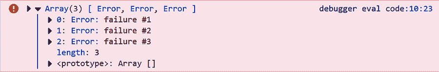

只有另外一种情况会导致 `Promise.any()` 被拒绝：传递一个空的可迭代对象。这里有一个示例：

```javascript
Promise.any([]).then(
  (result) => {console.log(result)},
);

// logs:
// => AggregateError: No Promise in Promise.any was resolved
```

注意第 1 行的空数组导致了 `Promise.any()` 被拒绝。错误信息与所有 promise 都被拒绝时完全相同，这一点需要警惕，因为你不想误解失败的原因。

现在你已经了解了 `Promise.any()` 方法是如何工作的，现在是时候看一些真实世界的示例了。接下来，我们将学习如何利用这个方法让我们的应用程序更具韧性。

## 避免单点故障
单点故障（SPOF）是系统中的一个组件，一旦发生故障或错误，就会导致整个系统停止工作。如果你想要可靠的应用程序，你应该能够识别并避免系统中的潜在的单点故障。
Web 应用程序中常见的单点故障发生在从外部 API 获取关键资源（例如金融市场数据）时。如果 API 无法访问，应用程序就会停止运行。`Promise.any()` 方法在这方面非常有用。它允许我们从多个 API 请求数据，并使用第一个成功的结果。

让我们来看一个示例。在下面的代码中，我们有一个包含两个 API 的数组，它们都返回相同的信息。`Promise.any()` 将尝试同时获取这两个 URL；因此只要其中一个 API 可用，代码就能正常工作：

```javascript
const apis = [
  'https://eloux.com/todos/1',
  'https://jsonplaceholder.typicode.com/todos/1'
];

async function fetchData(api) {
  if (response.ok) {
    return response.json();
  } else {
    return Promise.reject(new Error('Request failed'));
  }
}

function getData() {
  return Promise.any([
    fetchData(apis[0]),
    fetchData(apis[1])
}

getData().then((response) => console.log(response));
```

现在，为了查看后台到底发生了什么，请检查浏览器控制器的网络（Network）标签。按 `F12` 打开开发者工具，然后导航到网络。下面的图片显示了 Firefox 的网络标签：

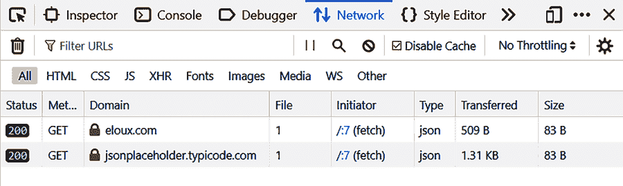

你可以看到两个请求的状态都是 200，这意味着它们都成功完成了。但请记住，`Promise.any()` 只使用第一个完成的 promise 的结果，因此其他结果会被忽略。


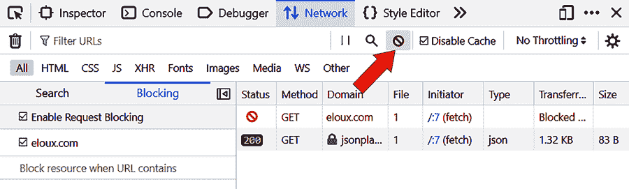

如果你刷新页面，你会发现对 `eloux.com` 的请求失败了。但由于另一个 API 是可用的，我们的代码运行良好。现在，如果两个 API 都不可用会怎样？继续输入 `jsonplaceholder.typicode.com`（另一个 API 的 URL）来拦截它。切换回控制台标签并再次运行代码。你应该看到类似这样的错误消息：

`Uncaught (in promise) AggregateError: No Promise in Promise.any was resolved`

我们得到了一个 `AggregateError`，表示传递给 `Promise.any()` 的所有 promise 都被拒绝了。但这种错误消息并不是处理拒绝 promise 的最佳方式。让我们链式 `catch()` 方法并输出自定义错误消息：

```javascript
  'https://eloux.com/todos/1',
  'https://jsonplaceholder.typicode.com/todos/1'
];

async function fetchData(api) {
  const response = await fetch(api);
  if (response.ok) {
    return response.json();
  } else {
    return Promise.reject(new Error('Request failed'));
  }

function getData() {
  return Promise.any([
    fetchData(apis[0]),
    fetchData(apis[1])
  ]);
}
```


```javascript
) {
  .catch(() => {
    return Promise.reject(
      new Error('Unable to access the API')
    );
  });
}

  (response) => console.log(response.title),
  (error) => console.error(error)
);
```

在这里，我们使用 `catch()` 方法来接管错误处理。我们返回一个被拒绝的 promise，并给出一个原因。现在再次运行代码。你应该能看到控制台中打印了自定义的错误消息，如下方的截图所示：


到目前为止，我们已经学习了如何同时执行多个 promise 以让我们的应用程序更加可靠。但这种方法还有一个好处：性能。


作为一名程序员，构建能够快速响应用户请求的应用程序总是符合你利益的。`Promise.any()` 允许你通过使用响应最快的 API 数据来提高关键应用服务的性能。正如我们在避免单点故障 中看到的，如果有多个 promise 成功，我们将得到第一个成功的值。其他成功的值将被忽略。

再次打开网络标签页并检查时间轴（timeline）列。它提供了从每个 API 获取响应所花费的时间（以毫秒为单位）。切，你在上一个示例中开启了请求阻塞来模拟请求失败——请为此示例关闭请求阻塞。此外，勾选禁用缓存（Disable Cache）复选框，以便浏览器检索每个文件的最新副本而不是从缓存中加载。现在再次运行上一个示例中的代码。你应该看到类似这样的结果：

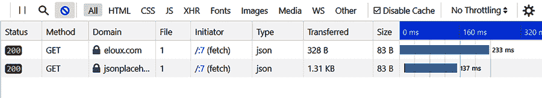

所以，如果我们只使用第一个 API，我们的应用程序至少需要 233 毫秒来检索和处理数据。加上第二个 API 后，现在只需要 137 毫秒，快了约 40%。这是加载时间的一个很好的改进。显然，你将根据你与服务器的距离以及互联网连接的速度看到不同的结果。

因此，除了避免单点故障问题外，你还可以使用 `Promise.any()` 来提高应用程序的性能——这是一个双赢。


`Promise.any()` 是 `Promise` 对象中一个非常有价值的补充。该方法允许我们异步执行多个 promise，并使用第一个可用的结果来更快地响应。在你的应用程序中使用 `Promise.any()` 方法可以避免可怕的 SPOF（单点故障），你可能还会看到欢迎的性能提升。更快的应用程序意味着更快乐的用户，这就是 `Promise.any()` 的承诺。

到目前为止，我们讨论了 `Promise.any()`、`Promise.allSettled()` 和 `Promise.all()`。你应该知道的另一个方法是 `Promise.race()`。当你需要为计算密集型任务设置时间限制时，这个方法会非常有用。

### 脚注

[[11]](#f_0037.xhtml_FNPTR-11)
[`caniuse.com/mdn-javascript_builtins_promise_any`](https://caniuse.com/mdn-javascript_builtins_promise_any)

[[12]](#f_0037.xhtml_FNPTR-12)

Copyright © 2021, The Pragmatic Bookshelf.

# 第 5 章：为异步任务设置时间限制

互联网用户是不耐烦的。在处理异步网络请求时，我们应该让他们等待多久才能从服务器获得响应并处理完 promise 呢？如果应用程序响应时间超过几秒钟，大多数用户就会离开它并寻找其他地方。API 响应的时间通常不受我们代码控制，因为存在服务器过载等因素。我们需要一种方法来设置时间限制，避免进入长时间或无尽等待的状态。

幸运的是，`Promise` 对象带有一个名为 `Promise.race()` 方法，我们可以利用它来强制执行异步任务延迟的时间限制。该方法设计用于让几个 promise 相互竞争，并返回第一个确定的 promise 的结果。通过提供一个在指定时间后被拒绝的 promise，我们可以定义代码应该等待多久从服务器获取响应。

本章将从比较 `Promise.race()` 和我们已经熟悉的方法 `Promise.any()` 开始。一旦我们掌握了它的工作原理，我们将使用它来并发从外部 API 获取数据，并执行一个在两秒后记录错误的计时器。然后我们修改代码，将错误消息替换为从缓存中提取数据的函数，以防 API 无法访问或响应不够快的情况。


`Promise.race()` 方法已经存在了一段时间，所以大多数现代浏览器已经支持了它。([[13]](#f_0046.xhtml_FOOTNOTE-13)) Node.js 对 `Promise.race()` 的支持可以追溯到 12.0 版本。如果你想在旧版浏览器中使用它，可以使用插件。

### 比较 Promise.race() 和 Promise.any()

回想使用 Promise.any()，`Promise.any()` 使用第一个成功的值。然而，涉及到拒绝时，`Promise.race()` 在成功方面与 `Promise.any()`一样：一旦第一个 promise 确定它就会返回。为了演示，让我们创建两个 promise。A 将在一秒后拒绝，B 将两秒后成功：

```javascript
const promiseA = new Promise((resolve, reject) => {
  setTimeout(() => reject('A'), 1000);
});
const promiseB = new Promise((resolve) => {
  setTimeout(() => resolve('B'), 2000);
});

Promise.race([promiseA, promiseB])
  .then((response) => {
    console.log(response);
  })
  .catch((error) => {
    console.error(error);
  }); // 输出 A
Promise.any([promiseA, promiseB])
  .then((response) => {
    console.log(response);
  })
  .catch((error) => {
    console.error(error);
  }); // 输出 B
```

在你的浏览器控制台中运行这段代码。你将向两个方法传递相同的 promise 数组。但注意，`Promise.race()` 在秒后拒绝并在控制台中打印 A，而 `Promise.any()` 在两秒后成功并打印 B。


```javascript
Promise.race([])
  .then((response) => {
    // 这永远不会被执行
  })
  .catch((error) => {
    // 两个都不会
  });
```


在获取可能需要一段时间才能完成的外部资源时，`Promise.race()` 方法会非常有用。通过这种方法，我们可以让一个异步任务与一个在若干毫秒后会被拒绝的 Promise 进行竞争。根据最先完成的 Promise，我们我们要么获得结果，要么报告错误信息。

让我们创建一个函数，尝试从 API 拉取数据，如果服务器响应不够快，则报告错误。我们将用每个 来表示每个结果，并使用 `Promise.race()` 选择第一个可用的结果：

[latency/latency_ex03.js](http://media.pragprog.com/titles/fkajs/code/latency/latency_ex03.js)
```javascript
function fetchData() {
  const timeOut = 2000; // two seconds
  const data = fetch('https://jsonplaceholder.typicode.com/todos/1');
  const failure = new Promise((resolve, reject) => {
    setTimeout(() => {
      reject(new Error(`Failed to retrieve data after ${timeOut} milliseconds`));
    }, timeOut);
  });
  return Promise.race([data, failure]);
}
fetchData().then((response) => {
  console.log(response);
}).catch((error) => {
  console.error(error);
});
```

在这里，我们将超时时间设置为了两秒，这通常足够接收来自 API 的响应。为了看到超时消息，请将超时时间设置为一毫秒并再次运行代码。果不其然，我们可以看到超时消息：


[latency/latency_ex04.js](http://media.pragprog.com/titles/fkajs/code/latency/latency_ex04.js)

```javascript
function loadFromCache() {
  const data = {
    "userId": 1,
    "id": 1,
    "title": "delectus aut autem",
    "completed": false
  };
    resolve(data);
  });
}

function fetchData() {
  const timeOut = 2000; // two seconds
  const cache = loadFromCache().then((data) => {
    return new Promise((resolve) => {
      setTimeout(() => {
        resolve(data);
      }, timeOut);
  });
  const freshData = fetch('https://jsonplaceholder.typicode.com/todos/1');
  return Promise.race([freshData, cache]);
}

fetchData().then((response) => {
  console.log(response);
}).catch((error) => {
  console.error(error);
});

在这个版本的代码中，我们并发地从外部 API 获取数据，并从缓存中拉取数据，以防 API 无法访问或响应不够快。为了简单起见，`loadFromCache()` 函数返回一个定义的对象，但在实际应用中，你可能会从数据库加载缓存数据。

当然，使用缓存数据仅适用于某些不频繁更改的信息类型。如果你正在获取像股票价格或汇率这样的数据，那么使用 `Promise.any()` 是更好的选择（参见避免单点故障），因为它允许你从多个 API 请求数据并使用其中可用 API 的结果。

`Promise.race()` 的有趣用例是批量处理异步请求。正如 Chris Jensen 所解释的^([[15]](#f_0046.xhtml))


考虑以下示例。当我们运行这段代码时，`setTimeout()` 方法会设置一个两秒钟的定时器来执行 `abort()`。如果 `fetch` 在规定的时间内完成，则 `abort` 将产生任何影响。如果没有完成，则会抛出一个错误，如下：

[abort/abort_ex01.js](http://media.pragprog.com/titles/fkajs/code/abort/abort_ex01.js)

```javascript
const controller = new AbortController();
const signal = controller.signal;

fetch('https://eloux.com/todos/1', {signal})
  .then(response => {
  })
  .then(response => {
    console.log(response);
  });

setTimeout(() => controller.abort(), 2000);
```

为了能够取消 `fetch()` 请求，我们首先需要创建一个 `AbortController` 实例（第 1 行）。在启动 `fetch` 请求之前拥有一个 `AbortController` 是关重要的，因此我们首先执行此语句。

接下来，我们获取一个 `signal` 对象，它允许我们与 `fetch()` 方法交换信息：
```javascript
const signal = controller.signal;
```

然后，我们将此 `signal` 对象作为选项传递给 `fetch()`：

```javascript
fetch('https://eloux.com/todos/1', {signal});
```

在这里，我们将 `signal` 和 `controller` 与请求连接起来。这种连接使我们能够通过调用 `controller` 的 `abort()` 方法来取消请求：
```javascript
```

`abort()` 是 `controller` 的唯一方法，它会导致 `fetch` 返回的 promise 对象因异常被拒绝，如下所示：


此时，控制权将传递给 `catch()` 方法（如果存在）。调用 `abort()` 后，API 将通知 `signal`，如果你愿意，可以通过附加事件处理程序来监听它：

```javascript
signal.addEventListener('abort', () => {
  console.log(signal.aborted);
// 日志:
// => true
```

注意在取消成功后，`signal` 的 `aborted` 属性的值为 `true`。

取消请求可能只需要几行代码，但如果你必须执行几十次，就会让你的应用程序变得不必要的臃肿。那么为什么不把代码写成一个函数呢？

[abort/abort_ex03.js](http://media.pragprog.com/titles/fkajs/code/abort/abort_ex03.js)

```javascript
  // 如果 timeout 参数存在
  if (timeout === undefined) {
    return fetch(url, settings);
  }

  // 如果 timeout 不是整数，抛出错误
  if (!Number.isInteger(timeout)) {
    throw new TypeError('The third argument is not an integer');
  }

  const controller = new AbortController();
  settings.signal = controller.signal;
  return fetch(url, settings);
}
```

这个函数的工作方式类似于 `fetch()` 方法，但提供了设置超时时的选项。如果我们传递一个整数（毫秒）作为第三个参数，请求将在时间过期后取消。否则，它将像普通的 `fetch()` 一样获取资源。

服务器可能比预期的花费长时间来响应请求，或者根本不响应。为异步请求设置时间限制始终是一个好主意，以避免让用户等待。但你如何区分有意取消的 `fetch` 请求和因错误终止的请求呢？我们接下来将探讨。

## 处理已取消的请求


所以，让我们给 promise 链添加一个 `catch()` 方法来处理拒绝：

[abort/abort_ex04.js](http://media.pragprog.com/titles/fkajs/code/abort/abort_ex_04.js)

```javascript
const src = 'https://eloux.com/todos/1';
const controller = new AbortController();
const signal = controller.signal;

fetch(src, {signal})
    return response.json();
  })
  .then(json => {
    console.log(json);
  })
  .catch(error => {
    if (error.name === 'AbortError') {
      console.log('Request successfully canceled');
    } else {
      console.error('Fetch failed!', error);
    }

controller.abort();
// 日志:
// => Request successfully cancelled
```

为了确保我们单独处理取消错误，可以检查错误的 `name` 属性。如果它的值为 `AbortError`，我们就知道它是由 `AbortController` 抛出的。如果不是，我们就像处理其他错误一样处理它。

Fetch 请求不是可以使用 `AbortController` API 取消的唯一类型。我们也可以取消监听器！

## 移除监听器
在客户端 JavaScript 编程中，代码流是由事件决定的。当页面或网络浏览器发生任何事情时，浏览器会发出事件，例如用户点击链接或资源加载完成。如果我们想在特定事件发生时执行某些操作，可以使用 `addEventListener()` 方法注册一个或多个函数。

可以使用 `removeEventListener()` 方法从对象中移除事件处理函数。如果我们注册了几十个事件处理器，就需要相同数量的 `removeEventListener()` 方法来移除它们，这会让代码变得臃肿。使用 `AbortController`，只需一个语句即可移除多个监听器。

让我们来看一个简单的示例。假设我们要给元素提供一些特殊效果。当用户的指向设备（通常是鼠标或触摸板）移动到元素上时，更改元素的文本，并在移出元素时反转效果。我们还想在设备按下（`mousedown`）或释放（`mouseup`）时更改元素的背景颜色。这是使用旧方法实现这种效果的方式：

[abort/abort_05.html](http://media.pragprog.com/titles/fkajs/code/abort/abort_ex05.html)

```html
<!doctype html>
<html lang="en-us">
  <meta charset="utf-8">
  <meta name="viewport" content="width=device-width, initial-scale=1">
  <script src="abort_ex05.js" defer></script>
</head>
<body>
  <div class="container">Mouse over me!</div>
</body>
</html>
```

[abort/abort_ex05.js](http://media.pragprog.com/titles/fkajs/code/abort/abort_ex05.js)
```javascript
const container = document.querySelector('.container');

function sayHello() {
  container.textContent = 'Hello';
}

function sayBye() {
  container.textContent = 'Bye!';
}

```


```javascript
container.style.backgroundColor = 'aqua';
}

function release() {
}

container.addEventListener('mouseenter', sayHello);
container.addEventListener('mouseout', sayBye);
container.addEventListener('mousedown', depress);
container.addEventListener('mouseup', release);
```

在这里，我们为一个类名为 `container` 的元素绑定了四个事件处理器。现在，如果我们想停止这个效果，就必须一个一个地移除每个处理器。注意，参数必须相同——即事件的类型和事件处理器的函数。

[abort/abort_ex06.js](http://media.pragprog.com/titles/fkajs/code/abort/abort_ex06.js)
```javascript
container.removeEventListener('mouseenter', sayHello);
container.removeEventListener('mouseout', sayBye);
container.removeEventListener('mousedown', depress);
container.removeEventListener('mouseup', release);
```

但是可以使用 `AbortController` API 来实现相同的的结果，而无需单独移除每个处理器。`addEventListener()` 方法现在接受一个 `abort signal` 作为第三个参数。创建一个控制器对象，并将其 `signal` 属性传递给 `addEventListener()`，如下所示：

[abort/abort_ex07.js](http://media.pragprog.com/titles/fkajs/code/abort/abort_ex07.js)

const container = document.querySelector('.container');
const controller = new AbortController();
const signal = controller.signal;

function sayHello() {
  container.textContent = 'Hello';
}

function sayBye() {
  container.textContent = 'Bye!';
}
function depress() {
  container.style.backgroundColor = 'aqua';
}

function release() {
  container.style.backgroundColor = 'transparent';
}

container.addEventListener('mouseenter', sayHello, {signal});
container.addEventListener('mouseout', sayBye, {signal});
container.addEventListener('mousedown', depress, {signal});
```

现在，我们可以通过单一的 `AbortSignal` 取消所有的 `addEventListener()` 方法：

```javascript
controller.abort();
```

当只有几个事件处理器时，单独移除每个事件处理器可能不是大问题，但如果有几十个，情况就会变得很糟糕。例如，假设我们有一个长元素列表，我们想要用户能够通过拖放元素来排序列表。

对于每个元素，都绑定了一个事件来检查拖拽状态。我们希望在用户点击“保存”后禁用拖放。在这种情况下，使用 `AbortController` 可以节省时间：与其单独移除每个事件处理器，我们可以调用 `abort()` 来移除所有它们。
到目前为止，我们一直通过程序取消请求，但如果你想给用户自己取消请求的机会呢，例如当他们决定不再等待下载时？

## 创建用户可取消的异步请求

在页面上包含大文件时，你应该考虑到某些用户可能处于带宽限制或使用流量昂贵的移动设备上。因此，允许用户加载并取消加载大项目的能力是有价值的。

假设你需要从维基百科加载一张非常大的照片（在这种情况下大小为 22 MB）。你想定义一个按钮来获取照片，定义另一个按钮来取消加载。程序将如下所示：


你可以在这里查看此程序的实时示例：
[`eloux.com/async_js/examples/abort_ex08_complete.html`](https://eloux.com/async_js/examples/abort_ex08_complete.html)

首先，在页面上定义一个 HTML `<image>` 元素。该元素的 `src` 属性将在图像加载后被填充。我们还需要一个元素来告知用户结果，因此定义一个类名为 `result` 的 `<span>` 元素。接下来，创建按钮。在点击加载按钮之前，我们要禁用取消按钮，因此给它添加一个 `disabled` 属性：

[abort/abort_ex08.html](http://media.pragprog.com/titles/fkajs/code/abort/abort_ex08.html)

```html
<!doctype html>
<html lang="en">
<head>
  <meta charset="utf-8">
  <meta name="viewport" content="width=device-width, initial-scale=1">
  <script src="abort_ex08.js" defer></script>
</head>
<body>
  <image class="image">
  <span class="result"></span>
  <button class="loadBtn">Load Photo</button>
  <button class="abortBtn" disabled>Cancel Loading</button>
</body>
</html>
```
现在，在 JavaScript 文件中，我们需要设置两个函数：一个在点击“加载”按钮时调用，另一个在点击“取消加载”按钮时调用：

[abort/abort_ex08.js](http://media.pragprog.com/titles/fkajs/code/abort/abort_ex08.js)

```javascript
// 为每个元素创建引用
const loadBtn = document.querySelector('.loadBtn');
const abortBtn = document.querySelector('.abortBtn');
const image = document.querySelector('.image');
const result = document.querySelector('.result');


// 取消请求
abortBtn.addEventListener('click', () => controller.abort());

// 加载图像
loadBtn.addEventListener('click', async () => {
  loadBtn.disabled = true;
  abortBtn.disabled = false;
  result.textContent = 'Loading...';

  try {
    const blob = await response.blob();
    image.src = URL.createObjectURL(blob);
    // 移除“Loading..”文本
    result.textContent = '';
  } catch (err) {
    if (err.name === 'AbortError') {
      result.textContent = 'Request successfully canceled';
    } else {
      result.textContent = 'An error occurred!';
      console.error(err);
    }
  loadBtn.disabled = false;
  abortBtn.disabled = true;
});
```

注意代码第 13 行注册了一个在点击加载按钮时调用的异步函数。在函数内部，我们禁用加载按钮以防止重复点击并启用取消加载按钮。接下来，我们使用标准的 `fetch()` 函数尝试获取图像。

为了能够显示获取的图像，我们需要将其转换为对象 URL。首先使用 `Blob()` 构造函数获取一个 `Blob` 对象（第 22 行）。现在，通过将该对象传递给 `URL.createObjectURL()` 方法，你可以创建一个引用该 `Blob` 的 URL。显示图像只需剩下的工作是将结果插入到图像标签的 `src` 属性中。在代码结束处，我们将按钮恢复到原始状态。

| 什么是 Blob? |


|  | `Blob` 代表二进制大对象（binary large object），是一种包含二进制数据集合的数据。在 JavaScript 中，`Blob` 是若干 API 的重要数据交换方法。当处理非 JavaScript 原生格式的数据（如图像、音频或其他媒体对象）时，通常会使用它们。 |

现在，如果我们需要获取多张图片，并想让用户同时取消它们，该怎么办？

## 使用一个信号取消多个 Fetch 请求


这里有一个实时示例：

[`eloux.com/async_js/examples/abort_ex09_complete.html`](https://eloux.com/async_js/examples/abort_ex09_complete.html)

这一次，我们首先使用 `map()` 方法（第 25 行）根据图像 URL 构建一个新的 fetch 请求数组。然后，通过将该数组传递给 `Promise.all()` 来执行它们。对于每个加载的图像，我们将其转换为数据 URL，创建一个图像元素并将其插入页面。

[abort/abort_ex09.html](http://media.pragprog.com/titles/fkajs/code/abort/abort_ex09.html)

| ​  | `<html lang="en-us">` |
| ​  | `<head>` |
| ​  | `<meta charset="utf-8">` |
| ​  | `<title>Aborting Multiple Fetch Requests With One Signal</title>` |
| ​  | `<meta name="viewport" content="width=device-width, initial-scale=1">` |
| ​  | `<script src="abort_ex09.js" defer></script>` |
| ​  | `</head>` |
| ​  |  |
| ​  | `<body>` |
| ​  | `<div class="gallery"></</div>>` |
| ​  | `<span class="result"></</span>>` |
| ​  | `<button class="loadBtn">Load Photos</button>` |
| ​  | `</body>` |
| ​  |  |
| ​  | `</html>` |

[abort/abort_ex09.js](http://media.pragprog.com/titles/fkajs/code/abort/abort_ex09.js) |

| ​1: | `const loadBtn = document.querySelector('.loadBtn');` |
| - | `const abortBtn = document.querySelector('.abortBtn');` |
| - | `const gallery = document.querySelector('.gallery');` |
| - | `const result = document.querySelector('.result');` |
| ​5: |  |
| - |  |
| - | `const urls = [` |
| - | ``https://upload.wikimedia.org/wikipedia/commons/thumb/7/70/Por_do_Sol_em` |
| ​10: | ``Baixa_Grande.jpg/320px-Por_do_Sol_em_Baixa_Grande.jpg`, |
| - | ``https://upload.wikimedia.org/wikipedia/commons/thumb/5/5e/Zebrasoma_fla` |
| - | ``vescens_Luc_Viatour.jpg/320px-Zebrasoma_flavescens_Luc_Viatour.jpg`, |
| - | ``https://upload.wikimedia.org/wikipedia/commons/thumb/f/ff/Domestic_goat` |
| - | ``kid_in_capeweed.jpg/320px-Domestic_goat_kid_in_capeweed.jpg`, |
| ​15: | `];` |
| - |  |
| - | `abortBtn.addEventListener('click', () => controller.abort());` |
| - | `loadBtn.addEventListener('click', async () => {` |
| ​20: | `loadBtn.disabled = true;` |
| - | `abortBtn.disabled = false;` |
| - |  |
| - | `result.textContent = 'Loading...';` |
| - |  |
| ​25: | `const tasks = urls.map(url => fetch(url, {signal: controller.signal}));` |
| - |  |
| - | `try {` |
| - | `const response = await Promise.all(tasks);` |
| - | `response.forEach(async r => {` |
| - | `const blob = await r.blob();` |
| - | `img.src = URL.createObjectURL(blob);` |
| - | `gallery.appendChild(img);` |
| - | `});` |
| - | `} catch (err) {` |
| - | `if (err.name === 'AbortError') {` |
| - | `result.textContent = 'Request canceled';` |
| - | `} else {` |
| ​40: | `result.textContent = 'An error occurred!';` |
| - | `console.error(err);` |
| - | `}` |
| ​45: | `loadBtn.disabled = false;` |
| - | `abortBtn.disabled = true;` |
| - | `});` |


可以使用许多变通方案，但它们会让代码变得更加复杂。顶层 await（Top-level await）是语言的一项新增，它提供了一种在异步函数之外使用 `await` 关键字的简单方法，使我们直接在模块的顶层执行异步任务。现在，模块可以像大型异步函数一样工作，导入模块将等待子模块完全执行后，自身才会开始执行。

在本章中，我们将了解顶层 await 的工作原理，以及如何利用它来初始化资源、动态定义依赖路径以及带有回退实现的依赖加载。
## 准备工作

在使用顶层 await 之前，请确保你的浏览器或 Node 版本支持它。你需要至少 `14.8.0` 版本的 Node。你也可以使用 Babel 插件在旧版本的浏览器或 Node 版本中使用该功能。

请记住，你不能在经典脚本（classic scripts）中使用顶层 await——它只在模块脚本（module scripts）和浏览器开发者工具有效。如果你遇到类似下面的 `SyntaxError`，说明你没有在模块中使用它：

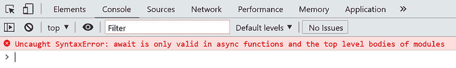

在 HTML 文件中添加模块与添加普通脚本相同，但你应该添加一个值为 `module` 的 `type` 属性，如下：

| | <script type="module" src="module1.js"></script> |
此外，模块受同源策略（same-origin policy）限制，这意味着你不能从文件系统导入它们。你需要在服务器上运行本章的代码示例。

## 使用层 await

当 `await` 关键字首次引入时，无法在异步函数之外使用它。当你第一次尝试使用它时，可能也遇到过致命的语法错误：`await is only valid in async function`：

[await/Await_ex01.js](http://media.pragprog.com/titles/fkajs/code/await/Await_ex01.js)

```javascript
const res = await fetch('https://example');
// SyntaxError: await is only valid in async function

为了使用该功能，我经常将 `await` 语句封装在一个立即调用的异步函数表达式中，如下：

[await/Await_ex02.js](http://media.pragprog.com/titles/fkajs/code/await/Await_ex02.js)

```javascript
(async function() {
  const res = await fetch('https://example');
}());
```


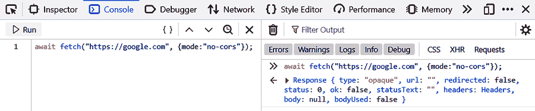

但顶层 await 允许我们解决一个更大的问题。请稍等。在处理 ES 模块时，可以使用 `export` 关键字让模块外部可以使用变量和函数。然后，单独文件中的其他模块可以使用 `import` 关键字来访问这些变量和函数。任何导出或导入语句都必须在代码的顶层表示。

假设我们有一个模块从外部 API 获取日本东京的天气数据，并且我们希望让结果对其他模块可用：

[await/Await_ex03.js](http://media.pragprog.com/titles/fkajs/code/await/Await_ex03.js)

```javascript
let result;
// 在生产环境中使用你自己的 app id
(async () => {
  const response = await fetch(api);
  result = await response.json();
})();

export {result};
```

在另一个模块中，我们想要导入结果并提取温度：


```javascript
import {result} from './module1.js';

console.log(result.main.temp);
// TypeError: Cannot read property 'main' of undefined
```

但这段代码产生了一个 `TypeError`，因为我们在异步函数完成之前尝试访问导出内容。在 `result` 变为 `undefined` 之前，我们仍然有一个 promise 在等待解决。

现在让我们延迟 `console.log()` 方法看看会发生什么。在 `setTimeout()` 中封装该方法，如下：
[await/Await_ex05.js](http://media.pragprog.com/titles/fkajs/code/await/Await_ex05.js)

```javascript
import {result} from './module1.js';
// 在生产环境中不要这样做做
setTimeout(() => {
  console.log(result.main.temp);
}, 2000);
// logs: 292.94
```


我们无法在函数内部使用 `export` 关键字，而在顶层 await 引入之前也无法在异步函数之外使用 `await` 关键字。一种变通方案是将整个异步函数作为默认导出：

[await/Await_ex06.js](http://media.pragprog.com/titles/fkajs/code/await/Await_ex06.js)

```javascript
let result;
const api = `http://api.openweathermap.org/data/2.5/weather?q=Tokyo,Japan&APPID=1b1b3e9e909416e5bbe365a0a8505fbb`;
// 在生产环境中使用 app id
export default (async () => {
  const response = await fetch(api);
})();

export {result};
```

然后我们可以在访问变量之前等待异步函数的解决：

[await/Await_ex07.js](http://media.pragprog.com/titles/fkajs/code/await/Await_ex07.js)

```javascript
import p, {result} from './module1.js';
p.then(() => {
  console.log(result.main.temp);
})
// logs: 292.94
```

但随着代码变得复杂，这种方式管理模块会变得困难。其他方案可行，但它们也有自己的局限性。

顶层 await 通过允许开发者在异步函数之外使用 `await` 关键字来解决这个问题。除了拥有支持该功能的现代浏览器外，你不需要任何特殊操作来开始顶层 await：

[await/Await_ex08.js](http://media.pragprog.com/titles/fkajs/code/await/Await_ex08.js)
```javascript
const api = `http://api.openweathermap.org/data/2.5/weather?q=Tokyo,Japan&APPID=1b1b3e9e909416e5bbe365a0a8505fbb`;
// 在生产环境中使用你自己的 app id
const response = await fetch(api);
const result = await response.json();

export {result};
```

然后在另一个模块中，我们可以直接访问导出的变量：


```javascript
import {result} from './module1.js';

console.log(result.main.temp);
// logs: 292.94
```


## 将顶层 await 投入工作

在设计一个支持多种语言和区域的程序时，你可能希望使用运行时值来确定使用的语言。假设你有一个 ES 模块，并想根据浏览器中设置的用户偏好语言动态加载语言包。你可以利用顶层 `await` 来导入消息：

[await/Await_ex10.js](http://media.pragprog.com/titles/fkajs/code/await/Await_ex10.js)

```javascript
const messages = await import(`./packs/messages-${navigator.language}.js`);
```


我们还可以使用顶层 `await` 加载带有备用实现的依赖项。正如我们在避免单点故障中学习到的，保护应用程序免受外部服务器问题非常重要。对服务器的网络请求可能会失败。在关键应用程序中，你可以使用顶层 `await` 提供依赖备用以缓解此类失败。这是一个示例：

[await/Await_ex11.js](http://media.pragprog.com/titles/fkajs/code/await/Await_ex11.js)

```javascript
let d3;
try {
  d3 = await import('https://cdnjs.cloudflare.com/ajax/libs/d3/6.7.0/d3.min.js');
} catch {
  d3 = await import('https://ajax.googleapis.com/ajax/libs/d3js/6.7.0/d3.min.js');
```

在这段代码中，我们首先尝试从 Cloudflare 加载 D3 JavaScript 库。如果导入失败，我们将尝试另一个 CDN。或者，我们可以使用 `Promise.any()` 异步执行两个请求，并使用响应较快的那一个的结果：

[await/Await_ex12.js](http://media.pragprog.com/titles/fkajs/code/await/Await_ex12.js)

```javascript
const CDNs = [
  'https://cdnjs.cloudflare.com/ajax/libs/d3/6.7.0/d3.min.js',
  'https://ajax.googleapis.com/ajax/libs/d3js/6.7.0/d3.min.js'
];
```

顶层 `await` 的另一个用例是资源初始化。例如：

[await/Await_ex13.js](http://media.pragprog.com/titles/fkajs/code/await/Await_ex13.js)

```javascript
import {dbConnector} from './utilities.js';
const connection = await dbConnector.connect();
```


请记住，在被导入的模块完成其主体执行之前，模块不会开始评估其主体。因此，如果另一个模块具有顶层 `await`，则它必须在导入它的模块开始执行之前完成。

## 总结

在此之前，`await` 仅在异步函数中有效。时代变了，`await` 变得更简单了。我们可以在模块中使用顶层 `await` 来避免将代码封装在异步 IIFE 中。在访问来自另一个模块的 promise 结果时，我们不再需要变通方法。我们可以将 `await` 用于初始化资源、动态定义依赖路径以及带有备用实现的依赖项加载等任务。

## 感谢阅读！

我们到达书的结尾！JavaScript 的美丽之处在于它足够灵活，可以让程序员决定语言如何演进。因此，JavaScript 社区的投入和提案在语言的进展过程中起了重要作用。任何人都可以通过起草提案来参与（阅读 [`github.com/tc39/proposals`](https://github.com/tc39/proposals)）。


- 检查 GitHub 上的提案 ([`github.com/tc39/proposals`](https://github.com/tc39/proposals))。特别注意处于阶段 3 和阶段 4 的功能。阶段 3 意味着功能的语义、语法和 API 已经完成，它很有可能添加到规范中。
- 关注 Google 的 V8 引擎博客。如果某些东西被添加到 Chrome 中，你将在那里听到消息 ([`v8.dev/`](https://v8.dev/))。
- 关注并参与 TC39 Discourse ([`es.discourse.group/`](https://es.discourse.group/))。TC39 是负责演进 JavaScript 定义的委员会。
