# 现代 JavaScript 应用

# 鸣谢

| 作者 | 项目协调员 |
| --- | --- |
| Narayan Prust | Kinjal Bari |
| 审稿人 | 校对员 |
| Olivier Pons | Safis Editing |
| 委托编辑 | 索引员 |
| Wilson D'souza | Pratik Shirodkar |
| 征稿编辑 | 视觉设计 |
| Dharmesh Parmar | Kirk D'Penha |
| 内容开发编辑 | 制作协调 |
| Arshiya Ayaz Umer | Shantanu N. Zagade |
| 技术编辑 | 封面设计 |
| Mohit Hassija | Shantanu N. Zagade |
| 拷贝编辑 | | |
| Madhusudan Uch | | |

# 关于作者

Narayan Prusty 是一位全栈开发人员。他为全球各初创公司担任顾问。他使用过多种技术和编程语言，但对 JavaScript、WordPress、Ethereum、Solr、React、Cordova、MongoDB 和 AWS 充满热情。

除了为初创公司提供咨询外，他还运营一个名为 QZone (http://gnimate.com) 的博客以及一个名为 QScatter (http://qscutter.com) 的视频教程网站，在这些平台上分享他工作的许多技术信息。此前，他写过一本名为《Learning ECMAScript 6》的书籍，由 Packt Publishing 出版。

你可以通过 LinkedIn (https://in.linkedin.com/in/narayanprusty) 联系 Narayan。

# 关于审稿人

**Olivier Pons** 是一位拥有多年网站构建经验的高级开发人员。他是法国艾克斯普旺斯科学大学 (IUT)、ISEN (Institut Supérieur de l'Électronique et du Numérique)、G4 Marseille 以及 Gardanne 矿学院的老师，在这些学校教授的 Web 技术：Node.js、大数据/NoSQL、MVC 基础、Django/Python、Symfony 基础、Wordpress、PHP、HTML、CSS、Query mobile、AngularJS、Linux 基础以及 de-facto 技术。他还参与过技术评审，包括 ExtJS 4 First Look、jQuery hotshots、Mobile Web Development、WordPress 4 Complete 以及 Beginner's Guide。2011 年，他辞去了全职 Delphi 开发人员和 PHP 专家，专注于自己的公司 HQF (http://hqf.fr)。他目前运营多个网站，包括 http://krystallopolis.fr、http://artsgeries.com、http://battoop.fr、http://cogofly.com、http://papdevis.fr 以及 http://olivierpons.fr（自己的开发博客）。他正在完善 http://cogofly.com 并为 http://ergofip.com 开发键盘。他担任顾问、教师和项目经理，有时帮助大公司作为高级/高技能开发人员。

- 按需通过 Web 浏览器访问

# 目录

| 前言 | ix |
| --- | --- |

- 常量属性 151
- 总线（buses）概述 152
- 订阅 EventStream 和属性的结束 152
- 移除订阅者 153
- 合并与压缩（zipping） 153
- 懒求值 155
  - 类型 1 155
  - 类型 2 155

# 前言

> **警告或重要注释将以此类框的形式出现。**

> **提示和技巧将如下所示出现。**

## 读者反馈

我们随时欢迎读者的反馈。告诉我们你对这本书的看法——你喜欢或不喜欢的地方。读者的反馈对我们来说非常重要，因为它有助于我们开发出能让你真正从中获益的书籍。

如需发送通用反馈，只需发送邮件至 `feedback@packtpub.com`，并在邮件主题中注明书名。

如果你在某个领域拥有专长，并且有兴趣为书籍贡献内容，请参阅我们在 www.packtpub.com/authors 上的作者指南。

## 客户支持

现在你是 Packt 书籍的自豪所有者，我们有很多可以帮助你从购买中获得最大的收益。

## 下载示例代码

你可以从你的账户 http://www.packtpub.com 下载本书的示例代码文件。如果你是在其他地方购买的这本书，可以访问 http://www.packtpub.com/support 并注册，以便文件通过电子邮件发送给你。

你可以按照以下步骤下载代码文件：

1. 使用你的电子邮箱地址和密码登录或注册我们的网站。
2. 将鼠标指针悬停在顶部的 `SUPPORT` 标签上。
3. 点击 **Code Downloads & Errata**。
4. 在 **Search** 框中输入书名。
5. 选择你想下载代码文件的书籍。
6. 从你购买书籍的下拉菜单中选择。
7. 点击 `Code Download`。

你也可以通过点击 Packt Publishing 网站书籍网页上的 **Code Files** 按钮来下载代码文件。可以通过在 **Search** 框中输入书名访问此页面。请注意，你需要登录你的 Packt 账户。

文件下载后，请确保使用以下最新版本的工具解压或提取文件夹：

- Windows 版：WinRAR / 7-Zip
- Mac 版：ZZip / iZip / UnRaX
- Linux 版：7-Zip / PeaZip

本书的代码包也托管在 GitHub 上：https://github.com/PacktPublishing/Modern-JavaScript-Applications。我们还在书籍和视频目录中提供了其他代码包，地址为 https://github.com/PacktPublishing/。快去看看吧！

## 下载本书的彩色图片

我们还为你提供了一个 PDF 文件，其中包含了书中截图和图表的彩色版本。彩色图像将帮助你理解输出的变化。你可以从 https://www.packpub.com/sites/default/files/downloads/ModernJavaScriptApplications_ColorImages.pdf 下载此文件。

## 勘误

尽管我们已尽努力确保内容的准确性，但错误仍然会发生。如果你在我们的某本书中发现错误（可能是文本或代码），如果你能向我们报告，我们将不胜感激。这样做可以避免其他读者的困扰，并帮助我们改进书籍的后续版本。如果你发现任何错误，请访问 http://www.packpub.com/submit-errata，选择你的书籍，点击 `Errata Submission Form` 链接并输入你的错误详情。一旦你的错误通过验证，你的提交将被接受，错误将上传到我们的网站或添加到任何列表中。

## 入门指南

我们将构建的优惠券网站允许用户提交优惠券。为了让优惠券公开可见，网站管理员必须接受该优惠券。每个优惠券都带有一张图片，该图片将由图像存储服务器进行存储和提供。

我们将使用 MongoDB 来存储优惠券。在继续之前，请确保你已经安装并运行了 MongoDB。假设你已经具备 MongoDB 的基础知识。

该练习包含两个目录：`Initial` 和 `Final`。在 `Final` 目录中，你会找到完整的优惠券网站源码。在 `Initial` 目录中，你将找到单体核心、服务、图像服务器等的 HTML 代码和目录。你将把相关的代码放在各自的目录中。`Initial` 目录将帮助你快速开始构建优惠券网站。

我们不会涉及优惠券网站的前端设计。我们只专注于构建网站的架构和功能。因此，HTML 代码已经包含在 `Initial` 目录中了。

## 网站架构

我们的服务器端应用程序将由一个单体核心、三个服务、MongoDB 服务器和图像存储服务器组成。

单体核心将为网站访问者和管理员提供页面。

这三个服务是数据库服务、URL 配置服务和上传服务。以下是每个服务的功能：

- **数据库服务**：在 MongoDB 中添加、检索、更新和删除优惠券通过数据库服务完成。单体核心通过数据库服务从 MongoDB 获取优惠券，上传服务也通过数据库服务处理优惠券。
- **上传服务**：当用户提交优惠券时，HTML 表单会被提交到上传服务。上传服务将图像发送到图像存储服务器，并使用数据库服务向数据库添加有关优惠券的元数据。我们将这些操作移动到了不同的服务，因为如果对图像进行调整大小和转换，将消耗更多的内存和 CPU 时间并长时间开启端口，在大量提交的情况下会导致服务器崩溃并破坏单体核心。将这些操作移动到不同的服务可以确保提交量增加时不会影响寻找优惠券的访问者。我们不会进行图像缩放转换，但如果你需要此功能，可以通过简单更新上传服务来实现。在更新上传服务期间，表单提交将无法工作，但其他所有功能均正常。因此，我们可以说此功能可以独立更新而不影响其他功能。
- **URL 配置服务**：客户端与单体核心、图像存储服务器和上传服务通信。在生产网站中，这三个服务器将位于不同的物理计算机上，具有三个不同的 IP 地址。因此，为了让客户端与它们通信，这三个服务需要通过不同的域名暴露（单体核心可以使用主域名指向，另外两个使用子域名），或者我们可以使用支持 URL 重定向的负载均衡器或反向代理，根据路径将请求路由到相应的服务器。URL 配置服务将提供基础 URL（base URL）。为了跟随本章节，你可以直接在同一台物理计算机上使用不同端口运行这些服务器，当你准备好让网站上线时，可以根据你使客户端能够与服务器通信的技术，更改 URL 配置服务中的基础 URL。你不需要直接修改服务器的源代码，这是一项繁琐且高风险的任务。

我们将创建自己的图像存储服务器。然而，在生产网站中，我建议你使用 Amazon S3 或类似的工具来存储图像，因为这易于通过 CDN 提供图像。你不需要担心扩展性和可靠性，而且成本低廉。我们将创建的图像存储服务器将是一个基础版本，仅用于演示如何在单独的服务器存储图像并从那里提供服务。

以下是显示所有架构全貌以及架构中的服务器如何相互通信的图表：

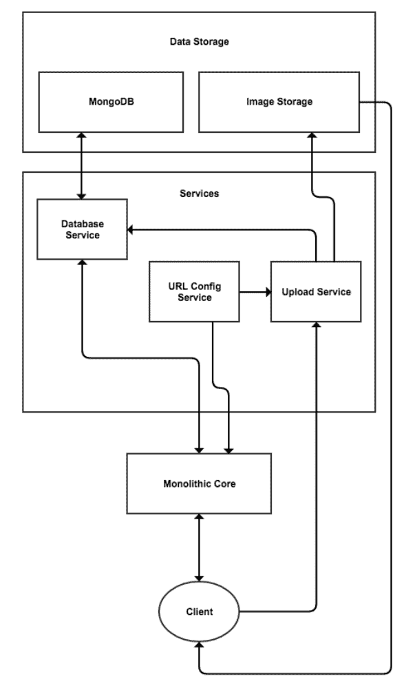

# 第1章 构建优惠券网站

## 创建服务

让我们在构建图像存储服务器和单体核心之前先构建服务。

我们将首先构建数据库服务，因为它依赖于已经运行的 MongoDB 服务器。上传和服务单体核心都依赖它，因此它需要在它们之前被构建。

### 数据库服务

数据库服务将提供添加优惠券、列出已验证优惠券、列出未验证优惠券、验证优惠券和删除优惠券的操作。这些操作将被上传和服务单体核心使用。

打开 `Initial/database-service` 目录。在目录下你会找到一个 `package.json` 文件和一个 `app.js` 文件。`app.js` 文件是你编写代码的地方，`package.json` 列出了数据库服务的依赖项。数据库服务依赖 `seneca` 和 `seneca-mongo-store` 插件。在 `Initial/database-service` 中使用 `npm install` 命令本地安装依赖项。

以下是使用 `seneca` 模块创建 `seneca` 实例、加载 `seneca-mongo-store` 插件并初始化插件以连接 MongoDB 的代码：

```javascript
var seneca = require("seneca");
seneca.use("mongo-store", {
  name: "gocoupons",
  host: "127.0.0.1",
  port: 27017
});
```

我们使用 `gocoupons` 作为数据库名称。我假设 MongoDB 服务器运行在默认端口 27017 上。

以下是创建一个允许你添加优惠券的操作代码：

```javascript
seneca.add({role: "coupons-store", cmd: "add"}, function(args, respond) {
  var coupons = seneca.make("gocoupons");
  var data = coupons.data({
    title: args.title,
    desc: args.desc,
    email: args.email,
    url: args.url,
    price: args.price,
    discount: args.discount,
    thumbail_id: args.thumbnail_id,
    verified: false
  });
  data.save(function(err, entity) {
    if(err) return respond(err);
    respond(null, {value: true});
  });
});
```

我们将优惠券存储在名为 `coupons` 的集合中。在这里，我们将文档的 `verified` 属性设置为 `false`，也就是说，每当用户提交新优惠券时，我们将其设为未验证状态，以便管理员可以检索此新提交的优惠券并进行手动验证。

`thumbnail_id` 属性并不持有优惠券缩略图的完整 URL，它本身只是文件名。

以下是创建一个检索已验证优惠券的操作代码：

```javascript
seneca.add({role: "coupons-store", cmd: "list"}, function(args, respond) {
  var coupons = seneca.make("gocoupons");
  coupons.list({verified: true, limit: 21, skip: args.skip}, function(err, entity) {
    respond(null, entity);
  });
});
```

此操作检索最多 21 个优惠券，并接收一个 `skip` 参数用于跳过某些文档，从而实现分页。

以下是创建一个检索未验证优惠券的操作代码：

```javascript
seneca.add({role: "coupons-store", cmd: "admin_list"}, function(args, respond) {
  var coupons = seneca.make("coupons");
  coupons.list({verified: false}, function(err, entity) {
    if(err) return respond(err);
    respond(null, entity);
  });
});
```

此操作将用于检索显示在管理员面板上的优惠券，供管理员接受或拒绝。

以下是创建一个验证优惠券的操作，即把 `verified` 属性从 `false` 改为 `true`：

```javascript
seneca.add({role: "coupons-store", cmd: "verified"}, function(args, respond) {
  var coupons = seneca.make("gocoupons");
  var data = coupons.data({id: args.id, verified: true});
  data.save(function(err, entity) {
    if (err) return respond(err);
    respond(null, {value: true});
  });
});
```

当管理员接受优惠券公开时将调用此操作。

以下是创建一个删除优惠券的操作代码：

```javascript
seneca.add({role: "coupons-store", cmd: "delete"}, function(args, respond) {
  var coupons = seneca.make("gocoupons");
  coupons.remove({id: args.id});
  respond(null, {value: true});
});
```

当管理员拒绝优惠券时将调用此操作。

现在我们已经为数据库服务创建了所有操作，让我们通过网络暴露这些操作，以便其他服务器调用。这是实现此操作的代码：

```javascript
seneca.listen({port: "5010", pin: {role: "coupons-store"}});
```

现在使用 `node app.js` 命令运行数据库服务。

### URL 配置服务

上传操作使用 URL 配置服务查找单体核心的基础 URL，以便在优惠券成功提交后重定向用户。此外，单体核心也使用此服务查找图像存储服务器和上传服务的基础 URL，以便将其包含在 HTML 代码中。

打开 `Initial/config-service` 目录。在目录内部，你会找到一个 `package.json` 文件和一个 `app.js` 文件。`app.js` 文件是你要编写代码的地方，而 `package.json` 列出了配置服务所需的依赖项。URL 配置服务仅依赖于 `seneca`。在 `Initial/config-service` 内部运行 `npm install` 命令来本地安装依赖项。

以下是导入 `seneca` 模块并创建操作以返回上传服务、单体核心和图像存储服务器基础 URL 的代码：

```javascript
var seneca = require("seneca");

seneca.add({role: "url-config", cmd: "upload-service"}, function(args, respond) {
  respond(null, {value: "http://localhost:9090"});
});

seneca.add({role: "url-config", cmd: "monolithic-core"}, function(args, respond) {
  respond(null, {value: "http://localhost:8080"});
});

seneca.add({role: "url-config", cmd: "image-storage-service"}, function(args, respond) {
  respond(null, {value: "http://localhost:7070"});
});

seneca.listen({port: "5020", pin: {role: "url-config"}});
```

现在使用 `node app.js` 命令运行 URL 配置服务。

### 上传服务

上传服务处理新的优惠表单服务。该表单由优惠标题、URL、描述、价格和缩略图组成。表单服务的内容类型为 `multipart/form-data`，因为它正在上传图像文件。

打开 `Initial/upload-service` 目录。在目录内部，你会找到一个 `package.json` 文件和一个 `app.js` 文件。`app.js` 文件是你要编写代码的地方，`package.json` 列出了上传服务所需的依赖项。上传服务依赖于 `seneca`、`express`、`connect-multipart`、`path`、`fs` 和 `request` 包。在 `Initial/upload-service` 内部运行 `npm install` 命令来本地安装依赖项。

以下是 `require("seneca")` 模块：

```javascript
var seneca = require("seneca");
var app = require("express");
var multipart = require("connect-multipart");
var path = require("path");
var fs = require("fs");
var request = require("request");
```

用户可能会上传相同名称的图像。我们不希望同名的图像相互覆盖。因此，我们需要为每个图像重命名一个唯一的名称。以下是定义生成唯一数字函数的代码，该数字将用作图像：

```javascript
function uniqueNumber() {
  var date = Date.now();

  if (date <= uniqueNumber.previous) {
    date = ++uniqueNumber.previous;
  } else {
    uniqueNumber.previous = date;
  }

  return date;
}

uniqueNumber.previous = 0;

function ID() {
  return uniqueNumber();
};
```

现在，为了让上传服务与数据库和 URL 配置服务通信，我们需要将它们添加到上传服务的 seneca 实例中。以下是实现此操作的代码：

```javascript
seneca.client({port: "5020", pin: {role: "url-config"}});
seneca.client({port: "5010", pin: {role: "coupons-store"}});
```

现在我们需要定义一个 express 路由来处理提交到 `/submit` 路径的 POST 请求。在路由处理器内部，我们将重命名图像、将图像上传到存储服务器、使用 MongoDB 添加优惠的元数据，并带有带有表单提交成功的状态重定向到单体核心。以下是定义路由的代码：

```javascript
// 声明路由并添加回调
app.post('/submit', multipart, function (httpRequest, httpResponse, next) {
  var tmp_path = httpRequest.files.thumbnail.path;
  var thumbnail_extension = path.extname(tmp_path);
  var thumbnail_directory = path.dirname(tmp_path);
  var renamed_path = thumbnail_directory + '/' + ID() + thumbnail_extension;

  // 重命名文件
  fs.rename(tmp_path, renamed_path, function (err) {
    if (err) return httpResponse.status(500).send("An error occurred");
  });

  // 上传到图像存储服务器
  seneca.act({role: 'url-config', cmd: 'image-storage-service'}, function(err, storage_server_url) {
    var req = request.post(storage_server_url.value + "/store");
    req.form().append('thumbnail', fs.createReadStream(renamed_path), {
      filename: ID() + thumbnail_extension
    });
    req.on('response', function(res) {
      var body = '';
      res.on('data', function(chunk) { body += chunk; });
      res.on('end', function() {
        fs.unlink(renamed_path);

        if (err) return httpResponse.status(500).send("An error occurred");
        if (body === "Done") {
          // 存储优惠
          seneca.act({
            role: "coupons-store",
            cmd: "add",
            title: httpRequest.body.title,
            email: httpRequest.body.email,
            url: httpRequest.body.url,
            desc: httpRequest.body.desc,
            price: httpRequest.body.price,
            discount: httpRequest.body.discount,
            thumbnail_id: ID() + thumbnail_extension
          }, function(err, response) {
            if (err) {
              // 删除存储的图像
              request.get(storage_server_url.value + "/delete/" + ID() + thumbnail_extension);
            } else {
              // 重定向到单体核心
              seneca.act({role: "url-config", cmd: "monolithic-core"}, function(err, core_url) {
                httpResponse.redirect(core_url.value + "?status=submitted");
              });
            }
          });
        }
      });
    });
  });
});
```

- 如果优惠元数据添加成功，我们将带有 `?status=submitted` 查询字符串重定向到单体核心。当单体核心看到此查询字符串时，它会显示一条消息说明优惠提交成功。
- 如果 URL 配置服务由于原因没有响应，我们将返回一个 HTTP 内部错误。

因此，在编写此类服务时需要记住的是，你需要处理各种故障情况，并在发生故障时回滚更改。现在这使得上传和重新部署数据库服务、URL 配置服务和图像存储服务器变得简单，因为上传服务会处理这些服务的故障并向用户提供反馈。

现在我们已经定义了路由。最后，我们需要启动 Express 服务器。

以下是执行此操作的代码：

```javascript
app.listen(9020);
```

## 创建图像存储服务器

让我们来定义上传服务可以通过它在图像存储服务器中存储图片的路由。上传服务通过向 `/store` URL 路径发送 POST 请求来存储图像。以下是定义该路由的代码：

```javascript
app.post("/store", multipart, function (httpRequest, httpResponse, next) {
  var tmp_path = httpRequest.files.thumbnail.path;
  var target_path = "public/images/" + httpRequest.body.name;
  fs.rename(tmp_path, target_path, function (err) {
    if (err) return httpResponse.status(500).send("An error occured");
    httpResponse.send("Done");
  });
});
```

在这里，我们添加了由 `connect-multipart` 模块提供的回调函数，它解析 `multipart/form-data` 类型的体，并将文件移动到临时位置。

然后，我们将文件从临时目录移动到另一个目录。我们将文件移动到的目录是 `public/images/`。我们使用 `filesystem` 模块的 `rename` 方法来移动文件。最后，我们发送一个 `Done` 字符串作为 HTTP 响应的体，告诉上传服务文件已存储成功。

现在让我们来定义上传服务可以通过它删除图像存储服务器中存储图像的路由。上传服务通过向 `/delete/:id` URL 路径发送 GET 请求，其中参数表示图像名称。以下是定义该路由的代码：

```javascript
app.get("/delete/:id", function (httpRequest, httpResponse, next) {
  fs.unlink("public/images/" + httpRequest.params.id, function(err) {
    if (err) return httpResponse.status(500).send("An error occured");
    httpResponse.send("Done");
  });
});
```

在这里，我们使用 `fs` 模块的 `unlink` 方法来删除图像文件。

最后，我们需要向浏览器提供图像。在 `public/images/` 目录中查找静态文件即可实现。以下是实现此操作的代码：

```javascript
app.use(express.static(__dirname + "/public/images"));
```

在这里，我们使用了静态中间件，它会在参数提供的目录查找静态文件并直接提供给浏览器。

现在我们已经定义了路由。最后，我们需要启动 Express 服务器。以下是实现代码的代码：

```javascript
app.listen(7070);
```

现在请使用 `node app.js` 命令运行图像服务器。

## 创建单体核心

我们已经完成了服务和图像服务器的创建。用户与单体核心交互以查看未验证的优惠券，而管理员则与单体核心交互以拒绝或接受优惠券。然后，用户和管理员提交的每个新优惠券都存在于单体核心中。

打开 `Initial/monolithic` 目录。在目录内部，你将找到一个 `package.json` 文件和一个 `app.js` 文件。`app.js` 文件是编写代码的地方，而 `package.json` 列出了单体核心的依赖项。单体核心依赖于 `express`、`seneca`、`request` 和 `basic-auth` npm 包。在 `Initial/monolithic` 内部运行 `npm install` 命令来本地安装依赖。

我们将配合 Express 使用 `ejs` 模板引擎。在 `views` 目录中，你将找到首页、新优惠券提交表单和管理员页面的 ejs 文件。这些文件已经包含了模板和 HTML 代码。该网站使用 `Bootstrap` 设计。

以下是导入模块的代码：

```javascript
var seneca = require("seneca");
var express = require("express");
var app = express();
var basicAuth = require("basic-auth");
var request = require("request");
```

现在，为了让单体核心能够与数据库和 url-config 服务通信，我们需要将它们添加到单体核心的 seneca 实例中。以下是实现此操作的代码：

```javascript
seneca.client({port: "5020", pin: {role: "url-config"}});
seneca.client({port: "5010", pin: {role: "coupons-store"}});
```

现在我们需要将 `ejs` 设置为视图引擎。以下是将 `ejs` 设置为视图引擎的代码：

```javascript
app.set("view engine", "ejs");
```

所有 CSS、JS 和字体等静态文件都保存在 `public` 目录中。我们需要将它们提供给客户端。以下是提供静态文件的代码：

```javascript
app.use(express.static(__dirname + "/public"));
```

在这里，我们以与图像服务器中提供静态文件相同的方式提供静态文件。现在我们需要为网站服务器添加一个首页路由，显示前 20 个优惠券。它还显示了“下一页”和“上一页”按钮，用于在前后每组 20 条之间导航。首页通过根 URL 访问。以下是为服务器添加首页路由的代码：

```javascript
app.get("/", function(httpRequest, httpResponse) {
  var skip = 0;
  if (httpRequest.query.next === "true") {
    skip = parseInt(httpRequest.query.current) + 20;
  } else if (httpRequest.query.prev === "true") {
    skip = parseInt(httpRequest.query.current) - 20;
  }

  seneca.act({role: "coupons-store", cmd: "list", skip: skip}, function(err, coupons) {
    if (err) return httpResponse.status(500).send("An error occured");

    var next = coupons.length === 21;
    var prev = skip > 0;
    var current = skip;

    seneca.act({role: "url-config", cmd: "image-storage-service"}, function(err, image_url) {
      if (err) return httpResponse.status(500).send("An error occured");

      var submitted = httpRequest.query.status === "submitted";

      httpResponse.render("index", {
        coupons: coupons,
        next: next,
        prev: prev,
        current: current,
        image_url: image_url.value,
        submitted: submitted
      });
    });
  });
});
```

之前的代码还检查了 `status=submitted` 查询字符串，该字符串表示用户是从上传服务重定向过来的。如果存在，它会将视图的 `submitted` 本地变量赋值为 `true`。视图中的此 ejs 模板检查提交的本地变量是 `true` 还是未定义，并显示成功的表单提交消息：

```ejs
<% if (typeof submitted != "undefined") { %>
  <% if (submitted == true) { %>
    <div class="alert alert-success" role="alert">优惠已提交。我们的管理员将很快审核该优惠。</div>
  <% } %>
<% } %>
```

以下是视图中显示优惠以及上一页/下一页按钮的 ejs 模板：

```ejs
<div class="row">
  <% if (coupons.length < 21) { %>
    <% var cut = 0; %>
  <% } %>
  <% if (coupons.length == 21) { %>
    <% var cut = 1; %>
  <% } %>
  <% for (var i = 0; i < coupons.length - cut; i++) { %>
    <div class="col-sm-3 col-lg-3 col-md-3">
      <div class="thumbnail">
        " alt="">
        <div class="caption">
          <h4 class="pull-right"><del><%= coupons[i].price %></del> - <%= coupons[i].discount %> h</h4>
          <h4><a href="<%= coupons[i].url %>"><%= coupons[i].title %></a></h4>
          <p><%= coupons[i].desc %></p>
        </div>
      </div>
    </div>
  <% } %>
</div>

<ul class="pager">
  <% if(prev == true) { %>
    <li class="previous"><a href="?prev=true&current=<%= current %>">上一页</a></li>
  <% } %>
  <% if(next == true) { %>
    <li class="next"><a href="?next=true&current=<%= current %>">下一页</a></li>
  <% } %>
</ul>
```

现在我们需要创建一个路径为 `/add` 的路由，用以显示一个提交优惠券的表单。该提交页的视图是 `add.ejs`。以下是创建该路由的代码：

```javascript
app.get('/add', function(httpRequest, httpResponse) {
  seneca.act({role: "url-config", cmd: "upload-service"}, function(err, response) {
    if (err) return httpResponse.status(500).send("发生错误");

    httpResponse.render("add", {
      upload_service_url: response.value
    });
  });
});
```

我们正在从 URL 配置中获取上传服务的基 URL，并将其赋值给 `upload_service_url` 本地变量，以便表单知道向哪里提交 POST 请求。

以下是 `add.ejs` 视图中显示优惠提交表单的模板：

```ejs
<form role="form" method="post" action="<%= upload_service_url %>" enctype="multipart/form-data">
  <div class="form-group">
    <label for="email">您的邮箱：</label>
    <input type="email" class="form-control" id="email" name="email">
  </div>
  <div class="form-group">
    <label for="title">产品标题：</label>
    <input type="text" class="form-control" id="title" name="title">
  </div>
  <div class="form-group">
    <label for="desc">产品描述：</label>
    <textarea class="form-control" id="desc" name="desc"></textarea>
  </div>
  <div class="form-group">
    <label for="url">产品 URL: </label>
    <input type="text" class="form-control" id="url" name="url">
  </div>
  <div class="form-group">
    <label for="price">原价：</label>
    <input type="text" class="form-control" id="price" name="price">
  </div>
  <div class="form-group">
    <label for="discount">折扣价：</label>
    <input type="text" class="form-control" id="discount" name="discount">
  </div>
  <div class="form-group">
    <label for="thumbnail">产品图片: <i>(320 x 150)</i></label>
    <input type="file" class="form-control" id="thumbnail" name="thumbnail">
  </div>
  <button type="submit" class="btn btn-default">提交</button>
</form>
```

现在我们需要为站点管理员提供一个访问管理面板的路径。访问管理面板的路径将是 `/admin`。管理面板将使用 HTTP 基础认证进行保护。

我们将创建两个路由，供管理员用于接受或拒绝优惠券。这两个路由分别是 `/admin/accept` 和 `/admin/reject`。

以下是使用 HTTP 基础认证保护管理面板的代码：

```javascript
var auth = function (req, res, next) {
  var user = basicAuth(req);
  if (!user || !user.name || !user.pass) {
    res.set("WWW-Authenticate", "Basic");
    return res.status(401).send("Authentication required");
  }
  // 检查用户名和密码
  if (user.name === "admin" && user.pass === "password") {
    next();
  } else {
    res.set("WWW-Authenticate", "Basic");
    return res.status(401).send("Authentication failed");
  }
};

app.get("/admin", auth, function(req, res) {
  seneca.act({role: "coupons-store", cmd: "admin_list"}, function(err, coupons) {
    if (err) return res.status(500).send("An error occured");
    seneca.act({role: "url-config", cmd: "image-storage-service"}, function(err, image_url) {
      if (err) return res.status(500).send("An error occured");
      res.render("admin", {coupons: coupons, image_url: image_url.value});
    });
  });
});

app.post("/admin/accept", auth, function(req, res) {
  seneca.act({role: "coupons-store", cmd: "verified", id: req.body.id}, function(err, result) {
    if (err) return res.status(500).send("An error occured");
    res.redirect("/admin");
  });
});

app.post("/admin/reject", auth, function(req, res) {
  seneca.act({role: "coupons-store", cmd: "delete", id: req.body.id}, function(err, result) {
    if (err) return res.status(500).send("An error occured");
    res.redirect("/admin");
  });
});
```

以下是 `admin.ejs` 视图中显示管理面板的模板：

```ejs
<table class="table">
  <thead>
    <tr>
      <th>标题</th>
      <th>描述</th>
      <th>URL</th>
      <th>图片</th>
      <th>折扣</th>
      <th>价格</th>
      <th>操作</th>
    </tr>
  </thead>
  <tbody>
    <% coupons.forEach(function(coupon) { %>
      <tr>
        <td><%= coupon.title %></td>
        <td><%= coupon.desc %></td>
        <td><%= coupon.url %></td>
        <td>" width="100"></td>
        <td><%= coupon.discount %></td>
        <td><%= coupon.price %></td>
        <td>
          <form method="post" action="/admin/accept" style="display:inline;">
            <input type="hidden" name="id" value="<%= coupon.id %>">
            <button type="submit" class="btn btn-success">接受</button>
          </form>
          <form method="post" action="/admin/reject" style="display:inline;">
            <input type="hidden" name="id" value="<%= coupon.id %>">
            <button type="submit" class="btn btn-danger">拒绝</button>
          </form>
        </td>
      </tr>
    <% }); %>
  </tbody>
</table>
```

我们已经定义了路由。最后，我们需要启动 Express 服务器。以下是实现该操作的代码：

```javascript
app.listen(8080);
```

现在请继续使用 `node app.js` 命令运行单体核心服务器。

## 网站流程导览

我们已经完成了网站的创建。现在，让我们浏览一下我们的网站，看看它整体是如何运作的。在此之前，请确保所有内容都在正常运行。

你可以通过 http://localhost:8080/ 访问网站的首页。以下是你第一次访问该网页时将显示的样式：

| GoCoupons | 管理员 | 提交优惠券 |
|---|---|---|
| 版权所有 © GoCoupons 2014 | | |

现在要添加优惠券，点击**提交优惠券**按钮。现在你会看到一个表单。填写该表单。它的样子如下：

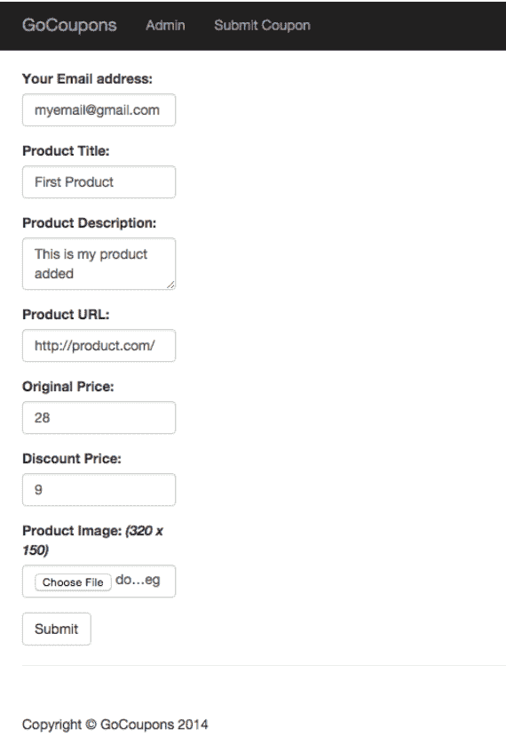

现在提交表单。提交表单后，你将被重定向到首页。以下是跳转后首页的样子：

| GoCoupons | 管理员 | 提交优惠券 |
|---|---|---|
| 优惠券已提交。我们的管理员很快就会审核该优惠券。 | | |
| 版权所有 © GoCoupons 2014 | | |

现在点击**管理员**按钮访问管理面板并接受优惠券。以下是管理面板的样子：

| GoCoupons | 管理员 | 提交优惠券 |
|---|---|---|
| 标题 | 描述 | URL | 图片 | 折扣 | 价格 | 操作 |
| 第一个产品 | 这是我添加的产品 | http://product.com/ |  | 28 | 28 | 接受 拒绝 |
| 版权所有 © GoCoupons 2014 | | |

点击接受按钮以接受它。现在返回首页。这是首页现在显示的样子：


在前面的图中，你可以看到产品已列出。

## 网站的进一步改进

以下我们可以做的一些事情，以使网站架构变得更好并添加一些功能。通过执行以下操作，你还将获得一些编写微服务架构代码的实践：

- 为管理面板创建一个独立的服务。这样做的好处是你可以更新管理面板而不影响访问者，也就是说，当管理面板正在更新时，用户仍然可以访问和浏览优惠券。为此，你需要将管理面板的路由移动到一个新服务中。
- 从数据库中获取用户名和密码。为了这一点，你需要在数据库服务中添加一些操作。
- 缩放或裁剪图像为缩略图大小，因为这是前端显示的图像尺寸。这将节省磁盘空间。这需要通过上传服务的帮助完成。
- 你可以为网站创建一个移动端应用。为此，你需要创建一个为移动应用提供 API 的服务。可以通过添加查询字符串将新优惠券提交到上传服务，指示请求来自移动应用，这样它就不会进行重定向，而是在优惠券提交成功后发送响应。

这些只是让网站变得更好的一些想法。

## 总结

在本章节中，我们看到了如何使用 Seneca 和微服务架构从零构建一个网站。我们构建的网站在功能上是简单的，但涉及许多在使用微服务架构构建网站时使用的重要技术。

# 第2章 WebRTC 简介

**Web 实时通信 (WebRTC)** 是一种浏览器技术，它能够获取物理媒体源的媒体流，并实时交换媒体流或任何其他数据。它由三个 API 组成：`MediaStream` 构造函数、`RTCPeerConnection` 构造函数和 `RTCDataChannel` 接口。

简而言，`MediaStream` 用于获取物理媒体源的流，`RTCPeerConnection` 用于在对端之间实时交换 `MediaStream`，最后，`RTCDataChannel` 用于在对端之间交换任意数据。

让我们来看看这些 API 是如何工作的。

## MediaStream API

`MediaStream` API 的两个主要组件是 `MediaStream` 构造函数和 `MediaStreamTrack` 接口。

一个轨道（track）代表一个媒体源的流。轨道实现了 `MediaStreamTrack` 接口。一个轨道既可以是音频轨道，也可以是视频轨道。连接到音频源的轨道是音频轨道，连接到视频源的轨道是视频轨道。一个特定的媒体源可以连接到多个轨道。我们还可以给轨道添加约束条件（constraints）。例如，连接到网络摄像头的轨道具有最小视频分辨率和 FPS 等约束条件。每个轨道都有自己的约束条件。

在轨道创建后，你可以使用 `MediaStreamTrack` 接口的 `applyConstraints()` 方法更改其约束条件。你可以随时使用 `MediaStreamTrack` 接口的 `getSettings()` 方法获取应用于轨道的约束条件。要从媒体源中分离轨道（即永久停止轨道），我们使用 `MediaStreamTrack` 接口的 `stop()` 方法。要暂停轨道（即临时停止轨道），我们可以为 `MediaStreamTrack` 接口的 `enabled` 属性赋值 `false`。

> 可以在 https://developer.mozilla.org/en-US/docs/Web/API/MediaStreamTrack 查看更多 `MediaStreamTrack` 接口的信息。

轨道可以是本地或远程。本地轨道代表本地媒体源的流；而远程轨道代表远程媒体源的流。你不能对远程轨道应用约束条件。要判断一个轨道是本地还是远程，可以使用 `MediaStreamTrack` 接口的 `remote` 属性。

当在对端之间交换轨道时，我们会遇到远程轨道。当我们向对端发送本地轨道时，另一个对端会接收轨道的远程版本。

一个 `MediaStream` 将多个轨道结合在一起。技术上讲，它并不执行任何操作。它代表了一组应该以同步方式播放、存储或传输的轨道。

可以在 https://developer.mozilla.org/en/docs/Web/API/MediaStream 查看更多关于 `MediaStream` 构造函数的信息。

`MediaStreamTrack` 对象的 `getSources()` 方法允许我们检索所有媒体设备（如扬声器、麦克风和摄像头）的 ID。如果 ID 代表媒体输入设备，我们可以使用该 ID 创建轨道。以下是一个演示的示例：

```javascript
MediaStreamTrack.getSources(function(sources) {
  for (var count = 0; count < sources.length; count++) {
    var info = sources[count];
    console.log("Source " + (count + 1) + " info:", info);
    console.log("ID is: " + info.id);

    if (info.label == "") {
      console.log("Name of the source is: unknown");
    } else {
      console.log("Name of the source is: " + info.label);
    }

    if (info.facing == "") {
      console.log("Source facing: unknown");
    } else {
      console.log("Source facing: " + info.facing);
    }
  }
});
```

每个人的输出会有所不同。这是我获得的输出：

```
Source 1 info:
ID: 0c1cb4e9e7088d405db65ea5a4a420dab2e9da02298438f782bab57ff9787665
Name of the source is: unknown
Kind of source: audio
Source facing: unknown
Source 2 info:
ID: 6f869033c6a8baa44aa03f60cac92adc1c9a70f208e392d33445f3c2d6731f478
Name of the source is: unknown
Kind of source: audio
Source facing: unknown
Source 3 info:
ID: c83fc025ae6fe6781a1alcbe9526a64cb61cdc72d111dd4c3f10405857af076c5
Name of the source is: unknown
Kind of source: video
Source facing: unknown
```

### navigator.getUserMedia

有各种 API 可以返回包含轨道的 `MediaStream`。其中一种方法是 `navigator.getUserMedia()`。使用 `navigator.getUserMedia()`，我们可以从媒体输入源（如麦克风、摄像头等）获取流。以下是一个演示的示例：

```javascript
navigator.getUserMedia = navigator.getUserMedia ||
  navigator.webkitGetUserMedia || navigator.mozGetUserMedia;

var constraints = {
  audio: true,
  video: {
    mandatory: {
      minWidth: 640,
      minHeight: 360
    },
    optional: [{
      minWidth: 1280
    }, {
      minHeight: 720
    }]
  }
};

navigator.getUserMedia(constraints, function(stream) {
  var video = document.getElementById("myVideo");
  video.src = URL.createObjectURL(stream);
  video.play();
}, function(err) {
  console.log("Failed to get MediaStream", err);
});

function pause() {
  var tracks = stream.getTracks();
  tracks[0].enabled = !tracks[0].enabled;
  tracks[1].enabled = !tracks[1].enabled;
}
```

每当你运行上述代码时，浏览器会弹出窗口请求用户选择媒体设备。通过 `getUserMedia()` 访问媒体输入源，用户必须给代码访问权限。默认情况下，`getUserMedia()` 附加到这些轨道的媒体设备。

你可以通过 `MediaStream` 对象的音频或视频属性设置 ID，来让用户选择的媒体设备。

你可以简单地将音频或视频属性设置为 `false`，如果你不需要创建音频或视频轨道。

我们使用 `MediaStream` 的 `getTracks()` 方法检索 `MediaStream` 的轨道。同样，我们可以使用 `addTrack()` 和 `removeTrack()` 方法添加或移除轨道。当轨道被添加时，会触发 `onaddtrack` 事件。同样，当轨道被移除时，会触发 `onremovetrack`。

如果已经有了轨道，我们可以直接使用 `MediaStream` 构造函数创建带有轨道的 `MediaStream`。`MediaStream` 构造函数接收轨道数组，并返回一个包含这些轨道引用的 `MediaStream`。

从轨道读取数据的 API 被称为 `MediaStream` 消费者。一些 `MediaStream` 消费者包括 `<audio>` 标签、`<video>` 标签、`RTCPeerConnection`、Media Recorder API、Image Capture API、Web Audio API 等。

这是一个演示如何在 `<video>` 标签中显示 `MediaStream` 轨道数据的示例：

```html
<!doctype html>
<html>
<head>
  <title>MediaStream Demo</title>
</head>
<body>
  <video id="myVideo" autoplay></video>
  <button onclick="pause()">Pause/Resume</button>
  <script>
    navigator.getUserMedia = navigator.getUserMedia ||
      navigator.webkitGetUserMedia || navigator.mozGetUserMedia;

    var constraints = { audio: true, video: true };
    var stream;

    navigator.getUserMedia(constraints, function(mediaStream) {
      stream = mediaStream;
      document.getElementById("myVideo").src = URL.createObjectURL(stream);
      document.getElementById("myVideo").play();
    }, function(err) {
      console.log("Failed to get MediaStream", err);
    });

    function pause() {
      stream.getTracks().forEach(function(track) {
        track.enabled = !track.enabled;
      });
    }
  </script>
</body>
</html>
```

这里我们有一个 `<video>` 标签和一个用于暂停它的按钮。`<video>` 标签接收一个 URL 并显示该资源。

> 在 HTML5 之前，HTML 标签和 CSS 属性只能从 `http://` 和 `file://` 的 URL 中读取数据。然而，在 HTML5 中，它们可以读取 `blob://`、`data://`、`mediastream://` 以及类似的 URL。

要在 `<video>` 标签中显示 `MediaStream` 的输出，我们需要使用 `URL.createObjectURL()` 方法，该方法接收一个 blob、文件对象或 `MediaStream`，并提供一个用于读取其数据的 URL。`URL.createObjectURL()` 会消耗额外的内存和 CPU 时间来通过 URL 访问传递的值，因此当我们不再需要该 URL 时，使用 `URL.revokeObjectURL()` 释放该 URL 是明智的。

如果 `MediaStream` 中有多个音频和视频轨道，`<video>` 将读取第一个音频和视频轨道。

## RTCPeerConnection API

`RTCPeerConnection` 允许两个浏览器实时交换 `MediaStream`。

`RTCPeerConnection` 是 `RTCPeerConnection` 构造函数的实例。

### 建立点对点连接

为了建立点对点连接，需要一个信令服务器（signaling server）。通过信令服务器，节点交换建立点对点连接所需的数据。实际数据传输直接在点之间进行。信令服务器仅用于交换建立点对点连接的先决条件。一旦建立点对点连接，双方都可以与服务器断开。信令服务器不需要高配置，因为实际数据并不通过它传输。单个点对点连接的数据传输可能只有几 KB，因此可以使用相当的服务器进行信令。

信令服务器通常使用信令协议，但只要它可以在两个节点之间传递消息，使用 HTTP 服务器也是可以的。WebRTC 并不强制我们使用任何特定的信令协议。

例如，假设两个不同的浏览器上有两个用户 Alice 和 Bob。如果 Alice 想与 Bob 建立点对点连接进行聊天，那么他们之间建立点对点连接的过程如下：

1. 他们将连接到信令服务器。
2. Alice 随后通过信令服务器向 Bob 发送聊天请求。
3. 信令服务器可以可选地检查 Alice 是否允许与 Bob 聊天，以及 Alice 和 Bob 是否已登录。如果是，信令服务器会将消息传递给 Bob。
4. Bob 接收请求并通过信令服务器向 Alice 发送消息，确认建立点对点连接。
5. 现在他们都需要交换与会话控制、网络配置和媒体能力相关的消息。所有这些消息都在 `RTCPeerConnection` 之间交换。因此，他们都需要创建一个 `RTCPeerConnection`，初始化它，并为 `RTCPeerConnection` 挂载一个事件处理程序，当 `RTCPeerConnection` 想通过信令服务器发送消息时会触发该处理程序。`RTCPeerConnection` 以会话描述协议（SDP）格式将消息传递给事件处理程序，从信令服务器接收的 `RTCPeerConnection` 消息必须以 SDP 格式馈给 `RTCPeerConnection`，即 `RTCPeerConnection` 只理解 SDP 格式。你需要使用自己的编程逻辑来拆分自定义消息和针对 `RTCPeerConnection` 的消息。

前面的步骤似乎没有问题；然而，存在一些问题。当节点位于 NAT 或防火墙后，传输 `MediaStream` 是一项挑战性任务。`RTCPeerConnection` 使用交互式连接建立（ICE）技术来解决这个问题。

ICE 涉及 NAT 穿透工具（STUN）和用于 NAT 中继的服务器（TURN）。STUN 服务器用于发现公共 IP。在无法建立点对点连接的情况下，使用 TURN 服务器进行重定向，即通过 TURN 服务器进行通信。`RTCPeerConnection` 使用 STUN 和 TURN 服务器来处理媒体传输。我们需要 TURN 服务器的列表，因为实际数据通过它流。因此，WebRTC 在 TURN 服务器上是可选的。如果 `RTCPeerConnection` 无法建立信令安全，或者由于某些原因点对点连接失败，则会使用 TURN 服务器来确保数据传输。

> WebRTC 不提供任何让信令安全的方法。让信令安全是你们自己的工作。

### 传输 MediaStream

我们看到 `RTCPeerConnection` 如何建立点对点连接。现在，要传输 `MediaStream`，我们只需要将 `MediaStream` 的引用传递给 `RTCPeerConnection`，它就会传输到连接的节点。

> 当我们说 `MediaStream` 在传输时，指的是单个轨道在传输。

关于 `MediaStream` 的传输，你需要了解以下内容：

- `RTCPeerConnection` 使用 SRTP 作为应用层协议，使用 UDP 作为传输层协议来传输 `MediaStream`。SRTP 设计用于实时媒体流传输。
- UDP 不保证包的顺序，但 SRTP 负责帧的顺序。
- 数据报传输层安全（DTLS）协议用于保护 `MediaStream` 传输。因此，在传输 `MediaStream` 时不需要担心安全性。
- 远程节点的轨道约束可能与本地轨道约束不同，`RTCPeerConnection` 会根据带宽和其他网络因素调整流以加速传输，实现实时数据传输。例如，在传输期间 `RTCPeerConnection` 可能会降低分辨率和帧率。
- 如果在正在发送的 `MediaStream` 中添加或删除轨道，`RTCPeerConnection` 将通过与对方节点通信来更新对方的 `MediaStream`。
- 如果暂停正在发送的轨道，`RTCPeerConnection` 将暂停轨道的传输。
- 如果停止正在发送的轨道，`RTCPeerConnection` 将停止轨道的传输。

> 你可以通过单个 `RTCPeerConnection` 发送和接收多个 `MediaStream` 实例，也就是说，你不需要创建多个 `RTCPeerConnection` 实例来与节点收发多个 `MediaStream`。每当你向 `RTCPeerConnection` 添加或删除新的 `MediaStream` 时，节点之间通过信令服务器交换此相关的信息。

## RTCDataChannel API

`RTCDataChannel` 用于在节点之间传输 `MediaStream` 以外的数据以传输任意数据。建立点对点连接传输任意数据的机制与之前介绍的机制相似。

`RTCDataChannel` 是实现 `RTCDataChannel` 接口的对象。

- `RTCDataChannel` 使用 UDP 之上的 SCTP 作为传输层协议传输数据。它不使用分层 SCTP 协议，因为许多操作系统不支持 SCTP 协议。
- SCTP 可以配置可靠性和交付顺序，而 UDP 是不可靠且无序的。
- `RTCDataChannel` 也使用 DTLS 来确保数据传输的安全。因此，通过 `RTCDataChannel` 传输数据时，完全不需要担心安全问题。

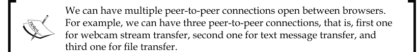

### 使用 PeerJS 的 WebRTC 应用

PeerJS 是一个客户端 JavaScript 库，提供了一个易于使用的 API 来处理 WebRTC。它仅提供用于在对等节点之间交换 `MediaStream` 和任意数据的 API。它没有提供处理 `MediaStream` 的 API。

#### PeerServer

PeerServer 是 PeerJS 提供的一个开源信令服务器，用于建立点对点连接。PeerServer 使用 Node.js 编写。如果你不想运行自己的 PeerServer 实例，可以使用 PeerServer 云服务，它为公共用途托管了 PeerServer。PeerServer 云服务允许你免费建立最多 50 个并发连接。

一个唯一的 ID 标识每个连接到 PeerServer 的节点。PeerServer 本身可以生成该 ID，或者节点也可以提供自己的 ID。节点要与另一个节点建立点对点连接，只需要知道对方的 ID 即可。

当你想要为 PeerServer 增加更多功能，或者想要支持超过 50 个并发连接时，可能希望运行自己的 PeerServer 实例。例如，如果你想检查用户是否登录了 PeerServer，那么你需要添加此功能并托管自己的 PeerServer。

在本章中，我们将使用 PeerServer 云服务，但在下一章中，我们将创建自己的 PeerServer 账户。因此，为了后续，请在 PeerServer 云上创建一个账户并获取 API 密钥。每个应用程序都会获得一个密钥来访问 PeerServer 云。如果你托管了自己的 PeerServer，则不需要密钥。PeerServer 云使用该密钥来跟踪应用程序建立的连接。要创建账户并获取密钥，请访问 http://peerjs.com/peerserver。

#### PeerJS API

让我们通过创建一个简单的应用来讨论 PeerJS API，该应用允许用户与其任何用户 ID 交换视频和文本消息。

在你的 Web 服务器上创建一个 `peerjs-demo` 目录，并在其中放置一个名为 `index.html` 的文件。

在 `index.html` 文件中，我们需要引入 PeerJS 库。从 http://peerjs.com/ 下载 PeerJS。在编写时，PeerJS 的最新版本是 0.3.14。我建议在后续的示例中使用此版本。`index.html` 文件中的起始代码如下：

```html
<!doctype html>
<html>
<head>
  <title>PeerJS Demo</title>
</head>
<body>
  <!-- Place HTML code here -->
  <script src="peer.min.js"></script>
  <script>
    // place JavaScript code here
  </script>
</body>
</html>
```

在这里，我引入了 PeerJS 的压缩版本。

PeerJS API 由三个主要的构造函数组成，如下：

- `Peer`：`Peer` 实例代表网络中的一个节点。节点连接到信令服务器和 STUN，可选情况下，还连接到 TURN。
- `DataConnection`：`DataConnection`（即 `DataConnection` 的实例）代表一个点对点连接，用于交换任意数据。从技术角度讲，它封装了 `RTCDataChannel`。
- `MediaConnection`：`MediaConnection`（即 `MediaConnection` 的实例）代表一个用于交换 `MediaStream` 的点对点连接。从技术角度讲，它封装了 `RTCPeerConnection`。

# 第3章 浏览器之间的实时通信

如果一个节点想要与另一个节点建立 `DataConnection` 或 `MediaConnection`，它需要知道对方的 ID。PeerJS 并没有给对方提供接受或拒绝 `DataConnection` 的选项。同样，在 `MediaConnection` 的情况下，PeerJS 也没有给对方提供接受或拒绝 `MediaConnection` 的选项，但 `MediaConnection` 在被另一个节点通过程序激活之前将处于非活动状态，以便可以传输 `MediaStream`，否则 `MediaStream` 将无法传输。因此，我们可以编写逻辑来让另一个用户接受或拒绝 `DataConnection` 或 `MediaConnection`，也就是说，一旦建立了 `DataConnection` 或 `MediaConnection`，我们就可以询问用户的意见来取消它。

目前，`MediaConnection` 只能传输一个 `MediaStream`。在 PeerJS 中，单个 `MediaConnection` 将支持 `MediaStream` 的传输。


现在，我们需要创建一个显示视频的 `<video>` 标签，一个用于连接到节点的按钮，以及一个发送消息的文本框。以下是显示所有内容的 HTML 代码：

```html
<video id="remoteVideo" autoplay></video>
<br>
<button onclick="connect()">Connect</button>
<br>
<input type="text" id="message">
<button onclick="send_message()">Send Message</button>
```

现在，当页面加载时，我们需要连接到 PeerServer 和 ICE 服务器，以便其他节点可以与我们通信，并且当用户点击连接按钮时，我们可以建立 `DataConnection` 和 `MediaConnection`。以下是相应的代码：

```javascript
var peer = null;
var myDataConnection = null;
var myMediaConnection = null;
var localStream = null;

window.addEventListener("load", function() {
  var id = prompt("Please enter an unique name");

  peer = new Peer(id, {key: 'your_api_key_here'});

  peer.on("open", function(id) {
    alert("Connected with " + id);
  });

  peer.on("error", function(err) {
    alert("Error: " + err.type);
  });

  peer.on("disconnected", function() {
    alert("Disconnected from signaling server");
  });

  peer.on("close", function() {
    alert("Connection closed");
  });

  peer.on("connection", function(dataConnection) {
    if (confirm(dataConnection.peer + " wants to connect. Do you want to accept?")) {
      acceptDataConnection(dataConnection);
    } else {
      dataConnection.close();
    }
  });

  peer.on("call", function(mediaConnection) {
    if (confirm(mediaConnection.peer + " is calling you. Do you want to answer?")) {
      acceptMediaConnection(mediaConnection);
    } else {
      mediaConnection.close();
    }
  });
});
```

- 在这里，`call` 和 `connection` 事件处理函数中，我们异步显示确认弹出框，以防止阻塞事件处理函数的执行，这在某些浏览器中会导致问题，即阻塞会导致 `DataConnection` 和 `MediaConnection` 无法建立。

现在，让我们来实现 `acceptDataConnection()` 和 `acceptMediaConnection()` 函数，以便当其他对端建立 `DataConnection` 或 `MediaConnection` 时，我们可以显示文本消息和远程 `MediaStream`。以下是我们的代码：

```javascript
navigator.getUserMedia = navigator.getUserMedia ||
  navigator.webkitGetUserMedia || navigator.mozGetUserMedia;

function acceptDataConnection(dataConnection) {
  myDataConnection = dataConnection;

  dataConnection.on("data", function(data) {
    alert("Message from " + dataConnection.peer + "\n" + data);
  });

  dataConnection.on("close", function() {
    alert("DataConnection closed");
  });

  dataConnection.on("error", function(err) {
    alert("Error occured on DataConnection. Error: " + err);
  });
}

function acceptMediaConnection(mediaConnection) {
  myMediaConnection = mediaConnection;

  mediaConnection.on("stream", function(remoteStream) {
    document.getElementById("remoteVideo").srcObject = remoteStream;
    document.getElementById("remoteVideo").play();
  });

  mediaConnection.on("close", function() {
    alert("MediaConnection closed");
  });

  mediaConnection.on("error", function(err) {
    alert("Error occured on MediaConnection: " + err);
  });

  navigator.getUserMedia({video: true, audio: true}, function(mediaStream) {
    localStream = mediaStream;
    mediaConnection.answer(mediaStream);
  }, function(e) {
    alert("Error with MediaStream: " + e);
  });
}
```

这是我们的代码：

- 在 `acceptDataConnection()` 函数中，我们为 `DataConnection` 附加了三个事件处理程序。当其他对端向我们发送数据时，触发 `data` 事件。当另一个 `DataConnection` 关闭时，会触发 `close` 事件。最后，当 `DataConnection` 发生错误时，会触发 `error` 事件。我们可以使用 `dataConnection.close()` 方法手动关闭 `DataConnection`。
- 在 `acceptMediaConnection()` 函数中，我们附加了三个事件处理程序并将我们的 `MediaStream` 传输给另一个对端。当其他对端向我们发送 `MediaStream` 时，触发 `stream` 事件。当 `MediaConnection` 关闭时，会触发 `close` 事件。最后，我们通过传递我们的 `MediaStream` 使用 `mediaConnection.answer()` 方法来激活 `MediaConnection`。在 `MediaConnection` 激活后，将触发 `stream` 事件。

我们已经完成了处理另一个对端建立的 `MediaConnection` 或 `DataConnection` 的代码工作。现在我们需要编写代码，在用户点击连接按钮时创建 `MediaConnection` 和 `DataConnection`。以下是代码：

```javascript
function connect() {
  var peerId = prompt("Enter the peer ID to connect to:");
  if (!peerId) return;

  // 建立 DataConnection
  myDataConnection = peer.connect(peerId);
  myDataConnection.on("open", function() {
    console.log("DataConnection opened");
  });
  myDataConnection.on("error", function(err) {
    alert("DataConnection error: " + err);
  });

  // 建立 MediaConnection
  if (localStream) {
    myMediaConnection = peer.call(peerId, localStream);
    myMediaConnection.on("stream", function(remoteStream) {
      document.getElementById("remoteVideo").srcObject = remoteStream;
      document.getElementById("remoteVideo").play();
    });
    myMediaConnection.on("error", function(err) {
      alert("MediaConnection error: " + err);
    });
  } else {
    alert("Local stream not available yet.");
  }
}

function send_message() {
  var msg = document.getElementById("message").value;
  if (myDataConnection && myDataConnection.open) {
    myDataConnection.send(msg);
  } else {
    alert("DataConnection not open");
  }
}
```


```javascript
function connect() {
  var id = prompt("Please enter other peer ID*");
  establishDataConnection(id);
  establishMediaConnection(id);
}

function establishDataConnection(id) {
  var dataConnection = peer.connect(id, {reliable: true, ordered: true});
  myDataConnection = dataConnection;

  dataConnection.on("open", function() {
    alert("DataConnection Establecida");
  });

  dataConnection.on("data", function(data) {
    alert("Message from " + dataConnection.peer + "\n" + data);
  });

  dataConnection.on("close", function(data) {
    alert("DataConnection closed");
  });

  dataConnection.on("error", function(err) {
    alert("Error occured on DataConnection. Error: " + err);
  });
}

function establishMediaConnection(id) {
  var mediaConnection = null;

  navigator.getUserMedia({video: true, audio: true},
  function(mediaStream) {
    mediaConnection = peer.call(id, mediaStream);
    myDataConnection = mediaConnection;

    mediaConnection.on("stream", function(remoteStream) {
      document.getElementById("remoteVideo").setAttribute("src",
      URL.createObjectURL(remoteStream));
      document.getElementById("remoteVideo").play();
    });

    mediaConnection.on("error", function(err) {
      alert("Error occured on MediaConnection: " + err);
    })

    mediaConnection.on("close", function(data) {
      alert("MediaConnection closed");
    })
  })
}
```

### 第 3 章

```javascript
function(e) { alert("Error with MediaStream: " + e); }
```

以下是工作原理：

- 在 `acceptConnection()` 函数中，我们为 `DataConnection` 附加了三个事件处理程序。当其他对端向我们发送数据时，触发 `data` 事件。当另一个 `DataConnection` 关闭时，会触发 `close` 事件。最后，当 `DataConnection` 发生错误时，会触发 `error` 事件。我们可以使用 `dataConnection.close()` 方法手动关闭 `DataConnection`。

- 在 `acceptMediaConnection()` 函数中，我们附加了三个事件处理程序并将我们的 `MediaStream` 传输给另一个对端。当其他对端向我们发送 `MediaStream` 时，触发 `stream` 事件。当 `MediaConnection` 关闭时，会触发 `close` 事件。最后，我们通过传递我们的 `MediaStream` 使用 `mediaConnection.answer()` 方法来激活 `MediaConnection`。在 `MediaConnection` 激活后，将触发 `stream` 事件。

我们已经完成了处理另一个对端建立的 `MediaConnection` 或 `DataConnection` 的代码工作。现在我们需要编写代码，在用户点击连接按钮时创建 `MediaConnection` 和 `DataConnection`。

## 总结

在本章中，我们通过创建一个简单的应用程序讨论了 WebRTC 和 PeerJS 的基础知识。我们讨论了 WebRTC 用于实现实时点对点通信和读取物理媒体源流的各种协议、技术和其他技术。我们还查看了 `PeerServer` 的概览。现在，你应该已经熟练地掌握了如何使用 `PeerServer` 云端构建任何类型的 WebRTC 应用程序。

在下一章中，我们将使用自定义的 `PeerServer` 构建一个高级的 WebRTC 应用。

# 构建一个聊天室 (Chatroulette)

掌握 `MediaStream` `PeerJS` 的最佳方法是构建真实世界的应用程序，这正是我们在本章要做的。聊天室是一个将随机访问者配对并进行网络摄像头和基于文本的对话的网站。讨论如何构建聊天室将帮助我们深入学习 `PeerJS` 和 `PeerServer`，因为我们需要将 `PeerServer` 与 `Express` 集成。我们还为网站添加了媒体控制功能，以便暂停/恢复本地的 `MediaStream`，并允许用户选择他们所需的麦克风/摄像头，这将帮助我们更深入地研究 `MediaStream`。我们将实际上创建一个只允许特定国家的用户聊天的聊天室，这在连接到 `PeerServer` 之前需要一个额外的验证步骤；因此，这将带我们更深入地将 `PeerServer` 集成 `Express`。

在本章中，我们将涵盖以下主题：

- 运行你自己的 `PeerServer` 实例
- 创建自定义的 `PeerServer`
- 将 `PeerServer` 与 `Express` 集成
- 验证连接到 `PeerServer` 的用户
- 查找连接到服务器的用户的 IP 地址和所在国家
- 允许用户直接在网页上使用麦克风和摄像头
- 讨论构建一个完全运行的聊天室所需的

## 创建你自己的 PeerServer

在开始构建聊天室之前，让我们看看如何运行自己的 `PeerServer` 实例。

`PeerServer` 可以作为 npm 包在 npm 云端可用。让我们创建一个自定义的 `PeerServer` 并将其与我们在上一章构建的 `PeerJS` 应用程序配合。

首先创建一个名为 `Custom-PeerServer` 的目录，并将 `app.js` 和 `package.json` 文件放入其中。

在 `package.json` 文件中放入以下代码并运行 `npm install` 命令下载 `PeerServer`：

```json
{
  "name": "Custom-PeerServer",
  "dependencies": {
    "peer": "0.2.8",
    "express": "4.13.3"
  }
}
```

在编写时，`PeerServer` 的最新版本是 0.2.8。在这里，我们还将下载 `express` 包，因为我们需要演示如何将 `PeerServer` 与 `Express` 集成。

`PeerServer` 包提供了一个用于创建自定义 `PeerServer` 或将 `PeerServer` 与 `Express` 集成的库，还提供了一个可执行文件，无需任何自定义即可直接创建我们自己的 `PeerServer` 实例。

## 从 shell 运行 PeerServer

如果你想直接从 shell 运行无需自定义的自己 `PeerServer` 实例，请在 `Custom-PeerServer/node_modules/peerjs/bin` 目录下运行以下命令：

```bash
./peerjs -port 8080
```

它现在应该打印出以下命令：

```
Started PeerServer on :, port: 8080, path: / (v. 0.2.8)
```

这确认 `PeerServer` 正在运行。要测试 `PeerServer` 实例是否正常，请进入上一章创建的应用程序的 `index.html` 文件并替换以下代码：

```javascript
peer = new Peer(id, {key: ""});
```

前面的代码将被替换为以下代码：

```javascript
peer = new Peer(id, {host: "localhost", port: 8080});
```

现在运行应用程序，它应该像往常一样工作。

## 使用 PeerServer 库

`PeerServer` 库用于创建自定义 `PeerServer`。`PeerServer` 库还允许我们将 `PeerServer` 与 `Express` 服务器集成。

## 创建自定义 PeerServer

我们使用 `PeerServer` 库来创建自定义 `PeerServer`。`PeerServer` 库也允许我们将 `PeerServer` 与 `Express` 服务器集成。

这里有一个演示如何创建自定义 `PeerServer` 或将 `PeerServer` 与 `Express` 集成的示例：

```javascript
var PeerServer = require("peer");
var server = app.listen(8080);

PeerServer(server, {
  debug: true
});

PeerServer.on("connection", function(id) {
  console.log(id + " * connected");
});

PeerServer.on("disconnect", function(id) {
  console.log(id + " * disconnected");
});
```

## 将 PeerServer 与 Express 集成

我们使用 `PeerServer` 库来创建自定义 `PeerServer`。`PeerServer` 库还允许我们将 `PeerServer` 与 `Express` 服务器集成。

这里有一个演示如何创建自定义 `PeerServer` 或将 `PeerServer` 与 `Express` 集成的示例：

```javascript
var express = require("express");
var app = express();

var server = app.listen(8080);

app.use("/signaling", function(httpRequest, httpResponse, next) {
  // 检查是否允许连接到 PeerServer
  next();
});

var ExpressServer = require("peer").ExpressServer(server, {
  debug: true
});

app.use("/signaling", ExpressServer);

ExpressServer.on("connection", function(id) {
  console.log(id + " * connected");
});

ExpressServer.on("disconnect", function(id) {
  console.log(id + " * disconnected");
});
```

## 构建后端

我们的网站基本上将包含三个 URL 端点：用于提供主页的根路径、用于查找聊天空闲用户 ID 的 `/find` 路径，最后作为 `PeerServer` 端点的 `/signaling` 路径。

每个用户都将有一个由 `PeerServer` 生成的唯一 ID。如果用户想通过 `/find` URL 获取另一个空闲用户的 ID，他们必须先连接到 `PeerServer`。

服务器将维护两个不同的数组，第一个数组包含连接到 `PeerServer` 的用户 ID，第二个数组包含需要聊天伴侣的用户 ID。

让我们开始构建后端吧。将以下代码放在 `app.js` 中，以创建我们的 Web 服务器并提供网站的主页：

```javascript
var express = require("express");
var app = express();

app.use(express.static(__dirname + "/public"));

app.get("/", function(httpRequest, httpResponse) {
  httpResponse.sendFile(__dirname + "/public/html/index.html");
});

var server = app.listen(8080);
```

在这里我们将 `index.html` 文件作为我们的主页提供。我假设你正在运行 `node app.js` 命令来启动服务器。当你在 localhost 上运行 node.js 时，在浏览器中打开 `http://localhost:8080/` URL 来查看主页。主页应该与下面的图片相似：

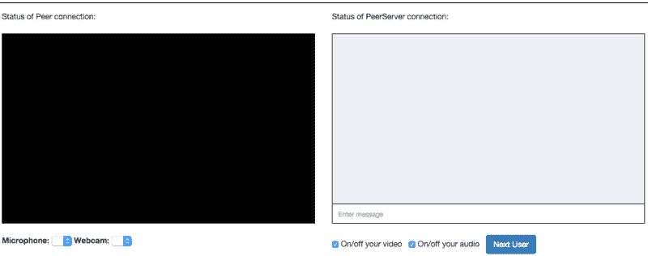

# 第 4 章

以下是主页的不同元素：

- 在主页顶部，我们将显示 `PeerServer` 连接、`DataConnection` 和 `MediaConnection` 的状态。
- 接着我们将显示一个视频元素和一个消息框。远程对等的 `MediaStream` 将渲染在视频元素上。
- 随后我们有一个下拉框，让用户在连接到电脑的多个麦克风或摄像头之间进行选择。
- 然后我们有复选框允许用户暂停或恢复音频和视频。
- 最后，我们有一个按钮允许用户断开连接并与其他用户聊天。

页面上的每个交互元素都关联有一个 ID。在编写网站前端时，我们将使用这些 ID 来获取引用。

现在让我们创建我们的信令服务器。以下是它的代码。将其放在 `app.js` 文件中：

```javascript
var requestIp = require("request-ip");
var geoip = require("geoip-lite");

app.use("/signaling", function(httpRequest, httpResponse, next) {
  var clientIp = requestIp.getClientIp(httpRequest);
  var geo = geoip.lookup(clientIp);

  if(geo != null) {
    if(geo.country == "IN") {
      next();
    } else {
      httpResponse.end();
    }
  } else {
    next();
  }
});
```

## 构建聊天匹配器

```javascript
var ExpressPeerServer = require("peer").PeerServer(server);

app.use("/signaling", ExpressPeerServer);

var connected_users = [];

ExpressPeerServer.on("connection", function(id) {
  var idx = connected_users.indexOf(id);
  if (idx === -1) { // 如果不在数组中则添加
    connected_users.push(id);
  }
});

ExpressPeerServer.on("disconnect", function(id) {
  var idx = connected_users.indexOf(id);
  if (idx !== -1) {
    connected_users.splice(idx, 1);
  }

  idx = waiting_peers.indexOf(id);
  if (idx !== -1) {
    waiting_peers.splice(idx, 1);
  }
});
```

以下是代码的工作原理：

- 在用户连接到 `PeerServer` 之前，我们将查找其 IP 地址所属的国家。我们将使用 `request-ip` 模块查找 IP 地址，并使用 `geoip-lite` 模块解析国家。如果国家为 IN 或无法解析国家名称，我们将通过触发 `next` 中间件允许用户连接到 `PeerServer`，否则我们将发送空响应来停止。
- 当用户连接到 `PeerServer` 时，我们将用户的 ID 添加到 `connected_users` 数组中，该数组维护了连接到 `PeerServer` 的用户列表。同样，当用户从 `PeerServer` 断开连接时，我们将从 `connected_users` 数组中移除该用户。

现在让我们定义 `/find` 路径，用户可以通过该路径找到另一个空闲的用户。以下是该代码。将此代码放在 `app.js` 文件中：

```javascript
var waiting_peers = [];

app.get("/find", function(httpRequest, httpResponse, next) {
  var id = httpRequest.query.id;

  if (connected_users.indexOf(id) !== -1) {
    var idx = waiting_peers.indexOf(id);
    if (idx === -1) {
      waiting_peers.push(id);
    }

    if (waiting_peers.length > 1) {
      waiting_peers.splice(idx, 1);
      var user_found = waiting_peers[0];
      waiting_peers.splice(0, 1);
      httpResponse.send(user_found);
    }
  } else {
    httpResponse.status(404).send("Not found");
  }
});
```

这是代码的工作原理：

- `waiting_users` 数组持有空闲寻找聊天伴侣的用户 ID。
- 当用户向 `/find` 路径发送请求时，路由处理器首先通过检查 `connected_users` 数组中是否存在用户 ID 来检查用户是否连接到 `PeerServer`。
- 如果用户未连接到 `PeerServer`，它将发送 HTTP 404 错误。
- 如果用户已连接到 `PeerServer`，它会检查用户 ID 是否在 `waiting_list` 数组中。如果不在，将其添加到数组并继续。
- 现在检查 `waiting_list` 数组中是否存在其他用户，如果是，则发送第一个用户 ID 并从 `waiting_list` 中移除。

## 构建前端

首先，一旦主页加载，我们需要找到连接到电脑的麦克风和摄像头并列出它们，以便用户可以选择设备。以下是实现此操作的代码。将此代码放在 `main.js` 文件中：

```javascript
window.addEventListener("load", function() {
  var audioCount = 1;
  var videoCount = 1;

  for (var count = 0; count < devices.length; count++) {
    if (devices[count].kind == "audio") {
      var name = "";

      if (devices[count].label == "") {
        name = "Microphone " + audioCount;
        audioCount++;
      } else {
        name = devices[count].label;
      }

      document.getElementById("audioInput").innerHTML = document.getElementById("audioInput").innerHTML + "<option value='" + devices[count].id + "'>" + name + "</option>";
    } else if (devices[count].kind == "video") {
      var name = "";

      if (devices[count].label == "") {
        name = "Webcam " + videoCount;
        videoCount++;
      } else {
        name = devices[count].label;
      }

      document.getElementById("videoInput").innerHTML = document.getElementById("videoInput").innerHTML += "<option value='" + devices[count].id + "'>" + name + "</option>";
    }
  }
});
```

在这里我们使用 `MediaStream.getSources` 获取音频和视频输入设备并填充 `<select>` 标签，以便用户可以选择选项。

在主页加载后，我们还需要创建一个 `Peer` 实例。以下是实现此操作的代码。将此代码放在 `main.js` 文件中：

```javascript
var peer = null;
var dc = null;
var mc = null;
var ms = null;
var rms = null;

window.addEventListener("load", function() {
  peer = new Peer({host: "localhost", port: 8080, path: "/signaling", debug: true});
});

peer.on("disconnected", function() {
  var interval = setInterval(function() {
    if (peer.open == true || peer.destroyed == true) {
      clearInterval(interval);
    }
  }, 1000);
  peer.reconnect();
}, 4000);

peer.on("connection", function(dataConnection) {
  if(dc == null || dc.open == false) {
    dc = dataConnection;
    dc.on("data", function(data) {
      document.getElementById("messages").innerHTML = 
      document.getElementById("messages").innerHTML + "<li><span='right'>" + data + "</span><div class='clear'></div></li> ";
      document.getElementById("messages").scrollTop = 
      document.getElementById("messages-container").scrollHeight;
    });
    dc.on("close", function() {
      document.getElementById("messages").innerHTML = "";
    });
  } else {
    dataConnection.close();
  }
});

peer.on("call", function(mediaConnection) {
  if(mc == null || mc.open == false) {
    mc = mediaConnection;
    navigator.getUserMedia = navigator.getUserMedia ||
    navigator.webkitGetUserMedia || navigator.mozGetUserMedia;
    navigator.getUserMedia({video: true, audio: true},
    function(mediaStream) {
      ms = mediaStream;
      mc.answer(mediaStream);
      mc.on("stream", function(remoteStream) {
        rms = remoteStream;
        document.getElementById("peerVideo").setAttribute("src",
        URL.createObjectURL(remoteStream));
        document.getElementById("peerVideo").play();
      });
    }, function(e){ alert("An error occured while retrieving webcam and microphone stream"); });
  } else {
    mediaConnection.close();
  }
});
```

以下是代码的工作原理：

- 我们声明了五个全局变量。`peer` 将存储 `Peer` 实例的引用，`dc` 将存储 `DataConnection` 的引用，`mc` 将存储 `MediaConnection` 的引用，`ms` 将存储本地 `MediaStream` 的引用，`rms` 将存储远程 `MediaStream` 的引用。
- 然后，一旦页面加载完成，我们就连接到 `PeerServer`，创建一个 `Peer` 实例，并为断开（`disconnected`）、连接（`connection`）和通话（`call`）事件绑定事件处理程序。
- 接着，我们确保如果由于某种原因 `peer` 从 `PeerServer` 断开，它会自动尝试重新连接 `PeerServer`。
- 如果另一个 peer 与我们建立 `DataConnection`，只有在当前没有建立其他 `DataConnection` 的情况下我们才会接受，否则我们将拒绝。在接受 `DataConnection` 后，我们绑定了数据（`data`）和关闭（`close`）事件的处理程序，用于在聊天框中打印传入的消息，并在 `DataConnection` 关闭时清除聊天框中的所有消息。
- 同样，如果另一个 peer 与我们建立 `MediaConnection`，只有在当前没有建立其他 `MediaConnection` 的情况下我们才会接受，否则我们将拒绝。接受 `MediaConnection` 后，我们将绑定流（`stream`）事件的处理程序，这样当远程 `MediaStream` 到达时，我们可以显示它。

在前面的代码中，我们正在等待另一个 peer 与我们建立 `DataConnection` 和 `MediaConnection`。

## 构建聊天匹配

现在让我们写一段代码来寻找一个空闲 peer 并与它建立 `DataConnection` 和 `MediaConnection`。以下是该代码。将此代码放在 `main.js` 文件中：

```javascript
function ajaxRequestObject() {
  var request;
  if (window.XMLHttpRequest) {
    request = new XMLHttpRequest();
  } else if (window.ActiveXObject) {
    try {
      request = new ActiveXObject('Msxml2.XMLHTTP');
    } catch (e) {
      request = new ActiveXObject('Microsoft.XMLHTTP');
    }
  }
  return request;
}

function connectNextPeer() {
  var request = ajaxRequestObject();
  var url = "find?id=" + peer.id;
  request.open("GET", url);
  request.addEventListener("load", function() {
    if (request.readyState === 4) {
      if (request.status === 200) {
        dc = peer.connect(request.responseText, {reliable: true, ordered: true});
        dc.on("data", function(data) {
          document.getElementById("messages").innerHTML = document.getElementById("messages").innerHTML +
          "<li><span='right'>" + data + "</span><div class='clear'></div></li>";
          document.getElementById("messages-container").scrollTop =
          document.getElementById("messages-container").scrollHeight;
        });

        dc.on("close", function () {
          document.getElementById("messages").innerHTML = "";
        });

        navigator.getUserMedia = navigator.getUserMedia ||
        navigator.webkitGetUserMedia || navigator.mozGetUserMedia;
        var audioInput = document.getElementById("audioInput").options[document.getElementById("audioInput").selectedIndex].value;
        var videoInput = document.getElementById("videoInput").options[document.getElementById("videoInput").selectedIndex].value;

        navigator.getUserMedia({video: {mandatory: {sourceId: videoInput}}, audio: {mandatory: {sourceId: audioInput}}}, function (mediaStream) {
          ms = mediaStream;

          if (document.getElementById("audioToggle").checked) {
            var tracks = ms.getAudioTracks();
            tracks[0].enabled = true;
          } else {
            var tracks = ms.getAudioTracks();
            tracks[0].enabled = false;
          }

          if (document.getElementById("videoToggle").checked) {
            var tracks = ms.getVideoTracks();
            tracks[0].enabled = true;
          } else {
            var tracks = ms.getVideoTracks();
            tracks[0].enabled = false;
          }

          mc = peer.call(request.responseText, ms);

          mc.on("stream", function(remoteStream) {
            rms = remoteStream;
            document.getElementById("peerVideo").setAttribute("src", URL.createObjectURL(remoteStream));
            document.getElementById("peerVideo").play();
          });
        }, function(e) { alert("An error occured retrieving webcam and microphone stream"); });
      }
    }
  }, false);
  request.send(null);
}

function communication() {
  if (peer != null && peer.disconnected == false && peer.destroyed == false) {
    if (dc == null || mc == null || dc.open == false || mc.open == false) {
      connectNextPeer();
    }
  }
}
```

这段代码很长，但很容易理解。以下是代码的工作原理：

- 首先，我们定义了 `ajaxRequestObject()` 函数，它仅返回一个 AJAX 对象，通过创建 AJAX 对象来隐藏浏览器差异。
- 然后，我们定义了 `connectNextPeer()` 方法，它从 `/find` 路径请求空闲 ID，如果找到了，就会与该 peer 建立 `DataConnection` 和 `MediaConnection`。它绑定的必要事件处理程序与之前的代码相同。
- 在获取 `MediaStream` 时，它使用用户在下拉列表中选择的设备。
- 在调用之前，它根据复选框是否勾选将 `enabled` 属性设置为 true 或 false。
- 最后，我们设置了一个定时器，如果 peer 连接到 `PeerServer` 且尚未建立 `MediaConnection` 和 `DataConnection`，则每四秒调用一次 `connectNextPeer()`。

现在我们需要编写代码，当用户在聊天框的文本输入字段中使用回车键时，将消息发送给连接的 peer。以下是实现该功能的代码。将此代码放入 `main.js`：

```javascript
document.getElementById("message-inputbox").addEventListener("keypress", function() {
  if (dc != null && dc.open == true) {
    var key = window.event.keyCode;
    if (key == 13) {
      var message = document.getElementById("message-input-box").value;
      document.getElementById("message-input-box").value = "";
      dc.send(message);
      document.getElementById("messages").innerHTML = document.getElementById("messages").innerHTML + "<li><span='left'>" + message + "</span><div class='clear'></div></li>";
      document.getElementById("messages-container").scrollTop = document.getElementById("messages-container").scrollHeight;
    }
  } else {
    return;
  }
});
```

在这里，我们首先检查是否建立了 `DataConnection`。如果当前已建立了 `DataConnection`，我们将向连接的 peer 发送消息并在聊天框中显示该消息。

现在我们需要编写代码，当用户切换复选框时暂停或恢复音频和视频。以下是实现此功能的代码。将此代码放在 `main.js` 文件中：

```javascript
document.getElementById("videoToggle").addEventListener("click", function() {
  if (ms != null) {
    var tracks = ms.getVideoTracks();
    if (document.getElementById("videoToggle").checked) {
      tracks[0].enabled = true;
    } else {
      tracks[0].enabled = false;
    }
  }
});

document.getElementById("audioToggle").addEventListener("click", function() {
  if (ms != null) {
    var tracks = ms.getAudioTracks();
    if (document.getElementById("audioToggle").checked) {
      tracks[0].enabled = true;
    } else {
      tracks[0].enabled = false;
    }
  }
});
```

在这里，我们通过为 tracks 的 `enabled` 属性赋值 true 或 false 来实现功能。

当用户点击下一个用户（Next User）按钮时，我们需要关闭 `MediaConnection` 和 `DataConnection` 并寻找另一个用户进行聊天。以下是实现此功能的代码。将此代码放在 `main.js` 文件中：

```javascript
document.getElementById("next").addEventListener("click", function() {
  if (mc != null) {
    mc.close();
  }
  if (dc != null) {
    dc.close();
  }
  connectNextPeer();
});
```

如果当前建立了任何 `MediaConnection` 或 `DataConnection`，我们将关闭它们。然后，我们将调用 `connectNextPeer()` 方法来建立 `MediaConnection` 和 `DataConnection`。

现在我们需要显示对点连接（peer-to-peer connection）和 `PeerServer` 连接的状态。以下是在 `main.js` 文件中实现此功能的代码：

```javascript
setInterval(function() {
  if (dc == null || mc == null || dc.open == false || mc.open == false) {
    document.getElementById("peerStatus").innerHTML = "Waiting for free peer";
  } else {
    document.getElementById("peerStatus").innerHTML = "Connected to a peer";
  }

  if (peer != null && peer.disconnected == false && peer.destroyed == false) {
    document.getElementById("peerServerStatus").innerHTML = "Connected to PeerServer";
  } else {
    document.getElementById("peerServerStatus").innerHTML = "Not connected to PeerServer";
  }
}, 4000);
```

在这里，我们每 4 秒检查并更新一次状态。

## 测试网站

要测试我们刚刚创建的聊天室，首先确保服务器正在运行，然后在两个不同的标签页、浏览器或设备中打开 `http://localhost:8080/` URL。

现在你将看到它们都自动连接上，并能够互相聊天。

## 总结

在本章中，我们学习了如何使用自己的 `PeerServer` 实例来构建一个聊天室。我们构建的网站几乎包含了聊天室应该具备的所有功能。你现在可以添加许多功能，例如：屏幕共享、连接特定性别的用户、连接特定年龄的用户、集成验证码以防止垃圾信息以及你选择的其他任何功能。

在编写时，WebRTC 团队正在开发一种 API，允许你从屏幕获取流以进行屏幕共享。由于该 API 仍在开发中，你可以使用浏览器插件从屏幕获取流。你可以在 `https://www.webrtcexperiment.com/Pluginfree-Screen-Sharing` 找到更多关于使用插件获取流的信息。

在下一章中，我们将讨论如何使用 WebSockets 实现客户端与服务器之间的实时双向通信。

# 实时双向通信

我们一直在使用 Comet 技术来实现 Web 浏览器与 Web 服务器之间的双向通信。长轮询（Long polling）是实现浏览器与服务器间双向通信最流行的技术，因为它在不损害用户体验且不需要任何额外服务器配置的情况下工作，并适用于支持 AJAX 的所有浏览器。长轮询和其他 Comet 技术的问题是，它们都不适用于构建实时应用，因为大量的头部信息和 Cookie 数据会被传输到服务器，这反过来增加了延迟；因此不适合创建如多人游戏、聊天应用、社交开发和实时比分网站等需要实时双向通信的应用程序。因此，人们引入了一种新协议 WebSocket，它设计用于实现浏览器与 WebSocket 服务器之间的实时双向通信。

在本章中，我们将涵盖以下内容：

- WebSocket 概述
- WebSocket 与 HTTP 的关系
- WebSocket 与代理服务器和防火墙的交互
- 使用 Socket.IO 实现 WebSocket
- 深入研究 Socket.IO API
- 其他许多与 WebSocket 和 Socket.IO 相关的重要事项

## 介绍 WebSocket

WebSocket 是一种应用层协议，旨在实现 Web 浏览器与 WebSocket 服务器之间实时的双向（客户端或服务器可以在有消息时随时向对方发送消息）和全双工通信（客户端和服务器可以同时向对方发送消息）。

WebSocket 是一种二进制协议；因此它比基于文本的 HTTP 协议更快。

WebSocket 已经获得普及，并因其实时和全双工特性被许多网站使用。由于 Comet 技术带来的开销，它不适用于实时双向消息传输，而且无法通过 Comet 在浏览器与 Web 服务器之间建立全双工通信系统。也就是说，Comet 让我们只能实现半双工通信系统（一次只有一个客户端或服务器向对方发送消息）。

WebSocket 的设计旨在方便 Web 浏览器与 WebSocket 服务器之间的双向通信，但它可以被任何客户端使用。在本章中，我们仅关注它如何在 Web 浏览器中实现。

> **什么是 WebSocket API？**
> Web 浏览器提供了一个 API，用于创建和管理到 WebSocket 服务器的连接，以及在连接上发送和接收数据。我们不会使用此 API 来实现 WebSocket；相反，我们将使用 Socket.IO 库。

## WebSocket 与 HTTP 的关系

WebSocket 与 HTTP 之间唯一的关系是：Web 浏览器与 WebSocket 服务器之间的 WebSocket 握手是通过 HTTP 完成的。因此，WebSocket 服务器也是一个 HTTP 服务器。一旦握手成功，将使用同一个 TCP 连接进行 WebSocket 通信，该连接切换到不符合 HTTP 协议的双向二进制协议。WebSocket 的默认端口是 80，与 HTTP 相同。

# 第 5 章

> **为什么 WebSocket 的默认端口是 80？**
> 将 HTTP 和 WebSocket 如此紧密集成并让 WebSocket 共享 HTTP 端口的主要原因是防止防火墙拦截非 Web 内容。

尽管在浏览器环境之外使用 WebSocket 时可以实现自己的 WebSocket 握手机制，但官方 WebSocket 文档仅说明了 HTTP 握手机制，因为 WebSocket 设计用于启用 Web 浏览器与 WebSocket 服务器之间的双向通信。

你可以将 WebSocket 服务器集成到提供 HTML 页面的主 Web 服务器中，也可以使用独立的 Web 服务器进行 WebSocket 通信。

## 在 WebSocket 连接上发送和接收数据

数据通过 WebSocket 连接以消息的形式传输，每条消息由一个或多个包含你所发送的数据（称为负载 payload）的帧组成。为了确保消息在到达对方时可以被正确重构，每个帧的前面都带有 4-12 字节关于负载的数据。使用这种基于帧的消息系统有助于减少传输的非负载数据量，从而显著降低延迟，因此使构建实时组件成为可能。

我们不会深入探讨 WebSocket 握手、数据帧定和接收数据的具体数据格式和其他细节，因为只有在你计划创建自己的 WebSocket 服务器时才需要这些内容。我们将使用 Socket.IO JavaScript 库在应用程序中实现 WebSocket，它会处理 WebSocket 的所有内部细节并提供易于使用的 API。

## WebSocket 方案

WebSocket 协议规范引入了两种新的 URL 方案，称为 `ws` 和 `wss`。

`ws` 表示未加密连接，而 `wss` 表示加密连接。加密连接使用 TLS 来加密消息。

因此，当使用 HTTP 进行 WebSocket 握手请求时，我们需要分别使用 `ws` 代替 `http` 或 `https`。

## Socket.IO 简介

Socket.IO 是客户端库和 Node.js 的结合，用于实现浏览器与 Node.js 之间的双向通信。

Socket.IO 客户端库与 Node 库用于创建 Socket.IO 服务器。Socket.IO 客户端和服务器可以双向通信。Socket.IO 主要使用 WebSocket 来实现双向通信。

使用 Socket.IO 客户端库而不是 WebSocket API 的原因是，在编写时 WebSocket 是一种相对新的协议，且并非所有浏览器都支持。如果 Socket.IO 发现浏览器不支持 WebSocket，它会跳转到其他机制（如 Flash sockets、长轮询、多部分流、iframe 或 JSONP）来实现浏览器与服务器之间的通信。我们可以，Socket.IO 在每个浏览器上都能正常工作。Socket.IO 后端提供了创建命名空间、广播消息等 API，这在某些情况下非常有用。因此，Socket.IO 是浏览器与 Node.js 服务器通信的最佳方式。

## 设置项目

在开始学习 Socket.IO API 之前，让我们先设置项目目录和文件。创建一个名为 `SocketIO-Example` 的目录。在目录中创建文件 `package.json`、`app.js` 和 `socket.js`，以及一个 `public` 目录。在 `public` 目录中创建两个目录 `html` 和 `js`。在 `html` 目录中创建一个 `index.html` 文件。最后，在 `js` 目录中从 `https://cdn.socket.io/socket.io-1.3.7` 下载并放置 Socket.IO 库。在编写时，Socket.IO 的最新版本是 1.3.7；因此我们将使用该版本。

在 `app.js` 文件中编写 Web 服务器代码，在 `socket.js` 文件中编写 Socket.IO 代码。在 `package.json` 文件中放置以下代码：

```json
{
  "name": "SocketIO-Example",
  "dependencies": {
    "express": "4.13.3",
    "socket.io": "1.3.7"
  }
}
```

在 `app.js` 文件中编写 Web 服务器代码，在 `socket.js` 文件中编写 Socket.IO 代码。在 `index.html` 文件中放置以下代码：

```html
<!DOCTYPE html>
<html>
<head>
  <title>SocketIO-Example</title>
</head>
<body>
  <script src="js/socket.io-1.3.7.js"></script>
  <script>
    // ...
  </script>
</body>
</html>
```

```javascript
var express = require("express");
var app = express();

var http = require("http").Server(app);
var io = require("socket.io")(http);

app.use(express.static("public"));

app.get("/", function (req, res) {
  res.sendFile(__dirname + "/public/html/index.html");
});

io.on("connection", function (socket) {
  socket.send("Hi, from server");
});

http.listen(8080);
```

## 第 5 章

现在，我们已经完成了一个非常简单的 Socket.IO 服务器，它可以允许 Socket.IO 客户端与其建立连接。它还会监听消息事件和自定义事件。此外，一旦 Socket.IO 客户端连接成功，它会立即发送消息并触发一个自定义事件。

> 由于每个 Socket.IO 客户端在 Socket.IO 服务器上都会获得一个独立的 socket 对象，如果我们想让一个 socket 对象能够访问另一个 Socket.IO 客户端的 socket 对象，我们可以在全局数组中保留每个 Socket.IO 客户端 socket 对象的引用。如果我们正在创建一个 socket 对象需要访问另一个 socket 对象来发送消息的应用，这将会非常有用。

现在你可以使用 `node socket.js` 命令来运行 Socket.IO 服务器了。

现在，我们来构建 Socket.IO 客户端。以下是创建 Socket.IO 客户端并与 Socket.IO 服务器建立连接的代码。请将此代码放在 `index.html` 文件的 `<script>` 标签中：

```javascript
var socket = io("http://localhost:3000", {path: "/websocket"});
```

在这里，我们正在使用 `io` 构造函数创建一个 Socket.IO 客户端实例，并与 Socket.IO 服务器建立连接。第一个参数是 Socket.IO 服务器的基础 URL。第二个参数是一个可选对象，我们在其中传递了握手请求应该发送的 URL 路径。如果不传递路径，默认路径将是 `/socket.io`。

我们在这里创建了一个的 Socket.IO 客户端实例，但如果我们想连接到多个 Socket.IO 服务器，也可以创建多个 Socket.IO 客户端实例。

我们使用的是 `ws` 方案中的 `http` ，这是因为 Socket.IO 可以使用 WebSocket 外的任何技术或协议来实现双向通信。如果 Socket.IO 选择使用 WebSocket，它会将其替换为 `ws`。

让我们写一些代码，在 Socket.IO 连接建立后在 Socket.IO 客户端执行某些操作。请将此代码放在 `index.html` 文件的 `<script>` 标签中：

```javascript
socket.on("connect", function () {
  socket.send("Hi, from client");
  socket.on("message", function (msg) {
    console.log(msg);
  });

  socket.on("disconnect", function() {
    console.log("I am disconnected");
  });

  socket.on("custom-event", function (parameter1, parameter2) {
    console.log(parameter1, parameter2);
  });

  socket.emit("custom-event", "parameter1", "parameter2");
});
```

让我们理解这段代码是如何运行的，以及 `send()`、`on()` 和 `emit()` 方法的作用：

- `socket` 对象的 `on()` 方法用于为 Socket.IO 客户端自身触发的事件绑定事件处理器。
- 我们为 `connect` 事件绑定了事件处理器。一旦 Socket.IO 连接建立，`connect` 事件就会被触发。
- `socket` 对象的 `send()` 方法用于向 Socket.IO 服务器发送消息。我们在这里发送的是一个字符串，但你也可以发送其他内容。
- `emit()` 方法用于向服务器发送自定义事件。

## 引用所有连接的 Socket.IO 客户端

Socket.IO 服务器 API 为我们提供了一种向命名空间中的所有人发送消息或自定义事件的方法。

让我们来看一个如何操作的示例。将以下代码放入 `socket.js` 文件中：

```javascript
setInterval(function() {
  // 向默认命名空间的所有客户端发送消息和 custom-event-2
  io.emit("custom-event-2");
  io.send("Hello Everyone. What's up all!");

  // 向 /custom-namespace 命名空间的所有客户端发送消息和 custom-event-2
  nsp.emit("custom-event-2");
  nsp.send("Hello Everyone. What's up all!");
}, 5000);
```

在这里，为了向连接到默认命名空间的 Socket.IO 客户端发送消息或自定义事件，我们使用 `io` 对象。而为了向连接到自定义命名空间的 Socket.IO 客户端发送，我们使用由 `of()` 方法返回的对象。

在这里，我们只是每隔 5 秒向两个命名空间中的所有人发送消息和自定义事件。

## Socket.IO 中的房间 (Rooms)

房间简单地代表了一组连接到特定命名空间的 Socket.IO 客户端。房间属于一个特定的命名空间。

一个命名空间不能有两个同名的房间，但两个不同的命名空间可以拥有相同的房间。同名的房间是完全不同的房间。

每个连接到命名空间的 Socket.IO 客户端都属于一个或多个组。默认情况下，当一个 Socket.IO 客户端连接时，会创建一个新组并将客户端添加到其中。因此，默认情况下，每个 Socket.IO 客户端都属于一个唯一的组。

以下是在 Socket.IO 客户端连接后打印其唯一组名称的代码。将其放在默认命名空间和 `/custom-namespace` 命名空间的连接事件处理器中：

```javascript
console.log(socket.id);
```

`socket` 对象的 `id` 保存唯一的房间名称。

## 加入和离开房间

要将 Socket.IO 客户端添加到自定义房间，我们需要使用 `socket.join()` 方法。要从自定义房间中移除 Socket.IO 客户端，我们需要使用 `socket.leave()` 方法。

以下代码将连接到默认和 `/custom-namespace` 服务器的每个 Socket.IO 客户端添加到名为 `my-custom-room` 的房间中。将其放在默认命名空间和 `/custom-namespace` 命名空间的连接事件处理器中：

```javascript
socket.join("my-custom-room");
```

同样，要从 `my-custom-room` 移除用户，您可以使用此代码：

```javascript
socket.leave("my-custom-room");
```

## 引用房间内所有连接的 Socket.IO 客户端

Socket.IO 服务器 API 也为我们提供了一种向房间内所有人发送消息或自定义事件的方法。

让我们来看一个如何操作的示例。将以下代码放入 `socket.js` 文件中：

```javascript
setInterval(function() {
  // 向默认命名空间中 my-custom-room 房间的所有客户端发送消息和 custom-event-3
  io.to("my-custom-room").send("Hello to everyone in this group");
  io.to("my-custom-room").emit("custom-event-3");

  // 向 /custom-namespace 命名空间中 my-custom-room 房间的所有客户端发送消息和 custom-event-3
  nsp.to("my-custom-room").send("Hello to everyone in this group");
  nsp.to("my-custom-room").emit("custom-event-3");
}, 5000);
```

在这里，为了向默认命名空间中 `my-custom-room` 的所有 Socket.IO 客户端发送消息或自定义事件，我们需要使用 `io.to().send()` 方法。而为了向 `/custom-namespace` 命名空间中 `my-custom-room` 的所有 Socket.IO 客户端发送消息或自定义事件，我们需要使用 `nsp.to().send()` 方法。

## 向命名空间和房间广播消息和自定义事件

广播（Broadcasting）是 Socket.IO API 的一个功能，允许 socket 对象向自身以外的命名空间或房间发送消息或自定义事件。

### 向命名空间广播

要向命名空间中的所有 Socket.IO 客户端广播消息，我们需要使用 `socket.broadcast.send()` 方法，而要广播自定义事件，我们需要使用 `socket.broadcast.emit()` 方法。

让我们来看一个示例。在默认命名空间的连接事件处理器中放入以下代码，以便每当有新的 Socket.IO 客户端加入时广播一条消息：

```javascript
socket.broadcast.send("A new user have joined");
```

现在，在两个不同的标签页中打开 `http://localhost:8080/`。在第一个标签页的控制台中，你将看到以下输出：

```
Hi, from server
parameter1 parameter2
Hi, from custom-namespace
parameter1 parameter2
A new user has joined
```

在第二个标签页的控制台中，你将看到以下输出：

```
Hi, from server
parameter1 parameter2
Hi, from custom-namespace
parameter1 parameter2
```

### 向房间广播

要向房间内的所有 Socket.IO 客户端广播消息，我们需要使用 `socket.broadcast.to(room)` 方法，而要广播自定义事件，我们需要使用默认的 `socket.broadcast.emit()` 方法。

将其放入默认命名空间和 `/custom-namespace` 命名空间的事件处理器中：

```javascript
socket.broadcast.to("my-custom-room").send("Hi everyone. I joined this group");
```

在这里，一旦 Socket.IO 客户端加入，就会向房间所有人广播消息。

> 请记住，Socket.IO 客户端不需要加入房间即可向所有人广播消息。

## Socket.IO 中的中间件 (Middleware)

Socket.IO 中的中间件是在 Socket.IO 客户端进行握手时执行的回调函数，它允许我们允许或拒绝。

Socket.IO 的中间件概念与 Express 类似，但不同之处在于中间件无法访问 HTTP 响应。

中间件实例是附加到特定命名空间的。这里有一个向所有命名空间注册中间件的简单示例：

```javascript
io.use(function(socket, next) {
  // 请求对象
  socket.request;
  // 为了拒绝
  next(new Error("Reason for reject"));
  // 为了继续
  next();
});
```

在这里，我们可以看到我们需要使用 `io.use()` 方法向所有命名空间注册中间件。要将中间件附加到 `/custom-namespace` 命名空间，我们可以使用 `nsp.use()` 方法。

## 手动断开

你也可以手动断开 Socket.IO 连接。从客户端断开，我们需要使用 `socket` 实例的 `disconnect()` 方法。从服务器端断开，我们需要使用 `socket` 的 `disconnect()` 方法。

# 构建实时比分网站

在 `Initial/LiveScore` 目录下，你会找到 `public` 目录、`app.js` 文件和 `package.json` 文件。在 `public` 目录内部，你会找到 `css`、`html` 和 `js` 目录。在 `css` 和 `html` 目录中，你会找到用户和管理员页面的 HTML 和 CSS 文件。在 `js` 目录中，你会找到 `admin.js` 和 `index.js` 文件，你将分别为管理员和用户放置 socket.io 客户端代码。同样，在 `html` 目录中，你会找到将提供给用户的 `index.html` 和 `admin.html` 文件。

在 `package.json` 文件中，放入以下代码：

```json
{
  "name": "Live-Score",
  "dependencies": {
    "express": "4.13.3",
    "socket.io": "1.3.7",
    "basic-auth": "1.0.3",
    "socket.io-cookie": "0.0.1"
  }
}
```

现在，在 `Initial/LiveScore` 目录内运行 `npm install` 命令来下载 `express`、`socket.io`、`basic-auth` 和 `socket.io-cookie` npm 软件包。

## 将 socket.io 服务器与 Express 服务器集成

我们只需要几行代码就可以将 socket.io 服务器与 Express 服务器集成。以下是将 socket.io 服务器与 Express 服务器集成的代码。

创建一个 `app.js` 文件并放入以下代码：

```javascript
var express = require("express");
var app = express();

var server = require("http").createServer(app);
var io = require("socket.io")(server, {path: "/socket-io"});

server.listen(8080);
```

第四行是进行主要集成的地方。在这里我们使用 `/socket-io` 路径进行 socket 握手。

最后，我们正在监听端口号 8080。这意味着 Express 服务器和 socket.io 服务器都将监听 8080 端口。

## 向用户提供静态文件和 HTML

现在，我们需要编写代码来向用户提供 HTML、CSS 和 JavaScript 文件。以下是实现此代码。将此代码放在 `app.js` 文件中紧接之前的代码段之后：

```javascript
app.use(express.static(__dirname + "/public"));

app.get("/", function(httpRequest, response, next) {
  httpRequest.sendFile(__dirname + "/public/html/index.html");
});
```

在这里，代码的第一行是提供静态文件。代码的其他部分是在当他们访问根路径时提供 `index.html`。

## 向管理员提供 HTML 并保护管理员面板

我们只希望管理员访问管理员面板来更新比分。因此，访问者若要访问管理员面板，必须输入用户名和密码。我们将使用 HTTP 基础认证来保护管理员面板。

以下是向管理员身份验证并提供 HTML 代码：

```javascript
var basicAuth = require("basic-auth");

function uniqueNumber() {
  var date = Date.now();
  if (date <= uniqueNumber.previous) {
    date = ++uniqueNumber.previous;
  } else {
    uniqueNumber.previous = date;
  }
  return date;
}

uniqueNumber.previous = 0;
var authenticated_users = {};

var auth = function (req, res, next) {
  var user = basicAuth(req);
  if (!user || user.name !== "admin" || user.pass !== "admin") {
    res.statusCode = 401;
    res.setHeader("WWW-Authenticate", "Basic realm='Authorization Required'");
    res.end("Access denied");
  } else {
    var id = uniqueNumber();
    authenticated_users[id] = id;
    res.cookie("authentication_id", id);
    next();
  }
};
```

## 测试网站

现在我们已经完成了实时比分网站的构建。要测试该网站，请刷新 `http://localhost:8080/` 和 `http://localhost:8080/admin` 页面。

现在，在管理面板中，用示例数据填充表单，并点击 Send 按钮：

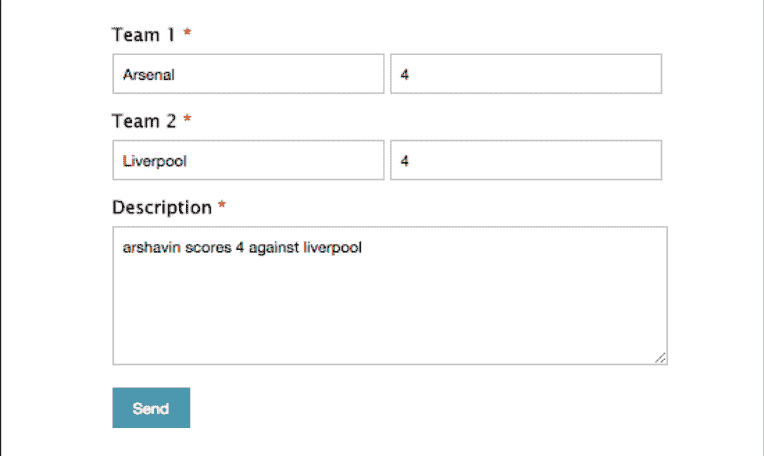

在用户页面，你应该看到与下方图片类似的内容：

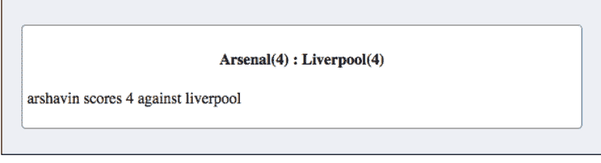

## 总结

在本章，我们学习了如何使用 socket.io 和 Express 构建一个实时比分网站。现在你应该已经熟练掌握构建任何需要实时双向通信的应用程序。你现在应该尝试构建聊天应用程序、多人游戏或其他任何 socket.io 非常有用的地方。

总的来说，你深入学习了 socket.io、WebSockets 和双向通信。

# 函数式响应编程

如果你是一名处理大型复杂 JavaScript 应用的前端或后端 JavaScript 开发人员，并且处理大量响应异步数据更新、用户活动和系统活动的代码，那么可能是探索函数式响应编程（FRP）的最佳时机，因为它是一种节省时间、防止错误、易读且模块化的编码风格。你不需要了解任何函数式编程语言，或成为硬核函数式语言程序员；相反只需要函数式编程的基础。在本章中，我们将学习如何使用 Bacon.js 使用 FRP，Bacon.js 是一个用于前后端 JavaScript 的 FRP 库。

我们将涵盖以下内容：

- 响应式编程概述
- 在 JavaScript 中编写响应式代码的问题
- 函数式编程简介
- 什么是 FRP
- FRP 的构建模块
- FRP 的优势
- Bacon.js 提供的所有 API

## 响应式编程简介

在进入 FRP 之前，我们需要理解它是什么。我将结合 JavaScript 来解释响应式编程。响应式编程的概念在每种编程语言中都是相同的。

**响应式编程**是编写代码来监视异步数据更新、用户活动和系统活动，并将更改传播到应用程序的依赖部分。响应式编程并不是新事物；信不信由你，你已经在不知不觉间做过响应式编程。例如，你编写处理按钮点击事件的代码就是响应式代码。响应式编程有多种方法，如事件驱动、回调、Promise 模式和 FRP。

并不是我们写的每一段异步代码都是响应式代码。在页面加载后异步向服务器上传分析数据不是响应式代码。异步向服务器上传文件，并在上传完成后向用户显示消息是响应式代码，因为我们正在对文件上传的完成做出响应。

响应式编程的一个更复杂的例子是在 MVC 架构中，其中响应式编程响应模型的变化并相应地更新视图，反之亦然。

## 编写响应式代码的问题

JavaScript 原生支持的编写响应式代码的基本上有模式：**事件驱动、回调和 Promise。**

任何懂 JavaScript 的人对事件驱动和回调模式都很熟悉。虽然这两个模式是编写响应式代码最流行的方法，但它们难以捕获异常，并导致嵌套函数调用，使得代码更难以阅读和调试。

由于事件驱动和回调模式引起的问题，ES6（`https://www.packpub.com/web-development/learning-ecmascript-6`）引入了 Promise 模式。Promise 模式让代码看起来更像同步代码，因此易于阅读和调试。该模式也让异常处理变得更容易。Promise 代表一个异步操作。

# 第 7 章

但 Promise 模式有一个问题，那就是一个 Promise 只能解析（resolve）一次。Promise 模式只能响应异步操作的一次活动或数据更新。例如，如果我们使用 Promise 模式发起 AJAX 请求，我们只能处理请求的成功和失败活动，而不能处理请求和响应周期的状态，例如已建立的连接和响应头。同样，如果我们使用 Promise 模式处理用户活动，那么我们只能处理第一次点击，而不能处理随后发生的点击，Promise 在第一次点击时就已经解析了。

你可能熟悉 Promise 模式，让我们来看看 Promise 模式的一些示例代码：

```javascript
$http('http://example.com/data.json').then(function() {
  // 做一些事情
}).then(function() {
  // 在这里做一些事情
}).then(function() {
  // 在这里做更多事情
}).catch(function() {
  // 处理错误
});
```


# 函数式响应编程

在这里，`$http()` 方法异步发送 HTTP 请求并返回一个 `promise`。如果请求成功，则解析 `promise` 并调用传递给第一个 `then()` 方法的回调函数，即 `promise` 已解析。如果请求失败，则回调函数传递给 `catch()` 方法，该方法被调用，`promise` 被拒绝（reject）。`then()` 方法始终返回一个 `promise`，这使得连续运行多个异步操作成为可能。在代码中，你可以看到异步操作是如何链起来的。这里的重要的是，`then()` 方法只能解析一次，多次尝试将被忽略。因此，当我们由于必须处理异步操作的多次活动或数据更新时，我们不能使用 `promise` 模式来编写响应式代码。

> 一些开发者为每个活动和数据更新创建一个新的 `promise`。这种技术可能看起来没问题，因为你可以使用 `promise` 模式编写涉及多个活动和数据更新的响应式代码，但这是一种反模式（anti-pattern）。

由于事件驱动、回调和 `promise` 模式存在的问题，需要另一种模式，函数式响应编程因此而生。

## 函数式响应编程

FRP 简单就是使用函数式编程风格的响应式编程。我们将在下一节学习更多关于函数式的内容。实际上，事件驱动、回调和 `promise` 模式的缺点并不是发明 FRP 的原因；相反，FRP 的发明实际上是因为对响应式编程函数式模式的需求，因为函数式代码易于编写、测试、调试、重用和阅读。但 FRP 解决了事件驱动、回调和 `promise` 模式引起的问题，我们可以说 FRP 是其他模式的替代方案。

在本章中，我们将学习 FRP，它是编写响应式代码的现代方式。

## 函数式编程概述

在进入 FRP 之前，有必要具备函数式编程的基础。

简而言之，函数式编程是一种编码风格，其中我们只使用纯函数（包括递归）而不是循环和条件判断，并且数据是不可变的。

> 函数式编程属于声明式编程的范畴。声明式编程是一种编码风格，我们编写代码是告诉系统我们希望发生什么，而不是如何去做。声明式编程的其他示例还包括 SQL 和正则表达式。

那么什么是纯函数？纯函数是一个只依赖于其输入参数并始终为特定输入提供相同输出的函数。如果它读取了作用域之外的任何内容（包括全局变量），那么它不是纯函数。

显然，并不总是能够让所有函数都变成纯函数。例如，一个获取网页或从文件系统读取内容的函数无法保证相同的返回值。我们应该尝试尽可能让函数成为纯函数。所以，我们可以说 100% 的纯度是不可能的，但 85% 的纯度仍然非常有成效。

> 无副作用的函数、无状态函数和纯函数是互换使用的术语。

在函数式编程中，由于数据是不可变的，你可能在好奇如何在不修改数据的情况下编写。事实上，在实践中，我们简单地创建新的数据结构而不是修改现有的。例如，如果我们有一个包含四个值的数组，并想要删除最后一个值，那么我们只需要创建一个不包含最后一个值的新数组即可。

### 不可变数据的优势

不可变数据有许多优点。以下是其中几个：

- 它们是线程安全的，因为操作在它们上的多个线程无法修改/破坏它们的状态。可以在 <https://en.wikipedia.org/wiki/thread_safety> 了解更多关于线程安全的知识。
- 它们的对象拷贝可以轻松共享。不需要像可变数据结构那样采用防御性拷贝等策略。可以在 <https://en.wikipedia.org/wiki/Object_coupling_(computer_programming)#Object-oriented_programming> 了解更多关于对象拷贝的知识。
- 它们避免了时间耦合。关于时间耦合的更多信息可以在 <https://en.wikipedia.org/wiki/Coupling_(computer_programming)#Object-oriented_programming> 处找到。

### 函数式数据结构

由于数据是不可变的，你可能会遇到几个问题。这里是其中几个：

- 如果一个不可变数组有数百万个值，创建一个新数组并从上一个数组拷贝所有值将是非常消耗 CPU 和内存的
- 如果两个线程需要写入同一个变量，协调变量的最终值将很困难

还有许多其他问题。这些问题导致了函数式数据结构的想法。函数式数据结构是另一种类型的数据结构，旨在解决这类问题。但为了学习本章或在 JavaScript 中编写函数式响应代码，你不需要了解函数式数据结构。

### 纯函数的优势

以下是纯函数的几个优点：

- 它们增加了可重用性和维护性，因为每个函数都是独立的
- 更容易进行测试和调试，因为每个函数都可以单独进行测试和调试
- 函数式程序易于理解，因为它们是以声明的方式编写的，也就是说，代码说明的是要做什么，而不是怎么做。

使用循环、条件判断和函数调用编写代码风格被称为命令式编程和函数式编程。命令式编程被认为是相互对立的。JavaScript、C++、Java、Python、Ruby 都是命令式编程语言的示例。

### 使用 JavaScript 进行函数式编程

你不需要使用像 Erlang、Haskell 等函数式编程语言来编写函数式代码。大多数命令式编程语言都允许我们编写函数式代码。

由于 JavaScript 中的函数是一类对象（我们稍后将学习更多关于一类函数的知识），在 JavaScript 中编写函数式代码是可能的。

> “一类”和“高阶”是通用术语。

当一个函数可以作为参数传递给另一个函数、可以返回另一个函数并可以赋值给变量时，该函数是一类函数。

在 JavaScript 中，函数是一类对象，因为它们是对象。因为对象可以作为参数传递给另一个函数，函数可以返回一个对象，而对象可以赋值给变量，所以函数是一类对象。

### 闭包（closure）和一类函数之间的区别是什么？

闭包是 JavaScript 中最被误解的话题。简单而言，闭包是由另一个函数返回的函数，当该函数被调用时，它可以访问定义它的词法作用域。一类函数返回的函数可能是闭包，也可能不是。这里有一个例子来演示闭包。

```javascript
function a() {
  var b = 12;
  function c() {
    console.log(b);
  }
  return c;
}
var d = a();
d(); // 输出 "12"
```

在这里，名为 `c` 的函数是由 `a` 返回的，当它被调用时，它可以访问在 `a` 内部声明的变量。

### 函数式编程辅助函数

函数式编程语言提供了许多内置的辅助函数（helper functions），以便编写函数式代码。例如，由于我们无法使用循环进行函数式代码的迭代，我们需要某种函数来接收集合并将集合中的每个值映射到一个函数上。函数式编程语言为此目的提供了 `map` 辅助函数。同样，还有许多用于不同用途的辅助函数。

由于 JavaScript 不是函数式语言，它没有附带函数式辅助函数。然而，ES6 引入了一些辅助函数，例如 `Array.from()`、`Array.prototype.from()` 和 `Array.prototype.find()`。尽管如此，这个列表仍然以编写函数式代码。因此，开发者使用 Underscore.js 等库来编写函数式代码。

## 开始 FRP

FRP 仅仅是使用函数式编程风格的响应式编程。

事件流（EventStreams）和属性（不要与对象属性混淆）是 FRP 的构建基石。让我们来看这两个术语含义的概述。

### 事件流 (EventStreams)

事件流代表事件流。事件流中的事件可能在任何时间发生，不需要同步发生。

让我们通过将其与事件驱动模式中的事件进行比较来理解事件流。就像我们在事件驱动模式中订阅事件一样，我们在 FRP 中订阅事件流。与事件驱动编程不同，事件流的威力在于它们在在你处理并执行事件之前，可以以任意数量的方式对它们进行合并、连接、组合、拉链（zip）、过滤或转换。

在函数式编程中，数据是不可变的，因此合并、连接、组合、拉链、过滤或转换事件流会创建一个新的事件流，而不是修改现有的。这里有一张图显示了代表 UI 元素点击的事件流如下：


该事件流可以与任何其他流合并。这里有一张图显示了两个事件流是如何合并的：


当我们想要对不同的事件流应用相同的操作时，合并将非常有用。与其在不同的事件流上订阅并附加回调函数，我们现在可以订阅单个事件流，消除重复代码并易于更新代码。

### 属性 (Properties)

属性代表一个随时间变化的值。属性可以作为 JavaScript 变量的替代方案，变量的值会为了响应异步活动和数据更新而变化。例如，你可以使用属性来表示按钮被点击的总次数、登录用户的总数等。

> 属性也称为信号（signals）或行为（behaviors）。

### 函数式响应式编程

使用属性代替 JavaScript 变量的优点是你可以订阅属性，也就是说，每当属性的值变化时，就会触发回调来更新依赖于它的系统部分。这防止了代码重复并有许多益处。

> 你也可以从另一个属性创建属性，以及对其进行合并、组合、拉链、采样（sample）、过滤或转换。

我们刚刚看了 FRP 的基础知识。创建事件流和属性、它们的方法以及处理它们的其他工作取决于我们用于编写代码的库。现在，让我们探索如何使用 Bacon.js 库编写函数式响应式代码。

## 使用 Bacon.js 进行 FRP

Bacon.js 是一个帮助我们在 JavaScript 中编写响应式代码的库。它可以用于前端和后端 JavaScript。Bacon.js 库的官方网站是 <https://baconjs.github.io/>。

让我们学习如何下载和安装用于前端和后端 Bacon.js。

### 设置项目

让我们学习 JavaScript。在前端，Bacon.js 依赖 jQuery。

创建一个名为 `baconjs-example` 的目录。在里面创建 `package.json` 和 `app.js` 文件以及一个 `public` 目录。在 `public` 目录中创建 `html` 和 `js` 目录。在 `html` 目录中创建一个 `index.html` 文件。最后，在 `js` 目录中创建一个 `index.js` 文件。

从 <http://cdn.cloudflare.com/ajax/libs/bacon.js/0.7.73/Bacon.js> 下载前端 Bacon.js，并从 <https://code.jquery.com/jquery-2.2.0.min.js> 下载 jQuery，将它们放在 `js` 目录中。

在 `index.html` 文件中，放置此代码以入队 jQuery 和前端 Bacon js 库。

```html
<!doctype html>
<html>
<head>
  <title>Bacon.js 示例</title>
</head>
<body>
  <script type="text/javascript" src="js/jquery-2.2.0.min.js"></script>
  <script type="text/javascript" src="js/Bacon.js"></script>
  <script type="text/javascript" src="js/index.js"></script>
</body>
</html>
```

在 `package.json` 文件中，放置此代码：

```json
{
  "name": "Baconjs-Example",
  "dependencies": {
    "express": "4.13.3",
    "baconjs": "0.7.83"
  }
}
```

现在，在 `baconjs-example` 目录下运行 `npm install` 来下载 npm 软件包。

在编写本书时，0.7.83 是后端 Bacon.js 库的最新版本。

在 `app.js` 文件中，放置以下代码以导入后端 Bacon.js 和 Express 模块。它还会启动我们的 Web 服务器来提供网页和静态文件。

```javascript
var Bacon = require("baconjs").Bacon;
var express = require("express");
var app = express();
app.use(express.static(__dirname + "/public"));
app.get("/", function(httpRequest, httpResponse, next) {
  httpResponse.sendFile(__dirname + "/public/html/index.html");
});
app.listen(8080);
```

# 响应响应式编程

我们现在设置了一个基础的 Bacon.js 项目。运行 `node app.js` 来启动 Web 服务器。现在，让我们探索 Bacon.js API。

## Bacon.js API

Bacon.js 提供了 API，几乎可以使用 `EventStreams`（事件流）和 `properties`（属性）完成任何事情。后端和前端导入及下载 Bacon.js 的方法不同，但两者的 API 是一致的。让我们来看看 Bacon.js 提供的最重要的 API。

### 创建 EventStreams

有多种方法可以创建 `EventStreams`，取决于异步 API 如何遵循。异步 API 遵循事件驱动、promise（承诺）或回调模式。我们需要用 Bacon 提供的 API 封装这些模式，以便将它们的数据更新或更新连接到事件流上，即将它们转换为函数式模式。

如果我们想为网页上的某个 UI 元素创建一个 `EventStream`，可以使用 `$.asEventStream()` 方法。让我们来看看它是如何工作的示例。在 `index.html` 文件的 `<body>` 标签中放置以下代码以创建一个按钮：

```html
<button id="myButton">点击我！！</button>
```

在事件驱动模式中，为了在每次点击按钮时都打印内容，我们会编写如下代码：

```javascript
document.getElementById("myButton").addEventListener("click", function() {
  console.log("按钮被点击了");
}, false);
```

在 Bacon.js 中，我们将这样写。将此代码放在 `index.js` 文件中：

```javascript
var myFunction_click_stream = $("#myButton").asEventStream("click");
myFunction_click_stream.onValue(function(e) {
  console.log("按钮被点击了");
});
```

在这里，我们使用 jQuery 选择器指向按钮，然后使用 `$.asEventStream` 方法将其点击事件连接到一次 `EventStream`。`$.asEventStream` 方法将事件名称作为其第一个参数。

`onValue` 方法用于向 `EventStream` 添加订阅者。`EventStream` 的 `onValue` 方法接收一个回调函数，每当有新事件被添加到 `EventStream` 时，该回调就会被执行。回调函数有一个单一参数，代表已添加到 `EventStream` 的当前事件。在这种情况下，它是事件接口类型。我们可以多次调用 `onValue` 方法来添加多个回调函数。

订阅者可以用于更新 UI、执行日志等。处理事件的逻辑代码应该使用辅助函数编写，而不是在订阅者内部。这才是响应式代码应该的编写方式。

对于订阅注册之前发生的事件，订阅者回调不会被触发。

同样，Bacon.js 还提供了许多创建 `EventStreams` 的 API。这里是其中几个：

- `Bacon.fromPromise`: 用于从 promise 创建 `EventStream`。
- `Bacon.fromEvent`: 用于从 DOM 事件创建 `EventStream`。
- `Bacon.fromCallback`: 用于从回调函数创建 `EventStream`。
- `Bacon.fromInterval`: 用于从间隔创建 `EventStream`。
- `Bacon.fromArray`: 用于从值数组创建 `EventStream`。
- `Bacon.fromPoll`: 用于从轮询值创建 `EventStream`。

### 创建 Properties

有多种方法可以创建 `Properties`，取决于异步 API 如何遵循。异步 API 遵循事件驱动、promise 或回调模式。我们需要用 Bacon 提供的 API 封装这些模式，以便将它们的数据更新或更新连接到事件流上，即将它们转换为函数式模式。

如果我们想为网页上的某个 UI 元素创建一个 `Property`，可以使用 `$.asEventStream()` 方法配合 `toProperty()`。让我们来看看它是如何工作的示例。在 `index.html` 文件的 `<body>` 标签中放置以下代码以创建一个按钮：

```html
<button id="myButton">点击我！！</button>
```

在 Bacon.js 中，我们将这样写。将此代码放在 `index.js` 文件中：

```javascript
var myButton_click_stream = $("#myButton").asEventStream("click");
var button_click_counter = myButton_click_stream.scan(0, function(count) {
  return count + 1;
});
var button_click_property = button_click_counter.toProperty();
```

在这里，我们使用 `scan` 方法累加点击次数，然后使用 `toProperty()` 将事件流转换为属性。

### 合并 (Merging)

合并流或属性会产生一个新的流或属性，该结果会交付所有流或属性的事件或值。要合并 EventStreams 或属性，我们可以使用它们的 `Bacon.mergeAll` 方法实例。这里有一些示例代码来演示这一点。将其放在 `index.js` 文件中：

```javascript
var merged_property = Bacon.mergeAll(button_click_counter, button_click_time);
merged_property.onValue(function(e) {
  console.log(e);
})
```

在这里，我们合并了两个属性。`Bacon.mergeAll` 接收包含 EventStreams 或属性的数组。每当这两个属性中的任何一个发生变化时，该值就会成为结果属性的当前值。

还有其他辅助函数可以合并属性和 EventStreams。

### 过滤 (Filtering)

过滤是指分别从 EventStreams 或属性中移除我们不需要的特定事件或值。

Bacon.js 有许多辅助函数来过滤 EventStreams 和属性，具体取决于你想要过滤什么。让我们来看看 EventStreams 和属性的 `filter` 方法，我们根据一个谓词函数使用它；即，如果函数返回 `true`，则该值被接受；否则，被拒绝。

让我们通过示例代码来看这一点。在 `index.js` 文件中，找到这段代码：

```javascript
var myButton_click_stream = $("#myButton").asEventStream("click");
myButton_click_stream.onValue(function(e) {
  console.log(e);
  console.log("Button Clicked");
})
```

将其替换为以下代码：

```javascript
var myButton_click_stream = $("#myButton").asEventStream("click");
myButton_click_stream.filter(function(e) {
  return e.shiftKey === true;
});
myButton_click_stream.onValue(function(e) {
  console.log(e);
  console.log("Button Clicked");
})
```

在这里，我们过滤掉了所有没有按下 Shift 键的点击事件。因此，为了让点击事件被接受，我们需要在点击按钮时按下 Shift 键。

你可以将过滤视为使用 if...else 条件条件的替代方案。

### 转换 (Transforming)

转换是从另一个 EventStream 或属性创建一个新的 EventStream 或属性，其事件被转换成其他内容。例如，一个属性的值可以被转换为另一个属性，该属性的值代表新 URL 的响应。转换 EventStreams 和属性实际上是分别创建了新的 EventStreams 和属性。

你可以将转换视为循环的替代方案，即使用 `for` 循环。

Bacon.js 提供了几个辅助函数用于转换，具体取决于你想要如何转换以及转换什么。

一个流行的转换函数是 `map()`，它将 EventStreams 或属性的事件或值映射到一个函数。让我们来看一个代码示例来演示这一点。在 `index.js` 文件中找到这段代码：

```javascript
var button_click_time = button_click_counter.scan({
  function(value, count) {
    return {time: Date.now(), clicks: count};
  }
})
```

将其替换为以下代码：

```javascript
var button_click_time = button_click_counter.scan({
  function(value, count) {
    return {time: Date.now(), clicks: count};
  }
}).map(function(value) {
  var date = new Date(value.time);
  return (date).getHours() + ":" + (date).getMinutes();
})
```

在这里，我们使用 `map()` 将 Unix 时间戳转换为 HH:MM 格式，这易于理解。

Bacon.js 提供了另一个至关重要的转换驱动辅助函数，称为 `flatMap`。`flatMap` 和 `map` 之间基本上有两个区别：

- `flatMap` 函数无论是在 EventStream 还是属性上被调用的，它总是返回一个 `EventStream`。
- 如果传递给 `flatMap` 的回调返回一个 EventStream 或属性，那么 `flatMap` 函数返回的 EventStream 的事件将是异步的，并且是 `flatMap` 返回的流和属性的值。每当事件或值被添加到流和属性中时，该事件和值将通过传递给 `flatMap` 的回调自动返回，并由 `EventStream` 函数返回。

在获取指向网络、磁盘驱动器或其他地方的回调返回值时，你需要使用 `flatMap` 而不是 `map`。例如，在之前的示例中，我们讨论了如何将 URL 转换为 URL 响应，我们需要使用 `flatMap` 而不是 `map`，因为我们需要的不是回调，而是发起一个 AJAX 请求，其响应将被捕获为一个流，并且该流将被返回。当 AJAX 请求完成时，事件将放入 `flatMap` 函数返回的流中。

让我们来看看这个示例的实现。首先，创建一个输入文本框并将其放在 `index.html` 文件中，如下：

```html
<input id="url" type="url">
```

现在，让我们使用 Bacon.js 编写代码，当用户按下回车键时记录字段中输入的 URL 的输出。以下是实现此操作的代码。将其放在 `index.js` 文件中：

```javascript
var enter_key_click_stream = $("#url").asEventStream("keyup")
  .filter(function(e) {
    return e.key == 13;
  });
var url = enter_key_click_stream.scan("", function(value, e) {
  return e.currentTarget.value;
});
var response = url.flatMap(function(value) {
  return Bacon.fromPromise($.ajax({url:value}));
}).toProperty();
response.onValue(function(value) {
  console.log(value);
})
```

这是它的工作原理：

- 首先，为按键创建一个 EventStream。
- 然后，我们过滤出回车键，因为我们只在按下回车时采取操作。
- 然后，我们创建一个变量来保存字段的值。
- 然后，我们使用 flatMap 通过 jQuery AJAX 获取响应。我们使用 `Bacon.fromPromise` 从 promise 创建一个 EventStream。
- 当 AJAX 请求完成时，响应被添加到 `flatMap` 回调返回的 EventStream 中。随后，它会被 `flatMap` 函数返回的 EventStream 添加。

在这里，如果我们使用 `map` 而不是 `flatMap`，我们最终记录的是 EventStream 对象，而不是 `map` 函数返回的事件。

> 当你调用方法对 EventStreams 进行转换、过滤或执行其他操作时，在调用之前发生的事件是不被考虑的。然而，在属性的情况下，当前值会被考虑在内，但调用之前的数值则不会。如果属性没有赋值给任何内容，则没有任何内容会被考虑在。

## 总结 (Summary)

我们回顾了响应式编程、函数式编程、FRP，最后是 Bacon.js 的概述。你现在应该熟悉编写基础的函数式响应式代码，并对其益处有清晰的想法。

在下一章节中，我们将学习 Bacon.js 提供的更多 API，并使用它构建一个真实的项目。

# 构建高级个人资料搜索组件 (Building an Advanced Profile Search Widget)

通过 Bacon.js FRP 的最佳方法是构建真实的应用程序，这正是我们在本章中所做的。我们将构建一个高级个人资料搜索组件，就像通常在社交网络或约会网站上看到的那些。为了保持章节简单明了，我们将使用示例数据而不是构建注册功能。我们还将学习一些函数式编程和 Bacon.js 的高级概念。

在本章中，我们将涵盖以下内容：

- Bacon.js 中的错误事件
- FRP 中的异常处理
- 惰性求值
- Bacon.js 中的 Bus
- 组合模式
- 最后，我们将构建一个高级个人资料搜索组件

## Bacon.js 中的错误 (Errors in Bacon.js)

Bacon 提供了 `Bacon.Error` 构造函数，显式地将 EventStreams 或属性的事件或值标记为错误，以便 Bacon 识别它们并开启一系列其他 API 专门处理这些错误。

取决于我们创建流（stream）的方式，Bacon.js 有时可以识别事件是成功事件还是错误事件，如果是错误事件，它可以将其转换为 `Bacon.Error`。例如，如果我们使用 `Bacon.fromPromise` 来创建一个 `EventStream`，那么 Bacon 就可以及早识别错误，特别是当 promise 模式中发生错误，即 `then()` 方法的第二个回调或传递给 `catch()` 方法的回调执行时。

如果 Bacon 创建流时无法识别事件是错误还是成功事件，那么我们需要显式地创建 `Bacon.Error` 实例并用它们替换错误事件。例如，在使用 `Bacon.fromCallback` 时，Bacon.js 无法知道事件是成功还是错误，因此我们需要显式地将错误实例转换为 `Bacon.Error` 实例。

### 订阅错误

传递给 `onValue` 的回调不会为 `Bacon.Error` 事件或值触发；相反，我们需要使用 `onError`。

要查看效果，打开上一章节中创建的 `index.js` 文件，并添加以下代码：

```javascript
response.onError(function(error) {
  console.log("An error occured while fetching the page", error);
})
```

现在，如果你输入一个无法获取的 URL，控制台将显示自定义错误消息。

### 映射错误

`map()` 函数不会映射 `Bacon.Error` 实例；因此，Bacon 为我们提供了 `mapError()`，它的工作方式与 `map` 相同，但只映射 `Bacon.Error` 实例。

同样，`flatMap()` 不映射 `Bacon.Error` 实例。因此，Bacon 为我们提供了 `flatMapError()`，它的工作方式与 `flatMap` 相同，但只映射 `Bacon.Error` 实例。

除了 `flatMap` 和 `map` 之外，`Bacon.Error` 实例可以通过任何操作。

### 重试函数调用

有时，我们可能希望操作失败时重试。例如，如果由于服务器超时导致使用 AJAX 获取网页失败，我们可能希望一段时间后尝试重新获取。

Bacon 提供了 `Bacon.retry` 函数，通过它，我们可以根据需要反复执行某个函数调用。

`Bacon.retry` 返回一个 `EventStream`，它接受一个包含四个属性的对象，如下所示：

- source: 这是一个要重新调用的函数。该函数必须返回一个属性（property）或 `EventStream`。
- retries: 这是一个数字，代表在初始尝试之外重试源函数的总次数。当 `Bacon.Error` 实例被推送到源函数返回的属性或流时，就会尝试一次重试。
- isRetryable: 这是一个可选属性。它被赋值给一个返回函数的函数。该函数可以返回 `true` 或 `false`。当内容推送到属性或 `EventStream` 中时，会调用 `isRetryable` 来判断是否应该尝试重试。
- delay: 这是一个可选属性。它被赋值给一个函数，该函数返回重试前等待的毫秒数。默认值为 0。

`Bacon.retry` 返回的 `EventStream` 具有上一次调用源函数返回的 `EventStream` 或属性中存在的事件或值。

让我们来看看 `Bacon.retry` 函数的。在 `index.js` 文件中找到这段代码：

```javascript
var response = url.map(function(value) {
  return Bacon.fromPromise($.ajax({url:value}));
}).toProperty();
```

将其替换为：

```javascript
var response = url.flatMap(function(value) {
  return Bacon.retry({
    source: function () {
      return Bacon.fromPromise($.ajax({url:value}));
    },
    retries: 5,
    isRetryable: function (error) {
      return error.status !== 404;
    },
    delay: function(context) {
      return 2000;
    }
  }).toProperty();
});
```

在这里，对于除 404 以外的任何错误，我们每隔 2 秒重试 AJAX 请求 5 次。

### 在错误时结束 EventStream 或属性

当无法向 `EventStream` 或属性推送任何内容时，称其为“结束（ended）”。

如果你希望在推送到 `Bacon.Error` 实例时结束 `EventStream` 或属性，你需要调用 `endOnError` 方法。`endOnError` 方法返回返回的 `EventStream` 或属性，在推送到 `Bacon.Error` 实例时会结束。

### 处理异常

如果在传递给 Bacon 辅助函数的回调内部遇到异常，它不会被自动捕获；我们需要使用 `try...catch` 语句来处理。常见的做法是在捕获异常后返回一个 `Bacon.Error` 实例，以便我们可以像处理错误一样处理它。

这里是处理异常的示例。在 `index.js` 文件中找到以下代码：

```javascript
var response = url.flatMap(function(value) {
  return Bacon.retry({
    source: function(){
      return Bacon.fromPromise($.ajax({url:value}));
    },
    retries: 5,
    isRetryable: function (error) { 
      return error.status != 404;
    },
    delay: function(context) { return 2000; }
  })
}).toProperty();
```

将其替换为：

```javascript
var response = url.flatMap(function(value) {
  try {
    return Bacon.retry({
      source: function(){
        return Bacon.fromPromise($.ajax({url:value}));
      },
      retries: 5,
      isRetryable: function (error) { return error.status !== 404; },
      delay: function(context) { return 2000; }
    });
  } catch(e) {
    return new Bacon.Error(e);
  }
}).toProperty();
```

在这里，我们正在捕获异常并创建一个带有异常的 `Bacon.Error` 实例，也就是说我们将异常作为参数传递构造构造。

### 常量属性

Bacon 还提供了创建常量属性的方法。常量属性在创建时初始化且无法重新初始化，也就是说不能推送新值。

常量属性使用 `Bacon.constant()` 构造函数创建。常量属性可以被合并（merged）、连接（concatenated）、压缩（zipped）、过滤（filtered）和转换（transformed）。

这是一个创建常量属性的示例。将此代码放在 `index.js` 文件中：

```javascript
var script_start_time = Bacon.constant(Date.now()).map(function(value) {
  var date = new Date();
  return (date).getHours() + ":" + (date).getMinutes() + ":" + (date).getSeconds();
});
script_start_time.onValue(function(value) {
  console.log("This script started at : " + value);
})
```

在这里，常量属性存储了脚本启动的时间并打印出来。

### Bus 概述

Bus 就像 EventStream，但它允许我们手动向流推送值，而不是将其附加到源，它还允许动态将其他 `EventStream` 和属性接入（plug）到 bus 中。

这是一个演示如何创建 bus 以及 `Bacon.Bus` 实例提供的方法的示例。将此代码放在 `index.js` 文件中：

```javascript
var bus = new Bacon.Bus();
bus.onValue(function(event) {
  console.log(event);
});
bus.push(1);
bus.push(2);
var bus2 = new Bacon.Bus();
bus.plug(bus2);
bus2.push(3);
bus.error("Unknown Error"); // 推送到 Bacon.Error
bus.end();
bus2.push(4); // 因为 bus 已结束，此内容将不会被推送
```

上述代码的输出为：

- 1
- 2
- 3

### 订阅 EventStream 和属性的结束

Bacon 提供了 `onEnd` 方法来订阅在 `EventStream` 或属性结束时执行的回调。

这段示例代码展示了如何使用 `onEnd` 回调。将其放在 `index.js` 文件中：

```javascript
script_start_time.onEnd(function() {
  console.log("Script start time has been successfully calculated and logged");
})
```

在这里，我们在之前创建的常量属性上附加了一个 `onEnd` 回调。初始化后，属性结束了；因此触发了 `onEnd` 回调。我们也可以注册多个订阅者。

实际上，为了结束 `EventStream` 或属性，Bacon 在内部推送了一个 `Bacon.End` 实例。因此，我们也可以使用 `Bacon.End` 构造函数来结束 `EventStream` 或属性。

让我们来看看使用 `Bacon.End` 的示例。将此代码放在 `index.js` 文件中：

```javascript
var custom_stream = Bacon.fromBinder(function(sink) {
  sink(10);
  sink(20);
  sink(new Bacon.End()); // 事件流在此处结束
  sink(30); // 此将不会被推送
});
custom_stream.onValue(function(event) {
  console.log(event);
});
```

代码的输出为：

- 10
- 20

`Bacon.End` 实例不会通过辅助函数。

### 拔除订阅者

我们已经了解了如何使用 `onValue`、`onError` 和 `onEnd` 订阅 `EventStream` 和属性。如果不再需要这些订阅者，我们也可以取消订阅。

这些函数返回一个用于取消订阅的函数。要取消订阅，我们需要调用订阅函数返回的函数。

## 合并与压缩

Bacon 提供了某些方法来合并和压缩属性以及 `EventStream`。合并（combining）和压缩（zipping）之间存在显著差异。

### 合并

当我们对属性（properties）组合时，我们总是会得到一个属性，它的值将包含所有源属性的数组。如果我们尝试合并事件流（EventStreams），那么它们在进行合并之前会先转换为属性。当任何一个源属性有推入（push）新值时，新值就会被推入结果属性中。合并在每个源属性都推入值后开始。

这里有一个演示合并的示例。将此代码放在 `index.js` 文件中。

```javascript
var x1 = new Bacon.Bus();
var x2 = new Bacon.Bus();
var x3 = new Bacon.Bus();
Bacon.combineAsArray(x1, x2, x3).onValue(function(value) {
  console.log(value);
})
x1.push(0);
x1.push(1);
x2.push(2);
x3.push(3);
x3.push(4);
x1.push(5);
```

这是该代码的输出：

- [1, 2, 3]
- [1, 2, 4]
- [5, 2, 4]

### 压缩

拉链（Zipping）不同于合并。拉链意味着每个源的事件是配对组合的，每个源的第一个事件首先发布，然后是第二个事件，以此类推。只要每个源都有值，结果就会被发布。当我们拉链属性和事件流时，我们总是会得到一个事件流。

这里有一个演示拉链的示例。将此代码放在 `index.js` 文件中：

```javascript
var y1 = new Bacon.Bus();
var y2 = new Bacon.Bus();
var y3 = new Bacon.Bus();
Bacon.zipAsArray(y1, y2, y3).onValue(function(value) {
  console.log(value);
})
y1.push(0);
y1.push(1);
y2.push(2);
y3.push(3);
y3.push(4);
y1.push(5);
```

这是该代码的输出：

```
[0, 2, 3]
```

## 惰性求值

在编程中，惰性求值是一种在需要时才延迟计算值的策略。Bacon 通过两种方式实现惰性求值。

### 类型 1

流或属性在拥有订阅者之前不会附加到其数据源上。让我们来看一个示例来理解。将此代码放在 `index.js` 文件中：

```javascript
var myButton_click_stream = $("#myButton").asEventStream("click").map(function(event){
  console.log(event);
  return event;
});
```

在这里，当你点击按钮时，没有任何内容被记录。现在，将此代码放在 `index.js` 文件中：

```javascript
myButton_click_stream.onValue(function(event) {});
```

现在当你点击按钮时，事件就会被记录。

`log` 方法也被视为一种订阅者。

### 类型 2

像 `map` 和 `combine*` 等方法使用惰性求值，以避免评估实际上不需要的表达式和值。在某些情况下，惰性求值会带来性能收益。

但是 `map` 和 `combine*` 是如何知道一个事件或值是否是需要的？嗯，有几种方法可以给 `map` 和 `combine*` 提供此类提示，例如 `sampledBy`。

> 什么是 `sampledBy` 方法？
> `sampledBy` 方法用于根据属性或事件流对属性进行采样。它通过在给定的属性或事件流的每个事件处对属性值进行采样，分别返回一个属性或事件流。返回的属性或事件流将包含源属性或事件流中每次推入（push）时的属性值。

让我们来看一个 `map` 如何实现惰性求值的示例。将此代码放在 `index.js` 文件中：

```javascript
var myBus_1 = new Bacon.Bus();
var myBus_2 = new Bacon.Bus();
var property_1 = myBus_1.map(function(event) {
  console.log("Executing 1");
  return event;
}).toProperty();
var myStream_1 = property_1.sampledBy(myBus_2);
myStream_1.onValue(function (event) {
  console.log("Logged", event);
})
myBus_1.push(1);
```

这是我们在之前的代码中所做的操作：

1. 我们创建了两个 Bus。
2. 然后我们使用 `map` 方法对第一个 Bus 进行 map 操作，并将其转换为一个属性。
3. 我们通过在第二个 Bus 的每个事件处对属性值进行采样创建一个事件流。
4. 我们为事件流添加了一个订阅者。
5. 最后，我们向第一个 Bus 推入了一个值。

之前的代码看起来应该记录以下输出：

```
Executing 1
Logged 1
```

遗憾的是，它什么都没有记录。那是因为这里正在进行惰性求值。`sampledBy` 函数获取的是属性的当前值，而不是从之前的事件中生成的值。因此，`map` 决定在第二个 Bus 中发生事件时生成属性值，从而防止了对传递给 `map` 函数的回调进行不必要的调用。简而言之，`map` 仅仅防止了在实际需要之前计算属性值。现在，将此代码添加到 `index.js` 文件：

```javascript
myBus_1.push(2);
myBus_2.push(2);
```

现在，运行代码将得到如下输出：

```
Executing 1
Logged 2
```

在这里，你看到 `combine*` 避免了在不需要时计算值。

> 什么是 `combine*` 方法？
> `combine*` 方法用于合并多个属性或事件流。它返回一个属性或事件流，其值是当所有源属性都有新值时，所有源属性值的数组。当我们对属性和事件流进行 combine 操作时，我们总是会得到一个事件流。


# Bacon.js 懒性求值与采样

## 类型 2

像 `map` 和 `combine*` 等方法使用懒性求值，以避免评估实际上不需要的表达式和值。在某些情况下，懒性求值会带来性能收益。

但是 `map` 和 `combine*` 是如何知道一个事件或值是否是需要的？嗯，有几种方法可以给 `map` 和 `combine*` 提供此类提示，例如 `sampledBy`。

## 构建高级个人资料搜索小组件

> **什么是 `sampledBy` 方法？**
> `sampledBy` 方法用于根据属性或事件流对属性进行采样。它通过在给定的属性或事件流的每个事件处对属性值进行采样，分别返回一个属性或事件流。返回的属性或事件流将包含源属性或事件流中每次推入（push）时的属性值。

让我们来看一个 `map` 如何实现懒性求值的示例。将此代码放在 `index.js` 文件中：

```javascript
var myBus_1 = Bacon.Bus();

var myBus_2 = Bacon.Bus();

var property_1 = myBus_1.map(function(event) {
  console.log("Executing 1");
  return event;
}).toProperty();
```

```javascript
var myStream_1 = property_1.sampledBy(myBus_2);
```

```javascript
myStream_1.onValue(function (event) {
  console.log("Logged", event);
})
```

```javascript
myBus_1.push(1);
```

这是我们在之前的代码中所做的操作：

1. 我们创建了两个总线（Bus）。
2. 然后我们使用 `map` 方法对第一个总线进行映射操作，并将其转换为一个属性。
3. 我们通过在第二个总线的每个事件处对属性值进行采样创建一个事件流。
4. 我们为事件流添加了一个订阅者。
5. 最后，我们向第一个总线推入了一个值。

之前的代码看起来应该记录以下输出：

```
Executing 1
Logged 1
```

遗憾的是，它什么都没有记录。那是因为这里正在进行懒性求值。`sampledBy` 函数获取的是属性的当前值，而不是从之前的事件中生成的值。因此，`map` 决定在第二个总线中发生事件时生成属性值，从而防止了对传递给 `map` 函数的回调进行不必要的调用。简而言之，`map` 仅仅防止了在实际需要之前计算属性值。现在，将此代码添加到 `index.js` 文件：

```javascript
myBus_1.push(2);

myBus_2.push(2);
```

现在，运行代码将得到如下输出：

```
Executing 1
Logged 2
```

在这里，你看到 `combine*` 避免了在不需要时计算值。

> **什么是 `combine*` 方法？**
> `combine*` 方法用于合并多个属性或事件流。它返回一个属性或事件流，其值是当所有源属性都有新值时，所有源属性值的数组。当我们对属性和事件流进行 `combine` 操作时，我们总是会得到一个事件流。

## 公司建议路由

让我们创建一个路由，根据给定的值返回公司名称建议数组。稍后，为了填充公司名称框的下拉菜单，我们将向此路由发送请求。

我们不会构建添加个人资料的功能；相反，我们将从一个包含一些随机个人资料的 JSON 文件中检索个人资料。在**初始目录**中，你会找到一个名为 `data.json` 的文件，其中包含了一些个人资料。让我们从 `data.json` 文件读取数据。

```javascript
var data = Bacon.fromNodeCallback(fs.readFile, "data.json", "utf8").map(function (event) {
  return JSON.parse(event);
}).toProperty();
```

在这里，我们以函数式响应式风格读取数据，并将 `EventStream` 转换为属性。以下是公司建议路由的代码。将其放在 `app.js` 文件中：

```javascript
function findMatchingCompanyName(list, companyName) {
  return list.filter(function (value) {
    return companyName !== "" && value.toLowerCase().indexOf(companyName.toLowerCase()) == 0;
  });
}
```

```javascript
var company_dropdown_list_stream = route_eventstream("//company/dropdown");
```

```javascript
var company_dropdown_list_data_stream = Bacon.combineArray([data, company_dropdown_list_stream]).map(function(event) {
  return findMatchingCompanyName(event[0], event[1].query);
}).toEventStream();
```

```javascript
Bacon.zipArray(company_dropdown_list_stream, company_dropdown_list_data_stream).map(function(event1, event2) {
  event1.res.send(event2);
});
```

代码工作如下：

1. 首先，我们定义了两个方法，它们接收个人资料列表和搜索数据并根据数据进行过滤。第一个仅根据电子邮件过滤，而第二个根据其他数据过滤。我们这样做是因为电子邮件对于每个个人资料都是唯一的，如果用户提供了电子邮件，我们就不需要使用其他数据并浪费计算。当数据很多时，通过这种方式你将获得性能优势。
2. 然后，我们为 `/search` 路径创建一个 `EventStream`。
3. 之后，我们创建了两个流，即 `profile_search_data_form_email` 和 `profile_search_data_form_`。
4. 最后，我们合并 `company_dropdown_list_stream` 和 `company_dropdown_list_data_stream`，将其 zip 在一起并返回响应。
5. 这里的另外一点是，我们使用了 `onValues` 而不是 `onValue`。它们之间的区别在于 `onValues` 拆分了值（假设是一个数组）。

## 搜索结果路由

创建一个路由，根据给定参数返回个人资料数组。稍后，从前端向此路由发送请求。以下是该路由的代码。将其放在 `app.js` 文件中：

```javascript
function findMatchingProfilesForEmail(list, email) {
  return list.filter(function(value) {
    return value.email == email;
  })
}
```

```javascript
function findMatchingProfiles(list, firstName, lastName, gender, company, dob, address) {
  var firstName_matches = list.filter(function(value) {
    return firstName == "" || value.first_name.toLowerCase() == firstName.toLowerCase();
  })

  var lastName_matches = firstName_matches.filter(function(value) {
    return lastName == "" || value.last_name.toLowerCase() == lastName.toLowerCase();
  })

  var gender_matches = lastName_matches.filter(function(value) {
    return gender == "" || value.gender.toLowerCase() == gender.toLowerCase();
  })

  var skill_matches = gender_matches.filter(function(value) {
    return skill == "" || value.skill.toLowerCase() == skill.toLowerCase();
  })

  var company_matches = skill_matches.filter(function(value) {
    return company == "" || value.company.toLowerCase() == company.toLowerCase();
  })

  var dob_matches = company_matches.filter(function(value) {
    return dob == "" || value.dob == dob;
  })

  var address_matches = dob_matches.filter(function(value) {
    return address == "" || value.address.toLowerCase() == address.toLowerCase();
  })

  return address_matches;
}
```

```javascript
var profile_search_stream = route_eventstream("/search");

var profile_search_data_for_email = Bacon.combineArray([data, profile_search_stream.filter(function(event) {
  return event.req.query.email != "";
}]).map(function(event) {
  return findMatchingProfilesForEmail(event[0], event[1].req.query.email);
})).toEventStream();

var profile_search_data_stream_for_others = Bacon.combineArray([data, profile_search_stream.filter(function(event) {
  return event.req.query.email == "";
}]).map(function(event) {
  return findMatchingProfiles(event[0], event[1].req.query.lastName, event[1].req.query.gender, event[1].req.query.skill, event[1].req.query.company, event[1].req.query.dob, event[1].req.query.address);
})).toEventStream();

Bacon.mergeAll([profile_search_stream, profile_search_data_stream_for_others]).onValues(function(event1, event2) {
  event1.res.send(event2);
});
```

这是代码的工作原理：

1. 首先，我们定义了两个方法，它们接收个人资料列表和搜索数据并根据数据进行过滤。第一个仅根据电子邮件过滤，而第二个根据其他数据过滤。我们这样做是因为电子邮件对于每个个人资料都是唯一的，如果用户提供了电子邮件，我们就不需要使用其他数据并浪费计算。当数据很多时，通过这种方式你将获得性能优势。
2. 然后，我们为 `/search` 路径创建一个 `EventStream`。
3. 之后，我们创建了两个流，名为 `profile_search_data_form_email` 和 `profile_search_data_form_others`。
4. 最后，我们将 `profile_search_data_form_email` 和 `profile_search_data_form_` 合并并返回响应。

## 构建前端

我们完成了搜索小组件的后端部分。现在我们需要编写前端。

在开始之前，值得看看 `index.html` 文件中的代码：

```html
<!doctype html>
<html>
<head>
  <title>Advanced Search Widget</title>
  <link rel="stylesheet" type="text/css" href="css/style.css">
</head>
<body>
  <div class="container">
    <div class="section-1">
      <h3>Provide search information</h3>
      <hr>
      <div class="form-style">
        <form action="">
          <label>First Name <input type="text" class="input-field" id="first-name" /></label>
          <label>Last Name <input type="text" class="input-field" id="last-name" /></label>
          <label>
            Email:
            <input type="email" class="input-field" id="email" />
            <br><small class="hide" id="email-error">Email address is invalid</small>
          </label>
          <label>
            Gender:
            <select id="gender" class="select-field">
              <option value="male">Male</option>
              <option value="female">Female</option>
            </select>
          </label>
          <label>Company: <input list="companies" type="text" class="input-field" id="company" /></label>
          <label>Address: <input type="address" class="input-field" id="address" /></label>
          <label>Skill: <input type="text" class="input-field" id="skill" /></label>
          <label>DOB:dd/mm/yyyy<input type="text" placeholder="dob" class="input-field" id="dob" /></label>
          <label><span>&nbsp;</span><span>Search:</span><input type="button" value="Search" id="search" /></label>
        </form>
      </div>
    </div>
    <datalist id="companies"></datalist>
    <div class="section-2">
      <h3>Search Result</h3>
      <hr>
      <ul>
        <li id="search-result"></li>
      </ul>
    </div>
  </div>
  <div class="clear"></div>
</body>
<script type="text/javascript" src="js/jquery-2.2.0.min.js"></script>
<script type="text/javascript" src="js/Bacon.js"></script>
<script type="text/javascript" src="js/index.js"></script>
</html>
```

大部分代码都是能够自言自语的。这里有你需要特别注意的几点：

* 在这里，每个输入元素都附带了一个 `id` 值。我们将使用该 `id` 值来创建一个 `EventStream`（事件流）。
* 我们在电子邮箱字段下方显示了一个错误消息。它有一个 `hide` 类，用于隐藏它。移除该类将使其显示出来。
* 我们还使用了一个 `datalist` 元素，它是公司字段的下拉菜单。我们只需要向 `datalist` 元素添加 `option` 标签即可显示下拉菜单。
* 最后，我们有一个用于显示搜索结果的区域。

现在，让我们为输入输入字段上的关键事件创建事件（Events），并将字段的当前值存储在属性中。以下是该部分的代码。将其放置在 `index.js` 文件中：

```javascript
var first_name_keypress_stream = $("#first-name").asEventStream("keyup");
var first_name = first_name_keypress_stream.scan("", function() {
  return $("#first-name").val();
});

var last_name_keypress_stream = $("#last-name").asEventStream("keyup");
var last_name = last_name_keypress_stream.scan("", function() {
  return $("#last-name").val();
});

var email_keypress_stream = $("#email").asEventStream("keyup");
var is_email_valid = email_keypress_stream.scan("", function() {
  return $("#email").val();
}).map(function(value) {
  var re = /^(([^<>()[\]\\.,;:\s@"]+(\.[^<>()[\]\\.,;:\s@"]+)*)|(".+"))@((\[[0-9]{1,3}\.[0-9]{1,3}\.[0-9]{1,3}\.[0-9]{1,3}\])|(([a-zA-Z\-0-9]+\.)+[a-zA-Z]{2,}))$/;
  return re.test(value);
});

var email = Bacon.mergeAll(
  is_email_valid.filter(function(value) {
    return value == true;
  }).map(function(value) {
    $("#email-error").addClass("hide");
    return $("#email").val();
  }),
  is_email_valid.filter(function(value) {
    return value == false;
  }).map(function(value) {
    $("#email-error").removeClass("hide");
    return "";
  })
);

var gender_select_stream = $("#gender").asEventStream("change");
var gender = gender_select_stream.scan("male", function(value) {
  return $("#gender option:selected").val();
});

var company_keypress_stream = $("#company").asEventStream("keyup");
var company = company_keypress_stream.scan("", function(value) {
  return $("#company").val();
});

var address_keypress_stream = $("#address").asEventStream("keyup");
var address = address_keypress_stream.scan("", function(value) {
  return $("#address").val();
});

var skill_keypress_stream = $("#skill").asEventStream("keyup");
var skill = skill_keypress_stream.scan("", function(value) {
  return $("#skill").val();
});

var dob_keypress_stream = $("#dob").asEventStream("keyup");
var dob = dob_keypress_stream.scan("", function(value) {
  return $("#dob").val();
});
```

上述代码大部分是自言自语的。你唯一需要理解的是，我们没有直接将电子邮箱字段的值赋值给邮箱属性，而是首先验证邮箱是否有效。如果邮箱无效，我们会显示错误消息并且不给邮箱属性赋值任何内容。如果邮箱有效，我们会隐藏错误消息并将电子邮箱字段的当前值赋值给 `email` 属性。

现在，让我们写代码为公司字段显示建议下拉菜单。以下是 `index.js` 文件中的相关代码：

```javascript
company.flatMap(function(event) {
  return Bacon.fromPromise($.ajax({url: "company/dropdown?companyName=" + encodeURIComponent(event)}));
}).flatMap(function(event) {
  $("#companies").empty();
  return Bacon.toArray(event);
}).onValue(function(event) {
  $("#companies").append("<option value='" + event.company + "'>");
});
```

在这里，每当 `company` 属性的值发生变化时，我们都会向 `/company/dropdown` 路径发送请求，获取建议并添加到 `datalist` 中。

最后，每当用户点击搜索按钮或在任何输入字段按回车键时，我们需要发起搜索请求。以下是该部分的代码。将其放在 `index.js` 文件中：

```javascript
var search_button_click = $("#search").asEventStream("click");

var search_request = Bacon.mergeAll([
  first_name_keypress_stream, last_name_keypress_stream, email_keypress_stream,
  company_keypress_stream, address_keypress_stream, skill_keypress_stream,
  dob_keypress_stream, search_button_click
]).filter(function(event) {
  return event.keyCode == 13;
});

var search_result_data = Bacon.combine({
  first_name: first_name, last_name: last_name, email: email,
  company: company, address: address, skill: skill, dob: dob
}).sampled(search_request);

var search_response = search_result_data.flatMap(function(event) {
  return Bacon.fromPromise($.ajax({
    url: "search?firstName=" + encodeURIComponent(event.first_name) + "&lastName=" + encodeURIComponent(event.last_name)
  }));
}).onError(function() {
  $("#search-result").empty();
  alert("An error occurred");
});
```

这是代码的工作原理：

* 首先，我们为搜索按钮创建一个点击流。
* 接着，我们创建一个 `search_request` 流，当用户在任何输入字段中按回车键（`keyCode 13`）时会触发该流。
* 然后，我们使用 `Bacon.combine` 组合所有字段，并在 `search_request` 触发时进行采样（`sampled`）。
* 最后，如果 AJAX 请求为空，我们会清空 `search-result` 区域并弹出“未找到内容”的提示。

```javascript
var html = "<li>";
html += "<p>Name: " + event.first_name + "</p>";
html += "<p>LastName: " + event.last_name + "</p>";
html += "<p>Email: " + event.email + "</p>";
html += "<p>Gender: " + event.gender + "</p>";
html += "<p>Company: " + event.company + "</p>";
html += "<p>Address: " + event.address + "</p>";
html += "<p>DOB: " + event.dob + "</p>";
html += "<p>Skill: " + event.skill + "</p>";
html += "</li>";

$("#search-result").append(html);

search_response.filter(function(value) {
  if (value.length == 0) {
    $("#search-result").empty();
    alert("Nothing found");
  }
});
```

## 测试

要测试该插件，请运行 `node app.js` 命令。现在，刷新 `localhost:8080`。

要测试搜索插件是否正常，在第一个字段中输入 Robert 并按回车键。你会看到如下输出：

| 提供搜索信息 | 搜索结果 |
| --- | --- |
| First Name: Robert | Name: Robert Carpenter |
| Last Name: | Email: reapenter@theguardian.com |
| Email: Email address is invalid | Gender: Male |
| Gender: Male | Address: 1954 Westridge Parkway |
| Company | DOB: 6/21/1934 |
| Address | Skill: SDLC |
| Skill | Name: Robert Long |
| DOB | Email: rlong10@digg.com |
| | Gender: Male |
| | Address: 45 Eastland Circle |
| | DOB: 11/15/2007 |
| | Skill: Farms |
| | Name: Robert Washington |
| | Email: richard20@pen.io |
| | Gender: Male |
| | Address: 25244 Oak Valley Center |
| | DOB: 11/24/1956 |
| | Skill: Graphic Illustrations |

要测试公司建议下拉菜单，请在 **Company**（公司）字段中输入一个名称，你将看到以下输出：

| 提供搜索信息 | 搜索结果 |
|---|---|
| 名字 Robert | 姓名: Robert Carpenter |
| 姓 Last | 邮箱: robertcarpenter@guardian.com |
| 邮箱 邮箱地址无效 | 性别: 男 |
| 性别 男 | 地址: 1954 Westridge |
| 公司 | 出生日期: 6/21/1954 |
| | 技能: SDLC |
| 敏捷 | 姓名: Robert Long |
| 地址 | 邮箱: rlong50@digg.com |
| 技能 | 性别: 男 |
| | 地址: 45 Easton Circle |
| | 出生日期: 11/25/2007 |
| | 技能: Farm |
| | 姓名: Robert Washington |
| | 邮箱: rwashington2a@pen.is |
| | 性别: 男 |
| | 地址: 25244 Oak Valley Center |
| | 出生日期: 10/24/1996 |
| | 技能: FIT |
| | 姓名: Robert Fisher |
| | 邮箱: rofisher3h@insata.com |
| | 性别: 男 |
| | 地址: 172 Memorial Point |
| | 出生日期: 6/23/1999 |
| | 技能: Graphic Illustrations |

现在，我们已经完成了高级资料搜索组件的构建和测试。

## 总结

在本章中，我们探索了 Bacon.js 的高级 API 和概念，并使用它们构建了一个真实世界的项目。你现在应该熟悉如何通过将 Bacon.js 集成到现有及未来的项目中，以函数式的方式编写响应式代码。

你也可以通过 `https://baconjs.github.io/api/` 了解更多关于 Bacon.js API 的信息。

# 第 9 章：Bootstrap 4 的新功能

Bootstrap 4 是编写时的 Bootstrap 最新版本。这个版本让 Bootstrap 更加强大且易于自定义和使用。在本章中，你将通过示例学习 Bootstrap 4 的新功能。我假设你已经具备一些 Bootstrap 知识，并知道如何使用它创建响应式网站。如果你是 Bootstrap 或响应式网页设计的新手，可以从 Packt 目录中找到从零学习 Bootstrap 的良好方法。我们将从本章开始使用 Bootstrap 4 设计后续的所有项目。

在本章中，我们将涵盖以下主题：

- 下载 Bootstrap 4 的各种方式
- Bootstrap 4 的兼容性
- 对 Flexbox 的支持
- 自定义 Bootstrap 4
- 响应式 CSS 单位

## 下载 Bootstrap 4

下载 Bootstrap 4，请先访问 `http://v4-alpha.bootstrap.com/getting-started/download/`。在这里，你将根据你使用的包管理器找到各种下载 Bootstrap 4 的方法。如果你使用的包管理器未列出，或者你完全没有使用包管理器，也可以直接下载编译版本。该页面还提供了下载源文件的链接。

它还提供了自定义构建版本，当你只需要 Bootstrap 4 的少数功能而不是整个库时，可以使用这些部分内容。

所有主要的 CDN 服务也支持 Bootstrap 4，因此如果你想从 CDN 引入它，可以轻松地找到 CDN URL。

对于本章，请直接下载编译版本并将其放在名为 `bs4` 的新目录中。在同一目录下，创建一个名为 `index.html` 的文件，并将以下代码放入其中：

```html
<!DOCTYPE html>
<html lang="en">
<head>
    <!-- 所有的 meta 标签在前 -->
    <meta charset="utf-8">
    <meta name="viewport" content="width=device-width, initial-scale=1">
    <meta http-equiv="x-ua-compatible" content="ie=edge">
    <!-- Bootstrap CSS -->
    <link rel="stylesheet" href="bootstrap.min.css">
</head>
<body>
    <!-- jQuery 首先，然后是 Bootstrap JS. -->
    <script src="https://ajax.googleapis.com/ajax/libs/jquery/2.1.4/jquery.min.js"></script>
    <script src="bootstrap.min.js"></script>
</body>
</html>
```

## 浏览器和设备支持

Bootstrap 4 支持所有主流浏览器和平台的最新稳定版本。

在兼容性方面，Bootstrap 4 带来的唯一变化是它放弃了对 Internet Explorer 8 的支持。其他所有内容与 Bootstrap 3 保持一致。

## 理解 rem 和 em CSS 单位

Bootstrap 4 尽可能地从 `px` 切换到 `rem` 和 `em`。这是 Bootstrap 4 不支持 IE 8 的主要原因，因为 IE 8 不支持 `em` 和 `rem` 单位。Bootstrap 4 切换到 `rem` 和 `em` 是为了让响应式排版和组件尺寸调整变得更容易。

如果你不熟悉 `rem` 和 `em` CSS 单位，现在是学习它们的好时机了。

`em` 单位相对于父元素的字体大小。`1em` 等于父元素的当前字体大小。`2em` 意味着当前字体大小的两倍。例如，如果一个元素的字体大小为 `10px`，那么 `2em` 就是 `20px`。我们可以通过使用 CSS 媒体查询针对不同的视口或设备宽度更改字体元素的大小，从而实现响应式排版和组件。

由于尺寸设置是嵌套的（依赖于父元素），`rem` 单位相对于根元素（通常是 `html`）的字体大小。`1rem` 等于根元素的字体大小。

## 网格系统

Bootstrap row 最多有 12 列。在这里某些情况下，列会超过 12 列，即换行。

网格系统是一个 12 列系统，允许你轻松创建响应式布局。

网格系统由三个主要组件组成：

- **Container（容器）**：水平居中内容的元素。
- **Row（行）**：列的封装。
- **Column（列）**：放置内容的单元格。

Bootstrap 使用响应式类来控制不同断点的列行为。例如，`col-md-6` 在中及更大的屏幕上将占据一半，但在较小的屏幕上将占据全宽。

网格系统使用 Flexbox 处理对齐和间距分布。Bootstrap 使用的断点有：

- 特小 (xs): < 576px
- 小 (sm): ≥ 576px
- 中等 (md): ≥ 768px
- 大 (lg): ≥ 992px
- 特大 (xl): ≥ 1200px
- 超特大 (xxl): ≥ 1400px

在小型平板电脑上，它看起来像这样：

| Lorem ipsum dolor sit amet, consectetur adipiscing elit. Vivamus arcu nunc, lobortis et laciniaia ut, pellentesque quis lacus. Aliquam non dapibus erat | Lorem ipsum dolor sit amet, consectetur adipiscing elit. Vivamus arcu nunc, lobortis et lacinia ut ut, pellentesque quis lacus. Aliquam non dapibus erat |
| --- | --- |
| Lorem ipsum dolor sit amet, consectetur adipiscing elit. Vivamus arcu nunc, lobortis et laciniaia ut, pellentesque quis lacus. Aliquam non dapibus erat | Lorem ipsum dolor sit amet, consectetur adipiscing elit. Vivamus arcu nunc, lobortis et laciniaia ut, pellentesque quis lacus. Aliquam non dapibus erat |
| Lorem ipsum dolor sit amet, consectetur adipiscing elit. Vivamus arcu nunc, lobortis et laciniaia ut, pellentesque quis lacus. Aliquam non dapibus erat | Lorem ipsum dolor sit amet, consectetur adipiscing elit. Vivamus arcu nunc, lobortis et lacinia ut ut, pellentesque quis lacus. Aliquam non dapibus erat |

在普通平板电脑上，它看起来是这样：

| Lorem ipsum dolor sit amet, consectetur adipiscing elit. Vivamus arcu nunc, lobortis et laciniaia ut, pellentesque quis lacus. Aliquam non dapibus erat | Lorem ipsum dolor sit amet, consectetur adipiscing elit. Vivamus arcu nunc, lobortis et lacinia ut ut, pellentesque quis lacus. Aliquam non dapibus erat | Lorem ipsum dolor sit amet, consectetur adipiscing elit. Vivamus arcu nunc, lobortis et laciniaia ut, pellentesque quis lacus. Aliquam non dapibus erat |
| --- | --- | --- |
| Lorem ipsum dolor sit amet, consectetur adipiscing elit. Vivamus arcu nunc, lobortis et laciniaia ut, pellentesque quis lacus. Aliquam non dapibus erat | Lorem ipsum dolor sit amet, consectetur adipiscing elit. Vivamus arcu nunc, lobortis et laciniaia ut, pellentesque quis lacus. Aliquam non dapibus erat | Lorem ipsum dolor sit amet, consectetur adipiscing elit. Vivamus arcu nunc, lobortis et laciniaia ut, pellentesque quis lacus. Aliquam non dapibus erat |

笔记本电脑用户将看到这些：

| Lorem ipsum dolor sit amet, consectetur adipiscing elit. | Lorem ipsum dolor sit amet, consectetur adipiscing elit. | Lorem ipsum dolor sit amet, consectetur adipiscing elit. | Lorem ipsum dolor sit amet, consectetur adipiscing elit. |
| --- | --- | --- | --- |
| Vivamus arcu nunc, lobortis et lacinia ut, pellentesque quis lacus. Aliquam non dapibus erat. | Vivamus arcu nunc, lobortis et lacinia ut, pellentesque quis lacus. Aliquam non dapibus erat. | Vivamus arcu nunc, lobortis et lacinia ut, pellentesque quis lacus. Aliquam non dapibus erat. | Vivamus arcu nunc, lobortis et lacinia ut, pellentesque quis lacus. Aliquam non dapibus erat. |
| Lorem ipsum dolor sit amet, consectetur adipiscing elit. Vivamus arcu nunc, lobortis et lacinia ut, pellentesque quis lacus. Aliquam non dapibus erat. | Lorem ipsum dolor sit amet, consectetur adipiscing elit. Vivamus arcu nunc, lobortis et lacinia ut, pellentesque quis lacus. Aliquam non dapibus erat. | | |

最后，在桌面电脑上，它看起来像这样：

| Lorem ipsum dolor sit amet, consectetur, adipiscing elit. Vivamus arcu nunc, lobortis et lacinia ut, pellentesque quis lacus. Aliquam non dapibus erat. | Lorem ipsum dolor sit amet, consectetur, adipiscing elit. Vivamus arcu nunc, lobortis et lacinia ut, pellentesque quis lacus. Aliquam non dapibus erat. | Lorem ipsum dolor sit amet, consectetur adipiscing elit. Vivamus arcu nunc, lobortis et lacinia ut, pellentesque quis lacus. Aliquam non dapibus erat. | Lorem ipsum dolor sit amet, consectetur adipiscing elit. Vivamus arcu nunc, lobortis et lacinia ut, pellentesque quis lacus. Aliquam non dapibus erat. | Lorem ipsum dolor sit amet, consectetur adipiscing elit. Vivamus arcu nunc, lobortis et lacinia ut, pellentesque quis lacus. Aliquam non dapibus erat. |

因此，在 Bootstrap 4 中，我们能够精确对齐所有类型的设备。

## 全局边距重置

对于所有元素，Bootstrap 4 将 `margin-top` 重置为 0，同时在所有元素上保持一致的 `margin-bottom` 值。

例如，标题添加了 `margin-bottom: .5rem`，段落添加了 `margin-bottom: 1rem` 用于间距。

## 间距工具类

Bootstrap 4 添加了一组新的工具类，称为间距工具类。这些类允许您通过外边距（margin）或内边距（padding）快速向元素的任何方向添加间距。

这些类的格式为 `[margin or padding] - [direction] - [size]`。

对于外边距或内边距，请使用以下：

- `m` 代表 margin
- `p` 代表 padding

对于方向，您可以使用这些：

- `a` 代表全部 (all)
- `t` 代表顶部 (top)
- `r` 代表右侧 (right)
- `l` 代表左侧 (left)
- `b` 代表底部 (bottom)
- `x` 代表左和右侧
- `y` 代表顶部和底部

您可以使用这些值表示大小：

- `0` 代表 0
- `1` 代表 0.25rem
- `2` 代表 0.5rem
- `3` 代表 1rem
- `4` 代表 1.5rem
- `5` 代表 3rem

这是一个演示间距工具类的示例。将此代码放置在 `index.html` 中容器元素的末尾：

```html
<hr>
<div class="row">
  <div class="col">
    <p class="m-1">外边距 1</p>
    <p class="m-2">外边距 2</p>
    <p class="m-3">外边距 3</p>
    <p class="m-0">外边距 0</p>
  </div>
  <div class="col">
    <p class="p-1">内边距 1</p>
    <p class="p-2">内边距 2</p>
    <p class="p-3">内边距 3</p>
    <p class="p-0">内边距 0</p>
    <p class="mt-1">顶部外边距 1</p>
    <p class="mt-2">顶部外边距 2</p>
    <p class="mt-3">顶部外边距 3</p>
    <p class="mt-0">顶部外边距 0</p>
    <p class="mb-1">底部外边距 1</p>
    <p class="mb-2">底部外边距 2</p>
    <p class="mb-3">底部外边距 3</p>
    <p class="mb-0">底部外边距 0</p>
    <p class="ml-1">左侧外边距 1</p>
    <p class="ml-2">左侧外边距 2</p>
    <p class="ml-3">左侧外边距 3</p>
    <p class="ml-0">左侧外边距 0</p>
    <p class="mr-1">右侧外边距 1</p>
    <p class="mr-2">右侧外边距 2</p>
    <p class="mr-3">右侧外边距 3</p>
    <p class="mr-0">右侧外边距 0</p>
    <p class="mx-1">左右外边距 1</p>
    <p class="mx-2">左右外边距 2</p>
    <p class="mx-3">左右外边距 3</p>
    <p class="mx-0">左右外边距 0</p>
    <p class="my-1">上下外边距 1</p>
    <p class="my-2">上下外边距 2</p>
    <p class="my-3">上下外边距 3</p>
    <p class="my-0">上下外边距 0</p>
    <p class="pt-1">顶部内边距 1</p>
    <p class="pt-2">顶部内边距 2</p>
    <p class="pt-3">顶部内边距 3</p>
    <p class="pt-0">顶部内边距 0</p>
    <p class="pb-1">底部内边距 1</p>
    <p class="pb-2">底部内边距 2</p>
    <p class="pb-3">底部内边距 3</p>
    <p class="pb-0">底部内边距 0</p>
    <p class="pl-1">左侧内边距 1</p>
    <p class="pl-2">左侧内边距 2</p>
    <p class="pl-3">左侧内边距 3</p>
    <p class="pl-0">左侧内边距 0</p>
    <p class="pr-1">右侧内边距 1</p>
    <p class="pr-2">右侧内边距 2</p>
    <p class="pr-3">右侧内边距 3</p>
    <p class="pr-0">右侧内边距 0</p>
    <p class="px-1">左右内边距 1</p>
    <p class="px-2">左右内边距 2</p>
    <p class="px-3">左右内边距 3</p>
    <p class="px-0">左右内边距 0</p>
    <p class="py-1">上下内边距 1</p>
    <p class="py-2">上下内边距 2</p>
    <p class="py-3">上下内边距 3</p>
    <p class="py-0">上下内边距 0</p>
  </div>
</div>
```

## 卡片组件

卡片是 Bootstrap 4 中的一种新组件，用于取代轮播（wheels）、面板（panels）和缩略图（thumbnails）。卡片是一个灵活且扩展的内容容器。它包含头部和页脚选项、多种内容、上下文背景颜色以及强大的显示选项。

以下示例演示了如何创建一个卡片及其所有的子部分和样式。将此代码放置在 `index.html` 中容器元素的末尾：

```html
<div class="row">
  <div class="col-md-4">
    <div class="card">
      <div class="card-header">特色</div>
      <div class="card-body">
        <h4 class="card-title">标题</h4>
        <h6 class="card-subtitle">副标题</h6>
        <p class="card-text">
          Lorem ipsum dolor sit amet, consectetur adipiscing elit, 
          sed do eiusmod tempor incididunt ut labore et dolore magna aliqua. 
          Ut enim ad minim veniam, quis nostrud exercitation ullamco laboris.
        </p>
      </div>
      <div class="card-footer">
        <a href="#">链接</a>
        <a href="#">另一个链接</a>
        <small>2天前</small>
      </div>
    </div>
  </div>
  <div class="col-md-4">
    <div class="card">
      
      <div class="card-body">
        <h4 class="card-title">标题</h4>
        <p class="card-text">
          Lorem ipsum dolor sit amet, consectetur adipiscing elit, 
          sed do eiusmod tempor incididunt ut labore et dolore magna aliqua.
        </p>
      </div>
      <div class="card-footer">
      </div>
    </div>
  </div>
  <div class="col-md-4">
    <div class="card">
      
      <div class="card-body">
        <h4 class="card-title">标题</h4>
        <p class="card-text">
          Lorem ipsum dolor sit amet, consectetur adipiscing elit, 
          sed do eiusmod tempor incididunt ut labore et dolore magna aliqua.
        </p>
      </div>
      <div class="card-footer">
      </div>
    </div>
  </div>
</div>

<p>Lorem ipsum dolor sit amet, consectetur adipiscing elit.</p>

<blockquote>
  引用内容
</blockquote>

<div class="col-md-4">
  <div class="card">
    
    <div class="card-body">
      <p class="card-text">
        Lorem ipsum dolor sit amet, consectetur adipiscing elit, 
        sed do eiusmod tempor incididunt ut labore et dolore magna aliqua.
      </p>
    </div>
  </div>
</div>

<div class="col-md-4">
  <div class="card">
    
    <div class="card-body">
      <h4 class="card-title">标题</h4>
      <p class="card-text">
        Lorem ipsum dolor sit amet, consectetur adipiscing elit, 
        sed do eiusmod tempor incididunt ut labore et dolore magna aliqua.
      </p>
    </div>
  </div>
</div>

<div class="col-md-4">
  <div class="card" style="background-color:black">
    <div class="card-body">
      <h3 class="card-title">标题</h3>
      <p class="card-text">Lorem ipsum dolor sit amet, sodales eget ante ultricies.</p>
    </div>
  </div>
</div>

<div class="col-md-4">
  <div class="card card-primary">
    <div class="card-body">
      <h3 class="card-title">标题</h3>
      <p class="card-text">Lorem ipsum dolor sit amet, sodales eget ante ultricies.</p>
    </div>
  </div>
</div>

<div class="col-md-4">
  <div class="card card-success">
    <div class="card-body">
      <h3 class="card-title">标题</h3>
      <p class="card-text">Lorem ipsum dolor sit amet, sodales eget ante ultricies.</p>
    </div>
  </div>
</div>

<div class="col-md-4">
  <div class="card card-info">
    <div class="card-body">
      <h3 class="card-title">标题</h3>
      <p class="card-text">Lorem ipsum dolor sit amet, sodales eget ante ultricies.</p>
    </div>
  </div>
</div>

<div class="col-md-4">
  <div class="card card-warning">
    <div class="card-body">
      <h3 class="card-title">标题</h3>
      <p class="card-text">Lorem ipsum dolor sit amet, sodales eget ante ultricies.</p>
    </div>
  </div>
</div>

<div class="col-md-4">
  <div class="card card-danger">
    <div class="card-body">
      <h3 class="card-title">标题</h3>
      <p class="card-text">Lorem ipsum dolor sit amet, sodales eget ante ultricies.</p>
    </div>
  </div>
</div>
```

## 卡片组、卡组和列

卡片组（Card groups）允许您将卡片作为一个单一连接元素进行渲染，具有等宽等高的列。卡片组适用于大于 544px 的屏幕尺寸。

如果您需要一组大小相同但互不连接的卡片，请使用卡组（decks）而不是卡片组。卡组适用于大于 544px 的屏幕尺寸。

最后，卡片列（card columns）允许您将卡片组织成瀑布布局（Masonry-columns）。卡片列适用于大于 544px 的屏幕尺寸。

以下是卡片组、卡组和列的代码示例。将其放置在 `index.html` 容器元素的末尾：

```html
<div class="card-group">
  <div class="card">
    
    <div class="card-block">
      <p class="card-text">
        Lorem ipsum dolor sit amet, at suscipit sodales eget ante ultricies mauris. Etiam dolor felis morbi nibh, mollit porttitor tempor, digniss magna pellentesque dictum bibendum dictum integer.
      </p>
    </div>
  </div>
  <div class="card">
    
  </div>
  <div class="card">
    
  </div>
  <div class="card">
    
  </div>
  <div class="card">
    
  </div>
</div>

<br>
<div class="card-deck-wrapper">
  <div class="card-deck">
    <div class="card">
      
      <div class="card-block">
        <p class="card-text">
          Lorem ipsum dolor sit amet, at suscipit sodales neque ultricies mauris, mollit porttitor tempor, digniss magna eleistique dictum integer.
        </p>
      </div>
    </div>
    <div class="card">
      
    </div>
    <div class="card">
      
    </div>
    <div class="card">
      
    </div>
    <div class="card">
      
    </div>
  </div>
</div>

<br>
<div class="card-columns">
  <div class="card">
    
    <div class="card-block">
      <p class="card-text">
        Lorem ipsum dolor sit amet, at suscipit sodales elege ante ultricies mauris. Eiam dolor felis morbi nibh, mollis porttitor tempor, digniss magna bibendum dictum integer.
      </p>
    </div>
  </div>
  <div class="card">
    
  </div>
  <div class="card">
    
  </div>
  <div class="card">
    
  </div>
</div>
```

如你可以看到，我们使用了 `.card-deck-wrapper` 来创建卡组。Bootstrap 4 增加了描边按钮（outline buttons）样式。描边按钮是空的或者是普通按钮的反色。

最后，我们使用了 `.card-columns` 将卡片组织成瀑布布局。卡片列适用于大于 544px 的屏幕尺寸。

## 描边按钮

Bootstrap 4 增加了描边按钮样式。描边按钮是空的或者是普通按钮的反色。以下是描边按钮的代码：

```html
<br>
<button class="btn btn-outline-primary">Primary</button>
<button class="btn btn-outline-secondary">Secondary</button>
<button class="btn btn-outline-success">Success</button>
<button class="btn btn-outline-warning">Warning</button>
<button class="btn btn-outline-danger">Danger</button>
```

你还可以将 `$enable-flex` Sass 变量更改为 `true` 并编译生成 Bootstrap 的 Flexbox 版本。

## 从 Less 迁移到 Sass

Bootstrap 4 的源码使用 Sass 而不是 Less。Less 一直使用到 Bootstrap 3。这非常棒，因为 Sass 对前端开发者来说更有利。它的编译速度更快。此外，目前似乎没有 Less 计划。你可以在 `https://github.com/twbs/bootstrap/tree/v4-dev` 查看源码。

## 文本对齐和浮动类

用于浮动和文本对齐的工具类现在有了响应式范围。响应式文本对齐类的格式为 `text-[xs/sm/md/lg/xl]-[left/right/center]`。例如，`text-lg-left` 在 lg 或更大的视口上对齐文本。

格式为 `pull-[xs/sm/md/lg/xl]-[left/right/none]` 的类根据当前视口大小将元素浮向左或右。例如，`pull-xs-left` 在所有视口上。

## Reboot

Bootstrap 3 使用 Normalize.css 作为其重置。在 Bootstrap 4 中，重置和 Bootstrap 基础样式合并到一个名为 `reboot.scss` 的文件中。

## Flexbox 支持

Flexbox 终于来到 Bootstrap 4 中了。启用组件和网格系统，你可以下载 Bootstrap CSS 的 Flexbox 版本，可以在他们的下载页面找到：`http://v4-alpha.getbootstrap.com/getting-started/download/`

记住 Flexbox 的浏览器支持并不完美，在决定使用之前请考虑两次。这里是显示 Flexbox 浏览器支持的图表：

| Edge | Firefox | Chrome | Safari | Opera | iOS Safari | Opera Mini | Android Browser | Chrome for Android |
|---|---|---|---|---|---|---|---|---|
| 12 | 46 | 52 | 9.1 | 39 | 9.2 | 44 | 4.4 | 47 |
| 13 | 47 | 53 | 9.3 | 40 | 9.3 | | 4.4 | 47 |
| 14 | 48 | 54 | 10 | 41 | 10 | | 5.0 | 54 |
| 15 | 49 | 55 | 10.1 | 42 | 10.2 | | 5.1 | 55 |
| 16 | 50 | 56 | 11 | 43 | 10.3 | | 6.0 | 56 |
| 17 | 51 | 57 | 11.1 | 44 | 11 | | 7.0 | 57 |

关于 Bootstrap 4 中 Flexbox 支持的更多信息请访问 `http://v4-alpha.getbootstrap.com/getting-started/flexbox/`。

## JavaScript 改进

在源文件中，所有的 JavaScript 插件均使用 ES6 编写，并在发布时通过 Babel 进行了编译。它们现在还支持 UMD 格式。

现在已放弃对 IE 8 的支持，在 Bootstrap 中可以安全地始终使用 jQuery 2.0。jQuery 2.0 体积更小、速度更快且具有更多功能。

## 添加 Tether

Tether 是一个 JavaScript 库，用于高效将绝对定位元素放在页面上另一个元素旁边。例如，你可能希望提示框（tooltip）在对话框打开时保持在页面相关项目旁边。

在 Bootstrap 4 中，Tether 已集成到提示框和弹出气泡（popovers）中，以获得更好的定位和性能。因此，要在 Bootstrap 4 中使用提示框和弹出气泡，你需要引入 `tether.js`。

在 `bootstrap.min.js` 文件的代码顶部添加此行，以从 CDN 引入 tether：

```html
<script src="https://cdnjs.cloudflare.com/ajax/libs/tether/1.2.0/js/tether.min.js"></script>
```

## 21:9 宽高比类

Bootstrap 4 添加了一个新的宽高比类：用于 21:9 比例的 `.embed-responsive-21by9` 类。以下是示例：


<div class="embed-responsive embed-responsive-21by9">
  <iframe class="embed-responsive-item" src="https://packpub.com/"></iframe>
</div>

## 自定义 Bootstrap 4

在 Bootstrap 4 中，所有的变量选项都合并到一个名为 `_variables.scss` 的文件中，你可以花费少量精力即可编译 Sass。该文件比之前的 Bootstrap 提供了更多的自定义选项。

## Glyphicons 已移除

Glyphicons 已从构建中移除，这意味着你不再需要手动引入图标包。

## 总结

我们已经查看了 Bootstrap 4 的所有新功能。网格系统是 Bootstrap 4 的两个主要新增。虽然 Bootstrap 4 放弃了对 IE 8 的支持，但切换到 Bootstrap 4 仍然是很好的。在本书中，我们将使用 Bootstrap 4。

# 使用 React 构建界面

编写响应式 UI 代码是一项挑战性任务，因为使用 JavaScript 操作 DOM 是困难的。因此，引入了 MVC 架构，我们分别定义 UI 和应用状态，UI 会随着状态的变化自动更新。React 不仅让编写响应式 UI 代码变得更容易，还处理了性能、复用性和调试问题。

在本章中，我们将涵盖以下主题：

- React
- 虚拟 DOM 技术
- 使用 React 进行组件化 UI 开发
- 单向数据流
- 使用 JSX 编写 React 代码
- 在服务端使用 React 构建同构应用
- 关于 React 的其他主题

# React

React 是一个用于构建响应式 UI 的 JavaScript 库。我们通常使用 jQuery 或原生 JavaScript 操作响应式 UI，这使得代码复用变得困难。相反，我们可以使用 React，它会在状态变化时自动更新 UI。有很多库和技术（如 Web Components 和模板引擎）旨在让响应式 UI 的构建变得更容易，React 脱颖而出是因为它可以构建复用且高性能的响应式 UI。

React 也被用作视图库，因为它正是视图库应该的样子。作为一个视图库，它并没有告诉我们如何管理、访问和更改应用状态。它可以作为任何架构和框架中的视图层。

记住 React 是一个库，而不是像 Angular 或 Ember 那样的框架。React 总是配合框架使用的，因为它只定义 UI，而不告诉我们如何管理应用逻辑和状态。

例如，AngularJS 中有一个名为 `ngReact` 的模块可以让 React 在 AngularJS 中用作视图。即使是 Flux 架构也使用 React 作为其视图。我们将在后续学习更多 Flux 的知识。

> React 是模板引擎吗？
> React 不是模板引擎。大多数 MVC 框架的视图在模板系统中，我们使用模板语言编写 UI 以生成最终的 HTML。例如，Angular 视图是由指令、表达式等组成的模板系统。React 不是模板引擎，因为我们不写 HTML，而是使用 JavaScript 定义 DOM 结构。React 比模板引擎能做的更多，它还可以捕捉 UI 中的用户事件。

## 设置基础项目

创建一个名为 `react-demo` 的文件夹并将文件放在其中。然后创建一个 `index.html` 文件并放入以下代码：

```html
<!DOCTYPE html>
<head>
    <meta charset="UTF-8">
    <title>React Demo</title>
    <script src="react.js"></script>
    <script src="react-dom.js"></script>
</head>
<body>
    <script>
        // 在此处编写 React 代码
    </script>
</body>
</html>
```

## 虚拟 DOM

浏览器解释 HTML 并创建 DOM。DOM 是一个定义页面结构的树形结构。DOM API 是我们用来操作 DOM 的工具。当我们操作它时，浏览器会重新渲染被操作的部分。

问题不在于 DOM 是如何工作的，而在于我们如何通过程序更改它。管理 DOM 节点需要专业知识；否则，我们可能会不必要地重新渲染大量节点，导致渲染性能低下。

例如，想象我们在电子商务网站有一个大型产品列表。我们还有一个过滤器小组件来过滤项目。当我们更改过滤器小组件中的值时，列表项会重新加载，整个列表会重新渲染，这需要对 DOM 进行大量操作并可能导致性能糟糕。为了获得更好的性能，我们实际上只需操作列表的部分，例如产品标题、图片和价格。编写这些代码将是很。

举另一个例子。如果你使用 `ng-repeat` 显示列表，向列表添加新项目将导致整个列表重新渲染。因此，如果 Facebook 或 Instagram 使用 `ng-repeat`，每当我们滚动时，整个帖子集都会被重新渲染。解决这个问题的方案是，不再使用重新渲染整个列表的 `ng-repeat`，而是使用 jQuery 或原生 JavaScript 在列表末尾添加新帖子。

由于这类问题的存在，引入了虚拟 DOM。虚拟 DOM 确保了任何人都可以编写复杂的响应式 UI 而无需担心性能。虚拟 DOM 是 React 实现渲染性能的秘密。

## 第 10 章

虚拟 DOM 是真实 DOM 的抽象版本，也就是说，它是对真实 DOM 的描述。虚拟 DOM 元素是对象，而真实 DOM 元素是 UI 元素。虚拟 DOM 速度得多，因为它是一个 JavaScript 数据结构，对它的操作不会自动重新渲染 UI。之前我提到，在 React 中，你不需要编写任何 HTML，而是声明 DOM 的结构。实际上，你声明的是虚拟 DOM 的结构，而不是真实 DOM。React 保持真实 DOM 与虚拟 DOM 的同步。每当应用状态发生变化以更新 UI 时，React 会为真实 DOM 寻找尽可能少的变更，以与虚拟 DOM 同步。我们稍后会看到这些操作是如何找到差异并修改真实 DOM 的。例如，如果我们在虚拟 DOM 中有一个列表，删除了其中一个项并添加了一个仅多出一个项的新列表，那么在与真实 DOM 同步时，只有新项会被渲染，而不是整个列表。

让我们看一些使用 React 打印 Hello World 的示例代码。在 `index.html` 的 `body` 标签内，有这段代码：

```html
<div id="container1"></div>
```

我们将在这个 `div` 元素内部显示 Hello World。将此代码放在 `index.html` 文件的 `script` 标签中以显示 Hello World：

```javascript
var helloBold = React.createElement("b", {}, "Hello");
var worldItalic = React.createElement("i", {}, " World");
var helloWorld = React.createElement("a", {href:"#"}, helloBold, worldItalic);
ReactDOM.render(helloWorld, document.getElementById("container1"));
```

这是代码的输出效果：


让我们了解一下这段代码是如何工作的。

## 使用 React 构建用户界面

`React.createElement` 用于创建 `ReactElement` 接口的对象。
`ReactElement` 对象是真实 DOM 元素的轻量级、无状态的虚拟表示，但它不是真实的 DOM 元素。它基本上是一个虚拟 DOM。
React 和真实 DOM 元素具有不同的接口。`.createElement` 的第一个参数是 HTML 标签名或 `ReactClass` 接口的对象。我们稍后会学习更多关于 `ReactClass` 的知识。第二个参数是一个包含 HTML 标签属性或 `ReactClass` 对象属性的对象。然后，我们可以传递无限数量的参数，这些可以是字符串、`ReactElement` 对象或 `ReactClass` 对象。第二个参数之后的所有参数都被视为将创建的 `ReactElement` 对象的子元素。如果元素是动态决定的，你可以提供数组作为第三个参数。

在这里，我们创建了三个 `ReactElement` 对象。`helloWorld` 是一个锚点标签，`worldItalic` 是它的子元素。我们为锚点标签分配了 `href` 属性。

`ReactDOM.render` 用于在真实 DOM 中渲染 `ReactElement` 对象。
`ReactDOM.render` 取一个 `ReactElement` 对象作为第一个参数，第二个参数是真实 DOM 中容器元素的引用，我们想在该元素内添加该 `ReactElement`。

在这里，我们在容器元素内部渲染了锚点标签。

> 由于 `ReactElement` 对象是无状态的，我们不能向属性对象分配任何 UI 事件处理器。此外，直接修改传递给 `ReactElement` 对象的属性不会产生任何影响，因为 React 不监控这些属性。

刚开始，可能会觉得 React 和真实 DOM 元素是以不同的方式创建的，但它们的接口是相同的，事实并非如此。
以下是几点区别：

- 你需要使用 `className` 而不是 `class` 属性
- 你需要使用 `htmlFor` 而不是 `for` 属性
- `style` 属性不能是字符串；它必须是一个对象

还有更多。我们将随着学习的深入探索它们。

## 组件

你可以只使用 `ReactElement` 对象，但为了利用 React 的优势，必须使用组件。`ReactElement` 对象是无状态且不可变的，因此对于构建响应式 UI 是没用的。此外，它们没有提供 UI 的结构化机制。

## 使用 React 构建用户界面

```javascript
var HideShowBoxButton = React.createClass({
  getInitialState: function() {
    return {display: "inline-block"};
  },
  handleClick: function() {
    if (this.state.display == "inline-block") {
      this.setState({display: "none"});
    } else {
      this.setState({display: "inline-block"});
    }
  },
  render: function() {
    return React.createElement(
      "div",
      null,
      React.createElement(
        "a",
        {href: "#", onClick: this.handleClick},
        "点击显示/隐藏"
      ),
      React.createElement(
        "span",
        {
          style: {
            display: this.state.display,
            height: 30,
            width: 30,
            backgroundColor: "red"
          }
        }
      )
    );
  }
});

ReactDOM.render(React.createElement(HideShowBoxButton), document.getElementById("container3"));
```

这是上一个代码的输出结果：

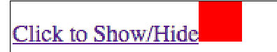

这是该代码的工作原理：

1. 首先，我们创建了一个新组件。
2. `getInitialState` 方法返回组件的初始状态。
3. 然后，我们创建了一个切换显示状态的点击处理器。在修改状态时，你必须使用 `this.setState` 而不是直接通过 `this.state` 修改状态。
4. 接着，我们创建了 `render` 方法，它显示一个按钮和一个红色小方框。`render` 方法将方框的显示样式设置为显示状态。因此，每当状态变化时，React 都会重新排列组件。React 并不是重新渲染整个组件，而是通过比较虚拟 DOM 和真实 DOM 并仅修改所需的 DOM 单元来重新渲染。这就是它实现渲染的方式。
5. 最后，我们创建了一个组件实例并将其添加到容器元素中。
6. 另外注意，我们只为高度和宽度指定了数字而没有指定任何单位。在这种情况下，单位是像素。

## 同构 UI 开发

同构开发是指我们可以在前端和后端使用相同的代码。

到目前为止，我们已经看到了如何在前端使用 React 来构建响应式 UI，但相同的 React 代码也可以在后端使用。当在后端使用时，React 输出 HTML，并不提供任何 UI 性能优势或响应性。

React 的同构特性是使其如此流行和强大的原因之一。它让许多事情变得更简单。例如，它允许我们在后端预渲染页面，从而更容易防止内容闪烁（FOUC），然后在前端：相同的组件只需添加事件绑定即可。

React 代码不仅可以在 Node.js 中执行，还可以在 PHP、Ruby、.NET 等其他主流后端语言中执行。

由于 React 可以同时用于前端和后端，React 开发者团队决定将 React 拆分为两个文件：React 核心和另一个特定于执行环境的部分。这就是为什么我们之前在 HTML 文件中包含 React 时创建了两个文件。React 核心包含 `React.createElement` 等，而 React DOM 包含 `ReactDOM.render` 等。

让我们来看如何在 Node.js 中使用 React，通过在 Node.js 中创建并显示之前的 hello world 组件。创建一个名为 `React-Server-Demo` 的目录。在里面创建名为 `app.js` 和 `package.json` 的文件。

## 使用 React 构建用户界面

在 `package.json` 文件中放置此代码：

```json
{
  "name": "React-Server-Demo",
  "dependencies": {
    "express": "4.13.3",
    "react": "0.14.7",
    "react-dom": "0.14.7"
  }
}
```

然后，运行 `npm` 安装 Express 和 React 模块。现在，在 `app.js` 文件中放置以下代码并运行 `node app.js`：

```javascript
var React = require("react");
var ReactDOMServer = require("react-dom-server");
var express = require("express");
var app = express();

var AnchorBoldItalic = React.createClass({
  render: function() {
    return React.createElement(
      "a",
      {href: this.props.href},
      React.createElement("b", {}, this.props.boldText),
      React.createElement("i", {}, this.props.italicText)
    );
  }
});

var HelloWorld = React.createElement(AnchorBoldItalic, {
  href: "#",
  boldText: "Hello",
  italicText: "World"
});

app.get("/", function (httpRequest, httpResponse, next) {
  var reactHtml = ReactDOMServer.renderToString(HelloWorld);
  httpResponse.send(reactHtml);
});

app.listen(8080);
```

现在，在浏览器中打开 `http://localhost:8080/`，你会看到这个输出：


## 使用 JSX 编写 React 代码

JSX 是一种 JavaScript 语法扩展，它看起来像 XML。它允许我们使用类 XML 语法来编写 `React.createElement`。JSX 代码需要通过 Babel 等工具编译为标准 JavaScript。

以下是使用 JSX 重写的 `HideShowBoxButton` 组件：

```javascript
var HideShowBoxButton = React.createClass({
  getInitialState: function() {
    return {display: "inline-block"};
  },
  handleClick: function() {
    if (this.state.display == "inline-block") {
      this.setState({display: "none"});
    } else {
      this.setState({display: "inline-block"});
    }
  },
  render: function() {
    var style = {
      display: this.state.display,
      height: "30px",
      width: "30px",
      backgroundColor: "red"
    };
    return (
      <div>
        <a href="#" onClick={this.handleClick}>点击显示/隐藏</a>
        <span style={style} />
      </div>
    );
  }
});

ReactDOM.render(<HideShowBoxButton />, document.getElementById("container4"));
```

这个编译后的版本将让你对 JSX 语法如何工作有一个基本的了解。

```javascript
var HideShowBoxButton = React.createClass({
  displayName: "HideShowBoxButton",
  getInitialState: function() {
    return {display: "inline-block"};
  },
  handleClick: function() {
    if (this.state.display == "inline-block") {
      this.setState({display: "none"});
    } else {
      this.setState({display: "inline-block"});
    }
  },
  render: function() {
    var style = {
      display: this.state.display,
      height: "30px",
      width: "30px",
      backgroundColor: "red"
    };
    return React.createElement(
      "div",
      null,
      React.createElement(
        "a",
        {href: "#", onClick: this.handleClick},
        "点击显示/隐藏"
      ),
      React.createElement("span", {style: style})
    );
  }
});

ReactDOM.render(React.createElement(HideShowBoxButton), document.getElementById("container4"));
```

让我们了解之前的 JSX 代码是如何工作的。

简而言之，JSX 用于用类 XML 的语法来编写 `React.createElement` 方法。XML 标签名是第一个参数，属性是第二个参数，最后子元素是 `React.createElement` 的其他参数。

如果 JSX 标签名以小写字母开头，它是一个 HTML 标签；如果以大写字母开头，它就是一个组件。所以在这里，我们让组件名以大写 H 开头。如果我们使用小写 h，它会被视为 HTML 标签，`<hideshowboxbutton></hideshowboxbutton>` 将被插入页面中，这不会渲染任何内容。

在 `HideShowBoxButton` 组件中，除了 `render` 方法的代码外，其他一切都是相同的。我们使用 JSX 语法重写了 `render` 方法。

JSX 提供 `{}` 来包裹 JavaScript 表达式，同时将其赋值给属性或将其用作子元素。在这里，我们将 JavaScript 表达式赋值给 `onClick` 和 `style` 属性。

最后，我们使用 JSX 语法创建了组件的实例。

在编译后的代码中，你会在传递给 `React.createClass` 的对象找到一个 `displayName` 属性。`displayName` 属性用于调试。如果没有设置，它在编译时会被设置为组件名称。

## 深入研究组件

让我们进一步研究组件并掌握它们。我们将查看组件组合和所有权。学习这些有助于构建更易管理的复杂响应式 UI。

## 组件组合

组合性是一项允许你在另一个组件的方法内部组件的特性。

让我们来看一个组件组合的基本示例。首先，创建一个新的容器元素。为了实现这一点，将以下代码放在 `body` 标签中：

```html
<div id="container5"></div>
```

这是组件组合的示例代码。将此代码放在由 Babel 编译的 `script` 标签中：

```javascript
var ResponsiveImage = React.createClass({
  render: function() {
    var imgWidth = {width: "100%"};
    return ;
  }
});

var Card = React.createClass({
  render: function() {
    var CardContainerStyle = {maxWidth: 300, backgroundColor: "grey"};
    return (
      <div style={CardContainerStyle}>
        <h4>{this.props.heading}</h4>
        <ResponsiveImage src={this.props.src} />
      </div>
    );
  }
});

ReactDOM.render(
  <Card src="http://placeholder.it/350x150" heading="This is a Card Header" />,
  document.getElementById("container5")
);
```

这是代码的输出：

# This is a Card Header

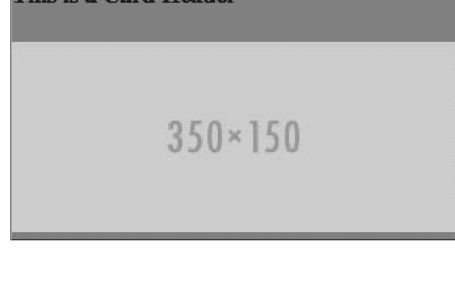

在这里，我们创建了两个不同的组件。在 `Card` 组件内部，我们使用 `ResponsiveImage` 组件来显示一个响应式图片。

## 组件所有权

当组件在其他组件的 `render` 方法内部时，它们被称为所有者-被拥有者关系，而不是父子关系。如果组件 X 在它的 `render` 方法中创建了组件 Y 的实例，则称组件 X 是组件 Y 的所有者。

> 注意，组件 X 不是父元素；而是被称为组件 Y 的所有者。

例如，在之前的代码中，`Card` 组件是 `ResponsiveImage` 组件的所有者，而 `<div>` 是 `ResponsiveImage` 的父元素。

如果我们把组件实例放在组件的开始和结束标签之间，那么它们就处于父子关系。父元素可以通过 `this.props.children` 对象访问其子元素。React 还提供了实用函数来让处理子元素变得更容易。你可以在 https://facebook.github.io/react/docs/top-level-api.html#react.children 找到这些实用程序。

## 协调

协调是 React 每当状态发生变化时更新 DOM 的过程。当状态改变时，React 不会从头开始渲染一切；相反，它首先通过比较新旧虚拟 DOM 来判断是否需要进行变异，如果有差异，它会将新的虚拟 DOM 与真实 DOM 进行比较并进行必要的变异。

## 使用 React 构建用户界面

让我们通过一个示例看看协调具体是如何发生的。假设我们在开头添加了 0。现在，`render` 看起来如下：

```html
<ul>
  <li>Item 0</li>
  <li>Item 1</li>
  <li>Item 2</li>
</ul>
```

在这里，在协调时，React 会首先将第一个项的文本更改为 0，然后将第二个项的文本更改为 1，最后添加一个新的列表项。这种行为在向末尾添加新项时很好。如果你在开头添加新项，状态变为：

```html
<ul>
  <li>Item 0</li>
  <li>Item 1</li>
  <li>Item 2</li>
</ul>
```

React 也提供了解决此问题的方法。它允许我们通过为元素分配 `key` 来识别它。当 React 协调带键元素时，任何带有 `key` 的元素都将被重新排序（而不是变异）或销毁（而不是重用）。`key` 是通过属性分配的。让我们来看创建一个带键子元素的示例。这里是创建新容器元素的代码：

```html
<div id="container6"></div>
```

这是创建带键子元素的 React 代码：

```javascript
var DynamicList = React.createClass({
  getInitialState: function() {
    return {results: this.props.results};
  },
  handleClick: function() {
    var results = this.state.results;
    var firstId = results[0].id - 1;
    var firstValue = results[0].value - 1;
    results.unshift({id: firstId, value: firstValue});
    this.setState({results: results});
  },
  render: function() {
    return (
      <div>
        <a href="#" onClick={this.handleClick}>Click to add new item</a>
        <ul>
          {this.state.results.map(function(result) {
            return <li key={result.id}>{result.value}</li>;
          })}
        </ul>
      </div>
    );
  }
});

var results = [{id: 1, value: 1}, {id: 2, value: 2}];
ReactDOM.render(<DynamicList results={results} />, document.getElementById("container6"));
```

使用 React 构建用户界面

这里是代码的输出：

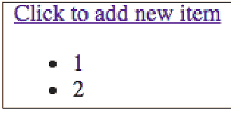

在这里，当点击锚点元素时，一个新对象会被添加到结果数组的开头。随着状态的变化，列表将重新渲染。在渲染过程中，React 将重新排列列表，并将新的列表项添加到开头，而不是对它们进行就地修改。

> 请记住，在动态创建组件实例时，`key` 应该始终提供给数组中的组件，而不是提供给数组中每个组件的容器元素。

## 默认组件属性值

React 允许你以非常声明式的方式为属性定义默认值。如果父组件没有传递属性，则使用默认值。

默认值通过 `getDefaultProps` 方法返回，该方法是传递给 React 的对象的成员。以下是一些示例代码：

```javascript
var ComponentWithDefaultProps = React.createClass({
  getDefaultProps: function() {
    return {value: 'default value'};
  }
});
```

## 组件生命周期方法

各种方法会在组件生命周期的特定点执行。让我们来看这些方法。

### componentWillMount()

`componentWillMount()` 方法在初始渲染发生之前立即被调用一次。如果你在此方法中调用 `setState`，`render()` 将看到更新后的状态，尽管状态发生了变化，它也只会执行一次。

### componentDidMount()

`componentDidMount()` 方法仅在客户端调用。它仅在初始渲染发生后才被调用。

### componentWillReceiveProps(nextProps)

修改传递给组件的属性将没有任何影响，因为 React 不直接监听属性，因此无法发现值的变化。但是，React 可以预测属性值的变化，在这种情况下，如果存在 `componentWillReceiveProps` 方法，它将调用该方法并将新值作为参数，然后重新渲染组件。

例如，如果我们更改了组件所有者的状态，那么就会发送一个信号，表明组件的属性可能发生了变化，因此它会调用 `componentWillReceiveProps` 方法并重新渲染它拥有的组件。

让我们来看一个示例来演示 `componentWillReceiveProps` 方法。我们将创建一个每秒增加一次值的按钮。以下是创建新容器元素的代码。将其放置在 `body` 标签中：

```html
<div id="container7"></div>
```

这里是我们的示例代码。将此代码放在由 Babel 编译的 `script` 标签中：

```javascript
var ButtonComponent = React.createClass({
  componentWillReceiveProps: function(nextProps) {
    console.log("Text changed to " + nextProps.text);
  },
  render: function() {
    return <button>{this.props.text}</button>;
  }
});

var ButtonHolder = React.createClass({
  getInitialState: function() {
    return {text: 1};
  },
  componentDidMount: function() {
    setInterval(function(){
      this.setState({text: this.state.text + 1});
    }.bind(this), 1000);
  },
  render: function() {
    return <ButtonComponent text={this.state.text} />;
  }
});

ReactDOM.render(<ButtonHolder />, document.getElementById("container7"));
```

这里是代码的输出：


在代码中，我们在初始渲染发生后每秒更改所有者的状态。每当状态变化时，`ButtonComponent` 的 `componentWillReceiveProps` 方法就会被调用。在 `componentWillReceiveProps` 方法内部，我们可以使用 `this.props` 来访问属性之前的值。每当所有者的状态更改时，按钮就会渲染。

请记住 `componentWillReceiveProps` 在组件重新渲染之前被调用，因此我们可以在其内部进行任何想要的状态更改。

### shouldComponentUpdate(nextProps, nextState)

`shouldComponentUpdate(nextProps, nextState)` 方法在调用 `render` 方法之前调用，即在渲染发生之前。如果该方法返回 `false`，则将跳过渲染。

请记住，此方法在强制更新或初始渲染之前不会调用。

> 什么是强制更新？
> React 在组件内部提供了一个 `forceUpdate` 方法，在被调用时会渲染组件。当 `render()` 依赖于其他数据而不是 `this.props` 和 `this.state` 时，可以使用此方法，因为其他数据的更改不会触发 `render` 方法。

### componentWillUpdate(nextProps, nextState)

`componentWillUpdate(nextProps, nextState)` 方法在接收到新 props 或状态时的渲染之前立即被调用。此方法不会在初始渲染时调用。

注意，你不能在此方法中使用 `this.setState`。

### componentDidUpdate(prevProps, prevState)

`componentDidUpdate(prevProps, prevState)` 方法在组件的更新刷新到真实 DOM 之后立即被调用。此方法不会在初始渲染时调用。

### componentWillUnmount()

`componentWillUnmount()` 方法在组件从真实 DOM 卸载之前立即被调用。

## Mixins（混合）

有时多个组件会共享逻辑。有时多个组件会共享代码；在这些情况下，我们可以使用 mixins。mixin 是一个可以轻松插入到任何组件中的对象。

```javascript
var Mixin1 = {
  componentWillMount: function() {
    console.log("will mount");
  }
};

var Mixin2 = {
  componentDidMount: function() {
    console.log("did mount");
  }
};

var HeadingComponent = React.createClass({
  mixins: [Mixin1, Mixin2],
  render: function() {
    return <h1>React is Awesome</h1>;
  }
});

ReactDOM.render(<HeadingComponent />, document.getElementById("container8"));
```

这是代码在页面上的输出：


这是控制台的输出：

| will mount |
| --- |
| did mount |

## 使用 Refs

Refs 用于组件内部获取真实 DOM 元素的引用。与其分配 id 或类属性，我们使用 refs。让我们来看一个使用 refs 的基本示例。首先，创建一个容器元素并将其放置在 body 标签中：

```html
<div id="container9"></div>
```

这里是使用 refs 的表单代码：

```javascript
var FormComponent = React.createClass({
  clicked: function() {
    console.log(this.refs.myInput.value);
  },
  render: function() {
    return (
      <div>
        <input type="text" placeholder="Write Something" ref="myInput" />
        <input type="button" value="Click to Submit" onClick={this.clicked} />
      </div>
    );
  }
});

ReactDOM.render(<FormComponent />, document.getElementById("container9"));
```

该代码在页面上的输出是：


如果在文本框中输入 Hello World 并点击按钮，那么控制台的输出是：

Hello World

在之前的代码中，我们为元素分配了 `ref` 属性。引用组件的方法，我们使用 `this.refs`。

## ReactDOMServer.renderToStaticMarkup

在本章早些，我们在服务器端使用 React 生成 HTML。React 在服务器端和客户端生成的 HTML 包含 `data-reactid` 属性。你可能在想在服务器端添加此属性有什么意义。实际上，添加它是为了如果你在客户端对具有 React 服务器渲染标记的节点上调用 `ReactDOM.render()`，React 将保留它并仅对其进行协调。

如果你不想在服务器端生成 `data-reactid` 属性，可以使用 `renderToStaticMarkup` 而不是 `renderToString`。

## 总结

在本章中，通过深入涵盖其功能和组件、JSX、使用它进行服务器渲染、协调等，我们学习了中级水平的 React。我们还学习了 mixins 和 refs 等杂项功能。现在，你应该基本了解如何以及何时将 React 集成到你的网站中。

# 第 11 章：使用 React 和 Flux 构建 RSS 阅读器

React 本身不足以构建一个完整的应用程序，因为它仅仅是视图层。我们需要一种架构来存放应用逻辑和数据，这正是 Flux 发挥用场。显然，React 可以与任何其他架构配合使用，但 Flux 是 React 最常用的架构，因为 Flux 和 React 一样都是基于单向数据流。在本章中，我们将使用 React 和 Flux 构建一个单页 RSS 阅读器。

我们将涵盖以下主题：

- 深入理解 Flux 架构
- 使用 React Router 库进行路由
- 使用 Flux.js 创建调度器
- 使用 MicroEvent.js 触发事件
- 集成 Flux 和路由

## 理解 Flux

Flux 是一种应用程序架构，而不是一个框架。你可以将其视为 MVC 的替代方案。它的主要开发是为了与 React 配合使用，因为它们都基于单向数据流。Flux 架构强制执行单向数据流。

## 使用 React 和 Flux 构建 RSS 阅读器

下面这幅图展示了 Flux 架构的所有部分以及数据在其中的流向方式：

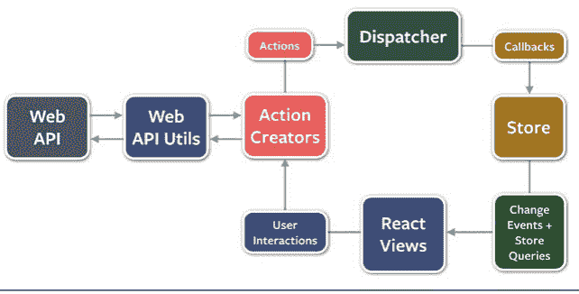

以下是各个部分的工作原理：

- **Actions（动作）**：action 是一个描述我们想要做什么以及执行操作所需数据的对象。在 Flux 中，来自所有来源的所有事件和数据都会转换为 action。即使是 UI 事件也会转换为 action。

- **Dispatcher（调度器）**：dispatcher 是一个特殊的事件系统，用于将 action 广播给已注册的回调。调度器的作用与发布/订阅系统不同，因为回调并不是特定的订阅。相反，每个 action 都会被分发给每个注册的回调。一个应用程序应该只包含一个 dispatcher。

- **Action creators（动作创建者）**：action creators 是将 action 分发给 dispatcher 的方法。

- **Stores（存储）**：stores 是存储应用数据和逻辑的对象。stores 对 action 做出响应。当 dispatcher 分发了 store 依赖的 action 时，回调函数会通知 store 采取相应的操作。

- **React views（React 视图）**：React views 是可以从 store 获取数据并进行显示的组件，并且当 store 中存储的数据发生变化时，它们会监听从 store 发出的事件。注意，store 发出的事件不会被转换为 action。

因此，在 Flux 中，来自不同来源的所有事件和数据都以 action 的形式分发给 dispatcher，然后当 dispatcher 分发 action 时，store 会更新自己，最后，每当 store 更新时，视图就会更新。

## 第 11 章

这是另一幅图，它为 Flux 的工作提供了一个更高层次的抽象：

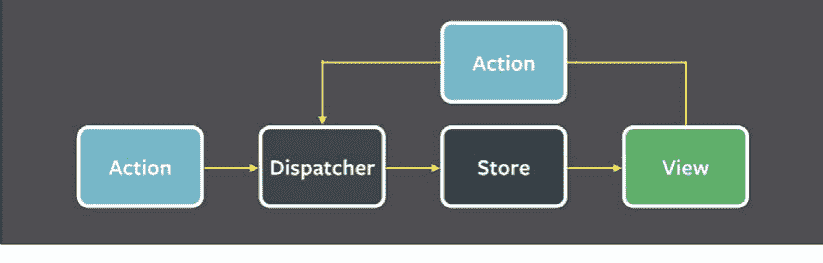

在这里你可以看到数据是向单方向流动的，即数据和事件首先到达 Dispatcher，然后到达 Store，最后到达 View。因此，我们可以说 dispatcher、store 和 view 是 Flux 架构的三个主要部分。

就像有许多 MVC 框架（如 Angular、Ember 和 Backbone）一样，也有许多 Flux 框架（如 Flexible、Reflux、Alt 和 Redux）。但为了保持简单并易于学习，我们不会使用这些中的任何一个框架。相反，我们将使用 Flux.js 和 MicroEvent.js 库来实现 Flux 架构。

## 使用 Flux.js

Flux.js 是由 Flux 创建者创建的库，用于构建调度器。你可以在 https://github.com/facebook/flux 找到 Flux.js 的源码，在 https://cdnjs.com/libraries/flux 找到 CDN 版本。

使用 `Dispatcher` 构造函数创建一个调度器。它有五个方法，如下：

- `register(callback)`：此方法允许我们注册一个回调。它返回一个名为 callback ID 的字符串，用于唯一标识一个回调。
- `unregister(id)`：此方法允许我们取消注册已注册的回调。要取消注册，我们需要传递想要取消注册的回调的 ID。
- `waitFor(array)`：它会在继续执行当前回调之前，等待指定的回调被调用。此方法应该仅由回调在响应分发的 action 时使用。
- `dispatch(action)`：它将 action 分发给已注册的回调。
- `isDispatching()`：它返回一个布尔值，表示 dispatcher 当前是否正在分发。

我们在构建 RSS 馈送阅读器时将通过示例代码演示。

## 使用 MicroEvent.js

MicroEvent.js 是一个事件触发器库，为 JavaScript 对象提供了观察者模式。我们需要 MicroEvent.js 来触发 store 的事件以更新视图。

你可以从 http://notes.jetienne.com/2011/03/22/microeventjs.html 获取 MicroEvent.js。

为了让对象或构造函数能够发出事件并让其他对象能够订阅它，我们需要使用 `MicroEvent.mixin` 方法将 MicroEvent 接口集成到对象或构造函数中。

现在，在对象或构造函数内部，我们可以使用 `trigger()` 触发事件，其他对象可以使用 `bind()` 订阅。

在构建 RSS 馈送阅读器时，我们将查看示例代码。

## React Router 简介

React Router 是一个流行的路由库，它让单页应用拥有路由功能。它提供了强大的路由功能。

你可以在 https://github.com/reactjs/react-router 找到 React Router 的源码，在 https://cdnjs.com/libraries/react-router 找到 CDN 版本。

以下是 React Router 的代码示例：

```javascript
var Router = require("react-router");
var Route = Router.Route;
var Link = Router.Link;
var BrowserHistory = Router.browserHistory;

var Routes = (
  <Router history={BrowserHistory}>
    <Route path="/" component={Home} />
    <Route path="/profile/:username" component={Profile} />
    <Route component={NotFound} />
  </Router>
);

ReactDOM.render(Routes, document.body);
```

## 构建后端

我们将使用 Express 构建后端。创建一个名为 `RSS-Reader` 的目录。在里面创建 `app.js` 和 `package.json` 文件。创建一个 `public` 目录，并在其中创建 `html`、`js` 和 `css` 目录。

在 `app.js` 中放置以下代码：

```javascript
var express = require("express");
var bodyParser = require("body-parser");
var xml2js = require("xml2js");
var parser = new xml2js.Parser();
var app = express();

app.use(bodyParser.urlencoded({extended: false}));
app.use(express.static(__dirname + "/public"));

app.get("/feed", function(httpRequest, httpResponse, next) {
  var request = require("request");
  var request_url = httpRequest.query.url;
  request(request_url, function(error, response, body) {
    if (!error && response.statusCode == 200) {
      parser.parseString(body, function(err, result) {
        httpResponse.send(parser.toJSON(body));
      });
    }
  });
});

app.get("/*", function(httpRequest, httpResponse, next) {
  httpResponse.sendFile(__dirname + "/public/html/index.html");
});

app.listen(8080);
```

上述代码的工作原理如下：

1. 首先，我们导入了中间件。
2. 接着，我们添加了一个接收 URL 作为查询参数的路由，它获取该 URL 的内容并将其作为响应返回。由于 CORS 限制，我们无法从前端获取馈送；因此我们将通过此路由进行获取。它还会将 XML 转换为 JSON，因为 JSON 更容易处理。
3. 接着，对于所有路径，我们都返回 `index.html` 文件。
4. 最后，我们在 8080 端口上进行监听。

## 构建前端

在 `public/js` 目录中，你将找到我们将在前端使用的所有库。在 `public/css` 目录中，你将找到用于设计的 Bootstrap 4。

将此代码放入 `index.html` 文件中以引入 JS 和 CSS 文件，并为 React 组件创建一个模板：

```html
<!doctype html>
<html>
<head>
  <title>RSS 馈阅读器</title>
  <link rel="stylesheet" type="text/css" href="/css/bootstrap.min.css">
</head>
<body>
  <div id="appContainer"></div>
  <script src="/js/react.js"></script>
  <script src="/js/react-dom.js"></script>
  <script src="/js/Router.js"></script>
  <script src="/js/Flux.js"></script>
  <script src="/js/microevent.js"></script>
  <script src="/js/index.js"></script>
</body>
</html>
```

最少情况下，我们引入了 Bootstrap 4。然后，我们引入了 React、React Router、Flux 和 MicroEvent 库。最后，我们引入了 `index.js` 文件，我们会在其中放置应用程序代码。

`appContainer` 元素是显示所有 UI 的内部容器。

## 定义路由

以下是为应用程序定义路由的代码。使用 Babel 编译并将其放入 `index.js` 文件中：

```javascript
var Router = ReactRouter;
var Route = ReactRouter.Route;
var Link = ReactRouter.Link;
var BrowserHistory = ReactRouter.browserHistory;

var Routes = (
  <Router history={BrowserHistory}>
    <Route path="/" component={FeedList}></Route>
    <Route path="/feed/:id" component={Feed}></Route>
    <Route path="/submit" component={SubmitFeed}></Route>
    <Route path="*" component={NotFound}></Route>
  </Router>
);

ReactDOM.render(Routes, document.getElementById("appContainer"));
```

我们在这里定义了四个路由，如下所示：

1. 第一个路由用于首页。当用户访问首页时，我们将显示用户已添加的馈送 URL 列表。
2. 第二个路由用于显示馈送的内容。
3. 第三个路由用于添加新的馈送 URL。
4. 最后，如果没有匹配到任何内容，则第四个路由将显示未找到的消息。

## 创建调度器、动作和存储

让我们创建调度器、一个允许我们管理馈送 URL 的存储，以及用于在首页显示馈送 URL 的 `FeedList` 组件。为了创建所有这些，请在 `index.js` 文件中编译并解析以下代码：

```javascript
var AppDispatcher = new Flux.Dispatcher();

var FeedStore = {
  addFeed: function(url) {
    var valid = /^(ftp|http):\/\/[^"]+$/.test(url);
    if (valid) {
      var urls = localStorage.getItem("feed-urls");
      urls = JSON.parse(urls);
      if (urls == null) {
        urls = [url];
      } else {
        urls[urls.length] = url;
      }
      localStorage.setItem("feed-urls", JSON.stringify(urls));
      this.trigger("valid-url");
    } else {
      this.trigger("invalid-url");
    }
  },
  getFeeds: function() {
    var urls = localStorage.getItem("feed-urls");
    urls = JSON.parse(urls);
    if (urls == null) {
      return [];
    } else {
      return urls;
    }
  }
};

MicroEvent.mixin(FeedStore);

var Header = React.createClass({
  render: function() {
    return (
      <nav className="navbar-light bg-faded">
        <ul className="navbar-nav">
          <li className="nav-item">
            <Link className="nav-link" to="/">首页</Link>
          </li>
          <li className="nav-item">
            <Link className="nav-link" to="/submit">添加</Link>
          </li>
        </ul>
      </nav>
    );
  }
});

var FeedList = React.createClass({
  getInitialState: function() {
    return {urls: FeedStore.getFeeds()};
  },
  render: function() {
    return (
      <div>
        <Header />
        <div className="container">
          <ul>
            {this.state.urls.map(function(url, index) {
              return <li key={index}>{url}</li>;
            })}
          </ul>
        </div>
      </div>
    );
  }
});
```

## 创建提交馈送组件

以下是 `SubmitFeed` 组件的代码。编译并将其放入 `index.js` 文件中：

```javascript
var SubmitFeed = React.createClass({
  handleSubmit: function(event) {
    event.preventDefault();
    var url = this.refs.urlInput.value;
    FeedStore.addFeed(url);
  },
  render: function() {
    return (
      <div>
        <Header />
        <div className="container">
          <form onSubmit={this.handleSubmit}>
            <div className="form-group">
              <label>Feed URL</label>
              <input type="text" className="form-control" ref="urlInput" placeholder="Enter Feed URL" />
            </div>
            <button type="submit" className="btn btn-primary">提交</button>
          </form>
        </div>
      </div>
    );
  }
});
```

## 创建单个馈送存储和组件

以下是 `SingleFeedStore` 和 `Feed` 组件的代码。编译并将其放入 `index.js` 文件中：

```javascript
var SingleFeedStore = {
  get: function(id) {
    var request;
    if (window.XMLHttpRequest) {
      request = new XMLHttpRequest();
    } else {
      try {
        request = new ActiveXObject("Msxml2.XMLHttpRequest");
      } catch (e) {
        try {
          request = new ActiveXObject("Microsoft.XMLHttpRequest");
        } catch (e) {}
      }
    }
    request.open("GET", "/feed?url=" + encodeURIComponent(this.props.urls[id - 1]));
    var self = this;
    request.addEventListener("load", function() {
      self.trigger("feed-fetched", request.responseText);
    });
    request.send(null);
  }
};

MicroEvent.mixin(SingleFeedStore);

var Feed = React.createClass({
  getInitialState: function() {
    return {data: []};
  },
  componentDidMount: function() {
    SingleFeedStore.get(this.props.params.id);
    SingleFeedStore.bind("feed-fetched", this.update);
  },
  update: function(data) {
    var data = JSON.parse(data);
    this.setState({data: data.rss.channel.item});
  },
  componentWillUnmount: function() {
    SingleFeedStore.unbind("feed-fetched", this.update);
  },
  render: function() {
    return (
      <div>
        <Header />
        <div className="container">
          <br />
          <ul>
            {this.state.data.map(function(post) {
              return <li><a href={post.link}>{post.title}</a></li>;
            })}
          </ul>
        </div>
      </div>
    );
  }
});
```

## 创建 NotFound 组件

最后，让我们创建 `NotFound` 组件。以下是代码：编译并将其放入 `index.js` 文件中：

```javascript
var NotFound = React.createClass({
  render: function() {
    return <h1>页面未找到</h1>;
  }
});
```

## 测试应用程序

我们现在完成了应用程序的构建。要运行 Web 服务器，请在 `RSS-Reader` 目录下运行 `node app.js`。现在，在浏览器中打开 `localhost:8080`。你只能看到页头，因为我们还没有添加任何内容。它看起来应该是这样的：

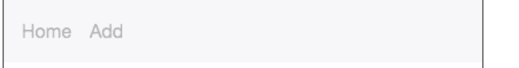

现在，点击“添加”菜单项。你会看到这样的表单：

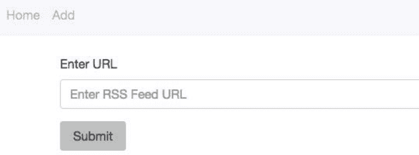

输入有效的 feed URL，例如 `http://qnimate.com/feed/`，并点击**提交**。现在返回首页，你将看到此输出：


现在，点击 URL 查看 feed 内容。输出将类似于此：

```
首页 添加
* 将域名指向 AWS Elastic Load Balancing
* 在 Cordova 中找到录制音频文件位置
* ES6 Reflect API 教程
* Express.js 中间件教程
* 在 Intel XDK App 中本地数据
* 使用 Node.js 将文件流上传到存储服务器
* 在 JavaScript 中生成唯一数字
* JSON.parse() 对有效 JSON 抛出 "unexpected token"
* 最佳在线照片校直工具
```

点击任何标题都将在同一标签页中打开 URL。

## 总结

在本章中，我们学习了如何使用 React 和 Flux 构建单页应用。我们还探索了许多库，例如 xmljson、Flux.js、MicroEvent.js 和 React Router。之后，我们构建了一个功能完整的 RSS 阅读器。

你现在可以向应用程序中添加新功能，例如实时 feed 更新和通知。

# 第 12 章：Angular 2 的新功能

Angular 1 基于 MVC 架构，而 Angular 2 基于组件和服务的架构。Angular 1 和 Angular 2 在架构和 API 方面完全不同，因此之前对 Angular 1 的知识可能无法帮助你学习 Angular 2。在本章中，我们将在不与 Angular 1 比较的情况下学习 Angular 2，我们将涵盖以下内容：

- Web 组件
- Angular 2 架构
- 模板
- 组件输入和输出
- 组件生命周期
- 事件
- 表单

## Angular 2 架构

Angular 2 基于组件和服务的架构。应用程序的所有组件都以树结构排列，并以根组件为根节点。

## Web 组件

Web 组件是一组允许创建可复用自定义元素的浏览器标准。它们包括 Shadow DOM、模板和自定义元素。

现在让我们通过构建一个显示包含图像、标题和描述的卡片的组件，来概述 Shadow DOM、模板和自定义元素。

### 模板

模板用于定义可复用的代码。模板使用 `<template>` 标签定义。模板的代码放置在该标签内部。我们可以放置任何标签，例如 `<script>` 和 `<style>`。

`<template>` 标签内部的代码只会被解析，而不会渲染。

以下是如何创建模板的示例。将此代码放置在 `<body>` 标签中：

```html
<template id="cardTemplate">
  <style type="text/css">
    .container {
      width: 250px;
      float: left;
      margin-right: 10px;
    }
    img {
      width: 100%;
    }
  </style>
  <div class="container">
    
    <div>
      <h3></h3>
      <p></p>
    </div>
  </div>
</template>
```

在这里，模板包含了卡片组件的 UI 代码。现在，如果你在浏览器中打开 `index.html` 文件，你什么也看不见，因为 `<template>` 标签只会被解析而不会渲染。

### 自定义元素

**自定义元素**允许定义新类型的 HTML 元素（即新类型的 HTML 标签）。当我们使用浏览器不识别的标签名称时，浏览器简单地将其视为一个 `<span>` 标签。但当我们注册一个自定义标签时，它就能被浏览器识别。它可以继承其他元素，允许我们在元素生命周期的不同阶段执行不同的操作，等等。

让我们为我们的组件创建一个自定义元素。每当该标签出现时，都会显示该组件的新实例。

以下是显示自定义元素的代码。将其放置在 `<body>` 标签中：

```html
<custom-card data-img="http://placeholder.it/250x250" data-title="Title 1" data-description="Description 1" is="custom-card"></custom-card>
<custom-card data-img="http://placeholder.it/250x250" data-title="Title 2" data-description="Description 2"></custom-card>
```

我们必须在自定义元素名称中使用连字符。这是强制性的；此限制允许我们区分自定义元素和普通元素，并确保在向 HTML 添加新标签时具有向后兼容性。在这里，我们将组件的属性作为数据属性传递。

现在，让我们将 `<custom-card>` 定义为自定义元素，并在每当创建 `<custom-card>` 的新实例时执行标签内部的模板代码。为了做到，请将此代码放在 `<script>` 标签中：

```javascript
var customCardProto = Object.create(HTMLElement.prototype);
customCardProto.createdCallback = function () {
  var template = document.querySelector("#cardTemplate");
  template.content.querySelector("img").src = this.getAttribute("data-img");
  template.content.querySelector("h3").innerHTML = this.getAttribute("data-title");
  template.content.querySelector("p").innerHTML = this.getAttribute("data-description");

  var clone = document.importNode(template.content, true);
  this.appendChild(clone);
};

var customCard = document.registerElement("custom-card", {
  prototype: customCardProto
});
```

## Angular 2 的新特性

以下是代码的工作原理：

- 默认情况下，自定义元素继承 `HTMLElement` 的方法和属性。
- 要注册自定义元素，我们需要使用 `document.registerElement` 方法。第一个参数是自定义标签名称，第二个参数是一个可选对象。该可选对象可以包含一个名为 `prototype` 的属性。`prototype` 属性定义了它继承的 HTML 元素，即它继承的 HTML 元素的属性和方法。默认情况下，它被赋值为 `Object.create(HTMLElement.prototype)`。
- 我们还可以通过向分配给 `prototype` 属性的对象添加新的属性和方法，为我们的自定义元素添加新的属性和方法。
- 在这里，我们添加了方法 `createdCallback`，每当创建自定义元素的实例时（无论是使用 JavaScript 还是 HTML 创建实例），它就会被调用。
- 在 `createdCallback` 内部，我们获取模板并设置图像源、标题和描述，然后通过创建它的克隆将其附加到自定义元素，因为许多自定义元素将共享同一个模板。

现在，如果你在浏览器中打开 `index.html`，你将看到此输出：

| Title 1 | Title 2 |
| --- | --- |
| Description 1 | Description 2 |

### Shadow DOM

Shadow DOM 允许 HTML 元素获得一种名为 shadow root（影子根）的新节点与之关联。关联了 shadow root 的元素被称为 shadow host（影子宿主）。shadow host 的内容不会渲染；相反，shadow root 的内容会被渲染。一个 shadow root 下可以有另一个 shadow root。

Shadow DOM 的用处是，shadow root 内部定义的 CSS 样式不会影响其父文档，而从 shadow root 外部定义的 CSS 样式也不会影响 shadow root 内部的元素。这对于定义特定组件的样式有用。简而言之，我们可以说 Shadow DOM 实现了样式封装。

样式封装不是 Shadow DOM 的唯一好处。shadow root 内部的 HTML 受到保护，免受 JavaScript 意外修改的影响。我们仍然可以在浏览器开发者工具中检查 shadow root。

许多元素（如 `<video>` 和 `<audio>`）拥有 shadow root，但当你检查它时，并不会看到 shadow root。浏览器默认隐藏这些元素的 shadow root。要查看它们的根，你需要更改特定的浏览器设置。

让我们修改之前的自定义元素代码，在 Shadow DOM 内部渲染模板。将之前的 `createdCallback` 方法替换为此：

```javascript
customCardProto.createdCallback = function() {
  var template = document.querySelector('#cardTemplate');
  template.content.querySelector('img').src = this.getAttribute('data-img');
  template.content.querySelector('h3').innerHTML = this.getAttribute('data-title');
  template.content.querySelector('p').innerHTML = this.getAttribute('data-description');

  var clone = document.importNode(template.content, true);
  var shadow = this.createShadowRoot();
  shadow.appendChild(clone);
};
```

在这里，我们没有直接将模板代码附加到自定义元素，而是使用 `createShadowRoot` 创建了一个 shadow root 并将模板代码附加到它。

## 搭建 Angular 2 项目

Angular 2 代码可以使用 JavaScript、TypeScript 或 Dart 编写。如果你在使用 TypeScript 或 Dart 编写 Angular 2 代码，你将需要将其编译为 JavaScript。

创建一个名为 `angular2-demo` 的目录。然后，在目录中创建 `app.js` 和 `package.json` 文件。创建一个 `public` 目录，并在目录内创建 `html`、`js`、`componentTemplates` 和 `componentStyles` 目录。在 `html` 目录中创建一个 `index.html` 文件。

然后下载 `angular2-polyfills.js`、`Rx.umd.js` 和 `angular2-all.umd.js` 从 https://cdnjs.com/libraries/angular/ 并将它们放在 `angular2-demo/js` 目录。这些文件就是你需要的。你也可以直接引入 CDN 链接。

在 `index.html` 文件中放置此起始代码：

```html
<!DOCTYPE html>
<html>
<head>
    <title>Angular 2 Demo</title>
</head>
<body>
    <script src="/js/angular2-polyfills.js"></script>
    <script src="/js/Rx.umd.js"></script>
    <script src="/js/angular2-all.umd.js"></script>
    // 应用代码在这里
</script>
</body>
</html>
```

在 `app.js` 文件中放置此代码：

```javascript
var express = require("express");
var app = express();

app.use(express.static(__dirname + "/public"));

app.get("/", function(httpRequest, response) {
    response.sendFile(__dirname + "/public/html/index.html");
});
app.listen(8080);
```

这是服务器端代码。它一目了然。

现在，在 `package.json` 文件中放置此代码并运行 `npm install` 来下载 express 包：

```json
{
  "name": "Angular2-Demo",
  "dependencies": {
    "express": "4.13.3"
  }
}
```

要启动服务器，运行 `node app.js`。然后，在浏览器中使用 `localhost:8080` 作为地址打开应用。

## Angular 2 基础

Angular 2 应用完全拆分为组件。技术上来说，Angular 2 组件是一个可复用的自定义标签，它是可变的并封装了嵌入的状态、标题，改变状态或属性将改变 UI。

> 记住 Angular 2 不会将自定义标签名称注册为自定义元素。

应用程序的所有组件都以树结构排列，并以根组件为根节点。

以下是如何创建一个组件的示例。它创建了一个显示图像、标题和描述的卡片组件。将此代码放在 `<script>` 标签中：

```javascript
var Card = ng.core.Component({
  selector: "card",
  inputs: ["src", "title", "desc"],
  templateUrl: "templates/card-template.html",
  styleUrls: ["templateStyles/card-style.css"]
}).Class({
  constructor: function() {}
});
```

## Angular 2 的新特性


然后，创建一个名为 `card-template.html` 的文件，并将其放入 `componentTemplates` 目录。将此代码放入该文件中：

```html
<style>
.container {
  width: 250px;
  float: left;
  margin-right: 10px;
}

img {
  width: 100%;
}
</style>
<div class="container">
  
  <div>
    <h3>{{title}}</h3>
    <p>{{desc}}</p>
  </div>
</div>
```

之后，创建一个名为 `card-style.css` 的文件，并将其放入 `componentStyles` 目录。将此代码放入该文件中：

```css
.container {
  width: 250px;
  float: left;
  margin-right: 10px;
}

img {
  width: 100%;
}
```

## 第 12 章

这三个代码段的工作原理如下：

- 组件需要通过链属于 `ng.core` 对象的 `Component` 和 `Class` 方法来创建。

- `Component` 方法接收一个包含各种属性的配置对象，而 `Class` 方法接收一个包含组件生命周期方法、构造函数和 UI 动作处理程序的对象。

- 在这里，我们提供的配置属性有 `selector`、`inputs`、`templateUrl` 和 `styleUrls`。`selector` 属性用于定义组件的自定义标签。`inputs` 属性用于定义组件标签的属性。`templateUrl` 属性用于定义包含组件模板的文件。你也可以使用 `template` 来内联组件的样式。最后，`styleUrls` 用于定义包含组件的 CSS 文件。你也可以使用 `style` 属性内联 CSS，或者在模板本身内部使用 `<style>` 标签定义 CSS。通过这三种方式任何一种定义的 CSS 都不会影响其他组件，也就是说，它是封装在组件本身的。

- 在 `Class` 方法中，即使它没有执行任何操作，我们也会有一个 `constructor` 方法。它在组件新实例的构造期间被调用。我所说的组件构造，是指在内存中构造组件——而不是解析属性、解析子元素、渲染视图等。`constructor` 方法的主要用途是将服务注入到组件中。服务可以自动注入，因为我们有时需要为每个组件初始化服务，而 Angular 并不知道如何做到这一点。`constructor` 可以访问组件的状态，但不能访问其属性。在这里，我们不应该执行任何沉重的工作或会减慢或导致组件构造失败的操作。`constructor` 不是这样的。

- 然后，我们有了组件模板代码。在这个模板文件中，我们简单地渲染传递给组件的属性。要渲染组件状态中的任何内容，我们需要使用 `{{ }}` 令牌。

## Angular 2 的新特性

让我们创建一个名为 Cards 的新组件，用于显示卡片列表。它从服务获取卡片信息。

将此代码放入 index.html 文件的 `<script>` 标签中：

```javascript
var CardsService = ng.core.Class({
  constructor: function () {
  },
  getCards: function() {
    return [{
      src: "http://placeholder.it/350x150",
      title: "Title 1",
      desc: "Description 1"
    },
      {
        src: "http://placeholder.it/350x150",
        title: "Title 2",
        desc: "Description 2"
      },
      {
        src: "http://placeholder.it/350x150",
        title: "Title 3",
        desc: "Description 3"
      }
    ];
  }
});

var Cards = ng.core.Component({
  selector: "cards",
  viewProviders: [CardsService],
  directives: [Card],
  templateUrl: "componentTemplates/cards-template.html"
}).Class({
  constructor: [CardsService, function(cardsService) {
    this.getCards = cardsService.getCards;
  },
  ngOnInit: function () {
    this.cards = this.getCards();
  }
})
```

```javascript
var App = ng.core.Component({
  selector: "app",
  directives: ["Cards"],
  templateUrl: "componentTemplates/app-template.html"
}).Class({
  constructor: function() {
  }
})

g.platform.browser.bootstrap(App);
```

现在，在 `componentTemplates` 目录中创建一个 `cards-template.html` 文件，并将此代码放入其中：

```html
<card ngFor="card of cards" title="{{card.title}}"
src="{{card.src}}" desc="{{card.desc}}"></card>
```

现在，在 `componentTemplates` 目录中创建一个 `app-template.html` 文件，并将此代码放入其中：

```html
<cards></cards>
```

现在，在 index.html 文件的 `<body>` 标签中放入此代码：

```html
<app></app>
```

以下是这四个代码段的工作原理：

- 为了创建一个服务，我们需要使用 `ng.core.Class` 方法。它接收一个包含构造函数方法以及服务暴露的其他方法或属性的对象。

- 为了创建一个服务，我们需要使用 `ng.core.Class` 方法。它接收一个包含构造函数方法以及服务暴露的其他方法或属性的对象。

| Title 1 | Title 2 | Title 3 |
| :--- | :--- | :--- |
| Description 1 | Description 2 | Description 3 |

## Angular 2 的新特性

在这里，你可以看到 CSS 被修改并插入到了 `<head>` 标签中。

要强制 Angular 2 使用 shadow DOM，我们需要将组件配置对象的 `encapsulation` 属性赋值为 `ng.core.ViewEncapsulation.Native`。默认情况下，它被赋值为 `ng.core.ViewEncapsulation.Emulated`。

在将 Card 组件的 `encapsulation` 属性赋值为 `ng.core.ViewEncapsulation.Native` 后检查应用程序，你将看到如下内容：

```
<!DOCTYPE html>
<html>
<head>
  <shadow-root (open)>
    <title>Angular 2 Demo</title>
  </head>
<body>
  <cards>
    <shadow-root (open)>
      <!--template bindings={}()-->
      <card>
        <shadow-root (open)>
          <style>
            .container {
              width: 250px;
              float: left;
              margin-right: 10px;
            }
            img {
              width: 100%;
          }
          </style>
          <div class="container"></div>
        </card>
      </card>
    </cards>
  <script src="/is/angular2-polyfills.min.js"></script>
  <script src="/is/Rx.umd.min.js"></script>
  <script src="/is/angular2-all.min.js"></script>
  <script></script>
</body>
</html>
```

第 12 章

在这里，你可以看到使用了 shadow DOM 来实现样式封装。

> 如果你不想对组件进行样式封装，可以将 `encapsulation` 属性赋值为 `ng.core.ViewEncapsulation.None`。在这种情况下，所有的 CSS 将直接放置在 `<head>` 标签中。

## Angular 2 变更检测

变更检测（Change detection）是检测组件状态变化的过程。组件的状态使用关键字进行存储和操作。Angular 2 并没有直接的方法来检测状态何时变化。因此，Angular 2 使用复杂的算法和第三方库来检测状态变化。

Angular 2 检测状态变化的第一步是假定所有的变化都是异步发生的。然后，它使用 `zone.js` 库来监控浏览器计时器、AJAX 请求、WebSockets 以及其他 `zone.js` 支持的异步事项。

现在，当这些异步活动中的任何时，它会检查所有可能变化的内容，包括从根节点开始的所有组件关键字的对象属性和数组元素；如果检测到任何变化，组件的模板绑定就会被更新。Angular 2 并不是简单地渲染组件。相反，它会检查已变化的绑定并针对性地选择它们。

某些组件可能包含大量的状态数据，如果它们的状态没有变化，为每个异步操作都检查状态将不必要地影响应用的性能。此外，Angular 2 提供了一个选项来匹配此类组件，使得除非组件自己告诉 Angular 2 在下一个检测周期中（即异步活动发生时）检查其状态，否则它不会检查状态。让我们来看一个示例来演示这一点。

将此代码放在 `index.html` 文件的 `<script>` 标签中、`AppComponent` 之上：

```
var SampleComponent = ng.core.Component({
  selector: "sampleone",
  template: "{{value}}",
  viewProviders: [ng.core.ChangeDetectorRef],
  changeDetection: ng.core.ChangeDetectionStrategy.Detached
}).Class({
```

## Angular 2 的新特性

```
constructor: [ng.core.ChangeDetectorRef, function(cd) {
  this.cd = cd;
},
ngOnInit: function() {
  this.value = 1;
  setInterval(function() {
    this.value++;
    this.cd.markForCheck();
  }.bind(this), 2000);
}
```

然后，将 `SampleComponent` 添加到 App 组件的 `directives` 数组中。

现在，App 组件的代码应该是这样的：

```
var App = ng.core.Component({
  selector: "app",
  directives: [Cards, SampleComponent1],
  templateUrl: "ComponentTemplates/app-template.html"
});
Class {
  constructor: function() {
}
```

现在，将此内容添加到 `app-template.html` 文件的末尾：

```html
<br style="clear: both">
<sampleone></sampleone>
```

以下是这些代码段的工作原理：

- 1. 在此示例中，我们显示一个每 2 秒增加一次的值，并且模板会重新渲染以显示更新后的值。

- 2. 首先，我们创建一个名为 `SampleComponent1` 的组件。它仅显示值。我们将 `changeDetection` 属性赋值为 `ng.core.ChangeDetectionStrategy.Detached`，这告诉 Angular 2 不要检查它的状态变化。默认情况下，`ng.core` 的是 `changeDetectionStrategy.Default`，这告诉 Angular 2 在每个变更检测周期中检查它的状态变化。然后我们将 `ng.core.ChangeDetectorRef` 服务注入组件中，它提供了各种与变化相关的 API。随后在 `ngOnInit` 方法中，我们每 2 秒增加一次 `value` 的值，之后调用 `ng.ChangeDetectorRef` 的 `markForCheck` 方法，这告诉 Angular 2 检查组件状态的变化。

- 3. 然后，我们只需在 App 组件中显示 `Sample1`。

## 理解视图子（view children）和内容子（content children）

呈现组件标签的元素是内容子（content children），呈现组件模板的元素是视图子（view children）。

要显示组件的子元素，我们需要使用 `<ng-content>` 标签。让我们来看一个示例。

将此代码放在 App 组件代码之上：

```
var ListItem = ng.core.Component({
  selector: "item",
  inputs: ["title"],
  template: "<li>{{title}} | <ng-content></ng-content></li>",
}).Class({
  constructor: function() {}
});
```

```
var List = ng.core.Component({
  selector: "list",
  template: "<ul><ng-content select='item'></ng-content></ul>"
}).Class({
  constructor: function() {}
});
```

现在，将 App 组件的代码更改为：

```
var App = ng.core.Component({
  selector: "app",
  directives: [Cards, SampleComponent1, List, ListItem],
  templateUrl: "componentTemplates/app-template.html"
}).Class({
  constructor: function() {}
});
```

## Angular 2 的新特性

在 `app-template.html` 文件的末尾添加以下代码：

```html
<br>
<list>
  <item title="first">first</item>
  <item title="second">second</item>
</list>
```

此代码的输出如下：

| first | first |
| :--- | :--- |
| second | second |

这是这些代码段的工作原理：

- 1. 在 App 组件的模板中，我们添加了 `<list>` 标签，它显示一个列表。在它的起始和结束标签之间，我们定义了它应该显示的单个列表项。

- 2. 我们创建了 `ListItem` 和 `List` 组件，分别绑定到 `<list>` 和 `<item>` 标签。

- 3. 我们将 `List` 组件添加到 App 组件的 `directives` 属性中，而不是 List，因为 `<list>` 标签位于 App 组件的模板中，由 App 组件负责创建其实例。

- 4. App 组件查找 List 组件模板中的 `<ng-content>` 标签并在那里渲染 List 组件实例。

- 5. `<ng-content>` 有一个可选的 `select` 属性，该属性赋值为 CSS 选择器，用于指示我们要显示哪些内容子元素。模板中可以存在多个 `<ng-content>` 标签。如果未提供 `select` 属性，则所有内容子都将被渲染。在这里，`select` 属性不是必需的；我们使用仅用于演示。

## 获取内容投影（content children）和视图投影（view children）组件的引用

要访问视图投影或内容投影组件的引用，我们可以使用 `ng.core.ContentChildren`、`ng.core.ViewChildren`、`ng.core.ContentChild` 和 `ng.core.ViewChild` 构造函数。`ng.core.ContentChildren` 与 `ng.core.ContentChild` 的区别在于，前者返回给定组件的所有引用，而后者返回第一个出现项的引用。`ng.core.ViewChild` 也同样的区别。

以下是一个演示 `ng.core.ContentChildren` 的示例。请将 `List` 组件的代码替换为以下：

```javascript
var List = ng.core.Component({
  selector: "list",
  template: "<ul><ng-content select='item'></ng-content></ul>",
  queries: {
    list_items: new ng.core.ContentChildren(ListItem)
  }
}).Class({
  constructor: function() {},
  ngAfterContentInit: function() {
    this.list_items.results.forEach(function(e) {
      console.log(e.title);
    }
  }
})
```

此代码在控制台的输出如下：

first

second

# Angular 2 的新特性

这段代码大部分是自解释其明的。什么是 `ngAfterContentInit` 生命周期钩子方法？它在内容投影初始化后触发。同样地，如果我们想访问视图投影，我们需要使用 `ngAfterViewInit` 生命周期钩子。

请注意，我们只能访问组件的状态 —— 无法访问其他任何内容。

## 本地模板变量

我们可以为内容投影或视图投影分配一个本地模板变量。本地模板变量允许我们获取内容投影或视图投影中任何元素的引用，即组件引用或 HTML 元素引用。

要为视图投影或内容投影的元素分配本地模板变量，我们需要在起始标签中放置 `#variable_name`。

以下是一个演示本地模板变量如何工作的示例。将此代码放在 `App` 组件上方：

```javascript
var SampleComponent2 = ng.core.Component({
  selector: "sampletwo",
  template: `<input type='text' #input />`,
  queries: {
    input_element: new ng.core.ViewChild("input")
  }
}).Class({
  constructor: function(){
  ngAfterInit: function() {
    this.input_element.nativeElement.value = "Hi";
  }
})
```

将 `App` 组件的代码更改为：

```javascript
var App = ng.core.Component({
  selector: "app",
  directives: [Cards, SampleComponent1, List, ListItem, SampleComponent2],
  templateUrl: "componentTemplates/app-template.html"
}).Class({
  constructor: function(){
})
```

然后，将此代码添加到 `app-template.html` 文件的末：

```html
<sampletwo></sampletwo>
```

此代码的输出如下：


以下是这些代码段的工作原理：

1. 我们创建了一个名为 `SampleComponent2` 的新组件，它显示一个 HTML 输入元素。我们将该输入元素分配给本地模板变量 `input`。

2. 接着，我们使用 `ng.core.ViewChild` 来获取该元素的引用。如果我们向 `ng.core.ViewChild`、`ng.core.ViewChildren` 和 `ng.core.ContentChild` 传递字符串，它们将寻找与该字符串本地名称相同的元素；如果我们传递一个组件，它们将像我们之前看到的那样寻找该组件。

3. 我们从本地模板变量获取的组件引用具有相同的接口。但对于 HTML 元素，我们可以通过 `nativeElement` 属性访问真实的 DOM。

## 组件周期方法

当 `<component>` 标签出现时，Angular 2 会创建一个组件的实例、渲染它、检查状态变化，并在不再需要时销毁它。这些步骤共同组组件的生命周期。

Angular 2 注册了在各个阶段调用的方法。以下是 Angular 2 提供的各种生命周期方法；按发生顺序解释生命周期钩子：

- `ngChanges`: 每当组件属性发生变化时都会调用它。它在创建新组件实例后首次解析属性、以及由于属性导致状态更改后也会被调用。此方法接收属性的当前值和旧值。

- `OnInit`: 在组件成功创建并读取属性后调用。

- `ngDoCheck`: 在每次变更周期期间以及 `OnInit` 之后调用。我们可以检测并处理 Angular 2 无法自行检测的变化。它在 Angular 2 完成对组件的更改检查，并且在视图更新之前属性发生了任何更改并更新了状态后调用。

- `ngContentInit`: 在内容投影初始化但尚未渲染后调用，即在 `ngChanges`、`OnInit`、`ngDoCheck` 之后。

- `ngAfterContentChecked`: 每当变更周期检查内容投影是否发生变化时以及在 `ngContentInit` 之后都会调用。如果发生变化，它会在内容投影的视图之前调用。

- `ngAfterViewInit`: 在视图投影初始化但尚未渲染后调用，即在 `ngChanges`、`OnInit`、`ngDoCheck`、`ngAfterContentInit` 之后。

- `ngAfterViewChecked`: 每当变更周期检查视图投影是否发生变化时以及在 `ngAfterViewInit` 之后都会调用。如果有更改，它会在视图投影更新之前调用。

- `ngOnDestroy`: 在组件销毁之前调用。组件的 `ngOnDestroy` 方法在其内容投影和视图投影销毁前调用。

- 编写模板

我们需要使用模板来编写组件模板。模板语言由 HTML 以及 `{}`、`[]`、`()`、`*` 和 `#` 令牌组成。让我们看看它们的用途以及如何使用。

## 渲染值

要简单渲染 `this` 关键字的属性，我们需要使用 `{{}}` 令牌。在括号内，我们只需放置属性名。

括号内只能放置表达式。括号内的表达式类似于 JavaScript。但某些 JavaScript 表达式是不允许在括号内使用的。它们是：

- 赋值 (`=`、`+=`、`-`)

- `new` 运算符

- 使用 `;` 或 `,` 链接表达式

- 增/减运算符 (`++` 和 `--`)

- 位运算运算符 `|`、`&`

## 管道

我们也可以在括号内放置管道。管道是一个接受输入值并返回转换后值的函数。管道由 `|` 运算符表示。括号内表达式的最终结果可以使用管道进行转换。括号中可以放置任意数量的管道。Angular 2 提供了一些内置管道：`date`、`lowercase`、`currency` 和 `percent`。我们也可以创建自己的管道。

以下是使用 `{{}}` 的示例。将此代码放在 `App` 组件上方：

```javascript
var SampleComponent3 = ng.core.Component({
  selector: "samplethree",
  template: "{{info.firstname + info.lastname | uppercase}}"
}).Class({
  constructor: function() {
    this.info = {
      firstname: "firstname",
      lastname: "lastname"
    }
  }
});
```

## Angular 2 的新特性

将 App 组件代码替换为以下内容：

```
var App = ng.core.Component({
  selector: "app",
  directives: [Cards, SampleComponent1, List, ListItem,
  SampleComponent2, SampleComponent3],
  templateUrl: "componentTemplates/app-template.html"
}).Class({
  constructor: function() {}
})
```

然后，将此内容放入 app-template. 文件中：

```
<br>
<sampletree></sampletree>
```

代码的输出如下：


> 注意，如果大括号内表达式的最终值不是字符串，则最终结果会被转换为字符串。

## 处理事件

要在模板中处理事件，我们需要使用 `()` 运算符。以下是处理事件的示例。将此代码放在 `App 组件代码` 的方上方：

```
var SampleComponent4 = ng.core.Component({
  selector: "SampleComponent4",
  template: "<Input (click)='clicked($event)' 
  (mouseover)='mouseover($event)' types='button'
  value='Click Me!' />",
}).Class({
  constructor: function() {
    this.clicked = function(e) {
      alert("Hi from SampleComponent4");
    };

    this.mouseover = function(e) {
      console.log("Mouse over event");
    }
  }
})
```

## 第 12 章

将 App 组件代码替换为以下内容：

```
var App = ng.core.Component({
  selector: "app",
  directives: [Cards, SampleComponent1, List, ListItem, SampleComponent2, SampleComponent3, SampleComponent4],
  templateUrl: "componentTemplates/app-template.html"
}).Class({
  constructor: function() {}
})
```

将此代码放入 app-template.html 中：

```
<br><br><samplefour></samplefour>
```

前面的代码是不言自明的。

## 将状态绑定到元素属性

要将 `this` 关键字的属性值绑定到模板中元素的属性上，我们可以简单地使用 `{{}}`，例如：

```
<component title="{{title}}"></component>
```

但如果你想传递一个对象，这种方法将不起作用，因为 `{{}}` 令牌内的表达式始终会被转换为字符串。因此，Angular 2 提供了 `[]` 运算符，它允许组件通过属性将对象传递到模板中的组件。

这里有一个演示此点的示例。将此代码放在 App 组件代码中：

```
var Sample5 = ng.core.Component({
  selector: "samplefive",
  inputs: ["info"],
  template: "{{info.name}}"
}).Class({
  constructor: function() {}
})
```

```
var Sample6 = ng.core.Component({
  selector: "samplesix",
  directives: [SampleComponent5],
  template: "<samplefive [info]='myInfo'></samplefive>"
}).Class({

constructor: function() {
  this.myInfo = {
    name: "Name"
  }
})
```

将 App 组件的代码替换为以下内容：

```
var App = ng.Component({
  selector: "app",
  directives: [Cards, SampleComponent1, List, ListItem,
SampleComponent2, SampleComponent3, SampleComponent4,
SampleComponent6],
  templateUrl: "componentTemplates/app-template.html",
  Class: {
    constructor: function() {}
  }
})
```

将此代码放在 app-template.html 文件的末：

```
<br><br>
<samplesix></samplesix>
```

此代码的输出如下：


> 注意，在给 HTML 标签赋值属性时，如果该属性不是元素原生的，我们需要使用 `attr.` 前缀。例如，为了给 `<span>` 标签赋值，不能简单地使用 `value`，否则 Angular 2 会报错。因为 Angular 2 通过解释模板并创建 DOM 来设置属性。因此，当我们使用 `attr.` 时，它指示 Angular 2 使用 `setAttribute`。

## 双向数据绑定

默认情况下，Angular 2 不使用双向绑定。它使用单向绑定，但在需要时提供了 `[]` 运算符来实现双向绑定。

这里有一个示例（[]）。将此代码放在 App 的上方：

```
var SampleComponent7 = ng.core.Component({
  selector: 'sampleseven',
  template: '<input [(ngModel)]='name' /><input
  (click)='clicked()' value='Click here' />
}).Class({
  constructor: function() {
  clicked: function() {
    alert(this.name);
  }
})
```

将 App 代码替换为：

```
var App = ng.core.Component({
  selector: 'app',
  directives: [Cards, SampleComponent1, List, ListItem,
  SampleComponent2, SampleComponent3, SampleComponent4,
  SampleComponent6, SampleComponent7],
  templateUrl: "componentTemplates/app-template.html"
}).Class({
  constructor: function() {
})
```

将此代码放入 app-template.html：

```
<br><br>
<sampleseven></sampleseven>
```

此代码的输出如下：

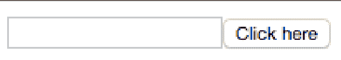

在这里，在文本框中输入内容并点击按钮，你会看到带有文本框值的警告框。

## Angular 2 的新特性

为了获取 HTML 元素的值，我们需要在 `[]` 括号内放置。如果在输入和输出之间设置双向绑定，我们可以放置属性名。稍后我们将学习更多。

## 指令

指令用于根据状态更改 DOM。指令有两种类型：属性指令和结构指令。让我们来看每一个。

## 属性指令

属性指令根据状态的变化更改 DOM 元素的显示或行为。`ngClass` 和 `ngStyle` 是内置属性指令。我们也可以创建自己的属性指令。

`ngClass` 指令用于从元素添加或删除类，而 `ngStyle` 指令用于设置内联样式。这里有一个 `ngClass` 和 `ngStyle` 的示例。将此代码放在 AppComponent 的上方：

```
var SampleComponent8 = ng.core.Component({
  selector: "sample",
  template: "<div [ngStyle]='styles' [ngClass]='classes'></div>",
}).Class({
  constructor: function() {
    this.styles = {
      font-size: "20px",
      font-weight: "bold"
    }

    this.classes = {
      a: true,
      b: true,
      c: false
    }
  }
})
```

将 App 组件的代码替换为：

```
var App = ng.core.Component({
  selector: "app",
  directives: [Cards, SampleComponent1, List, ListItem,
  SampleComponent2, SampleComponent3, SampleComponent4,
  SampleComponent6, SampleComponent7, SampleComponent8],
  templateUrl: "componentTemplates/app-template.html",
  Class: {
    constructor: function() {}
  }
});
```

然后，将此代码放在 app-template.html 文件的末：

```
<sample></sample>
```

现在，如果你在开发者工具中检查 `<sample>`，你会看到：

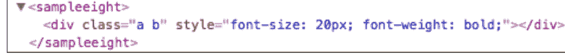

大部分代码都是自言自明的。你可以看到相同的 `[]` 令牌也用于属性指令。当使用 `[]` 令牌时，Angular 2 首先检查是否存在该名称的内置指令或自定义指令，如果没有，则将其视为属性。

## 结构指令

结构指令通过添加或删除元素来更改 DOM 布局。`ngIf`、`ngSwitch` 和 `ngFor` 是三个内置的结构指令。我们也可以创建自己的结构指令。

这里有一个演示 `ngIf` 和 `ngSwitch` 的示例。我们之前已经见过 `ngFor`。将此代码放在 App 组件的上方：

```
var SampleComponent9 = ng.core.Component({
  selector: "samplenine",
  templateUrl: "componentTemplates/samplecomponent9-template.html"
}).Class({
  constructor: function() {}
});
```

```javascript
this.display1 = true;
this.display2 = false;
this.switchOption = 'A';
```

创建一个名为 `samplecomponent9-template.html` 的文件，并将其放入 `componentTemplates` 目录。将此代码放入该文件中：

```
<div ngIf="display1">Hello</div>
<div ngIf="display2">Hi</div>
```

```
<span ngSwitch="switchOption">
  <span ngSwitchWhen='A'>A</span>
  <span ngSwitchWhen='B'>B</span>
  <span ngSwitchWhen='C'>C</span>
  <span ngSwitchWhen='D'>D</span>
  <span ngSwitchDefault='other'>other</span>
</span>
```

将 App 组件的代码替换为：

```
var App = ng.Component({
  selector: 'App',
  directives: [Cards, SampleComponent1, List, ListItem,
  SampleComponent2, SampleComponent3, SampleComponent4,
  SampleComponent6, SampleComponent7, SampleComponent8,
  SampleComponent9],
  templateUrl: 'componentTemplates/app-template.html'
}).Class({
  constructor: function() {}
})
```

最后，将此代码放入 app-template.html 文件中：

```
<samplenine></samplenine>
```

此代码的输出如下：

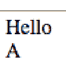

## 第 12 章

大部分代码都是自而易懂的。你可以看到我们在使用 `*` 标记作为结构化指令。`*` 标记将元素视为模板，因为它不渲染该元素，而是将其作为模板来创建 DOM。

实际上，属性指令和结构化指令都是使用 `[]` 标记编写的，因为使用 `[]` 标记编写结构化指令代码会让代码变得冗长。因此，Angular 2 引入了 `*` 标记，这使得使用结构化指令编写代码变得简单。在内部，Angular 2 会将使用 `*` 标记的代码转换为使用 `[]` 标记。在此处了解更多信息：

```
https://angular.io/docs/ts/latest/guide/template-syntax.html##star-template
```

## # 输出 (Outputs)

输出允许组件发射自定义事件。例如，如果我们有一个显示按钮的组件，并且我们父组件能够为子组件的点击事件添加事件处理程序，我们可以通过输出来实现这一点。

以下是如何集成输出的示例。将此代码放在 App 组件代码上方：

```
var SampleComponent10 = ng.core.Component({
  selector: "sampleleten",
  outputs: ["*click*"],
  template: ""
}).Class({
  constructor: function() {
    this.click = new ng.core.EventEmitter();
    setInterval(function() {
      this.click.next({});
    }.bind(this), 10000)
  }
})
```

```
var SampleComponent11 = ng.core.Component({
  selector: "sampleeleven",
  directives: [SampleComponent10],
  template: "<br>-sampleleten\n  (click)='clicked($event)"></sampleleten>{value}"
}).Class({
  constructor: function() {
    this.value = 1;
  }
})
```

## Angular 2 的新功能

```
this.clicked = function(e) {
  this.value++;
}
}
```

将 App 组件的代码替换为以下内容：

```
var App = ng.core.Component({
  selector: "app",
  directives: [Cards, SampleComponent1, List, ListItem, SampleComponent2, SampleComponent3, SampleComponent4, SampleComponent6, SampleComponent7, SampleComponent8, SampleComponent9, SampleComponent11],
  templateUrl: "componentTemplates/app-template.html",
  $class: {constructor: function() {}}
}
```

最后，将此代码放在 app-template.html 文件的末：

```
<sampleleven></sampleleven>
```

现在，你将会在页面上看到一个计数器。

outputs 属性用于定义事件发射。我们需要在 `this` 关键字中创建一个与输出同名的属性，并将其赋值为 `ng.core.EventEmitter` 的新实例，以便它可以发射事件。`ng.core.EventEmitter` 为对象提供了观察者模式。

为了捕获事件，我们需要使用 `()` 标记，就像我们使用它捕获原生 UI 事件一样。

> 注意，我们需要在构造函数属性内部将输出赋值为 `ng.core.EventEmitter` 的新实例，即在组件新实例创建期间。

## 使用 inputs 和 outputs的双向数据绑定

你可以在 inputs 和 outputs之间实现双向数据绑定。如果父组件向视图子组件传递属性，并且子组件每当输入值变化时都通知父组件，那么我们不需要分别使用 `()` 和 `[]`，而是可以使用 `(())`。

## 第 12 章

这里有一个演示此点的示例。将此代码放在 App 组件代码上方：

```
var SampleComponent12 = ng.core.Component({
  selector: "sampletwelve",
  inputs: ["count"],
  outputs: ["countChange"],
  template: ""
}).Class({
  constructor: function() {
    this.count = new ng.core.EventEmitter();
    setInterval(function() {
      this.count++;
      this.countChange.next(this.count);
    }).bind(this, 10000);
  }
});
```

```
var SampleComponent13 = ng.core.Component({
  selector: "SampleComponent12",
  directives: [SampleComponent12],
  template: "<br>"*sampletwelve>\n{{count}}</sampletwelve>{{count}}"
}).Class({
  constructor: function() {
    this.count = 1;
  }
});
```

将 App 组件的代码替换为以下内容：

```
var App = ng.core.Component({
  selector: "app",
  directives: [Cards, SampleComponent1, List, ListItem,
SampleComponent2, SampleComponent3, SampleComponent4,
SampleComponent6, SampleComponent7, SampleComponent8,
SampleComponent9, SampleComponent11, SampleComponent13],
  templateUrl: "componentTemplates/app-template.html"
}).Class({
  constructor: function() {}
});
```

最后，将此代码添加到 app-template.html 文件的末尾：

```
<samplethirteen></samplethirteen>
```

在这里，输出与上一个示例相同。大部分内容都是自而易懂的。你唯一需要知道两个代码片段执行的是相同的事情：

```
<sampleweave [count]='count'></sampleweave>
<sampleweave [count]='count' (countChange = count=$event)></sampleweave>
```

## 理解 providers（提供者）

provider 告诉如何创建一个服务的实例。在注入服务时，它是通过组件的 `providers` 或 `viewProviders` 属性。让我们看一个创建 providers 的示例。将此代码放在 App 组件上方：

```
var Service1 = ng.core.Class({
  constructor: function() {
  },
  getValue: function() {
    return "xyz"
  }
});
```

```
var Service2 = ng.core.Class({
  constructor: function() {
  },
  getValue: function() {
    return "def"
  }
});
```

```
var Service3 = ng.core.Class({
  constructor: function() {
  },
  getValue: function() {
    return "mno"
  }
});
```

```
var Service4 = ng.core.Class({
  constructor: [s2, s3] {
    console.log(s2);
    console.log(s3);
  }],
  getValue: function() {
    return "abc"
  }
});
```

```
var ServiceTest1 = ng.core.Component({
  selector: "st1",
  viewProviders: [
    ng.core.provide(Service1, {useClass: Service4}),
    ng.core.provide(Service2, {useValue: "def"}),
    ng.core.provide(Service3, {useFactory: function() {
      return "mno"
    }})
  ],
  template: ""
}).Class({
  constructor: function(s1) {
    console.log(s1.getValue());
  }
});
```

```
var App = ng.core.Component({
  selector: "app",
  directives: [Cards, SampleComponent1, List, ListItem,
SampleComponent2, SampleComponent3, SampleComponent4,
SampleComponent6, SampleComponent7, SampleComponent8,
SampleComponent9, SampleComponent11, SampleComponent13,
ServiceTest1],
  templateUrl: "componentTemplates/app-template.html"
}).Class({
  constructor: function() {}
});
```

最后，将此添加到 app-template.html 的末尾：

```
<style></style>
```

## Angular 2 的新功能

这是代码的控制台输出：

```
def
mno
abc
```

它是这样工作的：

- 首先，我们创建了四个服务：Service1、Service2、Service3 和 Service4。

- 它们都有一个 `getValue` 方法，返回一个字符串。Service4 依赖于 Service2 和 Service3。

- 然后，我们创建一个名为 ServiceTest1 的组件。它依赖于 Service1。在 `viewProviders` 属性中，我们传递了一个提供者数组。

## providers 与 viewProviders 属性的区别

`viewProviders` 属性允许我们使提供者仅对组件视图可见，而 `providers` 属性使提供者对其内容内容和视图内容可见。

`providers` 属性只会创建一个服务实例，并向任何请求该服务的组件提供相同的实例。我们已经见过 `viewProviders` 是如何工作的。现在让我们来看一个 `providers` 如何工作的示例。将此代码放在 App 组件代码上方：

```javascript
var counter = 1;

var Service5 = ng.core.Class({
  constructor: function() {}
})

var ServiceTest2 = ng.core.Component({
  selector: "st2",
  template: ""
}).Class({
  constructor: [Service5, function(s5) {
    console.log(s5);
  }]
})

var ServiceTest3 = ng.core.Component({
  selector: "st3",
  providers: [ng.core.provide(Service5, {useFactory: function() {
    counter++;
    return counter;
  })],
  directives: [ServiceTest2],
  template: "<st2></st2>"
}).Class({
  constructor: [Service5, function(s5) {
    console.log(s5);
  }]
})
```

将 App 组件的代码替换为以下内容：

```javascript
var App = ng.core.Component({
  selector: "app",
  directives: [Cards, SampleComponent1, List, ListItem, SampleComponent2, SampleComponent3, SampleComponent4, SampleComponent6, SampleComponent7, SampleComponent8, SampleComponent9, SampleComponent11, SampleComponent13, ServiceTest1, ServiceTest3],
  templateUrl: "componentTemplates/app-template.html"
}).Class({
  constructor: function() {}
})
```

# Angular 2 的新特性

最后，在 `app-template.html` 文件的末尾放置此代码：

```html
<st></st>
```

这段代码的控制台输出如下：

- 2

- 2

这段代码中的大部分内容都是自自明的。我们使用的是 `providers` 而不是 `viewProviders`。`UnitTest2` 组件依赖于 `Service5`，但它没有 `Service5` 的提供者，Angular 2 使用了 `ServiceTest3` 提供的提供者，因为 `ServiceTest3` 是它的父组件。如果 `ServiceTest3` 没有 `Service5` 的提供者，Angular 2 将继续向上查找，并在 `App` 组件中寻找提供者。

> `ng.platform.browser.bootstrap` 方法还接受第二个参数，这是一个所有组件可用的提供者列表。因此，我们不需要在 App 组件中传递提供者，而是可以通过 `ng.platform.browser.bootstrap` 方法传递它们。

## 总结

在本章中，我们学习了 Angular 2。我们了解了什么是组件、如何编写模板、如何创建服务等。我们还学习了组件以及 Angular 2 如何利用它们。现在你应该已经熟练掌握了构建 Angular 2 应用。

在下一章中，我们将学习如何通过构建一个完整的应用来使用 Angular 2 构建 SPA。

# 13

使用 Angular 2 构建搜索引擎模板

为了使用 Angular 2 构建单页应用 (SPA)，我们需要学习如何在 Angular 2 中实现路由。Angular 2 自带了内置的路由 API，这些 API 非常强大、功能丰富且易于使用。在本章中，我们将构建一个基础的搜索引擎模板，以演示 Angular 2 中的路由。我们不会构建一个完整的搜索引擎内核，因为那超出了本书的范围。我们将使用 Bootstrap 4 来设计搜索引擎模板。在本章结束时，你将能够熟练使用 Angular 2 构建 SPA。

在本章中，我们将涵盖以下主题：

- Angular 2 中的路由

- Angular 2 提供的内置 HTTP 客户端

- 使用 Chance.js 库生成随机文本数据

## 设置项目

按照以下步骤设置你的项目：

- 在本章的练习文件中，你将找到两个目录：`initial` 和 `final`。`final` 目录包含了搜索引擎模板，而 `initial` 目录包含了快速构建搜索引擎模板的文件。

# 使用 Angular 2 构建搜索引擎模板

2. 在 `initial` 目录，你将找到 `app.js` 和 `package.json`。在 `package.json` 文件中放置此代码：

```json
{
  "name": "SearchEngineTemplate",
  "dependencies": {
    "express": "4.13.3",
    "chance": "1.0.3"
  }
}
```

在这里，我们使用 Express.js 和 Chance.js 作为依赖项。Express 将用于构建 Web 服务器，而 Chance.js 将用于生成随机文本数据以填充模板的搜索结果。

3. 现在，在 `initial` 目录下运行 `npm install` 来下载包。

在 `initial` 目录下，你将找到一个名为 `public` 的目录，所有的静态资源将放在这里。在 `public` 内部你将找到 `componentTemplates`、`css`、`html` 和 `js` 目录。

在 `css` 目录下，你将找到 `bootstrap.min.css`；在 `html` 目录中找到 `index.html`；最后在 `js` 目录中找到 `app.js`。

4. 在 `index.html` 中放置此代码以加载 Angular、Bootstrap 样式：

```html
<!doctype html>
<html>
<head>
  <title>Search Engine</title>
  <link rel="stylesheet" type="text/css" href="bootstrap.min.css">
</head>
<body>
  <app></app>
  <script src="js/Rx.js"></script>
  <script src="js/angular-all.js"></script>
  <script src="js/angular-polyfills.js"></script>
  <script src="js/index.js"></script>
</body>
</html>
```

这段代码是自自明的。

5. 现在，在 `app.js` 文件中放置此代码：

```javascript
var express = require("express");
var app = express();

app.use(__dirname + "/public");

app.get("/", function(req, res) {
  res.sendFile(__dirname + "/public/index.html");
});

app.listen(8080);
```

# 配置路由并启动应用

在 SPA 中，路由路由。在 Angular 2 中我们需要定义路径和组件。让我们创建根组件和路由：

1. 在 `index.js` 文件中放置此代码：

```javascript
var AppComponent = ng.Component({
  selector: "app",
  directives: [RouterDirectives],
  templateUrl: "componentTemplates/app.html"
}).Class({
  constructor: function() {}
})

var routes = ng.RouteConfig([
  { path: "/", component: HomeComponent, name: "Home" },
  { path: "search-result", component: SearchResultComponent, name: "SearchResult" },
  { path: "*", component: NotFoundComponent, name: "NotFound" }
])

ng.platform.browser.bootstrap(AppComponent, [
  RouterProviders,
  ng.core.provide(router.APP_HREF, {useValue: "/"})
]);
```

2. 现在在 `componentTemplates` 目录下创建一个 `app.html` 并在其中放置此代码：

```html
<nav class="navbar navbar-light bg-faded">
  <ul class="navbar-nav">
    <li class="nav-item">
      <a class="nav-link" [routerlink]="['/']">Home</a>
    </li>
  </ul>
</nav>
<router-outlet></router-outlet>
```

代码原理如下：

- 首先我们创建一个名为 `AppComponent` 的根组件。在创建根组件时，我们为其添加了 `RouterDirectives` 指令，这允许我们使用 `routerlink` 指令。

- 接着，我们使用 `ng.RouteConfig` 来配置应用的路由。我们将一个路由数组作为 `ng.RouteConfig` 方法的参数。一个路由由路径、组件和路由名称组成。路径可以是静态的、参数化的或通配符，就像 Express 路径一样。

- 最后我们初始化应用。在初始化应用时，我们传递了 `RouterProviders`，它们将用于创建各种路由相关的服务实例。此外，我们提供了一个自定义提供者，它在请求 `router.APP_HREF` 服务时会返回 `/` 字符。

4. 在 AppComponent 模板中，我们显示了一个导航栏。该导航栏包含一个没有 `href` 属性的锚点标签；相反，我们正在使用 `routerLink` 指令来分配重定向链接，这样在点击它时，它不会重新加载整个页面，而是改变 URL 和组件。最后，`<router-outlet>` 是根据当前 URL 显示组件的。

## 生成随机搜索结果

为了填充我们的模板，我们需要生成一些随机的搜索结果数据。为此，我们使用了 `Chance.js` 库。我们将在服务器端生成随机数据，而不是客户端，稍后我们可以演示如何使用 Angular 2 发送 HTTP 请求。

Chance.js 同时适用于客户端和服务器端 JavaScript。我们之前下载了 `Chance.js` 包以供 Node.js 使用。以下是生成随机数据的代码。将其放置在 `app.js` 文件中 `/* route` 之上，以确保 `/* route` 不会覆盖随机数据：

```javascript
var Chance = require("chance");
chance = new Chance();
app.get("/getData", function (httpResponse, next) {
  var result = [];
  for(var i = 0; i < 10; i++) {
    result[result.length] = {
      title: chance.sentence(),
      desc: chance.paragraph()
    }
  }
  httpResponse.send(result);
});
```

在这里，我们为 `/getData` 路径创建了一个路由，它将一个搜索结果数组作为响应。路由回调使用 `chance.sentence()` 为搜索结果生成随机标题，并使用 `chance.paragraph()` 生成描述。

## 创建路由组件

让我们创建 `HomeComponent`、`SearchResultComponent` 和 `NotFoundComponent`。在此之前，让我们创建一个显示搜索表单的组件。搜索表单将有一个文本框和一个搜索按钮。按照以下步骤操作：

- 1. 将此代码放在 `index.js` 文件中，`AppComponent` 代码上方：

```javascript
var HomeComponent = ng.core.Component({
  selector: "search-form",
  directives: [ng.router.ROUTER_DIRECTIVES],
  templateUrl: "componentTemplates/search-form.html",
}).Class({
  constructor: function() {},
  ngOnInit: function() {
    this.searchParams = {
      query: "*"
    };
    this.keyup = function(e) {
      this.searchParams = {
        query: e.srcElement.value
      };
    }
  }
});
```

- 2. 在 `componentTemplates` 目录中创建一个名为 `search-form.html` 的文件，并在其中添加此代码：

```html
<div class="m-a-2 text-xs-center">
  <h1>Search for Anything!</h1>
  <form class="form-inline m-c-1">
    <input (keyup)="keyup($event)" class="form-control" 
           type="text" placeholder="Search">
    <a [routerLink]="['SearchResult', searchParams]">
      <button class="btn btn-success-outline" 
              type="submit">Search</button>
    </a>
  </form>
</div>
```

# 第 13 章

以下是代码代码工作原理：

- 1. 首先，我们创建了一个名为 `FormComponent` 的组件。它使用了 `ng.router.ROUTER_DIRECTIVES` 指令。

- 2. 在组件的模板中，我们显示了一个 HTML 表单。该表单有一个文本框和按钮。

- 3. 我们处理了输入框的 `keyup` 事件，并将值存储在 `searchParams.query` 属性中。

- 4. 按钮重定向到 `SearchResult` 组件。注意，这里我们将 `searchParams` 对象传递给 `routerLink`，它在重定向时会变成查询参数。

现在，让我们创建 `HomeComponent`。该组件显示在主页上。

以下是创建 `HomeComponent` 的方法：

- 1. 将此代码放在 `index.js` 文件中，`AppComponent` 代码上方：

```javascript
var HomeComponent = ng.core.Component({
  selector: "home",
  directives: [FormComponent],
  templateUrl: "componentTemplates/home.html",
}).Class({
  constructor: function() {}
});
```

- 2. 现在，创建一个名为 `search-form.html` 的文件，并将其放在 `componentTemplates` 目录中：

```html
<search-form></search-form>
```

- 3. 在这里，`HomeComponent` 是自解释的。

- 4. 现在，让我们创建 `SearchResultComponent`。该组件应该显示搜索表单以及其下方的搜索结果。它应该通过向服务器发送 HTTP 请求来获取结果。以下是 `SearchResultComponent` 的代码。将其放置在 `index.js` 文件中，`AppComponent` 代码上方：

```javascript
var SearchResultComponent = ng.core.Component({
  selector: "search-result",
  directives: [FormComponent],
  viewProviders: [ng.http.HTTP_PROVIDERS],
  templateUrl: "componentTemplates/searchResult.html"
}).Class({
  constructor: [ng.router.RouteParams, ng.http.Http, function(params, http) {
    this.params = params;
    this.http = http;
    this.response = [];
  }],
  ngOnInit: function() {
    var q = this.params.get("query");
    this.http.get("getData").subscribe(function(res) {
      this.response = JSON.parse(res._body);
    }).bind(this);
  }
});
```

- 4. 现在，创建一个名为 `searchResult.html` 的文件并将其放在 `componentTemplates` 中。将此代码放在该文件中：

```html
<style>
  ul {
    list-style-type: none;
  }
</style>

<div class="container">
  <search-form></search-form>
  <div class="m-a-2 text-xs-center">
    <ul>
      <li *ngFor="item of response" class="m-t-2">
        <h4>{{item.title}}</h4>
        <p>{{item.desc}}</p>
      </li>
    </ul>
  </div>
</div>
```

# 13 章

以下是代码的工作原理：

- 1. 首先，我们创建了一个名为 `FormComponent` 的组件。它使用了 `ng.router.ROUTER_DIRECTIVES` 指令。

- 2. 在组件的模板中，我们显示了一个 HTML 表单。该表单有一个文本框和按钮。

- 3. 我们处理了输入框的 `keyup` 事件，并将值存储在 `searchParams.query` 属性中。

- 4. 按钮重定向到 `SearchResult` 组件。注意，这里我们将 `searchParams` 对象传递给 `routerLink`，它在重定向时会变成查询参数。

现在，让我们创建 `HomeComponent`。该组件显示在主页上。

以下是创建 `HomeComponent` 的方法：

- 1. 将此代码放在 `index.js` 文件中，`AppComponent` 代码上方：

```javascript
var HomeComponent = ng.core.Component({
  selector: "home",
  directives: [FormComponent],
  templateUrl: "componentTemplates/home.html",
}).Class({
  constructor: function() {}
});
```

- 2. 现在，创建一个名为 `search-form.html` 的文件，并将其放在 `componentTemplates` 目录中：

```html
<search-form></search-form>
```

- 3. 在这里，`HomeComponent` 是自解释的。

- 4. 现在，让我们创建 `SearchResultComponent`。该组件应该显示搜索表单以及其下方的搜索结果。它应该通过向服务器发送 HTTP 请求来获取结果。以下是 `SearchResultComponent` 的代码。将其放置在 `index.js` 文件中，`AppComponent` 代码上方：

```javascript
var SearchResultComponent = ng.core.Component({
  selector: "search-result",
  directives: [FormComponent],
  viewProviders: [ng.http.HTTP_PROVIDERS],
  templateUrl: "componentTemplates/searchResult.html"
}).Class({
  constructor: [ng.router.RouteParams, ng.http.Http, function(params, http) {
    this.params = params;
    this.http = http;
    this.response = [];
  }],
  ngOnInit: function() {
    var q = this.params.get("query");
    this.http.get("getData").subscribe(function(res) {
      this.response = JSON.parse(res._body);
    }).bind(this);
  }
});
```

- 4. 现在，创建一个名为 `searchResult.html` 的文件并将其放在 `componentTemplates` 中。将此代码放在该文件中：

```html
<style>
  ul {
    list-style-type: none;
  }
</style>

<div class="container">
  <search-form></search-form>
  <div class="m-a-2 text-xs-center">
    <ul>
      <li *ngFor="item of response" class="m-t-2">
        <h4>{{item.title}}</h4>
        <p>{{item.desc}}</p>
      </li>
    </ul>
  </div>
</div>
```

> 你可以通过 [Angular 2](https://angular.io/docs/latest/guide/server-communication) 了解 HTTP 服务。

现在，让我们创建 `NotFoundComponent`。以下是代码：

- 1. 将此代码放在 `index.js` 文件中，`AppComponent` 代码上方：

```javascript
var NotFoundComponent = ng.core.Component({
  selector: "name-search",
  templateUrl: "componentTemplates/notFound.html"
}).Class({
  constructor: function() {}
})
```

- 2. 现在，创建一个名为 `notFound.html` 的文件并将其放在 `componentTemplates` 目录中。将此代码放在文件中：

```html
<div class="container">
  <div class="m-a-2 text-xs-center">
    <h1>The page you are looking for is not found</h1>
  </div>
</div>
```

# 使用 AngularJS 2 构建搜索模板

## 测试模板

为了测试模板，我们将遵循以下步骤：

- 1. 在初始目录中运行 `node.js` 命令。

- 2. 现在，在浏览器中打开 `http://localhost:8080/`。。你应该看到输出：

- 3. 现在，在搜索框中输入内容并点击搜索按钮。你应该看到以下输出：

- 4. 现在，在地址栏输入一个无效路径。你应该看到以下输出：

# 路由生命周期方法

当路径匹配组件时，Angular 2 会激活组件，而当路径改变时，Angular 2 会停用它。当我们说一个组件已激活时，意味着 Angular 2 创建了组件的实例，即调用了组件的构造方法；而当我们说一个组件已停用时，意味着组件已从 DOM 中移除并被删除。

激活或停用组件的方法被称为路由生命周期方法。

以下是路由生命周期方法的列表：

- CanActivate: 此钩在激活组件之前调用。它应该返回一个布尔值或承诺，指示是否激活组件。

- routerOnActivate: 此方法在组件激活后调用。

- routerCanReuse: 此方法用于在下次 URL 变化为相同的 URL 时，查找是否重用之前的实例。它应该返回一个布尔值或承诺，指示是否重用。它仅在之前创建了实例时才调用。

- routerOnReuse: 此方法在组件被重用时调用。它在 `routerCanReuse` 之后调用。

- routerCanDeactivate: 此方法在停用组件之前调用。它应该返回一个布尔值或承诺，指示是否停用组件。

- routerOnDeactivate: 此方法在组件停用后调用。

## 使用 AngularJS 2 构建搜索引擎模板

让我们来看路由生命周期方法的代码示例。将 `HomeComponent` 的代码替换为以下内容：


```javascript
var HomeComponent = ng.Component({
  selector: "home",
  directives: [FormComponent],
  templateUrl: "component/home.html",
  constructor: function() {
    routerOnActivate: function() {
      console.log("Component has been activated");
    },
    routerCanReuse: function() {
      console.log("Component can be reused");
      return true;
    },
    routerOnReuse: function() {
      console.log("Component is being reused");
    },
    routerCanDeactivate: function() {
      console.log("Component can be deactivated");
      return true;
    },
    routerOnDeactivate: function() {
      console.log("Component has been deactivated");
    }
  }
});

HomeComponent = ng.router.CanActivate(function() {
  console.log("Component can be activated");
  return true;
});
```

现在，访问首页。再次点击按钮。现在，在搜索框中输入内容。你将看到控制台输出：

- Component can be activated
- Component has been activated
- Component can be reused
- Component can be deactivated

## 模式与开发模式

到目前为止，我们一直在开发模式下运行 Angular。开发模式和生产模式的区别在于，在开发模式下，Angular 在第一次运行后立即开始检测，并记录第一次和第二次运行之间的任何内容。这有助于定位错误。要启用生产模式，请在上方放置代码：

```javascript
ng.core.enableProd();
```

## 总结

在本章中，我们通过构建基础搜索引擎模板学习了路由。在深入路由的同时，我们还学习了 HTTP 服务以及如何切换到生产模式。你现在应该能够熟练构建任何应用程序的前端了。

## Node.js 应用的安全

保护应用程序非常重要。安全不是一次性的任务。当你添加新功能时，你需要不断对代码进行修改，随着应用程序流量的增加，你需要扩展服务器。在本章中，你将学习如何让 Node.js 应用更安全以及如何扩展。我假设你正在使用 Express 创建 Web 服务器，因为它是最常用的。在本章中，我们将涵盖：

- 应用程序漏洞
- 非漏洞攻击
- 保护应用程序的各种第三方服务
- 第三方包中的安全问题
- 流量分发技术

## 应用中的常见漏洞

根据维基百科，**漏洞**（vulnerability）是应用程序中的缺陷，允许攻击者降低系统信息的安全保障。让我们来看一些重要的漏洞以及如何防止它们。

## Helmet

**Helmet** 是一个 Node.js 库，通过设置安全相关的 HTTP 头帮助你防止各种攻击。以下是 Helmet 添加的各种标头：

- `Strict-Transport-Policy`：该标头用于强制执行到服务器的安全连接（通过 SSL/TLS 的 HTTP）。Helmet 防止了中间人攻击。在中间人攻击中，攻击者会秘密地篡改客户端和服务器之间的通信。这样做是为了窃取数据、添加网页等。
- `X-Frame-Options`：该标头提供点击劫持（clickjacking）保护。点击劫持利用多个透明或不透明的层，欺骗用户在他们想要点击顶层页面时点击按钮或其他页面上的内容。因此，攻击者可以“劫持”点击并将其路由到其他页面，最可能是另一个应用程序、域名或两者都有。此标头防止应用程序在 iframe 内部查看，从而提供点击劫持保护。
- `X-XSS-Protection`：该标头防止反射型 XSS 攻击。反射型 XSS 攻击是跨站脚本（XSS）的一种——XSS 是将恶意脚本注入良良且信任网站的注入攻击。当攻击者利用 Web 应用程序向不同的终端用户发送恶意代码（通常以浏览器端脚本的形式）时，就会发生 XSS 攻击。反射型 XSS 是常见的 XSS 攻击类型。它也是非持久性 XSS 攻击，因为攻击负载通过单个请求和响应传递并执行。反射型 XSS 发生在攻击者在 URL 的 HTML 响应中执行 JavaScript 代码时。
- `X-Content-Type-Options`：浏览器可以覆盖 Content-Type 标头并使用隐式内容类型处理数据。虽然这在某些情况下可能很方便，但也可能导致某些攻击，例如 MIME 混淆攻击、未授权的链接等。返回 `X-Content-Type-Options` 允许浏览器使用提供的 Content-Type 标头，而不将内容解释为不同的内容类型。
- `Content-Security-Policy`：该标头允许我们向浏览器提供一个信任源列表，JavaScript、CSS、HTML 框架、图像和嵌入对象（Java applets、ActiveX、音频和视频）等内容可以从中加载到页面。这有助于防止 XSS 攻击。

要了解更多关于 Helmet 的信息，请访问 https://www.npmjs.com/helmet

## 跨站请求伪造

跨站请求伪造（CSRF）是一种强制用户在已身份验证的 Web 上执行意外操作的攻击。它利用了浏览器信任用户的 Session。例如，攻击者可以欺骗用户点击向目标服务器发送请求的链接。由于用户已登录，浏览器会包含 Cookie，服务器会处理该请求。为了防止 CSRF，我们可以使用令牌。有一个名为 `csrf` (https://www.npmjs.com/csrf) 的库可以帮助你防止 CSRF。它为 Express 服务器提供了生成和验证 CSRF 令牌的中间件。

## 会话固定

会话固定是一种允许攻击者劫持有效会话的攻击。防止会话固定技术：

- 设置会话超时
- 经常重新会话令牌
- 在创建会话时存储用户代理和 IP 地址，并在后续请求中检查其是否匹配。

## 扩展 Node 服务器

有一个名为 Node Security Project 的数据库，它列出了最受关注的包。你可以使用诸如 `nsp` (https://www.npmjs.com/package/nsp) 和 `requireSafe` (https://www.npmjs.com/package/requisafe) 等命令行工具来检查应用程序的漏洞依赖项。

你应该始终关注应用程序所依赖的包的新版本发布，并对其进行更新，因为新版本通常会修复与安全相关的问题。

如果你的应用程序有大量用户同时访问系统，显然单台服务器无法处理所有流量。它会变慢并崩溃。因此，我们需要将应用程序部署在多个服务器上，并在它们之间分配流量。

为了在服务器之间分配流量，我们需要使用一种被称为负载均衡器（load balancer）的东西。负载均衡器是一个位于应用服务器之前的服务器。客户端与负载均衡器通信而不是应用服务器通信，负载均衡器并不直接处理请求，而是将其转发给应用程序服务器；当应用程序服务器发送响应时，它会将相同的响应发送给客户端。

由于负载均衡器实际上并不处理请求，因此它可以处理比应用程序服务器多得多的请求。显然，负载均衡器无法处理无限请求，因此我们可以使用多个负载均衡器。当我们使用多个负载均衡器时，通过轮询 DNS（round-robin DNS）技术来分配它们之间的流量。在轮询 DNS 中，指向负载均衡器的域名 IP 地址根据适当的统计模型发生变化。

亚马逊云 (AWS) 提供了负载均衡器 Amazon ELB，它可以用于在 Amazon EC2 服务器（即应用服务器）之间分配流量。显然，很难预测扩展应用程序需要多少个 EC2 实例；因此，AWS 还提供了名为“自动伸缩”（auto scaling）的服务，可以根据需要添加/删除 EC2 实例。因此，托管大型应用程序，Amazon 是最佳选择。它还提供了许多云服务来扩展和部署你的应用程序。

如果你不想担心服务器的扩展、部署和管理，那么可以使用如 Heroku 这样的云服务，它让实现所有这一切变得简单得多，你只需要担心应用程序代码——就这些。

## 总结

在本章中，我们看到了许多扩展和安全 Node.js 应用程序的服务和库。我们看到了各种漏洞以及如何防止它们。确保你对数据进行定期备份，这样即使你的程序被攻击，你仍然有机会重新运行程序，因为数据没有丢失。显然，关于扩展和安全 Node.js 应用程序还有很多需要学习的，因为这是一个无尽的话题，新事物不断出现。

# 索引

# A

- Angular 2
  - 架构 243-245
  - 变化检测 259-261
  - 基础 251-256
  - 影子 DOM 257, 258
  - 样式组件 257, 258
  - URL 244
  - angular2-all.umd.js
    - URL 250
  - angular-polyfills.js
    - URL 250
  - Angular 2 项目
    - 设置 250
  - API key
    - URL 67
    - 架构 26, 27
  - 属性指令 272, 273
  - 自动伸缩 301

- 静态文件，向用户提供 119

- Bacon.js
  - 关于 136
  - 错误 147, 148
  - Bacon.js APIs
    - 关于 138
    - EventStream, 创建 138, 139
    - EventStream, Filter 142
    - EventStream, 合并 142
    - EventStream, 转换 143-145
    - 属性，过滤 139-141
    - 属性, 合并 142
    - 属性, 转换 143-145
  - Bacon.js 库
    - URL 136
  - Bacon.retry 函数
    - 延迟 149
    - isRetryable 149
    - 重试 149
    - 源 149
  - 基础插件 15

- Bootstrap 4
  - 21:9 宽高比类 195
  - 关于 173
  - 浏览器支持 174
  - 卡片组件 183-188
  - CSS 单位, 174, 175
  - 自定义 195
  - 设备支持 174
  - 下载 173, 174
  - Flexbox 支持 194
  - glyglyphs, 移除 196
  - 网格系统 175-179
  - 标题, 显示 181

# B

- Babel
  - URL, 用于安装 209
  - Babel 编译器
    - 引用链接 209

- 后端，比分网站
  - 管理员面板，保护 119, 120
  - HTML, 向管理员提供 119, 120
  - HTML, 向用户提供 119
  - 消息，广播
    - 到运行时 121, 122
  - socket.io cookie, 身份验证 121, 122
  - socket.io 服务器, 集成
    - Express 服务器 118
  - 反向表 182, 183
  - JavaScript 改进 195
  - Less, 移动到 Sass 193
  - 外边距重置 179
  - 轮廓按钮 193
  - 重启 194
  - 间距类 179-181
  - 锚点, 添加 195
  - URL, 下载 173
  - 工具类, 扁平 194
  - 工具类, 文本对齐 194
  - 暴力攻击 380
  - 内置的, Seneca 和集成
  - componentDidMount() 219
  - componentDidUpdate(prevProps, prevState) 221
  - componentWillMount() 219
  - componentWillReceiveProps(nextProps) 219, 220
  - componentWillUnmount() 221
  - componentWillUpdate(nextProps, nextState) 221
  - AfterComponentCheck 266
  - AfterContentUpdate 266
  - AfterViewChecked 266
  - AfterViewDid 266
  - OnDestroy 265
  - OnCreate 265
  - shouldComponentUpdate(nextProps, nextState) 221
  - bus 152

# C

- 回调模式 128
- 卡片组件 183-188
- 列 189-193
- 卡片组 189-193
- 卡片组 189-193
- 变化检测 259
- chatroulette 关于 83
- 前端构建 88-97
- chatroulette 网站 98
- 点击劫持 298
- 闭包 153
- 漏洞，Node.js 应用程序
- 跨站请求伪造 (CSRF) 299
- 跨站脚本 299
- 会话固定 299
- 组件组合 213, 214
- 组件生命方法 218, 265
- 组件所有权 215
- 组件默认值 218
- 探索组件 213
- 常量属性 151
- 构造函数, Peer API 68
- 内容子元素 261, 262
- 本地变量 264, 265
- 组件的引用 263
- 站点 49-51
- 开发 52, 53
- 跨站请求伪造 (CSRF) 299
- 跨站脚本 (XSS) 298
- csrf, 库 299
- 自定义元素 245
- 创建自定义服务器 80

# D

- 数据库服务 26
- 数据报层安全 (DTLS) 66
- 拒绝服务  own DoS
  - 属性指令 272, 273
  - 结构指令 273, 274
  - 分发器 227
  - 分发器构造函数
  - dispatch(action) 228
  - register(callback) 227
  - unregister(id) 227
  - waitFor(array) 227
  - DoS 308

# E

- 元素属性状态 269
- 错误,Bacon.js 关于 147, 148
- EventStream 调用, 错误 150
- 函数调用, 重试 149
- 映射 148
- 属性, 错误 150
- 订阅 148
- 事件驱动模式 128
- 事件，处理 228
- EventStream 关于 134, 135
- 组合 153, 154
- 压缩 153, 154
- 异常处理 150, 151
- Express Seneca, 集成 21-23
- express-brite 关于 300
- URL 300
- Express.js 158
- Express 服务器 集成 82
- socket.io 服务器, 集成 118

# F

- Feed URL 240
- 过滤 142
- Flexbox 支持, Bootstrap 4 引用链接 194
- Flexbox 版本, Bootstrap CSS 文件 URL, 下载 194
- Flux 架构 关于 225, 226
  - action 创建器 226
  - action 226
  - 分发器 226
  - React 视图 226
  - store 226
- Flux.js 前端-Bacon.js 库 URL, 下载 136
- 前端构建
  - action, 创建 233-239
  - 分发器, 创建 233-239
  - 路由, 定义 232, 233
  - store, 创建 233-239
- 函数式编程语言 133
- 函数式编程，简述 关于 130
- 函数式数据结构 131
- 辅助函数 133
- 不变数据，益处 131
- 使用的 JavaScript 132
- 纯函数，益处 132
- 函数式响应式编程 (FRP) 关于 127, 134
- EventStream 134, 135
- 项目，设置 136
- 属性 135, 136
- 使用 Bacon.js 136

# G

- GitHub 仓库, WebRTC 引用 76
- 图标 196
- 比分网站 关于 117
  - 后端, 构建 117, 118
  - 前端, 构建 123, 124
  - 测试 125

# H

- 头部 关于 298
- Content-Security-Policy 298
- Strict-Transport-Policy 298
- X-Content-Type-Options 298
- X-Frame-Options 298
- X-XSS-Protection 298

# M

- 媒体消费者 56
- 媒体源 56
- MediaStream 传输 65, 66
- MediaStream API 58
- MediaStream 构造函数 URL 59
- MediaStreamTrack 接口 URL 58
- Helmet URL 298
- HTML 导入 245
- HTTP 关系, 与 WebSocket 100, 101
- HTTP 服务, Angular 2 URL 291
- mem-store 插件 15
- 合并 142
- MicroEvent.js 关于 228
- 引用链接 228
- 使用 228

## Node.js 应用

- 常见漏洞 297
- 基于漏洞的攻击 300

## Node.js 服务器

- 扩展性 301

## Node 安全项目

- URL 301
- 基于漏洞的攻击，
- Node.js 应用
- 暴力破解攻击 300
- 拒绝服务攻击 300

## nullshell

- 函数式编程 130

# O

## 开源的，JSX 编译器

- URL 209
- 轮廓按钮 193
- 输出 275, 276

# P

## PeerJS

- 关于 56, 67
- URL，用于下载 68
- 用于构建 WebRTC 应用 67

#### PeerJS API

- 关于 68
- 构造函数 68-75
- URL，用于文档 76

#### PeerServer

- 关于 67
- 从 shell 运行 80
- URL 83

## PeerServer 库

- 创建自定义 PeerServer, 81
- PeerServer 与 Express 集成 82
- 使用 81

## 点对点连接

- 开始: 64, 65
- 点对点网络模型 56
- 管道 267

## 个人资料搜索组件

- 构建 157
- 公司建议路由 160, 161

## Express.js 路由，转换为函数响应式模式 158, 159

- 前端，构建 164-170
- 函数式响应式模式，Express.js 路由的转换 159
- 函数式响应式模式，Express.js 路由转换为：158
- 项目目录 158
- 项目文件 158
- 搜索结果路由 162-164
- 测试 171, 172
- 用户体验，增强 159

## promise 模式 128

## 属性

- 关于 135, 136
- 合并 154
- 订阅到结束 152, 153
- 压缩 154
- 原型 248
- 提供者 278-280

## 提供者属性

- 章节，viewProviders 202-282
- 纯函数 130

# R

## React

- 关于 198
- 组件 203, 204
- 同构 UI 开发 207-209
- 单向数据绑定 204-207
- 项目，设置 199
- URL，用于下载 199
- 虚拟 DOM 200-202
- ReactDOMServer.renderToStaticMarkup 224

# 响应式编程

- 关于 128
- 编写响应式代码时的问题 128, 129

## React Router

- 关于 228
- URL，源码 228

## 实时数据 57

- 协调和 215-218

## refs

- 关于 223, 224
- 使用 223, 224

## requireSafe

- 引用链接 301

## room 113

## 路由生命周期方法

- CanActiveDeactivate 293
- routerCanDeactivate API
- routerCanReuse 293
- routerOnDeactivate 293
- routerOnReuse 293

## RSS 馈器

- 应用，引导 240, 241
- 后端，构建 230, 231
- 创建 229
- 前端，构建 231, 232
- 项目文件，设置 230

## RTCDataChannel API 66

## RTCPConnection API

- 关于 63
- MediaStream, 传输 65, 66
- 点对连接，设置 64, 65

# S

## 搜索引擎模板

- 应用，引导 285, 286
- 生产模式，对比开发模式 295
- 项目，设置 283-285
- 随机搜索结果，生成 287
- 路由组件，创建 288-291
- 路由生命周期方法 293, 294
- 测试 292, 293
- 安全包
- 使用 300

## Seneca 应用

- 动作，创建 14
- 创建 13
- 数据，存储 18-20
- Express，集成 21-23
- 插件，创建 15
- 服务，创建 17, 18

## Seneca 模式

- URL 15

## Seneca 插件

- URL 17
- 服务
- 创建 29
- 数据库服务 29-31
- 上传服务 32-36

## Session 协议 (SDP) 64

## Seneca 穿透技术

- NAT (STUN) 65

## 影子 DOM 245

## shim

- URL 76

## 56

## Socket.IO

- 关于 103
- 命名空间 110
- 项目，设置 103

## Socket.IO API

- 关于 105-108
- Socket.IO 客户端，在房间 113
- Socket.IO 客户端，在房间 112
- 基于来源的限制 109
- 广播到命名空间 114
- 广播到房间 114
- 手动断开 116
- 消息，广播到命名空间 114
- 中间件 115
- 命名空间 110
- 添加房间 113
- 移除房间 113

## Socket.IO 库 103

## socket.io 服务器

- 与 Express 服务器集成 118

## 间工具类 179

## 状态

- 绑定到属性 269
- 存储 227
- 存储 XSS 299
- 数据 21
- 流 56
- 结构化指令 273, 274
- 取消者 153

# W

## Web 组件

- 关于 245
- 自定义元素 247, 248
- 影子 DOM 209
- 模板 246

## webcomponents.js

- URL 245
- 插件 15

## Web 实时通信。参见 WebRTC

## WebRTC

- 关于 56, 58
- MediaStream API 58, 59
- navigator.getUserMedia 60-63
- RTCDataChannel API 66
- RTCPeerConnection API 63

## WebRTC 应用

- 构建，PeerJs 67

## WebSocket

- 关于 09, 100
- 数据接收 101
- 数据发送 101
- 防火，交互 102
- 负载均衡器，交互 102
- 代理服务器，交互 102
- 与 HTTP 的关系 100, 101
- 同源策略 103
- WebSocket 协议 101

# T

## 模板

- 指令 272
- 事件处理 268
- 管道 267
- 状态，绑定到属性 264, 270

## 双向数据绑定

- 有效，渲染 267
- 写入 266

## 时间耦合

- URL 131

## Tether 195

## 线程安全

- URL 131

## Token

- URL 275
-  143
- 传输插件 15

## 使用中继的穿透

- 绕过 NAT (TURN) 65

## 双向数据绑定

- 关于 271
- 输入和输出 276-278

# U

## 上传服务 27

- URL 配置服务 27

## 工具

- 引用链接 215

# V

## 视图 227

## 视图子

- 关于 261, 262
- 本地模板变量 264, 265
- 组件引用，获取 263
