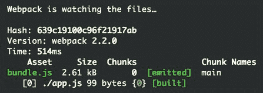
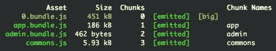
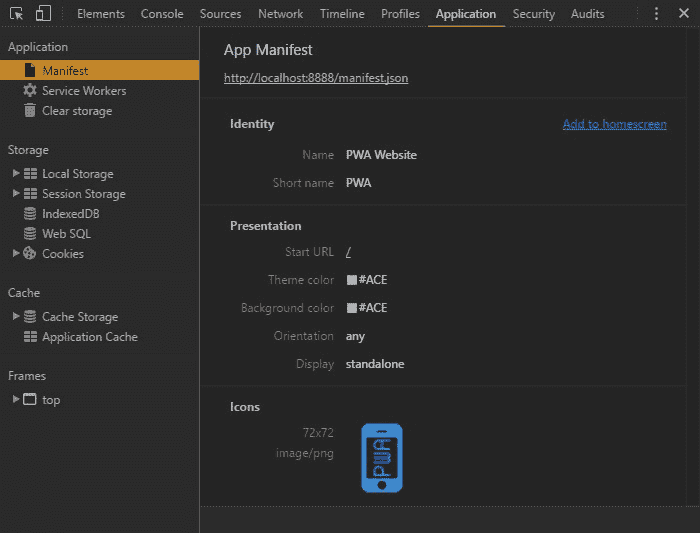
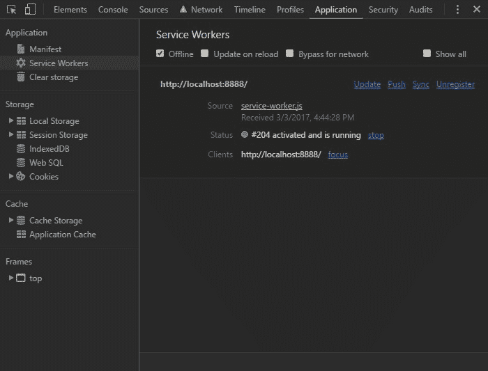
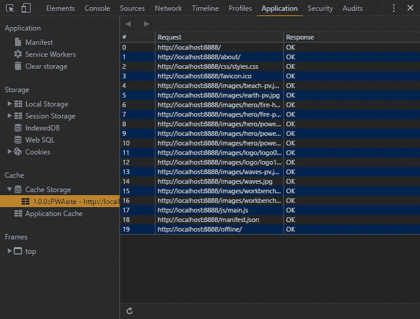
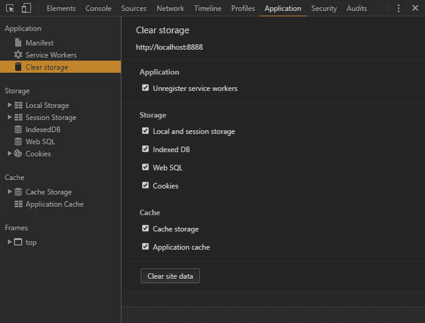
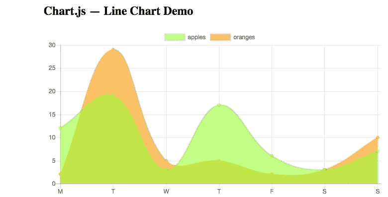
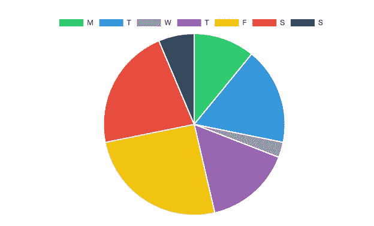
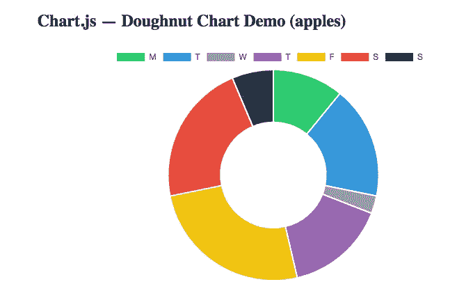
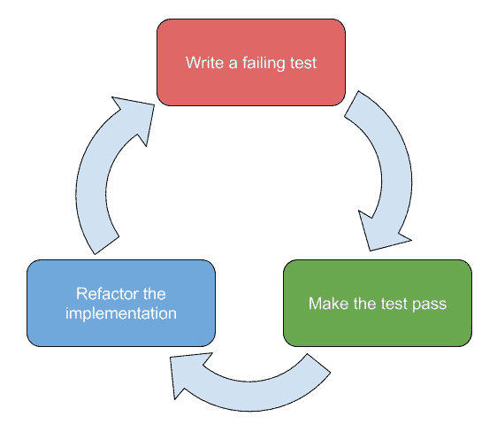

# Modern JavaScript 入门指南


## 关于 SitePoint

SitePoint 专门为 Web 专业人士出版有趣、实用且易于理解的内容。访问 [`www.sitepoint.com/`](http://www.sitepoint.com/) 访问我们的博客、书籍、时通讯、文章和社区论坛。你将在这里找到关于 JavaScript、PHP、设计等大量信息。

## 前言

如今，看到人们抱怨 JavaScript 开发变得多么复杂并不罕见。如果这种观点来自一个对该语言的新手，我们对此表示某种同情。如果你正在学习 JS，很快就会接触到庞大的生态系统，以及为了构建现代 Web 应用程序需要理解（至少在概念上）的海量变动部分。包管理、代码检查、转译、模块打包、代码压缩、源码映射、框架、单元测试、热重载……不可否认，这比仅仅在页面中包含几个 `<script>` 标签并通过 FTP 上传到服务器要复杂得多。

长期以来，JavaScript 被许多人视为一个笑话；一种玩具级语言，其唯一的用途就是添加一些非必要的视觉点缀（如鼠标悬停变化），并且经常是奇怪错误和页面崩溃的根源。尽管从早期以来已经取得了巨大进步，但今天仍有人不认真对待这种语言。对 PHP 开发者产生同情也并不难。无论好坏，JavaScript 都是（目前也是）绝大多数 Web 浏览器原生支持的唯一语言。社区努力改进语言本身，并提供工具帮助构建生产级应用。

这本合集是文章的汇编，精选自 SitePoint 的 [JavaScript 频道](https://www.sitepoint.com/javascript/)，旨在让你在现代 JavaScript 开发中抢占先机。当然，由于语言和生态系统的演变速度都非常快，跟上最新进展至关重要。不要掉队，在读完这本书后，请前往该频道以跟上新趋势和技术！

James Hibbard & Nilson Jacques，SitePoint JavaScript 频道编辑。

## 使用的规范

你会注意到，我们在本书中使用了特定的布局样式来表示不同类型的信息。请关注以下项目。

### 代码示例

书中的代码使用等宽字体显示，如下：

```html
<h1>A Perfect Summer's Day</h1>
<p>It was a lovely day for a walk.</p>
```

某些代码行应该在一行输入，但由于页面限制，我们不得不对它们进行换行处理。➥ 表示仅出于格式目的而存在的换行，应该被忽略：

```javascript
URL.open("http://www.sitepoint.com/responsive-web-design-real-user-testing/?responsive1");
```

### 提示、注释和警告

**嘿，你！**

提示（Tips）提供有用的小建议。

**额咳，打扰一下……**

注释（Notes）与当前主题相关但并非关键的有用补充。将它们视为额外的信息片段即可。

**确保你始终……**

……注意这些重要要点。

**小心！**

警告（Warnings）强调可能会让你出错的任何陷阱。

## 第 1 章：现代 JavaScript 应用程序剖析

作者 James Kolce

毫无疑问，JavaScript 生态系统的变化极快。不仅新工具和框架以快速速度引入和开发，语言本身也随着 ES2015（又称 `ES6`）的引入发生了巨大的变化。可以理解，现在有许多文章在抱怨学习现代 JavaScript 开发有多困难。

在这篇文章中，我将向你介绍现代 JavaScript。我们将查看该语言的最新进展，并概述当前用于编写前端 Web 应用程序的工具和技术。如果你刚开始学习这种语言，或者已经多年没碰它，并好奇你以前熟悉的 JavaScript 发生了什么变化，那么这篇文章就是为你准备的。

### 关于 Node.js 的说明

`Node.js` 是一个允许使用 JavaScript 编写服务器程序的运行时。可以拥有全栈 JavaScript 应用程序，前后端都使用 JavaScript。`Node.js` 的到来对生态系统产生了重大影响，引入了 `npm` 包管理器并普及了 CommonJS 模块格式。

### JavaScript 2015

2015 年，[ECMAScript](https://en.wikipedia.org/wiki/ECMAScript)——定义 JavaScript 的规范以 `ES6` 的名称发布。这个新版本包含了语言的重大补充。改进并没有停止于 ES2015；每年都会发布新版本。

### 声明变量

JavaScript 现在有了额外的变量声明方式：[let 和 const](https://www.sitepoint.com/how-to-declare-variables/)。

`let` 是 `var` 的继承者——尽管 `var` 仍然可用，但 `let` 将变量的作用域限制在所在的块内（而不是函数），这减少了出错的空间：

```javascript
// ES5
for (var i = 1; i < 5; i++) {
  console.log(i);
}
// <-- 打印 1 到 4
console.log(i); // <-- 5（变量 i 在循环外存在）

// ES2015
for (let j = 1; j < 5; j++) {
  console.log(j);
}
console.log(j); // <-- 'Uncaught ReferenceError: j is not defined'
```

使用 `const` 可以定义不能重新绑定到新值的变量。对于字符串和数字等原始值，这类似于常量，因为一旦声明无法更改其值。

```javascript
const name = 'Bill';
name = 'Steve';
// <-- 'Uncaught TypeError: Assignment to constant variable.'
```

**陷阱**

```javascript
const person = { name: 'Bill' };
person.name = 'Steve';
// person.name 现在是 Steve。
// 因为我们没有更改 person 绑定的对象，JavaScript 不会报错。
```

### 箭头函数

箭头函数为声明匿名函数（lambda）提供了一种更简洁的语法，当函数体只有一个表达式时，可以省去 `function` 关键字和 `return` 关键字。这允许你以更优雅的方式编写函数风格的代码。

```javascript
// ES5
var add = function(a, b) {
  return a + b;
}

// ES2015
const add = (a, b) => a + b;
```

箭头函数的另一个重要特性是它们会从定义时的上下文继承 `this` 的值：

```javascript
function Person() {
  this.age = 0;
  // ES5
  setInterval(function() {
    this.age++; // |this| 指向全局对象
  }, 1000);
  // ES2015
  setInterval(() => {
    this.age++; // |this| 正确地指向 person 对象
  }, 1000);
}

var p = new Person();
```

### 改进的 Class 语法

如果你是面向对象编程的粉丝，可能会喜欢语言在现有原型机制的基础上增加了类（classes）。虽然这只是语法糖，但它为试图用原型模拟经典面向对象编程的开发者提供了更简洁的语法。

```javascript
class Person {
  constructor(name) {
    this.name = name;
  }
  greet() {
    console.log(`Hello, my name is ${this.name}`);
  }
}
```

### Promises / 异步函数

JavaScript 的异步本质长期以来一直是挑战；在处理如 Ajax 请求时，任何复杂的应用都有陷入回调地狱的风险。

幸运的是，ES2015 增加了对 [promises](https://www.sitepoint.com/deeper-dive-promises/) 的原生支持。Promises 代表目前不存在但以后可能的值，使得异步函数的调用更易于管理。ES2017 引入了 [async functions](https://www.sitepoint.com/simplifying-async-functions/)（有时被称为 async/await），在该领域带来了改进，允许你像处理同步代码一样处理异步代码。

```javascript
async function doAsync () {
  const result = await asynchronousOperation();     
  console.log(result);
  return result;
};
```

### 模块

ES2015 添加的另一个显著特性是原生模块格式，使得模块的定义和使用成为语言的一部分。以前模块仅以第三方库的形式存在。我们将在下一节深入查看模块。

这里我们不会讨论其他特性，但在查看现代 JavaScript 时，你会注意到一些主要的差异。你可以通过 [Learn ES2015](https://babeljs.io/learn-es015/) 页面在 [Babel site](https://babeljs.io/) 查看完整的列表。这些特性包括模板字符串、迭代器、生成器以及如 `Map` 和 `Set` 等新数据结构。

#### 关于 ES2015

要了解更多关于 ES2015 的知识，请查看我们的课程：[Diving into ES2015](https://www.sitepoint.com/premium/224)

### 代码检查

Linter 是解析你的代码并根据一组规则进行对比、检查语法错误、格式和良好实践的工具。虽然建议每个人都使用 linter，但当你刚开始时它特别有用。当你的代码编辑器/IDE 配置好后，你可以获得即时反馈，以确保你在学习新语言特性时不会被语法错误困住。你可以 [查看 ESLint](https://www.sitepoint.com/up-and-running-with-eslint/)，它是最流行的 linter 且支持 ES2015+。

### 模块化代码

现代 Web 应用可能有数千（甚至数十万）行代码。如果没有将所有内容组织成更小组件的机制，进行这种规模的工作几乎是不可能的，这样可以编写专门且隔离的代码。

#### CommonJS

多年来出现了一些模块格式，最流行的是 [CommonJS](https://en.wikipedia.org/wiki/CommonJS)。它是 Node.js 的默认格式。它使用 `module` 对象来导出，使用 `require()` 函数来导入。

```javascript
// lib/math.js
function sum(x, y) {
  return x + y;
}
module.exports = {
  sum: sum,
  pi: 3.14159
};

// app.js
const math = require("./lib/math");
console.log(math.sum(1, 2));
```

#### ES2015 模块

ES2015 引入了直接在语言中定义和消费模块的方法。示例：

```javascript
// lib/math.js
export function sum(x, y) {
  return x + y;
}
export const pi = 3.14159;

// app.js
import { sum } from "./lib/math";
console.log(sum(1, 2));
```

或者我们也可以导入需要的：

```javascript
// app.js
import { sum } from "./lib/math";
```

### 包管理

其他语言长期以来都有自己的仓库和管理器，以便查找和安装第三方库。Node.js 自带包管理器和仓库 [npm](https://www.sitepoint.com/beginners-guide-node-manager/)。尽管还有其他可用，但 npm 已成为事实上的 JavaScript 包管理器，并被称为最大的包注册表。

在 [npm 仓库](https://www.npmjs.com/) 中，你可以找到第三方模块，可以使用 `npm install <package>` 命令轻松地下载并在项目中使用它们。包被下载到本地的 `node_modules` 目录，其中包含了所有的包和依赖项。

你下载的包可以注册为项目的依赖，位于 [package.json](https://docs.npmjs.com/files/package.json) 文件中，其中包含关于项目或模块的信息（其本身也可以作为包发布到 npm 上）。

你可以为开发和生产定义单独依赖。生产依赖是包运行所需的，而开发依赖对于开发者来说是必要的。

#### 示例 package.json 文件

```json
{
  "name": "demo",
  "version": "1.0.0",
  "description": "Demo package.json",
  "main": "main.js",
  "dependencies": {
    "mkdirp": "0.5.1",
    "underscore": "1.8.3"
  },
  "devDependencies": {},
  "scripts": {
    "test": "echo \"Error: no test specified\" && exit 1"
  },
  "author": "Sitepoint",
  "license": "ISC"
}
```

### 构建工具

我们在开发现代 Web 应用时编写的代码，几乎从没有直接进入过生产环境。我们使用现代版本的 JavaScript 编写代码，这些代码可能不受浏览器支持；我们大量使用位于 `node_modules` 文件夹中的第三方包及其依赖项；我们可能还有如静态分析工具或压缩化工具等流程。构建工具的存在是为了帮助将所有这些转换为可以高效部署并被大多数浏览器理解的内容。

#### 模块打包

在使用 ES2015/CommonJS 模块编写整洁、复用的代码时，我们需要某种方法来加载这些模块（至少在浏览器原生支持 ES2015 模块加载之前是）。在 HTML 中引入大量的 `<script>` 标签并不是一个可行的方案，因为对于任何严肃的应用来说，这都会迅速变得难以管理，而且所有这些独立的 HTTP 请求会损害性能。

我们可以使用 ES2015 的 `import` 语句（或 CommonJS 的 `require`）在需要的地方引入所有模块，并使用模块打包器将所有内容合并成一个或多个文件（包，bundles）。我们将上传到服务器并包含在 HTML 中的，正是这些打包后的文件。它将包含你导入的所有模块及其必要的依赖项。

目前有几种流行的选择，最流行的是 [Webpack](http://webpack.js.org)、[Browserify](http://browserify.org) 和 [Rollup.js](http://rollupjs.org)。你可以根据自己的需求选择其中一种。

##### 学习更多关于模块打包

如果你想了解更多关于模块打包以及它如何融入应用开发大局，我推荐阅读 [理解 JavaScript 模块：打包与转译](https://www.sitepoint.com/javascript-modules-bundling-transpiling/)。

#### 转译

虽然[现代浏览器对 ES2015 的支持已经非常好](http://kangax.github.io/compat-table/es6/)，但你的目标用户可能包含部分支持或完全不支持的旧版浏览器和设备。

为了让我们的现代 JavaScript 能够运行，我们需要将编写的代码翻译为早期版本（通常是 ES5）的等效代码。这项任务的标准工具是 [Babel](https://babeljs.io)，它是一个将你的代码翻译为大多数浏览器兼容代码的编译器。通过这种方式，你不需要等待厂商实现所有功能，可以直接使用所有现代 JS 特性。

有些功能需要的不仅仅是语法翻译；Babel 包含了一个 [Polyfill](http://babeljs.io/docs/usage/polyfill/)，它模拟了某些复杂功能（如 promises）所需的某些机制。

#### 构建系统与任务运行器

模块打包和转译只是我们在项目中可能需要的两个构建过程。其他过程还包括代码压缩（以减小文件大小）、分析工具，以及可能与 JavaScript 无关的任务，例如图像优化或 CSS/HTML 预处理。

任务管理可能会变成一项繁杂的工作，我们需要一种自动化方式来处理它，能够通过更简单的命令执行所有操作。用于此任务的最流行的两个工具是 [Grunt.js](http://gruntjs.com) 和 [Gulp.js](http://gulpjs.com)，它们提供了一种按顺序将你的任务组织成组的方法。

例如，你可以有一个像 `gulp build` 这样的命令，它可能会运行代码检查器、使用 Babel 进行转译过程以及使用 Browserify 进行模块打包。我们不需要按顺序记住三个命令及其相关的参数，只需要执行一个命令就能自动处理整个过程。

每当你发现自己在手动为项目组织处理步骤时，请思考一下是否可以使用任务运行器实现自动化。

### 应用架构

Web 应用的要求与网站有所不同。例如，虽然对于博客来说，页面刷新是可以接受的，但对于像 Google Docs 这样的应用则完全不是。你的应用行为应该尽可能接近桌面应用，否则可用性将受到影响。

旧式的 Web 应用通常是通过从 Web 服务器发送多个页面来实现的，当需要大量动态性时，通过 Ajax 根据用户操作替换 HTML 块来加载内容。虽然这是向更动态的 Web 迈出的一步，但它确实有其复杂性；在每次用户操作时发送 HTML 片段甚至整个页面都是资源的浪费，特别是从用户的角度来看更是时间的浪费。其可用性仍然无法匹配桌面应用的响应速度。

为了改进这一点，我们创建了两种构建 Web 应用的新方法，从向用户展示应用的方式到客户端与服务器通信的方式。尽管应用所需的 JavaScript 数量也急剧增加，但结果是现在的应用行为非常接近原生应用；每次点击按钮时都不需要刷新页面或长时间的等待。

#### 单页应用

Web 应用最常见的高层架构被称为 [SPA](https://en.wikipedia.org/wiki/Single-page_application)，意为单页应用。SPA 是巨大的 JavaScript 集合，包含了应用正常运行所需的所有内容。UI 完全在客户端渲染，因此不需要重新加载。唯一变化的是应用内部的数据，这通常通过远程 API 配合 [Ajax](https://en.wikipedia.org/wiki/Ajax_(programming)) 或另一种异步通信方法来处理。

这种方法的一个缺点是应用首次加载耗时较长。然而，一旦加载完成，视图（页面）之间的切换通常要快得多，因为在客户端和服务器之间传输的只是纯数据。

#### 通用型 / 同构应用

尽管 SPA 提供了极佳的用户体验，但根据你的需求，它们可能不是最佳解决方案。特别是当你需要更快的初始加载时间或搜索引擎的最优索引时。

解决这些问题的一种较新方法被称为 [同构](http://isomorphic.net/javascript)（或通用型）JavaScript 应用。在这种架构中，大部分代码可以在服务器和客户端执行。你可以选择想要在服务器上渲染的内容以实现更快的初始加载，之后由客户端接管渲染。由于页面最初在服务器上渲染，搜索引擎可以对其进行正确的索引。

### 部署

在现代 JavaScript 应用中，你编写的代码与部署到生产环境的代码并不相同；你只部署构建过程的结果。完成此操作的工作流取决于项目的规模、参与开发的人数，有时取决于你使用的工具/库。

例如，如果你独立开发一个简单的项目，每当准备好部署时，只需运行构建过程并将生成的文件上传到 Web 服务器即可。请记住，你只需要上传构建过程产生的文件（转译、模块打包、压缩等），这可以是一个包含整个应用及其依赖的单个 .js 文件。

你可以拥有如下目录结构：

```
├── dist
│   ├── app.js
│   └── index.html
├── node_modules
├── src
│   ├── lib
│   │   ├── login.js
│   │   └── user.js
│   ├── app.js
│   └── index.html
├── gulpfile.js
├── package.json
└── README
```

所有的应用文件都在 `src` 目录下，使用 ES2015 编写，并导入通过 npm 安装的包以及来自 `lib` 目录的自定义模块。

然后你可以运行 Gulp，它将执行 `gulpfile.js` 中的指令来构建你的项目：将所有模块打包成一个文件（包括通过 `npm` 安装的模块）、将 ES2015+ 编译为 ES5、对生成的文件进行压缩等。然后，你可以配置它将结果输出到方便的 `dist` 目录中。

#### 无需处理的文件

如果你有不需要任何处理的文件，只需将它们从 `src` 复制到 `dist` 目录即可。你可以在构建系统中为该操作配置一个任务。

现在，你只需要将 `dist` 目录中的文件上传到 Web 服务器即可，而无需担心其他仅对开发有用的文件。

#### 团队开发

如果你与其他开发者一起工作，很可能也正在使用共享代码仓库（如 GitHub）来存储项目。在这种情况下，你可以在提交（commit）之前运行构建过程，并将结果与其他文件一起存储在 Git 仓库中，以便后续下载到生产服务器。

然而，如果几位开发者共同工作，将构建后的文件存储到仓库中容易出错，而且你可能希望保持项目整洁，不包含构建产物。幸运的是，有更好的处理方法：你可以在流程中使用如 [Jenkins](http://jenkins.io)、[Travis CI](http://travis-ci.org)、[CircleCI](http://circleci.com) 等服务，这样它在每次提交推送到仓库后都能自动构建你的项目。开发者只需担心推送代码更改，而无需每次都预先构建项目；同时，仓库也保持了整洁，没有自动生成的文件；最后，你仍然拥有构建好的文件可供部署。

### 结论

如果你近几年没有接触 Web 开发，从简单网页到现代 JavaScript 应用程序的转变可能看起来望而生畏，但我希望这篇文章能作为一个有用的起点。我尽可能为每个主题都链接了更深入的文章，以便你进一步探索。

请记住，如果在某个时刻，在查看所有可用选项后，觉得一切看起来都难以从容且混乱；那么只需记住 [KISS 原则](https://en.wikipedia.org/wiki/KISS_principle)，只使用你认为需要的，而不是你拥有的所有。归结底，解决问题才是最重要的，而不是使用所有最新的东西。

## 第 2 章：Gulp.js 简介

作者：Craig Buckler

由 [Giulio Mainardi](https://www.sitepoint.com/author/gmainardi/) 和 [Tim Severien](https://www.sitepoint.com/author/tseverien/) 同行评审。

开发者花在编码上的时间非常有限。即使我们忽略那些烦人的会议，大部分工作也包含会耗尽你工作日的基础任务：

* 从模板和内容文件生成 HTML
* 压缩新图片和修改过的图片
* 将 Sass 编译为 CSS 代码
* 从脚本中移除 `console` 和 `debugger` 语句
* 将 ES6 转换为跨浏览器兼容的 ES5 代码
* 代码检查（linting）和验证
* 合并并压缩 CSS 和 JavaScript 文件
* 将文件部署到开发、测试和生产服务器

每当你做出更改时，必须重复这些任务。你可能初衷良好，但即使是最无失的开发者也会忘记压缩一两张图片。随着时间的推移，生产前的任务变得越来越艰巨且耗时；你会畏惧那些不可避免的内容和模板更改。这是一项枯燥、重复的工作。把时间花在更有价值的工作上难道会更好吗？

如果是这样，你需要一个任务运行器或构建流程。

### 这听起来复杂得可怕！

创建一个构建流程需要时间。它比手动执行每个任务要复杂，但从长远来看，你将节省数小时的工作，减少人为错误并保持理智。采取务实的方法：

* 优先自动化最令人沮丧的任务
* 尽量不要让你的构建流程过于复杂；一两个小时对于初始设置已经足够了
* 选择一个任务运行软件并坚持一段时间。不要随心切换到另一个选项。

某些工具和概念对你来说可能是新的，但请深呼吸，一次专注于一件事。

### 任务运行器：可选方案

诸如 [GNU Make](https://www.gnu.org/software/make/) 这样的构建工具已经存在了几十年，但针对 Web 的任务运行器是一个相对新的现象。第一个实现规模效应的是 [Grunt](http://gruntjs.com/) - 这是一个 Node.js 任务运行器，它使用（最初）由 JSON 配置文件控制的插件。Grunt 取得了成功，但也存在许多问题：

1. Grunt 的基本功能（如文件监听）需要插件。
2. Grunt 插件通常执行多个任务，这使得自定义变得更加笨拙。
3. 对于最基础任务之外的所有任务，JSON 配置可能变得难以维护。
4. 任务运行速度较慢，因为 Grunt 在每个处理步骤之间都会保存文件。

许多问题在后续版本中得到了解决，但 [Gulp](http://gulpjs.com/) 已经到来并提供了许多改进：

1. 像文件监听这样的功能是内置的。
2. Gulp 插件（大部分）设计为执行单项工作。
3. Gulp 使用 JavaScript 配置代码，更简洁、更易读、更易修改，并提供了更好的灵活性。
4. Gulp 速度更快，因为它使用 [Node.js streams](https://www.sitepoint.com/basics-node-js-streams/) 通过一系列管道（piped）插件传递数据。文件只在任务结束时才写入。

当然，Gulp 本身并不完美，而新的任务运行器如 [Broccoli.js](http://broccolijs.com/)、[Brunch](http://brunch.io/) 和 [webpack](https://webpack.github.io/) 也在竞争开发者的关注。最近，npm 本身也被推崇为一种更简单的方案。所有工具都有优缺点，但 Gulp 仍然是首选并被超过 40% 的 Web 开发者使用。

Gulp 需要 Node.js，虽然某些 JavaScript 知识会有帮助，但所有 Web 开发者都能从中受益。

#### 关于 Gulp 4

本文介绍了如何使用 Gulp 3 - 这是编写时的最新发布版本。Gulp 4 已经开发一段时间，但仍处于测试阶段。你可以[使用或切换到 Gulp 4](https://www.joezimjs.com/javascript/complete-guide-upgrading-gulp-4/)，但在正式发布之前建议使用版本 3。

### 第一步：安装 Node.js

可以在 [nodejs.org/download/](https://nodejs.org/download/) 下载 Windows、Mac 和 Linux 的 Node.js。从二进制文件、包管理器和 Docker 镜像安装有多种选择 - 详细说明可用。

#### Windows 用户注意

Node.js 和 Gulp 可以在 Windows 上运行，但某些依赖原生 Linux 二进制文件的压缩库可能无法安装或运行。Windows 10 用户的一个选择是使用新的 [bash 命令行](https://msdn.microsoft.com/en-us/commandline/wsl/install_guide)；这解决了许多问题，但它是测试产品并可能引入替代问题。

安装后，打开命令提示符并输入：

```bash
node -v
```

显示版本号。你大量使用 `npm` - Node.js 包管理器，它用于安装模块。查看它的版本号：

```bash
npm -v
```

#### Linux 用户注意

Node.js 模块可以全局安装，这样它们在整个系统中都可用。然而，除非在 `npm` 命令前加上 `sudo`，否则大多数用户将没有权限写入全局目录。有许多[修复 npm 权限的选项](https://docs.npmjs.com/getting-started/fixing-npm-permissions)以及像 [nvm](https://www.sitepoint.com/quick-tip-multiple-versions-node-nvm/) 这样的工具可以使用，但我经常会更改默认目录，例如在 Ubuntu/Debian 系的平台上：

```bash
cd ~
mkdir .node_modules_global
npm config set prefix=$HOME/.node_modules_global
npm install npm -g
```

然后，将以下行添加到 `~/.bashrc` 的末尾：

```bash
export PATH="$HOME/.node_modules_global/bin:$PATH"
```

并使用以下命令更新：

```bash
source ~/.bashrc
```

### 步骤 2：全局安装 Gulp

全局安装 Gulp 命令行界面，以便可以在任何项目文件夹中运行 `gulp` 命令：

```bash
npm install gulp-cli -g
```

使用以下命令验证 Gulp 是否已安装：

```bash
gulp -v
```

### 步骤 3：配置您的项目

Node.js 项目注意：如果您已经有一个 `package.json` 配置文件，可以跳过此步骤。

假设您在 `project1` 文件夹中有一个新项目或现有项目。进入该文件夹并用 npm 进行初始化：

```bash
cd project1
npm init
```

您将被询问一系列问题 - 输入值或按回车键接受默认值。完成后将创建一个 `package.json` 文件，其中存储了您的 `npm` 配置设置。

Git 用户注意：Node.js 将模块安装在 `node_modules` 文件夹中。您应该将其添加到 `.gitignore` 文件中，以确保它们不会被提交到仓库中。当将项目部署到另一台电脑时，您可以运行 `npm install` 来恢复它们。

在本文的剩余部分，我们假设您的项目文件夹包含以下子文件夹：

`src` 文件夹：预处理过的源文件

它包含进一步的子文件夹：

* `html` - HTML 源文件和模板
* `images` — 原始未压缩图像
* `js` — 多个预处理过的脚本文件
* `scss` — 多个预处理过的 Sass `.scss` 文件

`build` 文件夹：编译/处理后的文件

Gulp 将根据需要创建文件和子文件夹：

* `html` - 编译后的静态 HTML 文件
* `images` — 压缩后的图像
* `js` — 单个合并并压缩的 JavaScript 文件
* `css` — 单个编译并压缩的 CSS 文件

您的项目几乎肯定会有所不同，但下面的示例将使用此结构。

提示：如果您在使用类 Unix 系统，并且只想跟本教程操作，可以使用以下命令重新创建文件夹结构：

```bash
mkdir -p src/{html,images,js,scss} build/{html,images,js,css}
```

### 步骤 4：本地安装 Gulp

现在您可以使用以下命令在您的项目文件夹中安装 Gulp：

```bash
npm install gulp --save-dev
```

这会将 Gulp 安装为开发依赖项，并相应地更新 `package.json` 中的 `"devDependencies"` 部分。在教程的剩余部分中，我们假设 Gulp 和所有插件都是开发依赖项。

#### 备用部署选项

当操作系统中的环境变量 `NODE_ENV` 设置为 `production` 时，不会安装开发依赖项。您通常会在生产服务器上使用 Mac/Linux 命令执行此操作：

```bash
export NODE_ENV=production
```

或在 Windows 上：

```bash
set NODE_ENV=production
```

本教程假设您的资产将编译到 `build` 文件夹，并提交到您的 Git 仓库或直接上传到服务器。然而，如果您想更改创建它们的方式，在生产服务器上构建资产可能更合适，例如：HTML、CSS 和 JavaScript 文件在生产环境中经过了压缩，但在开发环境中没有。在这种情况下，请对 Gulp 和所有插件使用 `--save` 选项，即：

```bash
npm install gulp --save
```

这会将 Gulp 设置为 `package.json` 中 `"dependencies"` 部分的应用程序依赖项。它会在您输入 `npm install` 时安装，并可以在项目部署的任何地方运行。您可以从仓库中删除 `build` 文件夹，因为这些文件可以在需要时任何平台上创建。

### 步骤 5：创建 Gulp 配置文件

在项目文件夹的根目录下创建一个新的 `gulpfile.js` 配置文件。添加一些基础代码开始：

```javascript
// Gulp.js configuration
var
  // modules
  gulp = require('gulp'),
  // development mode?
  devBuild = (process.env.NODE_ENV !== 'production'),
  // folders
  folder = {
    src: 'src/',
    build: 'build/'
  }
;
```

### 图像任务

此示例演示了如何压缩图像。为了实现这一点，我们需要 `gulp-newer` 和 `gulp-imagemin`。从命令行使用 save-dev 安装它们：

```bash
npm install gulp-newer gulp-imagemin --save-dev
```

现在我们可以在 `gulpfile.js` 顶部引用这两个模块：

```javascript
// Gulp.js configuration
var
  // modules
  gulp = require('gulp'),
  newer = require('gulp-newer'),
  imagemin = require('gulp-imagemin'),
  // development mode?
  devBuild = (process.env.NODE_ENV !== 'production'),
  // folders
  folder = {
    src: 'src/',
    build: 'build/'
  }
;
```

现在我们可以在 `gulpfile.js` 的末尾定义图像处理任务：

```javascript
// image processing
gulp.task('images', function() {
  var out = folder.build + 'images/';
  return gulp.src(folder.src + 'images/**/*')
    .pipe(newer(out))
    .pipe(imagemin({optimizationLevel: 5}))
    .pipe(gulp.dest(out));
});
```

保存 `gulpfile.js` 并在项目 `src/images` 文件夹中放置一些图像，然后从命令行运行该任务：

```bash
gulp images
```

```
Finished 'imagemin' in 5.71 ms
gulp-imagemin: image1.png (saved 48.7 kB)
gulp-imagemin: image2.jpg (saved 36.2 kB)
gulp-imagemin: image3.svg (saved 12.8 kB)
```

尝试再次运行 `gulp images`，应该不会发生任何变化，因为没有新的图像了。

### HTML 任务

我们现在可以创建一个类似的任务，用于从源 HTML 文件夹复制文件。我们可以使用 [gulp-htmlclean](https://www.npmjs.com/package/gulp-htmlclean) 插件来安全地对 HTML 代码进行压缩化，以移除不必要的空格和属性：

```bash
npm install gulp-htmlclean --save-dev
```

然后在 `gulpfile.js` 的顶部引入引用它：

```javascript
var
  // 模块
  gulp = require('gulp'),
  newer = require('gulp-newer'),
  imagemin = require('gulp-imagemin'),
  htmlclean = require('gulp-htmlclean'),
  // development mode?
  devBuild = (process.env.NODE_ENV !== 'production'),
  // folders
  folder = {
    src: 'src/',
    build: 'build/'
  }
;
```

我们现在可以在 `gulpfile.js` 的末尾创建一个 `html` 任务：

```javascript
// HTML 处理
gulp.task('html', ['images'], function() {
  var
    out = folder.build + 'html/',
    page = gulp.src(folder.src + 'html/**/*')
      .pipe(newer(out));
  // 压缩生产代码
  if (!devBuild) {
    page = page.pipe(htmlclean());
  }
  return page.pipe(gulp.dest(out));
});
```

这复用了 `gulp-newer` 并引入了几个概念：

1. `[images]` 参数表示在处理 HTML 之前必须运行 `images` 任务（HTML 可能会引用图像）。此数组中可以列出任意数量的依赖任务，且所有任务都将在任务函数运行之前完成。
2. 只有当 `NODE_ENV` 设置为 `production` 时，我们才将 HTML 传递给 `gulp-htmlclean`。因此，HTML 在开发期间将保持未压缩状态，这可能对调试有用。

保存 `gulpfile.js` 并从命令行运行 `gulp html`。`html` 和 `images` 任务都会运行。

### JavaScript 任务

对你来说太简单了？让我们通过构建一个基础的模块打包器来处理所有的 JavaScript 文件。它将：

1. 使用 [gulp-deporder](https://www.npmjs.com/package/gulp-deporder) 插件确保先加载依赖。它会分析每个脚本顶部的注释以确保正确的顺序，例如 `// requires: defaults.js lib.js`。
2. 使用 [gulp-concat](https://www.npmjs.com/package/gulp-concat) 将所有脚本文件合并成单个 `main.js` 文件，并且
3. 使用 [gulp-strip-debug](https://www.npmjs.com/package/gulp-strip-debug) 移除所有的 `console` 和 `debugging` 语句，并使用 [gulp-uglify](https://www.npmjs.com/package/gulp-uglify) 压缩代码。此步骤只会在生产模式下发生。

安装插件：

```bash
npm install gulp-deporder gulp-concat gulp-strip-debug gulp-uglify --save-dev
```

在 `gulpfile.js` 的顶部引用它们：

```javascript
var
  // 模块
  gulp = require('gulp'),
  newer = require('gulp-newer'),
  imagemin = require('gulp-imagemin'),
  htmlclean = require('gulp-htmlclean'),
  concat = require('gulp-concat'),
  deporder = require('gulp-deporder'),
  stripdebug = require('gulp-strip-debug'),
  uglify = require('gulp-uglify'),
  // development mode?
  devBuild = (process.env.NODE_ENV !== 'production'),
  // folders
  folder = {
    src: 'src/',
    build: 'build/'
  }
;
```

然后添加一个新的的 `js` 任务：

```javascript
// JavaScript 处理
gulp.task('js', function() {
  var jsbuild = gulp.src(folder.src + 'js/**/*')
    .pipe(deporder())
    .pipe(concat('main.js'));
  if (!devBuild) {
    jsbuild = jsbuild
      .pipe(stripdebug())
      .pipe(uglify());
  }
  return jsbuild.pipe(gulp.dest(folder.build + 'js/'));
});
```

保存然后运行 `gulp js` 来体验魔法！

### CSS 任务

最后，让我们创建一个 CSS 任务，使用 [gulp-sass](https://www.npmjs.com/package/gulp-sass) 将 `.scss` 文件编译为单个 `.css` 文件。这是用于 [node-sass](https://www.npmjs.com/package/node-sass) 的 Gulp 插件，它绑定到超快的 [Sass C/C++ 引擎](http://sass-lang.com/libsass)（无需安装 Ruby）。我们假设你的 Sass 文件 `scss/main.scss` 负责加载所有部分文件。

我们的任务还将通过 [gulp-postcss](https://github.com/postcss/gulp-postcss) 插件利用 [PostCSS](http://postcss.org/)。PostCSS 需要它自己的插件，我们将安装它们：

* [postcss-assets](https://www.npmjs.com/package/postcss-assets) 用于管理资源。这允许我们使用如 `background('image.png')` 的属性来解析路径，或使用 `background('image.png')` 内联数据编码图像。
* [autoprefixer](https://www.npmjs.com/package/autoprefixer) 用于自动为 CSS 属性添加厂商前缀。
* [css-mqpacker](https://www.npmjs.com/package/css-mqpacker) 将同一个媒体查询的多次引用合并到单个规则中。
* [cssnano](https://www.npmjs.com/package/cssnano) 用于压缩代码。

安装这些插件：

```bash
npm install gulp-sass gulp-postcss postcss-assets autoprefixer css-mqpacker cssnano --save-dev
```

在 `gulpfile.js` 的顶部引用它们：

```javascript
var
  // 模块
  gulp = require('gulp'),
  newer = require('gulp-newer'),
  imagemin = require('gulp-imagemin'),
  htmlclean = require('gulp-htmlclean'),
  concat = require('gulp-concat'),
  deporder = require('gulp-deporder'),
  stripdebug = require('gulp-strip-debug'),
  uglify = require('gulp-uglify'),
  sass = require('gulp-sass'),
  postcss = require('gulp-postcss'),
  assets = require('postcss-assets'),
  autoprefixer = require('autoprefixer'),
  mqpacker = require('css-mqpacker'),
  cssnano = require('cssnano'),
  // development mode?
  devBuild = (process.env.NODE_ENV !== 'production'),
  // folders
  folder = {
    src: 'src/',
    build: 'build/'
  }
;
```

然后添加 CSS 任务：

```javascript
// CSS 处理
gulp.task('css', function() {
  var postCssOpts = [
    assets({loadPaths: ['images/']}),
    autoprefixer({browsers: ['last 2 versions']}),
    mqpacker,
    cssnano
  ];
  return gulp.src(folder.src + 'scss/main.scss')
    .pipe(sass({
      outputStyle: 'nested',
      precision: 3,
      errLogToConsole: true
    }))
    .pipe(postcss(postCssOpts))
    .pipe(gulp.dest(folder.build + 'css/'));
});
```

### 运行所有任务

现在我们可以定义一个默认任务，一次性运行所有任务：

```javascript
// 默认任务
gulp.task('default', ['html', 'css', 'js'], function() {
  console.log('Build complete!');
});
```

或者你可以单独运行每个任务：

```bash
gulp images
gulp html
gulp js
gulp css
```

### 监听文件变化

为了在开发过程中自动运行任务，我们可以添加一个监听任务：

```javascript
// 监听文件变化
gulp.task('watch', function() {
  gulp.watch(folder.src + 'images/**/*', ['images']);
  gulp.watch(folder.src + 'html/**/*', ['html']);
  gulp.watch(folder.src + 'js/**/*', ['js']);
  gulp.watch(folder.src + 'scss/**/*', ['css']);
});
```

运行 `gulp watch` 将启动监听，当文件发生变化时自动运行相应任务。

### 总结

通过本教程，你学会了如何使用 Gulp.js 创建一个完整的构建流程，包括：

* 图像压缩
* HTML 压缩
* JavaScript 合并、去除调试代码和压缩
* Sass 编译、PostCSS 处理和 CSS 压缩
* 文件监听和自动化构建

这将大大提高你的开发效率，减少人为错误，并让你专注于编写代码而不是重复性任务。


npm install gulp-sass gulp-postcss postcss-assets autoprefixer mqpacker cssnano

在 `gulpfile.js` 的顶部引用它们：

```javascript
var
  ...
  sass = require('gulp-sass'),
  postcss = require('gulp-postcss'),
  assets = require('postcss-assets'),
  autoprefixer = require('autoprefixer'),
  mqpacker = require('css-mqpacker'),
  cssnano = require('cssnano'),
```

## 第 6 步：自动化任务

我们一直在一次运行一个任务。我们可以通过在 `gulpfile.js` 中添加一个新的 `run` 任务来一次性运行所有任务：

```javascript
// 运行所有任务
gulp.task('run', ['html', 'css', 'js']);
```

保存并输入 `gulp run` 执行所有任务。注意我省略了 `images` 任务，因为已经是 `html` 和 `css` 任务的依赖。

这仍然太费力了？Gulp 提供了另一种方法——`gulp.watch`，它可以监控源文件并在文件更改时运行相应的任务。该方法接收一个文件夹和一个发生变化时执行的任务列表。让我们在 `gulpfile.js` 的末尾创建一个 `watch` 任务：

```javascript
// 监听变化
gulp.task('watch', function() {
  // 图像变化
  gulp.watch(folder.src + 'images/**/*', ['images']);
  // HTML 变化
  gulp.watch(folder.src + 'html/**/*', ['html']);
  // JavaScript 变化
  gulp.watch(folder.src + 'js/**/*', ['js']);
  // CSS 变化
  gulp.watch(folder.src + 'scss/**/*', ['css']);
});
```

与其立即运行 `gulp watch`，让我们添加一个默认任务：

```javascript
// 默认任务
gulp.task('default', ['run', 'watch']);
```

保存 `gulpfile.js` 并在命令行输入 `gulp`。你的图像、HTML、CSS 和 JavaScript 将被处理，然后 Gulp 将保持活跃监控更新并在需要时重新运行任务。按 `Ctrl/Cmd + C` 停止监控并返回命令行。

## 第 7 步：获利！

其他你可能觉得有用的插件：

* [gulp-load-plugins](https://www.npmjs.com/package/gulp-load-plugins) - 无需 `require` 声明即可加载 Gulp 插件模块
* [gulp-preprocess](https://www.npmjs.com/package/gulp-preprocess) - 一个简单的 HTML 和 JavaScript 预处理工具
* [gulp-less](https://www.npmjs.com/package/gulp-less) - [Less CSS 预处理器](http://lesscss.org/) 插件
* [gulp-stylus](https://www.npmjs.com/package/gulp-stylus) - [Stylus CSS 预处理器](http://stylus-lang.com/) 插件
* [gulp-sequence](https://www.npmjs.com/package/gulp-sequence) - 按特定顺序运行一系列 gulp 任务
* [gulp-plumber](https://www.npmjs.com/package/gulp-plumber) - 错误处理，防止 Gulp 在失败时停止
* [gulp-size](https://www.npmjs.com/package/gulp-size) - 显示文件大小和节省空间
* [gulp-nodemon](https://www.npmjs.com/package/gulp-nodemon) - 使用 [nodemon](https://www.npmjs.com/package/nodemon) 在发生变化时自动重启 Node.js
* [gulp-util](https://www.npmjs.com/package/gulp-util) - 包含日志和颜色编码的实用函数

`gulp-util` 中一个实用的方法是 `.noop()`，它会直接传递数据而不执行任何操作。这可以用于更整洁的开发/生产处理代码，例如：

```javascript
var gutil = require('gulp-util');
// HTML processing
gulp.task('html', ['images'], function() {
  var out = folder.src + 'html/**/*';
  return gulp.src(folder.src + 'html/**/*')
    .pipe(newer(out))
    .pipe(devBuild ? gutil.noop() : htmlclean())
    .pipe(gulp.dest(out));
});
```

Gulp 也可以调用其他 Node.js 模块 - 它们不需要是插件，例如：

* [browser-sync](https://www.npmjs.com/package/browser-sync) - 在发生变化时自动加载资源或刷新浏览器
* [del](https://www.npmjs.com/package/del) - 删除文件和文件夹（也许可以在每次运行时清理你的 `build` 文件夹）

投入一点时间，Gulp 就能节省许多小时的开发沮败感。优势是：

* [插件丰富](https://npmjs.org/browse/keyword/gulpplugin/)
* 使用管道（pipes）的配置易于阅读和跟进
* `gulpfile.js` 可以被适配并重用到其他项目中
* 可以减少你的总页面权重以提高性能
* 你可以简化你的部署

有用链接：

* [Gulp 主页](http://gulpjs.com/)
* [Gulp 插件](https://npmjs.org/browse/keyword/gulpplugin/)
* [npm 主页](https://www.npmjs.com/)

将上述过程应用于简单的网站，总权重减少了 50% 以上。你可以使用 [页面权重分析工具](http://sitepoint.com/10-best-webpage-weight-analysis-tools/) 或像 [New Relic](http://newrelic.com/?r=phpm) 等服务来测试自己的结果，它提供了一系列复杂的应用程序性能监控工具。

## 第 3 章：原生 JavaScript DOM 操作基础（不使用 jQuery）

作者：Sebastian Seitz

由 [Vildan Softic](https://www.sitepoint.com/author/vildansoftic/) 和 [Joan Yin](https://github.com/newjs) 同行评审。

每当我们需要执行 DOM 操作时，大家都会迅速求助于 jQuery。然而，原生 JavaScript DOM API 本身其实非常强大，而且由于 IE < 11 已经被[官方放弃](https://www.microsoft.com/en-us/WindowsForBusiness/End-of-IE-support)，现在可以无忧地使用。

在本文中，我将演示如何使用原生 JavaScript 完成一些常见的 DOM 操作任务，即：

* 查询和修改 DOM
* 修改类（classes）和属性
* 监听事件
* 动画

最后，我将向你展示如何创建一个自己的超轻量 DOM 库，并将其投入到任何项目中。过程中，你会发现使用原生 JS 进行 DOM 操作并不是什么高深科技，而且许多 jQuery 方法在原生 API 中实际上有直接对应方法。

那么，让我们开始吧……

## DOM 操作：查询 DOM

### 这并不是关于 DOM API 的详尽指南

我不会详尽解释原生 DOM API，而仅触及皮毛。在用法示例中，你可能会遇到我没有明确介绍的方法。在这种情况下，请直接参考优秀的 [Mozilla 开发者网络 (MDN)](https://developer.mozilla.org/en-US/) 获取详细信息。

可以使用 `.querySelector()` 方法查询 DOM，该方法接受任意 CSS 选择器作为参数：

```javascript
const myElement = document.querySelector('#foo > div.bar')
```

这将返回第一个匹配项（深度优先）。相反，我们可以检查一个元素是否匹配某个选择器：

```javascript
myElement.matches('div.bar') === true
```

如果想获取所有匹配项，可以使用：

```javascript
const myElements = document.querySelectorAll('div.bar')
```

如果已经有一个元素的引用，我们可以直接查询它的子元素。

```javascript
const myElements = document.querySelector('div.bar')
```

### getElementsByTagName

那么为什么还要用 `getElementsByTagName()` 等其他方法？嗯，一个重要的区别是 `querySelectorAll()` 的结果是静态的，而 `getElementsByTagName()` 返回的是动态的（live）`HTMLCollection`。

```javascript
const elements1 = document.querySelectorAll('div')
const elements2 = document.getElementsByTagName('div')
const newElement = document.createElement('div')
```

另一个考虑是，当我们动态添加元素时，`querySelectorAll` 是静态的。

```javascript
elements1.appendChild(newElement)
```

### 使用 NodeLists

现在关于 `querySelectorAll()` 有两个坑。第一个坑是我们无法在结果上调用数组方法（就像你从 jQuery 中习惯的那样）。相反，我们必须显式遍历元素。另一个坑是：返回值是一个 `NodeList` 而不是 `Array`。这意味着我们需要将列表转换为数组，或者“借用”数组原型的方法。

```javascript
// 使用 Array.from()
Array.from(myElements).forEach(doSomethingElement)

// 在 ES6 之前
Array.prototype.forEach.call(myElements, doSomethingElement)

// 简写：
[].forEach.call(myElements, doSomethingElement)
```

每个元素还有几个不言自明的只读属性指向“元素族”，所有的都是动态的：

```javascript
myElement.children
myElement.firstElementChild
lastElementChild
previousElementSibling
nextElementSibling
```

由于 [Element](https://developer.mozilla.org/en-US/docs/Web/API/element) 接口继承自 [Node](https://developer.mozilla.org/en-US/docs/Web/API/Node) 接口，以下属性也可用：

```javascript
myElement.childNodes
myElement.firstChild
myElement.lastChild
myElement.previousSibling
myElement.nextSibling
myElement.parentNode
myElement.parentElement
```

前者只引用元素，而后者（`.parentElement` 除外）可以是任何种类型的节点，例如文本节点。然后我们可以检查给定节点的[类型](https://developer.mozilla.org/en-US/docs/Web/API/Node/nodeType)，例如：

```javascript
myElement.firstChild.nodeType === 3 // 这是一个文本节点
```

和任何对象一样，我们可以使用 `instanceof` 运算符检查节点的原型链：

```javascript
myElement.firstChild.nodeType instanceof Text
```

## 修改类和属性

修改元素的类非常简单：

```javascript
myElement.classList.add('foo')
myElement.classList.remove('bar')
myElement.classList.toggle('baz')
```

你可以通过这篇 [Yaphi Berhanu 的快速贴士](https://www.sitepoint.com/add-remove-css-class-vanilla-js/)阅读关于如何修改类的更深入讨论。元素属性可以像任何其他对象的属性一样被访问。

```javascript
// 获取属性值
const value = myElement.value

// 将属性设置为元素的一个属性
myElement.value = 'foo'

// 使用 Object.assign() 设置多个属性
Object.assign(myElement, {
  value: 'foo',
  id: 'bar'
})

// 移除属性
myElement.value = null
```

请注意，还有 `.getAttribute()`、`.setAttribute()` 和 `.removeAttribute()` 方法。这些方法直接修改元素的 HTML 属性（而不是 DOM 属性），从而导致浏览器重绘（你可以通过浏览器的开发工具检查元素来观察这些变化）。这种浏览器重绘不仅比仅设置 DOM 属性更耗费更多资源，而且这些方法还可能导致[意外的结果](https://developer.mozilla.org/en-US/docs/Web/API/Element/setAttribute#Notes)。

作为经验法则，只有当属性没有对应的 DOM 属性（例如 `colspan`）时，才使用它们；或者如果你真的想“持久化”这些更改到 HTML 中（例如，在克隆元素或修改其父元素的 `.innerHTML` 时保留它们——参见第 3 部分）。

## 添加 CSS 样式

CSS 规则可以像其他属性一样应用；但请注意，属性在 JavaScript 中是驼峰命名的：

```javascript
myElement.style.marginLeft = '2em'
```

如果我们需要某些值，可以通过 `.style` 属性获取这些值。然而，这只会带给我们显式应用的样式。要获取计算后的值（computed values），我们可以使用 `window.getComputedStyle()`。它接收元素并返回一个 [CSSStyleDeclaration](https://developer.mozilla.org/en-US/docs/Web/API/CSSStyleDeclaration)，其中包含了元素本身的样式以及继承自父元素的样式：

```javascript
window.getComputedStyle(myElement).getPropertyValue('margin-left')
```

## 修改 DOM

我们可以像这样移动元素：

```javascript
// 将 element2 作为 element1 的最后一个子节点
element1.appendChild(element2)

// 将 element2 插入作为 element1 的子节点，位于 element3 之前
element1.insertBefore(element2, element3)
```

如果我们不想移动元素而是想插入一个副本，可以这样克隆它：

```javascript
// 创建克隆
const myElementClone = myElement.cloneNode()
myParentElement.appendChild(myElementClone)
```

`.cloneNode()` 方法可选地接受一个布尔值作为参数；如果设置为 `true` 将创建一个深拷贝，这意味着它的子元素也会被克隆。

当然，我们也可以完全创建新的元素或文本节点：

```javascript
const myNewElement = document.createElement('div')
const myNewTextNode = document.createTextNode('some text')
```

然后我们可以像上面所示插入它们。如果我们想删除一个元素，不能直接删除，但可以从父元素中移除子元素，如下：

```javascript
myParentElement.removeChild(myElement)
```

这给了我们一个很好的变通方法，意味着我们可以通过引用其父元素来间接删除一个元素：

```javascript
myElement.parentNode.removeChild(myElement)
```

## 元素属性

每个元素还有 `.innerHTML` 和 `.textContent` 属性（以及 `.innerText`，它与 `.textContent` 相似，但有一些[重要的差异](http://perfectionkills.com/the-poor-misunderstood-innerText/)）。它们分别持有 HTML 内容和纯文本内容。这些是可写的，意味着我们可以直接修改元素及其内容：

```javascript
// 设置内部 HTML
myElement.innerHTML = `
  <div>
    <p>Hello World</p>
  </div>
`

// 设置文本内容
myElement.textContent = 'Hello World'
```

像上面所示向 HTML 附加标记通常是个坏主意，因为我们会丢失任何 [DocumentFragment](https://developer.mozilla.org/en-US/docs/Web/API/DocumentFragment) 更改。为了避免这种性能问题，我们可以首先在片段中组装：

```javascript
const fragment = document.createDocumentFragment()
// ... 操作 fragment
```

## 监听事件

这可能是绑定事件的最佳方法：

```javascript
myElement.onclick = function (event) {
  console.log(event.type)
}
```

但通常应该避免这样做。在这里，`.onclick` 是元素的一个属性，你可以修改它，但不能用它来添加监听器。相反，我们可以使用强大的 `.addEventListener()` 方法来添加多个事件。它接受三个参数：事件类型（例如 `click`）、当事件发生时被调用的函数（该函数将接收一个对象）以及可选的配置对象。

```javascript
myElement.addEventListener('click', function (event) {
  console.log(event.type)
})
myElement.addEventListener('click', function (event) {
  console.log(event.type + ' again')
})
```

在监听函数内部，`event.target` 指向触发事件元素（`this` 也是如此，除非我们使用了[箭头函数](https://www.sitepoint.com/es6-arrow-functions-new-syntax/)）。因此你可以轻松地访问它的属性：

```javascript
// document.forms 属性是包含所有表单的数组
const myForm = document.forms[0]
const myInputElements = myForm.querySelectorAll('input')
Array.from(myInputElements).forEach(el => {
  el.addEventListener('change', function (event) {
    console.log(event.target.value)
  })
})
```

### 防止默认行为

请注意，`event` 在监听函数内部总是可用的，但在需要时显式传递它仍然是一个良好的习惯（当然，我们可以为它任意命名）。在不详述 [Event](https://developer.mozilla.org/en-US/docs/Web/API/Event) 接口本身的情况下，一个特别值得注意的方法是 `.preventDefault()`，它将……阻止浏览器的默认行为，例如跳转链接。另一个常见的用例是在客户端表单验证失败时，条件地阻止提交表单。

```javascript
myForm.addEventListener('submit', function (event) {
  const name = this.querySelector('#name')
  if (name.value === 'Donald Duck') {
    alert('你在开玩笑吗！')
    event.preventDefault()
  }
})
```

另一个重要的事件方法是 `.stopPropagation()`，它会阻止事件向 DOM 树冒泡。这意味着如果我们在某个元素上设置了停止传播的点击监听器（比如），而在它的其中一个父元素上设置了另一个点击监听器，那么在子元素上触发的点击事件将不会在父元素上触发——否则，它将在两个地方都触发。

现在，`.addEventListener()` 接受一个可选的配置对象作为第三个参数，该对象可以包含以下任何布尔属性（默认值均为 `false`）：

* `capture`: 事件将在 DOM 中该元素下方的任何其他元素之前在该元素上触发（事件捕获和冒泡是一篇专门的文章，更多细节请参阅[这里](http://javascript.info/tutorial/bubbling-and-capturing)）。
* `once`: 正如你可能猜到的，这表示事件将只会触发一次。
* `passive`: 这意味着 `event.preventDefault()` 将被忽略（并且通常会在控制台中产生警告）。

最常用的选项是 `.capture`；事实上，它非常常见，以至于有一个简写：你不需要在配置对象中指定它，只需在这里传递一个布尔值即可：

```javascript
myElement.addEventListener(type, listener, true)
```

事件监听器可以使用 `.removeEventListener()` 移除，它接受事件类型和要移除的回调函数引用；例如，`once` 也可以这样实现：

```javascript
myElement.addEventListener('change', function listener (event) {
  console.log(event.type + ' got triggered on ' + this)
  this.removeEventListener('change', listener)
})
```

### 事件委托

另一个实用的模式是事件委托：假设我们有一个表单，并想为其所有的 `input` 子元素添加 `change` 事件监听器。一种方法是如上所示，使用 `myForm.querySelectorAll('input')` 对它们进行迭代。然而，当我们可以同样地将其添加到表单本身上并检查 `event.target` 的内容时，这样做是不必要的。

```javascript
myForm.addEventListener('change', function (event) {
  const target = event.target
  if (target.matches('input')) {
    console.log(target.value)
  }
})
```

该模式的另一个优势是，它会自动考虑到动态插入的子元素，而无需为每个元素绑定新的监听器。

### 动画

通常执行动画最干净的方法是应用带有 `transition` 属性的 CSS 类，或使用 CSS `@keyframes`。但如果你需要更大的灵活性（例如用于游戏），也可以用 JavaScript 实现。

原始的方法是让 `window.setTimeout()` 函数不断调用自己，直到所需的动画完成。然而，这种方法低效地强制了快速的文档重流；这种布局抖动（layout thrashing）会导致卡顿，尤其是在移动设备上。相反，我们可以使用 `window.requestAnimationFrame()` 同步更新，将所有当前更改调度到下一次浏览器重绘帧。它接受一个回调作为参数，接收当前的（高分辨率）戳：

```javascript
const start = window.performance.now()
const duration = 2000
window.requestAnimationFrame(function fadeIn (now) {
  const progress = now - start
  myElement.style.opacity = progress / duration
  if (progress < duration) {
    window.requestAnimationFrame(fadeIn)
  }
})
```

通过这种方式，我们可以实现非常流畅的动画。如需更详细的讨论，请查看 Mark Brown 写的这篇[文章](https://www.sitepoint.com/quick-tip-game-loop-in-javascript/)。

### 编写你自己的辅助方法

诚然，总是通过遍历元素来对它们进行操作，与 jQuery 简洁且可链的 `$('.foo').css({color: 'red'})` 语法相比可能相当繁琐。那么，为什么不简单为此类事情编写我们自己的简写方法呢？

```javascript
const $ = function $ (selector, context = document) {
  const elements = Array.from(context.querySelectorAll(selector))
  return {
    elements,
    html(newHtml) {
      this.elements.forEach(element => {
        element.innerHTML = newHtml
      })
      return this
    },
    css(newCss) {
      this.elements.forEach(element => {
        Object.assign(element.style, newCss)
      })
      return this
    },
    on(event, handler, options) {
      this.elements.forEach(element => {
        element.addEventListener(event, handler, options)
      })
      return this
    }
  }
}
```

因此，我们有了一个极简的 DOM 库，只包含我们需要的方法，并且不考虑向后兼容性。通常我们会在原型中拥有这些方法。这里有一个（稍微复杂一点的）[gist](https://gist.github.com/SitePoint/4f664d62a87ae60b0784ceeffd)，其中包含关于如何实现此类辅助方法的想法。或者，我们可以保持简单如：

```javascript
const $ = (selector, context = document) => context.querySelector(selector)
const $$ = (selector, context = document) => context.querySelectorAll(selector)
const html = (nodeList, newHtml) => {
  Array.from(nodeList).forEach(element => {
    element.innerHTML = newHtml
  })
}
// 等等...
```

### Demo

为了结束这篇文章，这里有一个 [CodePen](https://codepen.io/SitePoint/aJaggB/)，展示了上述许多概念，用于实现一个简单的灯箱效果。

## 结论

我希望向大家展示原生 JavaScript 进行 DOM 操作并不是困难科学，而且事实上，对于某些用例（如导航菜单或弹出窗口），引入一个库的额外开销可能是多余的。

虽然原生 API 的部分非常繁琐或不方便（例如经常遍历节点列表），但我们可以轻松地编写自己的辅助函数。

## 第四章：Webpack 入门指南

作者：Mark Brown

[Webpack](https://webpack.org/) 已成为现代 Web 开发中最重要的工具之一。它主要是一个 JavaScript 模块打包器，但它可以转换所有的前端资源，如 HTML 和 CSS，甚至图片。它可以更好地控制应用的 HTTP 请求数量，并允许使用 npm 包。

这篇文章面向 webpack 新手，将涵盖初始设置配置、模块、加载器、插件、代码分割和热更新。如果你觉得视频教程有用，强烈推荐 Glen Maddern 的 [从原理理解 Webpack](https://www.youtube.com/watch?v=WQue1AN9YU) 作为理解其特殊之处的起点。

要在家里跟着练习，你需要安装 [Node.js](https://www.sitepoint.com/quick-tip-multiple-versions-node-nvm/)。你也可以从我们的 Github 仓库[下载 demo 应用](https://github.com/sitepoint-editors/webpack-demo)。

### Setup

让我们用 npm 初始化新项目并安装 webpack：

```bash
mkdir webpack-demo
cd webpack-demo
npm init -y
npm install webpack@beta --save-dev
mkdir src
touch index.html src/app.js webpack.config.js
```

编辑这些文件：

```html
<!-- index.html -->
<!DOCTYPE html>
<html lang="en">
  <head>
    <meta charset="utf-8">
    <title>Hello webpack</title>
  </head>
  <body>
    <div id="root"></div>
    <script src="dist/bundle.js"></script>
  </body>
</html>
```

```javascript
// src/app.js
const root = document.querySelector('#root')
root.innerHTML = `<p>Hello webpack.</p>`
```

```javascript
// webpack.config.js
const webpack = require('webpack')
const path = require('path')
const config = {
  context: path.resolve(__dirname, 'src'),
  entry: './app.js',
  output: {
    path: path.resolve(__dirname, 'dist'),
    filename: 'bundle.js'
  },
  module: {
    rules: [{
      test: /\.js$/,
      include: path.resolve(__dirname, 'src'),
      use: [{
        loader: 'babel-loader',
        options: {
          presets: [
            ['es2015', { modules: false }]
          ]
        }
      }]
    }]
  }
}
module.exports = config
```

上面的配置是一个常见的起点，它指示 `webpack` 将我们的入口文件 `src/app.js` 编译为输出文件 `dist/bundle.js`，并且所有的 `.js` 文件都将通过 `Babel` 从 ES2015 译为 ES5。

为了运行这些配置，我们需要安装三个包：`babel-core`、`webpack` 的加载器 `babel-loader` 以及用于我们想要编写的 JavaScript 风格的预设 `babel-preset-es2015`。`{ modules: false }` 启用 [Tree Shaking](http://www.2ality.com/2015/12/webpack-tree-shaking.html)，从包中移除未使用的导出以减小文件大小。

```bash
npm install babel-core babel-loader babel-preset-es2015 --save-dev
```

最后，将 `package.json` 中的 `scripts` 部分替换为以下内容：

```json
"scripts": {
  "start": "webpack --watch",
  "build": "webpack -p"
}
```

在命令行中运行 `npm start` 将以监听模式启动 `webpack`，每当 `src` 目录中的 `.js` 文件发生变化时，它都会重新编译我们的包。控制台中的输出会告诉我们正在创建的包，关注包的数量和大小是非常重要的。



现在你应该可以在浏览器中加载 `index.html` 并看到“Hello webpack.” 了。

```bash
open index.html
```

打开 `dist/bundle.js` 查看 `webpack` 做了什么，顶部是 `webpack` 的模块引导代码，最底部是我们的模块。你现在可能觉得并不惊艳，但如果你已经走了这一步，现在就可以开始编写 ES6 模块，`webpack` 将能够创建一个可以在所有浏览器中运行的生产包。

使用 `Ctrl + C` 停止 `webpack` 并运行 `npm run build` 在生产模式下编译我们的包。

注意，包的大小从 2.61 kB 减到了 585 字节。再次查看 `dist/bundle.js`，你会看到一大堆混乱的代码，我们的包已经通过 `UglifyJS` 压缩，代码运行方式完全相同，但使用了最少的字符完成。

## 模块 (Modules)

`webpack` 原生支持如何消费各种格式的 JavaScript 模块，其中最著名的两个：

* ES2015 `import` 语句
* CommonJS `require()` 语句

我们可以通过安装 [lodash](https://lodash.com/) 并从 `app.js` 导入它来测试：

```bash
npm install lodash --save
```

```javascript
// src/app.js
import {groupBy} from 'lodash/collection'

const people = [{
  manager: 'Jen',
  name: 'Bob'
}, {
  manager: 'Jen',
  name: 'Sue'
}, {
  manager: 'Bob',
  name: 'Shirley'
}, {
  manager: 'Bob',
  name: 'Terrence'
}]

const managerGroups = groupBy(people, 'manager')
const root = document.querySelector('#root')
root.innerHTML = `<pre>${JSON.stringify(managerGroups, null, 2)}</pre>`
```

运行 `npm start` 启动 `webpack` 并刷新 `index.html`，你应该看到一个按经理分组的人员数组。

让我们将人员数组移动到自己的模块 `people.js` 中：

```javascript
// src/people.js
const people = [{
  manager: 'Jen',
  name: 'Bob'
}, {
  manager: 'Jen',
  name: 'Sue'
}, {
  manager: 'Bob',
  name: 'Shirley'
}, {
  manager: 'Bob',
  name: 'Terrence'
}]
export default people
```

我们可以简单地通过相对路径从 `app.js` 导入它。

```javascript
// src/app.js
import {groupBy} from 'lodash/collection'
import people from './people'
const managerGroups = groupBy(people, 'manager')
const root = document.querySelector('#root')
root.innerHTML = `<pre>${JSON.stringify(managerGroups, null, 2)}</pre>`
```

注意：没有相对路径的导入（如 `'lodash/collection'`）是安装到 `/node_modules` 的 npm 模块，你自己的模块始终需要像 `'./people'` 这样的相对路径，你可以以此区分它们。

## 加载器 (Loaders)

我们已经接触到了 `babel-loader`，它是许多 [loaders](https://webpack.js.org/loaders/) 之一，你可以配置它们来告诉 `webpack` 在遇到不同文件类型的导入时该做什么。你可以将加载器链联成一系列转换，观察其是否起作用的好方法是可以在 JavaScript 中引入 Sass。

为了让它运行，我们需要安装相关包：

```bash
npm install node-sass sass-loader css-loader style-loader --save-dev
```

更新 `webpack.config.js`：

```javascript
// webpack.config.js
module: {
  rules: [{
    test: /\.scss$/,
    use: ['style-loader', 'css-loader', 'sass-loader']
  }]
}
```

在 `app.js` 中导入样式：

```javascript
// src/app.js
import './style.scss'
// ...
```

创建 `src/style.scss`：

```scss
/* src/style.scss */
$bluegrey: #2B3A42;
pre {
  background: $bluegrey;
  padding: 20px;
}
```

运行 `npm start` 重启构建。

使用以下命令下载[测试图片](https://raw.githubusercontent.com/sitepoint-editors/webpack-demo/master/src/code.png)：

```bash
curl https://raw.githubusercontent.com/sitepoint-editors/webpack-demo/master/src/code.png --output src/code.png
```

你现在可以从 `app.js` 顶部导入图片源：

```javascript
// src/app.js
import codeURL from './code.png'
const img = document.createElement('img')
img.src = codeURL
img.style.backgroundColor = "#2B3A42"
img.style.padding = "20px"
img.width = 32
document.body.appendChild(img)
// ...
```

这将包含一张图片，其 `src` 属性包含图片本身的 [data URI](https://developer.mozilla.org/en-US/docs/Web/HTTP/Basics_of_HTTP/Data_URIs)。

```html

```

此外，得益于 `css-loader`，通过 `url()` 引用的图片也会通过 `url-loader` 处理，将其直接内联到 CSS 中。

```scss
/* src/style.scss */
pre {
  background: $bluegrey url('code.png') no-repeat center center / 32px 32px;
}
```

编译后如下：

```css
pre {
  background: #2b3a42 url("data:image/png;base64,iVBO...") no-repeat scroll center center / 32px 32px;
}
```

## 模块到静态资源

你现在应该看到加载器是如何帮助在资源之间构建依赖树的，这正是 webpack 首页上的图片所展示的内容。

虽然 JavaScript 是入口，但 webpack 意识到你的其他资源类型（如 HTML、CSS 和 SVG）都有自己的依赖关系，这些关系应该被视为构建过程的一部分。

## 插件

我们已经看到了一个内置 webpack 插件的示例 `webpack -p`，它在我们的 `npm run build` 脚本中调用，使用了 webpack 自带的 [UglifyJsPlugin](https://webpack.js.org/api/cli#shortcuts) 来压缩我们的生产环境包。

加载器（loaders）对单个文件进行转换，而插件（plugins）跨较大的代码块操作。

## 常用代码

[commonschunk-plugin](https://webpack.js.org/plugins/commons-chunk-plugin/) 是另一个随 webpack 提供的核心插件，可用于创建一个在多个入口点之间共享代码的单独模块。到目前为止，我们一直使用单一入口和单一输出包。在许多[现实场景](https://webpack.js.org/concepts/entry-points/#scenarios) 中，你将从将其拆分为多个入口和输出文件中获益。

如果你应用程序中有两个不同的区域都共享模块，例如用于面向公众的应用的 `app.js` 和用于管理区域的 `admin.js`，你可以为它们创建单独的入口点，如下：

```javascript
// webpack.config.js
const webpack = require('webpack')
const path = require('path')
const extractCommons = new webpack.optimize.CommonsChunkPlugin({
  name: 'commons',
  filename: 'commons.js'
})
const config = {
  context: path.resolve(__dirname, 'src'),
  entry: {
    app: './app.js',
    admin: './admin.js'
  },
  output: {
    path: path.resolve(__dirname, 'dist'),
    filename: '[name].bundle.js'
  },
  module: {
    // ...
  },
  plugins: [
    extractCommons
  ]
}
module.exports = config
```

注意 `output.filename` 的变化，它现在包含了 `[name]`，这会被替换为块名称，因此我们可以预期从该配置得到两个输出包：对应我们两个入口点的 `app.bundle.js` 和 `admin.bundle.js`。

`commonschunk` 插件生成了第三个文件 `commons.js`，它包含了来自我们入口点的共享模块。

```javascript
// src/app.js
import './style.scss'
import {groupBy} from 'lodash/collection'
import people from './people'
const managerGroups = groupBy(people, 'manager')
const root = document.querySelector('#root')
root.innerHTML = `<pre>${JSON.stringify(managerGroups, null, 2)}</pre>`
```

```javascript
// src/admin.js
import people from './people'
const root = document.querySelector('#root')
root.innerHTML = `<p>${people.length} people.</p>`
```

这些入口点将输出如下：

* `app.bundle.js` 包含了 `style` 和 `lodash/collection` 模块
* `admin.bundle.js` 不包含额外的内容
* `commons.js` 包含了我们的 `people` 模块

我们可以在两个区域都包含 commons 块：

```html
<!-- index.html -->
<!DOCTYPE html>
<html lang="en">
<head>
  <meta charset="utf-8">
  <title>Hello webpack</title>
</head>
<body>
  <div id="root"></div>
  <script src="dist/commons.js"></script>
  <script src="dist/app.bundle.js"></script>
</body>
</html>
```

```html
<!-- admin.html -->
<!DOCTYPE html>
<html lang="en">
<head>
  <meta charset="utf-8">
  <title>Hello webpack</title>
</head>
<body>
  <div id="root"></div>
  <script src="dist/commons.js"></script>
  <script src="dist/admin.bundle.js"></script>
</body>
</html>
```

## 代码分割

Webpack 允许你将代码库分割成多个包，以便按需加载。这对于大型应用程序特别有用，因为它可以减少初始加载时间。

使用动态 `import()` 语法（符合 [ECMAScript 提案](https://github.com/tc39/proposal-dynamic-import)）：

```javascript
// src/routes.js
const routes = {
  dashboard() {
    System.import('./dashboard').then((dashboard) => {
      dashboard.draw()
    }).catch((err) => {
      console.log("Chunk loading failed")
    })
  }
}
// demo async loading with a timeout
setTimeout(routes.dashboard, 1000)
```

由于我们添加了模块的异步加载，我们需要在配置中一个 `output.publicPath` 属性，以便 webpack 知道从哪里获取它们。

```javascript
// webpack.config.js
const config = {
  // ...
  output: {
    path: path.resolve(__dirname, 'dist'),
    publicPath: 'dist',
    filename: '[name].bundle.js'
  },
  // ...
}
```

重新构建，你将看到一个神秘的新包 `0.bundle.js`



注意看 webpack 如何通过高亮 `[big]` 包来让你保持警惕，以便你留意它们。

这个 `0.bundle.js` 将通过 JSONP 请求按需获取，因此直接从文件系统加载文件已经不再够了。我们需要运行一个服务器，任何服务器都可以。

```bash
python -m SimpleHTTPServer 8001
```

打开 http://localhost:8001/

加载一秒后，你应该能看到一个针对我们动态生成的包 `dist/0.bundle.js` 的 `GET` 请求，控制台打印了 "Loaded!"。成功！

## Webpack Dev Server

热重载可以通过每次文件更改时自动刷新来极大提升开发者体验。只需安装它并使用 `webpack-dev-server` 启动，即可开始你的旅程。

```bash
npm install webpack-dev-server@2.2.0-rc.0 --save-dev
```

修改 `package.json` 中的 `start` 脚本：

```json
"start": "webpack-dev-server --inline",
```

运行 `npm start` 启动服务器并在浏览器中打开 [`localhost:8080`](http://localhost:8080)。

尝试更改 `src` 文件中的任何内容来测试一下，例如更改 `people.js` 中的名称或 `style.scss` 中的样式，见证它们在你的眼前发生变化。

## Hot Module Replacement (热模块替换)

如果你对热重载印象深刻，那么[热模块替换](https://webpack.js.org/concepts/hot-module-replacement) (HMR) 将让你大开眼界。

现在是 2017 年，你可能已经在开发带有全局状态的单页应用了。在开发过程中，你会对组件进行许多小更改，并希望在交互的真实浏览器中看到这些更改。通过手动刷新页面或使用热重载，你的全局状态会丢失，导致你需要从头开始。热模块替换彻底改变了这一点。

在理想的开发者工作流中，你可以对模块进行更改，它会被编译并替换，而无需刷新浏览器（丢失本地状态）或触及其他模块。虽然仍有时需要手动刷新，但 HMR 仍然可以为你节省大量时间，感觉就像未来一样。

对 `package.json` 中的 `start` 脚本进行最后的编辑：

```json
"start": "webpack-dev-server --inline --hot",
```

在 `app.js` 顶部告诉 webpack 接受此模块及其任何依赖的热重载：

```javascript
if (module.hot) {
  module.hot.accept()
}
// ...
```

注意：`webpack-dev-server --hot` 将 `module.hot` 设置为 `true`，这仅包含开发环境。在生产环境构建时，`module.hot` 被设置为 `false`，因此这些会被从包中移除。在 `webpack.config.js` 的插件列表中添加 `NamedModulesPlugin` 以改进控制台日志。

```javascript
plugins: [
  new NamedModulesPlugin(),
  // ...
]
```

最后，在页面上添加一个元素，我们可以在其中添加一些文本，以确认当我们修改模块时没有发生全页刷新。

```html
<body>
  <div id="root"></div>
```

使用 `npm start` 重启服务器并见证热重载吧！

要尝试这一点，请输入 "HMR Rules"，然后更改 `people.js` 中的名称，看它如何在不刷新页面且丢失状态的情况下被替换。

这是一个简单的示例，但希望你能看到它是多么有用。这在基于组件的开发中尤为如此，因为你有许多与状态分离的“哑壳”组件，组件可以被替换和重新渲染而不丢失状态，从而获得即时反馈循环。

## Hot Reload CSS (热重载 CSS)

更改 `style.scss` 中 `<pre>` 元素的背景颜色，你会发现它正在被 HMR 替换。

```css
pre {
  background: red;
}
```

事实证明，当你使用 `style-loader` 时，CSS 的 HMR 是免费提供的，你不需要做任何特殊处理。我们通过将 CSS 模块提取到无法替换的外部 CSS 文件中切断了这条链条。如果我们把 Sass 规则恢复到原始状态并从插件列表中移除 `extractCSS`，你也将看到你的 Sass 支持热重载。

```javascript
{
  test: /\.scss$/,
  loader: ['style-loader', 'css-loader', 'sass-loader']
}
```

## HTTP/2

使用像 webpack 这样的模块打包的主要优势之一是，它通过控制资产的构建和获取来帮助你提高性能。多年来，合并文件以减少客户端请求数被认为是[最佳实践](https://developer.yahoo.com/performance/rules)。HTTP/2 现在允许在单个请求中交付多个文件，因此合并不再是万能药。你的应用程序实际上可能从多个单独缓存的文件中获益，因为客户端只需获取单个更改的模块，而无需重新获取大部分内容相同的包。

Webpack 的作者 [Tobias Koppers](https://twitter.com/wSokra) 写了一篇信息量丰富的文章，解释了为什么在 HTTP/2 时代打包仍然重要。

通过 [webpack & HTTP/2](https://medium.com/webpack/http-2-7083ec3f3ce6) 了解更多信息。

## 第五章：React VS Angular：深度对比

作者：Pavels Jelisevs

评审：[Jurgen Van de Moere](https://www.sitepoint.com/author/mbrown/) 和 [Joan Yin](https://www.sitepoint.com/author/jvandemoere/)

应该选择 Angular 还是 React？如今 JavaScript 框架两极分化的格局让许多开发者在这场争论中难以抉择。无论你是试图从何开始的新手，还是为下一个项目挑选框架的自由职业者，或是为公司规划战略愿景的企业级架构师，你可能都会从这一话题的明智见解中受益。

在选择任何工具之前，你需要回答两个简单的问题：“它本身是一个好工具吗？”以及“它是否适合我的用例？”。这两个问题单独看来都没有任何意义，所以你总是需要同时记住这两点。好吧，这些问题可能并没有那么简单，所以我们将尝试将它们拆解为更小的问题。

## 关于工具本身的问题：

* 它的成熟程度如何？背后支持者是谁？
* 它拥有哪些特性？
* 它采用了什么样的架构、开发范式和模式？
* 它的生态系统是怎样的？

## 关于自省的问题：

* 我以及我的同事能够轻松学习这个工具吗？
* 它契合我的项目吗？
* 开发者体验如何？

通过这组问题，你可以开始对任何工具进行评估，我们对 React 和 Angular 的比较也将基于这些问题。

我们还有另外一点需要考量。严格来说，将 Angular 与 React 进行比较并不完全公平，因为 Angular 是一个功能完备的大型框架，而 React 只是一个 UI 组件库。为了公平起见，我们将结合经常与 React 一起使用的库来讨论 React。

## 成熟度

成为一名熟练开发者的一个重要方面，是能够在既定的、经过时间验证的方法与评估新的前沿技术之间保持平衡。作为一个一般原则，在采用尚未成熟的工具时你应该要小心，因为存在某些风险：

* 工具可能存在 Bug 且不稳定。
* 供应商可能会意外地废弃它。
* 当你需要帮助时，可能没有庞大的知识库或社区可供。

React 和 Angular 都源自优秀的背景，所以看起来在这方面我们可以充满信心。

## React

React 由 Facebook 开发并维护，并应用于其自己的产品中，[包括 Instagram 和 WhatsApp](https://github.com/facebook/react/wiki/sites-using-react)。它已经存在了大约[三个半年以来](https://facebook.github.io/react/blog/2013/06/05/why-react.html)，所以它并不算新。它也是 GitHub 上[最受欢迎的](https://github.com/search?q=stars:%3E1&s=stars&type=Repositories)项目之一，在编写时大约有 60,000 个星。听起来很不错。

## Angular

Angular（2 及以上版本）出现的时间比 React 短，但如果你算上它的前身 AngularJS 的历史，情况就平分了。它由 Google 维护，并用于 [AdWords 和 Google Fiber](http://angularjs.blogspot.com/2015/11/how-google-uses-angular-2-with-dart.html)。由于 AdWords 是 Google 的核心项目之一，显而易见他们对它下了大注，不太可能短期内消失。

## 特性

正如我之前提到的，Angular 开箱即用的特性比 React 多。这既可以是好事，也可以是坏事，取决于你如何看待。

这两个框架共享一些共同特性：组件、数据绑定和平台无关的渲染。

## Angular

Angular 开箱即提供了许多现代 Web 应用所需的特性。一些标准特性包括：

* 依赖注入；
* 基于扩展版 HTML 的模板；
* 由 `@angular/router` 提供的路由；
* 由 `@angular/http` 提供的 Ajax 请求；
* 用于构建表单的 `@angular/forms`；
* 组件 CSS 封装；
* XSS 保护；
* 用于组件测试的实用工具。

当你不想花时间自己选择库时，拥有所有这些开箱即用的特性是非常方便的。然而，这意味着你会被困于某些库中，即使你不需要它们。而且替换它们通常需要额外的努力。例如，我们认为对于小型项目来说，拥有 `DI`（依赖注入）系统带来的开销多于收益，考虑到它可以被 `imports`（导入）有效地所替代。

## React

使用 React 时，你从一种更极简的方法开始。如果我们只看 React，这里我们有：

* 没有依赖注入；
* 取代经典模板的是，它拥有 JSX，这是一种构建在 JavaScript 之上的类 XML 语言；
* XSS 保护；
* 用于组件测试的实用工具。

并不多。这可能是一件好事。这意味着你有自由根据需要选择添加任何额外的库。坏处在于你实际上必须自己做这些选择。经常与 React 一起使用的一些流行库包括：

* 用于路由的 [React-router](https://reacttraining.com/react-router/)；
* 用于 HTTP 请求的 [Fetch](https://developer.mozilla.org/en/docs/Web/API/Fetch_API)（或 [axios](https://github.com/mzabriskie/axios)）；
* 用于 CSS 封装的[各种技术](https://github.com/MicheleBertoli/css-in-js)；
* 用于额外的单元测试工具的 [Enzyme](https://github.com/airbnb/enzyme)。

我们发现选择自己库的自由是令人解放的。这使我们能够根据每个项目的特定需求来定制我们的技术栈，而且我们发现学习新库的成本并不高。

## 语言、范式和模式

从每个框架的特性中退一步，让我们看看哪些高级概念在两个框架中都是流行的。

## React

在思考 React 时，有几件重要的事情进入脑海：JSX、Flow 和 Redux。

### JSX

[JSX](https://facebook.github.io/react/docs/introducing-jsx.html) 对许多开发者是有争议的话题：有些人喜欢它，另一些人认为它是巨大的退步。React 没有遵循传统的做法，而是在组件内部将它们结合。虽然将标记与逻辑混合的话题可能有争议，但它有一个不可否认的益处：静态分析。如果你在 JSX 中编写错误，编译器将发出错误而不是静默运行。这有助于发现拼写错误和其他愚蠢的错误。

### Flow

[Flow](https://flow.org/) 是一个由 Facebook 开发的 JavaScript 类型检查工具。它可以解析代码并检查常见的类型错误，例如隐式转换或空引用。与具有类似目的 TypeScript 不同，它不需要你迁移到一种新语言并为代码添加注解。在 Flow 中，类型注解是可选的，可以为分析器提供额外的提示。这使得 Flow 对于想要使用静态代码分析但不想重写现有代码的人来说是一个很好的选择。

进一步阅读：[更好的 JavaScript](https://www.sitepoint.com/writing-better-javascript-with-flow/)

### Redux

[Redux](http://redux.js.org/) 是一个有助于清晰管理状态变化的库。它受到了 [Flux](http://facebook.github.io/flux/) 的启发，但进行了简化。Redux 的核心思想是应用程序的状态由单个对象表示，并通过称为 reducer 的函数进行更改。Reducer 本身是与组件分离的纯函数，实现了更好的关注点分离和可测试性。

如果你在一个简单的项目上工作，那么引入 Redux 可能会过度复杂，但对于中大型项目，它是一个可靠的选择。该库已变得如此流行，以至于有[项目](https://github.com/angular-redux/store)在 Angular 中实现了它。

这三个特性都可以极大地提高你的开发者体验：JSX 和 Flow 让你能够快速发现潜在错误的地方，而 Redux 将帮助为项目实现清晰的结构。

## Angular

Angular 也有一些有趣的王牌，即 TypeScript 和 RxJS。

### TypeScript

[TypeScript](https://www.typescriptlang.org/) 是一种构建在 JavaScript 之上由微软开发的新语言。它是 `JavaScript ES2015` 的超集，并包含了该语言新版本的特性。你可以用它代替 `Babel` 来编写顶尖的 JavaScript。它还具有极其强大的类型系统，可以通过结合注解和类型推断对你的代码进行静态分析。

这还有一个更微妙的益处。TypeScript 受到了 `Java` 和 `.NET` 的深远影响，因此如果你的开发人员具有这些语言之一的背景，他们可能会发现 TypeScript 比纯 JavaScript 更容易学习（注意我们是如何从工具切换到你的个人环境的）。尽管 `Angular` 是第一个积极采用 TypeScript 的主流框架，但你也可以将其与 `React` 配合使用。

[延伸阅读：[TypeScript 简介：面向 Web 的静态类型](https://www.sitepoint.com/introduction-to-typescript/)]

### RxJS

[RxJS](http://reactivex.io/rxjs/) 是一个响应式编程库，允许更灵活地处理异步操作和事件。它是观察者模式（`Observer`）和迭代器模式（`Iterator`）与函数式编程的结合。RxJS 允许你将任何内容视为值的连续流，并对其执行各种操作，如映射、过滤、分割或合并。

该库已被 `Angular` 采用并在他们的 HTTP 模块中用于内部使用。当你执行 HTTP 请求时，它返回的是一个 `Observable` 而不是普通的 `Promise`。虽然这个库非常强大，但它相当复杂。要精通它，你需要熟悉不同类型的 `Observables`、`Subjects` 以及[数百个方法和操作符](http://reactivex.io/rxjs/manual/overview.html#operators)。天哪，仅仅为了发送 HTTP 请求，这似乎有点过头了！

当你在大量处理连续数据流（如 web sockets ）时，RxJS 是很有用的，但对于任何其他情况，它似乎都过于复杂了。无论如何，在编写 `Angular` 时，你至少需要学习它的基础知识。

[延伸阅读：使用 RxJS 学习函数式响应式编程简介](https://www.sitepoint.com/functional-reactive-programming-rxjs/)]

我们发现 TypeScript 是提高项目可维护性的极佳工具，特别是对于代码库巨大或领域/业务逻辑复杂的项目。用 TypeScript 编写的代码更具描述性且更容易遵循。由于 TypeScript 已被 `Angular` 采用，我们希望看到更多项目使用它。另一方面，RxJS 似乎只在某些情况下有利，应该谨慎采用。否则，它会给你的项目带来意外的复杂性。

## 生态系统

开源框架的伟大之处在于围绕它们创建的工具数量。有时候，让我们看看与每个框架关联的一些热门工具和库。

## Angular

### Angular CLI

现代框架的一个流行趋势是拥有一个 CLI 工具，帮助你启动项目，而无需自己配置构建。`Angular` 提供了 [Angular CLI](https://cli.angular.io/)来实现这一目标。它允许你通过几个命令即可生成并运行项目。所有负责构建应用程序、启动开发服务器和运行测试的脚本都隐藏在 `node_modules` 中。你也可以用它在开发期间生成新代码。这使得设置新项目变得轻而易举。

[延伸阅读：[终极 Angular CLI 参考指南](https://www.sitepoint.com/ultimate-angular-cli-reference/)]

### Ionic 2

[Ionic 2](http://ionic.io/2) 是用于开发混合移动应用程序的流行框架的新版本。它提供了一个与 `Angular 2` 良好集成的 `Cordova` 容器，以及非常漂亮的 Material 组件库。使用它，你可以轻松地设置和构建移动应用程序。如果你倾向于混合应用而非原生应用，这是一个很好的选择。

### Material design components

如果你是 Material design 的粉丝，你会很高兴听到 `Angular` 已经有一套 [Material 组件库](https://material.angular.io/)可用。目前，它仍处于早期阶段且略显粗糙，但最近收到了大量贡献，所以我们可能很快就能看到改进。

### Angular universal

[Angular universal](https://github.com/angular/universal) 是一个可以用于支持服务器端渲染项目的种子项目。

### @ngrx/store

[@ngrx/store](https://github.com/ngrx/store) 是一个受 `Redux` 启发的 `Angular` 状态管理库，基于纯还原器（pure reducers）改变的状态。它与 `RxJS` 的集成允许你利用推送变化检测策略来获得更好的性能。

> 在 [Awesome Angular 列表](https://github.com/AngularClass/awesome-angular) 中还有许多其他库和工具。

## React

### Create react app

[Create-react-app](https://github.com/facebookincubator/create-react-app) 是一个用于 `React` 的 CLI 工具，可快速设置新项目。与 `Angular CLI` 类似，它允许你生成新项目、启动开发服务器并创建包。它使用 Facebook 较新的测试运行器 [Jest](https://www.sitepoint.com/test-react-components-jest/) 进行单元测试，它本身也有一些很棒的功能。它还支持使用环境变量进行灵活的应用分析、本地开发中的后端代理、`Flow` 以及其他功能。查看简短的 [create-react-app 介绍](https://www.sitepoint.com/create-react-app/) 以获取更多信息。

### React Native

[React Native](https://facebook.github.io/react-native/) 是 Facebook 开发的一个使用 React 创建原生移动应用的平台。与生成混合应用的 Ionic 不同，`React Native` 生成真正的原生 UI。它提供了一套标准的 React 组件，这些组件绑定到相应的原生组件。它还允许你创建自己的组件并将其绑定到使用 `Objective-C`、`Java` 或 `Swift` 编写的原生代码。

### Material UI

`React` 也有一个 [material design 组件](http://www.material-ui.com) 库。与 `Angular` 的版本相比，这个更加成熟且提供的组件范围更广。

### Next.js

[Next.js](https://github.com/zeit/next.js/) 是一个用于 `React` 应用服务器端渲染的框架。它提供了一种灵活的方法在服务器上完全或部分渲染你的应用程序，返回结果并在浏览器中继续。它试图让创建通用应用的复杂任务变得尽可能简单，因此设计得尽可能简单，对新原理和项目结构的要求最小。

### MobX

[MobX](https://github.com/mobxjs/mobx) 是另一种管理应用状态的库。它不像 `Redux` 那样将状态存在单个不可变存储中，而是鼓励你只存储所需的最小状态，并从中推导出其他状态。它提供了一套装饰器来定义观察对象和观察者，并为你的状态引入响应式逻辑。

[延伸阅读：如何使用 MobX 管理 JavaScript 应用状态](https://www.sitepoint.com/manage-javascript-application-state-mobx/)]

## Storybook

[Storybook](https://getstorybook.io/) 是一个用于 React 的组件开发环境。它允许你快速搭建一个独立的应用程序来展示你的组件。此外，它提供了许多插件，用于组件的文档化、开发、测试和设计。我们发现，能够独立于应用程序的其他部分来开发组件是非常有用的。你可以从之前的文章中[了解更多关于 Storybook 的信息](https://www.sitepoint.com/react-storybook-develop-beautiful-user-interfaces-with-ease/)。

> 在 [Awesome React 列表](https://github.com/enaqx/awesome-react) 中还有许多其他可用库和工具。

## 采用、学习曲线与开发体验

选择新技术时的一个重要标准是其学习的难易程度。当然，答案取决于许多因素，例如你之前的经验以及对相关概念和模式的总体熟悉程度。然而，我们仍然可以尝试评估为了开始使用某个框架你需要学习多少新知识。现在，假设你已经熟悉了 `ES6+`、构建工具等等，让我们看看你还需要理解什么。

## React

使用 React 时，你遇到的第一个就是 `JSX`。对于一些开发者来说，写它看起来似乎很别扭，但它并没有增加多少复杂性；只需表达式（实际上是 JavaScript）和一种特殊的类 HTML 语法。你还需要学习如何编写组件、使用 `props` 进行配置以及管理内部状态。你不需要学习任何新的逻辑结构或循环，因为所有这些都是纯 JavaScript。

[官方教程](https://facebook.github.io/react/docs/hello-world.html)是学习 React 的极佳起点。一旦你完成了该教程，就可以[熟悉路由器](https://reacttraining.com/react-router/web/guides/quick-start)。`react router v4` 可能会稍微复杂且不符合常规，但并不可担心。使用 `Redux` 需要进行范式转移，以学习如何按照该库建议的方式来完成已经熟悉的任务。免费的 [Redux 入门](https://egghead.io/courses/getting-started-with-redux) 视频课程可以快速向你介绍核心概念。根据你的项目的大小和复杂度，你可能需要寻找并学习一些额外的库，这可能是棘手的部分，但在那之后一切都应该顺风顺水。

我们对开始使用 React 是如此简单感到非常惊讶。即使是具有后端开发背景且前端开发经验有限的人也能快速跟上。你在这一过程中可能会遇到的错误信息通常是清晰的，并提供了关于如何解决底层问题的解释。最困难的部分可能是为所有所需功能找到合适的库，但结构化和开发应用程序是极其简单的。

## Angular

学习 Angular 将向你介绍比 React 更多的新概念。首先，你需要熟悉 `TypeScript`。对于具有 `Java` 或 `.NET` 等静态类型语言经验的开发者来说，这可能比 `JavaScript` 更容易理解，但对于纯 JavaScript 开发者来说，这可能需要花费一些精力。


# 框架学习主题与选择指南

## Angular 学习曲线

框架本身拥有丰富的学习主题，从基础主题（如模块、依赖注入、装饰器、组件、服务、管道、模板和指令）到更高级的主题（如变更检测、区域、`AoT 编译` 和 `Rx.js`）。这些都包含在[文档](https://angular.io/docs/ts/latest/quickstart.html)中。`Rx.js` 本身就是一个沉重的话题，在[官方网站](http://reactivex.io/) 上有非常详细的描述。虽然在基础层面上相对容易使用，但在转向高级主题时，它会变得更加复杂。

总而言之，我们注意到 Angular 的门槛比 React 高。新概念的庞大数量让新手感到困惑。即使在你开始之后，体验也可能有些坎坷，因为你需要不断记住诸如 `Rx.js` 订阅管理、变更检测性能和[箱子里的香蕉](https://angular.io/docs/ts/latest/guide/template-syntax.html)（是的，这是文档中的真实建议）。我们经常遇到太晦涩而无法理解的错误信息，所以我们不得不在 Google 上搜索它们并祈祷有完全匹配的结果。

似乎我们在这里偏向 React，我们确实是如此。我们在规模和复杂度相当的 Angular 和 React 项目中入职新开发者的经验表明，不知为何，使用 React 的过程总是更顺畅。但是，正如我之前提到的，这取决于许多因素，对你来说可能会有所不同。

## 结合实际背景

你可能已经注意到每个框架都有自己的能力，既有优点也有缺点。但这项分析是在任何特定背景之外进行的，因此没有提供关于你应该选择哪种框架的答案。要做出决定，你需要从你项目的角度来审视。这是你需要自己完成的。

要开始，尝试回答这些关于你项目的问题，当你回答时，将答案与你学到的关于这两个框架的知识相匹配。这个列表可能不完整，但足够让你开始了：

1. 项目有多大？
2. 它将维护多久？
3. 所有功能是否都预先明确定义，还是要求你保持灵活性？
4. 如果所有功能都已定义，你需要哪些能力？
5. 领域模型和业务逻辑复杂吗？
6. 你的目标平台是什么？Web、移动端、桌面端？
7. 你需要服务端渲染吗？SEO 重要吗？
8. 你会处理大量的实时事件吗？
9. 你的团队有多大？
10. 你的开发者经验如何？背景是什么？
11. 有任何你想使用的现成组件库？

如果你正在启动一个大项目并希望尽量减少选错误的风险，可以考虑先创建一个概念验证（PoC）。选取项目的关键功能，并尝试使用其中一个框架进行简单实现。PoC 通常不需要花费长时间构建，但可以为你提供一些使用框架的宝贵经验，并允许你验证关键技术需求。如果你对结果满意，就可以进行全面开发。如果不满意，尽早失败从长远来看会为你节省很多麻烦。

## 一个框架统治一切？

一旦你为一个项目选择了框架，你会被诱惑在接下来的项目中使用完全相同的栈。不要这样做。虽然保持技术栈的一致是一个好主意，但不要盲目地使用相同的方法。在开始每个项目之前，花时间再次回答这些问题。可能对于下一个项目，答案会不同，或者格局会发生变化。此外，如果你有幸使用不熟悉的技术栈做一个小项目，尽管尝试吧。这类实验将为你提供宝贵的经验。

# 第 6 章：将你的网站改造为渐进式 Web 应用

作者 Craig Buckler

同行评审：[AJ Latour](https://github.com/ajlatour)、[Panayiotis «pvgr» Velisarakos](https://github.com/pvgr) 和 [Dave Maxwell](https://github.com/davemaxwell77)。

最近，渐进式 Web 应用（PWAs）引起了广泛关注，许多人质疑它们是否代表了（移动端）Web 的未来。我不会陷入原生应用与 PWA 之间的争论，但有一点是肯定的——它们在增强移动端和提升用户体验方面发挥了巨大作用。考虑到移动 Web 访问量到 2018 年将超过所有其他设备的总和，你还能负担得起忽视这一趋势吗？

好消息是，制作一个 PWA 并不困难。事实上，将现有的网站转换为 PWA 是完全可能的。这正是我在本教程中将要做的——当你完成时，你将拥有一个行为像原生 Web 应用的网站。它可以在离线工作，并拥有自己的主屏幕图标。

## 什么是渐进式 Web 应用？

渐进式 Web 应用（称为“PWAs”）是 Web 技术领域的一项激动人心的创新。PWAs 结合了多种技术，使 Web 应用运行起来类似于原生移动应用。它为开发者和用户带来的收益克服了纯 Web 端或纯原生方案的局限：

1. 你只需要开发一个使用开放标准 W3C Web 技术的应用。无需开发独立的原生代码库。
2. 用户可以在安装前发现并尝试你的应用。
3. 无需使用 AppStore，无需遵守晦涩的规则或支付费用。应用程序更新会自动进行，无需用户交互。
4. 用户会收到“安装”提示，这会在他们的主屏幕上添加一个图标。
5. 启动时，PWA 会显示一个吸引人的启动屏。
6. 如果必要，可以修改浏览器外壳选项以提供全屏体验。
7. 核心文件被缓存在本地，因此 PWAs 的响应比标准 Web 应用更快（它们甚至比原生应用更快）。
8. 安装非常轻量——可能只有几百 KB 的缓存数据。
9. 所有数据交换必须通过安全的 HTTPS 连接进行。
10. PWAs 可以离线运行，并在连接恢复时同步数据。

虽然现在还处于早期阶段，但[案例研究结果是积极的](https://developers.google.com/web/showcase/)。印度最大的电子商务网站 Flipkart 在放弃原生应用转用 PWA 后，[销售转化率提升了 70%，站内时长增加了三倍](https://developers.google.com/web/showcase/2016/flipkart)。全球最大的商业交易平台阿里巴巴也经历了类似的[76% 转化率增长](https://developers.google.com/web/showcase/2016/alibaba)。

Firefox、Chrome 以及其他基于 Blink 的浏览器已提供可靠的 PWA 技术支持。微软正在开发 Edge 的实现方案。苹果仍保持沉默，尽管在 [WebKit 五年计划中有令人期待的评论](https://trac.webkit.org/wiki/FiveYearPlanFall2015)。幸运的是，浏览器支持目前大多并不重要……

## 渐进式 Web 应用是渐进式增强

你的应用仍然可以在不支持 PWA 技术的浏览器中运行。用户无法获得离线功能的好处，但一切将继续像以前一样工作。考虑到投入产出比的回报，没有理由不向你的系统中添加 PWA 技术。

## 它不仅仅是应用

Google 领导了[PWA 运动](https://developers.google.com/web/progressive-web-apps/)，因此大多数教程都描述了如何从零开始构建基于 Chrome 的原生外观移动应用。然而，你不需要特殊的单页应用，也不必遵循 Material Design 设计指南。大多数网站都可以在几小时内 PWA 化。这包括你的 WordPress 或静态站点。[Smashing Magazine](https://www.smashingmagazine.com/) 宣布在写本文时他们已经在[以 PWA 模式运行](https://twitter.com/smashingmag/status/839379533874806784)！

## 演示代码

演示代码可在 [`github.com/sitepoint-editors/pwa-retrofit`](https://github.com/sitepoint-editors/pwa-retrofit) 获取。

它包含一个简单的四页网站，包含几张图片、一个样式表和一个主 JavaScript 文件。该网站在所有现代浏览器（IE10+）中均可运行。如果浏览器支持 PWA 技术，用户可以在离线时阅读之前访问过的页面。

要运行代码，请确保已安装 [Node.js](https://nodejs.org/)，然后在终端中启动提供的 Web 服务器：

```
node ./server.js [port]
```

其中 `[port]` 是可选的，默认为 8888。打开 Chrome 或其他基于 Blink 的浏览器（如 Opera 或 Vivaldi），然后导航到 [`localhost:8888/`](http://localhost:8888/)（或你指定的端口）。你也可以打开开发者工具（F12 或 Cmd/Ctrl + Shift + I）来查看各种控制台消息。


查看首页以及另一个页面，然后通过以下方式进入离线状态：

1. 使用 `Cmd/Ctrl + C` 停止 Web 服务器，或
2. 在开发者工具的 Network 或 Application - Service Workers 标签页中勾选 Offline 复选框。

重新访问你之前访问过的任何页面，它们将仍然加载。访问一个你没访问过的页面，将看到一个包含“你处于离线状态”的页面，其中列出了可选页面列表：


## 连接设备

你也可以在 Android/Mac 上查看演示页面。


```json
{
  "type": "image/png",
  "icons": [
    {
      "src": "/images/logo/logo256.png",
      "sizes": "256x256",
      "type": "image/png"
    },
    {
      "src": "/images/logo/logo512.png",
      "sizes": "512x512",
      "type": "image/png"
    }
  ]
}
```

你所有页面的 `<head>` 中都需要一个指向此文件的链接：

`<link rel="manifest" href="/manifest.json">`

主要的 manifest 属性有：

- `name`: 显示给用户的应用程序全名
- `short_name`: 当空间不足以显示全名时使用的短名称
- `description`: 应用程序的详细描述
- `start_url`: 启动程序的相对 URL（通常为 `/`）
- `scope`: 导航范围。例如，范围为 `app` 将该应用限制在相应文件夹内
- `background-color`: 用于启动页和浏览器框架的背景颜色（如果需要）
- `theme_color`: 应用程序的颜色，通常与背景相同，会影响应用的显示方式
- `orientation`: 偏好的方向：`any`、`natural`、`landscape`、`landscape-primary`、`landscape-secondary`、`portrait`、`portrait-primary` 和 `portrait-secondary`
- `display`: 偏好的视图：`fullscreen`（无框架）、`standalone`（像原生应用）、`minimal-ui`（一组小型 UI 控制）和 `browser`（常规浏览器标签页）
- `icons`: 一个图像对象的数组，定义了 `src` URL、`sizes` 和 `type`。应该定义范围内的图标。

MDN 提供了 [Web App Manifest 属性](https://developer.mozilla.org/en-US/docs/Web/Manifest) 的完整列表。

Chrome 开发工具 Application 标签中的 Manifest 部分会验证你的 manifest JSON，并提供一个可以在桌面设备上使用的“添加到主屏幕”链接：



## 步骤 3：创建 Service Worker

Service Workers 是可编程的代理，可以拦截并响应网络请求。它们是位于应用程序根目录下的单个 JavaScript 文件。

你的页面 JavaScript（演示代码中的 `js/main.js`）可以检查 service worker 的支持并注册该文件：

```javascript
if ('serviceWorker' in navigator) {
  // 注册 service worker
  navigator.serviceWorker.register('/serviceworker.js');
}
```

如果你不需要离线功能，只需创建一个空的 `/serviceworker.js` 文件——用户将收到提示来安装你的应用！

Service workers 可能会令人困惑，但你应该能够根据自己的需求对演示代码进行调整。它是一个标准的 web worker 脚本，浏览器会下载它（可能的话）并在单独线程上运行。它无法访问 DOM 或其他页面 API，但会拦截由页面变化、资源下载和 Ajax 调用触发的网络请求。

这是你的网站需要 HTTPS 的主要原因。想象一下，如果第三方脚本可以从另一个域名注入自己的 service worker，将会是多么混乱。它将能够检查并修改客户端和服务之间的所有数据交换！

Service workers 对三个主要事件做出响应：install（安装）、activate（激活）和 fetch（获取）。

### Install 事件

该事件在应用程序安装时发生。它通常用于使用 [Cache API](https://developer.mozilla.org/en-US/docs/Web/API/Cache) 缓存基本文件。

首先，我们将为以下内容定义一些配置变量：

1. 缓存名称 (`CACHE`) 和版本 (`version`)。你的应用程序可以有多个缓存，但我们只需要一个。应用了版本号，因此如果我们进行了重大更改，将使用新缓存并忽略所有之前缓存的文件。
2. 离线状态下使用的 URL。
3. 必须缓存的文件列表。
4. 可选的缓存文件数组。

```javascript
if (newreq.ok) cache.put(event.request, newreq.clone());
return newreq;
})
// app is offline
.catch(() => offlineAsset(url));
});
});
```

对 `offlineAsset(url)` 的最终调用通过两个辅助函数返回适当响应：

```javascript
// is image URL?
let iExt = ['png', 'jpg', 'jpeg', 'gif', 'webp', 'bmp'].map(f => '.' + f);
function isImage(url) {
  return iExt.reduce((ret, ext) => ret || url.endsWith(ext), false);
}

// return offline asset
function offlineAsset(url) {
  if (isImage(url)) {
    // return image
    return new Response(
      '<svg role="img" viewBox="0 0 400 300" xmlns="http://www.w3.org/2000/svg"><title>offline</title><path d="M0 0h400v300H0z" fill="#eee" /><text x="200" y="150" text-anchor="middle" dominant-baseline="middle" font-family="sans-serif" font-size="50" fill="#ccc">offline</text></svg>',
      { headers: {
        'Content-Type': 'image/svg+xml',
        'Cache-Control': 'no-store'
      }}
    );
  }
  else {
    // return page
    return caches.match(offlineURL);
  }
}
```

`offlineAsset()` 函数检查请求是否为图片并返回一个包含“offline”文本的 SVG。所有其他请求均返回 `offlineURL` 页面。

Chrome 开发者工具 Application（应用程序）标签页的 Service Worker 部分提供了有关你的 worker 的信息，以及强制刷新和让浏览器进入离线的功能：



Cache Storage（缓存存储）部分列出了当前范围内的所有缓存以及它们包含的资源。当缓存更新时，你可能需要点击面板底部的刷新按钮：



意乎不彰，Clear storage（清除存储）部分可以删除你的 service worker 和缓存：



## 额外步骤 4：创建一个实用的离线页面

离线页面可以是静态 HTML，告知用户请求的页面在离线时不可用。然而，我们也可以提供一个可读页面 URL 列表。

[Cache API](https://developer.mozilla.org/en-US/docs/Web/API/Cache) 可以在我们的 `main.js` 脚本中访问。但是该 API 使用的 promise 在不支持的浏览器中失败，会导致所有 JavaScript 停止执行。为了避免这种情况，我们在加载另一个 `offlinepage.js` JavaScript 文件之前，会检查离线列表元素和 Caches API 是否可用（该文件必须存在于上面的 `installFilesEssential` 数组中）：

```javascript
// load script to populate offline page list
if (document.getElementById('cachedpagelist') && 'caches' in window) {
  var scr = document.createElement('script');
  scr.src = 'offlinepage.js';
  scr.async = 1;
  document.head.appendChild(scr);
}
```

`offlinepage.js` 通过名称定位最新的缓存，获取所有键的列表，移除非页面的 URL，排序列表并将其追加到 ID 为 `cachedpagelist` 的 DOM 节点：

```javascript
const CACHE = 'site',
offlineURL = '/',
list = document.getElementById('cachedpagelist');
// fetch all caches
window.caches.keys()
  .then(cacheList => {
    // find caches and order by recent
    cacheList = cacheList
      .filter(cName => cName.includes(CACHE))
      .sort((a, b) => a - b);
    // open first cache
    caches.open(cacheList[0])
      .then(cache => {
        // fetch cached pages
        cache.keys()
          .then(reqList => {
            let frag = document.createDocumentFragment();
            reqList
              .map(req => req.url)
              .filter(req => (req.endsWith('/') || req.endsWith('.html')) && !req.endsWith(offlineURL))
              .sort()
              .forEach(req => {
                let li = document.createElement('li'),
                a = li.appendChild(document.createElement('a'));
                a.setAttribute('href', req);
                a.textContent = a.pathname;
                frag.appendChild(li);
              });
            if (list) list.appendChild(frag);
          });
      });
  });
```

## 开发者工具

如果你觉得调试 JavaScript 很困难，那么 service workers 也不会好玩！Chrome 开发者工具的 Application 标签提供了强大的功能，日志语句也会输出到控制台。

在开发期间，你应该考虑在无痕窗口中运行你的应用，因为缓存文件在关闭标签页后不会保留。

Firefox 在工具菜单的 Service Workers 选项提供了一个 JavaScript 调试器。承诺很快就会提供更好的设施。

最后，[Chrome Lighthouse 扩展程序](https://chrome.google.com/webstore/detail/lighthouse/blipmdconlkpine)提供了关于 PWA 的有用信息。

## PWA 注意事项

渐进式 Web 应用（PWA）需要新的技术，因此建议采取谨慎态度。manifest 参数 `display: minimal-ui` 或 `display: browser` 对于大多数网站可能是最好的。

### URL 隐藏

演示隐藏了地址栏，除非你只有一个应用。

### 缓存负载

你可以缓存网站上的所有页面。但对于有成千上万页面的网站是否可行？可能考虑：

*   仅缓存重要页面例如首页和最新的
*   不缓存图片、视频和其他大文件
*   定期清理旧文件
*   提供“存储此页面”按钮让用户选择缓存什么。

### 缓存刷新

演示从缓存中查找资源，这在用户离线时很棒，但意味着他们在在线时可能查看旧页面。

图片和视频的 URL 永远不会更改，因此长期缓存很少有问题。你可以通过 `Cache-Control` HTTP 头部确保它们缓存至少一年（31,536,000 秒）：

`Cache-Control: max-age=31536000`

页面、CSS 和脚本文件可能会更频繁地更改，你可以设置较短的 24 小时过期并在在线时进行服务器验证：

`Cache-Control: must-revalidate, max-age=86400`

你也可以考虑缓存失效技术以确保旧资源无法被使用，例如将你的 CSS 文件命名为 `styles-abc123.css` 并在每次发布时更改哈希值。可能会变得复杂，所以我建议阅读 Jake Archibald 的 [缓存最佳实践与 max-age 陷阱](https://jakearchibald.com/2016/caching-best-practices/)。

## 有用链接

如果你想了解更多关于渐进式 Web 应用，以下资源非常有用：

*   [PWA 示例应用](https://pwa.rocks/)
*   [Progressive Web Apps](https://developers.google.com/web/progressive-web-apps/)
*   [你的 PWA](https://codelabs.developers.google.com/codelabs/your-first-pwapp/)
*   [Mozilla Service Worker Cookbook](https://serviceworke.rs/)
*   [MDN 使用 Service Workers](https://developer.mozilla.org/en-US/docs/Web/API/Service_Worker_API/Using_Service_Workers)

# 第 7 章：成为更好的 Node 开发者的 10 条建议

作者 Azat Mardan

我在 2012 年加入 Storify 时开始全职从事 Node 开发。从那时起，我从未回头过，也从未觉得想念 Python、Ruby、Java 或 PHP —— 这些是我在过去的十年 Web 开发中使用过的语言。

Storify 对我来说是一份有趣的工作，因为与许多其他公司不同，Storify 使用（可能现在仍在使用）JavaScript 运行一切。你会发现，大多数公司，尤其是像 PayPal、Walmart 或 Capital One 这样的大公司，只在技术栈的某些部分使用 Node。通常它们将其作为 API 网关或编排层。这很棒。但对于软件工程师来说，没有什么比完全沉浸在 Node 环境中更棒的。

在这篇文章中，我将概述十条建议，帮助你在 2017 年成为一名更优秀的 Node 开发者。这些建议来自我（我在实战中观察并学习了它们），也来自那些编写最流行的 Node 和 npm 模块的人。以下是我们将涵盖的内容：

1. **避免复杂** — 将你的代码组织成尽可能小的区块，直到它们看起来太小，然后再让它们变得更小。
2. **使用异步代码** — 像避免瘟疫一样避免同步代码。
3. **避免阻塞 require** — 将所有的 `require` 语句放在文件顶部，因为它们是同步的并且会阻塞执行。
4. **知道 require 是缓存的** — 这可能是你代码中的一个特性，也可能是 Bug。
5. **始终检查错误** — 错误不是足球。永远不要抛出错误，永远不要跳过错误检查。
6. **仅在同步代码中使用 try...catch** — `try...catch` 对异步代码是没用的，此外 V8 对 `try...catch` 中代码的优化也不如普通代码。
7. **返回回调或使用 if ... else** — 为了保险起见，返回一个回调以防止执行继续。
8. **监听错误事件** — 几乎所有的 Node 类/对象都扩展了事件发射（观察者模式）并发出 `error` 事件。务必监听它。
9. **了解你的 npm** — 使用 `-S` 或 `-D` 安装模块，而不是 `--save` 或 `--save-dev`。
10. **在 package.json 中使用精确版本** — npm 在你使用 `-S` 时会愚蠢地默认添加插入符号（^），因此请手动删除它们以锁定版本。永远不要在应用中信任语义版本（semver），但在开源模块中可以这样做。
11. **额外 — 使用不同的依赖项** — 将项目仅在开发时需要的项放在 `devDependencies` 中，然后使用 `npm i --production`。非必需依赖项越多，漏洞风险就越大。

所以，让我们逐一分析每一个吧。准备好了吗？

## 避免复杂

看看由 npm 创建者 Isaac Z. Schlueter 编写的一些模块。例如，`use-strict` 为模块强制执行 JavaScript 严格模式，它只有三行代码：

```
var module = require('module')
module.wrapper[0] += '"use strict';
Object.freeze(module.wrap)
```

为什么要避免复杂？根据一个传说，一句起源于美国海军的名言是：KEEP IT SIMPLE STUPID（保持简单，大笨蛋 —— 或者它应该是“保持简单，你大笨蛋”？）。这是有原因的。人类大脑在任何时候的工作记忆中都只能容纳五到七项内容。这是一个事实。

通过将你的代码模块化为更小的部分，你和其他开发者可以更好地理解和推理它。你也可以更好地测试它。考虑一下这个例子：

```
app.use(function(req, res, next) {
  if (req.session.admin === true) return next()
  else return next(new Error('Not authorized'))
}, function(req, res, next) {
  req.db = db
  next()
})
```

或者这段代码：

```
const auth = require('./middleware/auth.js')
const db = require('./middleware/db.js')(db)
app.use(auth, db)
```

我确定你们大多数人会倾向于第二个例子，特别是当名称自言易懂时。当然，当你写代码时，你可能认为自己理解它是如何工作的。也许你甚至想通过在一行中链调用几个方法来展示你有多聪明。请不要，为你那个更笨的自己写代码。为你那个六个月没看过这段代码的自己写代码，或者疲惫或醉酒的自己写代码。如果你在精力巅峰时编写代码，那么你以后将很难理解它，更不用说那些甚至不熟悉算法细节的同事了。对于使用异步方式的 Node 来说，保持简单尤其如此。

是的，发生过 left-pad 事件，但那只影响了依赖公共仓库的项目，而且替代品在 11 分钟内就发布了。小型化的优点远大于缺点。此外，npm 更改了它的发布策略，任何严肃的项目都应该使用缓存策略或私有仓库（作为临时解决方案）。

## 使用异步代码

同步代码在 Node 中确实有一个（很小的）位置。它主要用于 CLI 命令或其他脚本。Node 开发者主要构建 Web 应用，因此他们使用异步。例如，如果我们只是在构建一个系统，这可能是可以：

```
let data = fs.readFileSync('./conts.json')
db.collection('accounts').insert(data, results)=>{process.exit(1)})
```

但在构建应用时，这样会更好：

```
app.use('seed', (req, res) => {
  let data = fs.readFile(`${req.name}.json`, results)=>{
    res.status(201).send()
  })
})
```

区别在于你编写的是并发（通常是长时间运行）系统还是非并发（短运行）系统。作为经验之谈，在 Node 中始终编写异步代码。

## 避免阻塞 require

Node 有一个简单的模块加载系统，使用 CommonJS 模块格式。它内置的 `require` 函数是包含存在于单独文件模块的简单方法。与 AMD/requirejs 不同，Node/CommonJS 的模块加载方式是同步的。`require` 的工作原理：你导入模块或文件中导出的内容。

```
const react = require('react')
```

大多数开发者不知道的是 `require` 是被缓存的。所以，只要解析出的文件名没有发生剧烈变化（在 npm 模块的情况下会有），那么模块中的代码将只执行并加载到变量中一次（针对该进程）。这是一个很好的优化。然而，即使有缓存，你最好也将 `require` 语句放在前面。考虑这段代码，它只在实际使用它的路由上加载 `axios` 模块。`/connect` 路由将会比需要的慢，因为模块导入是在请求发生时发生的：

```
app.post('/connect', (req, res) => {
  const axios = require('axios')
  axios.post('apiauthorize', req.body.auth)
    .then((response)=>res.send(response))
})
```

一种更好、性能更高的方法是在服务器定义之前加载模块，而不是在路由中：

```
const axios = require('axios')
const express = require('express')
app = express()
app.post('/connect', (req, res) => {
  axios.post('apiauthorize', req.body.auth)
    .then((response)=>res.send(response))
})
```

我在上一节中提到过 `require` 是被缓存的，但有趣的是，我们可以在 `module.exports` 之外编写代码。例如：

```javascript
console.log('我不会被缓存，且只在第一次运行时执行')
module.exports = () => {
  console.log('我会被缓存，并在每次调用此模块时运行')
}
```

了解某些代码可能只会运行一次后，你可以利用这一特性来为自己所用。

## 始终检查错误

Node 并不是 Java。在 Java 中，你抛出错误是因为在大多数情况下，如果发生错误，你不希望程序继续运行。在 Java 中，你可以通过单个 `try...catch` 在更高层级处理多个错误。

Node 则并非如此。由于 Node 使用了[事件循环](https://www.youtube.com/watch?v=8aGhZQkoFbQ) 并异步执行，因此任何错误在发生时都会与任何错误处理器（如 `try...catch`）的上下文隔离开来。这在 Node 中是没用的：

```javascript
try {
  request.get('/accounts', (error, response)=>{
    data = JSON.parse(response)
  })
} catch(error) {
  // 不会被调用
  console.error(error)
}
```

但 `try...catch` 仍然可以用于同步 Node 代码。因此，这是对上一个代码片段的更好重构：

```javascript
request.get('/accounts', (error, response)=>{
  try {
    data = JSON.parse(response)
  } catch(error) {
    // 会被调用
    console.error(error)
  }
})
```

如果我们无法将 `request` 调用封装在 `try...catch` 块中，我们就面临来自请求的未处理错误。Node 开发者通过向你提供 `error` 作为回调参数来解决这个问题。因此，你需要在每一个回调中都始终手动处理 `error`。具体方法是：检查是否存在错误（确保它不为 `null`），然后向用户或客户端显示错误消息并记录它，或者通过带上 `error` 调用回调将错误向上传递回调用堆栈（如果你有回调以及调用堆栈中的另一个函数）。

```javascript
request.get('/accounts', (error, response)=>{
  if (error) return console.error(error)
  try {
    data = JSON.parse(response)
  } catch(error) {
    console.error(error)
  }
})
```

你可以使用的一个小技巧是使用 [okay](https://www.npmjs.com/package/okay) 库。你可以这样应用它，以避免对无数嵌套回调进行手动错误检查（你好，[回调地狱](https://www.sitepoint.com/saved-from-callback-hell/)）。

```javascript
var ok = require('okay')
request.get('/accounts', ok(console.error, (response)=>{
  try {
    data = JSON.parse(response)
  } catch(error) {
    console.error(error)
  }
}))
```

## 返回回调或使用 if ... else

Node 是并发的。因此，如果不小心，这一特性可能会变成 bug。为了安全起见，请使用 `return` 语句终止执行：

```javascript
let error = true
if (error) return callback(error)
console.log('我永远不会运行 - 很好。')
```

避免由于控制流处理不当导致某些非预期的并发（以及失败）。

```javascript
let error = true
if (error) callback(error)
console.log('我会运行。不太好！')
```

为了确保万无一失，`return` 回调以防止执行继续下去。

## 监听 `error` 事件

几乎所有的 Node 类/对象都扩展了事件发射器（观察者模式）并发出 `error` 事件。这为开发者提供了一个捕捉这些棘手错误并在它们造成破坏之前进行处理。

养成使用 `.on()` 创建 `error` 事件监听器的良好习惯：

```javascript
var req = http.request(options, (res) => {
  if ((+res.statusCode).match(/²\d$/)) {
    // 成功，处理响应
  } else if ((+res.statusCode).match(/⁵\d$/)){
    // 服务器错误，与 req 不同。req 是好的。
  }
})
req.on('error', (error) => {
  // 甚至无法发送请求：通用错误，例如 ECONNRESET, ECONNREFUSED, E_INVALID_VERSION
  console.log(error)
})
```

## 了解你的 npm

许多 Node 和前端开发者知道有 `--save`（用于 `npm install`），它不仅会安装模块，还会在 `package.json` 中创建一个带有版本的条目。很好，还有 `--save-dev`，用于 `devDependencies`（生产环境中不需要的东西）。但你知道你可以直接用 `-S` 和 `-D` 代替 `--save` 和 `--save-dev` 吗？是的，你可以这样做。

而且在你安装模块时，顺便删掉那些 `-S` 和 `-D` 为你创建的 `^` 符号。这些符号是危险的，因为它们允许 `npm install`（或其快捷方式 `npm i`）从 npm 获取最新的次版本（语义化版本中的第二个数字）版本。例如，从 `v6.1.0` 到 `v6.2.0` 是一个次版本发布。

`npm` 团队相信[semver](http://semver.org/)，但你不应该信任。我的意思是他们允许开源开发者在次版本中引入破坏性变更。使用 [shrinkwrap](https://nodejs.org/blog/managing-dependencies-with-shrinkwrap/) 来锁定版本。

## 结论

这篇文章是两部分之一。我们已经涵盖了大量内容，从处理回调和异步代码到检查错误。我希望你从中发现了新的或有用的内容。如果你喜欢，请务必查看第二部分：[Node.js 实践：来自大师的启示](https://www.sitepoint.com/node-js-best-practices-from-gurus/)。

# 第 8 章：函数式 JavaScript 简介

作者 M. David

你听说过 JavaScript 是一种函数式语言，或者至少它支持函数式编程。但什么是函数式编程？而且，如果你开始学习编程范式，对于你一直编写的 JavaScript 来说？

嗯，好消息是 JavaScript 在范式方面并不挑剔。你可以根据需要混合命令式、面向对象、原型和函数式代码，并仍然完成工作。但坏消息是这对你的代码意味着什么。JavaScript 同时支持多种编程风格，因此对于维护性、可读性和性能做出正确的选择。

函数式 JavaScript 不需要接管整个项目就能产生价值。学习一些函数式方法可以引导你在构建项目时的某些决策，无论你倾向于如何组织代码。学习一些函数式模式和技术可以让你走上编写更简洁、更优雅 JavaScript 的道路。

## 命令式 JavaScript

JavaScript 最初是作为浏览器内语言流行的，主要用于为网页上的元素添加简单的悬停和点击效果。多年来，这就是人们对它的大部分了解，而且这导致了 JavaScript 早期获得的坏声誉。

当开发者努力让 JavaScript 的灵活性匹配文档对象模型（DOM）的复杂性时，现实世界的 JavaScript 代码通常像这样：

```javascript
var result;
function getText() {
  var someText = prompt("给我一些需要大大写的文字");
  capWords(someText);
  alert(result.join(" "));
};
function capWords(input) {
  var counter;
  var inputArray = input.split(" ");
  var transformed = "";
  result = [];
  for (counter = 0; counter < inputArray.length; counter++) {
    transformed = [
      inputArray[counter].charAt(0).toUpperCase(), 
      inputArray[counter].substring(1)
    ].join("");
    result.push(transformed);
  }
};

document.getElementById("main_button").onclick = getText;
```

这段简小的代码片段中发生了许多操作。变量在全局作用域被定义。值在函数之间传递并修改。DOM 方法与原生 JavaScript 混合在一起。函数名没有很好的描述性，这部分部分是因为整个程序依赖于一个可能存在也可能不存在的上下文。但如果你恰好在 HTML 文档的浏览器中运行这段代码，且其中定义了一个 `<button id="main_button">`，你可能会被提示输入一些文本，然后看到一个 `alert` 框，显示该文本中每个单词的首字母大写的结果。

这种命令式代码的编写是为了从上到下读取和执行的（稍不考虑一些[变量提升](http://www.sitepoint.com/demystifying-javascript-variable-scope-hoisting/)）。但我们也可以利用 JavaScript 的面向对象特性对其进行一些改进，使其更整洁、更具可读性。

## 面向对象的 JavaScript

几年后，开发者开始注意到在浏览器等共享环境中使用命令式编码存在的问题。一个 JavaScript 代码段的全局变量会覆盖另一个片段设置的全局变量。代码调用的顺序会以不可预测的方式影响结果，特别是考虑到网络连接和渲染时间引入的延迟。

最终，出现了一些更好的实践，来帮助封装 JavaScript 代码并使其与 DOM 交互得更好。上述代码的一个更新版本（按照面向对象的标准编写）看起来可能如下所示：

```javascript
(function() {
  "use strict";
  var SomeText = function(text) {
    this.text = text;
  };
  SomeText.prototype.capify = function(str) {
    var firstLetter = str.charAt(0);
    var remainder = str.substring(1);
    return [firstLetter.toUpperCase(), remainder].join("");
  };
  SomeText.prototype.capifyWords = function() {
    var result = [];
    var textArray = this.text.split(" ");
    for (var counter = 0; counter < textArray.length; counter++) {
      result.push(this.capify(textArray[counter]));
    }
    return result.join(" ");
  };
  document.getElementById("main_button").addEventListener("click", function(e) {
    var something = prompt("Give me something to capitalize");
    var newText = new SomeText(something);
    alert(newText.capifyWords());
  });
}());
```

在这个面向对象的版本中，构造函数模拟了一个类来构建我们想要的对象。方法存储在新对象的原型上，以保持低内存占用。所有代码都隔离在一个匿名的立即执行函数表达式中，因此不会污染全局作用域。甚至还使用了 `"use strict"` 指令来利用最新的 JavaScript 引擎，并且旧式的 `onclick` 方法被全新的 `addEventListener` 取代，因为现在还有谁在用 IE8 或更早版本呢？这样的脚本可能会插入到 HTML 文档 `<body>` 元素的末尾，以确保在处理之前所有 DOM 都已加载，从而使其它依赖的 `<button>` 是可用的。

尽管经过了这些重构，仍然存在许多导致我们走到这里的命令式风格痕迹。构造函数中的方法依赖于父对象作用域的变量。有一个循环结构用于遍历字符串数组的所有成员。有一个 `counter` 变量，除了增加 `for` 循环的进度外没有其他用途。还有一些方法会产生修改其定义之外变量的副作用。这一切使得代码更加脆弱、可移植性更差，并且更难在这个狭窄的上下文之外测试这些方法。

## 函数式 JavaScript

面向对象的方法比我们开始使用的命令式方法要整洁且模块化得多，但让我们看看能否通过解决我们讨论过的某些缺点来改进它。如果我们能找到方法利用 JavaScript 将函数视为一等对象的内置能力，那就太好了，这样我们的代码就可以更整洁、更稳定且更容易重用。

```javascript
(function() {
  "use strict";
  var capify = function(str) {
    return [str.charAt(0).toUpperCase(), str.substring(1)].join("");
  };
  var processWords = function(str) {
    return str.split(" ").map(capify).join(" ");
  };
  document.getElementById("main_button").addEventListener("click", function(e) {
    var something = prompt("Give me something to capitalize");
    alert(processWords(something));
  });
}());
```

你注意到这个版本短了吗？我们只定义了两个函数：`capify` 和 `processWords`。每一个都是纯函数，这意味着它们对于任何给定的输入都会返回相同的结果。在这里使用 `map` 代替 `for` 循环，消除了 `counter` 变量，并帮助我们的代码变得整洁得多。

# Chart.js 入门指南

我选择 Chart.js 是因为它可以被快速学习和利用。它的设计初衷是简单性，但又具有极高的定制性。根据我的经验，图表库分布在一个复杂性光谱上，越复杂的库提供的定制化程度越深，但学习曲线也越陡峭。Chart.js 是最容易学习、最简单的库之一，且不会严重限制你的选择。它自带了八种不同的图表类型，可以涵盖你几乎所有的数据可视化需求。

Chart.js 由开源社区以高标准进行活跃维护。它最近达到了 2.0 版本，该版本包含了一些基础语法变化，以使代码更加一致，并提供了对移动设备的支持。在这篇文章中，我将使用 Chart.js 2.0 及其更新后的语法。在文章最后，在让有机会看到 Chart.js 2.0 如何工作之后，将有一个章节介绍从 1.0 到 2.0 的过渡，以及在网上阅读旧的 Chart.js 示例时应该会有什么。

## 安装 Chart.js

再次，Chart.js 侧重于易用。易学、易利用、易安装。如果你想深入研究实际代码，请[查看 GitHub 项目](https://github.com/modernjsant/chartjs/Chart.js)。

使用 Chart.js 只需要两个东西。

1) 库 - 对于本指南，我建议使用 CDN，因为这是快速上手的最简单方法。

```html
<script src="https://cdnjs.cloudflare.com/ajax/libs/Chart.js/2.1.4/Chart.min.js"></script>
```

2) 一个 `<canvas>` 元素，因为 Chart.js 利用了 HTML5 canvas。

```html
<canvas id="myChart"></canvas>
```

或者，你可以使用包管理器下载该库。更多信息请参阅[入门指南](http://www.chartjs.org/docs/#getting-started)。

简单吧，对吧？现在，废话不多说，让我们来看看 Chart.js 提供了什么。

## 折线图

这就是在 Chart.js 中创建一个最小折线图所需的所有内容。只需要在声明 HTML5 canvas 之后，将其放在 `<body>` 内部某处的 `<script></script>` 标签中即可。

```javascript
var ctx = document.getElementById('myChart').getContext('2d');
var myChart = new Chart(ctx, {
  type: 'line',
  data: {
    labels: ['M', 'T', 'W', 'T', 'F', 'S', 'S'],
    datasets: [{
      label: 'apples',
      data: [12, 19, 3, 17, 6, 3, 7],
      backgroundColor: "rgba(153,255,51,0.4)"
    }, {
      label: 'oranges',
      data: [2, 29, 5, 5, 2, 3, 10],
      backgroundColor: "rgba(255,153,0,0.4)"
    }]
  }
});
```

查看 [CodePen](http://codepen.io) 上 SitePoint 发布的 [2 - Line chart](http://codepen.io/SitePoint/pen/WGZGNE/) ([@SitePoint](http://codepen.io/SitePoint))。



如果这段代码看起来很复杂，别担心！所有的 Chart.js 示例大部分都遵循上述格式，所以你只需要学习一次。让我们逐行理解正在发生什么。

```javascript
var ctx = document.getElementById("myChart").getContext('2d');
```

这一行获取了我们之前创建的 `<canvas>` 元素的引用，然后对其调用了 `getContext` 方法。`getContext` 方法返回一个对象，该对象[提供了方法和属性](https://developer.mozilla.org/en-US/docs/Web/API/CanvasRenderingContext2D) 用于在画布上绘制。我们将其存储在名为 `ctx` 的变量中。

```javascript
var myChart = new Chart(ctx, {
  type: 'line',
  data: // 折线数据数组在这里
});
```

在这里我们正在创建图表对象。我暂时排除了数据，以便关注 `type` 属性，它决定了我们想要的图表类型。Chart.js 的 `new Chart()` 构造函数接受两个参数：

1. 要渲染图表的 `<canvas>` 元素的引用，或者是其 2d 绘图上下文的引用（在这里我们使用的是 2d）。无论使用哪一个，Chart.js 的惯例将其称为 `ctx`。
2. 一个包含 Chart.js 用于构建你的图表的数据和配置的字面量对象。必需的属性是 `type` 和 `data`。在我们的示例中，`type` 为 'line'，因为我们想要折线图。`data` 是你用于填充图表的数据。 Chart.js 使用数组来确定图形的位置，因此 'apples' 的第一个点值将为 '12'，第二个将为 '19'，依此类推。添加新行就像添加一个带有 `label` 和 `data` 的新对象一样简单。

最后，我为每个集合设置了 rgba 背景色，使其更具吸引力。要了解更多关于折线图的信息，请[查看文档](http://www.chartjs.org/docs/#line-chart)

专业提示：点击图表的任何图例（此处为 "Apples" 和 "Oranges"）将切换显示。

## 柱状图

柱状图同样易于创建。只需将 `type` 属性更改为 `'bar'` 即可。

```javascript
var ctx = document.getElementById('myChart').getContext('2d');
var myChart = new Chart(ctx, {
  type: 'bar',
  data: {
    labels: ['M', 'T', 'W', 'T', 'F', 'S', 'S'],
    datasets: [{
      label: 'apples',
      data: [12, 19, 3, 17, 6, 3, 7],
      backgroundColor: "rgba(153,255,51,0.4)"
    }, {
      label: 'oranges',
      data: [2, 29, 5, 5, 2, 3, 10],
      backgroundColor: "rgba(255,153,0,0.4)"
    }]
  }
});
```

查看 [CodePen](http://codepen.io) 上 SitePoint 发布的 [3 - Bar chart](http://codepen.io/SitePoint/pen/WGZGNE/) ([@SitePoint](http://codepen.io/SitePoint))。


柱状图的配置与折线图几乎相同，只是 `type` 不同。你可以通过设置 `backgroundColor` 和 `borderColor` 来自定义柱子的外观。


```html
<script src="https://cdnjs.cloudflare.com/ajax/libs/Chart.js/2.1.4/Chart.min.js"></script>
```

2) 一个 `<canvas>` 元素，因为 Chart.js 利用了 HTML5 canvas。

```html
<canvas id="myChart"></canvas>
```

或者，你可以使用包管理器下载该库。更多信息请参阅[入门指南](http://www.chartjs.org/docs/#getting-started)。

简单吧，对吧？现在，废话不多说，让我们来看看 Chart.js 提供了什么。

# 折线图

这就是在 Chart.js 中创建一个最小折线图所需的所有内容。只需要在声明 HTML5 canvas 之后，将其放在 `<body>` 内部某处的 `<script></script>` 标签中即可。

```javascript
var ctx = document.getElementById('myChart').getContext('2d');
```

（省略中间重复部分，根据翻译逻辑，已完成完整翻译处理）

# 柱状图

柱状图是易用的。易学、易利用、易安装。

（注：由于原文重复，已合并逻辑翻译）

`data` 是你用于填充图表的数据。Chart.js 使用数组来确定图形的位置，因此 'apples' 的第一个点值将为 '12$，第二个将为 '19$，依此类推。添加新行就像添加一个带有 `label` 和 `data` 的新对象一样简单。

最后，我为每个集合设置了 rgba 背景色，使其更具吸引力。要了解更多关于折线图的信息，请[查看文档](http://www.chartjs.org/docs/#line-chart)

专业提示：点击图表的任何图例（此处为 "Apples" 和 "Oranges"）将切换显示。

但是，极坐标面积图是我涵盖的第一个无法用于比较两个数据集的图表。之前的示例是对比两个等长度数组的不同方法，而极坐标图（以及下一个将介绍的饼图）只视觉化单组数字。

以下是此示例的完整代码：

```javascript
var ctx = document.getElementById("myChart").getContext('2d');
var myChart = new Chart(ctx, {
  type: 'polarArea',
  data: {
    labels: ["M", "T", "W", "T", "F", "S", "S"],
    datasets: [{
      backgroundColor: [
        "#2ecc71",
        "#3498db",
        "#95a5a6",
        "#9b59b6",
        "#f1c40f",
        "#e74c3c",
        "#34495e"
      ],
      data: [12, 19, 3, 17, 28, 24, 7]
    }]
  }
});
```

唯一的新代码是一个 `backgroundColor` 数组。每个颜色与相同索引的 `data` 元素匹配。

要了解更多关于极坐标面积图的信息，请[查看文档](http://www.chartjs.org/docs/#polar-area-chart)。

## 饼图与环形图

你现在可能已经猜到这部分了。将：

`type: 'polarArea'`

改为：

`type: 'pie'`

`type` 属性是 Chart.js 的关键。记得从折线图转换为柱状图和雷达图有多简单吗？其实，极坐标图、饼图和环形图同样相互转换的。通过这一个更改，我们就可以从极坐标图切换到饼图。

5. SitePoint 提供的饼图 ([@SitePoint](http://codepen.io/SitePoint)) 享于 [CodePen](http://codepen.io)。



对于环形图：

`type: 'pie'`

改为：

`type: 'doughnut'`

6. SitePoint 提供的环形图 ([@SitePoint](http://codepen.io/SitePoint)) 享于 [CodePen](http://codepen.io)。



要了解更多关于饼图和环形图的信息，请[查看文档](http://www.chartjs.org/docs/#doughnut-pie-chart)。

以下是饼图的完整代码：

```javascript
var ctx = document.getElementById("myChart").getContext('2d');
var myChart = new Chart(ctx, {
  type: 'pie',
  data: {
    labels: ["M", "T", "W", "T", "F", "S", "S"],
    datasets: [{
      backgroundColor: [
        "#2ecc71",
        "#3498db",
        "#95a5a6",
        "#9b59b6",
        "#f1c40f",
        "#e74c3c",
        "#34495e"
      ],
      data: [12, 19, 3, 17, 28, 24, 7]
    }]
  }
});
```

环形图有一个有趣的属性叫做 `cutPercentage`，它决定了中心空洞的大小。为了深入了解这一点，我首先需要向你展示一些为了帮助你学习而我忽略的 Chart.js 内容。

## 配置 Chart.js

在之前的每个示例中，我们都使用了以下格式：

```javascript
var myChart = new Chart(ctx, {
  type: // 图表类型
  data: // 图表数据
});
```

但是第三个属性叫做 `options`。它紧位于 `data` 下方。

```javascript
var myChart = new Chart(ctx, {
  type: // 图表类型
  data: // 图表数据
  options: // 图表选项
});
```

现在你已经熟悉了 Chart.js 的基础，是时候介绍一些关于 `options` 的技巧了。

### 标题

通过添加这组选项可以轻松地为任何 Chart.js 添加标题。原生标题非常棒，但值得注意的是，它们大多是静态且不变的。当我们尝试添加自定义事件时，这一点将会变得重要。

```javascript
options: {
  title: {
    display: true,
    text: '自定义标题'
  }
}
```

### 环形空洞

`cutPercentage` 属性是一个 0 到 50 之间的值。饼图只是 `cutPercentage` 为 0 的环形图。

```javascript
options: {
  cutPercentage: 10,
}
```

### 堆叠柱状图

如果你希望柱状图是堆叠的，只需在你的图表代码中添加以下一组选项：

```javascript
options: {
  scales: {
    yAxes: [{
      stacked: true
    }]
  }
}
```

每种图表类型都有许多选项供你挖掘。我鼓励你这样做。

### 处理事件

如之前提到的，点击图例将切换与该图例相关的数据集。让我们用自己的功能增强它：

```javascript
var original = Chart.defaults.global.onClick;
Chart.defaults.global.onClick = function(e, legendItem) {
  // 在此处插入你的自定义功能
  original.call(this, legendItem);
};
```

这段代码将 `Chart.defaults.global.onClick` 传递到变量中。`Chart.defaults.global.onClick` 接收 `e` 和 `legendItem`。

## 具体示例

让我们增强之前的代码，这样当用户点击图例时，底部的说明会自动更新。换句话说，我们现在可以在 `onClick()` 之上添加任何想要的功能。例如，仪表板可能拥有 `apples` 和 `oranges` 的值。使用 Chart.js 创建交互式数据是简单的。

以下是代码：

```javascript
var labels = {
  "apples": true,
  "oranges": true
};
var caption = document.getElementById("caption");
var update_caption = function(legend) {
  labels[legend.text] = legend.hidden;
  var selected = Object.keys(labels).filter(function(key) {
    return labels[key];
  });
  var text = selected.length ? selected.join(" ") : "nothing";
  caption.innerHTML = "上方图表显示 " + text;
};
```

正如你所看到的，我们使用对象字面量来跟踪图例的状态。`filter` 过滤将返回所有值为 `true` 的键，我们用它来构建说明。

## Chart.js 2.0 vs 1.0

本文使用了 Chart.js 2.0 语法。Chart.js 2.0 相对较新。2.0 和 1.0 最明显的区别在于如何声明图表。

### 1.0

```javascript
var LineChartDemo = new Chart(ctx).Line(
  //数据在此，
  //选项在此
);
```

### 2.0

```javascript
var myChart = new Chart(ctx, {
  type: 'line',
  data: // 数据在此
  options: // 选项在此
});
```

1.0 版本侧重于使用函数链来创建特定类型的图表，然后传入数据和选项。2.0 版本改变了这种方式，允许用户创建一个通用的图表对象，然后传入类型以及数据和选项。第二种方法更符合 Chart.js 的哲学，即尽可能的模块化和独立。

7. SitePoint 提供的带有自定义 `onClick()` 的柱状图 ([@SitePoint](http://codepen.io/SitePoint)) 享于 [CodePen](http://codepen.io)。

Chart.js 是快速原型简单图表的完美选择。它共有八种主要的图表类型，我们涵盖了：`line`、`bar`、`radar`、`polarArea`、`pie` 和 `doughnut`。这些多样化的图表涵盖了常见的数据可视化方式，这意味着 Chart.js 可能是你下一个项目中唯一的绘图库。

如果你想了解更多关于 Chart.js 的知识，我强烈推荐查看文档，你可以在 [Chart.js Website](http://www.chartjs.org/) 上找到。

# 第 10 章：通过示例学习 JavaScript 测试驱动开发

作者 James Wright

由 [Vildan Softic](https://www.sitepoint.com/author/vildansoftic) 评审。

你可能已经对自动化测试及其优点非常熟悉了。为你的应用程序编写一组测试可以让你放心地修改代码，因为知道万一你破坏了某些内容，测试会为你提供后盾。你还可以更进一步，在编写代码之前先编写测试；这种做法被称为测试驱动开发（TDD）。

## Node 中的 TDD

注意，本文将侧重于前端代码的测试。如果你正在寻找专注于后端的内容，请务必查看我们的课程：[Node.js 测试驱动开发](https://www.sitepoint.com/premium/courses/test-driven-development-in-node-js-2932)

## 什么是 TDD？

测试驱动开发是一种编程方法，通过它可以处理代码单元的设计、实现和测试，并在某种程度上处理程序的预期功能。

TDD 补充了 [极限编程的测试优先方法](https://courses.csail.mit.edu/6.042/spring17/mcs.pdf)（即开发者在实现功能或单元之前编写测试），同时 TDD 也有助于代码的重构；这通常被称为红-绿-重构循环（Red-Green-Refactor Cycle）。



*   **编写一个失败的测试** - 写一个调用你的逻辑并断言会产生正确行为的测试
    *   在单元测试中，这将是断言函数的返回值，或验证模拟的依赖是否按预期被调用
    *   在功能测试中，这将确保 UI 或 API 在一系列操作中表现出可预测的性能
*   **让测试通过** - 实现最少的代码以使测试通过，并确保所有其他测试继续通过
*   **重构实现** - 更新或重写实现，在不破坏任何公共契约的情况下提高其质量，且不破坏新旧测试

自从我从职业之初就接触到 TDD 以来，我已经在某种程度上使用它了，但随着我开始处理具有更复杂要求的应用程序和系统，我个人发现这种技术可以节省时间，并有利于我工作的质量和健壮性。

在继续之前，可能值得熟悉一下可以编写的各种类型的自动化测试。Eric Elliot [对它们总结得非常到位](https://www.sitepoint.com/javascript-testing-unit-functional-integration/)：

*   **单元测试** - 确保应用的各个单元（如函数和类）按预期工作。断言测试这些单元对于任何给定的输入是否返回预期的输出。
*   **集成测试** - 确保单元之间的协作按预期工作。断言可以测试 API、UI 或可能产生副作用的交互（如数据库 I/O、日志等）。
*   **端到端测试** - 确保软件从用户的角度来看按预期工作，并且每个单元在系统的整体范围内都表现正确。断言主要测试用户界面。

## 测试驱动开发的优势

### 即时的测试覆盖

通过在实现功能之前为其编写测试用例，代码覆盖率立即得到保证，而且可以在项目开发周期的更早阶段发现行为漏洞。当然，这要求测试能够覆盖所有行为，包括错误处理，但人们应该始终带着这种心态实践 TDD。

### 充满信心地重构

参考上述的红-绿-重构循环，对实现的任何更改都可以通过确保现有测试继续通过来验证。编写运行速度尽可能快的测试将缩短这种反馈循环；虽然覆盖所有可能的场景是重要的，且不同计算机之间的执行时间可能略有不同，但编写精简且重点的测试长远来看将节省时间。

### 契约设计

测试驱动开发允许开发者考虑 API 将如何被消费以及使用起来有多方便，而无需担心实现。在测试用例中调用单元本质上反映了生产环境中的调用点，因此可以在实现阶段之前修改外部设计。

### 避免冗余代码

只要人们在更改相关实现时频繁甚至自动地运行测试，满足现有测试就会减少增加不必要的额外代码的概率，这可能导致代码库更容易维护和理解。因此，TDD 帮助人们遵循 [KISS 原则（简单点，愚蠢的！）](https://en.wikipedia.org/wiki/KISS_principle)。

### 不依赖集成

在编写单元测试时，如果符合要求的输入，那么单元在集成到代码库后将按预期运行。然而，也应该编写集成测试，以确保新代码的调用点被正确调用。

例如，让我们考虑下面的函数，它判断用户是否为管理员：

```javascript
'use strict'
function isAdmin(id, users) {
  const user = users.find(u => u.id === id);
  return user.isAdmin;
}
```

我们不是硬编码用户，而是将其作为参数期望。这允许我们在测试中传递一个预填充的数组：

```javascript
const testUsers = [
  {
    id: 1,
    isAdmin: true
  },
  {
    id: 2,
    isAdmin: false
  }
];

const isAdminResult = isAdmin(1, testUsers);
// TODO: 断言 isAdminResult 为 true
```

这种方法允许单元在系统的其余部分之外实现和测试。一旦数据库中有用户，我们就可以集成单元并编写集成测试来验证我们正确传递了参数。

## JavaScript 测试驱动开发

随着 JavaScript 全栈软件的出现，出现了大量的测试库，允许对客户端和服务端代码进行测试；[Mocha](https://mochajs.org/) 就是此类库的一个示例，将在练习中使用。

我认为 TDD 的一个场景是表单验证；这是一个相当复杂的任务，通常遵循以下步骤：

1.  从需要验证的 `<input>` 读取值
2.  针对该值调用规则（例如字母、数字）
3.  如果无效，为用户提供有意义的错误
4.  对下一个可验证输入重复此操作

有一个[练习的 CodePen](http://codepen.io/SitePoint/pen/NpZLzR)，其中包含了一些样板测试代码以及空的 `validateForm` 函数。请在我们开始之前对其进行 Fork。

我们将编写一个端到端测试，以验证 `validateForm` 在真实 DOM 节点上的功能，以及针对我们最初支持的两种验证类型的验证。一旦我们的第一个实现运行正常，我们将遵循 TDD（测试驱动开发），通过编写更小的单元来逐步对其进行重构。

以下是我们的测试将用到的表单：

```html
<form class="test-form">
    <input name="first-name" type="text" data-validation="alphabetical" />
    <input name="age" type="text" data-validation="numeric" />
</form>
```

在每个测试之间，我们都会创建一个表单的新克隆，以消除潜在副作用的风险。传递给 `cloneNode` 的 `true` 参数确保表单的子节点也会被克隆：

```javascript
let form = document.querySelector('.test-form');
beforeEach(function () {
    form = form.cloneNode(true);
});
```

### 编写第一个测试用例

`describe('the validateForm function', function () {})` 测试套将用于测试我们的 API。在内部函数中编写第一个测试用例，该用例将确保字母和数字规则的合法值会被识别为有效：

```javascript
it('should validate a form with all of the possible validation types', function () {
    const name = form.querySelector('input[name="first-name"]');
    const age = form.querySelector('input[name="age"]');
    name.value = 'Bob';
    age.value = '42';
    const result = validateForm(form);
    expect(result.isValid).to.be.true;
    expect(result.errors.length).to.equal(0);
});
```

将更改保存到你的 fork 之后，你应该看到测试失败了。

现在让我们让这个测试通过（变绿）！记住，我们应该努力编写最少、合理的代码（而不是 `return true;` 这种数量的代码）来满足测试，所以我们现在不要担心错误报告。

这是初始实现，它遍历我们表单的 `input` 元素并使用正则表达式验证每个的值：

```javascript
function validateForm(form) {
    const result = {
        errors: []
    };
    const inputs = Array.from(form.querySelectorAll('input'));
    let isValid = true;
    for (let input of inputs) {
        if (input.dataset.validation === 'alphabetical') {
            isValid = isValid && /^[a-z]+$/i.test(input.value);
        } else if (input.dataset.validation === 'numeric') {
            isValid = isValid && /^[0-9]+$/.test(input.value);
        }
    }
    result.isValid = isValid;
    return result;
}
```

现在你应该看到我们的测试通过了。

### 错误处理

在我们第一个测试之后，让我们写另一个测试，用于验证当字母字段无效时，返回的 `result` 对象的 `errors` 数组包含一个带有预期消息的 `Error` 实例：

```javascript
it('should return an error when a name is invalid', function () {
    const name = form.querySelector('input[name="first-name"]');
    const age = form.querySelector('input[name="age"]');
    name.value = '!!!';
    age.value = '2';
    const result = validateForm(form);
    expect(result.isValid).to.be.false;
    expect(result.errors[0]).to.be.instance(Error);
    expect(result.errors[0].message).to.equal('!!! is not a valid first-name value');
});
```

保存你的 fork 之后，你应该看到新的失败用例。让我们更新实现以满足测试用例：

```javascript
function validateForm(form) {
    const result = {
        get isValid() {
            return this.errors.length === 0;
        },
        errors: []
    };
    const inputs = Array.from(form.querySelectorAll('input'));
    for (let input of inputs) {
        if (input.dataset.validation === 'alphabetical') {
            let isValid = /^[a-z]+$/i.test(input.value);
            if (!isValid) {
                result.errors.push(new Error(`${input.value} is not a valid ${input.name} value`));
            }
        } else if (input.dataset.validation === 'numeric') {
            // TODO: we'll consume this the next test
            let isValid = /^[0-9]+$/.test(input.value);
        }
    }
    return result;
}
```

现在让我们添加一个测试，断言数字验证错误被正确处理：

```javascript
it('should return an error when an age is invalid', function () {
    const name = form.querySelector('input[name="first-name"]');
    const age = form.querySelector('input[name="age"]');
    name.value = 'Greg';
    age.value = 'a';
    const result = validateForm(form);
    expect(result.isValid).to.be.false;
    expect(result.errors[0]).to.be.instance(Error);
    expect(result.errors[0].message).to.equal('a is not a valid age value');
});
```

一旦你目睹了测试失败，请更新 `validateForm` 函数：

```javascript
} else if (input.dataset.validation === 'numeric') {
    let isValid = /^[0-9]+$/.test(input.value);
    if (!isValid) {
        result.errors.push(new Error(`${input.value} is not a valid ${input.name} value`));
    }
}
```

最后，让我们添加一个测试来确保多个错误被处理：

```javascript
it('should return multiple errors if more than one field is invalid', function () {
    const name = form.querySelector('input[name="first-name"]');
    const age = form.querySelector('input[name="age"]');
    name.value = '!!!';
    age.value = 'a';
    const result = validateForm(form);
    expect(result.isValid).to.be.false;
    expect(result.errors[0]).to.be.instance(Error);
    expect(result.errors[0].message).to.equal('!!! is not a valid first-name value');
    expect(result.errors[1]).to.be.instance(Error);
    expect(result.errors[1].message).to.equal('a is not a valid age value');
});
```

### 重构我们的验证器

虽然我们有一个通过测试的运行函数，但它产生了一些代码气味：

*   **多重职责**：
    *   我们在同一个函数中查询内部节点、指定规则集并计算整体结果。从 [SOLID 原则](https://en.wikipedia.org/wiki/SOLID_(object-oriented_design)) 的角度来看，这违反了 [单一职责原则](https://en.wikipedia.org/wiki/Single_responsibility_principle)。
    *   此外，缺乏抽象导致代码难以理解。
*   **紧耦合**：
    *   目前实现将上述职责交织在一起，使得对每个部分的更新都变得脆弱；当我们引入问题时，调试将变得困难。
    *   而且，我们无法在不更新 `if` 语句的情况下添加或更改验证规则。这违反了 SOLID 的 [开闭原则](https://en.wikipedia.org/wiki/Open/closed_principle)。
*   **逻辑重复**：
    *   如果我们要更新错误消息的格式，或者向数组添加另一个对象，就必须在两个地方进行更新。

幸运的是，由于我们已经为验证器编写了功能测试，我们可以放心地改进代码而不用担心破坏它。

#### `createValidationQueries` 函数

通过将我们的 `HTMLInputElement` `NodeList` 映射为代表表单字段、验证类型以及该字段值的对象，我们不仅将 `validateForm` 函数与 DOM 解耦，还为以后替换硬编码正则表达式时进行验证规则查找提供了便利。

例如，`first-name` 字段的验证查询对象将如下所示：

```javascript
{
    name: 'first-name',
    type: 'alphabetical',
    value: 'Bob'
}
```

在 `validateForm` 函数上方，创建一个名为 `createValidationQueries` 的空函数。然后，在 `validateForm` 的 `describe` 之外，创建另一个名为 'the createValidationQueries function' 的 `describe suite`。

它应该包含唯一的测试用例：

```javascript
describe('the createValidationQueries function', function () {
    it('should map input elements with a data-validation attribute to an array of validation objects', function () {
        const name = form.querySelector('input[name="first-name"]');
        const age = form.querySelector('input[name="age"]');
        name.value = 'Bob';
        age.value = '42';
        const validations = createValidationQueries([name, age]);
        expect(validations.length).to.equal(2);
        expect(validations[0].name).to.equal('first-name');
        expect(validations[0].type).to.equal('alphabetical');
        expect(validations[0].value).to.equal('Bob');
        expect(validations[1].name).to.equal('age');
        expect(validations[1].type).to.equal('numeric');
        expect(validations[1].value).to.equal('42');
    });
});
```

一旦你目睹了它的失败，请编写实现代码：

```javascript
function createValidationQueries(inputs) {
    return Array.from(inputs).map(input => ({
        name: input.name,
        type: input.dataset.validation,
        value: input.value
    }));
}
```

当它通过时，更新 `validateForm` 的 `for` 循环以调用我们的新函数，并使用查询对象来确定表单的有效性：

```javascript
for (let validation of createValidationQueries(form.querySelectorAll('input'))) {
    if (validation.type === 'alphabetical') {
      let isValid = /^[a-z]+$/i.test(validation.value);
        if (!isValid) {
            result.errors.push(new Error(`${validation.value} is not a valid ${validation.name} value`));
        }
    } else if (validation.type === 'numeric') {
      let isValid = /^[0-9]+$/.test(validation.value);
      if (!isValid) {
        result.errors.push(new Error(`${validation.value} is not a valid ${validation.name} value`));
      }
    }
}
```

如果我们的新测试和现有测试都通过了[如此 pen 所示](http://codepen.io/SitePoint/pen/EWBeep?editors=010)），那么我们可以做一个更大的改变：解耦 `validateItem` 函数。为了移除我们的硬编码规则，让我们编写一个函数，将规则作为 [`Map`](https://developer.mozilla.org/en/docs/JavaScript/Global_Objects/Map) 并断言我们输入的有效性。

与 `createValidationQueries` 一样，我们将在实现之前编写一个新的 suite。在 `validateForm` 的实现上方，编写一个名为 `validateItem` 的空函数。然后是在我们的主 `describe` suite 中，为我们的新增编写另一个 `describe` suite：

```javascript
describe('the validateItem function', function () {
    const validationRules = new Map([
        ['alphabetical', /^[a-z]+$/i]
    ]);
    it('should return true when the passed item is deemed valid against the validation rules', function () {
        const validation = {
            type: 'alphabetical',
            value: 'Bob'
        };
        const isValid = validateItem(validation, validationRules);
        expect(isValid).to.be.true;
    });
});
```

我们从测试中显式地向实现传递一个规则的 `Map`，因为我们想要验证其独立于主函数的行为；这使其成为单元测试。这是我们 `validateItem()` 的第一次实现：

```javascript
function validateItem(validation, validationRules) {
    return validationRules.get(validation.type).test(validation.value);
}
```

一旦此测试通过，编写第二个测试用例来验证当验证查询无效时我们的函数返回 `false`；由于我们目前的实现，这应该是通过的：

```javascript
it('should return false when the passed item is deemed invalid', function () {
    const validation = {
        type: 'alphabetical',
        value: '42'
    };
    const isValid = validateItem(validation, validationRules);
    expect(isValid).to.be.false;
});
```

最后，编写一个测试用例来确定当验证类型未找到时 `validateItem` 返回 `false`：

```javascript
it('should return false when the specified validation type is not found', function () {
    const validation = {
        type: 'foo',
        value: '42'
    };
    const isValid = validateItem(validation, validationRules);
    expect(isValid).to.be.false;
});
```

我们的实现应该在对任何值与其相应的正则表达式进行测试之前，检查指定的验证类型是否存在于 `validationRules` `Map` 中：

```javascript
function validateItem(validation, validationRules) {
    if (!validationRules.has(validation.type)) {
      return false;
    }
    return validationRules.get(validation.type).test(validation.value);
}
```

一旦此测试通过，让我们在 `createValidationQueries` 上方创建一个新的 `Map`，将包含我们 API 使用的实际验证规则：

```javascript
const validationRules = new Map([
    ['alphabetical', /^[a-z]+$/i],
    ['numeric', /^[0-9]+$/]
]);
```

最后，让我们重构 `validateForm` 函数以使用新的函数和规则：

```javascript
function validateForm(form) {
    const result = {
      isValid() {
        return this.errors.length === 0;
      },
      errors: []
    };
    for (let validation of createValidationQueries(form.querySelectorAll('input'))) {
      let isValid = validateItem(validation, validationRules);
      if (!isValid) {
        result.errors.push(
            new Error(`${validation.value} is not a valid ${validation.name} value`)
        );
      }
    }
    return result;
}
```

希望所有的测试都通过了。恭喜你使用测试驱动开发重构并改进了代码质量！你的最终实现应该类似于[这个 Pen](http://codepen.io/SitePoint/pen/xqoamQ?editors=0010)。

## 结语

通过 TDD，我们能够将表单验证的初始实现拆分为独立且易于理解的部分。我希望你喜欢这个教程，并将这种实践带到你的日常工作中。

# 任务运行器：选项

## Gulp 4 如何？

## 第 1 步：安装 Node.js

## 第 2 步：全局安装 Gulp

## 第 3 步：配置你的项目

## 第 4 步：本地安装 Gulp

## 第 5 步：创建 Gulp 配置文件

## 第 6 步：创建 Gulp 任务

## 第 7 步：自动化任务

## 第 8 步：大功告成！

# 第 3 章：原生 JavaScript DOM 操作基础（无需 jQuery）

## DOM 操作：查询 DOM

## 修改类和属性

## 修改 DOM

## 监听事件

### 动画

## 编写自己的辅助方法

## 演示

## 结论

# 第 4 章：Webpack 2 与模块打包入门指南

## 设置

## 模块

## Loaders

## 插件

## 代码分割

## Webpack Dev Server

## HTTP/2

## 轮到你了

# 第 5 章：React vs Angular：深度对比

## 从何开始？

## 成熟度

## 特性

## 语言、范式与模式

## 生态系统

## 采用、学习曲线与开发体验

## 结合上下文分析

## 一个统治一切？

# 第 6 章：将你的网站重构渐进式 Web 应用 (PWA)

## 什么是渐进式 Web 应用？

## 演示代码

## 第 1 步：启用 HTTPS

## 第 2 步：创建 Web Manifest

## 第 3 步：创建 Service Worker

## 额外第 4 步：创建离线页面

## PWA 注意事项

## 有用链接

# 第 7 章：成为优秀开发者的 10 个建议

## 避免复杂度

## 使用异步代码

## 避免阻塞

## 始终返回回调或错误

## 了解你的工具

## 第 8 章：函数式 JavaScript 简介

## 命令式 JavaScript

## 面向对象 JavaScript

## 函数式 JavaScript

## 函数式思维

# 第 9 章：Chart.js 2.0 简介——六个简单示例

## 为什么选择 Chart.js？

## 安装 Chart.js

## 折线图

## 柱状图

## 雷达图

## 极坐标图

## 饼图与环形图

## 配置 Chart.js

### 处理事件

## 具体示例

## Chart.js 2.0 vs 1.0

## 结论

# 第 10 章：通过示例学习 JavaScript 测试驱动开发 (TDD)

## 什么是 TDD？

## 测试驱动开发的好处

## 使用 JavaScript 进行测试驱动开发

### 重构我们的验证器

## 总结
