# Next.js 现代 Web 应用


# 献辞

献给那些塑造我旅程的人：我的家人，感谢他们的养育之爱；我的朋友们，感谢他们不懈的支持；我的导师们，感谢他们的指导智慧；以及软件工程社区。

Mathew Dony Chittezhath

献给梦想者和构建者们，那些为代码行注入灵魂并将想法转化为数字现实的人。本书献给驱动 Web 开发领域创新的充满激情的思想和不懈的精神。献给那些将挑战视为机遇、并在技术与创造的优雅舞蹈中发现快乐的人。

特别地，我将本书献给你亲爱的读者。你的好奇心和对精通的追求激发了这些内容的本质。希望书中的知识能赋予你突破 Next.js 可能性边界的力量。为了当我们带着目标编码、带着热忱学习、带着用心创作时，所展开的无限可能而干杯。

我亲爱的父母：

- Shri Pushpendra Jain
- Anjana Jain

以及

我的妻子：

- Riddhi Wanawat

Shubham Jain

# 关于作者

**Shubham Jain**: Shubham Jain 是一位经验丰富的全栈软件工程师，专于端到端的 Web 开发和部署。他拥有信息技术硕士学位，展现了他对学习和专业的执着。他对技术有着深厚的热情并致力于创建以用户为中心的软件，始终处于不断变化的技术版图的前沿，持续为用户提供愉悦的体验。

**Mathew Dony Chittezhath**: Mathew Dony 是一位拥有 5 年以上经验的全栈软件工程师，是 `React`、`Next.js`、`Typescript` 和 `Node.js` 专家。他从澳大利亚的斯文伯大学（Swinburne University）获得信息技术硕士学位，对技术充满热情，喜欢关注科技世界的最新进展，并享受开发能为所有用户带来快乐体验的软件。

# 关于技术评审员

**Gaurav Patel** 担任高级软件工程师（8+ 年经验），参与各种规模项目的开发和维护，以增强能力和效率，同时在具有学习和成长空间的技术行业中利用我的技能。

- 曾与 Web 服务合作并在项目中实现，以及 UI 的实现。
- 广泛使用 JavaScript 框架 JQuery 构建由 Ajax 驱动的 Web 应用。
- 良好的沟通和快速学习能力是他的专长。

专长：`Javascript`、`Angular JS/2/4/5/6`、`React JS`、`Redux`、`MySQL`、`Apache`、`Jquery`、`Web Services`、`HTML5`、`CSS3`、`Node JS`、`Express JS`、`Java Core`、`Docker`、`Kubernetes`、`GitLab`、`Spring Boot`、`Java`、`.NET`、`SQL`、数据库、`Design`、`Agile`、`API`、`Testing`、`AWS`、`CI/CD`、`NoSQL`、`Python`。

**Supreet Sethi** 是一位在 `JavaScript` 和 `React` 领域拥有 10 年以上经验的资深专业人士。作为一名专注的技术主管，Supreet 对 Web 开发保持高度关注，使用 Agile Scrum 方法创建高级 SaaS 应用。他的技术技能涵盖 `React.js`、`React Native`、`Redux` 和 `Next.js`，展示了执行能力，也展现了该领域的资深视角。除了技术之外，Supreet 在领导团队和项目方面表现卓越，这种环境让创新得以生长。此外，Supreet 在简化复杂概念和提供实践方面表现出色。

# 致谢

Shubham Jain: 我深心感谢在本书创作过程中发挥关键作用的个人和机构。他们不懈的支持和鼓励至关重要。

首先，我衷心感谢我的父母给予的支持。他们对我的信念是不断的动力源。

我想诚挚感谢在学习相关工具期间提供支持的教育机构和公司。他们的贡献对本书是不可或缺的。

特别感谢来自个人的支持。特别感谢 Vibhu Bansal 先生的严谨评审和宝贵见解，这大大提升了本书的质量。

我还要感谢在此期间支持我的出色团队。他们的支持、耐心和理解至关重要。考虑到该领域的广阔和动态性，全面探索各个领域是必要的，而不让读者感到负担。

再次感谢所有以各种方式对本书做出贡献的人。你们的支持是无价的，我对我在整个旅途中给予的信任和鼓励深表感谢。

vii

Mathew Dony Chittezhath: 首先，感谢 `React` 背后的创新者——Facebook 团队，他们不仅改变了前端开发的格局，还围绕它建立了一个动态且支持的社区。你们的愿景和不懈追求赋予了包括我在内的无数开发者构建直观且可扩展应用的能力。特别感谢巨大的 `React` 社区：开发者、导师、教育者和爱好者。你们的开源贡献、见解教程和宝贵反馈是本书的支柱。正是这个社区的集体智慧和经验让掌握 `React` 变得可行且有趣。

我的朋友和家人，感谢你们在这段旅途中不懈的支持和耐心。写书并非易事，你们的理解、鼓励和偶尔提供的咖啡是我完成这一项目的动力。

最后，致读者们：感谢你们在学习 `React` 时投入的时间和精力。希望这本书能为你们提供在项目中充分利用 `React` 潜力所需的知识和技能。请记住，持续学习和协作在这个不断发展的领域中成长的关键。

viii

# 前言

欢迎阅读《基于 Next.JS 的现代 Web 应用》。在不断演变的 Web 开发世界中，保持技术前沿至关重要。`Next.js` 是一个构建在 `React` 之上的强大框架，因构建稳健且高效的 Web 应用而赢得了巨大人气。

本书旨在带你开启一段跨越 `Next.js` 和 `JavaScript` 的全面旅程，为你提供开发现代、高性能 Web 应用所需的知识和技能。无论你是寻求扩展技能树的资深开发者，还是 Web 开发领域的新手，本书都将为你提供在 Web 应用项目中脱颖而出的工具。

- 你将学到：为了性能和效率优化 `Next.js` 应用的技术和策略。

我们非常期待与你开启这段学习之旅。每一章都经过精心设计，旨在让你对 `Next.js` 及其实际应用有深入的理解。读完本书，你将拥有构建符合当今数字化需求的现代 Web 应用的知识和信心。让我们开始吧！

# 下载代码包和彩色图片

请点击链接下载本书的**代码包（Code Bundles）**：

https://github.com/OrangeAVA/Modern-Web-Applications-with-Next.JS

本书的代码包和图片也托管在 **https://rebrand.ly/546338**

如果代码有更新，将在现有的 GitHub 仓库中进行更新。

# 勘误表

我们对 **Orange Education Pvt Ltd** 的工作非常自豪，并遵循最佳实践以确保内容的准确性，为订阅者提供极致的阅读体验。读者是我们的镜子，我们利用他们的反馈来反映并改进出版过程中可能出现的任何人为错误（如果有）。为了方便我们维护质量并帮助我们联系可能因不可预见的错误而遇到困难的读者，请发送邮件至：**errata@orangeava.com**

非常感谢您的支持、建议和反馈。

# 你知道吗

你知道 Orange Education Pvt Ltd 为出版的每本书都提供电子书版本吗（PDF 和 ePub 文件），你可以在 www.orangeava.com 升级到电子书版本，作为纸质书客户，您有权获得电子书版本的折扣。请联系 info@orangeava.com 了解更多详情。

在 www.orangeava.com，您还可以阅读免费技术文章集、订阅系列免费新闻邮件，并获取 AVA™ 图籍和电子书的专属折扣和优惠。

如果您在互联网上发现任何形式的作品的非法盗版，如果您能为我们提供位置或网站名称，我们将不胜感激。请通过 info@orangeava.com 与我们联系。

# 您有兴趣与我们合作写作吗？

如果您在某个领域拥有专业知识，并对编写或为书籍做贡献感兴趣，请致信 business@orangeava.com 与我们联系。我们正致力于帮助开发者和技术专业人士洞察全球范围内的技术进步和创新，并建立一个相信“知识通过与他人分享和学习获得最好”的社区。

# 评论

请留下您的评论。潜在读者可以利用您的中立意见做出购买决策。Orange Education 乐于知道您对我们产品的看法，我们的作者也可以从您的反馈中学习。

有关 Orange Education 的更多信息，请访问 www.orangeava.com。

| :--- | :--- |

- 结构..................................................................................................... 104
- 理解 Next.js 架构及其工作原理............................................... 117
- 结构 ................................................................................................................................... 183
- API 协议与架构....................................................................................... 185
- 处理 API 调用中的错误与异常 ............................................................ 211
- 答案 ................................................................................................................................... 218
- Next.js 中的数据库安全实践............................................................... 242
- 多选题............................................................................... 255
Index............................................................................................... 376-387

## 第一章

使用 Next.js 和 JavaScript 构建 Web 入门

### 引言

欢迎来到 Web 应用程序的世界！在本章中，我们将探索如何使用 `Next.js` 和 `React` 构建健壮、高性能的 Web 应用程序。无论你是经验丰富的 Web 开发者还是初学者，本书都将为你提供对这一令人兴奋的 Web 开发世界的全面介绍。`Next.js` 是一个用于构建服务端渲染 `React` 应用程序的强大框架。通过将 `React` 的强大功能与 `Next.js` 的简单易用相结合，我们可以创建出既快速又可扩展的 Web 应用程序。让我们开始吧，一起构建一些棒的 Web 应用程序！

## 结构

在本章中，将涵盖以下主题：

- 什么是 Web 应用程序？
- 什么是 `Next.js` 以及它为什么越来越流行？
- 使用 `Next.js` 构建动态 Web 应用程序的特性和优势
- `JavaScript` 基础知识回顾，包括数据类型、控制结构、函数和对象
- 高级 `JavaScript` 概念，如异步编程、`Promises` 和 `ES6` 特性
- 如何使用 `Next.js` 构建服务端渲染和客户端渲染的 `React` 应用程序
- 如何在你的电脑上创建一个简单的 `Next.js` 应用程序

## Web 应用程序及其构建模块

Web 开发是构建网站和 Web 应用程序的过程。Web 应用程序是一种运行在 Web 服务器上并通过浏览器访问的软件程序。Web 开发的三个基本构建模块是 `HTML`、`CSS` 和 `JavaScript`。

### 网站与 Web 应用程序的区别

**网站**（website）和 **Web 应用程序**（web application）这两个术语经常交叉使用，但它们有一些明显的区别。网站是静态网页的集合，为访问者提供信息或内容。网站通常设计供访问者导航，他们是内容的被动消费者。网站的示例包括博客、新闻网站和公司页面。另一方面，Web 应用程序是通过浏览器访问的软件程序，为用户提供交互功能。Web 应用程序比网站复杂，需要用户输入和交互才能运行。Web 应用程序的示例包括社交媒体平台、在线市场和生产力工具。网站和 Web 应用程序的主要区别在于它们提供的交互水平和功能性。网站主要侧重于提供信息，而 Web 应用程序允许用户执行复杂任务并与其他用户交互。另一个区别是 Web 应用程序提供的定制化和个性化程度。网站通常为所有访问者提供标准化的体验，而 Web 应用程序可以根据个人用户的偏好和行为，量身定制其功能和行为。简而言之，虽然网站和 Web 应用程序都是通过浏览器访问并托管在互联网上，但 Web 应用程序提供了比网站更具交互性和可定制的体验。

### HTML（超文本标记语言）

`HTML` 是用于创建网页和应用程序的标准标记语言。它通过定义标题、段落、图像和超链接等元素，提供了网页和应用程序的结构和内容。`HTML` 使用基于标签的语言，每个标签代表页面上的一个特定元素。

# 使用 Next.js 和 JavaScript 构建 Web 应用程序引言

以下是 `HTML` 元素定义的示例：

```html
<!DOCTYPE html>
<html>
<head>
  <title>My Web App</title>
</head>
<body>
  <h1>Welcome to my web app!</h1>
  <p>My name is Mathew and we're going to learn Next.js!</p>
</body>
</html>
```

上述代码在 Web 浏览器中查看时会产生以下输出：


**图 1.1：** 网站输出

在这个示例中，我们定义了一个基础 `HTML` 页面，包含标题、头部和段落。`<!DOCTYPE html>` 标签指定了文档类型，`<html>` 标签是 `HTML` 页面的根元素。`<head>` 标签包含有关页的信息，如 `<title>`，而 `<body>` 包含页的内容。

`HTML` 提供了大量的元素，用于创建网页和应用程序。这些元素包括标题 `<h1>` 到 `<h6>`、段落 `<p>`、列表 `<ul>` 和 `<ol>`、链接 `<a>`、图像 ``、表格 `<table>`、`<tr>`、`<td>`、表单 `<form>`、`<input>`、`<textarea>`、`<button>` 等。

# 层叠样式表 (CSS)

`CSS` 用于描述网页的呈现，包括颜色、字体、布局。

使用 Next.JS 构建的现代 Web 应用程序

`CSS` 用于描述网页的呈现，包括颜色、字体、布局。它用于为 `HTML` 元素设置样式。这是一个 `CSS` 规则定义的示例：

```css
h1 {
  color: red;
  font-size: 24px;
}
```

在这个示例中，我们定义了一个基础 `HTML` 页面，包含标题、头部和段落。`<!DOCTYPE html>` 标签指定了文档类型，`<html>` 标签是 `HTML` 页面的根元素。`<head>` 标签包含有关页的信息，如 `<title>`，而 `<body>` 包含页的内容。

`HTML` 提供了大量的元素，用于创建网页和应用程序。这些元素包括标题 `<h1>` 到 `<h6>`、段落 `<p>`、列表 `<ul>` 和 `<ol>`、链接 `<a>`、图像 ``、表格 `<table>`、`<tr>`、`<td>`、表单 `<form>`、`<input>`、`<textarea>`、`<button>` 等。

`CSS` 用于描述网页的呈现，包括颜色、字体、布局。它用于为 `HTML` 元素设置样式。这是一个 `CSS` 规则定义的示例：

```css
h1 {
  color: red;
  font-size: 24px;
}
```

在这个示例中，我们定义了一个基础 `HTML` 页面，包含标题、头部和段落。`<!DOCTYPE html>` 标签指定了文档类型，`<html>` 标签是 `HTML` 页面的根元素。`<head>` 标签包含有关页的信息，如 `<title>`，而 `<body>` 包含页的内容。

# JavaScript

`JavaScript` 是一种用于创建交互式网页的高级语言。它用于为 `HTML` 添加功能，如事件处理和表单验证。我们现在将扩展示例并添加一些 `JavaScript`：

```html
<!DOCTYPE html>
<html>
<head>
  <title>My Web App</title>
</head>
<body>
  <h1 style="color: red; font-size: 24px;">Welcome to my web app!</h1>
  <p>My name is Mathew and we're going to learn Next.js!</p>
  <button id="myButton">Click me!</button>
  <script>
    var button = document.getElementById("myButton");
    button.addEventListener("click", function() {
      alert("Woohoo! You have clicked this button!");
    });
  </script>
</body>
</html>
```

在前面的示例中，我们在页面中添加了一个带事件监听器的新按钮，该按钮将执行浏览器弹窗。每当我们点击按钮时，它会创建以下浏览器弹窗：


图 1.2：浏览器弹窗

## 使用 Next.js 和 JavaScript 构建 Web 应用简介

- 混合方法

通过 `Next.js`，你可以构建结合了服务端渲染和客户端渲染的混合应用程序，让你能够充分利用这两种方法的优点。

总的来说，`Next.js` 是一个强大且灵活的框架，使开发者能够快速高效地构建高质量、可扩展的 Web 应用。

- 简单的设置和部署

`Next.js` 易于设置和部署，让开发者能够快速上手并专注于构建应用程序。由于内置支持在 `Vercel` 上进行托管，`Next.js` 提供了无缝的部署体验，让你轻松部署和扩展你的应用程序。

- 社区支持与生态系统

`Next.js` 拥有庞大活跃的开发者和贡献者社区，他们提供支持、分享知识并为框架的发展做出贡献。此外，`Next.js` 还拥有强大的插件、工具和资源生态系统，可以帮助开发者构建更好更高效的 Web 应用。

## Next.js 的用场景

`Next.js` 适用于广泛的 Web 应用开发用例，包括：

- 电子商务应用程序
- 内容驱动型网站和博客
- 社交网络网站
- 基于 Web 的工具和仪表板
- 渐进式 Web 应用 (PWAs)
- 使用 `React Native` 的移动应用程序

凭借灵活性、可扩展性和易用性，`Next.js` 是一个多功能框架，可用于构建各种 Web 应用。

总之，`Next.js` 是一个使用 `React` 构建高质量 Web 应用的强大、灵活且易用的框架。凭借其对服务端渲染和静态站点生成的支持、自动代码分割与优化，以及轻松部署和扩展，`Next.js` 是寻求构建动态、高性能且可扩展 Web 应用的开发者的理想选择。

## 使用 Next.js 开发 Web 应用的原因

`Next.js` 是一个使用 `React` 构建 Web 应用的流行框架。以下是你可能想要在 Web 应用开发中考虑 `Next.js` 的一些关键原因：

- 内置服务端渲染

使用 `Next.js` 的主要优势之一是它对 SSR 的内置。SSR 允许应用程序在发送到客户端之前在服务器上渲染，这可以提高初始加载时间并提供更好的 SEO。通过 `Next.js`，你不需要设置单独的服务器，也不用担心管理服务端渲染过程，因为它由框架自动处理。

- 自动代码分割与优化

`Next.js` 带有自动代码分割和优化功能，这些功能可以帮助缩短初始加载时间并提高应用程序的整体性能。代码分割允许你将代码分成较小的块，按需加载而不是一次性加载所有。这有助于减少浏览器需要下载和解析的 `JavaScript` 数量，从而加快初始加载速度。`Next.js` 还开箱即支持图像优化和其他性能优化。

- 简单的静态站点生成

`Next.js` 还提供了对 SSG 的内置支持，这对于构建静态网站、博客和其他内容驱动的应用程序非常有用。SSG 允许你在构建时生成 `HTML` 页面，并可以直接提供给客户端，而不是在服务器上动态生成。这可以提高应用程序的性能并减轻服务器负载。

- 易于设置和部署

得益于对在 `Vercel` 上托管的内置支持，`Next.js` 易于设置和部署。`Vercel` 提供了无缝的部署体验，让你轻松部署和扩展应用程序，无需管理服务器或基础设施。

- 庞大活跃的社区

`Next.js` 拥有庞大活跃的开发者和贡献者社区，他们提供支持、分享知识并为框架的发展做出贡献。这导致了许多有用插件、工具和资源的产生，可以帮助开发者构建更好更高效的应用。

总之，`Next.js` 是一个使用 `React` 构建 Web 应用的强大多功能框架。凭借其对服务端渲染、自动代码分割与优化、简单的静态站点生成、轻松部署以及庞大活跃社区的支持，`Next.js` 是构建高质量、高性能且可扩展 Web 应用的理想选择。

- 改进的开发者体验

得益于直观且易用的 API 和功能，`Next.js` 提供了极佳的开发者体验。框架内置了许多常用开发任务的支持，如路由、数据获取和样式处理，可以帮助简化开发流程并减少构建和维护应用程序所需的时间和精力。

- TypeScript 支持

`Next.js` 提供了极佳的开发者体验。框架内置了许多常用开发任务的支持，如路由、数据获取和样式处理，可以帮助简化开发流程并减少构建和维护应用程序所需的时间和精力。

- 灵活的选择

`Next.js` 提供了极佳的开发者体验。框架内置了许多常用开发任务的支持，如路由、数据获取和样式处理，可以帮助简化开发流程并减少构建和维护应用程序所需的时间和精力。

- 可扩展性

`Next.js` 提供了极佳的开发者体验。框架内置了许多常用开发任务的支持，如路由、数据获取和样式处理，可以帮助简化开发流程并减少构建和维护应用程序所需的时间和精力。

- 内置支持

`Next.js` 提供了极佳的开发者体验。框架内置了许多常用开发任务的支持，如路由、数据获取和样式处理，可以帮助简化开发流程并减少构建和维护应用程序所需的时间和精力。

## JavaScript 基础知识

在深入学习 `Next.js` 之前，对 `JavaScript` 基础有良好的理解是非常重要的。在本节中，我们将介绍开发 `Next.js` 所需的一些基本概念。

## 变量和数据类型

变量用于在 `JavaScript` 中存储数据。在 `JavaScript` 中声明变量有：

- `var`
- `let`
- `const`

`var` 是 `JavaScript` 中声明变量的老方法，它具有一些导致问题的特性。`let` 和 `const` 是 `ES6` 引入的，是现代 `JavaScript` 中声明变量的首选方式。

示例：

```javascript
// 使用 var 声明变量
var x = 10;
```

```javascript
// 使用 let 声明变量
let y = 20;
```

```javascript
// 使用 const 声明变量
const z = 30;
```

```javascript
// 尝试给 const 变量赋值将导致错误
// z = 40; // 这将抛出错误
```

`JavaScript` 有几种内置数据类型，包括：

- `number`（数值型）
- `string`（字符串型）
- `Boolean`（布尔型，真/假）
- `null`（空值）
- `undefined`（未定义值）
- `object`（复杂数据结构）

示例：

```javascript
// 声明数字型变量
let a = 10;
```

```javascript
// 声明字符串变量
let b = "Hello, world!";
```

```javascript
// 声明布尔型变量
let c = true;
```

```javascript
// 声明 null 变量
let d = null;
```

```javascript
// 声明 undefined 变量
let e;
```

### 控制流语句

// 声明一个对象变量

```javascript
let f = { name: "Mathew", age: 28 };
```

控制流语句用于控制 `JavaScript` 中的执行流。

最常见的控制流语句如下：

- `if...else` 语句
- `for` 循环
- `while` 循环
- `switch` 语句

以下是这些语句的用法示例：

```javascript
// If...else 语句
let age = 20;

if (age >= 18) {
  console.log("You are an adult.");
} else {
  console.log("You are not yet an adult.");
}
```

```javascript
// 输出: You are an adult.

// For 循环
for (let i = 0; i < 5; i++) {
  console.log(i);
}
```

```javascript
// 输出: 0 1 2 3 4

// While 循环
```

```javascript
let i = 0;

while (i < 5) {
    console.log(i);
    i++;
}
```

```javascript
// 输出:
0 1 2 3 4

// Switch 语句
```

```javascript
let day = "Monday";

switch (day) {
    case "Monday":
        console.log("Today is Monday.");
        break;
    case "Tuesday":
        console.log("Today is Tuesday.");
        break;
    default:
        console.log("Today is another day.");
        break;
}
```

```javascript
// 输出: Today is Monday.
```

### 函数

函数用于将一组语句组合并执行特定任务。在 `JavaScript` 中，可以使用 `function` 关键字或箭头函数符号 (`=>`) 来声明函数。

以下是一个示例：

```javascript
// 使用 function 关键字声明函数
function add(x, y) {
  return x + y;
}

// 使用箭头函数符号声明函数
const subtract = (x, y) => {
  return x - y;
}

// 调用函数
console.log(add(5, 10)); // 输出: 15
console.log(subtract(20, 5)); // 输出: 15
```

### 类

类用于在 `JavaScript` 中创建对象。在 `ES6` 中，引入了类以便更容易地创建对象和实现继承。

以下是一个示例：

```javascript
class Person {
  constructor(name, age) {
    this.name = name;
    this.age = age;
  }

  sayHello() {
    console.log(`Hello, my name is ${this.name} and I am ${this.age} years old.`);
  }
}
```

使用 Next.js 和 JavaScript 介绍 Web 应用

```javascript
// 创建一个新的 Person 对象
const mathew = new Person("Mathew", 28);
```

```javascript
// 调用 sayHello 方法
mathew.sayHello(); // 输出: "Hello, my name is Mathew and I am 28 years old."
```

### 模块

模块用于将代码组织成可复用的部分。在 `Next.js` 中，我们使用模块来组织代码，使其在应用程序的不同部分之间更容易共享。

以下是一个示例：

```javascript
// 从 math.js 文件中导出一个函数
export function add(x, y) {
  return x + y;
}
```

```javascript
// 将函数导入另一个模块
import { add } from "../math.js";
```

```javascript
// 调用函数
console.log(add(5, 10)); // 输出: 15
```

### Promise（承诺）

`Promise` 用于处理 `JavaScript` 中的异步操作。它们是一种以更具可读性和可预测的方式处理回调函数的方法。

以下是在 `JavaScript` 中创建 `Promise` 的示例：

```javascript
// 创建一个新的 Promise
const promise = new Promise((resolve, reject) => {
  // 模拟异步操作
  setTimeout(() => {
    // 解决 Promise
    resolve("Data successfully retrieved!");
  }, 2000);
});
```

```javascript
// 调用 Promise
promise.then((result) => {
  console.log(result); // 输出: "Data successfully retrieved!"
});
```

### 箭头函数

箭头函数是 `JavaScript` 中编写函数表达式的简写方式。它们是简化函数语法并使其更易读的方法。

以下是一个示例：

```javascript
// 传统的函数表达式
const add = function(x, y) {
  return x + y;
}
```

```javascript
// 箭头函数表达式
const add = (x, y) => x + y;
```

使用 Next.js 和 JavaScript 介绍 Web 应用

### 解构

解构是一种从对象或数组中提取值并赋值给变量的方法。它是编写赋值的简写方式，可以使代码更简洁。

以下是一个示例：

```javascript
// 解构数组
const [first, second, third] = [1, 2, 3];
console.log(first); // 输出: 1
```

```javascript
// 解构对象
const person = {
  name: "Matthew",
  age: 28
};
const { name, age } = person;
console.log(name); // 输出: "Matthew"
```

### 展开运算符

展开运算符是将数组或对象展开为独立元素的方法。它可以用于复制、合并和操作数组及对象。

以下是一个示例：

```javascript
// 在数组上使用展开运算符
const arr = [1, 2, 3];
const newArr = [...arr, 4, 5];
console.log(newArr); // 输出: [1, 2, 3, 4, 5]

// 在对象上使用展开运算符
const obj = { name: "Mathew", age: 28 };
const newObj = { ...obj, city: "New York" };
console.log(newObj); // 输出: { name: "Mathew", age: 28, city: "New York" }
```

### Async/Await

`Async/await` 是 `JavaScript` 中的一个新特性，允许你编写看起来和感觉像同步代码的异步代码。它使代码更容易阅读和维护。

以下是一个示例：

```javascript
// 使用 await 的 async 函数
async function fetchData() {
  try {
    const response = await fetch('https://api.example.com/data');
    const data = await response.json();
    console.log(data);
  } catch (error) {
    console.error("Error fetching data:", error);
  }
}

fetchData();
```

# 模板字符串量

模板字符串量是创建包含变量的字符串的方法。它们使用反引号（`` ` ``）而不是单引号或双引号。

以下是一个示例：

```javascript
// 使用模板字符串量
const name = "Mathew";
const message = `Hello, ${name}!`;
console.log(message); // 输出: Hello, Mathew!
```

### 面向对象编程 (OOP)

面向对象编程是一种使用对象来表示现实世界的编程范式。它是将代码组织成类和对象的方法。

以下是一个示例：

```javascript
// 定义一个类
class Animal {
  constructor(name, species) {
    this.name = name;
    this.species = species;
  }

  speak() {
    console.log(`${this.name} makes a sound.`);
  }
}

// 实例化
const dog = new Animal("Buddy", "Dog");
dog.speak(); // 输出: Buddy makes a sound.
```

使用 Next.JS 构建现代 Web 应用程序

```javascript
useEffect(() => {
  // 从外部 API 获取数据
  async function fetchData() {
    const response = await fetch('https://api.example.com/data');
    const data = await response.json();
    setData(data);
  }
  fetchData();
}, []);
```

```javascript
if (!data) {
  return <div>加载中...</div>;
}

return (
  <div>
    <h1>Hello, {data.name}</h1>
    <p>{data.description}</p>
  </div>
);

export default HomePage;
```

在这个示例中，我们正在使用 `React` hooks（钩子）来获取数据并在客户端渲染页面。当客户端请求此页面时，服务器会发送一个极简的 `HTML` 页面，然后客户端运行 `JavaScript` 代码来获取数据并渲染页面。

## 混合渲染

除了 SSR（服务端渲染）和 CSR（客户端渲染）之外，`Next.js` 还支持混合渲染，这是这两种方法的结合。通过混合渲染，你可以在服务器上获取数据，并将部分渲染的页面发送到客户端，然后在客户端继续渲染和获取数据。混合渲染可以提供两者的优点：SSR 的快速初始加载时间和及 SEO 优势，以及 CSR 的动态且响应式的用户界面。然而，它的实现起来可能会更加复杂，并可能需要额外的服务器端配置和优化。

以下是一个使用 `Next.js` 进行混合渲染的示例：

```javascript
// 使用混合渲染的简单 Next.js 页面
function HomePage({ data }) {
  const [dynamicData, setDynamicData] = useState(null);

  useEffect(() => {
    // 在客户端获取动态数据
    async function fetchDynamicData() {
      const response = await fetch('https://api.example.com/dynamic-data');
      const dynamicData = await response.json();
      setDynamicData(dynamicData);
    }
    fetchDynamicData();
  }, []);

  return (
    <div>
      <h1>Hello, {data.name}!</h1>
      <p>{data.description}</p>
      {dynamicData && <p>{dynamicData.message}</p>}
    </div>
  );
}
```

```javascript
export async function getServerSideProps() {
  // 从外部 API 获取静态数据
  const staticResponse = await fetch('https://api.example.com/static-data');
  const staticData = await staticResponse.json();
  // 将静态数据作为 props 传递给页面组件
  return { props: { data: staticData } };
}

export default HomePage;
```

在这个示例中，我们正在使用 `getServerSideProps` 将静态数据作为 props 获取。我们还使用 `React` hooks 在客户端获取动态数据并动态更新页面内容。

总结来说，在使用 `Next.js` 构建 Web 应用程序时，理解 SSR 和 CSR 之间的区别并根据你的用例选择正确的方法是非常重要的。`Next.js` 支持混合渲染，它可以提供这两种方法的共同优势。通过理解这些概念，你将能够使用 `Next.js` 构建快速、动态且对 SEO 友好的 Web 应用程序。

## 为 Next.js 配置开发环境

为 `Next.js` 配置开发环境是使用 `Next.js` 构建 Web 应用程序的重要步骤。在本节中，我们将引导你完成配置 `Next.js` 开发环境的过程。

### 第 1 步：安装 Node.js 和 npm

配置 `Next.js` 开发环境的第一步是安装 `Node.js` 和 `npm`。`Node.js` 是一个 `JavaScript` 运行时，允许你在服务器端运行 `JavaScript`，而 `npm` 是一个包管理器，允许你安装和管理项目的依赖项。

你可以从官方网站 https://nodejs.org 下载并安装 `Node.js`。根据你的操作系统选择合适的版本并下载。下载完成后，按照安装说明安装 `Node.js`。

一旦安装了 `Node.js`，你可以在终端中运行以下命令来验证安装情况：

```bash
node -v
v18.16.1
npm -v
9.7.2
```

图 1.4：验证安装

这些命令应该输出你在系统上安装的 `Node.js` 和 `npm` 的版本。

### 第 2 步：创建一个新的 Next.js 项目

一旦安装了 `Node.js` 和 `npm`，你就可以使用 `create-next-app` 命令行工具创建一个新的 `Next.js` 项目。该工具会建立包含所有必要依赖项和配置文件的新 `Next.js` 项目的设置。

要创建一个新的 `Next.js` 项目，请打开终端并运行以下命令：

```bash
npx create-next-app@latest
```

运行命令后，系统将提示你回答以下问题：

- 你的项目名称是什么？`my-app`
- 你想使用 `TypeScript` 吗？否 / 是
- 你想使用 `ESLint` 吗？否 / 是
- 你想使用 `Tailwind CSS` 吗？否 / 是
- 你想使用 `src` 目录吗？否 / 是
- 你想使用 `App Router` 吗？（推荐）否 / 是
- 你想自定义默认的导入别名吗？否 / 是

### 第 3 步：启动开发服务器

一旦创建了 `Next.js` 项目，你就可以使用 `npm run dev` 启动开发服务器。这允许你从浏览器中预览你的应用程序。要启动开发服务器，请进入项目目录并运行以下命令：

```bash
cd my-app
npm run dev
```

将在 `http://localhost:3000` 启动开发服务器。

### 第 4 步：安装额外的依赖项

根据你的应用程序的需求，可能需要安装额外的依赖项。你可以使用 `npm install`。例如，要安装用于请求的 `axios` 库，可以运行：

```bash
npm install axios
```

## 创建简单的 Next.js 应用程序

在本节中，我们将从零开始创建一个简单的 `Next.js` 应用程序。我们首先使用 `create-next-app` CLI 设置一个新的 `Next.js` 项目。然后，我们将创建一个基本的 Hello World 应用程序以熟悉其结构。

### 设置一个新的 Next.js 项目

请参考上一节关于如何从零创建 `Next.js` 应用。安装完成后，进入项目目录：

```bash
cd my-app
```

### 理解 Next.js 项目结构

一个典型的 `Next.js` 项目结构如下：

```
my-app/
.next/
node_modules/
src/
  pages/
  styles/
public/
package.json
```

- `.next` 目录由 `Next.js` 生成，包含应用程序的构建文件。
- `node_modules` 目录包含通过 `npm` 安装的所有依赖项。
- `pages` 目录包含应用程序的所有页面。
- `public` 目录包含所有静态资源，如图像、视频和字体。
- `styles` 目录包含在应用程序中用到的所有 `CSS` 样式表。
- `package.json` 文件包含有关项目的元数据和所使用的依赖项。

### 创建简单的“Hello World”应用程序

在 `Next.js` 中，页面是作为 `pages` 目录下一个文件默认导出的 `React` 组件。要创建一个简单的 Hello World 应用程序，让我们替换 `index.tsx` 中的样板代码。

```tsx
// src/pages/index.tsx
function Home() {
  return <h1>Hello World!</h1>
}
export default Home;
```

在这段代码中，我们定义了一个名为 `Home` 的新组件，它返回一个带有 "Hello World!" 文本的简单 `<h1>` 元素。我们还将此组件作为文件的默认导出内容。

现在，如果你运行以下命令运行开发服务器：

```bash
npm run dev
```

你应该可以通过打开浏览器并导航到 `http://localhost:3000/` 来查看该应用程序。你应该能看到页面上显示的文本 Hello World!。

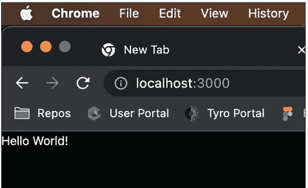

图 1.7：在浏览器中运行的 Next.js 应用

最后，你成功创建了一个简单的 `Next.js` 应用！

## 结论

在本章中，我们学习了什么是 Web 应用，理解了 `Next.js` 的基本工作原理及其优势，以及 `HTML`、`CSS` 和 `JavaScript` 的基本功能。我们还探索了在计算机上本地运行 `Next.js` Web 应用是多么简单。

在下一章中，我们将回顾 `React` 的基础知识，`React` 是最流行的用于构建交互式 Web 应用以及跨平台移动应用的 `JavaScript` 库。

## 第 2 章

## 回顾 React

### 简介

`React` 是一个用于构建用户界面的强大 `JavaScript` 库。在本章中，我们将回顾 `React` 的核心概念，这些概念对于构建健壮的 Web 应用至关重要。

我们将从介绍 `React` 应用的基本构建块开始：组件。我们将讨论如何在 `React` 中创建和使用组件，以及它们如何允许开发者构建复用的 UI 元素。我们还将涵盖 `JSX`，它是 `JavaScript` 的语法扩展，允许开发者在 `JavaScript` 文件中编写类似 `HTML` 的代码。

接下来，我们将深入研究 `React` 中重要的 props 和 state 概念。我们将解释 props 如何允许数据在组件之间传递，而 state 则用于管理组件内部随时间发生变化的数据。我们将涵盖处理 props 和 state 的最佳实践，以及如何使用它们来构建复杂且交互的用户界面。

最后，我们将讨论 `React` 中的生命周期方法，这些方法允许开发者处理组件生命周期中的某些事件。我们将涵盖如何使用这些方法来控制组件的行为，以及如何使用它们来优化性能并避免 `React` 应用中的错误。

在本章结束时，你将对 `React` 的核心概念有良好的理解，并准备好使用这个强大的库开始构建健壮且高性能的应用程序。

## 结构

在本章中，将涵盖以下主题：

- `React` 框架简介，包括虚拟 DOM 和组件化架构
- `React` 组件生命周期方法及其用法
- `JSX` 语法及其与传统 `HTML` 的区别
- `React` 中的事件处理以及组件间的数据传递
- `React` state 和 props 的使用，包括组件间的数据流
- `React Hooks` 简介及其用法
- `JavaScript` 异步编程的基本概念以及如何在 `React` 中使用它们

### 介绍 React

什么是 `React`，它为什么重要？`React` 是一个由 Meta（原 Facebook）开发并维护的流行 `JavaScript` 库，用于构建用户界面，特别是 Web 应用。它的创建是为了解决需要更高效、可扩展的方式来处理复杂用户界面，同时提供卓越性能的需求。多年来，`React` 变得流行，因为它允许开发者构建复用的、模块化的组件，既易维护又便于扩展。

`React` 如此受欢迎的主要原因之一是它对简单性和维护性的关注。通过将用户界面拆分为小的、自包含的组件，它允许开发者轻松理解和修改代码，即使在大型复杂的应用中也是如此。此外，`React` 的性能优化（如虚拟 DOM）确保了用 `React` 构建的应用程序运行快速且响应迅速。

### 虚拟 DOM 及其优势

虚拟 DOM 是 `React` 的核心功能之一，也是其性能卓越的主要原因。虚拟 DOM 是实际 DOM（文档对象模型）的轻量级内存表示。`React` 使用一种称为协调（reconciliation）的过程来比较当前的虚拟 DOM 和新生成的 DOM，从而只对实际 DOM 进行必要的更新。这种机制极大地提高了性能。

考虑以下示例：

```javascript
import React, { useState } from "react";

function Counter() {
  const [count, setCount] = useState(0);
  return (
    <div>
      <p>你点击了 {count} 次</p>
      <button onClick={() => setCount(count + 1)}>点击我</button>
    </div>
  );
}
```

### React 中的组件化架构

`React` 的组件化架构是其流行的主要因素。组件是自包含的代码，代表用户界面的一部分。它们可以组合并嵌套以创建复杂的 UI。

`React` 组件化架构背后有两个主要原则：

- 单职责原则：每个组件应该有一个单一的职责。这使得代码更容易理解、测试和维护。
- 组合：组件可以组合在一起构建 UI 结构。

这是一个组件化 UI 的简单示例：

```javascript
import React from "react";
import Header from "./Header";
import Content from "./Content";
import Footer from "./Footer";

function App() {
  return (
    <div>
      <Header />
      <Content />
      <Footer />
    </div>
  );
}
export default App;
```

在这个示例中，`App` 组件由三个组件组成：`Header`、`Content` 和 `Footer`。这些每个组件都有自己的职责，使得整个应用程序更容易维护。

### 理解函数组件和类组件

`React` 组件可以写为函数组件或类组件。在 `React 16.8` 引入 Hooks 之前，函数组件是没有状态的，仅用于展示数据，而类组件是有状态的。但随着 Hooks 的引入，函数组件现在可以拥有状态并执行副作用，变得更加强大和多功能。

函数组件比类组件更简单、简洁，是许多开发者的首选。它们仅仅是接收 props 作为输入并返回 `JSX` 来渲染 UI 的 `JavaScript` 函数。

这是一个函数组件的示例：

```javascript
import React from "react";

function Welcome(props) {
  return <h1>Hello, {props.name}</h1>;
}
```

相比之下，类组件是继承自 `React.Component` 的 `JavaScript` 类。它们有一个返回 `JSX` 的 `render()` 方法，并且拥有本地状态和生命周期方法。

这是一个类组件的示例：

```javascript
import React, { Component } from "react";

class Welcome extends Component {
  render() {
    return <h1>Hello, {this.props.name}</h1>;
  }
}
export default Welcome;
```

虽然 `React` 仍然支持类组件，但 Hooks 的引入让函数组件变得更加强大和多功能。Hooks 允许你在不编写类的情况下使用状态和其他 `React` 特性，从而使代码更简洁、更具可读性。

为了说明在函数组件中使用 Hooks，让我们把之前的类组件示例转换为带有状态的函数组件：

```javascript
import React, { useState } from "react";

function Welcome() {
  const [name, setName] = useState("John");
  const handleChange = (event) => {
    setName(event.target.value);
  };
  return (
    <div>
      <h1>Hello, {name}!</h1>
      <input type="text" value={name} onChange={handleChange} />
    </div>
  );
}
export default Welcome;
```

在这个示例中，我们使用 `useState` Hook 在函数组件中管理 `name` 状态。我们还定义了一个 `handleChange` 函数来处理输入变化事件并更新状态。

总而言之，`React` 的基于组件的架构、虚拟 DOM 以及对复用性的强调，使其成为构建用户界面的强大且流行的选择。随着 Hooks 的引入，函数组件变得更加强大和多功能，进一步巩固了 `React` 作为领先 `JavaScript` 库的地位。当你继续探索 `React` 及其特性时，你会发现它提供了一种高效且可维护的方法来构建复杂且扩展的 Web 应用。

## React 组件生命周期方法及其用法

让我们解释一下 `React` 组件的生命周期方法及其优势。

- 生命周期方法概述

生命周期方法是类组件中的特殊方法，允许你在组件生命周期期间特定点运行代码。它们对于管理副作用（如获取数据、更新 DOM 和处理事件）至关重要。生命周期方法可以分为三个主要阶段：挂载、更新和卸载。

注意：随着 Hooks 的引入，函数组件现在可以使用 `useEffect` 执行类似的任务。本节侧重于类组件的生命周期方法，但意识到函数组件中的这种替代方法也是重要的。

- 挂载阶段方法

挂载阶段发生在组件被创建并插入 DOM 中时。与此阶段相关的生命周期方法有两个方法：

- `constructor`：构造函数方法用于初始化组件的状态并绑定事件处理器。它在组件挂载之前被调用。

这是一个示例：

```javascript
class MyComponent extends React.Component {
  constructor(props) {
    super(props);
    this.state = { message: "Hello, World!" };
    this.handleClick = this.handleClick.bind(this);
  }
}
```

- `componentDidMount`：该方法在组件插入 DOM 之后立即被调用。它是获取数据、设置订阅或执行其他副作用的理想位置。

这是一个示例：

```javascript
class MyComponent extends React.Component {
  componentDidMount() {
    console.log("Component has been mounted.");
  }
}
```

- 更新阶段

更新阶段发生在组件的状态或 props 发生变化导致重新渲染时。与此阶段相关的生命周期方法有两个：

- `shouldComponentUpdate`：该方法在重新渲染之前被调用，允许你根据状态或 props 判断组件是否应该更新。默认情况下，它返回 `true`。如果你返回 `false`，组件将不会更新，剩余的生命周期方法也不会被调用。

这是一个示例：

```javascript
class MyComponent extends React.Component {
  shouldComponentUpdate(nextProps, nextState) {
    return this.props.someValue !== nextProps.someValue;
  }
}
```

- `componentDidUpdate`：该方法在组件更新后立即被调用。它用于响应 prop 或状态的变化来执行副作用，例如 DOM 操作或数据获取。

这是一个示例：

```javascript
class MyComponent extends React.Component {
  componentDidUpdate(prevProps, prevState) {
    // 逻辑
  }
}
```

- 卸载阶段

卸载阶段发生在组件从 DOM 中移除时。与此阶段相关的生命周期方法有一个：

- `componentWillUnmount`：该方法在组件销毁之前立即调用。它是清理任务的完美位置，例如取消网络请求或移除事件监听器。

这是一个示例：

```javascript
class MyComponent extends React.Component {
  componentWillUnmount() {
    // 清理
  }
}
```

- 错误处理

`React` 提供了用于处理子组件错误的生命周期方法：

- `static getDerivedStateFromError`：该方法在子组件抛出错误时于 `render()` 之前调用。它允许更新状态以显示备用 UI。
- `componentDidCatch`：该方法在捕获子组件错误时被调用。它用于记录错误信息。

这是一个示例：

```javascript
class ErrorBoundary extends React.Component {
  constructor(props) {
    super(props);
    this.state = { hasError: false };
  }
  static getDerivedStateFromError(error) {
    return { hasError: true };
  }
  componentDidCatch(error, info) {
    console.log("Error caught:", error, info);
  }
  render() {
    if (this.state.hasError) {
      return <h1>Something went wrong</h1>;
    }
    return this.props.children;
  }
}

// 使用：
<ErrorBoundary>
  <MyComponent />
</ErrorBoundary>
```

使用 Next.JS 构建现代 Web 应用程序

- 如果 `JSX` 标签没有子元素，它们可以是自闭合的。确保在角括号之前包含一个斜杠，例如 `` 或 `<input />`。

```javascript
function MyComponent() {
  return ;
}
```

- `JSX` 中的属性名使用驼峰命名（camelCase）而不是横线命名（kebab-case）。例如，使用 `onClick` 代替 `on-click`，使用 `className` 代替 `class`：

```javascript
function MyComponent() {
  return (
    <button onClick={() => console.log("Clicked")} className="btn">
      Click me
    </button>
  );
}
```

# 在 JSX 中嵌入 JavaScript 表达式

`JSX` 允许你使用大括号 `{}` 来嵌入 `JavaScript` 表达式。你可以利用此功能在 `JSX` 中显示变量、执行计算，甚至渲染其他组件。

这是一个示例：

```javascript
function Greeting(props) {
  const name = props.name;
  return <h1>Hello, {name}!</h1>;
}
```

# 在 JSX 中处理条件渲染和循环

条件渲染和循环是 `React` 组件中的常见任务。你可以在 `JSX` 中使用 `JavaScript` 表达式按如下方式处理这些任务：

- 对于条件渲染，使用三元运算符或逻辑与（`&&`）表达式：

```javascript
function Greeting(props) {
  return (
    <div>
      {props.isLoggedIn ? (
        <h1>Welcome back, {props.name}</h1>
      ) : (
        <h1>Please log in.</h1>
      )}
    </div>
  );
}
```

- 对于循环，使用 `map` 方法遍历数组并渲染元素：

```javascript
function ListItems(props) {
  const items = props.items;
  return (
    <ul>
      {items.map((item) => (
        <li key={item.id}>{item.name}</li>
      ))}
    </ul>
  );
}
```

回想 React

# JSX 和 HTML 的区别

虽然 `JSX` 看起来与 `HTML` 相似，但它们之间存在一些关键区别：

- 属性名：如前所述，`JSX` 使用驼峰命名属性名而不是横线命名。例如，使用 `className` 代替 `class`，使用 `htmlFor` 代替 `for`。
- Style 属性：在 `JSX` 中，`style` 属性期望一个 `JavaScript` 对象而不是 `CSS` 字符串。每个 `CSS` 属性应该使用驼峰命名。

```javascript
function MyComponent() {
  const divStyle = {
    color: "blue",
    backgroundColor: "white",
  };
  return <div style={divStyle}>Hello, World!</div>;
}
```

- 闭标签：在 `JSX` 中，所有标签必须关闭，即使它们没有子元素。这与 `HTML` 不同，`HTML` 中的某些标签（如 `` 和 `<input>`）不需要关闭标签。在 `JSX` 中，这些应该是自闭合的，在结束元素括号前要有一个正斜杠（例如 `` 和 `<input />`）。

```javascript
// 正确
function MyComponent() {
  return (
    <div>
      
      <input type="text" name="username" />
    </div>
  );
}
```

```javascript
// 错误
function MyComponent() {
  return (
    <div>
      
      <input type="text" name="username">
    </div>
  );
}
```

- **JavaScript 表达式**：`JSX` 允许你使用大括号 `{}` 嵌入 `JavaScript` 表达式。此功能在 `HTML` 中不可用，在 `HTML` 中你必须使用模板字符串或其他机制来实现类似的功能。
- **自定义组件**：`JSX` 允许你创建自定义组件，其用法与 `HTML` 元素相同。在 `HTML` 中，你需要使用 Web 组件或其他方法来实现。

总结来说，`JSX` 是 `JavaScript` 一个强大且灵活的扩展，允许你在 `JavaScript` 代码中编写类似 `HTML` 的代码。通过理解它的语法规则、最佳实践以及与传统 `HTML` 的区别，你可以有效地使用 `JSX` 创建整洁且易于维护的 `React` 组件。通过嵌入 `JavaScript` 表达式、条件渲染内容和遍历数组，`JSX` 简化了构建复杂动态用户界面的过程。

# 在 React 中处理事件以及组件间的数据传递

本节将解释如何在 `React` 中管理事件以及向组件传递数据。

### React 事件处理基础

在 `React` 中处理事件与在原生 `JavaScript` 中处理事件相似。但在处理 `React` 中的事件时，需要注意一些区别和最佳实践，包括：

- 事件名称：在 `React` 中，事件使用驼峰命名，例如 `onClick`、`onSubmit` 和 `onMouseOver`。
- 事件处理器：你需要传递一个函数作为事件处理器，而不是字符串。当事件触发时，将调用该函数。

这是一个示例：

```javascript
function handleClick() {
  console.log("Button clicked!");
}
```

```javascript
function MyComponent() {
  return <button onClick={handleClick}>Click me</button>
}
```

### 合成事件与事件池

`React` 使用了一种名为“合成事件”（Synthetic Events）的概念，它是原生浏览器事件的封装。这为跨浏览器处理事件提供了一致的接口。通过事件池提升了性能。这是一个示例：

```javascript
function handleClick(event) {
  console.log("Button clicked:", event);
}

function MyComponent() {
  return <button onClick={handleClick}>Click me</button>
}
```

回想 React

### 在组件上绑定事件

当使用类组件时，必须将事件处理器绑定到实例上。有以下几种方式绑定事件：

- 构造函数绑定

```javascript
class MyComponent extends React.Component {
  constructor(props) {
    super(props);
    this.handleClick = this.handleClick.bind(this);
  }
}
```

- 箭头函数

```javascript
class MyComponent extends React.Component {
  handleClick = () => {
    console.log("Button clicked!");
  };
}
```

- 内联函数（请谨慎使用，因为可能会影响性能）

```javascript
class MyComponent extends React.Component {
  render() {
    return <button onClick={() => this.handleClick()}>Click me</button>
  }
}
```

### 通过 props 传递数据

Props 是 `React` 组件之间传递数据的主要机制。它们允许你将值从父组件传递给子组件。

### 使用回调函数进行父子通信

为了从子组件通信回父组件，你可以传递一个回调函数作为 prop。子组件可以在发生事件（如点击按钮）时调用该函数。

这是一个示例：

```javascript
class ParentComponent extends React.Component {
  handleChildClick(name) {
    console.log("Button clicked in:", name);
  }
  render() {
    return <ChildComponent onClick={this.handleChildClick} />;
  }
}
```

```javascript
function ChildComponent(props) {
  return <button onClick={() => props.onClick("Child")}>Click me</button>
}
```

### 状态提升与共享状态

当多个组件需要共享并修改相同的数据时，做法是将状态提升到最近的共同祖先。这意味着将状态管理移动到更高级的组件，然后通过 props 将数据传递给子组件。

这是一个示例：

```javascript
class App extends React.Component {
  constructor(props) {
    super(props);
    this.state = { counter: 0 };
    this.incrementCounter = this.incrementCounter.bind(this);
  }
  incrementCounter() {
    this.setState((prevState) => ({ counter: prevState.counter + 1 }));
  }
  render() {
    return (
      <div>
        <CounterDisplay counter={this.state.counter} />
        <CounterButton onClick={this.incrementCounter} />
      </div>
    );
  }
}
```

```javascript
function CounterDisplay(props) {
  return <h1>Counter: {props.counter}</h1>;
}
```

```javascript
function CounterButton(props) {
  return <button onClick={props.onClick}>Increment Counter</button>
}
```

复习 React

value) 并通过 props 将其传递给 `CounterDisplay` 和 `CounterButton` 组件。`incrementCounter` 函数也被传递给 `CounterButton` 组件，允许它更新共享数据。

总之，在 `React` 中处理事件和在组件之间传递数据是构建动态用户界面的基础。通过理解 `React` 事件处理基础、合成事件和事件绑定，你可以有效地处理组件中的用户交互。此外，学习通过 props 传递数据以及使用回调函数进行父子通信，使能够构建复杂且可维护的应用程序。最后，提升和管理共享状态可以帮助你高效地管理被多个组件访问和修改的数据。

### React state（状态）和 props（属性）

让我们开始学习 `React` state 和 props，包括组件之间的数据流：

- 理解 `React` 组件中的 state

`React` 组件中的 state 是存储和管理随时间变化的数据的一种。与 props 不同（props 是只读的并从父组件向下传递），而 state 在组件内部是本地且可变的。可以使用 `useState` Hook 创建带状态的函数组件。

- 初始化和更新状态

在函数组件中初始化状态，可以使用 `useState` Hook。它接受一个初始值作为参数，并返回一个包含两个元素的数组：当前状态值和一个更新状态的函数。你可以使用数组解构将返回的元素赋值给变量：

```javascript
import React, { useState } from 'react';

function Counter() {
  const [count, setCount] = useState(0);
  function increment() {
    setCount(count + 1);
  }
  return (
    <div>
      <p>Count: {count}</p>
      <button onClick={increment}>Increment</button>
    </div>
  );
}
```

# 使用 Next.JS 构建现代 Web 应用

- 处理状态的不可变性与最佳实践

`React` 中的 state 应该被视为不可变的。这意味着，你不是直接修改当前状态，而是创建一个带有更新数据的新状态对象。这种做法有助于防止 bug 并优化性能，因为 `React` 可以高效地比较旧新状态对象以确定是否需要重新渲染。

在根据当前状态更新状态时，请通过向状态更新器传递函数来使用函数式更新：

```javascript
function increment() {
  setCount((prevCount) => prevCount + 1);
}
```

- Props 及其在组件通信中的作用

如前所述，props 是 `React` 中组件之间传递数据的主要方式。Props 是只读的，允许父组件向子组件传递值。子组件随后可以通过它们的 props 对象访问传递的数据：

```javascript
function Greeting({ name }) {
  return <h1>Hello, {name}!</h1>;
}

function App() {
  return <Greeting name="John" />;
}
```

- **使用 PropTypes 验证 props**

`PropTypes` 是一个库，允许你为组件指定 props 的预期类型。它是捕获 bug 和记录你组件预期 prop 类型的有用工具。要使用 `PropTypes`，你需要导入该库并在你的组件上定义预期的 prop 类型：

```javascript
import React from 'react';
import PropTypes from 'prop-types';

function Greeting({ name }) {
  return <h1>Hello, {name}!</h1>;
}

Greeting.propTypes = {
  name: PropTypes.string.isRequired
};

export default Greeting;
```

- **使用 Context API 管理状态和数据流**

在某些情况下，你可能需要在没有通过父子关系直接连接的组件之间共享状态。`Context API` 是 `React` 的内置功能，允许你跨树共享状态，而无需手动通过多层传递 props。

要使用 `Context API`，你需要使用 `React.createContext()` 创建上下文并用 context provider 包裹你的组件树。context provider 接收一个 value 属性，该值可以是任何你想跨组件树共享的数据：

```javascript
import React, { useState, useContext } from 'react';

const ThemeContext = React.createContext();

function App() {
  const [theme, setTheme] = useState('light');
  return (
    <ThemeContext.Provider value={{ theme, setTheme }}>
      <Toolbar />
    </ThemeContext.Provider>
  );
}

function Toolbar() {
  return <ThemeSwitch />;
}

function ThemeSwitch() {
  const { theme, setTheme } = useContext(ThemeContext);
  function toggleTheme() {
    setTheme((prevTheme) => prevTheme === 'light' ? 'dark' : 'light');
  }
  return (
    <button onClick={toggleTheme}>
      Switch to {theme === 'light' ? 'dark' : 'light'} theme
    </button>
  );
}
```

复习 React

55

在这个示例中，`App` 组件初始化了主题状态并将其提供给 `ThemeContext`。嵌套在 `Toolbar` 组件中的 `ThemeSwitch` 组件随后可以使用 `useContext` Hook 访问并更新主题状态，而无需传递主题和更新函数。

总之，理解 `React` 函数组件中的 state 和 props 对于构建动态和交互式应用程序至关重要。通过使用 `useState` Hook 初始化和更新状态，你可以有效地管理数据。遵循最佳实践（例如将状态视为不可变并使用函数式更新）有助于防止 bug 并优化性能。Props 在组件通信中起着至关重要的作用，允许你在组件之间传递数据并使用 `PropTypes` 验证它们的类型。最后，`Context API` 简化了跨树的状态管理和数据流。

# 介绍 Hooks 及其用法

什么是 Hooks？为什么要使用它们？Hooks 是 `React 16.8` 中引入的一组函数，允许你在函数组件中使用状态和其他功能，而无需类组件的复杂性。使用 Hooks 的一些优点包括更优的代码、更简单的代码以及更容易测试。

- 使用 useState Hook

`useState` Hook 允许你向函数组件中添加状态。它接受一个初始值作为参数，并返回一个包含两个元素的数组：当前状态和一个更新状态的函数。你可以使用数组解构将返回的元素赋值给变量：

```javascript
import React, { useState } from 'react';

function Counter() {
  const [count, setCount] = useState(0);
  function increment() {
    setCount(count + 1);
  }
  return (
    <div>
      <p>Count: {count}</p>
      <button onClick={increment}>Increment</button>
    </div>
  );
}
```

56

- 使用 useEffect 及其依赖项

`useEffect` Hook 允许你在函数组件中执行副作用，例如获取数据或更新 DOM。它接受两个参数：一个包含副作用的函数和一个可选的依赖数组。默认情况下，副作用函数会在每次渲染后运行，但你可以通过提供依赖数组来控制它的运行时机。只有当依赖项之一发生变化时，副作用才会运行：

```javascript
import React, { useState, useEffect } from 'react';

function UserProfile({ userId }) {
  const [user, setUser] = useState(null);
  useEffect(() => {
```


# 回习 React

## 代码示例

```javascript
async function fetchUser() {
  const response = await fetch(`https://api.example.com/users/${userId}`);
  const userData = await response.json();
  setUser(userData);
}

fetchUser();
}, [userId]);

return (
  <div>
    {user ? (
      <div>
        <h1>{user.name}</h1>
        <p>{user.email}</p>
      </div>
    ) : (
      <p>Loading...</p>
    )}
  </div>
);
```

---

## 实现自定义 Hooks 以复用逻辑

自定义 Hooks 是一个强大的功能，允许你在组件之间创建可复用的逻辑。自定义 Hook 就是一个以“use”开头并包含其他 Hooks 的函数：

```javascript
import { useState, useEffect } from 'react';

function useCustom(url) {
  const [data, setData] = useState(null);
  const [loading, setLoading] = useState(true);

  useEffect(() => {
    async function fetchData() {
      const response = await fetch(url);
      const jsonData = await response.json();
      setData(jsonData);
      setLoading(false);
    }
    fetchData();
  }, [url]);

  return { data, loading };
}
```

```javascript
function App() {
  const { data, loading } = useFetch('https://api.example.com/data');
  return (
    <div>
      {loading ? <p>Loading...</p> : <p>Data: {JSON.stringify(data)}</p>}
    </div>
  );
}
```

---

## 使用 `useContext` 和 `useReducer` 进行高级状态管理

`useContext` 和 `useReducer` 可以结合使用，以创建类似于 Redux 的高级状态管理模式。`useContext` Hook 允许你访问组件树向上最近的上下文（context value），而 `useReducer` Hook 则使用 reducer 函数管理复杂的状态转换：

```javascript
import React, { createContext, useReducer, useContext } from 'react';

const initialState = { count: 0 };

function reducer(state, action) {
  switch (action.type) {
    case 'increment':
      return { count: state.count + 1 };
    case 'decrement':
      return { count: state.count - 1 };
    default:
      throw new Error(`Unknown action type: ${action.type}`);
  }
}

const CounterContext = createContext();

function CounterProvider({ children }) {
  const [state, dispatch] = useReducer(reducer, initialState);

  return (
    <CounterContext.Provider value={{ state, dispatch }}>
      {children}
    </CounterContext.Provider>
  );
}

function Counter() {
  const { state, dispatch } = useContext(CounterContext);

  return (
    <div>
      <p>Count: {state.count}</p>
      <button onClick={() => dispatch({ type: 'increment' })}>
        Increment
      </button>
      <button onClick={() => dispatch({ type: 'decrement' })}>
        Decrement
      </button>
    </div>
  );
}

function App() {
  return (
    <CounterProvider>
      <Counter />
    </CounterProvider>
  );
}
```

---

## 其他内置 Hooks 及其用例

React 提供了其他几个内置 Hooks，每个都有特定的用例：

- **`useMemo`**: 通过对值进行缓存（memoizing）来优化性能，值在依赖项变化时才会重新计算。此 Hook 在处理计算密集型函数或对象时非常有用。
- **`useCallback`**: 与 `useMemo` 类似，但用于对函数进行缓存。它返回回调函数的缓存版本，只有当其中一个依赖项发生变化时，该函数才会改变。
- **`useRef`**: 创建一个可变的 ref 对象，可以跨越渲染存储值而不会触发重新渲染。常见场景包括引用 DOM 元素和存储之前的状态。
- **`useLayoutEffect`**: 与 `useEffect` 类似，但它会在所有 DOM 变更后同步执行，确保副作用及其清理函数都在同一帧中运行。当需要在浏览器绘制之前读取布局或测量 DOM 时，请使用此 Hook。

总之，React Hooks 为函数组件中的状态、副作用和 React 特性提供了一种强大且简单的方法。内置 Hooks（如 `useState`、`useEffect`、`useContext` 和 `useReducer`）涵盖了广泛的用例，而自定义 Hooks 则允许在组件间创建可复用的逻辑。使用 `useContext` 和 `useReducer` 可以实现高级状态管理模式，其他内置 Hooks（如 `useMemo`、`useCallback`、`useRef` 和 `useLayoutEffect`）为各种场景提供了额外功能。

---

# JavaScript 异步编程及其在 React 中的应用

异步编程是一种允许多个任务并发运行而不阻塞主执行线程的编程范式。JavaScript 是单线程的，这意味着它一次只能执行一个操作。异步编程允许 JavaScript 执行耗时较长的任务（例如从 API 获取数据或读取文件），而不会冻结用户界面。

### 回调函数及其局限性

回调作为参数传递给其他函数，并在稍后执行。回调是 JavaScript 中处理异步代码最基础的形式：

```javascript
function getData(callback) {
  setTimeout(() => {
    const data = 'Sample data';
    callback(data);
  }, 1000);
}

getData((data) => {
  console.log(data); // 'Sample data'
});
```

然而，在处理多个嵌套的异步操作时，回调可能会导致臭名昭著的“回调地狱”，导致代码不可读且难以维护。

### Promises 和链式调用

Promises 是处理异步代码的一种更高级的方式。Promise 代表未来可能用到的值。Promise 有三种可能的状态：等待中（pending）、已完成（fulfilled）或拒绝（rejected）。你可以使用 `then` 方法附加在 Promise 完成后会被调用的回调函数，或使用 `catch` 方法处理错误：

```javascript
function getData() {
  return new Promise((resolve, reject) => {
    setTimeout(() => {
      const data = 'Sample data';
      resolve(data);
    }, 1000);
  });
}

getData().then((data) => {
  console.log(data); // 'Sample data'
});
```

Promises 可以链式调用，在处理多个异步操作时允许代码更具可读性和维护性。

### 用于简洁代码的 Async/await 语法

Async/await 是一种现代语法，让异步代码变得更加简单。`await` 关键字用于暂停执行，直到 Promise 解决。

```javascript
async function fetchData() {
  const response = await fetch('https://api.example.com/data');
  const data = await response.json();
  console.log(data);
}
```

### 将异步代码与 React 组件集成

为了在函数组件中集成异步代码，你可以使用 `useEffect` Hook 获取数据或执行副作用：

```javascript
import React, { useState, useEffect } from 'react';

function DataDisplay() {
  const [data, setData] = useState(null);

  useEffect(() => {
    async function fetchData() {
      const response = await fetch('https://api.example.com/data');
      const jsonData = await response.json();
      setData(jsonData);
    }
    fetchData();
  }, []);

  return <div>{data ? <p>{JSON.stringify(data)}</p> : <p>Loading...</p>}</div>;
}
```

### 异步代码中的错误处理与最佳实践

在 React 中处理异步代码时，正确处理错误至关重要。你可以在异步函数中使用 `try/catch` 块来捕获错误并向用户显示消息：

```javascript
import React, { useState, useEffect } from 'react';

function DataDisplay() {
  const [data, setData] = useState(null);
  const [error, setError] = useState(null);

  useEffect(() => {
    async function fetchData() {
      try {
        const response = await fetch('https://api.example.com/data');
        const jsonData = await response.json();
        setData(jsonData);
      } catch (err) {
        setError(err.message);
      }
    }
    fetchData();
  }, []);
}
```

异步编程是 JavaScript 和 React 中创建响应式高效应用的关键。从回调到 Promises 和 async/await 语法，JavaScript 提供了多种处理异步代码的方法。在 React 中，`useEffect` Hook 允许在函数组件中无缝集成异步操作。正确的错误处理（如 `try/catch` 块）确保了处理真实场景时的更好的用户体验。通过理解并应用这些概念，你可以创建更健壮、高性能的 React 应用。

---

# 总结

React 为构建现代应用提供了一个强大且灵活的框架。在过去的七章节中，我们探索了 React 的核心概念，从组件化架构、JSX 语法、状态管理到事件处理、生命周期方法和 Hooks。此外，我们深入研究了异步编程技术以创建更有响应性的应用。通过理解这些基础概念并应用最佳实践，你可以充分利用 React 的潜力，开发出高效、可维护且可扩展的 Web 应用。

在章节“Next.js 基础”中，你将接触 Next.js 框架及其优势。我们将引导你完成安装和设置、创建 Next.js 项目并理解其目录结构。你将学习 pages 的核心作用以及如何创建和渲染基础页面。最后，我们将解释使用 CSS Modules 实现 CSS，这是组件样式的一种强大功能。本章将为你提供构建健壮可扩展的 Next.js 应用所需的基础知识。

## 单选题

1. **React 中虚拟 DOM 的主要目的是什么？**
   - A. 通过减少直接 DOM 操作来提高性能
   - B. 启用异步编程
   - C. 简化 JavaScript 代码的语法
   - D. 完全替换真实的 DOM

2. **React 中有两种什么类型的组件？**
   - A. 同步和异步
   - B. 函数组件和类组件
   - C. 有状态组件和无状态组件
   - D. 父组件和子组件

3. **JSX 和 HTML 之间的主要区别是什么？**
   - A. JSX 是标记语言，而 HTML 是编程语言
   - B. JSX 允许嵌入 JavaScript 表达式，而 HTML 不行
   - C. JSX 不能用于样式，而 HTML 可以
   - D. JSX 需要单独的 CSS 文件，而 HTML 不需要

4. **React Hooks 的主要目的是什么？**
   - A. 为了允许在函数组件中使用状态和其他 React 特性
   - B. 为了通过减少直接的 DOM 操作来提高性能
   - C. 为了简化 JavaScript 代码的语法
   - D. 为了允许使用类组件

5. **哪一个 Hook 用于在函数组件中执行副作用？**
   - A. `useState`
   - B. `useEffect`
   - C. `useContext`
   - D. `useReducer`

6. **使用 async/await 语法相比 Promises 的主要优势是什么？**
   - A. 允许编写性能更高的代码
   - B. 使异步代码更易读、易写
   - C. 允许在函数组件中使用状态
   - D. 消除了对错误处理的需求

7. **在哪个 React Hook 中主要使用 Context API？**
   - A. `useState`
   - B. `useEffect`
   - C. `useContext`
   - D. `useReducer`

8. **props 在 React 组件中的主要作用是什么？**
   - A. 管理组件内部的状态
   - B. 允许在函数组件中使用状态和其他 React 特性
   - C. 在组件之间传递数据和函数
   - D. 定义组件的结构和布局

9. **哪个生命周期方法在 React 组件挂载（mounted）时只被调用一次？**
   - A. `componentDidMount`
   - B. `componentDidUpdate`
   - C. `componentWillMount`
   - D. `componentDidCatch`

10. **下列哪不是 JavaScript Promise 的有效状态？**
    - A. Pending（等待中）
    - B. Fulfilled（已完成）
    - C. Rejected（已拒绝）
    - D. Completed（已完成）

## 答案

| 问题 | 答案 |
| :--- | :--- |
| 1 | A |
| 2 | B |
| 3 | B |
| 4 | A |
| 5 | B |
| 6 | B |
| 7 | C |
| 8 | C |
| 9 | A |
| 10 | D |

---

# 第 3 章：Next.js 基础

## 简介

在本章中，我们将深入探讨 Next.js 框架的基础。我们将首先介绍 Next.js，这是一个强大的基于 React 的框架，它提供了诸如服务端渲染 (SSR)、静态站点生成 (SSG) 和增量静态再生 (ISR) 等独特特性。我们将探索使用 Next.js 的优势，并将其与其他流行的框架进行比较，同时阐述它在现实项目中的实际应用。

接下来，我们将引导你完成开发环境、安装 Next.js 并创建你的第一个 Next.js 项目。我们将帮助你理解 Next.js 项目的核心结构，并解释每个文件夹和文件如何对你的应用程序做出贡献。

随着学习的深入，我们将解释 Next.js 中页面（pages）的关键作用、它们是如何与路由绑定的，以及创建和渲染基础页面的过程。最后，我们将介绍 CSS Modules 并演示如何利用它们来为你的 Next.js 应用设置样式。在本章结束时，你将对 Next.js 的基本原理有充分的理解，并做好开始构建自己的 Next.js 应用的准备。

## 结构

在本章将涵盖以下主题：

- Next.js 框架介绍及其优势
- 安装、设置和创建新的 Next.js 项目
- 理解 Next.js 项目的文件夹结构
- 理解页面在 Next.js 中的作用
- 在 Next.js 中创建和渲染基础页面
- 使用 CSS Modules 在 Next.js 中实现 CSS 样式

---

### 介绍 Next.js 框架及其优势

Next.js 是一个强大的、开源的基于 React 的框架，用于构建服务端渲染和静态生成的应用程序。它由 Vercel 开发并维护，使用 JavaScript 构建，并利用了 React、Node.js 和 JavaScript 生态系统的力量。该框架旨在通过自动代码分割、预取和热更新等特性提供优化的用户体验。

以下是一个基础的 Next.js 组件的示例：

```javascript
// 一个基础的 Next.js 组件
function HomePage() {
  return <div>Welcome to Next.js!</div>;
}
```

### 使用 Next.js 的优势

Next.js 提供了多项引人入胜的特性，使其成为现代 Web 开发的杰出选择。这些特性包括：

- **服务端渲染 (SSR)**：Next.js 在服务器上渲染页面并将其作为完整的 HTML 文件发送给客户端。这一特性加速了初始页面加载并提升了 SEO。
- **静态站点生成 (SSG)**：Next.js 可以在构建时生成静态 HTML，减少对服务器的需求。这一特性对于静态站点非常理想。
- **增量静态再生 (ISR)**：Next.js 允许在构建后增量更新静态页面。这对于博客文章或内容频繁变化的站点非常有用。
- **自动路由**：Next.js 根据文件系统自动处理路由。
- **API 路由**：Next.js 允许在项目内部直接构建 API 端点。

例如：

```javascript
// Next.js 中的 API 路由示例
export default function handler(req, res) {
  res.status(200).json({ text: 'Hello from Next.js' });
}
```

- **热更新**：Next.js 在开发期间提供即时反馈。
- **内置 CSS 和 Sass 支持**：Next.js 对 CSS 和 Sass 有支持。
- **TypeScript 支持**：Next.js 原生支持 TypeScript。

### 与其他框架对比

Next.js 在多个方面与 Create React App (CRA) 和 Gatsby 等框架脱颖而出。虽然 CRA 非常适合构建单页应用 (SPA)，但它缺乏 Next.js 那种强大的 SSR 和 SSG 特性。另一方面，Gatsby 强调 SSG，但原生不支持 SSR。此外，Next.js 的自动路由和 API 路由使其成为更全面的解决方案。

这是一个示例：

```javascript
// Next.js 中的动态路由
// pages/posts/[id].js
function Post({ post }) {
  // 渲染 post...
}

export async function getServerSideProps(context) {
  const { id } = context.params;
  // 根据 id 获取数据...
  return { props: { post } };
}

export default Post;
```

### 现实应用案例

许多知名公司由于其通用性和强大的功能，在技术栈中使用 Next.js。Netflix、Twitch 和 Uber 等公司已利用 Next.js 的力量来构建快速、可扩展且符合 SEO 的 Web 应用程序。这些现实应用验证了 Next.js 框架的实用性和企业级可用性。

总之，Next.js 是一个兼具性能、开发者体验和灵活性的全面框架。无论你是在构建小型项目还是大型企业级应用，Next.js 提供的工具和功能都能让过程变得高效且愉快。

---

### 补充说明

内置的路由系统简化了页面创建，而原生的 API 路由功能意味着它可以在同一个框架内处理后端功能，从而实现无缝的全栈开发体验。

此外，Next.js 对 CSS、Sass、TypeScript 以及流行的 CSS-in-JS 解决方案提供了开箱即用的支持，消除了手动设置这些功能的需要。这种内置功能结合自动的热代码重载，带来了极佳的开发者体验。

在将 Next.js 与 CRA 和 Gatsby 等框架进行比较时，显而易见 Next.js 为构建现代 Web 应用提供了更全面的工具集。虽然 CRA 和 Gatsby 各有优劣，但 Next.js 的多功能性使其在许多用例下成为强有力的竞争者。

Netflix、Uber 和 Twitch 等知名公司对 Next.js 的采用进一步证明了它的能力和实用性。这些公司需要高性能、可扩展且可靠的 Web 应用，它们选择使用 Next.js 表明了该框架能够满足这些需求。

无论你是刚开始学习 JavaScript 开发，还是一个寻求简化工作流的资深开发者，Next.js 提供的系列优势都使其成为你下一个项目的绝佳选择。

---

## 安装并创建新的 Next.js 项目

在本节中，我们将介绍安装 Next.js 的前提条件，并分析 Next.js 的目录结构。

### 安装 Next.js 的前提条件

在开始使用 Next.js 之前，我们需要确保机器上已安装必要的工具。Node.js 和 npm（Node 包管理器）对于设置 Next.js 项目至关重要。Next.js 是一个 JavaScript 运行时，允许我们在服务器上运行 JavaScript，而 npm 是 Node.js 的包管理器。编写本文时，推荐使用最新的 LTS 版本 Node.js（v14.x.x 或更高）和 npm（v6.x.x 或更高）。

你可以通过在终端中运行以下命令检查是否安装了 Node.js 和 npm 并查看版本：

```bash
node -v
npm -v
```

如果你没有安装 Node.js，可以从 Node.js 官网（https://nodejs.org）下载。

### 安装 Next.js

一旦安装了 Node.js 和 npm，得益于 `create-next-app` 命令，设置一个新的 Next.js 应用将变得轻而易举，该命令会使用默认启动模板创建一个新的 Next.js 应用。

在终端中，导航到你想要存放项目的目录并运行以下命令：

```bash
npx create-next-app@latest my-next-app
```

在该命令中，`my-next-app` 是你新项目的名称。请将其替换为所需的名称。

### 创建你的第一个 Next.js 项目

`create-next-app` 命令会创建一个以项目命名的新目录，设置必要的文件和文件夹并安装依赖项。它本质上是一个准备就绪的 Next.js 应用。

命令完成后，进入你的新项目目录：

```bash
cd my-next-app
```

要启动开发服务器，使用 `npm run dev` 命令：

```bash
npm run dev
```

打开浏览器并访问 http://localhost:3000。你应该能看到你新的 Next.js 应用已经启动并运行！

### 理解初始设置

`create-next-app` 命令设置了如下标准的 Next.js 文件结构：

- **pages**: 该目录包含你应用程序的页面。每个文件根据其名称对应一个路由。
- **public**: 该目录存储图像等静态文件，这些文件在根路径 (/) 下提供服务。
- **styles**: 该目录包含全局 CSS 文件。默认包含 `globals.css` 文件，可用于全局样式。
- **package.json**: 该文件包含关于你的项目及其依赖的元数据。

以下是 Next.js 项目的目录结构：

```bash
my-next-app
├── pages
│   ├── _app.js
│   ├── api
│   │   └── index.js
├── public
├── styles
│   ├── globals.css
│   └── Home.module.css
└── package.json
```

`pages` 目录包含一个 `index.js` 文件，它对应 `/` ，以及 `_app.js`，它是一个用于初始化页面的自定义 App 组件。你可以覆盖它来控制页面初始化或添加全局样式。

`pages` 下的 `api` 目录是特殊的——你可以直接在 Next.js 中创建后端函数。

这种初始设置为你的 Next.js 项目提供了坚实的基础，随着你在 Next.js 之旅中的不断深入，你将学习更多关于这些组件的知识。

---

## 理解 Next.js 项目的目录结构

理解 Next.js 项目的文件和目录结构至关重要，因为它将让你更好地感知项目的组织结构，并使开发更加顺畅。

### 目录结构概述

新创建的 Next.js 应用具有以下目录结构：

```text
my-next-app
- pages
  - _app.js
  - api
  - index.js
- public
- styles
  - globals.css
  - Home.module.css
- .gitignore
- package.json
- README.md
```

让我们逐一查看这些目录和文件，以更好地理解它们的作用。

### 探索 `pages` 目录

`pages` 是 Next.js 中最重要的目录之一。这是你添加所有页面的地方。每个文件根据其名称对应一个路由。例如，如果你在 `pages` 目录创建一个 `about.js` 文件，它可以通过 http://localhost:3000/about 访问。

```javascript
// pages/about.js
export default function About() {
  return <h1>About</h1>
}
```

`pages` 还包含 `_app.js` 文件，这是一个用于初始化自定义 App 组件。你可以用它在页面之间保持状态，添加全局样式。

`pages` 下的 `api` 目录是特殊的——你可以直接在 Next.js 中创建后端函数。此目录下的每个文件对应一个 API 的路由。

```javascript
// pages/api/hello.js
export default function handler(req, res) {
  res.status(200).json({ text: 'Hello' });
}
```

### 探索 `public` 目录

`public` 目录是存放图像、字体或 `robots.txt` 等静态资源的地方。这些文件从根路径 (/) 提供服务。例如，如果你在 `public` 目录中添加 `logo.png` 文件，可以通过 http://localhost:3000/logo.png 访问。

该目录也用于 `manifest.json`、`robots.txt` 以及任何你想添加到域的静态文件。

### 探索 `styles` 目录

Next.js 原生支持 CSS。`styles` 目录是你添加 CSS 文件的地方。默认情况下，Next.js 为你的项目配置了 CSS Modules，允许你将 CSS 直接导入到 JavaScript 文件中。

例如，你可以创建一个 `Button.module.css` 文件：

```css
/* Button.module.css */
.button {
  padding: 10px 20px;
  background-color: #0070f3;
  color: #fff;
  border: none;
  border-radius: 5px;
}
```

然后在你的组件中导入它：

```javascript
// pages/index.js
import styles from '../styles/Button.module.css'

export default function Home() {
  return <button className={styles.button}>Click Me</button>
}
```

`globals.css` 文件默认包含，可用于全局样式。这些样式将应用于应用程序中的所有页面和组件。你也可以使用此文件导入其他 CSS 文件作为全局。

### 其他文件

`package.json` 文件包含关于项目的元数据并列出了它的依赖项。当你运行 `npm install <package>` 时，该包会被添加为依赖。

---

## 理解 `pages` 在 Next.js 中的作用

在 Next.js 中，页面是一个根据 `pages` 目录中的文件名与路由关联的 React 组件。这个概念是 Next.js 的基础方面之一，理解它对于使用该框架构建应用至关重要。

### 介绍 `pages`

在 Next.js 中，`pages` 目录下的每个文件都会变成一个自动被处理并渲染的路由。假设你有一个文件 `pages/about.js`，它将通过 `http://localhost:3000/about` 访问。

这是一个基础页面的示例：

```javascript
// pages/about.js
export default function About() {
  return <h1>About</h1>
}
```

当你导航到 `about` 时，`About` 函数将会被渲染。

#### 自动路由

Next.js 遵循一种基于“页面（pages）”概念构建的基于文件系统的路由器。当你向 `pages` 目录添加一个文件时，它将自动作为路由变为可用。

`pages` 目录中的文件和文件夹与路由的路径呈镜像关系。例如，如果你创建了一个 `pages/posts/first-post.js` 文件，它将通过 `/posts/first-post` 访问。

#### 动态路由

Next.js 支持动态路由。如果你在 `pages` 目录内创建一个文件名中包含方括号（`[]`）的文件，它将被视为动态路由。

例如，`pages/posts/[id].js` 将匹配 `/posts/1`、`/posts/2` 等。你可以使用来自 `next/router` 的 `useRouter` 钩子在组件中访问动态部分（在此例中为 `id`）：

```javascript
// pages/posts/[id].js
import { useRouter } from 'next/router'

export default function Post() {
  const router = useRouter()
  return <h1>Post: {router.query.id}</h1>
}
```

#### 嵌套路由

你可以通过在 `pages` 目录内添加文件夹来创建嵌套路由。例如，如果你创建一个 `pages/posts/first-post.js` 文件，它将通过 `/posts/first-post` 访问。

#### API 路由

Next.js 允许你创建 API 路由。API 路由是服务端路由，你可以在其中实现后端逻辑，例如从数据库获取数据或处理表单提交。

API 路由通过在 `pages/api` 目录内定义文件来创建。对于 `pages` 目录的其余部分，文件系统是主要的 API 端点，文件根据其文件名与路由关联。

例如，如果你创建一个 `pages/api/hello.js` 文件，它将通过 `/api/hello` 访问：

```javascript
// pages/api/hello.js
export default function handler(req, res) {
  res.status(200).json({ text: 'Hello' })
}
```

#### 错误页面

Next.js 拥有一个内置的 404 页面，如果未找到路由，则会自动提供该页面。你可以通过创建一个 `pages/404.js` 文件来自定义 404 页面：

```javascript
// pages/404.js
export default function Custom404() {
  return <h1>404 - Page Not Found</h1>
}
```

结论，Next.js 中的 `pages` 是路由系统的核心。理解如何创建和管理页面，使我们能够利用 Next.js 的力量来构建动态、高性能的 Web 应用。

---

## 在 Next.js 中创建和渲染基础页面

既然我们已经学习了 `pages` 在 Next.js 中的作用，让我们来看看创建和渲染基础页面的过程。

正如之前提到的，Next.js 中的页面是从 `pages` 目录下的 `.js`、`.jsx`、`.ts` 或 `.tsx` 文件导出的 React 组件。每个页面都根据其文件名与路由关联。

### 创建新页面

在 Next.js 中创建新页面就像在 `pages` 目录中创建一个新文件一样简单。让我们为应用程序创建一个新的 `About` 页面。在你的项目中，在 `pages/about.js` 处创建一个新文件并添加以下代码：

```javascript
// pages/about.js
export default function About() {
  return (
    <div>
      <h1>About Us</h1>
      <p>我们是一个致力于使用 Next.js 构建 Web 应用的专职开发者团队。</p>
    </div>
  )
}
```

在前面的代码中，我们创建了一个名为 `About` 的函数组件，它返回了一个简单的 HTML 结构。该组件将成为我们的 About 页面。

### 查看新页面

现在你已经创建了新页面，可以通过在浏览器导航到 `http://localhost:3000/about` 来查看它。你应该能看到刚刚创建的 `About` 页面。

### 页面间的链接

Web 应用中最常见的操作之一是在页面之间导航。在 Next.js 中，你可以使用来自 `next/link` 包的 `Link` 组件在页面间导航。

让我们从主页创建一个到 `About` 页面的链接。打开 `pages/index.js` 文件并按如下所示更新内容：

```javascript
// pages/index.js
import Link from 'next/link'

export default function Home() {
  return (
    <div>
      <h1>Home</h1>
      <p>欢迎来到我们的网站！</p>
      <Link href="/about">About Us</Link>
    </div>
  )
}
```

在此段代码中，我们从 `next/link` 导入了 `Link` 组件并使用它链接到 About 页面。`href` 属性用于指定目标地址。

现在，当你导航到 `http://localhost:3000` 时，你会看到主页包含指向 About 页面的链接。

### 理解渲染过程

当你导航到 Next.js 应用中的路由时，底层发生了什么：
1. 服务器接收请求。
2. 服务器获取组件。
3. 服务器渲染页面。
4. 服务器将 HTML 发送到客户端。
5. JavaScript 在客户端运行。

这一过程允许 Next.js 提供快速的加载速度和强大的功能。

### 总结

在本节中，你学习了如何在 Next.js 中创建新页面、如何查看它，并理解了渲染过程。

### 创建布局组件

通常，你可能希望在页面间共享组件，例如头部和页脚。Next.js 没有提供内置的布局系统，但创建自己的非常简单。

让我们创建一个包含到 Home 和 About 页面链接的布局组件：

```javascript
// components/Layout.js
import Link from 'next/link'

export default function Layout({ children }) {
  return (
    <div>
      <nav>
        <Link href="/">Home</Link>
        <Link href="/about">About</Link>
      </nav>
      {children}
    </div>
  )
}
```

在 `Layout` 组件中，我们渲染了导航栏和传递给它的 `children`。

现在，你可以在页面中使用此 `Layout` 组件：

```javascript
// pages/index.js
import Layout from '../components/Layout'

export default function Home() {
  return (
    <Layout>
      <h1>Home</h1>
      <p>欢迎来到我们的网站！</p>
    </Layout>
  )
}
```

```javascript
// pages/about.js
import Layout from '../components/Layout'

export default function About() {
  return (
    <Layout>
      <h1>About Us</h1>
      <p>我们是一个致力于使用 Next.js 构建 Web 应用的专职开发者团队。</p>
    </Layout>
  )
}
```

---

## 使用 CSS Modules 实现 CSS 样式

### 创建 CSS 模块

要创建一个 CSS Module，你需要创建一个 `.module.css` 文件。在你的项目样式目录中，创建一个名为 `About.module.css` 的新文件：

```css
/* About.module.css */
.container {
  margin: 20px;
  padding: 20px;
  border: 1px solid #ddd;
}

.title {
  color: #0070f3;
  font-size: 2em;
  margin-bottom: 10px;
}

.content {
  font-size: 1.2em;
  line-height: 1.6em;
}
```

在此文件中，我们定义了三个 CSS 类：`container`、`title` 和 `content`。

### 如何使用 CSS Module

要使用 CSS Module，你需要在 JavaScript 文件中导入它。导入的 CSS Module 然后可以作为对象进行引用。让我们将这些样式应用到我们的 About 页面：

```javascript
// pages/about.js
import styles from '../styles/About.module.css'
import Layout from '../components/Layout'

export default function About() {
  return (
    <div className={styles.container}>
      <h1 className={styles.title}>关于我们</h1>
      <p className={styles.content}>我们是一组专注的开发人员，使用 Next.js 构建 Web 应用。</p>
    </div>
  )
}
```

在此文件中，我们导入了之前创建的 CSS Module 并在组件中使用了这些类。样式仅应用于此组件，即使其他组件使用了相同的类名。

### 组合与全局类

CSS Modules 允许你在当前模块中组合其他 CSS Modules 的样式。它还支持全局样式，全局样式适用于你的整个应用程序。

以下是一个使用组合和全局样式的示例：

```css
/* Global.module.css */
.title {
  color: #0070f3;
}

/* styles/About.module.css */
@import './Global.module.css';

.container {
  composes: title from './Global.module.css';
  font-size: 2em;
}
```

在这个示例中，`About.module.css` 文件从 `Global.module.css` 导入样式，并在其容器类中使用了 `title` 类。

CSS Modules 为你的 Next.js 应用提供了一种强大且灵活的样式方案。通过默认对样式进行局部范围化，CSS Modules 确保了样式在组件之间不会泄漏，帮助你避免样式冲突并保持样式的整洁。

---

## 结论

在本章中，我们介绍了 Next.js ——一个增强了 React 能力的健壮框架，并探索了它的功能和优势。我们涵盖了 Next.js 项目的安装和设置，理解了项目结构，并深入研究了页面（pages）的作用。我们还演示了基础页面的创建和渲染，并学习了使用 CSS Modules 实现 CSS 样式。有了这些基础知识，你已经准备好开始构建你的 Next.js 应用，并进一步探索这一强大框架的高级功能。

在接下来的章节“Next.js 13 核心概念”中，我们将深入探讨 Next.js 13 版本中引入的令人兴奋的新功能和增强。我们将探索这些更新如何优化你的开发体验并提高应用程序的性能。从新的路由系统、边缘函数（Edge Functions）的改进，到中间件（Middleware）以及 React 服务器组件（React Server Components）的改进，你将对框架的现状有一个全面的理解，从而能够充分利用它的高级能力。

## 多选题

1. **什么是 Next.js？**
   - A. 用于构建用户界面的 JavaScript 库
   - B. 用于设置网页样式的 CSS 框架
   - C. 一个全功能的后端框架
   - D. 用于构建 JavaScript 应用的 React 框架

2. **使用哪个命令创建新的 Next.js 应用？**
   - A. `npm create-next-app`
   - B. `npm start-next-app`
   - C. `npx create-next-app`
   - D. `npx start-next-app`

3. **什么类型的文件代表 Next.js 中的页面？**
   - A. `pages` 目录下的 `js` 或 `jsx` 文件
   - B. `styles` 目录下的 `css` 文件
   - C. `markdown` 目录下的 `md` 文件
   - D. `public` 目录下的 `html` 文件

4. **Next.js 如何处理路由？**
   - A. 在 `routes.js` 文件中手动定义路由
   - B. 基于 `pages` 目录自动处理
   - C. 使用 Express.js 路由系统
   - D. Next.js 不处理路由

5. **如何在 Next.js 页面之间跳转？**
   - A. 使用 `<a>` HTML 元素
   - B. 使用来自 `next/navigate` 包的 `navigate` 函数
   - C. 使用来自 `next/link` 包的 `Link` 组件
   - D. 使用来自 `next/router` 包的 `push` 方法

6. **在 Next.js 应用中请求页面时会发生什么？**
   - A. 浏览器下载整个应用程序
   - B. 服务器发送请求页面的 HTML
   - C. 服务器发送请求页面的 JavaScript 代码
   - D. Next.js 不处理路由

7. **什么是 CSS Module？**
   - A. 一个全局范围化样式的 CSS 文件
   - B. 一个局部范围化样式的 CSS 文件
   - C. 一个允许组合的 CSS 文件

8. **你如何在 Next.js 中应用 CSS Module？**
   - A. 使用 `className` 属性
   - B. 使用 `id` 属性
   - C. 使用 `style` 属性
   - D. 使用 `class` 属性

9. **Next.js 中 `Layout` 组件的目的是什么？**
   - A. 设置页面样式
   - B. 跨页面共享组件
   - C. 处理数据获取
   - D. 管理路由

10. **以下哪项不是 Next.js 13 的功能？**
    - A. 自动路由
    - B. 局部范围
    - C. 服务器组件
    - D. 客户端渲染

## 答案

| 题目 | 答案 |
| :--- | :--- |
| 1 | D |
| 2 | C |
| 3 | A |
| 4 | B |
| 5 | C |
| 6 | B |
| 7 | B |
| 8 | A |
| 9 | B |
| 10 | D |

---

# 第 4 章：Next.js 13 核心概念

这些脚本涉及开发 Next.js 13 应用的不同阶段：

- **`dev`**: 运行 `next dev` 以开发模式启动 Next.js。
- **`build`**: 运行 `next build` 为生产环境使用构建应用。
- **`start`**: 运行 `next start` 启动 Next.js 生产服务器。
- **`lint`**: 运行 `next lint` 设置 Next.js 内置的 ESLint 配置。

打开 `app` 文件夹下的 `layout.tsx` 文件，你将看到以下内容：

```tsx
import './globals.css'
import { Inter } from 'next/font/google'

const inter = Inter({ subsets: ['latin'] })

export const metadata = {
  title: 'Create Next App',
  description: 'Generated by create next app',
}

export default function RootLayout({
  children: React.ReactNode
}) {
  return (
    <html lang="en">
      <body className={inter.className}>{children}</body>
    </html>
  )
}
```

现在打开 `app` 文件夹中的 `page.tsx` 并将其内容替换为以下代码：

```tsx
export default function Page() {
  return <h1>Hello, Next.js 13!</h1>
}
```

在控制台中输入 `npm run dev` 来启动开发服务器，并在浏览器中访问 `http://localhost:3000`。你将看到以下屏幕：

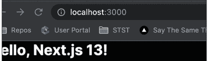

图 4.1：localhost 屏幕

我们成功在计算机上设置了一个 Next.js 13 应用。

---

## App Router

Next.js 13 引入了基于 React Server Components 的全新 App Router 结构，它支持嵌套路由、共享布局、错误处理和加载状态。App Router 在一个名为 `app` 的新文件夹中工作，它可以与 `pages` 目录并存运行。这有助于逐步采用新的 App Router，并允许开发者按照自己的节奏学习新概念。在本章中，我们将专注于学习随 v13 引入的新功能。

### 文件夹和文件

在 App Router 中，文件夹用于定义路由。路由是由嵌套文件夹组成的单一路径，遵循从顶层根文件夹到包含 `page.js` 文件的最后一个节点文件夹的层次结构。`page.js` 用于定义为特定路由显示的 UI。例如，如果在浏览器中为 Next.js 13 应用访问链接 `https://matheny.com/dashboard`，应用程序将渲染位于 `app` 文件夹内 `dashboard` 文件夹中的 `page.tsx` 文件的 UI。

以下是 **my-app** 的文件夹结构：

```text
my-app
  app
    dashboard
      page.tsx
```

### 文件约定

Next.js 提供了一系列特殊文件，用于在嵌套路由中创建具有特定行为的 UI。让我们来看看主要的内核：

- **`page.js`**: 用于渲染路由的 UI 并使路径对用户公开。
- **`layout.js`**: 用于为分段及其子级创建共享 UI。布局包裹页面或子分段，可用于渲染多个路由共享的 UI，例如导航菜单或头部组件。
- **`loading.js`**: 用于为分段及其子级创建加载 UI。`loading.js` 在加载时显示加载 UI，其工作原理是将页面或子分段包裹在 React Suspense Boundary 中。
- **`error.js`**: 用于为分段及其子级创建错误 UI。如果捕获到错误，`error.js` 显示错误 UI，其工作原理是将页面或子分段包裹在 React Error Boundary 中。

---

## 客户端和服务端组件

随着 Next.js 13 的发布，引入了一种同时使用服务端组件（Server Components）和客户端组件（Client Components）创建应用的混合方法。一种名为“服务端组件”的 React 原则旨在设计具有零 JavaScript 包和服务器驱动的现代界面心模型的应用程序。

客户端组件在客户端（浏览器）上获取并渲染，而服务端组件在服务器上获取并渲染。

现在，让我们检查一个没有服务端组件的程序。在这种情况下，服务器通过向浏览器发送信息来响应用户对网页的请求。浏览器在创建网页时下载 JavaScript。这意味着浏览器必须安装创建网页所需的每部分 JavaScript。由于所有的请求-响应瀑布流，加载可能需要很长时间，并提供糟糕的用户体验。

在这种情况下，服务端组件非常有用。浏览器只需要下载客户端组件的 JavaScript，而组件被定义为服务端组件，是因为服务器构建了该组件并返回了服务端组件渲染后的 HTML。这可以加快浏览器渲染并增强用户体验。

Next.js 13 为我们提供了一个系统，可以在组件级别指定组件应该是服务端组件还是客户端组件。

在 Next.js 13 新引入的 `app` 目录中，所有组件默认都是服务端组件。这意味着只要你不指定该组件应在客户端渲染，所有的组件和页面都将在服务器上渲染。以下是 Next.js 13 中服务端组件的样子：

```tsx
export default function Page() {
  return <h1>Hello, Next.js 13!</h1>
}
```

要将组件标记为客户端组件，请在文件顶部添加 `'use client'` 指令：

```tsx
'use client'

export default function Page() {
  return <h1>Hello, Next.js 13!</h1>
}
```

---

## 渲染

在 Next.js 中，路由可以是静态渲染或动态渲染的。在静态路由中，组件在构建时在服务器上渲染。这些工作会被缓存并在随后的请求中重用；而在动态路由中，组件在请求时在服务器上渲染。

### 静态渲染

静态渲染是 Next.js 应用的默认渲染模式，它能够提高性能，因为所有渲染工作都是提前完成的，并且从地理位置上更接近用户的内容分发网络（CDN）提供。

我们也可以通过在布局（layout）或页面（page）中使用动态函数或动态数据获取来选择动态渲染，这将使 Next.js 在请求时动态渲染整个路由。

### 动态渲染

如果在静态渲染期间发现了动态函数或无缓存模式下的 `fetch()` 请求，Next.js 将切换为在请求时动态渲染整个路由。任何缓存的数据请求在动态渲染期间仍然可以被重用。动态数据获取是指 `cache` 选项设置为 `'no-store'` 或 `revalidate` 设置为 0 的 `fetch` 请求。我们将在下一节中探索更多数据获取模式。

---

## 数据获取

React 和 Next.js 13 引入了在应用中获取和管理数据的新方法。新的数据获取系统工作在 `app` 目录，并构建在 `fetch()` Web API 之上。

`fetch()` 是用于获取远程资源的 Web API，返回一个 promise。React 扩展了 `fetch` 以提供自动请求去重，而 Next.js 扩展了 `fetch` 选项对象，允许每个请求设置自己的缓存和重新验证。

### Server Components 中的 `async` 和 `await`

以下代码是在 Server Components 中使用 `async` 和 `await` 获取数据的示例：

```javascript
async function getData() {
  const res = await fetch('https://api.example.com/…');
  if (!res.ok) {
    // 这将激活最近的 `error.js` 错误边界
    throw new Error('Failed to fetch data');
  }
  return res.json();
}

export default async function Page() {
  const data = await getData();
  return <p>{data}</p>
}
```

### 静态获取

默认情况下，`fetch` 将自动获取并无限缓存数据：
`fetch('https://…')` // 默认 `cache: 'force-cache'`

### 动态数据获取

要在每次 `fetch` 请求时获取最新数据，请使用 `cache: 'no-store'` 选项：

```javascript
fetch('https://…', { cache: 'no-store' });
```

---

## 结论

在本章中，我们学习了 Next.js 13 这一最新的 Web 框架，并探索了它的新功能和优势。我们看到它如何采用 App Router，让开发者无需再担心 Next.js 应用的渲染和缓存，因为这些情况都由框架自动处理。有了所有这些新功能，Next.js 13 已经成为 2023 年构建 Web 应用的明显选择。

在接下来的章节“优化 Next.js 应用”中，我们将学习用于优化 Next.js 应用的不同策略，从而提高性能并提供更好的开发者体验。Next.js 提供了诸如 `<Image />` 和 `<Link />` 等内置组件，为开发者提供了许多开箱即用的功能来优化他们的 Web 应用。

## 单选题

1. **在本地启动 Next.js 开发服务器的命令是哪一个？**
   - A. `next dev`
   - B. `next build`
   - C. `next start`
   - D. `next lint`

2. **Next.js 13 中的主目录是哪一个？**
   - A. layout folder
   - B. pages directory
   - C. app router
   - D. public folder

3. **嵌套文件夹的单一路径称为什么？**
   - A. 路由 (Route)
   - B. 页面 (Page)
   - C. App
   - D. 文件夹 (Folder)

4. **用于渲染路由 UI 的文件是哪个？**
   - A. `error.js`
   - B. `loading.js`
   - C. `wait.js`
   - D. `page.js`

5. **Next.js 13 中组件的默认类型是什么？**
   - A. Home 组件 (Home Component)
   - B. Server 组件 (Server Component)
   - C. App 组件 (App Component)
   - D. 路由组件 (Router Component)

6. **将 Server Component 转换为 Client Component 的指令是什么？**
   - A. `use client`
   - B. `use server`
   - C. `serve client`
   - D. `set client`

7. **哪个文件提供了 Next.js 13 中的 React 错误边界 (Error Boundary)？**
   - A. `boundary.js`
   - B. `fault.js`
   - C. `error.js`
   - D. `error-boundary.js`

8. **Next.js 13 中 fetch API 的默认行为是什么？**
   - A. 强制缓存 (Forced caching)
   - B. 不缓存 (Not caching)
   - C. 增量缓存 (Incremental caching)
   - D. 定期缓存 (Periodical caching)

9. **为生产构建 Next.js 应用的命令是哪一个？**
   - A. `build production`
   - B. `next dev`
   - C. `next build`
   - D. `next run`

10. **为“id”设置动态路由路径的约定是哪一个？**
    - A. `{id}`
    - B. `[id]`
    - C. `(id)`
    - D. `<id>`

## 答案

| 题目 | 答案 |
| :--- | :--- |
| 1 | A |
| 2 | C |
| 3 | A |
| 4 | D |
| 5 | B |
| 6 | A |
| 7 | C |
| 8 | A |
| 9 | C |
| 10 | B |

---

# 第 5 章：优化 Next.js 应用

### 引言

作为一名精通技术的开发者，你知道你的 Next.js 应用需要优化。幸运的是，Next.js 是一个开源框架，让构建快速的应用变得简单。通过代码分割和静态导出等开箱即用的功能，Next.js 处理了繁重的工作，让你专注于创建可扩展的应用程序。在本章中，我们将探索 Next.js 的精彩世界，突出它的许多功能，并讨论为什么优化应用如此重要。所以，系好安全带吧！

## 结构

在本章中，我们将涵盖以下主题：

- 优化 Next.js 应用的重要性
- 使用 `Head` 组件添加元数据
- 在 Next.js 中实现静态文件服务
- 理解用于优化的组件
- 理解 Next.js 架构及其工作原理
- 配置 Next.js 以获得最佳性能

---

### 使用 `Head` 组件添加元数据

有效地使用 `Head` 组件，你可以确保你的网页在不同平台上都有良好的展示，并获得更好的可见性。要使用 `Head` 组件，你需要从 `next/head` 模块导入它。

让我们来看一个示例，在其中我们想要为特定页面设置标题和描述：

```javascript
import Head from 'next/head';

function HomePage() {
  return (
    <div>
      <Head>
        <title>Feature Books - NextCommercePro</title>
        <meta name="description" content="Feature books in our collection" />
      </Head>
      {/* Rest of the page content */}
    </div>
  );
}

export default HomePage;
```

图 5.1 显示了带有 meta 和标题的默认首页：

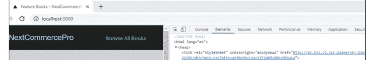

图 5.1：默认主页

在代码段中，我们从 `next/head` 模块导入了 `Head` 组件。在 `HomePage` 组件内部，我们将描述性的元数据元素封装在 `Head` 组件中。在这种情况下，我们将标题设置为 "My Next App - Home"，并将 meta 描述设置为 "Welcome to my Next.js application!"。

`Head` 组件还允许你添加各种其他元数据标签。例如，你可以包含 Open Graph (OG) 标签以获得更好的社交媒体共享：

```javascript
import Head from 'next/head';

function BookPage({ book }) {
  return (
    <div>
      <Head>
        <title>{book.title}</title>
        <meta name="description" content={book.excerpt} />
        <meta property="og:title" content={book.title} />
        <meta property="og:description" content={book.excerpt} />
        <meta property="og:image" content={book.thumbnail} />
      </Head>
      {/* Rest of the page content */}
    </div>
  );
}

export default BookPage;
```

图 5.2 展示了产品详情页：

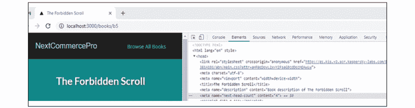

图 5.2：动态 BookPage

在这个示例中，我们将 `book` 对象作为 prop 传递给 `BookPage` 组件。我们使用 book 的数据动态地设置标题、描述和 Open Graph (OG) 标签。`og:title`、`og:description`、`og:image` 标签对于社交媒体平台在页面共享时显示正确的标题、描述和缩略图至关重要。

通过使用 `Head` 组件，你可以轻松地为 Next.js 中的每个页面设置元数据，从而改进 SEO 并增强你的页面在社交媒体平台上的视觉呈现。记得包含相关的元数据（例如标题、描述和 OG 标签），以确保你的页面针对搜索引擎和社交共享都有效地优化。

---

### 在 Next.js 中实现静态文件服务

在涉及在 Next.js 中实现静态文件服务时，不同类型的静态文件在 Web 开发中起着至关重要的作用，包括图像、CSS 样式表和 JavaScript 文件。在本节中，我们将探索如何在你的 Next.js 应用中高效地提供文件。我们将涵盖各种策略和最佳实践，以确保静态资源无缝集成到你的 Next.js 项目中并获得最佳性能。

#### 提供图像

图像是现代 Web 开发不可或缺的一部分。在 Next.js 中，你可以通过以下步骤提供图像：

- 在 Next.js 项目的根目录下创建一个名为 `public` 的文件夹。
- 将你的图像文件（例如 `my-image.jpg`）放在 `public` 文件夹中。
- 在你的 Next.js 组件中，使用 Next.js 的 `<Image>` 组件来显示图像。

这是一个示例：

```javascript
import Image from 'next/image';

const MyComponent = () => (
  <div>
    <Image src="/my-image.jpg" alt="My Image" width={500} height={300} />
  </div>
);

export default MyComponent;
```

`<Image>` 组件会自动优化并提供图像，提供如懒加载和响应式图像渲染等优势。

#### 提供 CSS 样式表

CSS 样式表是其中必不可少的一部分。它们允许你对网页进行样式设计并使其具有视觉吸引力。在本节中，我们将深入探讨如何在 Next.js 应用中高效地提供 CSS 样式表。

首先，让我们假设你有一个名为 `styles.css` 的 CSS 文件，它包含了你 Next.js 应用的所有样式。以下是如何使用 Next.js 提供此 CSS 文件的示例：

- 在 Next.js 项目的根目录下创建一个名为 `public` 的文件夹。该文件夹将包含你所有的静态文件，包括 CSS 样式表。
- 将 `styles.css` 文件移动到 `public` 文件夹。
- 在你的 Next.js 组件或布局文件中，在 `<head>` 区域内使用 `<link>` 标签导入 CSS 文件。

这是一个示例：

```javascript
import Head from 'next/head';

const MyComponent = () => {
  return (
    <div>
      <Head>
        <link rel="stylesheet" href="/styles.css" />
      </Head>
      {/* Your component content */}
    </div>
  );
};
```

---

### 理解用于优化的组件

Next.js 的 `Image` 组件提供了内置的图像优化技术，例如自动调整大小、懒加载和响应式图像交付，以确保高效渲染并缩短页面加载时间。

你将全面理解如何利用此组件在 Next.js 项目中交付高效且具有视觉吸引力的图像。要使用 Next.js `Image` 组件，你需要从 `next/image` 模块导入它。

让我们来看一个使用 Next.js `Image` 组件显示优化图像的示例：

```javascript
import Image from 'next/image';

function HomePage() {
  return (
    <div>
      <Image src="/images/my-image.jpg" alt="My Image" width={800} height={600} />
      {/* Rest of the page content */}
    </div>
  );
}

export default HomePage;
```

在前面的代码段中，我们从 `next/image` 模块导入了 `Image` 组件，并使用该组件显示位于 `/images/my-image.jpg` 的图像。我们还为了可访问性提供了 `alt` 文本。此外，我们使用 `width` 和 `height` 属性指定了图像所需的宽度和高度。

Next.js `Image` 组件会根据提供的维度自动优化图像。它在构建时生成图像的多个优化版本，每个版本都针对不同的屏幕尺寸和设备定制。系统将根据视口和设备特征向客户端提供适当的图像，从而提高性能并减少带宽消耗（见图 5.4）。


图 5.4：产品列表页或书籍列表页

Next.js `Image` 组件支持多个属性，你可以使用这些属性进一步优化图像交付：

- **`layout`**: `layout` 属性决定了图像在页面上的布局方式。它可以设置为 `"responsive"`（默认）、`"fixed"` 或 `"intrinsic"`。`"responsive"` 布局根据容器的尺寸自动调整图像大小，而 `"fixed"` 和 `"intrinsic"` 则会强制执行尺寸。

```javascript
import Image from 'next/image';

function HomePage() {
  return (
    <Image
      src="/images/my-image.jpg"
      alt="My Image"
      layout="responsive"
      width={800}
      height={600}
    />
    {/* Rest of the page content */}
  );
}

export default HomePage;
```

在前面的示例中，我们将 `layout` 属性设置为 `"responsive"`。这允许图像根据容器的尺寸动态调整大小，从而确保响应式布局。

- **`objectFit`**: `objectFit` 属性决定了图像在容器内的缩放和定位方式。它可以设置为 `"fill"`（默认）、`"contain"`、`"cover"`、`"none"` 或 `"scale-down"`。

```javascript
import Image from 'next/image';

function HomePage() {
  return (
    <div>
      <Image
        src="/images/my-image.jpg"
        alt="My Image"
        layout="fill"
        objectFit="cover"
      />
      {/* Rest of the page content */}
    </div>
  );
}

export default HomePage;
```

在接下来的示例中，我们将 `objectFit` 属性设置为 `"cover"`。这确保了图像在保持其宽高比例的同时覆盖整个容器。

- **`objectPosition`**: `objectPosition` 属性指定了图像在容器内的水平和垂直位置。它接受的值如 `"top"`、`"bottom"`、`"left"`、`"right"`、`"center"` 或这些值的组合。

```javascript
import Image from 'next/image';

function HomePage() {
  return (
    <div>
      <Image
        src="/images/my-image.jpg"
        alt="My Image"
        layout="fixed"
        width={500}
        height={300}
        objectFit="contain"
        objectPosition="top right"
      />
      {/* Rest of the page content */}
    </div>
  );
}

export default HomePage;
```

在此示例中，我们将 `objectPosition` 属性设置为 `"top right"`。这把图像放置在容器的右上角。

- **`loading`**: `loading` 属性控制图像的懒加载行为。它可以设置为 `"eager"`（默认）以立即加载图像，或设置为 `"lazy"` 以推迟加载直到图像进入视口。

```javascript
import Image from 'next/image';

function HomePage() {
  return (
    <div>
      <Image
        src="/images/my-image.jpg"
        alt="My Image"
        loading="lazy"
      />
      {/* Rest of the page content */}
    </div>
  );
}

export default HomePage;
```

在此示例中，我们将 `loading` 属性设置为 `"lazy"`，允许图像仅在进入视口时才加载，通过减少初始页面加载时间来提高性能。

- **`priority` 属性**: Next.js `Image` 组件中的 `priority` 属性允许你优先加载图像，以确保关键内容提供更好的用户体验。通过为某些图像设置更高的优先级，你可以确保它们先加载，从而减少页面上重要视觉元素的感知加载时间。

```javascript
import Image from 'next/image';

function HomePage() {
  return (
    <div>
      <Image
        src="/images/my-image.jpg"
        alt="My Image"
        priority
      />
      {/* Rest of the page content */}
    </div>
  );
}

export default HomePage;
```

---

### 理解 Next.js 架构及其工作原理

```javascript
// pages/index.js
import React from 'react';

function HomePage({ data }) {
  return (
    <div>
      <h1>Welcome to Next.js!</h1>
      <p>{data}</p>
    </div>
  );
}

export async function getServerSideProps() {
  // 从 API 或数据库获取数据
  const res = await fetch('https://api.example.com/data');
  const data = await res.json();
  return {
    props: {
      data,
    },
  };
}

export default HomePage;
```

在这段代码中，我们有一个名为 `HomePage` 的简单 Next.js 页面组件。它通过 prop 的形式接收数据并在页面上对其进行渲染。`getServerSideProps` 函数是一个特殊的 Next.js 函数，它在服务器上运行并从 API 或数据库获取数据。数据被获取后，将作为 prop 传递给 `HomePage` 组件。

当用户请求 `HomePage` 时，Next.js 将在服务器上执行 `getServerSideProps` 函数并获取数据。获取的数据将作为 props 传递给 `HomePage` 组件，由该组件在页面上渲染内容。

这是 Next.js 中 SSR（服务端渲染）的一个示例。服务器生成带有获取数据的完整渲染 HTML 并将其发送到客户端，从而实现了更快的初始页面加载并改进了 SEO。

除了 SSR 之外，Next.js 还支持用于动态内容的 CSR（客户端渲染）。你可以使用 `useEffect` 钩子或其他机制在客户端获取数据，并在无需刷新页面的情况下更新 UI。

理解 Next.js 中 SSR 和 CSR 的架构和能力，允许你根据应用程序的需求利用适当的渲染方法，在性能、交互性和 SEO 考虑之间取得平衡。

---

### 配置 Next.js 以获得性能

我们将介绍 Next.js 中提供的各种配置选项，以调优应用程序的性能。此概述将为你提供优化 Next.js 项目的起点。

为了在 Next.js 应用中实现最佳性能，可以遵循若干配置选项和最佳实践。这包括使用生产环境构建、优化图像以及实施服务端缓存。让我们详细探索这些各个方面：

#### 使用生产环境构建

默认情况下，当你运行 Next.js 开发服务器时，它使用一个包含模块替换和调试工具等功能的开发构建。然而，为了在生产环境中获得最佳性能，建议使用生产环境构建。

要创建生产构建，你可以使用以下命令：

```bash
next build
```

该命令会为你的 Next.js 应用生成优化且压缩的构建。然后你可以使用以下命令启动生产服务器：

```bash
next start
```


# 优化 Next.js 应用

使用生产构建可以移除不必要的开发特定代码和优化，从而带来更快的加载速度和更高的性能。

## 实施服务端缓存

我们将简要讨论 Next.js 中服务端渲染和预渲染的概念，强调它们的优势以及如何在应用程序中实现它们。

服务端缓存可以通过减少服务器负载和缩短响应时间来显著提高 Next.js 应用的性能。Next.js 通过各种机制对服务端缓存提供了内置支持：

- **配合缓存使用 `getServerSideProps`**：Next.js 中的 `getServerSideProps` 函数可以配置为在特定时间范围内缓存服务端渲染的页面。通过设置 `revalidate` 属性，你可以控制缓存刷新的频率。这对于不经常变化的数据非常有用。

- **实施外部缓存**：Next.js 应用可以从利用外部缓存机制中受益，例如 CDN（内容分发网络）缓存或代理缓存。这些机制在更接近用户的边缘节点缓存生成的 HTML 或静态资源，从而获得更快的响应时间。

- **使用缓存插件**：Next.js 拥有活跃的插件生态系统，这些插件为不同的用例提供了定制的缓存解决方案。你可以探索可用的缓存插件，以进一步优化应用程序中的缓存策略。

通过实施服务端缓存，你可以减少服务器负载，提高响应时间，并提供更快的用户体验。

## 代码示例

以下是在 Next.js 中配合缓存使用 `getServerSideProps` 函数的示例：

```javascript
import React from 'react';

function HomePage({ data }) {
  return (
    <div>
      <h1>Welcome to Next.js!</h1>
      <p>{data}</p>
    </div>
  );
}

export async function getServerSideProps() {
  const cacheSeconds = 60; // 缓存 60 秒

  // 从 API 或数据库获取数据
  const res = await fetch('https://api.example.com/data');
  const data = await res.json();

  return {
    props: {
      data,
    },
    revalidate: cacheSeconds,
  };
}
```

在前面的代码示例中，我们有一个名为 `HomePage` 的基础 Next.js 页面组件。它接收 `data` 作为 prop 并在页面上渲染。`getServerSideProps` 是一个特殊的 Next.js 函数，它在服务器上运行并从 API 或数据库获取数据。

在 `getServerSideProps` 函数内部，我们定义了页面缓存的持续时间（在此例中为 60 秒）。获取的数据通过 `props` 对象返回，同时 `revalidate` 属性被设置为 `cacheSeconds` 值。

通过设置 `revalidate` 属性，Next.js 将缓存服务端渲染的页面并在指定的持续时间后刷新缓存。这通过在缓存持续期间为后续请求提供缓存内容，有助于减少服务器负载。

通过实施此类缓存策略，你可以减少对频繁获取数据和服务端渲染的需求，从而提高 Next.js 应用的性能。

记住根据你的具体用例和数据更新频率调整缓存持续时间（`cacheSeconds`）。

总而言之，配置 Next.js 以获得最佳性能涉及使用生产环境构建、优化图像以及实施服务端缓存。这些实践确保了你的应用程序能够提供快速且优化的用户体验，增强了性能和可扩展性。

## 代码分割与动态导入

本节将简要介绍代码分割和动态导入，以及它们如何帮助减小 Next.js 的初始包大小并提高性能。你将理解这些技术如何通过仅加载页面或功能所需的代码来增强性能。第 6 章“理解 Next.js 中的路由”将深入探讨这些概念并提供操作示例来演示它们的实际应用。

代码分割和动态导入用于将 JavaScript 包拆分为更小的、更易管理的块。通过拆分代码并按需加载，你可以减小初始包大小并提高性能，对于较大的应用程序尤其如此。

代码分割涉及根据特定的入口或代码依赖将你的代码库划分为更小的部分（或块）。这允许你在需要时仅加载所需的代码，而不是一次性加载所有内容。结果是包体积更小，这可以显著提高用户看到并交互应用程序的时间。

动态导入是实现代码分割的关键机制。它们允许你在运行时异步导入模块，而不是在构建时静态地导入。通过在需要时才动态导入模块，你可以优化应用程序的加载并减少不必要的网络请求。

以下是在 Next.js 应用中使用代码分割和动态导入的示例：

```javascript
import React, { useState, useEffect } from 'react';

function HomePage() {
  const [data, setData] = useState(null);

  useEffect(() => {
    import('./api').then((module) => {
      module.getData().then((response) => {
        setData(response);
      });
    });
  }, []);

  return (
    <div>
      <h1>Welcome to Next.js!</h1>
      <p>{data}</p>
    </div>
  );
}

export default HomePage;
```

在前面的代码段中，`HomePage` 组件使用动态导入异步加载名为 `api` 的外部模块。`api` 模块包含一个名为 `getData()` 的函数，用于获取某些数据。当组件挂载时，`useEffect` 钩子触发动态导入，一旦模块加载，它就会使用 `getData()` 函数获取数据并更新状态。

通过动态导入 `api` 模块，你可以确保它只在 `HomePage` 组件渲染时才加载，从而减小初始包的大小。如果 `api` 模块仅用于应用程序的特定部分，而不是每个页面都需要，这种方法将特别有益。

通过在整个应用程序中策略地使用代码分割和动态导入，你可以优化 Next.js 应用程序的加载和性能。这种技术有助于减少初始包的大小，提高交互时间，并提供更流畅的用户体验。

## 缓存与改进数据获取

缓存对于提高 Next.js 应用程序中数据获取的性能起着至关重要的作用。通过缓存数据，你可以减少对外部 API 或数据库的请求次数，从而获得更快的响应时间和改进的用户体验。

Next.js 提供了几种你可以利用的缓存机制：

- **客户端缓存**：Next.js 支持通过如 SWR (Stale-While-Revalidate) 或 React Query 等库进行客户端缓存。这些库处理数据的缓存、重新验证以及组件之间的同步，允许你在整个应用程序中缓存和复用数据。

使用 SWR 的示例：

```javascript
import useSWR from 'swr';

function UserProfile() {
  const { data, error } = useSWR('/api/user', fetcher);

  if (error) return <div>Error loading user data</div>;
  if (!data) return <div>Loading...</div>;

  return (
    <div>
      <h1>Welcome, {data.name}!</h1>
      <p>Email: {data.email}</p>
    </div>
  );
}
```

- **服务端缓存**：Next.js 通过 `getServerSideProps` 和 `getStaticProps` 函数提供内置的服务端缓存。通过在这些函数中指定缓存配置，你可以对服务器渲染的页面或静态数据进行长时间缓存。这减轻了服务器的负载并提升了响应时间。

使用 `getServerSideProps` 的示例：

```javascript
export async function getServerSideProps(context) {
  const data = await fetchUserFromAPI();

  return {
    props: {
      data,
    },
    revalidate: 60, // 缓存 60 秒
  };
}
```

- **外部缓存**：你还可以利用外部缓存机制，如 CDN（内容分发网络）缓存或代理缓存。这些机制在更接近用户的边缘节点缓存你的 API 响应或静态资源，从而加快后续请求。

通过恰当地实施缓存策略，你可以最大限度地减少频繁获取数据的需求，并提高 Next.js 应用程序的整体性能。

## 分析并减小包大小

我们将简要探索分析和减小 Next.js 应用程序包大小的技术。此概述将向你介绍可以优化项目包大小以提高性能的工具和方法。

Next.js 应用程序包的大小影响初始加载时间和性能。分析并减小包大小对于确保快速流畅的体验至关重要。以下是实现这一目标的一些技术：

- **代码分割**：Next.js 支持自动代码分割，每个页面都会单独打包。这确保了每个页面只加载必要的代码，减小了包的大小。你也可以像上一个主题解释的那样使用动态导入手动配置代码分割。

- **树摇优化**：树摇优化是在构建过程中从包中移除未使用代码的过程。Next.js 利用了 webpack 等工具，会自动为你的应用程序执行树摇优化。确保编写模块化代码并使用 ES 模块以优化树摇效果。

- **压缩化**：压缩化是从代码中移除空格和注释等不必要字符的过程。Next.js 在生产环境构建中默认执行压缩化，从而产生更小的包大小。

- **优化依赖项**：分析并优化应用程序中使用的依赖项。考虑使用更小的替代库或优化现有依赖项的配置以减小包大小。

## 部署策略与最佳实践

高效地部署 Next.js 应用程序对于确保其可用性、可扩展性和性能至关重要。以下是一些部署策略和最佳实践：

- **无服务器部署**：Next.js 应用程序非常适合无服务器部署，将你的应用程序部署到 Vercel、AWS Lambda 或 Netlify 等无服务器平台。无服务器部署提供了自动扩展、更低的基础成本和简化的部署工作流。

- **持续集成与部署 (CI/CD)**：实现 CI/CD 流水线以自动化部署过程。可以使用 GitHub Actions 或 Jenkins 等工具，在每次更改推送到仓库时自动构建并部署你的 Next.js 应用程序。

- **性能监控**：使用 Lighthouse、New Relic 或 Google Analytics 等工具监控已部署应用程序的性能。这有助于识别性能瓶颈并优化应用程序以获得更好的用户体验。

- **安全性考虑**：实施安全最佳实践，如 HTTPS、安全的 API 集成适当的访问控制，以保护你的 Next.js 应用程序及其数据。

- **可扩展性与负载均衡**：配置部署环境，使用负载均衡器和自动伸缩机制进行水平扩展。这确保了你的 Next.js 应用程序能够处理增加的流量而不影响性能。

## 部署策略与最佳实践（详细）

我们将提供关于 Next.js 应用程序的各种部署策略和最佳实践的概述。虽然不是详尽的，本节将让你了解有关生产环境中部署项目的不同选项。

高效地部署 Next.js 应用程序对于确保其可用性、可扩展性和性能非常重要。以下是你可以遵循的一些部署策略和最佳实践：

- **无服务器部署**：Next.js 应用程序非常适合无服务器部署，将你的应用程序部署到 Vercel、AWS Lambda 或 Netlify 等无服务器平台。无服务器部署提供了自动扩展、更低的基础成本和简化的部署工作流。

使用 Vercel 的示例：

安装 Vercel CLI：

```bash
npm install -g vercel
```

部署你的 Next.js 应用程序：

```bash
vercel deploy
```

- **持续集成与部署 (CI/CD)**：实现 CI/CD 流水线以自动化部署过程。可以使用 GitHub Actions 或 Jenkins 等工具构建并部署你的应用程序。

使用 GitHub Actions 的示例：

在仓库中创建一个工作流文件（例如 `.github/workflows/main.yml`）：

```yaml
name: Deploy Next.js App

on:
  push:
    branches:
      - main

jobs:
  deploy:
    runs-on: ubuntu-latest
    steps:
      - name: Checkout code
        uses: actions/checkout@v2
      - name: Install dependencies
        run: npm install
      - name: Build and deploy
        uses: vercel/actions@v21
        with:
          args: "deploy"
```

- **安全性考虑**：通过 HTTPS、保护 API 集成以及实施适当的访问控制来保护你的 Next.js 应用程序及其数据。

- **可扩展性与负载均衡**：配置你的部署环境，使用负载均衡器和自动伸缩机制进行水平扩展。这确保了你的 Next.js 应用能够处理增加的流量而不产生性能下降。

使用 AWS Elastic Load Balancer 的负载均衡示例：

- 在 AWS 中创建 Elastic Load Balancer（弹性负载均衡器）。
- 配置负载均衡器将流量分配到 Next.js 应用的多个实例上。
- 设置自动伸缩，根据流量自动添加或移除实例。

通过遵循这些部署策略和最佳实践，你可以确保你的 Next.js 应用高效部署、性能优化且安全可靠。这些实践实现了无缝扩展，并为你的应用程序用户提供了顺畅的体验。

## 监控性能

我们将探讨在 Next.js 应用中监控和优化性能重要性。本概述将重点介绍关键性能指标，并向你介绍跟踪和改进 Next.js 项目整体性能的工具和实践。

- **Lighthouse**：Lighthouse 是 Google 的一个开源工具，用于审计网页的性能、可访问性、SEO 和最佳实践。它提供了改进性能的详细报告和建议。你可以对你的 Next.js 应用运行 Lighthouse 审计，以识别性能瓶颈和改进区域。

- **真实用户监控 (RUM)**：像 Google Analytics 或 New Relic 等 RUM 工具可以实时捕捉性能指标和用户交互。它们提供了关于应用在真实环境中运行的洞察，并帮助你识别真实用户经历的性能问题。

使用 Lighthouse 的示例：

```bash
# Install Lighthouse CLI
npm install -g lighthouse

# Run Lighthouse audit on your Next.js application
lighthouse http://your-next-js-app-url
```

## 性能优化

性能优化的一些特性如下：

- **代码分割**：如前所述，Next.js 支持自动代码分割，允许你只加载每个页面所需的代码。通过分析应用的依赖关系并优化代码分割，你可以减小包体积并提高初始加载速度。

- **图像优化**：Next.js 提供了 `Image` 组件，可以高效地优化和交付图像。通过利用 `Image` 组件，你可以减小文件大小、实现懒加载，并根据设备屏幕尺寸提供响应式图像。

- **服务端缓存**：Next.js 允许你使用 `getServerSideProps` 或 `getStaticProps` 等函数缓存服务端渲染的页面或静态数据。通过实施适当的缓存策略，你可以减少服务器负载并提高响应速度。

- **性能预算**：为你的 Next.js 应用定义性能预算，指定包体积、网络请求和页面加载时间等指标的阈值。定期监控这些指标，确保应用保持在定义的范围内。

使用 Next.js `Image` 组件优化图像加载的示例：

```javascript
import Image from 'next/image';

function MyComponent() {
  return (
    <div>
      <h1>Welcome to My Component</h1>
      <Image src="/path/to/image.jpg" alt="Image description" width={500} height={300} />
    </div>
  );
}
```

在此示例中，使用了 Next.js 的 `Image` 组件来加载和优化图像。你提供了图像路径、用于可访问性的 alt 文本以及所需的宽度和高度。Next.js 会通过生成多种尺寸和格式自动优化图像，并根据设备和屏幕尺寸提供最合适的版本，从而减小文件大小并提高性能。

## 优化 Next.js 应用（总结）

通过使用 Lighthouse 等工具监控性能，并实施代码分割、图像优化、服务端缓存和性能预算等性能优化技术，你可以确保你的 Next.js 应用在生产环境中提供最佳用户体验。定期监控性能指标并进行迭代改进，以持续增强应用的性能。

## 结论

优化你的 Next.js 应用对于创建极速、高效且高参与度的 Web 应用程序至关重要。在本章中，我们涵盖了许多本质的优化策略，包括为页面添加元数据、实施静态文件服务以及利用 Next.js 图像组件进行图像优化。

我们还深入研究了 Next.js 架构以及如何配置它以获得最佳性能。从实施服务端渲染 (SSR) 和预渲染、代码分割和动态导入、缓存和改进数据获取，到分析和减少包体积，我们为你提供了全面的指导。

此外，我们讨论了部署策略和最佳实践，以及监控和优化性能。通过这些技术，你可以确保你的 Next.js 应用在优化性能和减少加载时间的同时，提供无缝、高质量的用户体验。

你可以从今天开始实施这些优化策略，将你的 Next.js 应用推向新的高度！

在下一章中，我们将深入探讨 Next.js 的文件系统路由。路由是任何 Web 应用的关键方面，而 Next.js 通过其直观且灵活的文件系统路由系统使其变得轻而易举。

## 单选题

- 1. 在 Next.js 中向页面添加元数据的目的是什么？
  A. 提高 SEO
  B. 增强用户体验
  C. 优化页面加载时间
  D. 以上都是

- 2. 在 Next.js 中使用哪个组件向页面添加元数据？
  A. Title
  B. Header
  C. Meta
  D. Head

- 3. 在 Next.js 中实施静态文件服务的目的是什么？
  A. 提高 SEO
  B. 增强用户体验
  C. 优化页面加载时间
  D. 以上全部

- 4. Next.js 图像组件的目的是什么？
  A. 减小图像文件大小
  B. 提高 SEO
  C. 增强用户体验
  D. 让图像加载更快

- 5. Next.js 中的服务端渲染 (SSR) 是什么？
  A. 在客户端渲染页面
  B. 在服务端渲染页面并将 HTML 发送到客户端
  C. 在构建时预渲染页面
  D. 以上均不是

## 答案

| 1. D | 2. D | 3. C | 4. D | 5. B |

# 第 6 章
## 理解 Next.js 中的路由

### 引言

路由就像是 Web 应用的骨干，确保了无缝导航和愉快的用户体验。在 Next.js 世界中，由于其内置路由器，路由变得轻而易举，它处理了页面间跳转和处理动态路由的所有繁重工作。系好安全带，我们将开启 Next.js 路由领域的奇妙之旅。

总体而言，本章旨在让你全面理解 Next.js 中路由是如何工作的。它涵盖了 Next.js 路由的基础、页面间跳转、动态路由处理以及利用 `Link` 组件实现高效的客户端导航。

## 结构

本章涵盖的主题如下：

- 理解 Next.js 路由的作用
- 理解 Next.js `Link` 组件及其用法
- 使用路由在 Next.js 中进行页面跳转
- 在 Next.js 中处理动态路由

## 理解 Next.js 路由的作用

本节提供了 Next.js 路由的概述及其在处理客户端导航中的重要性。Next.js Router 负责管理应用程序的路由以及根据请求的 URL 渲染相应的组件。

`Next.js Router` 在管理 Next.js 应用内的路由中起着至关重要的作用。它负责根据 URL 处理不同页面之间的导航，并相应地渲染合适的组件。`Next.js Router` 基于 `React Router`（一个流行的客户端路由库），并添加了专门针对 Next.js 的特定功能和优化。

为了更好地理解 Next.js 路由器的作用，让我们考虑一个场景。假设我们有一个包含三个页面的 Next.js 应用：首页、关于和联系我们。每个页面都有自己的 URL 和对应的组件。这些页面 URL 如下：

- Home: `/home`
- About: `/about`
- Contact: `/contact`

当用户在浏览器中输入应用程序的 URL 时，Next.js 路由器负责将 URL 与定义的路由进行匹配并渲染相应的组件。

例如，如果用户在浏览器地址栏中输入 `/about` 并按回车，Next.js 路由器会检测到 `/about` URL 并渲染对应该路由的 About 组件。路由器无缝地处理这一过程，确保向用户显示正确的组件，而无需刷新整个页面。

Next.js 路由器还支持嵌套路由，允许我们创建更复杂的页面结构。例如，我们可以为博客文章创建一个嵌套路由：

Blog Post: `/blog/[slug]`

在这种情况下，`[slug]` 代表一个可以是任何取值的动态参数。Next.js 路由器可以从 URL 中提取 `slug` 参数的值，并将其作为 prop 传递给相应的组件。

总的来说，Next.js 路由器简化了基于当前 URL 管理路由和渲染体验的过程。它在 Next.js 应用内提供了无缝的导航体验。

用法示例：

要在 Next.js 中定义路由，我们可以在 `pages` 目录内创建单独的文件。

### 理解 Next.js 中的路由

例如，我们可以创建一个名为 `pages/about.js` 的文件来定义 About 页面路由。在 `about.js` 文件中，我们将导出一个代表 About 页面的 React 组件：

```javascript
// pages/about.js
import React from "react";

const About = () => {
  return (
    <div>
      <h1>About Page</h1>
      <p>This is the About page content.</p>
    </div>
  );
};
```

同样，我们可以为其他页面（如 Home 和 Contact）创建文件，每个文件导出各自的 React 组件。

有了 Next.js 路由器后，我们可以使用 `<Link>` 组件在这些页面之间导航。例如，从首页导航到 About 页面，可以使用以下代码：

```javascript
// pages/index.js (Home page)
import React from "react";
import Link from "next/link";

const Home = () => {
  return (
    <div>
      <h1>Home Page</h1>
      <p>Welcome to the Home page.</p>
      <Link href="/about">
        <a>Go to About page</a>
      </Link>
    </div>
  );
};

export default Home;
```

在这段代码段中，使用 `<Link>` 组件来创建通向 About 页面（`/about`）的链接。当用户点击“Go to About page”链接时，Next.js 路由器会处理导航并渲染 About 组件，而无需刷新整个页面。

Next.js 路由器使得定义路由和在页面之间导航变得简单，在 Next.js 应用内提供了无缝的用户体验。

在最新的 Next.js 版本 13+ 中，路由结构发生了细微调整。以下是更新后的文件夹结构及简要描述：

- app
  - about
    - page.js # 现在映射到 "/about"
  - products
    - [productId]
      - page.js # 现在映射到 "/products/:productId"

这种结构展示了 `app` 目录下的层级关系。值得注意的是，“about”和“products”路由现在位于它们各自的文件夹中。重要的是，这些文件夹中的文件（如 `page.js`）已经过优化，可以直接与特定的 URL 路由对齐。这种改进增强了 Next.js 路由系统的整体组织性和用户友好性，促进了更高效、直观的 Web 应用开发方法。

## 理解 Next.js Link 组件及其用法

Next.js `Link` 组件是用于在 Next.js 应用创建客户端导航链接的强大工具。它提供了一种优化的导航处理方式，确保快速的页面切换并保留应用程序状态。本节将解释 `Link` 组件的用法及其各种属性和选项。

Next.js `Link` 组件是一个内置功能，允许 Next.js 应用内页面之间进行客户端导航。它提供了一种简单且优化的链接创建方式，确保快速的页面切换并保留应用程序状态。以下是 `Link` 组件的属性说明，以及演示其用法的代码示例：

- **href (string 或 object)**：
  `href` 属性指定链接的目标 URL。它可以是表示静态路由的字符串，也可以包含动态路由参数的对象。

```javascript
import Link from 'next/link';

// 静态路由
<Link href="/about">
  <a>About</a>
</Link>

// 带有参数的动态路由
<Link href="/users/[id]" as="/users/1">
  <a>User Profile</a>
</Link>
```

- **as (string, 可选)**：
  `as` 属性结合动态路由使用，用于指定浏览器地址栏中显示的实际 URL。

- **replace (boolean, 可选)**：
  `replace` 属性决定导航是替换当前历史记录还是添加新条目。默认情况下，它设置为 `false`。

- **scroll (boolean 或 string, 可选)**：
  `scroll` 属性控制点击链接时的滚动行为。可以设置为 `true` 以滚动到页面顶部，设置为 `false` 以保留滚动位置，或使用字符串值滚动到目标页面上的特定元素。

```javascript
<Link href="/blog" scroll={true}>
  <a>Blog</a>
</Link>
```

- **shallow (boolean, 可选)**：
  `shallow` 属性启用浅路由，这意味着当仅查询参数变化时，页面不会重新渲染。当你只想更新 URL 而不重新获取新数据时，该属性非常有用。

```javascript
<Link href="/products" shallow>
  <a>Products</a>
</Link>
```

- **prefetch (boolean, 可选)**：
  `prefetch` 属性允许后台自动预取链接页的数据。通过缩短访问链接页面时的加载时间来提升用户体验。

```javascript
<Link href="/dashboard" prefetch>
  <a>Dashboard</a>
</Link>
```

`Link` 组件封装在锚点（`<a>`）标签之外，提供了客户端导航所需的功能。它处理点击事件并阻止浏览器的默认行为。通过使用 `Link` 组件，Next.js 优化了导航过程并利用其内置能力来增强用户体验。它实现了页面之间的平滑切换，提升了性能，并允许开发者利用动态路由和预取等高级功能。

### 链接到外部 URL

除了内部导航外，`Link` 组件还可用于创建指向外部 URL 的链接。只需将完整的 URL 作为 `href` 属性提供即可，Next.js 将会相应地处理重定向。

```jsx
<Link href="https://www.example.com">
  <a>外部链接</a>
</Link>
```

Next.js 的 `Link` 组件简化了在 Next.js 应用程序中创建导航链接的流程。它确保了高效的客户端导航，处理了动态路由，并提供了自定义和优化的选项。通过利用 `Link` 组件，你可以在构建 Next.js Web 应用程序时创建无缝且直观的用户体验。

## 使用路由器在 Next.js 中进行页面间导航

本节解释了如何使用路由器在 Next.js 应用程序中的不同页面之间跳转。Next.js 提供了一个简单且直观的 API 来处理导航，允许开发者以程序方式导航到不同的路由并在页面之间传递数据。Next.js 的页面跳转由 Next.js 路由器促进，它实现了无缝的客户端导航。`useRouter` 钩是一个内置的 Next.js 钩，提供了对路由对象的访问，使你能够程序地在页面之间导航。以下是该过程的说明以及代码示例：

- **导入 `useRouter` 钩**：

在你的 Next.js 组件中，从 `next/router` 模块导入 `useRouter` 钩。

```javascript
import { useRouter } from 'next/router';
```

- **访问路由对象**：

在你的组件中调用 `useRouter` 钩以获取路由对象的访问。

```javascript
const router = useRouter();
```

- **执行导航**：

使用路由对象提供的方法在页面之间跳转。最常用的方法是 `push`，它允许你导航到一个新页面。

```javascript
const handleNavigation = () => {
  router.push('/about');
}
```

你也可以使用其他方法如 `replace`，来替换浏览器历史记录中的当前页面，或者返回上一个页面。

- **处理导航事件**：

Next.js 提供了多种可以在导航发生时进行监听的事件。例如，你可以监听 `routeChangeStart` 事件以便在路由更改之前执行操作，或者监听 `routeChangeComplete` 事件以便在路由更改之后执行操作。

```javascript
useEffect(() => {
  const handleRouteChangeStart = () => {
    // 路由更改前执行的操作
  };

  const handleRouteChangeComplete = () => {
    // 路由更改后执行的操作
  };

  router.events.on('routeChangeStart', handleRouteChangeStart);
  router.events.on('routeChangeComplete', handleRouteChangeComplete);

  return () => {
    router.events.off('routeChangeStart', handleRouteChangeStart);
    router.events.off('routeChangeComplete', handleRouteChangeComplete);
  };
}, []);
```

关于 `useRouter` 钩及其属性在 Next.js 中还有一些细节。

- **query (object)**：
  路由对象的 `query` 属性包含从 URL 解析出的查询字符串参数。它允许你访问并检索传递给当前面的查询参数。

```javascript
// URL: /products?id=123
console.log(router.query.id); // 输出: 123
```

- **pathname (string)**：
  `pathname` 属性代表当前的 URL 路径，不包括查询参数。它提供了当前页面在应用程序中的路径。

```javascript
console.log(router.pathname); // 输出: /products
```

- **route (string)**：
  `route` 属性返回当前匹配的路由模式。它代表与当前页面相关的路由。

```javascript
console.log(router.route); // 输出: /products
```

- **basePath (string)**：
  `basePath` 属性返回应用程序的基路径。它代表 URL 中适用于应用程序所有页面的部分。

```javascript
console.log(router.basePath); // 输出: /
```

- **isFallback (boolean)**：
  `isFallback` 属性指示当前页面是否作为备用静态生成。这在备用状态下渲染备用内容非常有用。

```javascript
if (router.isFallback) {
  return <div>加载中...</div>;
}
```

- **events (EventEmitter)**：
  `events` 属性提供了一个发布相关事件的 `EventEmitter` 对象。你可以使用它监听各种事件，例如路由开始、路由更改完成和路由更改错误。

```javascript
router.events.on('routeStart', () => {
  console.log('路由更改开始');
});
```

记住使用 `router.events.on()` 订阅事件，并使用 `router.events.off()` 清理事件监听器。

### 理解 Next.js 中的路由器方法

- **push (方法)**：
  路由对象的 `push` 方法允许你以程序方式导航到新页面。你可以将目标 URL 作为字符串参数传递给 `push` 方法。

```javascript
const handleNavigation = () => {
  router.push('/about');
}
```

- **replace (方法)**：
  `replace` 方法与 `push` 类似，但它替换的是浏览器历史记录中的当前页面，而不是添加新条目。这对于实现返回按钮或当你不希望用户通过浏览器的后退按钮访问当前页面时非常有用。

```javascript
const handleNavigation = () => {
  router.replace('/about');
}
```

- **back (方法)**：
  `back` 方法允许你返回浏览器历史记录中的上一个页面。它等同于浏览器的后退功能。

```javascript
const handleNavigation = () => {
  router.back();
}
```

- **prefetch (方法)**：
  `prefetch` 方法允许你在后台预取并缓存特定页面资源（HTML、JavaScript、CSS 等）。预取可以在用户导航到页面之前预加载资源来提高性能。

```javascript
const prefetchPage = () => {
  router.prefetch('/about');
}
```

- **isReady (boolean)**：
  `isReady` 属性指示路由对象就绪且所有初始值（如查询参数）已填充。这对于根据路由就绪状态进行条件渲染非常有用。

```javascript
if (!router.isReady) {
  return <div>加载中...</div>;
}
```

## 在 Next.js 中处理动态路由

本节将解释如何在 Next.js 中处理动态路由。动态路由允许你创建可以处理动态参数的页面，例如产品 ID、用户名或博客文章 slug。这使得你可以构建灵活且可扩展的应用程序，其中页面可以根据 URL 参数渲染不同的内容。

### 定义动态路由

在 Next.js 中，你可以通过在 `pages` 目录中创建带有括号的文件名来定义动态路由。例如，要创建一个产品详情页面，你可以创建一个名为 `pages/products/[productId].js` 的文件。括号中的 `productId` 表示这是一个动态参数。

```javascript
// pages/products/[productId].js
import React from 'react';
import { useRouter } from 'next/router';

const ProductDetail = () => {
  const router = useRouter();
  const { productId } = router.query;

  return (
    <div>
      <h1>Product Detail: {productId}</h1>
      {/* ... */}
    </div>
  );
};

export default ProductDetail;
```

### 导航到动态路由

你可以使用 `Link` 组件导航到动态路由，通过提供动态参数作为 `href` 属性的值。

```jsx
// pages/products/index.js
import React from 'react';
import Link from 'next/link';

const ProductList = () => {
  return (
    <div>
      <Link href="/products/1">
        <a>Product 1</a>
      </Link>
      <Link href="/products/2">
        <a>Product 2</a>
      </Link>
      {/* ... */}
    </div>
  );
};

export default ProductList;
```

在上述示例中，使用 `Link` 组件通过提供动态参数（例如，`/products/1`、`/products/2`）作为 `href` 属性的值，用来创建指向不同页面的链接。

### 访问动态参数

要在动态路由的组件中访问动态参数，可以使用 Next.js 提供的 `useRouter` hook。

```javascript
import { useRouter } from 'next/router';

const ProductDetail = () => {
  const router = useRouter();
  const { productId } = router.query;

  return (
    <div>
      <h1>Product Detail: {productId}</h1>
      {/* ... */}
    </div>
  );
};

export default ProductDetail;
```

在上述示例中，使用 `useRouter` hook 来获取路由对象的访问权限。`router.query` 对象包含了动态参数，可以使用对象解构来访问（例如，`const { productId } = router.query`）。然后你可以使用该动态参数（在此例中为 `productId`）来获取并显示相关产品。

在 Next.js 中处理动态路由允许你构建可以处理不同参数的页面，为基于动态值显示内容提供了灵活且可用的方式。`Link` 组件简化了到动态路由的导航，而 `useRouter` hook 则允许在组件内部访问动态参数。

## 结论

关于 Next.js 路由的章节是一份全面的指南，探索了核心路由概念和技术，为开发者在 Next.js 应用中导航和处理路由奠定了坚实的基础。它涵盖了 Next.js 路由的基础知识、页面导航、动态路由处理、`Link` 组件、`useRouter` hook 以及基于文件的路由。通过理解路由的作用，开发者可以深入了解页面导航是如何被管理的，以及不同的路由是如何映射到其对应组件的。`Link` 组件的使用简化了用于页面跳转的锚点标签的创建，在保留服务器端渲染优势的同时确保了优化的客户端导航。动态路由允许处理带有动态参数的路由，构建出可以根据提供的参数渲染不同内容的灵活且可用的组件。`useRouter` hook 赋予了对路由对象的访问，为处理路由提供了各种属性和方法。基于文件的路由通过将文件结构映射到 URL 结构简化了路由的组织。本章使开发者具备了页面跳转、动态路由导航、利用 `Link` 组件优化客户端导航，以及利用 `useRouter` hook 增强路由控制和交互的知识，从而在 Next.js 应用中创建动态、交互且无缝的用户体验。下一章“Next.js 中的状态管理”将探索管理 Next.js 应用状态的各种技术和库。

请参阅 GitHub 仓库 Building-Scalable-Web-Applications-Next.js-and-React 第 5 章和第 6 章。该仓库包含一个小型双页应用，演示了书籍列表和书籍详情，结合了动态路由和优化技术。你可以将此仓库作为开发的宝贵参考。

## 单选题

- 1. 什么是 Next.js 路由？
  A. 用于 Next.js 应用中服务器端渲染的工具
  B. 用于 Next.js 应用中客户端导航的组件
  C. 在 Next.js 应用中处理路由的机制
  D. 用于在 Next.js 应用中组织文件结构的特性

- 2. Next.js 中 Link 组件的目的是什么？
  A. 简化用于页面跳转的锚点标签的创建
  B. 处理路由中的动态参数
  C. 授予对路由对象的访问权限并提供处理路由的属性和方法
  D. 在 Next.js 项目中组织文件结构

- 3. Next.js 中的动态路由是什么？
  A. 仅在服务器端可用的路由
  B. 处理 ID 或 slug 等动态参数的路由
  C. 映射到 pages 目录中文件结构的路由
  D. 使用 useRouter hook 来增强控制和交互的路由

- 4. Next.js 中的 useRouter hook 是什么？
  A. 用于 Next.js 应用中服务器端渲染的工具
  B. 用于 Next.js 应用中客户端导航的组件
  C. 在 Next.js 应用中处理路由的机制
  D. 一种强大的工具，授予对路由对象的访问权限并提供处理路由的各种属性和方法

- 5. 什么是 Next.js 中的基于文件的路由？
  A. 用于在 Next.js 项目中组织文件结构的特性
  B. 用于 Next.js 应用中客户端导航的工具
  C. 在 Next.js 应用中处理路由的机制
  D. 用于 Next.js 应用中服务器端渲染的特性

## 答案

| 问题 | 答案 |
|---|---|
| 1 | C |
| 2 | A |
| 3 | B |
| 4 | D |
| 5 | A |

# 第 7 章
## Next.js 中的状态管理

### 引言

状态管理是构建 Web 应用的一个关键方面，特别是对于复杂且动态的应用。在 Next.js 中，状态管理在管理数据、用户界面和其他应用组件方面起着重要作用。状态管理是指用于管理数据和状态的技术与工具。

## Next.js 中的状态管理

在 Next.js 中，状态管理至关重要，因为它能帮助我们有效地组织和处理这些数据。它允许我们保持一致性，同步应用程序的不同部分，并根据数据变化或用户交互来更新用户界面。

想象一下你正在使用 Next.js 为一个电子商务网站创建一个购物车功能。购物车的状态包括商品、数量和总价。如果没有适当的状态管理，你可能会遇到商品从购物车中消失、数量不正确或价格不一致等问题。状态管理可以确保此类问题降至最低，并提供无缝且可靠的用户体验。

**但是，为什么状态管理在 Next.js 中特别重要？** Next.js 是一个用于构建服务端渲染和静态网站的强大框架。它提供了诸如服务端渲染 (SSR)、自动代码分割和快速页面切换等功能。这些特性带来了许多益处，但在涉及状态管理时，它们也引入了复杂性。

Next.js 应用具有多个包含不同组件的页面，每个页面都有其特定的状态需求。当用户在应用程序中导航时，数据需要在页面和组件之间共享，这需要细致的状态管理以确保一致的行为和性能。

在 Next.js 中进行有效的状态管理可以增强应用程序的性能和扩展性。它允许你处理复杂的数据流，避免不必要的渲染，并优化网络和服务器资源的使用。它还简化了调试和维护，因为状态是以结构化的方式组织的，可以方便地跟踪和修改。

通过在 Next.js 中采用适当的状态管理技术，你可以构建出健壮且易于维护的应用程序，提供无缝且交互的用户体验。

在本章的后续章节中，我们将探索 Next.js 中提供的各种状态管理选项，比较它们的优缺点，并为有效实现状态管理提供实践示例和最佳实践。

## Next.js 中提供的不同状态管理选项

在 Next.js 中，有几种可用的状态管理库可以结合 React 使用，以有效地处理状态。这些库为管理 Next.js 应用中的状态提供了多种方法和功能。以下是 React 中配合 Next.js 使用的一些流行的状态管理库：

- **Redux**：Redux 是一个可预测的状态容器，有助于以中心化的方式管理应用程序的状态。它遵循单向数据流并提供了一个全局 store 来存储状态。Redux 被广泛使用并拥有庞大的社区，使其成为 Next.js 应用中管理复杂状态的流行选择。

- **React Context**：React Context 是 React 中的内置功能，允许你跨组件创建和共享状态，而无需手动传递 props。它提供了一种通过组件树传递数据的方法，而无需显式地通过每一层传递。React Context 是小型应用程序或在具有少数嵌套级的组件之间共享数据的轻量级状态管理选项。

- **MobX**：MobX 是一个简单且可扩展的状态管理库，强调自动观测性和细粒度响应式。它允许你创建观测对象，这些对象可以跟踪变化并在状态更新时触发组件的重新渲染。MobX 与 React 整合良好，并为 Next.js 应用中的状态管理提供了直观的 API。

- **Zustand**：Zustand 是一个利用 React hooks 和 Context API 的轻量级状态管理库。它提供了一种性能和功能性的状态管理方法，专注于性能和极简设置。Zustand 是需要轻量且易用状态管理解决方案的中小型应用程序的良好选择。

- **Recoil**：Recoil 是专为 React 应用设计的状态管理库。它提供了一种简单高效的方法来管理跨组件共享的状态。Recoil 使用 atoms 和 selectors 来定义和访问状态，并提供了异步 selectors 和对派生状态的内置支持等功能。

这些只是 Next.js 应用可用状态管理库的几个示例。每个库都有自己的功能、优势和社区支持。根据你项目的具体需求和复杂性，你可以选择最合适的库来管理 Next.js 应用中的状态。

对 React Next.js 中六种流行的状态管理选项的审查及比较见表 7.1：

### 表 7.1：各种状态管理选项

| 状态管理选项 | 关键特性 | 可扩展性 | 学习曲线 | 社区支持 |
| :--- | :--- | :--- | :--- | :--- |
| React state | React 内置 | 适用于小型应用 | 易于学习 | 强大的社区支持 |
| Redux | 中心化全局状态管理 | 高可扩展性 | 学习曲线中等 | 巨大的社区和丰富的生态系统 |
| React Context | 为嵌套组件提供共享状态 | 扩展性有限 | 易于学习 | React 生态系统的一部分 |
| MobX | 自动观测性和细粒度响应式 | 高可扩展性 | 易于学习 | 活跃社区和良好的文档 |
| Zustand | 轻量级、函数式状态管理 | 适用于小型应用 | 易于学习 | 社区增长中且注重简单性 |
| Recoil | 使用 atoms 和 selectors 的 React 状态管理 | 适用于中型应用 | 易于学习 | 发展中且专用于 React |

请注意，可扩展性和学习曲线是主观的，取决于应用程序的复杂性以及你对所选状态管理选项的熟悉程度。在做出决定时，考虑你的特定项目需求、团队专业知识和社区支持很重要。

每个选项都提供了不同的权衡，选择取决于应用程序的大小、状态管理需求的复杂性以及开发团队的偏好等因素。花时间评估这些选项并考虑每个选项的优缺点，为你的 Next.js 项目找到最合适的一个。

## 状态管理选项的优缺点

表 7.2 显示了每个状态管理选项的优缺点以及何时使用每一个：

### 表 7.2：每种状态管理方案的优缺点

| 状态管理选项 | 优点 | 缺点 | 使用场景 |
| :--- | :--- | :--- | :--- |
| React state | React 内置，无需额外设置 | 局限于本地状态，不适合管理复杂或共享状态 | 具有本地状态需求的小应用 |
| | 本地状态的 API 简单直观 | | |
| Redux | 中心化全局状态管理，状态更新可预测，生态和社区支持 | 需要设置和样板代码，学习曲线中等 | 需要复杂状态管理的大型应用，或需要时间旅行调试和扩展工具时 |
| React Context | 为需要的组件提供共享状态，避免属性传递，React 生态的一部分 | 对于大型应用扩展性有限，在深度嵌套组件中可能有性能开销 | 有中等状态共享需求的中型应用，或注重简单性和集成 |
| MobX | 自动观测性和细粒度响应式，可扩展性高 | 与 React 集成可能需要额外设置，高级概念可能有学习曲线 | 需要高可扩展性和响应式状态管理的应用，且偏好简单易用 |
| Zustand | 轻量级且函数式状态管理，易于学习 | 工具和社区支持可能有限 | 优先考虑简单性、性能和极简方法的中小型应用 |
| Recoil | 使用原子和选择器的 React 状态管理，易于学习 | 较新且不断演变的库，社区正在开发中 | 需要灵活高效状态管理的 React 应用，特别是中型项目 |

## 使用 React state 和 hooks 实现状态管理

让我们学习如何使用 React state 实现状态管理，以及如何使用如 `useState` 和 `useContext` 等 hooks。

### useState

`useState` 是 React 中的一个内置 hook，允许你向函数组件添加状态。它提供了一种在组件内部管理和更新状态的方法，无需使用类组件。

要使用 `useState` 实现状态管理，你可以按照以下步骤操作：

1. 导入必要的依赖项：
   `import React, { useState } from 'react';`
2. 使用 `useState` 定义并初始化状态：
   `const [state, setState] = useState(initialValue);`
   `state` 代表状态变量的当前值。
   `setState` 是用于更新状态的函数。
   `initialValue` 是你想要赋给状态的初始值。
3. 在组件中使用该状态：
   ```jsx
   return (
     <div>
       <p>当前状态值: {state}</p>
       <button onClick={() => setState(newValue)}>更新状态</button>
     </div>
   );
   ```
4. 在 JSX 中使用 `{state}` 访问状态值。

要更新状态，调用 `setState` 并传入你想要赋的新的值（`newValue`）。

这里是一个完整的示例，用于说明实现过程：

```javascript
import React, { useState } from 'react';

const MyComponent = () => {
  const [count, setCount] = useState(0);

  const incrementCount = () => setCount(count + 1);

  return (
    <div>
      <p>计数: {count}</p>
      <button onClick={incrementCount}>递加</button>
    </div>
  );
};

export default MyComponent;
```

在这个示例中，`count` 是使用 `useState` 管理的状态变量，用于跟踪计数值。`incrementCount` 函数通过递增来更新 `count` 状态。组件渲染当前的计数值以及一个触发递加的按钮。

通过遵循这些步骤，你可以轻松地在函数组件中使用 `useState` 实现状态管理。记住，使用 `useState` 管理的状态对于声明它的组件是本地的。

### useContext

`useContext` 是 React 中的一个内置 hook，允许你访问 context 对象的值。它提供了一种在函数组件中消费 context 值的方法，无需用 context 消费者包裹组件。

要使用 `useContext` 实现状态管理，你可以按照以下步骤操作：

- 使用 `React.createContext()` 创建 context 对象：

```javascript
const MyContext = React.createContext();
```

- 使用 context provider 包裹你的组件或组件并提供一个值：

```jsx
return (
  <MyContext.Provider value={contextValue}>
    {/* 在此处放置你的组件 */}
  </MyContext.Provider>
);
```

`contextValue` 代表你想要在 context 中共享的值。

- 在你的组件中使用 `useContext` 消费 context 值：

```javascript
const contextValue = useContext(MyContext);
```

在这里，`contextValue` 将包含由 context 提供的值。

这里是一个完整的示例，用于实现过程：

```javascript
import React, { useContext } from 'react';

const MyContext = React.createContext();

const ParentComponent = () => {
  const contextValue = 'Hello from context';

  return (
    <MyContext.Provider value={contextValue}>
      <ChildComponent />
    </MyContext.Provider>
  );
};

const ChildComponent = () => {
  const contextValue = useContext(MyContext);

  return (
    <div>
      <p>Context 值: {contextValue}</p>
    </div>
  );
};

export default ParentComponent;
```

在这个示例中，`ParentComponent` 使用 context provider 包裹了 `ChildComponent`，提供了名为 "Hello from context" 的 context 值。`ChildComponent` 使用 `useContext` 消费该 context 值并将其渲染。

通过遵循这些步骤，你可以使用 `useContext` 实现状态管理，在你的函数组件中共享和消费 context 值。记住根据你的具体的用例和组件结构调整代码。

## 在 Next.js 应用中管理状态的最佳实践

在 Next.js 应用中管理状态时，有几个最佳实践需要遵循，以避免常见的陷阱并优化性能。以下是需要考虑的关键点：

- **最小化全局状态**：通常建议尽可能减少全局状态的使用。全局状态会引入复杂性，并使应用程序中的数据流变得难以理解。相反，努力在单个组件或较小的 context 中进行局部化状态管理。
- **使用本地组件状态**：利用 React 内置的状态管理能力（如 `useState`）来管理本地组件状态。这用于管理特定于组件且不需要在多个组件之间共享的状态。
- **选择适当的状态管理库**：如果你有复杂的状态管理需求，或需要在多个组件之间共享状态，请考虑使用 Redux 或 MobX 等状态管理库。这些库提供了管理状态的高级功能，并帮助组织和扩展你的应用状态管理。
- **规范化状态形状**：规范化你的状态结构以保持其简单和整洁。这涉及将数据结构拆分为独立的实体。
- **避免不必要的渲染**：通过使用记忆化技术优化你的组件以避免不必要的渲染，当 props 发生变化时才进行渲染。
- **使用不可变性**：使用不可变数据来优化性能，避免直接修改状态，而是创建副本或使用 `Immutable.js`、`Immer`。
- **谨慎使用 context**：context 是跨组件共享状态强大工具，但过度使用会影响性能。谨慎使用 context，并考虑状态提升是否更适合你的情况。
- **优化 API 请求**：在从 API 获取数据时，实施缓存、防抖或分页等技术以减少不必要的请求。
- **性能监控**：监控你的应用程序性能，以识别任何瓶颈。
- **测试与重构**：为你的状态管理编写全面的单元测试以确保正确性。

通过遵循这些实践，你可以有效地管理 Next.js 应用中的状态并优化性能。记住，应用的需求可能会异，因此在实现状态管理解决方案时始终要考虑上下文背景。

## 在 Next.js 应用中用 Redux 实现状态管理

Redux 是一个常与 React 和 Next.js 等 JavaScript 框架配合使用的状态管理库。它通过强制的原则和模式提供了一种可预测的状态管理方法。Redux 遵循单向流，使得状态的变化更容易理解和调试。

Redux 的三个原则是：

- **单一数据源**：Redux 提倡应用状态拥有单一数据源。整个状态存储在一个名为 Redux store 的中心对象中。这允许应用程序中的所有组件一致且预测地访问和更新状态。
- **状态只读且不可变**：在 Redux 中，状态被视为只读，这意味着你不能直接修改它。相反，你通过发送 action（dispatch）来描述状态变化。这些 action 是包含应用程序发生了什么的信息的纯 JavaScript 对象。Reducer（Redux 中的纯函数）接收当前状态和分发的 action 作为输入并返回新状态，而不修改原始状态。这种不可变性确保了状态的可预测性，有助于高效检测变化，并启用时间旅行调试等功能。
- **通过纯函数进行更改**：Redux 依赖纯函数 reducer 来更新状态。它们没有副作用，也不会直接与外部资源交互。通过遵循纯函数，Redux 使状态变化变得可预测且可测试。它还实现了模块化和可重用的代码，因为 reducer 可以组合起来处理状态的不同部分。

### Flux

Flux 是由 Facebook 提出的一种架构模式，与 React 的组件化架构互补。Flux 解决了大型应用程序中状态管理的挑战。它强制数据的单向流并促进了关注点的清晰分离。

Flux 由以下几个关键组件组成：

- **Actions（动作）**：Actions 描述事件或用户意图，并包含与事件相关的数据。它们由用户交互或系统事件触发。
- **Dispatcher（分发器）**：Dispatcher 负责接收 Actions 并分发到已注册的 Stores。它在 Flux 架构中充当中心枢纽。
- **Stores（存储）**：Stores 持有应用程序状态和业务逻辑。它们从 Dispatcher 接收 Actions 并相应地更新状态。Stores 负责决定如何响应 Actions 来改变状态。
- **Views（视图）**：Views 代表应用程序的用户界面组件。它们从 Stores 获取数据并根据状态渲染用户界面。
- Flux 强制执行单向数据流，其中 Actions 通过 Dispatcher 流向 Stores，然后由 Stores 更新状态。Views 监听状态的变化并根据需要重新渲染。

### 结合 Redux 和 Flux

Redux 和 Flux 共享相似的概念和原理，使得它们在状态管理中可以结合使用。Redux 可以被视为 Flux 架构的一种实现，其中 Redux 的 stores 替代了 Flux stores 的角色，而 Redux 的 reducers 替代了 Flux 的逻辑。

在 Redux 和 Flux 的结合方法中，你可以使用 Redux 作为底层状态管理库，并遵循 Redux 的单一数据源、不可变性和纯 reducer 的原则。Flux 提供的单向数据流和关注点分离可以与 Redux 集成，以增强应用程序状态管理的组织结构和扩展性。

以下是如何结合 Redux 和 Flux 的逐步说明：

- **使用 Redux 作为状态管理库**：通过创建 Redux store，在 Next.js 应用程序中设置 Redux，定义 reducers 来处理状态更新，并使用 React 的 `connect` 函数将组件连接到 Redux store。
- **采用 Flux 的单向数据流**：虽然 Redux 已经遵循单向数据流，但你可以通过采用 Flux 模式来进一步增强它。Actions 从你的组件分发到 Redux store，然后由 store 使用 reducers 更新状态。更新后的状态随后传播到组件，触发重新渲染。
- **利用 Flux 的关注点分离**：通过根据应用程序中的特定领域或功能组织你的 Redux reducers，利用 Flux 的关注点分离。每个 reducer 都可以处理状态的特定部分，类似于 Flux stores 存储应用程序数据的不同部分。
- **结合 actions 和 reducers**：在 Redux 中创建 actions 以描述状态变化，就像你在 Redux 中做的那样。将这些 actions 分发到 Redux reducers。reducers 处理这些 actions 并相应地更新状态，遵循不可变性和纯函数的原则。

通过结合 Redux 和 Flux，你可以受益于 Redux 强大的状态管理能力，同时利用 Flux 清晰的数据流和关注点分离。这种组合有助于你维护应用程序状态的单一数据源，确保状态更新的不可变性和预测性，并以模块化和可扩展的方式组织状态逻辑。

请记住，虽然 Redux 和 Flux 可以结合，但考虑应用程序的复杂性和需求至关重要。如果你的应用程序较小或不需要广泛的状态管理，仅使用 Redux 可能就足够了。然而对于更大、更复杂的应用程序，将 Redux 与 Flux 结合可以为以结构化且可维护的方式管理状态提供有效的解决方案。

图 7.1 显示了说明 Flux 和 Redux 数据流的基本流程图：

- **用户视图** 代表应用程序的用户界面组件。
- 视图中的用户交互触发 Actions。Actions 描述用户意图或系统事件。
- Actions 被分发给 Dispatcher。
- Dispatcher 充当中心枢纽，接收 actions 并将其分发到 Flux 中已注册的 Stores，或者 Redux 中的 Reducers。
- 在 Flux 中，Stores 持有应用程序状态和业务逻辑。在 Redux 中，Reducers 是根据分发的 action 更新状态的纯函数。
- 一旦 Stores (Flux) 或 Reducers (Redux) 更新了状态，它们就会发出更改事件。
- 用户视图监听由 Stores (Flux) 发出的更改事件或订阅 Store (Redux)，并根据新状态更新其显示。

Flux 和 Redux 都遵循单向数据流，其中 Actions 通过 Dispatcher (Flux) 或 Reducers (Redux) 触发状态变化。状态在 Stores (Flux) 或 Store (Redux) 中更新，用户视图通过重新渲染反映这些变化。

注意，Flux 和 Redux 在处理状态管理方面存在差异，例如 Flux 中存在 Actions 和 Dispatcher，而 Redux 引入了 Reducers。尽管如此，Flux 和 Redux 的目的都是为复杂应用程序的状态管理提供一种清晰且结构化的方法。

### 要在简单的 Next.js 应用程序中使用 Redux 和 Flux 实现状态管理，你可以按照以下步骤操作：

**步骤 1：设置 Next.js 项目**

首先使用你喜欢的方法设置基础的 Next.js 项目。你可以使用 Next.js CLI 或手动创建新项目。确保你已安装了必要的依赖。

**步骤 2：安装 Redux 及相关包**

在你的项目目录下，安装 Redux 和 Flux 集成所需的包。运行以下命令：

```bash
npm install redux react-redux redux-thunk
```

**步骤 3：创建 Redux store**

在你的项目中创建一个名为 `store.js` 的新文件。该文件将包含 Redux store 的配置。添加以下代码：

```javascript
import { createStore, applyMiddleware } from 'redux';
import thunk from 'redux-thunk';
import rootReducer from './reducers';

const store = createStore(rootReducer, applyMiddleware(thunk));
export default store;
```

**步骤 4：定义你的 reducers**

在 `reducers` 目录中为每个 reducer 创建单独的文件。每个 reducer 文件应导出一个函数，该函数接收当前状态和 action 作为参数并返回新状态。例如：

```javascript
// counterReducer.js 中的示例 reducer
const initialState = {
  count: 0,
};

const counterReducer = (state = initialState, action) => {
  switch (action.type) {
    case 'INCREMENT':
      return { ...state, count: state.count + 1 };
    case 'DECREMENT':
      return { ...state, count: state.count - 1 };
    default:
      return state;
  }
};

export default counterReducer;
```

**步骤 5：创建你的 actions**

在 `actions` 目录中为你的 actions 创建单独的文件。每个文件应该导出返回 action 对象的动作创建器函数。例如：

```javascript
// counter.js 中的示例 actions
export const increment = () => ({
  type: 'INCREMENT',
});

export const decrement = () => ({
  type: 'DECREMENT',
});
```

**步骤 6：合并 reducers**

在你的 `reducers` 目录中创建一个 `index.js` 文件，将所有的 reducers 合并为一个根 reducer。

```javascript
// reducers/index.js
import { combineReducers } from 'redux';
import counterReducer from './counterReducer';

const rootReducer = combineReducers({
  counter: counterReducer,
});

export default rootReducer;
```

**步骤 7：创建你的组件**

创建使用 Redux store 并分发 actions 的 React 组件。例如：

```javascript
// Counter.js 中的示例组件
import React from 'react';
import { connect } from 'react-redux';
import { increment, decrement } from './actions/counterActions';

const Counter = ({ count, increment, decrement }) => {
  return (
    <div>
      <h1>Count: {count}</h1>
      <button onClick={increment}>Increment</button>
      <button onClick={decrement}>Decrement</button>
    </div>
  );
};

const mapStateToProps = (state) => ({
  count: state.counter.count,
});

const mapDispatchToProps = {
  increment,
  decrement,
};

export default connect(mapStateToProps, mapDispatchToProps)(Counter);
```

**步骤 8：设置你的 Next.js 页面**

在你想要渲染连接 Redux 组件的地方创建一个 Next.js 页面。导入这些组件并在页面中使用它们。例如：

```javascript
// pages/index.js
import React from 'react';
import Counter from '../components/Counter';

const HomePage = () => {
  return (
    <div>
      <h1>Redux with Flux Example</h1>
      <Counter />
    </div>
  );
};

export default HomePage;
```

**步骤 9：用 Redux provider 包裹你的 Next.js 应用**

在 `pages/_app.js` 中，使用 Redux Provider 组件包裹你的 Next.js 应用，并提供在第 3 步中创建的 Redux store。例如：

```javascript
// pages/_app.js
import { Provider } from 'react-redux';
import store from '../store';

function MyApp({ Component, pageProps }) {
  return (
    <Provider store={store}>
      <Component {...pageProps} />
    </Provider>
  );
}

export default MyApp;
```

**步骤 10：运行你的 Next.js 开发服务器并导航到已使用 Redux 连接组件的页面。你现在应该可以看到带有增加和减少计数按钮的计数组件。**

大功告成！你已经在简单的 Next.js 应用中使用 Redux with Flux 实现了状态管理。Redux 提供了单一事实来源和状态管理能力，而 Flux 的操作、分发器和存储原则已集成到 Redux 架构中。

你可以根据需要按照相同的模式添加 actions、reducers 和组件。这种方法允许你有效地管理 Next.js 应用的状态，并轻松处理复杂的状态交互。

## Redux Thunk

Redux Thunk 是 Redux 的一个中间件，Redux 是 JavaScript 中流行的状态管理库。它允许你编写返回函数而非普通操作创建函数的 action creators。这使得你能够在调度实际操作之前，在操作创建器内部执行异步操作（例如 API 调用）。

### 为什么需要 Redux Thunk？

在 Redux 中，actions 通常是带有 `type` 和 `payload` 的普通对象。然而，在某些场景下，你可能需要在调度操作之前执行异步操作，例如从 API 获取数据。Redux Thunk 提供了一种处理此类异步操作并在适当时间调度操作的方法。

### 使用代码示例实现 Redux Thunk

要使用 Redux Thunk，你需要在 Redux store 中设置它并创建 thunk 操作创建器。

1. **设置 Redux Thunk 中间件**：

```javascript
import { createStore, applyMiddleware } from 'redux';
import thunk from 'redux-thunk';
import rootReducer from './reducers';

const store = createStore(rootReducer, applyMiddleware(thunk));
export default store;
```

在这里，我们导入了 thunk 中间件并使用 Redux 的 `applyMiddleware` 将其应用到 store。`rootReducer` 代表你组合后的 reducers。

2. **创建 thunk 操作创建器**：

Thunk 操作创建器是分发操作并执行异步操作的函数。这是一个示例：

```javascript
// actions.js
import axios from 'axios';

export const fetchData = () => {
  return async (dispatch) => {
    dispatch({ type: 'FETCH_DATA_REQUEST' });

    try {
      const response = await axios.get('https://api.example.com/data/');
      dispatch({ type: 'FETCH_DATA_SUCCESS', payload: response.data });
    } catch (error) {
      dispatch({ type: 'FETCH_DATA_FAILURE', payload: error.message });
    }
  };
};
```

在这个示例中，`fetchData` 是一个从 API 获取数据的 thunk 操作创建器。它返回一个接收 `dispatch` 函数作为参数的函数。在这个函数内部，你可以调度多个操作来表示异步操作的不同阶段。

3. **调度 thunk 操作创建器**：

要调度 thunk 操作创建器，你需要使用 Redux 提供的 `dispatch` 函数。以下是如何调度 `fetchData` thunk 操作创建器的示例：

```javascript
// component.js
import React, { useEffect } from 'react';
import { useDispatch, useSelector } from 'react-redux';
import { fetchData } from './actions';

const Component = () => {
  const dispatch = useDispatch();
  const data = useSelector((state) => state.data);

  useEffect(() => {
    dispatch(fetchData());
  }, [dispatch]);

  // 使用获取的数据渲染组件
  // ...

  return <div>{data}</div>;
};

export default Component;
```

在这个示例中，我们使用来自 `react-redux` 库的 `useDispatch` 钩子来获取 `dispatch` 函数。我们在 `useEffect` 钩子内部调度 `fetchData` thunk 操作创建器，以便在组件挂载时触发 API 调用。

这就是 Redux Thunk 及其实现的基本概述。它允许我们在 Redux actions 中处理异步操作并相应地管理状态。

注意：第 12 章“使用 Next.js 开发 CRUD 应用”涵盖了我们应用中 Redux 和 Flux 的完整实现，提供了一个强大的状态管理解决方案。跟随学习如何设置 Redux store、定义 actions 和 reducers，以及连接组件以实现高效的数据流。

## 使用 React Context 实现状态管理

要在 Next.js 应用程序中使用 React Context 实现状态管理，你可以按照以下步骤操作：

**步骤 1：设置 Next.js 项目**

首先使用你喜欢的方法设置基础的 Next.js 项目。你可以使用 Next.js CLI 或手动创建一个新项目。确保你已经安装了必要的依赖项。

**步骤 2：创建一个新的 context 文件**

在项目中创建一个名为 `appContext.js` 的新文件。此文件将包含你的 React context 的设置。添加以下代码：

```javascript
// appContext.js
import React, { useContext, useState, createContext } from 'react';

// 创建 context
export const AppContext = createContext();

// 创建一个 provider 组件
export const AppProvider = ({ children }) => {
  const [state, setState] = useState({
    // 在此处定义你的初始状态
    count: 0,
  });

  // 定义任何更新状态的动作
  const increment = () => {
    setState((prevState) => ({
      ...prevState,
      count: prevState.count + 1,
    }));
  };

  const decrement = () => {
    setState((prevState) => ({
      ...prevState,
      count: prevState.count - 1,
    }));
  };

  return (
    <AppContext.Provider value={{ state, increment, decrement }}>
      {children}
    </AppContext.Provider>
  );
};
```

**步骤 3：在应用中使用 Context**

在 `pages/_app.js` 中，使用 `AppProvider` 包裹你的应用：

```javascript
// pages/_app.js
import { AppProvider } from '../appContext';

function MyApp({ Component, pageProps }) {
  return (
    <AppProvider>
      <Component {...pageProps} />
    </AppProvider>
  );
}

export default MyApp;
```

**步骤 4：在组件中消费 Context**

```javascript
// components/Counter.js
import React, { useContext } from 'react';
import { AppContext } from '../appContext';

const Counter = () => {
  const { state, increment, decrement } = useContext(AppContext);

  return (
    <div>
      <h1>Count: {state.count}</h1>
      <button onClick={increment}>Increment</button>
      <button onClick={decrement}>Decrement</button>
    </div>
  );
};

export default Counter;
```

这样你就可以在 Next.js 应用中使用 React Context 进行状态管理了。


...prevState,
count: prevState.count - 1,
}))

};

// 将状态和动作提供给子组件
return (
<AppContext.Provider value={{ state, increment, decrement }}>
{children}
</AppContext.Provider>
);
};

```

## Next.js 中的状态管理

### 第 3 步：用 AppProvider 包装你的 Next.js 应用

在 `pages` 目录下的 `_app.js` 文件中，使用 `AppContext.js` 文件中的 `AppProvider` 组件包裹你的 Next.js 应用。例如：

```javascript
// pages/_app.js
import { AppProvider } from '../AppContext';

function MyApp({ Component, pageProps }) {
  return (
    <AppProvider>
      <Component {...pageProps} />
    </AppProvider>
  );
}

export default MyApp;
```

### 第 4 步：创建你的组件

创建使用 context 管理的状态的 React 组件。导入 `AppContext` 并使用 `useContext` 钩来访问状态和动作。例如：

```javascript
// components/Counter.js
import React, { useContext } from 'react'; 
import { AppContext } from '../AppContext'; 

const Counter = () => {
  const { state, increment, decrement } = useContext(AppContext); 
  return (
    <div>
      <h1>Count: {state.count}</h1>
      <button onClick={increment}>Increment</button>
      <button onClick={decrement}>Decrement</button>
    </div>
  );
};

export default Counter;
```

### 第 5 步：设置你的 Next.js 页面

在你想要渲染连接 context 的组件的地方创建一个 Next.js 页面。导入组件并在页面中使用它们。例如：

```javascript
// pages/index.js
import React from 'react';
import Counter from '../components/Counter';

const HomePage = () => return (
  <div>
    <h1>React Context Example</h1>
    <Counter />
  </div>
);

export default HomePage;
```

### 总结

大搞定！你已经在一个简单的 Next.js 应用中使用了 React context 实现了状态管理。`AppProvider` 组件包裹了你的应用，为嵌套在其中的所有组件提供了状态和动作。`Counter` 组件消耗来自 context 的状态和动作，并使用它们来管理和显示计数。

你可以根据需要按照相同的模式添加更多的 context 文件、动作和组件。React context 提供了一种直观且高效的方法来管理 Next.js 应用中的状态，而不需要像 Redux 那样的外部依赖。

### 第 6 步：在组件外部访问 context（可选）

如果你需要在组件外部访问 context（例如在工具函数或自定义钩中），你也可以使用 `useContext` 钩。例如：

```javascript
// utils/Helper.js
import { useContext } from 'react';
import { AppContext } from '../AppContext';

const Helper = () => {
  const { state, increment, decrement } = useContext(AppContext);
  // 在此处使用状态和动作
  // ...
  return <div>...</div>;
}

export default Helper;
```

### 第 7 步：运行你的 Next.js 应用

启动你的 Next.js 开发服务器并导航到你使用连接 context 组件的页面。你现在应该能带有增加和减少计数按钮的组件了。

大搞定！你已经成功在简单的 Next.js 应用中通过 React context 实现了状态管理。React context 允许你在组件之间共享状态和动作，而无需层层传递属性（prop drilling）。它简化了应用程序中管理和更新共享状态的过程。

记住，随着应用程序的增长，你可能需要更高级的功能，如中间件、异步动作或复杂的状态管理。在这种情况下，你可以考虑使用 Redux 或其他状态管理库。

然而，对于状态需求较简单的小型应用程序，react context 可以是一个轻量且有效的解决方案。

**注意：** 请查看 GitHub 仓库 `Building-Scalable-Web-Applications-with-Next.js-and-React` 中第 7 章的示例代码，以探索与章节内容相关的实际示例和实现。

### 案例研究与示例

在本节中，我们将看到如何在 Next.js 应用的真实场景中实现状态管理。让我们探索五个案例研究以及处理复杂状态的最佳实践：

#### 电子商务商店购物车

- **场景**：假设你正在构建一个带有购物车功能的电子商务网站。
- **实现**：为了管理购物车的状态，你可以使用 Redux 或 React context。在全局状态中存储购物车物品、数量和总价。实现动作和还原器（reducers）来处理添加、删除或更新购物车中的物品。将相关组件连接到状态管理解决方案，以显示和更新购物车。
- **最佳实践**：
    - 对购物车状态进行归一化，以高效处理大量物品。
    - 使用选择器（selectors）或记忆化（memoization）技术优化渲染，以防止购物车相关组件发生不必要的重新渲染。
    - 实现持久化以保存购物车状态，允许用户在关闭浏览器后仍能返回购物车。

#### 社交媒体信息流

- **场景**：假设你正在构建一个包含不同用户帖子流的社交媒体应用。
- **实现**：为了管理信息流状态，你可以利用 React state 或 React context。将帖子及其元数据存储在组件状态或 context 中。实现函数来处理诸如添加新帖子、删除帖子或更新帖子点赞和评论等动作。根据状态数据渲染流组件。
- **最佳实践**：
    - 考虑分页或无限滚动技术，以高效处理流中的大量数据。
    - 使用异步动作或 API 调用来获取和更新帖子，确保无缝的用户体验。
    - 实现缓存机制以提高性能，避免对同一帖子进行冗余 API 调用。

#### 为天气应用实现 Redux

- **场景**：开发一个显示不同位置天气信息的应用程序。
- **实现**：使用 Redux 管理天气数据状态。将天气信息（如温度、状况和位置）存储在 Redux store 中。实现动作和还原器来获取和更新天气数据。使用 react-redux 将相关组件连接到 store。
- **最佳实践**：
    - 使用归一化数据结构 Redux store，以高效管理和更新天气信息。
    - 利用 Redux Thunk 或 Redux Saga 等中间件来处理异步动作，例如从 API 获取天气数据。
    - 利用选择器从 store 中计算派生数据，减少不必要的计算并优化性能。

#### 为用户认证实现 React context

- **场景**：构建一个具有用户认证功能的应用程序。
- **实现**：使用 React context 管理用户认证状态。将用户信息（如用户名和身份验证令牌）存储在 context 中。实现 context provider 和消费者来处理用户登录、注销和认证检查。在整个应用程序中使用 `useContext` 访问认证状态。
- **最佳实践**：
    - 谨慎使用 context，仅对真正必要的全局共享状态使用。
    - 将认证逻辑实现在独立的模块或自定义钩中，以提高可用性和可维护性。
    - 考虑使用如 `react-router` 等第三方库来处理基于身份验证的保护路由。

#### 为待办事项列表实现 React 状态

- **场景**：构建一个简单的待办事项应用程序。
- **实现**：使用 React state 管理任务列表。将任务以数组的形式存储在组件的状态中。实现添加新任务、标记任务为已完成以及删除任务的函数。使用 `useState` hook 来管理状态并根据用户操作更新列表。
- **最佳实践**：
    - 将状态拆分为更小、更易管理的部分，以避免不必要的重新渲染。
    - 更新状态时使用不可变性（immutability），以确保行为的可预测性并防止错误。
    - 考虑使用 `useEffect` hook 将待办事项列表持久化到本地存储（local storage），允许用户在关闭浏览器后仍能访问其列表。

在这些案例中，使用 Redux 或 React context 实现状态管理为处理 Next.js 中的复杂状态提供了集中且高效的解决方案。通过遵循最佳实践（例如规范化状态结构、使用选择器或记忆化优化渲染，以及实现持久化或缓存），你可以确保复杂状态的流畅性能和有效管理。

记住，在实现状态管理解决方案时要根据具体的应用程序需求调整这些方法，并考虑项目的需求。

## 结论

本章深入探讨了 Next.js 应用程序中状态管理的基本方面，并强调了其重要性。它首先介绍了 Next.js 中的状态管理，强调了其在开发健壮 Web 应用程序中的关键作用。

文章对 Next.js 中的各种状态管理选项进行了全面回顾，包括 React state、Redux 和 React context。讨论了每个选项的优缺点，以帮助根据特定需求做出明智决策。

本章始终强调了有效状态管理的最佳实践，涵盖了避免常见陷阱和性能优化。这些指南使开发者能够简化 Next.js 应用程序中的状态管理流程。

探索了使用 React state 实现状态管理的技巧，包括利用 `useState` 和 `useContext` 等 hook。这些知识使开发者能够有效地在组件内管理状态。

文章还涵盖了使用 Redux 实现状态管理的方法，包括 store 的设置、actions 和 reducers 的定义以及与组件的集成。这一全面的指南让开发者具备了利用 Redux 进行 Next.js 应用程序中高级状态管理的技能。

此外，本章探讨了使用 React context 进行状态管理，涵盖了 context 的创建、providers 和 consumers 的定义以及在组件中的用法。这种理解使开发者能够有效利用 React context。

审查了真实案例研究和示例，以加强理解并展示 Next.js 应用程序中状态管理的实际实现。这些场景展示了处理复杂状态的最佳实践，为开发者提供了宝贵的见解。

下一章将重点介绍在 Next.js 应用程序背景下引入 REST 和 GraphQL API。它将解释它们的概念并展示如何使用它们通过 Next.js 构建健壮灵活的 Web 应用程序。

## 单选题

1. Next.js 应用程序中状态管理的目的是？
   A. 处理用户身份验证
   B. 管理应用程序路由
   C. 在组件之间高效地管理和共享数据
   D. 提高代码组织和可维护性

2. 哪种状态管理选项是 React 自身内置并提供的？
   A. Redux
   B. React state
   C. React context
   D. MobX

3. 哪种状态管理选项基于 Flux 架构模式？
   A. Redux
   B. React state
   C. React context
   D. MobX

4. 使用 React context 进行状态管理的主要优势是什么？
   A. 具有可预测数据流的集中式状态管理
   B. 内置支持时间旅行调试
   C. 简单易于使用
   D. 高性能和高效更新

5. 在什么情况下 Redux 通常被推荐作为 Next.js 的状态管理选项？
   A. 对于小型和简单的应用程序
   B. 处理复杂状态和数据流时
   C. 需要服务器端渲染时
   D. 需要实时数据更新时

## 答案

| 题号 | 答案 |
|---|---|
| 1. | C |
| 2. | B and C |
| 3. | A |
| 4. | C |
| 5. | B |

**注意：** 这些问题旨在测试关于 Next.js 状态管理的通用知识。参考学习材料中涵盖的特定内容和概念以获得准确答案。

# 第 8 章
## Restful 和 GraphQL API 实现

### 引言

在 Web 开发的世界中，API（应用程序编程接口）对于构建健壮的应用程序至关重要。它们实现了软件系统之间的无缝通信和数据交换。本章将探索 API 在现代 Web 开发中的重要性。

在本章中，我们将介绍 API 并强调它们作为应用程序之间桥梁的重要性，提供访问外部功能的能力。我们将讨论 RESTful API 和 GraphQL API 之间的区别以及它们对明智 API 设计的影响。实际实现涵盖了在 Next.js 中设置 RESTful API 以及为 CRUD 操作创建端点。我们还将探索使用 Apollo Server 在 Next.js 中设置 GraphQL API，构建用于精确检索的强大 API 端点。

与 Next.js 应用程序的集成将侧重于服务器端渲染，通过更快的页面加载提升用户体验。还将讨论 API 安全和身份验证、错误处理和最佳实践。

在整个章节，实际示例和提示将增强读者的理解。到本章结束，你将对 Next.js 开发中的 API 有全面的理解。让我们开启 Web 开发中 API 的力量吧！

## 结构

在本章中，我们将涵盖以下主题：

- API 简介及其在现代 Web 开发中的重要性
- 理解 RESTful 和 GraphQL API 之间的区别
- 在 Next.js 中设置和配置 RESTful API
- 使用 Apollo Server 等流行框架在 Next.js 中设置和配置 GraphQL API
- 构建用于 CRUD（创建、读取、更新、删除）操作的 RESTful 和 GraphQL API 端点
- 将 API 端点与 Next.js 集成
- 处理 API 调用中的错误和异常
- Next.js 应用程序 API 安全和身份验证的最佳实践

## API 简介及其在现代 Web 开发中的重要性

API 可以被认为是一组定义软件组件如何交互的规则和协议。它规定了开发者在应用程序之间请求和交换信息的方法、数据格式和端点。

### API 类型

- **Web API**：这些 API 旨在允许基于 Web 的系统进行通信。它们使用 HTTP（超文本传输协议）作为底层协议并常用的 JSON（JavaScript 对象表示）或 XML（可扩展标记语言）数据格式。
- **服务 API**：这些 API 由各种软件服务暴露，允许开发者访问这些服务的特定功能。例如，支付网关服务可能提供一种 API，开发者可以使用它在应用程序中处理支付。

### API 的优势

- **模块化**：API 允许开发者将复杂的系统分解为更小、更易管理的模块。每个模块可以独立开发、测试和维护，从而提高代码的可重用性和可维护性。
- **互操作性**：API 使不同的软件系统能够无缝通信和交换数据，无论其底层技术或编程语言如何。这促进了集成，并允许开发者利用现有的服务和功能。
- **可扩展性**：API 通过将功能暴露为服务来促进可扩展性。开发者可以轻松添加或删除组件，而不会影响整个系统，从而实现灵活且可扩展的架构。
- **更快的开发**：API 通过允许开发者重用现有功能而不是从头开始构建所有内容来加速开发过程。这节省了时间和精力，使团队能够专注于核心业务逻辑。
- **协作**：API 通过定义清晰的契约和接口来促进团队成员之间的协作。通过 API 暴露特定功能，开发者可以同时处理不同的组件，从而确保更快的开发周期。

### API 是如何工作的？

当开发者想要与 API 交互时，他们会使用相应的 HTTP 方法（GET、POST、PUT、DELETE 等）向特定的端点（URL）发送请求。API 处理该请求，执行必要的操作，并返回带有请求数据的响应或指示操作成功/失败的状态码。

## API 协议与架构

API 协议和架构指的是规范 API 设计、通信和交互模式的标准和框架。以下是一些常用的 API 协议和架构：

- **REST（表述性状态转移）**：REST 是一种广泛用于设计网络应用程序的架构风格。RESTful API 使用 HTTP 方法（GET、POST、PUT、DELETE 等）与由 URL（统一资源定位符）标识的资源进行交互。REST API 强调无状态通信、可扩展性和关注点分离。它们常用于 Web 开发，并遵循面向资源的设计、无状态化和统一接口等原则。
- **SOAP（简单对象访问协议）**：SOAP 是一种用于在 Web 服务中使用 XML 交换结构化信息的协议。SOAP API 使用 WSDL（Web 服务描述语言）描述的 XML 合约来定义消息格式、操作和合约。SOAP 以其功能强大、支持复杂数据类型、安全性和事务能力而闻名。它通常用于企业级集成和面向服务的架构。
- **gRPC（Google 远程过程调用）**：gRPC 是由 Google 开发的高性能、语言无关的框架。它使用 Protocol Buffers (protobuf) 来定义服务和消息。gRPC API 通过远程过程调用 (RPC) 实现服务之间高效且跨平台的通信。gRPC 以速度快、支持双向流、流量控制和认证而称。它通常用于微服务架构和分布式系统。
- **GraphQL**：GraphQL 是一种用于 API 的开源查询语言和运行时。它允许客户端通过构建灵活且精确的查询来请求特定数据。与由服务器决定响应内容的 REST 不同，GraphQL 将控制权交给了客户端。GraphQL API 提供单一端点并仅返回客户端请求的数据，减少了数据的过度获取和获取不足。GraphQL 常用于灵活性、高效数据检索和客户端驱动的数据需求至关重要的场景。

这些是一些广泛使用的 API 协议和架构。每个协议都有其自身的优点和用例，选择取决于应用程序性质、性能需求、与现有系统的兼容性以及开发者偏好等因素。

在本章中，你将对这两种流行的 API 类型：REST 和 GraphQL API 有全面的理解。我们将讨论它们的特点、案例以及如何实现和消费这些类型的 API。这些知识将使你能够根据项目需求在 REST 和 GraphQL 之间做出明智决策，并优化你的 API 设计和集成策略。

下表解释了 RESTful 和 GraphQL API 区别：

| 特性 | RESTful APIs | GraphQL APIs |
|---|---|---|
| 数据获取 | 使用多个端点获取多个资源 | 从单一端点获取数据，允许客户端精确指定它们需要的数据 |
| 过度获取 | 客户端接收到的数据比需要的更多 | 通过允许客户端仅请求所需字段来消除过度获取 |
| 获取不足 | 需要多次请求来检索相关数据 | 通过允许客户端在单个查询中请求数据来解决获取不足问题 |
| 版本控制 | 引入破坏性更改通常需要版本控制 | 无需版本控制，因为响应结构可以由客户端控制 |
| 端点结构 | 基于资源，不同资源有不同的端点 | 处理所有数据查询、变异和订阅的单一端点 |
| 请求灵活性 | 灵活性有限，因为服务器决定响应格式 | 高度灵活，因为客户端在查询中指定数据需求 |
| 缓存 | 支持端点级别的缓存 | 由于动态查询和不可预测的数据需求，缓存可能具有挑战性 |
| 复杂性管理 | 在处理嵌套或相关资源时可能会变得复杂 | 提供查询相关数据的简单性，并通过精确的数据选择避免复杂性 |
| 客户端-服务器约定 | 服务器决定响应的结构和格式 | 客户端通过指定所需内容决定响应的结构和格式 |
| 学习曲线 | 相对容易理解和实现 | 需要对 GraphQL 查询语言和解析器函数进行额外的学习和理解 |
| 生态系统成熟度 | 生态系统和工具非常成熟 | 生态系统不断增长，工具不断进化，但不如 RESTful API 成熟 |

**表 3.1：** RESTful 和 GraphQL API 的区别

### 在 Next.js 中设置和配置 RESTful API

要在 Next.js 中设置并配置不同 HTTP 方法（GET、POST、PUT、PATCH 和 DELETE）的 RESTful API，请遵循此处提供的步骤：

#### 步骤 1：设置新的 Next.js 项目

- 为项目创建一个新目录并使用终端或命令提示符进入该目录。
- 运行以下命令初始化一个新的 Next.js 项目：

```bash
npx create-next-app
```

将在当前目录下设置一个基础的 Next.js 项目。

#### 步骤 2：创建 API 路由

- 在项目目录中，创建一个名为 `pages/api` 的新目录。
- 在 `api` 目录中创建一个新的 JavaScript 文件，例如 `example.js`。此文件将代表你的 API 路由。

#### 步骤 3：为 HTTP 方法定义 API 路由

- **GET 方法**：从服务器检索数据。在 `example.js` 中，为 GET 方法定义 API 路由。例如：

```javascript
export default function handler(req, res) {
  if (req.method === 'GET') {
    // GET 请求的逻辑
    res.status(200).json({ message: 'GET request received.' });
  } else {
    // 处理其他方法
    res.status(405).json({ message: 'Method Not Allowed' });
  }
}
```

- **POST 方法**：向服务器发送数据以创建新资源。处理 POST 请求，向 `example.js` 添加以下代码：

```javascript
export default function handler(req, res) {
  if (req.method === 'POST') {
    // POST 请求的逻辑
    const data = req.body;
    res.status(200).json({ message: 'POST request received.' });
  } else {
    // 处理其他方法
    res.status(405).json({ message: 'Method Not Allowed' });
  }
}
```

> **注意**：对于 POST 方法，你需要解析请求体以访问数据。你可以使用 `body-parser` 或内置的 `express.json()` 中间件来实现此。

- **PUT 方法**：向服务器发送数据以更新现有资源。对于 PUT 方法，你可以使用以下代码：

```javascript
export default function handler(req, res) {
  if (req.method === 'PUT') {
    // PUT 请求的逻辑
    const { id } = req.query; // 访问动态参数
    const data = req.body;
    res.status(200).json({ message: `PUT request received for ID: ${id}`, data });
  } else {
    // 处理其他方法
    res.status(405).json({ message: 'Method Not Allowed' });
  }
}
```

在此示例中，PUT 方法期望一个动态 URL 参数 'id' 来标识要更新的资源。

- **PATCH 方法**：向服务器发送数据以部分更新现有资源。PATCH 用于部分更新，并且不一定是幂等的，这意味着多次发送相同的 PATCH 请求可能会产生不同的结果。

简而言之，PUT 用于替换整个资源来执行完整更新，而 PATCH 则通过修改现有资源的特定字段或属性来执行部分更新。

- **DELETE 方法**：向服务器发送请求以删除特定资源。

对于 DELETE 方法，你可以使用以下代码：

```javascript
export default function handler(req, res) {
  if (req.method === 'DELETE') {
    // 处理 DELETE 请求的逻辑
    const { id } = req.query; // 动态 URL 参数
    res.status(200).json({ message: `DELETE request received ID: ${id}` });
  } else {
    // 处理其他 HTTP 方法
    res.status(405).json({ message: 'Method Not Allowed' });
  }
}
```

在此示例中，DELETE 方法期望一个动态 URL 参数 `id` 来识别正在删除的资源。

#### 步骤 4：测试 API 路由

在你的项目目录中运行以下命令启动 Next.js 开发服务器：

```bash
npm run dev
```

使用 Postman 或 cURL 等工具向你的 API 路由发送请求。例如，你可以向 `http://localhost:3000/api/example` 发送 GET 请求（见图 8.1）。

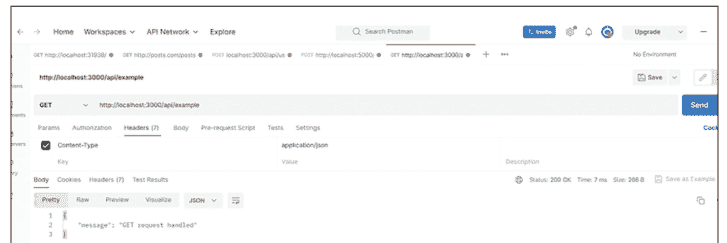

### 使用 Apollo Server 在 Next.js 中设置配置 GraphQL API

在 GraphQL API 中，三个基本组件包括查询（queries）、变更（mutations）和解析器（resolvers）。

- **Query**：GraphQL 查询用于从服务器请求数据。由 GraphQL schema 定义的特定结构允许客户端指定想要检索的精确字段和关系。查询并行执行，响应的形式与查询的形式匹配。
- **Mutation**：GraphQL 变更用于修改服务器上的数据。它允许客户端对资源执行创建、更新或删除操作。与查询类似，变更也定义在 GraphQL schema 中并有自己的结构。变更通常用于执行对服务器产生副作用的更改。
- **Resolver**：解析器是一个负责解析 GraphQL 中查询或变更的函数。它充当 API 与底层数据源之间的链接。schema 中的每个字段都定义了解析器，并包含获取或操作请求数据的逻辑。执行解析器以满足客户端请求并返回对应的数据。

总的来说，查询用于检索数据，变更用于修改数据，而解析器处理这些请求的执行并提供所需的数据或执行必要的操作。

要使用 Apollo Server 在 Next.js 中设置并配置 GraphQL API，请遵循以下步骤：

#### 步骤 1：设置一个新的 Next.js 项目

- 为你的项目创建一个新目录并使用终端或命令行提示符进入目录。
- 运行以下命令初始化一个新的 Next.js 项目：

```bash
npx create-next-app
```

将在当前目录下设置一个基础的 Next.js 项目。

#### 步骤 2：安装所需的依赖

- 在你的项目目录中，运行以下命令安装 GraphQL 和 Apollo Server 必要的包：

```bash
npm install apollo-server-micro graphql
```

#### 步骤 3：为 GraphQL 创建 API 路由

- 在你的项目目录中，创建一个名为 `pages/api` 的新目录。
- 在 `api` 目录中创建一个新的 JavaScript 文件，例如 `graphql.js`。这将代表你的 GraphQL API 路由。

#### 步骤 4：定义 GraphQL schema 和解析器

在 `graphql.js` 中，使用 `graphql-tools` 包中的 `makeExecutableSchema` 函数定义 GraphQL schema。例如：

```javascript
import { ApolloServer, gql } from 'apollo-server-micro';

const typeDefs = gql`
type Book {
  id: ID!
  title: String!
  author: String!
}

type Query {
  books: [Book!]!
  book(id: ID!): Book
}

type Mutation {
  addBook(title: String!, author: String!): Book!
  updateBook(id: ID!, title: String, author: String): Book
  deleteBook(id: ID!): Boolean
}
`;

const books = [
  { id: '1', title: 'Book 1', author: 'Author 1' },
  { id: '2', title: 'Book 2', author: 'Author 2' },
];

const resolvers = {
  Query: {
    books: () => books,
    book: (parent, args) => books.find((book) => book.id === args.id),
  },
  Mutation: {
    addBook: (parent, args) => {
      const newBook = { id: String(books.length + 1), ...args };
      books.push(newBook);
      return newBook;
    },
    updateBook: (parent, args) => {
      const index = books.findIndex((book) => book.id === args.id);
      if (index >= 0) {
        books[index] = { ...books[index], ...args };
        return books[index];
      }
      return null;
    },
    deleteBook: (parent, args) => {
      const index = books.findIndex((book) => book.id === args.id);
      if (index >= 0) {
        books.splice(index, 1);
        return true;
      }
      return false;
    },
  },
};

let handler;

async function getServer() {
  if (!handler) {
    const server = new ApolloServer({ typeDefs, resolvers });
    handler = server.createHandler();
  }
  return handler;
}

export default async function graphqlHandler(req, res) {
  const h = await getServer();
  return h(req, res);
}

export const config = {
  bodyParser: false,
};
```

### 测试 GraphQL API

启动 Next.js 开发服务器并导航到 `http://localhost:3000/api/graphql` 以访问 GraphQL Playground。你可以使用以下查询和变更与 API 交互：

- **Query：获取所有书籍**

```graphql
query {
  books {
    id
    title
    author
  }
}
```

- **Query：按 ID 获取书籍**

```graphql
query {
  book(id: "1") {
    id
    title
    author
  }
}
```

- **Mutation：添加新书籍**

```graphql
mutation {
  addBook(title: "The Great Gatsby", author: "F. Scott Fitzgerald") {
    id
    title
    author
  }
}
```

- **Mutation：更新书籍**

```graphql
mutation {
  updateBook(id: "bookId", title: "New Title", author: "New Author") {
    id
    title
  }
}
```

将 'bookId' 替换为想要更新的书籍的实际 ID。

- **Mutation：删除书籍**

```graphql
mutation {
  deleteBook(id: "bookId") {
    id
    title
    author
  }
}
```

将 ‘bookId’ 替换为想要删除的书籍的实际 ID。

你可以在 GraphQL Playground 中使用上述查询和变更与你的 GraphQL API 交互，并执行添加、更新和删除书籍等操作（图 8.2 和图 8.3）。

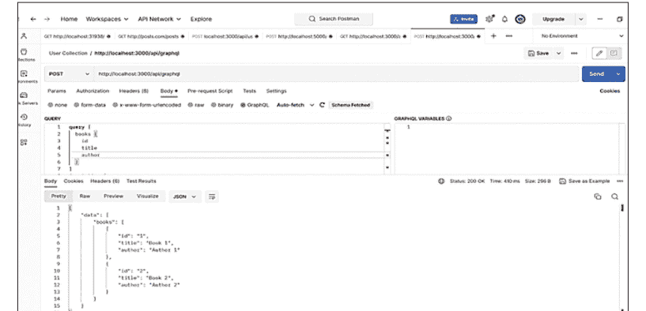
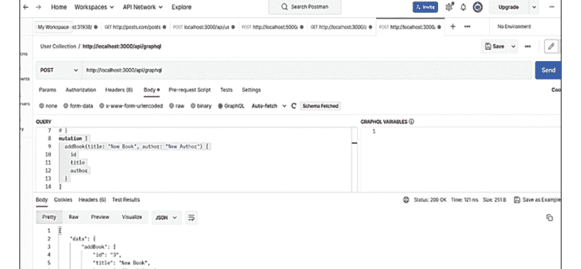

按照习惯，GraphQL 查询应该以 POST 请求的形式发送，因为查询的复杂性和数据需求可能会有很大差异。POST 请求允许发送更大的负载和更复杂的查询结构。

然而，GraphQL 也支持对仅检索数据而不产生任何副作用的简单查询使用 GET 请求。在 GET 请求中，查询通常作为 URL 参数传递。

要在 GraphQL 中使用 GET 请求，你需要相应地修改服务器配置和客户端实现。在服务器端，你需要配置 GraphQL 服务器以接受 GET 请求并妥善处理它们。在客户端，你需要将 GraphQL 查询构建为 URL 参数并将其包含在 GET 请求中。

需要注意的是，由于请求大小的限制和潜在的安全问题，通常不建议将 GET 请求用于复杂查询或变更。POST 请求是大多数 GraphQL 交互的推荐方法。

因此，虽然 GraphQL 查询确实可以同时通过 POST 和 GET 方法工作，但建议在大多数 GraphQL 操作中使用 POST 请求，仅在需要时对只读查询使用 GET 请求。

## 在 Next.js 中将 API 端点与客户端集成

通过将 REST APIs 与 Next.js 集成，你来了解如何使用 Next.js 中的 SWR hook。此外，为了集成 GraphQL API，你可以利用 Apollo Client 库。让我通过简短的代码示例来分别解释每个库及其属性。

### 在 Next.js 中使用 SWR Hook

Next.js 中的 SWR (Stale-While-Revalidate) hook 是一个内置的数据获取库，它简化了数据获取、缓存以及客户端与服务器之间的同步。它提供了一种直观的方式来处理实时数据更新，并优化你的应用程序的性能。以下是 SWR hook 属性及其用法的说明：

`useSWR(key: string, fetcher: Function, options?: Config)`：这是 SWR hook 用于获取和管理数据的主函数。它接受三个参数：

- **key**：正在获取的数据的唯一标识符。它可以是一个 URL、API 端点或代表数据源的任何其他字符串。
- **fetcher**：负责执行实际 API 调用并返回响应的函数。fetcher 函数可以是异步的，并且通常应该以特定格式（如 JSON）返回获取的数据。
- **options (可选)**：一个允许你为 SWR hook 配置额外行为和选项的对象。它包含了诸如 `revalidateOnMount`、`revalidateOnFocus`、`revalidateOnErrorReconnect`、`refreshInterval` 等属性。

这里有一个展示 SWR hook 用法的示例：

```javascript
import useSWR from 'swr';

const fetcher = (url) => fetch(url).then((res) => res.json());

const MyComponent = () => {
  const { data, error } = useSWR('/api/data', fetcher);

  if (error) return <div>Error loading data</div>;
  if (!data) return <div>Loading...</div>;
  return <div>{data.message}</div>;
};
```

在上述示例中，我们使用 `useSWR` 配合 `fetcher` 函数从 `/api/data` 端点获取数据。`data` 和 `error` 变量捕获了 API 调用的结果，这些结果可以相应地渲染在组件中。

- **data**：`data` 属性持有获取的数据。初始时，它将是 `undefined` 或 SWR hook 中指定的默认值。
- **error**：如果在数据获取过程中发生错误，`error` 属性将包含错误详情。你可以检查此属性以妥善处理错误情况。

此外，该 hook 提供了以下函数：

- **mutate(data, shouldRevalidate?, options?)**：`mutate` 允许你手动修改数据。可以使用它来更新数据或触发重新验证。它接受三个可选参数。
- **revalidate()**：`revalidate` 函数触发数据的重新验证，通过发起新的 API 调用获取最新数据。
- **isValidating**：`isValidating` 属性是一个布尔值，表示 SWR hook 是否正在验证（获取）数据。

### 在 Next.js 中设置 Apollo Client

Apollo Client 是一个强大的 GraphQL 客户端，简化了 Next.js 中的数据获取和管理。它提供了缓存、本地状态管理和订阅功能。

要在 Next.js 中使用 Apollo Client，你需要安装必要的包：

```bash
npm install @apollo/client graphql
```

安装完成后，你可以带有所需的配置创建一个 Apollo Client 实例，通常在一个单独的文件中：

```javascript
import { ApolloClient, InMemoryCache } from '@apollo/client';

const client = new ApolloClient({
  uri: 'https://localhost:3000/graphql', // 替换为 GraphQL API 端点
  cache: new InMemoryCache(),
});

export default client;
```

### Next.js 中的 Apollo Provider

Next.js 提供了 `ApolloProvider` 组件来封装你的应用程序，并为所有组件提供 Apollo Client 实例。你可以在 `pages/_app.js` 文件中设置它：

```javascript
import { ApolloProvider } from '@apollo/client';
import client from '../path/to/client';

function MyApp({ Component, pageProps }) {
  return (
    <ApolloProvider client={client}>
      <Component {...pageProps} />
    </ApolloProvider>
  );
}

export default MyApp;
```

### 使用 Apollo Client 查询数据

使用 Apollo Client 从 GraphQL API 获取数据，可以使用 `@apollo/client` 提供的 `useQuery` hook。这是一个示例：

```javascript
import { gql, useQuery } from '@apollo/client';

const GET_USERS = gql`
  query {
    users {
      id
      name
    }
  }
`;

function MyComponent() {
  const { loading, error, data } = useQuery(GET_USERS);

  if (loading) return <div>Loading...</div>;
  if (error) return <div>Error loading data</div>;
  return (
    <ul>
      {data.users.map((user) => (
        <li key={user.id}>{user.name}</li>
      ))}
    </ul>
  );
}
```

在前面的示例中，我们使用来自 `@apollo/client` 的 `gql` 标签定义了一个 GraphQL 查询。然后使用 `useQuery` 钩子从 `GET_USERS` 查询中获取数据。`loading` 属性表示数据是否正在获取，`error` 属性捕获在此过程中发生的任何错误，而 `data` 属性包含获取到的数据。

### 使用 Apollo Client 进行变异

Apollo Client 提供了 `useMutation` 钩子来处理 GraphQL 中的变异（数据修改）。这是一个示例：

```javascript
import { gql, useMutation } from '@apollo/client';

const ADD_USER = gql`
mutation AddUser($input: UserInput!) {
  addUser(input: $input) {
    id
    name
  }
}
`;

function MyComponent() {
  const [addUser, { loading, error, data }] = useMutation(ADD_USER);

  const handleAddUser = async () => {
    try {
      const { data } = await addUser({
        variables: {
          name: "John Doe",
        },
      });
      console.log(data);
    } catch (error) {
      console.error(error);
    }
  };

  if (loading) return <div>Loading...</div>;
  if (error) return <div>Error adding user</div>;
  return (
    <div>
      <button onClick={handleAddUser}>Add User</button>
    </div>
  );
}
```

在前面的示例中，我们使用来自 `@apollo/client` 的 `gql` 标签定义了一个 GraphQL 变异。`useMutation` 钩子用于处理 `ADD_USER` 变异。它返回一个函数 `addUser`，可以通过调用它来触发变异。变异的结果（包括 loading、error 和 data）被捕获在相应的变量中。

在 `handleAddUser` 函数中，我们调用 `addUser` 函数并提供变异所需的变量。在这种情况下，我们正在添加一个名为 "John Doe" 的用户。可以相应地访问并利用响应数据。

### Apollo Client 缓存

Apollo Client 利用缓存来存储和管理获取的数据。缓存允许高效的数据检索和同步。默认情况下，Apollo Client 使用 `InMemoryCache` 实现，它提供了强大的缓存能力。

你可以根据自己的需求自定义缓存行为。例如，你可以修改缓存选项、定义自定义缓存解析器，甚至实现客户端数据操作处理。

这些是在 Next.js 中使用 Apollo Client 的一些关键方面。Apollo Client 提供了许多更多功能和能力，包括本地状态管理、订阅和错误处理。它为在 Next.js 应用中使用 GraphQL 提供了全面的解决方案，简化了数据获取、缓存和处理。

### 使用 SWR 集成 REST API 端点

要使用 SWR (Stale-While-Revalidate) 钩子在 Next.js 应用中集成 REST API 端点，可以遵循以下步骤：

1. **安装所需的依赖**

```bash
npm install swr
```

2. **创建新文件 `api.js`**，使用 `fetch` 函数或你选择的任何 HTTP 库来处理 API 请求。此文件将包含每个 API 端点的函数：

```javascript
export const fetchTodos = async () => {
  const response = await fetch('/api/todos');
  const data = await response.json();
  return data;
}

export const createTodo = async (todo) => {
  const response = await fetch('/api/todos', {
    method: 'POST',
    headers: {
      'Content-Type': 'application/json',
    },
    body: JSON.stringify(todo)
  });
  const data = await response.json();
  return data;
}

export const updateTodo = async (id, todo) => {
  const response = await fetch(`/api/todos/${id}`, {
    method: 'PUT',
    headers: {
      'Content-Type': 'application/json',
    },
    body: JSON.stringify(todo),
  });
  const data = await response.json();
  return data;
}

export const deleteTodo = async (id) => {
  const response = await fetch(`/api/todos/${id}`, {
    method: 'DELETE',
  });
  const data = await response.json();
  return data;
};
```

3. **在你的 Next.js 组件中**，导入必要的依赖并使用 SWR 钩子从 API 端点获取和管理数据：

```javascript
import useSWR from 'swr';
import { fetchTodos } from './api';

const TodoList = () => {
  const { data: todos, error } = useSWR('/api/todos', fetchTodos);

  if (error) {
    return <p>Error: {error.message}</p>
  }

  if (!todos) {
    return <p>Loading...</p>
  }

  return (
    <div>
      <h1>Todo List</h1>
      <ul>
        {todos.map((todo) => (
          <li key={todo.id}>{todo.title}</li>
        ))}
      </ul>
    </div>
  );
};

export default TodoList;
```

4. **创建 `pages/api/todos.js` 文件**来处理相应的请求：

```javascript
export default function handler(req, res) {
  if (req.method === 'GET') {
    // 处理 GET 请求以获取所有数据
    // ...
  }
  // ... 其他方法处理
  res.status(500).json({ message: 'Internal Server Error' });
}
```

## 处理 API 调用中的错误和异常

### 服务端错误处理

- 在你的 API 路由（`pages/api/*.js`）中，使用 `try-catch` 块包装可能抛出错误的代码。
- 适当处理错误，例如记录错误、发送错误响应或执行其他必要的操作。
- 以下是一个在 Next.js API 路由中处理错误的示例：

```javascript
export default function handler(req, res) {
  try {
    // 你的 API 逻辑
    // ...
    res.status(200).json({ message: 'Success' });
  } catch (error) {
    console.error('API Error:', error);
    res.status(500).json({ message: 'Internal Server Error' });
  }
}
```

### 客户端错误处理

- 在你的客户端代码（React 组件）中，处理在 API 调用过程中可能发生的任何错误或异常。
- 使用 `try-catch` 块或 `Promise.catch()` 来捕获 API 调用期间抛出的任何错误。
- 你可以向用户显示错误信息，或者根据收到的错误执行适当的操作。
- 以下是一个使用 `fetch` 在 Next.js 客户端组件中处理错误的示例：

```javascript
import { useState } from 'react';

export default function MyComponent() {
  const [error, setError] = useState(null);

  const fetchData = async () => {
    try {
      const response = await fetch('/api/your-api-route');
      if (!response.ok) {
        throw new Error('Request failed');
      }
      // Process the response data
    } catch (error) {
      setError('An error occurred');
    }
  }

  return (
    <div>
      {error && <p>{error}</p>}
      <button onClick={fetchData}>Fetch Data</button>
    </div>
  );
}
```

### 3. 使用 SWR 处理错误

SWR 是一个用于 Next.js 的流行数据获取库，它提供了内置的错误处理能力。

```javascript
import useSWR from 'swr';

const MyComponent = () => {
  const { data, error } = useSWR('/api/your-api-route', fetcher);

  if (error) {
    // Handle the error
    return <p>Error: {error.message}</p>
  }

  // Handle loading and success states
  if (!data) {
    return <p>Loading...</p>
  }

  // Render the data
  return <div>Data: {data}</div>;
};
```

在上述示例中，使用了 `useSWR` 钩子通过 `fetcher` 函数从指定的 API 路由 `/api/your-api-route` 获取数据。SWR 提供的 `data` 和 `error` 变量随后用于处理 API 调用的不同状态。

### 4. 使用 Apollo Client 处理错误

如果你在 Next.js 中使用 Apollo Client 进行 GraphQL API 调用，可以使用 Apollo 提供的 `useQuery` 和 `useMutation` 钩子来处理错误。

```javascript
import { useQuery, gql } from '@apollo/client';

const GET_DATA = gql`
query GetData {
  // 你的查询
}
`;

const MyComponent = () => {
  const { data, loading, error } = useQuery(GET_DATA);

  if (loading) {
    return <p>Loading...</p>
  }

  if (error) {
    // Handle the error
    return <p>Error: {error.message}</p>
  }

  // Render the data
  return <div>Data: {data}</div>;
};
```

在上述示例中，使用了 `useQuery` 钩子通过 `GET_DATA` GraphQL 查询获取数据。Apollo 提供的 `data`、`loading` 和 `error` 变量随后用于处理 API 调用的不同状态。

这些示例演示了如何在 Next.js 中使用 SWR 和 Apollo Client 处理 API 调用中的错误和异常。你可以根据自己的特定需求和错误响应结构来自定义错误处理逻辑。

## Next.js 应用中 API 安全与认证的最佳实践

在 Next.js 应用中保护 API 和实现认证涉及遵循最佳实践，以保护敏感数据并防止未经授权的访问。以下是 Next.js 应用中 API 安全和认证的一些建议做法：

- **使用 HTTPS**：始终通过 HTTPS 服务你的 Next.js 应用，以加密客户端和服务器之间的通信，确保数据的机密性和完整性。
- **实现适当的认证**：
    - 使用安全的认证机制，例如 JSON Web Tokens (JWT) 或 OAuth。
    - 实现如 bcrypt 等强密码哈希算法来安全地存储用户密码。
    - 使用会话管理技术处理用户会话并安全地存储会话数据（例如，使用带有 `HttpOnly` 和 `Secure` 标志的安全 cookie）。
    - 采用速率限制（rate limiting）和账户锁定等机制来防止破解攻击。
- **保护敏感数据**：
    - 避免以明文存储敏感信息（如密码或 API 密钥）。相反，使用环境变量或安全密钥管理系统等安全存储解决方案。
    - 在存储或传输敏感数据时使用加密，特别是在数据库或 API 响应中。
- **验证并清理用户输入**：
    - 应用输入验证和清理，以防止跨站脚本 (XSS) 和 SQL 注入攻击等常见漏洞。
    - 利用提供内置验证和清理机制的库或框架。
- **实现基于角色的访问控制 (RBAC)**：
    - 为不同用户类型定义角色和权限。
    - 根据用户角色和权限限制对某些 API 端点和操作的访问。
- **防止跨站请求伪造 (CSRF)**：
    - 实现 CSRF 保护机制，例如使用 CSRF 令牌或同站 cookie，以防止恶意网站的未经授权请求。
- **安全 API 密钥和密钥**：
    - 通过将 API 密钥、令牌和其他密钥存储在安全存储解决方案中（例如环境变量），并避免将其提交到版本控制中。
- **启用 CORS（跨源资源共享）**：
    - 配置 CORS 以限制来自未经授权域的访问。
- **定期更新依赖**：
    - 保持你的 Next.js 应用及其依赖为最新版本，以获得安全补丁和错误修复。
- **安全审计与测试**：
    - 定期进行安全审计、代码审查和漏洞扫描，以识别潜在缺陷。

记住，安全是一个持续的过程，关注最新的安全实践和漏洞至关重要。学习如何在 Next.js 中实现 API 将极大地增强你构建强大交互 Web 应用的能力。

## 结论

本章详细介绍了在 Next.js 中实现 RESTful 和 GraphQL API 的方法，包括 API 路由的创建、客户端集成、错误处理以及安全最佳实践。掌握这些知识将帮助你构建高性能、安全且可扩展的现代 Web 应用程序。

## 多选题

1. 在 Web 开发中使用 API 的重要好处是什么？
   A. 增强用户界面设计
   B. 实现系统间的无缝通信
   C. 优化数据库性能
   D. 提高服务器处理速度

2. 哪种 API 架构风格提供了灵活高效的数据查询和变更方式？
   A. RESTful API
   B. SOAP API
   C. GraphQL API
   D. RPC API

3. 哪个框架可以用于在 Next.js 中设置和配置 GraphQL API？
   A. Express
   B. Apollo Server
   C. Django
   D. Laravel

4. RESTful API 遵循什么种方法处理 CRUD 操作？
   A. 命令查询分离
   B. 事件驱动架构
   C. 基于资源的方法
   D. 中间件模式

5. 在 Next.js 应用中，确保 API 安全和身份验证的一些最佳实践是什么？
   A. 使用 HTTPS、实现如 JWT 或 OAuth 等适当的验证机制、保护敏感数据以及定期进行安全审计
   B. 使用 HTTP、以明文形式存储敏感数据并依赖于客户端验证
   C. 启用 CORS 保护、使用环境变量存储 API 密钥、并避免输入验证
   D. 仅将 OAuth 用于身份验证、将密钥存储在应用程序代码中、且从不更新依赖项

## 答案

| 题号 | 答案 |
|---|---|
| 1. | B |
| 2. | C |
| 3. | B |
| 4. | C |
| 5. | A |

# 第 9 章
## 使用不同类型的数据库

### 导言

在本章中，我们将深入探索数据库的世界，并研究如何在 Next.js 应用中利用它们。数据库在 Web 开发中起着至关重要的作用，充当着存储、检索和管理数据的骨干。

首先，我们将对数据库及其在 Web 开发中的意义进行概述。了解数据库的基础知识将为探索各种可用类型的数据库奠定基础。我们将为你介绍关系型数据库、NoSQL 数据库，甚至深入研究图数据库，突出它们的独特特征和用例。

为你的应用程序选择合适的数据库至关重要，因为每种类型都有其优缺点。我们将引导你完成决策过程，考虑数据结构、可扩展性和性能等因素。

一旦你做出了选择，我们将帮助你在 Next.js 中建立数据库连接。我们将涵盖将 MongoDB、MySQL 和 PostgreSQL 等流行数据库连接到你的 Next.js 应用的步骤，使你能够无缝地利用它们的功能。

接下来，我们将探索你将在数据库上执行的常用操作，重点关注创建、读取、更新和删除（CRUD）操作。你将学习如何使用 Next.js 与所选数据库进行交互、操纵数据并检索信息。

处理数据库错误和实施有效的调试技术是我们将解决的另一个关键方面。排除常见问题并采用错误处理的最佳实践将确保你的 Next.js 应用顺畅运行。

数据库安全至关重要，我们将提供保护你数据的最佳实践。我们将讨论保护数据库、保护敏感信息以及防止常见漏洞的技术。

此外，我们还将进入数据建模和模式设计领域。你将对这些领域产生深刻见解。最后，我们将讨论为了满足需求以扩展数据库的策略。

在整个章节中，实际示例和提示将增强你的理解。到本章结束，你将对 Next.js 开发中的数据库使用有全面的理解。

## 结构

本章将涵盖以下主题：
- 建立数据库连接
- 使用 MongoDB、MySQL、PostgreSQL 等流行数据库
- 数据库 CRUD 操作
- 处理数据库错误
- 数据库安全
- 数据建模与模式设计

## 数据库系统概述

数据库管理系统 (DBMS) 是一种用于存储、组织和管理数据的软件系统。

### DBMS 的关键组件

- **数据**：DBMS 提供了对并发访问的控制机制。
- **数据库**：DBMS 允许多个用户同时访问并共享数据。
- **模式**：数据库定义了逻辑和物理结构。
- **数据操作语言 (DML)**：DML 是一种用于检索、插入和更新数据的语言。
- **数据定义语言 (DDL)**：DDL 是一种用于定义数据库创建的语言。
- **查询优化**：DBMS 优化查询执行以提高性能。
- **事务管理**：确保了事务的 ACID 特性。
- **并发控制**：DBMS 处理多个用户或进程对数据库的并发访问。
- **安全与授权**：DBMS 包含了保护敏感数据的安全功能。
- **备份与恢复**：DBMS 在系统故障、数据损坏或人为错误时促进数据的备份和恢复。

### DBMS 类型

- **关系型数据库 (RDBMS)**：最广泛使用的类型，数据以表的形式组织，表之间存在关系。
- **对象型数据库 (ODBMS)**：这些系统以对象的形式存储数据，允许继承、封装和多态。
- **层次级数据库**：数据以树结构组织，每个记录都有父子关系。
- **网状数据库**：与层次级数据库类似，但结构更灵活。它允许记录拥有多个父级和子记录，创建复杂的关系。
- **NoSQL 数据库**：NoSQL 数据库旨在处理大规模、非结构化和多样化的数据。它们提供了可扩展性、性能和灵活性。
- **NewSQL 数据库**：NewSQL 数据库结合了 NoSQL 的扩展性和性能以及传统关系型数据库的 ACID 特性。它们旨在解决 RDBMS 在处理大量数据和并发用户方面的局限性。

### 使用 DBMS 的优点

- **数据集中**：DBMS 允许用户在集中位置存储数据，为不同的应用程序和用户提供统一视图。这消除了数据冗余和不一致。
- **数据共享**：DBMS 允许多个用户同时访问和共享数据。它提供了受控访问并通过并发控制确保数据完整性。
- **数据安全**：DBMS 包含了用户身份验证、访问控制和加密等功能，保护敏感数据不受未经授权的访问，确保数据安全并符合法规。
- **数据完整性**：DBMS 强制执行数据完整性约束（如主键约束和引用完整性），以维护数据的准确性和一致性。
- **数据一致性**：数据库管理系统（DBMS）确保数据在并发访问和更新期间保持一致性和有效性。ACID 特性保证了事务的可靠执行并维护了数据的完整性。
- **数据可扩展性**：DBMS 提供了高效处理海量数据的机制。它允许通过增加更多服务器或节点来分布数据和负载，从而实现水平扩展。
- **数据恢复**：DBMS 支持备份和恢复机制，以防止因系统故障、灾难或人为错误导致的数据丢失。它允许将数据库恢复到之前的状态或某个时间点。
- **数据独立性**：DBMS 通过将数据库的逻辑结构（模式）与物理存储细节分离来提供数据独立性。这允许在修改数据库模式时，而不影响使用这些数据的应用程序。
- **数据查询与报告**：DBMS 提供了查询语言（例如 SQL）和工具，用于执行复杂的数据查询、生成报告并从数据中提取有用的见解。
- **性能提升**：DBMS 通过优化查询执行、索引和缓存技术来增强性能和响应时间。它利用查询优化算法选择最高效的执行计划。
- **数据维护**：DBMS 提供了管理和维护数据库的工具，例如数据备份、恢复、索引和性能调优。它简化了管理任务并减少了数据库管理所需的工作。

总结来说，数据库管理系统（DBMS）是一个提供高效可靠数据管理的关键软件系统。它提供了一种结构化的方法来组织、操作和检索数据，同时确保数据的完整性、安全性和扩展性。DBMS 通过实现有效的数据管理和支持关键业务运行，在现代应用程序和组织中起着重要的作用。

请注意，本章将专门关注两种数据库管理系统（DBMS）：使用 MySQL 的关系数据库（RDBMS）和使用 MongoDB 的 NoSQL DBMS。我们将详细探索这两个流行系统的特性、优势和用例，以便对其能力有全面的理解。本章将不涵盖其他类型的 DBMS。

## 关系型数据库管理系统

关系型数据库管理系统（RDBMS）是一种管理关系型数据库的软件系统。它提供基于预定义模式存储、组织和检索数据的结构化方法。MySQL 是最流行的 RDBMS 之一，广泛用于 Web 应用程序。

关系型数据库基于关系模型，该模型将数据组织为行列表。每个表代表一个实体或实体之间的关系。在 MySQL 中，表是使用特定的模式创建的，该模式定义了列的结构和数据类型。

规范化是设计数据库模式以消除冗余并确保数据完整性的过程。它涉及将大表拆分为较小的相关表，并使用主键和外键建立它们之间的关系。规范化有助于减少数据冗余，提高数据一致性，并便于高效的数据检索。

数据库规范化有几种范式，包括：

- **第一阶范式（1NF）**：确保表中的每一列都包含原子值（不可分割且不能进一步划分）。
- **第二阶范式（2NF）**：在 1NF 的基础上构建，要求表中的每个非键列在函数上依赖于整个主键。
- **第三阶范式（3NF）**：在 2NF 的基础上构建，要求表中的每个非键列只依赖于主键，而不依赖于其他非键列。
- **Boyce-Codd 范式（BCNF）**：3NF 的一种更严格的形式，消除了非键列之间的所有函数依赖。
- **第四阶范式（4NF）**：确保表内部没有多值依赖。

现在让我们讨论 OLAP（在线分析处理）和 OLTP（在线事务处理）：

### OLAP

OLAP 是一种软件和技术类别，用于对海量数据进行复杂分析和报告。它侧重于提供业务智能和决策支持能力。OLAP 数据库为读取密集型操作和复杂分析查询而设计。它们通常将聚合数据存储在多维结构中，称为数据立方体，这允许从不同的角度对数据进行快速查询和切片。

### OLTP

另一方面，OLTP 是一种用于管理和处理组织日常事务操作的软件和技术类别。OLTP 数据库专为高速数据处理、事务一致性和并发访问而设计。它们支持实时插入、更新和删除小量数据的操作。MySQL 作为一种 RDBMS，通常用于数据一致性和实时事务处理至关重要的 OLTP 应用。

## NoSQL 数据库管理系统

NoSQL（不仅是 SQL）是一种数据库管理系统，它偏离了 MySQL 等 RDBMS 中使用的传统关系模型。MongoDB 是一个流行的 NoSQL DBMS 示例，让我们详细探讨它的特性和背景：

- **面向文档的模型**：NoSQL 数据库（包括 MongoDB）使用面向文档的模型进行数据存储。MongoDB 不使用行列表，而是将数据存储在灵活的、自描述的文档中。这些文档通常以类 JSON (BSON) 格式表示，允许存储嵌套结构和动态模式。
- **模式灵活性**：与 RDBMS 的固定模式不同，MongoDB 等 NoSQL 数据库提供了模式的灵活性。每个文档都可以有自己的结构，允许你在同一个集合中存储不同类型的数据。这种灵活性简化了开发过程，特别是在模式随时间演变的场景下。
- **可扩展性和高性能**：NoSQL 数据库旨在进行水平扩展设计，这意味着它可以将数据分布在多个服务器或节点上，以处理海量数据和流量。MongoDB 特别擅长可扩展性，提供自动分片功能，将数据和查询分布到机器集群中。它为读写操作都提供了高性能。
- **复制与高可用性**：MongoDB 支持副本集，副本集是维护相同数据副本的数据库节点集群。副本集提供了数据冗余和高可用性，确保系统在节点故障时仍保持运行。MongoDB 使用自动故障转移机制来选举主节点并维持持续服务。
- **查询与索引**：MongoDB 提供了一种灵活且强大的查询语言来检索数据，称为 MongoDB 查询语言 (MQL)。MQL 支持广泛的查询能力，包括过滤、排序、聚合和地理空间查询。MongoDB 还支持索引，允许通过在特定字段上创建索引来优化性能。
- **用例与背景**：MongoDB 特别适用于灵活性、扩展性和实时数据处理至关重要的用例。它通常用于内容管理系统、实时分析、日志和监控系统以及用户配置管理等场景。此外，MongoDB 的文档模型使其更容易与现代 Web 开发框架和语言集成。

## SQL 和 NoSQL DBMS 的区别

| 方面 | SQL（关系数据库） | NoSQL（非关系数据库） |
|---|---|---|
| 数据结构 | 具有固定模式的结构化表格数据。 | 具有动态模式的灵活半结构化或非结构化数据。 |
| 模式 | 需要具有严格结构的预定义模式。 | 无模式或灵活模式，可随时间演变。 |
| 查询语言 | 使用 SQL（结构化查询语言）来定义和操作数据。 | 每种 NoSQL 数据库都有特定的查询语言（例如 MongoDB 使用类似于 JavaScript 的查询语言）。 |
| 扩展性 | 纵向扩展（单个服务器的硬件资源）。 | 水平扩展（添加更多服务器来分担负载）。 |
| 数据关系 | 支持使用外键处理表之间的复杂关系。 | 主要设计用于处理具有最小或无关系的去规范化数据。 |
| ACID 合规性 | 维护 ACID 特性（原子性、一致性、隔离性和持久性）。 | 可能会为了提高可扩展性和性能而牺牲某些 ACID 特性（例如，最终一致性）。 |
| 事务 | 对事务有强支持（将多个操作组合为一个单元）。 | 在不同的 NoSQL 数据库中有所异，某些提供有限或无事务支持。 |
| 数据完整性 | 强制执行严格的完整性约束（例如，主键、外键）。 | 依赖应用程序逻辑来维护数据完整性。 |
| 存储 | 通常使用固定模式并在表中存储数据。 | 各种存储格式，包括键值对、文档、列式或基于图的模型。 |
| 使用场景 | 非常适用于具有复杂查询和事务的结构化关系型数据（例如银行系统）。 | 适用于处理大量半结构化或非结构化数据、快速原型设计以及需求变化的场景（例如社交媒体分析）。 |

**表 9.1：** SQL 对比 NoSQL DBMS

## 在 Next.js 中设置数据库连接

要在 Next.js 中通过 MongoDB 和 MySQL 设置数据库连接，你需要安装必要的包并配置连接设置。

以下是针对每种数据库的分步骤指南：

1. **安装所需的包**：

```bash
npm install mongodb mysql
```

2. **创建一个单独的文件来处理数据库连接**。对于 MongoDB，创建一个名为 `mongodb.js` 的文件；对于 MySQL，创建一个名为 `mysql.js` 的文件。

在 `mongodb.js` 中，导入 `mongodb` 包并定义连接设置：

```javascript
const { MongoClient } = require('mongodb');

const uri = 'mongodb://localhost:27017'; // 替换为你的 MongoDB 连接 URI
const dbName = 'your-database-name'; // 替换为你的数据库名称

const client = new MongoClient(uri, {
  useNewUrlParser: true,
  useUnifiedTopology: true,
});

async function connectMongoDB() {
  try {
    await client.connect();
    console.log('Connected to MongoDB');
    const db = client.db(dbName);
    return db;
  } catch (error) {
    console.error('Error connecting to MongoDB', error);
    throw error;
  }
}

module.exports = connectMongoDB;
```

在 `mysql.js` 中导入 `mysql` 包并定义连接设置：

```javascript
const mysql = require('mysql');

const connection = mysql.createConnection({
  host: 'localhost', // 替换为你的 MySQL 主机
  user: 'your-username', // 替换为你的 MySQL 用户名
  password: 'your-password', // 替换为你的 MySQL 密码
  database: 'your-database-name', // 替换为你的数据库名称
});

connection.connect((error) => {
  if (error) {
    console.error('Error connecting to MySQL', error);
    throw error;
  }
  console.log('Connected to MySQL');
});

module.exports = connection;
```

3. **在你的 Next.js 代码中**，导入相应的数据库文件并根据需要使用连接。例如，创建一个名为 `pages/index.js` 的文件并包含以下代码：

```javascript
import { useEffect } from 'react';
import connectMongoDB from '../mongodb';
import connectionMySQL from '../mysql';

export default function HomePage() {
  useEffect(() => {
    async function fetchData() {
      const db = await connectMongoDB();
      // 在此处执行 MongoDB 操作
      // Example: const collection = db.collection('your-collection');
      // Example: const data = await collection.find().toArray();

      connectionMySQL.query('SELECT * FROM your-table',
      (error, results, fields) => {
        if (error) {
          console.error('Error querying SQL', error);
          throw error;
        }
        // 在此处处理 MySQL 查询结果
      });
    }

    fetchData();
  }, []);

  return (
    <div>
      {/* 你的页面内容 */}
    </div>
  );
}
```

记得用你的实际数据库连接详细信息替换占位符值（如 `your-database-name`、`your-username`、`your-password` 等）。

通过此设置，你将有一个连接到 MongoDB 和 MySQL 数据库的 Next.js 页面。`fetchData` 函数在组件挂载时执行，允许你根据需要执行数据库操作并处理结果。

在 JavaScript 和 Node.js 中，有多个第三方库可用于数据库，例如 Mongoose、Sequelize、TypeORM 和 Prisma ORM。这些库提供了对象关系映射（ORM）功能，并简化了数据库交互。

虽然 Mongoose 是专为 MongoDB 设计的，但 Sequelize 主要关注 SQL 数据库（MySQL、PostgreSQL、SQLite、MSSQL）。另一方面，TypeORM 支持多种数据库，包括 PostgreSQL、MySQL、SQLite、MSSQL 和 Oracle。

然而，如果你倾向于使用一个既能处理 SQL 又处理 NoSQL 数据库的库，TypeORM 是多功能的，它允许你使用统一的 API 处理不同类型的数据库。

## 使用所选数据库进行 CRUD 操作

| 特性 | Mongoose (MongoDB) | Sequelize (MySQL, PostgreSQL) | TypeORM (各种数据库) |
|---|---|---|---|
| ORM 功能 | 是 | 是 | 是 |
| 对象关系映射 (ORM) | 是 | 是 | 是 |
| 模式定义 | 基于模式 | 基于模型 | 基于装饰器 |
| 查询语言 | MongoDB 查询语言 (MQL) | SQL | SQL |
| 连接池 | 否（由驱动管理） | 是 | 是 |
| 支持关联/关系 | 是 | 是 | 是 |
| 支持迁移 | 否 | 是 | 是 |
| 活跃开发 | 是 | 是 | 是 |
| 流行程度 | 广泛使用 | 广泛使用 | 日益流行 |

### 使用 SQLite 和 MongoDB 进行 CRUD 操作

CRUD 操作是对数据库的基本操作：创建（Create）、读取（Read）、更新（Update）和删除（Delete）。在 Next.js 语境中，你可以使用 TypeORM 库处理 SQLite 和 MongoDB 数据库的操作。要建立连接，你需要在 Next.js 中配置数据库设置。

以下是在 Next.js 中使用 SQLite 和 MongoDB 执行 CRUD 操作的分步骤说明：

#### 步骤 1：设置 Next.js 项目

在终端中运行以下命令创建一个新的 Next.js 项目：

```bash
npx create-next-app my-next-app
```

#### 步骤 2：安装依赖项

进入项目目录并安装所需的依赖项：

```bash
cd my-next-app
npm install typeorm sqlite3 mongodb
```


### 步骤 3：创建数据库连接

在项目根目录下创建一个新文件夹 `config`。在 `config` 文件夹内创建一个名为 `database.ts` 的文件。该文件将包含数据库设置。

对于 SQLite：

```javascript
const { ConnectionOptions } = require("typeorm");

const sqliteConfig = {
  type: "sqlite",
  database: "./data/database.sqlite",
  synchronize: true,
  logging: true,
  entities: [
    // 在此处添加你的实体类
  ],
};

module.exports = sqliteConfig;

export default sqliteConfig;
```

对于 MongoDB：

```javascript
const { ConnectionOptions } = require("typeorm");

const mongoConfig = {
  type: "mongodb",
  host: "localhost",
  port: 27017,
  database: "mydatabase",
  synchronize: true,
  logging: true,
  entities: [
    // 在此处添加你的实体类
  ],
};

module.exports = mongoConfig;
```

### 步骤 4：定义实体类

在你的项目根目录下创建一个新的 `entities` 文件夹。在 `entities` 文件夹内部，创建表示你的数据模型的实体类。这些类将定义你的表或集合的结构。

例如，让我们创建一个 `User` 实体：

```javascript
const { Entity, Column, PrimaryGeneratedColumn } = require("typeorm");

@Entity()
class User {
  @PrimaryGeneratedColumn()
  id;

  @Column()
  name;

  @Column()
  email;

  // 根据需要添加其他属性和关系
}

module.exports = User;
```

### 步骤 5：实现 CRUD 操作

在你的项目根目录下创建一个 `pages` 文件夹。在 `pages` 文件夹内部，为每个 CRUD 操作创建一个文件：`create.tsx`、`read.tsx`、`update.tsx` 和 `delete.tsx`。这些文件将处理相应的操作。

例如，在 `create.js` 中，你可以实现创建新用户的逻辑：

```javascript
import { useState } from "react";
import { createConnection, getConnection } from "typeorm";
import sqliteConfig from "../config/database";

export default function CreateUser() {
  const [name, setName] = useState("");
  const [email, setEmail] = useState("");

  const handleSubmit = async (event) => {
    event.preventDefault();
    try {
      const connection = await createConnection(sqliteConfig);
      const userRepository = connection.getRepository(User);
      const newUser = userRepository.create({ name, email });
      await userRepository.save(newUser);
      await connection.close();
      console.log("User created successfully!");
    } catch (error) {
      console.error("Error creating user:", error);
    }
  };

  return (
    <form onSubmit={handleSubmit}>
      <input
        type="text"
        value={name}
        onChange={(event) => setName(event.target.value)}
        placeholder="Name"
      />
      <input
        type="email"
        value={email}
        onChange={(event) => setEmail(event.target.value)}
        placeholder="Email"
      />
      <button type="submit">Create User</button>
    </form>
  );
}
```

同样，你可以通过连接数据库、获取适当的仓库并执行所需的操作来实现读取、更新和删除操作逻辑。

### 步骤 6：运行 Next.js 应用

要启动你的 Next.js 应用并测试 CRUD 操作，请在终端中运行以下命令：

```bash
npm run dev
```

打开浏览器并导航到 `http://localhost:3000/create` 来创建一个新用户。你也可以为其他 CRUD 操作创建额外的页面并进行测试。

**注意**：取决于你正在使用的数据库，确保你的本地机器上有一个运行的 SQL 服务器或 MongoDB 实例。确保数据库凭据和连接详情与配置文件中指定的匹配。

大功完成！你现在已经使用 TypeORM 库在 Next.js 中实现了 SQLite 和 MongoDB 的 CRUD 操作。你可以根据需要扩展此示例以处理更复杂的数据模型和操作。

## 处理数据库错误和调试技术

在 Next.js 中，处理数据库错误和调试技术涉及在与数据库交互时确保正确的错误处理，并采用有效的调试实践来识别和解决问题。以下是关于如何处理这些任务的详细说明：

- 错误处理：
  - 连接数据库：在 Next.js 中与数据库交互时，你通常使用 Prisma、Sequelize 或 Mongoose 等库。这些库提供了连接数据库和执行查询的机制。确保在尝试任何操作之前已建立数据库的连接。
  - 查询执行：在执行数据库查询时，处理潜在错误至关重要。大多数数据库库提供了捕捉和处理数据库服务器返回的错误的机制。例如，使用 Prisma 时你可以使用 `try-catch` 块或基于 promise 的错误处理来捕捉并处理错误。
  - 错误消息：当数据库操作发生错误时，提供有意义的错误消息对调试至关重要。包含相关信息，如错误类型、正在执行的查询以及涉及的任何数据。将错误消息记录到日志文件或监控服务等中央系统中可以跟踪问题。
  - 优雅的错误处理：在 Next.js 中，你可以使用 Error 组件或 `getDerivedStateFromError` 方法实现错误边界。这些技术允许你捕捉组件内的错误并显示备用 UI，而不是崩溃整个应用程序。你可以向用户显示错误页面或特定的错误消息，并记录错误以便调查。

- 调试技术：
  - 日志是调试数据库相关问题的本质技术。利用 Winston、Pino 或内置的 `console.log` 语句在运行时输出相关信息。记录查询执行时间、结果和错误消息等重要细节以跟踪问题。
  - 调试工具：Next.js 提供了如 DevTools 浏览器扩展等强大的开发工具。这些工具允许你检查组件、属性并监控网络请求。你可以使用它们来识别查询或数据流中的任何问题。
  - 查询优化：如果你遇到数据库查询问题，优化它们至关重要。你可以使用数据库查询分析器或分析器等工具来识别缓慢或低效的查询。调整索引或重写查询可以显著提高性能。
  - 代码审查：让其他开发者参与代码审查，特别是在处理复杂的数据库操作时。同行代码审查可以帮助识别逻辑错误、潜在的竞态条件或次优模式。
  - 单位测试：使用 Jest 或 Mocha 等框架为与数据库相关的代码编写测试。测试不同的场景，包括成功和错误的查询。这种做法有助于确保你的代码按预期运行，并在开发早期捕捉任何问题。

让我们通过使用 TypeORM 的代码示例来探索 Next.js 中处理数据库错误和调试技术。

假设你在 Next.js 项目中使用 TypeORM 作为 ORM（对象-关系映射）库，你可以按照以下方式处理数据库错误：

```javascript
const { getRepository } = require('typeorm');
const { User } = require('../entities/User');

async function getUserById(id) {
  try {
    const userRepository = getRepository(User);
    const user = await userRepository.findOne(id);

    if (!user) {
      throw new Error('User not found');
    }

    return user;
  } catch (error) {
    console.error('Error retrieving user:', error);
    throw new Error('Failed to retrieve user');
  }
}
```

2. 调试技术：

现在让我们通过使用 TypeORM 的日志来探索 Next.js 中的调试技术：

```javascript
const { getRepository } = require('typeorm');
const { User } = require('../entities/User');

async function getUserById(id) {
  try {
    const userRepository = getRepository(User);
    const user = await userRepository.findOne(id);

    if (!user) {
      throw new Error('User not found');
    }

    console.log('Retrieved user:', user);

    return user;
  } catch (error) {
    console.error('Error retrieving user:', error);
    throw new Error('Failed to retrieve user');
  }
}
```

在这个更新后的示例中，我们添加了一个 `console.log` 语句来输出检索到的用户。这有助于检查数据并验证是否获取了正确的用户。你可以根据自己的调试需求自定义日志语句。

- b. 调试工具：

Next.js 为调试提供了强大的开发工具和浏览器扩展，包括 React Developer Tools 和 Next.js DevTools。这些工具允许你检查组件、查看属性（props）并监控网络请求。你可以使用它们来识别组件或数据流中可能存在的任何潜在问题。

- c. 查询优化：

```javascript
const { getRepository } = require('typeorm');
const { User } = require('../entities/User');

async function getUsersWithPosts() {
  try {
    const userRepository = getRepository(User);
    const users = await userRepository.find({ relations: ['posts'] });
    return users;
  } catch (error) {
    console.error('Error retrieving users:', error);
    throw new Error('Failed to retrieve users');
  }
}
```

在此示例中，我们使用 TypeORM 的 `relations` 选项获取用户及其关联的帖子。这简化了相关数据的检索，但如果由于用户或帖子数量过多导致查询变慢，你可以通过分页、预加载或应用额外的过滤器来进一步优化。

- d. 单元测试：

单元测试对于捕获错误和确保代码的正确性至关重要。这是一个使用 Jest 框架的示例：

```javascript
const { getRepository } = require('typeorm');
const { User } = require('../entities/User');
const { getUserById } = require('./user');

jest.mock('typeorm');

describe('getUserById', () => {
  test('returns a user when the database query is successful', async () => {
    const mockUser = { id: 1, name: 'John Doe' };
    const findOneMock = jest.fn().mockResolvedValue(mockUser);
    getRepository.mockReturnValueOnce({
      findOne: findOneMock,
    });

    const user = await getUserById(1);

    expect(user).toEqual(mockUser);
    expect(findOneMock).toHaveBeenCalledTimes(1);
    expect(findOneMock).toHaveBeenCalledWith(1);
  });

  test('throws an error when the user is not found', async () => {
    const findOneMock = jest.fn().mockResolvedValue(undefined);
    getRepository.mockReturnValueOnce({
      findOne: findOneMock,
    });

    await expect(getUserById(1)).rejects.toThrow('User not found');
    expect(findOneMock).toBeCalledTimes(1);
    expect(findOneMock).toBeCalledWith(1);
  });
});
```

在这个单元测试示例中，我们利用 Jest 的 mock 功能模拟了 TypeORM 的 `getRepository` 函数和 `findOne` 方法。我们模拟了一个成功的查询以及一个返回“undefined”（用户未找到）的查询。这确保了 `getUserById` 函数能够妥善处理预期及数据库错误。

通过采用这些技术，你可以有效地处理数据库错误并使用 TypeORM 调试 Next.js 应用中的问题，确保运行顺畅并提供更好的用户体验。

## Next.js 中的数据库安全最佳实践

在 Next.js 数据库安全最佳实践方面，有几个关键考虑点需要注意。让我们详细探讨它们：

### 1. 保护数据库凭据：

- 安全地存储数据库凭据，例如使用环境变量或安全的密钥管理解决方案。
- 避免在源代码、配置文件或版本控制仓库中硬编码凭据。
- 限制对敏感文件的访问，并确保设置了适当的权限。

### 2. 实现用户身份验证与授权：

- 使用安全的身份验证机制（例如密码哈希和加盐）来保护用户凭据。
- 实现适当的授权和访问控制，确保用户只能访问其授权查看或修改的数据。
- 验证并清理用户输入，以防止如 SQL 注入攻击等常见的安全漏洞。

### 3. 加密与数据保护：

- 实现传输层安全 (TLS) 以加密应用程序与数据库之间传输的数据。
- 考虑实现静态加密以保护存储在数据库中的敏感数据。
- 利用数据库系统提供的加密库或内置加密函数。

### 4. 定期更新与补丁：

- 保持数据库系统及相关库更新到最新的安全补丁和更新版本。
- 监控安全公告，并及时应用补丁以解决已识别漏洞。

### 5. 输入验证与查询参数化：

- 验证并清理用户输入，防止恶意数据作为数据库查询的一部分执行。
- 使用参数化查询或预处理语句来避免 SQL 注入攻击。
- 利用自动处理查询参数化的查询生成器或 ORM（对象关系映射）。

### 6. 审计与日志记录：

- 启用日志和审计以跟踪可疑活动。
- 定期检查数据库日志以识别潜在的泄露。

### 7. 限制数据库访问：

- 只为数据库用户授予必要的权限。
- 避免在常规操作中使用特权账户。
- 执行强密码策略。

### 8. 定期备份与灾难恢复：

- 定期进行备份以确保数据完整性和可用性。
- 测试恢复流程。
- 制定灾难恢复计划以应对数据丢失。

### 9. 安全部署与托管：

- 利用安全的托管平台和合规标准。
- 遵循安全部署实践，例如使用 HTTPS。

### 10. 定期安全评估与测试：

- 进行定期的安全评估和渗透测试。
- 使用安全工具扫描配置错误。
- 引入安全专家进行全面的审计。

记住，数据库安全是一个持续的过程，关注你所用系统的最新实践、漏洞和建议是非常重要的。

## 数据建模与模式设计

数据建模和模式设计涉及设计存储在数据库中的结构和关系。TypeORM 是一个对象关系映射（ORM）库，简化了在 TypeScript 和 JavaScript 中处理数据库。

以下是需要理解的关键术语：

- 实体 (Entity)：代表数据库表或集合。它是一个被 `@Entity()` 装饰器定义的 TypeScript 类。每个实体对应数据库表/集合中的一个行/文档。
- 列 (Column)：代表实体的一个字段或属性。它使用 `@Column()` 装饰器定义。列存储数据值，如字符串、数字、布尔值或日期。
- 主键 (Primary Key)：唯一标识实体中的每个行/文档。它确保每个条目都是可唯一的。在 TypeORM 中，主键使用 `@PrimaryGeneratedColumn()` 装饰器定义，通常使用自增数字。
- 关系 (Relationships)：定义实体之间的关系。TypeORM 支持多种类型的关系：
    - 一对一 (One-to-One)：一个实体与另一个实体的一一对一关系。
    - 一对多 (One-to-Many)：一个实体与多个实体的一一对多关系。
    - 多对一 (Many-to-One)：多个实体与一个实体的多对一关系。
    - 多对多 (Many-to-Many)：多个实体与多个实体的多对多关系。
  这些关系通过 `@OneToOne()`、`@OneToMany()`、`@ManyToOne()` 和 `@ManyToMany()` 等装饰器建立。
- 迁移 (Migration)：迁移是一种随时间管理数据库模式更改的方法。当应用程序演进且需要更新数据库模式时，迁移可以帮助你在执行这些更改的同时保留现有数据。TypeORM 提供了创建、运行和管理迁移的工具。

### 查询：

查询是根据特定标准从数据库中检索数据的过程。TypeORM 提供了一个查询构建器（query builder），允许你使用链式方法和条件来构建查询。这使得在无需编写原始 SQL 语句的情况下，构建复杂查询变得更加容易。

### 事务：

事务确保了数据库操作的原子性和一致性。事务将一组数据库操作组合为一个单一单元，该单元要么整体成功，要么整体失败。它确保了如果事务的任何部分失败，所有更改都将回滚，从而维护数据的完整性。

### ORM（对象关系映射）：

ORM 是一种编程技术，将应用程序中的对象映射到关系型数据库中的表。它通过允许开发者处理对象并执行 CRUD 操作而无需显式编写 SQL 查询，简化了数据库操作。

TypeORM 是一个 ORM 库，提供了一系列工具和功能，用于在应用程序中映射实体、定义关系、执行数据库操作以及处理迁移。

总而言之，使用 TypeORM 进行数据建模和模式设计涉及创建实体、定义列和关系、管理更改的迁移、使用查询构建器查询数据以及确保事务完整性。这些概念帮助你为应用程序设计高效、可扩展且可维护的数据库结构。

让我们深入学习使用 TypeORM 数据建模和模式设计，涵盖所有类型的操作，包括 CRUD（创建、读取、更新、删除）操作、查询、事务和迁移。

#### 1. 设置 TypeORM：

首先使用 npm 或 yarn 安装必要的依赖：

```bash
npm install typeorm reflect-metadata
```

#### 2. 配置：

在项目根目录中创建一个 `typeorm.config.js` 文件来定义数据库连接参数。例如，这里是 PostgreSQL 数据库的配置：

```javascript
module.exports = {
  type: "postgres",
  host: "localhost",
  port: 5432,
  username: "your_username",
  password: "your_password",
  database: "your_database",
  synchronize: true,
  logging: true,
  entities: ["src/entities/**/*.ts"],
  migrations: ["src/migrations/**/*.ts"],
  subscribers: ["src/subscribers/**/*.ts"],
  cli: {
    entitiesDir: "src/entities",
    migrationsDir: "src/migrations",
    subscribersDir: "src/subscribers"
  }
};
```

#### 3. 实体创建：

使用 TypeScript 创建实体类并用 TypeORM 装饰器对其进行装饰。让我们考虑一个包含两个实体：User（用户）和 Post（文章）的博客应用程序示例。每个用户可以有多篇文章，每篇文章属于一个用户。

```typescript
import { Entity, PrimaryGeneratedColumn, Column, OneToMany } from 'typeorm';

@Entity()
export class User {
  @PrimaryGeneratedColumn()
  id: number;

  @Column()
  name: string;

  @OneToMany(() => Post, post => post.user)
  posts: Post[];
}
```

```typescript
import { Entity, PrimaryGeneratedColumn, Column, ManyToOne, JoinColumn } from 'typeorm';

@Entity()
export class Post {
  @PrimaryGeneratedColumn()
  id: number;

  @Column()
  title: string;

  @Column({ type: 'text' })
  content: string;

  @ManyToOne(() => User, user => user.posts)
  @JoinColumn({ name: 'user_id' })
  user: User;
}
```

在这个示例中，`@Entity()` 装饰器将类标记为 TypeORM 实体。`@PrimaryGeneratedColumn()` 装饰器定义了实体的主键。`@Column()` 装饰器指定了表中的列，而 `@OneToMany()` 和 `@ManyToOne()` 装饰器建立了 User 和 Post 实体之间的关系。

#### 4. 数据库连接：

使用 TypeORM 配置和实体类创建数据库连接。这是一个示例：

```typescript
import { createConnection } from 'typeorm';
import { User } from './entities/User';
import { Post } from './entities/Post';

async function connectToDatabase() {
  try {
    const connection = await createConnection();
    console.log('Connected to the database');

    // 额外的应用逻辑在此处

    await connection.close();
    console.log('Connection closed');
  } catch (error) {
    console.error('Error connecting to the database:', error);
  }
}

connectToDatabase();
```

#### 5. CRUD 操作：

TypeORM 使用其 `EntityManager` 简化了 CRUD 操作。以下是每个操作的示例：

- 创建新用户并将其保存到数据库：

```typescript
const user = new User();
user.name = 'John Doe';

await connection.manager.save(user);
console.log('User saved:', user);
```

- 从数据库中检索所有用户：

```typescript
const users = await connection.manager.find(User);
console.log('All users:', users);
```

- 更新用户：

```typescript
const user = await connection.manager.findOne(User, { id: 1 });
user.name = 'Updated Name';
await connection.manager.save(user);
console.log('User updated:', user);
```

- 删除用户：

```typescript
const user = await connection.manager.findOne(User, { id: 1 });
await connection.manager.remove(user);
```

#### 6. 查询：

TypeORM 为复杂查询提供了一个强大的查询构建器。这是一个示例：

```typescript
const users = await connection.createQueryBuilder("user")
  .leftJoinAndSelect("user.posts", "post")
  .where("user.id = :userId", { userId: 1 })
  .getMany();
console.log('Users:', users);
```

#### 7. 事务：

TypeORM 支持事务以确保原子性和一致性。这是一个示例：

```typescript
const queryRunner = connection.createQueryRunner();
await queryRunner.connect();
await queryRunner.startTransaction();

try {
  const user = new User();
  user.name = 'Jane Smith';
  await queryRunner.manager.save(user);

  await queryRunner.commitTransaction();
} catch (error) {
  await queryRunner.rollbackTransaction();
} finally {
  await queryRunner.release();
}
```

#### 8. 迁移：

TypeORM 简化了模式更改。这里是创建迁移的示例：

```typescript
import { MigrationInterface, QueryRunner } from "typeorm"

export class CreateUserTable123467890 implements MigrationInterface {
    public async up(queryRunner: QueryRunner): Promise<void> {
        await queryRunner.query(`
            CREATE TABLE "user" (
                "id" SERIAL NOT NULL,
                "name" character varying NOT NULL,
                CONSTRAINT "PK_ddbfc97e4a7c0972159bd" PRIMARY KEY ("id")
            )
        `);
    }

    public async down(queryRunner: QueryRunner): Promise<void> {
        await queryRunner.query(`DROP TABLE "user";`);
    }
}
```

运行迁移：

```bash
typeorm migration:run
```

这些示例提供了使用 TypeORM 数据建模和模式设计的概述，涵盖了 CRUD、查询、事务和迁移等各种操作。TypeORM 的文档提供了有关高级功能和自定义选项的更多详细信息。

## 高可用性：

高可用性确保即使在发生故障，数据库仍然可以访问。实现高可用性的关键技术包括：

- 复制（Replication）：在不同的服务器上维护数据库的多个副本。复制可以是同步（实时）或异步（延迟），取决于对数据一致性和性能的预期。
- 故障转移（Failover）：实施相关机制，当主服务器故障时自动切换到备用服务器。这需要对数据库健康进行持续监控，并能够快速重定向入站流量。
- 负载均衡（Load Balancing）：将传入的请求分布到多个数据库服务器，以均匀分配工作负载。负载均衡器监控服务器健康并将流量引导至可用资源。
- 灾难恢复（Disaster Recovery）：定期创建数据库备份并将其存储在异地。在发生重大故障或灾难时，可以使用这些备份将数据库恢复到之前的状态。
- 冗余（Redundancy）：使用电源、网络连接和存储设备等冗余组件，最大限度地减少单点故障。

## 监控与优化：

持续监控数据库系统的性能和健康。这涉及跟踪 CPU 使用率、内存利用率、磁盘 I/O 和网络流量等指标。分析这些指标以识别瓶颈和优化领域。根据观察到的性能模式定期审查并微调数据库配置。

总之，为了性能和高可用性进行数据库扩展，涉及优化数据库基础设施、实施性能增强技术、确保数据冗余以及维护故障转移机制，以确保在高需求或故障期间保持数据库的可用性和可靠性。

## 结论

本章全面探讨了数据库及其在 Next.js 应用中的作用。我们从理解数据库的基础知识及其在 Web 开发中的重要性开始。随后，我们深入研究了不同类型的数据库，包括关系型数据库、NoSQL 和图型数据库，并在“使用不同类型的数据库”章节中强调了它们的独特特性和用场景。我们讨论了选择合适数据库的决策过程，考虑了数据结构、可扩展性和性能等因素。

一旦选择了数据库类型，本章引导读者学习在 Next.js 中设置数据库连接的过程，特别关注了 MongoDB、MySQL 和 PostgreSQL 等流行数据库。解释了对数据库执行的常用操作（如 CRUD 操作），展示了如何使用 Next.js 与所选数据库交互、操作数据并检索信息。

此外，本章还涵盖了处理数据库错误、实施有效的调试技术以及确保数据库安全等关键方面。提供了解决常见问题的最佳实践、保护敏感信息以及防止漏洞的建议。

我们还探索了数据建模和模式设计，以帮助读者设计高效的数据库结构、创建实体之间的关系，并优化查询以增强性能。

最后，讨论了扩展数据库以满足不断增长的用户群需求的策略，确保了高可用性和性能提升。整章穿插了实际示例和用例，以说明所讨论的概念。

通过掌握本章提供的知识和工具，读者现在有能力在 Next.js 应用中利用不同类型的数据库，使他们能够构建利用数据力量的现代且稳健的 Web 应用程序。让我们一起开启这段数据库之旅，释放 Next.js 的全部潜力！

在下一章中，我们将深入探讨 Next.js 应用中迷人的渲染世界。我们将探索不同的渲染技术，如服务器端渲染 (SSR)、客户端渲染 (CSR) 和静态站点生成 (SSG)，理解它们的优势和用例。

## 多选题

- 1. 下列哪项不是本章讨论的数据库类型？
  - A. 关系型数据库
  - B. NoSQL 数据库
  - C. 图型数据库
  - D. 区块链数据库

- 2. 在为应用选择合适的数据库时，应该考虑哪些因素？
  - A. 数据结构、可扩展性和性能
  - B. 用户界面设计和配色方案
  - C. 营销策略和目标群体
  - D. 网站响应能力和加载速度

- 3. 提到了哪些数据库作为连接 Next.js 的流行选项？
  - A. MongoDB, MySQL 和 PostgreSQL
  - B. SQLite, Redis 和 Firebase
  - C. Oracle, DB2 和 Informix
  - D. Cassandra, Couchbase 和 DynamoDB

- 4. CRUD 操作代表什么？
  - A. 创建 (Create), 渲染 (Render), 更新 (Update), 删除 (Delete)
  - B. 复制 (Copy), 重命名 (Rename), 上传 (Upload), 下载 (Download)
  - C. 创建 (Create), 读取 (Read), 更新 (Update), 删除 (Delete)
  - D. 编译 (Compile), 运行 (Run), 上传 (Upload), 调试 (Debug)

- 5. 本章涉及了数据库安全的哪个方面？
  - A. 构建用户身份验证系统
  - B. 实施前端表单验证
  - C. 防止 SQL 注入攻击
  - D. 优化数据库查询

## 答案

| 题号 | 答案 |
| :--- | :--- |
| 1 | D |
| 2 | A |
| 3 | A |
| 4 | C |
| 5 | C |

通过探索 CRUD 操作、SQL、NoSQL、ACID 和 API 等术语，读者能够加强对这些概念的理解，并掌握数据库管理的基础原理。这些交互问题允许读者巩固知识并增强理解。多选题是评估读者对关键概念理解和记忆情况的有用工具，为他们将知识应用于现实场景做好了准备。

## 第 10 章

## 理解 Next.js 应用中的渲染

### 引言

在 Web 开发领域，渲染在向用户交付动态和交互内容方面起着至关重要的作用。两种流行的渲染技术——客户端渲染和服务器端渲染已成为创建 Web 应用的基本方法。在本章中，我们将探索这些方法及其重要性。

首先，我们将对客户端渲染和服务器端渲染进行全面概述。接下来，这将服务器端渲染如何提高性能、增强搜索引擎优化 (SEO) 并提升整体用户体验。通过真实示例，我们将阐明利用服务器端渲染的益处。

然而，客户端渲染也有其优势，特别是在动态内容和交互性至关重要的场景下。我们将探索客户端渲染发挥优势的不同场景，并演示如何在 Next.js 应用中有效实现它。

通过 Next.js，你可以根据项目需求在不同的渲染方法之间进行选择。你可以选择客户端渲染（CSR），即页面最初使用 JavaScript 在客户端进行初始渲染。这种方法提供了交互性，但可能会导致初始页面加载较慢。

Next.js 还支持服务端渲染（SSR），即页面在服务器上进行渲染并作为完全渲染的 HTML 发送到客户端。SSR 提供了更好的性能和 SEO（搜索引擎优化），因为内容可以被搜索引擎直接获取。

另一个选项是静态站点生成（SSG），即页面在构建过程中进行预渲染。这种方法提供了极佳的性能，因为在运行时不需要服务器端处理。SSG 适用于内容不频繁变更的网站，例如博客或文档中心。

Next.js 结合了 SSR 和 SSG 的优点，允许你根据每个页面选择渲染策略。这种灵活性赋予了开发者创建高度优化、快速且符合 SEO 应用程序的能力。让我们来了解客户端渲染、服务端渲染和静态站点生成的基础知识：

### 客户端渲染 (CSR)

客户端渲染涉及从服务器加载基础 HTML 页面，然后使用 JavaScript 在 DOM（文档对象模型）上动态获取并渲染数据。这种方法允许提供更具交互性的用户体验，因为内容无需刷新整个页面即可进行更新。然而，它给客户端带来了更沉重的负担，因为浏览器需要处理渲染和数据获取。

### 服务端渲染 (SSR)

另一方面，服务端渲染涉及在服务器上生成 HTML 内容并将预渲染的 HTML 发送到客户端。在 SSR 中，服务器处理请求、检索必要数据并生成完整的 HTML 页面。这些预渲染的 HTML 被发送到客户端，减轻了设备的负载。SSR 对搜索引擎优化（SEO）非常有益。

### 静态站点生成 (SSG)

静态站点生成是一种渲染技术，Web 页面在构建时进行预渲染，并作为静态文件提供给客户端。通过 SSG，内容在构建过程中生成一次，在运行时不需要服务器端处理。这种方法具有多种优势，例如提高性能、降低服务器负载以及增强搜索引擎优化（SEO），因为搜索引擎可以轻松地爬取和索引静态页面。SSG 常用于内容不经常更改的网站，如博客、文档和营销页面。

## CSR 和 SSR 的主要区别

- 页面加载：SSR 从服务器提供完全渲染的 HTML 页面，实现更快的初始渲染，而 CSR 则需要在客户端进行额外的请求和处理。
- SEO：SSR 更符合 SEO 友好，因为搜索引擎可以爬取并索引预渲染的 HTML，而 CSR 则需要额外努力使内容能被搜索引擎发现。
- 性能：页面加载后，CSR 可以提供更快、更具交互性的体验，因为随后的更新可以在客户端处理，而无需完全重新加载。SSR 的初始加载时间可能较长，但对于较慢的设备或恶劣的网络条件提供了更好的用户体验。
- 复杂性：CSR 需要更多的客户端 JavaScript 代码用于数据获取和渲染，而 SSR 将此责任转移到服务器端，降低了客户端的复杂性。

### 对比表格

| 特性 | 服务端渲染 (SSR) | 客户端渲染 (CSR) |
| :--- | :--- | :--- |
| 渲染过程 | 在服务器上预渲染 HTML | 在客户端使用 JS 进行渲染和数据获取 |
| 初始加载时间 | 更快的初始渲染 | 由于额外的请求，初始渲染较慢 |
| SEO | 内容可直接用于索引，因此对 SEO 友好 | 需要额外的 SEO 努力以提高引擎发现性 |
| 性能 | 在较慢的设备或不良网络条件下提供更好的用户体验 | 页面加载后提供更快、更具交互性的体验 |
| 代码复杂性 | 客户端 JavaScript 代码少 | 更多的客户端 JavaScript 代码 |
| 数据获取 | 需要有限或不需要额外的 API 请求 | 获取数据和渲染需要额外的 API 请求 |
| 开发复杂性 | 服务器处理渲染，降低了客户端复杂性 | 客户端处理渲染，增加了客户端复杂性 |
| 缓存 | 较易实现服务端缓存 | 缓存需要额外的客户端逻辑 |
| 用途场景 | 内容密集型网站、以 SEO 为重点的应用程序 | 交互式和动态应用、单页应用 (SPAs) |
| 框架 | Next.js, Nuxt.js (Vue.js) | React, Angular, Vue.js, Ember.js 等 |

## 了解 Next.js 中的渲染

请注意，SSR 或 CSR 的使用取决于你特定应用的各种因素和需求。在单个应用中结合使用这两种技术是常见的，在它们最合适的地方利用每种方法的优点。Next.js 等框架提供了灵活性，可以根据应用程序中的特定组件或路由在 SSR 和 CSR 之间进行选择。

## CSR 和 SSR 的优缺点

CSR 和 SSR 都有各自的优缺点，了解它们可以帮助开发者根据特定的用例做出明智的决定。让我们详细探讨每种渲染方法的优缺点：

### CSR 的优点

- 增强用户体验：CSR 允许平滑且交互式的内容更新，而无需刷新整个页面。它提供了更像 App 的感觉，因为用户可以与应用程序实时交互。
- 初始加载后性能提升：一旦加载了初始 HTML、CSS 和 JavaScript，随后的更新和数据获取就可以异步进行，而无需重新加载页面。这可以导致更快的响应速度和无缝的用户体验。
- 丰富的前端交互：CSR 非常适用于高度依赖客户端交互和动态内容的应用程序，例如实时仪表板、协作工具或社交媒体馈送。

### CSR 的缺点

- 初始加载时间较慢：CSR 需要下载初始 JavaScript 包并发出额外的 API 请求来获取数据。与服务端渲染相比，这可能导致初始页面加载时间较慢。
- SEO 挑战：搜索引擎爬虫在索引和理解客户端渲染的内容时可能会遇到困难。可能需要采取额外的措施（如对关键页面进行服务端渲染或使用预渲染等技术）来确保 SEO。
- 增加客户端复杂性：CSR 需要更多的客户端代码来处理数据获取、渲染和状态管理。这种复杂性可能会使开发和调试更具挑战。

### SSR 的优点

- 更快的初始页面加载：SSR 从服务器发送预渲染的 HTML，导致更快的初始页面加载时间。这对于内容密集的网站特别有利。
- SEO 友好：搜索引擎可以轻松爬取并索引预渲染的 HTML，使 SSR 有利于更好的 SEO。它确保内容可以被搜索引擎随时获取。
- 优雅降级：SSR 处理了 JavaScript 被禁用或客户端设备不支持的情况，确保用户仍然可以访问和查看内容。

### SSR 的缺点

- 增加服务器负载：SSR 给服务器带来了更重的负担，因为需要为每个请求生成 HTML。这可能会影响服务器性能和可扩展性，特别是在高流量或资源密集型应用程序中。
- 限制客户端交互：SSR 依赖于服务器生成的 HTML，这意味着某些需要客户端处理的交互类型可能比 CSR 受到限制。
- 开发复杂性：SSR 要求开发者在服务器端处理逻辑，与 CSR 相比，这可能需要额外的服务器端编码和配置。

## 理解 Next.js 应用中的渲染

- SEO 优化：Next.js 的 SSR 能让搜索引擎爬虫能够轻松地发现并索引内容，从而增强搜索引擎优化。
- 更快的初始加载：通过在服务器上预渲染页面，Next.js 向客户端交付一个完整的 HTML 页面，从而实现了更快的初始加载速度。
- 优雅降级：SSR 确保即使在禁用 JavaScript 的情况下，页面也是可访问的，为更广泛的设备提供了更好的用户体验。

### 使用 Next.js 进行客户端渲染 (CSR)：

Next.js 也支持 CSR，允许使用 JavaScript 在客户端渲染组件。这种方法适用于动态内容和交互性至关重要的场景。Next.js 利用 React 的客户端渲染能力，使其能够在不重新加载整个页面的情况下高效地更新组件。使用 Next.js 进行 CSR 的优点包括：

- 增强用户体验：CSR 实现了实时更新和交互，提供了更具吸引力的用户体验。
- 动态内容：Next.js 允许组件在客户端获取数据，以便于渲染动态内容并处理用户交互。
- 代码分割和懒加载：Next.js 提供了内置的代码分割和懒加载功能，通过仅在需要时加载所需的组件来优化性能。

## 使用 Next.js 进行混合渲染：

Next.js 提供了一种混合渲染方法，允许开发者根据每个页面或每个组件在 SSR 和 CSR 之间进行选择。这种灵活性使开发者能够在性能、交互性和 SEO 要求之间取得平衡。

默认情况下，Next.js 对初始页面使用 SSR，从而实现更快的渲染并改进 SEO。应用内随后的导航可以使用 CSR，以确保流畅且直观的用户体验。

Next.js 还通过利用自动代码分割、智能缓存和增量静态生成 (ISR) 等技术优化了渲染过程。这些功能提高了性能并确保了内容的高效渲染。

总而言之，Next.js 通过提供一个无缝集成服务端渲染和客户端渲染的框架，简化了 SSR 和 CSR 的实现。它提供了根据特定需求选择合适渲染方式的灵活性，使其构建高效 Web 应用的强大工具。

## 使用 Next.js 进行 SSR

以下是用于实现 Next.js SSR 的函数的详细说明及代码示例：

### 1. `getServerSideProps`:

`getServerSideProps` 函数允许你在服务器上获取数据并将其作为 props 传递给组件。它在每次请求时运行并动态获取数据。示例如下：

```javascript
import React from 'react';

function HomePage({ data }) {
  return (
    <div>
      <h1>Welcome to my Next.js app!</h1>
      <p>Data from API: {data}</p>
    </div>
  );
}

export async function getServerSideProps() {
  const res = await fetch('https://api.example.com/data');
  const data = await res.json();

  return {
    props: {
      data,
    },
  };
}

export default HomePage;
```

在前面的示例中，`getServerSideProps` 函数从 API 端点 (`https://api.example.com/data`) 获取数据。获取到的数据作为 prop (`data`) 传递给 `HomePage` 组件，该组件可以使用服务端渲染的数据进行渲染。

### 2. `getStaticProps`:

`getStaticProps` 函数允许通过静态生成进行服务端渲染。它在构建时获取数据并生成静态 HTML 页面。生成的 HTML 随后会在每次请求时被重用，从而提供更好的性能。示例如下：

```javascript
import React from 'react';

function HomePage({ data }) {
  return (
    <div>
      <h1>Welcome to my Next.js app!</h1>
      <p>Data from API: {data}</p>
    </div>
  );
}

export async function getStaticProps() {
  const res = await fetch('https://api.example.com/data');
  const data = await res.json();

  return {
    props: {
      data,
    },
  };
}

export default HomePage;
```

在前面的示例中，`getStaticProps` 函数在构建时从 API 端点获取数据。然后将数据作为 prop (`data`) 传递给 `HomePage` 组件，Next.js 生成一个包含所获取数据的静态 HTML 页面。

### 3. `getStaticPaths`:

`getStaticPaths` 函数用于动态路由和服务端渲染。它定义了动态路由的可能路径，并指定要预渲染的数据。示例如下：

```javascript
import React from 'react';

function Post({ post }) {
  return (
    <div>
      <h1>{post.title}</h1>
      <p>{post.content}</p>
    </div>
  );
}

export async function getStaticPaths() {
  const res = await fetch('https://api.example.com/posts');
  const posts = await res.json();

  const paths = posts.map((post) => ({
    params: { slug: post.slug },
  }));

  return {
    paths,
    fallback: false,
  };
}

export async function getStaticProps({ params }) {
  const res = await fetch(`https://api.example.com/posts/${params.slug}`);
  const post = await res.json();

  return {
    props: {
      post,
    },
  };
}

export default Post;
```

在此示例中，`getStaticPaths` 函数获取文章列表。`getStaticProps` 根据 `slug` 参数获取单个文章并将它们作为 props 返回。这些函数 (`getServerSideProps`, `getStaticProps`, `getStaticPaths`) 开启了 Next.js 中的服务端渲染。它们允许你动态地生成 HTML 页面。

## 使用 Next.js 进行 CSR

Next.js 中的 CSR 允许组件在客户端渲染，这意味着初始 HTML 是最小的，内容在浏览器中生成。以下是使用 Next.js 进行客户端渲染的详细说明及代码示例：

### 1. 组件渲染：

在 Next.js 中，你可以在 `pages` 目录中创建 React 组件，它们将在客户端自动渲染。这是一个简单的客户端渲染组件的示例：

```javascript
import React from 'react';

function HomePage() {
  return (
    <div>
      <h1>Welcome to my Next.js app!</h1>
      <p>This page is client-rendered.</p>
    </div>
  );
}

export default HomePage;
```

在前面的示例中，我们有一个渲染静态内容的函数式组件 'HomePage'。当访问该页面时，该组件将在客户端进行渲染。

### 2. 动态数据获取：

Next.js 中的客户端渲染允许你从 API 或外部源动态地获取数据。你可以使用多种方法，如 `useEffect`、`useState` 或 `axios`、`fetch` 等外部库来在客户端获取数据。以下是在客户端获取数据的示例：

```javascript
import React, { useEffect, useState } from 'react';

function HomePage() {
  const [data, setData] = useState(null);

  useEffect(() => {
    const fetchData = async () => {
      const res = await fetch('https://api.example.com/data');
      const data = await res.json();
      setData(data);
    };

    fetchData();
  }, []);

  return (
    <div>
      <h1>Welcome to my Next.js app!</h1>
      {data && <p>Data from API: {data}</p>}
    </div>
  );
}

export default HomePage;
```

在更新后的示例中，我们使用 `useState` 钩子来管理 `data` 状态，并使用 `useEffect` 钩子从 API 获取数据。获取的数据存储在状态中并在组件中渲染。

### 3. 交互性和客户端更新：

Next.js 中的客户端渲染允许交互式组件根据用户交互或事件动态地更新和渲染。你可以使用各种事件处理程序、状态管理库（如 `Redux` 或 `React Context`），甚至使用 Next.js 内置的 `Link` 组件进行客户端导航。

```javascript
import React, { useState } from 'react';

function HomePage() {
  const [count, setCount] = useState(0);

  const handleIncrement = () => {
    setCount(count + 1);
  };

  return (
    <div>
      <h1>Welcome to my Next.js app!</h1>
      <p>Count: {count}</p>
      <button onClick={handleIncrement}>Increment</button>
    </div>
  );
}

export default HomePage;
```

在上述的示例中，我们使用 `useState` 钩子来管理 `count` 状态。当点击 `Increment`（增加）按钮时，会调用 `handleIncrement` 函数，更新 `count` 状态并使用更新后的值重新渲染组件。

Next.js 中的客户端渲染提供了灵活性和交互性，允许你动态获取数据并根据用户操作更新组件。它适用于动态内容和交互性至关重要的场景，例如实时更新或复杂的用户界面。

## 动态客户端渲染

要在 Next.js 中同时实现动态 CSR（客户端渲染）和 SSR（服务端渲染），你可以根据具体的用例结合这两种方法。以下是关于如何利用 SSR 和 CSR 在 Next.js 中实现动态客户端渲染的解释：

- 服务端渲染 (SSR)

对于初始页面加载或 SEO 至关重要的情况，你可以利用服务端渲染。通过 SSR，服务器生成带有初始数据的 HTML，确保搜索引擎可以索引内容，并且使用户即使在没有启用 JavaScript 的情况下也能看到完全渲染的页面。

- 客户端渲染 (CSR)：

对于动态更新或交互性，你可以利用客户端渲染。CSR 允许你在客户端获取并更新数据而无需刷新整个页面，从而带来更快速响应的用户体验。这种方法适用于需要实时更新、用户交互或动态内容渲染的场景。

要同时实现 SSR 和 CSR，你可以遵循以下步骤：

### 步骤 1：实现 SSR：

在 Next.js 页面中使用 `getServerSideProps` 函数在服务端获取数据并将其传递给组件。这允许你在将页面发送到客户端之前使用初始数据进行渲染。

```javascript
export async function getServerSideProps() {
  // 从 API 获取数据或执行任何服务端操作
  const data = await fetchData();

  // 将数据作为 props 返回
  return {
    props: {
      data,
    }
  }
}
```

### 步骤 2：实现 CSR：

对于动态更新或交互性，你可以使用客户端渲染技术。你可以使用 `useEffect` 或其他客户端数据获取库 `axios` 或 `fetch` 获取数据。

```javascript
import React, { useEffect, useState } from 'react';

function MyComponent() {
  const [data, setData] = useState(null);

  useEffect(() => {
    const fetchData = async () => {
      const res = await fetch('https://api.example.com/data');
      const data = await res.json();
      setData(data);
    };
    fetchData();
  }, []);

  // 使用获取到的数据渲染你的组件
  return <div>{data && <p>{data}</p>}</div>;
}
```

通过结合 SSR 和 CSR，你可以在 Next.js 中实现一种混合渲染方法。这使得你能够为 SEO 和性能提供一种混合的初始服务端渲染内容，同时为交互性和实时数据引入动态客户端更新。这种组合允许提供灵活且优化的用户体验。

在 CSR 和 SSR 之间选择取决于多种因素和你应用程序的具体需求。以下是关于何时使用每种渲染方法的详细解释：

### 1. 客户端渲染 (CSR)：

在以下情况下使用客户端渲染：

- 动态内容：如果你的应用程序严重依赖于需要频繁获取和更新的动态内容，CSR 是一个合适的选择。它允许你在客户端获取数据并更新 UI，而无需加载整个页面。
- 交互性：当你需要提供具有实时更新的高度交互性用户体验时（例如实时聊天、协作编辑或交互式数据可视化），CSR 是首选方案。它允许进行无缝交互，并对用户操作提供即时反馈。
- 单页应用 (SPAs)：如果你正在构建一个整个应用程序逻辑都位于客户端的单页应用，CSR 通常是默认方法。它使能够在不同视图之间进行平滑的导航和过渡，而无需全页刷新。
- 移动应用和渐进式 Web 应用 (PWAs)：在开发移动应用或 PWA 时，CSR 可以提供具有平滑过渡、离线能力和高效资源使用的类原生体验。

### 2. 服务端渲染 (SSR)：

在以下情况下使用服务端渲染：

- SEO 和初始页面加载：如果搜索引擎优化 (SEO) 对你的应用程序至关重要，或者你希望即使在禁用 JavaScript 的情况下为用户提供完全渲染的内容，推荐使用 SSR。它确保搜索引擎可以有效地爬取和索引你的页面，并且用户可以立即看到内容。
- 性能和可交互时间 (TTI)：由于服务器向客户端发送预渲染的 HTML，SSR 可以提供更快的可交互时间。这缩短了初始页面加载所需的时间并增强了感知性能，特别是对于内容丰富的页面。
- 安全性和数据保护：在处理敏感数据时，SSR 通过将数据保留在服务端提供更好的安全性。
- 兼容性：SSR 确保你的应用程序可以在广泛的设备和浏览器上运行。
- 社交媒体：如果社交媒体分享是你应用程序的重要方面，SSR 可以确保共享链接显示有意义的内容。

请注意的是，你也可以在混合方法结合 SSR 和 CSR，某些页面在服务端渲染，而另一些在客户端渲染。

最终，在 CSR 和 SSR 之间做出选择取决于各种因素和你应用程序的具体需求。

```javascript
element.textContent = 'Clicked!';

const button = document.getElementById('button');
button.addEventListener('click', handleClick);
```

通过 `use client`，函数和事件监听器仅在页面加载后在客户端执行，从而增强应用程序的交互元素。

### 策略性代码划分

通过审慎地实现 `use server` 和 `use client` 指令，开发者可以有效地将代码划分为服务端和客户端组件。这不仅增强了代码结构，还优化了性能，为 Next.js 应用提供了无缝的用户体验。

### 默认行为配置

为了简化 Next.js 项目中指令的使用，开发者可以配置 `next.config.json` 文件。以下示例演示了如何默认启用服务端操作（serverside actions）。

```javascript
/** @type {import('next').NextConfig} */
const nextConfig = {
  experimental: {
    serverActions: true,
  }
};

module.exports = nextConfig;
```

此配置确保默认启用服务端操作，为 Next.js 提供了统一且高效的开发体验。

## 在 Next.js 中使用 CSR 和 SSR 应用的最佳实践

在 Next.js 应用中处理 CSR 和 SSR 时，遵循某些最佳实践以确保最佳性能、可维护性和用户体验至关重要。以下是 Next.js 中 CSR 和 SSR 的关键最佳实践：

- **代码分离**：保持客户端和服务端代码之间的清晰分离。使用适当的 Next.js 函数（如 `getStaticProps`、`useEffect`）分别处理服务端渲染和客户端渲染逻辑。这有助于理解和管理客户端和服务端的数据流及渲染流程。
- **选择正确的渲染策略**：评估应用需求并选择合适的渲染策略。当需要 SEO 优化、初始页面加载性能或处理敏感数据时使用 SSR。当需要动态内容、交互性或实时更新时使用 CSR。考虑使用结合 SSR 和 CSR 的混合方法来应用程序的不同部分。
- **懒加载与代码分割**：实现懒加载和代码分割技术以优化加载时间并提高性能。将代码拆分为更小的块并按需加载，减小初始包大小。使用动态导入、`React.lazy` 和 Next.js 中的动态路由等工具来实现代码分割，仅在需要时加载组件。
- **缓存与记忆化**：利用缓存机制提高性能并减少不必要的服务器请求。实现服务端缓存技术，如缓存 API 响应和数据库查询。此外，使用客户端缓存机制（如记忆化或客户端状态管理库）来避免不必要的渲染并优化客户端渲染性能。
- **处理加载与错误状态**：考虑应用中的加载和错误状态。在客户端或服务端获取数据时，显示加载动画或占位符。通过显示错误消息或回退内容优雅地处理错误情况，以提供更好的用户体验并有效处理边缘情况。
- **性能监控与优化**：使用 Lighthouse、PageSpeed Insights 或 Web Vitals 等工具监控应用性能。优化代码，减少不必要的渲染并最小化负载大小，以提高 CSR 和 SSR 的性能。使用图像优化、资源懒加载和减少外部依赖数量等技术。
- **测试与调试**：编写测试以涵盖 CSR 和 SSR 组件的不同场景和边缘情况。使用 React Testing Library 或 Jest 进行测试。此外，使用浏览器开发者工具、Next.js 调试模式和服务器日志来调试与渲染、数据获取或性能相关的问题。
- **文档与团队协作**：记录你的渲染策略、数据流和组件行为，以便团队成员之间的协作。明确定义 CSR 和 SSR 组件的职责，并提供何时使用每种方法的指南。记录任何可能影响渲染的自定义配置或服务端逻辑。

通过遵循这些最佳实践，在同时使用客户端和服务端渲染时，可以优化 Next.js 应用的渲染性能、可维护性和用户体验。

## 结论

客户端渲染和服务端渲染是 Web 开发中交付动态和交互内容的两项关键技术。本章探讨了这些渲染方法的基本概念和主要区别。服务端渲染对于 SEO 和初始加载至关重要，而客户端渲染在高度交互的体验中表现出色。通过为每个用例选择正确的策略，开发者可以构建高性能且易于维护的 Web 应用程序。

# 使用 Next.JS 构建现代 Web 应用

然而，身份验证只是其中一个方面；保护您的应用程序页面和 API 路由同样关重要。我们将演示如何使用 Next Auth 提供的身份验证机制来保护您的页面和 API 路由。您将学习如何限制对应用程序敏感区域的访问，仅允许经过验证的用户拥有与这些资源交互的权限。

最后，我们将探讨 Next.js 应用中身份验证和安全的最佳实践。我们将讨论关键的考虑因素，例如处理会话管理、缓解常见的安全漏洞以及维护用户信任。通过遵循这些最佳实践，您将强化 Next.js 应用的身份验证和安全措施，确保安全且可靠的用户体验。

在整个章节中，我们将涵盖的主题包括：身份验证与安全的引言、Next.js 应用中的 Next Auth 概述、实现不同的身份提供程序、使用身份验证保护页面和 API 路由，以及 Next.js 应用中身份验证和安全的最佳实践。

在本章节结束时，您将掌握相关的知识和实践技巧，将 Next Auth 整合到您的 Next.js 应用中，有效地保护您的应用，并为用户提供无缝的身份验证体验。现在，让我们开始吧，与 Next Auth 一起探索身份验证与安全的世界！

## 结构

在本章节中，我们将涵盖以下主题：

- 身份验证与安全的引言
- Next Auth 概述
- 在 Next.js 应用中设置 Next Auth
- 实现不同的身份提供程序
- 使用身份验证保护页面和 API 路由
- Next.js 应用中身份验证和安全的最佳实践

# 身份验证与安全的引言

身份验证、授权和安全是 Web 开发的基础组件，它们共同确保数据和资源的完整性、机密性和可用性。让我们详细探讨每个概念，并理解它们在 Web 开发背景下的意义。

## 使用 Next Auth 保护应用

### 身份验证

身份验证是验证用户或系统身份的过程。它涉及提供凭据（如用户名和密码），以证明你确实是谁。身份验证的主要目标是确保只有授权的个人或系统才能访问特定资源或执行某些操作。

在 Web 开发中，身份验证通常涉及以下步骤：

- 用户注册：用户通过提供用户名、电子邮件地址和密码等必要信息创建账户。信息通常安全地存储在数据库中。
- 用户登录：用户通过输入凭据（通常是用户名/邮箱和密码组合）来验证自己的身份。输入的凭据将与数据库中存储的信息进行校验。如果凭据匹配，则授予用户访问权限。
- 多因素身份验证 (MFA)：MFA 通过要求用户提供用户名和密码之外的额外身份验证因子（例如发送到移动设备的一次性密码 OTP），增加了一层安全性。

### 授权

授权是在身份验证成功后，确定用户允许访问的动作或资源的过程。一旦用户身份通过验证，授权机制就会定义用户在应用程序中的权限和限制。

在 Web 开发中，授权涉及：

- 基于角色的访问控制 (RBAC)：RBAC 根据职责或权限为用户分配角色。每个角色都有相关的权限。通过为用户分配角色，您可以控制他们对应用程序不同功能或部分的访问。
- 访问控制列表 (ACL)：ACL 通过为每个用户或角色定义特定权限，对单个资源或操作提供更细粒度的控制。通过 ACL，您可以确定细粒度的访问权限，允许或拒绝访问特定资源。

### 安全

安全涵盖了保护 Web 应用和系统免受各种威胁、漏洞和攻击而采取的措施。它涉及实施保护措施以维持数据和资源的机密性、完整性和可用性。

在 Web 开发中，安全考虑因素包括：

- 输入验证和清理：验证和清理用户输入有助于防止跨站脚本 (XSS) 和 SQL 注入攻击等常见安全漏洞。通过确保用户输入符合预期格式并移除恶意或异常的数据，您可以降低这些风险。
- 安全通信：如 HTTPS（基于 SSL/TLS 的 HTTP）等安全通信协议加密客户端和服务器之间传输的数据，防止窃听和篡改。正确配置 SSL/TLS 证书对于建立安全连接至关重要。
- 数据保护：敏感数据（如密码或个人信息）应使用哈希和加密等技术安全存储。哈希是对密码进行单向加密，使其不可逆；而加密确保只有使用正确的解密密钥才能访问数据。
- 安全头部：HTTP 头部，如内容安全策略 (CSP)、严格传输安全 (HSTS) 和 X-XSS-Protection，通过定义浏览器行为和强制安全策略来缓解安全风险并防止常见的 Web 漏洞。
- 定期安全更新：保持 Web 应用及其依赖项具有最新的安全补丁和修复至关重要。更新通常解决已知的漏洞和安全缺陷，确保应用程序保持受保护。
- 安全测试：定期的安全评估（如渗透测试和漏洞扫描）可以识别应用程序中的潜在弱点。通过主动识别和解决安全问题，您可以增强系统的整体安全态势。

总结来说，身份验证、授权和安全是 Web 开发的要素支柱。适当实现身份验证可以确保用户身份的验证，授权根据角色或权限控制用户访问，而安全措施则防御各种威胁和漏洞。通过有效整合这些元素，开发者可以创建强大且安全的应用程序。

# Next Auth 概述

Next Auth 是一个用于 JavaScript 应用的开源身份验证库，主要用于 Web 开发领域。它提供了一种简单且灵活的方法来实现各种身份验证方法，例如邮箱/密码、社交登录（Google、Facebook、Twitter）以及外部身份提供程序（OAuth、OpenID Connect）。


Next Auth 的目标是简化身份验证过程，并为基于 JavaScript 的项目（特别是使用 Next.js 等框架构建的项目）提供处理用户身份验证的标准解决方案。它抽象了从零实现身份验证的复杂性，允许开发者专注于构建应用程序的核心功能。

Next Auth 的主要特性包括：

- 身份验证提供程序：NextAuth.js 支持多种身份验证提供程序，允许用户使用来自 GitHub、Google、Facebook、Twitter 等平台的现有账户进行身份验证。它提供了一个统一的 API 来处理不同的提供程序，方便在它们之间切换或组合多个提供程序。
- 会话管理：NextAuth.js 处理已验证用户的会话管理。它会自动管理会话令牌，设置安全的 HTTP-only cookie，并为在 Next.js 组件和页面中访问会话信息提供了 hook 和工具函数。
- 无服务器 API 路由：NextAuth.js 与 Next.js API 路由集成以处理身份验证请求。它提供了一个特殊的路由 (`/api/auth/[...nextauth].js`) 来处理身份验证流，包括身份验证提供程序回调、令牌刷新等。此 API 路由是用于配置身份验证选项并定义自定义行为的地方。

## 自定义与扩展性

NextAuth.js 允许你根据特定需求对其功能进行自定义和扩展。你可以自定义 UI 组件、添加自定义身份验证流、实现授权检查，甚至扩展身份提供程序以支持你的身份验证系统。

## 中间件与回调

NextAuth.js 提供了灵活的中间件系统和回调钩子，允许你在身份验证流的各个阶段注入自定义逻辑。这使得你能够添加自定义检查、修改用户数据、实施额外的安全措施并与外部服务集成。

## 身份验证钩子

NextAuth.js 提供了 Request 钩子和服务端函数，以便在 Next.js 组件和 API 路由中访问身份验证相关的数据。这些钩子包括用于获取会话信息的 `useSession`、启动身份验证流的 `signIn` 以及用于服务端使用的 `getSession`。

## 安全性

NextAuth.js 遵循安全最佳实践，并内置了针对常见攻击向量的保护措施，例如跨站请求伪造 (CSRF) 和跨站脚本 (XSS)。它还支持安全的令牌存储、Cookie 加密和其他安全功能。

NextAuth.js 因其简单性、灵活性以及与 Next.js 的兼容性而广受赞誉。它抽象了实现身份验证的大部分复杂性，让开发者专注于在他们的 Next.js 应用中构建用户友好身份验证系统。它拥有日益增长的社区和丰富的文档，使其更容易上手并为各种身份验证场景找到支持。

总的来说，NextAuth 通过提供一个文档完备且可自定义的解决方案，简化了 JavaScript 应用中实现用户验证的过程。它减少了构建安全可靠的身份验证系统所需的开发时间和精力，使开发者能够专注于项目的其他方面。

## 使用 Next Auth 保护应用

让我们探索 NextAuth.js 的概览以及如何在 Next.js 应用中使用它来实现身份验证和授权：

### 1. 安装与配置

要开始使用 NextAuth.js，你需要将其作为依赖安装到 Next.js 项目中。你可以使用 npm 或 yarn 进行安装：

```bash
npm install next-auth
```

安装完成后，你需要在 Next.js 项目的根目录下创建一个 `next-auth.config.js` 文件。该文件作为 NextAuth.js 的配置文件，你可以在其中定义身份提供程序、回调和其他设置。

### 2. 身份提供程序

NextAuth.js 开箱支持广泛的身份提供程序，包括：

- **OAuth 提供程序**：Google、Facebook、GitHub、Twitter 等。
- **数据库提供程序**：MongoDB、MySQL、PostgreSQL 等。
- **JWT (JSON Web Token) 提供程序**：自定义 JWT 身份验证。

你可以通过在配置文件指定相应的凭据和选项来配置一个或多个身份提供程序。例如，要启用 Google 身份验证，你需要添加一个带有 client ID 和 client secret 的 Google 提供程序。

### 3. 身份验证回调与函数

NextAuth.js 提供了回调函数，允许你自定义身份验证流并处理用户数据。这些包括：

- **signIn**：在用户登录时执行。你可以使用此回调获取或检索用户数据并将其返回以存储在会话中。
- **signOut**：在用户注销时执行。你可以在此处执行任何必要的清理任务。
- **getSession**: 获取用户会话数据并将其提供给页面或 API 路由。你可以自定义会话数据，并在需要时包含额外信息。

你可以在配置文件中定义这些回调，以根据你的应用程序需求定制身份验证流。

### 4. 授权与访问控制

NextAuth 为 RBAC（基于角色的访问控制）和定义规则提供了内置支持。在 `getSession` 回调中，你可以使用角色或权限等授权信息丰富用户会话数据。这允许你通过检查用户的会话数据并判断他们是否具有访问某些页面或执行特定操作所需的权限，在 Next.js 应用中实现细粒度的访问控制。

### 5. 会话管理与存储

NextAuth.js 通过将会话数据存储在 Cookie 或数据库中管理用户会话。默认情况下，它使用安全的 HTTP-only Cookie 来存储会话信息，确保会话数据加密且防篡改。然而，你也可以配置它使用数据库进行会话存储，这提供了更大的灵活性和扩展性。

### 6. 自定义与主题化

NextAuth.js 提供了多种自定义选项，允许你定制身份验证体验以匹配应用程序的设计和品牌。你可以自定义登录页面、添加额外的表单字段并定义自定义错误页面。

### 7. 附加功能

NextAuth.js 提供了若干附加功能以增强身份验证和授权，包括：

- **无密码身份验证**：支持基于电子邮件的登录流，用户接收魔法链接或一次性密码 (OTP) 来进行身份验证。
- **Webhooks**：允许你根据身份验证事件（如用户创建或登录）触发事件或执行自定义操作。
- **集成**：NextAuth.js 与 Next.js 以及 React、TypeScript 等流行框架无缝集成。

结论，NextAuth.js 简化了 Next.js 应用中身份验证和授权的实现。凭借其广泛的身份提供程序、灵活的回调和内置的访问控制功能，它为保护你的 Next.js 应用提供了强大的基础。

# 在 Next.js 应用中设置 Next Auth

在 Next.js 应用中设置 Next Auth 涉及几个步骤，包括安装必要的包、配置 NextAuth.js 库将其集成到你的应用程序中。NextAuth.js 是一个灵活的身份验证库，支持多种提供程序，如 OAuth、JWT、电子邮箱/密码等。

以下是在 Next.js 应用中设置 NextAuth 的分步骤指南：

### 步骤 1：安装所需的包

首先创建一个新的 Next.js 或打开一个现有的。打开终端并导航到项目目录。安装以下包：

```bash
npm install next-auth
npm install axios
npm install react-hook-form
```

### 步骤 2：创建 NextAuth.js 配置

接下来，在项目根目录下创建一个新文件 `next-auth.config.js`。该文件将包含 NextAuth.js 的配置。

这是一个示例配置：

```javascript
import NextAuth from 'next-auth'
import Providers from 'next-auth/providers'

const options = {
  // 配置一个或多个身份提供程序
  providers: [
    Providers.GitHub({
      clientId: 'YOUR_GITHUB_CLIENT_ID',
      clientSecret: 'YOUR_GITHUB_CLIENT_SECRET',
    }),
    Providers.Google({
      clientId: 'YOUR_GOOGLE_CLIENT_ID',
      clientSecret: 'YOUR_GOOGLE_CLIENT_SECRET',
    }),
    // 在此处添加更多身份提供程序
  ],

  // 可选配置选项
  session: {
    jwt: true,
  },
  callbacks: {
    async signIn(user, account, profile) {
      // 自定义登录逻辑
      return true
    },
    async redirect(url, baseUrl) {
      // 自定义重定向逻辑
      return baseUrl
    },
    async session(session, user) {
      // 自定义会话数据
      session.user.id = user.id
      return session
    },
    async jwt(token, user, account, profile, isNewUser) {
      // 自定义 JWT token 逻辑
      return token
    },
  },
  // More configuration options...
}

export default options;
```


# 使用 NextAuth 保护 Next.js 应用

## 概述

在这个示例中，我们使用了 GitHub 和 Google 作为身份验证提供者。你需要将 `YOUR_GITHUB_CLIENT_ID`、`YOUR_GOOGLE_CLIENT_ID` 以及 `YOUR_GITHUB_CLIENT_SECRET`、`YOUR_GOOGLE_CLIENT_SECRET` 替换为真实的 GitHub 和 Google 客户端凭据。你也可以通过在 `providers` 数组中包含它们的配置对象来添加更多身份验证提供者，例如 LinkedIn 或 Facebook。

让我们来看此配置文件的关键部分：

### 身份验证提供者

`providers` 属性是一个数组，你可以在其中配置一个或多个身份验证提供者。在这个示例中，我们配置了 GitHub 和 Google 作为提供者，每个提供者都有自己的配置对象，例如 `Providers.GitHub` 和 `Providers.Google`。你需要将 `YOUR_GITHUB_CLIENT_ID`、`YOUR_GITHUB_CLIENT_SECRET`、`YOUR_GOOGLE_CLIENT_ID` 和 `YOUR_GOOGLE_CLIENT_SECRET` 替换为每个提供者的实际客户端凭据。

### 会话配置

`session` 属性配置会话行为。在这个示例中，我们通过设置 `jwt: true` 启用了 JWT。这允许 NextAuth.js 为已验证的用户发布并管理 JWT。你可以自定义其他会话选项，例如会话数据库适配器、会话最大生存时间等。

### 回调函数

`callbacks` 属性允许你在身份验证流程的不同阶段定义自定义逻辑。在这个示例中，我们定义了以下几个回调函数：

- `signIn`: 当用户成功登录时，会调用此函数。你可以使用它来执行额外的操作，例如将用户数据保存到你的数据库中。
- `redirect`: 此函数决定身份验证后重定向用户的 URL。你可以根据用户角色或其他条件自定义重定向逻辑。
- `session`: 此函数允许你在会话对象序列化并发送到客户端之前对其进行自定义。你可以在会话对象中添加或修改属性。
- `jwt`: 此函数允许你自定义 JWT 令牌的负载。你可以根据用户信息添加额外的声明或修改令牌。

## 附加配置选项

`options` 对象提供了更多配置选项，你可以在 NextAuth.js 文档中进行探索。这些选项包括指定数据库适配器、指定登录/注销自定义页面、覆盖默认页面、配置电子邮件提供者等。

最后，配置文件导出了一个接收 `req` 和 `res` 对象的函数。该函数由 NextAuth.js 用来处理身份验证请求。

```javascript
export default (req, res) => NextAuth(req, res, options)
```

## 步骤 3：为 NextAuth 创建 API 路由

接下来，创建一个名为 `pages/api/auth/[...nextauth].js` 的新文件。该文件将处理身份验证请求。将以下代码粘贴到文件中：

```javascript
import NextAuth from 'next-auth'
import Providers from 'next-auth/providers'

const options = {
  providers: [
    Providers.GitHub({
      clientId: 'YOUR_GITHUB_CLIENT_ID',
      clientSecret: 'YOUR_GITHUB_CLIENT_SECRET',
    }),
    // 在此处添加更多身份验证提供者
  ],
}

export default (req, res) => NextAuth(req, res, options)
```

确保将 GitHub 客户端凭据替换为你自己的。

## 步骤 4：设置身份验证页面

接下来，创建一个名为 `pages/auth` 的新目录并在其中创建两个文件：`signin.js` 和 `signout.js`。这些文件将处理与身份验证相关的页面。

以下是 `signin.js` 的示例代码：

```javascript
import { signIn } from 'next-auth/client'

export default function SignIn() {
  return (
    <>
      <h1>登录</h1>
      <button onClick={() => signIn('github')}>
        使用 GitHub 登录
      </button>
    </>
  )
}
```

在这个示例中，我们使用了来自 `next-auth/client` 包的 `signIn` 函数来启动与 GitHub 的身份验证流程。你可以根据需要添加更多身份验证提供者和按钮。

## 步骤 5：在应用程序中使用 NextAuth

最后，你可以在 Next.js 应用中开始使用 NextAuth。打开所需的页面/组件，并从 `next-auth/client` 包中导入 `useSession` 钩子。

这是一个示例：

```javascript
import { useSession } from 'next-auth/client'

export default function MainPage() {
  const [session, loading] = useSession()

  if (loading) {
    return <p>加载中...</p>
  }

  if (!session) {
    return <p>请登录</p>
  }

  return <p>欢迎，{session.user.name}</p>
}
```

在这个示例中，我们使用 `useSession` 钩子来检查用户是否已通过身份验证。如果 `session` 对象不可用，意味着用户未通过身份验证，我们显示“请登录”的消息。否则，我们显示一条带有用户名的欢迎消息。

就是这样了！你已成功在 Next.js 应用中设置了 NextAuth。你现在可以根据需要自定义身份验证流程、添加更多身份验证提供者并处理用户会话。更多信息请参阅 NextAuth.js 文档。

## 实现不同的提供者

通过 NextAuth 实现不同的提供者可以让你为用户提供多种选择，以及电子邮件/密码认证和 JWT 身份验证。以下是对不同提供者的详细说明：

### 1. OAuth 提供者

OAuth 提供者允许用户使用其现有账户登录你的应用程序。要实现 OAuth：

- **安装必要的包**：
  `npm install next-auth/providers`
- **导入提供者并将其添加到 NextAuth.js 配置中**：
  在 NextAuth.js 配置（`nextauth.config.js`）中，从 `next-auth/providers` 导入提供者并包含在 `providers` 数组中：

```javascript
import Providers from 'next-auth/providers'

const options = {
  providers: [
    Providers.GitHub({
      clientId: 'YOUR_GITHUB_CLIENT_ID',
      clientSecret: 'YOUR_GITHUB_CLIENT_SECRET',
    }),
    // 在此处添加更多身份验证提供者
  ],
}
```

- **在提供者的平台上配置提供者**：
  每个 OAuth 提供者都需要在其平台上进行一些配置。例如，要实现 GitHub，你需要设置 GitHub 应用程序并在 NextAuth.js 配置中提供生成的 client ID 和 client secret。

### 2. 电子邮件/密码

NextAuth.js 开箱即支持电子邮件/密码认证。用户可以使用他们的电子邮件和密码组合进行登录。要实现电子邮件/密码：

- **在 NextAuth.js 配置中启用电子邮件/密码认证**：
  在 NextAuth.js 配置文件中，通过将电子邮件/密码提供者添加到 `providers` 数组来启用它：

```javascript
import Providers from 'next-auth/providers'

const options = {
  providers: [
    Providers.Email({
      server: {
        host: 'YOUR_SMTP_HOST',
        port: 'YOUR_SMTP_PORT',
      }
    })
  ],
  auth: {
    user: 'YOUR_SMTP_USERNAME',
    pass: 'YOUR_SMTP_PASSWORD',
  },
  from: 'YOUR_EMAIL_ADDRESS',
}
```

- **配置 SMTP 服务器详情**：
  指定你的 SMTP 服务器详情，例如主机、端口、身份验证凭据以及发送验证和重置密码邮件的电子邮件地址。

### 3. JWT 身份认证

NextAuth.js 还支持 JWT 认证，你可以为用户发布并验证 JWT。这允许你实现自定义身份验证系统或与使用 JWT 的其他服务集成。要实现 JWT 认证：

- **在 NextAuth.js 配置中启用 JWT 身份认证**：
  在 NextAuth.js 配置文件中通过提供必要的选项启用 JWT 身份认证：

```javascript
const options = {
  providers: [],
  // 其他的 NextAuth.js 配置
  jwt: {
    secret: 'YOUR_JWT_SECRET'
  }
}
```

- **定义自己的 JWT 签名和验证逻辑**：
  你需要定义用于签名和验证 JWT 令牌的自定义函数。这些函数接收用户对象，并分别返回 JWT 令牌或验证收到的令牌。你可以使用 `jsonwebtoken` 等库来实现此目的。

### 4. 自定义提供者

NextAuth.js 允许你创建自定义身份验证提供者，以便与你自己的身份验证系统或内置不支持的第三方服务集成。要实现自定义提供者：

#### 创建自定义提供者文件

为你的自定义提供者创建一个 JavaScript 文件，例如 `myCustomProvider.js`。在此文件中，定义身份验证和用户数据检索所需的函数。例如：

```javascript
import { Account, Provider } from 'next-auth/providers'

const MyCustomProvider = (options) => {
  return {
    id: 'my-custom-provider',
    name: 'My Custom Provider',
    type: 'oauth',
    version: '1.0',
    scope: 'read:profile',
    accessTokenUrl: 'https://mycustomprovider.com/oauth2/token',
    authorizationUrl: 'https://mycustomprovider.com/oauth2/auth',
    profileUrl: 'https://mycustomprovider.com/profile/',
    clientId: options.clientId,
    clientSecret: options.clientSecret,
    async profile(profile, tokens) {
      // 从 profile 中检索用户数据并使用 tokens
      return {
        id: profile.id,
        name: profile.name,
        email: profile.email,
        image: profile.image,
      }
    },
    // 其他提供者方法...
  }
}

export default MyCustomProvider
```

#### 导入并将自定义提供者添加到 NextAuth 配置中

在 NextAuth.js 配置文件中，导入自定义提供者将其包含在 `providers` 数组中，传递任何必要的选项：

```javascript
import MyCustomProvider from './myCustomProvider'

const options = {
  providers: [
    MyCustomProvider({
      clientId: 'YOUR_CUSTOM_PROVIDER_CLIENT_ID',
      clientSecret: 'YOUR_CUSTOM_PROVIDER_CLIENT_SECRET',
    }),
    // 其他提供者...
  ]
}

// NextAuth.js 配置的其余部分
```

#### 实现必要的提供者方法

在自定义提供者文件中，你需要实现必要的方法，如 `accessToken`、`refreshAccessToken` 和 `profile`。这些方法处理身份验证流、获取访问令牌、刷新令牌以及从提供者的 API 提取用户数据。

> **注意**：自定义提供者需要针对你所集成的提供者特定的额外设置和配置。请参考该提供者的文档获取有关设置和配置自定义内容的详细说明。

通过实现不同的身份验证提供者，你可以让用户灵活选择他们偏好的身份验证方法，无论是通过热门平台、电子邮件/密码还是自定义身份验证系统。NextAuth.js 抽象了与不同提供者交互的大部分复杂性，使得在 Next.js 应用中实现和管理身份验证变得更容易。

## 使用身份验证保护页面和 API 路由

在 Next.js 中，你可以通过实现身份验证机制来保护页面和 API 路由。身份验证确保只有经过验证和授权的用户才能访问某些页面或 API 端点。虽然有多种方法可以在 Next.js 中实现这一点，但我们将描述一种使用 session 和 cookie 的方法。

以下是步骤：

### 1. 设置服务器端会话管理

Next.js 提供了一个名为 `next-iron-session` 的包用于服务器端会话管理的内置 API。你可以通过运行 `npm install next-iron-session` 来安装它。该包允许你安全高效地存储会话数据。

### 2. 创建身份验证端点

在你的 Next.js 项目中，创建一个专门处理身份验证请求的 API 路由，例如 `/api/auth/`。该端点将处理用户登录、注销和会话创建。

以下是如何实现身份验证端点的示例：

```javascript
// api/auth.js
import { ironSession } from 'next-iron-session'

async function handler(req, res) {
  if (req.method === 'POST') {
    // 验证用户凭据
    const { username, password } = req.body
    const isValid = await validateCredentials(username, password)

    if (isValid) {
      // 创建会话并存储用户信息
      req.session.set('user', { username })
      await req.session.save()
      res.status(200).json({ success: true })
    } else {
      res.status(401).json({ error: 'Invalid credentials' })
    }
  } else if (req.method === 'DELETE') {
    // 注销时销毁会话
    await req.session.destroy()
    res.status(200).json({ success: true })
  } else {
    res.status(405).end() // 方法不允许
  }
}

export default ironSession(handler, {
  password: process.env.SESSION_PASSWORD,
  cookieName: 'session',
  cookieOptions: {
    secure: process.env.NODE_ENV === 'production',
  }
})
```

在此示例中，`/api/auth` 端点处理登录的 POST 请求和注销的 DELETE 请求。

### 3. 保护页面和 API 路由

要保护特定的页面或 API 路由，使用 `withAuth` 包装相应的组件。使用以下中间件逻辑：

```javascript
// authMiddleware.js
import { ironSession } from 'next-iron-session'

const withAuth = (handler) => {
  return ironSession(async (req, res) => {
    const user = req.session.get('user')
    if (!user) {
      res.status(401).json({ error: 'Unauthorized' })
      return
    }
    return handler(req, res)
  }, {
    password: process.env.SESSION_PASSWORD,
    cookieName: 'session',
    cookieOptions: {
      secure: process.env.NODE_ENV === 'production',
    }
  })
}

export default withAuth
```

### 4. 实现登录和注销功能

使用前面提到的登录和注销功能来验证用户身份并管理他们的会话。如果用户未经过验证，可以将他们重定向到登录页面。

## 使用 NextAuth 保护应用

### 5. 防止 CSRF 攻击
- 使用 CSRF 令牌并在服务器端进行验证，以防止来自外部网站恶意请求。
- 包含反 CSRF 保护机制，如 SameSite Cookies 和 CSRF 头部信息。

### 6. 实现传输层安全 (TLS)
- 使用 HTTPS 确保客户端与服务器之间的加密通信，保护敏感数据免受拦截或篡改。
- 获取并配置 SSL/TLS 证书以建立安全连接。

### 7. 清理和验证用户输入
- 实现服务端输入验证，确保用户输入符合预期的格式和限制。
- 使用 `Joi` 或 `validator.js` 等库对特定数据类型或模式的用户输入进行验证。

### 8. 定期更新依赖和补丁
- 保持 Next.js 及其依赖的最新版本，以获得安全修复和补丁。
- 监控安全公告并及时应用补丁以解决已知漏洞。

### 9. 实现速率限制和安全头部信息
- 实施速率限制以防止暴力攻击和资源过度消耗。
- 设置 CSP、HSTS 和 X-XSS-Protection 等安全头部以缓解常见的网络漏洞。

### 10. 定期进行安全审计和测试
- 执行安全审计和渗透测试，以识别应用程序中的漏洞。
- 定期进行代码审查和安全评估，以确保遵循最佳实践。

### 11. 用户教育和维护审计日志
- 教会用户最佳安全实践，例如使用强密码并警惕钓鱼攻击。
- 维护身份验证和安全相关事件的日志以便审计和分析。

通过遵循这些最佳实践，你可以增强 Next.js 应用程序的身份验证安全性，并防御常见的漏洞和威胁。

## 结论

本章全面探讨了 Next.js 应用中的身份验证和安全性，特别关注了 NextAuth。我们首先强调了在 Web 应用中实施稳健身份验证和安全措施的重要性。理解身份验证和安全的基础概念对于有效实施这些实践至关重要。

介绍了 NextAuth 作为一个强大的第三方身份验证库，它简化了跨多个提供者的身份验证过程。我们探索了它的功能、优势以及与 Next.js 应用的无缝集成。书中强调了实际实现，并为在 Next.js 应用中设置 NextAuth 提供了分步指导。

本章进一步讨论了不同身份验证提供者的实现，并演示了如何使用 NextAuth 的身份验证机制保护页面和 API 路由。还强调了 Next.js 应用身份验证和安全的最佳实践，涵盖了会话管理、缓解安全漏洞和维护用户信任等主题。

总之，本章为读者提供了必要的知识和实践技能，可以将 NextAuth 整合到 Next.js 应用中，确保为用户提供安全无缝的身份验证体验。通过遵循概述的最佳实践，开发者可以巩固他们的应用程序，并为用户与资源的交互提供安全环境。

在下一章中，我们将深入研究开发 CRUD 应用的 Next.js 项目的设置和配置。我们将探索如何处理路由、创建页面并实现应用程序的基本结构。此外，我们将学习 Next.js 的数据获取方法以及如何集成数据库以高效地执行 CRUD 操作。

## 单选题

1. 本章的重点是什么？
   - A. Next.js 应用中的数据库管理
   - B. Next.js 应用中的性能优化
   - C. Next.js 应用中的身份验证与安全
   - D. Next.js 应用中的 UI 设计原则

2. 本章讨论了哪种身份验证库？
   - A. Passport.js
   - B. Firebase Authentication
   - C. NextAuth
   - D. Okta Authentication

3. 使用 NextAuth 的好处是什么？
   - A. 它简化了跨多个提供者的身份验证过程
   - B. 它为 Next.js 应用提供了高级的 UI 组件
   - C. 它提供了内置的数据库管理功能
   - D. 它实现了实时数据同步

4. 本章涵盖的主题之一是？
   - A. Next.js 应用中的机器学习算法
   - B. Next.js 应用中的本地化和国际化
   - C. Next.js 应用中的响应式网页设计
   - D. 使用身份验证保护页面和 API 路由

5. 本章讨论最佳实践的目的是什么？
   - A. 强调使用 NextAuth 的缺点
   - B. 展示替代的身份验证库
   - C. 提供确保安全身份验证和用户信任的指导
   - D. 介绍 Next.js 即将推出的功能

## 答案

| 题号 | 答案 |
| :--- | :--- |
| 1 | C |
| 2 | C |
| 3 | A |
| 4 | D |
| 5 | C |

# 第 12 章：使用 Next.js 开发 CRUD 应用

## 引言

在本章中，我们将深入探索使用 Next.js 构建 CRUD（创建、读取、更新、删除）应用的精彩世界。Next.js 是一个流行且强大的 React 框架，用于服务器端渲染和静态生成。我们将利用 Next.js 的功能开发一个功能待办事项应用程序，允许用户轻松创建、管理、更新和删除任务。

为了给应用程序提供后端支持，我们将集成 Supabase，这是一种现代且开源的传统数据库替代方案。Supabase 将 PostgreSQL 的简单扩展性与实时响应数据 API 相结合。通过使用 Supabase，我们可以轻松处理数据存储和检索，并无缝处理实时更新。

在整个章节中，我们将探索构建 CRUD 应用所需的关键概念和技术。我们将从设置开发环境开始，确保安装了所有必要的工具和依赖项。接下来，我们将创建一个 Next.js 项目，并配置其与 Supabase 无缝衔接。

我们将采用实操方法，指导你如何使用 React 组件和 CSS 设计应用程序的用户界面。你将学习如何创建输入表单、显示动态数据以及实现应用程序不同页面之间的导航。

在接下来的章节中，我们将深入研究待办事项应用程序的核心功能。我们将实现创建新任务、从数据库获取现有任务、更新状态以及删除任务的必要逻辑。我们还将探索如何处理验证和错误处理，以确保流畅的用户体验。

在本章结束时，你将深入理解如何利用 Next.js 和 Supabase 开发功能丰富的 CRUD 应用。你将具备构建不同数据模型的类似应用程序的能力，并根据特定需求扩展功能。因此，让我们开始这段使用 Next.js 和 Supabase 构建 CRUD 应用的精彩之旅吧！

## 结构

本章将涵盖以下主题：

- CRUD 应用及其工作原理
- 设置 Next.js 开发环境并创建新项目
- 为 CRUD 应用创建数据库模式并设置数据库连接
- 使用 React 和 Next.js 创建 CRUD 应用的用户界面，包括创建组件和使用 CSS 样式
- 将应用程序部署到生产服务器

## 设置 Next.js 开发环境并创建新项目

你将收到以下提示：

你的项目名称是什么？`todo-app`

是否想使用 TypeScript? No / Yes

是否想使用 ESLint? No / Yes

是否想使用 Tailwind CSS? No / Yes

是否想使用 `src/` 目录? No / Yes

是否想使用 App Router（推荐）? No / Yes

是否想自定义默认导入别名? No / Yes

将你的项目命名为上例中的 **todo-app** 或选择你自定义的名称。对于剩余的问题，你可以选择 **No**，但关于使用 App Router 的问题请回答 **Yes**，这是 Next.js 13 引入的新功能。

现在，打开 Visual Studio Code 并导航到新创建的文件夹。你应该看到以下文件结构：

```
TODO-APP
├── app
├── node_modules
├── public
├── .gitignore
├── jsconfig.json
├── next.config.js
├── package-lock.json
├── package.json
└── README.md
```

**图 12.1:** App 文件夹结构

现在，在终端中输入以下命令：

```bash
npm run dev
```

并在浏览器中访问 `http://localhost:3000`。你应该能看到以下界面：

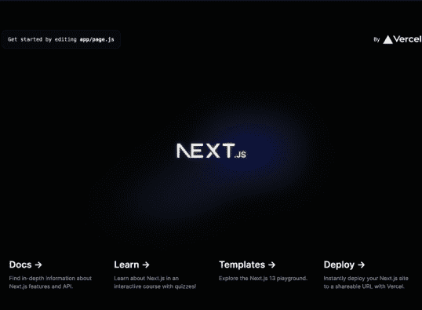

**图 12.2:** Next.js 应用默认屏幕界面

由于我们使用 `create-next-app` 命令启动了 Next 应用，让我们从一些文件中清除一些样板代码，以得到类似所示的效果：

### `app/globals.css`

```css
* {
  box-sizing: border-box;
  padding: 0;
  margin: 0;
}

html,
body {
  max-width: 100vw;
  overflow-x: hidden;
}

body {
  background: black;
  color: white;
}
```

### `app/layout.js`

```javascript
import './globals.css'
import { Inter } from 'next/font/google'

const inter = Inter({ subsets: ['latin'] })

export const metadata = {
  title: 'To-Do app',
  description: 'Created using Next.js 13',
}

export default function RootLayout({ children }) {
  return (
    <html lang="en">
      <body className={inter.className}>{children}</body>
    </html>
  )
}
```

### `app/page.module.css`

```css
.main {
  display: flex;
  flex-direction: column;
  gap: 40px;
  align-items: center;
  padding: 6rem;
  min-height: 100vh;
}

.go-button {
  background: green;
  padding: 10px;
}
```

### `app/page.js`

```javascript
import styles from "./page.module.css";
import Link from "next/link";

export default function Home() {
  return (
    <main className={styles.main}>
      <h1>To-Do App</h1>
      <p>这是一个使用 Next.js 13 创建的应用</p>
      <Link href="/crud" className={styles['go-button']}>让我们开始吧!</Link>
    </main>
  );
}
```

恭喜！Next.js 已在你的计算机上成功设置好本地开发。它应该如图 12.3 所示：


**图 12.3:** 待事项应用

## 显示待办事项（读）

我们已经为应用创建了落地页，用户访问首页时会看到它。当用户点击“Let’s go”按钮时，我们将他们重定向到应用的主页，他们可以在那里进行 CRUD 操作。

现在，我们将在 `app` 文件夹内部创建一个新的 `crud` 文件夹，并创建一个 `page.js` 来渲染 crud 路由的 UI，以及创建一个 `page.module.css` 文件来编写其 CSS。

```
app
└── crud
    ├── page.js
    ├── page.module.css
    ├── favicon.ico
    ├── globals.css
    ├── layout.js
    ├── page.js
    └── page.module.css
```

**图 12.4:** 新的文件夹和文件

`crud` 文件夹中 `page.js` 的内容如下：

```javascript
import styles from "./page.module.css";

export default function Crud() {
  return (
    <div className={styles.main}>
      <p>我们在这里执行 CRUD 操作！</p>
    </div>
  );
}
```

### `page.module.css`

```css
.main {
  display: flex;
  flex-direction: column;
  gap: 40px;
  align-items: center;
  padding: 6rem;
  min-height: 100vh;
}

.go-button {
  background: green;
  padding: 10px;
}
```

如果导航到 `http://localhost:3000/crud`，我们将看到以下内容：


**图 12.5:** 屏幕输出

我们将更改 `app/page.js` 中 `Link` 组件的 `href`：
`<Link href="/crud" className={styles['go-button']}>让我们开始吧!</Link>`

这样，当用户点击此链接时，他们将被引导到我们创建的 crud 路由。现在我们将编辑 `/crud` 路由中的 `page.js` 来构建我们的应用。第一步，我们将创建一个静态数组（包含待办事项）并将它们渲染在屏幕上：`items = ["Go to the gym", "Buy groceries", "Pickup mail"];`。我们将在根级别创建一个 `components` 文件夹并在其中创建一个 `ToDo` 组件。它将接收一个包含待办事项的 `item` 属性：

```
TODO-APP
├── .next
├── app
│   └── components
│       └── ToDo.jsx
└── node_modules
```

**图 12.6:** ToDo.jsx

```javascript
const ToDo = ({ item }) => {
  return <p>{item}</p>;
}

export default ToDo;
```

将 `crud/page.js` 修改：

```javascript
import styles from "./page.module.css";
import ToDoItem from "@/components/ToDoItem";

export default function Crud() {
  const items = ["Go to the gym", "Buy groceries", "Pickup mail"];

  return (
    <div className={styles.main}>
      <h2>待办事项</h2>
      <ul>
        {items.map((item) => (
          <ToDoItem item={item} />
        ))}
      </ul>
    </div>
  );
}
```


**图 12.7:** 渲染的待办事项

你现在可以看到从数组渲染待办事项。接下来，让我们完善待办事项列表的 UI。为了实现这一点，我们将安装名为 Material UI 的 UI 库。它包含许多预定义的 UI 组件和工具。运行命令 `npm install @mui/material @emotion/react @emotion/styled @mui/icons-material` 来安装 Material UI 及其图标包。我们将添加一个复选框来标记已完成，并为每个项目添加一个删除按钮：

### `components/ToDoItem.jsx`

```javascript
"use client";

import React from "react";
import styles from "./ToDoItem.module.css";
import ListItem from "@mui/material/ListItem";
import ListItemButton from "@mui/material/ListItemButton";
import ListItemIcon from "@mui/material/ListItemIcon";
import Checkbox from "@mui/material/Checkbox";
import ListItemText from "@mui/material/ListItemText";
import DeleteIcon from "@mui/icons-material/Delete";

const ToDoItem = ({ item, key }) => {
  const [checked, setChecked] = React.useState([]);

  const handleToggle = (value) => () => {
    const currentIndex = checked.indexOf(value);
    const newChecked = [...checked];
    if (currentIndex === -1) {
      newChecked.push(value);
    } else {
      newChecked.splice(currentIndex, 1);
    }
    setChecked(newChecked);
  };

  return (
    <ListItem className={styles.item} key={key}>
      <ListItemButton onClick={handleToggle(key)}>
        <ListItemIcon>
          <Checkbox
            checked={checked.indexOf(key) !== -1}
            tabIndex={-1}
            className={styles.checkbox}
          />
        </ListItemIcon>
        <ListItemText primary={item} />
      </ListItemButton>
      <DeleteIcon className={styles.delete} />
    </ListItem>
  );
};

export default ToDoItem;
```

### `components/ToDoItem.module.css`

```css
.item {
  background: black;
  margin-bottom: 20px;
}

.checkbox {
  color: white;
}

.delete {
  color: rgb(235, 81, 81);
}
```

### `crud/page.js`

```javascript
"use client";

import styles from "./page.module.css";
import TodoItem from "@/components/ToDoItem";
import List from "@mui/material/List";

export default function Crud() {
  const items = ["Go to the gym", "Buy groceries", "Pickup mail"];

  return (
    <div className={styles.main}>
      <h2>待办事项</h2>
      <List>
        {items.map((item, index) => (
          <ToDoItem item={item} key={index} />
        ))}
      </List>
    </div>
  );
}
```

你会注意到我们在文件顶部写了 `"use client"` 指令。此指令被用于指定它是一个客户端组件，因为我们正在使用外部客户端库 Material UI。

之前的更改将渲染以下 UI：

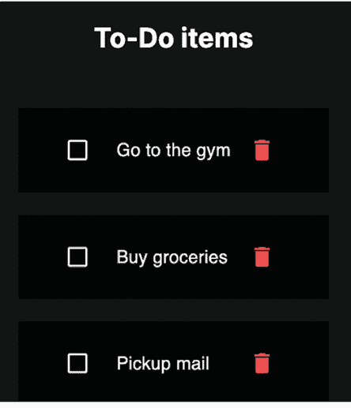

**图 12.8:** 带有复选框和删除按钮的待办事项

目前我们还没有为删除按钮和复选框添加任何功能，因为我们将在接下来的章节中介绍这些内容。

## 使用 Supabase 设置数据库

我们的应用现在从静态数组 `items` 渲染 UI，该数组包含内容 ["去健身房", "买日用品", "取邮件"]。在真实世界的应用中，此类数据将存储在数据库中。我们将通过 API 调用从服务器获取这些数据并在前端进行渲染。这正是我们现在要做的事情！

为此，请访问 [Supabase.com](https://supabase.com) 并使用你的 GitHub 凭据登录。你会看到以下仪表板：

## 使用 Next.js 开发 CRUD 应用程序

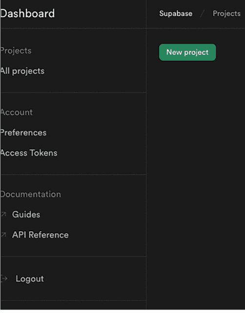

**图 12.9:** Supabase 仪表板

点击 **New project**（新项目）按钮，并填写 **Name**（名称）和 **Type of organization**（组织类型），如 **图 12.10** 所示。

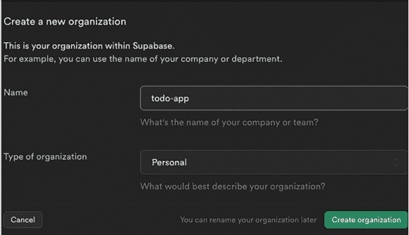

**图 12.10:** Supabase 仪表板

然后，填写以下信息创建一个新项目：

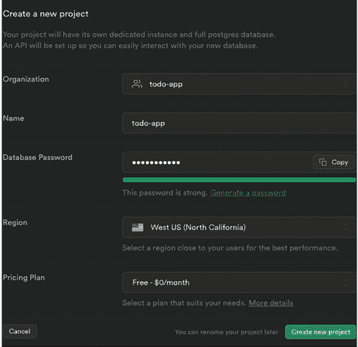

**图 12.11:** 创建项目界面

进入 Table Editor（表格编辑器）选项卡，将表命名为 `items`，创建四列，并点击 Save（保存）：

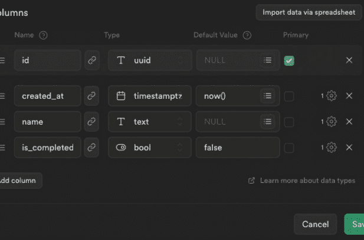

**图 12.12:** 数据库架构

现在，使用 'Insert'（插入）按钮添加与我们在 Next.js 中使用的相同待办事项。目前你可以使用 [https://www.uuidgenerator.net/version1](https://www.uuidgenerator.net/version1) 来创建 UUID 并将其添加到表中的某行。添加这些项目后，我们的表格将如下所示：

| id | uuid | created_at | name | is_complete | ... |
|---|---|---|---|---|---|
| 34287c84-f8e9-11ee-b5d6-02421202100 | 2023-07-10 16:53:13.09656+00 | Go to the gym | | FALSE | |
| 4880dc8b-f8e9-11ee-b5d6-02421202100 | 2023-07-10 16:41:04.33858+00 | Buy groceries | | TRUE | |
| 5edfa150-f8e9-11ee-b5d6-02421202100 | 2023-07-10 16:17:12.44687+00 | Pickup mail | | FALSE | |

**图 12.13:** 数据库条目

我们正在取得进展！下一部分是通过 Next.js 应用通过 API 调用获取这些数据并将其渲染到 UI 中。幸运的是，Supabase 提供了一个非常简单的方法，如图 12.14 所示：

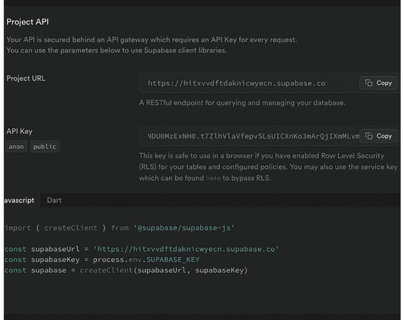

**图 12.14:** Supabase 仪表板

打开我们的 Next.js 应用并安装 `@supabase/supabase-js` 包。

在根级别创建一个新的 `utils` 文件夹，并创建一个文件 `SupabaseClient.js`，用它用 Supabase 服务器初始化应用：

```javascript
import { createClient } from "@supabase/supabase-js";

const supabase = createClient(
  supabaseUrl,
  supabaseKey
);

export default supabase;
```

将 `supabaseUrl` 和 `supabaseKey` 替换为你的 Supabase 账户 API 密钥。

更新 `crud/page.js` 为：

```javascript
"use client";

import styles from "./page.module.css";
import ToDoItem from "@/components/ToDoItem";
import List from "@mui/material/List";
import supabase from "@/utils/SupabaseClient";

export default async function Crud() {
  let { data: items, error } = await supabase.from("items").select("*");

  return (
    <div className={styles.main}>
      <h2>待办事项</h2>
      <List>
        {items.map((item) => (
          <TodoItem item={item} />
        ))}
      </List>
    </div>
  );
}
```

### `components/ToDoItem.jsx`

ToDoItem 组件渲染单个待办事项

```javascript
"use client";

import React from "react";
import styles from "./TodoItem.module.css";
import ListItem from "@mui/material/ListItem";
import ListItemButton from "@mui/material/ListItemButton";
import ListItemText from "@mui/material/ListItemText";
import Checkbox from "@mui/material/Checkbox";

const ToDoItem = ({ item }) => {
  const [checked, setChecked] = React.useState(false);

  const handleToggle = () => {
    setChecked(!checked);
  };

  return (
    <ListItem className={styles.item}>
      <ListItemButton onClick={handleToggle}>
        <Checkbox checked={checked} />
        <ListItemText primary={item.name} />
      </ListItemButton>
    </ListItem>
  );
};

export default ToDoItem;
```

## 添加待办事项 (Create)

在之前的章节中，我们实现了读取功能并将 Next.js 连接到 Supabase。在本节中，我们将尝试通过输入框并将新项目添加到表中：

### `crud/page.js`

```javascript
"use client";

import React, { useState, useEffect } from "react";
import { v4 as uuidv4 } from "uuid";
import styles from "./page.module.css";
import ToDoItem from "@/components/ToDoItem";
import List from "@mui/material/List";
import supabase from "@/utils/SupabaseClient";

export default function Crud() {
  const [newItem, setNewItem] = useState(null);
  const [items, setItems] = useState([]);

  const fetchData = async () => {
    const { data, error } = await supabase.from("items").select("*");
    setItems(data);
  };

  useEffect(() => {
    fetchData();
  }, []);

  const addItem = async () => {
    const { error } = await supabase
      .from("items")
      .insert([{ is_completed: false, name: newItem, id: uuidv4() }]);

    if (!error) {
      fetchData();
    }
  };

  return (
    <div className={styles.main}>
      <h2>待办事项</h2>
      <div className={styles.container}>
        <input
          className={styles.input}
          onChange={(e) => setNewItem(e.target.value)}
        />
        <button className={styles.button} onClick={addItem}>
          加入列表！
        </button>
      </div>
      <List>
        {items.map((item, index) => (
          <ToDoItem item={item} key={index} />
        ))}
      </List>
    </div>
  );
}
```

渲染后的 UI 如下：

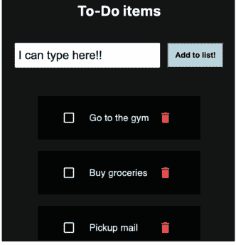

**图 12.16:** 从服务器数据渲染的待办事项

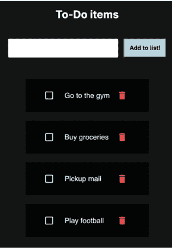

**图 12.17:** 添加了新的待办事项

## 编辑待办事项（更新）

在这一部分，我们将根据 UI 中复选框是否勾选来实现任务是否完成。如果用户勾选或取消勾选某个待办事项，我们将在 Supabase 表中更新该项。为了实现这一点，我们将按照如下方式重构两个文件：

### `crud/page.js`

```javascript
"use client";

import React, { useState, useEffect } from "react";
import { v4 as uuidv4 } from "uuid";
import styles from "./page.module.css";
import TodoItem from "@/components/ToDoItem";
import List from "@mui/material/List";
import supabase from "@/utils/SupabaseClient";

export default function Crud() {
  const [newItem, setNewItem] = useState(null);
  const [items, setItems] = useState([]);

  const fetchData = async () => {
    const { data, error } = await supabase.from("items").select("*");
    setItems(data);
  };

  useEffect(() => {
    fetchData();
  }, []);

  const handleToggle = async (item) => {
    const { data, error } = await supabase
      .from("items")
      .update({ is_completed: !item.is_completed })
      .eq("id", item.id);

    if (!error) {
      fetchData();
    }
  }

  const handleDelete = async (id) => {
    const { data, error } = await supabase.from("items").delete().eq("id", id);
    if (!error) {
      fetchData();
    }
  }

  const addItem = async () => {
    const { data, error } = await supabase
      .from("items")
      .insert([{ is_completed: false, name: newItem, id: uuidv4() }])
      .single();

    if (!error) {
      fetchData();
    }
  };

  return (
    <div className={styles.main}>
      <h2>待办事项</h2>
      <div className={styles.container}>
        <input
          className={styles.input}
          onChange={(e) => setNewItem(e.target.value)}
        />
        <button className={styles.button} onClick={addItem}>
          加入列表！
        </button>
      </div>
      <List>
        {items.map((item) => (
          <TodoItem
            item={item}
            key={item.id}
            onToggle={handleToggle}
            onDelete={handleDelete}
          />
        ))}
      </List>
    </div>
  );
}
```

### `components/ToDoItem.jsx`

```javascript
"use client";

import React from "react";
import styles from "./TodoItem.module.css";
import ListItem from "@mui/material/ListItem";
import ListItemButton from "@mui/material/ListItemButton";
import ListItemIcon from "@mui/material/ListItemIcon";
import Checkbox from "@mui/material/Checkbox";
import ListItemText from "@mui/material/ListItemText";
import DeleteIcon from "@mui/icons-material/Delete";

const ToDoItem = ({ item, onToggle, onDelete }) => {
  const handleToggle = () => {
    onToggle(item);
  };

  const handleDelete = () => {
    onDelete(item.id);
  };

  return (
    <ListItem className={styles.item}>
      <ListItemButton onClick={handleToggle}>
        <ListItemIcon>
          <Checkbox
            checked={item.is_completed}
            tabIndex={1}
            className={styles.checkbox}
          />
        </ListItemIcon>
        <ListItemText primary={item.name} />
      </ListItemButton>
      <ListItem>
        <DeleteIcon className={styles.delete} onClick={handleDelete} />
      </ListItem>
    </ListItem>
  );
};

export default ToDoItem;
```

## 删除待办事项

我们终于实现了最后一个功能，即点击删除按钮时删除项目。

## 部署应用程序

漂亮！我们已经为应用程序添加了所有功能。然而，应用程序目前仍在本地运行，如果我们能把它分享到网站上就太棒了。这正是我们要做的！首先，我们将仓库上传到 GitHub：

```bash
git remote add origin [仓库地址]
git branch -M main
git push -u origin main
```

完成后，前往 vercel.com 并登录你的 GitHub 账户。从仓库导入项目并点击“部署”。你成功部署了你的应用！

## 总结

在本章中，我们使用 Next.js 和 Supabase 构建了一个完整的 CRUD（增删改查）应用程序。我们设计的应用程序允许用户管理待办列表，包括创建新任务、标记已完成以及删除。在整个过程中，我们演示了如何高效利用 Next.js 的功能（如基于 React 的框架），我们还展示了 Supabase 强大且易用的客户端库如何简化后端数据操作。Next.js 和 Supabase 的结合使我们能够快速构建无服务器应用程序。这个项目仅是冰山一角，鼓励进一步探索这些技术以满足不同的网络需求。

在下一章节中，我们将讨论使用云提供商来部署 Next.js 应用的不同方法。

# 第 13 章：探索 Next.js 应用中的部署架构

## 引言

通过这些最佳实践，你可以确保无缝的用户体验，并在部署阶段将中断减少到最低。

在持续集成和持续部署（CI/CD）时代，我们将引导你完成专为 Next.js 应用设计的流水线设置过程。你将学习到如何利用 CI/CD 工具和框架来自动化部署过程，在保持代码质量和稳定性的同时，实现更快速、更高效的部署。

监控和调试已部署的应用程序对于维护其健康和及时解决问题至关重要。我们将深入探讨监控技术和工具，主动监控你部署的 Next.js 应用的性能，并有效解决任何潜在的瓶颈或错误。

在本章中，我们将涵盖主题包括：Next.js 中的部署流程、将 Next.js 应用部署到不同的托管平台、为部署设置环境变量、为生产环境配置 Next.js 应用、优化部署流程以提高效率、为 Next.js 应用设置 CI/CD 流水线，以及对已部署的应用进行监控和调试。

在本章结束，你将对 Next.js 应用可用的部署选项有全面的理解，使你能够针对特定的用例对最佳部署策略做出明智决策。现在，让我们开启部署架构的之旅，确保你的 Next.js 应用在生产环境中充分发挥潜力吧！

## 结构

在本章中，我们将涵盖以下主题：

- 理解 Next.js 中的部署流程
- 为部署设置环境变量
- 为生产环境配置 Next.js 应用
- 为 Next.js 应用设置持续集成和持续部署（CI/CD）流水线
- 将 Next.js 应用部署到不同的托管平台，包括 Vercel、AWS 和 Heroku
- 优化部署流程以实现更快速、更高效的部署
- 对已部署的应用进行监控和调试

## 理解 Next.js 中的部署流程

在软件开发的语境下，部署是指使软件应用程序变得可用并供用户使用的过程。它涉及获取已开发的代码，并将其准备好在服务器或其他计算设备上运行，允许用户访问并与应用程序进行交互。

在部署过程中，会执行各种任务，例如编译代码、优化资源、配置设置以及搭建必要的设施。目标是确保应用程序在预期的环境中顺利、安全且高效地运行。

### 部署环境的类型

部署环境是指部署软件应用程序并让用户访问的计算基础设施。部署环境有几种类型，每种都有不同的用途。以下是一些常见类型：

- **开发环境**：开发环境是开发人员编写代码、测试和调试应用程序的地方。它通常运行在开发者的机器上，可能包含开发工具、库和数据库。该环境并非供公共使用，而是作为构建和完善应用程序的沙箱。

- **测试/阶段环境**：测试或阶段环境是一个用于在发布到生产环境之前对应用程序进行彻底测试的专用环境。它尽可能模拟生产环境，允许测试不同的用例、发现并修复错误，并确保应用程序按预期运行。它有助于验证应用程序的功能、性能以及与不同系统的兼容性。

- **生产环境**：生产环境是部署应用程序并面向用户的真实环境。它是应用程序运行并为目标受众服务的实际服务器或托管基础设施。生产环境必须高度稳定、安全并经过性能优化，以处理真实世界的使用。它通常需要额外的资源和配置来确保可靠性、扩展性和高可用性。

- **部署平台**：部署平台是促进应用程序部署的服务或托管提供商。这些平台提供了各种功能并支持不同的部署方法。一些流行的部署平台包括云提供商，如 Amazon Web Services (AWS)、Microsoft Azure 或 Google Cloud Platform，以及 Netlify、Vercel 和 Heroku 等专用托管服务。这些平台提供了基础设施、工具和服务，以简化部署流程并在不同的环境中管理应用程序。

值得注意的是，每个部署环境在软件开发生命周期中都有特定的用途，确保应用程序在发布到用户可以访问和利用的生产环境之前经过充分测试并运行良好。

总的来说，部署涉及在不同的环境中准备和设置应用程序，每个环境在开发和发布过程中都承担着独特的角色。

### Next.js 中不同类型的部署流程

#### 静态托管

如果你的 Next.js 应用是静态生成的，不需要服务器端渲染或 API 路由，你可以将其部署为一组静态文件。这种方法适用于 Netlify、Vercel 或 GitHub Pages 等托管平台。要使用静态托管部署应用程序，请遵循以下步骤：

1. 通过运行以下命令构建你的 Next.js 应用：
   `npm run build`

2. 通过运行以下命令生成静态文件：
   `npm run export`

3. 通过链接你的项目仓库或使用文件传输方法，将生成的静态文件上传到你选择的托管平台。

4. 配置你的托管平台以提供静态文件并让用户访问你的应用程序。

#### 无服务器函数

Next.js 提供了 API 路由功能，允许你定义无服务器函数，这些函数按需运行并处理服务器端逻辑。当应用程序需要服务器端处理（例如表单提交或从外部 API 获取数据）时，这种方法非常有用。你可以在 Vercel、AWS Lambda 或 Azure Functions 等平台上部署带有无服务器函数的 Next.js 应用。以下是部署过程的大概：

1. 在 Next.js 项目的 `pages/api` 目录下创建 API 路由文件，编写你的无服务器函数。
2. 通过运行以下命令构建你的 Next.js 应用：
   `npm run build`
3. 将应用程序部署到选择的托管平台，确保平台识别 API 路由与其代码一同部署。
4. 配置平台所需的环境变量或部署设置。

#### 自定义服务器

如果你的 Next.js 应用需要高级服务器端功能或与特定基础设施集成，你可以使用自定义服务器进行部署。这种方法让你对服务器环境有更多的控制，并且在需要实现复杂的路由或与外部数据库或服务交互时非常有用。自定义服务器的部署过程通常涉及以下步骤：

1. 在 Next.js 项目中创建一个自定义服务器文件，例如 `server.js`。
2. 实现必要的服务器逻辑，包括路由和任何额外的服务器端功能。
3. 通过运行以下命令构建你的 Next.js 应用：
   `npm run build`
4. 通过运行以下命令启动你的自定义服务器：
   `node server.js`
5. 将你的自定义服务器部署到选择的托管环境中，确保服务器脚本正确执行。

需要注意的是，部署过程可能会根据你选择的特定托管平台或基础设施而异。因此，建议咨询你计划用于部署 Next.js 应用的平台或托管服务提供的文档或指南。

## 为部署设置环境变量

环境变量在应用程序的部署中起着至关重要的作用。它们是外部于应用程序代码的配置值，并根据部署环境的不同而变化。环境变量为存储敏感信息、配置设置、API 密钥、数据库凭据或应用程序所需的任何动态值提供了一种灵活的方法。

为部署设置环境变量涉及在不同的环境中（如本地开发、测试和生产环境）中定义和管理这些变量。让我们探索如何在这些环境中为部署设置环境变量：

### 1. 本地环境

在本地开发环境中，你通常会设置环境变量来配置你的开发环境并在本地机器上测试应用程序。以下是你在本地部署时设置环境变量的方法：

- 在你的 Next.js 项目的根目录下创建一个 `.env` 文件。该文件将存储你的环境变量。
- 在 `.env` 文件中使用 `KEY=VALUE` 格式定义你的环境变量。例如：
  `DATABASE_URL=mongodb://localhost:27017/mydatabase`
- 在你的 Next.js 应用代码中，使用如 `dotenv` 的包或内置的 `process.env` 对象访问环境变量。例如，访问 `API_KEY` 变量：
  `const apiKey = process.env.API_KEY;`
- 确保将 `.env` 文件添加到你的 `.gitignore` 文件中，使其不会被提交到版本控制，因为它可能包含敏感信息。

### 2. 测试环境

测试环境是你部署到生产环境之前进行全面测试的地方。为测试环境设置环境变量的过程与本地环境类似：

- 创建一个独立的 `.env.test` 文件来存储特定于测试环境的环境变量。
- 在 `.env.test` 文件中定义测试所需的环境变量。
- 在你的测试脚本或测试框架配置中，从 `.env.test` 文件加载环境变量，以确保测试使用正确的配置。

### 3. 生产环境

生产环境是最终的部署环境，你的应用程序将向用户开放。安全且高效地设置环境变量至关重要。以下是推荐的方法：

- 在生产服务器或托管平台上，使用托管服务提供的机制定义环境变量。这可能包括管理控制台、仪表板或特定于托管平台的命令行界面。
- 避免将生产环境变量直接存储在代码库或配置文件中。相反，在生产服务器上安全地设置环境变量，或通过托管平台的部署设置进行配置。
- 在生产服务器上，确保环境变量在运行时被你的 Next.js 应用正确加载并可以访问。

通过遵循这些步骤，你可以在不同环境中为部署设置环境变量。记住安全地处理敏感信息，并避免在公共仓库或不安全的通道中暴露环境变量。

在 Windows 和 Linux 环境下本地运行 Next.js 应用时，你可以在脚本中传递环境变量：

#### Windows 环境

在 Windows 中，你可以使用 `set` 命令在执行脚本之前内联设置环境变量。例如：
```cmd
set API_KEY=12345 && npm run dev
```
在前述示例中，在运行 `npm run dev` 脚本之前，`API_KEY` 被设置为 `12345`。你可以将 `API_KEY` 及其值替换为你的特定环境变量。

#### Linux 环境

在 Linux 中，你可以使用 `export` 命令在执行脚本之前内联设置环境变量。例如：
```bash
export API_KEY=12345 && npm run dev
```
与 Windows 示例类似，在运行 `npm run dev` 脚本之前，`API_KEY` 被设置为 `12345`。再次，你可以将 `API_KEY` 及其值替换为你的特定环境变量。

或者，你可以将环境变量存储在独立的文件中，并在运行脚本之前加载它们。

#### Windows 环境下的独立文件方法

在 Windows 中，你可以创建一个独立的文件，例如 `env.bat`，并使用 `set` 命令定义你的环境变量。例如：
```bat
@echo off
set API_KEY=12345
set DATABASE_URL=mongodb://localhost:27017/mydatabase
```
保存该文件，然后在运行 `npm run dev` 脚本之前通过执行它来运行脚本。

#### Linux 环境下的独立文件方法

在 Linux 中，你可以创建一个独立的文件，例如 `env.sh`，并使用 `export` 命令定义你的环境变量。例如：
```bash
#!/bin/bash
export API_KEY=12345
export DATABASE_URL=mongodb://localhost:27017/mydatabase
```
保存该文件，然后在运行 `npm run dev` 脚本之前通过执行它来运行：`source env.sh && npm run dev`

通过使用内联方法或独立文件方法，你可以在 Windows 和 Linux 环境下本地运行 Next.js 应用时向脚本传递环境变量。

## 为 Next.js 应用设置 CI/CD 工作流

一个为你的 Next.js 应用设置测试、构建和实现 CI/CD 工作流操作配置的分步指南：

### 步骤 1：创建工作流文件

在你的仓库中，导航到 `.github/workflows` 目录。创建一个新的文件（例如 `ci-cd.yml`）来定义你的工作流。

### 步骤 2：定义工作流触发

指定触发工作流的事件。例如，你可以在 `main` 分支进行推送时触发工作流：

```yaml
name: CI/CD 工作流

on:
  push:
    branches:
      - main
  pull_request:
    branches:
      - main
```

### 步骤 3：定义作业

在工作流中定义作业。例如，你可以为测试、构建和部署设置不同的作业：

```yaml
test:
  name: 测试
  runs-on: ubuntu-latest
  steps:
    - name: Checkout 代码
      uses: actions/checkout@v2
    - name: 安装依赖
      run: npm ci
    - name: 测试
      run: npm test

build:
  name: 构建
  runs-on: ubuntu-latest
  steps:
    - name: Checkout 代码
      uses: actions/checkout@v2
    - name: 安装依赖
      run: npm ci
    - name: 构建 Next.js
      run: npm run build

deploy:
  name: 部署
  needs: [build]
  runs-on: ubuntu-latest
  steps:
    - name: Checkout 代码
      uses: actions/checkout@v2
    - name: 安装依赖
      run: npm ci
    - name: 部署到 AWS/Heroku/Vercel
      run: |
        # 在此处添加部署命令
```

### 步骤 4：配置测试

在 `test` 作业中添加适当的测试命令和配置。

### 步骤 5：配置构建

在 `build` 作业中添加构建 Next.js 应用的命令和配置。

### 步骤 6：配置部署

在 `deploy` 作业中添加必要的部署命令或脚本。根据你的部署目标（AWS、Heroku、Vercel），你需要使用相应的命令和配置。

### 步骤 7：提交工作流文件

将工作流文件提交到仓库。

### 步骤 8：GitHub Actions 执行

GitHub Actions 将在触发时自动执行定义的工作流。工作流将根据 `deploy` 作业中指定的 `needs` 依赖顺序运行定义的作业。

就是这样！你已经为你的 Next.js 应用设置了一个工作流操作配置，用于测试、构建和实现 CI/CD。根据你的特定需求和部署目标自定义工作流文件。

## 将 Next.js 应用部署到不同的托管平台

将 Next.js 应用部署到不同的托管平台涉及每个平台的特定步骤。本概述涵盖了 Vercel、Heroku 和 AWS 的部署过程，并带有代码示例帮助你完成该过程。

### 1. 将 Next.js 应用部署到 Vercel

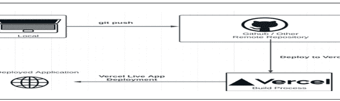

**图 13.1:** Vercel 部署过程

要使用 Vercel 部署 Next.js，请执行以下步骤：

#### 步骤 1：全局安装 Vercel CLI

确保你已经安装了 Node.js 和 npm。然后，打开终端并运行以下命令：

```bash
npm install -g vercel
```

#### 步骤 2：构建 Next.js 应用

在终端中导航到你的 Next.js 项目目录，并运行以下命令构建你的应用：

```bash
npm run build
```

#### 步骤 3：创建一个 `vercel.json` 文件

在项目的根目录下创建一个 `vercel.json` 文件并添加所需的配置。以下是一个基础 `vercel.json` 文件的示例：

```json
{
  "version": 2,
  "builds": [
    {
      "src": "next.config.js",
      "use": "@vercel/next"
    }
  ],
  "routes": [
    { "src": "/api/(.*)", "dest": "/api/$1" },
    { "src": "/blog", "dest": "/blog/index.html" },
    { "src": "/blog/(.*)", "dest": "/blog/$1.html" },
    { "src": "/(.*)", "dest": "$1" }
  ],
  "env": {
    "API_URL": "https://api.example.com",
    "API_KEY": "@env-api-key"
  },
  "rewrites": [
    { "source": "/user/:id", "destination": "/profile?id=:id" }
  ],
  "redirects": [
    { "source": "/about", "destination": "/company/about", "statusCode": 301 }
  ]
}
```

让我们来解析一下 `vercel.json` 配置的不同部分：

- `version`: 指定配置文件的版本，使用 `2` 表示最新版本。
- `builds`: 为你的 Next.js 应用定义构建设置。在本例中，我们使用了 `@vercel/next` 构建器，它是 Next.js 项目的默认构建器。
- `routes`: 为你的应用配置路由规则。每个路由都有一个 `src` 和 `dest` 属性。在本例中，我们定义了 API 端点、博客页面和通配符路由的路由。
- `env`: 允许为你的应用定义环境变量。你可以使用 `@env-variable` 语法从 Vercel 项目的环境变量加载值。
- `rewrites`: 为你的应用指定 URL 重写。在本例中，我们将 `/user/:id` 重写为 `/profile?id=:id`。
- `redirects`: 配置 URL 重定向。在本例中，对 `/about` 的请求将被重定向到 `/company/about`，状态码为 `301`。

#### 步骤 4：通过 CLI 登录你的 Vercel 账户

运行以下命令并按照身份验证提示操作：

```bash
vercel login
```

#### 步骤 5：部署应用

在终端中，导航到你的项目目录并运行以下命令：

```bash
vercel deploy
```


# 使用 Next.js 构建现代 Web 应用

## Vercel 部署

Vercel 将引导你完成部署过程，一旦完成，它将为你提供一个部署 URL。

## 将 Next.js 应用部署到 Heroku

要使用 Heroku 部署 Next.js 应用，请遵循以下步骤：

### 步骤 1：注册 Heroku 账户

如果你还没有 Heroku 账户，请访问 Heroku 网站（https://www.heroku.com/）并注册免费账户。

### 步骤 2：安装 Heroku CLI

下载并安装适用于你操作系统的 Heroku CLI（命令行界面）。你可以在 Heroku Dev Center 网站上找到安装说明：https://devcenter.heroku.com/articles/heroku-cli#download-and-install

### 步骤 3：准备你的应用进行部署

确保你的 Next.js 项目已准备就绪。确保你在根目录下有一个 `package.json` 文件，并且列出了必要的依赖项。

### 步骤 4：创建 `Procfile`

在 Next.js 项目的根目录下，创建一个名为 `Procfile` 的文件（无任何文件扩展名）。打开 `Procfile` 并添加以下行：

```
web: npm start
```

此行告诉 Heroku 如何启动你的应用。

### 步骤 5：初始化 Git 并提交你的项目

在终端中，导航到你的项目目录并运行以下命令来初始化 Git 并提交项目：

```
git init
git add .
git commit -m "Initial commit"
```

### 步骤 6：通过 CLI 登录 Heroku

运行以下命令并按照提示通过 CLI 登录你的 Heroku 账户：

```
heroku login
```

### 步骤 7：创建一个新的 Heroku 应用

运行以下命令在 Heroku 上创建一个新应用：

```
heroku create
```

此命令将为你的应用生成一个唯一的名称。

### 步骤 8：将你的应用部署到 Heroku

要部署你的应用，请运行以下命令：

```
git push heroku master
```

### 步骤 9：打开你的应用

一旦部署完成，Heroku 将为你提供一个部署 URL。你可以通过运行以下命令打开你的应用：

```
heroku open
```


## 优化部署流程

### 第 1 步：使用服务器端渲染 (SSR)

实施服务端渲染，在服务器上预渲染页面，从而缩短用户的初始加载时间。

### 第 2 步：实现缓存

- **使用内容分发网络 (CDN)**：利用 CDN 缓存静态资源并从更接近用户的边缘节点提供服务，从而减少延迟并提高性能。
- **实现浏览器缓存**：为静态资源设置合适的缓存头部以启用浏览器缓存。这允许浏览器在本地存储资源，避免不必要的网络请求。
- **使用 Cache-Control 头部**：设置 Cache-Control 头部来为静态资源指定缓存指令。使用 AWS CloudFront 或 Vercel 等工具配置缓存设置。

### 第 3 步：自动化与持续集成/持续部署 (CI/CD)

- **设置 CI/CD 流水线**：使用 Jenkins、CircleCI 或 GitHub Actions 等 CI/CD 工具自动化构建、测试和部署过程。配置流水线以便在代码更改或事件发生时触发部署。
- **并行化构建和部署步骤**：将部署拆分为并行步骤以加快整体部署速度。例如，你可以同时运行测试、构建资源并部署到不同的环境。
- **使用滚动部署**：实施滚动部署以逐步更新应用程序，而不是一次性更新。这可以减少停机时间并确保用户获得更平滑的过渡。
- **金丝雀发布**：实施金丝雀发布，在向整个用户群推出功能或更新之前，先让部分用户进行测试。这有助于及早发现问题并降低风险。

### 第 4 步：监控与性能优化

- **监控性能指标**：使用 Google Analytics、New Relic 或 AWS CloudWatch 等工具监控响应时间、页面加载时间和资源使用等性能指标。识别瓶颈和待改进领域。
- **持续性能优化**：通过识别和解决性能问题、优化数据库查询以及提高代码效率，持续分析并优化应用程序的性能。
- **实施 A/B 测试**：进行 A/B 测试以尝试不同版本的应用程序并衡量它们对性能的影响。这有助于识别对用户体验产生积极影响的更改。
- **性能预算**：设置性能预算为文件大小、请求数量或加载时间等指标定义限制。确保您的应用程序在这些限制内运行以保持最佳性能。

通过遵循这些步骤，你可以优化 Next.js 应用的部署过程，实现更快、更高效的部署。定期监控并微调你的部署过程，以适应不断变化并利用最新的技术和最佳实践。

## 为生产环境配置 Next.js 应用

为生产环境配置 Next.js 应用涉及优化应用程序的性能、安全性和扩展性，以确保其在生产环境中稳定高效运行。以下是配置 Next.js 应用时需要考虑的关键方面：

### 特定环境的配置

使用环境变量存储在开发、测试和生产环境之间不同的配置值。这些变量可以包括 API 密钥、数据库连接字符串、功能标记或其他任何敏感信息。通过将配置与代码分离，你可以轻松管理和更新特定于每个环境的设置，无需修改应用程序的源代码。

### 性能优化

为了提高性能，请实施以下技术：

- **代码压缩**：启用代码压缩以减小 JavaScript 和 CSS 文件的大小。可以使用 Webpack 或 Next.js 内置的优化功能来实现此。压缩消除了不必要的字符、空格和注释，为用户带来更快的加载速度。
- **服务端渲染 (SSR)**：利用 Next.js 的服务端渲染能力在服务器上生成 HTML 并发送到客户端。SSR 改进了初始页面加载时间，并让搜索引擎更有效地索引你的站点。
- **客户端优化**：利用代码分割和懒加载确保初始仅加载必要的代码。通过减少初始负载大小并推迟非关键资源在需要时再加载，提高性能。
- **图像优化**：使用 Next.js 内置的 Image 组件，它通过压缩和调整图像大小自动优化图像。这在不牺牲视觉质量的情况下减小了图像文件大小，并改进了整体页面加载时间。
- **缓存**：实施缓存机制以减轻服务器负载并提高响应速度。你可以利用 Next.js 对服务端缓存的内置，或使用 Varnish 或 Redis 等解决方案来缓存频繁访问的数据或渲染的页面。

### 安全措施

采取以下安全措施保护你的 Next.js 应用：

- **安全通信**：对所有客户端与服务器之间的通信强制执行 HTTPS。使用 SSL 证书加密传输过程中的数据，防止未经授权的访问或篡改。
- **输入验证**：对输入进行验证和清洗，以防止常见的跨站脚本 (XSS) 和 SQL 注入攻击等安全漏洞。使用 Yup 或 Joi 等库进行输入验证，并避免在查询或命令中直接执行用户提供的数据。
- **身份验证与授权**：实施稳健的身份验证和授权机制以控制对敏感区域或数据的访问。使用 Passport.js 或 NextAuth.js 等库安全地处理用户身份验证和授权流程。
- **访问控制**：通过实施适当的访问控制机制，确保只有授权用户才能执行权限操作。遵循最小权限原则，仅授予用户职责所需的权限。
- **错误处理**：实施适当的错误处理和错误日志，防止敏感信息泄露给用户。在显示用户友好错误消息的同时，记录详细错误以便调试。

### 可扩展性与部署

为你的 Next.js 应用的可扩展性和高效部署做好准备：

- **负载均衡**：设置负载均衡以将入站流量分发到多个服务器上。AWS Elastic Load Balancer (ELB) 或 Nginx 等负载均衡器有助于分配负载并确保高可用性。
- **水平扩展**：设计你的应用程序以支持水平扩展，允许你根据需求动态添加或删除实例。利用 Docker 等容器化技术或 Kubernetes 等编排平台以便于扩展。
- **自动化部署**：实施持续集成和持续部署 (CI/CD) 流水线以自动化部署过程。Jenkins、Travis CI 或 AWS CodePipeline 等工具可以帮助你自动化构建、测试和部署，确保发布周期顺畅。
- **性能监控**：利用 New Relic、Datadog 或 AWS CloudWatch 等工具监控生产环境中 Next.js 应用的性能。监控响应时间、服务器负载和资源利用率等指标，识别性能瓶颈或扩展需求。

通过遵循这些配置实践，你可以优化 Next.js 应用的性能、安全性和扩展性，确保其在生产环境中顺利运行。

## 为 Next.js 应用设置 CI/CD 流水线

为 Next.js 应用设置持续集成和持续部署 (CI/CD) 流水线涉及在更改代码时自动化构建、测试和部署应用程序的过程。这确保了代码库持续集成、测试并部署。以下是 Next.js 应用设置 CI/CD 流水线的步骤指南，包括运行测试和构建的 GitHub 工作流：

1. **版本控制系统**：使用 Git 等版本控制系统 (VCS) 管理你的 Next.js 应用源码。创建一个 Git 仓库存储并跟踪项目的更改。
2. **选择 CI/CD 服务**：选择与你的 Git 仓库集成的 CI/CD 服务。流行的选项包括 GitHub Actions、GitLab CI/CD、CircleCI 等。
3. **配置 GitHub Actions**：在仓库中导航到“Actions”选项卡并按照设置说明启用 GitHub Actions。这将允许你定义工作流，根据推送、拉取请求或定时等事件自动触发特定操作。
4. **创建工作流文件**

在你的仓库中，如果不存在，请创建一个 `.github/workflows` 目录。在该目录下创建一个 YAML 文件（例如 `main.yml`）来定义你的工作流。该文件将包含运行测试和构建你的 Next.js 应用所需的步骤。

5. **定义测试工作流**

在工作流文件中，定义一个运行测试的作业。这通常包括检出仓库、设置 Node.js 环境、安装依赖和执行测试等步骤。以下是一个示例：

```yaml
name: Test

on:
  push:
    branches:
      - main

jobs:
  test:
    runs-on: ubuntu-latest
    steps:
      - name: Checkout repository
        uses: actions/checkout@v2
      - name: Set up Node.js
        uses: actions/setup-node@v2
        with:
          node-version: '14'
      - name: Install dependencies
        run: npm ci
      - name: Run tests
        run: npm test
```

6. **定义构建工作流**

接下来，定义一个构建你的 Next.js 应用的作业。该作业依赖于测试作业的成功完成。以下是一个示例：

```yaml
name: Build

on:
  push:
    branches:
      - main

jobs:
  build:
    runs-on: ubuntu-latest
    steps:
      - name: Checkout repository
        uses: actions/checkout@v2
      - name: Set up Node.js
        uses: actions/setup-node@v2
        with:
          node-version: '14'
      - name: Install dependencies
        run: npm ci
      - name: Build Next.js app
        run: npm run build
```

7. **提交并推送**

将工作流文件提交到你的仓库并推送更改。这将触发 CI/CD 流水线中定义的工作流。

8. **测试与构建**

现在，每当针对 `main` 分支的新提交或拉取请求时，GitHub Actions 将自动执行定义的工作流。“Test”工作流将运行测试，如果成功，“Build”工作流将构建你的 Next.js 应用。

通过遵循这些步骤，你可以使用 GitHub Actions 为你的 Next.js 应用设置 CI/CD 流水线。这些流水线每次发生更改时都会运行测试并构建应用，帮助你及早发现问题并确保代码已准备就绪。

## 已部署应用的监控与调试

在 Next.js 中对已部署的应用进行监控和调试涉及多种工具和技术，用于识别和解决生产环境中可能的问题。Next.js 是一个构建 React 应用的流行框架，提供了内置功能并与 Vercel 和 AWS 等部署平台良好集成。让我们深入了解使用 Vercel 和 AWS 进行 Next.js 监控和调试的细节：

### 监控已部署的应用

监控允许你跟踪 Next.js 应用的健康、性能和可用性。它可以帮你及时识别并解决问题。以下是一些 Next.js 的监控技术：

- **日志**：在你的 Next.js 应用中实现强大的日志记录，以捕获相关的事件、错误和调试信息。你可以使用 Winston 或 Pino 等库来处理日志。日志可以存储在多个位置，例如本地文件、远程服务器以及 Loggly 或 Papertrail 等第三方日志服务。
- **错误跟踪**：在你的 Next.js 应用中集成 Sentry 或 Rollbar 等错误跟踪服务。这些服务会收集并分析应用中发生的错误，并提供有关错误来源、堆栈跟踪和上下文的详细信息。它们通常包含实时告警和分组等功能，以便高效调试。
- **性能监控**：利用 New Relic 或 Datadog 等工具监控你的 Next.js 应用的性能。这些工具捕获与响应时间、服务器负载、数据库查询和其他性能相关的指标。它们为潜在的瓶颈或优化领域提供了见解。
- **应用指标**：对你的 Next.js 应用进行插桩，以捕获特定于应用行为的自定义指标。你可以使用 Prometheus 或 StatsD 等库来收集和存储与特定业务流程或用户交互相关的指标。这些指标可以帮助你识别模式、跟踪趋势并为改进做出数据驱动的决策。

### 调试已部署的应用

调试 Next.js 应用涉及调查和解决影响应用功能或性能的问题。以下是一些 Next.js 的调试技术：

- **远程调试**：使用 Chrome DevTools 或 VS Code 的远程调试功能等远程调试工具，连接到生产环境中运行的 Next.js 应用。这允许你检查变量、单步执行代码并捕获运行时信息以进行故障排查。
- **错误分析**：分析错误日志、堆栈跟踪和消息以准确定位根本原因。利用日志和错误跟踪服务来收集信息。
- **负载测试**：使用 JMeter 或 Artillery 等工具进行负载测试，以模拟高流量场景。通过对应用施压，你可以发现性能问题、可扩展性限制或瓶颈。
- **A/B 测试与功能标记**：采用 A/B 测试和功能标记来逐步发布功能。这允许你隔离并分析更改的影响。通过选择性地启用或禁用功能，你可以识别特定功能是否导致问题或性能下降。
- **代码监控**：利用 Datadog 等代码监控服务来跟踪和追踪 Next.js 应用代码库中的问题。这些服务提供了有关代码执行和热点的见解，并帮助识别改进区域。

### 结合 Vercel 的 Next.js

Vercel 是 Next.js 应用流行的部署平台。它简化了部署过程并提供了额外的监控调试功能：

- **部署钩子**：Vercel 允许你设置部署钩子，这是在成功部署后触发的 HTTP 端点。你可以使用这些钩子触发自定义监控脚本或通知外部服务部署状态。
- **环境变量**：Vercel 允许你管理 Next.js 应用的环境变量，包括与监控调试相关的变量。这允许为不同环境配置不同的设置并无缝集成第三方服务。
- **分析**：Vercel 提供了内置分析来监控 Next.js 应用的性能和使用情况。它跟踪请求数、响应时间和带宽使用等指标，让你评估应用行为并做出决策。

### 结合 AWS 的 Next.js

AWS 提供了一系列可以增强 Next.js 应用监控和调试能力的服务：

- **AWS CloudWatch**：CloudWatch 允许你收集和监控日志、设置告警并可视化性能指标。你可以将 Next.js 应用日志集成到 CloudWatch Logs，并配置跟踪特定行为的应用指标。
- **AWS X-Ray**：X-Ray 帮助跟踪 Next.js 应用中的请求并识别性能瓶颈或错误。它提供了请求流的可视化表示（包含延迟数据），帮助定位问题。
- **AWS Lambda Layers**：如果你使用 AWS Lambda 进行 Next.js 无服务器部署，可以利用 Lambda Layers 在函数环境中包含额外的调试和监控库。这允许你捕获特定于无服务器函数的日志、指标和错误。
- **AWS CloudFormation**：CloudFormation 允许你定义你的 Next.js 基础设施即代码。你可以使用 CloudFormation 模板来配置监控资源，例如告警、日志目标或自定义指标，作为你基础设施配置过程的一部分。

总之，对已部署的 Next.js 应用进行监控和调试涉及日志、错误跟踪、性能监控和调试技术。像 Vercel 这样的部署平台和 AWS 这样的云供应商提供了额外的功能和服务，以增强监控和调试能力。通过有效利用这些工具，你可以确保 Next.js 应用在生产环境中的稳定性、性能和可靠性。

## 结论

本书的最后一章对 Next.js 应用中的部署架构进行了深入探索。作为我们旅程的终点，我们深入研究了有效部署 Next.js 应用的复杂细节，确保它能够安全、高效地接触目标受众。

我们首先揭秘了 Next.js 的部署流程，理解了将应用程序从开发环境迁移到现场环境所需的必要步骤。这些基础知识为探索各种部署选项和考虑奠定了基础。

在整个章节中，我们开启了跨越 Vercel、AWS 和 Heroku 等不同托管平台的旅程。我们发现了每个平台提供的优势和特性，并学习了如何将 Next.js 应用无缝部署到这些云供应商处。我们在指导下，完成了确保顺利部署过程所需的必要配置和步骤。

此外，我们强调了专门为部署定制的环境变量的重要性，理解了它们在管理敏感信息中的作用，以及如何为我们的 Next.js 应用有效地配置它们。

此外，我们探索了优化部署过程的策略，重点关注提高性能和减少停机时间的技术。通过实施这些最佳实践，我们可以确保无缝的用户体验并最大程度地减少部署阶段的干扰。

在持续集成和持续部署（CI/CD）时代，我们还讨论了专门为 Next.js 应用设计的流水线设置。利用 CI/CD 工具和框架，我们可以自动化部署过程，在保持代码质量和稳定的同时实现更快速、更高效的部署。

最后，我们深入研究了监控和调试技术及工具，使我们能够主动监控已部署 Next.js 应用的性能，并有效解决任何潜在的瓶颈或错误。

总结，最后一章让我们掌握了对 Next.js 应用可用部署选项的全面理解。通过结合分享的知识和最佳实践，我们可以针对特定的用例对最佳部署策略做出明智决策。让我们接受这些知识，确保我们的 Next.js 应用在现场环境中充分发挥潜力。

# 多选择题

1. 本章的重点是什么？
   A. Next.js 应用中的数据库管理
   B. Next.js 应用中的性能优化
   C. Next.js 应用中的部署架构
   D. Next.js 应用中的用户界面设计

2. 本章提到了哪些托管平台？
   A. Firebase 和 MongoDB Atlas
   B. Netlify 和 Azure
   C. Vercel、AWS 和 Heroku
   D. GitHub Pages 和 DigitalOcean

3. 环境变量在部署中的意义是什么？
   A. 它们增强应用的视觉外观
   B. 它们提高了应用的性能
   C. 它们为应用管理敏感信息
   D. 它们自动化了部署过程

4. 本章涵盖的主题之一是什么？
   A. 在 Next.js 应用中实现高级数据结构
   B. 在 Next.js 应用中设计用户友好表单
   C. 为 Next.js 应用设置 CI/CD 流水线
   D. 在 Next.js 应用中探索机器学习算法

5. 为什么监控和调试对已部署的应用很重要？
   A. 为了增加应用的安全性
   B. 为了优化部署过程
   C. 为了确保代码质量和稳定性
   D. 为了增强应用的用户界面

## 答案

| 题号 | 答案 |
| :---: | :---: |
| 1 | C |
| 2 | C |
| 3 | C |
| 4 | C |
| 5 | C |

# 索引

## A

- 访问控制列表 (ACL) 285
- API 异步 124
- API 调用
  - 错误处理 211-214
  - 异常处理 211-214
- API 协议与架构
  - 关于 185-186
  - Google 过程调用 (gRPC) 185
  - GraphQL 186
  - 表述性状态转移 (REST) 185
  - 简单对象访问协议 (SOAP) 185
- API 路由
  - 关于 70, 77
  - 使用身份验证保护 271-274
- API 安全
  - 身份验证，在 Next.js 应用中 214, 216
  - 最佳实践 214, 216
- Apollo Client
  - 关于 214
  - Next.js 中的 ApolloProvider 201
  - 缓存 201, 204
  - 数据，查询 184, 185
  - 变更 197, 198
  - 在 Next.js 中设置 183
  - 用于在 Next.js 应用中集成 GraphQL API 190-193
- Apollo Server
  - 用于在 Next.js 中配置 GraphQL API 184
  - 用于在 Next.js 中设置 GraphQL API 174-182
- 应用程序接口 (APIs)
  - 关于 183
  - 在现代 Web 开发中 184
  - 类型 184
  - 工作原理 205
- App Router
  - 关于 94
  - 文件约定 95
  - 文件夹和文件 94
- 箭头编程 47
- 异步代码，与 React 组件集成 63
- 异步代码，最佳实践 59, 60
- 异步代码，错误处理 64
- 异步代码，集成 63
- 异步代码，局限性 63
- 回调函数 56
- 回调限制 61
- 回调 Promise 与链式 62
- JavaScript 中的回调

## 目录

- 第一范式 (1NF) 204
- 第四范式 (4NF) 204
- 第二范式 (2NF) 204
- 第三范式 (3NF) 204
- 数据库性能优化技术 230
- 数据库扩展
  - 关于 230
  - 针对高可用 230
  - 针对性能 230
  - 水平扩展 230
  - 监控与优化 231
  - 垂直扩展 230
- 数据库安全
  - 审计与日志 221
  - Next.js 中的最佳实践 220
  - 限制数据库访问 222
  - 保护数据库凭据 221
  - 数据库保护 221
  - 灾难恢复 222
  - 加密 221
  - 输入验证 221
  - 渗透测试 222
  - 查询参数化 221
  - 定期备份 222
  - 定期安全评估 222
  - 定期更新与补丁 221
  - 安全部署 222
  - 安全托管 222
  - 实现用户认证 221
- 数据库中心化 203
- 数据库一致性 203
- 数据库数据获取
  - 关于 92
  - async 函数，在服务端组件中使用 92
  - await 函数，在服务端组件中使用 92
  - 缓存 114
  - 动态数据获取 93
  - 改进 114
  - 静态数据获取 92
- 数据独立性 203
- 数据完整性 203
- 数据维护 230
- 数据建模与模式设计
  - 关于 222
  - 列 223
  - 实体 222
  - 迁移 223
  - 对象关系映射 (ORM) 224
  - 主键 223
  - 查询 223
  - 关系 223
  - 事务 223
  - 使用 TypeORM 224-230
- 数据查询 203
- 数据恢复 203
- 数据报告 203
- 数据可扩展性 203
- 数据安全 203
- 数据共享 203
- DBMS, 优势
  - 数据中心化 203
  - 数据一致性 203
  - 数据独立性 203
  - 数据完整性 203
  - 数据维护 230
  - 数据查询 203
  - 数据恢复 203
  - 数据报告 203
  - 数据可扩展性 203
  - 数据安全 203
  - 数据共享 203
  - 性能提升 203
- DBMS, 关键组件
  - 备份与恢复 202
  - 并发控制 202
  - 数据 201
  - 数据库 201
  - 数据库模式 201
  - 数据定义语言 (DDL) 202
  - 数据操作语言 (DML) 201
  - 查询优化 202
  - 安全与授权 202
  - 事务管理 202
- DBMS, 类型
  - 分层型 DBMS 202
  - 网型 DBMS 202
  - NoSQL DBMS 202
  - 面向对象 DBMS (OODBMS) 202
  - 关系型数据库管理系统 (RDBMS) 202
- 调试技巧 216
  - A/B 测试 336
  - 代码审查 217
  - 调试工具 216
  - 错误分析 336
  - 在 Next.js 与 TypeORM 中的处理 218–220
  - 负载测试 336
  - 日志 216
  - 查询优化 216
  - 远程调试 336
  - 单元测试 217
- 部署环境类型 316
  - 自定义服务器 317, 318
  - 部署平台 316
  - 开发环境 316
  - 生产环境 316
  - 无服务器函数 316
  - 预发布托管 317
  - 测试环境 316
- 部署流程
  - 优化 329, 330
- 部署策略与最佳实践
  - 关于 116–118
  - 持续集成与部署 (CI/CD) 116, 117
  - 性能监控 117
  - 可扩展性与负载均衡 117
  - 安全考量 117
  - 无服务器部署 116
- 动态客户端渲染 247–250
- 动态数据获取 93
- 动态导入 112, 113
- 动态渲染 91
- 动态路由
  - 定义 132
  - 动态参数，访问 132
  - 链接 132
  - 在 Next.js 中的工作原理 132
- 动态路由 73, 90, 91

## 部署环境变量

- Linux 环境下的文件方法 320
- Windows 环境下的文件方法 320
- GitHub workflow action，设置 321–323
- Linux 环境 320
- 本地环境 318
- 生产环境 319
- 设置 318
- 测试环境 319
- Windows 环境 320
- 异常
  - 在 API 调用中 193–195
- 错误处理
  - 关于 91
  - 数据库连接 216
  - 错误边界 216
  - 错误消息 216
  - 在 API 调用中 193–195
  - 查询执行 216
  - 错误页面 74
  - 事件池化 42
  - 外部缓存 115
- 文件命名
  - 关于 87
  - error.js 88
  - layout.js 88
  - loading.js 88
  - page.js 87
- 第一范式 (1NF) 204
- Flux
  - 关于 146
  - 组件 146
  - 概念 146–153
- 第四范式 (4NF) 204
- 功能性组件 31
- getServerSideProps 函数 241
- getStaticPaths 函数 243
- getStaticProps 函数 242
- Google 过程调用 (gRPC) 169
- GraphQL
  - 关于 169
  - 变更 174
  - 查询 174
  - 解析器 174
  - 在 Next.js 中配置 GraphQL API 174–182
  - 在 Next.js 应用中集成 GraphQL API 190–193
  - 在 Next.js 中配合 Apollo Server 设置 GraphQL API 174
  - 与 RESTful API 170
  - 向页面添加元数据 97–99
- 分层型 DBMS 202
- 水平扩展 230
- HTML 与 JavaScript (JSX) 40–42
- 混合渲染 20–22
- 使用 Next.js 的混合渲染 240
- 超文本标记语言 (HTML) 2, 3
- 图像优化 331
- 性能提升 203
- 增量静态生成 64
- 内联箭头函数 44
- JavaScript
  - 异步编程 56
  - Next.js 中的 JavaScript 9
  - 箭头函数 15
  - async/await 16
  - 控制流语句 10, 11
  - 解构 15
  - 模块 13, 14
  - Promise 14
  - 展开运算符 16
  - 模板字面量 17
  - 变量与类型 9, 10
- JavaScript 文件服务 101, 102
- JavaScript XML (JSX) 关于 37
- JavaScript 表达式，嵌入 39, 40
- JavaScript 循环 39, 40
- 规则与最佳实践 38, 39
- Next.js 客户端渲染 (CSR) 240, 244
- 数据库连接设置 207–211
- 数据库安全最佳实践 220
- 动态路由工作 132
- 服务端渲染 (SSR) 240, 241
- 静态文件服务实现 99
- Next.js 用例 6, 7
- 设置 85, 86
- layout 属性 104
- lighthouse 118
- loading 属性 106
- Next.js 应用认证与安全最佳实践 274
- 最佳实践 144, 145
- 客户端渲染 (CSR) 最佳实践 250, 251
- 代码监控 337
- 调试 335, 336
- 部署到 AWS 327–329
- 部署到 Heroku 325, 326
- 部署到托管平台 323
- 部署到 Vercel 323, 324, 325
- 使用组件向页面添加元数据 97–99
- 中间件 91
- MobX 138
- 监控技术
  - 应用指标 336
  - 错误跟踪 336
  - 日志 336
  - 性能监控 336
- 监控 335, 336
- 导航事件处理 129
- 执行导航 129
- 使用路由进行页面跳转 128
- 项目设置 25
- 项目结构 25, 26
- 与客户端侧集成 REST API 端点 182–190
- 访问路由对象 129
- 嵌套路由 73
- 网型 DBMS 202
- NewSQL DBMS 202
- NextAuth
  - 关键功能 258
  - 概览 257–260
  - 在 Next.js 应用中设置 260–266
- 服务端渲染 (SSR) 最佳实践 250, 251
- 使用 React Context 实现状态管理 155–161
- 使用 Redux 实现状态管理 145
- 用于设置 CI/CD 流水线 333–335
- 使用 AWS 337, 338
- 使用 Vercel 337
- 生产环境 Next.js 应用配置 331
- 环境特定 331
- 性能优化 331
- 可扩展性与部署 332
- 安全措施 331, 332
- Next.js 应用优势 97
- 性能监控 118
- 性能优化 118, 119
- Next.js 架构
  - 关于 109, 110
  - 客户端渲染 (CSR) 108
  - 服务端渲染 (SSR) 108
  - 工作原理 108
- Next.js 部署流程
  - 关于 315
  - 部署环境类型 316
- Next.js 开发环境
  - 额外依赖安装 25
  - app/global.css 282
  - app/layout.css 284
  - app/page.module.css 283
- 开发服务器实现 24
- Next.js 项目创建 23
- Node.js 安装 22, 23
- npm 安装 22, 23
- 前提条件 280, 281
- 设置 22, 280
- Next.js 最佳性能配置 110
- Next.js Web 应用开发
  - 关于 7
  - 自动代码分割与优化 7
  - 内置服务端渲染 7
  - 对 React 的内置支持 8
  - 可扩展且可定制 8
  - 灵活的数据获取选项 8
  - 改进的开发者体验 8
  - 大型且活跃的社区 8
  - 设置并部署 7
  - 静态生成 7
  - TypeScript 8
- Next.js 框架
  - 关于 63, 64
  - 优势 64, 65
  - JavaScript 框架 65
  - 用例 65-67
- Next.js Image 组件
  - 用于图像优化 102, 103
  - layout 属性 104
  - loading 属性 106
  - objectFit 属性 104
  - objectPosition 属性 105
  - priority 属性 106, 107
- Next.js Link 组件
  - 关于 125
  - 使用 125-128
- Next.js 页面
  - 创建 74, 75
  - 创建布局组件创建 76-78
  - 链接 75
  - pages 目录 72
  - 回顾 76
  - 渲染 76
  - 查看 75

## P

- 先决条件 67
- pages
  - 使用身份验证进行保护 271-274
  - 设置 68, 69
- Next.js 项目目录结构
  - 关于 69
  - 概览 69, 70
  - package.json 文件 72
  - pages 目录，探索 70
  - public 目录，探索 71
- pages 目录
  - 关于 72
  - API 路由 73
  - 自动路由 73
  - 动态路由 73
  - 错误页面 74
  - 嵌套页面 73
- PATCH 方法 173
- 优先级 106, 107
- PUT 方法 173
- styles 目录，探索 71, 72
- Next.js 路由器
  - 角色 122-125
- Next.js 状态管理
  - 关于 137, 138
  - MobX 138
  - 选项 138-140
  - React Context 139
  - Recoil 139
  - Redux 139
  - Zustand 139
- Node.js
  - 引用链接 22
  - 规范化 204

## R

- React
  - 关于 29
  - 基于类组件的架构 30, 31
  - 函数组件 31
  - 虚拟 DOM 29, 30
- React 组件
  - 错误处理 35-37
  - 生命周期方法，概览 33
  - 阶段方法，挂载 33, 34
  - 阶段方法，卸载 35
  - 阶段方法，更新 34
  - 用法 33
- NoSQL 数据库
  - 关于 202, 205
  - 文档型模型 205
  - 查询和索引模型 205
  - 复制和高可用性 205
  - 可扩展性和高性能 205
  - 灵活性 205
  - 用例和上下文 206
  - 对比 SQL 206, 207
- React Context
  - 关于 138
  - 用于在 Next.js 应用中实现状态管理 155-161
- React 数据传递
  - 回调函数，用于父子组件通信 45
  - 共享状态，管理 45-47
  - 通过 props 传递 44
- objectFit 属性 104
- 面向对象编程 (OOP) 17, 18
- objectPosition 属性 105
- 在线分析处理 (OLAP) 204
- 在线事务处理 (OLTP) 204, 205

## 索引

- React 事件处理
  - 关于 42
  - 最佳实践 42
  - 绑定到组件 43
  - 事件池 42
  - 合成事件 42
- React Hooks
  - 关于 51
  - 内置 56
  - 自定义 Hooks，实现可复用逻辑 53
  - useContext Hooks，用于高级状态管理 54
  - useEffect，配合使用 52
  - useReducer，用于高级状态管理 54
  - useHook，使用 51
- React props
  - 组件通信 48
  - 验证，使用 PropTypes 49
  - 配合 47
- React state
  - 最佳实践 48
  - 组件 47
  - 数据流，使用 Context API 管理 49-51
  - 不变性，处理 48
  - 初始化 47
  - 管理，使用 Context API 49–51
  - 更新 47
  - 用于实现状态管理 141
  - 配合 47
  - 真实用户监控 (RUM) 118
- Recoil 139
- 调和过程 29
- Redux
  - 关于 138
  - 概念 146-153
  - 原则 145
  - 用于在 Next.js 应用中实现状态管理 145
- Redux Thunk
  - 关于 153
  - 实现，带有代码示例 153-155
  - 需求性 153
- 关系型数据库管理系统 (RDBMS) 202, 204
- 关系类型
  - 多对多实体 223
  - 多对一实体 223
  - 一对多实体 223
  - 一对一实体 223
- 渲染
  - 关于 91
  - 动态渲染 91
  - 静态渲染 91
- 表述性状态转移 (REST) 169
- REST API 端点
  - 集成，在 Next.js 应用中与客户端集成 182, 187-190
- RESTful API
  - 配置，使用 Next.js 171, 172
  - DELETE 方法 173, 174
  - GET 方法 171
  - POST 方法 172
  - PUT 方法 172
  - 在 Next.js 中设置 171, 172
  - 对比 GraphQL API 170
- 基于角色的访问控制 (RBAC) 256-276
- 路由器
  - 用于在 Next.js 应用中导航页面 128
- 路由
  - 关于 90
  - 动态路由 90, 91
  - 中间件 91

## S

- 第二范式 (2NF) 204
- 安全
  - 关于 256
  - 数据保护 256
  - 输入验证和清理 256
  - 定期安全更新 277
  - 安全通信 256
  - 安全标头 257
  - 测试 257
- 服务端组件 88-90
- 服务端缓存
  - 关于 114
  - 实现 111, 112
- 服务端渲染 (SSR)
  - 关于 5, 18, 19, 108, 236
  - 优势 108
  - 益处 239
  - Next.js 中的最佳实践 250, 251
  - 缺点 239
  - 对比客户端渲染 (CSR) 236-238
  - 与 Next.js 使用 240, 241
  - 服务端渲染 64, 331
- 会话配置 263
- 简单对象访问协议 (SOAP) 169
- 单职责原则 30
- SQL 数据库
  - 对比 NoSQL 数据库 206, 207
- Stale-While-Revalidate (SWR) hook 182
- 状态管理
  - 案例研究 162-164
  - 在 Next.js 应用中实现 React Context 155-161
  - 在 Next.js 应用中实现 React state 141
  - 在 Next.js 应用中实现 Redux 145
  - 状态管理选项 140, 141
  - 优点 140, 141
- 静态数据获取 92
- 样式表服务 100, 101
- 图片 99
- JavaScript 文件 101, 102
- 静态渲染 91
- 静态站点生成 (SSG) 5, 6, 236
- Supabase
  - components/TodoList.jsx 297-299
  - 用于设置数据库 293-297
- 合成事件 42

## T

- 第三范式 (3NF) 204
- 待办事项 (创建)
  - 添加 crud/page.js 300-304
- 待办事项 (删除)
  - 删除 crud/page.js 308-310
- 待办事项 (读取)
  - 显示 components/TodoList.module.css 290 crud/page.js 291, 292
- 待办事项 (更新)
  - 编辑 components/TodoList.jsx 307, 308 crud/page.js 305, 306

## U

- useCallback 56
- useContext 142-149
- useLayoutEffect 56
- useMemo 56
- useRef 56
- useRouter hook
  - 属性 129-131
- useState 141, 142
- useSWR() 函数
  - 关于 182
  - 数据 183
  - 错误 183
  - fetcher 182
  - 验证 183
  - 关键 182
  - mutate 183
  - 选项 182, 183
  - revalidate() 183
  - shouldRevalidate 183
- 垂直扩展 230
- 虚拟 DOM
  - 关于 29, 30
  - 益处 29

## W

- Web 应用
  - 关于 1, 2
  - 构建块 2
  - 层叠样式表 (CSS) 3, 4
  - 超文本标记语言 (HTML) 2, 3
  - JavaScript 4, 5
  - 对比网站 2
- 网站
  - 关于 2
  - 对比 Web 应用 2

## V

- Vercel
  - 关于 337
  - 分析 337
  - 部署钩子 337
  - 环境变量 337

## Z

- Zustand 139

# 使用 Next.js 构建现代 Web 应用

本实用指南将带你开启从基础原理到高级技术的旅程，全面探索 Next.js 这一用于构建高性能和动态 Web 应用的尖端框架。

从使用 Next.js 和 JavaScript 的 Web 应用概述开始，本书重新引入 React 以确保在核心概念上有坚实的基础。随后深入探讨了 Next.js 的基础，提供了对最新版本核心进展和优化的见解。

它将帮助你探索 Next.js 应用的复杂性，包括对性能优化的深入观察。随后将揭示 Next.js 中路由的秘密，掌握状态管理并实现 RESTful 和 GraphQL API。到结束时，你将理解各种数据库的使用，并发现 Next.js 应用中客户端渲染和服务端渲染的重要性。

本书还涵盖了使用 NextAuth 保护应用程序的关键方面。它将帮助你学习开发一个完整的 CRUD 应用，获得实践经验，并对可以将你的项目转换为可扩展和生产就绪应用的部署架构产生见解。

# 你将学到

- 全面理解使用最新版本的 Next.js 和 JavaScript 的 Web 应用，并刷新 React 核心概念。
- 学习如何优化 Next.js 应用，提高其速度和效率以获得更好的用户体验。
- 理解 Next.js 中路由的复杂机制，以创建动态 Web 应用。
- 在 Next.js 应用中实现高级状态管理技术，以高效处理数据。
- 通过将其集成到 Next.js 应用中，学习实现 RESTful 和 GraphQL API。
- 探索各种数据库的使用，并了解如何在 Next.js 应用中有效使用它们。

# 这本书适合谁？

本书专为在 Web 开发和软件工程领域处于中高级水平的开发者设计。精通 JavaScript 并牢固掌握 React 基础是获得最佳学习体验的先决条件。对于接触过 Web 开发概念和工具的人来说，本书将是一份宝贵的资源，能够增强对书中内容的理解和实践应用。
