# Next.JS 现代 Web 应用：学习 Next.JS 构建并部署现代、可扩展且生产级 React 应用的高级技术


[www.orangeava.com](http://www.orangeava.com)

[www.orangeava.com](http://www.orangeava.com)

# 献给

*那些塑造了我这段旅程的人：我的家人，感谢他们的养育之恩；我的朋友，感谢他们坚定的支持；我的导师，感谢他们的指导智慧；以及软件工程社区。*

**Mathew Dony Chittezhath**

献给梦想者和构建者，那些为行行代码注入灵魂并将想法转化为数字现实的人。本书献给那些推动 Web 开发领域创新的热忱大脑和不懈精神。献给那些将挑战视为机遇，并在技术与创造力的优雅舞蹈中发现乐趣的人。

特别地，我将本书献给你，亲爱的读者。你的好奇心和对精通的追求激发了这些文字的本质。希望书中的知识能让你突破 `Next.js` 可能的边界。为了当我们带着目标编码、带着热忱学习、带着用心创作时，所展开的无限可能而干杯。

*我亲爱的父母：*

*Shri Pushpendra Jain*

*Anjana Jain*

*以及*

*我的妻子 Riddhi Vanawat*

**Shubham Jain**

# 作者简介

**Shubham Jain：** Shubham Jain 是一位经验丰富的全栈软件工程师，专于端到端的 Web 开发和部署。他拥有信息技术硕士学位，展现了他对学习和专业知识的奉献。他对技术有着深厚的热情，并致力于创建以用户为中心的软件，始终处于不断演变的技术格局前沿，持续为用户提供愉悦的体验。

**Mathew Dony Chittezhath：** Mathew Dony 是一位拥有 5 年以上经验的全栈软件工程师，`React`、`Next.js`、`Typescript` 和 `Node.js` 专家。他在澳大利亚斯威本伯大学获得信息技术硕士学位，对技术怀有极大热情，喜欢关注科技世界的最新进展，并享受开发能为所有用户提供愉悦体验的软件。

# 技术评审人员简介

**Gaurav Patel** 担任高级软件工程师（8 年以上经验），参与各种规模项目的开发和维护，以便在利用其在技术行业中学习和成长技能的同时，提升能力和效率。

曾与 Web 服务合作并在项目中实施其实现，并负责 UI 的实现。

广泛使用 `JavaScript` 框架 `JQuery` 构建由 `Ajax` 驱动的 Web 应用。

良好的沟通能力和快速学习能力是他的专长。

专业领域：`Javascript`、`Angular JS/2/4/5/6`、`React JS`、`Redux`、`MySQL`、`Apache`、`Jquery`、`Web Services`、`HTML5`、`CSS3`、`Node JS`、`Express JS`、`Java Core`、`Docker`、`Kubernetes`、`GitLab`、`Spring Boot`、`Java`、`.NET`、`SQL`、`Database`、`Design`、`Agile`、`API`、`Testing`、`AWS`、`CI/CD`、`NoSQL`、`Python`。

**Supreet Sethi** 是一位在 `JavaScript` 和 `React` 领域拥有 10 年以上经验的资深专业人士。作为一名专注的技术主管，Supreet 专注于 Web 开发，使用 `Agile Scrum` 方法创建先进的 `SaaS` 应用。他的技术技能涵盖 `React.js`、`React Native`、`Redux` 和 `Next.js`，不仅展示了他的执行能力，还展现了在该领域的资深视角。在技术之外，Supreet 的领导力在成功引导团队和项目方面脱颖而出。他卓越的人际关系、批判性思维和目标导向的方法营造了创新的环境。此外，Supreet 教学出色，能够简化复杂概念并从现实场景提供实用见解。无论是领导团队、设计复杂结构还是教授下一代开发者，Supreet Sethi 都体现了在技术技能、领导力和教育方面的全方位卓越。

# 致谢

**Shubham Jain：** 我深感谢在本书创作过程中起到关键作用的若干个人和机构。他们坚定的支持和鼓励对于项目的完成至关重要。

首先，我由衷感谢我的父母在整个写作过程中给予的坚定支持和鼓励。你们对我的信任是不断的动力源泉，没有你们的信念，我无法完成这本书。

我想诚挚感谢在学习网络爬虫及掌握相关工具期间提供宝贵支持的教育机构和公司。他们的贡献对本书的开发不可或缺。

我特别感谢从个人那里获得的无声支持，他们的指导和帮助产生了巨大影响。特别感谢 `Vhu Bansal` 提供严谨的技术评审和宝贵见解，这大大提升了本书的质量。

特别感谢广大的 `React` 社区：开发者、导师、教育者和爱好者们。你们的开源贡献、富有见解的教程以及无价价值的反馈是本书的支柱。正是这个社区的集体智慧和经验，让理解和掌握 `React` 变得可行且有趣。

向我的朋友和家人，感谢你们在这段旅程中给予不懈的支持和耐心。写一本书不是一项易事，你们的理解、鼓励以及偶尔的几杯咖啡都是我完成这个项目所需的动力。

最后，对读者们：感谢你们投入时间和精力来学习 `React`。我希望这本书能为你们提供所需的知识和技能，以便在项目中充分发挥 `React` 的潜力。请始终记住，在这个不断演变的领域中，持续学习和协作是成长的关键。

# 前言

欢迎阅读“*使用 Next.JS 构建现代 Web 应用程序”。在不断演变的 Web 开发世界中，保持技术前沿至关重要。`Next.js` 是一个构建在 `React` 之上的强大框架，因其构建稳健高效 Web 应用程序的能力而广受欢迎。

本书旨在带你开启一段穿越 `Next.js` 和 `JavaScript` 的全面之旅，为你提供开发现代、高性能 Web 应用程序所需的知识和技能。无论你是寻求扩展技能树的资深开发者，还是 Web 开发领域的新手，本书都将为你提供在 Web 应用程序项目中脱颖而出的工具。

你将学习：Web 开发背景下的 Web 应用程序、`Next.js` 和 `JavaScript` 。

你将学习：回顾关键的 `React` 概念和原理，为 `Next.js` 开发做准备。

你将学习：`Next.js` 的核心原理和基础，包括路由和服务器端渲染。

你将学习：探索最新版本的 `Next.js` 及其构建现代 Web 应用程序的核心概念。

你将学习：为了性能和效率优化 `Next.js` 应用程序的技术和策略。

你将学习：深入理解 `Next.js` 中的路由以及如何在页面间导航。

你将学习：在 `Next.js` 应用中实现状态管理解决方案以处理数据。

你将学习：在 `Next.js` 应用中实现 `RESTful` 和 `GraphQL` API，用于数据检索和操作。

你将学习：与各种类型的数据库工作并将其集成到 `Next.js` 应用中。

你将学习：理解客户端渲染和服务器渲染及其在 `Next.js` 中的应用。

你将学习：使用 `Next Auth` 在 `Next.js` 应用中实现身份验证和授权机制。

你将学习：使用 `Next.js` 从零开始构建 `CRUD`（增删改查）应用程序。

你将学习：探索将 `Next.js` 应用部署到生产环境的架构和策略。

# 获取免费电子书

如果你觉得这本书有帮助或有趣，如果你能花一点时间在 Amazon 上留一个 5 星好评的简短评论，我们将不胜感激。这有助于我们成长，并让其他读者发现我们的书籍。

`[www.orangeava.com](http://www.orangeava.com)`

 **操作如下：**

对你的评论截图，并发送邮件至 `info@orangeava.com`（只需发送确认屏幕即可）。

非常感谢你的支持——这对我们意义重大！

代码包和彩色图片

# [`github.com/OrangeAVA/Modern-Web-Applications-Next.JS`](https://github.com/OrangeAVA/Modern-Web-Applications-Next.JS)

[`rebrand.ly/54338`](https://rebrand.ly/54338)

# 勘误

`errata@orangeava.com`

# 你知道吗

在 `[www.orangeava.com](http://www.orangeava.com)`，你还可以阅读免费的技术文章，订阅一系列免费新闻资讯，并获取 AVA™ 书籍和电子书的独家折扣优惠。

如果你在互联网上任何地方发现我们作品的非法副本，如果你能提供地址或网站名称，我们将非常感激。请通过 `info@orangeava.com` 联系我们并附上材料链接。

如果您在某个领域拥有专业知识，并且对写作或为书籍贡献感兴趣，请发送邮件至 `business@orangeava.com`。我们正致力于帮助开发者和技术专业人士洞察全球范围内发生的技术进步和创新，并建立一个相信“知识通过与他人分享和学习能够获得获得”的社区。请与我们联系，了解我们读者的需求以及您如何参与这场教育变革中来。我们也欢迎技术专家的建议，并帮助他们为自己的领域构建学习和开发内容。

# 评论

请留下评价。在阅读并使用此书后，为什么不在您购买的网站上留下评价呢？潜在的读者可以查看并参考您的中立意见做出购买决策。我们 Orange Education 非常乐意知道您对我们产品的看法，我们的作者也可以从您的反馈中学习。谢谢！

有关 Orange Education 的更多信息，请访问 [www.orangeava.com](http://www.orangeava.com)。

# 第 1 章：使用 Next.js 和 JavaScript 入门 Web 应用

## 引言

欢迎来到 Web 应用的世界！在本章中，我们将探索如何使用 Next.js 和 React 构建稳健、高性能的 Web 应用。无论您是经验丰富的 Web 开发者还是初学者，本书都将为您提供对这一令人兴奋的 Web 开发世界的全面介绍。Next.js 是一个强大的框架，用于构建服务端渲染的 React 应用。通过将 React 的强大功能与 Next.js 的简单易用结合起来，我们可以创建既快速又可扩展的 Web 应用。那么，让我们开始吧，一起构建一些出色的 Web 应用！

## 章节结构

在本章中，将涵盖以下主题：

*   什么是 Web 应用？

*   使用 Next.js 构建动态 Web 应用的特性和优势

*   JavaScript 基础知识回顾，包括数据类型、控制结构、函数和对象

*   高级 JavaScript 概念，如异步编程、`Promises` 和 ES6 特性

*   如何在您的计算机上创建一个简单的 Next.js 应用

## Web 应用及其构建基块

Web 开发是构建网站和 Web 应用的过程。Web 应用是一种运行在 Web 服务器上并通过 Web 浏览器访问的软件程序。Web 开发的三个基本构建基块是 HTML、CSS 和 JavaScript。

### 网站与 Web 应用的区别

`website`（网站）和 `web application`（Web 应用）这两个术语经常通用，但它们有一些明显的区别。网站是静态网页的集合，为访问者提供信息或内容。网站通常设计供访问者导航，他们是内容的被动消费者。示例包括博客、新闻网站和公司首页。另一方面，Web 应用是通过 Web 浏览器访问并为用户提供交互功能的软件程序。Web 应用比网站更复杂，需要用户输入和交互才能运行。Web 应用示例包括社交媒体平台、在线市场和生产力工具。网站和 Web 应用的主要区别在于它们提供的交互和功能水平。网站主要侧重于提供信息，而 Web 应用允许用户执行复杂任务并与其他交互。另一个区别是 Web 应用提供的自定义和个性化程度。网站通常为所有访问者提供标准化的体验，而 Web 应用可以根据用户的偏好和行为定制其功能和内容。简而言之，虽然网站和 Web 应用都通过 Web 浏览器访问并托管在互联网上，但 Web 应用比网站提供了更具交互性和可定制的体验。

### HTML（超文本标记语言）

HTML 是用于创建网页和应用程序的标准标记语言。它通过定义标题、段落、图像和超链接等元素，提供了网页和应用程序的结构和内容。HTML 使用基于标签的语言，每个标签代表页面上的一个特定元素。

以下是 HTML 元素的定义示例：

```html
<!DOCTYPE html>
<html>
<head>
<title>我的 Web 应用</title>
</head>
<body>
<p>我叫 Mathew，我们将学习 Next.js！</p>
</body>
</html>
```

上述代码在 Web 浏览器中查看时将产生以下输出：


**图 1.1：** 网站输出


HTML 提供了大量的元素可用于创建网页和应用程序。这些元素包括标题（`<h1>` 到 `<h6>`）、段落（`<p>`）、列表（`<ul>` 和 `<ol>`）、链接（`<a>`）、图像（``）、表格（`<table>`，`<tr>`，`<td>`）、表单（`<form>`，`<input>`，`<textarea>`，`<button>`）以及更多。


CSS 用于描述网页的呈现，包括颜色、字体和布局。它用于为页面上的 HTML 元素设置样式。CSS 可以为特定元素应用样式，也可以应用于整个网页应用样式。


```css
h1 {
  color: red;
  font-size: 24px;
}
```

在上述示例中，我们定义了一个 CSS 规则应用于页面上所有的 `<h1>` 元素。我们将字体设置为 24 像素，颜色设置为红色。

如果我们将上述 CSS 代码链接到 HTML 页面，将得到以下输出：


**图 1.2：** 更新后的 HTML 页面
CSS 提供了大量的属性用于样式 HTML 元素。这些属性包括字体属性（`font-size`、`font-family`、`font-weight`、`font-style`）、颜色属性（`color`、`background-color`）、布局属性（`margin`、`padding`、`border`、`width`、`height`）以及更多。

CSS 还提供了大量的选择器用于应用于页面特定元素。这些选择器包括标签选择器（`h1`、`p`、`ul`、`li`）、类选择器（`.my-class`）、ID 选择器（`#my-id`）、属性选择器（`[attribute=value]`）以及更多。

## JavaScript

JavaScript 是一种高级编程语言，用于创建交互性和动态网页。它用于为网页添加功能，例如事件处理、表单验证以及 API 请求和响应。JavaScript 由浏览器执行，并与页面上的 HTML 和 CSS 交互。可以使用 `<script>` 元素将 JavaScript 代码添加到 HTML 文件中，它可以放置在 HTML 文件的 `<head>` 或 `<body>` 部分。或者，可以将 JavaScript 代码包含在单独的文件并通过 `src` 属性链接到 HTML 文件。


我们现在将扩展原始的示例，并添加一些 JavaScript 魔法来使我们的 Web 应用具有交互性：

```html
<html>
<head>
<title>My Web App</title>
</head>
<body>
<h1 style="color:red;">Welcome to my web app!</h1>
<p>My name is Mathew and we're going to learn Next.js!</p>
<script>
var button = document.getElementById("myButton");
button.addEventListener("click", function() {
  alert("Button clicked!");
});
</script>
</body>
</html>
```

在上一个示例中，我们为按钮上添加了一个带有 `onclick` 事件监听器的新按钮，该按钮将使用 `JavaScript` 执行浏览器警报。当我们点击按钮时，它将创建出下面的浏览器警报通知：
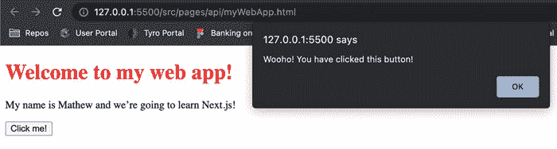

**图 1.3:** 浏览器警报
通过结合这三个构建模块，我们可以创建强大且交互式的 Web 应用程序，提供极佳的用户体验。

## 定义 Next.js

Next.js 是一个流行的用于构建服务端渲染 (SSR) 和静态站点生成 (SSG) React 应用的开源框架。Next.js 由 Vercel 开发，提供了一种直观且对开发者友好的构建 Web 应用的方法，让开发者能够专注于构建优秀的用户体验，而无需担心底层基础设施。

得益于其通用渲染能力，开发者可以使用 Next.js 构建可以在任何服务器或平台上运行的动态且高性能的 Web 应用程序。Next.js 提供了一系列功能和优势，包括：

*   服务端渲染 (SSR) 和静态站点生成 (SSG)
    Next.js 提供了强大的服务端渲染能力，允许开发者创建动态、交互式的 Web 应用，这些应用加载快速并提供极佳的用户体验。Next.js 还支持静态站点生成，允许开发者在构建时生成静态 HTML 文件，以便快速高效地提供服务。

    Next.js 包含了一系列内置工具和功能，使其易于针对性能和可用性优化您的应用程序。通过图像优化和自动代码分割等功能，Next.js 帮助确保您的应用程序对所有用户来说都是快速、高效且可访问。

*   自动代码分割和优化

*   混合方法
    通过 Next.js，您可以构建结合了服务端渲染和客户端渲染的混合应用，让您充分利用这两种方法的优点。
总的来说，Next.js 是一个强大且灵活的框架，让开发者能够快速高效地构建高质量、可扩展的 Web 应用。

*   易于设置和部署

*   社区支持和生态系统
    Next.js 拥有庞大活跃的开发者和贡献者社区，他们提供支持、分享知识并为框架的发展做出贡献。此外，Next.js 拥有健全的插件、工具和资源生态系统，可以帮助开发者构建更好、更高效的 Web 应用。

## Next.js 的用例

Next.js 适用于广泛的 Web 应用开发用例，包括：

*   电子商务应用
*   内容驱动的网站和博客
*   社交网络网站
*   渐进式 Web 应用 (PWAs)
*   使用 React Native 的移动应用


总结来说，Next.js 是一个使用 `React` 构建高质量 Web 应用的强大、灵活且易用的框架。得益于其对服务端渲染和静态站点生成的内置支持、自动代码分割和优化，以及易于部署和扩展，Next.js 是寻求构建动态、高性能且可扩展 Web 应用的开发者的理想选择。


Next.js 是一个使用 `React` 构建 Web 应用的流行框架。以下是您可能考虑在您的 Web 应用开发中使用 Next.js 的一些关键原因：

    使用 Next.js 的主要优势之一是它对 `SSR` 的内置支持。SSR 允许应用程序在发送到客户端之前在服务器上进行渲染，这可以改进初始加载时间并提供更好的 SEO。通过 Next.js，您不需要设置单独的服务器，也不需要担心管理服务端渲染过程，因为这一切都由框架自动处理。

*   自动代码分割和优化

*   易于静态站点生成
    Next.js 还提供了对 `SSG` 的内置支持，这对于构建静态网站、博客和其他内容驱动的应用非常有用。SSG 允许您在构建时生成 HTML 页面，这些页面可以直接提供给客户端，而不是在服务器上动态地生成。这可以提高应用程序的性能并减轻服务器负载。
*   易于设置和部署
    得益于对在 `Vercel` 托管的内置支持，Next.js 易于设置和部署。Vercel 提供了无缝的部署体验，使得能够轻松部署和扩展您的应用程序，而无需担心管理服务器或基础设施。

    Next.js 拥有庞大活跃的开发者和贡献者社区，他们提供支持、分享知识并为框架的发展做出贡献。这导致了许多有用插件、工具和资源的创建，帮助开发者构建更好、更高效的 Web 应用。

总结，Next.js 是一个使用 `React` 构建 Web 应用的强大且多功能的框架。凭借其对服务端渲染、自动代码分割和优化、易于静态站点生成、易于部署以及庞大活跃社区的支持，Next.js 是构建构建高质量、高性能且可扩展 Web 应用的理想选择。

*   TypeScript 支持


Next.js 还提供了对 `TypeScript` 的内置支持，它是 JavaScript 的静态类型超集，可以帮助提高代码质量并在开发过程中尽早发现错误。`TypeScript` 的支持对于大型应用或团队特别有用，在这些情况下，代码库可能会变得复杂且难以管理。

Next.js 提供了灵活的数据获取选项，可以帮助简化应用程序中获取和管理数据的过程。该框架支持服务端和客户端数据获取，还支持增量静态再生（ISR），这允许你在无需重新构建整个页面的情况下使用新数据更新静态页面。

### 可扩展与可定制

### 对 React 的内置支持

最后，Next.js 提供了对 `React` 的内置支持，这是一个用于构建用户界面流行的 JavaScript 库。`React` 以简单、高性能和灵活性而闻名，并在 Web 开发社区被广泛使用。Next.js 提供了与 `React` 的无缝集成，允许你使用熟悉且流行的工具集构建强大且动态的 Web 应用。

总之，Next.js 提供了一系列优势和特性，使其成为构建高质量、高性能和可扩展 Web 应用程序的理想选择。凭借其改进的开发者体验、`TypeScript` 支持、灵活的数据获取选项、扩展性以及对 `React` 的内置支持，Next.js 是一个强大且多功能的框架，可以帮助你构建更好、更高效的 Web 应用。

## Next.js 的 JavaScript 基础

在深入 Next.js 开发之前，对 JavaScript 基础有良好的理解是非常重要的。在本节，我们将涵盖开发 Next.js 应用所必需的一些 JavaScript 基础概念。

### 变量和数据类型

* `var`
* `let`

`var` 是 JavaScript 中声明变量的旧方式，它具有一些可能会导致问题的特性。`let` 和 `const` 是 ES6 JavaScript 中引入的，是现代 JavaScript 中声明变量的首选方式。


```javascript
// 使用 var 声明变量
var x = 10;
// 使用 let 声明变量
let y = 20;
// 使用 const 声明变量
const z = 30;
// z = 40; // 这将抛出错误
```


* number（用于数值）
* string（用于文本值）
* boolean（用于布尔值）
* null（用于空值）
* undefined（用于未定义值）
* object（用于复杂的数据结构）
这是一个示例：

```javascript
let a = 10;
// 声明字符串变量
let b = "Hello";
// 声明布尔值变量
let c = true;
// 声明 null 变量
let d = null;
let e;
// 声明对象变量
let f = { name: "Mathew" };
```

## 控制流语句

* `if…else` 语句
* `for` 循环
* `while` 循环
* `switch` 语句

以下是这些语句使用的示例：

```javascript
// If…else 语句
let age = 20;
if (age >= 18) {
  console.log("You are an adult.");
} else {
  console.log("You are not yet an adult.");
}
// 输出: You are an adult

// For 循环
for (let i = 0; i < 5; i++) {
  console.log(i);
}
// 输出: 0 1 2 3 4

// While 循环
let i = 0;
while (i < 5) {
  console.log(i);
  i++;
}
// 输出: 0 1 2 3 4

// Switch 语句
let day = "Monday";
switch (day) {
  case "Monday":
    console.log("Today is Monday.");
    break;
  case "Tuesday":
    console.log("Today is Tuesday.");
    break;
  default:
    console.log("Other day.");
    break;
}
// 输出: Today is Monday
```

## 函数

函数用于将一组语句组合在一起并执行特定任务。在 JavaScript 中，可以使用 `function` 关键字或箭头函数语法来声明函数。

这是一个示例：

```javascript
function add(x, y) {
  return x + y;
}
// 使用箭头函数语法声明函数
const subtract = (x, y) => {
  return x - y;
};
```

## 类

这是一个示例：

```javascript
class Person {
  constructor(name, age) {
    this.name = name;
    this.age = age;
  }
  sayHello() {
    console.log(`Hello, my name is ${this.name} and I am ${this.age}`);
  }
}
// 创建一个对象
const mathew = new Person("Mathew", 28);
// 调用 sayHello 方法
mathew.sayHello(); // 输出: Hello, my name is Mathew and I am 28
```

## 模块

模块用于将代码组织成可重用的部分。在 Next.js 中，我们使用模块在不同部分间共享。


```javascript
// 从文件导出函数
export function add(x, y) {
  return x + y;
}

import { add } from "./math.js";
// 调用函数
console.log(add(5, 10)); // 输出: 15
```

## Promise

`Promise` 用于处理异步操作。它们是以更具读性和预测性的方式处理回调函数的方法。

这是一个创建 `Promise` 的示例：

```javascript
const promise = new Promise((resolve, reject) => {
  // 模拟异步操作
  setTimeout(() => {
    resolve("Data successfully retrieved!");
  }, 2000);
});
// 调用 Promise
promise.then((result) => {
  console.log(result); // 输出: Data successfully retrieved!
});
```

## 箭头函数

这是一个示例：

```javascript
// 传统函数表达式
const add = function(x, y) {
  return x + y;
};
// 箭头函数表达式
const addArrow = (x, y) => x + y;
```

## 解构

解构是从对象或数组中提取值并将其赋值给变量的方法。它是赋值的简写方式，可以让代码更简洁。

这是一个示例：

```javascript
const [first, second, third] = [1, 2, 3];
console.log(first); // 输出: 1

const person = {
  name: "Mathew",
  age: 28
};
const { name, age } = person;
console.log(name); // 输出: "Mathew"
```

## 展开运算符

展开运算符是将数组或对象展开为独立元素的方法。它可以用于将多个数组或对象合并为一个数组或对象。

```javascript
// 使用展开运算符合并数组
const arr1 = [1, 2, 3];
const arr2 = [4, 5, 6];
const combined = [...arr1, ...arr2];
console.log(combined); // Output: [1, 2, 3, 4, 5, 6]

// 使用展开运算符拷贝对象
const obj = {
  name: "Mathew",
  age: 28
};
const copy = { ...obj };
console.log(copy); // Output: { name: "Mathew", age: 28 }
```

## Async/await

`Async/await` 是 JavaScript 中一个较新的特性，简化了 `Promise` 的操作。它允许你编写看起来和运行像同步的异步代码，使其更容易阅读和调试。


```javascript
// 使用 async/await 处理 Promise
async function getData() {
  const response = await fetch('https://api.example.com/data');
  const data = await response.json();
  return data;
}
// 调用异步函数
const data = await getData();
console.log(data);
```

## 模板字符串 (Template literals)

以下是一个示例：

```javascript
// 使用模板字符串插值变量
const name = "Mathew";
const message = `Hello, ${name}!`;
```

## 面向对象编程 (OOP)

面向对象编程是一种使用对象来表示现实实体编程范式。是将代码组织成可重用、模块化组件的方法。

以下是一个示例：

```javascript
// 使用 OOP 创建类
class Animal {
  constructor(name, species) {
    this.name = name;
    this.species = species;
  }
  speak() {
    console.log(`${this.name} says hello!`);
  }
}
const dog = new Animal("Dottie", "Dog");
// 调用 speak 方法
dog.speak(); // Output: "Dottie says hello!"
```

通过理解这些额外的 JavaScript 概念，你将能够在 Next.js Web 应用程序中编写更强大、更灵活的代码。在接下来的章节中，我们将探索如何将这些概念具体应用于使用 Next.js 构建全栈 Web 应用程序。

在用 Next.js 构建 Web 应用时，理解 SSR 和 CSR 之间的区别非常重要。这两种方法各有优劣，根据你的用例选择正确的方法非常关键。

SSR 是渲染网页的传统方式。通过 SSR，服务器会响应请求向客户端发送一个完全渲染好的 HTML 页面。这意味着客户端只需要下载并显示该页面，而不需要进行任何额外的渲染或数据获取。

以下是在 Next.js 中使用 SSR 的示例：

```javascript
// 一个使用 SSR 的简单 Next.js 页面
function HomePage({ data }) {
  return (
    <div>
      <h1>Hello, {data.name}</h1>
      <p>{data.description}</p>
    </div>
  );
}

export async function getServerSideProps() {
  // 从外部 API 获取数据
  const response = await fetch('https://api.example.com/data');
  const data = await response.json();
  // 将数据作为 props 传递给页面组件
  return { props: { data } };
}

export default HomePage;
```


CSR 是一种渲染网页的更现代的方法。通过 CSR，客户端下载一个极简的 HTML 页面，然后使用 JavaScript 在客户端获取数据并渲染页面。


以下是在 Next.js 中使用 CSR 的示例：

```javascript
// 一个使用 CSR 的简单 Next.js 页面
import { useState, useEffect } from 'react';

function HomePage() {
  const [data, setData] = useState(null);
  // 从外部 API 获取数据
  async function fetchData() {
    const response = await fetch('https://api.example.com/data');
    const data = await response.json();
    setData(data);
  }
  useEffect(() => {
    fetchData();
  }, []);

  if (!data) {
    return <div>Loading…</div>;
  }

  return (
    <div>
      <h1>Hello, {data.name}</h1>
      <p>{data.description}</p>
    </div>
  );
}

export default HomePage;
```

除了 SSR 和 CSR 之外，Next.js 还支持混合渲染，这是这两种方法的结合。通过混合渲染，你可以在服务器上获取数据并向客户端发送一个部分渲染的页面，然后在客户端继续渲染。

以下是在 Next.js 中使用混合渲染的示例：

```javascript
// 一个使用混合渲染的简单 Next.js 页面
import { useState, useEffect } from 'react';

function HomePage({ data }) {
  const [dynamicData, setDynamicData] = useState(null);

  // 在客户端获取动态数据
  async function fetchDynamicData() {
    const response = await fetch('https://api.example.com/dynamic-data');
    const dynamicData = await response.json();
    setDynamicData(dynamicData);
  }

  useEffect(() => {
    fetchDynamicData();
  }, []);

  return (
    <div>
      <h1>Hello, {data.name}</h1>
      <p>{data.description}</p>
      {dynamicData && <p>{dynamicData.message}</p>}
    </div>
  );
}

export async function getServerSideProps() {
  // 从外部 API 获取静态数据
  const response = await fetch('https://api.example.com/static-data');
  const staticData = await response.json();
  // 将静态数据作为 props 传递给页面组件
  return { props: { data: staticData } };
}

export default HomePage;
```

### 第 1 步：安装 Node.js 和 npm


你可以从官方网站 [`nodejs.org`](https://nodejs.org) 下载并安装 Node.js。请根据你的操作系统选择合适的版本并下载。下载完成后，按照安装说明安装 Node.js。


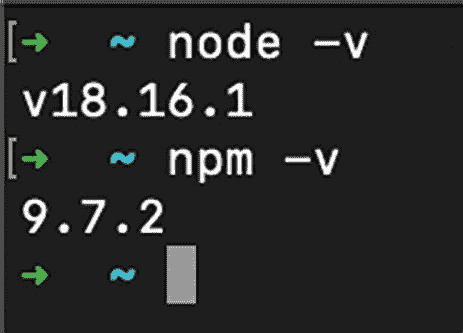


这些命令将输出你在系统中安装的 Node.js 和 `npm` 的版本。

```bash
node -v
npm -v
```

安装好 Node.js 和 `npm` 后，你可以使用 `create-next-app` 命令行工具创建一个新的 Next.js 项目。该工具会创建一个包含所有必要依赖和配置文件的新 Next.js 项目。


```bash
npx create-next-app@latest my-app
```

运行命令后，系统将提示以下问题：

`Would you like to use TypeScript? No / Yes`

`Would you like to use ESLint? No / Yes`

`Would you like to use Tailwind CSS? No / Yes`

`Would you like to use App Router? (recommended) No / Yes`

`Would you like to customize the default import alias? No / Yes`

`What import alias would you like configured? @/*`

该命令会向你询问一些问题以引导项目，并在名为 `my-app` 的目录中创建一个新的 Next.js 项目。在示例中，我们决定使用 TypeScript 代替 JavaScript。

### 第 3 步：启动开发服务器

创建新的 Next.js 项目后，你可以使用 `npm run dev` 命令启动开发服务器。该命令会启动一个本地开发服务器，允许你在浏览器中预览你的 Next.js 应用。

要启动开发服务器，请进入项目目录并在终端中运行以下命令：

```bash
cd my-app
npm run dev
```

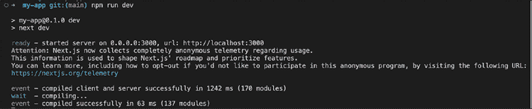


这将会在 `http://localhost:3000` 启动开发服务器。你可以在浏览器中打开此 URL 来查看你的 Next.js 应用。


**图 1.6：** Next.js 本地服务器启动页


根据你的 Next.js 应用的需求，你可能需要安装额外的依赖项。你可以使用 `npm install` 命令来实现。


```bash
npm install axios
```

这将安装 `axios` 库并将其添加到项目的 `package.json` 文件中。

## 创建一个简单的 Next.js 应用

### 设置新的 Next.js 项目

安装完成后，进入项目目录：

```bash
cd my-app
```

### 理解 Next.js 项目的结构


```text
my-app/
├── .next/
├── node_modules/
├── public/
├── src/
│   ├── pages/
│   └── styles/
├── package.json
```

`.next` 目录是由 Next.js 生成的，包含了应用程序的构建文件。`node_modules` 目录包含由 `npm` 安装的所有依赖项。`pages` 目录包含了应用程序的所有页面。`public` 目录包含了所有静态资源，如图像、视频和字体。`styles` 目录包含了应用程序中所有的 CSS 样式表。`package.json` 文件包含了关于项目的元数据以及使用的依赖项。

现在我们已经对 Next.js 项目的结构有了基本的了解，让我们创建第一个页面。

### 创建一个简单的“Hello World”应用

在 Next.js 中，页面是一个 React 组件，并作为 `pages` 目录中文件的默认导出（default export）。为了创建一个简单的 **Hello World** 应用，让我们替换 `pages/index.tsx` 中的代码：

```tsx
function Home() {
  return <h1>Hello World</h1>;
}

export default Home;
```


现在，如果你运行以下命令启动开发服务器：

```bash
npm run dev
```

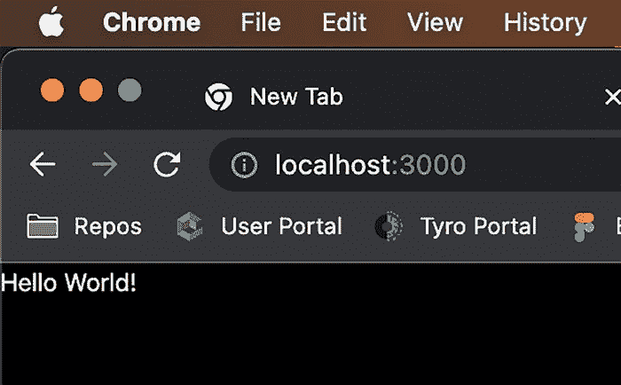

最后，你成功创建了一个简单的 Next.js 应用！

在本章中，我们学习了 Web 应用，理解了 Next.js 的基本原理、优势以及 HTML、CSS 和 JavaScript 的基本功能。我们还探索了如何在本地运行 Next.js Web 应用。

# 第 2 章：回顾 React

React 是一个用于构建界面的强大 JavaScript 库。在本章中，我们将回顾 React 的核心概念，这些概念对于构建健壮的 Web 应用至关重要。

接下来，我们将深入探讨 React 中重要的 props 和 state 概念。我们将解释 props 如何在组件之间传递数据，而 state 则用于管理组件内部随时间变化的数据。我们将涵盖处理 props 和 state 的最佳实践，以及如何使用它们构建复杂且交互式的界面。

在本章结束时，你将对 React 的核心概念有深入的理解，并准备好使用这个强大的库构建健壮且高性能的 Web 应用。

## 结构

在本章中，将涵盖以下主题：

*   React 框架简介，包括虚拟 DOM 和组件化架构

*   JSX 语法及其与传统 HTML 的区别

*   React 中的事件处理以及组件间的数据传递

*   React state 和 props 的使用，包括组件间的数据流

*   JavaScript 异步编程的基本概念以及如何在 React 中使用它们

## 介绍 React

什么是 React？它为什么重要？React 是一个流行的 JavaScript 库，由 Meta（以前称为 Facebook）开发和维护，用于构建用户界面，特别是 Web 应用。它的创建是为了解决需要更高效、更可扩展的方式来处理复杂用户界面，同时提供卓越性能的需求。多年来，React 赢得了巨大的人气，因为它允许开发者构建既易于维护又扩展的可重用、模块化组件。

React 如此受欢迎的主要原因之一是它对简单性和维护性的关注。通过将用户界面拆分为小的、自包含的组件，它让开发者能够轻松理解和修改代码，即使在大型应用中也是如此。此外，React 的性能优化（如虚拟 DOM）确保了用 React 构建的应用是快速且响应迅速的。

## 虚拟 DOM 及其优势

虚拟 DOM 是 React 的核心特性之一，也是它卓越性能的主要原因。虚拟 DOM 是实际 DOM（文档对象模型）的轻量级内存表示，用于跟踪 UI 的变化。当发生变化时，React 会更新虚拟 DOM 而不是实际 DOM，后者可能是一个缓慢且耗资源的操作。

React 使用一种称为“协调”（reconciliation）的过程将当前的虚拟 DOM 与由于组件状态或 props 变化产生的新 DOM 进行比较。然后，它会计算出更新实际 DOM 的有效方式以匹配新的虚拟 DOM。这个过程减少了实际 DOM 更新的次数，从而显著提高了性能。

考虑以下示例：

```javascript
import React, { useState } from "react";

function Counter() {
  const [count, setCount] = useState(0);
  return (
    <div>
      <p>Count: {count}</p>
      <button onClick={() => setCount(count + 1)}>Click me</button>
    </div>
  );
}

export default Counter;
```

在这个简单的计数组件中，每当点击按钮时状态都会更新。React 使用虚拟 DOM 来确定实际 DOM 所需的最少更新，确保最优性能。

## React 中的组件化架构

React 的组件化架构是其受欢迎和可维护性的重要因素。组件是自包含的、可重用的代码片段，代表用户界面的一部分。它们可以组合并嵌套以创建复杂的 UI 结构。

React 组件化架构背后有两个主要原则如下：

*   **单一职责原则**：每个组件都应该有一个单一的职责或目的。这使得代码更容易理解、测试和维护。

*   **组合**：组件可以组合在一起以构建更复杂的 UI 结构。这允许开发者复用组件并创建更具维护性的代码。

```javascript
import React from "react";
import Header from "./Header";
import Content from "./Content";
import Footer from "./Footer";

function App() {
  return (
    <div>
      <Header />
      <Content />
      <Footer />
    </div>
  );
}

export default App;
```

在这个示例中，`App` 组件由其他三个组件组成：`Header`、`Content` 和 `Footer`。这些组件中的每个都有自己的职责，使得整个应用程序更容易维护和理解。

## 理解函数组件和类组件

React 组件可以写成函数组件或类组件。在 React 16.8 引入 Hooks 之前，函数组件是无状态的，仅用于展示数据，而类组件是有状态的，并用于更复杂的逻辑。然而，随着 Hooks 的引入，函数组件现在可以拥有状态并执行副作用，使得它们变得更加强大和灵活。

函数组件比类组件更简单、更简洁，是许多开发者的首选。它们仅仅是 JavaScript 函数，接收 `props` 作为输入并返回 JSX 来渲染 UI。

这里是一个函数组件的示例：

```javascript
function Welcome(props) {
  return <h1>Hello, {props.name}!</h1>;
}
```

相比之下，类组件是继承自 `React.Component` 类的 JavaScript 类。它们有一个 `render()` 方法返回 JSX，并可以拥有本地状态和生命周期方法。

这里是一个类组件的示例：

```javascript
import React, { Component } from 'react';

class Welcome extends Component {
  render() {
    return <h1>Hello, {this.props.name}!</h1>;
  }
}

export default Welcome;
```

虽然 React 仍然支持类组件，但 Hooks 的引入让函数组件变得更加强大和多功能。为了阐明在函数组件中使用 Hooks，让我们把之前的类组件示例转换为一个带有状态的函数组件：

```javascript
import React, { useState } from 'react';

function Welcome() {
  const [name, setName] = useState("John");
  const handleChange = (event) => {
    setName(event.target.value);
  };
  return (
    <div>
      <h1>Hello, {name}!</h1>
      <input type="text" value={name} onChange={handleChange} />
    </div>
  );
}

export default Welcome;
```

## React 组件生命周期方法及其用法

*   **生命周期方法概述**：

    生命周期方法是类组件中的特殊方法，允许你在组件生命周期特定点运行代码。它们对于管理副作用（如获取数据、更新 DOM 和处理事件）至关重要。生命周期方法可以分为三个主要阶段：挂载（mounting）、更新（updating）和卸载（unmounting）。

    **注意**：随着 Hooks 的引入，函数组件可以使用 `useEffect` 执行类似的任务。本节重点关注类组件的生命周期方法，但了解函数组件中的这种替代方法也是重要的。

*   **挂载阶段方法**

*   `constructor`：构造函数用于初始化组件的状态并绑定事件处理器。它在组件挂载之前调用。

```javascript
class MyComponent extends React.Component {
  constructor(props) {
    super(props);
    this.state = { message: "Hello, World!" };
    this.handleClick = this.handleClick.bind(this);
  }
}
```

*   `componentDidMount`：该方法在组件挂载到 DOM 后立即调用。它是执行副作用（如获取数据、设置订阅或手动操作 DOM）的理想位置。

  这是一个示例：

```javascript
class MyComponent extends React.Component {
  componentDidMount() {
    console.log("Component has been mounted.");
  }
}
```

*   **更新阶段方法**

更新阶段（Updating phase）发生在组件的状态或 props 发生变化导致重新渲染时。与此阶段相关的生命周期方法有两个：

*   `shouldComponentUpdate`：该方法在重新渲染之前调用。它允许你通过返回 `false` 来阻止不必要的重新渲染，从而优化性能。

  这是一个示例：

```javascript
class MyComponent extends React.Component {
  shouldComponentUpdate(nextProps, nextState) {
    return this.props.someValue !== nextProps.someValue;
  }
}
```

*   `componentDidUpdate`：该方法在组件更新并重新渲染到 DOM 后立即调用。它适用于在更新后执行副作用，例如基于 prop 变化获取新数据。

  这是一个示例：

```javascript
class MyComponent extends React.Component {
  componentDidUpdate(prevProps, prevState) {
    if (this.props.someValue !== prevProps.someValue) {
      console.log("Props changed!");
    }
  }
}
```

### 卸载阶段方法 (Unmounting phase methods)

*   `componentWillUnmount`：该方法在组件卸载和销毁之前立即调用。它是执行清理任务的完美位置，例如取消网络请求、移除事件监听或清除定时器。

```javascript
class MyComponent extends React.Component {
  componentWillUnmount() {
    console.log("Component will unmount.");
  }
}
```

### 生命周期方法中的错误处理 (Error handling in lifecycle methods)


*   `static getDerivedStateFromError`：该方法在子组件抛出错误时调用。它允许你更新状态以显示备用 UI。


```javascript
class MyComponent extends React.Component {
  static getDerivedStateFromError(error) {
    return { hasError: true };
  }
}
```

*   `componentDidCatch`：该方法在子组件捕获到错误时调用。它可以记录错误或执行其他副作用。

```javascript
class MyComponent extends React.Component {
  componentDidCatch(error, info) {
    console.log("Error caught:", error, info);
  }
}
```

  这是一个在组件中使用两种错误处理方法的示例：

```javascript
class ErrorBoundary extends React.Component {
  constructor(props) {
    super(props);
    this.state = { hasError: false };
  }
  static getDerivedStateFromError(error) {
    return { hasError: true };
  }
  componentDidCatch(error, info) {
    console.log("Error caught:", error, info);
  }
  render() {
    if (this.state.hasError) {
      return <h1>Something went wrong!</h1>;
    }
    return this.props.children;
  }
}

// 使用示例
<ErrorBoundary>
  <MyComponent />
</ErrorBoundary>
```

在这个示例中，`ErrorBoundary` 是一个封装了 `MyComponent` 的高阶组件。如果 `MyComponent` 抛出错误，错误边界将捕获它并显示备用 UI。


*   使用 `constructor` 初始化状态并绑定事件处理器。避免在构造函数中执行副作用。
*   使用 `componentDidMount` 获取数据、设置订阅或执行组件首次挂载时应该发生的的副作用。
*   使用 `componentDidUpdate` 处理 prop 或状态变化后发生的副作用。
*   使用 `componentWillUnmount` 执行清理任务，例如取消网络请求或移除事件监听。
*   使用 `getDerivedStateFromError` 和 `componentDidCatch` 处理子组件中的错误。


## 在 JSX 中处理条件渲染和循环

条件渲染和循环是 React 组件中的常见任务。你可以按照如下方式在 JSX 中使用 JavaScript 表达式来处理这些任务：
- 对于条件渲染，使用三元运算符或逻辑与 `&&` 表达式：

```javascript
function MyComponent(props) {
  return (
    <div>
      {props.isLoggedIn ? (
        <h1>欢迎回来！</h1>
      ) : (
        <h1>请登录。</h1>
      )}
    </div>
  );
}
```
- 对于循环，使用 `map` 方法遍历数组并渲染元素：

```javascript
function ItemList(props) {
  const items = props.items;
  return (
    <ul>
      {items.map((item) => (
        <li key={item.id}>{item.name}</li>
      ))}
    </ul>
  );
}
```


虽然 JSX 看起来与 HTML 相似，但它们之间存在一些关键区别：


- **Style 属性**：在 JSX 中，`style` 属性期望一个 JavaScript 对象而不是 CSS 字符串。每个 CSS 属性应该用驼峰命名法编写。

```javascript
function MyComponent() {
  const divStyle = {
    color: "blue",
    fontSize: "24px"
  };
  return <div style={divStyle}>Hello, World!</div>;
}
```

- **关闭标签**：在 JSX 中，所有标签必须关闭，即使它们没有子元素。与 HTML 不同，HTML 中的某些标签（如 `` 和 `<input>`）不需要关闭标签。在 JSX 中，这些元素应该是自闭合的，在结束右括号前加一个斜杠（例如 `` 和 `<input />`）。

```javascript
// 正确
function MyComponent() {
  return (
    <div>
      
      <input type="text" name="username" />
    </div>
  );
}

// 错误
function MyComponentWrong() {
  return (
    <div>
      
    </div>
  );
}
```

- **JavaScript 表达式**：JSX 允许你使用大括号 `{}` 嵌入 JavaScript 表达式。这一功能在 HTML 中是不存在的，在 HTML 中，你必须使用模板字符串或其他机制来实现类似的功能。


总结，JSX 是 JavaScript 的一种强大且灵活的语法扩展，允许你在 JavaScript 代码中编写类 HTML 的代码。通过理解它的语法规则、最佳实践以及与传统 HTML 的区别，你可以有效地使用 JSX 创建整洁且易于维护的 React 组件。凭借嵌入 JavaScript 表达式、条件渲染内容和循环数组的能力，JSX 简化了构建复杂动态用户界面的的过程。


本节将解释如何在 React 中管理事件以及将数据传递给组件。


在 React 中处理事件与在原生 JavaScript 中处理事件类似。然而，在 React 中处理事件时，需要注意一些区别和最佳实践，包括：


- **事件处理器**：你需要传递一个函数作为事件处理器，而不是字符串。该函数会在事件触发时被调用。


```javascript
function handleClick() {
  console.log("Clicked!");
}

function MyComponent() {
  return <button onClick={handleClick}>点击我</button>;
}
```


React 使用了一种名为合成事件（Synthetic Events）的概念，它是原生浏览器事件的封装。这为跨浏览器处理事件提供了一致的接口，并通过事件池提升了性能。你可以通过合成事件对象的 `nativeEvent` 属性访问原生事件。


```javascript
function handleClick(event) {
  console.log("Native event:", event.nativeEvent);
}

function MyComponent() {
  return <button onClick={handleClick}>点击我</button>;
}
```


当使用类组件时，必须将事件处理器绑定到组件实例上，以便正确访问 `this`。有以下几种绑定事件处理器的方法：

```javascript
class MyComponent extends React.Component {
  constructor(props) {
    super(props);
    this.handleClick = this.handleClick.bind(this);
  }

  handleClick() {
    console.log("Clicked!");
  }

  render() {
    return <button onClick={this.handleClick}>点击我</button>;
  }
}
```

```javascript
class MyComponent extends React.Component {
  handleClick = () => {
    console.log("Clicked!");
  };

  render() {
    return <button onClick={this.handleClick}>点击我</button>;
  }
}
```

```javascript
class MyComponent extends React.Component {
  handleClick() {
    console.log("Clicked!");
  }

  render() {
    return <button onClick={() => this.handleClick()}>点击我</button>;
  }
}
```


Props 是 React 中组件间传递数据的机制。它们允许你从父组件将值传递给子组件，并根据数据渲染子组件。


```javascript
function Greeting(props) {
  return <h1>Hello, {props.name}!</h1>;
}

function App() {
  return <Greeting name="John" />;
}
```


为了从子组件通信回父组件，你可以传递回调函数作为 prop。子组件可以在事件发生（如点击按钮）时调用该函数。


```javascript
class ParentComponent extends React.Component {
  handleChildClick = (name) => {
    console.log("子组件按钮被点击:", name);
  }

  render() {
    return <ChildComponent onClick={this.handleChildClick} />;
  }
}

function ChildComponent(props) {
  return <button onClick={() => props.onClick("Child")}>点击我</button>;
}
```

## 提升状态与管理共享状态

当多个组件需要共享并修改相同的数据时，最佳实践是将状态提升到最近的祖先。这意味着将状态管理移动到更高层次的组件，然后通过 props 将数据向下传递给子组件。
这是一个示例：

```javascript
class App extends React.Component {
  constructor(props) {
    super(props);
    this.state = { counter: 0 };
  }

  incrementCounter() {
    this.setState((prevState) => ({ counter: prevState.counter + 1 }));
  }

  render() {
    return (
      <>
        <CounterDisplay count={this.state.counter} />
        <CounterButton onClick={this.incrementCounter} />
      </>
    );
  }
}

function CounterDisplay(props) {
  return <p>Count: {props.count}</p>;
}

function CounterButton(props) {
  return <button onClick={props.onClick}>Increment</button>;
}
```


总而言之，在 React 中处理事件和在组件之间传递数据是构建动态用户界面的基础方面。通过理解 React 事件处理基础、合成事件（synthetic events）和事件绑定，你可以有效地在组件中处理用户交互。此外，学习通过 props 传递数据以及使用回调函数进行父子组件通信，能够让你构建出复杂且可维护的应用程序。最后，状态提升（lifting state up）和管理共享状态有助于你高效地管理需要多个组件访问和修改的数据。


让我们开始学习 React 的状态（state）和 props，包括组件之间的数据流：


React 组件中的状态（state）是存储和管理随时间变化的数据的一种。与只读且从父组件传递的 `props` 不同，状态在组件内部是本地且可变的。可以使用 `useState` Hook 创建有状态的函数组件。


要在函数组件中初始化状态，可以使用 `useState` Hook。它接受一个初始值作为参数，并返回一个包含两个元素的数组：当前状态值和一个更新状态的函数。你可以使用数组解构将返回的元素赋值给变量：

```javascript
import React, { useState } from 'react';

function Counter() {
  const [count, setCount] = useState(0);
  function increment() {
    setCount(count + 1);
  }
  return (
    <div>
      <p>Count: {count}</p>
      <button onClick={increment}>Increment</button>
    </div>
  );
}
```

### 处理状态不可变性和最佳实践

React 中的状态应该被视为不可变的（immutable）。这意味着，你不应该直接修改当前状态，而应该创建一个带有更新数据的新状态对象。这种做法有助于防止错误并优化性能，因为 React 可以高效地比较新旧状态对象以确定是否需要重新渲染。

当根据当前状态更新状态时，请通过向状态更新器传递函数来使用函数更新：

```javascript
function increment() {
  setCount((prevCount) => prevCount + 1);
}
```

### Props 及其在组件通信中的作用

如前所述，`props` 是 React 中组件之间传递数据的主要方式。`props` 是只读的，允许父组件将值传递给子组件。子组件随后可以通过其 `props` 对象访问传递的数据：

```javascript
function Greeting({ name }) {
  return <h1>Hello, {name}!</h1>;
}

function App() {
  return <Greeting name="John" />;
}
```

### 使用 PropTypes 验证 props

`PropTypes` 是一个库，允许你为组件指定预期的 `props` 类型。它是捕获错误和记录组件预期 `prop` 类型的有用工具。要使用 `PropTypes`，你需要导入该库并在组件上定义预期的 `prop` 类型：

```javascript
import PropTypes from 'prop-types';

function Greeting({ name }) {
  return <h1>Hello, {name}!</h1>;
}

Greeting.propTypes = {
  name: PropTypes.string.isRequired
};

export default Greeting;
```

### 使用 Context API 管理状态和数据流


要使用 `Context API`，你需要使用 `React.createContext()` 创建上下文，并用上下文提供者（provider）包裹你的组件树。提供者接收一个 `value` 属性，它可以是你任何想要跨越组件树共享的数据：

```javascript
import React, { useState, useContext } from 'react';

const ThemeContext = React.createContext();

function App() {
  const [theme, setTheme] = useState('light');
  return (
    <ThemeContext.Provider value={{ theme, setTheme }}>
      <Toolbar />
    </ThemeContext.Provider>
  );
}

function Toolbar() {
  return <ThemeSwitch />;
}

function ThemeSwitch() {
  const { theme, setTheme } = useContext(ThemeContext);
  function toggleTheme() {
    setTheme(theme === 'light' ? 'dark' : 'light');
  }
  return (
    <button onClick={toggleTheme}>
      Switch to {theme === 'light' ? 'dark' : 'light'}
    </button>
  );
}
```

在这个示例中，`App` 组件初始化主题状态并将其提供给 `ThemeContext`。嵌套在 `Toolbar` 之中的 `ThemeSwitch` 组件可以使用 `useContext` 访问并更新主题。


什么是 React Hooks？为什么要使用它们？Hooks 是 React 16.8 中引入的一组函数，允许你在函数组件中使用状态和其他 React 特性。Hooks 为在函数组件中管理状态和副作用（side effects）提供了一种更直接的方式。


`useState` Hook 允许你为函数组件添加状态。它接受一个初始状态作为参数，并返回一个包含两个元素的数组：当前状态和一个更新状态的函数。


`useEffect` Hook 允许你在函数组件中执行副作用，例如获取数据或更新 DOM。它接受两个参数：一个包含副作用的函数和一个可选的依赖项数组。默认情况下，副作用函数会在每次渲染后运行，但你可以通过提供依赖项数组来控制它的运行时机。


```javascript
import React, { useState, useEffect } from 'react';

function UserProfile({ userId }) {
  const [user, setUser] = useState(null);

  useEffect(() => {
    async function fetchUser() {
      const response = await fetch(`https://api.example.com/users/${userId}`);
      const userData = await response.json();
      setUser(userData);
    }
    fetchUser();
  }, [userId]);

  return (
    <div>
      {user ? (
        <div>
          <h1>{user.name}</h1>
          <p>{user.email}</p>
        </div>
      ) : (
        <p>Loading…</p>
      )}
    </div>
  );
}
```

### 实现用于复用逻辑的自定义 Hooks


```javascript
import { useState, useEffect } from 'react';

function useFetch(url) {
  const [data, setData] = useState(null);
  const [loading, setLoading] = useState(true);

  useEffect(() => {
    async function fetchData() {
      const response = await fetch(url);
      const jsonData = await response.json();
      setData(jsonData);
      setLoading(false);
    }
    fetchData();
  }, [url]);

  return { data, loading };
}

function App() {
  const { data, loading } = useFetch('https://api.example.com/data');
  return (
    <div>
      {loading ? <p>Loading…</p> : <p>Data: {JSON.stringify(data)}</p>}
    </div>
  );
}
```


`useContext` 和 `useReducer` Hooks 可以结合使用，创建类似于 Redux 的高级状态管理模式。`useContext` Hook 允许你访问组件树上最接近的上下文值，而 `useReducer` Hook 则使用 reducer 函数管理复杂的状态转换：

```javascript
import React, { createContext, useReducer, useContext } from 'react';

const initialState = { count: 0 };

function reducer(state, action) {
  switch (action.type) {
    case 'increment':
      return { count: state.count + 1 };
    case 'decrement':
      return { count: state.count - 1 };
    default:
      throw new Error(`Unknown action type: ${action.type}`);
  }
}

const CounterContext = createContext();

function CounterProvider({ children }) {
  const [state, dispatch] = useReducer(reducer, initialState);
  return (
    <CounterContext.Provider value={{ state, dispatch }}>
      {children}
    </CounterContext.Provider>
  );
}

function Counter() {
  const { state, dispatch } = useContext(CounterContext);
  return (
    <div>
      <p>Count: {state.count}</p>
      <button onClick={() => dispatch({ type: 'increment' })}>
        增加
      </button>
      <button onClick={() => dispatch({ type: 'decrement' })}>
        减少
      </button>
    </div>
  );
}

function App() {
  return (
    <CounterProvider>
      <Counter />
    </CounterProvider>
  );
}
```

## 其他内置 Hooks 及其用例

React 提供了其他几个内置 Hooks，每个 都有特定的用例：

*   `useMemo`：通过记忆化一个值来优化性能，该值仅在其依赖项变化时才会重新计算。在处理计算密集型函数或对象时，此 Hook 非常有用。

*   `useCallback`：与 `useMemo` 类似，但用于函数的记忆化。它返回回调函数的记忆化版本，只有当依赖项之一发生变化时，该函数才会改变。

*   `useRef`：创建一个可变的 ref 对象，可以用于跨越渲染存储值，而不会触发重新渲染。常见的用例包括引用 DOM 元素和存储之前的状态。

总之，React Hooks 为函数式组件提供了一种强大且简单的方式来管理状态、副作用以及 React 特性。内置 Hooks（如 `useState`、`useEffect`、`useContext` 和 `useReducer`）涵盖了广泛的用例，而自定义 Hooks 则允许在组件间创建可复用的逻辑。可以使用 `useContext` 和 `useReducer` 实现高级状态管理模式，而其他内置 Hooks 如 `useMemo`、`useCallback`、`useRef` 和 `useLayoutEffect` 为各种场景提供了额外功能。

异步编程是一种允许任务并发运行而不阻塞界面的范式。JavaScript 是单线程的，这意味着一次只能执行一个操作。

回调函数作为参数传递给其他函数，并在稍后执行。它们处理异步代码的最基础的形式：

```javascript
function getData(callback) {
  setTimeout(() => {
    const data = 'Sample data';
    callback(data);
  }, 1000);
}

getData((data) => {
  console.log(data);
});
```
然而，回调会导致回调地狱（callback hell）。
### Promises 和链式调用

`Promises` 是处理异步代码的一种更高级的方法。Promise 代表一个未来可能可用的值。Promise 有三种状态：等待中（pending）、已完成（fulfilled）或拒绝（rejected）。你可以使用 `then` 方法在 Promise 完成时附加回调函数，或使用 `catch` 方法来处理错误：

```javascript
function getData() {
  return new Promise((resolve, reject) => {
    setTimeout(() => {
      const data = 'Sample data';
      resolve(data);
    }, 1000);
  });
}

getData().then((data) => {
  console.log(data);
});
```
Promises 可以链式调用，使得代码更具读性和可维护性。


`Async/await` 是一种现代语法，使得处理异步代码更加简单。`async` 函数返回一个 Promise，`await` 关键字用于暂停函数执行直到 Promise 解析：

```javascript
async function fetchData() {
  const response = await fetch('https://api.example.com/data');
  const data = await response.json();
  return data;
}
fetchData();
```

### 将异步代码集成到 React 组件中

要在 React 函数式组件中集成异步代码，你可以使用 `useEffect` Hook 来获取数据或执行其他副作用：

```javascript
import React, { useState, useEffect } from 'react';

function DataDisplay() {
  const [data, setData] = useState(null);

  useEffect(() => {
    async function fetchData() {
      const response = await fetch('https://api.example.com/data');
      const jsonData = await response.json();
      setData(jsonData);
    }
    fetchData();
  }, []);

  return <div>{data ? <p>{JSON.stringify(data)}</p> : <p>Loading…</p>}</div>;
}
```

```javascript
import React, { useState, useEffect } from 'react';

function DataDisplay() {
  const [data, setData] = useState(null);
  const [error, setError] = useState(null);

  useEffect(() => {
    async function fetchData() {
      try {
        const response = await fetch('https://api.example.com/data');
        const jsonData = await response.json();
        setData(jsonData);
      } catch (err) {
        setError(err);
      }
    }
    fetchData();
  }, []);

  if (error) return <p>Error: {error.message}</p>;
  return <div>{data ? <p>{JSON.stringify(data)}</p> : <p>Loading…</p>}</div>;
}
```

异步编程对于在 JavaScript 和 React 中创建响应且高效的应用至关重要。从回调到 Promises 再到 `async/await` 语法，JavaScript 提供了多种管理异步代码的方法。在 React 中，`useEffect` Hook 允许在函数组件中无缝集成异步操作。适当的错误处理（例如使用 `try/catch` 块）可以确保在处理真实世界场景时提供更好的用户体验。通过理解并应用这些概念，你可以创建更健壮、性能更好的 React 应用，并优雅地处理异步操作。

## 结论

React 为构建现代 Web 应用提供了一个强大且灵活的框架。在过去的章节中，我们探索了 React 的核心概念，从基于组件的架构、JSX 语法和状态管理，到事件处理、生命周期方法和 Hooks。此外，我们深入研究了异步编程技术以创建更具响应的应用。通过理解这些基础概念并应用最佳实践，你可以充分利用 React 的潜力，开发出高效、可维护且可扩展 Web 应用。

在接下来的章节 *Next.js 基础* 中，你将接触 Next.js 框架及其主要优势。我们将引导你完成环境搭建、安装 Next.js、创建一个新的 Next.js 项目，并理解其文件夹结构。你将学习页面在 Next.js 中的核心作用，以及如何创建和渲染基础页面。最后，我们将探索如何使用 CSS Modules 实现 CSS 样式，这是管理组件样式的强大功能。本章结束时，你将掌握开始构建自己的健壮且可扩展的 Next.js 应用所需的坚实知识。

## 多选题

1. React 中虚拟 DOM 的主要目的是什么？

    1. 通过减少直接 DOM 操作来提高性能
    2. 启用异步编程
    3. 管理组件状态
    4. 完全替换真实 DOM

2. React 中有两种种类型的组件？

    1. 类组件和函数组件
    2. 函数组件和类组件
    3. 有状态组件和无状态组件
    4. 父组件和子组件

3. JSX 和 HTML 的主要区别是什么？

    1. JSX 是标记语言，而 HTML 是编程语言
    2. JSX 允许嵌入 JavaScript 表达式，而 HTML 不允许
    3. JSX 仅用于 React Native
    4. JSX 需要单独的文件来处理 CSS，而 HTML 不需要

4. React Hooks 的主要目的是什么？

    1. 允许在函数组件中使用状态和副作用
    2. 通过减少直接 DOM 操作来提高性能
    3. 简化 JavaScript 代码的语法
    4. 允许使用类组件

5. 哪个 React Hook 用于在函数组件中执行副作用？

    1. `useState`
    2. `useEffect`
    3. `useContext`
    4. `useReducer`

6. 使用 `async/await` 语法相比 Promises 的主要优势是什么？

    1. 它比 Promises 运行得更快
    2. 使异步代码更容易读和写
    3. 允许在函数组件中使用状态
    4. 消除了对错误处理的需要

7. 在哪个 React Hook 中使用了 context？

    1. `useState`
    2. `useEffect`
    3. `useContext`
    4. `useReducer`

8. props 在 React 中的主要作用是什么？

    1. 管理组件内部状态
    2. 允许在组件内部状态
    3. 在组件之间传递数据
    4. 定义结构

9. 哪个生命周期方法只在组件挂载时被调用？

    1. `componentDidMount`
    2. `componentDidUpdate`
    3. `componentWillUnmount`
    4. `componentCatch`

10. 下哪一个不是有效的 Promise 状态名称？

    1. Pending（等待中）
    2. Fulfilled（已完成）
    3. Rejected（已拒绝）
    4. Completed（已完成）

## 答案

1. A
2. B
3. B
4. A
5. B
6. B
7. C
8. C
9. A
10. D

# 第 3 章：Next.js 基础

在本章中，我们将深入探讨 Next.js 的基础知识。我们将首先介绍 Next.js 一个强大的框架，同时阐述它的实际应用。

随着学习的深入，我们将解释页面在 Next.js 中的关键作用，以及创建和渲染基础页面的方法。最后，我们将介绍 CSS Modules 并演示如何利用它们为你的应用程序设置样式。在本章结束时，你将拥有开始构建自己的应用所需的坚实理解。

在本章将涵盖以下主题：

* 安装、设置和创建新的 Next.js 项目

* 理解 Next.js 项目的文件夹结构

* 理解页面在 Next.js 中的作用

* 使用 CSS Modules 在 Next.js 中实现 CSS 样式

## 介绍 Next.js 框架及其优势

Next.js 是一个强大的、开源的基于 React 的框架，用于构建服务端渲染和静态生成的应用程序。它由 Vercel 开发和维护，使用 JavaScript 构建，并利用了 React、Node.js 和 JavaScript 生态系统的力量。该框架旨在通过自动代码分割、预取和热代码加载等功能提供优化的用户体验。

这里是一个基础 Next.js 组件的示例：


```javascript
// 一个基础的 Next.js 组件
function HomePage() {
}

export default HomePage;
```

- **静态站点生成 (SSG)**: Next.js 可以在构建时生成静态 HTML，减少对服务器的需求。这一功能对于内容更新不频繁的博客或文档站点非常理想。
- **增量静态重新生成 (ISR)**: 这是 SSR 和 SSG 的结合。ISR 允许你在构建过程后增量更新静态页面，在保持内容最新的同时提供优的性能。
- **API 路由**: Next.js 允许你在构建页面的同时构建 API 路由，简化了后端开发。

例如：

```javascript
// An example of API route in Next.js
export default function handler(req, res) {
}
```

- **内置 CSS 和 Sass 支持**: Next.js 内置对 CSS 和 Sass 的支持，同时也支持如 `styled components` 或 `emotion` 等 CSS-in-JS 解决方案。
- **TypeScript 支持**: Next.js 开箱即用支持 TypeScript，允许在项目实现强类型。

Next.js 在多个方面与 `Create React App (CRA)` 和 `Gatsby` 等 JavaScript 框架脱颖而出。虽然 CRA 非常适合构建单页应用 (SPA)，但它缺乏 Next.js 的 SSR 和 SSG 功能，而这些功能对于 SEO 和性能至关重要。另一方面，Gatsby 强调 SSG 但原生不支持 SSR 或 ISR。此外，Next.js 的自动路由和 API 路由使其成为全栈开发的更全面的解决方案。

```javascript
// A dynamic route in Next.js
function Post({ post }) {
  // Render post…
}

const { id } = context.params;
// Fetch data based on id…
return { props: { post } };

export default Post;
```

由于其多功能性和强大的特性集，许多知名公司在技术栈中使用了 Next.js。Netflix、Twitch 和 Uber 等公司已经利用 Next.js 的力量来构建快速、可扩展且对 SEO 友好的 Web 应用程序。这些真实世界的应用验证了 Next.js 框架的实用性和企业级就绪性。

Next.js 广泛的特性集减少了对其他框架中可能需要的额外配置或插件的需求。它的服务端渲染能力允许改进 SEO，而静态站点生成和增量静态重新生成为根据你的特定需求优化性能提供了多种选择。

```javascript
// Static Site Generation in Next.js
export async function getStaticPaths() {
  // Determine the paths at build time…
}

export async function getStaticProps({ params }) {
  // Fetch data based on params…
  return { props: { … } };
}

export default function Post({ post }) {
  // Render the post…
}
```

内置的路由系统简化了页面创建，原生 API 路由功能意味着你可以在同一个框架内处理后端功能，从而无缝的全栈开发体验。

此外，Next.js 为 CSS 和 Sass、TypeScript 以及流行的 CSS-in-JS 解决方案提供了开箱即用的支持，消除了手动设置这些功能的需要。这种内置功能结合自动的热代码重载，带来了极佳的开发者体验。

在将 Next.js 与 CRA 和 Gatsby 等其他流行框架进行比较时，显然 Next.js 为构建现代 Web 应用提供了更全面的工具集。虽然 CRA 和 Gatsby 各有优处，但 Next.js 的多功能性使其成为许多用例的有力竞争者。

Netflix、Uber 和 Twitch 等知名公司采用 Next.js 进一步证明了它的能力实用性。这些公司需要高性能、可扩展且可靠的 Web 应用，他们选择使用 Next.js 表明该框架能够满足这些需求。

无论你是刚开始 JavaScript 开发，还是寻求简化工作流的资深开发者，Next.js 提供的系列优势使其成为你下一个项目的绝佳选择。

## 安装并创建新的 Next.js 项目

在本节中，我们将介绍安装 Next.js 的前提条件，并分析 Next.js 的目录结构。

## 安装 Next.js 的前提条件

在开始使用 Next.js 之前，我们需要确保机器上安装了必要的工具。Node.js 和 `npm`（包管理器）对于设置 Next.js 项目至关重要。Node.js 是一个允许我们在服务器上运行 JavaScript 的运行时，而 npm 是一个包管理器。

你可以通过在终端中运行以下命令来检查是否安装了 Node.js 和 npm 并查看版本：

```bash
node -v
npm -v
```

如果你没有安装 Node.js，可以从 Node.js 官网 (https://nodejs.org) 下载。

一旦安装了 Node.js 和 npm，得益于 `create-next-app` 命令，设置一个新的 Next.js 应用变得轻而易举。

```bash
npx create-next-app@latest my-next-app
```

在此命令中，`my-next-app` 是你的项目名称。将其替换为你所需的名称。

`create-next-app` 命令以你的名称创建一个新目录，设置了必要的文件和文件夹并安装了依赖。它本质上是一个准备就绪的 Next.js 应用。

```bash
cd my-next-app
```

要启动开发服务器，使用 `npm run dev` 命令：

```bash
npm run dev
```

## 理解初始设置

- `pages`: 该目录包含你的应用程序页面。每个文件根据其文件名对应一个路由。
- `public`: 该目录存储静态文件（如图像），这些文件通过根（/）URL 路径服务。
- `package.json`: 该文件包含关于你的项目及其依赖的元数据。

这是 Next.js 项目的目录结构：

```text
my-next-app
├── pages
│   ├── api
│   └── index.js
├── public
│   ├── globals.css
│   └── Home.module.css
└── package.json
```

`pages` 目录包含一个 `index.js` 文件，它对应于 `/` 路由，以及 `_app.js`，这是一个用于初始化页面的自定义 App 组件。你可以通过覆盖它来控制页面初始化或添加全局样式。

初始设置为你的 Next.js 项目奠定了坚实的基础，随着你在 Next.js 旅程中的进展，你将更多地了解这些组件中的每一个。

理解 Next.js 项目的文件和文件夹结构至关重要，因为它能让你更好地感知项目的组织，并使开发更加顺畅。

新创建的 Next.js 应用具有以下文件夹结构：

```text
my-next-app
├── pages
│   ├── _app.js
│   └── index.js
├── public
├── styles
│   └── Home.module.css
├── .gitignore
├── package.json
```

让我们逐一查看这些目录和文件，以更好地理解它们的角色。

## 探索 ‘pages’ 目录

`pages` 目录是 Next.js 项目最重要的目录之一。你将在这里为应用程序添加所有页面。该目录中的每个文件都根据其文件名对应一个路由。

例如，如果你在 `pages` 目录中创建一个 `about.js` 文件，它将可以通过 `http://localhost:3000/about` 访问。

```javascript
export default function About() {
  return <h1>About Us</h1>;
}
```

`pages` 目录包含 `_app.js` 文件，这是一个自定义 App 组件。该文件允许你覆盖用于初始化页面的默认 App 组件。你可以用它来在页面之间保持状态、添加全局 CSS 或添加全局布局。

```javascript
// pages/api/hello.js
export default function handler(req, res) {
  res.status(200).json({ text: 'Hello' });
}
```

## 探索 public 目录

`public` 目录是可以添加静态资源（如图像、字体或 `robots.txt` 文件）的地方。这些文件将从根路径 (`/`) URL 路径提供服务。例如，如果你在 `public` 目录中添加一个 `logo.png` 文件，你可以通过 `http://localhost:3000/logo.png` 访问它。

此目录也用于 `manifest.json`、`robots.txt` 以及任何你想添加到域名根目录的静态文件。

## 探索 styles 目录

Next.js 开箱支持 CSS 导入。`styles` 目录是你添加 CSS 文件的地方。默认情况下，Next.js 配置你的项目支持 CSS Modules，这允许你将 CSS 直接导入到 JavaScript 文件中。

例如，你可以创建一个 `Button.module.css` 文件：

```css
/* Button.module.css */
.button {
  background-color: #0070f3;
  color: #fff;
  border: none;
}
```

```javascript
// pages/index.js
import styles from './Button.module.css';

export default function Home() {
  return <button className={styles.button}>Click Me</button>;
}
```

`globals.css` 文件默认包含，可用于全局样式。这些样式将应用于应用程序中的所有页面和组件。你也可以使用此文件将其他 CSS 文件作为全局导入。

`package.json` 文件包含项目的元数据并列出了它的依赖项。当你运行 `npm install <package>` 时，该包将作为依赖项添加。

在 Next.js 中，页面是一个 React 组件，它根据 `pages` 目录中的文件名与路由相关联。这个概念是 Next.js 的基础方面之一，理解它对于使用该框架构建应用程序至关重要。

在 Next.js 中，`pages` 目录中的每个文件都会变成一个自动被处理和渲染的路由。假设你有一个文件 `pages/about.js`，它将可以通过 `http://localhost:3000/about` 访问。

### 自动路由

在 Next.js 中，`pages` 目录中的每个文件都会变成一个自动被处理和渲染的路由。假设你有一个文件 `pages/about.js`，它将可以通过 `http://localhost:3000/about` 访问。

```javascript
// pages/about.js
export default function About() {
  return <h1>About Us</h1>;
}
```

### 动态路由

如果你在 `pages` 目录中创建一个 `pages/[id].js` 文件，它将可以通过 `/any-id` 访问。

```javascript
// pages/[id].js
import { useRouter } from 'next/router';

// 此处代码示例不完整，但保持逻辑逻辑
export default function Post() {
  const router = useRouter();
  const { id } = router.query;
  return <div>Post: {id}</div>;
}
```

### 嵌套路由

你可以通过在 `pages` 目录中添加文件夹来创建嵌套路由。例如，`pages/blog/first.js` 将可以通过 `/blog/first` 访问。

`pages` 内部的 `api` 目录是你创建 API 路由的地方。该目录中的每个文件都对应一个路由，可以用于创建一个完整的 API。

```javascript
export default function handler(req, res) {
  res.status(200).json({ text: 'Hello' });
}
```

### 错误页面

Next.js 有内置的 404 页面，当路由不存在时会自动提供。你可以通过创建一个 `pages/404.js` 文件来自定义 404 页面：

```javascript
// pages/404.js
export default function Custom404() {
  return <h1>404 - Page Not Found</h1>;
}
```

## 在 Next.js 中创建和渲染基础页面

正如之前提到的，Next.js 中的页面是来自 `pages` 目录中的 `.js`、`.jsx`、`.ts` 或 `.tsx` 文件的 React 组件。每个页面都根据其文件名与路由相关联。

在 Next.js 中创建新页面只需在 `pages` 目录中创建一个新文件。让我们为我们的应用程序创建一个新的 **About** 页面。在你的项目中，在 `pages/about.js` 创建新文件并添加以下代码：

```javascript
export default function About() {
  return (
    <div>
      <h1>关于我们</h1>
      <p>我们是一个专注于使用 Next.js 构建 Web 应用的开发者团队。</p>
    </div>
  );
}
```

### 查看新页面

### 页面之间的链接

让我们从 `Home` 页面创建一个到 `About` 页面的 `Link`。打开 `pages/index.js` 文件并按如下所示更新：

```javascript
// pages/index.js
import Link from 'next/link';

export default function Home() {
  return (
    <div>
      <h1>Home</h1>
      <p>欢迎来到我们的网站！</p>
      <Link href="/about">关于我们</Link>
    </div>
  );
}
```

在这段代码中，我们从 `next/link` 导入了 `Link` 组件，并使用它链接到 `About` 页面。`href` 属性用于指定链接的目标路由。

### 理解渲染过程

1. **服务器接收请求**：当你导航到 Next.js 应用中的某个路由时，服务器会接收到该路由的请求。
2. **服务器获取页面组件**：Next.js 随后从 `pages` 目录获取该路由的 React 组件。
3. **服务器渲染 HTML**：服务器将 React 组件渲染为 HTML。
4. **服务器发送 HTML 响应**：HTML 结果被发送到客户端，并带有用于水合（hydration）的极简 JavaScript 代码。
5. **页面变为交互式**：JavaScript 代码在客户端运行，将 HTML **水合**为完全可交互的 React 应用。

### 总结

### 创建布局组件

让我们创建一个布局组件，渲染一个带有指向 `Home` 和 `About` 页面链接的导航栏：

```javascript
// components/Layout.js
import Link from 'next/link';

export default function Layout({ children }) {
  return (
    <div>
      <nav>
        <Link href="/">首页</Link>
        <Link href="/about">关于</Link>
      </nav>
      {children}
    </div>
  );
}
```

现在，你可以在页面中使用此 `Layout` 组件：

```javascript
// pages/index.js
import Layout from '../components/Layout';

export default function Home() {
  return (
    <Layout>
      <h1>首页</h1>
      <p>欢迎来到我们的网站！</p>
    </Layout>
  );
}
```

```javascript
// pages/about.js
import Layout from '../components/Layout';

export default function About() {
  return (
    <Layout>
      <h1>关于我们</h1>
      <p>我们是一个专注于使用 Next.js 构建 Web 应用的开发者团队。</p>
    </Layout>
  );
}
```

在下一节中，我们将查看如何使用 CSS Modules 在 Next.js 中进行样式设置。

样式是任何 Web 应用的重要组成部分。在 Next.js 中，CSS Modules 提供了一种通过局部作用域样式应用的强大方法。

CSS Modules 是类名默认局部作用域的 CSS 文件。CSS Modules 的核心思想是确保样式不会在组件之间泄漏。

要创建一个 CSS Module，你需要创建一个 `.module.css` 文件。在你的项目目录下创建一个名为 `About.module.css` 文件：

```css
/* About.module.css */
.container {
  margin: 20px;
  border: 1px solid #ddd;
}

.title {
  color: #0070f3;
  font-size: 2em;
  margin-bottom: 10px;
}

.content {
  font-size: 1.2em;
}
```

### 如何使用 CSS module

```javascript
// pages/about.js
import styles from '../styles/About.module.css';
import Layout from '../components/Layout';

export default function About() {
  return (
    <Layout>
      <div className={styles.container}>
        <h1 className={styles.title}>关于我们</h1>
        <p className={styles.content}>我们是一个专注于使用 Next.js 构建 Web 应用的开发者团队。</p>
      </div>
    </Layout>
  );
}
```

在这个文件中，我们导入了之前创建的 CSS Module 并在组件中使用这些类。样式仅适用于此组件，其他组件使用了相同的类名。

CSS Modules 允许组合样式，这意味着你可以在当前模块中使用其他 CSS Modules 的样式。它还支持全局样式，全局样式适用于整个应用程序。

```css
/* Global.module.css */
.globalTitle {
  color: #0070f3;
}

@import './Global.module.css';

.container {
  composes: globalTitle from './Global.module.css';
}
```

在本章中，我们介绍了 Next.js，这是一个增强了 React 能力的强大框架，并探索了它的核心特性和优势。我们涵盖了新 Next.js 项目的安装与设置，理解了项目结构，并深入研究了页面（pages）的作用。我们还演示了创建和渲染基础页面，并学习了如何使用 CSS Modules 实现 CSS 样式。有了这些基础知识，你已经准备好开始构建自己的 Next.js 应用程序，并进一步探索这一强大框架的高级特性了。

## 单选题

1. Next.js 是什么？
    1. 一个用于构建界面的 JavaScript 库
    2. 一个用于网页样式的 CSS 框架
    3. 一个功能全后端框架
    4. 一个用于构建 Web 应用的 React 框架

2. 使用什么命令创建新的 Next.js 应用程序？
    1. `npm create-next-app`
    2. `npx create-next-app`
    3. `npx start-next-app`
    4. `npm start-next-app`

3. Next.js 中的页面对应什么文件？
    1. `pages` 目录下的 `.js` 或 `.jsx` 文件
    2. `styles` 目录下的 `.css` 文件
    3. `markdown` 目录下的 `.md` 文件
    4. `public` 目录下的静态文件

4. Next.js 如何处理路由？
    1. 通过在 `routes.js` 文件中手动定义路由
    2. 基于 `pages` 目录中的文件系统自动路由
    3. 使用 Express.js 路由系统
    4. Next.js 不处理路由

5. 在 Next.js 中如何在页面之间创建链接？
    1. 使用 `<a>` HTML 元素
    2. 使用来自 `next/navigate` 包的 `navigate` 函数
    3. 使用来自 `next/link` 包的 `Link` 组件
    4. 使用 `window.location.href`

6. 在 Next.js 应用程序中请求页面时会发生什么？
    1. 浏览器下载整个应用程序
    2. 服务器渲染 HTML 并发送到客户端进行水合
    3. 服务器发送请求页面的 JavaScript 代码
    4. 浏览器从头开始渲染页面

7. 什么是 CSS Modules？
    1. 一个 CSS 文件，其中所有类名和动画名称默认都是全局作用域的
    2. 一个 CSS 文件，其中所有类名和动画名称默认都是局部作用域的
    3. 一个 JavaScript 文件，其中所有样式都定义为 JavaScript 对象
    4. 一个 Sass 文件，编译后生成全局 CSS

8. 如何在 Next.js 组件中应用 CSS Module 中的类？
    1. 使用 `className` 属性和类名
    2. 使用 `style` 属性和类名
    3. 使用 `className` 属性并引用导入样式对象中的类
    4. 使用 `style` 属性并引用导入样式对象中的类

9. 布局组件在 Next.js 中的主要用途是什么？
    1. 定义页面的结构
    2. 在多个页面之间共享通用组件
    3. 为页面设置样式
    4. 处理数据获取

10. 下列哪项**不是 Next.js 的特性**？
    1. 自动路由
    2. 服务端渲染 (SSR)
    3. 客户端渲染
    4. 将 JavaScript 代码自动翻译为 TypeScript

## 答案

1. D
2. B
3. A
4. B
5. C
6. B
7. B
8. C
9. B
10. D

# 第 4 章

# Next.js 13

## 导言

在本章中，我们将深入研究 Next.js 的最新版本 v13，该版本在 Next.js Conf 2022 上发布。Next.js 13 代表了 React 框架世界的重大演进，引入了重新定义开发者构建 Web 应用程序方式的新颖概念和工具。它旨在简化开发流程，提供了丰富的功能，使得创建可扩展、高性能且符合 SEO 的 Web 应用程序变得更加简单。随着服务器组件（Server Components）和 TurboPack 等特性的引入，Next.js 13 处于现代 Web 开发的前沿，推向了可能的边界。关键变化之一是引入了 `app` 目录，这是从传统的 `pages` 结构的根本性转变。Next.js 13 不仅仅是更新——它是一次量子飞跃。

## 结构

在本章中，将涵盖以下主题：

- App Router
- 客户端组件和服务器组件
- 路由
- 数据获取

## 设置 Next.js 应用程序

要下载最新版本的 Next.js（截至 2023 年 5 月为 13.4.3），请先在你的系统中安装 Node.js，然后输入以下命令：

```bash
npx create-next-app@latest
```

你将看到以下提示：

- 是否要在项目中使用 TypeScript？Y/N
- 是否要在项目中使用 ESLint？Y/N
- 是否要在项目中使用 Tailwind CSS？Y/N
- 想要配置什么导入别名？`@/*`

提示完成后，`create-next-app` 将创建一个项目命名的文件夹并安装所需的依赖。如果你打开 `package.json` 文件，将看到以下脚本：

```json
{
  "scripts": {
    "dev": "next dev",
    "build": "next build",
    "start": "next start",
    "lint": "next lint"
  }
}
```

- `dev`: 运行 `next dev` 以开发模式启动 Next.js。
- `build`: 运行 `next build` 构建生产应用程序。
- `start`: 运行 `next start` 启动 Next.js 服务器。

打开 `app` 文件夹中的 **layout.tsx** 文件，将看到以下内容：

```tsx
import './globals.css';
import { Inter } from 'next/font/google';

export const metadata = {
  title: 'Create Next App',
};

export default function RootLayout({
  children,
}: {
  children: React.ReactNode;
}) {
  return (
    <html lang="en">
      <body className={inter.className}>{children}</body>
    </html>
  );
}
```

```tsx
export default function Page() {
  return <h1>Hello, Next.js 13!</h1>;
}
```


我们已经在我们的计算机上成功搭建了一个 Next.js 13 应用。

Next.js 13 引入了基于 React Server Components（服务器组件）的新 App Router 结构，它支持嵌套路由、共享布局、错误处理和加载状态。App Router 在一个名为 `app` 的新文件夹中工作，它可以与 `pages` 目录并存。这有助于渐进地采用新的 App Router，并允许开发者按照自己的节奏学习新概念。在本章中，我们将重点关注随 `v13` 引入的新功能。

在 App Router 中，文件夹用于定义路由。路由是由嵌套文件夹组成的单个路径，它们遵循从顶层根文件夹到包含 `page.js` 文件的最后一个叶子文件夹的层级结构。`page.js` 用于定义为特定路由显示的 UI。例如，如果我们在浏览器中访问 Next.js 13 应用程序的链接 [`mathewdony.com/dashboard`](https://mathewdony.com/dashboard)，应用程序将渲染位于 `app` 文件夹下 `dashboard` 文件夹中 `page.tsx` 文件中的 UI。

```text
my-app
│  ├─ app
│  │  ├─ dashboard
│  │  │  ├─ page.tsx
```

### 文件约定

Next.js 提供了一系列特殊文件，用于在嵌套路由创建具有特定行为的 UI。让我们来看看主要的几个：

- `page.js`: 用于渲染路由的 UI 并使路径对用户公开。
- `layout.js`: 用于为片段及其子级创建共享 UI。布局会封装一个页面或子片段，并可用于渲染跨多个路由共享的 UI，例如导航菜单或页眉组件。
- `loading.js`: 用于为片段及其子级创建加载 UI。`loading.js` 在它们加载时显示加载 UI，其工作原理是将页面或子片段封装在 React Suspense Boundary（悬挂边界）中。

## 客户端组件与服务器组件

客户端组件是从客户端（浏览器）获取并在客户端上渲染的，而服务器组件是从服务器上获取并在服务器上渲染的。

在这种情况下，服务器组件非常有用。浏览器只需要下载客户端组件的 JavaScript 文件，而组件被定义为服务器组件是因为服务器构建了该组件并返回了服务器组件的渲染后的 HTML。这可以加速浏览器渲染并增强用户体验。

在 Next.js 13 新引入的 `app` 目录中，所有组件默认都是服务器组件。这意味着只要你不指定该组件应在客户端渲染，否则所有组件和页面都将在服务器上渲染。以下是服务器组件在 `Next.js 13` 中看起来的样子：

```javascript
export default function Page() {
  return <h1>Hello, Next.js 13!</h1>;
}
```

你可以从前面的代码中看到它只是一个普通的 React 组件，但由于 `Next.js 13` 中所有组件默认都是服务器组件，它会自动变成一个服务器组件。

如果我们需要在应用中添加一个计数器，那么我们可以如下所示在 React 组件中导入 `useState`：

```javascript
import React, { useState } from "react";

export default function Page() {
  const [count, setCount] = useState(0);
  return <button onClick={() => setCount(count + 1)}>Count: {count}</button>;
}
```

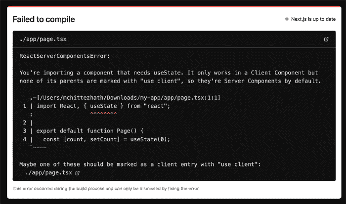

要执行前面的代码，我们需要将服务器组件转换为客户端组件。可以通过在组件文件顶部添加 `use client` 指令来实现，如下：

```javascript
"use client";

import React, { useState } from "react";

export default function Page() {
  const [count, setCount] = useState(0);
  return (
    <div>
      <h1>Current Count: {count}</h1>
      <button onClick={() => setCount(count + 1)}>Increment</button>
    </div>
  );
}
```

这解决了错误，应用程序如下所示正常运行：

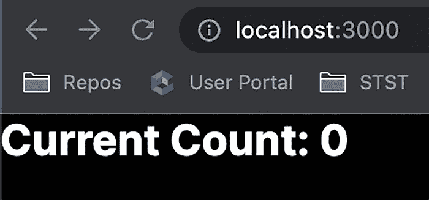
**图 4.3：** 错误后正常运行

## 路由

Next.js 使用基于文件系统的路由器，每个文件夹定义一个路由。每个文件夹代表一个映射到 URL 段的路由，嵌套文件夹创建嵌套路由。

### 动态路由

在开发 Web 应用程序时，某些情况下开发者或用户无法预知段名称，并希望根据动态数据创建路由。在这种情况下，我们可以使用动态段（Dynamic Segment）。

动态段可以通过将文件夹名称在方括号中创建。

例如，如果你想渲染从 URL 段获取的动态数据，例如 `app/blog/[slug]/page.js`，其中 `[slug]` 是博客文章的动态段，你可以这样写 `page.js`：

```javascript
export default function Page({ params }) {
  return <div>My Post with ID {params.slug}</div>;
}
```

如果我们访问 URL `app/blog/1234`，我们将在 `params` 属性中获得 `1234`，正如示例所示。

### 错误处理

`error.js` 文件约定允许开发者处理嵌套路由中的运行时错误。它可以用于将路由及其嵌套子级封装在 React Error Boundary 中。这允许开发者创建针对特定片段的错误 UI。`error.js` 文件约定的一个主要优势是允许错误隔离，而不影响应用的其他部分。通过在路由段中创建 `error.js` 文件并导出 React 组件，可以轻松添加错误 UI。

## 中间件

我们可以在请求完成之前使用中间件执行代码。可以根据传入的请求通过重写、重定向、更改请求或响应标头来修改响应。

# 渲染

在 Next.js 中，路由可以是静态渲染或动态渲染的。在静态路由中，组件在构建时在服务器上进行渲染。这些工作会被缓存并在随后的请求中重用，而在动态路由中，组件在请求时在服务器上进行渲染。

### 静态渲染

静态渲染是 Next.js 应用的默认渲染模式，它能够提高性能，因为所有的渲染工作都是提前完成的，并且可以通过地理位置更接近用户的内容分发网络（CDN）提供。

我们也可以通过在布局（layout）或页面中使用动态函数或动态数据获取来选择动态渲染，这将导致 Next.js 在请求时动态地渲染整个路由。

## 动态渲染

如果在静态渲染期间检测到动态函数或无缓存模式下的 `fetch()` 请求，Next.js 将在请求时切换为动态渲染整个路由。在动态渲染期间，任何缓存的数据请求仍然可以重用。动态数据获取是指其 `cache` 选项设置为 `no-store` 或将 `revalidate` 设置为 0 的 `fetch` 请求。我们将在下一节中探索更多数据获取模式。

# 数据获取

React 和 Next.js 13 引入了在应用程序中获取和管理数据的新方法。新的数据获取系统工作在 app 目录中，并基于 `fetch()` Web API 构建。

`fetch()` 是一个用于获取远程资源的 Web API，返回一个 promise。React 扩展了 `fetch` 以提供自动请求去重，而 Next.js 扩展了 `fetch` 选项对象，允许每个请求设置自己的缓存和重新验证。

### Server Components 中的 async 和 await

以下是在 Server Components 中使用 `async` 和 `await` 获取数据的代码示例：

```javascript
async function getData() {
  const res = await fetch('https://api.example.com/…');

  if (!res.ok) {
    // 这将激活最近的 error.js Error Boundary
    throw new Error('Failed to fetch data');
  }

  return res.json();
}

export default async function Page() {
  const data = await getData();
  return <p>{data}</p>;
}
```

### 静态数据获取

默认情况下，`fetch` 将自动对数据进行无限期的缓存：

```javascript
// 静态获取，数据缓存无限期
async function getData() {
  const res = await fetch('https://api.example.com/data');
  return res.json();
}
```

## 动态数据获取

为了在每次 fetch 请求时获取最新数据，请使用缓存选项：`no-store`：

```javascript
// 动态获取，每次请求都获取新数据
async function getData() {
  const res = await fetch('https://api.example.com/data', {
    cache: 'no-store',
  });
  return res.json();
}
```

## 结论

在本章中，我们学习了 Next.js 13 这一最新的 Web 框架版本，并探索了它的新关键特性和优势。我们看到了它是如何采用 app router 的，使得开发者无需担心 Next.js 应用的渲染和缓存，因为这些情况都由框架自动处理。有了所有这些新功能，Next.js 13 已经成为 2023 年构建 Web 应用程序的明显选择。

在接下来的章节——*优化 Next.js 应用*中，我们将学习可用于优化 Next.js 应用的不同策略，从而提高性能并提供更好的开发者体验。Next.js 提供了内置组件，如 `<Image />` 和 `<Link />`，为开发者提供了许多开箱即用的功能来优化他们的 Web 应用程序。

## 单选题

1. 在本地启动 Next.js 开发服务器的命令是哪个？
    1. `next dev`
    2. `next build`
    3. `next start`
    4. `next lint`

2. Next.js 13 中的主目录是哪个？
    1. layout 文件夹
    2. pages 目录
    3. app 目录
    4. public 文件夹

3. 你将嵌套文件夹的单一路径称为什么？
    1. Route（路由）
    2. Page（页面）
    3. App
    4. Folder（文件夹）

4. 用于渲染路由 UI 的文件是？
    1. error.js
    2. loading.js
    3. layout.js
    4. page.js

5. Next.js 13 中组件的默认类型是什么？
    1. Client Component
    2. Server Component
    3. App Component
    4. Router Component

6. 将 Server Component 转换为 Client Component 的指令是什么？
    1. `use client`
    2. `use server`
    3. `use component`
    4. `set client`

7. 哪个文件提供了 Next.js 13 中的 React Error Boundary？
    1. fault.js
    2. error.js
    3. error-boundary.js
    4. boundary.js

8. Next.js 13 中 fetch API 的默认行为是什么？
    1. 强制缓存
    2. 不缓存
    3. 增量缓存
    4. 周期缓存

9. 构建生产环境 Next.js 应用的命令是哪个？
    1. build production
    2. `next dev`
    3. `next build`
    4. `next run`

10. 为‘id’设置动态路由路径的规范是？
    1. `{id}`
    2. `[id]`
    3. `(id)`
    4. `<id>`

## 答案

1. A
2. C
3. A
4. D
5. B
6. A
7. B
8. A
9. C
10. B

# 第五章

# 优化 Next.js 应用

## 引言

作为一个精练的开发者，你知道 Next.js 应用需要优化。在本章中，我们将探索 Next.js 的精彩世界，介绍它的许多特性，并讨论为什么优化你的 Next.js 应用如此重要。幸运的是，Next.js 处理了繁重的工作，让你自由创建可扩展、高性能的应用程序。

## 结构

在本章中，我们将涵盖以下主题：

- 优化 Next.js 应用的重要性和好处
- 使用 Head 组件向页面添加元数据
- 在 Next.js 中实现静态文件服务
- 理解使用 Next.js 图片组件进行优化
- 理解 Next.js 架构及其工作原理
- 为最佳性能配置 Next.js
- 实现服务端渲染 (SSR) 和预渲染
- 代码分割和动态导入
- 缓存和改进数据获取
- 分析和减少包体积
- 部署策略和最佳实践
- 监控和优化性能

## 优化 Next.js 应用的重要性和好处

优化 Next.js 应用对于几个原因很重要。首先，它可以提高应用程序的整体性能，从而带来更好的用户参与度和留存。其次，它可以减少服务器负载，从而为开发者节省成本。最后，优化 Next.js 应用可以帮助应用程序面向未来，确保其随时间推移的可扩展性和可维护性。

优化 Next.js 应用有许多好处，包括：

- **提高性能**：优化 Next.js 应用可以帮助提高应用程序性能，获得更快的加载速度和更好的用户体验。
- **减少服务器负载**：优化 Next.js 应用可以帮助减少服务器负载，为开发者节省成本。
- **面向未来**：优化 Next.js 应用可以帮助应用程序面向未来，确保其随时间推移的可扩展性和可维护性。
- **提高开发者效率**：优化 Next.js 应用可以帮助提高开发者效率，因为它可以帮助更快地识别和解决性能问题。

## 使用 Head 组件向页面添加元数据

Next.js 中的 `Head` 组件允许你为单个页面定义元数据。元数据包括标题（title）、描述（description）以及各种标签，这些元素可以增强搜索引擎优化（SEO），并在社交媒体平台分享页面时改进显示效果。通过有效利用 `Head` 组件，你可以确保你的网页在不同平台上都有良好的展示效果，并获得更好的可见性。要使用 `Head` 组件，你需要从 `next/head` 模块导入它。

让我们来看一个示例，我们想要为特定页面设置标题和描述：

```javascript
import Head from 'next/head';

function HomePage() {
  return (
    <div>
      <Head>
        <title>Feature Books - NextCommercePro</title>
        <meta name="description" content="Feature books in our collection" />
      </Head>
      {/* Rest of the page content */}
    </div>
  );
}

export default HomePage;
```

*图 5.1* 显示了带有元数据和标题的默认首页：

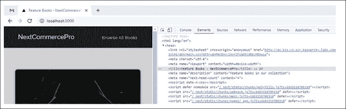
**图 5.1：** 默认首页

在代码段中，我们从 `next/head` 模块导入了 `Head` 组件。在 `HomePage` 组件内部，我们将所需的元数据元素封装在 `Head` 组件中。在这种情况下，我们将标题设为 `My Next.js App - Home`，并将元数据描述设为 `Welcome to my Next.js application`！

`Head` 组件还允许你添加各种其他元数据标签。例如，你可以包含 Open Graph (OG) 标签以获得更好的社交媒体共享效果：

```javascript
import Head from 'next/head';

function BookPage({ book }) {
  return (
    <div>
      <Head>
        <title>{book.title}</title>
        <meta name="description" content={book.excerpt} />
        <meta property="og:title" content={book.title} />
        <meta property="og:description" content={book.excerpt} />
        <meta property="og:image" content={book.thumbnail} />
      </Head>
      {/* Rest of the page content */}
    </div>
  );
}

export default BookPage;
```

*图 5.2* 描述了产品详情页：


**图 5.2：** 动态 BookPage

在这个示例中，我们将 `post` 对象作为 prop 传递给 `BookPage` 组件。我们使用 `post` 的数据动态设置标题、描述和 Open Graph (OG) 标签。`og:title`、`og:description` 和 `og:image` 标签对于社交媒体平台在页面共享时显示正确的标题、描述和缩略图至关重要。

通过使用 `Head` 组件，你可以轻松地为 Next.js 应用中的每个页面设置元数据，从而改进 SEO 并增强视觉表现。记得包含相关的元数据（如标题、描述和 OG 标签），以确保你的页面针对搜索引擎和社交共享进行了有效的优化。

## 在 Next.js 中实现静态文件服务

在 Next.js 中实现静态文件服务时，不同类型的静态文件在 Web 开发中起着至关重要的作用，包括图像、CSS 样式表和 JavaScript 文件。在本节中，我们将探索如何在你的 Next.js 应用中高效地提供静态文件。我们将涵盖各种策略和最佳实践，以确保静态资源具有最佳性能并无缝集成到你的 Next.js 项目中。

### 提供图像

图像是现代 Web 开发不可或缺的一部分。在 Next.js 中，你可以按照以下步骤提供图像：

- 在你的 Next.js 项目的根目录下创建一个名为 `public` 的文件夹。
- 将你的图像文件（例如 `my-image.jpg`）放在 `public` 文件夹中。
- 在你的 Next.js 组件中，使用 Next.js 的 `Image` 组件来显示图像。

这是一个示例：

```javascript
import Image from 'next/image';

const MyComponent = () => {
  return (
    <div>
      <Image src="/my-image.jpg" alt="My Image" width={500} height={300} />
    </div>
  );
};

export default MyComponent;
```

`Image` 组件会自动优化并提供图像，提供如懒加载和响应式图像渲染等益处。

### 提供 CSS 样式表

在 Next.js 中实现静态文件服务时，CSS 样式表是公式中不可或缺的一部分。它们允许你对网页进行样式化，使其具有视觉吸引力。在本节中，我们将深入探讨如何在你的 Next.js 应用中高效地提供 CSS 样式表。

首先，假设你有一个名为 `styles.css` 的 CSS 文件，其中包含了你 Next.js 应用的所有样式。以下是如何使用 Next.js 提供此 CSS 文件的示例：

- 在你的 Next.js 项目的根目录下创建一个名为 `public` 的文件夹。该文件夹将存放你所有的静态文件，包括 CSS 样式表。
- 将 `styles.css` 文件移动到 `public` 文件夹。
- 在你的 Next.js 组件或布局文件中，在 `head` 部分使用 `link` 标签导入该 CSS 文件。

这是一个示例：

```javascript
import Head from 'next/head';

const MyComponent = () => {
  return (
    <div>
      <Head>
        <link rel="stylesheet" href="/styles.css" />
      </Head>
      {/* Rest of the page content */}
    </div>
  );
};

export default MyComponent;
```

通过 `link` 标签，我们将 `rel` 属性指定为 `stylesheet`，表示这是一个样式表。`href` 属性指向相对于 Next.js 应用根目录的文件位置。在这种情况下，它是 `/styles.css`，因为我们将文件放在了公共文件夹。

通过遵循这些步骤，你的 Next.js 应用将高效地提供 CSS 样式表。`styles.css` 中定义的 CSS 规则将应用于相应的组件和元素。

重要的是，Next.js 会自动处理静态文件的缓存和优化。当你更改 CSS 文件时，Next.js 会生成新的文件名，确保客户端获取最新版本而无需手动刷新缓存。

通过这种方法，你可以将 CSS 样式表无缝集成到 Next.js 项目中，并通过高效提供静态文件确保最佳性能。

### 提供 JavaScript 文件

在 Next.js 中提供 JavaScript 文件时，你可以遵循简单的流程以确保这些文件高效地交付并集成到应用中。以下是关于如何提供 JavaScript 文件的详细说明：

1. **创建“public”文件夹**：首先，在你的 Next.js 项目的根目录下创建一个名为 `public` 的文件夹（如果还没有）。该文件夹将存放你所有的静态文件。
2. **将 JavaScript 文件放在“public”文件夹中**：将你的 JavaScript 文件移动到 `public` 文件夹。例如，假设你有一个名为 `script.js` 的 JavaScript 文件。将其复制或移动到 `public` 文件夹。文件结构应如*图 5.3*所示：

   
   **图 5.3：** 文件夹结构

3. **在 HTML 中引入 JavaScript 文件**：要在 HTML 中引入 JavaScript 文件，你可以使用 `script` 标签。Next.js 会自动将 `public` 文件夹中的任何文件作为静态文件提供，你可以通过相对于 Next.js 应用根目录的相对路径引用它们。在你的 HTML 文件或 Next.js 组件中，包含以下代码段来导入 JavaScript 文件：

   ```html
   <script src="/script.js"></script>
   ```

   在这里，`<script>`标签的 `src` 属性指向 JavaScript 文件相对于你的 Next.js 根目录的路径。在这种情况下，文件名为 `script.js`，并直接位于 `public` 文件夹中。

4. **利用 JavaScript 功能**：一旦 JavaScript 文件包含在你的 HTML 或 Next.js 组件中，你就可以访问并利用它提供的功能。`script.js` 内部 JavaScript 代码可以包含各种函数、事件监听器或你想整合到应用程序中的其他逻辑。

   例如，如果 `script.js` 包含一个名为 `myFunction` 的函数，你可以使用以下语法从你的 HTML 或 Next.js 组件中调用它：

   ```html
   <script src="/script.js"></script>
   <script>
     myFunction(); // 调用 script.js 中定义的函数
   </script>
   ```

通过遵循这些步骤，Next.js 将将 JavaScript 文件作为静态资源提供，允许其高效地交付到客户端浏览器。然后，你可以根据需要并在应用程序中使用 JavaScript 功能。

需要注意的是，Next.js 会自动处理静态文件（包括 JavaScript 文件）的缓存和优化。如果你对 JavaScript 文件进行了更改，Next.js 将为更新后的版本生成一个新的唯一文件名，确保客户端能够收到最新代码，而无需依赖手动刷新缓存。

通过这种方式提供 JavaScript 文件，你可以无缝地将动态功能和交互性集成到你的 Next.js 应用程序中，同时确保最佳性能和静态资源的高效交付。

## 理解使用 Next.js Image 组件进行图像优化

图像是任何现代 Web 应用不可或缺的一部分，对它们进行性能优化至关重要。在本节中，我们将深入研究 Next.js Image 组件及其在 Next.js 应用中优化图像的功能。Next.js Image 组件提供了内置的图像优化技术，例如自动调整大小、懒加载和响应式图像交付，以确保高效渲染并缩短页面加载时间。

你将全面了解如何利用此组件在 Next.js 项目中交付高效且具有视觉吸引力的图像。要使用 Next.js Image 组件，你需要从 `next/image` 模块导入它。

让我们考虑使用 Next.js Image 组件显示优化图像的示例：

```javascript
import Image from 'next/image';

function HomePage() {
  return (
    <div>
      <Image src="/images/my-image.jpg" alt="My Image" width={800} height={600} />
      {/* 页面的其余内容 */}
    </div>
  );
}

export default HomePage;
```

在前面的代码段中，我们从 `next/image` 模块导入了 `Image` 组件，并使用它显示位于 `/images/my-image.jpg` 的图像。我们还为了辅助功能提供了 `alt` 文本。此外，我们使用 `width` 和 `height` 属性指定了图像所需的宽度和高度。

Next.js Image 组件会根据提供的尺寸自动优化图像。它在构建时生成多个优化后的图像版本，每个版本都针对不同的屏幕尺寸和设备进行了定制。系统根据视口和设备特性向客户端提供相应的图像，从而提高性能并减少带宽消耗 ([图 5.4])。


**图 5.4：** 产品列表页或书籍列表页

Next.js Image 组件支持其他属性，你可以使用这些属性进一步优化图像交付：

- **layout:** `layout` 属性决定了图像在页面上的布局方式。它可以设置为 `responsive`（默认值）、`fixed` 或 `intrinsic`。`responsive` 布局会根据容器的尺寸自动调整图像大小，而 `fixed` 和 `intrinsic` 则强制执行特定尺寸。

```javascript
import Image from 'next/image';

function HomePage() {
  return (
    <div>
      <Image
        src="/images/my-image.jpg"
        alt="My Image"
        layout="responsive"
        width={800}
        height={600}
      />
      {/* 页面的其余内容 */}
    </div>
  );
}

export default HomePage;
```

在前面的示例中，我们将 `layout` 属性设置为 `responsive`。这允许图像根据容器的尺寸动态调整大小，确保响应式布局。

- **objectFit:** `objectFit` 属性决定了图像在容器内应如何缩放和定位。它可以设置为 `fill`（默认值）、`contain`、`cover`、`none` 或 `scale-down`。

```javascript
import Image from 'next/image';

function HomePage() {
  return (
    <div>
      <Image
        src="/images/my-image.jpg"
        alt="My Image"
        layout="fill"
        objectFit="cover"
      />
      {/* 页面的其余内容 */}
    </div>
  );
}

export default HomePage;
```

在接下来的示例中，我们将 `objectFit` 属性设置为 `cover`。这确保图像在保持宽高比例的同时覆盖整个容器。

- **objectPosition:** `objectPosition` 属性指定了图像在容器内的水平和垂直位置。它接受的值如 `top`、`bottom`、`left`、`right`、`center` 或这些值的组合。

```javascript
import Image from 'next/image';

function HomePage() {
  return (
    <div>
      <Image
        src="/images/my-image.jpg"
        alt="My Image"
        layout="fixed"
        width={500}
        height={300}
        objectFit="contain"
        objectPosition="top right"
      />
      {/* 页面的其余内容 */}
    </div>
  );
}

export default HomePage;
```

在此示例中，我们将 `objectPosition` 属性设置为 `top right`。这会将图像置在容器的右上角。

- **loading:** `loading` 属性控制图像的懒加载行为。它可以设置为 `eager`（默认值）以便立即加载，或设置为 `lazy` 以延迟加载直到图像进入视口。

```javascript
import Image from 'next/image';

function HomePage() {
  return (
    <div>
      <Image
        src="/images/my-image.jpg"
        alt="My Image"
        loading="lazy"
      />
      {/* 页面的其余内容 */}
    </div>
  );
}

export default HomePage;
```

在此示例中，我们将 `loading` 属性设置为 `lazy`，允许在图像进入视口时再加载，通过减少初始页面加载时间来提高性能。

- **priority 属性:** Next.js Image 组件中的 `priority` 属性允许你优先加载图像，为关键内容提供更好的用户体验。通过对某些图像设置更高的优先级，可以确保它们先加载，减少页面上重要视觉元素的感知加载时间。

这是一个使用 `priority` 属性的示例：

```javascript
import Image from 'next/image';

function HomePage() {
  return (
    <div>
      <Image
        src="/images/my-image.jpg"
        alt="My Image"
        priority
      />
      {/* 页面的其余内容 */}
    </div>
  );
}

export default HomePage;
```

在前面的代码段中，我们将图像组件设置了 `priority` 属性为 true。这表明图像在加载时应被赋予更高的优先级。

通过设置 `priority` 属性，Next.js 将优先加载该图片，并在页面加载过程早期对其进行获取。这确保了图片能够尽快可用，通过缩短重要视觉元素的感知加载时间来提升用户体验。

需要注意的是，`priority` 属性应该有选择性地用于对页面初始渲染至关重要的图片。在页面上的每张图片上使用该属性可能无法提供显著的收益，并可能影响应用程序的整体性能。

总而言之，Next.js `Image` 组件中的 `priority` 属性允许你控制图像的加载优先级，通过优先加载关键内容来确保更好的用户体验。

通过关注上述三个详细主题，并对剩余主题提供概述，本章旨在使你掌握必要的知识，以便能够有效利用 Next.js 并优化你的应用程序以获得卓越的性能。

## 理解 Next.js 架构及其工作原理

我们将提供关于 Next.js 架构、其关键组件以及它们如何相互作用以交付强大的服务端渲染应用程序的高层级概述。

Next.js 是一个 `React` 框架，为构建现代 Web 应用程序提供了全面的解决方案，并专注于性能和开发者体验。它结合了服务端渲染 (SSR) 和客户端渲染 (CSR) 的优势，以提供快速且具交互性的用户体验。

Next.js 遵循混合渲染方法，允许你根据应用程序的需求在 SSR 和 CSR 之间进行选择。让我们详细探索其架构及其工作原理：

### 服务端渲染 (SSR)

在服务端渲染中，服务器为每个页面生成 HTML 内容并将其发送客户端。这意味着初始页面加载包含了完全渲染的 HTML，包括从 API 或数据库获取的内容。这种方法具有以下几个优势：

- **改进 SEO**：搜索引擎可以轻松爬取并索引完全渲染的 HTML，从而获得更好的搜索引擎优化。
- **更快的初始页面加载**：由于服务器将预渲染的 HTML 发送到客户端，用户即使在较慢的连接上也能更快看到内容。
- **静态内容的更好性能**：静态内容在服务器上生成一次，并可以针对后续请求进行缓存，减少服务器负载。

要在 Next.js 中启用 SSR，你需要在 `pages` 目录中创建一个页面文件。每个页面文件都导出一个代表该页面的内容的 `React` 组件。在构建处理过程中，Next.js 会预渲染这些页面并生成相应的 HTML 文件。

### 客户端渲染 (CSR)

在客户端渲染中，服务器发送的初始 HTML 包含页面的最小骨架，由客户端 JavaScript 接管获取数据并动态渲染内容。这种方法提供了以下益处：

- **交互式用户体验**：通过 CSR，你可以构建高度交互的应用程序，这些程序可以在客户端获取并显示数据，而无需刷新整个页面。
- **实时更新**：通过异步获取数据，你可以实时更新 UI，而无需刷新整个页面。

Next.js 通过其强大的客户端路由系统支持 CSR。当用户导航到 Next.js 应用程序内部的不同页面时，仅会获取必要的 JavaScript 和数据，并在不重新加载整个页的情况下更新 UI。

### Next.js 架构

Next.js 使用无服务器架构，允许你将应用程序部署到 `Vercel`、`AWS Lambda` 或 `Netlify` 等无服务器平台。该架构根据传入的流量自动扩展，确保了性能并降低了基础设施成本。

Next.js 还提供了开箱即用的各种性能优化功能，例如自动代码分割、静态站点生成 (SSG) 和增量静态再生 (ISR)。这些功能允许你交付经过优化且加载快速的 Web 应用程序。

代码示例：

这里是一个使用 SSR 的基础 Next.js 页面组件示例：

```javascript
// pages/index.js
import React from 'react';

function HomePage({ data }) {
  return (
    <div>
      <h1>Welcome to Next.js!</h1>
      <p>{data}</p>
    </div>
  );
}

export async function getServerSideProps() {
  // 从 API 或数据库获取数据
  const res = await fetch('https://api.example.com/data');
  const data = await res.json();

  return {
    props: {
      data,
    },
  };
}

export default HomePage;
```

在这段代码中，我们有一个名为 `HomePage` 的简单 Next.js 页面组件。它接收 prop 形式的数据数据并在页面上渲染它。`getServerSideProps` 函数是一个特殊的 Next.js 函数，它在服务器上运行并从 API 或数据库获取数据。数据被获取后，将作为 prop 传递给 `HomePage` 组件。

当用户请求 `HomePage` 时，Next.js 将在服务器上执行 `getServerSideProps` 函数并获取数据。获取的数据随后将作为 props 传递给 `HomePage` 组件，该组件在页面上渲染内容。

这是 Next.js 中 SSR 的一个示例。服务器生成带有获取数据的完全渲染的 HTML 并发送到客户端，导致更快的初始页面加载和改进的 SEO。

除了 SSR 之外，Next.js 还支持用于动态内容的 CSR。你可以使用 `useEffect` 钩子或其他机制在客户端获取数据并在不刷新整个页面的情况下更新 UI。

理解 Next.js 中 SSR 和 CSR 的架构和能力，允许你根据应用程序的需求利用适当的渲染方法，在性能、交互性和 SEO 考量之间取得平衡。

## 配置 Next.js 以获得最佳性能

我们将涉及 Next.js 中提供的各种配置选项，以微调你的应用程序性能。此概述将为你优化 Next.js 项目提供起点。

为了让你的 Next.js 应用程序获得最佳性能，可以遵循一些配置选项和最佳实践。这包括使用生产环境构建、优化图像和实现服务端缓存。让我们在这里详细探索这些各个方面：

### 使用生产环境构建

默认情况下，当你运行 Next.js 开发服务器时，它使用包含热模块替换和调试工具的开发构建。然而，为了在生产环境中获得最佳性能，建议使用生产环境构建。

要创建生产环境构建，可以使用以下命令：

```bash
next build
```

该命令会生成你的 Next.js 应用程序经过优化和压缩的构建。随后你可以使用以下命令启动生产服务器：

```bash
next start
```

使用生产构建可以移除不必要的开发特定代码和优化，从而缩短加载时间并提高性能。

### 实现服务端缓存

我们将简要讨论 Next.js 中服务端渲染和预渲染的概念，强调它们的优势以及如何在你的应用程序中实现它们。

服务端缓存可以通过减少服务器负载和提高响应时间，显著提升 Next.js 应用程序的性能。Next.js 通过各种机制提供了对服务端缓存的内置支持：

- **使用带有缓存的 getServerSideProps**：Next.js 中的 `getServerSideProps` 函数可以配置为对服务器渲染页面进行特定时间的缓存。通过设置 `revalidate` 属性，你可以控制缓存刷新的频率。这对于不经常变化的数据非常有用。
- **实现外部缓存**：Next.js 应用可以受益于外部缓存机制，例如 CDN（内容分发网络）缓存或代理缓存。这些机制在更接近用户的边缘位置缓存生成的 HTML 或静态资源，从而获得更快的响应速度。
- **使用缓存插件**：Next.js 拥有活跃的插件生态系统，这些插件为不同的用例提供定制的缓存解决方案。你可以探索可用的缓存插件，以进一步优化你应用程序中的缓存策略。

通过实施服务器端缓存，你可以减少服务器负载，提高响应速度，并提供更快的用户体验。

### 代码示例：

以下是在 Next.js 中带缓存使用 `getServerSideProps` 函数的示例：

```javascript
import React from 'react';

function HomePage({ data }) {
  return (
    <div>
      <h1>Welcome to Next.js!</h1>
      <p>{data}</p>
    </div>
  );
}

export async function getServerSideProps() {
  const cacheSeconds = 60; // 缓存 60 秒

  // 从 API 或数据库获取数据
  const res = await fetch('https://api.example.com/data');
  const data = await res.json();

  return {
    props: {
      data,
    },
    revalidate: cacheSeconds,
  };
}

export default HomePage;
```

在前面的代码示例中，我们有一个名为 `HomePage` 的基础 Next.js 页面组件。它接收 `data` 作为 prop 并在页面上渲染。`getServerSideProps` 函数是一个特殊的 Next.js 函数，运行在服务器上并从 API 或数据库获取数据。

在 `getServerSideProps` 函数内部，我们定义了一个变量 `cacheSeconds` 来设置页面缓存的持续时间（在此例中为 60 秒）。获取的数据通过 `props` 对象返回，同时 `revalidate` 属性被设置为 `cacheSeconds` 的值。

通过设置 `revalidate` 属性，Next.js 将缓存服务器渲染的页面，并在指定时间结束后刷新缓存。这有助于通过在缓存持续时间内为后续请求提供缓存内容，从而减少服务器的负载。

通过实施这样的缓存策略，你可以减少频繁获取数据和服务器端渲染的需求，从而优化 Next.js 应用的性能。

请记住根据你的特定用例和数据更新频率调整缓存持续时间（`cacheSeconds`）。

总之，为 Next.js 配置优化性能涉及使用生产就绪的构建、优化图像以及实施服务器端缓存。这些实践有助于确保你的应用程序提供快速且优化的用户体验，增强性能和可扩展性。

## 代码分割与动态导入

本节将简要介绍代码分割（code splitting）和动态导入（dynamic imports），以及它们如何帮助减少 Next.js 的初始包大小并提高性能。你将理解这些技术如何通过仅加载特定页面或功能所需的代码来增强性能。

代码分割和动态导入是用于将 JavaScript 数据包拆分为更小、更易管理的分块的技术。通过拆分代码并按需加载，你可以减小初始包大小并提高性能，对于较大的应用程序尤为如此。*[第 6 章，理解 Next.js 中的路由]*，将深入探讨这些概念，并提供操作示例来演示它们的实际应用。

代码分割涉及根据特定的入口点或代码依赖将代码库划分为更小的部分或分块。这允许你在需要时仅加载所需的代码，而不是一次性加载所有内容。结果是更小的初始包大小，这可以显著提高用户看到并与应用程序交互的时间。

动态导入是实现代码分割的关键机制。它们允许你在运行时异步导入模块，而不是在构建时静态地导入。通过仅在需要时才动态导入模块，你可以优化应用程序的加载并减少不必要的网络请求。

以下是在 Next.js 应用中如何代码分割和动态导入的示例：

```javascript
import React, { useState, useEffect } from 'react';

function HomePage() {
  const [data, setData] = useState(null);

  useEffect(() => {
    import('./api').then((module) => {
      module.getData().then((response) => {
        setData(response);
      });
    });
  }, []);

  return (
    <div>
      <h1>Welcome to Next.js!</h1>
      <p>{data}</p>
    </div>
  );
}

export default HomePage;
```

在前面的代码段中，`HomePage` 组件使用动态导入来异步加载名为 `api` 的外部模块。`api` 模块包含一个名为 `getData()` 的函数，用于获取数据。当组件挂载时，`useEffect` hook 触发动态导入，一旦模块加载，它就会使用 `getData()` 函数获取数据并更新状态。

通过动态导入 `api` 模块，你可以确保它只在渲染 `HomePage` 组件时被加载，从而减小初始包大小。如果 `api` 模块仅用于应用程序的特定部分且在每个页面都不需要，这将特别有利。

通过在整个应用程序中策略性地应用代码分割和动态导入，你可以优化 Next.js 应用的加载和性能。这种技术有助于减少初始包大小，提高交互时间，并提供更流畅的用户体验。

## 缓存与改进数据获取

缓存对于提高 Next.js 应用的数据获取性能至关重要。通过缓存，你可以减少对外部 API 或数据库的请求，从而获得更快的响应速度和改进的用户体验。

Next.js 提供了可以利用的多种缓存机制：

- **客户端缓存**：Next.js 通过使用 SWR (Stale-While-Revalidate) 或 React Query 等库支持客户端缓存。这些库处理缓存、重新验证和组件之间的数据同步，允许你在应用程序中缓存并复用数据。

  使用 SWR 的示例：

```javascript
import useSWR from 'swr';

function UserProfile() {
  const { data, error } = useSWR('/api/user', fetcher);

  if (error) return <div>Error loading user data</div>;
  if (!data) return <div>Loading…</div>;

  return (
    <div>
      <h1>Welcome, {data.name}!</h1>
      <p>Email: {data.email}</p>
    </div>
  );
}
```

- **服务器端缓存**：Next.js 通过 `getServerSideProps` 和 `getStaticProps` 函数内置服务器端缓存。通过在函数中指定缓存配置，你可以对特定时间缓存服务器渲染的页面或静态数据。这减少了服务器负载并提高了响应速度。

  使用 getServerSideProps 的示例：

```javascript
export async function getServerSideProps(context) {
  const data = await fetchUserFromAPI();

  return {
    props: {
      data,
    },
    revalidate: 60, // 缓存 60 秒
  };
}
```

通过恰当实施缓存策略，你可以最大限度地减少频繁获取数据的需求，并提高你的 Next.js 应用的整体性能。

## 分析和缩小包大小

我们将简要探索分析和减少 Next.js 应用包大小的技术。本概述将向你介绍可以帮助优化项目包大小以获得更好性能的工具和方法。

你的 Next.js 应用的包大小会影响初始加载时间和性能。分析并缩小包大小对于确保快速、流畅的用户体验至关重要。以下是实现这一目标的一些方法：

- **代码分割 (Code splitting):** Next.js 支持自动代码分割，每个页面都会单独打包。这确保了每个页面只加载必要的代码，从而减小包的大小。你也可以像上一个主题介绍的那样，通过动态导入来手动配置代码分割。
- **树摇 (Tree shaking):** 树摇是在构建过程中从包中移除未用代码的过程。Next.js 利用 `webpack` 等工具，它们会自动为你的应用程序执行树摇。请确保编写模块化代码并使用 ES 模块以优化树摇效果。
- **代码压缩 (Minification):** 代码压缩是从代码中移除空格和注释等不必要字符的过程。Next.js 在生产构建中默认执行代码压缩，从而产生更小的包大小。
- **优化依赖项:** 分析并优化应用程序中使用的依赖项。考虑使用更小的替代库或优化现有依赖项的配置以缩小包大小。

## 部署策略和最佳实践

高效地部署 Next.js 应用对于确保其可用性、可扩展性和性能非常重要。以下是一些部署策略和最佳实践：

- **无服务器部署 (Serverless deployments):** Next.js 应用非常适合无服务器部署，你可以将应用程序部署到 `Vercel`、`AWS Lambda` 或 `Netlify` 等无服务器平台。无服务器部署提供了自动伸缩、更低的基础成本和更简化的部署工作流。
- **持续集成与部署 (CI/CD):** 实现 CI/CD 流水线以自动化部署过程。可以使用 `GitHub Actions` 或 `Jenkins` 等工具在每次更改推送到仓库时构建并部署你的 Next.js 应用。
- **性能监控:** 使用 `Lighthouse`、`New Relic` 或 `Google Analytics` 等工具监控已部署应用的性能。这有助于识别性能瓶颈并优化你的应用程序以获得更好的用户体验。
- **安全性考虑:** 实施最佳安全实践，例如使用 `HTTPS`、安全的 API 集成和适当的访问控制，以保护你的 Next.js 应用及其数据。
- **可扩展性和负载均衡:** 配置你的部署环境，通过负载均衡器和自动伸缩机制进行水平扩展。这确保了你的 Next.js 应用能够处理增加的流量而不会性能下降。

## 部署策略和最佳实践

我们将提供关于 Next.js 应用各种部署策略和最佳实践的概述。虽然不是详尽的，但本节将为你提供有关在生产环境中部署 Next.js 项目的不同选项见解。

高效地部署 Next.js 应用对于确保其可用性、可扩展性和性能至关重要。以下你可以遵循的一些部署策略和最佳实践：

- **无服务器部署:**
  Next.js 应用非常适合无服务器部署，你可以将应用程序部署到 `Vercel`、`AWS Lambda` 或 `Netlify` 等无服务器平台。无服务器部署提供了自动伸缩、更低的基础成本和更简化的部署工作流。

  使用 Vercel 的示例：

  安装 Vercel CLI:
  ```bash
  npm install -g vercel
  ```

  部署你的 Next.js 应用：
  ```bash
  vercel deploy
  ```

- **持续集成与部署 (CI/CD):**
  实现 CI/CD 流水线以自动化部署过程。可以使用 `GitHub Actions` 或 `Jenkins` 等工具在每次更改推送到仓库时构建并部署你的 Next.js 应用。

  使用 GitHub actions 的示例:
  在仓库中创建一个工作流文件（例如 `.github/workflows/main.yml`）：

  ```yaml
  name: Deploy Next.js App

  on:
    push:
      branches:
        - main

  jobs:
    deploy:
      runs-on: ubuntu-latest
      steps:
        - name: Checkout code
          uses: actions/checkout@v2
        - name: Install dependencies
          run: npm install
        - name: Build and deploy
          uses: vercel/actions@v21
          with:
            args: "deploy"
  ```


# 部署策略与最佳实践

- **性能监控:** 使用 `Lighthouse`、`New Relic` 或 `Google Analytics` 等工具监控已部署应用的性能。这有助于识别性能瓶颈并优化你的应用程序以获得更好的用户体验。
- **安全性考虑:** 实施最佳安全实践，如使用 `HTTPS`、安全 API 集成并实施适当的访问控制，以保护你的 Next.js 应用及其数据。
- **可扩展性和负载均衡:** 配置你的部署环境，通过负载均衡器和自动伸缩机制进行水平扩展。这确保了你的 Next.js 应用能够处理增加的流量而不会性能下降。

使用 AWS Elastic Load Balancer 进行负载均衡的示例：
1. 在 `AWS` 中创建一个弹性负载均衡器。
2. 配置负载均衡器将流量分到你的 Next.js 应用的多个实例上。
3. 设置自动伸缩，根据流量自动添加或移除实例。

通过遵循这些部署策略和最佳实践，你可以确保你的 Next.js 应用被高效部署、性能最佳且安全。这些实践实现了无缝的可扩展性，并为你的应用程序提供了流畅的用户体验。

## 监控性能

我们将触及在 Next.js 应用中监控和优化性能重要性。本概述将突出关键性能指标，并向你介绍跟踪和改进 Next.js 项目整体性能的工具和实践。

- **Lighthouse:** Lighthouse 是 Google 的一个开源工具，用于审计网页的性能、可访问性、SEO 和最佳实践。它提供了详细的报告和改进建议。你可以对你的 Next.js 应用运行 Lighthouse 审计，识别性能瓶颈和改进区域。
- **真实用户监控 (RUM):** RUM 工具如 `Google Analytics` 或 `New Relic` 捕捉性能指标和用户交互。它们提供了应用程序在真实环境中运行情况的见解，并帮助你识别真实用户遇到的性能问题。

使用 Lighthouse 的示例：

```bash
# 安装 Lighthouse CLI
npm install -g lighthouse

# 对你的 Next.js 应用运行 Lighthouse 审计
lighthouse http://your-nextjs-app-url
```

### 性能优化

性能优化的一些特性如下：

- **代码分割:** 如前所述，Next.js 支持自动代码分割，允许你只加载每个页面必要的代码。通过分析应用程序的依赖项并优化代码分割，你可以缩小包大小并提高初始加载时间。

## 优化策略

- **图像优化**：Next.js 提供了 `Image` 组件，它可以高效地优化和交付图像。通过利用 `Image` 组件，你可以减小图像文件大小、实现图像懒加载，并根据设备的屏幕尺寸提供响应式图像。
- **服务端缓存**：Next.js 允许使用 `getServerSideProps` 或 `getStaticProps` 等函数对服务端渲染的页面或静态数据进行缓存。通过实施适当的缓存策略，你可以减少服务器负载并提高响应速度。
- **性能预算**：为你的 Next.js 应用定义性能预算，为包大小、网络请求和页面加载时间等指标指定阈值。定期监控这些指标，确保你的应用程序处于定义的性能阈值之内。

使用 Next.js Image 组件优化图像加载的示例：

```javascript
import Image from 'next/image';

function MyComponent() {
  return (
    <div>
      <h1>Welcome to My Component</h1>
      <Image src="/path/to/image.jpg" alt="Image description" width={500} height={300} />
    </div>
  );
}
```

在这个示例中，使用了 Next.js 的 `Image` 组件来加载和优化图像。你提供了图像路径、用于可访问性的 alt 文本以及所需的宽度和高度。Next.js 会通过生成多种尺寸和格式自动优化图像，并根据设备和屏幕尺寸提供合适的版本，从而减小文件大小并提高性能。

通过使用 `Lighthouse` 等工具监控性能，并实施代码分割、图像优化、服务端缓存和性能预算等优化技术，你可以确保你的 Next.js 应用在生产环境中提供最佳的用户体验。定期监控性能指标并进行迭代改进，以持续增强应用程序的性能。

## 结论

优化你的 Next.js 应用对于创建极速、高效且高参与度的 Web 应用至关重要。在本章中，我们涵盖了许多重要的优化策略，包括为页面添加元数据、实现静态文件服务以及利用 Next.js 图像组件进行优化。

我们还深入研究了 Next.js 架构以及如何配置以获得最佳性能。从实现服务端渲染 (SSR) 和预渲染，到代码分割和动态导入、缓存和改进数据获取，以及分析和减少包大小，我们已经为你提供了全面的指导。

此外，我们讨论了部署策略和最佳实践，以及监控和优化性能。通过这些技术，你可以确保你的 Next.js 应用在优化性能和减少加载时间的同时，提供无缝的高质量体验。

你今天就可以开始实施这些优化策略，将你的 Next.js 应用提升到新层次！

在下一章中，我们将深入探讨 Next.js 的基于文件的路由。路由是任何 Web 应用的关键方面，而 Next.js 通过其直观且灵活的基于文件的路由系统使其变得轻而易举。

## 单选题

1. 在 Next.js 中为页面添加元数据的目的是什么？
   1. 改进 SEO
   2. 增强用户体验
   3. 优化页面加载时间
   4. 以上所有

2. Next.js 使用哪个组件为页面添加元数据？
   1. Title
   2. Header
   3. Meta
   4. Head

3. 在 Next.js 中实现静态文件服务的目的是什么？
   1. 改进 SEO
   2. 增强用户体验
   3. 优化页面加载时间
   4. 以上所有

4. Next.js 图像组件的目的是什么？
   1. 减小图像文件大小
   2. 改进 SEO
   3. 增强用户体验
   4. 让图像加载更快

5. Next.js 中的服务端渲染 (SSR) 是什么？
   1. 在客户端渲染页面
   2. 在服务端渲染页面并将 HTML 发送到客户端
   3. 在构建时预渲染页面
   4. 以上都不是

## 答案

1. D
2. D
3. C
4. D
5. B

# 第 6 章

# 理解 Next.js 中的路由

## 引言

路由就像 Web 应用的骨干，确保无缝导航和愉悦的用户体验。在 Next.js 世界中，由于其内置路由器，路由变得轻而易举，它负责处理页面间跳转和处理动态路由时所有的繁重工作。所以，请系好安全带，让我们开启 Next.js 路由领域的精彩之旅。

总体而言，本章旨在全面理解 Next.js 中路由是如何运作的。它涵盖了 Next.js 路由的基础、页面间的导航、动态路由的处理，以及利用 `Link` 组件实现高效的客户端导航。

## 结构

本章涵盖的主题如下：

- 理解 Next.js 路由的作用
- 理解 Next.js 的 `Link` 组件及其用法
- 使用路由器在 Next.js 中进行页面跳转
- 在 Next.js 中处理动态路由

## 理解 Next.js 路由的作用

本节提供了 Next.js 路由的概述及其在处理客户端导航中的重要性。Next.js 路由负责管理应用的路由，并根据请求的 URL 渲染相应的组件。

Next.js 路由在管理 Next.js 应用内的路由中起着至关重要的作用。它负责根据 URL 处理不同页面之间的导航，并相应地渲染合适的组件。Next.js 路由基于 `React Router`（流行的客户端路由库），并添加了特定于 Next.js 的功能和优化。

为了更好地理解 Next.js 路由的作用，让我们考虑一个示例。假设我们有一个三个页面的 Next.js 应用：`Home`、`About` 和 `Contact`。每个页面都有自己的 URL 和相应的组件。这些页面的 URL 如下：

- Home: "/home"
- About: "/about"
- Contact: "/contact"

当用户在浏览器中输入应用程序的 URL 时，Next.js 路由负责将 URL 与定义的路由匹配并渲染相应的组件。

例如，如果用户在浏览器地址栏输入 `/about` 并回车，Next.js 路由会检测到 `/about` URL 并渲染对应的 About 组件。路由器无缝处理这一过程，确保在不刷新页的情况下显示正确的组件。

Next.js 路由还支持嵌套路由，允许我们创建复杂的页面结构。例如，我们可以为博客文章创建一个嵌套路由：

- Blog Post: "/blog/[slug]"

在这种情况下，`[slug]` 代表一个可以是任何值的参数。Next.js 路由可以从 URL 中提取 `slug` 参数的值并将其作为 prop 传递给相应的组件。

总体，Next.js 路由简化了根据当前 URL 管理路由和渲染的过程。它在 Next.js 应用内部提供了无缝的导航体验。

### 示例用法

在 Next.js 中定义路由，我们在页面目录中创建单独的文件。例如，我们可以创建一个名为 `pages/about.js` 的文件来定义 About 路由。在 `about.js` 文件中，我们将导出一个代表 `About` 页面的 React 组件：

```javascript
// pages/about.js
import React from "react";

const About = () => {
  return (
    <div>
      <h1>About Page</h1>
      <p>这是 About 页面的内容。</p>
    </div>
  );
}

export default About;
```

同样，我们可以为其他页面（如 Home 和 Contact）创建文件，每个文件都导出各自的 React 组件。

在有了 Next.js 路由之后，我们可以使用 `<Link>` 组件在这些页面之间导航。例如，要从首页跳转到 `About` 页面，我们可以使用以下代码：

```javascript
// pages/index.js (Home page)
import React from "react";
import Link from "next/link";

const Home = () => {
  return (
    <div>
      <h1>首页</h1>
      <p>欢迎来到首页。</p>
      <Link href="/about">
        <a>前往 About 页面 (Go to About page)</a>
      </Link>
    </div>
  );
};

export default Home;
```

在此代码段中，`<Link>` 组件被用于创建指向 About 页面 (`/about`) 的链接。当用户点击“前往 About 页面（Go to About page）”链接时，Next.js 路由会处理导航并渲染 `About` 组件，而无需刷新整个页面。

Next.js 路由使得定义路由和在页面间导航变得非常简单，在 Next.js 应用内提供了无缝的用户体验。

在最新的 Next.js 版本（13+）中，路由结构经过了细微调整。以下是更新后的文件夹结构及其简单描述：

- `app`
  - `about`
    - `page.js` # 现在映射到 “/about”
  - `products`
    - `[productId]`
      - `page.js` # 现在映射到 “/products/:productId”

该结构展示了 `app` 目录下的层级关系。值得注意的是，`about` 页面和 `products` 路由现在位于各自的文件夹中。重要的是，这些文件夹中的文件（如 `page.js`）已经过优化，可以直接与特定的 URL 路由对应。这种改进增强了 Next.js 路由系统的整体组织结构和用户友好性，促进了更高效、直观的 Web 应用程序开发方法。

## 理解 Next.js Link 组件及其用法

Next.js Link 组件是用于 Next.js 应用中创建客户端导航链接的强大工具。它提供了一种优化的导航处理方式，确保快速的页面切换并保留应用状态。本节将解释 Link 组件的用法及其各种属性和选项。

Next.js Link 组件是一个内置功能，能够在 Next.js 应用内的页面之间进行客户端导航。它提供了一种简单且优化的链接创建方式，确保快速的页面切换并保留应用状态。以下是 Link 组件属性的说明，以及演示其用法的代码示例：

- `href (字符串或对象):`
  `href` 属性指定链接的目标目标 URL。它可以是一个表示静态路由的字符串，也可以是一个包含动态路由参数的对象。

  ```javascript
  import Link from 'next/link';

  // 静态路由
  <Link href="/about">
    <a>关于 (About)</a>
  </Link>

  // 带有参数的动态路由
  <Link href="/users/[id]" as="/users/1">
    <a>用户资料 (User Profile)</a>
  </Link>
  ```

- `as (字符串, 可选):`
  `as` 属性与动态路由结合使用，用于指定在浏览器地址栏中显示的实际 URL。仅在使用动态路由时需要它。

- `replace (布尔值, 可选):`
  `replace` 属性决定导航应该是替换浏览器历史记录中的当前页面还是添加新条目。默认情况下，设置为 `false`，这意味着将添加新条目。

  ```javascript
  <Link href="/contact" replace>
    <a>联系 (Contact)</a>
  </Link>
  ```

- `scroll (布尔值或字符串, 可选):`
  `scroll` 属性控制点击链接时的滚动行为。可以设置为 `true` 以滚动到页面顶部，`false` 保留当前滚动位置，或设置为字符串值以滚动到目标页面上的特定元素 ID。

  ```javascript
  <Link href="/blog" scroll={true}>
    <a>博客 (Blog)</a>
  </Link>
  ```

- `shallow (布尔值, 可选):`
  `shallow` 属性启用浅路由（shallow routing），这意味着如果仅更改查询参数，页面组件将不会重新渲染。当你想要在更新 URL 而不获取新数据或重新运行页面的初始 props 时，它非常有用。

  ```javascript
  <Link href="/products" shallow>
    <a>产品 (Products)</a>
  </Link>
  ```

- `prefetch (布尔值, 可选):`
  `prefetch` 属性启用在后台自动预取链接页的数据。这可以通过减少访问被链接页面时的加载时间来提升用户体验。

  ```javascript
  <Link href="/dashboard" prefetch>
    <a>仪表板 (Dashboard)</a>
  </Link>
  ```

Link 组件封装了锚点标签 (`<a>`)，为客户端导航提供了必要的功能。它处理点击事件并防止浏览器的默认导航行为。

通过使用 Link 组件，Next.js 优化了导航过程，并利用其内置能力增强了用户体验。它实现了页面间的平滑过渡并提升了性能。

- `passHref (布尔值, 可选):`
  `passHref` 属性设置为 `true` 时，会将 `href` 属性传递给底层的 `<a>` 标签。这在需要应用自定义样式时非常有用。

  ```javascript
  <Link href="/profile" passHref>
    <a className="custom-link">个人资料 (Profile)</a>
  </Link>
  ```

- `active (布尔值, 可选):`
  `active` 属性允许在链接匹配当前路由时应用特定的样式或类。这对于在导航菜单中高亮链接很有帮助。

  ```javascript
  <Link href="/about" active={true}>
    <a>关于 (About)</a>
  </Link>
  ```

- `onClick (函数, 可选):`
  `onClick` 属性允许定义点击链接时执行的自定义函数。这在导航之前执行额外操作或触发事件时有用。

  ```javascript
  const handleClick = () => {
    // 执行额外操作
    console.log('Link clicked');
  };

  <Link href="/contact" onClick={handleClick}>
    <a>联系 (Contact)</a>
  </Link>
  ```

- **链接外部 URL:**
  除了内部导航，Link 组件还可以用于创建指向外部 URL 的链接。只需将完整 URL 作为 `href` 属性提供，Next.js 将处理跳转。

  ```javascript
  <Link href="https://www.example.com">
    <a>外部链接 (External Link)</a>
  </Link>
  ```

Next.js Link 组件简化了在 Next.js 应用中创建导航链接的过程。它确保了高效的客户端导航，处理了动态路由，并提供了自定义和优化选项。通过利用 Link 组件，可以在构建 Next.js 应用时创建无缝的用户体验。

## 使用路由器在 Next.js 中进行页面跳转

### 访问路由器对象

在组件中使用 `useRouter` 钩子来获取路由器对象。

```javascript
const router = useRouter();
```

### 执行导航

使用路由器对象提供的方法在页面间进行导航。常用的方法是 `push`，它允许你导航到一个新页面。

```javascript
const handleNavigation = () => {
  router.push('/about');
};
```

你也可以使用其他方法，如 `replace` 来替换浏览器历史记录中的当前页面，或者使用 `back` 返回到上一个页面。

### 处理导航事件

Next.js 提供了多种事件，你可以在导航发生时对它们进行监听。例如，你可以监听 `routeChangeStart` 事件在路由切换前执行某些操作，或者监听 `routeChangeComplete` 事件在路由切换后执行操作。

```javascript
useEffect(() => {
  const handleRouteChangeStart = () => {
    // 在路由切换前执行的操作
  };

  const handleRouteChangeComplete = () => {
    // 在路由切换后执行的操作
  };

  router.events.on('routeChangeStart', handleRouteChangeStart);
  router.events.on('routeChangeComplete', handleRouteChangeComplete);

  return () => {
    router.events.off('routeChangeStart', handleRouteChangeStart);
    router.events.off('routeChangeComplete', handleRouteChangeComplete);
  };
}, []);
```

以下是关于 Next.js 中 `useRouter` 钩子及其属性的更多细节：

### query (object)

路由对象的 `query` 属性包含从 URL 解析出的查询字符串参数。它允许你访问并检索传递给当前页面的查询参数。

```javascript
// URL: /products?id=123
console.log(router.query.id); // 输出: 123
```

### pathname (string)

`pathname` 属性代表当前的 URL 路径，不包含查询参数。它提供了应用程序内当前页面路径。

```javascript
console.log(router.pathname); // 输出: /products
```

### route (string)

`route` 属性返回当前匹配的路由模式。它代表与当前页面相关的路由。

```javascript
console.log(router.route); // 输出: /products
```

### basePath (string)

`basePath` 属性返回应用程序的基础路径。它代表应用程序中所有页面共同拥有的 URL 部分。

```javascript
console.log(router.basePath); // 输出: /
```

### isFallback (boolean)

`isFallback` 属性指示当前页面是否正在作为回退（fallback）静态生成。它在回退状态下渲染回退内容非常有用。

```javascript
if (router.isFallback) {
  return <div>Loading…</div>;
}
```

### events (EventEmitter)

`events` 属性提供了一个 `EventEmitter` 对象，用于触发与路由切换相关的事件。你可以用它监听各种事件，例如路由切换开始、完成和路由切换错误。

```javascript
router.events.on('routeChangeStart', () => {
  console.log('Route change started');
});
```

记得使用 `router.events.on()` 订阅事件，并使用 `router.events.off()` 清理事件监听器。

### push (method)

路由对象的 `push` 方法允许你通过程序方式导航到新页面。你可以将目标 URL 作为字符串参数传递给 `push` 方法。

```javascript
const handleNavigation = () => {
  router.push('/about');
};
```

### replace (method)

`replace` 方法与 `push` 类似，但它是替换浏览器历史记录中的当前页面而不是添加新条目。它对于实现返回按钮或你不希望用户通过浏览器的后退按钮访问当前页面非常有用。

```javascript
const handleNavigation = () => {
  router.replace('/about');
};
```

### back (method)

`back` 方法允许你返回浏览器历史记录中的上一个页面。它等同于浏览器的后退功能。

```javascript
const handleNavigation = () => {
  router.back();
};
```

### prefetch (method)

`prefetch` 方法允许你在后台预取并缓存特定页面的资源（HTML、JavaScript、CSS 等）。在用户导航到页面之前预加载所需的资产，可以提高性能。

```javascript
const prefetchPage = () => { router.prefetch('/about'); };
```

### isReady (boolean)

`isReady` 属性指示路由器对象是否就绪，以及所有初始值（如查询参数）是否已填充。它对于根据路由的就绪状态进行条件渲染非常有用。

```javascript
if (!router.isReady) {
  return <div>Loading…</div>;
}
```

## 在 Next.js 中处理动态路由

在 Next.js 中，动态路由允许你创建可以处理动态参数的页面。这对于根据 URL 参数（如产品 ID、用户名或博客文章 slug）显示不同内容的页面非常有用。

### 定义动态路由

要定义动态路由，请在 `pages` 目录中创建一个文件名包含方括号的文件。例如，要创建一个处理产品 ID 的动态路由，请创建一个名为 `pages/products/[productId].js` 的文件。

```javascript
// pages/products/[productId].js
import React from 'react';
import { useRouter } from 'next/router';

const Product = () => {
  const router = useRouter();
  const { productId } = router.query;

  return (
    <div>
      <h1>Product: {productId}</h1>
      <p>Product details for ID: {productId}</p>
    </div>
  );
};

export default Product;
```

在前面的示例中，使用了 `useRouter` 钩子来获取路由对象。`router.query` 对象包含了动态参数，可以通过对象解构来访问（例如，`const { productId } = router.query`）。随后，你可以使用该动态参数（在本例中为 `productId`）来获取并显示相关的产品详情。

在 Next.js 中处理动态路由允许你构建能够处理不同参数的页面，这为根据动态值显示内容提供了一种灵活且可重用的方式。`Link` 组件简化了到动态路由的导航，而 `useRouter` 钩子则允许在组件内部访问动态参数。

## 结论

*理解 Next.js 中的路由* 这一章节是一份全面的指南，探索了核心的路由概念和技术，为开发者在 Next.js 应用中进行导航和处理路由提供了坚实的基础。它涵盖了 Next.js 路由的基础知识、页面导航、动态路由处理、`Link` 组件、`useRouter` 钩子以及基于文件的路由。通过理解路由的作用，开发者可以深入了解页面导航是如何管理的，以及不同的路由是如何映射到其相应组件的。`Link` 组件的使用简化了用于页面切换的锚点标签的创建，在保留服务器渲染优势的同时确保了优化的客户端导航。动态路由允许处理带有动态参数的路由，构建出灵活且可重用的组件，根据提供的参数渲染不同的内容。`useRouter` 钩子赋予了对路由对象的访问权限，为路由工作提供了各种属性和方法。基于文件的路由通过将文件结构映射到 URL 结构，简化了路由的组织。本章让开发者掌握了这些知识，使他们能够在页面间跳转、处理动态路由、利用 `Link` 组件进行优化的客户端导航，并利用 `useRouter` 钩子来增强路由控制和交互，从而在他们的 Next.js 应用中创建动态、交互且无缝的路由体验。下一章“Next.js 中的状态管理”将探索用于在 Next.js 应用中管理状态的各种技术和库。

请参考 GitHub 仓库 *Building-Scalable-Web-Applications-with-Next.js-and-React* 中的 *[第 5 章]* 和 *[第 6 章]*。该仓库包含一个小型双页应用，展示了书籍列表和书籍详情，并结合了动态路由和优化技术。你可以将此仓库作为开发工作的宝贵参考。

## 多选题

1. 什么是 Next.js 路由？
    1. 用于 Next.js 应用服务器端渲染的工具
    2. 用于 Next.js 应用客户端导航的组件
    3. 在 Next.js 应用中处理路由的机制
    4. 用于在 Next.js 应用中组织文件结构的特性

2. Next.js 中 `Link` 组件的目的是？
    1. 简化用于页面切换的锚点标签的创建
    2. 处理路由中的动态参数
    3. 访问路由对象的权限并提供路由工作的属性和方法
    4. 组织 Next.js 项目中的文件结构

3. Next.js 中的动态路由是什么？
    1. 仅在服务器端可路由
    2. 处理 ID 或 slug 等动态参数的路由
    3. 映射到 pages 目录中文件结构的路由
    4. 使用 `useRouter` 钩子以增强控制和交互的路由

4. Next.js 中的 `useRouter` 钩子是什么？
    1. 用于 Next.js 应用服务器端渲染的工具
    2. 用于 Next.js 应用客户端导航的组件
    3. 在 Next.js 应用中处理路由的机制
    4. 一种赋予访问路由对象权限并提供路由所需的各种属性和方法的强大工具

5. Next.js 中的基于文件的路由是什么？
    1. 用于 Next.js 项目中组织文件结构的特性
    2. 用于 Next.js 应用客户端导航的工具
    3. 在 Next.js 应用中处理路由的机制
    4. 用于 Next.js 应用服务器端渲染的特性

## 答案

1. C
2. A
3. B
4. D
5. A

# 第 7 章

# Next.js 中的状态管理

## 引言

状态管理是构建 Web 应用的关键方面，特别是在复杂和动态的应用中。在 Next.js 中，状态管理在管理应用的数据、用户界面和其他组件方面起着至关重要的作用。状态管理是指以高效、可扩展且易于维护的方式管理应用数据和状态的技术和工具。

Next.js 为状态管理提供了多种选项，包括 React state、Redux 和 React context。这些选项每种都有其优缺点，选择正确的方案取决于应用的特定需求和要求。在本章中，我们将回顾这些状态管理选项，并讨论它们的优劣。我们还将指导你在何时使用每种方案，以及如何在 Next.js 应用中实现它们。

我们将首先讨论 Next.js 状态管理的基础，包括为什么它很重要以及它如何提高应用的性能和可扩展性。然后，我们将深入探讨 Next.js 中提供的不同状态管理选项，包括 React state、Redux 和 React context，并比较它们的优缺点。

本章将提供关于如何使用 React state 实现状态管理的详细说明，包括使用 `useState` 和 `useContext` 等钩子。我们还将讨论如何设置 Redux store、定义 actions 和 reducers，并将组件连接到 store。

此外，我们将探索如何使用 React context 实现状态管理，包括创建 context、定义 providers 和 consumers 以及在组件中使用 context。我们将提供在 Next.js 应用中管理状态的最佳实践，包括避免常见陷阱和优化性能。

最后，我们将分享如何在 Next.js 应用中实现状态管理的案例研究和示例。这些示例将涵盖真实世界的场景以及处理复杂状态的最佳实践。

通过本章的结束，读者将清晰地理解 Next.js 中提供的各种状态管理选项、它们的优缺点，以及如何在他们的应用中有效地实现它们。

## 结构

在本章中，我们将涵盖以下主题：

- Next.js 状态管理的简介及其重要性
- Next.js 中可用的不同状态管理选项的回顾
- 每种状态管理选项的优缺点及适用时机
- 如何使用 React state 实现状态管理，包括如何使用 `useState` 和 `useContext` 等钩子
- Next.js 应用中管理状态的最佳实践，包括避免常见陷阱和优化性能
- 如何使用 Redux 实现状态管理，包括设置 store、定义 actions 和 reducers 以及将组件连接到 store
- 如何使用 React context 实现状态管理，包括创建 context、定义 providers 和 consumers 以及在组件中使用 context
- 关于如何在 Next.js 应用中实现状态管理的案例研究和示例，包括真实场景以及处理复杂状态的最佳实践

## 介绍 Next.js 中的状态管理及其重要性

在构建 Web 应用程序时，状态管理是一项至关重要的任务。状态是指决定用户界面在任何给定时刻行为和外观的数据和信息。它包含了用户输入、服务器响应以及各种组件的当前状态等。

在 `Next.js` 中，状态管理是必不可少的，因为它帮助我们有效地组织和处理这些数据。它允许我们保持一致性，同步应用程序的不同部分，并根据数据变化或用户交互来更新用户界面。

想象你正在使用 `Next.js` 为一个电子商务网站创建一个购物车功能。购物车的状态包括商品、数量和总价。如果没有适当的状态管理，你可能会遇到诸如商品从购物车中消失、数量错误或价格不一致等问题。状态管理可以确保此类问题降到最低，并提供无缝且可靠的用户体验。

但是，**为什么状态管理在 Next.js 中尤为重要？** `Next.js` 是一个用于构建服务端渲染和静态网站的强大框架。它提供了如服务器端渲染 (`SSR`)、自动代码分割和快速页面切换等功能。这些功能带来了许多益处，但在管理状态时也引入了复杂性。

`Next.js` 应用通常包含多个具有不同组件的页面，每个组件都有自己的状态需求。当用户在应用程序中导航时，数据需要在页面和组件之间共享，这需要仔细的状态管理以确保一致的行为和性能。

`Next.js` 中有效的状态管理可以增强应用程序的性能和可扩展性。它允许你处理复杂的数据流，避免不必要的重新渲染，并优化网络和服务器资源的使用。它还简化调试和维护，因为状态是以结构化的方式组织的，可以轻松跟踪和修改。

通过在 `Next.js` 中采用适当的状态管理技术，你可以构建稳健且易于维护的应用程序，提供无缝且交互的用户体验。

在本章的后续章节中，我们将探索 Next.js 中提供的各种状态管理选项，比较它们的优缺点，并为有效实现状态管理提供实践示例和最佳实践。

## Next.js 中可用的状态管理选项

在 `Next.js` 中，有几种状态管理库可以与 `React` 结合使用以有效处理状态。这些库为管理 Next.js 应用中的状态提供了多种方法和功能。以下是 `React` 中配合 `Next.js` 使用的一些流行的状态管理库：

- **Redux**: `Redux` 是一个可预测的状态容器，有助于以集中方式管理应用程序的状态。它遵循单向数据流，并提供一个全局 store 来存储状态。`Redux` 被广泛使用并拥有庞大的社区，使其成为 Next.js 应用管理复杂状态的流行选择。
- **React Context**: `React Context` 是 `React` 的内置功能，允许你在组件之间创建和共享状态，而无需手动传递 props。它提供了一种在组件树中传递数据的方法，而无需显式通过每一层。`React Context` 是小型应用程序或在少数嵌套层级的组件之间共享数据的轻量选项。
- **MobX**: `MobX` 是一个简单且可扩展的状态管理库，强调自动观察性和细粒度响应。它允许你创建可观察对象，这些对象可以跟踪变化并在状态更新时触发组件的重新渲染。`MobX` 与 `React` 集成良好，并为 Next.js 应用的状态管理提供了直观的 API。
- **Zustand**: `Zustand` 是一个轻量级的状态管理库，利用了 `React hooks` 和 `Context API`。它提供了一种简单且函数化的状态管理方法，专注于性能和极简设置。`Zustand` 是需要轻量且易用状态管理解决方案的中小型应用程序的良好选择。
- **Recoil**: `Recoil` 是专为 `React` 应用设计的状态管理库。它提供了一种简单且高效的方法来管理跨组件共享的状态。`Recoil` 使用 `atoms` 和 `selectors` 来定义和访问状态，并提供了异步选择器和派生状态内置支持等功能。

这些只是 Next.js 应用中可用状态管理库的示例。每个库都有自己的功能、优势和社区支持。根据你项目的特定需求和复杂性，你可以为 Next.js 应用的状态管理选择最合适的库。

对 `React` `Next.js` 中可用的六种流行状态管理选项的审查及比较如 `[表 7.1]` 所示：

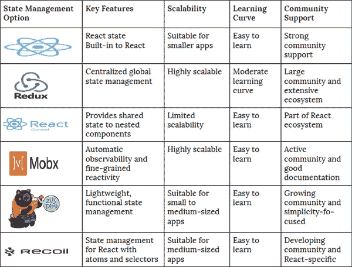

**表 7.1:** 各状态管理选项

请注意，可扩展性和学习曲线是主观的，可能会根据应用程序的复杂性以及你对所选状态管理选项的熟悉程度而异。在决策时，考虑特定的项目需求、团队专业知识和社区支持很重要。

每个选项都提供了不同的权衡，选择取决于应用程序的大小、状态管理需求的复杂性以及开发团队的偏好等因素。花时间评估这些选项并考虑每个选项的优缺点，为你的 Next.js 项目找到最佳匹配。

## 状态管理选项的优缺点

`[表 7.2]` 显示了每个状态管理选项的优缺点以及何时使用每一个：

| 状态管理选项 | 优点 | 缺点 | 使用时机 |
| :--- | :--- | :--- | :--- |
| **React state** | 内置于 `React`，无需额外设置；本地状态的 API 简单直观 | 限于本地组件状态；不适合管理复杂或共享状态 | 有本地状态需求的小型应用 |
| **Redux** | 集中全局状态管理；状态更新可预测；生态系统和社区支持强大 | 需要设置和模板代码；学习曲线 | 有复杂状态管理需求的大型应用，或需要时间旅行调试和丰富的工具时 |
| **React Context** | 为嵌套组件提供共享状态；避免 props 传递；React 生态系统的一部分 | 对于大型应用的可扩展性有限；在深度嵌套组件中可能有性能开销 | 有中等状态共享需求的中间应用，或重视简单性和 React 集成 |
| **MobX** | 自动观察性和细粒度响应；高可扩展性；易于学习 | 与 React 集成可能需要额外设置；高级概念存在学习曲线 | 需要高可扩展和响应式状态管理，且偏好简单易用的应用 |
| **Zustand** | 轻量级且函数化的状态管理；易于学习 | 工具和社区支持可能有限 | 优先考虑简单、性能和极简方法的的中小型应用 |
| **Recoil** | 使用 atoms 和 selectors 进行 React 状态管理；易于学习 | 较新且不断发展的库；社区正在发展中 | 适用于需要灵活且高效状态管理的 React 应用，特别是中等规模的项目 |

**表 7.2：** 每种状态管理方案的优缺点

## 使用 React state 和 hooks 实现状态管理

让我们学习如何使用 React state 实现状态管理，以及如何使用如 `useState` 和 `useContext` 等 hooks。

`useState` 是 React 中的一个内置 hook，允许你向函数式组件中添加状态。它提供了一种在组件内部管理和更新状态的方法，而不再需要使用类组件。

要使用 `useState` 实现状态管理，你可以遵循以下步骤：

1. 导入必要的依赖项：
```javascript
import React, { useState } from 'react';
```

2. 使用 `useState` 定义并初始化状态：
```javascript
const [state, setState] = useState(initialValue);
```
`state` 代表状态变量的当前值。
`setState` 是一个用于更新状态的函数。
`initialValue` 是你想要赋值给状态的初始值。

3. 在组件中使用该状态：
```javascript
return (
  <div>
    <p>Current state value: {state}</p>
    <button onClick={() => setState(newValue)}>Update State</button>
  </div>
);
```

4. 在 JSX 中使用 `{state}` 访问状态值。

要更新状态，调用 `setState` 并传入你想要赋值的新值 (`newValue`)。

这是一个完整的示例，用于说明实现过程：
```javascript
import React, { useState } from 'react';

const MyComponent = () => {
  const [count, setCount] = useState(0);

  const incrementCount = () => { 
    setCount(count + 1);
  };

  return (
    <div>
      <p>Count: {count}</p>
      <button onClick={incrementCount}>Increment</button>
    </div>
  );
};

export default MyComponent;
```

在这个示例中，`count` 是使用 `useState` 管理的状态变量，用于跟踪计数值。`incrementCount` 函数通过递增来更新 `count` 状态。该组件渲染当前的计数值和一个触发递增的按钮。

通过这些步骤，你可以轻松在函数式组件中使用 `useState` 实现状态管理。请记住，使用 `useState` 管理的状态对于声明它的组件是局部的。

`useContext` 是 React 中的一个内置 hook，允许你访问上下文对象的值。它提供了一种在函数式组件中消费上下文值的方法，而无需用上下文消费者包裹组件。

要使用 `useContext` 实现状态管理，你可以遵循以下步骤：

* 使用 `React.createContext()` 创建上下文对象：
```javascript
const MyContext = React.createContext();
```
* 使用 context provider 包裹你的组件或多个组件并提供值：
```javascript
return (
  <MyContext.Provider value={contextValue}>
    { /* 在此处放置你的组件 */ }
  </MyContext.Provider>
);
```
`contextValue` 代表你想要在上下共享的值。

* 在组件中使用 `useContext` 消费上下文值：
```javascript
const contextValue = useContext(MyContext);
```
在这里，`contextValue` 将包含由提供的值。

这是一个完整的示例，用于说明实现过程：
```javascript
import React, { useContext } from 'react';

const MyContext = React.createContext();

const ParentComponent = () => {
  const contextValue = 'Hello from context';
  return (
    <MyContext.Provider value={contextValue}>
      <ChildComponent />
    </MyContext.Provider>
  );
};

const ChildComponent = () => {
  const contextValue = useContext(MyContext);
  return (
    <div>
      <p>Context Value: {contextValue}</p>
    </div>
  );
};

export default ParentComponent;
```

在这个示例中，`ParentComponent` 使用 context provider 包裹了 `ChildComponent`，提供了上下文值 `Hello from context`。`ChildComponent` 使用 `useContext` 消费并渲染该值。

通过这些步骤，你可以使用 `useContext` 实现状态管理，并在函数式组件之间共享和消费上下文值。请记住根据你的特定用例和组件结构调整代码。

## 在 Next.js 中管理状态的最佳实践

在 Next.js 应用中管理状态时，有几个最佳实践需要遵循以避免常见的错误并优化性能。以下是需要考虑的关键实践：

* **最小化全局状态：** 通常建议尽可能减少全局状态的使用。全局状态会引入复杂性，并使难以推断应用程序中的数据流。相反，努力在单个组件或较小范围的上下文中进行局部化状态管理。
* **使用本地组件状态：** 利用 React 内置的状态管理能力（如 `useState`）来管理本地组件状态。这对于管理特定组件且不需要在多个组件之间共享的状态是理想的。
* **选择合适的状态管理库：** 如果你有复杂的状态管理需求，或需要在多个组件之间共享状态，请考虑使用 Redux 或 MobX 等状态管理库。这些库提供了管理状态的高级功能，并帮助扩展你的应用状态。
* **规范化状态形状：** 规范化你的状态结构以保持其简单和有序。这涉及将复杂的数据结构拆分为单独的实体并存储在规范化的格式中。规范化可以提高性能并简化数据检索和处理。
* **避免不必要的渲染：** 通过使用记忆化（memoization）和 `React.memo` 等技术优化组件以避免不必要的渲染。记忆化有助于防止昂贵的计算在每次渲染时重复，而 `React.memo` 可以在 props 发生变化时防止组件重新渲染。
* **使用不可变性：** 不可变数据有助于优化性能，允许 React 高效判断组件是否需要重新渲染。避免直接修改状态对象，而是创建副本或使用 Immutable.js 或 Immer 等不可变数据结构。
* **谨慎使用 react context：** React Context 是跨组件共享状态的强大工具，但如果过度使用可能会影响性能。请谨慎使用上下文，并考虑属性传递（props drilling）或状态提升是否更适合你的特定用例。
* **优化 API 请求：** 在从 API 获取数据时，实施缓存、防抖或分页等技术以减少不必要的请求并提高性能。考虑使用 SWR 或 React Query 等专为 React 应用设计的数据获取和缓存功能库。
* **性能监控：** 使用 Lighthouse、Chrome DevTools 或性能分析库等工具监控应用的性能。识别并解决与状态管理相关的瓶颈或性能问题。
* **测试与重构：** 为你的状态管理代码编写全面的单元测试，以确保正确性和可维护性。定期审查并重构你的状态管理代码，以保持其整洁、有序和优化。

通过遵循这些最佳实践，你可以有效地管理 Next.js 应用中的状态，同时优化性能并避免常见的陷阱。请记住，应用程序的具体需求可能有所不同，因此在实施状态管理解决方案时，务必考虑你项目的上下文和需求。

## 在 Next.js 应用中使用 Redux 实现状态管理

`Redux` 是一个常用于 React 和 Next.js 等 JavaScript 框架的状态管理库。它通过执行一套严格的原则和模式，提供了一种可预测的方式来管理应用程序的状态。`Redux`遵循单向数据流，使得理解和调试状态变化变得更加容易。

`Redux` 的三个原则是：

- 单一数据源：`Redux` 提倡为应用程序状态维护单一数据源的思想。整个状态存储在一个名为 Redux store 的中心化对象中。这允许应用程序中的所有组件以一致且可预测的方式访问和更新状态。
- 状态是只读且不可变的：在 `Redux` 中，状态被视为只读的，这意味着你不能直接修改它。相反，你通过派发动作（actions）来描述状态变化。这些动作是纯 JavaScript 对象，包含了关于应用程序中发生了什么的信息。Reducers 是 `Redux` 中的纯函数，接收当前状态和派发的动作作为输入，并返回一个新的状态对象，而不修改原始状态。这种不可变性确保了状态的可预测性，有助于高效的变更检测，并启用了如时间旅行调试等功能。
- 变化通过纯函数进行：`Redux` 依赖于称为 reducers 的纯函数来更新状态。Reducers 接收当前状态和动作并返回一个新状态。它们没有副作用，也不会直接与外部资源交互。通过遵循纯函数，`Redux` 使状态变化变得可预测且可于测试。它还实现了代码的模块化和重用，因为 reducers 可以组合起来处理状态的不同部分。

## Flux

`Flux` 是 Facebook 引入的一种架构模式，补充了 React 基于组件的架构。`Flux` 解决了大型应用中状态管理的挑战。它强制执行单向数据流并促进了清晰的关注点分离。

`Flux` 由几个关键组件组成：

- 动作（Actions）：描述事件或用户意图，并包含与事件相关的数据。它们由用户交互或系统事件触发。
- 派发器（Dispatcher）：`Dispatcher` 负责接收动作并将它们派发到注册的 stores。它作为 `Flux` 架构中的中心枢纽。
- 存储器（Stores）：持有应用程序状态和业务逻辑。它们接收来自 `Dispatcher` 的动作并相应地更新状态。Stores 负责决定状态如何响应动作而发生变化。
- 视图（Views）：代表应用程序的用户界面组件。它们从 Stores 中检索数据，并根据状态渲染用户界面。
- `Flux` 强制执行单向数据流，动作通过 `Dispatcher` 流向 Stores，然后由 Stores 更新状态。Views 监听状态的变化并在需要时重新渲染。

### 结合 Redux 和 Flux

`Redux` 和 `Flux` 共享相似的概念和原则，使得它们在状态管理中是可以结合的。`Redux` 可以被看作 `Flux` 架构的一种实现，其中 `Redux` 的 store 替代了 `Flux` stores 的角色，而 `Redux` 的 reducers 替代了 `Flux` stores 的逻辑。

在 `Redux` 和 `Flux` 的结合方法中，你可以使用 `Redux` 作为底层的状态管理库，并遵循 `Redux` 的单一数据源、不可变性和纯 reducers 的原则。`Flux` 提供的单向数据流和关注点分离可以与 `Redux` 集成，以增强应用程序状态管理的组织性和可扩展性。

以下是关于如何结合 `Redux` 和 `Flux` 的逐步说明：

- 使用 `Redux` 作为状态管理库：在你的 Next.js 应用中设置 `Redux`，创建一个 Redux store，定义处理状态更新的 reducers，并使用 React Redux 的 `connect` 函数将组件连接到 Redux store。
- 采用 `Flux` 的单向数据流：虽然 `Redux` 已经遵循了单向数据流，但你可以通过采用 `Flux` 的模式进一步增强它。动作从你的组件派发到 Redux store，store 使用 reducers 更新状态。更新后的状态随后传播到组件，触发重新渲染。
- 利用 `Flux` 的关注点分离：通过根据应用程序中的特定领域或功能组织你的 Redux reducers，来利用 `Flux` 的关注点分离。每个 reducer 可以处理状态的特定部分，类似于 `Flux` 的 stores 管理应用程序数据的不同部分。
- 结合动作和 reducers：在 `Redux` 中创建动作来描述状态变化，就像你在 `Flux` 中做的那样。将这些动作派发到 Redux store，store 继之调用对应的 reducers。reducers 处理动作并遵循不可变性和纯函数的原则相应地更新状态。

通过结合 `Redux` 和 `Flux`，你可以受益于 `Redux` 强大的状态管理能力，同时利用 `Flux` 清晰的数据流和关注点分离。这种组合帮助你为应用程序状态维护单一数据源，确保状态更新的不可变性和可预测性，并以模块化和可扩展的方式组织你的状态管理逻辑。

请记住，虽然 `Redux` 和 `Flux` 可以结合，但考虑你应用程序的复杂性和需求是非常关键的。如果你的应用程序较小，或者不需要广泛的状态管理，仅使用 `Redux` 可能就足够了。然而，对于更大更复杂的应用程序，将 `Redux` 与 `Flux` 结合可以为管理状态提供有效的解决方案。

首先使用你喜欢的方法设置基础的 Next.js 项目。你可以使用 Next.js CLI 或手动创建一个新项目。确保你已经安装了必要的依赖。

### 步骤 2：安装 Redux 及相关包

在项目目录中，安装 Redux 和 Flux 集成所需的包。运行以下命令：

```bash
npm install redux react-redux redux-thunk
```

### 步骤 3：创建 Redux store

在你的项目中，创建一个名为 `store.js` 的新文件。该文件将包含 Redux store 的配置。添加以下代码：

```javascript
import { createStore, applyMiddleware } from 'redux';
import thunk from 'redux-thunk';

// 在此处导入你的 reducers
import rootReducer from './reducers';

const store = createStore(rootReducer, applyMiddleware(thunk));
export default store;
```

确保你已经在 `reducers` 目录下的单独文件中定义了你的 reducers。

### 步骤 4：定义你的 reducers

在 `reducers` 目录中为每个 reducer 创建单独的文件。每个 reducer 文件都应该导出一个函数，该函数接收当前状态和 action 作为参数，并返回一个新的状态。例如：

```javascript
// counterReducer.js 中的示例 reducer
const initialState = {
  count: 0,
};

const counterReducer = (state = initialState, action) => {
  switch (action.type) {
    case 'INCREMENT':
      return { ...state, count: state.count + 1 };
    case 'DECREMENT':
      return { ...state, count: state.count - 1 };
    default:
      return state;
  }
};

export default counterReducer;
```

### 步骤 5：创建你的 actions

在 `actions` 目录中为每个 action 创建单独的文件。每个文件都应该导出返回 action 对象的 action creator 函数（action 创建器函数）。例如：

```javascript
// counterActions.js 中的示例 actions
export const increment = () => ({
  type: 'INCREMENT',
});

export const decrement = () => ({
  type: 'DECREMENT',
});
```

### 步骤 6：合并 reducers

在你的 `reducers` 目录中，创建一个 `index.js` 文件将所有的 reducers 合并为一个根 root reducer。例如：

```javascript
// reducers/index.js
import { combineReducers } from 'redux';
import counterReducer from './counterReducer';

const rootReducer = combineReducers({ counter: counterReducer });
export default rootReducer;
```

### 步骤 7：创建你的组件

创建使用 Redux store 并调度 actions 的 React 组件。例如：

```javascript
// Counter.js 中的示例组件
import React from 'react';
import { connect } from 'react-redux';
import { increment, decrement } from './actions/counterActions';

const Counter = ({ count, increment, decrement }) => {
  return (
    <div>
      <h1>Count: {count}</h1>
      <button onClick={increment}>Increment</button>
      <button onClick={decrement}>Decrement</button>
    </div>
  );
};

const mapStateToProps = (state) => ({ count: state.counter.count });
const mapDispatchToProps = { increment, decrement };

export default connect(mapStateToProps, mapDispatchToProps)(Counter);
```

### 步骤 8：设置你的 Next.js 页面

在你想要渲染连接 Redux 组件的地方创建一个 Next.js 页面。导入这些组件并在页面中使用它们。例如：

```javascript
// pages/index.js
import React from 'react';
import Counter from '../components/Counter';

const HomePage = () => {
  return (
    <div>
      <h1>Redux with Flux Example</h1>
      <Counter />
    </div>
  );
};

export default HomePage;
```

### 步骤 9：用 Redux provider 包裹你的 Next.js 应用

在 `pages/_app.js` 文件中，使用 `Provider` 组件包裹你的 Next.js 应用，并提供在步骤 3 中创建的 Redux store。例如：

```javascript
// pages/_app.js
import { Provider } from 'react-redux';
import store from '../store';

function MyApp({ Component, pageProps }) {
  return (
    <Provider store={store}>
      <Component {...pageProps} />
    </Provider>
  );
}

export default MyApp;
```

### 步骤 10：运行你的 Next.js 应用

启动你的 Next.js 开发服务器并导航到你使用过 Redux 连接组件的页面。你现在应该看到计数器组件，并带有用于增加和减少计数的按钮。

大功告成！你已经在简单的 Next.js 应用中使用 Redux 和 Flux 实现了状态管理。Redux 提供了单一事实来源和状态管理能力，而 Flux 关于 actions、dispatcher 和 stores 的原则则已集成到 Redux 架构中。

你可以根据需要按照相同的模式添加更多 actions、reducers 和组件。这种方法允许你有效地管理 Next.js 应用的状态，并轻松处理复杂的状态交互。

## Redux Thunk

Redux Thunk 是 Redux 的中间件，Redux 是 JavaScript 中流行的状态管理库。它允许你编写返回函数而非普通 action 对象的 action creators。这使得你能够执行异步操作，例如 API 调用。

### 为什么需要 Redux Thunk？

在 Redux 中，actions 通常是带有 type 和 payload 的对象。但在某些情况下，你可能需要在调度 actions 之前执行异步操作，例如从 API 获取数据。

### 带有代码实现 Redux Thunk

要使用 Redux Thunk，你需要对其进行设置。

### 1. 设置 Thunk 中间件

导入 `thunk` 中间件并将其应用于 store。

```javascript
import { createStore, applyMiddleware } from 'redux';
import thunk from 'redux-thunk';
import rootReducer from './reducers';

const store = createStore(rootReducer, applyMiddleware(thunk));
export default store;
```
在这里，我们导入 `thunk` 中间件并将其应用于 store。`rootReducer` 代表合并后的 reducers。

### 2. 创建 thunk action creators

Thunk action creators 是可以调度 actions 的函数。例如：

```javascript
// actions.js
import axios from 'axios';
export const fetchData = () => {
  return async (dispatch) => {
    dispatch({ type: 'FETCH_DATA_REQUEST' });
    try {
      const response = await axios.get('https://api.example.com/data');
      dispatch({ type: 'FETCH_DATA_SUCCESS', payload: response.data });
    } catch (error) {
      dispatch({ type: 'FETCH_DATA_FAILURE', payload: error.message });
    }
  };
};
```
在此示例中，`fetchData` 是一个从 API 获取数据的 thunk action creator。它返回一个接收 `dispatch` 函数作为参数的函数。在这个函数内部，你可以调度多个 actions 来表示异步操作的不同阶段。

### 3. 调度 thunk action creators

要调度 thunk action creator，你需要使用 Redux 提供的 `dispatch` 函数。这里有一个如何调度 `fetchData` thunk action creator 的示例：

```javascript
// component.js
import React, { useEffect } from 'react';
import { useDispatch, useSelector } from 'react-redux';
import { fetchData } from './actions';

const Component = () => {
  const dispatch = useDispatch();
  const data = useSelector((state) => state.data);
  useEffect(() => {
    dispatch(fetchData());
  }, [dispatch]);

  // 使用获取的数据渲染组件
  // ...
  return <div>{data}</div>;
};

export default Component;
```
在此示例中，我们使用来自 react-redux 库的 `useDispatch` 钩来获取 `dispatch` 函数。然后我们在 `useEffect` 钩子中调度 `fetchData` thunk action creator，以便在组件挂载时触发 API 调用。

以上是对 Redux Thunk 及其实现方式的基本概述。它允许你在 Redux actions 中处理异步操作并相应地管理状态。

**注意：** *第 12 章，使用 Next.js 开发 CRUD 应用程序,* 涵盖了我们在应用程序中对 Redux 和 Flux 的完整实现，提供了一个强大的状态管理解决方案。按照这些步骤学习如何设置 Redux store、定义 actions 和 reducers，以及连接组件以实现高效的数据流。

## 在简单的 Next.js 中使用 React context 实现状态管理

React context 是 React 中的一项功能，允许你在组件之间共享数据，而无需在组件树的每一层都显式地传递 props。它提供了一种创建全局状态的方法，树中的任何组件都可以访问该状态。

### 问题可视化：

- 假设你有两个组件 A 和 B，它们都在主 APP 组件内部。
- 组件 B 需要来自组件 A 的状态值。
- 由于组件结构的原因，直接传递此值非常棘手。

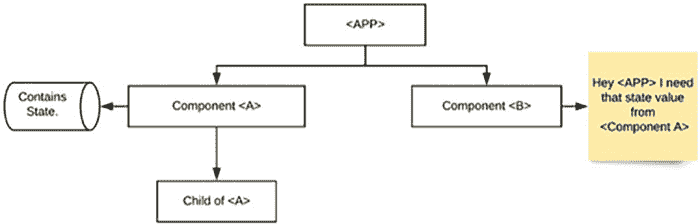

**图 7.2：** 问题陈述概述

### 解决方案 1：状态提升（Uplifting State）：

- 将所需的状态从组件 A 移动到父组件 APP。
- 这解决了当前问题，但对于较大的应用程序来说并不实用。

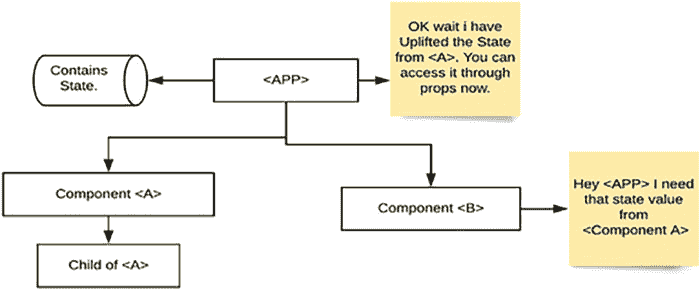

**图 7.3：** 状态提升

### 解决方案 2：Context API：

- Context API 提供了一种跨组件共享全局变量的方法。
- 它是手动传递 prop（prop drilling）的替代方案。
- 当数据需要被嵌套层级的许多组件访问时效果最佳。

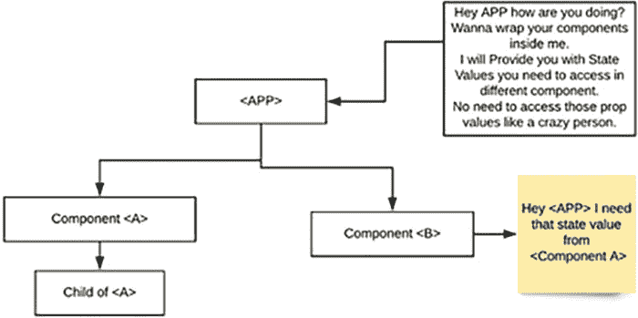

**图 7.4：** 引入 Context API 的解决方案

### 创建 Context API：

- 设置包含父 APP、组件 A 和组件 B 的目录结构。
- 创建名为 `Context.js` 的文件，并编写 `createContext` 创建 context 代码。

### 创建 Provider：

- 从创建的 context 中提取 `Provider`。
- 创建一个 `AppProvider` 组件，为消费它的组件提供值。
- 在 `AppProvider` 内部，使用 `useState` 为你想共享的数据设置状态。
- 用 `AppProvider` 包裹你的父组件（APP）。

### 消费 Context：

- 在想要消费 context 的组件中导入 `AppContext` 和 `useContext`。
- 使用 `useContext` hook 访问 context 值。

### Context 使用技巧：

- 不要用 context 替换本地状态；尽可能任何时候使用本地状态。
- 更改 context 值会导致使用该 context 的组件重新渲染。
- 避免用 context provider 包裹整个应用；在最小的必要父组件中使用它。

### 总结：

- 使用 `createContext` 创建 Context。
- 从 context 中提取 `Provider`。
- 用 Provider 包裹父组件。
- 使用 `useContext` hook 消费 context。

Context API 简化了组件之间的数据共享，避免了 prop drilling。然而，明智地使用它并避免过度使用非常重要。它作为一种跨不同组件更新和访问该状态的机制。

此流程代表了 React context 中的基本数据流。它概述了创建 context、设置 provider、定义 actions、消费 context、访问和更新状态以及重新渲染组件所涉及的步骤。

要在简单的 Next.js 应用程序中使用 React context 实现状态管理，你可以遵循以下步骤：

### 第 1 步：设置 Next.js 项目

首先使用你喜欢的方法设置基础的 Next.js 项目。你可以使用 Next.js CLI 或手动创建新项目。确保已安装必要的依赖项。

### 第 2 步：创建一个新的 context 文件

在项目中创建一个名为 `AppContext.js` 的新文件。该文件将包含你的 React context 的设置。添加以下代码：

```javascript
// AppContext.js
import React, { createContext, useState } from 'react';

// 创建 context
export const AppContext = createContext();

// 创建一个 provider 组件
export const AppProvider = ({ children }) => {
  const [state, setState] = useState({
    // 在此处定义你的初始状态
    count: 0,
  });

  // 定义任何更新状态的 actions
  const increment = () => {
    setState((prevState) => ({
      ...prevState,
      count: prevState.count + 1,
    }));
  };

  const decrement = () => {
    setState((prevState) => ({
      ...prevState,
      count: prevState.count - 1,
    }));
  };

  // 向子组件提供状态和 actions
  return (
    <AppContext.Provider value={{ state, increment, decrement }}>
      {children}
    </AppContext.Provider>
  );
};
```

### 第 3 步：用 AppProvider 包裹你的 Next.js 应用

在 `pages` 目录下的 `_app.js` 文件中，用来自 `AppContext.js` 文件的 `AppProvider` 组件包裹你的 Next.js 应用。例如：

```javascript
// pages/_app.js
import { AppProvider } from '../AppContext';

function MyApp({ Component, pageProps }) {
  return (
    <AppProvider>
      <Component {...pageProps} />
    </AppProvider>
  );
}

export default MyApp;
```

### 第 4 步：创建你的组件

创建将使用 context 管理状态的组件。导入 `AppContext` 并使用 `useContext` 访问状态。例如：

```javascript
// components/Counter.js
import React, { useContext } from 'react';
import { AppContext } from '../AppContext';

const Counter = () => {
  const { state, increment, decrement } = useContext(AppContext);
  return (
    <div>
      <h1>Count: {state.count}</h1>
      <button onClick={increment}>Increment</button>
      <button onClick={decrement}>Decrement</button>
    </div>
  );
};

export default Counter;
```

### 第 5 步：设置你的 Next.js 页面

创建一个你想要渲染 context 链接组件的 Next.js 页面。导入组件并在你的页面中使用它们。例如：

```javascript
// pages/index.js
import React from 'react';
import Counter from '../components/Counter';

const HomePage = () => {
  return (
    <div>
      <h1>React Context 示例</h1>
      <Counter />
    </div>
  );
};

export default HomePage;
```


### 第 6 步：在组件外部访问 context（可选）

如果你需要在组件外部访问 context（例如在实用函数或自定义 hook 中），你也可以使用 `useContext` hook。请注意，`useContext` 只能在函数组件中使用。

### 第 7 步：运行你的 Next.js 应用

启动你的 Next.js 开发服务器并导航到你使用 context 链接组件的页面。你现在应该能看到带有增加和减少计数按钮的计数器组件。

就这样！你成功地在简单的 Next.js 应用程序中使用 React context 实现了状态管理。React context 允许组件之间共享状态和 actions，而无需 prop drilling。它简化了应用程序中管理和更新共享状态的过程。

请记住，随着应用程序的增长，你可能需要更高级的功能，如中间件、异步操作或复杂的状态管理。在这种情况下，你可以考虑使用 `Redux` 或其他状态管理库。

然而，对于状态需求较简单的小型应用程序，`react context` 可以作为一个轻量级且有效的解决方案。

**注意：** 请查看 GitHub 仓库中第 7 章 *Building-Scalable-Web-Applications-with-Next.js-and-React* 的示例代码，以探索与章节内容相关的实际示例和实现。

# 案例研究与示例

在本节中，我们将看到如何在 Next.js 应用程序真实场景中实现状态管理。让我们探讨五个案例研究，以及处理复杂状态的最佳实践：

### 电子商务购物车

- **场景：** 假设你正在构建一个带有购物车功能的电子商务网站。
- **实现方式：** 为了管理购物车状态，你可以使用 `Redux` 或 `React context`。在全局状态中存储购物车物品、数量和总价。实现动作（actions）和还原器（reducers）来处理购物车中物品的添加、删除或更新。将相关组件连接到状态管理解决方案以显示和更新购物车。
- **最佳实践：**
    - 规范化购物车状态结构，以便高效处理大量物品。
    - 使用选择器（selectors）或内存（memoization）技术优化渲染，防止购物车相关组件进行不必要的重新渲染。
    - 实现持久化以保存购物车状态，用户在关闭浏览器后也能返回购物车。

### 社交媒体动态

- **场景：** 假设你正在构建一个包含不同用户帖子流的社交媒体应用程序。
- **实现方式：** 为了管理流状态，你可以利用 `React state` 或 `React context`。在组件状态或上下文中存储帖子及其元数据。实现函数来处理诸如添加新帖子、删除帖子或更新帖子点赞和评论等操作。根据状态数据渲染流组件。
- **最佳实践：**
    - 考虑分页或无限滚动技术，以高效处理流中的大量数据。
    - 使用异步操作或 API 调用来获取和更新帖子，确保无缝的用户体验。
    - 实现缓存机制以提高性能，避免对同一帖子进行冗余的 API 调用。

### 为天气应用实现 Redux

- **场景：** 开发一个显示不同位置天气信息的应用程序。
- **实现方式：** 使用 `Redux` 管理天气数据状态。将天气信息（如温度、状况和位置）存储在 `Redux store` 中。实现动作和还原器来获取和更新天气数据。使用 `react-redux` 库将相关组件连接到 store。
- **最佳实践：**
    - 使用规范化数据构建 `Redux store`，以高效管理和更新天气信息。
    - 利用 `Redux Thunk` 或 `Redux Saga` 等中间件来处理异步操作，例如从 API 获取天气数据。
    - 利用选择器从 store 中计算派生数据，减少不必要的计算并优化性能。

### 为用户认证实现 React context

- **场景：** 构建一个具有用户身份验证功能的应用程序。
- **实现方式：** 使用 `React context` 管理用户身份验证状态。在上下文中存储用户信息（如用户名和身份验证令牌）。实现上下文提供者（providers）和消费者（consumers）来处理用户登录、注销和身份检查。使用 `useContext` 钩子在整个应用程序中使用身份验证状态。
- **最佳实践：**
    - 谨慎使用上下文，仅用于真正必要的全局共享状态。
    - 在单独的模块或自定义钩子中实现身份验证逻辑，以提高重用性和可维护性。
    - 考虑使用 `react-router` 等第三方库根据身份验证状态处理受保护路由。

### 为待办列表实现 React state

- **场景：** 构建一个简单的待办事项应用程序。
- **实现方式：** 使用 `React state` 管理任务列表。将任务以数组形式存储在组件状态中。实现添加新任务、标记任务为完成和删除任务的函数。使用 `useState` 钩子管理状态并根据用户更新列表。
- **最佳实践：**
    - 将状态拆分为更小、可管理的部分，以避免不必要的重新渲染。
    - 在更新状态时使用不可变性，以确保行为的可预测性并防止错误。
    - 考虑使用 `useEffect` 钩子将待办列表持久化到本地存储中，用户在关闭浏览器后也能访问其列表。

在这些案例研究中，使用 `Redux` 或 `React context` 实现状态管理为 Next.js 应用程序中处理复杂状态提供了集中且高效的解决方案。通过遵循最佳实践（如规范化状态结构、使用选择器或内存优化渲染，以及实现持久化或缓存），你可以确保流畅的性能和对复杂状态的有效管理。

请记住根据你的特定应用程序需求调整这些方法，并在实现状态管理解决方案时考虑你的项目需求。

# 结论

本章广泛探讨了 Next.js 应用程序中状态管理的各个方面，并强调了其重要性。章节从介绍 Next.js 中的状态管理开始，强调了其在开发健壮 Web 应用程序中至关重要的作用。

并对 Next.js 中的各种状态管理选项进行了全面回顾，包括 `React state`、`Redux` 和 `React context`。讨论了每个选项的优缺点，有助于根据特定需求做出明智决策。

整个章节都强调了有效状态管理的最佳实践，涵盖了避免常见陷阱和性能优化。这些指南使开发者能够简化 Next.js 应用程序中的状态管理流程。

探索了使用 `React state` 实现状态管理的技巧，包括利用 `useState` 和 `useContext` 等钩子。这些知识使开发者能够有效地管理组件内部的状态。

还涵盖了使用 `Redux` 实现状态管理的技巧，包括 store 的设置、动作和还原器的定义以及与组件的集成。这一全面的讲解让开发者掌握了在 Next.js 应用程序中使用 Redux 进行高级状态管理的技能。

此外，本章介绍了使用 `React context` 进行状态管理，涵盖了创建上下文、提供者消费者的定义以及在组件中的用法。这种理解使开发者能够有效利用 `React context`。

研究了真实的案例研究和示例，以加强理解并展示 Next.js 应用程序中状态管理的实际实现。这些场景展示了处理复杂状态的最佳实践，为开发者提供了宝贵的见解。

下一章将重点介绍 Next.js 应用程序中的 REST 和 GraphQL API。它将解释这些概念并展示如何使用它们构建健壮且灵活的 Web 应用程序。

# 多选题

1. Next.js 应用程序中状态管理的目的是什么？
    1. 处理用户身份验证
    2. 管理应用程序路由
    3. 在跨组件间高效地管理和共享数据
    4. 提高代码组织结构和可维护性

2. 哪种状态管理选项是 React 内置并提供的？
    1. Redux
    2. React state
    3. React context
    4. MobX

3. 哪种状态管理选项基于 Flux 架构模式的？
    1. Redux
    2. React state
    3. React context
    4. MobX

4. 使用 React context 进行状态管理的主要优势是什么？
    1. 具有预测数据流的中心化状态管理
    2. 内置支持时间旅行调试
    3. 简单易用
    4. 高性能和高效更新

5. 在 Next.js 中，通常什么时候推荐将 Redux 作为状态管理选项？
    1. 适用于小型和简单的应用程序
    2. 处理复杂状态和数据流时
    3. 当需要服务端渲染时
    4. 当需要实时数据更新时

## 答案

1. C
2. B 和 C
3. A
4. C
5. B

注意：这些问题旨在测试关于 Next.js 状态管理的通用知识。请参考你学习材料中所涵盖的特定内容和概念以获得准确答案。

# 第 8 章

# Restful 和 GraphQL API 实现

## 引言

在 Web 开发领域，API（应用程序编程接口）对于构建健壮的应用程序至关重要。它们实现了软件系统之间无缝通信和数据交换。本章将探索 API 在现代 Web 开发中的意义。

在本章中，我们将介绍 API 并强调它们作为应用程序之间桥梁的重要性，提供访问外部功能的途径。我们将讨论 RESTful 和 GraphQL API 之间的差异以及它们对于设计的处理。实践涵盖了如何在 Next.js 中设置 RESTful API 以及为 CRUD 操作创建端点。我们还将探索如何使用 Apollo Server 在 Next.js 中设置 GraphQL API，构建用于精确数据检索的强大 API 端点。

与 Next.js 应用程序的集成将侧重于服务端渲染，通过更快的页面加载提升用户体验。此外还讨论了 API 安全和身份验证的错误处理最佳实践。

在整个章节中，实际示例和提示将增强读者的理解。到结束时，你将对 Next.js 开发中的 API 有一个全面的理解。让我们开启 Web 开发中 API 的威力吧！

## 结构

在本章中，我们将涵盖以下主题：

* API 简介及其在现代 Web 开发中的重要性
* 理解 RESTful 和 GraphQL API 之间的差异
    * 在 Next.js 中设置和配置 RESTful API
    * 使用 Apollo Server 等流行框架在 Next.js 中设置和配置 GraphQL API
    * 构建用于 CRUD（创建、读取、更新、删除）的 RESTful 和 GraphQL API 端点
* 将 API 端点与 Next.js 集成
* 处理 API 调用中的错误和异常
* Next.js 应用程序中 API 安全和身份验证的最佳实践

## API 简介及其在现代 Web 开发中的重要性

API 可以被视为一组定义了软件组件应如何交互的规则和协议。它指定了开发者可以用于在应用程序之间请求和交换信息的方法、数据格式和端点。

### API 类型

* **Web APIs**：这些 API 旨在允许基于网络的系统进行通信。它们使用 `HTTP`（超文本传输协议）作为底层协议，通常以 `JSON`（JavaScript 对象表示法）或 `XML`（可扩展标记语言）格式提供数据。
* **服务 APIs**：这些 API 由各种软件服务暴露，允许开发者访问这些服务的特定功能。例如，支付网关服务可能提供一个开发者可以在其应用程序中处理支付的 API。

### API 在现代 Web 开发中的重要性

* **集成**：API 允许不同的应用程序无缝集成并共享数据、功能和服务。这种集成允许开发者利用现有的平台和服务，来快速增强他们的应用程序。
* **效率**：API 促进了代码重用和模块化。开发者不需要从零开始一切，而是可以使用 API 访问预构建的功能，从而节省时间和精力。
* **可扩展性**：API 促进了应用程序的可扩展性。开发者可以利用外部服务或平台来处理存储、身份验证或支付处理等任务，释放资源专注于应用程序的核心功能。
* **协作**：API 促进了开发者和团队之间的协作。通过 API 暴露特定功能，开发者可以同时处理不同的组件，确保更快的开发周期。

### API 是如何工作的？

当开发者想要与 API 交互时，他们使用适当的 `HTTP` 方法（`GET`、`POST`、`PUT`、`DELETE` 等）向特定端点（`URL`）发送请求。API 处理请求，执行必要的操作，并返回带有请求数据或指示操作成功失败状态的响应。

## API 协议与架构

API 协议和架构是指规范 API 设计、通信和交互模式的标准和框架。以下是一些常用的 API 协议和架构：

* **REST（表述状态转移）**：REST 是一种广泛采用的用于网络应用的架构风格。RESTful API 使用 `HTTP` 方法（`GET`、`POST`、`PUT`、`DELETE` 等）与由 `URLs`（统一资源定位符）标识的资源进行交互。REST API 强调无状态通信、可扩展性和关注点分离。它们被广泛用于 Web 开发，并遵循资源导向设计、无状态和统一接口等原则。
* **SOAP（简单对象访问协议）**：SOAP 是一种用于使用 `XML` 在 Web 服务中交换结构化信息的协议。SOAP API 使用 `WSDL`（Web 服务描述语言）描述的 `XML` 契约来定义消息格式、操作和合同。SOAP 以其丰富的功能、对复杂数据类型的支持、安全性和事务能力而闻名。它通常用于企业级集成和面向服务的架构。
* **gRPC（Google 远程过程调用）**：gRPC 是一个由 Google 开发的高性能、语言无关的框架。它使用 `Protocol Buffers`（`protobuf`）来定义服务和消息。gRPC API 通过远程过程调用（`RPC`）实现服务之间高效且跨平台的通信。gRPC 以其速度、对双向流的支持、流量控制和身份验证而闻名。它通常用于微服务架构和分布式系统。
* **GraphQL**：GraphQL 是一种用于 API 的开源查询语言和运行时。它允许客户端通过构建灵活且精确的查询来请求特定数据。与由服务器决定响应形状的 REST 不同，GraphQL 将控制权交给了客户端。GraphQL API 提供单一端点，并只返回客户端请求的数据，减少了数据的过度获取和获取不足。GraphQL 常用于对灵活性、高效数据检索和客户端驱动数据需求的场景。

这些是一些广泛使用的 API 协议和架构。每种协议都有其自身的优势和适用场景，选择取决于应用程序性质、性能需求、与现有系统的兼容性以及开发者的偏好等因素。

在本章中，你将全面理解这两种流行的 API 类型：REST 和 GraphQL API。我们将讨论它们的特点、使用场景，以及如何实现和消费每种 API。这些知识将使你能够根据项目需求，在 REST 和 GraphQL 之间做出明智的决策，并优化你的 API 设计和集成策略。

## RESTful 对比 GraphQL API

下表解释了 RESTful API 和 GraphQL API 之间的区别：

|    | RESTful APIs | GraphQL APIs |
| :--- | :--- | :--- |
| 数据获取 | 使用多个端点获取多个资源 | 从单个端点获取数据，允许客户端精确指定它们所需的数据 |
| 过度获取 (Over-fetching) | 常见现象，客户端收到的数据比需要的多 | 通过允许客户端仅请求所需的字段，消除了过度获取 |
| 获取不足 (Under-fetching) | 需要多次请求来检索相关数据 | 通过允许客户端在单个查询中请求嵌套数据，解决了获取不足的问题 |
| 版本控制 | 通常需要版本控制来引入破坏性更改 | 不需要版本控制，因为响应的结构可以由客户端控制 |
| 端点结构 | 基于资源，不同资源有不同的端点 | 处理所有数据查询、变异和订阅的单一端点 |
| 请求灵活性 | 灵活性有限，因为服务器决定响应格式 | 高度灵活，因为客户端在查询中指定数据需求 |
| 缓存 | 支持端点级别的缓存 | 由于动态查询和不可预测的数据需求，缓存可能具有挑战性 |
| 复杂性管理 | 在处理嵌套或相关资源时可能会变得复杂 | 为查询相关数据提供了简单性，并通过精确选择数据避免了复杂 |
| 客户端服务器约定 | 服务器决定响应的结构和格式 | 客户端通过指定所需的字段来决定响应的结构和格式 |
| 学习曲线 | 容易理解和实现 | 需要额外学习和理解 GraphQL 查询语言和解析函数 (resolver) |
| 生态成熟度 | 完善，拥有成熟的生态系统和工具 | 生态系统不断增长，工具不断演进，但不如 RESTful API 成熟 |

**表 8.1：** RESTful API 和 GraphQL API 之间的区别

## 在 Next.js 中设置和配置 RESTful API

要在 Next.js 中使用不同的 HTTP 方法（GET, POST, PUT, PATCH 和 DELETE）设置并配置 RESTful API，请按照以下步骤操作：

### 步骤 1：设置新的 Next.js 项目

* 为项目创建一个新目录并使用终端或命令提示符进入目录。
* 运行以下命令初始化一个新的 Next.js 项目：

```bash
npx create-next-app
```

这将在当前目录下创建一个基础的 Next.js 项目。

### 步骤 2：创建 API 路由

* 在项目目录内创建一个名为 `pages/api` 的新目录。
* 在 `api` 目录下创建一个新的 JavaScript 文件，例如 `example.js`。该文件将代表你的 API 路由。

### 步骤 3：为不同 HTTP 方法定义 API 路由

#### 1. GET 方法：从服务器检索数据

在 `example.js` 中，为 `GET` 方法定义 API 路由。例如：

```javascript
export default function handler(req, res) {

  if (req.method === 'GET') {

    // 处理 GET 请求的逻辑

    res.status(200).json({ message: 'GET request received.' });

  } else {

    // 处理其他 HTTP 方法

    res.status(405).json({ message: 'Method Not Allowed' });

  }

}
```

#### 2. POST 方法：向服务器发送数据以创建新资源

为了处理 `POST` 请求，向 `example.js` 中添加以下代码：

```javascript
export default function handler(req, res) {

  if (req.method === 'POST') {

    // 处理 POST 请求的逻辑

    const data = req.body;

    res.status(200).json({ message: 'POST request received.', data });

  } else {

    // 处理其他 HTTP 方法

    res.status(405).json({ message: 'Method Not Allowed' });

  }

}
```

注意：对于 `POST` 方法，你需要解析请求体以访问数据。你可以使用 `body-parser` 或内置的 `express.json()` 中间件来实现这一点。

#### 3. PUT 方法：向服务器发送数据以更新现有资源

对于 `PUT` 方法，你可以使用以下代码：

```javascript
export default function handler(req, res) {

  if (req.method === 'PUT') {

    // 处理 PUT 请求的逻辑

    const { id } = req.query; // 动态 URL

    const data = req.body;

    res.status(200).json({ message: `PUT request received for ID: ${id}`, data });

  } else {

    // 处理其他 HTTP 方法

    res.status(405).json({ message: 'Method Not Allowed' });

  }

}
```

在此示例中，`PUT` 方法期望一个动态 URL `id` 来识别要更新的资源。`PUT` 和 `PATCH` 方法之间的主要区别如下：

* **PUT**：`PUT` 方法用于用新表示完全替换现有资源。在发送 `PUT` 请求时，通常会在请求负载中发送整个资源。这意味着请求负载中未包含的任何字段都将被删除或重置为默认值。`PUT` 通常用于全量更新且是幂等的，这意味着多次发送相同的 `PUT` 请求将产生相同的结果。
* **PATCH**：`PATCH` 方法用于部分更新现有资源。`PATCH` 请求通常不发送整个资源，而是只包含需要修改的特定字段或属性。这允许在不影响资源其他部分的情况下进行更细粒度的更新。`PATCH` 用于部分更新，且不一定是幂等的，这意味着多次发送相同的 `PATCH` 请求可能会产生不同的结果。

#### 4. DELETE 方法：向服务器发送请求以删除特定资源

对于 `DELETE` 方法，你可以使用以下代码：

```javascript
export default function handler(req, res) {

  if (req.method === 'DELETE') {

    // 处理 DELETE 请求的逻辑

    const { id } = req.query; // 动态 URL

    res.status(200).json({ message: `DELETE request received for ID: ${id}` });

  } else {

    // 处理其他 HTTP 方法

    res.status(405).json({ message: 'Method Not Allowed' });

  }

}
```

在此示例中，`DELETE` 方法期望一个动态 URL 参数 `id` 来识别要删除的资源。

### 步骤 4：测试 API 路由

在项目目录下运行以下命令启动 Next.js 开发服务器：

```bash
npm run dev
```

使用 Postman 或 cURL 等工具向你的 API 路由发送请求。例如，你可以向 `http://localhost:3000/api/example` 发送 `GET` 请求以查看图 8.1：

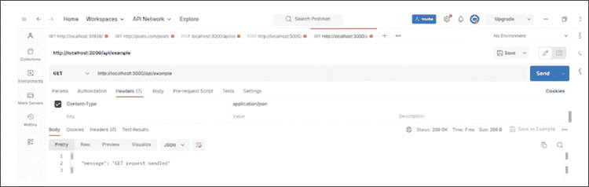

**图 8.1：** Postman 调用 API

## 使用 Apollo Server 在 Next.js 中设置和配置 GraphQL API

在 GraphQL API 中，三个基本组件包括查询（queries）、变异（mutation）和解析器（resolvers）。

* **Query (查询)**：GraphQL 查询用于从服务器请求数据。它遵循 GraphQL schema 定义的特定结构，允许客户端指定想要检索的精确字段和关系。查询是并行执行的，响应结果与查询的形状匹配。
* **Mutation (变异)**：GraphQL 变异用于修改服务器上的数据。它允许客户端对资源执行创建、更新或删除操作。与查询一样，变异定义在 GraphQL schema 中并有其自己的结构。当进行会对服务器产生副作用的变化时，通常使用变异。
* **Resolver (解析器)**：解析器负责解析 GraphQL 中的查询或变异函数。它充当 API 与底层数据源之间的桥梁。schema 中的每个字段都定义了解析器，包含了获取或操作请求数据的逻辑。执行解析器以满足客户端的请求并返回对应的数据。

总的来说，查询用于检索数据，变异用于修改数据，而解析器处理这些请求的执行并提供请求的数据或执行必要的操作。

按照以下步骤在 Next.js 中使用 Apollo Server 设置并配置 GraphQL API：

### 步骤 1：建立新的 Next.js 项目

* 为你的项目创建一个新目录，并使用终端或命令行提示进入该目录。
* 运行以下命令初始化一个新的 Next.js 项目：

```bash
npx create-next-app
```

将在当前目录下设置一个基础的 Next.js 项目。

### 步骤 2：安装所需的依赖项

* 在你的项目目录中，运行以下命令安装 GraphQL 和 Apollo Server 需要的包：

```bash
npm install apollo-server-micro graphql
```

### 步骤 3：为 GraphQL 创建 API 路由

* 在你的项目目录内，创建一个名为 `pages/api` 的新目录。
* 在 `api` 目录中创建一个新的 JavaScript 文件，例如 `graphql.js`。该文件将代表你的 GraphQL API 路由。

### 步骤 4：定义 GraphQL schema 和解析器

在 `graphql.js` 中，使用来自 `graphql-tools` 包的 `makeExecutableSchema` 函数定义 GraphQL schema。例如：

```javascript
import { ApolloServer, gql } from 'apollo-server-micro';

const typeDefs = gql`

  type Book {

    id: ID!

    title: String!

    author: String!

  }

  type Query {

    books: [Book!]!

    book(id: ID!): Book

  }

  type Mutation {

    addBook(title: String!, author: String!): Book!

    updateBook(id: ID!, title: String, author: String): Book

    deleteBook(id: ID!): Book

  }

`;

const books = [

  { id: '1', title: 'Book 1', author: 'Author 1' },

  { id: '2', title: 'Book 2', author: 'Author 2' },

];

const resolvers = {

  Query: {

    books: () => books,

    book: (parent, args) => books.find((book) => book.id === args.id),

  },

  Mutation: {

    addBook: (parent, args) => {

      const newBook = { id: String(books.length + 1), ...args };

      books.push(newBook);

      return newBook;

    },

    updateBook: (parent, args) => {

      const index = books.findIndex((book) => book.id === args.id);

      if (index >= 0) {

        const updatedBook = { ...books[index], ...args };

        books[index] = updatedBook;

        return updatedBook;

      }

      return null;

    },

    deleteBook: (parent, args) => {

      const index = books.findIndex((book) => book.id === args.id);

      if (index >= 0) {

        const deletedBook = books[index];

        books.splice(index, 1);

        return deletedBook;

      }

      return null;

    },

  },

};
```

### 步骤 5：创建 Apollo Server 实例

```javascript
const apolloServer = new ApolloServer({

  typeDefs,

  resolvers,

});

export const config = {

  api: {

    bodyParser: false,

  },

};

export default apolloServer.createHandler({ path: '/api/graphql' });
```

### 步骤 6：测试 GraphQL API

启动 Next.js 开发服务器：

```bash
npm run dev
```

在浏览器中访问 `http://localhost:3000/api/graphql` 以打开 GraphQL Playground。

你可以使用以下查询和变异与 API 交互：

#### Query：获取所有书籍

```graphql
query {
  books {
    id
    title
    author
  }
}
```

#### Query：按 ID 获取书籍

```graphql
query {
  book(id: "1") {
    id
    title
    author
  }
}
```

#### Mutation：添加新书籍

```graphql
mutation {
  addBook(title: "The Great Gatsby", author: "F. Scott Fitzgerald") {
    id
    title
    author
  }
}
```

#### Mutation：更新书籍

```graphql
mutation {
  updateBook(id: "bookId", title: "New Title", author: "New Author") {
    id
    title
    author
  }
}
```

将 `bookId` 替换为想要更新的书籍的实际 ID。

#### Mutation：删除书籍

```graphql
mutation {
  deleteBook(id: "bookId") {
    id
    title
    author
  }
}
```

将 `bookId` 替换为想要删除书籍的实际 ID。

你可以在 GraphQL Playground 界面中使用上述查询和变异与你的 GraphQL API 交互，并执行添加、更新和删除书籍等操作（参见图 8.2 和 图 8.3）。


**图 8.2：** 从 GraphQL API 获取数据

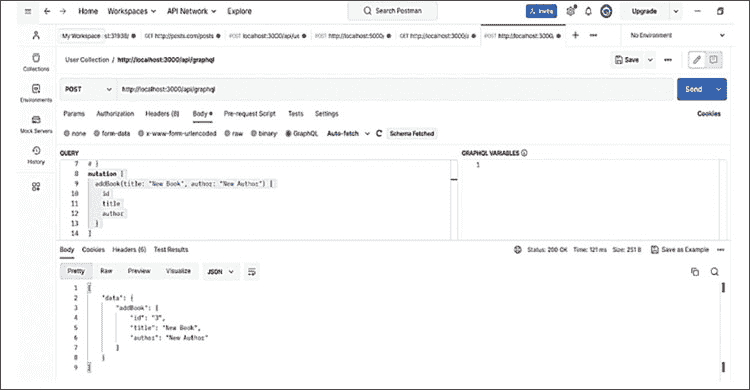
**图 8.3：** 从 GraphQL API 添加数据

按照惯例，GraphQL 查询应该作为 POST 请求发送，因为查询的复杂性和数据需求可能差异很大。POST 请求允许发送更大的有效负载和更复杂的查询结构。

然而，GraphQL 也支持对于仅检索数据而不产生副作用的简单查询使用 GET 请求。在 GET 请求中，查询通常作为 URL 参数传递。

若要在 GraphQL 中使用 GET 请求，你需要相应地修改服务器配置和客户端实现。在服务器端，你需要配置你的 GraphQL 服务器以接受 GET 请求并进行妥善处理。在客户端，你需要将 GraphQL 查询构建为 URL 参数并将其包含在 GET 请求中。

需要注意的是，由于请求大小限制和潜在的安全考量，通常不建议对复杂查询或变异（mutation）使用 GET 请求。POST 请求是大多数 GraphQL 交互的推荐方法。

因此，虽然 GraphQL 查询确实可以同时通过 POST 和 GET 方法工作，但建议对大多数 GraphQL 操作使用 POST 请求，并仅在必要时对简单的只读查询使用 GET 请求。

# 在 Next.js 中将 API 端点集成到客户端

在将 REST API 集成到 Next.js 之前，你需要了解如何在 Next.js 中使用 SWR hook。此外，为了集成 GraphQL API，你可以利用 Apollo Client 库。让我分别解释每个库及其属性，并使用一个简短的代码示例进行说明。

## Next.js 中的 SWR (Stale-While-Revalidate) Hook

Next.js 中的 SWR hook 是一个内置的数据获取库，它简化了数据获取、缓存以及客户端与服务器之间的同步。它提供了一种直观的方式来处理实时数据更新并优化应用程序的性能。以下是 SWR hook 属性及其用法说明：

`useSWR(key: string, fetcher: Function, options?: Config)`：这是 SWR hook 的主函数，用于获取和管理数据。它接受三个参数：

* `key`：正在获取的数据的唯一标识符。它可以是一个 URL、API 端点或任何代表数据源的字符串。
* `fetcher`：负责执行实际 API 调用并返回响应的函数。fetcher 函数可以是异步的，并且通常应该以特定格式（如 JSON）返回获取的数据。
* `options`（可选）：一个允许你为 SWR hook 配置额外行为和选项的对象。它包含了属性如 `revalidateOnMount`、`revalidateOnFocus`、`revalidateOnReconnect`、`refreshInterval` 等。

这里有一个演示 SWR hook 用法的示例：

```javascript
import useSWR from 'swr';

const fetcher = (url) => fetch(url).then((res) => res.json());

const MyComponent = () => {

  const { data, error } = useSWR('/api/data', fetcher);

  if (error) return <div>加载数据出错</div>;

  if (!data) return <div>加载中…</div>;

  return <div>{data.message}</div>;

};
```

在前面的示例中，我们使用 `useSWR` 通过 `fetcher` 函数从 `/api/data` 端点获取数据。`data` 和 `error` 变量捕获 API 调用的结果，可以在组件中相应地进行渲染。

* `data`：数据属性持有获取的数据。初始时它将是 `undefined` 或 `useSWR` hook 中指定的默认值。
* `error`：如果在数据获取过程中发生错误，错误属性将包含错误详情。你可以检查此属性以妥善处理错误情况。

此外，该 hook 还提供了以下函数：

* `mutate(data?, shouldRevalidate?, options?)`：`mutate` 函数允许你手动更改数据。你可以使用它来更新数据。它接受三个参数：
    * `data`：要设置的新数据。
    * `shouldRevalidate`：布尔值，指示变异后是否应该进行重新验证。默认是 true。
    * `options`：变异的额外选项，例如 `revalidate`。
* `revalidate()`：revalidate 函数触发数据的重新验证。
* `isValidating`：`isValidating` 属性是一个布尔值，指示 SWR 是否正在验证（获取）数据。

## Apollo Client

Apollo Client 是一个强大的 GraphQL 客户端，用于 Next.js 应用程序中的数据获取和管理。它提供了缓存、本地状态管理和订阅等功能。以下是 Apollo Client 属性及其用法说明：

### 1. 在 Next.js 中设置 Apollo Client

要在 Next.js 中使用 Apollo Client，你需要安装必要的包：

```bash
npm install @apollo/client graphql
```

安装完成后，你可以创建一个带有所需的 Apollo Client 实例，通常在一个单独的文件中：

```javascript
import { ApolloClient, InMemoryCache } from '@apollo/client';

const client = new ApolloClient({

  uri: 'https://localhost:3000.com/graphql', // 替换为你的 GraphQL API 端点

  cache: new InMemoryCache(),

});

export default client;
```

在前面的示例中，我们创建一个带有相应 GraphQL API 端点 (`uri`) 和用于数据缓存的 `InMemoryCache` 的 Apollo Client 实例。

### 2. Next.js 中的 Apollo Provider

Next.js 提供了 `ApolloProvider` 组件来封装应用程序，并为层次结构所有组件提供 Apollo Client 实例。你通常可以在 `pages/_app.js` 文件中进行设置：

```javascript
import { ApolloProvider } from '@apollo/client';

import client from '../path/to/apolloClient';

function MyApp({ Component, pageProps }) {

  return (

    <ApolloProvider client={client}>

      <Component {...pageProps} />

    </ApolloProvider>

  );

}

export default MyApp;
```

通过用 `ApolloProvider` 封装你的应用并传递 `client` 实例，应用程序中的所有组件都可以访问并利用 Apollo Client 进行数据获取和管理。

### 3. 使用 Apollo Client 查询数据

要使用 Apollo Client 从 GraphQL API 获取数据，你可以使用 `@apollo/client` 提供的 `useQuery` hook。这是一个示例：

```javascript
import { gql, useQuery } from '@apollo/client';

const GET_USERS = gql`

  query {

    users {

      id

      name

    }

  }

`;

function MyComponent() {

  const { loading, error, data } = useQuery(GET_USERS);

  if (loading) return <div>Loading…</div>;

  if (error) return <div>Error loading data</div>;

  return (

    <ul>

      {data.users.map((user) => (

        <li key={user.id}>{user.name}</li>

      ))}

    </ul>

  );

}
```

在上述示例中，我们使用 `@apollo/client` 中的 `gql` 标签定义了一个 GraphQL 查询。然后使用 `useQuery` hook 根据 `GET_USERS` 查询获取数据。`loading` 属性表示数据是否正在获取中，`error` 属性捕获过程中发生的任何错误，而 `data` 属性包含包含获取的数据。

### 使用 Apollo Client 进行 Mutation

Apollo Client 提供了 `useMutation` hook 来处理 GraphQL 中的变异（数据修改）。这是一个示例：

```javascript
import { gql, useMutation } from '@apollo/client';

const ADD_USER = gql`

  mutation AddUser($input: UserInput!) {

    addUser(input: $input) {

      id

      name

    }

  }

`;

function MyComponent() {

  const [addUser, { loading, error, data }] = useMutation(ADD_USER);

  const handleAddUser = async () => {

    try {

      const { data } = await addUser({

        variables: {

          input: {

            name: "John Doe",

          },

        },

      });

      console.log(data);

    } catch (error) {

      console.error(error);

    }

  };

  if (loading) return <div>Loading…</div>;

  if (error) return <div>Error adding user</div>;

  return (

    <div>

      <button onClick={handleAddUser}>Add User</button>

    </div>

  );

}
```

在上述示例中，我们使用 `@apollo/client` 中的 `gql` 标签定义了一个 GraphQL 变异。使用 `useMutation` hook 来处理 `ADD_USER` 变异。它返回一个函数 `addUser`，可以通过调用它来触发变异。变异的结果（包括 `loading`、`error` 和 `data`）被捕获在相应的变量中。

在 `handleAddUser` 函数中，我们调用了 `addUser` 函数并提供了变异所需的变量。在这种情况下，我们正在添加一个名为“John Doe”的用户。可以相应地访问并利用响应数据。

### Apollo Client 缓存

Apollo Client 利用缓存来存储和管理获取的数据。缓存允许进行高效的数据检索和同步。默认情况下，Apollo Client 使用 `InMemoryCache` 实现，它提供了强大的缓存功能。

你可以根据自己的需求自定义缓存行为。例如，你可以修改缓存选项、定义自定义缓存解析器，甚至实现客户端的数据操纵。

这些是在 Next.js 中使用 Apollo Client 的一些关键方面。Apollo Client 还提供了许多功能和能力，包括本地状态管理、订阅和错误处理。它为在 Next.js 中使用 GraphQL 提供了全面的解决方案，简化了数据获取、缓存和操纵。

## 要使用 SWR (Stale-While-Revalidate) hook 在 Next.js 应用中集成 REST API 端点，你可以遵循以下步骤：

1. 安装必要的依赖：
   `npm install swr`

2. 创建新文件 `api.js`，使用 `fetch` 函数或你选择的任何 HTTP 库来处理 API 请求。该文件将包含用于每个 API 端点的函数：

```javascript
export const fetchTodos = async () => {

  const response = await fetch('/api/todos');

  const data = await response.json();

  return data;

};

export const createTodo = async (todo) => {

  const response = await fetch('/api/todos', {

    method: 'POST',

    headers: {

      'Content-Type': 'application/json',

    },

    body: JSON.stringify(todo),

  });

  const data = await response.json();

  return data;

};

export const updateTodo = async (id, todo) => {

  const response = await fetch(`/api/todos/${id}`, {

    method: 'PUT',

    headers: {

      'Content-Type': 'application/json',

    },

    body: JSON.stringify(todo),

  });

  const data = await response.json();

  return data;

};
```

3. 在你的 Next.js 组件中，导入必要的依赖项并使用 SWR 获取和管理数据：

```javascript
import useSWR from 'swr';

import { fetchTodos } from './api';

const TodoList = () => {

  const { data: todos, error } = useSWR('/api/todos', fetchTodos);

  if (error) return <p>{error.message}</p>;

  if (!todos) return <p>Loading…</p>;

  return (

    <div>

      <h1>Todo List</h1>

      <ul>

        {todos.map((todo) => (

          <li key={todo.id}>{todo.title}</li>

        ))}

      </ul>

    </div>

  );

};

export default TodoList;
```

4. 更新 `pages/api/todos.js` 中的 API 端点以处理相应的请求：

```javascript
export default function handler(req, res) {

  if (req.method === 'GET') {

    const todos = [

      { id: 1, title: 'Todo 1' },

      { id: 2, title: 'Todo 2' },

    ];

    res.status(200).json(todos);

  } else if (req.method === 'POST') {

    // 处理创建 todo 的 POST 请求

  } else if (req.method === 'PUT') {

    // 处理更新 todo 的 PUT 请求

  } else if (req.method === 'DELETE') {

    // 处理删除 todo 的 DELETE 请求

  }

}
```

5. 现在，你可以在 Next.js 应用中使用 `TodoList` 组件，它将使用 SWR 自动获取并更新 TODOs。


**图 8.4:** 示例 UI 使用 RESTful

记得启动你的 Next.js 应用 (`npm run dev`) 以查看更改。确保在正确的位置拥有所需的导入和文件，以便代码能够正常运行。

## 使用 Apollo Client 集成 GraphQL API

要使用 Apollo Client 在 Next.js 应用中集成 GraphQL API 端点，请遵循以下步骤：

1. 安装必要的依赖：
   `npm install @apollo/client graphql`

2. 创建一个新文件 `apolloClient.js` 来设置 Apollo Client 实例：

```javascript
import { ApolloClient, InMemoryCache } from '@apollo/client';

const client = new ApolloClient({

  uri: 'http://localhost:3000/api/graphql',

  cache: new InMemoryCache(),

});

export default client;
```

3. 创建一个新页面 `pages/books.js` 来显示从 GraphQL API 获取的书籍列表：

```javascript
import { gql, useQuery } from '@apollo/client';

const GET_BOOKS = gql`

  query GetBooks {

    books {

      id

      title

      author

    }

  }

`;

const BooksPage = () => {

  const { loading, error, data } = useQuery(GET_BOOKS, { client });

  if (loading) {

    return <p>Loading…</p>;

  }

  if (error) {

    return <p>Error: {error.message}</p>;

  }

  const { books } = data;

  return (

    <div>

      <h1>Books</h1>

      {books.map((book) => (

        <div key={book.id}>

          <h2>{book.title}</h2>

          <p>{book.author}</p>

        </div>

      ))}

    </div>

  );

};

export default BooksPage;
```

4. 更新 API 路由文件 `api/graphql.js` 中的 `graphqlHandler`，以处理 CORS 头部并启用内省查询（introspection）：

```javascript
import { ApolloServer, gql } from 'apollo-server-micro';

const typeDefs = gql`

type Book {

  id: ID!

  title: String!

  author: String!

}

type Query {

  books: [Book!]!

  book(id: ID!): Book

}

# …Mutation definitions…

const books = [

  { id: '1', title: 'Book 1', author: 'Author 1' },

  { id: '2', title: 'Book 2', author: 'Author 2' },

];

const resolvers = {

  Query: {

    books: () => books,

    book: (parent, args) => books.find((book) => book.id === args.id),

  },

  // …Mutation resolvers…

};

const apolloServer = new ApolloServer({

  typeDefs,

  resolvers,

  introspection: true,

});

export const config = {

  api: {

    bodyParser: false,

  },

};

export default apolloServer.createHandler({ path: '/api/graphql' });
```

5. 现在，你可以访问 Next.js 应用中的 `books` 页面，查看从 API 获取的书籍列表。

记得启动你的 Next.js 应用（`npm run dev`）以查看更改效果。确保已经在适当的位置准备了所需的导入和文件，以便代码能够正常运行。

## 处理 API 调用中的错误和异常

在 Next.js 中，处理 API 调用中的错误和异常涉及在服务器端和客户端实现错误处理逻辑。以下你可以遵循的通用方法：

### 1. 服务端错误处理

* 在你的 API 路由处理器（`/pages/api/your-api-route.js`）中，将代码封装在 `try-catch` 块中。
* 捕获 API 调用过程中可能发生的任何错误。
* 使用 `res.status()` 和 `res.json()` 方法返回适当的错误响应。例如：

```javascript
export default async function handler(req, res) {

  try {

    // 此处编写 API 代码

    res.status(200).json({ message: 'Success' });

  } catch (error) {

    res.status(500).json({ message: 'Internal Server Error' });

  }

}
```

### 2. 客户端错误处理

* 在客户端代码（React 组件）中，处理 API 调用过程中可能发生的任何错误或异常。
* 使用 `try-catch` 块或 `Promise.catch()` 来捕获 API 调用期间抛出的任何错误。
* 你可以根据收到的错误向用户显示消息或执行适当的操作。
* 以下是一个 `fetch` 在 Next.js 客户端组件中处理错误的示例：

```javascript
import { useState } from 'react';

export default function MyComponent() {

  const [error, setError] = useState(null);

  const fetchData = async () => {

    try {

      const response = await fetch('/api/your-api-route');

      if (!response.ok) {

        throw new Error('Request failed');

      }

      // 处理响应数据

    } catch (error) {

      setError('An error occurred');

    }

  };

  return (

    <div>

      {error && <p>{error}</p>}

      <button onClick={fetchData}>Fetch Data</button>

    </div>

  );

}
```

### 3. 使用 SWR 处理错误

SWR 是一个用于 Next.js 的流行数据获取库，提供了内置的错误处理功能。

```javascript
import useSWR from 'swr';

const MyComponent = () => {

  const { data, error } = useSWR('/api/your-api-route', fetcher);

  if (error) return <p>Error loading data</p>;

  if (!data) return <p>Loading...</p>;

  return <div>{JSON.stringify(data)}</div>;

};
```

### 4. 使用 Apollo 处理错误

如果你在 Next.js 中使用 Apollo Client，可以使用 `useQuery` 处理错误。

```javascript
import { useQuery, gql } from '@apollo/client';

const GET_DATA = gql`

  query GetBooks {

    books {

      id

      title

      author

    }

  }

`;

const MyComponent = () => {

  const { data, error, loading } = useQuery(GET_DATA);

  if (loading) return <p>Loading...</p>;

  if (error) return <p>Error: {error.message}</p>;

  return <div>{JSON.stringify(data)}</div>;

};
```

## Next.js 应用程序中 API 安全和身份验证的最佳实践

在 Next.js 应用程序中保护 API 和实现身份验证对于保护敏感数据和确保只有授权用户可以访问特定资源至关重要。以下是一些最佳实践：

* **使用 HTTPS**：
    - 始终通过 `HTTPS` 提供你的 `Next.js` 应用程序，以加密客户端和服务器之间传输的数据。这可以防止窃听和中间人攻击。
* **实现身份验证**：
    - 使用强大的身份验证机制，如 `JWT`（JSON Web Tokens）、`OAuth` 或基于会话的身份验证来验证用户身份。
    - 考虑使用 `NextAuth.js` 等库，它提供了针对 Next.js 应用程序量身定制的内置身份验证解决方案。
* **授权和访问控制**：
    - 实施基于角色的访问控制（`RBAC`）或基于属性的访问控制（`ABAC`），以根据用户角色和权限限制对特定 API 端点或资源的访问。
* **输入验证和清理**：
    - 验证并清理所有传入的请求数据，以防止注入攻击（例如 `SQL` 注入、`XSS`）。使用 `Zod` 或 `Joi` 等库进行模式验证。
* **速率限制**：
    - 实施速率限制以防止滥用并保护 API 免受暴力攻击或拒绝服务（`DoS`）攻击。使用 `express-rate-limit` 等中间件或自定义逻辑。
* **安全 API 密钥和密钥**：
    - 通过将 API 密钥、令牌和其他密钥存储在安全存储解决方案中（例如环境变量）来保护它们，并避免将其提交到版本控制中。
* **启用 CORS（跨源资源共享）**：
    - 适当配置 CORS 头部，限制未经授权的域访问您的 API，并防止跨源攻击。
* **定期更新依赖**：
    - 保持您的 `Next.js` 应用程序及其依赖为最新版本，以获得安全补丁和错误修复。
* **进行安全审计和测试**：
    - 定期进行安全审计、代码审查和漏洞扫描，以识别并解决潜在的安全漏洞。
    - 进行彻底的渗透测试和安全评估，以发现应用程序安全中的任何弱环节。

请记住，安全是一个持续的过程，密切关注最新的安全实践、漏洞和最佳实践至关重要，以确保您的 `Next.js` 应用程序及其 API 的持续安全。

## 结论

学习如何在 `Next.js` 中实现 API 可以极大地提升你构建强大且交互式 Web 应用的能力。通过理解 API 开发的基础知识并将其整合到你的 `Next.js` 项目中，你可以释放无缝数据通信和交换的潜力。

为了巩固理解，探索实际示例是有益的。通过操作实际示例，你将获得在 `Next.js` 中设置和配置 API 的实战经验。这个示例可能涉及创建 API 端点来处理与粒子相关的 CRUD 操作，例如创建新粒子、检索粒子数据、更新现有粒子以及删除粒子。

通过遵循针对 `Next.js` 以及流行框架（如 `Apollo Server`）的教程和文档，你可以学习高效地实现 RESTful 和 GraphQL API。你将发现如何定义必要的 schema 和解析器（resolvers），处理服务器端渲染，并有效地管理错误和异常。

在整个过程中，你将获得 API 安全和身份验证最佳实践的见解。

通过应用这些原则并从实际示例中获得实践经验，你将精通在 `Next.js` 应用程序中实现 API。这些知识将使你能够构建健壮且可扩展的 Web 应用程序，利用 API 的力量为用户提供动态且交互的体验。

在下一章中，我们将探索如何在 `Next.js` 应用程序上下文中在 `SQL` 和 `NoSQL` 数据库中保存数据。存储数据是大多数 Web 应用程序的关键方面，而理解 `SQL` 和 `NoSQL` 数据库之间的差异可以帮助你根据项目需求对使用哪种数据库做出明智决策。

## 单选题

1. 以下哪项是 Web 开发中使用 API 的重要益处？
    1. 增强用户界面设计
    2. 实现系统间的无缝通信
    3. 优化数据库性能
    4. 提高服务器处理速度

2. 哪种 API 架构风格提供了灵活高效的数据查询和变更方式？
    1. `RESTful API`
    2. `SOAP API`
    3. `GraphQL API`
    4. `RPC API`

3. 哪个框架可以用于在 `Next.js` 中设置和配置 GraphQL API？
    1. `Express.js`
    2. `Apollo Server`
    3. `Django`
    4. `Laravel`

4. `RESTful API` 遵循什么方法处理 CRUD 操作？
    1. 命令查询分离
    2. 事件驱动架构
    3. 基于资源的方法
    4. 中间件模式

5. 在 `Next.js` 应用程序中保护和身份验证 API 的某些最佳实践有哪些？
    1. 使用 `HTTPS`、实现适当的身份验证机制（如 `JWT` 或 `OAuth`）、保护敏感数据并定期进行安全审计
    2. 使用 `HTTP`、以明文存储敏感数据并依赖客户端验证
    3. 启用 CORS 保护、使用环境变量存储 API 密钥并避免输入验证
    4. 仅将 `OAuth` 用于身份验证、将密钥存储在应用程序代码中并从不更新依赖

## 答案

1. B
2. C
3. B
4. C
5. A

# 第 9 章

# 使用不同类型的数据库

## 引言

在本章中，我们将深入数据库的世界，并探索如何在 `Next.js` 应用程序中使用它们。数据库在 Web 开发中起着至关重要的作用，作为存储、检索和管理数据的骨干。

首先，我们将提供数据库概述及其在 Web 开发中的重要性。理解数据库的基础知识将为探索各种类型的数据库奠定基础。我们将向你介绍关系型数据库、`NoSQL` 数据库，甚至深入探讨图数据库，突出它们的独特特征和用例。

为你的应用程序选择正确的数据库至关重要，因为每种类型都有其优缺点。我们将引导你通过决策过程，考虑数据结构、可扩展性和性能等因素。

一旦你做出了选择，我们将帮助你在 `Next.js` 中建立数据库连接。我们将涵盖将 `MongoDB`、`MySQL` 和 `PostgreSQL` 等流行数据库连接到你的 `Next.js` 应用程序的步骤，允许你无缝利用它们的功能。

接下来，我们将探索你对数据库执行的常用操作，重点是创建、读取、更新和删除（`CRUD`）操作。你将学习如何使用 `Next.js` 与所选数据库交互、操作数据并检索信息。

处理数据库错误和实施有效的调试技术是我们将解决的另一个关键方面。故障常见问题并采用错误处理的最佳实践将确保你的 `Next.js` 应用程序顺畅运行。

数据库安全至关重要，我们将为你提供保护数据的最佳实践。我们将讨论保护数据库、保护敏感信息以及防止常见漏洞的技术。

此外，我们将进入数据建模和模式设计领域。你将获得关于设计高效数据库结构、创建实体之间的关系以及优化查询以提高性能的见解。

最后，我们将触及扩展数据库以满足不断增长的用户群。我们将讨论增强性能和确保高可用性的策略，允许你的应用程序有效地处理增加的流量和用户交互。

在整个过程中，我们将展示实际示例和用例来说明所讨论的概念。到结束时，你将具备在 `Next.js` 应用程序中利用不同类型数据库所需的知识和工具，使你能够构建现代且健壮的 Web 应用程序。让我们一起开启这段数据库之旅，解锁 `Next.js` 中数据的力量！

## 结构

在本章中，我们将涵盖以下主题：

* 在 `Next.js` 中设置数据库连接
* 在 `Next.js` 中使用流行的数据库如 `MongoDB`、`MySQL`
* 使用所选数据库进行 `CRUD` 操作
* 处理数据库错误和调试技术
* 数据库安全最佳实践
* 数据建模和模式设计
* 针对性能和高可用性扩展数据库

# 数据库管理系统快速概述

数据库管理系统（DBMS）是一种允许用户高效地存储、组织和管理大量数据的软件系统。它提供了一种结构化且中心化的数据处理方法，使得信息更容易被访问、检索、修改和删除。

### DBMS 的核心组件

* **数据 (Data)**：DBMS 管理不同类型的数据，例如文本、数字、图像、视频等，这些数据存储在各种格式和结构中。
* **数据库 (Database)**：数据库是以结构化方式组织和存储的相关数据的集合。它由表、视图、索引以及定义数据结构和关系的对象组成。
* **数据库模式 (Database Schema)**：数据库模式定义了数据库的逻辑和物理结构。它描述了表及其属性（列）、数据类型、约束以及与其他表之间的关系。
* **数据操作语言 (DML)**：DML 是一种允许用户在数据库中检索、插入、更新和删除数据的语言。常见的 DML 语句包括 `SELECT`、`INSERT`、`UPDATE` 和 `DELETE`。
* **数据定义语言 (DDL)**：DDL 是一种用于定义和管理数据库结构的语言。它包括 `CREATE`、`ALTER` 和 `DROP` 等语句，用于创建表、修改其结构或删除表。
* **查询优化 (Query Optimization)**：DBMS 优化查询的执行以提高性能和效率。它分析查询，评估不同的执行计划，并选择最有效的方法检索数据。
* **事务管理 (Transaction Management)**：DBMS 确保事务的 ACID 特性。ACID 代表原子性（事务被视为单个工作单元）、一致性（确保数据完整性）、隔离性（事务之间彼此隔离，独立执行）和持久性（一旦事务提交，其更改将是永久的）。
* **并发控制 (Concurrency Control)**：DBMS 处理多个用户或进程对数据库的并发访问。它确保在同时执行多个事务时维护数据完整性。使用锁定、时间戳和多版本并发控制等技术来管理并发。
* **安全与授权 (Security and Authorization)**：DBMS 提供了控制数据库访问并确保数据安全的机制。它包括用户验证、授权和权限管理，以保护敏感数据免受未经授权的访问。
* **备份与恢复 (Backup and Recovery)**：DBMS 在发生系统故障、数据损坏或人为错误时便于数据的备份和恢复。它允许用户创建备份、将数据恢复到之前的状态并执行恢复操作以尽可能减少数据丢失。

### DBMS 的类型

* **关系数据库管理系统 (RDBMS)**：最广泛使用的类型，数据组织在具有预定义关系的表中。示例包括 `MySQL`、`Oracle Database` 和 `Microsoft SQL Server`。
* **面向对象的数据库管理系统 (OODBMS)**：这些系统以对象的形式存储数据，允许继承、封装和多态。它们适用于复杂的数据结构。示例包括 `MongoDB` 和 `Apache Cassandra`。
* **层次型 DBMS (Hierarchical DBMS)**：数据以树形结构组织，每个记录都有父子关系。它在早期很流行，但很大程度上已被其他模型取代。
* **网络型 DBMS (Network DBMS)**：与层次型 DBMS 类似，但结构更灵活。它允许记录拥有多个父和子记录，创建复杂的关系。
* **NoSQL DBMS**：NoSQL（不仅是 SQL）数据库旨在处理大规模、非结构化和多样化的数据。它们提供了高可扩展性、性能和灵活性。示例包括 `MongoDB`、`Cassandra` 和 `Redis`。
* **NewSQL DBMS**：NewSQL 数据库结合了 NoSQL 的可扩展性和性能以及传统关系数据库的 ACID 特性。它们旨在解决传统 RDBMS 在处理大量数据和并发用户方面的局限性。NewSQL 系统在保持事务一致性的同时提供了分布式架构和高效的并行处理。示例包括 `Google Spanner`、`Cockroach DB` 和 `TiDB`。

## 使用 DBMS 的优势

* **数据中心化 (Data Centralization)**：DBMS 允许用户将数据存储在中心位置，为不同的应用程序和用户提供统一的数据视图。这消除了数据冗余和不一致性。
* **数据共享 (Data Sharing)**：DBMS 允许多个用户同时访问和共享数据。它通过并发控制机制提供受控的访问并确保数据完整性。
* **数据安全 (Data Security)**：DBMS 包含用户验证、访问控制和加密等功能，保护敏感数据免受未经授权的访问，确保数据安全并符合法规。
* **数据完整性 (Data Integrity)**：DBMS 强制执行数据完整性约束（如主键约束和引用完整性），以维护数据的准确性和一致性。
* **数据一致性 (Data Consistency)**：DBMS 确保即使在并发访问和更新期间数据也保持一致和有效。ACID 特性保证了事务的可靠执行并维护数据完整性。
* **数据可扩展性 (Data Scalability)**：DBMS 提供了高效处理大量数据的机制。它允许通过增加更多服务器或节点来分布数据和负载来实现水平扩展。
* **数据恢复 (Data Recovery)**：DBMS 支持备份和恢复机制，以防止在系统故障、灾难或人为错误时发生数据丢失。它允许将数据库恢复到之前的状态或进行点恢复。
* **数据独立性 (Data Independence)**：DBMS 通过将数据库的逻辑结构（模式）与物理存储细节分离来提供数据独立性。这允许在修改数据库模式而不影响使用这些数据的应用程序。
* **数据查询与报告 (Data Querying and Reporting)**：DBMS 提供了查询语言（例如 `SQL`）和工具来执行复杂的数据查询、生成报告并从数据中提取有用见解。
* **提高性能 (Improved Performance)**：DBMS 优化查询执行、索引和缓存技术以增强性能和响应时间。它利用查询优化算法选择最有效的执行计划。
* **数据维护 (Data Maintenance)**：DBMS 提供了管理和维护数据库的工具，如数据备份、恢复、索引和性能调优。它简化了管理任务。

## 关系型数据库管理系统

关系型数据库基于关系模型，该模型将数据组织成由行和列组成的表。每个表代表一个实体或实体之间的关系。在 `MySQL` 中，表是通过特定的模式创建的，模式定义了列的结构和数据类型。

规范化是设计数据库模式的过程，旨在消除冗余并确保数据完整性。它涉及将大表拆分为较小的相关表，并使用主键和外键建立它们之间的关系。规范化有助于减少数据冗余，提高数据一致性，并便于高效的数据检索。

数据库规范化有几种范式，包括：

* **第一阶范式 (1NF):** 确保表中的每一列都包含原子值（不可分割且不能进一步划分）。
* **第二阶范式 (2NF):** 在 `1NF` 的基础上，要求表中的每个非键列都函数依赖于整个主键。
* **第三阶范式 (3NF):** 在 `2NF` 的基础上，要求表中的每个非键列仅依赖于主键，而不依赖于其他非键列。
* **Boyce-Codd 范式 (BCNF):** `3NF` 的一种严格形式，消除了非键列之间所有的函数依赖。
* **第四阶范式 (4NF):** 确保表内部没有多值依赖。

现在让我们来讨论 OLAP（在线分析处理）和 OLTP（在线事务处理）：

### OLAP

OLAP 是一类用于海量数据复杂分析和报告的软件和技术。它侧重于提供业务智能和决策支持能力。OLAP 数据库专为读密集型操作和复杂分析查询设计。它们通常将聚合数据存储在多维结构中，称为数据立方体，允许从不同的角度对数据进行快速查询、切片和分析。

### OLTP

另一方面，OLTP 是一类用于管理和处理组织日常事务操作的软件和技术。OLTP 数据库专为高速数据处理、事务一致性和并发访问而设计。它们支持实时插入、更新和删除小量数据的操作。`MySQL` 作为关系型数据库管理系统（RDBMS），常用于对数据一致性和实时事务处理至关重要的 `OLTP` 应用。

# NoSQL 数据库管理系统

NoSQL（不仅仅是 SQL）是一种数据库管理系统，它偏离了 `MySQL` 等 RDBMS 中使用的传统关系模型。`MongoDB` 是 NoSQL DBMS 的一个流行示例，让我们详细探讨它的特性和背景：

* **面向文档的模型:** 包括 `MongoDB` 在内的 NoSQL 数据库使用面向文档的模型进行数据存储。`MongoDB` 不使用行列表，而是将数据存储在灵活的自描述文档中。这些文档通常以类似 JSON (BSON) 的格式表示，允许存储嵌套结构和动态模式。
* **模式灵活性:** 与 RDBMS 的固定模式结构不同，像 `MongoDB` 这样的 NoSQL 数据库提供了模式灵活性。每个文档都可以有自己的结构，允许你在同一个集合中存储不同类型的数据。这种灵活性简化了开发过程，特别是在数据模式随时间演进的场景下。
* **可扩展性和高性能:** NoSQL 数据库专为水平扩展而设计，这意味着它们可以将数据分布在多个服务器或节点上，以处理高数据量和流量。`MongoDB` 特别在扩展性方面表现，提供自动分片功能，将数据和查询分布到机器集群中。它为读和写操作都提供了高性能，使其适用于大规模应用程序。
* **复制与高可用性:** `MongoDB` 支持副本集，副本集是维护相同数据副本的数据库节点集群。副本集提供了数据冗余和高可用性，确保系统在节点故障时仍能运行。`MongoDB` 使用自动故障转移机制选出新的主节点并保持服务的连续性。
* **查询与索引:** `MongoDB` 提供了一种灵活且强大的查询语言来检索数据，称为 MongoDB 查询语言 (`MQL`)。`MQL` 支持广泛的查询能力，包括过滤、排序、聚合和地理查询。`MongoDB` 还支持索引，允许通过在特定字段上创建索引来优化查询性能。
* **用例与背景:** `MongoDB` 特别适用于灵活性、可扩展性和实时数据处理至关重要的用例。它常用于内容管理系统、实时分析、日志和监控系统以及用户配置管理等场景。此外，`MongoDB` 的模型使其更容易与现代 Web 开发框架和语言集成。

### SQL 和 NoSQL DBMS 的区别

| 特性 | SQL (关系型数据库) | NoSQL (非关系型数据库) |
| :--- | :--- | :--- |
| 数据结构 | 具有固定模式的结构化表格数据。 | 具有动态模式的灵活、半结构化或非结构化数据。 |
| 模式 | 需要具有严格结构的预定义模式。 | 无模式或可随时间演进的灵活模式。 |
| 查询语言 | 使用 `SQL`（结构化查询语言）定义和操作数据。 | 每个 NoSQL 数据库都有特定的查询语言（例如，`MongoDB` 使用类似于 JavaScript 的查询语言）。 |
| 可扩展性 | 垂直扩展（扩展单个服务器的硬件资源）。 | 水平扩展（添加更多服务器来分担负载）。 |
| 数据关系 | 使用外键支持表与之间的复杂关系。 | 主要设计用于处理具有极少或无关系的反规范化数据。 |
| ACID 合规性 | 维护 `ACID` 特性（原子性、一致性、隔离性、持久性）。 | 为了提高可扩展性和性能，可能会牺牲某些 `ACID` 属性（例如，最终一致性）。 |

## 在 Next.js 中设置数据库连接

要在 Next.js 中设置数据库连接，请按照以下步骤操作：

### 步骤 1：安装必要的依赖项

* 在你的项目目录中，运行以下命令安装 `mongodb` 和 `mysql` 包：

```bash
npm install mongodb mysql
```

### 步骤 2：创建数据库连接文件

在项目根目录下创建两个文件：`mongodb.js` 和 `mysql.js`。

在 `mongodb.js` 中导入 `MongoClient` 并定义连接设置：

```javascript
const { MongoClient } = require('mongodb');

const uri = 'mongodb://localhost:27017'; // Replace with your MongoDB URI

const dbName = 'your-database-name'; // Replace with your database name

const client = new MongoClient(uri, {

  useNewUrlParser: true,

  useUnifiedTopology: true,

});

async function connectMongoDB() {

  try {

    await client.connect();

    console.log('Connected to MongoDB');

    const db = client.db(dbName);

    return db;

  } catch (error) {

    console.error('Error connecting to MongoDB', error);

    throw error;

  }

}

module.exports = connectMongoDB;
```

在 `mysql.js` 中导入 `mysql` 包并定义连接设置：

```javascript
const mysql = require('mysql');

const connection = mysql.createConnection({

  host: 'localhost', // Replace with your MySQL host

  user: 'your-username', // Replace with your MySQL username

  password: 'your-password', // Replace with your MySQL password

  database: 'your-database-name', // Replace with your database name

});

connection.connect((error) => {

  if (error) {

    console.error('Error connecting to MySQL', error);

    throw error;

  }

  console.log('Connected to MySQL');

});

module.exports = connection;
```

### 步骤 3：在 Next.js 代码中使用连接

在你的 Next.js 代码中，导入相应的数据库文件并根据需要使用连接。例如，创建一个名为 `pages/index.js` 的文件并包含以下代码：

```javascript
import { useEffect } from 'react';

import connectMongoDB from '../mongodb';

import connectionMySQL from '../mysql';

export default function HomePage() {

  useEffect(() => {

    async function fetchData() {

      const db = await connectMongoDB();

      // Perform MongoDB operations here

      // Example: const collection = db.collection('your-collection');

      // Example: const data = await collection.find().toArray();

      connectionMySQL.query('SELECT * FROM your-table', (error, results, fields) => {

        if (error) {

          console.error('Error querying MySQL', error);

          throw error;

        }

        // Process the MySQL query results here

      });

    }

    fetchData();

  }, []);

  return (

    <div>

      {/* Your page content */}

    </div>

  );

}
```


记得将占位值（如 `your-database-name`、`your-username`、`your-password` 等）替换为实际数据库连接详情。

通过这种配置，你将拥有一个连接到 MongoDB 和 MySQL 数据库的 Next.js 页面。`fetchData` 函数会在组件挂载时执行，允许你根据需要执行数据库操作并处理结果。

在 JavaScript 和 Node.js 中，有多个第三方库可用于数据库操作，例如 Mongoose、Sequelize、TypeORM 和 PrismORM。这些库提供了对象关系映射（ORM）功能并简化了数据库交互。

虽然 Mongoose 是专门为 MongoDB 设计的，但 Sequelize 主要关注 SQL 数据库（MySQL、PostgreSQL、SQLite、MSSQL）。另一方面，TypeORM 支持多种数据库，包括 PostgreSQL、MySQL、SQLite、MSSQL 和 Oracle。

然而，如果你更倾向于使用一个能够同时处理 SQL 和 NoSQL 数据库的库，TypeORM 是一个极佳的选择。TypeORM 功能多变，允许你使用统一的 API 与不同类型的数据库交互。它为处理各种数据库提供了一致且直观的方法，使得当你需要在同一个项目中的 SQL 和 NoSQL 数据库之间切换时非常方便。

PrismORM 的知名或流行程度不如上述其他所有库。然而，如果它符合你的特定需求且你发现它适合你的项目，你可以探索它的功能并评估其能力。

最终，数据库库的选择取决于项目的具体需求、你对该库的熟悉程度以及你正在使用的数据库。在为项目选择合适的库时，请考虑支持的数据库、ORM 功能、易用性、社区支持和开发活跃度等因素。下表比较了帮助进行数据库操作的三个常用库。

| 特性 | Mongoose (MongoDB) | Sequelize (MySQL, PostgreSQL, SQLite, MSSQL) | TypeORM (各种数据库) |
| :--- | :--- | :--- | :--- |
| 支持的数据库 | MongoDB | MySQL, PostgreSQL, SQLite, MSSQL 等更多 | PostgreSQL, MySQL, SQLite, MSSQL, Oracle |
| ORM 功能 | 是 | 是 | 是 |
| 对象关系映射 (ORM) | 是 | 是 | 是 |
| Schema 定义 | 基于 Schema (使用 Mongoose Schemas) | 基于模型 (使用 Sequelize Models) | 基于装饰器 (使用 Entity Classes) |
| 查询语言 | MongoDB 查询语言 (MQL) | SQL | SQL |
| 连接池 | 否 (由 MongoDB 驱动程序管理) | 是 | 是 |
| 关联/关系支持 | 是 | 是 | 是 |
| 迁移支持 (Migrations) | 否 | 是 | 是 |
| 活跃开发 | 是 | 是 | 是 |

```javascript
import sqliteConfig from "../config/database";

export default function CreateUser() {
  const [name, setName] = useState("");
  const [email, setEmail] = useState("");

  const handleSubmit = async (event) => {
    event.preventDefault();
    try {
      const connection = await createConnection(sqliteConfig);
      const userRepository = connection.getRepository(User);
      const newUser = userRepository.create({ name, email });
      await userRepository.save(newUser);
      await connection.close();
      console.log("User created successfully!");
    } catch (error) {
      console.error("Error creating user:", error);
    }
  };

  return (
    <form onSubmit={handleSubmit}>
      <input
        type="text"
        value={name}
        onChange={(event) => setName(event.target.value)}
        placeholder="Name"
      />
      <input
        type="email"
        value={email}
        onChange={(event) => setEmail(event.target.value)}
        placeholder="Email"
      />
      <button type="submit">Create User</button>
    </form>
  );
}
```

同样地，你可以通过连接数据库、获取适当的仓库并执行所需操作来实现读取、更新和删除逻辑。

## 第 6 步：运行 Next.js 应用

要启动你的 Next.js 应用并测试 CRUD 操作，请在终端中运行以下命令：

```bash
npm run dev
```

打开浏览器并导航到 `http://localhost:3000/create` 来创建一个新用户。你也可以为其他的 CRUD 操作创建额外的页面并对其进行测试。

**注意：** 请根据你使用的数据库，确保你的本地机器上有一个运行的 SQLite 服务器或 MongoDB 实例。确保数据库凭据和连接详情与配置文件中指定的相匹配。

大功告成！你现在使用 TypeORM 库在 Next.js 中通过 SQLite 和 MongoDB 实现了 CRUD 操作。你可以根据需要扩展此示例以处理更复杂的数据模型和操作。

## 处理数据库错误和调试技术

在 Next.js 中，处理数据库错误和调试技术涉及确保与数据库交互时进行正确的错误处理，并采用有效的调试实践来识别和解决问题。以下是关于如何处理这些任务的详细说明：

### 错误处理

- **连接数据库：** 在 Next.js 中与数据库交互时，你通常使用 `Prisma`、`Sequelize` 或 `Mongoose` 等库。这些库提供了连接数据库和执行查询的机制。确保在尝试任何操作之前建立数据库连接。
- **查询执行：** 在执行数据库查询时，处理潜在错误至关重要。大多数数据库库都提供了捕捉和处理数据库服务器返回错误的机制。例如，使用 `Prisma` 时你可以使用 `try-catch` 块或基于 Promise 的错误处理来捕获并处理错误。
- **错误消息：** 在数据库操作期间发生错误时，提供有意义的错误消息有助于调试。请包含相关信息，如错误类型、正在执行的查询以及任何相关的参数。将错误消息记录到日志文件或监控服务等中心系统有助于跟踪问题。
- **优雅的错误处理：** 在 Next.js 中，你可以使用错误边界组件或 `getDerivedStateFromError` 方法来实现错误边界。这些技术允许你捕获组件内的错误并显示回退 UI，而不是导致整个应用程序崩溃。你可以向用户显示错误页面或特定的错误消息，并记录错误细节以便进一步调查。

### 调试技术

- **日志记录：** 日志记录是调试数据库相关问题的必备技术。利用 `Winston`、`Pino` 或内置的 `console.log` 语句在运行时输出相关信息。记录重要细节（如查询执行时间、结果和错误消息）以跟踪问题。
- **调试工具：** Next.js 提供了强大的调试工具和浏览器扩展，包括 React 开发工具和 Next.js DevTools。这些工具允许你检查组件、查看 props 并监控网络请求。
- **查询优化：** 当遇到性能问题时，使用查询分析器或性能剖析工具来识别低效查询。
- **代码审查：** 让其他开发者审查代码，可以发现逻辑错误、竞争条件或可能影响性能的模式。
- **单元测试：** 使用 `Jest` 或 `Mocha` 等框架对代码进行单元测试，以确保行为符合预期并提前发现 Bug。

### 1. 处理数据库错误

假设你在 Next.js 中使用 `TypeORM` 库，你可以通过以下方式处理数据库错误：

```javascript
const { getRepository } = require('typeorm');
const { User } = require('../entities/User');

async function getUserById(id) {
  try {
    const userRepository = getRepository(User);
    const user = await userRepository.findOne(id);
    if (!user) {
      throw new Error('User not found');
    }
    return user;
  } catch (error) {
    console.error('Error retrieving user:', error);
    throw new Error('Failed to retrieve user');
  }
}
```

在此示例中，我们从 `typeorm` 获取 `getRepository` 函数来获取 `User` 实体的仓库。然后使用该仓库根据 ID 查找用户。如果没有找到用户，我们将抛出一个自定义错误。任何其他错误将在 `catch` 块中被捕获、记录并用通用错误重新抛出。

### 2. 调试技术

现在让我们探索使用 TypeORM 在 Next.js 中的调试技术：日志记录

```javascript
const { getRepository } = require('typeorm');
const { User } = require('../entities/User');

async function getUserById(id) {
  try {
    const userRepository = getRepository(User);
    const user = await userRepository.findOne(id);
    if (!user) {
      throw new Error('User not found');
    }
    console.log('Retrieved user:', user);
    return user;
  } catch (error) {
    console.error('Error retrieving user:', error);
    throw new Error('Failed to retrieve user');
  }
}
```

在更新后的示例中，我们添加了 `console.log` 语句来输出获取的用户。这有助于检查数据并验证是否获取了正确的用户。你可以根据调试需求自定义日志语句。

```javascript
const { getRepository } = require('typeorm');
const { User } = require('../entities/User');

async function getUsersWithPosts() {
  try {
    const userRepository = getRepository(User);
    const users = await userRepository.find({ relations: ['posts'] });
    return users;
  } catch (error) {
    console.error('Error retrieving users:', error);
    throw new Error('Failed to retrieve users');
  }
}
```

在这个示例中，我们使用 TypeORM 的 `relations` 选项获取用户及其关联帖子。这简化了相关数据的检索，但如果由于用户或帖子过多导致查询变慢，您可以使用分页、懒加载或应用额外的过滤器来进一步优化。

### 5. 单元测试

单元测试对于捕捉错误和确保代码正确性至关重要。以下是一个使用 Jest 测试框架的示例：

```javascript
const { getRepository } = require('typeorm');
const { User } = require('../entities/User');
const { getUserById } = require('./user');

jest.mock('typeorm');

describe('getUserById', () => {
  test('returns a user when the database query is successful', async () => {
    const mockUser = { id: 1, name: 'John Doe' };
    const findOneMock = jest.fn().mockResolvedValue(mockUser);
    getRepository.mockReturnValueOnce({
      findOne: findOneMock,
    });
    const user = await getUserById(1);
    expect(user).toEqual(mockUser);
    expect(findOneMock).toHaveBeenCalledTimes(1);
    expect(findOneMock).toHaveBeenCalledWith(1);
  });

  test('throws an error when the user is not found', async () => {
    const findOneMock = jest.fn().mockResolvedValue(undefined);
    getRepository.mockReturnValueOnce({
      findOne: findOneMock,
    });
    await expect(getUserById(1)).rejects.toThrow('User not found');
    expect(findOneMock).toHaveBeenCalledTimes(1);
    expect(findOneMock).toHaveBeenCalledWith(1);
  });
});
```

在这个单元测试示例中，我们使用 Jest 的模拟功能对 TypeORM 的 `getRepository` 函数和 `findOne` 方法进行模拟。我们模拟了成功查询和返回 `undefined`（用户未找到）的查询。这确保了 `getUserById` 函数按预期运行并妥善处理了数据库错误。

通过采用这些技术，您可以有效地处理数据库错误，并在使用 TypeORM 的 Next.js 应用中调试问题，确保运行顺畅并更好的用户体验。

## Next.js 中的数据库安全最佳实践

在涉及 Next.js 数据库安全最佳实践时，有几个关键点需要考虑。让我们详细探讨它们：

### 1. 保护数据库凭据

*   安全地存储数据库凭据，例如使用环境变量或安全的密钥管理解决方案。
*   避免在源代码、配置文件或版本控制仓库中硬编码凭据。
*   限制对敏感文件的访问并确保设置了适当的权限。

### 2. 实现用户身份验证与授权

*   使用安全的身份验证机制（如密码哈希和加盐）来保护用户凭据。
*   实现适当的授权和访问控制，确保用户只能访问其授权查看或修改的数据。
*   验证并清理用户输入，以防止常见的安全漏洞，如 SQL 注入攻击。

### 3. 加密与数据保护

*   实现传输层安全协议（TLS），以加密在应用程序和数据库之间传输的数据。
*   考虑实现静态加密，以保护存储在数据库中的敏感数据。
*   利用数据库系统提供的加密库或内置加密函数。

### 4. 定期更新与补丁

*   保持您的数据库系统及相关库为最新的安全补丁和更新。
*   监控安全公告，并及时应用补丁以解决已识别的漏洞。

### 5. 输入验证与查询参数化

*   验证并清理用户输入，防止恶意数据作为数据库查询的一部分执行。
*   使用参数化查询或预处理语句来避免 SQL 注入攻击。
*   利用自动处理查询参数化的查询构建器或 ORM（对象关系映射器）。

### 6. 审计与日志记录

*   启用数据库系统提供的日志和审计功能，以跟踪和监控数据库活动。
*   定期审查和分析数据库日志，以识别任何可疑活动或潜在的安全漏洞。

### 7. 限制数据库访问

*   遵循最小权限原则，仅为数据库用户授予必要的权限。
*   避免在常规应用程序操作中使用高权限数据库账户。
*   实施强密码策略并强制密码复杂度规则。

### 8. 定期备份与灾难恢复

*   定期对数据库进行备份，以确保数据的完整性和可用性。
*   安全地存储备份并定期测试恢复过程。
*   制定灾难恢复计划，以便从任何数据泄露或丢失中快速恢复。

### 9. 安全部署与托管

*   利用提供强安全措施和合规标准的安全的托管平台或基础设施。
*   遵循安全的部署和托管规范。

### 10. 定期更新与补丁

*   保持您的数据库系统及相关库为最新的安全补丁和更新。
*   监控安全公告，并及时应用补丁以解决已识别的漏洞。

## 数据建模与模式设计

使用 TypeORM 进行数据建模和模式设计涉及创建实体、定义列和关系。以下是关键术语和概念：

*   **实体**：实体代表一个表或集合。它通过 `@Entity()` 定义。
*   **列**：列代表实体的字段或属性。它通过 `@Column()` 定义。
*   **主键**：主键唯一标识每行数据。它通常使用 `@PrimaryGeneratedColumn()`。
*   **关系**：关系定义了实体之间如何关联。TypeORM 支持多种类型，包括：
    *   一对一：一个实体与另一个实体关联。使用 `@OneToOne()`。
    *   一对多：一个实体与多个实体关联。使用 `@OneToMany()`。
    *   多对一：多个实体与一个实体关联。使用 `@ManyToOne()`。
    *   多对多：多个实体与多个实体关联。使用 `@ManyToMany()`。
*   **迁移**：迁移是管理数据库模式更改的方法。当应用程序演进时，迁移帮助进行这些更改。TypeORM 提供了创建、运行和管理迁移的工具。
*   **查询**：查询根据特定标准从数据库检索数据的过程。TypeORM 提供查询构建器，允许通过链式调用来构建查询。这使得构建无需编写 SQL 语句的复杂查询变得简单。
*   **事务**：事务确保数据库操作的原子性和一致性。事务将一组数据库操作组合为一个单元，要么全部成功要么全部失败。它确保如果事务的任何部分失败，所有更改都将回滚，从而维护数据完整性。
*   **ORM (对象关系映射)**：ORM 是一种将应用程序中的对象映射到关系型数据库表的编程技术。它允许通过处理对象来执行 CRUD 操作，无需编写 SQL 查询。TypeORM 是一个 ORM 库，提供了一系列工具和功能，用于在应用程序中映射实体、关系并处理迁移。

总之，使用 TypeORM 进行数据建模和模式设计涉及创建实体、定义列和关系、管理模式更改的迁移、使用查询构建器查询数据以及确保事务完整性。这些概念有助于为应用程序设计高效、可扩展且易于维护的数据库结构。

让我们深入学习使用 TypeORM 进行建模和模式设计，涵盖所有操作类型，包括 CRUD（增删改查）操作、查询、事务和迁移。

### 1. 设置 TypeORM

首先使用 npm 或 yarn 安装必要的依赖：

```bash
npm install typeorm reflect-metadata
```

### 2. 配置

在项目根目录下创建一个 `typeorm.config.js` 文件，以定义数据库连接参数。例如，这里是一个 PostgreSQL 数据库的配置：

```javascript
module.exports = {
  type: "postgres",
  host: "localhost",
  port: 5432,
  username: "your_username",
  password: "your_password",
  database: "your_database",
  synchronize: true,
  logging: true,
  entities: ["src/entities/**/*.ts"],
  migrations: ["src/migrations/**/*.ts"],
  subscribers: ["src/subscribers/**/*.ts"],
  cli: {
    entitiesDir: "src/entities",
    migrationsDir: "src/migrations",
    subscribersDir: "src/subscribers",
  },
};
```

### 3. 创建实体

使用 TypeScript 创建实体类并使用 TypeORM 装饰器对其进行修饰。让我们考虑一个包含两个实体：User（用户）和 Post（文章）的博客应用程序。每个用户可以拥有多篇文章，而每篇文章都属于一个用户。

```typescript
import { Entity, PrimaryGeneratedColumn, Column, OneToMany, ManyToOne, JoinColumn } from 'typeorm';

@Entity()
export class User {
  @PrimaryGeneratedColumn()
  id: number;

  @Column()
  name: string;

  @OneToMany(() => Post, post => post.user)
  posts: Post[];
}

@Entity()
export class Post {
  @PrimaryGeneratedColumn()
  id: number;

  @Column()
  title: string;

  @Column({ type: 'text' })
  content: string;

  @ManyToOne(() => User, user => user.posts)
  @JoinColumn({ name: 'user_id' })
  user: User;
}
```

在这个示例中，`@Entity()` 装饰器将类标记为 TypeORM 实体。`@PrimaryGeneratedColumn()` 装饰器定义了实体的主键。`@Column()` 装饰器指定了表中的列，而 `@OneToMany()` 和 `@ManyToOne()` 装饰器建立了 User 和 Post 实体之间的关系。

### 4. 数据库连接

使用 TypeORM 配置和实体类创建数据库连接。这是一个示例：

```typescript
import { createConnection } from 'typeorm';
import { User } from './entities/User';
import { Post } from './entities/Post';

async function connectToDatabase() {
  try {
    const connection = await createConnection();
    console.log('Connected to the database');
    // 额外的应用逻辑在此处
    await connection.close();
    console.log('Connection closed');
  } catch (error) {
    console.error('Error connecting to the database:', error);
  }
}

connectToDatabase();
```

### 5. CRUD 操作

TypeORM 使用其 `EntityManager` 简化了 CRUD 操作。以下是每个操作的示例：

*   创建新用户并保存到数据库：
```javascript
const user = new User();
user.name = 'John Doe';
await connection.manager.save(user);
console.log('User saved:', user);
```

*   从数据库检索所有用户：
```javascript
const users = await connection.manager.find(User);
console.log('All users:', users);
```

*   更新用户：
```javascript
const user = await connection.manager.findOne(User, { id: 1 });
user.name = 'Updated Name';
await connection.manager.save(user);
console.log('User updated:', user);
```

*   删除用户：
```javascript
const user = await connection.manager.findOne(User, { id: 1 });
await connection.manager.remove(user);
console.log('User deleted');
```

### 6. 查询

TypeORM 提供了一个强大的查询构建器用于复杂查询。这是一个示例：

```javascript
const users = await connection.manager
  .createQueryBuilder(User, 'user')
  .leftJoinAndSelect('user.posts', 'post')
  .where('user.id = :userId', { userId: 1 })
  .getMany();

console.log('User and their posts:', users);
```

此查询使用左连接获取该用户及其关联的文章。

### 7. 事务

TypeORM 支持事务以确保原子性和一致性。这是一个示例：

```typescript
const queryRunner = connection.createQueryRunner();
await queryRunner.connect();
await queryRunner.startTransaction();

try {
  const user = new User();
  user.name = 'Jane Smith';
  await queryRunner.manager.save(user);

  const post = new Post();
  post.title = 'New Post';
  post.content = 'Lorem ipsum sit amet';
  post.user = user;
  await queryRunner.manager.save(post);

  await queryRunner.commitTransaction();
  console.log('Transaction committed');
} catch (error) {
  await queryRunner.rollbackTransaction();
  console.log('Transaction rolled back');
} finally {
  await queryRunner.release();
}
```

此示例演示了一个保存用户和文章的事务。

### 8. 迁移

`TypeORM` 简化了数据库架构迁移。以下是创建和运行迁移的示例：

```bash
typeorm migration:create -n CreateUserTable
```

此命令生成一个全新的迁移文件。编辑生成的文件以定义必要的更改。

```typescript
import {MigrationInterface, QueryRunner} from "typeorm";

export class CreateUserTable1612345678901 implements MigrationInterface {
  public async up(queryRunner: QueryRunner): Promise<void> {
    await queryRunner.query(`
      CREATE TABLE "user" (
        "id" SERIAL NOT NULL,
        "name" character varying NOT NULL,
        CONSTRAINT "PK_3dd8bfc97e4a77c70971591bdcb" PRIMARY KEY ("id")
      )
    `);
  }

  public async down(queryRunner: QueryRunner): Promise<void> {
    await queryRunner.query(`DROP TABLE "user"`);
  }
}
```

运行迁移：

```bash
typeorm migration:run
```

这些示例提供了使用 TypeORM 进行数据建模和架构设计的概览，涵盖了 CRUD、查询、事务和迁移等各种操作。TypeORM 的文档提供了关于高级功能和自定义选项的更多详细信息。

- **查询优化**：分析并优化数据库查询以最大限度地减少执行时间。这可能涉及重写查询、使用适当的连接策略或优化数据模型。
- **缓存**：实现缓存层将频繁访问的数据存储在内存中，减少对数据库查询的需求。
- **反范式**：在某些情况下，对数据库模式反规范化（减少连接数量）可以通过降低查询复杂度来提高性能。
- **分区**：根据特定标准（例如范围、列表或哈希）将大表划分为更小、更易管理的块。这允许更好的数据分布和更快的访问。

## 高可用性

高可用性确保数据库在发生故障时仍然保持可用。实现高可用的关键技术包括：

- **复制**：在不同的服务器上维护数据库的多个副本。根据对数据一致性和性能的要求，复制可以是同步的（实时）或异步的（延迟）。
- **故障转移**：实现相关机制，当主服务器故障时自动切换到备用服务器。这需要对数据库健康状况进行持续监控，并能够快速重定向入站流量。
- **负载均衡**：将传入的请求分布到多个数据库服务器上，以平衡工作负载。负载均衡器监控服务器健康并将流量导向可用资源。
- **灾难恢复**：定期创建数据库备份并将其存储在异地。在发生重大故障或灾难时，可以使用这些备份将数据库恢复到先前的状态。
- **冗余**：使用电源、网络连接和存储设备等冗余组件，以最大限度地减少单点故障。

## 监控与优化

持续监控数据库系统的性能和健康。这涉及跟踪 CPU 使用率、内存利用率、磁盘 I/O 和网络流量等指标。分析这些指标以识别瓶颈和优化区域。根据观察到的性能模式定期审查并微调数据库配置。

总之，为了性能和高可用性扩展数据库，涉及优化数据库基础设施、实施性能增强技术、确保数据冗余以及维护故障转移机制，以确保在高需求期间或故障期间也能保持数据库的可用性和可靠性。

## 结论

本章全面探讨了数据库及其在 Next.js 应用中的作用。我们从理解数据库的基础知识及其在 Web 开发中的重要性开始。然后深入研究了不同类型的数据库，包括关系型数据库、`NoSQL` 和图数据库，强调了它们的独特特性和用例。我们讨论了选择正确数据库的决策过程，考虑了数据结构、可扩展性和性能等因素。

一旦选定了数据库类型，本章引导读者学习在 Next.js 中设置数据库连接的过程，特别关注了 `MongoDB`、`MySQL` 和 `PostgreSQL` 等流行数据库。解释了与数据库执行的常用操作（如 `CRUD` 操作），展示了如何使用 Next.js 与所选数据库进行交互、操作数据并检索信息。

此外，本章还涉及了处理数据库错误、实施有效的调试技术以及确保数据库安全等关键方面。提供了有关故障常见故障、保护敏感信息和防止漏洞的实践建议。

我们探索了数据建模和模式设计，以帮助读者设计高效的数据库结构、创建实体之间的关系，并优化查询以增强性能。

最后，讨论了扩展数据库以满足不断增长的用户群需求的策略，确保了高可用性和性能的提升。整个章节中展示了实际示例和用例，以阐述所讨论的概念。

通过掌握本章介绍的知识和工具，读者现在有能力在他们的 Next.js 应用中利用不同类型的数据库，使他们能够构建利用数据力量的现代且健壮的 Web 应用。那么，让我们共同踏上这段数据库之旅，释放 Next.js 的全部潜力！

在下一章中，我们将深入 Next.js 应用中渲染的迷人世界。我们将探索不同的渲染技术，例如服务器端渲染 (`SSR`)、客户端渲染 (`CSR`) 和静态站点生成 (`SSG`)，并理解它们的优势和用例。

## 单选题

1. 下列哪项不是本章讨论的数据库类型？
    1. 关系型数据库
    2. `NoSQL` 数据库
    3. 图数据库
    4. 区块链数据库
2. 在为应用选择正确的数据库时，应该考虑哪些因素？
    1. 数据结构、可扩展性和性能
    2. 用户界面设计和配色方案
    3. 营销策略和目标受众
    4. 网站响应速度和加载速度
3. 提到了哪些数据库是连接 Next.js 的流行选项？
    1. `MongoDB`、`MySQL` 和 `PostgreSQL`
    2. `SQLite`、`Redis` 和 `Firebase`
    3. `Oracle`、`DB2` 和 `Informix`
    4. `Cassandra`、`Couchbase` 和 `DynamoDB`
4. `CRUD` 操作代表什么？
    1. 创建、渲染、更新、删除
    2. 复制、重命名、上传、下载
    3. 创建、读取、更新、删除
    4. 编译、运行、上传、调试
5. 本章在数据库安全方面涉及哪个方面？
    1. 构建用户身份验证系统
    2. 实施前端表单验证
    3. 防止 `SQL` 注入攻击
    4. 优化数据库查询

## 答案

1. D
2. A
3. A
4. C
5. C

通过探索 `CRUD` 操作、`SQL`、`NoSQL`、`ACID` 和 `API` 等术语，读者能够加强对这些概念的理解，并掌握数据库管理的基础原理。这些交互问题允许读者巩固知识并增强理解。单选题作为评估读者对关键概念的理解和记忆的有效工具，为他们在现实场景中应用知识做准备。

然而，客户端渲染也有其优点，特别是在动态内容和交互性至关重要的场景下。我们将探索客户端渲染大放异彩的不同场景，并演示如何在 `Next.js` 应用中有效实现它。从动态客户端渲染到最佳实践，本章将使你掌握在 `Next.js` 中利用客户端渲染能力所需的知识。

为了帮助你做出明智的决策，我们将讨论在 `Next.js` 应用中在客户端渲染和服务端渲染之间进行选择的最佳实践。我们将探讨在选择合适的渲染策略时需要考虑的因素，并提供优化渲染性能的指南。

本章涵盖的主题包括：理解客户端渲染和服务端渲染的基础知识、每种方法的优缺点、`Next.js` 的渲染处理方式、使用 `Next.js` 进行服务端渲染、使用 `Next.js` 进行客户端渲染、使用 `Next.js` 进行动态客户端渲染、何时使用客户端渲染而非服务端渲染，以及在 `Next.js` 应用中使用这些渲染技术的最佳实践。

在本章结束时，你将对客户端渲染和服务端渲染有全面的理解，并了解它们如何在 `Next.js` 应用中有效运用。掌握了这些知识后，你将能够做出明智的决策并优化你的 `Next.js` 项目的渲染性能。现在，让我们深入探索 `Next.js` 迷人的渲染世界吧！

## 结构

在本章中，我们将涵盖以下主题：

*   理解客户端渲染和服务端渲染的基础
*   客户端渲染和服务端渲染的优缺点
*   `Next.js` 对客户端渲染和服务端渲染的处理方式
*   使用 `Next.js` 进行服务端渲染
*   使用 `Next.js` 进行客户端渲染
*   使用 `Next.js` 进行动态客户端渲染
*   何时使用客户端渲染以及何时使用服务端渲染
*   在 `Next.js` 应用中使用客户端渲染和服务端渲染的最佳实践

## 理解 Next.js 中的渲染机制

`Next.js` 是一个流行的 `React` 框架，它简化了构建服务端渲染 (SSR) 和静态渲染 Web 应用程序的过程。它通过提供一种混合方法提供了一种直观的渲染处理方式。

通过 `Next.js`，你可以根据项目需求在不同的渲染方法之间进行灵活选择。你可以选择客户端渲染 (CSR)，即页面最初使用 `JavaScript` 在客户端侧进行渲染。这种方法提供了交互性，但可能会导致初始页面加载较慢。

`Next.js` 还支持服务端渲染 (SSR)，即页面在服务器上渲染并作为完全渲染的 HTML 发送给客户端。SSR 提供了更好的性能和 SEO 优势，因为内容可以被搜索引擎轻松获取。

另一个选项是静态站点生成 (SSG)，即页面在构建过程中被预渲染为静态 HTML 文件。这种方法提供了极佳性能，因为在运行时没有服务器端处理。SSG 适用于内容不经常更改的网站，例如博客或文档站点。

`Next.js` 结合了 SSR 和 SSG 的优处，允许你根据每个页面选择渲染策略。这种灵活性赋予了开发者创建高度优化、快速且符合 SEO 标准的 Web 应用程序的能力。

让我们来理解客户端渲染、服务端渲染和静态站点生成的基础知识：

*   **客户端渲染 (CSR)**：客户端渲染涉及从服务器加载基础 HTML 页面，然后使用 `JavaScript` 在客户端浏览器中动态获取并渲染数据。客户端渲染过程通常涉及向 API 发请求以获取数据，并使用收到的数据更新 `DOM`（文档对象模型）。这种方法允许更具交互性和动态性的用户体验，因为内容无需刷新整个页面即可进行更新。然而，它给客户端设备带来了更沉重的负载，因为浏览器需要同时处理渲染和数据获取。
*   **服务端渲染 (SSR)**：另一方面，服务端渲染涉及在服务器上生成 HTML 内容，并将预渲染的 HTML 发送到客户端浏览器。在 SSR 中，服务器处理请求、获取必要的数据，并生成一个包含请求内容的完整 HTML 页面。该预渲染的 HTML 然后被发送给客户端，减轻了客户端设备的负载。SSR 对于搜索引擎优化 (SEO) 有益，因为内容对于搜索引擎爬虫来说是现成的。但与 CSR 相比，它的初始页面加载可能较慢，因为服务器需要处理请求并生成 HTML。
*   **静态站点生成 (SSG)**：静态站点生成 (SSG) 是一种网站渲染技术，Web 页面在构建时进行预渲染，并作为静态 HTML 文件提供给客户端。通过 SSG，内容在构建过程中生成一次，在运行时不需要任何服务器端处理。这种方法具有许多优势，例如提高性能、降低服务器负载和增强安全性。它还能够实现更好的搜索引擎优化 (SEO)，因为搜索引擎可以轻松地爬取和索引静态页面。SSG 通常用于内容不经常更改的网站，如博客、文档站点和营销页面。

## CSR 和 SSR 之间的主要区别

*   **初始页面加载**：SSR 从服务器提供完全渲染的 HTML 页面，实现更快的初始渲染，而 CSR 要求在客户端进行额外的请求和处理。
*   **SEO**：SSR 更符合 SEO 标准，因为搜索引擎可以轻松地爬取和索引预渲染的 HTML，而 CSR 需要额外努力才能让内容被搜索引擎发现。
*   **性能**：在初始页面加载后，CSR 可以提供更快、更具交互性的体验，因为后续更新可以在客户端处理而无需重新加载页面。SSR 的初始加载可能较慢，但在设备较慢或网络不佳的情况下提供更好的用户体验。
*   **代码复杂度**：CSR 需要更多用于数据获取和渲染的客户端 `JavaScript` 代码，而 SSR 将此责任转移到服务器端，减少了客户端的复杂度。

表 10.1 展示了 SSR 和 CSR 的差异：

| 特性 | 服务端渲染 (SSR) | 客户端渲染 (CSR) |
| :--- | :--- | :--- |
| 渲染过程 | 在服务器上预渲染 HTML | 在客户端使用 `JS` 进行渲染和数据获取 |
| 初始加载时间 | 初始渲染更快 | 由于额外的请求，初始渲染较慢 |
| SEO | 内容易于索引，符合 SEO 标准 | 需要额外的 SEO 努力才能让内容被搜索引擎发现 |
| 性能 | 在设备较慢或网络不佳时提供更好的用户体验 | 初始加载后提供更快、更具交互性的体验 |
| 代码复杂度 | 客户端 `JavaScript` 代码较少 | 客户端 `JavaScript` 代码较多 |
| 数据获取 | 不需要或需要额外的 API 请求 | 需要额外的 API 请求用于数据获取和渲染 |
| 开发复杂度 | 服务器处理渲染，减少了客户端复杂度 | 客户端处理渲染，增加了客户端复杂度 |
| 缓存 | 易于实现服务器端缓存 | 缓存需要额外的客户端逻辑 |
| 场景 | 内容密集型网站、以 SEO 为优先的应用 | 交互性和动态化应用、单页应用 (SPA) |
| 框架 | Next.js, Nuxt.js (Vue.js) | React, Angular, Vue.js, Ember.js 等 |

**表 10.1:** CSR vs SSR

请注意，SSR 或 CSR 的使用取决于您特定应用程序的各种因素和需求。在单个应用中结合使用这两种技术是常见的，以便在每种方法最合适的地方利用其优势。`Next.js` 等框架提供了根据应用程序特定组件或路由在 SSR 和 CSR 之间选择的灵活性。

# CSR 和 SSR 的优缺点

CSR 和 SSR 都有各自的优缺点，理解它们可以帮助开发者根据特定的用例做出明智决策。让我们详细探讨每种渲染方式的优缺点：

### CSR 的优点

*   **增强的用户体验**：CSR 通过允许在不刷新整个页面的情况下更新动态内容，实现了流畅且交互式的用户体验。由于用户可以与应用程序实时交互，它提供了更像应用程序的感觉。
*   **初始加载后性能提升**：一旦加载了初始 HTML、CSS 和 JavaScript，随后的更新和数据获取就可以异步进行，而无需重新加载页面。这可以带来更快的响应速度和无缝的用户体验。
*   **丰富的前端交互**：CSR 非常适合高度依赖客户端交互和动态内容的应用程序，例如实时仪表板、协作工具或社交媒体馈流。

### CSR 的缺点

*   **初始加载时间较慢**：CSR 需要下载初始 JavaScript 束并向 API 额外的请求以获取数据。与服务端渲染相比，这可能导致初始页面加载时间较慢。
*   **SEO 挑战**：搜索引擎爬虫在索引和理解客户端渲染的内容时可能会遇到困难。可能需要额外的措施，如对关键页面进行服务端渲染或使用预渲染等技术，以确保良好的效果。
*   **增加客户端复杂性**：CSR 需要更多的客户端代码来处理数据获取、渲染和状态管理。这种复杂性会使开发和调试更有挑战。

### SSR 的优点

*   **更快的初始页面加载**：SSR 从服务器发送预渲染的 HTML，导致更快的初始页面加载时间。这对于内容丰富的网站或对快速加载至关重要的应用程序特别有利。
*   **SEO 友好**：搜索引擎可以轻松地爬取并索引预渲染的 HTML，使 SSR 有利于更好的 SEO 效果。它确保内容可以随时被搜索引擎理解和排名。
*   **优雅降级**：SSR 能够优雅地处理 JavaScript 被禁用或客户端设备/浏览器不支持的情况，确保用户仍然可以访问和查看内容。

### SSR 的缺点

*   **增加服务器负载**：SSR 给服务器带来了更沉重的负载，因为它需要为每个请求生成 HTML。这可能会影响服务器性能和可扩展性，特别是在高流量或资源密集型应用程序下。
*   **有限的客户端交互性**：SSR 依赖于服务器生成的 HTML，这意味着与 CSR 相比，某些需要客户端处理的特定类型交互可能会受到限制。
*   **开发复杂性和服务端逻辑**：SSR 要求开发者在服务端处理渲染逻辑，与 CSR 相比，这可能需要额外的服务端编码和配置。

重要的是，可以采用一种混合方法，根据特定组件或路由选择性地使用 CSR 和 SSR，以利用每种渲染方式的优势，同时减轻它们的缺点。`Next.js` 等框架提供了混合渲染选项，提供了灵活性和优化可能。

# Next.js 对 CSR 和 SSR 的方法

Next.js 是一个流行的 `React` 框架，它为 CSR 和 SSR 提供了一种有主见的方法。它简化了实现这两种渲染策略的过程，为构建高效的 Web 应用程序提供了强大的工具集。让我们详细探讨 Next.js 对 CSR 和 SSR 的方法：

### 使用 Next.js 进行服务端渲染 (SSR)

Next.js 通过允许开发者编写可以在服务器上渲染的组件，使服务端渲染变得简单。当向 `Next.js` 应用请求时，服务器获取所需的数据并在服务器上渲染组件。生成的 HTML 然后发送到客户端进行显示。这种方法提供了几个优点：

*   **SEO 优化**：`Next.js` 的 SSR 使搜索引擎爬虫能够轻松发现并索引内容，增强了搜索引擎优化。
*   **更快的初始加载**：通过在服务器上预渲染页面，`Next.js` 向客户端交付完整的 HTML 页面，从而使初始加载更快。
*   **优雅降级**：SSR 确保即使在禁用 JavaScript 的情况下页面也是可用的，为广泛的设备提供了更好的用户体验。

### 使用 Next.js 进行客户端渲染 (CSR)

Next.js 也支持 CSR，允许使用 JavaScript 在客户端渲染组件。这种方法适用于动态内容和交互至关重要的场景。Next.js 利用了 `React` 客户端渲染的能力，允许在不重新加载整个页面的情况下高效更新组件。使用 Next.js 进行 CSR 的一些优点包括：

*   **增强的用户体验**：CSR 允许实时更新和交互，提供更具吸引力的用户体验。
*   **动态内容**：`Next.js` 允许组件在客户端获取数据，使其易于渲染动态内容并处理用户交互。
*   **代码分割和懒加载**：`Next.js` 提供了内置的代码分割和懒加载功能，通过仅在需要时加载所需的组件来优化性能。

### 使用 Next.js 进行混合渲染

Next.js 提供了一种混合渲染方法，允许开发者根据每个页面或每个组件在 SSR 和 CSR 之间选择。这种灵活性允许开发者在性能、交互性和 SEO 需求之间取得平衡。

默认情况下，`Next.js` 使用 SSR 进行初始加载，允许更快的渲染和改进的 SEO 效果。应用程序内的后续导航可以使用 CSR，确保流畅且交互式的用户体验。

Next.js 还通过利用自动代码分割、智能缓存和增量静态再生（ISR）等技术优化了渲染过程。这些功能有助于提高性能并确保内容的高效渲染。

总而言之，Next.js 通过提供一个无缝集成服务端和客户端渲染的框架，简化了 SSR 和 CSR 的实现。它提供了根据需求选择适当渲染方式的灵活性，使其成为构建高效高性能 Web 应用程序的强大工具。

# 使用 Next.js 进行 SSR

以下是关于使用 Next.js 实现 SSR 的函数的详细说明和代码示例：

### `getServerSideProps`

`getServerSideProps` 函数允许您在服务器上获取数据，并将其作为 props 传递给您的组件。它在每次请求时运行并动态获取数据。这里是一个示例：

```javascript
import React from 'react';

function HomePage({ data }) {
  return (
    <div>
      <h1>Welcome to my Next.js app!</h1>
      <p>Data from API: {data}</p>
    </div>
  );
}

export async function getServerSideProps() {
  const res = await fetch('https://api.example.com/data');
  const data = await res.json();
  return {
    props: {
      data,
    },
  };
}

export default HomePage;
```

在前面的示例中，`getServerSideProps` 函数从 API 端点（`https://api.example.com/data`）获取数据。获取的数据作为 prop（`data`）传递给 `HomePage` 组件，然后该组件可以使用服务器渲染的数据进行渲染。

### 2. `getStaticProps`

`getStaticProps` 函数允许通过静态生成进行服务端渲染。它在构建时获取数据并生成静态 HTML 页面。生成的 HTML 随后在每次请求时被重用，从而提供更好的性能。以下是一个示例：

```javascript
import React from 'react';

function HomePage({ data }) {
  return (
    <div>
      <h1>Welcome to my Next.js app!</h1>
      <p>Data from API: {data}</p>
    </div>
  );
}

export async function getStaticProps() {
  const res = await fetch('https://api.example.com/data');
  const data = await res.json();
  return {
    props: {
      data,
    },
  };
}

export default HomePage;
```

在前面的示例中，`getStaticProps` 函数在构建时从 API 端点获取数据。随后作为 prop（`data`）传递给 `HomePage` 组件，Next.js 生成一个包含已获取数据的静态 HTML 页面。

### 3. `getStaticPaths`

`getStaticPaths` 函数用于动态路由和通过静态生成进行服务端渲染。它定义了动态路由可能的路径，并指定了要预渲染的数据。以下是一个示例：

```javascript
import React from 'react';

function Post({ post }) {
  return (
    <div>
      <h1>{post.title}</h1>
      <p>{post.content}</p>
    </div>
  );
}

export async function getStaticPaths() {
  const res = await fetch('https://api.example.com/posts');
  const posts = await res.json();
  const paths = posts.map((post) => ({
    params: { slug: post.slug },
  }));
  return {
    paths,
    fallback: false,
  };
}

export async function getStaticProps({ params }) {
  const res = await fetch(`https://api.example.com/posts/${params.slug}`);
  const post = await res.json();
  return {
    props: {
      post,
    },
  };
}

export default Post;
```

在此示例中，`getStaticPaths` 函数从 API 端点（`https://api.example.com/posts`）获取文章列表，并将每个文章映射到其相应的 `slug` 参数。返回一个包含路径列表的 `paths` 对象。

`getStaticProps` 函数根据动态 `slug` 参数获取文章数据，并将其作为 props 返回。`Post` 组件接收 `post` prop 并渲染文章的标题和内容。

这些函数（`getServerSideProps`、`getStaticProps` 和 `getStaticPaths`）在 Next.js 中启用了服务端渲染。它们允许你动态地获取数据、生成静态 HTML 页面并预渲染动态路由，为你的 Next.js 应用程序提供了高效且灵活的渲染选项。

# 使用 Next.js 进行 CSR

Next.js 中的 CSR 允许你在客户端渲染组件，这意味着初始 HTML 是最小的，内容在浏览器中动态生成并渲染。以下是使用 Next.js 进行客户端渲染的详细说明和代码示例：

### 1. 组件渲染

在 Next.js 中，你可以在 `pages` 目录中创建 React 组件，它们将在客户端自动进行渲染。以下是一个简单的客户端渲染组件的示例：

```javascript
import React from 'react';

function HomePage() {
  return (
    <div>
      <h1>Welcome to my Next.js app!</h1>
      <p>This page is client-side rendered.</p>
    </div>
  );
}

export default HomePage;
```

在前面的示例中，我们有一个函数式组件 `HomePage`，它渲染了一些静态内容。当访问该页面时，此组件将在客户端进行渲染。

### 2. 动态数据获取

Next.js 中的客户端渲染允许你动态地从 API 或外部源获取数据。你可以使用多种方法，如 `useEffect`、`useState` 或外部库（如 `axios` 或 `fetch`）在客户端获取数据。

```javascript
import React, { useState, useEffect } from 'react';

function HomePage() {
  const [data, setData] = useState(null);

  useEffect(() => {
    const fetchData = async () => {
      const res = await fetch('https://api.example.com/data');
      const data = await res.json();
      setData(data);
    };
    fetchData();
  }, []);

  return (
    <div>
      <h1>Welcome to my Next.js app!</h1>
      {data && <p>Data from API: {data}</p>}
    </div>
  );
}

export default HomePage;
```

在更新后的示例中，我们使用 `useState` hook 来管理 `data` 状态，使用 `useEffect` hook 从 `https://api.example.com/data` 获取数据，并渲染组件。

### 3. 交互性与客户端更新

Next.js 中的客户端渲染允许根据用户事件进行交互式更新。你可以使用状态管理库如 `Redux`、`React Context` 或 Next.js 内置的 `Link` 组件。以下是一个交互式客户端渲染组件的示例：

```javascript
import React, { useState } from 'react';

function HomePage() {
  const [count, setCount] = useState(0);

  const handleIncrement = () => {
    setCount(count + 1);
  };

  return (
    <div>
      <h1>Welcome to my Next.js app!</h1>
      <p>Count: {count}</p>
      <button onClick={handleIncrement}>Increment</button>
    </div>
  );
}

export default HomePage;
```

在前面的示例中，我们使用 `useState` hook 来管理 `count` 状态。当点击 `Increment` 按钮时，会调用 `handleIncrement` 函数，更新 `count` 状态并重新渲染组件。

# 动态客户端渲染

要在 Next.js 中同时实现 CSR 和 SSR，你可以根据用例结合两种方法。以下是关于如何使用 Next.js 实现动态客户端渲染的说明，结合了 SSR 和 CSR：

### 服务端渲染 (SSR)

对于初始页面加载或 SEO 至关重要的场景，你可以利用服务端渲染。在 SSR 中，服务器生成带有初始数据的 HTML，确保搜索引擎可以索引内容，并且用户即使未启用 JavaScript 也能看到完全渲染的页面。

### 客户端渲染 (CSR)

对于动态更新或交互性，你可以利用客户端渲染。CSR 允许你在客户端获取并更新数据，而无需重新加载整个页面，从而提供更快速响应的用户体验。这种方法适用于需要实时更新、用户交互或动态内容渲染的场景。

为了同时实现 SSR 和 CSR，你可以遵循以下步骤：

#### 步骤 1：实现 SSR

在 Next.js 页面中使用 `getServerSideProps` 函数可以在服务端获取数据，并将其作为 props 传递给你的组件。这允许你在将页面发送到客户端之前，使用初始数据进行渲染。

```javascript
export async function getServerSideProps() {
  // 从 API 获取数据或执行任何服务端操作
  const data = await fetchData();
  // 将数据作为 props 返回
  return {
    props: {
      data,
    },
  };
}
```

#### 步骤 2：实现 CSR

对于动态更新或交互，你可以使用客户端渲染技术。你可以使用 `useEffect` 或其他客户端数据获取库（如 `axios` 或 `fetch`）来获取数据。

```javascript
import React, { useEffect, useState } from 'react';

function MyComponent() {
  const [data, setData] = useState(null);

  useEffect(() => {
    const fetchData = async () => {
      const res = await fetch('https://api.example.com/data');
      const data = await res.json();
      setData(data);
    };
    fetchData();
  }, []);

  // 使用获取的数据渲染你的组件
  return <div>{data && <p>Data: {data}</p>}</div>;
}
```

通过结合 SSR 和 CSR，你可以使用 Next.js 实现混合渲染方法。这使你能够为 SEO 和性能提供初始的服务端渲染内容，同时结合动态的客户端更新以满足交互和实时数据处理。这种组合可以提供灵活且优化的用户体验。

在 CSR 和 SSR 之间做出选择取决于多种因素以及应用程序的具体需求。以下是关于何时使用每种渲染方式的详细说明：

### 1. 客户端渲染 (CSR)

在以下情况下使用客户端渲染：

*   **动态内容**：如果你的应用程序高度依赖于需要频繁获取和更新的动态内容，CSR 是一个合适的选择。它允许你在客户端获取数据并更新 UI，而无需重新加载整个页面。
*   **交互性**：当你需要提供具有实时更新的高交互用户体验时（例如实时聊天、协作编辑或交互式数据可视化），CSR 是首选方案。它允许无缝交互并对用户操作提供即时反馈。
*   **单页应用 (SPAs)**：如果你正在构建一个整个应用程序逻辑都位于客户端的单页应用，CSR 通常是默认方法。它能够在不同视图之间进行平滑导航和切换，无需全页加载。
*   **移动应用和渐进式 Web 应用 (PWAs)**：在开发移动应用或 PWAs 时，CSR 可以提供类原生体验，具有平滑过渡、离线能力和高效的资源利用。

### 2. 服务端渲染 (SSR)

在以下情况下使用服务端渲染：

*   **SEO 和初始页面加载**：如果搜索引擎优化 (SEO) 对你的应用程序至关重要，或者你希望即使在禁用 JavaScript 的情况下也能为用户提供完全渲染的内容，推荐使用 SSR。它确保搜索引擎能够有效爬取并索引你的页面，并且用户可以立即看到内容。
*   **性能和可交互时间**：由于服务器向客户端发送预渲染的 HTML，SSR 可以提供更短的可交互时间。这缩短了初始页面加载所需时间并增强了感知性能，对于内容丰富的页面尤其如此。
*   **安全数据保护**：在处理敏感数据时，SSR 可以通过将数据保留在服务端提供更好的安全性。它减少了敏感信息暴露给客户端 JavaScript 代码的风险。
*   **兼容性**：SSR 确保你的应用程序可以在广泛的设备、浏览器和用户设置上运行，因为它对客户端 JavaScript 执行的依赖较少。
*   **社交媒体分享**：如果社交媒体分享是你的应用程序的一个重要方面，SSR 确保共享的链接显示有意义的内容和元数据，从而提高分享体验。

需要注意的是，你也可以在混合方法中结合 SSR 和 CSR，其中某些页面在服务端渲染，而另一些页面在客户端渲染。例如，Next.js 提供了为每个页面选择合适渲染策略的灵活性。

最终，CSR 和 SSR 之间的决策取决于应用程序的具体需求、权衡和目标。分析内容动态性、交互性、SEO、性能、安全性和兼容性等因素将帮助你确定最合适的渲染方法。

在 Next.js 13+ 的动态领域中，开发者利用指令的力量来精细调整服务端和客户端的代码执行。本章深入探讨了两个关键指令 `use server` 和 `use client` 的使用，探索它们在服务端渲染 (SSR) 和客户端渲染 (CSR) 中的作用，以提高性能并精简代码组织。详细说明如下：

*   **介绍 Next.js 指令**

    在 Next.js 的上下文中，`use server` 和 `use client` 等指令充当代码标记，指定代码应仅在服务端还是客户端执行。指令的策略性使用优化了 Next.js 应用程序的整体功能和响应。

*   **`use server` 的用途**

    `use server` 指令在精简服务端代码执行方面起着至关重要的作用。通过使用此指令，开发者可以将指定的代码从客户端包中排除。这种排除有助于减小包的体积，从而增强初始页面加载速度。

    示例：

    ```javascript
    // server-side.js
    use server;

    async function fetchData() {
      const response = await fetch('https://jsonplaceholder.typicode.com/posts/1');
      const data = await response.json();
      return data;
    }

    export default fetchData;
    ```

    开发者在使用 `use server` 时必须格外谨慎，以确保标记的代码仅在服务端执行，其结果无缝集成到客户端响应中。

*   **`use client` 的作用**

    相反，`use client` 指令允许识别仅用于客户端执行的代码。这些代码包含在客户端包中，使开发者能够与文档对象模型 (DOM) 并响应用户事件。

    示例：

    ```javascript
    // client-side.js
    use client;

    const handleClick = () => {
      const element = document.getElementById('button');
      element.textContent = 'Clicked!';
    };

    const button = document.getElementById('button');
    button.addEventListener('click', handleClick);
    ```

    通过 `use client`，函数和事件监听将在页面加载后仅在客户端执行，增强了应用程序的交互元素。

*   **策略性代码划分**

    通过谨慎地实施 `use server` 和 `use client` 指令，开发者可以将代码有效地划分为服务端和客户端组件。这不仅优化了代码组织，还提升了性能，为 Next.js 应用程序提供了无缝的用户体验。

*   **默认行为配置**

    为了在 Next.js 项目中简化指令的使用，开发者可以配置 `next.config.json` 文件。以下示例演示了如何默认启用服务端操作。

    ```javascript
    /** @type {import('next').NextConfig} */
    const nextConfig = {
      experimental: {
        serverActions: true,
      },
    };

    module.exports = nextConfig;
    ```


此配置确保默认启用服务器端操作，为 Next.js 提供了连贯且高效的开发体验。

# 在 Next.js 应用中使用 CSR 和 SSR 的最佳实践

在 Next.js 应用中处理 CSR 和 SSR 工作时，遵循某些最佳实践以确保优性能、可维护性和用户体验非常重要。以下是在 Next.js 中使用 CSR 和 SSR 的关键最佳实践：

- 代码分离：
  保持客户端和服务器端代码之间的清晰分离。使用适当的 Next.js 函数，如 `getServerSideProps`、`getStaticProps` 和 `useEffect` 来分别处理服务端渲染和客户端渲染逻辑。这有助于理解和管理客户端和服务端的数据流和渲染。

- 选择正确的渲染策略：
  评估你的应用需求并选择合适的渲染策略。当需要 SEO 优化、初始页面加载性能或处理敏感数据时，使用 SSR。当需要动态内容、交互性或实时更新时，使用 CSR。考虑使用结合 SSR 和 CSR 的混合方法来处理应用程序的不同部分。

- 懒加载和代码分割：
  实施懒加载和代码拆分技术以优化加载时间并提高性能。将代码拆分成较小的块并按需加载，从而减少初始包大小。使用动态导入、`React.lazy` 和 Next.js 中的动态路由等工具来实现代码分割，并在需要时加载组件。

- 缓存与记忆化：
  利用缓存机制提高性能并减少不必要的服务器请求。实施服务端缓存技术，如来自 API 响应、数据库查询或昂贵计算的缓存。此外，使用客户端缓存机制（如记忆化或客户端状态管理库）来避免不必要的重渲染并优化客户端渲染过程。

- 处理加载和错误状态：
  考虑应用程序中的加载和错误状态。在客户端或服务端获取数据时，显示加载旋转器或占位符。通过显示错误消息或回退内容来优雅地处理错误情况，以提供更好的用户体验并有效处理边缘情况。

- 性能监控与优化：
  使用 Lighthouse、PageSpeed Insights 或 Web Vitals 等工具监控应用的性能。优化代码，减少不必要的重渲染并最小化负载大小，以提高 CSR 和 SSR 的性能。使用图像优化、资源懒加载和减少外部依赖数量等技术。

- 测试与调试：
  编写测试以涵盖 CSR 和 SSR 组件的不同场景和边缘情况。使用 `React Testing Library` 或 `Jest` 等工具进行测试。此外，使用浏览器开发者工具、Next.js 调试模式和服务器日志来调试渲染、数据获取或性能相关的问题。

- 文档与团队协作：
  记录你的渲染策略、数据流和组件行为，以便团队成员之间的协作。明确定义 CSR 和 SSR 组件的职责，并提供关于何时使用每种方法的指南。记录任何可能影响渲染的自定义配置或服务端逻辑。

通过遵循这些最佳实践，当你同时使用客户端和服务端渲染时，可以优化 Next.js 应用的渲染性能、可维护性和用户体验。

## 结论

客户端渲染和服务端渲染是 Web 开发中交付动态交互式内容的两种关键技术。本章探讨了这些渲染方法的基本概念和主要区别。服务端渲染被强调为 Next.js 应用的一个关键方面，因为它具有提高性能、增强搜索引擎优化和提升用户体验的能力。然而，客户端渲染也有其优势，特别是在需要动态内容和交互性的场景下。本章讨论了客户端渲染表现出色的不同场景，并对其在 Next.js 应用中的有效实现提供了见解。还讨论了在 Next.js 应用中选择客户端渲染或服务端渲染的最佳实践，以及优化渲染性能的指南。通过理解这些渲染技术及其在 Next.js 中的应用，开发者可以做出明智的决策并优化项目中的渲染性能。

在下一章 *Securing App with Next Auth* 中，我们将深入探讨 Next.js 应用中的身份验证和安全领域。本章将引导你实现 `Next Auth`，这是一个强大的第三方身份验证库。通过利用 `Next Auth`，你将能够简化身份验证流程并无缝集成各种身份验证提供商，包括 Google、Facebook、Twitter 等流行的提供商。加入我们，共同探索 Next.js 中安全身份验证的世界，并学习如何使用 `Next Auth` 增强应用程序的安全性。

## 单选题

1. 本章讨论的哪两种流行的渲染技术是？
   1. 前端渲染和后端渲染
   2. 客户端渲染和服务端渲染
   3. 静态渲染和动态渲染
   4. 本地渲染和云渲染
2. 哪种渲染技术对 Next.js 应用至关重要？
   1. 客户端渲染
   2. 服务端渲染
   3. 静态渲染
   4. 动态渲染
3. SSR 在 Next.js 应用中的优势是什么？
   1. 提高性能和增强用户体验
   2. 增加交互性和动态内容
   3. 更好的搜索引擎优化和缩短加载时间
   4. 以上所有
4. 客户端渲染在 Next.js 应用的哪些场景下表现出色？
   1. 当性能是首要考虑因素时
   2. 当动态内容和交互至关重要时
   3. 当搜索引擎优化至关重要时
   4. 当不支持服务端渲染时
5. 在 Next.js 应用中选择客户端渲染或服务端渲染的最佳实践是什么？
   1. 始终选择客户端渲染以获得更好的性能
   2. 始终为了 SEO 选择服务端渲染
   3. 考虑性能和交互性等因素
   4. 依赖默认渲染

## 答案

1. B
2. B
3. D
4. B
5. C

# 第 11 章：使用 Next Auth 保护应用程序

在不断发展的 Web 应用格局中，确保稳健的身份验证和安全措施至关重要。在本章中，我们将深入探讨 Next.js 应用中的身份验证和安全领域。本章将引导你实现 `Next Auth`，这是一个强大的第三方身份验证库。通过利用 `Next Auth`，你将能够简化身份验证流程并无缝集成各种身份验证提供者，包括 Google、Facebook、Twitter 等流行的提供者。加入我们，共同探索 Next.js 中安全身份验证的世界，并学习如何使用 `Next Auth` 增强应用程序的安全性。为了开始探索，我们将从身份验证和安全的介绍开始。我们将讨论基本概念，强调身份验证和保护数据的意义。通过理解身份验证和安全的核心原理，你将获得将这些实践整合到应用程序中的见解。接下来，我们将深入 `Next Auth`，这是一个简化身份验证过程的强大第三方身份验证库。实际实现是关键，我们将引导你通过设置 `Next Auth` 来处理身份验证。通过扩展 `Next Auth` 的多功能，我们将发现如何利用各种提供者来身份验证用户。`Next Auth` 为 Next.js 应用程序提供无缝的身份验证体验，允许你的应用程序适应广泛的用户偏好。然而，身份验证只是一个方面；保护应用程序的页面和 API 路由同样重要。最后，我们将深入探讨 Next.js 应用中身份验证的最佳实践。我们将讨论诸如会话管理、缓解常见的安全漏洞以及维护用户信任等基本考虑因素。在整个章节中，我们将涵盖身份验证和安全的介绍、`Next Auth` 的概述、在 Next.js 应用中设置 `Next Auth`、实施不同的身份验证提供者、保护页面和 API 路由以及身份验证和安全的最佳实践。在本章结束时，你将拥有知识和实践方法来将 `Next Auth` 整合到你的 Next.js 应用中，有效地保护你的应用。

## 结构

在本章中，我们将涵盖：
- 身份验证和安全的介绍
- `Next Auth` 的概述
- 在 Next.js 应用中设置 `Next Auth`
- 实施不同的身份验证提供者
- 使用身份验证机制保护页面和 API 路由
- Next.js 应用中身份验证和安全的最佳实践

## 身份验证和安全的介绍

身份验证、授权和安全是 Web 开发的基础组件，它们共同确保数据和资源的完整性、机密性和可用性。让我们详细探索每个概念并理解它们在 Web 开发背景下的重要性。

- 身份验证：
  身份验证是验证用户或系统身份的过程。涉及提供用户名密码之类的凭证，以证明你所声称的身份。身份验证的主要目标是确保只有授权的个人或系统可以访问特定资源或执行某些操作。在 Web 开发中，身份验证通常涉及以下步骤：
  - 用户注册：用户通过提供用户名、电子邮件和密码等必要信息创建帐户。这些信息通常安全地存储在数据库中。
  - 用户登录：用户通过输入凭证（通常是用户名/邮箱和密码组合）进行身份验证。如果凭证与数据库中的存储信息匹配，则授予用户访问权限。
  - 多因素身份验证 (MFA)：MFA 通过要求用户提供额外的身份因素（如发送到移动设备的一次性密码）来增加安全性。

- 授权：
  授权是在身份验证成功后确定用户允许访问的操作或资源的过程。一旦验证用户身份，授权机制就会定义应用程序内的权限和限制。在 Web 开发中，授权涉及：
  - 基于角色的访问控制 (RBAC)：RBAC 根据职责或权限将角色分配给用户。每个角色都有一组关联权限。通过将用户分配给特定角色，你可以控制他们对应用程序不同功能或部分的访问。
  - 访问控制列表 (ACL)：ACL 通过为每个用户或角色定义特定权限，对单个资源或操作进行更细粒度的控制。通过 ACL，你可以确定细粒度的访问权限。

- 安全：
  安全涵盖了保护 Web 应用程序和系统免受各种威胁、漏洞和攻击的措施。它涉及实施保护措施以维护数据的机密性、完整性和可用性。在 Web 开发中，安全考虑包括：
  - 输入验证和清理：验证和清理用户输入有助于防止跨站脚本 (XSS) 和 SQL 注入等常见漏洞。
  - 安全通信：使用如基于 TLS 的 `HTTPS` 等协议来加密客户端和服务器之间传输的数据，防止窃听和篡改。
  - 数据保护：敏感数据（如密码或个人信息）应使用哈希和加密等技术安全存储。
  - 安全头部：响应头如内容安全策略 (`CSP`)、严格传输安全 (`HSTS`) 和 `X-XSS-Protection` 有助于降低安全风险。
  - 定期安全更新：将 Web 应用及其依赖更新到最新的安全补丁和修复对于解决已知漏洞至关重要。
  - 安全测试：定期的安全评估（如渗透测试和漏洞扫描）可以识别应用程序中的潜在弱点。

安装完成后，你需要在 Next.js 项目的根目录下创建一个 `[...nextauth].js` 文件。该文件将作为 NextAuth.js 的配置文件，你可以在其中定义身份提供者、回调函数和其他设置。

### 1. 身份提供者
NextAuth.js 开箱即用支持多种身份提供者，包括：

* **OAuth 提供者**：Google、Facebook、GitHub、Twitter 等。
* **数据库提供者**：MongoDB、MySQL、PostgreSQL 等。
* **JWT (JSON Web Token) 提供者**：自定义 JWT 身份验证。

你可以通过在配置文件指定各自的凭据和选项来配置一个或多个身份提供者。例如，要启用 Google 身份验证，你需要添加一个带有 client ID 和 client secret 的 Google 提供者。

## 2. 身份验证回调和函数
NextAuth.js 提供了回调函数，允许你自定义身份验证流程并处理用户数据。这些包括：

* `signIn()`：在用户登录时执行。你可以使用此回调来获取或创建用户数据并将其返回以存储在会话中。
* `signOut()`：在用户注销时执行。你可以在此处执行任何必要的清理任务。
* `getSession()`：检索用户会话数据并将其提供给页面或 API 路由。你可以根据需要自定义会话数据并包含额外信息。

你可以在配置文件中定义这些回调，以根据应用程序的需求定制身份验证流程。

## 3. 授权与访问控制
NextAuth.js 提供了对 RBAC（基于角色的访问控制）和定义授权规则内置支持。在 `getSession` 回调中，你可以用授权信息（如角色或权限）丰富用户会话数据。这允许你通过检查用户的会话数据判断他们是否有权限访问某些页面或执行特定操作，从而在 Next.js 应用中实现细粒度的访问控制。

## 4. 会话管理与存储
NextAuth.js 通过将会话数据存储在 cookie 或数据库中管理用户会话。默认情况下，它使用安全的 HTTP-only cookie 存储会话信息，确保会话数据加密且防篡改。不过，你也可以将其配置为使用数据库会话存储，这提供了更高的灵活性和扩展性。

## 5. 定制化与主题化
NextAuth.js 提供了各种自定义选项，允许你调整身份验证体验以匹配应用程序的设计和品牌调性。你可以自定义登录页面、添加额外的表单字段并定义自定义错误页面。

## 6. 附加功能
NextAuth.js 提供了若干增强身份验证和授权的附加功能，包括：

* **无密码身份验证**：支持基于电子邮件的登录流程，用户接收魔法链接或一次性密码 (OTP) 进行身份验证。
* **Webhooks**：允许你根据身份验证事件（如用户创建或登录）触发事件或执行自定义操作。
* **集成**：NextAuth.js 与 Next.js 以及 React、TypeScript 等流行框架无缝集成。

总之，NextAuth.js 简化了 Next.js 应用中身份验证和授权的实现。凭借其广泛的身份提供者、灵活的回调函数和内置的访问控制功能，它为你的 Next.js 应用的安全提供了坚实的基础。

# 在 Next.js 应用中设置 Next Auth

在 Next.js 应用中设置 Next Auth 涉及几个步骤，包括安装必要的包、配置 NextAuth.js 库将其集成到应用程序中。这是一个灵活身份验证库，支持多种身份提供者，如 OAuth、JWT、邮箱/密码等。

以下是在 Next.js 应用中如何设置 NextAuth 的分步指南：

### 第 1 步：安装所需的包

首先创建一个新的 Next.js 应用或打开一个现有的。打开终端并导航到项目目录。安装以下包：

```bash
npm install next-auth
npm install axios
npm install react-hook-form
```

### 第 2 步：创建 NextAuth.js 配置文件

接下来，在项目的根目录下创建一个名为 `next-auth.config.js` 的新文件。该文件将包含 NextAuth.js 的配置。

以下是一个配置示例：

```javascript
import NextAuth from 'next-auth'
import Providers from 'next-auth/providers'

const options = {
  // 配置一个或多个身份提供者
  providers: [
    Providers.GitHub({
      clientId: 'YOUR_GITHUB_CLIENT_ID',
      clientSecret: 'YOUR_GITHUB_CLIENT_SECRET',
    }),
    Providers.Google({
      clientId: 'YOUR_GOOGLE_CLIENT_ID',
      clientSecret: 'YOUR_GOOGLE_CLIENT_SECRET',
    }),
    // 在此处添加更多身份提供者
  ],
  // 可选配置选项
  session: {
    jwt: true,
  },
  callbacks: {
    async signIn(user, account, profile) {
      // 自定义登录逻辑
      return true
    },
    async redirect(url, baseUrl) {
      // 自定义重定向逻辑
      return baseUrl
    },
    async session(session, user) {
      // 自定义会话数据
      session.user.id = user.id
      return session
    },
    async jwt(session, user) {
      // 自定义会话数据
      return session
    },
  },
}

export default (req, res) => NextAuth(req, res, options)
```

`options` 对象提供了更多配置选项，你可以在 NextAuth.js 文档中探索这些选项。这些选项包括指定数据库适配器、指定登录/注销的自定义页面、覆盖默认页面、配置电子邮件提供者等。

最后，配置文件导出一个接收 `req` 和 `res` 对象的函数。该函数由 NextAuth.js 用于处理身份验证请求。

### 步骤 3：为 NextAuth 创建 API 路由

接下来，创建一个名为 `pages/api/auth/[...nextauth].js` 的新文件。此文件将处理身份验证请求。将以下代码粘贴到文件中：

```javascript
import NextAuth from 'next-auth'
import Providers from 'next-auth/providers'

const options = {
  providers: [
    Providers.GitHub({
      clientId: 'YOUR_GITHUB_CLIENT_ID',
      clientSecret: 'YOUR_GITHUB_CLIENT_SECRET',
    }),
    // 在此处添加更多身份验证提供者
  ],
}

export default (req, res) => NextAuth(req, res, options)
```

确保将 GitHub 客户端凭据替换为你自己的。

### 步骤 4：设置身份验证页面

接下来，创建一个名为 `pages/auth` 的新目录并在其中创建两个文件：`signin.js` 和 `signout.js`。这些文件将处理与身份验证相关的页面。

以下是 `signin.js` 的示例代码：

```javascript
import { signIn } from 'next-auth/client'

export default function SignIn() {
  return (
    <>
      <h1>登录</h1>
      <button onClick={() => signIn('github')}>
        使用 GitHub 登录
      </button>
    </>
  )
}
```

在此例中，我们正在使用来自 `next-auth/client` 包的 `signIn` 函数来启动与 GitHub 的身份验证工作流。你可以根据需要添加更多身份验证提供者和按钮。

### 步骤 5：在应用程序中使用 NextAuth

最后，你可以在 Next.js 应用程序中开始使用 NextAuth。打开所需的页面/组件，并从 `next-auth/client` 包中导入 `useSession` 钩子。

这是一个示例：

```javascript
import { useSession } from 'next-auth/client'

export default function MyPage() {
  const [session, loading] = useSession()

  if (loading) {
    return <p>加载中…</p>
  }

  if (!session) {
    return <p>请登录</p>
  }

  return <p>欢迎, {session.user.name}</p>
}
```

在此例中，我们使用 `useSession` 钩子来检查用户是否已通过身份验证。如果 `session` 对象不可用，则意味着用户未通过验证，我们显示“请登录”的消息。否则，我们显示一条带有用户名称的欢迎消息。

就是这些！你已成功在 Next.js 应用程序中设置了 NextAuth。你现在可以根据需要自定义身份验证工作流、添加更多身份验证提供者并处理用户会话。请务必参考 NextAuth.js 文档获取更高级的配置选项和用法示例。

# 实现不同的身份验证提供者

使用 NextAuth.js 实现不同的身份验证提供者允许你为用户提供多种身份验证和登录应用程序的选项。NextAuth.js 为多种身份验证提供者提供了内置支持，包括 GitHub、Google、Facebook、Twitter 等 OAuth 提供者，以及电子邮件/密码身份验证和 JWT 身份验证。

以下是使用 NextAuth.js 实现不同身份验证提供者的详细说明：

### 1. OAuth 提供者

OAuth 提供者允许用户使用他们在热门平台现有账户登录你的应用程序。要实现 OAuth 提供者：

1. **安装必要的包**

   例如，要实现 GitHub 身份验证，你需要安装 `next-auth/providers` 包：

   ```bash
   npm install next-auth/providers
   ```

2. **导入提供者并将其添加到 NextAuth.js 配置中**

   在 NextAuth.js 配置文件 (`next-auth.config.js`) 中，从 `next-auth/providers` 包导入提供者并将其包含在 `providers` 数组中。为提供者提供所需的 client ID 和 client secret：

   ```javascript
   import Providers from 'next-auth/providers'

   const options = {
     providers: [
       Providers.GitHub({
          clientId: 'YOUR_GITHUB_CLIENT_ID',
          clientSecret: 'YOUR_GITHUB_CLIENT_SECRET',
       }),
       // 在此处添加更多 OAuth 提供者
     ],
   }
   // 剩余的 NextAuth.js 配置
   ```

3. **在提供者的平台上配置提供者**

   每个 OAuth 提供者都需要在其平台侧进行某些配置。例如，要实现 GitHub 身份验证，你需要设置 GitHub OAuth 应用，并在 NextAuth.js 配置中提供生成的 client ID 和 client secret。

## 2. 电子邮件/密码身份验证

NextAuth.js 开箱即用支持电子邮件/密码身份验证。用户可以使用他们的电子邮件和密码组合登录。要实现电子邮件/密码身份验证：

1. **在 NextAuth.js 配置中启用电子邮件/密码身份验证**

   在 NextAuth.js 配置文件中，通过将其添加到 `providers` 数组启用电子邮件/密码提供者：

   ```javascript
   import Providers from 'next-auth/providers'

   const options = {
     providers: [
       Providers.Email({
         server: {
            host: 'YOUR_HOST',
            port: 'YOUR_PORT',
            auth: {
               user: 'YOUR_USERNAME',
               pass: 'YOUR_PASSWORD',
            },
         },
         from: 'YOUR_EMAIL',
       }),
     ],
   }
   // 剩余的 NextAuth.js 配置
   ```

2. **配置 SMTP 详情**

   指定你的 SMTP 服务器详情，例如主机、端口、身份凭据以及发送验证和密码重置的电子邮件地址。

### 3. JWT 身份验证

NextAuth.js 也支持 JWT 身份验证，你可以为用户发布并验证 JWT。这允许你实现自定义身份验证系统或与使用 JWT 的服务集成。要实现 JWT 身份验证：

1. **在 NextAuth.js 配置中启用 JWT 身份验证**

   在 NextAuth.js 配置文件中，通过提供所需的选项启用 JWT 身份验证：

   ```javascript
   const options = {
     providers: [],
     // 剩余的 NextAuth.js 配置
     jwt: {
       secret: 'YOUR_JWT_SECRET',
     },
   }
   ```

2. **定义你自己的 JWT 签名和验证逻辑**

   你需要定义签名和验证 JWT 令牌的自定义函数。这些函数分别接收对象并返回令牌或验证收到的令牌。你可以使用 `jsonwebtoken` 等库来实现此目的。

### 4. 自定义提供者

NextAuth.js 允许你创建自定义身份验证提供者，以集成你自己的身份验证系统或不支持的第三方服务。要实现自定义提供者：

1. **创建自定义提供者文件**

   为你的自定义提供者创建一个 JavaScript 文件，例如 `myCustomProvider.js`。在此文件中，定义用于身份验证和检索用户数据的必要函数。例如：

   ```javascript
   import { Account, Provider } from 'next-auth/providers'

   const MyCustomProvider = (options) => {
     return {
       id: 'my-custom-provider',
       name: '自定义提供者',
       type: 'oauth',
       version: '1.0',
       scope: 'read:profile',
       accessTokenUrl: 'https://mycustomprovider.com/oauth2/token',
       authorizationUrl: 'https://mycustomprovider.com/oauth2/auth',
       profileUrl: 'https://mycustomprovider.com/api/profile',
       clientId: options.clientId,
       clientSecret: options.clientSecret,
       async profile(profile, tokens) {
         // Retrieve user data from the profile and tokens
         return {
           id: profile.id,
           name: profile.name,
           email: profile.email,
           image: profile.image,
         }
       },
       // Additional provider methods…
     }
   }

   export default MyCustomProvider
   ```

2. **在 NextAuth.js 配置中导入并添加自定义 provider**

   在 NextAuth.js 配置文件中，导入自定义 provider 并将其包含在 `providers` 数组中，传递任何必要的选项：

   ```javascript
   import MyCustomProvider from './myCustomProvider'

   const options = {
     providers: [
       MyCustomProvider({
         clientId: 'YOUR_CUSTOM_PROVIDER_CLIENT_ID',
         clientSecret: 'YOUR_CUSTOM_PROVIDER_CLIENT_SECRET',
       }),
       // Other providers…
     ],
   }
   // Rest of the NextAuth.js configuration
   ```

3. **实现必要的 provider 方法**

   在自定义 provider 文件中，你需要实现必要的方法，如 `accessToken`、`refreshToken` 和 `profile`。这些方法处理身份验证流程、获取访问令牌、刷新令牌以及从 provider 的 API 中提取用户数据。

**注意**：自定义 provider 需要根据你正在集成的特定 provider 进行额外的设置和配置。请参考该 provider 的文档以获取有关设置和配置自定义 provider 的详细说明。

通过实现不同的身份验证 provider，你可以让用户灵活选择他们偏好的身份验证方法，无论是通过流行平台、电子邮件/密码还是自定义身份验证系统。NextAuth.js 抽象了与不同 provider 交互的复杂性，使得在 Next.js 应用中实现和管理身份验证变得更容易。

# 使用身份验证保护页面和 API 路由

在 Next.js 中，你可以通过实现身份验证机制来保护页面和 API 路由。身份验证确保只有经过验证和授权的用户才能访问某些页面或 API 端点。虽然在 Next.js 中有多种方法可以实现这一点，我们将描述一种使用会话和 cookie 的常用方法。

以下是步骤：

1. **设置服务端会话管理**：Next.js 提供了一个使用名为 `next-iron-session` 的包进行服务端会话管理的内置 API。你可以通过运行 `npm install next-iron-session` 来安装。该包允许你安全高效地存储会话数据。

2. **创建身份验证端点**：在你的 Next.js 项目中，创建一个专门处理身份验证请求的 API 路由，例如 `/api/auth`。该端点将处理用户登录、注销和会话创建。

以下是如何实现身份验证端点的示例：

```javascript
// api/auth.js
import { ironSession } from 'next-iron-session';

async function handler(req, res) {
  if (req.method === 'POST') {
    // Validate user credentials
    const { username, password } = req.body;
    const isValid = await validateCredentials(username, password);
    if (isValid) {
      // Create session and store user information
      req.session.set('user', { username });
      await req.session.save();
      res.status(200).json({ success: true });
    } else {
      res.status(401).json({ error: 'Invalid credentials' });
    }
  } else if (req.method === 'DELETE') {
    // Destroy session on logout
    await req.session.destroy();
    res.status(200).json({ success: true });
  } else {
    res.status(405).end(); // Method not allowed
  }
}

export default ironSession(handler, {
  password: process.env.SESSION_PASSWORD,
  cookieName: 'session',
  cookieOptions: {
    secure: process.env.NODE_ENV === 'production',
  },
});
```

在此示例中，`/api/auth` 端点处理用于登录的 POST 请求和注销的 DELETE 请求。它使用 `next-iron-session` 验证用户凭据并相应创建/销毁会话。

3. **实现用户身份验证逻辑**：在身份验证端点中，你需要实现验证用户凭据的逻辑，通常通过检查用户数据库或外部身份验证服务（例如 OAuth）。如果凭据有效，你创建一个会话并在其中存储相关的用户信息。

4. **创建一个检查身份验证的中间件**：实现一个中间件函数，在访问受保护的页面或 API 路由之前检查用户是否已身份验证。你可以创建一个名为 `authMiddleware.js` 的文件并包含以下代码：

```javascript
// authMiddleware.js
import { ironSession } from 'next-iron-session';

const withAuth = (handler) => {
  return ironSession(async (req, res) => {
    const user = req.session.get('user');
    if (!user) {
      res.status(401).json({ error: 'Unauthorized' });
    } else {
      req.user = user;
      return handler(req, res);
    }
  }, {
    password: process.env.SESSION_PASSWORD,
    cookieName: 'session',
    cookieOptions: {
      secure: process.env.NODE_ENV === 'production',
    },
  });
};
```

此中间件函数通过验证会话来检查用户是否已身份验证。如果用户已身份验证，则允许访问受保护的路由；否则返回 401 错误。

5. **保护页面和 API 路由**：为了保护特定页面或 API 路由，使用 `withAuth` 封装相应的组件或处理程序。

以下是受保护页面和 API 路由的示例：

```javascript
// pages/dashboard.js
import withAuth from '../middleware/authMiddleware';

const DashboardPage = ({ user }) => {
  // Protected page content
};

export default withAuth(DashboardPage);
```

```javascript
// pages/api/protected.js
import withAuth from '../../middleware/authMiddleware';

const protectedHandler = (req, res) => {
  // Protected API route logic
};

export default withAuth(protectedHandler);
```

通过使用 `withAuth` 封装 `DashboardPage` 组件和 `protectedHandler`，它们就受到了保护，只有经过身份验证的用户才能访问它们。如果用户未身份验证，他们将收到 401 错误。

6. **实现登录和注销功能**：使用前面提到的登录和注销功能来身份验证用户并管理他们的会话。如果他们未身份验证，可以将他们重定向到登录页面。

通过遵循这些步骤，你可以通过实现使用服务端会话的身份验证中间件来保护 Next.js 中的页面和 API 路由。中间件会在授予受保护资源的访问权限之前检查身份验证。

# Next.js 应用中身份验证与安全的最佳实践

实施强大的身份验证和安全实践对于确保 Next.js 应用中数据的完整性和机密性至关重要。关于 Next.js 应用的身份验证和安全，请遵循以下最佳实践：

1. **使用强身份验证机制**
   * 使用 OAuth 2.0 或 JWT 等安全身份验证协议进行用户身份验证。
   * 强制强密码策略，包括复杂度要求、密码哈希和加盐。
   * 考虑实施多因素身份验证 (MFA) 以增加额外的安全层。

2. **实现授权和访问控制**
   * 使用 `RBAC` 或 `ACL` 来控制用户权限，并限制对敏感资源或操作的访问。
   * 在服务器端验证用户角色或权限，以防止未经授权的访问。

### 3. 安全存储用户凭证
* 使用强力加密算法（如 `bcrypt` 或 `Argon2`）对密码进行哈希和加盐处理。
* 避免以明文形式存储密码或 API 密钥等敏感信息。
* 考虑使用如 `AWS Secrets Manager` 或环境变量等安全凭据管理系统。

### 4. 防止跨站脚本 (XSS) 攻击
* 实现输入验证和清洗，防止恶意用户输入被作为代码执行。
* 使用 `DOMPurify` 等安全库在客户端渲染用户生成的内容之前对其进行清洗。

### 5. 防止 CSRF 攻击
* 使用 `CSRF` 令牌并在服务器端对其进行验证，以防止来自外部网站的恶意请求。
* 包含反 CSRF 保护机制，如 `SameSite` Cookie 和 `CSRF` 头部信息。

### 6. 实施传输层安全 (TLS)
* 使用 `HTTPS` 确保客户端与服务器之间的加密通信，保护敏感数据免受截获或篡改。
* 获取并配置 `SSL/TLS` 证书以建立安全连接。

### 7. 清洗并验证用户输入
* 实现服务器端输入验证，确保用户输入符合预期格式和限制。
* 使用 `Joi` 或 `validator.js` 等库针对特定数据类型或模式验证用户输入。

### 8. 定期更新依赖和补丁
* 保持 `Next.js` 及其依赖的最新版本，以从安全修复和补丁中受益。
* 关注安全公告并及时应用补丁以解决已知漏洞。

### 9. 实施速率限制和安全头部
* 强制执行速率限制以防止暴力攻击和资源过度消耗。
* 设置 `CSP`、`HSTS` 和 `X-XSS-Protection` 等安全头部以缓解常见的 Web 漏洞。

### 10. 定期进行安全审计和测试
* 执行安全审计和渗透测试，以识别应用程序中的漏洞。
* 定期进行代码审查和安全评估，以确保遵循最佳实践。

### 11. 教育用户并维护审计日志
* 向用户普及安全最佳实践，例如使用强密码并对钓鱼尝试保持警惕。
* 维护身份验证和安全相关事件的日志以便审计和分析。

通过遵循这些最佳实践，你可以增强 `Next.js` 应用程序的身份验证安全性，并防御常见的漏洞和威胁。

## 结论

本章全面探讨了 `Next.js` 应用程序中的身份验证与安全性，特别关注了 `Next Auth`。我们首先强调了在 Web 应用程序中实施健壮的身份验证和安全措施的重要性。理解身份验证和安全的基础概念对于有效实施这些实践至关重要。

`Next Auth` 被作为一个强大的第三方身份验证库引入，它简化了跨提供者的身份验证过程。我们探索了它的功能、优势以及与 `Next.js` 应用程序的无缝集成。我们强调了实践落地，并为在 `Next.js` 应用程序中设置 `Next Auth` 提供了指导。

本章进一步讨论了不同身份验证提供者的实现，并演示了如何使用 `Next Auth` 的身份验证机制保护页面和 API 路由。此外还强调了 `Next.js` 应用程序中身份验证和安全的最佳实践，涵盖了会话管理、缓解安全漏洞和维护用户信任等主题。

总而言，本章为读者提供了必要的知识和实践技能，将 `Next Auth` 整合到他们的 `Next.js` 应用程序中，确保用户获得安全且无缝的身份验证体验。通过遵循概述的最佳实践，开发者可以强化他们的应用程序，并为用户与资源的交互提供安全环境。

在下一章中，我们将深入研究开发 `CRUD` 应用程序的 `Next.js` 项目设置和配置。我们将探索如何处理路由、创建页面并实现应用程序的基本结构。此外，我们还将学习如何处理路由。

接下来，我们将深入研究 To-do 应用的核心功能。我们将实现必要的逻辑，用于创建新任务、从数据库中检索现有任务、更新任务状态以及删除任务。我们还将探索如何处理验证和错误处理，以确保流畅的用户体验。

在本章结束时，你将深刻理解如何利用 `Next.js` 和 `Supabase` 的强大功能来开发一个功能丰富的 CRUD 应用。你将掌握使用不同数据模型构建类似应用程序的技能，并扩展其功能以满足你的特定需求。现在，让我们深入其中，开启这段使用 `Next.js` 和 `Supabase` 构建 CRUD 应用的奇妙旅程吧！

## 结构

在本章中，将涵盖以下主题：

* CRUD 应用的介绍及其工作原理
* 搭建 `Next.js` 开发环境并创建新项目
* 为 CRUD 应用创建数据库模式并建立数据库连接
* 使用 `React` 和 `Next.js` 为 CRUD 应用创建用户界面，包括创建组件和使用 `CSS` 进行样式化处理
* 将应用部署到生产服务器

# 设置开发环境

**前提条件：**

* Node `16.8` 或更高版本
* macOS、Windows（包含 WSL）或 Linux 操作系统
* `npm`（包管理器）
* Visual Studio Code
* GitHub 账号

现在，我们将下载最新版本的 `Next.js`。打开终端并输入以下命令：

```bash
npx create-next-app@latest
```

你将收到以下提示：

`What is your project named? todo-app`
`Would you like to use TypeScript? No / Yes`
`Would you like to use ESLint? No / Yes`
`Would you like to use Tailwind CSS? No / Yes`
`Would you like to use \`src/\` directory? No / Yes`
`Would you like to use App Router? (recommended) No / Yes`
`Would you like to customize the default import alias? No / Yes`

将你的项目命名为 `todo-app`（如前面的示例），或选择任何你喜欢的名称。对于剩余的问题，你可以选择 `No`，但关于使用 App router 的问题请回答 `Yes`，这是 `Next.js` 13 引入的新功能。

现在，打开 Visual Studio Code 并导航到新创建的文件夹。你应该能看到以下文件结构：

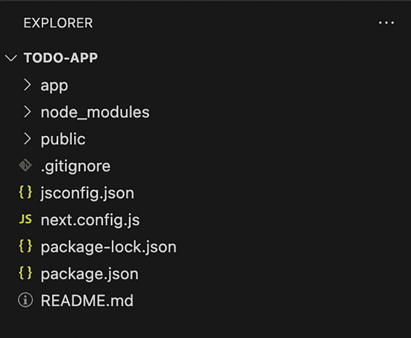

**图 12.1：** App 文件夹结构

现在，在终端输入以下命令：

```bash
npm run dev
```

并在浏览器中访问 `http://localhost:3000`。你应该看到以下界面：


**图 12.2：** Next.js 应用默认屏幕

由于我们使用 `create-next-app` 命令引导了 Next 应用，让我们清理一些文件中的样板代码，以得到类似所示的效果：

**app/globals.css**
```css
* {
  box-sizing: border-box;
  padding: 0;
  margin: 0;
}

html,
body {
  max-width: 100vw;
  overflow-x: hidden;
}

body {
  background: black;
  color: white;
}
```

**app/layout.js**
```js
import './globals.css'
import { Inter } from 'next/font/google'

const inter = Inter({ subsets: ['latin'] })

export const metadata = {
  title: 'To-Do app',
  description: 'Created using Next.js 13',
}

export default function RootLayout({ children }) {
  return (
    <html lang="en">
      <body className={inter.className}>{children}</body>
    </html>
  )
}
```

**app/page.module.css**
```css
.main {
  display: flex;
  flex-direction: column;
  gap: 40px;
  align-items: center;
  padding: 6rem;
  min-height: 100vh;
}

.go-button {
  background: green;
  padding: 10px;
}
```

**app/page.js**
```js
import styles from "./page.module.css";
import Link from "next/link";

export default function Home() {
  return (
    <main className={styles.main}>
      <h1>To-Do app</h1>
      <p>This is an app created using Next.js 13</p>
      <Link href="/crud" className={styles['go-button']}>Let's Go!</Link>
    </main>
  );
}
```

恭喜！`Next.js` 已在你的电脑上成功设置好用于本地开发。它应该如图 12.3 所示：

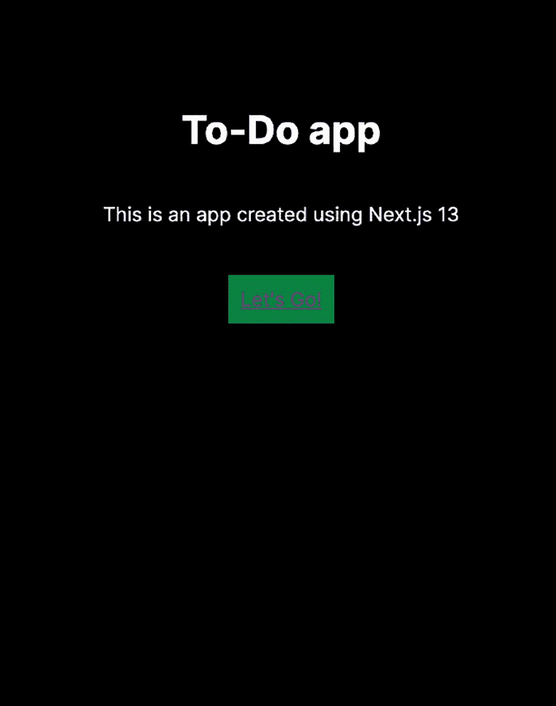

**图 12.3：** To-Do app

# 显示待办事项 (读取)

我们已经为应用创建了落地页，用户访问首页时会看到。当用户点击 `Let's Go` 按钮时，我们将他们重定向到应用的主页，可以在那里进行 CRUD 操作。

现在，我们在 app 文件夹内部创建一个新的 `crud` 文件夹并创建一个 `page.js` 来渲染 `crud` 路由的 UI，并创建一个 `page.module.css` 来编写样式。


**图 12.4：** 新增的文件夹和文件

crud 文件夹中的 `page.js` 内容如下：

```js
import styles from "./page.module.css";

export default function Crud() {
  return (
    <div className={styles.main}>
      <h2>To-Do items</h2>
      <p>We will perform CRUD here!</p>
    </div>
  );
}
```

**page.module.css**
```css
.main {
  display: flex;
  flex-direction: column;
  gap: 40px;
  align-items: center;
  padding: 6rem;
  min-height: 100vh;
}
```

如果我们导航到 `http://localhost:3000/crud`，现在将看到以下界面：


**图 12.5：** 屏幕上的输出

我们将更改 `app/page.js` 中 `Link` 组件的 `href`：

```js
<Link href="/crud" className={styles['go-button']}>Let's Go!</Link>
```

这样用户点击链接后，将被重定向到我们刚刚创建的 `crud` 路由。现在，我们在根目录下创建一个新的 `components` 文件夹并在其中创建一个 `ToDoItem` 组件。它将接收包含待办事项名称的 `item` 属性：

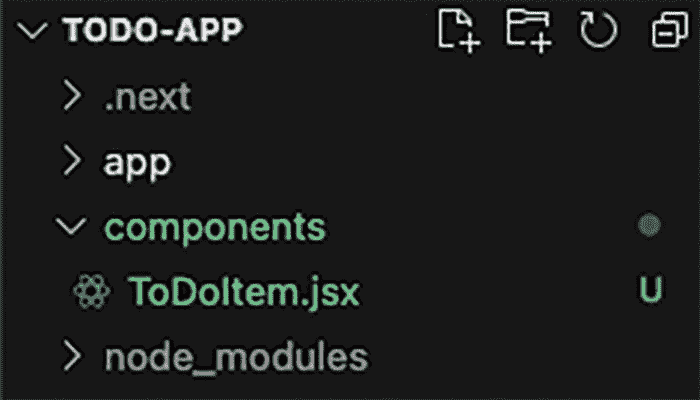

**图 12.6：** ToDoItem.jsx 文件

```js
const ToDoItem = ({ item }) => {
  return <p>{item}</p>;
};

export default ToDoItem;
```

现在，我们在 `/crud` 路由中编辑 `page.js` 来构建应用。首先，创建一个静态数组并在屏幕上渲染：

```js
import styles from "./page.module.css";
import TodoItem from "@/components/ToDoItem";

export default function Crud() {
  const items = ["Go to the gym", "Buy groceries", "Pickup mail"];
  return (
    <div className={styles.main}>
      <h2>To-Do items</h2>
      <ul>
        {items.map((item) => (
          <TodoItem key={item} item={item} />
        ))}
      </ul>
    </div>
  );
}
```


**图 12.7：** 已渲染的待办事项

你现在可以看到我们正在渲染数组中的待办事项。

接下来，让我们完善待办事项列表的 UI。为了这一点，我们将安装名为 Material UI 的 UI 库。它有很多预构建的 UI 组件和工具。运行命令 `npm install @mui/material @emotion/react @emotion/styled @mui/icons-material` 安装 Material UI 及其图标包。我们将添加一个复选框来标记已完成，并为每个项目添加一个删除按钮：

```javascript
// components/ToDoItem.jsx
"use client";
import React, { useState } from "react";
import styles from "./ToDoItem.module.css";
import ListItem from "@mui/material/ListItem";
import ListItemButton from "@mui/material/ListItemButton";
import ListItemIcon from "@mui/material/ListItemIcon";
import Checkbox from "@mui/material/Checkbox";
import ListItemText from "@mui/material/ListItemText";
import DeleteIcon from "@mui/icons-material/Delete";

const ToDoItem = ({ item }) => {
  const [checked, setChecked] = useState([]);

  const handleToggle = (key) => {
    let newChecked = [...checked];
    const currentIndex = newChecked.indexOf(key);
    if (currentIndex !== -1) {
      newChecked.splice(currentIndex, 1);
    } else {
      newChecked.push(key);
    }
    setChecked(newChecked);
  };

  return (
    <ListItem className={styles.item} key={key}>
      <ListItemButton onClick={handleToggle(key)}>
        <ListItemIcon>
          <Checkbox
            checked={checked.indexOf(key) !== -1}
            tabIndex={-1}
            className={styles.checkbox}
          />
        </ListItemIcon>
        <ListItemText primary={item} />
      </ListItemButton>
      <ListItemIcon>
        <DeleteIcon className={styles.delete} />
      </ListItemIcon>
    </ListItem>
  );
};

export default ToDoItem;
```

**components/ToDoItem.module.css**
```css
.item {
  background: black;
  margin-bottom: 20px;
}

.checkbox {
  color: white;
}

.delete {
  color: rgb(235, 81, 81);
}
```

**crud/page.js**
```javascript
"use client";
import styles from "./page.module.css";
import TodoItem from "@/components/ToDoItem";
import List from "@mui/material/List";

export default function Crud() {
  const items = ["去健身房", "买杂货", "取邮件"];
  return (
    <div className={styles.main}>
      <h2>待办事项</h2>
      <List>
        {items.map((item, index) => (
          <TodoItem item={item} key={index} />
        ))}
      </List>
    </div>
  );
}
```

你会注意到我们在文件顶部书写了 `use client` 指令。这用于指定它是一个客户端组件，因为我们正在使用外部客户端库 Material UI。

之前的更改将渲染出以下 UI：

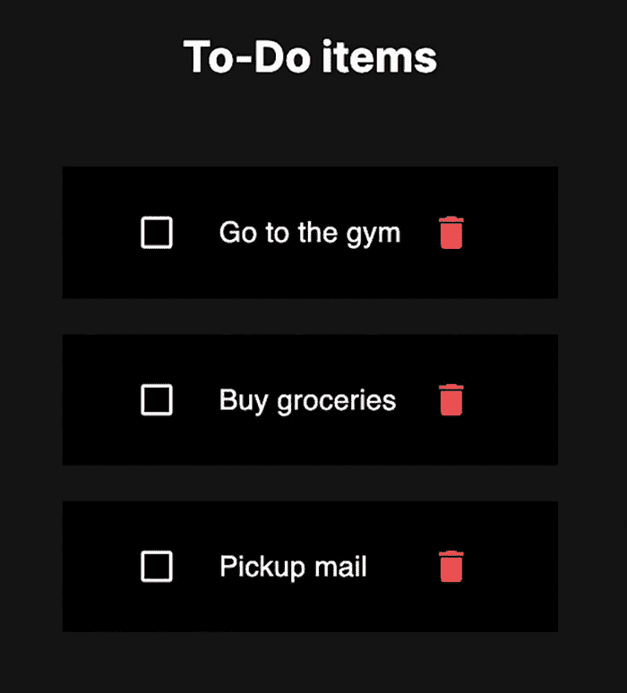

**图 12.8：** 带有复选框和删除按钮的待办事项

到目前为止，我们还没有为删除按钮和复选框添加任何功能，因为我们将在接下来的章节中介绍这些内容。

# 使用 Supabase 设置数据库

我们的应用现在从静态数组 `items` 渲染 UI，内容为 `["去健身房", "买杂货", "取邮件"]`。在现实应用中，此类数据将存储在数据库中。我们将通过 API 调用从服务器获取这些数据，然后在前端进行渲染。这正是我们现在要做的！

为此，请访问 Supabase.com 并使用你的 GitHub 账号登录。你会看到以下仪表板：

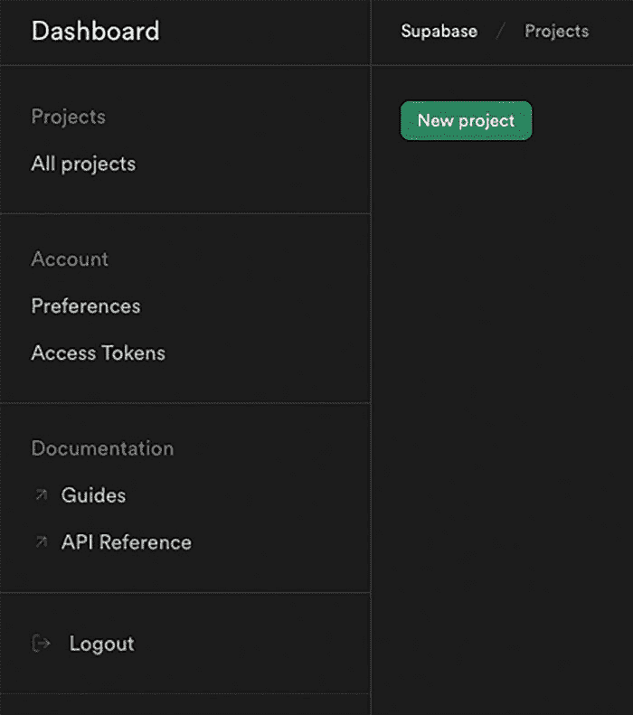

**图 12.9：** Supabase 仪表板

点击 `New project` 按钮并填写 `Name` 和 `Type of organization`，如图 12.10 所示：

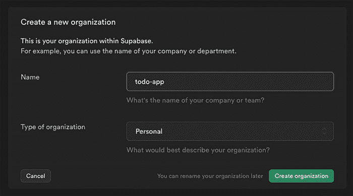

**图 12.10：** Supabase 仪表板

然后，填写以下详情来创建一个新项目：

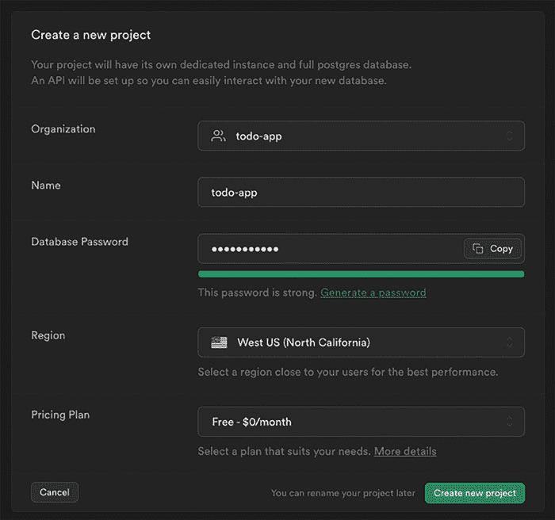

**图 12.11：** 创建新项目屏幕

进入 `Table Editor` 选项卡，将表命名为 `items`，创建以下四个列，并点击 `Save`：

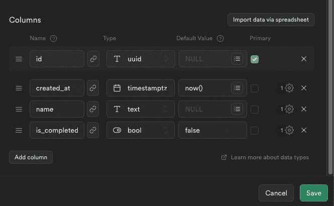

**图 12.12：** 数据库架构

现在，使用 `Insert` 按钮添加与我们在 Next.js 中使用的相同的 Todo 事项。目前你可以使用 [`www.uuidgenerator.net/version1`](https://www.uuidgenerator.net/version1) 创建 UUID 并将其添加到表中的行中。添加这些项目后，我们的表格将看起来像这样：

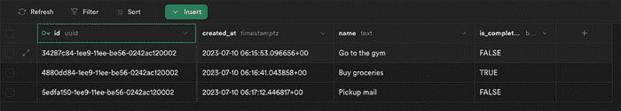

**图 12.13：** 数据库条目

我们正在进展！下一步是通过 API 调用从我们的 Next.js 应用获取这些数据并渲染到我们的 UI 中。幸运的是，Supabase 提供了一种简单的方法，如图 12.14 所示：

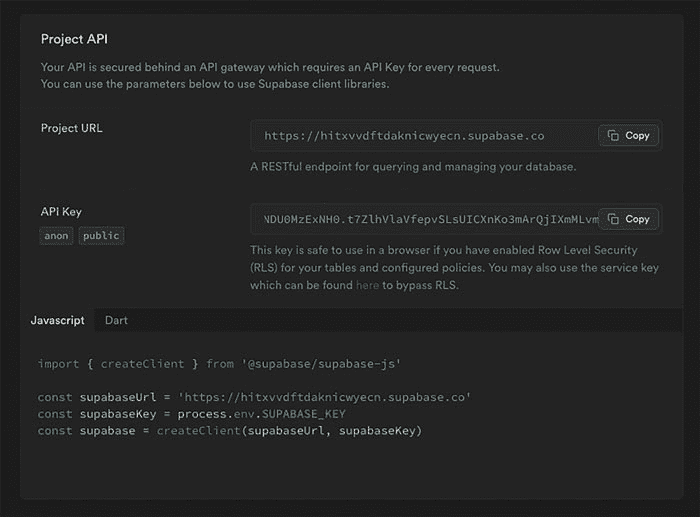

**图 12.14：** Supabase 仪表板

打开我们的 Next.js 应用并安装 `@supabase/supabase-js` 包。

在根级别创建一个新的 `utils` 文件夹，并创建一个文件 `SupabaseClient.js`，用 Supabase 服务器初始化应用：

```javascript
// utils/SupabaseClient.js
import { createClient } from "@supabase/supabase-js";

const supabaseUrl = "YOUR_SUPABASE_URL";
const supabaseKey = "YOUR_SUPABASE_KEY";

const supabase = createClient(supabaseUrl, supabaseKey);

export default supabase;
```

将 `supabaseUrl` 和 `supabaseKey` 替换为你 Supabase 账户中的 API 密钥。

更新 `crud/page.js` 为：

```javascript
// crud/page.js
"use client";
import styles from "./page.module.css";
import TodoItem from "@/components/ToDoItem";
import List from "@mui/material/List";
import supabase from "@/utils/SupabaseClient";

export default async function Crud() {
  let { data: items, error } = await supabase.from("items").select("*");

  return (
    <div className={styles.main}>
      <h2>待办事项</h2>
      <List>
        {items.map((item) => (
          <TodoItem item={item} key={item.id} />
        ))}
      </List>
    </div>
  );
}
```

**components/ToDoItem.jsx**
```javascript
"use client";
import React, { useState } from "react";
import styles from "./ToDoItem.module.css";
import ListItem from "@mui/material/ListItem";
import ListItemButton from "@mui/material/ListItemButton";
import ListItemIcon from "@mui/material/ListItemIcon";
import Checkbox from "@mui/material/Checkbox";
import ListItemText from "@mui/material/ListItemText";
import DeleteIcon from "@mui/icons-material/Delete";

const ToDoItem = ({ item }) => {
  const [checked, setChecked] = useState([]);

  const handleToggle = (key) => {
    let newChecked = [...checked];
    const currentIndex = newChecked.indexOf(key);
    if (currentIndex !== -1) {
      newChecked.splice(currentIndex, 1);
    } else {
      newChecked.push(key);
    }
    setChecked(newChecked);
  };

  return (
    <ListItem className={styles.item} key={item.id}>
      <ListItemButton onClick={() => handleToggle(item.id)}>
        <ListItemIcon>
          <Checkbox
            checked={checked.indexOf(item.id) !== -1}
            tabIndex={-1}
            className={styles.checkbox}
          />
        </ListItemIcon>
        <ListItemText primary={item.name} />
      </ListItemButton>
      <ListItemIcon>
        <DeleteIcon className={styles.delete} />
      </ListItemIcon>
    </ListItem>
  );
};

export default ToDoItem;
```


**图 12.15：** 从服务器渲染的待办事项

# 添加新项目 (创建)

在之前的章节中，我们成功地从 Supabase 获取数据并连接了我们的 Next.js 应用。在本节中，我们将尝试使用输入框和按钮向列表添加新的待办事项。

**crud/page.js**
```javascript
"use client";
import React, { useState, useEffect } from "react";
import { v4 as uuidv4 } from "uuid";
import styles from "./page.module.css";
import TodoItem from "@/components/ToDoItem";
import List from "@mui/material/List";
import supabase from "@/utils/SupabaseClient";

export default function Crud() {
  const [items, setItems] = useState([]);
  const [inputValue, setInputValue] = useState("");

  useEffect(() => {
    const fetchItems = async () => {
      let { data, error } = await supabase.from("items").select("*");
      if (data) setItems(data);
    };
    fetchItems();
  }, []);

  const addItem = async () => {
    if (!inputValue) return;
    let { error } = await supabase.from("items").insert([{
      id: uuidv4(),
      name: inputValue
    }]);
    if (!error) {
      setInputValue("");
      // 刷新
    }
  };

  return (
    <div className={styles.main}>
      <h2>待办事项</h2>
      <div className={styles.container}>
        <input
          value={inputValue}
          onChange={(e) => setInputValue(e.target.value)}
        />
        <button className={styles.button} onClick={addItem}>加入列表!</button>
      </div>
      <List>
        {items.map((item) => (
          <TodoItem item={item} key={item.id} />
        ))}
      </List>
    </div>
  );
}
```

渲染后的 UI 将看起来像这样：


**图 12.16：** 从服务器数据渲染的待办事项

```javascript
import TodoItem from "@/components/ToDoItem";
import List from "@mui/material/List";
import supabase from "@/utils/SupabaseClient";

export default function Crud() {
  const [newItem, setNewItem] = useState(null);
  const [items, setItems] = useState([]);

  const fetchData = async () => {
    const { data, error } = await supabase.from("items").select("*");
    setItems(data);
  };

  useEffect(() => {
    fetchData();
  }, []);

  const addItem = async () => {
    const { data, error } = await supabase
      .from("items")
      .insert([{ is_completed: false, name: newItem, id: uuidv4() }])
      .single();
    if (!error) {
      fetchData();
    }
  };

  return (
    <div className={styles.main}>
      <h2>To-Do items</h2>
      <div className={styles.container}>
        <input
          className={styles.input}
          onChange={(e) => setNewItem(e.target.value)}
        />
        <button className={styles.button} onClick={addItem}>
          Add to list!
        </button>
      </div>
      <List>
        {items.map((item, index) => (
          <TodoItem item={item} key={index} />
        ))}
      </List>
    </div>
  );
}
```

注意，我们安装了一个名为 `uuidv4` 的库来生成 UUID。当你在输入框中输入 `'Play football'` 并点击 `Add to list!` 按钮时，它将向数据库发送 API 调用以添加此新项目，并刷新页面，这样我们就能在 UI 中看到新项目！

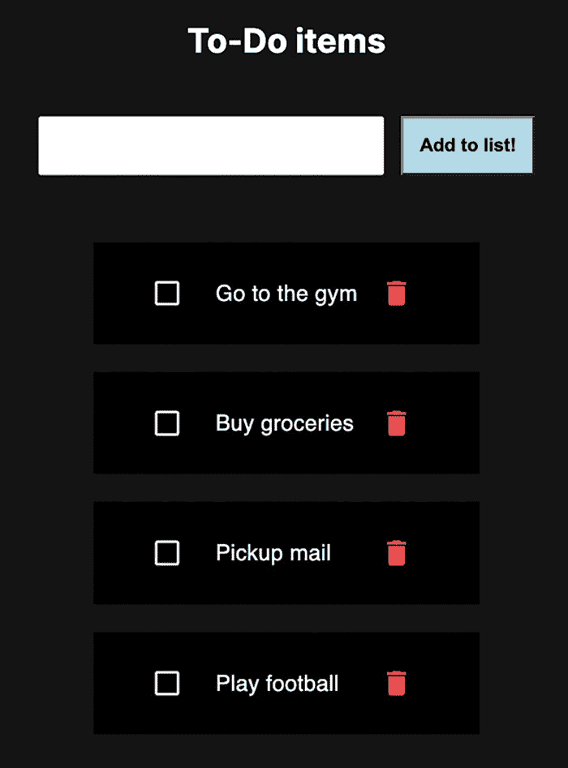

**图 12.17:** 添加的新待办事项

# 编辑待办事项（更新）

在这一部分，我们将根据 UI 中是否勾选来实现判断任务是否已完成。如果用户勾选或取消勾选一个待办事项，我们将更新 Supabase 表中的对应内容。为了实现这一点，我们将按照如下方式重构这两个文件：

### crud/page.js
```javascript
"use client";
import React, { useState, useEffect } from "react";
import { v4 as uuidv4 } from "uuid";
import styles from "./page.module.css";
import TodoItem from "@/components/ToDoItem";
import List from "@mui/material/List";
import supabase from "@/utils/SupabaseClient";

export default function Crud() {
  const [newItem, setNewItem] = useState(null);
  const [items, setItems] = useState([]);

  const fetchData = async () => {
    const { data, error } = await supabase.from("items").select("*");
    setItems(data);
  };

  useEffect(() => {
    fetchData();
  }, []);

  const handleToggle = async (item) => {
    const { data, error } = await supabase
      .from("items")
      .update({ is_completed: !item.is_completed })
      .eq("id", item.id);
    if (!error) {
      fetchData();
    }
  };

  const addItem = async () => {
    const { data, error } = await supabase
      .from("items")
      .insert([{ is_completed: false, name: newItem, id: uuidv4() }])
      .single();
    if (!error) {
      fetchData();
    }
  };

  return (
    <div className={styles.main}>
      <h2>To-Do items</h2>
      <div className={styles.container}>
        <input
          className={styles.input}
          onChange={(e) => setNewItem(e.target.value)}
        />
        <button className={styles.button} onClick={addItem}>
          Add to list!
        </button>
      </div>
      <List>
        {items.map((item) => (
          <TodoItem item={item} key={item.id} onToggle={handleToggle} />
        ))}
      </List>
    </div>
  );
}
```

### components/ToDoItem.jsx
```javascript
"use client";
import React from "react";
import styles from "./ToDoItem.module.css";
import ListItem from "@mui/material/ListItem";
import ListItemButton from "@mui/material/ListItemButton";
import ListItemIcon from "@mui/material/ListItemIcon";
import Checkbox from "@mui/material/Checkbox";
import ListItemText from "@mui/material/ListItemText";
import DeleteIcon from "@mui/icons-material/Delete";

const ToDoItem = ({ item, onToggle }) => {
  const handleToggle = () => {
    onToggle(item);
  };

  return (
    <ListItem className={styles.item}>
      <ListItemButton onClick={handleToggle}>
        <ListItemIcon>
          <Checkbox
            checked={item.is_completed}
            tabIndex={-1}
            className={styles.checkbox}
          />
        </ListItemIcon>
        <ListItemText primary={item.name} />
      </ListItemButton>
      <ListItemIcon>
        <DeleteIcon className={styles.delete} />
      </ListItemIcon>
    </ListItem>
  );
};

export default ToDoItem;
```


# 删除待办事项（删除）

我们终于完成了删除功能，当你点击 `delete` 按钮时，它将运行 Supabase 查询来从 Supabase 表中删除特定项目，并刷新 UI。

此之后，前往 `vercel.com` 并使用你的 GitHub 账户登录。从列表中导入 `todo-app` 仓库并点击“Deploy”。这就完成了！你已成功将你的 Next.js 应用部署到网站上！

## 结论

在本章中，我们使用 Next.js 13 和 Supabase 构建了一个全面的 CRUD（创建、读取、更新、删除）应用程序。我们设计的应用程序允许用户通过创建新任务、将任务标记为已完成以及删除任务来管理待事项列表。在整个过程中，我们演示了如何高效地利用 Next.js 的强大功能，例如其基于 React 的组件渲染框架。我们还阐述了 Supabase 如何通过其强大且易于使用的客户端库，简化后端数据操作的处理。Next.js 和 Supabase 的结合使我们能够快速高效地构建具有可扩展性的无服务器应用程序，并增强用户体验。这个项目仅展示了这些技术的潜能一角，鼓励我们进一步探索并精通这些技术，以满足多样化的 Web 开发需求。

在下一章中，我们将讨论通过使用云提供商和托管服务部署 Next.js 应用的不同方法。

# 第 13 章：探索 Next.js 应用程序中的部署架构

有效部署 Next.js 是开发生命周期中的关键环节，可确保你的 Web 应用程序能够安全、高效地到达目标受众。在本章中，我们将深入探讨部署架构领域，探索部署 Next.js 应用的多种可用选项，并提供优化部署过程的最佳实践。

首先，我们将揭解 Next.js 的部署流程，理解将应用程序从开发环境迁移到运行环境所需的必要步骤。这些基础知识将为探索各种部署选项和考量奠定基础。

我们将开启一段穿越不同托管平台的之旅，例如 Vercel、AWS 和 Heroku 等。你将发现每个平台提供的优势和特性，并学习如何将你的 Next.js 应用无缝部署到这些云提供商。我们将引导你完成所需的配置和步骤，以确保部署过程的顺畅。

当你为生产环境准备你的应用程序做准备时，我们将深入研究专门为部署定制的环境变量设置这一关键任务。你将理解环境变量在管理敏感信息方面的重要性，并学习如何为你的 Next.js 应用部署有效率配置它们。

优化部署过程对于快速高效的发布至关重要。我们将探索优化部署过程的策略，重点关注提高性能和减少停机时间的技术。通过实施这些最佳实践，你可以确保无缝的用户体验，并在部署阶段尽可能的减少干扰。

在持续集成和持续部署（CI/CD）时代，我们将引导你完成专门为 Next.js 应用设计的流水线设置过程。你将学习如何利用 CI/CD 工具和框架来自动化部署过程，在保持代码质量和稳定的同时实现更快速、高效的部署。

监控和调试已部署的应用程序对于维护其健康和及时解决问题至关重要。我们将深入监控技术和工具，让你能够主动监控已部署的 Next.js 应用的性能，并有效处理任何潜在的瓶颈或错误。

在整个章节中，我们将涵盖包括：理解 Next.js 的部署流程、将 Next.js 应用部署到不同的托管平台、为部署设置环境变量、为生产环境配置 Next.js 应用、为了效率优化部署过程、为 Next.js 应用设置 CI/CD 流水线，以及对已部署的应用程序进行监控和调试。

在本章结束，你将对 Next.js 应用可用的部署选项有一个全面的理解，使你能够针对特定的用例对最佳部署策略做出明智决策。现在，让我们开启这段部署架构之旅，确保你的 Next.js 应用在运行环境中充分发挥潜力！

## 结构

在本章中，我们将涵盖以下主题：

* 理解 Next.js 的部署流程
* 为部署设置环境变量
* 为生产环境配置 Next.js 应用
* 为 Next.js 应用设置持续集成和持续部署 (CI/CD) 流水线
* 将 Next.js 应用部署到不同的托管平台，包括 Vercel、AWS 和 Heroku
* 优化部署过程以实现更快速、高效的部署
* 监控和调试已部署的应用程序

# 理解 Next.js 的部署流程

在软件开发语境下，部署是指使软件应用程序可用并供用户使用的过程。它涉及将已开发的代码进行准备，以便其在服务器或其他计算设备上运行，允许用户访问并与应用程序进行交互。

在部署过程中，会执行各种任务，例如编译代码、优化资源、配置设置以及搭建必要的设施。目标是确保应用程序在预期的环境中顺畅、安全且高效地运行。

## 部署环境类型

部署环境是指部署软件应用程序并让用户访问的计算基础设施。部署环境有几种类型，每种都有不同的用途。以下是一些常见类型：

* **开发环境 (Development Environment)**
    开发环境是软件开发人员进行编码、测试和调试应用程序的地方。它通常运行在开发者的个人机器上，可能包含开发工具、库和数据库。该环境并非供公众使用，而是作为构建和完善应用程序的沙箱。

* **测试/暂存环境 (Testing/Staging Environment)**
    测试或暂存环境是一个专用环境，用于在发布到生产环境之前对应用程序进行彻底测试。它尽可能模拟生产环境，并允许测试不同的用例、发现并修复错误，确保应用程序的行为符合预期。它有助于验证应用程序的功能、性能以及与不同系统的兼容性。

* **生产环境 (Production Environment)**
    生产环境是部署应用程序并向用户提供的运行环境。它是应用程序运行并服务于目标受众的实际服务器或托管基础设施。生产环境必须高度稳定、安全并经过性能优化，以处理真实世界的使用情况。它通常需要额外的资源和配置来确保可靠性、可扩展性和高可用性。

* **部署平台 (Deployment Platforms)**

部署平台是促进应用程序部署的服务或托管提供商。这些平台提供了各种功能并支持不同的部署方法。一些流行的部署平台包括像 Amazon Web Services (AWS)、Microsoft Azure 或 Google Cloud Platform 这样的云服务提供商，以及如 Netlify、Vercel 或 Heroku 这样专门的托管服务。这些平台提供基础设施、工具和服务，以简化部署过程并在不同的环境中管理应用程序。

需要注意的是，每个部署环境在软件开发生命周期中都有其特定的用途，确保应用程序在发布到用户访问和利用的生产环境之前已经经过了充分测试并运行良好。

总的来说，部署涉及在不同的环境中准备和设置应用程序，每个环境在开发和发布过程中都承担着独特的角色。

## Next.js 中不同的部署流程类型：

### 静态托管

如果你的 Next.js 应用程序是静态生成的，并且不需要服务器端渲染或 API 路由，你可以将其部署为一组静态文件。这种方法适用于 Netlify、Vercel 或 GitHub Pages 等托管平台。要使用静态托管部署你的应用程序，请遵循以下步骤：

1. 运行以下命令构建你的 Next.js 应用程序：
   ```
   npm run build
   ```
2. 运行以下命令生成静态文件：
   ```
   npm run export
   ```
3. 将生成的静态文件上传到你选择的托管平台，可以通过链接你的项目仓库或使用文件传输方法。
4. 配置你的托管平台以提供静态文件，并让用户能够访问你的应用程序。

### 无服务器函数 (Serverless Functions)

Next.js 提供了 API 路由功能，允许你定义无服务器函数，这些函数按需运行并处理服务器端逻辑。当你的应用程序需要服务器处理时（例如表单提交或从外部 API 获取数据），这种方法非常有用。你可以在 Vercel、AWS Lambda 或 Azure Functions 等平台上使用无服务器函数部署你的 Next.js 应用程序。以下是部署流程的概述：

1. 在 Next.js 项目的 `pages/api` 目录下创建 API 路由文件来编写无服务器函数。
2. 运行以下命令构建你的 Next.js 应用程序：
   ```bash
   npm run build
   ```
3. 将你的应用程序部署到选择的托管平台，确保平台识别 API 路由并将它们与应用程序代码一起部署。
4. 配置任何特定于托管平台的必要环境变量或部署设置。

### 自定义服务器 (Custom Server)

如果你的 Next.js 应用程序需要高级的服务器端功能或与特定基础设施集成，你可以使用自定义服务器进行部署。这种方法让你对服务器环境有更多的控制权，并且在你需要实现复杂的路由或与外部数据库或服务交互时非常有用。自定义服务器的部署过程通常涉及以下步骤：

1. 在你的 Next.js 项目中创建一个自定义服务器文件，例如 `server.js`。
2. 实现必要的服务器逻辑，包括路由和任何额外的服务器端功能。
3. 运行以下命令构建你的 Next.js 应用程序：
   ```bash
   npm run build
   ```
4. 运行以下命令启动自定义服务器：
   ```bash
   node server.js
   ```
5. 将你的自定义服务器部署到你选择的托管环境，确保服务器脚本正确执行。

需要注意的是，部署过程可能会根据你选择的特定托管平台或基础设施而异。因此，建议咨询你计划用于部署 Next.js 应用程序的平台或托管服务提供的文档或指南。

## 为部署设置环境变量

环境变量在应用程序的部署中起着至关重要的作用。它们是应用程序代码外部的配置值，并根据部署环境的不同而变化。环境变量提供了一种灵活的方式来存储敏感信息、配置设置、API 密钥、数据库凭据或应用程序所需的任何动态值。

为部署设置环境变量涉及在环境中（如本地开发、测试和生产）定义和管理这些变量。让我们探索如何在这些每个环境中为部署设置环境变量：

1. **本地环境**
在本地开发环境中，你通常设置环境变量来配置你的开发环境并在本地机器上测试应用程序。以下是你可以为本地部署设置环境变量的方法：

1. 在 Next.js 项目的根目录下创建一个 `.env` 文件。该文件将存储你的环境变量。
2. 在 `.env` 文件中使用 `KEY=VALUE` 格式定义环境变量。例如：
   ```bash
   API_KEY=12345
   DATABASE_URL=mongodb://localhost:27017/mydatabase
   ```
3. 在你的 Next.js 应用程序代码中，使用 `dotenv` 等包或内置的 `process.env` 对象来访问环境变量。例如，访问 `API_KEY` 变量：
   ```javascript
   const apiKey = process.env.API_KEY;
   ```
4. 确保将 `.env` 文件添加到 `.gitignore` 文件中，以便其不被提交到版本控制，因为它可能包含敏感信息。

2. **测试环境**
测试环境是你将应用程序部署到生产环境之前对其进行全面测试的地方。为测试环境设置环境变量的过程与本地环境类似：

1. 创建一个独立的 `.env.test` 文件来存储特定于测试环境的环境变量。
2. 在 `.env.test` 文件中定义测试所需的环境变量。
3. 在你的测试脚本或测试框架配置中，从 `.env.test` 文件加载环境变量以确保测试使用正确的配置。

3. **生产环境**
生产环境是最终的部署环境，你的应用程序将那里提供给用户。安全且高效地设置环境变量至关重要。以下是推荐的方法：

1. 在生产服务器或托管平台上，使用托管服务提供的机制定义环境变量。这可能包括使用特定于托管平台的管理控制台、仪表板或命令行界面。
2. 避免直接在代码库或配置文件中存储生产环境变量。相反，在生产服务器上安全地设置环境变量，或通过托管平台的部署设置来配置它们。
3. 在生产服务器上，确保环境变量在运行时被你的 Next.js 应用程序正确加载并可以访问。

通过遵循这些步骤，你可以为不同的环境设置部署环境变量。记住安全地处理敏感信息，避免在公共仓库或不安全的通道中暴露环境变量。

**在 Windows 和 Linux 环境下本地运行 Next.js 应用程序时，你可以在脚本中传递环境变量：**

### Windows 环境

在 Windows 中，你可以在执行脚本之前使用 `set` 命令内联设置环境变量。例如：
```bash
set API_KEY=12345 && npm run dev
```

在前面的示例中，在运行 `npm run dev` 脚本之前，`API_KEY` 被设置为 `12345`。你可以将 `API_KEY` 及其值替换为你特定的环境变量。

### Linux 环境

在 Linux 中，你可以使用 `export` 命令在执行脚本之前内联设置环境变量。示例如下：
```bash
export API_KEY=12345 && npm run dev
```

与 Windows 示例类似，在运行 `npm run dev` 脚本之前，`API_KEY` 被设置为 `12345`。同样，你可以将 `API_KEY` 及其值替换为你特定的环境变量。

或者，你也可以将环境变量存储在单独的文件中，并在运行脚本之前加载它们。

### Windows 环境下的独立文件方法

在 Windows 中，你可以创建一个单独的文件（例如 `env.bat`），并使用 `set` 命令来定义你的环境变量。示例如下：
```bash
@echo off
set API_KEY=12345
set DATABASE_URL=mongodb://localhost:27017/mydatabase
```

保存该文件，然后在运行 `npm run dev` 脚本之前执行该文件：
```bash
call env.bat && npm run dev
```

### Linux 环境下的独立文件方法

在 Linux 中，你可以创建一个单独的文件（例如 `env.sh`），并使用 `export` 命令来定义你的环境变量。示例如下：
```bash
#!/bin/bash
export API_KEY=12345
export DATABASE_URL=mongodb://localhost:27017/mydatabase
```

保存该文件，然后在运行 `npm run dev` 脚本之前执行该文件：
```bash
source env.sh && npm run dev
```

通过使用内联方法或独立文件方法，你都可以在 Windows 和 Linux 环境下本地运行 Next.js 应用时，向脚本传递环境变量。

## 为你的 Next.js 应用设置测试、构建和实现 CI/CD 的 GitHub Workflow Action 配置文件的步骤指南：

#### 第 1 步：创建 GitHub Workflow 文件

*   在 GitHub 上的 Next.js 项目仓库中，导航到 `.github/workflows` 目录。
*   在 `.github/workflows` 目录中创建一个新的 YAML 文件（例如 `ci-cd.yml`）来定义你的工作。

#### 第 2 步：定义 Workflow 触发器

*   指定触发工作流的事件。例如，你可以在向 `main` 分支进行 push 事件或拉取请求（pull requests）时触发工作流：
```yaml
name: CI/CD Workflow
on:
  push:
    branches:
    - main
  pull_request:
    branches:
```

#### 第 3 步：定义 Workflow Jobs

*   在工作流中定义任务（jobs）。例如，你可以为测试、构建和部署设置单独的任务：
```yaml
jobs:
  test:
    name: Test
    runs-on: ubuntu-latest
    steps:
      - name: Checkout code
        uses: actions/checkout@v2
      - name: Install dependencies
        run: npm ci
      - name: Run tests
        run: npm run test
  build:
    name: Build
    runs-on: ubuntu-latest
    steps:
      - name: Checkout code
        uses: actions/checkout@v2
      - name: Install dependencies
        run: npm ci
      - name: Build Next.js app
        run: npm run build
  deploy:
    name: Deploy
    needs: [build]
    runs-on: ubuntu-latest
    steps:
      - name: Checkout code
        uses: actions/checkout@v2
      - name: Install dependencies
        run: npm ci
      - name: Deploy to AWS/Heroku/Vercel
        run: |
          # Add deployment commands here
```

#### 第 4 步：配置测试

*   在 `test` 任务中添加适当的测试命令和配置。

#### 第 5 步：配置构建

*   在 `build` 任务中添加构建 Next.js 应用的命令和配置。

#### 第 6 步：配置部署

*   在 `deploy` 任务中添加必要的部署命令或脚本。根据你的部署目标（AWS, Heroku, Vercel），你需要使用相应的命令和配置。

#### 第 7 步：提交并推送 Workflow 文件

*   将工作流文件（`ci-cd.yml`）提交并推送到仓库。

#### 第 8 步：GitHub Actions 执行

*   每当指定的事件被触发时（例如，向 `main` 分支进行 push 或拉取请求），GitHub Actions 将自动执行定义的工作流。
*   工作流将根据配置中使用 `needs` 指定的依赖关系，顺序执行定义的任务（例如：测试、构建和部署）。

## 2. 将 Next.js 部署到 Heroku

要使用 Heroku 部署 Next.js 应用，请按照以下步骤操作：

### 步骤 1：注册 Heroku 账户
如果你还没有 Heroku 账户，请访问 Heroku 网站 ([`www.heroku.com/`](https://www.heroku.com/)) 并注册免费账户。

### 步骤 2：安装 Heroku CLI
下载并安装适用于你操作系统的 Heroku CLI（命令行）。你可以在 Heroku Dev Center 网站找到安装说明：[`devcenter.heroku.com/articles/heroku-cli#download-and-install`](https://devcenter.heroku.com/articles/heroku-cli#download-and-install)

### 步骤 3：为部署准备你的应用程序
确保你的 Next.js 项目已准备好进行部署。确保根目录下有一个 `package.json` 文件，并且已列出了必要的依赖项。

### 步骤 4：创建 `Procfile`
在你的 Next.js 项目根目录下，创建一个名为 `Procfile` 的文件（无任何扩展名）。打开 `Procfile` 并添加以下行：
```
web: npm start
```
这一行告诉 Heroku 如何启动你的应用程序。

### 步骤 5：初始化 Git 并提交项目
在终端中，进入你的项目目录并运行以下命令来初始化 Git 并提交项目：
```bash
git init
git add .
git commit -m "Initial commit"
```

### 步骤 6：通过 CLI 登录 Heroku
运行以下命令并按照提示通过 CLI 登录你的 Heroku 账户：
```bash
heroku login
```

### 步骤 7：创建一个新的 Heroku 应用
运行以下命令在 Heroku 上创建一个新应用：
```bash
heroku create
```
此命令将为你的应用生成一个唯一的名称。

### 步骤 8：将应用程序部署到 Heroku
要部署你的应用程序，运行以下命令：
```bash
git push heroku master
```

### 步骤 9：打开已部署的应用
一旦部署过程完成，Heroku 将为你提供一个部署 URL。你可以运行以下命令来打开已部署的应用：
```bash
heroku open
```

通过遵循这些步骤，你可以成功地将 Next.js 应用部署到 Heroku。请记住针对你应用程序的任何额外步骤或配置，咨询 Heroku 官方文档：[`devcenter.heroku.com/categories/nodejs-support`](https://devcenter.heroku.com/categories/nodejs-support)


**图 13.2:** Heroku 部署过程

## 3. 将 Next.js 应用部署到 AWS

要使用 AWS Amplify 部署 Next.js 应用，请遵循以下详细步骤以及代码示例：

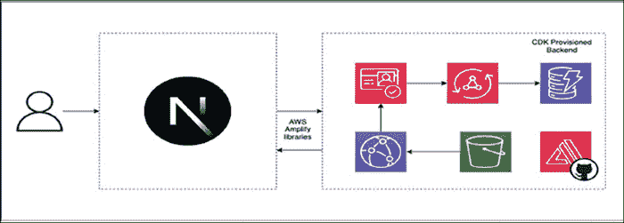

**图 13.3:** AWS 部署过程

### 步骤 1：设置 AWS Amplify 项目
1. 登录 AWS 管理控制并导航到 AWS Amplify 服务。
2. 点击 `Get Started` 或 `Create App` 创建一个新的 Amplify 应用。
3. 选择你优的 Git 提供者（例如 GitHub、GitLab、Bitbucket）并连接你的仓库。
4. 选择你想要部署的分支并指定构建设置。对于 Next.js 应用，设置以下值：
    - **Framework**: Other
    - **Build command**: `npm run build`
    - **Start command**: `npm run start`
5. 如果你想使用自定义域名，请配置域名设置。否则，Amplify 将为你的应用提供默认域名。
6. 检查设置并点击 `Next` 创建 Amplify 应用。

### 步骤 2：设置构建和部署配置
1. 在 Amplify 控制台中，点击你的应用以访问应用详情。
2. 在 `App Settings` 下，点击 `Build settings` 来配置构建和部署设置。
3. 检查你要配置的分支的 `Edit` 按钮（通常为 "master" 或 "main"）。
4. 确保以下设置配置正确：
    - **Build command**: `npm run build`
    - **Start command**: `npm run start`
    - 点击 “Save and Deploy”保存配置。

### 步骤 3：部署 Next.js 应用
1. 保存配置后，点击 `Deploy` 开始部署过程。
2. Amplify 将自动克隆你的仓库，构建你的 Next.js 应用，并使用 AWS 资源进行部署。
3. 部署进度将在 Amplify 控制台中显示。等待部署成功完成。

### 步骤 4：访问已部署的 Next.js 应用
1. 一旦部署完成，Amplify 将为你提供一个 URL 来访问已部署的 Next.js 应用。
2. 打开网页浏览器并访问提供的 URL 以查看你已部署的应用运行情况。

### 步骤 5：持续部署（可选）
要启用持续部署，即每当你向仓库推送更改时，它会自动向你的应用部署更新：
1. 在 Amplify 控制台中，进入你的应用设置。
2. 在 `Branches` 下，点击你想要启用持续部署的分支。
3. 将 `Manual` 切换到 `Auto`。
4. 点击 `Save` 启用持续部署。

现在让我们来看代码示例：
1. 在 `package.json` 中：
```json
{
  "scripts": {
    "build": "next build",
    "start": "next start"
  }
}
```
2. 提交并推送你的 Next.js 项目（例如 GitHub）。
3. 设置 AWS Amplify 并连接到你的仓库。
4. 一旦部署完成，Amplify 将使用指定的脚本构建并部署 Next.js 应用。
5. 使用提供的 URL 访问你的 Next.js 应用。

就是这样！你已经使用 AWS Amplify 成功部署了 Next.js 应用。Amplify 简化了部署过程，让你专注于开发应用程序。

# 优化部署过程以实现更快、更高效

优化部署过程以实现更快、更高效涉及多种策略和最佳实践。以下是帮助你优化部署的步骤指南：

### 步骤 1：优化构建过程
- **压缩和打包资源**：压缩你的 JavaScript、CSS 和 HTML 文件以缩小文件大小并提高加载速度。使用 `UglifyJS` 或 `Terser` 等工具压缩 JavaScript，使用 CSS 压缩工具压缩 CSS。
- **代码分割**：实现代码分割将你的应用程序代码拆分成小块。这允许懒加载组件并减少应用的初始加载时间。
- **启用压缩**：在服务器上启用压缩以减少传输的文件大小。`Gzip` 和 `Brotli` 是常用的压缩算法。
- **优化图像**：压缩并优化图像减小文件大小。`ImageOpt`、`TinyPNG` 或 `Squoosh` 等工具可以帮助优化图像。
- **使用服务器渲染 (SSR)**：实施服务器渲染，在服务器上预渲染页面并减少用户的初始加载时间。

### 步骤 2：实施缓存
- **使用内容交付网络 (CDN)**：利用 CDN 缓存静态资源并从更靠近用户的边缘服务器提供服务，从而减少延迟并提高性能。
- **实施浏览器缓存**：为静态资源设置适当的缓存头部以启用浏览器缓存。这允许浏览器在本地存储资源并避免不必要的请求。
- **使用 Cache-Control Header**：为静态资源设置 `Cache-Control` Header 以指定缓存指令。使用 `AWS CloudFront` 或 `Vercel` 等工具配置缓存设置。

### 步骤 3：自动化与持续集成/部署 (CI/CD)
- **设置 CI/CD 流水线**：使用 `Jenkins`、`CircleCI` 或 `GitHub Actions` 等 CI/CD 工具自动化构建、测试和部署过程。配置流水线在代码更改或特定事件时触发部署。
- **并行化构建和部署步骤**：将你的部署过程拆分为并行步骤以加快整体部署速度。例如，你可以同时运行测试、构建资源并部署到不同的环境。
- **使用滚动部署**：实施滚动部署，逐步更新你的应用程序而不是一次性更新。这可以减少停机时间并为用户提供更平滑的过渡。
- **金丝发布**：实施金丝发布，在向整个用户群发布之前，对部分用户测试新功能或更新。这有助于及早发现问题并降低风险。

## 第 4 步：监控与性能优化
- **监控性能指标**：使用 `Google Analytics`、`New Relic` 或 `AWS CloudWatch` 等工具监控响应时间、页面加载时间和资源使用等性能指标。识别瓶颈和改进领域。
- **持续性能优化**：通过识别和解决性能问题、优化数据库查询以及提高代码效率，持续分析并优化你的应用程序的性能。
- **实施 A/B 测试**：进行 A/B 测试以实验不同版本的应用程序，并衡量它们对性能的影响。这有助于识别对用户体验产生积极影响的。
- **性能预算**：设置性能预算以定义文件大小、请求数量或加载时间等指标的限制。确保你的应用程序处于这些限制内以维持性能。

通过遵循这些步骤，你可以优化 Next.js 应用程序的部署过程，从而实现更快更高效的部署。定期监控并微调你的部署过程，以适应不断的需求并利用最新的技术和最佳实践。

## 为生产环境配置 Next.js 应用程序

为生产环境配置 Next.js 应用程序涉及优化应用程序的性能、安全扩展性，以确保其在生产环境中流畅高效地运行。以下是配置 Next.js 应用程序时需要考虑的关键方面：

### 环境特有配置

使用环境变量来存储在开发、测试和生产环境之间不同的配置值。这些变量可以包括 API 密钥、数据库连接字符串、功能标记或任何其他敏感信息。通过将配置与代码分离，你可以轻松管理和更新特定于环境的设置，而无需修改应用程序的源代码。

### 性能优化

为了提高性能，请实施以下技术：

- **代码压缩**：启用代码压缩以减小 JavaScript 和 CSS 文件的的大小。可以使用 `Webpack` 或 `Next.js` 内置的优化功能来实现此点。压缩消除了不必要的字符、空白符和注释，为用户带来了更快的加载速度。
- **服务端渲染 (SSR)**：利用 `Next.js` 的服务端渲染能力，在发送到客户端之前在服务器上生成 HTML。SSR 提高了初始页面加载时间，并让搜索引擎更有效地索引你的网站。
- **客户端优化**：利用代码分割和懒加载，确保初始仅加载必要的代码。通过减少初始负载大小并推迟非关键资源的加载（直到需要时），可以提高性能。
- **图像优化**：使用 `Next.js` 内置的 `Image` 组件，它通过压缩和调整图像大小来自动优化图像。这在不牺牲视觉质量的情况下减少了图像文件大小，并提高了整体页面加载时间。
- **缓存**：实施缓存机制以减少服务器负载并提高响应时间。你可以利用 `Next.js` 对服务端缓存的内置支持，或使用 `Varnish` 或 `Redis` 等缓存解决方案来缓存频繁访问的数据或渲染的页面。

### 安全措施

采取以下安全措施保护你的 Next.js 应用程序：

- **安全通信**：强制客户端和服务器之间所有通信使用 `HTTPS`。使用 `SSL` 证书加密传输中的数据，防止未经的访问或篡改。
- **输入验证**：验证并清理用户输入，以防止跨站脚本 (XSS) 和 SQL 注入等常见安全漏洞。利用 `Yup` 或 `Joi` 等库进行输入验证，并避免在查询或命令中直接执行用户提供的数据。
- **身份验证与授权**：实施强大的身份验证和授权机制来控制对敏感区域或数据的访问。使用 `Passport.js` 或 `NextAuth.js` 等库安全处理用户验证和授权流程。
- **访问控制**：通过实施适当访问控制机制确保只有授权用户才能执行特权操作。应用最小权限原则，仅授予用户其角色或职责所需的权限。
- **错误处理**：实施适当错误处理和错误日志，防止敏感信息暴露给用户。显示用户友好的错误消息，同时记录详细错误以供调试。

### 可扩展性与部署

为你的 Next.js 应用程序做好可扩展和高效部署的准备：

- **负载均衡**：设置负载均衡以将入站流量分布到多个服务器上。`AWS Elastic Load Balancer (ELB)` 或 `Nginx` 等负载均衡器有助于分配负载并确保高可用性。
- **水平扩展**：设计你的应用程序以便水平扩展，允许根据需求动态添加或删除实例。利用 `Docker` 等容器化技术或 `Kubernetes` 等编排平台来方便扩展。
- **自动化部署**：实施持续集成和持续部署 (CI/CD) 流水线以自动化部署过程。`Jenkins`、`Travis CI` 或 `AWS CodePipeline` 等工具可以帮助自动化构建、测试和部署，确保发布周期高效。
- **性能监控**：利用 `New Relic`、`Datadog` 或 `AWS CloudWatch` 等监控工具监控生产环境中 Next.js 应用程序的性能。监控响应时间、服务器负载和资源利用率等指标，以识别性能瓶颈或扩展需求。

通过遵循这些配置实践，你可以优化 Next.js 应用程序的性能、安全扩展性，确保其在生产环境中的顺利运行。

# Next.js 应用程序的 CI/CD 流水线设置

为 Next.js 应用程序设置持续集成和持续部署 (CI/CD) 流水线涉及在进行更改时自动化应用程序的构建、测试和部署。这确保了你的代码库持续集成、测试并部署到各种环境。以下是为 Next.js 应用程序设置 CI/CD 流水线的步骤指南，包括运行测试和构建的 GitHub 工作流：

1. **版本控制系统**
   首先使用 `Git` 等版本控制系统 (VCS) 管理你的 Next.js 应用程序的源代码。创建一个 `Git` 仓库来存储和跟踪项目的更改。

2. **选择 CI/CD 服务**
   选择一个与你的 Git 仓库集成的 CI/CD 服务。流行的选项包括 GitHub Actions、GitLab CI/CD 和 Travis CI。在本指南中，我们将重点关注 GitHub Actions。

### 3. 配置 GitHub Actions
通过导航到仓库的“Actions”选项卡并按照设置说明操作来启用 GitHub Actions。这将允许你定义工作流，根据推送、拉取请求或定时间隔等事件自动触发某些操作。

### 4. 创建工作流文件
在你的仓库中，如果 `.github/workflows` 目录不存在，请创建它。在该目录下，创建一个 YAML 文件（例如 `main.yml`）来定义你的工作流。该文件将包含运行测试和构建你的 Next.js 应用程序所需的步骤。

### 5. 定义测试工作流
在工作流文件中定义一个运行测试的作业（job）。这通常包括检出仓库、设置 Node.js 环境、安装依赖和执行测试等步骤。这是一个示例：
```yaml
name: Test
on:
  push:
    branches:
    - main
jobs:
  test:
    runs-on: ubuntu-latest
    steps:
      - name: Checkout repository
        uses: actions/checkout@v2
      - name: Set up Node.js
        uses: actions/setup-node@v2
        with:
          node-version: '14'
      - name: Install dependencies
        run: npm ci
      - name: Run tests
        run: npm test
```

### 6. 定义构建工作流
接下来，定义一个构建你的 Next.js 应用程序的作业。该作业取决于测试作业的成功完成。这是一个示例：
```yaml
name: Build
on:
  push:
    branches:
    - main
jobs:
  test:
    runs-on: ubuntu-latest
    steps:
      - name: Checkout repository
        uses: actions/checkout@v2
      - name: Set up Node.js
        uses: actions/setup-node@v2
        with:
          node-version: '14'
      - name: Install dependencies
        run: npm ci
      - name: Build Next.js app
        run: npm run build
```

### 7. 提交并推送
将工作流文件提交到你的仓库并推送更改。这将触发你 CI/CD 流水线中定义的工作流。

### 8. 测试与构建
现在，当针对 `main` 分支有新提交或拉取请求时，GitHub Actions 将自动执行定义的工作流。“Test”工作流将运行测试，如果成功，“Build”工作流将构建你的 Next.js 应用程序。

通过遵循这些步骤，可以使用 GitHub Actions 为你的 Next.js 应用程序设置 CI/CD 流水线。这些流水线会在每次发生更改时自动运行测试并构建你的应用程序，帮助你及早发现问题并确保代码准备好进行部署。

## 监控和调试已部署的应用

在 Next.js 中监控和调试已部署的应用涉及使用各种工具和技术来识别并解决可能在生产环境中出现。Next.js 是一个构建 React 应用程序的流行框架，提供了内置功能并与 Vercel 和 AWS 等部署平台良好集成。让我们深入了解使用 Vercel 和 AWS 进行 Next.js 监控和调试的细节：

### 监控部署的应用
监控允许你跟踪部署的 Next.js 应用程序的健康状况、性能和可用性。它可以帮助你及时识别并解决问题。以下是一些针对 Next.js 的监控技术：

*   **日志 (Logging)**：在你的 Next.js 应用程序中实现健壮的日志记录，捕捉相关的事件、错误和调试信息。你可以使用 `Winston` 或 `Pino` 等库来处理日志。日志消息可以存储在各种位置，如本地文件、远程服务器或 `Loggly`、`Papertrail` 等第三方日志服务。
*   **错误跟踪 (Error Tracking)**：在你的 Next.js 应用程序中集成 `Sentry` 或 `Rollbar` 等错误跟踪服务。这些服务收集并分析应用程序发生的错误，并提供有关错误来源、堆栈跟踪和上下文的详细信息。它们通常包含实时告警和问题分组等功能，以便高效调试。
*   **性能监控 (Performance Monitoring)**：利用 `New Relic` 或 `Datadog` 等工具监控 Next.js 应用程序的性能。这些工具可以捕捉与响应时间、服务器负载、数据库查询和其他性能相关的指标。它们提供了对瓶颈或优化区域的见解。
*   **应用指标 (Application Metrics)**：对你的 Next.js 应用程序进行埋点，以捕获特定于应用程序行为的自定义指标。你可以使用 `Prometheus` 或 `StatsD` 等库来收集和存储与特定业务流程或用户交互相关的指标。这些指标可以帮助你识别模式、跟踪趋势并做出数据驱动的改进决策。

### 调试已部署的应用
调试已部署的 Next.js 应用程序涉及调查和解决影响应用程序功能或性能的问题。以下是一些针对 Next.js 的调试技术：

*   **远程调试 (Remote Debugging)**：使用 `Chrome DevTools` 或 `VS Code` 的远程调试功能，连接到你在生产环境中运行的 Next.js 应用程序。这允许你检查变量、单步执行代码并捕运行时信息。
*   **错误分析 (Error Analysis)**：分析错误日志、堆栈跟踪和错误消息以识别问题的根源。利用日志和错误跟踪服务来收集信息。注意特定的错误模式、用户报告或任何异常行为，以确定问题所在。
*   **负载测试 (Load Testing)**：使用 `Apache JMeter` 或 `Artillery` 等工具进行负载测试，以模拟高流量场景。通过让你的 Next.js 应用程序承受负载，你可以发现影响其稳定性或响应的性能问题、扩展性限制或资源瓶颈。
*   **A/B 测试与功能开关 (Feature Flags)**：采用 A/B 测试技术和功能开关来逐步发布新功能或更改。这允许你隔离并分析特定更改对部署应用的影响。通过选择性地启用或禁用功能，你可以识别某个功能是否导致了问题或性能下降。
*   **代码监控 (Code Monitoring)**：利用 `Epsagon` 或 `TrackJS` 等代码监控服务跟踪 Next.js 应用程序代码库中的问题。这些服务可以提供有关代码执行和性能热点的见解，并帮助识别可能的改进区域。

### 使用 Vercel 的 Next.js
Vercel 是一个流行的部署平台，它简化了部署过程并提供了额外的监控和调试功能：

*   **部署钩子 (Deployment Hooks)**：Vercel 允许你设置部署钩子，即部署后触发的 HTTP 端点。你可以使用这些钩子触发自定义监控脚本或通知外部服务部署状态。
*   **环境变量 (Environment Variables)**：Vercel 允许你管理 Next.js 应用程序的环境变量，包括与监控和调试相关的变量。这允许你为不同的环境配置不同的设置并无缝集成第三方服务。
*   **分析 (Analytics)**：Vercel 提供了内置分析来监控 Next.js 应用程序的性能和使用情况。它跟踪请求数、响应时间和带宽使用等指标，允许你评估应用程序的行为并做出明智决策。

### AWS 与 Next.js
AWS 提供了系列服务，可以增强 Next.js 应用的监控和调试能力：

*   **AWS CloudWatch**: `CloudWatch` 允许你收集和监控日志、设置警报并使性能指标可视化。你可以将 Next.js 应用日志与 `CloudWatch Logs` 集成，并配置自定义指标以跟踪特定的应用程序行为。
*   **AWS X-Ray**: `AWS X-Ray` 帮助追踪流过你的 Next.js 应用的请求，并识别性能瓶颈或错误。它提供了请求流的可视化表示（包括延迟数据），帮助你定位问题组件。
*   **AWS Lambda Layers**: 如果你正在使用配合 `AWS Lambda` 进行无服务器部署的 Next.js，你可以利用 `Lambda Layers` 在函数环境中包含额外的调试和监控库。这使你能够捕获特定于你的无服务器函数的日志、指标和错误。
*   **AWS CloudFormation**: `CloudFormation` 允许你通过代码定义你的 Next.js 基础设施。你可以使用 `CloudFormation` 模板来配置监控资源，例如警报、日志目标或自定义指标，将其作为基础设施配置过程的一部分。

总之，监控和调试已部署的 Next.js 应用涉及实现日志记录、错误跟踪、性能监控和调试技术。像 `Vercel` 这样的部署平台和像 `AWS` 这样的云供应商提供了额外的功能和服务以增强监控调试能力。通过有效利用这些工具，你可以确保 Next.js 应用在生产环境中的稳定性、性能和可靠性。

## 结论

本书的最后一章对 Next.js 应用中的部署架构进行了详尽探索。作为我们旅程的终点，我们深入研究了有效部署 `Next.js` 应用的复杂细节，确保它能够安全、高效地到达目标受众。

我们首先揭示了 `Next.js` 中的部署流程，理解了将应用程序从开发环境带到运行环境所需的必要步骤。这些基础知识为探索各种部署选项和考量奠定了基础。

在整个章节中，我们开启了一段穿于 `Vercel`、`AWS` 和 `Heroku` 等不同托管平台的旅程。我们发现了每个平台提供的优势和特性，并学习了如何将我们的 `Next.js` 应用无缝部署到这些云提供商。在指导下，我们完成了确保部署过程顺畅所需的必要配置和步骤。

此外，我们强调了专门为部署定制的环境变量的重要性，理解了它们在管理敏感信息中的作用，以及如何为我们的 `Next.js` 应用有效配置它们。

此外，我们探索了优化部署过程的策略，重点关注提高性能和减少停机时间的技术。通过实施这些最佳实践，我们可以确保无缝的用户体验，并在部署阶段尽量减少干扰。

在持续集成和持续部署 (`CI/CD`) 时代，我们还讨论了专门为 `Next.js` 应用设计的流水线设置。利用 `CI/CD` 工具和框架，我们可以自动化部署过程，在保持代码质量和稳定性的同时，实现更快速高效的部署。

最后，我们深入研究了监控和调试技术及工具，使我们能够主动监控已部署 `Next.js` 应用的性能，并有效解决任何潜在的瓶颈或错误。

总之，最后一章让我们掌握了对 `Next.js` 应用可用部署选项的全面理解。结合分享的知识和最佳实践，我们可以针对特定的用例对最佳部署策略做出明智决策。让我们拥抱这些知识，确保我们的 `Next.js` 应用在运行环境中充分发挥潜力。

## 多选题

1.  本章的重点是什么？
    1.  `Next.js` 应用中的数据库管理
    2.  `Next.js` 应用中的性能优化
    3.  `Next.js` 应用中的部署架构
    4.  `Next.js` 应用中的用户界面设计

2.  本章提到了哪些托管平台？
    1.  `Firebase` 和 `MongoDB Atlas`
    2.  `Netlify` 和 `Azure`
    3.  `Vercel`、`AWS` 和 `Heroku`
    4.  `GitHub Pages` 和 `DigitalOcean`

3.  环境变量在部署中的重要性是什么？
    1.  增强应用程序的视觉外观
    2.  提高应用程序的性能
    3.  管理应用的敏感信息
    4.  自动了部署过程

6.  本章涵盖的主题之一是什么？
    1.  在 `Next.js` 应用中实现高级数据结构
    2.  在 `Next.js` 应用中设计用户友好表单
    3.  为 `Next.js` 应用设置 `CI/CD` 流水线
    4.  在 `Next.js` 应用中探索机器学习算法

5.  为什么监控和调试对已部署的应用很重要？
    1.  增加应用程序的安全性
    2.  优化部署过程
    3.  确保代码质量和稳定性
    4.  增强应用程序的用户界面

## 答案

1.  C
2.  C
3.  C
4.  C
5.  C

## 索引

A

access control lists (ACL) 259

api asynchronously 124

API calls

error handling 211-214

exception handling 211-214

API protocols and architectures about 185

Google Procedure Call (gRPC) 185-186

GraphQL 186

Representational State (REST) 185

Simple Object Protocol (SOAP) 185

API routes about 70, 77

protecting, with 271-274

API security authentication, in `Next.js` 214, 216

best practices 214, 216

Apollo Client about 214

ApolloProvider, in `Next.js` 201

cache 201, 204

data, querying 184, 185

mutation 197, 198

setting up, in `Next.js` 183

used, integrating GraphQL in `Next.js` 190-193

Apollo Server used, configuring GraphQL API in `Next.js` 191

Application Programming Interfaces (APIs) about 183

in modern web development 184

types 184

working 205

authentication

关于
- 283

多因素身份认证 (MFA)
- 285
- 用户登录 285
- 用户注册 285

身份认证与安全
- 审计日志，维护 306
- 授权与访问控制，实现 306
- Next.js 应用中的最佳实践 279
- 跨站脚本 (XSS) 攻击 306
- CSRF 攻击，防止 307
- 依赖项与补丁，更新 307
- 速率限制，实现 307
- 安全审计与测试，执行 307
- 安全响应头，实现 307
- 强身份认证机制 306
- 传输层安全 (TLS)，实现 307
- 用户凭据存储 307
- 用户输入，清理 307
- 用户输入，验证 286
- 用户教育 287

身份认证提供者
- 关于 289
- 自定义提供者 300-302
- 邮箱/密码认证 291, 297, 298
- 实现 297
- JWT 认证 297
- OAuth 提供者 297, 298

授权
- 关于 256
- 访问控制列表 (ACL) 285
- 基于角色的访问控制 (RBAC) 285
- 自动路由 71, 79

AWS 服务
- CloudFormation 372
- CloudWatch 372
- Lambda 层 372
- X-Ray 372

B
- Boyce-Codd 规范式 (BCNF) 224

包体积大小 (bundle size)
- 分析 126
- 优化 126

包体积大小、技术
- 代码分割 126
- 持续集成与部署 (CI/CD) 128
- 依赖项，优化 130
- 部署策略与最佳实践 127, 129
- 性能监控 127
- 可扩展性与负载均衡 127
- 安全考量 127
- 无服务器部署 127
- 摇树优化 (tree shaking) 126

C
- 缓存 364

回调 (callback)
- 关于 288
- jwt 288
- 重定向 294
- 会话 294
- 登录 294

级联样式表 (CSS) 3

CI/CD 流水线
- Next.js 应用的设置 357-359
- 类组件 33, 35
- 客户端组件 95
- 在 Next.js 中用于集成 API 终点的客户端 199
- 客户端缓存 124
- 客户端优化 365

客户端渲染 (CSR)
- 关于 21-23
- Next.js 中的最佳实践 279
- 组件渲染 270
- 缺点 259
- 动态数据获取 270, 246
- 交互性与客户端更新 265
- 与服务端渲染 (SSR) 的对比 259
- 使用 Next.js 266
- 代码分割 123

基于组件的架构
- 关于 32, 33
- 组合 33
- 单单一职责 32
- 组合 33
- 构造函数绑定 47

CRUD 应用
- 部署 310

CRUD 操作
- 选定的数据库 232

CSS 模块
- 关于 85
- 全局类 87
- 创建 81

CSS 样式表
- 服务 109

CSS 样式
- 在 Next.js 中实现 85
- 自定义提供者 301-302

D 数据库
- 使用 Supabase 设置 310

数据库连接
- 在 Next.js 中设置 233

数据库错误
- 使用 TypeORM 处理 237

数据库管理系统 (DBMS)
- 概述 220, 224

数据库归一化
- Boyce-Codd 规范式 (BCNF) 224
- 第一范式 (1NF) 224
- 第二范式 (2NF) 224
- 第三范式 (3NF) 224
- 第四范式 (4NF) 224

数据库性能
- 关于 253
- 高可用性 253
- 水平扩展 253
- 监控 254
- 垂直扩展 253

数据库安全
- 审计日志 244
- 渗透测试 244
- Next.js 中的最佳实践 242
- 访问限制 244
- 凭据保护 243
- 数据保护 243
- 灾难恢复 244
- 加密 244
- 输入验证 286
- 备份 244
- 安全评估 244
- 更新 243
- 部署 244
- 托管 244
- 用户身份认证 243
- 用户授权 243
- 数据中心化 222
- 数据一致性 223

数据获取
- 关于 99
- 静态数据获取 100
- 动态数据获取 270, 246
- 异步函数使用服务端组件 99
- await 函数使用服务端组件 99
- 缓存 121
- 数据独立性 223
- 数据完整性 223
- 数据维护 223

数据建模与架构
- 关于 244
- 字段 245
- 实体 245
- 迁移 245
- 对象关系映射 (ORM) 246
- 主键 245
- 查询 246
- 关系 246
- 事务 246
- 使用 TypeORM 252

数据查询
- 恢复 223
- 报告 223
- 可扩展性 223
- 安全 222
- 共享 222

DBMS 益处
- 数据中心化 222
- 数据一致性 223
- 数据独立性 223
- 数据完整性 222
- 数据维护 223

数据管理
- 数据安全 222
- 数据共享 222
- 性能提升 223

DBMS, 关键组件
- 备份与恢复 221
- 并发控制 221
- 数据 221
- 数据库 221
- 数据库模式 221
- 数据定义语言 (DDL) 221
- 数据操纵语言 (DML) 221
- 查询优化 221
- 安全与授权 221
- 事务管理 221

DBMS, 类型
- 层次型 DBMS 222
- 网型 DBMS 222
- NewSQL DBMS 222
- NoSQL DBMS 222
- 对象数据库系统 (OODBMS) 222
- 关系型数据库管理系统 (RDBMS) 224

调试技术
- 关于 237
- A/B 测试 371
- 代码审查 238
- 调试工具 240
- 错误分析 371
- 在 Next.js 中配合 TypeORM 的处理 238
- 查询优化 221
- 远程调试 371
- 单元测试 238

部署环境类型
- 关于 348
- 自定义服务器 350
- 部署平台 349
- 开发环境 351
- Production 环境 352
- 无服务器函数 350
- 暂阶段环境 348
- 静态托管 349
- 测试环境 352

部署流程
- 优化 363

部署策略与最佳实践
- 关于 131
- 持续集成与部署 (CI/CD) 126
- 性能监控 128
- 可扩展性与负载均衡 129
- 安全考量 128
- 无服务器部署 126
- 动态客户端渲染 272-279
- 动态数据获取 99
- 动态导入 123, 124
- 动态渲染 99

动态路由
- 定义 144
- 动态参数访问 144
- 链接 144
- 在 Next.js 中的工作 144

E
- 部署的环境变量 351
- 本地环境 351
- Production 环境 348
- 设置 351
- 测试环境 352
- Windows 环境 353
- Linux 环境 353

异常
- API 调用中的 211-214
- 数据库连接 227
- 错误边界 238
- 错误消息 238
- API 调用中的 211-214
- 查询执行 238
- 错误页面 80
- 事件池化 46
- 外部缓存 125

F
文件规范
- 关于 134
- `error.js` 95
- `layout.js` 314
- `loading.js` 95
- `page.js` 315
- 第一范式 (1NF) 224
Flux
- 关于 5
- 组件 95
- 概念 281-375
- 第四范式 (4NF) 274
- 函数式组件 31

G
- `getServerSideProps` 268, `getStaticPaths` 267
- Google 远程调用 (gRPC) 185
GraphQL
- 关于 183
- 变异 (mutation) 191
- 查询 (query) 191
- 解析器 (resolver) 191
GraphQL API
- 在 Next.js 中配置 Apollo Server 182
- 在 Next.js 应用中集成 Apollo Client 199
- 在 Next.js 中设置 Apollo Server 195
- 对比 REST API 186

H
- 用于为页面添加元数据的 head 组件 105
- 层次型 DBMS 222
- 高可用技术 253
- 水平扩展 253
HTML
- 对比 JavaScript (JSX) 41-42
- 混合渲染 22-24
- 使用 Next.js 的混合渲染方法 265
- 超文本标记语言 (HTML) 2, 3

I
- 图像优化 363
- 图像服务 108
- 性能提升 223
- 增量式静态再生 (ISR) 69
- 内联箭头函数 48

J
JavaScript
- 关于 4, 5
- 异步编程 61
JavaScript for Next.js
- 关于 10
- 箭头函数 13
- `async/await` 18
- 类 14
- 控制流语句 15
- 解构 15
- 函数 13
- 模块 13
-  Promise 16
- 展开运算符 17
- 模板字符串 19
- 数据类型 10
JavaScript files
- 服务 108
JavaScript (JSX)
- 关于 41
- 条件渲染 43, 44
- 表达式 42
- 循环 31
- JWT 认证 99

L
- layout 属性 113
- Lighthouse 129
- loading 属性 115
- 调试 371

M
- 使用 head 组件添加元数据 105
- 中间件 98
- MobX 152
监控
- 应用指标 371
- 错误跟踪 370
- 日志 370
- 性能监控 367

N
- 嵌套路由 80
- 网型 DBMS 222
- NewSQL DBMS 222

Next Auth
- 在 Next.js 应用中设置 291

Next.js
- 客户端渲染 (CSR) 260
- 数据库连接设置 220
- 数据库安全最佳实践 220
- 动态路由工作 144
- 渲染 99
- 服务端渲染 (SSR) 260
Next.js 13 应用
- 关于 92
- 设置 92
- 阶段 93
Next.js 应用
- 认证与安全最佳实践 306
- 客户端渲染 (CSR) 最佳实践 279, 280
- 创建 27
- 调试 370
- 部署到 AWS 361-364
- 部署到 Heroku 356, 360
- 部署到托管平台 356
- 部署到 Vercel 356
Hello World 应用
创建 28, 29
监控 370
导航，执行 133
Next Auth
设置 291-297
页面，使用路由导航 140
项目，设置 27
项目结构 27, 28
REST API 端点，与客户端集成 182-190
路由对象，访问 129
服务端渲染 (SSR)，最佳实践 250, 251
状态管理，使用 React context 实现 155-161
状态管理，使用 Redux 实现 145
使用，用于设置 CI/CD 流线 333-335
useRouter hook，导入 128
使用 AWS 337, 338
使用 Vercel 337
生产环境的 Next.js 应用
配置 331
环境特定配置 331
性能优化 365
可扩展性与部署 366
安全措施 366

Next.js 应用
优势 105
性能，监控 120
性能，优化 120, 121

Next.js 架构
关于 117, 118
客户端渲染 (CSR) 118
服务端渲染 (SSR) 117
工作原理 133

Next.js 部署流程
关于 348
部署环境类型 348

Next.js 开发环境
额外依赖，安装 27
`app/global.css` 313
`app/layout.css` 314
`app/page.css` 315
`app/page.module.css` 317
开发服务器，实现 26
Next.js 项目，创建 25
Node.js，安装 25, 26
npm，安装 25, 26
前提条件 311
设置 24, 311

用于优化性能的 Next.js
配置 120

用于 Web 应用开发的 Next.js
关于 8
自动代码分割与优化 8
内置服务端渲染 8
内置支持 React 10
可扩展且可定制 9
改进开发者体验 10
大型且活跃的社区 9
设置并部署 8
静态站点生成 7
TypeScript 支持 9

Next.js 框架
关于 70, 72
优势 70
JavaScript 框架 65
用例 72-73

Next.js image 组件
图片优化 1, 112
`layout` 属性 113
`loading` 属性 115
`objectFit` 属性 114
`objectPosition` 属性 114
`priority` 属性 116, 117

Next.js Link 组件
关于 136
用法 136-140

Next.js 页面
创建 81
`layout` 组件，创建 83-84
链接 82
`pages` 目录 76
总结 83
渲染 99
查看 82

Next.js 项目
创建 73, 74
安装 73, 74
前提条件 73
设置 75

Next.js 项目文件夹结构
关于 76
概览 76
`pages` 目录，探索 76
`public` 目录，探索 77
`styles` 目录，探索 77

Next.js 路由
角色 133-134

Next.js 状态管理
关于 149
MobX 152
选项 153
React Context 152
Recoil 152
Redux 152
Zustand 152

Node.js
规范化 224

NoSQL DBMS
关于 222
文档型模型 225
查询与索引 226
复制与高可用性 226
可扩展性与高性能 225
用例与上下文 226

O
`objectFit` 属性 114
面向对象编程 (OOP) 19
`objectPosition` 属性 114
在线分析处理 (OLAP) 224
在线事务处理 (OLTP) 224

P
pages
使用身份验证保护 302-305

pages 目录
关于 75
API 路由 80
自动路由 79
动态路由 79
页面 80
`pages` 目录 76
路由 80
`priority` 属性 116, 117

R
React
关于 31
类组件 33
基于组件的架构 32, 33
函数组件 33
虚拟 DOM 31, 32

React 组件
错误处理 38
生命周期方法 36
挂载阶段 36
卸载阶段 38
更新阶段 37

React context
关于 149
用于在 Next.js 应用中实现状态管理 180

React 数据传递
父子通信的回调函数 49
共享状态管理 49-51
状态提升 49-51
通过 props  48

React 事件处理
关于 46
最佳实践 46
绑定到组件 47
事件池 46
合成事件 46

React Hooks
关于 57
内置 60
用于复用逻辑的自定义 Hooks 57
用法 55
`useContext` Hooks，用于高级状态管理 58
`useEffect` 依赖 56
`useEffect` 配合 64
`useReducer` Hooks，用于高级状态管理 58
`useState` Hook，使用 55

React props
组件通信 52
使用 PropTypes 验证 53

React state
最佳实践 52
组件 52
Context API
- 数据流，通过 `Context API` 管理 53-65
- 不可变性，处理 52
- 初始化 51
- 管理，使用 `Context API` 53
- 更新 51
- 用于实现状态管理 151
- 与 56 使用

真实用户监控 (RUM) 129

Recoil 152

协调过程 31

Redux
- 关于 152
- 概念 161-181
- 原理 160
- 用于在 Next.js 应用中实现状态管理 151

Redux Thunk
- 关于 168
- 代码示例实现 169
- 必要性 177

关系型数据库管理系统 (RDBMS) 224
关系类型
- 多对多实体 245
- 多对一实体 245
- 一对多实体 245
- 一一对实体 245

渲染
- 关于 99
- 动态渲染 99
- 静态渲染 99

表表层状态转移 (REST) 185
REST API 端点
- 在 Next.js 应用中与客户端集成 199

RESTful API
- 使用 Next.js 配置 183, 184
- `DELETE` 方法 190
- `GET` 方法 188
- `POST` 方法 188
- `PUT` 方法 189
- 在 Next.js 中设置 191
- 与 GraphQL API 186

基于角色的访问控制 (RBAC) 285

路由器
- 用于在 Next.js 应用中导航页面 141

路由
- 关于 98
- 动态路由 98
- 中间件 98

S
第二范范式 (2NF) 224

安全
- 关于 286
- 数据保护 286
- 输入验证与清理 286
- 定期安全更新 286
- 安全通信 286
- 安全头部头部 286
- 测试 286

服务端组件 95

服务端缓存
- 关于 125
- 实现 121

服务端渲染 (SSR)
- 关于 20
- 缺点 264
- 服务端渲染 (SSR) 70

简单对象访问协议 (SOAP) 185

单一责任原则 32

SQL DBMS
- 与 NoSQL DBMS 222

Stale-While-Revalidate (SWR) hook 205

状态管理
- 案例研究 178
- 在 Next.js 应用中使用 `React` 实现 171
- 使用 `React` 状态实现 171
- 在 Next.js 应用中使用 `Redux` 实现 160
- 状态管理选项
- 缺点 154
- 优点 154
- 静态数据获取 100
- 静态文件服务
- `CSS` 样式表服务 100
- 图片服务 108
- 静态渲染 99
- 静态生成 (SSG) 6, 69, 255

Supabase
- `components/ToDoItem.jsx` 320
- 用于设置 224

合成事件 46

T
第三范式 (3NF) 224
任务 (Create)
- 添加 331
- `crud/js` 319, 323
- `crud/module.css` 332
任务 (Delete)
- `components/ToDoItem.jsx` 229, 231
- `crud/js` 322
任务 (Read)
- `components/ToDoItem.css` 222
- `crud/js` 331, 332
- 静态渲染 316
任务 (Update)
- `components/ToDoItem.jsx` 307, 308
- `crud/js` 305, 306

U
- `useCallback` 60
- `useContext` 156-158
- `useLayoutEffect` 61
- `useMemo` 60
- `useRef` 60
- `useRouter` hook
- 属性 140
- `useState` 155
`useSWR()` function
- 关于 199
- `data` 200
- `error` 200
- `fetcher` 199
- `isValidating` 201
- `key` 199
- `mutate` 200
- `options` 200
- `revalidate()` 200
- `shouldRevalidate` 200

V
Vercel
- 关于 372
- 统计 372
- 部署钩 372
- 环境变量 353
- 垂直扩展 253

virtual DOM
- 关于 31, 32
- 优势 31

W
web application
- 关于 2
- 构建块 2
- 层叠样式表 (CSS) 3, 4
- 超文本标记语言 (HTML) 2, 3
- JavaScript 4, 5
- 与网站 2

website
- 关于 2
- 与 Web 应用 2

Z
- Zustand 152
