# Murach JavaScript 和 jQuery 指南

## 编辑团队

**作者**：Zak Ruvalcaba、Mike Murach  
**编辑**：Anne Boehm、Ben Murach  
**封面设计**：Zylka Design  
**制作**：Maria Pedroza David-Spera

## 详细内容

# 第 1 部分 JavaScript 基础

## 第 1 章 Web 开发简介

- Web 应用程序的工作原理
  - Web 应用程序的组件
  - 静态网页是如何处理的
  - 动态网页是如何处理的
  - 如何使用 JavaScript 和 jQuery 进行客户端处理

- JavaScript 应用程序的组件
  - 邮件列表应用程序是如何工作的
  - HTML
  - CSS
  - JavaScript

- 本书所需的 HTML 和 CSS 技能
  - 如何使用 HTML5 语义化元素
  - 如何使用基础 HTML 属性
  - 如何为 HTML 页面提供 CSS 集
  - 如何编写基础 CSS 选择器
  - 如何编写 CSS 规则集

- 如何测试 JavaScript 应用程序
  - 如何运行 JavaScript 应用程序
  - 如何确保跨浏览器兼容性

- 如何使用 Aptana 开发 JavaScript 应用程序
  - 如何打开或创建项目
  - 如何更改语法高亮颜色
  - 如何编辑文件
  - 如何运行 JavaScript 应用程序

## 第 2 章 JavaScript 入门

- 如何在 HTML 文档中引入 JavaScript
  - 在 head 中引入 JavaScript 的两种方法
  - 在 body 中引入 JavaScript

- JavaScript 语法
  - 如何编写 JavaScript 语句
  - 如何创建标识符
  - 如何使用对象、方法和属性

- 如何处理 JavaScript 数据
  - 基本数据类型
  - 如何处理数值表达式
  - 如何处理字符串和布尔变量
  - 如何使用 `parseInt` 和 `parseFloat` 方法

- 如何编写控制语句
  - 如何编写条件表达式
  - 如何编写 `if` 语句
  - 如何编写 `while` 和 `do-while` 循环
  - 如何编写 `for` 循环

### 两个示例应用

- 每加仑英里应用程序
- 成绩应用程序

### 如何在你的代码中查找错误

- 如何使用 Firefox 获取错误信息
- 常见的 JavaScript 错误

## 第 3 章 如何处理对象、函数和事件

### 如何使用对象处理数据

- 如何使用 `window` 和 `document` 对象
- 如何使用 `TextBox` 和 `Number` 对象
- 如何使用 `Date` 和 `String` 对象
- 如何使用 DOM 对象更改元素的文本

### 如何使用函数

- 如何创建和调用匿名函数
- 如何创建和调用命名函数
- 何时以及如何使用局部和全局变量

### 如何处理事件

- 如何向事件绑定处理器
- 如何使用卸载处理器来绑定其他处理器

### 两个示例应用

- 每加仑英里应用程序
- 电子邮件列表应用程序

## 第 4 章 如何测试和调试 JavaScript 应用程序

### 测试与调试简介

- JavaScript 应用程序的典型案例
- 可能发生的三类错误
- 常见的 JavaScript 错误
- 自顶而下的编码和测试如何简化调试

### 如何使用 Firebug 调试

- 如何启用 Firebug 并查找错误
- 如何使用断点并逐步执行代码

### 其他调试方法

- 何时以及如何使用其他浏览器获取错误信息
- 一种追踪 JavaScript 代码执行的简单方法
- 何时以及如何查看源代码
- 何时以及如何验证 HTML

## 第 5 章 如何处理数组

### 如何创建和使用数组

- 如何创建数组并引用其元素
- 如何添加和删除数组元素
- 如何使用 `for` 循环处理数组
- 如何使用 `for-in` 循环处理数组
- 如何使用 `Array` 对象的方法

### 增强型电子邮件列表应用程序

- 用户界面和 HTML
- JavaScript

## 第 6 章 如何用 JavaScript 编写 DOM

- DOM 脚本属性和方法
- DOM 脚本概念
- `Node` 接口
- `Document` 和 `Element` 接口

### FAQs 应用程序

- 用户界面、HTML 和 CSS
- JavaScript
- FAQs 应用程序的另一种编码方式

### JavaScript 应用程序的两个关键问题

- 可用性
- 无障碍性

### 改进无障碍性的 FAQs 应用程序

### 针对链接和图片的 DOM 脚本技巧

- 如何取消事件的默认行为
- 如何预加载图像

### 图片切换应用程序

- HTML 和 CSS
- JavaScript

### 如何使用定时器

- 如何使用一次性定时器
- 如何使用间隔定时器

### 幻灯片应用程序

- HTML 和 CSS
- JavaScript

# 第 2 部分 jQuery 基础

## 第 7 章 使用 jQuery 快速上手

- 什么是 jQuery
- 如何在网页中引入 jQuery
- jQuery 如何简化 JavaScript 开发
- jQuery 如何影响测试和调试
- jQuery UI 和插件如何简化 JavaScript 开发

### jQuery 编程基础

- 如何编写 jQuery 选择器
- 如何调用 jQuery 方法
- 如何使用 jQuery 事件方法

### jQuery 版电子邮件列表应用程序

- 用户界面和 HTML
- jQuery

### 选择器、方法和事件方法的常用子集

- 最有用的选择器
- 最有用的方法
- 最有用的事件方法
- 你应该注意的其他方法

### 三个示例应用

- jQuery 版 FAQs 应用程序

## 第 8 章

- jQuery 中的图片切换应用
- jQuery 中的图片鼠标悬停应用

### 如何使用效果和动画

#### 如何使用效果

- 用于效果的 jQuery 方法
- 带有 jQuery 效果的 FAQ 应用
- 带有效果和 CSS 的幻灯片应用
  - 用户界面、HTML 和 CSS
  - 编写 jQuery 的两种方式
  - 如何停止和启动幻灯片

#### 如何使用动画

- 如何使用 `animate` 方法的基本语法
- 如何链式调用 `animate` 方法
- 如何使用 `delay` 和 `stop` 方法
- 在效果和动画中使用 easings（缓动）
- 如何使用高级 `animate` 语法以及处理队列的方法

### 带有动画的轮播图应用

- 用户界面、HTML 和 CSS
- jQuery

## 第 9 章 如何使用 DOM 操作和遍历方法

### DOM 操作方法

- 处理属性的方法
- 用于 DOM 替换的方法
- 用于 DOM 插入和克隆的方法
- 用于 DOM 包装和移除的方法

### TOC（目录）应用

- 用户界面和 HTML
- jQuery

### 处理样式和定位的方法

- 处理样式的方法
- 定位元素的方法

### 增强型 TOC 应用

### DOM 遍历方法

- 树遍历方法
- 使用 DOM 遍历方法的幻灯片应用

## 第 10 章 如何处理表单和数据验证

- 表单和控件介绍
  - 表单的工作原理
  - 用于表单的 HTML5 和 CSS3 特性

### 如何使用 jQuery 处理表单

- 表单的 jQuery 选择器和方法
- 表单的 jQuery 事件方法

### 使用 JavaScript 的验证应用

- 用户界面和 HTML
- 应用程序的部分 JavaScript 代码

### 如何使用插件进行数据验证

- 如何使用验证插件
- 插件的选项和默认错误消息

### 使用验证插件的验证应用

- 用户界面
- HTML
- CSS

## 第 11 章 如何创建和使用插件

### 插件介绍

- 如何查找 jQuery 插件
- 一些最有用的插件
- 如何使用任何插件

### 如何使用四个常用的插件

- 如何使用 Lightbox 插件处理图片
- 如何使用 bxSlider 处理轮播图
- 如何使用 Cycle 插件制作幻灯片
- 如何使用 JLayout 插件制作双列布局

### 如何创建你自己的插件

- 插件的结构
- 如何编写高亮菜单项的插件
- 如何为插件添加选项

### 使用两个插件的网页

- 用户界面
- 脚本元素
- 插件所用元素的 HTML
- 使用插件的 jQuery

# 第 3 部分 jQuery UI 元素

## 第 12 章 使用 jQuery UI 主题和组件快速上手

### jQuery UI 介绍

- 什么是 jQuery UI 以及从哪里获取
- jQuery UI 组件

### 如何构建和使用 jQuery UI 下载

- 如何构建下载包
- 使用 ThemeRoller 构建自定义主题
- 使用下载的文件夹和文件

### 如何使用 jQuery UI 组件

- 如何使用任何组件
- 如何使用手风琴（Accordion）组件
- 如何使用标签页（Tabs）组件
- 如何使用按钮（Button）和对话框（Dialog）组件
- 如何使用自动完成（Autocomplete）组件
- 如何使用日期选择器（Datepicker）组件
- 如何使用滑动条（Slider）组件
- 如何使用进度条（Progressbar）组件

### 使用 jQuery UI 的网页

- 用户界面
- 链接和脚本元素
- 小组件的 HTML
- 小组件的 jQuery

## 第 13 章 如何使用 jQuery UI 交互与效果

### 如何使用交互

- 交互简介
- 如何使用可拖拽（draggable）和可放置（droppable）交互
- 如何使用可缩放（resizable）交互
- 如何使用可选（selectable）交互
- 如何使用可排序（sortable）交互

### 如何使用效果

- 效果简介
- 如何使用单个效果
- 如何使用颜色过渡
- 如何使用类过渡
- 如何使用可见性过渡

# 第 4 部分 Ajax、JSON 和 API 核心基础

## 第 14 章 如何使用 Ajax、JSON 和 Blogger

### Ajax 简介

- Ajax 的原理
- Ajax 的常用数据
- `XMLHttpRequest` 对象的成员
- 如何使用 `XMLHttpRequest` 对象

### 如何使用 jQuery 简写方法处理 Ajax

- 如何使用 `load` 方法加载 HTML 数据
- 如何使用 `get`/`post` 方法加载 XML 数据
- 如何使用 `.JSON` 方法加载 JSON 数据
- 如何通过 Ajax 请求发送数据

### 如何使用 `$.ajax` 方法处理 Ajax

- `$.ajax` 方法的语法
- 如何使用 `$.ajax` 方法加载数据

### 如何结合 Google Blogger 的 API 使用 Ajax

- Google Blogger 简介
- 如何使用 Blogger 的 API
- 如何使用在线 JSON 编辑器查看网站的 Feed 源
- 如何使用 Ajax 和 JSON 显示列表

## 第 15 章 如何使用 Youtube、Twitter 和 Flickr 的 API

### 如何配合 YouTube 使用 Ajax

- 如何使用 YouTube 的 API
- 你最常用的查询参数和数据项
- 按频道查看列表
- 按搜索词查看列表
- 在你的网站的视频播放器中播放视频

### 如何配合 Twitter 使用 Ajax

- 如何使用 Twitter 的 API
- 如何显示用户的推文
- 如何将推文内的 URL 转换为链接
- 如何为每条推文显示时间戳

### 如何配合 Flickr 使用 Ajax

- 如何使用 Flickr 的 API
- 你最常用的查询参数和数据项
- 如何显示 Flickr 照片源的标题和描述
- 如何显示 Flickr 照片库

## 第 16 章 如何使用 Google Maps 的 API

### Google Maps API 简介

- 在网页中添加 Google 地图的类
- 用于 Google Maps API 的 `script` 元素
- 如何在网页中添加 Google 地图

### 如何在地图上显示标记

- 用于编码和标记的类和方法
- 如何创建一个显示标记的地址列表

### 如何在地图上显示消息

- 用于消息的类和方法
- 如何为标记添加方法
- 如何为标记添加自定义消息
- 如何为消息添加 Flickr 图片

### 如何显示行驶路线

- 用于路线和监听器的类和方法
- 如何在自己的网站上显示行驶路线

# 第 5 部分 jQuery Mobile 核心基础

## 第 17 章 使用 jQuery Mobile 快速上手

- 如何与移动设备交互
- 如何为移动设备提供页面
- 如何使用 JavaScript 插件将移动浏览器重定向到网站
- 设置视口（viewport）属性
- 网页设计指南
- 网页测试指南

### 如何开始使用 jQuery Mobile

- 什么是 jQuery Mobile 以及如何获取
- 如何在你的网页中引入 jQuery
- 如何使用 jQuery Mobile 创建一个网页
- 如何在单个 HTML 文件中编写多个页面
- 如何使用对话框和过渡
- 如何创建按钮
- 如何创建导航栏

### 如何使用 jQuery Mobile 设置网页样式

- 如何使用默认样式
- 如何为 HTML 元素应用主题配色（swatches）
- 如何使用 ThemeRoller 制作你自己的主题

### Vecta Corp 的移动网站

- 移动网站的布局
- 移动网站的 HTML
- 移动网站的样式表

## 第 18 章 如何增强 jQuery Mobile 网站

- 如何使用 jQuery Mobile 文档
  - jQuery Mobile 的组件
  - jQuery Mobile 的数据属性
  - jQuery Mobile 的事件和方法

- 如何使用 jQuery Mobile 进行内容格式化
  - 如何在网格中布局内容
  - 如何使用折叠内容块
  - 如何使用折叠组

- 如何使用 jQuery Mobile 列表视图
  - 如何使用基础列表
  - 如何使用拆分按钮列表和插入列表
  - 如何使用列表分隔符和计数气泡
  - 如何搜索过滤栏

- 如何使用 jQuery Mobile 处理表单
  - 如何使用文本字段和文本区域
  - 如何使用滑块和开关
  - 如何使用单选按钮和复选框
  - 如何选择菜单
  - 如何提交表单

- 为 Vecta Corp 构建增强型移动网站
  - 网站的布局
  - HTML 部分
  - 样式表

## 引言

jQuery 是一个免费、开源的 JavaScript 库，它提供了许多方法让 JavaScript 编程变得更容易。此外，jQuery 方法经过了跨浏览器兼容性的编码和测试，因此它们在所有浏览器中都能运行。这只是为什么今天 10,000 个最常访问的网站中超过半数在使用 jQuery 的原因之一。

事实上，你可以将 jQuery 视为每个 Web 开发者都应该掌握的四种技术之一：HTML、CSS、JavaScript 和 jQuery。但不要忘记 jQuery 实际上就是 JavaScript，要使用它你需要了解一些 JavaScript。这就是为什么 jQuery 一直很难学习的原因之一。

这也是为什么本书从教导你为了有效使用 jQuery 所需的最少 JavaScript 知识开始。这对于编程初学者至关重要，对于具有某些 JavaScript 经验的读者也有帮助。本书采用高度结构化的方法来介绍工作中所需的全部 jQuery、jQuery UI（用户界面）和 jQuery Mobile 技能，并且始终在实用的、真实世界的应用背景下介绍这些技能。

## 本书内容

- 为了确保你拥有使用 jQuery 所需的所有 JavaScript 技能，本书第一部分的六章内容对这些技能进行了速成课程。如果你已经了解 JavaScript，可以跳过这一部分，但在跳过过程中，你可能会学到一些新技能。如果你是编程初学者，这部分专门为你提供一个良好的开端而设计。

- 一旦你掌握了所需的 JavaScript 技能，第二部分的五章将介绍每个 Web 开发者都应该具备的核心 jQuery 技能。第 7 章让你能够快速上手这些技能，接下来的四章将重点关注效果和动画、DOM 脚本、处理表单和数据验证、使用适用于 jQuery 的许多插件，以及创建你自己的插件。

- 除了核心 jQuery 库，jQuery 还提供了 jQuery UI（用户界面）库。该库帮助你仅需几行代码构建功能，第三部分的两章展示了如何充分利用 jQuery UI。这包括标签（tabs）、手风琴（accordions）和日期选择器（datepickers）等组件的使用……可拖拽、放置和排序等交互……颜色和类的过渡效果。

- 第四部分的三章展示了如何使用 Ajax 和 JSON 从服务器获取数据并将其添加到网页中，而无需移除整个页面。它们还展示了如何使用 Blogger、YouTube、Twitter、Flickr 和 Google Maps 等网站的 API，因为这是 Ajax 和 JSON 的常见用法。

- 最后，第五部分的两章展示了如何使用 jQuery Mobile 为 iPhone 和 Android 等移动设备开发 Web 应用程序。正如你看到的，这是目前开发移动网站的最佳方式，因此是每个开发者都应该了解的内容。

## 通过本书你将学得更快、更好

与我们所有的书籍一样，本书具有你在竞争书中找不到的特性。我们相信通过我们的书，你比通过任何其他书都学得更快、更好。以下是其中一些特性。

- 因为第一部分介绍了使用 jQuery 所需的完整 JavaScript 子集，你将能够理解书中 jQuery 应用中用的所有 JavaScript。相比之下，大多数 jQuery 教程并不教 JavaScript，因此当你理解他们示例中使用的 JavaScript 时，你通常需要参考其他来源。

- 如果你读完这本书，你会发现所有信息都是以“成对页”的形式呈现的，右页是精确的语法、指南和示例，左页是观点和额外的解释。这有助于你通过阅读更少的内容学得更快……而且当你回想起如何做某事时，这是理想的参考格式。

- 为了展示 jQuery 如何工作，本书展示了数十个从简单到复杂的完整 jQuery 应用。要查看它是如何运作的，请快速查看第一个 jQuery 章中展示的四个应用程序：图 7-7 和 7-8，图 7-12、7-13 和 7-14，以及 7-15。这还展示了我们的成对页如何易于研究 HTML、CSS 和 JavaScript 代码之间的关系。然后，查看附录 B 中书中所有应用程序的总结。

- 当然，本书还展示了许多简短示例，因此很容易找到展示如何执行你想操作的示例。更棒的是，我们的成对页比示例嵌入在文本中的传统书籍更容易让你找到你正在寻找的示例。顺便提一下，书中所有的示例都使用了 HTML5、CSS3，它们展示了当今最佳的 Web 开发实践。

在阅读此书的过程中，你将学习如何使用 jQuery 提供的几乎所有的选择器、方法和事件方法。这意味着你可以将本书作为参考书，帮助你解析任何 jQuery 应用中的代码。因此，虽然没有书可以介绍所有类型的 jQuery 应用，但这本书将让你做好准备，去理解你在工作中、网站上或其他书籍中遇到的任何应用程序。

要开发 JavaScript 和 jQuery 应用程序，你可以使用任何文本编辑器。然而，一个包含语法高亮和自动补全功能的文本编辑器将帮助你更快速地开发应用程序，并减少错误。这就是为什么我们向 Windows 和 Mac OS 用户都推荐 Aptana Studio 3。尽管 Aptana 是免费的，但它提供了许多强大的功能。

然后，在测试网页时，Windows 用户可以使用 Internet Explorer，Mac 用户可以使用 Safari，因为它们是他们的默认浏览器。但我们还建议你使用第二个浏览器 Mozilla Firefox（火狐）来测试页面，它是免费的。在实践中，你还应该在 Opera 和 Chrome 中测试页面，但随着学习的深入，这并不是必要的。

如果你决定使用 Aptana，第 1 章提供了一个入门教程将帮助你上手。为了帮助你安装 Aptana 和 Firefox，附录 A 提供了你所需的网站地址和步骤。

## 我们的下载文件可以帮助你学习

如果你访问我们的网站 www.murach.com，你可以下载为了从本书中获得最大益处而需要的所有文件。这些文件包括：

- 本书中所有应用程序的文件
- 你将作为练习起点的文件
- 提供练习题答案的文件

你可以测试这些文件，审阅并复制其中的代码。此外，如果你在练习过程中遇到任何问题，解决方案将帮助你度过学习障碍，这是学习过程中的至关重要的部分。有时，解决方案会向你展示更优雅的解决问题的方法，即使你已经想出了有效的解决方案。在这里，附录 A 显示了如何下载和安装这些文件。

## 为培训师和教师提供的辅助材料

如果你是希望用本书授课的企业培训师或大学教师，我们提供包含：

1. 一套完整的 PowerPoint 幻灯片，你可以查看它们来强化书籍的内容；
2. 教学目标，描述了学生在完成每个章节后应该掌握的知识；
3. 用于衡量这些技能掌握情况的题库；
4. 用于证明掌握程度的额外练习和项目；以及
5. 额外练习和项目的解决方案。

要了解更多关于此教师 CD 的信息并发现如何获取，请访问我们的网站 www.murach.com 并点击 Trainers（培训师）链接或 Instructors（教师）栏。或者，如果你愿意，可以拨打 1-800-221-5528 联系 Kelly，或发送电子邮件至 kelly@murach.com。

由于 jQuery、HTML 和 CSS 之间联系紧密，我们建议你对 HTML5 和 CSS3 的熟悉程度如同 jQuery。为了获得这些专业知识，你会发现《Murach's HTML5 and CSS3》是本 jQuery 书的完美伙伴。有了这两本书，你将能够像专业人士一样使用 HTML5、CSS3 和 jQuery 开发网页。


如果你想学习更多 jQuery 提供的 JavaScript 功能，我们推荐《Murach's JavaScript and DOM Scripting》。它介绍了本 jQuery 书未介绍的所有 JavaScript 技能，包括如何使用正则表达式、如何创建和使用自定义对象，以及用法。它也是一本很好的参考书。

如果你在读完本书后想学习服务器端编程，我们提供了几本书来帮助你。我们的 ASP.NET 系列书籍将教你如何使用 C# 或 Visual Basic 开发 Web 应用。我们的《Servlets and JSP》书籍将教你如何使用 Java 开发 Web 应用。我们的《PHP and MySQL》书籍将教你如何使用 PHP 作为脚本语言、MySQL 作为数据库开发 Web 应用。

要了解更多关于我们新书和最新版本的信息，请访问我们的网站 `www.murach.com`。在那里，你将找到所有书籍的详情，包括完整的目录内容。

从项目启动开始，我们就有三个目标。首先，我们希望采用一种新的 jQuery 方法，让你比任何时候都学得更快、更好。其次，我们希望这本书对于编程初学者和对于经验丰富的 JavaScript 程序员来说同样适用。第三，我们希望将读者的技能提升到专业水平。

现在，我们成功了。感谢你购买本书。祝你的 jQuery 开发一切顺利。如果你有任何建议，我们将非常感谢听到你的反馈。

# JavaScript 基础知识

在本节的六个章节中，你将学习处理 jQuery 工作所需的所有 JavaScript 基础知识。首先，第 1 章介绍了开发 JavaScript 应用所需的概念和术语。它还向你展示了如何使用我们推荐用于开发 JavaScript 的 IDE。

接下来，第 2 章介绍了 JavaScript 语言的入门子集，第 3 章完成了该子集，第 4 章向你展示如何测试和调试 JavaScript 应用。到那时，你就可以开始开发自己的应用程序了。

然后，第 5 章向你展示了在 JavaScript 中常用的数组。最后，第 6 章向你展示了如何使用目前所学的所有 JavaScript 技能来编写链接脚本。

当你完成这些章节时，你将能够开发实用的 JavaScript 。尽管如此，通过阅读本书的最后四节，你将掌握 jQuery。

## 第 1 章 Web 开发简介

本章介绍了开发 JavaScript 应用所需的背景概念、术语和技能。这包括对所需的 HTML 和 CSS 技能的快速回顾。还包括一个如何使用 Aptana Studio 3 的快速教程，这是我们用于开发 JavaScript 应用的 IDE。

如果你具有一些 Web 开发经验，你应该通过跳过已经熟悉的话题来快速通过本章。但如果你是 Web 开发的新手，你应该花时间掌握本章的概念和术语。

### Web 应用程序是如何工作的

Web 应用程序由许多组件组成，它们共同工作，将应用程序带到你的计算机或移动设备上。在开始开发 JavaScript 或 jQuery 应用程序之前，你应该对这些组件如何协同工作有一个基本的了解。

#### Web 应用程序的组件

图 1-1 显示了 Web 应用程序由客户端和 Web 服务器组成。客户端是使用这些应用程序的计算机、平板电脑和移动设备。它们通过被称为网络浏览器的程序访问网页。Web 服务器存储着构成 Web 应用程序的文件。网络是一个允许客户端和服务器进行通信的系统。互联网是一个由许多较小网络组成的大网络。在像本图这样的图中，“云”代表连接客户端和服务器的网络或互联网。

通常情况下，你不需要知道云是如何工作的。但你应该对正在发生什么有一个大致的认识。

起初，网络可以按大小进行分类。局域网（LAN）是一个小型计算机网络，这些计算机彼此靠近，可以在短距离内通信。局域网中的计算机通常位于同一栋建筑或相邻的建筑内。这种网络通常被称为内向网（intranet），它可以运行仅供员工使用的 Web 应用程序。

相比之下，广域网（WAN）由多个连接起来的局域网组成。为了将信息从一个客户端传递到另一个客户端，路由器会确定哪个网络距离目的地最近，并通过该网络发送信息。广域网可以由一家公司私有，也可以由多家公司共享。

互联网服务提供商（ISP）是一家拥有连接互联网的广域网的公司。ISP 将其网络访问权租给需要连接互联网的公司。

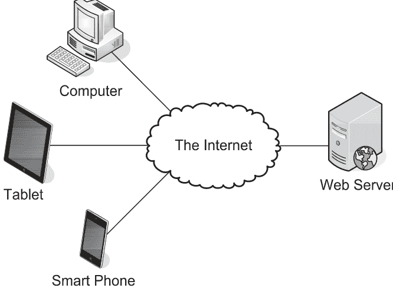

**描述**

- Web 应用程序由客户端、Web 服务器和网络组成。
- 客户端使用网络浏览器的程序向 Web 服务器请求网页。今天，客户端可以是计算机、像 iPhone 的智能手机或像 iPad 的平板电脑。
- Web 服务器返回浏览器请求的页面。
- 网络连接客户端和 Web 服务器。
- 内向网是连接彼此靠近（通常在同一栋建筑内）计算机的局域网（LAN）。
- 互联网是连接多个广域网（WAN）以及其中两个或多个局域网的网络。今天，互联网通常被称为“云”，这意味着你真的不需要理解它是如何工作的。
- 互联网服务提供商（ISP）拥有一个连接互联网的广域网。

图 1-1 Web 应用程序的组件

### 静态网页是如何处理的

像图 1-2 那样的静态网页是每次被请求时都不会改变的网页。这种网页在浏览器请求时直接从 Web 服务器发送。你可以通过查看地址栏中的扩展名在网络浏览器中识别静态网页。如果扩展名是 `.html` 或 `.htm`，则该页面就是静态网页。

此中的图显示了 Web 服务器如何处理对静态网页的请求。该过程始于客户端在网络浏览器中请求网页。用户可以在浏览器的地址栏中输入页面地址，也可以点击当前页面中指定要加载的页面的链接。

无论哪种情况，网络浏览器都会构建一个网页请求并将其发送到 Web 服务器，这被称为 HTTP 请求，它使用超文本传输协议（HTTP）格式化，让 Web 服务器知道请求的是哪个文件。

当 Web 服务器接收到 HTTP 请求时，它从磁盘驱动器检索请求的文件。该文件包含所请求页面的 HTML（超文本标记语言）。然后，Web 服务器将文件作为 HTTP 响应的一部分发回浏览器。

当浏览器接收到 HTTP 响应时，它将 HTML 渲染（翻译）为显示在浏览器中的网页。然后，用户就可以查看内容。如果用户通过点击链接或在浏览器地址栏中输入另一个网络地址来请求另一个页面，该过程将再次开始。

#### http://www.modulemedia.com/ourwork/index.html 静态网页

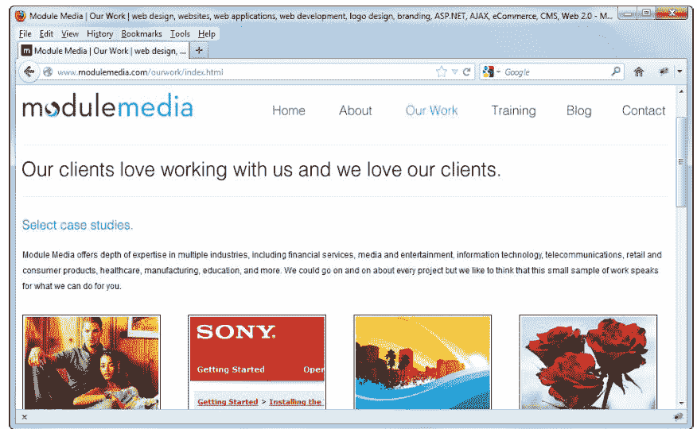

#### Web 服务器如何处理静态网页

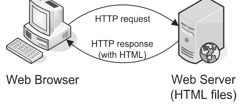

**描述**

- 超文本标记语言（HTML）是用于设计应用程序网页的语言。
- 静态网页是存储在 Web 服务器上且不改变的 HTML 文档。静态网页的文件扩展名为 `.html` 或 `.htm`。
- 当用户请求静态页面时，浏览器向 Web 服务器发送一个 HTTP 请求，其中包含正在请求的文件名。
- 当服务器接收到请求时，它检索网页的 HTML 并将其作为 HTTP 响应的一部分发回浏览器。
- 当浏览器接收到 HTTP 响应时，它将 HTML 渲染为显示在浏览器中的网页。

图 1-2 静态网页是如何处理的

© 2012, Mike Murach and Inc. Licensed to Michael.

### 动态网页是如何处理的

像图 1-3 那样的动态网页是每次被请求时由 Web 服务器上的程序或脚本创建的页面。该程序或脚本根据随 HTTP 请求发送的数据执行。在这个示例中，HTTP 请求识别了数据。然后，程序或脚本从数据库检索了图像和数据。

此中的图显示了 Web 服务器如何处理动态页面。该过程始于用户在浏览器地址栏请求页面 URL 或点击指定要加载的动态页面链接。

在任何情况下，网络浏览器都会构建一个 HTTP 请求并发送到 Web 服务器。该请求包含了应用程序处理请求所需的数据。例如，如果用户输入了表单，数据将包含在 HTTP 请求中。

当 Web 服务器接收到 HTTP 请求时，Web 服务器检查网页的文件扩展名，以识别应该处理该请求的应用程序服务器。然后，Web 服务器将请求转发给处理该类型网页的应用程序服务器。

接下来，应用程序服务器从硬盘检索相应的程序或脚本。它还会加载用户提交的表单数据。然后，它执行脚本。当脚本执行时，它生成网页的 HTML。如有必要，脚本将向数据库请求数据并将数据作为生成的网页的一部分。在应用程序服务器上执行的操作被称为服务器端处理。

当脚本完成后，应用程序服务器将动态生成的 HTML 发回 Web 服务器。然后，Web 服务器将 HTML 通过 HTTP 响应发回浏览器。

当网络浏览器接收到 HTTP 响应时，它将 HTML 渲染为显示在浏览器中的网页。然而，网络浏览器无法判断 HTTP 响应中的 HTML 是来自静态页面还是动态页面。它只是渲染 HTML。

#### amazon.com 上的动态网页

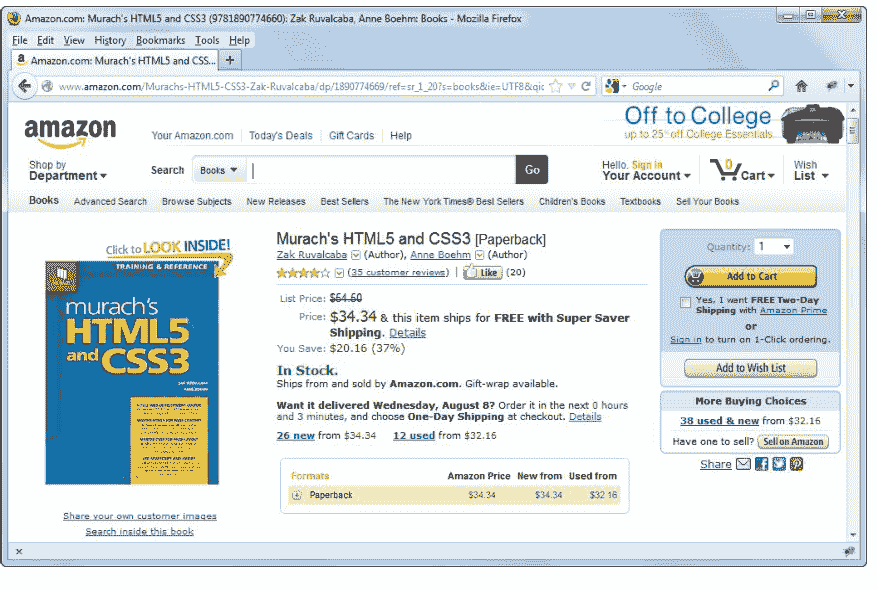

#### Web 服务器如何处理动态网页

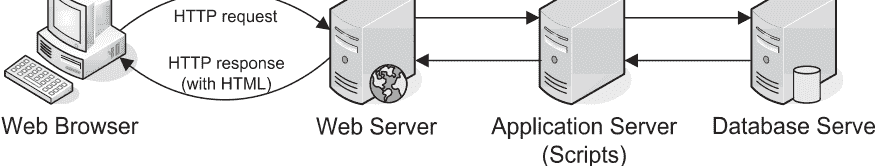

**描述**

- 动态网页是由运行在服务器上的程序或脚本生成的页面。
- 当 Web 服务器接收到动态网页的请求时，它会查找请求的扩展名，以找到由哪个应用程序服务器处理该请求。
- 当应用程序服务器接收到请求时，它会运行指定的脚本。通常，该脚本会使用从浏览器获取的数据从数据库服务器中获取适当的数据。该脚本也可以将接收的数据存储在数据库中。
- 当应用程序服务器完成数据处理后，它会生成网页的 HTML 并返回给 Web 服务器。然后，Web 服务器将 HTML 作为 HTTP 响应的一部分返回给浏览器。

图 1-3 动态网页的处理过程

© 2012, Mike Murach and Associates, Inc. Licensed to Michael Hotham.

### 如何使用 JavaScript 和 jQuery 进行客户端处理

与用于动态网页的服务器端处理不同，JavaScript 是一种提供客户端处理的脚本语言。在图 1-4 的网页中，JavaScript 被用于在不使用服务器端处理的情况下更改显示的图像。

为了实现这一功能，所有所需的图像在请求页面时都会加载到浏览器中。然后，如果用户点击衬衫下方的任意一个颜色选项，衬衫图像将更改为对应颜色的。这被称为图片切换（image swap）。同样，如果用户将鼠标移动到衬衫上，图像将替换为该衬衫的特写图像。这被称为鼠标悬停（image rollover）。

图中的图显示了 JavaScript 处理的工作原理。当浏览器请求网页时，Web 服务器会将 HTML 和相关的 JavaScript 同时返回给浏览器。然后，JavaScript 代码将在浏览器的 JavaScript 引擎中执行。这减轻了服务器的处理负担，并使应用程序运行更快。通常，JavaScript 会与动态网页配合使用，但也常用于静态页面。

除了图片切换和悬停之外，JavaScript 还有许多其他用途。例如，另一个常见用途是在用户将输入到 HTML 表单的数据发送到服务器处理之前对其进行验证。这减少了不必要的服务器往返。JavaScript 的其他常见用途包括运行幻灯片和轮播图，以及在标签页或折叠面板中提供数据。

jQuery 在这个图中处于什么位置？jQuery 实际上是一个 JavaScript 库，这意味着它就是 JavaScript。今天，jQuery 使得开发许多常见的 JavaScript 应用变得更加容易；jQuery 是流行的 JavaScript 库。这就是为什么本书的最后四个章节专门教你如何充分利用 jQuery。

#### Lands' 网站上的图片切换和悬停

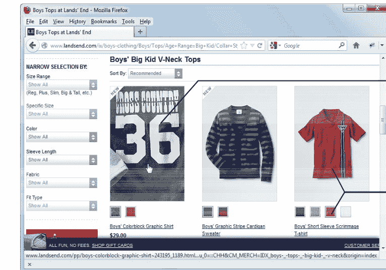

#### JavaScript 如何融入此架构

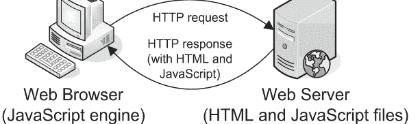

**JavaScript 和 jQuery 的众多用途三个**

- 数据验证
- 图片切换和悬停
- 幻灯片

**描述**

- JavaScript 是一种由 Web 浏览器的 JavaScript 引擎运行的脚本语言，并控制浏览器的操作。
- jQuery 是一个 JavaScript 库，它使得许多 JavaScript 可以实现的功能变得更容易。
- 当浏览器请求包含 JavaScript 或 JavaScript 文件链接的 HTML 页面时，HTML 和 JavaScript 都会加载到浏览器中。
- 因为 JavaScript 运行在客户端而非服务器上，因此它的功能不需要返回服务器。这有助于应用程序运行得更高效。

图 1-4 如何使用 JavaScript 和 jQuery 进行客户端处理

### JavaScript 应用程序的组件

当你开发 JavaScript 应用程序时，使用 HTML 定义页面的内容和结构。使用 CSS 格式化这些内容。使用 JavaScript 进行客户端处理。接下来显示的邮件列表（Email List）应用就说明了这一点。

#### 邮件列表应用的工作原理

图 1-5 显示了邮件列表应用的用户界面。它要求用户输入三个项目，然后点击“加入（Join）”按钮。输入框右侧的星号表示这些输入是必须的。

当用户点击按钮时，JavaScript 会检查输入以确保它们有效。如果有效，输入将发送到 Web 服务器进行服务器端处理。如果无效，则会向用户显示消息以便其修正输入。这是一种常见的 JavaScript 应用，称为数据验证（data validation），在输入无效时可以节省一次往返服务器。

超文本标记语言（HTML）用于定义网页的内容和结构。在图 1-5 中，你可以看到邮件列表应用的 HTML。通常情况下，本书假设你已经熟悉 HTML，但这里有几个重点。

首先，注意每个文档都以 DOCTYPE 声明开始。这个声明是你在 HTML5 中使用的，这种声明看起来比早版本的 HTML 简单得多。

其次，在 HTML 文档的 `<head>` 中，你可以看到指定 UTF-8 的 `<meta>` 元素。你还可以看到指定 CSS 文件的 `<link>` 元素，这是你用于格式化 HTML 的。

第三，在 HTML 文档的 `<body>` 中，你可以看到 `<section>` 元素。这是你在书中一直在使用的。在该区域内，你可以看到 h1、label 和 span 元素的使用。为了防止在引用 p 和 a 等元素时产生混淆，我们用括号括起来。

#### 应用 CSS 后的 HTML 文件

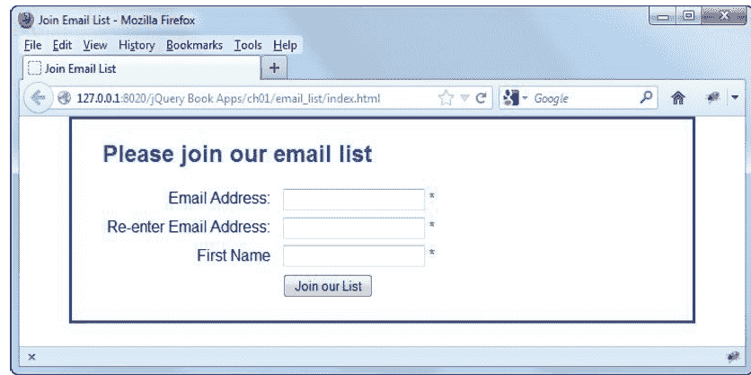

#### 文件名为 index.html 的 HTML 代码

```html
<!DOCTYPE html>
<html>
<head>
    <meta charset="UTF-8">
    <title>加入邮件列表</title>
    <link rel="stylesheet" href="email_list.css">
    <script src="email_list.js"></script>
</head>
<body>
    <section>
        <h1>加入我们的邮件列表</h1>
        <form id="email_form" name="email_form" action="join.html" method="get">
            <label for="email_address1">邮箱地址:</label>
            <input type="text" id="email_address1" name="email_address1">
            <span id="email_address1_error"></span><br>
            <label for="email_address2">再次输入邮箱地址:</label>
            <input type="text" id="email_address2" name="email_address2">
            <span id="email_address2_error"></span><br>
            <label for="first_name">姓</label>
            <input type="text" id="first_name" name="first_name">
            <span id="first_name_error"></span><br>
            <label>&nbsp;</label>
            <input type="button" id="join_list" value="加入我们的列表">
        </form>
    </section>
</body>
</html>
```

在实践中，你经常会听到这些元素被称为标签（tags），因此你可以将它们视为同义词。在书中，我们偶尔会使用 tag 一词，特别是在引用起始标签 `<html>` 或闭合标签 `</html>` 的时候。

不久前，HTML 文档的编码方式使得 HTML 不仅定义了网页的内容和结构，还定义了这些内容的格式。然而，这种结构元素与格式元素的混合使得网页的编辑、维护和重新格式化变得困难。

今天，级联样式表（CSS）允许你将格式与网页的内容和结构分离来。因此，曾经通过 HTML 完成的格式现在应该通过 CSS 完成。

在图 1-6 中，你可以看到用于格式化图 1-5 中 HTML 的 CSS。本书假设你已经熟悉 CSS，但这里将对这段 CSS 的作用进行一个简要描述。

在 `body` 元素的规则中，`font-family` 属性设置整个文档的字体，`margin` 属性将 body 在浏览器窗口中居中，`width` 属性将 body 的宽度设置为 650 像素，而 `border` 属性在 body 周围添加了边框。这是书中应用的典型 CSS，仅为了让它们看起来更好。

同样，针对 `h1`、`section`、`label` 和 `input` 元素的规则集旨在让这些元素看起来更好。在这里，`h1` 元素的规则将字体颜色设置为蓝色。`section` 的规则在 section 内容与右、下、左边框之间留出一些间距（`padding`）。

接下来，`label` 规则向左浮动，因此文本框位于右侧。该规则还将 `label` 的宽度设置为 11em，并将 `label` 的文本右对齐。然后，`input` 元素的规则设置了左边距（left margin），以便标签和文本框之间留有空间。

最后，`span` 元素的规则将文本颜色设置为红色。当 HTML 页面首次加载时，这些 span 元素只包含星号（**）。但如果一个或多个条目无效，JavaScript 就会改变这一点。

#### 应用 CSS 后浏览器中的网页

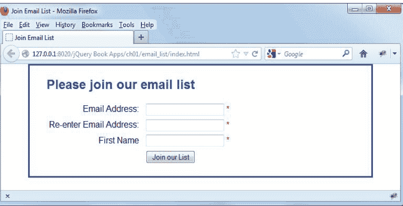

#### 应用 CSS 文件的 HTML 中的 link 元素

```html
<link rel="stylesheet" href="email_list.css">
```

#### 文件名为 email_list.css 的 CSS 文件代码

```css
body {
  font-family: Arial, Helvetica, sans-serif;
  background-color: white;
  margin: 0 auto;
  width: 650px;
  border: 3px solid blue;
}

h1 {
  color: blue;
}

section {
  padding: 0 2em;
}

label {
  float: left;
  width: 1em;
  text-align: right;
}

input {
  margin-left: 1em;
  margin-bottom: .5em;
}

span {
  color: red;
}
```

**描述**

- 级联样式表（CSS）用于通过指定字体、颜色、边框、间距和布局来控制网页的显示方式。

图 1-6 网页的 CSS

### JavaScript

图 1-7 显示了如果用户点击“加入列表”按钮后 JavaScript 发现任何无效数据，该应用程序在浏览器中的外观。在这里，你可以看到第二个和第三个文本框的用户输入右侧了错误消息。换句话说，JavaScript 实际上更改了 span 元素的内容。

当 JavaScript 更改页面的 HTML 时，它被称为浏览器在页面加载时生成的文档对象模型（或 DOM）。此 DOM 代表了在 HTML 中编码的所有元素和属性。然后，当 JavaScript 更改 DOM 的任何部分时，更改会立即应用到浏览器显示上。

由于你将在接下来的章节中学习这些代码是如何运行的，你现在可能想跳过这些代码。但如果你有任何编程经验，可能花时间快速看一下。在这种情况下，这里有几个重点。

首先，这段代码由三个函数组成：一个 `$` 函数、一个用户点击按钮时执行的 `joinList` 函数，以及一个在 DOM 加载到页面后运行的函数。然后，在 `joinList` 函数中，你可以看到 `if-else` 语句，它们提供了该应用程序的大部分逻辑。

在这里，你能看到 `if-else` 结构与 Java、C# 或 PHP 等任何编程语言中的结构相似吗？你也可以看到声明变量（`var`）和赋值变量的方法与其他编程语言中的方式相似。

JavaScript 的不同之处在于它提供了允许你修改 DOM 的方法和属性。例如，`$` 函数使用 `getElementById` 来获取传递给函数的 id 的对象。例如，`joinList` 函数的第一条语句使用 `$` 函数获取表示 HTML 中第一个文本框的对象。然后，该语句使用 `value` 属性获取用户输入该文本框的值。

稍后，在第一条语句中，如果 `value` 是空字符串（""）

#### 带有 JavaScript 的浏览器网页

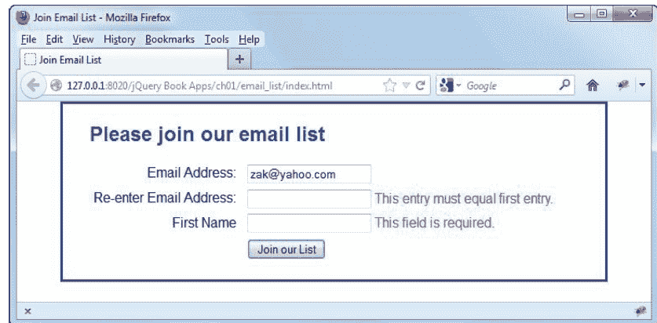

#### 包含 JavaScript 的 HTML 文件中的 link 元素

#### 文件名为 email_list.js 的 JavaScript 文件代码

```javascript
var $ = function (id) {
  return document.getElementById(id);
}
var joinList = function () {
  var email1 = $("email1").value;
  var email2 = $("email2").value;
  var isValid = true;

  if (email1 == "") {
    $("email1").firstChild.innerHTML = "this field is required.";
    isValid = false;
  } else $("email1").firstChild.innerHTML = "";

  if (email1 != email2) {
    $("email2").firstChild.innerHTML = "this entry must equal first entry.";
    isValid = false;
  } else $("email2").firstChild.innerHTML = "";

  if (email3 == "") {
    $("email3").firstChild.innerHTML = "this field is required.";
    isValid = false;
  } else $("email3").firstChild.innerHTML = "";

  if (isValid) {
    // 如果所有条目有效，则提交表单
    $("form").submit();
  }
}
window.onload = function () {
  $("joinList").onclick = joinList;
  $("email1").focus();
}
```

图 1-7 网页的 JavaScript

© 2012, Mike Murach and Associates, Inc. Licensed to Michael Hotham.

### 主要 HTML5 语义化元素

| 元素 | 内容 |
| --- | --- |
| header | 页面的页头。 |
| section | 文档中的通用章节，不指示内容的类型。 |
| article | 类似于论文的独立组合。 |
| nav | 页面中包含指向其他页面链接或占位符的区域。 |
| aside | 页面中的某部分，与附近的内容相关。 |
| figure | 被视为插图的图像、表格或其他组件。 |
| footer | 页面的页脚。 |

让其他浏览器支持 HTML5 元素的 JavaScript 补丁脚本 (shiv)

```html
<script src="http://html5shiv.google.com/svn/trunk/html5.js"></script>
```

#### 使用 header、section 和 footer 元素构建结构的页面

```html
<body>
  <header>
    <h1>圣华金亚谷市政厅</h1>
  </header>
  <section>
    <p>欢迎来到圣华金亚谷市政厅。我们本季邀请了一些非常精彩的演讲者！</p>
  </section>
  <footer>
    <p>&copy; 圣华金亚谷市政厅。</p>
  </footer>
</body>
```

#### 在网页浏览器中显示的页面

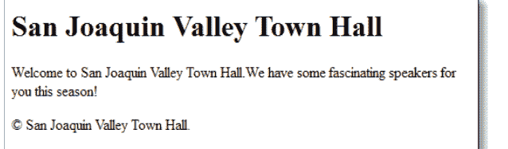

**描述**

- HTML5 提供了新的语义化元素，你应该使用这些元素来构建网页内容的结构。使用这些元素被称为 HTML 语义化。
- 图中所有的 HTML5 元素都受现代浏览器的支持。如果你在 HTML5 文档的 `head` 部分包含上述的 JavaScript 补丁，它们在旧版浏览器中也可以工作。
- 除了 HTML5 语义化元素外，本书还使用了标准的 HTML 元素，如标题（h1 和 h2 元素）、图像（img）、链接（`<a>` 元素）和段落（`<p>` 元素）。
- 如何使用 HTML5 语义化元素

图 1-8

### 如何使用 div 和 span 元素

如果你已经使用了一段时间的 HTML，那么你对 div 元素一定并不陌生。传统上，它被用于将 HTML 文档划分为由 `id` 属性标识的区域。然后，CSS 可以使用这些 id 为这些区域应用格式。

但现在 HTML5 已经可用，不应再使用 div 元素来构建文档结构。相反，只有在 HTML5 语义化元素不适用时才使用它们。

但注意，div 元素经常用于 JavaScript 应用程序。例如，如果一个 `section` 元素包含三个 `h2` 元素，每个元素后面跟着一个 `div` 元素，那么当点击前面的标题时，可以使用 JavaScript 来显示或隐藏该 `div` 元素。这种结构由图 1-9 的第一个示例所示，你将在第 6 章看到它是如何运作的。

同样，span 元素在历史上一直被用于标识可以由 CSS 格式化的文本位置。但按照现在的标准，最好使用能够指示元素内容的元素，例如 `cite`、`code` 和 `<q>` 元素。

但在这里，span 元素也经常用于 JavaScript 应用程序中，如图中的第二个示例所示。事实上，你刚刚在邮件列表应用程序中看到了这一点。在那个应用程序中，JavaScript 将错误消息放在相应的 `span` 元素中。

#### div 和 span 元素

| 元素 | 描述 |
| --- | --- |
| div | 为其他元素提供容器的块级元素。 |
| span | 行内元素，允许你定义用 CSS 格式化的文本。 |

#### JavaScript 应用程序 HTML 中的 div 元素

```html
<section id="faqs">
  <h1>常见问题解答</h1>
  <h2>什么是 Jquery?</h2>
  <div>
    // contents
  </div>
  <div>
    <h2>为什么 jquery 变得如此流行？</h2>
    <div>
      // contents
    </div>
  </div>
  <div>
    <h2>Jquery 或 JavaScript 哪个更难学？</h2>
    <div>
    </div>
  </div>
</section>
```

#### JavaScript 应用程序 HTML 中的 span 元素

```html
<label for="email_address">电子邮箱地址:</label>
<input type="text" id="email_address" name="email_address">
<span id="email_address_error">*</span><br>
<label for="email_address2">输入电子邮箱地址:</label>
<input type="text" id="email_address2" name="email_address2">
<span id="email_address2_error">*</span><br>
<label for="first_name">姓:</label>
<input type="text" id="first_name" name="first_name">
<span id="first_name_error">*</span><br>
```

**描述**

- 在 HTML5 之前，div 元素被用于定义文档 `body` 内部的结构。这些 div 元素的 `id` 随后被 CSS 用于对这些元素应用格式。
- 现在，HTML5 语义化元素正在取代 div 元素。这使得页面的结构变得更加清晰。然而，你仍然会使用 div 元素来定义某些 JavaScript 应用程序中的代码块。
- 在 HTML5 之前，span 元素被用于标识可以由 CSS 格式化的文本部分。今天，最好使用指示内容的元素，例如 `cite`、`code` 和 `<q>` 元素。

图 1-9 如何使用 div 和 span 元素

### 如何使用基础属性

图 1-10 展示了常用的属性。你应该已经熟悉 `id` 和 `class` 属性。`name` 属性通常用于服务器端代码来访问发送的数据。例如，示例将“email”作为 `id` 和 `name` 属性的值。

#### 基础属性

| 属性 | 描述 |
| --- | --- |
| id | 指定 CSS 可用的唯一标识符。 |
| class | 指定 CSS 可用的类名。要指定多个类，请用空格分隔。 |
| title | 指定元素的附加信息。对于某些元素，当用户鼠标悬停在元素上时，标题会以提示框形式显示。 |
| for | 在 label 元素中，此属性指定它所应用的控件的 `id`。 |
| name | 指定元素的唯一名称，通常用于服务器端代码，也可以用于 JavaScript 代码。 |

#### 使用这些属性的 HTML

```html
<body>
  <h1>圣华金亚谷市政厅</h1>
  <h2 class="first_h2">欢迎来到圣华金亚谷市政厅。</h2>
  <p>请输入您的电子邮箱以订阅我们的新闻邮件。</p>
  <form id="email-form" name="email_form" action="join.html" method="get">
    <label for="email">电子邮箱:</label>
    <input type="text" id="email" name="email" title="在此处输入邮箱地址。">
    <input type="button" value="订阅">
  </form>
</body>
```

#### 网页浏览器中带有文本框提示框的 HTML

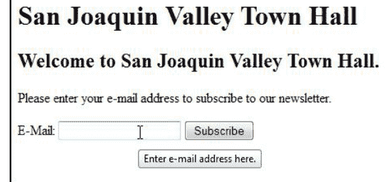

### 如何为 HTML 页面提供 CSS 样式

图 1-11 显示了书中应用程序为 HTML 页面引入样式的两种方式。首先，可以在 HTML 文档的 `head` 部分编写一个 `link` 元素，指定一个包含该页面 CSS 的文件。这被称为外部样式表，也是本书中大多数应用程序所使用的方法。

其次，你可以在 `head` 部分编写一个包含该页面 CSS 的 `style` 元素。这可以称作嵌入式样式。嵌入样式的优点是，在开发页面时，你不需要在 HTML 和 CSS 文件之间来回切换。但总的来说，最好是使用外部样式表，因为这更容易将它们应用于多个页面。

在某些情况下，你可能想在一个页面使用两个或多个外部样式表。你甚至可能在一个页面同时使用外部样式表和嵌入样式。在这种情况下，样式将从第一个外部样式表到最后一个依次应用，然后应用嵌入样式。

如果你想为打印页面提供外部样式表，可以在 `link` 元素中编写 `media` 属性。这样，当用户打印页面时，该样式表中的样式将覆盖屏幕样式。这让你能够为打印页面提供正确的格式。

#### 提供样式的两种方式

在 `head` 部分编写 `link` 元素使用外部样式表

```html
<link rel="stylesheet" href="styles/main.css">
```

在 `head` 部分嵌入样式

```html
<style>
  body {
    font-family: Arial, Helvetica, sans-serif;
    font-size: 87.5%;
  }
  h1 { font-size: 250%; }
</style>
```

**样式的应用顺序**

- 来自外部样式表的样式
- 嵌入样式

#### 包含两个外部样式表的 head 元素

```html
<head>
  <title>San Joaquin Valley Town Hall</title>
  <link rel="stylesheet" href="../main.css">
  <link rel="stylesheet" href="../styles/speaker.css">
</head>
```

**样式的应用顺序**

- 从第一个外部样式表到最后一个

#### 如何指定外部样式的媒体

```html
<link rel="stylesheet" href="../print.css" media="print">
```

**描述**

- 当你使用外部样式时，你将内容（HTML）与格式（CSS）分离开。这使得将相同样式用于两个或多个页面变得简单。
- 如果你使用嵌入样式，在再次使用之前必须将样式复制到其他文档中。
- 如果同一个元素应用了多个相同的属性规则，则最后一个规则将覆盖前面的规则。
- 当为外部 CSS 文件指定相对 URL 时，该 URL 相对于当前文件。
- 你可以使用 `link` 元素的 `media` 属性来指定样式表适用于什么媒体。这让你为不同的媒体使用不同的样式表。
- 由于 `media` 属性的默认值为屏幕，因此普通页面不需要使用此属性。然而，此属性常用于识别用于打印格式的样式表。

### 如何编写基础 CSS 选择器

图 1-12 显示了用于为 HTML 元素应用样式的基础 CSS 选择器。如果你还没有理解这些选择器的原理，你需要学习 jQuery 是如何使用这些选择器的。

首先，此图显示了 HTML 文档的主体，其中包含一个 `section` 和一个 `footer` 元素。在这里，`h1` 元素被分配了 id "first_heading"，而该 section 中的两个 `<p>` 元素具有具有值为 "blue" 的 `class` 属性。此外，footer 中的 `<p>` 元素具有带有两个值的 `class` 属性："blue" 和 "right"。这意味着它被分配了两个类。

第一组示例中的三个规则是选择器。编写选择器，只需编写元素的名称。因此，该组中的第一个规则选择了 `body` 元素。第二个规则选择了 `section` 元素，第三个规则选择了所有 `<p>` 元素。

在这些示例中，第一个规则设置了 `body` 的字体，`body` 内的所有元素都继承了此更改。该规则还设置了 `body` 的宽度并使其在浏览器居中。然后，第二个规则为 `section` 添加了边框并在 section 内部添加了一些内边距。最后，段落的规则集设置了段落顶部、底部和左侧的边距——这就是为什么段落在 section 中缩进的原因。

第二组示例中的规则集使用 id 选择器通过 id 选择元素。要实现这一点，选择器使用井号 (#) 后跟唯一标识标识元素的 id 值。因此，此规则选择了 id 为 "first_heading" 的 `h1` 元素。然后，它的规则集设置了标题的边距。

最后一组示例中的两个规则集使用类选择器通过类选择 HTML 元素。要实现这一点，第一个规则选择了所有分配了 "blue" 类的元素，即三个 `<p>` 元素。第二个规则选择了任何分配了 "right" 类的元素，即 footer 区域中的段落。然后，第一个规则将字体颜色设置为蓝色，第二个规则将段落右对齐。

其中一个关键点是，`class` 属性可以为页面上的多个元素具有相同的值。那么，如果你为该类编写一个选择器，它将应用于所有具有该类的元素。相比之下，id 必须是唯一的，因此 id 选择器只能用于单个元素。

#### 本书中典型应用的 CSS 文件

```css
/* 为了让 HTML5 语义元素可以格式化的 CSS 解决方案 */
article, aside, figure, footer, header, nav, section {
  display: block;
}
body {
  font-family: Arial, Helvetica, sans-serif;
  background-color: white;
  margin: 0 auto;
  width: 650px;
  border: 3px solid blue;
}
h1 {
  color: blue;
}
section {
  padding: 0 2em;
}
label {
  float: left;
  width: 1em;
  text-align: right;
}
input {
  margin-left: 1em;
  margin-bottom: .5em;
}
span {
  color: red;
}
```

**说明**

- 因为本书的重点是 JavaScript 和 jQuery 而不是 CSS，所以书中使用的 CSS 通常很简单。我们只应用了足够的 CSS 来让每个部分看起来良好并能正常工作。
- 事实上，对于书中的大多数应用，你不需要理解 CSS，因此它甚至不会被显示。每当 CSS 对理解 JavaScript 应用至关重要时，我们会进行详细解释。
- 至少，你应该知道 HTML 文档的 CSS 由一个或多个规则集组成。每个规则集都以规则选择器开头，后面跟着一组大括号 `{ }`。大括号内包含一个或多个规则。
- 你还需要知道，每个 CSS 规则由一个属性名、一个冒号、属性的一个或多个值和一个分号组成。

### 如何测试 JavaScript 应用

接下来，你将学习如何测试 JavaScript 应用。要做到，你需要运行使用该 JavaScript 的网页 HTML 文件。

### 如何运行 JavaScript 应用

当你开发 JavaScript 应用时，通常是在你自己的电脑或公司的服务器上工作。然后，为了运行应用程序，你可以使用图 1-14 所示的四种方法之一。在这四种方法中，最简单是从你用于开发 HTML、CSS 和 JavaScript 文件的 IDE 直接运行 HTML 页面。稍后你会学习更多相关内容。

在第一个列表的前四个方法中，“文件→打开文件”意味着从菜单栏放下文件并选择“打开文件”命令。同样，“文件→新建→Web 项目”意味着下拉“文件”菜单，选择“新建”命令，然后选择“Web 项目”命令。这种表示贯穿本书。

应用上传到互联网服务器后，可以使用图中第二组方法来运行应用。第一种方法是在浏览器的地址栏中输入统一资源定位符 (URL)。第二种方法是点击网页上请求另一个页面的链接。如果应用运行在你自己的电脑或服务器上，你也可以使用这种方法。

如图中所示，互联网页的 URL 由四个部分组成。在每种情况下，协议都是 HTTP。如果你省略了协议，浏览器将使用 HTTP 作为默认值。

第二个部分是域名，用于标识 HTTP 请求将发送到的 Web 服务器。网络浏览器使用此名称来查找该域名的 Web 服务器 IP 地址。虽然你不能省略域名，但通常可以省略域名中的“www.”。

第三个部分是文件在服务器上所在的路径。路径列出了包含文件的文件夹。使用正斜杠来分隔路径中的名称，并在路径开头表示服务器的顶层文件夹。在本例中，路径为“ourwork/”。

最后一个部分是文件名。在本例中，文件名为 `index.html`。如果你省略了文件名，Web 服务器将在路径中搜索默认文档。根据 Web 服务器的不同，该文件将被命名为 `index.html`、`default.htm` 或这两者的变体。

#### c:/jquery_book_apps/ch01/email_list.html 处的网页

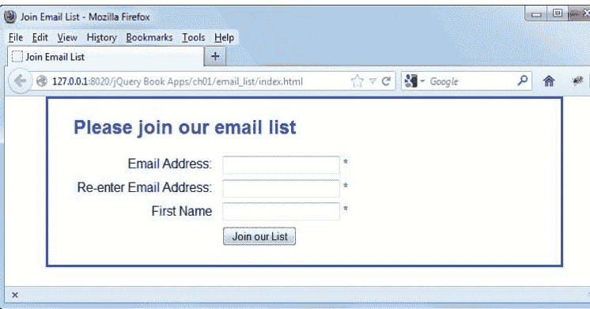

#### 运行本地服务器或电脑上 HTML 页面的四种方法

- 使用 Internet Explorer 的“文件→打开”命令或 Firefox 的“文件→打开”命令。
- 如果你使用 Windows，在 Windows 资源管理器中找到文件并双击它。
- 使用你的文本编辑器或 IDE 的功能。
- 点击当前网页中的链接来加载下一个网页。

#### 运行互联网上 HTML 页面的两种方法

- 在浏览器的地址栏中输入网页的 URL。
- 点击当前网页中的链接来加载下一个网页。

#### 互联网上 HTTP URL 的组件

```
http://www.modulemedia.com/ourwork/index.html
```

| 协议 | 域名 | 路径 | 文件名 |
| --- | --- | --- | --- |

#### 省略 URL 部分会发生什么

- 如果省略了协议，将使用默认的 `http://`。
- 如果省略了文件名，将使用 Web 服务器的默认文档名。这通常是 `index.html`、`default.html` 或某些变体。

**说明**

- 当你开发 JavaScript 应用时，通常将它们存储在自己的电脑而不是互联网上。因此当你测试应用时，是在本地运行它们。
- 之后，当应用部署到互联网服务器后，你可以从互联网运行它们。

图 1-14 如何运行 JavaScript 应用

### 如何确保浏览器兼容性

如果你希望你的网站被尽可能多的访问者访问，你就需要确保你的网页兼容尽可能多的浏览器。这被称为浏览器兼容性。这意味着你应该在尽可能多的浏览器上测试应用，包括图 1-15 中总结的五种浏览器，以及这些浏览器的旧版本。

此图显示了这些浏览器的当前发行版本及其对 HTML5 的支持情况。不过，要获取这些更新的信息，你可以访问 `www.html5test.com`。该网站还会对你访问时所使用的浏览器进行评分。

### 如何使用 Aptana 开发 JavaScript 应用

由于 HTML、CSS 和 JavaScript 仅仅是文本，你可以使用任何编辑器来创建 JavaScript 应用程序的文件。然而，更好的编辑器或集成开发环境（IDE）可以缩短开发时间并减少编码错误。这就是为什么我们推荐 Aptana Studio 3 的。它是一个运行在 Windows、Mac OS 和 Linux 上的免费 IDE，可以极大提高你的工作效率。

在本书的索引中，你可以学习如何安装 Aptana。你还可以学习如何使用 Aptana 完成顶部主题中的常用功能。如果你倾向于使用其他编辑器，你完全可以跳过这些主题。但即使如此，你可能也想浏览这些主题，因为它们会让你对 IDE 应该能够做什么有一个良好的了解。它们还可能鼓励你尝试 Aptana.

#### 如何创建项目

在 Aptana 中，一个项目由完整 Web 应用程序的文件夹和文件组成。一旦你创建了项目，处理它的文件夹和文件、为项目创建新文件等就会变得更加简单。

要创建一个项目，请使用图 1-16 所示的过程。该过程的结果是你会得到一个命名的项目，该项目以应用程序的顶层文件夹开始。然后，你可以通过下一个图中所示 App Explorer（应用管理器）窗口轻松地访问应用程序的文件夹和文件。

为了方便处理书中的应用程序，我们建议你创建一个包含所有应用程序的 Aptana 项目。要这样做，你可以创建一个名为 `jQuery Book Apps` 的项目，该项目从图中所示路径开始。执行此操作的最终对话框显示图中。

##### 创建 Aptana 项目的最后一个对话框

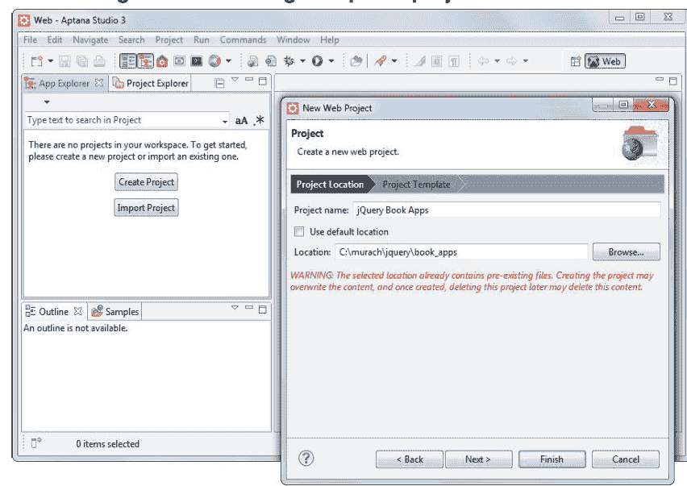

##### 包含书中所有应用程序文件夹的文件夹

```
c:\murach\jquery\book_apps
```

##### 如何创建项目

- 使用 `File->New->Web Project` 命令显示上方所示 New Web Project 对话框。或者，在 App Explorer 中点击 `Create Project` 按钮，在显示的对话框中选择 `Project`，点击 `Next` 按钮显示 New Web Project 对话框。
- 在 New Web Project 对话框中，为项目输入名称。接下来，取消勾选 `Use Default Location` 复选框，点击 `Browse` 按钮，并选择项目的顶层文件夹。
- 阅读出现的警告信息，让你意识到在 Aptana 中删除项目可能也会删除磁盘驱动上的项目。然后，点击 `Finish` 按钮.

**描述**

- 当你为开发和维护的 Web 应用程序设置项目时，Aptana 的效果最好。
- 通常，每个 Aptana *项目* 应该包含一个 Web 应用程序的文件夹和文件。但对于本书来说，你可以为所有的应用程序设置一个项目，为所有练习设置一个项目，并为所有练习解答设置一个项目。

图 1-16 如何在 Aptana 中创建项目

© 2012, Mike Murach and Associates, Inc. Licensed to Michael Hotham.

#### 如何打开或关闭 HTML、CSS 或 JavaScript 文件

图 1-17 显示了创建项目后如何打开或关闭 HTML、CSS 或 JavaScript 文件。在这里，在 Aptana 左侧的 App Explorer 窗口中显示了 jQuery Books 项目。如果你创建了多个项目，可以使用 App Explorer 窗口顶部的下拉项目列表在项目之间切换。

一旦打开了正确的项目，你可以通过点击文件夹旁的加号来深入到想要打开的文件。在本例中，`ch01` 和 `email_list` 文件夹已经展开，你可以看到 Email List 应用程序的四个文件。然后，要打开文件，只需双击它。

当在 Aptana 中打开文件时，它会在新标签页中打开。现在你可以同时打开多个文件，并通过点击标签页在它们之间移动。这使得在网页的 HTML、CSS 和 JavaScript 文件之间来回切换变得简单。这也便于从一个文件复制代码到另一个文件。

如果你想打开一个不属于项目的文件，可以使用图中所示的方法之一。首先，你可以使用 Project Explorer 窗口在计算机上定位到该文件并双击它。其次，你可以使用 `File→Open File` 命令打开文件。

要关闭一个（或更多）文件，你可以使用图中所示的三种方法之一。这可以方便地关闭除你正在其他程序中处理的文件以外的所有文件。这可以帮助你避免修改错误文件的错误。

在使用 Aptana 期间，你会发现它具有和你与其他程序使用时相同的类型界面。因此，如果你想做一些本章未介绍的操作，请尝试右键点击项目以查看可用菜单选项。查看工具栏中的其他按钮。查看下拉菜单中有哪些选项。通过一点实验，你会发现这个程序不仅强大，而且易用。

##### 带有 App Explorer 的 Aptana

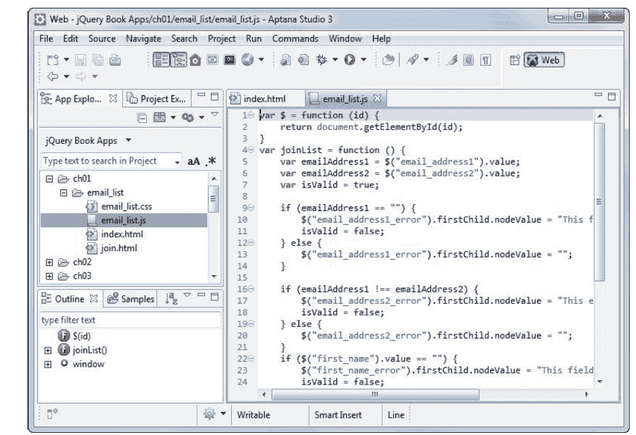

##### 如何打开文件

- 如果你想打开一个不属于项目的文件，可以使用图中所示的方法之一。首先，你可以使用 Project Explorer 窗口在计算机上定位到该文件并双击它。其次，你可以使用 `File→Open File` 命令打开文件。

##### 关闭文件

- 要关闭一个（或更多）文件，可以使用图中所示的三种方法之一。这可以方便地关闭除你正在其他程序中处理的文件以外的所有文件。这可以帮助你避免修改错误文件的错误。

#### 如何更改颜色

图 1-18 如何在 Aptana 中更改颜色

© 2012, Mike Murach and Associates, Inc. Licensed to Michael Hotham.

#### 如何高亮语法

当在 Aptana 中打开文件时，它会在新标签页中打开。现在你可以同时打开多个文件，并通过点击标签页在它们之间移动。这使得在网页的 HTML、CSS 和 JavaScript 文件之间来回切换变得简单。这也便于从一个文件复制代码到另一个文件。

#### Aptana 的对话框

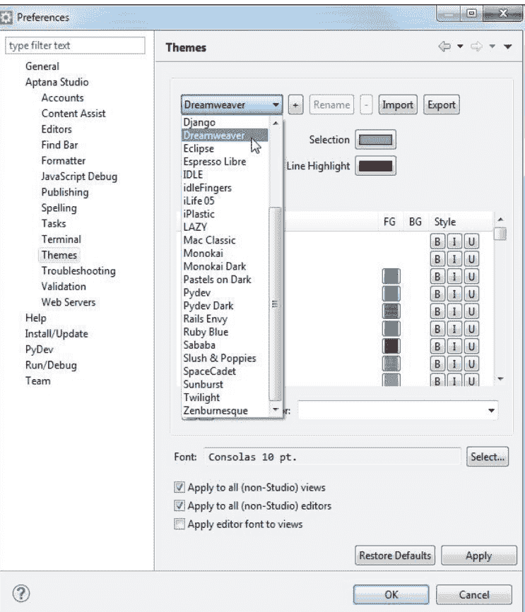

##### 过程

- 使用 `Window→Preferences` 命令打开 Preferences 对话框。
- 点击 Aptana，然后点击 Themes 显示该对话框。
- 从下拉列表中选择一个主题.

**描述**

- Aptana 用不同的颜色显示 JavaScript 语句的不同部分，使语句更容易解释。
- 如果你不不喜欢当前的颜色，可以通过该过程更改颜色.

#### 带有 JavaScript 补全列表的 Aptana

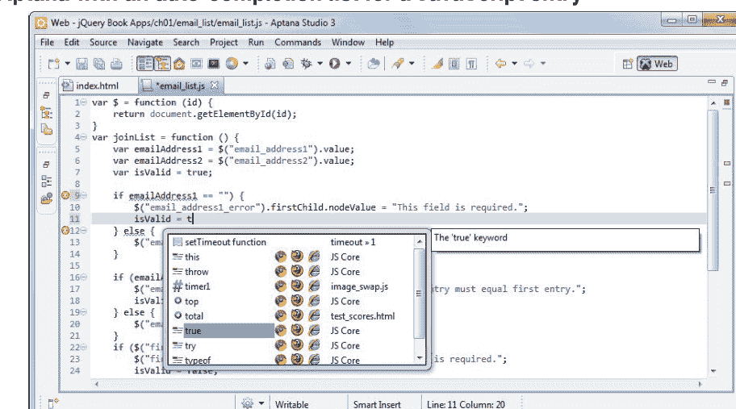

**描述**

- 要如上方所示展开标签内容并隐藏项目资源管理器（Project Explorer）和应用资源管理器（App Explorer），请双击该标签。要恢复项目和应用资源管理器，请点击编辑窗口左侧垂直栏顶部的恢复图标。
- 自动补全功能会显示一个与你输入的内容开头的元素列表。要插入这些术语中的一个，请双击它，或使用方向键高亮它并按回车键。
- 错误标记是行首的包含白色 X 的红色圆圈。警告标记是一个包含感叹号的黄色三角形。当你在输入和编辑代码时，会显示这些标记。
- 要获取错误或警告标记的说明，请将鼠标悬停在标记上.

图 1-19 如何在 Aptana 中编辑文件

#### 如何运行 JavaScript 应用程序

图 1-20 显示了如何从 Aptana 运行 JavaScript 应用程序。要在默认浏览器中运行应用程序的 HTML 文件，首先选择已打开文件的标签。然后，点击 Run（运行）按钮。这将打开默认浏览器，你可以使用 Run 按钮右侧的下拉列表。或者，要在另一个浏览器中运行 HTML 文件，

顺便说，如果在未选择 HTML 文件时点击 Run 按钮，什么都不会发生。此外，在运行 HTML 文件之前，你需要保存对 HTML 文件及其相关 CSS 文件的任何更改。要为此，你可以点击工具栏上的 Save（保存）或 Save All（全部保存）按钮。

当你通过这种方式运行 JavaScript 应用程序时，每次点击 Run 按钮都会打开一个新的浏览器或浏览器标签页。因此，如果你为一个应用程序点击了 10 次 Run 按钮，就会打开 10 个浏览器或标签页。

另一种方法是：第一次点击 Run 按钮运行应用程序。然后，在你发现并修复错误后，可以点击 Aptana 中的 Save All 按钮保存更改，切换到浏览器，点击浏览器中的 Reload（重新加载）或 Refresh（刷新）按钮来重新加载带有更改的应用程序.

##### Aptana 的 Run 按钮

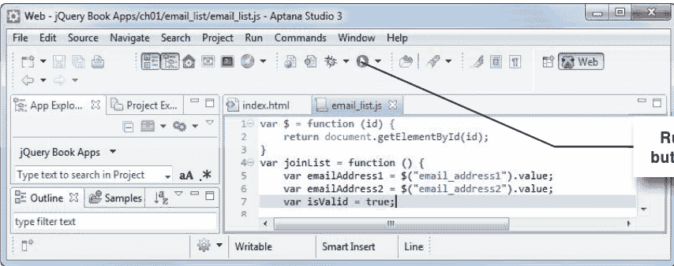

##### Firefox 中的网页

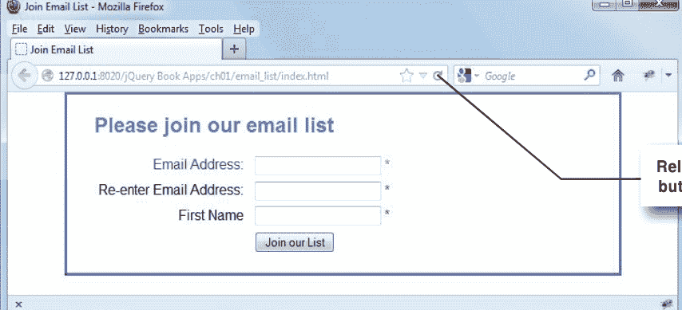

**步骤**

- 要在默认浏览器中运行 JavaScript 应用程序，选择应用程序的 HTML 文件，选择其标签，并点击 Run 按钮。
- 要在另一个浏览器中运行 JavaScript 应用程序，选择其 HTML 文件的标签，点击 Run 按钮右侧的箭头，并选择浏览器.

**描述**

- 在运行文件之前，你应该保存对该文件或任何相关文件所做的更改。为此，你可以点击工具栏上的 Save（保存）或 Save All（全部保存）按钮。
- 测试应用程序时，运行其 HTML 页面，记录错误，在 Aptana 中修复错误，保存更改并再次运行页面。
- 要再次运行页面，你可以点击 Run 按钮，这将打开另一个浏览器或标签页。或者，你可以切换到浏览器并点击其 Reload（重新加载）或 Refresh（刷新）按钮。这样，就不会打开任何新的浏览器或标签页.

图 1-20 如何从 Aptana 运行 JavaScript 应用程序

©2012, Mike Murach and Associates, Inc. 许可给 Michael Hotham.

### 观点

本章介绍了你开发 JavaScript 应用程序所需的背景概念和术语。现在，如果你对所学的所有内容都很熟悉，就可以准备好学习第 2 章了。

但如果你对自己的 HTML 和 CSS 技能还不熟悉？首先，我们建议你继续阅读这本书，因为你不需要成为 HTML 或 CSS 专家就能开发 JavaScript 和 jQuery 应用程序。其次，我们建议你买一本《Murach's HTML5 and CSS3》，因为每个 Web 开发者本质上都应该精通 HTML5 和 CSS3.

### 你应该掌握的术语

| 术语 | 术语 |
| :--- | :--- |
| 客户端 (client) | 数据验证 (data validation) |
| 浏览器 (web browser) | HTML 元素 (HTML element) |
| Web 服务器 (web server) | 标签 (tag) |
| 网络 (network) | CSS (层叠样式表) |
| 内网 (intranet) | DOM 脚本 (DOM scripting) |
| 局域网 (LAN) | 文档对象模型 (DOM) |
| 互联网 (Internet) | HTML5 语义元素 (HTML5 semantic elements) |
| 广域网 (WAN) | HTML5 语义 (HTML5 semantics) |
| 互联网服务供应商 (ISP) | JavaScript shiv 或 shim |
| HTML (超文本标记语言) | 属性 (attribute) |
| 静态网页 (static web page) | 外部样式表 (external style sheet) |
| HTTP 请求 (HTTP request) | 嵌入样式 (embedded styles) |
| HTTP (超文本传输协议) | 选择器 (selector) |
| HTTP 响应 (HTTP response) | 类型选择器 (type selector) |
| 渲染网页 (render a web page) | ID 选择器 (id selector) |
| 动态网页 (dynamic web page) | 类选择器 (class selector) |
| 应用程序服务器 (application server) | 规则 (rule) |
| 数据库服务器 (database server) | 规则集 (rule set) |
| 服务器端处理 (server-side processing) | 属性名 (property name) |
| 往返 (round trip) | URL (统一资源定位) |
| JavaScript | 协议 (protocol) |
| JavaScript 引擎 (JavaScript engine) | 域名 (domain name) |
| 脚本语言 (scripting language) | 路径 (path) |
| 客户端处理 (client-side processing) | 跨浏览器兼容性 (cross-browser compatibility) |
| jQuery | IDE (集成开发环境) |
| 图像切换 (image swap) | Aptana 项目 (Aptana project) |
| 图像悬停 (image rollover) | |

### 总结

- Web 应用程序由客户端、Web 服务器和网络组成。客户端使用浏览器请求页面。
- 局域网（LAN）连接彼此靠近的计算机。这通常被称为内网（intranet）。相比之下，互联网由广域网（WAN）组成。
- 请求网页时，浏览器发送 HTTP 请求。HTTP 响应返回 HTML。
- 静态网页每次都是相同的。相比之下，动态网页是生成的。
- HTML（超文本标记语言）是定义结构的语言。CSS（层叠样式表）用于控制页面的格式。
- 要在你自己的电脑上查看网页，你需要 URL（统一资源定位符）、协议、域名和文件名。
- 当你开发 JavaScript 时，你需要跨浏览器兼容性。使用 jQuery 的好处之一是它的函数已经经过了跨浏览器兼容性测试。
- 对于本书，我们推荐 Aptana Studio 3，因为它功能强大、免费，并且运行在 Windows、Mac 和 Unix 系统上.

### 在完成本书的练习之前...

在完成本书的练习之前，你应该下载并安装 Firefox 浏览器以及本书的应用程序。如果你打算使用 Aptana，还应该下载并安装该产品。安装软件和应用程序的步骤见附录 A.

### 练习 1-1 运行 Email List 应用程序

在此练习中，你将运行图 1-5、1-6 和 1-7 中介绍的 Email List 应用程序.

#### 在 Firefox 中打开应用程序

1. 如果 Firefox 未启动，请启动它。然后，使用 `File→Open File` 命令打开此文件：`c:\murach\jquery_book_apps\ch01\email_list\index.html`
2. 测试在不输入数据时会发生什么，在不输入任何数据的情况下直接点击 Join List 按钮。然后，你可以看到显示的错误信息。
3. 在第一个文本框中输入电子邮件地址，在第二个文本框中输入无效数据并点击 Join List 按钮，查看显示的错误信息。
4. 在三个文本框中输入有效数据并点击按钮。然后，数据被提交处理并显示了一个新网页.

### 练习 1-2 运行另一个第 1 节应用程序

此练习让你运行第 6 章介绍的应用程序。这些应用程序将让你对完成本节后能做的事情有一个初步的了解。

5. 在 Firefox 中打开此文件：`c:\murach\jquery_book_apps\ch06\faq_links\index.html`。然后，点击其中一个标题显示其文本，再次点击标题隐藏文本。
6. 在 Firefox 中打开此文件：`c:\murach\jquery_book_apps\ch06\image_swap\index.html`。然后，点击小图像查看大图像的切换效果。
7. 在 Firefox 中打开此文件：`c:\murach\jquery_book_apps\ch06\slide_show\index.html`。观看幻灯片.

### 练习 1-3 开始使用 Aptana

本练习为打算在本书中使用 Aptana 的读者准备。它将引导你完成创建项目的过程，以便轻松访问你下载的书籍应用程序和练习题.

#### 创建项目

1. 启动 Aptana，并使用图 1-16 中的步骤为存储在以下文件夹中的书籍应用程序创建一个项目：

`c:\murach\jquery\book_apps`

该项目应命名为 `jQuery Book Apps`，最后一个对话框中的条目应与图中所示。

2. 使用相同的步骤创建一个名为 `jQuery Exercises` 的项目，用于存储在以下文件夹中的练习：

`c:\murach\jquery\exercises`

以及创建一个名为 `jQuery Solutions` 的项目，用于存储在以下文件夹中的练习解答：

`c:\murach\jquery\solutions`

#### 测试 Email List 应用程序

3. 使用 App Explorer（应用资源管理器）中的下拉列表选择 `jQuery Exercises` 项目。这将访问书中所有的练习题。
4. 点击 `ch01` 前的加号显示 `email_list` 文件夹，然后点击 `email_list` 文件夹前的加号显示 Email List 应用程序的文件。
5. 双击文件名 `index.html` 打开该文件。然后，点击工具栏上的 `Run` 按钮在默认浏览器中运行应用程序。这将自动为你切换到该浏览器。
6. 回到 Aptana，点击 `Run` 按钮右侧的箭头。如果下拉列表中提供 Internet Explorer，点击它在该浏览器中运行应用程序。然后，返回 Aptana.

#### 编辑 JavaScript 代码

7. 在 App Explorer 中，双击文件名 `email_list.js` 打开该文件，并注意用于语法高亮的颜色。
8. 如果你不喜欢所使用的颜色，请使用图 1-18 中的步骤来更改它们。
9. 在 JavaScript 文件中，删除第一行代码中的右括号。这应该显示两个错误标记。然后，将鼠标悬停在标记上以显示错误描述。这说明了 Aptana 的错误检查功能。现在，撤销你所做的更改。（使用键盘撤销更改，请按 `Ctrl+Z`。）
10. 在 JavaScript 文件中，在以 `var` 开头的第三条语句之后，在新的一行开始输入以下字符：

```javascript
if (
```

这应该显示以字母 `e` 开头的可能选项。在这里，你可以看到列表中包含了 `emailAddress1` 和 `emailAddress2`。这些是由前两个 `var` 语句创建的变量，说明了 Aptana 的代码补全功能。现在，撤销此更改。

11. 在 JavaScript 代码最后一行之前的新行中输入此语句，最后一行仅包含一个右大括号 (`}`)：

```javascript
alert('The DOM has now been built');
```

换句话说，这条语句将成为文件的第二行。

12. 要测试你添加的语句，请点击工具栏上的 `Save All` 按钮，或在浏览器中点击 `Reload` 或 `Refresh` 按钮以带此更改运行应用程序。这应该显示一个对话框，你可以点击其 `OK` 按钮将其关闭。之后，应用程序的运行将与之前相同。
13. 如果你好奇，可以自己进行更多实验。然后，关闭文件并退出 Aptana.

## 第 2 章 JavaScript 入门

### 开始学习 JavaScript

本章的目标是让你在 JavaScript 上有一个良好的开始，特别是如果你是编程初学者。如果你有其他语言的编程经验，你应该能够快速完成本章。否则，请轻松对待，并完成本章末尾的练习.

- **如何在 HTML 文档中包含 JavaScript**

在 HTML 文档的 head 中包含 JavaScript 的方法

在 HTML 文档的 body 中包含 JavaScript 方法

- **JavaScript 语法**

如何编写 JavaScript 语句

如何创建标识符

如何使用注释

如何使用对象、方法和属性

- **如何处理 JavaScript 数据**

原始数据类型

如何编写数值表达式

如何处理数值变量

如何处理字符串和布尔变量

如何使用 `parseInt` 和 `parseFloat` 方法

- **如何编写控制语句**

如何编写条件表达式

如何编写 if 语句

如何编写 while 和 do-while 循环

如何编写 for 循环

- **两个示例性应用**

每加仑英里（Miles Per Gallon）应用程序

测试成绩（Test Scores）应用程序

- **如何在你的代码中找到错误**

如何使用 Firefox 获取错误信息

常见的 JavaScript 错误

- **视角（Perspective）**

### 如何在 HTML 文档中包含 JavaScript

在第一章中，你看到应用程序的 JavaScript 可以在单独文件中编写。但实际上有三种不同的方法在 HTML 文档中包含 JavaScript。你现在将学习所有三种方法.

#### script 元素的两个属性

| 属性 | 说明 |
| --- | --- |
| src | 指定外部 JavaScript 文件的位置和名称。 |
| type | 在 HTML5 中，可以省略此属性。如果你使用它，请对 JavaScript 代码使用 "text/javascript" |

#### 在 head 区域中加载外部 JavaScript 文件的 script 元素

```html
<script src="calculate_mpg.js"></script>
```

#### 在 head 区域中嵌入 JavaScript 的 script 元素

```html
<head>
  <script>
    alert("The Calculate MPG application");
    var miles = prompt("Enter miles driven");
    miles = parseFloat(miles);
    var gallons = prompt("Enter gallons of gas used");
    var mpg = miles/gallons;
    mpg = parseInt(mpg);
    alert("Miles per gallon " + mpg);
  </script>
</head>
```

**描述**

- HTML 文档 head 部分的 script 元素通常用于标识应与页面包含的外部 JavaScript 文件。
- head 部分的 script 元素也可以包含随页面包含的 JavaScript 语句。它可以被称为嵌入式 JavaScript。
- 如果你在 head 部分编写了多个 script 元素，JavaScript 将按照 script 语句出现的顺序被包含。
- 当 head 部分的 script 元素包含外部 JavaScript 文件时，文件中的 JavaScript 运行就像是在 script 元素中编写的一样.


### 如何在 HTML 文档的 body 中包含 JavaScript

图 2-2 显示了在 HTML 文档中包含 JavaScript 的方法。这一次，第一个示例中的两个 script 元素编写在 HTML 文档的 body 中。当应用加载并在 body 中编写 script 元素时，该元素会被 JavaScript 代码的输出替换。

如果你想为没有启用 JavaScript 的浏览器提供支持，可以在第二个示例的 script 元素之后编写 noscript 元素。这时，如果 JavaScript 被禁用，noscript 元素的内容将被显示，并且 script 元素将被忽略。这样，无论 JavaScript 是否启用，都会显示某些输出。

在第二个示例中，noscript 元素紧接在另一个 script 元素之后，因此如果浏览器未启用 JavaScript，2012 将替换 script 元素的输出。这意味着在 2012 年或未启用 JavaScript 时结果将是相同的。但在 2013 年，如果启用了 JavaScript，年份将会被更新。

你也可以编写不跟随 script 元素的 noscript 元素。例如，如果 JavaScript 被禁用，页面将无法工作。第三个示例说明了这一点在这种情况下，如果 JavaScript 启用，什么都不显示；如果 JavaScript 禁用，则显示消息。

在书中所有的应用程序中，JavaScript 要么嵌入 HTML 的 head 部分，要么位于 HTML head 部分标识的外部文件中。然而，只要你想将 JavaScript 包含在 HTML 文档的 body 中，都不会遇到任何问题.

#### HTML 文档 body 中的 JavaScript

```html
<script>
  var today = new Date();
  document.write("Current date: ");
  document.write(today.toDateString());
</script>
```

```html
<p>&copy;<script>
  var today = new Date();
  document.write(today.getFullYear() );
</script>, San Joaquin Valley Town Hall</p>
```

#### Web 浏览器中 JavaScript 的结果

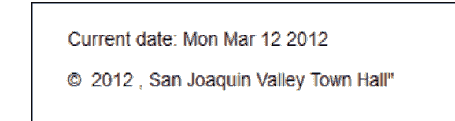

#### HTML 文档 body 中的 noscript 元素

```html
<p>&copy;<script>
  var today = new Date();
  document.write(today.getFullYear() );
</script>
<noscript>2012</noscript>, San Joaquin Valley Town Hall</p>
```

#### HTML 文档开头的 noscript 元素

```html
<noscript><h2>To get the most from this web site, please enable JavaScript.</h2></noscript>
```

**描述**

- 如果在文档的 body 中编写了 noscript 元素，它会被 JavaScript 代码的输出替换。
- noscript 元素可以在用户的浏览器禁用了 JavaScript 时显示内容.

图 2-2 如何在 HTML 文档的 body 中包含 JavaScript

### JavaScript 语法

JavaScript 语法是指你在编写语句时必须遵守的规则。如果你不遵守这些规则，你的浏览器将无法解释并执行你的语句.

### 如何编写 JavaScript 语句

图 2-3 总结了编写 JavaScript 语句的规则。第一条规则是 JavaScript 是区分大小写的。这意味着大写字母和小写字母被视为不同的字母。例如，名称 `salestax` 和 `salesTax` 被视为不同的单词。

第二条规则是 JavaScript 语句必须以分号结束。如果你不在每条语句末尾加上分号，JavaScript 将无法判断一个语句何时结束以及下一个语句从何时开始。

第三条规则是 JavaScript 忽略语句中额外的空白字符。由于空白包括空格、制表符和换行符，它允许你格式化代码.

#### JavaScript 块

```javascript
var list = [];
for (var i = 0; i < 5; i++) {
  list.push("item " + i);
}

if (list.length > 0) {
  alert("List has items");
} else {
  alert("List is empty");
}
```

**语法规则**

- JavaScript 是区分大小写的。
- JavaScript 忽略额外的空白字符。
- 每个语句都以分号结束.

#### 如何将 JavaScript 跨行编写

- 在算术运算符或关系运算符 `+`, `*`, `/`, `==` 之后
- 在大括号 `{` 之后
- 在逗号或中括号 `[` 之后

**描述**

- JavaScript 的语法与 Java 相似。
- 空白指的是空格、制表符和换行符，会被编译器忽略。
- 在某些情况下，JavaScript 会尝试通过添加分号来纠正.


### 如何创建标识符

变量、函数、对象、方法和事件必须命名以便你在代码中引用它们。标识符是赋予这些组件的名称.

图 2-4 显示了 JavaScript 创建标识符的规则。除了前几个规则外，你不能将 JavaScript 保留字（称为关键字）作为标识符。这些是保留使用的单词。你还应该避免将 JavaScript 全局属性或方法作为标识符，你将在后续学习的过程中了解更多.

#### 创建标识符的规则

- 标识符可以包含字母、数字、下划线 (`_`) 和美元符号 (`$`)。
- 标识符不能以数字开头。
- 标识符是区分大小写。
- 标识符可以是任意长度。
- 标识符不能与*保留字*相同。
- 避免使用全局属性和方法作为标识符。如果你使用了其中之一，你将无法再次使用同名的全局属性或方法.

#### JavaScript 中有效的标识符

```
subtotal               index_1               $
taxRate                calculate_click      $log
```

#### 驼峰法与下划线命名法


# 命名建议

- 为标识符使用有意义的名字。这样，你的标识符就不太可能是保留字或全局属性。
- 保持一致性：在脚本中使用驼峰命名法 (`taxRate`) 或下划线法 (`tax_rate`) 来标识变量中的单词。
- 如果你在使用保留字，请对所有字母使用小写。

## JavaScript 中的保留字

```
abstract        instanceof       switch
boolean         int                synchronized
break           export           interface        this
byte             extends          long             throw
catch           false            native           throws
case            final            new              transient
char             finally          null             true
class            float            package          try
const            private          typeof
continue         function         protected       var
debugger         goto             public           void
default           if               return           volatile
delete           implements       short            while
do               import           static           with
double           in               super
```

## 描述

- 标识符是赋予变量、函数、对象、属性和方法的名字。
- 在驼峰命名法中，标识符内除第一个单词以外的所有单词都大写字母开头。

## 如何使用注释

**注释**允许你向代码中添加描述性说明，这些说明会被 JavaScript 引擎忽略。以后，这些注释可以在需要修改代码时帮助你或他人理解代码。

图 2-5 中的示例展示了如何使用注释来描述或解释代码部分。开头处，块注释描述了随后的函数。这种注释以 `/*` 开头并以 `*/` 结束。应用程序运行时，开始和结束之间编写的所有代码都会被 JavaScript 引擎忽略。

另一种类型的注释是单行注释，以 `//` 开头。在示例中，第一条单行注释描述了同一行中前面的 JavaScript 代码的作用。相反，第二条单行注释单独占一行，它描述了随后的两个语句。

除了描述 JavaScript 代码外，注释在测试应用程序时也有用。例如，如果你想禁用 JavaScript 程序的一部分，可以将其封装在块注释中。这样，在测试代码的其他部分时，它会被忽略，稍后你可以启用被注释的代码。这被称为“注释掉”部分代码。稍后测试完代码的其他部分后，你可以通过删除块注释的开始和结束标记来启用被注释的代码。

什么时候该使用注释来描述或解释代码？当然，当代码非常复杂，以至于你以后需要维护时可能忘记它是如何工作的。如果将由其他人来维护代码，这种注释特别有用。

另一方面，你不应该使用注释来解释任何专业程序员都应该理解的代码。你必须在过多和太少之间取得平衡。注释最糟糕的问题之一是在不更改相关注释的情况下更改代码的工作方式。这时，注释会误导试图维护代码的人，使工作变得更加困难。

## 注释的 JavaScript 代码段

```javascript
// 此 onload 函数设置了显示和隐藏
// 一系列 h2 标题后续的事件
window.onload = function () {
  var fiveReasons = $(hv_reasons); // 获取 div 元素

  // div 元素内的 h2 和 div 元素
  h2Headings = fiveReasons.getElementsByTagName("h2");
  divTags = fiveReasons.getElementsByTagName("div");

  var i, headingNode, divNode;
  for (i = 0; i < h2Headings.length; i++) { // 每个 h2 循环一次
    headingNode = h2Headings[i];
    divNode = divTags[i];

    // 为每个 h2 附加事件处理程序
    headingNode.onclick = function () {
      var h2 = this;
      if (h2.nextElementSibling.getAttribute("class") == "closed") {
        h2.nextElementSibling.setAttribute("class", "open");
      } else {
        h2.nextElementSibling.setAttribute("class", "closed");
      }
    };
  }
};
```

## JavaScript 注释的基本语法规则

- 块注释以 `/*` 开头并以 `*/` 结束。
- 单行注释以两个斜杠 `//` 开头并持续到行尾。

## 使用注释的指南

- 使用注释描述难以理解的代码部分。
- 不要过度注释。

## 描述

- JavaScript 提供了两种形式的注释：块注释和单行注释。
- 在测试期间，可以使用注释来禁用代码。
- 然后，你可以注释掉部分代码。

## 如何使用对象、方法和属性

简单来说，对象是方法和属性的集合。方法执行函数或执行操作。属性是与对象相关的数据项。当你开发 JavaScript 时，图 2-6 显示了如何使用这些方法和属性。

## window 对象的常用方法

| 方法 | 说明 |
| --- | --- |
| `alert(string)` | 显示一个对话框，其中包含参数传递的字符串以及一个“确定”按钮。 |
| `prompt(string,default)` | 显示一个对话框，其中包含第一个参数中的字符串、第二个参数中的默认值、一个“确定”按钮和一个“取消”按钮。当用户输入一个值并点击“确定”时，该值将作为字符串返回。如果用户点击“取消”，则返回 `null`。 |
| `print()` | 向浏览器发出打印请求。 |

## window 对象的一个属性

| 属性 | 说明 |
| --- | --- |
| `location` | 当前网页的 URL。 |

## 调用对象方法的语法

```
objectName.methodName(parameters)
```

该语句调用 `window` 对象的 `alert` 方法：

```javascript
window.alert("This is a test of the alert method");
```

该语句在省略对象名的情况下调用 `prompt` 方法：

```javascript
var userEntry = prompt("This is a test of the prompt method", 100);
```

## prompt 对话框的显示

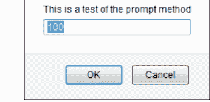

## 访问对象属性的语法

```
objectName.propertyName
```

该语句显示 `window` 对象的属性：

```javascript
alert(window.location); // 显示当前页的 URL
```

## 说明

- 对象具有与对象相关的功能的方法，以及表示与该对象相关的数据或属性的属性。
- 当你调用一个方法时，你可能需要向它传递一个或多个参数，这些参数是通过在方法后的括号内编写来实现的，并用逗号分隔。
- `window` 是 JavaScript 的全局对象，JavaScript 在引用 `window` 对象时允许你省略对象名和点运算符（句号）。

## 如何处理 JavaScript 数据

当你开发 JavaScript 应用程序时，你会经常处理数据，特别是用户输入到表单控件的数据。在接下来的主题中，你将学习如何处理三种类型的 JavaScript 数据。

## 基本数据类型

JavaScript 提供了三种基本数据类型。数字（`number`）类型用于表示数值数据。字符串（`string`）类型用于存储字符数据。布尔（`Boolean`）类型用于存储 `true` 和 `false` 值。这在图 2-7 中进行了总结。

数字类型可以用于表示整数或小数。整数是整数，而小数可以是有一位或多位数字的数字。任何数据类型的值都可以用加号或减号进行编码。如果省略了符号，则该值被视为正值。小数还可能包含一个小数点以及小数点右侧的一个或多个数字。

如数字类型的示例所示，在编写小数时，你还可以包含一个指数。如果你不熟悉这种表示法，你可能不需要使用它，因为你不会处理非常大或非常小的数字。相反，如果你熟悉科学计数法，你已经知道这个指数表示在小数点的右侧或左侧应该包含多少个零。使用这种表示法的数字被称为浮点数。

要表示字符串，你使用单引号或双引号（引号）来编写字符串。但注意，你必须使用与起始字符串时相同的引号类型结束字符串。如果你连续编写两个引号而中间甚至没有空格，其结果被称为空字符串，它可以表示一个不包含任何数据的字符串。

要表示布尔数据，你直接编写 `true` 或 `false` 而不加引号。如你所看到的，这种数据类型可以表示处于两种状态之一的数据：`true` 或 `false`。

## 数字值的示例

```
15                // 一个整数
-21               // 一个负整数
21.5               // 一个小数
-124.82            // 一个负小数
-3.7e-9            // -0.0000000037 的浮点数表示法
```

## 字符串值的示例

```
"JavaScript"      // 双引号的字符串
'String Data'     // 单引号的字符串
""               // 一个空字符串
```

## 两个布尔值

```
true              // 等同于 true, yes 或 on
false             // 等同于 false, no 或 off
```

## 数字类型

- 数字类型用于表示以正号或负号开头的整数或小数。
- 整数是一个数字。小数在小数点右侧可以有一位或多个小数位。
- 如果存储在数字类型中的结果比该类型能存储的更大或小，它将被存储为值 `Infinity` 或 `-Infinity`。

## 关于浮点数你需要了解的知识

- 在 JavaScript 中，小数被存储为浮点数。在该格式下，一个数字由一个正负号、一个或多个有效数字、一个可选的小数点和一个可选指数组成。
- 除非你正在开发需要使用非常大或非常小的数字应用程序，否则你不需要使用浮点表示法来表示数字。如果你需要，

## 字符串类型

- 字符串数据类型用于表示字符序列。
- 字符串包含在单引号或双引号中。
- 空字符串是不包含内容的字符串。

## 布尔类型

- 布尔类型用于表示两个值之一：`true` 或 `false`。
- 布尔值不包含在引号。

## 基本数据类型

基本数据类型是数字、字符串和布尔。

## 如何处理数据

当你开发 JavaScript 应用程序时，你会经常处理数据，特别是用户输入表单控件的数据。在接下来的主题中，你将学习如何处理三种 JavaScript 数据。

## 常用算术运算符

| 运算符 | 说明 | 示例 | 结果 |
| --- | --- | --- | --- |
| `+` | 加法 | `5 + 7` | `12` |
| `-` | 减法 | `5 - 12` | `-7` |
| `*` | 乘法 | `6 * 7` | `42` |
| `/` | 除法 | `13 / 4` | `3.25` |
| `%` | 取模 | `13 % 4` | `1` |
| `++` | 递增 | `counter++` | `counter` 加 1 |
| `--` | 递减 | `counter--` | `counter` 减去 1 |

## 算术表达式的优先级

| 顺序 | 运算符 | 方向 | 说明 |
| --- | --- | --- | --- |
| 1 | `++` | 从左到右 | 递增运算符 |
| 2 | `--` | 从左到右 | 递减运算符 |
| 3 | `* / %` | 从左到右 | 乘、除、取模 |
| 4 | `+ -` | 从左到右 | 加法、减法 |

## 优先级和括号的使用示例

```javascript
3 + 4 * 5 // 结果为 23，因为先执行乘法
(3 + 4) * 5 // 结果为 35，因为先执行加法
13 % 4 + 9 // 结果为 10，因为先执行取模
13 % (4 + 9) // 结果为 0，因为先执行加法
1000 + 1000 * .05 // 结果为 1050，因为先执行乘法
1000 + (1000 * .05) // 结果仍为 1050
```

# 如何使用数值变量

变量存储了一个随着程序执行而可以改变的值。当你编写 JavaScript 应用时，你经常需要声明变量并为它们赋值。图 2-9 显示了如何使用数值变量来完成这两项任务。

在 JavaScript 中声明数值变量，请编写 `var`（variable 的缩写），后跟你想要用于该变量的标识符（或名称）。要在一个语句中声明多个变量，请编写 `var` 后跟用逗号分隔的多个变量名。此图中的第一组示例说明了这一点。

要给变量赋值，你需要编写一个赋值语句：变量名、一个赋值运算符（如 `=`）和一个表达式。该表达式可以是一个像 `74.95` 这样的数字字面量，可以是一个像 `subtotal` 这样的变量名，也可以是一个算术表达式。当等号是运算符时，等号右侧表达式的值会被赋值给左侧变量。该运算符的使用由图中的第二组示例所示。

图中表格中的第二个运算符是 `+=` 运算符，它是一个复合赋值运算符。它通过将右侧表达式的值加到左侧变量的值上来修改左侧的变量。使用此运算符时，变量必须已经存在并已赋值。该运算符的使用由第三组示例所示。

第四组示例展示了通过给变量加 1 来增加其值的三种方法。正如你将在本书中所看到的，这是 JavaScript 的常见需求。在这一组中，第一条语句为名为 `counter` 的变量赋值 1。

然后，该组中的第二条语句使用算术表达式给计数器的值加 1，这说明变量名可以同时用于等号的两侧。第三条语句使用 `+=` 运算符给计数器加 1。

该组的最后一条语句使用前图中所示的增运算符给变量加 1。这说明了我们对使用增、减运算符的建议。在这里，表达式仅由一个变量名后跟增运算符组成，不包含赋值运算符。

最后一组示例说明了一个你应该注意的潜在问题。由于小数被存储为浮点数，因此算术操作的结果并不总是精确的。在这个示例中，`salesTax` 的结果本应为 `7.495`，但结果却是 `7.495000000000001`。虽然这个结果非常接近 `7.495`，但它并不等于 `7.495`，如果你期望这两个值的比较是相等的，可能会导致编程问题。解决方案是对结果进行四舍五入，将在下一章学习如何操作。

# 最实用的赋值运算符

| 运算符 | 描述 |
| --- | --- |
| `=` | 将表达式的结果赋值给变量。 |
| `+=` | 将表达式的结果加到变量。 |

### 如何声明数值变量但不为其赋值

```
var subtotal; // 声明一个变量
var investment, interestRate, years; // 声明三个变量
```

### 如何声明变量并为其赋值

```
var subtotal = 74.00; // subtotal = 74.00
var salesTax = subtotal * .1; // salesTax = 7.4
```

### 如何编写复合赋值语句

```
var subtotal = 74.95; // subtotal = 74.95
subtotal += 20.00; // subtotal = 94.95
```

### 将变量计数器加 1 的三种方法

```
var counter = 1; // counter = 1
counter = counter + 1; // counter now = 2
counter += 1; // counter now = 3
counter++; // counter now = 4
```

### 一个不精确的浮点数变量

```
var subtotal = 74.95; // subtotal = 74.95
var salesTax = subtotal * .1; // salesTax = 7.495000000000001
```

描述：

- 变量允许你更改程序执行的内容。
- 要声明变量，请使用关键字 `var` 和变量名。要在一个语句中声明多个变量，请使用 `var` 和用逗号分隔的变量名。
- 要给变量赋值，请使用由变量名、赋值运算符和表达式组成的赋值语句。在适当的情况下，可以在一个语句中声明变量并为其赋值。
- 在表达式中，数字字面量是不包含引号的有效整数或小数。
- 如果你在表达式中使用加号且两个值都是数字，JavaScript 会将它们相加。如果两个值都是字符串，JavaScript 将它们拼接（就像在下一行一样）。如果一个是数字另一个字符串，JavaScript 会将数字转换为字符串并进行拼接。
- 当你对小数使用某些算术操作时，结果并不总是精确的，尽管它们非常接近。这是因为小数在内部被存储为浮点数。这唯一的问题是，等值比较可能不会返回 `true`。

# 如何使用字符串和布尔变量

要声明字符串或布尔变量，你使用的技术与数值变量相似。主要区别是字符串被包含在引号中。在第一组示例中，你将看到如何声明字符串。在第二组中，你可以使用 `+` 运算符拼接字符串。在第三组中，你可以使用 `+=` 运算符拼接字符串。在第四组中，你可以看到如何使用复合赋值语句。在第五组中，你可以看到如何使用转义序列在字符串中使用特殊字符。在最后一组中，你可以看到如何声明布尔变量。

### 字符串的拼接运算符

| 运算符 | 示例 | 结果 |
| --- | --- | --- |
| `+` | `"Ray" + "Harris"` | `"Ray Harris"` |
| | `"Months:" + 120` | `"Months:120"` |

### 可在字符串中的转义序列

| 运算符 | 描述 |
| --- | --- |
| `\n` | 在字符串中换行。 |
| `\"` | 在字符串中放入双引号。 |
| `\'` | 在字符串中放入单引号。 |

### 如何声明变量但不为其赋值

```
var zipCode; // 声明一个变量
var lastName, state, zipCode; // 声明三个变量
```

### 如何声明字符串变量并为其赋值

```
var firstName = "Ray", lastName = "Harris"; // 赋值字符串
var fullName = lastName + " " + firstName; // fullName = "Harris, Ray"
```

### 使用字符串数据的复合语句

```
var firstName = "Ray", lastName = "Harris"; // fullName = "Harris"
var fullName = lastName;
fullName += " "; // fullName = "Harris, "
fullName += "Ray"; // fullName = "Harris, Ray"
```

### 使用混合数据的复合赋值语句

```
var months = 120;
message = "Months:";
message += months; // message 是 "Months:120"
```

### 转义序列如何在字符串中使用

```
var message = "有效的变量名\n不能以数字开头.";
var message = "这种做法是不正确的。";
```

### 如何声明布尔变量并为其赋值

```
var isValid = false; // 布尔值为 false
```

描述：

- 要给变量赋值，你可以使用 `+` 和 `+=` 运算符，就像对数值使用它们一样。
- 要拼接两个或多个字符串，你可以使用 `+` 运算符。
- 在表达式中，字符串字面量被包含在引号中。
- 转义序列可用于在字符串中插入特殊字符，如换行字符或引号。
- 如果你在表达式中使用加号且两个值都是字符串，JavaScript 会将它们拼接。但如果一个是数字另一个字符串，JavaScript 会将数字转换为字符串并拼接字符串。

## 如何使用 parseInt 和 parseFloat 方法

`parseInt` 和 `parseFloat` 方法用于将字符串转换为数字。`parseInt` 方法将字符串转换为整数，而 `parseFloat` 方法将字符串转换为十进制数值。之所以需要这些方法是因为 `prompt` 方法返回的值以及用户在文本框中输入的值都被视为字符串。

图 2-11 中的第一组示例说明了这些方法的用法。对于这组示例，假设 `prompt` 方法中的默认值没有被用户修改。因此，该组的第一条语句将 `12345.6789` 存储在名为 `entryA` 的变量中。然后，该组的第三条语句将字符串转换为整数值 `12345`。

注意，在这些示例中，没有为方法名编写对象名。没关系，因为 `window` 是 JavaScript 的全局对象。同样注意，`parseInt` 方法并不返回值，它只是移除并截断字符串中的任何小数部分。

第一组示例的最后四个语句显示了当使用 `parseInt` 或 `parseFloat` 方法转换非数字时会发生什么。在这种情况下，这两个方法都会返回值 `NaN`，它代表“不是数字”（Not a Number）。

然而，请注意，这些方法转换由一个或多个数字字符后跟一个或多个非数字字符的值。在这种情况下，这些方法简单地丢弃非数字字符。例如，如果字符串包含值 `"72.5%"`，`parseFloat` 方法将将其转换为十进制数值 `72.5`。

图中的第二组示例显示了如何通过将 `parse` 方法编码为 `alert` 方法来获取结果。例如，该组的第三条语句将 `parseInt` 方法作为 `alert` 方法的参数。这种将一个方法嵌入另一个方法中的做法被称为*对象链式*（object chaining），你将在下一章学习更多相关知识。

注意第一组示例中，`entryA`、`entryB` 和 `entryC` 变量都被 `parse` 方法更改了。例如，`entryA` 变成了数字 `12345`，`entryC` 变成了 `NaN`。相比之下，第二组示例中的语句没有更改这些项。这是因为解析后的值没有赋值给变量；它们只是由 `alert` 语句显示出来。

## window 对象的 parseInt 和 parseFloat 方法

| 方法 | 描述 |
| --- | --- |
| `parseInt(string)` | 将传递给它的字符串转换为整数类型并返回值。如果无法将字符串转换为整数，则返回 `NaN`。 |
| `parseFloat(string)` | 将传递给它的字符串转换为十进制类型并返回值。如果无法将字符串转换为十进制数值，则返回 `NaN`。 |

## 使用 parseInt 和 parseFloat 方法示例

```javascript
var entryA = prompt("Enter any value", 12345.6789);
alert(entryA);
// 显示 12345.6789
entryA = parseInt(entryA);
alert(entryA);
// 显示 12345
```

```javascript
var entryB = prompt("Enter any value", 12345.6789);
alert(entryB);
// 显示 12345.6789
entryB = parseFloat(entryB);
alert(entryB);
// 显示 12345.6789
```

```javascript
var entryC = prompt("Enter any value", "Hello");
alert(entryC);
// 显示 Hello
entryC = parseInt(entryC);
alert(entryC);
// 显示 NaN
```

## 将 parse 方法嵌入 alert 方法的示例

```javascript
var entryA = prompt("Enter any value", 12345.6789);
alert(entryA);
// 显示 12345.6789
alert(parseInt(entryA));
// 显示 12345
```

```javascript
var entryB = prompt("Enter any value", 12345.6789);
alert(entryB);
// 显示 12345.6789
alert(parseFloat(entryB));
// 显示 12345.6789
```

```javascript
var entryC = prompt("Enter any value", "Hello");
alert(entryC);
// 显示 Hello
alert(parseInt(entryC));
// 显示 NaN
```

## 描述

- `window` 对象提供了 `parseInt` 和 `parseFloat` 方法，可以将字符串值转换为整数或十进制数字。
- 当你使用 `prompt` 方法或文本框获取要在计算中使用的数值数据时，你需要使用 `parseInt` 或 `parseFloat` 方法将字符串数据转换为数值数据。
- `NaN` 是一个表示“不是数字”的值。当解析的内容不是数字时，`parseInt` 和 `parseFloat` 方法会返回该值。
- 在处理方法时，你可以将一个方法嵌入到另一个方法的参数中。这有时被称为对象链式。在上面的第二组示例中，`parse` 方法被编码为 `alert` 方法的参数。


## 如何编写控制语句

与所有编程语言一样，JavaScript 提供了控制语句，让你控制信息在应用程序中是如何处理的。这些语句包括 `if` 语句以及循环语句。但在学习如何使用这些语句之前，你需要学习如何编写条件表达式，因此我们从这里开始。

## 如何编写条件表达式

图 2-12 向你展示了如何编写使用六种关系运算符的条件表达式。条件表达式根据表达式之间比较的结果返回 `true` 或 `false` 值。例如，如果第一个表格第一个表达式中 `lastName` 的值为“Harrison”，则该表达式将返回 `true`。或者，如果最后一个表达式中 `rate` 的值为 10，则表达式将返回 `true`（10 / 10 是 .1，而 .1 大于或等于 0.1）。

此外，在使用关系运算符编写条件表达式的同时，你还可以使用全局 `isNaN` 方法。该方法确定字符串是否为数字。

## 关系运算符

| 运算符 | 描述 | 示例 |
| --- | --- | --- |
| `==` | 等于 | `lastName == "Harrison"`<br>`testScore == 10` |
| `!=` | 不等于 | `firstName != "Ray"`<br>`months != 0` |
| `<` | 小于 | `age < 18` |
| `<=` | 小于等于 | `investment <= 0` |
| `>` | 大于 | `testScore > 100` |
| `>=` | 大于等于 | `rate >= 0.1` |

## isNaN 方法的语法

```javascript
isNaN(expression)
```

**isNaN 方法示例**

`isNaN("Harris")` // 返回 true，因为 "Harris" 不是数字

`isNaN("123.45")` // 返回 false，因为 "123.45" 可以转换为数字

## 逻辑运算符的优先级

| 运算符 | 描述 | 示例 |
| --- | --- | --- |
| `!` | 非 | `!isNaN(age)` |
| `&&` | 与 | `age > 17 && score < 70` |
| `||` | 或 | `isNaN(rate) || rate < 0` |

## 逻辑运算符如何工作

- 与（`&&`）运算符的所有测试都为 `true` 时，整体结果为 `true`。
- 或（`||`）运算符的至少有一个测试为 `true` 时，整体结果为 `true`。
- 非（`!`）运算符会将表达式的布尔值反转。例如，如果一个表达式为 `false`，非运算符会将其转换为 `true`。
- 当在条件表达式中使用多个逻辑运算符时，可以使用括号来覆盖优先级顺序。通常情况下，你使用的条件表达式很简单，所以这不是问题。

## 注意

- 混淆赋值运算符 (`=`) 和相等运算符 (`==`) 是一种常见的编程错误。

## 如何编写 if 语句

如果你用过其他语言进行编程，那么使用 JavaScript 语句将不会有任何困难。只需学习图 2-13 以获取语法并查看条件是如何编写的。但如果你是编程初学者，让我们放慢速度。

`if` 语句允许你根据条件表达式的结果来控制语句的执行。在像图中所示的总结中，方括号 `[]` 表示语法中的可选部分。因此，该总结意味着每个语句必须以一个 `if` 子句开头。然后，它可以包含一个或多个 `else if` 子句，这些是可选的。最后，它可以有一个 `else` 子句，但这同样是可选的。

编写 `if` 子句，你使用关键字，后跟一个圆括号内的条件表达式，以及大括号内的一组更多语句。如果条件表达式为真，将执行此代码块并跳过语句中剩余的子句。如果条件为假，则将执行下一个子句。

编写 `else if` 子句，你使用关键字 `else if`，后跟一个圆括号内的条件表达式，以及大括号内的一组更多语句。如果条件表达式为真，将执行其代码块并跳过语句中剩余的子句。将继续检查直到其中一个 `else` 表达式为真或它们全部为假。

编写 `else`，使用关键字 `else`，后跟大括号内的一个或多个语句。只有当 `if` 和 `else if` 子句中的所有条件表达式均为假时，才会执行此代码。如果这些表达式为假且没有 `else` 子句，则语句将不执行任何代码。

图第一个示例显示了一个带有 `else` 子句的语句。如果变量 `age` 的值大于等于 18，将显示第一条消息。否则，将显示第二条消息。

第二个示例显示了一个带有两个 `else if` 子句和一个 `else` 子句的语句。如果 `rate` 不是数字，显示第一条消息。如果 `rate` 小于 0，显示第二条消息。如果 `rate` 大于 12，显示第三条消息。否则，显示 `else` 子句中的消息。

第三个示例显示了一个带有复合表达式的语句，该表达式测试 `userInput` 的值是否不是数字或其值是否小于等于零。如果任一表达式为真，则显示消息。如果两个表达式都为假，则什么都不做，因为该语句没有 `else if` 子句或 `else` 子句。

第四组示例显示了测试布尔变量为真的两种方法。在这里，两个语句的评估方式相同。这种条件被编码为仅对布尔变量本身进行测试，以检查该变量是否等于 `true`。在实践中，这通常按照第二个语句的方式进行编码，即带有变量名。

第五组示例也类似。它展示了测试布尔变量为假的三种方法。在这里，最后一条语句再次说明了通常的编码方式：`!isValid`。

## if 语句的语法

```
if ( condition-1 ) { statements }
  else if ( condition-2 ) { statements }
  ...
  else if ( condition-n ) { statements }
  else { statements }
```

## 带有 else 子句的 if 语句

```javascript
if ( age >= 18 ) {
  alert("You may vote.");
} else {
  alert("You are not old enough to vote.");
}
```

## 带有 else if 和 else 子句的 if 语句

```javascript
if ( isNaN(rate)) {
  alert("You did not provide a number for the rate.");
} else if ( rate < 0 ) {
  alert("The rate may not be less than zero.");
} else if ( rate > 12 ) {
  alert("The rate may not be greater than 12.");
} else {
  alert("The rate is: " + rate + ".");
}
```

## 带有复合条件表达式的 if 语句

```javascript
if ( isNaN(userEntry) || userEntry <= 0 ) {
  alert("Please enter a valid number greater than zero.");
}
```

## 测试布尔变量为真的两种方法

```javascript
if ( isValid == true ) { } // 等同于 isValid == true
if ( isValid ) { }
```

## 测试布尔变量为假的三种方法

```javascript
if ( isValid == false ) { }
if (!isValid == true ) { }
if (!isValid ) { } // 等同于 !isValid == true
```

## 描述

- 一个 `if` 语句始终有一个 `if` 子句。它还可以包含一个或多个 `else if` 子句以及结尾的一个 `else` 子句。
- `if` 子句中的语句在条件为真时执行。否则，控制传递到下一个子句。如果前面的子句中没有任何条件为真，则执行 `else` 子句中的语句。
- 如果需要，你可以在另一个语句的 `if`、`else if` 或 `else` 子句中编写一个语句。这被称为嵌套 `if` 语句。


## 如何编写 while 和 do-while 循环

图 2-14 首先介绍了用于创建 `while` 循环的 `while` 语句的语法。该语句在条件表达式为真时执行循环中的代码块。

紧随该语法的示例展示了如何使用 `while` 循环来加 1 到 5 的数字。在 `while` 语句开始之前，变量 `sumOfNumbers` 被设置为 0。

## while 语句的语法

```
while ( condition ) { statements }
```

### 累加 1 到 5 的数字的 while 循环

```javascript
var sumOfNumbers = 0;
var numberOfLoops = 5;
var counter = 1;
while (counter <= numberOfLoops) {
    sumOfNumbers += counter; // 将 counter 加到 sumOfNumbers
    counter++; // counter 加 1
}
alert(sumOfNumbers); // 显示 15
```

## do-while 循环的语法

```
do { statements } while ( condition );
```

### 累加 1 到 5 的数字的 do-while 循环

```javascript
var sumOfNumbers = 0;
var numberOfLoops = 5;
var counter = 1;
do {
    sumOfNumbers += counter; // 将 counter 加到 sumOfNumbers
    counter++; // counter 加 1
} while (counter <= numberOfLoops);
alert(sumOfNumbers); // 显示 15
```

### 计算一系列数字的平均值的 while 循环

```javascript
var total = 0, count = 0, number;
number = parseFloat(prompt("Enter a number:"));
while (!isNaN(number)) {
    total += number;
    count++;
    number = parseFloat(prompt("Enter another number or click Cancel to stop:"));
}
var average = total / count;
alert("The average is: " + average);
```

## 如何编写循环

图 2-15 展示了如何使用 `for` 语句来创建 `for` 循环。当循环的进度取决于一个每次循环都会增加的值时，这种类型的循环编写起来更加简单。在语句的括号内，你初始化一个计数器（或索引）变量，该变量将在循环内部被使用。然后，你编写一个决定循环何时结束的条件。最后，你编写一个指定计数器应如何递增的表达式。

图中的第一个示例展示了其工作原理。`for` 语句括号中的第一条语句声明了一个名为 `counter` 的变量并将其初始化为 1。然后，只要 `counter` 小于或等于 `numberOfLoops` 的值，循环就会继续，并且该表达式会在每次循环时将计数器加 1。在循环内部，计数器的值会被加到名为 `sumOfNumbers` 的变量中。

如果你将此示例与图 2-14 中的前两个示例进行比较，你会发现它们得到的结果是相同的。使用 `for` 语句，你不需要在语句之前初始化计数器，也不需要在语句内部增加计数器。

下一个示例展示了 `for` 循环更实际的用法。该循环计算了一笔投资金额（$10,000）在特定利率（7.0%）和特定年限（10年）的未来价值。这次使用 `i` 用作计数器变量名，这是常见的编码习惯，只要该索引小于或等于年份，循环就会继续。换句话说，循环中的语句会在10年中的每年执行一次。

在循环内部，使用 `+=` 运算符将年度利 `futureValue * annualRate / 100` 加到 `futureValue` 变量中。注意，这里 `annualRate` 需要除以 100，该计算才能生效（7.0 / 100 = .07）。同样请注意在此示例后的语句中，该语句可以用多种方式编写，且仍得到相同的结果。

在图中的两个示例中，计数器每次循环都递增 1，这通常是该语句的编写方式。然而，你也可以按其他幅度增加或减少计数器。这完全取决于你想做什么。例如，要递增 2，你可以将递增表达式编写为：

```
i = i + 2
```

## 第 2 章 上手 JavaScript

### for 语句的语法

```
for ( counterInitialization; condition; incrementExpression ) {
    statements
}
```

### 累加 1 到 5 数字的循环

```javascript
var sumOfNumbers = 0;
var numberOfLoops = 5;
for (counter=1; counter <= numberOfLoops; counter++) {
    sumOfNumbers += counter; // 将 counter 加到 sumOfNumbers
}
alert(sumOfNumbers); // 显示 15
```

### 计算投资未来价值的循环

```javascript
var investment = 10000;
var annualRate = 7.0;
var years = 10;
var futureValue = investment;
for (i = 1; i <= years; i++) {
    futureValue += futureValue * annualRate / 100;
}
alert(futureValue); // 显示 19672
```

### 未来价值计算的其他编码方式

```javascript
futureValue = futureValue + (futureValue * annualRate / 100);
futureValue = futureValue * (1 + (annualRate / 100))
```

## 描述

- 当你需要增加或减少决定循环执行次数的计数器时，使用 `for` 语句。
- 在 `for` 语句的括号内，你编写一个初始化计数器（或索引）变量的表达式、一个决定循环结束的条件表达式，以及一个指示计数器每次循环应如何增加或减少的递增表达式。
- 变量 `i` 通常用于 `for` 循环中的计数器。

## 两个说明性应用

你现在已经学习了足够的 JavaScript 来开发自己的简单应用程序。这些并不是现实中的应用，因为它们是从 `prompt` 语句获取用户输入，而不是来自表单控件。然而，这些应用程序将帮助你开始使用 JavaScript 方法和控制语句。

### 每加英里应用程序

图 2-16 展示了一个简单的应用程序，它发布两个 `prompt` 语句，让用户输入行驶英里数和使用的汽油加仑。然后，应用程序计算每加仑英里数并发布 `alert` 语句在第三个对话框中显示结果。

由于此应用程序使用 `prompt` 方法获取输入并使用 `alert` 输出，该应用程序的 HTML 是视觉化的。它包含一个 `h1` 元素，该元素在 JavaScript 执行完毕后显示。（正如我之前说的，这个应用程序是不实际的。）

在 JavaScript 中，你可以看到用户的输入是如何存储在名为 `miles` 和 `gallons` 的变量中的，然后被解析为小数值。之后，`miles` 除以 `gallons`，结果保存在名为 `mpg` 的变量中。然后，该变量中的值被解析为整数，以便移除任何小数。最后，`alert` 语句在第三个对话框中显示结果。当用户点击该框中的 OK 按钮时，JavaScript 结束，带有唯一标题的页面将在浏览器中显示。

## Test Scores 应用程序的对话框

下一个测试分数的提示对话框

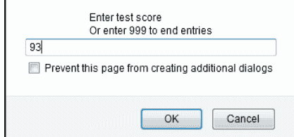

输入错误的警报对话框

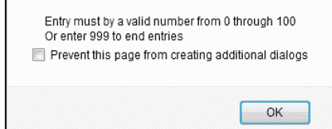

显示结果的警报对话框

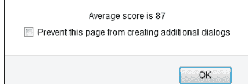

### HTML 文件头部部分中的 JavaScript

```javascript
<script>
var total = 0;
var entryCount = 0;
do {
  entry = prompt("Enter test score\n" + 
    "Or enter 999 to end entries", 999);
  entry = parseInt(entry);
  if (entry >= 0 && entry <= 100) {
    total = entry;
    entryCount++;
  } else if (entry != 999) {
    alert("Entry must be a valid number from 0 through 100\n" + 
    "Or enter 999 to end entries");
  }
} while (entry != 999);
var average = total/entryCount;
average = parseInt(average);
alert("Average score is " + average);
</script>
```

## 如何在代码中查找错误

当你输入并测试最简单的应用程序时，代码中可能会出现错误。当发生这种情况时，JavaScript 可能完全不运行，或者运行一段时间后停止。这就是为什么图 2-18 为你提供了一些查找代码中错误的思路。

## 如何在 Firefox 中获取错误消息

当你加载页面且 JavaScript 不运行时，发现问题所在最简单的方法是显示浏览器捕获的错误消息。要在 Firefox 中执行此操作，你需要如图所示打开“错误控制台”（Error Console）。在这里，控制台显示了运行 Test Score 应用程序时发生的错误消息。它显示 `score` 变量未定义。然后，如果你点击错误控制台中的链接，将显示源代码，并高亮显示导致错误的语句。

在这种情况下，变量是 "entry" 而不是 "score"。不幸的是，你无法在包含源代码的窗口中修复错误，因为那是浏览器窗口。相反，你需要切换到你的文本编辑器或 IDE 来修复并保存代码，然后在 Firefox 中重新加载应用程序。

要管理错误控制台中显示的内容，你可以点击其工具栏上的按钮。例如，当你第一次打开错误控制台时，可能会看到之前测试的应用程序所遗留的旧错误、警告和消息。然后，你可以点击“清除”（Clear）按钮来清除消息。

顺便提到，加载应用程序时显示的错误消息是检测到的第一个语法错误，但代码中可能存在其他语法错误。要捕获它们，你必须修正第一个错误并再次运行应用程序。

## 常见的 JavaScript 错误

此图显示了编写 JavaScript 应用程序时常见的编码错误。如果你学习这个列表，将更好地了解在查找错误时应该留心什么。

如果你使用良好的文本编辑器或 IDE，可以通过注意输入代码时显示的错误标记来避免大多数此类错误。例如，Aptana 将帮助你避免大多数此类错误，这可以为你节省许多小时的时间。如果可能，请确保你正在一个对 JavaScript 语法错误检查良好的编辑器或 IDE。

## 带有错误描述的 Firefox 错误控制台

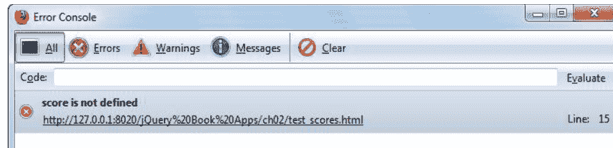

## 点击链接时显示的源代码

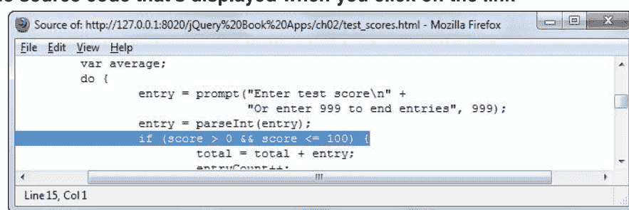

### 如何显示 Firefox 错误控制台和错误的源代码

- 要显示控制台，请使用 工具→开发者→错误控制台命令，或按 `Ctrl+Shift+J`。
- 要显示错误的源代码，点击错误控制台中的链接。

## 常见的语法错误

- 关键字拼写错误，例如代码写成 `parseinteger` 而不是 `parseInt`。
- 缺少必要的参数、引号或大括号。
- 未使用相同的起始引号和结束引号。
- 缺少语句末尾的分号。
- 在测试相等性时使用一个等号而不是两个等号。
- 标识符拼写错误或大小写不正确，例如定义变量 `sales` 但引用它时使用 `salestax`。

## 描述

- 当 Firefox 的 JavaScript 引擎遇到无法执行的语句时，它会在错误控制台中显示错误并停止执行 JavaScript。
- 控制台顶部的按钮允许你过滤消息。
- 加载应用程序时显示的错误消息是检测到的第一个语法错误，但代码中可能存在其他语法错误。要捕获它们，你必须修正第一个错误并再次运行应用程序。

## 观点

如果你使用良好的文本编辑器或 IDE，可以通过注意输入代码时显示的错误标记来避免大多数此类错误。例如，Aptana 将帮助你避免大多数此类错误，这可以为你节省许多小时的时间。如果可能，请确保你正在使用一个对 JavaScript 语法错误检查良好的编辑器或 IDE。

## 术语

- 外部 JavaScript 文件
- 嵌入式 JavaScript
- 语法
- 空格
- 标识符
- 保留关键字
- 驼峰命名法
- 注释
- 对象
- 属性
- 调用方法
- 点
- 参数
- 窗口对象
- 全局对象
- 基本数据类型
- 数字类型
- 整数
- 浮点数
- 字符串类型
- 字符串
- 布尔类型
- 布尔值
- 数值表达式
- 算术运算符
- 取模运算符
- 优先级
- 变量
- 声明变量
- 赋值语句
- 赋值运算符
- 复合赋值运算符
- 数字字面量
- 拼接运算符
- 字符串字面量
- 转义序列
- NaN
- 控制语句
- 条件表达式
- 关系运算符
- 复合条件表达式
- 逻辑运算符
- if 语句
- else 子句
- 嵌套 if 语句
- while 语句
- while 循环
- do-while 语句
- do-while 循环
- for 语句
- for 循环
- 循环计数器或索引
- 数据验证

## 总结

- HTML 页面的 JavaScript 通常在外部 JavaScript 文件中编写。但是，JavaScript 也可以嵌入在 head 或 body 元素中。
- JavaScript 的语法与 Java 相似。其标识符区分大小写，通常使用驼峰命名法或下划线法。
- JavaScript 提供了三种基本数据类型。数字类型提供整数和小数值。字符串类型提供字符（字符串）数据，布尔类型提供真和假值。要给变量赋值，你可以使用赋值运算符。
- 当你给数字变量赋值时，可以使用包含算术运算符、变量名和数字字面量的数值表达式。
- 当你给字符串变量赋值时，可以使用包含拼接运算符、变量名和字符串字面量的字符串表达式。

# 在开始进行本书的练习之前...

如果你还没有这样做，你应该安装 Mozilla Firefox 浏览器，并按照附录 A 中的描述安装本书的相应下载文件。

# 练习 2-1 为 MPG 添加验证

添加本练习中描述的验证功能，并在每一步之后在 Firefox 中测试应用程序。如果应用程序没有运行，请使用图 2-18 所示的错误控制台（Error Console）查找错误。

1. 打开你的文本编辑器或 IDE。然后打开此 HTML 文件：`c:\query\exercises\ch02\mpg.html`
2. 使用有效输入运行应用程序并记录结果。然后使用无效输入（0 或空格）运行它，并记录结果。
3. 在解析该条目的语句之后，添加一个验证英里数（miles）的语句。该语句应该检查条目是否不是数字，或者条目是否小于零。如果任一个条件真，则显示相应的错误信息。完成后，`if` 语句应该类似于下面：

```
if (isNaN(miles) || miles <= 0) {
  alert("Miles must be a number greater than zero");
}
```

4. 在解析该条目的语句之后，添加一个验证加仑（gallons）的语句。该语句应该检查条目是否不是数字，或者条目是否小于零。如果任一个条件真，则显示相应的错误信息。完成后，`if` 语句应该与上述英里数的语句类似。
5. 为每个条目添加一个 `do-while` 循环，其中包含获取、解析和验证条目的语句。该循环将一直持续直到条目有效。要做到这一点，你可以在 `while` 子句中使用与 `if` 子句中相同的条件。例如，加仑条目的循环应该类似于：

```
do {
  // 用于获取、解析和验证条目的语句
} while (isNaN(miles) || miles <= 0);
```

# 练习 2-2 创建一个数字求和应用程序

这是一个简单的应用程序，它使用 `prompt` 方法来获取从 1 到 100 之间的用户输入。然后，应用程序会将从 1 到用户输入之间的所有数字相加，并显示数字和。例如，如果用户输入 5，应用程序将相加 1、2、3、4 和 5，因此显示 15。

接下来的步骤将引导你开发此应用程序，你应该在每一步之后在 Firefox 中测试应用程序。如果应用程序没有运行，请使用图 2-18 所示的错误控制台查找错误。

1. 打开你的编辑器或 IDE。然后打开此 HTML 文件并查看其初始代码：`c:\query\exercises\ch2\sum.html`
2. 编写获取用户输入的 `prompt` 方法代码。它应该有一个 5 的默认值，并带有如下提示消息：“Enter number to sum”（输入要求和的数字）。然后将条目解析为整数值。
3. 声明一个初始值为零的变量来存储数字总和。该语句应该使用一个初始值为 1 的计数器变量，只要计数器变量小于等于用户输入的值，它就会一直执行，并在每次循环中将计数变量加 1。
4. 在显示计算总和的语句之后，编写一个 `alert` 语句。
5. 添加一个验证用户输入的 `if` 语句。该语句应该检查条目是否不是数字、或者是否小于 1、或者是否大于 100。如果任一条件为真，则应显示相应的错误信息。
6. 添加一个 `do-while` 语句，它将继续提示用户输入并显示错误信息，直到条目有效。
7. 改进结果的显示，使消息看起来如下：

**Sum of the numbers 1 through 5 is 15**（1到5的数字之和为15）

其中 5 是用户输入，15 是和。当然，此示例中的数字 5 和 15 将被用户的输入和计算出的和取代。

# 如何处理对象、函数和事件

在上一章中，你学习了如何使用 `prompt` 和 `alert` 方法编写一些简单但不实际的应用程序。现在在本章中，你将学习如何处理对象、函数和事件。完成本章后，你就准备好开始开发自己的真实的应用程序了。

## 如何使用对象处理数据

在上一章中，你学习了使用方法和属性的语法。你还被介绍了 `window` 对象的某些方法。现在，你将学习用于处理数据的对象、方法和属性。

# 如何使用 window 和 document 对象

在第 2 章中，你被介绍了 `window` 对象的 `prompt` 和 `alert` 方法。现在，图 3-1 中的第一个表格介绍了另一种用于确认操作的 `window` 对象方法。

然后，该图中的第二个表格总结了你在第 2 章学过的 `parseInt` 和 `parseFloat` 方法。由于 `prompt` 方法返回的值以及用户在文本框输入的值被视为字符串，因此需要这些方法。

这些方法的使用由第一组示例说明，从一个 `confirm` 方法示例开始。随后的语句假设默认值没有被用户更改。结果是，该组的第二条语句将 `12345.6789` 存储在变量 `nameA` 中，第三条语句将字符串转换为整数 `12345`。同样，第四条语句 `12345.6789` 存储在变量 `nameB` 中，第五条语句将字符串转换为小数 `12345`。

注意这些示例在方法前没有编写对象名称。这是可以的，因为 `window` 是全局对象。注意 `parseInt` 方法不会四舍五入数值，它只是截断字符串的任何小数部分。

与 `window` 对象相反，`document` 对象是 DOM 结构中的最高对象。它代表文档，当你使用它的任何方法时，都需要编写对象名称（`document`）和点（`.`）。

图中的第二组示例展示了如何使用 `document` 对象的两种方法。第一个是 `getElementById` 方法，它需要一个参数，即 HTML 文档中元素的 id。当它被执行时，会返回一个表示该 HTML 元素的对象。在本示例中，该对象被存储在变量 `rateBox` 中。

相比之下，`write` 和 `writeln` 方法可以在 HTML 文档的体部，将字符串写入 HTML 文档中。你在上一章的图 2-2 中见过这种工作原理。

## window 对象的另一个显示对话框的方法

| 方法 | 描述 |
| --- | --- |
| `confirm(string)` | 显示一个包含参数中字符串、OK 按钮和取消按钮的对话框。如果用户点击 OK，则返回 `true`；如果用户点击取消，则返回 `false`。 |

## window 对象的两个处理数字的方法

| 方法 | 描述 |
| --- | --- |
| `parseInt(string)` | 将传递的字符串转换为整数数据类型并返回该值。如果无法将字符串转换为整数，则返回 `NaN`。 |
| `parseFloat(string)` | 将传递的字符串转换为十进制数据类型并返回该值。如果无法将字符串转换为小数，则返回 `NaN`。 |

## document 对象的三个方法

| 方法 | 描述 |
| --- | --- |
| `getElementById(id)` | 获取具有传递 id 的 HTML 元素并返回该元素。 |
| `write(string)` | 将传递的字符串写入文档。 |
| `writeln(string)` | 写入字符串并移动到新行。 |

## window 方法示例

```javascript
confirm("Are sure you want to delete it?");
var entryA = prompt("Enter any value", 12345.6789);
entryA = parseInt(entryA);                                     // entryA = 12345
var entryB = prompt("Enter any value", 12345.6789);
entryB = parseFloat(entryB);                                   // entryB = 12345.6789
```

## document 对象用于 HTML 元素的示例

```javascript
// 返回元素
var rateBox = document.getElementById("rate");

// 向文档中写入一行
document.writeln("Today is " + today.toDateString());
```

## 描述

- `window` 对象是全局对象，JavaScript 在引用 `window` 对象时允许省略名称和操作符。
- `document` 对象是你处理文档对象模型 (DOM) 时的对象，它代表了页面上所有的 HTML 元素。
- 文本中的数据被视为字符串。在用于计算中使用它之前，你需要使用 `parseInt` 或 `parseFloat` 方法将其转换为数值数据。
- `NaN` 是一个表示“不是数字”（Not a Number）的值。当被解析的值不是数字时，`parseInt` 和 `parseFloat` 方法会返回 `NaN`。
- `getElementById` 通常用于获取 HTML 元素的对象。

## 如何使用 TextBox 和 Number 对象

`TextBox` 对象是 DOM 对象之一。它代表网页中的一个文本框，用于获取用户输入或向用户显示输出。图 3-2 中的前两个表格总结了它的一个方法和两个属性。然后，该图展示了两个 id 为 `"first_name"` 和 `"sales_amount"` 的文本框的 HTML 代码。这些文本框将用于后续示例。

此图的第一组示例展示了从 id 为 `"first_name"` 的文本框中获取值的两种方法。使用两条语句来实现这一点：第一条语句使用 `document` 对象的 `getElementById` 方法获取该文本框的 `TextBox`；第二条语句使用 `TextBox` 的 `value` 属性获取用户输入到文本中的值。

在实践中，你可以通过链式调用（chaining）使用一条语句来实现，或者直接链式。在这种情况下，单个语句首先使用 `getElementById` 获取 `TextBox` 对象，然后使用该对象的 `value` 属性获取文本中的值。换句话说，你将两个方法合并成了一个语句。

第二组示例将链式调用到了第三层。如果不使用链式调用，需要三条语句才能从文本框获取有效数字。首先，`getElementById` 方法获取 id 为 `sales_amount` 的文本框的 `TextBox`；其次，`TextBox` 对象的 `value` 属性获取用户输入到文本框中的值；第三，`parseInt` 方法将字符串值转换为小数。如果用户输入的是数值，则会将该数字存储在 `salesAmount` 变量中，从而使其变成一个 `Number` 对象。

然而，通过链式调用，这只需要一条语句。虽然这看起来可能比使用三条语句更复杂，但你会看到在单个语句中链用一系列相关方法和属性的价值。

此图中的第三张表格总结了 `Number` 对象的 `toFixed` 方法。当用户在文本框中输入一个值并在存储到变量之前使用 `parseInt` 方法进行解析时，该变量将变成一个 `Number` 对象。然后，你可以使用该对象的 `toFixed` 方法将数字舍入到特定的小数位数。

第三组示例中的第一条语句说明了这一点。该语句通过在链中添加 `toFixed` 方法，将链式调用扩展到了第四层。结果是存储在 `salesAmount` 变量中的值被舍入到了两位小数。

该组的最后两个语句展示了另外两个链式调用的示例。第一个展示了如何给文本框赋值。在这种情况下，值为空字符串，这实际上清除了文本框中的任何数据。第二个语句展示了如何将焦点移动到文本框上。

## TextBox 对象的一个方法

| 方法 | 描述 |
| --- | --- |
| `focus()` | 将光标移动到文本框，但不返回任何内容。 |

## TextBox 对象的两个属性

| 属性 | 描述 |
| --- | --- |
| `value` | 文本框的内容。 |
| `disabled` | 控制文本框的布尔值。 |

## Number 对象的方法

| 方法 | 描述 |
| --- | --- |
| `toFixed(digits)` | 返回数字舍入到 digits 位后的字符串表示。 |

## 定义文本框的 HTML 标签

```html
<input type="text" id="first_name">
<input type="text" id="sales_amount">
```

## 如何使用 value 属性从文本框获取值

不使用链式调用：

```javascript
var firstName = document.getElementById("first_name");
firstName = firstName.value;
```

使用链式调用：

```javascript
var firstName = document.getElementById("first_name").value;
```

## 如何使用 parseInt 方法从文本框获取数字

不使用链式调用：

```javascript
var salesAmount = document.getElementById("sales_amount");
salesAmount = salesAmount.value;
salesAmount = parseInt(salesAmount);
```

使用链式调用：

```javascript
var salesAmount = parseInt(document.getElementById("sales_amount").value);
```

## 其他链式调用示例

```javascript
var salesAmount = parseFloat(document.getElementById("sales_amount").value);
var salesAmount = salesAmount.toFixed(2);
document.getElementById("first_name").value = "";
document.getElementById("first_name").focus();
```

## 创建 JavaScript 对象并将其赋值给变量的语法

```
var variableName = new Object();
```

## 创建 Date 对象的语句

```
var today = new Date();
```

## Date 对象的几个方法

| 方法 | 描述 |
| --- | --- |
| `toString()` | 返回格式化日期的字符串。 |
| `getFullYear()` | 返回日期的四位年份。 |
| `getDate()` | 返回日期中的每月几号。 |
| `getMonth()` | 返回日期的月份数字。月份从 0 开始计数。1 月为 0，12 月为 11。 |

## String 对象的一个属性

| 属性 | 描述 |
| --- | --- |
| `length` | 返回字符串中的字符数。 |

## String 对象的几个方法

| 方法 | 描述 |
| --- | --- |
| `indexOf(search,position)` | 从指定的位置（如果省略 position 则为 0）开始搜索字符串的第一次出现。如果找到，则返回第一个字符的位置（从 0 开始计数）。如果未找到，则返回 -1。 |
| `substr(start,length)` | 返回从指定位置开始并包含指定数量字符的字符串。 |
| `toLowerCase()` | 返回一个所有字母转换为小写的新字符串。 |
| `toUpperCase()` | 返回一个所有字母转换为大写的新字符串。 |

## 使用 Date 对象的示例

```javascript
var today = new Date(); // 创建一个包含当前日期的 Date 对象
alert(today.toString()); // 在 3/9/2012 显示 Mar 09 2012
alert(today.getFullYear()); // 显示 2012
alert(today.getDate()); // 显示 9
alert(today.getMonth()); // 3 月显示 2，而不是 3
```

## 使用 String 对象的示例

```javascript
var name = "Ray Harris";
var nameUpper = name.toUpperCase(); // nameUpper = RAY HARRIS
var nameLength = name.length; // nameLength = 10
var index = name.indexOf(" "); // index = 3
var firstName = name.substr(0, index); // firstName = Ray
```

## 描述

- 要创建一个 `Date` 对象并将其赋值给变量，请使用上述语法。
- 然后，你可以对变量使用 `Date` 方法。
- 当你声明一个字符串变量时，会自动创建一个 `String` 对象。然后，你可以对变量使用 `String` 方法。

## 如何使用 DOM 对象更改元素的文本

当浏览器加载 HTML 页面时，它会构建一个文档对象模型（DOM），该模型包含了代表页面所有 HTML 元素和属性的节点。图 3-4 中的 HTML 页面和图说明所示。

DOM 从一个 `html` 元素的节点开始，一直嵌套到最低层。在这个示例中，这些节点是 `label`、`input` 和 `span` 元素的节点。在图中由值表示的元素节点之间，DOM 还包含了持有 HTML 元素数据的文本节点。在图中，这些文本节点是矩形。例如，第一个文本节点包含该章节中标题元素的内容：“Join Email List”（加入邮件列表）。右侧包含 body 中 `h1` 元素的文本是：“Please join our email list”（请加入我们的邮件列表）。以此类推。

DOM 还包含其他类型的节点，如属性节点和注释节点。但为了简单起见，这些节点没有包含在图中。

要使用 JavaScript 修改文本节点的内容，可以使用此图中总结所示的语法。该语法由随后的示例进行了说明：

```javascript
document.getElementById("email_address_error").firstChild.nodeValue = "New contents";
```

在这里，使用 `getElementById` 方法获取 id 属性值为 `email_address_error` 的 HTML 元素对象。然后，`firstChild` 获取 HTML 元素的第一个子节点（文本节点），而 `nodeValue` 属性指向文本节点的值。最后，该语句为该节点分配一个新值。

如果这让你感到困惑，只需接受 `firstChild.nodeValue` 代表 HTML 元素文本值这一事实即可。你将在章末看到完整的说明。

## 网页的代码

```html
<!DOCTYPE html>
<html>
<head>
  <title>Join our email List</title>
</head>
<body>
  <h1>Please join our email list</h1>
  <form id="email_form" name="email_form"
    action="join.html" method="get">
    <label for="email_address">Email Address:</label>
    <input type="text" id="email_address">
    <span id="email_address_error">*</span><br>
    <label name="&nbsp;"></label>
    <input type="button" id="join_list" value="Join our List">
  </form>
</body>
</html>
```

## 网页的 DOM

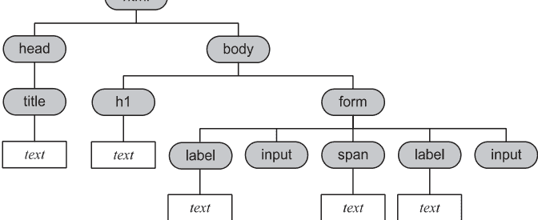

## 更改文本的语法

```javascript
document.getElementById("email_address_error").firstChild.nodeValue = "New contents";
```

在这里，使用 `getElementById` 方法获取 id 属性值为 `email_address_error` 的 HTML 元素对象。然后，`firstChild` 获取 HTML 元素的第一个子节点（文本节点），而 `nodeValue` 属性指向文本节点的值。最后，该语句为该节点分配一个新值。

## 描述

- DOM（文档对象模型）是节点的层次集合。
- 当开发 JavaScript 应用时，你需要处理点击按钮等事件。
- JavaScript 可以通过使用 `nodeValue` 属性更改页面文本。
- 在此示例中，调用获取 id 值为 `email_address_error` 的 HTML 文本框对象，然后使用 `nodeValue` 获取用户输入的值。

## 如何使用函数

函数是一块语句，可以接收参数并返回值。一旦你定义了函数，就可以在代码的其他部分调用它。在图 3-5 中，你可以看到如何

## 创建和调用匿名函数

要创建匿名函数，你先编写关键字，后跟用于存储该函数的变量名。然后，你编写赋值运算符、关键字、括号中的参数列表以及代码块。如果函数没有参数，括号是必须的。

以这种方式编写的函数被称为匿名函数，因为从技术上讲它们没有名称。相反，它们被存储在变量中。

要调用匿名函数，你编写存储函数的变量名，后跟参数。然后，函数在执行其代码块时使用传递给它的数据。

图中的第一个示例创建一个存储在变量 `Show` 中的函数。该函数不需要任何参数，也不返回值。执行时，该函数会显示一个包含当前年份的对话框。


# 第3章 如何处理对象、函数和事件

## 匿名函数示例

第二个示例创建一个存储在变量 `S` 中的函数。该函数接收一个参数，即 HTML 元素的 `id` 属性的名称。该函数返回一个代表 HTML 文本框的对象。在此示例中，调用获取 `id` 值为 `email_address` 的 HTML 文本框对象，然后使用 `nodeValue` 获取用户输入的值。

图中的第三个示例创建一个名为 `calculateTax` 的函数，它需要两个参数并返回一个值。它计算销售税，将其保留两位小数，并将该舍入后的值返回给调用它的语句。

## 匿名函数的语法

```javascript
var variableName = function(parameters) {
  // 当执行时运行的语句
}
```

## 无参数且无返回值的匿名函数

```javascript
var showYear = function() {
  var today = new Date();
  alert("The year is " + today.getFullYear());
}
```

## 如何调用函数

```javascript
showYear();
```

## 带有一个参数并返回 DOM 元素的匿名函数

```javascript
var $ = function(id) {
  return document.getElementById(id);
}
```

## 如何调用函数

```javascript
var emailAddress1 = $("email_address1").value;
```

## 带有两个参数并返回值的匿名函数

```javascript
var calculateTax = function (subtotal, taxRate) {
  var tax = subtotal * taxRate;
  tax = parseFloat(tax.toFixed(2));
  return tax;
}
```

## 如何调用函数

```javascript
var subtotal = 85.00;
var taxRate = 0.05;
var salesTax = calculateTax(subtotal, taxRate); // 调用函数
alert(salesTax); // 显示 4.25
```

## 描述

- 函数是一个可以被程序中其他语句调用的代码块。当函数结束时，程序将继续执行调用语句之后的语句。
- 函数在被调用时可能需要传递一个或多个参数。在调用语句中，这些参数也可以称为变量（arguments）。
- 为了向其调用的语句返回结果，函数使用 `return` 语句。当执行 `return` 语句时，函数会返回指定的值并结束。
- 匿名函数是如所示编写的函数。从技术上讲，该函数没有名称，它被存储在变量中，并通过变量名进行引用。
- 在应用程序的 JavaScript 中，匿名函数必须在它调用的任何语句之前编写。否则，将发生错误。

## 如何创建和调用命名函数

由于匿名函数通常用于处理 JavaScript 中发生的事件，因此你大多数时候都会使用它们。然而，你应该知道 JavaScript 也允许编写命名函数。

图 3-6 显示了如何创建和调用命名函数。它使用了与上一个图相同的示例，但使用的是命名函数而不是匿名函数。根据语法，命名函数不存储在变量中，它的名称写在 `function` 关键字之后、参数之前。

与上一个图一样，`showYear` 函数没有参数并返回四舍五入到两位小数的销售税。在这些示例中，使用命名函数只是获得与匿名函数相同结果的另一种方法。

使用命名函数的一个优点是，它可以在任何调用它的语句之前或之后编写。相比之下，匿名函数必须在调用它的任何语句之前编写。尽管如此这是一个微小的区别，只要你意识到这一点，就不会引起任何问题。

## 命名函数的语法

```javascript
function functionName (parameters) {
    // 当执行时运行的语句
}
```

## 无参数且无返回值的命名函数

```javascript
function showYear() {
    var today = new Date();
    alert("The year is " + today.getFullYear());
}
```

## 如何调用函数

```javascript
showYear();
```

## 带有两个参数并返回值的命名函数

```javascript
function calculateTax( subtotal, taxRate ) {
    var tax = subtotal * taxRate;
    tax = parseFloat( tax.toFixed(2) );
    return tax;
}
```

## 如何调用函数

```javascript
var subtotal = 85.00;
var taxRate = 0.05;
var salesTax = calculateTax( subtotal, taxRate ); // 调用函数
alert(salesTax); // 显示 4.25
```

## 描述

- 命名函数是如上所示编写的函数。这只是编写函数的另一种方式。
- 与匿名函数相反，命名函数不需要在调用它的任何语句之前编写。

## 何时以及如何使用局部和全局变量

编程语言中的作用域（Scope）指的是变量和函数的可见性。也就是说，它告诉你在程序中允许使用的已定义的变量和函数。

当你使用 JavaScript 时，局部变量是定义在函数内部的变量。它们具有局部作用域，这意味着它们只能在定义它们的函数内部使用。

相反，全局变量是定义在函数外部的变量。变量具有全局作用域，因此任何函数都可以使用它们，而无需将其作为参数传递给函数。

图 3-7 中的第一个示例说明了局部变量的使用。在这里，`calculateTax` 函数创建了一个名为 `tax` 的变量，并将该变量返回给调用语句。然后，该语句可以将变量存储在另一个变量中。但注意，函数外部的语句无法引用名为 `tax` 的变量而会导致错误。因为它具有局部作用域。

相反，第二个示例创建了一个名为 `tax` 的全局变量。然后，函数计算销售税并将结果存储在该全局变量中。结果是函数不需要返回 `tax` 变量。相反，函数外部的语句可以引用该变量，因为它是全局的。

使用全局变量向函数传递数据并返回数据似乎很容易，但它经常会产生问题。因为任何函数都可以修改全局变量。这可能会导致调试问题。如果你在声明变量时遗漏了 `var` 关键字，JavaScript 引擎会认为该变量是全局的。这里你在声明变量时遗漏了 `var` 关键字。

## 使用局部变量函数

```javascript
var calculateTax = function(subtotal, taxRate) {
  var tax = subtotal * taxRate;
  // tax 是局部变量
  var parse = parseFloat(tax.toFixed(2));
  return tax;
}
```

在函数外部引用局部变量会导致错误

```javascript
alert("Tax is " + tax);
```

## 使用全局变量函数

```javascript
var tax;
// tax 是全局变量
var calculateTax = function (subtotal, taxRate) {
  var tax = subtotal * taxRate;
  var parse = parseFloat(tax.toFixed(2));
}
```

在函数外部引用全局变量不会导致错误

```javascript
alert("Tax is " + tax); // 不会导致错误
```

## 无意中使用全局变量的函数

```javascript
var calculateTax = function (subtotal, taxRate) {
  tax = subtotal * taxRate; // 没有 var 关键字所以 tax 被视为全局变量
  var parse = parseFloat(tax.toFixed(2));
}
```

在函数外部引用 tax 变量不会导致错误……但它应该！

```javascript
alert("Tax is " + tax); // 不会导致错误
```

## 最佳编码实践

- 尽可能使用局部变量。
- 在被其他语句引用之前，始终使用 `var` 声明新变量。

## 讨论

- 变量或函数的作用域决定了哪些代码可以访问它。
- 在函数内部创建的变量是局部变量，局部变量只能被函数内部的代码引用。
- 在函数外部创建的变量是全局变量，所有函数中的代码都可以访问所有全局变量。
- 如果你在声明变量时忘记使用 `var` 关键字，JavaScript 引擎会假设该变量是全局的。这可能会导致调试问题。
- 通常，将局部变量作为参数从一个函数传递到另一个函数比使用全局变量更好。这会让你的代码更容易理解，减少出错的概率。

图 3-7 何时以及如何使用局部和全局变量

## 如何处理事件

JavaScript 应用程序响应点击按钮等用户操作。这些操作被称为*事件*，而处理事件的匿名函数被称为*事件处理器*。要实现这一点，你必须将它们*绑定*到事件上。

## 如何将事件处理器绑定到事件

图 3-8 中的表格总结了 JavaScript 经常处理的一些事件。例如，`window` 对象的 `load` 事件在浏览器完成页面 HTML 加载并构建 DOM 时发生。按钮的 `click` 事件在用户点击按钮时发生。标题或链接等元素的 `mouseover` 事件在用户将鼠标悬停在元素上时发生。

在该表之后，你可以使用将函数绑定到事件的语法。要这样做，请编写对象名称、一个点、以及由单词 `on` 前缀事件名称。然后编写一个等号，后面跟着处理该事件的匿名函数的变量名。

图中的第一个示例是一个可以作为事件处理器的匿名函数。该函数存储在变量 `joinList` 中，它只是显示一条消息。但在实际应用中，你会在函数的大括号内编写恰当处理该事件的语句。

第二个示例显示了一个 JavaScript 语句，将 `joinList` 函数绑定到 ID 为 "submit_button" 的按钮的点击事件。要这样做，语句首先使用 `getElementById` 方法获取带有 `on` 前缀的事件名称（`onclick`）。然后将结果赋值给作为事件处理器的函数变量名（`joinList`）。

注意，你不需要在用于函数的变量名后编写括号，如图 3-5 所示。这是因为你是在绑定一个事件处理器，而不是在调用它。结果是当事件触发时，该函数会被调用。相反，如果你在 `joinList` 后面加上括号，函数将立即被调用，而该函数不会被赋值给事件。

第三个示例类似于第二个示例。它将 `joinList` 处理器绑定到 ID 为 `text_box_1` 的文本框的双击事件上。这意味着同一个事件处理器将用于两个不同的事件。在这里，绑定函数时同样不需要编写括号。

## 常见事件

| 对象 | 事件 | 发生于... |
| :--- | :--- | :--- |
| window | load | 文档已加载到浏览器中。 |
| button | click | 按钮被点击。 |
| control or link | focus | 控件或链接接收焦点。 |
| | blur | 控件或链接失去焦点。 |
| control | change | 用户更改控件中的值。 |
| | select | 用户在文本框或文本区域中选择文本。 |
| element | click | 用户点击该元素。 |
| | dblclick | 用户双击该元素。 |
| | mouseover | 用户将鼠标移动到元素上方。 |
| | mousein | 用户将鼠标移动到元素内部。 |
| | mouseout | 用户将鼠标移出元素。 |

## 绑定事件处理器的语法

```javascript
objectVariable.eventName = eventHandlerName;
```

## 名为 joinList 的事件处理器

```javascript
var joinList = function() {
  alert("函数的语句写放在这里");
}
```

## 如何将事件处理器绑定到按钮的点击事件

```javascript
document.getElementById("submit_button").onclick = joinList;
```

## 如何将事件处理器绑定到文本框的双击事件

```javascript
document.getElementById("text_box_1").ondblclick = joinList;
```

## 描述

- 事件处理器是一个在事件发生时执行的函数，因此它“处理”了结果，你可以像使用其他函数一样使用事件处理器。
- 要将事件处理器绑定到事件，你必须先指定触发事件处理器的对象和事件。然后将事件处理器函数赋值给该事件。
- 当为事件处理器编写事件代码时，在事件名称前加上 `on`。例如，`onclick` 用于点击事件。
- 当将事件处理器绑定到事件时，你不需要在函数的变量名后编写括号。

图 3-8 如何将事件处理器绑定到事件

## 如何使用 onload 事件处理器绑定其他事件处理器

当你绑定像上图所示的事件处理器时，你是在 HTML 加载到用户浏览器并构建好 DOM 之后绑定的。要这样做，你可以像图 3-9 所示，为 `window` 对象的 `load` 事件编写一个事件处理器。这让你对事件处理器是如何设置和使用的有一个清晰的蓝图。

在此示例的 HTML 中，你可以看到一个标签、一个文本框、一个包含空格的标签和一个按钮。这个简单的应用程序应该在点击按钮或用户更改文本框中的值时显示一条消息。

在 JavaScript 代码中，你可以看到三个匿名函数。第一个存储在命名变量 `$` 中。该函数使用 `document` 对象的 `getElementById` 方法在传递 HTML 元素的 ID 时获取元素。这是一个常用的函数，它使得...

# 第3章 如何处理对象、函数和事件 111

## 浏览器中的每加仑油耗应用

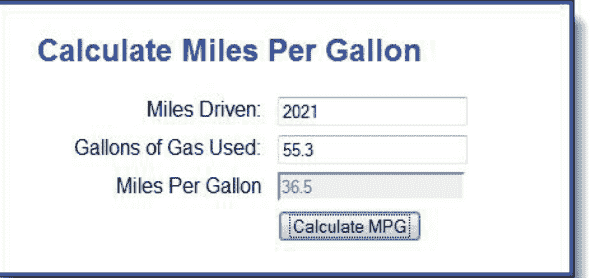

该应用的 HTML 和 JavaScript

```html
<!DOCTYPE html>
<html>
<head>
  <title>计算每加仑油耗</title>
  <link rel="stylesheet" href="mpg.css">
  <script>
    var $ = function (id) {
      return document.getElementById(id);
    }
    var calculateMpg = function () {
      var miles = parseFloat(document.getElementById("miles").value);
      var gallons = parseFloat(document.getElementById("gallons").value);
      if (isNaN(miles) || isNaN(gallons)) {
        alert("输入必须为数字");
      } 
      else {
        var mpg = miles / gallons;
        $("mpg").value = mpg.toFixed(1);
      }
    }
    window.onload = function () {
      $("calculate").onclick = calculateMpg;
      $("miles").focus();
    }
  </script>
</head>
<body>
  <section>
    <h1>每加仑油耗</h1>
    <label for="miles">行驶里程数:</label>
    <input type="text" id="miles"><br>
    <label for="gallons">消耗加仑数:</label>
    <input type="text" id="gallons"><br>
    <label for="mpg">每加仑油耗</label>
    <input type="text" id="mpg" disabled><br>
    <label>&nbsp;</label>
    <input type="button" id="calculate" value="计算每加仑油耗">
  </section>
</body>
</html>
```

图 3-10 每加仑油耗应用

© 2012, Michael Murach and Associates, Inc. 授权给 Michael Hotham。

## 邮件列表应用

图 3-11 展示了一个与你在第1章中介绍的类似的邮件列表应用。在该应用中，用户为三个文本框输入数据并点击“加入我们的邮件列表”按钮。然后，JavaScript 应用会检查数据的有效性。如果任何输入项无效，该应用将在输入项的右侧显示错误消息。如果所有输入均有效，数据将提交到服务器进行服务器端处理。

此应用中进行的验证是任何表单在数据提交到服务器处理之前，执行的客户端验证的典型做法。此应用还说明了 DOM 脚本，因为它更改了 HTML 中 `span` 元素显示的文本。

在 HTML 的 `head` 部分，你可以看到一个 `link` 元素用于引入此页面的 CSS 文件。你还可以看到一个 `script` 元素，包含了该页面的外部 JavaScript 文件。这里再次没有显示 CSS，因为它与应用的操作无关。

在 HTML 的 `body` 部分，你可以看到此页的表单、标签（label）和输入元素。你还会发现前三个元素后面跟着包含星号的 `span` 元素。由于该页面的 CSS 为 `span` 元素中的文本应用了红色，当页面显示时，星号是红色的。由于 JavaScript 将错误消息存储在 `span` 元素中，错误消息也是红色的。

你可能还会注意到表单和文本框的 `id` 属性：`email_form`、`email_address`、`email_address2` 和 `first_name`。这些是将被传递给 JavaScript 中 `$` 函数的 `id`。

同时注意，`name` 属性的值与 `id` 属性的值相同。文本框的 `name` 属性用于服务器端代码获取传递给它的用户输入。

## Web 浏览器中的邮件列表应用

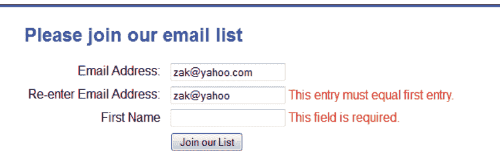 该页的 HTML 文件

```html
<!DOCTYPE html>
<html>
<head>
  <title>加入邮件列表</title>
  <link rel="stylesheet" href="email_list.css">
  <script src="email_list.js"></script>
</head>
<body>
  <section>
    <h1>加入我们的邮件列表</h1>
    <form id="join_form" name="email_form" method="get" action="join.html">
      <label for="email_address">电子邮件地址:</label>
      <input type="text" id="email_address" name="email_address1">
      <span id="email_address1_error"></span>
      <label for="email_address2">重新输入电子邮件地址:</label>
      <input type="text" id="email_address2" name="email_address2">
      <span id="email_address2_error"></span>
      <label for="first_name">姓名:</label>
      <input type="text" id="first_name" name="first_name">
      <span id="first_name_error"></span>
      <label>&nbsp;</label>
      <input type="button" id="join_list" value="加入我们的列表">
    </form>
  </section>
</body>
</html>
```

图 3-11 邮件列表应用的 HTML
图 3-12 邮件列表应用的 JavaScript
图 3-13 邮件列表应用的 HTML
带有 `if` 语句的邮件列表应用 JavaScript
图 3-14 邮件列表应用的 HTML
图 3-15 邮件列表应用的 JavaScript
图 3-16 邮件列表应用的 HTML
图 3-17 邮件列表应用的 JavaScript
图 3-18 邮件列表应用的 HTML
图 3-19 邮件列表应用的 JavaScript
图 3-20 邮件列表应用的 HTML
图 3-21 邮件列表应用的 JavaScript
图 3-22 邮件列表应用的 HTML
图 3-23 邮件列表应用的 JavaScript
图 3-24 邮件列表应用的 HTML
图 3-25 邮件列表应用的 JavaScript
图 3-26 邮件列表应用的 HTML
图 3-27 邮件列表应用的 JavaScript
图 3-28 邮件列表应用的 HTML
图 3-29 邮件列表应用的 JavaScript
图 3-30 邮件列表应用的 HTML
图 3-31 邮件列表应用的 JavaScript
图 3-32 邮件列表应用的 HTML
图 3-33 邮件列表应用的 JavaScript
图 3-34 邮件列表应用的 HTML
图 3-35 邮件列表应用的 JavaScript
图 3-36 邮件列表应用的 HTML
图 3-37 邮件列表应用的 JavaScript
图 3-38 邮件列表应用的 HTML
图 3-39 邮件列表应用的 JavaScript
图 3-40 邮件列表应用的 HTML
图 3-41 邮件列表应用的 JavaScript
图 3-42 邮件列表应用的 HTML
图 3-43 邮件列表应用的 JavaScript
图 3-44 邮件列表应用的 HTML
图 3-45 邮件列表应用的 JavaScript
图 3-46 邮件列表应用的 HTML
图 3-47 邮件列表应用的 JavaScript
图 3-48 邮件列表应用的 HTML
图 3-49 邮件列表应用的 JavaScript
图 3-50 邮件列表应用的 HTML
图 3-51 邮件列表应用的 JavaScript
图 3-52 邮件列表应用的 HTML
图 3-53 邮件列表应用的 JavaScript
图 3-54 邮件列表应用的 HTML
图 3-55 邮件列表应用的 JavaScript
图 3-56 邮件列表应用的 HTML
图 3-57 邮件列表应用的 JavaScript
图 3-58 邮件列表应用的 HTML
图 3-59 邮件列表应用的 JavaScript
图 3-60 邮件列表应用的 HTML
图 3-61 邮件列表应用的 JavaScript
图 3-62 邮件列表应用的 HTML
图 3-63 邮件列表应用的 JavaScript
图 3-64 邮件列表应用的 HTML
图 3-65 邮件列表应用的 JavaScript
图 3-66 邮件列表应用的 HTML
图 3-67 邮件列表应用的 JavaScript
图 3-68 邮件列表应用的 HTML
图 3-69 邮件列表应用的 JavaScript
图 3-70 邮件列表应用的 HTML
图 3-71 邮件列表应用的 JavaScript
图 3-72 邮件列表应用的 HTML
图 3-73 邮件列表应用的 JavaScript
图 3-74 邮件列表应用的 HTML
图 3-75 邮件列表应用的 JavaScript
图 3-76 邮件列表应用的 HTML
图 3-77 邮件列表应用的 JavaScript
图 3-78 邮件列表应用的 HTML
图 3-79 邮件列表应用的 JavaScript
图 3-80 邮件列表应用的 HTML
图 3-81 邮件列表应用的 JavaScript
图 3-82 邮件列表应用的 HTML
图 3-83 邮件列表应用的 JavaScript
图 3-84 邮件列表应用的 HTML
图 3-85 邮件列表应用的 JavaScript
图 3-86 邮件列表应用的 HTML
图 3-87 邮件列表应用的 JavaScript
图 3-88 邮件列表应用的 HTML
图 3-89 邮件列表应用的 JavaScript
图 3-90 邮件列表应用的 HTML
图 3-91 邮件列表应用的 JavaScript
图 3-92 邮件列表应用的 HTML
图 3-93 邮件列表应用的 JavaScript
图 3-94 邮件列表应用的 HTML
图 3-95 邮件列表应用的 JavaScript
图 3-96 邮件列表应用的 HTML
图 3-97 邮件列表应用的 JavaScript
图 3-98 邮件列表应用的 HTML
图 3-99 邮件列表应用的 JavaScript
图 3-100 邮件列表应用的 HTML
图 3-101 邮件列表应用的 JavaScript
图 3-102 邮件列表应用的 HTML
图 3-103 邮件列表应用的 JavaScript
图 3-104 邮件列表应用的 HTML
图 3-105 邮件列表应用的 JavaScript
图 3-106 邮件列表应用的 HTML
图 3-107 邮件列表应用的 JavaScript
图 3-108 邮件列表应用的 HTML
图 3-109 邮件列表应用的 JavaScript
图 3-110 邮件列表应用的 HTML
图 3-111 邮件列表应用的 JavaScript
图 3-112 邮件列表应用的 HTML

## 观点

在本章中，你已经了解了真实世界的 JavaScript 应用如何使用对象和响应事件。现在，如果你理解了本章中的所有内容，你就应该准备好开始开发自己的应用程序了。

## 术语

- window 对象
- 全局对象
- document 对象
- 对象链
- 链
- DOM（文档对象模型）
- DOM 节点
- 元素节点
- 文本节点
- 属性节点
- 注释节点
- 函数
- 调用
- 返回语句
- 匿名函数
- 命名函数
- 作用域
- 局部变量
- 局部作用域
- 全局变量
- 全局作用域
- 事件
- 事件处理程序
- 绑定事件处理程序

## 总结

- 文档对象提供了方法和属性，允许对文档对象模型或 DOM 进行操作。
- TextBox、Number、Date 和 String 对象为文本框、数字数据类型和数据类型提供了方法和属性。在使用这些对象的方法和属性时，你通常会使用链式调用。
- DOM 在页面加载到浏览器时构建。它包含了代表 HTML 文档元素的元素节点和代表元素文本的文本节点，你可以引用元素 `firstChild` 的 `nodeValue`。
- 函数是代码的集合，当函数被调用时就会执行。函数可能需要一个或多个参数，这些参数由调用语句传递给它。
- 匿名函数存储在变量中，而命名函数赋予名称但没有存储在变量中。
- 局部变量定义在函数内部，只能由函数内部语句访问。全局变量定义在所有函数之外，可以被任何代码访问。
- 事件处理程序是一个当点击按钮事件发生时被调用的函数。为了使之工作，该函数必须绑定到事件上。

## 练习 3-1 增强 MPG 应用

在本次练习中，你将通过多种方式增强 MPG 应用。

### 测试应用程序

1. 打开你的编辑器或 IDE，打开此 HTML 文件：`c:\query\exercises\ch03\index.html`
2. 然后，检查代码以确保它与图 3-10 相同。
3. 使用有效数据运行并测试此应用程序，查看它是如何工作的。当你点击 Calculate 按钮时，应该显示正确的结果。
4. 现在，测试数据验证程序。注意，无论输入是否无效，都会显示一条错误消息。

### 增强数据验证

4. 增强 `if` 语句，使其为每个文本框和每种类型的错误提供不同的错误消息：
   - Miles 必须是数字
   - Miles 必须大于零
   - Gallons 必须是数字
   - Gallons 必须大于零
该语句应包含一个测试第一个条件的 `if` 子句，随后跟两个测试后三个条件的 `else` 子句。然后，测试此更改。

### 添加清除输入（Clear Entries）按钮

5. 在 Calculate MPG 按钮下方添加一个 Clear Entries 按钮。为此，复制 Calculate 按钮的 label 和 input 元素的 HTML，并将其粘贴到 Calculate 按钮的 input 元素之后。然后，修改 Clear Entries 的 HTML，使其具有唯一且适当的 `id` 属性。
6. 添加一个匿名函数的 JavaScript 代码，并将其存储在名为 `clear` 的变量中。该函数应该清除每个文本框的内容，并将文本框的值设置为空字符串。然后，在 `onload` 事件处理程序中添加语句，将 `clear` 函数绑定到 Clear Entries 按钮的点击事件上，如下：
   `$("clear").onclick = clear;`
现在，测试此增强功能。
7. 在 `onload` 事件处理程序中添加语句，将 `clear` 函数绑定到 miles 文本框的双击事件上。然后，测试此更改。

## 练习 3-2 开发未来值应用

本次练习将引导你开发一个名为未来值（Future Value）的新应用程序。该应用程序的界面如下：

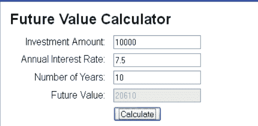

确保在练习每个步骤之后测试此应用程序。

1. 打开文本编辑器或 IDE，打开此文件夹中的 HTML 和 JavaScript 文件：
   `c:\query\exercises\ch03\future_value\`
   运行 HTML 文件查看它是否提供了用户界面的所有代码。然后注意，JavaScript 文件只有常用的 `$` 函数，用于获取特定 id 的元素对象。
2. 添加 `calculateClick` 函数，将其作为 Calculate 按钮点击事件的事件处理程序。在此函数内部，创建三个变量，通过 `$` 从第一个文本框获取值。将前两个值转换为小数，第三个值转换为整数。然后，编写图 2-15 中第二个示例中的循环，计算投资的未来值。当循环结束时，使用 `toFixed` 方法移除未来值的小数，并将该值放入 Future Value 文本框中。
   为 `window` 对象编写一个事件处理程序，将 `calculateClick` 函数绑定到 Calculate 按钮的点击事件上。
3. 添加语句测试第一个输入是否为大于零的有效数字。如果输入无效，使用 `alert` 方法显示适当的错误消息。用 `else` 子句结束该语句，其中包含第 2 步中用于计算和显示未来值的代码。
4. 增强语句以检查另外两个输入的有效性。在这里再次，每个输入都应该是大于零的数字，并应使用 `alert` 方法。
5. 为应用程序添加任何最后的完善工作，在应用程序启动时将焦点移至文本框。

# 第 4 章 如何测试和调试 JavaScript 应用

## 如何测试和调试应用程序

当你测试应用程序时，需要确保它运行正常。在测试应用程序时，尝试所有可能的输入数据组合和用户操作，以确保其工作正常。换句话说，测试的目标是让应用程序失败。当你调试应用程序时，要修复在测试期间发现的错误（bug）。每次修复一个 bug，都要再次测试，以确保你所做的更改不会影响应用程序的任何其他方面。

## 带有逻辑错误的 Calculate MPG 应用

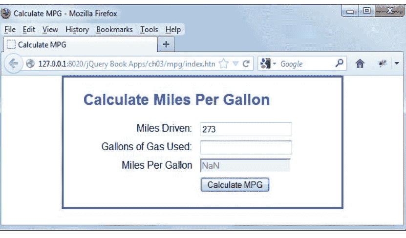

## 测试的目标

- 在应用投入生产之前找到所有错误。

## 调试的目标

- 在应用投入生产之前修复所有错误。

## 三个测试阶段

- 检查用户界面以确保其正常工作。
- 使用有效的输入数据对应用程序进行测试，以确保结果正确。
- 使用无效数据或意外的用户操作对应用程序进行测试。尝试你想到的所有方法让应用程序出错。

## 可能发生的错误类型

- 语法错误（Syntax errors）违反了 JavaScript 语句的编写规则。这些错误是在页面加载到网页浏览器时由 JavaScript 引擎引起的。
- 运行时错误（Runtime errors）发生在页面加载后应用程序运行时。当发生运行时错误时，JavaScript 引擎会抛出一个异常并停止应用程序的执行。
- 逻辑错误（Logic errors）是指不会引起语法或运行时错误，但产生错误结果的语句。

## 说明

- 为了测试 JavaScript 应用，你需要运行它以确保无论你输入什么数据或启动什么事件，它都能正常工作。
- 当你调试应用程序时，你会发现并修复在测试应用程序时发现的所有错误（bug）。

图 4-1 测试与调试的简介

## 常见的 JavaScript 错误

图 4-2 展示了在编写 JavaScript 应用时常见的某些编码错误。如果你完成了上一章的练习，你可能已经经历过这些错误中的一些。现在，如果你学习这张图，你将更好地了解需要注意什么。

如果你正在使用良好的文本编辑器或 IDE，可以通过注意输入代码时显示的错误标记来规避大多数此类错误。例如，Aptana 将帮助你规避此图中前两组中的大多数错误。但是，它无法帮助你规避第三组中的错误。

图中的第四组涉及了第 2 章提到的浮点数算术问题。简而言之，JavaScript 使用 IEEE 754 标准处理浮点数，该标准可能会导致不正确的结果，即使对于简单的计算也是如此。尽管这些结果与精确结果非常接近，但它们可能会引起问题，特别是在比较时。例如，数字 7.495 不等于 7.49500000000001。

为了解决这个问题，你可以像示例所示对结果进行舍入。在这里，第一条语句使用数字的 `toFixed` 方法将 `salesTax` 值保留两位小数。在这种情况下，结果被存储为字符串，因为 `toFixed` 方法返回字符串。相比之下，第二条语句对结果进行舍入，然后使用 `parseFloat` 方法将其存储为数字。使用哪种方法取决于你需要的结果是字符串还是数字。

图中的最后一组说明了当 JavaScript 假设一个变量是全局变量时可能出现的问题。这个问题在第 3 章介绍。在示例中，使用 `var` 关键字正确地声明了 `salesTax`。但下一条语句在尝试将舍入并解析后的值赋值给 `salesTax` 时，将它误拼为 `salestax`。结果是，`salestax` 被视为全局变量，舍入并解析后的值进入了 `salestax` 而不是 `salesTax`，这自然导致了 bug。

不用说，那种类型的 bug 可能很难发现。但现在你已经意识到了这类错误，你将更好地准备调试它们。

## 常见的语法错误

- 拼错关键词，例如使用 `codingElementById` 而不是 `getElementById`。
- 缺少必要的括号、引号或大括号。
- 未使用相同的起始和结束引号。
- 语句末尾缺少分号。
- 标识符拼错或大小写不正确，例如定义变量 `salesTax` 稍后将其引用为 `salestax`。

## HTML 引用问题

- 错误地引用属性值或其他 HTML 组件，例如将 id 为 `sales_tax` 的 id 错误地引用为 `salesTax`。

## 数据与比较中的问题

- 在处理用户输入之前，没有测试确保其是正确的数据类型。
- 在处理用户输入之前，没有使用 `parseInt` 或 `parseFloat` 方法将用户输入转换为数值。
- 在测试相等性时使用一个等号而不是两个等号。

## 浮点数算术问题

- JavaScript 中的数据类型使用浮点数，可能导致结果不精确。例如：
```javascript
var salesAmount = 74.95;
salesTax = salesAmount * .1; // 结果是 7.495000000000001
```
- 解决此潜在问题的方法是将结果舍入到正确的小数位数，并将其转换回浮点数：
```javascript
salesTax = salesTax.toFixed(2); // 结果是字符串 "7.50"
salesTax = parseFloat(salesTax.toFixed(2)); // 结果是数字 7.50
```

## 被视为全局变量的未定义变量

- 如果你给一个未声明的变量赋值，JavaScript 引擎会将其视为全局变量。这发生在你拼错变量名时，正如这个示例所示：
```javascript
var calculateTax = function (subtotal, taxRate) {
  var salesTax = subtotal * taxRate; // result is 7.4950000000000001
  return salesTax.toFixed(2); // salesTax is local
}
```

## 说明

- 为了测试 JavaScript 应用，你需要运行它以确保无论你输入什么数据或启动什么事件，它都能正常工作。


## 如何自顶向下编码和测试可以简化调试

简化调试的一种方法是每次编码并测试一小部分。这可以被称为自顶向下编码和测试。如图 4-3 所示。在这里，第一个测试阶段包含一个点击事件的处理程序。然而，该处理程序没有进行任何验证。它只是计算投资的未来价值，这就是该应用程序的精髓。

然后，阶段 2 通过对第一个输入进行验证来完善代码。阶段 3 对其他输入进行验证。阶段 4 添加了跳转到第一个文本框的完善工作。

结果是你每次测试一小部分代码。这使得调试变得简单，因为你知道错误是由你刚刚添加的代码引入的。

## 未来价值应用的用户界面

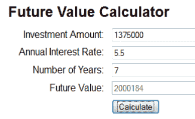

## 测试阶段 1：无数据验证

```javascript
var $ = function (id) {
  return document.getElementById(id);
}

var calculateClick = function () {
  var investment = parseFloat($("investment").value);
  var annualRate = parseFloat($("rate").value);
  var years = parseInt($("years").value);
  for (var i = 1; i <= years; i++) {
    investment += investment * annualRate / 100;
  }
  $("future_value").value = investment.toFixed(2);
}

window.onload = function () {
  $("calculate").onclick = calculateClick;
};
```

## 测试阶段 2：对第一个输入进行验证

```javascript
if (isNaN(investment) || investment <= 0) {
  alert("投资必须是数字且大于0。");
} else {
  // 阶段 1 的未来价值计算
}
```

## 测试阶段 3：对其他输入进行验证

```javascript
// 对其他输入进行验证
```

## 测试阶段 4：添加完善工作

```javascript
// 添加跳转到第一个文本框的完善工作
```

## 讨论

- 自顶向下编码和测试可以简化调试。当你使用自顶向下编码和测试时，你从编码和测试一小部分代码开始。然后，你通过每次添加一个或两个操作并在每次添加后进行测试来在此基础上进行构建。
- 自顶向下编码和测试简化了调试，因为你知道错误是由你刚刚添加的代码引起的。因此，找到错误相对容易。

图 4-3 自顶向下编码和测试可以简化调试

## 如何调试 Firebug

在第 2 章中，你学习了 Firefox 错误控制台（Error Console），这是一种修复语法错误的方法。除此之外，Firefox 还提供了一个名为 Firebug 的扩展，它的效果比错误控制台更好。Firebug 还为更复杂的应用程序提供了一些出色的调试功能。

由于 Firebug 相对易用，接下来的主题将不会介绍其所有功能的用法。相反，这些主题将介绍你将经常用到的技能。然后，如果你决定想使用其他一些功能，可以自行进行实验。

## 如何启用 Firebug 并查找错误

Firebug 是一个免费扩展，提供了一些出色的调试能力。安装 Firebug 后（如附录 A 所示），你将在 Firefox 工具栏上看到 Firebug 图标，如图 4-4 所示。然后，你可以点击此图标或按 F12 键来打开和关闭 Firebug。

Firebug 的主要用途之一是获取类似于错误控制台显示的错误消息，但通过更高效的方式实现这一点。例如，要获取错误消息，你只需要打开 Firebug 并点击标签面板上的“Console（控制台）”即可。这应该会显示页面加载时检测到的第一个错误。然后，你可以点击指向“Script（脚本）”面板的链接，其中用于错误语句的 JavaScript 代码会被高亮。

在某些情况下，你可能需要在使用 Console 和 Script 面板之前先启用它们。如果某个面板未被启用，它将包含一个你可以点击用来启用它的链接。或者，你也可以从面板标签弹出的列表中选择“Enable（启用）”命令。

Firebug 运行良好，我们建议你安装一个 JavaScript 应用程序并开始免费使用。每当问题发生时，只需点击 Firebug 图标并点击 Console 面板，查看是否捕获了错误。如果有，就从那里继续。否则，你就遇到了更严峻的调试问题。

顺便提一下，加载应用程序时显示的错误消息是检测到的第一个语法错误，但代码中可能存在其他错误。要捕获它们，你必须修正错误并重新运行应用程序。你应该也知道，在修正所有语法错误之前，JavaScript 引擎不会运行应用程序。因此，在修复语法错误之前，你将无法发现运行时错误。

在下一张图中，你将学习如何使用 Script 面板进行调试。但在离开之前，请注意 Firebug 除了 Console 和 Script 面板外，还提供了四个面板。以下是每个面板的描述。

Console 标签右侧的前两个标签可以访问 HTML 和 CSS 面板，它们显示页面的 HTML 和 CSS。如果一个页面有多个 CSS 文件，你可以使用 CSS 面板工具栏中的名称列表切换到不同的文件。

最后两个标签访问 DOM 和 Net 面板。DOM 面板以可展开的树形式显示 DOM 中的对象、属性和方法，该树从全局对象开始。

打开了 Console 面板并显示错误的 Firebug

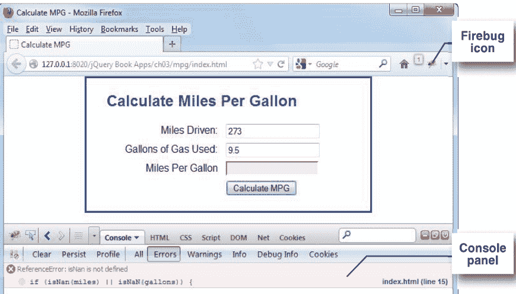

点击 Console 面板中的链接后的 Script 面板

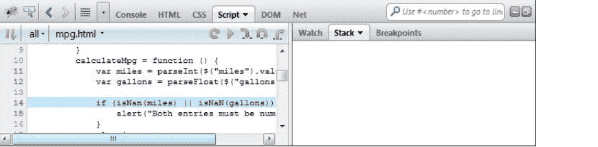

### 如何打开或关闭 Firebug

- 点击 Firebug 图标或按 F12。

### 如何找到导致错误的 JavaScript 语句

- 点击 Console 标签打开 Console 面板。然后，如有必要，点击 Errors（错误）按钮。这将显示一条类似上面的错误消息，并标出导致错误的代码行。
- 点击 Console 面板中的代码行，或点击代码行右侧的行标记。这将打开 Script 面板，其中包含显示语句的 JavaScript 代码部分且该语句会被高亮。

## 描述

- Firebug 是一个免费的 Firefox 扩展……Console 面板的一个用途是显示类似于错误控制台显示的错误消息，但通过更高效的方式实现这一点。

图 4-4 如何启用 Firebug 并调试错误

Net 面板显示发送到网络浏览器每个请求的信息。这包括下载时间、使用的服务器、HTTP 请求头、HTTP 响应头、HTTP 响应实体体以及本地缓存信息。

## 如何使用断点和单步执行代码

断点是你代码中的一个点，应用程序的执行将在此停止。然后，你可以检查变量的内容，查看代码是否按预期执行。你还可以从该点开始单步执行代码。这些技术可以帮助解决困难的调试问题。

图 4-5 显示了如何设置断点、单步执行代码并在 Watch（监视）面板中查看变量的内容。在这个示例中，你可以看到 Email List 应用程序的第 5 行设置了断点。

当你运行应用程序时，它将在它遇到的第一个断点处停止，并在上方显示一个黄色三角形。当代码停止时，你可以将鼠标悬停在 Script 面板中的对象名称上，显示该对象的当前值。

在断点处，你也可以在右侧的 Watch 面板查看当前变量。这些是正在执行的函数所使用的变量。你还可以看到其他变量的值。

要在断点后单步执行代码，你可以使用 Step Into（步入）、Step Over（跨过）和 Step Out（步出）按钮。

这些强大的调试功能可以帮助你找到严重调试问题的原因。单步执行应用程序也是理解代码如何工作的好方法。例如，如果你单步执行 Email List 应用程序中的 if 语句，你更好地了解它们是如何工作的。

### Firebug Script 标签中的断点

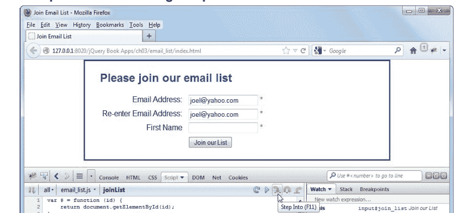

### 如何在 Script 面板中设置或移除断点

- 要设置断点，点击语句左侧的栏。
- 要移除断点，点击红色断点标记。

### 如何在 Script 面板中单步执行 JavaScript 代码

- 点击 Step Into 按钮或按 F11 逐行执行代码。
- 点击 Step Over 按钮运行任何调用的函数而不进入其内部。
- 点击 Step Out 按钮执行函数的剩余部分而不进行单步执行。
- 点击 Continue 按钮恢复正常执行。

### 如何在每一步查看当前数据值

- 将鼠标光标悬停在 Script 面板中的变量上。
- 在 Script 面板右侧查看当前值。
- 在 Watch 窗口中点击“New watch expression...（新建监视表达式...）”并输入你想观察的变量名或表达式。

## 其他调试方法

由于 Firebug 是一个极佳的调试工具，你应该在大多数情况下都使用它。然而，这里有其他四种调试方法，你可能偶尔觉得它们有用。

## 如何以及何时与其他浏览器获取错误信息

所有现代浏览器都能检测 JavaScript 错误，并提供如 Firefox 控制台和 Firebug 等工具来提供帮助。然而，如果你使用 Firefox 和 Firebug 来调试所有的 JavaScript 应用程序，你就不需要使用其他浏览器提供的工具了。在 Firefox 上运行的应用程序应该在所有其他浏览器上运行，但有一个例外。

这个例外是 Internet Explorer，它产生了你可能会遇到的大多数跨浏览器兼容性问题。因此，在 Firefox 和其他浏览器测试过某个应用程序后，你可能仍然需要在 IE 上对其进行调试。这就是为什么图 4-6 显示了如何访问 IE 调试工具。

如图所示，当前版本 IE 的开发者工具工作方式与 Firebug 非常相似，具有类似的面板。如果你尝试这些工具，你会发现可以像使用 Firebug 一样，从控制台（Console）面板跳转到脚本（Script）面板中的错误语句。你还可以以类似的方式设置断点并逐步执行语句。

### 显示错误的带有控制台面板的 Internet Explorer

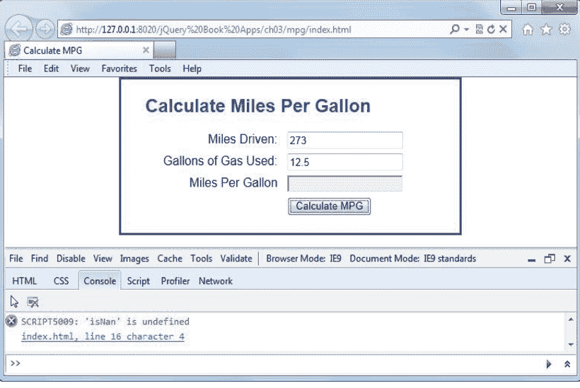

### 如何在当前版本的 IE 上显示开发者工具

- 使用工具（Tools）→开发者工具（Developer Tools）命令，或按 F12。

### 如何在旧版本的 IE 上显示错误消息

- 双击浏览器左下角的错误以查看 IE 消息框。然后，如有必要，点击详细信息（Details）按钮查看整个消息。

## 描述

- 所有现代浏览器都提供如 Firefox 错误控制台和 Firebug 等调试工具。如果你在 Firefox 上调试 JavaScript 应用程序，它应该在所有现代浏览器上运行，因此你不需要它们的调试工具。
- 唯一的例外是 IE，它仍然存在一些兼容性问题。因此，当你在 IE 上测试应用程序时，有时可能需要进行进一步的调试。
- 当前版本的 IE 提供了与 Firefox 相似的调试工具。你可以使用上述方法访问它们。
- 旧版本的 IE 提供了一个你可以使用上述方法访问的消息框。这个消息框与图 2-18 所示的 Firefox 错误控制台有些相似，但没有那么易用。

图 4-6 如何以及何时与其他浏览器获取错误信息

## 跟踪 JavaScript 代码执行的简单方法

当你跟踪应用程序的执行情况时，你是在确定应用程序中语句执行的顺序。实现这一点的一种简单方法是在代码中添加 `alert` 语句，在代码的关键点显示消息或变量值。

图 4-7 中的示例说明了这一点。在这里，高亮显示的第一个 `alert` 语句让你知道 `$` 函数已经启动。第二个 `alert` 语句让你知道 `calculateMpg` 函数已经启动。第三个 `alert` 语句显示用户输入的里程（miles）和加仑（gallons），以确保其之前的两个语句运行正常。第四个 `alert` 语句让你知道 `if` 语句的 `else` 分支已经启动。第五个 `alert` 语句让你知道 `onload` 函数已经启动。

当你使用这种技术时，通常从向代码中添加几个 `alert` 语句开始。如果这不能帮你解决问题，你可以添加更多。通常，这对于你解决简单调试问题所需要的，而且这比使用 Firebug 设置断点并逐步执行代码要快。

### 带有五个 alert 跟踪代码执行的 JavaScript

```javascript
var $ = function (id) {
  alert("$ function has started");
  return document.getElementById(id);
}

var calculateMpg = function () {
  alert("calculateMpg function has started");
  var miles = parseFloat($("miles").value);
  var gallons = parseFloat($("gallons").value);
  alert("miles = " + miles + "\ngallons = " + gallons);

  if (isNaN(miles) || isNaN(gallons)) {
    alert("Both entries must be numeric");
  }
  else {
    alert("The data is valid and the calculation is next");
    var mpg = miles / gallons;
    $("mpg").value = mpg.toFixed(1);
  }
}

window.onload = function () {
  alert("onload function has started");
  $("calculate").onclick = calculateMpg;
  $("miles").focus();
}
```

### alert 对话框随着 JavaScript 执行时显示

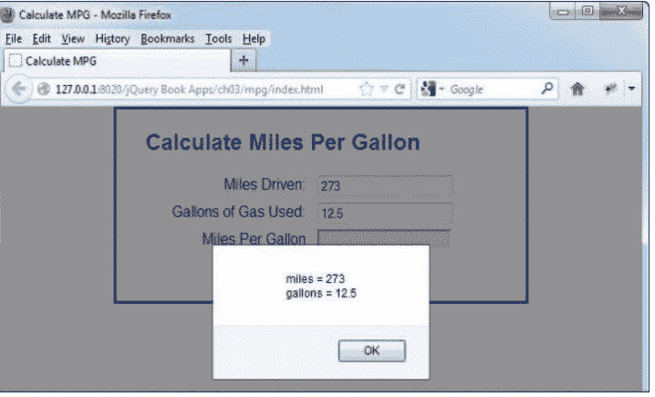

## 描述

- 跟踪 JavaScript 应用程序执行的简单方法是在代码的关键点插入 `alert` 语句。
- `alert` 对话框可以显示指示正在执行哪部分代码的消息，或显示变量的值。
- 对于简单的调试问题，这种跟踪方法就是你解决它们所需的全部。

图 4-7 跟踪 JavaScript 代码执行的简单方法

## 如何以及何时查看源代码

偶尔，当你测试应用程序时，如果似乎什么都没有正常工作，你可能想要查看源代码。

要查看源代码，你可以点击右键菜单。但请注意，HTML 源代码不会反映 JavaScript 所做的更改。如果你使用 Firefox，你可以看到加载的 HTML。

### 例如，HTML 源代码不反映更改

## 第 4 章 测试和调试 JavaScript 应用程序

### JavaScript 修改后的 Email List 

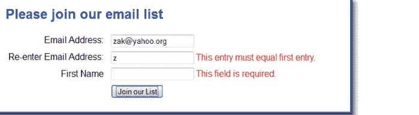

### Firefox 显示 HTML 源代码

```html
<!DOCTYPE html>
<html>
<head>
  <title>Email List</title>
  <link rel="stylesheet" href="email_list.css">
  <script src="http://ajax.googleapis.com/ajax/libs/html5.js"></script>
  <script src="email_list.js"></script>
</head>
<body>
  <section>
    <h1>Join our list</h1>
    <form action="join.list" method="get">
      <label for="emailaddress">Email Address:</label>
      <input type="text" id="emailaddress1" name="address1">
      <span id="email_error1"></span><br>
      <label for="emailaddress2">Re-enter Email Address:</label>
      <input type="text" id="emailaddress2" name="address2">
      <span id="email_error2"></span><br>
      <label for="firstname">First Name:</label>
      <input type="text" id="firstname" name="firstname">
      <span id="first_error"></span><br>
      <label>&nbsp;</label>
      <input type="button" id="join_list" value="Join our List"><br>
    </form>
  </section>
</body>
</html>
```

### 如何查看网页的源代码

- 如果可用，使用命令菜单 查看→源代码或 查看→页面源代码。
- 你也可以在页面上点击右键并选择源代码、查看源代码或查看页面源代码等命令。

## 描述

- 在调试时，你可能想要显示浏览器中的 HTML，仅仅看看发生了什么意外。
- 如果你使用 Firefox，你可以点击链接或脚本元素在另一个窗口中显示 CSS 或 JavaScript 的源代码。
- 注意，对 DOM 的更改不会改变加载到浏览器中的 HTML。它只改变 DOM，从而导致显示发生改变。

图 4-8 如何查看网页的源代码

## 何时以及验证 HTML

当你测试 JavaScript 应用程序时，不仅在测试 JavaScript 代码，还在测试 HTML。因此，如果你怀疑 HTML 可能存在问题，花时间验证 HTML 代码是值得的。要这样做，你可以使用图 4-9 所示的技术。

事实上，我们建议你对应用程序中的所有页面进行 HTML 验证。当然，当你在做练习或为课程开发应用程序时，这不是必要的，但它可能帮助你修复影响 JavaScript 的问题。

# 第 4 章 如何测试和调试 JavaScript 应用程序 137

## W3C 验证器首页

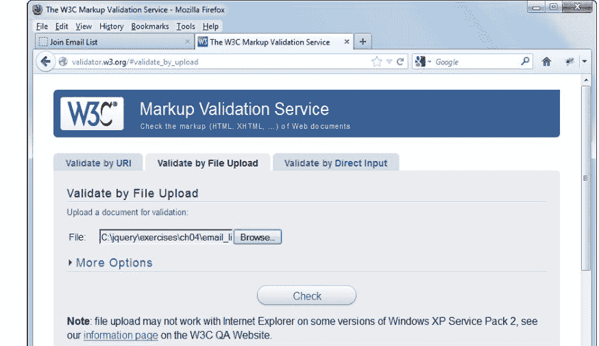

该验证器可检查 HTML、XHTML、SMIL、MathML 等 Web 文档的标记有效性。如果你想验证特定内容（例如 RSS/Atom 馈送或 CSS 样式表）、MobileOK 内容，或者查找其中损坏的链接，还有其他的验证器和工具可用。作为替代方案，你也可以尝试我们的非基于 DTD 的验证器。

## 如何使用 W3C 标记验证服务

- 访问以下 URL，标识要验证的文件，并点击 Check（检查）按钮：`http://validator.w3.org/`

## 如何通过 Aptana 验证 HTML 文件

- 选择文件。然后，选择 Commands（命令）→HTML→Validate Syntax (W3C) 命令。

## 描述

- 有时，页面 HTML 中的错误会影响该页面 JavaScript 的运行。如果可能发生这种情况，验证页面的 HTML 永远无坏。
- 要验证页面的 HTML，你可以使用为此目的设计的程序或网站。最流行的网站之一是 W3C 标记验证服务。
- 当你使用 W3C 标记验证服务时，你验证的文件已经上传到 Web 服务器，你可以通过在 Validate by URI（通过 URI 验证）选项卡中输入其 URL 来验证。如果你想验证尚未上传到服务器的内容，可以在 Validate by File Upload（通过文件上传）选项卡中找到它进行验证。
- 如果你使用 Aptana，可以使用上述命令验证 HTML 文件。但是，你可能会得到略有不同的结果，因为 Aptana 使用 HTML Tidy 验证器，而 W3C 使用它自己的验证器。

图 4-9 如何验证 HTML 文件

© 2012, Mike Murach and Associates, Inc. 许可给 Michael Lotham。

## 观点

许多 JavaScript 应用程序在经过彻底测试和调试之前就投入了生产环境。在 JavaScript 编程的早期，这是可以理解的，因为测试和调试工具非常有限。然而在今天，Firefox 和 Firebug 提供了你需要的所有工具，以便在投入生产环境之前彻底调试应用程序。

## 术语

- 自顶向下的编码和测试
- 缺陷
- 语法错误
- 运行时错误
- 异常
- 逻辑错误
- Firebug
- 断点
- 单步执行代码
- 跟踪
- 验证 HTML

## 总结

- 当你测试应用程序时，你尝试让它失败。当你调试应用程序时，修复你在测试期间发现的所有问题。
- 当你编写 JavaScript 应用程序代码时，你可能会引入三种错误：语法错误、运行时错误和逻辑错误。
- 自顶向下的编码和测试简化了调试，因为你通过一次编码和测试少数语句来构建应用程序。
- Firebug 是一个 Firefox 扩展，提供了一些出色的调试功能。当你使用它的 Console（控制台）面板显示错误消息时，可以点击消息中的链接跳转到 Script（脚本）面板中的错误语句。
- 在 Firefox 的 Script 面板中，你可以设置断点，在应用程序运行时停止代码执行。然后，你可以从断点开始单步执行代码，并查看每一步的变量。
- 尽管现代浏览器提供了像 Firebug 这样的调试工具，但如果你先在 Firefox 上进行测试和调试，就不需要它们了。唯一的例外是 IE，所以你偶尔会使用它的调试工具。
- 跟踪应用程序执行情况的一种简单方法是在 JavaScript 代码的关键点插入 `alert` 语句。在调试应用程序后，你删除这些语句。
- 在你调试应用程序时，你可能偶尔想查看浏览器中的源代码或验证页面的 HTML。

## 练习 4-1 使用 Firebug 的调试功能

在练习中，你将使用 Firebug 寻找语法错误、设置断点并单步执行 Email List 应用程序。

1. 如果你还没有安装，请按照附录 A 所示安装 Firebug。
2. 打开此 Email List 应用程序的 html 文件：`c:\query\exercises\ch04\email_list\index.html`
3. 运行应用程序，仅在前两个文本框中输入有效值，并点击 Join List（加入列表）按钮。这时什么都没有发生。
4. 打开 Firebug 并使用 Console 面板显示导致问题的错误，如图 4-4 所示。（你可能需要先启用面板。）使用错误链接找到并修复代码。然后测试应用程序。
5. 在 Firebug 中，切换到 Script 面板。然后，如有必要，启用面板并使用工具栏中的下拉列表显示 email_list.js 的代码。


## 练习 4-1 使用调试器

6. 在 `joinList` 函数的第一条语句上设置断点，如图 4-5 所示。然后，在仅在前两个文本框中有有效值的情况下，点击 Join List 按钮。应用程序应该停止。

7. 使用 Into（进入）或 F1 单步执行应用程序。在每一步，注意 Watch（监视）面板显示的值。此外，将鼠标悬在 Script 标签中的变量上查看其值。

8. 在执行程序时尝试 Step Over（跳过）和 Step Out（跳出）按钮。完成后删除断点。

## 练习 4-2 使用其他方法

在此练习中，你将使用在本章中学的其他方法。

1. 打开此文件，并注意它包含了跟踪应用程序执行的 `alert` 语句，如图 4-7 所示：`c:\query\exercises\ch04\mpg\index.html`

2. 运行应用程序，注意加载事件处理器程序语句显示的三个对话框。

3. 当应用程序停止时，为文本框输入有效值并点击 Calculate（计算）按钮。点击处理程序的信息让你知道发生了什么。

4. 删除用于跟踪的 `alert` 语句，再次运行应用程序以确保你已删除了所有语句。

5. 使用图 4-8 中的方法之一显示页面源代码。然后，使用图 4-9 中的方法之一验证页面 HTML。


## 如何处理数组

在本章中，你将学习如何使用数组。这是另一项基本的 JavaScript 技能。数组的概念对于 jQuery 用户也很重要，因为 jQuery 经常创建和操作数组。

## 如何创建和使用数组

在后续提示中，你将学习创建和使用数组的基本技能。这些技能之所以重要，不仅是因为数组有很多常见的用途，而且当你在进行 DOM 脚本编写时经常需要使用数组。

## 如何创建数组并引用其元素

数组是一个包含一个或多个称为“元素”的项目的对象。这些元素中的每一个都可以是基元数据类型，也可以是一个对象。例如，你可以在同一个数组中存储数字、字符串和 `Date` 对象。数组的长度（`length`）表示它包含的元素数量。

图 5-1 显示了如何创建一个数组。当你使用第一种方法时，使用 `new` 关键字后跟 `Array` 对象来创建一个数组，其元素数量由 `length` 参数指定。该长度必须是一个大于或等于 0 的整数。如果你不指定长度，则该数组将是空的。

当你使用第二种方法时，只需要编写一组括号 `[]`。这会得到与使用第一种方法且带参数时相同的结果，即一个空数组。

接下来，此图显示了如何在一条语句中创建一个新数组并对其元素赋值。在这种情况下，你在一组用逗号分隔的数值列表中编写值。例如，第一组示例显示了一个创建一个名为 `rates` 的包含四个数值的数组的语句，以及一个创建一个名为 `names` 的包含三个字符串的数组的语句。

注意，当你使用 `new` 关键字创建数组时，它会被视为一个单一数字。否则，数组列表不能是单一数字；数组中元素的值并不在值本身。

要引用数组中的元素，你使用一个从 0 到长度减 1 的索引。例如，在一个包含 12 个元素的数组中，索引值范围从 0 到 11。这就是为什么 `Date` 对象的 `getMonth` 方法将月份数字标记为 0 到 11，而不是 1 到 12。然后，`getMonth` 方法的返回值可以作为月份名称数组的索引。

要使用索引，你需要在数组名称后的方括号 `[]` 中编写它。在此图中，所有示例都使用字面量值作为索引，但索引也可以是包含索引值的变量。如果你尝试访问一个未赋值的元素，将返回 `undefined` 的值。

图中的最后一组示例显示了如何给空数组赋值。要做到这一点，你通过索引引用元素，并为这些元素赋值。

### 创建数组的语法

使用 `new` 关键字配合 `Array` 对象名

```javascript
var arrayName = new Array(length);
```

使用括号字面量

```javascript
var arrayName = [];
```

### 在一条语句中创建数组并赋值的语法

使用 `new` 关键字配合 `Array` 对象名

```javascript
var arrayName = new Array(arrayList);
```

使用括号字面量

```javascript
var arrayName = [arrayList];
```

### 如何在一条语句中创建数组并赋值

```javascript
var rates = new Array(14.95, 12.95, 11.95, 9.95);
var names = ["Sue Jones", "Ray Thomas"];
```

### 引用数组元素的语法

```javascript
arrayName[index];
```

引用数组中元素的代码

```javascript
rates[2] // 引用 rates 数组中的第三个元素
names[1] // 引用 names 数组中的第二个元素
```

### 如何通过访问每个元素为数组赋值

如何给一个以四个 `undefined` 元素开头的数组赋值

```javascript
rates = new Array(4);
rates[0] = 14.95;
rates[1] = 12.95;
rates[2] = 11.95;
rates[3] = 9.95;
```

如何给一个没有元素的数组赋值字符串

```javascript
names = [];
names[0] = "Ted Lewis";
names[1] = "Sue Jones";
names[2] = "Ray Thomas";
```

### 描述

- 数组可以存储零或多个元素。数组的长度是数组中元素的数量。
- 创建数组的一种方法是使用 `new` 关键字和一组包含长度的括号。如果你不指定长度，数组被设为空；数组不包含任何元素。如果你指定了长度，则每个元素被设置为 `undefined`。
- 创建数组的另一种方法是编写一组不带元素列表的括号。要引用数组中的元素，请使用索引，其中 0 是第一个元素，1 是第二个元素，依此类推。

图 5-1 如何创建数组并引用其元素

## 如何添加和删除数组元素

图 5-2 展示了你在处理数组时使用的一个属性和一个运算符。`length` 属性返回数组中的元素数量。`delete` 运算符可以删除数组中元素的值。

要向数组末尾添加元素，你可以使用数组的 `length` 属性作为新元素的索引。由于该属性始终比数组中使用的最高索引大 1（如第一个示例所示），这会将新元素添加到数组的末尾。

要在特定索引处添加元素，你使用该索引引用元素并对其赋值。如果你使用的索引大于等于数组的长度，将返回 `undefined` 的值。

要从数组中删除元素，你使用 `delete` 运算符加上索引。这删除了值但数组的长度保持不变。

| 属性/运算符 | 描述 |
| :--- | :--- |
| `length` | 返回数组中的元素数量。 |
| `delete` | 删除数组中的元素。 |

### 如何向数组末尾添加元素

```javascript
var rates = new Array(14.95, 12.95, 11.95, 9.95);
rates[rates.length] = 8.95;
```

### 如何在特定索引处添加元素

```javascript
var names = ["Ted Lewis", "Sue Jones"];
names[1] = "Ray Thomas";
```

### 如何从数组中删除元素

```javascript
var rates = [14.95, 12.95, 11.95, 9.95];
delete rates[2];
```

### 描述

- 向数组末尾添加元素的方法是使用 `length` 属性作为新元素的索引。
- 在特定索引处添加元素的另一种方法是给该索引赋值。
- 从数组中删除元素，使用带有索引的 `delete`。

## 如何使用循环处理数组

`for` 循环通常通过索引变量一次处理一个数组元素。图 5-3 显示了这是如何工作的。

图中的第一个示例显示了如何创建一个数组并填充 1 到 10 的数字。首先，代码创建一个名为 `numbers` 的空数组。然后，使用名为 `i` 的索引变量通过从 0 到 9 的值遍历前十个元素。在 `for` 循环体内，将值加 1 并结果存储在数组中。结果是，索引 0 的元素存储 1，索引 1 的元素存储 2，依此类推。

第二个示例显示了你如何计算一个总和数组的总和平均值。首先，代码创建一个名为 `totals` 的数组存储四个总和值。接下来，创建一个名为 `sum` 的变量并初始化为 0。然后，使用 `for` 循环访问 `totals` 数组中的每个元素并将其加上 `sum`。这与上一个示例不同，后者没有将数字相加。最后，通过将和除以数组长度来计算平均值。

之后，此示例显示了总和、和和平均值。首先，它创建一个名为 `totalsString` 的空字符串。然后，使用 `for` 循环将每个值和一个换行符连接到 `totalsString`。最后，它显示一个包含 `totalsString`、和和平均值的消息。

### 代码将数字 1 到 10 放入一个数组

```javascript
var numbers = [];
for (var i = 0; i < 10; i++) {
  numbers[i] = i + 1;
}
```

### 代码显示创建的数字数组

```javascript
var numbersString = "";
for (var i = 0; i < numbers.length; i++) {
  numbersString += numbers[i] + " ";
}
alert(numbersString);
```

### 显示的消息

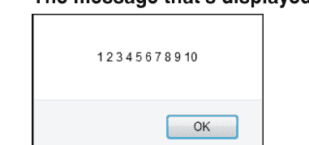

### 代码计算总数数组的和和平均值

```javascript
var totals = [141.95, 212.95, 411, 10.95];
var sum = 0;
for (var i = 0; i < totals.length; i++) {
  sum += totals[i];
}
var average = sum / totals.length;
```

### 代码显示总数数组和平均值

```javascript
var totalsString = "";
for (var i = 0; i < totals.length; i++) {
  totalsString += totals[i] + "\n";
}
alert("The totals are:\n" + totalsString + "\n" +
  "Sum: " + sum.toFixed(2) + " Average: " + average.toFixed(2) + ")");
```

### 显示的消息

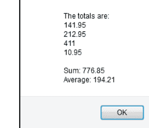

### 描述

- 当你使用循环处理数组时，可以使用循环计数器作为数组的索引。

图 5-3 如何使用循环处理数组

© 2012, Mike Murach and Associates, Inc. Licensed to Michael Hotham.

## 如何在数组中使用 for-in 循环

与 `for` 循环相比，`for-in` 循环使得处理数组变得更加简单。图 5-4 显示了这种循环的工作方式。

正如图中顶部的语法所示，`for-in` 循环不需要像 `for` 循环那样单独的初始化、测试和递增索引计数器的表达式。相反，你声明一个变量将用于引用数组中每个元素的索引。然后，在循环内部，你可以使用该变量来访问数组中的每个元素。

图中的第一个示例将数字 1 到 10 存储在数组中，并创建一个名为 `numbersString` 的空字符串。然后，它使用 `for-in` 循环将数组中的每个数字和空格连接到字符串中。最后，它在消息框中显示这些数字。

第二个示例展示了 `for` 循环和 `for-in` 循环处理数组中未定义（`undefined`）元素的方式。简而言之，`for` 循环会处理未定义元素，而 `for-in` 循环会跳过它们。你可以从此示例中每个循环显示的消息中看到这种差异。

### for-in 循环的语法

```javascript
for (var elementIndex in arrayName) {
  // 访问元素的语句
}
```

### 在消息框中显示数字数组的 for-in 循环

```javascript
var numbers = [1, 2, 3, 4, 5, 6, 7, 8, 9, 10];
var numbersString = "";
for (var index in numbers) {
  // for-in 循环的开始
  numbersString += numbers[index] + " ";
}
alert(numbersString);
```

### 显示的消息

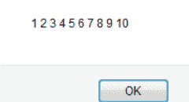

### 显示 for 循环和 for-in 循环差异的代码

```javascript
var names = ["Mike", "Anne", "Ray"]; // 数组为 Mike, Anne, Ray, undefined, Joel
names[4] = "Joel"; // Joel 被添加到数组
names.length = 5; // Joel 被添加到数组
delete names[2]; // Ray 从数组中被删除
```

```javascript
var namesString1 = "The elements displayed by the for-loop:\n";
for (var i = 0; i < names.length; i++) {
  namesString1 += names[i] + "\n"; // 包含未定义元素
}

var namesString2 = "The elements displayed by the for-loop:\n";
for (var i in names) {
  namesString2 += names[i] + "\n"; // 忽略未定义元素
}
```

```javascript
alert(namesString1);
alert(namesString2);
```

### for 循环和 for-in 循环创建的消息

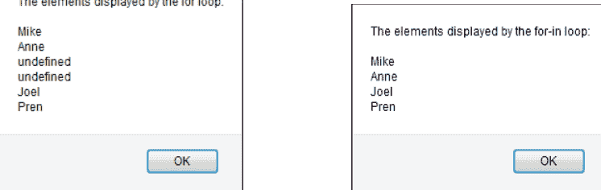

### 描述

- 你可以使用 `for-in` 语句创建一个 `for-in` 循环，该循环仅访问数组中已定义的元素。

图 5-4 如何使用 for-in 循环处理数组

## 数组的四个方法

| 方法 | 描述 |
| :--- | :--- |
| `push(elementslist)` | 将一个或多个元素添加到末尾。 |
| `pop()` | 移除最后一个元素，减少长度并返回被删除的元素。 |
| `unshift(elementslist)` | 将一个或多个元素添加到开头，并返回新长度。 |
| `shift()` | 移除第一个元素，减少长度并返回被删除的元素。 |
| `join(separator)` | 当未传递参数时，该方法将数组中的所有元素转换为字符串并用逗号连接。要更改分隔符，可以向该方法传递字面量。 |
| `toString()` | 等同于无参数的 `join` 方法。 |

### 使用 push 和 pop 方法添加和删除元素

```javascript
var names = ["Mike", "Anne", "Joel"]; // names 为 Mike, Anne, Joel, Ray, Pren
names.push("Ray", "Pren"); // removedName 为 Pren
var removedName = names.pop(); // removedName 为 Ray
alert(names.join("")); // 显示 Mike, Anne, Joel, Ray
```

### 使用 unshift 和 shift 方法添加和删除元素

```javascript
var names = ["Mike", "Anne", "Joel"]; // names 为 Ray, Pren, Mike, Anne, Joel
names.unshift("Ray", "Pren"); // removedName 为 Ray
removedName = names.shift(); // removedName 为 Pren
alert(names.join(", ")); // 显示 Pren, Mike, Anne, Joel
```

### 使用 join 和 toString 方法

```javascript
var names = ["Mike", "Anne", "Joel", "Ray"];
alert(names.join("")); // 显示 Mike, Anne, Joel, Ray
alert(names.join(", ")); // 显示 Mike, Anne, Joel, Ray
alert(names.toString("")); // 显示 Mike, Anne, Joel, Ray
```

## 增强型的邮件列表应用程序

现在，为了向你展示如何在简单应用程序中使用数组，接下来的两幅图展示了你在第 3 章中学习的邮件列表程序的增强版本。

### 用户界面与 HTML

图 5-6 显示了该应用程序的界面。它与之前的版本相似，但多了一个获取州代码的文本框。该字段是必填的，且代码必须是有效的。在这个示例中，由于 `cc` 不是有效的州代码，该文本框右侧会显示一条消息。

在该应用程序的 HTML 中，唯一添加的是高亮的代码。这是用于州代码输入的标签（`label`）、文本框和 `span` 元素的代码。如你所示，文本框的 `id` 为 `"state_code"`，`span` 元素的 `id` 为 `"state_code_error"`。

### 浏览器中的增强型邮件列表

### 页面的 HTML 文件

```html
<body>
<section>
  <h1>Please join our email list</h1>
  <form id="email_form" name="email_form" action="join.html" method="get">
    <label for="email_address1">Email Address:</label>
    <input type="text" id="email_address1" name="email_address1">
    <span id="email_address1_error"></span><br>

    <label for="email_address2">Re-enter Email Address:</label>
    <input type="text" id="email_address2" name="email_address2">
    <span id="email_address2_error"></span><br>

    <label for="first_name">First Name:</label>
    <input type="text" id="first_name" name="first_name">
    <span id="first_name_error"></span><br>

    <label for="state_code">State Code:</label>
    <input type="text" id="state_code" name="state_code">
    <span id="state_code_error"></span><br>

    <label>&nbsp;</label>
    <input type="button" id="join_list" value="Join our List">
  </form>
</section>
</body>
```

### 注意事项

- 这代码与之前的版本相同，除了定义州代码文本框的高亮代码。

图 5-6 增强型邮件列表应用程序的 HTML

### JavaScript 代码

图 5-7 展示了该应用程序的 JavaScript 代码。它与之前的版本代码相似，但增加了用于验证州代码输入的代码。在这种情况下，使用了一个匿名函数来查找用户输入的州代码。该函数紧跟在 `$` 函数之后，并符合“所有函数应出现在调用它们的语句之前”的原则。

如果你查看 `stateLookup` 函数，你会发现它有一个参数，用于接收用户输入的州代码。然后，它的第一个状态创建了一个数组，该数组包含了应用程序有效的州代码。在这里，数组中仅包含了八个代码，但该语句可以包含所有的 50 个代码。

在创建数组后，函数使用 `toUpperCase` 方法将代码转换为大写，以防用户输入的是小写代码。这样，当代码与 `states` 数组中的元素进行比较时，即使用户输入的是小写，两个值也将都会是大写的。

接下来，该函数使用循环将用户的输入与 `states` 数组中的每个元素进行比较。然而，如果用户的输入等于元素之一，函数内部的循环将返回一个值为 `true` 的语句，随后循环和函数结束。否则，如果 `for` 循环在结束时没有经过相等比较，循环后的语句将返回 `false`，函数结束。

现在，查看 `joinList` 函数中用于验证州代码输入的代码。它首先获取用户输入并将其保存到名为 `stateCode` 的变量中。然后，它作为 `if` 语句中的条件传递给变量 `stateLookup` 函数。

```javascript
stateLookup(stateCode)
```

由于该条件以运算符 `!` 开头，意味着如果州代码无效，则该条件为 `true`。结果是 `if` 子句将错误消息放入文本框对应的 `span` 元素中。否则，`else` 子句将 `span` 元素设置为空字符串。

`stateLookup` 函数中的语句可以嵌入到 `joinList` 事件处理器中，而不是作为一个独立的函数处理吗？可以，但将代码放在单独的函数中可以简化事件处理器中的代码，并使应用程序更容易调试。

### 增强型邮件列表应用程序的 JavaScript

```javascript
var $ = function (id) {
  return document.getElementById(id);
}
var stateLookup = function (stateCode) {
  var states = ["CA", "WA", "OR", "NV", "NM", "AZ", "WY", "MT"];
  stateCode = stateCode.toUpperCase();
  for (var i = 0; i < states.length; i++) {
    if (states[i] == stateCode) {
      return true;
    }
  }
  return false;
}
var joinList = function () {
  var emailAddress1 = $("email_address1");
  var emailAddress2 = $("email_address2");
  var firstName = $("first_name");
  var stateCode = $("state_code").value;
  var stateCodeError = $("state_code_error");

  if (!stateLookup(stateCode)) {
    stateCodeError.innerHTML = "Invalid state code";
  } else {
    stateCodeError.innerHTML = "";
  }
}
```

# DOM 脚本属性和方法

在第 3 章中，你学习了如何使用两个属性将消息放入 `span` 元素中进行 DOM 脚本。现在，你将学习其他用于 DOM 脚本的属性和方法。这些属性和方法是由所有当前浏览器实现的 DOM Core 规范定义的。

# DOM 脚本概念

在学习 DOM Core 规范的属性和方法之前，图 6-1 展示了在使用它们之前应该理解的 DOM 脚本概念。首先，正如你在第 3 章中所回忆的，文档对象模型（DOM）是在 HTML 页面加载到浏览器时构建的。它包含了表示页面所有 HTML 元素和属性的节点。此图中的 HTML 和图表说明了这一点。

除了图中用椭圆表示的元素节点外，DOM 还包含了存储 HTML 元素数据的节点。在图中，这些节点是矩形。第一个文本节点包含 head 部分元素的文本：“Join Email List”。紧邻右侧的节点包含 body 部分 `h1` 元素的文本：“Please join our email list”。以此此类推。

为了简单起见，此图只包含了元素节点和文本节点，但 DOM 也包含属性节点，且每个属性节点都有一个存储属性值的文本节点。此外，如果 HTML 包含注释，DOM 也会包含注释节点。

如果你研究图中的表格，你会发现元素节点可以拥有文本和注释节点作为子节点。属性节点和文本节点不能有子节点。奇的是，尽管属性附加在元素节点上，但它并不被视为元素节点的子节点。

用于 DOM 节点的属性和方法是由接口定义的。在接下来的主题中，你将学习如何操作 `Node`、`Document` 和 `Element` 接口的属性和方法。

在使用这些接口时，你会遇到父级（`parent`）、子（`child`）、兄弟（`sibling`）和后代（`descendant`）等术语。这些术语用法与家族树完全相同。例如，在图中 `form` 元素是 `label`、`input` 和 `span` 元素的父元素，而这些元素是 `form` 元素的子。`label`、`input` 和 `span` 元素是具有相同父节点的兄弟（姐妹）。同样，`h1` 和 `form` 元素是 `body` 元素的子，而 `h1`、`form`、`label`、`input` 和 `span` 元素都是 `body` 元素的后代。

你应该也能能够在网页的 HTML 中看到这些关系。例如，在图中 HTML 中，缩进清晰地显示了每个元素的子元素和后代。

### 网页的代码

```html
<!DOCTYPE html>
<html>
<head>
  <title>Join Email List</title>
</head>
<body>
  <h1>Join our email list</h1>
  <form id="email_form" name="email_form" action="join.html" method="get">
    <label for="email_address">Email Address:</label>
    <input type="text" id="email_address">
    <span id="email_error">*</span>span><br>
  </form>
</body>
</html>
```

### 网页的 DOM

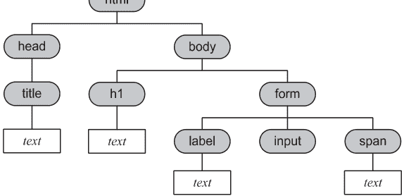

### 你常用的 DOM 节点

| 类型 | 描述 |
|---|---|
| `Document` | DOM 的根节点。它只能有一个 `Element` 节点作为子节点。 |
| `Element` | 网页中的一个元素。它可以拥有 `Element`、`Text` 和 `Comment` 节点作为子节点。 |
| `Attr` | 元素的属性。尽管它附加在 `Element` 节点上，但它不被视为子节点。它可以拥有一个 `Text` 节点作为子节点。 |
| `Text` | 元素或属性的文本。它不能有子节点。 |

### 描述

- DOM（文档模型）是浏览器内存中一个层次化的节点集合，代表当前网页。
- 网页的 DOM 是随着浏览器加载页面而构建的。
- JavaScript 可以通过修改 DOM 来修改浏览器中的 DOM。每当 DOM 发生变化时，浏览器就会显示更改的结果。
- 要修改 DOM，可以使用 DOM Core 规范定义的属性和方法。

图 6-1 DOM 脚本概念

# Node 接口

图 6-2 描述了你可以用于操作节点的六个属性。这些属性由 `Node` 接口定义。图中的所有示例都假设使用了通过 id 获取元素的标准 `$` 方法。

第一个示例展示了如何使用 `firstChild` 和 `nodeValue` 属性来获取 HTML 元素的文本。在这种情况下，如果该语句在节点更改之前执行，则该语句将在名为 `errorText` 的变量中存储一个星号（*）。这是因为该节点是由 HTML 设置为星号的。

如果你参考前一个图中的图表，你会发现需要 `firstChild` 属性来获取 `span` 元素的文本节点。然后通过 `nodeValue` 属性从文本节点获取文本。

第二个示例展示了如何使用 `firstChild` 和 `nodeValue` 属性将文本放入 HTML 元素的文本节点中。这就是邮件列表应用程序将错误信息放在文本框后续 `span` 元素中的方法。

第三个示例展示了如何使用 id 为 “email_address” 的 `input` 元素的三个属性，将其紧随其后的 `span` 元素的文本设置为空字符串。首先，`nextElementSibling` 属性获取作为 `input` 元素相邻兄弟的 `span` 元素。然后通过 `firstChild` 和 `nodeValue` 属性获取文本。

### Node 接口的某些属性

| 属性 | 描述 |
|---|---|
| `nodeValue` | 对于文本、注释或属性节点，此属性返回存储在节点中的文本。否则，返回 `null` 值。 |
| `parentNode` | 如果存在，则返回当前节点的父节点。否则，此属性返回 `null` 值。 |
| `childNodes` | 返回一个表示当前节点子节点的 `Node` 对象数组。 |
| `firstChild` | 返回第一个子节点的 `Node` 对象。如果该节点没有子节点，则此属性返回 `null` 值。 |
| `lastChild` | 返回最后一个子节点的 `Node` 对象。如果该节点没有子节点，则此属性返回 `null` 值。 |
| `nextElementSibling` | 返回相邻兄弟的 `Node` 对象。如果该节点没有兄弟，则此属性返回 `null` 值。 |

### 描述

- 接口描述对象的属性和方法。
- 在进行 DOM 脚本时，你会打开 `Node` 接口的属性。最实用的属性总结在上面的表格中。
- 在示例中，`$` 符号调用标准函数，该函数使用 `getById` 方法获取传递 id 对应的元素。

## Document 和 Element 接口的常用方法

### Document 和 Element 接口的常用方法

| 方法 | 说明 |
| :--- | :--- |
| `getElementsByTagName(tagName)` | 返回一个包含文档或元素后代中所有与指定标签名匹配的元素的数组。 |
| `getElementsByName(name)` | 返回一个包含文档或元素后代中所有与指定名称匹配的元素的数组。 |
| `getElementsByClassName(className)` | 返回一个包含文档或元素后代中所有具有与参数匹配的类名属性的元素的数组。`classNames` 参数可以是单个名称，也可以是由空格分隔的类名列表。 |

### Element 接口的常用方法

| 方法 | 说明 |
| :--- | :--- |
| `hasAttribute(name)` | 如果 `Element` 具有指定的名称，则返回 `true`。 |
| `getAttribute(name)` | 返回 `name` 中指定的属性的值，如果如果没有设置该名称的属性，则返回空字符串。 |
| `setAttribute(name, value)` | 将指定的属性设置为指定的值。如果该属性不存在，则创建该属性。 |
| `removeAttribute(name)` | 移除指定的属性。 |

### 如何在文档中创建 a 标签数组

```javascript
var links = document.getElementsByTagName("a");
```

### 如何在一个元素内创建 li 标签数组 (image_list)

```javascript
var list = document.getElementById("image_list");
var items = list.getElementsByTagName("li");
```

### 如何测试并获取属性

```javascript
var list = document.getElementById("image_list");
if (list.hasAttribute("class")) {
  var class = list.getAttribute("class");
```

### 如何设置属性

```javascript
var image = document.getElementById("div");
image.setAttribute("class", "open");
```

### 如何移除属性

```javascript
var list = document.getElementById("image_list");
list.removeAttribute("class");
```

### 描述

- `Document` 和 `Element` 接口的方法允许你获取元素数组。
- `Element` 接口的方法允许你处理属性。

图 6-3 Document 和 Element 接口的方法

## FAQs 应用

现在，你将看到 `Node`、`Document` 和 `Element` 接口的属性和方法是如何在一个典型的 DOM 脚本应用中使用的。我们将其称为 FAQs（常见问题解答）应用。

### 用户界面、HTML 和 CSS

图 6-4 展示了 FAQs 应用的用户界面。如果用户点击带有加号的标题，其下方的文本将显示，且加号将变为减号。同样，如果用户点击带有减号的标题，其下方的文本将被隐藏，且减号将变为加号。

在 HTML 中，你可以看到每个问题都编码在 `h2` 元素中，紧随其后的是一个包含答案的 `div` 元素。注意，这些 `h2` 元素都有一个名为 `"plus"` 的类属性，而每个 `div` 元素都有一个名为 `"closed"` 的类。当用户点击标题时，这些类通过 DOM 脚本进行更改。

在 CSS 中，你可以看到 `plus` 类的 `h2` 元素具有背景属性包含一个名为 `plus.png` 的图像。该图像仅在元素左侧显示一次（不重复），并垂直居中。同样，`minus` 类的 `h2` 元素具有一个使用名为 `minus.png` 图像的背景属性。

你还可以看到，`closed` 类的 `div` 元素具有一个隐藏它们的 `display` 属性。但 `open` 类的 `div` 元素具有一个将其作为块级元素显示的 `display` 属性。

由于 HTML 将 `h2` 元素的初始类设置为 `"plus"`，将 `div` 元素的类设置为 `"closed"`，因此用户界面在开始时标题显示加号且 `div` 元素处于关闭状态。现在，所有的 JavaScript 代码在用户每次点击标题时必须反转这些类。

### 第 6 章 使用 JavaScript 编写 DOM 165

### 浏览器中的 FAQs 应用

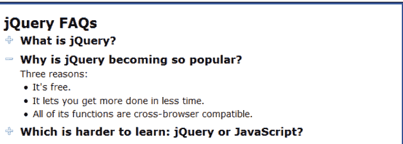

### HTML

```html
<section id="faqs">
<h1>jQuery FAQs</h1>
<h2 class="plus">什么是 jQuery?</h2>
<div class="closed">
  <p>jQuery 是一个 JavaScript 函数库，你在开发网站时 
  可能需要它。</p>
</div>
<h2 class="plus">为什么 jQuery 变得如此流行？?</h2>
<div class="closed">
  <p>三个原因：</p>
  <ul>
    <li>它是免费的。</li>
    <li>它让你用更短的时间完成更多工作。</li>
    <li>它所有的函数都跨浏览器兼容。</li>
  </ul>
</div>
<h2 class="plus">jQuery 或 JavaScript 哪一个更难学？</h2>
<div class="closed">
  <p>对于大多数函数，jQuery 学习起来比 JavaScript 
  容易得多。但请记住：jQuery 就是 JavaScript。</p>
</div>
</section>
```

### CSS

```css
h2 {
  padding: .25em 0 .25em 25px;
  cursor: pointer;
}
h2.plus {
  background: url(images/plus.png) no-repeat left center;
}
h2.minus {
  background: url(images/minus.png) no-repeat left center;
}
div.closed {
  display: none;
}
div.open {
  display: block;
}
```

图 6-4 FAQs 应用的 HTML 和 CSS

### JavaScript

图 6-5 显示了该应用的 JavaScript。在这里，`onload` 函数的处理程序为每个 `h2` 元素创建并绑定处理程序。为了实现这一点，第一个语句获取 ID 为 `"faqs"` 的元素对象。第二个语句使用 `getElementsByTagName` 获取该元素内的 `h2` 元素数组。该数组存储在名为 `h2Elements` 的变量中。

随其后的是一个创建并绑定 `h2` 元素处理程序的语句。它的循环为 `h2Elements` 数组中的每个元素执行。

### 应用的 JavaScript

```javascript
var $ = function (id) {
  return document.getElementById(id);
}
window.onload = function () {
  var faqs = $("faqs");
  var h2Elements = faqs.getElementsByTagName("h2");

  var h2Node;
  for (var i = 0; i < h2Elements.length; i++) {
    h2Node = h2Elements[i];

    // 附加处理程序
    h2Node.onclick = function () {
      var h2 = this; // h2 是当前的 h2 对象

      if (h2.getAttribute("class") == "plus") {
        h2.setAttribute("class", "minus");
      } else {
        h2.setAttribute("class", "plus");
      }
      if (h2.nextElementSibling.getAttribute("class") == "closed") {
        h2.nextElementSibling.setAttribute("class", "open");
      } else {
        h2.nextElementSibling.setAttribute("class", "closed");
      }
    };
  }
};
```

### 注意事项

- `onload` 事件处理程序中的两个语句为 ID 为 `"faqs"` 的元素创建了 `h2` 元素数组。
- 循环为每个 `h2` 元素执行一次。它为每个 `h2` 元素的 `onclick` 事件附加处理程序。
- 在为每个 `h2` 元素附加处理程序的代码中，`this` 关键字指向当前的 `h2` 元素。因此，后续语句适用于循环正在处理的那个 `h2` 元素。这对于该程序的运行至关重要。


## FAQs 应用的另一种编码方式

在开发 JavaScript 应用程序时，你的首要目标是让它正确运行。完成之后，值得花时间审查代码，看看是否可以进行改进。在许多情况下，你会发现代码可以被简化或改进，使其更易维护、增强和复用。

改进 FAQs 应用代码的一种方法是消除在 HTML 中编写初始类属性（`class` attributes）的需要。这将简化 HTML，使应用程序更容易复用，同时也会简化 JavaScript 代码。

图 6-6 演示了这一点。在这里，HTML 中的 `h2` 和 `div` 元素被移除了 `class` 属性。然后，修改了 CSS，使得 `h2` 元素背景以加号作为开头，而当 `div` 元素具有“minus”类属性时显示为减号，而当它具有“open”类属性时显示 `div` 元素。

这种方法之所以有效，是因为 `h2.minus` 和 `div.open` 选择器比 `h2` 和 `div` 选择器更具体，它们的规则会覆盖 `h2` 和 `div` 元素的规则。现在，JavaScript 只需要在点击标题时添加或移除类即可。

你可以在 JavaScript 中看到其原理：如果 `h2` 元素具有 `class` 属性，则移除该属性；否则，通过 `setAttribute` 方法添加该属性并设置为“minus”。如果 `div` 元素具有 `class` 属性，则移除该属性；否则，添加值为“open”。

这是编写此应用程序的更好方式吗？毫无疑问。

### HTML

```html
<section id="faqs">
  <h1>Query FAQs</h1>
  <h2>What is jQuery?</h2>
  <div>
    // contents
  </div>
  <h2>Why is jQuery becoming so popular?</h2>
  <div>
    // contents
  </div>
  <h2>Which is harder to learn: jQuery or JavaScript?</h2>
  <div>
    // contents
  </div>
</section>
```

### CSS

```css
h2 {
  padding: .25em 0 .25px;
  cursor: pointer;
  background: url(images/plus.png) no-repeat left center;
}
h2.minus {
  background: url(images/minus.png) no-repeat left center;
}
div {
  display: none;
}
div.open {
  display: inline;
}
```

### 用于绑定事件处理器的 JavaScript

```javascript
// 绑定事件处理器
h2Node.onclick = function () {
  var h2 = this;
  // h2 是当前的 h2Node 对象
  if (h2.getAttribute("class")) {
    h2.removeAttribute("class");
  } else {
    h2.setAttribute("class", "minus");
  }
  if (h2.nextElementSibling.hasAttribute("class")) {
    h2.nextElementSibling.removeAttribute("class");
  } else {
    h2.nextElementSibling.setAttribute("class", "open");
  }
}
```

### Description

- 在让应用程序正常运行后，询问代码是否可以通过改进来更易于维护和复用，总是好的。
- 当 FAQs 应用如图中所示进行编码时，你不需要为 HTML 中的 `h2` 和 `div` 元素设置类属性，这使得该代码在网页中更易复用。

图 6-6 FAQs 应用的另一种编码方式

## JavaScript 应用程序的两个关键问题

在第 1 章中，你接触了跨浏览器兼容性问题。现在，图 6-7 展示了另外两个问题。在本书中，当我们引入新应用时，会回到这些问题。

### 易用性

易用性指的是使用网站的易易程度，它是网站用户最想要的东西。他们希望尽可能快速快捷地找到正在寻找的内容。一旦找到，他们希望尽可能快速快捷地提取信息或完成任务。

尽管网站的易用性包含许多组成部分，但最重要的部分与导航有关。简而言之，导航应该是显而易见的。例如，带下划线的文本应该是用户可以点击的链接，按钮应该始终是可以点击的。用户不应该猜测哪些是可点击的，以及点击后将带他们哪里。

如果你观察图中的 FAQs 应用，你会发现导航非常好。在这里，可点击的标题前面都有加号或减号，这是指示可点击项的常用约定。此外，当鼠标指针悬停在标题上时，CSS 将指针变为手型，这让用户知道该项目是可点击的。

这已经很好了，但你可以通过在鼠标悬停时高亮标题来改进这一点。这样用户就能确定标题是可点击的了。如果标题在获得焦点时也高亮显示会更好，但标题是无法接收焦点的。

### 无障碍性

无障碍性是指使网站能够被尽可能多的用户（尤其是残障用户）访问的特性。例如，视觉障碍用户可能无法阅读图像中的文本，因此你需要为他们提供其他替代方案。同样，运动功能障碍的用户可能无法使用鼠标，因此也需要为他们提供其他替代方案。

### 第 6 章 如何使用 JavaScript 编写 DOM 173

### 改进了可访问性的常见问题

| jQuery 常见问题 |
| :--- | :--- |
| 什么是 jQuery? | jQuery 是一个包含了你在开发网站时最可能需要的 JavaScript 函数库。 |
| 为什么 jQuery 越来越流行？ | |
| 哪个更难学：jQuery 还是 JavaScript？ | |

### HTML

```html
<section id="faqs">
  <h1>jQuery FAQs</h1>
  <h2><a href="#" id="first_link">什么是 jQuery?</a></h2>
  <div>
    ...
  </div>
  <h2><a href="#">为什么 jQuery 越来越流行？</a></h2>
  <div>
    ...
  </div>
  <h2><a href="#">哪个更难学：jQuery 还是 JavaScript?</a></h2>
  <div>
  </div>
</section>
```

### CSS

```css
a {
  color: black;
  text-decoration: none;
}
a:focus, a:hover { color: blue; }
```

### JavaScript

```javascript
window.onload = function () {
  var faqs = $("#faqs");
  var h2Elements = faqs.getElementsByTagName("h2");
  var h2Node;
  for (var i = 0; i < h2Elements.length; i++) {
    h2Node = h2Elements[i];
    // 绑定事件处理器
    h2Node.onclick = function () {
      var h2 = this; // h2 是当前的 hNode 对象
      // 与之前的操作相同
    };
  }
  $("#first_link").focus(); // 将焦点移动到第一个链接
}
```

图 6-8 改进了可访问性的常见问题应用

2012, Mike Murach and Associates, Inc. 授权给 Michael Hotham。

## 链接和图片的 DOM 脚本技能

接下来，你将学习两种用于链接和图片的 DOM 脚本技能。

## 如何取消通用事件的默认行为

图 6-9 所示表格展示了 HTML 元素点击事件的一些常见默认行为。例如，点击链接的默认行为是加载页面或跳转到链接 `href` 属性指定的占位符。同样，点击提交（`submit`）或重置（`reset`）按钮的默认行为是提交或重置表单中的数据。

然而，对于某些应用程序，你不希望发生默认行为。这时，你需要取消这些操作。遗憾的是，这引入了浏览器兼容性问题，因为旧版本的 IE 工作方式与 Firefox、Safari、Opera 和 Chrome 等符合 DOM 标准的浏览器不同。

图中第一个示例显示了在符合 DOM 标准的浏览器中取消默认行为有多简单。在这些浏览器中，每当事件发生时，都会创建一个事件对象，该对象会被传递给处理器。该对象包含了有关事件的信息，并提供了一个让你控制事件行为的方法。

要访问该对象，你需要在事件处理器的函数中编写一个参数，如第一个示例所示。在这种情况下，`ev` 被用作参数名，当调用处理器时它会接收事件对象。然后，为了取消默认行为，你使用代表参数的事件对象的 `preventDefault` 方法。

但是，对于旧版本的 IE，你需要使用第二个示例中的代码。要获取事件对象，你使用 `window.event` 属性，而不是通过参数获取对象。然后，将事件对象的 `returnValue` 属性设置为 `false`，以防止默认行为发生。

为了使应用程序兼容这两种类型的浏览器，你将两种技术结合起来，如第三个示例所示。在这里，函数有一个参数，将在符合 DOM 标准的浏览器中接收事件对象。然后，如果函数中的语句测试它是否为 `undefined`。如果浏览器是 IE，那么这段代码将 `window.event` 属性中的事件对象赋值给 `ev` 参数。否则，浏览器是符合 DOM 标准的，已经包含了事件对象。

然后，第二个测试检查 `ev` 参数以检查它是否提供了 `preventDefault` 方法。如果没有，这段代码将 `returnValue` 属性设置为 `false`。

从实际应用角度来看，你只需要将此代码复制并粘贴到任何需要取消默认行为的事件处理器中。你将在后续应用中看到这些说明。

### 点击事件的常见默认行为

| 标签 | 点击事件的默认行为 |
| :--- | :--- |
| `a` | 加载页面或跳转到 `href` 属性中的占位符。 |
| `input` | 如果 `type` 属性设置为 `submit`，则提交表单。 |
| `input` | 如果 `type` 属性设置为 `reset`，则重置表单。 |
| `button` | 如果 `type` 属性设置为 `submit`，则提交表单。 |
| `button` | 如果 `type` 属性设置为 `reset`，则重置表单。 |

### 取消默认行为的 DOM 标准代码

```javascript
var eventHandler = function (evt) {
  evt.preventDefault();
}
```

### 取消默认行为的 IE 代码

```javascript
var eventHandler = function () {
  var evt = window.event;
  evt.returnValue = false;
}
```

### 取消默认行为的浏览器兼容代码

```javascript
var eventHandler = function (evt) {
  // 如果没有发送事件对象，则获取它
  if (!evt) { evt = window.event; } // 用于 IE

  // 取消默认行为
  if (evt.preventDefault) {
    evt.preventDefault(); // 用于绝大多数浏览器
  } else {
    evt.returnValue = false; // 用于 IE
  }
}
```

### 描述

- 如果没有发送事件对象，则获取它
- 取消默认行为

图 6-9 如何取消通用事件的默认行为

## 如何预加载图片

在 DOM 脚本应用程序中，在 JavaScript 更改属性之前，图片不会被下载。对于大图片或慢连接，这会导致延迟。为了解决这个问题，你的应用程序可以在用户之前下载图片。这被称为预加载。

图 6-10 显示了如何预加载图片。首先，你使用 `new` 关键字创建一个 `Image` 对象并将其存储在变量中。然后，将 `src` 属性设置为要预加载的图片的 URL。

图中示例展示了如何预加载页面上的图片。这假设每个链接的 `href` 属性包含图片的位置。首先，使用 `getElementsByTagName` 方法获取所有链接，并将数组存储在变量中。然后，使用 `for` 循环处理每个链接。

在循环内部，第一个语句创建当前链接到 `link` 变量，第二个语句创建一个 `Image` 对象。然后，第三条语句将 `Image` 对象的 `src` 属性设置为链接的 `href` 属性。这会预加载图片。因此，循环结束后图片都会预加载。

### 如何创建并预加载 Image 对象

#### 如何创建 Image 对象

```javascript
var image = new Image();
```

#### 在 Image 对象中预加载图片

```javascript
image.src = "image_name.jpg";
```

#### 预加载由 a 标签 href 属性引用的图片

```javascript
var links = document.getElementsByTagName("a");
var i, link, image;
for ( i = 0; i < links.length; i++) {
  link = links[i];
  image = new Image();
  image.src = link.href;
}
```

### 描述

- 当应用程序预加载图片时，会在页面加载时加载所有需要的图片，并将这些图片存储在浏览器的缓存中供以后使用。
- 如果图片没有预加载，则它们将在需要时从服务器获取。在某些情况下，这会导致明显的延迟。

## 图像切换应用

图 6-11 展示了一个图像切换应用，这是一种常见的 JavaScript 应用程序。在这里，每当用户点击其中一张小图（缩略图）时，主图像就会进行切换。在这个示例中，用户点击了第六张缩略图，因此显示了图像较大的版本。在此应用程序中，大图像上方的标题作为图像切换的一部分也会被更改，这在所有图像切换中并不是都会做的。

### HTML 和 CSS

在此应用的 HTML 中，使用 `` 元素来显示六张缩略图。然而，这些元素被编码在 `<a>` 元素内部，使得图像是可以点击的，并且可以接收焦点。在 `<a>` 元素中，`href` 属性标识了点击链接时要切换的图像，而 `title` 属性则为相关标题提供了文本。在这种情况下，`<a>` 元素和 `` 元素都被编码在一个 `<ul>` 元素中。

在 `<ul>` 元素之后，你可以看到页面上用于标题的 `<h2>` 元素和用于显示主图像的 `` 元素。`<h2>` 元素的内容提供了第一张图像的位置，而 `` 元素的 `src` 属性提供了第一张图像的位置。这样，当应用程序首次启动时，就会显示第一个标题和图像。

JavaScript 使用的三个 `id` 在此处被突出显示。首先，第一个 `<a>` 元素的 `id` 被设置为 `"first_link"`，这样 JavaScript 就可以为该链接设置焦点。其次，`<h2>` 元素的 `id` 设置为 `"caption"`，主 `` 元素的 `id` 设置为 `"image"`，这样 JavaScript 就可以更改图像。

对于肢体障碍的人士，此 HTML 通过在 `<a>` 元素内为缩略图编码 `` 提供了可访问性。这样，用户可以通过点击 Tab 键来访问缩略图链接，当缩略图获得焦点时，用户可以通过按 Enter 键来切换图像，从而触发 `onclick` 事件处理程序。

此页面 CSS 中注意的是为 `<li>` 元素的规则设置。如图所示，它们的 `display` 属性被设置为从左到右显示缩略图，而不是从上到下。此外，每个项目右侧的 `padding`（内边距）被设置为 10 像素，以便在缩略图之间留出空间。

### 图像切换应用的用户界面

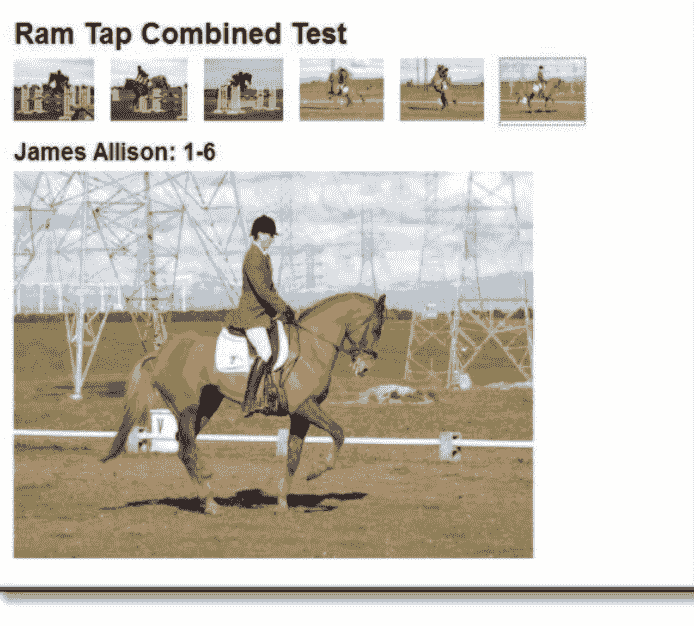

### HTML

```html
<section>
  <h1>Ram Tap 组合测试</h1>
  <ul id="image_list">
    <li><a href="images/t1.jpg" title="James Allison: 1-1">
      
    </li>
    <li><a href="images/t2.jpg" title="James Allison: 1-2">
      
    </li>
    <li><a href="images/t3.jpg" title="James Allison: 1-3">
      
    </li>
    <li><a href="images/t4.jpg" title="James Allison: 1-4">
      
    </li>
    <li><a href="images/t5.jpg" title="James Allison: 1-5">
      
    </li>
    <li><a href="images/t6.jpg" title="James Allison: 1-6">
      
    </li>
  </ul>
  <h2 id="caption">James Allison 1-1</h2>
  <p></p>
</section>
```

### li 元素的 CSS

```css
li {
  padding-right: 10px;
  display: inline;
}
```

图 6-11 图像切换应用的用户界面、HTML 和 CSS

### JavaScript

图 6-12 展示了此应用的 JavaScript。在 `onload` 事件处理程序中，前三个语句获取了 `<ul>` 元素 (`image_list`)、用于标题的 `<h2>` 元素以及显示切换的 `` 元素。这些对象用于图像列表中的 `<a>` 元素，并将其保存在名为 `imageLinks` 的变量中。然后，第四条语句创建了 DOM 中的节点数组。代码处理数组中的每个链接。

在针对每个元素的循环中，为每个链接的点击 (`click`) 事件创建了一个事件处理程序。注意，创建每个事件处理程序的函数有一个 `evt` 参数，在符合 DOM 标准的浏览器中，它将接收每个链接的事件对象。同样注意，该函数的第一条语句使用了 `this` 关键字，因此每个链接应用了不同的事件处理程序。

之后，第一条语句更改了图像节点中 `src` 属性，为标题的 `href` 属性。然后，下一语句将标题节点的第一个子元素的值更改为链接的 `title` 属性。稍后当应用程序运行且用户点击缩略图时，这些语句将更改 DOM，使得图像和标题在显示中立即更改。

此事件处理程序最后通过图 6-9 中的代码取消链接事件的默认操作。

### 图像切换应用的 JavaScript

```javascript
var $ = function (id) {
  return document.getElementById(id);
}
window.onload = function () {
  var listNode = $("#image_list");
  var captionNode = $("#caption");
  var imageNode = $("#image");

  var imageLinks = listNode.getElementsByTagName("a");

  var i, linkNode;
  for (i = 0; i < imageLinks.length; i++) {
    linkNode = imageLinks[i];
    linkNode.onclick = function (evt) {
      var link = this;
      imageNode.src = link.getAttribute("href");
      captionNode.firstChild.nodeValue = link.getAttribute("title");

      // 取消默认行为
      if (!evt) { evt = window.event; }
      if (evt.preventDefault) {
        evt.preventDefault();
      } else {
        evt.returnValue = false;
      }
    };
  }
  $("#first_link").focus();
}
```

### 描述

- `onload` 事件处理程序获取 `ul`、`h2` 和 `img` 元素。
- 循环为每个 `a` 元素创建一个 `onclick` 事件处理程序。
- 事件处理程序使用 `this` 关键字引用当前链接。
- 代码更改 `img` 的 `src` 和 `h2` 的文本节点值。
- 代码取消链接的默认行为。

图 6-12 图像切换应用的 JavaScript

## 调用一次函数的定时器的两种工作方法

```javascript
setTimeout( function, delayTime ) // 创建一个定时器
clearTimeout( timer ) // 取消定时器
```

## 第一个标题在 5 秒后隐藏的 FAQs 应用


### 标题的 HTML

```html
<h1 id="startup_message">建设中！</h1>
```

### 当类属性为 "closed" 时，标题的 CSS

```css
#startup_message.closed { display: none; }
```

### 如何使用一次性定时器来隐藏第一个标题

```javascript
// 声明一个全局变量以便函数访问
var timer; // 声明定时器变量
```

```javascript
// 创建一个一次调用 hideMessage 函数的定时器
window.onload = function () {
  timer = setTimeout(hideMessage, 5000);
}
// 创建定时器调用的
// 当类属性设置为 closed 时，css 会隐藏该元素
var hideMessage = function () {
  $("#startup_message").setAttribute("class", "closed");
  clearTimeout(timer);
}
```

### 如何将函数嵌入 setTimeout 的第一个参数中

```javascript
window.onload = function () {
  var timer = setTimeout(function () { // 第一个参数开始
    $("#startup_message").setAttribute("class", "closed");
    clearTimeout(timer);
  }, 5000); // 第二个参数
}
```

### 描述

- `setTimeout` 方法创建一个定时器，在指定的毫秒延迟后调用指定的函数。该方法返回新定时器的引用，可用于取消定时器。
- `clearTimeout` 方法取消使用 `setTimeout` 方法创建的定时器。
- 当你嵌入函数时，可以避免使用全局变量的需求。


## 如何使用间隔定时器

第二种定时器会重复调用其函数。要创建此类类型的定时器，你使用图 6-14 所示的全局 `setInterval` 方法。它的第一个参数是要调用的函数。它的第二个参数是定时器调用之间的间隔。要取消此定时器，请将定时器传递给 `clearInterval` 方法。

图中的示例显示了如何使用间隔定时器创建一个每秒递增一次的计数器。该定时器被编写在 `onload` 事件处理程序中。

在创建定时器之前，声明了一个初始值为 0 的计数器变量。然后，使用 `setInterval` 方法创建一个定时器。在这里，第一个参数是更新计数器变量并在网页上显示更新后的计数器值的函数。第二个参数将间隔设置为 1000 毫秒，因此网页每秒更新一次。

当你使用 `setInterval` 方法创建定时器时，定时器会等待指定的间隔过去后才第一次调用函数。因此，如果你想让函数立即被调用，你需要在创建定时器之前调用该函数。

一旦你创建了间隔定时器，就无法修改它。但是，你可以取消旧的定时器并创建一个按你想要的方式运行的新定时器。这与修改原始定时器的效果相同。

### 重复调用函数的定时器的两种工作方法

```javascript
setInterval( function, intervalTime )   // 创建一个定时器
clearInterval( timer )               // 取消定时器
```

### 底部带有计数器的 FAQs 应用

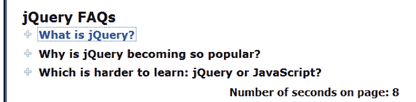

### 计数器的 HTML

```html
<h3>页面上的秒数：<span id="counter">0</span></h3>
```

### 更新计数器的间隔定时器的 JavaScript.onload

```javascript
window.onload = function () {
  // 创建一个每秒调用一次 updateCounter 函数的定时器
  var counter = 0;
  var timer = setInterval(
    function () {                   // 第一个参数开始
      counter++;
      document.getElementById("counter").firstChild.nodeValue = counter;
    },
    1000 );                         // 第二个参数
}
```

### 描述

- `setInterval` 方法创建一个定时器，每当指定的毫秒间隔通过调用一次函数。
- `setInterval` 方法返回新定时器的引用，可供 `clearInterval` 方法用于取消定时器。
- 虽然你不能修改间隔定时器，但你可以取消它并创建一个按你想要的方式运行的新定时器。

## 幻灯片应用

图 6-15 描述了一个需要使用间隔定时器的幻灯片应用。当用户启动此应用时，它每两秒显示一个新的标题和图片。

### HTML 和 CSS

如果你查看 HTML，你会发现五个 `<a>` 元素被编写在一个 `<ul>` 元素中。每个 `<a>` 元素的 `href` 属性提供了幻灯片中一张图片的位置。`title` 属性提供了幻灯片的标题。

在无序列表之后，`<h2>` 元素是显示每个幻灯片标题的元素。它的内容提供了每个幻灯片的标题。

### 用于幻灯片应用的 JavaScript

```javascript
var $ = function (id) {
  return document.getElementById(id);
}
window.onload = function () {
  var listNode = $("#image_list"); // ul元素
  var captionNode = $("#caption"); // 用于标题的 h2 元素
  var imageNode = $("#image"); // 用于幻灯片的 img 元素

  var links = listNode.getElementsByTagName("a");

  // 处理图片链接
  var i, linkNode, image;
  var imageCache = [];
  for (i = 0; i < links.length; i++) {
    linkNode = links[i];
    // 预加载图片并复制标题属性
    image = new Image();
    image.src = linkNode.getAttribute("href");
    image.title = linkNode.getAttribute("title");
    imageCache.push(image);
  }

  // 开始幻灯片
  var imageCounter = 0;
  var timer = setInterval(
    function () {
      imageCounter = (imageCounter + 1) % imageCache.length;
      image = imageCache[imageCounter];
      imageNode.src = image.src;
      captionNode.firstChild.nodeValue = image.title;
    },
  2000);
}
```

## 观点

现在你已经完成了这一章，你应该知道如何使用 JavaScript 进行常见的 DOM 脚本应用，如图片切换和幻灯片。其中某些内容可能让你感到困惑，这是因为这些复杂且困难。

好消息是，jQuery 让开发像你刚刚看到的这类 DOM 脚本应用变得简单得多。更棒，你现在已经拥有使用 jQuery 所需的所有 JavaScript 技能，这些技能将让你学习 jQuery 变得更加容易。

## 术语

- DOM（文档对象模型）
- DOM 节点
- 元素节点
- 文本节点
- 属性节点
- 注释节点
- DOM 核心规范
- 接口
- 可用性
- 可访问性
- 默认行为
- 图片切换
- 计时器

## 总结

- 文档对象模型（简称 DOM）在页面加载到浏览器时构建。它由各种节点组成。
- 在 DOM 中，元素节点代表 HTML 文档中的元素，文本节点代表这些元素中的文本。DOM 还可以包含带有文本节点的属性（用于存储属性）以及注释节点。
- JavaScript 为 DOM 核心规范中描述的 DOM 对象提供了属性和方法。这些包括 `Node`、`Document` 和 `Element` 接口描述的属性和方法。
- 可用性（Usability）指的是网页的易用程度。可访问性（Accessibility）指的是网页对于用户（尤其是残障用户）的程度。
- 对于某些 JavaScript 应用，你可能会取消事件的默认行为，例如点击链接或按钮。
- 对于图片切换和幻灯片应用，预加载图片是有益的。这样，页面加载时间可能会更长，但变化将立即发生。
- 浏览器提供了两种类型的计时器。一次性计时器在指定的时间间隔后执行一次函数。间隔计时器在每次指定的间隔通过时执行一次。

## 练习 6-1 实验 FAQs 应用

在本书的第 2 部分，你将学习如何使用 jQuery 编写 DOM 脚本。由于使用 jQuery 进行 DOM 脚本更简单，你现在不需要练习 JavaScript 的 DOM 脚本。但是，你应该理解本章中 JavaScript 应用是如何工作的。为了帮助你理解，你可以开始尝试 Faqs 应用。

1. 使用你的编辑器或 IDE 打开此文件夹中的 `index.html` 和 `faqs.js` 文件：
2. 测试应用查看其如何工作，并检查代码。
3. 注释掉 `headingNode.onclick` 函数中的第一个语句，如下：
   `var h2 = this;`
   然后，紧随其后添加此语句：
   `var h2 = headingNode;`
4. 测试程序并注意所有三个标题都关联了相同的事件处理程序。结果，点击任何一个标题只会影响第三个标题及其 div 元素。这证明了使用 `this` 关键字来引用标题节点当前实例的重要性。
5. 撤销你在第 3 步中做的更改并再次测试。然后，对你不完全理解的任何代码进行尝试。

## 练习 6-2 复习其他章节的应用

如果你对本章中任何应用的工作原理有任何疑问，你可以在文件夹中找到它们：
`c:\query\exercises\ch06\`

你可以在那里测试、修改并尝试它们，直到你完全理解它们是如何工作的。除了本章介绍的完整应用外，你会在名为 `faqs_timers` 的文件夹中找到另一个应用，它使用了图 6-13 和 6-14 显示的计时器。

## 练习 6-3 开发书籍列表应用

如果你想接受挑战，此练习提供了后续用户界面的 HTML 和 CSS。然后，你开发它所需的 JavaScript。这将对你的 JavaScript 技能进行真正的测试。记住，使用 jQuery 开发这类应用要容易得多。

### Murach 产品

- Web 开发
- HTML5 和 CSS3
- JavaScript 和 DOM 脚本
- PHP 和 MySQL
- MySQL
- Java 开发者
- .NET 开发者

### 开发指南

1. 你可以在 `c:\exercises\ch06\book_list` 找到此应用的 HTML、CSS 和图片文件。还会发现一个名为 `book_list.js` 的 JavaScript 文件包含标准函数。你可以在文件中添加代码。
2. 此应用的工作方式就像你看到的 FAQs 应用，不同之处在于每个标题下方显示列表。如果用户点击这些链接之一，会在右侧显示书籍的图片。
3. 此应用的 HTML 链接就像图片切换应用。不同之处在于由于没有标题，因此不需要标题属性。
4. 应用中通过 `href` 属性引用的图片应该预加载。要实现这一点，你可以遍历 `section` 元素中的所有链接。此外，还可以取消链接的默认操作。
5. 随时从任何可用应用中复制代码。这是构建新应用高效的方法。

注意：如果你将 `img` 元素的 `src` 属性设置为空字符串，则在应用启动和点击标题时不会显示图片。为了避免这种情况，你可以设置 `img` 元素的 `style` 属性，将 `display` 属性设置为 `"none"`。当需要显示图片时，将其属性设置为 `"block"`。在下一节中，你将学习使用 jQuery 设置 CSS 属性的其他方法。

# 第 2 部分

# jQuery 基础

既然你已经拥有了使用 jQuery 所需的 JavaScript 技能，就可以学习 jQuery 了。因此，在第 7 章，你将学习一个可用的 jQuery 子集，让你快速上手。在第 8 章，你将学习如何使用 jQuery 效果和动画让网页生动。

然后，在第 9 章，你将学习如何使用 DOM 节点和遍历方法进行高级 DOM 脚本。在第 10 章，你将学习如何使用 jQuery 处理表单的功能。在第 11 章，你将学习如何使用许多可以快速提高工作效率的 jQuery 插件，你还将学习如何创建自己的插件。

完成本节后，你将拥有开发专业网页所需的所有 jQuery 技能。你也可以进入后续三个部分中的任何一个，因为它们是独立的模块编写的。例如，如果你接下来想学习使用 Ajax，可以跳到第 4 部分。

## 第 7 章 使用 jQuery 快速上手

在本章中，你将快速看到 jQuery 如何让 JavaScript 编程变得简单。然后，你将学习一个可以运行的 jQuery 子集，它可以帮助你快速上手。在此过程中，你将学习四个完整的应用程序，它们将向你展示如何应用 jQuery。

| 章节 | 页码 |
| :--- | :--- |
| jQuery 简介 | 196 |
| 什么是 jQuery | 196 |
| 如何在你的网页中引入 jQuery | 196 |
| jQuery 如何简化 JavaScript 开发 | 198 |
| jQuery 如何影响测试和调试 | 198 |
| jQuery UI 和插件如何简化 JavaScript 开发 | 200 |
| **jQuery 编程基础** | **202** |
| 如何编写 jQuery 选择器代码 | 202 |
| 如何调用 jQuery 方法 | 204 |
| 如何使用 jQuery 事件方法 | 206 |
| **jQuery 中的邮件列表应用程序** | **208** |


# 目录

| 用户界面与 HTML | 208 |
| jQuery | 210 |
| **选择器、方法和事件方法的可用子集** | 212 |
| 最有用的选择器 | 212 |
| 最有用的事件方法 | 214 |
| 最有用的事件方法 | 216 |
| 你应该注意的其他事件方法 | 218 |
| **三个示例应用程序** | 220 |
| jQuery 中的 FAQs 应用程序 | 220 |
| jQuery 中的图片切换应用程序 | 222 |
| jQuery 中的图片悬停应用程序 | 226 |
| **视角** | 228 |

# jQuery 简介

在介绍中，你将学习什么是 jQuery，如何将其引入你的应用程序，以及 jQuery、jQuery UI 和插件如何简化 JavaScript 开发。

# 什么是 jQuery

如图 7-1 所示，jQuery 是一个免费、开源的 JavaScript 库，它为常见的 Web 功能提供了许多方法，让 JavaScript 编程变得更简单。此外，jQuery 函数经过了跨浏览器兼容性的编码和测试，因此它们在所有浏览器中都能运行。

这就是为什么今天全球 10,000 个访问量最大的网站中超过一半使用了 jQuery 的原因之一。这也是为什么 jQuery 通常被认为是每个 Web 开发者都应该学会使用的四种技术之一：HTML、CSS、JavaScript 和 jQuery。但不要忘记，jQuery 实际上就是 JavaScript。

# 如何在你的网页中引入 jQuery

如果你访问图中所示的网站，你会发现一个下载按钮，允许你下载包含 jQuery 核心库的单文件。默认情况下，下载的版本是压缩版本，目前大小约为 32KB。因此，它在浏览器中加载速度非常快，这是开发者喜欢 jQuery 的另一个原因。

另一个版本是未压缩的，大小约为 247KB。如果你下载此版本，就可以研究该库中使用的 JavaScript 代码。但请注意，这非常复杂。

一旦你下载了核心库的压缩版本，就可以通过编写类似于图中第一个 `script` 语句的代码将其引入网页中。然后，如果你将文件存储在计算机或本地 Web 服务器上，就可以在不连接互联网的情况下开发 jQuery 应用程序。对于生产环境应用程序，你需要将文件部署到你的互联网 Web 服务器。

在这个脚本语句中，文件名包含了版本号，但你可以使用任何想要的文件。如果文件不包含版本号，很容易忘记你正在使用的是哪个版本。

在你的 Web 应用程序中引入 jQuery 库的另一种方法也是我们推荐的方法是从内容分发网络 (CDN) 获取文件。CDN 是托管开源软件的 Web 服务器，Google、微软和 jQuery 官网都是获取 jQuery 库的 CDN。在第二个示例，脚本使用了带有获取最新版本 jQuery 的 URL 的 jQuery CDN，这就是为什么使用 jQuery 的用处是，你不需要从自己的服务器下载它。

使用 jQuery CDN 的好处是它始终提供最新版本的 jQuery。当你不需要在 `body` 标签中包含该文件时，这种效果特别好。

图 7-1：什么是 jQuery 以及如何将其引入你的应用程序

# jQuery 如何简化 JavaScript

为了向你展示 jQuery 如何简化 JavaScript 开发，图 7-2 显示了你在第 6 章开发的 FAQs 应用程序。如果你像大多数学习 JavaScript 的人一样，可能会发现 JavaScript 代码既复杂又困惑。相比之下，jQuery 代码行数要少一半。

顺便说，jQuery 使用 CSS 选择器来选择应用方法的 HTML 元素。例如，

```javascript
$("#faqs h2")
```

这选取了 id 为 "faqs" 的元素中的所有 h2 元素。事实上，jQuery 支持所有的 CSS 选择器，包括 CSS3 选择器，即使在不支持所有 CSS3 选择器的浏览器中也是如此。这是开发者使用 jQuery 的另一个原因。

# jQuery 如何影响测试和调试

使用 jQuery 开发应用程序时，可以使用你在第 4 章中学的测试和调试技能。但请记住，对 jQuery 方法的调用是对你在 HTML 头部指定的 `script` 元素中指定的 jQuery 文件的调用。换句话说，当你的代码执行 jQuery 方法时，是 jQuery 文件中的 JavaScript 在进行处理。

然后，如果 jQuery 代码无法执行，Firebug 或错误控制台中的显示将指向 jQuery 文件中的某个语句。这可能会发生，例如因为向 jQuery 方法传递了错误的参数。遗憾的是，Firebug 或错误控制台中的信息并没有告诉你代码中的哪一个语句导致了问题。相反，你必须使用其他调试技术来发现并修复它。

在大多数情况下，不过 Firebug 和错误控制台提供的信息可以帮助你发现并修复错误。因此，这是一个小问题，而使用 jQuery 带来的收益完全抵消了它。

## FAQs 应用程序的用户界面

```
jQuery FAQs
* 什么是 jQuery？
* 为什么 jQuery 变得如此流行？
三个原因：
* 它是免费的。
* 它让你在更短的时间内获取更多。
* 它所有的功能都具有跨兼容性。
**jQuery 或 JavaScript 哪个更难学？**
```

## 应用程序的 JavaScript 代码

```javascript
var $ = function (id) {
  return document.getElementById(id);
}
window.onload = function () {
  var faqs = $("#faqs");
  var h2Elements = faqs.getElementsByTagName("h2");
  for (var i = 0; i < h2Elements.length; i++) {
    h2Node = h2Elements[i];
    // 附加事件处理器
    h2Node.onclick = function () {
      var h2 = this; // h2 是当前的 h2Node 对象
      if (h2.getAttribute("class") == "plus") {
        h2.setAttribute("class", "minus");
      } else {
        h2.setAttribute("class", "plus");
      }
      if (h2.nextSibling.getAttribute("class") == "closed") {
        h2.nextSibling.setAttribute("class", "open");
      } else {
        h2.nextSibling.setAttribute("class", "closed");
      }
    }
  }
}
```

## 应用程序的 jQuery 代码

```javascript
$(document).ready(function() {
  $("#faqs h2").toggle(
    function () {
      $(this).addClass("minus");
      $(this).next().show();
    },
    function () {
      $(this).removeClass("minus");
      $(this).next().hide();
    }
  ); //  toggle
});
```

图 7-2 jQuery 如何简化 JavaScript 开发

## jQuery UI 和插件如何简化开发工作

除了 jQuery 核心库之外，jQuery 还提供了 jQuery UI（用户界面）库。该库中的函数使用 jQuery 核心库来构建只需几行代码即可创建的高功能。这些功能包括主题、效果、组件和鼠标交互。

例如，图 7-3 中的浏览器显示将 FAQs 应用程序显示为手风琴（accordion）下的一个 jQuery 组件。要实现此组件，你需要突出显示的几行 JavaScript 代码，这些代码还应用了它显示的格式。

要使用 jQuery UI，你像引入提供 jQuery UI 主题的 jQuery CSS 文件一样，在网页中引入 jQuery 核心库。在第 3 节中，你将学习如何这样做，并将学习如何使用 jQuery UI 的功能。

由于 jQuery UI 可以让 JavaScript 开发变得比使用 jQuery 时更容易，因此当 jQuery UI 提供效果、组件或鼠标交互时，使用它是有意义的。请记住，jQuery UI 是有限的，所以你的大多数 Web 应用程序仍然需要 jQuery。因此，你应该将 jQuery UI 视为在精通 jQuery 之后应该学习如何使用的插件。

除了 jQuery UI 之外，jQuery 网站提供了为 jQuery UI 开发的插件访问。这些插件提供了更高级的功能，如数据验证和下拉菜单，实现这些功能只需要极少的代码。为了方便插件的开发，jQuery 提供了规范，帮助标准化插件的实现方式。插件是开发者喜欢 jQuery 的另一个原因。

和 jQuery 一样，插件是利用 jQuery 核心库的库。事实上，你可以将 jQuery UI 视为一个插件。要使用插件，请使用 `script` 元素在网页中引入插件文件，并在 jQuery 核心库脚本元素之后使用该元素。在第 11 节中，你将学习如何从插件中获得收益，并将学习如何创建自己的插件。

在实践中，寻找一个实现你想添加到网页中的功能的插件是有意义的。如果你能找到，你可能可以在几小时内完成原本可能需要几天时间的工作。接下来，如果你找不到合适的插件，查看 jQuery UI 是否可以促进该功能的实现也是有意义的。最后，如果插件和 jQuery UI 都不能帮助你实现某个功能，你就必须使用 jQuery 来开发它。这就是为什么你需要掌握本节中的所有 jQuery 技能。

## 作为 jQuery UI 手风琴的 FAQs 应用程序

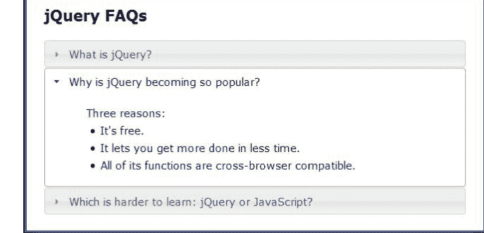

## jQuery UI 手风琴的 HTML

```html
<div id="accordion">
  <h3><a href="#What is jQuery?"></a></h3>
  <div><!-- 面板内容 --> </div>
  <h3><a href="#Why is jQuery becoming popular?"></a></h3>
  <div><!-- 面板内容 --> </div>
  <h3><a href="#Which is harder to learn: jQuery or JavaScript?"></a></h3>
  <div><!-- 面板内容 --> </div>
</div>
```

## jQuery UI 手风琴的 JavaScript 代码

```html
<script>
$(document).ready(function() {
  $("#accordion").accordion();
});
</script>
```

## 一些典型的插件函数

- 数据验证
- 幻灯片
- 轮播

## 描述

- 数据验证

jQuery UI 是一个免费、开源的 JavaScript 库，提供了更高级的功能如数据验证和下拉菜单，实现这些功能只需要极少的代码。为了方便插件的开发，jQuery 提供了规范，帮助标准化插件的实现方式。插件是开发者喜欢 jQuery 的另一个原因。

图 7-3 jQuery UI 如何简化 JavaScript 开发

# jQuery 基础

当你使用 jQuery 时，美元符号 (`$`) 被用来引用 jQuery 库。然后，你可以通过在括号内使用 CSS 语法来编写选择器。

# 如何调用 jQuery 方法

一旦你选择了想要应用方法的元素或多个元素，就可以使用图 7-5 所示的语法来调用该方法。这与调用任何对象的方法的方法相同。你的代码逻辑是：获取元素或多个元素的选择器、点（.）、方法名以及括号内的任何参数。

为了开始使用 jQuery，图中的表格总结了你将用到的一些 jQuery 方法。例如，不带参数的 `val` 方法可以从选定的文本框或其他表单控件获取值，而带参数的方法则可以设置所选文本框或其他表单控件的值。表格后的前两个示例展示了这种工作原理。

同样，不带参数的 `text` 方法可以用于获取所选元素的文本，而带参数的 `text` 方法可以用于设置所选元素的文本。此类方法通常被称为 getter（获取器）和 setter（设置器）方法。在这里，第三个示例说明了 `text` 方法的 setter 版本，它将元素的文本设置为“Email address is required”。

表格中的第五种方法是 `next`，用于获取元素的下一个（或相邻）兄弟元素。该方法通常会紧跟另一个方法。要做到这一点，你需要使用对象链（object chaining），其工作方式与 JavaScript 中完全相同。第四个示例说明了这一点。在这里，`next` 方法获取所选元素之后的兄弟元素，而 `text` 方法为该兄弟元素设置文本。

表格中的最后两个方法是 `submit` 和 `focus` 方法，它们与 JavaScript 的 `submit` 和 `focus` 方法一样。`submit` 方法将所选表单的数据提交到服务器，而 `focus` 方法将焦点移动到选定的表单控件或链接。

稍后，你将看到这些选择器和方法在应用程序中是如何工作的。但首先，你需要学习如何为应用程序设置事件处理程序。

# 调用 jQuery 方法的语法

```javascript
$("selector").methodName(parameters)
```

# 常用 jQuery 方法

| 方法 | 描述 |
| --- | --- |
| `val()` | 获取文本框或其他表单控件的值。 |
| `val(value)` | 设置文本框或其他表单控件的值。 |
| `text()` | 获取元素的文本。 |
| `text(value)` | 设置元素的文本。 |
| `next([type])` | 获取元素的下一个兄弟元素，或者如果指定了参数，则获取指定类型的下一个兄弟元素。 |
| `submit()` | 提交选定的表单。 |
| `focus()` | 将焦点移动到选定的表单控件或链接。 |

# 示例

如何从文本框获取值

```javascript
var gallons = $("#gallons").val();
```

如何为输入元素设置值

```javascript
$("#gallons").val("");
```

如何为元素设置文本

```javascript
$("#email_address_error").text("Email address is required");
```

如何使用对象链为下一个兄弟元素设置文本

```javascript
$("#last_name").next().text("Last name is required");
```

如何提交表单

```javascript
$("#join_list").submit("");
```

如何将焦点移动到表单控件或链接

```javascript
$("#email_address").focus("");
```

## 描述

- 简要调用 jQuery 方法，你需要编写一个选择器、一个点操作符以及括号中的任何参数。然后，该方法会被应用于选择器选中的元素或多个元素。
- 当你在 jQuery 中使用对象链时，你一个接一个地编写方法。这之所以有效是因为每个方法都会返回相应的对象。
- 如果方法的选择器选中了多个元素，jQuery 会将该方法应用于所有元素，这样你就不需要编写循环来完成操作。

# 如何使用 jQuery 事件方法

当你使用 jQuery 时，你会使用事件方法将事件处理程序附加到事件上。要实现这一点，你需要使用图 7-6 顶部的语法。首先，编写触发事件的元素选择器（例如一个将被点击的按钮）。然后，编写代表你所使用的事件的事件方法名。最后，在括号内编写一个函数作为该事件的事件处理程序。

在下表中，总结了你将最常用的两个事件方法。`ready` 事件是 JavaScript `load` 事件的 jQuery 替代方案，它的效果更好。与 `load` 事件不同，`ready` 事件在 DOM 构建完成后立即触发，即使此时图像等其他元素正在加载到浏览器中。这意味着用户可以独立开始使用该网页。

由于在使用 JavaScript 或 jQuery 之前通常必须先构建 DOM，你可能在开发的每个 JavaScript 应用程序中都会使用 `ready` 方法。书中的示例展示了实现此点的两种方法。在长格式中，你使用网页的 `document` 选择器，后面跟着点、方法名（`ready`）以及事件处理程序的函数。

简而言之，你可以编写选择器和事件方法名，并在美元符号后的括号内直接编写函数。尽管这种格式经常被专业人员使用，但书中的所有示例都使用了长格式。这样可以清楚地看到 `ready` 事件处理程序从哪里开始。

图中下一个示例显示了针对所有 `h2` 元素的点击事件的处理程序。其编写方式与 `ready` 事件的处理程序类似。

# 调用事件方法的语法

```javascript
$(selector).eventMethod(function() {});
```

# 常用事件方法

| 事件方法 | 描述 |
| --- | --- |
| `ready(handler)` | 当 DOM 准备就绪时运行事件处理程序。 |
| `click(handler)` | 当选中元素被点击时运行事件处理程序。 |

# 实现 ready 事件处理程序的两种方法

长写法

```javascript
$(document).ready(function() {});
```

短写法

```javascript
$(function() {});
```

# 所有 h2 元素的点击事件处理程序

```javascript
$("h2").click(function() {});
```

# ready 事件中的点击处理器

```javascript
$(document).ready(function() {
  $("h2").click(function() {
  }); // 结束点击处理器
}); // 结束 ready 处理器
```

## 描述

- 简要调用 jQuery 方法，你需要编写一个选择器、一个点操作符以及括号中的任何参数。然后，该方法会被应用于选择器选中的元素或多个元素。
- 当你在 jQuery 中使用对象链时，你一个接一个地编写方法。这之所以有效是因为每个方法都会返回相应的对象。
- 如果方法的选择器选中了多个元素，jQuery 会将该方法应用于所有元素，这样你就不需要编写循环来完成操作。

（注：提供的文本包含未完全以文本呈现的图像元素和页面占位符。）

# jQuery 版邮件列表应用程序

有了这些背景知识，你准备好看到如何将 jQuery 应用于第一节学习的邮件列表应用程序了。这将向你展示 jQuery 如何简化代码。

# 用户界面和 HTML

为了重记忆，图 7-7 展示了邮件列表应用程序的用户界面和 HTML。要使用该应用程序，用户在三个文本框中输入文本并点击“Join our List”按钮。然后，JavaScript 将验证条目，如果发现错误则显示相应的错误消息。

在 HTML 中，注意第一个加载 jQuery 的脚本元素。后面是另一个脚本元素，它标识了持有此应用程序 JavaScript 代码的文件。这个顺序是至关重要的，因为 JavaScript 文件将使用 jQuery 文件。

此外注意 `span` 元素是文本框 `input` 元素的相邻兄弟元素。这些 `span` 元素的起始文本是星号，表示文本框条目是必填的。随后，如果 JavaScript 发现条目错误，它将在这些 `span` 元素中显示错误消息。

## 邮件列表应用程序的用户界面

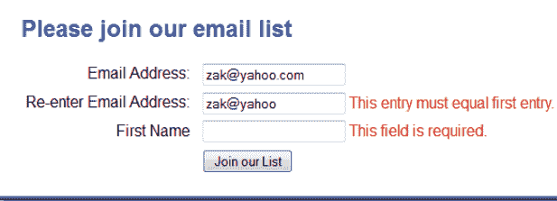

## HTML 部分

```html
<!DOCTYPE html>
<html>
<head>
  <meta charset="UTF-8">
  <title>加入邮件列表</title>
  <link rel="stylesheet" href="email_list.css">
  <script src="http://html5shiv.googlecode.com/svn/trunk/html5.js"></script>
  <script src="http://code.jquery.com/jquery-latest.min.js"></script>
  <script src="email_list.js"></script>
</head>
<body>
  <section>
    <h1>加入我们的邮件列表</h1>
    <form id="email_form" name="email_form" method="get" action="join.html">
      <label for="email_address1">邮箱地址:</label>
      <input type="text" id="email_address1">
      <span></span><br>
      <label for="email_address2">重新输入邮箱地址:</label>
      <input type="text" id="email_address2">
      <span></span><br>
      <label for="first_name">姓:</label>
      <input type="text" id="first_name">
      <span></span><br>
      <label>&nbsp;</label>
      <input type="button" id="join_list" value="加入我们的列表">
    </form>
  </section>
</body>
</html>
```

图 7-7 邮件列表应用程序的用户界面和 HTML

## jQuery 部分

图 7-8 展示了此应用程序的 jQuery 代码。这是 HTML 中引入的 `email_list.js` 文件中的代码。在这里，所有的 jQuery 代码都被高亮了。其余代码是 JavaScript 代码。

首先，你可以为“加入我们的列表”按钮的点击（click）事件创建一个事件处理程序，该程序被编写在 `ready` 事件的处理器函数内部。然后，如果你查看代码的最后三行，可以看到处理器的结束标点符号。在点击事件处理程序中，前两个语句展示了如何使用 jQuery 选择器和 `val` 方法来从文本框获取值。

在第一个 `if` 语句中，你可以看到如果用户没有在文本框中输入地址，将显示错误消息。在这里，`next` 方法获取文本框的相邻兄弟元素（即 `span` 元素），然后使用 `text` 方法在那个 `span` 元素中放入错误消息。这改变了 DOM，一旦发生改变，错误消息就会在浏览器中显示。

`next` 和 `val` 方法在接两个 `if` 语句中以类似的方式使用。然后，`if` 语句测试 `isValid` 变量是否仍为 `true`。如果是，则执行表单的 `submit` 方法，将数据发送到网络服务器。

结束“加入我们的列表”按钮的点击事件处理程序。但该处理器之后还紧跟了一个语句。它将焦点移动到 ID 为 `email_address1` 的第一个文本框。

当你回看这段代码时，请注意它不需要标准的 `$` 函数（该函数在传递元素 ID 时会获取一个元素对象）。相反，`$` 符号被用于启动一个 jQuery 选择器，通过它们的 ID 获取元素。这简化了编码。

尽管这段 jQuery 代码说明了 jQuery 如何简化数据验证应用程序，但它还不足以展示 jQuery 的威力。为了做到这一点，你需要学习更多的选择器、方法和事件方法，然后看看它们如何被用于其他类型的应用程序中。你会发现

## 邮件列表应用程序的 jQuery

```javascript
$(document).ready(function() {
  $("#join_list").click(function() {
    var emailaddress1 = $("#email_address1").val();
    var emailaddress2 = $("#email_address2").val();
    var isValid = true;

    // 验证第一个邮箱地址
    if (emailaddress1 == "") {
      $("#email_address1").next().text("此字段必填.");
      isValid = false;
    } else {
      $("#email_address1").next().text("");
    }

    // 验证第二个邮箱地址
    if (emailaddress2 == "") {
      $("#email_address2").next().text("此字段必填.");
      isValid = false;
    } else if (emailaddress1 == emailaddress2) {
      $("#email_address2").next().text("此条目不能与第一个条目相同.");
      isValid = false;
    } else {
      $("#email_address2").next().text("");
    }

    // 验证姓输入
    if ($("#first_name").val() == "") {
      $("#first_name").next().text("此字段必填.");
      isValid = false;
    } else {
      $("#first_name").next().text("");
    }

    // 如果所有条目都有效，则提交表单
    if (isValid) {
      $("#email_form").submit();
    }
  }); // 结束 click

  $("#email_address1").focus();
}); // 结束 ready
```

图 7-8 邮件列表应用程序的 jQuery

# 选择器、方法和事件方法的子集

接下来三个选择器、方法和事件方法。

## 最常用的选择器

| 选择器 | 目标 |
| :--- | :--- |
| `[attribute]` | 具有命名属性的元素 |
| `[attribute=value]` | 具有命名属性和值的元素 |
| `:contains(text)` | 包含指定文本的元素 |
| `:empty` | 没有文本节点的元素 |
| `:eq(n)` | 集合中索引为 n 的元素 |
| `:even` | 集合中索引为偶数的元素 |
| `:first` | 集合中的第一个元素 |
| `:first-child` | 作为其父元素第一个子元素 |
| `:gt(n)` | 集合中索引大于 n 的元素 |
| `:has(selector)` | 包含指定选择器元素的元素 |
| `:header` | 标题元素 (h1, h2, ...) |
| `:hidden` | 所有隐藏的元素 |
| `:last` | 集合中的最后一个元素 |
| `:last-child` | 作为其父元素最后一个子元素 |
| `:lt(n)` | 集合中索引小于 n 的元素 |
| `:not(selector)` | 不被选择器选中的元素 |
| `:nth-child` | 作为其父元素第 n 个子元素 |
| `:odd` | 集合中索引为奇数的元素 |
| `:only-child` | 作为其父元素唯一子元素的元素 |
| `:parent` | 作为其他元素父元素的元素（包括文本节点） |
| `:text` | type 属性为 "text" 的输入元素 |
| `:visible` | 所有可见的元素 |

## 示例

- 选择作为父元素第一个子元素的 `li` 元素：`$("li:first-child")`
- 选择表格中的偶数 `tr` 元素：`$("table > tr:even")` // 索引从0开始，所以第一个标签是偶数
- 选择元素的第三个后代 `p` 元素：`$("#faq p:eq(2)")` // 索引从0开始
- 选择所有 type 属性为 "text" 的输入元素：`$(":text")`

# 最实用的方法

图 7-10 中的表格展示了取自几个 jQuery 类的方法的集合。例如，`prev` 和 `next` 方法是 DOM 遍历方法。`attr`、`addClass`、`removeClass` 和 `toggleClass` 方法是 DOM 操作方法。`hide` 和 `show` 方法是效果方法。而 `each` 方法是一个杂项方法。

这些是一些是最实用的 jQuery 方法，它们将帮助你开始使用 jQuery。然后，你将把它们加入你的技能库，以阅读本节的其余章节。例如，你将在第 8 章中学习如何使用其他方法，并在第 9 章中学习如何使用其他的 DOM 遍历和操作方法。

在这里，如果这个表格看起来很令人生畏，只需通读这些方法看看哪些可用方法即可。然后，研究示例以查看它们是如何使用的。稍后，当你在应用程序需要特定方法时，可以查阅此总结。

在第一个示例中，`attr` 方法用于获取 ID 为 "image" 的元素的 `src` 属性。第二个示例使用 `attr` 方法为选中的元素添加 `src` 属性，其值为存储在变量 `imageSource` 中的值。如果元素已经有了 `src` 属性，该方法将更改它的值。第三个示例使用 `css` 方法将选中元素的颜色属性更改为蓝色。

在第四个示例中，`addClass` 方法用于为所有 ID 为 "faqs" 的 `<h2>` 元素添加类名。这与你使用 JavaScript 所做的操作类似。

在最后一个示例中，`each` 方法用于对数组中的每个元素执行一个函数。在这种情况下，数组包含 ID 为 "image_list" 的元素内的所有 `<a>` 元素，每个方法都会遍历这些元素。正如你所看到的，这简化了数组中元素的处理。

# 最实用的 jQuery 方法总结

| 方法 | 描述 |
| --- | --- |
| `next([selector])` | 获取元素的下一个兄弟元素，或者如果编码了参数，则获取指定类型的第一个兄弟元素 |
| `prev([selector])` | 获取元素的上一个兄弟元素，或者如果编码了参数，则获取指定类型的上一个兄弟元素。 |
| `attr(attributeName)` | 获取指定属性的值。 |
| `attr(attributeName, value)` | 设置指定属性的值。 |
| `css(propertyName)` | 获取指定属性的值。 |
| `css(propertyName, value)` | 设置指定属性的值。 |
| `addClass(className)` | 给元素添加一个或多个类，并在必要时创建该类。如果你使用多个类作为参数，请用空格分隔它们 |
| `removeClass([className])` | 移除一个或多个类。如果你使用多个类作为参数，请用空格分隔它们 |
| `toggleClass(className)` | 如果该类存在，则移除它；否则，添加它 |
| `hide([duration])` | 隐藏选中的元素。`duration` 参数可以是 "slow"、"fast" 或表示毫秒数的数字。默认情况下，持续时间为 400 毫秒，“slow" 为 600 毫秒，“fast" 为 300 毫秒 |
| `show([duration])` | 显示选中的元素。`duration` 参数与 `hide` 方法相同 |
| `each(function)` | 对数组中的每个元素运行该函数。 |

获取图像的 `src` 属性值

```javascript
$("#image").attr("src");
```

将 `src` 属性值设置为变量的值

```javascript
$("#image").attr("src", imageSource);
```

将 `<h2>` 元素的颜色属性值设置为蓝色

```javascript
$("#h2").css("color", "blue");
```

为 "faqs" 元素的 `<h2>` 后代添加类

```javascript
$("#faqs h2").addClass("minus");
```

为 "image_list" 元素内的每个 `<a>` 元素运行函数

```javascript
$("#image_list a").each(function() {
  // 函数语句
});
```

## 描述

- 上述表格展示了一组强大的 jQuery 方法。此表补充了图 7-5 中介绍的方法。
- 在接下来的章节中，你将学习如何使用其他方法，包括效果方法（第 8 章）、DOM 脚本和遍历（第 9 章）、表单（第 10 章）以及 Ajax 和 JSON（第 14 章）。

图 7-10 最实用的方法

# 最实用的事件方法

图 7-11 总结了最实用的事件方法，此总结包含了图 7-6 中引入的 `ready` 和 `click` 方法。正如你看到的，大多数这些事件方法提供单一的事件处理器，在事件发生时运行。这些事件方法的工作方式类似于 `ready` 和 `click` 方法，但使用了不同的事件。

第一个示例说明了这一点，它就像 `click` 事件方法一样，只是它处理的是双击事件。值得注意的是在处理器内部使用了 `this` 关键字。在这里，它被编码为 jQuery 选择器，并指代被双击的文本框。这与 JavaScript 中 `this` 关键字的工作方式相似。注意，它没有被包含在引号中，尽管此函数执行了 `val` 方法将双击文本的值设置为空字符串。

相比之下，`toggle` 和 `hover` 事件方法提供了两个处理器。对于 `toggle` 方法，第一个事件处理器在元素第一次被点击以及之后的每次点击时都会运行。这被称为“奇数事件”，因为它是奇数事件处理器，在从零开始计算的元素奇次点击时运行。相反，第二个事件处理器是……

同样，`hover` 事件方法提供了两个处理器：一个用于鼠标指针进入元素时，另一个用于鼠标指针移出元素时。在这些示例中，注意当选择器获取多个元素时，jQuery 会为每个元素设置事件处理器。这比使用 JavaScript 设置事件处理器要简单得多。

# 最实用的 jQuery 事件方法总结

| 事件方法 | 描述 |
| --- | --- |
| `ready(handler)` | 当 DOM 准备就绪时运行。 |
| `unload(handler)` | 当用户关闭窗口时运行。 |
| `error(handler)` | 当发生 JavaScript 错误时运行。 |
| `click(handler)` | 当选中元素被点击时运行。 |
| `toggle(handlerEven, handlerOdd)` | 第一个处理器在从零开始的偶次点击时运行。第二个处理器在奇次点击时运行。 |
| `dblclick(handler)` | 当选中元素被双击时运行。 |
| `mouseenter(handler)` | 当鼠标指针进入元素时运行。 |
| `mouseover(handler)` | 当鼠标指针悬停在元素上时运行。 |
| `mouseout(handler)` | 当鼠标指针离开元素时运行。 |
| `hover(handlerIn, handlerOut)` | 第一个事件处理器在鼠标指针进入元素时运行。第二个在移出时运行。 |

# 为所有文本框的双击事件设置处理器，清空被点击的框

```javascript
$(":text").dblclick(function () {
  $(this).val("");
});
```

# 为列表内 `` 元素的悬停事件设置处理器

```javascript
$("#image_list img").hover(
  function() {
    alert("鼠标指针进入了一个 img 元素");
  },
  function() {
    alert("鼠标指针移出了一个 img 元素");
  }
); // 结束 hover
```

# 你应该关注的其他事件方法

对于大多数应用程序，你将使用已经介绍过的事件方法。你还将为事件处理程序编写函数或函数，作为事件方法的参数。

尽管如此，有时你可能想通过其他方式附加事件处理程序、移除事件处理程序，或触发一个启动事件处理程序的事件。这时，你可以使用图 7-12 表格中所示的方法。

当你使用此表中的前两个方法时，你通常会在变量中存储事件处理程序的函数，如表格后的第一个示例所示。然后，你可以将变量名作为事件方法的第二个参数。

为了说明这一点，第二个示例展示了如何使用 `bind` 方法将事件处理程序附加到 ID 为 "clear" 的元素的 `click` 事件上。然而，当你使用快捷方法将事件处理程序附加到事件时，实际上是在使用 `bind` 方法。这只是在后台完成的，因此你可能并不会察觉。

将事件处理程序存储在变量中的优点之一是你可以将处理程序附加到多个事件。这如第三个示例所示。使用了两条语句将 `clearClick` 事件处理程序应用到 ID 为 "clear" 的按钮的 `click` 事件以及所有文本框的 `dblclick` 事件上。

对于某些应用程序，你可能在某些条件发生时移除事件处理程序。要做到这一点，你可以使用 `unbind` 方法，如图中的第四个示例所示。

或者，如果你想在事件处理程序运行一次后将其移除，可以使用 `one` 方法。这如第五个示例所示。

如果你想从你的 jQuery 代码中启动事件，可以使用长形式或短形式的 `trigger` 方法，如第六组示例所示。这两个示例都触发了 ID 为 "clear" 的元素的 `click` 事件，从而导致 `clearClick` 处理程序运行。

这为两个不同的事件运行同一个事件处理程序提供了另一种方法。你所做的只是从一个事件处理程序触发另一个事件处理程序的事件。这如图中的最后一个示例所示。在示例中，所有文本框的 `dblclick` 事件的事件处理程序触发了 ID 为 "clear" 的元素的 `click` 事件，从而启动了 `clearClick` 事件处理程序。

# 你应该关注的其他事件方法

| 事件方法 | 描述 |
| --- | --- |
| `bind(event, handler)` | 将事件处理程序附加到事件。 |
| `unbind(event, handler)` | 从事件中移除事件处理程序。 |
| `one(event, handler)` | 附加事件处理程序并在运行一次后将其移除。 |
| `trigger(event)` | 触发选中元素的事件。 |

## 如何在变量中存储事件处理程序

```javascript
var clearClick = function () {
  // 事件处理程序的语句
}
```

## 如何向事件附加事件处理程序

### 使用 bind 方法

```javascript
$("#clear").bind("click", clearClick);
```

### 使用快捷方法

```javascript
$("#clear").click(clearClick);
```

### 如何将事件处理程序附加到两个不同的事件

```javascript
$("#clear").click(clearClick);
$("#text").dblclick(clearClick);
```

### 如何从事件中移除事件处理程序

```javascript
$("#clear").unbind("click", clearClick);
```

### 如何附加并移除事件处理程序使其仅运行一次

```javascript
$("#clear").one("click", confirmClick);
```

### 如何触发事件

#### 使用 trigger 方法

```javascript
$("#clear").trigger("click");
```

#### 使用快捷方法

```javascript
$("#clear").click();
```

### 如何使用快捷方法从事件处理程序中触发事件

```javascript
$("#text").dblclick(function () {
  $("#clear").click(); // 触发 clear 按钮的点击事件
});
```

## 描述

- 当你将事件处理程序存储在变量中，可以使用 `bind` 方法将其附加到多个事件。
- 当你使用快捷方法将事件处理程序附加到事件时，你实际上是在使用 `bind` 方法。
- `submit` 和 `focus` 方法实际上是事件方法。当你使用快捷方法触发它们时，它们会触发 `submit` 和 `focus` 事件。

图 7-12 你应该关注的其他事件方法

# 三个示例应用程序

现在，为了帮助理解选择器、方法和事件方法在实际应用程序中是如何工作的，本章介绍了三个典型的 JavaScript 应用程序。

## jQuery 中的 FAQs 应用

图 7-13 展示了你在第 6 章学习的 FAQs 应用，但这次使用了 jQuery。当此应用程序启动时，h2 元素之后的 div 元素被 CSS 隐藏，且 h2 元素前面有一个加号。然后，如果用户点击 h2 元素，其下方的 div 元素就会显示，加号变为减号。如果用户点击标题，过程就会相反。

这是一个典型的 jQuery 应用程序，它是 `toggle` 事件方法设计的应用程序类型。因此，此应用程序的 jQuery 代码包含一个位于 `ready` 方法内部的 `toggle` 事件方法。该 `toggle` 事件方法为 ID 为 "faqs" 的区域内的每个 h2 元素设置了处理器：

```javascript
$("#faqs h2").toggle(
  function () {
    $(this).addClass("minus");
    $(this).next().show();
  },
  function () {
    $(this).removeClass("minus");
    $(this).next().hide();
  }
);
```

## jQuery 中的图片切换应用

图 7-14 展示了另一个体现 jQuery 威力的应用程序。它是你在第 6 章中学习过的图片切换应用。简而言之，用户点击浏览器窗口顶部的一张缩略图，标题和缩略图对应的图片就会随之更改。

在此应用程序的 HTML 中，使用了 `<li>` 元素来显示六张缩略图。然而，这些 `` 元素被编码在 `<a>` 元素内部，使得图片是可以点击的并且能够接收焦点。在 `<a>` 元素中，`href` 属性标识了点击链接时要切换的图片，而 `title` 属性提供了相关说明的文本。在这种情况下，`<a>` 元素和 `` 元素都编码在 `<ul>` 元素中。

在 `<ul>` 元素之后，你可以看到用于标题的 `<h2>` 元素和用于页面主图的 `` 元素。这些元素的 id 被突出显示，因为 jQuery 在将标题和图片切换到它们时会使用这些 id。

对于运动受限者，此 HTML 通过在 `<a>` 元素中为缩略图链接编码 `` 元素提供了无障碍支持。顺便说，用户可以通过点击 Tab 键访问缩略图链接，当缩略图获得焦点时可以切换图片，从而触发点击事件。

该页面 CSS 中值得注意的是 `<li>` 元素的规则集。它们的 `display` 属性被设置为 `inline`，这样图片从左到右排列，而不是从上到下。此外，每个项目右侧的内边距（padding）设置为 10 像素，以便在图片之间提供空间。

### 图片切换应用的用户界面

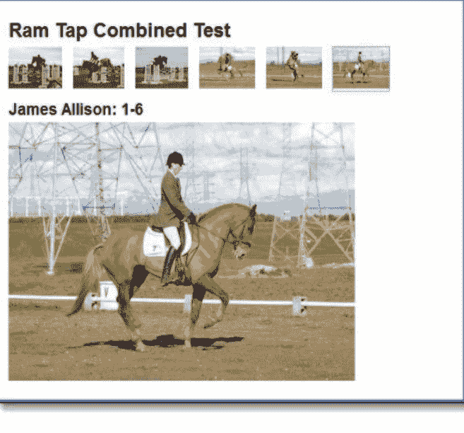

### HTML 部分

```html
<section>
  <h1>Ram Tap 组合测试</h1>
  <ul id="image_list">
    <li><a href="thumbnails/t1.jpg" title="James Allison: 1-1"></a></li>
    <li><a href="thumbnails/t2.jpg" title="James Allison: 1-2"></a></li>
    <li><a href="thumbnails/t3.jpg" title="James Allison: 1-3"></a></li>
    <li><a href="thumbnails/t4.jpg" title="James Allison: 1-4"></a></li>
    <li><a href="thumbnails/t5.jpg" title="James Allison: 1-5"></a></li>
    <li><a href="thumbnails/t6.jpg" title="James Allison: 1-6"></a></li>
  </ul>
  <h2 id="caption">James Allison 1-1</h2>
  <p></p>
</section>
```

### li 元素的 CSS

```css
li {
  padding-right: 10px;
  display: inline;
}
```

图 7-14 图片切换应用的用户界面、HTML 和 CSS

图 7-15 展示了事件处理器，`each` 方法用于为无序列表中的每个 `<a>` 元素运行一个函数。该函数在用户开始使用应用程序时，预先将要切换的图片加载到浏览器。如果应用程序使用了这些图片，可以使应用程序运行更快。

在每个 `<a>` 元素的函数内部，第一条语句创建一个新的 `Image` 对象。然后第二条语句使用 `this` 关键字和 `attr` 方法将 `Image` 对象的 `src` 属性设置为 `<a>` 元素中 `href` 属性的值。一旦完成，图片就会加载到浏览器中。

`each` 方法后面跟着点击事件方法，该方法为包含缩略图的 `<a>` 元素的点击事件设置事件处理器。注意这里 `ev` 被编码为点击事件方法的参数，它在事件发生时接收事件对象。该对象将用于取消每个链接的默认操作。

此事件处理器中的前两个语句切换浏览器窗口主部分的图片。第一条语句使用 `this` 关键字和 `attr` 方法获取 `<a>` 元素的 `href` 属性值。该值提供了要切换图片的位置。然后，第二条语句将主 `img` 元素的 `src` 属性设置为此值。一旦完成，图片会在浏览器中完成切换。

接下来的两个语句工作原理类似。它们切换浏览器窗口主部分的图片标题。这次，标题来自 `<a>` 元素的 `title` 属性。

点击事件处理器中的最后一条语句使用传递给处理器的事件对象的 `preventDefault` 方法来取消链接的默认操作。这是一个跨浏览器兼容的 jQuery 方法，简化了 JavaScript 代码。当你引入 jQuery 库时，它会取代浏览器的 `preventDefault` 方法执行。如果未取消默认操作，点击链接将在新窗口或标签页中显示 `href` 属性所指的图片，而这并不是你想要的。

### JavaScript 部分

```javascript
$(document).ready(function() {
  $("#image_list a").each(function() {
    var swappedImage = new Image();
    swappedImage.src = $(this).attr("href");
  });

  $("#image_list a").click(function(ev) {
    var imageURL = $(this).attr("href");
    $("#image").attr("src", imageURL);
    $("#caption").text($(this).attr("title"));
    ev.preventDefault();
  });
});
```

图 7-15 图片切换应用的 jQuery

## jQuery 中的图片悬停应用

图 7-16 展示了图片悬停应用。当用户将鼠标指针悬停在三张图片中的任何一张上时，该图片会切换为另一张图片。当鼠标指针移出时，图片会切换回原始图片。

### 用户界面


### HTML 部分

```html
<section>
  <h1>Ram Tap 组合测试</h1>
  <ul id="image_rollovers">
    <li></li>
    <li></li>
    <li></li>
  </ul>
</section>
```

### JavaScript 部分

```javascript
$(document).ready(function() {
  $("#image_rollovers img").each(function() {
    var oldURL = $(this).attr("src"); // 获取 src 属性
    var newURL = $(this).attr("id"); // 获取 id 属性

    // 预加载图片
    var rolloverImage = new Image();
    rolloverImage.src = newURL;

    // 设置事件处理器
    $(this).hover(
      function() {
        $(this).attr("src", newURL); // 设置 src 属性
      },
      function() {
        $(this).attr("src", oldURL); // 设置 src 属性
      } // 结束 hover
    );
  }); // 结束 each
}); // 结束 ready
```

图 7-16 jQuery 中的图片悬停切换应用

# 展望

为了快速上手，本章介绍了一些实用的 jQuery 选择器、方法和事件方法的运行子集。这应该让你对在使用 jQuery 时需要准备什么内容有一个大致的概念。在阅读本书的其他章节时，你将学习更多的选择器和方法。

关键在于将正确的选择器、方法和事件方法应用到你正在开发的应用程序中。要精通这一点，回顾许多类型的 jQuery 应用是有帮助的。这就是为什么本章介绍了四个应用，这也是为什么你在完成这本书之前会看到很多这类示例。

# 术语

| 术语 |
| :--- |
| jQuery 方法 |
| CDN (内容分发网络) |
| jQuery UI |
| 插件 |
| 对象链 |
| 选择器 |
| 事件方法 |

# 总结

- jQuery 是一个 JavaScript 库，提供了让 JavaScript 编程更简单的方法。这些方法经过了跨浏览器兼容性测试。
- jQuery UI 和插件是使用 jQuery 库构建更高级功能的 JavaScript 库。
- 要使用 jQuery，你需要在 `head` 部分编写一个 `script` 元素，包含 jQuery 核心库文件。该文件可以下载并存储在你的计算机或服务器上，或者通过内容分发网络 (CDN) 访问。
- 当你使用使用 jQuery 代码语句时，你使用的选择器类似于 CSS 选择器。你还使用点语法，该语法由一个或多个元素的选择器以及要执行的方法名称组成。
- 在 jQuery 中设置事件处理器，你使用事件方法。这些方法中的大多数带有一个参数，即在事件发生时运行的事件处理器。但某些事件方法（如 `toggle` 方法）接受两个事件处理器参数。

# 练习 7-1

## 为电子邮件列表应用添加一个“清除”按钮

在本次练习中，你将为图 7-7 和图 7-8 中的电子邮件列表应用添加一个“清除”按钮。这将迫使你创建并附加另一个事件处理器。

1. 使用你的文本编辑器打开此文件夹中的 `index.html` 和 `email_list.js` 文件：
   `c:\jquery\exercise\ch07\email_list\`
2. 运行应用程序以复习其工作原理。在“加入”按钮下方已添加了一个“清除”按钮，但该按钮无法工作。
3. 为“清除”按钮的点击事件添加一个事件处理器，通过将所有文本框设置为空字符串 ("") 来清除它们。这可以通过一个语句完成。要选择文本框，请使用类似于图 7-9 中最后一个选择器。要将值设置为空字符串，请使用你在图 7-5 第二个示例中使用的 `val` 方法。现在测试此更改。
4. 该事件处理器还应该将文本框右侧显示的 `span` 元素恢复星号，以显示项目是必填的。这需要一个使用 `next` 和 `text` 方法的语句。
5. 为此事件处理器再添加一个处理器，将焦点移动到第一个文本框。然后，测试此更改。
6. 为此应用添加另一个针对任何文本框双击事件的事件处理器。该事件处理器应该执行与“清除”按钮点击事件处理器相同的操作。实现此操作最简单的方法是从双击事件处理器中触发“清除”按钮的点击事件，如图 7-12 中的最后一个示例所示。
7. 注释掉你用于触发“清除”按钮点击事件的代码行。然后，在双击事件处理器中添加一条语句，仅清除用户双击的文本框中的文本。要做到这一点，你必须使用 `this` 关键字，如图 7-11 中的第一个示例所示。

# 练习 7-2

## 为图片悬停应用使用不同的事件方法

本次练习要求修改图 7-16 中的图片悬停应用，使其使用不同的方法。

1. 使用你的文本编辑器打开此文件夹中的 `index.html` 和 `image_rollovers.js` 文件：
   `c:\jquery\exercise\ch07\image_rollovers\`
2. 运行应用程序以复习其工作原理。
3. 修改代码，使用 `mouseenter` 和 `mouseleave` 事件方法代替 `hover` 方法来实现相同的功能。
4. 测试应用程序以确保其工作正常。

# 第 8 章 如何使用效果和动画

现在你已经掌握了 jQuery 的基础知识，本章将介绍效果和动画的方法。

## 如何使用效果

本章首先介绍 jQuery 提供的基础效果方法。在学习了如何使用它们之后，你将学习如何使用 jQuery 文档中所说的“自定义效果”。在实践中，网页上的任何运动幻觉都可以被称为*动画*，因此你可以将本章中的所有效果都视为动画。

## jQuery 效果方法

图 8-1 总结了 jQuery 的效果方法。这些包含了第 7 章介绍的 `show` 和 `hide` 方法。

对于 `fadeTo` 方法外，所有方法的主要参数都是持续时间，它决定了效果持续的时间。例如，如果 `fadeOut` 方法的参数为 5000，则该元素或多个元素将在 5 秒（5000 毫秒）内淡出。如果省略持续时间，效果将立即发生，没有动画。

相比之下，`fadeTo` 方法不仅需要持续时间，还需要透明度参数。透明度参数必须是 0 到 1 之间的值，其中 1 是完全（正常）透明度，0 是不可见。

图中的示例展示了这些方法的工作原理。在这里，第一个示例使用 `fadeOut` 方法在 5 秒内淡出。然后，第二个示例使用 `fadeTo` 和 `slideDown` 方法首先在五秒内淡出，然后通过在一秒内增加高度来重绘，使其看起来像是在向下滑动。正如你所看到的，链式调用常用于效果以获得所需的动画。

下一个示例展示了如何链式调用淡入方法。在这里，标题首先在 5 秒内淡入到 .2 的透明度。然后，标题在 1 秒内淡入到 1 的透明度。这种方法的效果是标题几乎消失，然后恢复到完全透明度。

最后一个示例展示了如何将回调函数与这些方法的任何一种配合使用。要使用回调函数，你将一个函数编写为方法的最后一个参数。然后，在该方法执行完成后会调用该函数。

在这个示例中，使用 `fadeTo` 方法将标题淡入到 .2 的透明度。回调函数将标题淡入完全透明度。在回调函数中，使用 `this` 关键字来指代第一个 `fadeTo` 方法的标题。正如你所看到的，回调方法通常会选择其他元素进行操作。

请注意，图中的最后两个示例具有相同的结果。

在我离开之前，你可能感兴趣的是，当你使用 `hide` 或 `show` 方法指定持续时间时，效果是通过更改元素的高度、宽度和透明度属性来实现的。例如要显示一个元素，它的高度、宽度和透明度会增加，使其从左上角放大。相反，要隐藏一个元素，它的高度、宽度和透明度会减少，使其从右下角缩小。

## jQuery 效果的基础方法

| 方法 | 说明 |
| --- | --- |
| `show()` | 从左上到右下显示选定的元素。 |
| `hide()` | 从右下到左上隐藏选定的元素。 |
| `toggle()` | 显示或隐藏选定的元素。 |
| `slideDown()` | 以滑动动作显示选定的元素。 |
| `slideUp()` | 以滑动动作隐藏选定的元素。 |
| `slideToggle()` | 以滑动动作显示或隐藏选定的元素。 |
| `fadeIn()` | 通过淡入到不透明显示选定的元素。 |
| `fadeOut()` | 通过淡出到透明隐藏选定的元素。 |
| `fadeToggle()` | 通过淡入或淡出显示或隐藏选定的元素。 |
| `fadeTo()` | 将选取元素的透明度调整为第二个参数设置的透明度。使用此方法时必须指定持续时间参数。 |

## 除 `fadeTo` 方法外所有的基础语法

```javascript
methodName(duration, callback)
```

### `fadeTo` 方法的基础语法

```javascript
fadeTo(duration, opacity, callback)
```

页面加载后带有动画的标题的 HTML

```html
<h1 id="start_message">临时施工中!</h1>
```

jQuery 在 5 秒内淡出标题

```javascript
$('#start_message').fadeOut(5000);
```

jQuery 使用链式调用将标题淡出并向下滑

```javascript
$('#start_message').fadeOut(5000).slideDown(1000);
```

带有 `fadeTo` 方法的链式调用

```javascript
$('#start_message').fadeTo(5000, .2).fadeTo(1000, 1);
```

带有回调函数的 jQuery，产生与链式调用相同的结果

```javascript
$('#start_message').fadeTo(5000, .2,
  function() {
    $(this).fadeTo(1000, 1); // 结束回调函数
  } // 开始回调函数
);
```

- `duration` 参数可以是 "slow"、"fast" 或以毫秒为单位的数字。默认情况下，持续时间为 400 毫秒，“slow" 为 600 毫秒，“fast" 为 200 毫秒。
- `callback` 参数用于一个在效果完成后被调用的函数。如果选择了多个元素，则回调函数将为每个元素运行一次。
- 链式调用常用于效果。这是因为每个效果方法都返回了执行该效果的对象。

## 描述

jQuery 效果方法


## 带有 jQuery 效果的 FAQ 应用

还记得上一章的 FAQ 应用吗？该应用使用了不带持续时间参数的 `show` 和 `hide` 方法来显示内容。

为了让你更好地了解如何使用效果，我们现在将回顾两种编写幻灯片应用的不同方式。

## 用户界面、HTML 和 CSS

在图 8-3 中，屏幕截图显示了幻灯片中的第三张幻灯片正在淡入。在 HTML 的 `div` 元素中，你可以看到五个 `` 元素为幻灯片提供了内容，每个元素都有一个 `alt` 属性来提供显示在幻灯片上方的标题。

### 一个具有淡出和淡入效果的幻灯片应用


```html
<section>
  <h1>钓鱼类幻灯片</h1>
  <h2 id="caption">捕获上游鱼王</h2>
  
  <div id="slides">
    
    
    
    
    
  </div>
</section>
```

### 幻灯片的关键 CSS

```css
img {
  height: 250px;
}
#slides {
  display: none;
}
```

## 描述

- "slides" div 元素中的图像将用于幻灯片展示。
- 每张图像的说明（caption）将来自其 `alt` 属性。

图 8-3 幻灯片的 HTML 和 CSS

# 编写 jQuery 的两种方式

现在显而易见的是，大多数 jQuery 应用可以用许多不同的方式进行编写。事实上，学习 jQuery 时最大的问题是弄清楚如何使用 jQuery 获取你想要的结果。这就是为什么这本书经常展示获取结果的多种方法，这也是为什么图 8-4 展示了两种编写幻灯片的代码方式。

在第一个示例中，代码首先创建一个 `Image` 对象的数组，用于存储 HTML 中 "slides" 区域内五个 `` 元素的 `src` 和 `alt` 属性。这是通过使用 `each` 方法处理这五个元素中的每一个来实现的。在处理循环内部，使用 `attr` 方法从每个 `img` 元素获取 `src` 和 `alt` 属性，并将它们存储在每个图像对象的 `src` 和 `title` 属性中。然后，将 `Image` 对象添加到数组中。

数组创建完成后，使用 `setInterval` 方法每隔 3000 毫秒（第二个参数）执行一次其功能（第一个参数）。在该函数内部，第一条语句设置说明并使其在 1000 毫秒内淡入。然后，第二条语句选择幻灯片并将其淡出。但注意，这条语句调用了一个回调函数。

在回调函数内部，第一条语句为 `counterVariable` 获取一个新值，该值最初被设置为 0。为了实现这一点，它使用取模运算符（%）来获取计数器除以数组长度后的余数。对于幻灯片中的下一张幻灯片，意味着计数器加 1 并除以 5，因此余数为 1。对于第五张幻灯片，计数器增加到 5 并除以 5，因此余数为 0。由于该变量被重新赋值给 `counterVariable`，这意味着随着幻灯片的进行，该变量的范围将在 0 到 4 之间变化。

一旦设置了 `counterValue`，剩下的工作就很简单了。首先，将 `nextImage` 设置为数组中的下一张图像。其次，将 "slide" `img` 元素的 `attr` 属性设置为数组中下一个图像对象的 `src` 属性，并让该幻灯片淡入。最后，将说明的文本设置为数组中下一个图像对象的 `title` 属性，并将其淡入。

在第二个示例中，代码首先将 `nextSlide` 变量设置为 "slides" 区域中的第一个 `img` 元素。然后，`setInterval` 的函数会淡出幻灯片和说明，就像在第一个示例中做的那样。然而，`fadeOut` 方法的回调函数中的代码完全不同。

它首先测试 "slides" 区域中的 `img` 元素长度是否为零。如果是，则意味着没有下一张幻灯片，并将 `nextSlide` 变量设置为该区域中的第一个 `img` 元素。否则，`nextSlide`...

一旦确定了下一张幻灯片，代码为下一张幻灯片的 `src` 和 `alt` 属性设置变量。然后，它使用第一个变量为显示幻灯片的 `img` 元素设置 `src` 属性并使其淡入，并使用第二个变量设置下一个说明的文本并将其淡入。

这展示了此类应用可以编写的两种方式，你将在后续章节中看到更多。当你开发应用时...

# 编写 jQuery 的一种方式

```javascript
$(document).ready(function() {
  // 创建一个幻灯片图像数组
  var image, imageCache = [];

  $("#slides img").each(function() {
    image = new Image();
    image.src = $(this).attr("src");
    image.title = $(this).attr("alt");
    imageCache.push(image);
  });

  // 开始幻灯片
  var imageCounter = 0;
  var nextImage;

  var timer = setInterval(
    function () {
      $("#caption").fadeOut(1000);
      $("#slide").fadeOut(1000,
        function () {
          imageCounter = (imageCounter + 1) % imageCache.length;
          nextImage = imageCache[imageCounter];
          $("#slide").attr("src", nextImage.src).fadeIn(1000);
          $("#caption").text(nextImage.title).fadeIn(1000);
        }
      );
    }, 3000
  );
});
```

# 另一种 jQuery 方式

```javascript
$(document).ready(function() {
  var nextSlide = $("#slides img").first();
  var nextCaption;
  var nextSource;

  // 开始幻灯片
  setInterval(
    function () {
      $("#caption").fadeOut(1000);
      $("#slide").fadeOut(1000,
        function () {
          if (nextSlide.next().length == 0) {
            nextSlide = $("#slides img").first();
          } else {
            nextSlide = nextSlide.next();
          }
          nextSource = nextSlide.attr("src");
          nextCaption = nextSlide.attr("alt");
          $("#slide").attr("src", nextSource).fadeIn(1000);
          $("#caption").text(nextCaption).fadeIn(1000);
        }
      );
    }, 3000
  );
});
```

图 8-4 幻灯片的两种 jQuery 方式

# 如何停止和启动幻灯片

为了提高幻灯片的可用性，你通常会提供一种让用户停止和重启的方法。图 8-5 展示了这种方法。它在用户点击幻灯片时停止，并在用户点击时重启。

首先，该代码设置了一个用于运行幻灯片的匿名函数，并将其存储在名为 `runSlideShow` 的变量中。如果你查看该函数的代码，你会发现它与前一个图中的代码相同。

其次，该函数之后是一个语句，创建一个定时器，每 3 秒调用一次 `runSlideShow`。但注意，这必须在 `runSlideShow` 函数之后编写，因为它是一个匿名函数。

第三，事件处理程序使用 `toggle` 事件方法在当前幻灯片的偶数点击和奇数点击上运行函数。在偶数点击时，函数使用 `clearInterval` 方法取消定时器，从而停止幻灯片。在奇数点击时，重新创建定时器以便展示重新开始。

## 用于停止和重新启动幻灯片的 jQuery

```javascript
$(document).ready(function() {
  var nextSlide = "#slides img:first-child";
  var nextCaption;
  var nextSlideSource;

  // 用于运行幻灯片
  var runSlideShow = function() {
    $("#caption").fadeOut(1000);
    $("#slide").fadeOut(1000,
      function () {
        if (nextSlide.next().length == 0) {
          nextSlide = "#slides img:first-child";
        } else {
          nextSlide = nextSlide.next();
        }
        nextSlideSource = nextSlide.attr("src");
        nextCaption = nextSlide.attr("alt");
        $("#slide").attr("src", nextSlideSource).fadeIn(1000);
        $("#caption").text(nextCaption).fadeIn(1000);
      }
    );
  };

  // 开始幻灯片
  var timer1 = setInterval(runSlideShow, 3000);

  // 启动和停止幻灯片
  $("#slide").toggle(
    function() {
      clearInterval(timer1);
    },
    function() {
      timer1 = setInterval(runSlideShow, 3000);
    }
  );
});
```

图 8-5 用于停止和重新启动幻灯片的 jQuery


## 描述

- 通过这段代码，用户可以通过点击幻灯片来停止幻灯片，通过再次点击来重启幻灯片。
- 因此，幻灯片的代码不需要重复，它被写在一个匿名函数并存储在名为 `runSlideShow` 的变量中。
- 因为 `runSlideShow` 函数是一个匿名函数，它必须在 `setInterval` 方法调用它之前定义。否则，JavaScript 引擎将抛出错误。

图 8-5 如何停止和启动幻灯片

© 2012, Mike Murach and Associates, Inc. Licensed to Michael Hotham.

### 如何使用动画

现在你已经了解了如何使用基础的 jQuery 效果，你将学习 jQuery 网站是如何引用自定义效果。我们将这些自定义效果称为动画，而它是从 `animate` 方法开始的。

## 如何使用 animate 方法的基本语法

图 8-6 展示了 `animate` 方法的基本语法。在这里，第一个参数是一个包含键值对代码的属性映射（properties map）。例如，图中的第一个示例显示将 `fontSize` 属性设置为 275%，将 `opacity` 属性设置为 1，将 `left` 属性设置为 0。然后，第二个参数是动画的持续时间，在第一个示例中为 2 秒。

当 `animate` 方法执行时，它会在持续时间内通过将选定元素的属性更改为属性映射中的值来修改该元素或元素。这产生了动画的视觉效果。

如果你查看示例中动画化标题的 CSS，你会发现标题的初始字体大小为浏览器默认大小的 75%，不透明度为 .2（淡出），且其 `left` 位置为 -175 像素，即比其正常位置左侧 175 像素。然后，当第一个示例中的 `animate` 方法运行时，标题的字体大小增加到 275%，不透明度增加到 1，位置移动到零；2 秒后，结果是一个有趣的动画，标题向右移动并增大尺寸和不透明度。

顺便提一下，为了让这正常工作，标题的 `position` 属性必须设置为 `relative`。这意味着 `left` 和 `top` 属性的设置相对于元素在正常流中的位置。该标题的 `left` 和 `top` 属性均为 0。

第二个示例与第一个类似，但它包含一个回调函数。在这里，回调函数选择 `h2` 标题，页面使用 `next`、`fadeIn` 和 `fadeOut` 方法使 `h2` 标题的 `div` 元素淡入和淡出。属性映射中的区别是 `left` 属性设置为 "175"，这使标题移动到其起始位置右侧 175 像素。这与第一个示例中的属性映射达到了相同的结果。

当你为函数编写属性映射时，必须遵守此图中总结的规则。例如，对属性名使用驼峰命名法（如 `fontSize` 而不是 `font-size`），或者用引号括起属性名。你将数值值编写为十进制值，或者当你为 `left` 等属性编写数值时，假设单位是像素（pixels），除非你指定了测量单位并将整个值包含在引号中。

对于某些属性，如 `width`、`height` 和 `opacity`，你可以将 "show"、"hide" 或 "toggle" 作为属性值。例如，如果你为 `width` 或 `opacity` 值编写 "hide"，它将减小到零。如果你编写 "show"，`width` 将增加到其正常值，或 `opacity` 将增加到 1。如果你编写 "toggle"，该值会在显示和隐藏值之间切换。

## animate 方法的基本语法

`animate({properties}, duration[, callback])`

一个正在动画化的标题正在移动到 "faqs" 部分


### h1 标题的 CSS

```css
#faqs h1 {
  position: relative;
  left: -175px;
  font-size: 75%;
  opacity: .2;
}
```

### h1 标题的 animate 方法

```javascript
$("#h1").animate({
  fontSize: "275%",
  opacity: 1,
  left: 0
}, 2000);
```

### 带有回调函数的 h1 标题的 animate 方法

```javascript
$("#h1").animate({
  fontSize: "275%",
  opacity: 1,
  left: "175px"
}, 2000, function() {
  $("#h2").next().fadeIn(1000).fadeOut(1000);
});
```

## 如何链用 animate 方法

要链用动画，你可以使用处理效果或其他方法的相同技术。通过在第一个 `animate` 方法后编写点操作符（.），然后编写第二个 `animate` 方法。

正如图 8-7 中的第一个示例所示，这在事件处理程序中链用了两个 `animate` 方法。在这里，代码的缩进和对齐旨在展示这两个 `animate` 方法是链用的。第一个方法增加了字体大小和不透明度，并向右移动了 275 像素。然后，第二个方法减小了字体大小并向左移动 275 像素，使其回到起始位置。

当你为选定元素链用效果或动画时，它们会被放入该元素的队列中。然后，效果和动画按顺序执行。这就是为什么你可以创建一些有趣的动画。

然而请注意，单独编写的动画也会进入队列。在图中，第一条语句是应用于标题 (this) 的 `animate` 方法。第二条语句是应用于同一个标题 (this) 的另一个 `animate` 方法。那么，当用户点击标题时，这些动画会被放入队列并顺序执行，就像它们是链用的一样，结果与第一个示例中的链用方法相同。

现在，如果你快速点击标题两次或三次会怎样？无论如何，`animate` 方法只会进入标题的队列一次，工作方式与其他两个示例相同。但如果用户连续点击两次，第二次点击会将第二个 `animate` 方法排入队列，使其在第一个之后运行。这可能意味着第二个 `animate` 方法在第一个动画的回调方法完成之前就开始运行。

### 由点击事件启动带有两个动画的标题


### 链式动画

```javascript
$("#tags h1").click(function() {
  $(this).animate(
    { fontSize: "650%", opacity: 1, left: "+=275px" }, 2000 )
    .animate(
      { fontSize: "175%", left: "-=275px" }, 1000)
    );
}); // end click
```

### 队列动画

```javascript
$("#tags h1").click(function() {
  $(this).animate(
    { fontSize: "650%", opacity: 1, left: "+=275px" }, 2000);
  $(this).animate(
    { fontSize: "175%", left: "-=275px" }, 1000);
});
```

### 在回调函数中包含第二个动画的动画

```javascript
$("#tags h1").click(function() {
  $(this).animate(
    { fontSize: "650%", opacity: 1, left: "+=275px" },
    2000,
    function() {
      $(this).animate(
        { fontSize: "175%", left: "-=275px" }, 1000)
    })
  ); // end function
}); // end click
```

- 当你对元素链联效果和动画时，它们会被放入该元素的队列中并按顺序执行，而不是同时执行。
- 当为元素启动分离的效果和动画时，它们也会被放入该元素的队列中并按顺序执行。
- 当你在 `animate` 方法使用回调函数时，回调函数将在动画完成后运行。
- 在某些情况下，如果用户在第一个动画的回调函数完成之前为该元素启动了第二个动画，就会出现问题。

图 8-7 如何链用 animate 方法

## 如何使用 delay 和 stop 方法

图 8-8 显示了如何对效果和动画使用 delay 和 stop 方法。如第一个示例所示，`delay` 方法会延迟队列中下一个动画的启动数百毫秒。在这里，所选标题的 `fadeOut` 效果被延迟了五秒。

相反，`stop` 方法会停止所选元素队列中的动画。第二个示例说明了这一点。在这里，该动画是针对 HTML 中 `<a>` 元素的悬停效果。该动画在鼠标指针移入元素时会使 `<a>` 元素移动 15 像素，当鼠标指针移出元素时，它会回到起始位置。

但如果用户连续多次在 `<a>` 元素上来回滑动鼠标指针呢？正如你所学的，这将为每个 `<a>` 元素队列多个按顺序执行的动画，导致用户在停止使用鼠标后产生弹跳效果，这并不是你想要的。

为了解决这个问题，开发者可以使用如图所示的 `stop` 方法。如摘要所示，该方法会停止所选元素的当前动画。此外，当第一个参数设置为 `true` 时，元素的队列会被停止，并在向队列中添加另一个动画之前清空该队列。这停止了 `<a>` 元素的弹动，使得应用程序更容易使用。

`stop` 方法的第二个参数会导致当前动画立即完成。例如，假设在执行 `stop` 方法时一个元素正在淡出。在这种情况下，该元素将保持在当前的透明度。如果这不是你想要的结果，你可以将第二个参数设为 `true`，以便显示动画的最终结果。在 `fadeIn` 方法的情况下，这意味着元素将以 1 的透明度显示。

### delay 和 stop 方法

| 方法 | 描述 |
| --- | --- |
| `delay(duration)` | 延迟队列中下一个动画的启动。 |
| `stop([clearQueue], [jumpToEnd])` | 停止所选元素的动画。两个参数均为布尔值并带有默认值。如果设置为 `true`，第一个参数将清空队列，不再运行额外的动画。第二个参数会导致当前动画立即完成。 |

页面加载时显示的标题的 HTML
`<h1 id="startup_message">正在临时建设中!</h1>`

在 5 秒后淡出标题的 jQuery
`$("#startup_message").delay(5000).fadeOut(1000);`

带有仍在运行的图像的缩略图


缩略图图像的 HTML
```html
<ul id="image_list">
  <li><a href="images/h1.jpg" title="James Allison: 1-1">
    
  </li>
  <!-- 包含缩略图图像的 6 个元素 -->
  <li><a href="images/h6.jpg" title="James Allison: 1-6">
    
  </li>
</ul>
```

`<a>` 元素的 CSS
`a { position: relative; }`

在启动新动画前停止队列的 stop 方法
`$("#image_list a").hover(function() { $(this).stop().animate({ top: 15 }, "fast"); }, function() { $(this).stop().animate({ top: 0 }, "fast"); });`

### 描述

- `delay` 方法在示例中作为计时器的替代方案工作。
- 如果你如上面所示使用 `stop` 方法，它可以停止每个 `<a>` 元素并清空队列，当用户快速来回移动指针时。

## 在效果和动画中使用缓动

图 8-9 显示了如何在效果和动画中使用缓动。缓动决定了动画执行的方式。例如，动画可以缓慢开始并加速。或者，动画可以缓慢开始并加速。

jQuery 提供两种缓动：`linear` 和 `swing`。实际上，`swing` 是默认值，所以你不需要更改。如果你想使用其他缓动，你需要使用 jQuery UI。你可以访问 jQuery UI 网站。该页面不仅提供了缓动的名称，还让你对每种缓动进行演示。在第 11 章中学习更多插件，在第 12 和 13 章中我们将学习更多 jQuery UI。

### 使用效果和动画的语法

除 `methodName` 外的所有方法语法均为 `([duration], [easing], [callback])`

`fadeTo` 方法的语法
`fadeTo(duration, opacity, [callback])`

基础 `animate` 方法的语法
`animate({properties}, [duration], [callback])`

### 从 CDN 获取 jQuery 库的 script 元素

```html
<!-- script 元素必须在 jquery 之后 -->
<script src="https://ajax.googleapis.com/ajax/libs/jqueryui/1.8.16/jquery-ui.js"></script>
```

### 应用使用的两种缓动

```javascript
$("#tags h2").toggle(function() {
  $(this).toggleClass("minus");
  $(this).next().slideDown(1000, "easeOutBounce");
}, function() {
  $(this).toggleClass("minus");
  $(this).next().slideUp(1000, "easeInBounce");
}); // end toggle
```

### 标题的两种缓动

```javascript
$("#tags h1").click(function() {
  $(this).animate(
    { fontSize: "650%", opacity: 1, left: "+=275px" }, 2000, "easeInExpo"
  );
  $(this).animate(
    { fontSize: "175%", left: "-=275px" }, 1000, "easeOutExpo"
  );
}); // end click
```

## 如何使用 animate 的高级语法以及处理队列的方法

到此时，你可能已经学习了在制作效果和动画时可能需要的所有方法和技能。但如果你尝试构建构建对队列有更多控制的应用程序，图 8-10 展示了 `animate` 方法的高级语法以及处理队列的方法。

当你使用 `animate` 方法的高级语法时，你在花括号内编写两个用逗号隔开的参数。在第一组花括号中，你编写属性，就像在基础语法中一样。在第二组花括号中，你编写图中第一个表格中总结的一个或多个选项。

图中的第一个示例展示了这如何通过三个选项工作：`duration`、`specialEasing` 和 `complete`。在这里，`duration` 选项类似于基础语法中的 `duration` 参数，而 `complete` 选项类似于基础语法中的 `callback` 参数。然而，`specialEasing` 参数允许你为每个动画属性指定不同的缓动效果（easing）。

虽然使用特殊缓动可能超出了你的需求，但你应该知道你可以在基础语法中使用它们。这通过图中的第二个示例进行了说明。在这里，你只需要在属性映射（properties map）的方括号内编写每个属性及其缓动效果。

高级 `animate` 方法的 `step` 选项允许你在动画的每一步之后运行一个函数。这让你意识到动画实际上被分解成了许多小的步骤，从而产生连续进展的错觉。例如，如果你在 `step` 选项中编写一个在第一个示例每一步后显示警告信息的函数，你将看到动画分解成了多少步。

高级 `animate` 方法的 `queue` 选项允许你立即执行动画，而不将其放入队列。你也可以使用图中第二个表格中的方法来处理队列中的动画。但在本主题的开头我提到过，你可能永远不需要高级语法或处理队列的方法。

### animate 方法的高级语法

```javascript
animate({properties}, {options})
```

### 高级语法的选项

| 选项 | 描述 |
| --- | --- |
| duration | 指定动画持续时间的字符串或数字。 |
| easing | 指定缓动函数的字符串。 |
| complete | 动画完成时运行的回调函数（callback）。 |
| step | 在动画分解的每一步之后要调用的函数。 |
| queue | 一个布尔值。如果为 true，动画将放入队列中。如果为 false，动画将立即启动。 |
| specialEasing | 属性映射中一个或多个属性与其对应缓动效果的映射。 |

### 处理动画队列的方法

| 方法 | 描述 |
| --- | --- |
| `queue([name])` | 获取所选元素的队列。 |
| `queue([name], newQueue)` | 用新队列替换所选元素的队列。 |
| `queue([name], callback)` | 在所选元素的队列末尾添加新函数（callback）。 |
| `dequeue([name])` | 执行所选元素队列中的下一个项目。 |
| `clearQueue([name])` | 从队列中移除所有尚未运行的项目。 |

### 使用高级语法的 animate 方法

```javascript
$("#faqs h1").animate(
  { fontSize: "650%", opacity: 1, left: "+=175px" },
  {
    duration: 2000,
    specialEasing: { fontSize: "easeInExp", left: "easeOutExp" },
    complete: function() {
      $("#faqs h1").next().fadeIn(1000).fadeOut(1000);
    }
  }
); // end animate
```

### 如何通过高级语法按属性提供缓动

```javascript
$("#faqs h1").animate(
  { fontSize: ["650%", "easeInExp"],
    opacity: [1, "swing"],
    left: ["275px", "easeOutExp"] }, 2000
); // end animate
```

### 描述

- `animate` 方法高级语法的 `specialEasing` 选项允许你按属性指定缓动，如第一个示例所示。然而，你也可以通过第二个示例的高级语法来实现。
- 处理队列的方法中的 `name` 参数对于默认队列 (fx) 是可选的。它只在你创建自定义队列时需要。

## 带有动画的 Carousel 应用程序

本章通过介绍一个名为 Carousel（轮播）的常见应用结束。它使用了简单的 `animate` 方法，但使用该方法的设置非常详尽。

### 用户界面、HTML 和 CSS

图 8-11 展示了 Carousel 应用的用户界面、HTML 和 CSS。由于轮播组件非常常见，你可能已经在多个网站上使用过它。如果你点击此处显示的轮播右侧的按钮，书籍将向左滑动并显示另外三本书。如果你点击书籍左侧的按钮，书籍将向右滑动显示之前的三本书。

在 HTML 中，你可以看到在整个轮播的 `div` 元素内编写了三个 `div` 元素。这些 `div` 元素第一个包含左按钮；第二个包含轮播中将使用的所有书籍；第三个包含右按钮。

在第二个元素中，你可以看到一个包含 9 个 `li` 元素的 `ul` 元素。然后，在每个 `li` 元素内部，每个书籍在 `<a>` 元素内都有 `` 元素。这意味着用户可以点击每本书。

设置。为了让此应用程序正常工作，`div`、`ul` 和 `li` 元素的宽度需要正确协调。

### jQuery

如果你查看图 8-12 中此应用程序的 jQuery 代码，可以看到它由两个事件处理器组成：一个用于右按钮，另一个用于左按钮。你还可以看到每个事件处理器的最后一行都使用 `animate` 方法将 `slider` 变量的 `left` 属性移动到变量 `newLeftProperty` 的值。由于 `ready` 事件处理器的第一行代码将 `slider` 变量设置为 `ul` 元素，这意味着 `ul` 元素将根据 `newLeftProperty` 变量中的值向右或向左移动。

这里的诀窍在于，在每次点击右按钮或左按钮时，都设置 `newLeftProperty` 变量的值。每个事件处理器中的其余代码是什么呢？在你学习这些代码时，请记住 `ul` 元素必须向左移动以显示 `li` 元素中的图像，因此 `left` 属性的值将是 0（起始位置）或负数。

现在，看右按钮的事件处理器。在那里，第一条语句使用 `css` 方法获取当前属性的值。然后，它使用 `parseInt` 方法将该值转换为整数。例如，点击第一个按钮时，该值将为 0。

随后的 `if/else` 语句通过 `animate` 方法设置 `newLeftProperty` 的值。如果 `left` 属性的当前值（0 或负数）减去 300（三张图像的宽度）小于或等于 -900，则将新的 `left` 属性设置为 0。然后，`animate` 方法将所有图像滑回右侧，以便显示前三张图像。否则，从 `newLeftProperty` 中减去 300，以便 `animate` 方法将滑块图像向左移动。

左按钮的事件处理器工作原理类似。在获取当前属性值后，它使用 `if/else` 语句设置新的 `left` 属性。这次，如果当前属性小于 0，则 `newLeftProperty` 将增加 300。这意味着 `animate` 方法将把滑块向右移动三张图像。否则，`newLeftProperty` 将设置为 0，这样滑块就会移回起始位置。

© 2012, Mike Murach and Associates, Inc. 许可给 Michael Hotham。

### jQuery.ready 轮播图应用

```javascript
$(document).ready(function() {
    var slider = $("#image_list"); // slider = ul 元素
    var leftProperty, newLeftProperty;

    // 右按钮的点击事件处理器
    $("#right_button").click(function() {
        // 获取当前 left 属性的值
        leftProperty = parseInt(slider.css("left"));
        // 确定 left 属性的新值
        if (leftProperty - 300 <= -900) {
            newLeftProperty = 0; }
        else {
            newLeftProperty = leftProperty - 300; }
        // 使用 animate 函数改变 left 属性
        slider.animate({left: newLeftProperty}, 1000);
    });

    // 左按钮的点击事件处理器
    $("#left_button").click(function() {
        // 获取当前 left 属性的值
        leftProperty = parseInt(slider.css("left"));
        // 确定 left 属性的新值
        if (leftProperty < 0) {
            newLeftProperty = leftProperty + 300;
        } else {
            newLeftProperty = 0;
        }
        // 使用 animate 函数改变 left 属性
        slider.animate({left: newLeftProperty}, 1000);
    });
}); // 结束
```

### 描述

- 使用 `css` 方法获取 `ul` 元素的 `left` 属性值。
- `ul` 元素的 `left` 属性值范围在 0 到 -600 之间。

图 8-12 轮播图应用的 jQuery

## 观点

现在你已经完成了这一章，你应该能够为你的网页添加一些常见的动画，比如幻灯片或轮播图。但在下一章中，你将学习如何使用用于 DOM 脚本的 jQuery 方法，这些方法通常与效果和动画结合使用。因此，当你完成那一章时，将能够开发更复杂的动画。

## 术语

- 效果 (effect)
- 动画 (animation)
- 回调函数 (callback function)
- 属性映射 (properties map)
- 队列 (queue)
- 缓动 (easing)

## 总结

- jQuery 提供了效果方法（如淡入和淡出），让你可以在网页页面上添加动画。
- jQuery 的 `animate` 方法允许你在特定的持续时间内更改元素的 CSS 属性。这让你能够创建有趣的动画。
- 为了获得你想要的动画，通常会将它们一个接一个地链起来。这会将效果放入队列中，以便效果按顺序执行。
- 如果用户短时间内为某个元素启动了多次效果，这些效果将被放入该元素的队列中。在用户可能会这样操作的某些情况下，你可能需要使用 `stop` 方法来停止效果并清空队列。
- 缓动（Easings）指的是效果和动画随时间执行的方式。虽然 jQuery 仅提供了两种缓动方式：线性（linear）和摆动（swing），但 jQuery UI 提供了更多。

## 练习 8-1 尝试动画

在练习中，你将对效果、动画和缓动进行实验。

### 复习应用程序

1. 使用你的文本编辑器打开以下文件夹中的 HTML、CSS 和 JavaScript 文件：
`c:\jquery\exercise\ch8\animation\`
2. 运行应用程序以查看效果。

### 效果

3. 查看左按钮的点击效果。
4. 缓动效果。

## 练习 8-2 修改幻灯片应用

在这个练习中，你将对图 8-3 中的幻灯片应用的效果进行实验。

1. 使用你的文本编辑器打开以下文件夹中的 HTML、CSS 和 JavaScript 文件：
`c:\jquery\exercise\ch8\slide_show\`
2. 运行应用程序以查看效果。
3. 修改效果。
4. 修改效果。
5. 如果好奇，可以对效果、持续时间和缓动实验，直到获得你喜欢的幻灯片效果。

## 练习 8-3 修改轮播图应用

这个练习将测试你是否理解了图 8-11 和 8-12 中轮播图的代码。

1. 使用你的文本编辑器打开以下文件夹中的 HTML、CSS 和 JavaScript 文件：
`c:\jquery\exercise\ch8\carousel\`
2. 修改代码。
3. 修改代码。
4. 修改代码。

---

## 如何使用 DOM 操作和遍历方法

在第 7 章中，你学习了用于编写 DOM 脚本的一些方法。现在，本章将介绍大部分其他的 DOM 操作和 DOM 遍历方法。一旦掌握了所有这些方法，你就能让你的 DOM 脚本应用程序按照你想要的方式运行。

- DOM 操作方法 ................................................260
- 处理属性的方法 ...................................................................260
- DOM 替换方法 ...................................................................................262
- DOM 插入和克隆方法 ......................................................264
- DOM 包装和移除方法 ........................................................266
- TOC 实例 .......................................................................................268
- 用户界面与 HTML ................................................................................268
- jQuery .......................................................................................270
- 处理样式和定位的方法...............................272
- 处理样式的方法.......................................................................272
- 元素定位方法..................................................................274
- 增强版的 TOC 实例..................................................................276
- DOM 遍历方法...............................................................................278
- 树遍历方法......................................................................................278
- 过滤方法...............................................................................................280
- 使用 DOM 遍历方法的幻灯片实例...........................282
- 视角 ................................................................................................284

# DOM 操作方法

在接下来的四幅图中，你将学习如何使用 DOM 操作方法（用于处理样式和定位的方法外）。然后，在回顾了一个使用 DOM 操作的实例后，你将学习处理样式和定位的方法。

## 处理属性的方法

图 9-1 中的第一个表格展示了处理属性的方法。你在第 7 章中已经接触了前两个方法。这些方法用于获取属性名称的值。你也可以使用一个映射（map）来提供键值对，从而通过单个方法设置多个属性的值。

例如，第一个示例将 id 为 "image" 的元素的 `src` 属性设置为 "book.jpg"。这会改变元素中显示的图像。相比之下，第二个示例通过单个方法同时设置了 `src` 和 `alt` 属性的值。这个在花括号内编码的映射，就像你在第 8 章中配合 `animate` 时使用的属性映射。

最后，你可以将命名属性的值设置为函数的返回值。如果你使用 `attr` 方法，应该知道传递给函数的是两个参数。第一个参数是一个索引，表示在选定元素集中正在处理哪一个元素。第二个参数是属性的旧值。你还应该知道，函数会为每个选中的元素执行一次，你可以在函数内部使用 `this` 关键字来引用当前元素。这与你在第 7 章学的方法原理相同。

第三个示例说明了这一点，它使用函数作为第二个参数，为选中的 `<a>` 元素提供 `href` 属性应设置的值。为了生成这些值，函数中的第一个语句将 `<a>` 元素的 `id` 值加上 1 并拼接到 "#heading" 上。因为元素的索引值从零开始，这意味着返回给 `attr` 方法的 `href` 值将是 "#heading1"、"heading2" 等。

你可以使用此表中的最后一种方法从选中的元素中移除属性。要指定你想要移除的属性，只需编写它的名称。第四个示例说明了这一点，它从 id 为 "faqs" 的 `<h2>` 元素中移除了 `id` 属性。

该图中的第二个表格总结了处理类属性的方法，你在第 7 章中已经学习过其中一些。因此，使用它们时应该不会遇到困难。在这里，你仍然可以使用函数来提供某些方法所需的值，这些函数会接收一个索引和旧的类值。

第一个类属性示例展示了如何使用 `hasClass` 方法测试元素是否具有特定的类。第二个示例展示了如何给元素添加 "minus" 类。第三个示例则展示了你如何移除 "minus" 类。

### 处理属性的方法

| 方法 | 说明 |
| :--- | :--- |
| `attr(name)` | 获取命名属性的值。 |
| `attr(name, value)` | 设置命名属性的值。 |
| `attr(map)` | 通过属性映射中的键/值对设置多个属性的值。 |
| `attr(name, function)` | 将命名属性的值设置为函数返回的值。 |
| `removeAttr(name)` | 移除命名属性。 |

### 处理类属性的方法

| 方法 | 说明 |
| :--- | :--- |
| `hasClass(name)` | 如果存在指定的类，则返回 true。 |
| `addClass(name)` | 添加指定的类。 |
| `addClass(function)` | 添加函数返回的值指定的类。 |
| `removeClass(name)` | 移除类。 |
| `removeClass(function)` | 移除函数返回的值指定的类。 |
| `toggleClass(name)` | 如果类存在，则移除它；否则，添加它。 |
| `toggleClass(function)` | 如果函数返回的值指定的类，则移除它；否则，添加它。 |

### 属性示例

将图像的 `src` 属性设置为变量的值：`$("#image").attr("src", "book.jpg")`

使用映射设置两个属性的值：`$("#image").attr({"src": "book.jpg", "alt": "Book 1"})`

使用函数设置每个 `<a>` 元素的 `href` 属性：
```javascript
var href = $("a").attr("href", function(index) {
  return href = "#heading" + (index + 1);
});
```

移除 faqs 元素内所有 `<h2>` 元素的 id 属性：`$("#faqs h2").removeAttr("id")`

### 类属性示例

测试元素的类属性是否包含 "closed" 值：`if ($("#faqs").hasClass("closed")) { ... }`

给 faqs 元素的 h2 后代添加类：`$("#faqs h2").addClass("minus")`

从 h2 后代的类属性中移除 "minus" 类：`$("#faqs h2").removeClass("minus")`

图 9-1 处理属性的方法

## DOM 替换方法

图 9-2 总结了 DOM 替换方法，你应该已经知道如何使用 `val` 和 `text` 方法处理控件中的值或元素内的文本。然而，正如你在上一个图中看到的许多方法一样，可以使用函数返回的值来指定值或文本。

此图中的示例展示了如何使用其他 DOM 替换方法。第一个示例展示了如何使用 `html` 方法获取 `<aside>` 元素内的 HTML，第二个示例展示了如何向 `<aside>` 元素放入 HTML。在这种情况下，一个 `<h2>` 元素被放置在 `<aside>` 元素中。

第三个示例使用 `replaceWith` 方法将所有类名为 "old" 的元素替换为空 `<h2>` 元素。在这里，选择器获取被替换的元素，参数提供将替换它们的元素。

相比之下，第四个示例使用 `replaceAll` 方法获得相同的结果。这一次，`<h2>` 元素位于选择器所在的位置，而参数指定了将被替换的目标元素。

### DOM 替换方法

| 方法 | 描述 |
| --- | --- |
| `val()` | 获取表单中第一个被选控件的值。 |
| `val(value)` | 设置表单中第一个被选控件的值。 |
| `val(function)` | 将表单中第一个被选控件的值设置为函数返回的值。 |
| `text()` | 获取所有被选元素（包括其后代）的合并文本。 |
| `text(textString)` | 将每个被选元素的内容设置为指定的文本。 |
| `text(function)` | 将每个被选元素的内容设置为函数返回的文本。 |
| `html()` | 获取第一个被选元素的 HTML 内容。 |
| `html(htmlString)` | 将第一个被选元素的 HTML 内容设置为指定的字符串。 |
| `html(function)` | 将第一个被选元素的 HTML 内容设置为函数返回的 HTML 字符串。 |
| `replaceWith(content)` | 用指定内容替换每个被选元素。内容可以是 HTML 字符串、DOM 元素或 jQuery 对象。 |
| `replaceAll(target)` | 用指定的元素替换每个目标元素。这与 `replaceWith` 方法的编码方式相反。 |

### 示例

在 aside 元素中显示所有 HTML
`alert($("aside").html());`

在 aside 元素中放入一个 h2 元素
`$("aside").html("<h2>Table of contents</h2>");`

将所有类名为 "old" 的元素替换为 h2 元素
`$(".old").replaceWith("<h2></h2>");`

将所有类名为 "old" 的元素替换为 h2 元素
`$("<h2></h2>").replaceAll(".old");`

### 描述

- 在第 7 章中，你学习了如何使用 `val` 和 `text` 方法来获取值和文本。然而，你也可以使用函数来提供值和文本。
- 如果你在 `val`、`text` 或 `html` 方法上使用函数，该函数将接收两个参数。第一个是当前元素在集合中的索引，第二个是元素的旧值、文本或 HTML 内容。
- `replaceWith` 和 `replaceAll` 方法提供了将一组元素替换另一元素的两种不同方式。


## DOM 插入和复制方法

图 9-3 总结了向 DOM 插入内容的方法。例如，`prepend` 方法将内容插入到元素的开头，而 `append` 方法将内容插入到元素的结尾。相比之下，`before` 方法将内容插入到元素之前，`after` 方法将内容插入到元素之后。关键区别在于 `prepend` 和 `append` 方法将内容插入到元素内部，而 `before` 和 `after` 方法将内容插入到元素外部。

前两个示例说明了这一点。在第一个示例中，`<h2>` 元素被插入到 `<aside>` 元素内部。在第二个示例中，`<a>` 元素被插入到 `<article>` 中最后一个 `<p>` 元素之后。

`prependTo`、`appendTo`、`insertBefore` 和 `insertAfter` 方法通过在参数中指定目标元素来反转编码顺序。如图中的第三个示例所示。所有的 `<a>` 元素都被插入到 `<aside>` 元素中 `<h2>` 元素之后。但注意，`<a>` 元素将从 `<article>` 元素中移除。换句话说，元素是被移动了而不是复制。

如果你不想让 `<a>` 元素从 `<article>` 元素中移除，你需要在它们插入到 `<h2>` 元素之前先对其进行克隆。如第四个示例所示。注意此示例中使用了链式调用。这之所以有效是因为 `clone` 方法返回了刚刚被克隆的对象。

### DOM 插入和复制方法

| 方法 | 描述 |
| --- | --- |
| `prepend(content)` | 将指定内容插入到每个元素的开头。 |
| `prepend(function)` | 将返回的内容插入到每个被选元素的开头。 |
| `prependTo(target)` | 将所有被选元素插入到每个目标元素的开头。 |
| `append(content)` | 将指定内容插入到每个元素的结尾。 |
| `append(function)` | 将返回的内容插入到每个被选元素的结尾。 |
| `appendTo(target)` | 将所有被选元素插入到每个目标元素的结尾。 |
| `before(content)` | 将指定内容插入到每个元素之前。 |
| `before(function)` | 将返回的内容插入到每个被选元素之前。 |
| `insertBefore(target)` | 将所有被选元素插入到每个目标元素之前。 |
| `after(content)` | 将指定内容插入到每个元素之后。 |
| `after(function)` | 将返回的内容插入到每个被选元素之后。 |
| `insertAfter(target)` | 将所有被选元素插入到每个目标元素之后。 |
| `clone([withEvents])` | 创建被选元素的副本。参数是一个布尔值，表示是否也复制事件处理器。 |

### 示例

在元素末尾插入一个 h2
`$("aside").append("<h2>Table of contents</h2>");`

在 article 的最后一个 `<p>` 元素之后插入一个 `<a>` 元素
`$("article p:last").after("<a href='#top'>Back to top</a>");`

在 aside 的 `<h2>` 元素之后插入 `<a>` 元素
`$("article a").insertAfter("aside h2");`

克隆 `<a>` 元素并将其插入 `<h2>` 元素之后
`$("article a").clone().insertAfter("aside h2");`

### 描述

- `prepend` 和 `append` 方法将内容插入到元素的开头或结尾，在其内部。
- `before` 和 `after` 方法将内容插入到被选元素之前或之后，而不是内部。
- 如果在 `prepend` 或 `append` 方法上使用函数，它会返回元素的索引。如果你想在插入其他之前克隆元素，需要使用 `clone` 方法。否则，元素将从旧位置移动到新位置。

## DOM 包裹和移除方法

图 9-4 展示了包裹和移除元素的方法。例如，第一个示例将 `<a>` 元素包裹在 `<h2>` 元素中，如下：

```html
<h2><a id='heading1'>The text for the element</a></h2>
```

第二个示例用 `<a>` 元素包裹 `<h1>` 元素的文本，如下：

```html
<h1><a id='top'>The text for the element</a></h1>
```

第三个示例移除了 `<article>` 中的第一个 `<a>` 元素。

### DOM 包裹和移除方法

| 方法 | 描述 |
|---|---|
| `wrap(element)` | 为每个被选元素包裹指定的元素。 |
| `wrap(function)` | 用返回的元素包裹每个被选元素。 |
| `wrapAll(element)` | 为所有被选元素包裹指定的元素。 |
| `wrapInner(element)` | 为每个被选元素的内容包裹指定的元素。 |
| `wrapInner(function)` | 用返回的元素包裹每个被选元素的内容。 |
| `empty()` | 移除被选元素的所有子节点。 |
| `remove([selector])` | 从 DOM 中移除被选元素。如果指定了选择器，则对被选元素进行过滤。 |
| `unwrap()` | 移除被选元素的父元素。 |

### 示例

将所有 `<a>` 元素包裹在 `<h2>` 元素中
`$("a").wrap("<h2></h2>");`

用 `<a>` 元素包裹 `<h1>` 文本
`$("article h1").wrapInner("<a id='top'></a>");`

移除 `<article>` 中的第一个 `<a>` 元素
`$("article a:first").remove();`

### 描述

- DOM 包裹方法允许用其他元素包裹你想以不同方式处理的其他元素或文本。
- 如果在 `wrap` 或 `wrapInner` 方法上使用函数，它将接收一个包含当前元素在集合中索引的参数。
- 移除和取消包裹方法允许你移除或取消包裹元素。

---

# TOC 应用程序

如果你在好奇如何使用或为什么要使用刚刚学到的这些方法，现在你将回顾一个可以给你提供思路的应用程序。

## 用户界面和 HTML

图 9-5 展示了 TOC（目录）应用程序的用户界面。它在页面侧边栏提供了一系列链接，允许用户跳转到文章中的七个位置的任何一个。在每个主题之后还提供了一个“回到顶部”链接，让用户返回页面顶部。

在该页面的 HTML 中，你可以看到使用了 HTML5 的 `<aside>` 和 `<article>` 元素来构建页面。但请注意 `<aside>` 是空的。这意味着 jQuery 将提供 `<aside>` 中的所有内容。

在文章中，你可以看到每个主题由一个 `<h2>` 元素后跟一个或多个段落组成。但请注意每个主题的最后一个段落后面没有“回到顶部”链接。这意味着 jQuery 也必须为这些链接提供支持。

在 HTML 之后，你可以看到本文中的 DOM 脚本对 HTML产生的影响。虽然 HTML 实际上没有被改变（DOM），但这显示了对 DOM 所做的更改。

首先，`<h1>` 元素中的文本被包裹在一个 `<a>` 元素中。该元素的 `id` 为“top”，这意味着另一个 `<a>` 元素可以使用“top”作为其 `href` 属性链接到它。换句话说，`<h1>` 元素内的 `<a>` 元素是一个 `<a>` 元素可以链接的占位符。这就是 HTML 的原理，jQuery 只需要为 `<a>` 元素设置 `id` 和 `href` 属性。

其次，`<aside>` 元素中的所有代码都由 jQuery 生成。它由文章中每个主题的一个 `<h2>` 元素后跟一个 `<a>` 元素组成。每个 `<a>` 元素的文本与文章中每个 `<h2>` 元素的文本相同。注意这些 `<a>` 元素的 `href` 属性为 "#heading1"、"#heading2" 等。

第三，文章中 `<h2>` 元素中的文本也被包裹在 `<a>` 元素中。注意这些 `<a>` 元素的 `id` 属性为 "heading1"、"heading2" 等。这意味着当用户点击 `<aside>` 中的任何一个链接时，它都将跳转到文章中相应的标题。

最后，在文章中每个主题的最后一个段落之后插入了一个 `<a>` 元素。这些元素的每个 `href` 都被设置为 "#top"。这意味着点击这些链接之一将跳转到页面顶部，因为 `<h1>` 元素内 `<a>` 元素的 `id` 是 "top"。

### TOC 应用程序的用户界面


### HTML

```html
<body>
  <h1>培训师喜欢我们书籍的理由</h1>
  <aside></aside>
  <article>
    <h2>模块化的书籍组织</h2>
    <p>在我们所有书籍的第一节或第二节中……</p>
    <p>在可能的情况下，每一章也是……</p>
    <h2>自顶向下的章节设计</h2>
    <p>与许多竞争书籍和产品相比，……</p>
    <!-- 文章的其他 h2 标题和段落 -->
  </article>
</body>
```

### jQuery 将如何修改 DOM

```html
<h1><a id="top">培训师喜欢我们书籍的理由</a></h1>
<aside>
  <h2>目录</h2>
  <a href="#heading1">模块化的书籍组织</a>
  <a href="#heading2">自顶向下的章节设计</a>
  <!-- 标题的其他元素 -->
</aside>
<article>
  <h2><a id="heading1">模块化的书籍组织</a></h2>
  <p>在我们所有书籍的第一节或第二节中……</p>
  <p>在可能的情况下，每一章也是……</p>
  <a href="#top">回到顶部</a>
  <h2><a id="heading2">自顶向下的章节设计</a></h2>
  <p>与许多竞争书籍和产品相比，……</p>
  <a href="#top">回到顶部</a>
  <!-- 其他段落和 h2 标题 -->
</article>
```

图 9-5 TOC 应用程序的用户界面和 HTML

© 2012, Mike Murach and Associates, Inc. 许可给 Michael Hotham。

## jQuery

当你开发这样的应用程序时，你需要规划必须做什么以及需要按什么顺序执行。这由图 9-6 开始的简单计划所示。该计划反映在此应用程序的 jQuery 注释中。

首先，jQuery 使用 `append` 方法向 `<aside>` 添加“目录”标题。jQuery 使用 `wrap` 方法为文章中的每个 `<h2>` 元素包裹一个 `<a>` 元素。

第三，jQuery 为 `<a>` 元素添加 `id` 属性。在我们添加的处理文章中每个 `<h2>` 元素的函数中。对于此方法，名为 `index` 的参数将接收该索引。

（注：由于提供的原文包含大量重复和 OCR 错误，以上翻译已根据逻辑进行了清理和整合。）

---

## 处理样式和定位的方法

接下来的两个主题介绍了处理样式和定位的 jQuery 方法。随后，你会发现这些方法中的一些可以用于增强你刚刚学习的 TOC（目录）应用。

### 处理样式的方法

图 9-7 展示了用于处理样式的 DOM 操作方法。与 `attr` 方法类似，`css` 方法允许你获取和设置 CSS 属性。你还可以使用映射（map）通过单个方法设置多个属性，并可以使用函数来设置属性的值。图中的前两个示例展示了如何使用 `css` 方法设置一个或多个属性。

各种高度和宽度方法允许你获取和设置元素的高度和宽度。这些方法的区别在于它们的测量值是否包含了外边距、内边距和边框。例如，图中的第三个示例使用 `height` 方法获取 `<article>` 元素的高度，该高度不包含内边距、外边距或边框。

#### 处理样式的方法

| 方法 | 描述 |
| --- | --- |
| `css(name)` | 获取命名属性的值。 |
| `css(name, value)` | 设置命名属性的值。 |
| `css(map)` | 根据属性映射中指定的键值对设置多个属性的值。 |
| `css(name, function)` | 设置函数返回的命名属性的值。 |
| `height()` | 获取第一个选中元素的高度。该高度不包含内边距、外边距或边框。 |
| `height(value)` | 设置第一个选中元素的高度。 |
| `innerHeight()` | 获取第一个选中元素的高度，包括内边距，但不包含外边距或边框。 |
| `outerHeight([includeMargin])` | 获取第一个选中元素的高度，包括内边距和边框。如果参数设置为 true，则还包含外边距。 |
| `width()` | 获取第一个选中元素的宽度。该宽度不包含内边距、外边距或边框。 |
| `width(value)` | 设置第一个选中元素的宽度。 |
| `innerWidth()` | 获取第一个选中元素的宽度，包括内边距，但不包含外边距或边框。 |
| `outerWidth([includeMargin])` | 获取第一个选中元素的宽度，包括内边距和边框。如果参数设置为 true，则还包含外边距。 |

#### 示例

为所有 `<h2>` 元素设置 CSS 颜色属性
`$("h2").css("color", "blue");`

使用映射为所有 `<h2>` 元素设置 CSS 属性
`$("h2").css({ "color":"blue", "font-size": "150%" });`

获取 `<article>` 元素的高度
`var height = $("article").height();`

#### 描述

- 这些方法可以方便获取和设置元素的属性，以及获取和设置元素的高度和宽度。
- 当你获取高度或宽度值时，它以数字形式返回并假设单位为像素。
- 当你为高度或宽度指定数字时，假设单位为像素。如果你想使用测量单位，请将值包含在引号中。
- 如果在 `css` 方法中使用函数，它将接收一个包含当前元素在集合中索引的参数以及一个包含属性值的参数。

### 定位元素的方法

图 9-8 展示了定位元素的方法。在这里，`offset` 方法获取元素相对于文档窗口的偏移坐标。相比之下，`position` 方法获取相对于父元素（其容器元素）的坐标。这些坐标返回在一个具有 `top` 和 `left` 属性的对象中，这些属性提供了距离文档或父元素顶部和左侧的距离。

例如，第一个示例获取 `<article>` 元素相对于文档的顶部坐标。相比之下，第二个示例创建一个新的坐标对象并将其赋值给名为 `asideCoordinates` 的变量，如下：

```javascript
var asideCoordinates = new Object();
```

这是用于创建一个新的通用对象的 JavaScript 代码。然后，接下来的两个语句为该对象的 `top` 和 `left` 属性赋值。最后，使用 `offset` 方法将 `<aside>` 元素的顶部和左侧坐标设置为对象中的值。

同样，你可以使用滚动方法获取和设置垂直和水平滚动条的顶部和左侧位置。例如，第三个示例使用 `scrollTop` 方法将窗口垂直滚动条的顶部设置为零。这意味着滚动条将位于窗口的顶部。

#### 定位元素的方法

| 方法 | 描述 |
| --- | --- |
| `offset()` | 获取第一个选中元素的坐标，并返回在一个具有 `top` 和 `left` 属性的对象中。这些坐标相对于文档。 |
| `offset(coordinates)` | 设置第一个选中元素相对于文档的坐标。参数是一个具有 `top` 和 `left` 属性的对象。 |
| `position()` | 获取第一个选中元素的坐标，并返回在一个具有 `top` 和 `left` 属性的对象中。这些坐标相对于父元素。 |
| `scrollTop()` | 获取第一个选中元素垂直滚动条的位置。 |
| `scrollTop(value)` | 设置第一个选中元素垂直滚动条的位置。 |
| `scrollLeft()` | 获取第一个选中元素水平滚动条的位置。 |
| `scrollLeft(value)` | 设置第一个选中元素水平滚动条的位置。 |

#### 示例

获取 `<article>` 元素的顶部偏移
`var offsetTop = $("article").offset().top;`

设置 `<aside>` 元素的偏移
```javascript
var asideCoordinates = new Object();
asideCoordinates.top = 200;
asideCoordinates.left = 100;
$("aside").offset(asideCoordinates);
```

将窗口滚动条移动到顶部
`$(window).scrollTop(0);`

#### 描述

- 这些方法可以方便获取和设置元素的坐标，以及获取和设置滚动条位置。
- `offset` 方法返回的坐标相对于文档，而 `position` 方法返回的坐标相对于父元素。
- `scrollTop` 和 `scrollLeft` 方法可用于获取或设置元素的滚动位置。

---

## 增强型 TOC 应用

### 带有所选主题跳转的 TOC（目录）应用


`<aside>` 的 `position` 属性必须是 `relative` 或 `absolute`。

### 添加到应用的 jQuery 事件处理器

```javascript
// 查询所选主题的 CSS 并移动 TOC
$("aside a").click(function() {
  // 从 <a> 标签中获取 h2 元素的 id
  var id = $(this).attr("href"); // 获取 <a> 标签属性的值
  // 改变所选标题的样式
  $(id).css({ "color": "blue", "font-size": "150%" });
  // 移动 aside，使其紧邻下一个被选中的的元素
  var h2Offset = $(id).offset().top; // 获取 h2 的顶部偏移量
  var asideHeight = $("aside").height(); // 获取 aside 的高度
  var articleHeight = $("article").height(); // 获取 article 的高度
  if ((h2Offset + asideHeight) <= articleHeight) {
    var asideOffset = h2Offset;
  } else {
    var asideOffset = articleHeight - asideHeight;
  }
  $("aside").css("top", asideOffset);
});
```

### 描述

- 此应用会更改所选主题标题的颜色和大小，以便于识别哪个主题被选中。
- 该应用还会将目录移动到所选主题旁边，方便选择下一个主题。由于 TOC 会移动，因此不需要“回到顶部”的链接。

图 9-9 增强型 TOC 应用

© 2012, Mike Murach and Associates, Inc. Licensed to Michael Hotham.

---

## DOM 遍历方法

本章接下来的两图展示了 DOM 遍历方法。这些方法让你更轻松地获取 DOM 中任何想要操作的元素。

### 树形遍历方法

如果你研究图 9-10 中的表格，你会发现 jQuery 提供了一套完整的方法来遍历 DOM 树。这些方法可以相对容易地选择另一个元素的兄弟、子元素、父元素和祖先。例如，第一个示例选择了 id 为 "last_heading" 的元素之前的第一个 `<p>` 兄弟元素。第二个示例选择了 id 为 "faqs" 的元素的父元素。

这组方法包含 `find` 方法，它可以让你获取所选元素中匹配指定选择器的后代元素。例如，此图中的第三个示例使用 `find` 方法获取 `<article>` 元素内 `<p>` 元素内的 `<span>` 元素。不过，通常 `find` 方法得到的结果也可以通过普通选择器来实现。

#### 树形遍历方法

| 方法 | 描述 |
| --- | --- |
| `siblings([selector])` | 获取每个所选元素的兄弟元素，可选通过选择器进行过滤。 |
| `next([selector])` | 获取每个所选元素之后的第一个兄弟元素，可选通过选择器进行过滤。 |
| `nextAll([selector])` | 获取每个所选元素之后的所有兄弟元素，可选通过选择器进行过滤。 |
| `nextUntil([selector])` | 获取每个所选元素之后的所有兄弟元素，但不包括由选择器指定的元素。 |
| `prev([selector])` | 获取每个所选元素之前的第一个兄弟元素，可选通过选择器进行过滤。 |
| `prevAll([selector])` | 获取每个所选元素之前的所有兄弟元素，可选通过选择器进行过滤。 |
| `prevUntil([selector])` | 获取每个所选元素之前的所有兄弟元素，但不包括由选择器指定的元素。 |
| `children([selector])` | 获取每个所选元素的子元素，可选通过选择器进行过滤。 |
| `parents([selector])` | 获取每个所选元素的祖先元素，可选通过选择器进行过滤。 |
| `parentsUntil([selector])` | 获取每个所选元素的祖先元素，但不包括由选择器指定的元素。 |
| `parent([selector])` | 获取每个所选元素的父元素，可选通过选择器进行过滤。 |
| `offsetParent()` | 获取最近的定位祖先元素。 |
| `closest([selector, context])` | 从当前元素开始并沿 DOM 树向上查找，匹配选择器的第一个元素。如果指定了 context 参数，则它指定了必须在其中找到所选元素的 DOM 元素。 |
| `find(selector)` | 获取每个所选元素的后代元素，通过选择器进行过滤。 |

#### 示例

获取元素的上一个段落兄弟元素
```javascript
var previousParagraph = $("#last_heading").prev("p");
```

获取元素的父元素
```javascript
var parent = $("#faqs").parent();
```

获取 `<article>` 元素内 `<p>` 元素中的所有 `<span>`
```javascript
$("article p").find("span").css("color", "red");
```

#### 描述

- 树形遍历方法帮助你选择 DOM 中元素的兄弟、子元素、父元素和祖先。

图 9-10 树形遍历方法

### 过滤方法

为了增强遍历方法，DOM 遍历方法还包含了过滤方法。这些方法总结在图 9-11 的表格中。例如，此图中的第一个示例展示了如何使用 `filter` 方法仅选择属于 "best" 类的 `<h2>` 元素。第二个示例展示了如何使用 `not` 方法选择所有除 "first" 类之外的 `<p>` 元素。

第三个示例展示了如何使用 `slice` 方法选择 id 为 "slides" 的元素中的所有图像。

#### 过滤方法

| 方法 | 描述 |
| --- | --- |
| `filter(selector)` | 将所选元素过滤为匹配选择器的元素。 |
| `filter(function)` | 将所选元素过滤为通过函数测试的元素。 |
| `not(selector)` | 从所选元素中移除匹配选择器的元素。 |
| `not(elements)` | 从所选元素中移除指定的元素。 |
| `not(function)` | 从所选元素中移除通过函数测试的元素。 |
| `has(selector)` | 将所选元素过滤为拥有匹配选择器后代的元素。 |
| `eq(index)` | 将所选元素过滤为指定索引的元素。 |
| `last()` | 将所选元素过滤为集合中的最后一个。 |
| `slice(start, end)` | 将所选元素过滤为位于参数指定的索引范围内的元素。 |
| `end()` | 将所选元素恢复到之前的状态。 |

#### 示例

更改属于 "best" 类的 `<h2>` 元素的属性
```javascript
$("h2").filter(".best").css("color", "red");
```

更改除 "first" 类之外的 `<p>` 元素的属性
```javascript
$("p").not(".first").css("text-indent", "1.5em");
```

隐藏 `<div id="slides">` 元素中索引为 0 之外的所有图像
```javascript
$("#slides img").slice(1).hide();
```

处理集合中的图像
```javascript
$("#slides img")
  .first().fadeOut(100) // 淡出集合中的第一个元素
  .next().fadeIn(1000)   // 淡入集合中的下一个元素
  .end()                // 返回集合中的第一个元素
  .appendTo("#slides");   // 将第一个元素添加到集合的末尾
```

#### 描述

- 许多过滤方法重复了可以通过选择器实现的功能。
- 使用过滤方法的好处是它们有助于链式调用。特别是 `end` 方法允许你将链中的对象返回原始选择。
- 如果对 `filter` 或 `not` 方法使用函数，它将接收一个包含当前元素在集合中索引的参数。

---

## 使用 DOM 遍历方法的幻灯片应用

图 9-12 展示了如何在幻灯片中使用 DOM 遍历方法。在这里，幻灯片是 id 为 "slides" 的 `<div>` 元素中的元素。jQuery 通过这些图像的淡出和淡入来创建幻灯片。

为了让这段代码生效，必须通过 CSS 设置图片的 `position` 属性。否则，淡入的图片在移动到左侧之前，会短暂地出现在已淡出图片的右侧。这是因为 `fadeIn` 方法在 `fadeOut` 方法完成之前就已经启动了。

为了演示 jQuery 可以有多种编写方式，此图展示了运行幻灯片的两种方法。在第一个示例中，第一条语句使用 `slice` 方法隐藏除第一张以外的所有图片。接下来，`setInterval` 函数使用 `first` 方法获取第一张图片。然后，该图片被淡出，下一张图片被淡入。

这段代码的关键在于它遵循了链式调用。在 `next` 方法将对象设置为第二张图片后，它会将链式对象返回给第一张图片。然后，`appendTo` 方法将第一张图片移动到图片列表的末尾。此时，出现了一张新图片，方法链可以针对该图片重新开始。

在第二个示例中，图片保持在 DOM 中的原有位置，并使用 `eq` 方法来选择淡入和淡出的图片。例如，`setInterval` 方法中的第一个方法会淡出索引等于 `slideIndex` 变量值的图片。由于该变量从 0 开始，该应用程序将从淡出 "slides" `<div>` 中的第一张图片开始。

然后，使用一个语句来确定哪张幻灯片正在被淡出。如果 `slideIndex` 变量小于幻灯片的 `topIndex`（即图片长度减 1），则下一张图片将淡入，并将 `slideIndex` 加 1。否则，索引值为 0 的图片将淡入，且 `slideIndex` 重置为 0。在这种情况下，幻灯片会按照 "slides" `<div>` 中幻灯片的数量进行循环切换。

### 幻灯片应用


### HTML 部分

```html
<section>
  <h1>Current Books Slide Show</h1>
  <div id="slides">
    
    
    <!-- more images -->
  </div>
</section>
```

### 关键 CSS

```css
#slides { position: absolute; }
```

### 编写 jQuery 代码的一种方式

```javascript
$(document).ready(function() {
  $('#slides img').slice(1).hide();
  setInterval(function() {
    $('#slides img').first().fadeOut(1000) // 淡出第一张图片
      .next().fadeIn(1000) // 淡入下一张图片
      .end() // 返回对象给第一张图片
      .appendTo('#slides'); // 将第一张图片移动到最后
  }, 3000);
});
```

### 编写 jQuery 代码的另一种方式

```javascript
$(document).ready(function() {
  $('#slides img').slice(1).hide();
  var slideIndex = 0; var topIndex = $('#slides img').length - 1;
  setInterval(function() {
    $('#slides img').eq(slideIndex).fadeOut(1000);
    if (slideIndex < topIndex) {
      $('#slides img').eq(slideIndex + 1).fadeIn(1000);
      slideIndex++;
    } else {
      $('#slides img').eq(0).fadeIn(1000);
      slideIndex = 0;
    }
  }, 3000);
});
```

图 9-12 使用 DOM 遍历方法的幻灯片应用。

## 观点

正如你所见，DOM 操作和遍历方法允许你以多种方式选择元素并对 DOM 编写脚本。当然，技巧在于使用它们来获得你想要的结果。然而，如果你能为应用程序规划需要执行的脚本操作，本章提供了你所需的方法。

## 术语

| DOM 操作 | DOM 遍历 |
| --- | --- |

## 总结

- DOM 操作方法允许你获取和设置属性值。它们还允许你替换、插入、复制、包装和移除 DOM 元素。
- DOM 遍历方法允许你获取选取元素的兄弟元素、子元素、父元素、祖先和后代。它们还允许你对一组元素进行过滤，以便只获取你需要的元素。
- `end` 方法有助于方法的链式调用，因为它返回到链开始时使用的那个对象。

## 练习 9-1 修改 TOC 标题

在此练习中，你将更改图 9-5、9-6 和 9-9 中显示的 TOC 标题。这将迫使你使用 DOM 操作和 DOM 遍历方法。完成后，应用程序应该看起来如图所示：

> 7 reasons trainers learn our books


### 检查 TOC

1. 在编辑器中打开 TOC 文件。
2. 运行应用程序并点击 TOC 的几个链接。
3. 增强 TOC。
   1. 使用 `eq` 方法选择 TOC 中的链接。
   2. 使用 `not` 方法选择除第一个链接之外的所有链接。


图 9-12 使用 DOM 遍历方法的幻灯片应用。

## 观点

正如你所见，DOM 操作和遍历方法允许你以多种方式选择元素并对 DOM 编写脚本。当然，技巧在于使用它们来获得你想要的结果。然而，如果你能为应用程序规划需要执行的脚本操作，本章提供了你所需的方法。

## 术语

| DOM 操作 | DOM 遍历 |

## 总结

- DOM 操作方法允许你获取和设置属性值。它们还允许你替换、插入、复制、包装和移除 DOM 元素。
- DOM 遍历方法允许你获取选取元素的兄弟元素、子元素、父元素、祖先和后代。它们还允许你对一组元素进行过滤，以便只获取你需要的元素。
- `end` 方法有助于方法的链式调用，因为它返回到链开始时使用的那个对象。

## 练习 9-1 | 修改 TOC 标题

在此练习中，你将更改图 9-5、9-6 和 9-9 中显示的 TOC 标题。这将迫使你使用 DOM 操作和 DOM 遍历方法。完成后，应用程序应该看起来所示：

> 7 reasons trainers learn our books


## 检查 TOC

1. 在编辑器中打开 TOC 文件。
2. 运行应用程序并点击 TOC 的几个链接。
3. 增强 TOC。

   1. 使用 `eq` 方法选择 TOC 中的链接。
   2. 使用 `not` 方法选择除第一个链接之外的所有链接。

## 表单与控件简介

表单包含一个或多个控件，如文本框和按钮。接受用户输入的控件也称为字段（fields）。在接下来的两个主题中，你将学习表单的工作原理以及如何使用 HTML5 特性来处理表单。

## 表单的工作原理

图 10-1 显示了如何创建一个包含三个控件的表单：两个文本框和一个按钮。首先，你编写 `form` 元素。在该元素的起始标签上，你编写了 `action` 和 `method` 属性。`action` 属性指定了 Web 服务器上用于在提交表单时处理数据。`method` 属性指定了用于将表单发送到 Web 服务器的 HTTP 方法。

在示例中，当用户点击“加入列表”（Join list）按钮时，表单将使用 HTTP "get" 方法提交到服务器。表单中的数据将由名为 `join.php` 的代码在服务器上处理。该文件将使用 PHP 作为脚本语言。

当你使用 `get` 方法时，数据将作为 HTTP 请求的一部分发送。这意味着数据是可见的，并且页面可以被书签。此处的 URL 证明了这一点。URL 后面跟着一个问号，以及由 ampersand（&）分隔的键值对，这些对呈现了 `name` 属性和字段值。在这种情况下，提交了两个值：电子邮件地址和名字。

当你使用 `post` 方法时，数据被封装作为 HTTP 请求的一部分，且在浏览器中不可见。正因如此，提交比使用 "get" 方法更安全，但生成的页面无法设置书签。

在 `form` 元素的起始和结束标签之间，你编写了表单的控件。在示例中，第一个 `input` 元素将接收用户的电子邮件地址和名字。第三个 `input` 元素的 `type` 属性的值值为 "submit"，这意味着它是一个提交按钮。当点击它时，表单中的数据将自动提交到服务器。

如果 `input` 元素的 `type` 为 "reset"，则该按钮为重置按钮。当点击该类型的按钮时，表单控件中所有的值都将重置为初始的 HTML 值。

当表单提交到服务器时，数据在被处理之前会先在服务器上进行完全验证。然后，如果任何数据无效，表单将带有适当的错误信息发送回浏览器，以便纠正内容。这被称为数据验证（data validation）。

通常，表单数据在提交到服务器之前会由浏览器进行验证。然而，请注意，浏览器验证不需要像服务器端验证那样彻底。如果浏览器验证能捕捉 80% 到 90% 的错误，将节省许多与服务器的往返次数。

## 浏览器中的表单


## 表单的 HTML

```html
<form id="email_form" name="email" action="join.php" method="get">
  <label for="email_address">Email Address:</label>
  <input type="text" id="email_address" name="email_address"><br>
  <label for="first_name">First Name:</label>
  <input type="text" id="first_name" name="first_name"><br>
  <input type="submit" id="join_list" value="Join our List"><br>
</form>
```

当表单使用该方法提交时，URL 如下：
`join.php?email_address=judy@murach.com&first_name=Judy`

## form 元素的属性

| 属性 | 描述 |
|---|---|
| name | 客户端或服务器端代码可以引用的名称。 |
| action | 处理表单中数据的文件的 URL。 |
| method | 提交数据的 HTTP 方法。可以设置为 "get" 或 "post"。默认值为 "get"。 |

## 描述

- 表单包含一个或多个控件（字段），如文本框、单选按钮、列表或复选框，这些控件可以接收数据。
- 当你点击表单的提交按钮（`type` 为 "submit"）时，数据作为 HTTP 请求的一部分发送到服务器。当你点击表单的重置按钮（`type` 为 "reset"）时，数据将重置为默认值。
- 当表单提交到服务器进行处理时，控件中的数据将随 HTTP 请求一起发送。
- 当使用该方法提交表单时，请求文件的 URL 后面跟着一个问号和由 ampersand 分隔的键值对。这些对包含了所提交数据的 `name` 属性和值。当你使用 post 方法时，数据是隐藏的。
- 数据验证是指检查表单数据以确保其有效，完整的验证始终在服务器上进行。如果检测到任何无效数据，错误将返回给客户端，以便用户纠正输入。
- 为了在数据无效时节省往返次数，通常在数据发送到服务器之前会在客户端进行一些验证。然而，这种验证不需要像在服务器上进行的验证那样彻底。

图 10-1 表单的工作原理

## 用于处理表单的 HTML5 和 CSS3 特性

如果你熟悉 HTML5，图 10-2 总结了其处理表单的主要特性。首先，HTML5 提供了用于处理表单的新控件，如第一个表格所示。通常，这些属性指示了控件的数据类型，这对语义很有好处。

例如，如果你使用 "email" 作为 `type`，某些浏览器将为电子邮件地址提供验证。如果你使用 "number" 作为 `type`，某些浏览器将添加按钮允许用户增加或减少值。如果你使用 "date" 作为 `type`，某些浏览器将添加一个日历小部件让用户选择日期。

HTML5 还提供了其他处理控件的属性，如第二个表格所示。`autofocus` 属性会在表单加载时将焦点移动到控件。这意味着你不需要使用 JavaScript 来。此外，`placeholder` 属性可用于在控件中放置初始文本以帮助用户按正确的格式输入数据。当用户移动焦点时，文本会被移除。

相比之下，`required` 属性会导致浏览器在提交表单之前检查字段是否为空。如果字段为空，它将显示消息且不提交表单。当点击提交按钮时，浏览器还会高亮所有为空的其他必要字段。

如果你为字段编写了 `title` 属性，当鼠标悬停在字段上会显示该属性的值。它也会显示在浏览器对字段的标准错误消息末尾。

`pattern` 属性使用正则表达式（regular expressions）提供数据验证。正则表达式提供了一种将用户输入与字符模式匹配的方法。因此，正则表达式可以验证信用卡号、邮政编码、日期或电话号码等用户输入。许多编程语言（包括 JavaScript 和 PHP）都支持正则表达式，HTML5 也支持正则表达式。技巧在于编写你需要的正则表达式，这可能是很困难的。

对于必填、有效和无效字段，你可以使用图中列出的 CSS3 伪类。例如，你可以使用 `:required` 伪类格式化所有必填字段，使用 `:invalid` 伪类格式化所有无效字段。

对于简单的表单，你可能已经仅通过 HTML5 验证就能应对了。对于大多数表单，你将需要 JavaScript。原因之一是 HTML5 特性尚未被所有浏览器支持。另一个原因是 HTML5 特性没有提供表单所需的所有类型验证。

## 用于输入数据的 HTML5 控制

| 控件 | 描述 |
| --- | --- |
| email | 获取由浏览器验证的电子邮件地址。 |
| url | 获取由浏览器验证的 URL。 |
| tel | 获取电话号码，当前浏览器不对其进行验证。 |
| number | 在支持时，获取具有 `min`、`max` 和 `step` 属性的数值输入，包含浏览器验证以及增加或减少数值的按钮。 |
| range | 在支持时，获取具有 `min`、`max` 和 `step` 属性的数值输入，包含浏览器验证和滑块控件。 |
| date | 在支持时，获取具有 `min` 和 `max` 属性以及浏览器验证的日期输入，并可能包含一个日历组件。 |
| time | 在支持时，获取具有 `min` 和 `max` 属性以及浏览器验证的时间输入。 |

## 用于表单的主要 HTML5 属性

| 属性 | 描述 |
| --- | --- |
| autofocus | 布尔属性，告诉浏览器在页面加载时将焦点设置在该字段上。 |
| placeholder | 字段中的消息，当控件获得焦点时会被移除。 |
| required | 布尔属性，表示该字段需要值。如果提交表单时字段为空，浏览器将显示其默认的错误消息。 |
| title | 指定当鼠标悬停在字段上时显示在工具提示中的文本。此文本也会在错误消息后显示。 |
| pattern | 指定用于验证字段中输入的正则表达式。如果提交表单时字段无效，浏览器将显示其默认的错误消息加上控件的 `title` 属性。 |

## 用于必填、有效和无效的 CSS3 伪类

`:required` `:valid` `:invalid`

## 你需要 JavaScript 进行数据验证的两个原因

- 并非所有当前浏览器都实现了 HTML5 数据验证功能，即使实现的浏览器，它们的实现方式也并非总是相同。
- HTML5 在可以进行的验证类型上具有局限性。例如，HTML5 无法检查字段是否等于另一个字段，也无法在表中查找状态代码。

## 描述

- 最终，所有现代浏览器都将支持 HTML5 数据验证功能，因此 HTML5 验证对于某些表单是足够的。
- 在此之前，你可能使用 JavaScript、jQuery 甚至插件来完成适当的客户端验证。
- 有关处理表单的 HTML5 和 CSS3 的完整描述，请参考 *Murach's HTML5 and CSS3*。

图 10-2 用于表单的 HTML5 和 CSS3 功能

### 如何使用 jQuery 处理表单

为了方便处理表单，jQuery 提供了专为此目的设计的选择器、方法和事件方法。然而，如接下来的图形所示，jQuery 并没有提供专门用于数据验证的功能。

## 用于表单的 jQuery 选择器和方法

图 10-3 中的第一个表格总结了你可以用于表单的 jQuery 选择器。如你所见，这些选择器可以轻松选择各种类型的控件。它们还可以方便地选择禁用、启用、已勾选和选中的控件。

该图中的第二个表格总结了你已经熟悉的 `val` 方法。它们允许你获取和设置控件中的值。例如，图中的第一个示例获取 id 为 "age" 的控件中的值。代码在将此输入保存到变量 "age" 之前，还会将其解析为整数。

第三个表格总结了 `trim` 方法，这是 jQuery 的杂项方法之一。它很有用，因为 JavaScript 并没有提供自己的 `trim` 方法。在图的第二个示例中，你可以看到如何使用该方法对 id 为 "first_name" 的输入在保存到变量 "firstName" 之前进行修剪。示例中的第二个语句将修剪后的输入放回控件。

图中的第三个示例显示了如何获取组中被选中的单选按钮的值。该选择器选取所有属性名为 "contact_by" 的 `input` 元素。这包含了组中的所有单选按钮，因为它们必须具有相同的名称。然后，它使用 `:checked` 选择器获取组内 `checked` 属性值为 true 的单选按钮。这之所以有效是因为一组内只能选中一个单选按钮。对于单选按钮，`val` 方法返回属性的值，这就是保存到变量 `radioButton` 中的内容。

最后一个示例显示了如何从允许多项选择的选择列表中获取被选中选项的数组。首先，创建一个空数组 `selectOptions`。接下来，使用 `:selected` 选择器获取 id 为 "select_list" 的选择列表中所有被选中的选项。这些选项被保存到 `selectOptions` 变量中。

注意在此示例中，选择列表的 id 和 `:checked` 选择器之间有一个空格。这是因为选择列表由包含 `option` 元素的 `select` 元素组成。因此，示例中的选择器选取所有被选中的后代 `option`。

相比之下，第三个示例在 `:checked` 选择器之前没有空格。一组单选按钮由具有相同 `name` 属性的独立 `input` 元素组成。因此，示例中的选择器选取组中被选中的单选按钮。

# 第 10 章 如何处理表单和数据验证 293

## 用于表单控件的 jQuery 选择器

| 选择器 | 选取 |
|---|---|
| `:input` | 所有表单元素：input, select, textarea, button。 |
| `:text` | 所有文本框：等于 "text" 的 `input` 元素。 |
| `:radio` | 所有单选按钮：等于 "radio" 的 `input` 元素。 |
| `:checkbox` | 所有复选框：等于 "checkbox" 的 `input` 元素。 |
| `:file` | 所有文件输入：等于 "file" 的 `input` 元素。 |
| `:password` | 所有密码字段：等于 "password" 的 `input` 元素。 |
| `:submit` | 所有提交按钮：等于 "submit" 的 `input` 元素。 |
| `:reset` | 所有重置按钮：等于 "reset" 的 `input` 元素。 |
| `:image` | 所有图像按钮：等于 "image" 的 `input` 元素。 |
| `:disabled` | 所有禁用元素：等于 "disabled" 的 `input` 元素。 |
| `:enabled` | 所有启用元素：等于 "enabled" 的 `input` 元素。 |
| `:checked` | 所有勾选元素：等于 "checked" 的 `input` 元素。 |
| `:selected` | 所有选中元素：等于 "selected" 的 `input` 元素。 |

# 第 10 章 如何处理表单和数据验证 295

## 用于表单的 jQuery 事件方法

| 事件方法 | 说明 |
| :--- | :--- |
| `focus(handler)` | 当焦点移动到所选元素时，执行处理函数。 |
| `blur(handler)` | 当焦点离开所选元素时，执行处理函数。 |
| `change(handler)` | 当所选元素的值发生改变时，执行处理函数。 |
| `select(handler)` | 当用户在文本框中选择文字时，执行处理函数。 |
| `submit(handler)` | 当点击提交按钮时，执行处理函数。 |

## 用于触发事件的 jQuery 方法

| 事件方法 | 说明 |
| :--- | :--- |
| `focus()` | 将焦点移动到所选元素并触发 focus 事件。 |
| `blur()` | 移除所选元素上的焦点并触发 blur 事件。 |
| `change()` | 触发 change 事件。 |
| `select()` | 触发 select 事件。 |
| `submit()` | 触发表单的 submit 事件。 |

## 当复选框被选中或取消选中时，禁用单选按钮的处理器

```javascript
$("#contact_me").change( // 框的 change 事件
  function() {
    if ($("#contact_me").attr("checked")) {
      $("radio").attr("disabled", false) // 启用单选按钮
    } else {
      $("radio").attr("disabled", true) // 禁用单选按钮
    }
  }
);
```

## 数据验证后触发 submit 事件的处理器

```javascript
$(document).ready(function() {
  $("#join_list").click(// join_list 是一个按钮，不是提交按钮
    function() {
      // 数据验证代码
      $("#email_form").submit(); // 结束函数
    }
  ); // 结束 click
}); // 结束 ready
```

## 描述

- 你可以使用 focus、blur、change 和 select 事件的事件处理器，在用户操作单个控件时处理数据。
- 你可以使用普通按钮（而非提交按钮）的 click 事件的事件处理器来验证表单中的数据。如果数据有效，你可以使用 submit 方法提交表单。这就是为什么在 email_list 示例中已经完成了数据验证。
- 你也可以为表单的 submit 事件使用事件处理器，在数据发送到服务器之前验证数据。然后，如果任何数据无效，你必须调用事件对象的 `preventDefault` 方法来取消数据向服务器的提交。

用于表单的 jQuery 事件方法

图 10-4

© 2012, Mike Murach and Associates, Inc. 许可供 Michael Hotham 使用。

## 使用 JavaScript 的验证应用程序

为了向你展示如何使用 jQuery 处理表单，现在你将学习一个简单的验证应用程序。正如你所看到的，jQuery 使访问用户输入和显示错误信息变得简单。然而，为了测试用户输入的有效性，你需要使用 JavaScript。

## 用户界面和 HTML

图 10-5 展示了验证应用程序的用户界面和 HTML。要使用该表单，用户在九个字段中输入数据并点击 Submit（提交）按钮。或者，如果用户想重新开始，可以点击 Reset（重置）按钮返回字段原始值。

在该表单的 HTML 中，你可以看到表单的 id 为 "member_form"，且底部的 Submit 按钮类型为 "submit"。这意味着当点击它时，它会自动将表单提交到服务器。不过，正如你将看到的，该表单的 JavaScript 将在表单提交之前验证输入内容，如果任何输入无效则取消提交。

你还需要注意，每个字段的 HTML 仅由一个 label 和一个 input 元素组成。与你之前做的 Email List 应用程序不同，这些字段后面没有 span 元素。然而，JavaScript 将添加 span 元素，并将它们用于在用户输入内容的右侧显示错误信息。

你可能还会注意到电话号码等字段使用了 HTML5 的 `placeholder` 属性。这些属性可以用于显示应该使用的用户输入格式或提供其他提示。当焦点移动到包含带有占位符的字段时，占位符文本就会消失。

另一方面，此 HTML 没有为电子邮件、电话和日期输入使用 HTML5 的 `type` 属性。这样，你就不需要担心从浏览器获取某些意外的验证消息（例如指示电子邮件地址无效的提示）。相反， JavaScript 将对执行的验证拥有完全控制。

## 验证应用程序的表单

### 成员表单


### HTML

```html
<form action="register.html" method="get" name="member_form" id="member_form">
  <fieldset>
    <legend>注册信息</legend>
    <label for="email">邮箱地址:</label>
    <input type="text" id="email" name="email"><br>
    <label for="password">密码:</label>
    <input type="password" id="password" name="password" placeholder="至少 6 个字符"><br>
    <label for="verify">验证密码:</label>
    <input type="verify" id="verify" name="verify"><br>
  </fieldset>
  <fieldset>
    <legend>成员信息</legend>
    <!-- 缺少四个字段 -->
    <label for="phone">电话号码:</label>
    <input type="text" id="phone" name="phone" placeholder="999-999-9999"><br>
    <label for="start_date">开始日期:</label>
    <input type="text" id="start_date" name="start_date"><br>
  </fieldset>
  <fieldset id="buttons">
    <legend>提交成员</legend>
    <input type="submit" id="submit" name="submit" value="提交">
    <input type="reset" id="reset" name="reset" value="重置">
  </fieldset>
</form>
```

图 10-5 用户界面和 HTML

## 应用程序的部分 JavaScript

下一段代码使用 Date 对象和一些字符串处理将 start_date 设置为当前日期。然而，如果当前日期可以，用户就不需要输入日期。这种处理通常用于设置下拉列表中的控件。例如，你也可以使用 JavaScript 设置值。

代码的其余部分是 submit 事件的处理器，当用户点击提交按钮或移动焦点并按下 Enter 键时触发。该事件处理器包含了三个字段的验证程序，但应该让你更好地了解如何使用 jQuery 和 JavaScript 进行数据验证。

对输入的验证将一个正则表达式赋值给名为 Pattern 的变量。随后，在 `else` 分句中使用该正则表达式的 `test` 方法检查用户的输入是否匹配模式。如果不匹配，则使用 jQuery 的 `next()` 和 `text()` 方法在 ready 处理器中第一条语句创建的 span 元素中显示错误信息。

对密码的验证使用字符串的 `length` 属性来测试输入的长度是否小于 6。如果是，则显示错误信息。

对第一个输入的验证使用 jQuery 的 `trim()` 方法在测试之前对输入进行裁剪，以检查其是否等于空字符串。如果你不使用 `trim()` 方法，任何一个或多个空格将等于空字符串，因此该输入将被视为无效。

在验证三个字段的三个代码块之后，你可以看到最后一条语句 `isValid` 变量为 `false`，这意味着一个或多个字段无效。在这种情况下，将 submit 事件处理器的 `preventDefault` 方法作为参数传递给函数，该变量存储在此处理器的第一行。如果你在一个或多个字段无效时不使用 `preventDefault` 方法，表单将提交到服务器，这是它的默认操作。

## JavaScript 验证

```javascript
$(document).ready(function() {
  // 在每个元素后添加 span 元素
  $(":text, #password, #verify").after("<span></span>");

  // 将今天的日期放入 date_text 框中
  var today = new Date();
  var month = today.getMonth() + 1; // 月份从0开始加1
  var day = today.getDate();
  var year = today.getFullYear();
  var dateText = (month < 10) ? "0" + month : month + "/"; // 补月份
  dateText += (day < 10) ? "0" + day : day + "/"; // 补日期
  dateText += year;

  $("#member_form").submit(function(event) {
    var isValid = true;

    // 使用正则表达式验证邮箱输入
    var emailPattern = /^[A-Za-z0-9._%+-]+@[A-Za-z0-9.-]+\.[A-Za-z]{2,4}$/;
    var email = $("#email").val();

    if (!email) {
      $("#email").next().text("此字段为必填。");
      isValid = false;
    } else if (!emailPattern.test(email)) {
      $("#email").next().text("必须是有效的邮箱地址。");
      isValid = false;
    } else {
      $("#email").next().text("");
    }

    // 验证密码输入
    var password = $("#password").val();
    if (password.length < 6) {
      $("#password").next().text("至少包含6个字符。");
      isValid = false;
    } else {
      $("#password").next().text("");
    }

    // 验证名字
    var firstName = $("#first_name").val();
    if (firstName == "") {
      $("#first_name").next().text("此字段为必填。");
      isValid = false;
    } else {
      $("#first_name").val(firstName);
      $("#first_name").next().text("");
    }

    // 如果任何输入无效，阻止表单提交
    if (isValid == false) {
      event.preventDefault();
    }
  }); // 函数结束
}); // ready结束
```

图 10-6 用于验证三个输入并提交表单的 JavaScript 代码

## 如何使用数据验证插件

如果你搜索验证插件，你会发现有很多种插件。有些适用于特定类型的输入，而另一些适用于广泛的输入。这些插件中最流行的之一在下文中介绍。

## 如何使用验证插件

图 10-7 介绍了由 Jörn Zaeffer 开发的验证插件，他是 jQuery 团队的成员，也是 jQuery UI 团队首席开发人员。要下载此插件并获取完整文档及更多信息，你可以访问该图开头的 URL。

该图的其余部分展示了如何使用此插件处理图顶部的简单表单。首先，你为验证文件创建一个 `<script>` 元素。该元素必须紧跟 jquery 的 `<script>` 元素之后，因为它使用了 jQuery。

在将由插件验证的表单 HTML 中，你需要为输入字段使用 `name` 属性。这些属性在 HTML 中被高亮显示。你还需要使用提交按钮来启动表单的处理。

然后，在 JavaScript 中，为表单的 `validate` 方法编写一个事件处理程序。这样，当验证插件中的某个方法通过用户点击提交按钮被激活时，插件就会干预并验证表单的字段。

要指定应发生的验证，你需要编写一个映射（map），其中第一个参数是验证方法，如图所示。对于每个要验证的字段，你编写其在 HTML 中的的 `name` 属性值。然后，你编写一组包含一个或多个验证选项的大括号 `{}`。例如，名为 `email_address` 的字段的规则指定了 `required` 选项是 `true` 还是 `false`。那么，验证将首先检查此字段以确保它是必填的，然后检查输入是否为有效的邮箱地址。稍后你将学习可用的基本验证选项。

对于每个验证选项，验证插件都提供默认的错误消息。如果你想更改默认消息，可以为 `messages` 编写第二个参数，如图所示。在这里，第一组选项将 `email_address` 字段的 `required` 选项的默认消息更改为“请输入邮箱地址”。它还将将 `email` 选项的默认消息更改为“这不是一个有效的邮箱地址”。

使用此插件的另一种方法是在 HTML 中嵌入规则和消息的属性，而不是将它们编码为 `validate` 方法的参数。这样，你只需要不带任何参数地调用 `validate` 方法。虽然这对于简单表单有效，但通常最好使用图中所示的技术。这可以将验证规则与 HTML 分离，使得代码更容易维护和调试，特别是对于更长、更复杂的表单。

## 用户界面

| 邮箱地址: | 这不是一个有效的邮箱地址。 |
| zak@modulemedia | |
| 名字: | 请提供名字。 |
| 加入我们的列表 | |

## validate 插件的 URL

http://bassistance.de/jquery-plugins/jquery-plugin-validation

## HTML head 部分中的 script 元素

```html
<script src="http://code.jquery.com/jquery-latest.min.js"></script>
<script src="jquery_validate.min.js"></script>
<script src="email_list.js"></script>
```

## HTML body 部分中的表单

```html
<form id="member_form" action="join.html" method="post">
  <label for="email_address">邮箱地址:</label>
  <input type="text" id="email_address" name="email_address">
  <label for="password">密码:</label>
  <input type="password" id="password" name="password">
  <label for="first_name">名字:</label>
  <input type="text" id="first_name" name="first_name">
  <input type="submit" id="join_list" value="加入我们的列表">
</form>
```

## email_list.js 中的 JavaScript

```javascript
$('#member_form').validate({
  rules: {
    email_address: {
      required: true,
      email: true,
    },
    first_name: {
      required: true
    }
  },
  messages: {
    email_address: {
      required: "请输入地址。",
      email: "这不是一个有效的邮箱地址。",
    },
    first_name: {
      required: "请提供名字。"
    }
  }
});
```

## 描述

- 验证插件由 Jörn Zaeffer 编写和维护，他是 jQuery 团队的成员，也是 jQuery UI 团队的首席开发人员。
- 使用此插件的一种方法是为表单运行 `validate` 方法并指定规则和消息，如上所示。
- 使用此插件的另一种方法是在 HTML 中嵌入属性。对于简单表单，这样更简单，但更难维护和调试。

图 10-8

## 第 10 章 如何处理表单与数据验证 303

## 插件验证方法的验证选项

| 选项 | 默认消息 |
| --- | --- |
| `required: true` | 此字段为必填。 |
| `email: true` | 请输入有效的电子邮件地址。 |
| `url: true` | 请输入有效的 URL。 |
| `date: true` | 请输入有效的日期。 |
| `dateISO: true` | 请输入有效的日期 (ISO)。 |
| `number: true` | 请输入有效的数字。 |
| `digits: true` | 请仅输入数字。 |
| `creditcard: true` | 请输入有效的信用卡号。 |
| `equalTo: "selector"` | 请再次输入相同的值。 |
| `accept: "extension1|extension2..."` | 请输入有效的扩展名。 |
| `maxLength: value` | 长度不超过 (value) 个字符。 |
| `minlength: value` | 长度不少于 (value) 个字符。 |
| `rangelength: [value1, value2]` | 请输入长度在 (value1) 到 (value2) 字符之间的值。 |
| `range: [value1, value2]` | 请输入在 (value1) 和 (value2) 之间的值。 |
| `max: value` | 请输入小于或等于 (value) 的值。 |
| `min: value` | 请输入大于或等于 (value) 的值。 |

## validate 事件处理程序中的选项示例

```javascript
$("#email_form").validate({
  rules: {
    email_address2: { equalTo: "email_address1" },
    number: { max: 100 },
    message: { rangelength: [2, 140] },
    upload: { accept: "jpg|gif" }
  }
});
```

## 验证插件如何为字段添加错误消息

文本框的 HTML 代码
`<input type="text" id="email_address2" name="email_address2">`

如果 email 无效，则会将 label 添加到 DOM 中
```html
<input type="text" id="email_address2" name="email_address2">
<label class="error">请输入有效的电子邮件地址。</label><br>
```

## 描述

- 验证插件的基本选项用于许多表单的客户端验证。该插件的 `additional-methods` 文件还提供了其他选项，例如用于验证电话号码的 `usePhone` 和 `phoneCU` 选项。
- 当验证方法发现错误时，它会在包含无效数据的 input 元素之后插入一个 `label` 元素。该 label 显示错误消息，当错误修正后，该 label 将从 DOM 中移除。要使用 CSS 格式化错误消息，可以选择类属性设置为 "error" 的 `labels`。

验证插件的选项和默认错误消息

© 2012, Mike Murach and Associates, Inc. Licensed to Michael Hotham.

## 使用验证插件的验证应用程序

为了让你更好地了解何时以及如何使用验证插件，本章将以一个使用该插件的验证应用程序作为结束。

## 用户界面

图 10-9 展示了该应用程序的用户界面。在这里，你可以看到该界面比你之前看到的多了几个字段。这能让你更好地了解验证插件的优点和局限性。

如果你查看表单底部的有效期字段，你会发现月份和年份使用了下拉列表。这样，用户就无法以错误的格式输入月份和年份。当然，用户可能会输入错误的年份和月份，但验证无法捕获这类错误。

如果你查看信用卡类型字段，你会发现它使用了另一个下拉列表。在这里同样意味着用户无法输入无效的信用卡类型。这表明使用选择框（check boxes）、单选按钮（radio buttons）和下拉列表通常可以消除对验证的需求。

然而，参考上图选项列表，你会发现验证插件并没有提供该表单所需的所有验证。特别是，它没有提供州代码、邮编、电话号码和请求日期的选项，而这些字段显示的错误消息也说明了这一点。

接下来的如图所示，通过使用 `additional-methods` 文件，你可以为美国电话提供验证。记住，你也可以像图 10-7 所示那样自定义错误消息。但你仍然需要决定剩余的验证是否满足你的需求。

## 验证应用程序


未通过基本插件选项充分验证的字段

- 州代码、邮编、电话号码和请求开始日期

## 描述

- 当用户点击提交（Submit）按钮时，验证插件根据你设置的选项测试表单字段的有效性。然后，它会将任何错误消息显示在无效字段的右侧。
- 使用验证插件的基本选项，你可以完成此类表单 80% 或以上的验证。通过 `additional-methods` 文件，你可以做得更多。
- 通常，你不需要验证单选按钮、选择框和选择列表，因为它们只允许有效的输入。
- 为了避免验证某个输入，请使用下拉列表。

## 使用验证插件的验证应用程序

图 10-10 展示了该应用程序的 HTML。

## HTML

图 10-11 展示了该应用程序的 JavaScript。

## 验证插件的脚本

```html
<script src="http://code.jquery.com/jquery-1.6.2.min.js"></script>
<script src="validate.js"></script>
<script src="additional-methods.js"></script>
<script src="member.js"></script>
```

## 验证插件的脚本（续）

## body 中的 form 元素

```html
<form action="register.html" method="get" name="member_form">
  <fieldset>
    <legend>注册信息</legend>
    <label for="email">电子邮件地址:</label>
    <input type="text" name="email" id="email" autofocus><br>
    <label for="password">密码:</label>
    <input type="password" name="password" id="password" placeholder="至少 6 个字符"><br>
    <label for="verify">验证密码:</label>
    <input type="password" name="verify" id="verify"><br>
  </fieldset>
  <fieldset>
    <legend>会员信息</legend>
    <label for="phone">电话:</label>
    <input type="text" name="phone" id="phone" placeholder="999-999-9999"><br>
  </fieldset>
  <fieldset>
    <legend>支付信息</legend>
    <label for="start_date">请求开始日期:</label>
    <input type="text" name="start_date" id="start_date" placeholder="99/99/9999"><br>
    <label for="payment_type">支付类型:</label>
    <select name="payment_type" id="payment_type">
      <option value="mc">万事达</option>
      <option value="ame">美国运</option>
    </select><br>
    <label for="card_number">信用卡号:</label>
    <input type="text" name="card_number" id="card_number"><br>
    <select name="expiry_month" id="expiry_month">
      <option value="01">01</option>
      <option value="02">02</option>
    </select><br>
    <select name="expiry_year" id="expiry_year">
      <option value="2012">2012</option>
      <option value="2013">2013</option>
    </select><br>
  </fieldset>
  <fieldset id="buttons">
    <legend>提交您的会员</legend>
    <label>&nbsp;</label>
    <input type="submit" id="submit" value="提交">
    <input type="reset" id="reset" value="重置"><br>
  </fieldset>
</form>
```

## CSS

图 10-11 首先展示了验证错误消息使用的标签的 CSS。`float` 属性表示这些标签不应该浮动。为了理解它是如何工作的，你需要记住，标识文本字段的标签是浮动在文本字段左侧的。然而，你希望错误标签出现在文本字段的右侧，而将 `float` 属性设置为 "none" 就可以实现这一点。

接下来的两个属性将错误消息的颜色设置为红色，并将字体大小缩小到 87.5%，以便长消息能够适应提供的空间。当然，你可以为这些标签设置任何你想要的 CSS，这让你能够自由控制它们显示的位置和方式。

## jQuery

图 10-11 还展示了该表单的 jQuery 代码。在调用 `validate` 方法之前，你可以为表单编写任何设置操作，例如将焦点移动到表单上的第一个字段、设置起始日期或加载下拉列表的选项。

然后，为表单编写 `validate` 方法，并将其规则作为第一个参数传入。在这里，`phoneUS` 方法是 `additional-methods` 文件中的方法之一，它能很好地验证美国电话号码。大多数验证已经足够了，但对州代码和邮政编码的验证可以进一步改进，特别是此应用程序中的邮政编码可以是五位或九位代码。

对于表单，你可能希望提供一些自定义的错误消息，如图 10-7 所示。例如，你可以将州代码的消息从“请输入长度在 2 到 2 个字符之间的值”更改为“请输入两个字符的州代码”。

## 插件错误消息的 CSS

```css
label.error {
  float: none;
  color: red;
  font-size: 87.5%;
}
```

## 验证应用的 jQuery

```javascript
$(document).ready(function() {
  $("#email").focus();
});

// other step processing can go here
$("#member_form").validate({
  rules: {
    email: {
      required: true,
      email: true
    },
    password: {
      required: true,
      minlength: 6
    },
    verify: {
      required: true,
      equalTo: "#password"
    },
    first_name: {
      required: true
    },
    last_name: {
      required: true
    },
    state: {
      required: true,
      rangelength: [2, 2]
    },
    zip: {
      required: true,
      rangelength: [5, 10]
    },
    phone: {
      required: true,
      phoneUS: true
    },
    start_date: {
      required: true,
      date: true
    },
    card_number: {
      required: true,
      creditcard: true
    }
  }
}); // end validate
}); // end ready
```

图 10-11 验证应用的 CSS 和 jQuery

## 观点

此时，你应该已经熟悉了处理表单的 jQuery 特性，并且应该理解编写自己的 JavaScript 代码进行验证与使用验证插件之间的区别。最终，你可能想学习更多 JavaScript，以便编写自己的数据验证代码。当那一天来临时，请记住你的 JavaScript 书。

## 术语

| 表单 (form) | 重置按钮 (reset button) |
| :--- | :--- |
| 控制 (control) | 数据验证 (data validation) |
| 字段 (field) | 正则表达式 (regular expression) |
| 提交按钮 (submit button) | 模式 (pattern) |

## 总结

- 表单包含一个或多个如文本框、单选按钮或复选框等控件，可以接收数据。这些控件也被称为字段。当表单提交到服务器进行处理时，控件中的数据会随 HTTP 请求一起发送。
- 提交按钮在点击时会将数据提交到服务器。重置按钮在被点击时会重置表单中的所有数据。
- HTML5 引入了一些输入控件，如 email、url、tel 和 date 控制，它们在语义上是有意义的，因为它们指明了控件的数据类型。HTML5 还引入了一些用于数据验证的属性，而 CSS3 包含了一些用于格式化选择的伪类。
- 当表单提交到服务器时，服务器脚本应该对表单中的数据进行完整的验证，如果发现任何错误，则返回表单。
- 在表单提交到服务器之前，JavaScript 应该捕获 80% 或以上的输入错误。这将减少处理表单所需的与服务器往返次数。
- jQuery 提供了一些用于处理表单的选择器、方法和事件方法，但没有用于数据验证的方法。因此，为了验证用户输入的内容，许多开发者使用 JavaScript 特性，如正则表达式和本书中未介绍的字符串方法。
- 验证表单中用户输入的另一种方法是使用验证插件。这通常会让向表单添加验证变得更容易，但验证对于所有表单可能并不充分。

## 练习 10-1 使用 JavaScript 进行验证

由于你已经知道如何使用 JavaScript 验证某些类型的字段，此练习的大部分代码已为你提供。不过，你将对这些代码进行一些增强。你将处理的表单所示：


1. 使用你的编辑器编辑以下文件夹中的文件：`exercises/email_list/`。
2. 在 HTML 文件中，注意验证插件的脚本元素。
3. 在 JavaScript 文件中，为表单编写 `validate` 方法，并将其规则作为第一个参数传入。在这里，`phoneUS` 方法是 `additional-methods` 文件中的方法，它能很好地验证美国电话号码。大多数验证已经足够了，但对州代码和邮政编码的验证可以进一步改进，特别是此应用程序中的邮政编码可以是五位或九位代码。
4. 对于表单，你可能希望提供一些自定义的错误消息，如图 10-7 所示。例如，你可以将州代码的消息从“请输入长度在 2 到 2 个字符之间的值”更改为“请输入两个字符的州代码”。
5. 插件错误消息的 CSS：
   ```css
   label.error {
     float: none;
     color: red;
     font-size: 87.5%;
   }
   ```
6. 验证应用的 jQuery：
   ```javascript
   $(document).ready(function() {
     $("#email").focus();
   });
   ```
   ```javascript
   // other step processing can go here
   $("#member_form").validate({
     rules: {
       email: {
         required: true,
         email: true
       },
       password: {
         required: true,
         minlength: 6
       },
       verify: {
         required: true,
         equalTo: "#password"
       },
       first_name: {
         required: true
       },
       last_name: {
         required: true
       },
       state: {
         required: true,
         rangelength: [2, 2]
       },
       zip: {
         required: true,
         rangelength: [5, 10]
       },
       phone: {
         required: true,
         phoneUS: true
       },
       start_date: {
         required: true,
         date: true
       },
       card_number: {
         required: true,
         creditcard: true
       }
     }
   }); // end validate
   }); // end ready
   ```
   图 10-11 验证应用的 CSS 和 jQuery
7. 测试验证结果，注意图 10-11 所示的 CSS。确保错误消息显示 `Field is required`。

# 11 如何创建和使用插件

提高 Web 开发效率的一种快速方法是使用插件。正如你将看到的，对于所有常见的 Web 开发任务都有插件可用，而且许多插件都易于使用。通常，使用插件可以为你节省大量的开发时间，而且大多数插件执行任务的效果可能比你自己编写的代码更好。

在第 8 章中，你学习了如何使用用于缓动（easings）的插件。在第 10 章中，你学习了如何使用表单验证插件。现在，在本章中，你将首先学习使用任何 jQuery 插件的技能。然后，你将学习如何创建自己的插件。

| 插件简介 ................................................. 314 |
| 如何寻找 jQuery 插件 ............................................................ 314 |
| 一些最常用的插件 ....................................................... 316 |
| 如何使用任何插件 ................................................................... 318 |
| **如何使用四个最常用的插件 ............................ 320** |
| 如何使用 Lightbox 插件处理图片 ........................................ 320 |
| 如何使用 bxSlider 插件制作轮播图 ................................... 322 |
| 如何使用 Cycle 插件制作幻灯片 ........................................ 324 |
| 如何使用 jLayout 插件制作双栏布局 .......................... 326 |
| **如何创建你自己的插件 ................................................ 328** |
| 插件的结构 ................................................................... 328 |
| 如何编写一个突出菜单项的插件 ................................... 330 |
| 如何为插件添加选项 ........................................................ 332 |
| **使用两个插件的页面 ................................................... 334** |
| 用户界面 ....................................................................... 334 |
| 脚本元素 ..................................................................... 334 |
| 插件所用元素的 HTML ................................... 336 |
| 使用插件的 jQuery 代码 ........................................................ 336 |
| **观点 ............................................................................ 338** |

## 插件简介

在本介绍中，你将学习如何寻找和使用插件。插件只是一个执行一项 Web 任务或一组相关 Web 任务的 JavaScript 。插件利用 jQuery 库，而且大多数插件可以为你节省大量的开发时间。

## 如何寻找 jQuery 插件

图 11-1 从一个截图开始，显示了 Google 搜索“jquery plugin form validation”的结果。在这里，你可以看到搜索结果的前三项。在大多数情况下，Google 搜索是寻找你所需内容的最佳方法。但注意，搜索条目包含了 jquery 一词，因为还有其他类型的插件。

寻找你所需要的插件的另一种方法是访问图中网站的 URL。第一个是 jQuery 插件库（Repository），它是 jQuery 网站的一部分，第二个是一个专门用于 jQuery 插件的网站。

相比之下，接下来的三个网站是许多类型代码的仓库，包括 jQuery 插件。因此，在这些网站上，你必须搜索 jQuery 插件才能找到你想要的内容。

在大多数情况下，jQuery 插件是免费的，或者可以通过小额费用捐赠获得。此外，jQuery 插件通常可以为你节省数小时的开发时间，并且执行效果比你自己编写代码更好。由于这些原因，每当你需要为网站添加常用功能时，寻找插件是有意义的。

## 第 11 章 如何创建和使用插件 315

## 验证插件的 Google 搜索


## 寻找 jquery 插件的网站

| 网站名称 | URL |
| --- | --- |
| jQuery Plugin Repository | http://plugins.jquery.com |
| jQuery Plugins | http://www.jqueryplugins.com |
| Google Code | http://code.google.com |
| GitHub | https://github.com |
| Sourceforge | http://sourceforge.net |

## 描述

- jQuery 插件是扩展 jQuery 功能的 JavaScript 应用。这些插件需要使用 jQuery 核心库。
- 插件适用于数百 Web 功能，如幻灯片、轮播图、标签、菜单、文本布局、数据和移动应用开发。
- 上面列了一些提供 jquery 插件的网站。但通常，你可以通过 Google 搜索找到你需要的内容。
- 总的来说，如果你能找到一个实现你所要求的插件，那比自己写 jQuery 代码要好。

图 11-1 如何寻找 jquery 插件

© 2012, Mike Murach and Associates, Inc. Licensed to Michael Hotham.

## 一些最常用的插件

图 11-2 总结了一些最常用的插件。这些插件按插件类型分组。稍后，你将看到前三组的示例。在第 10 章中，你学习了如何使用第四组的表单验证插件。在第 3 节中，你将学习如何使用第五组的 jQuery UI 插件。在第 5 节中，你将学习如何使用第六组的 jQuery 插件。

## 第 11 章 如何创建和使用插件 315

## 一些最常用的插件

| 插件 | URL |
| --- | --- |
| Lightbox | http://plugins.jquery.com/ |
| Fancybox | http://fancybox.net |
| ThickBox | http://jquery.com/ |
| ColorBox | http://www.colorbox.com |
| Shadowbox | http://demo.com |
| bxSlider | http://jquery.com |
| jQuery Cycle | http://cycle.com |
| jCarousel | http://galleria.com |
| Nivo Slider | http://nivo.com |
| Galleria | http://galleria.com |
| AD Gallery | http://ad.com |
| UI Layout | http://layout.com |
| Masonry | http://masonry.com |
| Columnizer | http://columnizer.com |
| jsColumns | http://columns.com |
| JLayout | http://layout.com |
| jQuery Form | http://form.com |
| Ideal Forms | http://forms.com |
| Assistance Validation | http://validation.com |
| jqTransform | http://transform.com |
| Niceforms | http://niceforms.com |
| jQuery UI | http://ui.com |
| Wijmo | http://wijmo.com |
| jQuery Mobile | http://mobile.com |
| jqTouch | http://touch.com |

## 描述

- 图 11-2 总结了一些最常用的插件。
- 上面列出了提供 插件的网站。但通常，你可以通过 Google 搜索找到你需要的内容。
- 这些插件按插件类型分组。在本书的第 3 节中，你将学习如何使用 jQuery UI 插件。在第 5 节中，你将学习如何使用 jQuery 插件。
- 总的来说，如果你能找到一个实现你所要求的插件，那比自己写 jQuery 代码要好。

图 11-2 一些最常用的插件

© 2012, Mike Murach and Associates, Inc. Licensed to Michael Hotham.

## 如何使用任何插件

图 11-3 显示了如何使用任何插件。首先，如果你还没有这样做，请研究插件的文档以了解它需要什么以及提供了什么。其次，下载插件的文件并保存到你的 Web 服务器。此下载通常以压缩文件的形式存在，它至少包含一个 JavaScript 文件。对于某些插件，文件也可以从内容分发网络（CDN）获取。如果你想访问这些文件，可以编写文件的 URL。然后，在 link 元素中使用这些 URL。第三，如果你需要一个或多个 CSS 文件，在 HTML 的 head 元素中编写 link 元素。然后，为 JavaScript 文件编写 script 元素。通常只需要一个 JavaScript 文件，但某些插件需要多个。在此时，你已经准备好使用插件了。第四，为页面编写的 HTML 和 CSS，使其适应插件。第五，编写用于使用插件的 JavaScript。这可以在外部文件中，也可以在 HTML 的 head 元素中。

## 使用网页的通用步骤

1. 研究插件的文档，以便了解它所需的 HTML 和 CSS，以及它提供的方法和选项。
2. 如果插件文件或多个文件可以通过内容分发网络 (CDN) 获取且你想访问它们，请使用它们的 URL。否则，请下载插件文件并将其保存到你网站的任一文件夹中。
3. 在使用该插件的页面 HTML `<head>` 部分，为任何所需的 CSS 文件编写 `link` 元素。同样，为所需的 JavaScript 文件编写 `script` 元素。这些脚本元素必须放在 jQuery 核心库元素之后，因为所有 jQuery 插件都使用核心库。
4. 为页面编写 HTML 和 CSS，使其符合插件的要求。
5. 编写使用插件方法和选项的 jQuery 代码。

## jQuery 库和 bxSlider 插件的脚本元素

```html
<!-- jquery 核心库的脚本元素 -->
<script src="http://code.jquery.com/jquery-latest.js"></script>
<!-- 下载后的插件脚本元素 -->
<script src="js/jquery.bxslider.min.js"></script>
```

## bxSlider 插件使用的 HTML

```html
<ul id="slider">
  <li></li>
  <li> more li elements --></li>
  <li></li>
</ul>
```

## bxSlider 插件使用的 jQuery

```javascript
$(document).ready(function() {
  $("#slider").bxSlider({
    displaySlideQty: 2,   // 插件选项
    moveSlideQty: 2      // 另一个插件选项
  });
});
```

## 注意事项

- 确保你包含了 jQuery 的脚本元素，并确保插件的脚本元素位于其之后。缺少其中任何一个都是常见错误。
- 某些插件无法与最新版本的 jQuery 工作。如果你在使用插件时遇到任何问题，请检查其文档查看它需要哪个版本的 jQuery。

## 描述

- 某些插件可以通过 CDN 访问，但必须下载并存储在你的服务器上。
- 大多数插件要求使用方法，并且大多数提供选项。然而，有少数插件只需要你以特定的方式编写 HTML。

图 11-3 如何使用任何插件

## 如何使用四个最有用的插件

现在，你将近距离观察四个最有用的插件。这将向你介绍插件的力量。它还将向你展示上幅图中的步骤是如何适用于特定插件的。

## 如何使用图片的 Lightbox 插件

图 11-4 展示了 Lightbox 插件。这是一个流行的插件，当用户点击缩略图时，它会显示缩略图放大版本。图像显示在模态对话框中，这意味着在用户继续之前必须将其关闭。对话框中的图像有粗白色边框，下方可能会有标题说明。对话框之外的网页部分会变暗。要关闭对话框，用户需要点击右下角的“X”。

如果图像是成组的，此插件不仅显示缩略图的对话框，还会在其下方图像编号和总数，例如“第 5 张中的第 3 张”。图中的示例说明了这一点。此外，当鼠标悬停在图像左侧或右侧时，会显示上一个和下一个按钮。然后，如果用户点击按钮（或图像左侧或右侧），显示将移动到上一个或下一张图像。

正如示例中的 `link` 和 `script` 元素一样，此插件同时需要 CSS 和 JavaScript 文件。这些元素使用了下载的文件名。但记住，插件的脚本元素必须位于 jQuery 库的脚本元素之后。

接下来，此图显示了使用此插件的 HTML。关键点是：`img` 元素标识缩略图图像；这些元素必须具有值为“lightbox”的属性；且这些 `img` 元素必须位于使用 `href` 属性识别放大图像的 `<a>` 元素内。为了提供一组图像，你可以在 `rel` 元素的末尾的括号内编写组名。

完成所有这些操作后，你就完成了，因为 Lightbox 插件是少数不需要通过调用其方法来初始化的插件之一。换句话说，不需要 JavaScript 代码。它即插即用！

## 使用 Lightbox 插件的网页


## 该插件的 URL

http://lokeshaker.com/projects/lightbox2/

## Lightbox 插件的 link 和脚本元素

```html
<!-- CSS 文件的 link 元素 -->
<link href="lightbox.css" rel="stylesheet">
<!-- 插件的脚本元素 -->
<script src="js/lightbox.js"></script>
```

## Lightbox 插件的 HTML

```html
<a href="images/building_01.jpg" rel="lightbox[vecta]">
  <title>建筑正立</title>
  
</a>
<a href="images/building_02.jpg" rel="lightbox[vecta]">
  <title>建筑正立</title>
  
</a>
```

## 描述

- 某些插件可以通过 CDN 访问，但必须下载并存储在你的服务器上。
- 大多数插件要求使用方法，并且大多数提供选项。然而，有少数插件只需要你以特定的方式编写 HTML。

图 11-3 如何使用任何插件

## 如何使用四个最有用的插件

现在，你将近距离观察四个最有用的插件。这将向你介绍插件的力量。它还将向你展示上幅图中的步骤是如何适用于特定插件的。

## 如何使用图片的 Lightbox 插件

图 11-4 展示了 Lightbox 插件。这是一个流行的插件，当用户点击缩略图时，它会显示缩略图放大版本。图像显示在模态对话框中，这意味着在用户继续之前必须将其关闭。对话框中的图像有粗白色边框，下方可能会有标题说明。对话框之外的网页部分会变暗。要关闭对话框，用户需要点击右下角的“X”。

如果图像是成组的，此插件不仅显示缩略图的对话框，还会在其下方图像编号和总数，例如“第 5 张中的第 3 张”。图中的示例说明了这一点。此外，当鼠标悬停在图像左侧或右侧时，会显示上一个和下一个按钮。然后，如果用户点击按钮（或图像左侧或右侧），显示将移动到上一个或下一张图像。

正如示例中的 `link` 和 `script` 元素一样，此插件同时需要 CSS 和 JavaScript 文件。这些元素使用了下载的文件名。但记住，插件的脚本元素必须位于 jQuery 库的脚本元素之后。

接下来，此图显示了使用此插件的 HTML。关键点是：`img` 元素标识缩略图图像；这些元素必须具有值为“lightbox”的属性；且这些 `img` 元素必须位于使用 `href` 属性识别放大图像的 `<a>` 元素内。为了提供一组图像，你可以在 `rel` 元素的末尾的括号内编写组名。

完成所有这些操作后，你就完成了，因为 Lightbox 插件是少数不需要通过调用其方法来初始化的插件之一。换句话说，不需要 JavaScript 代码。它即插即用！

## 使用 Lightbox 插件的网页


## 该插件的 URL

http://lokeshaker.com/projects/lightbox2/

## Lightbox 插件的 link 和脚本元素

```html
<!-- CSS 文件的 link 元素 -->
<link href="lightbox.css" rel="stylesheet">
<!-- 插件的脚本元素 -->
<script src="js/lightbox.js"></script>
```

## Lightbox 插件的 HTML

```html
<a href="images/building_01.jpg" rel="lightbox[vecta]">
  <title>建筑正立</title>
  
</a>
<a href="images/building_02.jpg" rel="lightbox[vecta]">
  <title>建筑正立</title>
  
</a>
```

## 如何使用 bxSlider 插件制作轮播图

## 使用 bxSlider 插件制作轮播图网页


该插件的 URL
http://bxslider.com

bxSlider 插件的 script 元素
`<script src="js/jquery.bxslider.min.js"></script>`

bxSlider 插件的 HTML
```html
<ul id="slider">
  <li></li>
  <li></li>
  <li></li>
  <li></li>
  <li></li>
</ul>
```

```javascript
$(document).ready(function() {
  $("#slider").bxSlider({
    displaySlideQty: 2,
    moveSlideQty: 2
  });
});
```

## 描述

- bxSlider 插件可以轻松开发出类似上述的轮播图。
- 轮播图的 HTML 可以是一个无序列表，如上所示，其中包含每个幻灯片一个项目。它也可以是一个顶层 div 元素，其中包含每个幻灯片一个 div 项目。
- bxSlider 插件提供了许多选项。其中最实用的两个是 `displaySlideQty` 和 `moveSlideQty`。第一个决定一次显示多少张幻灯片；第二个决定一次移动多少张幻灯片。
- 默认情况下，跳转到下一张或上一个幻灯片的“next”和“prev”链接出现在幻灯片下方。要更改链接的位置并将链接更改为按钮，可以使用 CSS 为通过下载的应用程序添加到 DOM 中的 `bx.next` 和 `bx.prev` 类应用样式。
- 将 img 元素的 `width` 和 `height` 属性硬编码为图片的精确尺寸是一个良好的习惯。这样，浏览器就可以为图片留出恰好的空间，并在图片加载时继续渲染页面。

图 11-5 如何使用 bxSlider 插件制作轮播图

## 如何使用 Cycle 插件制作幻灯片

图 11-6 展示了 Cycle 插件，它可以轻松地开发幻灯片。该插件有两个版本：完整版和轻量版（lite version）。这些选项相似，但轻量版提供的选项较少，所需的存储更少。例如，轻量版仅提供淡入效果作为幻灯片之间的切换效果。相比之下，完整版提供了 27 种可以用于切换的不同效果。

该插件的 HTML 与所选 div 元素的子元素一起工作。这些子元素是 img 元素或 div 元素。当你使用 div 元素时，可以在其中编写任何想要的内容，包括标题、文本、列表和图像。

使用此插件的 jQuery 调用 `cycle` 方法并提供选项列表。在此图中，`fx` 选项设置了将用于切换的效果；`speed` 选项设置了切换之间的速度；`pause` 选项被设置为 1（等同于 "true"），这样当用户将鼠标悬停在幻灯片上时，幻灯片会暂停。

如果你访问该插件的网站，首页演示了某些可用于切换的效果。接下来，你可以点击“效果（Effects）”页面链接查看所有可用效果的列表，如果你点击其中一个效果的名称，你将看到它的演示。然后你可以返回首页并点击“选项（Options）”页面链接查看所有选项列表。

顺便提一下，这个示例说明了 img 元素 `width` 和 `height` 属性的正确用法。这些属性被设置为图片的精确尺寸。结果是浏览器可以为这些图片留出空间，并在图片加载时继续渲染页面。

## 一个使用 Cycle 插件制作幻灯片的网页

2012 年 6 月 6 日，Vectra 公司搬迁了它的新设施。以下是新设施的几张照片。


该插件的 URL
http://jquery.com/cycle/

Cycle 插件的 script 元素
```html
<script src="js/cycle.all.js"></script>
```

Cycle 插件的 HTML
```html
<div id="slideshow">
  
  
  
</div>
```

使用此插件的 jQuery
```javascript
$(document).ready(function() {
  $("#slideshow").cycle({
    // 设置切换效果
    speed: 500,          // 设置切换速度
    timeout: 2000,       // 设置幻灯片之间的时间
    pause: 1             // 鼠标悬停时暂停幻灯片
  });
});
```


## 描述

- Cycle 插件可以轻松地开发幻灯片。它将 `div` 的子元素视为幻灯片。这些子元素通常是 `img` 元素。
- 该插件有两个版本：完整版和轻量版。这些选项相似，但轻量版提供的选项较少，所需的存储更少。
- Cycle 插件提供了许多效果。例如，轻量版仅提供淡入效果作为幻灯片之间的切换效果。相比之下，完整版提供了 27 种可以用于切换的不同效果。

图 11-6 如何使用 Cycle 插件制作幻灯片

# 使用 jLayout 插件制作双栏布局的网页

- `bxslicer` 插件可以轻松开发出类似上述的轮播图。
- 轮播图的 HTML 可以是一个无序列表，如上所示，其中包含每个幻灯片一个项目。它也可以是一个顶层 `div` 元素，其中包含每个幻灯片一个 `div` 项目。
- `bxslicer` 插件提供了许多选项。其中最实用的两个是 `displaySlideQty` 和 `moveSlideQty`。第一个决定一次显示多少张幻灯片；第二个决定一次移动多少张幻灯片。
- 默认情况下，跳转到下一张或上一个幻灯片的“next”和“prev”链接出现在幻灯片下方。要更改链接的位置并将链接更改为按钮，可以使用 CSS 为通过下载的应用程序添加到 DOM 中的 `bx.next` 和 `bx.prev` 类应用样式。
- 将 `img` 元素的 `width` 和 `height` 属性硬编码为图片的精确尺寸是一个良好的习惯。这样，浏览器就可以为图片留出恰好的空间，并在图片加载时继续渲染页面。

图 11-5 如何使用 `bxslicer` 插件制作轮播图

| 解决方案 | 客户证言 |
| --- | --- |
| vProspect 2.0 定义策略以匹配受众并展示强大且令人品牌 | “多年来我们与 Vectra 公司合作，对他们提供的奉献精神和专业水平留下了深刻印象。这使我们的收入和资源指数级增长” |
| vConvert 2.0 创建一个用户友好且易于导航的架构将与您的公司进行高度互动 | Aaron Hines，ADT Tire and Rubber, Inc. 创始人兼 CEO |

# 插件的 URL
http://www.brastein.com/projects/jlayout/

该插件的 `script` 元素
```html
<script src="js/jquery.js"></script>
<script src="js/jlayout.grid.js"></script>
<script src="js/jquery.jlayout.js"></script>
```

jLayout 插件的 HTML
```html
<div id="layout">
  <div class="column1">
    <!-- 第一列的内容在此处 -->
  </div>
  <div class="column2">
    <!-- 第二列的内容在此处 -->
  </div>
</div>
```

使用该插件的 jQuery
```javascript
$(function() {
  $("#layout").layout({
    type: "grid",
    hgap: 27,
    items: [$(".column1").width(210), $(".column2").width(210)]
  });
});
```

## 描述

- jLayout 插件可以让你使用 CSS 轻松开发出如所示的双栏布局。这也提供了许多其他布局。
- 双栏布局的 HTML 由一个顶层 `div` 元素组成，其中包含两个 `div` 元素：每个列一个。这些列的类属性必须是 "column1" 和 "column2"。
- 对于双栏布局，`type` 选项决定了布局类型，`hgap` 选项指定列之间的间距为 27 像素，`items` 选项指定了列的宽度。

## 如何创建你自己的插件

jQuery 的功能之一是它提供了一个 API（应用程序编程接口），让你创建自己的插件。由于有时这样做是有意义的，本主题将展示其原因。请记住，开发你自己的插件需要时间。在开始开发插件之前，你需要问自己几个问题。

首先，你是否已经彻底搜索过你想要的插件，这样你就不需要自己创建一个？其次，你计划创建的插件是否将用于许多网页？第三，你是否确定你的插件会提高你网页的有效性和易用性？如果你能对这类问题回答“是”，那么创建这个插件可能是有意义的。

# 插件的结构

图 11-8 中的前两个示例展示了构建插件的方法。在两个示例中，插件函数都被封装在一个立即执行函数表达式（IIFE）中：

```javascript
(function($) {
  // 插件代码放在这里
})(jQuery);
```

在这里，IIFE 接收 `jQuery` 库作为参数。这样，库的作用范围就被限制在插件内部，你可以像在前面的章节中学的那样，在应用程序的其他 jQuery 代码中继续使用 `$`。如果插件不是这样编写的，可能会与其他使用 `$` 的库和插件产生冲突。

在 IIFE 内部，不同插件之间唯一变化的代码是方法名和实现插件的代码。在插件函数中，每个方法都是针对应用插件的对象进行调用的，该对象通过 `this` 关键字引用。然后，如果该对象包含多个元素，插件函数将应用到每个元素。

在第一个示例的插件函数末尾，`return` 语句再次使用 `this` 关键字返回该对象。这意味着返回语句可以与其他方法一起更改。在第二个示例中，`return` 位于 `this.each` 之前。这与第一个示例的效果是相同的，这也是专业人士通常编写这种结构的方式。

两个结构之后的示例展示了一个简单的插件。这里，`each` 包含一个 `alert` 方法，该方法使用文本显示该对象的文本。如果该对象仅由一个元素组成，该方法将显示一个警告框。如果该对象包含多个元素，该方法将为每个元素显示一个警告框。

由于此插件存储在名为 `jquery.selection.js` 的文件中，该插件的 `script` 元素在它的 `src` 属性中使用该名称。然后，使用此插件的 jQuery 代码会进行选择并调用插件的 `displaySelection` 来操作该选择。在这个示例中，选择是 `id` 属性为“faqs”的元素中所有的 `h2` 元素。结果是每个 `h2` 元素显示一个警告框。

# 插件的结构

编写这种结构的一种方式
```javascript
(function($){
  $.fn.methodName = function() {
    this.each(function() {
      // 插件代码
      return this;
    });
  }
})(jQuery);
```

大多数专业人士编写这种结构的方式
```javascript
(function($){
  $.fn.methodName = function() {
    return this.each(function() {
      // 插件代码
    });
  }
})(jQuery);
```

# 使用此结构的插件的简单选择

在名为 `selection.js` 的文件中插件的 jQuery
```javascript
(function($){
  $.fn.displaySelection = function() {
    return this.each(function() {
      alert("The text for the selection is '" + $(this).text() + "'");
    });
  }
})(jQuery);
```

该插件的 `script` 元素
```html
<script src="jquery.selection.js"></script>
```

使用此插件的 jQuery
```javascript
$(document).ready(function() {
  $("#faqs h2").displaySelection();
});
```

# 插件文件的命名规范
`jquery.pluginName.js`

# 插件的 API 标准

- 插件应该支持隐式迭代。
- 插件应该通过返回被选对象来保留链式调用。
- 插件定义应该以分号结尾。
- 插件选项应该提供合理的默认值。
- 插件应该有良好的文档。

- 对于许多插件，大部分代码将位于 `each()` 方法的函数中。
- 当插件完成时，此对象应该返回给调用应用程序。

图 11-8 同样展示了插件文件的命名规范以及插件的 API 标准。为了支持“隐式迭代”，你会在插件函数内部使用 `each` 方法。为了保留链式调用，你返回该对象。除此之外，你应该确保所有方法定义都以分号结束；如果你的插件提供了选项，你应该提供合理的默认值。最重要的是，如果你的插件将被他人使用，它应该有良好的文档。

# 如何编写一个高亮菜单项的插件

现在你已经知道了插件的结构，图 11-9 显示了如何创建一个插件，为由无序列表 `<li>` 内的 `<a>` 元素组成的菜单项设置 CSS 样式。此插件在鼠标进入项目时高亮该项目，并在鼠标离开项目时将其恢复到原始样式。

此插件的代码使用了前一个图中的第二种结构。在每个方法内部，第一条语句选择应用插件的元素 `<li>` 内的 `<a>` 元素。它将这些元素存储在名为 `items` 的变量中。

然后，插件使用 jQuery `css` 方法应用于这些项目上。接下来，插件提供了 `mouseover` 和 `mouseout` 事件。由于此插件存储在名为 `jquery.selection.js` 的文件中，该插件的 `script` 元素在它的 `src` 属性中使用该名称。然后，使用此插件的 jQuery 代码会进行选择并调用插件的 `displaySelection` 来操作该选择。在这个示例中，选择是 `id` 属性为“faqs”的元素中所有的 `h2` 元素。结果是每个 `h2` 元素显示一个警告框。

# 如何为插件添加选项

为了让插件更有用，你通常会提供一些选项。为了这一点，你需要在插件函数中编写一个选项参数。这在图 11-10 中所示。

# 带选项的 highlightMenu 插件
```javascript
(function($){
  $.fn.highlightMenu = function(options) {
    var defaults = $.extend({
      "bgColor" : "#000000",
      "color" : "#ffffff",
      "hoverBg" : "#cccccc",
      "hoverColor" : "#000000",
      "linkWidth" : "123px",
    }, options);

    return this.each(function() {
      var items = $("li a");
      var o = defaults;

      items.css("font-family", "arial, helvetica, sans-serif");
      items.css("font-weight", "bold");
      items.css("text-decoration", "none");
      items.css("background-color", o.bgColor);
      items.css("color", o.color);
      items.css("width", o.linkWidth);

      items.mouseover(function() {
        $(this).css("background-color", o.hoverBg);
        $(this).css("color", o.hoverColor);
      });

      items.mouseout(function() {
        $(this).css("background-color", o.bgColor);
        $(this).css("color", o.color);
      });
    });
  }
})(jQuery);
```

# 使用 highlightMenu 插件并设置两个选项的 jQuery
```javascript
$(document).ready(function() {
  $("#vector-menu").highlightMenu({
    bgColor: "#dfe3e6",
    color: "#ccc0c0",
  });
});
```

- 要为插件提供选项，你需要为插件编写一个参数来接收用户设置的选项。在示例中，该参数名为 "options"。
- 要设置默认选项，请使用 `$.extend` 方法，它会根据第一个参数中的键/值对创建一个对象。然后，它会将这些键/值对与用户设置的选项键/值对进行合并。这会替换第一个参数中具有相同名称的值，因此用户选项会覆盖默认值。
- 要引用你创建的对象中的选项，请使用对象的点属性符号（`object.dot property notation`）。

图 11-10 带选项的 highlightMenu 插件

## 使用两个插件的网页

本章最后展示了一个使用两个插件的页面代码。它阐明了如何在单个页面中使用两个或多个插件。

# 用户界面

图 11-11 展示了该网页的用户界面。在这里，页面标题下方显示了一个幻灯片。它使用 Cycle 插件循环三个产品的图像。然而，如果用户将鼠标悬停在图像上，幻灯片将会暂停。

然后，在页面的左列，使用 highlightMenu 插件来突出菜单项。这就是图中显示的自定义插件。

# 脚本元素

该图还显示了此应用程序所需的脚本元素。第一个是核心 jQuery 库。第二个是 Cycle 插件。第三个是 highlight 插件。

在这种情况下，两个插件的脚本元素都必须位于 jQuery 库的脚本元素之后。但是，插件脚本元素之间的先后顺序并不重要。

# 第 11 章 如何创建和使用插件 335

# 页面布局


# HTML head 部分中的脚本元素
```html
<!-- 用于最新 jQuery 库的脚本元素 -->
<script src="http://code.jquery.com/jquery-latest.min.js"></script>
```
```html
<!-- 用于 Cycle 插件的脚本元素 -->
<script src="js/jquery.cycle.all.js"></script>
```
```html
<!-- 用于自定义 highlightMenu 插件的脚本元素 -->
<script src="js/jquery.highlight.js"></script>
```

## 描述

- 此页面使用了两个插件。
- Cycle 循环播放 Vecta Corp 三产品的图像。
- 图 11-10 中的 highlightMenu 插件用于格式化菜单并突出任何鼠标悬停的菜单项。
- 插件的脚本元素必须位于核心 jQuery 库的脚本元素之后，但它们的先后顺序没有要求。

图 11-11 Vecta Corp 页面的用户界面和脚本元素

© 2012, Mike Murach and Associates, Inc. Licensed to Michael Hotham.

# 插件所用元素的 HTML

图 11-12 展示了网页中使用插件部分的 HTML。这从一个包含幻灯片三张图像的 `div` 元素开始。其后是一个用于被 highlight 插件突出显示的菜单无序列表。

# 使用插件的 jQuery

该图还显示了使用插件的 jQuery。注意，两个插件都是从 `ready` 事件的事件处理器中调用的。因此，它们在页面准备就绪后立即启动。

由于你已经知道如何使用这些插件，你在理解调用代码时不应该有任何困难。与你之前看到的不同之处在于某些选项的设置方式不同。

# 插件所用元素的 HTML
```html
<section>
  <!-- Cycle 插件 -->
  <div id="slideshow">
    
    
    
  </div>
  <!-- highlightMenu 插件 -->
  <nav id="vector-menu">
    <ul>
      <li><a href="#">首页</a></li>
      <li><a href="#">产品</a></li>
      <li><a href="#">联系我们</a></li>
    </ul>
  </nav>
</section>
```

# 使用插件的 jQuery
```javascript
$(document).ready(function() {
  // 设置 Cycle 插件
  $("#slideshow").cycle({
    fx: "fade",
    speed: 1000,
    pause: true
  });

  // 设置 highlightMenu 插件
  $("#vector-menu").highlightMenu({
    bgColor: "#dfe3e6",
    color: "#ccc0c0",
  });
});
```

图 11-12 插件的 HTML 和 jQuery

## 练习 11-1 测试 Cycle 插件

在本次练习中，你将对 Cycle 插件以及 11-6 中的幻灯片进行实验。你还将回顾该插件的文档。这将让你更深入地了解如何使用插件。

## 检查应用程序

- 1. 使用你的文本编辑器打开此文件夹中的 HTML 文件：`c:\query\exercises\childcycle`
- 2. 注意，使用 Cycle 插件的 jQuery 代码位于一个 `script` 元素中。然后，运行应用程序查看它是如何工作的。

## 实验效果

- 3. 访问 Cycle 插件网站，URL 为：`http://jquery.malsoup.com/` 查看首页上的演示示例。然后，尝试在你的幻灯片中使用 `shuffle`（洗牌）和 `curtainX`（幕帘X）效果。
- 4. 回到 Cycle 插件网站，点击 Effects Browser（效果浏览器）链接。然后，点击列出的任何一个效果以查看该效果的工作原理。如果你感兴趣，尝试在你的幻灯片中使用这些效果中的一个或多个。

## 实验选项

- 5. 返回 Cycle 插件网站的主页，点击 Intermediate Demos (Part 2)（中间演示）链接以了解如何使用选项。然后，点击返回按钮并点击 Options Reference（选项参考）链接以学习更多选项的信息。
- 6. 如果感兴趣，尝试使用这些选项中的一个或多个。

## 查看下载

- 7. 返回 Cycle 插件网站的主页，点击页面左上角的 Download Cycle Plugin（下载 Cycle 插件）链接。这将进入一个提供 Cycle 插件和 Cycle Lite 链接的页面。
- 8. 点击 Lite Plugin 链接，注意该插件的 JavaScript 代码会在浏览器的新标签页或窗口中打开。虽然这不是大多数下载的工作方式，但在插件中这相对常见。
- 9. 将 Cycle Lite 代码下载到你的系统。要这样做，在 Cycle 应用程序的 `js` 文件夹中创建一个名为 `jquery.cyclelite.js` 的新 JavaScript 文件。然后，在浏览器中选择所有的 Cycle Lite 代码，将其复制到剪贴板，并粘贴到新文件中。
- 10. 在文本编辑器中打开 Cycle Lite 文件，注意该插件具有图 11-9 所示的标准插件结构。

## 练习 11-2 测试 Selection 插件

本次练习将让你对 11-9 中的 Selection 插件实验，并证明标准插件结构有助于链式调用。

- 1. 使用你的文本编辑器打开文件夹中的 HTML 文件和两个 JavaScript 文件：`c:\jquery\exercises\ch11\selection\`
- 2. Selection 插件位于 `jquery.selection.js` 文件中，使用该插件的 jQuery 代码是 `faj.js` 文件中 `ready` 事件处理器的第一个语句。注意，该语句在调用插件方法之前选取了 "faqs" 中所有的 `h2` 元素。如果你查看应用程序的 HTML，可以看到它包含了三个 `h2` 元素。
- 3. 运行应用程序，看到三个 `h2` 元素的文本显示在警告对话框中。然后，将选择更改为所有 `h1` 元素并运行应用程序，看到一个 `h1` 元素的文本显示。
- 4. 为了证明标准插件结构有助于链式调用，请修改随后的 `css` 方法以调用 `faj.js` 文件中的插件方法：`css("color","red")` 然后测试此操作。在警报框显示后，它应该将 `h1` 元素的颜色更改为红色。

## 练习 11-3 创建 Reveal 插件

在本次练习中，你将创建一个名为 Reveal 的简单插件。该插件将为选定的元素设置点击事件处理器。交替点击选定的元素将先显示后隐藏下一个兄弟元素。

- 1. 使用你的文本编辑器打开此文件夹中的文件：`c:\jquery\exercises\ch11\reveal1\`
- 2. 在 `jquery.reveal.js` 中，你可以看到带有 `reveal` 方法的标准插件结构。在 `faj.js` 中，你可以看到 FAQs 应用程序的 jQuery。但 Reveal 插件应该显示代码的作用。将 `toggle` 方法的代码复制到 reveal 文件的方法中。
- 3. 修改 reveal 文件中的代码，使其对由该方法选取的任何元素显示和隐藏相邻兄弟元素。然后，在 HTML 文件的最后一个 `script` 元素中添加语句，为 "faqs" 部分的 `h2` 元素调用 `reveal` 方法。由于此 HTML 文件已经包含一个用于 Reveal 元素的 `script` 元素，你现在可以测试此应用程序了。它应该显示和隐藏答案。
- 4. 注意，此插件可以用于任何应用程序。用户只需要更改所使用的选择。现在，为了让此插件更有用，在循环开始处添加语句隐藏选定元素的相邻兄弟元素。然后，删除 CSS 文件中隐藏 `div` 元素的规则集，并测试此更改。

# 第 3 部分：jQuery UI 基础

jQuery UI（用户界面）是一个免费的开源 JavaScript 库，它通过提供主题、组件、交互和效果来扩展 jQuery 库。在本节的第 12 章中，你将通过学习使用手风琴（accordions）、标签（tabs）和滑块（sliders）等组件来增强你的网页，快速上手 jQuery UI。然后在第 13 章中，你将学习如何使用 jQuery UI 的交互和效果。

本节介绍的信息基于 jQuery UI 1.8.23 版本。当本书出版时，jQuery UI 已发布 1.9.0 版本。该新版本包含了三个组件，并对某些现有组件进行了更改。jQuery UI 网站更新频繁，因此，如果看到的内容与此处显示的不符，请不要惊讶。

## 通过 jQuery UI 主题和组件快速上手

在本章中，你将通过学习使用其主题和组件来快速上手 jQuery UI。正如你所看到的，组件可以以最少的开发时间为你的网页添加有用功能。这就是为什么它们被许多网站使用。事实上，组件可能是你网页中唯一想要使用的 jQuery UI 组件。

# jQuery UI 简介

在开始使用 jQuery UI 之前，你将首先学习它、在哪里获取以及它包含哪些组件。

# 什么是 jQuery UI 以及从哪里获取

jQuery UI（用户界面）是一个免费、开源的 JavaScript 库，它通过提供更高级的功能扩展了 jQuery 库的使用，让你可以用最少的代码来实现这些功能。为了提供这些功能，jQuery UI 库使用了 jQuery 库。事实上，你可以将 jQuery UI 视为 jQuery 的官方插件库。

图 12-1 显示了 jQuery UI 网站的首页和 URL。你也可以通过点击 jQuery 主页顶部的 UI 链接进入该网站。你可以通过点击 jQuery UI 标签左侧的 jQuery UI 标签返回 jQuery 主页。

此图还总结了 jQuery UI 提供的四类功能。主题（Themes）为组件（widgets）提供格式设置，它们是由 jQuery UI 下载包的一部分 CSS 样式表实现的。当你按照本章稍后描述构建此下载包时，你可以选择 jQuery UI 自带的 24 种预定义主题之一。如果这 24 个中没有一个适合你，你也可以创建一个自定义主题。

组件（Widgets）是诸如手风琴（accordions）、标签页（tabs）和日期选择器（date pickers）的功能。在本章中，你将学习如何使用 jQuery UI 目前提供的许多组件。在下一章，你将学习如何使用交互（interactions）和效果（effects）。

# 第 12 章 使用 jQuery 主题和组件快速上手

## jQuery UI 网站


## jQuery UI 功能的 URL
http://jquery.com/

## jQuery UI 提供的四类功能

| 名称 | 描述 |
| --- | --- |
| 主题 (Themes) | 24 种预定义主题以及一个允许创建自定义主题的 ThemeRoller 应用程序。它由 CSS 样式表实现。 |
| 组件 (Widgets) | 手风琴、标签页、日期选择器等。 |
| 交互 (Interactions) | 可拖拽、可放置、可调整大小等。 |
| 效果 (Effects) | 颜色动画、类过渡等。 |

## 描述

- jQuery UI 是一个免费、开源的 JavaScript 库，通过提供更高级的功能扩展了 jQuery 库。jQuery UI 使用 jQuery，并可以被认为是 jQuery 的官方插件。
- 可以上述 URL 或点击 jQuery 网站页面顶部的链接访问 jQuery UI 网站。
- 什么是 jQuery UI 以及从哪里获取

图 12-1

© 2012, Mike Murach and Associates, Inc. 授权给 Michael Hotham.

# jQuery UI 组件

表 12-2 总结了 jQuery UI 支持的大多数组件。当你构建 jQuery UI 下载包时，可以决定在网页中使用哪些组件。自然地，你选择的组件越少，加载到用户浏览器的 jQuery UI 文件就越小。

图中第一组中的核心 UI 组件分为核心（core）、组件（widget）、鼠标（mouse）和位置（position）。当你使用 jQuery Widget 时，始终需要核心部分（core）。当你使用交互时，需要鼠标部分（mouse）。如果你使用需要相对于网页上其他元素进行定位的元素，则需要位置部分（position）。

接下来的三组列出了 jQuery 目前提供的许多组件、交互和效果。其中，组件的使用频率最高。但是，如果你不使用某些组件，可以从下载包中排除它们。

注意，此表不包含 jQuery UI 1.9 版本中引入的新组件。这些是菜单（menu）、计数器（spinner）和提示框（tooltip）组件。因为你处理这些组件使用的基本技术与处理在本章中看到的其他组件相同，所以如果你以后需要使用它们，不会遇到任何问题。

相比之下，许多网站并不使用任何交互。如果你的网站情况如此，你可以将其从下载包中排除它们。但注意，对话框（Dialog）组件依赖于可拖拽（Draggable）和可调整大小（Resizable）交互，因此如果你要包含对话框组件，就需要包含这些交互。

jQuery UI 交互的强大在于它们可以应用于任何 HTML 元素。例如，你可以让无序列表中的项目变为可拖拽，或者让可选表格中的某行变为可选择。对于此类用途，你需要在下载包中包含交互。在第 13 章中，你将学习如何使用这些交互。

jQuery UI 效果可以配合交互和组件使用。例如，可以使用效果来控制新标签页如何在 Tabs 组件中显示。此外，jQuery 效果还可以用于不属于 jQuery UI 的 HTML 元素。在第 13 章中，你也将学习如何使用这些效果。

# UI 核心组件

| 名称 | 描述 |
| --- | --- |
| 核心 (Core) | 提供核心功能。所有交互和组件都需要它。 |
| 组件 (Widget) | 为所有组件提供基础功能。 |
| 鼠标 (Mouse) | 为所有需要鼠标的交互提供基础功能。 |
| 位置 (Position) | 所有需要元素定位的交互都需要它。 |

# 组件

| 名称 | 描述 |
| --- | --- |
| 手风琴 (Accordion) | 一个手风琴组件。 |
| 自动完成 (Autocomplete) | 一个文本框。 |
| 按钮 (Button) | 一个按钮。 |
| 对话框 (Dialog) | 一个模态框。 |
| 滑块 (Slider) | 一个滑块。 |
| 标签页 (Tabs) | 一组标签页。 |
| 日期选择器 (Datepicker) | 一个日历。 |
| 进度条 (Progressbar) | 一个状态指示器。 |

# 交互

| 名称 | 描述 |
| --- | --- |
| 可拖拽 (Draggable) | 使元素可拖拽。 |
| 可放置 (Droppable) | 使元素可放置。 |
| 可调整大小 (Resizable) | 使元素可调整大小。 |
| 可选择 (Selectable) | 使元素可选择。 |
| 可排序 (Sortable) | 使元素可排序。 |

# 效果

| 名称 | 描述 |
| --- | --- |
| 盲入 (Blind) | 一个盲入效果。 |
| 弹动 (Bounce) | 一个弹动效果。 |
| 裁剪 (Clip) | 一个裁剪效果。 |
| 爆炸 (Explode) | 一个爆炸效果。 |
| 淡入淡出 (Fade) | 一个淡入效果。 |
| 折叠 (Fold) | 一个折叠效果。 |
| 高亮 (Highlight) | 一个高亮效果。 |
| 脉动 (Pulsate) | 一个脉动效果。 |
| 缩放 (Scale) | 一个缩放效果。 |
| 抖动 (Shake) | 一个抖动效果。 |
| 滑动 (Slide) | 一个滑动效果。 |
| 转移 (Transfer) | 一个转移效果。 |

图 12-2 jQuery UI 组件

# 如何构建和使用下载包

与 jQuery 下载不同，你需要在下载 jQuery UI 之前对其进行构建。该页面允许你选择所需的组件。

# 如何构建下载包

图 12-3 显示了点击 jQuery 主页链接进入的构建器页面。该页面包含一个列表、下拉主题列表和一个下载按钮。

## 下载构建器页面
## 下载构建器

| 版本 | | |
| --- | --- | --- |
| 1.5 | | |
| 组件 | Core | 所有交互和小组件所需的 jQuery UI 核心。 |
| 全部切换 | Widget | 为创建具有通用 API 的小组件提供框架。 |
| UI 核心 | Mouse | 基于抽象的交互，辅助创建小组件。 |
| 全部切换 | Position | 相对于其他元素的定位。 |
| 一个必需的依赖项，包含基本函数和初始化器。 | | |
| 交互式 | Draggable | 为任何元素启用拖拽功能。 |
| 全部切换 | Droppable | 为可拖拽元素启用放置目标。 |
| 这些为任何元素添加行为，并被许多组件使用。 | Resizable | 为任何元素启用缩放功能。 |
| | Selectable | 允许使用鼠标选择一组元素。 |
| | Sortable | 允许使用鼠标对列表中的行进行排序。 |
| 小组件 | Accordion | 折叠内容面板，用于在有限的空间内展示信息。 |
| 全部切换 | Autocomplete | 在用户输入时列出建议词。 |
| 全功能 UI 控件 - 每个控件都有系列选项并支持完全可主题化。 | Button | 使用可主题化的按钮增强主题。 |

## 如何构建您的自定义 jQuery 库并下载文件

- 1. 从首页开始，点击导航栏中的“下载 (Download)”链接或“自定义下载构建器”页面。
- 2. 选择或取消勾选交互式、小组件和效果，直到勾选框标识出你想要包含在下载中的组件。选得越少，下载的文件越小。
- 3. 如果你想为下载选择一个主题，请使用页面底部的下拉列表。或者，如果你想构建自定义主题，点击下拉列表上方的链接。这将带你进入下图所示 ThemeRoller 页面。
- 4. 在选择好主题或设计了自定义主题并返回上述页面后，点击“下载 (Download)”按钮，下载包含 jQuery UI 文件的压缩文件夹。

图 12-3 如何构建下载

## 如何使用 ThemeRoller 构建自定义主题

如果你更倾向于“自己制作”主题（也许是为了匹配您网站的配色方案），可以使用 jQuery 的 ThemeRoller 应用来实现。该应用的使用总结如图 12-4 所示。

有趣的是，ThemeRoller 页面的左侧边栏是一个 Tabs 组件，包含“自己制作 (Roll Your Own)”、“库 (Gallery)”和“帮助 (Help)”标签。在“自己制作”标签中，使用了一个 Accordion 组件用于你可以更改的十一分类。正如此折叠面板所示，你可以自定义各种 CSS 属性。了解内容的最佳方法是亲自查看此页面，你将在本章末后的练习中有机会这样做。

在此示例中，“字体设置 (Font Settings)”面板已打开，字体粗细已改为加粗。一旦更改了设置，更改就会反映在侧边栏右侧的小组件中。例如，折叠面板中的标题已从普通变为加粗。

如果你点击 ThemeRoller 侧边栏的“库 (Gallery)”标签，你会发现左侧栏显示了 24 个预定义主题在日期选择器 (Datepicker) 小组件中的外观。接下来，你可以点击侧边栏右侧的其他组件。如果你喜欢某个预定义主题，可以点击该主题下方的“下载 (Download)”按钮返回下载构建器……

另一种方法是点击主题下方的“编辑 (Edit)”按钮。这将带你回到“自己制作”标签，并将每个分类中的所有属性都设置为该主题的基础属性。然后，你可以对这些设置进行任何更改，并点击“下载主题 (Download Theme)”按钮返回下载构建器页面，此时下拉主题列表中将选中“自定义主题 (Custom Theme)”。

## 第 12 章 使用 jQuery UI 主题和小组件快速上手 351

## ThemeRoller 页面


## 如何使用 ThemeRoller 创建自定义主题

- 使用左侧边栏的折叠面板自定义列表中项目的属性。更改设置后，你可以在侧边栏右侧的小组件中看到效果。
- 当你对主题满意时，点击“下载主题 (Download Theme)”按钮。这将带回到下载构建器页面，并在下拉列表中选中“自定义主题”。

## 描述

- jQuery UI 有 24 个预定义主题，你可以从下载构建器页面中的“主题 (Themes)”列表中进行选择。此外，jQuery UI 的 ThemeRoller 允许你创建自己的自定义主题。
- 如果你想从预定义主题之一开始自定义主题，请点击 ThemeRoller 页面侧边栏的“库 (Gallery)”标签。这将向你展示主题应用到小组件上的效果。然后你可以通过点击其“下载 (Download)”按钮选择其中一个主题，或者通过点击“编辑 (Edit)”按钮返回“自己制作”。
- 左侧边栏的折叠面板列出了主题的可定制属性。侧边栏右的小组件显示了你的自定义属性的外观。
- 如果你更倾向于使用自己的 CSS 样式表而不是 jQuery UI 样式表，则你不需要从下载构建器页面选择主题，也不需要使用 ThemeRoller 构建自定义主题。

图 12-4 如何使用 ThemeRoller 构建自定义主题

## 如何使用下载的文件夹和文件

图中的第一个位图显示了下载包含的文件夹。如你所示，下载被组织三个三个文件夹（css、development-bundle 和 js），以及一个 index.html 文件。该索引文件显示了 jQuery UI 组件的页面。

下载中的 css 文件夹包含了样式表以及小组件所需的图像，它反映了你的主题。在这种情况下，我选择了“smoothness”主题。

development-bundle 文件夹包含了演示、文档、JavaScript 文件等。虽然 index.html 文件需要其中的一些文件，但你的网页不需要任何这些文件。因此，如果你不想使用任何这些文件，可以删除整个 development-bundle 文件夹。

js 文件夹包含了 jquery 和 jQuery UI 库。然而，如果你想从 CDN 获取最新文件，你只需要 jQuery UI 文件。下载这些文件后，你将需要使用你的编辑器或 IDE 打开 CSS 文件。然后，你可以查看此文档良好的文件中的规则以了解支持的类。

要在你的应用程序中使用所需的文件和图像文件夹，你可以可以使用第二个位图所示的文件夹结构。在这里，accordion 类有一个 css 文件夹，包含了与下载中的 css 文件夹相同的文件夹（smoothness 和 images）。它还有一个 js（JavaScript）文件夹，包含了 jQuery UI 的 CSS 和 JavaScript 文件。

要在网页中使用 jQuery UI 的 CSS 和 JavaScript 文件，你需要使用图中所示的 link 和 script 标签。在这里，link 指向 css/smoothness 文件夹中的 jQuery UI 文件。第一个 script 指向最新 jQuery 库的 CDN 地址。第二个 script 指向 js 文件夹中的 jQuery UI JavaScript 文件。请注意，jQuery UI 文件必须位于 jQuery 文件的 script 标签之后，因为 jQuery UI 使用了 jQuery。

# jQuery UI 下载的组件


# jQuery UI 典型目录结构


# 如何在应用程序中引入下载的文件
```html
<!-- 用于 jQuery UI 样式表的 link 元素 -->
<link rel="stylesheet" href="css/smoothness/jquery-ui-1.8.23.custom.css" />
```
```html
<!-- jquery 和 jQuery UI 库的 script 元素 -->
<script src="http://code.jquery.com/jquery-latest.min.js"></script>
<script src="js/jquery-ui-1.8.23.custom.min.js"></script>
```
```html
<!-- 用于你的外部 JavaScript 文件或或代码的 script 元素 -->
<script></script>
```

## 描述

- 一个 jQuery UI 下载包含一个 zip 文件，其中包含所选主题的 CSS 文件和图像、所需的 jQuery 和 UI 文件，以及一个包含演示、文档等内容的开发程序包。
- 下载包中的 index.html 文件可用于启动演示和文档。
- 如果 jQuery 下载是基于预定义主题，则 CSS 库和相关图像将存储在以此命名的文件夹中。
- 你需要包含在应用程序中的唯一下载的文件夹和文件是 CSS 文件、图像文件夹和 jQuery UI 文件。你也可以使用 jQuery 文件，但另一种方案是使用 CDN 获取最新的 jQuery 文件。

图 12-5 如何使用下载的文件和文件夹

## 如何使用 jQuery UI 组件

开始使用 jQuery UI 的最佳方法是从它的小部件（widgets）开始。这将向你展示如何用最少代码为你的网页快速添加折叠面板（accordions）和标签（tabs）等功能。在接下来的主题中，你将学习如何使用 jQuery UI 目前支持的八组件。

# 如何使用任何组件

接下来的七幅图展示了如何以基本形式使用这八个组件。这可能就是你在自己的网页中使用这些组件所需的所有信息。然而，所有这些组件都可以使用，并提供了超出这些图表展示内容的选项、事件和方法。因此，如果你想查看如何使用这些组件，可以查阅 jQuery UI 组件文档，它是非常优秀的。

例如，图 12-6 显示了如何使用折叠面板（Accordion）组件的文档。很好的开始方法是点击右侧边栏上的示例名称，查看如何使用该组件。然后，你可以点击 View Source（查看源码）链接来查看使示例运行源代码。之后，你可以查看链接和 API 文档链接。

当你熟悉了它的工作方式后，就可以在网页上实现它了，这分为三个阶段。首先，在 HTML 的 head 元素中为 jQuery UI 编写 link 和 script 元素，如图2所示。第二，为组件编写所需的 HTML。第三，编写用于运行组件的 jQuery 代码。如果你读过插件章节，你会发现任何任何插件都是这样工作的。

在图的 jQuery 示例中，你可以看到运行组件所需的 jQuery 代码的通用结构。首先，使用组件的代码位于 ready 事件处理程序中。其次，使用 jQuery 选择器来选择用于组件的 HTML 元素。第三，调用运行组件的方法。第四，组件的任何选项都编写在方法参数的大括号内。这也是任何插件的工作方式。

# 第 12 章 使用 jQuery UI 主题和组件快速上手 355

# jQuery UI 网站上的折叠面板文档

| 交互类型 | 折叠面板 (Accordion) | 示例 |
| --- | --- | --- |
| 可拖动 (Draggable) | Section 1 | 折叠内容 |
| 可放置 (Droppable) | Mauria aut, blandit et, utrices, a suscipit, euam, Integer ut neque, viver nunc metus, molest velit, gravida, in condimentum at nunc; Nam nibh mi. Donec suscipit non, prim viverra leo ut odio. | 自定义图标 |
| 可调整大小 (Resizable) | Section 2 | 默认功能 |
| 可选择 (Selectable) | Section 3 | 填充空间 |
| 可排序 (Sortable) | Section 4 | 悬停意图时打开 |
| 组件 (Widgets) | | 无自动高度 |
| 折叠面板 (Accordion) | | 可排序 |
| 自动补全 (Autocomplete) | | |
| 按钮 (Button) | 点击标题以展开/折叠拆分为逻辑部分（如标签页）的内容。可选在鼠标上切换部分的打开/关闭 | |
| 日期选择 (Datepicker) | 底层 HTML 标记系列标题（H3 标签）和内容 div，因此没有 JavaScript 也可以使用内容 | |
| 对话框 (Dialog) | 查看源码 | |
| 菜单 (Menu) | 想学习更多关于折叠面板组件的内容？查看 API 文档 | |
| 进度条 (Progressbar) | | |
| 滑块 (Slider) | | |
| 旋转器 (Spinner) | | |
| 标签页 (Tabs) | | |
| 提示框 (Tooltip) | | |

# 如何使用 jquery UI 文档

- 在左侧边栏中，点击组件名称显示概览。
- 在右侧边栏中，点击示例名称查看运行示例，然后点击 View Source 链接查看示例代码。
- 点击 API 文档链接显示有关组件选项、方法和事件的信息。

# 使用组件的 jQuery 代码
```javascript
$(document).ready(function() {
  $("selector").widgetMethod(
    // 设置
  );
});
```

## 描述

- 为了使用 jQuery UI 组件，你为组件编写 HTML 和 jQuery。
- 在 jQuery 中，你编写选择器、方法和选项。

图 12-6 如何使用任何组件

© 2012, Murach and Associates, Inc. Licensed to Michael Hotham.

# 如何使用折叠面板

图 12-7 显示如何使用折叠面板，它由两个或多个标题组成。默认情况下，折叠面板显示第一个标题，且一次只能打开一个面板。然后，当用户点击另一个标题时，该标题的内容将显示，第一个标题的内容将隐藏。

如图所示，折叠面板由 `h3` 元素和 `div` 元素组成。事实上，折叠面板显示第一个标题，且一次只能打开一个面板。然后当用户点击另一个标题时，该标题的内容将显示，第一个标题的内容将隐藏。

底层 HTML 标记是一系列标题（H3 标签）和内容 `div`，因此没有 JavaScript 也可以使用内容。

# 第 12 章 使用 jQuery UI 主题和组件快速上手 357

# 一个折叠面板组件


# 折叠面板的 HTML
```html
<div id="accordion">
  <h3><a href="#">什么是 jquery？</a></h3>
  <div>
    <!-- 面板的内容 -->
  </div>
  <h3><a href="#">为什么 jquery 这么流行？</a></h3>
  <div>
    <!-- 面板的内容 -->
  </div>
  <h3><a href="#">哪个更难学：jQuery还是 JavaScript？</a></h3>
  <div>
    <!-- 面板的内容 -->
  </div>
</div>
```

# 用于折叠面板的 jQuery 代码
```javascript
$(document).ready(function() {
  $("#accordion").accordion({
    event: "mouseover",
    collapsible: true
  });
});
```

## 如何使用 Tabs（标签页）组件

图 12-8 显示了如何使用 Tabs 组件。该组件与 Accordion（折风琴）组件类似，但它会在点击相关标签页时显示面板的内容。

如图所示，Tabs 组件的 HTML 包含一个代表组件的顶层 `div` 元素。然后，该元素包含一个无序列表，其中包含标签页的标题，随后每个标签对应一个包含其内容的 `div` 元素。为了将标签标题与其对应的 `div` 元素关联，`li` 元素内 `<a>` 元素的 `href` 属性被设置为 `div` 元素的 `id`。

使用 jQuery 激活 Tabs 组件，你需要选择顶层 `div` 元素并调用 `tabs` 方法。通常，你不需要设置任何选项，因为默认设置符合你的预期。不过，你可以使用 `event` 选项将打开标签页的事件从点击事件改为其他事件。你还可以使用 `fx` 选项为标签页的打开和关闭添加动画。

在这里，Tabs 组件的基本格式是通过 jQuery UI 的 CSS 样式表完成的。不过，你可以使用自己的样式表来格式化面板的内容。事实上，当面板由多个不同类型的 HTML 元素组成时，通常需要这样做。

# 第 12 章 使用 jQuery UI 主题和组件快速起步 359

## Tabs 组件


### 标签页的 HTML
```html
<div id="tabs">
  <ul>
    <li><a href="#tabs-1">书籍描述</a></li>
    <li><a href="#tabs-2">关于作者</a></li>
    <li><a href="#tabs-3">这本书适合谁读</a></li>
  </ul>
  <div id="tabs-1"><!-- 内容 --></div>
  <div id="tabs-2"><!-- 内容 --></div>
  <div id="tabs-3"><!-- 内容 --></div>
</div>
```

### 标签页的 jQuery
```javascript
$(document).ready(function() {
  $("#tabs").tabs();
});
```

## 描述

- HTML 应该包含一个带有无序列表的 `div` 元素来表示标签页，随后是包含标签页内容的 `div` 元素。
- 每个标签页的标题应位于列表 `li` 元素内的 `<a>` 元素中。每个标签页的 `href` 属性应指向包含内容的 `div` 元素的 `id`。
- 在 jQuery 中，使用 `tabs` 方法为表示标签页的 `div` 元素实现 Tabs 组件。
- 默认情况下，点击标签头时会切换标签页，但你可以使用 `event` 选项更改它。你还可以使用 `fx` 选项为标签页的打开和关闭添加动画。
- 在第 14 章学习使用 Ajax 之后，你可以使用 `ajax` 选项通过 Ajax 从 Web 服务器获取标签页的内容。
- 标签的基本格式是 jQuery UI 的 CSS，但你可以使用 CSS 格式化面板内的内容。

图 12-8 如何使用 Tabs 组件

© 2012, Mike Murach and Associates, Inc. 授权给 Michael Hotham 使用。

## 如何使用 Button（按钮）和 Dialog（对话框）组件

图 12-9 显示了 Button 和 Dialog 组件的工作原理。Button 组件的 HTML 通常是一个类型为 "button" 的 `input` 元素，但该组件也支持 "submit"、"reset"、"radio"、"checkbox" 类型以及 `<a>` 元素。

当通过 jQuery `button` 方法激活 Button 组件时，HTML 会被转换为使用 jQuery UI 主题的按钮。除此之外，按钮按其正常方式工作。在图中的示例中，Button 组件被编码为一个包含书籍元素的 `<a>` 元素，jQuery UI 改变了它的外观。当用户点击它时，对话框就会打开。

相比之下，Dialog 的 HTML 包含一个包含对话框内容的 `div` 元素。该元素的 `title` 属性可用于指定对话框的标题。该元素的内容可以包含任何 HTML 元素。

当对话框显示时，它既是可拖动又可调整大小的。这意味着你可以通过标题栏拖动框，并通过拖动右下角的调整手柄来调整框的大小。你还可以通过点击右上角的“X”来关闭框。

要使用 jQuery 显示 Dialog，你需要使用 `dialog` 方法。例如，如果你在页面就绪后显示对话框，则选择对话框的 `div` 元素并调用 `dialog` 方法。如果你希望用户在继续之前关闭对话框，还可以将 `modal` 设置为 "true"。

通常，你希望在某些事件发生时打开对话框，例如点击 Button 组件。此时，使用图中所示的 jQuery 代码。首先，调用 `button` 方法转换 Button 组件的 HTML。然后，为按钮的点击事件设置事件处理程序。在该事件处理程序内部，调用对话框的 `dialog` 方法来显示框。在这里，`modal` 选项被设置为 `true`，这样图中对话框背后的页面就会变暗。

你可能还需要使用 Dialog 组件的一些其他选项。例如，如果你想设置对话框的高度或宽度，或者不希望对话框是可拖动和可调整大小的，可以将这些选项设置为 `false`。如果你不想将 `title` 属性用于该用途，也可以使用 `title` 选项来设置对话框的标题。

如果你想在对话框中添加一个或多个按钮（如 OK 按钮），可以使用 `buttons` 选项来实现。如果你查看该选项的文档，会发现编写点击按钮时关闭对话框的函数是多么简单。

顺便提一下，Dialog 组件通常被认为是对 JavaScript 打开另一个窗口并将其用作对话框的技术的良好改进。特别是如此，因为大多数浏览器都有内置的阻止弹出窗口的功能。

# 第 12 章 使用 jQuery UI 主题和组件快速起步 361

## 激活 Dialog 组件的 Button 组件


### Button 和 Dialog 组件的 HTML
```html
<a id="book"></a>
<div id="dialog" title="JavaScript 和 DOM " style="display:none">
  <!-- 对话框的内容 -->
</div>
```

### Button 和 Dialog 组件的 jQuery
```javascript
$(document).ready(function() {
  $("#book").button();
  $("#book").click(function() {
    $("#dialog").dialog({modal: true});
  });
});
```

## 描述

- Button 组件的 HTML 可以是这些类型属性的 `input` 元素：button、submit、radio 或 checkbox。它也可以是 `<a>` 元素。激活后，jQuery UI 使用按钮使其看起来像一个按钮。
- Dialog 组件的 HTML 由一个包含对话框内容的 `div` 元素组成。该元素的 `title` 属性可以提供对话框的标题，也可以通过使用 jQuery UI `dialog` 方法的 `title` 选项来实现。
- 为了防止 Dialog 在页面加载时显示，将其显示 属性设置为 "none"。你可以在样式属性或组件的 CSS 中这样做。
- 在 jQuery 中，使用 `button` 方法激活 Button。然后，在按钮的点击处理程序中，使用 `dialog` 方法显示 Dialog 组件。
- jQuery 为 Dialog 组件提供了许多选项。例如，如果 `modal` 选项设置为 `true`，则用户在关闭框之前才能继续。`width` 选项可更改框从默认 300 像素的宽度。`buttons` 选项可用于向框添加按钮，并用于关闭框。

## 如何使用自动补全（Autocomplete）组件

图 12-10 显示了如何使用自动补全组件。当用户向此组件的文本框中输入一个或多个字符时，会弹出一个列表，显示包含这些字符的项目。然后，用户可以通过点击其中一个项目，或者通过向下箭头键移动到某个项目并按 Enter 键来选择该项目。该项目将替换文本框中输入的内容。

注意，列表中显示的项目并不一定以你输入的字母开头。例如，在此处显示的列表中，HTML 和 XHTML 都包含字符 "it"，但只有 HTML 是这些字母开头的。

此组件的 HTML 包含一个包含 `input` 元素的 `div` 元素。`div` 元素的 `class` 属性应设置为 `ui-widget`，但 `input` 元素不包含 `type` 属性。相反，jQuery 将确保该元素作为文本框或搜索框工作。

要使用 jQuery 实现自动补全组件，你首先定义一个变量，其中包含一个包含出现在自动补全列表中的所有数组。然后，选择组件的 `input` 元素并调用 `autocomplete` 方法。此时，该方法必须设置的选项是 `"source"` 选项，它指向包含项目数组的变量。

此图还提到了你可能想用于自动补全组件的其他选项。如果此组件的列表很长，以至于你想从服务器获取，可以使用 Ajax 和 JSON 获取列表，而无需为另一个页面发送 HTTP 请求。你将在第 14 章中学习如何使用 Ajax 和 JSON。之后，你可以学习该组件的文档，查看它如何与这些技术配合。

## 第 12 章 使用 jQuery UI 主题和组件快速上手 363

### 自动补全组件


### 自动补全组件的 HTML
```html
<div class="ui-widget">
  <label for="books">书籍:</label>
  <input id="books">
</div>
```

### 自动补全组件() 的 jQuery
```javascript
$(document).ready(function() {
  var murachBooks = [
    "ADO", "ASP.NET", "C#", "C++", "CICS", "CSS", "COBOL",
    "DB2", "HTML", "Java", "JavaScript", "LINQ", "MySQL",
    "Oracle SQL", "OS/390", "VB", "PHP", "Web Development",
    "Web Programming", "XML", "z/OS JCL"
  ];
  $("#books").autocomplete({
    source: murachBooks
  });
});
```

## 描述

- 自动补全组件的 HTML 由一个 `div` 元素组成，其 `class` 属性设置为 "ui-widget"。该 `div` 元素应该包含一个没有 `type` 属性的 `input` 元素。
- "ui-widget" 类是 jQuery UI 类，用于为 `input` 元素和自动补全列表设置样式。
- 在 jQuery 中，定义一个包含自动补全组件列表项目的数组变量。你可以在此数组中编写任意数量的项目。
- 要在 jQuery 中激活自动补全组件，请使用组件的 `autocomplete` 方法，并将选项设置为你用于数组的变量名。
- 你可以使用 `delay` 选项设置在输入字符后激活自动补全组件所需的毫秒数；默认值为 300 毫秒。你还可以使用 `minLength` 选项指定激活此组件之前必须输入的最小字符数；默认值为 1。
- 在第 14 章学习如何使用 Ajax 和 JSON 后，你可以使用该组件的文档来学习如何从 Web 服务器获取由组件显示的项目。如果你这样做，通常会将 `minLength` 修改为 3 左右，以防 Ajax 调用来得太早。

图 12-10 如何使用自动补全组件

## 如何使用日期选择器（Datepicker）组件

图 12-11 显示了如何使用与文本框关联的日期选择器组件。然后，当用户点击文本框时，会显示日历。当用户选择日期后，日历隐藏，选定的日期将出现在文本框中。

在 jQuery 中选择文本框并调用 `datepicker` 方法。默认情况下，日历看起来如图所示，以 mm/dd/yyyy 格式显示当前日期。但有许多选项可以自定义日期格式、语言、可选的日期范围等。

在本文节的第二个 jQuery 示例中，设置了三个选项。第一个选项将最小日期设置为当前日期，这是通过为选项分配一个新的 `Date` 对象来实现的。第二个选项将组件接受的最大日期设置为当前日期之后的 45 天。第三个选项在日历下方显示一个包含“Today（今天）”和“Done（完成）”按钮的面板。如果用户在移动到另一个月份后点击“Today”按钮，日历将返回包含当前日期的月份。如果用户点击“Done”按钮，日历将关闭。

### 无选项的日期选择器组件


### 日期选择器组件的 HTML
```html
<label>日期:</label>
<input id="datepicker">
```

### 无选项的日期选择器的 jQuery
```javascript
$(document).ready(function() {
  $("#datepicker").datepicker();
});
```

### 设置三个选项的日期选择器的 jQuery
```javascript
$(document).ready(function() {
  $("#datepicker").datepicker({
    minDate: new Date(),
    maxDate: "+45d",
    showButtonPanel: true
  });
});
```

## 描述

- 日期选择器组件的 HTML 由一个 `input` 元素组成。
- 在 jQuery 中，使用 `datepicker` 方法激活组件。
- 你可以使用 `minDate` 和 `maxDate` 选项限制可选日期范围。
- `showButtonPanel` 选项可在日历下方显示“Today”和“Done”按钮。

图 12-11 如何使用日期选择器组件

## 如何使用滑块（Slider）组件

图 12-12 显示了如何使用滑块组件。用户可以通过拖动轨道上的滑块来更改值，或者点击轨道上的任何位置将滑块移动到该位置。值也可以通过 `slider` 方法进行编程设置。

在 jQuery 中选择元素并调用 `slider` 方法。默认情况下，滑块范围从 0 到 100，步长为 1。但有许多选项可以自定义滑块，例如范围、步长和方向。

在示例中，滑块的范围设置为 10 到 50，步长为 5。第一个选项设置最小值为 10，第二个选项设置最大值为 50，第三个选项设置步长为 5。滑块还包含一个在值变化时调用的回调函数。

### 滑块组件的 HTML
```html
<div id="size">
  <label for="employees">公司规模:</label>
  <input type="text" id="employees" readonly>
</div>
<div id="slider" style="width:100px;"></div>
```

### 无选项的滑块组件的 jQuery
```javascript
$(document).ready(function() {
  $("#slider").slider();
});
```

### 设置范围和步长的滑块组件的 jQuery
```javascript
$(document).ready(function() {
  $("#slider").slider({
    min: 10,
    max: 50,
    step: 5,
    slide: function(event, ui) {
      $("#employees").val(ui.value);
    }
  });
  $("#employees").val(25);
});
```

## 描述

- 滑块的 HTML 由一个 `div` 元素组成。要设置滑块的大小，可以设置 CSS 的宽度和高度属性。在 HTML 中，这是通过 `style` 属性实现的，但你也可以 CSS 样式表中设置。
- 在示例中，滑块的范围设置为 10 到 50，步长为 5。
- 滑块还包含一个在值变化时调用的回调函数。

图 12-12 如何使用滑块组件

# 如何使用 Progressbar（进度条）小部件

图 12-13 展示了如何使用 Progressbar 小部件。此组件用于显示某个过程的进度，范围从 0% 到 100%。因此，该组件的值必须随着过程的进行而更新。

Progressbar 组件的 HTML 由一个 `div` 元素组成。默认情况下，该元素的宽度和高度与其父容器相同，但你可以通过 CSS 调整其大小，使其看起来像进度条。要用 jQuery 激活此组件，你需要选择 `div` 元素并调用 `progressbar` 方法，通常会带有一个 `value` 选项来设置初始进度百分比。在示例中，该值设置为 10%。

要随着过程的进行更改进度条的值，你可以使用此图中第二个 jQuery 示例中的方法。在这里，你向 `progressbar` 方法传递了两个参数。第一个是 "value"，第二个是组件的更新后的值。

当然，要使用此方法，你需要获取周期性的更新，告知你过程已完成的百分比。然后，你可以在每次更新后更新 Progressbar 组件的值。如何获取这些更新取决于你正在监控的过程，但如果你能获取这些更新，使用 Progressbar 小部件是显示进度的一种简单方法。

# 第 12 章 使用 jQuery UI 主题和小部件快速上手 369

# 一个 Progressbar 小部件


# Progressbar 组件的 HTML
```html
<div id="progressbar" style="width:300px; height:25px;"></div>
```

# 激活 Progressbar 小部件的 jQuery
```javascript
$(document).ready(function() {
  $("#progressbar").progressbar({value: 10});
});
```

# 修改 Progressbar 组件值的 jQuery
```javascript
$("#progressbar").progressbar("value", 25);
```

## 描述

- Progressbar 组件的 HTML 由一个 `div` 元素组成。
- Progressbar 小部件的默认高度和宽度是其容器元素的 100%，但你可以通过设置其 `div` 的高度和宽度属性来更改它。在上面的 HTML 中，高度和宽度属性通过 `style` 属性设置，但你也可以在 CSS 样式表中设置。
- 在 jQuery 中，使用 `progressbar` 方法来激活小部件。默认情况下，Progressbar 的初始值为零，但你可以使用 `value` 选项来更改它。
- 在操作进行期间更改 Progressbar 的值，你可以使用 `progressbar` 方法，并将第一个参数设置为“value”，第二个参数设置为更新后的值。
- 要有效使用此小部件，你需要获取周期性数据，以指示正在监控的过程的进度。然后，你就可以更新组件的值。

图 12-13 如何使用 Progressbar 小部件

# 一个使用 jQuery UI 的网页

本章通过展示一个使用了五个 jQuery UI 小部件的网页代码来结束。这展示了如何在一个单一页面上使用两个或多个小部件。

# 用户界面

图 12-14 展示了该网页的用户界面。在这里，使用一个 Dialog（对话框）小部件来提供有关网站支持文档的信息，使用 Tab（标签页）小部件在表单内获取用户输入的数据，而 Button（按钮）小部件用于提交表单按钮。

此外，Slider（滑动块）小部件用于 Company 标签页以获取公司员工人数的范围。同时，Datepicker（日期选择器）小部件用于 Additional 标签页以获取日期。如果你在自己的电脑上运行此应用程序，你将更好地感受到这些小部件是如何运作的。

# link 和 script 元素

此图还展示了该应用程序所需的 link 和 script 元素。第一个 `link` 元素用于 jQuery UI 样式表。第二个用于开发者的 CSS 样式表。

同样，第一个 `script` 元素用于 jQuery 库。第二个用于 jQuery UI 库。第三个用于开发者的外部 jQuery 文件。这无疑是这些库所需的顺序，因为开发者的 jQuery 同时使用了 jQuery 库和 jQuery UI 库，而 jQuery UI 库又使用了 jQuery 库。

# 页面布局


# 网页的 link 和 script 元素
```html
<!-- jQuery UI 样式引用。使用了 Smoothness 主题。 -->
<link href="css/smoothness/jquery-ui-1.8.23.custom.css" rel="stylesheet">
<!-- 用于布局和常规格式的普通样式表。 -->
<link href="styles.css" rel="stylesheet">
<!-- 来自 jQuery CDN 上最新库的引用。 -->
<script src="http://code.jquery.com/jquery-latest.min.js"></script>
<!-- jQuery UI 库引用。 -->
<script src="js/jquery-ui-1.8.23.custom.min.js"></script>
<!-- 开发者的外部 JavaScript 文件 -->
<script src="vecta_corp.js"></script>
```

## 描述

- 此页面在表单内使用了三个 jQuery 小部件：一个 Tabs 小部件用于获取用户数据；一个 Dialog 小部件用于在用户点击时显示帮助对话框。
- 在 Tabs 中，Slider 小部件用于 Company 标签页以获取公司员工人数的范围。同时，Datepicker 小部件用于 Additional 标签页以获取日期。

图 12-14 网页的 link 和 script 元素

© 2012, Mike Murach and Associates, Inc. Licensed to Michael Hotham.

# 填写表单的 HTML
```html
<form id="contactForm">
  <p>我们的表单分为以下部分：</p>
  <div id="helpdialog" style="display:none;">
    <p>请填写下方表单。</p>
  </div>
  <div id="tabs">
    <ul>
      <li><a href="#tabs-1">Personal</a></li>
      <li><a href="#tabs-2">Company</a></li>
      <li><a href="#tabs-3">Product</a></li>
      <li><a href="#tabs-4">Additional</a></li>
    </ul>
    <div id="tabs-1">
      <p>姓名：<input type="text" id="name"></p>
```


# 小部件的 HTML

```html
<p>邮箱：<input type="text" id="email"></p>

</div>

<div id="tabs-2">

  <p>员工人数：<input type="range" id="employees" min="1" max="100"></p>

</div>

<div id="tabs-3">

  <p>产品类型：<input type="text" id="product"></p>

</div>

<div id="tabs-4">

  <p>联系日期：<input type="text" id="datepicker"></p>

</div>

</div>

<input type="submit" id="submitbutton" value="Submit Form">

</form>
```

图 12-15 Vecta Corp 页面的小部件 HTML

# 填写表单的 HTML

# 观点

现在你已经完成了这一章，你应该能够构建一个包含预定义主题或自定义主题的 jQuery UI 下载包。此外，你应该能够使用本章介绍的所有 jQuery UI 组件。这可以让你快速上手 jQuery UI，因为组件是最广泛使用的 jQuery UI 组件。

# 术语

- jQuery UI（用户界面）
- theme（主题）
- widget（组件）
- modal（模态框）

# 总结

- jQuery UI（用户界面）是一个扩展了 jQuery 库的 JavaScript 库。由于 jQuery UI 使用 jQuery 库，因此 jQuery UI 的 `script` 元素必须放在 jQuery `script` 元素之后。
- 在下载 jQuery 库之前，你可以构建一个自定义下载包，其中可以包含预定义或自定义主题，用于为你使用的 jQuery UI 组件设置样式。该主题是由下载包的一部分 CSS 样式表实现的。
- 在构建 jQuery UI 下载包时，你还可以选择你将使用的功能组件，包括交互、组件等。正如你所预期的，选择的组件越少，需要加载到用户浏览器中的 jQuery UI 文件就越小。
- 使用最广泛的 jQuery UI 组件是组件，包括 Accordion（手风琴）、Tabs（标签）、Button（按钮）、Dialog（对话框）、Autocomplete（自动完成）、Datepicker（日期选择器）、Slider（滑动条）和 ProgressBar（进度条）。
- 使用组件需要编写其指定的 HTML。然后在在 jQuery 中选择该组件并运行其主方法，通常会带有一个或多个选项。

# 第 12 章 使用 jQuery UI 主题和组件快速上手 377

# 练习 12-1 实验 Accordion 组件

在此练习中，你将回顾 jQuery UI 中 Accordion 组件的演示和文档。然后，你将对使用该组件的应用进行一些微调。

## 回顾组件的演示和文档

1. 访问此 URL 的 jQuery UI 网站：`http://jquery.com/`。然后，点击左侧栏中的 Accordion 组件链接。
2. 使用页面顶部的手风琴查看其工作原理。然后，点击手风琴下方的 View Source（查看源码）链接显示实现它的代码并查看这些代码。特别注意，`accordion` 方法没有使用任何选项。
3. 选择手风琴右侧的一个或多个示例，查看它们如何改变手风琴的工作方式，并查看 jQuery 代码了解使用了哪些选项。
4. 点击 API Documentation（API 文档）链接，并查看显示页面上的选项。

## 回顾应用

5. 打开文件夹 `c:\exercises\ch12\accordion\` 中手风琴应用的 HTML 文件。然后，运行应用以查看其工作原理。
6. 修改手风琴的 jQuery 代码，使面板在用户双击它们时显示，而不是在鼠标悬停时显示。测试此更改。
7. 修改 jQuery 代码，使应用程序启动时关闭所有面板。要实现这一点，请使用 `active` 选项。然后，测试此更改。

# 练习 12-2 实验 Datepicker 组件

在此练习中，你将回顾 jQuery UI 中 Datepicker 组件的演示和文档。然后，你将对使用该组件的应用进行修改。

1. 访问 jQuery UI 网站。然后，点击左侧栏中的 Datepicker 组件链接。
2. 尝试该组件的一些演示，查看源代码以更好地了解该组件的工作原理，并查看 API 文档。
3. 打开文件夹 `c:\exercises\ch12\datepicker\` 中日期选择应用的 HTML 文件。然后，运行应用以查看其工作原理。

© 2012, Mike Murach and Associates, Inc. Licensed to Michael Hotham.

4. 修改 jQuery 代码，使用户无法输入当前日期之前的日期或当前日期之后 6 个月的日期。引用当前日期可以使用 `Date` 对象。要引用当前日期之后 6 个月，可以使用字符串 `"+6m"`。然后，测试应用。
5. 修改 jQuery 代码，当用户点击文件夹中的 `calendar.jpg` 图像时显示 Datepicker 组件。学习如何实现这一点，你需要回顾 `showOn`、`buttonImage` 和 `buttonImageOnly` 选项的文档。然后，测试应用。

# 练习 12-3 回顾构建下载包的页面

1. 访问 URL 的 jQuery 网站：`http://jqueryui.com/`。然后，点击右上角的 Custom Download（自定义下载）按钮显示 Download Builder（下载构建器）页面。
2. 回顾可用组件。然后，展开页面底的主题列表查看可用内容。
3. 点击主题下拉列表上方的“design a custom theme”（设计自定义主题）链接显示 ThemeRoller 页面。在左侧栏中显示 Gallery（画廊）选项卡，查看其列出的可用主题，并查看每个主题应用到 Datepicker 组件时的样式。
4. 点击一个或多个主题的 Datepicker 组件，查看它们在应用于页面主体部分显示的其他组件时的效果。
5. 点击其中一个主题下方的 Edit（编辑）按钮。你将返回到 Roll Your Own（自己制作）选项卡，你所选主题的属性将在 Accordion 组件中列出。
6. 对主题属性进行任何所需的更改，查看它们应用于页面上显示的组件时的效果。完成后，点击侧边栏顶部的 Download Theme（下载主题）按钮返回 Download Builder 页面。
7. 如果你想创建一个使用自定义主题的下载包，请取消任何不想包含在下载包中的组件的勾选。
8. 选好组件后，点击 Download（下载）按钮并对显示的对话框做出响应。然后解压缩下载文件夹并查看其包含的文件。

# 如何使用 jQuery UI 交互和效果

除了上一章学到的组件外，jQuery UI 下载包还可以包含交互和效果。虽然交互和效果的使用没有组件那么广泛，但它们为一些有趣的 jQuery 应用提供了基础。在本章中，你将学习如何使用它们。

- 如何使用交互 ................................................................. 380
- 交互简介 ................................................................. 380
- 如何使用 draggable（可拖）和 droppable（可放）交互 .......................... 382
- 如何使用 resizable（可调整大小）交互 ...................................................... 384
- 如何使用 selectable（可选择）交互 ........................................................ 386
- 如何使用 sortable（可排序）交互 ......................................................... 388
- 如何使用效果 ............................................................................... 390
- 效果简介 ....................................................................... 390
- 如何使用单个效果 .................................................................. 392
- 如何使用颜色过渡 .................................................. 394
- 如何使用类过渡 ...................................... 396
- 如何使用可见性过渡 .......................... 398
- 透视 .................................................. 400

# 如何使用交互

jQuery UI 交互提供了你可以应用于 HTML 元素的行为。因此，它们为一些有趣的 jQuery 应用提供了基础。

## 交互简介

图 13-1 首先展示了一个交互的示例。在这里，`resizable` 交互被应用于一个格式化为类似于对话框的 `div` 元素。注意 HTML 中，`div` 元素和它包含的 `h3` 元素都被分配了类。这些类包含在 jQuery UI 下载包的一部分的 jQuery UI CSS 文件中。

要使用交互，就像使用组件一样，可以在带选项或不带选项的情况下编写 jQuery UI 方法。在此图中，使用 `resizable` 方法来使 id 为 "dialog" 的元素可以调整大小。然后，四个选项指定了 resizable 元素的最小和最大高度及宽度。

此图还列出了上一章介绍的 jQuery 交互。当你通过随后的页面学习这些交互时，请记住 jQuery UI 网站为它们提供了极佳的文档和演示。因此，在本章开始学习交互，并在需要扩展已知识时使用文档和演示。

### 使用可缩放交互的元素


### 元素的 HTML

```html
<div id="dialog" class="ui-widget-content">
  <h3 class="ui-widget-header">Resizable Element</h3>
</div>
```

### 用于交互的 jQuery 代码

```javascript
$(document).ready(function() {
  $("#dialog").resizable({
    maxHeight: 250,
    maxWidth: 350,
    minHeight: 150,
    minWidth: 200
  });
});
```

### 五种 jQuery UI 交互

- 可拖拽 (Draggable)
- 可拖放 (Droppable)
- 可缩放 (Resizable)
- 可选择 (Selectable)
- 可排序 (Sortable)

### 描述

- jQuery 交互可以提供用 JavaScript 难以编写的交互功能。
- 与小部件一样，交互具有控制其工作方式的选项。
- 交互对 jQuery UI 中 CSS 类的依赖程度比小部件更高。
- jQuery UI 网站上关于交互的文档和演示非常出色。

## 如何使用可拖拽和拖放交互

图 13-2 显示了如何开始使用可拖拽和拖放交互。在这里，用户可以拖动页面顶部三个产品中的任何一个，并将其释放到页面底部的购物车。

如图中的 HTML 所示，可拖拽和可拖放元素被定义为元素。在这种情况下，定义可拖拽对象的三个元素包含图像。相比之下，定义拖放区域的 `div` 元素包含一个 `<p>` 元素，用于标识该区域为购物车。

jQuery 通过选择前三个元素并调用 `draggable` 方法来实现可拖拽和拖放交互的开始。该方法包含了 `cursor` 选项，用于识别应作为被拖拽元素的光标。你可以在网页上正在被拖拽的元素上方看到这个光标。

接下来，jQuery 选择第四个元素并调用 `droppable` 方法。该方法包含一个 `drop` 事件，并带有一个回调函数，用于指示元素进入投放区域的时机。在这种情况下，使用 `addClass` 方法为元素分配 `ui-state-highlight` 类。该类将投放区域的背景颜色设置为浅黄色，并将文本颜色设置为深灰色。然后，它使用 `find` 方法获取 `div` 元素的后代 `<p>` 元素，并使用 `html` 方法更改 `<p>` 元素中的文本，以指示项目已添加到购物车。

在大多数情况下，你会像这里一样一起使用可拖拽和拖放交互。虽然你可以在不使用拖放交互的情况下单独使用可拖拽交互，但让用户拖拽一个元素而不提供投放位置，这通常是没有意义的。

### 可拖拽元素正在被拖到拖放元素上


### 元素的 HTML

```html
<div id="vprospect"></div>
<div id="vconvert"></div>
<div id="vretain"></div>
<div id="cart"><p>Your Cart</p></div>
```

### 用于交互的 jQuery 代码

```javascript
$(document).ready(function() {
  $("#vprospect, #vconvert, #vretain").draggable({ cursor: "move" });
  $("#cart").droppable({
    drop: function() {
      $(this).addClass("ui-state-highlight").find("p").html("Solution added!");
    }
  });
});
```

### 描述

- 可拖拽元素的 HTML 由一个包含可拖拽元素的 `div` 元素组成。
- 可拖放元素的 HTML 由一个定义可拖拽元素投放区域的 `div` 组成。
- 在 jQuery 中，使用 `draggable` 方法使 `div` 元素变为可拖拽，使用 `droppable` 方法使 `div` 元素成为可拖拽元素的目标。
- jQuery UI 为 `draggable` 方法提供了各种选项，其中许多选项控制元素可以如何以及在何处被拖拽。
- jQuery UI 也为 `droppable` 方法提供了选项。例如，`accept` 选项标识拖放区域接受的内容，`tolerance` 选项指示可拖拽对象何时被认为位于拖放区域上方。
- 要控制可拖拽对象释放时发生的情况，你可以为拖放的 `drop` 事件编写回调函数。

## 如何使用可缩放交互

图 13-3 显示了如何使用可缩放交互。在这里，交互被应用于文本区域，以便增大以为用户输入文本留出空间。然而，可缩放交互可以用于任何 HTML 元素。

文本区域的 HTML 仅由一个带有 id 的起始标签和一个结束标签组成。然后，jQuery 通过其 id 选择文本区域并调用 `resizable` 方法。在这个示例中，该方法包含了 `handles` 选项，用于指示区域可以向哪些方向增大。在这里，“se”代表东南，指的是右下角。

当你通过拖动角落来调整元素大小时，角落附近会出现条纹。如果不这样做，你可以使用 `handles` 选项来指示区域可以向哪些方向增大。在这里，“se”代表东南，指的是右下角。

# 第 13 章 如何使用 jQuery UI 交互与效果 387

## 如何使用可选择交互

### 可选择元素列表中的选中元素

选择你感兴趣的产品：


### 可选择元素列表的 HTML 结构

```html
选择你感兴趣的产品：
<ol id="solutions">
  <li id="vProspect"></li>
  <li id="vConvert"></li>
  <li id="vRetain"></li>
</ol>
<label class="selected"><span></span></label>
```

### 用于交互的 jQuery 代码

```javascript
$(document).ready(function() {
  $("#solutions").selectable({
    stop: function() {
      $(".ui-selected").each(function() {
        $("#selected").html("Product selected: " + this.id);
      });
    }
  });
});
```

### 用于交互的 CSS 代码

```css
.ui-selected {
  border: 1px solid #000;
}
```

### 描述

- 可选择元素可以用于创建任何 HTML 元素或一组可选择元素。要启用交互，你需要使用 `selectable` 方法。然后你可以使用标准技术选择一个或多个元素。
- 虽然将可选择元素定义为列表项很常见，但你也可以使用其他元素如 `div`。
- 默认情况下，可选择对象中的所有元素都是可选择的。要更改这一点，可以使用 `filter` 选项来识别可选择元素。
- 当元素被选中时，系统会自动为其分配 `ui-selected` 类。要控制元素在选中时的显示方式，你可以重写该类的属性。
- 如果要在可选择交互结束时执行某个操作，可以为元素的 `stop` 回调编写一个回调函数。在该函数内部，你可以使用 `.ui-selected` 类引用每个被选中的元素。

## 如何使用可排序交互

图 13-5 展示了如何使用 `sortable` 交互为一组 HTML 元素提供排序。当一个元素是可排序的，用户可以将其从一个位置拖到另一个位置。正如你在图中看到的，当一个元素位于两个可排序元素之间时，会出现一个占位符。然后，用户可以将元素拖到该占位符上以更改排序顺序。

在大多数情况下，你会像图中所示对无序列表使用 `sortable` 交互。然而，你也可以将此交互用于任何一组 HTML 元素。

请注意此处显示的 HTML，可排序列表中的每个行项目都分配了 `ui-state-default` 类。该类提供了图中所示的默认外观。当然，你可以重写该类来更改外观。

在用于 `sortable` 交互的 jQuery 代码中，你选择包含可排序项目的元素。然后，你在该元素上调用 `sortable` 方法。在示例中，该方法包含了 `placeholder` 选项。此选项会在可排序元素被拖动时出现的占位符上分配 `ui-state-highlight` 类。

默认情况下，`ui-state-highlight` 类将占位符周围的框变为浅黄色，并将占位符的背景颜色变为更浅的黄色。但在图中，你可以看到该类被添加了 `height` 属性。该属性的值将使占位符的高度与可排序元素基本一致。

# 第 13 章 如何使用 jQuery UI 交互与效果 389

### 当一个项目向下拖动时的可排序列表


### 可排序列表的 HTML

```html
<ul id="vsupport">
  <li class="ui-state-default">博客 / 教程</li>
  <li class="ui-state-default">讨论论坛</li>
  <li class="ui-state-default">知识库</li>
  <li class="ui-state-default">电话支持</li>
  <li class="ui-state-default">Wiki 支持</li>
</ul>
```

### 用于交互的 jQuery 代码

```javascript
$(document).ready(function() {
  $("#vsupport").sortable({
    placeholder: "ui-state-highlight"
  });
});
```

### 用于交互的 CSS 代码

```css
.ui-state-highlight {
  height: 1.5em;
}
```

### 描述

- `sortable` 交互可以用于使一组 HTML 元素变为可排序。要启用交互，使用 `sortable` 方法。
- 虽然将可排序元素定义为列表项很常见，但你也可以使用其他元素如 `div`。
- 要移动元素，请将其拖动到列表中的新位置。当元素位于其他两个可排序元素之间时，会出现一个占位符，你可以将元素释放到该占位符上。
- 要美化可排序列表中的元素，你可以为可排序元素分配 `ui-state-default` 类。要美化列表的占位符，你可以为 `sortable` 方法的 `placeholder` 选项分配 `ui-state-highlight` 类。

© 2012, 约翰· Murach, Inc.

# 效果

在接下来的章节中，我们将学习如何使用 `animate` 效果。

## 如何使用单个效果

### effect 方法的语法

`effect(effect, {options}, [duration], callback)`

### 使用高亮和脉动效果的可排序列表


### 可排序列表的 HTML

```html
<ul id="vsupport">
  <li class="ui-state-default">博客 / 教程文章</li>
  <li class="ui-state-default">讨论论坛</li>
  <li class="ui-state-default">知识库</li>
  <li class="ui-state-default">电话支持</li>
  <li class="ui-state-default">Wiki 支持</li>
</ul>
```

### 效果的 jQuery

```javascript
$(document).ready(function() {
  $("#vsupport").sortable({
    placeholder: "ui-state-highlight",
    start: function(event, ui) {
      $(ui.item).effect("pulsate", { times: 3 }, 1000);
    },
    update: function(event, ui) {
      $(ui.item).effect("highlight", { color: "#7fffd4" }, 2000);
    }
  });
});
```

### 描述

- 你可以使用 jQuery UI 效果方法为一个或多个元素应用单个效果。该方法唯一要求的参数是效果名称。
- 如果你将回调函数作为效果方法的参数，则该函数将在效果执行后被调用。
- 如果你在回调函数内部编写了效果方法，则该函数应该接受 `event` 和 `ui` 参数。`event` 参数包含有关原始浏览器事件的信息，而 `ui` 参数包含有关所选项目的信息。
- 你还可以结合 `show`、`hide` 和 `toggle` 方法一起使用某些单个效果。更多信息，请参阅图 13-10。

## 如何使用颜色过渡

图 13-8 显示了如何使用颜色过渡来制作从一种颜色到另一种颜色的动画。要实现这一点，你需要使用在第 8 章中学习的 `animate` 方法。然后，在属性映射中包含新的颜色属性，并包含一个指示颜色变化所需时间的持续时间。这使得从一种颜色到另一种颜色的过渡更加平滑。

图中的示例使用了一个文本区域来说明颜色过渡的工作原理。当这发生时，用户可以点击链接来增大文本区域的大小。当发生时，文本区域的背景颜色和文本颜色也会发生变化。

此示例的 jQuery 包含一个针对链接点击事件的事件处理器。在该事件处理器内部，在文本区域上调用了 `animate` 方法。然后，该方法的属性映射包含了改变宽度、高度、背景颜色和文本颜色的四个属性。最后，编写了持续时间参数，使过渡在一秒钟内完成。

请注意，当你为颜色过渡指定颜色时，你必须使用颜色名称、RGB（红-绿-蓝）值或十六进制值。这意味着你不能使用 CSS3 颜色规范。

### 点击链接时改变颜色的文本区域

| 客户体验调查 |
| :--- |
| 请通过发送您的意见帮助我们改进服务：如果您在打字时空间不足，可以点击下方的链接来增大此框。随着框体增大，背景颜色以及其中包含的任何文本的颜色将发生变化。 |
| 增大文本区域 |

### 文本区域和链接的 HTML

```html
<textarea id="comments" style="width:350px;height:125px;"></textarea><br><a href="#" id="grow_textarea">增大文本区域</a>
```

### 过渡的 jQuery

```javascript
$(document).ready(function() {
  $("#grow_textarea").click(function() {
    $("#comments").animate({
      width: 500,
      height: 200,
      backgroundColor: "#ededed",
      color: "green",
    }, 1000);
  });
});
```

### 可动画的颜色属性

| color | borderRightColor |
| :--- | :--- |
| backgroundColor | borderTopColor |
| borderBottomColor | outlineColor |
| borderLeftColor | |

### 描述

- jQuery UI 扩展了 `animate` 方法以支持颜色过渡。
- 要使用颜色过渡，你需要在 `animate` 方法的属性映射中包含颜色属性。
- 你可以使用颜色名称、RGB 值或十六进制值来指定颜色。
- 有关编写 `animate` 方法的更多信息，请参阅第 8 章。

## 如何使用类过渡

图 13-9 显示了如何使用类过渡。类过渡允许在指定时间内更改分配给一个或多个元素的类，从而使变化变得渐进。你可以结合在第 7 章中学习的 `addClass`、`removeClass` 和 `toggleClass` 方法使用类过渡。你也可以将它们用于 `switchClass` 方法，它是 jQuery UI 核心效果组件的一部分。

图中的示例显示了你如何使用类过渡来更改段落的字体大小。要更改字体大小，用户可以点击 Medium（中）、Large（大）或 X-Large（特大）按钮。

### 类过渡方法的语法

`(addClass|removeClass|toggleClass|switchClass)(className, [duration], [easing], [callback])`

### 使用类过渡更改字体大小

| 字体大小选择器 |
| :--- |
| Medium |
| Large |
| X-Large |
| 这是一个段落，用于演示类过渡如何改变字体大小。点击上方的按钮查看效果。 |

### HTML

```html
<div id="font_size">
  <button id="medium">Medium</button>
  <button id="large">Large</button>
  <button id="xlarge">X-Large</button>
  <p id="demo_text">这是一个段落，用于演示类过渡如何改变字体大小。点击上方的按钮查看效果。</p>
</div>
```

### CSS

```css
.medium { font-size: 1em; }
.large { font-size: 1.5em; }
.xlarge { font-size: 2em; }
```

### jQuery

```javascript
$(document).ready(function() {
  $("#medium").click(function() {
    $("#demo_text").switchClass("large xlarge", "medium", 1000);
  });
  $("#large").click(function() {
    $("#demo_text").switchClass("medium xlarge", "large", 1000);
  });
  $("#xlarge").click(function() {
    $("#demo_text").switchClass("medium large", "xlarge", 1000);
  });
});
```

### 描述

- 类过渡允许你在指定的持续时间内在类之间切换，使 UI 变化更平滑。
- `switchClass` 方法可以同时移除一个或多个类并添加一个或多个类。
- `addClass`、`removeClass` 和 `toggleClass` 方法也接受持续时间参数以启用过渡动画。

## 如何使用可见性过渡

图 13-10 显示了如何使用可见性过渡。可见性过渡允许你在显示、隐藏或切换元素时应用效果。你可以结合在第 6 章中学习的 `show`、`hide` 和 `toggle` 方法使用可见性过渡。

图中的示例显示了如何使用可见性过渡来显示和隐藏子菜单。当用户点击“解决方案”链接时，子菜单会以“blind”效果显示或隐藏。

### 可视性过渡方法的语法

`(show|hide|toggle)(effect, {options}, [duration], callback)`

### 用于显示和隐藏子菜单的可见性过渡


### 包含子菜单项的菜单 HTML 代码

```html
<ul>
  <li><a href="index.html">首页</a></li>
  <li><a href="about.html">关于我们</a></li>
  <li><a href="#" id="solutions">解决方案</a>
    <div id="solutions_menu">
      <a href="solutions.html#vprospect">vProspect 2.0</a>
      <a href="solutions.html#vconvert">vConvert 2.0</a>
      <a href="solutions.html#vretain">vRetain 1.0</a>
    </div>
  </li>
  <li><a href="support.html">支持</a></li>
  <li><a href="contact.html">联系我们</a></li>
</ul>
```

### 可视性过渡的 jQuery 代码

```javascript
$(document).ready(function() {
  $("#solutions").click(function() {
    $("#solutions_menu").toggle("blind", 500);
  });
});
```

### 描述

- jQuery UI 提供了 `show`、`hide` 和 `toggle` 方法为元素应用单个效果。
- 图 13-6 所示的所有单个效果（`bounce`、`highlight`、`pulsate`、`shake`、`size` 除外）都可以通过这些方法应用。

# 展望

通过本章的信息，你现在应该能够使用任何 jQuery UI 组件了。这包括你在上一章中学到的小部件，以及在本章中学到的交互和效果。但记住，交互和效果具有的选项和事件比这里展示的多得多。因此，你可能需要进行额外的研究，以完全按照你想要的方式。

# 术语

- 交互
- 颜色过渡
- 类过渡
- 缓动
- 可见性过渡

# 总结

- jQuery UI 交互增强了 HTML 元素的可用性。五种交互包括可拖动、可放置、可调整大小、可选择和可排序。
- 要使用交互，你只需选择要应用它的元素，然后调用它的方法，通常会带有一个或多个事件和选项。
- 在许多情况下，你使用 jQuery UI 下载中的类在交互的不同阶段对元素进行格式化。
- 效果分为两类：包含在 jQuery UI 核心效果中的效果，以及作为独立组件实现的单个效果。
- 要使用单个效果，你可以在想要应用该效果的元素上调用效果方法。该方法指定了效果名称，还可以包含选项、持续时间和在效果执行后调用的回调函数。
- jQuery 核心效果包括颜色过渡、类过渡、可见性过渡和缓动。
- 要实现颜色过渡，你需要在 `animate` 方法属性中包含颜色属性，并带上持续时间参数。
- 要实现类过渡，你使用 jQuery UI `switchClass`、jQuery `addClass`、`removeClass` 和 `toggleClass` 方法。所有这四个方法都可以提供持续时间参数。
- 要实现可见性过渡，你使用 `show`、`hide` 或 `toggle` 方法，并在第一个参数中指定过渡效果。

# 练习 13-1 使用 sortable 交互

在本次练习中，你将尝试一个类似图 13-5 中的可排序列表。然后，你将为此列表的 `sortable` 方法添加一些选项和事件。在进行此练习时，你可能需要参考 jQuery 网站上的文档和演示。

## 检查文本编辑器

1. 使用文本编辑器打开此文件夹中的 HTML 文件：`c:\jquery\exercise\ch13\sortable\`
2. 运行应用程序。然后，尝试将项目拖动到列表之外（包括列表下方），看看会发生什么。

## 为 sortable 方法添加三个选项

3. 为 `sortable` 方法添加 `containment` 选项，其值设置为 `"parent"` 或包含列表项的元素的 ID（`"#support"`）。然后，运行应用程序，你会发现你无法将项目拖动到列表的右侧或左侧、列表下方的项目内或第一个项目上方。
4. 注释掉 `containment` 选项。然后，添加项以指示列表中的除最后一个项目外，所有项目都是可排序的。为此，为 HTML 中除最后一个以外的所有项目添加类 `"sortable"`，并使用该类 (`.sortable`) 作为 `items` 选项的值。运行应用程序，发现你不再拖动最后一个项目。
5. 为 `sortable` 方法添加 `revert` 选项，并将其设置为 `true`。然后，运行应用程序，将一个项目拖动到新位置，注意项目是滑入新位置而不是直接弹到位。

## 为 sortable 方法添加两个事件

6. 为 `sortable` 方法添加一个 `start` 事件，并带有一个接收 `ui` 参数的回调函数。以图 13-7 为指导，在该函数内部，使用 `addClass` 方法为 `ui.item` 添加 `ui-active` 类。
7. 运行应用程序并将一个项目拖动到新位置。注意当开始时，项目的外观发生了变化。然而，当你放下它时，外观没有变化。
8. 要修复这个问题，为 `sortable` 方法添加 `stop` 事件。该回调函数应与 `start` 事件类似，但它应该移除 `ui-active` 类。再次运行应用程序，查看项目恢复了原始外观。

# 练习 13-2 使用过渡

在本次练习中，你将通过添加颜色和可见性过渡来增强使用效果和动画的应用程序。

## 检查应用程序

1. 使用文本编辑器打开此文件夹中的 HTML 文件：`c:\jquery\exercise\ch13\animation\`
2. 运行应用程序，注意“jQuery FAQs”标题上的 jQuery 动画。然后，点击一个子标题显示问题的答案，再次点击标题将其隐藏。

## 增强标题的动画

3. 以图 13-8 为指导，为标题添加颜色动画。在第一个动画中，将背景颜色从白色变为蓝色，并将文本颜色从蓝色变为红色。在第二个动画中，反转颜色变化。

## 增强子标题的效果

4. 以图 13-10 为指导，将 `toggle` 方法中的 `slideUp` 和 `slideDown` 方法更改为带有可见性过渡的显示和隐藏。对于 `show` 方法，使用 jQuery UI `bounce` 效果，持续时间 500 毫秒。对于 `hide` 方法，使用 jQuery UI `puff` 效果，持续时间 1500 毫秒。
5. 访问此 URL 查看 jQuery UI 提供的效果：`http://jqueryui.com/effect/`。然后，尝试应用程序中的另外两种效果。

# 第 4 节：Ajax、JSON 和 API 基础

本节的三个章节将向你介绍如何使用 Ajax、如何使用 JSON 数据以及结合 Ajax 使用某些流行网站的 API（应用程序接口）。这些是开发现代网站的重要技能。

在第 14 章中，你将学习如何使用 Ajax 从 Web 服务器加载 HTML、XML 和 JSON 数据，而无需加载新网页。本章还将向你展示如何使用 Ajax 通过 Google Blogger API 加载博客。这是 Ajax 的典型用法。

然后，在第 15 章中，你将学习如何结合 Ajax 使用其他三个流行网站（YouTube、Twitter 和 Flickr）的 API。在第 16 章中，你将学习如何使用 Google Maps 的 API。完成这些章节后，你将能够把所学知识应用于探索其他网站的 API。

# 如何使用 Ajax、JSON 和 Blogger

本章展示了如何使用 Ajax 通过 HTML、XML 或 JSON 数据来更新网页，而无需在浏览器中加载新页面。由于 Ajax 常被用于从流行的网站获取数据，本章将展示如何结合 Google Blogger 的 API 使用 Ajax。

- Ajax 简介 ................................................................................................ 406
- Ajax 的工作原理 ....................................................................................................... 406
- Ajax 的常用数据格式 ............................................................................ 408
- XMLHttpRequest 对象的成员 .......................................................................... 410
- 如何使用 XMLHttpRequest 对象 ................................................................ 412
- 如何使用 jQuery 简写方法进行 Ajax .............................................. 414
- 用于处理 Ajax 的 jQuery 简写方法 ........................................................ 414
- 如何使用 load 方法加载 HTML 数据 ................................................... 416
- 如何使用 $.get 或 $.post 方法加载 XML 数据 ........................................ 418
- 如何使用 $.getJSON 方法加载 JSON 数据 ........................................ 420
- 如何通过 Ajax 请求发送数据 ................................................................ 422
- 如何使用 $.ajax 方法处理 Ajax ............................................................... 424
- $.ajax 方法的语法 ............................................................................ 424
- 如何使用 $.ajax 方法加载数据 ............................................................ 426
- 如何结合 Google Blogger 的 API 使用 Ajax .......................................... 428
- Google Blogger 简介 ................................................................... 428
- 如何使用 Blogger API ........................................................................ 430
- 如何使用在线 JSON 过滤器查看网站的 Feed 源 ................................... 432
- 如何使用 Ajax 和 JSON 显示 Blogger 文章 ........................................ 434
- 观点 .......................................................................................................... 436

# Ajax 简介

以下四个主题将向你介绍 Ajax、Ajax 常用的数据类型，以及作为 Ajax 基础的 XMLHttpRequest 对象。

## Ajax 的工作原理

Ajax 是 Asynchronous JavaScript and XML（异步 JavaScript 和 XML）的缩写。如图 14-1 所示，Google 的自动建议功能就是一个典型的 Ajax 应用。当你开始输入搜索条目时，Google 会使用 Ajax 获取与你已输入字符匹配的项和链接。Ajax 在不刷新页面的情况下完成此操作，因此用户不会遇到任何延迟。这有时被称为“部分刷新”。

为了实现这一功能，所有现代浏览器都提供了一个 XMLHttpRequest 对象（或 XHR 对象），用于向 Web 服务器发送请求并接收服务器返回的数据。此外，在浏览器中使用 JavaScript 来发布请求、解析返回的数据并修改 DOM，以便页面反映返回的数据。在许多情况下，请求将包含服务器返回给数据的数据。

在 Web 服务器上，通常使用应用程序或脚本来返回请求的数据。通常，在 JavaScript 开发者使用它们之前，会先编写这些程序或脚本，以便他们知道如何编码请求。否则，JavaScript 开发者和服务器端开发者需要协调，以便 Ajax 请求能被服务器脚本处理。

图中的两张图展示了普通的 HTTP 请求是如何创建和处理的，以及 Ajax 请求是如何创建的。主要的区别在于，对于普通的 HTTP 请求，服务器返回整个页面，因此页面必须加载到浏览器中。相比之下，Ajax 请求使用 XMLHttpRequest 对象仅获取数据。此外，使用 JavaScript 发送请求、处理返回的数据并用新数据对 DOM 进行脚本处理。因此，网页不需要重新加载。

由于 Ajax 技术非常强大，Facebook 和 Google Maps 等网站经常使用它。例如，当你向朋友的 Facebook 页面发布评论时，你刚刚发布的评论会显示出来。当你把光标移出 Google 地图时，地图会自动调整。这两种情况都没有重新加载页面。

此外，YouTube 和 Twitter 网站使用应用程序编程接口来展示如何使用 Ajax 从它们的站点获取数据。这意味着你可以从这些站点获取数据来增强你自己的网页。这是每个现代 Web 开发者都应该具备的技能，本章将向你展示如何使用 Google Blogger 的 API，这是一个典型的 Ajax 应用。在接下来的两个章节中，你将学习如何使用其他四个网站的 API：YouTube、Twitter、Flickr 和 Google Maps。

### Google 的自动建议是一个 Ajax 应用


### 普通 HTTP 请求是如何处理的


### Ajax XMLHttpRequest 是如何处理的


### 描述

- Ajax 代表 Asynchronous JavaScript and XML。与 HTTP 请求不同，Ajax 允许你在不刷新页面的情况下从 Web 服务器接收数据。这有时被称为“部分页面刷新”。
- 正如 Ajax 的名称所示，JavaScript 对使用 Ajax 至关重要，因为 JavaScript 不仅发送请求，还处理响应并用新数据更新 DOM。
- 为了发送 Ajax 请求，JavaScript 使用名为 XMLHttpRequest (XHR) 的浏览器对象。该对象包含了应用程序请求的数据。
- XHR 对象通常由服务器上使用 PHP 或 ASP.NET 等语言编写的程序或脚本处理。然后，JavaScript 程序员需要与应用程序脚本进行协调。
- 如今，如 Google Blogger、YouTube、Twitter 和 Flickr 等许多网站提供了 API（应用程序编程接口），允许你使用 Ajax 从它们的站点获取数据。

## Ajax 的常用数据格式

图 14-2 展示了 Ajax 的三种常用数据格式。最容易使用的是 HTML，你已经对其非常熟悉。当你使用 Ajax 将 HTML 数据加载到网页时，你不需要解析数据，因为它包含了数据的 HTML 标签。相比之下，当你处理 XML 或 JSON 数据时，确实需要解析数据。

如今，XML（可扩展标记语言）是处理 Ajax 时最流行的格式，以至于 XML 成了 Ajax 名称的一部分。XML 是一种用于跨互联网交换数据的开放、设备无关格式，其语法和文档树模仿了 HTML。XML 的缺点是使用 JavaScript 和 jQuery 解析 XML 文件中的数据相对困难。

JSON（读作 "Json"）代表 JavaScript 对象表示，它在处理 Ajax 方面的流行正在迅速增长。这种格式易于理解，而且大多数服务器端语言已经提供了 JSON 编码函数，例如，PHP 有 `json_encode()` 函数，而 ASP.NET 有 `DataContractJsonSerializer`。

JSON 基于 JavaScript 编程语言的子集，并使用了让 C、C++、Java 和 JavaScript 等 C 风格语言程序员熟悉的约定。由于其结构是作为对象返回的名称/值对层级结构，因此使用 JavaScript 和 jQuery 解析 JSON 数据相对容易。

### Ajax 的常用数据格式

| 格式 | 描述 | 文件扩展名 |
| --- | --- | --- |
| HTML | 超文本标记语言 | html |
| XML | 可扩展标记语言 | xml |
| JSON | JavaScript 对象表示法 | json |

### XML 数据

```xml
<?xml version="1.0" encoding="utf-8"?>
<management>
  <teammember>
    <name>Agnes</name>
    <title>Vice President of Accounting</title>
    <bio>With over 14 years of public accounting ...</bio>
  </teammember>
  <teammember>
    <name>Wilbur</name>
    <title>Founder and CEO</title>
    <bio>While Wilbur is the founder and CEO ...</bio>
  </teammember>
</management>
```

### JSON 数据

```json
{
  "teammembers": [
    {
      "name": "Agnes",
      "title": "Vice President of Accounting",
      "bio": "With over 14 years of public accounting ..."
    },
    {
      "name": "Wilbur",
      "title": "Founder and CEO",
      "bio": "While Wilbur is the founder and CEO ..."
    }
  ]
}
```

### 描述

- 用于 Ajax 的常用数据格式有 HTML、XML 和 JSON。
- XML（可扩展标记语言）是一种开放标准、设备无关的格式，由浏览器中的 JavaScript 或 jQuery 进行解析。
- JSON（JavaScript 对象表示法）正成为 Ajax 应用中最流行的格式。通常情况下，JSON 文件比 XML 文件更小、速度更快。由于 JSON 数据以 JavaScript 对象的形式返回，它们也更容易解析。
- 大多数服务器语言都提供了可以在服务器端编码 JSON 数据的方法。例如，PHP 5 拥有 `json_encode()` 方法，而 ASP.NET 4 拥有 `DataContractJsonSerializer` 类。
- 有关您喜爱的编程语言内置的 JSON API 的更多信息，可以访问 www.json.org。

## XMLHttpRequest 对象的成员

图 14-3 展示了 XMLHttpRequest 对象的所有成员（方法、属性和事件）。无论请求的数据类型是什么，每个 Ajax 请求背后都有这个对象。你将在下一个图中看到该对象的成员如何在应用程序中使用的。

每次请求都会使用的两个方法是 `open` 和 `send`。`open` 方法用于为请求建立连接。正如 `open` 方法的参数所示，该方法指定请求是 GET 还是 POST 请求，并提供请求的 URL。

在发出 `open` 方法后，使用 `send` 方法发送请求。如有必要，该方法可以包含一个 `data` 参数，告诉服务器返回什么内容。

从属性列表中可以看出，`readyState` 属性指示请求的当前状态，`status` 和 `statusText` 属性指示服务器返回的状态码和状态消息，`responseText` 和 `responseXML` 属性提供纯文本或 XML 格式的返回数据。

图中最后一个成员是 `onreadystatechange` 事件，可以用作处理返回数据的事件处理器。你将在下一个图中看到它是如何工作的。

顺便提到，GET 和 POST 方法与 HTML 表单使用的方法相同。当你使用 GET 方法时，数据作为 URL 的一部分发送到 Web 服务器，但可以发送的数据总量是有限的。当你使用 POST 方法时，发送的数据是隐藏且无限制的。

### XMLHttpRequest 对象的成员

| 方法 | 描述 |
| --- | --- |
| `abort()` | 取消当前请求。 |
| `getAllResponseHeaders()` | 返回包含所有响应头名称和值的字符串。 |
| `getResponseHeader(name)` | 返回特定响应头的值。 |
| `open(method, url[, async, user, pass])` | 为请求打开连接。参数允许你设置方法为 GET 或 POST，设置请求的 URL，将异步设置为 true 或 false，并在需要身份验证时提供用户名和密码。当使用异步时，应用程序在处理请求时会继续运行。 |
| `send([{data}])` | 开始请求。此方法可以包含随请求发送的数据。此方法必须在请求连接打开后调用。 |
| `setRequestHeader(name, value)` | 为请求头指定名称和值。 |

| 属性 | 描述 |
| --- | --- |
| `readyState` | 表示当前请求状态的数值：0 是 UNSENT（未发送），1 是 OPENED（已打开），2 是 HEADERS_RECEIVED（已接收头部），3 是 LOADING（加载中），4 是 DONE（完成）。 |
| `responseText` | 从服务器返回的文本格式内容。 |
| `responseXML` | 从服务器返回的 XML 格式内容。 |
| `status` | 服务器返回的数值状态码。常见值包括成功的 200 和未找到的 404。 |
| `statusText` | 从服务器返回的文本格式状态消息。 |

| 事件 | 描述 |
| --- | --- |
| `onreadystatechange` | 请求状态改变时发生的事件。 |

### 描述

- 上表显示了可以与 XMLHttpRequest 对象配合使用的成员（方法、属性和事件）。

## 如何使用 XMLHttpRequest 对象

图 14-4 显示了你如何使用 XMLHttpRequest 对象从 Web 服务器获取 XML 数据而无需刷新页面。

### 网页使用 XMLHttpRequest 加载数据

| 首页 | Vecta Corp. 管理 |
|---|---|
| 关于我们 | Agnes<br> 财务部 |
| 解决方案 | 超过 14 年 |

### XML 文件 (team.xml)

```xml
<?xml version="1.0" encoding="utf-8"?>
<management>
  <teammember>
    <name>Agnes</name>
    <title>President of Accounting</title>
    <bio>With over 14 years of public accounting ...</bio>
  </teammember>
  ...
</management>
```

### 接收数据的 HTML 元素

```html
<div id="team"></div>
```

### 获取和解析数据的 JavaScript

```javascript
$(document).ready(function() {
  var xhr = new XMLHttpRequest();
  xhr.onreadystatechange = function() {
    if (xhr.readyState == 4 && xhr.status == 200) {
      var xmlDoc = xhr.responseXML;
      var team = xmlDoc.getElementsByTagName("teammember");
      var html = "";
      for (var i = 0; i < team.length; i++) {
        html += xmlDoc.getElementsByTagName("name")[i].childNodes[0].nodeValue + "<br>";
        html += xmlDoc.getElementsByTagName("title")[i].childNodes[0].nodeValue + "<br>";
        html += xmlDoc.getElementsByTagName("bio")[i].childNodes[0].nodeValue + "<br>";
      }
      document.getElementById("team").innerHTML = html;
    }
  };
  xhr.open("GET", "team.xml", true);
  xhr.send();
});
```

# 如何使用 jQuery Ajax 简写方法

在本主题中，你将学习如何使用 jQuery 提供的处理 Ajax 的简写方法。

## 用于 Ajax 的 jQuery 简写方法

图 14-5 总结了用于 Ajax 的 jQuery 方法。在这里，`load` 方法用于获取 HTML 数据，`$.get` 和 `$.post` 方法用于获取 XML 数据（这是这些方法的默认数据类型），而 `$.getJSON` 方法用于获取 JSON 数据。

示例展示了这些方法是如何工作的。第一个示例使用 `load` 方法从名为 `solutions.html` 的文件中加载 HTML。第二个示例使用 `$.get` 方法加载 XML 数据。第三个示例使用 `$.getJSON` 方法加载 JSON 数据。

在第二个示例中，`$.get` 方法包含三个参数。第一个参数是用于处理 Ajax 请求的 PHP 脚本 URL。第二个参数以字符串形式将数据传递给请求。这些数据将用于 PHP 脚本确定返回什么数据。第三个参数是请求成功时调用的函数名称。

在第三个示例中，`$.getJSON` 方法的 URL 是一个 JSON 文件。该方法没有 `data` 参数，其 `success` 参数包含一个嵌入函数，如果请求成功则将调用该函数。

图中还包含了 `$.each` 方法。该方法通常用于处理 Ajax 请求返回的数据。你将在图 14-8 中看到它的工作原理。

### 用于 Ajax 的简写方法

| 方法 | 说明 |
| --- | --- |
| `load(url[, data][, success])` | 加载 HTML 数据。 |
| `$.get(url[, data][, success][, dataType])` | 使用 GET 请求加载数据。 |
| `$.post(url[, data][, success][, dataType])` | 使用 POST 请求加载数据。 |
| `$.getJSON(url[, data][, success])` | 使用 GET 请求加载 JSON 数据。 |

### 简写方法的参数

| 参数 | 说明 |
| --- | --- |
| `url` | 发送请求的目标地址的 URL 字符串。 |
| `data` | 随请求发送到服务器的映射或字符串，通常用于过滤返回的数据。 |
| `success` | 请求成功时执行的函数。 |
| `dataType` | 指定数据类型（html, xml, json, script, 或 text）的字符串。默认为 XML。 |

### 用于处理返回数据的 $.each 方法

| 方法 | 说明 |
| --- | --- |
| `$.each(collection, callback)` | `collection` 参数是一个对象或数组。`callback` 参数是一个对集合中每个项执行的函数。 |

### 一个 load 方法

```javascript
$("#solution").load("solutions.html");
```

### 一个包含数据并调用成功函数的 $.get 方法

```javascript
$.get("manager.php", "name=agnes", showManager);
```

### 一个带有嵌入函数的 $.getJSON 方法

```javascript
$.getJSON("team.json", function(data){
  // 成功函数的设置
});
```

### 描述

- jQuery 包含了几个简写方法，允许你请求并接收 HTML、XML 或 JSON 数据。
- 所有的简写方法都允许你包含数据，以便 Web 服务器过滤请求结果，从而只返回特定的结果。你可以以查询字符串的形式发送这些数据（如上面的第二个示例），或作为映射（见图 14-9）。
- `$.get` 和 `$.post` 方法之间的唯一区别是用于请求的方法（GET 或 POST）。这些方法与你设置 HTML 表单时指定的方法相同。
- `$.each` 方法是该方法的增强形式，可处理返回数据中的项（见图 14-8）。

## 如何使用 load 方法加载 HTML 数据

图 14-6 显示了如何使用 `load` 方法通过 Ajax 请求加载 HTML 数据。在此示例中，在名为 `solutions.html` 的文件中编写了三个 `div` 元素。这些元素的 ID 为 "prospect"、"vconvert" 和 "vretain"，分别对应三个产品。然后，当用户点击产品链接时，会加载这些元素中的之一。

你可以在该应用程序的 jQuery 代码中看到它是如何工作的。它由针对三个链接点击事件的事件处理器组成。在这些链接的 `load` 方法中，URL 不仅包含 HTML 文件的名称，还包含对该链接 `div` 元素的引用。例如，后续代码中的 `#vconvert`：

```javascript
$("#solution").load("solutions.html #vconvert")
```

获取 ID 为 `vconvert` 的 `div` 元素的 HTML。

使用 Ajax 请求处理 HTML 数据的一个用处是，数据已经处于 HTML 元素中，可以通过页面的 CSS 进行格式化。换句话说，你不需要解析请求返回的数据。相比之下，你确实需要解析返回的 XML 或 JSON 数据，将在接下来的两个图中看到。

顺便说，你应该知道，如果你在 Firefox、IE 或 Safari 浏览器中测试 `load` 方法，即使数据在文件服务器上它也应该正常工作。

### 加载 HTML 数据的 load 方法

| 方法 | 说明 |
| --- | --- |
| 关于我们 | 您感兴趣的 Vecta 解决方案是？ |
| 解决方案 | vProspect 2.0 |
| 支持 | vConvert 2.0 |
| 联系我们 | vRetain 1.0 |

### HTML 数据

```html
<div id="prospect">vProspect 2.0</div>
<div id="vconvert">vConvert 2.0</div>
<div id="vretain">vRetain 1.0</div>
```

### 点击链接时加载数据的 jQuery

```javascript
$(document).ready(function() {
  $("#prospect").click(function() {
    $("#solution").load("solutions.html #prospect");
  });
  $("#vconvert").click(function() {
    $("#solution").load("solutions.html #vconvert");
  });
  $("#vretain").click(function() {
    $("#solution").load("solutions.html #vretain");
  });
});
```

### 描述

- `load` 函数只能加载来自同一服务器文件的内容。
- 在测试期间，你可以在 Firefox、IE 和 Safari 中从文件系统加载文件，但 Chrome 和 Opera 要求所有文件都位于 Web 服务器上。

## 如何使用 $.get 或 $.post 方法加载 XML 数据

图 14-7 显示了如何使用 `$.get` 或 `$.post` 方法加载 XML 数据。

### 加载 XML 数据的网页

| 首页 | Vecta Corp. 管理团队 |
| :--- | :--- |
| 关于我们 | Agnes<br>财务副总裁 |
| 解决方案 | 在汤加、厄瓜多尔、加拿大、博茨瓦纳和美国超过 14 年的公共会计和业务咨询服务经验，Agnes 是 Vecta Corp. 团队中最经验丰富且多元化的成员 |
| 支持 | |
| 联系我们 | Damon<br>开发总监 |

### XML 文件 (team.xml)

```xml
<management>
  <teammember>
    <name>Agnes</name>
    <title>Vice President of Accounting</title>
    <bio>With over 14 years of public accounting ...</bio>
  </teammember>
  ...
</management>
```

### 接收数据的 HTML 元素

```html
<div id="team"></div>
```

### jQuery

```javascript
$(document).ready(function() {
  $.get("team.xml", function(data) {
    $("#team").html("");
    $(data).find("teammember").each(function() {
      var xmlDoc = $(this);
      $("#team").append("<h3>" +
        xmlDoc.find("name").text() + "</h3>" +
        xmlDoc.find("title").text() + "<br>" +
        xmlDoc.find("bio").text() + "<br>");
    });
  });
});
```

### 描述

- `$.get` 和 `$.post` 方法的作用相同，仅用于在 XHR 请求中发送数据的方法不同。
- 你可以使用 jQuery 的 `find()` 方法获取 XML 文件中的数据。在这里，第一个 `find` 方法启动了一个链，用于获取返回的管理数据的子元素（团队成员），而另外三个 `find` 方法则用于获取每个团队成员的名称、头衔和简介字段。

## 如何使用 $.getJSON 方法加载 JSON 数据

图 14-8 显示了如何使用 `$.getJSON` 方法；第一个参数提供带有 `.json` 扩展名的 JSON 文件的 URL。然后，第二个参数是在请求成功时处理 JSON 数据的函数。请注意，该函数中的参数是一个将接收请求数据的对象。

在函数内部，第一个 `$.each` 处理返回对象中的每个项目集合。在这种情况下，该对象包含一个单一的团队成员集合。函数的第一个参数是请求返回的对象。然后，第二个参数是一个函数，使用另一个 `$.each` 方法处理集合中的每个项目。在这里，每个项目都是一个团队成员。

第二个 `$.each` 方法的第一个参数是 `this` 关键字，它指向当前的团队成员。由于每个团队成员的数据由键值对组成，第二个参数的函数接受一个键和一个值。在该函数内部，名称、头衔和简介项目被追加到 ID 为 "team" 的 div 元素中。

为了引用内部循环中每个数据项的值，此示例使用了如下对象表示法：

```javascript
value.name
```

这指向内部循环中当前项目对应对象中的名称。例如，如果此内部循环正在为第二个团队成员执行，且 `value.title` 的数据为“开发总监”。这显示了解析 JSON 数据比解析 XML 数据要容易得多。

通常情况下，要测试 `$.getJSON` 方法的使用，URL 中的文件名必须位于 Web 服务器上，而不是文件服务器上。它还必须与发送请求的网页处于同一域。然而，对于像将 URL 指向 JSON 文件而非文件来处理请求并返回 JSON 的简单应用程序，可以在你的文件服务器或计算机上测试。

### 加载 JSON 数据的网页

| 首页 | Vecta Corp. 管理团队 |
| :--- | :--- |
| 关于我们 | Agnes<br>头衔：财务副总裁<br>简介：在汤加、厄瓜多尔、加拿大、博茨瓦纳和乌干达超过 14 年的公共会计和业务咨询经验，Agnes 是 Vecta Corp. 团队中最经验丰富且多元化的成员。 |
| 解决方案 | |
| 支持 | |
| 联系我们 | Damon<br>头衔：开发总监<br>简介：Damon 是 Vecta Corp. 的开发总监。 |

### JSON 文件 (team.json)

```json
{
  "teammembers": [
    {
      "name": "Agnes",
      "title": "Vice President of Accounting",
      "bio": "With over 14 years of public accounting... "
    },
    {
      "name": "Damon",
      "title": "Director of Development",
      "bio": "Damon is the Director of Development for ..."
    }
  ]
}
```

### 接收数据的 HTML div 元素

```html
<div id="team"></div>
```

### jQuery

```javascript
$(document).ready(function() {
  $.getJSON("team.json", function(data) {
    $.each(data.teammembers, function(key, value) {
      $("#team").append(
        "Name: " + value.name + "<br>" +
        "Title: " + value.title + "<br>" +
        "Bio: " + value.bio + "<br><br>"
      );
    });
  });
});
```

### 描述

- 为了处理返回的 JSON 数据，可以使用嵌套的 `$.each` 方法。第一个方法中的函数将处理返回对象中的每个集合。
- 在这种情况下，该对象包含一个单一的团队成员集合。函数的第一个参数是请求返回的对象。然后，第二个参数是一个函数，使用另一个 `$.each` 方法处理集合中的每个项目。在这里，每个项目都是一个团队成员。
- 第二个 `$.each` 方法的第一个参数是 `this` 关键字，它指向当前的团队成员。由于每个团队成员的数据由键值对组成，第二个参数的函数接受一个键和一个值。在该函数内部，名称、头衔和简介项目被追加到 ID 为 "team" 的 div 元素中。

## 如何使用 $.ajax 方法处理 Ajax

尽管你可以在许多 Ajax 应用中使用简写方法，但 `$.ajax` 方法为发送 Ajax 请求提供了更多选项。你将在接下来的内容中学习到该方法。

## $.ajax 方法的语法

图 14-10 展示了 `$.ajax` 方法，包含了该方法的一些但不是全部的选项。除了在发送请求时执行的函数、请求完成时、数据返回并在传递给成功函数之前以及发生错误时执行的函数外，这些函数让你对方法的工作方式有更多的控制。

在此总结中请注意，这四个函数都有参数。其中一个参数是 `jqXHR`，它指的是 jQuery XHR 对象。该对象是 XHR 对象的超集，包含了 XMLHttpRequest 的属性。这意味着你可以配合该对象使用图 14-3 节中介绍的属性。

在 `beforeSend` 函数中，你可以使用 `settings` 参数在请求发送之前设置 jqXHR 对象中的属性。在 `complete`、`error` 和 `success` 函数中，`jqXHR` 对象会被传递给函数。这些函数中的 `status` 参数返回一个表示请求状态的字符串。而 `error` 函数中的 `error` 参数返回 HTTP 状态的文本部分。

`jsonp` 用于提供传递到服务器的 JSONP 参数名称。JSONP，或“带填充的 JSON”，允许你从不同域服务器请求数据，而这通常被浏览器的跨域安全策略所禁止。JSONP 通过使用回调函数来实现，该函数在 DOM 中放置一个 `<script>` 元素，让浏览器认为该文件实际上位于客户端。JSONP 经常被网站 API 使用，你将在下一章中看到它的工作原理。

`$.ajax` 方法的其他选项允许你在需要身份验证时提供密码和用户名。它们还允许你确定返回的数据是否可以被浏览器缓存，以及请求在超时作为失败请求之前可以持续多久。

### $.ajax 方法的语法

`$.ajax(options)`

### $.ajax 方法的部分选项

| 选项 | 说明 |
| --- | --- |
| `url` | 发送请求的远程 URL 字符串。 |
| `beforeSend(jqXHR, settings)` | 在请求发送之前执行的函数。它可以接收两个参数：jqXHR 对象和该对象的设置映射。 |
| `cache` | 决定浏览器是否可以缓存响应的布尔值。 |
| `complete(jqXHR, status)` | 在请求完成时执行的函数。它可以接收两个参数：jqXHR 对象和一个表示请求状态的字符串。 |
| `data` | 随请求发送到服务器的映射或字符串，通常用于过滤返回的数据。 |
| `dataType` | 指定数据类型（html, xml, json, script 或 text）的字符串。 |
| `error(jqXHR, status, error)` | 如果请求失败则执行的函数。它可以接收三个参数：jqXHR 对象、表示错误类型的字符串以及一个接收 HTTP 状态文本的异常对象。 |
| `jsonp` | 包含要传递到服务器的 JSONP 参数名称的字符串。默认值为 "callback"。 |
| `password` | 包含密码的字符串，将用于响应 HTTP 身份验证挑战。 |
| `success(data, status, jqXHR)` | 如果请求成功则执行的函数。它可以接收三个参数：返回的数据、描述状态的字符串以及 jqXHR 对象。 |
| `timeout` | 请求在多少毫秒后将超时并作为失败请求。 |
| `type` | 指定 GET 或 POST 方法的字符串。 |
| `username` | 包含用户名的字符串，将用于响应 HTTP 身份验证挑战。 |

### 描述

- `$.ajax` 方法提供了多种选项，让你对 Ajax 请求的工作方式有更多的控制，同时也提供了一个用于处理错误的函数。
- `jqXHR` 对象是 jQuery 对标准 XMLHttpRequest 对象的超集，提供了该对象的属性。
- JSONP，或“带填充的 JSON”，是一种 JSON 数据格式，允许你从不同域请求数据，而这通常被浏览器的跨域安全策略所禁止。你将在下一章中看到它的用法。

## 如何使用 $.ajax 方法加载数据

当成功时，图 14-11 中的应用程序与图 14-7 中的类似。但是，`$.ajax` 方法将 `timeout` 选项设置为 10000 毫秒，因此它将在 10 秒后超时并报错。此外，除了成功完成的函数外，它还提供了两个函数。

在 `beforeSend` 选项中，你可以看到在 Ajax 请求发送之前执行的函数。如图所示，它在接收请求数据的 `div` 元素中显示“Loading...”。当然，你可以通过显示进度指示器或旋转轮的动画 gif 来让它更有趣。

在 `error` 选项中，你可以看到发生错误时执行的函数。该函数使用三个参数编码：“xhr”用于 jqXHR 对象，“status”用于描述所发生错误类型的字符串，“error”用于 HTTP 状态的文本部分。在函数内部，使用 `alert` 方法来显示请求状态 (`xhr.status`)、一个连字符以及 HTTP 状态的文本部分。例如，如果发生 404 错误，将显示警告框。

在 `success` 选项中，你可以看到接收返回数据的函数。该函数使用 `html` 方法将 id 为 "team" 的 `div` 元素设为空字符串。然后使用 `find` 方法获取 name、title 和 bio 字段。该方法还将名称封装在 `<h3>` 元素中，并在 title 和 bio 字段之后添加 `<br>` 元素。

### 带有加载消息和错误警告框的网页


### XML 文件

```xml
<management>
  <teammember>
    <name>Agnes</name>
    <title>Vice President of Accounting</title>
    <bio>With over 14 years of public accounting ...</bio>
  </teammember>
</management>
```

### 接收数据的 HTML div 元素

```html
<div id="team"></div>
```

### jQuery

```javascript
$(document).ready(function() {
  $.ajax({
    type: "get",
    url: "team.xml",
    beforeSend: function() { $("#team").html("Loading..."); },
    timeout: 10000,
    error: function(xhr, status, error) {
      alert("Error: " + xhr.status + " " + error);
    },
    dataType: "xml",
    success: function(data) {
      $("#team").html("");
      $(data).find("management").children().each(function() {
        var xmlDoc = $(this);
        $("#team").append("<h3>" +
          xmlDoc.find("name").text() + "</h3>" +
          xmlDoc.find("title").text() + "<br>" +
          xmlDoc.find("bio").text() + "<br>");
      });
    }
  });
});
```


## 如何结合 Google Blogger 的 API 使用 Ajax

一旦你学会了如何使用 Ajax，你就拥有了从 YouTube、Twitter 和 Flickr 等热门网站获取数据所需的技能。事实上，你可以从任何提供 API 的网站获取数据。

为了让你直观了解其工作原理，本章将向你展示如何结合 Google Blogger 的 API 使用 Ajax。这里的目标并不主要是向你展示如何使用 Blogger，而是展示如何使用任何网站的 API。然后，接下来的两章将向你展示如何使用其他热门网站的 API。

## Google Blogger 简介

图 14-12 介绍了 Google Blogger，它是一个免费的 Google 应用程序，让你能够轻松地在 Google 站点上创建自己的博客。例如，图中顶部的浏览器窗口显示了一个虚构的 Vecta Corp 博客。该博客的 URL 为 `vectacorp.blogspot.com`，你可以为自己的博客选择任何可用的名称。

要开始使用 Blogger，你需要获取其 API 的密钥（key）。你可以按照图中的步骤进行操作。只需要一个 Google 账号。在完成配额请求（Quota Request）表单并点击提交（Submit）按钮后，你必须等待一封提供进一步说明的邮件。一旦收到该邮件以及你的 API 密钥，你就可以创建自己的博客了。

### 位于 `http://vectorp.blogspot.com` 的 Google Blogger 上的虚构博客


### Google Blogger 的 URL
`www.blogger.com`

### Google APIs 的 URL
`https://code.google.com/apis/console/`

## 如何获取 Blogger API 密钥

1. 访问上述显示的 Google APIs URL 并登录。
2. 如果这是你第一次使用 Google APIs，你将会被重定向到一个欢迎屏幕，可以在那里点击“创建项目”（Create project）按钮。然后，点击该按钮进入控制台（Console）页面。
3. 向下滚动并点击 Blogger API 的“请求访问”（Request access）链接。
4. 填写 Google 请求表单，完成后点击提交（Submit）。
5. 等待一封确认你的请求并提供需要遵循的最终批准步骤的邮件。

## 说明

- Blogger 是一个免费的 Google 应用程序，让你创建自己的博客。要做到这一点，你只需要打开一个 Google 账号并如上所示获取 API 密钥。
- 通过 Blogger，你可以使用任何可用的博客名称并加上 blog.com。例如，上方显示的虚构 Vecta Corp 博客的 URL 为：`http://vectorp.blogspot.com`。

图 14-12 Google Blogger 简介

## 如何使用 Blogger 的 API

图 14-3 显示了如何使用 Blogger 的 API。该 API 的文档展示了如何使用 Ajax 和 JSON 访问博客数据。要开始，你应该点击“入门”（Getting Started）链接并学习 Blogger 的原理。在那里，你将了解到博客由文章（posts）、评论（comments）、页面（pages）和用户（users）组成。

然后，你可以点击“使用 API”（Using API）链接获取处理文章、评论、页面和用户的详细信息。该文档的开头位于图中顶部的浏览器窗口。例如，如果你点击“获取博客文章”（Retrieving posts for a blog）链接，你了解到需要使用像图中这样的 URL。在该 URL 中，你编码你想要检索的博客的博客 id。在该 URL 的末尾，你以键值对的形式编码你的 API 密钥。

文档还展示了文章可用的数据项。为了让你了解它们是什么，其中一些项总结在图中的表格中。例如，“published”（发布）提供了文章首次发布的数据，而 `author.image`（作者图像）提供了作者图像文件的 URL。相同类型的文档也适用于评论、页面和用户，你可以自行查看这些文档。

## Blogger 的 API 文档


### API 文档开头的 URL
`https://developers.google.com/blogger/docs/3.0/getting_started`

### 获取文章的 URL 格式
`https://www.googleapis.com/blogger/v3/blogs-ID/posts?key=API-KEY`

### 用于处理文章的一些数据项

| 项目 | 说明 |
| --- | --- |
| published | 文章首次发布的日期。 |
| updated | 文章最后更新的日期。 |
| url | 文章的 URL。 |
| title | 文章的标题。 |
| content | 文章的主要内容。 |
| author.id | 作者的 id。 |
| author.displayName | 作者的名字。 |
| author.url | 作者个人页的 URL。 |
| author.image | 作者图像文件的 URL。 |
| replies.totalItems | 文章回复的总数。 |

## 说明

- 所有的博客都分配有一个博客 id，你必须结合你的 API 密钥来获取博客数据馈。
- 博客由文章、评论、页面和用户组成，文档展示了如何处理这些内容。

图 14-13 如何使用 Blogger 的 API

## 如何使用在线 JSON 编辑器查看数据馈

对于许多网站，API 文档很难理解。因此，为了节省时间，你可能想查看要使用的 JSON 数据馈。这样你可以看到它实际上包含什么数据。

要查看网站的数据馈，可以使用图 14-14 所示的在线 JSON 编辑器。开始时，在浏览器地址栏中输入或粘贴数据馈的 URL，并在浏览器窗口中显示 JSON。遗憾的是，这些数据可能在一行。这时在线 JSON 编辑器就显身手了。要使用此编辑器，选择浏览器中的所有 JSON（按 `Ctrl+A`），将其复制到剪贴板，切换到编辑器的 URL，并将 JSON 粘贴到左侧面板。然后，点击左面板顶部的格式按钮查看格式化后的 JSON。

接下来，点击两个面板之间的右箭头以结构化格式查看数据。最后，点击右面板顶部的展开按钮查看馈中的所有数据。现在，如果你查看右面板，就能很容易看出馈中包含哪些项。例如，这里显示了。这在下一个图中说明了其工作原理。

## 在线 JSON 编辑器中的 Vecta Corp Blogger 数据馈


### URL
`www.googleapis.com/blogger/v2/blogs/8698899267502010836/posts?key=AIzaSyBJI147v0PQmNAYW5`

### 在在线 JSON 编辑器中查看馈的步骤

1. 在浏览器地址栏中输入或粘贴数据馈的 URL。按回车键在浏览器窗口中查看 JSON 编辑器的内容。
2. 复制所有 JSON，转到编辑器的 URL，并将 JSON 粘贴到左侧面板。
3. 点击左面板顶部的格式按钮查看格式化后的 JSON。

## 如何使用 Ajax 和 JSON 显示 Blogger 文章

图 14-15 显示了你如何使用 Ajax 和 JSON 来显示你自己的博客文章。首先，你可以编写一个全局变量来存储你的 API 密钥值。这是一个长字符字符串，你可以将其粘贴到代码中。然后，你可以在 `$.ajax` 方法的 URL 选项最后使用它。

接下来，你可以编写另一个全局变量，用于存储将发布的 HTML Blogger 数据。之后，你编写此语句：

```javascript
$.support.cors = true;
```

这允许在 IE 等不支持跨域请求的浏览器中进行跨域 JSON 请求。虽然你有时直接使用 JSON，但它并不总是有效。在这些情况下，你可以包含上述语句，这将启用跨源资源共享 (CORS)。

最后，你可以为 `$.ajax` 方法编写一个就绪事件处理程序来获取 Blogger 文章。在此方法的 URL 选项中，你用单行编写获取 Blogger 数据的 URL（而不是图中为了将该 URL 拆分而行）。在该 URL 中，你编写你博客的 blog id。在该 URL 的末尾，你编写你的 API 密钥。

在此方法的 success 选项中，你可以使用 `$.each` 方法来处理每篇文章的数据。该方法的第一个参数可以是 `data.items`，它代表所有文章的数据，第二个参数是为每篇文章执行的函数。

在第二个函数内部，第一个参数是每篇文章文章的索引（你不需要使用它），第二个参数是包含每篇文章数据项值的对象。然后，你可以使用该 value 对象来获取每篇文章的数据项。例如，`value.url` 是文章的 URL，`value.author.displayName` 是作者名称。

记住，这里的主要目标是向你展示如何使用网站的 API，然后使用 Ajax 和 JSON 从该网站获取数据。当然，你还可以在 Blogger 上做更多事情，但这应该能帮助你入门。

### 一个显示 Blogger 文章的网页

| 首页 | 当前 Vecta Corp. 新闻 |
| --- | --- |
| 关于我们 | Vecta Corp. 与 IX Inc. 建立了新的合作伙伴关系。Vecta Corp 和 IX Inc. 今日建立了新的战略合作伙伴关系，为关键的 vSolutions 开发者增加安全措施。由 Zak Rivalcaba 发布 |
| 解决方案 | |
| 支持 | Vecta Corp. 与 Module Media 签署了新协议。与 Module Media 签署新协议以提供稳定的 vSolutions。Vecta Corp 创始人兼 CEO Ferris Finkstein 说：“我们非常高兴能有 Module Media 作为合作伙伴。我们期待未来多年提供 vSolutions。” |
| 联系我们 | 由 Zak Rivalcaba 发布 |

### 接收博客文章的 HTML div 元素

```html
<div id="posts"></div>
```

### 使用 Blogger 的 jQuery

```javascript
var apikey = ""; // 密钥放在引号之间

var html = "";

$.support.cors = true;

$(document).ready(function() {

  $.ajax({

    // url 选项必须用单行编写

    // url 中的数字是博客的 id

    url: "https://www.googleapis.com/blogger/v2/posts/86988952750210836?key=" + apikey,

    dataType: "json",

    success: function(data) {

      $.each(data.items, function(index, value) {

        html += "<h3 href=" + value.url + ">" + value.title;

        html += "</h3>" + value.content;

        html += "<br href=" + value.author.url + ">" + value.author.displayName + "</br>";

        html += value.author;";

      }); // end each method

      $("#posts").html(html);

    } // end ajax options

  }); // end ajax

}); // end ready
```

## 描述

- 从 Blogger 返回的数据由每篇文章的一组项目组成。然后，可以使用 `$.each` 方法来处理每组中的项目。
- 在 `$.each` 方法的函数中，第一个参数接收每篇文章文章的索引。第二个参数接收该文章的 value 对象。然后，可以使用对象表示法访问 value 对象内部的数据项。

（图 14-15 如何使用 Ajax 和 JSON 显示 Blogger 文章。

## 观点

现在你已经完成了这一章，你应该能够使用 jQuery 发起 Ajax 请求，从你的服务器返回 HTML、XML、JSON 数据。你还应该能够使用 Ajax 从 Google 的 Blogger 中获取数据。因为这是 Ajax 和 JSON 的典型用法，下一章将展示如何将 Ajax 用于 YouTube、Twitter 和 Flickr 的 API。

## 术语

| Ajax (异步 JavaScript 和 XML) | 成员 |
| XMLHttpRequest (XHR) 对象 | 跨域安全策略 |
| API (应用程序编程接口) | jqHR 对象 |
| XML (可扩展标记语言) | JSONP |
| JSON (JavaScript 对象表示法) | |

## 总结

- Ajax 全称为异步 JavaScript 和 XML，它让你无需刷新页面即可从 Web 服务器获取数据。此页面可以根据用户的操作显示新信息，而不会产生常规延迟。
- 为了使 Ajax 请求成为可能，现代浏览器提供了 `XMLHttpRequest (XHR)` 对象。该对象用于从 Google 的 Blogger 获取数据。因为这是 Ajax 和 JSON 的典型用法，下一章将展示如何将 Ajax 用于 YouTube、Twitter 和 Flickr 的 API。
- 在使用 Ajax 时，使用 jQuery 对象来处理请求，并在页面上显示数据。
- 常见的 Ajax 格式有 HTML、XML（可扩展标记语言）和 JSON（对象表示法）。
- 为了方便 Ajax 编程，jQuery 提供了如 `$.each` 和 `serialize` 等方法。
- 许多 Ajax 请求通过 PHP 或 ASP.NET 等语言在服务器上处理。
- JSONP（JSON 填充）允许你从不同的域获取数据。许多流行的网站如 Blogger、YouTube 和 Flickr 都提供了 API（应用程序编程接口），让你使用 Ajax 获取数据。

## 练习 14-1：修改 Blogger 应用

此练习适用于获取网站数据的应用程序。通过这种方式，你无需将应用程序部署到 Web 服务器即可运行。

1. 使用编辑器打开位于文件夹 `C:\jquery\exercise\` 中的此 HTML 文件。在查看脚本元素中的 JavaScript 代码后，运行此应用程序。
2. 使用浏览器访问 Blogger 首页 URL：`www.blogger.com`。如果你感兴趣，可以浏览该网站。
3. 使用浏览器访问 Blogger API 文档：`https://developers.google.com/blogger/docs/3.0/getting_started`。然后向下滚动查看提供的内容。
4. 点击左侧边栏中的“使用 API”链接进入 API 文档。然后，点击“获取文章”并浏览文档。它展示了获取文章的 URL 格式以及你可以获取的文章数据项。
5. 仔细在浏览器地址栏中输入以下 URL，或从应用程序中复制此 URL 的部分到地址栏（这应为单行）：`https://www.googleapis.com/blogger/v2/blogs/86988899267502010836/posts?key=AIZAAsByJi4dL7YY0PrDMqNAYXZKWbC5Pu1BIdQ`
6. 然后按回车键。将在浏览器窗口中显示 Blogger 博客的馈，尽管数据未格式化。
7. 然后选择所有馈并复制到剪贴板。
8. 切换到在线 JSON 编辑器：`www.jsoneditoronline.org`。然后，将左窗格中的馈粘贴到左窗格。
9. 点击左窗格顶部的 Format 按钮格式化 JSON。点击窗格之间的右箭头，在右窗格中结构化数据。并点击右窗格顶部的 Expand 按钮显示馈中的所有数据。这比文章的 API 文档更容易理解吗？

## 为 `$.ajax` 方法添加错误处理函数

8. 在此应用的文本编辑器中，为 `$.ajax` 方法添加 `error` 选项。该方法应该像图 14-11 所示，在发生错误时在告警对话框中显示错误消息。
9. 从 `$.ajax` 方法 URL 中的博客 id 中删除一个数字。然后，保存文件并测试此应用程序。它应该显示一条错误消息。
10. 在你成功让它运行后，撤销你引入的错误并再次测试，以确保它运行正常。

## 使用 `$.getJSON` 方法并显示另外两个项目

11. 注释掉 `$.ajax` 方法。然后，在该方法下方编写一个 `$.getJSON` 方法，它可以获取相同的结果，但不包含错误函数。然后，测试此更改。
12. 修改 `$.getJSON` 方法，使其为每篇帖子显示另外两个数据项目：发布日期和回复数。这些项目应该显示在每个帖子其他项目的之后。若要获取这些项目的名称，你可以回看在线 JSON 编辑器中的数据。然后，测试此更改。

## 进行更多实验？

13. 如果你想尝试 Ajax、JSON 和 Blogger 编码的其他方面，请自行进行实验。这是学习的极佳方法。

# 如何使用 YouTube、Twitter 和 Flickr 的 API

在上一章中，你学习了如何使用 Ajax 和 JSON。你还学习了如何使用 Blogger 的 API，因为与其他网站交互是 Ajax 和 JSON 的常见用途。现在，在本章中，你将学习如何将 Ajax 和 JSON 与另外三个网站的 API 使用：YouTube、Twitter 和 Flickr。

| 主题 | 页码 |
| :--- | :--- |
| 如何将 Ajax 用于 YouTube | 440 |
| 如何使用 YouTube API | 440 |
| 你最常用的查询参数和数据项目 | 442 |
| 如何按频道列出视频 | 444 |
| 如何按搜索词列出视频 | 446 |
| 如何在你网站的视频播放器中播放视频 | 448 |
| 如何将 Ajax 用于 Twitter | 450 |
| 如何使用 Twitter API | 450 |
| 如何显示用户的推文 | 452 |
| 如何将推文内的 URL 转换为链接 | 454 |
| 如何为每条推文显示时间戳 | 456 |
| 如何将 Ajax 用于 Flickr | 458 |
| 如何使用 Flickr API | 458 |
| 你最常用的查询参数和数据项目 | 460 |
| 如何为 Flickr 图片源显示标题和描述 | 462 |
| 如何显示 Flickr 照片库 | 464 |
| 观点 | 466 |

## 如何将 Ajax 用于 YouTube

YouTube 显然是最受欢迎的视频观看网站。然而，YouTube 还提供了一个 API，允许其他网站访问其视频，甚至在自己的网站上播放它们。

## 如何使用 YouTube API

图 15-1 显示了 YouTube API 的起始页以及进入该页面的 URL。与许多其他 API 不同，YouTube API 允许你在无需任何身份验证的情况下访问公共视频。它还允许你在自己的网站上播放它们。

由于此 API 提供了许多功能，它相对复杂。不过，一个很好的起点是 Data API，因为它可以让你检索不同类型的视频源。最常见的馈源类型是基于用户频道的视频。在本章中，你将学习如何使用这两种馈源。

当然，YouTube 还提供了许多其他类型的馈源。例如，你可以从用户的播放列表、订阅、收藏和联系人中选择视频。但你必须从某处开始，通过搜索词和频道选择视频是一个很好的起点。

### YouTube API 起始页网页


### YouTube API 的 URL

`https://developers.google.com/youtube/`

## 描述

- YouTube 提供了一个强大的 API，允许你在自己的网页内搜索和播放视频。
- 与其他 API 不同，YouTube API 允许对公共视频进行未经认证的访问，但是基于只读的。
- 该 API 允许通过 ID、用户频道、播放列表、搜索词等访问视频。它还允许你在网页上构建一个播放 YouTube 视频的视频播放器。
- YouTube 的 Data API 是检索视频的关键，因此点击首页上的 API 链接是开始使用此 API 的方法。从那里，你可以进入开发者指南和参考指南。
- 由于 YouTube API 提供了许多功能，它也是一个相对困难的 API。接下来的示例将帮助你上手。

图 15-1 如何使用 YouTube API

## 你最常用的查询参数和数据项目

图 15-2 首先展示了如何构建某些常用馈源的 URL。对于所有 URL，都从页面顶部显示的基础 URL 开始。然后，添加第一个表中所示的三个扩展之一，随后是第二个表中所示的一个或多个查询参数。例如，`vq` 必须在单行中调用：

```
http://data.youtube.com/feeds/api/users/uploads/max-results=5&alt=json
```

这将获取返回名为 "microsoft" 的用户的五个视频的馈源。在这里，`users/microsoft/uploads` 被添加到了基础 URL 中，后面跟着两个查询参数。第一个参数表示将返回视频数据，第二个参数表示馈源应使用 JSON 格式，这对于所有示例都是的。

同样，图中第二个表格之后的 URL 在基础 URL 之后添加了 `videos/` 并后跟了三个参数。在这里，第一个参数是 `vq`，表示使用 "apple" 作为搜索词。

除了 `vq`、`max-results` 和 `alt` 参数外，你还可以使用 `orderby` 参数来确定视频返回的顺序。默认情况下，视频按相关性返回，但其他选项（如发布日期）也很常见。你将在示例图 15-4 中看到如何使用此选项。

图中的第三个表格总结了你在应用程序中使用一些常用数据项目。例如，`published.$t` 获取视频发布日期，`title.$t` 获取视频标题。此外，`gd$rating` 获取视频的平均评分，`yt$statistics.viewCount` 获取视频的总观看次数。在接下来的三个图的应用程序中，你将看到这些数据项目被用法。

为了更好地了解馈源包含的内容，记得你可以使用上一章图 14-14 中的步骤在在线 JSON 编辑器中显示 JSON 数据，你会发现它实际上是一个从属于 `id`、`published`、`updated`、`title`、`content` 和 `name` 数据项目的子项目。这就是为什么数据项目需要像表中所示后面跟着 `.$t`。

顺便提一下，YouTube 馈源的默认格式是 Atom 发布格式，这是一种 XML 语言和 W3 标准。YouTube 支持的另一种常见格式是 RSS。但在本章中，使用的是 JSON 来处理网络馈源。

### YouTube 视频的基础 URL

```
http://gdata.youtube.com/feeds/api
```

### 获取不同类型视频的 URL 扩展

| URL 附加 | 描述 |
| :--- | :--- |
| /standardfeeds/most_popular | 获取最热门视频。 |
| /users/user/uploads | 按用户频道获取视频。 |
| /videos?vq=search_term | 按搜索词获取视频。 |

### 常用查询参数

| 参数 | 描述 |
| :--- | :--- |
| vq | 搜索词。 |
| max-results | 获取的视频数量。 |
| orderby | 用于排序项目的方法。选项有 relevance（相关性）、published（发布时间）、rating（评分）和 viewcount（播放量）。默认是相关性。 |
| alt | Feed 的格式。默认是 atom，但 json 是一个流行的替代方案。 |

> 通过三个查询参数通过搜索获取视频的 URL
> `http://gdata.youtube.com/feeds/api/videos?vq=apple&maxresults=5&alt=json`

### 常用数据项

| 数据项 | 描述 |
| :--- | :--- |
| entry | 返回项目的集合。 |
| id.$t | 视频的唯一标识符。 |
| published.$t | 视频发布的日期和时间。 |
| updated.$t | 视频更新的日期和时间。 |
| category | 视频关联的类别集合，例如方案和术语。 |
| title.$t | 视频的标题。 |
| content.$t | 视频的描述性文本。 |
| link[index] | 视频的链接数组。例如，`link[0].href` 是 YouTube 网站上视频的 URL。 |
| author[index].name.$t | 视频作者集合。例如，`author[0].name.$t` 是第一个作者的名字。 |
| mediagroup.media$content[index].url | 视频播放器的 URL 集合。 |
| mediagroup.media$thumbnail[index].url | 缩略图集合。 |
| gdrating | 包含视频平均评分（average）和评分人数（numRaters）的集合。 |
| yt$statistics | 包含视频播放量（viewCount）以及收藏视频的用户数（favoriteCount）的集合。 |

图 15-2 你最常用的查询参数和数据项

## 如何按频道列出视频

图 15-3 显示了一个应用程序，它列出了某个用户频道五个视频的数据（尽管图中只显示了三个）。在这种情况下，频道是 "microsoft"。然后，它对每个视频使用了四个数据项：指向 YouTube 网站的链接、视频标题、视频发布日期以及视频作者的名字。

在此应用程序的 `$.getJSON` 方法中，你可以看到使用了一个 `$.each` 方法来处理每个视频的数据，该数据被称为 `data.feed.entry`。

然后，`$.each` 方法中的第一条语句为从 Feed 中获取的四个数据项创建了变量。因为 YouTube 为一个视频提供了多个链接，因此 `url` 属性被设置为 `item.link[0].href`。

这会将变量设置为返回的第一个链接（索引 0）的 `href` 属性，因为该 URL 指向 YouTube 网站上的视频。同样地，第四条语句将变量设置为 YouTube 提供的（针对多个作者）集合中的第一个作者名字。

第三条语句也很有趣。它将变量设置为 `published` 项目。然而，它还在此数据项上链式了 `substring` 方法，从项目提取提取前 10 个字符。这样做是因为 `published` 项目不仅包含日期，还包含时间，而前十个字符是这种格式的日期：yyy/mm/dd。

一旦设置了这些变量，下一条语句会创建一个名为 `text` 的变量，它将 `url` 变量放在 `<a>` 元素中，以便它能链接到 YouTube 视频。它还将 `title` 变量放在该 `<a>` 元素的内容中，这就是显示在链接中的内容。最后，这条语句将 `dated` 和 `author` 变量放在文本中，并紧跟两个 `<br>` 元素用于间距。然后，`$.each` 函数中的最后一条语句将变量添加到 `<div>` 元素中，该元素用于在浏览器窗口中显示内容。

与上一章显示 Blogger 文章的应用程序一样，此应用程序的 jQuery 首先启用 CORS。这样，该应用程序就可以在 Internet Explorer 等完全不支持跨域请求的浏览器中运行。不过，正如你在从 Twitter 和 Flickr 获取数据的应用程序看到的，这并不总是必要的。

### 按相关性列出 Microsoft 频道视频的网页


### 此页面的 URL（始终为单行）

`http://gdata.youtube.com/feeds/api/users/microsoft/uploads?max-results=5&alt=json`

### 接收 YouTube 数据的 div 元素

```html
<div id="youtube"></div>
```

### jQuery

```javascript
$.support.cors = true;

$(document).ready(function() {

    var url = "http://gdata.youtube.com/feeds/api/users/microsoft/uploads?max-results=5&alt=json";

    $.getJSON(url, function(data) {

        $.each(data.feed.entry, function(i, item) {

            // 为每个视频创建变量

            var link = item.link[0].href;

            var title = item.title.$t;

            var datepublished = item.published.$t.substring(0, 10);

            var author = item.author[0].name.$t;

            // 使用 <a> 和 <br> 标签格式化数据

            var text = "<a href=" + link + ">" + title + "</a><br>\nPublished: " + datepublished + " by " + author + "<br><br>";

            // 将数据添加到 HTML 中的 div 元素

            $("#youtube").append(text);

        });

    });

});
```

## 描述

- 此应用程序使用了上一图中的数据。
- `$.each` 方法针对 Feed 中的五个项目（`data.feed.entry`）各执行一次。
- `published` 字段的 `substring` 方法提取前 10 个字符。

## 如何按搜索词列出视频

### 按搜索词列出最新视频的网页


### 通过搜索词获取视频的 URL

`http://gdata.youtube.com/feeds/api/videos?vq=search_term`

### 搜索字段和按钮的 HTML

```html
搜索关键词：<input type="text" size="30" id="search">
<input type="button" value="search" id="btnSearch">
```

### 接收 YouTube 数据的 div 元素

```html
<div id="youtube"></div>
```

### jQuery

```javascript
$.support.cors = true;

$(document).ready(function() {

  $("#btnSearch").click(function() {

    // 清除之前字段的数据

    $("#youtube").html("");

    // 确保用户输入了搜索词

    var searchTerm = "";

    if ($("#search").val() != "") {

      searchTerm = $("#search").val();

    } else {

      alert("你必须输入搜索词！");

    }

    // 构建下一个 Feed 的 URL

    var url = "http://gdata.youtube.com/feeds/api/videos?vq=" +

      searchTerm + "&max-results=5&orderby=published&alt=json";

    // 处理 Feed

    $.getJSON(url, function(data) {

      // 与上一图相同

    });

  });

});
```

## 描述

- 此应用程序与上一图的应用程序不同，它根据用户在搜索框中的输入为 `$.getJSON` 方法创建 URL。

图 15-4 如何按搜索词列出 YouTube 视频

## 如何在你网站的视频播放器中播放视频

图 15-5 展示了一个与上一个应用类似的程序，不同之处在于它是根据用户频道搜索来获取视频数据的。除此之外，它还在站内视频播放器中播放视频！

在 jQuery 中，搜索按钮点击事件处理程序的开头与上一个示例相似。它将用于接收来自馈送数据的 `div` 元素的 HTML 设置为空字符串。它获取用户输入的频道名称，并构建了用于获取该频道馈送的 URL。它还将将用于显示视频播放器的 `div` 元素的 HTML 设置为空字符串。虽然这里没有显示这个 `div`，但它的工作原理与第一个 `div` 一一样。

通过 `$.getJSON` 方法中的 `$.each`，前四条语句与前两个示例相似。然而，设置 `url` 变量需要使用不同的数据项：

```javascript
var url = item.media$group.media$content[0].url;
```

该 `url` 将为每个视频返回一个视频播放器。在这里，`media$content` 项是 Flash 和 3GPP 格式的条目集（用于支持 3G 的手机）。然后，为了访问 Flash 格式的链接，它将索引设置为零。返回一个可以用于构建基于 Flash 的视频播放器的 URL。

下一条语句创建了为每个视频显示的文本。这条语句也与前两个示例相似。主要区别在于视频被赋值给 `<a>` 标签的 `title` 属性。这样，当点击链接时，就可以检索 URL 并在页面上显示视频。

下一个事件处理器是用于 `<a>` 元素的点击事件的。在处理事件处理器清理了视频 `div` 元素中的任何现有 HTML 后，它获取存储在 `title` 属性中的 URL。然后，创建一个包含 `object`、`param` 和 `embed` 元素的字符串。在这里，`object` 元素设置了播放器的大小。接着是 `param` 元素的属性，其值被设置为 `url` 变量的值。为了提供兼容性，在 `param` 后面紧跟一个 `src` 属性设置为 `url` 变量值的 `embed` 元素。通过这样，视频就可以在 Firefox 和 Safari 等浏览器中播放，也可以在 Internet Explorer 中播放。

当然，这并没有准确解释 `object`、`param` 和 `embed` 元素内部发生了什么，但这就是你需要设置这段代码的方式。为了简单起见，每你需要包含视频播放器时，只需粘贴此应用程序的代码即可。

### 一个在视频播放器中播放频道搜索视频的网页


### jQuery

```javascript
$.support.cors = true;

$(document).ready(function() {

    $("#btnSearch").click(function() {

        $("#youtube").html("");

        $("#video").html("");

        var channel = $("#channel").val();

        var channelURL = "http://gdata.youtube.com/feeds/api/users/" +

            channel + "/uploads?max-results=5&alt=json";

        $.getJSON(channelURL, function(data) {

            $.each(data.feed.entry, function(i, item) {

                var url = item.media$group.media$content[0].url;

                var title = item.title.$t;

                var datePublished = item.published.$t.substring(0, 10);

                var author = item.author[0].name.$t;

                var text = "<a href='#' title='" + url + "'>" + title +

                    "</a>" +

                    "<p>Published: " + datePublished + " by " +

                    author + "</p>";

                $("#youtube").append(text);

            });

        });

        $("#youtube a").click(function() {

            $("#video").html("");

            var url = $(this).attr("title");

            var text = "<object width='425' height='344'>" +

                "<param name='movie' value='" + url + "'></param>" +

                "<embed src='" + url + "' value='true'></embed>" +

                "<embed type='x-shockwave-flash' " +

                    "allowfullscreen='true' width='425' " +

                    "height='344'></embed>" +

                "</object>";

            $("#video").append(text);

        });

    });

});
```

图 15-5 如何在你网站的视频播放器中播放 YouTube 视频。

## 如何在 Twitter 中使用 Ajax

Twitter 显然是发布推文的热门网站。好消息是，Twitter API 允许你在无需认证的情况下获取任何用户的推文。这意味着你可以将它们显示在你自己的网站上。

请注意，Twitter JSON 馈送目前限制你每小时查看 150 次。一旦超过该限制，在下一个小时开始之前，它将不会显示馈送。不过对于本书来说，这应该不是问题。

## 如何使用 Twitter 的 API

图 15-6 展示了如何使用 Twitter 的 API。该 API 提供了基本功能，如连接到用户的时间线和解析。

## 如何显示用户的推文

图 15-7 显示了如何使用 JSONP 数据显示用户的推文。在这里，为此应用程序声明的 URL 是 JSON 数据，四个参数分别指定了 microsoft 为用户、5 为返回的推文数量、true 表示包含转发推，以及 `?callback=?` 作为 JSONP 的回调函数。

在此应用程序的 `$.getJSON` 方法函数中，只使用了文本数据项。它包含了图中顶部示例所示的每条推文的所有信息。为了在推文之间添加间距，在每条推文后编写了两个 `<br>` 元素。然后，当 `$.each` 方法完成后，使用 `append` 方法将推文附加到 HTML 中的 `div` 元素中，位于一个为推文提供标题的 `h3` 元素之后。

当然，你可以通过提供一个搜索框来增强此应用程序，让用户输入他们想要查看推文的用户名称。这样，用户就可以轻松地从一组推文切换到另一组。你还可以像接下来的两个应用程序所示，格式化推文并提供推文日期。

### 显示微软推文的网页


### 接收馈源数据的 HTML 元素

```html
<div id="twitter"></div>
```

### jQuery 代码

```javascript
$(document).ready(function() {

  var url = "http://api.twitter.com/1/statuses/user_timeline.json?screen_name=microsoft&count=5&include_rts=1&callback=?";

  var tweet = "";

  $.getJSON(url, function(data) {

    $.each(data, function(i, item) {

      tweet += item.text + "<br><br>";

    });

    $("#twitter").html("<h3>Microsoft&rsquo;s Twitter Feed</h3>").append(tweet);

  });

});
```

## 描述

- 连接到用户 Twitter Feed馈的 URL 必须包含用户名。
- 因为此应用程序使用 JSONP 数据，回调查询参数必须如上所示进行编写。

图 15-7 如何显示用户的推文

## 如何将推文内的 URL 转换为链接

图 15-8 显示了如何增强推文的格式，以便推文中的任何 URL 都转换为可点击的链接。这样，用户就可以点击链接跳转到 URL 所代表的页面。否则，此应用程序与上一个图相同，它只使用文本数据项。

此应用程序的 jQuery 区别在于使用了一个名为 `convertUrlToLink` 的函数来查找推文中的 URL 并将其转换为链接。该函数使用的是 JavaScript 而不是 jQuery，你不需要理解它的作用，特别是由于这本书没有介绍它所使用的 JavaScript 特性。如果你想使用它，只需将该函数复制到你的代码中，并如图所示调用它即可。

如果你对该函数的 JavaScript 代码感兴趣，这里有一个简要描述。第一行代码设置了一个正则表达式，它会在名为 `exp` 的变量中找到一个 URL 表达式。该正则表达式末尾的 `/gi` 表示在执行搜索 URL 时应忽略大小写并全局匹配。

然后，第二行代码调用了字符串（推文文本）的 `replace` 方法。该方法的第一个参数是 `exp` 变量中的正则表达式。第二个参数是一个包含 `"$1"` 的字符串。在这里，`$1` 代表正则表达式找到的 URL。结果是该 URL 被插入到字符串的两个位置，字符串替换了来自推文的文本数据项的值。结果是 URL 既是 `<a>` 元素的 `href` 属性值，也是该元素中的文本。

你可以从图中顶部的示例看到这一点。这意味着用户可以点击 URL 链接跳转到它所指的页面。

### 显示带有可点击 URL 链接推文的网页

```
Microsoft's Twitter Feed

RT @MSFTnews: SLIDESHOW: Do you practice healthy computing? See the new #Windows8-enabled Sculpt Comfort Keyboard http://t.co/iW9qEN1e

Fun Fact: The Backspace 是我们键盘上使用频率第三个按键。看看你在新的 Sculpt Comfort Keyboard 上把它放在哪里！ http://t.co/iGtfDUsB9

RT @windowphone: Never pardon your expression of colors this bold. See photos of the Windows Phone 8 8S by @HTC http://t.co/4rI1fS8 #HTC8s

RT @BenThePCG: New blog. VIDEO & PHOTOS at the @windowphone 8X & 8S! http://t.co/zkZU0WA7 #HTC8
```

### 修改了转换 urlToLink 函数的 `$.getJSON` 方法

```javascript
$.getJSON(url, function (data) {

  $.each(data, function (i, item) {

    tweet += convertUrlToLink(item.text) + "<br><br>";

  });

  $("#twitter").html("<h3>Microsoft&rsquo;s Twitter Feed</h3>").append(tweet);

});
```

### `convertUrlToLink` 函数

```javascript
function convertUrlToLink(text) {

  // 此函数使用正则表达式找到 URL 并将其封装在链接中

  var exp = /(https?:\/\/[^\s]+)/gi;

  return text.replace(exp, "<a href=\"$1\">$1</a>");

}
```

## 描述

- 此函数使用正则表达式找到 URL 并转换为链接。
- 正则表达式匹配 http 或 https 后跟非空白字符。
- `replace` 方法将找到的 URL 替换为锚点标签。

图 15-8 如何转换推文内的 URL

## 如何为每条推文显示时间戳

图 15-9 显示了如何通过添加时间戳来增强推文。为了实现这一点，jQuery 使用了 `created_at` 数据项。但并不是直接显示日期，而是调用了一个名为 `formatTime` 的函数以更有趣的方式格式化日期。例如，示例中第一条推文的时间戳是“大约 2 小时前”。除此之外，此应用程序与上一个图相同。

如果你感兴趣，该函数的第一个语句创建一个表示有效日期的字符串。这是必要的，因为 `created_at` 数据项的格式 Internet Explorer 无法识别。所以，该语句创建了一个 IE 可以识别的日期字符串。

该函数的后续两个语句将日期时间转换为自 1970 年 1 月 1 日起的毫秒数。第四条语句获取当前日期时间的毫秒数。第五条语句用当前日期毫秒数减去推文毫秒数，除以 1000 得到秒，并将结果存储在变量 `timeago` 中。

该函数的剩余部分使用 `if`、`else if` 和 `else` 子句来判断变量值是否小于一分钟、小于两分钟、小于 45 分钟、小于 90 分钟、小于一天、小于两天或两天以上。如果其中一个子句的条件为真，则返回相应的消息。例如，如果 `timeago` 是 42，则返回“小于一分钟”。或者，如果 `timeago` 是 2400（40 x 60），则返回“40 分钟前”。

这个示例表明，有时你需要使用书中没有介绍的 JavaScript 技能。当你想要执行 jQuery 没有提供方法的操作时尤为如此。所以，你最终可能想学习更多 JavaScript。为了实现这一点，我们当然推荐《Murach's JavaScript and DOM Scripting》。

### 显示每条推文时间戳的网页


### 调用 `formatTime` 函数的修改后的 `$.getJSON` 函数

```javascript
$.getJSON(url, function(data) {

  $.each(data, function(i, item) {

    tweet = convertUrlToLink(item.text) + "<br>" +

    formatTime(item.created_at) + "<br>";

  });

  $("#twitter").

  html("<h3>Microsoft's Twitter Feed</h3>").append(tweet);

});
```

### `formatTime` 函数

```javascript
function formatTime(tweetDate) {

  var dateTimeString = tweetDate.substr(4, 7) + 

    tweetDate.substr(26) +

    tweetDate.substr(10, 15);

  var tweetDate = new Date(dateTimeString);

  var tweetTime = tweetDate.getTime();

  var currentTime = new Date().getTime();

  var timeago = (currentTime - tweetTime) / 1000;

  if (timeago < 60) return "less than a minute";

  else if (timeago < 120) return "about a minute ago";

  else if (timeago < 3600) return

    parseInt(timeago/60).toString() + " minutes ago";

  else if (timeago < 9600) return "about an hour ago";

  else if (timeago < 24*60*60) return

    "about " + parseInt(timeago / 3600).toString() + " hours ago";

  else if (timeago < 48*60*60) return "day ago";

  else return parseInt(timeago / 86400).toString() + " days ago";

}
```

## 描述

此应用程序展示了如何将推文的日期转换为用户友好的时间表示。

图 15-9 如何显示每条推文的时间戳

## 如何在 Flickr 中使用 Ajax

Flickr 是一个让你免费存储照片的网站。这意味着你可以在任何地方访问你的照片。由于你还可以为每张照片存储描述（其中包含 HTML 标签内的缩略图和文本），该网站也可以被用作内容管理系统（CMS）。

## 如何使用 Flickr 的 API

图 15-10 显示了 Flickr 的 URL 和 API 的 URL。在 API 的网页上，你可以看到 Flickr 将其 API 称为“应用库（The App Gallery）”。应用库鼓励开发者编写使用 Flickr API 的新应用程序。应用库有一个链接（`http://www.flickr.com/services/`），展示了人们开发的一些自定义应用程序。不过，为了让你开始使用此 API，本章介绍了两个简单的应用程序。最常用的 Flickr 馈是“公共照片与视频（public photos & videos）”。该馈允许未经过身份验证的公众访问任何 Flickr 照片。其他可用的馈还包括图表中摘要的那些。

### Flickr API 的网页


### Flickr 的 URL

`http://www.flickr.com`

### Flickr API 的 URL

`http://www.flickr.com/services/api/`

### Flickr 馈 (Feeds)

| 馈 | 描述 |
| :--- | :--- |
| Public photos & video | 返回匹配特定标准的公开内容。 |
| Friends photostream | 返回指定用户的联系人、朋友和家人的公开内容。 |
| Public favorites for a user | 返回用户的公开收藏。 |
| Group discussions | 返回指定小组的近期讨论。 |
| Group pools | 返回最近添加到指定小组的项目。 |
| Forum discussions | 返回来自 Flickr 论坛的近期主题。 |
| Recent activity | 返回指定用户的近期活动。 |
| Recent comments | 返回特定个人的近期评论。 |

## 描述

- Flickr 是一个让你免费存储照片的网站。这意味着你可以在任何所在的地方访问你的照片。
- Flickr 提供了一个名为“应用库（The App Gallery）”的 API，允许你在无需授权的情况下检索公开照片，尽管你确实需要知道照片馈的用户 ID。

图 15-10 如何使用 Flickr 的 API

## 你将最常用的查询参数和数据项

图 15-11 展示了获取公开照片馈的基 URL，第一个表格展示了与 URL 一起常用的参数。然后，表格后的示例展示了如何使用这些参数。其中，`id` 参数指定 Flickr 用户的 ID。`format` 参数指定数据为 JSON。`jsoncallback` 参数指定使用 JSONP。而 `tags` 参数指定只返回带有 "vectacorp" 标签的照片。

此图中的第二个表格总结了一些常用作照片馈的 Flickr 数据项。例如，照片的标题 `title`、链接 `link`（指向该照片的 Flickr 页面的 URL）、`media.m` 是照片本身的 URL，而 `description` 是照片的描述。

然而，请注意 `description` 项包含一个位于 `<a>` 链接中的照片缩略图，该链接指向照片的 Flickr 页面。它还包含文本的 `<p>` 标签。这意味着你可以在不应用自己的 HTML 标签的情况下在网页上显示描述。实际上，这就像一个简单的内容管理系统（CMS）。

但同样注意，描述以一个 `<p>` 元素开头，该元素包含一个指向发布照片者的 Flickr 页面的 `<a>` 链接。正如你将在下一个图形中看到的，你可能想要从某些应用程序中删除这些 `<p>` 元素。

### Flickr 公共照片馈的基础 URL

```
http://api.flickr.com/services/feeds/photos_public.gne
```

### 常用查询参数

| 参数 | 描述 |
| :--- | :--- |
| id | 用户 ID。 |
| ids | 朋友列表。 |
| tags | 标签。 |
| tagmode | 标签模式。 |
| format | 数据格式。 |
| lang | 语言。 |
| jsoncallback | JSONP 回调函数名。 |

> 示例 URL：`http://api.flickr.com/services/feeds/photos_public.gne?id=82407828@N07&format=json&jsoncallback=?&tags=vectacorp`

### 常用数据项

| 数据项 | 描述 |
| :--- | :--- |
| items | 项目集合。 |
| title | 照片标题。 |
| link | 指向照片 Flickr 页面的 URL。 |
| media.m | 照片本身的 URL。 |
| date_taken | 照片拍摄日期。 |
| description | 照片的描述。 |
| published | 照片上传日期。 |
| author | 作者用户名。 |

图 15-11 你最常用的查询参数和数据项

## 如何显示 Flickr 馈的标题和描述

图 15-12 展示了如何显示馈中照片的标题和描述。在图中示例中，你可以看到第一张照片的标题和描述。在这里，照片标题是 "Wilbur"，描述以照片的缩略图开始。如果你点击此缩略图，将显示该照片的 Flickr 页面。

### 显示照片馈流标题和描述的网页

| 首页 | Vecta Corp. 管理团队 |
|---|---|
| 关于我们 | Wilbur |
| 解决方案 |  |
| 联系我们 | 虽然 Wilbur 是 Vecta Corp. 的创始人兼 CEO，但他广为人知的身份是 Solutions 的先驱和领导者。Wilbur 领导了解决方案技术 的商业化及其在全球范围内的成功 |

### 接收馈流数据的 HTML 元素

```html
<div id="team"></div>
```

### jQuery

```javascript
$(document).ready(function() {

    var url = "http://api.flickr.com/services/feeds/photos_public.gne?id=82407828@N07&format=json&jsoncallback=?&tags=vectacorp";

    $.getJSON(url, function(data) {

        var html = "";

        $.each(data.items, function(i, item) {

            html += "<h3>" + item.title + "</h3>";

            html += item.description;

            // this replaces the code at the start of the

            // description with an empty string

            html = html.replace("<p><a href=\"http://www.flickr.com/people/82407828@N07/\">ztakruvalacaba/</a> posted a photo:</p>", "");

        });

        $("#team").html(html);

    });

});
```

## 描述

- 此应用显示来自 Flickr 馈流的两个项目：标题和描述。然而，描述项目包含照片缩略图作为包含 HTML 标签的描述信息（见前一图中的馈流）。
- 此应用还通过将其替换为空字符串，移除了描述项目开头不需要的 `<p>` 元素。
- 由于缩略图位于 `<a>` 元素内，点击它可以跳转到 Flickr 上的完整图像。
- 这样使用时，Flickr 就变成了一个简单的内容管理系统 (CMS)。

图 15-12：如何显示 Flickr 照片馈流的标题和描述

## 如何显示 Flickr 照片库

图 15-13 显示了如何在图像画廊中使用 Flickr 照片。在这里，缩略图显示在画廊中。然后，当用户点击其中一个缩略图时，将使用 Lightbox 显示完整图像，Lightbox 是你在第 11 章中学会使用的插件。

在此应用的 URL 中，`tags` 参数指定了 `vectacorpbuilding` 而不是 `vectacorp` 标签。因此，此应用获取的馈流集合与上一个应用不同。

这次，jQuery 使用了馈流中的 `title` 和 `media.m` 数据项。`media.m`（照片的 URL）作为 `href` 属性和 `title` 属性。`$.each` 方法中的第一个语句使用 `media.m` 启动一个 `<a>` 元素。这意味着点击此链接将显示照片。该语句还将 `rel` 属性设置为 "lightbox[vector]"，这将在点击链接时会自动激活 Lightbox 插件，并使用 `title` 属性作为照片的说明。

`$.each` 方法中的第二个语句在 `<a>` 链接内放置了一个 `` 元素。由于其 `src` 属性设置为 `media.m`，因此 `` 元素将显示照片。请注意，`width` 和 `height` 属性将此图像设置为 120 x 100 像素，因此它们将以缩略图尺寸显示。

然后，`$.each` 方法中的第三个语句结束 `<a>` 元素，`$.getJSON` 方法中的最后一个语句将接收数据的 `<div>` 元素的 HTML 设置为刚刚构建的 HTML。最终结果是缩略图显示在图像画廊中，点击这些图像之一将将在 Lightbox 中显示完整图像。

### 显示 Flickr 照片库的网页


### id="newbuilding" 的 HTML 接收来自馈流的数据

```html
<div id="newbuilding"></div>
```

### jQuery

```javascript
$(document).ready(function() {

    var url = "http://api.flickr.com/services/feeds/photos_public.gne?id=82408728@N07&format=json&jsoncallback=?&tags=vectacorpbuilding";

    $.getJSON(url, function(data) {

        var html = "";

        $.each(data.items, function(i, item) {

            html += "<a href=\"" + item.media.m + "\" title=\"" + item.title + "\" rel=\"lightbox[vector]\">";

            html += "";

            html += "</a>";

        });

        $("#newbuilding").html(html);

    });

});
```


## 描述

- 此应用获取 Flickr 照片的 URL 并将其放在 `<a>` 元素内的 `` 元素中。为了限制显示时这些图像的大小，`` 元素的 `width` 和 `height` 属性设置为 120 和 100 像素。
- 此应用还使用 Lightbox 插件在点击画廊中的图像时显示完整照片。为了实现这一点，`<a>` 元素的 `rel` 属性被设置为 `lightbox[vector]`。

图 15-13：如何显示 Flickr 照片库

# 观点

现在你已经完成了这一章，你应该知道有些 API（如 Twitter）是简单的，而另一些（如 YouTube）是复杂的。在下一章中，你将学习 Ajax 以及如何使用它。本章的目标是为你提供入门信息。

# 术语

- JSONP
- 跨域安全策略

# 总结

- Ajax 的常见用途是从 YouTube 和 Flickr 等站点获取馈流。
- 如果你难以理解某些数据，可以在在线 JSON 编辑器中显示。
- JSONP 通常用于请求不同域的数据，这通常被浏览器安全策略禁止。要在 API 上使用 JSONP，你需要将查询参数设置为 `?`。

# 练习 15-1：修改 YouTube 应用

此练习让你查看图 15-4 中的 YouTube 应用，然后修改它以便为每个视频显示缩略图。

## 审查 YouTube 应用、网站和 API

1. 使用文本编辑器打开文件夹 `c:\exercise\15\` 下的 HTML 文件。然后，运行此应用查看其工作原理。
2. 使用此 URL 进入 YouTube API：`https://developers.google.com/youtube/`。然后，滚动该页面查看其提供的功能。
3. 点击 Data API 链接进入该文档。审查，然后点击任何链接获取更多信息。如果你花费 5 或 10 分钟实验该文档，你可能会同意它相当困难。

## 使用在线 JSON 编辑器查看 YouTube 搜索馈流

4. 仔细地在浏览器地址栏中输入以下 URL 并按回车：`http://data.youtube.com/feeds/api/videos?vq=oprah&max-results=5&alt=json`。这将在浏览器窗口中显示 Oprah 的馈流，但数据未格式化。然后，选择所有内容并复制到剪贴板。
5. 切换到地址为 `www.jsoneditor.org` 的在线 JSON 编辑器。然后将剪贴板中的 JSON 馈流粘贴到左面板。
6. 点击左面板顶部的 Format 按钮格式化 JSON。点击面板之间的右箭头将右面板的数据结构化。点击 Expand All 按钮显示馈流中的所有数据。

## 为每个视频列表添加缩略图

7. 使用文本编辑器在此应用的 `$.each` 方法创建一个名为 `thumbnail` 的新变量。它应使用数据项 `item.mediagroup.thumbnail[0].url` 来接收每个视频第一个缩略图的 URL。
8. 在此应用的文本末尾添加 `` 元素，使用 `thumbnail` 变量作为该元素 `src` 属性的值。将在每个视频的其他项目之后显示缩略图。然后，测试此增强功能。

# 如何使用 Google Maps API

在上一章中，你已经学习了如何使用三个最流行网站的 API 来从这些网站获取内容并显示在你自己的网页中。现在，你将学习如何使用 Google Maps API，以便在你的网站上添加地图，并为地图上的两点之间提供行驶路线。

- Google Maps 简介 ................................................470
- Google Maps API 简介 ............................................470
- 用于在网页中添加 Google Map 的类 ......................... 472
- 用于 Google Maps API 的 script 元素 .......................................474
- 如何在网页中添加 Google Map ............................................474
- 如何在地图上显示标记 ...................................................476
- 地理编码和标记的类与方法 ...............................476
- 如何创建显示标记的地址列表 ..........................478
- 如何在地图上显示消息 ...................................................480
- 消息和标记的类与方法 .......................480
- 如何向标记添加消息 .......................................................482
- 如何向标记添加自定义标记 ........................................484
- 如何为图像添加 Flickr ............................................................486
- 如何显示行驶路线 ................................................488
- 路线和监听器的类与方法 ..........................488
- 如何在你自己的网站上显示行驶路线 ............................490
- 观点 ...................................................................................492

## Google Maps 简介

你现在可能已经使用过多个 Google Maps，无论是在 Google Maps 网站上还是其他网站上。如果是这样，你就知道它有多么易用。你可能用过 Google Maps 获取一个点到另一个点的路线。

好消息是，你可以将 Google Maps 添加到自己的网站上，可以是免费的，也可以支付少量费用。例如，在本书，Google Maps 每天允许 25,000 次免费地图请求，之后才会开始收取少量费用。这意味着你可以通过网站向客户显示 Google 地图上的某个位置，并提供从客户所在地到你所在地的行驶路线。

## Google Maps API 简介

在图 6-1 中，你可以学习如何开始使用 Google Maps API。开始之前，可以使用文档来了解 API。当你查看这些文档时，你会发现它非常详尽。当然，这是因为该 API 提供了许多功能，但也使得该 API 难以理解和使用。

例如，图中的屏幕显示了 API 引用目录的开头。但它向下滚动了很多页，很难弄清楚如何开始使用它。然后，如果你点击目录中的某一项，你就会进入另一个层次的复杂性。

在本章中，你将学习如何使用此 API 开发一些最实用的应用程序。如果你在阅读本章时参考该 API，你会发现本章已经尽力简化了你需要知道的内容。你还会发现，本章介绍的只是该 API 提供的类和方法的一小部分。以后，如果你想将 Google Maps 用于其他应用程序，将必须自己深入查阅这些文档。

如果你打算为自己的网站或你正在开发的网站（不是用于学校项目）使用 Google Maps API，你应该按照此图中的程序获取 API 密钥。这样，你就可以监控应用程序对该 API 的使用情况。这也为 Google 在你的应用程序超过 Google 允许的最大免费请求数时提供了联系你的方式。

## Google APIs 服务控制台的 URL
`code.google.com/apis/console/`

## Google Maps API 文档的基础 URL
`develop.google.com/maps/documentation/javascript/reference`

## API 引用起始的网页


## 如何获取 Google Maps API 密钥

1. 转到上述显示的 APIs 服务控制台 URL 并登录。
2. 如果你是第一次使用 Google APIs，你将被重定向到欢迎页面，可以在那里点击“创建项目 (Create project)”按钮。然后，点击按钮进入控制台页面。
3. 点击左侧栏中的“服务 (Services)”链接。
4. 向下滚动，并将开关从“关闭”更改为“开启”以启用 API v3。

## 描述

- 你应该在使用 Google Maps API 时使用 API 密钥，以便监控应用程序对 API 的使用情况。
- Google Maps 每天允许最多 25,000 次免费请求，之后将收取少量费用。
- Google Maps API 的文档非常详尽，这使得它难以使用。然而，本章中的示例将帮助你开始使用它。
- Google Maps API 简介

图 16-1

## 用于在网页中添加 Google map 的类

与你见过的其他 API 不同，Google Maps API 由类组成，这些类提供了将 Google Maps 添加到网页中所需的方法和属性。例如，图 16-2 中的第一个表格总结了你用于向网页中添加地图的三个类。

由于 Google Maps 类的文档非常详尽，有时使用 URL 直接跳转到类文档是很有用的。例如，你可以通过在基础 URL 后面添加 `#LatLng` 来进入 `LatLng` 类的文档。这对于本图中所示任何类都适用。在地址栏中添加符号和名称。

你可能在前面的章节中记得构造函数创建创建对象。构造函数可能需要一个或多个参数。例如，表格中的 `Map` 构造函数需要两个参数。第一个标识接收地图的 HTML 元素。第二个提供地图的多个选项。当该构造函数执行时，它会创建一个 `Map` 对象，并显示在 HTML 元素中。

同样，`LatLng` 类的构造函数需要两个参数。第一个是纬度，第二个是经度。当该构造函数执行时，它会创建一个 `LatLng` 对象。

第一个表格中的 `MapTypeId` 类是一种不同的类，它不是用于创建对象的。相反，它提供了可以与其他类使用的常量名称。这些常量标识了应该显示的地图类型。

此图中的第二个表格总结了 `Map` 对象构造函数第二个参数所需的三个选项。然后，随后的示例展示了如何使用三个选项和类向网页中添加地图。首先，创建一个名为 `mapOptions` 的变量，包含三个地图。`zoom` 选项设置为 8，这是大多数地图的良好起始值。`center` 选项设置为由 `LatLng` 构造函数创建的 `LatLng` 对象，`MapTypeId` 选项设置为 `MapTypeId` 类中的 `ROADMAP` 常量。在该变量创建后，它被用 `Map` 类的第二个参数。

此构造函数的第一个参数设置为 `id` 属性为 "map" 的 HTML 元素。然而，注意这后面跟着 `get()` 方法。此 jQuery 查询获取该元素的 DOM 对象，这是 `Map` 构造函数要求的。注意，`Map` 构造函数前面有 `new` 关键字，正如 `LatLng` 构造函数前面的一样。每当你使用构造函数创建新对象时，都需要这个关键字。

当 `Map` 构造函数执行时，它使用 Google Maps API 创建指定的地图并显示在第一个参数指定的 HTML 元素中。在示例中，地图也存储在名为 "map" 的变量中，但除非以后需要引用它，否则并不是必要的。

## Google Maps API 参考文档的基础 URL
`develop.google.com/maps/documentation/javascript/reference`

### 特定类的占位符
- `#Map`
- `#MapTypeId`
- `#LatLng`

## 用于在网页上添加地图的类

| 类 | 描述 |
| :--- | :--- |
| `Map(element, options)` | 此构造函数创建一个 `Map` 对象。第一个参数指定接收地图的 HTML 元素。第二个参数为地图提供配置选项。 |
| `LatLng(latitude, longitude)` | 此构造函数根据其纬度和经度参数创建一个 `LatLng` 对象。 |
| `MapTypeId` | 此类为四种地图类型提供了常量：`ROADMAP`（地图）、`HYBRID`（混合模式）、`SATELLITE`（卫星图）、`TERRAIN`（地形图）。 |

## Map 构造函数所需的选项

| 选项 | 设置 |
| :--- | :--- |
| `zoom` | 提供初始缩放层级的数字。 |
| `center` | 用于标识地图中心点的 `LatLng` 对象。 |
| `mapTypeId` | 指定地图类型的 `MapTypeId` 常量。 |

## 如何使用这三个类来创建地图对象

```javascript
var options = {
  zoom: 8,
  center: new google.maps.LatLng(33.943611, -117.1475),
  mapTypeId: google.maps.MapTypeId.ROADMAP
};

var map = new google.maps.Map($("#map").get(0), options);
```

## 描述

- 构造函数创建一个地图对象。例如，该构造函数创建 `Map` 类。
- 此构造函数包含许多选项，但只有表中的三个是必需的。
- 对于 `zoom` 选项，你可以对这些值进行实验，直到达到你想要的效果。
- 为了为 `center` 选项提供值，使用了 `new` 关键字。
- 为了为 `MapTypeId` 选项提供值，使用了其常量。
- 使用 jQuery 选择器创建接收地图的 HTML 元素，然后使用 `get(0)`。

## Google Maps API 的 script 元素

图 16-3 展示了如何使用这些类在网页上添加地图。但请先注意，需要一个 script 元素来引用 Google Maps API。

注意该 API 包含了你可以使用的密钥。虽然此参数不是必需的，但 Google 建议包含它。要获取密钥，请参考 16-1。

## 如何在网页上添加 Google 地图

图 16-3 展示了接收地图的 div 元素，其 jQuery 代码与前文相同。首先，创建一个包含三个必需选项的变量。然后，使用 `Map` 构造函数通过这些选项将其显示在 div 元素中。再次，除非你之后会引用该地图，否则无需将 `Map` 对象存储在变量中。

在此示例中，`center` 选项的 `LatLng` 构造函数使用了真实的经纬度，它们代表加利福尼亚州的特梅库拉。如果你知道这些值，可以这样做。然而，你可以如接下来的图所示使用地理编码来获取这些值。

一旦你在网页上添加了 Google 地图，它的功能就像 Google Maps 网站上的地图一样。结果是，用户可以使用控件放大或缩小地图，或者上下左右移动地图。用户也可以通过拖动地图来完成上下左右的移动。为了根据用户的操作显示地图的部分，Google Maps 使用了 Ajax。

## 显示 Google 地图的网页

图 16-3 展示了接收地图的 div 元素，其 jQuery 代码与前文相同。首先，创建一个包含三个必需选项的变量。然后，使用 `Map` 构造函数通过这些选项将其显示在 div 元素中。再次，除非你之后会引用该地图，否则无需将 `Map` 对象存储在变量中。

```javascript
$(document).ready(function() {
  var options = {
    zoom: 8,
    center: new google.maps.LatLng(33.943611, -117.1475),
    mapTypeId: google.maps.MapTypeId.ROADMAP
  };
  var map = new google.maps.Map($("#map").get(0), options);
});
```

```html
<div id="map"></div>
<script src="https://maps.googleapis.com/maps/api/js?key=YOUR_API_KEY"></script>
```

## 用于地理编码和创建标记的类

| 类 | 描述 |
| --- | --- |
| `Geocoder` | 此构造函数创建一个 `Geocoder` 对象，该对象提供了与 Google 服务器通信的方法并返回地理编码器。 |
| `Marker(options)` | 此构造函数创建一个 `Marker`，用于在地图上标记位置。两个常用的选项是 `position`（它以 `LatLng` 对象的格式提供标记的位置）和 `map`（它用于标识该标记所属的地图）。 |

## Geocoder 类的一个方法

| 方法 | 描述 |
| --- | --- |
| `geocode(request, callback)` | 向 Google 服务器发送一个 `GeocoderRequest` 对象，该对象包含地址或位置，并返回一个包含结果数组的 `GeocoderResult` 对象。 |

## GeocoderRequest 对象的两个属性

| 属性 | 描述 |
| --- | --- |
| `address` | 字符串格式的请求地址。 |
| `location` | `LatLng` 格式的请求位置。 |

## GeocoderResult 对象的三个属性

| 属性 | 描述 |
| --- | --- |
| `address_components` | 地址的组成部分。通过此属性，你可以使用 `long_name` 和 `short_name` 来获取这些属性。 |
| `formatted_address` | 字符串格式的格式化地址。 |
| `geometry.location` | `LatLng` 对象格式的请求位置。通过此属性，你可以使用 `lat()` 和 `lng()` 方法获取该位置的纬度和经度。 |

## 如何使用 geocode 方法

```javascript
geocoder = new google.maps.Geocoder();
geocoder.geocode({address: "4340 Knoll, Fresno, CA"}, function(results) {
  alert("Latitude for " + results[0].formatted_address + " is " + results[0].geometry.location.lat());
});
```

## 如何创建 Marker 对象

```javascript
var marker = new google.maps.Marker({
  position: new google.maps.LatLng(36.799793, -118.558135),
  map: map
}); // 这样 Map 对象就存储在名为 marker 的变量中
```

## 描述

- 地理编码（Geocoding）是指地址转换为位置，反之亦然。这种转换通过 `Geocoder` 类的 `geocode` 方法完成。
- 要向地图上添加标记，你需要创建一个 `Marker` 对象


## 如何创建一个显示标记的地址列表

图 5 显示了如何使用刚刚学习的构造函数和方法在网页上添加标记。事实上，当用户点击侧边栏中的城市链接时，该应用程序会为每个点击的链接添加标记。地图的 HTML 由一个用于地图的 `div` 元素和一个用于城市链接的 `ul` 元素组成。样式表使这些元素浮动。

在应用程序的 jQuery 中，`ready` 事件处理程序的第一条语句创建了一个名为 `geocoder` 的对象。后面是创建地图的语句。这些是在图 16-3 中看到的语句。然后，通过 `click` 事件为每个链接创建事件处理程序。在此方法中，第一条语句使用关键字从链接中获取地址，并将其存储在变量 `address` 中。接下来，使用 `Geocoder` 对象的 `geocode` 方法获取每个地址的位置，并在回调函数中返回结果。然后，在回调函数内部，使用 `geocode` 方法返回的位置创建一个 `Marker` 对象，并将其添加到地图上。

## 当用户点击地址或链接时添加标记


## 地图 "map" 的 HTML

```html
<div id="map"></div>
<ul id="links">
  <li><a href="#Los Angeles, CA">Los Angeles, CA</a></li>
  <li><a href="#Temecula">Temecula, CA</a></li>
  <!-- 其他城市的列表项 -->
</ul>
```

## jQuery

```javascript
$(document).ready(function() {
  var geocoder = new google.maps.Geocoder();
  var myLatLng = new google.maps.LatLng(33.49361, -117.14875);
  var mapOptions = {zoom: 8, center: myLatLng, mapTypeId: google.maps.MapTypeId.ROADMAP};
  var map = new google.maps.Map($("#map").get(0), mapOptions);
  $("#links a").click(function() {
    var address = $(this).text(); // 从 <a> 元素获取地址
    geocoder.geocode({address: address}, function(results) {
      new google.maps.Marker({
        position: results[0].geometry.location,
        map: map
      });
    });
  });
});
```

## 描述

- 在地址链接的事件处理程序中，`Geocoder` 将地址转换为位置对象并将其传递给回调函数。
- 在回调函数内部，`Marker` 构造函数使用结果对象获取标记的位置。当 `Marker` 对象创建时，它会被添加到地图上。

## 如何在地图上显示消息

现在，你将学习如何在地图上显示标记的消息。为了实现这一点，你将学习使用另外三个类和几个新方法。

## 用于消息和标记的类和方法

图 16-6 展示三个类、`InfoWindow` 类的几个方法以及 `Marker` 类的两个方法。简而言，`InfoWindow` 类提供了向标记添加消息的方法。`OverlayView` 类提供了三个方法，允许你以自定义的形式向地图添加覆盖层。

## 用于添加消息的类

| 类 | 描述 |
| --- | --- |
| `InfoWindow(options)` | 此构造函数创建一个作为标记气泡的对象。其 `content` 选项提供了气泡的内容，内容可以使用纯文本或 HTML 编码。 |
| `OverlayView()` | 此构造函数创建一个可用于在地图上叠加对象的对象。 |
| `MapCanvasProjection` | 当调用 `OverlayView` 对象的 `getProjection` 方法时，会从该类创建一个对象。 |

## InfoWindow 类的一个方法

| 方法 | 描述 |
| --- | --- |
| `open(map, marker)` | 打开地图和标记的消息气泡。 |

## OverlayView 的三个方法

| 方法 | 描述 |
| --- | --- |
| `draw()` | 绘制或更新覆盖层。 |
| `setMap(map)` | 将覆盖层添加到地图。 |
| `getProjection()` | 返回覆盖层的 `MapCanvasProjection` 对象。 |

## MapCanvasProjection 类的一个方法

| 方法 | 描述 |
| --- | --- |
| `fromLatLngToContainerPixel(markerPosition)` | 返回标记位置的像素坐标。 |

## Marker 类的两个方法

| 方法 | 描述 |
| --- | --- |
| `getPosition()` | 获取标记的纬度和经度坐标。 |
| `setMap(map)` | 将标记渲染在指定的地图上。如果参数为 null，则从地图上移除标记。 |

## 如何向标记添加消息

图 16-7 显示了如何使用 `InfoWindow` 类向标记添加消息。同样，当用户点击城市链接时，标记会被添加到地图上。但这次还添加了消息。此外，当其中一个标记被添加到地图上时，上一个标记会被移除。

在此应用程序的 jQuery 代码中，在 `ready` 事件处理器中声明了一个命名的标记 `marker`。这样，在执行点击事件时就可以使用它。然后，接下来的四条语句创建了 `Geocoder` 对象和地图，正如图 16-5 所示，但第二条语句测试名为 `marker` 的变量是否包含值。如果是，则将标记的 `setMap` 方法设置为 `null`，从而将标记从地图上移除。当然，当第一次执行 `if` 语句时，标记为 `null`，因此不会执行 `setMap` 方法。

接下来，在 `geocode` 方法的回调函数中，标记的创建方式与图 16-5 所示。随后是一个创建 `InfoWindow` 语句，并指定了该对象的内容。请注意，这些内容可以包含 HTML 元素。该函数的最后一条语句使用 `InfoWindow` 对象的 `open` 方法，指定为地图和标记打开窗口（或消息气泡）。

### 用户点击链接时会添加标记和消息


### jQuery 代码

```javascript
$(document).ready(function() {
  var marker;
  var geocoder = new google.maps.Geocoder();
  var myLatLng = new google.maps.LatLng(33.4936111, -117.24675);
  var mapOptions = {zoom: 8, center: myLatLng, mapTypeId: google.maps.MapTypeId.ROADMAP};
  var map = new google.maps.Map($("#map").get(0), mapOptions);
  $("#links a").click(function() {
    var address = $(this).text(); // 从 <a> 元素获取地址
    if (marker) { marker.setMap(null); } // 删除当前标记
    geocoder.geocode({address: address}, function(results) {
      marker = new google.maps.Marker({
        position: results[0].geometry.location,
        map: map
      });
      // 添加消息气泡
      var infoWindow = new google.maps.InfoWindow({
        content: "This is: <h3>" + address + "</h3>"
      });
      infoWindow.open(map, marker);
    });
  });
});
```

## 描述

- 如图 16-5 所示，此应用程序在用户点击地址链接时会在地图上添加标记。但这次使用 `InfoWindow` 对象在标记位置处添加了条消息，并且一次只能显示一个标记。
- 此应用程序的 HTML 与图 16-5 相同。

图 16-7 如何向标记添加消息。

## 如何向标记添加自定义消息

图 16-8 显示了如何使用 `OverlayView` 和 `MapCanvasProjection` 类以及另一个 `Marker` 方法来向标记添加自定义消息。消息气泡是一个 HTML `div` 元素，其属性被设置为 "message"。该 `div` 元素由单独的样式表进行样式化。

在 jQuery 代码中，前五条语句与上一个图相同。地址链接点击事件处理器的开头也与上一个图相同。但在 `geocode` 方法设置标记后，代码发生了变化。

同样在 `geocode` 方法中，创建了 `OverlayView` 对象。然后，执行其 `draw` 方法，该方法的开头是创建一个 `point` 变量，该变量将包含以像素为单位的链接标记位置。该变量稍后将用于定位自定义消息。

要获取此点的位置，覆盖层的 `getProjection` 方法会为覆盖层创建一个 `MapCanvasProjection` 对象。然后，使用 `MapCanvasProjection` 对象的 `fromLatLngToContainerPixel` 方法来获取以像素为单位的标记位置。该方法的参数是标记的位置，该位置由链接标记的 `getPosition` 方法返回。

一旦计算出该值，接下来的工作就很简单了。同样在 `overlay` 对象的 `draw` 方法中，使用 `html` 方法将消息内容添加到 ID 为 "message" 的 HTML `div` 元素中。然后，使用 `show` 方法显示此 `div` 元素，链接到 `show` 方法的 `css` 方法通过设置相对于 `point` 变量值（代表 y 和 x 坐标）的 `top` 和 `left` 属性，将标记放置在标记附近。

尽管此时，消息尚未在网页中显示。为了实现这一点，`geocode` 方法的最后一条语句调用了 `overlay` 对象的 `setMap` 方法。然后，消息显示在参数指定的地图上。

在此示例中，消息气泡的内容包含了一些 HTML，包括一个 `<a>` 元素。该 `<a>` 元素链接到 Google Maps 网站。仅仅是标记消息气泡的内容。

### 网页显示自定义消息


### HTML

```html
<div id="message"></div>
```

### jQuery 代码

```javascript
$(document).ready(function() {
  var marker;
  var geocoder = new google.maps.Geocoder();
  var myLatLng = new google.maps.LatLng(33.4936111, -117.24675);
  var mapOptions = {zoom: 8, center: myLatLng, mapTypeId: google.maps.MapTypeId.ROADMAP};
  var map = new google.maps.Map($("#map").get(0), mapOptions);
  $("#links a").click(function() {
    var address = $(this).text();
    if (marker) { marker.setMap(null); }
    geocoder.geocode({address: address}, function(results) {
      marker = new google.maps.Marker({
        position: results[0].geometry.location,
        map: map
      });
      var overlay = new google.maps.OverlayView();
      overlay.draw = function () {
        var point = overlay.getProjection().fromLatLngToContainerPixel(marker.getPosition());
        var url = "http://api.flickr.com/services/photos/public.json?format=json&callback=tags=" + address;
        $.get(url, function(data) {
          $.each(data.items, function (i, item) {
            $("#message").html(address + "<br>");
          });
          $("#message").show().css({
            top: point.y + 10,
            left: point.x
          });
        });
      };
      overlay.setMap(map);
    });
  });
});
```

## 描述

- 这类似于上一个图，它通过 Ajax 和 JSON 从 Flickr 获取图像并将图像放入消息的 HTML 中。

图 16-9 如何向消息添加 Flickr 图片。

## 如何显示行驶路线

如果你使用 Google 地图向用户显示公司的位置，你可能还需要提供前往该位置的行驶路线。在接下来的两个图中，你将学习如何实现这一点。

## 路线和监听器的类与方法

图 16-10 中的前三个表格总结了提供行驶路线所需的类和方法。简而言，你使用 `DirectionsService` 类及其其中一个方法来获取路线。然后，你使用 `DirectionsRenderer` 类及其三个方法来显示路线。

图中的第一个示例展示了如何使用这些类和方法。这假设 `DirectionsService` 和 `DirectionsRenderer` 对象已经创建。然后，为请求的三个必要属性设置了一个变量。在这里，`origin` 属性被设置为标记的位置，`destination` 属性设置为另一个标记的位置，而 `travelMode` 属性被设置为 `TravelMode` 类中的 `DRIVING` 常量。

紧接着是一个使用 `DirectionsService` 对象的 `route` 方法来获取路线的语句。在该方法的回调函数中，使用 `DirectionsRenderer` 对象的 `setDirections` 方法来显示结果。该方法的参数是请求返回的结果对象。

图中的最后一个表格总结了 `event` 命名空间中的三个方法，你可以使用这些方法为事件提供事件处理器。在 Google Maps API 和许多编程语言的术语中，事件的监听器会将事件引导到事件的处理程序。当你使用监听器方法时，不需要创建事件对象，因为 `event` 命名空间对 Google Maps 应用程序始终可用。

要向应用程序添加监听器，你可以使用 `addListener` 方法，它有三个参数：事件对象和事件处理器。该表后的示例说明了这一点。在这里，使用 `addListener` 方法来监听标记的点击事件。当该事件发生时，会将一个对象传递给事件处理器，然后执行它。该事件对象的属性之一 `latLng` 属性可用于获取地图上点击的位置。

一旦创建了监听器，你可以使用 `trigger` 方法来触发其事件。此外，如果你将事件处理器的监听器保存在变量中，以后可以使用 `removeListener` 方法将其移除。你将在下一个图的应用程序中看到这一说明。

## 获取和显示路线的类

| 类 | 说明 |
| --- | --- |
| `DirectionsService()` | 此构造函数创建一个对象，可从 Google 服务器检索路线。 |
| `DirectionsRenderer()` | 此构造函数创建一个对象，可用于渲染路线。 |
| `TravelMode` | 此类提供了四种旅行模式的常量：`DRIVING`、`BICYCLING`、`TRANSIT` 和 `WALKING`。 |

## DirectionsService 类的一个方法

| 成员 | 说明 |
| --- | --- |
| `route(request, callback)` | 发起请求。其第一个参数是 `DirectionsRequest` 对象，它具有三个必要属性：`origin`（起始位置）、`destination`（终点）和 `travelMode`（旅行模式）。该方法返回一个 `DirectionsResult` 对象和一个 `DirectionsStatus` 对象。 |

## DirectionsRenderer 类的三个成员

| 成员 | 说明 |
| --- | --- |
| `setMap(map)` | 指定用于渲染路线的地图。 |
| `setPanel(panel)` | 指定接收路线的 HTML div 元素。 |
| `setDirections(result)` | 在 div 元素中渲染路线请求的结果。 |

## 一个典型的路线请求

```javascript
var request = {
  origin: marker1.getPosition(),
  destination: marker2.getPosition(),
  travelMode: google.maps.TravelMode.DRIVING
};
directionsService.route(request, function(result, status) {
  directionsRenderer.setDirections(result);
});
```

## 用于事件处理器的 event 命名空间的三个方法

| 方法 | 说明 |
| --- | --- |
| `addListener(object, event, handler)` | 为对象注册事件处理器。 |
| `removeListener(listener)` | 移除监听器。 |
| `trigger(object, event)` | 触发指定的事件。 |

## 使用 addListener 方法注册事件处理程序

```javascript
google.maps.event.addListener(marker, "click", function(event) {
  // 事件处理器的代码
});
```

图 16-10 路线和监听器的类与方法

## 在自己的站点上显示行驶路线

图 16-11 展示了提供行驶路线的应用程序。在这里，首先，创建一个新的 `DirectionsService` 对象并将其存储在变量 `directionsService` 中。然后，由于应用程序处理多个标记，它声明了一个用于存储标记的数组 `markers`。最后，在地图添加到页面后，为地图点击事件创建一个监听器。

要创建监听器，`addListener` 方法的第一个参数设置为包含地图对象的 `map`。第二个参数设置为 "click"，这是要监听的事件。然后，在监听器的函数（事件处理器）中，当用户点击地图时创建一个标记。该函数使用事件对象的 `latLng` 属性设置标记的位置。之后，使用数组的 `push` 方法将标记添加到数组中。

事件处理器中的下一个语句是一个 if 语句，判断数组中标记的数量是否大于 1。如果是，用户已经点击了地图上的两个点，因此已经创建了两个标记。然后执行该子语句。否则，事件处理器不做其他操作。

如果执行了该语句中的语句，第一条语句移除监听器。这样用户就不会再向地图上添加第三个标记。下一个处理器通过从数组的索引 0 和 1 复制标记来设置标记变量。

```javascript
var marker1 = markers[0];
var marker2 = markers[1];

var directionsRenderer = new google.maps.DirectionsRenderer();
directionsRenderer.setMap(map);
directionsRenderer.setPanel(document.getElementById("directions"));

var request = {
  origin: marker1.getPosition(),
  destination: marker2.getPosition(),
  travelMode: google.maps.TravelMode.DRIVING
};

directionsService.route(request, function(result, status) {
  if (status === google.maps.DirectionsStatus.OK) {
    directionsRenderer.setDirections(result);
  }
});
```

## 观点

如果你在阅读本章时一直在参考 Google Maps API 的文档，你就会知道文档既详尽又复杂。这就是为什么本章的目标是让你开始学习一些基础类和方法，以及一些地图应用。

## 术语

- 构造函数常量 (constructor constant)
- 地理编码类 (class geocoding)
- 对象 (object)
- 监听器 (listener)

## 总结

- Google Maps API 主要由提供构造函数的类组成，这些构造函数用于从类创建对象。然后，可以使用对象调用方法来开发地图应用。
- Google Maps API 中的某些类用于创建对象。相反，它们提供了可以用于提供值的常量。
- 当使用 `Map` 对象的构造函数时，必须提供 `zoom`、`center` 和 `mapTypeId` 选项。你还必须提供代表地图显示 `div` 元素的 DOM 对象。当 `Map` 对象被创建时，它会自动显示在 `div` 元素中。
- 地理编码（Geocoding）是指将地址转换为位置，或反之的过程。要做到这一点，请使用 `Geocoder` 对象及其 `geocode` 方法。
- 当你使用 `Marker` 类的构造函数创建标记对象时，必须提供标记的位置和地图的名称。然后，当对象创建时，标记会自动添加到地图上。
- 要为地图提供消息气泡，你可以使用 `InfoWindow`、`OverlayView`、`MapCanvasProjection` 和 `Marker` 类的对象和方法。
- 监听器用于监听区域上的特定事件，并在事件发生时运行事件处理程序。
- 要在地图上显示两点之间的路线，可以使用 `DirectionsService` 和 `DirectionsRenderer` 类的对象和方法。

## 第 16 章 如何使用 Google Maps 的 API 493

## 练习 16-1 增强地图应用

在本次练习中，你将回顾 Google Maps 文档，并增强地图应用，使其用标记和自定义消息显示你的家乡，然后提供从你的家乡到你点击的任何自定义位置的路线。


## 复习 Google 地图应用和 Google Maps API

1. 使用你的文本编辑器打开此文件夹中的 HTML 文件：`c:\query\exercise\ch16\map\` 然后，运行此应用程序查看其显示的所有内容。
2. 使用此 URL 进入 Google Maps API 文档的开头：`developers.google.com/maps/documentation/javascript` 然后，点击左侧边栏中的 API Reference（API 参考）链接。这将显示许多类的列表，你可以点击这些类来查看该类的文档。
3. 尝试进入 `Map` 类的链接。首先，点击目录中的 `Map` 链接。在该类的构造函数中，第二个参数有一个指向 `MapOptions` 的链接。接下来，点击该链接查看该参数的属性，包括所需的 `zoom`、`center` 和 `mapTypeId` 属性。然后，点击 `center` 属性的 `LatLng` 查看可以与 `LatLng` 对象配合使用的方法。如果你已经对如何使用此 API 有了一些了解。
4. 如果你打算为自己的网站使用 Google Maps（而不是为了课程），你应该获取一个 API 密钥来使用。要做到这一点，请使用此 URL 进入 Google APIs 控制台：`code.google.com/apis/console/` 然后，使用 16-1 中的步骤获取 API 密钥。

© 2012, Mike Murach and Associates, Inc. Licensed to Michael Hotham

## 增强地图

5. 在地图应用 `ready` 方法的开头进行地理编码以获取你家乡的位置。然后，通过将代码放在 `geocode` 方法的回调函数中进行后续的增强。
6. 首先，将请求返回的位置存储在名为 `myLatLng` 的变量中。然后，移动显示地图的代码使其在 `geocode` 方法的回调函数内执行，并将地图的 `center` 选项更改为 `myLatLng`。当你测试此更改时，你的家乡应该是显示地图的中心。
7. 以图 16-5 为指导，为地图添加一个你家乡的标记。
8. 以图 16-8 为指导，在标记上方添加一条自定义消息，内容为：“这是我的家乡！”此消息应该放置在 `h3` 元素中。当消息显示时，此应用程序提供的样式表将适当地格式化该消息。

## 提供前往另一个位置的路线

9. 以图 16-11 为指导，并在 `geocode` 方法的回调函数中编码，编写一个监听器，当用户点击地图时向地图添加一个标记。然后，移除该监听器。
10. 再次以图 16-11 为指导，显示从你的家乡到用户点击位置的路线。此应用程序提供的样式表将适当地格式化该消息。

---

## 章节

## jQuery 基础

jQuery Mobile 是一个扩展...库

在本章中，你将学习如何构建移动网站。完成本节后，你将准备好...

## 第 17 章 使用 jQuery Mobile 快速入门 499

## 完整版网站的首页和网站的移动版首页


## 将用户重定向到网站移动版本的两种方法

- 使用 JavaScript 或 jQuery 检测移动设备并将其重定向到网站的移动版。
- 使用 PHP 等服务器端脚本语言检测移动设备并将其重定向到网站的移动版。

## 如何为移动设备提供不同的样式表

- CSS3 提供了一种名为*媒体查询*（media queries）的功能，允许您为移动设备提供不同的样式表。例如，此 `link` 元素可以为宽度小于 480 像素的设备提供样式表：
```css
<link rel="stylesheet" href="styles/mobile.css" media="screen and (max-width:480px)">
```
然后，可以使用另一个 `link` 元素为宽度大于 480 像素的设备提供样式表。更多信息请访问：`http://www.w3.org/TR/css3-mediaries/`
- 缺点是旧浏览器不支持此功能，因此该技术不向后兼容。

## 描述

- 目前，为移动设备提供服务方式是将用户重定向到主网站的移动版本。
- 如果您没有网站的移动版本，针对移动设备的替代方案是使用*媒体查询*为移动设备提供样式表，使完整版网站在这些设备上更易用。

图 17-1 如何为移动设备提供页面

© 2012, Mike Murach and Associates, Inc. Licensed to Michael Hotham.

## 如何使用 JavaScript 插件将移动浏览器重定向到移动网站

由于存在许多不同类型的移动设备和移动浏览器，编写和维护一个将移动浏览器重定向到网站移动版本的 JavaScript 应用将非常困难。当您需要这样做时，很好的方法是寻找一个可以实现您所需的插件。

图 17-2 所示的 Detect Mobile Browsers 网站提供了检测浏览器的脚本。它提供了客户端和服务器端的脚本，用于检测移动浏览器并将其重定向到网站的移动版本。如你所见，它以许多语言提供了这些脚本，包括服务器的 ASP.NET、JSP、PHP 和 Python，以及用于浏览器的 JavaScript 和 jQuery。

图中步骤显示了如何使用该程序的 JavaScript 版本。简而言之，您下载扩展名为 .txt 的 JavaScript 文件。接下来，您使用编辑器修改文件末尾的 URL，使其指向您移动网站中的页面，重命名文件将扩展名从 .txt 改为 .js，并将文件部署到您的 Web 服务器上。然后，在您需要的任何网页中编写一个 `script` 元素，包含此文件，以便在检测到移动浏览器时将其重定向到移动站点。

## 第 17 章 使用 jQuery Mobile 快速入门 501

## Detect Mobile Browsers 的首页


## Detect Mobile Browsers 的 URL
`http://www.detectmobilebrowser.com`

## 下载文件中代码的结尾 (detectmobilebrowser.js.txt)
`...|window.opera, 'http://detectmobilebrowser.com/mobile';`

## 编辑 URL 后的代码结尾
`...|window.opera, 'http://www.vectacorp.com/mobile');`

## 您想要重定向到移动站点的 script 元素

```html
<script src="detectmobilebrowser.js"></script>
```

## 如何使用 JavaScript 插件进行移动浏览器检测

1. 访问上述 URL。然后，点击 Download Scripts 标题下的 JavaScript 按钮以下载名为 detectmobilebrowser.js.txt 的文件。
2. 在文本编辑器中打开文件，将光标移动到 JavaScript 代码的结尾，其中包含一个类似上面的 URL。然后，将此 URL 更改为想要重定向的移动站路径。
3. 保存工作，关闭文件并重命名文件删除 .txt 扩展名。然后将其部署到您的 Web 服务器上。
4. 在任何想要重定向到移动网站的网页中，编写一个引用您已部署文件的 script 元素。

## 描述

- Detect Mobile Browsers 网站提供了许多服务器端和客户端脚本，可以将移动设备从网站完整版重定向到移动版。
- 在修改 JavaScript 插件中的 URL 指向正确的移动页面后，您需要为每个想要重定向的页面提供 `script` 元素。

图 17-2 如何使用 JavaScript 插件将用户重定向到移动网站

## 如何设置视口（viewport）属性

当为移动设备开发网站时，您可以使用特殊的 meta 元素来配置设备的视口。该 meta 元素如图 17-3 所示。

首先，您应该知道移动设备上的视口是如何运作的。

移动设备上的视口决定了页面上显示的内容。它可以比屏幕可视区域大或小。

图 17-3 如何设置视口属性

## 移动网页页面的设计指南

如果你专门为移动设备创建网页，你应该遵循一些通用指南，以便用户于操作这些页面。图 17-4 展示了这些指南。

通常情况下，你希望简化页面的布局和内容。图中的两个页面说明了这一点。第一幅页面显示了一个大型网站的移动版首页。该页面主要由指向该网站提供的主要类型产品的链接组成。第二个页面显示了用户深入浏览该网站后的产品列表。如果你查看该网站的完整版本，将更好地了解完整版本被简化到了什么种程度。

## 移动网页的测试指南

图 17-4 还提供了一些测试网页的指南。由于移动设备种类繁多，因此在尽可能多的设备和尽可能多的浏览器中测试移动页面至关重要。虽然测试网页的最佳方法是将其部署到 Web 服务器并在各种设备上显示，但这并不总是可行的。在这种情况下，你可能需要使用针对许多移动设备和浏览器提供的设备模拟器和浏览器模拟器。

在大多数情况下，你需要从制造商的网站下载所需的仿真器或模拟器，以便在你的桌面电脑上运行它。尽管如此，你有时需要部署网页以便其可以在网上访问。此外，当你使用仿真器或模拟器时，它并不总是能提供准确的结果，尽管它应该接近页面的外观。

为了获取本章的截图，我使用了我的 iPhone。为此，我首先将页面部署到我的 Web 服务器。然后，我使用 iPhone 上的 Safari 浏览器显示页面。为了捕捉每页图像，我按住 Home 键并按下电源键。在捕捉所有页面图像后，我将它们从 iPhone 拷贝到电脑上。

如果你没有可以部署移动页面的 Web 服务器，一个简单的方法是调整浏览器窗口的大小，使其大致相当于移动设备的大小。这将让你直观地看到页面在移动设备上的样子。如果你无法使用 iPhone，我建议推荐并使用 Safari。这将能够最准确地展示元素在运行 jQuery Mobile 的 iPhone 上的外观和功能。

另一个选项是使用设备模拟器，例如 Dreamweaver 最新版本中内置的模拟器。或者，你可以尝试在网上找一个，例如在以下地址提供的 iPhone 模拟器：
`www.testiphone.com`

使用此模拟器，你的网页必须位于 Web 服务器上，而且模拟效果并不完美。你当然想要的是一个提供多个设备模拟器且能以真实方式运行的网站。

## www.example.com 移动网站的两个页面

- 首页
- 产品列表


## 移动网页页面的设计指南

- 保持布局简单，使重点放在内容上。单列布局通常有效。
- 仅包含基本内容。
- 尽可能减少小图片的数量。
- 避免使用 Flash。大多数移动设备（包括 iPhone）都不支持它。
- 在页头仅包含基本的导航。其他导航应该是内容的一部分。
- 使链接和其他元素足够大，以便用户可以轻松操作。
- 使用相对测量值，以便页面无论比例如何都看起来良好。

## 移动网页的测试指南

- 尽可能在尽可能不同的设备和不同的浏览器中测试所有页面。
- 测试网页的最佳方法是将它们部署到你的 Web 服务器并在设备本身上进行测试。
- 当你无法在设备本身上测试页面时，可以使用设备模拟器和浏览器模拟器。

图 17-4 用于设计和测试网页的指南

## 如何上手 jQuery Mobile

在整本书中，你学习了如何使用 jQuery 和 jQuery UI 来增强你的网页。现在，在本章中，你将学习如何使用 jQuery Mobile 开发移动站点。虽然有其他开发网站的方法，但 jQuery Mobile 设定了一个其他开发方法难以比拟的标准。

## 什么是 jQuery Mobile 以及从何获取

如图 17-5 所示，jQuery Mobile 是一个免费、开源、跨平台的 JavaScript 库，你可以用它开发移动站点。该库让你能够创建看起来和感觉就像原生应用程序的页面。

尽管 jQuery Mobile 还是很新，但当前版本提供了开发优秀移动站点所需的所有功能。此外，由于 jQuery Mobile 的流行程度迅速增加，新版本正在开发中。在编写时，当前的稳定版本是 1.1.1，但 1.2.0 的 Beta 版本已经发布。

要在你的页面中包含 jQuery Mobile，你可以从网站下载所需的 JavaScript 和 CSS 库，将它们部署到你的 Web 服务器，然后将它们包含在你的移动页面中。或者，你可以像我们处理最新版本那样样使用内容分发网络（CDN）。


## jQuery Mobile 网站
`www.jquerymobile.com`

### 你需要的 jQuery 库
- jQuery（核心库）
- jQuery Mobile

## 描述
- jQuery Mobile 是一个免费开源的 JavaScript 库，让开发移动网站变得更容易。它与 jQuery 库配合使用。
- jQuery Mobile 让你在一个 HTML 文件中存储多个页面；创建对话框、按钮和导航栏；无需编写 CSS 即可布局多列、折叠内容块、风琴组件等。
- jQuery Mobile 支持大多数设备，包括 iPhone、Android、BlackBerry、Windows Phone、PalmOS 和 Symbian。
- jQuery Mobile 网站提供了开始工作所需的全部文档和下载。要下载 jQuery Mobile，请访问其网站 (`www.jquerymobile.com`)。但是，如果你从 CDN 获取，则不需要这样做（见图 1-6）。

图 17-5 什么是 jQuery Mobile 以及从何获取

## 如何在网页中包含 jQuery Mobile

要使用 jQuery Mobile，你需要在网页中包含 17-6 顶部列出的三个文件：jQuery 文件、jQuery Mobile 文件和 jQuery Mobile CSS 样式表。如图所示，有两种方法。

包含这三个文件的第一种方法由图中的第一个示例所示。在这里，CSS 文件的链接元素以及 jQuery 和 jQuery Mobile 文件的脚本元素使用内容分发网络。在编写时，Microsoft 和 jQuery 是你可以用于获取 jQuery Mobile 库的唯一 CDN。

使用 CDN 的好处是，当新版本发布时，你无需管理 jQuery 和 jQuery Mobile 版本。你只需要更改链接和脚本元素中的版本号即可。

另一种方法是下载这三个文件并将其部署在你的系统或 Web 服务器上。为此，你需要下载压缩的 zip 包，从 zip 包中提取文件，并将文件拷贝到你的 Web 服务器上。

## jQuery 应用程序需要包含的三个文件

- jQuery JavaScript 文件
- jQuery Mobile JavaScript 文件
- jQuery CSS 样式表

## 包含 jQuery 文件的两种方法

- 从 Microsoft 或 jQuery 等内容分发网络 (CDN) 文件。
- 下载并将文件部署到你的 Web 服务器上。然后从服务器包含它们。

## 如何从内容分发网络 (CDN) 包含 jQuery Mobile 文件

```html
<!--  jQuery Mobile 样式表 -->
<link rel="stylesheet" href="http://code.jquery.com/mobile/1.1.1/jquery.mobile-1.1.1.min.css">
<!--  jQuery 和 jQuery Mobile JavaScript 文件 -->
<script src="http://code.jquery.com/jquery-latest.min.js"></script>
<script src="http://code.jquery.com/mobile/1.1.1/jquery.mobile-1.1.1.min.js"></script>
```

## 当 jQuery Mobile 文件位于你的 Web 服务器上时如何包含

```html
<!--  jQuery Mobile 样式表 -->
<link rel="stylesheet" href="jquery.mobile-1.1.1.min.css">
<!-- jQuery 和 jQuery Mobile JavaScript 文件 -->
<script src="http://code.jquery.com/jquery-latest.min.js"></script>
<script src="jquery.mobile-1.1.1.min.js"></script>
```

## 描述

- 要使用 jQuery，你需要包含上面所示三个文件。前两个是 jQuery 和 jQuery Mobile 的 JavaScript 文件。第三个是 jQuery Mobile 样式表的 CSS 文件。
- jQuery Mobile 正在不断改进和增强，因此请访问网站查看最新版本。
- 在编写时，只有 Microsoft 和 jQuery 提供了可以访问 jQuery Mobile 文件的内容分发网络 (CDN)。
- jQuery 和 jQuery Mobile 的文件名始终包含版本号。在编写时，jQuery Mobile 的最新稳定版本是 1.1.1。
- 如果你将 jQuery 文件下载并部署到你的系统中，可以更改文件名使其更简单。但这样做的话，你就可以跟踪你正在使用的版本以及何时需要升级到新版本。


## 如何使用 jQuery Mobile 创建一个网页

为了让你了解 jQuery Mobile 的工作原理，图 17-7 显示了如何用它创建一个网页。在页面的 HTML 中，你使用 `data-role` 属性来识别页面的组件：页面 (page)、头部 (header)、内容 (content) 和页脚 (footer)。你还使用 h1 元素作为头部内容，并使用 h4 元素作为页脚内容。

在显示的页面中，你可以看到 jQuery Mobile 如何自动格式化这些组件。头部和页脚的文本在黑色背景上呈白色居中，而内容的文本是灰色背景上的黑色字体。这是 jQuery Mobile 完成的默认样式，它与原生 iPhone 应用程序的样式相似。

在头部、页脚和内容组件中，你可以为任何需要的内容编写 HTML 代码。你将在接后的示例中看到说明。然而，这个简单的示例应该让你了解编码和格式化单个网页是多么简单。

## 使用 jQuery Mobile 的网页


## 移动网页的 HTML

```html
<div data-role="page">
  <header data-role="header">
    <h1>Header</h1>
  </header>
  <section data-role="content">
    <p>The page content</p>
  </section>
  <footer data-role="footer">
    <h4>Footer</h4>
  </footer>
</div>
```

## 描述

- jQuery Mobile 包含的典型网页 HTML 将包含 div、header、section 和 footer 元素。
- `data-role` 属性用于识别移动网页的不同部分。要识别移动网页的四个主要部分，将此属性的值设置为 "page"、"header"、"content" 和 "footer"。
- 在头部中，内容应该编写在 h1 元素内。在页脚中，内容应该编写在 h4 元素内。
- 在 `data-role` 属性为 "content" 的节（section）中，你可以编写任何你需要的元素代码。
- jQuery Mobile 的样式表根据 `data-role` 属性中的值来格式化网页。

图 17-7 如何使用 jQuery Mobile 创建一个网页

## 如何在单个 HTML 文件中编写多个网页

与开发显示在计算机屏幕上的网站网页的方式不同，jQuery Mobile 允许你在单个 HTML 文件中创建多个页面。图 17-8 所示。在这里，你可以看到网站的两个页面以及这些页面的 HTML。令人惊讶的是，两个页面都编写在单个 HTML 文件中。

对于每个页面，你为其编写一个具有唯一 id 的 div 元素。然后，在这些元素中，你编写 HTML5 头部、内容和页脚。

## 具有相同 HTML 的页面和对话框

### 网页

### 对话框


## vProspect 可以帮助你做什么

- 定义你的目标受众和竞争对手。
- 研究竞争对手以及你的目标受众的行为、需求、技术水平等。
- 建立与公司定义方向相符的概念和视觉识别。
- 确保所有媒体的一致性。
- 为未来的任何内容建立连贯性的企业指南。

## vProspect 可以帮助你做什么

- 定义你的目标受众和竞争对手。
- 研究竞争对手以及你的目标受众的行为、需求、技术水平等。
- 建立与公司定义方向相符的概念和视觉识别。
- 确保所有媒体的一致性。

## 可以使用的过渡效果

| 过渡效果 | 说明 |
| :--- | :--- |
| slide | 下一页从右向左滑入。 |
| slideup | 下一页从底向上滑入。 |
| slidown | 下一页从顶向下滑入。 |
| pop | 下一页从屏幕中心淡入。 |
| fade | 下一页淡入视图。 |
| flip | 下一页像翻转扑牌一样从背面翻转到正面。某些设备不支持此过渡效果。 |

使用 "fade" 过渡效果打开页面的 HTML
`<a href="#vprospect" data-transition="fade">`

使用 "pop" 过渡效果作为对话框打开页面的 HTML
`<a href="#vconvert" data-rel="dialog" data-transition="pop">`

## 描述

- 对话框的 HTML 编码方式与页面的编码方式相同。但是，包含 `data-rel` 属性值为 "dialog" 的 `<a>` 元素。要关闭对话框，用户点击页头中的 X。
- 要指定页面或对话框的打开方式，你可以使用 `data-transition` 属性并结合表格中的任一值。如果设备不支持你指定的过渡效果，则该属性将被忽略。
- 网页对话框的样式由 jQuery Mobile CSS 文件显示。对话框的内容可能需要开发者的样式表进行格式化。

图 17-9 如何使用对话框和过渡效果

## 如何创建按钮

图 17-10 显示了如何使用按钮从一个页面导航到另一个页面。为此，你只需将 `<a>` 元素的 `data-role` 属性设置为 "button"，jQuery Mobile 就会完成其余工作。

不过，你也可以为按钮设置其他属性。例如，如果你想让两个或多个按钮并排显示（如图中的前两个按钮），你可以将 `data-inline` 属性设置为 "true"。

如果你想在按钮上添加 jQuery Mobile 提供的 18 个图标之一，可以编写 `data-icon` 属性。例如，此示例使用了 "delete"（删除）图标，第三个按钮使用了 "home"（主页）图标。这些图标看起来都像你在原生移动应用中看到的图标。顺带一提，这些图标并不是页面必须访问的独立文件。相反，它们由 jQuery Mobile 库分组。

如果你想水平分组两个或多个按钮（如图中的 Yes、No 和 Maybe 按钮），你可以在 `div` 元素内编写按钮的 `<a>` 元素，该元素的 `data-role` 属性为 "controlgroup"，`data-type` 属性为 "horizontal"。或者，要垂直分组按钮，你可以将 `data-type` 属性改为 "vertical"。

如果你将按钮的 `data-role` 属性设置为 "back" 并 `href` 属性设置为井号 (#)，按钮将返回到调用它的页面。换句话说，该按钮的作用就像返回按钮。页面内容中的最后一个按钮说明了这一点。

最后几个按钮显示了按钮在页面页脚中的外观。在这里，图标和文本在黑色背景上是白色的。在这种情况下，页脚的属性设置为 "ui-bar"，这告诉 jQuery Mobile 在页脚内容周围留出更多空间。

## 显示按钮的移动网页


## jQuery Mobile 提供的图标

| delete | arrow-r | arrow-u | arrow-d | search |
| :--- | :--- | :--- | :--- | :--- |
| plus | minus | check | gear | refresh |
| forward | back | grid | star | info | home |

## 该区域中按钮的 HTML

```html
<!-- 对于内联按钮，将 data-inline 属性设置为 true -->
<a href="#" data-role="button" data-inline="true">Cancel</a>
<a href="#" data-role="button" data-inline="true">OK</a>

<!-- 给按钮添加图标，使用 data-icon 属性 -->
<a href="#" data-role="button" data-icon="delete">Delete</a>
<a href="#" data-role="button" data-icon="home">Home</a>

<!-- 要水平分组两个或多个按钮 -->
<div data-role="controlgroup" data-type="horizontal">
  <a href="#" data-role="button">Yes</a>
  <a href="#" data-role="button">No</a>
  <a href="#" data-role="button">Maybe</a>
</div>

<!-- 或者，要垂直分组按钮 -->
<div data-role="controlgroup" data-type="vertical">
  <a href="#" data-role="button">Yes</a>
  <a href="#" data-role="button">No</a>
  <a href="#" data-role="button">Maybe</a>
</div>

<!-- 如果你将按钮的 data-role 属性设置为 "back" -->
<a href="#" data-role="back">Back</a>

<!-- 页脚中按钮的 HTML -->
<footer data-role="footer" class="ui-bar">
  <a href="#" data-role="button" data-icon="delete">Delete</a>
  <a href="#" data-role="button" data-icon="home">Home</a>
</footer>
```

## 描述

- 对话框的 HTML 编码方式与页面的编码方式相同。但是，包含 `data-rel` 属性值为 "dialog" 的 `<a>` 元素。要关闭对话框，用户点击页头中的 X。
- 要指定页面或对话框的打开方式，你可以使用 `data-transition` 属性并结合表格中的任一值。如果设备不支持你指定的过渡效果，则该属性将被忽略。
- 网页对话框的样式由 jQuery Mobile CSS 文件显示。对话框的内容可能需要开发者的样式表进行格式化。

图 17-9 如何使用对话框和过渡效果

## 如何创建导航栏

导航栏是一种 jQuery Mobile 工具栏。其他类型的工具栏是页头栏和页脚栏，你在图 17-7 中学习过的。导航栏通常在网页的页头中编码。

## 带有导航栏的移动网页


## 导航栏的 HTML

```html
<header data-role="header">
  <h1>Vecta Corp</h1>
  <div data-role="navbar">
    <ul>
      <li><a href="#home" data-icon="home" data-theme="b">Home</a></li>
    </ul>
  </div>
</header>
```


# 如何编写导航栏的 HTML

- 在页头元素中编写一个 `div` 元素。然后，将 `div` 元素的 `data-role` 属性设置为 "navbar"。
- 在 `div` 元素内，编写一个包含每个项目 `li` 元素的 `ul`。
- 在每个 `li` 内，编写一个 `<a>` 元素，其 `href` 属性使用指向链接目标页面的占位符。然后，将 `data-icon` 属性设置为你选择的图标。
- 对于导航栏中的活动项，将类设置为 "ui-btn-active"。这样，该项的颜色将比导航栏中的其他项要亮。
- 你还应该使用 `data-theme` 属性为导航栏中的每个项目应用 jQuery Mobile 主题。否则，栏中的按钮将与页头的其余部分的颜色相同。

## 描述

- 导航栏是一种 jQuery UI 工具栏。其他类型的工具栏是页头栏和页脚栏，你在图 17-7 中学习过的。
- 导航栏通常在网页的页头中编码，如上所示。

图 17-11 如何创建导航栏

# 如何使用 jQuery Mobile 为网页设置样式

正如你所看到的，jQuery Mobile 会根据自己的样式表自动对网页组件进行格式化。现在，你将学习更多相关内容，以及如何调整 jQuery Mobile 使用的默认样式。

## 如何使用默认样式

图 17-12 显示了 jQuery Mobile 用于 HTML 元素的默认样式。对于所有样式，jQuery Mobile 依赖浏览器的渲染引擎，因此自身的样式是最小化的。这保持了快速加载速度并减少了过度 CSS 带来的开销。

通常情况下，jQuery Mobile 的样式按你想要的方式工作。例如黑色背景与原生移动应用的格式保持一致。

要微调样式，你通常需要提供自己的样式表。例如，HTML 元素之间的间距可能不符合你的要求。或者，你可能想为顶部或底部添加边框。然后，你可以使用样式表中的边距（margin）和内边距（padding）属性来实现你想要的格式。

## HTML 元素的默认样式


- 默认情况下，jQuery Mobile 自动为网页的 HTML 元素应用样式。这些样式不仅漂亮，而且模拟了浏览器的原生样式。
- 默认情况下，jQuery Mobile 为每个移动页的左、右、上、下添加少量内边距。
- 默认情况下，链接比普通文本大。这使用户更容易点击链接。
- 默认情况下，链接带有下划线且字体为蓝色。
- 为了获得你想要的网页格式，特别是元素前后的边框，你通常需要使用自己的样式表。

## 如何为 HTML 元素应用主题

jQuery Mobile 使用的样式由其默认主题提供，旨在模仿移动应用的外观。该主题包含了一些全局设置，如字体族，以及用于各种元素的五种配色方案。图 17-13 总结了这五种配色。

注意，这些配色设计用于为页面上的元素提供视觉优先级。例如，配色“a”用于页眉和页脚。相反，配色“c”默认用于内容，以提供最大的对比度。

在某些情况下，你可能会更改 jQuery Mobile 使用的默认主题。一种方法是使用 `data-theme` 属性并将其赋值为字母。你在图 17-11 的导航栏中看到了这一点。

另一种方法是设置 `class` 属性来应用配色。结果是，jQuery Mobile 首先为元素应用默认样式，并应用 `ui-bar` 和 `ui-bar-b` 类。

请注意图中的表格显示要少用配色 `e`。因为它使用的橙色对于点缀还可以，但大量使用会显得突兀。

通常情况下，保持默认的前三个主题是最好的，它们通常配合良好。当你觉得需要时，可以尝试主题 `d` 和 `e`。

## 两个页眉和导航栏

配色 "a", bar "b"

| | | |
|---|---|---|
| Home | Solutions | Contact Us |

配色 "e", bar "d"

| | | |
|---|---|---|
| Home | Solutions | Contact Us |

## 第二页眉和导航栏的 HTML

```html
<header data-role="header" data-theme="e">
  <h1>Solutions</h1>
  <div data-role="navbar">
    <ul>
      <li><a href="#home" data-icon="home"></a></li>
      <li><a href="#solutions" data-icon="star"></a></li>
      <li><a href="#data" class="ui-btn-active">Solutions</a></li>
      <li><a href="#contact" id="data" data-icon="grid">Contact Us</a></li>
    </ul>
  </div>
</header>
```

## jQuery Mobile 默认主题中的五种配色

| 配色 | 描述 |
|---|---|
| a | 黑色背景，白色字体。这是默认设置。 |
| b | 蓝色背景，白色字体。 |
| c | 浅灰色背景，黑色字体。 |
| d | 深灰色背景，黑色字体。 |
| e | 橙色背景，黑色字体。 |

## 应用配色的两种方法

使用 data-theme 属性

```html
<li><a href="#home" class="ui-btn-active" data-theme="b">Home</a></li>
```

使用 class

```html
<div class="ui-bar ui-bar-b">Bar</div>
```

## 描述

- 默认情况下，jQuery Mobile 自动为网页的 HTML 元素应用样式。这些样式不仅漂亮，而且模拟了浏览器的原生样式。
- 默认情况下，jQuery Mobile 为每个移动页的左、右、上、下添加少量内边距。
- 默认情况下，链接比普通文本大。这使用户更容易点击链接。
- 默认情况下，链接带有下划线且字体为蓝色。
- 为了获得你想要的网页格式，特别是元素前后的边框，你通常需要使用自己的样式表。

## 如何为 HTML 元素应用配色


© 2012, Mike Murach Associates, Inc.

## 如何使用 ThemeRoller

- ThemeRoller 允许你在默认的 jQuery Mobile 主题上创建自己的自定义主题。
- 你可以从 ThemeRoller 的颜色库或 Adobe 的 Kuler 配色为配色选择颜色。
- 侧边栏 Global 标签页中的折叠面板可以让你调整字体、元素的圆角、使用的图标和阴影。
- 标签 A、B、C 中的折叠面板可以让你自定义页眉和页脚边框、内容主体以及按钮的正常、悬停和按下状态的颜色。
- 如果你点击最后一个标签（加号标签），将添加另一种配色。

## 如何制作自己的主题

1. 使用标签的折叠面板通过从调色板拖拽颜色来调整全局属性或配色的属性。
2. 当你对主题满意时，点击页面导航栏中的“Download zip file”按钮。
3. 在 Download Theme 对话框中为你的主题命名。然后，点击 Download 按钮下载包含主题 CSS 文件的压缩包。
4. 提取并部署 CSS 文件到你的 Web 服务器。

## 使用 ThemeRoller 制作自己的主题


## ThemeRoller 的 URL

jquerymobile.com/themeroller/

# Vecta Corp 的移动端网站

为了展示你刚刚学习的功能是如何在一个完整的网站中协同工作，本章最后将展示一个使用 jQuery Mobile 的四个移动端网站页面。这应该让你更直观地了解如何使用 jQuery Mobile 构建你自己的网站。

## 网站的布局

图 17-15 展示了 Vecta Corp 网站移动版本的四个页面。这包括首页（Home）、解决方案（Solutions）和联系我们（Contact Us）页面，以及该公司提供的 vProspect 解决方案的对话框。

在首页、解决方案和联系我们页面上，你可以看到导航栏，它允许用户在不同页面之间切换。在解决方案页面上，用户可以点击三个“阅读更多”（Read more）链接之一来打开对应解决方案的对话框。

在联系我们页面上，你可以看到电话号码、邮寄地址和电子邮箱地址。如果用户点击电话号码，用户的设备将尝试拨打该号码。如果用户点击邮箱地址，用户的设备将尝试向该地址发送电子邮件。

## 使用 jQuery Mobile 的简单移动端网站的页面布局

### 首页

### 解决方案页面


## 为什么人们选择 Vecta

Vecta Corp 提供的软件方案通过三种方式帮助公司增加销售额：

- 寻找潜在客户
- 将潜在客户转化为客户
- 留住客户

要了解更多，请前往“解决方案”。

## 客户心声


Vecta Corp 提供可扩展的解决方案，帮助公司通过增加收入、成本管理和用户满意度取得成功。

## vProspect 2.0

定义并研究你的目标受众，定义触达这些受众的策略，并向受众展示强大且令人印象深刻的品牌。阅读更多...


## vConvert 2.0

### vProspect 对话框

### 联系我们页面


## vProspect 2.0

vProspect 可以帮助你完成：

- 定义你的目标受众和竞争对手。
- 研究你项目的行为、需求、专业水平等。
- 建立与公司定义相符的概念和视觉识别。
- 确保所有方面的一致性

请通过电话、邮件或电子邮件与我们联系...任何适合您的方式都可以

**电话**
555-555-5555

**邮件**
Vecta Corporation
555 Sample Dr.
San Diego, CA 55555

**邮箱**
sales@vectacorp.com

- 当用户点击按钮或另一个页面的链接时，页面将打开。
- 当用户点击联系我们页面上的电话号码时，设备功能将尝试拨打该号码。
- 当用户点击联系我们页面上的邮箱地址时，设备的电子邮件功能将尝试为该地址启动电子邮件。
- 当用户点击联系我们页面底部的按钮时，将重新打开上页面。

图 17-15 Vecta Corp 的移动端网站

## 网站的 HTML

图 17-16 分三个部分展示了该网站的 HTML。由于这些 HTML 使用了你刚刚学习的功能，你应该可以在不借助任何帮助的情况下理解它。不过，如果你感兴趣，这里有几个亮点。

在第一部分的 `head` 标签中，`viewport` 元数据指定了等于设备宽且初始最大缩放比例为 1。这适用于所有移动设备，包括 iPhone 和 Android 设备。

接下来是用于 jQuery Mobile CSS 文件的 `link` 元素，第二个文件用于为页面中的 `h3` 标题添加顶框，并设置某些元素前后的间距。这些 `link` 元素之后是 jQuery 和 jQuery Mobile 的 `script` 元素，它们都指向内容分发网络（CDN）中的文件。

在第一部分的 `body` 中，你可以看到网站首页的 HTML。由于该页面位于文件开头，因此它是加载 HTML 文件时将显示的页面。除了 `data-role` 属性和导航栏属性外，该页面使用了普通的 HTML 代码。

在图的第二部分中，你可以看到解决方案页的代码。要从此页面跳转到三个产品的对话框，每个产品描述都以“阅读更多”（Read more）结尾。为了增加趣味性，使用了三种不同的切换效果进入和离开对话框：`slideup`（向上滑动）、`slidedown`（向下滑动）和 `flip`（翻转）。如果你在此运行，可以看到解决方案页的代码。

在图的第三部分中，你可以看到联系我们页面的代码。要从此页面跳转到三个产品的对话框，每个产品描述都以“阅读更多”（Read more）结尾。为了增加趣味性，使用了三种不同的切换效果进入和离开对话框：`slideup`、`slidedown` 和 `flip`。

## HTML（续）

```html
<head>
  <meta charset="utf-8">
  <meta name="viewport" content="width=device-width, initial-scale=1">
  <title>Vecta Corp</title>
  <!-- style sheets -->
  <link rel="stylesheet" href="code.jquery.com/mobile/1.4.3/jquery.mobile.min.css">
  <link rel="stylesheet" href="styles.css">
  <!-- JavaScript files -->
  <script src="http://code.jquery.com/jquery-1.11.4.min.js"></script>
  <script src="http://code.jquery.com/mobile/1.4.3/jquery.mobile.min.js"></script>
</head>
<body>
  <div data-role="page" id="home">
    <header data-role="header">
      <h1>Vecta Corp</h1>
      <div data-role="navbar">
        <ul>
          <li><a href="#home" data-icon="home" class="ui-btn-active" data-theme="b">Home</a></li>
          <li><a href="#solutions" data-icon="star" data-theme="b">Solutions</a></li>
          <li><a href="#contact" data-icon="grid" data-theme="b">Contact Us</a></li>
        </ul>
      </div>
    </header>
    <section data-role="content">
      <h2>Why people choose Vecta</h2>
      <p>Vecta Corp 提供的软件方案通过三种方式帮助公司增加销售额：</p>
      <ul>
        <li>寻找潜在客户</li>
        <li>将潜在客户转化为客户</li>
        <li>留住客户</li>
      </ul>
      <p>要了解更多，请前往 <a href="#solutions">Solutions</a>。</p>
      <h3>What our clients say</h3>
      <p>在我们与 Vecta Corp 合作的多年里，对他们的敬业精神和专业水平感到惊叹。</p>
      <cite>Zake Ruvca, CEO:Mobile Media, Inc.</cite>
      <p>Vecta Corp 团队的努力带来了惊人的结果！我们非常满意与他们合作所获得的业务收益。</p>
      <cite>John Banks, CEO:Profits Financial, Inc.</cite>
    </section>
    <footer data-role="footer"><h4>&copy; 2012</h4></footer>
  </div>
</body>
```

图 17-16 Vecta Corp 移动端网站的 HTML（第 1/3 部分）

# 解决方案页面的 HTML

```html
<div data-role="page" id="solutions">
  <header data-role="header">
    <h1>Vecta Corp</h1>
    <div data-role="navbar">
      <ul>
        <li><a href="#home" data-icon="home" data-theme="b">首页</a></li>
        <li><a href="#solutions" data-icon="star" class="ui-btn-active" data-theme="b">解决方案</a></li>
        <li><a href="#contact" data-icon="grid" data-theme="b">联系我们</a></li>
      </ul>
    </div>
  </header>
  <section data-role="content">
    <p>Vecta Corp 提供可扩展的业务解决方案，帮助公司通过增加收入、成本管理和提高客户满意度来实现成功。</p>
    <h3>vProspect 2.0</h3>
    
    <p>定义并研究您的目标受众，制定触达该受众的策略，并向该受众展示强大且令人记忆的品牌。<a href="#vprospect" data-rel="dialog" data-transition="slideup">阅读更多...</a></p>
    <h3>vConvert 2.0</h3>
    
    <p>创建一个高度用户友好且易于导航的信息架构，帮助您的潜在客户以高度交互的方式与公司进行互动。<a href="#vconvert" data-rel="dialog" data-transition="slidedown">阅读更多...</a></p>
    <h3>vRetain 1.0</h3>
    
    <p>在现有客户关系的基础上提高生产力并最大化客户忠诚度，同时增加收入。<a href="#vretain" data-rel="dialog" data-transition="flip">阅读更多...</a></p>
  </section>
  <footer data-role="footer">
    <h4>&copy; 2012</h4>
  </footer>
</div>
```

# vProspect 和联系我们页面的 HTML

```html
<div data-role="page" id="vprospect">
  <header data-role="header">
    <h1>Vecta Corp</h1>
  </header>
  <section data-role="content">
    
    <h2>vProspect 2.0 可以帮助您完成</h2>
    <ul>
      <li>定义您的目标受众和竞争对手。</li>
      <li>研究您的竞争对手以及目标受众的行为、需求、技术水平等。</li>
      <li>在所有媒体上建立与所定义方向相对应的概念识别和视觉识别身份。</li>
      <li>确保所有媒体的一致性。</li>
      <li>为未来的任何开发建立公司准则以保持凝聚力。</li>
      <li>定义和/或重新定义您的产品和服务。</li>
      <li>定义扩展计划和策略。</li>
      <li>对所有在线材料进行搜索引擎优化 (SEO)。</li>
    </ul>
  </section>
</div>

<div data-role="page" id="contactus">
  <header data-role="header">
    <h1>Vecta Corp</h1>
    <div data-role="navbar">
      <ul>
        <li><a href="#home" data-icon="home" data-theme="b">首页</a></li>
        <li><a href="#solutions" data-icon="star" data-theme="b">解决方案</a></li>
        <li><a href="#contactus" data-icon="grid" class="ui-btn-active" data-theme="b">联系我们</a></li>
      </ul>
    </div>
  </header>
  <section data-role="content">
    <p>请通过电话、邮件或电子邮件与我们联系……任何对您最方便的方式</p>
    <p>电话/<a href="tel:555-555-5555">555-555-5555</a></p>
    <h4>邮件</h4>
    <p>Vecta Corporation<br>555 Sample Dr.<br>San Diego, CA 55555</p>
    <h4>电子邮件</h4>
    <p><a href="mailto:sales@vectacorp.com">sales@vectacorp.com</a></p>
    <p><a href="#" data-role="button" data-rel="back" data-icon="back" data-theme="b">返回上一页</a></p>
  </section>
  <footer data-role="footer">&copy; 2012</footer>
</div>
</body>
```

图 17-16 Vecta Corp 移动站的 HTML（3/3）

# 展望

现在你已经完成了本章内容，你应该能够构建移动站点了。在下一章中，你将学习如何使用其他功能。

## 术语

- viewport
- scale
- jQuery Mobile
- dialog
- theme
- swatch

# 总结

Vecta Corp 提供可扩展的业务解决方案，帮助公司通过增加收入、成本管理和客户满意度来实现成功。HTML 页面允许你控制移动设备的布局。jQuery Mobile 提供了过渡、按钮，而 ThemeRoller 应用允许你调整主题。

# 练习 17-1 打开并测试移动站点

在此练习中，你将首先测试 Vecta Corp 的移动站点。

1. 使用编辑器打开 `c:\exercises\17\vectacorp\` 下的 HTML 页面。
2. 测试页面以及页面之间的导航。简单的方法是在浏览器中运行该页面，然后缩小窗口到约为手机窗口的大小。
3. 如果你的系统上有 Safari，打开它并启动 Vecta Corp 网站。这样你就能看到打开对话框时使用的过渡效果。然后，在解决方案页面上点击所有的“阅读更多”链接，查看 `slideup`、`slidedown` 和 `flip` 效果。
4. 修改联系我们页面底部按钮的代码，使其始终返回解决方案页。
5. 修改解决方案页面上的第一个链接，使第一个产品以页面而非对话框的形式打开。接下来，在该页面底部添加一个指向联系我们页的按钮。在测试时，比较产品页面和产品详情页以查看格式差异。
6. 创建一个 ID 为 `aboutus` 的新页面。该页面应该具有与其他页面相同的导航栏，但内容应仅包含一个标题：“关于我们”。然后，在首页中修改指向解决方案页的段落和链接，使其指向关于我们页面并显示：要了解更多我们的信息，请访问关于我们。
7. 临时删除或注释掉开发者样式表的链接。然后运行网站以查看默认格式。这证明了开发者样式表的必要性。现在，恢复对样式表的链接，并再次运行应用程序。
8. 在首页的 header 中添加 `data-theme` 属性将默认值更改为“e”，并将首页导航栏中按钮的主题从“b”改为“d”。测试此更改看看你对结果的看法，然后将主题改回原来的。

# 如何增强 jQuery Mobile 网站

在上一章中，你已经接触了 jQuery Mobile。现在，你将学习如何通过内容格式化、列表视图和表单控件来增强移动页面。

- 如何使用 jQuery Mobile 文档...............................................536
- jQuery Mobile 的组件..................................................................................536
- jQuery Mobile 的数据属性.............................................................................536
- jQuery Mobile 的事件和方法.......................................................................536
- 如何使用 jQuery Mobile 进行内容格式化.........................................................538
- 如何在网格中布局内容......................................................................................538
- 如何使用折叠块（collapsible blocks）......................................................................................540
- 如何使用折叠集（collapsible sets）...........................................................................542
- 如何使用 jQuery Mobile 列表视图...........................................................................544
- 如何使用基础列表....................................................................................................544
- 如何使用拆分列表（split lists）和嵌入列表...........................................................546
- 如何使用分割线（dividers）和计数气泡（count bubbles）..............................................................548
- 如何使用搜索过滤器栏（search filter bars）................................................................................550
- 如何使用 jQuery Mobile 处理表单...............................................................................552
- 如何使用文本字段和文本区域.............................................................................552
- 如何使用滑块和开关................................................................................................554
- 如何使用单选按钮和复选框.......................................................................556
- 如何使用选择菜单................................................................................................558
- 如何提交表单.....................................................................................................560
- 为 Vecta Corp 构建的增强型移动网站..................................................................562
- 网站的布局...............................................................................................562
- HTML......................................................................................................................564
- 样式表.......................................................................................................564
- 视角（Perspective）..................................................................................................568

# 如何使用 jQuery Mobile 文档

本章和上一章旨在通过展示其组件的常用方法，帮助你快速上手 jQuery Mobile。然而，请记住，这些章节并没有介绍关于 jQuery Mobile 的所有知识。关于这一点，你可以参考 jQuery Mobile 网站，以及后续介绍几个重点的三个主题。

# jQuery Mobile 的组件

在图 18-1 中，你可以看到 jQuery Mobile 最新版本的演示和文档索引页。该页面分为三个部分：概览（Overview）、组件（Components）和 API。这三个部分都非常优秀，可以增强本书中快速入门教程的效果。

在“组件”（Components）部分，前三个条目是页面与对话框（Pages & Dialogs）、工具栏（Toolbars）和按钮（Buttons），你在第 17 章中学习过。接下来三个条目是内容格式化（Content Formatting）、表单元素（Form Elements）和列表视图（List Views），你将在本章中学习。如果你需要关于这些组件的更多信息，可以在这里找到。

# jQuery Mobile 的数据属性

在使用 jQuery Mobile 的组件时，通常很难记住可用哪些数据属性。这时，文档中 API 部分的“数据属性引用”（Data Attribute Reference）就会很有用。例如，在此图中显示了适用于按钮的引用部分。它整齐地总结了可以使用的属性。

在上一章的图 17-10 中，你可以看到按钮最有用的数据属性示例，但这显示还有几个。例如，`data-iconpos` 属性允许你指定图标的位置，而当 `data-mini` 属性设置为 `true` 时会生成一个较小版本的按钮。同样，当你处理其他组件时，该引用也会很有用。

# jQuery Mobile 的事件和方法

使用 jQuery Mobile 时，你可以在需要时使用它的事件、方法和工具。然而，jQuery Mobile 的优势之一是它会自动使用这些事件、方法和工具，因此你不需要自己编写这些代码。正因如此，本书中的这两章没有显示如何使用它们。不过，如果你感兴趣，文档中 API 部分的第二和第三项可以为你提供。

# jQuery Mobile 1.1.1 演示和文档的 URL

http://jquerymobile.com/demos/1.1.1/index.html

# jQuery Mobile 文档的开始


# 按钮的数据属性引用

## 按钮 (Button)

带有 `data-role="button"` 的链接。基于输入的按钮和 button 元素会自动增强，不需要 `data-role`。

| 属性 | 值 |
| :--- | :--- |
| data-corners | true |
| data-icon | home \| delete \| false \| arrow-u \| arrow-d \| check \| gear \| grid \| star \| custom \| arrow-r \| arrow-l \| refresh \| forward \| back \| alert \| info \| search |
| data-iconpos | left \| top \| bottom \| right \| notext |
| data-inline | true \| false - 紧凑型版本 |
| data-mini | true \| false |
| data-shadow | true \| false |
| data-theme | swatch (a-z) |

多个按钮可以包装在带有 `data-role="controlgroup"` 属性的容器中，以便进行垂直分组。为按钮添加 `data-type="horizontal"` 属性可以使其并排显示。添加 `data-mini="true"` 可以为在控件中出现的所有按钮获取微型版本。

## 描述

- 本章和上一章旨在通过展示其组件的常用方法，帮助你快速上手 jQuery Mobile。
- jQuery Mobile 文档非常优秀，展示了组件的所有使用方法，包括数据属性的使用。

图 18-1 如何使用文档

# 如何使用 jQuery Mobile 进行内容格式化

jQuery Mobile 的内容格式化提供了网格（grids）、折叠块（collapsible blocks）和折叠集（collapsible sets）。你将在后续三个主题中学习如何使用这些组件。

# 如何在网格中布局内容

图 18-2 显示如何在由行和列组成的网格中布局内容。在此示例中，网格只有两列，但 jQuery Mobile 支持多达五列。但在大多数情况下，会将列限制在一次显示的范围内。

要创建列，你使用 jQuery Mobile 类来指示列数并标识每列的内容。例如，在图中你可以看到所有列都编写在带有 `ui-grid-a` 类的 `section` 元素中。该类将内容格式化为两列。然后，第一列的内容编写在带有 `ui-block-a` 类的 `div` 元素中，第二列的内容编写在带有 `ui-block-b` 类的 `div` 元素中。

如果你需要扩展创建更多列，可以使用额外的类。例如，对于三列网格，将列的类设置为 `ui-grid-b`。对于四列网格，将其设置为 `ui-grid-c`。对于五列网格，将其设置为 `ui-grid-d`。

在此之后，你只需添加额外列的 `div` 元素。然后，第三列使用 `ui-block-c` 类，第四列使用 `ui-block-d` 类，第五列使用 `ui-block-e` 类。

## 第 18 章 如何增强 jQuery Mobile 网站 539

## 具有两列网格的移动端网页


### 两列的 HTML 代码

```html
<section class="ui-grid-a">
  <div class="ui-block-a">
    
    <h4><a href="#Agnes">Agnes Agnew</a></h4>
    <p>财务部副总裁</p>
    <!-- 第一列演讲者的代码 -->
  </div>
  <div class="ui-block-b">
    
    <h4><a href="#Mike">Mike Masters</a></h4>
    <p>营销部副总裁</p>
    <!-- 第二列其他演讲者的代码 -->
  </div>
</section>
```

### 如何为其他列编写 HTML 代码

- 为两列区域编写一个 section（或 div 元素），并将其 class 设置为 "ui-grid-a"。
- 在该 section 中，为每一列定义一个 div 元素，并将这些元素的 class 设置为 "ui-block-a" 和 "ui-block-b"。
- 在列的 div 元素中，编写列的内容。

## 描述

- jQuery Mobile 允许你通过由列和行组成的网格来布局内容。
- `ui-block-a` 和 `ui-block-b` 类由 jQuery Mobile 格式化，使其向左浮动。因此，上述示例中的元素以两列的形式显示。
- 要布局一个具有三列的页面，请将顶层 section 或 div 元素的 class 设置为 "ui-grid-b"，并将第三列的 class 设置为 "ui-block-c"。这可以一直扩展到五列。

图 18-2 如何在网格中布局内容

© 2012, Mike Murach and Associates, Inc. 授权给 Michael Hotham。

### 如何使用折叠内容块

图 18-3 显示了如何让内容块折叠，使得仅显示标题。这与 jQuery UI 手风琴组件（accordion）的工作原理类似，不同的是可以同时显示多个内容块。

要创建折叠内容块，你需要为每个块编写一个 div 元素，并将其 data-role 属性设置为 "collapsible"。默认情况下，当页面首次显示时，所有块都将处于折叠状态，如图中的第一个网页所示。如果这不是你想要的结果，可以将其中一个或多个块的 data-collapsed 属性设置为 "false"。在图的代码中，此属性已添加到第二个内容块中。结果显示在第二个网页中。

请注意，内容块按钮中显示的文本是该块开始处编写的标题元素（header element）的内容。在图中，使用了 h3 元素作为标题，但你可以使用从 h1 到 h6 的任何标题元素。你使用的元素不会影响文本的显示方式。

## 第 18 章 如何增强 jQuery Mobile 网站 541

## 具有折叠内容块的移动端网页

所有块均已折叠
第二个块已展开


### 折叠内容块的 HTML 代码

```html
<div data-role="collapsible">
  <h3>Agnew</h3>
  
  <h4>Agnes Agnew<br>财务部副总裁</h4>
  <p>拥有超过 14 年的公共会计和业务经验……</p>
</div>
<div data-role="collapsible" data-collapsed="false">
  <h3>Mike Masters</h3>
  
  <h4>Mike Masters<br>营销部副总裁</h4>
  <p>Mike 担任销售和营销副总裁，负责销售和营销战略的制定……</p>
</div>
<!-- 其他内容块的 div -->
```

### 如何为折叠内容块编写 HTML 代码

- 为每个内容块编写一个 div，并将 data-role 属性设置为 "collapsible"。
- 默认情况下，页面显示时每个内容块都是折叠的。要展开内容块，请添加值设置为 "false" 的 data-collapsed 属性。
- 在每个 div 内部，包含一个标题元素（h1 到 h6），其文本为块折叠时显示的文字，随后是内容的 HTML 代码。

## 描述

- 可以同时展开多个折叠内容块。
- jQuery 自动为内容块添加加号和减号图标。

图 18-3 如何使用折叠内容块

© 2012, Mike Murach and Associates, Inc. 授权给 Michael Hotham。

### 如何使用折叠组（collapsible sets）

图 18-4 显示了如何使用折叠组。折叠组（collapsible sets）与折叠内容块类似，不同在于一次只能显示一个块的内容。换句话说，折叠组的作用类似于手风琴。

要创建一个折叠组，编写一个 section 或 div 元素并将其 data-role 设置为 "collapsible-set"。然后在该元素内像上图一样编写块。唯一的区别是你可以将一个块的 data-collapsed 属性设置为 "false"。

## 具有折叠组的移动端网页

第一个块已展开


### 折叠组的 HTML 代码

```html
<section data-role="collapsible-set">
  <div data-role="collapsible" data-collapsed="false">
    <h3>Agnew</h3>
    
    <h4>Agnes Agnew<br>财务部副总裁</h4>
    <p>拥有超过 14 年的公共会计和业务……</p>
    <a href="mailto:agnes@corp.com">邮件 Agnes</a>
  </div>
  <!-- 其他块的 div -->
</section>
```

### 如何为折叠组编写 HTML 代码

- 为折叠组编写一个 section（或 div 元素），将其 data-role 设置为 "collapsible-set"。
- 在该元素内，像上图一样编写块。

## 描述

- 与折叠块不同，一组中只能显示一个块。
- jQuery 自动为内容块添加加号和减号图标。

图 18-4 如何使用折叠组

### 如何使用基础列表

图 18-5 显示了如何创建列表。在 jQuery Mobile 中，列表由指向其他页面的项目组成。要这样做，编写一个 ul 元素并将其 data-role 设置为 "listview"。在这里，每个链接的内容带有一个右箭头指示。如果你想对列表进行编号，请使用 ol 替代 ul。

注意，由于列表中的每个元素都显示另一个页面，你可以使用上一章中学到的任何过渡效果。要这样做，只需在 `<a>` 元素上编写 data-transition 属性。

## 具有列表视图的移动端网页

### 基础列表


### 编号列表


### 第一个列表视图的 HTML 代码

```html
<ul data-role="listview">
  <li><a href="#Agnes">Agnes Agnew</a></li>
  <li><a href="#Mike">Mike Masters</a></li>
  <li><a href="#damon">Damon Dell</a></li>
  <li><a href="#Herbert">Herbert Huff</a></li>
  <li><a href="#wilbur">Wilbur Wilkes</a></li>
  <li><a href="#wally">Wally Waters</a></li>
  <li><a href="#cammy">Cammy Caruthers</a></li>
  <li><a href="#tinat">Tina Tobin</a></li>
</ul>
```

### 如何使用拆分按钮列表

在大多数情况下，你希望列表中的项无论用户点击哪里都显示相同的页面。尽管如此，偶尔你可能希望提供可以链接到两个不同页面的列表项。为了实现这一点，你可以使用图 18-6 所示的拆分按钮列表（split button lists）。

在图顶部的网页中，你可以看到列表项有两个不同的区域：列表项的主部分和列表项右侧的指示器。要创建这样的列表，你需要在每个列表项中编写第二个 `<a>` 元素。该元素的 `href` 属性应该指定点击指示器时显示的页面。

当你使用拆分按钮时，还可以更改每个列表项显示的指示器。要做到这一点，你可以编写 `data-split-icon` 属性，并将其值设置为你在上一章中学到的值之一。例如，在图中所示的第二个列表中，指示器已更改为齿轮图标。

此示例还演示了嵌入式列表（inset list）。这类列表通常采用圆角格式化，并从屏幕的左右两侧内缩进。要创建嵌入式列表，你只需将 `<ul>` 元素的 `data-inset` 属性设置为 "true"。

在图中的示例中，很明显，当用户点击列表项的主部分时，将显示更多关于经理的信息。但用户如何知道点击指示器会发生什么呢？答案是使其明确化。例如，要表示将启动电子邮件，指示器应该是信封。幸运的是，你可以在你的应用程序中为此种用途创建自定义图标。要学习如何操作，可以参考按钮图标的文档。然后，你可以将此技术应用于列表中的项。

## 带有拆分按钮列表的移动网页

使用默认设置

带有嵌入式列表和特殊图标


我们的经理经验丰富且专业，他们随时在这里帮助你解决任何需求。

### 第一个列表的 HTML

```html
<ul data-role="listview">
  <li>
    <a href="#agnes">
      
      <h3>Agnes Agnew</h3>
      <p>财务副总裁</p>
    </a>
    <a href="mailto:agnes@vectacorp.com" title="发送电子邮件">
      发送电子邮件
    </a>
  </li>
  <!-- 其他项的 <li> 元素 -->
</ul>
```

### 第二个列表的元素

```html
<ul data-role="listview" data-split-icon="gear" data-inset="true">
```

## 如何为拆分按钮列表编写 HTML

- 将你的列表编写为基础列表（参见图 18-5）。
- 为每个列表项添加第二个 `<a>` 元素，链接到除该列表项链接的第一个 `<a>` 元素之外的页面。该元素应包含一个可用于无障碍访问的 `title` 属性。
- 要更改指示器，请向 `<ul>` 元素添加 `data-split-icon` 属性，并将其值设置为想要使用的图标名称。图标列表请参见图 17-10。
- 要创建嵌入式列表，添加值为 "true" 的 `data-inset` 属性。

## 描述

- 拆分按钮列表将每个列表项划分为两个可点击区域。
- 嵌入式列表通常在页面具有列表以外的内容时使用。

图 18-6 如何使用拆分按钮列表和嵌入式列表

## 如何使用列表分割符和计数气泡

图 18-7 显示了如何向列表视图添加两个元素：列表分割符（list dividers）和计数气泡（count bubbles）。正如你在图中的第一个网页所示，列表分割符提供了一种将项分组的方法。在这种情况下，公司的员工被分为高管层、经理和其他员工。

相比之下，第二个网页显示计数气泡提供了一种显示代表组的列表项数量的方法。在这种情况下，列表项代表高管层、经理和其他员工组，而计数气泡表示每个组的人员数量。

要创建列表分割符，你只需在列表中想要显示分割符的地方添加一个 `<li>` 元素。然后，将该元素的 `data-role` 属性设置为 "list-divider"，并将内容设置为你想要在分割符中显示的内容。

要为列表项添加计数气泡，在 `<a>` 元素的内容之后添加一个 `<span>` 元素。然后，将该元素的 `class` 设置为 `ui-li-count`，并为该元素的内容编写你想要显示的数字。

## 带有列表分割符和计数气泡的移动网页

### 使用列表分割符


### 使用计数气泡


### 第一个列表的 HTML

```html
<ul data-role="listview">
  <li data-role="list-divider">高管</li>
  <li>
    <a href="#agnes">
      <h3>Agnes Agnew</h3>
      <p>财务副总裁</p>
    </a>
  </li>
  <li data-role="list-divider">经理</li>
  <li>
    <a href="#mike">
      <h3>Mike Masters</h3>
      <p>经理</p>
    </a>
  </li>
  <li>
    <a href="#damon">
      <h3>Damon Dell</h3>
      <p>经理</p>
    </a>
  </li>
  <li>
    <a href="#herbert">
      <h3>Herbert Huff</h3>
      <p>经理</p>
    </a>
  </li>
  <li>
    <a href="#wilbur">
      <h3>Wilbur Wilkes</h3>
      <p>经理</p>
    </a>
  </li>
  <li>
    <a href="#wally">
      <h3>Wally Waters</h3>
      <p>经理</p>
    </a>
  </li>
  <li>
    <a href="#cammy">
      <h3>Cammy Caruthers</h3>
      <p>经理</p>
    </a>
  </li>
  <li>
    <a href="#tina">
      <h3>Tina Tobin</h3>
      <p>经理</p>
    </a>
  </li>
  <li data-role="list-divider">其他员工</li>
  <li>
    <a href="#johnny">
      <h3>Johnny Jimenez</h3>
      <p>员工</p>
    </a>
  </li>
  <li>
    <a href="#larry">
      <h3>Larry Low</h3>
      <p>员工</p>
    </a>
  </li>
  <li>
    <a href="#ginny">
      <h3>Ginny Gerard</h3>
      <p>员工</p>
    </a>
  </li>
  <li>
    <a href="#stephen">
      <h3>Stephen Smith</h3>
      <p>员工</p>
    </a>
  </li>
</ul>
```

### 第二个列表的 HTML

```html
<ul data-role="listview">
  <li>
    <a href="#executives">
      <h3>高管<span class="ui-li-count">36</span></h3>
    </a>
  </li>
  <li>
    <a href="#managers">
      <h3>经理<span class="ui-li-count">25</span></h3>
    </a>
  </li>
  <li>
    <a href="#others">
      <h3>其他员工<span class="ui-li-count">5</span></h3>
    </a>
  </li>
</ul>
```

## 如何为列表分割符编写 HTML

- 添加一个 `data-role` 设置为 `list-divider` 的 `<li>` 元素。

## 如何为计数气泡编写 HTML

- 在 `<span>` 元素内编写一个数值并将其 `class` 设置为 `ui-li-count`。

## 描述

- 列表分割符提供了一种将列表项分组的方法。
- 计数气泡提供了一种显示每组列表项数量的方法。

图 18-7 如何使用列表分割符和计数气泡

## 如何使用过滤器（filter bars）

如果列表包含许多项，你可以通过为列表添加搜索功能来更容易定位单个项。要做到这一点，你可以使用图 18-8 所示的过滤器。

要为列表添加过滤器，将 `<ul>` 元素的 `data-filter` 属性设置为 "true"。然后，当页面首次显示时，过滤器将出现在列表上方。

## 带有过滤器的移动网页

过滤前


过滤后


### 过滤器和列表的 HTML

```html
<ul data-role="listview" data-filter="true">
  <li><a href="#agnes">Agnes Agnew</a></li>
  <li><a href="#mike">Mike Masters</a></li>
  <li><a href="#damon">Damon Dell</a></li>
  <li><a href="#herbert">Herbert Huff</a></li>
  <li><a href="#wilbur">Wilbur Wilkes</a></li>
  <li><a href="#wally">Wally Waters</a></li>
  <li><a href="#cammy">Cammy Caruthers</a></li>
  <li><a href="#tina">Tina Tobin</a></li>
  <li><a href="#johnny">Johnny Jimenez</a></li>
  <li><a href="#larry">Larry Low</a></li>
  <li><a href="#ginny">Ginny Gerard</a></li>
  <li><a href="#stephen">Stephen Smith</a></li>
</ul>
```

## 如何使用过滤器

- 在过滤器框中输入一个或多个字符。列表项将被过滤，只显示包含你输入的字符的项。
- 当列表被过滤时，搜索框右端会出现一个 X 图标。用户可以点击此图标来移除过滤。

# 如何使用 jQuery Mobile 创建表单

除了你已经学过的 jQuery Mobile 组件外，你还可以使用 jQuery Mobile 创建带有你在第 10 章中看到的那些控件的表单。事实上，所有的 jQuery Mobile 表单控件都是标准 HTML 表单控件的增强版本。因此，如果你知道如何编写这些控件，那么编写 jQuery Mobile 控件就不会有任何困难。

## 如何使用文本字段和文本区域

图 18-9 显示了如何使用文本字段和文本区域控件。这些控件相似，不同之处在于文本区域可以接受多行文本。

要创建一个文本字段，你需要编写一个 `input` 元素并将其 `type` 属性设置为任何有效的 HTML5 值。例如，在图中，前两个字段的 `type` 属性设置为 "text"，第三个字段的 `type` 属性设置为 "tel"，第四个字段的 `type` 属性设置为 "email"。jQuery Mobile 可以利用这些值来判断是否有特殊的键盘可以提高数据录入的效率。例如，当用户点击类型为 "tel" 的文本字段时，将显示如图中第二个网页所示的数字键盘。

除了 `type` 属性外，你还应该在 `input` 元素上包含 `id` 和 `name` 属性。然后，你可以用标识文本字段的 `label` 元素处理该元素。该元素应该包含一个 `for` 属性，其值与文本字段的 `id` 属性相同。

要创建一个文本区域，你需要编写一个带有 `id` 和 `name` 属性的 `textarea` 元素。此外，你需要像处理文本字段一样，编写一个带有 `for` 属性的 `label` 元素。

默认情况下，文本字段和文本区域的标签显示在控件上方，如图中的网页所示。在大多数情况下，这就是你想要的。不过，如果你想将标签显示在控件的左侧，可以将 `label` 和控件封装在一个 `div` 元素中，并将其 `data-role` 属性设置为 "fieldcontain"。

## 带有文本字段和文本区域的移动端网页

带有文本字段的文本区域
带有用于数字输入的键盘


### 文本字段和文本区域的 HTML

```html
<label for="name">姓名:</label>
<input type="text" name="name" id="name">
<label for="company">公司名称:</label>
<input type="text" name="company" id="company">
<label for="phone">电话:</label>
<input type="tel" name="phone" id="phone">
<label for="email">邮箱:</label>
<input type="email" name="email" id="email">
<label for="questions">问题/意见:</label>
<textarea name="questions" id="questions"></textarea>
```

## 如何编写文本字段和文本区域

- 对于文本字段，编写一个 `input` 元素，将 `type` 设置为有效的 HTML5 值，并包含 `id` 和 `name` 属性。
- 对于文本区域，编写一个带有 `id` 和 `name` 属性的 `textarea` 元素。
- 在文本字段或文本区域之前编写一个 `label` 元素以标识控件。包含一个 `for` 属性，其值设置为控件 `id` 属性的值。

## 描述

- 默认情况下，标签显示在其关联的控件上方。若要将其显示在控件左侧，请将标签和控件封装在一个 `div` 元素中，将其 `data-role` 属性设置为 "fieldcontain"。
- 你可以将文本字段的 `type` 属性设置为任何 HTML5 值，包括 text、password、tel、email、number 和 url。
- 当用户点击某些类型的字段时，会显示一个特殊的键盘，可以使该类型的数据录入更高效。

图 18-9 如何使用文本字段和文本区域

## 如何使用滑块和开关

图 18-10 显示了如何使用滑块和开关。滑块（slider）用于从值范围内选择一个值。相比之下，开关（switch）用于选择二元的开启/关闭或真/假值。

要创建一个滑块，你需要编写一个 `type` 属性设置为 "range" 的 `input` 元素。然后，使用 `min` 和 `max` 属性为滑块设置最小值和最大值。你可以使用 `value` 属性设置滑块的起始值。你还可以使用 `step` 属性设置滑块移动时增加或减少的值。如图所示，高亮滑块条滑柄左侧的部分也是很常见的。要实现这一点，你需要将 `data-highlight` 属性设置为 "true"。

注意，图中滑块的当前值显示在滑块左侧的文本字段中。jQuery Mobile 会自动为你添加此字段，以便你可以查看滑块的精确值。

开关常用于移动端网页，因为它们为用户提供了一种方便的方法来选择两个选项中的一个。要创建一个开关，你需要编写一个 `data-role` 属性设置为 "slider" 的 `select` 元素。虽然这看起来可能很违背直觉（因为你创建的是开关而不是滑块），但你可以从图中看到开关的格式在某种程度上类似于滑块。记住这一点将帮助你记住如何编写 `data-role` 属性。

在 `select` 元素中，你编写两个代表二元值的 `option` 元素。

## 带有滑块和开关的移动端网页


### 滑块和开关的 HTML

```html
<label for="slider">滑块:</label>
<input type="range" name="slider" id="slider" value="50" min="0" max="100" data-highlight="true">
<label for="switch">开关:</label>
<select name="switch" id="switch" data-role="slider">
  <option value="off">关</option>
  <option value="on">开</option>
</select>
```

## 如何编写滑块和开关

- 对于滑块，编写一个 `type` 设置为 "range" 的 `input` 元素。包含 `min`、`max`、`value` 和 `step` 属性。要高亮滑块左侧，添加 `data-highlight="true"`。
- 对于开关，编写一个 `data-role` 设置为 "slider" 的 `select` 元素。在内部编写两个 `option` 元素。

## 描述

- 滑块允许从范围内选择值。
- 开关提供二元选择。
- jQuery Mobile 自动为滑块添加显示当前值的输入框。

图 18-10 如何使用滑块和开关

## 如何使用单选按钮和复选框

图 18-11 显示了如何使用单选按钮和复选框。这些控件的工作方式与标准 HTML 控件相同，但 jQuery Mobile 对其进行了样式增强，使其更适合触摸操作。

要创建一组单选按钮或复选框，将它们包装在一个 `fieldset` 元素中，并将 `data-role` 设置为 "controlgroup"。如果想要水平排列，添加 `data-type="horizontal"` 属性。

## 带有复选框和单选按钮的移动端网页

### 使用垂直控制组

### 使用水平单选按钮


### 复选框和单选按钮的 HTML

```html
<fieldset data-role="controlgroup">
  <legend>你对哪些解决方案感兴趣?</legend>
  <input type="checkbox" name="vprospect" id="vprospect">
  <label for="vprospect">vProspect</label>
  <input type="checkbox" name="vconvert" id="vconvert">
  <label for="vconvert">vConvert</label>
  <input type="checkbox" name="vretain" id="vretain">
  <label for="vretain">vRetain</label>
</fieldset>

<fieldset data-role="controlgroup" data-type="horizontal">
  <legend>当前基础设施？</legend>
  <input type="radio" name="infrastructure" id="linux">
  <label for="linux">Linux</label>
  <input type="radio" name="infrastructure" id="windows">
  <label for="windows">Windows</label>
  <input type="radio" name="infrastructure" id="mac">
  <label for="mac">Mac</label>
</fieldset>
```

## 如何为一组单选按钮或复选框编写 HTML

- 编写一个 `fieldset` 元素，并将 `data-role` 属性设置为 "controlgroup"。若想在水平方向上显示这些控件，请将 `data-type` 属性设置为 "horizontal"。
- 在 `fieldset` 元素内部，编写一个 `legend` 元素，其中包含描述该组的文本。
- 为每个单选按钮编写一个 `input` 元素并将其 `type` 属性设置为 "radio"；为每个复选框将其设置为 "checkbox"。确保每个单选按钮组具有相同的 `name` 属性。
- 为每个控件编写一个 `label` 元素，并带一个 `for` 属性标识该控件。或者，直接在 `label` 元素内部编写 `input` 元素。

## 描述

- 因为复选框之间是相互独立的，所以你不需要在 `fieldset` 元素中编写它们。不过，将相关的控件进行分组是常见的做法。
- 单选按钮必须共享相同的 `name` 属性才能作为一组工作。

图 18-11 如何使用单选按钮和复选框

© 2012, Mike Murach and Associates, Inc. Licensed to Michael Hotham.

## 如何使用选择菜单

图 18-12 显示了如何使用选择菜单，它与下拉列表类似。事实上，此处所示的基础 `select` 菜单的 HTML 与下拉列表的 HTML 几乎相同。唯一的区别在于，你必须包含一个标识该 `select` 的 `label` 元素。

尽管 `select` 菜单的 HTML 与下拉列表相似，但它们的显示方式完全不同。在这里，当用户点击 `select` 菜单时，项目列表将通过手机的轮盘显示。此图中的网页说明了这一点。在这里，用户可以选择滚动轮盘，或者点击“上一个”（Previous）或“下一个”（Next）按钮来显示更多项目，点击列表中的某项进行选择，然后点击“完成”（Done）按钮关闭轮盘并在菜单中显示所选项目。

你还可以对两个或多个相关的选择菜单进行分组。例如，假设你想选择月份、日期和年份。那么，你可以创建三个 `select` 菜单并将它们分组，以便它们由单个文本值进行描述。

例如，在图的第二个网页中，你可以看到一组包含两个 `select` 菜单，用户可以在其中选择日期。要创建这样的菜单组，你需要将菜单封装在一个 `div` 元素中，并将其 `data-role` 属性设置为 "fieldcontain"，随后是一个 `data-role` 属性设置为 "controlgroup" 的 `fieldset` 元素。然后，在第一个 `select` 菜单之前，编写一个带有该组描述文本的 `legend` 元素。

默认情况下，`select` 菜单组中的菜单是垂直排列的，且标识性文本位于第一个菜单的左侧。当你以这种方式显示菜单时，通常会在每个列表的开头添加一个 `option` 元素来标识该列表的内容。例如，你可能会为图中所示的 `select` 菜单添加“月份”（Month）和“年份”（Year）选项。但在大多数情况下，你会像这里这样水平地显示菜单组。若要实现这一点，你需要将 `fieldset` 元素的 `data-type` 属性设置为 "horizontal"。

## 第 18 章 如何增强 jQuery Mobile 网站 559

## 带有选择菜单的移动端网页

### 单个菜单

### 一组菜单


### 第一个 select 的 HTML

```html
<label for="hearaboutus">你是如何知道我们的？</label>
<select name="hearaboutus" id="hearaboutus">
  <option value="magazine">杂志广告</option>
  <option value="radio">广播广告</option>
  <option value="tv">电视广告</option>
  <option value="word">口碑传播</option>
</select>
```

### 分组菜单的 HTML

```html
<div data-role="fieldcontain">
  <fieldset data-role="controlgroup" data-type="horizontal">
    <legend>你打算什么时候开始使用它们？</legend>
    <label for="month">月份:</label>
    <select name="month" id="month">
      <option value="1">1月</option>
      <!-- 其他月份 -->
    </select>
    <label for="year">年份:</label>
    <select name="year" id="year">
      <option value="2012">2012</option>
      <!-- 其他年份 -->
    </select>
  </fieldset>
</div>
```

## 如何为选择菜单编写 HTML

- 编写一个 `label` 元素，使用 `for` 属性来标识该 `select` 元素。
- 编写一个带有 `name` 和 `id` 属性的 `select` 元素。
- 在元素内部，为每个菜单项编写一个 `option` 元素。包含一个带有适当值的 `value` 属性。

## 如何分组选择菜单

- 编写一个 `div` 元素，并将其 `data-role` 属性设置为 "fieldcontain"。
- 在 `div` 内部，编写一个 `data-role` 属性设置为 "controlgroup" 的 `fieldset` 元素。
- 在第一个 `select` 菜单之前，编写一个带有该组文本的 `legend` 元素。
- 默认情况下，菜单垂直排列。要水平显示，将 `fieldset` 的 `data-type` 设置为 "horizontal"。

## 描述

- 选择菜单在移动设备上显示为原生风格的轮盘界面。
- 可以将多个相关菜单分组显示。

图 18-12 如何使用选择菜单

## 如何提交表单

图 18-13 显示了如何使用表单。默认情况下，jQuery Mobile 使用 Ajax 提交表单。除非你需要使用 Ajax，否则可以使用标准的 HTTP 请求。若要实现这一点，请将表单元素的 `data-ajax` 属性设置为 "false"。

## 提交到服务器的移动端网页


### 表单和提交按钮的 HTML

```html
<form action="../scripts/mobile.asp" method="post" data-ajax="false">
  <!-- 在此处放置表单元素 -->
  <input type="submit" value="提交">
</form>
```

## 描述

- 你可以在移动页面使用标准的 `form` 元素。
- 要提交表单，可以使用一个 `type` 设置为 "submit" 的 `input` 元素。
- 默认情况下，jQuery Mobile 使用 Ajax 请求提交表单。除非你需要使用 Ajax，否则可以使用标准的 HTTP 请求。若要实现这一点，请将表单元素的 `data-ajax` 属性设置为 "false"。

图 18-13 如何提交表单

# Vecta Corp 的增强移动网站

现在你已经学会了如何使用 jQuery Mobile 的其他功能，准备好查看一个使用这些功能的网站了。这个网站是你在章节末尾看到的 Vecta 网站的增强版。

## 网站的布局

图 18-14 展示了增强 Vecta 移动站的四个页面。未显示的页面与上一节所示页面相似。

该网站的第一个更改是解决方案（Solutions）页面已更新为使用列表视图。然后，在选择解决方案时，不再显示对话框，而是显示另一个页面。在此图中，你可以看到 vProspect 页面。注意该页页眉包含一个返回（Back）按钮，用户可以点击它返回解决方案页面。

第二个更改是联系我们（Contact Us）页面已更新为使用表单。你在本章前面的部分已经看到了该页面的许多元素。

最后，在首页（Home）、解决方案（Solutions）和联系我们（Contact Us）页脚处添加了一个按钮，用于通过对话框显示最新推文。你可以在解决方案页页脚处看到这个按钮，以及显示推文的对话框。

## 使用 jQuery Mobile 的增强型移动网站的页面布局

### 解决方案页面

### vProspect 页面


### Tweets 对话框

### 联系我们页面


在微软园区，我们在大约 17 小时前体验了 SkyDrive (@SkyDrive)：http://lt.co/4oOIi6b

*NASA 和 7 个机构加入了 @Skype 课堂，带孩子们开启新的冒险：http://lt.co/LmwwyDD 大约 27 小时前

@nickovampire 看起来你去了一趟未来之旅啊！你对 #Microsoft 怎么看？1 天前

联系我们

姓名：

公司名称：

电话：

电子邮件：

## 描述

- 此 Vecta Corp 站点为每个解决方案提供了一个页面，并有一个用于 tweets 的对话框。
- 解决方案页面已更新为使用基础列表视图。当用户点击列表中的某个解决方案时，将显示该解决方案的页面。
- 联系我们页面已更新，包含了表单元素，这些元素可以提交到服务器并由服务器端脚本进行处理。
- 在首页、解决方案和联系我们页面的页脚添加了一个按钮，用于显示“最近的 Tweets”对话框。

图 18-14 用于 Vecta Corp 的增强型移动网站

# HTML

图 18-15 分三个部分展示了该网站的主要 HTML。由于你已经在本章的其他地方看到类似这样的代码，你应该能够独立理解它。不过，如果你感兴趣，这里有几个重点。

图的第 1 部分显示了解决方案页面的 HTML。在内容区域内，你可以看到用于格式化三个解决方案的列表视图。在这里，你可以看到每个列表项都包含指向另一个页面的链接。每个链接的 `<a>` 元素包含了该项目显示的图像以及包含该项目的锚点。

该页面的页脚还包含一个指向名为 tweets 的页面的 `<a>` 元素。由于链接以按钮的形式显示，该元素的 `data-role` 属性被设置为 "button"，链接将以对话框的形式显示。最后，由于 `data-icon` 属性被设置为 "info"，因此底部会显示字母“i”，正如前一页所示。

在图的第 2 部分，你可以看到 vProspect 页面的代码。页面的 `<header>` 元素包含定义返回按钮的 `<a>` 元素。请注意，该元素的 `data-icon` 属性被设置为 "arrow-l"，因此按钮上显示了一个左箭头，`data-rel` 属性被设置为 "back"，因此当用户点击此按钮时将显示上一个页面。由于此页面只能从解决方案页面显示，此按钮将始终返回该解决方案页面并滑入视图。最后，`<a>` 元素的 `data-transition` 属性被设置为 "slide"，因此解决方案页面将滑回视图。

第 3 部分显示了“最近的 Tweets”对话框的代码。如你所示，该页的内容是一个带有 `id` 属性的简单 `<div>` 元素。然后，jQuery 获取最近的 tweets 并将其分配给此元素。这段代码与你在第 15 章中看到的为每条 tweet 显示时间戳的代码相似。

在图的第 3 部分，你可以看到联系我们页面的内容。该页面包含了在本章中学习的所有表单元素。此外，它还包含一个提交按钮，你可以用它将表单提交到服务器。

# 样式表

该应用程序的开发者样式表使用简单的 CSS 为 HTML 中的某些元素应用顶部边框、外边距和内边距。如果你想查看此样式表，可以在下载的应用程序中查看该文件。

# 解决方案页面的 HTML

```html
<div data-role="page" id="solutions">
  <header data-role="header">
    <h1>Vecta Corp</h1>
    <div data-role="navbar">
      <ul>
        <li><a href="#home" data-icon="home" data-theme="b">首页</a></li>
        <li><a href="#solutions" data-icon="star" class="ui-btn-active" data-theme="b">解决方案</a></li>
        <li><a href="#contactus" data-icon="grid" data-theme="b">联系我们</a></li>
      </ul>
    </div>
  </header>
  <section data-role="content">
    <ul data-role="listview">
      <li>
        <a href="#vprospect">
          
          <h3>vProspect 2.0</h3>
          <p>定义并研究您的目标受众...</p>
        </a>
      </li>
      <li>
        <a href="#vconvert">
          
          <h3>vConvert 2.0</h3>
          <p>创建一个高度用户友好且易于导航的信息架构...</p>
        </a>
      </li>
      <li>
        <a href="#vretain">
          
          <h3>vRetain 1.0</h3>
          <p>在现有客户关系的基础上提高生产力...</p>
        </a>
      </li>
    </ul>
  </section>
  <footer data-role="footer">
    <h4>&copy; 2012</h4>
    <a href="#tweets" data-role="button" data-rel="dialog" data-icon="info" data-theme="b">最近的 Tweets</a>
  </footer>
</div>
```


# Vecta Corp. 移动网站 HTML 结构

## 主页面结构

```html
<div data-role="page" id="solutions">
  <header data-role="header">
    <h1>Vecta Corp.</h1>
    <div data-role="navbar">
      <ul>
        <li><a href="#home" data-icon="home" data-theme="b" data-transition="slide">首页/</a></li>
        <li><a href="#solutions" data-icon="star" class="ui-btn-active" data-theme="b" data-transition="slide">解决方案/</a></li>
        <li><a href="#contactus" data-icon="info" data-theme="b" data-transition="slide">联系我们/</a></li>
      </ul>
    </div>
  </header>
  <section data-role="content">
    <div class="content-primary">
      <ul data-role="listview">
        <li>
          <a href="#vprospect">
            
            <h3>Prospect</h3>
            <p>定义你的受众</p>
          </a>
        </li>
        <li>
          <a href="#vconvert">
            
            <h3>Convert</h3>
            <p>我们的转化框架</p>
          </a>
        </li>
        <li>
          <a href="#vretain">
            
            <h3>Retain</h3>
            <p>提高忠诚度</p>
          </a>
        </li>
      </ul>
    </div>
  </section>
  <footer data-role="footer" class="ui-bar">
    <div data-role="controlgroup">
      <a href="#twitter" data-rel="dialog" data-icon="info">最近的 Tweets</a>
    </div>
  </footer>
</div>
```

图 18-15 移动网站的 HTML（第 1 部分）

## vProspect 页面的 HTML

```html
<div data-role="page" id="vprospect">
  <header data-role="header">
    <a href="#" data-role="button" data-icon="arrow-1" data-rel="back" data-transition="slide">返回</a>
    <h1>Prospect</h1>
  </header>
  <section data-role="content">
    
    <h2>Prospect</h2>
    <h3>Prospect 能为你做什么</h3>
    <ul>
      <li>定义你的受众</li>
      <li>研究你的竞争对手和目标受众的行为、知识水平等</li>
      <li>建立与公司方向一致的概念和视觉识别</li>
      <li>在所有媒体中保持一致性</li>
      <li>为任何未来发展建立准则</li>
      <li>定义并重新定义你的服务和产品供应</li>
      <li>定义扩展计划策略</li>
      <li>对所有在线材料进行搜索引擎优化</li>
    </ul>
  </section>
</div>
```

## Tweets 对话框的 HTML

```html
<div data-role="page" id="twitter">
  <header data-role="header">
    <h1>最近的 Tweets</h1>
  </header>
  <section data-role="content">
    <div id="twitterfeed"></div>
  </section>
</div>
```

## 联系我们页面的 HTML

```html
<div data-role="page" id="contactus">
  <!-- 这里 header -->
  <section data-role="content">
    <h3>联系我们</h3>
    <form action="mobile.asp" method="post" data-ajax="false">
      <label for="name">姓名：</label>
      <input type="text" name="name" id="name">
      <label for="companyname">公司名称：</label>
      <input type="text" name="companyname" id="companyname">
      <label for="phone">电话：</label>
      <input type="tel" name="phone" id="phone">
      <label for="email">电子邮件：</label>
      <input type="email" name="email" id="email">
      <label for="size">尺寸：</label>
      <input type="range" name="size" id="size" min="10" max="500" value="10">
      <label for="currentinstall">已安装</label>
      <input type="checkbox" name="currentinstall" id="currentinstall">
      <select data-role="slider">
        <option value="No">否</option>
        <option value="Yes">是</option>
      </select>
      <fieldset data-role="controlgroup">
        <legend>你对哪些服务感兴趣?</legend>
        <input type="checkbox" name="vspect" id="vspect">
        <label for="vspect">Vspect</label>
        <input type="checkbox" name="vconvert" id="vconvert">
        <label for="vconvert">VConvert</label>
        <input type="checkbox" name="vretain" id="vretain">
        <label for="vretain">VRetain</label>
      </fieldset>
      <fieldset data-role="controlgroup" data-type="horizontal">
        <legend>当前基础设施?</legend>
        <input type="radio" name="linux" id="linux">
        <label for="linux">Linux</label>
        <input type="radio" name="mac" id="mac">
        <label for="mac">Mac</label>
        <input type="radio" name="windows" id="windows">
        <label for="windows">Windows</label>
      </fieldset>
      <label for="hearaboutus" class="select">你是是如何知道我们的？</label>
      <select name="hearaboutus" id="hearaboutus">
        <option value="magazine">杂志广告</option>
        <option value="radio">广播广告</option>
        <option value="tv">电视广告</option>
        <option value="word">口碑传播</option>
      </select>
      <label for="questions">问题/意见：</label>
      <textarea name="questions" id="questions"></textarea><br>
      <input type="submit" value="提交表单">
    </form>
  </section>
  <!-- 这里 footer -->
</div>
```

# 展望

现在你已经完成了本章，你应该能够使用 jQuery 开发你网站的移动版，它可以作为你网站完整版的极佳补充。但请记住，你也可以在 jQuery Mobile 站点中包含 jQuery 功能。jQuery 和 jQuery Mobile 库的结合为移动端网站带来了强大的功能。

# 术语

- 可折叠内容块 (`collapsible content block`)
- 可折叠集合 (`collapsible set`)
- 列表视图 (`list view`)
- 分离按钮列表 (`split button list`)
- 内嵌列表 (`inset list`)
- 列表分隔符 (`list divider`)
- 计数气泡 (`count bubble`)
- 搜索过滤器 (`search filter bar`)

# 总结

- jQuery Mobile 文档是 jQuery 提供的组件和数据属性的极参考。
- 使用 jQuery Mobile，你可以在由行和列组成的网格中布局内容。
- 你可以使用可折叠内容块和可折叠集合来节省页面空间。两者的区别在于，你可以显示多个可折叠内容块的内容，但在可折叠集合中只能显示一个内容块的内容。
- 你可以使用列表视图显示链接到其他页面的项目列表。分离按钮列表允许你在点击列表时链接到一个页面，点击指示器时链接到另一个页面。内嵌列表可以在页面包含其他内容时使用。
- 你可以向列表添加分隔符以将列表项分组，当列表表示组时，你可以包含计数气泡来指示每组的项目数量。
- 搜索过滤器可以让你过滤列表中的项目，以便更轻松地找到所需项目。
- jQuery Mobile 为用户输入提供了许多标准控制控件，包括文本字段、文本区域、单选按钮和复选框。这些控件的作用与其 HTML 对应物类似，但针对移动设备进行了优化。
- jQuery Mobile 提供了滑动条（`sliders`），其工作原理类似于 HTML5 范围开关（具有两个二值值之一），以及选择菜单（`select menus`），其工作原理类似于 HTML 下拉列表。
- 要提交移动表单，你需要在标准表单元素内编写表单控件并使用提交按钮。

# 练习 18-1 审查 jQuery Mobile 文档

在此练习中，你将显示 jQuery Mobile 网站并查看其中包含的一些文档。

## 查看 jQuery Mobile 的组件

1. 访问此 URL 上的 jQuery Mobile 网站：`http://jquery.com/demos/l1.1/index.html`
   注意来自 Components（组件）标题的项目列表。然后，点击 Formatting（格式化）项。
2. 从下一页显示的列表中，点击 Layouts（布局）项，然后查看显示的文档。
3. 如果你想看，可以通过点击页面左侧列表中的对应项来查看可折叠内容块和可折叠集合的文档。然后，点击页面左上角的 Home（首页）按钮返回 jQuery Mobile 首页。

## 查看数据属性引用（Data Attribute Reference）中的信息

4. 点击 Data Attribute Reference（数据属性引用）项，查看它列出了每个类型 jQuery Mobile 组件的数据属性。
5. 点击 slider（滑动条）的标题，查看它如何带你进入该组件的文档。
6. 继续实验，直到你熟悉文档的组织方式为止。

# 练习 18-2 实验移动端网站

在此练习中，你将首先测试本章中 Vecta Corp 网站的移动版。然后，你将对其进行一些修改。

## 打开并测试 Vecta Corp 的移动网站

1. 使用你的文本编辑器打开此文件夹中的 HTML 页面：`c:\jquery\exercises\ch18\vectacorp\`
2. 测试此页面以及从一个页面到另一个页面的导航。特别是，使用 Solutions（解决方案）页面列表中的列表项来显示各个解决方案的信息，点击页头中的 Back（返回）按钮返回 Solutions 页面，点击 Home 或 Solutions 页面页脚中的 Recent Tweets（最近推文）按钮查看显示的 Recent Tweets 对话框。完成后，关闭对话框。
3. 点击 Home 或 Solutions 页面导航栏中的 Contact Us（联系我们）按钮显示 Contact Us 页面。然后，填写表单并点击 Submit（提交）按钮观察发生了什么。

## 将 Contact Us 页面上的开关改为两个单选按钮

4. 将 Contact Us 页面上的开关替换为一组两个水平单选按钮。然后测试此功能以确保其工作正常。
5. 修改你刚刚输入的代码，使每个单选按钮的 `input` 元素包含在 `label` 元素中，并删除 `label` 元素的属性。然后再次进行测试。

## 修改 Solutions 页面使其使用可折叠内容块

6. 将此页面列表视图中的 `li` 元素更改为 `div` 元素，并将 `data-role` 属性设置为“collapsible”，然后删除列表视图的 `ul` 元素。
7. 从你添加的 `div` 元素中删除 `<a>` 和 `<p>` 元素。然后，将 `` 元素移动到 `<h3>` 元素内部、该元素包含文本之前。
8. 测试此网页查看其如何工作。当你点击其中一个内容块时，该内容块的段落应该显示出来。注意，你可以同时显示三个内容块。还要注意，虽然标题的格式可以改进，但目前已经足够了。
9. 将每个内容块中的 `<p>` 元素替换为页面中对应解决方案的 `h3` 和 `ul` 元素。现在，当你点击其中一个内容块时，之前包含在单独页面上的所有文本都应该显示出来。
10. 注意每个内容块现在都以两个 `h3` 元素开头。将每个块中的第一个 `h3` 元素更改为 `h2` 元素并再次测试页面。因为 jquery mobile 对标题的处理方式相同，它们的外不会改变。

# 附录 A：如何为本书配置电脑

本附录介绍了如何安装我们用于编辑和测试本书中网页和应用程序的软件。

## 下载 Aptana Studio 3 的网站地址

`http://www.aptana.com/products/studio3/download`

## 如何在 Windows 系统上安装 Aptana Studio 3

1. 进入上述网站地址。
2. 点击页面底部的 Download Aptana Studio 3 按钮，在弹出的对话框中点击 Save（保存）按钮，并在显示的“另存为”对话框中确定您想要保存文件的位置。
3. 下载完成后，使用 Windows 资源管理器找到 `.exe` 文件，并双击它开始运行。
4. 按照随后的向导程序进行操作，您可以接受提供的所有默认设置。
5. 安装完 Aptana Studio 3 后，启动它。在工作区启动器（Workspace Launcher）对话框中勾选复框，以便在每次启动 Aptana 时显示相同的工作区位置，并接受默认位置。
6. 如果您的系统中没有安装 Git，Aptana 将询问您是否想安装便携 Git 应用程序。接受该选项，因为没有它 Aptana 将无法运行。

## 如何在 Mac OS X 系统上安装 Aptana Studio 3

1. 进入上述网站地址。
2. 点击 Customize Your Download（自定义下载）按钮，选择 Mac OS X。
3. 点击 Download Aptana Studio 3 按钮，并在弹出的对话框中点击 Save File（保存文件）按钮。
4. 下载完成后，双击下载文件夹中的 dmg 文件以显示 Aptana Studio 3 窗口。
5. 使用 Finder 显示 Applications（应用程序）文件夹。将 Aptana Studio 3 窗口中的 Aptana Studio 3 文件夹拖到 Applications 文件夹。
6. 启动 Aptana Studio 3。如果您的系统中没有安装 Git，Aptana 将询问您是否想安装便携 Git 应用程序。接受该选项，因为没有它 Aptana 将无法运行。

## 注意事项

- Aptana 于 Windows、Mac 和 Linux 系统。
- Git 是 Aptana 需要的源码管理工具。如有必要，Aptana 在您第一次启动 Aptana 时会为您安装它。
- 本书的第一章将提供一个教程，帮助您快速上手 Aptana。

## 如何安装 Firefox 和 Firebug

当您开发 JavaScript 应用时，您需要在用户可能使用的所有浏览器上对其进行测试。对于商业应用，这通常包括 Internet Explorer、Firefox、Mac 版 Safari、Opera 和 Google 的 Chrome。如果应用程序在其中一个浏览器上无法正常工作，您就对其对其进行调试。

不过，在您完成书中的练习并操作应用程序时，您只需要使用一个浏览器，我们推荐的是 Mozilla Firefox。然后，如果您需要调试应用程序，可以使用 Firefox 的 Firebug 扩展，这是一个极佳的调试工具。这两个组件的安装时间都不长，第 4 章将向您展示如何使用它们。

### 下载 Firefox 的网站地址

`http://www.mozilla.com`

### 如何安装 Firefox

1. 进入上述网站。
2. 点击 Firefox – Free Download（免费下载）按钮。
3. 将 `.exe` 文件保存到 C 盘。
4. 运行 `.exe` 文件并响应弹出的对话框。

### 如何为 Firefox 安装 Firebug 扩展

1. 点击 Tools（工具）→Add-ons（扩展程序）打开扩展窗口。
2. 点击窗口左侧的“Get Add-ons（获取扩展）”标签页，然后点击右下角的“Browse All Add-ons（浏览所有扩展）”。
3. 在搜索文本框中输入“Firebug”，然后点击显示的下拉列表中的 Firebug 链接。
4. 点击显示页面上的“Add to Firefox（添加到 Firefox）”按钮。
5. 在软件安装窗口中点击 Install Now（立即安装）按钮。
6. 安装完成后，点击 Restart Now（立即重启）按钮重启 Firefox。
7. Firefox 重启后，关闭扩展窗口。

### 建议

- 我们建议您使用 Firefox 作为您的默认浏览器，并将 Firebug 扩展作为您的主要调试工具。

## 如何安装和使用本书的源码

接下来的两幅图显示了如何安装和使用本书的源码。一张适用于 Windows 用户，另一幅适用于 Mac OS 用户。

### 针对 Windows 用户

图 A-3 显示了如何在 Windows 系统上安装本书的源码。这包括书中应用程序的源码、练习的起始文件以及练习答案。

当您完成此操作后，书中的应用程序、练习和答案将位于图中列出的三个文件夹中。在进行练习时，请使用此文件夹中的子文件夹和文件：

```
c:\jquery\exercises
```

然而，文件也存储在以下位置：

```
c:\murach\jquery\exercises
```

### Murach 网站

`www.murach.com`

### 用于书籍应用和练习的 Mac OS 文件夹

```
documents\murach\query\book_apps
doc\murach\query\exercises
doc\murach\query\solutions
```

### 用于存储练习的 Mac OS 文件夹

```
documents\query\exercises
```

### 如何在 Mac OS 系统上下载并安装源代码

1. 进入 `www.murach.com` 的 Murach 的 JavaScript 和 jQuery 页面。
2. 点击“FREE download of the book applications”链接。然后，点击“All book files”链接获取常规 zip 文件。这将把名为 `query_allfiles.zip` 的设置文件下载到你的硬盘上。
3. 将此文件移动到用户文件夹的 Documents（文档）文件夹中。
4. 使用 Finder（访达）进入你的 Documents 文件夹。
5. 双击 `query_allfiles.zip` 文件以提取书籍应用、练习和解决方案的文件夹。这将在你的文档文件夹中创建一个名为 `query` 的文件夹，其中包含 book_apps、exercises 和 solutions。
6. 通过将 `documents\murach\query` 中的 exercises 文件夹复制到 `documents\query` 来创建 exercises 文件夹的副本。

### 如何恢复练习文件

- 将其从子文件夹 `documents\murach\query\exercises` 复制到 `documents\query\exercises` 对应的子文件夹中

### 描述

- 此过程将练习存储在两个不同的文件夹中。这样，你可以使用一个文件夹中的文件进行练习，同时也拥有一份备份。
- 如果你想从书籍应用中复制代码到你正在做的练习中，可以在 `book_apps` 文件夹中找到所有应用。
- 在 `solutions` 文件夹中，你可以查看每章末练习的解答。

# 附录 B：本应用总结

本附录总结了书中介绍的应用。这将有助于在你想要回顾或复制代码时更容易找到相应的应用。

## 第 1 节：JavaScript 基础

| 应用名称 | 起始图 | 描述 |
| --- | --- | --- |
| Miles Per Gallon | 2-16 | 一个“入门”应用，使用 `prompt` 方法获取用户输入并使用 `alert` 方法显示结果。 |
| Test Scores | 2-17 | 一个“入门”应用，使用 `prompt` 方法获取用户输入并使用 `alert` 方法显示结果。 |
| Miles Per Gallon | 3-10 | 从文本框获取输入并在文本框中显示结果。 |
| Email List | 3-11 | 从文本框获取输入，验证输入并在 `span` 元素中显示错误消息。 |
| Enhanced Email List | 5-6 | 类似于之前的 Email List 应用，但使用了一个数组来验证状态输入。 |
| FAQs (版本 1) | 6-4 | 使用折叠元素隐藏并回答位于 `h2` 标签下方的问题问答。 |
| FAQs (版本 2) | 6-6 | 类似于之前的 FAQs 应用，但改进了代码。 |
| FAQs (版本 3) | 6-8 | 类似于之前的 FAQs 应用，但改进了可访问性。 |
| Image Swap | 6-12 | 点击缩略图时切换大图。为了实现这一点，取消了 `<a>` 元素的默认操作并预加载图像。 |
| Slide Show | 6-15 | 使用定时器在幻灯片中显示图像。它还预加载了图像。 |

## 第 2 节：jQuery 基础

| 应用名称 | 起始图 | 描述 |
|---|---|---|
| Email List | 7-7 | 使用 jQuery 简化第 1 节中的 Email List 应用。 |
| FAQs | 7-12 | 使用 jQuery 简化第 1 节中的 FAQs 应用。 |
| Image Swap | 7-14 | 使用 jQuery 简化第 1 节中的 Image Swap 应用。 |
| Image Rollover | 7-15 | 当鼠标悬停在元素上时更改元素中的图像。 |
| FAQs with Effects | 8-2 | 带有效果的第 7 章 FAQs 应用两个版本。 |
| Slide Show | 8-3 | 带有效果的幻灯片应用。 |
| FAQs and Animations | 8-9 | 之前的 FAQs 应用，带有动画标题和缓效果。 |
| Carousel | 8-11 | 使用动画实现书籍轮播。 |
| TOC | 9-5 | 在文章的侧边栏生成目录（TOC）。 |
| Enhanced TOC | 9-9 | 类似于之前的 TOC 应用，目录会移动到已访问文章标题旁边。 |
| Slide Show | 9-12 | 两个使用 DOM 遍历方法实现的幻灯片应用版本。 |
| Membership Form | 10-5 | 使用 JavaScript 和 jQuery 对成员表中的输入进行数据验证。 |
| Membership Form | 10-8 | 使用 Validation 插件对成员表中的输入进行数据验证。 |
| Lightbox | 11-4 | 演示 Lightbox 插件的使用。 |
| Carousel | 11-5 | 演示 bxSlider 插件的使用。 |
| Slide Show | 11-6 | 演示 Cycle 插件的使用。 |
| jLayout | 11-7 | 演示 jLayout 插件的使用。 |
| Menu Highlighter | 11-10 | 说明一个高亮菜单的自定义插件。 |
| Vecta Corp | 11-11 | 展示如何在一个网页中使用多个插件（两个）。 |

## 第 3 节：jQuery UI 基础

| 应用名称 | 起始图 | 描述 |
|---|---|---|
| Accordion | 12-7 | 演示手风琴（Accordion）组件。 |
| Tabs | 12-8 | 演示标签页（Tabs）组件。 |
| Button and Dialog | 12-9 | 演示按钮（Button）和对话框（Dialog）组件。 |
| Autocomplete | 12-10 | 演示自动补全（Autocomplete）组件。 |
| Datepicker | 12-11 | 演示日期选择器（Datepicker）组件。 |
| Slider | 12-12 | 演示滑动条（Slider）组件。 |
| Progressbar | 12-13 | 演示进度条（Progressbar）组件。 |
| Vecta Corp | 12-14 | 展示如何在一个网页中使用多个插件（两个）。 |
| Draggable and Droppable | 13-2 | 演示可拖拽（Draggable）和可放置（Droppable）。 |
| Resizable | 13-3 | 演示可调整大小（Resizable）交互。 |
| Selectable | 13-4 | 演示可选（Selectable）交互。 |
| Sortable | 13-5 | 演示可排序（Sortable）交互。 |
| Individual effects | 13-7 | 演示单个效果。 |
| Color transitions | 13-8 | 演示颜色过渡。 |
| Class transitions | 13-9 | 演示类过渡。 |
| Visibility transitions | 13-10 | 演示可见性过渡。 |

## 第 4 节：Ajax, JSON 和 API

| 应用名称 | 起始图 | 描述 |
|---|---|---|
| XMLHttpRequest | 14-4 | 展示使用 XMLHttpRequest 进行 Ajax。 |
| Load HTML | 14-6 | 展示 `load` 方法的使用。 |
| Load XML | 14-7 | 展示 `$.get` 获取 XML 数据。 |
| Load JSON | 14-8 | 展示 `$.getJSON` 方法的使用。 |
| Load data | 14-11 | 使用 `$.get` 获取 XML 数据。 |
| Blogger | 14-15 | 展示 Ajax、JSON 和 API的使用。 |
| YouTube API | 15-3 | 按频道列出视频。 |
| | 15-4 | 按搜索词列出视频。 |
| | 15-5 | 在线播放器中播放视频。 |
| Twitter API | 15-7 | 显示 Twitter 馈。 |
| | 15-8 | 显示嵌入链接的 Twitter 馈。 |
| | 15-9 | 显示带有时间戳的 Twitter 馈。 |
| Flickr API | 15-12 | 展示 Flickr 作为内容管理系统的使用。 |
| | 15-13 | 将 Flickr 用于相册。 |
| Google Maps API | 16-3 | 在页面上显示 Google地图。 |
| | 16-5 | 在地图上添加标记。 |
| | 16-7 | 在地图上添加消息。 |
| | 16-8 | 为地图标记添加自定义消息。 |
| | 16-9 | 添加包含 Flickr 图像的自定义消息。 |
| | 16-11 | 添加地图上两点之间的行驶路线。 |

## 第 5 节：jQuery Mobile 基础

| 应用名称 | 起始图 | 描述 |
|---|---|---|
| Vecta Corp | 17-15 | 使用 jQuery Mobile 基础功能的移动应用。 |
| Vecta Corp | 18-14 | 第 17 章应用的增强版本，使用了 jQuery Mobile 的其他功能。 |

# 附录 C：如何解决 $ 冲突

$ 冲突发生在两个或多个库或插件都需要使用 `$` 符号，且它们没有以防止冲突的方式编写时。这时，浏览器不知道 `$` 符号指的是哪一个库或插件，这将导致调试问题。

在继续操作之前，你应该知道 $ 冲突本不应该发生，因为库和插件本应该以防止这些冲突的方式编写。例如，第 11 章展示了如何创建一个不会引起 $ 冲突的插件。因此，$ 冲突极其罕见，你可能永远不会遇到它。这就是为什么你可以将附录中提供的解决方案视为“最后的手段”。

## 如何避免 $ 冲突

如果你在使用 jQuery、jQuery UI 和 jQuery Mobile 库的同时，还使用了一个或多个库或插件，并且怀疑自己可能正经历 $ 冲突，图 C-1 展示了两种解决冲突的解决方案。要理解这些解决方案，你需要知道你可以使用 `$` 符号或 "jQuery" 来引用 jQuery 库。

因此，解决 $ 冲突的一种简单方法是将所有引用 jQuery 库的 `$` 符号更改为 "jQuery"。该图中的第一个示例说明了这一点。这也是快速判断你的调试问题是否为 $ 冲突引起的一种快捷方法。这种方法的唯一麻烦在于，如果你的代码中包含许多对 jQuery 的引用，它可能会非常繁琐。

图中的第二个解决方案不仅解决了问题，还让你能够使用 `$` 符号来引用 jQuery。通过这种解决方案，你使用 `$.noConflict` 方法放弃 jQuery 对 `$` 符号的控制。之后，你使用 "jQuery" 代替 `$` 符号为 `ready` 方法启动事件处理程序，并将 `$` 作为处理程序的唯一参数。完成此操作后，你可以在 `ready` 事件处理程序内部使用 `$` 符号来引用 jQuery。你也可以在 `ready` 事件处理程序外部使用 `$` 符号引用其他库或插件。

## 引用 jQuery 的两种方式

- `$`
- `jQuery`

## 使用 jQuery 代替 $ 符号引用 jQuery 的 jQuery 代码

```javascript
jQuery(document).ready(function() {
    jQuery("#selected_item").jqueryMethod();
});
```

## 使用 $.conflict 方法避免 $ 冲突的 jQuery 代码

```javascript
$.noConflict(); // 放弃对 $ 符号的控制

jQuery(document).ready(function() {
    // 使用 $ 符号引用 jQuery 的代码
    $("#selected_item").jqueryMethod();
});

// 为其他库或插件使用 $ 符号的代码
```


# 如何编写避免 `$` 冲突的 JavaScript 代码

- 编写 `$.conflict` 方法。
- 使用 `jQuery` 代替 `$` 符号来选择文档并为它的 `ready` 事件创建一个事件处理程序。
- 在 `ready` 事件处理器的参数中编写 `$`。这样你就可以在 `ready` 事件处理程序内部使用 `$` 符号。
- 将任何需要 `$` 符号的库或插件的代码写在 `ready` 事件处理程序外部。

## 描述

- 当 jQuery 应用程序使用需要 `$` 符号的其他库或插件时，就会发生冲突。此时，`$` 符号可能会无意中引用预期之外的库或插件。
- 引用 jQuery 时可以使用 `$` 或 `jQuery`。因此，通过使用 `jQuery` 代替 `$` 符号引用 jQuery，你可以完全避免 `$` 冲突。
- 避免 `$` 冲突的另一种方法是使用上述的 `$.conflict` 方法。

# 索引

## S

- `conflict`, 585-587
- `$.ajax` method (Ajax), 424-427, 435
- `$.each` method (Ajax), 414, 415
- `$.get` method (Ajax), 414, 415, 418, 419
- `$.getJSON` method (Ajax), 414, 415, 420, 421
- `$.noConflict` method (jQuery), 586, 587
- `$.post` method (Ajax), 414, 415, 418, 419
- `$.supports corps` (jQuery), 434, 435, 444, 445

## A

- Accessibility, 170-173
- Accordion (jQuery Mobile), 542, 543
- Accordion widget, 356, 357
- `action` attribute (form), 288, 289
- `addClass` method (jQuery), 214, 215, 260, 396, 397
- Adding an array element, 144
- Address bar, 30, 31
- `after` method (jQuery), 264, 265
- Google Maps, 474
- `alert` method (JavaScript), 60
- `animate` method (jQuery), 242, 243, 250, 251
- Animation (jQuery), 242-251
- Animation queue, 244, 245
- Anonymous function, 100, 101
- API, 328, 406, 407, 439-436
  - Blogger, 425-438
  - Flickr, 458-459
  - Google Maps, 470, 471
  - Twitter, 450-457
  - YouTube, 440-449
- API key
  - Google Blogger, 428, 429
  - Google Maps, 470, 471
- `append` method (jQuery), 264, 265
- `appendTo` (jQuery), 264, 265
- Application (JavaScript)
  - Email List, 212, 213, 352-355
  - FAQs, 164, 169, 172
  - Image Swap, 178-181
  - Miles Per Gallon, 80, 81, 110-111
  - Slide Show, 186
  - Test Scores, 82-83
  - Validation, 296-299
- Application (jQuery)
  - Carousel (animation), 252-255
  - Email List, 208, 211
  - FAQs, 220, 221
  - FAQs with effects, 234-235
  - Google Maps directions, 490-491
  - Google Maps map, 474-475
  - Google Maps marker, 478-479
  - Google Maps message, 482-487
  - Highlighter plugin, 330-333
  - Image Rollover, 226-227
  - Image Swap, 222-224
  - Plugins, 334-337
  - Slide Show with DOM traversal, 282-283
  - Slide Show with effects, 236-240
  - TOC, 268-271, 276-277
  - Validation (plugin), 304-309
- Application (jQuery Mobile), 526, 531, 552-567
- Application (jQuery UI), 370-373
- Application Programming Interface (API)
  - server, 581-584
- auto-complete, 40, 41
- change colors, 38, 39
- create project, 35, 36
- error marker, 40, 41, 84, 85
- HTML validation, 156, 137
- stalling, 572, 573
- open file, 36, 37
- project, 34, 35
- run application, 42, 43
- save work, 42, 43
- exercise, 47
- syntax highlighting, 40, 41
- Argument, 100, 101
- Arithmetic generator, 64, 65
- Array, 141-156
  - methods, 150, 151
  - object, 142, 143
  - element, 142, 143
  - index, 148, 143
  - length, 142, 143
- Assignment method, 66, 67
- Statement comment, 66, 67
- Asynchronous JavaScript and XML, 406, 407
- Atom Synchronization, 442
- Attach (event handler), 107
- `attr` method (jQuery), 214, 215, 260, 261
- Attribute (html), 288, 289
- Attribute (HTML), 295, 296
- Attribute (jQuery Mobile) class, 516, 517, 518, 519, 522, 523
- `data-ajax`, 560, 561
- `data-filter`, 550, 551
- `data-highlight`, 554, 555
- `data-icon`, 516, 517, 518, 519
- `data-line`, 516, 517
- `data-inset`, 546, 547
- `data-rel`, 514, 515
- `data-role`, 510, 516, 517, 518, 519, 522, 523
- `data-split-icon`, 106
- `data-transition`, 514, 515
- `data-type`, 556, 557
- Attribute-theme) node, 98, 99, 158, 159
- Autocomplete widget, 362
- `autofocus` (HTML), 290, 291
- `childNodes` property, 160, 161
- `children` method (jQuery), 278, 279
- Class, 472, 473
- `class` attribute, 22, 23
  - jQuery Mobile, 516, 517, 518, 519, 522, 523
- class selector, 26, 27
- class transitions, 396, 397
- `clearInterval` method (JavaScript), 184, 185
- `clearTimeout` method (JavaScript), 182, 183
- click event (JavaScript), 106, 107, 108, 109, 174, 175
- click event method (jQuery), 206, 207, 216, 217
- Client-side processing, 110
- `clone` method (jQuery), 264, 265
- `closest` method (jQuery), 278, 279
- Closing tag, 14
- CMS (Content Management System), 458, 459, 460, 463
- collapsible content blocks (jQuery Mobile), 540, 541
- collapsible set (jQuery Mobile), 542, 543
- color transitions, 394, 395
- Columns (jQuery), 538, 539
- Comment (JavaScript), 58, 59
- Comment node, 98, 198, 159
- Common JavaScript events, 122, 123
- Compatibility (cross-browser), 32, 33
- Compound assignment operator, 66, 67
- Compound conditional expression, 72, 73
- Concatenate, 68, 69
- Concatenation operator, 68, 69
- Conditional expression, 72, 73
- `confirm` method (JavaScript), 92, 93
- `const` (in a, Google Maps class), 472, 473
- constructor, 472, 473
- Content blocks (jQuery Mobile), 540, 541
- Content Delivery Network (CDN)
- Content Management System, 458, 459, 460, 463
- Content lists (jQuery), 544, 545
- Content statement, 72
- Controls (form), 288, 293

## B

- `before` method (jQuery), 264, 265
- `bind` method (jQuery), 218, 219
- Blogger, 428
- blur event (JavaScript), 106
- blur event (jQuery), 294, 295
- `blur` method (jQuery), 294, 295
- Boolean type, 62, 63, 68, 69
- Boolean variable, 68, 69, 74, 75
- Breakpoint, 128, 129
- Browser, 41
- Browser ratings, 32, 33
- Bug, 120, 121
- Button
  - jQuery Mobile, 516, 517
  - reset, 288, 289
  - submit, 288, 289
- Button widget, 360, 361
- bSlider plugin, 322-323

## C

- Call a method, 60, 61
- Call a function, 100, 101
- Camel case, 56, 57
- Carousel event (animation), 252-255
- Cascading Style Sheets (see CSS)
- Case-sensitive, 54, 55
- CDN, 196, 197
  - Google Maps, 474, 475
  - jQuery, 196, 197
  - jQuery Mobile, 508, 509
  - jQuery UI, 352, 353
- Chaining, 70, 71, 94, 95
  - animation methods, 244, 245
- change event (JavaScript), 106, 107, 108, 109
- change event (jQuery), 294, 295
- `change` method (jQuery), 294, 295
- Check box (jQuery Mobile), 556, 557
- Child, 158, 159
- `css` method (jQuery), 214, 215, 272, 273
- CSS3 media queries, 498, 499
- Cycle plugin, 324-325

© 2012, Mike and Associates, Inc. Licensed to Michael Gotham.

## 数据属性 (jQuery Mobile)

## 事件方法 (jQuery)

## D

- 数据属性 (jQuery Mobile), 536, 537
- `data-ajax`, 560, 551
- `data-collapsed`, 540, 541
- `data-filter`, 550, 551
- `data-highlight`, 554, 555
- `data-icon`, 516, 517, 519
- `data-inline`, 516, 517
- `data-sheet`, 546, 547
- `data-rel`, 514, 515
- `data-role`, 510, 511, 516, 517, 518, 519
- `data-split`, 546, 547
- `data-theme`, 516, 517, 518, 522, 523
- `data-transition`, 514, 515
- `data-type`, 556, 557

### 数据类型

- 布尔, 62, 63, 68
- 数字, 62, 63
- 字符串, 62

- 数据验证, 10, 11, 296-309
- 数据库服务器, 8, 9
- 数据控制, 290, 291
- 数据对象, 53, 97
- 日期选择器, 364, 365
- 双击事件 (JavaScript), 106, 107
- 双击事件 (jQuery), 216, 217
- 调试, 120-128
- 使用 Firebug, 126-128
- 使用 Firefox, 126-128
- jQuery 应用, 198, 199
- 小数值, 62, 63

### 声明

- DOCTYPE, 12, 13
- 变量, 66, 67
- 递减运算符, 64, 65
- 延迟方法 (jQuery), 246, 247
- 默认操作, 174, 175
- 删除运算符 (JavaScript), 144, 145
- 后代, 158, 159
- 设计移动端网页, 504, 505
- det Mobile Brokers, 500, 501
- 对话框 (jQuery), 514, 515
- 对话框组件, 360, 361
- 方向 (在地图上), 488-499
- 禁用属性 (JavaScript), 94, 95
- 事件, 20, 21
- DOCTYPE 声明, 12, 13
- 文档接口, 162, 163
- 文档对象, 92, 93
- 文档对象模型 (见 DOM)
- 文档
  - Blogger, 430-431
  - Google Maps, 470-471
  - jQuery Mobile, 536-537
  - jQuery UI, 354, 355
  - Twitter, 450-451
  - YouTube, 440-441
- DOM (对象, 模型), 16, 98, 198, 159
- 核心规范, 158, 159
- 操作方法, 260-277
- 替换方法, 262, 263
- 脚本编写, 16, 157-190
- 遍历方法, 278-283
- 域名, 30, 31
- 点运算符, 60, 61
- do-while 循环, 76, 77
- do-while 语句, 76, 77
- 下载
  - 书应用, 576, 577
  - jQuery UI, 348-353
- 可拖拽交互, 382, 383
- 地图导航 (在地图上), 488-491
- 可放置交互, 382, 383
- 动态网页, 8, 9

## E

- `each` 方法 (jQuery), 214, 215
- 缓动 (jQuery UI), 248, 249, 250, 251, 390, 391
- 效果方法 (jQuery), 392, 393
- 效果方法 (jQuery), 232-235
- 效果 (jQuery UI), 346, 347, 390-399
- 元素 (HTML 元素)
- 元素接口, 162, 163
- 元素节点, 98, 158, 159
- 数组中的元素, 142, 143
- else 句, 74, 75
- else if 句, 74, 75
- 事件控制, 290, 291
- 事件列表应用 (JavaScript), 112-115, 152-155
- 事件列表应用 (jQuery), 208-211
- 嵌入, 事件, 50, 51
- 嵌入, 样式, 24, 25
- `empty` 方法 (jQuery), 266, 267
- 空字符串, 62, 63
- 移动设备模拟器, 504, 505
- `end` 方法 (jQuery), 280, 281
- `eq` 方法 (jQuery), 280, 281
- 事件方法 (jQuery), 216, 217
- 错误信息 (浏览器), 130, 131
- 错误 (JavaScript), 120, 121
- 转义序列, 68, 69
- 事件 (JavaScript), 106, 107
- 事件 (jQuery Mobile), 536, 537
- 事件处理程序, 106-109
- 事件方法 (jQuery), 206, 207
  - bind, 218, 219
  - blur, 294, 295
- 事件方法 (jQuery) 延续
  - change, 294, 295
  - click, 206, 207, 216
  - doubleclick, 216, 217
  - error, 216
  - focus, 294, 295
  - hover, 216, 217
  - mouseenter, 216, 217
  - mouseout, 216, 217
  - mouseover, 216, 217
  - one, 218, 219
  - ready, 206, 207, 216
  - select, 294, 295
  - submit, 294, 295
  - toggle, 216, 217
  - trigger, 218, 219
  - unload, 216, 217
- 指数, 62, 63
- 数组中的第一个, 150, 151
- Flash, 504, 505
- Flickr, 458-465
- 地图上的图片, 486
- 浮点算术, 122, 123
- 浮点值, 62, 66, 67
- focus 事件 (JavaScript), 106, 107
- focus 事件 (jQuery), 294, 295
- focus 方法
  - JavaScript, 94, 95
  - jQuery, 204, 205, 294, 295
- for 属性, 22, 23
- for 循环, 78, 79
  - 数组, 146, 147
- for 语句, 78, 79
- for-in 循环, 148, 149
- for-in 语句, 148, 149
- Form (jQuery), 287-310
- Form (jQuery), 560, 561
- Function (JavaScript), 100-103
- 表达式
  - 条件, 72, 73
  - 数字, 64, 65
- 可扩展标记语言 (XML), 408, 409, 412, 413, 418, 419
- 外部 JavaScript 文件, 50, 51
- 外部样式, 24, 25
- `fadeIn` (jQuery), 232, 233
- `fadeOut` (jQuery), 232, 233
- `fadeTo` (jQuery), 232, 233
- `fadeToggle` (jQuery), 232, 233
- FAQS 应用
  - JavaScript, 172-173
  - jQuery, 220-221
  - jQuery 效果, 234-235
- Field, 288-293
- 文件名, 30, 31
- Filter by (jQuery), 550, 551
- `filter` 方法 (jQuery), 280, 281
- `find` (jQuery), 278, 279
- Debugger, 126, 127
- 调试, 126-128
- 断点, 128, 129
- 安装, 574, 575
- 使用 jQuery, 198, 199
- Firefox
  - 调试, 126-128
  - Error 控制台, 84, 85
  - 错误信息, 84, 85
  - 安装, 574, 575
- 第一方法 (jQuery), 280, 281
- `firstChild` 属性 (JavaScript), 98, 160, 161
- 地理编码, 476
- `getMethod` (form), 288, 289, 410, 411
- `getAttribute` (JavaScript), 162, 163
- `getDate` (JavaScript), 96, 97
- `getElementById` (JavaScript), 92, 93
- `getElementsByClassName` (JavaScript), 162, 163
- `getElementsByName` (JavaScript), 162, 163
- `getElementsByTagName` (JavaScript), 162, 163
- `getFullYear` (JavaScript), 96, 97
- `getMethod` (JavaScript), 96, 97
- 全局对象, 60, 71, 70, 92
- 全局变量, 104, 105
- 使用 item, 122, 123
- Google Auto, 406, 407
- Google Blogger, 428-435
- Google Maps, 469-492
  - API, 470, 471
  - 应用, 474-475, 478-479, 482-487, 490-491
  - 类, 472, 473, 477, 480, 481
- Grid (jQuery Mobile), 538, 539
- Handler (event), 106-109
- `has` method (jQuery), 280, 281
- `hasAttribute` (JavaScript), 162, 163
- `hasClass` (jQuery), 260, 261
- `height` method (jQuery), 272, 273
- `hide` method (jQuery), 214, 215, 232, 233
- `hover` method (jQuery), 216, 217
- HTML (超文本标记语言), 7, 12, 13
- HTML 属性, 22, 23
- HTML 验证, 136
- `html` 方法 (jQuery), 262, 263
- 属性, 290, 291
- 兼容性, 32, 33
- 兼容性问题, 32, 333, 434, 435, 444, 445
- 控制语句, 72-79
- 约定, 56, 57
- 数据, 62-67
- Date 对象, 53
- 嵌入, 50, 51, 52, 53
- 引擎, 10, 11
- 错误, 84, 85
- extern, 50, 51
- 函数, 100-103
- 标识符, 56, 57
- 方法, 见 Method (jQuery)
- 命名约定, 56, 57
- 数字类型, 62, 63
- 对象, 92-99
- 原始数据类型, 62, 63
- 保留字, 56, 57
- shim (见 shim), 18, 19, 32, 33
- 语句, 54, 55
- 字符串类型, 62, 63
- JavaScript 延续
- 语法, 54-61
- 变量, 66, 67, 68
- JavaScript 对象, 408, 409
- 赋值, 66, 67
- do-while, 76, 77
- for, 78, 79, 146, 147
- for-in, 148, 149
- if, 74, 75
- while, 76, 77
- `join` 方法 (JavaScript), 150, 151
- jQuery, 196-202
- 编码能力, 270, 271
- 事件方法, 见 事件方法 (jQuery)
- 方法, 见 Method (jQuery)
- 插件, 198, 200, 294, 295
- jQuery, 204, 205, 294, 295
- jQuery UI, 354, 355
- jQuery Mobile, 536, 537
- 选择器, 26, 27
- 语法, 54-61
- 变量, 66, 67, 68
- JavaScript, 10, 11
- 应用, 12-17
- 布尔类型, 62, 63
- 注释, 58, 59
- 常见错误, 122, 123

## I

- id 属性, 22, 23
- id 选择器, 26, 27
- 标识符 (JavaScript), 56, 57
- IE (Internet Explorer)
  - 兼容性问题, 32, 333, 434, 435, 444, 445
  - 跨浏览器安全策略, 430, 435, 444, 445
  - 错误信息, 130, 131
- If 句, 74, 75
- if 语句, 74, 75
- IIFE, 328
- 图像预加载, 176, 177
- Image Rollover, 10, 11
- Image Rollover 应用 (jQuery), 226-227
- 图像切换, 10, 11, 178
- Image Swap 应用 (JavaScript), 178-181
- Image Swap 应用 (jQuery), 222-224
- 立即执行函数表达式, 328
- 递增运算符, 64, 65, 66, 67
- Index
  - for 循环, 78, 79
  - JavaScript, 10, 11
  - 应用, 12-17
  - 布尔数据类型, 62, 63
  - 注释, 58, 59
  - 常见错误, 122, 123
  - 控制语句, 72-79
  - 约定, 56, 57
  - 数据, 62-67
  - Date 对象, 53
  - 嵌入, 50, 51, 52, 53
  - 引擎, 10, 11
  - 错误, 84, 85
  - extern, 50, 51
  - 函数, 100-103
  - 标识符, 56, 57
  - 方法, 见 Method (jQuery)
  - 命名约定, 56, 57
  - 数字数据类型, 62, 63
  - 对象, 92-99
  - 原始数据类型, 62, 63
  - 保留字, 56, 57
  - shim (见 shim), 18, 19, 32, 33
  - 语句, 54, 55
  - 字符串数据类型, 62, 63
  - JavaScript 延续
  - 语法, 54-61
  - 变量, 66, 67, 68
  - JavaScript 对象, 408, 409
  - 赋值, 66, 67
  - do-while, 76, 77
  - for, 78, 79, 146, 147
  - for-in, 148, 149
  - if, 74, 75
  - while, 76, 77
  - `join` 方法 (JavaScript), 150, 151
  - jQuery, 196-202
  - 编码能力, 270, 271
  - 事件方法, 见 事件方法 (jQuery)
  - 方法, 见 Method (jQuery)
  - 插件, 198, 200, 294, 295
  - jQuery, 204, 205, 294, 295
  - jQuery UI, 354, 355
  - jQuery Mobile, 536, 537
  - 选择器, 26, 27
  - 语法, 54-61
  - 变量, 66, 67, 68
  - JavaScript, 10, 11
  - 应用, 12-17
  - 布尔数据类型, 62, 63
  - 注释, 58, 59
  - 常见错误, 122, 123

## 方法

- 方法, 60, 61, 472, 473
- 方法 (JavaScript)
  - `alert`, 60, 61
  - `clearInterval`, 184, 185
  - `clearTimeout`, 182, 183
  - `confirm`, 92, 93
  - `focus`, 94, 95
  - `getAttribute`, 162, 163
  - `getDate`, 96, 97
  - `getElementById`, 92, 93
  - `getElementsByClassName`, 162, 163
  - `getElementsByName`, 162, 163
  - `getElementsByTagName`, 162, 163
  - `getFullYear`, 96, 97
  - `getMonth`, 96, 97
  - `hasAttribute`, 162, 163
  - `indexOf`, 96, 97
  - `join`, 150, 151
  - `parseFloat`, 70, 71, 92
  - `parseInt`, 70, 71, 92
  - `pop`, 150, 151
  - `preventDefault`, 174, 175
  - `print`, 60, 61
  - `prompt`, 60, 61
  - `push`, 150, 151
  - `removeAttribute`, 162, 163
  - `setAttribute`, 162, 163
  - `setInterval`, 184, 185
  - `setTimeout`, 182, 183
  - `shift`, 150, 151
  - `substr`, 96, 97
  - `toDateString`, 94, 95
  - `toFixed`, 94, 95
  - `toLowerCase`, 96, 97
  - `toString`, 150, 151
  - `toUpperCase`, 96, 97
  - `unshift`, 150, 151
  - `write`, 92, 93
  - `writeln`, 92, 93
- 方法 (jQuery), 204, 205
  - `$.ajax` (Ajax), 424, 427, 434, 435
  - `$.each` (Ajax), 414, 415, 420, 421
  - `$.get` (Ajax), 414, 415, 418, 419
  - `$.getJSON` (Ajax), 414, 415
  - `$.noConflict`, 586, 587
  - `$.post` (Ajax), 414, 415, 418, 419
  - `addClass`, 214, 215, 260, 261, 396, 397
  - `after`, 264, 265
  - `animate`, 242, 243
  - `append`, 264, 265
  - `appendTo`, 264, 265
  - `attr`, 214, 215, 260, 261
  - `before`, 264, 265
  - `blur`, 294, 295
  - `change`, 294, 295
  - `children`, 278, 279
  - `clone`, 264, 265
  - `closest`, 278, 279
  - `css`, 214, 215, 272, 273
  - `delay`, 246, 247
  - `each`, 214, 215
  - `empty`, 266, 267
  - `end`, 280, 281
  - `fadeIn`, 232, 233
  - `fadeOut`, 232, 233
  - `fadeToggle`, 232, 233
  - `filter`, 280, 281
  - `find`, 278, 279
  - `first`, 280, 281
  - `focus`, 204, 205, 294, 295
  - `has`, 280, 281
  - `hasClass`, 260, 261
  - `height`, 272, 273
  - `hide`, 214, 215, 232, 233
  - `html`, 262, 263
  - `innerHeight`, 272, 273
  - `innerWidth`, 272, 273
  - `insertAfter`, 264, 265
  - `insertBefore`, 264, 265
  - `last`, 280, 281
  - `load` (Ajax), 414, 415, 416, 417
  - `next`, 204, 205, 214, 215, 278, 279
  - `nextAll`, 278, 279
  - `nextUntil`, 278, 279
  - `not`, 280, 281
  - `offset`, 274, 275
  - `offsetParent`, 278, 279
  - `outerHeight`, 272, 273
  - `outerWidth`, 272, 273
  - `parents`, 278, 279
  - `parentsUntil`, 278, 279
  - `position`, 274, 275
  - `prepend`, 264, 265
  - `prependTo`, 264, 265
  - `prev`, 214, 215, 278, 279
  - `prevAll`, 278, 279
  - `preventDefault`, 224, 225
  - `prevUntil`, 278, 279
  - `remove`, 266, 267
  - `removeAttr`, 260, 261
  - `removeClass`, 214, 215, 260, 261, 396, 397
  - `replaceAll`, 262, 263
  - `replaceWith`, 262, 263
  - `scrollLeft`, 274, 275
  - `scrollTop`, 274, 275
  - `select`, 294, 295
  - `serialize` (Ajax), 422, 423
  - `show`, 214, 215, 232, 233
  - `siblings`, 278, 279
  - `slice`, 280, 281
  - `slideDown`, 232, 233
  - `slideToggle`, 232, 233
  - `slideUp`, 232, 233
  - `stop`, 247
  - `submit`, 204, 205, 294, 295
  - `text`, 204, 205, 262, 263
  - `toggle`, 232, 233
  - `toggleClass`, 214, 215, 260, 261, 396, 397
  - `trim`, 292, 293
  - `wrap`, 266, 267
  - `wrapAll`, 266, 267
  - `wrapInner`, 266, 267
  - `val`, 204, 205, 262, 263, 292, 293
  - `width`, 272, 273

## 方法 (jQuery Mobile), 536, 537

- `method` attribute (form), 288, 289

## 全局应用 (JavaScript), 80, 81–110

## Node 接口

- Node 接口, 160, 161
- `nodeValue` property (JavaScript), 98, 99, 160, 161
- `createElement`, 52, 53
- `not` method (jQuery), 280, 281
- Number control, 290, 291
- Number data type, 62, 63
- Number object (JavaScript), 94, 95
- Numeric expression, 64, 65
- Numeric literal, 66, 67
- Numeric variable, 66, 67

## Object

- Object, 60, 61

## Object (浏览器)

- XHR, 424, 425
- XHR, 406, 407, 410, 411
- XMLHttpRequest, 406, 407, 410, 412
- Object (JavaScript), 92–99
  - Date, 96, 97
  - document, 92, 93
  - global, 92, 93
  - Number, 94, 95
  - String, 96, 97
  - Textbox, 94, 95
  - window, 60, 61, 92, 93
- Object chaining, 70, 71, 95
- `offset` method (jQuery), 274, 275
- `offsetParent` method (jQuery), 278, 279
- `on` event method (jQuery), 218, 219
- One-time, 182, 183
- Opening tag, 14

## 运算符

- arithmetic, 64, 65
- assignment, 66, 67
- compound assignment, 66, 67
- concatenation, 68, 69
- logical, 72, 73
- relational, 72, 73

## 优先级

- arithmetic expression, 64, 65
- conditional expression, 72, 73
- `outerHeight` method (jQuery), 272, 273
- `outerWidth` method (jQuery), 272, 273

## 移动端网站, 498–505

- design and testing, 504, 505
- Mobile web site, 526–531, 562–567

## Modal, 360, 361

## 取模运算符, 64, 65

- `mouseover` event (jQuery), 216, 217
- `mousein` event (JavaScript), 106, 207
- `mouseout` event (JavaScript), 106, 207
- `mouseout` event (jQuery), 216, 217
- `mouseover` event (JavaScript), 106, 107

## N

- name attribute, 22, 23
  - for, 288, 289
- Named function, 102, 103
- Naming conventions, 56, 57
- plugins, 329
- NaN, 70, 71, 93
- Nested if statements, 74, 75
- Network, 4
- `new` keyword, 192, 143, 176, 177
- `next` method (jQuery), 278, 279
- `nextAll` method (jQuery), 278, 279
- `nextSibling` property (JavaScript), 160, 161
- `nextUntil` method (jQuery), 278, 279

## P

- Parameter, 60, 61, 100, 101
- Parent, 158, 159
- `parent` method (jQuery), 278, 279
- `parentNode` property (JavaScript), 160, 161
- `parents` method (jQuery), 278, 279
- `parentsUntil` method (jQuery), 278, 279

## parseFloat (JavaScript)

- `parseFloat` method (JavaScript), 70, 71, 92
- `parseFloat` method (JavaScript), 70, 71, 93
- Path, 30, 31
- Pattern (regular expression), 290, 291
- `pattern` attribute (HTML5), 290, 291
- `placeholder` attribute (HTML5), 290, 291
- Plugin (jQuery), 313-338
  - application (jQuery), 334-337
  - Slider, 322-323
  - creating, 323, 325
  - Cycle, 324, 325
  - highlighter, 330-332
  - Lightbox, 320-321, 464, 465
  - naming conventions, 329
  - Redirection, 500, 501
  - Validation, 300-309
- `pop` method (JavaScript), 150, 151
- `position` method (jQuery), 274, 275
- `post` method (form), 288, 290, 410
- Preloading images, 176, 177
- `prepend` method (jQuery), 264, 265
- `prependTo` (jQuery), 264, 265
- `prev` method (jQuery), 214, 215, 278, 279
- `prevAll` method (jQuery), 278, 279
- `preventDefault` method, 174, 175
  - scripts, 174, 175
  - jQuery, 224, 225
- `prevUntil` method (jQuery), 278, 279
- Primitive data type, 60, 62
- `print` method (JavaScript), 60, 61
- Progressbar, 368, 369
- `prompt` method (JavaScript), 60, 61
- Property, 28, 29, 60
- `returnValue` (IE), 174, 175

## Property (JavaScript)

- location, 60, 61
- disabled, 94, 95
- firstChild, 98, 99
- length, 96, 97, 144, 145
- nodeValue, 98, 99, 160, 161
- value, 94, 95
- Property (jQuery), 434, 435, 444, 445
- Property (Node interface), 160, 161
  - firstChild, 160, 161
  - lastChild, 160, 161
  - nextElementSibling, 160, 161
  - nodeValue, 160, 161
  - parentNode, 160, 161
- Properties map, 242, 243
- `push` method (JavaScript), 150, 151

## Q

- Queue (animation), 244, 245

## R

- Radio button (jQuery Mobile), 556, 557
- Range control, 290, 291
- ready event (jQuery), 206, 207, 216, 217
- Redirection plugin, 500, 501
- Redirection to mobile web, 498, 499, 500
- Refresh after, 42, 43
- Regular expression, 290, 291, 454, 455
- Relational operators, 72, 73
- Reload button, 42, 43
- `remove` method (jQuery), 266, 267
- `removeAttr` (jQuery), 260, 261
- `removeAttribute` (JavaScript), 162, 163
- `removeClass` method (jQuery), 214, 215, 260, 261, 396, 397
- `prev` method (jQuery), 214, 215, 278, 279
- Rendering directions, 488, 491
- web page, 6, 7
- `replaceAll` method (jQuery), 262, 263
- `replaceWith` method (jQuery), 262, 263
- `required` attribute (HTML5), 290, 291
- Reserved word, 56, 57
- Reset button, 288, 289
- Reliable interaction, 384, 385
- return statement (JavaScript), 100, 101
- `returnValue` (IE), 174, 175
- Retweet, 450, 451, 452
- Round trip, 8, 9
- Router, 24, 28
- Rule set, 28, 29
- Runtime error (JavaScript), 120, 121

## S

- Scale of viewpoint, 502, 503
- Scope, 104, 105
- script element, 50, 53
  - Google Maps, 474, 475
  - jQuery, 196, 197
  - jQuery UI, 352, 353
  - jQuery Mobile, 508, 509
- Scripting language, 10, 11
- `scrollLeft` method (jQuery), 274, 275

## scrollTop method (jQuery)

- `scrollTop` (jQuery), 274, 275

## toggleClass method (jQuery)

- `toggleClass` (jQuery), 214, 215, 260, 261, 396, 397

## Selector

- Selector, 26, 27
- jQuery, 202, 203, 212, 213, 292, 293
- `serialize` method (Ajax), 422, 423
- `serializeArray` method (Ajax), 422, 423
- Server-side, 6
- `setAttribute` (JavaScript), 162, 163
- `setInterval` method (JavaScript), 184, 185
- `setTimeout` method (JavaScript), 182, 183
- `shift` method (JavaScript), 150, 151
- shim (shift), 18, 19, 33
- `show` method (jQuery), 214, 215, 232, 233
- sibling, 158, 159
- `siblings` (jQuery), 278, 279
- Selector (jQuery), 274, 275
- Selector (jQuery), )
- Refresh after, 42, 43
- Regular expression, 290, 291, 454, 455
- Relational operators, 72, 73
- Reload button, 42, 43
- `remove` method (jQuery), 266, 267
- `removeAttr` (jQuery), 260, 261
- `removeAttribute` (JavaScript), 162, 163
- `removeClass` method (jQuery), 214, 215, 260, 261, 396, 397
- `prev` method (jQuery), 214, 215, 278, 279
- Rendering directions, 488, 491
- web page, 6, 7
- `replaceAll` method (jQuery), 262, 263
- `replaceWith` method (jQuery), 262, 263
- `required` attribute (HTML5), 290, 291
- Reserved word, 56, 57
- Reset button, 288, 289
- Reliable interaction, 384, 385
- return statement (JavaScript), 100, 101
- `returnValue` (IE), 174, 175
- Retweet, 450, 451, 452
- Round trip, 8, 9
- Router, 24, 28
- Rule set, 28, 29
- Runtime error (JavaScript), 120, 121

## T

- `toLowerCase` 方法 (JavaScript), 96, 97
- 循环 (While loop), 76, 77
- 自顶向下编码 (Top-down coding), 124, 125
- while 语句 (while statement), 76, 77
- 自顶向下测试 (Top-down testing), 124, 125
- 空格 (Whitespace), 54, 55
- `toString` 方法 (JavaScript), 150, 151
- 广域网 (WAN),
- `toUpperCase` 方法 (JavaScript), 96, 97
- 组件 (Widget), 354-375
- 追踪 (Tracing), 132, 133
- `width` 方法 (jQuery), 272, 273
- 过渡 (Transition), 394-399
- window 对象 (window object), 60, 61, 70, 71, 92
  - jQuery Mobile, 514, 515
- `wrap` 方法 (jQuery), 266, 267
- `trigger` 事件方法 (trigger event method) (jQuery), 218, 219
- `wrapAll` 方法 (jQuery), 266, 267
- `trim` 方法 (jQuery), 292, 293
- `wrapInner` 方法 (jQuery), 266, 267
- 推文 (Tweet), 450-457
- `write` 方法 (JavaScript), 53, 92, 93
- Twitter, 450-457
- `type` 属性 (script 元素), 50, 51
- 选择器方法 (selector method), 26, 27

## U

- `unbind` 方法 (jQuery), 218, 219
- 未定义变量 (Undeclared variable), 122, 123
- 统一资源定位符 (URL), 30, 31
- `unload` 方法 (jQuery), 216, 217
- `unshift` 方法 (JavaScript), 150, 151
- `unwrap` 方法 (jQuery), 266, 267
- URL (Uniform Resource Locator), 30, 31
- url 控制 (url control), 290, 291
- 可用性 (Usability), 170, 171

## V

- `val` 方法 (jQuery), 204, 205, 262, 263, 292, 293
- 验证 (HTML), 136, 137
- 验证应用
  - JavaScript, 296-299
  - 插件 (plugin), 304-309
  - Validation 插件 (Validation plugin), 300-309
- value 属性 (value property) (JavaScript), 94, 95
- 变量 (Variable), 66, 67, 68, 69
  - 全局 (global), 104, 105
  - 局部 (local), 104, 105
  - 未定义的 (undeclared), 122, 123
- 带有组件的 Verca Corp 应用, 370-373
- 视频应用 (Video applications), 440-449
- 查看源代码 (Viewing source code), 134, 135
- 视口 (Viewport), 502, 503
- 可见性过渡 (Visibility transition), 398, 399

## W

- W3C 标记验证服务 (W3C Markup Validation Service), 137
- WAN (广域网 Wide area network), 4, 5
- 监视表达式 (Watch expression), 128, 129
- 浏览器 (Web browser), 4-11
- Web 服务器 (Web server), 4-11

## XYZ

- XHR 对象, 406, 407, 410, 411, 412, 413
- XML, 408, 409, 412, 418, 419
- XMLHttpRequest, 406, 407, 410, 411, 412, 413
- YouTube, 440-449

## 欲了解更多 Murach 产品，请访问我们的 www.murach.com

### 面向 Web 开发者的书籍

| 标题 | 价格 |
| :--- | :--- |
| Murach's HTML5 and CSS | $54.50 |
| Murach's JavaScript and jQuery | $54.50 |
| Murach's JavaScript and DOM Scripting | $54.50 |
| Murach's PHP and MySQL | $54.50 |

### 为数据库开发者的书籍

| 标题 | 价格 |
| :--- | :--- |
| Murach's MySQL | $54.50 |
| Murach's SQL Server 2012 for Developers | $54.50 |
| Murach's Oracle SQL and PL/SQL | $52.50 |

### 面向 .NET 开发者的书籍

| 标题 | 价格 |
| :--- | :--- |
| Murach's C# 2010 | $54.50 |
| Murach's Visual Basic 2010 | $54.50 |
| Murach's ASP.NET 4 Web Programming (C# or VB 2010 版本) | $54.50 |
| Murach's ADO.NET 4 Database Programming (C# or VB 2010 版本) | $54.50 |

### 面向 Java 开发者的书籍

| 标题 | 价格 |
| :--- | :--- |
| Murach's Java Programming | $57.50 |
| Murach's Servlets and JSP, 第二版 | $52.50 |

> *价格和供应情况可能会发生变化。请访问我们的网站或电话咨询最新信息。*

## 我们的无限保证如果您对我们的书籍不满意，可以在 90 天内退回，我们将提供全额退款

## 您的意见如果您对这些书有任何意见，我们期待收到您的反馈。

立即订购，请拨打免费电话：800-221-5528（太平洋时间周一至周五上午 8 点至下午 4 点）
电子邮件：murachbooks@murach.com
网站：www.murach.com
邮寄：
Murach & Associates, Inc.
4340 N. Knoll
Fresno, California 93722-7825
传真：559-440-0963

Murach & Associates, Inc.
© 2012, Murach and Associates, Inc. 授权给 Michael Hotham.
