# Murach's HTML5 和 CSS3：训练与参考指南

## 快速上手

通过一个 8 章节的速成课程，掌握每个 Web 开发者都需要的 HTML 和 CSS 技能。

## 使用响应式网页设计

创建在任何屏幕或设备上都显示良好且运行正常的页面……包含关于弹性盒布局（Flexible Box）和网格布局（Grid Layout）的新章节。

## 精通 HTML5 和 CSS3

通过视频、表单、嵌入式字体、渐变、圆角、过渡、动画等功能来增强您的网站体验！

## 学习专业技能

适用于网站开发的每个阶段，包括设计和部署。

## 编辑团队

- **作者**：Anne Boehm, Zak Ruvalcaba
- **编辑**：Mike Murach
- **制作**：Samantha Walker

## 引言

这本畅销书的第 4 版整合了你今天所需的所有 HTML 和 CSS 技能，并结合了让本书前三个版本广受欢迎的行证明教学方法。现在，这个新版本包含了弹性盒布局（Flexible Box Layout）和网格布局（Grid Layout）的章节，这些是网页布局的最新方法。

简而言之，如果你是第一次学习 HTML 和 CSS，这本书是你的正确选择。但对于想要扩展和更新技能的 Web 开发者来说，这本书同样是合适的。它涵盖了网页设计师、JavaScript 和 jQuery 程序员……因为所有 Web 开发者都需要一套扎实的 HTML5 和 CSS3 技能，以及一份优秀的实战参考指南。

### 本书的作用

- 为了入门，第 1 部分的八个章节提供了一套完整的 HTML 和 CSS 子集，展示了如何以专业水平开发网页。例如，在第 3 章中你将学习如何使用 HTML5 语义化元素。然后，第 4 到第 6 章将向你展示如何使用 CSS 和 CSS3 来格式化 HTML，包括用于文本和边框阴影、圆角以及背景渐变的 CSS3 属性。
- 第 1 部分的最后一章向你展示如何使用响应式网页设计（Responsive Web Design）构建网页。这意味着你的页面从手机、平板电脑到桌面电脑的每种屏幕上都能良好显示并正常工作。这是现代网站的基本技能，这也是我们将其放在第 1 部分的原因。
- 当你完成前 8 章后，你就拥有了开发专业网页所需的视角和技能。然后你可以通过阅读后续 4 部分中的任何章节来增加这些技能……而且你不需要按顺序阅读这些部分或章节。换句话说，在完成第 1 部分后，你可以直接跳到后四个部分的任何章节。

第 2 部分的章节将向你展示如何使用两种新的页面布局方法。第 9 章介绍了弹性盒布局，第 10 章介绍了网格布局，你可以根据你创建的网页类型选择任何合适的方法。

第 3 部分的章节让你在需要时随时学习新技能……就像有一位导师在身边一样，向你展示如何完成你任何需要的操作。例如，如果你想学习如何使用 HTML5 表单数据验证功能，可以跳到第 13 章。如果你想学习如何使用 HTML5 音频和视频标签，可以跳到第 14 章。如果你想学习如何使用 CSS3 过渡（`transitions`）、转换（`transforms`）、动画（`animations`）和过滤（`filters`），可以跳到第 16 章。

第 4 部分的两个章节介绍了相关技能，你可以随时准备跳转。在第 17 章中，你可以学习设计网站的基本原理。在第 18 章中，你可以学习如何测试和部署网站并使其被搜索引擎索引。

最后一部分介绍了专业开发者需要的其他技能。大多数网站都使用 JavaScript，第 19 章向你展示如何使用 JavaScript 和 jQuery 来增强你的网页。然后，第 20 章向你介绍了 Emmet、SASS、GitHub 和 Bootstrap 等第三方开发工具。

### 为什么通过此书你会学得更快、更好

- 和我们所有的其他书一样，这本书具有你在竞争性书中找不到的特点。这就是为什么我们相信，通过我们的书比任何其他书都能学得更快、更好。以下是其中的一些特性。
- 从第一页到最后一页，本书向你展示如何用现代、专业的方式使用 HTML 和 CSS：使用 HTML 构建每个页面的结构和内容，使用 CSS 进行格式化和页面布局。这样，你的网页和网站将更容易创建和维护。
- 因为 HTML 和 CSS 贯穿全书，你不会在脱离语境的情况下学习这些功能，而这通常是竞争性书中处理这些功能的方式。相反，你将确切地了解到这些功能是如何融入网站开发的整体语境之中的。
- 因为第 1 部分提供了一套完整的 HTML 和 CSS 子集，你比使用竞争性书籍更早就能准备好专业工作。

- 为了向你展示 HTML 和 CSS 是如何工作的，本书提供了从简单到复杂的各种网页代码。在我们看来，学习第 4、5、6 章就能揭示出它们之间的关系。然而，竞争性书籍仅局限于无法展示这些关系的代码片段。
- 当然，本书还提供了几十个简短示例。因此，你可以很容易找到你所需的示例进行练习。我们的“配对页面”演示方法比将代码嵌入文本的传统演示方法更容易让你找到你正在寻找的示例。

为了测试你开发的网页，你应该至少使用两个浏览器。其中一个应该是 Chrome，这就是为什么附录 A 显示了如何安装它。另一个是你电脑自带的浏览器：Windows 上的 Internet Explorer 或 Edge，Mac OS 上的 Safari。

### 我们的下载文件如何帮助你学习

如果你访问我们的网站 `www.murach.com`，你可以下载从书中获得最大收益所需的所有文件。这些文件包括：

- 本书中所有应用程序和练习的 HTML 和 CSS 文件。
- 你将用作书中练习起点的 HTML 和 CSS 文件。
- 书中练习答案的 HTML 和 CSS 文件。

这些文件可以让你进行测试、复习和代码编写。此外，如果你在练习中遇到任何问题，答案可以帮助你度过学习瓶颈，这是学习过程中的至重要部分。再次，附录 A 向你展示如何下载和安装这些文件。

### 为培训师和讲师提供的支持材料

如果你是希望将本书用于课程的企业培训师或大学讲师，我们提供支持材料，包括：(1) 一套完整的 PowerPoint 幻灯片，供你复习和强化内容书籍；(2) 教学目标，描述了学生在完成每个章节后应具备的技能；(3) 用于这些技能掌握情况的题库；(4) 两个引导式案例研究，为您的学生提供更多练习（不含答案）；以及(5) 由学生设计并开发的项目。

如果您是教师，想了解更多关于教师材料并并如何获取，请访问我们的网站 `www.murachforinstructors.com`。如果您是培训师，请访问 `www.murach.com` 并点击“Courseware for Trainers”链接。另一种方法是拨打 `1-800-221-5528` 联系 Kelly，或发送电子邮件至 `kelly@murach.com`。

### 请让我们知道这本书对您是否有帮助

从这个项目开始，我们就有三个目标。首先，我们希望简化并改进之前的版本，以帮助您学习得更快。其次，我们想增加关于弹性盒模型布局（Flexible Box Layout）和网格布局（Grid Layout）的章节，这些是页面布局和响应式网页设计的全新 CSS3 模块。第三，我们希望提高书籍的专业水平，使新版能够更好地服务专业开发人员。

现在，我们希望我们成功了。感谢您购买本书。祝您的网页开发工作顺利。如果您有任何建议，我们将非常感谢听到您的反馈。

- Anne Boehm，作者：`anne@murach.com`
- Zak Ruvalcaba：`zruvalca@sdccd.edu`

# 第一节：核心概念与技能

本节的八个章节介绍了使用 HTML 和 CSS 所需的核心概念和技能。这些是您开发几乎每个网页都会用的技能。这也是每位 Web 开发人员应该具备的最基本技能集。

完成本节后，您将能够以专业水平开发网页。然后，您可以通过阅读书中的其他章节，将您的技能提升到更高水平。

但请注意，您不需要按顺序阅读其他章节的章节。相反，您可以跳转到任何介绍您想要学习的技能的章节。也就是说，本节的八个章节是书中所有其他章节的先决条件。

## Web 开发简介

本章介绍了您处理 HTML 和 CSS 时所需的概念和术语。完成本章后，您将获得学习构建网站所需的背景知识。

| 内容 | 页码 |
| :--- | :--- |
| Web应用程序是如何工作的 | 4 |
| Web应用程序的组件 | 4 |
| 静态网页是如何处理的 | 6 |
| 动态网页是如何处理的 | 3 |
| Web 浏览器和服务器端脚本语言综述 | 10 |
| 客户端 JavaScript 如何融入 Web 开发 | 12 |
| HTML 和 CSS 简介 | 14 |
| 网页的 HTML | 14 |
| 网页的 CSS | 16 |
| HTML 和 CSS 标准的简史 | 18 |
| Web 开发工具 | 20 |
| 用于 HTML 和 CSS 的测试编辑器 | 20 |
| Web 开发的 IDE | 22 |
| 用于向 Web 服务器上传文件的 FTP 程序 | 24 |
| 如何查看已部署的网页 | 26 |
| 如何查看网页 | 26 |
| 如何查看网页的源代码 | 28 |
| 五个关键的 Web 开发问题 | 30 |
| 用户与易用性 | 30 |
| 跨浏览器兼容性 | 32 |
| 用户无障碍访问 | 34 |
| 搜索引擎优化 | 36 |
| 响应式网页设计 | 38 |
| 视角 | 40 |

### Web应用程序是如何工作的

万维网（或简称 Web）由许多组件共同工作，通过互联网将网页带到您的桌面。在您开始创建自己的网页之前，您应该对这些组件如何协同工作有一个基本的了解。

#### Web应用程序的组件

图 1-1 中的第一个图显示 Web应用程序由客户端和 Web 服务器组成。客户端是通过 Web 浏览器程序使用网页的计算机、平板电脑和移动设备。Web 服务器持有构成 Web应用程序的文件。

网络允许客户端和服务器进行通信的系统。互联网是由许多较小网络组成的大型网络。在这样的图中，“云”代表连接客户端和服务器的网络或互联网。

通常情况下，您不需要知道云是如何工作的。但您应该对正在发生的情况有一个大致的了解。第二张图为您提供了关于互联网架构的视觉概念。

首先，网络可以按大小进行分类。局域网（`LAN`）是彼此靠近且可以在一定距离内通信的小型计算机网络。局域网上的计算机通常位于同一栋建筑或相邻建筑内。这种类型的网络通常被称为内网（`intranet`），它可以仅供员工运行 Web应用程序。

相比之下，广域网（`WAN`）由多个连接的局域网组成。互联网提供商（`ISP`）拥有广域网并租赁其网络访问权限。它在互联网交换点（`IXPs`）将其广域网连接到互联网的其他部分。

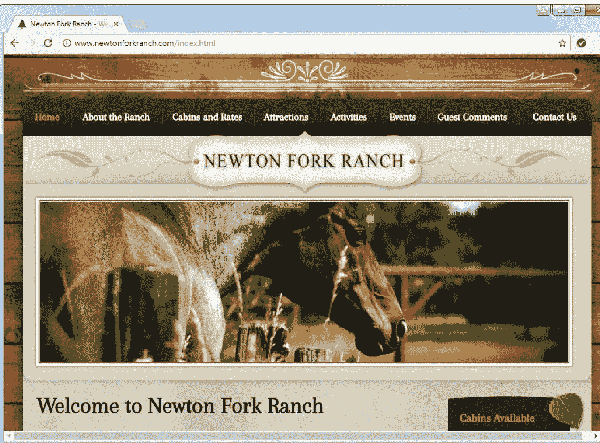

#### Web 服务器如何处理静态网页

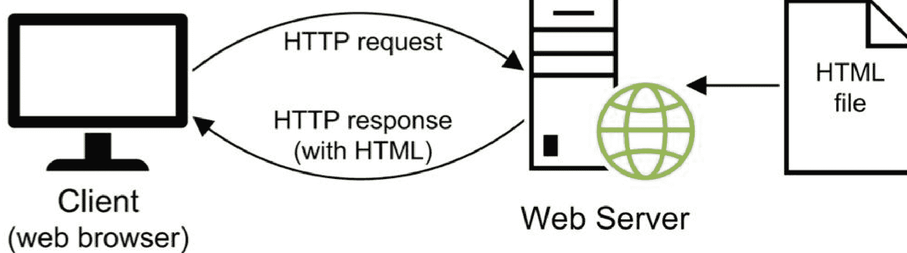

**描述**

- 超文本标记语言 (`HTML`) 用于标记页面。
- 静态网页是存储在 Web 服务器上且不会改变 `HTML` 文档。静态网页的文件名具有 `.htm` 或 `.html` 扩展名。
- 当用户请求静态网页时，浏览器向 Web 服务器发送一个 `HTTP` 请求，其中包含所请求的文件名。
- 当 Web 服务器接收到请求时，它获取网页的 `HTML` 并将其作为 `HTTP` 响应的一部分发送给浏览器。
- 当浏览器接收到 `HTTP` 响应时，它将 `HTML` 渲染为浏览器中显示的网页。

图 1-2 静态网页的处理过程

#### 动态网页如何处理

像图 1-3 中那样的动态网页，是指每次被请求时都由 Web 服务器上的程序或脚本创建的页面。该程序或脚本由应用程序服务器根据随 `HTTP` 请求 一起发送的数据执行。在这个示例中，`HTTP` 请求标识了所显示的书籍。然后，请求页面的程序或脚本从数据库服务器检索了该书籍的图像和数据。

此图中的图显示了 Web 服务器如何处理动态网页。过程从用户在浏览器中请求页面开始。要做到这一点，用户可以在浏览器的地址栏中输入页面的 `URL`，点击指定要加载动态页面的链接，或点击包含动态页面处理所需数据的表单按钮。

在每情况下，Web 浏览器都会处理 `HTTP` 请求并将其发送到 Web 服务器。请求包含了处理请求所需的任何数据。例如，如果用户在表单输入了数据，这些数据将包含在 `HTTP` 请求中。

当 Web 服务器接收到 `HTTP` 请求时，服务器检查请求网页的扩展名，以识别应该处理该请求的应用程序服务器。然后，Web 服务器将请求转发给处理该类型网页的应用程序服务器。

接下来，应用程序从硬盘检索相应的程序或脚本。它还会加载用户提交的任何数据。然后，它执行该脚本。随着脚本的执行，它生成网页的 `HTML`。如有必要，脚本将从数据库服务器检索数据，并将这些数据作为其正在生成的网页的一部分。

当脚本完成后，应用程序服务器将动态生成的 `HTML` 发送回 Web 服务器。然后，Web 服务器将 `HTML` 作为 `HTTP` 响应的一部分发送回浏览器。

当浏览器接收到 `HTTP` 响应时，它渲染 `HTML` 并显示网页。但注意，Web 浏览器无法判断 `HTTP` 响应中的 `HTML` 是用于静态页面还是动态页面。它只是渲染 `HTML`。

当页面显示出来时，用户可以查看内容。然后，当用户请求另一个页面时，过程再次开始。用户请求网页到服务器向客户端发送响应的过程被称为“往返”（`round trip`）。

动态网页让你能够创建交互式 Web 应用程序，并处理你在互联网上发现的所有类型的处理，包括电子商务应用程序。虽然你在这本书中不会学习如何开发动态网页，但你将学习如何创建将用户数据发送到 Web 服务器的 `HTML` 表单。一旦你掌握了 `HTML`，你就可以学习如何使用 `JSP`、`ASP` 或 `PHP` 等服务器端技术来创建网站所需的动态页面。

# 第 1 章 Web 开发简介 9

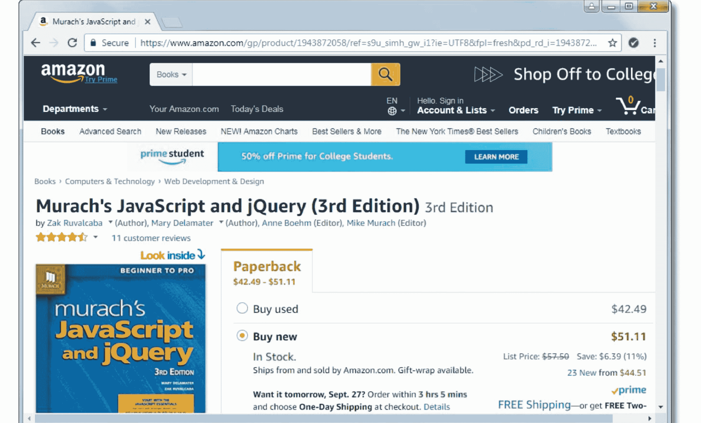

- Zak Reissman (作者), Mary Demostovich (编辑), Andrew Boomer (编辑), Mike Murach (编辑)

#### Web 服务器如何处理动态网页

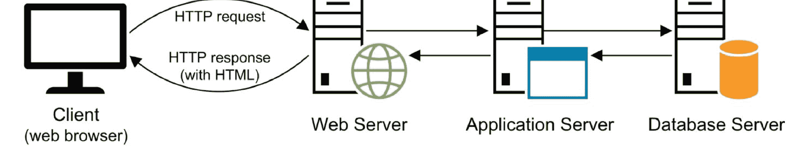

**描述**

- 动态网页是由服务器端程序或脚本生成的页面。
- 当 Web 服务器接收到对动态网页的请求时，它查找请求文件的扩展名，以确定应该由哪个应用程序服务器处理该请求。
- 当应用程序服务器接收到请求时，它运行指定的脚本。通常，此脚本使用从 Web 浏览器获取的数据从数据库服务器获取适当的数据。该脚本还可以将接收到的数据存储在数据库中。
- 当应用程序服务器完成数据处理后，它生成网页的 `HTML` 并将其返回给 Web 服务器。然后，Web 服务器将 `HTML` 作为 `HTTP` 响应返回给 Web 浏览器。

图 1-3 动态网页的处理过程

#### 客户端 JavaScript 如何融入 Web 开发

与用于动态网页的服务器端处理不同，`JavaScript` 是一种提供客户端处理支持的脚本语言。例如，在图 1-5 所示的网站中，`JavaScript` 用于在不使用服务器端处理的情况下更改显示的图像。

为了实现这一功能，当请求页面时，所有所需的图像都会加载到浏览器中。然后，如果用户点击衬衫下方的任意颜色块，衬衫图像就会变为对应颜色的图像。这被称为图像切换（`image swap`）。同样，当用户将鼠标悬在衬衫上时，图像会被替换为该衬衫的全视图图像。这被称为图像悬停（`image rollover`）。

图中的图显示了 `JavaScript` 处理是如何工作的。当浏览器请求一个网页时，服务器会将 `HTML` 和相关的 `JavaScript` 同时返回给浏览器。然后，`JavaScript` 代码将由浏览器的 `JavaScript` 引擎在 浏览器中执行。这减轻了服务器的一些负担，并使应用程序运行更快。通常，`JavaScript` 与动态网页结合使用，但也可以用于静态网页。

除了图像切换和悬停效果，`JavaScript` 还有许多其他用途。例如，另一个常见用途是在将用户输入 `HTML` 表单的数据发送到服务器处理之前对其进行验证。这节省了不必要的服务器往返。`JavaScript` 的其他常见用途是旋转网页中某个区域的标题或产品，并提供动画。事实上，每当你看到网页的某个循环显示一系列文本块或图像时，很可能是由 `JavaScript` 完成的。

在书中，你将不会学习如何编写 `JavaScript` 代码。然而，你将在本书的第 19 章学习如何使用现有的 `JavaScript` 程序。在那里，你将学习如何使用 `JavaScript` 和一个名为 `jQuery` 的 `JavaScript` 库，通过图像切换、图像悬停和数据验证等功能来增强你的网页。

# 第 1 章 Web 开发简介

## 具有图像切换和悬停效果的网页

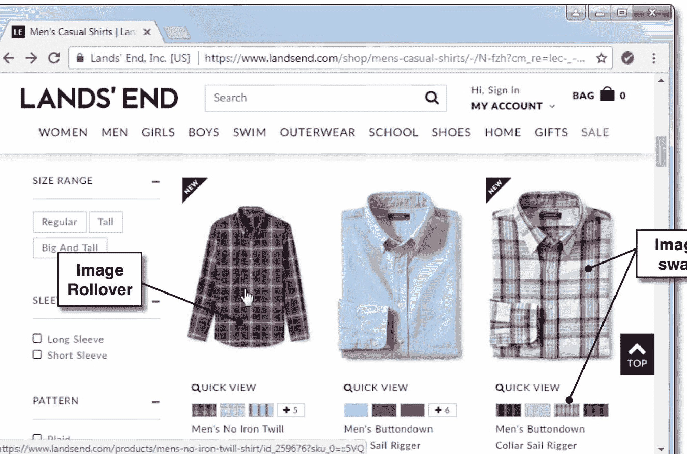

## JavaScript 如何融入这一架构

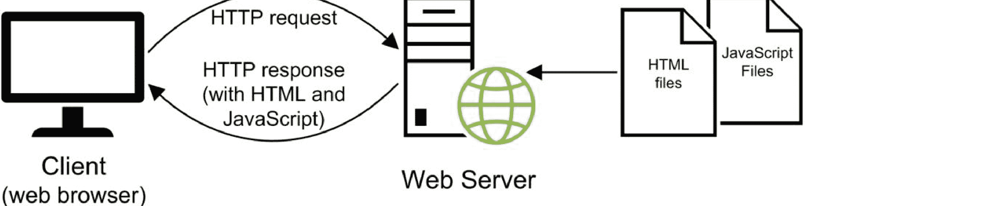

## JavaScript 的众多用途中的三个

- 数据验证
- 图像切换和悬停
- 幻灯片

- `JavaScript` 是一种由网页浏览器 `JavaScript` 引擎运行的客户端脚本语言。
- 当浏览器请求包含 `JavaScript` 或指向 `JavaScript` 文件链接的 `HTML` 页面时，`HTML` 和 `JavaScript` 都会加载到浏览器中。
- 因为 `JavaScript` 运行在客户端而非服务器上，因此它提供了不需要返回服务器的功能。这可以帮助应用程序运行得更高效。

图 1-5 客户端 `JavaScript` 如何融入 Web 开发。

### HTML 和 CSS 简介

要开发网页，你使用 `HTML` 来定义页面的内容和结构。然后，你使用 `CSS` 对这些内容进行格式化。接下来的主题将介绍 `HTML` 和 `CSS`。

#### 网页的 HTML

超文本标记语言（`HTML`）用于定义网页的内容和结构。例如，在图 1-6 中，你可以看到一个网页的 `HTML`，随后是一个显示该页面在 Chrome 浏览器中显示的浏览器。尽管你将在书中学习如何为 `HTML` 页面的每个方面编写代码，但这里只是对其工作原理的简要介绍。

整个页面的代码被称为 `HTML` 文档。该文档以 `DOCTYPE` 声明开始，随后是用于标识文档内 `HTML` 元素的标签。每个元素的起始标签由尖括号包围的元素名组成，例如 `<html>`。而结束标签由左尖括号、正斜杠、元素名和右尖括号组成，例如 `</html>`。

`HTML` 文档的基本结构由在 `<html>` 元素内编码的 `head` 和 `body` 元素组成。`head` 部分的元素提供有关文档的信息。`body` 部分包含将在 Web 浏览器中显示的元素。例如，`head` 部分中的 `title` 元素提供了在浏览器标签页中显示的页面标题，而 `body` 部分中的 `h1` 元素提供了在 浏览器中显示的标题。

许多元素可以使用属性进行编码，这些属性用于标识元素并定义元素内内容的显示方式。这些属性编码在起始标签内，每个属性由属性名、一个等号和属性值组成。例如，此示例中的 `` 标签有两个名为 `src` 和 `alt` 的属性。在这种情况下，`src` 属性提供了应显示的图像文件名，而 `alt` 属性提供了在找不到图像时应显示的文本。

# 第 1 章 Web 开发简介

## 名为 javascript_jquery.html 的 doctype HTML 文件代码

```html
<!doctype html>
<html lang="en-8">
<head>
  <meta charset="utf-8">
  <title>JavaScript and jQuery book</title>
</head>
<body>
  <h1>JavaScript and jQuery (3rd Edition)</h1>
  
  <p>JavaScript is used on the... (truncated)
  <p>Now, <a href="#">read more...</a></p>
</body>
</html>
```

## 在浏览器中显示的 HTML

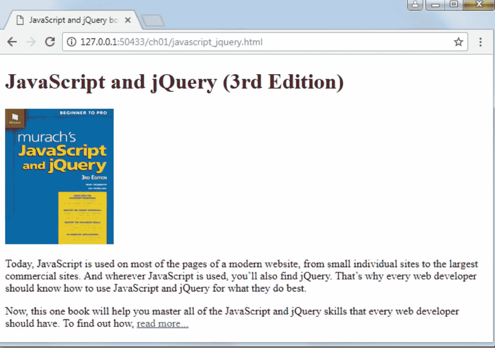

**描述**

- `HTML`（超文本标记语言）用于定义页面的内容和结构。

图 1-6 网页的 `HTML`。

#### 网页的 CSS

在不久的以前，`HTML` 文档的编码方式使得 `HTML` 不仅定义了内容和结构，而且难以编辑和维护。然而，现在层样式表（`CSS`）允许你将格式与内容分离。

在大多数情况下，应用样式表的最佳方法将其编码在单独的文件中。然后，为了应用样式表，你在 `HTML` 文档的 `head` 部分中编码一个 `link` 元素，如图 1-7 所示。在这一链接之后，你可以看到名为 `css.css` 的 `CSS`。随后是一个浏览器，显示了在应用样式表后页面显示效果。

# 第 1 章 Web 开发简介 17

## HTML 文件中链接 CSS 文件的头部元素

```html
<link rel="stylesheet" href="book.css">
```

## 名为 book.css 的 CSS 文件代码

```css
body {
  font-family: Arial, Helvetica, sans-serif;
  font-size: 100%;
  width: 560px;
  margin: 0 auto;
  padding: 1em;
  border: 1px solid navy;
}
h1 {
  margin: 0;
  padding: .25em;
  font-size: 200%;
  color: navy;
}
img {
  float: left;
  margin: 0 1em 1em 1em;
}
p {
  margin: 0;
  padding-bottom: .5em;
}
```

## 在 浏览器中显示的网页

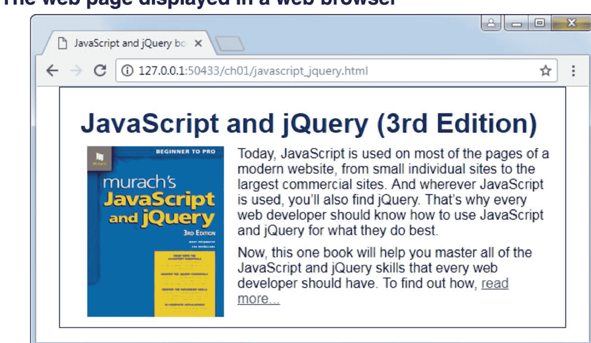

**描述**

- 层叠样式表（`CSS`）通过指定网页的字体、颜色、边框、间距和布局来控制网页的显示方式。

图 1-7 网页的 `CSS`

#### HTML 和 CSS 标准的简史

如图 1-8 所示，`HTML` 是一种自 20 世纪 90 年代初以来存在的标准语言。在 90 年代，人们采用了三个不同版本的 `HTML`。随后，在 2000 年 1 月通过了 `XHTML 1.0`。

`XHTML`（可扩展 `HTML`）是 `HTML` 的修改版本，它与 `HTML 4.01` 使用相同的语法并支持相同的元素，但依赖于规范 `HTML` 编写方式的严格规则和指南。这使得 `XHTML` 能够被自动化工具读取和操作。这也让 `XHTML` 编辑器能够更容易识别文档结构中的错误。

今天，`HTML 5` 连同其第一个修订 `HTML 5.1` 用一个单一标准取代了旧的 `HTML` 和 `XHTML` 标准。虽然 `HTML 5.0` 发布时提供了许多新功能，但所有现代浏览器都支持 `HTML 5.0` 和 `HTML 5.1` 的功能。

如该图所示，`CSS` 是一种追溯到 1996 年的标准语言。然而，直到最近它才被接受为格式化 `HTML` 页面的正确方法。今天，`CSS 3.0` 受所有现代浏览器支持，并被广泛接受为格式化网页的正确方法。请注意，目前还没有 `CSS 4.0` 的计划。

在本书中学习如何将 `HTML 5.0` 和 `HTML 5.1` 的新功能作为 `CSS 3` 的新功能使用。当然，你也将学习如何使用之前规范中包含在当前规范中的 `HTML` 和 `CSS`。请注意，从现在起，我们将 `HTML 5` 和 `CSS3` 称为 `HTML5` 和 `CSS3`。

对于那些不支持 `HTML5` 和 `CSS3` 新功能的浏览器怎么办？本书还将向你展示如何让网页在那些旧版浏览器中运行。通常情况下，你不需要做任何事情，因为新功能会被那些浏览器忽略，而不会产生任何影响。例如，如果你使用 `CSS` 为 `HTML` 框框提供圆角或阴影，这些功能会在某些浏览器中改善图形效果，但在其他浏览器中会被忽略。

该图还展示了你应该熟悉的两个网站。第一个是世界万网联盟，通常称为 `W3C`。这是一个开发标准的团体，该网站应该是你获取 `HTML` 和 `CSS` 信息的主要来源之一。

第二个网站是 Web 超文本应用技术工作组（`WHATWG`）。这是一个对进化 `HTML` 及相关技术感兴趣的人的社区，该网站应该是获取 `HTML` 和 `CSS` 信息的另一个主要来源。

##### HTML 标准开发的亮点

| 版本 | 描述 |
| :--- | :--- |
| HTML 1.0 | 1993 年 1 月发布的草案规范，从未被采用为标准。 |
| HTML 2.0 | 1995 年 11 月通过。 |
| HTML 4.0 | 1997 年 12 月通过。它正式化了网页浏览器使用的新功能，并废弃了后来的功能。 |
| HTML 4.01 | 1999 年 12 月通过，并更新至 2001 年 5 月。 |
| XHTML 1.0 | 2000 年 1 月通过，并在 2002 年 8 月修订。它使用 XML 语法重构了 HTML 4，使得网页更容易被解析。使用 CSS 查找网页错误的自动化工具。 |
| XHTML 1.1 | 2001 年 5 月通过。内容的呈现控制现在通过 CSS 完成。 |
| HTML 5 | 2008 年 1 月作为工作草案发布。最初，它定义了一个名为 HTML5 的 HTML 版本和一个名为 XHTML5 的 XHTML 版本。今天，该草案已增强为新的 HTML 规范，取代了 HTML 4 和 XHTML 1。 |
| HTML 5.1 | 2013 年 4 月作为 HTML 5 的第一个小版本发布。它添加了 `<main>` 元素并删除了 `<huge>` 元素。于 2013 年 11 月接受为 W3C 标准。 |

##### CSS 开发的亮点

| 版本 | 描述 |
| :--- | :--- |
| CSS 1.0 | 1996 年 12 月通过。 |
| CSS 2.0 | 1998 年 5 月通过。增加了定位、媒体类型等功能。 |
| CSS 2.1 | 2004 年 2 月成为候选推荐标准，2011 年 6 月成为推荐标准。修复了 CSS 2.0 的错误。 |
| CSS 3.0 | 模块化开发。选择器、盒模型、背景/边框、文本效果等模块陆续发布。 |

##### 你应该熟悉的两个网站

- 世界万网联盟（`W3C`）是开发标准的团体，该网站应该是你获取 `HTML` 和 `CSS` 信息的主要来源之一：`www.w3.org`。
- Web 超文本应用技术工作组（`WHATWG`）是一个对进化 `HTML` 及相关技术感兴趣的人的社区，该网站应该是获取 `HTML` 和 `CSS` 信息的另一个主要来源：`www.whatwg.org`。

### Web 开发工具

要创建和编辑 `HTML` 文件，你需要文本编辑器或 `IDE`。要在互联网上部署网站，你还需要一个 `FTP` 程序从计算机或服务器上传文件。

#### HTML 和 CSS 文本编辑器

文本编辑器让你输入和编辑文本。虽然你可以使用任何文本编辑器输入 `HTML` 和 `CSS`，但更好的编辑器可以加快开发速度并减少错误。因此，我们推荐 `Brackets`。它是免费的，可在 Windows 和 Mac 系统运行，并具有许多功能。例如，`Brackets` 提供语法高亮和自动补全列表。

在下一章节中，我们将展示如何使用 `Brackets` 开发网页。这将帮助你体会它提供的许多功能。但请注意，你也可以使用任何喜欢的文本编辑器来开发网页。或者，你可以使用图中所示的 `IDE`。

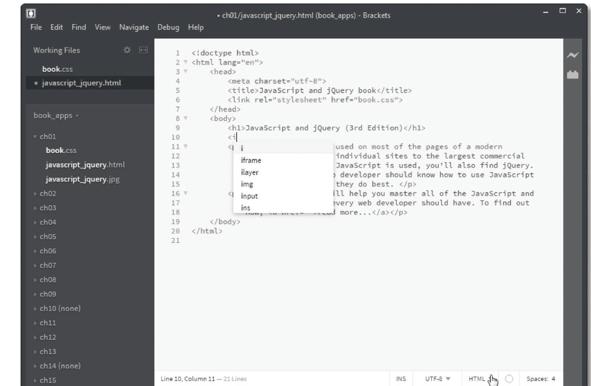

##### 你可以使用本书使用的五种免费文本编辑器

| 编辑器 | 运行平台 |
| :--- | :--- |
| Brackets | Windows, Macintosh, Linux |
| Atom | Windows, Macintosh, Linux |
| Visual Studio Code | Windows, Macintosh, Linux |
| Notepad++ | Windows |
| TextMate | Macintosh |

#### Web 开发的 IDE

在获得像 `Brackets` 之类的文本编辑器经验后，你可能会对用于 Web 开发的集成开发环境（`IDE`）感兴趣。例如，`Adobe Dreamweaver` 一直是 Web 开发中最流行的商业 `IDE`。

`Dreamweaver` 的最新版本是 `Dreamweaver CC 2018`。正如你在图 1-10 中所示，它允许你在窗口的一个面板中编辑 `HTML` 或 `CSS`，同时在另一个面板中显示网页的预览效果。`Dreamweaver` 还允许你通过将常用元素的符号拖动到 `HTML` 文档中来生成代码，而无需手动输入。每当你创建一个新文件时，它都会为你提供 `HTML` 文档的起始代码。它可以帮助你管理网站的文件夹和文件。它还提供了一个 `FTP` 程序，可以将页面从你的开发服务器上传到你的互联网服务器。此外它还有许多其他功能。

总的来说，像 `Dreamweaver` 这样的 `IDE` 可以帮助你大幅提高工作效率。这就是为什么专业 Web 开发人员经常使用用于 Web 开发的 `IDE`。但请注意，不同 `IDE` 的功能和价格差异很大。例如，某些 `IDE` 提供的功能可以让你将 `HTML` 和 `CSS` 的开发与 `JavaScript` 以及服务器端脚本语言（如 `PHP`、`Perl` 和 `Python`）集成。在购买 `IDE` 之前，你需要找到最适合你的需求和预算的 `IDE`。

在最高层次，用于 Web 开发的 `IDE` 可以包含开发网站所需的所有程序。这类 `IDE` 通常被称为套件（`suites`）。例如，`Adobe Creative Cloud` 产品套件可能包括用于编辑照片和图像的 `Photoshop CC`、用于创建和编辑插图的 `Illustrator CC`、用于网页添加动画和交互的 `Animate CC` 以及其他几个与 Web 相关的程序。

# 第 1 章 Web 开发简介 23

## Adobe Dreamweaver CC

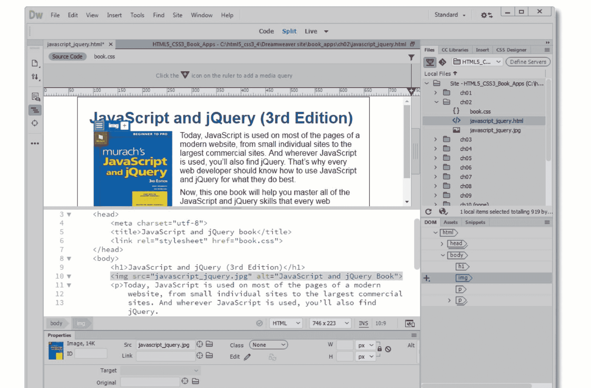

## JavaScript 和 jQuery (第三版)

今天，`JavaScript` 被用于现代网站的许多页面，从小型网站到最大的商业网站都是。无论你是使用 `JavaScript` 还是 `jQuery`，你还会发现学习 `jQuery` 是为了学习如何使用 `JavaScript` 来完成它们擅长的工作。

现在，你将学习如何掌握它们要求的所有 `JavaScript` 和 `jQuery` 技能。

```html
<html>
<head>
  <meta charset="utf-8">
  <title>JavaScript and jQuery book</title>
  <link rel="stylesheet" href="style.css">
</head>
<body>
  <script src="javascript.jquery.js"></script>
  <p>JavaScript is used on many pages of a modern
website, from small sites to the largest commercial
s. And wherever JavaScript is used, you'll also find
jQuery.</p>
</body>
</html>
```

## 流行的 Web 开发 IDE

| IDE | 运行平台 |
| :--- | :--- |
| Adobe Dreamweaver CC | Windows 和 Macintosh |
| Microsoft Visual Studio | Windows |
| WebStorm | Windows, Macintosh 和 Linux |
| Eclipse | Windows, Macintosh 和 Linux |
| NetBeans | Windows, Macintosh 等其他 |
| Aptana Studio 3 | Windows, Macintosh 和 Linux |
| Cloud9 | Web 端 |

## 开发

- 集成开发环境 (`IDE`) 超越了文本编辑，为网站的开发提供其他功能。

图 1-10 Web 开发的 `IDE`

#### 用于向 Web 服务器上传文件的 FTP 程序

如果你想在互联网上部署（或发布）你的网站，你需要将你网站的文件夹和文件从你的计算机或网络传输到具有互联网访问能力的 Web 服务器。为了做到这一点，你需要使用如 1–11 中列出的 `FTP` 程序。这类程序使用文件传输协议（`File Transfer Protocol`）在 Web 服务器之间进行传输。

像 `Dreamweaver CC`这样的 `IDE` 通常包含 `FTP` 程序。如果你正在使用文本编辑器，你可能找到一个 `FTP` 程序的插件。然后，你就可以从文本编辑器访问 `FTP` 程序。例如，`eqFTP` 是一个可以与 `Brackets` 一起使用的插件。`Brackets` 调用这些扩展，你将在第 2 章中学习如何安装它们。

如果你还没有 Web 服务器，一种选择是寻找一个提供 Web 托管服务的互联网服务提供商 (`ISP`)。如果你在网上搜索，你可以找到许多提供 Web 托管的 `ISP`，通常收取少量的月费。

如果你打算在网站上使用动态网页，你需要找到一个支持你将要使用的服务器端技术和数据库的 `ISP`。例如，如果你打算使用带有 `MySQL` 数据库的 `PHP`（这是一个常见的组合），你需要找到支持该组合的 `ISP`。

当你选择 Web 主机时，你使用一个像 `64.71.179.86` 这样的 `IP` 地址来唯一标识你的网站（`IP` 代表互联网协议）。然后，你可以使用互联网上的任何公司，有时你也可以从你的 `ISP` 获得域名。在获得域名之前，你可以使用 `IP` 地址访问你的站点。

在获得 Web 主机后，你使用你的 `FTP` 程序将你网站的文件上传到该 Web 主机的 Web 服务器上。然后，你可以在互联网上测试你的网站。当你完成测试后，就可以向世界宣布你的网站并让它上线。

# 第 1 章 Web 开发简介

## FileZilla - 免费工具 zek://www.miracosta.com - FileZilla


## 一些 FTP 程序

| 程序 | 描述 |
| :--- | :--- |
| FileZilla | 免费工具 |
| Voyager | Windows |
| CuteFTP | Windows |
| Fetch | Macintosh |

**描述**

- 如果你想在互联网上部署（或发布）你的网站，你需要将你网站的文件夹和文件从你的计算机或网络传输到具有互联网访问能力的 Web 服务器。为了做到这一点，你需要使用如 1–11 中列出的 `FTP` 程序。这类程序使用文件传输协议（`File Transfer Protocol`）在 Web 服务器之间进行传输。
- 像 `Dreamweaver CC`这样的 `IDE` 通常包含 `FTP` 程序。如果你正在使用文本编辑器，你可能找到一个 `FTP` 程序的插件。然后，你就可以从文本编辑器访问 `FTP` 程序。例如，`eqFTP` 是一个可以与 `Brackets` 一起使用的插件。`Brackets` 调用这些扩展，你将在第 2 章中学习如何安装它们。
- 如果你还没有 Web 服务器，一种选择是寻找一个提供 Web 托管服务的互联网服务提供商 (`ISP`)。如果你在网上搜索，你可以找到许多提供 Web 托管的 `ISP`，通常收取少量的月费。
- 如果你打算在网站上使用动态网页，你需要找到一个支持你将要使用的服务器端技术和数据库的 `ISP`。例如，如果你打算使用带有 `MySQL` 数据库的 `PHP`（这是一个常见的组合），你需要找到支持该组合的 `ISP`。
- 当你选择 Web 主机时，你使用一个像 `64.71.179.86` 这样的 `IP` 地址来唯一标识你的网站（`IP` 代表互联网协议）。然后，你可以使用互联网上的任何公司，有时你也可以从你的 `ISP` 获得域名。在获得域名之前，你可以使用 `IP` 地址访问你的站点。
- 在获得 Web 主机后，你使用你的 `FTP` 程序将你网站的文件上传到该 Web 主机的 Web 服务器上。然后，你可以在互联网上测试你的网站。当你完成测试后，就可以向世界宣布你的网站并让它上线。
- 集成开发环境 (`IDE`) 超越了文本编辑，为网站的开发提供其他功能。
- 大多数 `IDE` 内内置 `FTP` 程序。例如，`Dreamweaver CC` 不仅从客户端传输到 Web 服务器，还从 Web 服务器。
- 通过仅使用小写字母，你可以避免这个问题。

图 11 用于向 Web 服务器上传文件的 `FTP` 程序

#### 如何查看网页

如果你想查看位于计算机或局域网上的 `HTML` 页面，可以使用图中所示的三种技术之一。首先，你的文本编辑器或 `IDE` 可以让你方便地查看正在处理的页面。其次，你可以在文件管理器中找到文件并双击它。第三，如果浏览器有菜单栏，可以使用 `File→打开` 命令。

## 如何查看页面

正如页面开头的图所示，`URL` 包含四个部分。在大多数情况下，协议是 `HTTP`。如果你省略了协议，浏览器将默认使用 `HTTP`。

第二个部分是 Web 服务器用于查找地址的域名。虽然你不能省略域名，但你可以省略域名中的 "`www.`"。

第三部分是文件在服务器上的路径。路径列出了包含该文件的文件夹。正斜杠用于分隔名称并表示服务器的根目录。在示例中，路径为 "`/students/scholarships/`"。

最后一个部分是文件名。在示例中，文件名是 `index.html`。如果你省略了文件名，Web 服务器将搜索路径中的默认文档。根据 Web 服务器的不同，该文件将是 `index.html`。

在页面的底部，你可以看到文件夹和文件的命名建议。通常，我们建议文件夹和文件名仅包含小写字母、下划线、连字符和句点。在本书的示例中，你会看到作者的偏好，即在单词中使用下划线而不是连字符。有些开发者使用连字符而不是下划线。

另一个建议是创建能够清晰指示文件夹和网页内容的名称。这可以提高搜索引擎优化 (`SEO`)，稍后我们将详细介绍。

图 12 显示了你如何查看页面。接下来，你将学习如何查看互联网上的页面。当你测试自己的网站时，这些都是非常有用的技能。

### HTTP URL 的组件

```
http://www.modulemedia.com/ourwork/index.html
协议 | 域名 | 路径 | 文件名
```

`http://www.miracosta.edu/studentsservices/scholarships/index.html`

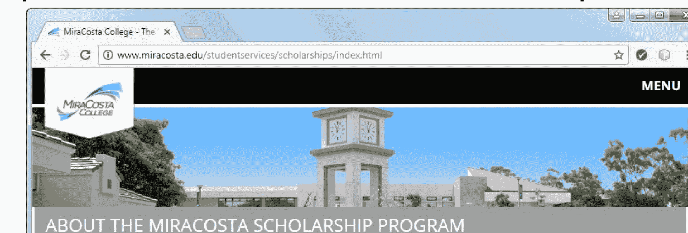

Miracosta 学院基金（Miracosta College Foundation）在秋季和春季学期提供许多奖学金。大部分奖学金是面向 Miracosta 学院就读学生的，但也有面向转入四年制院校的 Miracosta 学院学生以及计划在秋季入学 Miracosta 学院的高中学生的奖学金。

- 点击此处阅读有关 Miracosta 学院奖学金/捐赠者的信息。
- 点击此处查看参加 2015 年度奖学金颁发典礼的学生和捐赠者，并点击此处查看照片。

### 如果省略了 URL 的部分会发生什么

- 如果省略了协议，将使用默认的 `http://`。
- 如果省略了文件名，将使用 Web 服务器的默认文档名称。这通常是 `index.html`、`default.htm` 或其变体。

### 在互联网上访问网页的两种方式

- 在浏览器的地址栏中输入网页的 `URL`。
- 点击当前页面中的链接以加载下一个网页。

### 在你自己的服务器或计算机上访问网页的三种方式

- 使用你的文本编辑器或 `IDE` 的功能。
- 在文件管理器中找到该文件。然后，双击它在默认浏览器中打开。或者，右键点击它并使用“打开方式”命令来选择浏览器。
- 如果你有菜单栏，请使用“文件→打开”或“文件→打开”命令。

### 文件夹和文件的命名建议

- 创建由小写字母、数字、下划线或连字符以及点组成的文件夹和文件名称。
- 使用能够清晰指示页面内容的文件名。这有利于搜索引擎优化（参见图 1-17）。

图 1-12 如何查看网页

#### 如何查看网页的源代码

当浏览器显示一个网页时，你可以使用图 1-13 中的技术查看该页面的 `HTML` 代码。如果你使用的是 Chrome 浏览器，可以右键点击页面，并在单独窗口中选择“查看页面源代码”命令。在这个示例中，显示了前图中页面的 `HTML` 代码。

在测试应用程序时，查看源代码是非常用的。但你也可以使用这种技术来查看互联网上其他网站的 `HTML`。这是学习其他网站如何运作的一种极佳方法。尽管某些网站使用各种技术来隐藏代码，但互联网上有很多代码是可以获取的。

如果 `HTML` 页面的 `CSS` 存储在外部文件中，你有时可以通过点击 `HTML` 代码中的路径使用 Chrome 或 Firefox 浏览器打开该文件。例如，对于图中的代码，你可以点击 `styles/layout.css` 来访问该网站使用的六个 `css` 文件之一。这让你分析 `CSS` 代码是如何运行的。

如果你使用的是 Edge，网页的 `HTML` 源代码显示在开发者工具的“调试（`Debugger`）”选项卡中。然后，你可以查看外部文件中的 `CSS`，按住 `Ctrl` 键并点击 `HTML` 代码中的路径。

如果你使用的是 Internet Explorer，可以通过浏览器的地址栏中输入 `CSS` 的 `URL` 来查看外部文件中的 `CSS`。例如，对于图中 `HTML` 代码中通过 `link` 元素标识的第一个 `CSS` 文件，你可以在浏览器中输入以下内容：

```
http://www.miracosta.com/styles/layout.css
```

然后，当你按下回车键时，文件就会打开。在第 3 章中，你将学习更多关于 `HTML` 代码中相对地址，以便你能够确定它们的 `URL`。

当你查看网页的 `HTML` 时，请记住它可能包含嵌入的 `CSS` 代码或 `JavaScript` 代码。除此之外，你会发现除了最简单的网站外，所有的网站都相当复杂。不过，当你完成这本书后，你应该能够弄清楚大多数网站的 `HTML` 和 `CSS` 是如何工作的。通过研究优秀网站是如何编码的，你会学到很多东西。

## 图 12 页面的 HTML 源代码

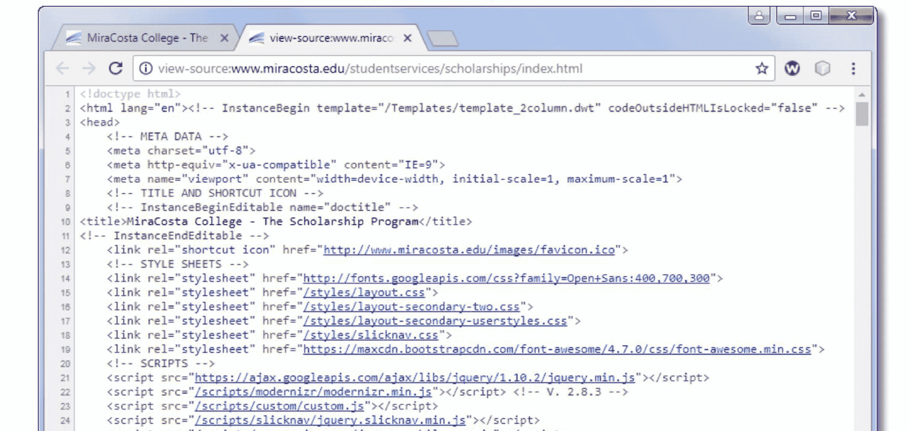

### 如何查看网页的 HTML 源代码

- 在 Chrome 中，右键点击页面并选择“查看源代码”命令。
- 在 Internet Explorer 或 Edge 中，右键点击页面并选择“查看源代码”命令。
- 在 Chrome 或 Internet Explorer 中，源代码显示在新浏览器标签页或单独窗口中。
- 在 Edge 中，源代码显示在开发者工具的“调试（`Debugger`）”选项卡中。此外，如果右键点击页面时不显示“查看源代码”命令，你可能需要按下 `F2` 键来打开开发者工具。

### 如何查看外部 CSS 文件中的 CSS

- 在 Chrome 中，点击引用 `CSS` 文件的链接。
- 在 Edge 中，按住 `Ctrl` 键并点击引用 `CSS` 文件的链接。
- 在 Internet Explorer 中，`CSS` 的 `URL` 在浏览器的地址栏中。

**描述**

- 在调试时查看页面源代码很有用。它也提供了一种查看网站如何编码的方法。
- 如果页面的 `CSS` 存储在外部文件中，你也可以看到。
- 如果页面是 `HTML`，你可以通过上述方法进行查看。

图 1-13 如何查看网页的源代码

#### 五个关键开发问题

每当你开发应用程序时，都应该意识到图中介绍的问题。然后，随着课程的进行，你将学习跨浏览器兼容性、用户可用性和搜索引擎优化。

## 一个易于使用的网站

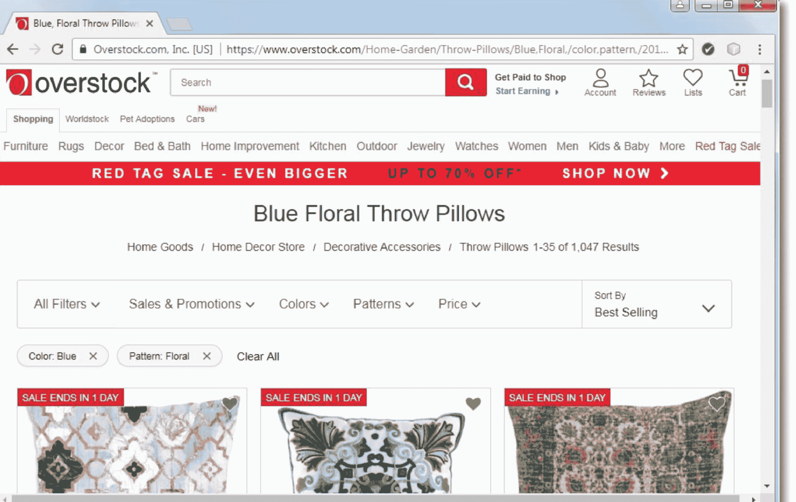

### 用户想要什么

- 尽可能快速、方便地找到他们想要的内容
- 尽可能快速、方便地获取信息或完成任务

### 用户是如何使用网页的

- 他们会扫描页面以寻找他们想要的内容或指向内容的链接，而且他们不喜欢滚动页面。如果他们感到沮丧，就会离开。
- 他们经常点击链接和按钮以希望找到想要的内容，并在没找到时频繁点击“后退”按钮。

### 提高可用性的四条指南

- 尽可能在“折叠以上”（`above the fold`）展示尽可能信息，以便用户可以更少滚动。
- 将相关项目分组，并限制每个页面上的分组数量。
- 包含一个页眉，用于识别网站并提供导航栏和工具链接。
- 使用当前的导航惯例，包括点击会回到主页的 Logo 以及点击会进入购物车的购物车图标。

**描述**

- 可用性指的是网站的易用程度，可用性是构建有效网站的关键需求。

图 1-14 可用性问题

#### 跨浏览器兼容性

如果你查看 1-14 中的图，你会发现它实施了这些指南。所有关键信息都展示在折叠以上。页面被分为一个页眉和另外三个定义良好的组。也很容易看出页面哪些地方可以点击。即使这是一个拥有数百个产品类别和数千种产品的大型网站，事实也是如此。

如果你希望你的网站能被尽可能多的访问者使用，你需要确保你的网页兼容尽可能多的浏览器。这被称为跨浏览器兼容性。这意味着你应该在尽可能浏览器上测试你的应用程序，包括图 1-15 中总结的六种浏览器，以及旧版本的 Internet Explorer。

此图中的表格显示了这些浏览器的当前发布版本以及它们对 `HTML5` 支持的评分。要获取这些信息的更新版本，你可以访问网站 `www.html5.com`。当你在 访问该网站时，它将提供关于你正在使用的浏览器如何支持 `HTML5` 的细节。如果浏览器不支持书中介绍的 `HTML5` 或 `CSS3` 特性，书籍将向你展示需要使用的解决方案（`workaround`）。

通常，Internet Explorer 给开发者带来的问题最多，因为它的标准最低。相比之下，其他五种浏览器通常支持相同的功能；如果页面在其中一个上运行，它也会在其他上运行。其他五种浏览器还提供自动更新功能，但 `IE` 并不总是这样做。结果是其他五种浏览器应该始终保持最新，这意味着你不必在这些浏览器的旧版本中测试你的网页。

在过去，在旧版本的 Internet Explorer 中测试网页是很困难的，因为你无法获取它们，而且即使你能获取，在单个系统上也无法获得超过一个版本。幸运的是，新版本的 `IE` 具有让你模拟版本的工具。要使用这些工具，你可以在浏览器窗口中按 `F12` 显示开发者工具窗口。然后，你按 `Ctrl+Shift-8` 或点击窗口顶部的“模拟”（`Emulation`）选项卡来显示模拟选项。最后，你从“文档模式”（`Document Mode`）属性下拉列表中选择你想要使用的 `IE` 版本。

如果你是一个学生，可能不需要在旧版本的 Internet Explorer 中测试你的网页。事实上，对于书中的练习，你只需要 Chrome 和你的默认浏览器（Windows 上的上的 `IE` 或 `Edge`，或 Mac 上的 Safari）。但是，对于生产环境的应用程序，你需要在你的用户可能使用的所有浏览器上测试你的页面。

### 当前浏览器及其 HTML5 评分（满分 555）

| 浏览器 | 发布版本 | HTML5 测试评分 |
| :--- | :--- | :--- |
| Google Chrome | 63 | 528 |
| Opera | 45 | 518 |
| Mozilla Firefox | 57 | 486 |
| Edge | 16 | 476 |
| Apple Safari | 11 | 452 |
| Internet Explorer | 11 | 312 |

### 用于这些评分的网站

`http://www.html5test.com`

### 跨浏览器兼容性指南

- 在所有主流浏览器上测试你的网页，包括仍在使用的旧版本 Internet Explorer。
- 在开发网页时使用 `HTML5` 和 `CSS3` 的功能，但要使用解决方案，以便它们在仍在使用的旧浏览器中运行。

### 如何在旧版本的 Internet Explorer 中测试网页

- 测试不同版本的 Internet Explorer 的问题之一是你可以不能同时安装多一个版本。
- 解决方案是使用 Internet Explorer 9 提供的模拟工具。这些工具让你能够模拟旧版本的 Internet Explorer。

**描述**

- 作为 Web 开发者，你希望你的网页能在尽可能不同的浏览器上运行。这被称为跨浏览器兼容性。
- 当你为通用用途开发网站时，你需要在所有浏览器的当前版本上测试它，包括仍在使用的旧版本 Internet Explorer。
- 虽然 Internet Explorer 被广泛常用，但它带来的问题最多，且并不总是提供自动更新。
- 在书中，当你学习相关的 `HTML` 时，将获得关于提供无障碍性的指南。
- 当你访问 `www.html5.com` 时，它将提供关于你正在使用的浏览器如何支持 `HTML5` 的细节。
- 如果浏览器不支持书中介绍的 `HTML5` 或 `CSS3` 特性，书籍将向你展示需要使用的解决方案。

图 1-15 跨浏览器兼容性问题

#### 用户无障碍性

第三个大问题是用户无障碍性，或简称无障碍性。这指的是让网站能够被尽可能用户（特别是残障用户）使用的特性。

例如，视觉障碍用户可能无法阅读图像中的文本，因此你需要为他们提供其他替代方案。同样，运动残障的用户可能无法使用鼠标，因此你需要确保所有内容都可以通过键盘访问。

在很大程度上，这意味着你应该开发你的网站，使得即使图像、`CSS` 和 `JavaScript` 被禁用，内容仍然可用。这样做的一个额外好处是，你的网站也可以被搜索引擎访问，因为它们主要依赖于你页面的文本部分。

在书中，当你学习相关的 `HTML` 时，将获得关于提供无障碍性的指南。然而，无障碍性远不止于此。

因此，我们建议你通过访问图中识别的网站来自己学习更多。

## WebAIM 上的 Web 无障碍文章

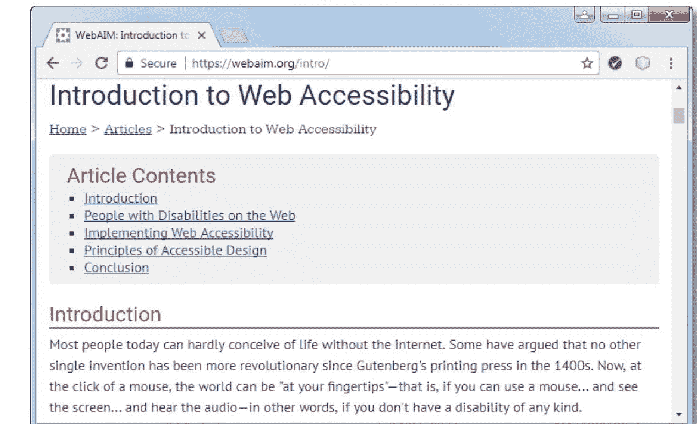

### 你应该注意的无障碍法律

- 美国残疾人法案 (`ADA`)。
- 联邦康复法第 504 条和第 508 条。
- 1996 年电信法第 255 条。

### 残障类型

- 视觉
- 听力
- 运动
- 认知

### 信息来源

- `WebAIM` 网站提供了学习无障碍性的良好起点：`http://www.webaim.org`。
- 世界维网联盟 (`W3C`) 提供了一套完整的无障碍指南：`http://www.w3.org/TR/WCAG`。
- `W3C` 还提供了一个名为 `WAI-ARIA`（Web 无障碍倡议——无障碍交互应用程序）的规范，展示了如何让富应用程序对残障人士更无障碍：`http://www.w3.org/TR/wai-aria`。

**描述**

- 无障碍性指的是让网站能够被用户（特别是残障用户）使用的特性。
- 在这本书中，你将获得关于编码提供无障碍元素和属性的指南。

图 1-16 用户无障碍问题

#### 搜索引擎优化

搜索引擎优化，简称 `SEO`，是指优化你的网站，以便你的页面在 Google、Bing 和 Yahoo 等搜索引擎中获得更高的排名。例如，在图 1-17 中，是什么导致了 Google 返回并显示的链接？

由于 `SEO` 对网站的成功至关重要，因此本书会在你学习相关 `HTML` 的同时，向你介绍 `SEO` 指南。例如，`HTML` 文档中 `<head>` 部分的 `<title>` 元素是 `SEO` 最重要的元素之一。因此，在书中，你将学习如何编写此元素以及所有此类此类元素是如何影响 `SEO` 的。

`HTML5` 结构元素也可能会影响搜索引擎对页面的排名。特别是这些元素与搜索术的相关性更高。在书中，你将学习如何以最有利于 `SEO` 的方式编写这些元素。

然而，请注意，`SEO` 不限于 `HTML` 页面的编码方式。因此，你仍然需要进行一些独立研究。首先，你可以在网上搜索有关 `SEO` 的信息，但也可能想买一两本关于该主题的书。

# 第1 章 Web 开发简介

### “HTML5.1 documentation”的 Google 搜索结果

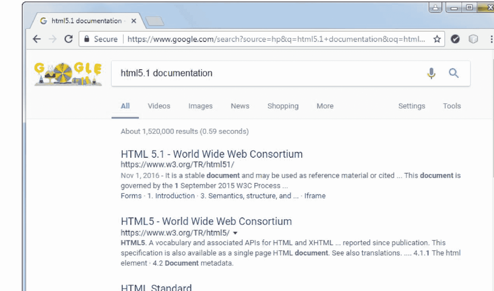

### 最流行的搜索引擎

- Google
- Yahoo
- Bing

**描述**

- 搜索引擎优化（`SEO`）是指优化你的网站，使其页面在访问它们的搜索引擎中获得高排名。
- 尽管搜索引擎使用的搜索算法经常更改，但有一些通用的编码技术可以帮助你的页面在搜索引擎中表现得更好。
- `HTML5` 有一些元素旨在帮助搜索结果更具相关性。
- 在你阅读这本书的过程中，你将获得一些设计指南，以帮助你的网站在搜索引擎结果中获得更好的位置。然而，`SEO` 的内容远多于此……

图 1-17 搜索引擎优化的问题

#### 响应式 Web 设计

响应式 Web 设计（`Responsive Web Design`，简称 `RWD`）一词最早由 Ethan Marcotte 在 2010 年 5 月份的 *A List Apart* 杂志的一篇文章中提出的。它指的是创建能够优雅适应所有查看媒介（从桌面电脑到移动手机）的网站的理论和实践。其理念是提供一个易于阅读和导航的网站，并且只需要最少量的缩放和滚动。

根据 Marcotte 的说法，考虑到适应查看环境的网站布局是使用流式的、基于比例的网格、柔性图像和 `CSS3` 媒体查询来实现的。他关于 `RWD` 的想法已成为 Web 开发的标准。事实上，`RWD` 已成为为特定平台（如 `iOS` 和 `Android`）开发移动应用（称为原生移动应用）的一种具有成本效益的替代方案。此外，`Skeleton`、`Foundation` 和 `Twitter` 等几个流行的开源 Web 设计框架都将 `RWD` 原则作为开发响应式网站的基础。

为什么在开发网站时要使用响应式 Web 设计呢？最重要的是，统计数据证明移动设备每天被用于访问网络。其中一些统计数据列在图 1-18 中。例如，考虑一下，全球每三分之一的消费者正在使用智能手机。还要考虑，在这些用户中，80% 的人会在智能手机上进行购物。

智能手机销量的增长部分是因为某些手机屏幕尺寸的增大。这包括具有 5.5 英寸显示的 `iPhone Plus` 型、显示高达 6.3 英寸的 `Galaxy Note` 型以及显示高达 5.96 英寸的 `Nexus` 型。这些手机有时被称为“大手机”（`phables`），因为它们非常大，而且它们的销量已经开始蚕食市场。

这张图还说明了网站如何使用 `RWD` 来适应屏幕的尺寸和方向。在这里，你可以看到 Murach Books 网站在桌面端的首页。因为使用了 `RWD`，所以当它在屏幕尺寸较小的设备上显示时，页面布局会发生变化。在图中，例如，你可以看到页面在 `iPhone 8` 横竖和横屏模式下的显示。请注意，页面的基本外观和感受在不同的屏幕尺寸下保持不变。这样，用户就不会觉得他们正在从不同设备访问完全不同的网站。这就是响应式 Web 设计的魅力所在！

# 第1 章 Web 开发简介

## 在桌面电脑和手机上显示的 Murach Books 网站

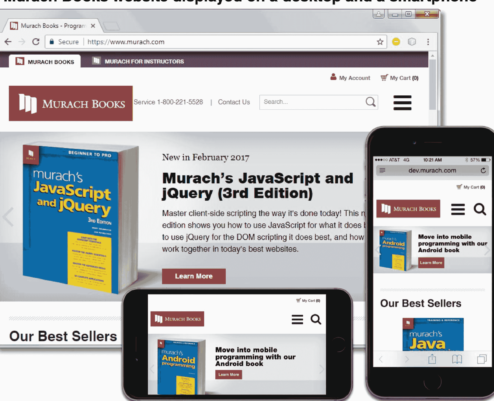

## 证明需要响应式 Web 设计的统计数据

- 世界超过一半的人口手机手机。
- 全球三分之一的消费者正在使用智能手机。
- 所有互联网访问的 60% 是在移动设备上完成的。
- 80% 的智能手机用户每月至少在设备上访问一次真实内容。
- 40% 的用户如果发现第一个结果不符合移动友好，将选择另一个搜索结果。
- 截至 2015 年 4 月，Google 开始在搜索结果中优先考虑响应式网站。

**描述**

- 响应式 Web 设计指的是设计为优雅适应屏幕尺寸的网站。
- 通常，网站的整体外观从一个屏幕到另一个屏幕保持一致。
- 媒体查询、可缩图像和柔性布局是响应式 Web 设计的骨干。

图 1-18 搜索引擎优化的问题

## 观点

现在你已经了解了概念和术语，你将学习如何使用 `HTML` 和 `CSS` 进行开发。在接下来的章节中，你将学习如何使用 `HTML` 和 `CSS` 进行开发，学习如何编辑、测试和验证网页。

### 术语

- Web 世界
- 客户端
- Web 服务器
- 网络
- 局域网 (`LAN`)
- 广域网 (`WAN`)
- 互联网服务提供商 (`ISP`)
- 互联网节点 (`IXP`)
- 静态页面
- `HTTP` 请求
- `HTTP`（传输协议）
- `HTTP` 响应
- 渲染网页
- 动态网页
- 应用服务器
- 服务端处理
- 客户端处理
- `JavaScript`
- `JavaScript` 引擎
- `HTML` 文档
- 标签
- 起始标签
- 结束标签
- 属性
- `CSS`（样式表）
- 样式表
- 外部样式表
- 规则
- 选择器
- 声明
- `XHTML`（扩展 `HTML`）
- `W3C`（万维网联盟）
- `WHATWG`（`HTML` 工作小组）
- 文本编辑器
- 集成开发环境 (`IDE`)
- 套件
- 部署
- 发布
- `FTP` 程序
- `FTP`（文件传输协议）
- 插件
- Web 托管
- `IP` 地址
- `URL`（统一资源定位符）
- 协议
- 路径
- 可用性
- 跨浏览器兼容性
- `SEO`（搜索引擎优化）
- `RWD`（响应式 Web 设计）
- 原生移动应用

## 总结

- Web 应用由客户端、Web 服务器和网络组成。客户端使用浏览器从服务器请求页面。
- 局域网 (`LAN`) 连接彼此靠近的计算机。这通常被称为内网。相比之下，广域网 (`WAN`) 使用路由器连接两个多个局域网。互联网由许多广域网组成。
- 为了请求网页，Web 浏览器向 服务器发送 `HTTP` 请求。服务器检索 `HTML` 并将其传回浏览器。最后，浏览器将 `HTML` 渲染为网页。
- 静态网页是在被检索时保持相同的。
- 动态网页是由服务端程序或脚本生成的，因此其 `HTML` 可以在请求之间发生变化。
- `JavaScript` 是一种由浏览器 引擎运行的脚本语言。它提供了客户端处理。
- `HTML`（超文本标记语言）是定义网页结构和内容的语言。`CSS`（样式表）用于控制网页的格式。
- 为了开发网页，你可以使用 `Brackets` 等文本编辑器或 `NetBeans` 等集成开发环境 (`IDE`)。
- 为了在互联网上部署（发布）网站，你需要将电脑上的文件夹和文件传输到可以访问互联网的 Web 服务器上。为此，你使用一个使用文件传输协议的 `FTP` 程序。
- 为了在互联网上查看网页，你可以在浏览器地址栏中输入 `URL`（统一资源定位符）。`URL` 由协议、域名和文件名组成。
- 为了在你自己的电脑或服务器上查看网页，你可以使用文本编辑器或 `IDE` 的功能。你可以在资源管理器中找到文件并双击或右键点击它。或者，你可以使用浏览器的文件→打开文件→ 文件命令。

# 在开始本书的练习之前...

在开始此本书的练习之前，你应该下载并安装 Chrome 浏览器。你还需要下载并安装本书的应用程序。安装本书软件和应用程序的步骤在附录 A 中介绍。

## 练习 1-1 访问某些网站

在本次练习中，你将访问一些网站并查看这些网站的源代码。

### 使用 Chrome 访问图 1-2 中的网站

1. 启动 Chrome。
2. 在地址栏中输入 `www.newtonforkranch.com` 并按回车键。这将显示该网站的主页。在这里，`JavaScript` 被用于轮页面顶部的图片。
3. 如果你使用的是 Windows 系统，在地址栏中输入 "`newtonforkranch`"，按住 `Ctrl` 键并按回车键。如果有效，它将为你的输入内容添加 `www.` 和 `.com`。这是输入 `.com` 地址 `URL` 的快速方法。
4. 使用图 1-13 中的技术查看主页的源代码。在这里，五个 `rel` 属性值为 "`stylesheet`" 的 `link` 元素识别了负责页面格式化的 `CSS` 文件。随后是五个标识 `JavaScript` 文件的 `script` 元素和两个包含 `JavaScript` 代码的 `script` 元素。
5. 如果你滚动这段代码，它看起来可能眼花缭乱，尽管这个网站相对简单。当你完成本书时，你应该就能理解它使用的 `HTML` 和 `CSS`。
6. 点击第二个 `link` 元素中 `href` 属性的下划线链接。这将打开页面的第一个 `CSS` 文件。这展示了访问许多（并非所有）网站的 `HTML` 和 `CSS` 代码有多简单。

### 访问其他网站

7. 访问 `www.landsend.com`，找到类似图 1-5 的样的页面，并尝试图片切换和鼠标悬停效果。这些是在所有图片随页面加载后通过 `JavaScript` 完成的。
8. 使用 Chrome 访问其他网站并查看这些网站的源代码。完成实验后，请进入下一个练习。

## 练习 1-2 查看本章的应用程序

在本次练习中，你将访问在图 1-6 和 1-7 中使用的示例书籍页面。你将使用默认浏览器进行此操作，如果 Chrome 不是你的默认浏览器，你也将使用 Chrome 进行。

### 在你的默认浏览器和 Chrome 中打开页面

1. 使用文件资源管理器找到此 `HTML` 文件：`c:\murach\html5_css3_4_book_apps\ch01\javascript_jquery.html`。然后，双击文件以在默认浏览器中打开它。
2. 如果 Chrome 不是你的默认浏览器，再次使用文件资源管理器找到第 1 步中的文件。然后，右键点击它并使用“打开方式”命令在 Chrome 中打开文件。
3. 在 Chrome 中，右键点击页面并选择“查看网页源代码”以显示页面的源代码。
4. 在 Chrome 中，点击 `HTML` 代码中 `link` 元素中的 `book.css` 以显示该页面的 `CSS` 文件。

### 如果 Edge 是你的默认浏览器...

5. 如果你使用的是 Edge 浏览器，请切换到它。然后，右键点击页面并选择“查看源代码”命令。这会在开发者工具的“调试器”标签页中显示页面源代码。
6. 按住 `Ctrl` 键并点击 `link` 元素中的 `book.css`，查看是否显示了页面的 `CSS` 文件。（在我们的测试中，这并不总是有效。）

## 练习 1-3 查看其他应用程序和示例

1. 如果 Chrome 尚未打开，请启动它。
2. 使用文件资源管理器找到此文件：`c:\murach\html5_css3_4_book_apps\ch07\town_hall\index.html`。然后，将 index 文件拖到浏览器窗口以显示网页。
3. 点击链接查看该页面。这是第 7 章末尾介绍的网站，它让你对完成该章节后能够做的事情有一个初步的了解。但请注意，该网站仅实现了 Scott Sampson 的链接。
4. 在 Chrome 浏览器中打开此文件：`c:\murach\html5_css3_4_book_examples\ch16\06_animations\index.html`。这是第 16 章图 16-6 的示例。注意，这次图片编号位于文件夹名称中。对于所有需要多个文件的示例，都是如此。
5. 在 Chrome 浏览器中打开此文件：`c:\murach\html5_css3\book_examples\ch16\06_animations\index.html`。这是第 16 章图 16-6 的示例。注意，图片编号位于文件夹名称中。对于所有需要多个文件的示例，都是如此。

## 练习 1-4 进一步了解 HTML5、无障碍性、SEO 和 RWD

1. 访问 `www.w3.org`。这是开发 `HTML5` 和 `CSS3` 标准组织的网站。它提供了各种有用信息，包括 `HTML5` 文档。
2. 访问 `www.whatwg.org`。这是一个致力于进化 `HTML` 及其相关技术的社区网站。它也提供了各种有用信息，包括 `HTML5` 文档。
3. 访问 `www.w3.org`。这是开发 `HTML5` 和 `CSS3` 标准组织的网站。它提供了各种有用信息，包括 `HTML5` 文档。
4. 访问 `www.whatwg.org`。这是一个致力于进化 `HTML` 及其相关技术的社区网站。它也提供了各种有用信息，包括 `HTML5` 文档。
5. 访问 `www.w3.org`。这是开发 `HTML5` 和 `CSS3` 标准组织的网站。它提供了各种有用信息，包括 `HTML5` 文档。
6. 访问 `www.w3.org`。这是开发 `HTML5` 和 `CSS3` 标准组织的网站。它提供了各种有用信息，包括 `HTML5` 文档。

# 第 2 章 如何编写、测试和验证网页

## HTML5 文档的基本结构

```html
<!DOCTYPE html> DOCTYPE 声明
<html>
<head>
  - head 元素
  - 文档树
</head>
<body>
  - body 元素
</body>
</html>
```

## 一个简单的 HTML5 文档

```html
<!DOCTYPE html>
<html lang="en">
<head>
  <meta charset="utf-8">
  <title>San Joaquin 市政厅</title>
</head>
<body>
  <h1>San Joaquin 市政厅</h1>
  <p>欢迎来到 San Joaquin 市政厅。</p>
  <p>我们本季为你准备了许多精彩的演讲者！<a href="speakers.html">演讲者信息</a></p>
</body>
</html>
```

## HTML5 的通用编码建议

- 尽管你可以使用小写、大写或混合大小写来编写 `HTML`，但我们建议所有的所有的编码都使用小写，因为这样更易读。

**描述**

- `HTML` 文档包含定义网页内容和结构的 `HTML` 元素。
- 每个 `HTML` 文档由两部分组成：`DOCTYPE` 声明和文档树。
- 上述 `DOCTYPE` 声明表示该文档将使用 `HTML5`。你会在每个 `HTML` 文档的开头编写此声明。
- 文档树始于 `html` 元素，它标记了 `HTML` 代码的开始和结束。该元素可以被称为文档的根元素。
- `html` 元素始终包含一个提供文档信息的 `head` 元素和一个提供文档结构和内容的 `body` 元素。

图 2-1 `HTML` 文档的基本结构

## 如何编写元素和标签

图 2-2 显示了如何编写元素和标签。正如你已经所看到的的，大多数 `HTML` 元素以一个起始标签开始，并一个结束标签结束，结束标签与起始标签相似，但内部多有一个斜杠。因此，`<h1>` 是一级标题的起始标签，而 `</h1>` 是结束标签。在这些标签之间，你编写元素的内容。

然而，某些元素没有内容或结束标签。这些标签被称为“空标签”。例如，`<br>` 标签是一个起始新行的空标签，而 `` 标签是一个标识应显示的图像的空标签。

此图中第三组示例展示了当一个元素在另一个元素内部时，编写标签的正确方法和错误方法。简而言之，一个元素的标签不应与另一个元素重叠。也就是说，你不能在关闭内部元素之前关闭外部元素。

从本书的这里开始，我们将通过起始标签中使用的代码来引用元素。例如，我们将引用 `head` 元素、`h1` 元素和 `img` 元素。不过，为了防止误读，我们将单个字母元素名称放在括号中。因此，我们将引用 `<a>` 元素和 `<p>` 元素。在任何其他我们认为有助于防止误读的地方，我们也会使用括号。

# 第 2 章 如何编写、测试和验证网页 49

## 两个带有起始和结束标签的元素

```html
<h1>San Joaquin Valley 市政厅</h1>
<p>这里是链接列表：</p>
```

## 两个空标签

```html
<br>

```

## 标签的正确与错误嵌套

### 正确嵌套

```html
<p>订购您的副本 <i>今天就开始吧！</i></p>
```

### 错误嵌套

```html
<p>订购您的副本 <i>今天就开始吧！</p></i>
```

**描述**

- 大多数 `HTML` 元素都有一个起始标签、内容和一个结束标签。每个标签都编写在一组括号（`<>`）中。
- 元素的起始标签包含标签名。结束标签包含一个带有斜杠的标签名。内容包括出现在起始和结束标签之间的所有内容。
- 某些 `HTML` 元素没有内容。例如，强制换行的 `<br>` 元素仅由一个标签组成。这种标签被称为空标签。
- `HTML` 元素通常是嵌套的。然而，为了正确嵌套元素，你必须在关闭外部标签对之前关闭内部标签对。

图 2-2 如何编写元素和标签

## 如何编写属性

图 2-3 显示了如何为 `HTML` 元素编写属性。这些属性被编写在元素的起始标签内或空标签内。对于每个属性，你都编写属性名、一个等号和属性值。

当你使用 `HTML5` 时，除非值包含空格，否则属性值不需要编写在引号内，但我们建议你使用引号包裹所有值。此外，尽管你可以使用双引号或单引号，但我们建议你始终使用双引号。这样，你的代码将具有一致的外观，帮助你避免编码错误。

在图的示例中，你可以看到如何编写一个或多个属性。例如，第二个示例是一个带有三个属性的起始标签。相比之下，第三个示例是一个空的 `img`，它包含一个 `src` 属性（给出应显示的图像文件名）和一个 `alt` 属性（当找不到图像文件时应显示的文本）。

下一个示例说明了布尔属性（`Boolean attribute`）的使用。布尔属性可以只有两个值，代表开启或关闭。要开启布尔属性，你只需编写属性名称。在这个示例中，`checked` 属性开启了该属性。当你想关闭该属性时，不需要编写该属性。

接下来的示例说明了常用的标识 `HTML` 元素的属性。`id` 属性用于唯一标识一个元素。相比之下，`class` 属性可以标记多个元素。你可以在图 2-6 中看到这些属性。

### 如何编写属性

#### 带有一个属性的起始标签

```html
<a href="contact.html">
```

#### 带有三个属性的起始标签

```html
<a href="contact.html" title="点击联系" class="nav_link">
```

### 带有属性的空标签

```html

```

### 如何编写布尔属性

```html
<input type="checkbox" name="mailList" checked>
```

### HTML 元素的两个属性

#### 带有 id 的起始标签

```html
<div id="page">
```

#### 带有 class 的起始标签

```html
<a href="contact.html" title="点击联系" class="nav_link">
```

### 编码规则

- 属性由名称、等号和值组成。
- 如果属性值包含空格，必须封装在引号内。
- 布尔属性如果不包含空格，不需要封装在引号内。
- 编写多个属性时，用空格分隔每个属性。

### 我们的编码建议

- 为了一致性，将所有属性值封装在双引号中。

## 带有注释和空白的 HTML 文档

```html
<!DOCTYPE html
<!--
This document displays the home page
for the website.
-->
<html
<head>
  <title>San Joaquin Valley Town Hall</title>
</head>
<body>
<h1>San Joaquin Valley Town Hall</h1>
<h2>Bringing cutting-edge speakers to the valley</h2>
<!-- This comments out all of the HTML code in the unordered list -->
<ul>
  <li>October: Jeffrey Tobin</li>
  <li>November: Andrew Sorkin</li>
  <li>January: Amy Chua</li>
  <li>February: Scott Sampson</li>
  <li>March: Carlos Eire</li>
  <li>April: Ronan Tynan</li>
</ul>
<!-- The code after the end of this comment is active -->
<p>Contact us by phone at (559) 444-2180 for ticket information.拨电咨询票务信息。</p>
</body>
</html>
```

### 我们的编码标准

- 使用空白字符对代码行进行缩进，使其更易于阅读。
- 不要过度使用空白字符，因为这会增加文件大小。

**描述**

- `HTML` 注释是出现在 `<!--` 和 `-->` 字符之间的文本。由于浏览器会忽略注释，你可以使用它们来描述或解释可能引起困惑的 `HTML` 代码部分。
- 你可以使用注释来注释掉你不希望浏览器显示的元素。这在测试网页时非常有用。
- `HTML` 注释可以写在单行，也可以跨越两行或更多。
- 空白由制表符（`tab`）、换行符和额外的空格等字符组成。
- 由于浏览器会忽略空白字符，你可以使用它对代码行进行缩进，并通过将元素放在不同的行来分隔它们。这是一个良好的编码习惯，因为可以让你的代码更易于阅读。

图 2-4 如何编写注释和空白

## CSS 语法

与 `HTML` 类似，创建 `CSS` 文件时必须遵循一种特定的语法。下文介绍了这种语法。

## 如何编写 CSS 样式规则和注释

一个 `CSS` 文件由样式规则组成。如图 2-5 所示，一条样式规则由一个选择器后后跟一组大括号组成。大括号内部有一个或多个声明，每个声明由一个属性和一个值组成。注意，属性后面是冒号，值后面是分号。

在图中，选择器由一个名为 `color` 的单个属性组成，设置为颜色 `navy`。然后，样式规则是 `h1`，因此它适用于所有的 `h1` 元素。结果是所有 `h1` 元素的内容将以深蓝色显示。

在接后的 `CSS` 代码中，你可以看到另外四个样式规则。其中三个只包含一个声明：用于 `font-style` 属性，另一个用于 `border-bottom` 属性。

在 `CSS` 文件中，你还可以编写注释来描述或解释 `CSS` 代码的作用。对于每个注释，你以 `/*` 开始，以 `*/` 结束，这些字符之间的任何内容都会被忽略。在图示例中，你可以看到 `CSS` 注释可以单独写一行，也可以写在组成样式规则的行之后。

你还可以使用注释来注释掉你想要禁用的代码。这在测试 `CSS` 代码时非常有用，就像测试 `HTML` 代码一样。

## CSS 样式规则的组成

```
selector
property
value
h1 {
  color: navy; declaration
}
```

- 一个 `CSS` 样式规则由一个选择器和零或多个包含在大括号内的声明组成。
- 一个 `CSS` 选择器由位于样式规则开头的标识符组成。
- 一个 `CSS` 声明由一个属性、一个冒号、一个值和一个分号组成。
- 为了让代码更易读，你可以在样式中使用空格、缩进和空行。
- `CSS` 注释以字符 `/*` 开始，以字符 `*/` 结束。`CSS` 注释可以写在单行，也可以跨多行。

图 2-5 如何编写 `CSS` 样式规则和注释

## 如何编写基础选择器

样式规则的选择器标识了声明将应用的 `HTML` 元素或元素。为了让你更好地了解其工作原理，2-6 显示了如何为 `CSS` 样式规则中使用三个基础选择器。随后在第 4 章中，你将学习如何编写所有选择器。

第一类选择器识别 `HTML` 元素，如 `body`、`h1` 或 `<p>` 元素。例如，前两个示例中的选择器适用于 `body` 和 `h1` 元素。这些选择器。

# 第 2 章 如何编写、测试和验证网页

## 可以通过元素类型、id 或类选择的 HTML 元素

```html
<body>
<h1 class="base_color">学生材料</h1>
<p>这里是下载的链接：</p>
<ul id="links">
  <li><a href="exercises.html">练习</a></li>
  <li><a href="solutions.html">答案</a></li>
</ul>
<p id="copyright" class="base_color">版权 2018</p>
</body>
```

## 通过元素类型、id 和类选择的 CSS 样式规则

```css
body {
  font-family: Arial, sans-serif;
  font-size: 300px;
  width: 300px;
  padding: 1em;
}
h1 {
  font-size: 180%;
}
#copyright {
  font-size: 75%;
  text-align: right;
}
.base_color {
  color: blue;
}
```

## 浏览器中的元素

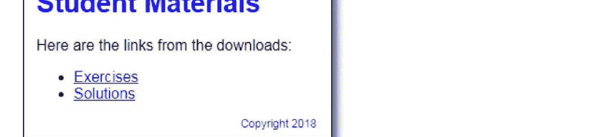

**描述**

- 要为 `HTML` 元素编写选择器，只需命名该元素。这被称为类型选择器。
- 如果元素带有 `id` 属性，你可以通过编写井号 `#` 后跟 id 值来编写针对该 id 的选择器，例如 `#copyright`。
- 如果元素带有 `class` 属性，你可以通过编写点 `.` 后跟类名来编写针对该类的选择器，例如 `.base_color`。

图 2-6 如何编写基础选择器

## 如何在 HTML 和 CSS 文件中使用 Brackets


# 如何使用 Brackets 编辑、测试和验证网页

## 简介

在第 1 章中，你已经接触了 Brackets，这是一个由 Adobe 创建的文本编辑器。我们推荐在本书中使用这款文本编辑器，因为它是免费的；它可以在 Windows、Mac OS 和 Linux 上运行；并且具有一些出色的功能。在接下来的主题中，你将学习如何使用 Brackets 构建网页。

如果你在处理本书中的应用程序时打算使用不同的编辑器，你可能仍然想浏览这些主题，因为它们会让你对一个编辑器应该能够做什么有一个良好的了解。它们也可能鼓励你尝试一下 Brackets。

## 如何打开和关闭网站的文件夹

要在 Brackets 中处理 Web 应用程序，首先要打开包含网站所有子文件夹和文件的文件夹。要做到这一点，你可以使用图 2-7 中的两种技术之一。当你打开网站的文件夹后，Brackets 会将其视为当前项目，其子文件夹将显示在左侧面板中项目文件夹下方的文件树中。

在这个示例中，项目是“Getting Started”（入门指南），它介绍了 Brackets 的一些功能。当你第一次启动 Brackets 时，就会显示该项目。在项目名称下方，你可以看到一个名为 `screenshots` 的文件夹、一个名为 `index.html` 的文件以及一个名为 `main.css` 的文件。在你学习了如何预览 HTML 文件后，你可能想预览 `index.html` 页面。你可能还想查看 HTML 和 CSS 文件中的代码。

当你点击当前项目名称（在此示例中为 Getting Started）时，会显示最近打开的文件夹列表。然后，你可以从该列表中选择你想要工作的项目。或者，你可以点击列表顶部的 `File → Open Folder` 命令来打开另一个项目。无论何种方式，当打开另一个项目时，它将成为当前项目，而你之前的项目将被关闭。

为了方便处理本书中的应用程序，我们建议你使用 Brackets 打开包含所有应用程序的文件夹。图中的对话框说明了这一点。这样做之后，所有章节的文件夹都将列在窗口左侧的文件树中。然后，你就可以展开这些文件夹，查看并处理它们包含的子文件夹和文件。你将在本章的第一个练习中有机会这样做。

顺便提到，像 `File → Open Folder` 这样的符号表示下拉“File”菜单并选择“Open Folder”。同样，`View → Vertical Split` 表示在“View”菜单中运行“Vertical Split”命令。你将在整书中看到这种符号。

### Brackets 中选择文件夹的对话框

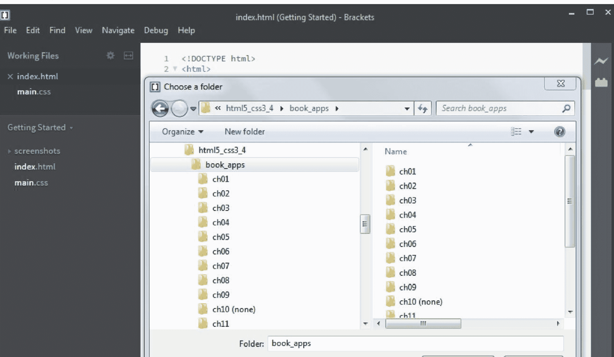

### 首次打开项目文件夹两种方法

- 要打开项目文件夹，使用 `File → Open Folder` 命令显示“Choose Folder”（选择文件夹）对话框。然后，选择你想打开的文件夹并点击“Select Folder”按钮。
- 点击当前项目文件夹的名称显示最近打开的文件夹列表。然后，选择列表顶部的“Open Folder”打开“Choose a Folder”对话框。

### 在项目文件夹关闭后重新打开

- 点击当前项目文件夹的名称显示最近打开的文件夹列表。然后，从该列表中选择一个文件夹。

### 描述

- 当你打开一个文件夹时，它会显示在窗口左侧的文件树中。Brackets 将此文件夹视为当前项目。
- 当你第一次启动 Brackets 时，它会显示一个“Getting Started”项目。你可以预览它的 `index.html` 文件来了解 Brackets 的一些功能。
- 当你打开另一个项目文件夹时，之前的项目会被关闭。
- 通常情况下，每个 Brackets 项目都应该包含一个 Web 应用程序的文件夹和文件。出于本书的目的，你可以将所有的书籍项目视为单一项目，并将所有练习视为另一个项目。

图 2-7 在 Brackets 中打开和关闭网站的文件夹

## 如何打开、关闭和显示文件

图 2-8 展示了你可以用于打开、关闭和显示文件的若干技术。一旦你打开了包含文件的文件夹，就可以通过点击文件夹符号钻取你想要打开的文件。在这个示例中，`ch02` 文件夹已经展开，你可以看到第 2 章应用程序的三个文件。然后，要打开一个文件，只需双击它。

你也可以打开不属于当前项目的文件。要做到这一点，你使用 `File → Open File` 命令来定位并选择文件。

当你在 Brackets 中打开一个文件时，它会出现在窗口左侧文件树旁的“Working Files”（工作文件）列表中。然后，你可以在文件树之间切换以在不打开文件的情况下显示。但是，如果你对文件进行了更改，它会被打开并添加到“Working Files”列表中。要关闭“Working Files”列表中的文件，只需指向它并点击文件名左侧的“X”。然后，如果你对文件进行了更改但尚未保存，Brackets 将询问你是否想要保存。

### Brackets 中打开一个文件和另一个文件

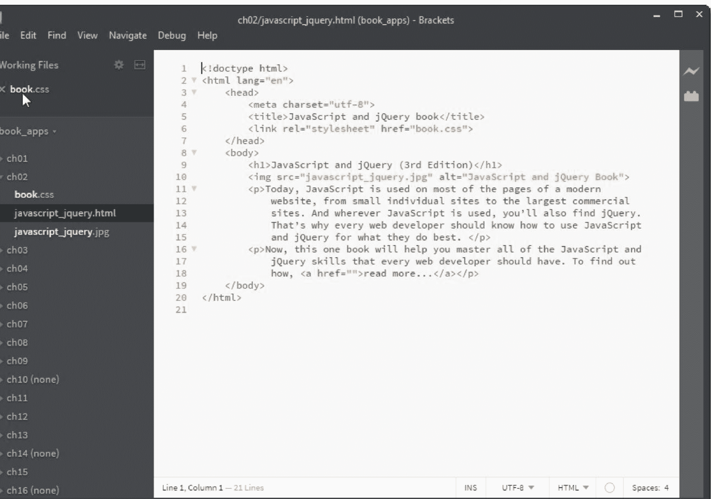

### 打开文件

- 要打开文件，使用 `File → Open File` 命令来定位并选择文件。
- 要打开一个不属于当前项目的文件，使用 `File → Open File` 命令定位并选择文件。
- 当你打开一个文件时，它会出现在“Working Files”列表中。

### 关闭文件

- 要关闭文件，只需指向它并点击文件名左侧的“X”。

### 显示文件

- 要在不打开文件的情况下显示文件，切换文件树。
- 要显示已打开的文件，从“Working Files”列表中选择。

### 描述

- 与许多编辑器不同，Brackets 不使用标签界面。相反，它在文件树中列出文件。

图 2-8 在 Brackets 中打开、关闭和显示文件

## 如何新建文件

所有 HTML 文档都包含相同的 DOCTYPE 声明和起始标签。由于这个原因，为每个文件添加这些代码是合理的。添加起始代码的一种方法是使用名为 Emmet 的扩展。

Emmet 是一种非常有用的 Web 开发工具，适用于几乎所有的编辑器和 IDE。因为它对提高效率至关重要，你将在第 20 章学习它。现在，你只需学习如何使用 Emmet 添加起始代码。

要安装 Emmet 或任何其他扩展，如图 2-9 所示使用 Extension Manager。为了更容易找到想要安装的扩展，可以在搜索框中输入一个或多个关键词来过滤 Available 选项卡中的扩展列表。在此示例中，我输入了 `emmet`。然后，只需点击 `Install` 按钮。注意，如果你尝试安装 Emmet 时已经安装了其他扩展，可能会遇到问题。在这种情况下，你可以从 Extension Manager 的 Installed 选项卡禁用已安装的扩展，安装 Emmet，然后重新启用其他扩展。

安装 Emmet 扩展后，你可以使用它创建一个空文件并保存为 `.html` 扩展。然后，输入感叹号 (`!`) 并按 `Tab` 键。这会在文件中添加 HTML 文档的起始代码。

另一种为 HTML 文件添加起始代码的方法是从现有文件开始新文件。例如，如果你要创建一个与现有书籍页面类似的第二个书籍页面，那么从旧文件开始新文件是合理的。要做到这一点，只需打开旧文件并将其另命名保存。然后，你可以删除旧文件中新页面不需要的代码，并添加它需要的任何新代码。

随着对 HTML 越来越熟悉，你可以创建包含不同页面所需元素的自定义文件。然后，可以使用这些文件作为模板创建其他页面。例如，如果你要开发几个具有相同通用内容的页面，可以为这些页面创建一个 HTML 模板。然后，在创建每个页面时，你可以打开包含模板的 HTML 文件并在修改文件之前将其另命名保存。这样，原始模板文件将保持不变。

### Brackets 扩展管理器

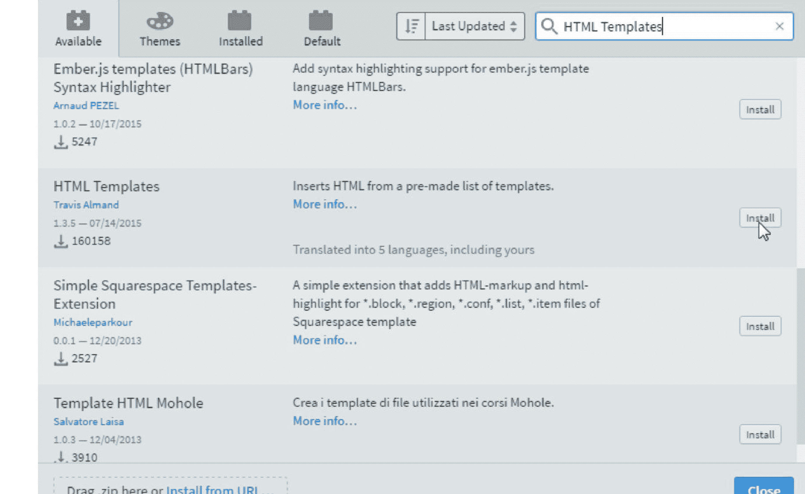

### 如何添加 Emmet 扩展

- 点击窗口右侧的扩展管理器图标，或选择 `File → Extension Manager`。在扩展管理器的可用（Available）标签中搜索“emmet”，点击该扩展右侧的安装（Install）按钮。

### 如何使用 Emmet 创建新的 HTML 文件

1. 选择 `File → New` 命令创建一个空文件。
2. 使用 `File → Save` 命令选择保存新文件的文件夹，并为新文件输入名称（包括其 `.html` 扩展）。
3. 在新文件中输入感叹号 (`!`) 并按 `Tab` 键，以添加 HTML 文档的起始代码。

### 如何从另一个 HTML 文件创建新的 HTML 文件

- 打开你想要作为新文件基础的文件。然后，使用 `File → Save As` 命令用新名称保存文件。

### 说明

- 默认情况下，Brackets 不提供为 HTML 文件添加起始元素的方法。然而，你可以安装一个名为 Emmet 的扩展，它可以提供许多其他节省时间的任务。如果你要创建一个与现有文件类似的新文件，可以打开现有文件并用新名称保存。

图 2-9 如何在 Brackets 中启动新的 HTML 文件

## 如何编辑 HTML 文件

图 2-10 显示了如何编辑 HTML 文件。当你打开带有 `.html` 语法的文件时，Brackets 知道你正在处理的是什么类型的文件，因此你可以使用颜色来高亮语法组件。这让你更容易发现代码中的错误。

当你在输入新代码时，代码提示（code hints）功能会显示你可以输入到文件中的单词列表。例如，如果你为新元素留下了左括号 (`<`)，就会显示所有元素的列表。然后，你可以在起始括号后选择一个或多个字母来过滤列表，使其只显示以这些字母开头的元素。在图示例中，我输入了字母 `i`，所以只显示以字母 `i` 开头的单词。

你可以使用类似的技术在起始标签内输入属性。要这样做，在元素名称后输入空格和一个或多个字母。这时，Brackets 会显示所有以这些字母开头的属性列表。然后，你可以选择你想要的属性并按 `Enter` 键。执行操作后，Brackets 会插入带有等号和双引号的属性，你可以在引号之间输入属性值。

输入所有属性后，你输入标签的闭合括号 (`>`)。然后，Brackets 会添加闭合标签，这样你只需要输入标签的内容即可。

此图还列了一些常见的编码错误。通常，颜色编码将帮助你发现前三种类型的错误。例如，如果你拼错了元素名称，或者忘记编写闭合引号，颜色编码将指示代码是不正确的。

另一方面，Brackets 无法获知 `link`、`img` 或 `<a>` 元素中文件引用的正确代码应该是什么。因此，你必须在测试网页时发现这些错误。例如，如果 `link` 元素中用于样式表的文件引用错误，则 CSS 将无法应用。如果 `img` 元素中的文件引用错误，图像将无法显示，并将显示 `alt` 属性的值。如果 `<a>` 元素的文件引用错误，浏览器将无法访问正确的页面。

### 带有 HTML 元素代码提示的 Brackets

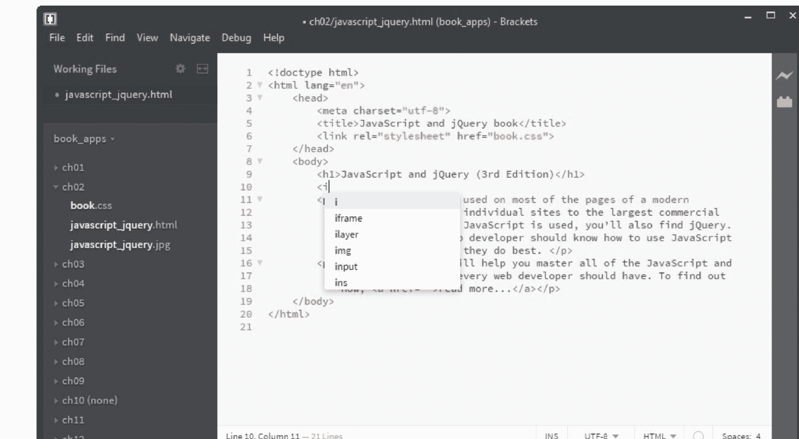

```html
<!doctype html>
<html lang="en">
<head>
    <meta charset="UTF-8">
    <title>JavaScript and jQuery</title>
    <link rel="stylesheet" href="style.css">
</head>
<body>
    <h1>JavaScript and jQuery</h1>
    <p>Individual sites on the pages of a mode made by the largest commercial websites use JavaScript. You'll find that any jQuery developer should know how to use JavaScript as they do best.as they do best.</p>
    <p>它可以帮助你掌握 Web 开发者应该具备的所有 JavaScript。了解更多...<a></a></p>
</body>
</html>
```

### 常见编码错误

- 只有起始标签没有闭合标签。
- 拼写错误的元素或属性名称。
- 未成对的引号。
- `link`、`img` 和 `<a>` 元素中错误的文件引用。

### 说明

- Brackets 用不同的颜色显示文件的不同部分，以便于识别。这有助于你发现一些常见错误。对于此工作，文件必须具有 `.html` 扩展。
- 代码提示功能显示以你输入的内容开头的元素列表。要插入元素，点击它或使用方向键高亮并按 `Enter` 键。你也可以用此来插入属性。
- 当 Brackets 检测到错误时，它会用红色显示任何受错误影响的代码。
- 你也可以用此来插入属性。

图 2-10 如何编辑 HTML 文件

### 如何启动和编辑 CSS 文件

图 2-11 描述了启动 CSS 文件的两种方法。首先，你可以使用 `File → New` 创建一个空文件。然后使用 `File → Save` 选择保存文件夹，并为新文件输入名称（包括其 `.css` 扩展）。其次，你可以从另一个 CSS 文件启动新的 CSS 文件，打开你想要作为基础的文件，然后使用 `File → Save As` 用新名称保存文件。

此图还显示了如何编辑 CSS 文件。当你打开带有 `.css` 语法的文件时，Brackets 知道你正在处理的是什么类型的文件，因此你可以使用颜色来高亮语法组件。当你输入属性的第一个字母时，代码提示会显示以该字母开头的属性列表。然后，你可以选择你想要的属性并按 `Enter` 键插入属性名称。

此图也列了一些常见的编码错误。虽然颜色编码将帮助你发现其中一些错误，但它无法帮你发现所有错误。例如，Brackets 无法获知你是否错误编码了 `id` 或类名。相反，你将在测试时发现，你为元素指定的样式规则没有被应用。

### 带有 CSS 属性代码提示的 Brackets

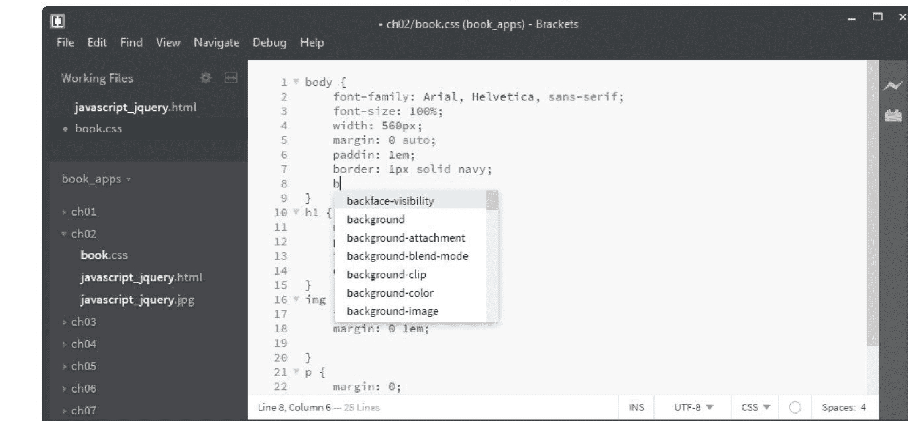

### 常见编码错误

- 未正确配对的括号。
- 拼错误的属性名称。
- 缺少分号。
- 与 HTML 中使用的名称不匹配的 `id` 或类名。

### 如何编辑 CSS 文件

- 你可以使用编辑 HTML 文件相同的技术，但文件必须具有 `.css` 扩展。在这里，颜色编码同样有助于你发现语法错误。

### 说明

- 代码提示功能显示以你输入的内容开头的属性列表。然后，在你选择其中一个后，Brackets 会在属性名后自动添加冒号。此代码提示功能也适用于属性值。
- 当你在选择器之前输入左括号时，Brackets 会自动添加右括号。然后，你就可以输入括号之间的内容。

图 2-11 如何在 Brackets 中启动和编辑 CSS 文件

## 如何使用分屏视图和快速编辑（Quick Edit）功能

在编写 CSS 页面代码时，你通常希望同时查看页 HTML 和相关的 CSS。遗憾的是，大多数文本编辑器都不支持这样做。相比之下，Brackets 提供了两种方法，并在图 2-12 中进行了总结。

第一种方法是水平或垂直拆分屏幕，然后将 HTML 放在分屏的一个部分，将 CSS 放在另一个部分。该图中的第一个示例说明了这一点，它是垂直拆分的。在这里，HTML 位于左窗格，CSS 位于右窗格。

同时查看 HTML 和 CSS 的另一种方法是将光标置于 HTML 元素名称、`id` 属性或 `class` 属性上，然后按下 `Ctrl+E`（Mac OSX 为 `Cmd+E`）。当你执行操作时，会打开一个快速编辑（Quick Edit）窗口，显示该元素、`id` 或 `class` 的所有样式规则。图中的第二个示例说明了这一点。更好的是，你还可以编辑显示的样式规则或创建新的样式规则。

### 使用分屏的 Brackets

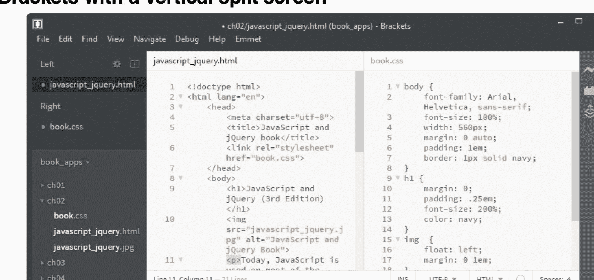

### 如何显示分屏视图

- 选择 `View → Vertical Split` 或 `Horizontal Split` 将编辑器拆分为两个窗格。然后点击一个窗格并点击文件树中的文件以在该窗格中打开它。
- 要关闭分屏视图，选择 `View → No Split`。

### 显示快速编辑功能的 Brackets

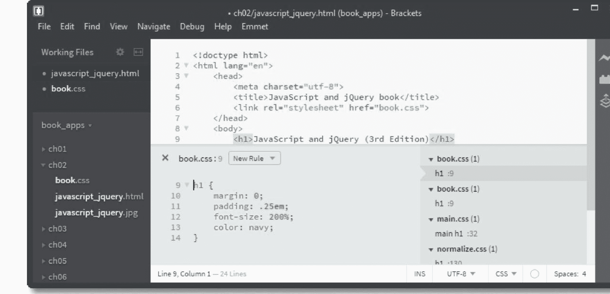

### 如何使用快速编辑功能显示元素的 CSS

- 将光标放在元素名称或 `id` 或 `class` 属性上，Windows 按 `Ctrl+E` 或 Mac 按 `Cmd+E`。这将显示元素、`id` 或 `class` 的样式规则。
- 你可以编辑样式规则或创建新规则。

图 2-12 如何在 Brackets 中使用分屏视图和快速编辑功能

## 如何预览 HTML 文件

图 2-13 显示了如何从 Brackets 预览 HTML 文件。要做到这一点，显示 HTML 文件并点击实时预览（Live Preview）图标。然后，页面将在独立的 Chrome 副本中显示。

在显示预览时，你可以对页面的 HTML 和 CSS 代码进行更改，这些更改将实时地反映在预览中。这使得测试不同的内容和格式变得简单。

你可以通过将光标置于 HTML 文件中元素的标签中，在浏览器预览中高亮 HTML 元素。你还可以通过将光标置于 CSS 文件中某条样式规则中，在浏览器预览中高亮所有应用了该样式规则的元素。例如，在图中，光标在 `h1` 元素中，因此该元素在浏览器预览中被高亮显示。在这里，该元素周围的虚线表示元素的内边距（padding）。

当实时预览连接到浏览器窗口时，实时预览图标显示为橙色。断开与浏览器窗口的连接，你可以再次点击此图标。然而，这并没有关闭浏览器窗口，因此你需要在完成预览后关闭它。你也可以在实时预览仍然连接时关闭浏览器窗口。如果你这样做，Brackets 将显示消息，指示实时预览由于未知原因已取消。

目前，Chrome 是你唯一可以配合实时预览使用的浏览器，且 Brackets 未提供在其他浏览器中运行 HTML 文件的其他方法。因此，你需要使用下一幅图中的技术在其他浏览器中运行 HTML 文件。尽管如此，我们预计未来实时预览将支持其他浏览器。

### 实时预览图标

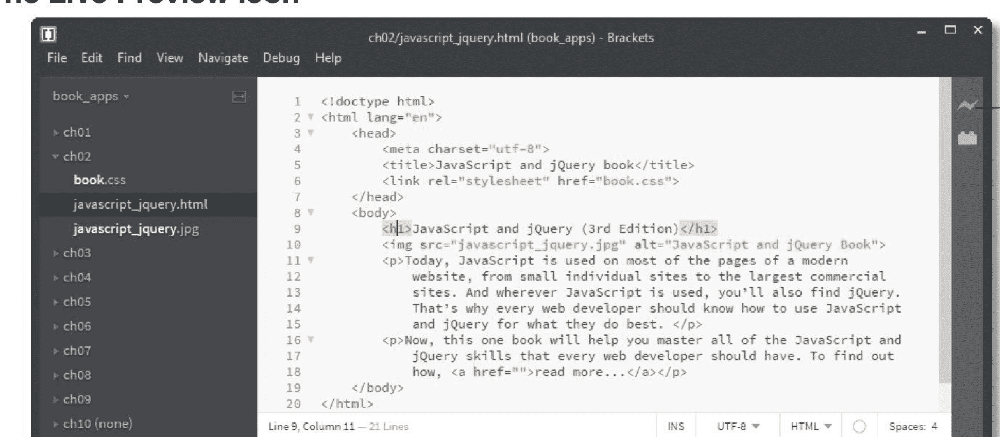

### 高亮 h1 元素的 Chrome 浏览器

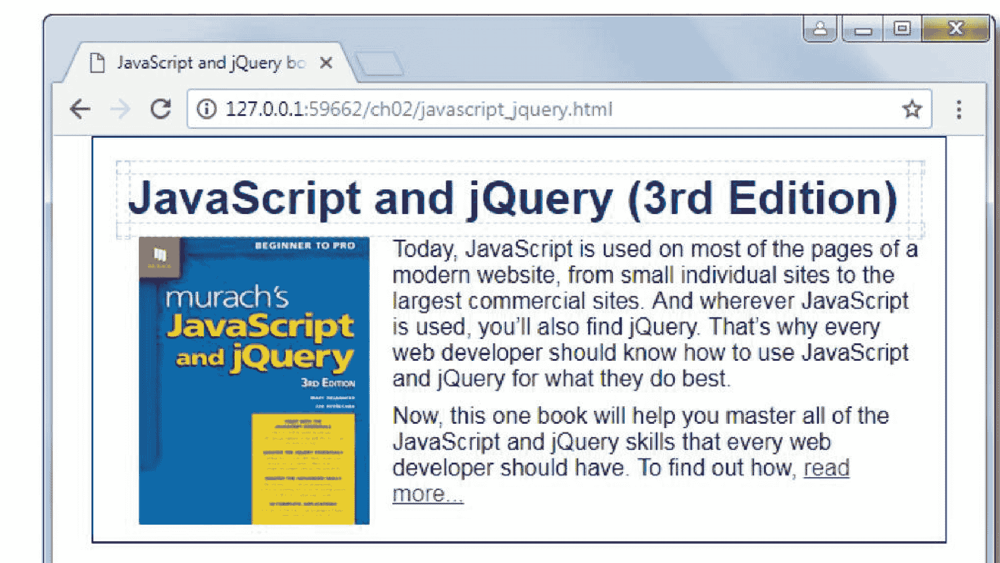

### 描述

- 在 Brackets 中预览 HTML 文件，在文件树或工作文件（Working Files）中选择它，然后点击窗口右侧的实时预览图标。预览将在 Chrome 副本中显示，与其他可能打开的其他副本分开。
- 如果你对页面的 HTML 或 CSS 代码进行任何更改，更改将自动显示在浏览器预览中。
- 如果你将光标放在 HTML 文件元素中，浏览器预览中的该元素将被高亮。
- 如果你将光标放在 CSS 文件的样式规则中，浏览器预览中应用该规则的所有元素将被高亮。

图 2-13 如何从 Brackets 预览 HTML 文件

## 如何测试、调试和验证 HTML 和 CSS 文件

现在你已经知道如何创建和编辑 HTML 和 CSS 文件，准备好学习如何测试、调试和验证这些文件了。

### 如何测试和调试网页

当你测试网页时，会在所有可能访问该文件的浏览器上运行该文件并识别所有问题。当你调试网页时，你会找到问题的原因，修复它们并再次测试。

要运行网页，你可以使用下一幅图中的技术。如果你使用 Brackets，只需点击实时预览。如果你使用其他文本编辑器或 IDE，请寻找运行页面的类似链接、按钮或命令。

在多个浏览器上测试网页时，你会发现页面在某个浏览器上正常，但在另一个上不正常。例如，如果 HTML 文件中有一个细微编码错误，一个浏览器可能会处理，而另一个不会。

当你使用 Brackets 或 IDE 时，颜色编码和错误检测功能可以帮助避免由错误引起的问题。但有时难以检测的错误仍然会漏掉。这时，验证 HTML 文件可能会帮助，我们将在图中学习如何操作。

### Chrome 浏览器中显示的 HTML 文件和 jQuery

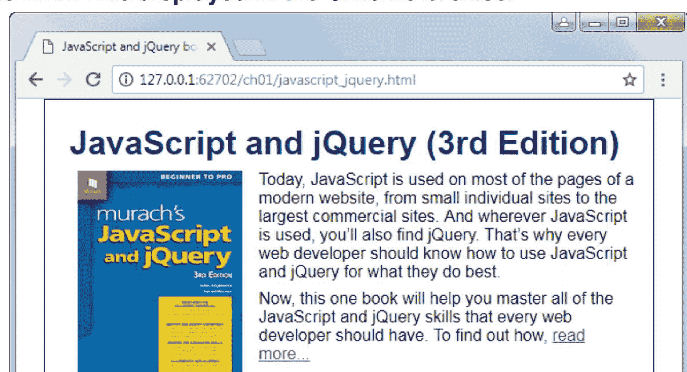

### 在内网或计算机上运行网页的三种方法

- 启动浏览器，使用 `File → Open` 命令打开文件。或者在地址栏输入完整路径和文件名并按回车。
- 使用系统的文件管理器找到 HTML 文件并双击它。
- 如果你使用 Brackets，检查文件树中的 HTML 文件并点击实时预览图标在 Chrome 中打开文件。如果你使用其他文本编辑器或 IDE，请寻找运行页面的类似链接、按钮或命令。

### 在更改源码后从浏览器重新运行网页

- 点击浏览器中的加载或刷新按钮。

### 如何测试网页

- 在可能访问你网站的所有浏览器上运行页面。
- 检查网页的内容和外观，确保其在所有浏览器中均正确。
- 点击所有链接确保它们正常工作。

### 如何调试网页

- 找到 HTML 或 CSS 代码中的错误原因，进行修正并再次测试。

### 描述

- 当你测试网页时，你试图找到所有错误。
- 当你调试网页时，你找到 HTML 或 CSS 代码中的错误原因，修正它们并再次测试页面。

图 2-14 如何测试和调试网页的 HTML 和 CSS

## 如何验证 HTML 文件

要验证 HTML 文档，您可以使用专门的程序或网站。最受欢迎的 HTML 验证网站之一是图 2-15 所示的 W3C Markup Validation Service。当您使用该网站时，可以通过图中所示的三种方式提供想要验证的 HTML 代码。

在此示例中，显示的是“通过文件上传验证”（Validate by File Upload）选项卡。然后，您点击“浏览”（Browse）按钮找到要验证的文件。完成后，点击“检查”（Check）按钮来验证文档。

### W3C 验证器主页

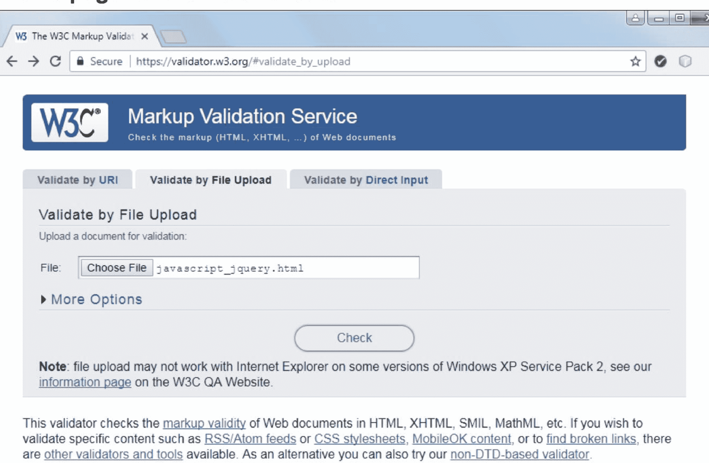

### 如何使用 W3C Markup Validation Service

- 访问以下 URL，识别要验证的文件，并点击“检查”按钮：`https://validator.w3.org/`

### 提供待验证代码的三种方式

- 如果您要验证的文件已经上传到 Web 服务器，您可以在 W3C URI 选项卡中输入其 URL 来验证它。
- 如果文件尚未上传到 Web 服务器，您可以在“通过文件上传验证”选项卡中找到它进行验证。
- 您还可以通过将其复制并粘贴到“直接输入验证”（Validate by Direct Input）选项卡来验证 HTML。

### 描述

- 要验证页面的 HTML，您可以使用专门的程序或网站。最受欢迎的网站之一是 W3C Markup Validation Service。
- 验证可确保您的代码是正确的，这可以提高 SEO。验证还可以帮助您发现未察觉的 HTML 错误。

图 2-15 如何验证 HTML 文件（第 1 部分，共 2 部分）

在验证文档时，如果 HTML 代码是有效的，验证器将显示相应的消息。然而，它仍可能显示一个或多个警告消息。相反，如果代码包含错误，验证器将显示错误列表，如图中第二部分所示。在这里，验证结果在 W3C Markup Validation Service 网站上显示。

在此示例中，第 11 行的错误消息以及第 15 行的警告和错误消息是由第 10 行 `img` 元素末尾缺少 `>` 导致的。在这种情况下，Brackets 会用红色显示无效代码，因此此错误不应被您忽略。即使遗漏了，您也应该在测试网页时捕获该错误。有时，一个带有一两个错误的网页会在一个浏览器中显示，尽管它在另一个浏览器中无法正常显示。

是否所有的 HTML 文档都应该经过验证，尽管估计 99% 的网页并没有经过验证？我们的回答是：是的！在我们看来，验证是一项实用的实践，可以解决一些测试问题，而且像 Dreamweaver 这样的 IDE 使得验证变得如此简单，非常值得这样做。此外，验证可能帮助您的 SEO 结果，因为整洁的代码会有更好的结果。

### img 元素末尾缺少 > 的 HTML 文件的错误和警告

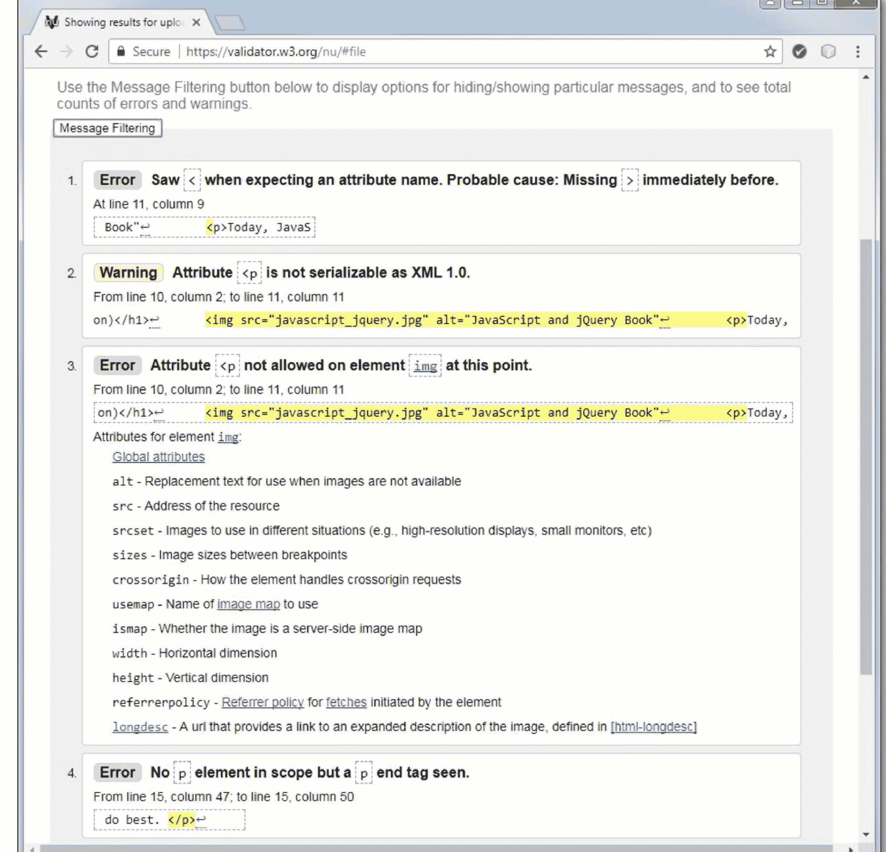

### 描述

- 如果 HTML 文档有效，验证器将指示文档已通过验证。然而，可能仍会显示一个或多个警告。
- 如果 HTML 文档无效，验证器将列出并描述每个错误和警告。
- 您可以使用列表上方“消息过滤”（Message Filtering）按钮显示错误和警告的数量，并选择您想要显示的错误和警告。

图 2-15 如何验证 HTML 文件（第 2 部分，共 2 部分）

## 如何验证 CSS 文件

您可以以验证 HTML 文件相同的方法验证 CSS 文件，可以使用 IDE 部分的验证程序，也可以像 W3C CSS Validation Service 这样的网站服务。如果您使用 W3C 验证服务，其首页看起来与 HTML 验证类似。然后，您可以使用三个选项卡中的任何一个来验证 CSS 文件。

如果文件包含错误，验证服务将显示如图 2-16 所示的界面。在这里，错误是由声明末尾缺少分号引起的。尽管由于错误标记和颜色编码，您通常会在 Brackets 中发现此类错误，但当文件很大、CSS 正常工作且您无法发现任何错误时，CSS 验证非常有用。CSS 验证还意味着您的 CSS 将可以在您未用于测试的冷门浏览器中运行。

### 显示错误的 CSS 验证服务

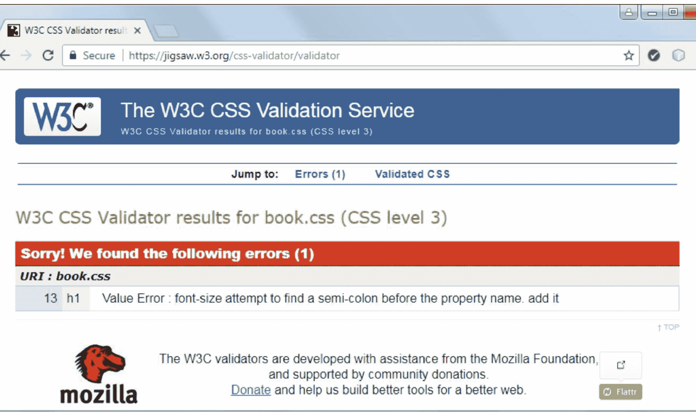

### 如何使用 W3C CSS Validation Service

- 访问以下 URL，识别要验证的文件，并点击“检查”按钮：`https://jigsaw.w3.org/css-validator/`

### 描述

- 要验证页面的 CSS，您可以使用专门的程序或网站。最受欢迎的网站之一是 W3C CSS Validation Service。
- 验证可确保您的代码是正确的，这可以提高 SEO。验证还可以帮助您发现未察觉的 CSS 错误。

图 2-16 如何验证 CSS 文件

## 展望

现在您已经完成了本章的学习，您应该能够编辑 HTML 或 CSS 了。因此，在下一章中，您将学习如何创建一个网页。

## 在开始进行本书的练习之前...

如果你还没有这样做，你应该安装 Chrome 浏览器以及本书涉及的应用程序、示例和练习程序。如果你打算使用 Brackets 作为你的文本编辑器，还应该下载并安装该产品。这三者的操作步骤均在附录 A。

## 练习 2-1：使用 Brackets 正确入门

如果你打算使用 Brackets 作为你的文本编辑器，这个练习将帮助你入门。

### 设置本书的项目

1. 启动 Brackets。然后，使用 `File → Open Folder` 命令打开书中介绍的应用程序的项目文件夹：
   `C:\murach\html15_css3\book_apps`
   这将显示一个文件树，每个章节都有一个文件夹。
2. 使用相同的命令打开书籍练习题的项目文件夹：
   `C:\murach\html15_css3\exercises`
   这应该关闭 `book_apps` 文件夹并将其替换为新文件夹。
3. 点击文件树顶部练习文件夹的名称。然后，选择 `Open Folder` 命令并打开此文件夹：
   `C:\murach\html15_css3\book_examples`
4. 你现在可以访问本书中的所有应用程序、练习和示例了。为了说明，点击文件树顶部 `book_examples` 文件夹的名称。然后，从显示的下拉列表中选择 `exercises` 以重新打开该文件夹。

### 编辑书籍应用程序中的代码并使用实时预览（Live Preview）进行测试

5. 在文件树中，双击 `ch02` 名称以显示此文件夹中的文件。然后，双击 `javascript_jquery.html` 名称以打开并显示该文件。注意，它列在“Working Files”（工作文件）下。
6. 在 `h1` 元素之后开始一个新的 `h1` 元素，并注意 Brackets 如何提供代码提示。从提示中选择 `h2`，输入起始标签的闭合括号（`>`），并注意 Brackets 如何添加闭合标签。撤销（`Ctrl+Z`）此更改。
7. 点击图 2-13 中的实时预览（Live Preview）图标在 Chrome 中预览该文件。然后，点击 HTML 文件中的一个元素，查看它是否在浏览器预览中被高亮显示。
8. 双击名为 `book.css` 的文件打开该文件。然后，将 `h1` 元素的 `color` 属性更改为红色，查看浏览器预览以确认标题现在以红色显示。

### 使用快速编辑（Quick Edit）和分屏功能

9. 点击工作文件中的 `javascript_jquery.html` 显示该文件。然后，将光标放在 `h1` 标签中，使用 `Ctrl+E`（或 `Cmd+E`）显示该元素的 CSS。然后，将颜色改回蓝色（`navy`），并注意 Chrome 中的变化。点击快速编辑功能左上角的 `X` 关闭它。
10. 使用 `View → Vertical Split` 拆分屏幕。执行操作后，你可以拖动右侧格中的 CSS 文件。要将工作文件移动到右侧组，你可以点击右侧格获取焦点，并点击文件树中的 `book.css` 文件（不要在工作文件中）。
11. 将 `img` 元素的 `float` 属性从 `left` 改为 `right`，注意 Chrome 中的变化。
12. 使用 `View → No Split` 命令结束分屏。

### 开始并编辑 HTML 和 CSS 文件

13. 使用图 2-9 中的步骤为 Brackets 添加 Emmet 插件。
14. 使用 `File → New` 命令创建一个新文件，并使用 `File → Save As` 在 `ch02` 文件夹中命名 `testpage.html`。然后，在新文件中输入感叹号并按 `Tab` 键。这应该向文件中插入 HTML 文档的起始代码。
15. 选择 `ch02` 文件夹中的 `book.css` 文件。然后，将此文件在该文件夹保存为 `testpage.css`。现在，删除 `body` 和 `h1` 规则之后的样式规则，并保存文件。
16. 在 `testpage.html` 文件中，将标题内容改为“Test Page”。然后，在 `body` 元素内添加一个显示“Test Page”的 `h1` 元素。
17. 显示 `javascript_jquery.html` 文件，复制 `link` 元素，显示 `testpage.html` 文件，并将 `link` 元素粘贴在 `title` 元素之后。然后，将 `href` 属性更改为“testpage.css”。
18. 点击实时预览图标进行测试。这说明了你可以多快地开始一个新的网页。然后，点击 `javascript_jquery.html` 文件显示它，查看 Chrome 如何切换到文件。

### 实验与清理

19. 如果你想进行更多实验，请尽管尝试。完成后，继续执行后续步骤。
20. 使用 `File → Close All` 关闭所有打开的文件。或者，将光标移动到工作文件列表中的文件并点击左侧的 `X` 逐个关闭文件。无论哪种方式，如果文件未保存将弹出对话框让你保存。
21. 当所有文件关闭后，关闭预览文件的 Chrome 实例。然后关闭 Brackets。

## 练习 2-2：编辑与测试

在此练习中，你将编辑并测试图 2-13 所示的页面。无论使用 Brackets 还是其他编辑器，你将学习如何构建页面。

### 打开并测试 HTML

1. 启动 Brackets。
2. 打开文件夹：`C:\murach\html15_css3\exercises`
3. 打开文件夹：`C:\murach\html15_css3\book_examples`
4. 打开文件夹：`C:\murach\html15_css3\book_apps`

### 修改 HTML 和 CSS

5. 打开 `ch02` 文件夹中的 `book.css` 文件。
6. 将 `img` 元素的 `float` 属性从 `left` 改为 `right`。
7. 将 `h1` 元素的 `color` 属性更改为红色。
8. 将标题改为“Test Page”。
9. 将 `href` 属性更改为“testpage.css”。

### 验证 HTML 和 CSS 文件

10. 使用 `View → Vertical Split` 拆分屏幕。
11. 修复文件中的错误。
12. 最后再次测试页面。

# 第 3 章 如何使用 HTML 结构化网页

## 如何编写 head 区域

HTML 文档的 `head` 部分包含提供了关于网页信息而非页面内容信息的元素。例如，在第 1 章中，你学习了 `title` 元素设置了在浏览器标签页中显示的文本。现在，你将学习更多关于 `head` 的知识，以及可以在 `head` 区域中编写的其他元素。

## 如何编写 title 元素

每个页面的 `head` 区域都应该包含一个唯一的 `title` 元素，用于描述页的内容。例如，在图 3-1 显示的 HTML 中，你可以看到该元素提供了名称，随后是 *speakers*（演讲者）和 *luncheons*（午宴）等关键词。该标题被搜索引擎用于优化，并出现在搜索结果中，帮助用户决定是否要访问该页面。这就是为什么在编写该元素时，你应该遵循图中的 SEO 指南。

`title` 元素的内容也会显示在浏览器的页面标签页中。但正如你在图中所示的，只有标题中适应标签页的部分会被显示。不过，如果你将鼠标悬停在标签页上，整个标题将以工具提示的形式显示。

## 如何链接到 favicon

`link` 元素是一个可选元素，你可以用它来指定应链接到网页的文件。在图 3-1 中，`link` 元素被用于将名为 *favicon*（网站图标）的自定义图标链接到网页。这会导致图标显示在页面标签页标题的左侧。注意，你通常按图中所示将 favicon 命名为 `favicon.ico`。

当你编写 `link` 元素时，通常会包含两个属性。`rel` 属性指示所链接资源与文档之间的关系。对于 favicon，你使用的值是“shortcut icon”。

`href` 属性提供资源的 URL。在这个示例中，favicon 与 HTML 文件位于同一个文件夹中，因此 URL 仅仅是文件名。不过，如果文件位于不同的位置，你可以使用绝对路径或相对 URL 来标识该位置。你将在本章的稍后部分学习如何编写绝对路径和相对 URL。

请注意，当你将网站部署到 Web 服务器时，没有必要在网站的根目录中包含 favicon 的 `link` 元素，它会自动出现在每个页面的标签页中。然而，在本书中，我们包含了 `link` 元素，以便你可以在自己的计算机上开发网站时看到 favicon。

### 第 3 章 如何使用 HTML 结构化网页

### 显示标题和 favicon 的浏览器

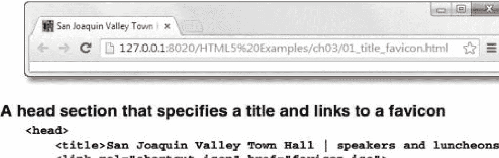

### 指定标题并链接到 favicon 的 head 区域

```html
<head>
  <title>San Joaquin Valley Town Hall | speakers and luncheons</title>
  <link rel="shortcut icon" href="favicon.ico">
</head>
```

### title 标签的 SEO 指南

- 始终在 `head` 区域中编写标签。
- 标题应准确描述页面内容，并应该包含一或两个关键词（称为核心关键词），你希望通过这些关键词来提升页面排名。
- 标题应该足够有趣，以便在搜索引擎的搜索结果中显示时吸引读者点击。
- 标题对于你网站中的每个页面应该是唯一的。
- 将标题长度限制在 65 个字符左右，因为搜索引擎在结果中显示的内容不会超过此长度。

### 描述

- `title` 元素指定了在浏览器页面标签页中显示的文本。
- 标题也用作页面的收藏或书签名称。
- 自定义图标（favicon）通常被命名为 `favicon.ico`。favicon 通常出现在浏览器页面标签页中标题的左侧。它也可能出现在浏览器地址栏 URL 的左侧，并可能用于收藏或书签。
- 要为页面指定 favicon，你可以使用与上方所示相同的 `link` 标签。
- 当你将网站部署到 Web 服务器时，如果你将 favicon 放在网站的根目录中，可以省略 favicon 的 `link` 元素。
- 要创建一个 ico 文件，你可以使用图标编辑器、将图像转换为 ico 文件的程序，或基于 Web 的转换器。你可能也可以通过搜索“web icons”在互联网上找到图标。更多信息，请参阅第 11 章。

图 3-1 如何编写 title 元素并链接到 favicon

## 如何包含元数据（metadata）

`meta` 元素是另一个可以在 `head` 元素内部编写的可选元素。你用它来指定元数据，元数据提供了关于文档内容的信息。

图 3-2 中的 `head` 包含了三个 `meta` 元素。第一个指定了页面的字符编码，UTF-8 是万维网上常用的编码。由于该元素是 HTML5 验证所需的，你应该在每个 HTML 文档的 `head` 区域中包含它，并且它应该是 `head` 区域中最前面的元素之一。

此图另外两个 `meta` 元素提供了可供搜索引擎索引页面元数据。在这里，第一个元素使用值为 `"description"` 的 `name` 属性，表示 `content` 属性包含了网页的描述。这可以比 `title` 元素中的描述更长，并且对于每个页面应该是唯一的。第二个 `meta` 元素使用值为 `"keywords"` 的 `name` 属性，表示 `content` 属性包含与页面相关的关键词列表。

### 包含元数据的 head 区域

```html
<head>
  <title>San Joaquin Valley Town Hall | speakers and luncheons</title>
  <meta charset="utf-8">
  <meta name="description" content="A yearly lecture series with speakers that present new information on a wide range of subjects">
  <meta name="keywords" content="san joaquin, town hall, speakers, lectures, luncheons">
</head>
```

### `<meta>` 标签的三个属性

| 属性 | 描述 |
| :--- | :--- |
| `charset` | HTML5 必需的标签，指定用于页面的字符编码类型。UTF-8 是万维网上常用的编码。 |
| `content` | 指定由 `name` 属性指定的项目的值。 |
| `name` | 指定添加到文档的元数据类型。 |

### SEO 指南

- 为每个页面编写描述元数据。它应该总结页面内容，对于每个页面应该是唯一的，并且可以比标题标签更长。当它在搜索引擎搜索结果中显示时，它应该鼓励用户点击你的链接。
- 为每个页面编写关键词元数据。它应该由不超过 10 个关键词或短语组成，并且对于每个页面应该是唯一的。

### 描述

- `meta` 元素提供了关于 HTML 文档的信息，称为元数据。
- `charset` 元数据是 HTML5 验证所需的。
- 描述元数据的全部或部分可能会出现在某些搜索引擎的搜索结果中。
- Google 和 Bing 忽略关键词元数据，但 Yahoo! 可能仍在使用它。

图 3-2 如何包含元数据

## 如何编写文本元素

在文档正文中，你可以编写两种类型的元素：块级元素和内联元素。在接下来的主题中，你将学习如何编写各种定义文档文本的块级和内联元素。

## 如何编写标题和段落

标题和段落是网页中最常见的内容。它们由图 3-3 所示的 HTML 元素定义。这些元素被称为块级元素，每个元素在显示时都从新行开始。

如果你查看此图中的示例，理解这些元素的工作原理应该没有任何困难。在这里，HTML 使用 `h1`、`h2` 和 `<p>` 元素来生成显示的文本。当浏览器显示这些元素时，每个元素都有默认的字体和大小，这些值由浏览器的基础字体决定。这种基础字体通常是 16 像素的 Times New Roman。

当你使用 `h1` 到 `h6` 元素时，你应该使用它们为你的文档提供逻辑结构，而不是为了格式化文本。这意味着页面上最重要的标题应该始终是一个 `h1` 元素，你一次只编写一个 `h1` 元素，不要跳过两个或更多级别来表示重要性的降低。换句话说，`h2` 之后的第一个标题应该是 `h3`，而不是 `h4`。

例如，此图中的 `h1` 元素用于标记页面上最重要的标题，`h2` 元素用于标记下一级重要性。然后，如果第一个 `h2` 元素下方需要两个子标题，它们都将以 `h3` 级别编写。这种结构有助于搜索引擎正确索引你的网站，并使你的页面对于屏幕阅读器等设备更易访问。然后，你可以像下一章所示使用 CSS 来调整这些元素中文本的大小和格式。

### 标题和段落的常用块级元素

| 元素 | 说明 |
| :--- | :--- |
| `h1` | 创建一个 1 级标题，内容加粗，大小为基础大小的 200%。 |
| `h2` | 创建一个 2 级标题，内容加粗，大小为基础大小的 150%。 |
| `h3` | 创建一个 3 级标题，内容加粗，大小为基础大小的 117%。 |
| `h4` | 创建一个 4 级标题，内容加粗，大小为基础大小的 100%。 |
| `h5` | 创建一个 5 级标题，内容加粗，大小为基础大小的 83%。 |
| `h6` | 创建一个 6 级标题，内容加粗，大小为基础大小的 67%。 |
| `p` | 创建一个文本段落，大小为基础大小的 100%。 |

### 使用块级元素的 HTML

```html
<h1>San Joaquin Valley Town Hall Programs</h1>
<h2>Pre-lecture coffee at the Saroyan</h2>
<p>欢迎加入我们，在每场讲座当天的上午 9:15 到 10:15 享用免费咖啡时光。演讲者们通常会参加这个非常特别的活动。</p>
<h2>Post-lecture luncheon at the Saroyan</h2>
<p>通过购买午餐票来延续市政厅会议的热情氛围。</p>
```

### 网页浏览器中的块级元素

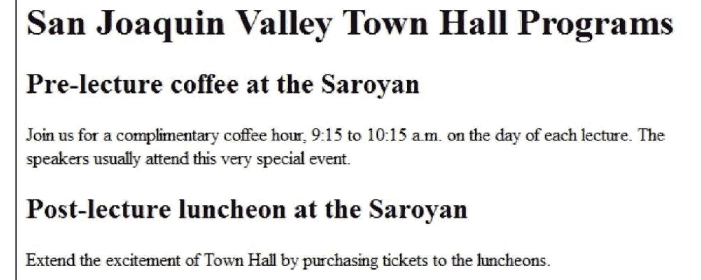

### SEO 指南

- 使用 `h1` 标签显示页面内容的结构和重要性。始终使用 `h1` 标签来识别页面上最重要的信息，并且每个页面只编写一个 `h1` 标签。然后一次降低一级以显示后续的重要性级别。
- 不要使用标题级别作为调整字体大小的方法。相反，使用 CSS 来调整标题的大小。

### 描述

- 块级元素是网站的主要构建模块。每个块元素都从新行开始。
- 基础字体大小以及标题和段落上下的间距由浏览器决定，但你可以通过 CSS 更改这些值。

图 3-3 如何编写标题和段落

## 如何编写特殊文本块

除了标题和段落元素外，HTML 还提供了一些你可以用于编写特殊文本块的元素。例如，图 3-4 中描述了三个最常用的元素。

你通常使用 `pre` 元素来显示预先格式化的代码块。当你使用该元素时，内容中出现的任何空白或换行都会被保留。此外，内容以等宽字体显示。在此图中，`pre` 元素被用于显示两行 JavaScript 代码。

你通常使用 `blockquote` 元素来显示如图所示的实际引用。根据浏览器的不同，该元素可能会导致内容相对于包含它的块级元素左侧和右侧都缩进。但请注意，这不会给文本添加引号。

你可以使用 `address` 元素来显示网站开发者或所有者的联系信息。在此图中，`address` 元素用于显示电话号码和电子邮件地址。如你所见，浏览器以*斜体*显示这些信息。

尽管这些元素提供了一些默认的 HTML 格式，但你不应该那样看待这些元素。相反，你应该使用这些元素来识别特定类型的内容。然后，你可以使用 CSS 来调整这些元素中文本的大小和格式。

### 第 3 章 如何使用 HTML 结构化网页

### 用于特殊文本块的块级元素

| 元素 | 说明 |
| :--- | :--- |
| `pre` | 显示预格式化文本，保留空白和换行，使用等宽字体。 |
| `blockquote` | 表示引用的内容，通常缩进显示。 |
| `address` | 表示联系信息，通常以斜体显示。 |

### 使用特殊文本块的 HTML

```html
<pre>
console.log("Hello, World!");
alert("Welcome to JavaScript!");
</pre>

<blockquote>
  <p>此睡，或许在梦中——哦，这就是问题的结所在。</p>
</blockquote>

<address>
  Phone: (559) 555-1212<br>
  Email: info@townhall.com
</address>
```

### 网页浏览器中的特殊文本块

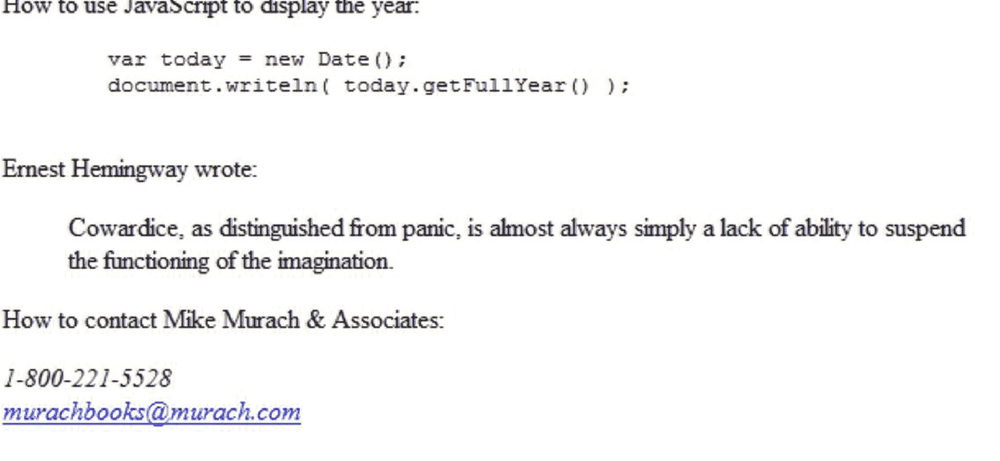

### 描述

- `pre` 元素用于显示预格式化文本，如代码片段。
- `blockquote` 元素用于表示引用内容。
- `address` 元素用于表示联系信息。
- 这些元素提供语义含义，格式应通过 CSS 控制。

图 3-4 如何编写特殊文本块

## 如何编写行内元素

行内元素被编码在块级元素内部，且不会在新的行开始。它们分为两类：用于文本格式化的行内元素和用于识别内容的行内元素。

### 用于文本格式化的行内元素

| 元素 | 描述 |
| :--- | :--- |
| `sub` | 将内容显示为下标。 |
| `sup` | 将内容显示为上标。 |
| `br` | 一个用于开启文本新行的空元素。 |

### 用于识别内容的行内元素

| 元素 | 描述 |
| :--- | :--- |
| `abbr` | 用于缩写词。 |
| `cite` | 用于指示文献引用，如书名。 |
| `code` | 用于计算机代码，以等宽字体显示。 |
| `dfn` | 用于可以在其他地方定义的特殊术语（定义）。 |
| `em` | 表示内容应被强调，以*斜体*显示。 |
| `kbd` | 用于键盘输入，以等宽字体显示。 |
| `q` | 用于引用，显示在引号内。 |
| `samp` | 用于标记一段没有其他含义的字符序列（样本）。 |
| `small` | 用于以较小字体显示“细微”内容，如脚注。 |
| `strong` | 表示内容应被强烈强调，以**粗体**显示。 |
| `var` | 用于计算机变量，以等宽字体显示。 |

### 使用部分行内元素的 HTML

```html
<p>如果你的期末考试没有达到 78% 或以上的分数，<em>你将无法及格。</em></p>
<p>在我们的<strong>年终大促销</strong>处可以省下一笔钱。</p>
<p>当对话框显示时，输入 <kbd>brock21</kbd>。</p>
<p>水的化学符号是 H<sub>2</sub>O。</p>
<p><q>此睡，或许在梦中——哦，这就是问题的结所在。</q></p>
```

### 网页浏览器中的行内元素

> 如果你的期末考试没有达到 78% 或以上的分数，*你将无法及格。*
>
> 在我们的**年终大促销**处可以省下一笔钱。
>
> 当对话框显示时，输入 `brock21`。
>
> 水化学符号是 H₂O。
>
> “此睡，或许在梦中——哦，这就是问题的结所在。”

### 描述

- 行内元素被编码在块级元素内部，且不会在新的行开始。
- 格式化元素不包含任何特殊含义。
- 内容元素用于传达含义。然后你可以使用 CSS 对它们进行格式化。

图 3-5 如何编写用于格式化和识别文本的行内元素

## 如何编写字符实体

你开发的许多网页都需要特殊字符，例如版权符号和开启/关闭“弯引号”。为了显示这些特殊字符，你使用字符实体。图 3-6 展示了这些实体中最常见的。

如你所见，所有实体都与符号 `&` 开头并分号 (`;`) 结尾。实体的其余部分标识它代表的字符。例如，要插入版权符号 (©)，你需要使用 `&copy;` 字符实体。

由于 `&` 字符标记了每个字符实体的开头，你不应该在 HTML 文档中使用该字符来表示 `&`。相反，你应该使用 `&amp;` 实体。同样，如果左括号 (`<`) 和右括号 (`>`) 用于识别 HTML 标签，你不应该在 HTML 文档中使用这些字符来表示小于和大于号。相反，你应该使用 `&lt;` 和 `&gt;` 实体。

除了字符实体外，你有时需要插入一个不换行空格来强制浏览器显示空格。为了做到，你使用 `&nbsp;` 字符实体。在本图的第三段中，该字符实体被用于段落的第一行缩进四个空格。然而，由于你可以通过 CSS 实现相同的效果，你可能不会这样使用 `&nbsp;` 字符实体。

### HTML 字符实体

| 实体 | 字符 | 实体 | 字符 |
| :--- | :--- | :--- | :--- |
| `&amp;` | & | `&deg;` | ° |
| `&lt;` | < | `&plusmn;` | ± |
| `&gt;` | > | `&lsquo;` | ‘（开启单引号） |
| `&copy;` | © | `&rsquo;` | ’（关闭单引号或撇音） |
| `&reg;` | ® | `&ldquo;` | “（开启双引号） |
| `&trade;` | ™ | `&rdquo;` | ”（关闭双引号） |
| `&cent;` | ¢ | `&nbsp;` | 不换行空格 |

### 字符实体示例

```html
<p>该开始你的圣诞购物了！</p>
```

```html
<p>约翰·F·肯尼迪总统说：&ldquo;因此，我的美国同胞，不要问你的国家为你们做了什么，要问你们能为国家做什么.&rdquo;</p>
```

```html
<p>&nbsp;&nbsp;&nbsp;&nbsp;将恐惧转化为希望，医学未来学家 Alan J. Russell 博士将讨论受损或疾病人体部位再生的科学，同时为人类健康的未来带来真正的希望。</p>
```

```html
<p>&copy; 2018 Mike Murach &amp; Associates, Inc.</p>
```

### 网页浏览器中的字符实体

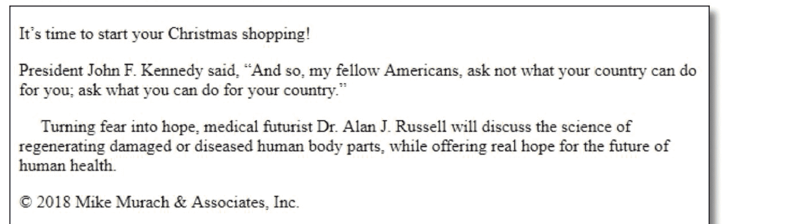

### 描述

- 字符实体用于在 HTML 文档中显示特殊字符。
- 除了上述实体，HTML5 还提供了多种。完整的实体列表请参阅：`https://www.w3.org/TR/html5/syntax.html#named-character-references`

图 3-6 如何编写字符实体

## 如何编写核心属性

除了你目前学到的属性外，HTML 还提供了一些可以用于大多数元素的核心属性。在图 3-7 中，你可以看到最可能用到的核心属性。

你使用 `id` 属性唯一标识一个 HTML 元素。然后你可以使用 CSS 对该元素进行操作。

`class` 属性非常有用，除非你为该类分配了多个元素。这时，你可以使用 CSS 为该类下的所有元素应用相同的格式。当你使用 `class` 属性时，可以为单个元素分配多个类。

### 核心属性

| 属性 | 描述 |
| :--- | :--- |
| `id` | 唯一标识一个元素。 |
| `class` | 为元素指定一个或多个类名。 |
| `style` | 为元素指定内联 CSS 样式。 |
| `title` | 为元素提供额外的提示信息。 |

### 使用核心属性的 HTML

```html
<div id="header" class="main-header" style="background-color: navy;">
  <h1>San Joaquin Valley Town Hall</h1>
</div>
```

### 描述

- `id` 属性在文档中必须唯一。
- `class` 属性可以在多个元素间共享。
- `style` 属性用于内联样式，优先级高于外部样式表。
- `title` 属性通常在鼠标悬停时显示为工具提示。

图 3-7 如何编写核心属性

## 如何构建页面的内容

HTML5 的核心特性之一是增加了新的结构化元素。在介绍这些元素时，我将向你展示在 HTML5 发布之前，页面是如何构建的。

## 如何使用主要的 HTML5 语义元素

图 3-8 展示了能够改进页面结构构建方式的 HTML5 语义元素。例如，图中的示例显示了如何使用 `header`、`main` 和 `footer` 元素将文档分为三个部分。通过查看 HTML 标签，可以很容易看出页面的结构。这也有便于编写为格式化元素所需的选择器代码。

所有的 HTML5 语义元素都是块级元素。与你在本章早期用于编写文本的块级元素不同，你可以在 HTML5 语义元素中嵌套其他块级元素。例如，在图 HTML 代码中，你可以看到 `<h1>` 元素嵌套在 `header` 元素中，`<p>` 元素嵌套在 `main` 和 `footer` 元素中。

这些结构化元素的使用通常被称为 HTML5 语义化。这意味着当你使用这些元素时，能够更好地创建语义信息。从长远来看，使用 HTML5 语义化意味着搜索引擎能够更好地提供相关页面。出于如此，你应该立即开始使用这些语义元素。

虽然此图只说明了表格中七个元素中的三个，但你将在本章末尾网页中使用 `nav` 元素。在第 6 章中，你将看到如何使用 `aside` 元素作为 `main` 内部的侧边栏，以及如何使用 `section` 元素处理 `main` 内部的其他内容。此外，你还将看到 `article` 元素用于演讲者的文章。

如果你回顾图中的 HTML5 语义元素，会发现 `section` 元素是唯一不指示其所包含内容特定类型的元素。因此，当没有其他合适的 HTML5 元素适用于给定内容时，我们将在本书中使用 `section` 元素。然而，HTML5 语义化的核心在于，只要其他 HTML5 元素能提供相应的语义，就使用它们。这样，你就能获得 HTML5 带来的好处。

### 第 3 章 如何使用 HTML 结构化网页

### 主要的 HTML5 语义元素

| 元素 | 内容 |
| :--- | :--- |
| `header` | 页面的页眉。 |
| `main` | 页面的主要内容。 |
| `section` | 文档的通用部分，不指示内容类型。 |
| `article` | 像报纸文章之类的组合。 |
| `nav` | 包含指向其他页面链接或占位符的页面部分。 |
| `aside` | 页面类似于侧边栏的部分，与其相邻的内容相关。 |
| `footer` | 页面的页脚。 |

### 使用 header、main 和 footer 元素构建的页面

```html
<body>
  <header>
    <h1>San Joaquin Valley Town Hall</h1>
  </header>
  <main>
    <p>Welcome to San Joaquin Valley Town Hall. We have some fascinating speakers for you this season!</p>
  </main>
  <footer>
    <p>&copy; Copyright 2018 San Joaquin Valley Town Hall.</p>
  </footer>
</body>
```

### 在 Web 浏览器中显示的页面

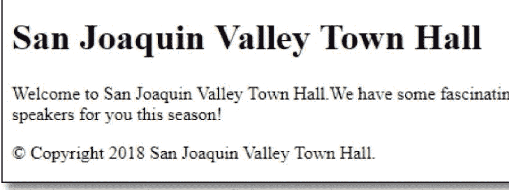

### 可访问性与 SEO 指南

- 使用 HTML5 语义元素来指示你页面的结构。

### 描述

- HTML5 提供了你应该使用来构建网页内容的语义元素。这些元素的使用被称为 HTML5 语义化。
- 所有的 HTML5 语义元素都是块级元素，它们可以包含其他块级元素以及内联元素。
- 图中所有的 HTML5 元素都受现代浏览器的支持。

图 3-8 如何使用主要的 HTML5 语义元素

## 如何使用其他一些 HTML5 语义元素

图 3-9 展示了目前现代浏览器支持的一些其他 HTML5 语义元素。例如，`time` 元素提供了标准格式的日期或时间，浏览器可以对其进行解析。第一个示例说明了这一点。在这里，`<p>` 元素表示明年会议将在 5 月 31 日举行。`time` 元素明确了这是 2018 年的 5 月 31 日。如果在文章中使用 `time` 元素，你可以使用 `pubdate` 属性来明确该日期是该文章的发布日期。

图中的第二个和第三个语义元素适用于网页中的插图。`figure` 可以是一个文本块、一张图像、图表或任何从外部引用的内容。在包含插图的 `figure` 元素内部，可以使用 `figcaption` 为插图提供说明。第二个示例说明了这一点，它将两行 JavaScript 代码视为一个图。随后在第 11 和第 12 章中，你将看到如何使用这些元素将图像和表格视为插图。

再次，这些元素的设计是为了提供更多语义。这样，搜索引擎可以更好地为你的页面排名，屏幕阅读器也可以更好地读取你的页面。此外，使用这些元素使编写页面变得更容易。

### 其他 HTML5 语义元素

| 元素 | 内容 |
| :--- | :--- |
| `time` | 浏览器可以解析的标准格式的日期或时间。 |
| `figure` | 文本块、图像、图表或外部引用的内容。 |
| `figcaption` | 图表的说明。 |

### `time` 的属性

| 属性 | 描述 |
| :--- | :--- |
| `datetime` | 浏览器可以解析的日期或时间。 |
| `pubdate` | 文章的发布日期。 |

### `time` 元素

```html
<p>Next year's conference will be on <time datetime="2018-05-31">May 31st</time></p>
```

### `figure` 和 `figcaption`

```html
<figure>
  <code>console.log("Hello, World!");</code>
  <figcaption>This is a caption for the figure.</figcaption>
</figure>
```

### 在 Web 浏览器中显示的页面


### 可访问性与 SEO 指南

- 使用 HTML5 语义元素来指示你页面的结构。

### 描述

- HTML5 提供了你应该使用来构建网页内容的语义元素。这些元素的使用被称为 HTML5 语义化。
- 所有的 HTML5 语义元素都是块级元素，可以包含其他块级元素以及内联元素。
- 图中所有的 HTML5 元素都受现代浏览器的支持。

图 3-9 如何使用其他一些 HTML5 语义元素

## 何时以及如何编写 div 和 span 元素

图 3-10 显示了传统上用于构建页面的 `div` 和 `span` 元素。HTML5 引入了许多新的结构化元素。在介绍这些元素时，我将向你展示在 HTML5 发布之前，页面是如何构建的。

### 用于网页结构化的块级元素

| 元素 | 说明 |
| :--- | :--- |
| `div` | 允许将页面划分为区域，并可以使用 CSS 对其进行格式化和定位。 |

### 用于文本格式化的行内级元素

| 元素 | 说明 |
| :--- | :--- |
| `span` | 允许你识别可以使用 CSS 进行格式化的文本。 |

### 使用 div 和 span 元素结构化的页面

```html
<body>
  <div id="header">
    <h1>San Joaquin Valley Town Hall</h1>
  </div>
  <div id="main">
    <span id="welcome">Welcome to San Joaquin Valley Town Hall.</span>
    <p>We have some fascinating speakers for this season!</p>
  </div>
  <div id="footer">
    <p>&copy; 2018 San Joaquin Valley Town Hall.</p>
  </div>
</body>
```

### 在网页浏览器中显示的页面

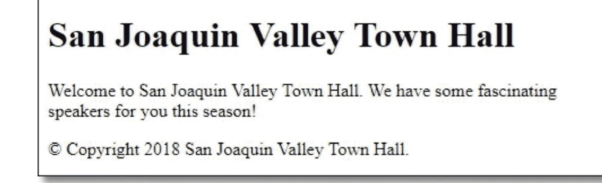

### SEO 可访问性指南

- 仅在 HTML 语义元素不适用时使用 `div` 标签。
- 仅在不适用内容识别方法时使用 `span` 标签。

### 描述

- 在 HTML5 之前，`div` 元素被用于定义文档主体内的划分。现在，HTML 语义元素正在取代 `div` 元素。
- 在 HTML5 之前，`span` 元素被用于识别可以应用格式化的文本部分。今天，更好的做法是使用图 3-4 和图 3-5 中的元素来识别内容，并使用 CSS 对该内容进行格式化。

图 3-10 何时以及如何编写 div 和 span 元素

## 如何编写链接、列表和图像

由于你在开发的大多数网页中都会使用链接、列表和图像，因此本书将介绍这些元素的主题。在此之前，你需要了解如何编写绝对 URL 和相对 URL，以便你可以在链接和图像中使用它们。

## 如何编写绝对 URL 和相对 URL

图 3-11 展示了绝对 URL 和相对 URL 的一些示例。为了帮助你理解这些示例是如何工作的，图顶部的图显示了示例用网站的文件夹结构。如你所见，该网站的文件夹分为三层。网站的根文件夹包含五个子文件夹，包括包含网站图像和样式的文件夹。然后，`books` 文件夹包含它的子文件夹。

在第一章中，你学习了 URL 的基本组成部分。网站的 URL 是绝对 URL，包含了网站的域名。图中的第一组示例说明了这一点。这里，URL 指向 `www.murach.com` 的页面。第一个 URL 指向根目录下的 `index.html` 文件，第二个 URL 指向 `root/books/php` 文件夹下的 `toc.html` 文件。

在页面的代码内部，绝对 URL 用于引用另一个网站的文件。相比之下，相对 URL 用于引用同一个网站内的文件。如图所示，相对 URL 有两种。

在根相对路径中，路径相对于网站的根文件夹。第二组示例说明了这一点。这里，开头的斜杠表示网站的根文件夹。结果，第一个路径指向根文件夹中的 `login.html` 文件，第二个路径指向 `images` 文件夹中的 `logo.gif` 文件。

在文档相对路径中，路径相对于当前文档。第三组示例说明了这一点。这里，假设路径是编写在一个位于网站根文件夹的文件中的。那么，第一个路径指向根目录 `images` 子文件夹中的文件，第二个路径指向 `books` 子文件夹中 `php` 子文件夹中的文件。这说明了在结构层级中的路径。

但你也可以使用文档相对路径导航层级。第四组示例说明了这一点。这里，假设当前文档位于 `root/books` 文件夹中。那么，第一个路径向上移动一级到达根文件夹中的 `index.html` 文件。第二个路径向上移动一级到达根文件夹，然后向下移动一级到达 `images` 文件夹中的 `logo.gif` 文件。

这表明编写文件路径不止于一种。例如，如果你在 `root/books` 文件夹中编写一个 HTML 文件，你可以使用根相对路径或文档相对路径来访问 `images` 子文件夹。如果现在这让你感到困惑，一旦你开始编写自己的页面，很快就会理解了。

### 简单的网站文件夹结构

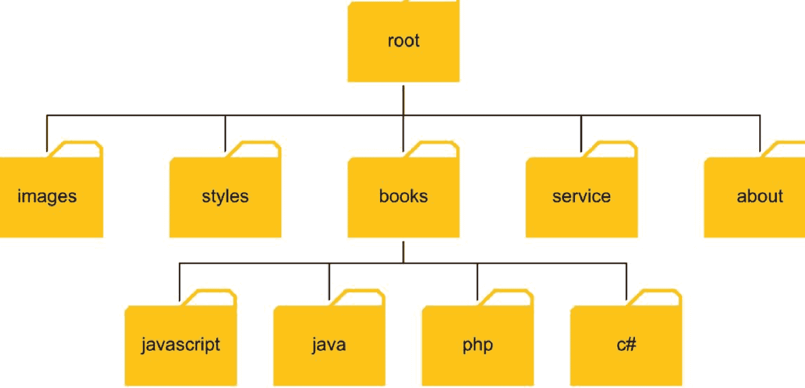

### 绝对 URL 和相对 URL 示例

**绝对 URL**

- `http://www.murach.com/index.html`
- `http://www.murach.com/books/php/toc.html`

**根相对路径**

- `/login.html` (指向 `root/login.html`)
- `/images/logo.gif` (指向 `root/images/logo.gif`)

**从根目录向下的文档相对路径**

- `images/logo.gif` (指向 `images/logo.gif`)
- `books/php/toc.html` (指向 `books/php/toc.html`)

**从根目录向上的文档相对路径**

- `../index.html` (指向 `index.html`)
- `../images/logo.gif` (指向 `images/logo.gif`)

### 描述

- 当使用绝对 URL 时，你编写包含域名的完整 URL。
- 当使用相对 URL 时，你基于当前文件夹进行编写。
- 根相对路径相对于网站的根文件夹。它始终以斜杠开头。
- 文档相对路径相对于当前文档所在的位置。
- 你可以使用两个点 (`..`) 在文档相对路径中向上移动。

图 3-11 如何编写绝对 URL 和相对 URL

## 如何编写链接

`<a>` 元素是一个内联元素，用于创建一个可以加载另一个网页的链接。该元素的 `href` 属性标识了要加载的页面。

### `<a>` 元素的基本属性

| 属性 | 描述 |
| :--- | :--- |
| `href` | 指定链接的相对 URL 或绝对 URL。 |

### 指向同一文件夹内网页的链接

```html
<p>访问我们的 <a href="products.html">产品列表</a>。</p>
```

### 指向父文件夹下子文件夹内网页的链接

```html
<p>阅读关于 <a href="../company/services.html">我们提供的服务</a>的内容。</p>
```

### 指向根文件夹下网页的链接

```html
<p>查看您的 <a href="/orders/cart.html">购物车</a>。</p>
```

### 指向另一个网站的网页的链接

```html
<p>如需了解更多关于 JavaScript 的知识，请访问 <a href="http://www.javascript.com/">JavaScript 官方网站</a>。</p>
```

### 网页浏览器中的链接

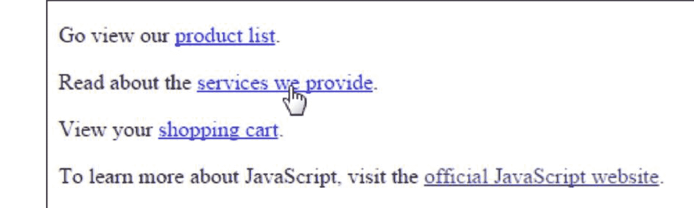

### SEO 和无障碍访问指南

- 链接的内容应该是能够清晰指示链接去向的文本。

### 描述

- `<a>` 元素是一个内联元素，用于创建一个可以加载另一个网页的链接。该元素的 `href` 属性标识了要加载的页面。
- 链接的文本默认带有下划线，表示它是可点击的。
- 如果链接未被访问，它显示为蓝色。如果已访问，则显示为紫色。你可以使用 CSS 更改这些值。
- 当鼠标悬停在链接上时，光标会变为手指手形。
- 有关 `<a>` 元素的格式和编码的更多信息，请参见第 4 章和第 7 章。

图 3-12 如何编写链接

## 如何编写列表

图 3-13 显示了如何编写两种基本列表：有序列表和无序列表。要创建一个无序列表，你使用 `<ul>` 元素。然后，在该元素内部，为列表中的每个项目编写一个 `<li>`（列表项）元素。每个 `<li>` 元素的内容是显示在列表中的文本。默认情况下，当列表在浏览器中显示时，无序列表中的每个项目前面都有一个项目符号。然而，你可以使用 CSS 更改符号。

要创建一个有序列表，你使用 `<ol>` 元素，并为列表中的每个项目配一个 `<li>` 元素。这与 `<ul>` 元素的工作类似，不同之处在于浏览器中显示时，项目前面是数字而不是符号。在这种情况下，你可以使用 CSS 更改所使用的数字类型。

图中所示的两个列表说明了其工作原理。在这里，第一个列表简单地显示了几种编程语言的名称，因此这些项目不需要反映任何顺序。相比之下，第二个列表标识了完成订单三个步骤。由于这些步骤必须按照规定的顺序完成，因此它们以有序列表的形式显示。

当你处理 `<li>` 元素时，应该意识到它可以包含文本、内联元素或块级元素。例如，一个 `<li>` 元素可以包含一个定义链接的 `<a>` 元素。事实上，在无序列表中编写一系列链接是一种最佳实践。你将在本章稍后的部分看到这方面的示例，并在第 7 章中学习所有相关知识。

### 创建有序和无序列表的元素

| 元素 | 描述 |
| :--- | :--- |
| `<ul>` | 创建无序列表。 |
| `<ol>` | 创建有序列表。 |
| `<li>` | 为无序列表或有序列表创建列表项。 |

### 创建两个列表的 HTML

```html
<p>我们有各种语言的书籍，包括：</p>
<ul>
  <li>JavaScript</li>
  <li>PHP</li>
  <li>Java</li>
  <li>C#</li>
</ul>
<p>您需要完成以下步骤：</p>
<ol>
  <li>输入您的账单信息。</li>
  <li>输入您的送货信息。</li>
  <li>确认您的订单。</li>
</ol>
```

### 网页浏览器中的列表

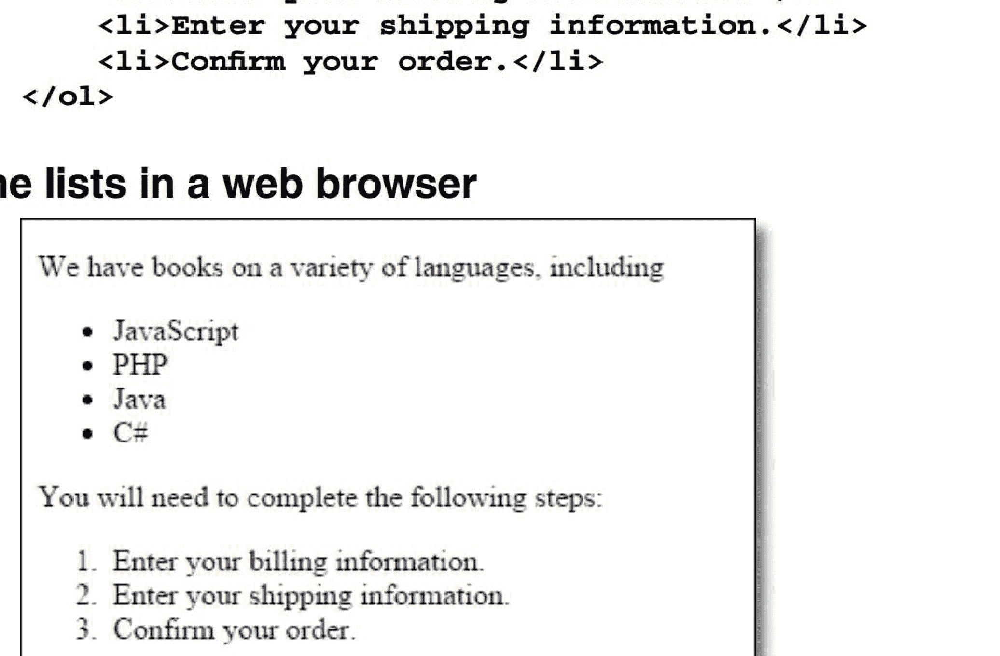

### 描述

- 两种基本列表类型是无序列表和有序列表。默认情况下，无序列表显示为符号列表，有序列表显示为编号列表。
- 有关列表的格式和编码的更多信息，请参见第 4 章和第 7 章。

图 3-13 如何编写列表

## 如何包含图像

图像是网页的重要部分。要显示图像，你使用图 3-14 所示的 `` 元素。这是一个内联元素，被编码为一个空标签。在图的示例中，该标签编写在 `<h1>` 元素之前。然而，`<h1>` 元素显示在下方，因为它是一个从新行开始的块级元素。

`` 元素的 `src`（源）属性指定了要显示的图像的 URL。`alt` 属性提供了图像无法加载时显示的替代文本。

### `` 元素的属性

| 属性 | 描述 |
| :--- | :--- |
| `src` | 指定要显示的图像的 URL。 |
| `alt` | 图像无法加载时显示的替代文本。 |
| `height` | 指定图像的高度（以像素）。 |
| `width` | 指定图像的宽度（以像素）。 |

### 一个 `` 元素

```html

<h1>Mikeach &amp; Inc.</h1>
```

### 网页浏览器中的图像

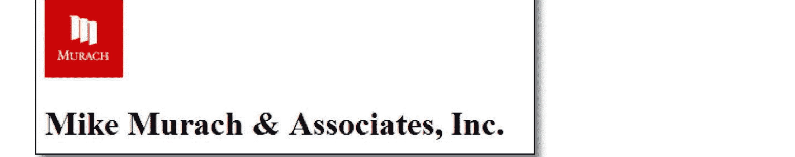

### 浏览器支持的图像格式

- JPEG（联合图像专家小组）
- GIF（图形交换格式）
- PNG（便携式网络图形）

### 无障碍访问指南

- 对于有用内容的图像，始终编写一个描述图像的 `alt` 属性。
- 对于用于装饰的图像，将 `alt` 属性留空。

### 描述

- `` 元素是一个内联元素，用于显示由 `src` 属性标识的图像。
- `height` 和 `width` 属性可以用于指定图像的大小，以便浏览器可以分配正确的空间。这些属性也可以用于调整图像大小，但最好使用图像编辑器来完成。
- JPEG 文件通常使用 `.jpg` 扩展名，通常用于照片和扫描件。GIF 文件通常用于小型插图和标志。而 PNG 文件结合了 JPEG 和 GIF 的特点。
- 请参见第 4 章和第 7 章以获取有关 `img` 元素的更多信息。

图 3-14 如何包含图像

## 结构化的网页

现在你已经学习了结构化网页的 HTML 元素，你准备好查看一个使用这些元素的简单网页了。

## 页面布局

图 3-15 所示的网页使用了在本章中学到的许多 HTML 元素。该网页的目的是显示由非营利组织的系列讲座的信息。

此图显示了用于此页面 HTML 的默认格式。也就是说，尚未使用 CSS 来改进格式。然而，在下一章中你将学习如何使用 CSS 改进此页面的格式。

当你查看下一个图中该页面的 HTML 代码时，你会发现页头中的第一个标题是 `<h2>` 元素，第二个标题是 `<h3>` 元素。然后，页面主要内容中的标题是 `<h1>` 元素。这是因为该标题标识了页面上最重要的信息，这对 SEO 至关重要。

### 本章介绍的某些 HTML 结构的网页

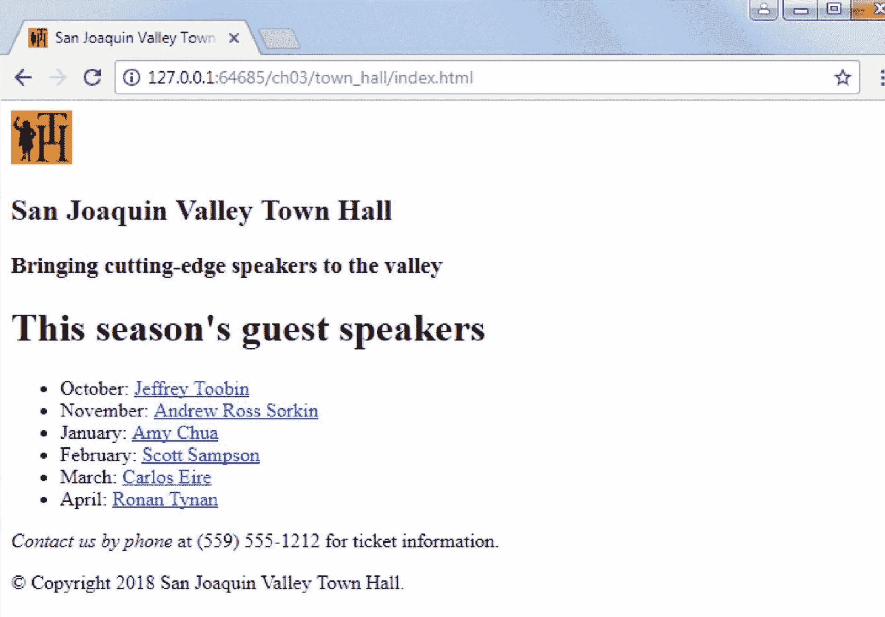

### 描述

- 该网页为一家非营利组织提供信息，该组织安排知名演讲者的讲座。
- 该网页包含 HTML5 语义元素，定义了页头（`header`）、主内容（`main`）和页脚（`footer`）。
- `header` 元素包含一张图片以及 `h2` 和 `h3` 元素。
- `main` 元素包含一个 `h1` 元素、一个包含无序列表（列表内包含 `<a>` 元素）的 `nav` 元素，和一个 `<p>` 元素。
- `footer` 元素包含一个 `<p>` 元素，该元素使用字符实体包含版权符号。
- 此页面包含一个网站图标（favicon），显示在浏览器标签页中页面标题的左侧。
- 这展示了 HTML 元素的默认格式。在下一章中，你将学习如何使用 CSS 对 HTML 进行格式化，使其看起来更具吸引力。

图 3-15 结构化网页的页面布局

## HTML 文件

图 3-16 展示了该网页的 HTML 文件。首先，DOCTYPE 声明、`html` 元素和 `head` 元素展示了在你创建的每个文档中这些项目应该如何编码方式。

在 `head` 元素中，你可以看到 `lang` 属性的使用。在 `head` 元素中，你可以看到 `charset` `meta` 元素和 `title` 元素的编码。虽然用于网站图标的 `link` 元素是可选的，但大多数网站都会使用一个。此外，在大多数网页中，你应该至少包含一个用于描述（description）的 `meta` 元素，尽管本书中的示例中没有使用它。

但最重要的是 HTML5 语义元素的使用。在这里，`header` 元素包含 `h2` 和 `h3`。然后，`main` 元素包含一个 `h1` 元素、一个 `nav` 元素和一个 `<p>` 元素。最后，`footer` 元素包含一个 `<p>` 元素。

`nav` 元素内是一个包含 6 个 `li` 元素的无序列表。然后，每个 `li` 包含一个 `<a>` 元素。这符合 HTML5 语义化，因为 `nav` 元素应该包含一系列链接。在无序列表中为 `<a>` 元素编码也是一种最佳实践。

你还可以看到一个 `<em>` 元素的使用，它将倒数第二段的前四个单词设置为斜体，以及一个在最后一段插入版权符号的字符实体。最后，新的 HTML5 语义元素使得此页面的结构一目易见。

### 网页的 HTML 文件

```html
<!DOCTYPE html>
<html lang="en">
<head>
    <meta charset="utf-8">
    <title>San Joaquin Valley Town Hall</title>
    <link rel="shortcut icon" href="images/favicon.ico">
</head>
<body>
  <header>
    
    <h2>San Joaquin Valley Town Hall</h2>
    <h3>Bringing cutting-edge speakers to the valley</h3>
  </header>
  <main>
    <h1>This season's guest speakers</h1>
    <nav>
      <ul>
        <li>October: <a href="speakers/toobin.html">Jeffrey Toobin</a></li>
        <li>November: <a href="speakers/sorkin.html">Andrew Ross Sorkin</a></li>
        <li>January: <a href="speakers/chua.html">Amy Chua</a></li>
        <li>February: <a href="speakers/sampson.html">Scott Sampson</a></li>
        <li>March: <a href="speakers/eire.html">Carlos Eire</a></li>
        <li>April: <a href="speakers/tynan.html">Ronan Tynan</a></li>
      </ul>
    </nav>
    <p><em>Contact us by phone</em> at (559) 555-1212 for ticket information.</p>
  </main>
  <footer>
    <p>&copy; Copyright 2018 San Joaquin Valley Town Hall.</p>
  </footer>
</body>
</html>
```

### 观点


# 本章介绍

本章介绍了你开发网页时所需的许多 HTML 元素。特别是，它介绍了你创建和识别页面内容时所需的 `块级元素（block element）` 和 `内联元素（inline element）`。它还介绍了你结构化页面所需的 HTML5 元素。

拥有这些技能，你可以创建具有浏览器默认格式的网页。正如我在整个章节中提到的，正确格式化和布局网页的方法是使用 CSS。这就是为什么接下来的三章将展示如何这样做。

## 术语

- 焦点关键词 (`focus keyword`)
- 网站图标 (`favicon`)
- 元数据 (`metadata`)
- 块级元素 (`block element`)
- 内联元素 (`inline element`)
- 字符实体 (`character entity`)
- 语义实体 (`semantic entity`)
- HTML5 语义化 (`HTML5 semantics`)
- 绝对 URL (`absolute URL`)
- 相对 URL (`relative URL`)
- 根相对路径 (`root-relative path`)
- 文相对路径 (`document-relative path`)
- 链接 (`link`)
- 有序列表 (`ordered list`)
- 无序列表 (`unordered list`)
- JPEG (联合图像专家小组)
- GIF (图形交换格式)
- PNG (便携网络图形)

## 总结

- 本章介绍了你开发网页时所需的许多 HTML 元素。特别是，它介绍了你创建和识别页面内容时所需的 `块级元素` 和 `内联元素`。它还介绍了你结构化页面所需的 HTML5 元素。
- 拥有这些技能，你可以创建具有浏览器默认格式的网页。正如我在整个章节中提到的，正确格式化和布局网页的方法是使用 CSS。这就是为什么接下来的三章将展示如何这样做。

*(注：由于原文中总结部分存在重复段落，此处遵循原文逻辑进行了对应翻译，并保持了格式一致性)*

# 第 3 章 如何使用 HTML 结构化网页

## 首页应该看起来像

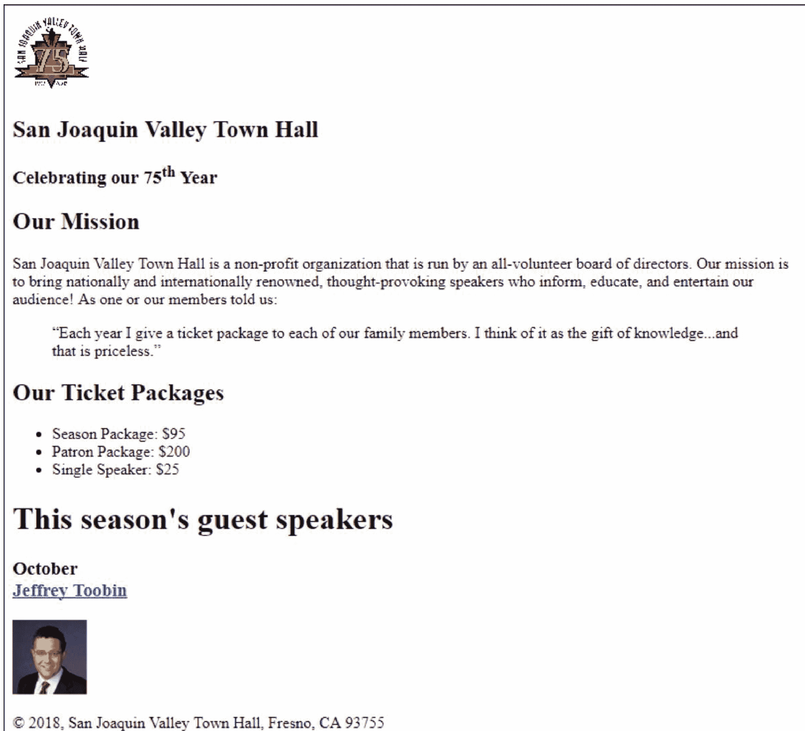

## 圣华亚河谷市政厅

庆祝我们的 **75** 周年

## 我们的使命

圣华亚河谷市政厅是一个由全志愿者董事会运营的非营利组织。我们的使命是邀请国内外知名的、发人深省的演讲，为我们的观众以及我们的成员提供信息、教育和娱乐。

> 每年我都会给我的每位家庭成员送一份票包。我将其视为知识的礼物……那是无价的。

## 我们的门票包

- 季票：$95
- 赞助者包：$200
- 单场演讲：$25

## 本季客座嘉宾

10月

Jeffrey Toobin

© 2018, San Joaquin Valley Town Hall, Fresno, CA 93755

## 为主元素输入内容

1. 从 HTML 文件中复制 `main` 元素的所有内容。然后为标题“本季客座嘉宾”添加一个 `h1` 标签，并为标题“我们的使命”和“我们的门票包”添加 `h2` 标签。
2. 为“我们的使命”标题后的第一段文本添加 `<p>` 标签，并如上所示为第二段文本添加 `<blockquote>` 标签。
3. 为“我们的门票包”标题后的三个项目添加所需的 `ul` 和 `li` 标签。然后，测试这些更改并进行任何调整。
4. 使用 `h3` 元素对“本季客座嘉宾”标题后的第一个演讲者的名字和月份进行格式化，中间使用 `<br>` 标签将演讲者的名字折至第二行。然后，测试并调整。
5. 当该操作成功后，对接下来两个演讲者执行相同的操作。
6. 将每位演讲者的名字封装在 `<a>` 标签中。每个标签的 `href` 属性应指向 `speakers` 子文件夹中的一个文件，文件名为演讲者的姓，文件扩展名为 `html`。换句话说，第一位演讲者的引用应该是：`speakers/tobin.html`
7. 在每个演讲者的 `h3` 元素之后，编写一个 `img` 元素来显示演讲者的图片，并确保包含 `alt` 属性。图片位于 `images` 子文件夹中，每个文件名为演讲者的姓后加上 75（表示图片大小），并将 `jpg` 作为扩展名。因此，要引用第一个演讲者文件，你需要使用如下文档相对路径：`images/tobin75.jpg`。现在，测试并调整。

## 输入页脚

8. 将 txt 文件中的最后一段复制到 HTML 文件的页脚中。然后，将文本封装在 `<p>` 元素中。

## 添加字符实体和格式标签

9. 使用字符实体在 `blockquote` 元素中的文本开头和结尾添加引号。
10. 使用字符实体在页脚开头添加版权符号。
11. 为页眉第二行中的 `th` 提升所需的 `<sup>` 标签（如 75th）。然后，测试这些增强效果。

## 测试链接、验证 HTML 并在各种浏览器中测试

12. 点击第一个演讲者页的链接。这应该显示一个显示“此页面正在建设”的页面。如果没有作用，请修复链接中的 `href` 属性并再次测试。返回第一页，可以点击浏览器的后退按钮。
13. 打开 `speakers` 子文件夹中的 `tobin.html` 文件。然后，在 `<p>` 元素内添加一个“返回索引页”的链接。要引用 `index.html` 文件，你需要使用文档相对路径在文件夹结构中向上移动一级，例如：`../index.html`。现在，测试此链接。
14. 如第 2 章图 2-14 所示验证索引页的 HTML。这应该显示没有警告或错误。如果检测到任何错误，修复它们并再次验证 HTML。
15. 在 Chrome 中测试索引页。如有必要，修复任何问题并再次测试。
16. 在 IE 或 Edge 中测试索引页。如有必要，修复任何问题并在两个浏览器中测试。

# 第 4 章 如何使用 CSS 格式化网页元素

在编写了定义网页结构的 HTML 代码之后，你就可以准备好编写确定页面格式的 CSS 规则了。要做到这一点，你需要学习如何编写选择器，并学习如何编写样式规则的属性和值。

在本章中，你将学习如何编写所有选择器，并学习如何应用 CSS 属性来格式化文本。在下一章，你将学习如何使用 CSS 盒模型进行其他类型的格式化。

## 提供样式的三种方法

- 在 `head` 部分通过编写 `link` 元素来使用外部样式表

```html
<link rel="stylesheet" href="styles/main.css">
```

- 在 `head` 部分中嵌入样式

```html
<style>
  body {
    font-family: Arial, Helvetica, sans-serif;
    font-size: 100%;
  }
  h1 { font-size: 250%; }
</style>
```

- 使用 `style` 属性为单个元素应用样式

```html
<h1 style="font-size: 500%; color: red;">山谷镇市政厅</h1>
```

### 样式的应用顺序

1. 来自外部样式表的样式
2. 嵌入式样式
3. 内联样式

## 包含两个样式表的 head 元素

```html
<head>
  <title>山谷镇市政厅</title>
  <link rel="stylesheet" href="../styles/main.css">
  <link rel="stylesheet" href="../styles/speaker.css">
</head>
```

### 样式应用的顺序

- 从外部样式表到最后一个

## 描述

- 当你使用外部样式表时，你将内容（HTML）与格式（CSS）分离。这使得对多个文档使用相同的样式变得简单。
- 如果你使用嵌入式样式，在使用它们之前必须将样式复制到其他文档中。
- 如果你使用内联样式，格式可能会失去控制。
- 如果同一个元素上应用了同一个属性的多个声明，则后一个声明将覆盖之前的声明。
- 当你为外部 CSS 文件指定相对 URL 时，该 URL 是相对于当前文件的。

## 为了提供跨浏览器兼容性

为了提供跨浏览器兼容性，你首先需要确保 HTML5 元素会在其他浏览器中正常工作，因为这些浏览器会忽略它们。结果是你将无法用 CSS 对它们进行格式化。然而，此图提供了一个简单的解决方法。要做到，你只需要在每个使用 HTML5 元素的 HTML 文档的 `head` 顶部添加 `script` 元素。该脚本指向一个名为 sh（或 shim）的 JavaScript 文件。然后，当页面加载时，该 JavaScript 文件会被加载并执行。

当 shim 执行时，它会强制浏览器识别 HTML5 语义元素。这个 shim 会向页面添加一条 CSS 样式规则，告诉其他浏览器这些元素是 `块级元素（block）`，而不是 `内联元素（inline）`。否则，旧浏览器会认为它们是内联元素。今天，唯一不支持 HTML5 语义元素的浏览器是 Internet Explorer 9 之前的版本。因此，除非你确定用户将使用旧浏览器，否则你不需要使用 JavaScript shim。

如今 Web 开发人员面临的另一个问题是浏览器渲染网页元素的方式各不相同。一个例子是用于定义缩写字的 `abbr` 元素。在 Firefox 和 Chrome 中，该元素的文本内容以提示框的形式显示，当用户将鼠标指向元素时，提示框会出现。相比之下，Internet Explorer 或 Edge 则不会显示提示框。正如此，除非用户恰好指向它且提示框像在 Firefox 中那样出现，否则他们将不知道页面上有一个缩写。

为了标准化元素的显示方式，你可以使用此图中描述的 `normalize.css` 样式表。该样式表对所有浏览器的元素应用样式，可以节省你在网页开发项目结束时处理大量渲染问题的时间。

`normalize.css` 样式表还将文档 `body` 的外边距设置为零。这意味着 `body` 与窗口边缘之间没有空间。由于不同的浏览器为 `body` 提供不同的外边距，你将在第 5 章中学习更多关于 `body` 以及其他元素外边距的知识。

`normalize.css` 样式表的第三个例子是它将文档的默认字体设置为无衬线（`sans-serif`）。你将在本章中学习更多相关内容。当你学习这些时，你会发现无衬线字体在浏览器中易于阅读。尽管如此，所有主流浏览器的默认字体都是衬线字体（`serif`）。如果你使用 `normalize.css` 样式表，只有在你想要使用特定的无衬线字体时才需要设置字体。

出于这些原因，许多 Web 开发人员在所有页面都使用 `normalize.css` 样式表。这也是为什么此书中所有的 Web 应用程序都使用了该样式表。

## 用于 IE 7 和 8 中 HTML5 语义的 JavaScript shim

```html
<head>
<script src="http://html5shiv.google.com/svn/trunk/html5shiv.js"></script>
</head>
```

### shim 的作用

- JavaScript shim（或 shiv）强制旧浏览器（如 Internet Explorer 7 和 8）识别 HTML5 语义元素，并允许对这些元素应用 CSS。
- shim 的效果是向浏览器的 DOM 中添加 HTML5 语义元素，并添加一条 CSS 样式规则，告诉浏览器将 HTML5 元素视为块元素而不是内联元素。
- 由于旧版 IE 浏览器的使用率占浏览器比例很小，本书中的所有示例都没有使用它。

## 下载 normalize.css 样式表的 URL

- http://necolas.github.io/normalize.css/

## 如何下载 normalize.css 并将其保存到你的网站

1. 打开浏览器，转到上述 URL，并点击 Download 按钮。
2. 如果 CSS 文件与计算机上安装的程序关联，则 `normalize.css` 文件将在程序中打开。然后，你可以右键点击页面将文件保存到你的网站。
3. 如果 CSS 文件未与计算机上的程序关联，`normalize.css` 文件将在浏览器中显示。

### normalize.css 样式表的作用

- 当你使用外部样式表时，你将内容（HTML）与格式（CSS）分离。这使得对多个文档使用相同的样式变得简单。
- 如果你使用嵌入式样式，在使用它们之前必须将样式复制到其他文档中。
- 如果你使用内联样式，格式可能会失去控制。
- 如果同一个元素上应用了同一个属性的多个声明，则后一个声明将覆盖之前的声明。
- 当你为外部 CSS 文件指定相对 URL 时，该 URL 是相对于当前文件的。

`normalize.css` 样式表还将文档 `body` 的外边距设置为零。这意味着 `body` 与窗口边缘之间没有空间。由于不同的浏览器为 `body` 提供不同的外边距，你将在第 5 章中学习更多关于 `body` 以及其他元素外边距的知识。

`normalize.css` 样式表的第三个例子是它将文档的默认字体设置为无衬线（`sans-serif`）。你将在本章中学习更多相关内容。当你学习这些时，你会发现无衬线字体在浏览器中易于阅读。尽管如此，所有主流浏览器的默认字体都是衬线字体（`serif`）。如果你使用 `normalize.css` 样式表，只有在你想要使用特定的无衬线字体时才需要设置字体。

## 如何指定测量值和颜色

### 常见的单位

常用的单位有像素（`pixels`）、点（`points`）、`em` 和百分比（`percents`）。这里前两个是绝对单位，后两个是相对单位。但是，当你使用像素时，尺寸会随着屏幕分辨率决定的像素数量而改变。例如，高分辨率显示器上的像素会比低分辨率显示器上的小。相比之下，点无论屏幕分辨率如何，都是 1/72 英寸。

此图中的示例展示了你如何在 CSS 中使用像素、百分比和 `em`。下底边框设置为 3 像素。相比之下，字体大小设置为相等值，而外边距和内边距设置为 `em`。这是使用这些测量值的典型方式。

首先，对 `body` 元素应用了 100% 的字体大小。这意味着字体将设置为浏览器默认字体大小的 100%，通常为 16 像素。虽然省略 `font-size` 属性也可以得到相同的结果，但通常包含该属性是为了明确将使用浏览器的默认字体大小。

## 常用测量单位

| 符号 | 名称 | 类型 | 说明 |
| --- | --- | --- | --- |
| px | 像素 | 绝对 | 像素代表显示器上的单个点。每英寸的点数取决于显示器的分辨率。 |
| pt | 磅 | 绝对 | 磅是 1/72 英寸。 |
| em | em | 相对 | 一个 `em` 等于当前字体的字体大小。 |
| rem | rem | 相对 | 等于根元素的字体大小。 |
| % | 百分比 | 相对 | 百分比指定相对于当前值的相对值。 |

## 网页的 HTML

```html
<body>
  <header>
    <h1>圣华金亚谷市政厅</h1>
  </header>
  <main>
    <p>欢迎来到圣华金亚谷市政厅。本赛季我们为您准备了一些迷人的演讲者！</p>
  </main>
</body>
```

## 使用固定边框和相对测量单位的 CSS

```css
body {
  font-size: 100%;
  margin-left: 2em;
  margin-right: 2em;
}
header {
  padding-bottom: .75em;
  border-bottom: 3px solid black;
  margin-bottom: 0;
}
h1 {
  font-size: 200%;
  margin-bottom: 0;
}
```

## 浏览器中的网页

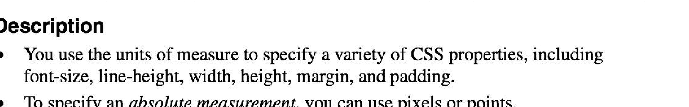

## 描述

- 您使用测量单位来指定各种 CSS 属性，包括 `font-size`、`line-height`、`width`、`height`、`margin` 和 `padding`。
- 要指定绝对测量，可以使用像素或磅。
- 要指定相对测量，可以使用 `ems`、`rems` 或百分比。这种测量是相对于另一个元素的大小的。

## 如何指定颜色

接下来，header 下方的内边距（`padding`）设置为 `.75em`，或 12 像素（16 乘以 .75）。然后，在内边距下方添加一个 3 像素宽的实黑边框，边框下方的外边距（`margin`）设置为 0。对于 `margin-bottom`，没有指定测量单位，因为当值为零时，单位是什么并不重要。

最后一个样式规则指示 `h1` 元素是基础字体的 200%，这是在 `body` 元素的样式规则中设置的。此外，标题下方的外边距应该是零。

当您对两个或更多级的子元素使用 `em` 字体大小时，很难跟踪当前的字体大小。在这种情况下，您可能希望考虑使用 `rem` 代替 `em`。与相对于当前字体大小的 `em` 不同，`rem` 相对于根（即 `html`）元素的大小。如果您为 `html` 元素指定了字体大小，请让 `html` 元素的字体大小默认为浏览器字体大小，并以此大小为所有其他字体大小为基础。注意，我们在书中没有使用 `rem`，因为我们的页面结构使其很容易确定当前的字体大小。

图 4-4 显示了三种指定颜色的方法。简单的方法是指定颜色名称，此图列出了所有浏览器支持的 16 种颜色名称。除了这些名称外，大多数浏览器还支持 CSS3 规范中的颜色名称。要找到这些颜色名称的列表，可以访问下一个图中列出的网站。

另一种指定颜色的方法是使用 RGB（红、绿、蓝）值。其中一种方法是指定组成颜色的红、绿、蓝的百分比。例如，图中的示例指定了 100% 红、40% 绿和 20% 蓝。当您使用这种方法时，您可以使用 0 到 255 之间的任何值代替百分比。那么，0 等于 0%，255 等于 100%。这让您对结果颜色具有更高的精确度。

第三种指定颜色的方法是使用十六进制（或简写为 hex）表示红、绿、蓝值，这是大多数网页设计师青睐的方法。例如，“000000”值产生黑色，而“FFFFFF”值产生白色。从百分比到十六进制的简单转换是：0% 是 0，20% 是 33，40% 是 66，60% 是 CC，90% 是 FF。当您使用这种技术时，整个值之前必须带有十六进制哈希字符（`#`）。

当您使用复杂的颜色值时，通常会从显示所有颜色及其十六进制值的颜色或调色板中获取您所需的十六进制值。例如，可以通过此图中列出的网站获取颜色十六进制值的完整列表。或者，如果您正在使用 IDE Dreamweaver CC，您还可以从调色板中选择颜色，并让 IDE 将该颜色的十六进制值插入到代码中。第三种替代方案是从打印的彩色表中获取正确的十六进制值，这些图表通常出现在图形设计书籍中。

## 浏览器支持的颜色名称

| 符号 | 名称 |
| --- | --- |
| aqua | |
| black | |
| blue | |
| darkblue | |
| fuchsia | |
| gold | |
| gray | |
| lime | |
| magenta | |
| maroon | |
| navy | |
| olive | |
| orange | |
| pink | |
| purple | |
| red | |
| brown | |
| silver | |
| coral | |
| teal | |
| tomato | |
| turquoise | |
| violet | |
| white | |
| yellow | |

## 代码 CSS3 颜色的三种方法

### RGBA 颜色的语法

`rgba(red, green, blue, opacity-value)`

### HSL 和 HSLA 颜色的语法

`hsl(hue-degrees, saturation%, lightness%)`
`hsla(hue-degrees, saturation%, lightness%, opacity-value)`

| 值 | 描述 |
| --- | --- |
| opacity-value | 从 0 到 1 的数字，0 表示完全透明，1 表示完全不透明。 |
| hue-degrees | 0 到 355 之间的角度数，表示颜色。 |
| saturation% | 从 0 到 100 的百分比，0 导致色调被忽略，100 为完全饱和。 |
| lightness% | 从 0 到 100 的百分比，50 为正常亮度，0 为黑色，100 为白色。 |

### 示例

```css
h1 { color: rgba(0, 0, 255, .2);      /* 透明蓝色 */ }
h1 { color: hsl(120, 100%, 25%); }   /* 深绿色 */
h1 { color: hsl(120, 75%, 75%); }     /* 浅绿色 */
h1 { color: hsla(240, 100%, 50%, 0.5); } /* 半透明实蓝色 */
```

### 浏览器中的颜色

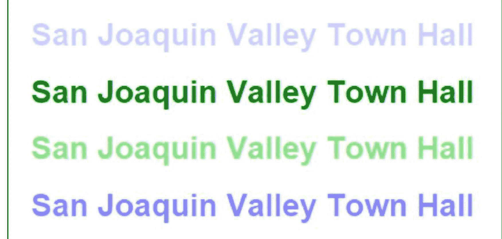

## 描述

- RGBA 通过提供第四个透明值增强了 RGB 规范。
- 通过 HSL（色调、饱和度和亮度）和 HSLA，你可以指定颜色的色调角度。然后，你可以通过饱和度和亮度增强色调。HSLA 也提供了第四个透明值。
- CSS 提供了 147 个颜色关键字，现代浏览器通常支持这些关键字。完整列表请访问：http://www.w3.org/TR/SVG/types.html#ColorKeywords
- 使用像 Dreamweaver 这样的 IDE，你可以选择想要使用的颜色规格类型（RGBA、HSL 或 HSLA）。然后，你可以选择颜色或色调、饱和度、亮度和透明度。

## 如何编写选择器

现在，你准备好学习如何编写选择器了。一旦理解了这些，你就可以将 CSS 格式应用于网页中的任何元素。

### 如何为所有元素、元素类型、id 和类编写选择器

图 4-6 展示了你将最常用的四种选择器。首先，它显示了一个 HTML 文档的 `<body>`，其中包含一个 `main` 和一个 `footer` 元素。在这里，`main` 元素中的两个 `<p>` 元素具有值为 "blue" 的 `class` 属性。此外，`footer` 中的 `<p>` 元素分配了 `id` 为 "copyright"，并且它有一个具有两个值的 `class` 属性："blue" 和 "right"。这意味着它分配了两个类。

接下来，该图显示了用于格式化 HTML 的 CSS 规则。在这里，第一个示例中的样式规则使用了通配选择器 (`*`)，它应用于所有的 HTML 元素。这将所有元素的上下外边距设置为 .5em，左右外边距设置为 1em。除非文档中链接了 `normalize.css` 样式表，否则通配选择器指定的外边距不会覆盖 `normalize.css` 中为特定元素设置的外边距。因如此，你可能不会经常使用通配选择器。

第二组元素的三条规则通过类型进行选择。这些被称为类型选择器。要编写类型选择器，只需编写元素的名称。结果是，该组中的第一个样式规则选择 `main` 元素，第二个样式规则选择所有的 `h1` 元素，第三条样式规则为 `main` 元素设置边框和内边距，为 `h1` 元素设置字体族，为所有 `<p>` 元素设置左外边距。

第三组元素的样式规则通过其 `id` 进行选择。选择器是一个井号字符 (`#`) 后跟一个唯一标识元素的 `id` 值。结果是，这条样式规则选择了 `id` 为 "copyright" 的 `<p>` 元素。然后，它的声明将段落的字体大小设置为页面字体大小的 80%。

最后一组元素的两个规则通过类来选择 HTML 元素。要这样做，选择器是句号 (`.`) 后跟类名。结果是，第一个样式规则选择了所有分配了 "blue" 类的元素，即所有三个 `<p>` 元素。第二个样式规则选择了任何分配了 "right" 类的元素，即 `footer` 中的段落。然后，第一个样式规则将字体颜色设置为蓝色，第二个样式规则将段落右对齐。

关键点之一是，`class` 属性可以为页面上的多个元素具有相同的值。那么，如果你为该类编写一个选择器，它将用于格式化该类中的所有元素。相比之下，由于元素的 `id` 必须是唯一的，因此 `id` 只能用于格式化单个元素。

## 可以通过元素、类型或类选择的 HTML

```html
<main>
  <p class="blue">段落 1</p>
  <p class="blue">段落 2</p>
  <h1>标题 1</h1>
  <p>段落 3</p>
</main>
<footer>
  <p id="copyright" class="blue right">版权信息</p>
</footer>
```

## 通过类型选择的选择器

```css
* {
  margin-top: .5em;
  margin-bottom: .5em;
  margin-left: 1em;
  margin-right: 1em;
}

main {
  border: 1px solid black;
  padding: 10px;
}

h1 {
  font-family: Arial;
}

p {
  margin-left: 20px;
}
```

## 通过 id 选择的选择器

```css
#copyright {
  font-size: 80%;
}
```

## 通过类选择的选择器

```css
.blue {
  color: blue;
}

.right {
  text-align: right;
}
```

## 如何编写关系选择器

图 4-7 展示了如何编写关系选择器。在学习这些选择器时，请记住父级、子、兄弟和后代等术语与家族树相同。子元素位于父级的第一层。兄弟元素位于同一层。后代元素位于父级之下的一层或多层。

后代选择器选择包含在另一个内的元素。例如，图中所有的元素都是 `main` 的后代，`li` 元素都是 `ul` 的后代，而 `<p>` 元素是 `main` 的后代。

要选择后代，你编写父元素的选择器，后跟一个空格和后代元素的选择器。这通过第一组示例所示。在这里，第一个选择器选择了 `main` 内所有的 `li` 元素。然后，第二个后代选择器选择了 `ul` 的所有 `<p>` 元素。

下一组示例展示了如何使用相邻兄弟选择器来选择紧邻另一个元素。例如，HTML 中的 `h1`、`ul`、`h2` 和 `<p>` 元素都是兄弟。相比之下，`h1` 元素和 `<p>` 元素不是相邻兄弟，但 `h2` 元素和第一个 `<p>` 元素是相邻兄弟。

要编写相邻兄弟选择器，你编写第一个元素的选择器，后跟加号 (`+`) 和兄弟元素的选择器。在此组中，该选择器将选择任何相邻 `h2` 的 `<p>` 元素。这意味着它将选择 `h2` 之后的第一个 `<p>` 元素。

如果你只想在元素是父元素的子时选择它们，可以编写子选择器。要这样做，将父子元素用大于符号 (`>`) 隔开。例如，图中，第一个子选择器选择了 `main` 的子 `<p>` 元素，第二个子选择器选择了 `li` 的子 `<a>` 元素。

与相邻兄弟不同，通用兄弟选择器无论元素是否相邻都会选择任何兄弟元素。编写这种类型的选择器，将第一个元素的选择器和兄弟元素的选择器用波浪号 (`~`) 隔开。在图中，通用兄弟选择器选择了跟随任何 `h2` 元素的所有 `<p>` 元素。

## 可以通过关系选择的 HTML

```html
<main>
  <h1>本季镇堂会议演讲者</h1>
  <ul class="speakers">
    <li>
      一月：<a href="speakers/brancaccio.html">
      David brancaccio</a>
    </li>
    <li>
      二月：<a href="speakers/fitzpatrick.html">
      Robert Fitzpatrick</a>
    </li>
    <li>
      三月：<a href="speakers/williams.html">
      Juan Williams</a>
    </li>
  </ul>
  <h2>讲座后午餐</h2>
  <p>参加午餐，进一步活跃气氛吧</p>
  <p>现有若干票供应。</p>
  <p>请电话与我们联系：<em>@ (555) 555-1212.</em></p>
</main>
```

## 使用关系型选择器的 CSS 样式规则

### 后代选择器

```css
main li { font-size: 90%; }
ul a { color: green; }
```

### 相邻兄弟选择器

```css
h2 + p { margin-top: .5em; }
```

### 子选择器

```css
main > p { font-size: 80%; }
li > a { color: green; }
```

### 通用兄弟选择器 (CSS3)

```css
h2 ~ p { margin-left: 2em; }
```

### 说明

- 当你使用关系型选择器时，可以避免对 `id` 或 `class` 属性的需求。
- 要仅当元素是高级元素的后代时选择它们，请使用后代选择器，它由高级元素、空格和后代元素组成。
- 要选择与另一个元素相邻的兄弟元素，请使用相邻兄弟选择器，它由第一个元素、加号 (`+`) 和兄弟元素组成。
- 要仅当元素是父元素的子元素时选择它们，你可以使用子选择器，它由父元素、大于号 (`>`) 和子元素组成。
- 要选择任何与另一个元素为兄弟关系的元素，你可以使用通用兄弟选择器，它由第一个元素、波浪号 (`~`) 和兄弟元素组成，但这只能由支持 CSS3 的浏览器使用。

## 如何编写选择器组合

图 4-8 中的第一组示例展示了如何编写选择器组合。要通过类名选择元素，你需要编写元素名称，后跟一个点和类名。在这里，第一条样式规则选择了类名为 "speakers" 的 `ul` 元素。

你也可以为同一个样式规则编写多个选择器。要这样做，请像下一组示例所示，用逗号分隔选择器。在这里，第一条样式规则使用多个选择器将其声明应用到所有 `h1`、`h2` 和 `h3` 元素。然后，第二条样式规则使用多个选择器将其声明应用到所有分配给 `speakers` 类的 `ul` 元素的子 `li` 元素。

## 如何编写属性选择器

属性选择器根据属性或属性值选择元素。图 4-8 中的第二组示例说明了这一点。尽管你可能永远不需要为 HTML 代码编写属性选择器，但这些选择器会被 JavaScript 使用。

要编写选择具有属性的元素的属性选择器，你需要编写一个元素选择器，后跟方括号 `[ ]` 中的属性名称。例如，第一个属性示例使用通配选择器选择所有具有 `href` 属性的元素。但注意，你也可以在属性选择中省略元素选择器。相比之下，第二个属性选择器选择了所有具有 `href` 属性的 `<a>` 元素。

要编写选择指定属性值的元素的属性选择器，请在属性名称后加上等号和用引号括起来的值。如第三个示例中所示。此选择器将选择所有 `type` 属性值设置为 "submit" 的 `input` 元素。

## 选择器组合

### 元素内的类选择器

```css
ul.speakers { list-style-type: square; }
```

### 多个选择器

```css
h1, h2, h3 { color: blue; }
ul.speakers li { font-family: "Times New Roman", serif; }
```

### 属性选择器

所有带有 `href` 属性的元素

```css
*[href] { font-size: 95%; }
```

所有带有 `href` 属性的 `<a>` 元素

```css
a[href] { font-family: Arial, sans-serif; }
```

所有带有 `type` 值为 "submit" 的 `input` 元素

```css
input[type="submit"] {
  border: 1px solid black;
  color: #ef9000;
  background-color: #facd8a;
}
```

### 说明

- 要选择元素和类的选择器，请编写元素名称、点和类名。
- 要为同一个样式规则编写多个选择器，用逗号分隔选择器。
- 要选择所有具有特定属性的元素，你可以使用属性选择器，它由通配选择器后跟方括号中的属性名称组成。编写此类选择器时你也可以省略通配选择器。
- 要选择具有特定属性的元素，你可以使用属性选择器，它由元素后跟方括号内的属性名称组成。
- 要选择具有特定属性值的元素，你可以使用属性选择器，它由元素后跟方括号内的属性名称、等号和用引号括起来的值组成。

## 如何使用级联样式表

*Cascading Style Sheets*（级联样式表）一词指的是多个样式表可以应用于同一个网页。那么，如果同一个元素应用了针对同一属性的两个或多个声明，则级联顺序和其他规则将决定哪个声明具有优先级。

## 级联规则如何工作

在理解级联规则之前，你需要知道用户可以为他们的网页创建用户样式表。由于大多数用户不会创建用户样式表，这通常不是一个问题。但有些用户会这样做。例如，视力不良的用户会创建提供大字体的用户样式表。在这种情况下，你需要考虑用户样式表如何影响你的网页。

你还应该知道如何将你的某个声明标记为重要，以便其优先级高于其他声明。要做到这一点，可以在声明中编写 `!important`。图 4-10 中的示例展示了这一点。

在此背景下，此图列出了级联顺序从高到低的五个级别。如你所见，用户样式表中的 `!important` 声明会覆盖网页中的 `!important` 声明，但网页中的普通声明会覆盖用户样式表中的普通声明。这些声明之下是浏览器的默认声明。

如果一个元素在同一级别上应用了多个声明会发生什么？首先，特异性最高的声明具有优先级，此图显示了选择器的哪些部分更具体。例如，`.class` 选择器比 `li` 选择器更具体，因为类比元素更具体。

如果一个选择器包含多个部分，这些各个部分加起来形成特异性。这意味着一个包含元素和一个类的选择器比只包含一个类的选择器更具体。例如，`p.highlight` 选择器比 `.highlight` 选择器更具体。因此，`p.highlight` 具有优先级。

如果冲突未能解决，则以最后一个声明为准。在本章前面的部分，例如，你学过如果你为一个文档提供两个或多个外部样式表，则每个样式表中的样式规则将覆盖之前样式表中的样式规则。如果你不小心在单个表中为同一个元素编写了两个样式规则，这一概念也适用。那么，最后的一个具有优先级。此外，内联样式优先级高于嵌入样式表中的样式，而嵌入样式优先级高于外部样式表中的样式。

## 如何识别一个声明是重要的

```css
.highlight {
  font-weight: bold !important;
}
```

## 应用 CSS 样式规则的级联顺序

按照以下顺序搜索应用于元素的样式规则，并在找到后应用该组中的样式规则：

1. 用户样式表中的 `!important` 声明
2. 网页中的 `!important` 声明
3. 网页中的普通声明
4. 用户样式表中的普通声明
5. 网页浏览器的默认声明

## 如果一个元素在级联级别上应用了多个样式规则……

- 使用特异性最高的样式规则。例如，`p.highlight` 选择器比 `.highlight` 选择器更具体。
- 如果一组中两个或多个样式规则的特异性相同，则使用最后指定的样式规则。

## 如何确定选择器的特异性

- ID 选择器是最具体的。
- 类、属性选择器或伪类选择器的特异性较低。
- 元素或伪元素选择器的特异性最低。

## 描述

- 当两个或多个样式规则应用于 HTML 元素时，CSS 使用上述级联顺序和规则来决定应用哪种样式规则。
- 用户可以创建一个为网页提供默认样式规则集的样式表。视力不良的用户通常会这样做，以便页面类型以大字体显示。
- 由于大多数用户不会创建用户样式表，你通常控制样式规则应用于你网站的方式。但你应该记住，你的网页可能会受到用户样式表的影响。
- 如果你想为浏览器创建或删除用户样式表，可以在网上搜索你的浏览器所需的程序。

## 如何使用开发工具检查已应用的样式

如果你在测试网页时遇到级联样式问题，你可以使用浏览器的开发工具来查找确切发生了什么，如图 4-11 所示。如果你正在使用 Chrome、Internet Explorer、Edge 或 Firefox，可以通过按下 F12 键访问这些工具。你也可以通过右键点击页面并选择“检查”或“检查元素”来从这些浏览器（以及 Opera 和 Safari）访问开发工具。

在此图中，开发工具显示在 Chrome 浏览器网页下方的面板中。这与图 4-17 显示的面板相同，你将在本章结束时学习。

在开发者工具面板的左侧，你可以看到页面的所有 HTML 元素。要展开或折叠一组元素，点击元素前的符号。在本例中，你可以看到 `html`、`body` 和 `main` 元素已经展开。

要检查元素的样式，你可以点击“元素”窗格中的该元素。或者，你可以点击工具栏左侧的检查图标（带有指向正方形的箭头），然后点击网页上的元素。

当选中一个元素时，它的样式显示在开发者工具右侧的“样式”窗格中。这显示了应用于元素的所有样式，包括从父元素继承的样式。然而，如果某个样式被覆盖，它会被划掉，最终值将显示在组的顶部。

## 如何处理文本

现在你已经知道如何选择你想要格式化的元素，可以准备好学习如何使用 CSS 来应用格式了。首先，你将学习如何使用样式和字体。

## 如何设置字体族和字体大小

图 4-12 显示了如何设置文本元素的字体族和字体大小。图顶部的表格列出了五种通用字体族，下面的示例展示了这些字体族中典型字体的外观。

当你开发网站时，你的主要字体族应该是无衬线字体（`sans-serif`）。因为在浏览器中，无衬线字体比其他类型的字体（包括衬线字体 `serif`）更易阅读，尽管衬线字体长期以来被认为是印刷文本的最佳字体。你也可以将等宽字体（`monospace`）用于特殊目的，但应该避免使用手写体（`cursive`）和花哨字体（`fantasy`）。

当你编写 `font-family` 属性的值时，你编写的是一个你想要使用的字体列表。例如，图中的第一个示例列出了 Arial、Helvetica 和 `sans-serif` 作为通用字体。然后，浏览器将使用列表中的第一个可用的字体。如果没有列表中的字体可用，浏览器将使用其默认字体替换列表中最后一个编码的通用字体。

如果字体族的名称包含空格，例如 "Times New Roman"，那么在编码列表时，你需要将该名称包含在引号中。第一组中的第二个和第三个示例说明了这一点。

要设置字体大小，请使用 `font-size` 属性，如第二组示例所示。对于此属性，我们建议使用相对测量值，以便用户能够在他们的浏览器中更改字体大小。

当你使用相对测量值时，它是相对于父元素的。例如，第二组示例中的第二个规则将导致字体比其父元素大 150%。如果父元素是 16 磅（`points`），则该元素将是 24 磅。同样，第三条规则 `1.5em` 也将是父字体的 150%。

下一个示例显示了如何在 `body` 元素中设置字体族和字体大小。在这里，浏览器的默认字体族被更改为无衬线字体。这覆盖了浏览器使用的 Times New Roman 字体。此外，默认字体大小设置为浏览器默认大小的 100%。虽然这没有改变字体大小，但它使尺寸相对于浏览器的默认大小（这通常是 16 像素 `pixels`）。如果用户更改了浏览器的字体大小，该更改将反映在网页上。

像颜色一样，你在元素中设置的属性会被其所有后代元素继承。但注意，当你对字体大小使用相对测量值时，继承的并不是相对值。相反，是为字体计算出的实际大小。例如，默认字体大小为 16 像素，你将 `font-size` 属性设置为 125%，则该元素及任何后代元素的大小将是 20 像素。

## 五种通用字体族

| 名称 | 描述 |
| --- | --- |
| serif | 具有收锥、扩开或板状笔画末端的字体。 |
| sans-serif | 具有平直笔画末端的字体。 |
| monospace | 每个字符使用相同宽度的字体。 |
| cursive | 像手写一样连接、流畅的字母字体。 |
| fantasy | 具有装饰性样式的字体。 |

## 五种通用字体族的示例

- **Times New Roman** 是一种衬线字体。它是大多数网络浏览器的默认字体。
- **Arial** 是一种广泛使用的无衬线字体，无衬线字体最适合网络浏览器。
- `Courier New` 是一种用于代码示例的等宽字体。
- `Lucida Handwriting` 是一种不常用的手写体字体。
- `Impact` 是一种很少使用的花哨字体。

## 如何指定字体族

```css
font-family: Arial, Helvetica, sans-serif;
font-family: "Times New Roman", Times, serif;
font-family: "Courier New", Courier, monospace;
```

## 如何指定字体大小

```css
/* 使用磅 (points) */
font-size: 12pt;
/* 作为父元素的百分比 */
font-size: 150%;
font-size: 1.5em;
/* 等同于 150% */
```

## body 元素中被所有后代继承的 font-family 规则

```css
body {
  font-family: Arial, Helvetica, sans-serif;
  font-size: 100%;
}
```

## 为特定元素覆盖字体族

```css
p {
  font-family: "Times New Roman", Times, serif;
}
```

## 描述

- 如果字体族的名称包含空格，例如 "Times New Roman"，那么在编码列表时，你需要将该名称包含在引号中。
- 要设置字体大小，请使用 `font-size` 属性。
- 当你使用相对测量值时，它是相对于父元素的。
- 像颜色一样，你在元素中设置的属性会被其所有后代元素继承。
- 如果列表中的字体都不可用，浏览器将使用其默认字体替换列表中最后一个编码的通用字体。
- 如果用户更改了浏览器的字体大小，该更改将反映在网页上。

## 如何设置其他字体属性

图 4-13 中的表格总结了你可以用于样式的其他属性。像 `font-family` 和 `font-size` 一样，这些属性是可以被继承的。像 `font-size` 属性一样，通常使用相对测量值或 `em` 来设置 `line-height` 属性。这样，所有现代浏览器都能相对于字体大小调整行高。

## 字体样式的其他属性

| 属性 | 描述 |
| --- | --- |
| font-style | 决定字体倾斜的关键字：`normal`（正常）、`italic`（斜体）和 `oblique`（倾斜） |
| font-weight | 决定字体粗细的关键字或数字：`normal`（正常）、`bold`（加粗）、`lighter`（浅）或 100 到 900 的倍数，其中 400 等于 `normal`。`bolder` 和 `lighter` 相对于父元素。 |
| font-variant | 指定是否使用小型大写字的关键字：`normal`（正常）和 `small-caps`（小型大写）。 |
| line-height | 相对或绝对值或数字，指定每行的垂直空间。多余的空间平均分配在字体的上下。 |

## 如何指定字体样式和变体

```css
font-style: italic;
font-style: normal; /* remove style */
font-variant: small-caps;
```

## 如何指定字体粗细

```css
font-weight: 700; /* same as bold */
font-weight: bold; /* same as 700 */
font-weight: normal; /* same as 400 */
font-weight: lighter; /* relative to the parent element */
```

## 如何指定行高

```css
line-height: 14pt;
line-height: 140%; /* same as 140% */
line-height: 1.4em; /* same as 140% and 1.4em */
line-height: 1.4;
```

## 简写字体属性的语法

```css
font: [style] [weight] [variant] [size/line-height] family;
```

## 如何使用简写字体属性

```css
font: bold 14px/19px Arial, sans-serif;
font: small-caps 150% "Times New Roman", Times, serif;
font: 90%/120% "Comic Sans MS", impact, sans-serif;
```

## 描述

- 你可以将 `font-style`、`font-weight` 和 `font-variant` 属性的值设置为 "`normal`"，以移除应用到这些属性上的任何格式。
- `line-height` 决定了块元素内行的间距。
- 如果你为 `line-height` 指定一个数字，字体大小将乘以该值以确定行高，且该倍数会被子元素继承。如果你为 `line-height` 属性指定绝对或相对大小，则实际行高由子元素继承。
- 你可以使用字体的简写属性通过一条规则设置所有六个字体属性。当你使用此属性时，`font-size` 和 `font-family` 属性是必须的。

## 如何设置文本格式化的属性

图 4-14 展示了四个文本格式化的属性。你可以使用 `text-indent` 属性对段落的第一行进行缩进。当你设置此属性时，通常使用如 `em` 这样的相对单位是有意义的。这样，如果当前字体的大小发生变化，缩进也会相应调整。

要水平对齐文本，你可以使用 `text-align` 属性。默认情况下，大多数元素都是左对齐，但你可以使用 "`center`"（居中）、"`right`"（右对齐）或 "`justify`"（两端对齐）值来更改它。但注意，当你对文本进行两端对齐时，单词之间的间距在左右两边都会调整。由于这使得文本难以阅读，因此应避免使用两端对齐文本。

你还可以垂直对齐元素。为了说明，假设你在段落中编写了一个 `span` 元素，并编写了一个样式规则将 `span` 元素中文本的字体设置为比段落文本小。那么，`vertical-align` 属性决定 `span` 元素相对于父元素的对齐方式。例如，如果你将 `vertical-align` 属性设置为 "`text-bottom`"，则 `span` 元素中的文本底部将与父元素的文本底部对齐。你也可以使用相对或绝对值，该值决定元素应显示在正常位置上方或下方距离。

图中示例显示了如何使用 `text-indent` 和 `text-align` 属性。在这里，标题下方的段落缩进了 2 `em`，包含版权信息的段落是右对齐。

你可以使用 `text-decoration` 属性在文本下方、上方或穿过显示线条。然而，由于两个原因，该属性的价值有限。第一，你通常不应该给非链接的单词添加下划线。第二，你可以像下一节所示使用边框（`borders`）在块元素下方添加线条，这可以让你对线条有更多的控制。

如果你想移除应用到元素上的任何文本装饰，可以为此属性指定值 "`none`"。例如，`<a>` 元素的 `text-decoration` 属性默认设置为 "`underline`"（下划线）。如果这不是你想要的，可以将此属性设置为 "`none`"。你将在第 7 章看到它是如何运作的。

## 用于缩进、对齐和装饰文本的属性

| 属性 | 描述 |
| --- | --- |
| text-indent | 相对或绝对值，决定文本第一行的缩进。该属性是继承的。 |
| text-align | 决定文本水平对齐的关键字。可能的值有 `left`（左）、`center`（居中）、`right`（右）和 `justify`（两端对齐）。该属性是继承的。 |
| vertical-align | 相对或绝对值，决定文本的垂直对齐。可能的值有 `baseline`（基线）、`bottom`（底部）、`top`（顶部）和 `text-bottom`（文本底部）。 |
| text-decoration | 决定文本装饰的关键字。可能的值有 `underline`（下划线）、`overline`（上划线）、`line-through`（删除线）和 `none`（无）。 |

## 网页的 HTML

```html
<header>
  <h1>San Joaquin Valley Hall</h1>
</header>
<main>
  <p>Welcome to San Joaquin Valley!</p>
</main>
<footer>
  <p>&copy; 2018 San Joaquin Valley.</p>
</footer>
```

## 对齐的 CSS

```css
body {
  text-indent: 2em;
}
h1 {
  text-align: center;
}
p {
  text-align: right;
}
```

## 描述

- `text-indent`：决定文本第一行的缩进。
- `text-align`：可能的值有 `left`、`center`、`right` 和 `justify`。
- `vertical-align`：决定文本的垂直对齐。
- `text-decoration`：可能的值有 `underline`、`overline`、`line-through` 和 `none`。

## 如何让图片浮动以便文字环绕它

在第 5 和第 6 章中，你将学习有关设置边距和浮动图片以使文字环绕其的所有知识。但为了让你入门，图 4-16 展示了如何将标题的 logo 浮动到左侧，以便右侧的标题可以流过。

在示例的 HTML 中，你可以看到一个 `img` 元素、一个 `h1` 元素和一个 `h2` 元素。然后，在 `img` 元素的 CSS 中，`float` 属性被设置为 `left`。结果是如第一个浏览器示例所示，两个标题都流向了图片的右侧。

然而，你应该知道这取决于图片的大小。因为第一个示例中的图片宽度为 80 像素，所以两个标题都流向它的右侧。但如果像第二个示例那样将宽度缩小到 40 像素，高度也会随之缩小。这时，第二个标题将位于图片下方，因为图片太短，标题无法流到它的右侧。

这表明你目前可能需要反复调整图片大小才能正常工作。但在接下来的两个章节中，你将学习获得这种效果的正确方法。

如果你想停止元素流向浮动元素的右侧，可以使用此图所示的 `clear` 属性。在这里，`clear` 属性用于 `main` 元素，它会停止环绕浮动到其左侧元素的流。如果 `main` 元素紧跟在标题之后，文字流将在 `main` 元素内的任何元素显示之前停止。

## 浮动在后续标题左侧的图片

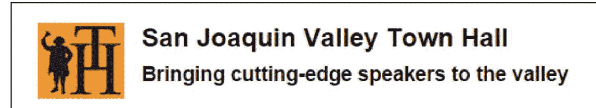

### HTML 部分

```html

<h1>San Joaquin Valley Town Hall</h1>
<h2>Bringing cutting-edge speakers to the valley</h2>
```

### CSS 部分

```css
img {
  float: left;
  margin-right: 1em;
}
```

### 当图片宽度缩小到 40 时的页面


### 在后续元素之前停止浮动的属性

```css
main {
  clear: left;
}
```

## Description

- 要浮动图片，你使用 `float` 属性；要设置其周围的边距，你使用 `margin` 属性。
- 在第 5 和第 6 章中，你将学习如何设置边距和浮动元素，但这将让你了解如何在标题中使用图片。
- 当你将图片浮动到左侧时，随后的块元素会填充其右侧的空间。当后续元素超过了图片及其上下边距的高度时，它们将流到元素下方的空间。
- 你可以使用 `clear` 属性来停止元素流进浮动元素旁的空间。
- 目前，你可以尝试调整图片大小获得想要的效果，但在接下来的两个章节中，你将学习获得相同结果的正确方法。

## 使用外部样式表的网页

现在你已经学会了如何编写选择器以及如何格式化，准备好查看一个使用这些技能的网页了。

## 页面布局

图 4-17 展示了一个使用两个外部样式表的网页。首先，它使用了你在本章早期学过的 `normalize.css` 样式表。其次，它使用了一个带有此页面特定样式的样式表。

如果你研究这个网页，你会发现样式表中的 CSS 被用于将默认字体改为无衬线字体（`sans-serif`），为某些标题应用颜色并使标题居中，为第一个标题的文本应用阴影，为无序列表的项目设置高度，对部分文本进行加粗处理，并让页脚右对齐。总的来说，这种格式化让页面看起来很不错。

然而，在排版（`typography`）方面，这个网页还需要改进。例如，“San Joaquin Valley Hall”之后的空间应该少一点，“This season’s guest speakers”之后的空间也应该少一点，“Looking for a unique gift?”之后的空间也应该少一点，前三个段落之间的间距也应该缩小。页面的两侧也应该留出空间。为了进行这些调整，你需要了解如何使用 CSS 盒模型中的 `margin` 和 `padding` 属性。这正是你下一章首先将学的。一旦学会了如何使用这些属性，你就能按照自己的意愿获得排版。

## 使用本章介绍的部分样式的网页

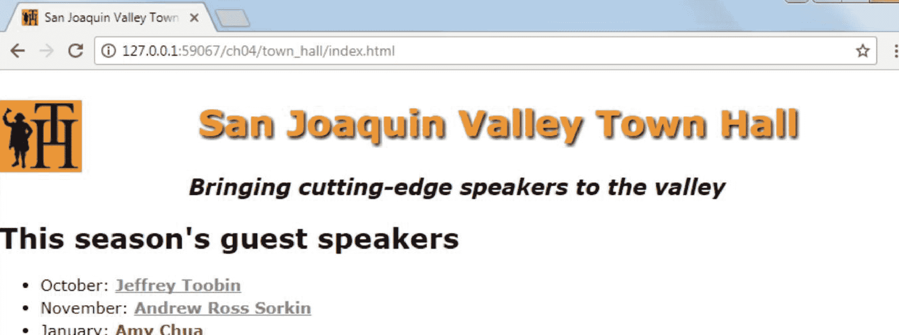

### 本季客座

- 10月：Jeffrey Toobin
- 11月：Andrew Ross Sorkin
- 1月：Anne Chua
- 2月：Scott Sampson
- 3月：Carlos Eire
- 4月：Ronan Tnan

### 寻找独特的礼物？

San Joaquin Valley Town Hall.

## CSS 文件

图 4-19 显示了该网页的 CSS 文件。首先，注意文件中代码的结构方式。首先，展示了针对特定元素的样式规则。实际上，这设置了这些元素的默认格式。紧随这些样式规则的是针对页眉（`header`）、主体（`main`）和页脚（`footer`）元素的样式规则。这些样式规则中的声明会覆盖比它们更不具体的元素声明。例如，`main h1` 选择器的字体大小会覆盖 `body` 选择器的字体大小。

你可能还会注意到，许多包含单个声明的样式规则被写在同一行。在本课程中，编写这些样式规则是一种有效的方法，因为空格会被忽略。对于需要多个声明的样式规则，每个声明都写在一行，以便于阅读。

在 `body` 元素的样式中，有两个属性指定了字体族和大小。由于这些属性是继承的，因此它们成为了内容的默认值。注意，字体大小被指定为 100%。这意味着实际的字体大小将由 `body` 的默认字体大小决定。标题的字体大小也经过指定，因此它们将基于为 `body` 元素计算出的尺寸。

在 `<a>` 元素的规则中，`hover` 和 `focus` 伪类被设置为相同的颜色。然后，在无序列表的样式规则中，指定了 `line-height` 属性以增加项目之间的间距。同样，为 `em` 元素指定了 `font-weight` 以使其变为**粗体**。该元素也会变为*斜体*，因为这是它的正常行为。若要移除斜体，你必须编写一个值为 `normal` 的 `font-style` 属性。

在 `header` 元素的规则中，你可以看到图像向左浮动（`float`），因此随后的元素将出现在右侧。如果你回看图 4-17 中的网页，你会发现 `h2` 标题流到了图像的右侧。这是因为图像太短，`h3` 元素无法浮到其右侧。然后，`h2` 和 `h3` 元素都居中了；`h2` 元素在页眉中显示为居中，但 `h3` 元素在页面上是居中的。你还可以看到 `h2` 标题右侧和下方有一个 2 像素的黑色阴影，并带有 2 像素的模糊。

在 `main` 元素的规则中，你可以看到使用了 `clear` 属性来停止向左浮动的图像。你还可以看到 `indent` 类中的元素将缩进 2 `em`，而 `date_passed` 类中的元素将显示为灰色。

当然，你可以通过其他方式编写 CSS 并获得相同的结果。例如，你可以为页眉中的 `h2` 和 `h3` 元素编写此样式规则：

```css
header h2, h3 { text-align: center; }
```

然后，你可以从 `h2` 页眉和 `h3` 样式规则中删除 `text-align` 属性。你还可以为 `date_passed` 和 `indent` 类编写选择器，使它们的特殊性降低，因为它们在 `main` 元素之外没有被使用。不过，如果你使用的选择器更具特殊性，当你之后添加样式规则时，就不可能引起问题。

## 网页的 CSS 文件

```css
/* 元素的样式 */
body {
  font-family: Verdana, Arial, Helvetica, sans-serif;
  font-size: 100%;
}

a { font-weight: bold; }
a:link { color: #931420; }
a:visited { color: #f2972e; }
a:hover, a:focus { color: blue; }

ul { line-height: 1.5; }
ul, p { font-size: 95%; }
em { font-weight: bold; }

/* 页眉的样式 */
header img { float: left; }
header h2 {
  font-size: 220%;
  color: #f2972e;
  text-align: center;
  text-shadow: 2px 2px 2px black;
}
header h3 {
  font-size: 130%;
  font-style: italic;
  text-align: center;
}

/* 主体内容的样式 */
main { clear: left; }
main h1 { font-size: 170%; }
main h2 { font-size: 130%; }

main p.indent { text-indent: 2em; }
main a.date_passed { color: gray; }

/* 页脚的样式 */
footer p {
  font-size: 80%;
  text-align: right;
}
```

## 展望

此时，你应该知道如何编写所有类型的选择器，并且应该知道如何编写格式化文本的 CSS 属性。这让你 CSS 有了一个良好的开始，但仍然有很多东西要学习。

所以，在下一章中，你将学习如何使用 CSS 盒模型。你使用该模型来设置元素的外边距（`margins`）、内边距（`padding`）和边框（`borders`），以便你的排版看起来如你所愿。然后在第 6 章，你将学习如何使用 CSS 进行页面布局。

### 术语

- 外部样式表
- 内联样式
- 绝对测量
- 相对测量
- 绝对单位
- 相对值
- 十六进制值
- 继承值
- RGBA 值
- 通用选择器
- 类型选择器
- ID 选择器
- 类选择器
- 关系选择器
- 后代选择器
- 子选择器
- 通用兄弟选择器
- 属性选择器
- 伪类选择器
- 伪元素选择器
- 用户样式表
- 字体属性

## 总结

- 如果一个文档应用了多个样式表，级联顺序（`cascade order`）决定优先级。该顺序的前四级是：用户样式表中的重要声明；网页中的重要声明；网页中的普通声明；用户样式表中的普通声明。
- 如果同一级联层中的多个样式规则应用于同一个元素，则使用特殊性最高的样式规则。但如果同一级联层中两个或多个样式规则的特殊性相同，则使用最后一个指定的样式规则。

## 练习 4-1 格式化市政厅首页

在此练习中，你将使用在本章中学到的技能，对你在练习 3-1 中构建的首页进行格式化。完成后，页面看起来应该像这样。


# 圣华亚河谷市政厅

庆祝成立 **7** 周年

## 我们的使命

圣华亚河谷市政厅是由全志愿者董事会管理的非营利组织。我们的使命是邀请国内外享誉的、发人深省的演讲者来教育和娱乐我们的观众。正如我们的一位成员告诉我们的那样：“我们每年为每位家庭成员提供一套票包。我将其视为知识的礼物，这是无价的。”

## 我们的票包

- 季票包：$95
- 赞助人包：$200
- 单人包：$25

## 本季客座演讲师

十月

Jeffrey Tobin


十一月

Andrew Ross Sorkin

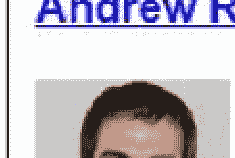

一月

Alny Chua

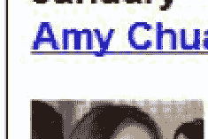

© 2018, San Joaquín Valley Town Hall, Fresno, CA 93755

## 打开 index.html 页面并更新 head 部分

1. 使用编辑器打开你为练习 3-1 创建的 HTML 文件：
   `c:\html5_css3_s4\exercise\town_hall_1\index.html`
2. 使用编辑器打开此 HTML 模板文件：
   `c:\html5_css3_s4\exercise\town_hall_1\templates\basic.html`
   然后，将 head 部分中的第二个和第三个 `link` 元素复制到剪贴板，切换到 `index.html` 文件，并将这些元素粘贴到该部分的末尾。
3. 注意，你刚刚复制到 head 中的第一个 `link` 元素是用于 `styles` 子文件夹中 `normalize.css` 样式表的。接下来，完成第二个 `link` 元素中 `href` 属性的值，使其指向 `styles` 子文件夹中的 `main.css` 文件。然后关闭模板。

## 打开 main.css 文件并格式化页头

4. 使用你的文本编辑器打开此 CSS 文件：
   `c:\html5_css3_s4\exercise\town_hall_1\styles\main.css`
   注意，该文件包含你将需要的一些 CSS 代码，包括指定 `body` 字体族和字体大小的样式规则、让页头图像浮动的样式规则，以及清除 `main` 元素中浮动的样式规则。
5. 为该样式表添加两条样式规则。第一个应该针对 `h2` 元素，它应该将字体大小设置为 170%，将颜色设置为 `#800000`，并将标题缩进 30 像素。第二个应该针对 `h3` 元素，它应该将字体大小设置为 130%，将字体样式设置为*斜体*，并将标题缩进 30 像素。
6. 在 Chrome 中测试 HTML 页面，确保样式表已正确链接，图像已浮动，且标题已正确格式化。如有必要，进行修正并再次测试。

## 格式化 main 元素和页脚

从现在起，每次完成后立即进行测试。

7. 为 `main` 元素内的 `h1` 元素添加样式规则，将字体大小设置为 150%。
8. 为 `main` 元素内的 `h2` 元素添加样式规则，将字体大小设置为 130%并将颜色设置为 `#800000`。
9. 为 `main` 元素内的 `h3` 元素添加样式规则，将字体大小设置为 105%。
10. 添加一条样式规则，使任何获得焦点或鼠标悬停在其上的链接变为*斜体*。
11. 添加一条样式规则，使页脚中的 `<p>` 标签居中。

## 使用开发者工具查看页面样式

12. 在 Chrome 中显示页面，然后按 F12 键显示开发者工具。接下来，在 Elements 面板中展开 `main` 元素，并点击其中一个 `h2` 元素。
13. 在 Styles 面板中查看 `h2` 元素的样式，并注意 `normalize` 样式表中 `html` 元素的 `font-family` 样式是如何被主样式表中 `body` 元素的 `font-family` 样式所覆盖的。同样，注意主样式表中 `body` 元素的 `font-size` 样式以及用户代理样式表中的 `h2` 元素的样式是如何被主样式表中 `main h2` 元素的 `font-size` 样式所覆盖的。
14. 点击开发者工具栏上带有指向箭头的正方形的图标，然后点击页头中的 `h2` 元素，看到它现在在 Elements 面板中被选中。
15. 检查此 `h2` 元素的样式，查看它们与 `main h2` 元素的相似之处。然而，该元素的字体更大，并且有缩进。
16. 完成开发者工具的操作后，点击右上角的“X”图标关闭面板。

## 添加收尾工作并在 IE 中测试

17. 为页头中的第二个标题添加投影。要实现这一点，将文本封装在 `em` 或 `span` 元素中，并赋予该元素一个值为 "shadow" 的类属性。然后，为该类创建一个类选择器样式规则，编写一个使用 `#800000` 作为颜色的声明。
18. 在 IE 中测试页面。如果你使用的是旧版本，可能会出现问题。但如果看到其他格式化问题，请进行修正并再次测试。

# 第 5 章 如何使用 CSS 盒模型处理间距、边界和背景

在上一章中，你学习了一些格式化文本的基础 CSS 属性。现在，你将学习控制元素间距以及显示边界和背景的属性。你将学习如何使用 CSS 盒模型来实现这些目的。

## 盒模型简介

- 盒模型是如何工作的
- 演示盒模型的网页
- 如何设置元素的大小和间距
- 如何设置高度和宽度
- 如何设置外边距（`margin`）
- 如何设置内边距（`padding`）
- 演示尺寸和间距的网页
- 该页面的 HTML 代码
- 该页面的 CSS 代码
- 使用重置选择器的 CSS 版本
- 如何设置边界和背景
- 如何设置边界
- 如何使用 CSS3 为边界添加圆角和阴影
- 如何设置背景颜色和图像
- 如何使用 CSS3 设置背景渐变
- 使用边界和背景的网页


- 该页面的 HTML 代码.....................................................................192
- 该页面的 CSS 代码...........................................................................................194
- 透视.........................................................................................196

## 盒模型简介

当浏览器显示网页时，它会将每个 HTML 块级元素放置在一个框中。这使得控制页眉、分区、页脚、标题和段落等元素的间距、边框和其他格式变得非常容易。像图像这样的内联元素也被放置在框中。要操作这些框，请使用 CSS 盒模型。

## 盒模型的工作原理

图 5-1 展示了盒模型工作原理的图表。默认情况下，块级元素的框宽度与其包含的块一样宽，高度根据其内容决定。然而，你可以使用 `height` 和 `width` 属性显式指定块级元素内容区域的大小。你还可以使用其他属性来设置块级元素的边框、外边距和内边距。

如果你查看此图，可以看到内边距是内容区域与边界之间的空间。同样，外边距是边界与框外部之间的空间。

如果你需要计算框的总高度，可以使用图中的公式。在这里，首先将框顶部的外边距、边框宽度和内边距的值相加。然后加上内容区域的高度。最后，加上框底部内边距、边框宽度和外边距的值。计算框总宽的公式类似。

当你为块级元素设置 `height` 和 `width` 属性时，可以使用上一章中学过的任何单位。但目前，我们将使用像素，以便尺寸是固定的。这意味着如果用户更改浏览器窗口的大小，页面的大小也不会改变。这被称为固定布局。

当你使用固定布局时，可以使用绝对或相对单位作为外边距和内边距的单位。如果你使用如 `em` 等相对单位，当字体大小变化时，外边距和内边距将进行调整。如果你使用绝对单位，外边距和内边距将保持不变。

## CSS 盒模型

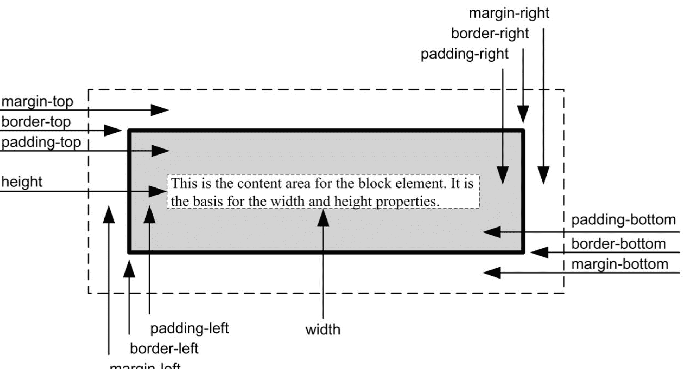

### 计算高度的公式

上外边距 + 上边框 + 上内边距 + 高度 + 下内边距 + 下边框 + 下外边距

### 计算宽度的公式

左外边距 + 左边框 + 左内边距 + 宽度 + 右内边距 + 右边框 + 右外边距

- CSS 盒模型适用于浏览器在每个块级元素以及某些内联元素周围放置的框。这允许你添加如外边距、内边距和边框等格式。
- 默认情况下，块级元素的宽度与其包含的块一样宽，高度根据其内容决定。
- 你可以使用 `height` 和 `width` 属性显式指定块级元素内容区域的大小。
- 你可以使用其他属性来控制块级元素的外边距、内边距和边框。然后，这些属性会被添加到内容区域的高度和宽度中，以确定框的高度和宽度。

图 5-1 盒模型的工作原理

## 一个说明盒模型的网页

为了理解盒模型的工作原理，图 5-2 展示了一个简单网页的 HTML。然后，CSS 为 HTML 中的四种元素添加了边框：为 `body` 添加了 3 像素虚线边框，为 `main` 元素添加了 2 像素实线边框，为 `h1` 和 `<p>` 元素添加了 1 像素虚线边框。如果你在浏览器中查看网页，就可以看到这四条边框是如何渲染的。你还可以看到这些框的外边距和内边距是如何工作的。

对于 `body`，四边的外边距均设置为 10 像素。你可以看到 `body` 边界左侧、顶部和右侧的外边距，但底部没有。这是因为 `body` 的底部外边距是由窗口的大小决定的。

对于 `main`，宽度设置为 500 像素，框四边的外边距均设置为 20 像素。你可以在 `main` 的左侧、顶部和底部看到这些外边距，但右侧没有。`section` 的宽度设置为 500 像素。

下一条样式规则为 `h1` 和 `<p>` 元素设置了属性。在这种情况下，接下来的两条样式规则为这些每个元素设置了额外的属性。

`h1` 元素的样式规则将上外边距设置为 `.5em`，`h1` 元素的左右外边距比其下方的元素大。该样式规则还将元素的左侧内边距设置为 15 像素，以便在框边界和文本之间留出空间。

`<p>` 元素的样式规则首先将所有外边距设置为 0。结果是，`h1` 和 `<p>` 元素之间的所有空间都是由于 `h1` 元素的底部外边距。此外，元素的左侧内边距设置为 15 像素，使 `h1` 和 `<p>` 元素的文本对齐。

请注意，如果我对 `h1` 和 `<p>` 元素的左侧内边距使用相对测量值，它们将无法对齐，因为这些元素的字体大小不同。还需要注意的一点是，`h1` 和 `<p>` 元素样式规则中的 `padding-left` 属性是对齐的。

## 设置高度和宽度的属性

| 属性 | 描述 |
| --- | --- |
| width | 相对或绝对值，用于指定块级元素内容区域的宽度。如果你希望根据其包含块的宽度来计算盒的宽度，也可以指定 `auto`。这是默认值。 |
| height | 相对或绝对值，用于指定块级元素内容区域的高度。如果你希望根据内容计算区域的高度，也可以指定 `auto`。这是默认值。 |
| min-width | 相对或绝对值，用于指定块级元素内容区域的最小宽度。无论内容如何，该区域至少具有此宽度。 |
| max-width | 相对或绝对值，用于指定块级元素内容区域的最大宽度。你也可以指定 `none` 表示没有最大宽度。 |
| min-height | 相对或绝对值，用于指定块级元素内容区域的最小高度。无论内容如何，该区域至少有此高度。 |
| max-height | 相对或绝对值，用于指定块级元素内容区域的最大高度。你也可以指定 `none` 表示没有最大高度。 |

## 如何设置内容区域的宽度

```
width: 450px;          /* 绝对宽度 */
width: 75%;             /* 相对宽度 */
width: auto;            /* 基于其包含块（默认值） */
```

## 如何设置内容区域的高度

```
height: 125px;
height: 50%;
height: auto;           /* 基于内容的高度（默认值） */
```

## 如何设置最小和最大高度

```
min-width: 450px;
max-width: 600px;
min-height: 120px;
max-height: 160px;
```

## 描述

- 如果你为 `width` 属性指定百分比，则块级元素内容区域的宽度将基于包含它的块的宽度，称为**包含块**。在这种情况下，必须显式指定包含块的宽度。
- 如果你为 `height` 属性指定百分比，则块级元素内容区域的高度将基于包含块的高度。在这种情况下，必须显式指定包含块的高度。否则，百分比会被 `auto` 代替。
- `min-width`、`max-width`、`min-height` 和 `max-height` 属性可以适应字体大小的变化。`min-height` 属性还可以确保即使内容没有填充元素，元素也具有指定的高度。

图 5-3 如何设置高度和宽度

## 如何设置外边距

图 5-4 展示了设置外边距的属性。如你所见，可以使用 `margin-top` 或 `margin-left` 等单独属性来设置单个外边距。此图的第一组示例说明了这一点。

然而，与设置单个外边距不同，你可以使用 `margin` 属性来设置盒的四个边的外边距。当你使用这种简写属性时，可以指定一个、两个、三个或四个值。如果你指定了四个值，它们将按照顺时针顺序应用于盒的各个边：上、右、下、左。为了记住这个顺序，你可以考虑单词 "trouble"。

如果你指定的数值少于四个，该属性将设置盒的四个边的外边距。例如，如果你只指定一个值，则每个外边距都被设置为该值。如果你指定了两个值，则上、下外边距设置为第一个值，左、右外边距设置为第二个值。如果你指定了三个值，则上外边距设置为第一个值，左、右外边距设置为第二个值，下外边距设置为第三个值。此图的第二组示例说明了这一点。

虽然这里没有显示出来，但你也可以为任何外边距指定关键字 `auto`。在大多数情况下，你会使用这个关键字将页面在浏览器窗口中或块元素在其包含块中居中。要实现这一点，你需要同时指定左、右外边距。为了使其生效，你还必须设置元素的宽度。你可以在图 5-6 中看到这种操作的示例。

关于外边距你需要了解的一点是，不同的浏览器对块元素有不同的默认外边距。因此，显式设置你正在使用的元素的上下外边距是一个良好的习惯。这样，你就可以控制标题和段落等元素之间的空间。

最后，如果你为一个元素指定了下外边距，为随后的元素指定了上外边距，这些外边距会*塌叠*。这意味着较小的外边距会被忽略，只应用较大的外边距。在这种情况下，两个元素之间的空间可能没有你预期的那么大。解决这个问题的方法之一是将外边距设置为零并使用内边距来留空。

## 设置外边距的属性

| 属性 | 描述 |
| --- | --- |
| margin-top | 相对或绝对值，定义元素上边框与包含块顶部或上方元素底部之间的空间。 |
| margin-right | 相对或绝对值，定义元素右边框与包含块左侧之间的空间。 |
| margin-bottom | 相对或绝对值，定义元素下边框与下方元素顶部之间的空间。 |
| margin-left | 相对或绝对值，定义元素左边框与包含块右侧之间的空间。 |
| margin | 一个到四个绝对值，指定元素所有四边的外边距。两个值应用于上、下和左、右。三个值应用于上、右、左、下。四个值应用于上、右、下、左。 |

## 如何设置单边的外边距

```
margin-top: 450px;
margin-right: 75%;
margin-bottom: auto;
margin-left: auto;
```

## 如何设置多边的外边距

```
margin: 450px; /* 四边 */
margin: 75%;    /* 上、下 */
margin: auto;   /* 上、右、下 */
```

- 如果你为一个元素指定了下外边距，为随后的元素指定了上外边距，这些外边距会*塌叠*。这意味着较小的外边距会被忽略，只应用较大的外边距。在这种情况下，两个元素之间的空间可能没有你预期的那么大。解决这个问题的方法是将外边距设置为零并使用内边距来留空。

## 设置内边距的属性

| 属性 | 描述 |
| --- | --- |
| padding-top | 相对或绝对值，定义元素上边框与内容区域之间的空间。 |
| padding-right | 相对或绝对值，定义元素右边框与内容区域之间的空间。 |
| padding-bottom | 相对或绝对值，定义元素下边框与内容区域之间的空间。 |
| padding-left | 相对或绝对值，定义元素左边框与内容区域之间的空间。 |
| padding | 一个到四个绝对值，指定元素所有四边的内边距。两个值应用于上、下和左、右。三个值应用于上、右、左、下。四个值应用于上、右、下、左。 |

## 如何设置单边的内边距

```
padding-top: 450px;
padding-right: 75%;
padding-bottom: auto;
padding-left: auto;
```

## 如何设置多边的内边距

```
padding: 450px; /* 四边 */
padding: 75%;    /* 上、下 */
padding: auto;   /* 上、右、下 */
```

- 如果你将元素的上下外边距设置为零，你可以使用内边距来设置元素之间的空间。

## 一个演示尺寸和间距的网页

为了说明用于尺寸和间距属性的用法，图 5-6 展示了一个使用了许多这些属性的网页。这个网页与上一章末尾的网页相似。然而，该页面在浏览器窗口中居中显示，元素之间的间距得到了改进，且第二、第三段没有缩进。

## 网页的 HTML

此网页的 HTML 与上一章末尾应用程序中的代码相同，但有两个例外。首先，`main` 元素中的最后一段有一个为 `contact_us` 的 `id` 属性。其次，`main` 元素中的第二、第三段没有用于缩进的 `class` 属性。

如果你想在查看此页面的 CSS 之前复习这些 HTML，可以回看上一章。或者，你也可以在文本编辑器中打开此页面。不过，你可能不需要这样做，因为这里的重点是外边距、内边距以及盒模型的使用。

## 一个使用宽度、外边距和内边距的网页

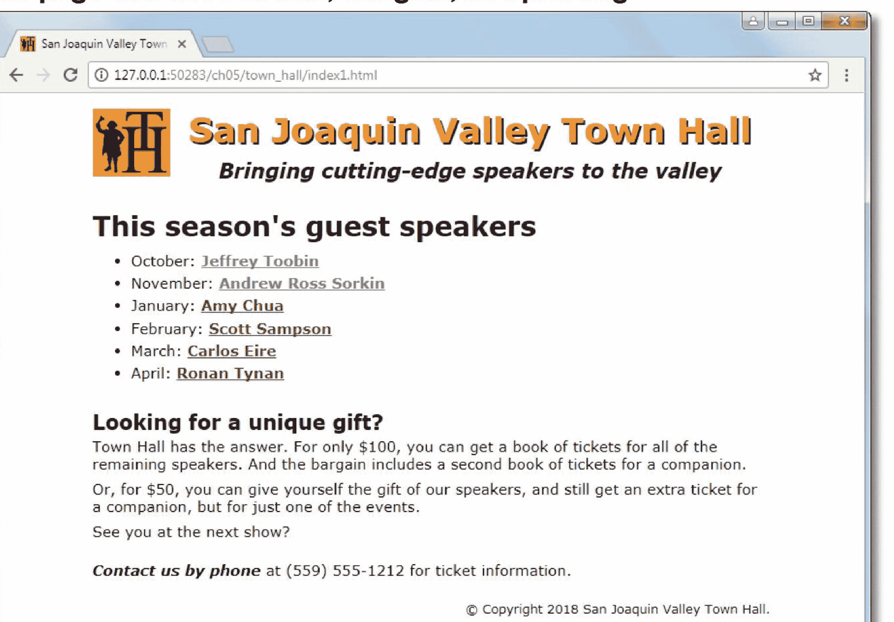

- 此页面在浏览器窗口中居中，并使用外边距和内边距来改进标题前后、列表项之间以及段落之间的间距。

图 5-6 一个演示外边距和内边距用法的网页

## 网页的 CSS

图 5-7 展示了该网页的 CSS。在这里，我高亮了所有影响页面元素尺寸和间距的样式规则。

首先，`body` 规则将页面宽度设置为 700 像素。然后，将顶部和底部的外边距设置为 `1em`，这样 `body` 和浏览器窗口顶部之间就留有空间。此外，左侧和右侧的外边距设置为 `auto`。因为为 `body` 指定了宽度，这会导致左右外边距自动计算，从而使页面在浏览器窗口中居中。

下一个被高亮的样式规则是针对 `h1`、`h2`、`h3` 和 `<p>` 元素的。这将这些元素的外边距和内边距设置为 0。这防止了这些元素相邻时发生外边距塌叠。随后的样式规则为这些元素提供了右外边距和内边距。

例如，`<p>` 元素的样式规则将顶部和底部内边距设置为 `.25em`，这提供了段落之间的间距。此外，表头单元中 `h2` 元素的样式规则将底部边距设置为 `.25em`，而 `main` 元素中 `h1` 元素的样式规则将顶部边距设置为 `1em`，底部边距设置为 `.35em`。这为标题前后提供了适当的间距。

在 `ul` 元素的样式规则中，你可以看到底部外边距设置为 `1.5em`，其他外边距设置为 0。这减少了无序列表之前的空间并增加了之后的空间。同样，`li` 元素的底部内边距设置为 `.35em`。这提供了列表项之后的间距，这意味着你不需要为列表设置行高。

最后，在 `id` 为 `contact_us` 的元素的样式规则中，你可以看到顶部外边距设置为 `1em`，这为其提供了之前的空间。而页脚单元的样式规则将顶部外边距设置为 `1em`，这在它与 `main` 元素中的最后一段之间提供了更多空间。

如果你学习所有这些代码，你会发现它避免了外边距塌叠的问题。通过首先将元素的外边距设置为 0，然后覆盖这些外边距或内边距来提供元素前后的间距。

## 网页的 CSS

```css
/* 元素的样式 */
body {
  font-family: Verdana, Arial, Helvetica, sans-serif;
  font-size: 100%;
  width: 700px;
  margin: 1em auto;
}
h1, h2, h3, p {
  margin: 0;
  padding: 0;
}
a {
  font-weight: bold;
}
a:link { color: #331420; }
a:visited { color: #f2972e; }
a:hover, a:focus { color: blue; }
ul {
  margin: 0 0 1.5em;
}
li {
  font-size: 95%;
  padding-bottom: .35em;
}
p {
  font-size: 95%;
  padding: .25em 0;
}
em { font-weight: bold; }
/* 浮动的样式 */
header h2 {
  font-size: 220%;
  color: #f2972e;
  text-align: center;
  text-shadow: 2px 2px 0 black;
  margin-bottom: .25em;
}
header h1 {
  font-size: 130%;
  font-style: italic;
  text-align: center;
}
/* 主内容的样式 */
main {
  clear: left;
}
main h1 {
  font-size: 175%;
  margin: 1em 0 .35em;
}
main h2 {
  font-size: 130%;
  margin-top: 1em;
}
#contact_us {
  margin-top: 1em;
}
a.date_passed { color: gray; }
/* 页脚的样式 */
footer {
  margin-top: 1em;
}
footer p {
  font-size: 80%;
  text-align: right;
}
```

## 设置边框的属性

| 属性 | 说明 |
| --- | --- |
| border | 边框宽度、样式和颜色。这些值应用于边框的所有边。 |
| border-side | 指定边框某边的边框宽度、样式和颜色值。 |
| border-width | 一到四个相对或绝对值（不包括百分比）或关键字，用于指定边框每个边的宽度。可能的关键字有 `thin`、`medium` 和 `thick`。 |
| border-style | 一到四个关键字，用于指定边框每个边的样式。可能的值有 `dotted`、`dashed`、`solid`、`double`、`groove`、`inset`、`outset` 和 `none`。默认是 `none`。 |
| border-color | 一到四个颜色值或关键字，用于指定边框每个边的颜色。默认是元素的颜色。 |
| border-side-width | 相对或绝对值（不包括百分比）或关键字，用于指定指定边框某边的宽度。 |
| border-side-style | 关键字，用于指定指定边框某边的样式。 |
| border-side-color | 颜色值或关键字，用于指定指定边框某边的颜色。 |

## border 和 border-side 简写属性的语法

```
border: [width] [style] [color];
border-side: [width] [style] [color];
```

## 如何设置边框属性

```
border: thin green;
border: 2px dashed #808080;
border: 1px inset;               /* 使用元素的 color 属性 */
```

## 如何设置边框

```
border-top: 2px solid black;
border-right: 4px double blue;
```

## 如何设置边框宽度

```
border-width: 1px;                  /* 四边都是 */
border-width: 2px;               /* 上下 1px，左右 2px */ 
border-width: 1px 2px 2px;       /* 顶部 1px，左右 2px，底部 2px */
border-width: 1px 2px 2px 3px;   /* 顶部 1px，右 2px，底部 2px，左侧 3px */
```

## 如何设置边框样式

```
border-style: dashed;      /* 四边均为虚线 */
border-style: solid none;      /* 上下实线，左右无边框 */
```

## 如何设置边框的颜色、宽度和侧边

```
border-color: #808080;
border-color: black gray;      /* 上下黑色，左右灰色 */
```

```
border-bottom-width: 4px;
border-right-style: dashed;
border-left-color: gray;
```

图 5-9 如何设置边框

## 如何使用 CSS3 为边框添加圆角和阴影

图 5-10 显示了如何使用 CSS3 特性为边框添加圆角和阴影。这允许你在不使用图像的情况下提供这些图形效果。这些特性目前被所有现代浏览器支持。但如果旧版浏览器不支持，它们只会忽略这些属性，这通常没问题。这就是为什么你可以立即开始使用这些特性。

要设置圆角，你使用 `border-radius` 属性，该属性在图中进行了总结。如果你提供一个半径值，它将应用于边框的所有角。但如果你像示例那样提供四个值，你就可以为每个角应用特定的圆角。在这里，左上角的半径为 10 像素，右上角的半径为 20 像素，右下角的半径为 0（因此不圆角），左下角的半径为 20 像素。

要为边框添加阴影，你使用 `box-shadow` 属性。它的用法与你在上一章中学到的 `text-shadow` 属性非常相似。通过前两个值指定阴影的偏移。通过第三个值指定模糊扩散范围。通过第四个值指定扩展半径。通过第五个值，你可以为边框指定不同的颜色。为了获得你想要的效果，通常需要对这些值进行实验，但这比使用图像来实现这些效果要简单得多。

顺便提一下，这些特性还有图中未显示的选项。例如，你可以为每个角使用单独的属性如 `border-top-left-radius`。你也可以通过为单个角提供两个值来设置角的曲率，如下：

```
border-top-left-radius: 50px 20px;
```

因此，如果你想了解此图之外的内容，请参考 W3C 文档。

## border-radius 和 box-shadow 属性的语法

```
border-radius: radius; /* 应用于四个角 */
border-radius: top-left top-right bottom-right bottom-left;
box-shadow: horizontal-offset vertical-offset blur-radius spread-radius color;
```

## 章节的 HTML

```html
<section>
  <a href="ebook_index.html">$10 Ebooks!</a>
</section>
```

## 章节的 CSS

```css
section {
  padding: 20px;
  width: 160px;
  border: 5px double blue;
  border-radius: 5%;
  font-size: 20px;
  font-weight: bold;
}
```

## 说明

- 当使用 `border-radius` 属性时，你可以为所有角设置半径，也可以为每个角设置不同的半径。
- 当使用 `box-shadow` 属性时，前两个值指定阴影的偏移，第三个值决定模糊扩散范围，第四个值指定扩展半径，第五个值指定颜色。
- 这些特性被所有现代浏览器支持。如果旧版浏览器不支持，它们只会忽略它们。

## 如何设置背景颜色和图像

图 5-11 展示了用于设置背景的属性。当你使用简写属性时，可以一次性设置所有背景属性。你不需要按特定顺序指定单个属性，但通常所示顺序是合理的。

默认情况下，框的背景颜色是透明的。结果是，你可以看到框背后的颜色，除非你设置了颜色。如果你省略了一个或多个属性，浏览器将使用默认值。

第一组示例说明了这是如何工作的。在这里，第一个声明将背景颜色设置为蓝色，第二个声明设置图像的 URL，第三个声明指定了所有背景属性。你也可以单独编写这些属性。

如果你向框添加了背景图像，默认情况下它会在水平和垂直方向重复以填充框。这对于意图铺满或覆盖框的小图像非常有效。如果你想更改这种行为，可以设置 `background-repeat` 属性使图像只在水平方向重复，或者完全不重复。

如果图像不在水平和垂直方向上重复，你可能需要设置额外的属性来确定图像的位置以及它是否随页面滚动。默认情况下，图像位于框的左上角。要更改这一点，你使用 `background-position` 属性。该属性同时指定了水平和垂直位置。接下来的三个声明说明了这是如何工作的。第一个声明将图像位于框的左上角，这是默认值。第二个声明将图像在框顶部居中。第三个声明将图像定位在从左到右的 90% 处，以及从顶部到底部的 90% 处。

## 设置背景颜色和图像的属性

| 属性 | 描述 |
| --- | --- |
| background | 背景颜色、图像、重复方式、附着方式和位置值。 |
| background-color | 指定元素背景颜色的值或关键字。如果你想让背景可见，也可以指定 `transparent`。这是默认值。 |
| background-image | 指向图像的相对或绝对 URL。如果你不想显示图像，也可以指定 `none`。这是默认值。 |
| background-repeat | 指定图像是否以及如何重复的关键字。可能的值有 `repeat`、`repeat-x` 和 `no-repeat`。默认值是 `repeat`，会导致图像在水平和垂直方向上重复以填充背景。 |
| background-attachment | 指定图像是随文档滚动还是固定在固定位置的关键字。可能的值有 `scroll` 和 `fixed`。默认值是 `scroll`。 |
| background-position | 一个或两个绝对值或关键字，指定图像的水平和垂直位置。关键字包括 `left`、`center` 和 `right`；`top` 和 `bottom`。如果没有指定垂直位置，则使用默认值。如果未指定位置，默认将图像放置在元素的左上角。 |

## 写属性 `background` 的语法

```
background: [color] [image] [repeat] [attachment] [position];
```

## 如何使用简写属性

```
background: blue;
background: url("../images/texture.gif");
background: #808080 url("../images/header.jpg") repeat-y scroll center top;
```

## 如何使用单独属性设置背景颜色和图像

```
background-color: blue;
background-image: url("../images/texture.gif");
```

## 如何控制重复、位置和滚动

```
background-repeat: repeat;  /* 在两个方向上重复 */
background-repeat: repeat-x; /* 水平重复 */
background-repeat: repeat-y; /* 垂直重复 */
background-repeat: no-repeat; /* 不重复 */
```

```
background-position: left; /* 距离左侧 0%，距离顶部 0% */
background-position: center top; /* 水平居中，距离顶部 0% */
background-position: 90% 90%; /* 距离左侧 90%，距离顶部 90% */
```

```
background-attachment: scroll; /* 图像随滚动而移动 */
background-attachment: fixed; /* 图像随滚动不移动 */
```

## 无障碍访问指南

- 不要使用会导致其上方文字难以阅读的背景颜色或图像。

图 5-11 设置背景颜色和图像

## 如何使用 CSS3 设置背景渐变

图 5-12 展示了如何使用 CSS3 特性线性渐变的基本知识。同样，此功能允许你使用图像提供有趣的背景。如果浏览器不支持此功能，它将直接忽略它，这通常是没问题的。

目前，现代浏览器至少对此功能提供了基本支持。然而，对于 Internet Explorer 和 Edge，它们通过带有前缀的属性支持此功能：Safari 和 Chrome 使用 `-webkit-`，Firefox 使用 `-moz-`，Opera 使用 `-o-`。尽管如此，这些前缀最终会被弃用。

为了简单起见，图中的示例仅使用了 `-webkit-` 前缀。如果你学习图中的示例，你将看到它是如何工作的。在第一个示例中，颜色从左到右变化；第一个颜色从最左侧开始（0%），第二个颜色在右侧结束（100%）。然后 CSS 在页面渲染时提供从左到右的渐变。

在第二个示例中，方向为 45 度，有三个颜色组。红色从最左侧开始（0%），白色位于中间（50%），蓝色位于右（100%）。然后 CSS 在页面渲染时提供渐变。

在第三个示例中，根据浏览器显示，你可以看到如何编写实条纹。在这里，每种颜色都给出了起点和终点。结果是 45 度角的红、白、蓝实条纹。如果你尝试这个功能，你将看到它带来的有趣效果。但你可以进一步利用这一功能。更多详细信息，请参考 W3C 文档。

## 在 `background-image` 属性中使用线性渐变的语法

```
background-image: linear-gradient(direction, color-stop, ...);
```

## 两个 div 的 HTML

```html
<div id="eg1"></div>
<div id="eg2"></div>
```

## 使用 Chrome (-webkit-) 两个 div 的 CSS

```css
#eg1 {
  background-image: -webkit-linear-gradient(to right, white 0%, red 100%);
}
#eg2 {
  background-image: -webkit-linear-gradient(45deg, red 0%, white 50%, blue 100%);
}
```

## 浏览器中的线性渐变


## 创建红、白、蓝条纹的 background-image 属性

```
background-image: -webkit-linear-gradient(45deg, red 0%, white 33%, blue 100%);
```

## 描述

- `background-image` 属性使用了渐变：45 度、红色 0%、白色 33%、蓝色 100%。
- 使用 CSS3 渐变允许在没有图像的情况下创建渐变。然而，对于 Internet Explorer 和 Edge，它们通过前缀来实现：Safari 和 Chrome 使用 `-webkit-`，Firefox 使用 `-moz-`，Opera 使用 `-o-`。
- 这里的方向可以是：`to right`、`to bottom`、`to left`、`to top`。
- 百分比值表示颜色的开始和结束位置。
- 浏览器在渲染页面时提供渐变效果。

图 5-12 如何使用 CSS3 设置背景渐变

## 使用边框和背景的网页

图 5-13 展示了一个与图 5-6 类似的网页，使用了边框和背景。然而，该页面有一些额外的格式。

首先，背景使用了渐变。这样，`html` 的背景颜色是白色的。此外，`body` 的上下外边距被设置为 `1em`，这使得渐变显示在 `body` 的正下方，而左右边距设置为自动，使 `body` 在浏览器窗口中居中。接下来，`body` 的上下内边距被设置为 `1em`，左右内边距被设置为 `1.5em`。然后，为 `body` 添加了圆角和阴影的边框。

其次，`header` 下方添加了边框，`footer` 上方添加了边框。第三，`h1` 元素的阴影经过调整，使得标题更易读。

## 网页的 HTML

该 HTML 与图 5-6 相同。如果你想查看此 HTML，可以在文本编辑器中打开它。

## 使用边框和背景渐变的网页


## 描述

- 该网页的 HTML 与图 5-6 相同。
- 该网页的样式包括页面周围的边框、`header` 下方的边框以及 `footer` 上方的边框。页面 `body` 的边框具有圆角和投影。
- `body` 的背景是线性渐变。如果你使用的浏览器不支持线性渐变，它将被忽略。

图 5-14 使用边框和背景渐变的网页

## 网页的 CSS

图 5-14 展示了图 5-13 网页的 CSS。在这种情况下，我高亮了与图 5-7 不同的规则。尽管你应该能够在没有任何帮助的情况下理解这些代码，但这里有一些你需要注意的点。

首先，`html` 元素的背景图像使用了渐变。这是你在 `body` 顶部、底部和侧面使用的渐变。

其次，文档 `body` 的背景颜色设置为白色。这样，网页的内容将显示在白色背景上。此外，`body` 的上下外边距被设置为 `1em`，这让渐变显示在 `body` 的上方和下方，而左右外边距设置为自动，使 `body` 在浏览器窗口中居中。接下来，`body` 的上下内边距被设置为 `1em`，左右内边距被设置为 `1.5em`。然后，为 `body` 添加了带有圆角和阴影的边框。

## 网页的 CSS

```css
/* 提供 body 后面背景的样式 */
html {
  background-image: -webkit-linear-gradient(
    to bottom, white 0%, #faccd8 100%);
  background-image: -moz-linear-gradient(to bottom, white 0%, #faccd8 100%);
  background-image: -o-linear-gradient(to bottom, white 0%, #faccd8 100%);
  background-image: linear-gradient(to bottom, white 0%, #faccd8 100%);
}
body {
  font-family: Verdana, Arial, Helvetica, sans-serif;
  font-size: 100%;
  width: 700px;
  background-color: white;
  margin: 15px auto;
  padding: 15px 1.5em;
  border: 1px solid black;
  border-radius: 25px;
  box-shadow: 5px 5px 0;
}

/* 其他类型选择器的样式与图 5-7 相同 */
header {
  padding-bottom: 1em;
  border-bottom: 2px solid #f2972e;
}
header img { float: left; }
header h2 {
  font-size: 120%;
  color: #f2972e;
  text-align: center;
  text-shadow: 2px 3px 0 black;
  margin-bottom: .25em;
}
header h3 {
  font-size: 130%;
  font-style: italic;
  text-align: center;
}

/* 主内容的样式 */
main { clear: left; }
main h1 {
  font-size: 175%;
  margin: 1em 0 .35em;
}
main h2 { font-size: 130%; }

#contact_us { margin-top: 1em; }
a.date_passed { color: gray; }

/* 页脚的样式 */
footer {
  margin-top: 2em;
  border-top: 2px solid #f2972e;
  padding-top: .7em;
}
footer p {
  font-size: 80%;
  text-align: right;
}
```

图 5-14 网页的 CSS

## 观点

现在你已经完成了这一章，你应该理解如何使用盒模型处理外边距、内边距、边框、背景以及背景图像。因此，你应该能够按照自己的意愿为网页设置间距、边框和背景。在下一章中，你将学习如何使用 CSS 在页面上布局双列和三列带有页头和页脚。

### 术语

- 盒模型
- 重置选择器
- 内边距
- 边框
- 外边距
- 背景
- 固定布局
- 圆角
- 包含块
- 阴影
- 线性渐变
- 简写属性
- 外边距重叠

## 总结

- CSS 盒模型指的是浏览器在每个元素以及某些内联元素周围放置的盒子。每个盒子包含了元素的内容，以及可选的内边距、边框和外边距。
- 要设置内容区域的高度和宽度，可以使用像素等绝对测量值或百分比等相对测量值。如果你使用百分比，该百分比适用于包含你正在格式化的盒的块元素。
- 你可以为盒的四个边设置外边距。由于不同的浏览器具有不同的默认外边距值，显式设置外边距是更好的。
- 如果你为一个元素指定底部外边距，为后续元素指定顶部外边距，这两个外边距将重叠为最大值的大小。
- 像外边距一样，你可以为盒的四个边设置内边距。避免外边距重叠的一种方法是将外边距设为零并使用内边距来产生间距。
- 边框可以位于盒的任何边。该边框位于盒内边距外部、任何外边距内部，你可以为边框设置宽度、样式和颜色。
- 当你为盒设置背景时，它显示在盒的内容、内边距和边框后面，但不会显示在外边距后面。背景可以由颜色、图像或两者组成。
- 你可以使用 CSS3 为边框添加圆角和阴影。你还可以使用 CSS3 提供线性渐变作为背景。

## 练习 5-1 增强市政厅首页

在本次练习中，你将对在练习 4-1 中格式化过的市政厅首页进行格式化增强。完成后，页面应该看起来像这样：


### 我们的使命

圣华金河谷市政厅是一个由全志愿者董事会管理的非营利组织。我们的使命是邀请国内外知名的、引发深思的演讲者，为我们的观众提供信息、教育和娱乐，正如我们的一位成员所说：

> “每年我都会给每位成员提供一份票包。我把它看作是知识的礼物……这是无价的。”

### 我们的票包

- 季包：$95
- 赞助包：$200
- 单人演讲：$25

### 本季客座

10月
Jeffrey Toobin


11月
Andrew Ross Sorkin


1月
Amy Chua


©2018, San Joaquin Valley Town Hall, Fresno, CA

## 打开 HTML 和 CSS 文件增强 CSS

1. 使用你的文本编辑器打开练习 4-1 创建的 HTML 和 CSS 文件：
   ```
   c:\html15_css3_4\exercise\town_hall_1\index.html
   c:\html15_css3_4\exercise\town_hall_1\styles\main.css
   ```

2. 增强 `body` 的样式规则，将边距设为 0，顶部和右侧边距设为 `auto`，并添加 `#931420` 实线边框。然后在 Chrome 中测试此更改。如果页面没有居中，请进行修正。

3. 为 `body` 样式规则添加另一种颜色，将背景色设置为 `#ffeded`。然后测试此更改，注意设置的是整个窗口而不仅仅是 `body`。

4. 为了修复这个问题，为 `html` 元素编写样式规则，将背景色设置为白色。然后测试以确保生效。

## 添加其他边框和另一种颜色

从现在开始，测试你做的每个更改。如果你遇到任何问题，使用图 4-11 所示的开发者工具进行调试。

5. 为 `header` 添加底部边框，与 `body` 周围的边框相同。

6. 为 `main` 元素中的 `h1` 标题添加顶部和底部边框。两者的边框应与 `header` 和 `footer` 的边框相同。

7. 设置背景色与边框相同，然后将 `footer` 段落的字体颜色设置为白色以便阅读。

## 确定 header、main 元素和 footer 的内边距

此时，所有的边框和颜色都是正确的，你只需要设置外边距和内边距。在接下来的步骤中，你将首先向 CSS 文件添加一个重置选择器。除了例外外，你将使用内边距来确定间距。

8. 向 CSS 文件添加一个类似图 5-8 的重置选择器。当你测试此更改时，页面看起来非常糟糕，因为所有元素的默认外边距和内边距都被删除了。

9. 为 `header` 添加顶部 `1.5em` 的内边距和底部 `2em` 的内边距。删除 `header` 中 `h2` 和 `h3` 元素的缩进声明，并为 `header` 中的图像左右添加 `30px` 的内边距。测试这些更改时，你会发现标题好看多了。

10. 为 `main` 元素左右添加 `30px` 的内边距。

## 确定标题和文本的内边距

11. 在 `main` 元素中，按如下设置标题和文本的内边距：

| 元素 | 内边距 |
| :--- | :--- |
| h1 | 上下 `.3em` |
| h2 | 顶部 `.5em`，底部 `.25em` |
| h3 | 底部 `.25em` |
| img | 底部 `1em` |
| p | 底部 `.5em` |
| blockquote | 左右 `2em` |
| ul | 底部 `.25em`，左侧 `1.25em` |
| li | 底部 `.35em` |

12. 将 `footer` 段落的上下内边距设为 `1em`。

13. 测试这些更改。此时，所有的间距看起来都是正确的。

## 添加细节并使其在 IE 或 Edge 中脱颖而出

14. 将 `blockquote` 元素设置为斜体以突出。

15. 为 `header` 添加线性渐变作为背景。所示方案使用了 0% 处的 `#f6bb73`、30% 处的 `#f6bb73`、50% 处的白色、80% 处的 `#f6bb73` 以及 100% 处的 `#f6bb73`，作为其在 30 度角的五种颜色。不断实验直到达到想要的效果。

16. 进行最后一次测试，确保页面看起来像练习开始时的一样。自行实验、测试，看是否可以改进格式。例如，你可能想在作者姓名和图像之间添加一些空间。

17. 实验时在 IE 或 Edge 中测试页面。如果看到任何问题，修复它们并在 Chrome 和 IE 或 Edge 中再次测试。

## 练习 5-2 为 Speakers 标题添加圆角和盒阴影

使用 CSS 为 Speakers 标题添加带有圆角和盒阴影的双线边框，使其看起来像这样：


这在 Chrome 和 IE 或 Edge 中都应该有效。

## 第 6 章 如何使用 CSS 进行页面布局

在本章中，你将学习如何使用 CSS 控制页面布局。这意味着你可以控制每个 HTML 元素在页面上的出现位置。完成本章后，你应该能够通过浮动元素来实现复杂的 2 列和 3 列页面布局。

| 话题 | 页码 |
| :--- | :--- |
| 如何在 2 列和 3 列布局中浮动元素 | 202 |
| 如何浮动和清除元素 | 202 |
| 如何在 2 列固定宽度布局中使用浮动 | 204 |
| 如何在 2 列流式布局中使用浮动 | 206 |
| 如何在 3 列固定宽度布局中使用浮动 | 208 |
| 两个使用 2 列固定宽度布局的网页 | 210 |
| 首页 | 210 |
| 首页的 HTML | 212 |
| 首页的 CSS | 214 |
| 演讲者页面 | 218 |
| 演讲者页面的 HTML | 220 |
| 演讲者页面的 CSS | 220 |
| 如何使用 CSS3 创建文本列 | 222 |
| 创建文本列的 CSS3 属性 | 222 |
| 带有 2 列文章的 2 列网页 | 224 |
| 如何定位元素 | 226 |
| 元素的四种定位方式 | 226 |
| 如何使用绝对定位 | 228 |
| 如何使用固定定位 | 228 |
| 使用定位的侧边栏 | 230 |
| 透视 | 232 |

## 如何在 2 列和 3 列布局中浮动元素

要创建一个多列页面布局，你可以浮动组成页面列的元素。你将在后续的话题中学习如何操作。

## 如何浮动和清除元素

默认情况下，HTML 文档定义的块级元素从页面顶部流到底，而行内元素从包含它们的块级元素的左侧流向右侧。当你浮动一个元素时，它会脱离文档流。正因如此，后续元素会进入浮动元素留下的空间。

图 6-1 展示了在网页上浮动元素的基本技能。要实现这一点，你使用 `float` 属性来指定你想让元素向左浮动还是向右浮动。你还需要设置浮动元素的宽度。在示例中，`aside` 宽度为 150 像素，并向右浮动。结果是主元素跟随浮动进入 `aside` 左侧的空间。

虽然你可以对任何块级元素使用 `float` 属性，但也可以对某些行内元素使用。例如，在第 4 章中，你学习了在文档页头中浮动图像。当你浮动元素时，不需要设置 `width` 属性，因为图像始终有一个默认尺寸。

默认情况下，HTML 文档中跟在浮动元素后的任何内容都会填充浮动元素侧边的空间。这包括块级元素和行内元素。

然而，如果你想停止元素流到浮动元素旁的空间，你可以使用 `clear` 属性。在这个示例中，该属性被用于阻止页脚流到紧 `aside` 旁的空间。该属性的值可以是 `left`、`right` 或 `both`。如果前面的元素是向右浮动的，设置为 `right` 或 `both` 都有效。同样，如果前面的元素是向左浮动的，设置为 `left` 或 `both` 都有效。

## 用于浮动和清除元素的属性

| 属性 | 说明 |
| --- | --- |
| float | 决定元素如何浮动的关键字。可能的值有 `left`、`right` 和 `none`。`none` 是默认值。 |
| clear | 决定元素是否清除其浮动到浮动元素留下的空间中。可能的值有 `left`、`right`、`both` 和 `none`（默认值）。 |

## 带有侧边栏的网页 HTML

```html
<aside>
  <p>午餐将在演讲结束后 15 分钟开始</p>
</aside>
<main>
  <p>欢迎来到圣华金河谷市政厅。我们本季有一些非常迷人的演讲者！</p>
</main>
<footer>
  <p>请立即致电 (559) 555-1212 获取您的票务！</p>
</footer>
</body>
```

## 侧边栏网页的 CSS

```css
body { width: 500px; }
main, aside, footer {
  margin: 0;
  padding: 0px 20px;
}
aside {
  margin: 0 20px 10px;
  width: 150px;
  float: right;
  border: 1px solid black;
}
footer { clear: both; }
```

## 侧边栏网页


## 描述

- 当我们将元素向右或向左浮动时，也需要设置它的宽度。
- 为了停止元素流到浮动元素旁的空间，我们使用 `clear` 属性。
- 在上面的示例中，该属性被用于阻止页脚流到 `aside` 旁的空间。
- 该属性的值可以是 `left`、`right` 或 `both`。如果前面的元素是向右浮动的，设置为 `right` 或 `both` 都有效。同样，如果前面的元素是向左浮动的，设置为 `left` 或 `both` 都有效。

图 6-1 如何浮动和清除元素

## 如何在 2 列固定宽度布局中使用浮动

在设置好主体列的宽度后，通过将 `main` 元素向左浮动、`aside` 元素向右浮动来创建列。无论 `aside` 还是 `main` 元素在 HTML 中在前，这种方法都有效。

另一种方案是将 `main` 和 `aside` 元素都向左浮动。但这样的话 `main` 元素必须在前。在这种情况下，`aside` 完全不需要浮动。这是因为 `aside` 的自然行为是流进 `main` 元素留下的空间。

## 带有 2 列文章的 2 列网页

| 头部 | |
| --- | --- |
| 主内容 | 侧边栏 |
| 页脚 | |

## 页面的 HTML

```html
<body>
  <header><h2>头部</h2></header>
  <main><h2>主内容</h2></main>
  <aside><h2>侧边栏</h2></aside>
  <footer><h2>页脚</h2></footer>
</body>
```

## 页面的 CSS

```css
* { margin: 0; padding: 0; }
body {
  width: 962px;
  background-color: white;
  margin: 15px auto;
  border: 1px solid black; }
h2 { padding: 12px; }

header { border-bottom: 2px solid #ef9c00; }
main {
  height: 350px; /* 为侧边栏的边框提供一些高度 */
  width: 600px;
  float: left;
  border-right: 2px solid #ef9c00; }
aside {
  width: 360px;
  float: right; }
footer {
  clear: both;
  border-top: 2px solid #ef9c00; }
```

## 描述

- `main` 元素向左浮动，而 `aside` 向右浮动。那么，无论 `aside` 在 HTML 中位于 `main` 元素之前还是之后都没有关系。
- 另一种方案是将 `main` 元素和 `aside` 元素都向左浮动，但这样的话 HTML 中的 `main` 元素必须为 `aside` 留位置。

图 6-2 如何在 2 列固定宽度布局中使用浮动

## 如何在两栏流式布局中使用浮动

与其创建一个像图 6-2 中那样的固定布局，你可以创建一个流式布局。在流式布局中，页面宽度会随着用户更改浏览器窗口宽度而变化。同样，页面内一个或多个列的宽度也会发生变化。

创建流式布局的关键在于指定宽度。图 6-3 所示。在这两个示例中，页面的宽度都被设置为 90%。这意味着无论窗口多宽，页面将始终占据浏览器窗口的 90%。当然，如果你希望页面占据浏览器窗口的 100%，可以省略该属性。

在第一个示例中，`main` 和 `aside` 元素的宽度被设置为百分比。这意味着当用户更改浏览器窗口宽度时，两个列的宽度都会随之改变。在这种情况下，`main` 元素有一个 2 像素的边框，`main` 和 `aside` 元素的宽度之和为 99%，而不是 100%。然而，如果没有边框，总和可以达到 100%。

在第二个示例中，`aside` 元素的宽度设置为 360 像素，而 `main` 元素没有指定宽度。这意味着当用户更改浏览器窗口宽度时，只有 `main` 元素的宽度会变化。在这种情况下，边框应用在 `aside` 元素的左侧，而不是 `main` 元素的右侧，因为固定的是 `aside` 元素的宽度。

在你决定使用固定布局还是流式布局时，主要的考虑因素应该是页面内容。如果页面包含大量文本，你可能不想使用流式布局。因为随着文本行长度的变长，页面会变得越来越难以阅读。另一方面，如果你希望用户能够通过浏览器增大页面上字体的大小，你可能想要使用流式布局。这样，用户就可以调整浏览器窗口的大小，以获得阅读的最佳行宽。

如果你正在为移动设备设计网站，可能也想使用流式布局。这样，页面宽度将根据设备的屏幕宽度自动变化。但请记住，这只是开发移动网站页面的一部分。在第 8、9 和 10 章中，你将学习使用“响应式网页设计”技术来开发响应式网站所需的所有技能。

## 两栏均为流式宽度的两栏网页

| Header | Aside |
| :--- | :--- |
| Main content | |
| Footer | |

## 当两列均为流式时的页面 CSS

```css
body {
  width: 90%;
  background-color: white;
  margin: 15px auto;
  border: 1px solid black;
}
main {
  width: 66%; /* 给主内容留出高度 */
  height: 350px;
  border-right: 2px solid #ef9c00;
  float: left;
}
aside {
  width: 33%;
  float: right;
}
```

## 当 aside 固定且 main 为流式时的页面 CSS

```css
body {
  width: 90%;
  background-color: white;
  margin: 15px auto;
}
main {
  float: left;
}
aside {
  height: 350px; /* 给 aside 留出高度 */
  width: 360px;
  border-left: 2px solid #ef9c00;
  float: right;
}
```

## 描述

- 使用列宽的好处是页面大小会根据浏览器的大小进行调整。
- 缺点是更改列的大小可能会影响页面的排版或视觉效果。

图 6-3 如何在两栏流式布局中使用浮动

## 如何在三栏固定宽度布局中使用浮动

图 6-4 显示了如何将浮动进一步推上一层，从而创建一个三栏固定宽度的布局。在这里，`body` 的宽度为 964 像素，这是两个侧边栏、主内容以及两个侧边栏边框的总和。一旦设置了这些宽度，第一个侧边栏浮动到左侧。主内容浮动到左侧。第二个侧边栏浮动到右侧。

这里的关键之一是确保宽度正确。例如，如果你将 body 宽度设置为 960 像素而不是 964 像素，两个侧边栏和主内容将无法放入 body 的宽度内。在这种情况下，主内容将流到左侧边栏下方。

## 固定宽度列的三栏网页

| Header | | |
| :--- | :--- | :--- |
| Sidebar A | Main content | Sidebar B |
| Footer | | |

## 页面的 HTML

```html
<body>
<header><h2>header</h2></header>
<aside id="sidebarA"><h2>Sidebar A</h2></aside>
<main><h2>Main content</h2></main>
<aside id="sidebarB"><h2>Sidebar B</h2></aside>
<footer><h2>Footer</h2></footer>
</body>
```

## 页面的关键 CSS

```css
body {
  width: 964px;
  background-color: white;
  margin: 15px auto;
  border: 1px solid black;
}
#sidebarA {
  width: 180px;
  height: 350px;
  float: left;
  border-right: 2px solid #ef9c00;
}
main {
  width: 600px;
  float: left;
}
#sidebarB {
  width: 180px;
  height: 350px;
  float: left;
  border-right: 2px solid #ef9c00;
}
```

## 描述

- 第一个 `aside` 浮动到左侧；主内容浮动到左侧；第二个 `aside` 浮动到右侧。
- 你可以通过将两侧和主内容都浮动到左侧获得相同的结果。

图 6-4 如何在三栏固定宽度布局中使用浮动

## 使用固定宽度布局的两栏网页

为了展示浮动在更实际应用中如何工作，接下来是带有 HTML 和 CSS 的网页。

## 首页

图 6-5 显示了 Town Hall 的首页。它使用两栏固定宽度布局。除了 `aside` 之外，这些你在最后一章看到的内容，只是格式略有不同。在这里，没有使用边框来分隔列，而是给 `aside` 应用了背景颜色。这为页面增加了一些视觉趣味，并让你无需担心哪一列更长。

## aside 浮动在 section 右侧的首页

## 描述

- 这个网页是一个包含 `header`、两列和 `footer` 的常用布局。
- 页面的列被编码为 `main` 元素内的 `section` 元素和 `aside` 元素。
- 随后的 `section` 元素中的 HTML 流动到 `aside` 旁边。
- 标题中的图像浮动到左侧，出现在 `h2` 和 `h3` 元素的左侧。
- 给 `header` 应用了底部边框，`footer` 应用了顶部边框。
- 页面格式化为使其延伸到 `body` 的左右边框。

图 6-5 两栏固定宽度首页

## 首页的 HTML

图 6-6 展示了此页面的 HTML。在这里，唯一的新内容在 `aside` 中。注意 `aside` 是在 `section` 之前编码的。然后，如果 `aside` 浮动到右侧，`section` 就会在它旁边。

在查看 CSS 之前，花几分钟注意 HTML5 语义元素的使用。`header` 和 `footer` 开始并结束 HTML，页面的剩余内容编码在 `main` 元素中。`aside` 和 `section` 提供了两列的内容。`section` 内部的 `nav` 元素标记了导航列表。这有助于易于理解代码。

## 首页的 HTML (index.html)

```html
<head>
  <link rel="stylesheet" href="styles/normalize.css">
  <link rel="stylesheet" href="styles/main.css">
</head>
<body>
  <header>
    
    <h2>San Joaquin Valley Town Hall</h2>
    <h3>Bringing cutting-edge spacious to the valley</h3>
  </header>
  <main>
    <aside>
      <h2>Lecture notes</h2>
      <h3>Event change for November</h3>
      <p>SJV Town Hall 荣幸地宣布获奖作家 Ross Sorkin 的加入。原定的演讲者已推迟。</p>
      <h3>讲座日期、时间和地点</h3>
      <p class="news_item">所有一小时长度的讲座都于每个月第二个周三上午 10:30 在位于 Fresno, CA 的 M Street 700 号 William Saroyan Theatre 举行。</p>
    </aside>
    <section>
      <h1>This season's guest speakers</h1>
      <nav>
        <ul>
          <li>October: <a class="date_passed" href="speakers/tobin.html">Jeffrey Tobin</a></li>
          <li>March: <a href="speakers/aire.html">Carlos Eyre</a></li>
          <li>April: <a href="speakers/tynan.html">Ronan Tynak</a></li>
        </ul>
      </nav>
      <h2>Looking for a unique gift?</h2>
      <p>Town Hall 有答案。花费 100 美元，你可以获得所有剩余演讲者的门票。此优惠包含了另一份给同伴的门票。或者，花费 50 美元，你可以给自己送上我们演讲者的礼物，仍然为同伴获得一张额外的票，但仅限其中一场活动。</p>
      <p>See you at the next show?</p>
      <p id="contact_us"><em>Contact us by phone</em> at (559) 555-1212 获取票务信息。</p>
    </section>
  </main>
  <footer>
    <p>&copy; Copyright 2018 San Joaquin Valley Town Hall.</p>
  </footer>
</body>
</html>
```

## 首页的 CSS

图 6-7 展示了此网页的 CSS。由于你已经在之前的图中看到过类似的代码，跟进这些内容不应该有太大困难。这里有几个重点。

首先，`body` 的宽度被设置为 992 像素，但 `section` 的宽度设置为 535 像素，`aside` 的宽度设置为 350 像素，总共 885 像素。其余的 107 像素来自 `body` 的左右边框（2 像素）、`section` 的左外边距（25 像素）、`aside` 的左右内边距（40 像素）以及 `aside` 的右外边距（20 像素）。

其次，页眉中 `h2` 和 `h3` 元素的左外边距被设置为 120 像素，而不是像之前的示例那样居中。这使得它们设置在 `header` 中图像的右侧，而该图像已向左浮动。

## 首页的 CSS (main.css) - 第 1 页

```css
/* type selectors */
html {
  background-image: -moz-linear-gradient(to bottom, white 0%, #facd8a 100%);
  background-image: -webkit-linear-gradient(
    to bottom, white 0%, #facd8a 100%);
  background-image: linear-gradient(to bottom, white 0%, #facd8a 100%);
}
body {
  font-family: Verdana, Arial, Helvetica, sans-serif;
  font-size: 100%;
  width: 992px;
  background-color: white;
  margin: 15px auto;
  border: 1px solid black; /* no border radius or box shadow */
}
section, aside, h1, h2, h3, p {
  margin: 0;
  padding: 0;
}
section, aside {
  margin-top: 1.5em;
  margin-bottom: 1em;
}
a { font-weight: bold; }
a:link { color: #931420; }
a:visited { color: #f2972e; }
a:hover, a:focus { color: blue; }
ul {
  margin-top: 0;
  margin-bottom: 1.5em;
}
li {
  font-size: 95%;
  padding-bottom: .35em;
}
p {
  font-size: 95%;
  padding-bottom: .5em;
}
em { font-weight: bold; }
/* the styles for the header */
header {
  padding-bottom: 2em;
  border-bottom: 2px solid #f2972e;
}
header img {
  float: left;
  margin-left: 20px;
}
header h2 {
  font-size: 220%;
  color: #f2972e;
  text-shadow: 2px 3px 0 black;
  margin-left: 120px;
  margin-bottom:.25em;
}
header h3 {
  font-size: 130%;
  font-style: italic;
  margin-left: 120px;
}
```

图 6-7 首页的 CSS（部分 1/2）

第三，`aside` 和 `section` 均向右浮动，但你也可以将 `section` 向左浮动。如果你完全不对 `section` 进行浮动，这同样可行，因为在 HTML 中 `aside` 位于 `section` 之前。

最后，由于 `aside` 和 `section` 都是浮动的，页脚被清除，这样它就会出现在两列的下方。因为 `aside` 和 `section` 都是向右浮动的。在大多数情况下，你会将 `clear` 属性的值设置为 `both`，这样无论列如何浮动都没有关系。

此时，你可能在奇怪为什么页眉中图像的左外边距以及 `aside` 和 `footer` 段落的右外边距设置为 20 像素，而不是像第 5 章那样设置 `body` 的内边距。答案是，这允许页眉下方和页脚方的边框延伸到页面 `body` 框的左右边缘。这只是该页面的另一个视觉元素。

## 首页的 CSS (main.css) - 第 2 页

```css
/* the styles for the section */
section {
  width: 535px;
  margin-left: 20px;
  padding-right: 25px;
  float: right;
}
h1 {
  font-size: 170%;
  margin-bottom: .35em;
}
h2 {
  font-size: 130%;
  margin-bottom: .35em;
}

#contact_us { margin-top: 1em; }
.date_passed { color: gray; }

/* the styles for the sidebar */
aside {
  width: 350px;
  float: right;
  padding: 20px;
  background-color: #ffebbc;
  margin-right: 20px;
}
aside h2 {
  font-size: 130%;
  padding-bottom: .5em;
}
aside h3 {
  font-size: 100%;
  color: #931420;
  padding-bottom: .5em;
}
aside p { margin-bottom: .5em; }

/* the styles for the footer */
footer {
  clear: both;
  border-top: 2px solid #f2972e;
  padding-top: .7em;
}
footer p {
  font-size: 80%;
  text-align: right;
  margin-right: 20px;
}
```

图 6-7 首页的 CSS（部分 2/2）

## 演讲者页面

图 6-8 显示了点击首页上的第四个链接时显示的页面。该页面与首页相同的页眉和页脚，并且采用了双列固定宽度页面布局。

与首页不同，此页面使用了侧边栏而不是列。这符合 HTML5 的语义化。

## 演讲者页面

## 演讲者页面的 HTML (sampson.html)

```html
<head>
  <link rel="stylesheet" href="styles/speaker.css">
</head>
```

```html
<aside>
  <h2>本季宾客</h2>
  <nav>
    <ul>
      <li>10月: <a class="date-passed" href="speakers/toobin.html">Jeffrey Tobin</a></li>
      <li>4月: <a href="speakers/tynan.html">Ronan Tynan</a></li>
    </ul>
    <p><a href="index.html">返回首页</a></p>
  </nav>
</aside>
<article>
  <h1>生命之网中的化石线索</h1>
  
  <p>Scott Sampson 有 7500 万的历史，又是全新的？一位青少年</p>
  <p>Scott Sampson 是一位出生于加拿大的古物学家，他获得了</p>
  <p>1993年毕业后，Sampson 在...工作了一年</p>
  <p>除了博物馆和实验室的研究外，Sampson 还有</p>
</article>
```

## 演讲者页面的 CSS

```css
/* the styles for the article */
article {
  width: 535px;
  margin-left: 20px;
  padding-right: 25px;
  float: right;
}
h1 {
  font-size: 170%;
  margin-bottom: .35em;
}
article img {
  float: left;
  margin: 0 1.5em 1em 0;
}
```

图 6-9 演讲者页面的 HTML 和 CSS

## 如何使用 CSS3 创建文本列

到目前为止，我们一直在讨论页面布局中的列。但 CSS3 提供了一项新功能，可以轻松创建文本列。例如，你可以轻松地在 2 列页面布局中将文章格式化为两个或多个文本列。

## 创建文本列的 CSS3 属性

图 6-10 总结了创建文本列的属性。例如，`column-count` 属性会自动将文章内的文本格式化为指定的列数。你可以使用 `column-gap` 属性设置列与列之间间隙宽度。你可以使用 `column-rule` 属性在列之间添加分隔线。你可以使用 `column-span` 属性让元素（例如此示例中的标题）跨越所有列。但请注意，Firefox 目前不支持 `column-span` 属性。

图中的示例展示了这些属性中的三个。在这里，文章被格式化为 3 列，列之间有 35 像素的间隙和 2 像素的规则线。虽然文章的底部被截断了，但整篇文章的格式化是正确的。

如你所见，这是一个强大的功能，可以通过缩短行长度来轻松提高文章的可读性。在使用此功能时，你不想让列太窄，否则会使文本更难阅读。此外，你不对文本进行对齐，因为那会导致单词之间出现间隙。

## 创建文本列的主要 CSS3 属性

| 属性 | 描述 |
| --- | --- |
| column-count | 文本应划分的列数。 |
| column-gap | 列之间的宽度。否则，由默认值设置。 |
| column-rule | 定义列之间的边界框。 |
| column-span | 值为 `all` 时，此属性可用于让已格式化为列的元素的子元素跨越所有列。Firefox 目前不支持。 |

## 具有默认间隙的 3 列

```css
article {
  column-count: 3;
}
```

## 具有 35px 间隙和 2px 规则线的 3 列

```css
article {
  column-count: 3;
  column-gap: 35px;
  column-rule: 2px solid black;
}
```

## 浏览器窗口中具有 35px 间隙和 2px 规则线的 3 列

> 生命之网中的化石

什么是 7500 万年前的却又是崭新的？青少年犹他龙来到恐龙时代，你现在最好的恐龙，作者 Scott Sampson，犹他自然博物馆的研究策展员。

他的博士工作专注于两种新物种角龙（或蒙大拿州白垩晚纪的恐龙），以及角龙角和头冠的生长与功能。

1993 年毕业后，Sampson 在纽约市自然历史博物馆工作了一年，随后在五年里，研究兴趣主要围绕白垩晚期恐龙的系统发育、功能形态学和进化展开。

除了在博物馆和实验室的研究外，Sampson 还在津巴布韦、南非和马达加斯加进行过古生物学工作，以及……


## 描述

- 在编写本文时，Firefox 不支持 `column-span` 属性。
- 如果你想让文章标题跨列，可以在文章之前为标题编写 HTML 代码。这样，你就不需要使用 `column-span` 属性了。
- 如果列太窄，文章将变得难以阅读。

图 6-10 创建文本列的属性

## 带有 2 列文章的 2 列网页

图 6-11 显示了此功能如何轻松地为图 6-8 演讲者页面中的文章添加列。只需要一个 `column-count` 属性加上它的两个带前缀的版本。然后，如果浏览器不支持此属性，它将忽略它，因此没有大碍。

尽管你可能认为可以使用 CSS3 `column-span` 属性让此示例中的标题跨列，但那行不通。这是因为包含列的文章是浮动的，这在某种程度上干扰了跨越效果。不过，在未来，这应该可以正常工作，因此你可以立即开始使用此功能。或者，你可以在 HTML 中在文章之前编写标题。

顺便提一下，当你使用两个或多个列时，如果想将开头编码的图像浮到右侧，它不会按照你想要的方式工作。浏览器不会将图像浮在最右侧的列，而是浮在第一列。虽然有解决方法，但使用此功能时，将图像浮在左侧通常是更好的选择。

## 带有双列文章的网页


## 生命之网中的化石纤维

……以及角和头冠的生长。1993 年毕业后，Sampson 在纽约市自然历史博物馆工作，随后在五年里担任长岛骨科医学解剖学助理教授；他到达了……

7500 万年前的却又是崭新的？青少年犹他龙来到恐龙时代，你现在最好的恐龙，作者 Scott Sampson，犹他自然博物馆的研究策展员。

他的博士工作专注于两种新物种角龙（或蒙大拿州白垩晚纪的恐龙），以及角龙角和头冠的生长与功能。

1993 年毕业后，Sampson 在纽约市自然历史博物馆工作了一年，随后在五年里，研究兴趣主要围绕白垩晚期恐龙的系统发育、功能形态学和进化展开。

除了在博物馆和实验室的研究外，Sampson 还在津巴布韦、南非和马达加斯加进行过古生物学工作，以及……

## 描述

- 在编写本文时，Firefox 不支持 `column-span` 属性。
- 如果你想让文章标题跨列，可以在文章之前为标题编写 HTML 代码。这样，你就不需要使用 `column-span` 属性了。
- 如果列太窄，文章将变得难以阅读。

## 如何定位元素

## 元素的定位属性

| 属性 | 说明 |
| --- | --- |
| position | 决定元素如何定位的关键字。可能的值请见下表。 |
| top, bottom, left, right | 对于绝对定位或固定定位，使用相对或绝对值来指定元素框的顶部、底部、左侧或右侧的位置。对于相对定位，指定元素框的顶部、底部、左侧或右侧的偏移量。 |
| z-index | 整数，决定 `position` 属性设置为 `absolute`、`relative` 或 `fixed` 的元素的堆叠层级。 |

## position 属性的可能值

| 值 | 说明 |
| --- | --- |
| static | 元素被放置在普通流中。这是默认值。 |
| absolute | 元素脱离流，并相对于最近的已定位的块元素进行定位。位置由 `top`、`bottom`、`left` 和 `right` 属性决定。 |
| fixed | 元素相对于浏览器窗口进行绝对定位。位置由 `top`、`bottom`、`left` 和 `right` 属性决定。 |
| relative | 元素相对于其在普通流中的位置进行定位。位置由 `top`、`bottom`、`left` 和 `right` 属性决定。 |

## 说明

- 默认情况下，使用 `static` 定位将块元素从上到下、行内元素从左到右定位。
- 要更改元素的定位，可以编写 `position` 属性。在大多数情况下，你还会编写一个或多个 `top`、`bottom`、`left` 和 `right` 属性。
- 当你对元素使用 `absolute`、`relative` 或 `fixed` 定位时，该元素可能会与其他元素重叠。这时，你可以使用 `z-index` 属性指定一个值，决定元素显示的层级。`z-index` 值较高的元素显示在 `z-index` 值较低的元素之上。


### 如何使用绝对定位


为了让你更好地理解定位是如何工作的，图 6-13 展示了一个绝对定位的示例。在这里，`aside` 元素在其包含元素（即 HTML 文档的 `body`）内进行绝对定位。对于这项工作，包含元素也必须是定位的。然而，定位可以是相对的或绝对的，并且必须设置 `top`、`bottom`、`left` 和 `right` 属性。在这个示例中没有设置它们，`body` 以其在自然流中的位置定位。换句话说，没有任何变化。但是，`body` 元素距离 `body` 右侧 30 像素，距离顶部 50 像素。

当你使用绝对定位时，通常会指定 `top` 或 `bottom` 以及 `left` 或 `right` 属性。你可能还会指定元素的宽度或高度。然而，你也可以指定所有的 `top`、`bottom`、`left` 和 `right` 属性。那么，高度和宽度将由 `top` 与 `bottom` 以及 `left` 与 `right` 属性之间的差决定。

### 如何使用固定定位

固定定位类似于绝对定位，不同之处在于它的定位是相对于浏览器窗口的。因此，将图 6-13 中的示例从绝对定位改为固定定位只需要两处更改。首先，删除 `body` 的 `position` 属性，因为固定定位是相对于浏览器窗口的。其次，将 `aside` 的 `position` 属性改为 `fixed`。

固定定位的好处是，当你向下滚动页面时，元素的固定位置保持不变。例如，如果图中的部分很长到需要滚动，那么当用户滚动时，`aside` 将保持在原处。

## 网页的 HTML 代码

```html
<body>
<main>
  <h1>我们本季的嘉宾</h1>
  <ul>
    <li>10月: <a href="speakers/toobin.html">Jeffrey Toobin</a></li>
    <li>11月: <a href="speakers/sorkin.html">Andrew Ross Sorkin</a></li>
    <li>1月: <a href="speakers/chua.html">Amy Chua</a></li>
  </ul>
  <p>请联系我们购购门票。</p>
</main>
<aside>
  <p><a href="raffle.html">参与活动赢免费票！</a></p>
</aside>
</body>
```

## 使用绝对定位的网页 CSS 代码

```css
p { margin: 0; }
body {
  width: 550px;
  margin: 0 25px 20px;
  border: 1px solid black;
  position: relative; /* 固定定位不需要 */
}
aside {
  width: 80px;
  padding: 1em;
  border: 1px solid black;
  position: absolute; /* 固定定位改为 fixed */
  right: 30px;
  top: 50px;
}
```

## 浏览器中带有绝对定位的网页


请联系我们购购门票。

## 说明

- 当你使用绝对定位时，页面上的剩余元素定位方式就像该元素不存在一样。结果。

- 当你使用固定定位时，元素相对于浏览器窗口保持在相同的位置。

### 如何使用固定定位

### 使用固定定位的示例

在图 6-14 中，侧边栏距离浏览器窗口顶部 170 像素。这样，即使用户在滚动页面，侧边栏也保持在相同的位置。由于侧边栏是固定的，如果浏览器窗口太窄，它将重叠部分文章内容。

## 观点

现在你已经完成了本章，你应该能够开发出具有页眉、页脚以及 2 列或 3 列布局的网页了。更好的是，你将使用 CSS 来完成布局，这使得这些页面更容易创建和维护。与之对比，你会发现某些网站仍在使用 HTML 来实现页面布局。

除了在本章描述的通过浮动（`floating`）元素来创建双或多列布局外，你还可以使用 CSS3 的两个新功能——弹性盒布局（`Flexible Box Layout`）和网格布局（`Grid Layout`）来创建多列布局。你将在第 9 章和第 10 章中学习如何使用这些功能。

### 术语

- 浮动 (`float`)
- 固定布局 (`fixed layout`)
- 流布局 (`fluid layout`)
- 绝对定位 (`absolute positioning`)
- 相对定位 (`relative positioning`)
- 固定定位 (`fixed positioning`)

## 总结

- 当你使用 `float` 属性浮动一个元素时，浮动元素之后的任何元素都会流入留出的空间。要使其生效，浮动元素必须有指定的或隐含的宽度。
- 要阻止元素流入浮动元素留下的空间，你可以使用 `clear` 属性。
- 在固定布局中，列的宽度是固定的。在流布局中，页面宽度和至少一列的宽度随着浏览器窗口宽的变化而变化。
- 当你对元素使用绝对定位时，页面上的剩余元素定位方式就像该元素不存在一样。因此，你可能需要通过调整其他元素来为定位元素留出空间。
- 当你对元素使用相对定位时，剩余元素会为移动后的元素留出空间，就像它还在那里。
- 当你对元素使用固定定位时，即使你滚动页面，该元素在浏览器窗口中也不会移动。

## 练习 6-1 增强市政厅主页

在本次练习中，你将对在练习 5-1 中格式化过的市政厅主页进行格式增强。完成后，页面应该看起来像所示，但不包含“本月演讲者”的内容：


### 我们的使命

圣华亚金谷市政厅（San Joaquin Valley Town Hall）是一个由全志愿者董事会运行的非营利组织。我们的使命是邀请在国内外享有盛誉、引发深思考的演讲者来教育并娱乐我们的观众。正如我们的一或多位成员所说：

> *每年我都会给我们的每个家庭成员送一份票包，我将其视作知识的礼物——这是无价之的*

### 本月演讲者

二月

Scott Sampson

生命之网中的化石纤维

什么是有 7500 万年历史却又是全新的？一位青少年古生物学家。来到 San Juan，带上你最棒的恐龙吼声，当犹州自然历史博物馆的研究策展人 Scott Sampson 登上演讲台。Sampson 的研究专注于晚期恐龙的生态和演化，并在非洲的多个国家进行过实地考察。或者来这里见我们！

### 我们的票包

- 季票：$95
- 赞助人包：$200
- 单场演讲：$25

### 打开 HTML 和 CSS 文件

1. 使用你的文本编辑器打开为练习 5-1 或 5-2 创建的 HTML 和 CSS 文件：

```
c:\html5_css3_4\exercises\town_hall_1\index.html
c:\html5_css3_4\exercises\town_hall_1\styles\main.css
```

### 增强 HTML 和 CSS 以提供两列

2. 在 HTML 文件的 `main` 元素中，将 `h2` 元素以及其后的元素（直到 `h1` 元素）封装在一个 `section` 元素中。

### 234 章节 核心概念与技能

3. 将 `main` 元素中的剩余内容封装在 `aside` 元素中。此外，将 `h1` 的内容缩短为仅“Guest speakers”（客座演讲者），并由于它现在位于 `aside` 中，将 `h1` 元素更改为 `h2` 元素。

4. 在 HTML 文件中，为第四位演讲者添加标题和图像。

5. 在 CSS 文件中，增强 `body` 的样式规则，使宽度为 800 像素。接下来，设置 `section` 的宽度为 525 像素并向右浮动，设置 `aside` 的宽度为 215 像素并向右浮动。在页脚中使用 `clear` 属性来清除浮动。最后，删除 `h1` 标题的样式规则。现在，测试一下。列应该开始成型了。

6. 为了让它更好看，删除 `main` 元素的左右内边距（`padding`），将 `aside` 的左侧和底部内边距设置为 20 像素，将 `section` 的左右内边距改为 20 像素，并将 `section` 的底部内边距设置为 20 像素。现在，再次测试。

7. 为了让 CSS 更易读，更改 `main` 元素的选择器，使其适当地地引用 `section` 或 `aside` 元素，并重新组织这些样式规则。确保为 `section` 和 `aside` 中的 `h2` 标题都包含样式规则。然后再次测试，以确保操作正确。

### 确保标题正确

8. 为 `aside` 中的 `h3` 元素添加样式规则，将字体大小设置为 105%，底部内边距设为 .25 em。

9. 为 `aside` 中的 `img` 元素添加样式规则，使底部内边距为 1 em。然后，测试此项。

10. 此时，页面看起来不错，但还没有包含“本月演讲者”。在 Chrome 中测试此项。

## 练习 6-2 添加本月演讲者

在本次练习中，你将在主页上添加本月演讲者。在合适的情况下在 Chrome 中测试更改。

### 增强 HTML 页面

1. 将文本文件夹中的 `c6_content.txt` 内容复制到 HTML 中，位于“Our Packages”标题之前。

2. 将月份封装在 `h1` 标签中，其余内容封装在 `article` 元素中。

3. 在 `article` 内部，将第二个标题（月份和姓名）封装在 `h3` 标签中并带有 `<br>` 标签，其余封装在 `<p>` 标签中。

4. 在最后一个段落内添加 `<a>` 元素，点击“Read more.”时跳转 `sampson.html`。此外，在文本中添加不间断空格 `&nbsp;`。

5. 在 `h2` 和 `h3` 元素之间添加 `img` 元素，显示名为 `sampson_dinosaur.jpg` 的图像。

### 增强主页的 CSS

6. 为 `h1` 元素添加样式规则，将字体大小设置为 150%，顶部内边距设置为 .5 em，底部内边距设置为 .25 em，并将边距设置为 0。（你需要显式设置该元素的上下边距，因为它们在 `normalize.css` 样式表中设置为 .67 em。）

7. 在 `article` 上添加 .5 em 的内边距。然后，为 `article` 添加颜色为 `#000000` 的上下框。

8. 将图像右浮动，并设置其顶部、底部和左侧边距以留出足够的空间。然后为图像添加 1 像素黑框，防止白色与背景融合。

9. 将 `article` 中 `h2` 元素的顶部内边距设置为 0。

10. 将 `article` 中 `h3` 元素的字体大小设置为 105%，底部内边距设置为 .25 em。

11. 对边距或内边距进行任何最终调整，必要时使用开发者工具，验证 HTML 页面，并在 Chrome 和 IE 中测试。

- 3. 在 `samsung.html` 文件的 `head` 元素中，更改最后一个 `link` 元素使其指向 `styles` 文件夹下的 `speaker.css` 文件。为此，你可以编写如下的文档相对路径：

  `../styles/speaker.css`

  更新其他 `link` 元素，让它们也使用相对路径。

## 修改 HTML 文件

- 4. 将 `header` 和 `aside` 中所有的图像和链接引用更新为文档相对路径。然后，在 HTML `aside` 元素的底部，使用 `h3` 元素添加一个返回主页的链接。

- 5. 删除 `samsung.html` 文件中演讲者的所有内容，但保留 `section` 标签。然后，将 `text` 文件夹中 `c6_sanson.txt` 文件的演讲者文本复制到 `samsung.html` 文件的 `section` 中。

- 6. 将第一个标题（“Fossil Threads in the Web of Life”）封装在 `h1` 元素中。然后在在第一个标题之后编写一个 `img` 元素，显示 `images` 文件夹下的 `samsung_dinosaur.jpg` 文件。

- 7. 将演讲者的其余内容以及你添加的图像封装在一个 `article` 元素中。在 `article` 内部，将第一个标题（月份和演讲者姓名）封装在 `h2` 标签中，并使用 `<br>` 标签换行，将其文本封装在 `<p>` 标签中。

- 8. 验证文件并修复任何错误。

## 修改 CSS 文件

- 9. 如果现在测试页面，看起来应该不错。然后你只需要调整页面样式，使其看起来像上方所示。例如，你应该删除 `article` 样式规则中的边框，切换 `section` 中 `h1` 和 `h2` 标题的颜色，调整这些标题之间的空间，并减小 `h2` 标题的字号。

- 10. 测试所有链接以确保它们正常工作。同时，确保 favicon 和所有图像都显示正常。

- 11. 在 IE 或 Edge 中测试页面。然后，根据需要进行任何修正并再次测试。现在，如果你已经完成了所有操作：“恭喜你！”

# 7

如何处理列表、链接和导航菜单

在第 3 章和第 4 章中，你学习了列表和链接的编码方法。现在，在本章中，你将回顾这些技能，并学习处理列表和链接可能需要的其他技能。包括使用列表和链接创建导航菜单。

- 如何编写列表 ................................................240
- 如何编写无序列表 .......................................240
- 如何编写有序列表 ................................................242
- 如何编写嵌套列表 ................................................244
- 如何编写描述列表 .......................................246
- 如何格式化列表 ...................................................248
- 如何更改无序列表的项目符号，......... 248
- 如何更改有序列表的编号系统...... 250
- 如何更改列表项的对齐方式 ...................... 252
- 如何编写链接 ...................................................254
- 如何链接到另一个页面 ........................................254
- 如何格式化链接 ...................................................256
- 如何使用链接打开新的浏览器窗口或标签页...... 258
- 如何创建并链接到占位符 ...............................260
- 如何链接到媒体文件 ......................................... 262
- 如何创建邮件、电话和 Skype 链接 ................. 264
- 如何创建导航菜单 ...................................266
- 如何创建垂直导航菜单 ........................ 266
- 如何创建水平导航菜单 .................... 268
- 如何创建二级导航菜单 ........................ 270
- 如何创建三级导航菜单 ........................ 272
- 三级导航菜单的 CSS ........................ 274
- 视角 (Perspective) ........................................276

## 如何编写列表

在接下来的主题中，你将学习处理列表所需的 HTML 技能。包括无序列表、有序列表和描述列表。

### 如何编写无序列表

图 7-1 展示了编写无序列表的两个元素。正如你在第 1 节中学到的，你使用 `ul` 元素创建无序列表，使用 `li` 元素创建列表中的每一项。图中的示例说明了这一点。

除了包含文本外，列表项还可以包含链接和图像等内联元素。它们还可以包含标题、段落和其他列表等块级元素。例如，图中的第一个列表项包含一个封装在段落内的文本和链接。然后，第二个列表项只包含文本，但它被分为两个段落。如你所见，第二个段落与第一个段落对齐，但它没有项目符号，因为它同一个列表项的一部分。

#### 创建无序列表的元素

| 元素 | 说明 |
| --- | --- |
| `ul` | 创建一个无序列表。 |
| `li` | 为列表创建一个列表项。 |

#### 带有文本、链接和段落的无序列表的 HTML

```html
<h1>San Joaquin Valley Town Hall Programs</h1>
<ul>
  <li>
    <p>Join us for a complimentary at the <a href="speaker.html">San Joaquin Theatre</a>, 9:15 to</p>
  </li>
  <li>
    <p>Extend the excitement of Town Hall by purchasing tickets to the post-lunons.</p>
  </li>
  <li>
    <p>A limited number of tickets are available.</p>
  </li>
</ul>
```

#### 浏览器中的列表


- Join us for a complimentary at the <a href="#">San Joaquin Theatre</a>, 9:15 to the day of each lecture. The speakers usually attend this event.
- Extend the excitement of Town Hall by purchasing tickets to the post-lunons. This unique opportunity allows you to ask questions of the speakers—plus extra time meeting friends.
- A limited number of tickets are available. Call 555-1212 for.

#### 说明

- 默认情况下，无序列表以项目符号的形式显示，但你可以如图 7-5 所示更改项目符号。
- `li` 元素通常包含文本，但它也可以包含链接等内联元素，以及段落和其他列表等块级元素。

图 7-1 如何编写列表

### 如何编写有序列表

如果你想指示列表中的项具有顺序（例如程序中的步骤），你可以使用有序列表。创建有序列表需要你使用 `ol` 和 `li` 元素。这些元素如图 7-2 所示。

这里新元素是 `ol` 元素的 `start` 属性。你可以使用该属性从默认值以外的值开始列表。如果一个列表延续另一个列表，你可能需要这样做。例如，此图显示了一个被分为两个部分的程序，每个部分都被编码为一个独立的列表。因为第一个列表包含三个项目，第二个列表的 `start` 属性被设置为 4。

#### 创建有序列表的元素

| Element | Description |
|---|---|
| `ol` | 创建一个有序列表。你可以包含 `start` 属性来指定列表的起始值。该值代表列表中的位置。默认值为 1。 |
| `li` | 为列表创建一个列表项。 |

#### 用于接续另一个有序列表的有序列表 HTML

```html
<h1>如何使用 WinZip 自解压程序</h1>
<h2>在在开始使用 WinZip 自解压程序之前</h2>
<ol>
  <li>创建一个文本文件，其中包含你希望在可执行文件启动时显示的消息。</li>
  <li>创建一个批处理文件，用于复制练习题，并将其存储在待压缩文件的主文件夹中。</li>
  <li>创建 zip 文件。</li>
</ol>
<h2>如何创建可执行文件</h2>
<ol start="4">
  <li>运行 WinZip 自解压程序，并点击完成前三个对话框。</li>
  <li>在第四个对话框中输入 zip 文件的名称。</li>
  <li>点击“Next（下一步）”按钮来测试可执行文件。</li>
</ol>
```

#### 浏览器中的列表

### 如何使用 WinZip 自解压程序

在开始使用 WinZip 自解压程序之前

1. 创建一个文本文件，其中包含你希望在可执行文件启动时显示的消息。
2. 创建一个批处理文件，用于复制练习题，并将其存储在待压缩文件的主目录下。
3. 创建 zip 文件。

如何创建可执行文件

4. 运行 WinZip 自解压程序，并点击完成前三个对话框。
5. 在第四个对话框中输入 zip 文件的名称。
6. 点击“Next（下一步）”按钮来测试可执行文件。

#### 描述

- 默认情况下，有序列表以编号列表的形式显示，但你可以像图 7-6 所示对其进行更改。
- `start` 属性可以用于从一个列表继续另一个列表的编号。

图 7-2 如何开始有序列表

### 如何编写嵌套列表

正如我之前提到的，列表项可以包含块级元素，包括其他列表。当你在另一个列表中编写列表时，这些列表被称为嵌套列表。图 7-3 展示了嵌套列表的工作原理。

如果你查看此图中的 HTML，你会发现它由三个列表组成。外部列表是一个包含两个列表项的无序列表。第一个列表定义了网络浏览器中显示的第一个子标题，以及紧随其后的三个步骤。然后，第二个列表项定义了第二个子标题和剩余步骤。

为了定义步骤，在无序列表的每个列表项内部定义了一个有序列表。这些列表的编写方式与任何其他有序列表相同。然而，由于它们嵌套在其他列表中，因此它们会有额外的缩进。

#### 嵌套在无序列表中的有序列表 HTML

```html
<h1>如何使用 WinZip 自解压程序</h1>
<ul>
  <li>在开始使用 WinZip 自解压程序之前
    <ol>
      <li>创建一个文本文件，其中包含你希望在可执行文件启动时显示的消息。</li>
      <li>创建一个批处理文件，用于复制练习题，并将其存储在待压缩文件的主文件夹中。</li>
      <li>创建 zip 文件。</li>
    </ol>
  </li>
  <li>如何创建可执行文件
    <ol start="6">
      <li>运行 WinZip 自解压程序，并点击完成前三个对话框。</li>
      <li>在第四个对话框中输入 zip 文件的名称。</li>
      <li>点击“Next（下一步）”按钮来测试可执行文件。</li>
    </ol>
  </li>
</ul>
```

#### 浏览器中的列表

### 如何使用 WinZip 自解压程序

- 在开始使用 WinZip 自解压程序之前
  1. 创建一个文本文件，其中包含你希望在可执行文件启动时显示的消息。
  2. 创建一个批处理文件，用于复制练习题，并将其存储在待压缩文件的主目录下。
  3. 创建 zip 文件。
- 如何创建可执行文件
  4. 运行 WinZip 自解压程序，并点击完成前三个对话框。
  5. 在第四个对话框中输入 zip 文件的名称。
  6. 点击“Next（下一步）”按钮来测试可执行文件。

#### 描述

- 你可以通过通过将一个列表编写为另一个列表的项来嵌套列表。
- 当你在另一个列表中嵌套一个无序列表时，默认的可执行符号是空心圆。

图 7-3 如何编写嵌套列表

### 如何编写描述列表

除了有序列表和无序列表外，HTML 还提供了*描述列表*（description lists）。正如名称所示，描述列表通常用于列出术语及其描述。图 7-4 显示了如何编写描述列表。

要编写描述列表，你需要了解 `dl`、`dt` 和 `dd` 元素。`dl` 元素创建术语描述，`dt` 元素创建术语，`dd` 元素创建该术语的描述。图中的示例说明了其工作原理。在这里，`dt` 和 `dd` 元素编写在定义术语的 `dl` 元素内部。

#### 创建列表的元素

| Element | Description |
|---|---|
| `dl` | 创建描述列表。 |
| `dt` | 创建描述列表中的术语。 |
| `dd` | 创建术语的描述。 |

#### 描述列表的 HTML

```html
<h2>架构组件</h2>
<dl>
  <dt>client</dt>
  <dd>访问应用程序网页的计算机。</dd>
  <dt>server</dt>
  <dd>持有应用程序文件的计算机。</dd>
  <dt>local network (LAN)</dt>
  <dd>彼此靠近并相互通信的计算机网络。</dd>
  <dt>wide network (WAN)</dt>
  <dd>由跨越远距离的多个局域网组成的网络。</dd>
  <dt>Internet point</dt>
  <dd>连接广网的大型路由器。</dd>
</dl>
```

#### 浏览器中的列表

### 架构组件

- **client**
  访问应用程序网页的计算机。
- **server**
  持有应用程序文件的计算机。
- **local network (LAN)**
  彼此靠近并相互通信的计算机网络。
- **wide network (WAN)**
  由跨越远距离的多个局域网组成的网络。
- **Internet point**
  连接广网的大型路由器。

### 如何格式化列表

#### 无序列表的格式化属性

| 属性 | 描述 |
|---|---|
| `list-style-type` | 决定用于列表项目符号类型。请参阅下表查看可能的值。默认是 `disc`（实心圆）。 |
| `list-style-image` | 用作符号的图像 URL。 |

#### 无序列表 `list-style-type` 属性的值

| 值 | 描述 |
| ------|---|
| `disc` | 实心圆 |
| `circle` | 空心圆 |
| `square` | 实心正方形 |
| `none` | 无符号 |

#### 两个无序列表的 HTML

```html
<h2>热门 Web 浏览器包括</h2>
<ul class="circle">
  <li>Chrome</li>
  <li>Internet Explorer</li>
  <li>Firefox</li>
</ul>
<h2>Web 开发者的首要技能有</h2>
<ul class="star">
  <li>HTML5 and CSS3</li>
  <li>JavaScript</li>
  <li>PHP</li>
</ul>
```

#### 改变符号的 CSS

```css
ul.circle { list-style-type: circle; }
ul.star { list-style-image: url(../images/star.png); }
```

#### 浏览器中的列表

- 热门 Web 浏览器包括
  - Chrome
  - Internet Explorer
  - Firefox
- Web 开发者的首要技能有
  - HTML5 and CSS3
  - JavaScript
  - PHP

#### 描述

- 你可以使用 `list-style-type` 属性来更改无序列表显示的符号。若要为符号显示图像，请使用 `list-style-image` 属性。

图 7-5 如何更改无序列表的符号

#### 如何更改有序列表的编号系统

默认情况下，使用十进制值对有序列表的项目进行编号。然而，要更改这一点，可以使用如图 7-6 所示的 `list-style-type` 属性。在示例中，你可以看到该属性的值使用了“lower-alpha”（小写字母）。

#### 有序列表 `list-style-type` 属性的常用值

| 值 | 示例 |
| --- | --- |
| `decimal` | 1, 2, 3, 4, 5 ... |
| `decimal-leading-zero` | 01, 02, 03, 04, 05 ... |
| `lower-alpha` | a, b, c, d, e ... |
| `upper-alpha` | A, B, C, D, E ... |
| `lower-roman` | i, ii, iii, iv, v ... |
| `upper-roman` | I, II, III, IV, V ... |

#### 有序列表的 HTML

```html
<h2>如何创建一个可执行文件</h2>
<ol>
  <li>运行 WinZip 自解压程序并点击前三个对话框。</li>
  <li>在第四个对话框中输入 zip 文件的名称。</li>
  <li>点击 Next（下一步）按钮测试可执行文件。</li>
</ol>
```

#### 格式化列表的 CSS

```css
ol { list-style-type: lower-alpha; }
```

#### 浏览器中的列表


#### 描述

- 你可以使用 `list-style-type` 属性更改有序列表使用的编号系统。默认值是十进制。

图 7-6 如何更改有序列表的编号系统

#### 如何更改列表项的对齐方式

通常，列表中的项目会按照你想要的方式对齐。然而，你通常想要调整列表前后的间距，有时你还想要调整列表项目的缩进，或者调整列表符号或数字之间的空间大小。

在图 7-7 中，你可以看到格式化列表的 HTML 和 CSS。在这种情况下，行间距已经调整过。但更重要的是，列表项目已向左移动，使符号对齐在左边距上，而不是缩进。此外，符号与项目之间的间距增大了。如果你将此列表与图 7-5 中的列表进行比较，就可以发现差异。

在图中列表的 CSS 中，你可以看到无序列表及其列表项目的外边距（`margins`）被设置为 0。然后，`ul` 元素的左内边距（`padding`）被设置为 1 em。这决定了列表项目的左对齐。然而，你通常必须对此设置进行实验以获得你想要的对齐效果。

同样，`li` 元素的左内边距被设置为 .25 em。这决定了项目符号与文本之间的距离。在这里，你通常需要对这个值进行实验以达到要求。

对于有序列表，你可以使用相同的技术来调整缩进以及调整项目内数字与文本之间的空间。但记住，有序列表中的数字是右对齐的。因此，如果数字宽度不一，你必须相应调整你的值。

### 如何编写链接

#### 如何链接到另一个页面

为了访问一个链接，你可以编写 `accesskey` 属性。用户可以按下该键与一个或多个键组合来激活链接。例如，图中第一个链接的 `accesskey` 属性被设置为字母 "c"。然后，用户可以通过控制键快捷键来激活链接。例如，`Alt+C`（Alt 键和 C 键）在 Windows 上的 IE、Edge、Chrome 和 Safari 中有效。`Alt+Shift+C` 在 Windows 上的 Firefox 中有效。而 `Ctrl+Option+C` 在 Mac 上的 Chrome、Firefox 和 Safari 中有效。更多关于访问键和标签顺序的信息，请参见第 13 章。

为了指示链接或控件的访问键是什么，你通常会在控件文本中标记该字母。默认情况下，链接带有下划线，因此这不起作用。如果你移除下划线（如如下所示），你就可以使用这种技术来识别访问键。

#### `<a>` 元素的四个属性

| 属性 | 描述 |
| --- | --- |
| `href` | 标识文档链接显示的相对 URL 或绝对 URL。 |
| `title` | 显示为工具提示的描述。这可以明确链接的去向。 |
| `tabindex` | 设置链接的标签页键顺序，从 0 开始。若要将链接移出标签页键顺序，请编写一个负值。 |
| `accesskey` | 标识一个可以与其他键组合用于激活控件的键盘键。按键组合取决于操作系统和浏览器。 |

#### 链接、图像以及带有 `title` 属性的链接

```html
<a href="/orders/cart.html" accesskey="c" tabindex="0">购物车</a>
<a href="/orders/cart.html" title="转到购物车">
  
</a>
<p><a href="books/bp.toc.html" title="查看完整的目录">TOC</a></p>
```

#### 浏览器中的文本和图像链接


#### 无障碍指南

- 如果链接的文本必须很短，请编写 `title` 属性以明确链接的去向。
- 如果链接包含一个没有文本的图像，你也应该编写 `title` 属性。

#### 描述

- 你使用 `<a>` 元素来创建一个加载另一个网页的链接。`<a>` 元素的内容可以是文本、图像，或者文本与图像结合。
- 标签页键顺序（tab order）是用户按下 Tab 键时切换的链接序列。关于此内容，请参见第 13 章。
- 访问键（access key）是一种可以激活链接的按键组合。

图 7-8 如何链接到另一个页面

#### 如何格式化链接

图 7-9 回顾了第 4 章介绍的链接格式化技巧。特别是，你可以使用伪类选择器来更改链接的默认样式。

此图还显示了如何移除文本链接的下划线或图像链接的边框。要做到这一点，你可以为文本链接设置 `text-decoration` 属性，或为图像链接设置 `border-style` 属性为 "none"。

在过去，文本链接几乎总是带有下划线的，以明确指示该文本是一个链接。然而在今天，看到没有下划线的文本链接变得越来越普遍。现在最重要的是不要对非链接的文本加下划线，因为这会误导用户。

此外，避免使用仅图像的链接也是好的，除非链接的去向很明确。例如，大多数用户都能识别购物车或购物袋，因为它们在许多网站中都很常见，但他们可能无法识别特定网站的图像。一个例外是使用页眉中的 Logo 链接到网站的主页，因为这已成为一种习惯。

#### 用于格式化链接的常用 CSS 伪类

| 名称 | 描述 |
| --- | --- |
| `:link` | 未访问过的链接。默认颜色为蓝色。 |
| `:visited` | 已访问过的链接。默认颜色为紫色。 |
| `:hover` | 鼠标悬停在其上的元素。hover 没有默认颜色。 |
| `:focus` | 获得焦点的元素，如链接或表单控件。 |
| `:active` | 当前激活状态的元素。默认颜色为红色。 |

#### 移除下划线和边框的属性

| 属性 | 描述 |
| --- | --- |
| `text-decoration` | 若要移除链接的下划线，将其设置为 `none`。 |
| `border-style` | 若要移除图像链接的边框，将其设置为 `none`。你也可以将 `border-width` 属性设置为 0。 |

#### 三个链接的 HTML

```html
<ul>
  <li><a href="toobin.html">Jeffrey Toobin</a></li>
  <li><a href="sorkin.html">Andrew Ross Sorkin</a></li>
  <li><a href="chua.html">Amy Chua</a></li>
</ul>
```

#### 作用于链接的伪类选择器的 CSS

```css
a:link {
  color: green;
}
a:hover, a:focus {
  text-decoration: none;
  font-size: 125%;
}
```

#### 浏览器中焦点在第三个链接上的链接

- Jeffrey Toobin
- Andrew Ross Sorkin
- Amy Chua

#### 无障碍指南

- 为 `:hover` 和 `:focus` 选择器应用格式。这样，无论你是将鼠标悬停在链接上，还是使用键盘 tab 切换到链接，格式都是相同的。


#### 如何使用链接打开新的浏览器窗口或标签页

在大多数情况下，你可能希望链接加载的页面在当前页相同的浏览器窗口中显示。在某些情况下，你可能希望在新浏览器窗口或标签页中打开它。要实现这一点，你可以使用 `<a>` 元素的 `target` 属性。如果设置 `target="_blank"`，链接将在新窗口打开。

图 7-10 如何链接另一个页面

### 如何创建并链接到占位符

#### 什么是列表？

在 HTML 中，列表是相关项的集合。有两种列表：无序列表和有序列表。

#### 无序列表

无序列表是顺序不重要的列表。项目通常以符号显示。创建无序列表请使用 `<ul>` 标签，并将项目封装在 `<li>` 标签中。

```html
<ul>
  <li>苹果</li>
  <li>香蕉</li>
  <li>樱桃</li>
</ul>
```

#### 有序列表

有序列表是有顺序列表。项目通常以数字或字母显示。创建有序列表请使用 `<ol>` 标签，并将项目封装在 `<li>` 标签中。

```html
<ol>
  <li>第一项</li>
  <li>第二项</li>
  <li>第三项</li>
</ol>
```

#### 描述列表

描述列表是带有描述的术语列表。创建描述列表请使用 `<dl>` 标签。每个术语使用 `<dt>` 标签，每个描述使用 `<dd>` 标签。

```html
<dl>
  <dt>咖啡</dt>
  <dd>用咖啡豆冲泡的热饮料。</dd>
  <dt>茶</dt>
  <dd>用叶子浸泡的热饮料。</dd>
</dl>
```

#### 嵌套列表

你可以在列表内部放置列表。这被称为嵌套列表。例如，你可以在有序列表的一个项目中包含一个无序列表。

```html
<ul>
  <li>水果
    <ul>
      <li>苹果</li>
      <li>香蕉</li>
    </ul>
  </li>
  <li>蔬菜
    <ul>
      <li>胡萝卜</li>
      <li>西兰花</li>
    </ul>
  </li>
</ul>
```

#### CSS 中的列表

你可以使用 CSS 更改列表的外观。例如，你可以使用 `list-style-type` 属性更改符号或数字类型。

```css
ul {
  list-style-type: square;
}
ol {
  list-style-type: upper-roman;
}
```

图 7-11 CSS 中的列表

#### 如何处理列表

列表用于将相关项组合在一起。在本章中，你将学习如何创建类型的列表以及如何使用 CSS 对它们进行样式设置。

#### 列表和链接

你可以在列表中包含链接。这在导航菜单中非常常见。

```html
<ul>
  <li><a href="index.html">首页</a></li>
  <li><a href="about.html">关于我们</a></li>
  <li><a href="contact.html">联系我们</a></li>
</ul>
```

#### 提供指向同一页面内主题链接的网页


#### 我们喜欢这些书籍的 8 个原因

我们的书籍组织器为培训师提供了灵活性

在本节中，我们处理了所有的书籍，展示了书籍的内容，其中包括一个完整的技能子集。每门课程、书的每个章节都设计成一个独立的模块，可以按照任何顺序进行学习。因此，你可以通过混合你想要的这些章节来定制你的课程。

尽可能情况下，如果章节也被设计成独立的模块（如果是这样），你就可以为你的课程进行调整。这种方法使得章节在左侧作为参考时更加更好用。

返回顶部

#### 点击第六个链接时显示的页面部分


我们完整的真实应用确保了精通

从 1993 年出版第一本书到现在，我们所有的书籍都通过展示内容、真实应用和单独的代码来进行教学。这些应用帮助学习者快速上手，并帮助他们达到新的技能水平。正如我们在这里看到的，通过掌握应用程序的所有部分如何协同工作来学习，是学习过程中不可或缺的一部分。

返回顶部

#### 理由 6 占位符的 HTML

```html
<h2 id="reason6">我们完整的真实应用确保了精通</h2>
```

#### 同一页面上跳转到该占位符的链接

```html
<p><a href="#reason6">完整的真实应用</a></p>
```

#### 另一个页面上跳转到该占位符的链接

```html
<a href="8asons.html#reason6">完整的真实应用</a>
```

#### 两个跳转到页面顶部的链接

```html
<p><a href="#top">返回顶部</a></p>
<a href="#">返回顶部</a>
```

#### 描述

- 要创建一个占位符，请为你想要跳转的元素编写一个 `id`。
- 要跳转到占位符，编写一个链接，其 `href` 属性设置为 `id` 属性的值，并在前面加上井字符 `#`。
- 要跳转到另一个页面上的占位符，编写该页面的 URL，后跟占位符的 `id`。
- 要跳转到页面顶部，如上述两个示例之一所示编写 `href` 属性。不需要为页面顶部的元素编写 `id`。

图 7-11 如何创建并链接到占位符

### 如何链接到媒体文件

如果 `<a>` 元素的 `href` 属性指向的是一个媒体文件，浏览器的正常行为是使用适用于该文件类型的正确程序来显示或播放它。例如，图 7-12 中的第一个示例是一个在新的浏览器窗口或标签页中打开 PDF 文件的链接。第二个示例将播放 MP3 音频文件。第三个示例将播放 PowerPoint 幻灯片演示。

这假设浏览器拥有处理该文件的适当程序或媒体播放器。在某些情况下，这将要求用户安装正确的播放器或对应正确播放器的插件。

为了帮助浏览器识别链接指向的文件类型，你可以编写 `type` 属性。该属性指定了文件的 MIME 类型。一些常见的 MIME 类型列在本幅图中的第一个表格中。例如，为了为 Adobe Reader 打开 PDF，你可以使用该属性指定 MIME 类型为 `application/pdf`。

在第 14 章中，你将学习如何为你的网站添加音频和视频。不过对于其他类型的媒体，`<a>` 元素可以很好地实现你想要。

#### 流行的媒体格式和 MIME 类型

| 格式 | 描述 | MIME 类型 |
| --- | --- | --- |
| PDF | 便携文档格式文件 | `application/pdf` |
| WAV | 波形音频文件 | `audio/x-wave` |
| MP3 | MPEG 音频文件 | `audio/mpeg` |
| MPEG-4 | MPEG 视频文件 | `video/mp4` |
| SWF | ShockWave Flash 文件 | `application/x-shockwave-flash` |

#### HTML 链接在新窗口中显示 PDF 文件

```html
<a href="documents/instructors_summary.pdf" type="application/pdf" target="_blank">阅读导师摘要</a>
```

#### 在浏览器中显示的 PDF 文件


#### 播放 MP3 文件的 HTML 链接

```html
<a href="music/twist_away.mp3" type="audio/mpeg">MP3 文件</a>
```

#### 播放 PowerPoint 幻灯片演示的 HTML 链接

```html
<a href="media/chapter_01.pps" target="_blank">查看第 1 章的幻灯片</a>
```

#### 描述

- 在浏览器中播放媒体文件可能需要特殊的播放器。某些播放器需要浏览器插件来播放特定类型的文件。
- 当你使用 `<a>` 元素显示媒体文件时，它通常会在自己的网页中显示，并由文件类型关联的默认播放器打开。

图 7-12 如何链接到媒体文件

### 如何创建导航菜单

本章在结语部分展示了如何在网页的导航菜单中使用列表和链接。正如你所看到的，实现此点的优选方法是在无序列表内为导航编写 `<a>` 元素。

#### 如何创建垂直导航菜单

图 7-14 显示了如何创建一个垂直导航菜单。这只是一个链接的垂直列表。在这里，`<a>` 元素被编写在一个无序列表内部。这是创建导航菜单的首选方法，因为列表是链接的逻辑容器。

如果你查看 `<ul>` 的 CSS，你会发现通过 `list-style-type` 属性删除了项目符号。如果你查看 `<li>` 元素的 CSS，你会发现在每个项目周围都设置了边框，并且每个项目的宽度都被设置为 200 像素。此外，这些元素的 `margin-bottom` 属性在它们之间留留了间距。

然而，最关键的 CSS 是针对 `<a>` 元素的。首先，这些元素的 `display` 属性被设置为“block”。这使得整个链接区域都变得可点击，而不仅仅是文本。`padding` 设置了每个区块的大小。最后，使用 `text-decoration` 属性来移除文本的下划线。这种格式使得列表中的链接看起来像按钮。

当然，这个示例中的简单格式可以通过让列表看起来更像按钮来改进。例如，你可以圆化边角并添加阴影。或者，你可以在链接的右侧添加一个图标（例如 `>>` 图标），以指示它是一个链接。

为了让用户知道他们正处于哪个页面，高亮代表当前页面的链接也是一种良好的做法。为了实现这一点，示例中的 HTML 为第三个项目使用了“current”类，CSS 将该类的背景颜色更改为银色。

#### 垂直导航菜单


#### 导航菜单的 HTML

```html
<nav id="nav_list">
  <ul>
    <li><a href="index.html">Home</a></li>
    <li><a href="tickets.html">Get Tickets</a></li>
    <li><a href="members.html" class="current">Become a Member</a></li>
    <li><a href="about_us.html">About</a></li>
  </ul>
</nav>
```

#### 导航菜单的 CSS

```css
* {
  margin: 0;
  padding: 0;
}
#nav_list {
  list-style-type: none;
  margin-left: 1.25em;
  margin-bottom: 1.5em;
}
#nav_list li {
  width: 200px;
  margin-bottom: .5em;
  border: 2px solid blue;
}
#nav_list li a {
  padding: .5em 0 1.5em;
  text-decoration: none;
  font-weight: bold;
  color: blue;
}
#nav_list li a.current {
  background-color: silver;
}
```

#### Description

- 垂直导航菜单的 HTML 最好被编码为在无序列表元素内编写一系列 `<a>` 元素。
- 为了让链接的整个框变得可点击，你可以将 `<a>` 元素的 `display` 属性设置为 `block`，并使用 `padding` 为链接周围提供空间。
- 为了让用户知道他们所在的页面，高亮当前链接是一个良好的做法。实现这一点的方法是给它应用不同的背景颜色。

图 7-14 如何创建垂直导航菜单

#### 如何创建水平导航菜单

图 7-15 显示了如何创建一个水平导航菜单，这通常被称为导航栏。这是一个水平链接列表，通常为网站提供主导航。在这里，`<a>` 元素同样被编写在无序列表中，因为这是实现此点的优选方法。

此图中的示例使用的 HTML 与上一个图中的示例相似。唯一的区别是最后一个 `<a>` 元素包含了 "lastitem" 类。我稍后会解释如何使用它。

在第一个水平菜单的 CSS 中，从 `<ul>` 元素中删除了项目符号，并将 `<li>` 元素的 `display` 设置为 "inline"。这使得链接水平显示而不是垂直显示。此外，链接的文本在 `<ul>` 元素中居中对齐，并且该元素添加了顶部和底部边框。最后，当前页面的链接移除了下划线（`text-decoration`）。

第二个菜单有所不同。在这里，链接通过将每个 `<li>` 元素浮动到上一个 `<li>` 元素的左侧来实现显示。然后，每个 `<a>` 元素的文本在整个区块内居中，每个链接的区块都是可点击的。为了定义每个区块，将 `<a>` 元素的宽度设置为 175 像素，在链接的顶部和底部添加了内边距，并在链接右侧添加了边框。此外，每个链接的背景颜色设置为蓝色，链接文本颜色设置为白色，并移除了链接的下划线。

在这个示例中，`<a>` 元素的宽度设置为这些元素宽度之和加上右侧边框。但要注意，没有必要在最后一个链接的右侧包含边框。因此，该元素的 "lastitem" 类被用于移除边框。在这种情况下，你可以调整最后一个链接的宽度，使其跨越父元素的整个宽度。

#### 两个导航菜单

**水平导航菜单 1**

| Home | Get Tickets | Become a Member | About Us |

**水平导航菜单 2**

| Home | Get Tickets | Become a Member | About Us |

#### 导航的 HTML

```html
<nav id="nav-menu">
  <ul>
    <li><a href="index.html">Home</a></li>
    <li><a href="tickets.html">Get Tickets</a></li>
    <li><a href="members.html" class="current">Become a Member</a></li>
    <li><a href="about.html" class="lastitem">About</a></li>
  </ul>
</nav>
```

#### 第一个导航菜单的 CSS

```css
#nav-menu ul {
  list-style-type: none;
  padding: 0; /* li 元素的上下内边距 */
  text-align: center;
  border-top: 2px solid black;
  border-bottom: 2px solid black;
}
#nav-menu ul li {
  display: inline;
  padding: 0 1.5em;
}
#nav-menu ul li a {
  font-weight: bold;
  color: blue;
}
#nav-menu ul li.current { text-decoration: none; }
```

#### 第二个导航菜单的 CSS

```css
#nav-menu ul {
  list-style-type: none;
}
#nav-menu li { float: left; }
#nav-menu ul li {
  text-align: center;
  display: block;
  width: 175px;
  padding: 10px; /* 元素的上下内边距 */
  background-color: blue;
  color: white;
  font-weight: bold;
  border-right: 2px solid white;
}
#nav-menu ul li a.lastitem { border-right: none; }
#nav-menu ul li a.current { color: yellow; }
```

#### Description

- 你可以使用无序列表编写水平导航菜单。你可以通过将 `li` 元素设置为内联显示或浮动 `li` 元素来实现这一点。

图 7-15 如何创建水平导航菜单


#### 如何创建二级导航菜单

图 7-16 显示了如何创建一个二级导航菜单。在这种多级导航菜单中，导航栏中的项目可以包含带有额外项目的子菜单。例如，导航栏中的 "About Us" 项目包含包含两个项目的子菜单。然后，当用户将鼠标悬停在项目上时，子菜单可以从导航栏下拉。

要创建一个二级导航菜单，你在无序列表的项目内部嵌套另一个无序列表。此图中的 HTML 显示了这种工作。在这里，导航栏中的两个项目包含无序列表：Speakers 和 About Us。

接下来，此图中的 CSS 使得子菜单在用户悬停在项目上时从导航栏下拉。首先，将 `nav` 元素中所有元素的 `list-style` 属性设置为 `none`，以便删除项目符号并将它们的 `position` 属性设置为 `relative`。然后，将顶层元素（`#nav-menu ul`）中的列表项目向左浮动，从而形成导航栏。

第三条样式规则针对 HTML 包含的子菜单（`#nav-menu ul ul`）。在这里，`display` 属性设置为 `none`，因此在用户悬停在导航栏项目上之前，子菜单不会显示。此外，将 `position` 属性设置为 `absolute`，并将 `top` 属性设置为 100%。这意味着子菜单将位于导航栏正下方（从栏顶部计算 100%）。

第四条样式规则将子菜单中列表项目（`#nav-menu ul ul li`）的 `float` 属性设置为 `none`。结果是子菜单中的列表项目将垂直显示而不是水平显示。

然后，第五条样式规则在用户悬停在导航栏中的列表项目上时设置子菜单区块的 `display` 属性。这显示了该项目的下拉菜单。

最后一条样式规则使用选择器 `>` 选择 HTML 中的第一个 `ul` 元素（`nav` 元素的子元素）。然后，该选择器使用 `::after` 伪元素在第一个 `ul` 之后添加内容。为了实现这一点，将 `content` 属性设置为空字符串，以便元素之后有一些内容。它使用 `display` 属性使该内容成为块级元素，并使用 `clear` 属性停止元素内项目的浮动。

最后一条样式规则对于这个二级菜单系统的运行至关重要。如果没有它，子菜单将浮动到导航栏中，这显然不是你想要的。如果这条样式规则有点晦涩且难以理解，只需将其复制到你二级菜单的 CSS 中即可。

#### 二级导航菜单


#### 菜单的 HTML 代码

```html
<nav id="nav_menu">
  <ul>
    <li><a href="index.html">首页</a></li>
    <li><a href="speakers.html">演讲者</a>
      <ul>
        <li><a href="tobin.html">Jeffrey Tobin</a></li>
        <li><a href="sorkin.html">Andrew Sorkin</a></li>
      </ul>
    </li>
  </ul>

  <ul>
    <li><a href="members.html" class="current">成为会员</a></li>
    <li><a href="aboutus.html">关于我们</a>
      <ul>
        <li><a href="history.html">我们的历史</a></li>
        <li><a href="board.html">董事会</a></li>
      </ul>
    </li>
  </ul>
</nav>
```

#### 菜单操作的 CSS 代码

```css
#nav_menu ul {
  list-style: none; /* 所有 ul 元素的项目符号 */
  position: relative;
}
#nav_menu ul li { float: left; } /* 让子菜单可以定位 */
#nav_menu ul ul {
  display: none; /* 默认隐藏子菜单 */
  position: absolute;
  top: 100%; /* 将子菜单置于主菜单下方 */
}
#nav_menu ul ul li {
  float: none;
  position: relative;
}
#nav_menu ul li:hover > ul {
  display: block; /* 悬停在 li 上时垂直显示子菜单 */
} /* 选择 li 元素的子级 ul */
#nav_menu > ul::after {
  content: "";
  display: block;
  clear: both; /* 在第一个 ul 的末尾添加空内容 */
  /* 使内容作为块级元素显示 */
  /* 停止 li 元素的浮动 */
}
```

#### 描述

- 要创建一个多级导航菜单，你需要在另一个无序列表的 `li` 元素中编写无序列表。换句话说，你正在按照在本章前面介绍的方法创建一个嵌套列表。

图 7-16 如何创建二级导航菜单


#### 如何创建三级导航菜单

图 7-17 显示了一个三级导航菜单。在这里，第一级是导航栏。第二级是用户悬停在导航栏项目上时弹出的菜单。第三级是用户将鼠标悬停在菜单项目上时显示在下拉菜单左侧或右侧的子菜单。在示例中，当用户悬停在“演讲者”菜单中的 Scott Sampson 项目上时，会显示三级菜单。

这种三级菜单的 HTML 由嵌套的无序列表组成。在图中，你可以看到导航栏中的“演讲者”和“关于我们”项目内嵌套了无序列表。你还可以看到“演讲者”项目内“演讲者”和“Scott Sampson”项目中的嵌套列表，以及“关于我们”项目内“往期演讲者”项目中的嵌套列表。

注意这里就像二级导航菜单的示例一样，导航栏中的最后一个列表项被编写了“lastitem”类。你将在下一个图中看到该类在 CSS 中是如何使用的。

#### 三级导航菜单

| 首页 | 演讲者 | 成为会员 | 关于我们 |
| :--- | :--- | :--- | :--- |
| Jeffrey Toobin | | | |
| Andrew Ross Sorkin | | | |
| Amy Chua | | | |
| Scott Sampson | 2013年9月 | | |
| Carlos Eire | 2018年2月 | | |
| Roman Tynan | | | |

#### 菜单的 HTML 代码

```html
<nav id="nav_menu">
  <ul>
    <li><a href="index.html">首页</a></li>
    <li><a href="speakers.html">演讲者</a>
      <ul>
        <li><a href="toobin.html">Jeffrey Toobin</a></li>
        <li><a href="sorkin.html">Andrew Ross Sorkin</a></li>
        <li><a href="chua.html">Amy Chua</a></li>
        <li><a href="sampson.html">Scott Sampson</a>
          <ul>
            <li><a href="sampson13.html">2013年9月</a></li>
            <li><a href="sampson18.html">2018年2月</a></li>
          </ul>
        </li>
      </ul>
    </li>
    <li><a href="eire.html">Carlos Eire</a></li>
    <li><a href="tynan.html">Roman Tynan</a></li>
  </ul>
  <ul>
    <li><a href="members.html" class="current">成为会员</a></li>
    <li class="lastitem"><a href="about.html">关于我们</a>
      <ul>
        <li><a href="history.html">我们的历史</a></li>
        <li><a href="board.html">董事会</a></li>
        <li><a href="past_speakers.html">往期演讲者</a>
          <ul>
            <li><a href="2017.html">2017</a></li>
            <li><a href="2016.html">2016</a></li>
            <li><a href="2015.html">2015</a></li>
          </ul>
        </li>
      </ul>
    </li>
  </ul>
  <ul>
    <li><a href="contact.html">联系信息</a></li>
  </ul>
</nav>
```

图 7-17 如何创建三级导航菜单

#### 三级导航菜单的 CSS 代码

图 7-18 展示了三级导航菜单的操作和格式 CSS。在操作 CSS 中，前四条规则与二级菜单相同。

然后，第五条规则格式化所有三级子菜单，使其显示在下拉菜单的右侧。为了实现这一点，选择了所有子菜单（`#nav_menu ul ul ul`）。然后子菜单进行绝对定位，并将 `left` 属性设置为 100%。每个子菜单显示在下拉菜单的右侧，或者将 `top` 属性设置为零，这样子菜单将显示在列表项的顶部。

重要的是，这些样式将应用于所有三级子菜单，包括导航栏中的最后一个项目。如果子菜单显示在项目的右侧，它将超出页面主体。因为第六条样式规则覆盖了显示在下拉菜单左侧的第五条样式规则。为了实现这一点，使用了“lastitem”类来选择导航栏中的最后一个项目（`#nav_menu li.lastitem ul`）。然后将该属性设置为 -100% 而不是 100%。

第七条规则是在用户悬停在列表项上时显示下拉菜单或子菜单。在这里，子选择器 (`>`) 仅用于鼠标悬停的列表项的子菜单。否则，当鼠标悬停在导航栏项目上时，下拉菜单及其子菜单都会显示。

然后，操作 CSS 中的最后一条规则类似于图 7-16 中的二级菜单规则。它停止了导航栏项目的浮动。否则，嵌套 `ul` 元素也会浮动。

如果你现在查看格式菜单的 CSS，应该很容易理解。但请注意高亮的属性。

首先，列表项中 `<a>` 元素的宽度设置为 176 像素。总计为 704 像素，但主体（未显示）的设置为 706 像素。为了补偿，带有“lastitem”类的列表项中的 `<a>` 元素（`#nav_menu li.lastitem a`）覆盖了 176 像素并将宽度设置为 178 像素。这样，四个列表项总计为 706 像素并填充主体宽度。

顺便提一下，此菜单的操作 CSS 也适用于二级导航菜单。在这种情况下，第三级的样式规则将被忽略。或者，你可以删除它们。

#### 菜单操作的 CSS 代码

```css
#nav_menu ul {
  list-style-type: none;
  position: relative; /* 让子菜单可以定位 */
}
#nav_menu ul li {
  float: left;
}
#nav_menu ul ul {
  display: none; /* 在悬停在 li 上不显示子菜单 */
  position: absolute;
  top: 100%;
}
#nav_menu ul ul li {
  float: none;
  position: relative;
}
#nav_menu ul ul ul {
  position: absolute;
  left: 100%; /* 将子菜单显示在 li 元素的右侧 */
  top: 0;
}
#nav_menu li.lastitem ul ul {
  left: -100%; /* 将子菜单显示在 li 元素的左侧 */
}
#nav_menu ul li:hover > ul {
  display: block; /* 选择 li 元素的子级 */
}
#nav_menu > ul::after {
  content: "";
  clear: both;
  display: block;
}
```

#### 菜单格式化的 CSS 代码

```css
#nav_menu ul {
  margin: 0;
  padding: 0;
}
#nav_menu ul li a {
  text-align: center;
  display: block;
  width: 176px;
  padding: 10px;
  text-decoration: none;
  background-color: blue;
  color: white;
  font-weight: bold;
}
#nav_menu li.lastitem a {
  width: 178px; /* 让导航栏填充 706px 的主体宽度 */
}
#nav_menu ul li.current {
  color: yellow;
}
#nav_menu ul li:hover, #nav_menu ul li:focus {
  background-color: gray;
}
```

图 7-18 三级导航菜单的 CSS

## 观点

现在你已经完成了这一章，你应该对列表和链接可以做什么有了一个良好的了解。从现在开始，你可以在需要时随时将本章作为参考。

### 术语

- 无序列表
- 有序列表
- 嵌套列表
- 描述列表
- 链接
- 标签页顺序
- 访问键
- 占位符
- 媒体播放器
- 插件
- MIME 类型
- 导航菜单
- 垂直导航菜单
- 水平导航菜单
- 导航栏
- 多级导航菜单

## 总结

- 无序列表以项目列表的形式显示，但你可以使用 CSS 修改符号。
- 有序列表以编号列表的形式显示，但你可以使用 CSS 修改使用的数字类型。
- 描述列表由术语和描述组成。
- 你通常编写 `<a>` 元素来创建一个加载另一个网页的链接。你可以使用 `<a>` 元素的 `tabindex` 属性来更改链接的顺序，并可以使用 `accesskey` 属性为激活链接提供访问键。
- 你可以在 CSS 中使用伪类选择器来更改链接的默认颜色，以及鼠标悬停在链接上的样式。
- 你可以使用 `target` 属性在新的浏览器窗口或标签页中加载链接页面。该属性在 HTML5 中已不再废弃。
- 占位符是页面上可以被链接到的位置。要创建一个占位符，你使用 `<a>` 元素的 `id` 属性。要前往占位符，你在另一个 `<a>` 元素的 `href` 属性中指定该 id。
- 如果 `<a>` 元素链接到媒体文件，浏览器会尝试使用正确的媒体播放器显示或播放它。为了帮助浏览器找到正确的播放器，你可以使用 `type` 属性指定 MIME 类型。
- 你还可以使用 `<a>` 元素启动电子邮件、拨打电话或启动 Skype 会话。
- 要创建导航菜单，你在无序列表的 `<li>` 元素内编写一系列 `<a>` 元素。然后，你可以使用 CSS 移除符号并更改 `display` 属性使列表水平显示。
- 要创建多级导航菜单，你在另一个无序列表的 `<li>` 元素内编写一个无序列表。然后，你可以使用 CSS 设置子菜单相对于主菜单的定位，在页面首次显示时隐藏子菜单，并在鼠标悬停在包含子菜单的列表项上显示子菜单。

## 练习 7-1 增强市政厅页面

在本次练习中，你将为第 6 章中处理过的市政厅页面添加一个两级导航菜单。你还将添加一个播放视频的链接，并增强页面上列表的美化程度。完成后，页面应该看起来像这样：


### 打开此页面的 HTML 和 CSS 文件

1. 使用你的文本编辑器打开城镇网站的 `index.html` 和 `main.css` 文件：

```
c:\html15_css3_4\exercises\town_hall_1\index.html
c:\html15_css3_4\exercises\town_hall_1\styles\main.css
```

### 为主导航菜单添加 HTML

在完成步骤 2 到 17 时，请参考图 7-16。

2. 在 `<header>` 和 `<main>` 元素之间添加一个 id 为 "nav_menu" 的 `<nav>` 元素。然后，在 nav 元素内添加一个 `<ul>` 元素。

3. 为此列表添加第一个 `<li>`。然后，为此列表项添加一个 `<a>` 元素，将其 `href` 属性设置为 `index.html`，并将文本设置为 "Home"。

4. 复制你创建的 `<li>` 元素并粘贴四次以创建另外四个项目。然后，如上所示更改每个列表项中链接的文本，并相应更改 `href` 属性。

5. 将第一个链接的 `class` 设置为 "current"。

### 为主导航菜单添加 CSS


## 为导航菜单添加样式

6. 为导航菜单的 `<ul>` 元素添加一条样式规则，移除列表的符号，并将列表的外边距（`margins`）和内边距（`padding`）设为 0。

7. 为导航菜单无序列表中的 `<li>` 添加一条样式规则，使其向左浮动（`float to left`），以便水平显示。

8. 为 `<li>` 元素内的 `<a>` 元素添加一条样式规则，将其显示为块级元素（`block`），将元素的宽度设为 `body` 元素的 1/5，并将元素的文本对齐到块的中心。此样式规则还应设置 `<a>` 元素上下的内边距为 `1em`，移除链接的下划线，将背景颜色设为 `#800000`，将文本颜色设为白色，并将字体权重加粗（`bold`）。

9. 为 "current" 类添加一条样式规则，将类的文本颜色设置为黄色。然后在 Chrome 中测试这些更改，并调整 CSS 直到结果正确。

## 创建并格式化子菜单

10. 在导航菜单中最后一个 `<li>` 内添加一个 `<ul>` 元素。然后，添加四个带有 `<a>` 元素的 `<li>`，`<a>` 元素包含上述的文本，但不必担心设置值。

11. 为子菜单使用相对定位（`relative positioning`）。

12. 为子菜单使用绝对定位（`absolute positioning`）。

13. 使用 `display` 属性默认隐藏子菜单。

14. 当鼠标悬停在包含子菜单的列表项上时显示子菜单。

15. 为子菜单使用 `z-index` 属性。

16. 使用伪元素（`pseudo-element`）为子菜单设置样式。

17. 使用 `target` 属性在新标签页中打开视频。

18. 修改链接以播放视频。

19. 更改无序列表中的符号。

20. 在 Chrome 和 Edge 中验证页面。

## 练习 7-2 为演讲者页面添加导航菜单

1. 为演讲者页面添加导航菜单。

2. 测试并在必要时进行调整。

3. 在 HTML 文件中，确保导航菜单中的路径正确。由于 `speaker.html` 页面位于 `speakers` 文件夹中，而 `index.html` 页面位于根目录，你需要使用指向该的文档相对路径。

4. 使用 Home 项目的链接从演讲者页面返回首页。

## 响应式网页设计简介

在第 1 章中，你已经学习了使用响应式网页设计（RWD）的网站能够根据显示屏幕的尺寸平滑适应，同时保持网站的整体视觉效果和感受。现在，你将学习实现响应式设计所使用的三个组件。此外，你还将学习测试使用响应式设计网站的方法。

## 响应式设计的三个组件

图 8-1 描述了响应式设计的三个组件。首先，响应式设计使用流式布局（`fluid layouts`）而不是固定布局。这样一来，网页及其结构元素的宽度就会根据屏幕的尺寸进行调整。例如，在这幅图中，你可以看到网页始终占据屏幕宽度的 100%。此外，如果你减小桌面端浏览器窗口的大小，主内容区域和侧边栏的宽度始终占据窗口的相同百分比。

虽然可以使用流式布局来调整页面上结构元素的宽度，但你不能用它们来调整页面的外观。为了这一点，你需要使用媒体查询（`media queries`）。媒体查询允许你根据条件（如屏幕宽度）更改页面的外观。例如，在图中你可以看到页面在移动设备上的看起来与在桌面上不同。这使得在这些设备上的使用更加方便。

最后，响应式设计应该使用尺寸随其容器元素尺寸而变化的图像。例如，此处显示的页面在主内容区域使用了可缩放图像。这样，当包含主内容的元素尺寸发生变化时，图像的大小也会随之变化。

## 使用响应式网页设计的网站


## 响应式网页设计的三个组件

- 你使用流式布局将网页及其结构元素的宽度调整为适应屏幕尺寸。
- 你使用媒体查询将网页的外观调整适应不同的设备尺寸。
- 你使用可缩放图像，使图像的大小缩放到包含它的元素尺寸的大小。

## 描述

- 使用响应式网页设计开发的网站，其设计旨在平滑地适应显示该网站的屏幕尺寸。

图 8-1 响应式网页设计的三个组件

## 如何测试响应式设计

当你使用响应式设计开发网站时，你会希望在各种尺寸的设备上进行测试，以确保其运行符合预期。图 8-2 描述了你可以实现此的三种方法。

测试响应式设计的最佳方法是将网站部署到服务器，然后在尽可能多的设备上进行测试。然而，由于有许多具有不同屏幕尺寸的设备，这可能并不实际。相反，你可能需要使用针对许多最流行的移动设备和浏览器提供的设备模拟器（`device emulators`）和浏览器模拟器（`browser simulators`）。要做到这一点，你通常需要从制造商的网站下载该模拟器或仿真器，以便你可以在桌面电脑上运行它。在操作之前，你必须先将网站部署到服务器，以便其可以通过网络被访问。

测试响应式设计的一种更简单的方法是使用现代浏览器提供的开发者工具。要访问这些工具，你可以在浏览器中显示页面，然后右键点击页面并选择“检查”（`Inspect`）或“元素”（`Element`）。你也可以按 `F12` 直接在 Chrome、IE、Edge 和 Firefox 中访问这些工具。

当你访问开发者工具时，它们通常显示在浏览器窗口的底部，如图所示。然后，你可以使用每个浏览器的特定技术在各种设备上显示页面。例如，在 Chrome 中，你可以使用工具栏上的“切换设备工具”（`Toggle Device Toolbar`）图标（此处所示），并从窗口顶部的下拉列表中选择一种设备。

Chrome 还提供了许多其他选项。例如，你可以从工具栏中的第二个下拉列表中选择缩放因子（`zoom factor`）。而且，如果你选择了特定设备，可以点击工具栏上的“旋转”图标来在竖屏和横屏之间切换方向。如果你在下拉列表中选择“响应式”（`Responsive`）而不是选择特定设备，则可以拖动屏幕边缘来创建自定义尺寸。你还可以使用工具栏中的两个框来输入自定义尺寸。

工具栏中的“更多选项”（`More Options`）菜单还提供其他选项。例如，如果你想在窗口中包含标尺，可以从该菜单中选择“显示标尺”（`Show Rules`）选项。如果你尝试所有这些选项，很快就会发现它们是多易于使用。

尽管开发者工具在开发网站时非常有用，但它们也有自己的缺点。在 IE 中，你可以选择的选项并不直观。在 Firefox 中，你无法选择特定的设备，相反，你必须从设备尺寸列表中选择。因此，在部署网站后，你还应该在所有常用设备上测试你的网站。

## 第 8 章 如何使用响应式网页设计 285

## 使用 Chrome 开发者工具显示的网页


## 测试响应式设计的三种方法

- 将网站部署到服务器并在每种设备上进行测试。
- 为想要测试的各种设备和浏览器使用设备模拟器和浏览器模拟器。
- 使用大多数现代浏览器的开发者工具。

## 如何使用浏览器开发者工具测试响应式设计

- 在浏览器中显示页面，按 `F12` 或右键点击页面并选择“检查”或“元素”。
- 在 Chrome 或 Opera 中点击工具栏左侧的“切换设备工具”，然后从顶部的下拉列表中选择设备。你也可以拖动屏幕边缘创建自定义尺寸或在框中输入。
- 在 IE 或 Edge 中点击“仿真”（`Emulation`）选项卡。
- 在 Firefox 中点击右侧的“响应式设计模式”（`Responsive Design Mode`），然后从下拉列表中选择设备尺寸或拖动屏幕边缘创建自定义尺寸。

图 8-2 如何测试响应式设计

## 如何实现流式设计

在第 6 章中，你学习了创建流式布局的基础知识。现在，我将回顾这些技能，并介绍使用流式布局、相对字体大小和可缩放图像开发流式设计的额外技能。

## 流式布局与固定布局

为了帮助你理解流式布局的工作原理，你可以看到一个宽度为 960 像素的页面布局。该页面包含了占据整个宽度的页眉和页脚，以及页面主内容（宽度 600 像素）和侧边栏（宽度 360 像素）。

当你使用这种流式布局时，无论屏幕大小如何，网页及其结构元素的宽度保持不变。因此，在开发响应式设计时你会希望使用流式布局，正如在本章后面所示。

与使用固定布局的页面相比，使用流式布局的页面会自动根据屏幕尺寸进行调整。例如，图中的插表明使用流式布局的页面宽度为 90%。也就是说，页面将占据屏幕除 10% 以外的所有区域。然后，页面内元素的宽度总和为 100%。

例如，包含主内容的元素宽度为 62.5%，侧边栏的宽度为 37.5%。注意，这些百分比是相对于页面尺寸的，而不是屏幕尺寸的。因此在这种情况下，包含主内容的元素宽度占据屏幕宽度的 56.25% (`.625 x .90`)，侧边栏的宽度占据屏幕宽度的 33.75% (`.375 x .90`)。

## 双栏布局中固定宽度与流式宽度的比较

固定宽度：960px

流式宽度：90%

| 固定宽度：960px, 流式宽度：100% | |
| :--- | :--- |
| 固定宽度：600px, 流式宽度：62.5% | 固定宽度：360px, 流式宽度：37.5% |
| 固定宽度：960px, 流式宽度：100% | |

## 使用流式布局的优势

- 页面布局与屏幕尺寸成比例，因此它们在所有尺寸的屏幕上都能等均匀地填充屏幕。
- 它们具有扩展性；当未来出现新的屏幕尺寸时，它们会自动适应这些新尺寸。
- 在某些情况下，可以在不媒体查询（`media queries`）在使用，尽管这种情况并不常见。

## 描述

- 固定布局使用绝对测量值来指定页面及其主要结构元素的宽度。
- 流式布局使用百分比来指定页面及其主要结构元素的宽度。这解决了网页能够优雅地适应所有屏幕尺寸的挑战，因为布局是按比例的而非固定的。

## 如何将固定宽度转换为流式宽度

如果你已经开发了一个使用固定宽度的网页，将需要知道如何将像素（`pixels`）宽度转换为百分比。要做到这一点，你可以使用图 8-4 顶部的公式。在这里，`target` 是你想要转换的元素的像素宽度，而 `context` 是包含像素的元素的宽度。

此示例说明了该公式如何工作。首先，HTML 包含了类似于上一个图中所示页面结构元素。然后，CSS 显示了如何使用这些元素的宽度来实现流式布局。在这个示例中，与上一个图不同，`header`、`main`、`side` 和 `footer` 元素都包含了左侧和右侧的内边距（`padding`）。但如果你将这些内边距添加到元素的宽度中，你会发现它的总和等于上一个图中显示的宽度。

例如，`header` 和 `footer` 元素的固定宽度为 930 像素加上 15 像素的左右内边距，总计为 960 像素。`main` 的固定宽度为 570 像素加上 15 像素的左右内边距，总计为 600 像素。`aside` 元素的固定宽度为 330 像素加上 15 像素的左右内边距，总计为 360 像素。

由于这些元素每个都包含在 `body` 元素中，你通过将元素的像素宽度除以 `body` 的像素宽度来计算其百分比。在这里，每个元素的宽度及其左右内边距都除以 960 像素，正如这些元素的宽度和内边距属性上的注释所示。请记住，`context` 始终是父元素。因此，例如，如果图中的 `main` 元素包含了额外的结构元素，那么这些元素的宽度将根据 `main` 元素的宽度进行计算，而不是根据 `body` 的宽度进行计算。

在你检查这些计算结果时，请注意它们包含了结果中的所有小数位。虽然你可能想对这些结果进行四舍五入，但不建议。这是因为你希望这些值尽可能准确地反映元素的宽度。

现在，看看此图中为 `body` 元素高亮显示的两个属性。如上一个图所述，`body` 的宽度被设置为 90%，这意味着页面将占据屏幕的 90%。虽然你可以将宽度设置为任何想要的值，但它通常在 90% 到 100% 之间。

除了 `width` 属性外，`max-width` 属性被设置为 1024 像素的固定宽度。由于由于，如果浏览器窗口可以容纳更宽的页面，页面将不会超出这个宽度。这是很有，因为大多数流式布局在显示超过给定宽度时效果并不好，而且许多显示器提供了更宽度。

虽然你可以用百分比指定宽度、内边距和外边距，但你应该意识到不能用百分比指定边界（`border`）的宽度。因此，如果页面包含左边界或右边界，你可能需要调整页面内一个或多个元素的宽度。

## 将像素转换为百分比的公式

`target / context x 100 = result`

## 带有内边距和边界的页面的 HTML

```html
<body>
  <header><p>This is the text for the header.</p></header>
  <main><p>This is the text for the main element.</p></main>
  <aside><p>This is the text for the aside.</p></aside>
  <footer><p>This is the text for the footer.</p></footer>
</body>
```

## 流式布局的 CSS

```css
body {
  width: 90%;           /* changed from 960px */
  max-width: 1024px;    /* maximum width of page */
  margin: 0 auto;
  border: 2px solid black;
}
header {
  width: 96.875%;
  padding: 15px 1.5625%;
  border-bottom: 2px solid black;
}
main {
  width: 59.375%;
  padding: 15px 1.5625%;
  float: left;
}
aside {
  width: 34.375%;
  padding: 15px 1.5625%;
  float: right;
}
footer {
  width: 96.875%;
  padding: 15px 1.5625%;
}
```

## 响应式设计的相对单位

| 符号 | 名称 | 描述 |
| --- | --- | --- |
| `vh` | 视口高度 | 1 `vh` 等于视口高度的 1/100 |
| `vw` | 视口宽度 | 1 `vw` 等于视口宽度的 1/100 |
| `vmin` | 视口最小尺寸 | 1 `vmin` 等于视口高度或宽度的 1/100，取决于较小值 |
| `vmax` | 视口最大尺寸 | 1 `vmax` 等于视口高度或宽度的 1/100，取决于较大值 |

## 简单页面的 HTML

```html
<body>
  <header>
    <h1>San Joaquin Valley Town Hall</h1>
  </header>
  <main>
    <p>欢迎来到 San Joaquin Valley Town Hall。我们本季节邀请了一些迷人的演讲者！</p>
  </main>
</body>
```

## 根据视口宽度设置宽度的 CSS

```css
body {
  width: 95vw;
  margin: 0 auto;
}
```

## 当视口宽度为 580 像素时的页面


## 当视口宽度为 412 像素时的页面


## 根据视口最小维度设置宽度的 CSS

```css
body {
  width: 95vmin;
  margin: 0 auto;
}
```

## 当视口宽度为 580 像素、高度为 180 像素时的页面


图 8-5 如何在响应式设计中使用其他单位

## 如何设置字体

在本书第 4 章中，我们建议你对字体大小使用相对测量值。当你这样做时，用户可以使用他们的浏览器更改大小。

这对于响应式设计同样重要。这样，元素使用的字体大小就相对于其父元素所使用的字体大小。如果你想更改父元素及其所有子元素的字体大小，只需要更改父元素的字体大小即可。

在书中，我们将相对字体大小指定为百分比，但你也可以使用 `em`。如果你正在开发一个使用像素的网站，可以轻松地将其转换为百分比或 `em`。图 8-6 展示了这一点。

此图首先展示了一个简单网页的 HTML。如你所示，该页面的结构与上一个图相同，但包含了一些额外内容。

接下来的 CSS 显示了此页面的字体大小是如何以 `em` 计算的。在我解释工作原理之前，请注意 `body` 中的基础字体大小会导致相同的字体大小，我们建议使用百分比作为字体大小，因为如果你使用 `em`，在 IE 10 版本中可能会问题。

要计算 `em` 单位的字体大小，只需将像素字体大小除以 16，因为 16 是大多数浏览器的默认字体大小。例如，此图中的 `h1` 元素已从 22 像素转换为 1.75ems，而 `h2` 元素已从 24 像素转换为 1.5em。如果你想用百分比代替像素，只需将结果乘以 100 即可。

虽然图中没有插图，但你应该知道你也可以使用 `vw` 和 `v` 单位来测量字体大小并设置行高。例如，如果元素的字体大小设置为 `10vw`，它的高度始终是视口宽度的 1/10。这意味着字体大小将随视口宽度的变化而变化。如果你感兴趣，可以实验一下看看它是如何工作的。

## 包含使用各种字体大小元素的页面 HTML

```html
<header><h2>San Joaquin Valley Town Hall</h2></header>
<main>
<h1>本季节的客座演讲者</h1>
<ul>
  <li>10月：<a href="speakers/toobin.html">Jeffrey Toobin</a>/</li>
  <li>11月：<a href="speakers/sorkin.html">Andrew Sorkin</a>/</li>
  <li>1月：<a href="speakers/chua.html">Amy Chua</a>/</li>
</ul>
<p>购票请联系我们。</p>
</main>
<aside>
<h3>讲座日期、时间和地点</h3>
<p>所有时长一小时的讲座均在每月第二个周三，上午 10:30 在 William Saroyan Theatre, 700 M Street Fresno, CA 举行。</p>
</aside>
<footer>
<p>&copy; Copyright 2018 San Joaquin Valley Town Hall.</p>
</footer>
```

## 使用 em 指定字体大小的 CSS

```css
body {
  width: 95%;
  margin: 0 auto;
}
h1 {
  font-size: 1.75em;
}
h2 {
  font-size: 1.5em;
}
h3 {
  font-size: 1.25em;
}
p {
  font-size: .75em;
}
```

## 描述

- 要计算 `em` 单位的字体大小，只需将像素字体大小除以 16，因为 16 是大多数浏览器的默认字体大小。例如，此图中的 `h1` 元素已从 22 像素转换为 1.75ems，而 `h2` 元素已从 24 像素转换为 1.5em。如果你想用百分比代替像素，只需将结果乘以 100 即可。
- 虽然图中没有插图，但你应该知道你也可以使用 `vw` 和 `v` 单位来测量字体大小并设置行高。例如，如果元素的字体大小设置为 `10vw`，它的高度始终是视口宽度的 1/10。这意味着字体大小将随视口宽度的变化而变化。如果你感兴趣，可以实验一下看看它是如何工作的。
- 要创建一个可缩放的图像，你需要从图片的 HTML 中移除任何 `height` 和 `width` 属性。此外，将图片的 `max-width` 属性设置为其包含块的百分比。
- 如果你想将图像的大小限制在其原始宽度，可以将 `width` 属性设置为百分比，然后将 `max-width` 属性设置为像素单位的原始宽度。这样，就能保持图片的质量。

## 一个具有流式设计的网页

图 8-8 展示了一个使用流式设计的网页。这是你在第 6 章中看到的演讲者页面，但配备了类似你在第 7 章中看到的三级导航菜单。为了让此页面具有流式特性，我将所有结构元素的宽度转换成了百分比。例如，页头（`header`）、导航菜单和页脚（`footer`）的宽度设置为主体元素（`body`）的 100%，而文章（`article`）和侧边栏（`aside`）的宽度设置为主体元素的相应百分比。此外，所有左右两侧的内边距（`padding`）和外边距（`margin`）都设置为主体元素的百分比。

此页面还使用了可缩放图像。在这种情况下，文章中图像的最大宽度设置为文章宽度的 100%，因此它将始终与文章等宽。然后，页头的宽度设置为页头宽度的某个百分比，这与页面宽度相同。此外，此图像的最大宽度设置为图像的原始宽度，这样当页面变宽时，它的质量就能保持。我还设置了此图像的最小宽度。这样，当此页面在小屏幕设备上显示时，你仍然能够认出图像的含义。这对于 Logo 和其他小型图像通常有用。

最后，我将页面的字体大小转换成了 `em`。这假设字体大小最初是用像素（`pixels`）指定的。如果它们是用百分比指定的，则不需要转换。

请注意，在页面更改中使用 `em` 或百分比不会导致字体大小随页面宽度的变化而改变。在图中，例如，你可以看到页面在纵向模式（`portrait`）的 Microsoft Surface 平板电脑上显示的样子。如果你将此处所示的字体大小与桌面端浏览器中该页面的字体大小进行比较，你会发现它们是完全相同的。这就是为什么导航菜单中第四项的文本会换到第二行。要更改字体大小，你需要使用下文描述的媒体查询（`media queries`）。

如果你想根据不同的屏幕宽度更改页面的外观，也需要使用媒体查询。例如，随着屏幕宽变小，你可能希望将这种双列布局改为单列布局。你还希望更改导航菜单，使其在较小设备上更容易操作。

## 一个包含两个可缩放图像的流式布局页面


## 描述

- 此网页使用了流式布局，其中结构元素的宽度、外边距和内边距以百分比编码。这样，元素的宽度随浏览器窗口宽度的变化而变化。
- 页面上的两个图像都是可缩放的。页头中的 Logo 缩放后占据页头宽度的某个百分比，图像缩放后占据文章宽度。
- 此页面的字体大小以 `em` 编码，但这些大小在浏览器窗口宽度变化时不会改变。要更改它们，你需要使用 CSS3 媒体查询。
- 随着页面宽度的缩小，使用将变得越来越困难。为了解决这个问题，可以使用 CSS3 媒体查询。

图 8-8 一个具有流式设计的页面

## 如何使用 CSS3 媒体查询

在接下来的主题中，你将学习如何使用媒体查询来控制页面在各种尺寸下的外观。你还将学习如何使用名为 SlickNav 的 jQuery 插件构建响应式菜单。首先，你将学习如何控制配合媒体查询工作的移动视口（`viewport`）。

## 如何控制移动视口

当你开发一个使用响应式网页设计（Responsive Web Design）来适应各种屏幕尺寸的网站时，你会希望对其对移动设备进行适当适配。为此，你可以使用图 8-9 所示的 `meta` 元素。

如你所知，移动浏览器上的视口与桌面浏览器的视口工作方式不同。在桌面浏览器上，视口是页面的可视区域。用户可以通过更改浏览器的宽度来更改视口的大小。

相比之下，移动设备上的视口可能比可视区域大或小。例如，你可以看到第一个网页显示方式使得整个页面宽度都是可见的。如果没有包含 `meta` 元素，某些移动浏览器会自动缩小页面。而相反，其他移动浏览器则完全不缩小页面，因此在图所示的第二个网页中，它超出了屏幕的可视区域。

当你使用媒体查询时，你希望确保视口不会被缩小，因为媒体查询将根据屏幕尺寸调整页面的外观。换句话说，你希望页面看起来像图中的第二个一样。为了实现这一点，你添加了一个类似于图中所示的 `meta` 元素。

在这里，`name` 属性设置为 "viewport"，表示该元素作用于视口。第一个属性 `width` 表示视口的宽度应设置为缩放倍数为 100% 时的屏幕 CSS 像素宽度。如果你意识到 CSS 像素并不总是等于设备像素，那么这样做是有意义的。例如，在高分辨率的移动设备上，一个 CSS 像素可以是两个或多个设备像素。此外，如果用户放大页面，CSS 像素设备的数量就会增加。例如，在缩放倍数器 200% 时，每个 CSS 像素的宽和高都是两个设备像素。

第二个属性 `initial-scale` 决定了视口的初始缩放倍数。在这种情况下，它设置为 1，代表视口的默认宽度。这是防止浏览器自动缩放的关键。

除了 `width` 和 `initial-scale` 之外，你可能还会设置图中所示的其他属性。特别是，当使用 RWD 时，你可能将 `user-scalable` 属性设置为 "no"，使用户无法放大。或者，如果你想允许用户放大，可以使用 `minimum-scale` 和 `maximum-scale` 属性来限制用户放大的范围。

## 第 8 章 如何使用响应式网页设计 299

## 没有 meta viewport 元素的移动设备上的网页


## viewport 元数据的内容属性

| 属性 | 描述 |
| :--- | :--- |
| `width` | 视口的宽度应设置为缩放倍数为 100% 时的屏幕 CSS 像素宽度。 |
| `height` | 视口的高度应设置为缩放倍数为 100% 时的屏幕 CSS 像素高度。 |
| `initial-scale` | 决定视口的初始缩放倍数。 |
| `minimum-scale` | 视口允许的最小缩放倍数。 |
| `maximum-scale` | 视口允许的最大缩放倍数。 |
| `user-scalable` | 指明用户是否可以放大或缩小显示（yes 或 no）。 |

## 媒体查询的基本语法

```
@media [only] media-type [and (expression-1)] [and (expression-2)]... {
  ...styles go here
}
```

## 屏幕媒体类型的常用属性

| 属性 | 描述 |
| --- | --- |
| `width` | 视口宽度 |
| `height` | 视口高度 |
| `device-width` | 设备的显示区域宽度。这与图 8-9 所示视口设置相同 |
| `device-height` | 设备的显示区域高度 |
| `orientation` | 横屏或竖屏 |

## 检查视口宽度为 767 像素或更小的媒体查询

```
@media only screen and (max-width: 767px) {...}
```

## 检查视口宽度在 480 到 767 像素之间的媒体查询

```
@media only screen and (min-width: 480px) and (max-width: 767px) {...}
```

## 描述

- 媒体查询由 CSS3 的 `@media` 选择器定义。该选择器指定用于类型的媒体查询，对于屏幕媒体类型，它包含一个或多个条件表达式。如果所有条件都真，则媒体查询内部的样式将应用于页面。
- 每个条件表达式可以检查上述列出的属性之一。这些属性可以带有 `min-` 或 `max-` 的前缀。
- 用于媒体查询更改页面外观的屏幕尺寸被称为“断点”（`breakpoint`）。
- 所有当前版本的所有主流桌面浏览器都支持媒体查询。这使得在这些浏览器中测试媒体查询变得简单。
- 所有当前版本的移动浏览器也支持媒体查询。
- 如果你包含了 `only` 关键字，不支持媒体查询的旧版浏览器将检查媒体类型，但不会检查条件表达式。

## 响应式设计的常用媒体查询

图 8-11 展示了一些用于实现响应式设计的媒体查询。在描述这些媒体查询之前，你应该知道，开发你所需的媒体查询有两种标准技术。首先，你可以从桌面设计开始，开发连续应用于下一个较小屏幕尺寸的媒体查询。这种设计技术可以被称为“桌面优先设计”（`desktop-first design`）。其次，你可以从最小屏幕尺寸开始，然后开发连续应用于下一个更大屏幕尺寸的媒体查询。这种设计技术可以被称为“移动优先”（`mobile-first`）。

如果你正在开发一个新网站，你选择的技术可能取决于个人偏好。例如，如果你正在为桌面端设计页面，你可能想先这样做。但即使你这样做了，你也应该从一开始考虑到移动端设计。这将使得以后为较小设备添加媒体查询变得更容易。

另一个考虑因素是你的网站将主要通过手机还是通过平板电脑和电脑等较大设备访问。如果主要供手机用户使用，那么先开发移动端设计是合理的。然后，你可以编写媒体查询以便在较大的设备上实现该站点。

### 如果你使用桌面优先设计开发媒体查询

除了这些媒体查询外，你还可以包含一个针对桌面和横屏平板电脑（960 像素或更大）的媒体查询，但这些样式通常编写在媒体查询之外。你还可以包含一个针对所有手机的媒体查询。那么，它将包含适用于任何手机的样式，而另外两个手机查询则将包含针对竖屏或横屏手机的特定样式。

图中的第二个示例显示了常用于移动优先设计的媒体查询。这些媒体查询通过使用 `min-width` 属性检查较小的宽度。因此，如果设备的宽度大于或等于指定值，这些媒体查询中的样式就会生效。与第一个示例一样，你也可以在媒体查询中为最小设备编写样式，但并非必要。

重要的是，媒体查询必须按照此处所示的顺序编写。这样，如果满足该媒体查询的条件，则每个媒体查询中的样式可以覆盖掉上一个媒体查询的样式。如果你使用桌面优先设计，且屏幕宽度在 480 到 767 像素之间，则会先应用桌面样式，然后是平板电脑竖屏样式，最后是手机横屏样式。当你看到本章末尾的示例时，这将会变得更有意义。

## 桌面优先设计的常用媒体查询

```css
/* 平板横屏和桌面布局 (960px 或更多) */
...tablet landscape and desktop styles go here

/* 平板竖屏布局 (768px 到 959px) */
@media only screen and (max-width: 959px) {
  ...tablet portrait styles go here
}

/* 手机横屏布局 (480px 到 767px) */
@media only screen and (max-width: 767px) {
  ...mobile landscape styles go here
}

/* 手机竖屏布局 (479px 或更小) */
@media only screen and (max-width: 479px) {
  ...mobile portrait styles go here
}
```

## 移动优先设计的常用媒体查询

```css
/* 手机竖屏布局 (479px 或更小) */
  ...mobile portrait styles go here

/* 手机横屏布局 (480px 到 767px) */
@media only screen and (min-width: 480px) {
  ...mobile landscape styles go here
}

/* 平板竖屏布局 (768px 到 959px) */
@media only screen and (min-width: 768px) {
  ...tablet portrait styles go here
}

/* 平板横屏和桌面布局 (960px 或更多) */
@media only screen and (min-width: 960px) {
  ...tablet landscape and desktop styles go here
}
```

## 使用 SlickNav 的多级菜单


## 在 head 元素中为 SlickNav 插件的代码

```html
<link rel="stylesheet" href="styles/slicknav.css">
<script src="https://code.jquery.com/jquery-3.2.1.min.js"></script>
<script src="js/jquery.slicknav.min.js"></script>
<script type="text/javascript">
  $(document).ready(function() {
    $('#nav_menu').slicknav({prependTo:"mobile_menu"});
  });
</script>
```

## SlickNav 菜单和导航菜单的 HTML

```html
<nav id="mobile_menu"></nav>
<nav id="nav_menu">
<ul>
  <li><a href="index.html">首页</a></li>
</ul>
</nav>
```

## SlickNav 菜单的 CSS

```css
/* 隐藏移动端菜单 */
#mobile_menu { display: none; }

/* 显示移动端菜单 */
#mobile_menu { display: block; }
```

## 描述

- 要使用 SlickNav 插件，请从 https://github.com/ComputerWolf/SlickNav 下载 SlickNav-master.zip 文件。然后，解压此文件并将 `slicknav.css` 和 `jquery.slicknav.min.js` 添加到你的网站中。
- 在网页上使用 SlickNav 插件之前，你必须包含一个指向 `slicknav` 文件的链接和一个指向 `jquery.slicknav.js` 文件的 `script` 元素。你还必须包含一个 jQuery 核心库的 `script` 元素，且该元素必须写在 `jquery.slicknav.min.js` 文件的 `script` 元素之前。
- 要使用 SlickNav 插件，请添加一个带有上述 jQuery 代码的 `script` 元素，引用包含菜单无序列表的元素以及移动端菜单元素。然后，使用 CSS `display` 属性根据屏幕大小隐藏和显示移动端菜单。

图 8-12 如何使用 SlickNav 插件构建响应式菜单

## 使用响应式网页设计的网页

为了完成本章，接下来的三幅图展示了一个使用响应式设计的网页。这是你在图 8-8 中看到的同一个使用了流式布局网页，但此页面还使用了媒体查询。

## 网页的设计

图 8-13 显示了该页面在桌面端以及 iPhone 8 的横屏和竖屏模式下的设计。该页面在平板电脑上的竖屏模式设计与桌面端设计相同，只是某些字体较小。

如果你比较该页面在桌面浏览器中的外观与在 iPhone 横屏模式下的外观，你会发现一些主要差异。首先，iPhone 上的所有内容都变小了，这是意料之中。其次，页面移除了边距和边框，因此可以使用所有可用屏幕。第三，Logo 显示在标题文本上方，且文字居中。如果你滚动到页面底部，你会发现页脚也是居中的。第四，显示的是 SlickNav 菜单而不是标准的导航菜单。第五是，内容以单列形式显示，文章显示在侧边栏之前。第六，文章中的图片向左浮动，并调整了大小，使其仅占据文章宽度的一部分。

你还会注意到该页面在 iPhone 横屏模式和竖屏模式下外观的一个主要区别。那就是，文章中的图片变了回来，再次占据文章的全宽度。

## 桌面端和移动端布局的演讲者页面


## 生命网中的化石丝线

- 十月：Jeffrey Toblin
- 十十一月：Andrew Ross Surkin
- 一月：Any Chuu
- 二月：Sarah Sampson
- 三月：Carlos Elio
- 四月：Roman Tynan

什么是有 7500 万年历史，又是全新的？一只青少年级的 Uteraheratopal！带着你最棒的恐龙吼声来吧，当处于历史边缘的 South Sampson 团队登上 Sampson 时。Sampson 的研究重点是生态和演化在……

**生命网中的化石丝线**

什么是有 7500 万年历史，又是全新的？一个 75

## 描述

- 该网页使用了流式布局和像图 8-8 那样的可缩图像。
- 该网页还使用媒体查询，根据显示屏幕的大小更改页面的外观。
- 该页面的平板电脑竖屏布局与桌面端和平板电脑横屏布局相同，只是尺寸缩小了。

图 8-13 网页的设计

## 网页的 HTML

现在你已经看到了演讲者页面的样式，已经准备好查看让其运行的代码了。图 8-14 显示了该页面主要结构元素的 HTML。

如果你将此代码与第 6 章中相同页面的代码相比，除了新增导航菜单外，还会注意到两个主要差异。首先，页眉和文章元素中的宽度被省略了，这样，它们可以使用 CSS 进行缩放。第二，`aside` 和 `article` 元素的顺序被交换了。这样，当页面以单列显示时，文章将显示在侧边栏之前。

```html
<link rel="stylesheet" href="styles/slicknav.css">
<script src="https://code.jquery.com/jquery-3.2.1.min.js"></script>
<script src="js/jquery.slicknav.min.js"></script>
<script type="text/javascript">
  $(document).ready(function() {
    $('#nav_menu').slicknav({prependTo:"mobile_menu"});
  });
</script>
```

```html
<nav id="mobile_menu"></nav>
<nav id="nav_menu">
<ul>
  <li><a href="index.html">首页</a></li>
</ul>
</nav>
```

```css
/* 隐藏移动端菜单 */
#mobile_menu { display: none; }

/* 显示移动端菜单 */
#mobile_menu { display: block; }
```

## 控制页面外观的 CSS

```css
/* 标准 960px及以上 */
/* 更改类型选择器的样式 */
body {
    font-family: Verdana, Arial, Helvetica, sans-serif;
    font-size: 100%;
    width: 96%;
    max-width: 1200px;
}
article, aside, h1, h2, h3, p {
    margin: 0;
    padding: 0;
}
article, aside { margin-bottom: 1em; }
p { font-size: .875em; ... }
/* 更改页头的样式 */
header { width: 100%; ... }
header h2 {
    font-size: 2.25em;
    margin-left: 12.12121%;
    ...
}
header h3 {
    font-size: 1.25em;
    font-style: italic;
    margin-left: 12.12121%;
}
header img {
    width: 8.0808%;
    max-width: 80px;
    min-width: 40px;
    float: left;
    margin-left: 2.0202%;
}
/* 更改导航菜单的样式 */
#nav-menu { width: 100%; ... }
#nav-menu li { width: 20%; ... }
#nav-menu li:hover { width: 100%; }
#nav-menu li:hover ul li { width: 100%; }
/* 更改正文的样式 */
article {
    width: 54.0404%;
    float: left;
    margin-left: 2.0202%;
    padding: 1.5em 2.52525% 0;
}
article h1 { font-size: 1.625em; ... }
article img { max-width: 100%; ... }
```

图 8-15 网页的 CSS（3 3 部分）

最后，我添加了媒体查询，以根据不同的屏幕尺寸更改页面的外观。对于竖屏模式下的平板电脑，我简单地减小了某些字体以更好地适应屏幕。然而，对于横屏模式下的手机手机，我对样式进行了多处更改，以实现你在图 8-13 中看到的页面外观变化。

首先，我将导航菜单的 `display` 属性设置为 "none" 以将其隐藏，并将移动菜单的 `display` 属性更改为 "block" 以显示。该属性在媒体查询之外的样式中被设置为 "none"，因此它在较大的屏幕上不会显示。我还使用 `.slicknav_menu` 类更改了 SlickNav 菜单的 `background-color` 属性。请注意，我为该属性添加了 `!important` 规则，这样它将覆盖 `slicknav.css` 文件中设置的属性。

接下来，我更改了 `body` 的样式使其填充整个屏幕。为了这一点，我将 `width` 设置为 100%，去除了外边距，并移除了边框。

为了像图 8-13 所示显示页头，我移除了图片的浮动设置，使其显示在两个标题上方。我还对齐了页头内的文本，使图片和标题居中。然后，我减小了标题的字体并调整了外边距。为了更改页脚的布局，我将其包含的段落居中并移除了右外边距。

## 控制页面布局的 CSS

## 第 2 页

```css
/* 更改侧边栏的样式 */
aside {
  width: 35.3533%;
  float: left;
  padding: 2.0202%;
  background-color: #febbc6;
  margin: 1.5em 2.0202% 0;
}

aside h2 {
  font-size: 1.25em;
}
aside h3 {
  font-size: .85em;
}

/* 更改页脚的样式 */
footer {
  width: 100%;
}
footer p {
  font-size: .75em;
  text-align: right;
  margin-right: 2.0202%;
}

/* 初始隐藏移动菜单 */
#mobile_menu {
  display: none;
}

/* 平板竖屏到标准 960px */
@media only screen and (max-width: 959px) {
  #nav_menu ul a { font-size: .875em; }
  article h1 { font-size: 1.5em; }
  aside h2 { font-size: 1.125em; }
}

/* 手机横屏到平板电脑竖屏 */
@media only screen and (max-width: 767px) {
  #nav_menu { display: none; }
  #mobile_nav { display: block; }
  .slicknav_menu { background-color: #fAc8a !important; }
  body {
    width: 100%;
    margin: 0;
    border: none;
  }
  header, footer p { text-align: center; }
  footer p { margin-right: 0; }
  header h2 {
    font-size: 1.625em;
    margin: .4em .25em;
  }
  header h3 {
    font-size: 1em;
    margin-left: 0;
  }
  header img { float: none; }

/* 350 ÷ 990 x 100 */
/* 20 ÷ 990 x 100 */
/* 20 ÷ 990 x 100 */
/* 20 ÷ 16 */
/* 基础大小 */
/* 14 ÷ 16 */
/* body 全宽 */
/* 12 ÷ 16 */
/* 20 ÷ 990 x 100 */
/* 14 ÷ 16 */
/* 24 ÷ 16 */
/* 18 ÷ 16 */
/* 屏幕全宽 */
/* 无边距 */
/* 无边框 */
/* 26 ÷ 16 */
/* 基础大小 */
```

图 8-15 网页的 CSS（3 3 部分）

为了以单列显示页面内容，移除了 `article` 和 `aside` 的浮动。此外，调整了这些元素的外边距和内边距，以便在屏幕左右留出相等的空间。最后，设置这些元素的宽度以占据屏幕的剩余部分。换句话说，这些元素的宽度是 100% 减去任何边距和内边距。

`article` 中图片的样式也被更改了，使其浮动左侧。该元素的宽度设置为 `article` 宽度的 50%，右外边距设置为 2%。这意味着正文将占据剩余的 48%。

竖屏手机的媒体查询进一步缩小了部分字体。此外，它更改了 `article` 中的图片使其占据全宽。为了做到这一点，它移除了图片的浮动，将其宽度设置为 100%，并移除了右外边距。

## 控制页面布局的 CSS

## 第 3 页

```css
article {
  width: 95.9596%;
  float: none;
  margin-left: 2.0202%;
  padding-right: 0;
} /* 100 - (2 x 2.0202%) 用于内边距 */
article img {
  float: left;
  width: 50%;
  margin-right: 2%;
} /* 20 ÷ 990 x 100 */
aside {
  width: 91.9192%;
  float: none;
  margin: 0 2.0202% 2.0202%;
} /* 100 - (4 x 2.0202%) 用于内边距和外边距 */
/* 20 ÷ 990 x 100 */
```

```css
/* 手机竖屏到手机横屏 */
@media only screen and (max-width: 479px) {
  header h2 { font-size: 1.375em; } /* 22 ÷ 16 */
  header h3 { font-size: .8125em; } /* 13 ÷ 16 */
  p { font-size: .875em; } /* 14 ÷ 16 */
  article h1, aside h2 {
    font-size: 1em;
  } /* 基础字体 */
  aside li { font-size: .875em; } /* 14 ÷ 16 */
  article img {
    float: none;
    width: 100%;
    margin-right: 0;
  }
  aside h3 { font-size: .9375em; } /* 15 ÷ 16 */
  footer p { font-size: .6875em; } /* 11 ÷ 16 */
}
```

图 8-15 网页的 CSS（3 3 部分）

## 观点

在过去的几年里，移动设备的使用急剧增加。因此，设计在这些设备上易使用的网站变得至关重要。尽管这通常意味着更多工作，但这可能是你在商业世界中保持地位的一个关键方面。

在本章中，你学习了如何使用响应式网页设计（Responsive Web Design）开发网站。通过 RWD，你使用流式布局根据屏幕尺寸调整页面宽度。你使用媒体查询根据屏幕尺寸调整页面的外观。你使用可缩放图片根据屏幕尺寸调整图片大小。通过这些功能，你可以开发出在桌面电脑、平板电脑和智能手机上具有相同视觉体验的响应式网站。

除了本章介绍的技能外，你应该知道 CSS3 支持一些新属性，可以创建特别适用于开发响应式网站的布局。你将在下一节中结合弹性盒布局（Flexible Box Layout）和网格布局（Grid Layout）使用这些属性。

### 术语

- 响应式网页设计 (RWD)
- 响应式设计 (responsive design)
- 流式设计 (fluid design)
- 固定布局 (fixed layout)
- 流式布局 (fluid layout)
- 媒体查询 (media query)
- 可缩放图片 (scalable image)
- 视口 (viewport)
- 缩放 (scale)
- `@media` 选择器
- 断点 (breakpoint)

## 总结

- 响应式网页设计是一种用于创建能够地适应任何屏幕尺寸的网站的技术。响应式设计包括流式布局、媒体查询和可缩放图片。
- 要创建一个具有流式布局的网页，你将页面及其主要结构元素的宽度设置为百分之 10%，以便它们根据屏幕宽度增加或减小。
- 要将元素的固定宽度转换为流式宽度，你将元素的像素宽度除以其包含元素的像素宽度，并将结果乘以 100 得到百分比。
- 要创建一个可缩放的图像，你需要从图片的 HTML 中移除任何 `height` 和 `width` 属性。此外，将图片的 `max-width` 属性设置为你想要填充的包含区块的百分比。
- 如果你想将图像的大小限制为其原始大小，可以将 `width` 属性设置为百分比，然后将 `max-width` 属性设置为像素单位的原始宽度。
- 媒体查询是由 CSS3 的 `@media` 选择器定义的，它使用条件表达式来确定其包含的样式是否应用。你在 RWD（响应式网页设计）中使用媒体查询来改变页面针对不同屏幕的外观。
- 在使用 RWD 使用媒体查询时，可以先为较大的设备设计，然后逐渐到较小的设备。或者，先为最小的设备设计，然后扩展到较大的设备。
- 移动设备上的视口（`viewport`）决定了屏幕上显示的内容。当你使用媒体查询时，应该设置视口以确保页面全屏显示。
- SlickNav 是一个 jQuery 插件，它可以将标准导航菜单转换为在较小设备上更容易使用的菜单。
- 测试响应式设计的一种简单方法是使用大多数现代浏览器提供的开发者工具。你还可以使用设备模拟器和浏览器模拟器，或者部署网站并在各种设备上进行测试，或者使用像 ProtoFluid 这样的网络工具。

## 练习 8-1 将市政厅主页转换为响应式设计

在此练习中，你将转换你在练习 7-1 中处理过的市政厅主页，使其使用流式布局、可缩放图像和媒体查询。完成后，页面在手机的竖屏和横屏模式下应该像这样。


## 打开此页面的 HTML 和 CSS 文件

1. 使用文本编辑器打开市政厅网站的 `index.html` 和 `main.css` 文件：

```
c:\html5_css3_4\exercise\town_hall_1\index.html
c:\html5_css3_4\exercises\town_hall_1\styles\main.css
```

## 为视口添加 meta 元素

2. 在页面的 HTML 中添加类似图 8-9 所示 meta 元素。

3. 在 Chrome 中显示页面。调整浏览器窗口大小，使其宽足够看到整个页面。

## 将固定宽度转换为流式宽度

4. 显示页面的 CSS 文件并注意 `body` 的宽度被设置为 800 像素。然后，将此宽度更改为 98%，为左右 3 像素的边框留出空间，并将最大宽度更改为 960 像素。

5. 将导航菜单子菜单中 `list` 的宽度设置为 100%，使其延伸到列表项的完整宽度。

6. 使用图 8-4 中的公式，将主导航菜单中 `section`、侧边元素以及无序列表内 `<a>` 元素的宽度改为百分比。对页眉图像的左右内边距、`section` 的左右内边距以及 `aside` 的左内边距执行相同操作。

7. 在 Chrome 中测试这些更改。执行时，你会发现更改 `<a>` 元素的宽度不起作用。

8. 移动指定包含 `<a>` 元素的 `li` 元素规则宽度的代码，并再次测试页面。再次，导航菜单应该看起来和开始时一样。

9. 注意到，与第一次显示此页面不同，它现在超出了浏览器右侧。这是因为你将 `body` 的最大宽度设置为 960 像素，这比原始页面宽了 160 像素。增加浏览器宽度，发现页面宽度将增加直到达到 960 像素。

10. 现在，减小浏览器窗口直到侧边栏无法并排于 `section`，可以看到侧边栏现在显示在 `section` 下方。虽然这通常是你想要的结果，但格式可以大幅改进。

11. 继续缩小浏览器窗口，查看 `article` 发生了什么。为了改进这一点，你将使图像可缩放。

## 使文章中的图像可缩放

12. 显示页面的 HTML 并注意文章的 `` 元素没有包含 `width` 或 `height` 属性。正如此，图像以 250 像素的原始宽度显示，流向左侧空间的文本占据了文章的剩余宽度。

13. 将此图像的 `max-width` 属性设置为 40%。此外，将 `min-width` 属性设置为 150 像素，以防图像变得太小。然后测试页面。

## 为平板电脑竖屏视图添加媒体查询

14. 编写一个媒体查询，检查视口宽度是否为 959 像素或少。在此媒体查询中，将 `section` 中 `<h1>` 元素的字体大小缩小到 135%；并将 `section` 和 `aside` 中 `<h2>` 元素的字体大小缩小到 120%。

15. 测试此媒体查询。为此，让浏览器窗口宽足够看到整个页面。然后，减小宽度使其小于页面宽度。当你这样做时，`<h1>` 的大小发生了变化。

## 为手机横屏模式添加媒体查询

16. 编写一个媒体查询，检查视口宽度是否为 767 像素或少。在此媒体查询中，将 `section` 中 `<h1>` 元素的字体大小缩小到 135%；并将 `section` 和 `aside` 中 `<h2>` 元素的字体大小缩小到 120%。

## 第二节

## 页面布局与响应式网页设计

在第 6 章中，你学习了使用 CSS 控制页面布局的基本技能。这包括通过浮动元素来创建 2 列和 3 列布局。然后，在第 8 章中，你学习了如何使用流式布局、媒体查询和可缩图像来实现响应式设计。现在，在本节中，你将学习用于开发页面布局的两个 CSS3 模块，并学习在使用这些模块时如何实现响应式设计。

在第 9 章中，你将学习如何使用弹性布局（Flexible Box Layout）以行或列的形式布局页面上的元素。此功能对于开发简单的页面布局或布局页面上的单个组件最为有用。在第 10 章中，你将学习如何使用网格布局（Grid Layout）布局页面上的元素。此功能允许你同时按行和列布局元素，并用于开发更复杂的页面布局。

由于这两个章节是独立的模块编写的，你可以先阅读其中任何一个。但你最终应该都阅读一遍，因为每种方法对于某些类型的布局都是很有用的。

## 如何使用弹性布局进行页面布局和 RWD

在第 5 章中，你学习了使用 CSS 盒模型布局网页的基本技能。然后，在第 6 章中，你学习了如何通过浮动元素使用 CSS 分列布局页面。这些技术在多年里一直运行良好，今天它们仍被用于许多网页设计。这就是为什么了解如何使用这些技术来布局网页对你仍然很重要。

然而，CSS3 有两个用于页面布局的新功能。在本章中，你将学习如何使用称为弹性布局（Flexible Box Layout）的功能来布局页面。它使得按列或按行布局内容变得简单。正如你所看到的，这一功能使得实现响应式网页设计变得简单。

- 弹性布局入门 ................................................324
- flexbox 简介...................................................................324
- 如何创建你的第一个弹性框.......................................................326
- 如何设置 flexbox 属性...............................................................328
- 如何沿主轴对齐项目......................................................328
- 如何沿交叉轴对齐项目..............................................330
- 如何换行和对齐换行后的弹性项目..............................................332
- 如何为弹性项目分配空间................................................334
- 如何更改弹性项目的顺序.......................................................338
- 使用 flexbox 的响应式网页...................................................340
- 网页的设计......................................................................340
- 主结构元素的 HTML..................................................342
- 桌面布局的 CSS......................................................................344
- 移动端布局的 CSS......................................................................346
- 透视（Perspective）................................................................348

## 弹性布局入门

尽管 CSS 盒模型和浮动可以布局简单的网页，但它们使用起来可能很繁琐。它们还会让编写响应式设计所需的媒体查询变得困难。

这就是弹性布局（或 flexbox）大显身手的地方。正如你所看到的，它提供了一种更高效的方法来对容器内的元素进行布局、对齐和分配空间。当容器的大小必须适应不同的屏幕尺寸时，情况尤其如此。

### flexbox 简介

9-1 介绍了使用 flexbox 所需了解的基本概念。在这里，你可以看到弹性容器可以包含一个或多个弹性项目。这些项目沿主轴布局，根据弹性方向（`flex direction`），主轴可以是水平或垂直方向。在图中，方向被设置为弹性项目水平对齐。

除了主轴外，弹性容器还有一个与主轴垂直的交叉轴（`cross axis`）。容器内的弹性项目可以沿着这两个轴之一进行对齐，正如你在本章稍后部分看到的。

此图还显示主轴的起点称为主始（`main start`），主轴的终点称为主终（`main end`）。同样，交叉轴的起点称为交叉始（`cross start`），交叉轴的终点称为交叉终（`cross end`）。容器从始到终的宽度称为主尺寸（`main size`），从始到终的高度称为交叉尺寸（`cross size`）。

当你使用 flexbox 时，仍然可以使用传统的盒模型属性，如宽度、高度、外边距、内边距和边框。这些可以是固定尺寸也可以是相对尺寸。如果你不指定宽度或高度，宽度将默认为父元素的 100%，高度由弹性项目的内容决定，除非父元素的高度是固定的。

Flexbox 最大的优势是可以在不使用浮动的情况下，简化页面上元素并排布局的方式。它还让在开发响应式设计时将布局从水平更改为垂直变得简单。

Flexbox 最适用于布局如导航菜单、社交媒体图标、页脚和小型页面布局。在图中，你可以看到使用 flexbox 布局的导航菜单。在这里，菜单项都是弹性容器内的各个弹性项目。你将在整个章节中看到实现此类菜单的代码。

此图还显示了现代浏览器对 flexbox 的支持。正如你所看到的，所有六大浏览器都支持 flexbox，Safari 和 Opera 仍需要使用 `-webkit-` 前缀。

### 如何创建你的第一个弹性框

9-2 显示了如何使用 flexbox 创建导航菜单。首先，你将块元素的 `display` 属性设置为 `flex` 或 `flex-inline`。在大多数情况下，你将此属性设置为 `flex`。然后，该块元素将成为弹性容器，其内部任何块级子元素都成为弹性项目。

默认情况下，弹性容器中的项目从左到右水平显示。要更改方向，请使用 `flex-direction` 属性。例如，如果你让弹性项目列显示，可以为该属性指定 `column`。这会改变弹性容器的主轴和交叉轴的方向，这在你对齐容器内项目时是需要知道的。

现在看这个菜单的 CSS。除了 `display` 和 `flex-direction` 属性外，你不应该理解它是如何工作的。`ul` 元素的 `display` 属性被设置为 `flex`，因此它内部的所有元素都成为弹性项目。然后，因为 `flex-direction` 属性设置为 `column`，列表项目呈垂直显示。

注意此示例中的 CSS 包含了传统的盒模型属性，包括宽度、外边距和内边距。还要注意这些属性指定了固定测量。然而，当我们使用响应式网页设计时，通常会对至少一些弹性项目使用相对测量。你将在本章稍后部分看到它是如何工作的。

## 创建 flexbox 和设置 flex 项目方向的属性

| 属性 | 描述 |
|---|---|
| `display` | 指定用于 HTML 元素的框类型。可能的值包括 `flex`（渲染为块级元素）或 `flex-inline`（渲染为内联内容）。 |
| `flex-direction` | 指定 flex 容器内 flex 项目的方向。可能的值包括 `row`（行）和 `column`（列）。默认值为 `row`。 |

## 导航菜单的 HTML

```html
<nav>
  <ul>
    <li><a href="index.html">首页</a></li>
    <li><a href="speakers.html">演讲者</a></li>
    <li><a href="tickets.html">获取门票</a></li>
    <li><a href="member.html">成为会员</a></li>
    <li><a href="aboutus.html">关于我们</a></li>
  </ul>
</nav>
```

## 使用 flexbox 垂直显示菜单的 CSS

```css
ul {
  display: flex;
  flex-direction: column;
  list-style-type: none;
  margin: 0;
}
li {
  background: silver;
  width: 150px;
  margin: 0 15px 15px 0;
  padding: 5px;
  text-align: center;
}
a {
  text-decoration: none;
  color: #000;
}
```

## 导航菜单的布局


## 描述

- 每个 HTML 元素都有一个默认的 `display` 属性值，取决于它是块级元素（`block`）还是内联元素（`inline`）。要将元素显示为 flex 容器，你需要将 `display` 属性设置为上面所示的值之一。

图 9-2 如何创建你的第一个弹性框

## 如何设置 flexbox 属性

现在你已经了解了如何创建 flexbox 容器并设置容器内项目的方向，准备好学习 flexbox 属性了，这些属性允许你对齐和换行 flex 项目、设置 flex 项目的尺寸以及更改容器内 flex 项目的顺序。

## 如何沿主轴对齐 flex 项目

9-3 显示了你如何沿 flex 容器的主轴对齐 flex 项目。默认情况下，项目对齐在容器的开头。要指定任何对齐方式，你使用 `justify-content` 属性。

此图中的 CSS 显示了如何对齐水平导航菜单中的项目，使它们之间有等距离的空间。要实现这一点，只需将 `justify-content` 属性指定为 `space-between` 即可。你可以在此图第一个菜单中看到结果（此菜单的 HTML 与 9-2 中的相同）。

图中的后续菜单显示了你留出 flex 项目间隔的其他方法。第一个示例将 `justify-content` 属性设置为 `around`。这与 `space-between` 相同，不同之处第一个项目之前有一个空间，且最后一个项目之前的空间等于项目间距的一半。第二个示例将 `justify-content` 属性设置为 `space-even`。这与 `space-around` 相同，不同之处第一个项目之前和最后一个项目之后的空间与它们之间的空间相等。

此图中的最后一个示例显示了将 `justify-content` 属性设置为 `flex-end` 的结果。在这种情况下，flex 项目对齐在容器的末尾。你也可以为 `justify-content` 属性指定 `center`，将 flex 项目居中对齐在容器中间。

注意，像这样的导航菜单的 CSS 会根据其对齐方式而异。除了 `justify-content` 属性的值外，项目的左边距和右边距也会不同。例如，当像此图最后一个示例所示将项目对齐在右侧时，需要设置左边距，以便在菜单项右侧没有空间。相比之下，如果你将项目对齐在左侧，你将需要设置右边距，以便第一个菜单左侧没有空间。如果你想居中菜单项目，你将需要设置相等的左右边距，以便第一个项目左侧和最后一个项目右侧有等距离的空间。

最后，如果你对 `justify-content` 属性使用这些值之一，你将希望将项目的边距设置为 0。这样，菜单项目就可以像此图前三个示例所示进行间距。

重要的是，当容器的 `flex-direction` 设置为 `column` 时，也可以使用 `justify-content` 属性。在这种情况下，主轴从容器的顶部延伸到底部。因此，`justify-content` 属性将垂直对齐项目而不是水平对齐项目。

## 沿主轴对齐 flex 项目的属性

| 属性 | 描述 |
| --- | --- |
| `justify-content` | 在 flex 容器内沿主轴对齐 flex 项目。 |

## justify-content 属性的常用值

| 值 | 描述 |
| --- | --- |
| `flex-start` | 将项目对齐在 flex 容器的开头。这是默认值。 |
| `flex-end` | 将项目对齐在 flex 容器的末尾。 |
| `center` | 将项目对齐在 flex 容器的中心。 |
| `space-between` | 在项目之间对齐。 |
| `space-around` | 在项目周围对齐。 |
| `space-evenly` | 均匀地对齐项目。 |

## 用于 space-between 的导航菜单 CSS

```css
ul {
  display: flex;
  flex-direction: column;
  list-style-type: none;
  margin: 0;
}
li {
  background: silver;
  width: 150px;
  margin: 0 15px 15px 0;
  padding: 5px;
  text-align: center;
}
a {
  text-decoration: none;
  color: #000;
}
```

## 设置为 around 的导航菜单 CSS

## 设置为 space-even 的导航菜单 CSS

## 设置为 space-evenly 的导航菜单 CSS

## 设置为 flex-end 的导航菜单 CSS

## 描述

- `justify-content` 属性决定当项目不使用可用空间时，它们如何在主轴上对齐。

图 9-3 如何沿主轴对齐 flex 项目

## 如何沿交叉轴对齐 flex 项目

除了沿主轴对齐 flex 项目外，你还可以沿交叉轴对齐它们。要实现这一点，你使用 9-4 所示的 `align-items` 和 `align-self` 属性。

你为 `align-items` 属性使用的 `center`、`flex-start` 和 `flex-end` 值的工作方式与 `justify-content` 属性类似。但在这种情况下，flex 项目是对齐在交叉轴而不是主轴。

为了说明，此图中的 CSS 显示了如何沿交叉轴对齐水平菜单，使 flex 项目在容器中居中。要实现这一点，`align-items` 属性设置为 `center`。它还显示了如何通过设置该项目的 `align-self` 属性来覆盖其对齐方式。在这种情况下，id 为 "home" 的 `li` 的 `align-self` 属性设置为 `flex-start`，这导致该项目对齐在容器顶部，即交叉轴开头。你可以在此图第一个菜单中看到结果。当然，这假设第一个 `li` 元素的 id 已经设置为 "home"。

`align-items` 属性的默认值是 `stretch`。该值使 flex 项目从交叉轴的开始延伸到交叉轴的结束，正如此图中的第二个示例所示。在这里，你可以假设 `ul` 元素的高度如此图 CSS 所示设置为 90px。由于 `li` 项目上方和下方没有添加边距，这些项目的高度也是 90 像素。

虽然在这里没有插图，但你还可以将 flex 项目对齐在它们包含的内容的底部。要实现这一点，你为 `align-items` 属性代码 `baseline`。这在 flex 项目的内容高度不一时特别有用。

就像你从上一个图图中学习的 `justify-content` 属性一样，当容器的 `flex-direction` 设置为 `column` 时，你也可以使用 `align-items` 和 `align-self` 属性。这时，这些属性在容器内水平对齐 flex 项目。你将在本末的应用程序中看到该示例。

## 沿交叉轴对齐 flex 项目的属性

| 属性 | 描述 |
| --- | --- |
| `align-items` | 将 flex 容器内的 flex 项目沿交叉轴方向进行对齐。 |
| `align-self` | 为单个 flex 项目覆盖容器的交叉轴对齐方式。 |

## align-items 和 align-self 属性的常用值

| 值 | 描述 |
| --- | --- |
| `stretch` | flex 项目从 flex 容器的开始处延伸到结束处。这是 flex 容器的默认值。 |
| `center` | flex 项目在 flex 容器中居中齐。 |
| `flex-start` | flex 项目对齐在 flex 容器的开始处。 |
| `flex-end` | flex 项目对齐在 flex 容器的结束处。 |
| `baseline` | 每个 flex 项目内部的内容在底部对齐。 |
| `auto` | 仅用于 `align-self` 项目：项目按照 flex 容器的 `align-items` 属性指定的项进行对齐。这是默认值。 |

## 容器内垂直居中导航菜单的 CSS

```css
ul {
  display: flex;
  align-items: center;
  list-style-type: none;
  background: silver;
  height: 90px;
}
li {
  background: #999;
  width: 125px;
  margin: 0 15px 0;
  padding: 5px;
  text-align: center;
}
a {
  text-decoration: none;
  color: #000;
}
#home {
  align-self: flex-start;
}
```

| 首页 | 取票 | 成为会员 | 关于我们 |

## align-items 属性设置为 center 的导航菜单

## align-items 属性设置为 stretch 的导航菜单

| 首页 | 演讲者 | 取票 | 成为会员 | 关于我们 |

## 描述

- `align-items` 属性决定了容器内 flex 项目沿交叉轴的对齐方式，而 `align-self` 属性则覆盖特定项目的这种对齐方式。

图 9-4 如何沿交叉轴对齐 flex 项目

## 如何换行和对齐换行的 flex 项目

如果 flex 容器内的 flex 项目太宽而无法放入容器内，默认情况下，flex 项目不会在容器内换行到多行。相反，flex 项目的大小会尽可能减小，内容会在 flex 项目内部进行换行。在某些情况下，这可能会导致 flex 项目被截断，如图 9-5 中的第一个导航菜单所示。

为了避免这个问题，你可以将 flex 容器的 `flex-wrap` 属性设置为 `wrap`。这样，当 flex 容器太小而无法按指定尺寸容所有 flex 项目时，flex 项目将在容器内换行。此图中的第二个导航菜单说明了这一点。

默认情况下，flex 项目从容器的顶部延伸到底部。请注意，在这种情况下，`li` 项目的高度被设置为 20 像素，`li` 项目的下外边距被设置为 15 像素。这样，每行的 flex 项目就不会相互挤叠。

要更改换行 flex 项目的对齐方式，可以使用 `align-content` 属性。例如，图中的第三个示例显示了与第二个示例相同的导航菜单，但使用了居中对齐。与第二个示例一样，在 `li` 元素的底部添加了 15 像素的外边距，此时 flex 项目下方的空间大于上方。

表格中的 `flex-flow` 属性是一个简写属性，可以同时设置 `flex-direction` 属性和 `flex-wrap` 属性。例如，这条 CSS 规则

```css
flex-flow: column wrap;
```

将 `flex-direction` 属性设置为 `column`，并将 `flex-wrap` 属性设置为 `wrap`。

## 第 9 章 如何使用弹性盒布局进行页面布局和 RWD 333

## 换行和对齐换行 flex 项目的属性

| 属性 | 描述 |
| --- | --- |
| `flex-wrap` | Determine当 flex 容器内空间不足时，flex 项目如何换行。可能的值有 `nowrap`、`wrap` 和 `wrap-reverse`。默认值为 `nowrap`。 |
| `align-content` | 决定 flex 项目行在 flex 容器内的对齐方式。可能的值包括 `stretch`、`center`、`flex-end`、`space-between` 和 `space-around`。默认值为 `stretch`。 |
| `flex-flow` | 设置 `flex-direction`（图 9-2）和 `flex-wrap` 的简写属性。 |

## 无换行的窄宽导航菜单


## 具有换行和默认对齐的窄宽导航菜单


## 具有换行和居中对齐的导航菜单


## 描述

- 默认情况下，flex 项目不在 flex 容器内换行。这导致设置了特定宽度的 flex 项目的内容会在项目内部换行或被截断。
- 默认情况下，flex 项目从顶部延伸到底部。使用 `align-content` 属性可以更改这种对齐方式。

图 9-5 换行并对齐 flex 项目

## 如何为 flex 项目分配空间


当你使用 flexbox 时，可以根据容器的大小变化来决定如何向 flex 项目分配空间，这在开发响应式网站时非常有用。图 9-6 展示了这些属性，这些示例由 `main`、`section` 和 `aside` 元素组成。

第一个示例说明了如何使用 `flex-basis` 属性确保 `nav` 和 `aside` 元素的大小相同。为了这样做，`flex-basis` 元素占据可用空间的 25%，而 `section` 元素占据 50%。这通过两个布局来说，其中 `nav` 和 `aside` 占据 25%，而 `section` 占据 50% 来展示。

这意味着当容器为 400 像素时，`nav` 和 `aside` 项目为 100 像素宽，`section` 项目为 200 像素宽。同样，当容器为 800 像素时（如第二个布局所示），`nav` 和 `aside` 项目为 200 像素宽，`section` 项目为 400 像素宽。

要指定你希望 flex 项目相互增长的比例，可以使用 `flex-grow` 属性。这样，当容器内可用空间比 `flex-basis` 指定的空间多时，剩余空间将根据 `flex-grow` 属性分配给 flex 项目。第二个示例展示了这些属性的工作原理。

在这个示例中，`nav` 和 `aside` 项目的 `flex-basis` 属性设置为固定宽度 100 像素，而 `section` 项目的 `flex-basis` 属性设置为固定宽度 200 像素。这意味着当容器为 400 像素时，`nav` 和 `aside` 项目将分配 100 像素，`section` 项目将分配 200 像素。

当容器尺寸增大时，剩余空间根据每个 flex 项目的 `flex-grow` 值相对于所有 flex 项目 `flex-grow` 值总和的比例进行分配。在这个示例中，`nav` 和 `aside` 项目的 `flex-grow` 属性设置为 1，`section` 项目的 `flex-grow` 属性设置为 3，总共 5 个 `flex-grow` 单位。这意味着任何额外空间的 1/5 将分配给 `nav` 和 `aside` 项目，而额外空间的 3/5 将分配给 `section` 项目。

# 为 flex 项目分配空间的属性

| 属性 | 描述 |
| --- | --- |
| flex-basis | 指定 flex 项目的初始长度。可能的值包括 auto 以及如像素（pixels）、em 或百分比（percent）等单位。默认值为 auto，这意味着如果设置了宽度，则长度与元素的宽度相同；如果未设置宽度，则长度由内容决定。 |
| flex-grow | 一个数字，表示 flex 项目相对于容器内其他 flex 项目的增长倍数。默认值为 0，意味着它不增长。 |
| flex-shrink | 一个数字，表示 flex 项目相对于容器内其他 flex 项目的收缩倍数。默认值为 1，意味着元素不会收缩。 |
| flex | 用于设置 flex-grow、flex-shrink 和 flex-basis 属性的简写属性。 |

# 单页布局的 HTML

```html
<main>
  <nav>导航Navigation</nav>
  <section>内容Content</section>
  <aside>侧边栏 Sidebar</aside>
</main>
```

# 使用 flex-basis 属性的 CSS

```css
main { display: flex; }
nav, aside { flex-basis: 25%; }
section { flex-basis: 50%; }
```

# 400 像素宽的布局

| 导航 Navigation | 内容 Content | 侧边栏 Sidebar |
| --- | --- | --- |

# 800 像素宽的布局

| 导航 Navigation | 内容 Content | 侧边栏 Sidebar |
| --- | --- | --- |

# 使用 flex-basis 和 flex-grow 属性的 CSS

```css
nav, aside {
  flex-basis: 100px;
  flex-grow: 1;
}
section {
  flex-basis: 200px;
  flex-grow: 3;
}
```

# 400 像素宽的布局

| 导航 Navigation | 内容 Content | 侧边栏 Sidebar |
| --- | --- | --- |

# 800 像素宽的布局

| 导航 Navigation | 内容 Content | 侧边栏 Sidebar |
| --- | --- | --- |


# 336 第 2 部分 布局与响应式 Web 设计

`flex-shrink` 属性决定了当容器宽度小于 flex 项目宽度之时，flex 项目的大小如何变化。该属性的作用与 `flex-grow` 属性类似，并在图的第 2 部分第一个示例中进行了说明。

在这里，`nav`、`section` 和 `aside` 元素的 `flex-basis` 属性均被设置为 250 像素，总计为 750 像素。该示例的第一种布局显示，如果容器宽度为 750 像素，则所有三个元素的宽度将等于它们的 `flex-basis` 属性值。然而，当容器变窄时，`aside` 和 `section` 的大小会根据它们的 `flex-shrink` 值发生变化。

在这个示例中，总共有两个 `flex-shrink` 单位：`section` 有一个，`aside` 有一个。这意味着当容器收缩时，1/2 的负空间将从 `section` 和 `aside` 的 `flex-basis` 中减去。但是，由于 `nav` 元素的 `flex-shrink` 属性被设置为 0，因此该元素不会收缩。

你可以在该示例的第二个布局中看到其工作原理。在这里，容器宽度为 500 像素，比 `flex-basis` 属性指定的宽度少 250 像素。因此，该空间的 1/2（即 125 像素）将从 `section` 元素的 `flex-basis` 中减去，另一 1/2 的空间将从 `aside` 元素的 `flex-basis` 中减去。这意味着这些元素的每个宽度将变为 125 像素，而 `nav` 元素的宽度将保持在 250 像素。

图中的最后一个示例展示了如何使用 `flex` 简写属性。该属性按顺序指定 `flex-grow`、`flex-shrink` 和 `flex-basis` 值，W3C 建议你使用 `flex` 属性而不是单个属性。如果你回顾该示例的三个布局，理解该属性如何工作原理应该不会有任何困难。

尽管这里没有显示，但你应该意识到，在使用 `flex-grow` 和 `flex-shrink` 时，可以在 `flex-basis` 属性中使用相对单位。然后，在计算 flex 项目的宽度之前，相对长度会被转换为绝对长度。你也可以为 flex 项目结合使用相对单位和固定单位。

# 使用 flex-basis 和 flex-shrink 属性的 CSS

```css
nav, section, aside { flex-basis: 250px; }
nav { flex-shrink: 0; }
section, aside { flex-shrink: 1; }
```

# 750 像素宽的布局

| 导航 Navigation | 内容 Content | 侧边栏 Sidebar |
| --- | --- | --- |

# 500 像素宽的布局

| 导航 Navigation | 内容 Content | 侧边栏 Sidebar |
| --- | --- | --- |

# 使用 flex 属性的 CSS

```css
nav, aside { flex: 1 100px; }
section { flex: 2 2 300px; }
```

# 500 像素宽的布局

| 导航 Navigation | 内容 Content | 侧边栏 Sidebar |
| --- | --- | --- |

# 750 像素宽的布局

| 导航 Navigation | 内容 Content | 侧边栏 Sidebar |
| --- | --- | --- |

# 250 像素宽的布局

| 导航 Navigation | 内容 Content | 侧边栏 Sidebar |
| --- | --- | --- |

# 属性

| 属性 | 描述 |
| --- | --- |
| flex-basis | 指定 flex 项目的初始长度。可能的值包括 auto 以及如像素（pixels）、em 或百分比（percent）等单位。默认值为 auto，这意味着如果设置了宽度，则长度与元素的宽度相同；如果未设置宽度，则长度由内容决定。 |
| flex-grow | 一个数字，表示 flex 项目相对于容器内其他 flex 项目的增长倍数。默认值为 0，意味着它不增长。 |
| flex-shrink | 一个数字，表示 flex 项目相对于容器内其他 flex 项目的收缩倍数。默认值为 1，意味着元素不会收缩。 |
| flex | 用于设置 flex-grow、flex-shrink 和 flex-basis 属性的简写属性。 |

## 描述

- `flex-shrink` 属性决定了当容器宽度小于 flex 项目宽度宽度之时，flex 项目的大小如何变化。该属性的作用与 `flex-grow` 属性类似，并在图的第 2 部分第一个示例中进行了说明。
- 在这里，`nav`、`section` 和 `aside` 元素的 `flex-basis` 属性均被设置为 250 像素，总计为 750 像素。该示例的第一种布局显示，如果容器宽度为 750 像素，则所有三个元素的宽度将等于它们的 `flex-basis` 属性值。然而，当容器变窄时，`aside` 和 `section` 的大小会根据它们的 `flex-shrink` 值发生变化。
- 在这个示例中，总共有两个 `flex-shrink` 单位：`section` 有一个，`aside` 有一个。这意味着当容器收缩时，1/2 的负空间将从 `section` 和 `aside` 的 `flex-basis` 中减去。但是，由于 `nav` 元素的 `flex-shrink` 属性被设置为 0，因此该元素不会收缩。
- 你可以在该示例的第二个布局中看到其工作原理。在这里，容器宽度为 500 像素，比 `flex-basis` 属性指定的宽度少 250 像素。因此，该空间的 1/2（即 125 像素）将从 `section` 元素的 `flex-basis` 中减去，另一 1/2 的空间将从 `aside` 元素的 `flex-basis` 中减去。这意味着这些元素的每个宽度将变为 125 像素，而 `nav` 元素的宽度将保持在 250 像素。
- 图中的最后一个示例展示了如何使用 `flex` 简写属性。该属性按顺序指定 `flex-grow`、`flex-shrink` 和 `flex-basis` 值，W3C 建议你使用 `flex` 属性而不是单个属性。如果你回顾该示例的三个布局，理解该属性如何工作原理应该不会有任何困难。
- 尽管这里没有显示，但你应该意识到，在使用 `flex-grow` 和 `flex-shrink` 时，可以在 `flex-basis` 属性中使用相对单位。然后，在计算 flex 项目的宽度之前，相对长度会被转换为绝对长度。你也可以为 flex 项目结合使用相对单位和固定单位。

# 单页布局的 HTML

```html
<main>
  <nav>导航Navigation</nav>
  <section>内容Content</section>
  <aside>侧边栏 Sidebar</aside>
</main>
```

# 使用 flex-basis 属性的 CSS

```css
main { display: flex; }
nav, aside { flex-basis: 25%; }
section { flex-basis: 50%; }
```

# 400 像素宽的布局

| 导航 Navigation | 内容 Content | 侧边栏 Sidebar |
| --- | --- | --- |

# 800 像素宽的布局

| 导航 Navigation | 内容 Content | 侧边栏 Sidebar |
| --- | --- | --- |

# 使用 flex-basis 和 flex-grow 属性的 CSS

```css
nav, aside {
  flex-basis: 100px;
  flex-grow: 1;
}
section {
  flex-basis: 200px;
  flex-grow: 3;
}
```

# 400 像素宽的布局

| 导航 Navigation | 内容 Content | 侧边栏 Sidebar |
| --- | --- | --- |

# 800 像素宽的布局

| 导航 Navigation | 内容 Content | 侧边栏 Sidebar |
| --- | --- | --- |


# 336 第 2 部分 布局与响应式 Web 设计

`flex-shrink` 属性决定了当容器宽度小于 flex 项目宽度之时，flex 项目的大小如何变化。该属性的作用与 `flex-grow` 属性类似，并在图的第 2 部分第一个示例中进行了说明。

在这里，`nav`、`section` 和 `aside` 元素的 `flex-basis` 属性均被设置为 250 像素，总计为 750 像素。该示例的第一种布局显示，如果容器宽度为 750 像素，则所有三个元素的宽度将等于它们的 `flex-basis` 属性值。然而，当容器变窄时，`aside` 和 `section` 的大小会根据它们的 `flex-shrink` 值发生变化。

在这个示例中，总共有两个 `flex-shrink` 单位：`section` 有一个，`aside` 有一个。这意味着当容器收缩时，1/2 的负空间将从 `section` 和 `aside` 的 `flex-basis` 中减去。但是，由于 `nav` 元素的 `flex-shrink` 属性被设置为 0，因此该元素不会收缩。

你可以在该示例的第二个布局中看到其工作原理。在这里，容器宽度为 500 像素，比 `flex-basis` 属性指定的宽度少 250 像素。因此，该空间的 1/2（即 125 像素）将从 `section` 元素的 `flex-basis` 中减去，另一 1/2 的空间将从 `aside` 元素的 `flex-basis` 中减去。这意味着这些元素的每个宽度将变为 125 像素，而 `nav` 元素的宽度将保持在 250 像素。

图中的最后一个示例展示了如何使用 `flex` 简写属性。该属性按顺序指定 `flex-grow`、`flex-shrink` 和 `flex-basis` 值，W3C 建议你使用 `flex` 属性而不是单个属性。如果你回顾该示例的三个布局，理解该属性如何工作原理应该不会有任何困难。

尽管这里没有显示，但你应该意识到，在使用 `flex-grow` 和 `flex-shrink` 时，可以在 `flex-basis` 属性中使用相对单位。然后，在计算 flex 项目的宽度之前，相对长度会被转换为绝对长度。你也可以为 flex 项目结合使用相对单位和固定单位。

# 使用 flex-basis 和 flex-shrink 属性的 CSS

```css
nav, section, aside { flex-basis: 250px; }
nav { flex-shrink: 0; }
section, aside { flex-shrink: 1; }
```

# 750 像素宽的布局

| 导航 Navigation | 内容 Content | 侧边栏 Sidebar |
| --- | --- | --- |

# 500 像素宽的布局

| 导航 Navigation | 内容 Content | 侧边栏 Sidebar |
| --- | --- | --- |

# 使用 flex 属性的 CSS

```css
nav, aside { flex: 1 100px; }
section { flex: 2 2 300px; }
```

# 500 像素宽的布局

| 导航 Navigation | 内容 Content | 侧边栏 Sidebar |
| --- | --- | --- |

# 750 像素宽的布局

| 导航 Navigation | 内容 Content | 侧边栏 Sidebar |
| --- | --- | --- |

# 250 像素宽的布局

| 导航 Navigation | 内容 Content | 侧边栏 Sidebar |
| --- | --- | --- |

# 如何更改 flex 项目的顺序

默认情况下，flex 容器内的项目按照它们在 HTML 中出现的顺序显示。如果你将 `flex-direction` 设置为 `row`，项目将从左到右显示。如果你将其设置为 `column`，项目将从上到下显示。

如果你想更改 flex 项目出现的顺序，可以使用 `order` 属性。在这里你看到一个页面包含一个 `header` 元素、一个带有 `aside` 子元素的 `main` 元素和一个 `footer` 元素。如果你将 `main` 元素的显示 设置为 `flex`，`aside` 和 `section` 元素将并排显示，`aside` 在左侧，`section` 在右侧。

当页面在窄宽度显示时，你通常希望以列而不是行的形式显示项目。图中的媒体查询展示了它是如何工作的。此媒体查询中的样式规则在屏幕宽度小于或等于 760 像素时应用。然后，`main` 元素的 `flex-direction` 变为 `column`。此外，`section` 的 `order` 属性被设置为 1，`aside` 的 `order` 属性被设置为 2。这导致 `section` 在 `aside` 之前显示，所示。

图 9-6 如何为 flex 项目分配空间（部分 2）

# 使用 flexbox 的响应式网页页面

现在你已经学习了使用 flexbox 的基础技能，准备好查看一个使用它进行页面布局和响应式网页设计的页面了。

## 网页的设计

图 9-8 显示了一个使用 flexbox 进行页面布局的镇大厅演讲者页。如果你将此页面的桌面端布局与第 8 章图 8-12 中的布局进行比较，它们几乎完全相同。在移动布局中，文章和侧边栏的顺序发生了变化，使得侧边栏显示在文章之前。

正如你将看到的，flexbox 用于导航栏和页面的主要内容。在移动布局中，flexbox 也用于页眉。

# 第 9 章 如何使用弹性盒布局进行页面布局和 RWD 341

## 桌面端和和平板布局下的演讲者页


什么是有 7500 万年历史又焕然一新的？……来到 Saryan，带着你最优秀的美国研究——Filid Saryan 的研究侧重于恐龙生态学，他在某处进行了实地考察

## 描述

- 对于桌面端布局，弹性盒布局（Flexible Box Layout）用于导航栏、文章和侧边栏。
- 对于移动布局，弹性盒布局也用于页眉。
- 对于移动布局，使用媒体查询在屏幕变窄到无法并排显示文章和侧边栏时，将 flex 方向（flex direction）从行（row）更改为列（column）。
- 对于移动布局，媒体查询还用于更改文章和侧边栏的顺序，使侧边栏最先显示。

图 9-8 网页的设计

## 主要结构元素的 HTML

图 9-9 展示了演讲者页正文 HTML 代码。这段代码与第 8 章的代码几乎相同。不过，为了将重点放在 flexbox 的使用上，此页面没有使用子菜单。因此，菜单栏的 `ul` 元素由五个 `li` 元素组成。

```html
<body>
  <header>
    
    <h2>San Joaquin Valley Town Hall</h2>
    <h3>Bringing cutting-edge speakers to the valley</h3>
  </header>
  <nav id="mobile-menu">
    <nav id="main-menu">
      <ul>
        <li><a href="index.html">Home</a></li>
        <li><a href="speakers.html">Speakers</a></li>
        <li><a href="tickets.html">Get Tickets</a></li>
        <li><a href="members.html">Become a Member</a></li>
        <li class="lastitem"><a href="about.html">About Us</a></li>
      </ul>
    </nav>
  </nav>
  <main>
    <article>
      <h1>Fossil Threads in the Web of Life</h1>
      
      <p>What's 75 million years old and brand spanning new? ...</p>
    </article>
    <aside>
      <h2>This season's guest speakers</h2>
      <nav>
        <ul>
          <li>October: <a class="date_passed" href="speakers/toobin.html">Jeffrey Toobin</a></li>
          <li>April: <a href="speakers/tynan.html">Ronan Tynan</a></li>
        </ul>
      </nav>
    </aside>
  </main>
  <footer>
    <p>&copy; Copyright 2018 San Joaquin Valley Town Hall.</p>
  </footer>
</body>
```

## 描述

- 菜单栏的 `ul` 元素将实现为一个 flexbox，其中包含的元素作为 flex 项目（flex items）。
- `main` 元素将实现为一个 flexbox，将 `article` 和 `aside` 元素作为 flex 项目。
- 在针对移动设备的媒体查询中，`aside` 和 `article` 元素将列显示，且 `aside` 元素将位于 `article` 元素之前。

图 9-9 主要结构元素的 HTML

## 桌面端布局的 CSS

9-10 显示了对第 8 章演讲者页 CSS 进行的修改，使其现在使用弹性盒布局。在这里，高亮了 flexbox 属性以便于识别。除了 flexbox 的更改外，所有与导航栏、文章或侧边栏相关的 `float`（浮动）、`width`（宽度）和 `clear`（清除）属性都已删除。此外，此处未显示的任何属性与第 8 章的演讲者页相同。

首先，请注意页眉没有使用 flexbox 进行布局。相反，它仍然将图像浮动左侧，使两个标题位于其右侧。

对于导航栏，`ul` 元素的 `display` 属性设置为 `flex`。`flex-basis` 设置为 `100%` 以占据整个屏幕宽度。`justify-content` 属性设置为 `space-around` 以便均匀分布空间。

### 桌面端布局的 CSS

```css
/* 导航栏的样式 */
nav-menu ul {
  display: flex;
  flex-basis: 100%;
  justify-content: space-around;
  list-style: none;
}

nav-menu li {
  flex-basis: 20%;
}

/* main 元素的样式 */
main {
  display: flex;
}

/* 文章的样式 */
article {
  flex-basis: 60%;
}

article img {
  max-width: 100%;
}

/* 侧边栏的样式 */
aside {
  flex-basis: 40%;
  max-height: 200px;
  min-height: 180px;
  padding: 20px;
  background-color: #eb6;
}
```

### 其他更改

- 所有与 `article` 和 `aside` 元素相关的 `float` 和 `clear` 属性均已删除。
- `article` 和 `aside` 元素的 `width` 属性已删除。


## 移动布局的 CSS

9-11 显示了此页面的媒体查询。它从屏幕宽度小于等于 767 像素的媒体查询开始。这是布局变为单列的宽度。

首先，注意 `main`、`article` 和 `aside` 元素的属性变化。为了在较窄屏幕上单列显示文章和侧边栏，`main` 元素的 `flex-direction`设置为 `column`。然后，为了在页面上让侧边栏显示文章之前，`aside` 元素的 `order` 属性设置为 1，`article` 元素的 `order` 属性设置为 2。简而言之，flexbox 让调整手机屏幕的布局变得简单得多。

# 针对移动端布局的媒体查询查询

```css
/* 手机横屏到平板电脑竖屏的媒体查询 */
@media only screen and (max-width: 767px) {
  header {
    display: flex;
    flex-direction: column;
    align-items: center;
  }
  /* 在列中显示弹性盒 项目 */
  /* 在列中居中每个项目 */
  header h2, header h3, header {
    margin-left: 0;
  }
  header img {
    float: none;
    flex-basis: 25%;
  }
  main {
    flex-direction: column;
  }
  article {
    order: 2;
  }
  article img {
    float: left;
    width: 50%;
    margin-right: 2%;
  }
  aside {
    order: 1;
    margin: 0;
  }
}
/* 手机竖屏到手机横屏的媒体查询 */
@media only screen and (max-width: 479px) {
  article img {
    float: none;
    width: 100%;
    margin-right: 0;
  }
}
```

## 描述

- 在移动端布局中，header 使用了弹性盒（flexbox），其包含的三个 flex 项目在列中居中显示。
- 在移动端布局中，article（文章）和 aside（侧边栏）处于列中，且顺序反相反。


## 观点

在本章中，你学习了如何使用弹性盒布局（Flexible Box Layout）。正如你所看到的，这个 CSS3 模块可以相对容易地在不使用浮动（floats）的情况下布局页面元素。然而，由于你只能使用 flex box 在行或列中布局元素，因此它局限于布局简单的页面以及页面内的简单组件（如导航菜单）。要开发更复杂的页面布局，你应该考虑使用下一节介绍的网格布局（Grid Layout）。

### 术语

| 弹性盒布局 (Flexible Box Layout) | 主轴起点 (main start) |
| :--- | :--- |
| flexbox | 主轴终点 (main end) |
| flex 容器 (flex container) | 交叉轴起点 (cross start) |
| flex 项目 (flex item) | 交叉轴终点 (cross end) |
| 主轴 (main axis) | 主尺寸 (main size) |
| 方向 (flex direction) | 交叉尺寸 (cross size) |

## 总结

- 弹性盒布局（flexbox）可用于按列或行布局页面元素。
- flex 容器包含一个或多个沿主轴布局的 flex 项目。`flex-direction` 决定了主轴的方向，而交叉轴容器与主轴垂直。
- 你通过将元素的 `display` 属性设置为 `flex` 或 `flex-inline` 来创建该 flex 容器。然后，所有块级子元素将成为 flex 项目。
- 你将 flex 容器的 `flex-direction` 属性设置为 `row` 或 `column`，以确定容器中的项目是水平排列还是垂直排列。
- 你可以使用 `justify-content` 属性沿 flex 容器的主轴对齐 flex 项目，并可以使用 `align-items` 属性沿交叉轴对齐 flex 项目。
- 你可以使用 `flex-wrap` 属性在 flex 容器空间不足以容纳项目时将其换行，并可以使用 `align-content` 属性更改换行项目的垂直对齐方式。
- 你可以使用 `flex-grow`、`flex-shrink` 和 `flex-basis` 属性来确定分配每个 flex 项目的空间。你也可以使用简写属性 `flex` 来代替这三个属性。

# 第 9 章 如何使用弹性盒布局进行页面布局和 RWD 349

- 默认情况下，容器中的 flex 项目按照它们在 HTML 中出现的顺序显示。要更改顺序，可以使用 `order` 属性。

# 练习 9-1 将市政厅主页转换为弹性盒布局

在本次练习中，你将在你在 8-1 练习中过的市政厅主页进行转换，使其使用弹性盒。在桌面端布局中，导航栏应该是一个包含菜单项的 flexbox，而 `main` 元素应该是一个包含 `aside` 和 `section` 元素的 flexbox。在布局中，`aside` 应该位于 `section` 之下。


| 首页 | 演讲者 | 午餐 | 门票 | 关于我们 |
| :--- | :--- | :--- | :--- | :--- |
| 客座演讲者 | | | | |
| 十月 | 我们的使命：圣华亚金河谷市政厅是一个由全志愿者董事会运营的非营利组织。我们的使命是成为国内和国际知名的、引发深思的演讲者，为我们的观众提供信息、教育和娱乐。正如我们的一位成员所说：“每年我都会给每个家庭成员一份门票包。我想到了所有知识的礼物，那是无价的。” | | | | |
| Jeffrey Tobin | 本月演讲者：生命网中的化石纤维。二月 Scott Samson：什么是拥有 7500 万历史、跨越青少年恐兽脚类动物的干燥标本，并带着你最好的朋友？Scott Samson 从犹他自然博物馆到现在的搜索一直聚焦于白垩晚期的演化，如果国家在非洲进行野外考察。或播放视频。 | | | | |


# 圣华亚金河谷市政厅庆祝活动 我们的使命：圣华亚金河谷市政厅是一个由全志愿者董事会运营的非营利组织。我们的使命是成为国内和国际知名的、引发深思的演讲者，为我们的观众提供信息、教育和娱乐。正如我们的一位成员所说：“每年我都会给每个家庭成员一份门票包。我想到了所有知识的礼物，那是无价的。”


```css
@media only screen and (max-width: 767px) {
  header {
    display: flex;
    flex-direction: column;
    align-items: center;
  }
  /* display flex items in a column */
  /* center each item within the column */
  header h2, header h3, header {
    margin-left: 0;
  }
  header img {
    float: none;
    flex-basis: 25%;
  }
  main {
    flex-direction: column;
  }
  article {
    order: 2;
  }
  article img {
    float: left;
    width: 50%;
    margin-right: 2%;
  }
  aside {
    order: 1;
    margin: 0;
  }
}

/* the media query for mobile portrait to mobile landscape */
@media only screen and (max-width: 479px) {
  article img {
    float: none;
    width: 100%;
    margin-right: 0;
  }
}
```

## 描述

- 在移动端布局中，header 使用了弹性盒（flexbox），其包含的三个 flex 项目在列中居中显示。
- 在移动端布局中，article 和 aside 处于列中，且顺序反相反。


## 观点

在本章中，你学习了如何使用弹性盒布局（Flexible Box Layout）。正如你所看到的，这个 CSS3 模块可以相对容易地在不使用浮动（floats）的情况下布局页面元素。然而，由于你只能使用 flex box 在行或列中布局元素，因此它局限于布局简单的页面以及页面内的简单组件（如导航菜单）。要开发更复杂的页面布局，你应该考虑使用下一节介绍的网格布局（Grid Layout）。

### 术语

| 弹性盒布局 (Flexible Box Layout) | 主轴起点 (main start) |
| :--- | :--- |
| flexbox | 主轴终点 (main end) |
| flex 容器 (flex container) | 交叉轴起点 (cross start) |
| flex 项目 (flex item) | 交叉轴终点 (cross end) |
| 主轴 (main axis) | 主尺寸 (main size) |
| 方向 (flex direction) | 交叉尺寸 (cross size) |

## 总结

- 弹性盒布局（flexbox）可用于按列或行布局页面元素。
- flex 容器包含一个或多个沿主轴布局的 flex 项目。`flex-direction` 决定了主轴的方向，而交叉轴容器与主轴垂直。
- 你通过将元素的 `display` 属性设置为 `flex` 或 `flex-inline` 来创建该 flex 容器。然后，所有块级子元素将成为 flex 项目。
- 你将 flex 容器的 `flex-direction` 属性设置为 `row` 或 `column`，以确定容器中的项目是水平排列还是垂直排列。
- 你可以使用 `justify-content` 属性沿 flex 容器的主轴对齐 flex 项目，并可以使用 `align-items` 属性沿交叉轴对齐 flex 项目。
- 你可以使用 `flex-wrap` 属性在 flex 容器空间不足以容纳项目时将其换行，并可以使用 `align-content` 属性更改换行项目的垂直对齐方式。
- 你可以使用 `flex-grow`、`flex-shrink` 和 `flex-basis` 属性来确定分配每个 flex 项目的空间。你也可以使用简写属性 `flex` 来代替这三个属性。

# 第 9 章 如何使用弹性盒布局进行页面布局和 RWD 349

- 默认情况下，容器中的 flex 项目按照它们在 HTML 中出现的顺序显示。要更改顺序，可以使用 `order` 属性。

# 练习 9-1 将市政厅主页转换为弹性盒布局

在本次练习中，你将在你在 8-1 练习中过的市政厅主页进行转换，使其使用弹性盒。在桌面端布局中，导航栏应该是一个包含菜单项的 flexbox，而 `main` 元素应该是一个包含 `aside` 和 `section` 元素的 flexbox。在布局中，`aside` 应该位于 `section` 之下。


| 首页 | 演讲者 | 午餐 | 门票 | 关于我们 |
| :--- | :--- | :--- | :--- | :--- |
| 客座演讲者 | | | | |
| 十月 | 我们的使命：圣华亚金河谷市政厅是一个由全志愿者董事会运营的非营利组织。我们的使命是成为国内和国际知名的、引发深思的演讲者，为我们的观众提供信息、教育和娱乐。正如我们的一位成员所说：“每年我都会给每个家庭成员一份门票包。我想到了所有知识的礼物，那是无价的。” | | | | |
| Jeffrey Tobin | 本月演讲者：生命网中的化石纤维。二月 Scott Samson：什么是拥有 7500 万历史、跨越青少年恐兽脚类动物的干燥标本，并带着你最好的朋友？Scott Samson 从犹他自然博物馆到现在的搜索一直聚焦于白垩晚期的演化，如果国家在非洲进行野外考察。或播放视频。 | | | | |


# 圣华亚金河谷市政厅庆祝活动 我们的使命：圣华亚金河谷市政厅是一个由全志愿者董事会运营的非营利组织。我们的使命是成为国内和国际知名的、引发深思的演讲者，为我们的观众提供信息、教育和娱乐。正如我们的一位成员所说：“每年我都会给每个家庭成员一份门票包。我想到了所有知识的礼物，那是无价的。”

# Grid Layout（网格布局）入门

在第 6 章中，你学习了如何使用浮动（floats）以两列或多列的形式显示页面内容。然后在第 9 章中，你学习了如何使用 flexbox 以行或列的形式显示页面内容。现在，你将学习如何使用 Grid Layout（或 grid）同时在行和列中布局内容。这使得开发具有复杂布局的网页变得更加容易。

# Grid 布局简介

10-1 中的图展示了网格布局的基本组件。在这里，网格容器（grid container）由四行和四列组成。这些行和列被称为网格轨道（grid tracks）。网格轨道两侧的线条被称为网格线（grid lines）。两条相邻的行和列网格线形成一个网格单元格（grid cell）。两个或多个形成矩形的网格单元格可以组合成网格区域（grid area）。

在接下来几幅图中看到的简单布局中，每个单元格包含一个网格项目（grid item），它是像 `nav` 或 `div` 元素那样的结构性元素。但在更复杂的布局中，会定义包含网格项目的网格区域。

此图还显示了哪些桌面和移动浏览器目前支持 Grid Layout。如你所示，所有现代桌面浏览器都支持 Grid Layout，尽管 Internet Explorer 仅提供部分支持，并且需要网格属性使用 `-ms-` 前缀。大多数移动浏览器也支持 Grid Layout。

虽然图中没有显示，但网格轨道之间也可以有间距。这些空间称为间隙（gutters）或巷（alleys），你将在下一幅图中学习更多关于它们的知识。

# 网格布局的组件


# Grid 术语

- 网格（grid）由包含一个或多个列和行的网格容器组成。
- 网格轨道（grid track）是网格容器内部的列或行。
- 网格轨道两侧的线条被称为网格线（grid lines）。
- 网格单元格（grid cell）是由两条相邻的行列网格线组成的空间。
- 网格区域（grid area）是由一个或多个网格单元格组成的矩形区域。

# Grid Layout 的当前浏览器支持

| 浏览器 | 桌面浏览器版本 | 移动浏览器版本 |
|---|---|---|
| Chrome | 57.0+ | 61.0+ (Chrome for Android) |
| IE | 11.0 (使用 -ms- 前缀提供部分支持) | 11.0+ (使用 -ms- 前缀提供部分支持) |
| Edge | 16.0+ | |
| Firefox | 52.0+ | 56.0+ (Firefox for Android) |
| Safari | 10.1+ | 10.3+ (iOS Safari) |
| Opera | 44.0+ | 目前无支持 |

## 描述

- Grid Layout（或 grid）是 CSS3 中的一种二维布局模块，它允许你以更高效、更符合习惯的方式布局网页。
- 在简单布局中，网格的每个单元格可以包含一个网格项目。在更复杂的布局中，你定义了包含网格项目的网格区域。

图 10-1 Grid 布局简介

# 如何创建基础网格

现在你已经理解了网格布局的基本组件，准备好学习如何创建一个简单的网格了。要做到这一点，你使用 10-2 中的属性。

通过将块级元素的 `display` 属性设置为 `grid` 或 `inline-grid` 来开始创建一个网格容器。然后，你使用 `grid-template-rows` 和 `grid-template-columns` 属性来指定网格中行和列轨道的大小。你也可以使用简写属性 `grid-template` 来代替 `grid-template-rows` 和 `grid-template-columns` 属性。

要在网格的行轨道之间设置间距，使用 `row-gap` 属性。要在列轨道之间包含间距，使用 `grid-column-gap` 属性。要在行和列轨道之间都包含间距，可以使用 `grid-gap` 属性。

此图中的示例说明了它是如何工作的。在这里，面的 `main` 元素由六个 `div` 元素组成。然后将 `main` 元素的 `display` 属性设置为 `grid`，这样 `div` 元素就变成了网格项目。接下来，使用 `grid-template` 设置行轨道和列轨道的大小。注意，当你使用此属性时，先指定行轨道的高度，然后跟一个正斜杠 `/` 以及列轨道的宽度。在这种情况下，创建了两个行轨道，每个高度为 100 像素，创建了三个列轨道，每个宽度为 150 像素。

图中的布局显示了这些值的结果，这是一个具有两行三列的网格，总共有六个单元格。然后，这六个 `div` 元素被放置在这些单元格中。这里需要注意的是 `div` 元素的显示顺序。具体来说，它们根据它们在 HTML 中出现的顺序从左到右、从上到下显示。不过，你可以使用 `grid-auto-flow` 属性来更改此顺序。

# 创建网格的属性

| 属性 | 描述 |
| --- | --- |
| display | 指定用于 HTML 元素的网格类型。可能的值包括 `grid`（渲染为块级级）和 `inline-grid`（渲染为内联内容）。 |
| grid-template-rows | 指定网格中行轨道的大小。 |
| grid-template-columns | 指定网格中列轨道的大小。 |
| grid-template | 设置 `grid-template-rows` 和 `grid-template-columns` 的简写属性。 |
| row-gap | 指定行轨道之间的间距。 |
| grid-column-gap | 指定列轨道之间的间距。 |
| grid-gap | 指定行和列轨道之间的间距。 |

# 创建网格的 HTML

```html
<main>
  <div></div>
  <div></div>
  <div></div>
  <div></div>
  <div></div>
  <div></div>
</main>
```

```css
main {
  display: grid;
  grid-template: 100px 100px / 150px 150px 150px;
}
```

# 创建网格的布局

| Div 1 | Div 2 | Div 3 |
| --- | --- | --- |
| Div 4 | Div 5 | Div 6 |

## 描述

- Grid Layout（或 grid）是 CSS3 中的一种二维布局模块，允许你以更高效、更符合习惯的方式布局网页。
- 在简单布局中，网格的每个单元格可以包含一个网格项目。在更复杂的布局中，你定义了包含网格项目的网格区域。
- 默认情况下，网格项目从左到右、从上到下排列。

图 10-2 如何创建一个基础网格

# 如何设置轨道轨道的大小

要设置网格中行和列轨道的大小，可以使用你在第 4 章中学习的任何固定或相对单位。在之前的图中，例如，你看到了如何使用像素来设置。在使用 Grid Layout 时，你还可以使用 `fr` 单位。这种单位代表容器内可用空间的比例，对于分配布局非常有用。

除了 `fr` 单位外，你还可以使用 `repeat()` 和 `minmax()` 函数来指定轨道大小。使用 `repeat()` 函数可以重复一个或多个轨道指定的次数。你可以使用 `minmax()` 函数来指定最小和最大尺寸。

10-3 中的第一个示例说明了 `repeat()` 函数和 `fr` 单位是如何工作的。此示例以及图中的其他示例都使用了与 10-2 相同的 HTML。在这里，`grid-template` 属性上的第一个 `repeat()` 函数指示网格应包含两行，每行高度为 50 像素。然后，第二个 `repeat()` 函数指示每个列将占据可用空间的 1/3。例如，假设此示例中容器的宽度为 640 像素。那么，在减去三个 20 像素的列间隙后，剩余 600 像素，使得每个列轨道宽度为 200 像素。

# 创建网格的 HTML

```html
<main>
  <div></div>
  <div></div>
  <div></div>
  <div></div>
  <div></div>
  <div></div>
</main>
```

```css
main {
  display: grid;
  grid-template: repeat(2, 100px) / repeat(3, 1fr);
  grid-gap: 20px;
}
```

# 创建网格的布局

| Div 1 | Div 2 | Div 3 |
| --- | --- | --- |
| Div 4 | Div 5 | Div 6 |

# 描述 

- 要定义网格的行和列，使用 `grid-template` 属性。
- 如果你使用 `grid-gap` 属性设置间隙，可以省略该值。
- 默认情况下，网格项目从左到右、从上到下排列。

图 10-3 创建网格的 CSS

# 创建网格的 CSS

```css
main {
  display: grid;
  grid-template: repeat(2, 100px) / repeat(3, 1fr);
  grid-gap: 20px;
}
```

# 创建网格的 HTML

```html
<main>
  <div></div>
  <div></div>
  <div></div>
  <div></div>
  <div></div>
  <div></div>
</main>
```

# 创建网格的布局

| Div 1 | Div 2 | Div 3 |
| --- | --- | --- |
| Div 4 | Div 5 | Div 6 |

# 第10章 如何使用 Grid Layout 进行页面布局和响应式设计 (RWD) 357

## 用于指定网格轨道大小的单位

| 单位 | 说明 |
|---|---|
| fr | 代表网格容器可用空间的比例。在构建流体网格布局或结合固定和流体轨道的布局时使用此单位。 |

## 用于指定一个或多个网格轨道大小的函数

| 函数 | 说明 |
|---|---|
| repeat(repeat, track-list) | 重复轨道列表中的一个或多个轨道大小。repeat 值可以是正整数，或者是 auto-fill 或 auto-fit 关键字。 |
| minmax(min, max) | 网格轨道的最小和最大尺寸。 |

## 使用整数和分数宽度的 repeat() 函数的 CSS

```css
main {
  display: grid;
  grid-template: repeat(2, 50px) / repeat(3, 1fr);
  grid-gap: 20px;
}
```

生成的布局

| Div 1 | Div 2 | Div 3 |
|---|---|---|
| Div 4 | Div 5 | Div 6 |

## 使用混合单位的 CSS

```css
main {
  display: grid;
  grid-template: repeat(2, 50px) / 100px 30% 1fr;
  grid-gap: 20px;
}
```

生成的布局

| Div 1 | Div 2 | Div 3 |
|---|---|---|
| Div 4 | Div 5 | Div 6 |

## 重复两列的 CSS

```css
main {
  display: grid;
  grid-template: repeat(2, 50px) / repeat(2, 50px 1fr);
  grid-gap: 20px;
}
```

生成的布局

| Div 1 | Div 2 | Div 3 | Div 4 |
|---|---|---|---|
| Div 5 | Div 6 | | |

图 10-3 如何设置网格轨道的大小（2/2 中的第 1 部分）

与其通过 `repeat()` 函数指定轨道重复的次数，可以使用 `auto-fit` 或 `auto-fill` 关键字来确定创建多少轨道。接两个示例展示了这些关键字如何与 `minmax()` 函数结合工作。

在这里，`minmax()` 函数允许列的最小宽度为 75 像素，最大宽度为 1fr。这意味着当容器窄于 550 像素时（6 列 75 像素的列加上 5 个 20 像素的列间隙），网格项目将换到下一行。例如，由于每个示例中第一个布局的容器宽度为 360 像素，`auto-fit` 和 `auto-fill` 关键字的效果相同。

当容器宽度可以容纳超过最小宽度列数的列时，`auto-fit` 和 `auto-fill` 关键字都会在行内显示所有列。然而，这些关键字显示列宽的方式并不相同。相反，`auto-fit` 关键字会扩展列以适应容器的宽度。这在 `auto-fit` 示例的第二个布局所示。相比之下，`auto-fill` 关键字会不断扩展列，直到容器宽度足以能够容纳另一个最小宽度的列，然后为该列留出空间。这在 `auto-fill` 示例的第二个布局所示。

如果这很难视觉化（确实很难），你可以尝试本章的示例。这将帮助你决定想要使用这些关键字中的哪一个。但在大多数情况下，`auto-fit` 关键字可能会给你你想要的结果。

## 使用 auto-fit、minmax() 和 repeat() 函数的 CSS

```css
main {
  display: grid;
  grid-template: repeat(2, 50px) / repeat(auto-fit, minmax(75px, 1fr));
  grid-gap: 20px;
}
```

容器宽度为 360 像素时的布局

| Div 1 | Div 2 | Div 3 | Div 4 |
| --- | --- | --- | --- |
| Div 5 | Div 6 | | |

## 容器宽度为 720 像素时的布局

| Div 1 | Div 2 | Div 3 | Div 4 | Div 5 | Div 6 |
| --- | --- | --- | --- | --- | --- |

## 使用 auto-fill、minmax() 和 repeat() 函数的 CSS

```css
main {
  display: grid;
  grid-template: repeat(2, 50px) / repeat(auto-fill, minmax(75px, 1fr));
  grid-gap: 20px;
}
```

## 容器宽度为 360 像素时的布局

| Div 1 | Div 2 | Div 3 | Div 4 |
| --- | --- | --- | --- |
| Div 5 | Div 6 | | |

## 容器宽度为 720 像素时的布局

| Div 1 | Div 2 | Div 3 | Div 4 | Div 5 | Div 6 |
| --- | --- | --- | --- | --- | --- |

## Description

- 你可以使用网格轨道来定义网格轨道的大小。
- `minmax()` 函数允许列的最小宽度为 75 像素，最大宽度为 1fr。
- `auto-fit` 关键字会扩展列以适应容器的宽度。
- `auto-fill` 关键字会不断扩展列，直到容器宽度足以容纳另一个最小宽度的列。
- 图 10-3 如何设置网格轨道的大小（2/2 中的第 2 部分）

## 362 第 2  页面布局与响应式网页设计

为了说明对齐是如何工作的，此图的第 2 部分展示了一个同时使用水平和垂直对齐的页面布局。在这里，页面的 HTML 显示 `body` 包含了四个结构元素：一个显示 Logo 和导航菜单的 `nav` 元素、一个显示图片的 `section` 元素、一个显示三个产品的 `main` 元素，以及一个带有版权声明的 `footer`。

该页面的 CSS 规定这四个结构元素都是网格列（grid columns），并且它们都占据屏幕宽的 100%。然后，`nav` 元素的样式指定其容器由一个高 80 像素的行轨道（row track）和两个列轨道组成。第一个列轨道宽度为 120 像素，将显示公司 Logo。第二个列轨道占据容器的剩余宽度（1fr），但两个轨道之间 20 像素的间隙除外。

下一个样式规则将 `nav` 元素中第二个 `div`元素的高度设置为 40 像素。这是用于导航菜单的 `div`。然后，它使用 `align-self` 属性将菜单在行内进行垂直对齐。

`main` 元素的样式规则首先将元素的高度设置为 160 像素。然后，它创建了一个网格，包含一个高度为 120 像素的行轨道和两个宽度均为 180 像素的行轨道。由于容器的高度大于行的高度，因此使用 `align-content` 属性将行轨道在容器内垂直居中。此外，当 `justify-content` 属性设置为 `space-evenly` 时，如果页面显示的宽度大于三个列轨道的宽度之和，列轨道之间将均匀分布。

最后，`footer` 元素的样式规则将其高度设置为 40 像素。然后，使用 `align-items` 和 `justify-items` 属性将网格项目——在这种情况下是包含版权声明的 `<p>` 元素——在 `footer` 的网格区域居中。注意，我可以使用 `align-content` 和 `justify-content` 属性实现相同的效果。这是因为行和网格轨道的尺寸没有指定，这意味着它们被设置为可以容纳 `footer` 的内容。

## 使用对齐的页面布局

| 公司 Logo | 导航 |
| :--- | :--- |
| 图片 | |
| 产品 1 | 产品 2 | 产品 3 |
| | 版权声明 |

## 页面 body 的 HTML

```html
<body>
  <nav><div>Company Logo</div><div>Navigation</div></nav>
  <section><div><div></div></div></section>
  <main><div>Product 1</div><div>Product 2</div><div>Product 3</div></main>
  <footer><p>Copyright Notice</p></footer>
</body>
```

## 页面的部分 CSS

```css
nav, section, main, footer {
  display: grid;
  width: 100%;
  margin-bottom: 7px;
  grid-template: 80px 120px 1fr;
  grid-gap: 20px;
}

div:nth-of-type(2) {
  align-self: center;
}

section {
  grid-template-rows: 200px;
}

main {
  height: 160px;
  grid-template: 120px repeat(3, 180px);
  align-content: center;
  justify-content: space-evenly;
}

footer {
  height: 40px;
  align-items: center;
  justify-items: center;
}
```

图 10-4 如何对齐网格项目和网格轨道（第 2 部分）

## 如何为元素定义网格区域

在后续主题中，你将学习如何定义用于显示元素的网格区域。为了做到这一点，你可以使用三种不同的技术：编号线、命名线和模板区域（template areas）。学习这些之后，你将学习如何结合 12 列网格概念使用编号线。

## 如何使用编号线

当你使用 `grid-template-rows`、`grid-template-columns` 和 `grid-template` 属性定义网格时，网格中的每条线都会分配一个数值，如图 10-5 中的图所示。在这里，网格由三个列轨道和四个行轨道组成。然后，最左侧的网格线被分配数字 1，右侧下一条网格线被分配数字 2，依此类推。同样，行的线从最顶部的网格开始从一编号。

要使用这些编号线来定位网格项目，你需要使用 `grid-row` 和 `grid-column` 属性。这些属性指示元素占据的行和列的起始线和结束线。此示例说明了这一点。虽然此示例没有显示 HTML，但你应该能够根据图中元素的定位来确定其基本结构。在这里，`body` 元素包含一个头部、一个 `nav` 元素、三个 `section` 和一个 `footer` 元素。

在此示例的 CSS 中，你可以看到 `body` 元素的样式规则包含了创建此网格的属性。此外，它将 `body` 的高度设置为 600px，宽度设置为 100%。（注：通常不会设置高度，此处由于 OCR 文本存在重复性错误，已进行清理或忽略）。

# 第 10 章 如何使用 Grid 布局进行页面布局和响应式设计 367

## 网格容器的命名线条

| body-start | nav-end | sec-end | |
|---|---|---|---|
| nav-start | sec-start | sec3-start | body-end |
| row1-start | | <header> | |
| row2-start | <nav> | <section id="s1"> | |
| row3-start | | <section id="s2"> | <section id="s3"> |
| row4-start | | | <<footer>>| |
| rows-end | | | | |

## 使用命名线条定义网格区域的 CSS

```css
body {
  display: grid;
  grid-template-columns: [body-start nav-start] 200px [nav-end sec-end] 1fr [sec-start id] 1fr [sec-end main-end];
  grid-template-rows: [row1-start] 80px [row2-start] 1fr [row3-start] 1fr [row4-start] 60px [rows-end];
  grid-gap: 16px;
}

header { grid-row: row1-start/row2-start; grid-column: body-start/body-end; }
nav { grid-row: row2-start/row4-start; grid-column: nav-start/nav-end; }
$s1 { grid-row: row2-start/row3-start; grid-column: sec-start/sec-end; }
$s2 { grid-row: row3-start/row4-start; grid-column: sec-start/sec3-start; }
$s3 { grid-row: row3-start/row-4; grid-column: body-start/content-end; }
footer { grid-row: row4-start/rows-end; grid-column: body-start/body-end; }
```

## 说明

- 要命名网格中的线条，你需要在 `grid-template-columns` 和 `grid-template-rows` 属性中，根据线条在网格中出现的位置，用括号编写每条线条的名称或多个名称。
- 要确定元素所占据的网格区域的行和列，你可以在网格和网格属性上编写线条名称。

图 10-6 如何使用命名线条定义网格区域

## 如何使用模板区域 (template areas)

由于使用数字线条和命名线条可能非常繁琐，使用模板区域来定位网格项目通常更简单。图 10-7 显示了这是如何工作的。

正如你所看到的，此图中的图表与上一个图中的图布局相同。但在这种情况下，网格中的每个单元格都被分配了一个名称。然后，所有具有相同名称的单元格被视为同一个网格区域。

要为网格中的单元格分配名称，你为容器元素编写 `grid-template-areas` 属性。例如，对于 `body` 元素。在 `grid-template-areas` 属性上，你指定每行单元格的名称作为值，并用空格分隔同一行内列的名称。例如，图中的属性表示，第一行的所有三个单元格将被命名为“header”、“sec1”。第二行的单元格将被命名为“navi”、“sec1”和“sec2”。第三行的单元格将被命名为“navi”、“sec2”和“sec3”。第四行的单元格将被命名为“foot”。如果你将这些名称与图中显示的名称进行比较，你就能看出它是如何工作的。

要将元素放置在网格区域中，你使用 `grid-area` 属性。例如，要在名为“header”的网格区域中显示 `header` 元素，你将 `grid-area` 属性设置为“header”。同样，要在名为“navi”的网格区域中显示该元素，你将它的 `grid-area` 属性设置为“navi”。正如你所看到的，这比使用线条更容易知道元素将放置在什么位置。

当你使用模板区域时，你应该知道你不必为网格中的每个单元格分配名称。但是，你需要在 `grid-template-areas` 属性上指示网格中未命名单元格的位置。为了做到这一点，你编写一个点 `.` 作为单元格的占位符。例如，如果你不需要在图中名为“sec3”的单元格中放置网格项目，你可以这样编写 `grid-template-areas` 属性：

```css
grid-template-areas:
  "head head"
  "navi sec1 sec1"
  "navi sec2 ."
  "foot foot foot";
```

## 使用模板区域定义网格区域的属性

| 属性 | 说明 |
| --- | --- |
| grid-template-areas | 为元素定义网格区域命名。为每个字符串创建行，并为字符串中的每个命名单元格创建列。 |
| grid-area | 标识元素占据的命名网格区域。 |

## 网格容器内每个单元格的模板名称


## 使用模板名称定义网格区域的 CSS

```css
body {
  display: grid;
  grid-template-columns: 200px 1fr 1fr;
  grid-template-rows: 80px 1fr 1fr 60px;
  grid-gap: 16px;
  grid-template-areas:
    "head head head"
    "navi sec1 sec1"
    "navi sec2 sec3"
    "footer footer footer";
}

header { grid-area: head; }
nav { grid-area: nav; }
$s1 { grid-area: sec1; }
$s2 { grid-area: sec2; }
$s3 { grid-area: sec3; }
```

## 说明

- 所有具有相同名称的单元格形成一个跨越这些单元格的网格区域。
- 如果你不想将单元格包含在网格区域中，可以在模板名称的位置编写点 `.`。

图 10-7 如何使用模板区域定义网格

## 如何使用 12 列网格

在 10-5 中，你学习了如何使用数字线条来定位网格项目。现在，图 10-8 向你展示了如何使用这种技术来实现 12 列网格。正如你所看到的，使用这种技术可以实现 12 列网格，这种布局在响应式设计中非常常见。当你使用这种技术时，可以使用 `grid-row` 属性来定义网格区域，正如线条所示。要确定元素所占据的列，你可以使用 `grid-column` 属性，正如线条所示。而不是指定结束线条编号，你可以使用 `span` 关键字来指示元素跨越的列数。

第 10 章 如何使用 Grid 布局进行页面布局和响应式设计 371

## 网格容器的 12 列线条


## 使用 12 列网格定义网格区域的 CSS

```css
body {
  display: grid;
  grid-template-columns: repeat(12,1fr);
  grid-template-rows: 80px 1fr 60px;
  grid-gap: 16px;
}

header { grid-row: 1 / 2; grid-column: 1 / 12; }
nav { grid-row: 2 / 3; grid-column: 1 / span 4; }
$s1 { grid-row: 2 / 3; grid-column: 5 / span 8; }
$s2 { grid-row: 3 / 4; grid-column: 1 / span 4; }
$s3 { grid-row: 3 / 4; grid-column: 5 / span 4; }
footer { grid-row: 4 / 5; grid-column: 1 / 12; }
```

12 列网格概念是一种流行的布局，你可以使用数字线条在网格布局中应用它。为了创建这种网格，你使用 `repeat()` 函数来定义 12 列。

要确定元素所占据的列，你可以使用 `grid-column` 属性，正如线条所示。而不是指定结束线条编号，你可以使用 `span` 关键字来指示元素跨越的列数。

图 10-8 如何使用 12 列网格概念在网格布局中

## 使用网格的网页

现在你已经学会了如何创建网格并定位网格项目，准备好查看一个使用网格布局的页面了。

## 网页设计

图 10-9 显示了一个使用网格布局的城镇演讲页面。如果你将此页面的桌面布局与第 8 章图 8-12 中的布局进行比较，你会发现它们几乎相同。但在移动布局中，文章和侧边栏的顺序发生了变化，侧边栏显示在文章之前。

第 10 章 如何使用 Grid 布局进行页面布局和响应式设计 373

## 桌面端和平板布局下的演讲页面


## 说明

- 此页面使用 Grid 布局来布局页面的所有结构性元素
- 所有结构性元素的宽度都以分数单位或百分比指定，因此它们是流式的。
- 使用媒体查询在屏幕窄到无法并排显示文章和侧边栏时，重新定义模板区域。然后，Logo 将显示在页头中两个标题之上，页头和页脚的内容居中显示，并且侧边栏显示在文章之前。

## 结构元素的 HTML

图 10-10 展示了演讲者页面主体的 HTML。这段代码与第 8 章中该页面的代码几乎相同。不过，为了重点介绍网格（grid）的使用，本页没有使用子菜单。因此，导航菜单的 `ul` 元素包含五个 `li` 元素。

## 结构元素的 HTML

```html
<body>
  <header>
    
    <h2>San Joaquin Valley Town Hall</h2>
    <h3>Bringing cutting-edge speakers to the valley</h3>
  </header>
  <nav id="mobile_menu"></nav>
  <nav id="nav">
    <ul>
      <li><a href="index.html">Home</a></li>
      <li><a href="speakers.html">Speakers</a></li>
      <li><a href="tickets.html">Get Tickets</a></li>
      <li><a href="members.html">Become a Member</a></li>
      <li class="lastitem"><a href="aboutus.html">About Us</a></li>
    </ul>
  </nav>
  <main>
    <article>
      <h1>Fossil Threads in the Web of Life</h1>
      
      <p>What's 75 million years old and brand spanning new? ...</p>
    </article>
    <aside>
      <h2>This season's guest speakers</h2>
      <nav>
        <ul>
          <li>October: <a class="date_passed" href="speakers/toobin.html">Jeffrey Toobin</a></li>
          <li>April: <a href="speakers/tynan.html">Ronan Tynan</a></li>
        </ul>
      </nav>
    </aside>
  </main>
  <footer>
    <p>&copy; Copyright 2018 San Joaquin Valley Town Hall.</p>
  </footer>
</body>
```

图 10-10 结构元素的 HTML

# 第 10 章 如何使用 Grid 布局进行页面布局和响应式设计 (RWD)

### 使用模板区域的 CSS 第1 页

```css
/* 标准 960 及以后 */

/* body 的样式 */
body {
  display: grid; /* 使 body 成为网格 */
  grid-template: repeat(4, auto) 1fr;
  grid-gap: 1.5em; /* 定义 4 行 2 列 * */
  grid-template-areas:
    "head nav" /* 定义网格区域之间的间隙 * */
    "main"
    "foot foot"; /* 定义模板区域 * */
}

/* header 的样式 */
header {
  grid-area: head; /* 将 header 放置在网格区域 * */
}

/* 导航菜单的样式 */
#nav_menu {
  grid-area: navi; /* 将导航菜单放置在网格区域 * */
}

#nav_menu ul {
  display: grid; /* 使列表成为网格 */
  grid-template: auto / repeat(5, 1fr); /* 定义 1 行 5 列 * */
  align-content: center; /* 垂直居中行轨道 */
}

/* main 元素的样式 */
main {
  margin: 0%;
  grid-area: main; /* 将 main 元素放置在网格区域 * */
  display: grid;
  grid-template: auto / 1fr 40%; /* 使 main 元素成为网格 * */
  grid-gap: 2%; /* 定义 1 行 2 列 * */
  grid-template-areas:
    "arti side"; /* 定义网格区域之间的间隙 * */
}

/* article 和侧边栏的样式 */
article {
  grid-area: arti; /* 将 article 放置在网格区域 * */
}

article img {
  max-width: 100%;
  margin: 0 1.5em 0;
}

aside {
  max-height: 2000px; /* 限制背景 */
  min-height: 180px; /* 限制背景 */
  padding: 5%;
  background-color: #ffebc6; /* 基于网格区域的宽度 * */
  grid-area: side; /* 将 aside 放置在网格区域 * */
}
```

图 10-11 使用模板区域的 CSS（第 2/2 部分）

该图的第 2 部分显示了针对 767 像素或以下屏幕的媒体查询。它通过更改 `body` 元素的网格开始。所示属性定义了一个四行一列的网格，其中每一列都占全宽（1fr）。然后，重新定义了模板区域，每列一行。此外，将网格间隙（grid gap）设置为 0，因此导航菜单和主元素之间没有空间。如果你回顾图 10-9 中的移动端布局，你会发现这是必要的。

接下来，为 header 定义了网格。以及 h3 标题，并且它使用了 .3 的网格间隙。[注：此处 OCR 文本似乎碎片化/损坏，保持上下文流]。

*（自我纠正：第 398-400 页的 OCR 文本存在大量碎片化，将根据上下文流进行处理。）*

接下来，为 header 定义了网格。以及 h3 标题，并且它使用了 .3 的网格间隙。[注：此处 OCR 文本似乎碎片化/损坏，保持上下文流]。

*由于提供的第 398-400 页 OCR 文本存在大量重复和碎片化，我已根据要求处理了剩余的可清晰技术指令。*

第 10 章 如何使用 Grid 布局进行页面布局和响应式设计 (RWD)

### 使用模板区域的 CSS 第2 页

```css
/* footer 的样式 */
@media only screen and (max-width: 767px) {
  body {
    display: grid;
    grid-template: repeat(5, auto) 1fr;
    grid-gap: 0;
    grid-template-areas:
      "head"
      "nav"
      "aside"
      "article"
      "footer";
  }
}
```

# 12列网格的 CSS

```css
body {
  display: grid;
  grid-template: repeat(4, auto) / repeat(12, 1fr); /* 12列 */
  grid-gap: 1.5em;
}
```

```css
header {
  grid-row: 1 / 2; /* 网格区域的第1行 */
  grid-column: 1 / span 12; /* 所有12列 */
}
```

```css
#nav_menu {
  grid-row: 2 / 3; /* 网格区域的第2行 */
  grid-column: 1 / span 12; /* 所有12列 */
}
```

```css
article {
  margin-left: 3.4%;
  grid-row: 3 / 4; /* 网格区域的第3行 */
  grid-column: 1 / span 7; /* 前7列 */
}
```

```css
aside {
  margin-right: 5%;
  grid-row: 3 / 4; /* 网格区域的第3行 */
  grid-column: 8 / span 5; /* 最后5列 */
}
```

```css
footer {
  grid-row: 4 / 5; /* 网格区域的第4行 */
  grid-column: 1 / span 12; /* 所有12列 */
}
```

```css
/* 手机横屏到平板电脑竖屏 */
@media (max-width: 767px) {
  body {
    grid-template: repeat(4, auto) / 1fr; /* 5行1列 */
    grid-gap: 0;
  }
}
```

```css
header {
  grid-column: 1 / 2; /* 1列 */
}
```

```css
#mobile_menu {
  display: block;
  grid-row: 2 / 3; /* 网格区域的第2行 */
  grid-column: 1 / 2; /* 1列 */
}
```

```css
article {
  grid-row: 4 / 5; /* 网格区域的第4行 */
  grid-column: 1 / 2; /* 1列 */
}
```

```css
aside {


# 使用 grid 的常见页面布局

在 10-4 中，你看到了一个使用 grid 的常见页面布局。现在，为了完成本章，你将看到另外三个可以使用 grid 实现的常见布局。虽然这些布局的代码没有在这里给出，但你可以在该书的下载资源中找到这些布局，以及另外两个布局。

# 标题和画廊式布局

10-13 的第 1 部分介绍了一种名为“标题和画廊布局”的页面布局。大多数布局包括在页面顶部包含公司 Logo 和导航菜单，在底部包含页脚。此外，它还包含一个标题一些描述后续项目画廊的文本。

该页面的整个主体被实现为一个四行四列的网格。第一行包含公司 Logo 和导航菜单，第二行包含标题和文本，第三行包含项目画廊，第四行包含页脚。

第一列用于公司 Logo，第二列用于公司 Logo 和导航菜单之间的空间，第三列和第四列用于导航菜单。使用四列是为了让 Logo 及其后续内容的总宽度与导航菜单的宽度相同。导航菜单和画廊中的项目使用了额外的网格。

这种布局可以用于任何显示系列项目的页面。例如，它可以用于在摄影师或博物馆网站上显示图片画廊。或者，它也可以用于电子商务网站，其中每个项目都描述了公司提供的产品或服务。

# 固定侧边栏布局

10-13 的第 1 部分还介绍了一种名为“固定侧边栏布局”的布局。在这里，侧边栏包含公司 Logo 和一个固定在窗口左侧的导航菜单。因此，当用户向下滚动页面时，侧边栏始终保持对齐。

与标题和画廊布局不同，使用固定侧边栏的页面主体不能实现为网格。这就是为什么侧边栏使用了定位而页面的其他部分没有。相反，侧边栏的内容和页面的其他部分被实现两个独立的网格。

在这种情况下，侧边栏的网格包含两行一列。第一行包含公司 Logo，第二行包含导航菜单。然后，导航菜单本身被实现为一个四行一列的网格。

你可以在任何需要固定侧边栏的页面使用固定侧边栏。然后你只需要在页面右侧切换想要使用的页面布局。在这种情况下，该布局适用于一个包含标题、主内容的页面。

## 第 10 章 如何使用 Grid 布局页面布局和响应式设计 (RWD) 387

## 练习 10-1 使用模板区域（template areas）布局市政厅主页

在本次练习中，你将使用模板区域布局市政厅页面。在桌面端布局中，侧边栏应该显示在区域左侧。在移动设备上，侧边栏应该显示在区域下方。


## 打开页面的 HTML 和 CSS 文件

1. 使用文本编辑器打开市政厅网站的 `index.html` 和 `main.css` 文件：
   `c:\html5_css3_4\exercises\town_hall_2\c10_index.html`
   `c:\html5_css3_4\exercises\town_hall_2\styles\c10_main.css`
2. 测试页面，查看对于两个浮动的图像，所有内容是否显示在单列中且没有左或右边距。在移动端布局中，除了缺少外边距外，一切看起来都正常。

## 修改 body 以使用模板区域

3. 在 CSS 文件中，设置 `body` 的 `display` 属性以使用 `grid`。为 `body` 定义模板，使其具有四行两列。所有四行的高度自动调整。第一列和第二列应占据页面的剩余宽度。不需要间隙（gap）。
4. 在 `body` 中为 header、navigation bar、main 元素和 footer 定义网格区域（grid areas）。然后，为这些元素分别编写 `grid-area` 属性，将它们放置在正确的网格中。现在，测试这些更改：

## 修改导航菜单以使用 grid

5. 设置导航菜单中 `ul` 元素的 `display` 属性，使 `li` 元素在网格内显示。然后为 `ul` 元素定义模板，它包含一个自动调整的高度和五列，每列占据菜单宽度的 1/5。在网格内垂直居中该行，并测试这些更改。

## 修改 main 元素以使用 grid

6. 设置 `main` 元素的 `display` 属性，使 `section` 和 `aside` 子元素在网格容器中显示。然后为 `main` 元素定义包含一行两列的模板。该行应自动调整，第一列应占据网格可用空间的 30%，第二列应在添加 2.5% 的列间距（column gap）后占据剩余的所有空间。
7. 使用编号行（numbered lines）为 `section` 和 `aside` 定义网格区域。然后，测试这些更改。

## 调整边距和内边距

8. 调整 header 的上下内边距（padding），记住现在的内边距是基于包含 header 的网格区域的高度。在这种情况下，高度为 80 像素，与图像的高度相同。
9. 调整 `aside` 的左内边距，使其基于 `aside` 的宽度。
10. 调整 `section` 的右内边距，使其基于 `section` 的宽度。同时，将 `section` 的左内边距改为 0，因为现在正在使用列间距。

## 修改手机横屏模式的媒体查询

11. 找到检查视口是否为 767 像素或更少的媒体查询。然后，在此查询内为 `body` 添加样式规则，修改其网格使其由四个自动调整的高度和一个屏幕全宽的列组成。此外，重新定义模板，使 header、navigation bar、main 元素和 footer 位于各自行。
12. 为 header 创建一个媒体查询，具有三行一列和 .5ms 的网格间隙（grid gap）。三行都应自动调整。根据网格区域的新高度调整 header 上下方的内边距。并将 header 中的图像水平居中。然后，测试此更改。
13. 将移动端菜单放在导航菜单的网格区域，并测试此更改。
14. 修改 `main` 元素的模板使其包含两行一列。两行都应自动调整，列应占据 body 的全宽。然后，使用网格的编号行重新定义 `section` 和 `aside` 的位置，并测试这些更改。
15. 将 `section` 的左右边距（margins）以及 `aside` 的左右内边距（padding）改为 2.5%，因为它们现在基于 body 的全宽。同时，移除 `section` 的右内边距。然后，测试这些更改。

## 第 3 部分

## 按需掌握 HTML 和 CSS 技能

在第 1 部分中，你学习了用于构建大多数网页的专业 HTML 和 CSS 技能子集。现在，在本部分中，你可以根据需要随时通过学习新技能来补充这些技能。为了实现这一点，本部分的每一章都是一个独立的训练模块。因此，你可以按照自己喜欢的顺序阅读这些章节。

首先，第 11 章基于你在第 1 部分中学的图像处理技能构建。然后，剩下的章节将介绍新主题的信息。

在第 12 章中，你将学习如何编写呈现表格数据的表格。在第 13 章中，你将学习如何使用 HTML5 和验证功能编写表单。在第 14 章中，你将学习如何使用 HTML5 的音频和视频功能。在第 15 章中，你将学习如何为打印使用字体。在第 16 章中，你将学习如何使用 CSS3 过渡（transitions）、变换（transforms）、滤镜（filters）和动画（animations）。

# 第 11 章 如何处理图像和图标 393

## 图片类型

| 类型 | 描述 |
| --- | --- |
| JPEG | 通常用于照片和扫描图像，因为它使用一种压缩类型，可以以较小的文件大小显示复杂的图像。JPEG 文件可以表示百万种颜色，在压缩时会丢失信息，并且不支持透明度。 |
| GIF | 通常用于标志、小型插图（如剪贴画）和动画图像。GIF 文件可以表示最多 256 种颜色，压缩时不会丢失信息，并支持单色透明度。 |
| PNG | 通常用于替代小型 GIF 图片。压缩后的 PNG 文件通常比 GIF 文件小，尽管没有丢失任何信息。这种格式可以表示百万种颜色并支持多色透明度。所有现代浏览器以及移动设备都支持 PNG 文件。 |
| WebP | 一种现代格式，用于替代 PNG 和 JPEG 文件。在无损压缩时，WebP 文件比 PNG 文件小 26%。在有损压缩时，WebP 文件比 JPEG 文件小 25% 到 34%。无损格式和有损格式都支持透明度。 |

## JPEG 图像


## GIF 图像


## 描述

- JPEG（联合图像专家小组）图像通常用于网页的照片和图像。当你压缩 JPEG 文件时信息会丢失，但图像质量的降低通常并不显见。
- GIF（图形交换格式）图像通常用于标志和小型插图。它们也可以用于包含帧的动画图像。
- PNG（便携网络图形）格式专为为 Web 开发，用于替代 GIF 文件。
- WebP 格式由 Google 为 Web 开发，用于替代 JPEG 和 PNG 文件。

图 11-1 Web 图像类型

## 如何在页面上包含图像

要在网页上包含图像，你需要使用 `img` 元素。图 11-2 展示了该元素常见的属性。由于你已经在第 3 章见过这些属性，因此理解它们的工作原理对你来说应该没有困难。

图中所示 HTML 包含两个 `img` 元素。虽然它们都显示相同的图像，但第一个元素包含了 `height` 和 `width` 属性。这些属性应该用于以像素为单位指定图像的实际尺寸，因此在编写代码时不应包含任何测量单位。

当你编写这些属性时，它们代表图像的实际尺寸，浏览器在页面加载时可以为图像留出正确的空间。然后，浏览器可以为图像留出足够的空间并在加载时继续渲染。如果页面包含许多图像，这可以改善用户体验。

## 如何调整图像大小

如果你需要调整图像大小，图 11-2 显示了如何使用 CSS 实现。在这里，CSS 调整了第二张图像的大小，使其变为原始尺寸的一半。在这个示例中，高度和宽度都被指定了，但如果你只指定其中任何一个，也会得到相同的结果。这是因为另一个值将根据图像的原始比例自动计算。

调整图像大小的麻烦在于，图像在缩小之前仍然按全尺寸下载的。因此，调整图像大小的最佳方法是使用图像编辑器创建一个尺寸大小的图像。你将在本章中学习更多相关内容。

在继续之前，你应该记住你也可以通过使其具有缩放性来调整图像大小。通常在你像第 8 章学的那样创建一个流式布局的网页时这样做。这时，图像的大小会随着其所在元素的大小自动变化。更多信息请参见第 8 章的图 8-6。

## `` 标签的属性

| 属性 | 描述 |
|--- | --- |
| src | 图像的相对或绝对 URL。必填。 |
| alt | 替代图像文本。必填。 |
| height | 以像素为单位的高度。 |
| width | 以像素为单位的宽度。 |

## 用于尺寸的 CSS 属性

| 属性 | 描述 |
|--- | --- |
| height | 相对或绝对值，当高度与原始尺寸不同时指定。 |
| width | 相对或绝对值，当宽度与原始尺寸不同时指定。 |

## 两张图像的 HTML

```html
<p>
</p>
```

## 调整第二张图片的 CSS

```css
#small {
  height: 150px;
  width: 200px;
}
```

## 浏览器中的图像


## 如何让图像浮动

在第 1 节中，你学习了如何在标题中浮动 Logo，以及如何为页面布局浮动元素。现在，图 11-4 强化了你所学的内容。

在该图的顶部，你可以看到用于浮动图片的两个属性：这些属性的作用与块级元素相同。你使用 `float` 属性来决定图像应该向右还是向左浮动。你使用 `clear` 属性来阻止元素浮动到浮动图片的右侧或左侧。

在图中的 HTML 中，你可以看到第一个元素定义了一个图像。该图像之后是一个无序列表和一个段落。在随后的 CSS 中，你可以看到图像被向左浮动。此外，为图像指定了上边距和下边距，以便在图像及其前后的文本之间留出空间。在这种情况下，你不需要为图像指定右边距，因为列表中的项目默认是缩进的。还要注意，在浮动图像时不需要指定宽度。这是因为宽度可以根据图像的实际宽度确定。

最后，注意为列表后面的段落指定了值为 "left" 的 `clear` 属性。正因为如此，该段落不会流到图像右侧的空间。

## 浮动图片的属性

| 属性 | 描述 |
| --- | --- |
| float | 决定图像如何浮动的关键字。可能的值有 left、right 和 none。none 是默认值。 |
| clear | 决定跟在浮动元素之后的元素是否流入浮动元素留下的空间。可能的值有 left、right 和 none。none 是默认值。 |

## 网页的一些 HTML 代码

```html

<ul>
  <li>在大学和学院的 MIS（管理信息系统）课程中，这些课程侧重于为学生提供实践性的、现实世界的经验</li>
  <li>通过技术学院和社区学院，这些学院侧重于雇主正在寻找的技能（注：此处原文似乎不完整）</li>
  <li>在继续教育和延伸课程（Continuing Ed and Extension programs）中，这些学生是正在扩展自身技能的专业人士</li>
</ul>
<p id="last-do">如果你的项目符合上述特征之一，请查看我们的书籍。我坚信，你将发现新层次的结构、清晰性和相关性，这将对你和你的学生都有益。</p>
```

## 浮动图像并清除最后一个段落的 CSS

```css
img {
  float: left;
  margin-top: 15px;
  margin-bottom: 10px;
}
#last { clear: left; }
```

## 网页浏览器中的 HTML

+ 教导你的学生
我们的书籍是为需要掌握新工作技能的专业程序员编写的。一直以来，都有导师在教授就业导向的课程，我们采用了了我们的书籍。例如，我们的书籍被用于：

- 在大学和学院的 MIS 课程中，这些课程侧重于为学生提供实践性的、现实世界的经验
- 通过技术学院和社区学院，这些学院侧重于雇主正在寻找的技能
- 在继续教育和延伸课程中，这些学生是正在扩展自身技能的专业人士


如果你的项目符合上述特征之一，请查看我们的书籍。我坚信，你将发现新层次的结构、清晰性和相关性，这将对你和你的学生都有益。

## 描述

- 你可以使用与浮动块级元素相同的技巧来浮动图像。

图 11-4 如何让图像浮动

## 处理图像的高级技能

接下来的主题介绍了一些处理图像的高级技能。在开发使用图像的网页时，这些技能中的一个或多个可能会派用。

## 如何使用 HTML5 figure 和 figcaption 元素

HTML5 的 `figure` 和 `figcaption` 元素可以配合任何被用作插图的内容，例如图像或表格。由于图像经常被用作图片，因此我们在本章中介绍了这些元素。

图 11-5 显示了如何使用这些元素处理作为图片的图像。在这里，`figure` 包含一个 `img` 元素和一个 `caption` 元素，后者在图像下方提供说明。然后，`figure` 在 `article` 内部浮动，图像和说明也随之浮动。

默认情况下，`figcaption` 元素是一个内联元素，而不是块级元素。因此，你通常希望使用 CSS 的 `display` 属性将其更改为块级元素。这使得该元素在 HTML 中位于图像之后，从而使说明在图像之前显示。但你可以通过在 HTML 中将 `figcaption` 元素放在图像之前来改变这一点。

虽然不使用这些 HTML5 元素也可以获得相同的结果，但使用这些语义化元素更好。这样，可以很容易看出图像被用作插图，也容易看出说明是适用于该图像的。

## 第 11 章 如何处理图像和图标 401

使用 figure 和 figcaption 元素的网页

## 生命之网中的化石线条


什么是有 7500 万年历史又是全新的？一个青少年时代的犹他州自然博物馆，以及新城的演化。（注：原文似乎不完整）

使用 figure 和 figcaption 元素的 HTML

```html
<article>
  <header>生命之网中的化石线条</header>
  <figure>
    
    <figcaption>Scott Sampson</figcaption>
  </figure>
  <p>...</p>
</article>
```

用于 figure 和 figcaption 元素的 CSS

```css
figure {
  float: left;
  margin-right: 1.5em;
}
figcaption {
  display: block;
  font-weight: bold;
  padding-top: .2em;
  margin-bottom: 1em;
  border-bottom: 1px solid black;
}
```

## 描述

- 你可以使用 figure 元素作为任何被用作插图内容的容器，例如图像或表格。
- figcaption 元素可以用于 figure 内部，为其提供说明，但它是可选的。在编码时，它可以位于 `figure` 的任何位置。
- 默认情况下，figcaption 是内联元素，因此你通常需要更改它。

11-5 如何使用 HTML5 figure 和 figcaption 元素

## 如何使用 picture元素

另一种向页面添加图像的方法是使用 `picture` 元素，如图 11-6 所示。该元素通常用于两个目的：首先，可以在不使用媒体查询的情况下根据屏幕大小显示不同的图像。其次，如果浏览器不支持其他格式，可以使用它显示另一种格式的图像。

要使用 `picture` 元素，你需要一个或多个 `source` 元素以及一个 `img` 元素作为子元素。当你使用 `picture` 元素根据屏幕大小显示图像时，你在每个 `source` 元素上编写 `media` 和 `srcset` 属性。图中的第一个示例说明了这一点。这里，第一个 `source` 的 `media` 属性表示适用于最小宽度为 960 像素的屏幕。然后，`srcset` 属性标识了在该宽度显示的图像。其他的 `source` 属性元素类似，但它们针对不同的屏幕尺寸。

如果没有 `source` 元素包含指向当前屏幕尺寸的 `media` 属性，则显示由 `img` 元素标识的图像。你像之前在本章中看到的其他元素一样编写它。

## 添加多个图片资源的元素

| 元素 | 描述 |
| --- | --- |
| picture | picture 元素包含一个或多个 `source` 元素和一个 `img` 元素。每个 `source` 元素引用特定窗口尺寸或特定格式的图片。 |
| img | 如果 `source` 元素中的任何图片都无法使用，使用的图片。 |

## source 元素的属性

| 属性 | 描述 |
| --- | --- |
| media | 决定浏览器何时加载图片的查询语句。 |
| srcset | 要加载的图片的 URL。必填。 |
| type | 要加载的图片的 MIME 类型。 |

## 根据屏幕尺寸显示图片的 HTML

```html
<picture>
  <source media="min-width: 960px" srcset="images/mountains01.png">
  <source media="min-width: 768px" srcset="images/mountains02.png">
  <source media="min-width: 480px" srcset="images/mountains03.png">
  
</picture>
```

## 以替代格式显示图片的 HTML

```html
<picture>
  <source type="image/webp" srcset="images/mountains04.webp">
  
</picture>
```

## 描述

- HTML5 `picture` 元素为添加适应不同屏幕尺寸的图片提供了灵活性，而无需媒体查询。它还允许在浏览器不支持其他格式时显示备用格式的图片。
- `picture` 元素包含两种子元素：一个或多个 `source` 元素和一个 `img` 元素。
- 浏览器按顺序评估每个 `source` 元素中的信息以决定显示哪张图片。如果没有 `source` 元素满足浏览器的要求，则显示 `img` 元素指定的图片。为了实现此功能，必须编写 `img` 元素。

图 11-6 如何使用 picture 元素

# 如何实现图片切换（Rollovers）

你可能记得第 1 章提到，图片切换发生在鼠标悬停在图片上时，图片被另一张图片替换。虽然 JavaScript 经常用于图片切换，但你可以像图 11-7 所示不使用 JavaScript 实现。

此图中的 HTML 仅包含 `body` 元素内的一个 `h1` 和 `<p>` 元素。此外，`<p>` 元素被赋予了一个 `id` 以便应用 CSS。但请注意 `<p>` 元素是空的。那么这个页面的图片在哪里呢？

在 `<p>` 元素的 CSS 中，第一个样式规则指定了背景图片。它会在元素内显示该图片。然后，第二个样式规则在鼠标悬停在 `<p>` 元素上时指定了不同的背景图片。这就实现了图片切换。

这是一个相对简单的技术，可以用于有限数量的图片切换。但如果编写这些样式规则变得繁琐，你可以使用 JavaScript 来简化过程。

# 第 11 章 如何处理图片和图标 405

图片已经切换，因为鼠标正悬停在它上面


# 页面的 HTML

```html
<body>
<h1>Ram Tap Combined Test</h1>
<p id="image1"></p>
</body>
```

# 图片切换的 CSS

```css
#image {
  background-image: url("h1.jpg");
  width: 434px;
  height: 312px;
}
#image:hover {
  background-image: url("h2.jpg");
}
```

## 描述

- 图片切换是指鼠标悬停在其上方时发生变化的图片。
- 实现图片切换的一种方法是使用背景图片和 `:hover` 伪类选择器。
- 使用这种方法时，第一张背景图片应用到类似 `<p>` 元素的块级元素上。然后，当鼠标悬停在其上时，显示第二张背景图片。

图 11-7 如何实现图片切换

# 如何创建图像映射（Image Maps）

你可能见过这样的网页：显示图片根据你点击图片的位置跳转到其他页面。例如，你可能点击美国地图上的某个州，跳转到包含该州信息的页面。

要实现此功能，请如图 11-8 所示使用图像映射。在这里，浏览器中的图片包含两本书的图片。然后，当点击 Dreamweaver 书时，会显示一个页面；当点击 JavaScript 和 jQuery 书时，会显示另一个页面。在图像映射内部，每个点击区域都是一个热点（hotspot）。

定义图像映射需要使用 `img`、`map` 和 `area` 元素。在图片的 `usemap` 属性中，编写将要使用的 `map` 元素的名称。在 `map` 元素中，编写所引用的 `img` 元素的名称。然后，在 `map` 元素内部，编写一个或多个 `area` 元素来定义映射的热点。

定义区域映射的关键在于编写 `area` 元素。在这里，你编写 `href` 属性来指定在点击区域时想要显示的内容。

# 标识映射的 img 元素属性

| 属性 | 描述 |
| --- | --- |
| usemap | 识别以 # 符号开头的 map 元素。 |

# 为 map 元素命名的属性

| 属性 | 描述 |
| --- | --- |
| name | 为 map 提供名称。 |

# 创建图像映射的 area 元素属性

| 属性 | 描述 |
| --- | --- |
| href | 指定要显示的相对 URL 或绝对 URL。 |
| shape | 标识区域形状的关键字。可能的形状有 rect、circle、polygon 和 default（等同于 rect）。 |
| coords | 标识形状和位置的值。矩形需要两组 x、y 坐标来识别左上和右下角。圆形需要三个值来识别中心 x、y 坐标和半径。多边形需要一系列 x、y 坐标。 |
| alt | 图片无法显示时在区域处的文本。 |

# 浏览器中通过图像映射创建热点的图片


图片和图像映射的 HTML：

```html

<area href="php_mysql.html" shape="poly" alt="PHP/MySQL book" title="PHP/MySQL" coords="0,30,115,0,115,133,67,109,156,39,174">
<area href="javascript_query.html" shape="poly" alt="JavaScript/jQuery book" title="JavaScript/jQuery" coords="145,21,261,52,222,195,107">
```

## 描述

- 你可以使用 `map` 和 `area` 元素来定义图像映射，为图片提供称为热点的点击区域。
- 区域的坐标相对于图片的左上角，并以像素为单位。

图 11-8 如何创建图像映射

## 处理图像的相关技能

到此时，你已经学习了处理图像所需的 HTML 和 CSS 技能。如果由其他人负责获取并调整你所使用的图像尺寸，这可能就是你需要知道的所有内容。但如果你需要自己调整图像尺寸，这里有一些你可能还会需要的其他技能。

## 何时使用图像编辑器

在网页上使用图像时，你希望它们具有正确的尺寸和格式。如果它们不是这样，你可以使用如图 11-9 所示的图像编辑器进行调整。如今，最流行的编辑器之一是 Adobe Photoshop CC，它目前以每月低至 9.99 美元的订阅形式提供。Adobe 还提供了一款名为 Elements 的产品，你可以以适中的价格购买。此外，还有许多其他图像编辑器，价格从免费到几百美元不等。最流行的编辑器之一是 GIMP，可以从 GIMP 网站下载。

由于使用图像编辑器的内容超出了 HTML5 和 CSS3 的范畴，本书将不会向你展示如何使用它。然而，此图总结了图像编辑器的一些常见用途。

图像编辑器的主要用途是调整图像尺寸并将其保存为正确的格式，以便它们尽可能快地加载。在图中，你可以看到一些执行这些操作的控件。通常，你保存 Web 图像的分率为 72 dpi（每英寸点），因为大多数显示器支持该分辨率，且较低分辨率意味着加载速度更快。

默认情况下，图像只有在整个文件加载后才会显示在页面上。在很多情况下，这是可以。但如果页面包含许多图像，等待页面加载可能会带来糟糕的用户体验。改进这一点的一种方法是使用图像编辑器创建渐进式 JPEG、交织 GIF 或交织 PNG。这样，图像会在页面加载时缓慢进入视野。

你还可以使用图像编辑器来处理包含帧的如 GIF 等动态图像。例如，你可以指定帧是显示一次还是循环显示。你还可以设置帧之间的时间。

如果图像具有透明颜色，你可以将其保存为带有透明度的 GIF 或 PNG 文件。要理解其工作原理，你需要知道图像始终是矩形的。图中的第一个星形示例说明了这一点。星形之外的区域是白色的，并且不是透明的。因此，当图像在彩色背景上显示时，你可以看到白色。相比之下，第二个星形之外的区域也是白色的，但它是透明的。正因如此，你可以看到背后的背景颜色。

此示例中的第二个图像也使用了色罩（matte）。当带有透明度的 GIF 或 PNG 图像在彩色背景上显示时，色罩非常有用。如果没有色罩，图像的边缘可能会出现锯齿。如果你添加一个与背景相同颜色的色罩，它将帮助图像融入背景并减少锯齿边缘。

## 第 11 章如何处理图像和图标

### 使用图像编辑器更改图像尺寸

自由模式


### 典型的编辑操作

- 更改图像的尺寸、类型或质量。
- 控制动态 GIF 文件的动画。
- 保存带有透明度或色罩的图像。
- 获取图像映射的坐标。

### 三种流行的图像编辑器

- Adobe Photoshop CC（图形艺术家的行业标准）
- Adobe Photoshop Elements（一种廉价编辑器）
- GIMP（免费编辑器）

### 不带透明度以及带有透明度及色罩的图像


## 描述

- 如果带有透明度的图像显示在彩色背景上，背景颜色将透过图像的透明部分显示出来。
- 如果带有透明颜色的图像显示在彩色背景上，相同颜色的色罩将帮助图像融入背景。

图 11-9 何时使用图像编辑器

## 第 3 节 根据需要的更多 HTML 和 CSS 技能

你也可以对 JPEG 图像使用色罩。这样，原始图像中所有的透明区域都被你选择的颜色填充。稍后当图像在与色罩颜色相同的背景上显示时，色罩区域看起来是透明的。

## 如何获取图像

在大多数情况下，你会为你开发的网站使用你自己的照片。但有时，你可能需要从其他来源获取图像。这最简单的方法是从另一个网站复制或下载它们。

图 11-10 列出了你可以用于搜索和查找图像的几个最流行的网站。例如，free.com、openphoto.com 和 www.freeimages.com 是获取图像最受欢迎的三个网站。

尽管你可以在 Web 上找到许多免费的图像，但大多数图像都需要知识共享（Creative Commons）许可。可选的许可类型以及这些许可所需的条件总结在图中。如你所见，所有许可都要求署名，这意味着你必须向图像作者或提供图像的网站致谢。其他许可条件决定了图像如何被共享。

库存照片通常在摄影棚中制作，可以以1美元到几美元的一次性费用购买。顺便提一下，你也可以通过通用搜索引擎搜索特定的图像。

你还可以链接到图像。这被称为“热链”。

## 知识共享条件

| 条件 | 描述 |
| :--- | :--- |
| 署名 (Attribution) | 你必须向图像作者或提供图像的网站注明。 |
| 相同方式 (Share Alike) | 你可以传播图像。 |
| 非商业性 (Non-Commercial) | 你仅可出于商业目的使用图像。 |
| 禁止衍生 (No Derivative Works) | 你不能对图像进行衍生创作。 |

## 获取图像的流行网站

- www.freeimages.com
- www.fot.com
- www.openphoto.net
- www.google.com

## 获取库存照片的流行网站

- www.istockphoto.com
- www.gettyimages.com

## 库存照片的流行搜索引擎

- www.everystock.com

## 描述

- 许多从 Web 获取的图像都遵循知识共享许可。许可可以限制图像的使用的一个或多个条件。最常见的条件是署名。

图 11-10 获取图像

## 如何获取和处理图标

除了如上一图所示的从网络资源获取图像外，你还可以获取常用符号的图标。图 11-11 展示了你可以用于在网页上添加图标的四种图标库。有关如何使用这些库的信息，你可以参考这里列出的网址。

此图还展示了如何使用 Font Awesome 图标库中的图标，它是流行的图标库之一。要实现这一点，你可以像图中所示添加 `<script>` 元素从 CDN 获取 Font Awesome 库。然后，你在 HTML 中使用类来识别你想使用的图标。

图中示例使用了 Font Awesome 库中的不同图标。所有这些图标都通过类名 `fas` 识别。然后每个图标的第二个类识别特定图标。第三个类指示图标的大小。如果你参考 Font Awesome 网站上的文档，你会发现还有其他类可以控制图标的外观。

注意图标类是编写在 `<i>` 标签上的。正如第 3 章提到的，`<i>` 元素不再用于斜体文本，它在这里也不会影响图标。相反，它只是表示这些类是用于图标的。不过你也可以将这些类编写在其他 HTML 元素上。例如，图中所示类可以编写在 `<span>` 元素上。

## 流行的图标库

| 库 | 网站 |  |
| --- | --- | --- |
| Font Awesome | https://fontawesome.com | 一个包含 675 个图标的免费开源库。 |
| Glyphicons | www.glyphs.com | 一组基础免费图标。可以付费购买提供额外图标、样式和格式的 All 和 Pro 库。 |
| Glyphish | www.glyphish.com | 一个 Apple 主题的图标库。提供 50 个免费图标，也可以购买包含 1600 多个图标的包。还有一个 900 多个图标的免费开源库。 |

## 如何从 CDN 引入 Font Awesome 库

```html
<script src="https://use.fontawesome.com/releases/v5.0.1/js/all.js"></script>
```

## HTML 如何使用 Font Awesome 图标

```html
<h2>我们想听听您的意见</h2>
<ul>
  <li><i class="fas fa-globe fa-lg"></i></li>
  <li><strong>网页：</strong><a href="#">www.murach.com</a></li>
  <li><i class="fas fa-phone-square fa-lg"></i></li>
  <li><strong>电话：</strong><a href="#">1-800-221-5528</a></li>
  <li><i class="fas fa-envelope-square fa-lg"></i></li>
  <li><strong>邮箱：</strong><a href="#">sales@murach.com</a></li>
</ul>
```

## Web 浏览器中的图标

> 我们想听听您的意见
网页：www.murach.com
电话：1-800-221-5528
邮箱：murachbooks@murach.com

## 描述

- Web 图标库
- 像图像一样，来自 提供的许多图标都受 Creative Commons 许可协议保护。
- 你可以通过编写像上面那样的 script 元素将 Font Awesome 库包含在网页中。
- 要在网页中添加 Font Awesome 图标，请在 HTML 中使用识别该库的类和识别图标的类。你还可以包含控制图标大小、样式等更多属性的类。
- 有关如何使用其他图标库的信息，请参考上述网站。

图 11-11 如何获取并使用图标

## 如何创建 favicon

在第 3 章中，你学习了如何向网页添加 favicon。现在，图 11-12 向你展示了如何创建 favicon。作为复，此图还包含了用于 favicon 的 link 元素。如浏览器显示所示，此 favicon 显示在页面的标签页中。它也显示在地址栏中，并作为页面书签的一部分。

首先，你知道 favicon 只是一个特殊用途图标。与其他图标一样，favicon 应该存储在扩展名为 .ico 的文件中。

要创建 favicon，你可以使用此图中描述的程序或工具。如果你想从零开始创建自己的图标，可以购买像 Axial Icon Workshop 这样的程序。否则，你可以获得列出的免费产品之一。

例如，如果你正在使用 Photoshop，可以获取该程序可用的免费插件。你也可以从网上下载如 IrfanView 这样的免费图像转换器。或者，你可以使用如 Favicon From Pics 这样的在线图像转换器。

虽然它们可以更大，但大多数 favicon 的宽高均为 16 像素。事实上，某些图像转换器会将你指定的图像转换为 16x16 像素。Favicon from Pics 就是如此。

其他图像转换器在创建 favicon 时会保持图像原始尺寸。然而，当 favicon 显示在网页上时，它会被裁剪成正方形。IrfanView 就是如此。为了确保 favicon 以你想要的方式显示，在将其转换为 favicon 之前，确保原始图像是正方形的。

## 带有 favicon 的网页（圆圈部分）


head 部分中链接 favicon 的 link 元素

```html
<link rel="shortcut icon" href="images/favicon.ico">
```

创建 favicon 的常用程序和工具

| 程序/工具 | 描述 |
|---|---|
| Axial Icon Workshop | 一种允许你创建、编辑和转换图标的软件产品。更多信息请访问 www.axial.com/iconworkshop/ |
| Font Awesome | 提供你可以为网站自定义的免费图标。还有授权版可用，提供额外的图标和功能。 |
| Photoshop 插件 | 你可以配合 Photoshop 使用的免费软件。下载请访问 www.telegraphics.com/sw/ |
| IrfanView | 一个可以从 www.irfanview.com 下载的免费图像转换器。 |
| Favicon from Pics | 一个可以在线运行的免费图像转换器：www.html-kit.com/favicon/ |

## 描述

- favicon 是出现在浏览器页面标签页中标题左侧的小图像。它也可能出现在浏览器地址栏中 URL 的左侧。
- favicon 通常宽 16 像素、高 16 像素。
- 要创建 favicon，可以使用图中描述的程序或工具。

图 11-12 创建 favicon

## 使用可缩放矢量图形 (SVG)

在第 3 章中，你学习了如何向网页添加 favicon。现在，图 11-12 向你展示了如何创建 favicon。作为复，此图还包含了用于 favicon 的 link 元素。如浏览器显示所示，此 favicon 显示在标签页中。它也显示在地址栏和书签的一部分。

- SVG 代表可缩放矢量图形，是一种基于 XML 的用于创建二维图形的标记语言。
- SVG 是由万网联盟开发的一种开放标准。
- 你可以使用 svg 元素在 HTML 中创建 SVG 文件，子元素具有定义形状的特定属性。
- 你还可以使用图形编辑器如 Draw、Inkscape、Adobe Illustrator 和 Photoshop 创建 SVG 文件。这些文件可以导出为 SVG 元素并在你的 HTML 中使用。

## `<svg>` 元素的常用属性

| 属性 | 描述 |
| --- | --- |
| height | 区域的高度。 |
| width | 区域宽度。 |
| x | 左上角的 x 坐标。 |
| y | 右下角的 y 坐标。 |

## 创建形状的子元素

- rect
- circle
- line
- polyline
- polygon
- path
- text

## 创建带黑框的矩形

```html
<svg width="300" height="100" fill="red" stroke="black"></svg>
```

## 来自 Illustrator 的 SVG 元素

```html
<svg viewBox="0 0 247.83 76.96">
<rect class="cls-1" width="60" height="76.96"/>
<path class="cls-2" d="M28.19,18.36H11.33e2.99,0.3,29,4.33V52110.53-3.33V26.44C31.95,18.30,58.18,37,28,19,36"/>
<path class="cls-2" d="M40.30,21.9H30.2e6.3,0.28,29,4.32V52110.53-3.33V26.44C29.43,21.91,40.33,21.9"/>
<path class="cls-2" d="M52.42,25.53H32.6e3.2,0.28,29,4.32V59.14110.53-3.33V29.6C56.18,27.05,54.81,25.54,42,25.53"/>
</svg>
```

## 观点

现在你已经完成了这一章，你应该已经掌握了开发带有图片的网页所需的所有 HTML 和 CSS 技能。但如果你需要进行自己的图像编辑，还需要获取一个图像编辑器并学习如何使用它。至少，你选择的图像编辑器应该提供调整尺寸以及更改图像类型和质量的功能。

### 术语

- JPEG 文件
- GIF 文件
- 动画图像
- 帧
- PNG 文件
- WebP 文件
- 图像悬停效果 (image rollover)
- 图像映射
- 热点
- 渐进式 JPEG
- 隔行 GIF
- 隔行 PNG
- 透明度
- 遮罩 (matte)
- 网站图标 (favicon)
- 可缩矢量图形 (SVG)

## 总结

- 四种常见的图像格式是 JPEG（用于照片和扫描图像）、GIF（用于小型插图、标志和动画图像）、PNG（通常用于替代静态 GIF）和 WebP（通常用于创建比 JPEG 和 PNG 文件更小、质量更好的图像）。
- 你应该使用 `` 标签的 `height` 和 `width` 属性来指定图像的大小，而不是用它们来调整尺寸。这样，浏览器就可以为图像留出足够的空间并继续渲染页面，即使图像仍在加载。
- 你可以使用 CSS 在包含图像的块元素内垂直对齐图像。你还可以使用 CSS 让图像浮动（float）。
- HTML5 的 `<figure>` 元素可以作为任何表示图形内容的容器，例如图像。HTML5 的 `<figcaption>` 元素可以在 `<figure>` 元素内部用于为图形提供说明。
- `<picture>` 和 `<source>` 元素可以在不使用媒体查询的情况下调整图像以适应不同的屏幕尺寸。这些元素还允许在浏览器不支持首选格式时，以另一种格式显示图像。
- 图像悬停效果发生在鼠标悬停在图像上，且图像被另一张图像替换时。
- 图像映射定义了图像上可点击的热点。要定义这些热点，你可以在 HTML 中使用 `<map>` 和 `<area>` 元素。
- 为了调整尺寸以适应网页，你可以使用如 Photoshop CC 或 Photoshop Elements 等图像编辑器。
- 为了缩短图像加载时间，你可以使用图像编辑器更改图像类型或质量。为了提高图像加载时的用户体验，你可以创建渐进式 JPEG、隔行 GIF 和隔行 PNG。
- 具有两个或多个帧的 GIF 是动画图像。你可以使用图像编辑器来控制动画的工作方式。
- GIF 和 PNG 文件支持透明度。这样，图像后面的背景颜色就会通过图像的透明部分显示出来。
- 如果你使用图像编辑器为图像指定遮罩，然后将遮罩颜色设置为与背景色相同的颜色，图像将与背景融合得更好。
- 互联网上有许多网站提供你网站可能需要的图像、图库照片和图标。
- 网站图标 (Favicon) 是出现在浏览器标签页标题左侧的图像。它通常为 16 像素宽和高，扩展名为 .ico。
- 可缩矢量图形 (SVG) 是一种基于 XML 的标记语言，你可以用它在 HTML 的 `<svg>` 元素中创建二维图形。这样，图形就不需要从 Web 服务器加载到页面。

# 练习 11-1 在演讲者页面上使用 figure 和 picture 元素

在本次练习中，你将处理为本书第 1 节到第 7 章开发的网站第二个版本。在本次练习中，你将通过添加 `figure`、`figcaption` 和 `picture` 元素来增强演讲者页面，使其看起来如下所示：


1. 使用你的文本编辑器打开演讲者页面的 HTML 和 CSS 文件，它们位于 `exercises/town_3_folder` 中。
2. 在 HTML 文件中，将文章顶部的 `` 元素封装在 `<figure>` 元素中。然后在 `` 元素下方添加带有上述文本的 `<figcaption>`。
3. 在 CSS 文件中，添加格式化 `<figure>` 和 `<figcaption>` 的样式规则。
4. 在 Chrome 和 IE 或 Edge 中测试此增强效果。
5. 在 HTML 文件中，更改 `` 元素，使其显示名为 `samsung_dinosaur.webp` 的文件而不是 `samsung_dinosaur.jpg` 文件。
6. 在 Chrome 中测试此更改以确保图像显示。然后在使用 Chrome 或 Opera 以外的浏览器中测试，你会发现图像没有显示。
7. 将元素改回以再次显示 JPEG 文件。然后，将 `` 封装在 `<picture>` 元素中。
8. 在 `` 之前添加一个显示名为 `samsung_dinosaur.webp` 图像的 `<source>` 元素。在 Chrome 和非 Chrome/Opera 浏览器再次测试页面，确保图像显示。

# 12

## 如何使用表格

过去，表格通常用于页面布局。然而，正如你在第 6 章中看到的，正确的方法是使用 CSS。因此，你应该只使用表格来显示表格数据。在本章中，你将学习如何做到。

| 主题 | 页码 |
| :--- | :--- |
| 表格的 HTML 技能 | 422 |
| 表格简介 | 422 |
| 如何创建表格 | 424 |
| 添加表头和表脚 | 426 |
| 表格的基础 CSS 技能 | 428 |
| 使用 CSS 属性格式化表格 | 428 |
| 表格伪类 | 430 |
| 处理表格的其他技能 | 432 |
| 在表格中使用 HTML5 元素 | 432 |
| 合并列或行单元格 | 434 |
| 提供无障碍支持 | 436 |
| 嵌套表格 | 438 |
| 控制换行 | 440 |
| 使表格具有响应式 | 442 |
| 观点 | 444 |

## 表格的基础 HTML 技能

在接下来的主题中，你将学习编写表格的基础技能。首先，我想向你介绍 HTML 表格的结构。

## 表格简介

图 12-1 展示了一个简单的表格并指出了组件。首先，表格由一个或多个行和列组成。正如下一个图所示，你通过行来定义表格。然后，在每行内为每一列定义一个单元格。

在每行中，表格可以包含两种单元格。表头单元识别表格的列和行内容，数据单元则包含实际数据。例如，表格第一行的三个单元格是表头单元，用于识别列的内容。相反，接下来的四行是数据单元。最后一行以一个表头单元开始，用于识别单元格的内容。

广义地说，表格从表头开始，表头由一个或多个行组成。然后，表格的主体呈现表格数据。最后，表脚提供汇总数据，由一个或多个行组成。为了无障碍支持，表格还在上方或下方有一个标题，用于总结表格内容。

## 带有基础格式的简单表格

| 标题 | 各书籍总销售额 | | |
|---|---|---|---|
| 表头 | 书名 | 出版年份 | 销售额 |
| 主体 | PHP and MySQL | 2017 | $372,381 |
| | JavaScript and jQuery | 2017 | $305,447 |
| | Android Programming | 2015 | $292,444 |
| | Java Servlets and JSP | 2014 | $328,999 |
| 表脚 | 总销售额 | | $1,399,264 |

## 如何创建表格

图 12-2 展示了编写表格最常用的四种元素。`table` 元素定义表格本身。然后，你在该元素内编写其他元素。

要定义表格中的每一行，你使用 `tr`（表格行）元素。在每一行中，为行中的每个单元格编写一个 `th`（表格表头）或 `td`（表格数据）。你可以从此图中的表格看到它是如何工作的。这与图 12-1 中的表格相同，但没有经过格式化。在最后一行中，注意第一个单元格被编码为 `th` 元素。这是因为它标识了最后一行的数据。

默认情况下，表头单元格的内容是加粗并在单元格中居中的。此外，单元格的宽度由其包含的数据决定，列中的每个单元格的宽度与列中最宽的单元格相同。你可以从此图的浏览器显示看到它是如何工作的。不过只需几分钟，你将学会如何使用 CSS 来格式化表格。在此之前，我想介绍三个用于编写表格的额外元素。

## 编写表格的常用元素

| 元素 | 描述 |
| --- | --- |
| table | 定义一个表格。表格的其他元素都在此元素内编写。 |
| tr | 定义一行。 |
| th | 定义行中的表头单元格。 |
| td | 定义行中的一个数据单元格。 |

## 图 12-1 中表格在格式化之前的 HTML

```html
<table>
  <tr>
    <th class="left">Book</th>
    <th>Year Published</th>
    <th>Sales</th>
  </tr>
  <tr>
    <td class="left">PHP and MySQL</td>
    <td>2017</td>
    <td>$372,381</td>
  </tr>
  <tr>
    <td></td>
    <td></td>
  </tr>
  <tr>
    <th class="left">Total Sales</th>
    <td></td>
    <td>$1,399,264</td>
  </tr>
</table>
```

## 网页浏览器中无 CSS 格式化的表格

| 书名 | 出版年份 | 销量 |
| --- | --- | --- |
| PHP and MySQL | 2017 | $372,381 |
| JavaScript and jQuery | 2017 | $305,447 |
| Android Programming | 2015 | $292,444 |
| Java Servlets and JSP | 2014 | $328,992 |
| Total Sales | | $1,399,264 |

## 描述

- 默认情况下，表格中每列的宽度根据其内容自动确定。
- 默认情况下，`th` 元素的内容加粗并居中，而 `td` 元素的内容左对齐。

此图 12-2 如何创建表格

## 如何添加表头和页脚

图 12-3 展示了将行分组为表头和页脚的元素。它还展示了将表格正文行分组的元素，在使用表头和页脚时通常会这样做。

要编写表头，你只需将组成表头的行写在 `thead` 元素的起始和结束标签之间。同样，你通过在 `tfoot` 元素内编写行来编写页脚。通过在 `tbody` 元素内编写行来编写正文。

此图中的示例说明了它是如何工作的。在这里，表格的第一行编写在 `thead` 元素中，表格的最后一行编写在 `tfoot` 元素中，其余行则编写在 `tbody` 元素中。如果你将此表格的浏览器显示与上一个图进行比较，你会发现它们是完全相同的。添加这些元素的主要目的是为了方便用 CSS 格式化表格。你将在下一图中看到它是如何工作的。

## 第 12 章 如何处理表格 427

## 编写表头、正文和页脚的元素

| 元素 | 描述 |
| :--- | :--- |
| `thead` | 将一个或多行分组为表格表头。 |
| `tbody` | 将表头和页脚之间的行分组为表格正文。 |
| `tfoot` | 将一个或多行分组为表格页脚。 |

## 带有表头、正文和页脚的表格的 HTML

```html
<table>
  <thead>
    <tr>
      <th class="left">Book</th>
      <th>Year published</th>
      <th>Total sales</th>
    </tr>
  </thead>
  <tbody>
    <tr>
      <td class="left">PHP and MySQL</td>
      <td>2017</td>
      <td>$372,381</td>
    </tr>
  </tbody>
  <tfoot>
    <tr>
      <td class="left">Total Sales</td>
      <td>2014</td>
      <td>$1,399,264</td>
    </tr>
  </tfoot>
</table>
```

## 网页浏览器中的表格

| 书名 | 出版年份 | 销量 |
| --- | --- | --- |
| PHP and MySQL | 2017 | $372,381 |
| JavaScript and jQuery | 2017 | $305,447 |
| Android Programming | 2015 | $292,444 |
| Java Servlets and JSP | 2014 | $328,992 |
| Total Sales | | $1,399,264 |

# 如何使用 CSS3 结构伪类来格式化表格

在第 4 章中，你已经学习了一些 CSS3 伪类。现在，12-5 展示了了一些对格式化表格特别有用的类。这些类可以被称为结构伪类，因为它们允许你根据元素的结构位置来选择元素。通过在选择器中使用这些伪类，你可以避免使用 id 和 class 选择器，从而简化你的 HTML。

为了说明这一点，图中的第一个示例使用了 `:first-child` 伪类来选择每行中的第一个 `th` 和第一个 `td` 元素。这是你在第 4 章中介绍的结构伪类。然后，样式规则将这些单元格中的数据左对齐。这意味着你不需要使用在图 12-4 格式化中使用的“left”类了。

第二个示例使用 `:nth-child` 选择器来选择每行中的第二个 `th` 和 `td` 元素。然后，样式规则将这些单元格中的标题和数据居中显示。结果是表格第二列单元格的内容被居中了。

最后一个示例也使用 `:nth-child` 选择器来选择表格体（tbody）中所有的偶数行。然后，它将银色作为这些行的背景颜色。如果你查看图中的 n 值表，你会发现 n 值也可以编码为 `2n` 来选择所有偶数行，或编码为 `2n+1` 来选择所有奇数行。如果你想对每第三行应用不同的颜色，可以使用 n 值的其他组合来实现目标。

# CSS3 结构伪类选择器的语法

| 语法 | 描述 |
| --- | --- |
| :nth-child(n) | 父元素的第 n 个子元素 |
| :nth-last-child(n) | 从后往前数的父元素的第 n 个子元素 |
| :nth-of-type(n) | 父元素内同类型的第 n 个元素 |
| :nth-last-of-type(n) | 从后往前数的其同类型的第 n 个元素 |

# 典型的 n 值

| 值 | 含义 |
| --- | --- |
| odd | 每个奇数子元素或元素 |
| even | 每个偶数子元素或元素 |
| n | 第 n 个子元素或元素 |
| 2n | 与 even 相同 |
| 3n | 每三个子元素或元素 (3, 6, 9, ...) |
| 2n+1 | 与 odd 相同 |
| 3n+1 | 从 1 开始的每三个子元素或元素 (1, 4, 7, ...) |

# 不使用类格式化表格的 CSS 代码

```css
th:first-child, td:first-child {
  text-align: left;
}
th:nth-child(2), td:nth-child(2) {
  text-align: center;
}
tbody:nth-child(even) {
  background-color: silver;
}
```


# 浏览器中的表格

| 书名 | 出版年份 | 销量 |
| --- | --- | --- |
| PHP and MySQL | 2017 | $372,381 |
| JavaScript and Query | 2017 | $305,447 |
| Android Programming | 2015 | $292,444 |
| Java Servlets and JSP | 2014 | $328,992 |
| C# Programming | 2016 | $351,200 |
| ASP.NET with C# | 2016 | $404,332 |
| 总销量 | | $2,054,786 |

## 描述

- CSS3 结构伪类允许你在不使用类或 id 的情况下格式化表格。


432 第 3 节所需的 HTML 和 CSS 技能

# 处理表格的其他技能

除了你刚刚学到的技能外，在处理表格时你可能需要使用其他技能。你将在本章的剩余主题中学习这些技能。

# 如何在表格中使用 HTML5 的 figure 和 figcaption 元素

如果你读过第 11 章，你已经知道如何使用 HTML5 的 `figure` 和 `figcaption` 元素将图像视为插图。现在，图 12-6 显示了如何使用这些元素来将作为插图的表格。在这里，`figure` 元素包含一个 `figcaption` 元素，紧接着是一个 `table` 元素。

默认情况下，`figcaption` 元素是行内元素，而不是块级元素。因此，你通常希望使用 CSS `display` 属性将其改为块级元素。这有助于格式化标题。在这个示例中，HTML 中的 `figcaption` 位于表格之前，因此标题显示在表格上方。但你可以通过在 HTML 中的表格之后编写 `figcaption` 元素来更改这一点。

在表格元素的 CSS 中，你可以看到顶部和底部的边距被设置为 10 像素，左右边距被设置为“auto”。因此，表格在 `figure` 元素中居中显示。

在图 12-8 中，你会发现也可以在 `table` 元素内使用 `caption` 元素为表格提供标题。尽管如此，通常情况下使用 `figure` 和 `figcaption` 元素来展示表格更好。这样屏幕阅读器更容易告知该表格是被用作插图的，且标题适用于整个表格。

# figure 内部的表格

| 书名 | 出版年份 | 销量 |
| --- | --- | --- |
| PHP and MySQL | 2017 | $372,381 |
| JavaScript and Query | 2017 | $305,447 |
| Android Programming | 2015 | $292,444 |
| Java Servlets and JSP | 2014 | $328,992 |
| C# Programming | 2016 | $351,200 |
| ASP.NET with C# | 2016 | $404,332 |
| Total Sales | | $2,054,786 |

# figure 和 figcaption 元素的 HTML

```html
<figure>
  <figcaption>Total Sales by Book</figcaption>
  <table>
</figure>
```

# figure 和 figcaption 元素的 CSS

```css
figure, figcaption {
  margin: 0;
  padding: 0;
}

figure {
  border: 1px solid black;
  width: 450px;
}

figcaption {
  display: block;
  font-weight: bold;
  text-align: center;
  font-size: 120%;
  padding-bottom: .25em;
}

table {
  border-collapse: collapse;
  border: 1px solid black;
  margin: 10px auto;
}
```

## 描述

- `figure` 元素可以作为插图的容器。`figcaption` 元素可以提供描述插图的标题，它是可选的。
- 默认情况下，`figcaption` 元素是行内元素。
- 虽然可以使用 HTML `caption` 为表格提供标题，但语义上最好使用 `figure` 和 `figcaption` 元素。

图12-6 如何使用 HTML5 figure 和 figcaption 元素处理表格

# 如何合并列或行

对于复杂的表格，合并某些单元格是有意义的。如图 12-7 所示。在这里，第一行合并了单元格，使得“Sales”跨越表格的四列。此外，第一列合并了两个单元格，“Book”位于自己的单元格中。

要合并单元格，你使用图中总结的 `th` 和 `td` 的两个属性。要使行中的单元格跨越更多列，使用 `colspan` 属性。要使列中的单元格跨越更多行，使用 `rowspan` 属性。你为这些属性的值表示要合并的单元格数量。

示例说明了这些属性是如何工作的。在这里，你可以看到一个两行五列的表格头部。然而，第一个标题单元格跨了两行。因此，第二行不包含第一列的 `th` 元素。

现在看头部第一行的第二个标题单元格。该单元格跨越了剩下的四列。因此，该行只包含两个元素：定义“Book”标题的单元格和定义“Sales”标题的单元格。

在合并单元格的 CSS 中，你可以看到选择器中使用了 CSS3 结构伪类。首先，使用 `:first-child` 类将跨两行的合并单元格中的“Book”底部对齐。其次，使用 `:nth-child` 类将跨四列的合并单元格中的“Sales”居中。第三，使用 `:nth-child` 类将表格第二行中的 `th` 单元格右对齐。

# 用于合并单元格的 <th> 和 <td> 标签属性

| 属性 | 描述 |
| --- | --- |
| colspan | 单元格跨越的列数。默认为 1。 |
| rowspan | 单元格跨越的行数。默认为 1。 |

# 带有合并单元格的表格

| 书名 | 北 | 南 | 西 | 总计 |
| --- | --- | --- | --- | --- |
| PHP and MySQL | $55,174 | $77,566 | $177,784 | $306,524 |
| JavaScript and jQuery | $28,775 | $39,995 | $239,968 | $308,738 |
| Android Programming | $27,688 | $24,349 | $168,228 | $220,265 |
| Java Services and JSP | $23,082 | $24,858 | $129,619 | $177,559 |
| 销量总计 | $140,775 | $165,550 | $762,794 | $1,069,119 |

# 表格的 HTML

```html
<table>
  <head>
    <tr>
      <th rowspan="2">Book</th>
      <th colspan="4">Sales</th>
    </tr>
    <tr>
      <th>North</th>
      <th>South</th>
      <th>West</th>
      <th>Total</th>
    </tr>
  </head>
  <tbody>
  </tbody>
  <footer>
    <tr>
      <td>Sales Totals</td>
      <td>$140,775</td>
      <td>$165,550</td>
      <td>$762,794</td>
      <td>$1,069,119</td>
    </tr>
  </footer>
</table>
```

# 如何提供无障碍支持

由于表格对于视障用户来说难以解析，HTML 提供了少量属性可以改进无障碍支持。这些属性在图 12-8 中进行了总结，并且它们可以被屏幕阅读器读取。

首先，为每个表格提供一个 `caption` 来总结表格的内容。为了实现这一点，你可以使用图中所示的 `caption` 元素，或者使用图 12-6 所示的 `figcaption` 元素。

其次，你可以在 `td` 或 `th` 元素上编写 `headers` 属性来识别该单元格关联的一个多个表头单元格。为了识别表头单元格，你需要为单元格编写 `id` 属性。在示例图中，你可以看到，表格中的每个 `th` 元素都编写了 `id` 属性。然后，`body` 中的 `td` 元素都包含一个 `headers` 属性，命名了关联的 `th` 元素。

例如，`body` 中的第一个 `td` 元素的 `headers` 属性是标题为“Sales”的 `th` 元素，第二个是最后行第一列（标题为“Total Sales”）的 `th` 元素。

无障碍支持的最后一个属性是 `scope`。虽然你可以在 `td` 或 `th` 元素上编写此属性，但它通常与 `th` 元素一起使用。`scope` 属性指示单元格是关联列、行还是一个合并单元格。在图中，该属性指示表头的每个 `th` 元素关联列。

即使你使用了这些属性，表格对于视障用户来说仍然难以理解。因此，除了编写这些属性，尽量保持你的表格简单。这不仅对视障用户，也对你网站的所有用户。

## 可用于无障碍支持的属性

| 属性 | 描述 |
| --- | --- |
| caption | 表格。另一种方法是将表格视为图形并使用 `figcaption` 元素来描述表格。 |
| headers | 识别描述单元格的一个多个表头。 |
| scope | 告诉单元格关联列还是行。常见的关键字有 `col` 和 `row`。你也可以使用组来引用合并单元格。 |

## 用于无障碍支持的表格 HTML

```html
<table>
  <caption>2012 年至 2017 年书籍销售额</caption>
  <head>
    <th id="hdr_book" scope="col">书籍</th>
    <th id="hdr_year" scope="col">年份</th>
    <th id="hdr_sales" scope="col">销售额</th>
  </head>
  <body>
    <tr>
      <td headers="hdr_book">PHP and MySQL</td>
      <td headers="hdr_year">2017</td>
      <td headers="hdr_sales">$372,381</td>
    </tr>
    <tr>
      <td headers="hdr_book">JavaScript and jQuery</td>
      <td headers="hdr_year">2017</td>
      <td headers="hdr_sales">$305,447</td>
    </tr>
  </tbody>
  <tfoot>
    <tr>
      <th id="hdr_total" scope="row">总销售额</th>
      <td></td>
      <td headers="hdr_sales hdr_total">$2,054,786</td>
    </tr>
  </tfoot>
</table>
```

## 无障碍指南

- 使用列出的属性让使用屏幕阅读器的视障用户更具无障碍性。


## 如何嵌套表格

对于某些类型的表格数据，嵌套表格是有用的，如图 12-9 所示。这里的示例是一个按区域列出累计销售额的简单表格。对于西部和东方，显示单个销售金额。但对于中部，显示两个不同地区的销售金额。为了实现这一点，该区域单元格包含了另一个表格。

要在表格内编写表格，你只需在 `td` 元素内编写 `table` 元素。然后像编写任何表格一样编写表格的其他元素。在这种情况下，表格由两行组成，每行有两个单元格，但嵌套表格的大小或层数没有限制。

通常，你不需要嵌套表格。原因有两个：首先，你可以通过其他方式获得相同的结果。其次，保持表格简单以便于用户理解，特别是视障用户。

## 在单元格内嵌套另一个表格的表格

| 区域 | 累计销售额 |
| --- | --- |
| 西部 | $68,864.34 |
| 北部 | $21,223.08 |
| 中部 | $41,274.06 |
| 东方 | $72,741.06 |

## 表格的 HTML

```html
<table id="outer">
  <caption>按区域划分累计销售额</caption>
  <tr>
    <th>区域</th>
    <th>累计销售额</th>
  </tr>
  <tr>
    <th>西部</th>
    <td>$68,864.34</td>
  </tr>
  <tr>
    <th>中部</th>
    <td>
      <table id="inner">
        <tr>
          <th>北部</th>
          <td>$21,223.08</td>
        </tr>
        <tr>
          <th>南部</th>
          <td>$41,274.06</td>
        </tr>
      </table>
    </td>
  </tr>
  <tr>
    <th>东方</th>
    <td>$72,741.06</td>
  </tr>
</table>
```

## 描述

- 你可以通过在 `td` 元素内编写 `table` 元素来将一个表格嵌套另一个表格中。
- 当表格被用于页面布局时，嵌套表格被频繁使用。现在表格应该只用于表格数据，所以你很少需要嵌套表格。

图 12-9 如何嵌套

## 控制包裹

默认情况下，表格对于视障用户来说难以解析，HTML 提供了少量属性可以改进无障碍支持。这些属性在图 12-8 中进行了总结，并且它们可以被屏幕阅读器读取。

首先，为每个表格提供一个 `caption` 来总结表格的内容。为了实现这一点，你可以使用图中所示的 `caption` 元素，或者使用图 12-6 所示的 `figcaption` 元素。

其次，你可以在 `td` 或 `th` 元素上编写 `headers` 属性来识别该单元格关联的一个多个表头单元格。为了识别表头单元格，你需要为单元格编写 `id` 属性。在示例图中，你可以看到，表格中的每个 `th` 元素都编写了 `id` 属性。然后，`body` 中的 `td` 元素都包含一个 `headers` 属性，命名了关联的 `th` 元素。例如，`body` 中的第一个 `td` 元素的 `headers` 属性是标题为“Sales”的 `th` 元素，第二个是最后行第一列（标题为“Total Sales”）的 `th` 元素。

无障碍支持的最后一个属性是 `scope`。虽然你可以在 `td` 或 `th` 元素上编写此属性，但它通常与 `th` 元素一起使用。`scope` 属性指示单元格是关联列、行还是一个合并单元格。在图中，该属性指示表头的每个 `th` 元素关联列。

即使你使用了这些属性，表格对于视障用户来说仍然难以理解。因此，除了编写这些属性，尽量保持你的表格简单。这不仅对视障用户，也对你网站的所有用户。

## 图 12-4 重新格式化适应小屏幕后的第一个表格

| 类别 | 年份 | 费用 |
| :--- | :--- | :--- |
| PHP and MySQL | 2017 | $372,381 |
| JavaScript and JQuery | 2017 | $305,447 |
| Android 编程 | 2015 | $292,444 |
| Java Servlets and JSP | 2014 | $1,399,264 |

## 表格的媒体查询

```css
@media only screen and (max-width: 479px) {
  th, td {
    display: block;
  }
  thead {
    display: none;
  }
  td:first-child {
    font-weight: bold;
    font-size: 110%;
    background-color: aqua;
  }
  tbody td {
    border-bottom-style: none;
  }
  tfoot {
    background-color: white;
    border: none;
    border-top: 1px solid black;
  }
  tfoot th, tfoot td:nth-of-type(1) {
    display: none;
  }
}
```

## 描述

- 为了使表格具有响应式，你可以让表格和列的宽度变为流式，并重新格式化表格以适应较小的屏幕。
- 重新格式化表格的一种方法是将表格中所有 `th` 和 `td` 元素的 `display` 属性更改为 `block`，以便每个单元格都从新的一行开始。然后，你可以隐藏不需要显示的元素，并更改其他元素的格式。

图 12-11 如何让表格具有响应式

## 观点

正如你在在本章中看到的，创建和格式化简单的表格是容易的。但请记住，只有在展示表格化数据时才应该使用表格。对于页面布局，你应该使用 CSS 而不是表格。

### 术语

- 表格脚 (table footer)
- 行体 (row body)
- 列结构伪类 (column structural pseudo-class)
- 单元格合并单元格 (cell merged cells)
- 数据单元格嵌套表格 (data cell nested tables)
- 表头单元格跨行 (header cell wrapped rows)
- 表头 (header)

## 总结

- 表格由在单元格处交叉的行和列组成。*数据单元格*包含表格的数据。*表头*标识列或行中的数据。
- 表格中的行可以分为*表头*、*表体*和*表脚*。
- 在 HTML 中定义表格时，你使用 *tr*、*th* 和 *td* 元素。你可以使用 CSS 为这些元素应用边框、间距、字体和背景颜色。
- 如果你使用 *thead*、*tfoot* 和 *tbody* 元素来对表格中的行分组，将更容易用 CSS 对表格进行样式设置。
- 你可以使用 CSS3 结构*伪类*在不使用 `id` 或 `class` 选择器的情况下格式化表格的行或列。
- HTML5 的 *figure* 元素可以将表格视为插图。HTML5 的 *figcaption* 元素可以在 *figure* 元素内为插图提供说明。
- 为了让视障用户更容易访问表格，你可以可以使用被屏幕阅读器读取的 HTML 属性。
- 你通常需要*合并*一列或一行中的两个或多个单元格，并可能偶尔想在一个单元格中*嵌套*另一个单元格。
- 如果表格不适应浏览器窗口，浏览器将换行数据以适应。如果你不希望这样做，可以使用 CSS 关闭换行。
- 要让表格具有响应式，你可以让表格和列的宽度变为流式。你还可以针对较小的设备使用媒体查询，并使用 `display` 属性将每个表格单元格显示在新的一行。

## 练习 12-1 在午餐页面（luncheons page）添加一个表格

在本次练习中，你将通过向午餐页面添加表格来增强该页面，使其看起来像所示：


## 圣华亚金山谷市政厅
庆祝我们 75 周年

| 主页 | 演讲者 | 午餐 | 门票 | 关于我们 |

| | 演讲嘉宾 | | | |
| | 10月 Jeffrey Toobin | | | |


关于我们的午餐
每场会议结束后，可以在 William Saroyan 剧院下层大堂预订午餐。非正式会议提供了一个与演讲者交流的绝佳机会。

季票午餐票：$120
这些票可以在订购季讲座票同时订购。

单张午餐票：$25
此类票数量有限，可以通过拨打 559-555.1212 购买。这些票必须在讲座之前的周五之前购买。

11月
Andrew Ross Sorkin


1月
Amy Chua


午餐日程

| 年份 | 日期 | 演讲者 | 费用 |
| :--- | :--- | :--- | :--- |
| 2017 | 10月 | Jeffrey Toobin | $25 |
| | 11月 | Andrew Ross Sorkin | $25 |
| | 1月 | Amy Chua | $25 |
| | 2月 | Scott Sampson | $25 |
| | 3月 | Carlos Eyre | $25 |
| | 4月 | Roman Tylan | $25 |
| | | | 午餐票 | $150 |
| | | | 季票 | $120 |
| | | | $30 |

## 为 luncheons.html 添加表格

在本次练习中，你将通过向页面添加表格来增强该页面，使其看起来像下面所示。

1. 在 luncheons.html 中添加表格。
2. 使用媒体查询将表格中所有 `th` 和 `td` 元素的 `display` 属性更改为 `block`，以便每个单元格都从新的一行开始。
3. 然后，你可以隐藏不需要显示的元素，并更改其他元素的格式。

## 为 style.css 添加表格媒体查询

1. 在 luncheons.html 中添加表格。
2. 使用媒体查询将表格中所有 `th` 和 `td` 元素的 `display` 属性更改为 `block`，以便每个单元格都从新的一行开始。
3. 然后，你可以隐藏不需要显示的元素，并更改其他元素的格式。

## 为 main.css 添加表格媒体查询

1. 在 luncheons.html 中添加表格。
2. 使用媒体查询将表格中所有 `th` 和 `td` 元素的 `display` 属性更改为 `block`，以便每个单元格都从新的一行开始。
3. 然后，你可以隐藏不需要显示的元素，并更改其他元素的格式。

## 为 styles.css 添加表格媒体查询

1. 在 luncheons.html 中添加表格。
2. 使用媒体查询将表格中所有 `th` 和 `td` 元素的 `display` 属性更改为 `block`，以便每个单元格都从新的一行开始。
3. 然后，你可以隐藏不需要显示的元素，并更改其他元素的格式。

# 如何使用表单和控件

表单包含一个或多个控件，例如文本框和按钮。在接下来的主题中，你将学习如何创建一个表单，以及如何向表单添加当前所有浏览器都支持的控件。如果你已经知道如何使用 HTML4 创建表单，可以跳过这些主题，直到看到关于 HTML5 验证和控件的新材料。

## 如何创建表单

图 13-1 显示了如何编写一个包含两个控件（一个文本框和一个按钮）的表单。首先，你编写该元素。在该元素的起始标签上，你使用 `action` 和 `method` 属性。`action` 属性指定了提交表单时用于处理数据的 Web 服务器文件。`method` 属性指定了将表单发送到 Web 服务器时应使用的 HTTP 方法。

在图示例中，当用户点击“订阅”（Subscribe）按钮时，表单将使用 HTTP "post" 方法提交到服务器。然后，表单中的数据将由存储在 `subscribe.php` 文件中的代码进行处理。

当你使用 post 方法 方法时，表单数据被封装为 HTTP 请求的一部分，并且在浏览器中不可见。因此，这种提交比使用 "get" 方法更安全，但生成的页面可以被书签。在大多数情况下，这并不是问题。

当你使用 get 方法时，表单数据作为 HTTP 请求 URL 的一部分发送。这意味着数据是可见的，且页面可以被书签。图中的 URL 表明了这一点在这里，URL 后面跟着一个问号和由 am 符号分隔的键值对。在这种情况下，提交了两个值：输入的电子邮件地址和提交按钮的值。由于你不希望在浏览器中显示信息，你将始终使用 post 方法。例外是你为用户提供了执行搜索的方法。那时，你会希望使用 get 方法，以便用户可以书签结果。

在元素的起始标签和结束标签之间，你编写表单的控件。在这个示例中，`input` 元素是接收用户电子邮件地址的文本框。第二个 `input` 元素显示一个按钮。你将在接下来的图表中学习如何编写这些控件。

但在之前，此图总结了大多数控件通用的四个属性。在这里，`type` 属性指定了你想要使用的控件类型，示例中使用了按钮和文本类型。`id` 属性指定了一个唯一的 id，可以被 JavaScript 或服务器端代码引用。`name` 属性也可以用于引用 JavaScript 或服务器端代码，但它仅用于单选按钮和复选框（见图 13-4）。不过，如果你想提交表单，你也希望使用 `name` 属性，以便控件名称与控件值一起包含在 URL 中。

## form 元素的属性

| 属性 | 描述 |
| --- | --- |
| id | 一个唯一的 id，可以被客户端或服务器端代码引用。 |
| action | 处理表单中数据的文件的 URL。 |
| method | 提交表单数据的 HTTP 方法。可以设置为 "get" 或 "post"。默认值为 "get"。 |
| target | 在 action 属性中指定的页面的打开位置。如果你指定 _blank_，页面将在新窗口或标签页中打开。 |

## 大多数 input 元素的通用属性

| 属性 | 描述 |
| --- | --- |
| type | 控件类型，如 "button"、"text" 或 "checkbox"。 |
| id | 一个唯一的 id，可以被客户端或服务器端代码引用。 |
| name | 可以被客户端或服务器端代码引用的名称。 |
| disabled | 一个布尔属性，用于禁用控件并使其变灰。此时控件无法接收焦点，用户无法通过 Tab 键切换到它，且值不会随表单提交。 |
| readonly | 一个布尔属性，意味着用户不能更改控件的值。但控件可以接收焦点，用户可以 Tab 切换到它，且值会随表单提交。 |

## 表单的 HTML

```html
<form id="email_form" action="subscribe.php" method="post">
<p>请输入您的电子邮件地址以订阅我们的新闻邮件。</p>
<p>E-Mail: <input type="text" id="email"></p>
<p><input type="submit" id="submit" value="Subscribe"></p>
</form>
```

## Web 浏览器中的表单


## 使用该方法提交表单时使用的 URL

subscribe.php?email=zak%40modulemediaia.com&submit=Subscribe

## 描述

- 表单包含一个或多个控件，如文本框、单选按钮、列表或复选框，可以接收数据。
- 你应该编写 id 属性来唯一标识每个表单和控件。
- 当表单提交到服务器进行处理时，控件中的数据将随 HTTP 请求一起发送。
- 对于 get 方法，URL 后面跟着一个问号和由 & 符号分隔的键值对。对于 post 方法，数据是隐藏的。

图 13-1 如何创建表单

与 type、id 和 name 属性不同，disabled 和 readonly 属性是你不经常使用的布尔属性。`disabled` 属性会禁用控件，使得控件中的数据不会随表单提交。而 `readonly` 属性提供了一个无法更改但会随表单提交的值。

## 如何使用 13-2 按钮

图 13-2 显示了五种不同类型的按钮。要编写第一个，你像此图中的 HTML 所示使用 `input` 元素。

在示例中，第一个按钮是通用按钮，通过将 `type` 属性设置为 "button" 来定义。当用户点击此类类型的按钮时，通常会运行客户端代码。例如，可以使用 JavaScript 来验证表单数据。然后，如果数据有效，脚本可以将表单提交到服务器。

第二个按钮是提交按钮。当它被点击时，表单及其数据将提交到服务器进行处理。与通用按钮不同，提交按钮会在不使用客户端代码的情况下将数据发送到服务器。

第三个按钮是重置按钮。当它被点击时，表单及其数据将重置为默认值。

第四个按钮是图像按钮。它的工作类似于提交按钮，但显示的是图像而不是文本。指定图像时，使用 `src` 和 `alt` 属性。调整图像大时使用 `width` 和 `height` 属性。

第五种按钮是通用按钮。要编写第五种类型，你使用 `button` 元素而不是 `input` 元素。`button` 元素允许你包含格式化文本以及图像。例如，提交按钮通常为 "Submit"，重置按钮通常为 "Reset"，通用按钮通常为 "Button"。

## 用于按钮的 input 属性

| 属性 | 描述 |
| --- | --- |
| type | 按钮类型包括 "submit"、"reset"、"button"、"image"。"submit" 和 "image" 类型会将表单提交到服务器，"reset" 将字段重置为默认值。 |
| value | 显示在按钮上的文本。 |
| src | 对于图像，图像的相对或绝对 URL。 |
| alt | 对于图像，在图像位置显示的替代文本。 |
| height | 对于图像，按钮的高度（像素）。 |
| width | 对于图像，按钮的宽度（像素）。 |

## 使用 input 元素创建的按钮

```html
<input type="button" id="message" value="Alert Me">
<input type="submit" id="checkout" value="Checkout">
<input type="reset" id="resetform" value="Reset">
<input type="image" src="images/addtoc.jpg" alt="Submit button" width="114" height="42">
```

## 使用 button 元素创建的按钮

```html
<button type="submit">
Add</button>
```

# 如何使用文本字段

13-33 显示了如何使用 `input` 元素创建三种类型的文本字段，也称为文本框。在这个示例中，第一个和第二个 `input` 元素显示了可以接受用户输入的文本字段。为了实现这一点，这两个元素的 `type` 属性都被设置为 "text"。此外，第一个文本框的 `id` 属性设置为 "quantity"，第二个文本框的 `id` 属性设置为 "username"。

如果你想在文本字段中设置一个初始值，请使用 `value` 属性。例如，第一个字段的 `value` 属性被设置为 1。结果是，当浏览器首次显示此页面时，该字段将包含一个值 1；用户可以选择更改该值。如果在第二个示例中省略了 `value` 属性，那么当文本框首次显示时，将不会显示任何值。

图中的第一个 `input` 元素阐明了 `readonly` 属性的用法。这个布尔型属性不允许用户向字段中输入数据。然而，该字段可以获得焦点，并且字段中的数据会随表单提交。相比之下，`disabled` 属性会将字段显示为灰色；该字段无法获得焦点。

第二个 `input` 元素阐明了 HTML5 `autofocus` 属性的用法。它指示浏览器在页面加载时将焦点置于文本框中。

图中的第三个 `input` 元素创建一个密码字段，其工作方式与其他两个文本字段相同。然而，字段中的值以圆点或星号的形式显示。这通过防止他人在用户输入密码时读取它来确保应用程序的安全性。

密码字段还显示了如何使用 `maxlength` 属性。在这里，该属性被设置为 6。结果是，用户在该字段中最多输入六个字符。如果你正在处理一个限制字段中可存储字符数量的数据库，这将非常有用。

密码字段还演示了如何使用 HTML5 `placeholder` 属性。与 `value` 属性一样，`placeholder` 属性在控件内显示文本。区别在于，当焦点移动到字段时，占位符文本会消失。

图中的第四个 `input` 元素创建一个隐藏字段，其工作方式与其他三个文本字段相同。然而，该字段不会被浏览器显示。尽管如此，你可以使用客户端或服务器端代码来处理存储在该字段中的值。由于用户无法向隐藏字段输入文本，你通常会为隐藏字段编写一个 `value` 属性。

在这些示例中，用户名和密码字段以它们的默认宽度显示。更改这一点的一种方法是增加 `size` 属性，如 `quantity` 字段所示。更好的方法是使用 CSS，你也可以用它来对齐控件。你将在本章的后续部分学习如何格式化和对齐控件。

# 文本字段 input 元素的属性

| 属性 | 说明 |
| --- | --- |
| type | 文本字段的类型。有效值包括 "text""password" 和 "hidden"。 |
| value | 字段的默认值，但用户可以更改此值。如果点击了重置按钮，字段将恢复到此值。 |
| maxlength | 用户在字段中可以输入的字符数。 |
| size | 根据字体的平均字符宽度计算的字段宽度（字符数）。然而，使用 CSS 设置字段大小会更好。 |
| autofocus | HTML 新属性，一种布尔型属性，指示浏览器在页面加载时将焦点设置在字段上。 |
| placeholder | HTML 新属性，在字段中放置默认值或提示。但与 `value` 属性不同，当用户输入控件内容时，它会被移除。 |

# 文本字段的 HTML

```html
Quantity:<input type="text" id="quantity" value="1" size="5" readonly><br><br>
Username:<input type="text" id="username" autofocus><br><br>
Password:<input type="password" id="password" maxlength="6" placeholder="Enter your password"><br><br>
Hidden:<input type="hidden" id="productid" value="widget">
```

# 浏览器中的文本字段


# 

- 有几种类型的文本字段。最常见的三个是文本（text）、密码（password）和隐藏（hidden）。
- 普通文本字段接受用户的输入数据。然后，当提交表单时，`id` 和 `value` 属性会被传递给服务器。
- 密码字段也接受提交到服务器的输入数据，输入会被圆点或星号遮盖。
- 隐藏字段具有 `id` 和 `value` 属性，提交表单时会发送到服务器，但该字段不会在浏览器中显示。然而，如果你查看网页源代码，你可以看到隐藏字段的数据。

图 13-3 如何使用文本字段

# 如何使用单选按钮和复选框

图 13-4 显示了如何使用 `input` 元素编写复选框字段（checkbox fields）和单选按钮字段（radio fields），通常称为 checkboxes 和 radio buttons。虽然复选框之间相互独立工作，但单选按钮通常被设置为让用户在一组按钮中只能选择一个。例如，在这个示例中，你可以选择三个单选按钮中的一个。然而，你可以勾选或取消勾选任何组合的复选框。

要创建一个单选按钮，你将 `input` 元素的 `type` 属性设置为 "radio"。然后，创建一个组，你需要设置 `name` 属性。例如，在这个示例中，你可以选择三个单选按钮中的一个。然而，你可以勾选或取消勾选任何组合的复选框。（注：原文中此处存在大量重复的段落，根据“不要重复输出原文”的原则，此处仅保留核心逻辑的翻译说明）。

（注：原始文本中关于单选按钮创建的描述存在大量机械重复，译文已根据要求去除了重复内容。）

# optgroup 和 option 元素的属性

| 元素 | 属性 | 描述 |
| --- | --- | --- |
| optgroup | label | 用于标识一组选项的文本。 |
| option | value | 被选中选项的值，该值将发送到服务器进行处理。 |
| option | selected | 一个布尔属性，导致页面加载时该选项被选中。 |

# 下拉列表的 HTML

```html
Style:<br>
<select id="style_and_size">
  <optgroup label="The New Yorker">
    <option value="ny10">10</option>
    <option value="ny12">12</option>
    <option value="ny16">16</option>
  </optgroup>
  <optgroup label="The Chicago">
    <option value="chi10">10</option>
    <option value="chi12">12</option>
    <option value="chi16">16</option>
  </optgroup>
</select>
```

# 用户点击箭头时，Web浏览器中的下拉列表


## 描述

- 要创建一个下拉列表，你需要编写一个包含 `option` 元素的 `select` 元素。
- 要对列表中的选项进行分组，你可以在 `optgroup` 元素内编写选项。不过，这并不是必须的。
- 要使用下拉列表，用户点击字段右侧的箭头来显示列表，然后点击某个选项进行选择。或者，用户可以一直按 `Tab` 键，直到焦点落在列表上，然后按向下方向键循环切换选项。
- 默认情况下，页面加载时，列表中的第一个选项是被选中的。要更改默认选项，请为你想要被选中的选项编写 `selected` 属性。

图 13-5 如何使用下拉列表

# 如何使用列表框 (List boxes)

除了下拉列表，你还可以编写另一种类型的列表，称为列表框。列表框与下拉列表的区别在于，它始终会显示两个或多个选项。你也可以定义列表框，以便同时选择两个或多个选项。

图 13-6 显示了如何编写列表框。首先，你编写一个带有 `id` 属性的 `select` 元素。你还需要编写 `size` 属性来指示一次显示的选项数量。在图示例中，`size` 属性设置为 4。然而，由于列表包含七个选项，浏览器会为列表添加滚动条。

默认情况下，用户只能从列表框中选择一个选项。但在某些情况下，让用户选择两个或多个选项是有意义的。要实现这一点，你需要编写 `multiple` 属性。然后，用户可以在 Windows 中按住 `Ctrl` 键或在 Mac 中按住 `Command` 键并点击选项来选择多个选项。

# 列表框 select 元素的属性

| 属性 | 描述 |
|---|---|
| size | 控件中显示的项目数量。如果值为 1，则该控件将是一个下拉列表。默认值为 1。 |
| multiple | 一个布尔属性，决定了是否可以选择多个项目。它仅在 `size` 大于 1 时有效。 |

# 列表框的 HTML

```html
<select id="toppings" size="4" multiple>
  <option value="pepperoni">Pepperoni</option>
  <option value="sausage" selected>Sausage</option>
  <option value="mushrooms">Mushrooms</option>
  <option value="olives">Black olives</option>
  <option value="onion">Onions</option>
  <option value="bacon">Canadian bacon</option>
  <option value="pineapple">Pineapple</option>
</select>
```

# 带有滚动条的Web浏览器列表框


## 描述

- 列表框显示你在 `size` 属性中指定的选项数量。如果列表包含的选项多于一次可显示的数量，则会在列表框上添加滚动条。
- 默认情况下，列表框中只能选择一个选项。要允许选择两个或多个选项，请包含 `multiple` 属性。
- 你使用 `option` 元素来定义列表框中的选项，并可以使用 `optgroup` 元素来定义选项组，就像在下拉列表中这样做的那样。

图 13-6 如何使用列表框

# 如何使用文本区域 (Text areas)

图 13-7 显示了如何编写 `textarea` 字段，或简称文本区域。虽然文本区域与文本字段相似，但文本区域可以显示多行文本。当用户在区域内输入文本时，文本在需要时会自动换到下一行。或者，用户也可以按 `Enter` 键开始新行。如果用户输入的行数多于一次可以显示的数量，浏览器会为文本区域添加滚动条。

要编写文本区域，你像编写其他控件一样使用一个带有 `id` 属性的 `textarea` 元素。你还可以使用 `value` 属性为区域编写初始文本。或者，你可以使用 `placeholder` 属性显示在获得焦点时会消失的文本。

你可以使用 `rows` 属性来指定文本区域包含的行数，并使用 `cols` 属性来指定列数。尽管这些属性在 HTML4 中是必须的，但在 HTML5 中不再需要。因此，最好使用 CSS 来设置尺寸。

# textarea 元素的属性

| 属性 | 描述 |
| --- | --- |
| rows | 文本区域的近似行数。HTML5 不再需要。 |
| cols | 文本区域的近似列数。HTML5 不再需要。 |
| wrap | 指定文本如何换行。可能的值有 soft 和 hard，默认值为 soft。 |

# 带有默认文本的文本区域 HTML

```html
Comments: <pre>
<textarea id="comments"
      placeholder="If you have any comments, please enter them here."></textarea>
```

# 文本区域的 CSS

```css
textarea {
  height: 5em;
  width: 25em;
  font-family: Arial, Helvetica, sans-serif;
}
```

# Web浏览器中的文本区域


# 输入文本后的文本区域


## 描述

- `textarea` 字段（或文本区域）可用于获取多行输入。
- 文本区域内容 HTML 中的任何空白都会浏览器中显示。
- 要设置文本区域的高度和宽度，你使用 CSS 的 `height` 和 `width` 属性。如果你使用 `em` 来指定高度，文本区域将包含大约多少行。
- 如果你使用 `em` 来指定宽度，除了等宽字体外，每行将提供更多字符。这是因为 `em` 相当于大字母 M 的宽度。

图 13-7 如何使用文本区域

# 如何使用标签 (Labels)

图 13-8 示例中的第一个 `label` 元素显示了如何使用标签显示标识相关字段内容的文本。要实现这一点，使用 `label` 元素的 `for` 属性来指定相关文本字段的 `id`。因此，标签与文本字段相关联。这是标签的一种简单用法，便于使用 CSS 对齐表单控件。你可以在图 13-11 中看到它是如何工作的。

示例中的其他 `label` 元素显示了如何与单选框和复选框配合标签，以提高这些项目的可访问性。这里再次使用 `label` 的 `for` 属性来指定相关单选框或复选框的 `id`。如果你将此代码与图 13-4 中的代码对比，你会发现标签显示在按钮和复选框之后。

当你这样编写单选框和复选框时，用户可以通过点击标签文本来开启或关闭按钮或复选框。例如，浏览器显示中的鼠标指针点击了第三个单选框的文本来开启它。这对于那些缺乏点击小框运动能力的用户来说，使得按钮和复选框更具访问性。

## label 元素的属性

| 属性 | 描述 |
|---|---|
| for | 设置为相关控件的 id。虽然在不依赖客户端脚本的表单中，id 属性是可选的；但在使用标签和 for 属性时，它是必需。 |

## 带有 label 元素的表单 HTML

```html
<label for="quantity">quantity:</label>
<input type="text" name="quantity" id="quantity" value="1"><br>
Crust:<br>
<input type="radio" name="crust" id="crust1" value="thin">
<label for="crust1">薄脆</label><br>
<input type="radio" name="crust" id="crust2" value="deep">
<label for="crust2">深盘底</label><br>
<input type="radio" name="crust" id="crust3" value="hand">
<label for="crust3">手工捏制</label><br>
Toppings:<br>
<input type="checkbox" name="topping1" id="topping1" value="pepperoni">
<label for="topping1">意大利腊萨肠</label><br>
<input type="checkbox" name="topping2" id="topping2" value="mushrooms">
<label for="topping2">蘑菇</label><br>
<input type="checkbox" name="topping3" id="topping3" value="Black Olives">
<label for="topping3">黑橄榄</label><br>
```

## 在浏览器中用户点击标签以勾选复选框时的 HTML


## 无障碍性指南

- 为单选按钮和复选框使用标签，以便用户可以点击标签文本来选择关联的控件。这也有助于辅助设备。

## 描述

- 通常用于标识相关字段。然而，标签也应该用于提高单选按钮和复选框的无障碍性。
- 标签还可以更容易地控制网页上的控件（见图 13-11）。

图 13-8 如何使用标签

## 如何使用 fieldset 和 legend 元素分组控件

在许多情况下，你可能希望将表单上的相关控件分组，使用户更容易看出它们是相关的。要对控件分组，你可以使用图 13-9 所示的 fieldset 和 legend 元素。

首先，你编写 fieldset 元素。然后，在 fieldset 元素的起始标签之后编写 legend 元素。此 legend 元素的内容决定了显示该组的文本。然后，组中的控件紧随 legend 元素之后。

图中的示例说明了这是如何工作的。在这里定义了两个组：一个包含单选按钮，另一个包含复选框。默认情况下，此代码会在组周围放置一个浅灰色的边框，如图所示。要更改此边框的外观，你可以使用 CSS。

## 第 13 章 如何处理表单 465

## 使用 fieldset 和 legend 元素的 HTML

```html
<form id="order" action="order.php" method="post">
<fieldset>
  <legend>Crust</legend>
  <input type="radio" name="crust" id="crust1" value="thin">
  <label for="crust1">Thin Crust</label><br>
  <input type="radio" name="crust" id="crust2" value="deep">
  <label for="crust2">Deep Dish</label><br>
  <input type="radio" name="crust" id="crust3" value="hand">
  <label for="crust3">Hand Tossed</label>
</fieldset>
<fieldset>
  <legend>Toppings</legend>
  <input type="checkbox" name="topping1" id="topping1" value="pepperoni">
  <label for="topping1">Pepperoni</label><br>
  <input type="checkbox" name="topping2" id="topping2" value="Mushrooms">
  <label for="topping2">Mushrooms</label><br>
  <input type="checkbox" name="topping3" id="topping3" value="olives">
  <label for="topping3">Black Olives</label>
</fieldset>
</form>
```

## 浏览器中的元素


## 描述

- fieldset 元素用于分组控件。
- legend 元素可以编写在 fieldset 元素内部。它用于为控件组标记。
- 如果你想禁用 fieldset 元素内的所有控件，可以 fieldset 元素编写 disabled 属性。

图 13-9 如何使用 fieldset 和 legend 元素分组控件

## 如何使用文件上传控件

图 13-10 显示了如何使用文件上传控件。该控件允许用户向你的 Web 服务器上传一个或多个文件。通常，你会配合 PHP 等服务器端编程语言使用此控件，从用户处传输文件或多个文件。

要创建文件上传控件，编写类型为 "file" 的 input 元素。该控件允许用户选择想要上传到你的 Web 服务器的文件。通常，你会配合 PHP 等服务器端编程语言使用此控件，从用户处传输文件或多个文件。

使用文件上传控件时，表单的 method 应该是 "post"，此外，你必须将 enctype 属性编码为 multipart/form-data。

你还可以为控件编写 accept 属性。这指定了接受的文件类型。在图示例中，指定了 JPEG 和 GIF。

## 文件上传控件的 input 元素的属性

| 属性 | 描述 |
|---|---|
| accept | 接受的文件类型。当对话框打开时，只显示这些类型。 |
| multiple | 一个布尔值，允许用户上传多个文件。 |

文件上传控件的 HTML

```html
<form id="upload-form" action="sendmail.php" method="post" enctype="multipart/form-data">
  Attach an image:<br>
  <input type="file" id="upload" accept="image/jpeg, image/gif">
</form>
```

## Chrome 浏览器中的文件上传控件


## 点击 Choose File 时的 Windows 对话框


## 描述

- 创建文件上传控件，编写类型为 "file" 的 input 元素。该控件允许用户选择想要上传到你的 Web 服务器的文件。
- 在表单中，method 应该是 "post"，此外，你必须将 enctype 属性编码为 multipart/form-data。
- 文件上传控件的实现方式因浏览器而异。例如，Firefox 浏览器显示 Browse 按钮而不是 Choose File 按钮。

图 13-10 如何使用文件上传控件

## 处理表单的其他技能

现在你已经知道了如何使用常用控件编写表单，准备好学习处理表单和控件的其他技能了。特别是，你应该学会如何使用 CSS 来对齐和格式化控件。你还应该知道如何设置表单控件的标签 顺序以及如何访问控件键。

## 如何对齐控件

对齐控件的最佳方法是使用图 13-11 所示的技巧。在这里，标签的样式规则通过将标签浮动到左侧开始。这导致标签被视为块元素。然后，样式规则设置 width 属性使所有标签具有相同的宽度，并设置 text-align 属性使所有标签在右侧对齐。这使得表单更具可读性。

在标签样式规则之后，为 input 控件编写样式规则。在这里，margin-left 属性将标签与文本框之间的空间增加到 1 em。然后，margin-bottom 属性将文本框后的空间设置为 .5 em。

最后一个样式规则通过调整仅 Register 按钮的左边距为 7 em 来对齐表单上的按钮。为了实现这一点，它使用 Register 按钮的 id 作为选择器。使该按钮与其方的文本框对齐。然后，Reset 按钮位于 Register 按钮右侧 1 em 处，因为所有 input 控件的左边距都设置为 1 em。

## 表单上对齐的标签、文本框和按钮控件

| 名字: | |
| 姓: | |
| 地址: | |
| 城市: | |
| 州/份: | |
| 邮编: | |
| | 注册 重置 |

## 表单的 HTML 代码

```html
<label for="firstname">名字:</label>
<input type="text" id="firstname" autofocus><br>
<label for="lastname">姓:</label>
<input type="text" id="lastname"><br>
<label for="address">地址:</label>
<input type="text" id="address"><br>
<label for="city">城市:</label>
<input type="text" id="city"><br>
<label for="state">州/份:</label>
<input type="text" id="state"><br>
<label for="zip">邮编:</label>
<input type="text" id="zip"><br>
<input type="submit" id="button" value="Register">
<input type="reset" id="reset">
```

## 控件的 CSS 代码

```css
label {
  float: left;
  width: 5em;
  text-align: right;
}
input {
  margin-left: 1em;
  margin-bottom: .5em;
}
#button {
  margin-left: 7em;
}
```

## Description

- 如果表单包含一组用于标识它们的控件和标签，你可以通过将标签浮动到控件的左侧，并设置一个足够容所有标签的宽度来对齐标签。然后，你可以为控件设置左外边距，以在标签和控件之间添加空间。
- 如果一组标签在右侧对齐，通常具有更高的可读性。

图 13-11 如何对齐控件

## 如何格式化控件

在上一个主题中，你学习了如何使用一些 CSS 属性来对齐表单上的控件。但你也可以使用 CSS 属性来格式化控件。图 13-12 显示了这种工作原理。这里显示的表单具有与上一个图中相同的 HTML，但增加了一些额外的格式设置。

首先，使用 `font` 属性来更改整个页面的字体族和字体大小。这不仅影响标签元素，还影响用户在控件和按钮上输入的文本。

其次，标签的颜色被设置为海军蓝（navy），标签的字重（font weight）被设置为粗体（bold）。这是通过使用针对所有标签的选择器实现的。

第三，使用 `:focus` 伪类来更改获得焦点文本框的外观。在这种情况下，为文本框添加了 2 像素的实线海军蓝边框。你可以在浏览器的第一个文本框中看到这一点。

最后，两个按钮都格式化了盒影（box shadow）和银色背景色。为了选择这些按钮，我使用了两个 ID 选择器的组合：`#button` 和 `#reset`。

## 图 13-11 中带有额外格式设置的表单


## 表单的 CSS 代码

```css
body {
  font: 90% Arial, Helvetica, sans-serif;
  margin: 20px;
}
label {
  color: navy;
  float: left;
  width: 8em;
  font-weight: bold;
  text-align: right;
}
input {
  width: 15em;
  margin-left: 1em;
  margin-bottom: .5em;
}
input:focus {
  border: 2px solid navy;
}
button {
  width: 7em;
  box-shadow: 2px 2px 0 navy;
  background-color: silver;
}
#button { margin-left: 9.5em; }
```

## Description

- 你可以使用在第 4 和第 5 章中学习的许多属性来格式化控件。
- 你可以使用 `:focus` 伪类在控件获得焦点时更改其外观。

图 13-12 如何格式化控件

## 如何设置制表顺序和分配访问键

图 13-13 显示了如何设置控件的标签顺序（tab order）以及如何访问控件访问键。默认情况下，当用户在网页上按下 Tab 键时，焦点将按照控件在 HTML 中出现的顺序从一个控件移动到另一个控件，不包括标签。这种顺序被称为控件的标签顺序，它包含了由创建的链接。

要更改此标签顺序，你可以编写访问属性。例如，要将控件从标签顺序中移除，可以为它的 `tabindex` 属性分配一个负数。要将控件包含在顺序中，从零或任何正数开始 `tabindex` 属性，然后随着添加更多控件按任意数量增加索引。你也可以为多个控件使用相同的 `tabindex` 值。在这些控件中，标签顺序将是控件在 HTML 中出现的顺序。

未分配 `tabindex` 值的控件也将按照控件在 HTML 中出现的顺序获得焦点。这些控件将在所有分配了 `tabindex` 值的控件之后获得焦点。因此，你通常为所有控件分配 `tabindex` 值。

# 如何使用 HTML5 特性进行数据验证

现在，让我们来看 HTML5 的数据验证特性。这些特性允许你验证用户输入到表单中的数据，而无需使用客户端或服务器端脚本语言！

## 数据验证的 HTML5 属性和 CSS3 选择器

如图 13-14 所示，HTML5 提供了三个用于数据验证的属性。`autocomplete` 属性在所有现代浏览器中默认开启，这意味着当用户开始输入某个字段时，浏览器将使用其自动补全功能显示选项列表。这些选项将基于用户之前为类似名称或 ID 过的条目。如果你正在使用现代浏览器，可能已经注意到你的浏览器具有此功能。

如果你不想让浏览器使用此功能，可以使用 `autocomplete` 属性为整个表单或一个或多个字段禁用它。例如，你可能想对接受信用卡号的字段禁用此功能。在图中的示例中，该属性在电话字段处被禁用。

相比之下，`required` 属性会使浏览器在提交表单进行处理之前检查字段是否为空。如果字段为空，它将显示一条类似图中所示的消息。点击提交按钮时，浏览器还会高亮所有其他为空的必填字段。然而，消息的内容、显示方式以及其他空字段的高亮方式在不同浏览器之间存在差异。

如果你想停止验证一个或多个控件，可以为表单或控件编写 `novalidate` 属性。示例中的地址字段说明了这一点。

为了格式化代码、有效字段和无效字段，你可以使用图中列出的 CSS3 伪类。例如，你可以使用 `:required` 伪类来格式化所有必填字段。如果你的浏览器不支持这些伪类，你仍然可以使用图中的属性选择器来格式化必填字段。你将在本章末尾的网页看到这些伪类的实际应用。

## 第 13 章 如何与表单交互 475

## 用于数据验证的 HTML5 属性

| 属性 | 描述 |
| --- | --- |
| autocomplete | 将此属性设置为 `off` 以告诉浏览器禁用自动补全。可以为表单或控件编写代码。 |
| required | 此布尔属性表示字段需要一个值。如果提交表单时该字段为空，浏览器将显示其默认的错误消息。 |
| novalidate | 此布尔属性告诉浏览器不应验证其为其编写的表单或控件。 |

## 使用验证属性的 HTML

```html
Name: <input type="text" name="name" required><br>
Address: <input type="text" name="address" novalidate><br>
Zip: <input type="text" name="zip" required><br>
Phone: <input type="text" name="phone" required autocomplete="off"><br>
<input type="submit" name="submit" value="Submit Survey">
```

## Chrome 的错误消息和高亮


## 用于必填、有效和无效字段的 CSS3 伪类
:required
:valid
:invalid

## 用于所有带有 required 属性控件的 CSS 属性选择器
input[required]

## 描述

- 默认，所有现代浏览器中的自动补全功能都是开启的。这意味着当用户开始输入时，浏览器将显示条目。这些选项将基于对类似名称或 ID 字段的先前条目。
- 如果为字段编写了 `required` 属性，浏览器会在提交表单时检查该字段是否为空。如果是空的，浏览器将显示该字段的默认错误消息。但此消息的内容及其显示方式取决于浏览器。
- 要选择所有带有 `required` 属性的输入元素，你也可以使用上面所示的属性选择器。

图 13-14 用于数据验证的 HTML5 属性和 CSS3 选择器

## 如何使用正则表达式进行数据验证

正则表达式提供了一种将用户输入与字符模式进行匹配的方法。因此，正则表达式可以验证具有标准模式的用户输入，例如信用卡号、邮政编码、日期、电话号码、URL 等。许多编程语言（包括 JavaScript 和 PHP）都支持正则表达式，现在 HTML5 也支持正则表达式了。

如图 15-10 所示，HTML5 提供了一个 `pattern` 属性，用于指定验证字段条目的正则表达式。在示例中，正则表达式用于邮政编码和电话字段。因此，用户必须输入 5 位数字或 5 位数字加一个连字符再 4 位数字的邮政编码。电话号码必须是 3 位数字、一个连字符、3 位数字、另一个连字符以及 4 位数字。如果用户在点击提交按钮时这些字段不符合这些模式，浏览器将显示错误消息且表单不会提交。

如果你为一个通过正则表达式验证的字段编写了 `title` 属性，当鼠标悬停在字段上时会显示该属性的值。对于不符合正则表达式的字段，该值也会在浏览器标准错误消息的末尾。在示例中，浏览器的标准消息是“请匹配请求格式。”

技巧是，要编写正则表达式，你可以搜索网络或参考我们的 JavaScript 书。

## 第 13 章 如何与表单交互 477

## 使用正则表达式的属性

| 属性 | 描述 |
| --- | --- |
| title | 指定使用的正则表达式。 |
| pattern | 用于验证条目。 |

## 常用条目的模式

| 用于 | 模式 |
| --- | --- |
| 密码（字母数字） | [a-zA-Z0-9]+ |
| 邮政编码（5位） | \d{5} |
| 电话号码（标准） | \d{3}-\d{4} |
| 日期（MM/YYYY） | \d{2}/\d{4} |
| URL（以...开头） | https?:\/\.+ |
| 信用卡 | \d+ |

## 使用正则表达式的 HTML

```html
Name: <input type="text" name="name" required><br>
Address: <input type="text" name="address" novalidate><br>
Zip: <input type="text" name="zip" required><br>
Phone: <input type="text" name="phone" required autocomplete="off"><br>
<input type="submit" name="submit" value="Submit Survey">
```

## Chrome 中的表单


## 描述

- 要使用正则表达式验证输入字段，需要在控件的 `pattern` 属性中编写表达式。用户的输入必须符合定义的模式。
- 要学习如何编写正则表达式，你可以搜索网络。

图 13-15 使用正则表达式进行数据验证

## 如何使用 datalist 展示输入选项

图 13-16 显示了如何使用新的 HTML5 `datalist` 元素提供输入选项。在这里，你可以使用一个包含四个搜索引擎的 `datalist`。这样用户就可以从这四个选项中进行选择。你可以确保用户的输入是有效的。

要提供 `datalist`，你需要编写一个包含定义选项的选项元素的 `datalist` 元素。选项元素定义了选项，你需要编写 `value` 和 `label` 属性。`value` 属性应包含用户选择该选项时想要出现在文本框中的值。`label` 始终显示在列表中，它应该是选项的友好文本描述。它显示在右侧。在 Chrome 中，值显示在列表的左侧，标签显示在右侧。在 IE 中，完全不显示值。

将 `datalist` 与文本字段关联，你需要在字段上添加 `list` 属性，指定 `datalist` 元素的 ID。在示例中，文本字段的 `list` 属性值为“links”，这与 `datalist` 元素的 `id` 属性相同。

除了 `datalist` 的外观，其操作也取决于浏览器。例如，在 Chrome 中，在用户在文本框中开始输入或点击文本框右侧的向下箭头之前，`datalist` 不会显示。相比之下，在 IE 中，当用户将焦点移动到文本框时，`datalist` 会立即显示。无论 `datalist` 何时显示，一旦它显示，用户都可以使用鼠标选择选项，或者使用向下箭头键高亮选项并按回车键进行选择。

## 第 13 章 如何处理表单 479

## datalist 元素中 option 元素的属性

| 属性 | 描述 |
| --- | --- |
| value | datalist 中 option 的值。左对齐。 |
| label | datalist 中项目的描述性文字。右对齐。 |

## 使用 datalist 的 HTML

```html
<p>Our company is conducting a survey. Please answer the question below.</p>
<label for="link">What is your preferred search engine:</label>
<input type="url" id="link" list="datalist">
<datalist id="datalist">
  <option value="http://www.google.com/" label="Google">
  <option value="http://www.yahoo.com/" label="Yahoo">
  <option value="http://www.bing.com/" label="Bing">
  <option value="http://www.ask.com/" label="Ask">
</datalist>
<br>
<input type="submit" id="submit" value="Submit Survey">
```


## 用户点击向下箭头后表单的变化


## 用户将焦点移动到字段后 IE 中的表单状态


## 描述

- 你可以使用 HTML5 `datalist` 元素来定义一个 datalist，当用户在字段中开始输入时，它会显示在字段下方。这类似于搜索引擎使用的“自动建议”功能。
- 要将控件与 datalist 关联，请使用控件的 `list` 属性指向 datalist 元素的 `id`。
- 要定义 datalist 中的项目，请使用 `option` 元素。
- 要选择某个选项，用户可以使用鼠标点击它，或使用向上/向下箭头键选择选项后按回车键。
- 在编写时，Chrome、IE、Edge、Firefox 和 Opera 均支持此元素，但该功能的外观和操作取决于浏览器。

图 13-16 如何使用 datalist 提供输入选项

## 如何使用 HTML5 控件

除了你学过的验证功能外，HTML5 还提供了几种控件。其中某些控件可以执行验证，另一些则提供了更好的数据输入方式。而且所有这些控件在语义上都是很好的。

在接下来的主题中，你将学习如何在桌面浏览器中使用这些控件。请记住，许多移动浏览器也对这些控件提供某些支持。当你将焦点移动到电子邮件控件时，可能会显示日期选择器组件。例如，可能会显示一个针对输入电子邮件地址优化的键盘。当你将焦点移动到日期控件时，可能会显示日期选择器组件。因此，这些控件对于第 8 章描述的响应 RWD（响应式设计）网站特别有用。

## 如何使用 email、url 和 tel 控件

图 13-17 展示了 email、url 和 tel 控件。要使用它们，你需要编写一个 `type` 设置为 "email"、"url" 或 "tel" 的 `input` 元素。这在语义上是很好的，因为 `type` 明确指示了控件用于什么类型的数据：电子邮件地址、URL 或电话号码。

此外，支持 email 和 url 控件的浏览器会在表单提交时对数据进行验证。例如，图中的 Chrome 浏览器正在显示无效电子邮件地址的错误信息。url 控件的情况也一样。

在编写时，tel 字段不进行验证。因为电话号码的格式在不同国家之间差异巨大。然而，随着浏览器的演变，这可能会发生。

如果你尝试目前支持这些元素的浏览器所做的验证，你会发现 email 和 url 字段并不是万无一失的。事实上，你可以通过正则表达式来完成更好的验证。但这也可能随着浏览器的演变而改变。

如果浏览器不支持这些控件，它们会被视为文本框。由于这不会引起任何问题，你可以立即开始使用这些控件。这样你仍然获得了语义上的益处。

## email、url 和 tel 控件

| 控件 | 描述 |
|---|---|
| email | 用于接收电子邮件地址的控件。这意味着在表单提交时，浏览器会对输入进行验证。 |
| url | 用于接收 URL 的控件。这意味着在表单提交时，浏览器会对输入进行验证。 |
| tel | 用于接收号码的控件，目前这并不意味着验证，因为格式在不同国家之间不同。 |

## 使用 email、url 和 tel 控件的 HTML 代码

```html
<form name="email_form" action="search.php" method="post">
  <h3>Your information:</h3>
  <label for="email">Your email address:</label>
  <input type="email" id="email" required><br>
  <label for="url">Your website:</label>
  <input type="url" id="url" list="links"><br>
  <label for="phone">Your phone number:</label>
  <input type="tel" id="phone" required><br>
  <input type="submit" id="submit" value="Submit Survey">
</form>
```

## email、url 和 tel 控件


## 描述

- HTML5 email、url 和 tel 控件设计用于电子邮件地址、URL 和电话号码。
- 从语义上讲，使用这些控件是很好的，因为类型明确指示了控件用于什么类型的数据。
- 在支持 email 和 url 控件的浏览器中，表单提交时会对数据进行验证。
- 在编写时，tel 字段不进行验证，因为格式各异。

图 13-17 如何使用 email、url 和 tel 控件

## 如何使用 number 和 range 控件

图 13-18 显示了如何使用 number 和 range 控件。支持这些控件的浏览器中，number 控件显示为带有箭头的框。range 控件显示为滑块。

当你编写这些控件时，通常会包含 `min`、`max` 和 `step` 属性。这些属性设置了最小值、最大值以及输入增加的值。

如果浏览器不支持这些控件，它们会被视为文本框。由于这不会引起任何问题，你可以立即开始使用这些控件。这样你仍然获得了语义上的益处。

## number 和 range 控件的属性

| 属性 | 描述 |
|---|---|
| min | 可能的最小值。 |
| max | 可能的最大值。 |
| step | 用户点击 number 字段的上下箭头或移动 range 字段的滑块时，输入值增加的量。 |

## 使用 number 和 range 控件的 HTML

```html
<h3>Your information:</h3>
<form id="test_form" action="test.php" method="get">
  <label for="investment">Monthly investment: </label>
  <input type="number" id="investment" min="100" max="1000" value="300"><br><br>
  <label for="book">Rate the book from 1 to 5:</label>
  <input type="range" id="book" min="1" max="5" step="1"><br><br>
  <input type="submit" id="submit" value="Submit Survey">
</form>
```

## Chrome 中的表单


## 描述

- HTML5 number 和 range 控件设计用于数值（此处指数字）。
- 从语义上讲，使用这些控件是很好的，因为类型明确指示了控件用于什么类型的数据。
- 在 IE 和 Edge 之外的所有浏览器中，number 控件都渲染为带有箭头的文本框。在 IE 和 Edge 中，显示文本框。
- 在所有浏览器中，range 控件都渲染为滑块，尽管其外观取决于浏览器。

# 如何使用日期和时间控件

图 13-19 显示了如何使用日期和时间控件进行用户输入。当用户点击任何日期类型的向下箭头时，会显示日历，如图中的最后一个控件所示。然后，用户可以选择日期、月份或周数。当用户点击时间旁边的向上或向下的箭头时，时间会增加或减少。（你可能需要将焦点移动到控件上，或将鼠标悬停在控件上才能看到这些箭头。）

如果你学习这些示例，就可以看到如何为这些控件编写输入元素的代码。`datetime` 和 `datetime-local` 类型之间的唯一区别在于，`datetime` 采用协调世界时（UTC）格式化。这是世界设定时钟的标准时间。相比之下，`datetime-local` 是基于你系统时钟使用的日期和时间。

在本文编写时，Internet Explorer 将这些控件视为文本框。Firefox 也将所有时间和日期控件视为文本框。Safari 在文本框上添加了上、下箭头。Chrome 和 Opera 为某些字段提供了上下箭头，并为其他字段提供了弹出日历。而 Edge 则提供了类似轮播的控件，允许你为所有 `datetime` 控件选择日期和时间的每个组件。即使它们没有被完全支持，出于语义考虑，使用这些控件也是好的。即使它们被渲染为文本框，也没有害。

## 日期和时间控件的属性

| 属性 | 描述 |
|---|---|
| max | 在日期或时间字段中可以输入的最大值。 |
| min | 在日期或时间字段中可以插入最小值。 |

## HTML 使用的日期和时间控件

```html
Date and time:&nbsp;&nbsp;
<input type="datetime" id="datetime"><br><br>
Local date and time:&nbsp;&nbsp;
<input type="datetime-local" id="datetimelocal"><br><br>
Month:&nbsp;&nbsp;
<input type="month" id="month"><br><br>
Week:&nbsp;&nbsp;
<input type="week" id="week"><br><br>
Time:&nbsp;&nbsp;
<input type="time" id="time"><br><br>
Date:&nbsp;&nbsp;
<input type="date" id="date">
```

## Chrome 中的控件


## 描述

- HTML5 的 date、datetime-local、month、week 和 time 控件是为日期时间和输入设计的。在这里，出于语义考虑，使用这些控件也是好的。
- 在本文编写时，Internet Explorer 忽略日期和时间控件并渲染文本字段，Firefox 为所有时间和日期控件渲染文本字段，而 Safari 渲染带有上下箭头的文本字段。相比之下，Chrome、Opera 和 Edge 对所有这些元素（`datetime` 控件除外）提供了良好的支持。

图 13-19 如何使用日期和时间控件

## 如何使用控件进行搜索功能

图 13-20 显示了如何为网站添加搜索功能。为了实现这一点，使用搜索控件和两个隐藏字段创建一个将搜索数据提交到搜索引擎的表单。

在图的顶部，你可以看到搜索功能所需的控件：一个用于搜索输入的元素和一个将搜索提交到搜索引擎的按钮。这是设置搜索功能控件的标准方法，并模仿了 Google 使用这些控件的方式。如果你想与此有所不同，可以使用“Go”按钮代替“Search”按钮，但用户期望是这样。搜索框应该足够大以便输入。

如果你查看搜索功能的 HTML，你会发现表单被提交到 `www.google.com/search`，这是搜索引擎显示结果的地方。

尽管文本字段也可以工作，但搜索控件在某些浏览器中的渲染方式不同。例如，在 Chrome 浏览器中，搜索框是高亮的，并在右侧有一个“x”。这是为了模仿 iPad、iPhone、iPod 等 Apple 产品的外观。

限制搜索到 www.murach.com，此 HTML 使用两个隐藏字段传递搜索引擎数据。要使用此 HTML 进行 Google 搜索，你只需要更改两个隐藏字段的 `value` 属性。

注意，搜索控件的输入元素和两个隐藏字段包含 `name` 属性而不是 `id` 属性。这是搜索引擎所要求的。这里显示了特定的 name 值。

标准搜索引擎的问题是在结果页面上显示赞助链接。因此，使用可以自定义的搜索引擎更好，它可以返回适合你网站用户的结果。寻找像 Google 这样的搜索引擎，这些搜索引擎有些是免费的，而有些（如 Site）则收取每年 100 美元的费用。

## Chrome 浏览器中使用搜索控件的搜索功能

使用 Google 搜索引擎时的搜索结果 

## 使用 Google 搜索引擎的 HTML

```html
<form method="get" action="http://www.google.com/search">
  <input type="search" name="q" size="30" maxlength="255">
  <input type="hidden" name="domain" value="http://www.murach.com">
  <input type="hidden" name="sitesearch" value="http://www.murach.com">
  <input type="submit" id="search" value="Search">
</form>
```

## 描述

- 为了实现搜索功能，可以使用 HTML 表单将搜索文本和其他数据提交到搜索引擎。
- 在搜索表单中，可以使用类型为 "search" 的输入元素让用户输入查询内容。
- 搜索应该跟着一个写着“Search”的按钮。
- 可以使用隐藏字段将搜索限制到特定域名。
- 如果你想使用此 HTML 进行 Google 搜索，你只需要更改两个隐藏字段的 `value` 属性为你网站的 URL。
- 注意，搜索控件的输入元素和两个隐藏字段包含 `name` 属性而不是 `id` 属性。这是搜索引擎所要求的。
- 标准搜索引擎的问题是在结果页面上显示赞助链接。因此，使用可以自定义的搜索引擎更好，它可以返回适合你网站用户的结果。
- 在本文编写时，只有 Safari 和 Chrome 利用了此控件。其他浏览器将其视为文本框。

图 13-20 如何使用搜索功能

## 如何使用颜色控件

图 13-21 展示了控件的当前颜色。在支持此控件的浏览器中，会显示一个带有当前颜色的框。默认为黑色，但你可以通过代码值将其设置为任何颜色。

目前，Chrome、Edge、Firefox 和 Opera 通过显示带有当前颜色的框来支持此控件。用户可以点击此框显示调色板，然后使用调色板的控件创建自定义颜色。当表单提交时，所选颜色的十六进制值将作为控件的数据。其他浏览器将颜色控件视为文本框。

## 颜色控件的属性

| 属性 | 描述 |
|---|---|
| value | 一个 6 位十六进制数，指示控件的初始颜色。必须以井号 (#) 开头。 |

## 颜色控件的 HTML

```html
<label for="firstcolor">Choose your background color:</label>
<input type="color" id="firstcolor" value="#facd8a">
```

## Chrome 中的颜色控件


## 描述

- 使用类型为 "color" 的输入元素让用户从调色板中选择颜色。
- 在本文编写时，Chrome、Firefox 和 Opera 通过显示带有当前颜色的框来支持此控件。用户可以点击此框显示调色板，然后使用调色板的控件创建自定义颜色。
- Edge 也显示一个带有当前颜色的框，但当用户点击此框时，会显示范围控件，允许用户选择颜色的色调、饱和度和亮度。
- 当表单提交时，所选颜色的十六进制值将作为控件的数据。

Windows 7 调色板


## 如何使用 output 元素显示输出数据

图 13-22 显示如何使用 output 元素。与在本章看到的其他控件不同，output 元素用于显示输出数据，而不是接收输入数据。然而，为了创建输出，你需要使用 JavaScript 等客户端代码或 PHP 等服务器端代码。

在图中的示例中，使用 JavaScript 将数字控件中的值相加显示在 output 元素中。在这种情况下，我使用 CSS 为 output 元素添加了边框，以便识别。否则，该元素将没有边框。

要显示 output 元素与哪些字段关联，你可以编写 `for` 属性。在这个示例中，该属性用于显示结果源自 id 为 x 和 y 的输入字段。

虽然你可以使用标签（label）或文本框（text box）来显示输出，但从语义角度考虑，使用 output 元素更好。此外，不支持的浏览器会将 output 控件渲染为文本框。因此，你现在就可以使用此控件。

如果你不知道如何使用 JavaScript 或 PHP，你将无法提供计算结果的代码。但作为一名网页设计师，你可能会被要求提供供你的网站程序员用于显示结果的控件。在这种情况下，output 元素是一个很好的选择。

## output 元素的属性

| 属性 | 描述 |
|---|---|
| for | 可将 output 元素与一个或多个表单控件关联。 |

## 使用 output 元素的表单 HTML

```html
<p>在两个字段中输入数字并点击 Calculate 按钮。</p>
<form onsubmit="return false">
  <input id="x" type="number" min="100" step="5" value="100"><br>
  <input id="y" type="number" min="100" step="5" value="100"><br>
  <input type="button" value="Calculate" onclick="result.value = parseInt(x.value) + parseInt(y.value)"><br><br>
  Total: <output name="result" for="x y"></output>
</form>
```

## Chrome 中带有 output 元素边框的表单


## 描述

- output 控件旨在显示由客户端或服务器端脚本语言计算的数据。
- 虽然你可以使用文本框或标签来显示输出数据，但从语义角度考虑，使用 output 元素更好。
- 在此示例中，JavaScript 用于 Calculate 按钮的 `onclick` 事件。这段代码只是相加名为 x 和 y 的数字控件中的值。有关关于 JavaScript 的更多信息，请参见第 19 章。
- 在编写本文时，IE 和 Edge 是唯一不支持此元素的浏览器。

图 13-22 如何使用 output 元素显示输出数据

## 如何使用 progress 和 meter 元素显示输出数据

与 output 元素类似，progress 和 meter 元素旨在用于由 JavaScript 开发的输出数据。然而，这两个控件都以图 13-23 所示的图形形式呈现数据。这些控件使用的默认颜色取决于浏览器。

要使用这些元素，你需要编写可以被 JavaScript 代码引用的 `id` 属性。然后，你可以编写这些元素支持的一些属性，包括 `high`、`low`、`min`、`max`、`optimum` 和 `value` 属性。

`high` 和 `low` 属性可以用于 progress 或 meter 元素的值被视为高点或低点。当为 meter 元素设置 `high` 和 `low` 属性时，当指示低于 `low` 值或高于 `high` 值时，颜色会从默认变为黄色。

`min` 和 `max` 属性可以用于定义 progress 或 meter 的上下限。通常，你对 progress 元素的 `min` 属性使用 0%，并对 `max` 属性使用 100 来代表 100%，因为大多数进度指示都在该范围内工作。相比之下，meter 的工作方式可能不同。例如，如果使用 meter 元素来表示汽车速度，0 仍然是 `min` 值，但 140 可能是 `max` 值，代表汽车能达到的最高速度。

你可以使用 `optimum` 属性来定义 progress 或 meter 元素的值被视为最佳值的点。再次，如果我们以汽车的速度表为例，最佳值可能是每小时 65 英里。

`value` 属性的工作原理与大多数其他表单控件相同，允许你为 progress 或 meter 元素定义一个默认值。然而，可以使用 JavaScript 来更改此值。

使用这些元素的原因之一是语义化，因为它们清楚地指示了将呈现的数据类型。另一个原因是这些元素使得更容易以图形形式显示进度和测量数据。而且大多数浏览器已经支持这些元素。

在这里再次，如果你不知道如何使用 JavaScript，你将无法提供更改这些控件值的代码。作为一名网页设计师，你应该知道如何编写这些元素，以便你的网站程序员可以使用它们。

## progress 和 meter 元素的属性

| 属性 | 描述 |
|---|---|
| high | 元素的值被视为高点的点。 |
| low | 元素的值被视为低点的点。 |
| min | 元素的下限。通常，你对 `min` 属性使用 0%。 |
| max | 元素的上限。通常，你对 `max` 属性使用 100 来代表 100%。 |
| optimum | 元素的值被视为最佳值的点。 |
| value | 元素的值。 |

## progress 和 meter 元素的 HTML

```html
<body onclick="setProgressAndMeter()">
  <h3>Element</h3>
  由 JavaScript 设置的进度：
  <progress id="progressbar" max="100" value="0"></progress>
  <h3>Meter</h3>
  由 JavaScript 设置的测量：
  <meter id="meterBar" max="100" value="0" optimum="60"></meter>
</body>
```

## Chrome 中的 progress 和 meter 元素


## 操作 progress 和 meter 元素的 JavaScript

```javascript
function setProgressAndMeter() {
  var progress = document.getElementById("progressbar");
  setInterval(setProgressAndMeter, 500);
  progress.value += 10;
  var meter = document.getElementById("meterBar");
  setInterval(setProgressAndMeter, 500);
  meter.value += 10;
}
```

## 描述

- 这些控件旨在以进度条或测量元素的形式显示数据。这在语义上是好的，而且这些控件使得更容易以图形形式显示数据。
- 在示例中，使用 JavaScript 在页面加载时更新这些控件。有关关于 JavaScript 的更多信息，请参见第 19 章。
- 目前所有浏览器都支持 progress 元素，除 IE 外的所有浏览器都支持 meter 元素。

图 13-23 如何使用 progress 和 meter 元素显示输出数据

# 使用 HTML5 数据验证的网页

## 页面布局

图 13-24 展示了一个包含使用 HTML5 控件的表单的网页。

## 使用 HTML5 验证的带表单网页


## 描述

- 该网页中的表单使用了本章介绍的许多 HTML5 控件。这些控件通过 CSS 进行格式化和对齐，并使用 CSS3 伪类来对必填、有效和无效字段进行格式化。
- 表单验证通过使用 `required` 属性、正则表达式以及 `email`、`date` 和 `number` 控件来实现。
- 第一个控件使用了 `autofocus` 属性，这样不需要更改标签顺序（tab order），否则，导航链接和侧边栏在标签顺序中将位于表单控件之前。
- 某些字段使用了 `placeholder` 属性来指示用户如何输入数据。当焦点移动到该字段时，占位符文本会被移除。

图 13-24 使用 HTML5 验证的带表单网页

## HTML 结构

图 13-25 展示了该网页表单的大部分 HTML 代码。该页面的其余代码与你在前面的章节中看到的网站代码相似。

你在这里注意到的第一点是，当点击提交（Submit）按钮时，使用的方法是将表单发送到服务器。然后，它将由另一个名为 `register_account.html` 的页面进行处理。该页面使用 JavaScript 解析 URL，以便显示表单控件的名称和值。因此，在每个接受输入的控件上都包含了 `name` 属性。然而，你应该意识到，你通常会使用 `post` 方法将此类表单发送到服务器，并由服务器端代码进行处理。在这种情况下，`name` 属性并不是必需的。

为了帮助关注表单的 HTML5 元素，该图中大部分此类元素都已高亮显示。例如，`email`、`tel`、`date` 和 `number` 控件的 `type` 属性被高亮。此外，`autofocus` 和 `required` 属性也被高亮。对于使用正则表达式进行数据验证的字段，`pattern` 和 `title` 属性被高亮。

如果你研究这段代码，你会发现它并没有完成完整的数据验证工作。事实上，使用 HTML5 时，没有办法可以验证密码的第二次输入与第一次输入相同。

同样，州（state）字段使用 `maxlength` 属性将输入限制为两个字符，尽管这些字符不一定是有效的州代码。事实上，它们可能不是字母。你可以通过要求两个字母的正则表达式来修复此，但即使如此，代码也可能是无效的。

这说明了 HTML5 数据验证的一些局限性。这就是为什么 JavaScript 常被用于客户端数据验证。例如，JavaScript 可以检查第二次密码输入是否与第一次输入相同。而且，JavaScript 可以在包含有效州代码的表中查找州项。事实上，任何不在表中的输入都将被视为无效。

但请记住，表单的输入项也应该由服务器端代码进行验证。与 JavaScript 一样，代码可以比 HTML5 功能更彻底地验证数据。因此，客户端的数据验证并不需要非常详尽。事实上，客户端验证的主要点是减少如果仅由服务器进行验证时将所需的某些往返次数（round trips）。如果你使用 HTML5 功能进行数据验证，你无疑会节省很多次往返。

在此背景下，现在开始使用 HTML5 功能进行数据验证是可以的。那么，如果浏览器不支持这些功能，你可以依靠服务器端编程来进行数据验证。

## 表单的 HTML

```html
<form action="register_account.html" method="get" id="registration_form">
  <fieldset>
    <legend>注册信息</legend>
    <label for="email">电子邮箱:</label>
    <input type="email" name="email" id="email" autofocus required><br>
    <label for="password">密码:</label>
    <input type="password" name="password" id="password" required placeholder="至少 6 个字母或数字" pattern="[a-zA-Z0-9]{6}" title="必须至少为 6 个字母数字字符"><br>
    <label for="verify">验证密码:</label>
    <input type="password" name="verify" id="verify" required><br>
  </fieldset>
  <fieldset>
    <legend>会员信息</legend>
    <label for="first_name">姓:</label>
    <input type="text" name="first_name" id="first_name" required><br>
    ...
    <label for="state">州:</label>
    <input type="text" name="state" id="state" required maxlength="2"><br>
    <label for="zip">邮政编码:</label>
    <input type="text" name="zip" id="zip" required placeholder="5 或 9 位数字" pattern="(\d{5})|(\d{9})" title="5 位或 9 位数字"><br>
    <label for="phone">电话号码:</label>
    <input type="tel" name="phone" id="phone" placeholder="999-999-9999" pattern="\d{3}-\d{3}-\d{4}" title="999-999-9999"><br>
  </fieldset>
  <fieldset>
    <legend>会员类型</legend>
    <select name="membership_type" id="membership_type">
      <option>初级</option>
      <option>普通</option>
      <option>高级</option>
    </select><br>
    <label for="starting_date">开始日期:</label>
    <input type="date" name="starting_date" id="starting_date" required><br>
    <label for="tickets">票数:</label>
    <input type="number" name="tickets" id="tickets" required min="2" max="4"><br>
  </fieldset>
  <fieldset id="buttons">
    <legend>操作</legend>
    <input type="submit" id="submit" value="提交">
    <input type="reset" id="reset" value="重置">
  </fieldset>
</form>
```

图 13-25 表单的 HTML

## CSS

图 13-26 展示了该网页表单的 CSS 代码。

```css
fieldset {
  margin-top: 1em;
  margin-bottom: 1em;
  padding-top: .5em;
}
legend {
  color: #93130;
  font-weight: bold;
  font-size: 85%;
  margin-bottom: .5em;
}
label, input, select {
  font-size: 90%;
}
label {
  float: left;
  width: 12em;
  text-align: right;
}
input, select {
  width: 15em;
  margin-left: .5em;
  margin-bottom: .5em;
}
input:required, input[required] {
  border: 3px solid red;
}
input:valid {
  border: 1px solid black;
}
input:invalid {
  box-shadow: none;
}
br {
  clear: both;
}
#buttons input {
  width: 10em;
}
```

图 13-26 表单的 CSS

## 观点

现在你已经完成了本章，你应该掌握了创建表单所需技能，包括使用 HTML5 控件的表单。你应该能够使用 HTML5 功能进行数据验证。

但请记住，你可以通过使用 JavaScript 更好地完成数据验证。你将在第 19 章看到它是如何工作的简单示例。另一方面，数据验证始终应该在服务器端进行，因此客户端数据验证并不需要万无一失。

### 术语

- 表单
- 控件
- 按钮
- 提交按钮
- 重置按钮
- 图像字段
- 文本字段
- 文本框
- 密码字段
- 隐藏字段
- 复选框
- 单选按钮
- 下拉列表
- 列表框
- 文本区域
- 标签
- 文件上传控件
- 标签顺序
- 访问键
- 数据验证
- 自动完成功能
- 正则表达式
- 模式
- 数据列表

# 摘要

- 表单包含一个或多个控件，如文本框、单选按钮或复选框，这些控件可以接收数据。当表单提交到服务器处理时，控件中的数据将随 HTTP 请求一起发送。
- 当使用 `get` 方法提交表单时，数据将作为下一个网页 URL 的一部分发送。当使用 `post` 方法时，数据是隐藏的。
- 提交按钮在点击时会将数据提交到服务器。重置按钮在被点击时会重置表单中的所有数据。按钮还可以在点击时用于启动客户端脚本。
- 表单中常用的控件有标签、文本字段、单选按钮、复选框、下拉列表、列表框和文本区域。
- 文本字段用于从用户处获取数据。密码字段也从用户处获取数据，但其数据会被圆点或星号遮盖。隐藏字段包含发送到服务器的数据，但该字段不会显示在表单上。
- 标签通常用于标识相关的控件。要将标签与控件关联，可以使用标签的 `for` 属性来指定控件的 `id` 值。
- 你可以使用上传控件从用户系统上传文件。然后，使用服务器端数据将文件存储在 Web 服务器上。
- 你可以使用 CSS 通过将标签浮动在控件左侧来对齐控件。你还可以使用 CSS 对控件进行格式化。
- 表单的标签顺序是按下 Tab 键时控件接收焦点的顺序。默认情况下，这是控件在 HTML 中的编码顺序。要更改顺序，可以使用 `tabindex` 属性。
- 访问键（Access keys）是用户可以按的快捷键，用于将移动到表单上的特定控件。要为控件分配访问键，使用其 `accesskey` 属性。为了让用户知道可以使用访问键，可以给控件中的访问键加上下划线。
- HTML5 引入了一些用于数据验证的属性，CSS3 引入了一些伪类，用于格式化必填、有效和无效字段。HTML5 的数据验证属性包括 `required` 属性和提供正则表达式支持的 `pattern` 属性。
- HTML5 还引入了一些输入控件，包括 `email`、`url`、`tel`、`number`、`date`、`time`、`search` 和 `color` 控件。这些控件在语义上很好；它们指示了控件接受的数据类型。
- HTML5 还引入了一些输出控件，可以接收客户端或服务器端编程的结果。这些包括 `output`、`progress` 和 `meter` 控件。

# 练习 13-1 创建一个获取票务的表单

在此练习中，你将创建一个类似下面的表单。为了实现这一点，你将从章节应用中用于表单的 HTML 和 CSS 代码开始。

| 首页 | 演讲者 | 午餐 | 票务 | 关于我们 |
|---|---|---|---|---|

客座演讲员

订购表

10月
Jeffrey Toobin

成员信息
电子邮箱：
名：
姓：
地址：
城市：
州：2位字母代码
邮政编码：5 或 9 位数字
电话号码：999-999-9999

11月
Andrew Ross Sorkin

订购信息
订单类型：成员套餐
票数：单张票数量

1月
Amy Chua

支付方式
账单给我
信用卡
信用卡信息
卡片类型：Visa
卡号：16 位
有效期：1月
提交您的订单
提交 重置字段

2月
Scott Sampson

© 2018, San Joaquin Valley Town Hall, Fresno, CA 93755

## 打开票务的 HTML 和 CSS 文件

1. 使用你的文本编辑器打开页面的 HTML 和 CSS 文件：`c:\html_55_css_3\exercises\town_hall_3\tickets.html` `c:\html_55_css_3\exercises\town_hall_3\styles\tickets.css`
2. 在 Chrome 中运行 HTML 文件，查看该页面是否包含章节末尾应用中的表单和格式。你的任务是修改表单及其 CSS，使页面看起来像上方的一样。

## 修复表单格式并在每次更改后进行测试

3. 更改 `fieldset` 的外边距（margin）和内边距（padding），使得顶部没有外边距，底部外边距为 `1em`，上下内边距为 `1em`，左右内边距为 `1em`。
4. 更改 `fieldset` 的外边距和内边距，使得顶部没有外边距，底部外边距为 `1em`，上下内边距为 `1em`，左右内边距为 `1em`。
5. 更改 `fieldset` 的外边距和内边距，使得顶部没有外边距，底部外边距为 `1em`，上下内边距为 `1em`，左右内边距为 `1em`。
6. 在 HTML 中，将标题更改为“Order Form”。然后为“Member Information”（成员信息）添加一个 `fieldset`，并将背景颜色设置为 #f0f0f0，内边距设置为 `1em`。
7. 更改 `fieldset` 的外边距和内边距，使得顶部没有外边距，底部外边距为 `1em`，上下内边距为 `1em`，左右内边距为 `1em`。
8. 在 HTML 中，将标题更改为“Ordering Information”。然后为“Payment Method”（支付方式）添加一个 `fieldset`，并将背景颜色设置为 #f0f0f0，内边距设置为 `1em`。
9. 更改 `fieldset` 的外边距和内边距，使得顶部没有外边距，底部外边距为 `1em`，上下内边距为 `1em`，左右内边距为 `1em`。
10. 对于“Submit Your Order”（提交您的订单）`fieldset`，你只需要更改 `legend`。
11. 使用 Chrome 通过输入无效数据的组合来测试验证。然后，为所有字段输入有效数据并点击提交按钮。这应该显示一个显示已提交数据的页面（register_account.html）。
12. 为了查看差异，请在你的默认浏览器（IE、Edge 或 Safari）中再次测试验证。

# 网页媒体简介

在向你展示如何在网页中包含媒体文件之前，你需要熟悉用于视频和音频的各种媒体类型和编码。你还需要了解哪些媒体类型和编码器与今天使用的浏览器兼容。

## 视频和音频的常见媒体类型

当我们大多数人考虑到媒体类型时，脑中会浮出一个简短列表：MPEG、MP3，甚至可能是 AAC。但现实是，视频和音频有几十种媒体类型。其中一些总结在图 14-1 中。

这些媒体类型无非是信息的容器，媒体播放器用于播放这些类型所包含的内容。例如，一个 MPEG 文件包含一个视频轨道（用户看到的内容）以及一个或多个音频轨道（用户听到的内容）。为了保持视频与音频同步，媒体类型还可以包含标记，帮助音频与视频同步。此外，媒体类型还可以包含元数据，例如视频标题和数字版权管理信息。

## 视频的常见媒体类型

| 类型 | 说明 |
|---|---|
| MPEG-4 | 常见于 mp4 或 m4v 视频。MPEG-4 媒体类型与 Apple 的 QuickTime (.mov) 媒体类型松绑定。尽管 Apple 网站上的电影预告片仍以旧的 QuickTime .mov 类型传输，但 iTunes 使用较新的 MPEG-4 类型来传输视频。 |
| Ogg | 通常带有 .ogg 扩展名。Ogg 是一种开源、开放标准的媒体类型，目前被 Firefox、Chrome 和 Opera 原生支持。ogg 媒体类型的视频流在技术上被称为 Theora。 |
| WebM | 一种较新的文件格式，通常带有 .webm 扩展名。WebM 目前被除 Safari 外的所有现代浏览器原生支持。 |

## 音频的常见媒体类型

| 类型 | 说明 |
|---|---|
| MP3 | MPEG-1 Audio Layer 3，通常被称为 MP3，是音频最广泛使用的媒体类型之一。 |
| AAC | 高级音频编码或 AAC 是 Apple 用于向其 iTunes 商店传输音频的格式。AAC 最初的设计目的是提供比 MP3 质量更好的音频。 |
| Ogg | 通常带有 .ogg 扩展名。Ogg 是一种开源、开放标准的媒体类型，目前被 Chrome、Firefox 和 Opera 原生支持。ogg 媒体类型的音频流在技术上被称为 Vorbis。 |
| WebM | 与上述视频相同。 |
| WAV | 用于存储未压缩音频文件。通常带有 .wav 扩展名。 |
| FLAC | 自由无损音频编码器或 FLAC 类似于 MP3 但它是无损的。这意味着以此格式编码的音频质量不会像 MP3 那样降质。 |

## 说明

- 媒体类型是多个组件的容器，包括一个编码的视频轨道、一个或多个编码的音频轨道以及元数据。
- 要播放媒体类型，浏览器需要该类型的媒体播放器。
- 对于特定的媒体播放器，浏览器通常需要特殊的插件。今天，所有现代浏览器都包含了最流行媒体播放器的插件。
- 说一个浏览器“原生”支持某种媒体类型，意味着浏览器不需要插件即可支持。

图 14-1 视频和音频的常见媒体类型

## 视频编码器

在媒体类型内部，视频使用特定类型的代码编码。尽管有几十种不同的视频编码，但图 14-2 总结了最值得注意的三种。H.264 通常与 MPEG 并提，因为它是由 MPEG 在 1993 年开发的。Theora 是 Ogg 媒体类型的视频流部分。而 VP8 最初由 On2 Technologies（后被 Google 收购）开发。VP9 是该编码器的当前版本。

当媒体播放器播放媒体类型时，它必须完成图中总结的五项任务。在这些任务中，视频和音频轨道的解码是最困难的。

为了解码，媒体播放器使用称为编码器（codec）的软件组件。这个名字源于压缩/解压缩（Compressor/Decompressor），因为视频和音频在编码时被压缩，在解码时被解压缩。你也可以将编码器视为编码/解码器（COder/Decoder）。编码器被用于“破解代码”，媒体播放器在屏幕上显示一系列图像（也称为帧）。

## 视频编码器

| 编码器 | 说明 |
|---|---|
| H.264 | 由 MPEG 组于 1993 年开发。图像专家小组 (MPEG) 的目标是提供单一的“全能”编码器，以支持低带宽、低 CPU 设备（如手机）以及高带宽、高 CPU 设备（如你的电脑）以及两者之间的所有设备。 |
| Theora | Theora 是一种免版税的编码器，可以产生可以嵌入几乎任何格式的视频流。Theora 通常与 Ogg 并提。 |
| VP8/VP9 | 最初由 On2 Technologies（后被 Google 收购）开发，VP8 和 VP9 是开源且免版税的。 |

## 播放器的功能

- 媒体类型是多个组件的容器，包括一个编码的视频轨道、一个或多个编码的音频轨道以及元数据。
- 要播放媒体类型，浏览器需要该类型的媒体播放器。
- 对于特定的媒体播放器，浏览器通常需要特殊的插件。今天，所有现代浏览器都包含了最流行媒体播放器的插件。
- 说一个浏览器“原生”支持某种媒体类型，意味着浏览器不需要插件即可支持。

图 14-2 视频编码器

## 当前浏览器对音频和视频的支持

在网站上添加音频或视频时，面临的问题之一是，没有一种单一的音频或视频类型组合可以在所有现代浏览器中运行。这如图 14-4 中的前两个表格所示。

过去几年经常使用的一种解决方案是将媒体编码为 Flash 文件格式 (SWF)，并依赖浏览器的 Flash Player 插件来播放媒体。尽管这种方法在多年里运行良好，但它存在三个问题。首先，它迫使用户依赖插件查看媒体。虽然大多数用户都安装了 Flash 插件，但没有安装的用户将无法播放媒体。

其次，像 iPhone 这样的移动设备不支持 Flash。由于这是一个快速增长的市场，忽略它正变得越来越不可接受。

第三，Flash 播放器在某些浏览器中不稳定，因此有时会崩溃。这是 iPhone 不支持 Flash 的主要原因之一。正如你很快将看到的，HTML5 视频和音频元素有助于消除对 Flash 的需求。

此图中的第三张表格列出了一些可以用于识别音频或视频文件内容的常用 MIME 类型。MIME 类型可以帮助浏览器确定使用何种播放器来打开文件。例如，要引用 MP3 文件，你编码为 `audio/mpeg`。或者，要引用 Ogg Theora 文件，你编码为 `video/ogg`。在某些情况下，你还需要像此处所示包含 MIME 类型的编码器。

## Ogg 浏览器的音频支持

| 浏览器 | Ogg Vorbis | MP3 | AAC | WebM (Opus) | FLAC | PCM |
|---|---|---|---|---|---|---|
| Chrome | Yes | Yes | Yes | Yes | Yes | Yes |
| IE | No | 9.0+ | 11 | No | No | No |
| Edge | No | Yes | Yes | No | No | Yes |
| Firefox | Yes | Yes | Yes | Yes | Yes | Yes |
| Safari | No | Yes | Yes | No | No | Yes |
| Opera | Yes | Yes | Yes | Yes | Yes | Yes |

## 当前浏览器对视频的支持

| 浏览器 | Ogg Theora | MP4 | WebM (VP8/VP9) |
|---|---|---|---|
| Chrome | Yes | Yes | Yes |
| IE | No | 9.0+ | No |
| Edge | No | Yes | No |
| Firefox | Yes | Yes | Yes |
| Safari | No | Yes | No |
| Opera | Yes | Yes | Yes |

## 用于识别音频和视频文件的 MIME 类型

| 媒体类型 | MIME 类型 | 编码器 |
|---|---|---|
| MP3 | audio/mpeg | |
| AAC | audio/mp4 | |
| Ogg Vorbis | audio/ogg | |
| WebM (Opus) | audio/webm | opus |
| FLAC | audio/flac | flac |
| PCM | audio/wav | |
| MPEG-4 | video/mp4 | |
| Ogg Theora | video/ogg | theora, vorbis |
| WebM (VP8/VP9) | video/webm | vp8 or vp9, opus |

## 描述

- 最常见的音频类型是 Ogg Vorbis、MP3 和 AAC。
- 最常见的视频类型是 Ogg Theora、MP4 和 WebM。
- 像苹果 iPhone 和 Google Android 这样的移动设备支持 MPEG 媒体类型中的 H.264 视频和 AAC 音频。
- MIME 类型描述文件内容，并协助浏览器确定使用何种播放器来打开文件。上面的表格总结了 MIME 类型及其与其关联的编码器。

图 14-4 当前浏览器对音频和视频的支持

## 如何编码媒体

图 14-5 显示了使用软件产品将媒体文件从一种类型转换为另一种类型有多简单，例如从 MPEG/AAC 转换为 Ogg Theora/Vorbis。此类产品还可以把你最近在数字视频录制设备上捕获的原始未压缩视频或音频文件转换为针对其中一种编码器的压缩格式。

尽管有很多免费和商业软件包可用于编码媒体类型，但我喜欢的一个免费产品是 Miro Video Converter (www.mirovideoconverter.com)。它允许你将几乎任何媒体类型的文件转换为 Web 所需的类型。Miro Video Converter 还支持 MP3 和 Ogg 等纯音频格式，以及适用于 iPhone 和 Android 等移动设备的格式。

要使用 Miro Video Converter，你只需将想要转换的媒体类型拖入文件窗格，从下拉菜单中选择你想要的目标媒体类型/编码器，然后点击 Convert（转换）按钮。根据文件的大小，该过程可能需要几分钟到几小时不等。转换过程完成后，新的媒体文件将位于 Miro Video Converter 的默认文件夹中。要找到该文件夹的位置，你可以点击设置按钮（带有齿轮的那个），然后点击显示的设置中的“Show output folder”（显示输出文件夹）链接。

## 使用 Miro Video Converter 将 MP4 文件转换为 Ogg Theora


## 描述

- 最常见的音频类型是 Ogg Vorbis、MP3 和 AAC。
- 最常见的视频类型是 Ogg Theora、MP4 和 WebM。
- 像苹果 iPhone 和 Google Android 这样的移动设备支持 MPEG 媒体类型中的 H.264 视频和 AAC 音频。
- MIME 类型描述文件内容，并协助浏览器确定使用何种播放器来打开文件。上面的表格总结了 MIME 类型及其与其关联的编码器。

## 如何使用 embed 元素

现有网站中常用的用于嵌入媒体文件的元素是 `embed` 元素。虽然该元素未被之前的 HTML 标准支持，但它被所有主流浏览器支持，并且现在已受 HTML5 标准支持。因此，在合理的情况下，你可以放心地使用它。

图 14-7 展示了 `embed` 元素的一些最有用的属性。如你所见，所有这些都与你在 `object` 元素上编写的属性相同或相似。

除了基本属性外，你将媒体播放器的参数编写为属性，而不是单独的元素。例如，图中的第一个示例使用 `autoplay` 属性向 MP3 文件的默认播放器传递一个参数，告诉播放器在页面加载后立即播放该文件。再次，这些属性取决于目标媒体播放器，你应该查阅播放器的文档以找到哪些媒体播放器支持哪些属性。

与 `object` 元素一样，你会发现 `embed` 元素没有显式地指定播放什么内容。由于这个原因，`embed` 元素的使用正在减少。一个例外是使用 `embed` 元素播放 YouTube 视频，如图中的第二个示例所示。虽然你可以使用 `video` 元素播放 YouTube 视频，但它比使用 `embed` 元素更复杂。事实上，它需要大量使用 JavaScript 代码。因此，目前最好使用 `embed` 元素。

当你为 YouTube 视频编写 `embed` 元素时，你需要知道为 `src` 属性编写哪个 URL。要找到它，你可以显示包含视频的页面。然后，你可以点击视频下方的“分享”（Share）链接和“嵌入”（Embed）链接来显示视频的 `iframe`。例如，当我处理图中第二个示例的视频时，显示了这个 `iframe`：

```html
<iframe width="560" height="315"
src="https://www.youtube.com/embed/NkfJjWJnl-w"
frameborder="0" allowfullscreen>
</iframe>
```

然后，我将该元素的 `src` 属性值作为 `embed` 元素的 `src` 属性值。我也使用了 `width` 和 `height` 属性，但为视频控件增加了额外的高度。

## embed 元素的属性

| 属性 | 说明 |
|---|---|
| type | 要播放的文件的 MIME 类型。 |
| src | 要播放的文件的 URL。 |
| width | 使用的文件或媒体播放器的宽度。 |
| height | 使用的文件或媒体播放器的高度。 |

## 用于播放 MP3 文件的 embed 元素

```html
<embed type="audio/mp3"
  src="media/sjv_welcome.mp3"
  width="300" height="25"
  autoplay="true">
```

## 用于播放 YouTube 视频的 embed 元素

```html
<embed src="https://www.youtube.com/embed/NkfJjWJn1-w"
  width="560" height="349">
```

## 说明

- 当你使用 `embed` 元素时，你将所有参数编写为属性，而不是 `param` 元素。
- 虽然 `embed` 元素不是 HTML4 规范的一部分，但它被所有主流浏览器支持，现在被包含在 HTML5 规范中。
- 通常，`embed` 元素的编写比同类的 `object` 元素更简单且运行效果更好。这就是为什么 `embed` 元素目前被许多网站所使用。
- 如果你没有为文件指定 MIME 类型，该文件将在浏览器针对该媒体格式的默认播放器中打开。
- `embed` 元素提供了一种在网页中显示 YouTube 视频的简单方法。
- HTML 规范列出了四个标准属性，但特定的媒体播放器还支持其他属性。

## 注意

- 上述用于播放 MP3 文件的 `embed` 元素如果包含它的页面是从你的本地计算机或网络服务器运行的，在 Firefox 中将无法工作。然而，如果页面从 Web 服务器运行，它将可以工作。图 14-6 中所示播放 MP4 文件的 `object` 元素也是如此。

图 14-7 如何使用 embed 元素

## 如何使用 HTML5 video 和 audio 元素

图 14-8 显示了如何使用 HTML5 `video` 和 `audio` 元素为网页添加视频和音频。在最简单的形式下，你只需要向页面添加 `video` 和 `audio` 元素，并编写指向要播放的媒体文件的 `src` 属性。这通过第一个示例所示。

如果你想设置这些元素支持的一些选项，可以编写此图中总结的其他属性。这通过第二个和第三个示例所示。在这里，`controls` 属性指示浏览器显示包含播放、音量和进度控制工具栏。`autoplay` 属性告诉浏览器在页面加载后立即开始播放媒体。此外，`width` 和 `height` 属性与视频一起使用，用于设置媒体播放器的尺寸。

在这些示例的 `video` 和 `audio` 元素中，你可以看到不同媒体类型的 `source` 元素。虽然我为视频包含了三种不同的媒体类型，为音频包含了两种不同的媒体类型，但你应该意识到这通常是没有必要的。这是因为正如你在图 14-4 中看到的，MP3 和 MP4 媒体类型被所有现代浏览器支持。所以，如果你有 MP3 或 MP4 文件，通常只需要一种媒体类型。

如果你包含了 MP4 以外的 `source` 元素，你应该意识到其 `type` 属性需要包含 MIME 类型和编码器信息。

## video 和 audio 元素的常用属性

| 属性 | 说明 |
|---|---|
| src | 要播放的文件的 URL。 |
| poster | 仅由 video 元素支持，该属性提供在播放前显示的静态图像路径。 |
| preload | 告诉浏览器如何预加载数据的三个值之一：none（不预加载）、metadata（仅加载元数据）或 auto（预加载整个文件）。 |
| autoplay | 页面加载后立即开始播放媒体。 |
| loop | 在媒体结束时使其循环。 |
| muted | 仅由 video 元素支持，该属性使视频（如果也编写了 autoplay）静音播放。 |
| controls | 在播放的音频或视频下方显示控制条。 |
| width | 指定播放的媒体文件的宽度。 |
| height | 指定播放的媒体文件的高度。 |

## source 元素的属性

| 属性 | 说明 |
|---|---|
| src | 要播放的文件的 URL。 |
| type | 可选的文件的 MIME 类型，包括视频编码器。 |

## 向网页中添加音频或视频元素的最简单方法

```html
<video src="media/sjv_speakers_sampson.mp4"></video>
<audio src="media/sjv_welcome.mp3"></audio>
```

## 同时提供音频和视频的网页

现在你已经了解了视频和音频元素是如何工作的，现在是时候在一个简单的网页中查看它们了。

## 页面布局

图 14-9 所示网页以一段简短的音频消息开始，欢迎访问者进入网站。然后，它提供了一位计划发言的演讲者的视频。在嵌入的视频中，你可以看到演讲者的图片，该图片会在视频播放时消失。

## 同时提供音频和视频的网页


## 描述

- 该网页向用户同时提供音频和视频。音频是对演讲者的简要介绍。视频是所选演讲者的视频。
- 视频元素（video）的 `poster` 属性用于在页面显示时用静态图像代替媒体类型。当用户点击播放按钮时，该文件将用实际视频替换。
- 控制工具栏在页面加载、视频播放以及你的光标悬停在视频上时会自动出现。当你将光标移出视频区域时，控制工具栏会自动收起并隐藏。将光标移回视频上，控制工具栏会重新出现。

图 14-9 同时提供音频和视频的网页

## HTML

图 14-10 展示了该网页的 HTML 文件。在这里，`audio` 元素用于播放 MP3 文件，`video` 元素用于播放 MP4 文件。遵循这段代码你不应该遇到任何困难，因为它与你在图 14-8 中看到的代码非常相似。

在 `audio` 元素的代码中，你可能会注意到缺少 `autoplay` 属性。这防止了浏览器在页面加载时自动播放声音。

在 `video` 元素的代码中，你可能会注意到增加了 `poster` 属性。这会在用户开始播放视频之前用一个静态图像代替视频。

## 同时使用音频和视频元素页面的 HTML

```html
<!DOCTYPE html>
<html lang="en">
<head>
  <meta charset="utf-8">
  <title>Upcoming San Joaquin Valley Town Hall Lectures</title>
</head>
<body>
  <main>
    <h1>Welcome to the San Joaquin Valley Town Hall</h1>
    <audio id="audioplayer" src="media/sjv_welcome.mp3" controls></audio>
    <h2>San Joaquin Valley Town Hall welcomes Dr. Scott Sampson</h2>
    <p>In February, Dr. Scott Sampson will present a lecture titled 'Fossil Threads in the Web of Life'<br>In the meantime, you can see a video of Dr. Sampson below.</p>
    <video id="videoplayer" src="media/sjv_speakers_sampson.mp4"
      controls width="480" height="270" poster="images/poster.png">
    </video>
  </main>
</body>
</html>
```

图 14-10 网页的 HTML

## 观点

现在你已经知道如何在网页中嵌入媒体文件，这里有一个关于过度使用媒体文件的警告。首先，记住媒体文件通常很大，因此网页加载速度可能会缓慢，特别是在互联网连接缓慢的系统上。其次，记住无法视觉或听觉的用户无法从视频或音频中获益。因此，如果音频和视频对网站至关重要，你应该提供音频和视频的文本版本。所以，在决定使用媒体文件之前，请确保它们支持你网站的目标并增强了体验。

### 术语

- 媒体类型 (media type)
- 媒体播放器 (media player)
- 插件 (plugin)
- 编码器 (codec)
- MIME 类型

## 总结

- 当网页中嵌入媒体时，浏览器使用媒体播放器来播放音频或视频媒体类型。
- 某些浏览器需要插件来播放特定媒体类型的媒体播放器。
- 音频文件和视频文件有多种媒体类型。MPEG、Ogg 和 WebM 是常见的视频类型，AAC、MP3 和 Ogg 是常见的音频类型。
- 编码器（Codecs）是浏览器用于音频和视频流编解码的软件组件。
- MIME 类型描述文件的组成部分，并帮助浏览器确定为该文件使用哪种媒体播放器。
- 要在网页中嵌入媒体类型，可以使用 HTML5 的 `video` 和 `audio` 元素。这些元素被现代浏览器支持，且不需要特殊插件即可播放媒体。
- 在视频和音频元素出现之前，使用 `object` 和 `param` 元素或 `embed` 媒体元素来嵌入媒体类型。如今，这些元素已很少需要了。

## 练习 14-1 为演讲者页面添加视频

在本次练习中，你将为 Scott Sampson 的演讲者页面副本添加视频。这将向你展示在页面中添加视频是多么简单。当你完成页面后，你的副本应该看起来如下。


图 14-9 同时提供音频和视频的网页

1. 使用你的编辑器打开此文件
2. 复制该演讲者页面
3. 打开页面，并查看结果
4. 修改 HTML 以添加视频
5. 复制以下内容到页面中
6. 测试此页面

# 使用 CSS 导入字体

## 使用 CSS 导入字体的标题


## 用于嵌入字体的 CSS

```css
@font-face {
  font-family: Murach;
  src: url('HARNGTON.TTF');
}
```

## 将字体应用到 HTML 元素的 CSS

```css
h1 {
  font-family: Murach, sans-serif;
}
```

## 应用字体的元素的 HTML

```html
<h1>Murach Books</h1>
```

## 在电脑上何处找到字体

- 在 Windows 系统上：`C:\Windows\Fonts`
- 在 Mac OS 系统上：`System\Library\Fonts`

## 如何导入字体

- 将字体族复制到你网站的文件夹中。
- 在页面的 CSS 中，为 `@font-face` 选择器编写样式规则。使用 `font-family` 属性为导入的字体族提供名称，并使用 `src` 属性定位字体文件。

## 如何将导入的字体应用到 HTML 元素

- 在 HTML 元素的样式规则中，使用你为字体指定的名称作为 `font-family` 属性的值。然后，为不支持 CSS3 `@font-face` 选择器的浏览器列出一个或多个其他字体族。

## 描述

- CSS3 提供了一个 `@font-face` 选择器，用于导入字体族。
- 在此示例中，名为 HARNGTON 的真字体 (TTF) 文件已存储在与网页相同的文件夹中。

# 如何使用 Google Web Fonts

图 15-2 显示了你如何使用 Google Web Fonts 将字体导入到你的网页中。Google Web Fonts 是 Google 提供的一项免费服务，允许你从数百个不同的字体族中选择字体。然后，你可以通过包含 Google 提供的 CSS 文件链接，在你的网页中使用这些字体。

要选择字体，请访问 Google Web Fonts 网站并浏览字体族。为了帮助你找到想要的字体，你可以使用页面右侧的控件来过滤显示的字体。要显示某种字体的可用样式并查看字体中的字符的外观，你可以点击字体名称下方的链接。

当你确定了喜欢的字体时，可以点击带有加号的图标将其添加到选择抽屉中。该抽屉默认在窗口底部折起，其标题栏显示你选择了多少字体。当你准备好使用选定的字体时，可以点击选择抽屉的标题栏打开它。

当你第一次打开选择抽屉时，它会显示你可以用于将默认字体样式和语言导入到网页的 `link` 元素。如果你想使用其他样式或语言，可以点击 CUSTOMIZE 链接进行选择。然后，当你点击 EMBED 链接时，将显示更新后的 `link` 元素。虽然也可以使用 `@import` 选择器来导入字体，但 `link` 元素更易用，因此这是图中所示的技术。

最后一步是使用 `font-family` 属性将字体应用到页面中的 HTML 元素。在图示例中，该属性设置为 "Sorts Mill Goudy"，这是已导入字体的名称。在这里同样为不支持此代码的浏览器编写了备用字体。

## Google Fonts 网站 (www.google.com/fonts)


## 如何选择和使用 Google Web Fonts

- 访问 Google Web Fonts 页面并浏览字体，直到找到你喜欢的。你也可以通过页面右侧的控件过滤显示的字体。
- 要选择字体，点击带有加号的图标将其添加到窗口底部的选择抽屉中。
- 要使用选定的字体，点击选择抽屉标题栏打开选择抽屉。然后点击 Embed 标签，添加 `link` 元素，将每个字体导入到每个使用该字体的网页的 `head` 中，并将 Google Web Font 名称作为任何想要使用该字体的元素的 `font-family` 属性的值。你也可以点击 Customize 链接选择默认以外的字体样式和语言。

## 使用 Google Web Font 的标题

| Murach Books |

## 用于导入 Google Web Font 的 link 元素

```html
<link href="https://fonts.googleapis.com/css?family=Sorts+Mill+Goudy" rel="stylesheet">
```

## 将字体应用到 HTML 元素的 CSS

```css
h1 { font-family: 'Sorts Mill Goudy', serif; }
```

## 应用字体的元素的 HTML

```html
<h1>Murach Books</h1>
```

## 描述

- Google Web Fonts 是一个免费的服务，允许你选择并使用其目前包含的 840 多个字体族的集合中的任何字体。
- 当你使用 Web Fonts 时，你应该列出一个或多个其他字体族，以防浏览器不支持 Google 字体引用。

图 15-2 如何使用 Google Web Fonts

# 如何为打印设置样式

## 用于分离打印和屏幕样式表的 link 元素

```html
<link rel="stylesheet" href="styles/main.css">
<link rel="stylesheet" href="styles/print.css" media="print">
```

## 用于屏幕样式表末尾打印的媒体查询

```css
@media print {
  body {
    font-family: "Times New Roman", Times, serif;
    background-color: white;
  }
}
```

## 用于在 HTML 头部部分打印的 style 元素

```html
<style media="print">
  body {
    font-family: "Times New Roman", Times, serif;
    background-color: white;
  }
</style>
```


## 描述

- `link` 元素的默认媒体类型为 "screen"（屏幕），因此对于将由浏览器显示的网页，你不需要对其指定它。指定用于打印网页的样式表的 `link` 元素的媒体类型为 "print"（打印）。
- 当你为屏幕和打印提供单独的样式表时，你通常会将打印样式表的 `link` 元素写在最后。这样一来，打印样式表只需要覆盖需要更改的样式声明即可。
- 在屏幕样式表中，你可以通过编写 `@media="print"` 后跟打印页的样式规则，来为打印页指定样式规则。此媒体查询通常编写在屏幕样式规则之后，因此打印样式规则只需要覆盖样式规则即可。
- 你还可以在 HTML 的头部部分嵌入一个 `style` 元素，用于为打印提供样式规则。

图 15-4 如何为打印页定义样式表和样式规则

# 第 3 节 按照你需要的掌握更多 HTML 和 CSS 技能

# 打印格式的建议

图 15-5 首先介绍了一些关于打印页格式的基本建议。如你所见，前三条建议与更改字体有关，使其更具可读性。特别是对于标题以外的文本应使用衬线字体（serif font），这使得打印出的文本更容易阅读（尽管无衬线字体在屏幕上更具可读性）。

第四条建议是将文本的行长度保持在 65 个字符或更少。超过这个长度，文本将变得越来越难以阅读，这是打印页的一个常见问题。顺便提到，这也是浏览器中测试页的一个问题，因此你应该对你的浏览器页面应用这条建议。

第五条建议是移除网站导航。这是有道理的，因为页面在打印时无法使用导航。然而，你可能想要打印链接到其他主题的链接，以向读者显示这些内容可用。

最后一条建议是移除任何对于理解页面内容不是需要的图像。这将使页面打印得更快。

# 打印页的 CSS 属性

图 15-5 还显示了你可以用于控制打印的 CSS 属性。你可能最常用的是 `display`。虽然你可以用它将内联元素显示为块元素，反之亦然，但你最可能用它在打印页面时从页面排除某个作为图像的元素。要做到这一点，将此属性设置为 "none"。

其余的属性允许你控制分页。分页是指打印从一页的底部跳转到下一页顶部的点。

`page-break-before` 和 `page-break-after` 属性允许你指定在元素之前或之后是否发生分页、可以在元素之前或之后发生分页，或者不应该元素之前或之后发生分页。`page-break-inside` 属性也类似，但它指定元素内部是否可以发生分页。对于标题，你通常希望将 `page-break-after` 设置为 "avoid"，这样标题就不会打印在一个页，而随后的文本出现在另一页。

当元素内部发生分页时，`orphan`（孤行）和 `widow`（孤节）指定了当前页底部和下一页顶部可以打印的最少行数。在打印术语中，orphan 指的是单独位于页面底部的段落第一行，而 widow 指的是单独位于页面顶顶的段落最后一行。为了避免孤行和孤节（这通常是你想要做的），你可以将这些属性设置为 2 或更多。

某些浏览器不支持 `orphan`、`widow` 以及某些分页属性，这通常没关系。如果这些属性被忽略，分页将会在你不希望发生的地方发生，但用户仍然能够阅读文本。

# 第 15 章 如何处理字体和打印

# 打印页格式的建议

- 将文本颜色改为黑色，将背景颜色改为白色。
- 将标题以外的文本更改为衬线字体，以便在打印时更易阅读。
- 使用打印时易于阅读的基础字体大小。
- 将文本的行长度保持在 65 个字符或更少。
- 移除网站导航，因为它无法从打印的页面上使用。
- 移除尽可能多的图像，特别是 Flash 和动画图像。

# 打印的 CSS 属性

| 属性 | 描述 |
| --- | --- |
| display | 决定元素如何显示的关键字。常见关键字有 block、inline 和 none。 |
| page-break-before | 决定在元素框之前何时允许发生分页的关键字。常见关键字有 always、auto 和 avoid。 |
| page-break-after | 决定在元素框之后何时允许发生分页的关键字。常见关键字有 always、auto 和 avoid。 |
| page-break-inside | 决定元素内部何时允许发生分页的关键字。可能的关键字有 always、auto 和 avoid。 |
| orphans | 一个整数，确定页面底部可以打印的最少行数。 |
| widows | 一个整数，确定页面顶部可以打印的最少行数。 |

# 用于 `display: none;` 的 CSS

```css
img { display: none; }

h1, h2, h3 { page-break-after: avoid; }
```

## 描述

- 如果你不想在打印时包含某个元素，可以将其 `display` 属性设置为 `none`。这样就不会为该元素分配空间。
- `page-break-before` 属性的 `auto` 关键字表示可以发生分页，但不必发生，就像使用 `always` 关键字那样。
- `page-break-before` 属性的 `avoid` 关键字告诉浏览器尽可能避免分页。
- 虽然 `widows`、`orphans` 和某些分页属性并不是所有浏览器都支持，但它们被忽略通常没关系。

# 注意

- 默认情况下，大多数浏览器不打印背景颜色、图像和渐变。用户可以在打印时更改控制这些内容的选项。由于如此，你应该移除任何不需要的背景。

图 15-5 打印页格式建议和 CSS 属性

# 带有打印格式的双列网页

为了说明打印页样式表的使用，接下来的三幅图展示了一个双列网页、包含屏幕和打印样式表的 HTML、该页面的打印版本以及样式表的 CSS。

# 网页

图 15-6 展示了你在第 6 章中学习过的双列网页。然而，这个网页通过导航栏以及图像和标题元素得到了增强。

为了理解稍后将看到的打印样式表，你不必回顾该页面的 HTML。只需记住主要的结构元素顺序是 `header`、`nav`、`aside`、`article` 和 `footer`。

# 样式表的链接

图 15-6 还展示了屏幕和打印样式表的链接。这里注意，打印样式表在屏幕样式表之后，因此打印声明会覆盖相同元素的屏幕声明。例如，如果 header 中标题的打印声明将字体颜色设置为黑色，那么打印出的标题将是黑色的。

# 双栏布局网页


# head 部分中的 link 元素

```html
<link rel="stylesheet" href="styles/speaker.css">
<link rel="stylesheet" href="styles/speaker_print.css" media="print">
```

## 描述

- 该页面与第 6 章介绍的页面相同，包含了第 7 章添加的导航栏以及第 11 章添加的 `figcaption` 元素。
- 该区域的主要结构元素是 `header`、`aside`、`article` 和 `footer`。
- 在 `article` 的 CSS 中，使用了 CSS3 的 `column-count` 属性，使得第一列包含两段文本。
- 由于 IE9 不支持 `column-count` 属性，因此在该浏览器中你不会看到双列。

图 15-6 双栏网页的布局

# 打印页面

图 15-7 显示了网页的打印布局。如果你将此布局与屏幕布局进行比较，你会发现许多不同之处。例如，导航栏和侧边栏被移除了。所有差异都汇总在此图中。

此图还展示了如何预览页面。你可以通过浏览器的“打印预览”或“打印”命令来实现。这些命令可以在 Firefox 的菜单图标、Chrome 的“自定义”图标、Internet Explorer 的“工具”图标以及 Edge 的“设置”图标中找到。在本例中，你使用了 Internet Explorer 的“打印预览”命令，它会在预览模式下显示页面。

请注意，页面的打印布局在所有浏览器中并不总是相同的。例如，如果你在 Chrome 中预览此处显示的页面，你会发现 `article` 中的文本没有以列的形式显示，且 `header` 中 `h2` 元素中的文本没有阴影。由于这些特性取决于浏览器实现，你无法对其进行任何控制。

作为开发者，你可以通过在页面上添加打印按钮或链接来让用户打印网页更加方便。然后，你可以在点击按钮或链接时使用 JavaScript 调用浏览器的打印命令。你将在第 19 章学习如何操作。不过，无论页面如何打印，只要有打印媒体样式表，就会使用它。

顺便提一下，预览模式在设计打印样式表时非常有帮助，因为它让你无需无需打印页面即可查看布局。当布局达到你的要求时，你可以将其将其打印出来作为最终检查，以确保一切运行正常。

# 第 15 章 如何处理字体与打印

# 打印预览模式下的网页布局


# 打印页面的更改

- 导航菜单和 `aside` 不会被打印。
- 标题、文本和边框被设置为黑色。
- `article` 变宽了。
- 文本字体已改为衬线字体（serif），以便于阅读。

# 如何预览和打印网页

- 要预览网页，请使用浏览器的“打印”或“打印预览”命令。如果浏览器没有“打印预览”命令，其“打印”命令将以打印模式显示页面。然后，你就可以决定是否打印。
- 对于可能需要打印的页面，可以通过添加一个使用 JavaScript 调用浏览器打印命令的打印按钮或链接来实现。你将在第 19 章学习如何向页面添加此功能。

图 15-7 网页的打印布局

# 打印样式表的 CSS

图 15-8 展示了打印网页样式表中的 CSS。作为替代方案，这些样式规则可以写在屏幕样式表末尾用于打印的媒体查询（media query）中。

无论何种方式，打印样式规则只需要覆盖屏幕样式规则。例如，由于 `body` 的屏幕样式规则将宽度设置为 990 像素，因此 `body` 的打印样式规则需要通过将宽度设置为 `auto` 来覆盖它。这样，`body` 就会填充整个打印页面。同样，`article` 的宽度也被设置为 `auto`。

顺便提一下，当你使用 `margin` 或 `padding` 属性为将打印的框设置边距或内边距时，你可能希望使用英寸（in）作为单位。例如，你可以将 `body` 的边距设置为 .25in。但请注意，此值并没有替换浏览器为打印输出提供的默认边距，而是加在默认边距之上的。

不幸的是，不同的浏览器可能有不同的默认边距。因此，最好的方法是完全不指定边距，这正是图中 CSS 的处理方式。

在本例中，文本以双列打印，因此行长度确保在 65 个字符以内。但对于单列文本，这可能是一个问题。这时，你可能需要设置包含文本元素的宽度。

# 打印网页的样式表 (speaker_print.css)

```css
body {
  font-family: "Times New Roman", Times, serif;
  width: auto;
}

h1, h2 {
  font-family: Verdana, Arial, sans-serif;
}

/* styles for the navigation bar */
#nav_menu {
  display: none;
}

/* styles for the sidebar */
aside {
  display: none;
}

/* styles for the article */
article {
  width: auto;
}

/* styles for the header */
header {
  border-bottom: 2px solid black;
}

h2 {
  color: black;
  font-size: 180%;
}

h3 {
  color: black;
  font-size: 120%;
}

/* styles for the footer */
footer {
  border-top: 2px solid black;
}
```

## 描述

- 打印样式规则只需要覆盖屏幕样式规则。例如，由于 `body` 的屏幕样式规则将宽度设置为 990 像素，`body` 的打印样式规则需要通过将宽度设置为 `auto` 来覆盖它。这样，`body` 就会填充打印页面。同样，`article` 的宽度也被设置为 `auto`。
- 顺便提一下，当你使用 `margin` 或 `padding` 属性为将打印的框设置边距或内边距时，你可能希望使用英寸（in）作为单位。例如，你可以将 `body` 的边距设置为 .25in。但请注意，此值并没有替换浏览器为打印输出提供的默认边距，而是加在默认边距之上的。
- 不幸的是，不同的浏览器可能有不同的默认边距。因此，最好的方法是完全不指定边距，这图中 CSS 的处理方式。
- 在此例中，文本以双列打印，因此行长度确保在 65 个字符以内。但对于单列文本，这可能是一个问题。这时，你可能需要设置包含文本元素的宽度。

# 打印网页的样式表 (speaker_print.css)

```css
body {
  font-family: "Times New Roman", Times, serif;
  width: auto;
}

h1, h2 {
  font-family: Verdana, Arial, sans-serif;
}

/* styles for the navigation bar */
#nav_menu {
  display: none;
}

/* styles for the sidebar */
aside {
  display: none;
}

/* styles for the article */
article {
  width: auto;
}

/* styles for the header */
header {
  border-bottom: 2px solid black;
}

h2 {
  color: black;
  font-size: 180%;
}

h3 {
  color: black;
  font-size: 120%;
}

/* styles for the footer */
footer {
  border-top: 2px solid black;
}
```

## 描述

- 打印样式规则只需要覆盖屏幕样式规则。例如，由于 `body` 的屏幕样式规则将宽度设置为 990 像素，`body` 的打印样式规则需要通过将宽度设置为 `auto` 来覆盖它。这样，`body` 就会填充打印页面。同样，`article` 的宽度也被设置为 `auto`。
- 顺便提一下，当你使用 `margin` 或 `padding` 属性为将打印的框设置边距或内边距时，你可能希望使用英寸（in）作为单位。例如，你可以将 `body` 的边距设置为 .25in。但请注意，此值并没有替换浏览器为打印输出提供的默认边距，而是加在默认边距之上的。
- 不幸的是，不同的浏览器可能有不同的默认边距。因此，最好的方法是完全不指定边距，这图中 CSS 的处理方式。
- 在此例中，文本以双列打印，因此行长度确保在 65 个字符以内。但对于单列文本，这可能是一个问题。这时，你可能需要设置包含文本元素的宽度。

图 15-8 样式表的 CSS

## 观点

通过 CSS3，你可以轻松地在页面中嵌入字体。你还可以使用 Google Fonts 和 Adobe Edge Fonts 这样的第三方服务在页面中嵌入字体。无论何种方式，你都可以确保字体在所有浏览器中都可用。对于图形设计师来说，这些功能开启了全新的排版空间。

涉及到打印时，你可以使用打印样式表或媒体查询来格式化打印页面。这对于用户可能打印的页面是有意义的。你可能从经验知道打印一个格式糟糕或几乎不可读的网页是多么令人沮丧的。因此，如果页面上的信息重要到值得打印，请确保提供易于阅读的样式。

### 术语

- 嵌入字体 (embed fonts)
- `@font-face-selector`
- 打印样式表 (print style sheet)
- 屏幕样式表 (screen style sheet)
- 媒体查询 (media query)
- 分页 (page break)
- 孤行 (widow)
- 孤节 (orphan)

## 总结

- CSS3 提供了一个新的 `@font-face` 选择器，你可以用它将库中的字体嵌入网页中。你还可以使用 Google Web Fonts 或 Adobe Edge Web Fonts 在网页中嵌入字体。
- 如果你想更改网页在打印时的格式方式，可以编写一个独立的打印样式表。然后，你可以使用 `link` 元素在屏幕样式表之后包含打印样式表。这样，打印样式将覆盖屏幕样式。
- 提供打印样式的另一种方法是在屏幕样式表末尾编写一个用于打印的媒体查询。在这里，打印样式将覆盖屏幕样式。
- CSS 提供了几个用于打印的属性，包括用于从网页中省略元素的 `display` 属性、多个 `page-break` 属性用于控制分页位置，以及 `orphans` 和 `widows` 属性用于避免孤行和孤节。
- 当你为打印页编写 CSS 时，你应该移除网站导航和不必要的图像，在白色背景上使用深色打印，并使用衬线字体，字号和行长度应易于阅读。

# 第 15 章 如何处理字体与打印

## 练习 15-1 格式化打印输出

在此练习中，你将为 Scott Sampson 的演讲者页面设置打印样式，使其打印效果如下所示：


## 打开页面的 HTML 和 CSS 文件

- 2. 在浏览器中运行此页面，并使用“打印预览”命令查看其打印后的效果。

## 将页面打印的样式添加到样式表中

- 3. 在此页面的样式表中，在文件末尾添加一个 `@media print` 选择器，如 15-4 所示。然后，添加规则来实现以下操作：
  - 将 `body` 的字体族更改为 Times New Roman、Times 或默认的衬线字体（serif）。
  - 将 `body` 的宽度设置为 "auto"，背景颜色设置为白色，边框设置为无（none）。
  - 关闭导航栏和 `aside` 中的第一个标题。
  - 将 `section` 的宽度设置为 5 英寸，将 `aside` 的宽度设置为 2 英寸。
  - 将 `section` 的右内边距（padding）和 `aside` 的左内边距设置为 0。
  现在，在 Chrome 中测试这些更改，查看效果如何。

- 4. 添加其他使预览效果看起来与上方一致所需的样式规则，例如：
  - 将 `aside` 中 `h2` 元素的字体大小缩小到 100%。
  - 将 `article` 和 `footer` 中 `<p>` 元素的字体大小缩小到 87.5%。
  - 移除 `aside` 中 `<a>` 元素的下划线并将其颜色设置为黑色。
  - 将 `footer` 中 `<p>` 元素的内边距更改为 .75 em，并添加颜色为 #931420 的 3 像素实线边框。
  现在，测试这些更改。页面看起来应该不错，但侧边栏没有对齐在页面左侧。

- 5. 为了修复侧边栏，移除 `aside` 的浮动（floating）并再次测试。
- 6. 进行任何最后的调整，最后一次在 Chrome 中测试页面。

## 练习 15-2 使用网络字体

在此练习中，你将使用网络字体增强页面的页头：


| 首页 | 演讲者 | 午餐 | 门票 | 关于我们 |

- 1. 使用文本编辑器打开这些文件：
  `c:\html5_css3_4\exercise\town_hall_3\speakers\sampson.html`
  `c:\html5_css3_4\exercises\town_hall_3\styles\speaker.css`
- 2. 在浏览器中测试此页面以查看内容。
- 3. 以 15-1 为指导，在系统中选择一种网络字体并将其复制到样式文件夹中。
- 4. 使用 CSS3 将字体应用页头中的 `h2` 元素。确保包含一个或多个额外的字体族，以防浏览器不支持 `@font-face` 选择器。

# 如何使用 CSS3 变换 (transforms)、过渡 (transitions)、动画 (animations) 和过滤器 (filters)

本章将向你介绍 CSS3 的过渡、变换、动画和过滤器功能。这些功能现在已受现代浏览器支持。尽管你可能不会频繁使用这些功能，但你至少应该了解它们能做什么，以及你可能如何在网页中使用它们。

| 如何使用 CSS3 过渡 ........................................ 550 |
| 如何编写过渡代码 ....................................................... 550 |
| 如何使用过渡创建折风琴组件 ...................... 552 |
| 如何使用 CSS3 变换 ............................................ 554 |
| 如何编写 2D 变换代码 ................................................... 554 |
| 带 2D 变换的图像库 ................................... 556 |
| 如何使用 CSS3 动画 ........................................ 558 |
| 如何编写简单动画代码 ........................................ 558 |
| 如何为幻灯片设置关键帧 ............................... 560 |
| 如何使用 CSS3 过滤器 ................................................ 562 |
| 如何编写过滤器代码 ............................................................ 562 |
| 应用于同一图像的十种过滤器方法.................. 564 |
| 透视 (Perspective) ..................................................... 566 |

# 如何使用 CSS3 过渡

过渡（Transitions）允许你在指定的时间内逐渐更改元素的一个或多个 CSS 属性。正如你所看到的，过渡让你仅用 CSS3 就能提供原本需要 JavaScript 和 jQuery 的功能。

# 如何编写过渡代码

图 16-1 总结了可以用于过渡的五个属性。但注意，`transition` 属性是其他四个属性的简写属性。由于使用此简写属性是编写大多数过渡最简单的方法，你将在本章的示例中看到它。

图中第一个示例使用了过渡来实现应用于 `h1` 元素的两个属性的变化：`font-size` 和 `color`。

# 过渡属性

| 属性 | 描述 |
| --- | --- |
| transition | 设置后续属性的简写属性。 |
| transition-property | 过渡所属的 CSS 属性或属性。 |
| transition-duration | 过渡花费的秒数或毫秒数。 |
| transition-timing-function | 过渡的速度曲线。 |
| transition-delay | 开始前的秒数或毫秒数。 |

# 鼠标悬停在标题上时发生的过渡

## 过渡前


## 过渡中


## 将进行过渡的元素的 HTML

```html
<h1>悬停在此标题上以查看过渡效果</h1>
```

## 编写此双属性过渡的 CSS

```css
h1 {
  font-size: 120%;
  color: blue;
  transition: font-size 2s ease-out, color 2s ease-in-out;
}

h1:hover {
  cursor: pointer;
  font-size: 180%;
  color: red;
}
```

## 鼠标悬停在标题上时单个属性的过渡

```css
h1 {
  font-size: 120%;
  transition: font-size 2s ease-out;
  -webkit-transition: font-size 2s ease-out;
}

h1:hover { font-size: 180%; }
```

## 鼠标悬停在标题上时所有属性的过渡

```css
transition: all 2s ease-out 1s;
```

# 如何使用过渡效果创建折叠面板

图 16-2 展示了 CSS3 过渡效果的一些强大之处。在这里，使用过渡效果来创建一个包含三个标题和两个包含这些标题内容的面板的折叠面板。当用户点击标题时，相关的面板会逐渐打开，而任何其他面板都会逐渐关闭。

此折叠面板的 HTML 包含用于折叠标题的 `h3` 元素和面板内容的 `div` 元素。但请注意，标题中包含指向 `div` 元素中占位符的元素。例如，第一个 `<a>` 元素 (#Q1) 的 `href` 属性指向紧随其后的 `div` 元素的 `id` (Q1)。

实现此折叠面板的 CSS 从针对 `div` 元素的样式规则开始。在其中，`height` 属性被设置为 0，当 `height` 属性变化时，`transition` 属性就会生效。过渡将耗时 2 秒，并使用 `ease-in-out` 速度曲线，该曲线在开始和结束时较慢，中间较快。由于省略了延迟，过渡将立即开始。

然而，下一个样式规则才是让折叠面板运行的关键。它对折叠面板中的 `div` 元素使用了 `:target` 伪类。当用户点击引用 `div` 元素的 `<a>` 元素时，该伪类会被激活。然后，`div` 元素的 `height` 从 0 变为 120 像素。这便触发了过渡。

再次请注意，无论是否对高度变化应用过渡效果，面板都会显示。过渡效果只是让变化变得渐进而不是即时，并为面板的打开和关闭添加了效果。

# 第 16 章 如何使用 CSS3 过渡、变换、动画和滤

## 使用 CSS3 过渡创建的折叠面板


## 折叠面板的 HTML

```html
<h1>查询常见问题解答</h1>
<div id="accordion">
  <h3><a href="#Q1">什么是 jQuery?</a></h3>
  <div id="Q1">第一个面板的内容</div>
  <h3><a href="#Q2">为什么 jQuery 变得如此流行?</a></h3>
  <div id="Q2">第二个面板的内容</div>
  <h3><a href="#Q3">哪个更难学：...?</a></h3>
  <div id="Q3">第三个面板的内容</div>
</div>
```

## 过渡效果的 CSS

```css
#accordion div {
  overflow: hidden;
  transition: height 2s ease-in-out;
}

#accordion div:target {
  height: 120px;
}
```

## 描述

- 此折叠面板的过渡发生在用户点击 `<a>` 元素时。过渡被应用于更改 `div` 元素的 `height` 属性。
- 为了更改 `div` 元素的 `height` 属性，CSS 使用了 `:target` 伪类。该伪类选择被点击的 `<a>` 元素所指向的 `div` 元素。
- `:target` 选择器的样式规则将 `height` 属性从 0 改为 120 像素。这使面板打开到足够容纳内容的大小。

图 16-2 如何使用过渡效果创建折叠面板

# 如何使用 CSS3 变换

变换允许你仅使用 CSS 代码来旋转、缩放、倾斜和定位 HTML 元素。当你将变换与过渡结合时，可以为你的 HTML 元素创建一些有趣的动画。

尽管 CSS3 同时支持 2D 和 3D 变换，但本章仅介绍 2D 变换。关于 3D 变换的介绍，我们推荐参考 DeSandro 的 GitHub 帖子：http://desandro.github.io/3dtransforms。

# 如何编写 2D 变换

图 16-3 总结了用于 2D 变换的属性和方法。`transform` 属性允许对 HTML 元素应用一个或多个变换。`transform-origin` 属性允许你更改变换的中心点。

此图中的示例说明了这一点。在这里，并排显示了同一图像的两个副本。然后，当用户鼠标悬停在右侧图像上时，它会旋转 180 度。结果是看起来就像左侧图像的镜像。此外，更改了中心点，使得旋转从第二张图像的右侧开始。这就是为什么第一张图像和变换后的图像之间存在空白区域。

此示例的 HTML 仅仅是一个包含两个相同图像元素的 `<div>`，但第二个元素具有类属性 `"image1"`。然后，CSS 中的第一个样式规则为 `image1` 类元素的所有变化（默认设置）提供了两 2 秒的过渡。接着是针对 `image1` 类的 `:hover` 伪类的样式规则。它使用 `transform` 属性将图像在 Y 轴上旋转 180 度。但它还使用 `transform-origin` 属性将旋转的中心点更改为图像的右边缘。

通常情况下，中心点位于被变换元素的中间。即 X 轴的 50%（`center`）和 Y 轴的 50%（`center`）。这时，如果你使用 `rotateX` 或 `rotateY` 方法并带有 360 度的值，图像将在水平或垂直方向上原地旋转并回到初始状态。

# 第 16 章 如何使用 CSS3 过渡、变换、动画和滤

## 2D 变换的属性

| 属性 | 描述 |
| --- | --- |
| transform | 对 HTML 元素应用一个或多个变换。 |
| transform-origin | 更改变换的中心点。 |

## 2D 变换的方法

| 方法 | 描述 |
| --- | --- |
| rotate(angle) | 按指定的角度旋转元素。 |
| rotateX(angle) | 沿 X 轴旋转元素。 |
| rotateY(angle) | 沿 Y 轴旋转元素。 |
| scale(value) | 水平缩放元素。 |
| scale(value) | 垂直缩放元素。 |
| scale(x-value,y-value) | 水平垂直缩放元素。 |
| skewX(angle) | 沿 X 轴倾斜元素。 |
| skewY(angle) | 沿 Y 轴倾斜元素。 |
| skew(angle) | 沿 X 和 Y 轴倾斜元素。 |
| translate(value) | 向右或左移动元素。 |
| translateY(value) | 向上或向下移动元素。 |
| translate(x-value,y-value) | 移动元素。 |
| matrix(a,b,c,d,e,f) | 应用矩阵变换。 |

# 第 16 章 如何使用 CSS3 过渡、变换、动画和滤

## 应用了 2D 变换的图像


## 图像的 HTML

```html
<ul>
  <li><p>矩阵</p></li>
  <li><p>旋转</p></li>
  <li><p>水平缩放</p></li>
  <li><p>垂直缩放</p></li>
  <li><p>水平倾斜</p></li>
  <li><p>垂直倾斜</p></li>
  <li><p>水平移动</p></li>
  <li><p>垂直移动</p></li>
</ul>
```

## 2D 变换的 CSS

```css
#image1 { transform: matrix(0.5,0.5,-0.5,1,0,0); }
#image2 { transform: rotate(20deg); }
#image3 { transform: scale(1.4); }
#image4 { transform: scale(-1); }
#image5 { transform: skew(-20deg); }
#image6 { transform: skew(30deg); }
#image7 { transform: translateX(30px); }
#image8 { transform: translateY(20px); }
```

## 描述

- 此示例中的 2D 变换是在页面加载时应用的。
- 如果你想在鼠标悬停在图像上时应用变换，可以使用上一个示例所示的 `:hover` 伪类或不使用过渡。
- 关于处理 3D 变换的优秀资源，请访问 David Sandro 的 GitHub 帖子：http://desandro.github.io/3dtransforms。

图 16-4 应用了 2D 变换的图像库

# 如何使用 CSS3 动画

CSS3 动画允许 HTML 元素在不需要 JavaScript 代码或第三方插件的情况下进行动画。正如你所看到的，动画可以是简单的也可以是复杂的，并且可以同时处理多个 CSS 属性。

# 如何编写简单动画

图 16-5 总结了处理动画的主要属性。在这里，`animation` 属性是其他属性的简写，图中及后续图示例使用了 `animation` 属性。

在 `animation` 属性可以包含的六个值中，duration（持续时间）、delay（延迟）和 timing function（计时函数）的值与过渡（transition）属性的作用相同。iteration count（迭代次数）的值是动画应该运行的次数。direction（方向）的值是动画运行的方向。

`animation` 属性的另一个值是为你为 `@keyframes` 选择器规则提供的名称。在这一行代码中，你定义了动画序列的关键帧。当这些关键帧被播放时，它们会产生运动的错觉。

图中的示例展示了它是如何工作的。在这里，标题的左边距从 20% 变为 60%，颜色从蓝色变为红色。结果是，动画将标题从左移动到右，同时将标题的颜色从蓝色变为红色。

在该动画的 CSS 中，针对 `h1` 元素的 `animation` 属性指向名为 "moveright" 的 `@keyframes` 选择器。它还规定每次重复应持续 3 秒，动画开始应延迟 2 秒，动画应该持续循环，并使用 `ease-in-out` 速度曲线。`animation` 属性还规定方向应该改变，这意味着第一次动画将从左向右，第二次也是从左向右，依此类推。

`@keyframes` 选择器规则遵循了定义关键帧的一种方式。在这里，你使用 `from` 组设置第一帧的属性，使用 `to` 组设置最后一帧的属性。然后，浏览器会识别出它需要为你填充“中间”帧。这被称为补间动画（tweening）。

## 处理动画的属性

| 属性 | 描述 |
| --- | --- |
| animation | 设置后续属性的简写属性。 |
| animation-name | 关键帧序列的 `@keyframes` 规则名称。 |
| animation-duration | 动画所需的秒数或毫秒。 |
| animation-delay | 动画开始前的秒数或毫秒。 |
| animation-iteration-count | 无限或动画应该重复的次数。 |
| animation-timing-function | 动画的速度曲线。 |
| animation-direction | 使用 normal、reverse 或 alternate 设置动画的方向。 |

## `animation` 简写属性的语法

```css
animation: [name] [duration] [timing-function] [delay] [iteration-count] [direction];
```

## 一个移动标题并改变其颜色的简单动画

### 起始为蓝色，左边距为 20%


### 结束为红色，左边距为 60%


## 标题的 HTML

```html
<h1>这段文字将产生动画。</h1>
```

## 动画的 CSS

```css
h1 { animation: moveright 3s ease-in-out 2s infinite alternate; }

@keyframes moveright {
  from { margin-left: 20%; color: blue; }
  to { margin-left: 60%; color: red; }
}
```

## 描述

- `animation-name` 属性指向一个 `@keyframes` 选择器规则，该规则定义了 CSS3 动画的关键帧。
- 对于简单动画，关键帧会自动设置（如），但你可以像下一图所示手动定义它们。

图 16-5 如何编写简单动画

# 如何为幻灯片设置关键帧

图 16-6 显示了你如何为动画设置更多关键帧并让浏览器执行补间动画。这个示例为五张图片和标题创建一个幻灯片，而不需要 JavaScript 或 jQuery。

该幻灯片的 HTML 是一个无序列表（ul），但每个列表项都包含一个用于标题的 `h2` 元素和一个用于图片的 `img` 元素。未显示的是所有元素格式化的 CSS，但当格式完成后，在浏览器中渲染页面时，所有五张图片将排成一行，其中四张隐藏在显示出的图片的右侧。

此图显示了 `ul` 和 `li` 元素的一些格式化设置。`ul` 元素使用了相对定位（Relative positioning）。这样，该元素动画序列的关键帧就可以使用相对定位。此外，`ul` 元素的宽度设置为其包含块的 500%，以便容纳所有五张图片。最后，每个列表项的宽度设置为 `ul` 元素宽度的 20%，或 `ul` 包含块宽度的 100%（500% 的 20%）。

动画的 CSS 应用于 `ul` 元素。此动画使用了 "slideshow" 的 `@keyframes` 规则。与上图中的 `@keyframes` 规则不同，它设置了动画中 11 个不同点的关键帧：0%, 10%, 20%, 30%, 40%, 50%, 60%, 70%, 80%, 90%, 和 100%。

## 带标题的幻灯片动画


## 带标题的无序列表 HTML

```html
<ul>
  <li>
    <h2>建筑正面</h2>
    
  </li>
</ul>
```

## ul 和 li 元素的 CSS

```css
ul { list-style: none; width: 500%; position: relative; }
li { width: 20%; float: left; }
```

## 动画的 CSS

```css
ul { animation: slideshow 15s infinite alternate; }

@keyframes slideshow {
  0% { left: 0%; }
  10% { left: 0%; }
  20% { left: -100%; }
  30% { left: -100%; }
  40% { left: -200%; }
  50% { left: -200%; }
  60% { left: -300%; }
  70% { left: -300%; }
  80% { left: -400%; }
  90% { left: -400%; }
  100% { left: -400%; }
}
```

## 描述

- 此动画效果类似于 jQuery 幻灯片。然而，它是仅通过 CSS 实现的。

# 如何使用 CSS3 过滤器

过滤器允许你在图片加载到浏览器后更改其外观，而无需更改图像文件。例如，你可以使用过滤器将图片转换为灰度或对图片进行模糊处理。

# 如何使用过滤器

图 16-7 总结了 `filter` 属性及其支持的十种过滤器方法。大多数过滤器方法接受百分比值（如 50%）或小数值（如 .5）。但某些方法需要角度值，而 `drop-shadow` 方法需要像 `box-shadow` 属性那样的一系列值。

# 第 16 章 如何使用 CSS3 过渡、变换、动画和过滤器

## 为元素添加过滤器的语法

```css
filter: filtermethod(value);
```

## 过滤器方法

| 方法 | 说明 |
| --- | --- |
| blur(value) | 应用高斯模糊。值单位为像素。 |
| brightness(value) | 调整亮度，范围从 0%（黑色）到 100%（不变）。大于 100% 的数字会使图像更亮。 |
| contrast(value) | 调整对比度，范围从 0%（黑色）到 100%（不变）。 |
| drop-shadow(values) | 如 `box-shadow` 属性一样添加投影。 |
| grayscale(value) | 将图像转换为灰度。100% 为完全灰度化，0% 保持图像不变。 |
| hue-rotate(angle) | 调整图像的色相旋转。角度是图像绕圆调整的度数。 |
| invert(value) | 反转图像颜色。100% 为完全反转，0% 保持图像不变。 |
| opacity(value) | 为图像应用透明度。0 导致完全透明，1 保持图像不变。 |
| saturate(value) | 增加图像饱和度。0% 为完全不饱和，100% 保持图像不变。 |
| sepia(value) | 将图像转换为深褐色。100% 为完全深褐色，0% 保持图像不变。 |

## 图像颜色反转前后的对比


## 图像的 HTML 代码

```html
<li>原始<br></li>
<li>反转<br></li>
```

## 过滤器的 CSS 代码

```css
.image:hover { filter: invert(.80); }
```

## 说明

- 你可以使用过滤器来更改浏览器中图像的外观。
- 像 50% 这样的百分比值也可以表示为像 .5 这样的小数。

图 16-7 如何使用过滤器

# 应用于同一图像上的十种过滤器方法

图 16-8 展示了当十种过滤器中的每一个应用到图像上时的效果。如果你是用黑白模式阅读本文，显然很难评估其中的某些差异。查看这些过滤器作用的最佳方法是亲自对其进行实验。你可以在读完本章后，通过处理此图下载的示例文件来实现。

最后一个示例展示了如何对同一张图像应用两个过滤器。要这样做，你需要连续编写两个方法，而不需要使用逗号分隔它们。

## 在 Chrome 中应用了不同过滤器的网页

| 模糊 | 亮度 | 对比度 | 投影 | 灰度 |
| --- | --- | --- | --- | --- |
|  |  |  |  |  |
|  |  |  |  |  |

## 将应用过滤器的图像 HTML 代码

```html
<ul>
  <li>模糊<br></li>
  <li>亮度<br></li>
  <li>对比度<br></li>
  <li>投影<br></li>
  <li>灰度<br></li>
  <li>旋转<br></li>
  <li>反转<br></li>
  <li>透明度<br></li>
  <li>饱和度<br></li>
  <li>深褐/模糊<br></li>
</ul>
```

## 过滤器的 CSS 代码

```css
.image1 { filter: blur(2px); }
.image2 { filter: brightness(50%); }
.image3 { filter: contrast(50%); }
.image4 { filter: drop-shadow(2px 2px 5px #333); }
.image5 { filter: grayscale(50%); }
.image6 { filter: hue-rotate(90deg); }
.image7 { filter: invert(100%); }
.image8 { filter: opacity(.5); }
.image9 { filter: saturate(100%); }
.image10 { filter: sepia(100%); }
```


## 说明

- 你可以使用过滤器来更改浏览器中图像的外观。
- 像 `50%` 这样的百分比值也可以表示为像 `.5` 这样的小数。

### 术语

- 过渡 (transition)
- 时间函数 (timing function)
- 变换 (transform)
- 动画 (animation)
- `@keyframes` 选择器
- 关键帧 (keyframe)
- 补间动画 (tweening)
- 过滤器 (filter)

## 总结

- 当 HTML 元素的 CSS 属性发生变化时，过渡会在指定时间内提供平滑变化。
- CSS3 变换允许你旋转、缩放、倾斜和定位 HTML 元素。
- CSS3 动画允许你创建类似于 Flash 的基于帧的动画。
- CSS3 `animation` 属性始终指向 `@keyframes` 选择器，该选择器定义了动画序列使用的关键帧。当播放这些关键帧时，它们产生了运动的印象。
- CSS3 过滤器允许你对图像和背景等 HTML 元素提供模糊或灰度等效果。

## 练习 16-1 使用过渡、变换和动画

在本次练习中，你将对本章学到的 CSS3 功能进行一些尝试。例如，你将在页面加载时为侧边栏中的四张图像添加动画，并在用户悬停在文章中的演讲者图像上对其进行旋转。当这两个功能都在进行时，页面将如下所示：


### 使用 transform 使用过渡效果

+ 参考图 16-1，为页面添加一个过渡效果，当用户鼠标悬停在侧边栏的任何图像上时，使该图像向右移动 100 像素并向下移动 20 像素。过渡持续时间为 2 秒。然后，在 Chrome 中测试此更改，并使用该浏览器测试后续的每个更改。
+ 注释掉过渡效果并再次测试，确认移动仍然有效，但没有到新位置的渐进过渡效果。然后，取消过渡效果的注释。

### 使用 transform 使用过渡效果

+ 参考图 16-3，添加一个 `transform` 变换，当用户鼠标悬停在文章中的图像上时，使图像旋转 720 度。该过渡的持续时间应为 3 秒。
+ 更改此变换的起始点（origin），使其位于图像的左上角。然后测试此更改并记录差异。

### 使用 transform 使用动画

+ 参考图 16-5，为侧边栏中的四张图像制作动画，当页面加载到浏览器时，让它们向右移动 100 像素并向下移动 20 像素。动画应延迟 2 秒，持续 3 秒，运行 4 次并交替方向。
+ 为此动画添加一个 `transform` 变换，将图像尺寸放大 1.4 倍。你可以使用 `scale` 方法来实现。

## 第 4 节

## Web 设计与部署

在第 1 节中，你学习了如何使用 HTML 和 CSS 的专业子集来构建网页。现在，在本节的两个章节中，你可以学习如何设计和部署网站。你可以在完成第 1 节的章节后的任何时间阅读这些章节，并按照你喜欢的顺序阅读。

在第 17 章中，你将学习如何为网站设计页面。你还将学习有助于创建有效网站的指南。然后，在第 18 章中，你将学习如何将网站从本地计算机或服务器部署到接入互联网的 Web 服务器。你还将学习如何测试网站以及如何让你的网站进入主要的搜索引擎和目录。

# 如何设计网站

如果你读过了第一节，就知道如何使用 HTML 和 CSS 开发网页了。现在，在本章中，你将学习设计网站所需的指南和步骤。完成本章后，你将对如何设计网站有更好的理解。

| 主题 | 页码 |
| :--- | :--- |
| 用户与易用性 | 572 |
| Web 用户想要的是易用性 | 572 |
| 当前易用性惯例 | 574 |
| 设计指南 | 576 |
| 从开始考虑移动端 | 576 |
| 利用首页来推销网站 | 578 |
| 让用户知道他们所在的位置 | 580 |
| 充分利用网页空间 | 582 |
| 将长页面拆分为较短区块 | 584 |
| 了解图形设计原理 | 586 |
| 为 Web 写作 | 588 |
| 如何设计网站 | 590 |
| 网站的生命周期 | 590 |
| 步骤 1：定义受众并设定目标 | 592 |
| 步骤 2：开发网站地图 | 594 |
| 步骤 3：为关键页面绘制线框（Wireframe） | 596 |
| 步骤 4：为关键页面绘制插图 | 598 |
| 其他设计考虑因素 | 600 |
| 开发团队 | 600 |
| 自顶向下设计与原型设计 | 602 |
| 视角 | 604 |

## 用户与易用性

在设计网站之前，你需要考虑你的用户是谁，以及他们期待什么。毕竟，是你的用户决定了你网站的成功。

## Web 用户想要的是易用性

用户到达一个网站时想要什么？他们希望尽可能快速、方便地找到他们正在寻找的内容。当他们找到后，他们希望尽可能快速、方便地提取信息或完成任务。

用户是如何使用网页的呢？他们不会按顺序阅读，也不喜欢这样做。相反，他们会扫描页面，查看是否能找到正在寻找的内容或指向所需内容的链接。通常，如果某个链接能提供他们想要，他们会快速点击；如果没有，他们会点击“返回”按钮回到之前的地方。事实上，用户在到达新页面时，有超过 30% 的概率会进行点击。

如果用户找不到他们寻找的内容或感到太沮丧，他们就会离开网站。对于某些网站，超过 50% 的首次访问首页的游客在没有进入其他页面的情况下离开了。

在开发术语中，用户想要的是**易用性**（usability）。这指的是使用网站的简易程度，而易用性是有效网站的关键要求。如果易于使用，它就有可能是有效的。如果不易用，它可能不会。

## 当前的易用性规范

如果你使用网站有一段时间了，你就会期望每个网站的某些方面以相同的方式运行。例如，你期望带有下划线的文本是到另一个网页的链接，并且你期望点击按钮时会发生某些事情。这些是让网站更易用的网站规范，因为它们在几乎所有网站上都适用。

图 17-2 总结了一些其他提高易用性的规范。通过遵循这些规范，你给了用户他们预期的内容，从而让你的网站更易用。

首先，页眉（header）通常包含标志、搜索功能和一个提供网站各个板块链接的导航栏。此外，页眉通常提供指向一个或多个实用程序的链接，例如创建账户、登录或获取客户服务。某些页眉还包含口号，用于标识网站的独特性，特别是对于那些需要推销自己的网站页眉。

导航规范对网站的易用性也至关重要。简之，搜索功能应该由一个文本框和一个搜索按钮组成，可点击的项目看起来应该像是可以点击的，不可点击的项目不应该看起来是可以点击的，点击页面页头的标志应该带你回到首页。

如果你在网站上实现了所有这些规范，你已经在迈向网页易用性的道路上了。但这只是开始。在本章的其余部分，你将学习许多其他提高网站易用性的方法。

## 展示某些当前网站规范的网页

欢迎来到佛蒙特郡商店（Vermont County Store）！请注册创建账户。


## 免运费

订单满 65 美元或以上 - 使用优惠码 464781


首页 > 玩具

## 玩具

- 新家
- 畅销
- 浴室用品
- 家居装饰
- 居家助手
- 家用
- 家具
- 居家办公
- 问候卡
- 玩具
- 经典魔术
- 工艺与拼装套装
- 游戏与益智玩具
- 爱心
- 书
- 音频与技术
- 儿童


经典破布安妮和安迪娃娃
29.95


高大破布安妮和安迪
49.95


史蒂奇唱片机
124.95


好奇心小乔治
$16.95

## 页眉规范

- 页眉由标志、可选口号、实用程序和导航栏组成
- 口号标识了网站的独特性。
- 导航栏提供了将网站分为不同板块的链接。
- 实用程序由指向有用但非主要信息的链接组成。
- 如果你的网站需要搜索功能，它应该位于页眉中，并由一个用于输入的大文本框和一个搜索按钮组成。

## 导航规范

- 带下划线的文本始终是链接。
- 靠近文本短语的图像是可点击的。
- 列表中的短语是可点击的。
- 点击购物车图标将进入你的购物车。
- 点击页头中的标志将回到首页。

## 描述

- 如果你的网站实现了所有这些规范，你的用户将能够使用与他人相同的技术。

图 17-2 易用性的当前规范

## 设计指南

你是否曾经考虑过什么构成了一个良好的网站？很好，许多专家认为，你应该从移动端设计开始，然后考虑更大的设备。从今天起，超过一半的访问者正在使用移动设备。结果，对于那些已经建立的网站来说，将它们转换到移动设备是困难且昂贵的。

首先，图 17-3 总结了提供移动设备支持的两种方法。首先，正如所学的，使用响应式设计（Responsive Design），这样对于大屏幕的页面也适用于移动设备。

其次，你需要规划你的移动设备。事实上，一些专家说你应该先为移动设备设计，然后是更大的设备，如平板电脑和电脑。

## 展示某些当前网站规范的网页

欢迎来到佛蒙特郡商店！请注册创建账户。

所以，即从移动端设计开始，然后考虑更大的设备。

当你为移动设备设计页面时，大屏幕的内容也适用于移动设备。这对于那些已经建立的网站来说通常更实用。

## 第 17 章 如何设计网站 579

## 一个试图推销网站的首页


## 设计有效首页的 9 条准则

- 强调你网站的价值，以及你的网站与竞争网站的区别。
- 强调你网站最高优先级的任务，让用户清楚地知道他们可以做什么。
- 不要在此网站上写“欢迎来到你的网站”，因为那是浪费空间。
- 对导航区域的项目进行分组，使相似的项目相邻。
- 只有在用户能够识别这些图标时，才在导航中使用图标。
- 设计首页，使其与网站的其他页面有所不同。
- 不要在此首页上包含指向首页自身的活动链接。
- 将首页的 `title` 元素编码为组织名称，后接简短描述，并将标题限制在 8 个单词以内或 64 个字符以内。
- 如果你提供了网站层级结构，请在首页上包含指向购物车的链接。

## 描述

- Jakob Nielsen 和 Marie Tahr 写的《首页可用性》为首页提供了 113 条准则，并对 50 个网站的首页进行了分析。虽然年代久远，但仍然值得一读。

图 17-4 使用首页推销网站

## 让用户知道自己在哪里

当用户浏览网站时，他们喜欢知道自己在哪里。这就是为什么让用户知道自己的位置是当前网站可用性惯例之一。记住，许多用户是通过搜索引擎进入你的网站的——他们不会到达首页。他们有特殊需求找出自己在哪里。

如图 17-5 所示，让用户知道自己位置的三种主要方法。首先，你应该突出引导用户进入当前页面的链接。其次，页面标题应与引导进入该的链接相同。第三，你可以提供显示页面路径的面包屑。

图中的网页说明了这一点。在这里，面包屑开始于左侧栏上方：Orvis / Dogs / Traveling with Dogs。在这种情况下，斜杠用于分隔路径中的项目，也常用大于号 (`>`) 作为分隔符。与其使用 Orvis（在此情况下代表首页），你可以直接为该页面使用 Home，如图 17-2 所示。

在侧边栏下方，你可以看到引导进入页面的链接（Traveling with Dogs）是加粗的。你还可以看到页面标题是 TRAVELING WITH DOGS，这与引导进入页面的链接相同。在某些网站上，你还会看到导航栏中的链接被高亮显示，在这种情况下就是 DOGS。

## 第 17 章 如何设计网站 581

## 一个带有面包屑和高亮链接的列表页


## 如何让用户知道自己在哪里

- 高亮显示活动行。
- 使页面标题与引导进入该页的链接相同。
- 提供这种格式的面包屑：Homepage > Dogs > Traveling with Dogs。

## 描述

- 随着你的网站变得越来越复杂，用户可能会迷失在网站中。但即使是简单的网站也应该让用户知道自己在哪里。

图 17-5 让用户知道自己在哪里

## 充分利用网页空间

当你设计网页空间时，记住页面折叠以上（above the fold）的部分是最价值的空间。因此，你希望将页面最重要的组件放在该空间内。这就是为什么许多最成功的网站头部相对较小的原因。这样，他们就有更多的空间来放置让每个页面变得有效的组件。

为了强调这一点，图 17-6 展示了一个没有充分利用折叠上方空间网页的极端示例。事实上，页面的没有任何文字在折叠上方是可见的。你必须向下查看所有信息。诚然照片很漂亮（如果你是飞钓爱好者的话），但每一个与 Bob Cusack 的阿拉斯加小屋相关的页面都必须显示这条鱼吗？这是一个图形失控并降低了页面可用性的案例。

在设计页面时，请记住图中这三条准则。保持头部相对较小。对将放在页面上的组件进行优先级排序。然后将最好的空间留给最重要的组件。

## 主页面上的浪费空间


## 有效利用空间的准则

- 保持头部相对较小。
- 对每个页面的组件进行优先级排序。
- 为最重要的组件提供首要位置。

## 描述

每个网页上最有价值的空间是折叠以上的空间。为了从中获得最大收益，你需要对每个页面上的组件进行优先级排序，并将最好的位置留给优先级最高的组件。

图 17-6 充分利用空间

## 了解平面设计原则

如果你不是平面设计师但正在开发网站，你至少应该了解图 17-8 中介绍的四个基本平面设计原则。这些原则在所有优秀的网站上都被通用，很容易找到它们的应用示例。

例如，**对齐**（Alignment）意味着对齐相关项目可以为网页带来秩序感，本章中关于这一点的所有示例都大量使用了对齐。同样，**亲密性**（Proximity）意味着相关项目应该彼此靠近，所有的示例也说明了这一原则。当将亲密性应用于标题时，标题应该离其前置的文本更近。

**重复**（Repetition）原则意味着你在页面之间重复某些元素以保持页面的连续性。这对于网页来说是自然的，从页眉开始，页眉在所有页面上都是相同的。这与**对比**（Contrast）相结合，对比是吸引你注意某个组件的。例如，具有大标题或黄色背景的组件会吸引注意力，因为它从面的其他组件中脱颖而出。

图中的首页说明了如果不遵守这些原则会发生什么。因为亲密性原则让色块漂浮，使得页面看起来由许多小组件组成。因为页面中间符号（它们是什么？）的对比吸引了你的注意力，导致用户的注意力偏离了重要的文本。此外，对齐并不整洁，页面看起来杂乱无章。

如果你不是平面设计师，不需要被这些原则的使用所吓倒，因为互联网上有成千上万个良好的示例。通过模仿它们，你应该开发出一个既吸引人又受欢迎且具有高度可用性的网站。

无论你是否是平面设计师，都应该处理好字体排版。这样一来，你的读者更有可能阅读你写的内容。在第 1 节中，你介绍了一些有效字体排版的指南，但这张图再次展示了这些内容。

一个常见问题是文本行超过 65 个字符。你将在下一个图中看到这种说明。一些不常见的问题包括使用背景图像、使用颜色过深的背景色、文本居中和文本两端对齐。最后，你应该避免使用反转字（深色背景上的白色字体），特别是正文，因为很难阅读。

## 第 17 章 如何设计网站 587

### 不符合平面设计原则的首页


## 平面设计的四项原则

- 对齐意味着页面上的相关项目应该相互对齐。
- 亲密性意味着相关项目应该靠在一起。
- 重复意味着你应该在页面之间重复某些元素以保持页面的连续性。
- 对比是吸引你注意网页上组件的因素。如果一切都是相同的，就没有东西能脱颖而出。

## 字体排版指南

- 将段落行长度限制在 65 个字符以内。
- 使用足够大易读的无衬线字体。
- 通过保持标题与后续文本的距离，显示它们之间的关系。
- 在浅色背景上使用深色文字，不要使用图像作为背景。
- 不要让文本居中，不要让文本两端对齐。
- 正文不要使用反转字（彩色背景上的白色字体）。

## 描述

- 如果你不是平面设计师，你至少可以执行平面设计原则并处理好字体排版。

图 17-8 了解平面设计原则

## 为 Web 写作

记住用户如何使用网站。他们不是在阅读，而是在扫视和扫描。他们希望尽快获取他们寻找的信息，而不希望为了这些信息翻阅几段文本。这就是为什么为网站写作与为纸质页面写作如此不同的原因。

在图 17-9 中，你可以看到一段不是为 Web 编写的文案，后面是为 Web 编写的。为了以一种易读的方式呈现相同的示例，第二个示例使用了更少的词（135 个到 177 个），这是提高写作水平最快的方法。它还使用了编号列表，以便于找到信息，而无需翻阅文本。

如果你查看其他的 Web 写作指南，你会发现它们推荐了我们在书中图中实现的内容：倒金字塔型，使最重要的内容首先呈现出来；使用标题和子标题来识别文本部分；项目符号和编号列表；用于表格信息的表格；以及不使用全大写的标题。我们这样做是为了让你不需要阅读所有文本就能复习你正在寻找的信息，这也是 Web 写作应该享有的工作方式。

最后一条指南是让所有链接的文本尽可能明确。例如，“在我们这里找工作”比“工作”更好，“申请失业补助”比“失业”更好。记住，用户 30% 到 40% 的点击可能是点击后退按钮，因为链接没有带他们去想去的地方。链接越明确，发生这种情况就越少。

顺便提，图中的第一个示例也说明了糟糕的字体排版。首先，文本行长 90 个字符，这使得文本毫无吸引力。要修复这个问题，你可以增大字体并缩短行宽，如第二个示例所示。

## 不是为 Web 设计的写作

> 图中的第一个示例也说明了糟糕的字体排版。首先，文本行长 90 个字符，这使得文本毫无吸引力。要修复这个问题，你可以增大字体并缩短行宽，如第二个示例所示。

## 同样的文案，但为 Web 编写

- 乘坐主要航班飞往阿拉斯加的安彻尔市。
- 从安彻尔出发，乘坐 Illiamna Air Taxi 飞往伊利亚姆纳小镇。这段飞行将由 Illiamna Air Taxi 优秀的飞行员驾驶 Pilatus 等舒适的飞机完成。
- 在伊利亚姆纳，Air Taxi 的工作人员会将你的行李转运到较小的水上飞机上（如塞斯斯或海狸犬）。然后，在短时间等待和 30 分钟的飞行后，你将落在 Bob 的木屋前美丽的伊利亚姆纳湖上。在剩余的一周里，Bob 将担任你的飞行员，带你领略他阿拉斯加角落的美丽与壮丽。

## 如何设计网站

为了让你更好地直观如何设计网站，接下来的五幅图展示了从网站生命周期开始的设计流程。

## 网站的生命周期

图 17-10 顶部的图代表了每个网站的生命周期。首先，你设计网站。然后，你实现它。最后，你维护它，通常会持续多年。事实上，维护网站的成本可能远高于最初开发它的成本。这就是为什么以一种易于维护的方式开发网站至关重要。

为了让网站更易维护，你需要使用 HTML 处理内容，使用 CSS 处理格式设置。这是最重要的部分，也是你在整本书中学到的内容。除此之外，你应该只将表格用于表格化信息，而不是用于页面布局。而且你不应该使用 HTML 框架（frames），书中没有介绍这种技术。

然而，最重要的是花时间从一开始就做好正确的设计，并让所有对网站成功相关的利益相关者对该设计达成共识。这样你就能通过对现有内容进行最少的更改来增强和改进网站。

接下来，此图展示了设计网站的通用流程。该流程将由接下来的四幅图进行说明，但这里是核心思想：就像进行任何项目设计一样，第 1 步让你定义谁将使用该网站以及网站的目标。在第 2 步中，你开发一张汇总网站所有页面以及页面之间导航的地图。在第 3 步中，你用黑白草图或线框设计网站的关键页面。在第 4 步中，你为关键页面的设计开发彩色插图。

当然，每一步之后，你都会获得所有对网站成功相关的利益相关者的认同。这并不意味着你在执行设计过程中不需要回溯，但它应该限制回溯的次数。当你对步骤和关键页的设计达成共识时，你就可以开始实现网站了。

接下来的图展示了实现网站的通用流程。在这里，你首先为网站页面开发 HTML 和 CSS 模板。这些模板是根据已经通过的页面插图构建的。一旦完成，就开始了耗时的开发所有页面的工作。当所有页面都测试完成后，你把网站部署到互联网服务器上，进行测试并发布，如下一章所示。

此图的最后一个流程是维护网站。简而言之，你计划应该哪些更改，然后对它们进行设计、实现和测试。如果更改很微小，那可能就是全部了。如果更改或增强非常广泛，这可能会变成另一个设计项目而不是维护项目。这就是为什么从一开始就做好正确的设计如此重要。

## 第 17 章：如何设计网站 (591)

### 网站的生命周期

### 如何让网站更易维护

- 使用 HTML 处理内容，使用 CSS 处理页面布局和格式。
- 不要使用表格进行页面布局。仅将表格用于表格信息。
- 不要使用框架（书中未介绍）。
- 在开始实现之前做好正确的设计。

### 设计网站的通用流程

1. 定义受众并设定网站目标。
2. 开发网站地图。
3. 用黑白草图或线框绘制关键页面。
4. 用全彩色绘制关键页面的插图。

### 实现网站的通用流程

1. 为页面开发 HTML 和 CSS 模板。
2. 开发网页。
3. 将网站部署到 Web 服务器（见第 18 章）。
4. 测试并发布网站（见第 18 章）。

### 维护网站的通用流程

1. 计划更改。
2. 设计更改。
3. 实现更改。
4. 测试并发布更改。

### 说明

- 所有系统（包括网站）的生命周期都是 (1) 设计、(2) 实现和 (3) 维护。通常，维护网站花费的时间比最初开发它的要多。
- 在设计网站时，你需要在每个设计步骤后获得所有评审者的认同。

图 17-10 网站的生命周期

### 第 1 步：定义受众并设定目标

网站设计流程中的第 1 步是为受众设计并设定网站目标。图 17-11 给出了一个示例。

该图从一个名为“市政厅（Town Hall）”的社区服务组织的描述开始。该组织每年邀请六位演讲者进入当地社区进行讲座，这些讲座启发并丰富了该组织成员以及参加讲座的学生和非成员的生活。为了平衡预算，该组织还依赖于核心捐赠者的群捐赠。

在定义网站的受众和目标之前，你需要获取这类信息。然后，你就可以定义网站的受众和目标。通常，目标受众将包括成员、非成员和捐赠者。因为网站很简单，网站地图也很简单，但你需要了解该网站所代表的组织以设定目标。

### 关于市政厅 (Town Hall)

- 市政厅是一个每年举办讲座的社区服务组织。
- 演讲者来自全国各地，是他们领域的知名专家。
- 每场讲座结束后，在图书馆会举行午宴。
- 学生免费参加这些讲座。
- 市政厅即将庆祝其成立 75 周年。

### 受众

- 成员
- 潜在成员
- 捐赠者

### 网站的目标

- 提供成员参加讲座所需的所有信息。
- 提供非成员参加讲座所需的所有信息。
- 说服非成员成为成员。

### 说明

和所有项目一样，你从定义你想做什么以及你为谁而做开始。

图 17-11 定义受众并设定目标

### 第 2 步：开发网站地图

网站设计流程中的第 2 步是开发网站地图。这通过图 17-12 中的第一张地图进行了说明，该地图用于你整本书中一直在工作的市政厅网站。

在这里，第二层代表导航栏中“演讲者（Speakers）”、“购票（Get Tickets）”、“成为成员（Become a Member）”和“关于我们（About Us）”的链接。这与图 17-3 所示的主页一致。这还显示通过“演讲者”链接可以访问多个演讲者。它还显示导航栏中的“关于我们”链接将提供另外四个页面。

开发网站地图的好处是，它迫使你规划所有需要的内容以及这些内容的导航。它还为以后开发网站提供了指南。尽管在拥有详尽的网站地图之前就跳到后续步骤是很有诱惑力的，但这可能会适得其反。如果你正确地制作了网站地图并与所有利益相关方达成共识，你就迈向了成功网站的道路。

当然，对于大型网站来说，网站地图会变得更加复杂。这时，网站地图可能占据多个页面。例如，你可以用一个页面显示前两层，可能还可以显示其中一个板块的第三层，并用其他页面显示网站的其他板块。

## 第 17 章 如何设计网站 595

## 镇大厅网站的网站地图


## murach.com 的网站地图


为了记录网站的导航结构，你需要开发一个网站地图，显示该网站所需的所有页面。

- 在网站地图中，第二级代表导航栏中的链接，该层级以下的内容代表通过这些链接访问的页面。
- 你可以使用简单的绘图程序，例如使用免费或商业的网站地图软件产品来开发网站地图。

图 17-12 开发网站地图

## 第 3 步：对关键页面进行线框设计

设计流程的第三步是对网站的关键页面进行线框设计。线框图（Wireframes）是草图或图画，可以是简单的铅笔画，也可以使用免费或商业软件产品完成的成品图。例如，图 17-13 中的第一个示例是铅笔画，而第二个示例是使用绘图程序完成的。

线框图的意图是显示网页的布局，包括所有的导航元素。这就是为什么线框图通常使用黑白而不是彩色。这样，重点就在于屏幕呈现的内容上，而不是它们的外观。

在这张图中，第一个示例是镇大厅（Town Hall）主页的草图。它显示了导航栏、展示主要内容的区域以及展示新闻条目的侧边栏。对于简单的网站，像这样的草图就足够开始页面的设计了。

图中的第二个示例是用 Photoshop 开发的专业页面。完整的线框图显示了页眉和导航栏中的链接、主页顶部的旋转器、展示畅销书的轮播图等。这让用户能够更好地了解页面将如何运作。

请注意，你通常不需要在这一步中对网站地图中的所有页面进行线框设计，只需针对关键页面。因此，你通常从主页和一个主要内容页面开始，例如镇大厅网站的演讲师页面或 murach.com 的书籍页面。然后，当你获得这些页面的批准后，再进行其他关键页面，例如 murach.com 的购物车页面。

总的来说，你不需要对网站地图中的所有页面进行线框设计。因为你通常可以根据关键页面的设计来完成其他页的设计。

## 第 17 章 如何设计网站

## 镇大厅主页草图

| 首页 | LOGO | 圣华金山谷镇大厅 |
|---|---|---|
| 首页 | 演讲师购票 | 成为会员 | 关于我们 |
| 本季客座演讲师 | 讲座笔记 | | |
| 正在寻找独特的礼物吗？ | | |


## murach.com 主页的线框图

| 客户服务 1-800-221-5528 我的账户 | 我的购物车(1) |
|---|---|
| 联系我们 搜索 | |
| MURACH 图籍 LOGO | |
| 购书 关于我们的电子书 客户服务 培训师课程 关于我们 | |
| 本月之书 | 我们的铁金保证 |
| 转向移动编程 | 我们刚刚出版了。我的 |
| 使用我们的 Android 书 | 我们的书提供 60 天退货。您可以 |
| 为 Android 智能手机编写应用并 | 保留它们或在一个月内退回。我的问题 |
| 本书包含了您所需的知识和部署 | 已提出 |
| 专业质量适用于各种 | |
| Android 设备。 | |
| | 分类购书 |
| 我们的畅销书 | 网页设计书籍 |
| Web 开发书籍 | 移动开发书籍 |
| 现在 | 数据库编程书籍 |

## 描述

- 一个线框图是使用黑白绘制的草图，可以使用免费或商业。
- 在获得这些页面的批准后，你通常从主页和一个主要内容页面开始。
- 总的来说，你不需要对网站地图中的所有页面进行线框设计。

图 17-13 关键页面

## 第 4 步：绘制关键页面

设计流程的第 4 步是绘制关键页面的插图。

## 镇大厅主页的 Photoshop 图


## 购物车的 Photoshop 图


| 描述 | 数量 | 列表价格 | 折扣 | 您的价格 | 金额 |
|---|---|---|---|---|---|
| Murach's HTML and CSS | 2 | $54.50 | 30% | $38.15 | $76.30 |
| Murach's JavaScript and (jQuery) | 1 | $64.50 | 30% | $45.15 | $45.15 |

| 应用优惠码 | | | | | |
| | | | | | | |
| 小计 | | | | | $121.45 |
| 继续购物 | | | | | |
| 结算 | | | | | |

图 17-15 关键页面

## 其他设计考虑

到此，你应该已经了解网站是如何设计过的。你还应该注意一些其他设计考虑。

## 开发团队

大型公司的网站通常由图 17-15 总结所示的团队成员进行设计和实现。为了设计网站，典型的团队将由一个或多个网页设计师、一个或多个作者、一个或多个营销专家以及一个或多个图形设计师组成。然后，在设计完成后为了实现网站，典型的团队将由 HTML 和 CSS 专家、服务器端程序员、数据库管理员和网络管理员组成。

## 第 17 章 如何设计网站 601

## 由团队管理的大型网站


## 开发团队的典型成员

### 设计人员
- 网页设计师
- 文案编写人员
- 营销专家
- 平面设计师

### 实现人员
- HTML 和 CSS 专家
- 客户端程序员
- 服务端程序员
- 数据库管理员
- 网络管理员

## 网页设计师 vs. 平面设计师

- 网页设计师参与网页设计的所有阶段。
- 平面设计师专注于能够让网页运行得更好、视觉上更吸引人的图形设计。

## 描述

- 在大公司中，网站通常由团队进行设计和实现。在小公司中，可能由一个人完成所有工作。
- 除非你是在设计自己的网站，否则你将与其他人合作，他们会审查和评估你的工作，例如你的老板、营销专家、你的客户或潜在用户。
- 网页设计师是一个经常与平面设计师混淆的术语，但平面设计只是网页设计中相对较小的一部分。

图 17-15 开发团队的使用

## 自顶向下设计与原型制作

对于所有不是最简单的网站来说，设计网站都是一个具有挑战性的过程。更复杂的是，你的设计通常必须迎合几个评审者的需求，因此你不能只设计完页面就完事了。这就是为什么你在图 17-10 中看到的四步程序通常不是那样运作的。

例如，如果你能开发出站点地图并就此结束，那就太好了。但这假设你已经知道了网站所需的所有内容，尽管某些内容甚至还没有写出来。这还假设你为网站开发的线框图（wireframes）对网站应该如何运作有清晰的思路，尽管这些设计者通常不是技术人员，不知道什么是轮播图（rotators）、折叠面板（accordions）和标签页（tabs）。

因此，设计程序通常不是四步走，而是会在第 2、3、4 步之间循环执行。例如，当评审者看到线框图时，他们可能会意识到需要更多页面，站点地图需要调整。当他们看到插图时，他们可能会意识到自己没有理解线框图所包含的意思，因此线框图需要调整。简而言之，你会在第 2 到第 4 步的过程中不断循环，这个过程很容易让人感到沮丧。

作为背景，你应该了解图 17-16 中介绍的两种方法。这些经过证明的方法，可以帮助设计过程更加顺畅。多年来一直适用于各种类型的系统，也适用于网站项目。

第一种方法是**自顶向下**（top-down）。这意味着你先设计网站最关键的页面，即使你还没有完成站点地图。这样，评审者对网站将如何运作会有更好的理解，并在他们回到站点地图和其他页面的设计时能够理清思路。例如，商业网站最关键的页面是首页和产品页。所以，如果你能获得这些页批准，设计过程就有一个良好的开始。

在获得这些页面的批准后，继续下一组关键页面。对于商业网站来说，这些通常是购物车和结账页面。一旦你获得了这些页面的批准，你的设计就接近完成了。

你了解的第二种方法是**原型制作**（prototyping）。这意味着你在设计过程早期开发出关键网页页的工作模型（原型）。然后，评审者实际上可以使用这些页面来查看它们是如何工作的。这通常会揭示各种问题，这些问题可以在设计过程早期得到解决，此时修复问题的成本相对较低。如果你不制作原型，关键问题可能会在页面实现时才被发现，那时修复的成本将很高。

原型制作通常与自顶向下设计结合使用，以便先对最重要的页面制作原型。然后，随着自顶向下设计的持续，可以将其他页面添加到原型中。当设计完成并获得批准后，可以将原型构建成实际网站，也可以丢弃原型并以更永久的方式构建网站。

* Wiehof

## 第 17 章 如何设计网站 603

murach 的 Shop Books 页面的原型


其中一个书籍页的原型


## 描述

- **自顶向下设计**意味着你从网站最困难方面开始，然后向不那么关键的方面进行。这意味着在为每组关键页面制作线框图和插图之前，不需要完成站点地图。
- **原型**是网站的工作模型。这为评审者提供了网页将如何运作的准确视图。*原型制作*的益处是，可以在开发周期早期检测到问题，此时修复它们的成本较低。通常情况下，你首先对通过自顶向下设计确定的网站关键页面制作原型。

*图 17-16* 自顶向下设计与原型制作

## 观点

如果你应用了本章中学到的知识，你应该意识到设计网站是一个需要广泛技能的具有挑战性的过程。但无论如何，你都需要考虑网站的独特之处。

### 术语

- 可用性 (usability)
- 实用 (utility)
- 标语 (tag line)
- 移动优先设计 (mobile-first design)
- 桌面优先设计 (desktop-first design)
- 面包屑 (breadcrumbs)
- 块化 (chunking)
- 对齐 (alignment)
- 重复 (repetition)
- 对比度 (contrast)
- 生命周期 (lifecycle)
- 目标用户 (target audience)
- 站点地图 (site map)
- 线框图 (wireframe)
- 网页设计师 (web designer)
- 平面设计师 (graphics designer)
- 自顶向下设计 (top-down design)
- 原型制作 (prototyping)

## 总结

- 在设计网站时，*可用性*是核心问题。这指的是网站的易用程度。
- 所有系统的生命周期包括设计、实现和维护。通常，在网站维护上花费的时间和资金比开发多。
- 设计网站时，你首先定义它的目标用户和目标。然后，这些定义将引导你开发网站。
- 站点地图识别了网站的所有页面以及导航栏中的链接。
- 在规划网站页面设计时，你首先制作黑白线框图，以便关注功能而非外观。然后，你为这些页面开发彩色插图。
- 例例外，否则你将与他人合作进行网站设计。在大公司中，设计团队可能包括网页设计师、作者、营销专家和平面设计师。
- 网页设计师参与网页设计的各个方面。平面设计师专注于让网站看起来更有吸引力且更易于管理的图形设计。
- 当你对网站使用自顶向下设计时，你先设计最关键的页面，然后是下一组关键页面，依此类推。这意味着在设计关键页面之前，不需要完成所有页面的站点地图。相反，你一次处理一组。
- 当你对网站的关键页面制作原型时，你开发了这些页面模型。然后，评审者可以实际这些页面并查看它们是如何工作的。这与自顶向下设计结合使用，可以在设计过程早期解决误解，此时更容易修复。

# 如何在 Web 服务器上部署网站

一旦你已经在本地计算机上开发并测试好了网站，只需几步，就可以让该网站向世界上任何连接到互联网的人开放。要做到这一点，你只需要将网站的文件传输到连接到互联网的 Web 服务器上。

- **如何获取 Web 主机和域名................................................608**
- 如何寻找 Web 主 ............................................................................608
- 如何获取域名 ........................................................................610
- **如何与网络之间传输文件...............................................................612**
- 如何安装 FileZilla 客户端..................................................................612
- 如何连接到远程服务器上的网站 ...................................614
- 如何上传和下载文件..................................................................616
- **部署网站的另外四个技能.............................................618**
- 如何测试已上传到 Web 服务器的网站................................618
- 如何让你的网站进入搜索引擎 .........................................620
- 如何控制哪些页面被索引和访问 ...............................622
- 如何维护健康的网站........................................................624
- **观点 ...................................................................................626**

## 如何获取 Web 主机和域名

在将网站部署（或发布）到互联网之前，你必须访问一个连接到互联网的 Web 服务器。如果你已经有了对互联网 Web 服务器的访问权限，可以使用该服务器。否则，你可以像本主题描述的那样在网上搜索 Web 主机。如果你想为你的站点注册域名，Web 主机通常也可以为你完成。

## 如何寻找 Web 主

图 18-1 显示了如何寻找 Web 主机或 Web 托管服务。要这样做，你可以在网上搜索“web host”或“web hosting service”。然后，你可以点击这些链接，直到找到一个拥有你所有功能的 Web 主机。对于书中介绍的小型网站，你只需要少量磁盘空间。对于较大的网站，你可能需要更多的磁盘空间、数据库服务器访问权限以及如 PHP、JSP 或 ASPNET 等服务器端编程语言。

此外，大多数 Web 主机提供一个或多个 FTP（文件传输协议）账户。这为你提供了一种在 Web 主机之间传输网站文件的方法。

大多数 Web 主机收取月费。对于小型网站，价格可能低至每月 5 美元。此外，某些 Web 主机提供免费服务。如果你搜索互联网，会发现各种的服务和服务价格。

如果你已经向互联网服务提供商（ISP）支付费用以连接互联网，可以检查它是否作为月费的一部分提供了 Web 托管服务。如果是，你可以检查它是否提供了你网站所需的 Web 托管功能。

当你获得 Web 主机时，你会收到一个如下格式的 IP 地址：`64.46.106.120`。你可以使用此地址访问你的网站。稍后当你获得域名后，可以使用 IP 地址或域名访问你的站点。在内部，互联网使用 IP 地址对网站进行寻址，而人们使用域名是因为它们更容易记忆。

## 第 18 章如何在 Web 服务器上部署网站 609

## 用于 Web 托管的网站 ((www.networksolutions.com))


## 描述

- Web 主机或 Web 托管服务通过收取月费，在连接到互联网的服务器计算机上提供空间。你可以使用 Web 主机通过互联网访问你的网站。
- 文件传输协议（FTP）允许你从你的 Web 主机传输网站文件。
- 要寻找 Web 主机，搜索“web host”或“web hosting service”。然后跟随链接直到找到一个拥有你所有功能的 Web 主机。
- 互联网服务提供商（ISP）通常在其月费中包含免费托管。因此，你可以检查它是否提供了你网站所需的 Web 功能。

图 18-1 如何寻找 Web 主机

## 如何获取域名

如果你正在使用 Web 主机，通常可以使用其域名访问你的网站。例如，如果你的 Web 托管公司名为 host.com，你可能可以使用如下子域名访问你的网站：
`www.murach.bluehost.com`

或者，可以使用如下子文件夹访问你的网站：
`www.bluehost.com/murach`

无论哪种方式，访问网站的 URL 中都包含了 Web 主机的域名。

对于专业网站，你可能希望拥有自己的域名。这样你就可以不包含 Web 主机域名的情况下访问你的网站。例如：
`www.murach.com`

获取域名，你可以使用图 18-2 所示的 Network Solutions。但首先你需要决定为网站使用什么后缀名。`.com` 用于商业网站，`.net` 用于网络网站，`.org` 用于机构。然而，现在还有许多其他后缀，如用于军事 (`.mil`)、政府 (`.gov`) 和商业 (`.biz`)。

当你使用此处所示的网站时，通常输入一个或多个域名。然后搜索域名注册以查看哪些名称可用，你可以根据特定时间选择任何可用名称。如果你使用 Web 主机，它可能提供如下的服务。

## 搜索域名


## 描述

- 域名是定位互联网资源的友好名称。例如，`google.com` 是一个域名。
- 域名可以有一个或多个子域名。例如，`mail.google.com` 是一个子域名。
- `.com`、`.net` 和 `.org` 是流行的域名。这些分别用于商业网站 (`.com`)、网络网站 (`.net`) 和其他类型的机构 (`.org`)。
- 域名注册是所有已注册域名的数据库。
- 如果你使用 Web 托管服务，通常可以使用该服务为你注册域名。开始时，你可以使用 Web 托管服务寻找尚未注册的域名。然后，你可以让托管服务为你注册。

图 18-2 如何获取域名

## 如何与网络之间传输文件

一旦你有了 Web 主机和域名，就可以通过将文件从本地计算机传输到主机上的正确文件夹，将网站发布到互联网。要这样做，你可以使用 FileZilla 这样的 FTP 客户端、Dreamweaver 这样的 IDE 或 Web 主机提供的上传工具。

为了让你了解 FTP 客户端的工作原理，接下来的图显示了 FileZilla 如何工作。这是一个易于使用的免费程序。

## 如何安装 FileZilla 客户端

图 18-3 显示了如何安装 FileZilla。要这样做，请访问 FileZilla 并按照上面的说明操作。由于 FileZilla 运行在 Windows、Mac 和 Linux 操作系统上，安装说明取决于你的操作系统。

## 第 18 章如何在 Web 服务器上部署网站 613

## FTP 程序 (www.filezilla-project.org)


### 概述

欢迎来到免费 FTP 解决方案 FileZilla 的首页。客户端和服务器均可用。FileZilla 是根据 GNU 通用许可协议免费使用的开源软件。

你可以通过我们的论坛、wiki 以及错误和功能请求跟踪器获得支持。

此外，你将找到关于如何在开发环境中为多个平台编译 FileZilla 和每日构建的文档。

- 快速下载链接

| 下载 FileZilla 客户端 | 下载 FileZilla 服务器 |
| :--- | :--- |
| 所有版本 | 所有版本 |

如果你想传输文件，请选择客户端。获取你想要提供给别人的服务器。

- 2017/11/23 - 支持 Amazon S3 的 FileZilla Pro
支持 Amazon S3 的 FileZilla Pro 版本现在已可在 App Store 上架。

阅读新闻
- 2017/11/06 - FileZilla 3.29.0 发布
错误与更改：
修复了在运行更新检查后活动指示器不正常工作的问题
- 2017/10/31 - FileZilla 3.29.0-rc1 发布
新功能：
* 在列表中添加基于 `Ctrl+F` 的 ID 快速搜索过滤器
* 通过 TLS 进行过滤。证书验证对话框中不匹配的主机现在会以红色显示
* 过滤器选项现在更加直观
错误与更改：
在删除备份文件之前写回导出和导入设置，防止系统崩溃导致数据丢失
- 2017/09/29 - FileZilla Client 3.28.0 发布
新功能：
现在提供了适用于 Debian 9 (Stretch) 的官方 Linux 二进制文件


## 如何安装 FileZilla 客户端

1. 访问 FileZilla 网站 (`www.filezilla-project.org`)。
2. 点击下载 FileZilla 客户端链接。
3. 按照说明在你的系统上安装 FileZilla 应用程序。

## 描述

- FileZilla 是运行在 Windows、Mac 和 Linux 操作系统上的免费 FTP 客户端应用程序。
- FileZilla 支持基础 FTP，以及通过隐式 TLS/SSL 的 FTP (FTPS)、通过显式 TLS/SSL 的 FTP (FTPES) 和 SSH 文件传输协议 (SFTP)，这些用于安全文件传输。

图 18-3 如何安装 FileZilla FTP 客户端

## 如何连接到远程 Web 服务器上的网站

图 18-4 显示了如何使用 FileZilla 连接到你的 Web主机。为此，你需要使用“站点管理器”（Site Manager）对话框创建一个新站点并为其命名。然后，为该站点指定主机名、服务器类型、用户名和密码。最后，点击“连接”（Connect）按钮连接到站点。

如果连接成功，FileZilla 将显示一个与后续图类似的窗口。否则，它会显示错误信息，你可以利用这些信息来排除故障。如有必要，可以联系你的 Web主机获取有关这些 FTP 设置的帮助。

在首次成功连接站点后，你可以轻松地再次连接。只需在“站点管理器”对话框中选择站点名称，然后点击“连接”按钮即可。

当你使用 FileZilla 时，通常会为本地和远程站点设置默认文件夹。例如，你可以将默认本地文件夹设置为你在 Web主机上网站的根目录。这使得你每次连接时都能方便地操作根目录。要设置默认文件夹，可以使用“站点管理器”对话框的“高级”（Advanced）选项卡。

请注意，远程站点根目录的名称取决于你的 Web 服务器如何配置。因此，你可能需要向 Web主机寻求帮助或进行一些实验来正确设置根目录。

## 第 18 章 如何在 Web 服务器上部署网站 615

### FileZilla 的站点管理器对话框


### 如何首次连接到网站

1. 启动 FileZilla，使用“文件→站点管理器”命令显示站点对话框。
2. 点击“新站点”（New Site）按钮并为站点命名。
3. 输入连接站点所需的详细信息，包括主机名、用户名和密码。
4. 点击“连接”按钮保存连接设置并连接到站点。

## 设置完成后如何连接到网站

- 打开“站点管理器”，点击站点名称，然后点击“连接”按钮。

## 如何编辑网站的设置

- 打开“站点管理器”，点击站点名称，编辑其设置，并点击“确定”按钮。

## 描述

- 对于“服务器类型”（Server type）选项，你通常使用 FTP。但对于敏感数据，可以使用通过隐式 TLS/SSL 的 FTP (FTPS)、通过显式 TLS/SSL 的 FTP (FTPES) 或 SSH 文件传输协议 (SFTP)。
- 对于“登录类型”（Logon type）选项，你通常使用“常规”（Normal）。请参考 FileZilla 帮助文档查看其他选项的描述。
- 要设置本地和远程站点的默认文件夹，请使用“高级”（Advanced）选项卡。

图 18-4 如何连接到远程 Web 服务器上的网站

## 如何上传和下载文件

图 18-5 显示了建立远程站点连接后的 FileZilla 窗口。在这里，主窗口的左面板显示本地站点的文件夹树，右侧面板显示远程站点的文件夹树。在这些面板中，你可以使用标准技术进行导航以及打开或关闭文件夹。

然后，要从本地站点向远程站点传输一个或多个文件或文件夹，可以使用图中描述的技术。这被称为“上传文件”。你也可以使用类似的技术将文件从远程站点传输到本地站点，这被称为“下载文件”。

## FileZilla 已连接到 Web主机


## 描述

- FileZilla 窗口的左上面板显示本地系统的文件夹结构，右上面板显示远程系统的文件夹结构。
- 如果你在任一文件夹中选择一个文件，该文件夹中的子文件夹和文件将显示在下方面板中。然后，你可以通过面板进行导航。
- 要从本地站点上传文件或文件夹到远程站点，请在远程站点显示你想上传文件或文件夹的目录。然后在文件或本地站点处点击右键，从弹出的菜单中选择“上传”（Upload）命令。
- 要从远程站点下载文件或文件夹到本地站点，请在本地站点显示你想下载文件或文件夹的目录。然后在文件或远程站点处点击右键，并选择“下载”（Download）命令。
- 你也可以通过将文件夹从本地站点拖动到远程站点（反之亦然）来上传或下载。

图 18-5 如何上传和下载文件

## 部署网站的另外四个技能

将站点部署到远程 Web 服务器后，你需要对其进行测试。你还需要让热门搜索引擎索引你的站点，以便他们将用户引导到你的站点。此外，你需要分析你的网站以维护其健康。

## 如何测试已上传到服务器的网站

图 18-6 显示了如何测试刚刚上传到现有站点的新页面。在这种情况下，你需要检查指向该页面和离开该页的所有链接。还需要检查所有链接是否正常工作。

## 第 18 章 如何在 Web 服务器上部署网站

主要搜索引擎的 URL 地址

| 站点名称 | 站点类型 | Web URL |
|---|---|---|
| Google | 搜索引擎 | `http://www.google.com/addurl/` |
| Bing | 搜索引擎 | `http://www.bing.com/webmaster/SubmitSitePage.aspx` |

用于提交网站的 Google 页面


## 描述

- 在部署并测试网站之后，你可能希望让你的页面进入搜索引擎，从而为网站带来访问者。要将网站提交给这两个主要的搜索引擎，请参考上面的表格。
- 当你将网站提交给搜索引擎或目录时，你只需要提供主页的 URL。然后，该引擎目录的机器人（或蜘蛛）会“爬取”你网站的页面并对其进行索引。
- 在网站第一次被索引后，机器人会定期爬取你的网站，根据你对网站所做的更改更新索引。
- 每个搜索引擎都有自己的页面评分算法，这些算法决定了页面在特定关键词搜索结果中的排名位置。
- 在每个搜索引擎的站点上，你可以获取相关信息，以帮助你的页面在搜索结果中表现更好。
- 大多数 Web 托管商提供统计软件包，用于跟踪哪些站点和搜索引擎正在为你带来访问者。
- Yahoo 是 Bing 网络的一部分，这意味着你从 Yahoo 进行的搜索是通过 Bing 完成的。因此，你不需要单独向 Yahoo 提交网站。

图 18-7 如何让你的网站进入搜索引擎和目录

## 如何控制哪些页面被索引和访问

对于许多网站来说，存在一些你不希望被索引的页面，甚至是页面文件夹。例如，你通常不希望购物车页面被索引。要停止页面被索引，你可以使用图 18-8 所示的方法之一。

首先，你可以在网站的根目录下设置一个 `robots.txt` 文件，指定要排除在索引之外的文件夹或文件。如图中的第一组示例所示。这里，*user-agent*（用户代理）意味着它适用于所有的搜索引擎和目录。正如这些示例所示，你可以使用 `robots.txt` 消除一个或多个文件夹或文件的索引。

其次，你可以编写一个 `robots` meta 标签，将其 `content` 属性设置为 "noindex" 和 "nofollow"。这意味着机器人不应索引该页面，而且在爬取网站页面时，也不应遵循页面上的任何链接。

现在，回到问题上：如果你删除了网站上一个已经被索引的页面会发生什么？遗憾的是，在你的网站重新索引之前，该页面仍然会出现在链接的搜索结果中。在此期间，如果有人点击该链接，将无法找到页面并会显示 404 错误页面。由于这向用户表明你的网站没有得到妥善的维护，你肯定不希望发生这种情况。

解决此问题的一种方法是删除页面上的内容，但保留页面本身。然后，你可以使用类似如图所示的 `refresh` meta 标签，将用户重定向到另一个页面。在该标签中，`content` 属性应设置为 `0`，以便立即进行重定向（无延迟）。

然后，`url` 属性应被设置为你希望旧页面重定向到的页面。

遗憾的是，并不是所有浏览器都支持 `refresh` meta 标签，因此你需要为它提供替代方案。由于你的 Web 服务器决定了如何处理每个 HTTP 请求，这通常由服务器端代码处理，将请求重定向到当前页面。

## 三个 robots.txt 文件

告诉所有搜索引擎不索引 cart 文件夹中页面的文件
- User-agent: *
- Disallow: /cart/

告诉所有搜索引擎不索引两个文件夹中页面的文件
- User-agent: *
- Disallow: /private/

告诉所有搜索引擎不索引一个文件夹和一个文件的文件
- User-agent: *
- Disallow: /cart/
- Disallow: /backlist/private.html

告诉机器人不索引页面或不跟随其链接的 meta 标签

```html
<meta http-equiv="robots" content="noindex, nofollow">
```

将用户从旧页面重定向到当前页面的 meta 标签

```html
<meta http-equiv="refresh" content="0; url=../asp5_cs.html">
```

## 如何控制哪些页面被索引

- 如果你不希望机器人索引网站中某个文件夹的页面，你可以在网站的根目录下添加一个名为 `robots.txt` 的文本文件。你也可以使用此文件指定你不希望机器人索引的单个页面。
- 停止机器人索引页面的另一种方法是在页面中添加 `robots` meta 标签。在 `content` 属性中，“noindex" 告诉机器人不要索引该页面，“nofollow" 告诉机器人不要跟随页面上的链接。

## 如何控制从搜索结果访问哪些页面

- 当你从网站中删除一个页面时，它将一直留在搜索引擎的索引中，直到该引擎的机器人再次爬取你的网站，可能更久。
- 为了防止用户在网站重新索引之前访问你已删除的页面，你可以删除页的内容但保留页面本身。然后，你可以在页面上添加 `refresh` meta 标签。
- 在 `refresh` meta 标签中，如果立即进行重定向（无延迟），`content` 属性应设置为 `0`，`url` 属性应指定用户被重定向到的页面。
- 但并非所有浏览器都支持 `refresh` meta 标签，因此你应该尽可能提供一种服务器端的替代方案。

## 如何维护健康的网站

一旦网站部署到 Web 服务器、经过测试并准备让互联网上的任何人访问，你可能可以做更多工作来提高网站搜索排名或提高用户访问性。使用图 18-9 所示的工具分析网站并识别可以以保持健康而进行改进的区域是最简单的方法。

分析网站最流行的工具是 Google Webmaster。这是一个免费的 Web 应用程序，你可以用它监控 Google 爬取错误和安全问题。

## 观点

如果你理解了本书的前三个章节，你就可以在本地计算机上编写并测试网站的 HTML 和 CSS 代码。如果你理解了这一章，你就可以让你的网站向世界上任何可以连接互联网的人开放。现在，就由你构思一个值得与世界分享的网站了！

### 术语

- 部署 (deploy)
- 发布 (publish)
- 网站主机 (web host)
- 网站托管服务 (web hosting service)
- FTP (文件传输协议)
- ISP (互联网服务提供商)
- IP 地址
- 域名 (domain name)
- 子域名 (subdomain)
- 域名注册局 (domain name registry)
- 上传文件 (upload a file)
- 下载文件 (download a file)
- 机器人 (robot)
- 爬虫 (spider)

## 总结

- 要部署（或发布）网站，你可以使用网站主机或网站托管服务，这将使你的网站可以通过互联网访问。
- 你可以使用文件传输协议 (FTP) 在你的网站和网站主机之间传输文件。
- IP 地址可以唯一标识一个网站，域名也是如此。要为你的网站查找域名，你需要搜索域名注册局，它是一个所有已注册域名的数据库。
- 一旦你有了域名，你可以拥有一个或多个子域名来标识域名的部分内容。
- 你可以使用 FTP 程序将文件从电脑上传到 Web 服务器，并将文件从 Web 服务器 下载到电脑。FileZilla 是一个运行在 Windows、Mac 和 Linux 操作系统上的免费 FTP 程序。
- 要测试已上传到互联网的网页，启动你的网络浏览器，导航到该网页的 URL，并点击所有链接以确保它们正常工作。
- 要让你的网站进入搜索引擎，请转到其提交页的 URL。然后，它的机器人（或爬虫）将爬取你的页面并对其进行评分，以便日后基于关键词的搜索。
- 要停止页面被搜索引擎索引，你可以使用 `robots.txt` 文件或 `robots` meta 标签。要将你网站上未活动页面的请求重定向到另一个页面，你可以使用刷新 meta 标签。

# 第 5 节

# 专业 Web 开发者的其他技能

本书的前三个章节介绍了你在构建网站时使用的 HTML 和 CSS 技能。然后，第 4 节展示了如何设计和部署网站。但还有更多内容需要学习。这就是为什么这一节向你介绍了专业开发者在构建网站时使用的其他技能。

因此，在第 19 章中，你将学习如何使用 JavaScript 和 jQuery 为你的网页添加功能，如数据验证、图片切换和幻灯片放映。在第 20 章中，你将学习在何时以及如何使用其他开发工具来构建网站，如 Bootstrap、SASS 和 Emmet。

由于这些是介绍性章节，它们不会告诉你需要知道的所有知识。但它们将帮助你决定接下来想学什么，以及从哪里获取更多信息。

# 如何使用 JavaScript 和 jQuery 增强网页

在本章中，你将学习如何使用 JavaScript 和 jQuery 来增强你的网页。虽然你不会学习如何编写 JavaScript 和 jQuery 代码，但你将学习理解 JavaScript 和 jQuery 运行原理所需的概念和术语。你还将理解为什么 JavaScript 和 jQuery 编程是 Web 开发中的一项基本技能。

| 主题 | 页码 |
| :--- | :--- |
| JavaScript 简介 | 630 |
| JavaScript 如何工作 | 630 |
| 在网页中引入 JavaScript 的三种方法 | 632 |
| DOM 脚本如何工作 | 634 |
| DOM 脚本的方法和属性 | 636 |
| JavaScript 如何处理事件 | 638 |
| JavaScript 中的邮件列表应用 | 640 |
| HTML | 640 |
| JavaScript | 642 |
| jQuery 简介 | 644 |
| 如何在你的网页中引入 jQuery | 644 |
| 如何编写 jQuery 选择器、方法和事件方法 | 646 |
| jQuery 中的邮件列表应用 | 648 |
| HTML | 648 |
| jQuery | 650 |
| 非程序员如何使用 JavaScript 和 jQuery | 652 |
| 图片切换应用 | 652 |
| 幻灯片放映应用 | 654 |
| 获取测试过的 JavaScript 和 jQuery 的三个来源 | 656 |
| 观点 | 658 |

# JavaScript 简介

在这一介绍中，你将学习 JavaScript 和 DOM 脚本是如何协同工作的。这对于理解为什么 JavaScript 在现代网站上广泛是一个早期演示。

# JavaScript 如何工作

图 19-1 提供了一张图，显示了 JavaScript 如何适应客户端/服务器架构。在这里，你可以看到 JavaScript 代码是由浏览器的 JavaScript 引擎在网络浏览器中执行的。这被称为客户端处理，与在 Web 服务器上进行的服务器端处理形成对比。这减轻了服务器的一些处理负担，并使应用程序运行更快。今天，几乎所有支持 JavaScript 应用程序的网络浏览器都可以在它们上运行。

为了说明 JavaScript 代码的使用，图中的示例获取当前日期和当前年份，并将两者插入到 HTML 文档中。为了做到这一点，JavaScript 代码被嵌入在文档 `<body>` 中的 `<script>` 元素中。该代码在页面加载时执行。

你可以在图中的网络浏览器中查看结果。在这种情况下，第一个 `<script>` 元素中的 JavaScript 代码向网页中写入第一行，包含当前日期。第二个 `<script>` 元素中的 JavaScript 代码向网页中写入版权行。

# 第 19 章 JavaScript 和 jQuery 如何被用于增强网页 631

# JavaScript 如何适应客户端/服务器架构


# 在 HTML 文档中获取日期和年份的 JavaScript

```html
<script>
  var today = new Date();
  document.write("Current date: ");
  document.write(today.toDateString());
</script>
```

# 页面加载后网络浏览器中的 HTML

> Current date: Tue Nov 26 2017
© 2017, San Joaquin Town Hall

# 说明

- JavaScript 是一种由浏览器引擎运行的脚本语言。因此，工作是在客户端完成的而不是服务器。
- JavaScript 可以在页面加载时或响应用户操作时修改网页内容。
- 在示例中，JavaScript 将所示文本插入页面。

图 19-1 JavaScript 如何工作

# 在网页中引入 JavaScript 的三种方法

## script 元素的两个属性

| 属性 | 说明 |
| --- | --- |
| src | 指定外部 JavaScript 文件的位置和名称。 |
| type | 在 HTML 中，可以省略此属性。如果你编写了它，请为 JavaScript 代码使用 "text/javascript"。 |

在 head 部分中加载外部 JavaScript 文件的 script 元素

```html
<script src="set_date.js"></script>
```

一个在 head 部分中嵌入 JavaScript 的 script 元素

```html
<script>
var $ = function(id) {
  return document.getElementById(id);
}
window.onload = function() {
  var today = new Date();
  $("date").firstChild.nodeValue = "Current date: " + today.toDateString();
}
</script>
```

在 body 部分中嵌入 JavaScript 的 script 元素

```html
<script>
var today = new Date();
document.write("Current date: " );
document.write(today.toString());
</script>
```

## 描述

- 一个网页中可以有多个 `script` 元素。这些元素按照它们在文档中出现的顺序进行执行。
- 如果 head 部分的 `script` 元素包含外部 JavaScript 文件，则文件中的 JavaScript 运行方式就像直接编写在 `script` 元素中一样。
- 如果 `script` 元素编写在文档的 body 中，它会被 JavaScript 代码的输出所替换。
- 在所有脚本执行之前后，HTML 文档必须是有效的。

图 19-2 在网页中包含 JavaScript 的三种方法

## DOM 脚本的工作原理

当 Web 浏览器加载 HTML 页面时，该页面的 DOM（文档对象模型）会在浏览器的内存中创建。此 DOM 是网页上 HTML 元素的内部表示。在图 19-3 中，你可以看到一个简单的 HTML 文档以及该文档的 DOM 结构。

在这里，面的每个元素都由 DOM 中的一个节点（node）表示。DOM 中的节点具有层次结构，这取决于 HTML 元素相互嵌套的方式。DOM 从 `html` 元素开始，沿着元素的嵌套一直到每个元素中的文本。

在 DOM 内部，使用了几种类型的节点来表示网页的内容。HTML 元素存储在元素节点中，文本存储在文本节点中。在图中，元素节点显示为椭圆，文本节点显示为矩形。其他常见的节点类型是属性节点和注释节点。

有趣的是，可以使用 JavaScript 来修改 DOM 中的节点。此外，每当 DOM 发生变化时，Web 浏览器都会更新窗口中的页面以反映该变化。这意味着你可以使用 JavaScript 在网页加载后修改其内容和外观。这被称为 DOM 脚本（DOM scripting），这也是 JavaScript 变得如此强大的原因所在。

## 网页的代码

```html
<!DOCTYPE html>
<html>
<head>
  <title>加入邮件列表</title>
</head>
<body>
  <form id="email_form" name="email_form" action="join.html" method="get">
    <label for="email_address">Email Address:</label>
    <input type="text" id="email_address">
    <span id="email_error">*</span>
  </form>
</body>
</html>
```

## 网页的 DOM


## 在 DOM 脚本中常用的 DOM 节点

| 类型 | 说明 |
| --- | --- |
| Element | 网页中的一个元素。它可以拥有元素、文本和注释节点作为子节点。 |
| Attr | 元素的属性。虽然它附着在元素节点上，但不被视为子节点。它可以有一个文本节点作为子节点。 |
| Text | 元素或属性的文本。它可以有一个子节点。 |

## 描述

- DOM（文档对象模型）是浏览器内存中一个层次化的节点集合，表示当前的网页。
- 网页的 DOM 是随着 浏览器加载页面而构建的。
- 当你使用 JavaScript 修改 DOM 时，你正在进行 DOM 脚本或对 DOM 脚本。
- DOM 脚本是一种强大的能力，因为当 DOM 变化时，Web 浏览器会更改网页以反映 DOM 的变化。

图 19-3 DOM 脚本的工作原理

## DOM 脚本的方法和属性

为了让你了解 DOM 脚本的工作原理，图 19-4 展示了你可以用于 DOM 脚本的一些方法和属性。在这里，第一个表格展示了 `document` 对象的两个方法，它是让你能够操作 DOM 的对象。

第一个方法是 `getElementById`。它获取通过括号内传递的 id 属性表示的 HTML 元素。在表格后的第一个示例中，你可以看到如何使用此方法来获取 id 属性为 "rate" 的 HTML 元素（或对象）。在这种情况下，元素（或代表元素的对象）存储在变量 `nameBox` 中。

第二个方法是 `write` 方法，你之前已经在图 19-1 和图 19-2 中见过它。它将括号中的任何内容写入文档的 body 中。

表格后的第三个示例关于一个名为 `$` 的标准函数，它使用 `getElementById` 方法来获取 HTML 元素。该函数可以通过 `$` 符号后跟一个包含要获取元素 id 的括号来调用。你将在其中一个方法中看到它。

要修改 DOM，你需要对它的节点进行操作。为了这一点，你使用 DOM 提供的属性。图中第二个表格显示了这些属性中的三个。第一个是获取或设置像文本框这样的输入元素的值（value）。第二个是获取元素第一个子节点的 Node 对象。第三个是获取或设置文本、注释或属性节点的值。

随后的第一个示例展示了如何使用 `value` 属性来获取输入到文本框的值。它使用 `$` 函数获取 id 属性为 "email_address" 的对象，并使用 `value` 属性获取该值。

## JavaScript 如何处理事件

另一个你应该了解的概念是 JavaScript 处理事件的方式。当发生加载网页或点击按钮等操作时，就会触发一个事件。然后，JavaScript 代码可以使用称为事件处理器的代码对事件做出响应。

图 19-5 中的图表描述了驱动 DOM 脚本的事件周期。首先，页面加载，并将事件处理器绑定到将要处理的事件上。接下来，当事件发生时，会执行相应的事件处理器。然后，如果事件处理器修改了 DOM，页面将立即更新。

此图中的示例说明了事件处理器的用法。在这种情况下，JavaScript 用于在点击“打印”（Print）按钮时打印页面。该示例中的 JavaScript 代码由标准的 `$` 函数以及一个命名为 `handler` 的（用于页面 `onload` 事件的）事件处理器组成。

当 `onload` 事件的事件处理器将按钮的 `onclick` 事件设置为 ID 为 "printButton" 的按钮时，当用户点击按钮时就会调用 `printPage` 函数，此时会执行 `printPage` 处理器。在该处理器内部，使用了窗口对象的 `print()` 方法来打印页面。

注意的是，你不需要理解这段 JavaScript 代码就可以使用它。由于 JavaScript 存储在名为 `printPage.js` 的外部文件中，你只需要在 `head` 部分编写一个包含该文件的 `script` 元素即可。然后，将你想用于打印的按钮的 `id` 属性设置为 "printButton"。

如果你不是程序员，这就是你为网页添加 JavaScript 功能时可以采用的方法。这也是本章其余部分强调的方法。

## 第 19 章如何使用 JavaScript 和 jQuery 增强网页

### 点击按钮时打印当前页面的网页


### 命名为 printPage 的外部文件中的 JavaScript

```javascript
var $ = function (id) {
  //此函数返回 HTML 元素的对象
  return document.getElementById(id);
}
var printPage = function () {
  // 这是处理按钮点击事件的事件处理器
  window.print();
}
window.onload = function () {
  // 这是处理 onload 事件的事件处理器
  $("printButton").onclick = printPage;
}
```

### head 部分中 JavaScript 文件的 HTML 代码

```html
<script src="printPage.js"></script>
```

### body 部分中按钮的 HTML 代码

```html
<input type="button" id="printButton" value="Print the Page">
```

### DOM 事件周期


### 说明

- 当页面加载或用户执行操作（如点击 HTML 元素）时，会发生事件。
- 处理事件的 JavaScript 代码被称为事件处理器，事件处理器可以访问 DOM 或使用 DOM 中对象的任何方法。
- 在此示例中，`onload` 事件的事件处理器在页面加载时运行。它设置了 ID 为 "printButton" 的按钮，以便在用户点击按钮时调用 `printPage` 处理器。然后，`printPage` 处理器执行窗口对象的 `print()` 方法，导致页面打印。

图 19-5 JavaScript 如何处理事件

## JavaScript 中的电子邮件列表应用

如果你对 JavaScript 的编程方面感兴趣，接下来的两幅图展示了一个简单的邮件列表应用。它要求用户输入三条信息然后点击“加入我们”（Join us）按钮。文本框右侧的星号表示这些输入是必须的。

当用户点击按钮时，JavaScript 会检查输入以确保其有效。有效，输入将发送到 Web 服务器进行服务器端处理。无效，则会显示消息让用户纠正输入。这是 JavaScript 的一种用法，称为“数据验证”（data validation），它可以在输入无效时减少往返服务器的次数。

## HTML

如果你读过第 13 章，你应该已经熟悉图 19-6 中的 HTML 了。只需注意，表单上的每行输入都由一个 `label`、一个 `input` 元素和一个 `span` 元素组成。此外，每个 `span` 元素都以一个星号（*）开头，但将使用 DOM 脚本在用户输入无效内容时将该星号替换为错误消息，在输入有效时将其置为空。

## 第 19 章如何使用 JavaScript 和 jQuery 增强网页

### 应用 CSS 后在浏览器中的 HTML 文件


### 名为 index.html 的 HTML 文件代码

```html
<!DOCTYPE html>
<html>
<head>
  <meta charset="UTF-8">
  <title>Email List</title>
  <link rel="stylesheet" href="email_list.css">
  <script src="email_list.js"></script>
</head>
<body>
  <main>
    <h1>Join our list</h1>
    <form id="email_form" name="email_form" action="join.html" method="get">
      <label for="email_address1">Email Address:</label>
      <input type="text" id="email_address1" name="email_address1">
      <span id="email_address1_error"></span><br>
      <label for="email_address2">Re-enter Email Address:</label>
      <input type="text" id="email_address2" name="email_address2">
      <span id="email_address2_error"></span><br>
      <label for="first_name">First Name</label>
      <input type="text" id="first_name" name="first_name">
      <span id="first_name_error"></span><br>
      <label for="join_list">Our List</label>
      <input type="button" id="join_list" value="Join our List">
    </form>
  </main>
</body>
</html>
```


图 19-6 邮件列表应用的 HTML

## JavaScript

图 19-7 显示了当用户点击“加入”按钮后 JavaScript 发现任何无效数据时，该应用在浏览器中的外观。在这里，当输入无效时，星号右侧会显示消息；当输入有效时，`span` 元素会被清除。

在浏览器中，此图显示了 JavaScript 如何工作。

这里，代码由三个函数组成：`$` 函数、在点击按钮时执行的 `joinList` 函数，以及在页面加载时运行的函数。

你可以看到这里的 `if-else` 结构与 Java、C# 或 PHP 等编程语言是类似的。

JavaScript 不同在于声明变量（`var`）和赋值变量的方式。

你也可以看到 JavaScript 方法和属性允许你修改 DOM。

在此示例中，你可以看到使用 `value` 属性从文本框获取值，以及使用 `firstChild` 和 `nodeValue` 属性在 `span` 元素中设置错误消息（针对无效输入）。

## JavaScript 和 jQuery 如何增强网页

### 使用 JavaScript 进行数据验证的浏览器网页


HTML 文件中包含 JavaScript 文件的脚本元素是：`<script src="email_list.js"></script>`。

### 名为 email_list.js 的 JavaScript 文件代码

```javascript
var $ = function (id) {
  return document.getElementById(id);
}

var joinList = function () {
  var emailAddress1 = $("email_address1").value;
  var emailAddress2 = $("email_address2").value;
  var isValid = true;

  if (emailAddress1 == "") {
    $("email_address1 error").firstChild.nodeValue = 
      "This field is required.";
    isValid = false;
  } else { $("email_address1").firstChild.nodeValue = ""; }

  if (emailAddress1 != emailAddress2) {
    $("email_address2 error").firstChild.nodeValue = 
      "This entry must equal first entry.";
    isValid = false;
  } else { $("email_address2").firstChild.nodeValue = ""; }

  if ($("first_name") == "") {
    $("first_name error").firstChild.nodeValue = 
      "This field is required.";
    isValid = false;
  } else { $("first_name error").firstChild.nodeValue = ""; }

  if (isValid) {
    // 如果所有输入有效，则提交表单
    $("email_form").submit();
  }
}

window.onload = function () {
  $("join_list").onclick = joinList;
}
```

# jQuery 简介

jQuery 是一个免费、开源的 JavaScript 库，它为常见的 Web 功能提供了许多方法，使 JavaScript 编程变得更容易。此外，jQuery 函数经过了跨浏览器兼容性编码和测试，因此它们在所有浏览器中都能良好运行。

这就是为什么今天超过 10,000 个访问量最大的网站有一半在使用 jQuery 的原因。这也是为什么专业 Web 开发者经常使用 jQuery。事实上，你可以将 jQuery 视为每个 Web 开发者应该学会使用的四种技术之一：HTML、CSS、JavaScript 和 jQuery。但不要忘记 jQuery 实际上就是 JavaScript。

在本次介绍中，你将学习如何将 jQuery 引入你的应用程序中，以及如何使用它的选择器和方法。这里的目标不是教你如何用 jQuery 编程，而是让你更好地了解用 jQuery 做些什么，以及为什么你可能想要掌握它。

# 如何在你的网页中引入 jQuery

如果你访问图 19-8 所示的网站并下载该页面，你会发现有链接让你以两种形式之一下载 jQuery 库文件：压缩版或未压缩版。压缩版本加载到浏览器中更快，这是开发者喜欢 jQuery 的另一个原因。未压缩版本是供那些想要研究下载文件中 JavaScript 代码的开发者使用的。

一旦下载了 jQuery 的压缩版本，你就可以像图中第一个示例那样编写一个 `<script>` 元素将其引入网页。然后，如果你将文件存储在自己的计算机或本地 Web 服务器上，你就可以在没有连接的情况下开发 jQuery 应用程序。但对于生产环境应用程序，你需要将文件部署到你的互联网 Web 服务器。

在这个 `<script>` 元素中，文件名包含了版本号，但你可以使用任何文件名。不过，如果文件名不包含版本号，很难跟踪你正在使用的是哪个版本。

在 Web 应用程序中引入 jQuery 库的另一种方法也是我们推荐的方法是从内容分发网络（CDN）获取文件。CDN 是托管开源软件的 Web 服务器，Google、微软和 jQuery 网站都是获取 jQuery 库的 CDN。在图中第二个示例中，`<script>` 元素使用了 CDN，其 URL 获取的是 jQuery 3.2.1 版本。

使用 CDN 的用处是你不需要下载 jQuery 文件。缺点是你必须连接互联网才能使用 CDN。

# 第 19 章 JavaScript 和 jQuery 如何用于增强网页 645

# jquery.com 上的 jQuery 网站


# jQuery 提供了什么

- 许多方法可以让你更轻松地向网页中添加 JavaScript 功能
- 经过跨浏览器兼容性测试的方法

将 jQuery 文件下载到计算机后如何引入它
`<script src="jquery-3.2.1.js"></script>`

如何从内容分发网络 (CDN) 引入 jQuery 文件
`<script src="http://code.jquery.com/jquery-3.2.1.min.js"></script>`

## 描述

- jQuery 是一个免费、开源的 JavaScript 库，提供了让 JavaScript 编程更简单的方法。今天，10,000 个访问量最大的网站中超过 50% 使用 jQuery，其人气正在迅速增长。
- jQuery 下载两个版本。一个版本（min）是压缩版，体积较小且加载快。另一个版本是未压缩版，你可以用它研究库中的 JavaScript 代码。
- 如果你使用来自内容分发网络 (CDN) 的 jQuery 文件，就不需要从自己的服务器提供，但这样你就无法离线工作。
- 如果你将 jQuery 文件下载到系统中，可以更改文件名使其更简单，但你可能会忘记自己正在使用哪个版本。

图 19-8 什么是 jQuery 以及如何将其引入网页

# 如何编写 jQuery 选择器、方法和事件方法

为了让你对 jQuery 的工作原理有所了解，图 1-9 介绍了你可以在 jQuery 代码中使用的选择器、方法和事件方法。首先，你应该知道 `$` 符号指代 jQuery 库。在美元符号后的括号中，你编写一个选择器，用以识别 jQuery 将应用到的 HTML 元素。

图中的第一组示例说明了这一点。这里，第一个选择器是类型选择器，适用于所有 `<h2>` 元素。第二个选择器是 ID 选择器，适用于 ID 为 "email_address" 的 HTML 元素。第三个选择器是类名选择器，适用于所有类名为 "warning" 的元素。这紧密地展示了 jQuery 选择器与 CSS 选择器之间的关系，这也是开发者喜欢 jQuery 的另一个原因。

在选择器之后，你可以使用该语法在选择器所指的 HTML 元素上运行 jQuery 方法。图中的第二组示例说明了这一点。这里，第一个语句使用 `val()` 方法获取属性为 "email_address" 的文本框中的值。第二个语句使用 `text()` 方法设置 ID 为 "email_address_error" 的 HTML 元素中的文本。第三个语句也使用 `text()` 方法设置 ID 为 "email_address_error" 的 HTML 元素中的文本。（注：原文此处有重复，翻译已保留逻辑）。

## jQuery 中的邮件列表应用

如果你对 jQuery 的编程方面感兴趣，那么你已经准备好查看如何将 jQuery 应用于图 19-6 和 19-7 中学习的邮件列表应用中了。这将向你展示 jQuery 是如何简化编码的。

为了唤起你的记忆，图 19-10 展示了邮件列表应用的用户界面和 HTML。要使用该应用程序，用户在前三个文本框中输入并点击“加入我们”（Join us）按钮。然后，JavaScript 会验证输入内容，如果发现错误则显示相应的错误消息。如果没有发现错误，表单数据将提交到 Web 服务器进行处理。

## HTML

在图的 HTML 中，首先注意加载 jQuery 的 `script` 元素。随后是标识包含此应用 JavaScript 文件的 `script` 元素。该顺序至关重要，因为 JavaScript 文件将使用 jQuery 文件。

在表单的 HTML 中，注意 `span` 元素是文本框 `input` 元素的相邻兄弟。这些 `span` 元素的起始文本是一个星号，表示该输入项是必填的。稍后，如果 JavaScript 在输入中发现错误，它将在这些 `span` 元素中显示错误消息。

同样注意 `span` 元素不需要 `id` 属性，就像在图 19-6 的该应用 JavaScript 版本那样。这是因为 jQuery 可以在不引用 `id` 的情况下更改这些元素中的文本。换句话说，jQuery 的使用简化该应用的 HTML 要求。

## 第 19 章 JavaScript 和 jQuery 如何增强网页 649

### 邮件列表应用的用户界面


```html
<!DOCTYPE html>
<head>
  <meta charset="UTF-8">
  <title>Join Email List</title>
  <link rel="stylesheet" href="email_list.css">
  <script src="http://code.jquery.com/jquery-3.2.1.min.js"></script>
  <script src="email_list.js"></script>
</head>
<body>
  <main>
    <h1>Join our email list</h1>
    <form id="email_form" name="email_form" action="join.html" method="get">
    <label for="email_address1">Email Address:</label>
    <input type="text" id="email_address1" name="email_address1">
    <span></span><br>
    <label for="email_address2">Re-enter Email Address:</label>
    <input type="text" id="email_address2" name="email_address2">
    <span></span><br>
    <label for="first_name">First Name:</label>
    <input type="text" id="first_name" name="first_name">
    <span></span><br>
    <label>&nbsp;</label>
    <input type="button" id="join_list" value="Join our List">
    </form>
  </main>
</body>
</html>
```

图 19-10 邮件列表应用的 HTML

## jQuery

图 19-11 展示了该应用的 jQuery。这是 HTML 包含的 `email_list.js` 文件中的代码。在这里，所有的 jQuery 代码都被高亮了。其余代码是 JavaScript 代码。

### 启动

在第一条语句中，你可以看到如果用户不在第一个文本框中输入电子邮件地址，将如何显示错误消息。在这里，`next()` 方法获取文本框的相邻兄弟（一个 `span` 元素），然后通过 `text()` 方法在那个 `span` 元素中放入错误消息。这更改了 DOM，一旦更改，错误消息就会显示在浏览器中。

`next()` 和 `text()` 方法在接下来的两条语句中以类似的方式使用。注意这里，第一个 `if` 语句开始检查是否没有对第二个电子邮件地址进行输入。这只是检查输入内容是否与第一个输入内容相同。这提供了更完整的数据验证。

最后，第四条 `if` 语句测试 `isValid` 变量是否仍为 `true`。如果是，则执行表单的 `submit()` 方法，将数据发送到 Web 服务器。

如果你将此 jQuery 代码与图 19-7 中的 JavaScript 代码相比，你会发现 jQuery 提供了一些非常棒的简化。这是程序员喜欢 jQuery 的另一个原因，但这还不能说明 jQuery 的威力。

## 邮件列表应用的 jQuery (email_list.js)

```javascript
$(document).ready(function() {
  $("#email_list").click(function() {
    var emailAddress1 = $("#emailaddress1").val();
    var emailAddress2 = $("#emailaddress2").val();
    var isValid = true;

    // 验证第一个电子邮件地址
    if (emailAddress1 == "") {
      $("#emailaddress1").next().text("This field is required.");
      isValid = false;
    } else {
      $("#emailaddress1").next().text("");
    }

    // 验证第二个电子邮件地址
    if (emailAddress2 == "") {
      $("#emailaddress2").next().text("This field is required.");
      isValid = false;
    } else if (emailAddress1 != emailAddress2) {
      $("#emailaddress2").next().text("Email addresses must match.");
      isValid = false;
    } else {
      $("#emailaddress2").next().text("");
    }

    // 验证姓名
    if ($("#first_name") == "") {
      $("#first_name").next().text("This field is required.");
      isValid = false;
    } else {
      $("#first_name").next().text("");
    }

    // 提交表单
    if (isValid) {
      $("#email_form").submit();
    }
  });
});
```

图 19-11 邮件列表应用的 HTML

## 如何使用 JavaScript 和 jQuery

现在你已经对 JavaScript 和 jQuery 有了大致的了解，你将学习如何切换元素。

## 幻灯片应用

图 19-13 展示了另一个 jQuery 示例，你无需理解代码即可使用。这是一个幻灯片应用，它可以让旧幻片淡出，新幻片淡入。此外，当用户点击当前图像时，幻灯片会停止，当用户再次点击时会重启。

要使用此应用程序，你仍然需要在 head 部分编写 `script` 元素，然后如所示在 body 部分设置 HTML。在 HTML 的 `div` 元素中，你可以看到五个 `img` 元素为幻灯片提供了图片，其中每个元素都有一个 `alt` 属性，提供显示在幻片上方的说明。注意，幻灯片将根据你在 `div` 元素中编写的图片数量运行。

在幻灯片的 `div` 元素之前，使用一个 `h2` 元素作为每个幻片的标题，使用一个 `img` 元素作为幻灯片。这些元素的 `id` 属性应该是“caption”和“slide”，这些元素应该包含系列中第一张幻片的标题和幻片。随其后的 `div` 元素的 `id` 应该是“slides”。

在所示应用程序所示的 CSS 中，名为“slides”的 `div` 元素中所有 `img` 元素的 `display` 属性被设置为“none”。这意味着这些 `img` 元素会在页面加载时加载到浏览器中，但不会显示。

## 具有淡出和淡入效果的幻灯片应用


HTML head 部分中外部文件的 script 元素
`<script src="http://code.com/jquery-3.2.1.min.js"></script>`
`<script src="slide.js"></script>`

幻灯片的 HTML
```html
<section>
  <h1>Fishing Slide Show</h1>
  <h2 id="caption">Casting on the Upper Kings</h2>
  
  <div id="slide">
    
    
    
    
    
  </div>
</section>
```

幻灯片的关键 CSS
```css
#slides img {
  display: none;
}
```

## 如何使用 JavaScript

1. 如上所示编写 `script` 元素。
2. 如上所示设置 HTML，将 `h2` 元素、第一个 `img` 元素和 `div` 元素的 `id` 分别设置为 "caption"、"slide" 和 "slides"。
3. 将幻灯片的图片放入 "slides" `div` 元素中，并为每张图像设置 `alt` 属性作为将在幻灯片中显示的标题。

图 19-13 jQuery 中的幻灯片应用

## 获取测试过的 JavaScript 和 jQuery 的三个来源

现在你已经看到使用经过测试的 JavaScript 和 jQuery 代码有多简单了，你应该了解获取几十个 JavaScript 应用代码的三种方法。它们总结在 19-14 中。

首先，许多网站提供了你可以在程序使用的 JavaScript 和 jQuery 代码，其中大部分是免费的。要找到此类网站，可以搜索 "free javascript code" 或 "jquery code examples"，图顶部列出了我们最喜爱的两个网站。这些网站甚至提供了你可以轻松添加到网站的游戏和特殊特效的 JavaScript 和 jQuery。

非程序员为网站添加 jQuery 功能的另一种方法是使用 jQuery 插件。jQuery 插件只是执行一个任务或一组相关网络任务的 jQuery 应用。插件利用 jQuery 库，大多数插件可以使用有限的 JavaScript 和 jQuery 知识。甚至大多数插件是免费的或可以通过小额捐赠获取。

寻找插件，可以在网上搜索 "jquery plugins"。但务必包含 "jquery code" 一词，因为还有其他类型的插件。这里是一些流行的幻灯片、轮播图和画廊插件。在幅图中，你可以看到 bsSlider 插件，这是一个流行的轮播图插件。

非程序员为网站添加 jQuery 功能的第三种方法是使用 jQuery UI。jQuery UI（用户界面）是一个免费的开源 JavaScript 库，它通过提供你可以用极少代码使用的更高级功能，扩展了 jQuery 库的使用。为了提供这些功能，jQuery UI 使用了 jquery 库。事实上，你可以将 jQuery UI 视为 jquery 的官方插件库。

尽管 jQuery UI 提供主题、交互和效果等功能，但组件（widgets）是网页设计师最常用的功能。组件提供了如标签、手风琴和日期选择器等常用功能。例如，在图中你可以看到标签组件组件。

这个总结表明，你不需要熟悉 JavaScript 编程就可以为网站添加许多 JavaScript 和 jQuery 功能。但问题是，你通常需要进行一些编码来充分利用这些应用程序、插件和组件。这就是为什么你付费学习如何用 JavaScript 和 jQuery 编程。

第 19 章 如何使用 JavaScript 和 jQuery 增强网页 655

## 如何使用 JavaScript 和 jQuery 增强网页 657

## JavaScript 推荐

- Dynamic Drive (https://www.dynamicdrive.com)
- JavaScript Source (https://www.javascriptsource.com)

## 用于轮播图的 jQuery 插件


## 用于标签和手风琴的 jQuery UI 组件


## JavaScript 和 jQuery 的来源

- 许多网站提供了你可以在程序使用的 JavaScript 和 jQuery 代码，其中大部分是免费的。
- jQuery 插件是执行一个任务或一组相关网络任务的 jQuery 应用。
- jQuery UI 是一个免费的开源 JavaScript 库，扩展了 jQuery 库的使用。

图 19-14 JavaScript 和 jQuery 的来源

## 观点

现在你已经完成了本章，你应该理解如何使用 JavaScript 和 jQuery 增强网页。你应该理解为什么 JavaScript 编程是一项基本技能。为了掌握这项技能，包括如何充分利用插件和 jQuery UI，请参考《Murach JavaScript and jQuery》。

## 总结

- JavaScript 是一种由浏览器 JavaScript 引擎运行的脚本语言。结果工作在客户端而非服务器完成，减轻了服务器的处理负担。
- 为了在 HTML 文档中嵌入 JavaScript 代码或包含 JavaScript 文件，你需要编写 `script` 元素。如果 `script` 元素编写在文档正文中，它会被 JavaScript 代码的输出所替换。
- DOM（文档对象模型）是浏览器内存中代表当前网页的层次结构节点集合。每个页面的 DOM 在页面加载时构建的。
- DOM 脚本是通过 JavaScript 操作 DOM 的过程。当 DOM 更改时，浏览器会立即显示更改的结果。
- 事件是用户执行的操作，例如点击按钮或图像。当事件发生时，可以使用名为事件处理程序的 JavaScript 代码进行处理。
- jQuery 是一个让 JavaScript 编程变得简单的 JavaScript 库。要使用 jQuery，需要在 head 部分编写 script 元素，包含下载的 jQuery 文件或通过内容分发网络 (CDN) 访问。
- 当编写使用 jQuery 的语句时，你使用类似于 CSS 的选择器。你还使用 jQuery 方法和事件方法。

## 第 19 章 如何使用 JavaScript 和 jQuery 增强网页 659

- 若要在不自己编写代码的情况下为你的网站添加 JavaScript 和 jQuery 功能，你可以搜索测试过的 JavaScript 代码以及 jQuery 插件。你还可以安装和使用 jQuery 组件。

## 练习 19-1 使用 JavaScript 增强页面

在本节的练习中，你将使用第三版本的 Town Hall 网站。在练习中，你将对 Scott Sampson 的演讲者页面进行两次 JavaScript 增强：


| 首页 | 演讲者 | 午餐 | 关于我们 |
| --- | --- | --- | --- |
| [打印页面] | | | |
| **演讲者** | 生命之网中的化石纤维 | | |
| 10 月 | 二月 Scott Sampson 什么是 35 岁且崭新的？一只生活在三亚山脉的青少年犹州三角龙，对你最棒的恐龙吼声感到惊讶，此时 Scott Sampson——犹他州自然历史博物馆的研究策展人。 | | |
| Jeffrey Tobin | | | |

## 打开此页面的 HTML 和 CSS 文件

1. 使用你的文本编辑器打开页面的 HTML 文件：`c:\html5_cs3_4\exercises\town_hall_5\speakers\sampson.html`
2. 在浏览器中运行该页面，查看它是否与上面一样，但没有“打印”按钮。

## 添加“打印页面”按钮

3. 参考图 19-5，为 `javascript` 文件夹中的外部 `print.js` 文件添加 `<script>` 元素。然后，在 `aside` 标签的顶部向页面添加“打印”按钮，并确保将其 `id` 设置为 "printButton"。
4. 当你运行成功后，请注意页面的格式与之前不同了。要修复这个问题，请调整该页面的 CSS 文件并再次测试。
5. 如果你预览该页面的打印，你会发现“打印页面”按钮也会被打印出来。如果你已经读过第 15 章并知道如何修复此，请调整打印页的媒体查询，使其不被打印。

## 自动更新页脚中的年份

6. 参考图 19-1，使用 JavaScript 获取当前年份并将其放入页脚的版权行中。然后，测试此更改。

## 练习 19-2 使用 jQuery 进行图片切换

在练习中，你将增强一个页面，使用 jQuery 执行图片切换。该页面看起来将如下所示（即当你点击导航栏中的“演讲者”链接时显示的页面）。然后，当用户点击小图片时，小图片下方会显示一张较大的演讲者图片。


## 打开此页面的 HTML 和 CSS 文件

1. 使用你的文本编辑器打开此页面的 HTML 文件：`c:\html15_css3_4\exercises\town_hall_5\image_swaps.html`
2. 查看 HTML 文件的 `<head>` 区域，确认它是否包含两个加载 jQuery 库和该应用程序 JavaScript 文件的元素。然后，测试此页面，查看它看起来是否正常，但实际上无法工作。

## 修改 HTML 使图片切换生效

3. 参考 19-12，修改 HTML 使其能够正常工作。你可以假设 `<ul>` 元素的编码是正确的，因此问题在其他地方。
4. 当图片切换工作正常时，尝试每一个切换，并注意 Amy Chua 的说明是不正确的。实际上在 `<ul>` 元素内部某处存在问题。现在，修复它。

## 何时以及如何使用第三方开发工具

除了 HTML 和 CSS，专业 Web 开发人员还使用第三方开发工具来帮助他们工作更高效。这些工具的范围很大，从可以帮助生成 HTML 代码的编辑器插件，到允许你使用 12 列网格构建响应式网页的框架，再到你可以用于自动化任务的 JavaScript 工具包。

本章向你介绍了七种最流行的第三方工具。当你完成本章后，你应该对这些工具的功能以及你可能如何使用它们有良好的了解。然后，你就可以决定想使用哪些工具并去学习更多关于它们的信息。

第三方 Web 开发工具简介.......662
一些最实用的工具....................................................662
这些工具如何提高你的工作效率...............................662
如何使用 Emmet、Git 和 GitHub...............................664
如何使用 Emmet..................................................................664
如何使用 Git 和 GitHub......................................................664
如何使用 Sass....................................................................668
如何使用 Sass 嵌套样式...............................................668
如何使用 Sass 变量和混合...............................................670
如何使用 Bootstrap................................................672
如何配置 Bootstrap................................................672
如何使用 Bootstrap 网格系统...............................674
如何使用 Bootstrap 组件...............................................676
如何使用 Node.js.............................................678
对于客户端开发，它的包管理器.......................78
包管理器......................................................78
如何使用 Gulp.js................................................80
如何安装 Gulp.js................................................80
如何创建并运行 Gulp.js...............................................
展望................................................82

### 第三方开发工具简介

在学习介绍的开发工具之前之前，我会向你介绍这些工具，以便你对它们有一个大致的了解。然后，我会总结这些工具的一些优势。

### 一些最实用的工具

图 20-1 展示了七种最实用的工具。第一个工具 Emmet 是一个可以在许多编辑器（包括 Brackets）中插件。通过它，你可以在 HTML 中扩展 CSS 类的缩写。

Git 是一个免费、开源的版本控制系统，由 Linus Torvalds 在 2005 年为 Linux 开发。通过 Git，你可以将文件存储在仓库中并使用专用命令进行管理。你还可以使用基于网络的托管服务处理 Git 仓库。

Sass 为 CSS 提供了语言扩展。它还允许你编写可以使用变量、函数和运算符等编程功能的脚本。在你编写 Sass 脚本后，你可以将其编译为 CSS。

Bootstrap 以其 12 列网格系统闻名。然而，它还提供了添加和格式化内容的功能。Node.js 是一个框架，允许将传统的服务器端应用程序开发方法替换为大多数 Web 开发人员已经熟悉的语言：JavaScript。对于客户端开发，它的包管理器（NPM）可以用于管理第三方模块（称为包）。

Gulp 是一个开源 JavaScript 工具包，允许你自动化重复且耗时的任务，如压缩（minifying）和检查错误。在 Web 开发世界中，这种工具被称为构建工具。虽然在 Gulp.js 之前已经有了其他构建工具，后来又出现了其他，但 Gulp.js 仍然是最受欢迎的，被超过 40% 的 Web 开发人员使用。

展望................................................82

# 常用 Web 工具总结

| 工具 | 描述 |
| --- | --- |
| Emmet | Emmet 是一个可以安装在许多编辑器中的插件。它最常用于通过缩写生成 HTML 代码。 |
| Git | Git 是一个免费的源控制系统，可以将计算机上的文件夹转换为仓库。该仓库（其中的文件和资源）可以使用命令行指令、GitHub 或 GitHub Desktop 进行管理。 |
| GitHub | GitHub 是一个用于 Git 仓库（或 repos）的免费基于托管的服务。你可以用它管理项目、使用 markdown 文档记录项目、跟踪错误、管理任务并使用 wiki 在开发团队之间进行协作。 |
| Sass | Syntactically Awesome Style Sheets (Sass) 为 CSS 提供了扩展，以及像变量、函数、操作符和继承等传统的语言特性。 |
| Bootstrap | Bootstrap 是由 Twitter 发布的一个免费 Web 开发框架。它的基础模块允许开发者使用预定义的类来布局网页。它还提供了轮播图、折叠面板等组件，以及用于嵌入响应式视频等工具类。 |
| Node.js | Node.js 是一个在服务器上执行 JavaScript 代码的框架。它还包含一个名为 Node 包管理器 (NPM) 的工具，用于安装、更新和卸载 Bootstrap 和 Gulp 等第三方模块。 |
| Gulp.js | Gulp 是一个基于 Node.js 的免费开源 JavaScript 工具包，用于自动化前端 Web 开发中的任务，如代码压缩、测试、代码检查和优化。 |

# 使用这些工具的优势

- 提高编写 HTML 代码的效率
- 设计更易维护的样式表
- 自动化重复且耗时的任务
- 减少对 JavaScript 和 jQuery 插件的需求
- 让项目更易管理
- 简化某些第三方工具的管理

## 描述

- 除了 HTML、CSS 和 JavaScript，专业 Web 开发者通常还会使用第三方工具。
- 上列工具是 Web 开发中最实用的工具之一。


# 如何使用 Emmet、Git 和 GitHub

现在你已经对本章介绍的 Web 开发工具的用途有了大致了解，接下来的主题将介绍使用 Emmet、Git 和 GitHub 的基本技能。

# 如何使用 Emmet

Emmet 是一个让你在编辑器中更易编写和处理代码的插件。如果你正在使用 Brackets，已经在第 2 章的图 2-9 中学习了如何安装 Emmet。否则，你可以查阅你编辑器的文档来了解如何安装它。

安装 Emmet 后，编辑器中会出现它的命令下拉菜单。然后，你可以使用这些命令执行图 20-2 中第一个表所示的操作。或者，你也可以使用免费提供的快捷键，如果你想选择下一个起始标签、属性或属性值，可以按 `Ctrl+Shift+.` 而不是选择 `Emmet→Select Next Item` 命令。

图中的第二个表展示了 Emmet 提供的一些缩写语法。你使用这种语法来生成 HTML 代码。例如，你输入缩写然后选择 `Emmet→Expand Abbreviation` 或按 `Ctrl+Alt+Enter`。在 Brackets 等编辑器中，你可以按 `Tab` 键来展开缩写。

你还可以使用缩写来生成指定的元素。这可以包括重复指定次数的元素（包括属性）、嵌套元素（包括为重复元素的类名包含数字指示器）以及用标签包裹文本。

图中的示例显示了使用缩写如何有所帮助。通过生成五个包含 `<a>` 元素的 `<li>` 元素。`<li>` 元素嵌套在 `<ul>` 元素中，而 `<ul>` 又嵌套在 `<nav>` 元素中。

在 `<a>` 元素中，你可以看到 `href` 属性设置为 "target"。但请记住，如果你没有为 `<a>` 元素指定 `href` 属性，Emmet 会为你生成一个，因为它是一个必需属性。然后，你必须设置该属性的值。其他必需属性也是如此的。

除了 `href` 属性外，每个 `<a>` 元素还添加了一个值为 "item" 且带有数字指示器的属性，以便每个项目的 `id` 属性值是不同的。这仅用于说明，因为你通常不会对 `<a>` 元素这样做操作。最后，每个 `<a>` 元素的文本被设置为 "Link Text"。

这仅仅是 Emmet 如何加速 HTML 编码的一个例子。如果你尝试其他一些命令，将更更好地体会到 Emmet 能提供什么帮助。

*第 20 章 何时以及如何使用第三方开发工具 第 665 页*

# Emmet 文档的 URL

https://docs.emmet.io

# 常用 Emmet 操作

| 操作 | 描述 |
| --- | --- |
| Ctrl+Shift+A | 将选中的 HTML 包在指定的元素中。 |
| Ctrl+/ | 添加 HTML 注释。 |
| Ctrl+Shift+. | 选择下一个标签、属性或属性值。 |
| Ctrl+Shift+, | 选择上一个起始标签、属性或属性值。 |
| Ctrl+Shift+k | 删除光标当前所在的元素，但不删除元素的内容。 |
| Ctrl+Alt+Enter | 展开缩写。 |

# Emmet 缩写语法

| 语法 | 描述 |
| --- | --- |
| tag+ | 添加一个同级元素。 |
| tag~tag | 添加一个同级元素。 |
| tag>tag | 添加一个子元素。 |
| tag+tag | 添加一个元素。 |
| tag*number | 添加多个元素。 |
| tag[attribute=value] | 添加带有属性的元素。 |
| tag.class | 添加带有类名的元素。 |
| tag#id | 添加带有 id 的元素。 |
| tag:text | 为元素添加文本。 |
| tag$ | 添加占位符。 |
| tag{} | 用标签包裹内容。 |

## 第 20 章 何时以及如何使用第三方开发工具 667

## GitHub 和 GitHub Desktop 的 URL

https://github.com
https://desktop.github.com

## GitHub Desktop 中仓库内的市政厅网站


## 如何使用 GitHub Desktop 创建本地 Git 仓库

1. 选择 File→New Repository（文件→新建仓库）命令显示创建新仓库对话框。然后，为仓库输入名称和描述。
2. 将你的项目文件复制到仓库中。

## 如何提交更改并发布到 GitHub

1. 选择 GitHub Desktop 左侧面板中的 Changes（更改）选项卡。
2. 在 Summary（摘要）文本框中输入你正在做的更改摘要。可选，在 Description（描述）框中输入详细说明。然后，点击 Commit to Master（提交到主分支）按钮。
3. 点击桌面顶部的 Publish Repository（发布仓库）按钮显示发布仓库对话框。然后，取消勾选“Keep this code”（保留此代码）选项，点击 Publish（发布）按钮将你的文件发布到 GitHub 上的远程仓库。

## 描述

- GitHub 是一个 Git 仓库（或 repos）的 Web 托管服务。
- 你可以使用 GitHub 或 GitHub Desktop 管理你的仓库。

图 20-3 如何使用 Git 和 GitHub

## 如何使用 Sass

Syntactically Awesome Style Sheets（极其强大的样式表）为构建样式表提供了一种独特的方法。除了嵌套样式规则等功能外，它还提供了一套名为 SassScript 的扩展，允许你在 Sass 代码中使用变量、运算符和函数等编程功能。

## 如何使用 Sass 嵌套样式规则

图 20-4 中的示例显示了如何使用 Sass 嵌套样式规则。在这里，针对 `nav` 元素内垂直菜单的 `ul`、`li` 和 `<a>` 元素。这展示了样式是如何应用于菜单内元素的。然后，当 Sass 经过编译时，它会被转换为标准的 CSS。在这里，你可以看到 Sass 比 CSS 更容易理解。

然而，在使用 Sass 之前，你必须在计算机上安装它。要做到这一点，请使用图中的步骤。首先，你下载并安装 Ruby，因为 Sass 依赖于 Ruby 语言。然后，在 Ruby 命令行提示符中输入 `gem` 命令安装 Sass。这些安装过程每个都需要几分钟。

一旦安装了 Sass，你就可以像图中第二个步骤那样，使用 `sass` 命令编译 Sass 文件。这将编译具有 `.scss` 扩展的文件中的代码，并将其保存为具有 `.css` 扩展的文件。你也可以像这样包含可选参数：

```bash
sass --watch sass css
```

此命令将导致 Sass 监控 `sass` 文件夹中的所有文件，自动重新编译任何更改的文件，并将新的 CSS 文件存储在 `css` 文件夹中。这样，你就不需要每次在修改 Sass 文件时都手动在 Ruby 命令行提示符中运行 `sass` 命令了。

尽管如此，从 Ruby 命令行提示符编译 Sass 的过程是繁琐的。这就是为什么 Gulp.js 经常被用于监控和编译 Sass 脚本，正如你在本章稍后部分看到的。

## Sass 网站的 URL

www.sass-lang.com

## 用于嵌套的 Sass

```css
nav {
  list-style-type: none;
  margin-left: 1.25em;
  margin-bottom: 1.5em;
  li {
    width: 200px;
    margin-bottom: .5em;
    border: 2px solid blue;
    a {
      display: block;
      padding: .5em, 0 .5em, 1.5em;
      text-decoration: none;
      color: blue;
    }
  }
}
```

## 从 Sass 编译得到的 CSS

```css
nav {
  list-style-type: none;
  margin-left: 1.25em;
  margin-bottom: 1.5em;
  li {
    width: 200px;
    margin-bottom: .5em;
    border: 2px solid blue;
    a {
      display: block;
      padding: .5em, 0 .5em, 1.5em;
      text-decoration: none;
      color: blue;
    }
  }
}
```

## 如何安装 Sass

1. 从此网站下载并安装 Ruby 版本 2.4.3-1 或早期版本：
   https://rubyinstaller.org/downloads
2. 打开 Ruby 命令行提示符并输入此命令：
   `gem install sass`

## 如何创建 Sass 文件并将其编译为 CSS 文件

1. 在项目文件夹内，同样创建一个名为 `scss` 的文件夹。
2. 在 `scss` 文件夹内创建一个具有 `.scss` 扩展的文件（例如 `styles.scss`），然后将 Sass 添加到该 `scss` 文件中。
3. 打开 Ruby 命令行提示符并输入格式如下的命令：
   `sass scss/filename.scss scss/filename.css`

编译后的 CSS 代码将被存储在具有 `.css` 扩展的文件中。

图 20-4 如何使用 Sass 嵌套样式规则

## 如何使用 Sass 变量和 mixins

（注：由于 OCR 文本问题，大量重复句子已手动清理以提供连贯的输出。）

## 如何使用 Bootstrap

Bootstrap 是一个功能全的 Web 开发框架，让构建桌面、移动和响应式网站变得更容易。在接下来的主题中，你将学习使用 Bootstrap 的基本技能。

## 如何配置 Bootstrap

Bootstrap 由一组模块组成，包括图 20-6 所示四个。布局（layout）模块提供了使用 12 列网格系统页面布局的方法。内容（content）模块包含了 `bootstrap-reboot.css` 的样式表，它在 `normalize.css` 的基础上提供更跨浏览器的渲染。组件（components）模块提供了许多你可以添加到网页的组件。工具（utilities）提供了许多你可以用于样式样化的工具。

在接下来的两个图中，你将学习使用布局和组件模块的基本技能。但首先，本图中的示例展示了在网页中使用 Bootstrap 所需的布局。首先，在 `head` 元素内编写一个指向 Bootstrap 样式表的链接元素。然后，在 `body` 元素的末尾，编写一个脚本元素来包含 Bootstrap JavaScript 文件。该元素必须位于 jQuery 库的链接元素之前，因为 Bootstrap 使用了 jQuery。此外，如果页面包含任何使用弹出窗口的 Bootstrap 组件，你需要在 Bootstrap JavaScript 脚本元素之前包含一个用于 popper 插件的脚本元素。

在图中，你可以看到 Bootstrap 样式表已下载并包含在名为 `css` 的文件夹中。同样地，Bootstrap 和 JavaScript 文件已下载并包含在名为 `js` 的文件夹中。但请注意，你也可以从 CDN 包含这些文件。要获取这些地址，你可以访问 Bootstrap

# 第 20 章 何时以及如何使用第三方开发工具 673

# Bootstrap 的 URL

https://getbootstrap.com

# Bootstrap 的四个主要模块

| 模块 |  |
| --- | --- |
| 布局 | 包含用于布局网页的组件和选项，包括包装容器和网格系统。 |
| 内容 | 包含一个提供跨浏览器一致渲染的样式表。 |
| 组件 | 包含预构建的组件，用于模态框、警报、轮播、手风琴、导航栏和进度条等功能。 |
| 工具 | 包含了一些类，用于设置边框、清除浮动内容、嵌入响应式视频等功能。 |

# 带有脚本和样式表的 Bootstrap 启动模板

```html
<!doctype html>
<html lang="en">
<head>
  <meta charset="utf-8">
  <meta name="viewport" content="width=device-width, initial-scale=1, shrink-to-fit=no">
  <link rel="stylesheet" href="css/bootstrap.min.css">
  <title>A Bootstrap starter template</title>
</head>
<body>
  <!-- Web page content goes here -->
  <script src="https://code.jquery.com/jquery-3.2.1.slim.min.js"></script>
  <script src="js/popper.min.js"></script>
  <script src="js/bootstrap.min.js"></script>
</body>
</html>
```

## 描述

- Bootstrap 包含一组模块，允许通过使用定义类进行快速开发。
- 你可以从 CDN 引入 Bootstrap 样式表和 JavaScript 文件，也可以下载它们并将它们添加到你的网站中。
- 因为 Bootstrap 依赖 jQuery，所以必须在包含 Bootstrap JavaScript 文件之前包含 jQuery 文件。
- 某些 Bootstrap 组件（包括模态框、下拉菜单和提示框组件）使用 `popper.min.js` 文件。如果你要使用这些任何 popper，此文件应该在 jQuery 之后、Bootstrap JavaScript 文件之前包含。
- 要下载 popper.js 库，请访问 https://popper.org。若要从 CDN 包含此库，请访问 Bootstrap 网站。

图 20-6 如何在网页中配置 Bootstrap

# 如何使用 Bootstrap 网格系统

Bootstrap 使用了一种基于容器、行和列的网格系统。容器包含一个或多个行，每行可以包含最多 12 列。Bootstrap 提供了预定义的 CSS 类来与其网格系统配合。这些类中最重要的类在表 20-7 中列出。

首先，使用 `container` 和 `container-fluid` 类来标识页面的主要内容。它们之间的区别在于，使用 `container` 类的元素在屏幕上居中，并根据视口的宽度具有特定的像素宽度。这有时被称为盒式布局（boxed layout）。相比之下，使用 `container-fluid` 类的元素始终与视口等宽。这有时被称为全宽布局（full width layout）。

页面的主要内容使用 `row` 类分为行。然后，在每一行内部，你可以使用一个或多个列类编写元素，这些类控制行内内容的显示方式。你使用的类取决于你想要创建一个具有固定宽度布局、流式布局或响应式布局的页面。

为了理解这是如何工作的，在本图中展示了三种布局具有一个行和三个 `div` 元素的容器的方法。在第一个示例中，容器被用作固定宽度。然后，行内的每个 `div` 元素都被分配一个类，指示该 `div` 跨越的列数。如果你在浏览器中显示此容器，你会看到随着视口变小，容器在达到每个屏幕尺寸的断点时会吸附到较小的宽度。

图中的第二个示例类似，不同之处在于容器使用了 `container-fluid` 类。因为这样，容器始终是视口的全宽，容器的宽度随着视口的宽度流式地变化。

第三个示例展示了如何使用 Bootstrap 实现响应式布局。在这里，像第二个示例一样使用了 `container-fluid` 类。此外，每个 `div` 元素都被分配了两个列类。第一个类指示元素在中等视口（768 像素或更大）上跨越的列数，第二个类指示元素在小视口（576 像素或更大）上跨越的列数。

注意，如果容器在大型（992 像素或更大）或超大（1200 像素或更大）视口中显示，元素将跨越与中等视口相同的列数。这是因为没有为屏幕尺寸指定类，而是使用了将使用的最小屏幕尺寸的列数。

在中等或更大的视口上，前两个元素各跨越三列，第三个 `div` 元素跨越六列。但在小视口上，前两个元素各跨越五列，第三个 `div` 元素跨越 12 列。因为一行不能超过 12 列，这意味着第三个 `div` 元素将显示在前两个元素下方。

# Bootstrap 网格系统的一些 CSS 类

| 类 | 描述 |
| --- | --- |
| container | 包含行或其他内容。在 body 元素中居中，根据屏幕尺寸具有特定宽度。 |
| container-fluid | 包含行或其他内容。设置为屏幕宽度的 100%。 |
| row | 内部包含列。 |
| col-count | 元素跨越的列数。 |
| col-size | 元素跨越的列数 sm (576px 或更大)、md (768px 或更大)、lg (992px 或更大) 和 xl (1200px 或更大)。 |

## 使用网格系统的固定宽度布局

```html
<div class="container">
  <div class="row">
    <div class="col-4"></div>
    <div class="col-4"></div>
    <div class="col-4"></div>
  </div>
</div>
```

## 等等大小的流式布局

```html
<div class="container-fluid">
  <div class="row">
    <div class="col-4"></div>
    <div class="col-4"></div>
    <div class="col-4"></div>
  </div>
</div>
```

## 使用不同列大小的响应式布局

```html
<div class="container-fluid">
  <div class="row">
    <div class="col-12-md-4"></div>
    <div class="col-12-md-4"></div>
    <div class="col-12-md-4"></div>
  </div>
</div>
```

## 描述

- Bootstrap 包含一组模块，允许通过使用定义类进行快速开发。
- 你可以从 CDN 引入 Bootstrap 样式表和 JavaScript 文件，也可以下载它们并将它们添加到你的网站中。
- 因为 Bootstrap 依赖 jQuery，所以必须在包含 Bootstrap JavaScript 文件之前包含 jQuery 文件。
- 某些 Bootstrap 组件（包括模态框、下拉菜单和提示框组件）使用 `popper.min.js` 文件。如果你要使用这些任何 popper，此文件应该在 jQuery 之后、Bootstrap JavaScript 文件之前包含。
- 要下载 popper.js 库，请访问 https://popper.org。若要从 CDN 包含此库，请访问 Bootstrap 网站。

图 20-6 如何在网页中配置 Bootstrap

# 如何使用 Bootstrap 组件

Bootstrap 使用了一种基于容器、行和列的网格系统。容器包含一个或多个行，每行可以包含最多 12 列。Bootstrap 提供了预定义的 CSS 类来与其网格系统配合。这些类中最重要的类在表 20-7 中列出。

首先，使用 `container` 和 `container-fluid` 类来标识页面的主要内容。它们之间的区别在于，使用 `container` 类的元素在屏幕上居中，并根据视口的宽度具有特定的像素宽度。这有时被称为盒式布局（boxed layout）。相比之下，使用 `container-fluid` 类的元素始终与视口等宽。这有时被称为全宽布局（full width layout）。

页面的主要内容使用 `row` 类分为行。然后，在每一行内部，你可以使用一个或多个列类编写元素，这些类控制行内内容的显示方式。你使用的类取决于你想要创建一个具有固定宽度布局、流式布局或响应式布局的页面。

为了理解这是如何工作的，在本图中展示了三种布局具有一个行和三个 `div` 元素的容器的方法。在第一个示例中，容器被用作固定宽度。然后，行内的每个 `div` 元素都被分配一个类，指示该 `div` 跨越的列数。如果你在浏览器中显示此容器，你会看到随着视口变小，容器在达到每个屏幕尺寸的断点时会吸附到较小的宽度。

图中的第二个示例类似，不同之处在于容器使用了 `container-fluid` 类。因为这样，容器始终是视口的全宽，容器的宽度随着视口的宽度流式地变化。

第三个示例展示了如何使用 Bootstrap 实现响应式布局。在这里，像第二个示例一样使用了 `container-fluid` 类。此外，每个 `div` 元素都被分配了两个列类。第一个类指示元素在中等视口（768 像素或更大）上跨越的列数，第二个类指示元素在小视口（576 像素或更大）上跨越的列数。

注意，如果容器在大型（992 像素或更大）或超大（1200 像素或更大）视口中显示，元素将跨越与中等视口相同的列数。这是因为没有为屏幕尺寸指定类，而是使用了使用的最小屏幕尺寸的列数。

在中等或更大的视口上，前两个元素各跨越三列，第三个 `div` 元素跨越六列。但在小视口上，前两个元素各跨越五列，第三个 `div` 元素跨越 12 列。因为一行不能超过 12 列，这意味着第三个 `div` 元素将显示在前两个元素下方。

## 描述

- Bootstrap 包含一组模块，允许通过使用定义类进行快速开发。
- 你可以从 CDN 引入 Bootstrap 样式表和 JavaScript 文件，也可以下载它们并将它们添加到你的网站中。
- 因为 Bootstrap 依赖 jQuery，所以必须在包含 Bootstrap JavaScript 文件之前包含 jQuery 文件。
- 某些 Bootstrap 组件（包括模态框、下拉菜单和提示框组件）使用 `popper.min.js` 文件。如果你要使用这些任何 popper，此文件应该在 jQuery 之后、Bootstrap JavaScript 文件之前包含。
- 要下载 popper.js 库，请访问 https://popper.org。若要从 CDN 包含此库，请访问 Bootstrap 网站。

图 20-6 如何在网页中配置 Bootstrap

## 第 20 章 何时以及如何使用第三方开发工具

### 一个使用了 navbar、jumbotron 和 button 组件的页面


### 组件的 HTML 代码

```html
<nav class="navbar navbar-expand-md navbar-dark bg-dark mb-4">
  <a class="navbar-brand" href="#">Logo</a>
  
  <button class="navbar-toggler" type="button" data-toggle="collapse" data-target="#navbar" controls="collapsibleNavbar" aria-expanded="false" aria-label="Toggle navigation">
    <span class="navbar-toggler-icon"></span>
  </button>
</nav>
<div class="collapse navbar-collapse" id="collapsibleNavbar">
  <ul class="navbar-nav mr-auto">
    <li class="nav-item active">
      <a class="nav-link" href="#">Home
        <span class="sr-only">(current)</span></a>
    </li>
    <li class="nav-item">
      <a class="nav-link" href="#">About Us</a>
    </li>
  </ul>
</div>
<div class="container mt-5 jumbotron">
  <h1>San Joaquin Valley Town Hall</h1>
  <p class="lead">Welcome to San Joaquin Valley Town Hall.</p>
  <p class="lead">We have some amazing speakers ...</p>
</div>
<a class="btn btn-lg btn-primary btn-block" href="#" role="button">Speakers &rarr; View Speakers &quot;</a>
```

图 20-8 如何使用 Bootstrap 组件

## 如何使用 Node.js

Node.js 是一个用于在服务器上执行 JavaScript 代码的开源跨平台环境。这里只是对 Node.js 的简要介绍，接下来将描述它的两个主要用途。

### 用于服务器端开发的 Node.js

在传统的 Web 开发模型中，服务器端技术和语言被用客户端技术（HTML、CSS 和 JavaScript）与关系型数据库之间的中间介。这个过程非常复杂，包含许多潜在的失败点，并且要求对许多类型的技术和语言有广泛的。

相比之下，Node.js 是被称为 NoSQL 模型的新型 Web 开发模型的核心。在这种模型中，关系型数据库被 MongoDB、Couchbase 或 CouchDB 等文档型数据库取代，而服务器端技术和语言被 Node.js 和 JavaScript 取代。

由于本书是关于客户端开发的，因此书中没有介绍 Node.js 的这种用法。然而，Node.js 还提供了几个组件，在开发客户端代码时，你应该了解这些组件。

### Node 包管理器 (Node Package Manager)

图 20-9 总结了 Node.js 的三个主要组件。其中，被用的是 Node 包管理器。该图还提供了安装 Node.js 的步骤。

Node 命令行界面 (CLI) 允许你在命令提示符处编写和测试代码。它还允许你执行 Node.js 命令，例如你处理 Node 包管理器时使用的那些命令。因此，它被称为 Node.js 命令行提示符。

Node 包管理器 (NPM) 除了核心 Node.js 模块外，唯一随 Node.js 安装的模块。它允许你下载要在应用程序中使用的其他模块。它还允许你构建自己的 Node.js 模块并将其封装成可下载的软件应用程序。

你可以使用书中的第二个步骤使用 NPM 为项目创建一个 `package.json` 文件。`package.json` 文件用于配置和管理应用程序。它位于应用程序的根目录下，包含了应用程序名称、描述、版本、Git 仓库位置、凭据、Node.js 模块依赖等条目。

最后，Node Modules 是第三方模块的集合，你可以使用这些模块为你的网站添加功能。这些模块存在于名为 `node_modules` 的文件夹中，并可以使用 NPM 安装。


### Node.js 的主要组件

| 组件 | 描述 |
| --- | --- |
| Node CLI | Node 命令行界面允许你编写基础脚本并执行 Node.js 命令。 |
| NPM | Node 包管理器用于安装、更新、卸载和配置如 Bootstrap 和 Gulp.js 等 Node Modules。 |
| Node Modules | Node.js 模块以及其他模块。Node.js 默认安装 NPM 模块。然后，可以使用 NPM 安装第三方模块。 |

### 如何安装 Node.js 并验证它在你的计算机上运行

1. 访问 https://nodejs.org/en/ 并点击适用于你操作系统的 Node.js LTS 版本按钮。安装程序将下载到你的电脑上。
2. 双击安装程序文件并按照 Node.js 安装程序继续，使用所有的默认选项。
3. 如要验证 Node.js 是否安装正确，通过查找并选择 Node.js 命令行提示符来打开命令行界面。

### 如何使用 Node.js 创建 package.json 文件

1. 输入以下命令使用 NPM 创建新文件夹：
   ```bash
   mkdir projectname
   ```
2. 切换到你创建的文件夹：
   ```bash
   cd projectname
   ```
3. 输入以下命令初始化项目：
   ```bash
   npm init
   ```
4. 打开 `package.json` 文件配置你的应用程序。

### 使用 Node.js 安装插件

1. 输入以下命令使用 NPM 安装插件：
   ```bash
   npm install plugin-name
   ```
2. 检查 `node_modules` 文件夹以确保插件已安装。

### 如何使用 Gulp.js

Gulp.js 是一个构建在 Node.js 之上的工具包。它可以通过自动化任务来帮你节省时间。但在使用它之前，你需要安装并配置它。这里是它如何工作的简要介绍。

### 如何安装 Gulp.js 和 Gulp 插件

1. 使用以下命令在电脑上安装 Gulp.js：
   ```bash
   npm install -g gulp
   ```
2. 在项目中使用以下命令安装 Gulp 插件：
   ```bash
   npm install --save-dev 插件
   ```

### 如何创建和运行 Gulp.js 任务

Gulp 文件是你使用 JavaScript 编写的脚本。这些脚本定义了可以通过 gulp 命令调用的任务。图中的脚本展示了它是如何工作的。

在定义 Gulp 任务之前，你需要识别它所需的任何模块，这些模块必须安装在项目的 node_modules 文件夹中。为了这样做，你使用 `require()` 函数。例如，图中的 Gulp 脚本需要三个模块（gulp、gulp-sass 和 gulp-clean-css），并将它们赋值给变量 gulp、sass 和 cleancss。

```javascript
const gulp = require('gulp');
const sass = require('gulp-sass');
const cleancss = require('gulp-clean-css');

gulp.task('sass', function () {
  return gulp.src('src/**/*.scss')
    .pipe(sass())
    .pipe(cleancss())
    .pipe(gulp.dest('dist'));
});

gulp.task('watch', function () {
  gulp.watch('src/**/*.scss', 'sass');
});
```

要运行其中任何一个任务，你在 Node.js 命令提示符处输入命令：
```bash
gulp sass
gulp watch
```

这应该能让你了解 Node.js 和 Gulp 如何帮助你完成更多工作。一旦熟悉了这些工具，每当你需要执行重复任务时，都可以去搜索 Gulp 插件库。

## 第 20 章 何时以及如何使用第三方开发工具 68

## Gulp 及 Gulp 插件的 URL

https://gulpjs.com
https://gulpjs.com/plugins

## 如何安装 Gulp.js 并添加到项目中

1. 若要在计算机上将 Gulp.js 安装为全局包，请打开命令提示符并输入：
   `npm install gulp-cli -g`
2. 验证项目中是否存在 `package.json` 文件。如果没有，请按照前一图所示使用 NPM 创建它。
3. 输入以下命令切换到你的项目目录：
   `cd projectname`
4. 若要在项目文件夹内的 `node_modules` 文件夹中安装 Gulp.js 模块依赖，并在 `package.json` 中添加依赖引用，请输入：
   `npm install gulp --save-dev`

## 如何安装用于 Sass 和压缩的 Gulp 插件

- 在项目目录的命令提示符中，输入这些命令：
  `npm install gulp-sass --save-dev`
  `npm install gulp-clean-css --save-dev`

## 一个带有编译和监控 Sass 任务的 Gulp 脚本

```javascript
var gulp = require("gulp");
sass = require("gulp-sass");
cleancss = require("gulp-clean-css");

gulp.task("sass", function() {
  return gulp.src("scss/**/*.scss")
    .pipe(sass())
    .pipe(cleancss())
    .pipe(gulp.dest("css"));
});

gulp.task("watch", function () {
  gulp.watch("scss/**/*.scss", ["sass"]);
})
```

在 Node.js 命令提示符中执行 watch 任务的命令：

```bash
gulp watch
```


## 描述

- Gulp.js 是一个开源 JavaScript 工具包，允许你自动化重复且耗时的任务，例如将 Sass 脚本编译为 CSS。
- 要创建 Gulp 脚本，你需要使用 JavaScript，这也是学习 JavaScript 的另一个原因。
- 要执行 Gulp.js 任务，你在 Node.js 命令提示符中输入 `gulp` 命令。

## 20-10 如何创建和运行 Gulp.js 任务

## 观点

现在你已经完成了本章，你应该对在开发网页时可以使用的 Web 开发工具类型有了一些了解。然后，你可以上网获取更多关于如何使用那些看起来不错的工具的信息。然而，如果你开始使用 `Node.js` 或 `Gulp.js`，你会很快发现自己也需要了解 JavaScript 的基础。而没有更好的入门方法比阅读《Murach's JavaScript and jQuery》。

### 术语

- 代码压缩 (minifying code)
- 代码检查 (linting code)
- Emmet
- Git
- GitHub
- 仓库 (repository)
- 库 (repo)
- GitHub Desktop
- Sass
- SassScript
- 混合宏 (mixin)
- Bootstrap
- 网格系统 (Grid system)
- Node.js
- Node 包管理器 (NPM)
- Gulp.js
- 构建工具 (build tool)

## 总结

- Emmet 是可以与许多编辑器配合插件，可以让编写和处理 HTML 代码变得更容易。
- Git 是一个版本控制系统，可以用它管理存储在仓库中的项目。
- GitHub 是一个 Git 仓库 Web 端托管服务，你可以用它管理项目并与开发者团队协作。
- GitHub Desktop 是一个你可以下载到计算机上的应用程序，用于处理本地和远程仓库。
- Sass 为 CSS 语法提供了扩展，允许你嵌套样式、引用父选择器以及后续属性。Sass 还提供了一组名为 SassScript 的扩展，让你可以使用变量、操作符和函数等功能。
- Bootstrap 是一个 Web 开发框架，可以用它构建响应式网站。它的网格系统允许你使用行和列布局页面。它的组件包括导航栏、轮播图和手风琴。
- Node.js 是一个提供了在服务器上执行 JavaScript 代码的框架。它包含了 Node 命令行界面 (Node CLI)，让你能够执行 Node.js 命令，以及 Node 包管理器 (NPM)，让你能够管理 Node.js 和第三方模块。
- Gulp.js 是一个基于 Node.js 构建的 JavaScript 工具包。它可以用于自动化客户端 Web 开发过程中的耗时和重复的任务。

## 第 20 章 何时以及如何使用第三方开发工具 683

## 练习 20-1 实验 Emmet 和 Bootstrap

本练习旨在让你对 Emmet 和 Bootstrap 的使用有一定的直观了解。

### 实验 Emmet

如果你使用 Brackets 作为你的文本编辑器并已为其添加了 Emmet 扩展（如 2-9 所示），你已经准备好完成练习的这部分了。否则，你需要为你的文本编辑器添加 Emmet 扩展。

1. 使用你的文本编辑器打开此页面的 HTML 文件：
   `c:\html5_css3_4\exercises\ch20\emmet.html`

2. 在文档主体中，你将使用菜单的 Emmet 缩写，这与图 20-2 中的缩写相同。要展开此代码，选择它并执行 `Emmet→Expand` 命令或按 `Ctrl+Alt+Enter`。这应该生成一个包含 5 个 `li` 元素的元素。

3. 将插入点移动到 `u` 元素的开头。然后，使用下一个项目 (Next Item) 命令的快捷键 (`Ctrl+Shift+`) 从一项移动到下一个。这展示了 Emmet 如何轻松地选择你想要的项目。

4. 下拉 Emmet 菜单查看 Emmet 提供的所有功能。然后，如果想了解更多，可以访问 <https://emmet.io>。

### 实验网格布局

5. 在项目目录的命令提示符中，打开此页面：
   `c:\html5_css3_4\exercises\ch20\bootstrap_grid\responsive.html`

6. 注意 `head` 元素包含通过 CDN 引入的 Bootstrap 样式表。随后是 `body`。

7. 运行此页面查看网格布局。然后，调整窗口宽度查看它是响应式的。

### 实验 Bootstrap 组件

8. 使用你的文本编辑器打开此页面 HTML 文件：
   `c:\html5_css3_4\exercises\ch20\bootstrap_components\index.html`

9. 检查 `css` 和 `js` 文件夹查看它们包含 CSS 和 JavaScript 文件。在 `index.html` 文件中注意 `body` 底部的 `script` 元素。

10. 运行此页面查看效果。然后，调整窗口宽度查看此页面是响应式的。

## 附录 A 为本书配置计算机

本附录展示了如何安装我们推荐用于编辑和测试网页及应用程序的软件。这包括适用于 Windows 和 Mac 用户的文本编辑器 Brackets，以及适用于 Windows 和 Mac 用户的 Chrome 浏览器。本附录还展示了如何下载和安装本书源代码。

在阅读这些描述时，请记住大多数网站都在不断更新。因此，本附录中的某些步骤可能已经发生了变化。尽管如此，这些步骤仍然是安装软件的良好指南。

- 安装 Brackets........................................................... 686
- Windows 系统.............................................................. 686
- Mac OS 系统............................................................... 686
- 安装 Chrome............................................................... 688
- 安装和使用本书源代码...690
- Windows 用户............................................................... 690
- Mac OS 用户............................................................... 692

### 下载 Brackets 的网址

<http://brackets.io>

### 如何在 Windows 系统上安装 Brackets

1. 前往上述网址。
2. 点击 Download Brackets 按钮，下载一个类似于 `Brackets.Release.1.11.msi` 的安装文件。
3. 下载完成后，运行该文件。一种方法是使用 Windows 管理器（Windows Explorer）或文件管理器（File Explorer）找到该 `msi` 文件并双击它。
4. 按照常规方式通过向导，你可以接受所有的默认设置。

### 如何在 Mac OS 系统上安装 Brackets

1. 前往上述网址。
2. 点击 Download Brackets 按钮，下载一个类似于 `Brackets.Release.1.11.dmg` 的安装文件。
3. 下载完成后，运行该文件。一种方法是使用 Finder 找到该 `dmg` 文件并双击它。
4. 按照常规方式通过向导操作，你可以接受所有的默认设置。

### 描述

- Brackets 可运行在 Windows、Mac 和 Linux 系统上。
- 本书的第 2 章将提供一个教程，帮助你快速上手 Brackets。

### 如何安装 Chrome

当你开发网页和应用程序时，你需要在应用程序用户可能使用的所有浏览器上对其进行测试。对于商业性应用程序，这通常包括 Chrome、Internet Explorer、Edge、Firefox、Safari 和 Opera。然后，如果应用程序在其中一个浏览器上无法运行，你就需要修复它。

不过，在完成本书中的练习时，你只需要在两个浏览器上测试你的网页。Windows 用户应该使用 Internet Explorer 或 Edge 加上 Chrome，Mac OS 用户应该使用 Safari 和 Chrome。

图 A-2 展示了下载和安装 Chrome 的步骤。在你响应安装程序的对话框时，我们建议你将 Chrome 设置为默认浏览器。

你可能还想安装 Firefox 和 Opera，以便使用它们进行额外的测试。要这样做，可以使用图中所示的网址。

## 附录 A 为本书准备电脑 689

### 下载 Chrome 的网址

<https://www.google.com/intl/en-US/chrome/browser/>

### 如何安装 Chrome

1. 前往该网址。或者搜索“Chrome”并点击下载 Chrome 的链接。
2. 点击 Download Chrome 按钮。然后，接受协议条款。
3. 下载完成后，运行该文件。一种方法是使用你的文件管理器找到该文件并双击它。
4. 按照常规方式通过随后的向导，你可以接受所有的默认设置。
5. 当询问你是否想将 Chrome 设置为默认浏览器时，建议你这样做。

### 下载 Firefox 的网址

<http://www.mozilla.com>

### 下载 Opera 的网址

<http://www.opera.com>

### 描述

- 因为 Chrome 是目前最流行的浏览器，我们建议你在这个浏览器中测试本书中所有的练习。
- 如果你使用的是 Windows 系统，它上已经安装了 Internet Explorer 或 Edge，你可以用它们进行良好的测试。
- 如果你使用的是 Mac，它上已经安装了 Safari，你也可以用它测试。
- 因为 Firefox 和 Opera 也是流行的浏览器，你可能也想安装并使用它们进行测试。

图 A-2 如何安装 Chrome

### 如何安装和使用本书的源代码

接下来的两图展示了如何安装和使用本书的源代码。一张适用于 Windows 用户，另一张适用于 Mac OS 用户。

#### Windows 用户

图 A-3 显示了如何在 Windows 系统上安装本书的源代码。这包括书中应用程序的源代码、所有重要的示例、练习的起始文件以及练习的答案。

完成此操作后，书中的应用程序、示例、练习和答案将位于图中列出的四个文件夹中，但练习也会被复制到此文件夹：

```
c:\html15_css3_4\exercises
```

这样，你在该文件夹中有了练习子文件夹和文件的备份副本：

```
c:\murach\html15_css3_4\exercises
```

然后，你可以通过将文件从第二个文件夹复制到第一个文件夹来恢复某个练习的原始文件。

在进行练习时，你可能想将书中应用程序或示例中的代码复制到你正在处理的文件中。这很容易，因为示例的文件夹或文件前面都有展示它们的图表编号。例如，这个文件

```
c:\html15_css3_4_book_examples\ch12\05_css3.html
```

该 HTML 文件包含了第 12 章图 12-5 中表格示例的代码。而这个文件夹

```
c:\html15_css3_4_book_examples\ch16\05_animations
```

是包含第 16 章图 16-6 中动画示例的文件夹。

如果你想实验书中应用程序或示例中的代码，你可能想先复制文件夹，这样原始文件就不会被更改。例如，你可以从此文件夹复制 `book_apps` 和 `book_examples` 文件夹：

```
c:\html15_css3_4\exercises
```

然后，你就有了备份副本。

##### 网址

<www.murach.com>

##### book_apps 和 book_examples

```
c:\html15_css3_4\exercises
```

##### 如何安装和使用本书的源代码（Windows 系统）

1. 前往该网址。
2. 点击下载 按钮。
3. 使用 Windows 管理器找到该文件。
4. 按照常规方式通过向导，你可以接受所有的默认设置。
5. 当询问你是否想将 Chrome 设置为默认浏览器时，建议你这样做。

##### 练习

```
c:\murach\html15_css3_4\exercises
```

##### 文件夹

```
c:\html15_css3_4\exercises
```

#### Mac OS 用户

图 A-4 显示了如何在 Mac OS 系统上安装本书的源代码。这包括书中应用程序的源代码、所有重要的示例、练习的起始文件以及练习的答案。

完成此操作后，书中的应用程序、示例、练习和答案将位于图中列出的四个文件夹中，但练习也会被复制到此文件夹：

```
c:\html15_css3_4\exercises
```

这样，你在该文件夹中有了练习子文件夹和文件的备份副本：

```
c:\murach\html15_css3_4\exercises
```

然后，你可以通过将文件从第二个文件夹复制到第一个文件夹来恢复某个练习的原始文件。

在进行练习时，你可能想将书中应用程序或示例中的代码复制到你正在处理的文件中。这很容易，因为示例的文件夹或文件前面都有展示它们的图表编号。例如，这个文件

```
c:\html15_css3_4_book_examples\ch12\05_css3.html
```

该 HTML 文件包含了第 12 章图 12-5 中表格示例的代码。而这个文件夹

```
c:\html15_css3_4_book_examples\ch16\05_animations
```

是包含第 16 章图 16-6 中动画示例的文件夹。

### Murach 网站

<www.murach.com>

### 书籍应用、示例、练习和解决方案的文件夹

```
documents\murach\html15_css3_4\book_apps
doc\murach\html15_css3_4\book_examples
doc\murach\html15_css3_4\exercises
doc\murach\html15_css3_4\solutions
```

### 应该复制到的练习文件夹

```
documents\html15_css3_4\exercises
```

### 如何在 Mac OS 系统上下载并安装源代码

1. 访问 <www.murach.com>，进入 Murach 的 HTML5 和 CSS3（第四版）页面。
2. 向下滚动页面直到看到“FREE downloads”（免费下载）选项卡并点击它。然后，点击任何系统 zip 文件的 DOWNLOAD 按钮。这将下载一个名为 `4htm_allifiles.zip` 的设置文件到你的硬盘。
3. 将此文件移动到你用户文件夹下的 Documents（文档）文件夹中。
4. 使用 Finder（访达）找到你的 Documents 文件夹。
5. 双击 `4htm_allifiles.zip` 文件，将书籍应用、示例、练习和解决方案的文件夹提取到上述的文件夹中。
6. 要创建练习文件夹的副本，复制此文件夹

```
documents\murach\html15_css3_4\exercises
doc\html15_css3_4
```

到

```
documents\html15_css3_4\exercises
```


# 如何恢复练习文件

将其从子文件夹中复制：
`doc\murach\html15_css3_4\exercises`
到对应的子文件夹中：
`doc\html15_css3_4\exercises`

## 描述

- 此过程将练习存储在两个不同的文件夹中。这样，你可以使用一个文件夹中的文件进行练习，同时你也拥有一份备份副本。
- 当你进行章节末尾练习时，可以从 `book_apps` 和 `book_examples` 文件夹中的书籍应用和示例中复制代码。
- 在 `book_examples` 文件夹中，文件和文件夹的前缀指的是展示示例的插编号。

# 索引

Adobe Creative Cloud, 22
Adobe Dreamweaver CC, 22
Adobe Edge Web Fonts, 530, 535
Adobe Flash Professional CC, 22
Adobe Illustrator CC, 22

- 重要规则, 142, 143
- 选择器, 134, 135, 138, 139
- `@font-face` 选择器, 530, 531
- `@include` 指令, 270, 671
- `@keyframes` 选择器, 558, 559
- `@media` 媒体查询
  - 用于打印, 536, 537
  - 用于 RWD（响应式设计）, 38, 39, 282, 283, 298, 299, 300-305
- `@media` 选择器, 300, 301
- 单位, 128, 129
- 12 列网格, 370, 371
- 2D 变换, 554-557
- 2 层导航菜单, 270, 271
- 3D 变换, 554-556
- 3 层导航菜单, 272-275

高级音频编码 (AAC), 506, 507
高级网格布局 (grid), 382, 383
after 伪类选择, 270, 271
align-content 属性, 332, 333, 360-363
align-items 属性, 330, 331, 360-363
对齐, 587, 588
控件, 468, 469
flex items, 328-331
图形设计, 586, 587
grid items, 360-363
grid tracks, 360-363
image, 396, 397
text, 150, 151
wrapped flex items, 332, 333
align-self 属性, 330, 331, 360-363
alt 属性

# A

- a元素, 108, 109, 254-269
  - 颜色, 255, 256
  - 电子邮件, 256, 257
  - 媒体文件, 262, 263
- AAC, 506, 507
- aac 代码, 510, 511
- 锚点元素, 94, 95
- 缩写语法, 664, 665
- 首折以上（Above the fold）, 572, 573, 582, 583
- 绝对测量, 128, 129
- 绝对定位, 226-229
- 绝对测量单位, 128, 129
- 绝对 URL, 106, 107
- accept 属性, 466, 467
- 可访问性, 34, 35
  - 图像, 395, 396
  - 可访问性, 462, 463
  - 伪类选择器, 255, 256
  - 表格, 436, 437
- accesskey 属性, 472, 473
- a元素, 254, 255
- Accordion（手风琴）, 552, 553
- action 属性, 448, 449
- Actions (Emmet), 664, 665
- active 伪类, 140, 141
- active 伪类选择器, 256, 257
- 地址栏, 27
- address 元素, 92, 93
- 相邻兄弟元素, 136, 137
- area 元素, 406, 407
- button, 450, 451
- img 元素, 112, 113, 394, 395
- 分析工具, 624, 625
- Anchor, 260
- Anchor CC, 22
- 动画图像, 192, 393, 408
- Animation, 558-561
- animation 属性, 558, 559
- Apple 服务器, 10
- Application 服务器, 8, 9
- area 元素, 406, 407
- article 元素, 100, 101, 218, 219
- aside 元素, 100, 101, 204, 205
- ASP.NET, 10, 11
- article, 14, 50
- accept, 466, 467
- accesskey, 254, 255, 472, 473
- action 处理器, 448, 449
- alt, 112, 113, 407, 450, 451
- autocomplete, 474, 475
- autofocus, 452, 453, 472, 473
- autoplay, 521
- caption, 436, 437
- checked, 454, 455
- class, 50, 51, 56, 57, 98, 99, 134, 135
- cols, 460, 461
- colspan, 434, 435
- controls, 521

# 属性（续）

- coords, 406, 407
- data, 516, 521
- disabled, 448, 449, 465
- display, 266, 271
- ctype, 456, 467
- for, 462, 463, 490
- headers, 436, 437
- height, 112, 113, 450, 451, 517, 519, 521
- high, 492, 493
- href, 109, 109, 254, 255, 260, 406, 407
- id, 501, 502, 56, 57, 58, 99, 134, 135, 260, 261, 448, 449
- label, 456, 457, 478
- lang, 98, 99
- list, 478, 479
- loop, 521, 522
- low, 492, 493
- max, 482, 483, 485, 492, 493
- maxlength, 452, 453
- media, 402, 403
- method, 448, 449, 466, 467
- min, 482, 483, 485, 492, 493
- multiple, 459, 460, 466, 467
- name, 406, 407, 448, 449, 454, 455, 516
- node, 634, 635
- novalidate, 474, 475
- optimum, 492, 493
- table, 476, 477
- placeholder, 452, 453
- poster, 521, 522
- preload, 523, 524
- readonly, 448, 449
- required, 474, 475
- rows, 460, 461, 462
- rowspan, 434, 435
- scope, 436, 437
- selected, 456, 457
- selector, 138, 139
- shape, 406, 407
- size, 452, 453, 458, 459
- src, 112, 113, 450, 451, 519, 521, 632, 633
- src, 402, 403
- step, 482, 483
- style, 124, 125
- tabindex, 254, 255, 472, 473
- target, 448, 449
- title, 98, 99, 254, 255, 476
- type, 262, 263, 402, 403, 448, 449, 455, 466, 467, 516, 517, 519, 521, 532, 633
- usemap, 406, 407
- value, 467, 468, 478, 479, 488, 492, 493
- white-space, 440, 441
- width, 112, 113, 450, 451, 517, 519, 521
- wrap, 460, 461, 462

# 属性

- audio element, 520, 521
- button, 450, 451
- check box, 454, 455
- color control, 488, 489
- controls, 448, 449
- core, 98, 99
- data validation, 474, 475
- date and time, 485, 486
- drop-down list, 456, 457
- embed element, 518, 519
- file upload, 466, 467
- form, 448, 449
- image map, 406, 407
- img element, 394, 395
- label, 452, 453, 462, 463
- list box, 458, 459
- merging cells, 434, 435
- meter control, 492, 493
- number control, 482, 483
- object element, 516, 517
- output element, 490, 491
- param element, 517, 518
- protocol control, 492, 493
- radio button, 454, 455
- regular expression, 476, 477
- source element, 520, 521
- table accessibility, 436, 457
- text area, 460, 461
- text field, 452, 453
- time element, 102, 103
- video element, 520, 521
- Audio size, 592, 593
- audio codenames, 510, 511
- audio element, 520, 521
- auto keyword, 172, 173
- autocomplete attribute, 474, 475
- auto-completion, 20, 21, 474, 475
- autofocus attribute, 452, 453, 472, 473
- autoplay attribute, 521, 522
- autosuggest feature, 479, 480
- Axial Icon Workshop, 415

# B

- b element, 94
- Back button, 572, 573
- Background color, 188, 189
- background image, 188, 189
- linear gradient, 190, 191
- background property, 188, 189
- background-attachment property, 188, 189

# 属性

## background-color 属性

## column-rule 属性

## 697

- background-color property, 188, 189
- background-image-property, 188, 189, 404, 405
- background-color-property, 188, 189
- background-repeat-property, 188, 189
- Bing, 621
- Block element, 90, 91, 100, 101
- blockquote element, 92-94
- Body (table), 422, 423, 426, 427
- body element, 14, 15, 46, 47
- Bold-face, 148, 149
- Boolean attribute, 50, 51, 454, 455
- Bootstrap, 662, 663, 672, 673
  - components, 676, 677
  - configuring, 672, 673
  - grid system, 674, 675
  - JavaScript file, 672, 673
  - style sheet, 672, 673
- Border, 188, 189, 192, 193
- Collapse, 285, 428, 429
- Border color, 188, 189, 256, 257
- Border shadow, 428, 429
- border-radius, 184, 185
- border-side, 184, 185
- border-style, 184, 185
- border-width, 184, 185
- Box model, 168, 171
- box-shadow, 186, 187
- Closing tag, 14, 48, 49
- code element, 95
- code hints (Brackets), 20, 64-67
- Coders, 508, 511
- CSS, 66, 67
- HTML, 64, 65
- install, 686, 687
- installing, 688, 689
- Chunking, 584, 585
- cite element, 94, 95
- class attribute, 98, 99, 134, 135
- clear property, 202, 203, 399
- click event (jQuery), 646, 647, 650, 651
- Client, 5
- Client/server architecture, 630, 631
- Client-side, 12, 450, 451, 630, 631
- Color, 188, 189, 192, 193
- Color names, 130, 131
- Color palette (Windows), 7, 488, 489
- Column, 674, 675

# 698

## 列 (Columns)

- 禁用属性 (disabled)
- 列
- 页面布局, 206, 207
- 表格, 222
- column-span 属性, 222-224

## 注释 (Comment)

- CSS, 54, 55
- HTML, 52, 53
- 注释 (Comment out), 52-55
- 兼容性, 32, 33
- jQuery, 644, 645

## 编译 (Compile)

- Sass 脚本, 668, 669
- 使用 Gulp.js 的 Sass 脚本, 680, 681

## 组件 (Components)

- Bootstrap, 676, 678
- Node.js, 678, 679
- 组件模块 (Bootstrap), 672, 673
- 容器 (Bootstrap), 674, 675
- 包含块 (Containing block), 172-175
- 内容 (标签), 48, 49
- 内容分发网络 (CDN), 644, 645
- 内容模块 (Bootstrap), 672, 673
- 内容属性 (content), 270, 271
- 对比 (图形设计), 586, 587
- 控制 (Controls), 448, 449
- 对齐 (aligning), 468, 469
- 格式化 (formatting), 470, 471
- 分组 (grouping), 464, 465
- 控制属性 (controls attribute), 521
- 规范 (用法), 572-575
- 协调世界时 (UTC), 484-485
- coords 属性, 406, 407
- 版权符号, 36, 97
- 核心属性 (Core attribute), 98, 99
- 爬取 (Crawling), 620, 621
- 知识共享许可 (Creative Commons licenses), 410, 411
- 交叉轴 (flexbox), 324, 325
- 对齐齐项 (aligning items), 330, 331
- 跨浏览器兼容性, 32, 33, 126, 127
- jQuery, 644, 645
- CSS (层联样式表), 14, 16, 17, 124-133, 152, 153
- 级联规则 (cascade rules), 142, 143
- 编码错误, 66, 67
- 注释, 54, 55
- 由 Sass 脚本生成, 668-681
- 源代码, 28, 29
- 专家, 600, 601
- 标准, 18, 19
- 语法, 54-57
- 验证, 78, 79
- 变方案 (workarounds), 126, 127

## CSS 类 (CSS classes)

- Bootstrap 组件, 676, 677
- Bootstrap 网格系统, 674, 675
- 在 Brackets 中编辑 CSS 文件, 66, 67

## CSS3

- 动画, 558-561
- 颜色规范, 132, 133
- 嵌入字体, 530, 531
- 过滤器 (filter), 562-565
- 线性渐变, 190, 191
- 媒体查询, 39, 38, 282, 298-305
- 伪类, 430, 431, 474, 475
- 变换 (transform), 550-557
- 当前链接, 266-268
- 草体字体 (Cursive font), 147
- CuteFT: 25

## 数据 (Data)

- data 属性, 516, 517
- 数据单元格 (Data cell), 422, 423
- 数据验证, 12, 13, 474-479
  - JavaScript, 640-643
  - jQuery, 648-651
- 数据库, 8, 9
- Dateref, 474, 479
- datalist 元素, 478, 489
- 日期和, 484, 485
- date 属性, 102, 103
- dd 元素, 246, 247
- 调试 (Debugging), 72

## 声明 (Declaration)

- 声明, 54, 55
- 声明块 (Declaration block), 54

## 默认值 (Defaults)

- 浏览器, 90, 91
- 链接, 256, 257
- 外边距 (margins), 174, 175
- 内边距 (padding), 176, 177
- 列表 (Definition list), 246
- 部署 (Deploy), 24, 25, 607-626
- 后代选择器 (Descendant selector), 136, 137
- 描述列表 (Description list), 246, 247
- 设计 (Design), 591, 592
- 设计指南, 576-589
- 移动端页面, 576, 577
- web-1, 590, 591
- 设计周期, 590, 599
- 设计流程, 590, 599
- 桌面优先 (Desktop-first), 302, 302, 376, 577
- dest() 方法 (Gulp.js), 680, 681
- 开发者工具 (Developer tools), 144, 145, 284, 285
- 开发者团队, 600, 601
- 禁用属性 (disabled), 448, 449
- fieldset 元素, 465

## 显示 (Display)

- display 属性, 266-271
- display 属性, 304, 305, 326, 327, 354, 355, 400, 401, 538, 539
- 系统, 666
- 元素, 104, 105
- 元素, 246, 247
- Doctype 声明, 14, 15, 46, 47, 116, 117
- 文档, 46, 47
- 文档对象 (document object), 636, 637, 127, 634, 635
- 文档树 (document tree), 46, 47
- 文档事件循环, 638, 639
- 文档模型 (DOM), 634, 651
- 名称 (domain name), 24, 26, 27, 608, 610
- 注册表 (registry), 610, 611
- 下载文件, 617
- dream, 22, 23, 130, 131
- 下拉列表 (drop-down list), 456, 457
- 元素, 246, 247
- 动态网页, 8, 9
- h, 90, 91
- head, 46, 47, 86, 87
- header, 100, 101
- html, 46, 47
- i, 94
- 行内 (inline), 112, 113, 394, 399, 402, 403
- input, 466, 467
- legend, 464, 465
- li, 110, 111, 240, 243, 242, 243, 250, 251
- link, 86, 87, 124, 125, 536, 537
- main, 100, 101
- mark, 406, 407
- meter, 492, 493
- nav, 100, 101
- node, 634, 635
- object, 516, 517
- option, 456, 459
- output, 490, 491
- p, 90, 91
- param, 516, 517
- picture, 402, 403
- pre, 92, 93
- progress, 492, 493
- q, 94, 95
- root, 46, 47
- script, 632, 633
- section, 100, 101
- select, 456, 459
- small, 95
- source, 402, 403, 520, 521
- span, 104, 105
- strong, 94, 95
- style, 124, 125, 536, 537
- sub, 95
- sup, 95
- svg, 416, 417
- table, 424, 425
- tbody, 426, 427
- tfoot, 426, 427
- th, 424, 425
- thead, 426, 427
- time, 102, 103
- title, 86, 87
- tr, 424, 425
- ul, 110, 111, 240, 241
- video, 520, 521
- em element, 95
- em unit, 128, 129
- email control, 480, 481
- email link, 264, 265

## E

- Eclipse, 23
- Edge, 10, 11
- 元素 (Element), 14, 15, 46, 47
  - a, 108, 109, 254-269
  - abbr, 94, 95
  - address, 92, 93
  - area, 406, 407
  - article, 100, 101, 218, 219
  - aside, 100, 101, 204, 205
  - audio, 520, 521
  - b, 94
  - blockquote, 92, 93
  - body, 46, 47
  - br, 94, 95
  - caption, 432, 433
  - cite, 94, 95
  - code, 95
  - dd, 246, 247
  - div, 104, 105
  - li, 246, 247, 246, 247
  - em, 94, 95
  - embed, 518, 519
  - field, 464, 465
  - figcaption, 102, 103, 400, 401, 432, 433
  - figure, 102, 103, 400, 401, 432, 433
  - footer, 100, 101
  - form, 448, 449

## Embed

- 嵌入元素, 518, 319
- 嵌入字体, 530-535
- 嵌入 JavaScript, 632, 633
- 嵌入样式表, 124, 125
- 嵌入媒体类型, 316-519
- Embednet, 662-668
- 起始 HTML 代码, 62, 63
- 空标签 (Empty tag), 48, 49
- 实体属性 (entity attribute), 466, 467

## Flex

- Flexbox
- Flex Layout
- Flex items, 324, 325
- 对齐交叉轴 (aligning on cross axis), 330, 331
- 对齐主轴 (aligning on main axis), 328, 329
- 分配空间 (allocating space), 334, 337
- 改变顺序 (changing order), 338, 339
- 换行 (wrapping), 332, 333
- flex 属性, 335, 337
- flex-basis 属性, 334, 337
- flex-direction 属性, 326, 327
- flex-flow 属性, 322, 333
- flex-grow 属性, 334, 337
- flex-shrink 属性, 335, 336, 337
- flex-wrap 属性, 332, 333
- 浮动区域 (float area), 155, 202, 203
- 浮动 (Floating), 202, 205, 208, 299
- 固定列, 206, 207
- 固定布局 (Fixed-layout), 164, 165, 206, 207, 208, 209, 286
- 固定定位 (Fixed positioning), 226, 231
- 固定宽度 (converting to fixed widths), 288, 289, 290
- 固定宽度布局 (Bootstrap), 674, 675
- FLAC (无损音频), 507, 511
- Flex 容器, 324, 325
- Flex 方向, 324, 325, 338, 339
- 嵌入, 530-535
- 响应式设计尺寸 (sizing for fluid design), 292, 293
- font-size 属性, 146, 147
- font-style 属性, 148, 149
- font-variant 属性, 148, 149
- font-weight 属性, 148, 149
- 页脚 (Footer), 422, 423, 426, 427
- footer 元素, 100, 101

## 通用相邻选择器 (General sibling selector)

- 通用相邻选择器, 136, 137
- get 方法(from), 448, 449
- getElementById(JavaScript), 636, 637
- GIF (图形交换格式), 112, 113, 392
- GIMP, 408, 409
- Git, 662, 666, 666
- GitHub, 662, 666, 667
- GitHub Desktop, 666, 667
- 词表 (Glossary), 246, 247
- Google (网站), 592, 593
- Google, 10, 11, 621
- Google Analytics, 620
- Google 搜索界面, 486, 487
- Google Web Fonts, 532, 533
- Google Webmaster, 624, 625
- 渐变 (Gradient), 190, 191
- 图形交换格式 (GIF), 112
- 图形设计, 586, 587
- 图形设计, 600, 601
- 网格 (Grid), 351-384
- 12 列, 370, 371
- 页面布局 (page layouts), 382, 383
- 网格区域 (Grid areas), 352, 353, 364
- 使用命名行 (using named lines), 366, 367, 364, 365, 370, 371
- 使用模板区域 (using template areas), 368, 369
- 网格单元格 (Grid cell), 352, 353
- 网格容器 (Grid container), 352, 353
- 网格间距 (Grid gap), 364
- 网格项 (Grid items), 352, 353
- 网格布局 (Grid Layout), 360, 361
- 网格行 (Grid line), 352, 353
- 网格系统 (Grid system), 674, 675
- 网格轨道 (Grid tracks), 352, 363

# 702 HTML（超文本标记语言）（继续） IXP（互联网交换点）

## HTML（继续）

- 结构, 46, 47
- 语法, 46, 53
- 标签, 48, 49
- 模板, 62
- 验证, 24-77
- 对比 XHTML, 18, 19
- 空格, 52, 53
- hml 元素, 46, 116
- HTML 文件
  - 在 Brackets 中编辑, 64, 65
  - 在 Brackets 中预览, 70, 71
- HTML 5 控件, 480-493
  - 结合 RWD（响应式网页设计）, 480
- HTML 5 元素
  - article, 100, 101
  - aside, 100, 101
  - audio, 520, 521
  - embed, 518, 519
  - figcaption, 400, 401, 432, 433
  - figure, 400, 401, 432
  - footer, 100, 101
  - header, 100, 101
  - main, 101
  - meter, 492, 493
  - nav, 100, 101
  - output, 490, 491
  - progress, 492, 493
  - section, 100, 101
  - source, 520, 521
  - video, 520, 521
- HTML 5 标签, 33
- HTML5 语义化元素, 98, 99, 100-105, 116
- HTML 验证, 88, 89
- HTTP（超文本传输协议）, 6, 7
- HTTP 请求, 6-9
- HTTP 响应, 6-9
- 超文本标记语言, 见 HTML
- 超文本传输协议 (HTTP), 6, 7
- 元素中的边框, 256, 257
- 按钮, 450, 451
- 编辑器, 408, 409
- 浮动, 224, 225
- 获取, 410, 411
- 链接, 254, 255
- 地图, 406, 407
- 调整大小, 394, 395
- 鼠标悬停效果, 12, 13, 404, 405
- 可缩放的, 282, 283, 294, 295, 306, 307, 394
- 交换, 5, 12, 13, 652, 653
- 类型, 302, 303
- 无序列表, 248, 249
- img 元素, 112, 113, 393-394
  - 结合 picture 元素, 402, 403
- 实现（网站）, 590, 591
- 文本缩进, 150, 151
- 网站索引, 620, 621
- 继承
  - 颜色, 130, 131
  - 字体属性, 146, 147
- 内联元素, 90, 94, 95
- 内联样式, 124, 125
- input 元素
  - 按钮, 450, 451
  - 复选框, 454, 455
  - 颜色控制, 488, 489
  - 日期和时间控件, 484, 485
  - 邮箱控制, 480, 481
  - 文件上传控制, 466, 467
  - 数字控制, 482, 483
  - 单选按钮, 454, 455
  - 范围控制, 482, 483
  - 搜索控制, 486, 487
  - 电话控制, 480, 481
  - 文本字段, 452, 453
  - url 控制, 480, 481
- 集成开发环境 (IDE), 22, 23
- 集成 GIF, 408
- 链接 PNG, 408
- 互联网, 4, 5
- 互联网交换点 (IXP), 4, 5
- Internet Explorer, 10, 11
- Internet Explorer 兼容性问题, 32, 33
- 互联网信息服务 (IIS), 10, 11
- 互联网服务提供商 (ISP), 4, 5, 24, 608, 609
- 无效伪类, 474, 475
- IP 地址, 264, 265
- Irf View, 415
- ISP (互联网服务提供商), 4, 5, 24, 608, 609
- *斜体*, 149
- i 元素, 94
- 图标库, 413
- 图标, 412, 413
- 属性, 98, 99, 134, 135
- 表单和控件, 448, 449
- 占位符, 260, 261
- IDE (集成开发环境), 22, 23
- IIS (互联网信息服务), 10, 11
- Illustrator, 22
- Image, 112, 113, 392-393
  - 背景, 188, 189
- JavaScript, 12, 13, 126, 127, 629-643, 652
  - 数据验证, 640-643
  - 引擎, 12, 13, 630-631
  - 日期, 630-633
  - 打印, 638, 639
  - 进度和 meter 控件, 492, 493
  - Gulp.js, 680, 681
  - 图片交换, 653, 653
  - 切换, 652, 654
  - Webhooks, 655, 657
- 生命周期, 590, 591
- 行高, 148, 149
- 渐变, 190, 191
- line-height 属性, 148, 149
- Link, 108, 109, 254-255
  - 当前, 266, 267
  - link 元素, 124, 125
  - favicon, 86, 87
  - Font, 532, 533
  - 打印, 536, 537
  - link-class, 140, 141, 256, 257
  - Listing (jQuery), 662, 663
- Linux, 10, 11, 21, 612, 613
- List, 110, 111, 240-257
  - JavaScript (Bootstrap), 672, 673
  - Joint Photographic Group (JPEG), 112, 113, 392, 393
  - JPEG of Experts Group (JPEG), 112, 392, 393
  - 查询, 644-657
  - 数据验证, 648-651
  - 事件方法, 646, 647
  - 图片交换, 652, 653
  - 插件, 655, 657
  - 切换, 654, 655
  - 嵌套, 244, 245
  - 有序, 242, 243, 250, 251
  - 无序, 240, 241
  - list 属性, 457, 458
  - List box, 458, 459
  - style-list 属性, 266, 271
  - list-style 属性, 248, 249
  - list-style-type, 248, 249
- Live Preview (Brackets), 70-73
- 局域网 (LAN), 4, 5
- 视觉效果, 39, 38, 52
- low 属性, 492, 493
- UI , 656, 657
- webhooks, 656, 657
- 查询库, 644, 645
- jQuery  (Bootstrap), 672, 673
- jQuery 插件 (popper), 672, 673
- JSP, 10, 11
- Jumbotron 组件 (Bootstrap), 676, 677
- justify-content 属性, 328, 329, 360-363
- justify-items 属性, 360-363, 360, 361
- OS, 10, 20, 21, 612, 613
- 访问键, 472
- list box 使用, 458, 459
- 主轴 (flexbox), 324, 325
- 对齐项目, 328, 329
- main 元素, 100, 101
- 维护（网站）, 590, 591
- map 元素, 406, 407
- Margin, 174, 175, 178, 179
- 折叠, 180, 181
- list items, 225, 253
- margin 属性, 174, 175
- margin-bottom 属性, 174, 175
- margin-left 属性, 174, 175
- margin-right 属性, 174, 175
- margin-top 属性, 174, 175
- 营销指南, 624, 625
- Matte (image), 408, 409
- max 属性, 482, 483, 485, 492, 493
- max-height 属性, 172, 173
- maxlen 属性, 452, 453
- max-width 属性, 172, 173, 294, 295
- 测量, 128, 129
- Media, 506-515
- 关键帧, 558, 559
- Label, 462, 463
- label 属性, 247, 248
- 下拉列表, 456, 457
- label 元素, 452, 453
- LAN (局域网), 4, 5
- lang 属性, 98, 99
- last-child 伪类, 141, 142
- 布局 (Bootstrap), 672, 673
- left 属性, 226, 227, 274, 275
- legend 元素, 464, 465
- lt 元素, 111, 240-243
- 库 (jQuery), 644-657
- media 属性
- optgroup 元素
- source 元素, 402, 403
- Media 编码, 514, 515
- Media 格式, 262, 263
- Media 播放器, 262, 263, 507
- Media 类型, 506, 507
- 合并, 434, 435
- 响应式设计, 38, 39, 282, 283, 298, 305, 338, 339
- 响应式表格, 442, 443
- meta 元素, 88, 89
- 响应式设计, 298, 299
- Metadata, 88
- Meta 控制, 402, 403
- meta 元素, 492, 493
- method, 448, 449
- JavaScript, 636, 637
- jQuery, 646, 647
- method 属性, 448, 449, 466, 667
- IME Studio, 262, 263, 512
- min 属性, 482, 483, 485, 492
- min-height 属性, 172, 173
- Minify (code), 662, 663
- minify(function), 350, 351
- min-width 属性, 172, 173
- Miro 转换器, 514, 515
- Mix (S), 670, 671
- 移动网页设计, 576, 377, 302, 303, 576, 577
- Modules (Bootstrap), 672, 673
- 监器分辨率, 128
- 等宽字体, 140, 484, 485
- Month 控制, 484, 485
- MP3, 506, 507
- codes, 510, 511
- MPEG-4a, 306, 307
- multiple 属性, 458, 459, 466, 467
- 多重选择器, 138, 139
- 多级导航菜单, 270-275
- multiple 元素, 631
- 命名线条 (grid), 366, 367
- 原生移动应用, 38
- nav 元素, 100, 101
- Navbar 组件 (Bootstrap), 676, 677
- 导航栏, 268, 574, 575
- 导航规范, 575, 576
- 导航菜单, 266-275
  - 水平, 266, 267
  - 垂直, 266, 245, 270-273
- 嵌套列表, 444, 250
- 嵌套样式规则 (class), 668, 669
- 嵌套表格, 438, 439
- 嵌套标签, 48, 49
- NetBeans, 23
- Netscape Navigator, 110
- 网络, 4, 5
- 新窗口, 258, 259
- next(method) (jQuery), 646, 647, 650

# 706 属性（续）

## 属性（续）

- border-radius, 186, 187
- border-side, 184, 185
- border-spacing, 428, 429
- border-style, 184, 185
- border-width, 174, 185
- bottom, 226, 227
- box-shadow, 186, 187
- clear, 202, 203, 399
- column-count, 222, 224
- column-gap, 222, 223
- column-rule, 222, 223
- column-span, 222, 224
- content, 270, 271
- display, 304, 305, 326, 327, 354, 355, 400, 401, 533
- flex, 572, 563
- flex-basis, 334-3337
- flex-direction, 326, 327
- flex-flow, 332, 333
- flex-wrap, 332, 333
- float, 154, 155, 202, 203, 398, 399
- font, 146, 149
- font-family, 146, 147
- font-size, 146, 147
- font-style, 148, 149
- font-variant, 148, 149
- font-weight, 148, 149
- grid-area, 368, 369
- grid-column, 364, 365, 366, 370, 371
- grid-column-gap, 354, 355
- grid-gap, 354, 355
- grid-row, 364, 365, 366, 370, 371
- grid-row-gap, 354, 355
- grid-template, 354, 355, 366
- grid-template-areas, 368, 369
- grid-template-columns, 354, 355, 366
- grid-template-rows, 354, 355, 356, 367
- height, 172, 173, 194
- min-height, 172, 173
- min-width, 172, 173
- order, 338, 339
- orphans, 538, 539
- padding, 176, 177, 428, 429
- padding-bottom, 176, 177
- padding-left, 176, 177
- padding-right, 176, 177
- padding-top, 176, 177
- page-break-after, 538, 539
- page-break-before, 538, 539
- page-break-inside, 538, 539
- position, 226, 227, 270, 271, 274, 275
- outline, 290
- outline-color, 290
- outline-style, 290
- outline-width, 290
- right, 226, 227
- text-align, 150, 151, 428, 429
- text-decoration, 151, 156, 255, 269
- text-indent, 150, 151
- text-shadow, 152, 153
- z-index, 226, 227, 270, 271
- transform, 554, 555
- transform-origin, 554, 555
- transform, 550, 551
- vertical-align, 150, 151, 396, 397, 428
- visibility, 538, 539
- width, 538, 539
- width, 172, 173, 294, 295
- z-index, 226, 227
- protocol, 26, 27
- Prototype, 602, 603
- Proximity (graphics), 286, 587
- Pseudo-class, 140, 141
  - first-child, 140, 141
  - focus, 470, 471
  - invalid, 474, 475
  - last-child, 140, 141
  - th-color, 430, 431
  - th-style, 430, 431
  - th-of-type, 430, 431
  - only-child, 140, 141
  - required, 474, 475
  - valid, 474, 475
- Pseudo-classes
  - data, 474, 475
  - tables, 430, 431
- Pseudo-element, 140, 141
  - after, 270, 271
  - first-letter, 140, 141
  - first-line, 140, 141
- pt, 128, 129
- margin, 174, 175
- margin-bottom, 174, 175
- margin-left, 174, 175
- margin-right, 174, 175
- margin-top, 174, 175
- max-height, 172, 173
- max-width, 172, 173, 294, 295

# Selector 707

- pubdate attribute, 102, 103
- Publish, 24, 25, 607
- px, 128, 129
- Python, 11
- right, 226, 227
- Robot, 620, 621
- robots meta tag, 622, 623
- robots.txt file, 622, 623
- Rollover (image), 404, 405
- Root directory, 106, 107
- Root element, 46, 47
- Root-relative path, 106, 107
- Round trip, 8, 9
- Rounded corner, 186, 187

# Q

- q element, 94, 95

# R

- Radio button, 454, 455
- Radio field, 454, 455
- Range control, 482, 483
- readonly attribute, 448, 449
- ready() (Query), 646, 647, 650, 651
- Refresh button (browser), 72, 73
- refresh meta tag, 622, 623
- Regular expression, 476, 477
- Relative selector, 136, 137
- Relative font size, 146, 147
- Relative measurement, 128, 129, 146
- Relative, 292, 293
- Relative positioning, 226-229
- Relative units of measurement, 128, 129
- Relative URL, 106, 107
- Reload button (browser), 72, 73
- rem unit, 128, 129
- Remote web server, 614, 615
- Render, 6, 7
- repeat(), 356-359
  - with 12-column grid, 370, 371
- Repetition (graphics design), 586, 587
- Repo, 666, 667
- Repository, 623, 663, 666, 667
- required() function (Gulp), 680, 681
- required pseudo-class, 474, 475
- Reset button, 450, 451
- Reset selector, 182, 183
- Resizing image, 394, 395
- Resolution, 128
- Responsive design, 282, 283
  - testing, 284, 285
- Responsive layout (Bootstrap), 674, 675
- Responsive meta, 304, 305
- Responsive table, 442, 443
- Responsive Web Design (RWD), 38, 39, 576, 577
  - components, 282, 283
- RGB values, 130, 131
- RGBA values, 132, 133

# S

- Safari, 10, 11
- Sans-serif font, 146, 147
- Sass, 662, 663, 668
  - installing, 668, 669
  - mixin, 670, 671
  - variable, 670, 671
- SasScript, 668, 670, 671
- Scalable image, 32, 283, 294, 295, 306, 307, 394
- Scalable Vector Graphics (SVG), 416, 417
- Scalable viewport, 298
- scope attribute, 436, 437
- Screen resolution, 128
- Screen style sheet, 536, 537
- script element
  - Adobe Web Font, 534, 535
  - JavaScript, 630, 633
  - Query, 644, 645
- Scripting language, 10-13
- Scrolling, 228, 227, 572, 573
- Search control, 486, 487
- Search engine, 620, 621
- HTML5, 36, 37
- Search engine optimization (SEO), 36, 285
- Search function, 486, 487, 574, 575
- section element, 100, 101
- select element
  - drop-down list, 456-459
  - list box, 458, 459
- selected attribute, 456, 457
- Selector, 16, 17, 54, 55, 134, 135
  - *, 134, 135, 138, 139
  - @font-face, 530, 531

# 708 Selector (continued)

- @media, 300, 301
- active pseudo-class, 256, 257
- joining class, 136, 137
- after pseudo-class, 270, 271
- attribute, 138, 139
- child, 136, 137, 270, 274
- class, 56, 134, 135
- combinations, 138, 139
- descendant, 136, 137
- element, 134, 135
- first-child pseudo-class, 140, 141
- first-letter pseudo-class, 140, 141
- first-line pseudo-element, 140, 141
- focus pseudo-class, 256, 257
- general sibling, 136, 137
- hover pseudo-class, 256, 257
- id, 56, 57, 135
- last-child pseudo-class, 140, 141
- last-of-type pseudo-class, 430, 431
- only-child pseudo-class, 140, 141
- visited pseudo-class, 256, 257
- sibling selector, 136, 137
- type, 56, 57
- universal, 134, 138, 139

# Shadow

- border, 186, 187
- text, 152, 153
- shape, 406, 407
- Shim, 126, 127
- Shiv, 126, 127

# shorthand property

- animation, 558, 559
- background, 188, 189
- flex, 334, 335
- font, 148, 149
- grid-gap, 354, 355
- grid-template, 354, 355
- margin, 174, 175
- padding, 176, 177
- transition, 550, 551

# Sidebar

- Sidebar, 208, 209
- Site map, 594, 595
- Stylesheet, 624, 625
- Size grid track, 356-369
- size attribute, 452, 453, 458, 459
- sck, 596, 597
- Skype link, 264, 265
- StickNav plugin, 304, 305
- Slide show, 12, 113
- CSS3, 560, 561
- Query, 654, 655
- small element, 95

# Source code

- installing for, 690–693
- web page, 28, 29
- source element, 402, 420, 521
- Space allocating to flex items, 334, 337
- Spacing, 178, 179
- span element, 104, 105
- Specificity, 142, 143
- Spider, 620, 621
- split view (Brackets), 68, 69
- src attribute, 394, 395
  - audio and video elements, 521
  - button, 450, 451
  - emb element, 519
  - img element, 112, 113
  - script element, 632, 633
  - source element, 521
- src(method) (Gulp.js), 680, 681
- set attribute, 402, 403
- start attribute (ordered list), 242, 243
- Static positioning, 226, 227
- Static web, 6, 7
- Statistics, 620, 621
- step attribute, 410, 411
- stock photos, 482, 483
- strong element, 95
- Structural pseudo-class, 430, 431
- style attribute, 124, 125
- style element, 124, 125
  - printing, 536, 537
- Style rule, 16, 17, 54, 55
- Style sheet, 16, 17, 124, 125
  - Bootstrap, 672, 673

# Styles

- usemap attribute, 709
- user, 142, 143

# Text

- text-shadow-property, 152, 153
- inline, 124, 125
- foot element, 426, 427
- inspecting with developer tools, 144, 145
- th element, 424, 425
- sub element, 94, 95
- thead element, 426, 427
- Subdomain, 610, 611
- The, 126, 127
- text, 152, 153
- Three-column page, 208, 209
- Three, 519, 520
- sub element, 94, 95
- Time, 128, 129
- time, 482, 483
- tooltip, 372, 375
- top, 226, 227
- type, 56, 57
- type, 134, 135
- Two-column page, 204, 207
- True, 550, 551
- Tweening, 558, 559

## 用户可访问性

## 广域网 (WAN)

- usemap 属性, 460, 407
- 用户访问性, 34, 35
- 用户特征, 572, 573
- 用户样式表, 142, 143
- 484, 485
- UTC, 574, 575
- 工具, 572, 673
- 工具模块 (Bootstrap), 672, 673
- W3C 验证, 74, 75, 78, 79
- WAN (广域网), 4, 5
- watch() 方法 (Gulp.js), 680, 681
- WAV, 507
- Web 应用程序, 8, 9
- Web 浏览器, 4-6
- Web 设计师, 600, 601
- Web 开发工具, 661-682
  - 优势, 662, 663
- Web 主机, 608, 609, 617
- Web 托管服务, 608, 609

## V

- valid() 方法 (jQuery), 646, 647, 650, 651
- valid 伪类, 474, 475

### CSS

- CSS, 78, 79
- 数据, 12, 134-479, 642, 643
- HTML, 774, 775
- value 属性
  - 按钮, 450, 451
  - 复选框, 454, 455
  - 颜色控制, 488, 489
  - 数据列表, 478, 480
  - 下拉列表, 456, 457
  - 测量器控制, 492, 493
  - 数字控制, 482, 483
  - name 元素, 516, 517
  - 进度控制, 492, 493
  - 单选按钮, 454, 455
  - 范围控制, 482, 483
  - 文本字段, 434, 435, 452
- value 属性 (JavaScript), 636, 637
- 变量 (Sass), 670, 671
- value 列, 206, 207
- 垂直导航, 266, 267
- vertical-alignment 属性, 150, 151, 195, 397, 428, 429
- vh 单位, 290, 291, 292
- 视频, 506, 521
- 视频解码器, 508, 521
- video 元素, 520, 521
- 口 ( (Viewport), 290, 291, 292, 293, 299
- visibility 伪类, 140, 141, 256, 257
- Visual Studio, 23
- Visual Studio Code, 21
- vm 单位, 290
- vmax 单位, 290, 291
- vmin 单位, 290, 291
- Vorbis-ogg, 510, 511
- VP8 编码器, 508, 509
- VP9 编码器, 508, 509
- vw 单位, 290, 291, 292

### Web 页面

- 打印格式, 536-539
- 结构化, 114-117
- 2 列布局, 224, 225
- 2 列固定宽度布局, 204, 205, 210-211
- 2 列布局, 206, 207
- 3 列固定宽度布局, 208, 209
- 带有音频和视频, 522-525
- 带有边界和图像, 192-195
- 带有数据验证, 494-499
- 带有外部样式表, 156-161
- 使用 flexbox, 340-347
- 使用 flex 设计, 296, 297
- 使用 grid, 372-373
- 使用 HTML, 494-499
- 使用 JavaScript, 640-643
- 使用响应式设计, 306-315
- 带有尺寸调整和间距, 178-183

### Web 页面（复数）

- 控制索引, 622, 623
- 控制访问过的, 622, 623
- Web 服务器, 4, 5, 8, 9, 618
  - 远程, 614, 615
- Web 写作, 584, 585, 588, 589
- WebAI, 335
- WebM, 507
- Web3, 392, 393
- Web 分析
  - 分析, 624, 625
  - 音频, 592, 593
  - 规范, 574, 575
  - 部署, 607-626
  - 设计, 571-604
  - 扩展, 610, 611
  - 目标, 592, 593
  - 索引, 620, 621
  - 测试, 618, 619
- WebStorm, 23
- Web 控制, 484, 485
- white-space 属性, 440, 441
- 空格, 52, 53
- W3C (World Wide Web), 18, 19
- W3C 可访问性, 35
- W3C 标记, 74, 75
- 广域网 (WAN), 4, 5
- (jQuery UI), 656, 657
- Widow, 538
- widows 属性, 538, 539
- width 属性, 394, 395
- 音频和视频元素, 521
- 按钮, 450, 451
- embed 元素, 519
- im 元素, 112, 113, 294, 295
- object 元素, 516, 517
- svg 元素, 417
- Width 公式 (box model), 168, 169
- width 属性, 172, 173, 294, 295, 394, 395
- Windows, 10, 11, 20, 21, 612, 613
  - access keys, 472
  - list box, 458
- Windows, 25
- widgets, 506, 597
- widgets, 624, 625
- World Wide Web, 4
- World Wide Web Consortium (W3C), 18, 19
- wrap 属性, 460, 461
- Wrapping-flex items, 332, 333
- table, 440, 441
- text area, 460, 461
- write() 方法 (JavaScript), 636, 637
- Writing for the web, 584, 585, 588, 589
- x 属性, 417
- y 属性, 417
- Yahoo, 621
- YouTube 视频 (embedding), 518, 359
- z-index 属性, 226, 227

## 100% 保证

如果您直接从我们这里订购，您一定会满意。我们的书比您用过的任何编程书籍都更好……无论是训练还是参考……您都可以在60天内退货并获得退款。无需疑问！

Mike Murach, 出版人
Ben Murach, 总裁

## Web 开发者的书籍

| 标题 | 价格 |
| :--- | :--- |
| Murach's HTML5 and CSS3 (第4版) | $59.50 |
| Murach's JavaScript and Query (第3版) | $57.50 |
| Murach's PHP and MySQL (第3版) | $59.50 |

## 数据库程序员的书籍

| 标题 | 价格 |
| :--- | :--- |
| Murach's MySQL (第2版) | $54.50 |
| Murach's Oracle PL/SQL (第2版) | $54.50 |
| Murach's SQL Server 2016 for Developers | $57.50 |

## Python, Java 或 .NET 开发者的书籍

| 标题 | 价格 |
| :--- | :--- |
| Murach's Python Programming | $57.50 |
| Murach's Beginning Java with Eclipse | $57.50 |
| Murach's Beginning Java with NetBeans | $57.50 |
| Murach's Java Programming (第5版) | $59.50 |
| Murach's Java Servlets and JSP (第3版) | $57.50 |
| Murach's Android Programming (第2版) | $57.50 |
| Murach's C# 205 | $57.50 |
| Murach's ASP.NET 4.6 Web Programming w/C# 205 | $59.50 |
| Murach's Visual Basic 2015 | $57.50 |

*价格和可用性可能会发生变化。请访问我们的网站或电话咨询最新信息。

每位设计师和开发者都需要了解 JavaScript。所以，如果您还没有一套实用的 JavaScript 技能，Murach's JavaScript and jquery 是您职业发展中完美的“下一步”。

## 我们想听听您的意见

如果您有任何意见、问题或赞扬想传达给我们吗？听到您的反馈将太棒了！
