# Murach's JavaScript 和 DOM 脚本编程

## 作者
Ray Harris

## 编辑
Mike Murach
Joel Murach

## 封面设计
Zylka Design

## 制作
Tom Murach
Cynthia Vasquez

## 了解更多关于 Murach 书籍
请访问我们的网站：`www.murach.com`

## 详细内容

### 第 1 节 JavaScript 编程简介

#### 第 1 章 Web 开发与 JavaScript 简介

**Web 应用的架构**

- 客户端-服务器架构是如何工作的
- 静态网页是如何处理的
- 动态网页是如何处理的
- 前端、后端和服务器端脚本语言的组合
- JavaScript 如何融入这一架构

**核心 Web 技术**

- HTML 简介
- CSS 简介
- DOM 简介
- JavaScript 简介
- XHTML, CSS, DOM 和 JavaScript 标准

**DOM 脚本与 AJAX**

- DOM 脚本是如何工作的
- AJAX 是如何工作的

**销售税应用**

- CSS 文件
- JavaScript 文件

**开发中的两个关键问题**

- 跨浏览器兼容性
- 用户可用性
- 如何创建一个网页
- 如何查看网页源代码
- 视角

#### 第 2 章 如何编写 JavaScript 应用

- 如何编辑和测试你的网页
  - 使用 Notepad++ 编辑网页
  - 如何测试网页
  - 如何在 Firefox 中显示错误信息

**基础 JavaScript 技能**

- 如何使用 `script` 标签引入 JavaScript
- 如何编写 JavaScript 语句
- 如何创建标识符
- JavaScript 的原始数据类型
- 如何编写数字和字符串操作
- 如何声明变量并赋值

**在 JavaScript 中使用对象**

- 对象、属性和方法的简介
- 如何使用 `window` 和 `document` 对象
- 如何使用 `Number`、`String` 和 `Date` 对象
- 如何使用 `TextBox` 对象获取并显示数据

**扩展内容**

- 如何编写控制语句
- 如何编写条件表达式
- 如何编写算法
- 如何编写 `while` 和 `for` 语句
- 如何创建和使用函数
- 如何创建和调用函数
- 如何编写事件处理器
- 现值应用
  - XML 代码
  - JavaScript 代码
- 观点与展望

### 第 3 章 如何测试和调试 JavaScript 应用

- 测试与调试简介
- JavaScript 应用的典型阶段
- 可能发生的三类错误
- 常见的后端错误
- 如何在 Firefox 中获取错误信息
- 追踪你 JavaScript 代码错误的简单方法
- 如何使用 Firefox 扩展程序进行调试
  - 如何安装并启用 Firefox 扩展程序
  - 如何在控制台中获取信息
  - 如何在 Script 标签页查看你的代码
  - 如何使用断点和单步执行代码
- 如何使用 Firefox `console` 对象
  - `console` 对象的方法
  - 如何使用 Firefox `console` 方法追踪动作
- 如何使用其他浏览器测试和调试
  - 如何在 Explorer 中获取错误信息
  - 如何在 Safari 中获取错误信息
  - 如何在 IE 中获取错误信息
  - 如何在 Chrome 中获取错误信息
- 观点与展望

### 第 4 章 XHTML 速成课程

- XHTML 简介
  - 网页与 XHTML
  - 基础 XML 语法
  - 如何验证 XHTML 文档
- 如何编写网页
  - 如何编写文本
  - 如何编写属性
  - 如何编写文本块
  - 如何用内联标签格式化文本
  - 如何编写列表
  - 如何编写字符实体
  - 如何编写链接
  - 如何包含图像
  - 如何编写表格
    - 如何编写简单的表格
    - 如何编写带有跨列跨行的表格

### 如何编写表单

- 如何创建表单
- 如何编写列表
- 如何编写标签和文本字段
- 如何编写单选按钮和复选框
- 如何编写选择列表
- 如何编写文本区域
- 如何对控件进行分组
- 如何为控件设置标签顺序
- 观点与展望

### 第 5 章 CSS 速成课程

- 网页及其 CSS
  - 网页
  - 网页的 XML
  - 网页的 CSS
- CSS 基础技能
  - 如何在网页中引入 CSS
  - 如何指定尺寸和颜色
  - 如何编写选择器
    - 如何编写选择区域、id 和类
    - 如何编写其他类型的 XML 选择器
    - 如何编写伪类选择器
  - 如何创建相对工作
- 如何处理文本和列表
  - 如何设置字体
  - 如何格式化文本
  - 如何格式化列表
- 如何使用盒模型
  - 盒模型简介
  - 演示盒模型的网页
  - 如何设置高度、宽度、外边距和内边距
  - 如何设置边界
  - 如何设置背景颜色和图像
- 如何定位元素
  - 如何设计布局
  - 如何浮动元素
  - 如何使用绝对定位
  - 如何使用相对定位
  - 如何在表单中浮动
- 观点与展望

## 第二部分 JavaScript 基础

### 第 6 章 如何获取输入和输出

- 如何通过 `prompt` 方法获取数据
- 如何通过 `confirm` 方法获取响应
- 如何获取单选按钮的状态
- 如何获取选择列表中的选项
- 如何从复选框获取数据
- 如何使用控件的方法
- 如何显示
- 如何在 `split` 标签中显示数据
- 如何获取文本区域的状态
- 观点与展望

### 第 7 章 处理数字、字符串和日期

- 如何处理数字
  - 如何表示特殊值
  - `Number` 对象的方法
  - 如何使用条件运算符
  - 如何使用 `Math` 对象
    - 如何使用 `Math` 对象的方法
    - 如何使用随机数生成器
- 如何处理字符串
  - 如何在字符串中使用序列
  - 如何使用字符串对象的方法
  - 字符串处理示例
- 如何处理日期和时间
  - 如何创建日期对象
  - `Date` 对象的方法
  - 日期处理示例
- 观点与展望

### 第 8 章 如何编写控制语句

- 如何使用等值运算符
- 如何使用关系运算符
- 如何使用逻辑运算符
- 如何编写选择结构
  - 如何编写带有 `else` 的语句
  - 如何编写带有 `else if` 子句的语句
  - 如何编写 `switch` 语句
  - 如何使用标记简化你的选择结构
- 如何编写迭代结构
  - 如何编写 `while` 循环
  - 如何编写 `do-while` 循环
  - 如何编写 `for` 循环
  - 如何使用 `break` 和 `continue` 语句
- 观点与展望

### 第 9 章 如何创建和使用数组

- 如何创建和使用数组
  - 如何创建一个数组
  - 如何添加和删除数组元素
  - 如何使用循环处理数组
  - 如何使用 `for-in` 循环处理数组
  - `Array` 对象的方法
  - 如何使用 `Array` 方法

**处理数组的其他技能**

- 如何使用 `String` 方法创建数组
- 如何创建和使用数组
- 如何创建和使用多维数组

**任务列表管理器应用程序**

- 用户界面与 HTML
- JavaScript 代码

**观点**

### 第 10 章 如何创建和使用函数

**处理函数的基础技能**

- 如何创建和调用函数
- 值如何传递给函数
- 如何处理作用域

**处理函数的面向对象技能**

- 如何使用函数的 `arguments` 属性
- 如何使用函数的 `call` 和 `apply` 方法

**处理函数的高级技能**

- 闭包如何与函数工作
- 如何编写递归函数

**发票应用程序**

- 用户界面
- XML 文件
- 库文件
- `invoice.js` 文件

**观点**

### 第 11 章 如何创建和使用对象

**处理对象的基础技能**

- 如何创建和使用对象类型
- 如何创建 `Object` 类型的对象
- 如何扩展、修改或删除一个对象
- 如何创建和使用仅对象类型

**处理对象的高级技能**

- 如何从另一个对象继承属性和方法
- 如何调用 `script` 对象类型中的所有方法
- 如何创建级联方法
- 如何在对象中使用 `for-in` 语句
- 如何使用 `in` 语句和 `typeof` 运算符

**发票应用程序**

- 用户界面
- XML 文件
- 库文件
- `invoice.js` 文件

**观点**

### 第 12 章 如何使用正则表达式、处理异常和验证数据

- 如何使用正则表达式
  - 如何创建和使用正则表达式
  - 如何创建正则表达式模式
  - 如何使用全局标志 (`global`) 和多行标志 (`multiline`)
  - 使用正则表达式的字符串方法
  - 用于数据验证的正则表达式
- 如何处理异常
  - 如何创建和抛出错误对象
  - 如何使用 `try-catch` 语句处理异常
- 注册机应用程序
  - 用户界面、XML 以及更多
  - 注册机的 JavaScript 代码，`library.js` 文件
  - `register.js` 文件的 JavaScript 代码
- 观点

## 第 3 部分 DOM 脚本

### 第 13 章 DOM 脚本

- 如何处理 DOM 节点
  - DOM 节点简介
  - DOM 节点的类型
  - `Node` 接口
  - `Document` 接口
  - `Element` 接口
  - `Attr` 接口
- 如何处理 DOM HTML 节点
  - `HTMLElements` 的类型
  - `HTMLElement` 接口
  - `HTMLAnchorElement` 接口
  - `HTMLImageElement` 接口
  - `HTMLFormElement` 接口
  - `HTMLInputElement` 接口
- 其他 DOM 脚本技能
  - 如何捕获详细事件 (`detail events`)
  - 如何创建图像悬停效果
  - 如何使用预加载 (`preloading`)
- 图片库应用程序
  - XML 文件
  - JavaScript 代码
  - 图片库应用程序
  - 如何使用 DOM
  - 文件
  - 图片库应用程序
  - XML 文件
  - JavaScript 代码
  - DOM 脚本文件
- 观点

### 第 14 章 高级事件处理

- 事件简介
  - 事件概述
  - 事件类型概述
    - 鼠标事件概述
    - 键盘事件概述
- 事件 JavaScript 库
  - 事件设计与实现
  - 标准化的对象
- 幻灯片应用程序
  - HTML 文件
  - `slide_show.js` 文件
- 事件模型
  - 如何访问事件对象
  - 事件对象的属性和方法
  - 事件绑定与解绑
  - 兼容浏览器的绑定与解绑代码
  - `js_event` 文件
- 鼠标事件模型
  - 事件对象的属性
  - 鼠标点击事件序列
  - `mouse_event.js` 文件
- 键盘事件模型
  - DOM Level 3 事件对象属性和方法
  - 由浏览器实现的事件对象属性
  - 键盘事件键码
  - `js_event_keyboard.js` 文件
- 观点

### 第 15 章 高级 DOM 操作

- 如何检测 DOM 就绪
  - `load` 事件的问题
  - 说明该问题的代码
  - 如何使用 `ready` 方法检测 DOM 就绪
  - 包含 `ready` 方法的 JavaScript 库
- 如何检测 DOM
- 如何使用 `walk` 方法遍历 DOM 树
- 如何使用 `getElementsByClassName` 方法搜索 DOM
- 用于遍历和搜索 DOM 的 JavaScript 库
- 如何修改 DOM
  - 如何创建新的 DOM 节点
  - 如何添加和删除 DOM 节点
  - 如何使用文档片段 (`document fragment`)
- 标题应用程序
  - HTML 文件
  - `headings_library.js` 文件
  - `headings_file`
- 观点

### 第 16 章 如何编写 CSS

- 如何使用样式表
  - 三种类型的外部样式表
  - 如何启用和禁用样式表
  - 如何添加和删除样式表
- 样式选择器（Style Selector）应用程序
  - XHTML 文件
  - JavaScript 文件
- 如何修改元素的样式
  - 如何设置元素的样式
  - 如何获取元素的计算样式
- 如何更改元素的外观
- 如何更改元素的位置
- 如何获取元素的当前位置
- 用于处理样式的 JavaScript 库
- 菜单栏（Menu Bar）应用程序
  - XHTML 文件
  - `menubar.css` 文件
  - `menubar_library.js` 文件
  - `menubar_file`
- 视角（Perspective）

### 第 17 章 如何编写表格和表单

- 如何编写表格
  - 如何添加行和单元
  - 如何删除行和单元
  - 如何渲染行
- 表格排序（Table Sort）应用程序
  - XHTML 文件
  - `tablesort_library.js` 文件
  - `product_list_file`
- 如何编写表单
  - 如何处理表单事件
  - 如何编写单选按钮
  - 如何编写单元
- 用于处理文本选择的 JavaScript 库
- 如何使用 JavaScript 库处理文本选择
- 产品配置（Product Configuration）应用程序
  - XHTML 文件
  - `config_library.js` 文件
  - `config_js` 文件
- 视角（Perspective）

### 第 18 章 使用 DOM 脚本进行动画处理

- 如何制作元素动画
- 动画中所用方法的回顾
- 如何随时间改变元素的位置
- 如何检测碰撞
- 如何模拟深度
- 轮播图（Carousel）应用程序
  - 轮播旁的图片
  - XML 文件
  - CSS 文件
  - `carousel_library.js` 文件
  - `carousel.js` 文件
- 视角（Perspective）

### 第 19 章 如何控制浏览器

- 如何编写浏览器窗口
  - 如何打开和关闭窗口
  - 如何移动和调整窗口大小
  - 如何获取窗口
  - 如何打印窗口
  - 如何使用窗口事件
- 如何编写浏览器对象
  - 如何使用 `navigator` 对象
  - 如何使用 `location` 对象
  - 如何使用 `history` 对象
  - 如何使用 `screen` 对象
- 如何使用 cookies
  - 如何实现 cookies
  - 如何创建 cookies
  - 如何读取 cookies
  - 如何删除 cookies
- 任务列表（Task List）应用程序
  - 用户界面
  - HTML 文件
  - `jail_cookies.js` 文件
  - `tasklist_library.js` 文件
  - `tasklist.js` 文件
- 视角（Perspective）

### 第 20 章 如何使用 JavaScript 库

- 如何使用 jQuery
  - 如何开始使用 jQuery
  - 如何用 jQuery 选择元素
  - 如何使用 jQuery effects
  - 如何用 jQuery 处理事件
  - 如何用 jQuery 处理 HTML 元素
  - 如何用 jQuery 处理 DOM
- 如何使用 Dojo
  - 如何开始使用 Dojo
  - 如何用 Dojo 选择元素
  - 如何用 Dojo 处理事件
  - 如何使用 Dojo effects
- 如何使用 Digits
  - 如何开始使用 Digits
- 如何使用 React
  - 如何使用 Button
  - 如何使用 CheckBox
  - 如何使用 Validation
  - 如何使用 PhoneNumber
- 注册（Register）应用程序
  - XML
  - JavaScript
- 视角（Perspective）

## 参考资料

### 附录 A 为本书配置你的计算机

- 安装 JavaScript 文本编辑器
  - 安装 Notepad++
  - 安装 TextWrangler
- 安装 Firefox 和 Firebug
  - 安装 Firefox
  - 安装 Firebug
  - 安装 Firebug 的 Rainbow 扩展
- 安装本书的源代码

## 引言

今天，用户期望网站能够提供动态界面、快速响应时间和高级功能。为了实现这些目标，你需要使用响应式 JavaScript 和 DOM 脚本。这就是为什么 JavaScript 已成为 Web 开发中重要的语言。

现在，本书帮助你比以往任何时候都更快、更好地学习 JavaScript 和 DOM 脚本。事实上，在第 3 章结束时，你就能开发并调试重要的 JavaScript 应用。当你完成这本书时，你的 JavaScript 和 DOM 脚本技能将提升到专家水平。

### 本书的读者

本书适用于任何需要使用 JavaScript 进行客户端编程的人。今天，这几乎包含了所有参与 Web 开发的人。但广义来说，包括以下两个群体：

- 使用 ASP、JSP 或 PHP 等语言的服务器端程序员，希望增加 JavaScript 编程技能。
- 使用 XHTML 和 CSS 并希望使用 JavaScript 和 DOM 脚本构建富交互应用（RIA）的 Web 设计师。

### 本书

为了以渐进的方式介绍 JavaScript 技能，本书分为四个部分：

- 第 1 节旨在让你无论是否有编程经验都能快速上手。因此，第 2 章介绍了一个完整的 JavaScript 子集，第 3 章教你如何使用 Firefox 及其免费的 Firebug 扩展来调试应用程序。然后，如果需要，第 4 章和第 5 章会对开发 JavaScript 应用所需的 HTML 和 CSS（级联样式表）技能进行快速突击。完成本节后，你将拥有在后续 3 节中快速开发所需的背景和视角。
- 在第 2 节中，你将学习剩余的 JavaScript 核心内容，包括如何使用数组、函数、正则表达式、异常处理、库以及你自己的对象类型。在此过程中，你还将学习高级技能，如如何使用闭包、递归和基于原型的继承，以及如何扩展内置的 JavaScript 对象。本节的最后一个应用演示了用于数据验证的面向对象的方法，你可以将其作为自己应用程序的模型，而这种内容在其他书中是很难找到的。
- 然而，为了充分发挥 JavaScript 的作用，你还需要知道如何使用它来操纵文档对象模型（DOM）。这被称为 DOM 脚本，第 3 节将展示如何以专家水平进行这种操作。在这里，你将在构建运行幻灯片、图片、使用下拉菜单、旋转标题、排序表格数据以及提供动画的应用程序时，学习如何操作网页的 HTML 和 CSS。本节的最后一个应用是一个可以旋转的三维图像轮播器，用户可以使用鼠标或键盘组合对其进行控制。再次，你不会在其他书中找到类似的内容。
- 本书的最后一节通过展示如何使用网络浏览器的对象、方法和属性，以及如何使用 jQuery 和 Dojo 等第三方库，来完善你的专业技能。然后，本节的最后一个应用将向你展示另一种使用 Dojo 和 JavaScript 的数据验证方法。这证明了第三方库是多么有价值。

### 为什么通过这本书你将学得更快、更好

与我们所有的书籍一样，这本书包含了一些你在竞争书中找不到的特性。这就是为什么我们相信，通过我们的书你会比任何其他书都学得更快、更好。以下是其中一些特性。

为了展示 JavaScript 应用程序的所有部分是如何协同工作的，本书介绍了 20 个从简单到复杂的完整应用程序，这些应用包含了 HTML、CSS 和 JavaScript 代码。正如我们所见，掌握 JavaScript 编程和 DOM 脚本的唯一途径就是学习此类应用程序中的代码。然而，你不会在任何其他书中找到此类的内容。

- 作为 DOM 脚本节的一部分，你将学习如何创建事件处理库，以使浏览器在处理 DOM 事件方式上的差异标准化。这些库对于浏览器兼容性至关重要，因为微软的 Internet Explorer 处理事件的方式与其他浏览器不同。这些库还包含了键盘事件，大多数开发者会避开它们，因为这些事件没有标准。事实上，书中附带的三个事件非常有价值，单它们本身就足以抵消这本书的成本。

如果你翻阅这本书，你会发现所有信息都以“成对页面”的形式呈现：核心语法、指南和示例位于右侧页，而观点和额外的解释位于左侧页。这有助于你通过阅读更少的内容来学得更快……当你需要刷新某项操作的记忆时，这是理想的参考格式。

### 你需要的软件

要开发 JavaScript 应用程序，你可以使用任何你喜欢的文本编辑器。然而，一个包含语法高亮和自动格式化的文本编辑器将帮助你更快地开发应用程序并减少错误。这就是为什么我们为 Windows 用户推荐 Notepad++，为 Mac 用户推荐 TextEdit。这两者都是免费获取的，并且都可以用于输入 HTML、CSS 和 JavaScript。

为了测试和调试 JavaScript 应用程序，你需要一个具有调试功能的 Web 浏览器。为此，我们推荐 Firefox 及其 Firebug 扩展。这两者都是免费的，且 Firebug 是解决调试问题的优秀工具。

为了帮助你安装这些产品，附录 A 提供了你所需的网站地址和步骤。事实上，第 2 章的第一幅图提供了使用 Notepad++ 的快速指南，第 3 章提供了使用 Firebug 的教程。

因为 Internet Explorer 是最广泛使用的浏览器，也是偏离标准最多的浏览器，所以你应该始终在它上测试你的应用程序。这样，你就可以确保你的应用程序兼容 Internet Explorer 和像 Firefox 这样符合 DOM 标准的浏览器。不过对于本书而言，这并不是必不可少的。

### 我们的下载文件如何帮助你学习

如果你访问我们的网站 `www.murach.com`，你可以下载为了充分利用此书所需的所有文件。这些文件包括：

- 书中介绍的所有应用程序，包括三个事件处理库和另外四个用于浏览器兼容性的库
- 所有练习的起始代码

书中应用程序的代码特别有价值，因为它可以让你在自己的 PC 上运行这些应用程序，查看所有源代码，对代码进行实验，并将任何源代码复制粘贴到你的应用程序中。再次，附录 A 向你展示了如何下载和安装这些文件。

### 为培训师和教师提供的支持材料

如果你是希望用这本书授课的企业培训师或大学教师，我们提供教师 CD，包含：(1) 一套完整的 PowerPoint 幻灯片，你可以用它们复习和加强书的内容；(2) 每章的目标，描述了学生在完成每章后应具备的技能；(3) 用于衡量这些技能掌握程度的题库；以及 (4) 书中练习的答案。

要了解更多关于此教师 CD 的信息并发现如何获取，请访问我们的网站 `www.murach.com` 并点击 Trainers 或 Instructors 链接。或者，如果你愿意，可以拨打 `1-800-221-5528` 联系 Kelly 或发送电子邮件至 `kelly@murach.com`。

如果你读完这本书后想学习服务器端编程，我们提供了三本书来帮助你掌握 ASP.NET 和 JSP：

- ASP.NET 3.5 Web Programming with Visual Basic 2008

前两本展示了如何使用 Visual Basic 或 C# 在 .NET 平台上开发 Web 应用程序。第三本书展示了如何使用 Java 和 Tomcat 服务器开发。

有了 ASP.NET 或 JSP，你会庆幸自己学会了 JavaScript。这样，你就能知道何时使用服务器端编程最好，何时使用客户端编程会更高效。

# Web 开发与 JavaScript 简介

本章将向你介绍使用 JavaScript 所需的概念和术语。在这里，你将学习网络浏览器和网络服务器如何交互以显示网页。在开发 JavaScript 应用的过程中，你将学习核心 Web 技术是如何协同工作的。你还将看到 DOM 脚本和 AJAX 在此架构中处于什么位置。完成本章后，你就准备好学习如何开发自己的 JavaScript 应用了。

- Web 应用程序的架构
- 客户端-服务器架构的工作原理
- 静态网页的工作原理
- 动态网页是如何处理的
- 各种框架、服务器和服务器端脚本语言
- JavaScript 如何融入此架构

核心 Web 技术

- HTML 简介
- CSS 简介
- DOM 简介
- JavaScript 简介
- HTML、CSS、DOM 和 JavaScript 标准

DOM 脚本与 AJAX

- DOM 脚本的工作原理
- AJAX 的工作原理

销售税应用

- HTML 文件
- CSS 文件
- JavaScript 文件

两个关键的 Web 开发问题

- 跨浏览器兼容性
- 用户无障碍
- 如何访问网页
- 如何查看网页源代码
- 视角

### Web 应用程序的架构

万维网（World Wide Web）或互联网由许多组件组成，这些组件共同工作，通过互联网将网页传输到你的桌面。在开始 JavaScript 编程之前，你需要基本了解这些组件是如何交互的，以及 JavaScript 处于该架构的什么位置。

### 客户端-服务器架构的工作原理

Web 使用客户端-服务器架构。该架构由服务器组成，服务器通过网络与客户端共享资源。图 1-1 显示了简单客户端-服务器架构的组件。

服务器共享文件、打印机、网站、数据库和电子邮件等资源。Web 服务器是与网站共享资源的服务器，而网络浏览器是用于访问 Web 服务器的客户端软件。

网络是一种允许客户端和服务器进行通信的通信系统。网卡（NIC）将计算机连接到网络。这种连接可以是有线的也可以是无线的。以太网（Ethernet）是一种常见的有线网络类型。Wi-Fi 是一种常见的无线网络类型。

网络负责将信息从一台计算机传输到另一台计算机。这个过程被称为路由。路由器是连接到两个或多个网络的设备。当信息进入时，路由器会确定哪个网络离目的地最近，并将信息发送到该网络。

网络可以按大小进行分类。局域网（LAN）是由彼此靠近的计算机组成的小网络，它们可以在短距离内通信。LAN 上的计算机通常位于同一栋建筑或相邻建筑内。这种网络类型通常被称为内网（intranet），它可以用于仅供员工运行 Web 应用。

广域网（WAN）由多个通过路由器在远距离连接在一起的局域网组成。WAN 可以由一家公司所有，也可以由多家公司共享。

互联网服务提供商（ISP）拥有连接到互联网的广域网的公司。ISP 通过互联网交换点（IXP）向其他公司租赁网络访问权限。这允许任何连接到互联网的人与任何人交换信息。

互联网是一个全球性网络，由多个连接在一起的广域网组成。ISP 在称为互联网交换点（IXP）的大型路由器上连接它们的 WAN。

此图展示了数据跨越的示例。在图中，数据正从左上角的客户端发送到右下角的服务器。在这里，客户端进入了客户端 ISP 所拥有的 LAN。然后，数据通过 IXP 路由到服务器 ISP 所拥有的 WAN。接着，它进入服务器的 LAN 并最终到达服务器。这一切都发生在不到 1/100 秒的时间。

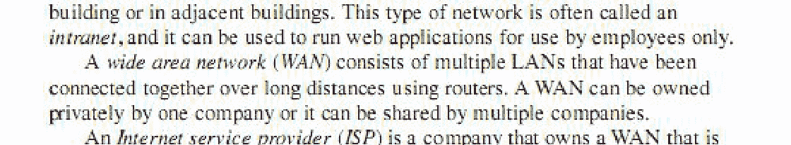

### Web 应用程序的架构

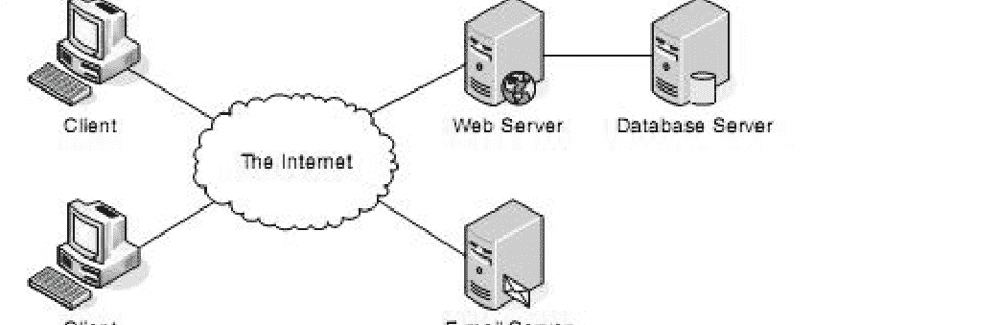

### 互联网的架构

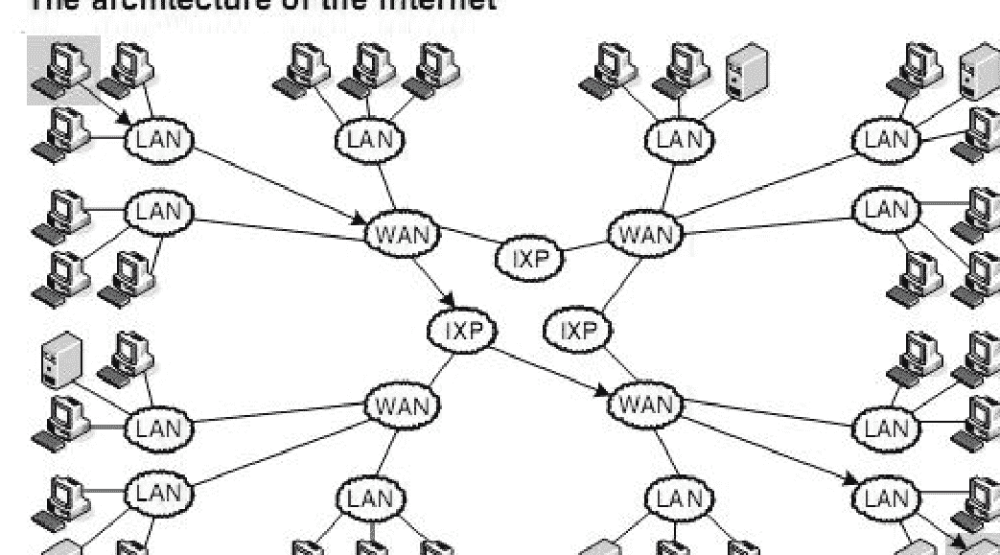

### 描述

- 服务器通过网络为称为客户端的其它计算机提供资源。服务器可以共享文件、打印机、网站、数据库或电子邮件。
- 网络使用路由器将信息从发送者传输到目的地。
- 局域网（LAN）直接连接彼此靠近的计算机。
- 广域网（WAN）使用路由器连接距离较远的计算机。
- 互联网由多个在互联网交换点（IXP）连接的广域网组成。世界各地分布着 IXP。
- 互联网服务提供商（ISP）拥有广域网并租赁该网络的权限。它通过一个或多个 IXP 与互联网连接。

图 1-1 客户端-服务器架构的工作原理

### 静态网页是如何处理的

静态网页只有在 Web 开发人员更改时才会发生变化。它是一个包含要在浏览器中显示的所有内容的纯文本文件。当浏览器请求它时，该网页直接从服务器发送到浏览器。

图 1-2 显示了 Web 服务器如何处理对静态网页的请求。过程从用户在 Web 浏览器中请求网页开始。用户可以在浏览器的地址栏中输入页面地址，也可以点击页面上指定下一个页面的链接。

无论何种情况，Web 浏览器都会构建网页请求并将其发送到 Web 服务器。这种请求被称为 HTTP 请求，使用超文本传输协议（HTTP）格式化，让 Web 服务器知道请求的是哪个文件。在此图中，你可以看到简单 HTTP 请求的内容。

当 Web 服务器接收到 HTTP 请求时，它从硬盘检索请求的网页，并作为 HTTP 响应返回浏览器。该响应包含了显示页面的 HTML。

在此图中，你可以看到简单网页的 HTTP 响应，它包含了页面的 HTML。

当浏览器接收响应时，它检索请求的 HTML，格式化页面并在浏览器中显示该页面。然后，用户就可以查看内容。如果用户通过点击链接或在浏览器地址栏中输入另一个 Web 地址请求另一个页面，该过程将重新开始。

顺便说，这个过程不仅依赖于 HTTP 协议，还依赖于传输控制协议/网际协议（TCP/IP）协议套件。TCP/IP 协议允许两台计算机在网络上进行通信。

### Web 服务器如何处理静态网页

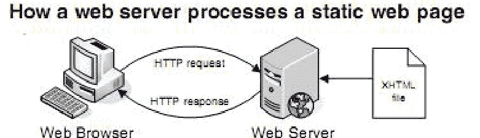

### 一个简单的 HTTP 请求

```
GET / HTTP/1.1
Host: www.example.com
```

### 一个简单的 HTTP 响应

```
HTTP/1.1 200 OK
Content-Type: text/html
Content-Length: 136
Server: Apache/2.2.3

<html>
<head>
  <title>示例网页</title>
</head>
<body>
  <p>这是一个示例网页</p>
</body>
</html>
```

### Web 应用程序所依赖的两种协议

- 超文本传输协议（HTTP）是 Web 浏览器和 Web 服务器之间用于通信的协议。它规定了 HTTP 请求和响应的规范。
- 传输控制协议/网际协议（TCP/IP）是一套协议，允许两台计算机在网络上进行通信。

### 描述

- 超文本标记语言（HTML）是用于设计 Web 网页的语言。
- 静态网页是存储在 Web 服务器上的 HTML 文档，它不会根据用户输入而改变。静态网页具有扩展名为 `.html` 或 `.htm` 的文件名。
- 当用户请求静态页面时，浏览器向 Web 服务器发送一个 HTTP 请求，其中包含所请求的文件名。
- 当 Web 服务器接收到请求时，它获取该网页并通过 HTTP 响应将其发送给浏览器。该响应包含了所请求文件中存储 HTML 文档。

### 动态网页是如何处理的


# 动态网页

动态网页是每次被请求时都由 Web 服务器程序或脚本创建的页面。该程序或脚本由应用程序服务器执行。这通常意味着页面每次被查看时都会变化。

页面内容的更改可能源于处理用户提交的数据，或者通过显示从数据库服务器检索出的数据。数据库服务器存储以表形式组织的信息，这些信息可以通过数据库查询快速检索到。

动态网页允许开发者创建交互式 Web 应用程序。因此，用户可以购买商品和服务、在 Web 上搜索信息，并通过论坛、博客和社交网络网站与其他用户进行通信。如果没有数据库驱动的动态网页，这些功能将难以实现或无法实现。

图 1-3 显示了服务器如何处理动态网页。该过程始于用户在 Web 浏览器中请求页面。用户可以在浏览器的地址栏中输入页面的 URL，点击指定要加载动态页面的链接，或者点击提交包含动态页面所处理数据的表单按钮。

在每种情况下，服务器都会构建一个 HTTP 请求并发送到 Web 服务器。如果用户提交了表单数据，这些数据将包含在 HTTP 请求中。

当 Web 服务器接收到 HTTP 请求时，它检查所请求网页的文件扩展名，以识别应该由哪个应用程序服务器处理。为了做到这一点，它使用应用程序映射将请求脚本的文件扩展名链接到正确的应用程序服务器。Web 服务器将请求转发给应用程序服务器。

应用程序服务器从硬盘检索脚本。它还会加载用户提交的任何数据。然后它执行脚本。脚本还可能从数据库请求数据并生成网页作为输出。这些数据随后成为其所生成的网页的一部分。

当脚本执行完成后，应用程序服务器将动态生成的网页发回 Web 服务器。然后，Web 服务器通过 HTTP 响应将页面发给浏览器，响应包含了该页面的 HTML。

当 Web 浏览器接收到 HTTP 响应时，它会对网页进行格式化并显示。但请注意，Web 浏览器无法判断 HTTP 响应中的 HTML 是用于静态页面还是动态页面。

当页面显示时，用户就可以查看内容。然后，当用户请求另一个页面时，该过程再次开始。从用户请求 Web 页面到服务器向客户端发送响应的过程被称为“往返”。

## Web 服务器如何处理动态网页

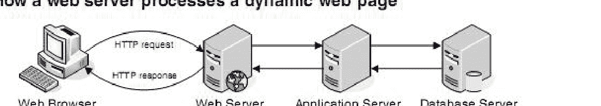

## 描述

- 动态网页是由服务器端程序或脚本生成的网页。通常，网页会根据 Web 浏览器向服务器提交的信息发生变化。
- 当 Web 服务器接收到动态网页的请求时，它会在应用程序映射列表中查找请求文件的扩展名，以确定由哪个应用程序服务器处理该请求。
- 当应用程序服务器接收到请求时，它运行指定的应用程序来处理浏览器提交的数据。
- 服务器端应用程序可以使用从浏览器获取的数据访问数据库中相应的数据。应用程序还可以将从浏览器获取的数据存储在数据库服务器中。
- 当服务器完成数据处理后，它生成一个网页并返回给 Web 服务器。然后，服务器将网页返回给 Web 浏览器。
- 浏览器无法判断网页是从静态网页检索的，还是由服务器应用程序动态生成的。无论何种，浏览器只需显示作为请求结果返回的网页。从用户请求 Web 页面到服务器向客户端发送响应的过程被称为“往返”。图 1-3 动态页面如何处理

## 浏览器、服务器和服务器端语言调查

第一个 Web 浏览器是由 Tim Berners-Lee 于 1991 年在瑞士日内欧洲欧洲研究组织（CERN）开发的。从那以后，开发了许多浏览器。图 1-4 总结了目前使用的浏览器。微软的 Internet Explorer（IE）最常用。它仅适用于 Windows。尽管 IE 8 已于 2008 年 9 月发布，但 IE 7 仍在被广泛使用。Firefox 是第二流行的浏览器。最新版本是 Firefox 3.1，于 2008 年 8 月发布。它适用于 Windows、Mac OS、Linux 和其他操作系统。Firefox 是使用 Netscape Navigator 浏览器的代码构建的。

Safari 是 Mac OS 的默认浏览器，但也适用于 Windows。Opera 适用于 Windows、Mac OS、Linux 和其他操作系统。Google Chrome 是热门浏览器中的新成员，其人气增长迅速。Chrome 基于 WebKit 渲染引擎，这与 Safari 相同。

此图还总结了最常用的 Web 服务器。由 Apache 软件基金会开发的 Apache 服务器最常用。它是一个免费的开源软件项目。尽管 Apache 有适用于大多数操作系统的版本，但它通常在 Linux 服务器上运行。另一个广泛使用的服务器是微软的 Internet 信息服务（IIS）。它是 Windows 服务器操作系统的一部分，并支持 ASP.NET 脚本语言。该 Web 服务器不是开源的，微软会发布脚本语言以外的新功能。

最后，此图总结了 Web 服务器常用的脚本语言。除了 ASP 和 JSP 之外，所有语言都可以直接在 IIS 或 Apache 上使用。ASP.NET 使用来自 Mono 项目的模块。Mono 支持常见的 ASP.NET 功能，但并非 100% 完成。要了解更多关于 ASP.NET，我们推荐 Murach's ASP.NET 3.5 with VB 2008 或 Murach's ASP.NET 3.5 with C#2008。

要使用 JSP，需要 Tomcat 服务器来执行 JSP 脚本。你可以在 IIS 或 Apache 上运行 Web 服务器，并使用连接模块将 JSP 请求转发到 Tomcat Web 服务器。要了解更多关于 JSP，我们推荐 Murach's Java Servlets and JSP。

ColdFusion 是由 Adobe 的商业服务器端脚本语言，与 Adobe Flash 和 Flex 集成。相比之下，PHP、Ruby、Perl 和 Python 都是免费的开源项目。

### Web 浏览器

| 浏览器 | 描述 |
| :--- | :--- |
| Internet Explorer | 由微软发布，最新版本是 2008 年 9 月发布的 IE 8。它仅适用于 Windows 平台。 |
| Firefox | 由 Mozilla 公司发布，最新版本是 2008 年 8 月发布的 3.1。它适用于所有主流操作系统。 |
| Safari | 由苹果发布，最新版本是 2008 年 6 月发布的 3.0。它适用于 Mac OS 和 Windows。 |
| Opera | 由 Opera Software 发布，最新版本是 2008 年 6 月发布的 9.5。它适用于所有主流操作系统。 |
| Chrome | 由 Google 于 2008 年 12 月发布，适用于 Windows XP、Vista 及后续版本。 |

### Web 服务器

| 服务器 | 描述 |
| :--- | :--- |
| Apache | 这是一个模块化的开源 Web 服务器，可以在任何主流操作系统上运行。它支持许多服务器端脚本语言，并可以与不同的数据库服务器交互。最常见的配置是 LAMP，它由 Linux、Apache、MySQL 和 PHP 组成。 |
| IIS | 这是微软 Windows 服务器。它主要支持 ASP.NET Web 脚本语言和 SQL Server 数据库服务器，但也可以与其他 Web 服务器脚本语言和数据库服务器配合使用。 |

### 服务端脚本语言

| 语言 | 描述 |
| :--- | :--- |
| ASP.NET | 包含在微软 IIS Web 服务器中，使用 `.asp` 文件扩展名。 |
| JSP | 基于 Java 编程语言，用于 Apache Tomcat 服务器，但其他 Web 服务器也可以配置为运行 JSP。它使用 `.jsp` 文件扩展名。 |
| ColdFusion | 使用 HTML 标签使其易于学习，同时支持 IIS 和 Apache。它使用 `.cfm` 文件扩展名。更多信息请访问 `http://www.adobe.com/products/`。 |
| PHP | 通常与 Apache Web 服务器配合使用，但也适用于 IIS。它使用 `.php` 扩展名。更多信息请访问 `http://www.php.net`。 |
| Ruby | 通常与 Web 服务器配合使用。它与 Rails 框架结合以简化开发。更多信息请访问 `http://www.rubyonrails.org`。 |
| Perl | 最初开发用于在 UNIX 命令行中处理文本，后来用于构建 Web 应用程序。它使用 `.pl` 文件扩展名。更多信息请访问 `http://www.perl.org`。 |
| Python | 除了 Web 应用外还用于开发许多类型的应用程序。它通常与 Apache Web 服务器配合使用。它使用 `.py` 扩展名。更多信息请访问 `http://www.python.org`。 |

图 1-4 浏览器、服务器和服务端脚本语言概览

## JavaScript 如何融入此架构

正如你所看到的，应用程序服务器处理 Web 页面的动态请求。这被称为服务端处理。这意味着处理是由服务器完成的。浏览器所做的仅仅是对返回给它的 HTML 进行格式化并显示页面。

相比之下，JavaScript 代码在浏览器中由浏览器的 JavaScript 引擎执行。这被称为客户端处理。这减轻了服务器的部分处理负担，并使应用程序运行更快。图 1 中的图所示了这一点。

每个浏览器都使用自己的 JavaScript 引擎，并且它们实现 JavaScript 的方式不同。这导致了跨浏览器兼容性问题。这意味着你的 JavaScript 应用可能在一个浏览器中运行正常，但在另一个浏览器中否则。在第 5 章中，你将学习如何在主流浏览器中测试和调试你的 JavaScript 应用程序。

如图所示，JavaScript 有许多用途。常见用途包括：在数据发送到服务器处理之前在客户端对其进行验证；演示幻灯片；创建动态菜单；对表格中的数据；以及页面上元素的动画。在书中，你将学习如何使用 JavaScript 实现这些大部分应用。

### JavaScript 如何融入此架构

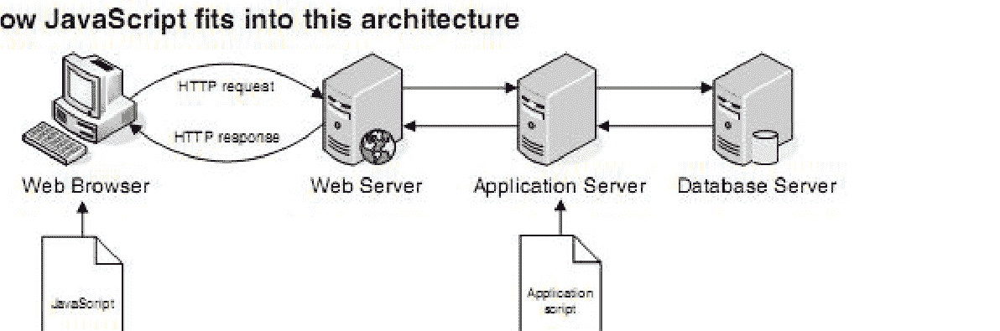

### JavaScript 在 Web 页面中的常见用途

- 在 Web 页面表单发送到服务器处理之前验证其数据。
- 响应用户操作，如鼠标点击和按键。
- 创建动态菜单。
- 创建幻灯片。
- 为 Web 页面中的元素制作动画。
- 创建定时器、时钟和日历。
- 更改 Web 页面使用的样式表。
- 排序表格中的数据。
- 控制 Web 浏览器窗口。
- 检测 Web 插件。
- 打开新的 Web 浏览器窗口。
- 从服务器加载新内容并在当前 Web 页面中显示。
- 当用户鼠标悬在图像上时更改图像。
- 为 Web 页面中的元素应用特殊特效。

### 描述

- JavaScript 是一种由浏览器的 JavaScript 引擎运行的脚本语言。因此，工作是在客户端完成的，而不是服务器，这减轻了服务器的处理负担。
- 使用 JavaScript 的问题之一是确保你的 Web 页面无论使用何种浏览器都能工作。

图 1-6 JavaScript 如何融入此架构

## 核心 Web 技术

JavaScript 是构建 Web 页面必须共同工作的四种技术之一。后续主题将介绍这些技术以及它们基于的标准。

## XHTML 简介

一个 XHTML 文档以 DOCTYPE 声明开始。该声明指示了使用哪个版本的 XHTML 来格式化文档。

### Web 页面的代码

```html
<!DOCTYPE html PUBLIC "-//W3//DTD HTML 1.0 Transitional//EN"
"http://www.w3.org/TR/html4/1999/html-transitional.dtd">
<html xmlns="http://www.w3.org/1999/xhtml">
<head>
  <title>Mike's Bait and Shop</title>
</head>
<body>
  <h1>Mike's Bait and Shop!</h1>
  <p>Welcome to Mike's Bait and Shop. We have all the gear you
  need to make your next fishing trip a great success!</p>
  <ul>
    <li>Ultima 3000 双鱼竿</li>
    <li>Phil's Faux Shrimp - 6号</li>
    <li>Titanium Open Back Fly Reel - 黑色</li>
  </ul>
  <p>现在拨打 559-555-6624 订购。</p>
</body>
</html>
```

### 浏览器中的 Web 页面

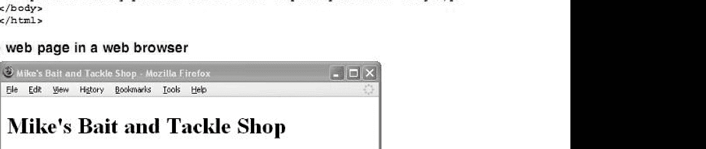

### Mike's Bait and Shop

欢迎来到 Mike's Bait and Shop。我们拥有你让下一次钓鱼之旅获得巨大成功所需的所有装备！

### 新产品

- Ultima 3000 双鱼竿
- Phil's Faux Shrimp - 6号
- Titanium Open Back Fly Reel - 黑色

现在拨打 559-555-6624 订购。

# CSS 简介

在 Web 开发早期，HTML 包含了既能控制文档结构又能控制格式的元素。然而，这种结构元素与格式元素的混合使得网页的编辑和维护变得困难。通常情况下，会有许多用于文本的格式化标签。

级联样式表（CSS）的开发是为了将格式指令从网页正文中分离出来，从而使网页只保留结构性标签和页面内容。因此，曾经在 HTML 中的大多数格式化标签（如 `<font>` 标签）现在已被废弃，不应再使用它们来构建网页。

要对 HTML 文档应用样式表，你可以从一个名为外部样式表的单独文件中加载该样式表，也可以使用在文档的 `<style>` 标签中编写的嵌入式样式表。由于外部样式表将 CSS 与 HTML 分离开来，后者方法是首选方法。

图 1-7 显示了带有嵌入在 `<style>` 标签中的样式表的 HTML 网页。该样式表被用于格式化最后一张图中的 HTML。如果你将此图中的网页与最后一张图中的网页进行比较，就可以看到样式表是如何改变其外观的。

尽管你可能对 CSS 已经熟悉，但下文是简要描述。不过，在第 5 章中，你可以学习程序员所需的全部 CSS 知识。

一个 CSS 规则由一个选择器和一个声明块组成。选择器识别一个 HTML 元素或一组元素，而声明块规定了这些元素的格式。在此图的 CSS 中，有三组规则。第一组应用于 `<body>`，第二组应用于 `<h1>`，最后一个应用于 `<ul>`（无序列表）。

声明块由花括号包围起来的一个或多个声明（或规则）组成。一个声明由一个属性和一个值组成，中间用冒号分隔，并在声明末尾加分号。属性控制字体、边距、边框、背景和颜色。在此图的样式表中，规则为 `body` 元素应用了颜色，为 `<h1>` 元素应用了颜色和下边框样式，为无序列表应用了方形项目样式。

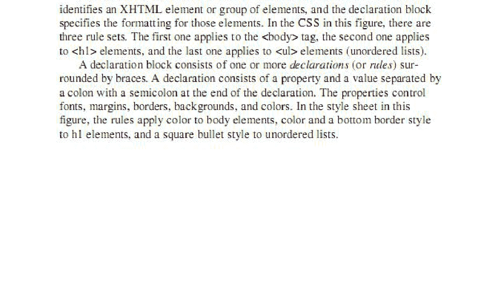

# 第 1 章 Web 开发与 JavaScript 简介

### 使用 CSS 样式的网页代码

```html
<!DOCTYPE html PUBLIC "//W3C//DTD HTML 1.0 Transitional//EN"
   "http://www.w3.org/TR/xhtml/xhtml-transitional.dtd">
<html xmlns="http://www.w3.org/1999/xhtml">
<head>
  <title>Mike 的鱼饵钓具店</title>
  <style type="text/css">
    body {
      background-color: #333333;
      color: #FFFFFF;
    }
    h1 {
      color: #FFCC33;
      border-bottom: 3px solid #FF3333;
    }
    ul {
      list-style-type: square;
    }
  </style>
</head>
<!-- 文档的其余部分与图 1-6 相同 -->
```

### 浏览器中的网页

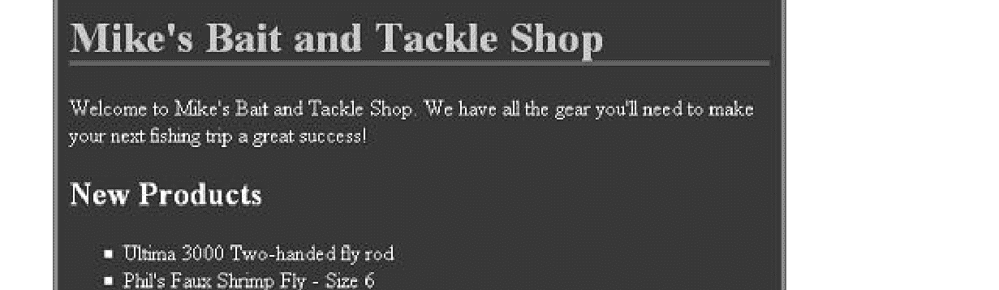

欢迎来到 Mike 的鱼饵钓具店。我们拥有你所需的所有设备，让你的下一次钓鱼之旅大获成功！

### 新产品

- Ultima 3000 双手鱼竿
- Phil 的 Faun 虾类飞虫 - 6 号
- 钛金属开背飞虫轮 - 黑色

今天请拨电 555-555-4624 联系我们进行下单

### 描述

- 级联样式表（CSS）用于通过指定页面的字体、颜色、边框、间距和布局来控制网页的显示方式。
- 外部样式表从单独的文件加载。嵌入式样式表编写在 HTML 文档头部的 `<style>` 标签中。
- 一个 CSS 规则由一个识别一个或多个 HTML 元素的选择器和一个描述应应用于这些元素的样式的声明块组成。

图 1-7 CSS 简介

# DOM 简介

文档对象模型（DOM）是网页中 XHTML 元素的内部表示。当浏览器加载 XHTML 页面时，该页面的 DOM 会在浏览器的内存中创建。图 1-8 显示了一个简单的 HTML 文档和 DOM 的结构。

网页的每个元素都由 DOM 中的一个节点表示。DOM 中的节点根据 HTML 元素相互嵌套的方式具有层级结构。DOM 从顶部的 `<html>` 标签开始，并向下嵌套到每个元素中的文本。有几种类型的节点来表示网页的内容。HTML 元素存储在元素节点中，而文本存储在文本节点中。在此图中，元素节点显示为椭圆形，文本节点显示为矩形。其他节点类型是属性和注释节点。

构成 DOM 的节点可以由网页内的脚本进行修改。这允许网页在被浏览器显示后被修改。当 DOM 发生更改时，网络浏览器会在窗口中显示更新后的页面。

在 DOM 标准化之前，每个网络浏览器都有自己的接口，允许脚本语言操作内容。

# 第1章 Web 开发与 JavaScript 简介

## 嵌入 XHTML 文档的 JavaScript

```html
<!-- 此之前的代码与图 1-6 相同。 -->
<p>请今日拨电至 555-555-6624 订购。</p>
<script type="text/javascript">
var today = new Date();
document.write(today.getFullYear());
</script>
</body>
</html>
```

## Web 浏览器中的 JavaScript 应用

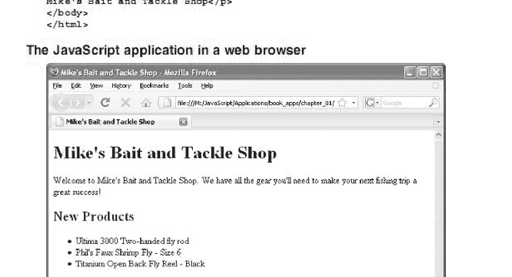

### 新产品

- Umana 3000 双把飞钓鱼竿
- Tide's 极速飞钓 - 6 号
- Thomas 开背式鱼轮 - 黑色

请今日拨电至 555-555-6624 订购。

2009 Mike 钓饵与钓具店

### 描述

- JavaScript 让 Web 开发人员能够构建交互式网页。
- 当代码首次执行或响应用户操作时，JavaScript 可以修改网页的内容。
- 在上面的网页中，2009 年是由 XHTML 文档主体中 `<body>` 标签内的 `<script>` 标签中的 JavaScript 代码生成的。

图 1-9 JavaScript 简介。

### XHTML、CSS、DOM 和 JavaScript 标准

如图 1-10 所示，XHTML、CSS、DOM 和 JavaScript 的标准在不断变化。作为一名 Web 开发人员，出于两个原因，你需要跟踪这些变化。首先，你希望确保当前的网页能够继续与新浏览器兼容。其次，你希望在新特性广泛可用时利用它们的优势。

如所示，HTML 自 20 世纪 90 年代初以来一直存在。HTML 的最后一个版本是 HTML 4.01，它于 1999 年 12 月发布。随后，在 2000 年 1 月引入了 XHTML 1.0。

XHTML 是 HTML 的修改版本，支持与 HTML 4.1 相同的标签，但它使用了 XML 语法。这是一种更严格的语法，允许自动化工具读取和操作 XHTML 编辑器内容。这还允许编辑器早期识别文档中的错误。

目前正在进行 HTML 5 的开发。该标准包含一个作为 XHTML 版本的 HTML。某些浏览器已经支持 HTML 5 规范的部分内容，但在该规范被大多数浏览器支持之前，你应该避免在生产环境网站中使用这些特性。

如所示，CSS 2.1 是 CSS 最稳定的版本。它于 2004 年 2 月作为候选标准发布，但随后被退回到工作草案进行进一步修改。2007 年 7 月，它再次作为候选标准发布。

由于标准的修订，CSS 的支持程度并不一致。然而，主流浏览器都支持 CSS 2.1。一旦 CSS3 稳定，主流浏览器也应该支持它。此图列出了 DOM 标准的最新版本。DOM 标准的有趣特性之一是能够将 DOM 的内部表示转换为 XML 文本文档。该文档的 XML 表示随后可以在稍后时候通过将 XML 转换回内部 DOM 层级结构来重建该层级结构。

如今，DOM 标准允许交互式开发，现代 Web 浏览器支持 DOM 3。然而，HTML 5 标准包含了被称为 DOM5 HTML 的 DOM 更新。该版本的 DOM 将被未来支持 HTML 5 和 XHTML 5 的 Web 浏览器使用。

#### HTML 和 XHTML 标准的历史亮点

| 版本 | 描述 |
| --- | --- |
| HTML 1.0 | 1993 年 1 月发布的草案规范，从未被采纳为标准。1995 年 11 月采纳。 |
| HTML 2.0 | 1997 年 1 月采纳。它正式化了浏览器使用的新特性。 |
| HTML 3.2 | 1997 年 12 月采纳。它正式化了浏览器使用的新特性并废弃了旧特性。它有三个版本：严格、过渡和无框架。 |
| HTML 4.1 | 2000 年 12 月至 2001 年 5 月间采纳。它维护了严格、过渡和无框架版本。 |
| XHTML 1.0 | 2000 年 1 月采纳并于 2005 年 8 月修订。它使用 XML 语法重新制定了 HTML，这使得解析网页变得更容易。这允许自动化工具发现页面中的错误。它维护了严格、过渡和无框架版本。 |
| XHTML 2 | 2001 年 5 月采纳。呈现的控制现在通过 CSS 完成。2006 年 7 月作为工作草案发布。它本打算作为 XHTML 的新版本，但在成为标准之前被另一个版本取代。 |
| HTML 5 | 2008 年 1 月作为工作草案发布。它是 HTML 4 和 XHTML 1 的新版本，定义了名为 HTML 5 的 HTML 版本、名为 XHTML 5 的 XHTML 版本以及名为 DOM5 的新 DOM 版本。 |

#### CSS 标准

| 版本 | 描述 |
| --- | --- |
| 1.0 | 1996 年 12 月采纳。 |
| 2.0 | 1998 年 5 月采纳。 |
| 2.1 | 2004 年 2 月作为候选标准发布，但被退回到工作草案进行进一步修改。2007 年 7 月，再次作为候选标准发布。 |
| 3.0 | 待定。 |

#### DOM 标准

| 版本 | 描述 |
| --- | --- |
| 1.0 | 1996 年 12 月采纳。 |
| 2.0 | 1998 年 5 月采纳。 |
| 2.1 | 2004 年 2 月作为候选标准发布，但被退回到工作草案进行进一步修改。2007 年 7 月，再次作为候选标准发布。 |
| 3.0 | 待定。 |

# DOM 脚本与 AJAX

除了你刚刚学过的核心 Web 技术外，还有两种技术导致了 JavaScript 使用率的激增。第一种是 DOM 脚本。它使用 JavaScript 来操作 DOM，以便构建一个能够响应用户操作的 Web 应用程序。

第二种技术是异步 JavaScript 和 XML (AJAX)。它允许 JavaScript 应用程序与服务器通信，以获取正在显示的页面的更新。具体来说，AJAX 使用 DOM 脚本用来自 Web 服务器的内容更新页面的部分内容，而无需更新整个页面。

## DOM 脚本如何工作

DOM 脚本允许你通过更改 DOM，使用 JavaScript 响应用户操作来更新网页。在图 1-1 中，你可以看到 JavaScript、DOM、HTML 和 CSS 之间的关系。

DOM 脚本是一种事件驱动编程。这意味着代码主要在响应 Web 浏览器中的事件时运行。事件通常是用户使用鼠标或键盘执行的操作。代码是通过响应名为“事件处理器”的事件处理器而执行的。

此图描述了驱动 DOM 脚本的事件循环。首先，当页面加载时，事件处理器会被绑定到页面上的事件上。然后，浏览器等待事件发生，然后再执行该事件的事件处理器。

当你使用事件驱动编程时，依赖于事件的代码就会发生。因此，事件驱动应用程序需要确保在事件发生时，事件处理器拥有所有所需信息。如果事件触发得太早，事件处理器需要能够检测到这一点，并向用户告知问题或忽略该事件。

在下一章和第 2 节中，你将学习一些基本的 DOM 脚本，因为它对于使用 JavaScript 至关重要。然后在第 3 节中，你将接受 DOM 脚本的高级课程，学习如何充分利用其价值。在此过程中，你将学习如何将 DOM 脚本用于一些高级 JavaScript 应用程序。

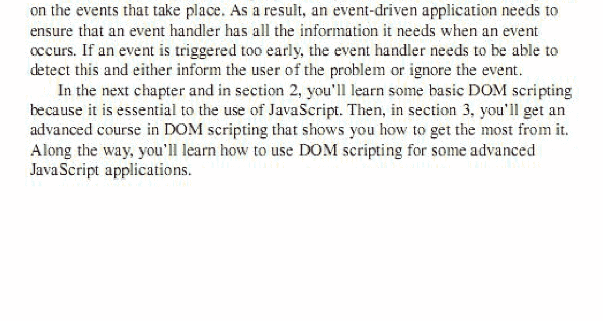

### Web 技术在 Web 浏览器中的交互方式

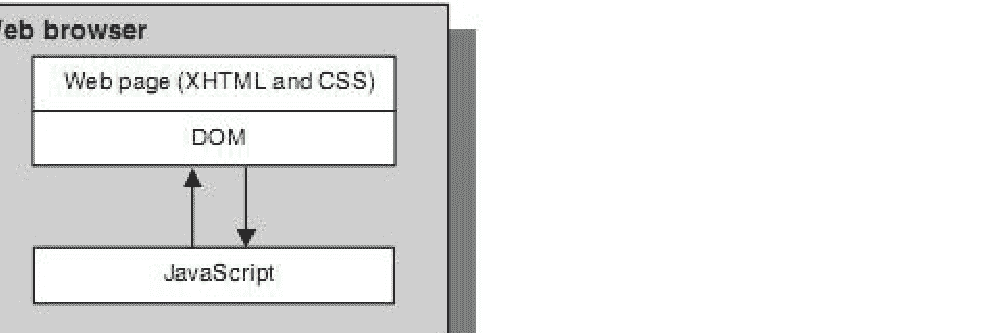

### DOM 事件循环

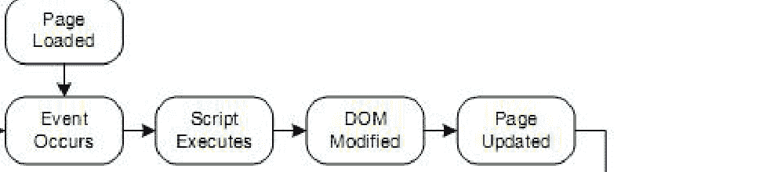

### 描述

- DOM 脚本是通过 JavaScript 操作 DOM 来构建 Web 应用程序的过程。
- DOM 脚本使用事件驱动编程。事件是用户执行的操作，例如点击鼠标按钮或在键盘上输入。
- 一旦事件发生，就会执行 JavaScript 代码来处理事件。这段代码被称为事件处理器。
- 当事件处理器执行时，它对 DOM 有完全访问权限。它可以通过 DOM 读取页面上元素的属性，并可以更改这些元素的属性。
- 当 DOM 被修改时，Web 浏览器会检测到 DOM 的变化并更新浏览器窗口中的网页。
- 当事件处理器完成后，Web 浏览器将等待另一个事件发生，循环重新开始，直到加载另一个页面。
- DOM 脚本应仅用于增强网页。这被称为渐进式增强。这样，即使禁用了 JavaScript，页面也能继续运行。

## AJAX 如何工作

富交互 Internet 应用 (RIA) 是一种为用户提供增强用户界面、高级功能和快速响应的 Web 应用程序。虽然有很多框架可以构建 RIA，但大多数要求用户在 Web 浏览器中安装插件。只有 AJAX 允许你利用现代 Web 浏览器内置的特性构建 RIA。

如图 1-2 所示，AJAX（异步 JavaScript 和 XML）允许网页与 Web 服务器通信并更新部分内容，而无需重新加载整个页面。然而，AJAX 并不是单一技术。它由 DOM 脚本、XMLHttpRequest 对象、服务器端脚本语言、可扩展标记语言 (XML) 和 JavaScript 对象表示法 (JSON) 组成。

XMLHttpRequest 对象允许 JavaScript 与运行在服务器上的脚本交换数据。XML 和 JSON 是 JavaScript 应用程序与服务器之间通过 XMLHttpRequest 对象交换数据时的两种常用数据格式。

当页面需要用来自服务器的新内容进行更新时，可以使用 AJAX 发起 HTTP 请求，发送服务器响应该请求所需的数据。该请求可以包含导致请求产生的信息，以及网页的相关内容。服务器处理请求后，会向 Web 浏览器发送 HTTP 响应。然后，JavaScript 应用程序可以使用这些数据更新网页，而无需重新加载整个页面。

AJAX 请求可以通过两种方式启动。第一种是通过 Web 浏览器中发生的用户事件。第二种是通过定时器，可以在指定的延迟后或按设定的间隔触发 AJAX 请求。这允许页面的部分自动更新。

由 AJAX 发起的 HTTP 请求可以根据需要重复多次以更新页面。当需要加载新页面或当前页面中未受 AJAX 控制的部分需要更新时，将启动普通的 HTTP 请求。

虽然这本书没有教你如何使用 AJAX，但请记住，在使用 AJAX 之前，你需要知道如何使用 JavaScript 和 DOM 脚本。这就是为什么本书是使用 AJAX 的前提条件。


### AJAX 启用请求与响应循环

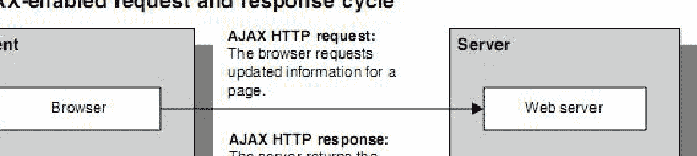

### 网页浏览器中的销售税应用

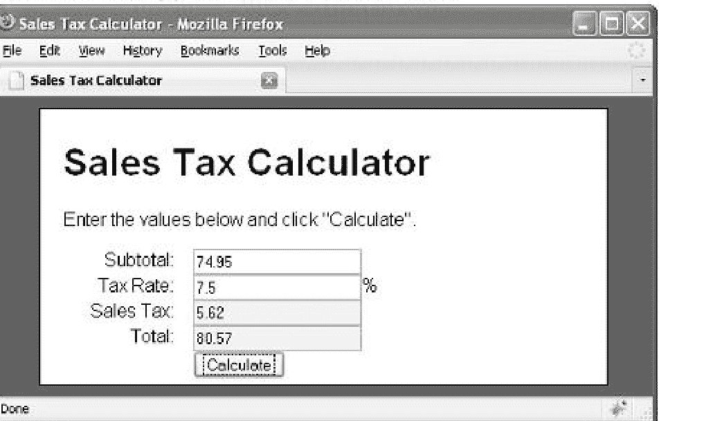

### XHTML 文件

```html
<!DOCTYPE html PUBLIC "//W3C//DTD HTML 1.0 Transitional//EN"
"http://www.w3.org/TR/html/html-transitional.dtd">
<html xmlns="http://www.w3.org/1999/xhtml">
<head>
<title>销售税计算器</title>
<link rel="stylesheet" type="text/css" href="sales_tax.css" />
<script type="text/javascript" src="sales_tax.js"></script>
</head>
<body>
<div id="content">
<h1>销售税计算器</h1>
<p>输入以下值并点击“计算”。</p>
<div id="calcArea">
<label for="subtotal">小计:</label>
<input type="text" id="subtotal" /><br />
<label for="taxRate">税率:</label>
<input type="text" id="taxRate" /><br />
<label for="salesTax">销售税:</label>
<input type="text" id="salesTax" disabled="disabled" /><br />
<label for="total">总计:</label>
<input type="text" id="total" disabled="disabled" /><br />
<label for="calculate"></label>
<input type="button" id="calculate" value="Calculate" /><br />
</div>
</div>
</body>
</html>
```

应用程序，应用程序中的控件将无法正确对齐，标签中的文本将无法右对齐，等等。

### JavaScript 文件

在下一章中，你将学习如何为此类应用程序编写 JavaScript 代码。但如果你有一定的编程经验，接下来的解释应该帮助你理解这里正在发生什么。使用 XHTML 方法的 ids 已被突出显示，JavaScript 代码由三个函数组成。

第一个函数命名为 `$`（这种函数的常用名称），它使用文档对象（DOM 的一部分）的 `getElementById` 方法来获取由参数名 `id` 指定控件。例如，如果向 `$` 函数发送 id 为 "subtotal"，该函数将返回 XHTML 代码中第一个输入框的对象。然后，代码可以使用该对象的值来获取用户输入该文本框的数据。这是一种 DOM 脚本。

第二个函数命名为 `calculate_click`。该函数在用户点击“计算”按钮时执行。它的工作原理是使用 `$` 函数和 `value` 属性来获取输入到小计税率框中的值。它还使用 `parseFloat` 方法将值转换为数字。该函数的第三和第四行使用该函数将 HTML 代码中名为 `salesTax` 和 `total` 的第三、第四个文本框的 `value` 属性设置为空字符串。

随后是一个 `if` 语句，用于检查用户是否在文本框中输入了有效数字。如果其中一个不是数字，如果其中都是有效的，函数将计算销售税并使用 `toFixed` 和 `parseFloat` 方法将其保留两位小数。然后，它计算总计。最后，它使用 `$` 函数将这些值显示在名为 `salesTax` 和 `total` 的框中。

第三个函数在 `window.onload` 事件发生时执行。这发生在页面发送到浏览器并完全加载到浏览器窗口时。该函数的第一条语句使用 `$` 函数将名为 `calculate_click` 的函数绑定到“计算”按钮的 `onclick` 事件上。一旦完成，每当发生 `onclick` 事件时，就会执行 `calculate_click`。该函数的第二条语句使用 DOM 元素的 `focus` 方法将焦点移动到小计框，以便应用程序准备接收用户的首次输入。

这个简单的应用程序说明了 JavaScript 许多许多编程语言的特性，特别是当你将其配合 DOM 使用时。这还应该让你对在数据发送到 Web 服务器处理之前如何在客户端进行数据验证有一定的了解。在下一章中，你将学习如何编写此类应用程序中的所有语句。

### CSS 文件

```css
body {
  font-family: Arial, Helvetica, sans-serif;
  background: #333366;
}
#content {
  width: 450px;
  margin: 20px auto;
  padding: 20px;
  background: white;
  border: 1px solid black;
}
#salesTax {
  color: black;
}
#taxCalc label {
  display: block;
  width: 60%;
  text-align: right;
  padding-right: 1em;
  float: left;
}
#taxCalc input {
  display: block;
  float: left;
}
#taxCalc br {
  clear: left;
}
```

### JavaScript 文件

```javascript
var $ = function (id) {
  return document.getElementById(id);
};

var calculate_click = function () {
  var subtotal = parseFloat($("#subtotal").value);
  var taxRate = parseFloat($("#taxRate").value);

  if (isNaN(subtotal)) {
    alert("Please enter a valid subtotal");
  } else if (isNaN(taxRate)) {
    alert("Please enter a valid tax rate");
  } else {
    var salesTax = subtotal * (taxRate / 100);
    $("#salesTax").value = salesTax.toFixed(2);
    var total = subtotal + salesTax;
    $("#total").value = total.toFixed(2);
  }
};

window.onload = function () {
  $("#calculate").onclick = calculate_click;
  $("#subtotal").focus();
};
```

## 审查网页的两项技能

你可能已经具备了接下来两个图中展示的技能。但如果你还没有，这里有访问网页并显示其源代码的方法。

### 如何访问网页

在互联网上访问网页的一种方法是在浏览器的地址栏中输入统一资源定位符（URL）。另一种方法是点击网页上请求另一个页面的链接。

在图 1-15 中，你可以看到互联网 URL 的四个组成部分。在大多数情况下，协议是 HTTP。如果你省略了协议，浏览器将使用 HTTP 作为默认协议。

域名标识了你想要查找的服务器。浏览器使用此名称来查找该域名的 Web 服务器的地址。虽然你不能省略域名，但大多数网站允许从域名中省略 "www."。

第三组成部分是文件在服务器上的路径。该路径列出了包含文件的文件夹。正斜杠 `/` 用于分隔路径中的名称，并在路径开头表示服务器的顶层文件夹。在示例中，路径为 `/`。如果你省略了路径，则必须省略文件名。这时，Web 服务器将返回服务器的主页。

最后一个部分是文件名。在图中，文件名为 `index.html`。如果你省略了文件名，Web 服务器将在你指定的路径中搜索默认文档。取决于你使用的 Web 服务器，它将找到名为 `Default.html`、`index.html` 或其他变体。

文件名和文件夹名应仅包含小写字母、数字、句点和划线。建议使用小写字母，因为某些 Web 服务器对大小写敏感。如果 URL 包含名称 "Images"，但文件夹实际名为 "images"，Web 服务器将不会报告该冲突。

要访问局域网或你计算机上的网页，你可以在浏览器的地址栏中输入路径和文件名。例如，如果你想从自己的 Windows 系统的计算机上访问图 1-11 所示的应用程序，你可以输入：

```
C:\murach\javascript_book\chapter_03\sales_tax\sales.html
```

如果文件存储在局域网服务器上，你可以输入带有相应磁盘驱动器字母的路径。

在大多数情况下，使用“文件-打开”命令打开网页更简单。或者，如果你使用 Windows，可以在 Windows 资源管理器中找到文件并双击其文件名。

### 带有其他网页链接的网页

Murach Java Servlets and JSP (第三版) - Murach Family

| 主页 | 图书 | 下载 | 培训师 | 导师 | 客户服务 |
| --- | --- | --- | --- | --- | --- |
| MURACH | | Murach's Java Servlets and JSP (第二版) | | | | |

- 目录
- 本书介绍的内容
- 本书的独特之处
- 索引

如果你正在读这本书在 2003 年创建的版本，从那时起，我们一直收到你们的反馈：“这本书已经完全重写了。作者在开发 JSP、Servlets 以及在现代开发环境中构建 Web 方面非常有天赋！”

现在，我们很高兴告诉你，你对它也会有同样的感受。

### HTTP URL 的组成部分

```
http://www.murach.com/books/index.htm
```

| 协议 | 域名 | 路径 | 文件名 |
| --- | --- | --- | --- |

### 如果省略 URL 的部分会发生什么

- 如果省略了协议，将使用默认的 http://。
- 如果省略了文件名，将使用 Web 服务器的默认文档名。这通常是 `index.html` 或 `Default.htm`。
- 如果省略了路径，也必须省略文件名。这时，将请求该网站的主页。

### 在互联网上访问网页的两种方法

- 在浏览器的地址栏中输入网页的 URL。
- 点击当前网页中的链接以加载下一个网页。

### 在局域网或你计算机上访问网页的三种方法

- 在浏览器的地址栏中输入完整路径和文件名。
- 使用“文件->打开”命令。
- 如果你使用 Windows，在 Windows 资源管理器中找到文件并双击它。

### 描述

- 统一资源定位符（URL）包含了使用的协议、网站的域名、网页的路径以及网页的文件名。

图 1-15 如何访问网页


### 如何查看网页的源代码

当浏览器显示网页时，你可以使用图 1-16 中的技术在单独窗口中查看该页的 XHTML 代码。例如，如果你在 Firefox 浏览器中打开保存到自己计算机上的网页，可以使用“查看 → 源代码”命令查看 HTML 代码。这在测试应用程序时非常有用。

你也可以使用此技术查看互联网上网页的 HTML 源代码。然而，取决于你使用的 Web 服务器，它将找到名为 `Default.html`、`index.html` 或其他变体。

# Web 开发与 JavaScript 简介

```html
<!DOCTYPE html>
<html PUBLIC "-//W3C//DTD XHTML1.0//EN" "http://www.w3.org/TR/xhtml1-strict.dtd">
<head>
  <title>计算器</title>
  <link type="text/css" href="sales_tax.css" />
  <script type="javascript" src="sales_tax.js"></script>
</head>
<body>
  <div id="container">
    <p>在下方输入值并点击“计算”。</p>
    <div id="subtotal">
      <label for="subtotal">小计</label>
      <input type="text" id="subtotal" />
    </div>
  </div>
</body>
</html>
```

# 在开始进行本书的练习之前...

在开始进行本书的练习之前，你应该下载并安装 Mozilla Firefox 浏览器，因为它是测试和调试 JavaScript 应用程序的最佳浏览器。你还应该下载并安装本书的应用程序。安装本书软件和应用程序的步骤在附录 A 中描述。

## 练习 1-1 运行销售税计算程序

在这个练习中，你将运行本章描述的销售税计算程序。你还将使用浏览器查看其源代码。

1. 启动 Firefox 浏览器。
2. 使用“文件”命令打开 chapter_01_sales_tax 文件夹中名为 `sales_tax.html` 的文件。这是销售税计算程序的 HTML 文件。如果你按照附录 A 中的描述安装了本书的应用程序，该文件在 Windows 系统上的路径为：
   ```
   C:\murach\javascript_book\chapter_01\sales_tax\sales_tax.html
   ```
3. 页面加载后，注意地址栏中存储的路径。
4. 在两个输入框中输入有效的数值，并点击“计算”按钮。这应该会在第三和第四个框中显示有效结果。
5. 在两个输入框中输入如 `xx` 等无效值，并点击“计算”按钮。然后通过输入有效数据并再次点击“计算”按钮来响应第一个消息框。对下一个显示显示值的消息框执行相同操作。
6. 使用“查看页面源代码”命令查看此应用程序的源代码。注意 JavaScript 代码存储在一个单独的文件。
7. 修改地址栏中的 URL，使其指向 JavaScript 文件而不是 HTML 文件。然后查看源代码。
8. 点击“后退”按钮返回原始界面，点击“前进”按钮返回 JavaScript 代码。

## 练习 1-2 复习书中的其他应用程序

在这个练习中，你将回顾书中的某些应用程序，随着本书的进行，你将学习如何编写它们。

1. 使用 Firefox 打开 chapter_01 文件夹中名为 `examples.html` 的文件。该网页提供了本书其他章节中介绍的一些应用程序的链接。每个链接的文本提供了章节编号、应用程序名称以及括号内使用的 JavaScript 特性。如果你回顾了这些应用程序，你就会对完成本书后能做多少事情有一个大致的了解。在回顾每个程序后：
2. 点击第一个链接并运行应用程序查看它是如何运行的。这就是你在下一章将学习编写的应用程序。
3. 点击第 12 章应用程序的链接。该应用程序为各种输入提供完整的客户端侧数据验证。
4. 点击第 13 章应用程序的链接。该应用程序使用基础 DOM 脚本展示幻灯片。
5. 点击第 18 章应用程序的链接。该应用程序展示了一个幻灯片轮，你可以使用鼠标将其减速或反转。
6. 如果你想回顾其他任何应用程序，现在就去做。完成后，关闭应用程序。

## 练习 1-3 访问一些互联网网站

在这个练习中，你将访问一些互联网网站并查看网站的源代码。

### 访问 Mozilla 网站

1. 使用 Firefox 进入 Mozilla 首页：www.mozilla.com。然后，查看首页的源代码。
2. 滚动源代码，注意该页面在 head 部分使用了外部 JavaScript 文件，并在 body 部分使用了几个嵌入式脚本。

### 访问其他网站

3. 尝试其他网站，看看你会发现什么。在每个网站，查看源代码以查看使用了哪些 JavaScript。

## 练习 1-4 访问纯文本网站

在这个练习中，你将访问 J. K. Rowling 的纯文本网站，以看看这样的网站对于视障人士来说有多容易访问。

1. 使用 Google 搜索并访问 J. K. Rowling 的纯文本网站。或者，输入图 1-14 中显示的 URL 访问该网站。
2. 点击链接导航。
3. 查看此网站的源代码。

# 如何编写 JavaScript 应用程序

在本章中，你将学习如何编写简单的 JavaScript 应用程序，如上一章中的销售税计算程序。这将让你快速入门，并为你提供在后续章节中快速学习所需的视角。如果你没有做过很多编程，这一章对你来说会进展很快。但如果你放慢速度并完成练习，你就应该掌握所有的技能。完成后，你将能够编写自己有意义的 JavaScript 应用程序。

| 如何编辑和测试你的网页 | 44 |
| :--- | :--- |
| 如何使用 Notepad++ 编辑网页 | 44 |
| 如何测试网页 | 46 |
| 如何在 Firefox 中调试事件消息 | 48 |
| JavaScript 技能... | 50 |
| 如何使用 script 标签引入 JavaScript | 50 |
| 如何编写 JavaScript 语句 | 52 |
| 如何创建标识符 | 54 |
| JavaScript 的原始数据类型 | 56 |
| 如何编写数学和逻辑表达式 | 58 |
| 如何声明变量 | 60 |
| 对象简介 | 62 |
| window 对象 | 64 |
| 如何使用 document 对象 | 66 |
| 如何使用 Number、String 和 Date 对象 | 68 |
| 如何使用 jQuery | 70 |
| 如何编写控制语句 | 72 |
| 如何编写条件语句 | 74 |
| 如何编写 while 和 for 语句 | 76 |
| 如何创建和使用函数 | 76 |
| 如何创建和调用函数 | 78 |
| 如何编写事件处理器 | 80 |
| 未来 | 80 |
| JavaScript 对象 | 82 |
| 视角 | 84 |

## 第 2 章 如何编写 JavaScript

打开了六个标签页并显示自动补全列表的 Notepad++

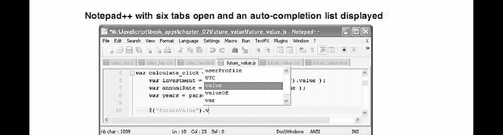

### 如何打开、保存、关闭和启动文件

- 要打开文件，使用 `文件->打开` 命令。或者，在 Windows 资源管理器中右键点击文件，并选择 `用 Notepad++ 编辑` 命令。文件将在新标签页中打开。
- 要保存或关闭文件，选择文件所在的标签页并使用 `文件->保存` 或 `文件->关闭` 命令。或者，右键点击标签页并选择相应的命令。
- 要在一个新标签页中启动新文件，选择 `文件->新建` 命令。

### 如何更改元素的样式

- 使用 `设置->样式配置器` 命令，在语言列表中选择 `JavaScript` 并点击样式列表中的 `COMMENT`。然后，在下拉列表中将字体名称和字体大小更改列表顶部的空白项。
- 对 JavaScript 语言的 `COMMENTLINE` 和 `COMMENTDOC`、HTML 语言的 `COMMENT` 以及 CSS 语言的 `COMMENT` 重复此操作。

### 如何使用自动补全功能

- 要启用自动补全，使用 `设置->选项` 命令，点击 `备份/自动补全` 标签页，并勾选“每次输入时启用自动补全”。
- 自动补全功能会显示以你输入的字符开头的术语列表。要插入这些术语，双击它或使用箭头键突出显示并按 `Tab` 键。要随时显示自动补全列表，按 `Ctrl+Space`。

### 如何让 Notepad 知道你正在使用什么语言

- Notepad++ 为你将使用的每种语言提供了颜色编码：HTML、CSS 和 JavaScript。对于新文件，你可以使用 `语言` 菜单选择正在使用的语言。或者，可以使用相应的扩展名保存文件。

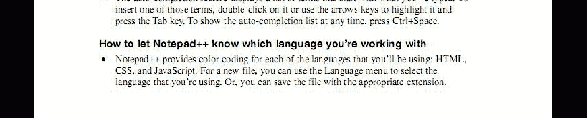

图 2-1 如何使用 Notepad++ 编辑网页

### 如何测试网页

当你完成网页文件的编辑后，需要保存它。然后，为了测试该网页，你需要在网络浏览器中打开该页面。你可以在地址栏中输入网页的地址并按 `Enter` 键，或使用 `文件->打开` 命令。如果你使用的是 Windows，还可以在 Windows 资源管理器中找到文件并双击它。

当页面显示在网络浏览器中时，你可以通过输入任何所需的数据并执行页面上控件所示的操作来测试它。图 2.2 中的 Firefox 演示了这一点。

如果应用程序在测试时给出了正确的结果，或者它没有产生任何结果，说明你的代码有一个或多个错误。通常，这些是语法错误，但有时是逻辑错误，例如漏掉了一行代码。无论何种，你都需要找到错误。

当你找到错误后，需要编辑文件来修复错误并保存文件。然后，为了测试应用程序，你可以返回浏览器并点击“重载”或“刷新”按钮。这将重新加载文件。此时，你可以再次测试应用程序以查看问题是否已修复。

对于某些应用程序，点击“重载”或“刷新”按钮不会完全清除浏览器内存，导致你的更改无法生效。在这种情况下，你可能需要关闭浏览器窗口并重新打开应用程序。

为了帮助你找到简单应用程序中的错误，你可以使用下一图所示 Mozilla Firefox 错误控制台。在接下来的章节中，你将学习浏览器如何帮助你在更复杂的应用程序中找到错误。

### Firefox 浏览器中的销售税应用程序

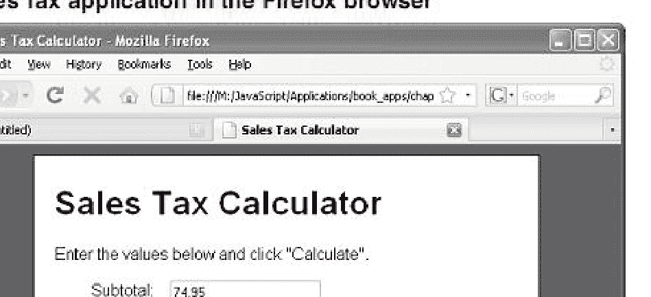

输入以下值并点击“计算”：

| 项目 | 数值 |
| :--- | :--- |
| 小计 | 74.95 |
| 税率 | 7.5 % |
| 销售税 | 5.62 |
| 总计 | 80.57 |

### 如何首次测试网页

- 使用上一章图 1-15 中的任何技术，在浏览器中打开网页。然后，输入所需的输入数据并运行应用程序。

### 更改源代码后如何重新测试网页

- 重载编辑过的页面文件，点击“重载”或“刷新”按钮。然后，运行应用程序。
- 有时，点击“重载”或“刷新”按钮不会完全清除浏览器内存，导致你的更改无法正常工作。在这种情况下，你可能需要关闭浏览器窗口并重新打开应用程序。

### 测试时应用程序没有反应该怎么办

- 如果应用程序在测试时没有反应，说明它要么有语法错误，或其他类型的代码错误。
- 在下一图中，你将学习如何使用 Firefox 显示语法错误的错误消息。对于修复像你完成本章后将能够编写的简单程序来说，这就足够了。

### 描述

- 本章展示了如何编写 JavaScript 应用程序，下一章将向你展示如何测试和调试它们。

### 如何在 Firefox 中显示错误消息

当你打开一个带有错误的应用程序时，它不会产生反应。要查看 Firefox 产生的错误消息，你需要按照图 2-3 所示打开错误控制台。

要显示文件的源代码，点击错误消息中的链接。这将打开显示错误处的源代码。你不能使用该窗口修复代码；相反，你需要使用你的编辑器并重新加载应用程序。

通常，错误消息没有像示例那样清晰。相反，会在某处报告错误行。

错误控制台顶部的按钮允许你选择想要显示的消息。如果你选择“最近”，所有消息、警告和错误都将显示出来。你可以点击“错误”标签页只显示错误。你还可以点击“清除”按钮删除控制台中的所有消息。通常，在你修改代码后，你会清除错误控制台。

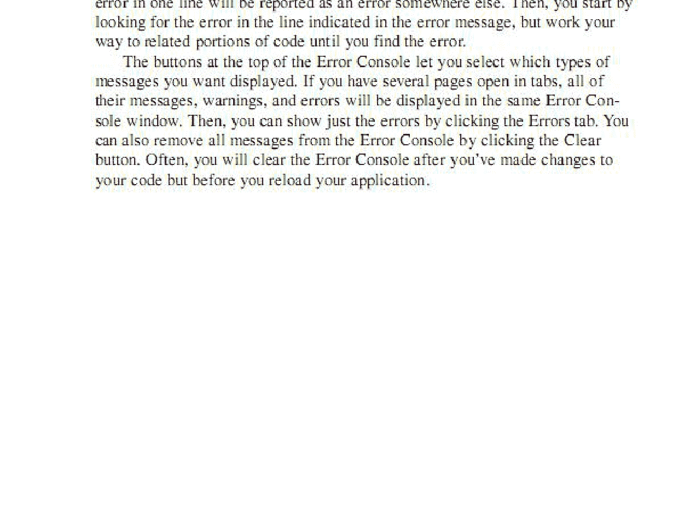

### 显示错误的 Firefox 错误控制台

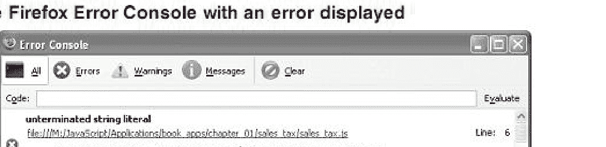

点击链接时显示的源代码

```
Source of file: file:///C/JavaScriptapplications/app/chapter_07/taxes.js...
```

```javascript
var tax = function(id) {
  return document.getElementById(id);
}

var calculate_click = function () {
  var subtotal = parseFloat("subtotal":value);
  var taxate = parseFloat("taxate":value) || 0;
}
```

# 基础 JavaScript 技能

现在你已经知道了如何编辑和测试应用程序，准备好学习如何编写 JavaScript 代码了。你将从基础知识开始。

### 如何使用 script 标签引入 JavaScript

在上一章中，你看到了嵌入在 HTML 文件中的 JavaScript。你还看到一个应用程序，它使用一个文件用于 HTML，一个文件用于 CSS，另一个文件用于 JavaScript 代码。现在，图 2 显示了如何使用 HTML `script` 标签将 JavaScript 代码包含在外部文件中或嵌入到 HTML 中。

这里描述了可以与 `script` 标签配合使用的属性。由于标签可以使用其他脚本语言，因此 `type` 属性是必需的，以便网络浏览器知道使用的是哪种语言。否则，`charset` 和 `defer` 属性很少被使用。

在旧版网页的代码中，通常使用 `language` 属性来标识语言；然而，`language` 属性已经过时，因此你应该始终使用 `type` 属性。

在图的示例中，你可以看到 `script` 标签如何用于外部文件和嵌入脚本。在这个示例中，使用 `src` 属性来指定名为 `script.js` 的外部文件。这假设外部文件与 HTML 页面在同一个文件夹中。如果不是，你可以通过文件名编写文件的路径。

在第二个示例中，带有 JavaScript 的 `script` 标签嵌入在 HTML 文档的 `head` 中。这里的 JavaScript 代码通常用于定义函数和事件处理程序以初始化所有全局变量。

在第三个示例中，脚本嵌入在 HTML 文档的 `body` 中。当应用程序加载时，如果脚本位于 `body` 中，`script` 标签会被 JavaScript 代码的内容替换。

你还可以从其他 Web 服务器加载外部 JavaScript 文件。第四个示例说明了这一点。在这种情况下，如果你使用 `http://` 前缀，浏览器会将服务器名称视为你服务器上的一个文件夹。

在最后一个示例中，你可以看到如何使用 `<noscript>` 标签。它可以编写在任何地方，但通常用在文档 `body` 中的 `script` 标签之后。这时，如果禁用了 JavaScript，`noscript` 标签的内容将显示出来。但如果浏览器启用了 JavaScript，`script` 标签会被 JavaScript 代码的内容替换，而 `noscript` 标签会被忽略。通过这种方式，输出将显示 JavaScript 是否已启用。

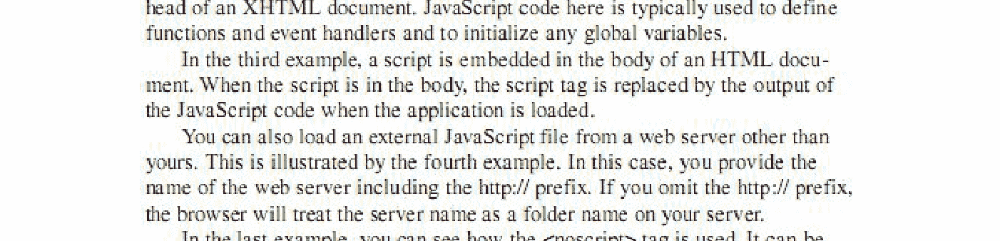

# 第 2 章 如何编写 JavaScript 应用程序

### script 标签的属性

| 属性 | 描述 |
| --- | --- |
| type | 必需的属性，用于标识脚本语言。对于 JavaScript，使用 `type="text/javascript"`。 |
| src | 指定外部文件的位置。该文件的运行将就像它在 Web 文档的至少此处被输入到 `script` 标签中了一样。 |
| charset | 指定脚本的字符编码。如果省略，脚本的字符编码将与文档的字符编码相同。 |
| defer | 指定脚本不生成任何文档内容。然后，网络浏览器将在页面其他部分加载后处理该脚本。编写为 `defer="defer"`。 |

### 如何从外部文件加载 JavaScript

```html
<script type="text/javascript" src="sales_tax.js"></script>
```

### 如何在 HTML 文档的 head 中嵌入 JavaScript

```html
<head>
<script type="text/javascript">
var s = function (id) { return document.getElementById(id); };
</script>
</head>
```

### 如何在 HTML 文档的 body 中嵌入 JavaScript

```html
<p>
<script type="text/javascript">
var today = new Date();
document.write(today.getFullYear());
</script>
Mike's Bait and Tackle Shop is</p>
```

### 如何从不同的 Web 服务器加载脚本

```html
<script src="http://www.google-analytics.com/urchin.js"></script>
```

### 如何在 HTML 文档的 body 中使用 noscript 标签

```html
<script type="text/javascript">
var today = new Date();
document.write(today.getFullYear());
</script>
<noscript>你必须启用 JavaScript。</noscript>
```

### 描述

- 你可以在 Web 中包含多个 `<script>` 标签。它们按照在文档中出现的顺序执行，除非使用了 `defer` 属性。
- 在文档的 `body` 中，`<script>` 标签会被代码的输出替换。`<noscript>` 标签用于在 JavaScript 禁用或不可用时显示内容。
- 在所有标签执行之前和之后，XML 文档必须是有效的。

图 2-4 如何使用 script 标签引入 JavaScript

### 如何编写 JavaScript 语句

JavaScript 语法指的是你在编写 JavaScript 语句时必须遵循的规则。如果你不遵守这些规则中的一个或多个规则，你的网络浏览器将无法解释和执行你的语句。这些规则在图 2-1 中。

第一个语法规则是 JavaScript 是区分大小写的。这意味着大写字母和小写字母被视为不同的字母。例如，名称 `saleset` 和 `sizeTax` 被视为不同的单词。

第二个语法规则是 JavaScript 语句必须以分号结束。如果你不在每个语句末尾加上分号，JavaScript 将无法判断一个语句何时结束，另一个语句从哪里开始。

第三个语法规则是 JavaScript 忽略额外的空白。空格、制表符和换行符等空白字符允许你拆分语句。

最后的语法规则是可以使用双斜杠添加单行注释，多行注释可以使用 `/*` 添加。

### JavaScript 语法规则

- JavaScript 是区分大小写的。
- JavaScript 语句以分号结束。
- JavaScript 忽略额外的空白。
- 单行注释以双斜杠开始，持续到行尾。
- 多行注释以 `/*` 开始并以 `*/` 结束。

### 单行注释

```javascript
nextYear = thisYear + 1; // Determine明年
```

### 多行注释

```javascript
/* 下面的行通过给当前年份加 1
来确定明年 */
nextYear = thisYear + 1;
```

### 如何跨行拆分语句

- 在算术运算符或关系运算符（如 `-`、`*`、`/`、`==` 或 `<`）之后拆分语句。
- 在左括号 `{`、`[` 或 `(` 之后拆分语句。
- 在右括号 `}` 之后。
- 不要在标识符、值或 `return` 关键字之后拆分语句。
- 不要在右括号 `]` 或 `)` 之后拆分语句。

### 会导致错误的拆分语句

```javascript
return
"Hello";
```

### 正确拆分的语句

```javascript
nextYear =
thisYear + 1;
```

### 描述

- JavaScript 的语法与 Java 的语法相似。
- JavaScript 提供了两种形式的注释，这些注释在执行 JavaScript 时会被忽略。
- 在某些情况下，JavaScript 会尝试通过在拆分行的末尾添加缺失的分号来修正。这会导致错误。为了防止这种情况，请在每个语句末尾加上分号，并遵循上述拆分语句的指南。

### 如何创建标识符

变量、函数、对象、属性、方法、事件都必须有名称，以便你可以在 JavaScript 代码中引用它们。标识符就是给这些组件之一的名称。

图 2-5 显示了 JavaScript 中创建标识符的规则。除了前四条规则外，你不能使用任何 JavaScript 保留字（也称为关键字）作为标识符。这些字被预留供 JavaScript 语言内部使用。你还应该避免将任何 JavaScript 全局属性或方法作为标识符。虽然你有时这样做也可以没事，但在某些应用程序中这会导致问题。

除了规则之外，你应该为你的标识符起有意义的名称。这意味着很容易看出一个标识符是什么，并且容易记住该名称的拼写。为了创建这样的名称，你应该避免使用缩写。例如，如果你将“每月投资”的名称缩写为 `mon_inv`，将很难看出它是什么，也很难记住你是怎么拼写的。但如果你将其完整写出 `monthlyinvestment`，这两个问题都解决了。

同样，你应该避免使用特定于某个行业或研究领域的缩写，除非你确定该缩写会被广泛理解。例如，`mpg` 是每加仑英里的常用缩写，但 `cpm` 可能代表许多事情，应该完整写出。

要创建一个包含多个单词的标识符，大多数 JavaScript 程序员使用称为驼峰命名法的约定。按照这种约定，除了每个单词的首字母大写。例如，`monthlyInvestment` 和 `taxRate` 就是使用驼峰法的标识符。

另一种方法是使用下划线字符分隔标识符中的单词。例如，`monthly_investment` 和 `tax_rate` 使用了这种约定。你所在的标准规定了这些约定之一。否则，你可以使用任何一种约定。无论哪种情况，请保持一致。

### JavaScript 创建标识符的规则

- 标识符只能包含字母、数字、下划线和美元符号 `$`。
- 标识符不能以数字开头。
- 标识符是区分大小写的。
- 标识符可以是任意长度。
- 标识符不能与保留字相同。
- 避免使用全局属性和方法作为标识符。如果你使用了其中一个，你将无法使用该标识符所指的全局属性或方法。
- 避免使用与保留字、全局属性或全局方法相似的名称。例如，避免使用 "Switch"，因为它与 "switch" 相似。

### JavaScript 中的保留字（未来使用的单词用斜体表示）

| abstract | else | instanceof |
|---|---|---|
| boolean | enum | switch |
| break | export | synchronized |
| byte | int | this |
| extends | long | throw |
| case | false | native |
| catch | final | transient |
| char | float | true |
| class | package | typeof |
| const | private | var |
| continue | protected | void |
| debugger | public | volatile |
| default | return | |
| delete | short | with |
| do | static | with |
| | | implements | super |
| double | import in | | | |

### JavaScript 中的全局属性和方法

| alert | focus | prompt |
|---|---|---|
| blue | getComputedStyle | resize |
| setInterval | Infinity | resizeTo |
| clearTimeout | isFinite | scroll |
| close | isNaN | scroll |
| confirm | moveTo | scrollTo |
| decodeURI | Wait | setInterval |
| decodeURIComponents | open | timeout |
| encodeURI | parseFloat | undefined |
| encodeURIComponents | parseInt | unescape |
| escape | parseInt | |
| print | | |
| eval | | |

### JavaScript 中的有效标识符

| subtotal | index_1 | $ |
|---|---|---|
| taxRate | calculate_click | $log |

### 描述

- 标识符是赋给变量、函数、对象、属性和方法的名称。


### JavaScript 的原始数据类型

JavaScript 提供了三种原始数据类型。数字数据类型用于表示数值。字符串数据类型用于表示字符。布尔数据类型用于表示真和假。


数字数据类型可以表示整数或小数。整数是整数，而小数是带有一个或多个小数位的数字。任一种数据类型的值都可以通过前面的加号或减号进行编码。如果省略了符号，则该值被视为正值。小数还可以包含一个小数点以及小数点右侧的一个或多个数字。

数字数据类型的值还可以包含一个指数。如果你熟悉科学计数法，那么这个指数表示小数点右侧或左侧应该包含多少个零。这种表示法被称为浮点数。如果你不熟悉这种表示法，可能不需要使用它，除非你正在编写需要它的应用程序。

数字类型可以存储极大和极小的数字，这在开发应用程序时很少成为问题。例如，数字的指数可以指示该数字在小数点左侧有 308 个零，或者在最大和最小值的右侧有 324 个零，这在你将一个数字除以零时可能会发生，结果将是 `Infinity` 或 `-Infinity`。

为了表示字符串数据，你在单引号或双引号（引号）内编码字符串。注意，空字符串用两个引号表示。

要表示布尔数据，你对 `true` 或 `false` 进行编码。

# 数字值的示例

`15` // 整数

`-21` // 整数

`21.5` // 浮点数

`-24.82` // 浮点数

`-3.7e-9` // 浮点数

# 数字数据类型

- 数字类型用于表示整数或小数。
- 整数是带正号或负号的整数。
- 浮点数由可选的符号、数字、可选的小数点、数字以及指数组成。
- 指数由正号或减号和一个整数组成。该整数必须在 `-324` 到 `+308` 之间。
- 如果结果存储在数据类型无法存储的范围内，它将被存储为 `Infinity` 或 `-Infinity`。

# 字符串值的示例

`"JavaScript"` // 带双引号的字符串

`'String Data'` // 带单引号的字符串

`""` // 空字符串

# 如何使用 `\n` 转义序列在字符串中换行

`"A valid\ncannot start with a number."`

// 表示字符串：A valid
// cannot start with a number.

# 字符串数据类型

- 字符串数据类型表示字符（字符串）。字符串由双引号或单引号围绕。字符串必须以相同类型的引号开始和结束。
- 空字符串是不包含任何字符的字符串。通过输入两个引号来实现。
- JavaScript 提供了可以在字符串内部使用的转义序列。所有序列以反斜杠开头，`\n` 转义序列换行。

### 布尔值

`true` // 等同于 true、yes 或 on

`false` // 等同于 false、no 或 off

# 布尔数据类型

- 布尔数据类型用于表示布尔值。布尔值可以用于表示处于两种状态之一的数据。

### 描述

- JavaScript 仅提供了三种原始数据类型。这些数据类型用于存储数字、字符串和布尔值。

# 如何编写数值和字符串表达式

表达式可以简单到只有一个取值，也可以是一系列产生单个值的的操作序列。在图 2-8 中，你可以看到用于编写数值和字符串表达式的运算符。如果你用过其他语言进行过，这些运算符可能与你之前使用的相似。特别是前四个运算符在大多数编程语言中都是通用的。

大多数现代语言还有模运算符（或 `mod` 运算符），它用于计算左值除以右值时的余数。在该运算符的示例中，`13 % 4` 表示 13 除以 4 的余数。那么 `13/4` 的结果是 3，余数为 1，这就是表达式的结果。

`mod` 运算符的用途之一是判断数字是偶数还是奇数。例如，`number % 2` 在数字为偶数时返回 0，为奇数时返回 1。另一个用途是判断年份是否为闰年。例如，如果 `year % 4` 返回 0，则该年份可以被 4 整除。

与图中前五个运算符不同，自增和自减运算符是对变量进行加或减操作。如果你还不熟悉这些运算符，将在本书后部分看到它们的插图。

当一个表达式包含两个或多个运算符时，优先级决定了先应用哪些运算符。这种顺序总结在图中的表格中。例如，乘法和除法操作会在加法和减法操作之前执行。

为了覆盖这种顺序，可以使用括号。例如，最内层括号中的表达式首先执行，然后是下一层括号中的表达式，依此类推。这是所有编程语言的共同点，图中的示例展示了其工作原理。

你可以与字符串一起使用的运算符是连接运算符。该运算符将两个字符串连接在一起，并在它们之间添加字符。由于加号 `+` 同时用于加法和拼接，JavaScript 必须查看值的数据类型来决定应该进行加法还是拼接。如果两个值都是数字，JavaScript 会将它们相加。如果两个值都是字符串，JavaScript 会将它们拼接。如果一个值是字符串而另一个是数字，JavaScript 将数字转换为字符串并拼接这两个值。

# 常用算术运算符

| 运算符 | 描述 | 示例 | 结果 |
| --- | --- | --- | --- |
| `+` | 加法 | `5 + 7` | `12` |
| `-` | 减法 | `5 - 12` | `-7` |
| `*` | 乘法 | `6 * 7` | `42` |
| `/` | 除法 | `13 / 4` | `3.25` |
| `%` | 模 | `13 % 4` | `1` |
| `++` | 自增 | `counter++` | 给 counter 增加 1 |
| `--` | 自减 | `counter--` | 从 counter 减 1 |

# 算术表达式的优先级

| 顺序 | 运算符 | 方向 | 描述 |
| --- | --- | --- | --- |
| 1 | `++` | 从左到右 | 自增运算符 |
| 2 | `--` | 从左到右 | 自减运算符 |
| 3 | `*` `/` | 从左到右 | 乘法、除法 |
| 4 | `+` `-` | 从左到右 | 加法、减法 |

# 优先级和括号的使用示例

```
3 + 4 * 5
// 结果为 23，因为先执行乘法
(3 + 4) * 5
// 结果为 35，因为先执行加法
```

```
13 % 4 + 9
// 结果为 10，因为先执行模运算
13 % (4 + 9)
// 结果为 12，因为先执行加法
```

# 字符串连接运算符

| 运算符 | 描述 | 示例 | 结果 |
| --- | --- | --- | --- |
| `+` | 拼接 | `"Ray" + " Harris"` | `"Ray Harris"` |
| `+` | 拼接 | `"Months: " + 120` | `"Months: 120"` |

### 描述

- 为了创建一个算术表达式，你可以使用算术运算符对两个或多个值进行操作。
- 算术表达式根据运算符的优先级进行求值。
- 要覆盖优先级，可以使用括号。
- 要拼接两个字符串，可以使用 `+` 运算符。
- 由于加号 `+` 同时用于加法和拼接，JavaScript 会查看值的数据类型来决定是进行加法还是拼接。如果两个值都是数字，JavaScript 会将它们相加。如果两个值都是字符串，JavaScript 会将它们拼接。如果一个值是字符串而另一个是数字，JavaScript 将数字转换为字符串并拼接这两个值。

# 如何声明变量并赋值

变量存储一个可以随程序执行而改变的值。要声明变量，请使用 `var` 关键字后跟名称。要在单个语句中声明多个变量，请使用 `var` 后跟用逗号分隔的名称。要给变量赋值，请使用赋值语句，它由变量名、赋值运算符和表达式组成。在适当的情况下，你可以在一条语句中声明变量并为其赋值。

# 如何声明变量而不进行赋值

```javascript
var subtotal; // 声明一个名为 subtotal 的变量
var lastName, state, zipCode; // 声明了三个变量
```

# 赋值运算符

| 运算符 | 描述 |
| --- | --- |
| `=` | 将表达式的结果赋值给变量。 |
| `+=` | 将表达式的结果加上变量。 |
| `-=` | 从变量中减去表达式的结果。 |
| `*=` | 将变量乘以表达式的结果。 |
| `/=` | 将变量除以表达式的结果。 |
| `%=` | 变量与表达式结果的模。 |

# 如何声明变量并赋值

```javascript
var subtotal = 74.95; // subtotal 为 74.95
subtotal = 75.50; // subtotal 为 75.50
subtotal += 9; // subtotal 为 84.50 (75.50 + 9)
var firstName = "Ray", lastName = "Harris"; // firstName 为 "Ray", lastName 为 "Harris"
var fullName = lastName; // fullName 为 "Harris"
fullName = lastName + ", " + firstName; // fullName 为 "Harris, Ray"
fullName += firstName; // fullName 为 "Harris, RayRay"
var months = 120, message = "Months:"; // months 为 120, message 为 "Months:"
message += months; // message 为 "Months: 120"
```

## 如何在 JavaScript 中使用对象

为了高效使用 JavaScript，你需要了解如何使用 JavaScript 和网页浏览器提供的对象。这就是接下来我们要为你介绍的内容。

## 对象、属性和方法的初介绍

对象是相关变量和函数的集合。存储在对象中的变量称为属性（`property`），存储在对象中的函数称为方法（`method`）。在图 2-10 中，你可以学习操作对象、属性和方法的基本语法。接下来的三张图将向你展示如何操作特定的对象、属性和方法。

该图顶部的语法总结了创建对象实例的代码。在这里，*斜体*的单词是会变化的变量。未斜体的单词和字符是始终保持不变的。这种表示法贯穿全章。

要创建一个对象，你使用关键字 `new`，后跟对象类型的名称和一组括号。这会调用对象的构造函数，该函数会创建对象并初始化其属性。生成的对象被称为该对象类型的实例（`instance`）。然后你可以对该对象使用属性和方法。

语法后的两个示例展示了该语法的应用。第一个示例创建一个对象并将其存储在名为 `today` 的变量中。第二个示例创建一个 `Array` 对象并将其存储在名为 `states` 的变量中。在这里，`Date` 和 `Array` 是 JavaScript 支持的特定类型对象。

要访问对象的属性，使用对象名称，后跟点运算符（句号）和属性名称。第二个语法总结和示例组说明了这一点。在这里，第一条语句获取 `window` 对象的 `screenX` 属性，第二条语句为 `window` 对象的 `location` 赋值一个 URL。由于属性是一个变量，你通常可以在表达式中使用它或为它赋值。然而，JavaScript 的某些属性是只读的，因此你无法为它们赋值。

要调用对象的方法，请编写对象名称、点运算符、方法名称以及一组包含任何必要参数（也称为参数）的括号。第三组示例说明了这一点。在这里，第一条语句调用了 `document` 对象的 `getElementById` 方法并向其传递了一个参数。同样，第二条语句调用了 `document` 对象的 `write` 方法并传递了一个参数。在这种情况下，值是由 `today` 对象的 `getFullYear` 方法返回的。

当你使用 JavaScript 时，最好将一个对象的使用嵌套另一个对象内部。这被称为对象链（`object chaining`），第四组示例说明了这一点。在这里，第一个示例调用了 `document` 对象的 `getElementById` 方法……然后获取该对象的 `value` 属性。该语句获取了 `window` 对象的 `location` 属性（这是一个字符串），然后使用字符串对象的 `toLowerCase` 方法将位置属性转换为小写字母。

如果你现在觉得这很困惑，在本章的剩余部分你将看到更多关于对象使用和对象链的示例。到本章结束，你应该熟练掌握对象链的使用。

### 创建新对象的语法

```javascript
new Object();
```

创建新对象并将其存储在变量中的示例

```javascript
var today = new Date(); // 创建名为 today 的 Date 对象
var states = new Array(); // 创建名为 states 的 Array 对象
```

## 访问对象属性的语法

```javascript
objectName.propertyName
```

访问对象属性的示例

```javascript
alert(window.screenX); // 显示用户的屏幕宽度
window.location = "http://www.murach.com"; // 加载 murach.com 主页
```

## 调用对象方法的语法

```javascript
objectName.methodName(parameters)
```

调用对象方法的示例

```javascript
// 存储对 id 为 "rate" 的 HTML 元素的引用
var rate = document.getElementById("rate");
// 获取完整年份并写入网页
document.write(today.getFullYear());
```

## 对象链的示例

```javascript
// 使用 alert 方法显示由 getElementById 方法
// 返回的对象的 value 属性
alert(document.getElementById("rate").value);
// 使用 alert 方法显示当前页面在被
// toLowerCase 方法转换为小写字母后
// 的 location 属性。
alert(window.location.toLowerCase());
```

### 描述

- 对象拥有属性，代表窗口宽度或 HTML 元素内容等属性。
- 对象还拥有方法，执行与对象相关的函数。
- 当你调用方法时，你可能需要向它传递一个或多个参数（`arguments`），通过在方法名后的括号内编写这些参数。如果方法需要多个参数，你必须用逗号将它们分隔。
- 对象链允许你访问嵌套在其他对象内部对象的属性或方法。
- 通常，一个对象存储在另一个对象的属性中，或者由另一个对象的方法返回。

## 如何使用 window 和 document 对象

当你使用 JavaScript 时，最好将一个对象的使用嵌套另一个对象内部。这被称为对象链。

## 如何使用 Number、String 和 Date 对象

当我们将数值或字符串值存储在变量中时，JavaScript 会自动将其转换为相应的对象类型。这让你可以直接使用该对象的属性和方法，而无需显式地创建对象。在图 2-12 中，你可以学习如何使用 `Number`、`String` 和 `Date` 对象的一些常用方法。

对于 `Number` 对象，只列出了 `toFixed` 方法。它将对象的数值舍入到参数所传递的小数位数，然后将该值转换为字符串。如示例中的前两个语句所示，这不会改变变量的值。它返回一个作为字符串的舍入值。

这组示例中的第三条语句显示，你可以链用 `toFixed` 方法和 `parseFloat` 方法，将一个值舍入到固定值，然后将其转换回数值。如果随后将此数值赋值给变量，它将替换原始值。

对于 `String` 对象，列出了三种方法。第一种允许你从字符串中提取子字符串。第二和第三种方法允许将字符串转换为全小写或全大写。同样，这些方法都不会修改变量中的原始值。如果你想更改原始值，需要如示例中的第四条语句所示，将修改后的值赋值给变量。

由于日期没有原生数据类型，你需要在使用其方法之前创建一个 `Date` 对象。当你创建一个新的 `Date` 对象时，它会根据创建时的日期和时间进行初始化。这是用户计算机的时间，而不是 Web 服务器的时间。如果日期时间错误，`Date` 对象将初始化不正确。

一旦创建了 `Date` 对象，你就可以使用图中的方法来处理它。在这里，`toDateString` 方法将日期转换为字符串。`getFullYear` 方法从日期中提取四位年份。在最后一个示例中，`getMonth` 方法返回月份数字。但请注意，月份从 0 开始，而不是 1。

在第 7 章中，你将学习到许多可以与 `Number`、`String` 和 `Date` 对象配合其他方法。不过，图中的方法应该足够你编写第一个 JavaScript 应用了。

## Number 对象的一个方法

| 方法 | 描述 |
| --- | --- |
| `toFixed(digits)` | 返回一个字符串，其中包含对象的值，舍入到参数指定的小数位数。 |

## 示例

```javascript
var balance = 2384.5567;
var i = balance.toFixed(2);
// 创建一个名为 balance 的数字对象
// 显示 2384.56
// balance 仍然是 2384.5567
balance = parseFloat(balance.toFixed(2));
// balance 现在是 2384.56
```

## String 对象的方法

| 方法 | 描述 |
| --- | --- |
| `substr(start,length)` | 返回一个新字符串，包含原始字符串的部分内容。它从第一个参数的位置开始，包含第二个参数所示的字符数量。字符串中的位置从 0 开始。 |
| `toLowerCase()` | 返回一个新字符串，将字母转换为全小写。 |
| `toUpperCase()` | 返回一个新字符串，将字母转换为全大写。 |

## 示例

```javascript
var guest = "Harris";
var i = guest.toUpperCase();
var j = guest.substr(0,3);
// 创建一个名为 guest 的字符串对象
// 显示 "HARRIS"
// 显示 "Har"
guest = guest.substr(4,2);
// guest 现在是 "is"
```

## Date 对象的方法

| 方法 | 描述 |
| --- | --- |
| `toDateString()` | 返回一个带有格式化日期的字符串。 |
| `getMonth()` | 返回日期中的月份数字。月份从一月开始为 0，十二月为 11。 |
| `getDate()` | 返回日期中的日。 |
| `getFullYear()` | 返回日期中的四位年份。 |

## 示例

```javascript
var today = new Date();
var i = today.toDateString();
var j = today.getFullYear();
var k = today.getMonth();
// 创建一个名为 today 的 Date 对象
// 假设当前日期是 09/20/2008
// 显示 Sat Sep 20 2008
// 显示 2008
// 显示 8，代表九月
```

- 当你声明 Number 或字符串时，对象会被创建。然后你就可以对该变量使用 `Number` 或 `String` 方法。
- 要创建一个 `Date` 对象，将 `new Date()` 赋值给变量。然后你就可以对该变量使用 `Date` 方法。

## String 和 Date 对象


## 如何使用 Textbox 获取并显示数据

`TextBox` 对象是 DOM 对象之一。它代表网页中的一个文本框，可用于获取用户输入或向用户显示输出。在图 2-13 中，第一组示例显示了 id 为 `"rate"` 和 `"salesTax"` 的文本框的 XHTML。你可以看到，`salesTax` 框的 `disabled` 属性已开启。这防止了用户在文本框中输入。

后续示例显示了如何使用 `TextBox` 的 `value` 属性。

## textbox对象的常用属性

| 属性 | 类型 | 描述 |
| --- | --- | --- |
| `value` | `String` | 文本框的内容。 |
| `disabled` | `Boolean` | 控制文本框是否禁用。 |

## 创建文本框的两个

```html
<input type="text" id="rate" />
<input type="text" id="salesTax" disabled />
```

| 方法 | 返回 | 描述 |
| --- | --- | --- |
| `focus()` | 无 | 将光标移入文本框。 |

- 当你使用文本框获取要在计算中使用的数值数据时，你需要使用 `parseInt` 或 `parseFloat` 方法将字符串数据转换为数值数据。
- 要将光标置于文本框中，请使用 `textbox` 对象的 `focus` 方法。

# 如何编写控制语句

与所有编程语言一样，JavaScript 也提供了控制语句，让你能够控制应用程序中信息的处理方式。本主题将带你开始使用这些语句。在此之前，你将学习如何编写条件表达式，因为所有的控制语句都用到了它们。

# 如何编写条件表达式

图 2-14 显示了如何使用六个关系运算符来编写条件表达式。条件表达式根据两个表达式之间比较的结果返回 `true` 或 `false` 值。例如，如果第一个表格中的表达式中 `lastName` 的值为 `"Harrison"`，则该表达式将返回 `false`。或者，如果最后一个表达式中 `rate` 的值为 10，则该表达式将返回 `true`（因为 10 / 100 是 .1，而 1 大于或等于 0）。

如果你想判断一个字符串值是否是有效的数值，可以使用全局方法 `isNaN`。接一组示例说明了这一点。要使用它，你只需传递一个代表要测试的字符串值的参数。然后，如果该值无法转换为数字，该方法返回 `true`；如果可以转换，则返回 `false`。

要编写复合条件表达式，你使用图中第二个表格所示的逻辑运算符来组合两个条件表达式。如果你使用 `AND` 运算符，当两个表达式都为 `true`时，复合表达式返回 `true`。如果你使用 `OR` 运算符，只要其中一个表达式为 `true`，复合表达式就会返回 `true`。如果你使用 `NOT` 运算符，表达式返回的值将反转。例如，如果参数不是数字，`isNaN` 返回 `true`，因此 `isNaN(10)` 返回 `false`，但 `isNaN("")` 返回 `true`。

注意，图中的逻辑运算符按其优先级顺序显示。运算符的求值顺序非常重要（特别是当复合表达式中使用多个逻辑运算符时）。这意味着 `NOT` 运算符在 `AND` 运算符之前求值，而 `AND` 在 `OR` 运算符之前求值。虽然这通常是你想要的，但你可以通过括号来覆盖此顺序。

在大多数情况下，你使用的条件表达式相对简单，因此编写它们并没有太大问题。在本章的剩余部分，你将看到一些常用的条件表达式类型。

### 关系运算符

| 运算符 | 说明 | 示例 |
|---|---|---|
| `==` | 等于 | `lastName == "Harris"` |
| `!=` | 不等于 | `testScore != 10` |
| `<` | 小于 | `firstName < "Ray"` |
| `<=` | 小于等于 | `months <= 0` |
| `>` | 大于 | `age > 18` |
| `>=` | 大于等于 | `investment >= 100` |

# 全局 isNaN 方法的语法

`isNaN(expression)`

`isNaN` 方法示例

`isNaN("Harris")` // 返回 true，因为 "Harris" 不是数字

`isNaN("123.45")` // 返回 false，因为 "123.45" 可以转换为数字

# 按优先级排序的逻辑运算符

| 运算符 | 说明 | 示例 |
|---|---|---|
| `!` | NOT | `!isNaN(age)` |
| `&&` | AND | `age > 17 && score < 70` |
| `||` | OR | `isNaN(rate) || rate < 0` |

# 逻辑运算符如何工作

- 使用 `AND` 运算符时，两个测试都为 `true`，整体测试结果才为 `true`。
- 使用 `OR` 运算符时，至少有一个测试为 `true`，整体测试结果才为 `true`。
- `NOT` 运算符将表达式的结果切换为另一个布尔值。例如，如果一个表达式为 `true`，`NOT` 运算符会将其转换为 `false`。
- 当条件表达式中使用两个或多个逻辑运算符时，可以使用括号来覆盖优先级顺序。

# 说明

- 条件表达式使用关系运算符来比较两个表达式的结果。
- 复合表达式使用逻辑运算符连接两个或多个条件表达式。
- `isNaN` 方法测试字符串是否可以转换为数字。如果字符串不是数字，则返回 `true`；如果字符串是数字，则返回 `false`。

# 注意

- 将赋值运算符 (`=`) 与相等运算符 (`==`) 混淆是一种常见的编程错误。

# 如何编写 if 语句

`if` 语句让你能够根据条件表达式的结果来控制语句的执行。在图 2-15 的示例中，你可以看到 `if` 语句可以包含三类型的语句。该语句必须以 `if` 子句开头。然后它可以有一个一个或多个 `else if` 子句，但也可以没有。它还可以有一个 `else` 子句，但该子句是可选的。

编写 `if` 子句，你需要编写关键字，后跟一个带括号的条件表达式以及在大括号内包含一个或多个语句的块。如果条件表达式为 `true`，将执行该块并跳过 `if` 语句中的剩余子句。如果条件表达式为 `false`，语句将继续执行任何随后的子句。

编写 `else if` 子句，你需要编写关键字 `else if`，后跟一个带括号的条件表达式以及在大括号内包含一个或多个语句的块。如果条件表达式为 `true`，将执行此代码块并跳过 `if` 语句中的任何剩余子句。这将一直持续，直到其中一个 `else if` 表达式为 `true` 或全部为 `false`。

编写 `else` 子句，你需要编写关键字 `else`，后跟在大括号内包含一个或多个语句的块。如果所有条件表达式都为 `false`，则执行 `else` 子句。如果所有表达式都为 `false` 且没有 `else` 子句，则不执行。

# 带有 else 子句的 if 语句

```javascript
if (age >= 18) {
  alert("You may vote.");
} else {
  alert("You are not old enough to vote.");
}
```

# 带有 else if 和 else 子句的 if 语句

```javascript
if (isNaN(rate)) {
  alert("You did not provide a number for the rate.");
} else if (rate < 0) {
  alert("The rate may not be less than zero.");
} else {
  alert("The rate is " + rate + ".");
}
```

# 带有复合条件表达式的 if 语句

```javascript
if (isNaN(userEntry) || userEntry <= 0) {
  alert("Please enter a valid number greater than zero.");
}
```

# 测试布尔值是否为 true 的 if

```javascript
if (invalidFlag) {
  alert("All entries must be numeric values greater than zero.");
}
```

# 嵌套 if 语句

```javascript
if (isNaN(totalMonths) || totalMonths <= 0) {
  alert("Please enter a number greater than zero.");
} else {
  var years = parseInt(totalMonths / 12);
  var months = totalMonths % 12;
  if (years > 0 && months > 0) {
    alert("The investment time is " + years + " years + " + months + " months.");
  } else if (years > 0) {
    alert("The investment time is " + years + " years.");
  } else {
    var message = "The investment time is " + months + " months.";
    alert(message);
  }
}
```

# 说明

- `if` 语句可以包含多个 `else if` 和末尾的一个 `else` 子句。语句的 `if` 子句在条件为 `true` 时执行一个或多个语句。
- 当之前的条件为 `false` 时，执行 `else if`。如果其条件为 `true`，则执行 `else if` 内的语句。
- 当所有之前的条件都为 `false` 时，执行 `else` 子句。
- 你可以在另一个语句的 `if`、`else if` 或 `else` 子句语句块中编写一个 `if` 语句。这被称为嵌套 if 语句。

## 如何编写 while 和 for 语句

`while` 和 `for` 语句允许你编写循环，以重复一次或多次执行代码块。图 2-16 中的语句说明了这一点。

对于 `while` 语句，你编写关键字，后面跟一个圆括号内的条件表达式以及花括号内的代码块。当执行 `while` 语句时，会评估条件表达式。如果表达式为真（`true`），则执行代码块并尝试继续 `while` 循环。一旦表达式变为假（`false`），就会跳过代码块，`while` 语句执行完毕。如果表达式在第一次检查时就为假，则代码块将完全不会执行。

图中的第一个示例显示了一个累加 1 到 5 数字的循环。变量 `sumOfNumbers` 被用于存储总和，并初始化为 0。变量 `numberOfLoops` 用于存储要相加的最大数字。变量 `counter` 用于存储要加到 `sumOfNumbers` 中的数字，它被初始化为 1。

`while` 语句中的代码将 `counter` 变量中的值加到 `sumOfNumbers` 变量中，并使用自增运算符 (`++`) 增加 `counter` 变量中的值。当 `counter` 的值小于或等于 `numberOfLoops` 的值时，循环运行。结果是当通过 `alert` 方法显示时，`sumOfNumbers` 等于 1, 2, 3, 4 和 5 之和。

对于 `for` 语句，你编写关键字，后面跟圆括号内的三个语句以及花括号内的代码块。这三个语句用分号隔开。第一个语句初始化计数器。第二个条件只要其为真，代码就会一直执行。第三个语句修改计数器。它在循环中的代码块执行后运行。

第二个示例显示了如何使用 `for` 语句获得与第一个示例相同的结果。在这里，计数器初始化为 1；只要 `counter` 小于或等于 `numberOfLoops`，就会执行代码块；每执行一次代码块，计数器就加 1。对于像这样的循环，你可以说 `for` 语句比 `while` 语句更容易使用。

第三个示例使用了另一个 `while` 语句。这段代码使用 `prompt` 方法从用户处获取值并将其存储在 `userEntry` 变量中。只要输入不是数字，`while` 语句就会一直执行。在 `while` 语句期间，用户会收到错误提示并被要求输入数字。

第四个示例使用了另一个 `for` 语句。它计算在固定利率下每月投资的未来价值。前三个变量存储每月投资额、利率以及投资持续的月数。`futureValue` 将存储在指定月数结束后你将拥有的金额，它被初始化为 0。

在语句内部，变量 `i` 用于计算月数，因此在每次循环中它都会加 1。在循环内部，将每月投资额加上 `futureValue`，然后将 `futureValue` 乘以 1 加上月利率，并将结果存回 `futureValue`。当循环结束时，`futureValue` 将包含每月投资的未来价值。


## 相加 1 到 5 数字的 while 循环

```javascript
var sumOfNumbers = 0;
var numberOfLoops = 5;
var counter = 1;
while (counter <= numberOfLoops) {
    sumOfNumbers += counter; // 将 counter 加到 sumOfNumbers
    counter++; // 将 counter 加 1
}
alert(sumOfNumbers); // 显示 15
```

## 相加 1 到 5 数字的 for 循环

```javascript
var sumOfNumbers = 0;
var numberOfLoops = 5;
for (var counter = 1; counter <= numberOfLoops; counter++) {
    sumOfNumbers += counter;
}
alert(sumOfNumbers); // 显示 15
```

## 获取用户输入的 while 循环

```javascript
userEntry = prompt("Please enter a number:", 100);
while (isNaN(userEntry)) {
    alert("You did not enter a number.");
    userEntry = prompt("Please enter a number:", 100);
}
```

## 计算投资未来价值的 for 循环

```javascript
var monthlyInvestment = 100; // 每月投资为 $100
var monthlyRate = 0.01; // 月利率为 1%
var months = 120; // 120 个月是 10 年
var futureValue = 0;
for (var i = 0; i < months; i++) {
    futureValue = (futureValue + monthlyInvestment) * (1 + monthlyRate);
}
```

## Description

- `while` 语句用于创建 `while` 循环，该循环包含一个只要条件为真就会执行的代码块。该条件在循环开始时进行测试。当条件变为假时，JavaScript 会跳到循环之后的代码处。
- `for` 语句用于创建 `for` 循环，该循环包含一个执行特定次数的代码块。
- 当你在一个循环内部编写另一个循环时，你正在编写嵌套循环。
- JavaScript 还提供了另外两种循环结构，你将在第 8 章中学习。


## 如何创建和使用函数

在开发 JavaScript 时，你经常需要创建和使用函数。使用函数的好处是只需要在一个地方进行修改。这展示了如何创建和使用函数。

## 如何创建并返回

函数可以将值返回给调用它的代码。执行 `return` 语句时，函数返回指定的值并结束。调用函数的代码可以丢弃返回值、将其存储在变量中或在表达式中使用。如果函数结束时没有遇到 `return` 语句，它将返回一个名为 `undefined` 的特殊值。

## 无参数且不返回值的函数

```javascript
var showYear = function () {
  var today = new Date();
  alert(today.getFullYear());
}
```

调用不返回值的函数

`showYear();` // 显示年份

## 有一个参数并返回值的函数

```javascript
var $ = function (id) {
  return document.getElementById(id);
}
```

调用返回值的函数

`taxRate = $("taxRate");`

## 有两个参数但不返回值的函数

```javascript
var displayEmail = function (username, domain) {
  document.write(username + "@" + domain);
}
```

调用有两个参数但不返回值的函数

`displayEmail("mike", "murach.com");`

## 有两个参数并返回值的函数

```javascript
var calculateTax = function (subtotal, taxRate) {
  var tax = subtotal * taxRate;
  tax = parseFloat(tax.toFixed(2));
  return tax;
}
```

调用有两个参数并返回值的函数

```javascript
var subtotal = 74.55;
var taxRate = 0.07;
var salesTax = calculateTax(subtotal, taxRate); // 返回 5.22
```

# 如何编写事件处理器

事件处理器是一个在事件发生时被执行的函数。如图 2-18 所示，某些事件是 `Button` 对象的 `onclick` 事件和窗口对象的 `onload` 事件。这些事件被图中的应用程序使用。当用户点击“Display Message”（显示消息）按钮时，该应用程序使用 `alert` 方法显示对话框。

该应用程序中的第一个函数是 `$` 函数，它是使用 `getElementById` 方法返回 XHTML 元素的简写。在大多数 JavaScript 应用程序中，你都会用到类似这样的函数。

事件处理器中的第二个函数命名为 `display_click`，该函数执行 `alert` 方法来显示消息。在代码的此时，`display_click` 函数并不是一个事件处理器。它的名称只是为了提醒该函数的用途。仅凭名称不会将函数分配给事件。

第三个函数将 `display_click` 函数分配给 id 为 `"btnDisplay"` 的 XHTML 元素的 `onclick` 事件。该函数在窗口的 `onload` 事件触发时执行。它发生在 HTML 完全加载到网页浏览器之后。

注意在该函数中，`display_click` 后面没有跟圆括号。相反，它是将函数作为变量引用并将该函数分配给事件。结果是，当事件触发时，该函数会被调用。

相比之下，如果你在 `display_click` 后面加上圆括号，该函数将立即被调用，在用户点击按钮之前就会显示 `alert` 框，且函数的返回值将是 `undefined`。那么当用户点击按钮时，什么都不会发生，因为该函数没有被分配给事件。

总结来说，第三个函数通过使用一个事件处理器将另一个事件处理器分配到页面上。这推迟了 `display_click` 事件处理器的分配，直到页面加载完成。这是必要的，因为 `head` 部分的代码在 DOM 构建之前就已经执行了。通过将此分配延迟到页面加载，应用程序确保了 `display_click` 事件处理器对 `$` 函数的调用能够成功。

当你使用这种技术时，如果页面加载需要几秒钟，可能会出现问题。在这种情况下，用户可能在页面完全加载并绑定事件处理器之前与页面上的元素进行交互。在第 14 章中，你将学习如何在页面完全加载之前向网页添加事件处理器。

顺便提一下，`window.onload` 事件的事件处理器的功能不仅仅是将函数分配给事件。事实上，它可以执行 DOM 加载后需要做的任何工作。

# 常见事件

| 对象 | 事件 | 发生时机... |
| --- | --- | --- |
| `button` | `onclick` | 按钮被点击。 |
| `window` | `onload` | 文档已加载到浏览器中。 |

# 一个带有 onclick 事件处理器的应用程序

```html
<html>
  <title>JavaScript Event Handler</title>
  <script type="text/javascript">
    // 此函数获取 id 并获取相关的 HTML 对象。
    var $ = function (id) {
      return document.getElementById(id);
    };

    // 这是按钮的 onclick 事件的事件处理器。
    var display_click = function () {
      alert("You clicked the button.");
    };

    // 这是页面 onload 事件的事件处理器。
    // 它在页面加载且 DOM 构建后执行。
    window.onload = function () {
      // 此操作将命名为 display_click 的事件处理器
      // 分配给名为 btnDisplay 的 HTML 对象的 onclick 事件
      $("btnDisplay").onclick = display_click;
    };
  </script>
<body>
  <input type="button" value="Display Message" id="btnDisplay" />
</body>
</html>
```

# 点击 Display Message 后网页浏览器

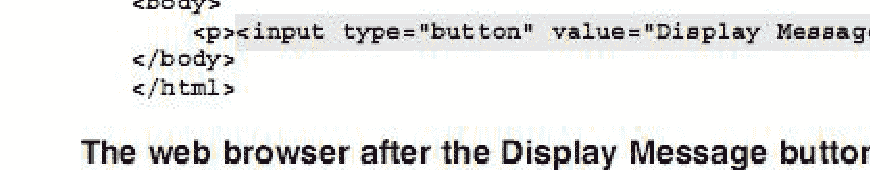

### 描述

- 当触发事件处理器的事件发生时，事件处理器会被执行。
- 窗口对象的 `onload` 事件处理器可用于在 DOM 构建后将事件处理器分配给其他事件。

# 未来价值（Future Value）应用程序

你现在已经学习了足够的 JavaScript，可以编写你自己的简单应用程序了。为了让你更好地如何操作，本章最后通过介绍“未来价值”应用程序作为结束。

未来价值应用程序如图 2-19 所示显示在网页浏览器中。该应用程序要求用户提供计算每月投资未来价值所需的三个数字。用户在前三个文本框中输入这些值并点击“Calculate”（计算）按钮。应用程序随后将用户的输入内容解析为数字，进行基本的数据验证，要么在 `alert` 框中显示错误消息，要么在 `futureValue` 文本框中显示计算结果。在图中显示了错误消息，是因为用户输入了无效的投资金额。

接下来将描述此应用程序的 HTML 和 JavaScript。虽然没有显示 CSS，但在该书的可下载应用程序中提供了。

# XHTML 代码

此应用程序的 XHTML 代码是一个 XHTML 1.0 Transitional（过渡型）文档。`head` 部分设置了页面标题，使用 `<link>` 标签加载外部 CSS 文件，并使用 `<script>` 标签加载外部 JavaScript 文件。

在页面的 `body` 中有四个文本框和一个按钮。文本框分别是 `investment`（投资）、`rate`（利率）、`years`（年限）和 `futureValue`（未来价值）。按钮用于计算。`investment`、`rate` 和 `years` 文本框用于输入，`futureValue` 文本框用于显示结果。

```html
<!DOCTYPE html PUBLIC "-//W3C//DTD HTML 1.0 Transitional//EN" "http://www.w3.org/TR/xhtml1/transitional.dtd">
<html xmlns="http://www.w3.org/1999/xhtml">
<head>
  <title>Future Value</title>
  <link rel="stylesheet" type="text/css" href="style.css" />
  <script type="text/javascript" src="future.js"></script>
</head>
<body>
  <div id="content">
    <h1>Future Value</h1>
    <label for="investment">Monthly Investment:</label>
    <input type="text" id="investment" /><br />
    <label for="rate">Annual Interest Rate (%):</label>
    <input type="text" id="rate" /><br />
    <label for="years">Number of Years:</label>
    <input type="text" id="years" /><br />
    <label for="futureValue">Future Value:</label>
    <input type="text" id="futureValue" disabled /><br />
    <input type="button" id="calculate" value="Calculate" />
  </div>
</body>
</html>
```

# JavaScript 代码

```javascript
var $ = function (id) {
  return document.getElementById(id);
};

var calculate_click = function () {
  var investment = parseFloat($("investment").value);
  var rate = parseFloat($("rate").value);
  var years = parseInt($("years").value);

  if (isNaN(investment) || investment < 0 ||
      isNaN(rate) || rate < 0 ||
      isNaN(years) || years < 0) {
    alert("Please enter valid non-negative numbers.");
  } else {
    var monthlyRate = rate / 100 / 12;
    var months = years * 12;
    var futureValue = investment * ((Math.pow(1 + monthlyRate, months) - 1) / monthlyRate);
    $("futureValue").value = futureValue.toFixed(2);
  }
};

window.onload = function () {
  $("calculate").onclick = calculate_click;
};
```

# 第 2 章 如何编写 JavaScript 应用程序

## JavaScript 文件 (future.js)

```javascript
var $ = function (id) {
  return document.getElementById(id);
}

var calculate_click = function () {
  // 获取前三个文本框的内容。
  var investment = parseFloat($('#investment').value);
  var annualRate = parseFloat($('#rate').value);
  var years = parseInt($('#years').value);

  // 将第四个文本框的值设为空字符串。
  $('#futureValue').value = "";

  // 测试输入值的有效性。
  if (isNaN(investment) || investment <= 0) {
    alert('投资必须是大于零的有效数字.');
  } else if (isNaN(annualRate) || annualRate <= 0) {
    alert('年率必须是大于零的有效数字.');
  } else if (isNaN(years) || years <= 0) {
    alert('年份必须是大于零的有效数字.');
  } else {
    // 如果所有输入都有效，计算未来值。
    var monthlyRate = annualRate / 12 / 100;
    var months = years * 12;
    var futureValue = 0;

    for (var i = 1; i <= months; i++) {
      futureValue = (futureValue + investment) * (1 + monthlyRate);
    }

    // 将第四个文本框的值设为未来值。
    // 但保留两位小数。
    $('#futureValue').value = futureValue.toFixed(2);
  }
}

window.onload = function () {
  $('#calculate').onclick = calculate_click;
  $('#investment').focus();
};
```

图 2-19 未来值应用程序（2 部分中的第 2 部分）

### 观点

本章的目标是让你开始学习 JavaScript 并让你快速上手。现在，如果你理解了未来值应用程序，你已经迈出了一大步。你也应该能够编写自己的基础 JavaScript 应用程序。但请记住，本章只是 JavaScript 核心知识的介绍，将在第 2 部分的章节中进行扩展。

## 术语

- 语法 (`syntax`)
- 语句 (`statement`)
- 注释 (`comment`)
- 标识符 (`identifier`)
- 保留字 (`reserved word`)
- 关键字 (`keyword`)
- 驼峰命名法 (`camel casing`)
- 原生数据类型 (`primitive data type`)
- 数字类型 (`number data type`)
- 整数 (`integer`)
- 小数值 (`decimal value`)
- 浮点数 (`floating-point number`)
- 指数 (`exponent`)
- 字符串类型 (`string data type`)
- 字符串 (`string`)
- 空字符串 (`empty string`)
- 转义序列 (`escape sequence`)
- 布尔数据类型 (`Boolean data type`)
- 布尔值 (`Boolean value`)
- 表达式 (`expression`)
- 算术运算符 (`arithmetic operator`)
- 优先级 (`order of precedence`)
- 拼接 (`concatenate`)
- 变量 (`variable`)
- 声明变量 (`declare a variable`)
- 赋值语句 (`assignment statement`)
- 赋值运算符 (`assignment operator`)
- 复合赋值运算符 (`compound assignment operator`)
- 字符串字面量 (`string literal`)
- 数字字面量 (`numeric literal`)
- 对象 (`object`)
- 属性 (`property`)
- 方法 (`method`)
- 实例 (`instance`)
- 构造函数 (`constructor function`)
- 点运算符 (`dot operator`)
- 调用方法 (`call a method`)
- 参数 (`parameter`)
- 实参 (`argument`)
- 对象链 (`object chaining`)
- 全局对象 (`global object`)
- 窗口对象 (`window object`)
- 文档对象 (`document object`)
- 控制语句 (`control statement`)
- 条件表达式 (`conditional expression`)
- 关系运算符 (`relational operator`)
- 复合条件表达式 (`compound conditional expression`)
- 逻辑运算符 (`logical operator`)
- if 语句 (`if statement`)
- if 子句 (`if clause`)
- else if 子句 (`else if clause`)
- else 子句 (`else clause`)
- 嵌套 if 语句 (`nested if statements`)
- while 语句 (`while statement`)
- while 循环 (`while loop`)
- for 语句 (`for statement`)
- for 循环 (`for loop`)
- 函数 (`function`)
- return 语句 (`return statement`)
- 调用函数 (`call a function`)
- 事件 (`event`)
- 事件处理器 (`event handler`)

## 第 2 章 如何编写 JavaScript 应用程序

## 在开始完成本书的练习之前...

如果你还没有这样做，应该安装 Firefox 浏览器并按照附录 A 中的描述安装本书的应用程序。然后，如果你是编程新手，应该做练习 2-1。但如果你已经有一些编程经验，可以从练习 2-2 开始。

## 练习 2-1 构建销售税应用程序

本练习为初学者设计。它将引导你完成构建第 1 章中销售税应用程序的过程。该练习还给了你实验的机会，这是学习 JavaScript 编程的极佳方法。

### 打开销售税应用程序的文件

1. 启动 Firefox 浏览器。然后，使用文件 > 打开 命令打开第 2 章文件夹中名为 `sales_tax.html` 的文件。如果你按照附录 A 安装了可下载的应用程序，在 Windows 系统上的路径为：
   `C:\users\javascript\exercises\chapter_02\sales_tax\sales_tax.html`
2. 在两个输入框中输入有效的数值并点击 Calculate 按钮。注意什么没有任何发生。
3. 使用你的文本编辑器打开此应用程序的 `sales_tax.js` 文件。它与 html 文件在同一个文件夹中。然后，注意此文件只包含用于获取 XHTML 元素对象的 `$` 函数。
4. 使用你的文本编辑器打开此应用程序的 `sales_tax.html` 文件。然后，注意此应用程序中文本框使用的 ids。

### 启动此应用程序的事件处理器

5. 通过输入以下代码启动 `window.onload` 事件的事件处理器：

```javascript
window.onload = function () {
  alert("This is the window.onload event handler.");
};
```

然后，保存文件，切换到 Firefox，点击 Reload 按钮，并注意显示的消息。或者如果没有发生，检查你的代码修复并再次尝试。如有必要，你可以检查图 2-3 所示的 Firefox 错误控制台。但当你运行正常后，切换回编辑器。

6. 在函数和 `window.onload` 事件处理器之间，通过输入代码启动名为 `calculate_click` 的函数：

```javascript
var calculate_click = function () {
  alert("This is the calculate_click event handler.");
};
```

然后，保存代码，切换到 Firefox，点击 Reload 按钮，注意该函数没有执行。这是因为它还没有被调用。现在，切换到编辑器。

7. 在 `alert` 语句后输入以下语句从 `window.onload` 事件处理器调用 `calculate_click` 函数：

```javascript
calculate_click();
```

然后，保存文件，切换到 Firefox 并点击 Reload 按钮。这一次应该显示两个消息框：一个来自 `window.onload` 事件处理器，另一个来自 `calculate_click` 函数。如果没有运行，修复代码并再次尝试。

8. 通过替换第 7 步输入的语句，将 `calculate_click` 函数赋值给 Calculate 按钮的点击事件：

```javascript
$('#calculate').onclick = calculate_click;
```

然后，保存文件，切换到 Firefox，点击 Reload 按钮并点击 Calculate 按钮。如果你做得正确，消息框将显示。否则，修复代码并再次尝试。

### 完成事件处理器

9. 在 `calculate_click` 函数的 `alert` 语句后添加这些语句：

```javascript
var subtotal = 200;
var taxRate = 7;
var salesTax = subtotal * (taxRate / 100);
var total = subtotal + salesTax;
alert("subtotal = " + subtotal + "\n" + "taxRate = " + taxRate + "\n" + "salesTax = " + salesTax + "\n" + "total = " + total);
```

10. 如果对变量和算术语句有任何疑问，请查看图 2-7 到 2-9。然后在 `calculate_click` 函数中对你不理解的语句进行实验。为了显示你的语句结果，可以像第 9 步那样使用 `alert` 语句。

11. 用以下语句替换第 9 步中的语句：

```javascript
var subtotal = parseFloat($('#subtotal').value);
var taxRate = parseFloat($('#rate').value);
// calculate
var salesTax = subtotal * (taxRate / 100);
var total = subtotal + salesTax;
// display results
alert("salesTax = " + salesTax.toFixed(2));
alert("total = " + total.toFixed(2));
```

前两个语句获取用户输入；最后两个将在图 2-13 中解释结果。此时，如果用户输入有效数字，应用程序应该工作。

12. 在两个 `alert` 语句前输入 `//` 将它们注释掉。

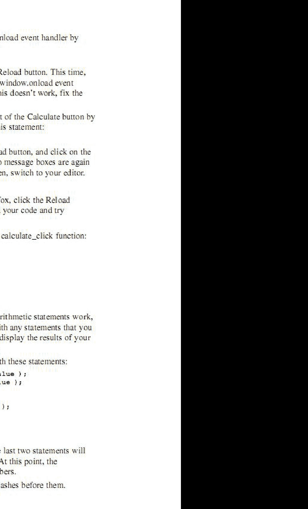

13. 在 `else` 子句中输入执行计算的代码来检查用户输入的有效性：

```javascript
if (isNaN(subtotal) || isNaN(taxRate)) {
    alert("Please check your entries.");
} else {
    // calculations
}
```

这在执行计算之前确保两个用户输入都是数字。

14. 此时，你有一个可以运行的应用程序，但还可以改进。如果你想改进它，可以参考上章图 1-13 的代码。例如，你可以检查每个用户输入是否都是数字且大于零，并为每个文本框显示不同的错误消息。或者，你可以在 `window.onload` 函数中添加语句将焦点移动到第一个文本框。实验完成后，关闭文件。

## 练习 2-2 增强未来值应用程序

在这个练习中，你将以多种方式增强未来值应用程序。这将有机会有机会在本章中学到的某些技能。

### 测试未来值应用程序

1. 启动 Firefox 浏览器。然后，打开第 2 章文件夹中名为 `future_value.html` 的文件。该文件在 Windows 系统上的路径为：
   `C:\browser\javascript\exercises\chapter2\future_value.html`
2. 在三个输入框中输入数值。第一次运行时，保持这些值，例如每月投资 100，年利率 12，年份 1。然后，点击 Calculate 按钮在第四个文本框中显示结果。
3. 在三个输入框中输入无效值并点击 Calculate 按钮。然后，通过输入有效数据并点击 Calculate 按钮展开第一个消息框。对后两个消息框执行相同的操作。

### 增强有效性检查

4. 使用你的文本编辑器打开此应用程序的 `future_value.js` 文件。你的文件与 html 文件在同一个文件夹中（见第 1 步）。
5. 修改年利率的有效性测试，使其必须是大于零且小于等于 20 的有效数字。接下来，调整显示的错误消息以反映此有效性测试。

要测试此增强，保存 JavaScript 文件，切换到 Firefox 并点击 Reload 按钮，输入一个大于 20 的利率并点击 Calculate 按钮。

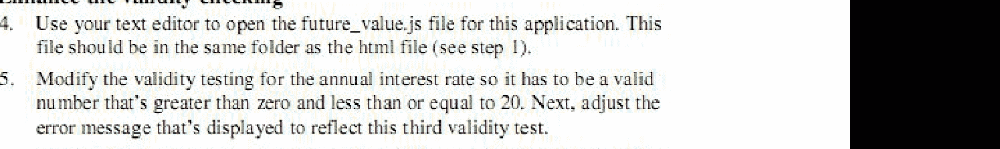

6. 回到文本编辑器中的 JavaScript 文件，修改年份的有效性测试，使得该值也小于或等于 50，并修改错误消息以反映此变化。然后，保存文件，切换到 Firefox 并测试此更改。

### 添加一个清除（Clear）按钮

7. 使用文本编辑器打开此应用程序的 html 文件，在计算（Calculate）按钮下方添加一个清除按钮。为此，你只需要复制计算按钮的 XHTML 代码并修改其 `id` 和 `value` 属性即可。然后，保存文件，切换到 Firefox 并测试此更改。
8. 回到文本编辑器中的 JavaScript 文件，添加一个名为 `clear_click` 的事件处理程序，在点击清除按钮时清空文本框。该处理程序应该在页面上的四个文本框中显示空字符串。编写完事件处理程序后，在 `window.onload` 处理程序中添加一行，将新的事件处理程序分配给点击事件。然后，测试此更改。

### 修改计算的日期

9. 修改此应用程序，使其计算一次性投资的价值而不是固定的每月投资。为此，修改 HTML 文件，使第一个标签显示“一次性投资”。修改 `calculate_click` 事件处理程序中的代码，使得根据用户输入的年份，每年仅计算一次利息并加到未来价值中。然后，测试此更改。

### 禁用和启用年利率文本框

10. 修改 `calculate_click` 事件处理程序中的 JavaScript 代码，使其在循环结束并显示未来价值后启用年利率文本框。接下来，修改 `clear_click` 事件处理程序中的代码，使其在点击清除按钮时启用该文本框。然后，测试这些更改。

### 将日期添加到网页中

11. 修改 XHTML 文件，使用如图 2-4 所示的嵌入式 JavaScript 在网页底部显示如下的当前日期：
   `Today is Oct 23 2009`
   要实现这一点，你需要使用所示的 `toDateString` 方法。然后，测试此更改。

### 添加一个 <script> 标签在 JavaScript 被禁用时显示消息

12. 如图 2-4 所示，在嵌入的 `<script>` 标签之后添加一个 `<noscript>` 标签。新标签应该显示“此应用程序必须启用 JavaScript。”要测试此项，使用 Firefox 浏览器的“工具 > 选项”命令来禁用 JavaScript。测试完成后，启用 JavaScript 并关闭文件。

**如果你能够完成本次练习中的所有步骤，恭喜你！** 你正走在学习 JavaScript 和 DOM 脚本的良好道路上。

# 3

## 如何测试和调试 JavaScript 应用程序

在构建 JavaScript 应用程序时，你需要对它进行测试以确保它按预期运行。然后，如果出现任何问题，你需要调试应用程序以修正这些问题。本章将向你展示如何完成这两点。

由于 JavaScript 运行在浏览器中，你只能使用浏览器提供的测试和调试工具。但正如你将看到的，与 Visual Studio 或 NetBeans 等集成开发环境提供的工具相比，这些工具是有限的。

- 测试与调试简介 ................................................................. 90
- JavaScript 应用程序的典型测试 .......................................................... 90
- 可能发生的三个错误类型 ..................................................... 90
- 常见错误 ................................................................................ 92
- 如何使用 Firefox 获取错误消息 ..................................................... 94
- 追踪 JavaScript 代码执行的一种简单方法 ............................................ 96
- 如何使用 Firefox 扩展进行调试 ............................................... 98
- 如何安装和启用 Firefox 扩展 ........................................ 98
- 如何在控制台（Console）标签中获取信息 ................................................ 100
- 如何在步骤（Step）标签中查看你的代码 ................................................ 102
- 如何使用断点和逐行执行代码 ............................................ 104
- 如何使用 Firefox 控制台对象 ....................................... 106
- 控制台对象的方法 .......................................................... 108
- 如何使用 Firefox 的 `console.log` 方法追踪应用程序 ........................ 108
- 如何使用其他浏览器测试和调试 ................................................ 110
- 如何使用 Explorer 获取错误消息 ................................................ 110
- 如何使用 Safari 获取错误消息 ....................................................... 112
- 如何使用 Opera 获取错误消息 ........................................................ 114
- 如何使用 Chrome 获取错误消息 ....................................................... 115
- 观点 ..................................................................................... 118

### 测试与调试简介

当你测试一个应用程序时，你会运行它以确保其正常工作。

在测试应用程序时，你会尝试输入数据和用户操作的所有可能组合，以确保应用程序在每种情况下都能运行。换句话说，测试的目标是让应用程序失败。

当你调试应用程序时，你会修复在测试期间发现的错误（bug）。每当你修复一个 bug，就会再次测试，以确保你所做的更改不会影响应用程序的其他部分。

## JavaScript 应用程序的典型测试阶段

当你测试应用程序时，是分阶段进行的，如图 3-1 所示的三个阶段。

在第一阶段，当你测试用户界面时，你应该目视检查控件，以确保它们与文本显示正常。

在第二阶段，你使用有效数据测试应用程序，以确保结果是正确的。

在第三阶段，你使用无效数据或意外的用户操作测试应用程序，以让应用程序失败。

## 可能发生的三个错误类型

在测试应用程序时，可能会发生三种错误：这些错误在图 3-1 中进行了描述。

语法错误（`Syntax errors`）会导致应用程序无法运行，它们是最容易发现的。

运行时错误（`Runtime errors`）没有违反语法规则，但它们会抛出异常并停止应用程序的执行。

逻辑错误（`Logic errors`）源于很多地方，通常是最难发现的。计算错误、事件未按预期顺序触发以及使用错误值只是逻辑错误进入你应用程序的几种方式。

### 常见的 JavaScript 错误

图 3-2 展示了在编写 JavaScript 应用程序时经常犯的一些编码错误。如果你研究这张图，你将更好地了解需要注意什么。如果你完成了上章节的练习，你可能已经经历过其中的一些错误了。

图顶部的代码是 FutureValue 应用程序代码的开头，但代码中引入了四个错误。第一个错误在第二行。错误是 `"getElementById"` 应该是 `"getElementById"`。请记住，JavaScript 是区分大小写的。

你能发现另外三个错误吗？如果不能，在你做本章的练习时，你将会有机会发现它们。

图中还讨论了两个 JavaScript 特有的问题。第一个问题涉及浮点数。JavaScript 使用 IEEE 754 标准处理浮点数。遗憾的是，这个标准在进行简单计算时可能会产生奇怪的结果。图中建议了处理此问题的一种方法。

另一个问题涉及 JavaScript 在进行比较（`comparisons`）时转换值的方式。通用规则是，当 JavaScript 比较两个类型不同的值时，它会将它们转换为数值。即使其中一个是字符串而另一个是布尔值，它也会这样做。因此，表达式 `"1" == true` 将返回 `true`，因为 `true` 被转换为 1；而表达式 `"false" == false` 也会返回 `true`，因为 `false` 将转换为 0。

使用 `NaN` 进行等性测试可能会返回 `false`。但你将在第 7 章中学习更多相关内容。

# 包含错误的 JavaScript 代码

```javascript
var $ = function (id) {
  return document.getElementById(id);
}

var calculate_click = function () {
  var investment = parseFloat($("investment").value);
  var annualRate = parseFloat($("rate").value);
  var years = parseInt($("years").value);
}

($("futureValue")).value = "";
```

# 常见的语法错误

- 关键字拼写错误。
- 忘记左或右括号、中括号、大括号或字符。
- 将单行拆分为两个有效的语句，导致 JavaScript 在其插入分号。
- 忘记使用对代码逻辑至关重要的分号。
- 忘记左或右引号。
- 未使用相同的左、右引号。

### 标识符问题

- 标识符拼写错误或大小写不正确。
- 将保留字、全局属性或全局方法用作标识符。

### 值问题

- 在处理值之前未检查其是否为正确的数据类型。例如，你期望用户输入日期，但他输入了名称。
- 忘记使用 `parseInt` 或 `parseFloat` 函数将用户输入的内容转换为数值。
- 在测试等性时使用一个等号而不是两个。

# 浮点算术问题

- JavaScript 中的数据类型使用浮点数，可能会导致算术数学错误。例如，JavaScript 中的 `0.2 + 0.7` 等于 `0.8999999999999999`。
- 解决此问题的方法之一是通过 `toFixed` 方法将数字保留到指定的位数，然后使用 `parseFloat` 方法将其转换回浮点数。

# 比较不同数据类型的值的问题

- 当比较不同数据类型的值时，JavaScript 会在内部将两个值转换为数字。在转换过程中，空字符串被转换为 0；`true` 被转换为 1；`false` 被转换为 0。
- 使用等性运算符时可能会导致意想不到的结果。例如，表达式 `"" == 0` 将求值为 `true`，因为空字符串被转换为 0。

# 如何在 Firefox 中获取错误消息

当你运行带有图 3-2 所示错误的 Future Value 应用程序时，界面仍然显示。然而，当你尝试使用该应用程序时，由于错误它什么也不会执行。

要查看 Firefox 产生的错误消息，请看图 3-3 所示错误控制台（`Error Console`）。正如你在第 2 章中学到的，控制台显示了带有上一图错误运行 Future Value 应用程序时检测到的第一个错误。在这种情况下，消息下方的箭头指向行中由单个问号引起的字符，该字符是无效的。

要显示 JavaScript 文件的代码，你可以点击错误消息中的链接。这会在单独窗口中打开代码并突出显示。不过，你不能使用该窗口修复代码。相反，你需要使用编辑器来修复代码，然后点击刷新按钮在 Firefox 中重新启动应用程序。

通常，错误消息并不像这个例子一样清晰。相反，某行的错误可能会被报告为其他地方的错误。这时，从查找错误消息中的行开始，一直检查相关的代码部分，直到找到错误。

错误控制台顶部的标签页允许你选择想要显示的消息类型。如果你使用了许多扩展或主题，或者在标签页中有多个页面，所有消息、警告和错误都将在错误控制台窗口中显示。然后，你可以通过点击标签页过滤错误。你也可以点击 Clear 按钮清除错误控制台中所有消息。

你还可以使用错误控制台评估 JavaScript 表达式。为此，在 Code 文本框中输入你想要评估的代码并点击 Evaluate 按钮。然后结果将显示在错误控制台中。然而，你不能在错误控制台的表达式中使用函数或变量。错误控制台中的第二个消息显示 101，它是 Code 文本框中表达式的结果。

顺便提一下，图中的错误消息是运行上一图代码时检测到的第一个错误，但该错误并不是代码中的第一个错误。因为 JavaScript 引擎只在页面加载时检测语法错误，因此代码中的第一个错误是运行时错误。

在修正所有语法错误之前，JavaScript 引擎不会运行应用程序。然后，将调用 `$` 函数并检测到其运行时错误。

### 显示错误的 Firefox 错误控制台

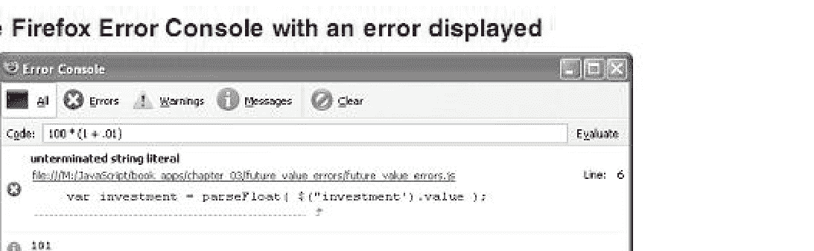

```javascript
点击链接时显示的源代码
var $ = function (id) {
  return document.getElementById(id);
}

var calculate_click = function () {
  var investment = parseFloat($("investment").value);
  var annualRate = parseFloat($("rate").value);
  var years = parseInt($("years").value);
}
```

# 如何显示错误控制台并验证源代码

- 要显示错误控制台，请使用工具 -> 错误控制台命令或按 `Ctrl+Shift+J`。
- 要显示源代码，点击错误控制台中的链接。

# 如何在错误控制台中评估表达式

- 在 Code 文本框中输入表达式并点击 Evaluate 按钮。注意，你不能在表达式中使用函数或变量。


# 说明

Firefox 中的错误控制台用于显示网页生成的错误、警告和消息。这包括 `JavaScript` 代码引起的消息。

- 错误控制台顶部的按钮允许你显示所有错误、仅致命错误、警告或仅消息。`Clear` 按钮移除控制台中的所有错误。如果你点击错误中的文件链接，Firefox 将显示代码并突出显示发生错误的行。然而，你将无法编辑该文件。

## 使用 `alert` 语句追踪 `JavaScript` 代码的执行情况

```javascript
var calculate_click = function () {
  var investment = parseFloat("investment").value;
  var annualRate = parseFloat("rate").value;
  var years = parseInt("years").value;
  var futureValue = "";

  var monthlyRate = annualRate / 12;
  alert("Monthly Rate = " + monthlyRate);
  var months = years * 12;
  alert("Months = " + months);
  var futureValue = 0;
  for (var i = 1; i <= months; i++) {
    futureValue = futureValue + investment * (1 + monthlyRate);
    alert("Month = " + i + "\nFuture Value = " + futureValue);
  }
}
```

## 循环第五次时的 `alert` 对话框

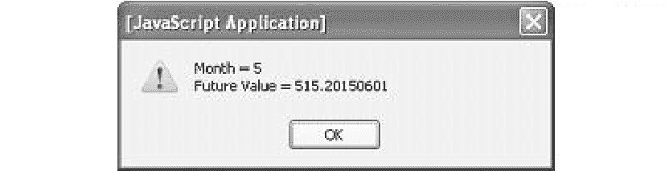

### 描述

- 追踪 `JavaScript` 应用执行情况的一种简单方法是在代码的关键点插入 `alert` 语句。
- `alert` 对话框中的消息可以显示变量的值，或显示指示正在执行代码部分的消息。
- 当你看到显示的值不正确时，很有可能是你在当前 `alert` 语句和上一个 `alert` 语句之间存在逻辑错误。

## 如何使用 Firefox 的 Firebug 扩展进行调试

在五大主流浏览器中，Firefox 及其 Firebug 扩展为调试 `JavaScript` 代码提供了最佳环境。因此，你应该在 Firefox 中进行大部分的测试和调试。一旦代码在 Firefox 中运行正常，你可以在其他浏览器中对其进行测试，以确保其功能仍然符合预期。

## 如何安装和启用 Firebug 扩展

Firefox 浏览器允许你安装为浏览器添加新功能的扩展。Firebug 是一个增强 Firefox `JavaScript` 调试能力的免费扩展。你可以在附录 A 中学习如何安装 Firebug。

安装 Firebug 后，你会在 Firefox 状态栏中看到 Firebug 图标，如图 3-5 所示。然后，你可以点击此图标来打开和关闭面板。或者，你可以按 `F12` 键打开面板。如图所示，Firebug 面板分为两个窗格。左窗格是主面板，有六个标签用于查看当前网页的信息，右窗格则根据左窗格中选的标签显示额外信息。默认情况下，左窗格六个标签中的五个是禁用的，但你可以通过本章描述的技术来启用它们。要调整窗格的大小，可以拖动它们之间的分隔线。每个窗格都有一个 `Options`（选项）菜单。

在左侧 Firebug 面板的顶部，有一个 Firebug 图标（可弹出菜单）、`Inspect`（检查）按钮以及根据所选标签而变化的附加按钮。在 Firebug 面板的右上角，有一个搜索框、一个在独立窗口中打开 Firebug 的按钮以及一个关闭 Firebug 面板的按钮。你可以拖动 Firebug 面板的顶部来调整其大小。

`Console`（控制台）标签显示错误控制台。在这里，你可以查看错误消息、应用程序日志、执行代码并分析应用程序性能。

`HTML` 标签在左窗格中以可展开的树形视图显示网页的 `XML` 树。在这里，你可以浏览 `HTML` 标签并更改其属性以查看对页的影响。在右窗格中，你可以使用标签查看 `CSS` 样式信息、布局信息和页面的 `DOM` 元素。

`CSS` 标签显示网页的 `CSS`。如果包含多个 `CSS` 的文件，你可以使用 Firebug 面板顶部的文件名下拉列表查看不同的文件。你也可以修改 `CSS` 代码以查看对网页的影响。

`Script`（脚本）标签显示你的 `JavaScript` 源代码。如果有多个包含 `JavaScript` 的文件，你可以使用 Firebug 面板顶部的文件名下拉列表查看不同的文件！


## Firefox 中的 Firebug

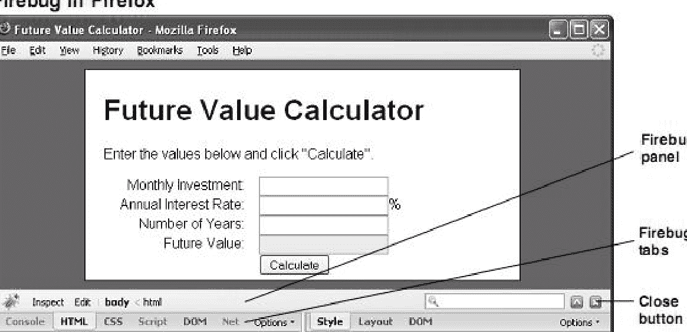

### 如何访问 Firebug 面板

- 点击 Firebug 图标、使用 `View->Firebug` 命令或按 `F12`。

### 如何启用或禁用标签

1. 点击标签打开它，并点击标签名称旁边的向下箭头。
2. 在出现的菜单中，选择 `Enabled`（启用）或 `Disabled`（禁用）来为所有网站启用或禁用该标签。或者，选择 `Enable for Local Files`（启用本地文件）或 `Disable for Local Files`（禁用本地文件）来为你当前查看的网站启用或禁用该标签。

### 描述

- Firebug 是 Firefox 的一个扩展，为 Firefox 增加了调试功能。安装 Firebug 扩展请参附录 A。
- Firebug 有六个默认启用的标签，允许你与网页交互。
- 出于安全考虑，`Console`、`Script` 和 `Net` 标签默认对所有网站禁用。你可以为单个网站或所有网站启用这些标签。
- 欲了解更多关于 Firebug 的信息，可以访问 `http://www.firebug.com`。

## 如何在 `Console` 标签中获取信息

Firebug `Console` 取代并增强了 Firefox 控制台。显示的任何消息也会显示在 `Console` 标签中。如图 3-6 所示。如果你点击控制台中的代码行或文件，Firefox 将切换到 `Script` 标签并显示源代码。

如果你点击消息前的加号，它将展开显示栈追踪。在编程中，栈是当前函数及其参数的列表。例如，在 Future Value 应用中，当用户点击 `Calculate` 按钮时，`calculate` 函数被调用并放入栈中。在该内部，`S` 函数被调用并放入栈中。此时，栈中有两个项。当函数执行完毕，它将从栈中移除。

栈追踪是栈状态的显示。这对于在发生错误时确定代码的状态有用。例如，如果 `S` 函数中发生错误，知道该函数是从事件处理程序还是 `calculate_click` 函数调用的会有帮助。这可以加快调试过程。

# 带有堆栈跟踪和展开命令行的错误消息


# 被调用函数的性能概况和折叠的命令行


### 如何在命令行中运行代码

- 折叠的命令行位于控制台（`Console`）底部，用 `>>>` 标出。要在此命令行中运行代码，请输入代码并按 `Enter` 键。要展开命令行，请点击命令行右侧的红色向上箭头。
- 展开的行是面板右侧的窗格。要在此窗格中运行代码，输入代码并点击 `Run` 执行。要清除代码，点击 `Clear`。要折叠此窗格，点击代码面板右下角的红色向下箭头。

### 如何获取被调用函数的性能概况

- 要获取被调用函数的性能概况，请点击 Firebug 面板顶部的 `Profile` 按钮启动性能分析器。然后，在运行几次应用程序后，再次点击 `Profile` 按钮在控制台（`Console`）标签页中显示性能报告。
- 注意在上面的性能概况中，错误会导致函数显示为 `(?)`。这表示函数名未知，应在该扩展的后续版本中进行修正。

### 描述

- Firebug `Console`标签页的一个用途是显示类似于错误控制台（`Error Console`）显示的错误消息。如果你点击代码链接，将打开 `Script` 标签页并突出显示导致错误的行。
- 堆栈跟踪显示了错误发生之前调用的函数，其中最近的调用位于跟踪的顶部。当控制台标签页中显示错误消息时，点击错误消息链接或链接前的加号即可显示堆栈跟踪。


## 如何在 `Script` 标签页中审查你的代码

`Script` 标签页显示应用程序的 `JavaScript` 代码。图 3-7 演示了这一点。该图还展示了如何使用此标签页审查当前网页的 `JavaScript` 代码。

当你使用此标签页时，可以创建三种类型的脚本：静态脚本是文件中的脚本；`eval` 脚本是通过调用全局 `eval()` 方法动态执行的代码；事件脚本是存在于 `HTML` 标签事件属性中的脚本，例如 `input` 标签的 `onclick` 属性。在书中，不使用事件脚本，也不介绍 `eval()` 方法，因为它们会让你暴露于安全漏洞之中。

如果你希望 `Script` 标签页中的代码以颜色高亮显示，你需要为 Firebug 扩展安装 Rainbow 扩展。要做到这一点，你必须拥有 Firebug 1.2 或更高版本以及 Firefox 3.0 或更高版本。如果你在较早版本的 Firebug 或 Firefox 中添加此扩展，Firebug 将无法工作，因此请视此为警告。在这种情况下，你必须卸载 Rainbow 扩展才能让 Firebug 恢复工作。

# Firefox 中的 Script 标签页

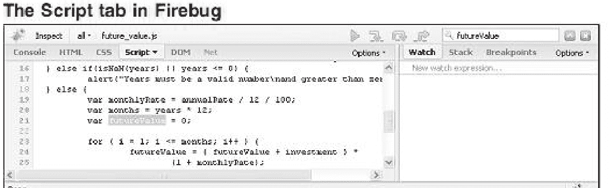

### 如何在 `JavaScript` 文件之间切换

- 如果一个网页有多个 `JavaScript` 文件，请使用上方屏幕中显示 `future.js` 的下拉列表在文件之间进行切换。

### 如何搜索代码或跳转到特定行号

- 在 Firefox 面板右上角的搜索框中输入你的代码。然后，按 `Enter` 查找搜索词的下一次出现。
- 或者，要跳转到代码中的某行，请在搜索框中输入井号 (`#`) 后跟行号。

### 如何显示你想查看的脚本类型

- 使用上方屏幕中显示 `all` 的下拉列表。这允许你选择静态、`eval` 和事件脚本的组合。你可能不会使用 `eval` 或事件脚本，尽管你可以将此设置保持为 `all`。

### 描述

- 在 `Script` 标签页中，代码以黑白显示。如果你想增强这种显示并使用颜色来高亮特定的代码元素，可以如图所示为 Firefox 安装 Rainbow 扩展。
- 虽然你可以使用 `Script` 标签页的功能查找错误，但你无法更改代码。你仍然需要使用文本编辑器进行更改。

## 如何使用断点和逐步执行代码

断点是你代码中的一点，应用程序的执行将在此处停止。然后，你可以检查变量的内容和执行栈，以查看代码是否按预期执行。你还可以从该点开始逐行执行代码。这些技术帮助你解决复杂的调试问题。

图 3-8 显示了如何设置断点、在 `JavaScript` 应用程序中逐步执行代码以及在 `Watch` 窗格中查看变量的内容。在图中，你可以看到已设置断点。

# Firebug 中的断点

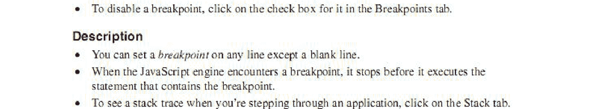

### 如何设置和移除断点

- 要设置断点，请在 `Script` 标签页中点击你想停止执行的代码行左侧的行号。
- 要移除断点，请再次点击行号。
- 要启用或禁用所有断点，请使用 `Breakpoints` 窗格中的复选框。

### 如何逐步执行代码

- 当应用程序在断点处停止时，你可以使用 `Continue`（继续）、`Step Into`（进入）、`Step Over`（跨过）和 `Step Out`（跳出）按钮来控制执行。
- `Continue` 恢复执行直到下一个断点。
- `Step Into` 执行当前行并进入调用的函数。
- `Step Over` 执行当前行但不进入调用的函数。
- `Step Out` 执行完当前函数的剩余部分并返回到调用者。

### 如何查看变量的值

- 当应用程序在断点处停止时，你可以将鼠标悬停在 `Script` 标签页中的变量上以查看其值。
- 或者，你可以在 `Watch` 窗格中添加变量以持续监视其值。

### 描述

- 断点允许你暂停执行并检查应用程序的状态。
- 逐步执行让你可以逐行观察代码的执行流程。
- `Watch` 窗格让你可以监视特定变量的值变化。

## 如何使用 Firebug `console` 对象

对于大多数应用程序，你将可以使用目前介绍的功能来测试和调试你的程序。但在某些情况下，你可能需要使用 Firebug `console` 对象的一些方法来获取信息。特别是，你可以使用 `console.log()` 方法对应用程序的执行进行详尽追踪。

如果你是编程初学者，可以跳过这个主题，稍后再回来，因为它用到了一些书中后面才会介绍的编码技术。如果你是经验丰富的程序员，这值得快速读读。

### `console` 对象的方法

当启用 Firebug 控制台时，它会在 `JavaScript` 环境中添加一个名为 `console` 的对象。该对象提供了许多方法在控制台表中报告信息。最常用的方法总结如图 3-9 所示。例如，`log()` 方法用于在控制台标签页中显示消息，`profile()` 方法开启性能分析器，而 `profileEnd()` 方法则关闭性能分析器。

如果 `console` 对象不可用，使用 `console` 方法会导致运行时错误。这发生在未安装 Firebug 扩展或未启用 Firebug 控制台的情况下。

为了防止在 `console` 对象不可用时发生错误，你可以将 `console` 方法封装在 `if` 语句或函数中，在使用任何方法之前测试 `console` 对象是否存在。图中的代码说明了这一点，它测试了 `console` 对象及其 `log()` 方法是否存在。

如果 `console` 对象可用，你还可以使用调试标记来控制控制台日志。调试标记只是一个全局布尔变量，用于指示是否应该进行调试。例如，以下代码定义了一个调试标记并将其设置为 `true`：

```javascript
var debug = true; // 设置为 false 以禁用调试
```

接下来，修改封装代码在运行任何 `console` 方法之前检查 `debug` 标记值。例如，图中的代码可以扩展如下：

```javascript
if (debug && typeof console == "object" && console.log) {
    console.log("Function completed.");
}
```

现在，如果你将 `debug` 标记设置为 `true` 且 `console` 对象存在，这段代码将调用 `console.log()` 方法。但如果你将 `debug` 变量设置为 `false`，即使 `console` 对象存在，这段代码也不会调用 `log()` 方法。

# Firebug `console` 对象的常用方法

| 方法 | 描述 |
| --- | --- |
| `log()` | 在控制台中显示消息。它接受一个或多个对象作为显示参数。 |
| `debug()` | 在控制台中显示消息，并包含一个指向消息来源的链接。它接受一个或多个对象作为显示参数。 |
| `info()` | 在控制台中显示消息，并包含指向消息来源的链接。它接受一个或多个对象作为显示参数。 |
| `warn()` | 在控制台中显示带有警告图标的消息，并包含指向消息来源的链接。它接受一个或多个对象作为显示参数。 |
| `error()` | 在控制台中显示带有错误图标的消息，并包含指向消息来源的链接。它接受一个或多个对象作为显示参数。 |
| `assert()` | 在控制台中显示错误消息，如果第一个参数中的布尔表达式为 `false` 则抛出异常。它接受布尔表达式作为第一个参数，以及一个可选的用于在父帧控制台中显示的对象。 |
| `dir()` | 显示对象属性的交互式列表。它接受一个对象作为参数。 |
| `profile()` | 开启 Firebug 性能分析器，它可以记录每个函数调用的时间。它接受一个可选参数，即要在控制台中显示的字符串。 |
| `profileEnd()` | 关闭 Firebug 性能分析器并在控制台中显示报告。 |

### `console` 对象方法的示例

```javascript
// 在控制台中记录 months 变量的值。
console.log("Months", months);

// 在控制台中显示错误消息。
console.error("User entered an invalid value for months.");
```

### 如何测试 `console` 对象和 `log` 方法是否存在

```javascript
if (typeof console == "object" && console.log) {
  console.log("Function complete.");
}
```

### 描述

- `console` 对象的方法为你提供了许多方法来追踪和报告程序正在执行的操作。
- 如果 `console` 对象不可用，尝试使用它将导致运行时错误。为了避免这种情况，你可以使用上面的代码测试 `console` 对象和 `log()` 方法是否可用。
- 访问 `http://firebug.com/console.html` 获取 `console` 对象方法的完整列表。


## 如何使用 Firebug 的 `console.log()` 方法追踪应用程序

`console.log()` 方法的用途之一是追踪应用程序的执行。如图 3-10 所示。在这种情况下，`log()` 方法用于在代码的各个点显示变量名和值。这些数据将在应用程序执行时显示在 `Console` 标签页中。

当应用程序完成后，你可以检查这些数据。这将帮助你确定 Bug 是什么。然后，你将获得更多信息，帮助你确定逻辑错误以及如何修复它。

现在，该 `log()` 方法没有被直接使用。相反，它被封装起来以防止在 `console` 对象不可用时发生运行时错误。这会为你显示数据，如图 3-10 所示。在这种情况下，`log()` 方法用于在代码的各个点显示变量名和值。这些数据将在应用程序执行时显示在 `Console` 标签页中。

当应用程序完成后，你可以检查这些数据。这将帮助你确定 Bug 是什么。然后，你将获得更多信息，帮助你确定逻辑错误以及如何修复它。

### 如何测试 `console` 对象和 `log` 方法是否存在

```javascript
if (typeof console == "object" && console.log) {
  console.log("Function complete.");
}
```

### 描述

- `console` 对象的方法为你提供了许多方法来追踪和报告程序正在执行的操作。
- 如果 `console` 对象不可用，尝试使用它将导致运行时错误。为了避免这种情况，你可以使用上面的代码测试 `console` 对象和 `log()` 方法是否可用。
- 访问 `http://firebug.com/console.html` 获取 `console` 对象方法的完整列表。

（此处省略后续重复的追踪示例）

```javascript
function traceFunction() {
  if (typeof console == "object" && console.log) {
    console.log("Function completed.");
  }

  for (var i = 0; i < 5; i++) {
    if (typeof console == "object" && console.log) {
      console.log("Iteration " + i);
    }
  }

  try {
    // 这可能会导致错误
    console.log(someUndefinedVariable);
  } catch (e) {
    if (typeof console == "object" && console.log) {
      console.log("Caught expected error: " + e.message);
    }
  }
}
```

# 左下角带有错误指示的 Internet Explorer 6


# 未来价值计算器

在下方输入值并点击“计算”

| 每月投资 | | |
| :--- | :--- | :--- |
| 年利率 | % | |
| 年数 | | |
| 未来价值 | | |
| | 计算 | |

# Internet Explorer 消息框

# Internet Explorer

假设此错误可能会阻止其正常显示或运行。在将来，你可以通过点击状态栏中的错误图标来显示此消息。

- 当页面包含错误时，始终显示此消息

确定  隐藏详细

```
Line: 3
Error: Object doesn't support this property or method
Col: 5
URL: http://192.168.1.42/javascript/chapter_03/future_value.html
```

### 如何显示错误消息

- 双击左下角或左角的错误图标以查看错误消息。然后，如有必要，点击“显示详细信息”按钮以查看完整消息。
- 如果你希望始终显示错误消息，可以在关闭消息框之前勾选复选框。或者，你可以转到 `工具-Internet 选项`，点击“高级”选项卡，并勾选“对每个脚本错误显示通知”复选框。

### 描述

- Internet Explorer 的错误消息功能无法像 Firefox 那样让你跳转到导致错误的语句。
- Internet Explorer 8 提供单独下载的开发者工具。这些工具支持断点、堆栈跟踪以及在单步执行应用程序时显示变量，这种方式类似于 Firefox。
- 在下载并安装开发者工具后，按 `F12` 访问。

## 如何在 Safari 中获取错误消息

与 Firefox 类似，Safari 不会在主浏览器窗口中显示任何错误发生的指示，但它确实有一个显示错误消息的控制台。要显示此控制台，你可以使用图 3-12 中的技术。与 Firefox 不同，你必须在加载要调试的网页之前打开此控制台。

当控制台打开时发生错误时，控制台会显示错误消息、包含错误的文件的 `URL` 以及错误发生的行号。与 Firefox 类似，`URL` 和行号标识了 `JavaScript` 文件以及错误发生的行号。但与 Firefox 不同，Safari 不支持断点、堆栈跟踪或观察表达式。

# 第 3 章 如何测试和调试 `JavaScript`

# 带有错误消息的 Safari 控制台

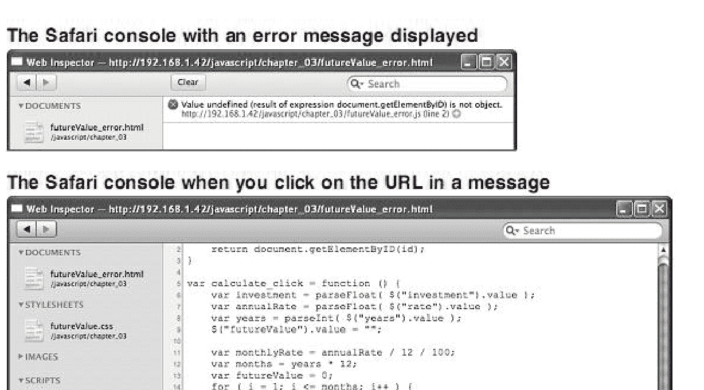

# 在消息中点击 `URL` 时的 Safari 控制台

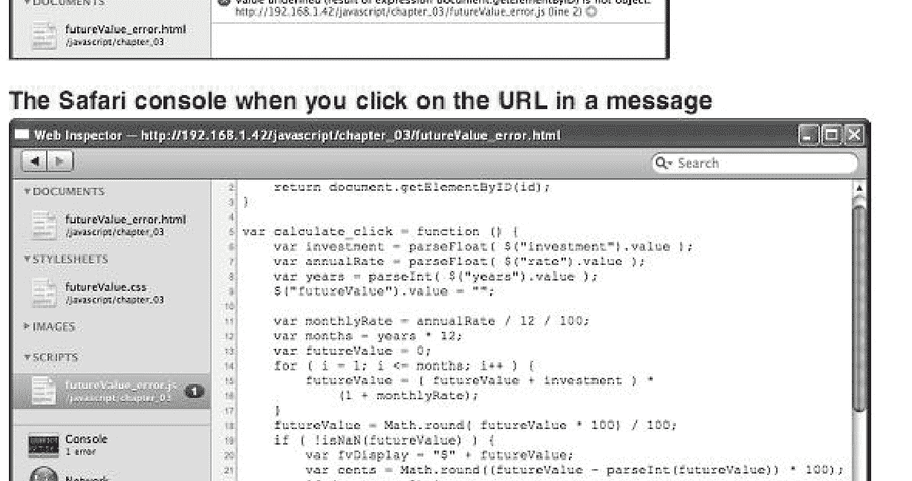

### 如何显示 Safari 控制台

1. 首先，显示“开发”菜单。为此使用“编辑-偏好设置”命令，点击“高级”选项卡，并勾选“在菜单栏中开发菜单”复选框。
2. 然后，使用“开发-显示错误控制台”命令来显示控制台。

### 描述

- 要在 Safari 控制台中获取消息，你必须在加载要运行的网页之前打开控制台。
- 要查看错误消息的 `JavaScript` 代码，点击消息中的 `URL`。
- 要在另一个浏览器中查看当前网页，使用“开发-使用...打开页面”命令，然后选择你想使用的浏览器。
- Safari 不支持断点、堆栈跟踪或观察表达式。

## 如何在 Opera 中获取错误消息

与 Firefox 类似，Opera 不会在主浏览器窗口中显示任何错误发生的指示，但它确实有一个用于错误消息的错误控制台。要显示此控制台，你可以使用图 3-13 中的技术。

当发生错误时，错误控制台会显示正在显示的网页的 `URL`、错误消息以及称为回溯（`backtrace`）的堆栈跟踪。回溯中的第一个条目是错误发生的地方。它显示了错误发生的行号、`URL` 和源代码。然后，如果你点击 `URL` 右侧的铅笔图标，Opera 将显示该文件的源代码。

与 Firefox 类似，Opera 在开发者工具面板中支持断点、堆栈跟踪和观察表达式。在此面板中，“脚本”选项卡显示已加载脚本的信息。“DOM”选项卡允许你查看文档对象模型。“错误控制台”包含与错误窗口相同的信息。“环境”选项卡显示 Opera 和你操作系统的版本信息。

# 带有错误消息的 Opera 控制台

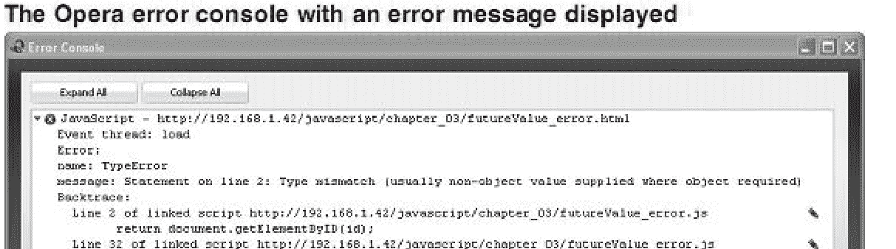

# Opera 开发者工具

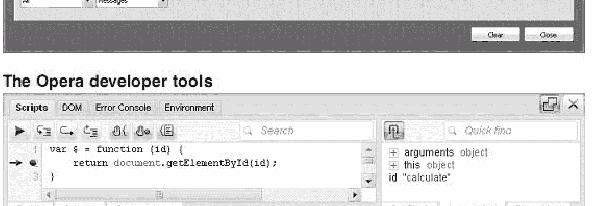

### 如何打开错误控制台和开发者工具

- 要打开错误控制台，使用 `工具->高级->错误控制台` 命令。
- 要打开开发者工具，使用 `工具->高级->开发者工具` 命令。

### 描述

- 错误控制台显示所有错误消息，错误消息后跟着堆栈跟踪。
- 要查看错误的 `JavaScript` 代码，点击 `URL` 右侧的铅笔图标。
- Opera 提供的开发者工具支持断点、堆栈跟踪以及在单步执行应用程序时显示变量，这种方式类似于 Firefox。

## 如何在 Chrome 中获取错误消息

与 Firefox 类似，Chrome 不会在主浏览器窗口中显示任何错误发生的指示，但它确实有一个用于错误消息的控制台。要显示此控制台，你可以使用图 3-14 中的技术。

当控制台打开时发生错误时，控制台会显示正在显示的网页的 `URL`、错误消息以及称为回溯（`backtrace`）的堆栈跟踪。回溯中的第一个条目是错误发生的地方。它显示了错误发生的行号、`URL` 和源代码。然后，如果你点击 `URL` 右侧的铅笔图标，Chrome 将显示该文件的源代码。

与 Firefox 类似，Chrome 在开发者工具面板中支持断点、堆栈跟踪和观察表达式。在此面板中，“脚本”选项卡显示已加载脚本的信息。“DOM”选项卡允许你查看文档对象模型。“错误控制台”包含与错误窗口相同的信息。“环境”选项卡显示 Chrome 和你操作系统的版本信息。

# 带有错误指示的 Chrome 浏览器

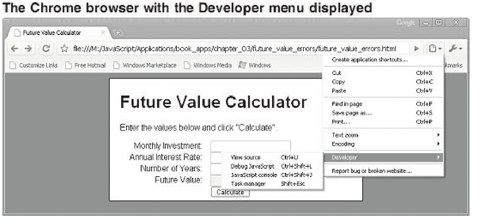

# 带有错误消息的 Chrome 控制台

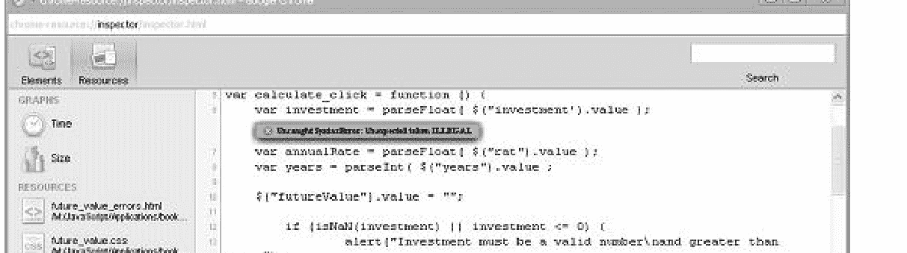

### 如何打开错误控制台和开发者工具

- 要打开错误控制台，使用 `工具->高级->错误控制台` 命令。
- 要打开开发者工具，使用 `工具->高级->开发者工具` 命令。

### 描述

- 错误控制台显示所有错误消息，错误消息后跟着堆栈跟踪。
- 要查看错误的 `JavaScript` 代码，点击 `URL` 右侧的铅笔图标。
- Chrome 提供的开发者工具支持断点、堆栈跟踪以及在单步执行应用程序时显示变量，这种方式类似于 Firefox。

## 第 3 章 如何调试 `JavaScript` 应用程序

1. 一旦应用程序运行起来，就可以获取其调用函数的性能分析（`profile`）。要做到这一点，启动分析器，使用两组输入值运行两次应用程序，停止分析器，并在控制台（`Console`）标签页中查看分析结果。

## 练习 3-2 使用 `alert` 方法进行追踪

在本练习中，你将使用 `alert` 方法来追踪未来价值（`Future Value`）应用程序的执行情况。

1. 打开 `chapter_03_future_value_alert` 文件夹中的练习用 `html` 文件。名为 `future_value_alert.js` 的相关 `JavaScript` 文件包含了图 3-4 所示的 `alert` 方法。
2. 运行应用程序以查看 `alert` 方法是如何工作的。

## 练习 3-3 单步执行应用程序

在本练习中，你将使用 Firefox 及其 Firebug 扩展来设置断点并单步执行未来价值应用程序。

1. 打开 `chapter_03_future_value_folder` 文件夹中的练习用 `html` 文件。
2. 使用 `Script` 标签页上方的下拉列表显示 `future_value.js` 文件的代码。然后，在函数中的 `return` 语句处设置断点（文件中的第二行代码）。
3. 在应用程序的输入框中输入有效值，并点击 `Calculate` 按钮。应用程序应该在断点处停止。
4. 在单步执行应用程序代码时，尝试 `Step Into`（进入）、`Step Over`（跨过）和 `Step Out`（跳出）按钮。在每一步，注意 `Watch` 标签页中显示的值。此外，将鼠标悬停在 `Script` 标签页的变量上查看其值。
5. 完成实验后，移除断点。

## 练习 3-4 使用 `console.log()` 方法进行追踪

在本练习中，你将使用 Firefox、Firebug 扩展以及 `console.log()` 方法来追踪未来价值应用程序的执行情况。

1. 打开 `chapter_03_future_value_folder` 文件夹中的练习用 `html` 文件。名为 `future_value_trace.js` 的相关 `JavaScript` 文件包含了图 3-10 所示的追踪语句。
2. 查看 `JavaScript` 文件包含的追踪语句。接下来，使用两组数据运行两次应用程序。然后，在 Firebug 面板的 `Console` 标签页中查看追踪数据。

# XHTML 速成课程

在学习如何构建 `JavaScript` 应用程序之前，你需要了解如何编写 `XHTML` 文档。虽然这本身是一个很大的课题，但本章是 `XHTML` 的速成课程，介绍了处理大多数 `XHTML` 文档的基本技能，以及理解本书中的 `JavaScript` 应用程序所需的所有技能。

如果你已经知道如何使用 `XHTML` 编写网页和表单，可以跳过本章。那么，如果你在书的后半部分遇到不熟悉的标签或属性，可以返回本章学习如何使用它们。

| 主题 | 页码 |
| :--- | :--- |
| XHTML 简介 ... | 122 |
| 页面及其语法 ... | 122 |
| 基础 XHTML 语法 ... | 126 |
| 如何验证你的文档 ... | 128 |
| 如何编写网页 ... | 130 |
| 如何编写 `head` 区域 ... | 130 |
| 如何编写核心属性 ... | 132 |
| 如何编写文本块 ... | 134 |
| 如何使用内联标签格式化文本 ... | 136 |
| 如何编写实体 ... | 138 |
| 如何编写链接 ... | 140 |
| 如何编写图像 ... | 142 |
| 如何包含媒体 ... | 144 |
| 如何编写表格 ... | 146 |
| 如何编写简单表格 ... | 146 |
| 如何编写跨列和跨行的表格 ... | 148 |
| 如何编写表单 ... | 150 |
| 如何创建表单 ... | 150 |
| 如何编写按钮 ... | 152 |
| 如何编写标签和文本字段 ... | 154 |
| 如何编写单选按钮和复选框 ... | 156 |
| 如何编辑链接 ... | 158 |
| 如何编写文本区域 ... | 160 |
| 如何对控件分组 ... | 162 |
| 如何设置控件的标签顺序 ... | 164 |
| 视角 ... | 166 |

### XHTML 简介

本主题介绍了一些使用 `XHTML` 编写网页并进行验证的基本技能。

### 网页及其 XHTML

图 4-1 显示了浏览器中两个版本的同一个 `XHTML` 网页。第一个版本显示了 `XHTML` 本身在浏览器中的渲染情况。第二个版本显示了当使用 `CSS`（层联样式表）对其进行格式化时的页面外观。

在本章中，你将学习如何仅为网页编写 `XHTML`。结果是，`HTML` 元素将使用浏览器的默认设置显示。在本章中，我使用了 Firefox 3.0 作为示例，但如果你使用不同的浏览器，结果可能会略有不同。

过去，`XHTML` 通常用于完成网页的大部分或全部格式化。然而，现在首选的方法是使用 `CSS`。我们将在下一章查看为什么。

如果你查看此图中的网页，你可以看到一些你将学习编写的 `XHTML` 效果。例如，在浏览器的标题栏中，你可以看到标题。

# 4-1 中网页的 XHTML

```html
<!DOCTYPE html PUBLIC "//W3C//DTD HTML 1.0 Transitional//EN"
   "http://www.w3.org/TR/DTD/html-transitional.dtd">

<html xmlns="http://www.w3.org/1999/xhtml">

<!-- head 部分 -->
<head>
  <title>Mike&amp;apos;s 钓饵&amp;apos;商店</title>
  <meta http-equiv="content-type" content="text/html; charset=UTF-8" />
  <link rel="shortcut icon" href="site.ico" type="image/x" />
</head>

<!-- body 部分 -->
<body>
  <div id="page">
    <div id="header">
      <h1>Mike&amp;apos;s 钓饵&amp;apos;商店</h1>
    </div>
    
    <div id="main">
      <p>欢迎来到 Mike 的钓饵与路具 &amp; Tackle; 商店！</p>
      <p>我们拥有你让下一次钓鱼之旅既精彩又成功的全部装备！</p>
      <h2>新产品</h2>
      <ul>
        <li>Ultima 3000 双手飞钓鱼竿</li>
        <li>Phil's 假虾飞钓饵 - 6 号</li>
        <li>钛合金开背飞钓线轮 - 黑色</li>
      </ul>
    </div>
    <div id="footer">
      <p class="contact"><a href="contact.html">立即联系我们</a>即可在今天提交
      您的订单。</p>
      <p class="copyright;">
      <script type="text/javascript">
        var today = new Date();
        document.write(today.getFullYear());
      </script>
      Mike 的 钓饵与路具商店</p>
    </div>
  </div>
</body>
</html>
```

### 描述

- 每个 `XHTML` 文档都需要一个 `<head>` 和一个 `<body>` 部分。在正文部分内，可以使用 `<div>` 标签来为文档提供结构。
- `id` 和 `class` 属性应用于元素，可以被 `CSS` 用于为该元素提供格式设置。
- 回车、制表符和空格等空白字符被用于使 `XHTML` 更易读。

## 基础 XHTML 语法

图 4-3 展示了 `XHTML` 文档的基本结构以及一些基本语法规则，这些规则总结了你在上一个图中看到的内容。虽然 `XHTML` 并不是一种编程语言，但它是高度结构化的。所有 `XML` 文档必须以 `<!DOCTYPE>` 声明开头，该声明指示文档使用的是哪种版本的 `HTML` 或 `XHTML`。在书中，我们使用指定为 `XHTML 1.0 Transitional` 的 `<!DOCTYPE>` 声明。然而，我们尝试遵循 `XHTML 1.0` 指南。这之所以可行，是因为 `1.0` 是 `Transitional` 的子集。然后，如果有必要，我们可以使用 `XHTML 1.0` 中的属性或元素。

在 `<!DOCTYPE>` 声明之后，你编写 `<html>` 标签。该标签需要一个 `xmlns` 属性，用于指定文档的 `XML` 命名空间。该标签是必须的，并且应该始终如此处所示进行设置。在这里你可以开始每一个 `XHTML` 文档。为了节省时间，你可以从旧文档中复制这些行代码到每个新文档中。

为了提供让你的文档更易读的注释，你可以使用注释。你也可以使用注释来隐藏网页的某些部分而不删除它们。然而，你仍然可以通过查看页面的源代码来看到你的注释。

如最后一张图所示，大多数 `XHTML` 标签都有起始标签和结束标签。起始标签包含标签的名称以及该标签的任何属性，而结束标签包含一个正斜杠和标签名称。在标签内部，你可以使用其他标签或文本。例如，图中的 `<p>` 标签包含将由浏览器显示的文本。

相比之下，像 `` 这样的自闭合标签不包含其他标签或文本。它们通过标签末尾的正斜杠来关闭。为了与旧版浏览器具有最大的兼容性，你应该在这些标签的正斜杠之前放置一个空格。此外，自闭合标签可以包含属性，例如图中的 `<br />` 标签。

属性用于修改标签的工作方式。通过编写属性名称、等号和双引号中的值，可以将属性添加到起始标签中。虽然你可以使用双引号或单引号作为值，但你应该保持一致。在图中，第一个 `<input>` 标签具有 `type` 和 `name` 属性。

要编写一个布尔属性，你编写属性名称，后面跟着一个与名称相同的值。在图中，例如第二个 `<input>` 标签的 `checked` 属性就是一个开启的布尔属性。要编写一个关闭状态的布尔值，请省略它。

当你在另一个标签内部编写 `XHTML` 时，必须确保标签是正确嵌套的。此图中的示例列表说明了这一点。

当你使用空白字符使文档更易读时，额外的字符会被忽略。换句话说，每当浏览器遇到一个或多个此类字符的序列时，它就会将它们替换为单个空格。这就是为什么你需要使用 `<br />` 标签来开启新行。

# XHTML 1.0 文档的基本结构

```html
<!DOCTYPE html PUBLIC "//W3C//DTD HTML 1.0 Transitional//EN"
   "http://www.w3.org/TR/DTD/html-transitional.dtd">

<html xmlns="http://www.w3.org/1999/xhtml">

<!-- head 部分 -->
<head>
  <title>Mike&amp;apos;s 钓饵&amp;apos;商店</title>
  <meta http-equiv="content-type" content="text/html; charset=UTF-8" />
  <link rel="shortcut icon" href="site.ico" type="image/x" />
</head>

<!-- body 部分 -->
<body>
  <div id="page">
    <div id="header">
      <h1>Mike&amp;apos;s 钓饵&amp;apos;商店</h1>
    </div>
    
    <div id="main">
      <p>欢迎来到 Mike 的钓饵与路具 &amp; Tackle; 商店！</p>
      <p>我们拥有你让下一次钓鱼之旅既精彩又成功的全部装备！</p>
      <h2>新产品</h2>
      <ul>
        <li>Ultima 3000 双手飞钓鱼竿</li>
        <li>Phil's 假虾飞钓饵 - 6 号</li>
        <li>钛合金开背飞钓线轮 - 黑色</li>
      </ul>
    </div>
    <div id="footer">
      <p class="contact"><a href="contact.html">立即联系我们</a>即可在今天提交
      您的订单。</p>
      <p class="copyright;">
      <script type="text/javascript">
        var today = new Date();
        document.write(today.getFullYear());
      </script>
      Mike 的 钓饵与路具商店</p>
    </div>
  </div>
</body>
</html>
```

# XHTML 注释

```html
<!-- 这是一个注释，它会被浏览器忽略。 -->
```

# 两种类型的标签

## 具有起始和结束标签的标签

```html
<p>这些文本位于起始和结束标签之间。</p>
```

## 自闭合标签

```html
<br />

```

# 带属性的标签

## 带有三个属性的标签

```html
<input type="text" name="firstName" id="firstName" />
```

## 带有布尔属性的四个属性的标签

```html
<input type="checkbox" name="mailList" id="mailList" checked="checked" />
```

# 正确与错误的嵌套

## 正确嵌套的标签

```html
<b><i>这些文本演示了正确的嵌套。</i></b>
```

## 错误的嵌套标签

```html
<b><i>这些文本演示了错误的嵌套。</b></i>
```

### XHTML 的语法规则

- 文档必须以 `<!DOCTYPE>` 声明开头。
- 第一个标签必须是 `<html>` 标签。
- 标签名称和属性必须是小写。
- 所有属性都必须有值，且值必须在引号中。
- 当你在另一个标签内编写时，你必须在关闭外部标签之前关闭内部标签。
- 额外的空白字符会被忽略。

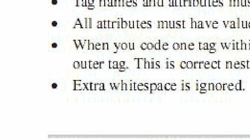

# W3C 标记验证服务的网页地址

`http://validator.w3.org/`

# W3C 验证器首页

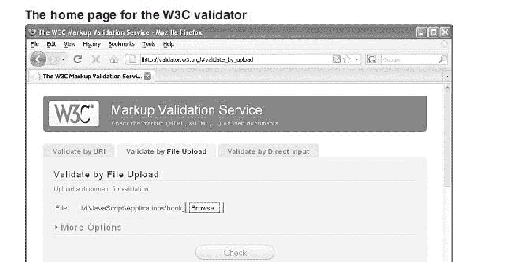

### 如何将 `JavaScript` 标记为字符数据以避免引起错误

```html
<p class="copyright">&copy;
<script type="text/javascript">
// <![CDATA[
var today = new Date();
document.write("" + today.getFullYear() + "");
// ]]>
</script>
</p>
```

Mike Salt and Tackle Shop®

### 描述

- 当在浏览器中打开 `XHTML` 文档时，浏览器会忽略任何错误并尽可能地渲染网页。
- 若要对页面的 `XHTML` 进行验证，可以使用专门的程序或网站。其中最流行的是 W3C 标记验证服务。
- 如果你在包含如 `<` 或 `>` 等 `XHTML` 字符的 `XHTML` 文档中嵌入 `JavaScript`，会导致验证错误。一种解决方案是如上所示，将嵌入的 `JavaScript` 标记为字符数据。另一种解决方案是将 `JavaScript` 移动到单独的文件中。

## 如何编写网页

现在你已经对 `XHTML` 的工作原理有了大致了解，可以准备好学习使用 `XHTML` 编写网页的细节了。

### 如何编写 `head` 部分

`XHTML` 文件的 `head` 部分包含了提供有关网页信息而非页面内容本身的标签。这在第 4-5 节的 `head` 部分中得到了说明。

至少，`<head>` 标签必须包含一个 `<title>` 标签，它指定了在浏览器标题栏中显示的文本。但注意，该标签不能包含任何其他标签，除非是 `<b>` 或 `<i>` 标签等简单格式标签。

`<meta>` 标签是一个可选标签，你可以用它指定适用于文档元数据。例如，第一个 `<meta>` 标签使用 `name` 属性指定元数据的类型（作者），并使用 `content` 属性指定其值（例如，`Harris`）。这有助于搜索引擎索引你的网站。

你还可以使用 `<meta>` 标签来提供 `HTTP` 头部。例如，第二个 `<meta>` 标签使用 `http-equiv` 属性指定应该包含在头部中的数据类型（`content-type`），并使用 `content` 属性指定字符集（`UTF-8`），这对于大多数西方语言都是合适的。第三个 `<meta>` 标签使用 `http-equiv` 和 `content` 属性指定网页每 30 秒自动刷新一次。

`<link>` 标签是另一个可选标签，你可以用它指定应该链接到网页的文件。例如，第一个 `<link>` 标签将一个名为 `site.ico` 的图标链接到网页。结果是这将显示在浏览器的地址栏、标签页或书签中。

在这种情况下，示例假设图标文件与 `XHTML` 文件在同一目录下。然而，如果文件在不同的目录下，你可以使用 `href` 属性指定绝对或相对 `URL` 来导航到该文件。例如，要返回上一级目录并进入 `images` 目录，你可以使用如下 `URL`：

```html
href="../images/site.ico"
```

你还可以使用 `<link>` 标签链接到外部 `CSS` 样式。例如，第二个 `<link>` 标签链接到名为 `main.css` 的外部 `CSS` 文件。这里同样假设 `CSS` 文件与 `XHTML` 文件在同一目录下，但如果有必要，你也可以使用 `href` 属性指定绝对或相对 `URL`。

正如你在第 2 章中所学到的，你可以在 `head` 部分中使用 `<script>` 标签链接到外部 `JavaScript` 文件。你还可以在 `head` 中使用 `<style>` 标签将外部 `CSS` 文件链接到 `XHTML` 文档或在文档中嵌入 `CSS`。你将在下一章学习更多相关内容。

# `head` 部分的 HTML

```html
<head>
  <title>Mike's Bait and Tackle Shop</title>
  <meta name="author" content="Ray Harris" />
  <meta http-equiv="content" content="text/html; charset=utf-8" />
  <meta http-equiv="refresh" content="30" />
  <link rel="icon" href="favicon.ico" type="image/ico" />
  <link rel="stylesheet" href="main.css" type="text/css" />
  <script type="text/javascript" src="common.js"></script>
</head>
```

# 显示标题和图标的浏览器


# `<meta>` 标签的属性

| 属性 | 描述 |
| --- | --- |
| `name` | 指定添加到文档的元数据类型。常见值有 `"author"`, `"keywords"`, `"description"`, `"class"`, `"revised"`, `"generator"` 和 `"robot"`。然后 `content` 属性提供该值。 |
| `http-equiv` | 指定 `HTTP` 头部中元数据值的名称。然后 `content` 属性提供该值。 |
| `content` | 指定由 `name` 或 `http-equiv` 属性指定的项目所使用的值。 |

# `<link>` 标签的属性

| 属性 | 描述 |
| --- | --- |
| `href` | 指定被链接的资源 `URL`。 |
| `rel` | 指定资源的关系。常见值有 `"stylesheet"`, `"shortcut icon"`, `"alternate"` 和 `"proxy"`。 |
| `type` | 指定资源的媒体类型。常见值有 `"text/css"`, `"image/ico"`。 |

### 描述

- `<title>` 标签指定在浏览器标题栏中显示的文本。它是必须的。
- `<meta>` 标签提供文档的元数据。
- `<link>` 标签标识链接的文件。
- `<script>` 标签标识 `JavaScript` 文件。

## 如何编写核心属性

几乎所有的 `XHTML` 标签都支持核心属性。你最常用的三个总结在图 4-7 中。

正如你已经所看到的，你使用 `id` 属性唯一标识一个 `XHTML` 元素。你可以使用 `CSS` 和 `JavaScript` 来处理。例如，图中的示例使用两个 `<div>` 标签将页面分为主区域和页脚区域，并使用 `id` 属性唯一标识每个区域。然后，你可以使用 `CSS` 格式这些区域。同样，该 `XHTML` 代码包含一个 `<p>` 标签定义了一个文本字段，并使用 `id` 属性唯一标识该字段。然后，你可以使用 `JavaScript` 处理该字段。正如你在第 2 章看到的，你可以通过将 `id` 属性的值传递给 `document.getElementById()`。

当你编写 `id` 属性时，记住该属性设计用于唯一标识一个 `XHTML` 元素。如果用于多个元素，`getElementById()` 将无法正常工作，且你的代码结果将不可预测的。

与 `id` 属性相反，你可以使用 `class` 属性标识一个或多个 `XHTML` 元素作为某个类的成员。通常，该属性用于为这些元素应用 `CSS` 格式。在图示例中，页脚中的 `<p>` 标签将其 `class` 属性设置为 `"copyright"`。结果是你可以使用 `CSS` 为该段落应用格式。

图中第三个核心属性可以为 `XHTML` 元素提供标题。对于许多 `XHTML` 元素，此标题没有作用。然而，对于某些 `XHTML` 元素，当鼠标悬停在元素上时，浏览器会显示标题提示。在图中，你可以看到为邮箱框显示的提示。

除了这三个核心属性外，其他属性适用于更多 `XHTML` 元素。例如，`lang`、`xml:lang` 和 `dir` 属性可以通过指定 `XML` 内容使用的语言来更改默认语言，以及文本在页面上的书写方向。如果你需要使用这些属性，可以通过搜索互联网获取更多信息。

# 核心 XHTML 属性

| 属性 | 说明 |
|---|---|
| `id` | 为元素指定一个唯一标识符。该标识符区分大小写，且格式应与 `JavaScript` 标识符相同。此 `id` 可以被 `JavaScript` 使用，或被样式表引用。 |
| `class` | 指定应用于该元素的一个或多个类。多个类之间用空格分隔，相同的类名可以应用于多个元素。这些类随后可以被样式表引用。 |
| `title` | 指定有关该元素的额外信息。对于某些元素，当用户将鼠标悬停在元素上时，此标题会出现在工具提示中。 |

# 使用这些属性的 XHTML

```html
<div id="main">
  <h1 id="bait">Mike's Bait & Tackle Shop</h1>
  <p class="first">Welcome to Mike's Bait & Tackle Shop!</p>
  <form action="subscribe" method="post">
    <p>Please enter your e-mail address to subscribe to our newsletter.</p>
    <p><input type="text" name="email" id="email" title="Enter e-mail here."></p>
    <input type="submit" value="Subscribe"/>
  </form>
</div>
<div id="footer">
  <p class="copyright">Copyright 2009.</p>
</div>
```

# 网页浏览器中的 XHTML


### 说明

- `id`、`class` 和 `title` 属性可以为大部分 `XHTML` 元素编码。
- 其他三个可以为大部分 `XHTML` 编码的属性是 `lang`、`xml:lang` 和 `dir`。这些属性可以更改默认使用的语言。如果你需要这样做，可以在互联网上搜索更多信息。

## 如何编写文本块

块级标签（`Block tags`）用于组织网页内容。这些标签用于包含其他内容。默认情况下，块级标签的高度宽度足够容纳其内容。然而，你可以使用 `CSS` 控制块级标签的高宽。

与块级标签相反，内联标签（`inline tags`）编写在块级标签内部，通常用于格式化文本。你将在下一个图中学习更多关于它们的内容。

图 4-7 显示了如何编写一些常见的块级标签。在图示例中，`<div>` 标签将页面分为主区域和页脚区域。在这里，`id` 属性用于唯一标识每个区域——它可以通过 `CSS` 或 `JavaScript` 进行格式化或修改。

在块级标签内部，你可以编写其他块级标签、内联标签或文本。例如，主区域的 `<div>` 标签包含一个 `<h1>` 标签、一个 `<h2>` 标签和两个 `<p>` 标签。然后，`<footer>` 部分的 `<div>` 标签包含单个 `<p>` 标签。

在 `<h1>` 和 `<div>` 标签中，你编写了显示在页面标题中的正文。但请注意，你使用这些标题是为了为文档提供逻辑结构，而不是为了格式化文本。因此，你应该使用 `<h1>` 标签标记页面上最重要的标题，使用 `<h2>` 标签标记次重要的标题，并让搜索引擎能够正确索引你的网站，这使得你的页面更易于屏幕阅读器等设备访问。然后，你可以使用 `CSS` 来调整这些标签中文本的大小和格式。

在 `<p>` 标签中，你可以编写文本和内联标签。在图中，`<p>` 标签只包含文本。然而，这些标签可以包含内联标签，例如使字体变为斜体的 `<i>` 标签。

虽然示例中的标签是最常见的块级标签，但你偶尔可能会遇到其他块级标签，例如 `<pre>` 标签、`<blockquote>` 标签和 `<address>` 标签。如有必要，你可以使用这些标签来识别预格式文本块、块级引用和地址。由于 `<pre>` 标签使用等宽字体并保留空格，你可以用它来通过空格对齐文本。尽管与所有标签一样，你应该只在这些标签准确反映你的 `XHTML` 文档结构时才使用它们。然后，你可以使用 `CSS` 将这些元素格式化为你想要的样子。

# 常见块级标签

| 标签 | 说明 |
| --- | --- |
| `<div>` | 创建一个未格式化的文本块，可以使用 `CSS` 进行样式设置和定位。它可以包含文本、内联标签和其他块级标签。 |
| `<h1>` | 创建一个一级标题，显示为 200% 的加粗文本。 |
| `<h2>` | 创建一个二级标题，显示为 150% 的加粗文本。 |
| `<h3>` | 创建一个三级标题，显示为 125% 的加粗文本。 |
| `<h4>` | 创建一个四级标题，显示为 100% 的加粗文本。 |
| `<h5>` | 创建一个五级标题，显示为 83% 的加粗文本。 |
| `<h6>` | 创建一个六级标题，显示为加粗文本。 |
| `<p>` | 创建一个段落。 |
| `<pre>` | 创建一个使用等宽字体的预格式文本块。 |
| `<blockquote>` | 创建一个块级引用。 |
| `<address>` | 为文档提供联系信息。 |

# 内联标签示例

```html
<div id="main">
  <h1 id="bait">Mike's Bait & Tackle Shop</h1>
  <p class="first">Welcome to Mike's Bait & Tackle Shop!</p>
  <form action="subscribe" method="post">
    <p>Please enter your e-mail address to subscribe to our newsletter.</p>
    <p><input type="text" name="email" id="email" title="Enter e-mail here."></p>
    <input type="submit" value="Subscribe"/>
  </form>
</div>
<div id="footer">
  <p class="copyright">Copyright 2009.</p>
</div>
```

## 如何使用内联标签格式化文本

# 用于文本格式化的常用内联标签

| 标签 | 描述 |
| --- | --- |
| `<br />` | 开启新行文本。 |
| `<i>` | 以斜体显示的文本。 |
| `<b>` | 以粗体显示的文本。 |
| `<em>` | 以斜体形式的强调文本。 |
| `<strong>` | 以粗体形式的强强调文本。 |
| `<code>` | 以等宽字体显示的编程代码。 |
| `<u>` | 带有下划线的文本。 |
| `<sup>` | 上标文本。 |
| `<big>` | 以比正常更大的字体显示的文本。 |
| `<small>` | 以比正常更小的字体显示的文本。 |
| `<span>` | 创建一个未格式化的文本组，可以通过 `CSS` 进行样式设置。 |

# 格式化文本的内联标签示例

```html
<p>跨越 <br /> 两个行的文本。</p>
<p>以 <i>斜体</i> 和 <b>粗体</b> 格式化的文本。</p>
<p>使用 <em>em 标签</em> 实现斜体，使用 <strong>strong 标签</strong> 实现粗体的文本。</p>
<p>使用 <code>code 标签</code> 显示等宽字体的文本。</p>
<p>使用 <sub>sub 标签</sub> 和 <sup>sup 标签</sup> 的文本。</p>
<p>使用 <big>big 标签</big> 和 <small>small 标签</small> 的文本。</p>
<p>使用 <span>span 标签</span> 来识别 <span class="book"><a href="#">书名</a></span> 的文本。</p>
```

# 网页浏览器中的内联标签


## 如何编写列表

图 4-9 显示了如何编写三种类型的列表。要创建一个无序列表，你使用 `<ul>` 标签。然后，在 `<ul>` 标签内部，编写一个或多个 `<li>` 标签来标识列表中的项目。在每个 `<li>` 标签中，编写该列表项的文本。默认情况下，无序列表会在每个项目前放置项目符号，但你可以通过 `CSS` 更改它。

要创建一个有序列表，你使用 `<ol>` 标签，但默认情况下它会对列表中的项目进行编号。

当你处理无序列表和有序列表时，可以将一个列表嵌套另一个列表中。换句话说，在 `<ul>` 或 `<ol>` 标签内，你可以在通常编写 `<li>` 标签的地方编写另一个 `<ul>` 或 `<ol>` 标签。这会让列表再缩进一层，并更改列表的项目符号或编号。

当你使用 `<li>` 标签时，应该意识到它能够包含文本、内联标签或块级标签。例如，一个 `<li>` 标签可以包含一个 `<ol>` 标签来标识某几行。

如果你想创建一个由术语和定义组成的定义列表，可以使用 `<dl>`、`<dt>` 和 `<dd>` 标签。然后，`<dt>` 标签标识术语，`<dd>` 标签标识该术语的定义。当你编写这些标签时，必须成对编写 `<dt>` 和 `<dd>` 标签，并且每个列表必须至少编写一对。此外，`<dt>` 标签只能包含文本和内联标签，但 `<dd>` 标签还可以包含包括嵌套列表在内的块级标签。

# 创建列表的标签

| 标签 | 描述 |
| --- | --- |
| `<ul>` | 创建一个无序列表。 |
| `<ol>` | 创建一个有序列表。 |
| `<li>` | 为无序列表或有序列表创建一个项目。 |
| `<dl>` | 创建定义列表。它包含 `<dt>` 和 `<dd>` 对。 |
| `<dt>` | 在定义列表中创建一个术语。 |
| `<dd>` | 在定义列表中创建一个缩进的定义。 |

# 列表标签示例

```html
<ul>
<li>无序列表</li>
<li>有序列表</li>
<li>定义列表</li>
</ul>

<ol>
<li>HTML</li>
<li>CSS</li>
<li>JavaScript</li>
</ol>

<dl>
<dt>局域网</dt>
<dd>直接相互连接的计算机网络。</dd>
<dt>广域网</dt>
<dd>通过路由器连接的局域网网络。</dd>
</dl>
```

# 网页浏览器中的列表


## 如何编写字符实体

图 4-10 显示了如何使用字符实体在网页中显示特殊字符。字符实体以和号（`&`）开头，以分号（`;`）结尾。例如，`&copy;` 可以插入版权符号（©）。

在 `HTML` 中，由于左括号（`<`）和右括号（`>`）在 `HTML` 中具有特殊含义，因此在 `HTML` 中显示它们时必须使用字符实体。例如，使用 `&lt;` 表示左括号，使用 `&gt;` 表示右括号。

由于和号（`&`）在 `HTML` 中具有特殊含义，因此在 `HTML` 中显示它时必须使用字符实体。例如，使用 `&amp;` 表示和号。

由于单引号（`'`）在 `HTML` 中具有特殊含义，因此在 `HTML` 中显示它时必须使用字符实体。例如，使用 `&apos;` 表示单引号。

由于双引号（`"`）在 `HTML` 中具有特殊含义，因此在 `HTML` 中显示它时必须使用字符实体。例如，使用 `&quot;` 表示双引号。

由于空格在 `HTML` 中会被合并，因此如果你想在 `HTML` 中显示不换行的空格，必须使用字符实体。例如，使用 `&nbsp;` 表示不换行空格。

# 常见的字符实体

| 实体 | 字符 |
| --- | --- |
| `&copy;` | © |
| `&lt;` | < |
| `&gt;` | > |
| `&reg;` | ® |
| `&trade;` | ™ |
| `&apos;` | ' |
| `&quot;` | " |
| `&amp;` | & |
| `&nbsp;` | (不换行空格) |
| `&plus;` | + |
| `&deg;` | ° |

# 字符实体的示例

```html
<p>版权所有信息 &copy;。</p>
<p>小于 &lt; 10 且大于 &gt; 20。</p>
<p>注册商标符号 &reg; 和商标符号 &trade;。</p>
<p>单引号 &apos;'Hello' 的示例。</p>
<p>双引号 &quot;你好&quot; 的示例。</p>
<p>和号符号 &amp; 的示例。</p>
<p>这是一个不换行的空格&nbsp;的示例。</p>
<p>1&plus;1 等于 2。</p>
<p>温度是 25&deg;。</p>
```

# 网页浏览器中的字符实体


# 用于文本格式化的常用内联标签

| 标签 | 描述 |
| --- | --- |
| `<br>` | 开启新行文本。 |
| `<i>` | 以斜体显示的文本。 |
| `<b>` | 以粗体显示的文本。 |
| `<em>` | 以斜体形式的强调文本。 |
| `<strong>` | 以粗体形式的强强调文本。 |
| `<code>` | 以等宽字体显示的编程代码。 |
| `<u>` | 带有下划线的文本。 |
| `<sup>` | 上标文本。 |
| `<big>` | 以比正常更大的字体显示的文本。 |
| `<small>` | 创建一个未格式化的文本组，可以通过 CSS 进行样式设置。 |

# 格式化文本的内联标签示例

<p>跨越 <br /> 两个行的文本。</p>

<p>以 <i>斜体</i> 和 <b>粗体</b> 格式化的文本。</p>

<p>使用 <em>em 标签</em> 实现斜体，使用 <strong>strong 标签</strong> 实现粗体的文本。</p>

<p>使用 <code>code 标签</code> 显示等宽字体的文本。</p>

<p>使用 <sub>标签</sub> 和 <sup>sup3</sup> 的文本。</p>

<p>使用 <big>big 标签</big> 和 <small>small 标签</small> 的文本。</p>

<p>使用 <span> 标签来识别 <span class="book"><a href="#">书名</a></span></p>

# 网页浏览器中的内联标签

跨行换的的文本。

以 <i>斜体</i> 和 <b>粗体</b> 格式化的文本。

使用 <em>em 标签</em> 实现斜体，并使用 <strong>strong 标签</strong> 实现粗体的文本。

使用 <code>code 标签</code> 显示等宽字体的文本。

使用 <sub>标签</sub> 和 sup 标签的文本。

使用 <big>big 标签</big> 和 <small>small 标签</small> 的文本。

使用 span 标签来识别书名的文本。


# 如何编写列表

图 4-9 显示了如何编写三种类型的列表。要创建一个无序列表，你使用 `<ul>` 标签。然后，在 `<ul>` 标签内部，编写一个或多个 `<li>` 标签来标识列表中的项目。在每个 `<li>` 标签中，编写该列表项的文本。默认情况下，无序列表会在每个项目前放置项目符号，但你可以通过 CSS 更改它。

要创建一个有序列表，你使用 `<ol>` 标签，但默认情况下它会对列表中的项目进行编号。

当你处理无序列表和有序列表时，可以将一个列表嵌套另一个列表中。换句话说，在 `<ul>` 或 `<ol>` 标签内，你可以在通常编写 `<li>` 标签的地方编写另一个 `<ul>` 或 `<ol>` 标签。这会让列表再缩进一层，并更改列表的项目符号或编号。

当你使用 `<li>` 标签时，应该意识到它能够包含文本、内联标签或块级标签。例如，一个 `<li>` 标签可以包含一个 `<ol>` 标签来标识某几行。

如果你想创建一个由术语和定义组成的定义列表，可以使用 `<dl>`、`<dt>` 和 `<dd>` 标签。然后，`<dt>` 标签标识术语，`<dd>` 标签标识该术语的定义。当你编写这些标签时，必须成对编写 `<dt>` 和 `<dd>` 标签，并且每个列表必须至少编写一对。此外，`<dt>` 标签只能包含文本和内联标签，但 `<dd>` 标签还可以包含包括嵌套列表在内的块级标签。

# 创建列表的标签

| 标签 | 描述 |
| --- | --- |
| `<ul>` | 创建一个无序列表。 |
| `<ol>` | 创建一个有序列表。 |
| `<li>` | 为无序列表或有序列表创建一个项目。 |
| `<dl>` | 创建定义列表。它包含 `<dt>` 和 `<dd>` 对。 |
| `<dt>` | 在定义列表中创建一个术语。 |
| `<dd>` | 在定义列表中创建一个缩进的定义。 |

# 列表标签示例

```html
<ul>
<li>无序列表</li>
<li>有序列表</li>
<li>定义列表</li>
</ul>

<ol>
<li>HTML</li>
<li>CSS</li>
<li>JavaScript</li>
</ol>

<dl>
<dt>局域网</dt>
<dd>直接相互连接的计算机网络。</dd>
<dt>广域网</dt>
<dd>通过路由器连接的局域网网络。</dd>
</dl>
```

# 网页浏览器中的列表

- 无序列表
- 有序列表
- 定义列表

1. HTML
2. CSS
3. JavaScript

局域网

一个直接相互连接的计算机网络。

广域网

通过路由器连接的局域网网络。

图 4-9 如何编写列表

# 如何编写字符实体

图 4-10 显示了如何使用字符实体在网页中显示特殊字符。字符实体以和号（`&`）开头，以分号（`;`）结尾。当你处理字符实体时，需要知道它们以分号（`;`）结尾。例如，`&copy;` 可以插入版权符号（©）。

在 HTML 中，由于左括号（`<`）和右括号（`>`）在 HTML 中具有特殊含义，因此在 HTML 中显示它们时必须使用字符实体。例如，使用 `&lt;` 表示左括号，使用 `&gt;` 表示右括号。

由于和号（`&`）在 HTML 中具有特殊含义，因此在 HTML 中显示它时必须使用字符实体。例如，使用 `&amp;` 表示和号。

由于单引号（`'`）在 HTML 中具有特殊含义，因此在 HTML 中显示它时必须使用字符实体。例如，使用 `&apos;` 表示单引号。

由于双引号（`"`）在 HTML 中具有特殊含义，因此在 HTML 中显示它时必须使用字符实体。例如，使用 `&quot;` 表示双引号。

由于空格在 HTML 中会被合并，因此如果你想在 HTML 中显示不换行的空格，必须使用字符实体。例如，使用 `&nbsp;` 表示不换行空格。

1+1 等于 2。温度是 25°。

# 常见的字符实体

| 实体 | 字符 |
| --- | --- |
| `&copy;` | © |
| `&lt;` | < |
| `&gt;` | > |
| `&reg;` | ® |
| `&trade;` | ™ |
| `&apos;` | ' |
| `&quot;` | " |
| `&amp;` | & |
| `&nbsp;` | (不换行空格) |
| `&plus;` | + |
| `&deg;` | ° |

# 字符实体的示例

```html
<p>版权所有信息 &copy;。</p>
<p>小于 &lt; 10 且大于 &gt; 20。</p>
<p>注册商标符号 &reg; 和商标符号 &trade;。</p>
<p>单引号 &apos;'Hello' 的示例。</p>
<p>双引号 &quot;你好&quot; 的示例。</p>
<p>和号符号 &amp; 的示例。</p>
<p>这是一个不换行的空格&nbsp;的示例。</p>
<p>1&plus;1 等于 2。</p>
<p>温度是 25&deg;。</p>
```

## `<a>` 标签的属性

| 属性 | 描述 |
| --- | --- |
| href | 指定链接的 URL。 |
| target | 指定目标文档应加载的位置。值 "blank" 表示在一个新窗口中加载文档。 |
| name | 在网页内创建锚点。当您使用 name 属性时，请在 id 属性中使用相同的值。 |

## `<a>` 标签的示例

指向另一个网页的相对链接

```html
<p>Go view our <a href="../products.html">product list</a></p>
```

指向另一个网页的绝对链接

```html
<p>Read about the <a href="services.html">services</a> we provide</p>
```

指向不同网站网页的链接

在亚马逊（Amazon.com）上搜索我们的书籍：

```html
<a href="http://www.amazon.com" target="_blank">Amazon.com</a>
```

## 浏览器中的 `<a>` 标签

查看我们的产品列表

阅读关于我们提供的服务的介绍

在 Amazon 上搜索我们的书籍

## 如何在页面内创建和使用锚点

### 如何创建锚点

```html
<h3><a id="contact" name="contact">Contact Us</a></h3>
```

### 如何跳转到同一页面上的锚点

```html
<p>For more information <a href="#contact">contact us</a></p>
```

### 如何跳转到不同页面上的锚点

```html
<p>For more information <a href="info.html#contact">contact us</a></p>
```

### 描述

- 您可以使用 `<a>` 标签的 name 属性创建一个锚点，用于指定网页内的某个位置。
- 您可以使用 `<a>` 标签的 href 属性创建一个跳转到锚点、或加载另一个网页或资源的链接。当您使用代码链接时，可以使用相对 URL 或绝对 URL。
- 在创建链接时，良好的做法是为链接编写文本，以指明链接的功能。因此，你不应该使用像“点击此处”（click here）之类的文本，因为它们没有说明链接的作用。相反，你应该使用“联系我们”、“产品列表”或“客户服务”之类的文本。简而言之，如果你无法通过阅读文本判断链接的作用，就应该重写文本。这可以提高您网站的可访问性，并有助于搜索引擎抓取您的网站。

## 如何包含图像

当然，图像是大多数网页的重要部分。要显示图像，可以使用如图 4-12 所示的 `` 标签。该标签是一个自闭合内联标签，用于嵌入网页中。

在该图的示例中，`` 标签用于显示我们的 Logo 图像。该标签不包含任何内容。在这里，`` 标签的 src 属性指定了一个 URL，指向存储在 `images` 子目录下的名为 logo.gif 的图像文件。

该 `` 标签还将 alt 属性设置为 "Mitchell Logo"。虽然 HTML 并不强制要求 alt 属性，但许多网页开发者仍然省略它。不过这不是一个良好的做法，因为 alt 属性有多个用途。首先，如果用户禁用了图像或图像不可用，网页浏览器将显示 alt 属性中的文本。其次，屏幕阅读器会读取 alt 属性中的文本，这提高了您页面的可访问性。第三，搜索引擎使用 alt 属性来索引您的网页。

您在网页中包含的图像需要是现代浏览器支持的格式之一。目前，网页设计师使用 Adobe Photoshop 等图像软件为网站创建并维护这些文件，并将这些文件保存在名为 `images` 或 `graphics` 的目录中。

注意，JPEG 格式通常使用 JPG 文件扩展名。

作为良好的做法，您应该只使用 `` 标签链接到当前网站上的图像。然而也可以链接到存储在另一个网站上的图像。这被称为热链（hotlinking），是被极不建议的。

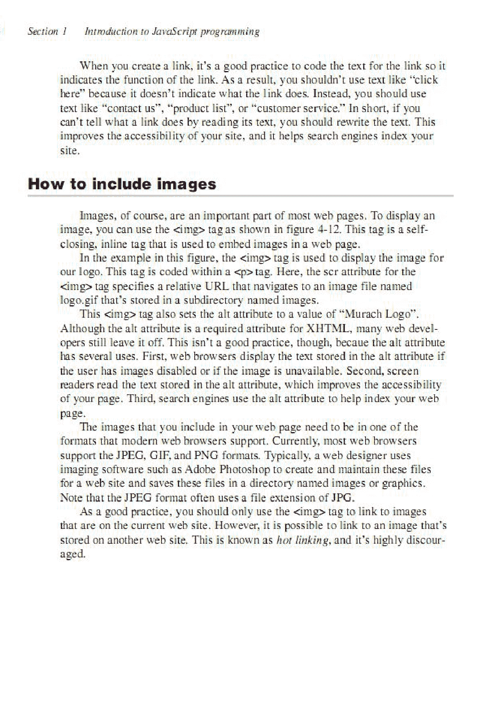

## `` 标签的属性

| 属性 | 描述 |
| --- | --- |
| src | 指定要显示的图像的 URL。这是一个必需属性。 |
| alt | 指定在图像位置显示的替代文本。此文本也会由屏幕阅读器为残障人士读出。这是一个必需属性。 |
| longdesc | 指定图像的详细描述。 |
| height | 指定以像素或百分比计算图像高度。 |
| width | 指定以像素或百分比计算图像宽度。 |

## 一个 `` 标签

```html
<p></p>
```

## 浏览器中的图像

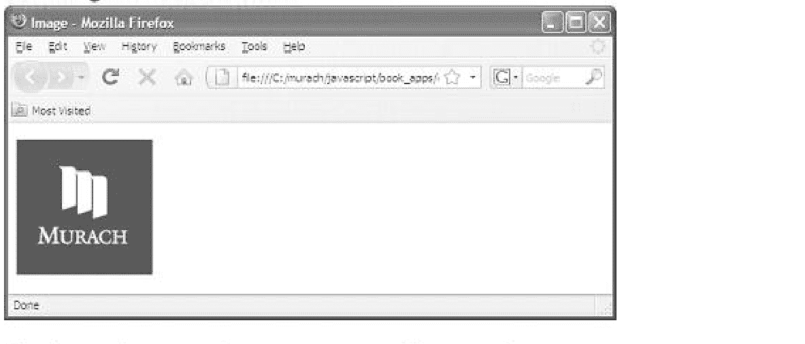

## 大多数浏览器支持的图像格式

- GIF (图形交换格式)
- JPEG (联合图像专家小组)
- PNG (便携式网络图形)

### 描述

- JPEG 文件通常使用 JPG 扩展名。
- PNG 文件通常使用 PNG 扩展名。此 alpha 通道支持透明度。

## 如何编写表格

过去，设计师使用表格来组织布局。然而，现在此目的未使用 CSS。首先，CSS 用于样式。其次，CSS 用于布局。第三，CSS 用于可访问性。

因此，现在表格用于展示数据。表格由行和列组成。

## 如何创建一个简单的表格

```html
<table border="1" cellspacing="1" cellpadding="3" summary="First Quarter Sales By Region">
  <tr>
    <th>Region</th>
    <th>Jan</th>
    <th>Feb</th>
  </tr>
  <tr align="right">
    <td>West</td>
    <td>$15,684.34</td>
    <td>$18,467.86</td>
  </tr>
  <tr align="right">
    <td>East</td>
    <td>$22,497.10</td>
    <td>$13,371.34</td>
  </tr>
</table>
```

## 浏览器中的表格

| Region | Jan | Feb |
| --- | --- | --- |
| West | $15,684.34 | $18,467.86 |
| East | $22,497.14 | $13,371.34 |

图 4-13 如何编写简单的表格

# 如何编写跨列和跨行的表格

图 4-14 展示了可用于 `<td>` 和 `<th>` 标签的属性。在这里，`colspan` 和 `rowspan` 属性可以合并单元格，使得一行跨多列，或者列中的单元格跨多行。图中渲染的 HTML 表格说明了这一点。

另外两个属性是 `align` 和 `valign`，它们可以应用于行或单元格。如你在最后一张图中看到的，如果你将这些标签应用于行，它们将应用于行中的所有单元格；它们会覆盖该行的任何其他设置。

在示例图中，你可以看到 `colspan` 和 `rowspan` 属性的作用。如果你研究这个表格，会发现它使用了五列和五行。然而，第一个单元格跨了 2 行和 2 列。因此，它高 2 行，宽 2 列。同样，第二个单元格跨了 3 列。因此，它的宽度为 3 列。第一行在“第一季度”（First Quarter）标题下有 Jan（一月）、Feb（二月）和 Mar（三月）表头。

第二行仅为 3 列指定了 `<td>` 标签，如果你将这些标签应用于行，它们就可以生效；然而，第一行占据了该行的 2 列。因此，该行的列数总和仍为 5。

第三行从一个跨 3 行的单元格开始。当在接下来两行中输入单元格时，第一列将被跳过以为该单元格留空间。这将 West（西部）、Central（中部）和 East（东部）标题分组在 Regions（地区）标题下。

由于本章只是 XHTML 的速成课程，因此没有介绍所有用于表格的标签。这就是为什么没有介绍如 `<caption>`、`<thead>`、`<tfoot>` 或 `<tbody>` 这样的标签。不过对于大多数表格，你不需要使用这些标签。

# 第 4 章 HTML 速成

## `<td>` 和 `<th>` 的常用属性

| 属性 | 描述 |
| --- | --- |
| colspan | 使单元格跨多列。默认值为 1。 |
| rowspan | 使单元格跨多行。默认值为 1。 |
| align | 控制单元格内容的水平对齐。有效值包括 "left"（左对齐）、"right"（右对齐）或 "justify"（两端对齐）。默认值为 "left"。 |
| valign | 控制单元格内容的垂直对齐。有效值包括 "top"（顶端）、"middle"（居中）、"bottom"（底部）或 "baseline"（基准线对齐）。默认值为 "middle"。 |

## 带有跨列和跨行表格的标签

```html
<table border="0" cellpadding="1" cellspacing="5">
  <summary>First Quarter Sales By Region</summary>
  <tr align="center">
    <th colspan="2" rowspan="2">Sales</th>
    <th colspan="3">First Quarter</th>
  </tr>
  <tr align="center">
    <th>Mar</th>
    <th>Feb</th>
    <th>Jan</th>
  </tr>
  <tr align="right">
    <th rowspan="3">Regions</th>
    <td>$15,684.34</td>
    <td>$18,467.86</td>
    <td>$17,379.67</td>
  </tr>
  <tr align="right">
    <th>East</th>
    <td>$22,497.14</td>
    <td>$13,371.34</td>
    <td>$25,693.80</td>
  </tr>
  <tr align="right">
    <th>West</th>
    <td>$25,741.06</td>
    <td>$31,633.25</td>
    <td>$26,712.58</td>
  </tr>
</table>
```

## 浏览器中的表格

| Sales | Jan | Feb | Mar |
| --- | --- | --- | --- |
| Region West | $15,684.34 | $18,467.86 | $17,379.67 |
| Central | $22,497.14 | $13,371.34 | $25,693.80 |
| East | $25,741.06 | $31,633.25 | $26,712.58 |

图 4-14 如何编写跨列和跨行的表格 *

## `<th>` 和 `<td>` 标签的常用属性

| 属性 | 描述 |
| --- | --- |
| colspan | 使单元格跨多列。默认值为 1。 |
| rowspan | 使单元格跨多行。默认值为 1。 |
| align | 控制单元格的水平对齐。有效值包括 "left", "right", "center", "justify"。默认值为 "left"。 |
| valign | 控制单元格内容的垂直对齐。有效值包括 "top", "middle", "bottom", "baseline"。默认值为 "middle"。 |

## 带有跨列和跨行表格的标签 (示例 2)

```html
<table border="1" cellspacing="1" cellpadding="5">
  <summary>First Quarter Sales By Region</summary>
  <tr align="center">
    <th colspan="2" rowspan="2">Sales</th>
    <th colspan="3">First Quarter</th>
  </tr>
  <tr align="center">
    <th>Jan</th>
    <th>Feb</th>
    <th>Mar</th>
  </tr>
  <tr align="right">
    <th rowspan="3">Regions</th>
    <td>$15,684.34</td>
    <td>$18,467.86</td>
    <td>$17,379.67</td>
  </tr>
  <tr align="right">
    <th>East</th>
    <td>$22,497.14</td>
    <td>$13,371.34</td>
    <td>$25,693.80</td>
  </tr>
  <tr align="right">
    <th>West</th>
    <td>$25,741.06</td>
    <td>$31,633.25</td>
    <td>$26,712.58</td>
  </tr>
</table>
```

## 浏览器中的表格 (示例 2)

| Sales | Jan | Feb | Mar |
| --- | --- | --- | --- |
| West | $15,684.34 | $18,467.86 | $17,379.67 |
| Central | $22,497.14 | $13,371.34 | $25,693.80 |
| East | $25,741.06 | $31,633.25 | $26,712.58 |

图 4-14 如何编写跨列和跨行的表格

## `<form>` 标签的属性

| 属性 | 描述 |
| --- | --- |
| action | 指定处理表单服务器端脚本 URL。默认是当前页面。 |
| method | 指定用于提交表单数据的 HTTP 方法。设置为 "get" 或 "post"。默认值为 "get"。 |

## 控件共用属性

| 属性 | 描述 |
| --- | --- |
| name | 指定字段名称。除了单选框外，`id` 属性应设置为相同值。这是除重置按钮外所有控件的属性。 |
| value | 设置控件中的值。 |
| disabled | 布尔值，会禁用输入并显示为灰色，用户无法与之交互。 |
| readonly | 布尔值，防止用户更改字段内容。但用户仍可以交互并触发事件。 |

## 简单表单的标签

```html
<form action="subscribe.php" method="post">
  <p>please enter your e-mail address to subscribe to our newsletter.</p>
  <label for="email">E-mail:</label>
  <input type="text" name="email" id="email" />
  <input type="submit" value="Subscribe" />
</form>
```

## 浏览器中的表单

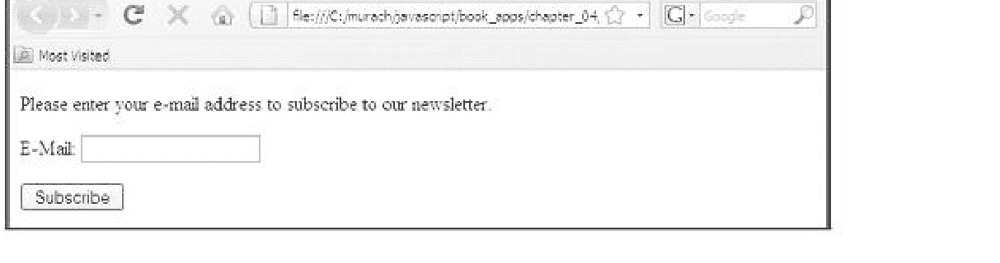

- 表单包含一个或多个可以接收数据的字段，如文本框、单选按钮或复选框。
- 当表单提交到服务器处理时，字段中的数据会随 HTTP 请求发送。当使用 get 方法时，数据作为下一个网页 URL 的一部分发送。当使用 post 方法时，数据是隐藏的。

图 4-15 如何创建表单

## 如何编写按钮

图 4-16 显示了三种类型的按钮："submit"（提交）、"reset"（重置）和 "button"（按钮），你可以创建它们中的每一种。这三种类型的按钮可以是 `<button>` 标签或带有 `type` 属性的 `<input>` 标签。这些标签的主要区别在于 `<input>` 标签只允许按钮包含纯文本，而 `<button>` 标签允许按钮包含格式化文本以及其他 XHTML 元素（图像）。

图中，前四个按钮是通过 `<button>` 标签创建的。在这里，前两个按钮的 `type` 属性设置为 "submit"。因此这两个按钮都是提交按钮。它们具有 `name`、`id` 和 `value` 对。当用户点击提交按钮时，其 `name/value` 会发送到服务器。服务器根据点击了哪个按钮执行不同的操作。在示例中，一个用于下单，另一个保存愿望列表。

第三个按钮的 `type` 属性设置为 "button"。因此，它可以用于运行 JavaScript 代码。当你在第 2 章介绍这种按钮时，随着学习，你将学到更多关于它的知识。因为它有一个 `id` 属性，所以在 JavaScript 中很容易使用。

第四个按钮的 `type` 属性设置为 "reset"。当你点击这种按钮时，表单上所有控件的值都将重置为默认值。

# `<button>` 标签和按钮 `<input>` 标签的属性

| 属性 | 描述 |
| --- | --- |
| type | 指定按钮的类型。按钮的有效值包括 'submit'、'reset' 或 'button'。'submit' 类型将表单提交到服务器，'reset' 类型将所有字段重置为默认值，而 'button' 类型用于运行 JavaScript。指定点击按钮时不提交到服务器。对于 `<button>` 标签，此值不会显示在网页上。对于显示按钮的 `<input>` 标签，此值将显示在按钮上。 |

# `<button>` 标签的示例

```html
<p><button type='submit' name='order' id='order' value='order'>
<b>Place Order</b></button></p>
<p><button type='submit' name='wish' id='wish' value='wish'>
<b>Save as List</b></button></p>
<p><button type='button' id='validate' onclick='Validate'>Validate</button></p>
<p><button type='reset'>Reset</button></p>
```

# 浏览器中的 `<button>` 标签

| Place Order | Save as Wish List |
| --- | --- |
| Validate | Reset |

# 按钮 `<input>` 标签的示例

```html
<p><input type='submit' name='order' id='order' value='Place Order' />
<input type='submit' name='wish' id='wish' value='Save as List' /></p>
<p><input type='button' id='validate' value='Validate' />
<input type='reset' /></p>
```

# 浏览器中的 `<input>` 标签

| Place Order | Save as Wish List |
| --- | --- |
| Validate | Reset |

### 描述

- 当你点击表单的提交按钮时，数据将作为 HTTP 请求的一部分发送到服务器。当你点击重置按钮时，所有字段中的数据都将重置为它们的默认值。
- 当你使用 JavaScript 验证表单数据时，通常会使用类型为 button 的按钮。然后，当用户点击按钮时，JavaScript 会验证数据，如果有效，则通过调用表单的 submit 方法提交数据进行处理。你将在第 12 章看到它的工作原理。

图 4-16 如何编写按钮

# 如何编写标签和文本字段

图 4-17 显示了如何使用 `<input>` 标签创建三种类型的文本字段，这些字段也被称为文本框。该图还显示了如何使用 `<label>` 标签来提供描述这些文本字段的标签。

图中示例中的第一个 `<input>` 显示了一个接受用户输入的文本字段。为了实现这一点，它将标签的 type（类型）设置为 "text"。然后，它将 name 和 id 属性设置为 "quantity"。最后，它将属性设置为 1。结果是，浏览器第一次显示此文本框时，它包含一个默认值为 1 的值。

位于 `<input>` 标签之前的 `<label>` 标签在文本字段左侧显示“Quantity”。此 `<label>` 标签包含一个单独的 for 属性，用于指定控件，该属性必须与文本字段的 name 或 id 属性匹配。

第一个标签和文本字段的大部分属性在其他示例中工作原理相同。对于第二个 `<input>` 标签，将 disabled 属性设置为 "disabled"。结果是，浏览器绘制该文本字段并防止用户与其交互。

第三个 `<input>` 标签创建了一个密码字段，其工作方式与前两个文本字段非常相似。在密码字段中，文本以星号形式显示。这通过防止他人在用户输入密码时读取，提高了应用程序的安全性。

此外，此密码字段还显示了如何使用 maxlength 属性。在这里，它被设置为 6。如果你正在与限制字段中可存储字符数量的数据库工作，这将非常有用，因为字段中可以输入六个字符。

第四个 `<input>` 标签创建了一个隐藏字段，其工作方式与其他四个文本字段类似。然而，该字段不会由浏览器显示。尽管如此，你仍然可以使用 JavaScript 或服务器端代码来处理存储在此字段中的值。例如，隐藏字段提供了一个 QS 产品 ID，它可以被 JavaScript 或服务器端代码读取。

如果你想让文本字段包含默认值，可以编写 value 属性。虽然图中的所有文本字段都有 value 属性，但通常不需要为文本字段编写此属性。这样，用户就可以为这些字段输入值；例如，由于用户无法向隐藏字段输入文本，因此你通常会为隐藏字段编写一个值。

在图中，文本框处于默认宽度，且它们没有对齐。在下一章中，你将学习如何使用 CSS 对齐这些标签和文本字段，以及如何控制它们的宽度和格式特征。

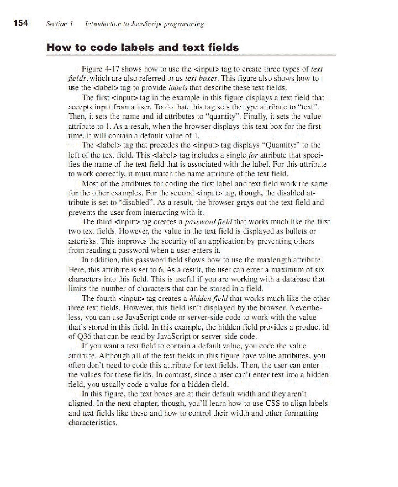

# `<label>` 标签的属性

| 属性 | 描述 |
| --- | --- |
| for | 指定标签所关联的字段名称。 |

# 文本字段 `<input>` 标签的属性

| 属性 | 描述 |
| --- | --- |
| type | 指定文本的类型。有效值包括 "text"、"password"、"hidden"。 |
| value | 指定字段的默认值。 |
| maxlength | 指定字段中可以输入的字符数。 |
| size | 指定字段的宽度。 |

# 标签和文本字段的 HTML

```html
<label for="quantity">Quantity</label>
<input type="text" name="quantity" id="quantity" value="1" />

<label for="discount">Discount</label>
<input type="text" name="discount" id="discount" disabled />

<label for="password">Password</label>
<input type="password" name="password" id="password" maxlength="6" />

<label for="product_id">Product ID</label>
<input type="hidden" name="product_id" id="product_id" value="QS" />
```

# 如何编写单选按钮和复选框

图 4-18 显示了如何使用 `<input>` 标签创建复选和单选字段。这些字段通常被称为复选框和单选按钮。虽然复选框独立工作，但单选按钮可以设置为一组只选择一个。

要创建单选按钮，将 `<input>` 标签的 type 属性设置为 "radio"。然后，将组所有单选按钮的 name 属性设置为相同的名称；在图中，所有单选按钮都使用 "crust" 作为 name 属性。然而，你可以选择或取消这三个单选框的任何组合。这样，用户每次只能选择其中的一个按钮。

但注意，这些按钮每个都有不同的 value 属性和 id 属性。稍后当你编写 JavaScript 或服务器端代码时，可以访问该单选按钮的值。

要创建复选框，将 `<input>` 标签的 type 属性设置为 "checkbox"。然后，设置 name 和属性以便你从 JavaScript 和服务器端代码访问该值。当你将表单提交到服务器时，只有当复选框被选中时，其 name/value 对会被提交到服务器。如果复选框未被选中，其 name/value 对就不会被发送到服务器。

## 单选按钮和复选框的 `<input>` 标签属性

| 属性 | 说明 |
| --- | --- |
| type | 指定字段类型。设置为 "radio"（单选框）或 "checkbox"（复选框）。 |
| value | 指定当字段勾选时提交给服务器的文本。 |
| checked | 一个布尔值，在页面加载时使字段被选中。如果点击重置按钮，它将恢复到未选中状态。 |

## 单选按钮和复选框的 HTML

```html
<label for="crust">Crust</label><br>
<input type="radio" name="crust" id="crust1" value="thin" />
Thin Crust
<input type="radio" name="crust" id="crust2" value="deep" checked="checked" />
Deep Dish
<input type="radio" name="crust" id="crust3" value="hand" />
Hand Tossed<br>
<label for="pepperoni">Toppings</label><br>
<input type="checkbox" name="pepperoni" id="pepperoni" value="yes" />
Pepperoni<br>
<input type="checkbox" name="mushrooms" id="mushrooms" value="yes" />
Mushrooms<br>
<input type="checkbox" name="olives" id="olives" value="yes" />
Black Olives
```

## 浏览器中的单选按钮和复选框

- 饼底 (Crust):
  - 薄饼底 (Thin Crust)
  - 深盘底 (Deep Dish)
  - 手揉底 (Hand Tossed)
- 配料 (Toppings):
  - 意大利肠 (Pepperoni)
  - 蘑菇 (Mushrooms)
  - 黑橄榄 (Black Olives)

### 描述

- 一组单选按钮中同时只能选中一个。同一组的单选按钮必须具有相同的 name 属性，但 id 和 value 需要不同。
- 复选框是独立的，因此可以同时选中多个复选框。复选框的 id 和 name 属性设置为相同的值。

图 4-18 如何编写单选按钮和复选框

## 如何编写选择列表

图 4-19 显示了如何编写选择列表。选择列表可以是下拉列表（drop-down list），也可以是列表框（list box）。对于下拉列表，用户只能从选项列表中选择一个选项。例如，在图中，下拉列表允许你为披萨选择一种类型的饼底。

对于列表框，用户可以从列表中选择多个选项。要做到这一点，用户可以按住 Ctrl 键（Mac OS 上为 Command 键）并点击多个选项。例如，在图中，列表框允许你为披萨选择一个或多个配料。

要编写下拉列表或列表框，你需要使用 `<select>` 标签。在起始 `<select>` 标签内部，编写 name 和 id 属性。在起始和结束标签之间，编写两个或多个 `<option>` 标签，用于提供列表可用的选项。在每个起始 `<option>` 标签内部，编写一个 value 属性。在起始和结束 `</option>` 标签之间，你提供在列表中显示的文本。此文本通常与 value 属性的文本相似。

如果你想对列表中的选项进行分组，可以使用一个或多个 `<optgroup>` 标签。在图中，使用了两个 `<optgroup>` 标签将第二个列表可用选项分为两组：免费 (Free) 和额外收费 (Extra Charge)。为此，label 属性指定了每个组的标签内容。

`<select>` 标签的 multiple 属性决定了你得到下拉列表还是列表框。如果你没有编写此属性，该标签将显示下拉列表，允许用户选择一个选项。如果你编写了此属性，该标签将显示列表框，允许用户选择多个选项。然而，对于这种工作，size 属性必须是一个大于 1 的值。

在图中，第二个列表包含一个值为 "multiple" 的 multiple 属性。结果是此 `<select>` 标签显示了一个带有 5 个选项的列表。由于列表中有 6 个选项（包括分组选项），用户必须使用列表右侧的滚动条滚动到第六选项。

如果你想为列表框设置一个或多个默认选项，可以在 `<option>` 标签内编写值为 "selected" 的 selected 属性。在图中，“Pepperoni”选项被选定为列表框的默认选项。虽然你也可以对下拉列表使用此属性，但显示的选项会自动被选中，因此如果你想让第一个选项成为默认选项，则不需要使用此属性。

## `<select>` 标签的属性

| 属性 | 说明 |
| --- | --- |
| size | 指定在 `<select>` 字段中显示的项目数。如果值为 1，则字段将显示为下拉列表。默认值为 1。 |
| multiple | 一个布尔属性，决定是否可以选择多个项目。它仅在 size 大于 1 时才有效。 |

## `<option>` 标签的属性

| 属性 | 说明 |
| --- | --- |
| selected | 一个布尔属性，在页面加载时使选项被选中。 |

## `<optgroup>` 标签的属性

| 属性 | 说明 |
| --- | --- |
| label | 指定用于分组选项的文本。 |

## 选择列表的 HTML

```html
<label for="crust">Crust</label><br>
<select name="crust" id="crust">
  <option value="thin">Thin Crust</option>
  <option value="deep">Deep Dish</option>
  <option value="hand">Hand Tossed</option>
</select>
<br>
<label for="toppings">Toppings</label><br>
<select name="toppings" id="toppings" size="3" multiple>
  <optgroup>
    <option value="pepperoni" selected>Pepperoni</option>
    <option value="mushrooms">Mushrooms</option>
  </optgroup>
  <optgroup label="Extra Charge">
    <option value="chicken">Chicken</option>
    <option value="pineapple">Pineapple</option>
  </optgroup>
</select>
```

# 如何分组控件

图 4-21 显示了如何使用 `<fieldset>` 标签来对相关控件分组。要实现这一点，你只需要在你想要分组的控件周围编写一个起始和结束的 `<fieldset>` 标签即可。然后，默认情况下，浏览器会在所有分组的字段周围放置一个细边框。例如，在图中，披萨的饼底选项在一个组中，配料选项在另一个组。

在 `<fieldset>` 标签内，你可以编写一个 `<legend>` 标签来为该组指定图例。在图中，代码为饼底组指定了“Crust”（饼底）标签，为配料组指定了“Toppings”（配料）标签。

## 使用 `<fieldset>` 和 `<legend>` 标签的 HTML

```html
<fieldset>
  <legend>Crust</legend>
  <input type="radio" name="crust" id="crust1" value="c1" />
  Thin Crust
  <input type="radio" name="crust" id="crust2" value="c2" />
  Deep Dish
  <input type="radio" name="crust" id="crust3" value="c3" />
  Hand Tossed
</fieldset>
<fieldset>
  <legend>Toppings</legend>
  <input type="checkbox" value="yes" name="topping1" id="topping1" />
  Pepperoni
  <input type="checkbox" value="yes" name="topping2" id="topping2" />
  Mushrooms
  <input type="checkbox" value="yes" name="topping3" id="topping3" />
  Black Olives
</fieldset>
<input type="submit" value="Place Order" />
```

## 浏览器中的 `<fieldset>` 和 `<legend>` 标签

饼底：

- Thin Crust（薄饼底）
- Deep Dish（深盘底）
- Hand Tossed（手工拉饼）

配料：

- Pepperoni（意大利腊肠）
- Mushrooms（蘑菇）
- Black Olives（黑橄榄）

下单订单 (Place Order)

### 描述

- `<fieldset>` 标签用于分组单选按钮或复选框等控件。
- `<legend>` 标签编写在 `<fieldset>` 标签内。它用于为分组的控件设置标记。


# 如何为控件设置制表顺序

图 4-22 显示了一个网页，该网页展示了一个表单包含了你刚刚学习的许多控件，包括文本框、单选框、复选框、下拉列表和按钮。当用户在这样的页面上按下 Tab 键时，焦点会从一个控件移动到另一个控件，但不包括标签。这种序列被称为控件的制表顺序。焦点按照顺序从一个字段移动到另一个字段。

默认情况下，当用户按下 Tab 键时，焦点将按照字段在 HTML 中出现的顺序从一个字段移动到另一个字段。通常，这种制表顺序是可以接受的，因此你不需要更改它。

但是，如果这个默认制表顺序不是你想要的，可以使用 `tabindex` 属性将某些字段移出顺序或更改制表顺序。若要从制表顺序中移除一个字段，请为 `tabindex` 属性分配一个负数。图中的示例说明了这一点。然后，其余控件将保留默认顺序。通常，这种更改就是你想要做的。

要更改制表顺序，请使用 `tabindex` 属性为字段分配 0 或正整数，以指示你想要的制表顺序。如果你对多个一个字段使用相同的值，则具有该值的字段将按照 `tabindex` 的值顺序进行访问。例如，你可以对你想要的第一个组中的所有控件分配值 2，对你想要的第二个组中的所有控件分配值 1。请记住，如果你没有为某个字段分配值，它将在所有分配了值的字段之后被访问。因此，你应该为所有字段都分配值。

在处理制表顺序时，有一个你应该注意的浏览器差异。即在页面加载后按下 Tab 键时，焦点可能会在页面上的第一个字段之前移动到某些控件（如地址栏）。事实上，你可能需要按几次 Tab 键，焦点才会移动到第一个控件。

为了解决这个问题，你可以使用 JavaScript 将焦点移动到你希望用户输入的第一个字段。然后，如果你设置好了制表顺序，用户就可以在不离开键盘的情况下从一个控件移动到另一个控件。

你应该注意的另一个考虑因素是，大多数浏览器将链接包含在制表顺序中。因此，如果你在包含一个或多个字段的网页上包含链接，你需要确保制表顺序仍然按照你的预期工作。在许多情况下，例如，你可能不想将链接包含在制表顺序中。


# 控制制表顺序的属性

| 属性 | 描述 |
| --- | --- |
| tabindex | 要设置字段的制表顺序，请使用 0 或更大的值。若要将字段从制表顺序中移除，请使用负值。 |

# 用于调查的 HTML 表单

如果你有时间，我们将不胜感激你能填写此调查卷。

你的信息：

- 名：
- 姓：
- 邮箱地址：

你是如何知道我们的？

- 搜索引擎

你想接收我们的消息吗？

- 通过以下方式联系我

# 用于从制表顺序移除控件的代码

```html
<fieldset>
  <legend>Crust</legend>
  <input type="radio" name="crust" id="crust1" value="c1" />
  Thin Crust
  <input type="radio" name="crust" id="crust2" value="c2" />
  Deep Dish
  <input type="radio" name="crust" id="crust3" value="c3" />
  Hand Tossed
</fieldset>
<fieldset>
  <legend>Toppings</legend>
  <input type="checkbox" value="yes" name="topping1" id="topping1" />
  Pepperoni
  <input type="checkbox" value="yes" name="topping2" id="topping2" />
  Mushrooms
  <input type="checkbox" value="yes" name="topping3" id="topping3" />
  Black Olives
</fieldset>
<input type="submit" value="Place Order" />
```

### 描述

- `<fieldset>` 标签用于分组单选按钮或复选框等控件。
- `<legend>` 标签编写在 `<fieldset>` 标签内。它用于为分组的控件设置标记。


## 练习题

10. 在复选框之后，添加另一个默认选中的复选框，内容为：“YES, it's okay to send me email announcements”（是的，可以给我发送邮件公告）。

11. 在下拉列表中“Postal mail”（邮寄）选项之后添加“Text messages”（短信）选项，并将最后一个选项改为“All methods”（所有方法）。

12. 在表单的提交按钮右侧添加一个“reset”（重置）按钮。该按钮应将表单上的所有字段重置为默认值。

13. 如果必要，修改标签顺序，使其包含你添加的文本框和重置按钮，但忽略你添加的单选按钮和复选框。

## 修改页面工作方式

14. 将提交表单的方法从 GET 改为 POST。然后，点击按钮测试此更改。在这里，为了使此更改生效，你可能需要重新打开 survey.html 文件。当 URL 出现时，不应包含传递给 Web 服务器的键值对。然而，这些键值对对服务器仍然可用。

15. 修改提交按钮使其成为普通按钮而非提交按钮。然后，点击按钮测试此更改。这次，什么都不会发生。不过，如果你使用 JavaScript，可以为此按钮的点击事件编写一个事件处理器，以验证控件中的数据。然后，如果数据有效，你可以使用表单的 submit 方法提交数据进行处理。（你将在第 12 章看到它是如何工作的。）

## 再次验证 XHTML

16. 再次验证 survey 页面，看看你是否引入了任何新错误。

# CSS 速成课程

在第 1 章中，你介绍了 CSS（层联样式表）。现在，你将学习如何使用 CSS 来格式化 XHTML 文档。一旦学会了这些技能，你就准备好为 JavaScript 应用创建网页了。你也将准备好学习如何使用 JavaScript 控制 CSS。如果你已经知道如何使用 CSS，可以跳过本章。那么，如果你在书的后面遇到不熟悉的 CSS 代码，可以返回本章了解更多信息。

| 页面及其 CSS | 170 |
| --- | --- |
| 网页 | 170 |
| 网页的 HTML | 172 |
| 网页的 CSS | 174 |
| **使用 CSS 的基本技能** | 178 |
| 基本 CSS 结构 | 179 |
| 如何在网页中引入 CSS | 180 |
| 如何指定尺寸和颜色 | 182 |
| **如何编写选择器** | 184 |
| 如何为标签、ID 和类编写选择器 | 184 |
| 如何编写其他类型的 HTML 选择器 | 186 |
| 如何编写伪类选择器 | 188 |
| 级联规则如何工作 | 190 |
| **如何处理文本和列表** | 192 |
| 如何布局表单 | 192 |
| 如何格式化文本 | 194 |
| 如何格式化列表 | 196 |
| **如何处理盒模型** | 198 |
| 盒模型简介 | 198 |
| 演示盒模型的网页 | 200 |
| 如何设置高度、外边距和内边距 | 202 |
| 如何设置边框 | 204 |
| 如何设置背景颜色和图像 | 206 |
| **如何定位元素** | 208 |
| 如何更改元素的显示类型 | 208 |
| 如何浮动元素 | 210 |
| 如何使用绝对定位 | 212 |
| 如何使用相对定位 | 214 |
| 如何让表单上的控件浮动 | 216 |
| **视角** | 218 |

## JavaScript 编程简介

## 网页及其 CSS

本章从向你展示一个网页、其 HTML 以及用于格式化网页的 CSS（层联样式表）代码开始。在你阅读并学习如何使用 CSS 时，可以参考这个网页、XHTML 和 CSS 来查看 CSS 是如何应用的。

## 网页

图 5-1 显示了应用 CSS 前后的网页。在这里，你可以看到 CSS 对 XHTML 产生的巨大影响。注意，例如，CSS 更改了字体、更改了背景颜色和表单颜色的名称（这在黑白文中不显示）、添加了水平规则、用虚线下划线格式化了“Contact us”（联系我们）链接，并将页面中间部分分为两列。

如果你想看 CSS 如何被有创意地使用，有一个有趣的网站是 `http://www.cssengarden.com`。在这个网站上，许多 CSS 设计可以应用于同一个 XHTML 文件。每个设计都使用一个 CSS 文件和自定义图像来实现其外观，你可以检查这些设计的 CSS 代码以查看它是如何工作的。

## 应用 CSS 之前的网页


## Mike 的钓鱼具店

- 产品
- 服务
- 联系我们
- 关于我们

欢迎来到 Mike 的钓鱼具店！我们有让你下一次钓鱼之旅成功所需的一切！

### 新产品

- Ultima 5000 双手鱼竿
- Phil's Fox 虾饵 - 6 号
- 钛金背鱼轮

立即联系我们订购！

© 2008 Mike 的钓鱼具店

完成

## 应用 CSS 后的相同页面


## Mike 的钓鱼具店

欢迎来到 Mike 的钓鱼具店！我们有让你下一次钓鱼之旅成功所需的一切！

### 新产品

- Ultima 5000 双手鱼竿
- Phil's Fox 虾饵 - 6 号
- 钛金背鱼轮

立即联系我们订购！

© 2008 Mike 的钓鱼具店

## 网页的 CSS

图 5-3 显示了应用于 XHTML 文件格式的 CSS 样式表。目前，如果你不理解这段 CSS 代码的细节，请担心。随着本章的进行，你将学习 CSS 是如何工作的。相反，请关注这段代码的整体结构。

首先，CSS 指定了 `<body>` 标签的格式。在这里，顶部的外边距（top margin）设置为 0，背景颜色设置为蓝色调，并更改了字体族和大小。当你为 `<body>` 标签设置格式时，这些设置会被其内部的大多数标签继承。因此，如果你想为正文内的某个标签使用相同的字体族或大小，就不需要为该标签编写这些设置。但如果你想覆盖其中某项设置，只需编写更改后的设置即可。例如，下一页上的 `<h1>` 标签覆盖了由 `<body>` 标签设置的字体族和大小。

在 `<body>` 标签的 CSS 之后，CSS 指定了 `<div>` 标签的格式。为了实现这一点，它使用井字符 (`#`) 来选择每个标签的 id。然后，它对每个标签应用格式：用于设置背景颜色的元素的边距（margins）、内边距（padding）和边框（borders），以及网页不同部分的颜色（color）。例如，页面区域的背景颜色设置为白色。因此，该部分将在 `<body>` 标签的蓝色背景上显示白色背景。

请注意，测量单位取决于正在设置格式的元素类型。例如，在图中，字体大小是以百分比（%）设置的。页面的宽度是以像素（px）设置的，这是用户显示器使用的点数。内边距（padding）则是以 em 设置的。

- em 是一种测量单位，等于当前的字体大小。例如，如果当前字体高度为 16 像素，那么 1 em 就等于 16 像素。因此，如果你增大当前字体的大小，内边距也会随之增加。换句话说，em 是相对于当前字体大小的测量单位。

## home_page.css 文件的 CSS

```css
/* body 标签的样式 */
body {
  margin-top: 0;
  background-color: dodgerblue;
  font-family: Georgia, "Times New Roman", Times, serif;
  font-size: 81.25%;
}
```

```css
/* 将页面分为区域的 div 标签的样式 */
#page {
  width: 760px;
  margin: 0 auto;
  background-color: white;
  border: 1px solid black;
  border-top: none;
}
```

```css
#header, #main, #footer {
  padding-left: 0.5em;
  padding-right: 0.5em;
}
```

```css
#header {
  border-bottom: 1px solid gray;
}
#main {
  padding-top: 1em;
  padding-left: 0;
}
```

```css
#sidebar {
  position: absolute;
  width: 10em;
}
#content {
  margin-left: 10em;
}
```

```css
#footer {
  border-top: 1px solid gray;
  padding-bottom: 0.5em;
}
```

## 176 节 JavaScript 编程简介

在 `<html>` 标签的 CSS 之后，CSS 指定了其余 XML 标签的格式。例如，这段代码将 `<h1>` 和 `<h2>` 标签的颜色设置为深橙色，并更改了标签的字体族。然后，这段代码将 `<h1>` 的字体大小增大到当前字体设置的150%，并设置了该标签的顶部边距和内边距。接下来，这段代码将 `<div>` 标签的字体大小增大到当前字体的120%。

在 `<ul>` 和 `<li>` 标签的 CSS 之后，CSS 设置了 `<ul>` 和 `<li>` 标签的外边距和内边距。当指定此类多个值时，这些值从顶部开始顺时针旋转，如下所示：上、右、左。相比之下，当只指定单个值时，该值将用于所有的边距和内边距值。随着本章的进行，你将学习更多关于它的原理。

在列表标签的 CSS 之后，CSS 指定了鼠标悬停在 `<a>` 标签上时的格式。这会将链接显示为中蓝色、**加粗**，并带有 1 像素宽、虚线且深橙色的下边框。

接着，CSS 指定了鼠标悬停在 `<a>` 标签上的另一种格式。这会将链接的下边框从虚线改为实线。因此，用户可以很容易判断鼠标何时悬停在链接上。

最后，CSS 指定了 XML 代码中使用的类（classes）。为了实现这一点，它在标签名称之前使用点 (`.`)。例如，`.copyright` 样式适用于任何具有值为 "copyright" 的类属性的标签。如果你回头看图 5-2，你会发现这仅适用于灰色、较小字体以及在页面右侧对齐的情况。

## 网页的 CSS（部分 2）


# CSS 样式表概述

图 5-3 显示了应用于 XHTML 文件格式的 CSS 样式表。目前，如果你不理解这段 CSS 代码的细节，请勿担心。随着本章的进行，你将学习 CSS 是如何工作的。相反，请关注这段代码的整体结构。

首先，CSS 指定了 `<body>` 标签的格式。在这里，顶部的外边距（`margin-top`）设置为 0，背景颜色设置为蓝色调，并更改了字体族和大小。当你为 `<body>` 标签设置格式时，这些设置会被其内部的大多数标签继承。因此，如果你想为正文内的某个标签使用相同的字体族或大小，就不需要为该标签编写这些设置。但如果你想覆盖其中某项设置，只需编写更改后的设置即可。例如，下一页上的 `<h1>` 标签覆盖了由 `<body>` 标签设置的字体族和大小。

在 `<body>` 标签的 CSS 之后，CSS 指定了 `<div>` 标签的格式。为了实现这一点，它使用井字符 (`#`) 来选择每个标签的 id。然后，它对每个标签应用格式：用于设置背景颜色的元素的边距（`margin`）、内边距（`padding`）和边框（`border`），以及网页不同部分的颜色（`color`）。例如，页面区域的背景颜色设置为白色。因此，该部分将在 `<body>` 标签的蓝色背景上显示白色背景。

请注意，测量单位取决于正在设置格式的元素类型。例如，在图中，字体大小是以百分比（%）设置的。页面的宽度是以像素（`px`）设置的，这是用户显示器使用的点数。内边距（`padding`）则是以 `em` 设置的。

- `em` 是一种测量单位，等于当前的字体大小。例如，如果当前字体高度为 16 像素，那么 1 `em` 就等于 16 像素。因此，如果你增大当前字体的大小，内边距也会随之增加。换句话说，`em` 是相对于当前字体大小的测量单位。

## `home_page.css` 文件的 CSS

```css
/* body 标签的样式 */
body {
  margin-top: 0;
  background-color: dodgerblue;
  font-family: Georgia, "Times New Roman", Times, serif;
  font-size: 81.25%;
}
```

```css
/* 将页面分为区域的 div 标签的样式 */
#page {
  width: 760px;
  margin: 0 auto;
  background-color: white;
  border: 1px solid black;
  border-top: none;
}
```

```css
#header, #main, #footer {
  padding-left: 0.5em;
  padding-right: 0.5em;
}
```

```css
#header {
  border-bottom: 1px solid gray;
}
#main {
  padding-top: 1em;
  padding-left: 0;
}
```

```css
#sidebar {
  position: absolute;
  width: 10em;
}
#content {
  margin-left: 10em;
}
```

```css
#footer {
  border-top: 1px solid gray;
  padding-bottom: 0.5em;
}
```

## CSS 语法

要使用 CSS 格式化网页，你需要编写一个或多个规则集，如图 5-4 所示。这些规则集也被称为选择器。

如你在图中所示，每个规则集以选择器开始，标识要应用格式的元素。该选择器后面跟着花括号内的声明块。然后，在声明块中，你编写描述应用于选择器的声明。

每个声明（或规则）由属性、值、冒号和分号组成。在这里，声明块中最后一个声明的分号是可选的，但每个声明后都编写分号被认为最佳实践。这样，你可以轻松添加其他内容。

如果你想在 CSS 中包含 CSS 注释，你需要以 `/*` 开始并以 `*/` 结束。这些字符与 JavaScript 中提供的多行注释工作原理相同。因此你可以使用它们来编写如本图中所示的单行注释。你可以使用它们来编写如下的多行注释：

```css
************************************************************
* Description: murach.com 的主样式表
* Author: Ray Harris
************************************************************
```

你还可以使用它们来注释掉块 CSS 代码。但注意，你不能使用 `//` 来开始注释，正如你可能认为的那样。

### CSS 规则集的组成

```css
selector {
  property: value; /* 声明 */
}
```

### 另一个 CSS 规则集

```css
body {
  margin-top: 0;
  background-color: dodgerBlue;
  font-family: Georgia, "Times New Roman", Times, serif;
  font-size: 10pt;
}
```

### 带有选择器的 CSS 规则集

```css
h1, .footer .gray {
  color: gray;
}
```

### CSS 注释

```css
/* This is a CSS comment */
```

### 描述

- CSS 规则集由一个选择器和一个声明块组成。
- CSS 选择器由规则开头编码的标识符组成。
- CSS 声明块由一个左括号、零或多个声明以及一个右括号组成。
- 一个 CSS 声明由一个属性、一个冒号、一个值和一个分号组成。虽然块中最后一个声明的分号是可选的，但将其编写出来是一种最佳实践。
- CSS 注释以字符 `/*` 开头，并以字符 `*/` 结束。JavaScript 的单行注释 `//` 在 CSS 中是无效的。

## 如何在网页中引入 CSS

图 5-5 首先展示了两种在网页中引入存储在外部样式表中的 CSS 方法。第一种是使用 `<link>` 标签。这目前被认为是一种最佳实践，因为当你为页面加载多个外部样式表时，它的效率更高。

第二种方法是使用带有 `@import` 指令的 `<style>` 标签。这在最近之前被认为是最佳实践，但现在仍然被广泛使用。

当你在 `<link>` 或 `<style>` 标签中使用相对 URL 时，该 URL 是相对于当前文件的。例如，图中第一个示例中的两个链接从当前文件向上导航一个目录。然后，该 URL 导航到样式目录以及一个名为……的文件。

虽然不是必须的，但你也可以在 XHTML 文档中使用嵌入样式表和内联样式，如图中的第二组示例所示。CSS 声明被编写在 `<style>` 标签中。例如，该组中第一个示例的嵌入样式表包含一个针对 `<h1>` 的单一样式。

当你使用内联样式时，你为该元素的 XHTML 元素编写一个 `style` 属性，其中包含了适用于该元素的所有 CSS 声明。例如，该组中第二个示例的内联样式为 `<span>` 标签应用了两个 CSS 声明。

如果你使用嵌入样式表或内联样式，嵌入样式表中的样式将覆盖外部样式表中的样式，而内联样式将覆盖嵌入样式表中的样式。例如，如果在图中 `@import` 指令之后编写嵌入样式表，则针对 `<h1>` 的声明将覆盖外部样式表中的声明。

记住，仅使用外部样式表是一种最佳实践。当你使用 CSS 时，网页的声明位于单独的 CSS 文件中，这使得格式与其内容分离。这允许多个网页共享同一个 CSS 文件，这具有许多优点：HTML 文件更小，并且为整个网站提供了一致的格式。这意味着你可以通过修改单个样式表来修改格式。

图中的最后一组示例展示了如何为不同类型的媒体使用不同的样式表。为了做到这一点，你需要编写 `<link>` 或 `<style>` 标签的 `media` 属性。这里，第一个示例加载了在页面打印时使用的样式表，第二个示例加载了在页面为手持设备渲染时使用的样式表。

CSS 的精髓在于编写样式表使其适用于相应的媒体。为了做到这一点，你可能想要更改字体样式或大小，或者移除边框、更改颜色等。对于打印，你可能还想隐藏控制按钮以便它们不被打印。随着本章的进行，你将学习如何操作。

### 引入外部样式表的两种方法

使用 `<link>` 标签（目前被认为的最佳实践）：

```html
<link rel="stylesheet" type="text/css" href="../styles/main.css" />
```

使用 `<style>` 标签和导入指令：

```html
<style type="text/css">
@import "../styles/main.css";
</style>
```

### 如何在 XHTML 文档中嵌入样式（不推荐）

在头部部分的 `style` 标签中嵌入样式表：

```html
<style type="text/css">
selector {
  color: blue;
  font-size: 14pt;
}
</style>
```

使用内联标签的 `style` 属性：

```html
<span style="color: red; font-size: 14pt;">警告！</span>
```

### 如何为特定媒体引入外部样式表

引入在设备打印时使用的样式表：

```html
<link rel="stylesheet" type="text/css" href="../styles/main.print.css" media="print" />
```

引入用于手持设备使用的样式表：

```html
<link rel="stylesheet" type="text/css" href="../styles/main.handheld.css" media="handheld" />
```

### 描述

- 始终使用外部样式表是一种最佳实践。为了做到这一点，你可以使用 `<link>` 标签或带有 `@import` 指令的 `<style>` 标签。
- 目前，外部样式表的最佳实践是使用 `<link>` 标签，因为它的效率更高。
- HTML 文件更小，并且为整个网站提供了一致的格式。这意味着你可以通过修改单个样式表来修改格式。

## 如何编写选择器

现在你已经对 CSS 的工作原理有了大致了解，准备好学习如何编写选择器了。一旦你理解了这一点，你就能够将 CSS 格式应用到页面的任何部分。

## 如何为标签、id 和类编写选择器

图 5-7 显示了如何为 XML 元素编写 CSS 选择器。首先，它显示了一段包含 `<body>` 标签和两个 `<div>` 标签的 XHTML 代码片段。为了让 CSS 识别这些标签，第一个 `<div>` 标签的 id 为 "main"，第二个 `<div>` 标签的 id 为 "footer"。

在主区域（`main`）中，`<p>` 标签显示了一个段落，随后是一个链接列表。在这里，`<a>` 包含一个名为 "nav" 的类属性。这允许 CSS 为该 `<a>` 应用格式，该格式与不属于 nav 类的 `<a>` 标签的格式不同。

在页脚（`footer`）区域，单个 `<p>` 标签显示了版权声明。该标签包含了 "copyright" 和 "inactive" 两个类属性。这意味着它属于两个类：copyright 类和 inactive 类。

第一个 CSS 规则集通过标签名选择 XHTML 元素。要做到这一点，选择器就是标签名。因此，该规则集选择了 `<body>` 标签。在该规则内部，声明将字体属性（`font`）更改为 Arial，或者如果没有 Arial，则更改为通用无衬线字体（`sans-serif`）。由于大多数标签都继承自 `<body>` 标签，且大多数标签都继承了字体属性，这导致 XHTML 中的所有文本都以指定的字体显示。

第二个 CSS 规则集通过 id 选择 XHTML 元素。要做到这一点，选择器是唯一标识该元素的 id (`#`)。因此，该规则集选择了 id 为 "main" 的 `<div>` 标签。然后，第一个规则在主区域周围添加了边框（`border`），第二个规则在边框和文本之间添加了 2px 的内边距（`padding`）。

最后一个规则集通过类（`class`）选择 XHTML 元素。要做到这一点，选择器是一个点 (`.`) 后跟类名。因此，第一个规则集选择了类为 "nav" 的 `<ul>`。然后，它将默认列表使用的项目符号类型更改为正方形符号。相比之下，最后两组规则都选择了类为 "copyright inactive" 的 `<p>` 标签。

当你使用类选择器时，可以将同一套规则集应用于多个 XHTML 元素。相反，当你使用 id 选择器时，你将一个规则应用于单个元素。因此，id 用于应用于每个页面上只出现一次的元素，例如将页面分为若干区域的 `<div>` 元素。类通常用于应用于单页上多次出现的元素，例如 `<p>` 标签。

### 可通过标签、id 或类选择的 XHTML 元素

```html
<body>
  <div id="main">
    <p>here is a list of links:</p>
    <ul class="nav">
      <li><a href="products.html">Products</a></li>
      <li><a href="services.html">Services</a></li>
    </ul>
  </div>
  <div id="footer">
    <p class="copyright inactive">Copyright 2009</p>
  </div>
</body>
```

### 按标签、id 和类进行选择的 CSS 规则集

```css
body {
  font-family: Arial, sans-serif;
}

#main {
  border: 2px solid black;
  padding: 0.2em;
}

.nav {
  list-style-type: square;
}

.copyright {
  text-align: right;
}

.inactive {
  color: gray;
}
```

### 浏览器中显示的元素

- 这里是一份链接列表：
- Products
- Services

## 如何编写其他类型的 XHTML 选择器

图 5-8 显示了如何使用通配选择器（universal selector）编写其他类型的 XHTML 元素。首先，要做到这一点，你需要编写选择所有元素 (`*`)。

第一个示例中，通配选择器选择了页面上的所有元素，并将它们的颜色更改为黑色。

要编写一个按标签和类选择的选择器，编写标签名，后跟一个点 (`.`) 和类名。在第二个示例中，`ul.nav` 选择器选择了类为 "nav" 的 `<ul>` 标签。

要编写一个仅当元素是父元素的后代时才选择它们的后代选择器（descendant selector），你需要编写父元素的选择器、一个空格以及后代元素的选择器。在第三个示例中，第一个后代仅选择在 id 为 "footer" 的标签内部的 `<div>` 标签。第二个后代仅选择在 `<ul>` 标签内部的 `<a>` 标签，第三个后代选择器使用通配选择器选择在 `<ul>` 标签内部的所有标签。

要编写一个仅当元素是父元素的直接元素时才选择它们的子选择器（child selector），使用大于号 (`>`)。与后代选择器不同，子选择器不会选择孙子元素或更深元素。在第四组示例中，第一个子选择器选择了在 id 为 "main" 的标签内部的 `<div>` 标签。第二个子选择器选择了在类为 "nav" 的 `<ul>` 标签内部的 `<a>` 标签。

要编写带有特定值的属性选择器（attribute selector），使用方括号 (`[]`) 和等号 (`=`)。在第五个示例中，该属性选择器选择了 `type="submit"` 的元素。尽管子选择器比较新，但你可能会发现某些浏览器并不支持它们。

要编写多个选择器，使用逗号分隔选择器。例如，`h1, h2, h3` 选择器选择了所有三个标签，允许对它们应用相同的规则。

### 选择器的其他编写方式

| 选择器类型 | 语法 | 描述 |
| :--- | :--- | :--- |
| 通配 | `*` | 选择所有元素 |
| 标签和类 | `tag.class` | 选择特定类的标签 |
| 后代 | `parent descendant` | 选择元素内部的元素 |
| 子 | `parent > child` | 选择父元素的直接元素 |
| 属性 | `tag[attribute=value]` | 选择特定属性值的元素 |
| 多个 | `sel1, sel2` | 选择匹配多个选择器的元素 |

### 注意

- 某些浏览器不支持子选择器和属性选择器。

## 如何编写伪类选择器

图 5-9 显示了如何编写伪类选择器（pseudo-class selectors）。在伪类选择器表中，前两个只能用于链接，但另外三个可以用于大多数 XHTML 元素。例如，`:hover` 选择器可以用于 `<div>` 或 `<a>` 标签。

在图中的示例中，第一个伪类选择器将所有未访问过的链接显示为黑色。第二个选择器将所有访问过的链接显示为灰色。第三个选择器在鼠标悬停在链接上时将每个链接加粗显示。第四个选择器在用户按下按钮但在释放按钮之前显示绿色。第五个选择器缩进了 `<p>` 标签的第一行，但不缩进第二行。

### 伪类选择器

| 名称 | 描述 |
| --- | --- |
| `:link` | 未访问过的链接。 |
| `:visited` | 已访问过的链接。 |
| `:hover` | 鼠标悬停在元素上的元素。 |
| `:active` | 元素当前处于激活状态。例如，在用户按下按钮到松开鼠标按钮之前，链接处于激活状态。 |
| `:first-child` | 元素中的第一个元素。 |

### 可供伪类选择器使用的 HTML

```html
<div id="main">
  <p>Welcome to Mike's Bait and Tackle Shop. We have all the gear
  you'll need to make your next fishing trip a great success!</p>
  <ul>
    <li><a href="products.html">Products</a></li>
    <li><a href="services.html">Services</a></li>
  </ul>
  <p><a href="contact.html">Contact us</a> to place
  your order today!</p>
</div>
```

### 用于伪类选择器的 CSS

```css
a:link {
  color: black;
}
a:visited {
  color: gray;
}
a:hover {
  font-weight: bold;
}
a:active {
  color: green;
}
#main > p:first-child {
  text-indent: 1em;
}
```

### Web浏览器中的伪类选择器

Welcome to Mike's Bait and Tackle Shop. We have all the gear you'll need
to make your next fishing trip a great success!

- Products
- Services

Contact us to place your order today!

## 级联规则是如何工作的

“级联样式表（Cascading Style Sheets）”这一术语指的是多个样式表可以应用于同一个网页。那么，如果将两个或多个规则集应用于同一个元素，则其级联顺序和规则将决定哪一个具有优先权。

不过，在理解级联规则之前，你需要知道用户可以创建一个用户样式表，为网页提供默认规则集。大多数用户不会创建样式表，这通常不是问题。但有些用户会这样做。例如，视力不佳的用户通常会创建提供大字体的用户样式表。在这种情况下，你需要考虑用户样式表如何影响你的网页。

你还应该知道如何识别你的规则哪些是重要的，因为它优于其他规则。要做到这一点，你在规则中将 `!important` 编码为规则的一部分。如图 5-10 示例所示。

在此背景下，该图列出了级联顺序从强到弱的五个级别。如你所示，用户样式表中的重要规则会覆盖网页中的重要规则，但用户样式表中的普通规则会被覆盖。这些规则是 Web 浏览器的默认规则。

但如果一个元素在同一层级上应用了多个规则会发生什么？首先，特异性（specificity）最高的规则优先，该图显示了选择器中哪些部分更具体。例如，`#main` 选择器比 `.nav` 选择器更具体。

如果选择器包含多个部分，额外的部分会增加选择器的特异性。这意味着一个包含类和标签的选择器比仅包含类的选择器更具体。例如，`p.highlight` 选择器比 `.highlight` 选择器更具体。结果是 `p.highlight` 具有优先权。

如果这还没有解决冲突，则最后指定的规则将最后应用。例如，内联样式是在外部样式表或嵌入样式表之后指定的，内联样式具有优先权。如果你不小心在样式表中为同一个元素编写了两个规则集，这种概念也适用。那么，后出现的那一个具有优先权。

如果这听起来很复杂，但如果你像图 5-3 那样组织你的样式表，通常就没有问题。那么，当发生冲突时，你通常可以通过识别其中一个规则集为重要的来解决它。

### 如何识别规则为重要的规则

```css
.highlight {
  font-weight: bold !important;
}
```

### 应用 CSS 规则集的级联顺序

按照以下顺序搜索应用于元素的规则集，并应用从找到它的第一个组中的规则集：

1. 用户样式表中的重要规则
2. 网页中的重要规则
3. 网页中的普通规则
4. 用户样式表中的普通规则
5. Web 浏览器的默认规则

如果一个组中的多个规则集被应用于一个元素……

- 使用特异性最高的规则集。例如，`p.highlight` 选择器比 `.highlight` 选择器更具体。

如果组中两个或多个规则集的特异性相同，则使用最后指定的规则集。

### 如何确定选择器的特异性

- id 是最具体的。
- 类、属性选择器或伪类选择器的特异性较低。
- 元素或伪元素选择器的特异性最低。

### 描述

- 当应用两个或多个规则集时，浏览器按顺序搜索字体。如果字体不可用，浏览器将尝试下一个。结果是你应该按偏好顺序指定字体。
- 由于大多数用户不会创建样式表，因此最好是将字体大小设置为百分比或 `em`。
- 如果你想创建大字体，可以创建一个用户样式表。
- Web 浏览器的默认规则是最后的规则。
- 用户样式表中的重要规则会覆盖网页中的重要规则。

## 如何处理文本和列表

现在你已经知道了如何选择元素，准备好学习如何使用 CSS 格式化文本和列表了。

## 如何设置字体

图 5-11 总结了三个通用字体族。在这里，Times New Roman 是衬线字体；Arial 是无衬线字体，Courier New 是等宽字体（另外两个是草字体和艺术字体）。

默认情况下，浏览器使用默认字体。要更改这一点，你可以在 CSS 中设置 `font-family` 元素。实现这一点的一种方法是使用绝对测量单位，如像素或磅。然而，某些浏览器（如 IE6）不允许用户调整以某种方式设置大小的文本。最好是将字体大小设置为百分比或 `em`。这样，所有现代浏览器（包括 IE6）都允许用户调整文本大小。这通过第三组元素得到了说明。

### 五种通用字体族中的三种

| 名称 | 描述 |
| :--- | :--- |
| serif (衬线字体) | 带有锥形、喇形或块状末端的字体。 |
| sans-serif (无衬线字体) | 笔端平的字体。 |
| monospace (等宽字体) | 每个字符宽度相同的字体。 |

### 三种常见字族的示例

- Times New Roman 是一种衬线字体。它是大多数网页浏览器的默认字体。
- Arial 是一种无衬线字体。它被广泛使用。
- Courier 是一种等宽字体。

### 如何指定字体族

```css
font-family: "Times New Roman", Times, serif;
font-family: Arial, Helvetica, sans-serif;
font-family: "Courier New", Courier, monospace;
```

### 如何指定字体样式、粗细和变体

```css
font-style: italic;
font-weight: bold;
font-variant: small-caps;
```

### 如何指定字体大小和行高

```css
font-size: 12pt;        /* 点数 */
font-size: 150%;        /* 当前字体的百分比 */
font-size: 1.2em;       /* 相对于父元素字体大小 */
line-height: 14pt;
line-height: 120%;
line-height: 1.2em;
```

### 简写属性的语法

```css
font: [style] [weight] [variant] size[/line-height] family;
```

### 如何使用简写属性

```css
font: bold 14px/16px Arial, sans-serif;
font: small-caps 150% "Times New Roman", Times, serif;
font: 90%/120% "Comic Sans MS", Impact, sans-serif;
```

### 描述

- 对于 `font-family`，包含空格的名称必须用引号括起来。如果字体不可用，将尝试下一个。如果所有字体不可用但指定了通用字体，浏览器将使用其默认字体作为指定的字体。
- 如果需要，你可以将 `font-style`、`font-weight` 或 `font-variant` 属性设置为值 "normal"，以移除应用于这些属性的任何格式。
- 你可以使用字体的简写属性通过单个规则设置所有属性。当你使用简写时，`font-size` 和 `font-family` 属性是必须的，而其他属性是可选的。

## 如何格式化文本

图 5-12 显示了如何使用其他允许格式化文本的属性。首先，你可以使用 `text-transform` 属性将文本全大写、小写或每个单词的首字母大写。要给文本添加下划线或应用任何其他装饰，可以使用 `text-decoration` 属性。例如，你可以使用 `overline` 值在文本上方画一条线，使用 `line-through` 值在文本中间画一条线，或者使用 `blink` 值让文本闪烁。在 Web 早期，闪烁文本经常用于吸引注意力，但这种做法是不被鼓励的。

如果你需要显式指定不想格式化文本或对其添加装饰，可以指定值为 "none"。例如，`<a>` 标签的 `text-decoration` 属性默认设置为 "underline"。如果你不希望这样，可以将其设置为 "none"。

要缩进段落的第一行文本，可以使用 `text-indent` 属性的测量单位，如 `em`（字宽）。这样，如果当前字体的大小发生变化，段落第一行的缩进也会发生变化。

要水平对齐文本，可以使用 `text-align` 属性。默认情况下，大多数元素是左对齐的，但你可以使用 "center"、"right" 或 "justify" 值来更改。当你对文本进行对端时，单词之间的间距会调整，以使文本左右两侧对齐。

### 如何转换文本

```css
text-transform: uppercase;
```
有效值：`uppercase` `lowercase` `capitalize` `none`

### 如何为文本添加装饰

```css
text-decoration: underline;
```
有效值：`underline` `overline` `line-through` `blink` `none`

### 如何缩进文本的第一行

```css
text-indent: 2em;
```

### 如何水平对齐文本

```css
text-align: left;
```
有效值：`left` `center` `right` `justify`

## 如何使用盒模型

当浏览器显示网页时，它会将每个 HTML 块级元素放置在一个“盒”中。当你想要对 `<div>`、`<h1>` 和 `<p>` 标签等元素应用边框和其他格式时，这非常有用。然而，你也可以使用这种技术来格式化如 `<a>`、`` 和 `<span>` 标签之类的内联元素。在 CSS 中，这被称为使用盒模型。

### 盒模型简介

图 5-14 展示了盒模型工作原理的图。默认情况下，块级元素的盒宽度与它包含的块一样宽，高度则根据其内容确定。然而，你可以使用 `height` 和 `width` 属性显式指定块级元素盒的大小。你还可以使用其他属性设置块级元素的边框（`border`）、外边距（`margin`）和内边距（`padding`）。

如果你查看图中的图，可以看到内边距（`padding`）是盒与边框之间的空间。这与表格内边距的作用类似。同样，外边距（`margin`）是边框与容器元素边缘之间的空间。

如果你需要计算盒的总高度，可以使用图中的公式。在这里，你首先将盒顶部的外边距、边框宽度和内边距的值相加。然后加上中间盒的高度。最后，加上盒底部内边距、边框宽度和外边距的值。同样，你可以使用图中的另一个公式来计算盒的总宽度。

当你为块级元素设置 `height` 和 `width` 属性时，可以使用本章中学过的任何单位，但你通常会使用像素（`px`）或百分比（`%`）。相比之下，在处理外边距和内边距时，使用 `em` 等相对测量单位是一个良好的习惯。这样，当字体大小变化时，外边距和内边距会自动调整。

### CSS 盒模型

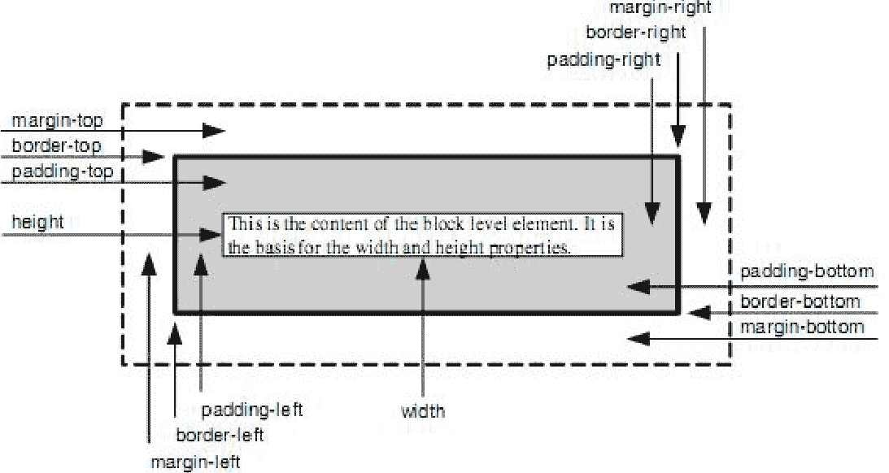

### 计算盒高度的公式

顶部外边距 + 顶部边框 + 顶部内边距 + 高度 + 底部内边距 + 底部边框 + 底部外边距

### 计算盒宽度的公式

左侧外边距 + 左侧边框 + 左侧内边距 + 宽度 + 右侧内边距 + 右侧边框 + 右侧外边距

### 描述

- 默认情况下，块级元素的宽度与其包含的块级元素一样宽，高度根据其内容确定。
- 你可以使用 `height` 和 `width` 属性来指定盒的大小。
- 你可以使用其他属性来控制盒的外边距、边框和内边距。

### 一个说明盒模型的网页

为了确保你理解盒模型是如何工作的，图 5-15 展示了一个网页的 XHTML 代码。然后，CSS 为 `<body>`、`<h1>` 和 `<p>` 标签添加了 1 像素宽的黑色虚线边框，并将这些标签的四个方向的外边距都设置为 10 像素。

但随后，针对 `<div>` 的 CSS 创建了一个 2 像素宽的黑色实线边框。它还将该标签盒的宽度设置为 450 像素，高度设置为 150 像素，外边距设置为 15 像素（这覆盖了 body 的外边距），内边距设置为 10 像素。结果，这个盒的总宽度为 504px，总高度为 230px。

在 `<div>` 之后，CSS 更改了 `<h1>` 标签的外边距和左侧内边距。它将顶部外边距设置为 0em，左右外边距设置为 0，并设置了底部外边距。结果是在其下方 `<p>` 标签上方留更多的空间。这段代码还设置了盒左侧的内边距为 15 像素，因此文本缩进了该长度。

在 `<h1>` 之后，CSS 更改了 `<p>` 的两个属性。首先，它将顶部外边距设置为 1em。结果 `<h1>` 和 `<p>` 标签之间的空间是由 `<h1>` 的底部外边距产生的。其次，这段代码将盒左侧的内边距设置为 15 像素。结果是浏览器在盒边框和文本之间显示出 15 像素的空间。这使得 `<h1>` 和 `<p>` 标签的文本对齐。

如果你研究浏览器中的渲染结果，你将更好地理解盒模型的工作原理。例如，文档的盒在浏览器窗口的左侧、右侧和顶部有 10 像素的外边距，但底部没有，因为那是由窗口大小决定的。在 body 盒内部，`<div>` 盒左侧、顶部有 15 像素的外边距，但底部没有，因为该盒的宽度被设置为 450 像素。

然后，`<div>` 有 10 像素的内边距，其内部的 `<h1>` 和 `<p>` 盒相对于边框的左右偏离了相应距离，尽管它们的左右外边距被设置为 0。此外，由于 `<h1>` 的顶部和底部外边距是用 `em` 设置的，这些外边距是相对于 `<h1>` 大小的。最后，在 `<h1>` 和 `<p>` 盒内部，左侧的内边距为 15 像素，因此文本缩进并对齐。在这种情况下，如果内边距使用相对测量单位，文本将不会对齐。

### 用于内边距的 XHTML

```html
<html>
<body>
  <div id="main">
    <h1>盒模型</h1>
    <p>
      内容。
    </p>
  </div>
</body>
</html>
```

### 用于外边距的 CSS

```css
body {
  margin: 10px;
}

h1 {
  margin-top: 0em;
  margin-right: 0;
  margin-left: 0;
  margin-bottom: 1em;
}

p {
  margin-top: 1em;
  padding-left: 15px;
}

#main {
  border: 2px solid black;
  width: 450px;
  height: 150px;
  margin: 15px;
  padding: 10px;
}
```

## 如何设置边框

图 5-17 展示了如何为框设置边框。首先，如果你想让框的四边具有相同的边框，可以使用简写属性 `border`，它允许你设置边框的宽度、样式和颜色。否则，你可以使用图中所示的各个属性。

要指定边框的宽度，通常使用像素（`px`），你也可以使用其他测量单位。此外，你还可以使用图中所示宽度名称：`thin`（细）、`medium`（中）或 `thick`（粗）。

要指定边框的样式，你需要指定图中所示命名值之一。对于大多数边框，你可能会使用 `solid`（实线）。但如果你对其他样式感兴趣，例如 `double`（双线）或 `ridge`（凸脊），那么花时间尝试一下是值得的。或者，如果你想关闭边框，可以将样式设置为 `hidden`（隐藏）或 `none`（无）。

要指定边框的颜色，你可以使用在图 5-6 中学过的任何颜色指定技术。然而，如果你没有为边框指定颜色，浏览器将使用你正在操作的块元素的颜色。这样，当你更改颜色时，边框的颜色也会随之改变。

如果你想处理所有边框，但想对不同的边应用不同的值，可以使用 `border-width`、`border-style` 和 `border-color` 属性。这些属性是简写属性，工作方式类似于 `margin` 和 `padding` 属性；顺序值被应用于边框的顶、右、底、左部分。

最后，如果你只想处理框的一个边的边框，可以使用 `border-top`、`border-right`、`border-bottom` 和 `border-left` 属性。当你使用这些属性时，可以一次设置边框的任何及所有属性。不过，必要时，你可以如图底部所示将宽度、样式和颜色属性附加到这些任何属性上。这样，你就得到了像 `border-top-width` 这样的特定属性。

### `border` 简写属性的语法

```css
border: [width] [style] [color];
```

### 如何使用 `border` 简写属性设置四边边框

```css
border: thin solid green;
border: 2px dashed #808080;
border: 1px inset;           /* 使用元素的颜色属性 */
```

### 如何设置四边边框的宽度

```css
border-width: 1px;
border-width: 2px 4px;      /* 顶部和底部 2px，左右 4px */
border-width: 2px 3px 4px;  /* 顶部 2px，左右 3px，底部 4px */
border-width: 2px 3px 4px 5px; /* 顶部 2px，右侧 3px，底部 4px，左侧 5px */
```

### 命名宽度的有效值

`thin` `medium` `thick`

### 如何设置四边边框的样式

```css
border-style: dashed;     /* 虚线 */
border-style: solid;      /* 实线 */
border-style: solid none; /* 顶部和底部实线，左右无 */
```

### 有效值

`dotted` `solid` `double` `groove` `ridge` `inset` `outset` `none` `hidden`

### 如何设置四边边框的颜色

```css
border-color: green;      /* 命名颜色 */
border-color: #808080;    /* 颜色的十六进制值 */
border-color: black gray; /* 顶部黑色，左右灰色 */
```

### 如何处理单个边框

```css
border-top: 2px solid black;
```

### 使用单独属性

```css
border-top-width: 2px;
border-top-style: solid;
border-top-color: black;
```

### 其他示例

```css
border-right-style: dashed;
border-bottom-width: 4px;
border-left-color: gray;
```

### 描述

- 你可以使用边框的简写属性来处理框四边的边框。

## 如何设置背景颜色和图像

图 5-18 显示了如何设置框的背景。在浏览器中，背景显示在框的内容、内边距和边框之后，但在框的外边距（`margin`）之外。

当你为框指定背景时，可以设置背景颜色、图像或两者都设置。如果两个都设置，浏览器会在图像后面显示背景颜色。因此，只有当图像具有透明区域或不重复时，你才能看到图像背后的背景颜色。

如所示，你可以使用 `background` 简写属性设置背景的所有五个属性。当你使用此简写属性时，不需要按照特定顺序指定各个属性，但使用符合逻辑的顺序是有意义的。如果你省略一个或多个属性，浏览器将使用它们的默认值。

默认情况下，框的背景颜色设置为 "transparent"（透明）。因此，你可以看到后面框的颜色。

## 如何定位元素

使用 CSS 的用处之一是它允许你可以在页面上定位 XHTML 元素。因此，你不需要为了布局之目的而使用 XHTML 表格。CSS 还允许你针对不同类型的设备（如电脑屏幕和手持设备）更改定位。

## 如何更改元素的显示类型

默认情况下，浏览器会将 `<li>`、`<p>` 或 `<div>` 等块级标签显示在新的行上，但会将 `<a>` 或 `` 等行内标签显示在同一行内。要更改这种行为，你可以为元素使用 `display` 属性，如图 5-19 所示。在这里，CSS 将 `nav` 区域内 `<a>` 标签的 `display` 属性从 `inline`（行内）改为 `block`（块级）。结果是这些 `<a>` 标签中的每一个都显示在新行。

当然，你也可以像之前的某些示例那样，通过在块级标签内编写每个 `<a>` 标签来获得相同的结果。这样你可以轻松地为项目添加项目符号或在它们后面添加文本。但有时直接将 `display` 更改为 `block` 是更有合理的。

`display` 属性的另一个用途是通过将其属性设置为 `none` 来隐藏元素。例如，在用于打印媒体的 CSS 中，隐藏按钮等控制控件通常是有意义的。

```css
/* default value */
display: inline;
display: block;
display: none;
/* 将 inline 元素视为块元素 */
/* 不显示该元素 */
```

### 网页的 XHTML

```html
<p>欢迎来到 Mike's Bait and Tackle Shop。</p>
<div id="nav">
  <a href="products.html">产品</a>
  <a href="services.html">服务</a>
  <a href="about.html">关于我们</a>
  <a href="contact.html">联系我们</a>
</div>
<p>今天就下订单吧！</p>
```

### 网页的 CSS

```css
#nav a {
  display: block;
  margin-left: 2em;
  padding-bottom: .1em;
}
```

### 没有 CSS 时的浏览器中的 XHTML

欢迎来到 Mike's Bait and Tackle Shop。

产品 服务 关于我们 联系我们

今天就下订单吧！

### 有 CSS 时的浏览器中的 XHTML

欢迎来到 Mike's Bait and Tackle Shop。

产品
服务
关于我们
联系我们

今天就下订单吧！

### 描述

- 默认情况下，浏览器将块元素显示在新的一行，将行内元素显示在同一行。要更改这一点，你可以使用 `display` 属性。
- 如果你将元素的 `display` 属性设置为 "none"，该元素将不会显示。这在打印网页以及隐藏按钮等控制控件时非常有用。

## 如何浮动元素

图 5-20 显示了你如何在网页上浮动一个元素，这通常是通过块级元素完成的。要做到这一点，你使用 `float` 属性，并指定你想让元素浮在块中其他元素的左侧还是右侧。然后，块内的其他块级元素将流到浮动元素留下的空间中。

图中的示例说明了这一点。在这里，菜单区域的宽度为 10 `em`，并浮动在右侧。结果是内容区域填充了浮动部分留下的空间。由于没有设置内容区域的宽度，它会扩展到尽可能宽。

要强制将元素放在浮动元素之后，你可以使用 `clear` 属性来指定该元素是否会填充浮动元素的左侧、右侧或两侧。示例中的页脚（`footer`）部分说明了这一点。在这里，它的 `clear` 属性设置为 "both"（两侧），这意味着它不会流到任何浮动元素的右侧或左侧。结果是，它从新的一行开始。

### 如何浮动元素

```css
float: none;      /* default value */
float: left;
float: right;
```

### 如何强制浮动元素之后的元素定位

```css
clear: none;      /* 默认，元素将填充在浮动块旁边 */
clear: left;      /* 元素不会填充在左侧浮动块旁边 */
clear: right;     /* 元素不会填充在右侧浮动块旁边 */
clear: both;      /* 元素不会填充在任何浮动块旁边 */
```

### 网页的 HTML

```html
<div id="header">
  <a href="Mike's Bait &amp; Tackle Shop.html">Mike's Bait &amp; Tackle Shop</a>
</div>
<div id="menu">
  <ul class="nav">
    <li><a href="products.html">产品</a></li>
    <li><a href="services.html">服务</a></li>
    <li><a href="contact.html">联系我们</a></li>
  </ul>
</div>
<div id="content">
  <p>欢迎来到 Mike's Bait &amp; Tackle Shop! 我们有你让下一次
  钓鱼之旅取得圆满成功所需的所有装备！</p>
</div>
<div id="footer">
  <p>&copy; 2025 Mike's Bait &amp; Tackle Shop</p>
</div>
```

### 浮动元素的 CSS

```css
#menu {
  float: right;
  width: 10em;
}
#footer {
  clear: both;
}
```

## 如何使用相对定位

图 5-22 显示了如何使用相对定位来定位元素。要实现这一点，将 `position` 属性设置为 `relative`（相对），然后使用 `left` 和 `top` 属性来指定元素在包含它的块中的相对位置。

此图中的示例说明了这一点，它使用相对定位将图 5-20 中 XHTML 的页脚部分定位在页面主体内。在这里，CSS 将 `position` 属性设置为 "relative"。然后，CSS 将页脚部分的 `top` 属性设置为 10 像素（`px`）值。结果是，页脚部分相对于它在元素正常流中的原始位置向下移动了 10 像素。

当你使用相对定位来定位一个元素时，其余元素会为移动后的元素留出空间，仿佛它仍在那里一样。换句话说，其他元素将不会流进定位元素留出的空间。在这个示例中，这并不重要，因为没有更多元素了，但你通常需要考虑到这一点。

### 如何启用相对定位

```css
position: relative;
```

### 如何水平移动元素

```css
left: auto;      /* 默认值 */
left: 5px;       /* 将元素向右移动 5px */
left: -5px;      /* 将元素向左移动 5px */
```

### 如何垂直移动元素

```css
top: auto;       /* 默认值 */
top: 5px;        /* 将元素向下移动 5px */
top: -5px;       /* 将元素向上移动 5px */
```

### 用于图 5-20 中 XHTML 的相对定位的 CSS

```css
div {
  border: 1px solid black;
  padding: 0px 10px;
}

#menu {
  width: 10em;
  float: right;
}

#footer {
  clear: both;
  position: relative;
  top: 10px;
}
```

### 浏览器中的网页

# Mike 的鱼饵与钓具店

欢迎来到 Mike 的鱼饵与钓具店！我们拥有你让下一次钓鱼之旅取得圆满成功所需装备！

- 产品
- 服务
- 联系我们

© 2008 Mike's Bait & Tackle Shop

### 描述

- 当你使用相对定位来定位一个元素时，其余元素会为移动后的元素留出空间，仿佛它仍在那里一样。

## 如何在表单上浮动控件

当你需要对表单上的控件进行对齐时，可以使用如图 5-23 所示的 `float` 属性。通常情况下，它的工作方式与块级元素相同，但值得花时间看看它在 `label` 和 `input` 标签等内联标签上是如何作用的。

当你浮动内联元素时，块内的其他内联元素将流进被浮动元素留出的空间。例如，图中的 CSS 将 `<label>` 标签和 `<input>` 标签浮到表单的左侧。结果，`<label>` 标签浮到表单左侧，紧随其后的 `<input>` 标签流到 `<label>` 标签的右侧，并新起的一行清除了左侧浮动的元素。结果，`<br>` 标签浮到屏幕左侧。

在这个示例中，CSS 设置了每个 label 的宽度（`width`），使其足够容纳文本。如果宽度不够，浏览器将无法正确对齐控件，你将得到意想不到的结果。此 CSS 还设置了每个 label 的底部外边距（`margin-bottom`），以便在该表单行之间提供一些垂直空间。

XHTML 中的第三个 label 没有包含任何可见文本。相反，它包含一个不换行空格字符（`&nbsp;`）。虽然这个不换行空格不是必须的，但它可以帮助某些浏览器正确显示空白 label，允许后续的控件正确对齐。

图中这种技术的一个有趣特性是，它使用 `<br>` 标签来指定行的结束。因此，你可以在一行中显示多个控件，然后通过编写 `<br>` 标签来结束该行。例如，如果你想在同一行编写多个 label 和文本框控件，这种技术可以让你实现这一点。

### 表单的 XHTML

```html
<h3>订阅我们的新闻列表：</h3>
<form action="subscribe.php" method="post">
  <label for="name">姓名</label>
  <input type="text" name="name" id="name" />
  <label for="email">邮箱</label>
  <input type="text" name="email" id="email" />
  <label for="subscribe">订阅<br></label>
  <input type="submit" name="subscribe" value="Subscribe" />
</form>
```

### 表单的 CSS

```css
form label {
  float: left;
  width: 4em;
  margin-bottom: .5em;
}
form input {
  float: left;
}
form br {
  clear: left;
}
```

### 网页浏览器中的表单

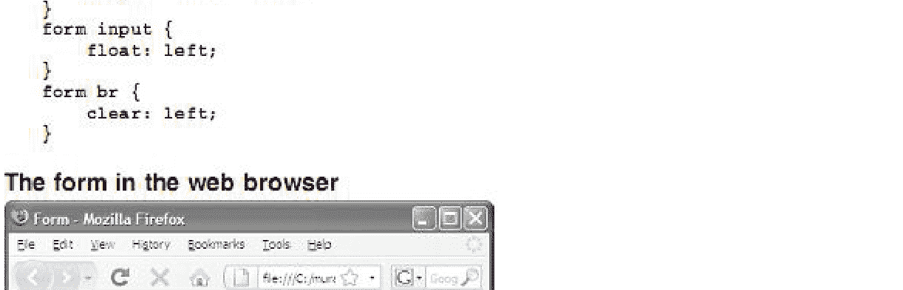

订阅我们的新闻列表：

姓名： [输入框]
邮箱： [输入框]
订阅 [提交按钮]

### 描述

- 当你浮动内联元素时，块内的其他内联元素将流进被浮动元素留出的空间。
- 使用 `<br>` 标签并配合 `clear` 属性可以控制表单行的换行。

## 术语

- 级联样式表 (Cascading Style Sheets)
- `em`
- 继承 (inherited)
- 声明 (declaration)
- 外部样式 (external style)
- 内联样式 (inline style)
- 属性 (property)
- 值 (value)
- 十六进制 (hexadecimal)
- 后代选择器 (descendant selector)
- 子选择器 (child selector)
- 属性选择器 (attribute selector)
- 用户样式 (user style)
- 盒模型 (box model)
- 内边距 (padding)
- 浮动元素
- 相对定位

## 使用 CSS 练习

在练习中，你将学习如何使用 CSS 处理网页。

1. 使用 Firefox 打开 `index.html`。
2. 使用文本编辑器打开 `primary.css`。
3. 使用文本编辑器打开 `primary.css`。
4. 点击网页中的链接，注意你在过去三个步骤中所做的更改已应用到页面上。现在，点击按钮返回主页。

### 查看页面的盒模型

5. 添加一条 CSS 规则，为每个 `<div>` 标签显示 1 像素的实线边框。然后，在浏览器中查看页面，这些框将页面分为四个部分：头部、侧边栏、内容和页脚。
6. 通过注释该规则来关闭边框。然后查看页面，确保额外的边框已消失。

### 修改页面的外部样式

在每个步骤之后，查看页面以确保更改正确。

7. 将 `<body>` 元素的背景颜色改为黄色。然后，将 `<h1>` 和 `<h2>` 元素的颜色改为蓝色。
8. 将 `<body>` 元素的字体大小改为默认字体大小的 87.5%。注意这增加了页面上所有元素字体的大小。
9. 修改 `<body>` 元素的行高（`line-height`），使行高为 1.4 `em`（当前字体大小的高度）。
10. 点击网页中的链接，注意你在过去三个步骤中所做的更改已应用到页面上。
11. 将产品列表使用的项目符号更改存储在 `exercise/chapter_05` 目录下的 `star.gif` 图像。但是，请确保不要为导航链接添加项目符号。为此，添加一个只选择内容区域内 `<ul>` 标签的新规则集。
12. 为内容区域的左右添加 2 `em` 的内边距（`padding`）。

### 修改页面布局

13. 修改 CSS，使侧边栏显示在内容的右侧而不是左侧，并将内容文本左侧缩进 1 `em`，右侧缩进 2 `em`。
14. 如果你对此应用程序的任何 CSS 有任何疑问，请继续实验。完成后，关闭文件。

---

# 第 2 部分：JavaScript 基础

本节的前三章扩展了你在第 2 章中学到的内容。在第 6 章中，你将学习如何从用户获取输入并在 XHTML 元素中显示输出。在第 7 章中，你将学习更多关于数字、字符串和日期的操作。在第 8 章中，你将学习更多关于 `if` 语句和 `for` 语句等控制结构的操作。这些章节将回答你对第 5 章介绍的 JavaScript 基础的任何疑问。

然后，接下来的四章将基于这些基础。在第 9 章中，你将学习如何处理数组。在第 10 章中，你将学习如何创建和使用函数。在第 11 章中，你将学习如何创建和使用自定义对象。在第 12 章中，你将学习如何在数据提交到服务器之前在表单中使用正则表达式、异常和客户端数据验证。

完成本节后，你将掌握 JavaScript 语言。然后，第 3 部分将向你展示如何使用 JavaScript 编写 DOM 脚本，并将网页提升到新的高度。

## 第 6 章：如何获取输入和显示输出

任何应用程序都有三个主要阶段：收集信息、处理信息和显示结果。

在第 2 章中，你学习了从文本框获取数据和在文本框中显示信息的简单技术。现在，本章展示了让应用程序与用户交互的其他技术。

### 如何获取输入

本主题向你展示了从用户获取信息的六种方法。前两种使用浏览器提供的方法。后四种使用网页中的表单控件。

### 如何从 `prompt` 方法获取数据

`prompt` 方法是 Web 浏览器提供的全局方法。调用时，它会显示一个如图 6-1 所示的对话框。如你所见，该对话框包含一条消息、一个供用户输入请求数据的文本框以及 OK 和取消按钮。

如图中的语法所示，`prompt` 有两个参数。`message` 参数包含应显示的消息。`defaultValue` 参数包含显示在文本框中的默认值。如果在此调用该方法时未包含此参数，文本框将是空的。

如果用户在文本框中输入数据并点击 OK 按钮，该条目将作为字符串返回。如果用户点击取消按钮，则该方法将返回一个 `null` 值。

图中的第一个示例向你展示了当预期输入字符串数据时如何调用该方法。后两个示例展示了当预期输入数字数据时如何调用该方法。这些示例使用 `parseInt` 和 `parseFloat` 方法将输入的字符串转换为数字。但请记住，如果文本无法转换为数字，这些方法将返回 `NaN`。

最后一个示例展示了如何判断用户是否点击了对话窗口中的取消按钮。在这里，第一个 `if` 语句测试 `age` 的值是否为 `null`。如果是，说明用户点击了取消。如果不是，则将 `age` 转换为数字。然后，嵌套的 `if` 语句判断转换是否成功，如果是，判断用户年龄是否足够投票。

#### `prompt` 方法的语法

```javascript
prompt(message, defaultValue);
```

#### `prompt` 方法的参数

| 参数 | 描述 |
| :--- | :--- |
| `message` | 在 prompt 对话框中显示的消息。 |
| `defaultValue` | 显示在文本框中的值。 |

#### `prompt` 方法的返回值

| 值 | 描述 |
| :--- | :--- |
| `null` | 用户点击取消按钮返回。 |
| `string` | 用户点击 OK 或按回车键时文本框中的值。 |

#### 当预期字符串数据时如何调用 `prompt` 方法

```javascript
var username = prompt("Please enter your name:");
```

#### 当预期数字数据时如何调用 `prompt` 方法

```javascript
var age = parseInt(prompt("Please enter your age:", "18"));
var wage = parseFloat(prompt("Please enter the hourly wage:", "5.35"));
```

#### 如何判断用户是否点击了取消按钮

```javascript
var age = prompt("Please enter your age:");
if (age == null) {
    alert("You clicked Cancel.");
} else {
    age = parseInt(age);
    if (isNaN(age)) {
        alert("You did not enter a number.");
    } else if (age >= 18) {
        alert("You can vote.");
    } else {
        alert("You cannot vote.");
    }
}
```

### 描述

- `prompt` 方法显示一个文本框并返回一个字符串。
- 如果省略 `defaultValue` 参数，文本框中将显示空字符串。
- 如果用户点击取消按钮，方法返回 `null` 值。
- 因为 `prompt` 在用户点击 OK 时返回字符串，你需要使用 `parseInt` 或 `parseFloat` 方法将字符串转换为数字。

### 如何从 `confirm` 方法获取响应

`confirm` 方法是提供的另一种全局方法。调用时，它会显示一个如图 6-2 所示的对话框，带有 OK 按钮和取消按钮。该方法需要一个参数，即应显示的消息。然后，如果用户点击 OK 按钮，该方法返回 `true`；如果用户点击取消按钮，该方法返回 `false`。

图中的示例使用 `confirm` 方法在允许进入商店之前询问用户是否同意策略，并将响应存储在变量中。如果该值为 `true`，用户点击了 OK 并进入商店。如果是 `false`，用户点击了取消并被阻止进入。

如果你是编程新手，可能会注意到 `if` 语句中的条件只是布尔变量（`response`），它包含 `true` 或 `false` 值。这等同于 `response == true`。你将在书中到处看到这种简写。

#### `confirm` 方法的语法

```javascript
confirm(message);
```

#### `confirm` 方法的参数

| 参数 | 描述 |
| :--- | :--- |
| `message` | 在 confirm 对话框中显示的消息。 |

#### `confirm` 方法的返回值

| 值 | 描述 |
| :--- | :--- |
| `true` | 用户点击 OK 按钮返回。 |
| `false` | 用户点击取消按钮或关闭按钮返回。 |

#### 如何调用 `confirm` 方法

```javascript
var response = confirm("Do you agree to the web site privacy policy?");
if (response) {
  alert("Thank you. You may continue to the web store.");
} else {
  alert("You cannot use the web store at this time.");
}
```

### 描述

- `confirm` 方法显示一个包含消息、OK 按钮和取消按钮的对话框。
- 如果用户点击 OK 按钮，该方法返回 `true` 值。
- 如果用户点击取消按钮，该方法返回 `false` 值。

### 如何获取单选按钮的状态

网页中的一组单选按钮允许用户在多个选项中选择一个。当用户点击组中的某一个按钮时，组中的其他按钮将取消选中。然后，你可以使用 JavaScript 代码检查图 6-3 所示的 Radio 对象的属性，以确定哪个按钮被选中了。

当你创建一个一组单选按钮时，它们必须具有相同的 `name`，这样网络浏览器才能知道它们属于同一组。然而，它们必须具有不同的 `id` 值。

在图示例中，XHTML 代码显示了两个单选按钮。这两个按钮都有 `name` "policy"，但其中一个的 `id` 为 `policy_accept` 值为 `accept`，而另一个的 `id` 为 `policy_decline` 值为 `decline`。这两个按钮初始时都没有被选中。


当 JavaScript 代码执行时，它会创建一个名为 `status` 的变量并将其值初始化为 `unknown`。然后，如果 `policy_accept` 按钮被选中，则 `status` 被设置为 `accept` 按钮的值，即 `accept`。但如果 `policy_decline` 按钮被选中，则 `status` 被设置为 `decline` 按钮的值，即 `decline`。

然后，`if` 语句测试这三个值并为每个值显示适当的消息。如果用户没有点击按钮，会提醒她需要选择选项之一。如果用户点击了 `accept` 按钮，则允许进入系统。如果她点击了 `decline` 按钮，则不允许进入。

这种处理预定义按钮的技术在单选按钮较少或它们由 Web 服务器运行的脚本生成时非常有用，你需要更高级的技术来处理单选按钮。你将在第 3 节学习这些技术。

# Radio 对象的两个属性

| 属性 | 描述 |
| --- | --- |
| checked | 如果设置为 true，则按钮被选中；如果设置为 false，则未被选中。 |
| value | 按钮 `value` 属性的内容 |

# 如何获取单选按钮的状态

```html
<p>接受或拒绝网站隐私政策：</p>
<p><input type="radio" name="policy" id="policy_accept" value="accept" />接受</p>
<p><input type="radio" name="policy" id="policy_decline" value="decline" />拒绝</p>
```

接受或拒绝网站隐私政策：

接受

拒绝

# 处理单选按钮的 JavaScript 代码

```javascript
var $ = function(id) {
  return document.getElementById(id);
}

var status = "unknown";
if ($("policy_accept").checked) {
  status = $("policy_accept").value;
}
if ($("policy_decline").checked) {
  status = $("policy_decline").value;
}

if (status == "unknown") {
  alert("您必须接受或拒绝隐私政策*");
} else if (status == "accept") {
  alert("感谢。您可以继续访问网商店。");
} else {
  alert("您现在无法使用网商店。");
}
```

### 描述

- 一组中的所有单选按钮必须具有相同的 `name`，但具有不同的 `id`。
- 一组中同一时间只能有一个单选按钮被选中，但并非按钮都必须被选中。

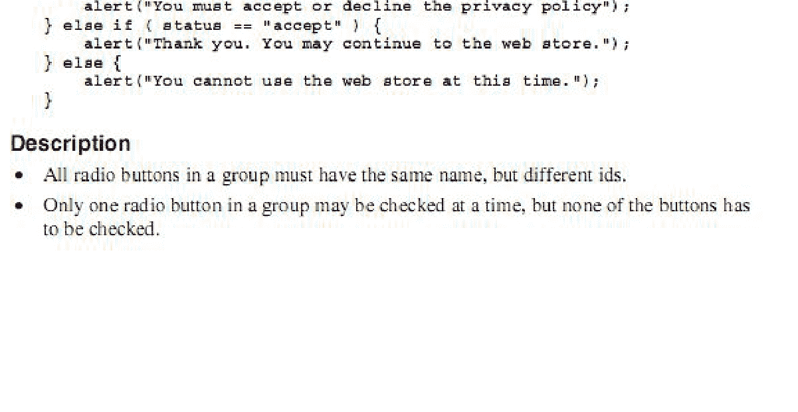

# 如何获取复选框的状态

网页中的复选框允许用户通过勾选方框来选择选项。与单选按钮不同，每个复选框都是独立的。

当你创建一个复选框时，它必须有一个唯一的 `id`，且 `name` 和 `id` 属性必须设置为相同的值。图 6-4 中的 XHTML 代码说明了这一点。然后，你可以使用 Checkbox 对象的两个属性来确定复选框是否被选中。

当图中的 JavaScript 代码执行时，它会创建一个名为 `accept` 的变量，并将其值设置为 `accept` 复选框的 `checked` 属性，其值为 `true` 或 `false`。然后，如果 `accept` 变量为 `true`，则允许进入商店。但如果 `accept` 变量为 `false`，则不允许进入。

# Checkbox 对象的两个属性

| 属性 | 描述 |
|---|---|
| checked | 如果设置为 true，则复选框被选中；如果设置为 false，则未被选中。 |
| value | 复选框 `value` 属性的内容。 |

# 如何获取复选框的状态

复选框的 XHTML 代码

```html
<p><input type="checkbox" name="accept" id="accept" value="accept" />
我接受网站隐私政策。</p>
```

- 我接受网站隐私政策。

# 处理复选框的 JavaScript 代码

```javascript
var $ = function (id) { return document.getElementById(id); };

var accept = $("accept").checked;

if ( accept ) {
  alert("感谢。您可以继续访问网商店。");
} else {
  alert("您现在无法使用网商店。");
}
```

### 描述

- 每个复选框都与页面上的其他复选框相互独立。它们不被视为一组。
- 复选框的 `name` 和 `id` 属性应设置为相同的值。

# 如何获取复选框的状态

（注：此处原文存在大量重复段落，已根据要求仅翻译核心逻辑且不再重复输出原文）

## Textarea 对象的一个属性

| 属性 | 描述 |
|---|---|
| value | textareas 中的文本 |

## 如何获取文本区域的内容

文本区域的 HTML 代码

```html
<p>请在下方的框中输入您的评论。</p>
<p><textarea name="comment" id="comment" rows="5" cols="40"></textarea></p>
```

请在下方的框中输入您的评论。

请注意，我的分机是 15，您也可以通过分机 18 联系 Kelly。

## 处理文本区域的 JavaScript 代码

```javascript
var $ = function (id) { return document.getElementById(id); }
var comment = $("comment").value;
var charCount = comment.length;
if (comment == "") {
  alert("请输入评论.");
} else {
  alert("您的评论有 " + charCount + " 个字符：\n\n" + comment);
}
//[Javascript Application]
```


### 描述

- 当用户在文本区域输入时按下回车键，文本中会输入一个硬回。硬回会以字符的形式出现在 `value` 属性中。
- 当用户到达行尾并自动开始新行时，会发生软回。软回不会以字符的形式出现在 `value` 属性中。
- 使用 Textarea 对象的 `value` 属性获取文本字符串后，可以使用 String 对象的 `length` 属性获取字符串中的字符数。

图 6-6 如何从文本区域获取数据

## 如何使用控件的方法和事件

图 6-7 展示了你可能用于控件的一些常用方法和事件。在第 2 章中，你学习了如何使用 `focus` 方法将焦点移动到控件上。但如图所示，你也可以使用 `blur` 方法移除控件上的焦点。

同样，你还学习了如何使用按钮的 `onclick` 事件来启动事件处理器。但如该所示，你还可以使用其他事件来处理文本框、列表和文本区域等控件。例如，你可以为列表编写一个事件处理器来处理它的 `onchange` 事件。这样，每当用户选择列表中的某个选项时，你就可以进行特殊处理。

如图中的代码所示，这类似于为按钮的 `click` 事件使用事件处理器。首先，你编写事件处理器。然后，在 `window.onload` 事件的事件处理器中，将新的事件处理器分配给该事件。

## 控件常用的两种方法

| 方法 | 描述 |
|---|---|
| focus | 将焦点移动到控件。 |
| blur | 移除控件上的焦点。 |

## 常见控件事件

| 事件 | 描述 |
|---|---|
| onus | 控件接收焦点。 |
| onblur | 控件失去焦点。 |
| onclick | 用户点击控件。 |
| ondblclick | 用户双击控件。 |
| onchange | 用户在文本框区域选择文本。 |

## select 列表的 HTML

```html
<select name="investment" id="investment">
<option value="1000">$1,000</option>
<option value="5000">$5,000</option>
<option value="10000">$10,000</option>
<option value="25000">$25,000</option>
</select><br />
```

## select 列表 onChange 事件的事件处理器

```javascript
var investmentChange = function () {
  calculateClick(); // 改变时重新计算未来值
  $("investment").blur(); // 移除 select 列表的焦点
}
```

## 文本框 dblclick 事件的事件处理器

```javascript
var yearsDblclick = function () {
  $("years").value = ""; // 双击时清空文本框
}
```

## 将事件处理器分配给事件的代码

```javascript
window.onload = function () {
  $("calculate").onclick = calculateClick;
  $("investment").onchange = investmentChange;
  $("years").ondblclick = yearsDblclick;
  $("years").focus();
}
```

### 描述

- 当使用 XHTML 控件时，可以使用 `focus` 或 `blur` 方法将焦点移动到控件或移除控件上的焦点。
- 当使用 XHTML 控件时，你有时需要为控件提供事件处理器。

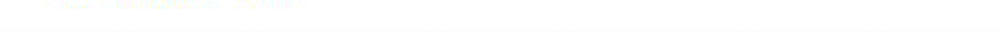

## 如何显示输出

在第 2 章中，你学习了如何在文本框中显示输出。本主题向你展示了应用程序中提供输出的其他四方法。第一种允许通过修改 `span` 标签的内容来显示输出。另外三种通过更改 `span` 元素来显示输出。

## 如何在 span 标签中显示数据

`span` 标签通常用于控制网页的格式。它允许你对文本区域应用 CSS 类。在图 6-8 中，你将学习如何访问并更改 `span` 标签内部的文本。

（注：由于原文中存在大量重复内容，此处已提取核心逻辑进行翻译）

## 如何设置单选按钮的状态

两个单选按钮的 XHTML 代码

```html
<p>点击按钮来切换您是否接受或拒绝网站隐私政策。</p>
<p><input type="radio" name="policy" disabled="disabled"
id="policy_accept" value="accept"/></p>
<p><input type="radio" name="policy"
disabled="disabled" checked="checked"
id="policy_decline" value="Decline"/></p>
<p><input type="Button" id="toggle" value="Toggle"/></p>
```

点击按钮来切换您是否接受或拒绝网络隐私政策。

接受

拒绝

切换

# 设置单选按钮状态的 JavaScript 代码

```javascript
var $ = function (id) { return document.getElementById(id); };

var toggleClick = function () {
  if ($('#policy_accept').checked) {
    $('#policy_decline').checked = true;
  } else {
    $('#policy_accept').checked = true;
  }
}

window.onload = function () {
  $('#toggle').onclick = toggleClick;
};
```

### 描述

- 要清除单选按钮，将它的 `checked` 属性设置为 `false`。清除单选按钮时，没有其他按钮会被选中。
- 要设置单选按钮，将它的 `checked` 属性设置为 `true`。设置单选按钮时，同一组中的任何其他已选按钮都将被清除。

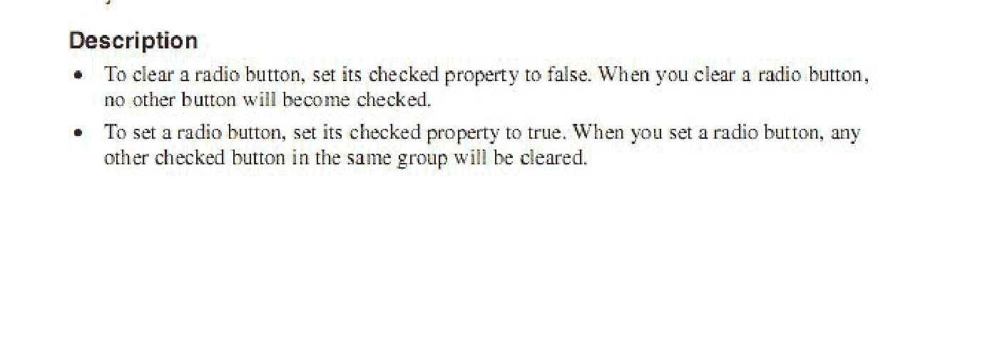

图 6-9 如何设置单选按钮的状态

## 如何设置复选框的状态

当网页上有复选框时，可以使用 JavaScript 勾选或取消勾选该框。如图 6-10 所示，要勾选复选框，将其 `checked` 属性设置为 `true`。要取消勾选，将其属性设置为 `false`。

下方示例中的 HTML 代码创建了一个 name 和 id 为 `vote_status` 的复选框。该复选框还设置了 `disabled` 属性，用户无法通过点击对其勾选。相反，复选框的状态只能通过代码来更改。

- 当 JavaScript 代码运行时，它最初会清除复选框。然后，它会提示用户输入年龄。如果输入的年龄为 18 岁或以上，则 `checked` 属性设置为 `true`，表示用户年龄足够投票。

## 如何设置复选框的状态

复选框的 HTML 代码

```html
<input type="checkbox" disabled="disabled" name="voteStatus" id="vote_status" />
```

勾选时可以投票。

勾选时可以投票。

# 设置复选框状态的 JavaScript 代码

```javascript
var $ = function (id) {
  return document.getElementById(id);
};

$("voteStatus").checked = false;
var age = prompt("请输入您的年龄:");
if (age == null) {
  alert("您点击了取消.");
} else {
  age = parseInt(age);
  if (isNaN(age)) {
    alert("您没有输入数字.");
  } else if (age >= 18) {
    $("voteStatus").checked = true;
  }
}
```

### 描述

- 要清除复选框，将它的 `checked` 属性设置为 `false`。
- 要设置复选框，将它的 `checked` 属性设置为 `true`。


## 如何在文本区域中显示数据

当网页上有文本区域时，可以使用 JavaScript 在区域内显示文本。要实现这一点，将文本区域的 `value` 属性设置为您想要显示的文本。此文本可以包含换行符，每当遇到换行符时，文本就会开始新行。

图 6-11 中的示例展示了如何在文本区域中显示文本。在这里，文本是根据三个复选框的状态生成的。如果没有复选框被勾选，文本将指示哪些复选框被选中（但如果一个或多个复选框被勾选，文本将指示哪些复选框已被选中）。

此示例的 HTML 代码创建了三个复选框和一个文本区域。为了确保隐私和安全，文本区域的 name 和 id 为 `policies`。它的尺寸设置为 40 列 6 行。

当 JavaScript 代码运行时，在线活动的代码将事件处理程序绑定到 id 和 name 为 `privacy`、`use` 和 `license` 的复选框上。当任何复选框发生变化时，文本区域都会更新内容。在 `onload` 事件处理程序处理每个复选框的更新事件后，将名为 `updatePolicies` 的函数绑定到事件，调用 `updatePolicies` 函数来初始化文本区域的内容。

当 `updatePolicies` 函数运行时，它将每个复选框的状态存储在变量中。这些变量的名称与复选框的名称匹配。它还会创建一个空变量 `message`，用于存储要在框中的消息。

如果至少复选框被勾选，语句将为消息创建一个标题，并为每个被勾选的复选框添加一行。如果没有复选框被勾选，语句将创建一个指示此情况的消息。

一旦 `updatePolicies` 函数运行，消息就会被设置为文本区域的 `value` 属性。

## 如何在文本区域中显示数据

三个复选框的 XHTML 代码

```html
<p>选择您同意的政策：</p>
<input type="checkbox" name="privacy" id="privacy" /> 隐私政策
<input type="checkbox" name="use" id="use" /> 可接受政策
<input type="checkbox" name="license" id="license" /> 用户许可协议
<textarea name="policies" id="policies" rows="6" cols="40"></textarea>
```

# 在文本区域显示输出的 JavaScript 代码

```javascript
var updatePolicies = function () {
    var privacy = $("privacy").checked;
    var use = $("use").checked;
    var license = $("license").checked;
    var message = "";
    if (privacy || use || license) {
        message += "您同意了以下政策：\n";
        if (privacy) {
            message += "- 隐私政策\n";
        }
        if (use) {
            message += "- 可接受政策\n";
        }
        if (license) {
            message += "- 用户许可协议\n";
        }
    } else {
        message += "您尚未同意任何政策.";
    }
    $("policies").value = message;
};

window.onload = function () {
    updatePolicies();
    $("privacy").onclick = updatePolicies;
    $("use").onclick = updatePolicies;
    $("license").onclick = updatePolicies;
};
```

# 将代码添加到复选框和文本区域

- 6. 修改 JavaScript 代码，使其在复选框被勾选时在文本区域中显示消息。例如，如果用户选择了 $5000 的值，文本区域中的消息应该像所示：

  $5000 的未来价值

  每月复利：$5415.00

  每年复利：$5400.00

使用 `prompt` 方法获取其他投资金额

- 7. 修改 JavaScript 代码，使其在用户从下拉列表中选择“其他值”时，使用 `prompt` 方法获取投资金额。

（记住，如果参数不是有效的数值值，`parseFloat` 方法将返回 `NaN`。）

# 添加两个事件处理器

- 8. 添加一个事件处理器，当用户双击年份文本框时，清除该文本框的内容。
- 9. 为投资控件的 `onChange` 事件添加一个事件处理器。该事件处理器应该在且仅在年份文本框包含有效数字时，才调用 `calculate_click` 事件处理器。

## 7

### 如何处理数字、字符串和日期

在第 2 章中，你学习了处理数字、字符串和日期的一些基础技能。现在，你将学习在 JavaScript 应用程序中处理数据所需的其他其他技能。

| | |
| 如何处理数字 ..................................................... | 250 |
| 如何表示特殊数值 ........................................ | 250 |
| Number 对象的方法 ............................................... | 253 |
| 如何使用条件运算符 .......................................... | 254 |
| 如何使用 Math 对象 ...................................................... | 256 |
| 如何使用 Math 对象的方法 ................................. | 256 |
| 如何使用随机数生成器 ........................................................ | 258 |
| 如何处理字符串 ....................................................... | 260 |
| 如何在字符串中使用转义序列 ........................................ | 260 |
| 如何使用 String 对象的方法 ............................... | 262 |
| 处理字符串的示例 ................................................ | 262 |
| 如何处理日期和时间 ............................................... | 266 |
| 如何创建 Date 对象 ....................................................... | 266 |
| Date 对象的方法 ................................................. | 268 |
| 处理日期的示例 ................................................. | 270 |
| 观点 ....................................................................... | 272 |

## 如何处理数字

在第 2 章中，你学习了如何输入数字、执行常见的算术运算以及将数字转换为固定小数值。在本主题中，你将在此这些技能的基础上进行扩展。

## 如何表示特殊数值

在理论上，数字可以根据你的需要任意大或任意小。在实践中，根据编程语言内部表示数值的方式，你被限制在一个特定的取值范围内。

在内部，JavaScript 使用 IEEE 754 标准来表示数值。为了说明，图 7 显示了一个数轴，指示了 JavaScript 数字可以表示的值范围。

在数轴的中间，零位于那里。零的右侧是最小正值 `5e-324`。这等同于一个小数点、323 个 0 和数字 5，这是一个极小的数字。在 0 和 `5e-324` 之间的任何数字都会被舍入到这些值之一。

值 `Infinity` 位于数轴的最右侧。这个特殊值用于表示任何大于最大正值的数字，大约为 `1.79e+308`。也就是说，179 后面跟着 305 个 0，这是一个巨大的数字。

数轴的左半部分是右半部分的镜像。在 `-5e-324` 和 0 之间的任何数字都会被舍入到这些值之一，而任何小于 `-1.79e+308` 的数字都将转换为 `-Infinity`。

最后，有一个特殊值 `NaN`。这个值代表“不是数字”（not a number），用于表示非数值值。在 IEEE 754 规范中，有九千万亿个特殊的 `NaN` 值。JavaScript 将它们全部视为单一的 `NaN` 值。由于 `NaN` 值可能代表任何 IEEE 值，因此 JavaScript 中的等价性判断 `NaN == NaN` 将始终返回 `false`，因为不知道这两个 `NaN` 值代表哪一个特定的 IEEE 值。要测试是否存在 `NaN` 值，你必须使用 `isNaN` 方法。

`Number` 对象有五个表示这些特殊值的属性。它们列在这里。对于 `Infinity`、`-Infinity` 和 `NaN` 还有两个快捷方式。图中的第一个示例显示了如何测试结果是否为 `Infinity`、`-Infinity` 或 `NaN` 并显示适当的消息。

第二个示例显示了 JavaScript 如何处理除以零。当你除以 0 时，结果是 `NaN`。当你用一个非零数字除以 0 时，结果将是 `Infinity` 或 `-Infinity`，取决于非零数字的符号。这与大多数语言处理此方式不同。在其他语言中，除以零通常会导致运行时错误，因为没有方法可以表示 `Infinity`。

## 数据类型的最小值和最大值

-1.797693134862317e+308 到 1.797693134862317e+308

## Number 对象的属性

| 属性 | 描述 |
| :--- | :--- |
| MAX_VALUE | 可表示的最大值。 |
| MIN_VALUE | 可表示的最小值。 |
| Infinity | 表示无穷。 |
| -Infinity | 表示负无穷。 |
| NaN | 表示非数字。 |

## 快捷值

| 值 | 描述 |
| :--- | :--- |
| Infinity | `Infinity` 的快捷方式 |
| -Infinity | `-Infinity` 的快捷方式 |
| NaN | `NaN` 的快捷方式 |

## 示例 1：测试 Infinity、-Infinity 或 NaN

```javascript
if (result === Infinity) {
  alert('The result is Infinity');
} else if (result === -Infinity) {
  alert('The result is -Infinity');
} else if (isNaN(result)) {
  alert('The result is NaN');
}
```

## 示例 2：除以零

```javascript
result = 10 / 0; // Infinity
result = -10 / 0; // -Infinity
result = 0 / 0; // NaN
```

## Number 对象的方法

`Number` 对象有许多方法允许你格式化数字。第一个示例显示了如何使用 `toFixed` 方法，它返回一个带有指定小数数的字符串。

```javascript
var tax = 12.959;
alert(tax.toFixed(2)); // "12.96"
```

由于 `toFixed` 返回的是字符串，如果你想进行进一步计算，可能需要将其转换回数字。

```javascript
var tax = 12.959;
tax = parseFloat(tax.toFixed(2)); // 12.96
```

第二个示例显示了 `toString` 方法是如何隐式使用的。在这里，`age` 与字符串拼接。

```javascript
var age = 25;
alert("Age: " + age); // "Age: 25"
```

第三个示例显示了如何显式使用 `toString` 方法将数字转换为非 10 进制。

```javascript
var num = 255;
alert(num.toString(16)); // "ff"
```

第四个示例显示了如何使用 `toExponential` 方法。该方法对于显示科学数值，但如果你没有开发科学应用程序，可能就不需要它。

```javascript
var mass = 5.97e24;
alert(mass.toExponential(2)); // "5.97e+24"
```

第五个示例显示了如何使用 `toPrecision` 方法，当你使用 JavaScript 一个数字最多可以有约 16 位，且有效数字包括小数点前后的数字时，应该使用该方法。

```javascript
var num = 124.599;
alert(num.toPrecision(3)); // "125"
```

# Number 对象的方法

| 方法 | 描述 |
| --- | --- |
| toFixed(digits) | 返回一个保留到指定小数位数的数字字符串。 |
| toString(base) | 返回一个指定基数表示的数字字符串。基数范围从 2 到 36。如果未提供 base，则使用 10。 |
| toExponential(digits) | 返回一个以指数计数法表示且保留到指定小数位数的数字字符串。如果未提供 digits，则返回所有。 |
| toPrecision(precision) | 返回一个具有指定有效数字数的数字字符串。结果可能是指数计数法格式。如果未提供 precision，则返回与 toString() 相同的结果。 |

示例 1：使用 toFixed 方法

```javascript
var total = 19.99, rate = 0.075;
var tax = total * rate; // tax is 1.49925
var total = tax.toFixed(2); // tax is 1.5
alert(tax.toFixed(2)); // displays 1.5
```

示例 2：用于 10 进制转换的隐式 toString 方法

```javascript
var age = parseInt(prompt("请输入您的年龄。"));
alert("您的十进制年龄是 " + age); // age is 25
```

示例 3：使用其他基数的 toString 方法

```javascript
var age = parseInt(prompt("请输入您的年龄。"));
alert("您的二进制年龄是 " + age.toString(2)); // age is 11001
alert("您的十六进制年龄是 " + age.toString(16)); // 如果你输入 25，它将显示 19
```

示例 4：使用 toExponential 方法

```javascript
var m = parseFloat(prompt("请输入以千克（kg）为单位的质量。"));
var c = m / 1000; // c is 0.0075
alert("能量量为 " + m.toExponential(4) + " Joules.");
// 如果你输入 80，它将显示 8.0000e1
```

示例 5：使用 toPrecision 方法

```javascript
var miles = parseFloat(prompt("请输入里数。"));
var gallons = parseFloat(prompt("请输入加仑数。"));
var mpg = miles / gallons;
alert("您的每加仑里程数为 " + mpg.toPrecision(3)); // 如果你输入 250 和 10，它将显示 250
```

### 描述

- 对于业务应用，你通常只需要使用 `toFixed` 方法。
- 无参数的 `toString` 方法在 JavaScript 需要将数字转换为字符串时被隐式使用。

# 如何使用条件运算符

条件运算符是 JavaScript 中唯一的三元运算符。这意味着它有三个操作数。相比之下，元运算符（如 `++`）有一个操作数，而二元运算符（如 `+`）有两个操作数。

由于条件运算符有三个操作数

执行时，条件运算符首先评估表达式以得到一个真或假的结果。如果条件表达式为真，则使用中间表达式的结果作为条件运算符的结果。如果条件表达式为假，则使用最后一个操作数表达式的结果作为条件运算符的结果。

图中的第一个示例展示了如何使用条件运算符根据比较将变量设置为两个值之一。如果年龄为 18 岁或以上，message 将包含“Can vote”（可以投票）。如果年龄小于 18 岁，message 将包含“Cannot vote”（不能投票）。

第二个示例展示了如何在其中一个操作数在使用表达式。如果 hours 超过 40 小时，overtime 将包含超过 40 小时的工资的 1.5 倍。如果 hours 不超过 40 小时，overtime 将为零。

第三个示例展示了如何在发送给用户的消息中选择单数或复数后缀。如果 error_count 为 1，则后缀为空。否则，它将是该后缀。

第四个示例展示了如何根据值是否达到最大值来增加值或将其重置为 1。例如，如果 max 是 10 而 value 是 6，则测试将为假，value 将变为 value +1 而不是 value。然而，如果 value 是 10，它将被设置为 10 而不是 value。

如果你需要执行这种变量的循环回滚，但起始值是 0 而不是 1，请不要使用条件运算符。你可以使用 `%` 运算符。例如，如果你从值 9 开始使用此语句

```
value = (value + 1) % 10
```

它的范围将从 0 到 9，然后回到 0。

第五个示例展示了如何将条件运算符与函数的 return 语句结合。如果 number 大于 highest，则返回它。否则，返回该 number。

最后一个示例展示了如何将值保持在固定范围内。它使用嵌套的条件运算符来实现。如果 value 大于 max，则将 value 设置为 max。评估后，如果 value 小于 min，则将 value 设置为 min。如果 value 不小于 min，则保持其原值。

为了清晰起见，通常使用语句比使用条件运算符更好。图中最后两个示例说明了这一点。尽管如此，许多程序员倾向于使用条件运算符，因为这意味着代码更少。

# 条件运算符的语法

```
( conditional_expression ) ? value_if_true : value_if_false
```

# 条件运算符的使用示例

示例 1：用 if 语句重写

```javascript
if (age >= 18) {
  message = "Can vote";
} else {
  message = "Cannot vote";
}
```

示例 2：用 if 语句重写

```javascript
if (hours > 40) {
  overtime = 1.5 * pay;
} else {
  overtime = 0;
}
```

示例 3：用 if 语句重写

```javascript
if (error_count == 1) {
  ending = "";
} else {
  ending = "s";
}
```

示例 4：用 if 语句重写

```javascript
if (value < max) {
  value = value + 1;
} else {
  value = max;
}
```

示例 5：用 if 语句重写

```javascript
if (number > highest) {
  return number;
} else {
  return number;
}
```

示例 6：用 if 语句重写

```javascript
if (value > max) {
  value = max;
} else if (value < min) {
  value = min;
} else {
  value = value;
}
```

### 描述

- 条件运算符首先评估表达式。然后，如果条件表达式为真，则返回中间表达式的结果。如果条件表达式为假，则返回最后一个操作数的结果。
- 尽管使用条件运算符可能会导致代码晦懂，但 JavaScript 程序员经常使用它。为了清晰起见，条件运算符可以使用 if 语句重写。

## Math 对象的常用方法

| 方法 | 描述 |
| --- | --- |
| Math.abs(x) | 返回 x 的绝对值。 |
| Math.round(x) | 返回四舍五入到最近整数的 x。如果小数部分为 5，则 x 向上舍入到下一个整数。 |
| Math.ceil(x) | 返回向上舍入到下一个整数的 x。 |
| Math.floor(x) | 返回向下取整到较小整数的 x。 |
| Math.pow(x,power) | 返回 x 升指定的指定幂后的值。幂可以是小数。 |
| Math.sqrt(x) | 返回 x 的平方根。 |
| Math.max(x1,x2,...) | 返回参数中的最大值。 |
| Math.min(x1,x2,...) | 返回参数中的最小值。 |

## 示例 1：abs 方法

```
var result_1a = Math.abs(-3.4); // result_1a 为 3
```

## 示例 2：round 方法

```
var result_2a = Math.round(2.5); // result_2a 为 3
var result_2b = Math.round(-3.4); // result_2b 为 -3
var result_2c = Math.round(-3.5); // result_2c 为 -3
var result_2d = Math.round(-3.51); // result_2d 为 -4
```

## 示例 3：floor 和 ceil 方法

```
var result_3a = Math.ceil(3.9); // result_3a 为 4
var result_3b = Math.ceil(12.5); // result_3b 为 13
var result_3c = Math.floor(-3.4); // result_3c 为 -4
var result_3d = Math.floor(-3.4); // result_3d 为 -4
```

## 示例 4：pow 和 sqrt 方法

```
var result_4a = Math.pow(2,3); // result_4a 为 8 (2 的立方)
var result_4b = Math.pow(125,1/3); // result_4b 为 5 (125 的立方根)
var result_4c = Math.pow(16,.5); // result_4c 为 4
```

## 示例 5：min 和 max 方法

```
var x = 12.5, y = -3.4;
var max = Math.max(x,y); // max 为 12.5
var min = Math.min(x,y); // min 为 -3.4
```

### 描述

- max 和 min 方法接受一个或多个参数。如果没有参数，max 方法返回 `-Infinity`，min 方法返回 `Infinity`。
- 要查看 Math 对象的方法和常量完整列表，请访问此网页：https://developer.mozilla.org/en/docs/Web/JavaScript/1.2/Reference/Global_Objects/Math

## 如何使用随机数生成器

`Math` 对象的 `random` 方法生成一个大于等于 0 但小于 1 的随机数。图 7-5 中的示例说明了这一点。通常，你需要一个 0 到 1 之间的随机数。

第二个示例展示了一个可以在指定范围内生成随机数的函数。它还允许你指定随机数小数点后的数字位数。

`randomnumber` 函数接受两个或三个参数。前两个参数是函数应该生成的随机数范围的最小值和最大值。这是必须的。第三个参数是可选的，如果省略则默认为零。

该函数首先验证 `digits` 参数以确保它是数字。如果 `parseInt` 测试失败，则将 `digits` 设置为 0。否则，使用 `parseInt` 将 `digits` 转换为整数。此函数确保 `digits` 处于 0 到 16 的范围内。如果超过此范围，则将其设置为 16；如果低于此范围，则将其设置为 0。

该函数生成该数字。如果 `digits` 等于 0，它会在 `min` 和 `max` 之间计算一个整数。为了实现这一点，该公式从 `random` 方法获取一个值，并乘以范围内的数值个数（`max-min`）。然后对该中间结果取下整以去除任何小数部分。最后，函数将 `min` 值加上 `floor` 方法的结果返回。

例如，如果 `min` 为 5，`max` 为 10，那么 `max - min + 1` 等于 6，将 0 到略小于 1 的随机数乘以 6 将返回一个 0 到略小于 6 范围内的值。接下来，使用 `floor` 方法截断小数部分返回一个范围内的整数。最后，将范围内的任何数字加上 5 将返回一个 5 到 10 范围内的数字，这就是所请求的范围。

如果 `digits` 是非零数字，该函数将计算 `min` 和 `max` 之间指定位数的小数差。在这里，第一个语句从 `random` 方法获取一个值，并乘以 `min` 和 `max` 之间的差。然后将其加上 `min`。接着，第二条语句使用 `to` 方法将数字转换为指定位数的字符串，并在返回之前使用 `parseFloat` 方法将其转换回数字。

## 基础转义序列

| 序列 | 描述 |
| --- | --- |
| \b | 退格 (Backspace) |
| \t | 制表符 (Tab) |
| \n | 换行 (New line) |
| \r | 回车 (Carriage return) |
| \f | 换页 (Form feed) |
| \" | 双引号 (Double quote) |
| \' | 单引号 (Single quote) |
| \\ | 反斜杠 (Backslash) |

使用基础转义序列的字符串示例

```
var quote = "He said \"Goodbye.\"";
var message = "Error\t123\tInvalid Operation";
var info = "The file is in C:\\murach";
```

## 部分 Unicode 字符的转义序列

| 序列 | 字符 | 序列 | 字符 |
| --- | --- | --- | --- |
| \u00a2 | ½ | \u00b2 | β |
| \u00a9 | © | \u00d0 | π |
| \u00ae | @ | \u0087 | × |
| \u00ae |  | \u2026 | … |
| \u0b0 |  | \u2212 | ∞ |
| \u0b1 | ± | \u221e | € |
| \u00a3 | Δ | \u0249 | Ω |
| \u00b5 | μ | \u2248 | ≈ |
| \u00bc | ¼ | \u2260 | ≠ |

## 代码 Unicode 转义序列的两种方法

| 序列 | 描述 |
| --- | --- |
| \u00dd | Unicode 值 (UTF-16) 由四位十六进制数表示的字符 |
| \u00ff | 等于 Unicode 字符中 Latin-1 范围内的 ÿ |

使用 Unicode 转义序列的字符串示例

```
alert("\u00a2*"); // 显示 ®2*
alert("\u20a9 2008"); // 显示 © 2008
```

### 描述

- 转义序列允许你插入键盘上没有的字符。
- 如需查看完整的 Unicode 字符列表，请访问 http://www.unicode.org/charts/
- 注意，并非所有字体都提供所有的 Unicode 字符。如果你使用的用户字体不支持某个 Unicode 字符，则将使用不同的字符代替。

图 7-6 如何使用转义序列

## 如何使用 String 对象的方法

图 7-7 描述了 String 对象的一个属性和几个方法。`length` 属性让你找到字符串中有多少个字符。这通过第一个示例说明了这一点。由于字符串中的位置是从 0 开始编号的，因此字符串中的最后一个字符位于由长度减 1 确定的位置。

此图中的示例 2 显示了你如何使用 `charAt` 方法。在这里，JavaScript 中的 J 是位置 0 处的字符，位置 4 处的字符是 s。

示例 3 显示了你如何使用 `concat` 方法。如果你指定了多个参数，字符串将按顺序拼接。这与当操作数之一是字符串时由 `+` 操作符执行的操作相同。尽管在 JavaScript 的早期实现中，使用 `+` 和 `concat` 方法之间存在性能差异，但现在差异微乎其微。因此，通常你可以使用任何你喜好的编码方法。

示例 4 显示了 `indexOf` 方法的使用。如果你省略参数，搜索将从字符串的开始开始。如果没有找到搜索内容，该方法将返回 -1。

示例 5 显示了 `substring` 方法的使用。注意，`end` 参数指定的字符不包含在结果中。如果 `start` 大于 `end`，则两个值将交换。如果其中一个值小于 0，则会被替换为 0。如果其中一个值大于字符串的长度，则会被替换为字符串的长度。

示例 6 显示了你如何使用 `toUpperCase` 和 `toLowerCase` 方法。这些方法没有参数，但不要忘记在方法名后加上空的小括号。

如果你熟悉其他语言的字符串方法，你可能会想问是否有图中未显示的有用方法。特别是，你可能在寻找更方便地格式化数字和日期的方法。例如，Java 和 C# 提供了字符串方法，可以方便地在数字、日期和时间内插入逗号。

答案是，此图总结了 JavaScript 提供的所有有用字符串方法，使用数组和正则表达式的方法除外，你将在第 5 章和第 12 章中学习如何使用它们。

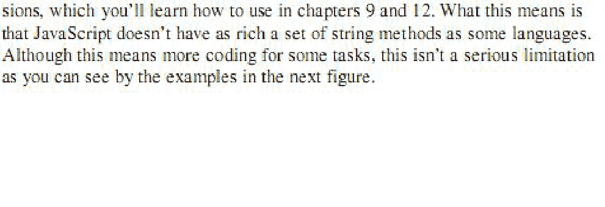

## String 对象的一个属性

| 属性 | 描述 |
| --- | --- |
| length | 字符串中字符的数量。 |

## 示例 1: 显示字符串的长度

```
var message_1 = "JavaScript";
var result_1 = message_1.length;   // result_1 为 10
```

## String 对象的方法

| 方法 | 描述 |
| --- | --- |
| charAt(position) | 返回字符串指定位置处的字符。 |
| concat(string1, string2) | 将 string1 与 string2 拼接。 |
| indexOf(search, position) | 返回从 position 开始的 search 首次出现的索引。 |
| substring(start, end) | 返回从 start 到 end 的字符串部分。 |
| toLowerCase() | 返回转换为小写的字符串。 |
| toUpperCase() | 返回转换为大写的字符串。 |

## 示例 1: 显示字符串的长度

```
var message_1 = "JavaScript";
var result_1 = message_1.length; // result_1 为10
```

## String 对象的方法

| 方法 | 描述 |
| --- | --- |
| charAt(position) | 返回字符串指定位置处的字符。 |
| concat(string1, string2) | 将 string1 与 string2 拼接。 |
| indexOf(search, position) | 返回从 position 开始的 search 首次出现的索引。 |
| substring(start, end) | 返回从 start 到 end 的字符串部分。 |
| toLowerCase() | 返回转换为小写的字符串。 |
| toUpperCase() | 返回转换为大写的字符串。 |

## 示例 1: 显示字符串的长度

```
var message_1 = "JavaScript";
var result_1 = message_1.length; // result_1 为10
```

## 处理字符串的示例

在之前的图中，你看到了使用字符串方法的简单示例。现在，图 7-8 显示了你如何使用循环进行更复杂的处理。示例 1 显示了如何使用一个名为 `lettercount` 的函数来计算字母在字符串中出现的次数，该函数接受三个参数。`haystack` 参数是要搜索的字符串，`needle` 参数是要查找的内容，`ignore` 参数是一个指示函数是否忽略大小写的布尔值。

开始时，`lettercount` 函数检查 `ignore` 是否为真。如果是，则将 `needle` 和 `haystack` 都转换为小写。然后，将变量 `position` 和 `count` 初始化为 0。`position` 变量将存储搜索的起始位置并在每次发现字母时进行更新。`count` 变量将存储字母出现的次数。

示例 2 显示了如何查看 `needle` 是否在 `haystack` 中。如果是，则 `count` 加 1并将 `position` 设置为找到字母之后的位置。当 `indexOf` 方法返回 -1 时，表示没有找到更多字母。当循环结束时，函数返回 `count` 的值。

示例 3 显示了如何使用一个名为 `trim` 的函数来去除字符串开的空格。这与 `trim` 函数类似，但 `end` 变量设置为字符串的最后一个位置（length-1）。然后，通过循环测试 `end` 位置的字符。只要它是空格，`end` 位置就会向后移动一个字符。循环在找到非空格字符时退出，函数返回从开头到 `end` 当前值的子字符串。在这里使用 `end` 变量是因为 `substring` 方法不返回由 `end` 位置指定的字符。

示例 4 显示了如何使用一个名为 `rtrim` 的函数来去除字符串末尾的空格。这类似于 `trim` 函数，但起始位置被设置为字符串的末尾。

示例 4 显示了如何通过结合示例 2 和示例 3 中的 `trim` 和 `rtrim` 函数来去除字符串两端的空格。这种类型的修剪在处理用户输入时经常需要。

示例 5 显示了如何使用一个名为 `equal_case` 的函数在两个字符串之间执行忽略大小写的相等性测试。这很有用，因为 `==` 操作符在用于字符串时是大写敏感的。为了执行忽略大小写的测试，该函数测试传递给它的两个参数的相等性，之后将它们转换为小写。

# 第 7 章 如何处理数字、字符串和日期

示例 1：统计字符串中某个字母出现的次数

```javascript
var letter_count = function (haystack, needle, ignore) {
  if (ignore) {
    haystack = haystack.toLowerCase();
    needle = needle.toLowerCase();
  }
  var position = 0, count = 0;
  while (haystack.indexOf(needle, position) != -1) {
    count++;
    position = haystack.indexOf(needle, position) + 1;
  }
  return count;
}

var count_a = letter_count("JavaScript", "a"); // count_a is 2
var count_b = letter_count("JavaScript", "b"); // count_b is 0
var count_c = letter_count("JavaScript", "s", true); // count_c is 1
```

示例 2：如何去除字符串开头的空格

```javascript
var trim = function (text) {
  var start = 0;
  while (text.charAt(start) == " ") {
    start++;
  }
  return text.substring(start);
}

var result_2 = trim("  JavaScript"); // result_2 is "JavaScript"
```

示例 3：如何去除字符串末尾的空格

```javascript
var rtrim = function (text) {
  var end = text.length - 1;
  while (text.charAt(end) == " ") {
    end--;
  }
  return text.substr(0, end + 1);
}

var result_3 = rtrim("JavaScript  "); // result_3 is "JavaScript"
```

示例 4：结合 ltrim 和 rtrim

```javascript
var trim = function (text) {
  return ltrim(rtrim(text));
}

var result_4 = trim("  JavaScript  "); // result_4 is "JavaScript"
```

示例 5：如何忽略大小写比较两个字符串

```javascript
var equal_ignore_case = function (text1, text2) {
  return text1.toLowerCase() == text2.toLowerCase();
}

if (equal_ignore_case("JavaScript", "javascript")) {
  alert("The strings are the same.");
}
```

图 7-8 处理字符串的示例 *

# 如何处理日期和时间

在 JavaScript 中，日期用自 1970 年 1 月 1 日午夜以来的毫秒数表示。正值表示该日期之后，负值表示该日期之前。在内部，日期以通用标准时间（或格林威治标准时间 GMT）格式存储。然而，JavaScript 可以访问客户端计算机的时区，并将日期调整为本地时间。

`Date` 对象提供了根据常见表示法创建日期的方便方法。它还提供了在创建后读取和处理日期的方法。在第 2 章中，你学习了创建 Date 对象的方法以及处理它们的四种方法。在本主题中，你将学习更多关于处理 Date 对象。

# 如何创建 Date 对象

使用 JavaScript 有四种创建 Date 对象的方法。这些方法如图 7-9 所示。第一个示例显示了如何创建一个表示用户计算机本地时间的 Date 对象。这是通过指定不带参数的 Date 构造函数来实现的。这是你在第 2 章中学到的方法。

第二个示例显示了如何通过指定字符串参数创建 Date 对象。在这种情况下，年份必须是四位数，小时必须用 24 小时（或军用）时间指定。例如，下午 3:15 在 24 小时制上是 15:15。如果你省略它，时间则为午夜。

第三个示例显示了如何通过指定日期部分创建 Date 对象。在这里，年份和月份是必须的。如果省略了日期，则使用 1。当你使用此方法时，请记住月份是从 0 到 11 计数（0 是 1 月，11 是 12 月）。如果省略了其余部分，则使用 0。

最后一个示例显示了如何通过复制另一个 Date 对象来创建 Date 对象。这允许你在不影响原始对象的情况下操作副本。你将在后续章节中学习更多相关内容。

# 创建表示当前日期和时间的 Date 对象

```javascript
var now = new Date();
```

# 通过指定日期字符串创建 Date 对象

```javascript
var election_day = new Date(11/8/2008);
var grand_opening = new Date(2/16/2009);
var departure_time = new Date(4/6/2009);
```

# 通过指定部分创建 Date 对象

构造函数 `Date(year, month, day, hours, minutes, milliseconds)` 的语法

```javascript
var election_day = new Date(2008, 10, 4); // 10 是 11 月
var grand_opening = new Date(2009, 0, 16); // 0 是 1 月
var departure_time = new Date(2009, 3, 6, 18, 30); // 3 是 4 月
```

# 通过复制日期创建 Date 对象

```javascript
var check_out = new Date(11/8/2008);
var due_date = new Date(check_out);
// 你可以给 due_date 添加天数。见图 7-10。
```

* 当创建一个 Date 对象时，日期和时间指定为本地时间。本地时间是计算机指定的时区。
* 月份从 0 开始，所以 0 是 1 月，11 是 12 月。这允许使用数组处理月份。
* 如果不带参数调用 Date 构造函数，它会创建一个新的 Date 对象并将其设置为当前日期和时间。
* 如果传入字符串调用 Date 构造函数，它会将字符串解析为日期或时间并创建一个新日期。
* 如果传入两个或多个数字调用 Date 构造函数，将按上述顺序创建日期。在这种情况下，年份和月份是必须的，其余参数是可选的。
* 如果将另一个 Date 对象作为参数调用 Date 构造函数，它会创建一个该日期的副本 Date 对象。

# Date 对象的方法

图 7-10 描述了 Date 对象提供的几种方法。第一组方法从日期创建格式化字符串。然而，如示例所示，无法控制这些方法使用的格式。在后续图中，你将学习如何为日期和时间创建自定义格式。

第二组方法用于从 Date 对象中提取部分。在这里，除 `getTime` 方法外的所有方法都返回本地时间的日期部分。相比之下，`getTime` 方法使用通用时间。还有一个 `getYear` 方法返回年份，但不建议使用。

第三组方法用于设置 Date 对象中部分的新值。这些方法允许你使用范围之外的值。那么，任何超出或范围的值都会导致下一个日期部分进位。例如，如果你将日期的小时设置为 25，时间将设置为 1 并在日期上增加一天。或者，如果你将日期设置为 -1，月份将回退一月，日期将设置为该月的最后一天。通过允许你使用超出正常范围的值，JavaScript 提供了一种使用日期或时间的任何部分进行日期运算的机制。你将在后续图中看到这些示例。

# Date 对象的格式方法

| 方法 | 描述 |
| --- | --- |
| `toString()` | 返回包含本地时间日期和时间的字符串。 |
| `toDateString()` | 返回仅表示本地日期的字符串。 |
| `toTimeString()` | 返回仅表示本地时间的字符串。 |

# 格式方法的示例

```javascript
var birthday = new Date(2005, 0, 4, 23); // 2005年1月4日 晚上11:25
alert(birthday.toString()); // "Thu Jan 04 2005 08:25:00 GMT-0500"
alert(birthday.toDateString()); // "Thu Jan 04 2005"
alert(birthday.toTimeString()); // "08:25:00 GMT-0500"
```

# Date对象的 get 方法

| 方法 | 描述 |
| --- | --- |
| `getTime()` | 返回自 1970 年 1 月 1 日午夜以来的通用时间(GMT)毫秒数。 |
| `getFullYear()` | 返回本地时间的四位年份。 |
| `getMonth()` | 返回本地时间的月份，从 0 开始（1 月）。 |
| `getDate()` | 返回本地时间的日期。 |
| `getHours()` | 返回本地时间的 24 小时制小时。 |
| `getMinutes()` | 返回本地时间的分钟。 |
| `getSeconds()` | 返回本地时间的秒。 |
| `getMilliseconds()` | 返回本地时间的毫秒。 |

# Date set 方法

| 方法 | 描述 |
| --- | --- |
| `setFullYear(year)` | 设置本地时间的四位年份。 |
| `setMonth(month)` | 设置本地时间的月份。 |
| `setDate(date)` | 设置本地时间的日期。 |
| `setHours(hour)` | 设置本地时间的 24 小时制小时。 |
| `setMinutes(minute)` | 设置本地时间的分钟。 |
| `setSeconds(second)` | 设置本地时间的秒。 |
| `setMilliseconds(ms)` | 设置本地时间的毫秒。 |

# 日期操作示例

7-11 展示了如何应用上图的方法。前两个示例展示了如何格式化日期和时间。后三个示例展示了如何对日期进行计算。这应该为如何在你的应用程序中使用 `Date` 对象提供一些思路。

示例 1 展示了如何格式化日期。为此，JavaScript 代码创建了一个包含日期和部分的新 `Date` 对象，并在月份上加 1。然后，使用这些值构建一个文本字符串。如果字符串长度不足，当月份和日期的数字小于10 时，则会在前面补零。

示例 2 展示了如何格式化时间。它检查日期并提取小时、分、秒。接下来，它构建格式化后的时间字符串，小时从 24 小时制转换为 12 小时制。在这里，如果 `hours >= 12`，则减去 12 或者使用相应数值；否则。然后，将分钟和秒用逗号分隔添加到字符串中。如果这两个值中的任何一个小于 10，则会在前面补零。最后，根据小时的值在字符串后添加 `am` 或 `pm`。

示例 3 展示了如何计算从当前日期到元年的天数。首先，在 `Date` 对象中获取当前日期并创建该对象的副本。然后，将副本中的月份和设置为 1 月 1 日，并加到年份上。此时，新变量包含了当前日期，而新变量计算出了 1 月 1 日。

接下来，通过减去由 `getTime` 方法提取的日期计算两个日期之间的毫秒数。然后，通过除以一天的毫秒数来计算天数。最后，显示一条指示剩余天数的消息。为此，使用条件运算符在仅剩一天时更改消息。

示例 4 展示了如何计算截止日期。在这里，`check_out` 变量包含一个带有当前日期的 `Date` 对象。然后，创建一个 `date_variable`，它包含 `check_out` `Date` 对象的副本。在日期上加 21，将该 `Date` 对象设置为 `check_out` 日期之后的第 21 天。

示例 5 展示了如何确定当前月的最后一天。在这里，`last_day` 变量从今天的日期开始。然后，月份加 1，并将日期设置为 0。该日期会回退一天，导致月份减 1，且日期变为该月的最后一天。例如，如果月份是 12 月 2 日，月份加 1 会溢出到 0（即 1 月）。然后，当日期设置为 0 时，日期和月份会回到 12 月 31 日。

## 示例 1：以你的格式显示日期

```javascript
var depart_time = new Date(2009, 3, 6, 18, 30); // 2009年4月6日 6:30pm
var year = depart_time.getFullYear();
var month = depart_time.getMonth() + 1; // 月份从0开始加1
var date = depart_time.getDate();
```

```javascript
var dateText = year + "-";
dateText += (month < 10 ? "0" + month : month) + "-"; // 补月份
dateText += (date < 10 ? "0" + date : date) + ";"; // 补日期
// 最终文本为 "2009-04-06",
```

## 示例 2：以你的格式显示时间

```javascript
var depart_time = new Date(2009, 3, 6, 18, 30); // 2009年4月6日 6:30pm
var hours = depart_time.getHours();
var minutes = depart_time.getMinutes();
var seconds = depart_time.getSeconds();
```

```javascript
var timeText = (hours == 12) ? 12 : hours; // 转换为12小时制
timeText += ":";
timeText += (minutes < 10 ? "0" + minutes : minutes) + ":"; // 补分钟
timeText += (seconds < 10 ? "0" + seconds : seconds) + ""; // 补秒数
timeText += (hours < 12) ? " am" : " pm";
// 添加 am 或 pm
// 最终文本为 "6:30:00pm",
```

## 示例 3：计算距离元年的天数

```javascript
var now = new Date();
var new_year = new Date(now); // 复制当前时间
new_year.setMonth(0); // 设置月份为1月
new_year.setDate(1);
new_year.setFullYear(new_year.getFullYear() + 1); // 年份加1
var daysLeft = Math.ceil((new_year - now) / 86400000); // 毫秒转换为天数
```

## 示例 4：如何计算截止日期

```javascript
var check_out = new Date();
var due_date = new Date(check_out);
due_date.setDate(due_date.getDate() + 21);
```

## 示例 5：如何找到月末

```javascript
var last_day = new Date();
// 将月份设为下个月
last_day.setMonth(last_day.getMonth() + 1);
// 将日期设置为0
last_day.setDate(0);
```

# 处理大数字

6. 修改 JavaScript 代码，在计算未来值的循环中添加一个 `if` 语句。该语句应该测试未来值是否等于无穷大（infinity）。如果是，则该语句应使用 `alert` 方法显示如下所示的消息，其中 `i` 是循环的计数器：

```
Future value = Infinity
i = 0;
```

该语句应该将 `i` 的值设置为 `years` 的值，以便循环结束。

7. 在 `if` 语句之后且仍在循环内，添加一个 `alert` 语句，显示 JavaScript 数字的最大值，并将其精度设置为 3。

# 使用随机数生成器

8. 注释掉从文本框获取 `investment-rate`、`rate` 和 `years` 的三条语句。然后，使用 `random_number` 函数获取投资、利率和年份的随机值。投资范围在 1000 到 50000 之间；利率范围在 3.5 到 12 之间，保留两位小数；年份范围在 1 到 50 年之间。应用程序应该在用户每次点击“Calculate”（计算）按钮时获取这些随机值；这些值应该显示在输入框中；并计算未来值。

9. 通过多次点击“Calculate”按钮来测试此应用程序，观察数值的变化。这说明了如何使用随机数生成器来快速测试具有各种值的应用程序。

# 使用美元符号和逗号格式化未来值

10. 修改 JavaScript 代码，使出的未来值使用美元符号和逗号进行格式化，例如：

```
$1,234.56
$1,234,456.78
```

要实现这一点，你需要使用 `indexOf` 方法获取小数点的位置，并使用 `substring` 方法从未来值中提取分位、百位、千位和百万位。然后，你可以用美元符号、逗号和小数点将这些部分连接起来。棘之处在于，未来值可能没有百万位，因此你需要通过语句来处理这种情况：

# 使用你自定义的日期格式

11. 修改 XHTML 文件中的 JavaScript 代码，以以下格式显示日期：

```
Today is 12/04/2008 at 14:29.
```

要实现这一点，你需要获取一个包含当前日期的 `Date` 对象。然后，你需要使用 `Date` 方法提取相应的日期和时间部分，以便按上述方式进行格式化。这里使用的是 24 小时制。

# 如何编写控制语句

在第 2 章中，你学习了条件表达式以及 `if`、`while` 和 `for` 语句。现在，你将学习更多关于编写这些表达式和语句。你还将学习如何使用 `switch`、`do-while`、`break` 和 `continue` 语句。

- 如何编写条件表达式 ................................................ 276
- 如何使用逻辑和标识运算符 ........................................ 276
- 如何使用关系运算符 ................................................ 278
- 如何使用逻辑运算符 ................................................... 280
- 如何编写选择结构 ................................................ 282
- 如何在 while 子句中编写语句 ........................................ 282
- 如何编写带有 else 子句的语句 ....................................... 284
- 如何编写 switch 语句 ...................................................... 286
- 如何使用标志（flag）简化你的选择结构 ............... 288
- 如何编写迭代结构 ............................................ 290
- 如何编写 while 循环 ................................................................ 290
- 如何编写 do-while 循环 ....................................................... 292
- 如何编写 for 循环 ................................................................ 294
- 如何使用 break 和 continue 语句 ................................ 296
- 观点 ................................................................................ 298

# 如何编写条件表达式

在第 2 章中，你学习了编写条件表达式的基础知识。在本主题中，你将学习更多关于使用相等运算符、关系运算符和逻辑运算符。

# 如何使用相等和标识运算符

8-1 总结了条件表达式中相等运算符和标识运算符的使用。对于简单的比较，两个相等运算符就足够了。例如，如果你想测试一个数值变量是否包含某个数字，使用相等运算符 (`==`) 就可以正常工作。

然而，当测试变得复杂时，使用相等运算符会产生意料之外的结果。为了说明这一点，此图列出了没有产生你预期的结果的相等表达式。

使用相等运算符时出现的问题来自两个源。第一个是相等运算符会执行类型转换（coercion）。这意味着如果正在比较不同类型的数据，值将在比较发生之前被转换为相同的数据类型。例如，在测试 `3 == "3"` 时，字符串 `"3"` 被转换为数字 `3`，比较结果为 `true`。虽然执行类型转换的规则很复杂，但它们会在执行比较之前将不同数据类型的值转换为数值。

使用相等运算符的另一个问题是，为了类型转换而进行的类型转换与 `parseInt` 和 `parseFloat` 方法执行的转换不同。例如，空字符串在类型转换期间被转换为 `0`，但 `parseFloat` 方法将空字符串转换为 `NaN`。

通过使用标识运算符（identity operators）可以避免这些问题，因为标识运算符不执行类型转换。那么，如果两个不同类型的值，结果将始终为 `false`。事实上，如果你将异常结果表中的所有相等运算符替换为标识运算符，所有结果都将是 `false`。

## 如何使用关系运算符

在第 2 章中，你学习了如何使用四个关系运算符，这些示例展示了如何比较两个相同类型的值。这些运算符总结在图 2 的第一个表格中。

与相等运算符一样，当两个值的类型不同时，关系运算符会执行类型转换。例如，当你比较字符串和数字时，在进行比较之前，字符串值会被转换为数值。这通过图中的第二个表格说明了这一点。因此，在使用这些值比较之前，你还需要确保你比较的是两个相同类型的值。

当你使用这些运算符比较两个字符串时，字符串将根据 Unicode 字符从字符串的开始逐个字符进行比较。然而，所有大写字母的 Unicode 值都小于（即在……之前）所有小写字母的 Unicode 值。图中第三个表格中的示例说明了这一点。

在很多情况下，这并不是你希望评估两个字符串的方式。为了解决这个问题，你已经在上一章（图 7）中学习了在比较之前将字符串转换为小写字母：

```
string_1.toLowerCase() < string_2.toLowerCase()
```

在这里，`string_1` 是 "Orange"，`string_2` 是 "apple"，该表达式的结果为 `false`。

最后，此图显示了当你使用关系运算符时得到的一些异常结果。这里的结果之所以是不寻常的，是因为通过类型转换执行的转换与通用方法和解析方法执行的转换不同。

最后一个例子可能是最不寻的。正如上图所示，当 `null == undefined` 为 `true` 时，你会认为 `null <= undefined` 也是 `true`。然而，尽管相等测试显式表示 `null` 等于 `undefined`，但关系测试忽略了这一点，让 `null` 和 `undefined` 在比较之前被转换为 `NaN`。在这里，由于它们都被转换为 `NaN` 且任何与 `NaN` 的比较都是 `false`，因此结果为 `false`。幸运的是，JavaScript 应用中很少使用 `null` 值。

### 关系运算符

| 运算符 | 描述 | 示例 |
|---|---|---|
| < | 小于 | age < 18 |
| <= | 小于等于 | investment <= 0 |
| > | 大于 | testScore > 100 |
| >= | 大于等于 | rate / 100 >= 0.1 |

## 使用关系运算符比较字符串与数字

| 表达式 | 结果 | 描述 |
|---|---|---|
| 1 < "3" | true | 字符串 "3" 被转换为数字 3 |
| "10" < 3 | false | 字符串 "10" 被转换为数字 10 |

## 使用关系运算符比较字符串

| 表达式 | 结果 | 描述 |
|---|---|---|
| "apple" < "orange" | true | 靠前的字母小于靠后的字母 |
| "apple" < "appletree" | true | 较短的字符串小于较长的字符串 |
| "Orange" < "apple" | true | 任何大写字母小于任何小写字母 |
| "" < "3" | false | 字符根据其 Unicode 值比较 |

## 关系运算符的异常结果

| 表达式 | 结果 | 描述 |
|---|---|---|
| 0 < NaN | false | 作为操作数的 NaN 值将始终返回 false |
| 0 < "5" | false | 字符串 "5" 被转换为 NaN 结果为 false |
| "" < 0 | true | 空字符串被转换为 0 |
| "2000" < "3" | true | 两个字符串没有被转换为数字 |
| false < true | true | false 被转换为 0，true 被转换为 1 |
| null == undefined | false | 鉴于 null == undefined 为 true，这本应该是 true。然而，null 和 undefined 都被转换为 NaN，结果为 false |

### 描述

- 当你使用关系运算符时，操作数会被转换为数字，但操作数是字符串除外。
- 只要其中一个运算符是 NaN 或被转换为 NaN，结果将是 `false`。
- 当两个操作数都是字符串时，它们根据每个字符的 Unicode 值从字符串的开始逐个字符进行比较。
- 如果一个字符串比另一个短，但包含与较长字符串开头相同的字符，则较短的字符串是两者中较小的。

图 8-2 如何使用关系运算符 *

## 如何使用逻辑运算符

图 8-3 中的第一个表格列出了你在第 2 章中学习的三个逻辑运算符。随后是四个在复合条件表达式中使用这些运算符的示例。由于这些表达式只使用一个逻辑运算符，因此这种类型的表达式相对容易评估。

在第一个示例中，NOT 运算符用于反转 `isNaN` 方法返回的布尔值，当变量 `isNumber` 的值为数字时，表达式变为 `true`。在第二个示例中，AND 运算符用于仅当 `age` 为 18 或更高且 `credit score` 为 680 或更高时返回 `true`。

在第三个示例中，OR 运算符用于在表达式为 CA 或 NC 时返回 `true`。使用 OR 运算符时的常见错误是编写类似这样的表达式：

```
age >= 18 || score >= 680
```


但你需要确保 `OR` 两侧的相等测试。
图中的第二个表格显示了条件表达式的优先级。例如，此表显示关系操作在相等操作之前完成，`AND` 操作在 `OR` 操作之前完成。

### 逻辑运算符

| 运算符 | 名称 | 描述 |
|---|---|---|
| `!` | NOT | 返回其表达式的反向布尔值。 |
| `&&` | AND | 仅当两边的表达式都为 true 时返回 true。 |
| `||` | OR | 当一侧或两边的表达式为 true 时返回 true。 |

## 逻辑运算符在复合条件表达式中

### 示例 1：NOT 运算符

`isNaN(number)`

### 示例 2：AND 运算符

`age >= 18 && score >= 680`

### 示例 3：OR 运算符

`state == "CA" || state == "NC"`

## 逻辑运算符在复杂条件表达式中

### 示例 4：AND 和 OR 运算符

`age >= 18 && score >= 680 || state == "NC"`

### 示例 5：括号如何改变评估

```javascript
(oldCustomer || loanAccount > 10000) && score < minScore + 200
oldCustomer || loanAccount > 10000 && score < minScore + 200
```

## 如何编写选择结构

在第 2 章中，你已经学习了 `if` 语句。现在，这个主题将扩展你所学到的内容。它还将介绍 `switch` 语句。这些语句实现了通常被称为选择结构的结构。

## 如何编写带有 `else` 子句的 `if` 语句

图 8-4 展示了关于语句中 `if` 和 `else` 子句的一些新信息。首先，如果每个子句只包含一条语句，你就不需要使用大括号来包裹这些子句中的语句。第一个示例说明了这一点。当你省略大括号时，最好将缩进放在同一行，以清楚地表示 `if` 子句仅排除一条语句。

第二个示例与第一个示例类似，但即使不需要也使用了大括号。如果你这样写代码，可以很容易地看出哪些语句是 `if` 子句的一部分。如果你在开发应用程序时需要向 `if` 子句中添加更多语句，这也会变得更加容易。

第三个示例展示了一个使用了大括号但仅包含一条语句的 `if` 语句。在这里，虽然两个子句都不需要大括号，但最好在 `else` 子句也使用大括号。其原因如第四个示例所示。

在第四个示例中，在第三个示例 `else` 子句的语句之后添加了一条语句。意图是让该语句作为 `else` 子句的一部分执行。但当你不对 `else` 子句使用大括号时，只有第一条语句属于该子句，结果是该示例中的语句将始终被执行。

第五个示例与示例 1 相似，但尽管 `if` 和 `else` 子句只包含一行，但在它们周围都使用了大括号。在这里，`if` 语句的范围被定义得很清楚，如果你以后增强这段代码，引入错误的概率会更小。

最后，第六个示例演示了一个嵌套三层的 `if` 语句。在这里，大括号的使用和缩进有助于使代码更易读。不过，为了理解这段代码，你需要知道闰年不仅仅是能被 4 整除的年份。如果一个年份能被 100 整除，那么它必须也能被 400 整除才是闰年。这就是为什么 2000 年是闰年，但 2100 年不是。

### 示例 1：带有一条语句且无大括号的 `if` 子句

```javascript
if ( rate === undefined ) rate = 0.075;
```

### 示例 2：带有一条语句且带大括号的 `if` 子句

```javascript
if ( qualified ) { // 此表达式等同于 qualified == true.
    alert("You qualify for enrollment.");
}
```

### 示例 3：各带一条语句且无大括号的 `if` 和 `else` 子句

```javascript
if ( age >= 18 )
    alert("You may vote.");
else
    alert("You may not vote.");
```

### 示例 4：为什么你应该始终在 `else` 子句中使用大括号

```javascript
if ( age >= 18 )
    alert("You may vote.");
else
    alert("You may not vote.");
    may_votes = false; // 这条语句不是 else 子句的一部分。
```

### 示例 5：大括号让你的代码更易修改或增强

```javascript
if ( score >= 680 )
    alert("Your loan is approved.");
else
    alert("Your loan is not approved.");
```

### 示例 6：确定年份是否为闰年的嵌套语句

```javascript
var isleYear;

if ( year % 4 == 0 ) {

    if ( year % 100 == 0 ) {

        isleYear = true; // 被 4, 100, 和 400 整除

    } else {

        isleYear = false; // 被 4 和 100 整除，但不能被 400 整除

    }

} else {

    isleYear = true;

}

// 注意：原文代码中存在多余的 else，此处按样保留
```

说明：

- 如果你在 `if` 语句或 `else` 子句后只有一条语句，你就不必在该语句周围使用大括号。
- 在 `if` 或 `else` 子句中对单语句使用大括号可以使你的代码更易读、修改和增强。
- 将大括号与缩进结合可以让你的代码更易读和调试。

图 8-4 带有星号* 的 `if` 语句写法


## 如何编写带有 `else if` 子句的 `if` 语句

在图 8-5 中，还有四个 `if` 语句示例。这次语句使用了 `else if` 子句。这将为你编写 `if` 语句提供更多思路。

当你编写 `else if` 子句时，应该使用大括号来包裹语句块。所有的示例都说明了这一点。这会让你的代码更易读、修改和增强。

第三个示例展示了如何使用 `else if` 子句来验证变量名 `rate` 中的值。在语句开始之前，一个名为 `rateValid` 的布尔变量被设置为 `false`。然后，如果语句使用一系列测试来确定 `rate` 变量的有效性，并从最坏的情况（不是数字）开始考虑。如果任何测试失败，就会显示相应的适当的消息。但如果变量通过了所有测试，`rateValid` 变量将被设置为 `true`。

第四个示例也展示了多个 `else if` 子句的使用。这段代码按顺序测试名为 `average` 的变量的值，以设置变量 `grade` 的值。注意这里，值必须按顺序测试。由于 `switch` 语句通常用于处理多个值，这种 `else if` 结构在处理复杂逻辑时非常灵活。

### 示例 1：带有 `else if` 子句的 `if` 语句

```javascript
if ( age >= 18 ) {
    alert("You may vote.");
} else if ( score >= 680 ) {
    alert("You are eligible.");
}
```

### 示例 2：带有 `else if` 和 `else` 的 `if` 语句

```javascript
if ( age >= 18 )
    alert("You may vote.");
else if ( score >= 680 )
    alert("Your loan is approved.");
}
```

### 示例 3：带有多个 `else if` 和 `else` 的 `if` 语句

```javascript
rateValid = false;
if ( isNaN(rate)) {
    alert("Rate is not a number.");
} else if (rate < 0) {
    alert("Rate cannot be negative.");
} else if (rate > 1) {
    alert("Rate cannot greater than 1.");
} else {
    rateValid = true;
}
```

### 示例 4：使用 `switch` 语句处理多个值

```javascript
switch (grade) {
    case "A":
        message = "Excellent";
        break;
    case "B":
        message = "Good";
        break;
    case "C":
        message = "Fair";
        break;
    default:
        message = "Unknown grade";
}
```

说明：

- `switch` 语句可以用于替代多个 `if-else if` 语句。
- `case` 关键字用于与表达式的值进行比较。
- `break` 语句用于退出 `switch` 块，防止执行后续的 `case`。
- `default` 语句用于在所有 `case` 都不匹配时执行。

图 8-6 `switch` 语句示例

## 如何编写 `switch` 语句

`switch` 语句是替代多个 `if-else if` 语句的方便方法。图 8-6 展示了 `switch` 语句的使用。`switch` 语句以括号内的表达式开始。它会将表达式与每个 `case` 标签的值进行比较。如果匹配，就会执行该 `case` 后的代码，直到遇到 `break` 语句或 `switch` 块的结束。如果没有 `break` 语句，程序将继续执行后续 `case` 的代码，这被称为“穿透”（fallthrough）。`default` 标签用于在所有 `case` 都不匹配时执行代码。

### 带有默认情况的 switch语句

```javascript
switch ( letterGrade ) {
  case "A":
    message = "well above average";
    break;
  case "B":
    message = "above average";
    break;
  case "C":
    message = "average";
    break;
  case "D":
    message = "below average";
    break;
  case "F":
    message = "failing";
    break;
  default:
    message = "invalid grade";
    break;
}
```

### 带有穿透效应（fall through）的 switch语句

```javascript
switch ( letterGrade ) {
  case "A":
  case "B":
    message = "Scholarship approved";
    break;
  case "C":
    message = "Application requires review";
    break;
  case "D":
  case "F":
    message = "Scholarship not approved";
    break;
}
```

### 说明

- `switch` 语句首先评估括号中的 `switch` 表达式。
- 评估表达式后，`switch` 语句将控制转移到与表达式值匹配的 `case` 标签处。然后，它执行该 `case` 的语句。当遇到 `break` 语句或 `switch` 语句结束时，停止执行。
- 默认（`default`）情况是可选的，可以省略。如果包含，你只能有一个 `default case`。它通常是 `switch` 语句中的最后一个 `case`，但它也可以位于任何位置。
- `case` 标签中的值可以是字面量，也可以是表达式。
- 如果某个 `case` 不包含 `break` 语句，执行将穿透到下一个标签。
- 你可以在 `switch` 语句的 `case` 内部嵌套 `switch` 语句或其他 `switch` 语句。

## 如何使用标志位（flag）来简化你的选择结构

当你编写复杂的条件表达式以及嵌套 `if-switch` 语句时，你的选择结构往往会变得难以追踪且难以调试。这时，你应该尽一切去简化它们。实现这一点的一种方法是使用布尔变量将一个 `if` 语句拆分为两个或多个 `if` 语句。图 8-7 中的两个示例说明了这一点。

在第一个示例中（取自终值应用/Future Value 应用程序），所有的处理都在单条语句中完成。如果 `if` 和两个 `else` 子句满足，则对三个输入值设置有效性。然后，如果它们有效，所有的处理都在 `else` 子句中完成。

在第二个示例中，这种处理被拆分为两条语句。这些语句使用一个名为 `valid` 的布尔变量，用于指示三个输入值是否有效。程序通常引用用作标志或开关的布尔变量。然后，如果标志被设置为某种状态，则执行一种类型的处理。但如果标志被设置为另一种状态，则执行另一种类型的处理或不进行任何处理。

在第三个示例中，第一个 `if` 语句确定三个输入值是否有效。在执行此语句之前，名为 `valid` 的标志变量被设置为 `true`。然后，如果第一条语句中的子句确定其中一个变量无效，它会将该标志位的值设置为 `false`。

一旦设置了该标志位，第二条语句就会使用它来确定是否应该对有效数据进行处理。为了做到，它使用了以下条件：

```javascript
if ( valid )
```

在这里，条件仅仅是标志的名称，它简写自

```javascript
valid = true;
```

随着本章和本书的进展，你将看到其他使用标志的示例。你还会发现，当需要在代码的多个部分测试一个标志时，这种技术特别有用。

### 第 2 章终值应用中的单条 if 语句

```javascript
// 测试三个输入值的有效性。
if (isNaN(investment) || investment < 0) {
    alert('投资必须是大于零的有效数字.');
} else if (isNaN(annualRate) || annualRate <= 0) {
    alert('利率必须是大于零的有效数字.');
} else if (isNaN(years) || years < 0) {
    alert('年份必须是大于零的有效数字.');
}
```

```javascript
// 如果所有输入值都有效，计算终值。
var monthlyRate = annualRate / 12 / 100;
var months = years * 12;
var futureValue = 0;
for (var i = 0; i < months; i++) {
    futureValue = futureValue + investment * monthlyRate;
}
$('futureValue').value = futureValue.toFixed(2);
```

### 使用名为 valid 的标志获取相同结果的代码

```javascript
// 测试三个输入值的有效性。
var valid = true;
if (isNaN(investment) || investment < 0) {
    alert('投资必须是大于零的有效数字.');
    valid = false;
} else if (isNaN(annualRate) || annualRate <= 0) {
    alert('利率必须是大于零的有效数字.');
    valid = false;
} else if (isNaN(years) || years < 0) {
    alert('年份必须是大于零的有效数字.');
    valid = false;
}
```

```javascript
// 如果所有输入值都有效，计算终值。
if (valid) {
    var monthlyRate = annualRate / 12 / 100;
    var months = years * 12;
    var futureValue = 0;
    for (var i = 0; i < months; i++) {
        futureValue = futureValue + investment * monthlyRate;
    }
    $('futureValue').value = futureValue.toFixed(2);
}
```

### 说明

- 标志位（flag）是一个设置为 `true` 或 `false` 的布尔值。
- 使用标志位在需要在代码的多个地方进行测试时特别有用。

## 如何编写循环结构

在第 2 章，你学习了使用 `while` 语句。现在，你将更多地学习 `do-while`、`break` 和 `continue` 语句。这些语句被称为循环结构。

## 如何编写 while 循环

正如你在第 2 章看到的，`while` 循环在条件表达式为真时执行代码块。如果为假，则不执行。

在第一个示例中，`while` 循环用于验证输入。在这里，提示用户输入 1 到 10 之间的数字。如果用户输入有效数字，表达式为假，跳过循环。如果用户输入无效数字，表达式为真，通知用户错误并提示输入另一个。只要值无效，`while` 循环就会再次检查。

在第二个示例中，`while` 循环用于收集计算平均值的数字。每次循环计数加一，并提示用户输入另一个。

在第三个示例中，`while` 循环进入一个非数值以结束循环。如果用户输入的值是非数字，`total` 和 `count` 都将为 0，因为 JavaScript 中 `0/0` 返回 "undefined" 而不是错误。因此在计算平均值后，如果对用户的测试是非数字，则显示错误消息。否则，显示平均值。

在第四个示例中，不断掷骰子直到出现 6，循环计算得到 6 的次数。代码假设 7-5 中的随机数函数已包含在代码的开头。由于第一次掷骰子发生在 `while` 循环的执行中，如果第一次掷是 6，循环中的递增语句将不会执行。这就是为什么 `rolls` 的值最初设置为 0。

在第五个示例中，示例 3 的循环嵌套在另一个执行 10,000 次的循环内部。每当内部循环掷出 6 时，得到 6 的次数就会加到变量 `total` 中。此外，如果掷数大于 `max` 变量当前的值，则 `max` 变量的值将改变。如果第一次遍历内部循环时的任何掷数大于 `max` 的初始值，它将被改变。然后，当外层循环结束时，计算得到 6 的平均次数，并显示平均值和最大值。

### 示例 1：用于验证用户输入的 while 循环

```javascript
var value = parseInt(prompt("输入一个 1 到 10 之间的数字："));
while (isNaN(value) || value < 1 || value > 10) {
  alert("你输入的 1 到 10 之间的数字：");
  value = parseInt(prompt("输入一个 1 到 10 之间的数字："));
}
```

### 示例 2：用于计算一组数字平均值的 while 循环

```javascript
var total = 0; count = 0;
alert("输入要计算平均值的数字。输入任何非数字以停止。");
var number = parseFloat(prompt("输入一个数字:"));
while (!isNaN(number)) {
  total += number;
  count++;
  number = parseFloat(prompt("输入另一个数字:"));
}
var average = total / count;
if (isNaN(average)) {
  alert("你没有输入任何数字。");
} else {
  alert("平均值为：" + average);
}
```

### 示例 3：用于计算骰子掷次数直到出现 6 的 while 循环

```javascript
// random_number 函数见图 7-5
var rolls = 0;
while (random_number(1,6) != 6) {
  rolls++;
}
alert("掷出 6 的次数：" + rolls);
```

### 示例 4：用于寻找掷 6 的平均次数和最大值的嵌套 while 循环

```javascript
// random_number 函数见图 7-5
var total = 0; count = 0, max = -Infinity;
rolls = 0;
while (count < 10000) {
  rolls = 0;
  while (random_number(1,6) != 6) {
    rolls++;
  }
  total += rolls;
  count++;
  if (rolls > max) max = rolls;
}
var average = total / count;
alert("平均掷数：" + average);
alert("最大掷数：" + max);
```

### 描述

- `while` 语句只要条件表达式为真，就会执行大括号内的语句块。
- 当你使用 `while` 语句时，会在执行 `while` 循环之前测试条件。

图 8-8 如何编写 while 循环 *

## 如何编写 do-while 循环

`do-while` 循环与 `while` 循环相似，不同之处条件表达式是在循环结束时测试的。结果是循环内部的代码将至少执行一次。

图 8-9 中的第一个示例展示了如何验证用户输入。这与图 8-8 中的第一个示例相似，但用户只在循环内部提示输入值。开始时，代码声明了名为 `value` 和 `valid` 的变量但未进行初始化。然后，在循环内部对用户输入的值进行测试，并设置标志位来指示该值是否有效。只要标志位显示值无效，循环就会继续。

第二个示例计算了掷出 6 所需的次数。它初始化为 0，因为它在循环内部至少会增加一次。

第三个示例使用 `do-while` 循环提示用户输入一系列数字。然后显示用户输入的最小值和最大值。代码中使用了两个标志位。第一个是 `value_entered`，用于表示至少输入了一个数字。第二个是 `is_numeric`，用于表示向 `do-while` 循环输入了非数字值，此时应停止。

此示例中的 `do-while` 循环从提示数字开始。如果用户输入数字，`value_entered` 被设置为 `true`，并将值与 `min` 和 `max` 变量进行比较。如果用户输入非数字值，`stop` 被设置为 `true`。只要 `stop` 为 `false`，循环就会继续。

在 `do-while` 循环之后，代码检查 `value_entered` 标志位。如果是 `true`，则显示最大值和最小值。如果是 `false`，则用户在第一次提示时输入了非数字值，并显示相应的消息。

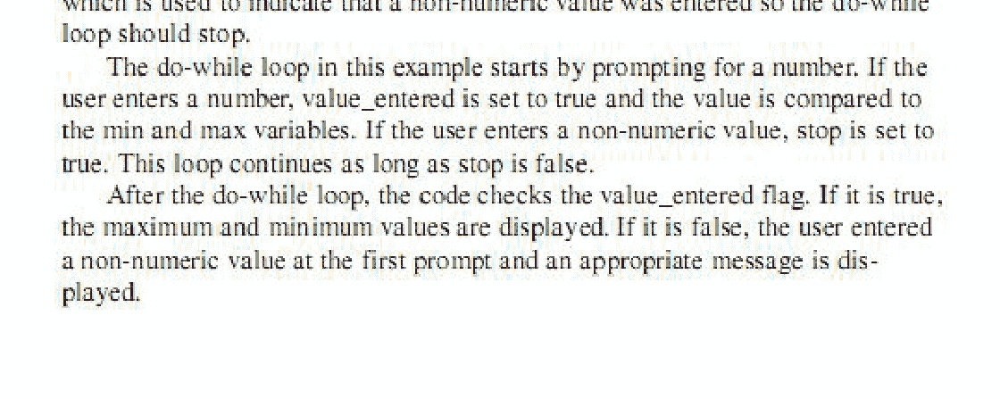

### 示例 1：用于验证用户输入的 do-while 循环

```javascript
var value, valid;
do {
  value = parseInt(prompt("请输入 1 到 10 之间的数字"));
  if (isNaN(value) || value > 10) {
    alert("你输入的 1 到 10 之间的数字：");
    valid = false;
  } else {
    valid = true;
  }
} while (valid);
```

### 示例 2：用于计数直到掷出 6 的 do-while 循环

```javascript
// random_number 函数见图 7-5
var rolls = 0;
do {
  rolls += random_number(1, 6);
} while (rolls != 6);
alert("掷出 6 的次数：" + rolls);
```

### 示例 3：用于寻找最大和最小值的 do-while 循环

```javascript
var max = -Infinity, min = Infinity, number;
var value_entered = false, stop = false;
alert("输入值以寻找最大和最小值。");
alert("输入任何非数字以停止。");
do {
  number = parseFloat(prompt("输入一个数字:"));
  if (isNaN(number)) {
    stop = true;
  } else {
    value_entered = true;
    if (number > max) max = number;
    if (number < min) min = number;
  }
} while (!stop);

if (value_entered) {
  alert("最大值为：" + max + "，最小值为：" + min);
} else {
  alert("在第一次提示时输入了非数字值。");
}
```

### 描述

- `while` 语句只要条件表达式为真，就会执行大括号内的语句块。
- 当你使用 `do-while` 语句时，条件是在循环结束时测试的。


## 如何编写 for 循环

`for` 循环在需要增加或递减计数器时非常有用。`for` 语句在括号内处理了初始化、条件和增加/递减表达式。

图 8-11 中的第一个示例展示了如何计数到 10。这与图 8-10 中的 `while` 循环相似，但 `for` 循环在一个地方处理。

图 8-12 中的第二个示例展示了如何显示偶数。这与第一个示例相似，但计数器每次递增 2。

图 8-13 中的第三个示例展示了如何反转字符串。计数器初始化为字符串长度并递减直到零。

图 8-14 中的第四个示例展示了如何判断一个数字是否为素数。循环首先假设数字是素数，然后对其进行因子测试。如果发现任何因子，将标志位设置为 `false`。

### for 语句与 while 语句对比

#### for 语句

```javascript
for (var count = 1; count <= 10; count++) {
  alert(count);
}
```

#### while 语句

```javascript
var count = 1;
while (count <= 10) {
  alert(count);
  count++;
}
```

### 示例 1：显示从 2 到 10 的偶数的 for 循环

```javascript
for (var number = 2; number <= 10; number += 2) {
  alert(number);
}
```

### 示例 2：反转字符串的 for 循环

```javascript
var message = "JavaScript"; reverse = "";
for (var position = message.length-1; position >= 0; position--) {
  reverse += message.charAt(position);
}
alert(reverse); // 输出 tpircaj
```

### 示例 3：显示数字所有因子的 for 循环

```javascript
var number = 18;
for (var i = 1; i <= number; i++) {
  if (number % i == 0) {
    alert(i + " 是 " + number + " 的因子");
  }
}
```

### 示例 4：判断数字是否为素数的 for 循环

```javascript
var number = 31; prime = true;
for (var i = 2; i < number; i++) {
  if (number % i == 0) {
    prime = false;
  }
}
if (prime) {
  alert(number + " 是素数.");
} else {
  alert(number + " 不是素数.");
}
```

## 如何使用 break 和 continue 语句

`break` 和 `continue` 语句允许你对循环进行额外的控制。`break` 语句会导致循环立即结束。`continue` 语句会导致循环跳到循环的开头。

图1 中的第一个示例展示了在 `while` 循环内部的 `break` 语句。在这里，`while` 循环被刻意编写为无限循环。然而，如果语句中的条件表达式为假，`break` 语句将执行并结束 `while` 循环。这会在用户输入的数字为 0 时发生。

第二个示例展示了在 `for` 循环内部使用的 `break` 语句。在这里，循环确定变量的值是否为质数。一旦找到一个因子，该数字就不是质数，因此代码将 `prime` 变量的值设置为 `false` 并发出 `break` 语句。例如，如果值为 42，一旦发现 2 是因子，循环就会结束，因此循环将不会检查从 3 到 41 的值。

第三个示例展示了在 `for` 循环中使用的 `continue` 语句。在这里，当要显示的数字是 3 的倍数时，`continue` 会跳过循环的剩余部分并在计数器增加后重新开始循环。结果是循环只显示不是 3 的倍数的数字。

第四个示例展示了在 `while` 循环中使用 `continue` 语句。在这里，`while` 循环基于上一个示例中的 `for` 循环，因此 `number++` 语句被作为 `if` 的一部分添加在 `continue` 语句之前。如果没有将此增量添加到 `if` 语句中，一旦 `number` 变量变为 3，它就会变成无限循环。之后，`continue` 语句将重复循环，但 `number` 永远不会增加，因此循环永远不会结束。这将一直持续，直到浏览器停止执行运行过长的脚本，或者用户关闭了浏览器。

在嵌套循环中使用 `break` 和 `continue` 语句时，你需要知道 `break` 或 `continue` 语句仅适用于它们所所在的循环。例如，如果你在内部循环中编写了 `break` 语句，它会跳到该循环的结束，而不是外部循环的结束。虽然你可以通过标签（labels）来规避这个局限性，但书中并未进行说明。

### 示例 1：while 循环中的 break 语句

```javascript
var number;
while (true) {
  number = parseInt(prompt("输入 1 到 10 之间的数字。"));
  if (isNaN(number) || number < 1 || number > 10) {
    alert("输入无效。请重试。");
  } else {
    break;
  }
}
```

### 示例 2：for 循环中的 break 语句

```javascript
var number = 31; prime = true;
for (var i = 2; i <= number; i++) {
  if (number % i == 0) {
    prime = false;
    break;
  }
}

if (prime) {
  alert(number + " 是质数.");
} else {
  alert(number + " 不是质数.");
}
```

### 示例 3：for 循环中的 continue 语句

```javascript
for (var number = 1; number <= 10; number++) {
  if (number % 3 == 0) continue;
  alert(number);
}
// 仅显示 1, 2, 4, 5, 7, 8 和 10
```

### 示例 4：while 循环中的 continue 语句

```javascript
var number = 1;
while (number <= 10) {
  if (number % 3 == 0) {
    number++;
    continue;
  }
  alert(number);
  number++;
}
// 仅显示 1, 2, 4, 5, 7, 8 和 10
```

### 说明

- `break` 语句结束循环。换句话说，它跳出循环。
- `continue` 语句结束 `for` 或 `while` 循环的当前迭代，但允许下一次迭代继续。换句话说，它跳转到循环的开头。
- 当你处理嵌套循环时，`break` 和 `continue` 语句仅适用于它们所处的循环。

### 观点

现在你已经完成了这一章，你应该知道如何编写 `if` 语句、`switch` 语句、`while`、`do-while` 语句和 `for` 语句。这些是实现选择、分支和迭代结构的 JavaScript 语句，它们提供了应用程序的逻辑。随着你阅读这本书，你将看到许多使用这些语句的示例，这将帮助你有效地使用它们。

## 术语

- 等等运算符 (equality operator)
- 类型转换 (type coercion)
- 恒等运算符 (identity operator)
- 复合条件表达式 (compound conditional expression)
- 复杂条件表达式 (complex conditional expression)
- 选择结构 (selection structure)
- switch 语句 (switch statement)
- 分支结构 (case structure)
- switch 表达式 (switch expression)
- case (case)
- case 标签 (case label)
- 穿透 (fall through)
- 标记 (flag)
- switch
- 迭代结构 (iteration structure)
- while 语句 (while statement)
- while 循环 (while loop)
- do-while 语句 (do-while statement)
- do-while 循环 (do-while loop)
- for 语句 (for statement)
- for 循环 (for loop)
- 因子 (factor)
- 质数 (prime number)
- break 语句 (break statement)
- continue 语句 (continue statement)

## 练习 8-1 使用 if 和 switch 语句

此练习将给你一个尝试嵌套 `if` 和 `switch` 语句的机会。

### 打开并测试应用程序

1. 从你的 Firefox 浏览器打开第 8 章练习文件夹中 `invoice_total` 文件夹下的隐藏文件。然后，通过在客户类型（Customer Type）框中输入“R”或“C”，并在发票小计（Invoice Subtotal）框中输入 0 到 500 之间的值来测试此应用程序。当你点击计算（Calculate）按钮时，你可以看到折扣百分比是基于什么。

2. 使用文本编辑器打开应用程序的 JavaScript 文件。你可以看到一个名为 `find_average` 的函数，它包含了图 8 中的示例 2 代码。这就是你在步骤 1 中测试的函数。你还可以看到名为 `rolling_six` 和 `finding_primes` 的函数，它们实现了第 8 章中的其他示例，后面是名为 `process_test_scores` 的函数的开头。

3. 修改 `if` 语句，使大于等于 500 但小于 800 的 R 获得25% 的折扣。接下来，修改 `if` 语句，使 C 始终获得30% 的折扣。

4. 添加另一种 `if` 语句，使 T 小于 500 的获得40% 的折扣，500 或更多获得50% 的折扣。此外，确保 R、C 或 T 获得10% 的折扣。

5. 再次测试语句，但使用小写客户类型。注意字母没有被视为大写字母。

6. 修改代码，使用户可以输入大写或小写的客户类型。为此，你可以使用 `toUpperCase` 方法或复合条件表达式。

### 使用 switch 语句获得相同的结果

7. 在 `if` 之前编写 `switch` 语句。该语句应该为三个 case：R、C 和 T 提供结构。在每个 case 中，你可以复制下面的语句代码以提供基于总变数的折扣。换句话说，`if` 语句将嵌套在 `switch` case 中。

8. 注释掉 `switch` 语句上面的整个语句。然后测试 `switch` 语句是否正常工作。

9. 如果你还没有这样做，修改 `switch` 语句使其能够处理三种类型的大写和小写输入。

## 练习 8-2 使用循环

此练习将让你练习使用循环。

### 打开应用程序

1. 从你的 Firefox 浏览器打开第 8 章练习文件夹中 `using_loops` 文件夹下的 HTML 文件。此应用程序首先运行图 8-8 中的示例 2 代码。为了查看此示例如何工作，在空白处输入两个数字并点击 OK 按钮。将显示平均值。之后是应用程序另一个部分的网页。你可以看到一个名为 `find_average` 的函数，它包含了图 8-8 中的示例 2 代码。这就是你在步骤 1 中测试的函数。你还可以看到名为 `rolling_six` 和 `finding_primes` 的函数，它们实现了第 8 章中的其他示例，后面是名为 `process_test_scores` 的开头。最后，你可以看到 `onload` 事件的函数调用了其他函数，但请注意最后三个调用被注释掉了。

### 修改实现书籍示例的两个函数

现在，你将修改两个实现书籍示例的函数。这将帮助你理解在什么情况下使用特定类型的循环是合适的。

3. 修改 `finding_average` 函数，使用 `do-while` 循环代替 `while` 循环。在测试修改后，注释掉 `onload` 事件处理程序中对该函数的调用。

4. 移除 `onload` 事件处理程序中对 `rolling_six` 函数调用的注释，并运行应用程序以查看该函数的工作原理。然后，修改该函数的代码，使其在 `while` 循环的外部使用一个 `for` 循环。在测试修改后，注释掉 `onload` 事件处理程序中对该函数的调用。

### 修改查找质数的函数

5. 移除 `onload` 事件处理程序中对 `finding_primes` 函数调用的注释。然后，运行此应用程序。它会显示一条消息，说明 1 不是质数。

6. 修改该函数的代码，使其在警告框（alert）中查找并列出 1 到 100 之间的所有数字，如下所示：

- 1 到 100 之间的质数有：
- 2
- 3
- 5...

为了实现这一点，你需要在为生成 1 到 100 的数字的代码添加一个外层循环，以便测试它们是否为质数。然后，不断测试，直到它能够正常工作。

7. 如果你还没有这样做，请修改代码，使其使用 `break` 语句在循环确定某个数字不是质数时立即退出内层循环。这将使该函数运行得更高效。当你正确实现后，注释掉 `onload` 事件处理程序中对该函数的调用。

### 实现 `process_test` 分数函数

8. 移除 `onload` 事件处理程序中对 `process_test_scores` 函数调用的注释。然后，运行此应用程序。它会显示一条消息，要求用户输入 0 到 100 之间的数字，或输入 999 结束函数。现在，输入 999 以结束此函数并将其显示在网页上。

9. 对于用户输入的每个数字，页面上的文本框都会显示：输入的分数、已输入的数的个数、总分、平均分、最高分和最低分。当你编写该函数的代码时，你应该将 `prompt` 方法封装在一个循环中，但由你决定哪种类型的循环最适合应用程序。现在，编写并测试代码。

10. 当该函数运行正常后，移除 `onload` 事件处理程序中所有调用的注释。然后，最后运行一次应用程序。

## 如何创建和使用数组

在本章中，你将学习如何操作数组，数组在各种 JavaScript 应用中都非常重要。例如，你可以使用数组来存储待完成的任务列表。然后，你可以更新并显示列表中的任务。

| 如何创建和使用数组 | 302 |
| :--- | :--- |
| 如何创建数组 | 302 |
| 如何添加和删除数组元素 | 304 |
| 如何使用 `for-in` 循环处理数组 | 306 |
| 如何使用 `for-each` 处理数组... | 308 |
| Array 对象的方法 | 310 |
| 如何使用数组方法 | 312 |
| **处理数组的其他技能** | **314** |
| 如何使用 String 方法创建数组 | 314 |
| 如何创建和使用关联数组 | 315 |
| 如何创建和使用二维数组 | 318 |
| **任务列表管理器应用程序** | **320** |
| 用户界面和 HTML | 320 |
| JavaScript 代码 | 320 |
| **视角** | **324** |

## 如何创建和使用数组

在你所遵循的主题中，你将学习创建和使用数组的基本技能。你还将学习如何使用 JavaScript 提供的处理数组的内置方法。

## 如何创建数组

数组是一个包含一个或多个称为“元素”（elements）的项目的对象。这些元素中的每一个可以是原始数据类型，可以是对象。例如，你可以在同一个数组中存储数字、字符串和 `Date` 对象。

数组的长度（length）表示它包含的元素数量。由于 JavaScript 数组是动态的，你可以通过添加或删除元素来更改数组的长度。

图 9-1 显示了如何创建数组。当你使用第一种方法时，使用 `new` 关键字配合 `Array` 构造函数来创建一个元素数量由 `length` 参数指定的数组。`length` 必须是大于或等于零的整数。如果不指定长度，数组将为空。

当你使用第二种方法时，你的代码是一一组括号。这将让你获得与第一种方法不带参数时相同的结果：一个空数组。

接下来，此图显示了如何用一条语句创建一个带有其元素的新数组。在这种情况下，你在代码中在一个用逗号分隔的列表中编写值。例如，第一组示例显示了一个创建一个包含四个值的数组的语句，以及一个创建一个名为 `names` 且包含三个字符串数组的语句。

但请注意，当你使用 `new` 关键字创建数组时，数组列表不能是一个单独的数字。否则，它将变为长度。

### 数组的一个属性和一个操作符

| 属性 | 描述 |
| --- | --- |
| `length` | 数组中元素的个数。 |
| 操作符 | 删除元素的内容并将元素设置为 `undefined`，但不会从数组中移除该元素。 |

### 如何向数组末尾添加元素

```javascript
var numbers = [1, 2, 3, 4]; // 数组为 1, 2, 3, 4
numbers[numbers.length] = 5; // 数组为 1, 2, 3, 4, 5
```

### 如何在特定索引处添加元素

```javascript
var numbers = [1, 2, 3, 4]; // 数组为 1, 2, 3, 4
numbers[6] = 7; // 数组为 1, 2, 3, 4, undefined, 7
```

### 如何在特定索引处删除数字

```javascript
var numbers = [1, 2, 3, 4]; // 数组为 1, 2, 3, 4
delete numbers[2]; // 数组为 1, 2, undefined, 4
```

### 一个包含 999 个 undefined 元素的稀疏数组

```javascript
var numbers = [1]; // 数组为 1
numbers[1000] = 101; // 数组包含 1 和 101，中间有 999 个 undefined 元素
```

### 描述

- 向数组末尾添加元素的一种方法是使用 `length` 属性作为索引。
- 如果你在一个不是序列下一个位置的特定索引处添加元素，数组会在新元素和原数组末尾之间添加 `undefined` 元素。
- 稀疏数组是一个具有少量定义元素的大数组。但是，为了效率，JavaScript 只为分配了值的元素预留空间。
- 你也可以像图 9-5 和 9-6 所示，使用 `Array` 对象的方法向数组添加项。

## 如何使用 for 循环处理数组

`for` 循环通常用于通过增加索引变量来一次处理一个数组元素。图 9-3 显示了其工作原理。

图中的第一个示例展示了如何创建一个数组并用数字 1 到 10 填充它。代码创建一个名为 `numbers` 的空数组。然后，使用索引变量 `i` 通过从 0 到 9 的值遍历数组的前十个元素。在循环体中，元素被加到值 `i` 上，结果存储在元素中。因此，索引为 0 的元素存储了 1、2，以此此类推。

接下来，该示例显示了数组中的值。首先，它创建了一个名为 `numbersString` 的空数组。然后，它使用循环计算数组中的元素个数。数组的 `length` 用于控制循环执行的次数。这使得相同的代码可以处理不同长度的数组。在循环内部，元素的值和一个空格被拼接到 `numbersString` 的末尾。最后，显示 `numbersString`，显示出存储在数组中的数字。

图中的第二个示例展示了如何计算总和数组的和和平均值。然后，它创建一个名为 `sum` 的变量并初始化为 0。接下来，它使用循环访问 `totals` 数组中的每个元素并将其加到 `sum` 上。最后，通过将 `sum` 除以数组的长度来计算平均值。

接下来，该示例显示了总和、和以及平均值。首先，它创建了一个名为 `totalsString` 的空字符串。然后，它使用循环将每个元素的值和一个换行符拼接到 `totalsString`。最后，它显示一条包含 `totalsString`、`sum` 和平均值的消息。

### 将数字 1 到 10 放入数组的代码

```javascript
var numbers = [];
for (var i = 0; i < 10; i++) {
  numbers[i] = i;
}
```

### 显示数组的代码

```javascript
var numbersString = "";
for (var i = 0; i < numbers.length; i++) {
  numbersString += numbers[i];
}
alert(numbersString);
```

### 计算数组的和和平均值的代码

```javascript
var totals = [];
var sum = 0;
for (var i = 0; i < totals.length; i++) {
  sum += totals[i];
}
var average = sum / totals.length;
```

### 显示总和、和以及平均值的代码

```javascript
var totalsString = "";
for (var i = 0; i < totals.length; i++) {
  totalsString += totals[i] + "\n";
}
alert("Totals:\n" + totalsString + "Sum: " + sum + "\nAverage: " + average);
```

## Array 对象的方法

为了方便对数组操作，JavaScript 提供了许多方法。其中最有用的方法总结在图 9-5 中。除了最后五个方法外，所有这些方法都会修改原始数组。

前两个方法 `push` 和 `pop` 用于从数组的末尾添加和移除元素。这允许你将数组当作栈使用，其中最后一个添加的元素是第一个移除的（后进先出）。在这种情况下，最旧元素位于数组的开头。

接下来两个方法 `unshift` 和 `shift` 用于从数组的开头添加和移除元素。这些方法也允许你将数组当作栈使用，其中最后一个添加的元素是第一个移除的（先入后出）。但在这种情况下，最旧元素位于数组的末尾。

如果你结合 `unshift` 和 `push` 方法，可以将数组当作队列使用，其中第一个添加的元素是第一个移除的（先进先出）。在这种情况下，最旧元素位于数组的末尾。你也可以使用 `push` 和 `shift` 将数组作为先进先出的队列。在这种情况下，最旧元素位于数组的开头。

`Array` 对象的 `reverse` 和 `sort` 方法允许你更改数组中元素的顺序。默认情况下，`sort` 方法将所有元素视为字符串。这意味着数字 5、10、101 和 250 被排序为 10、101、250、5。如果你需要按数字顺序对数组进行排序，可以向 `sort` 方法传递一个函数，该函数每次比较两个值。你将在下一个图中看到这一点。

`splice` 方法允许你在数组的任何位置删除、替换和删除元素。要删除元素，你调用 `splice` 方法并传入要删除的元素的索引和要删除元素的个数。要替换元素，你调用 `splice` 方法并传入要替换的元素的索引、要替换元素的个数以及替换值列表。要添加元素，你调用 `splice` 方法并传入插入点之后的元素索引、0 以及要添加到数组中的值列表。

`slice` 和 `concat` 方法允许你从数组的局部或全部创建一个新数组。在何种情况下，原始数组都不会被修改。如果你想用新数组替换原始数组，可以将旧数组赋值为新数组。

`join`、`toString` 和 `toLocaleString` 方法允许你创建一个包含数组元素的单个字符串。它们的主要区别在于如何处理分隔符字符串。这些方法对于 `undefined` 元素（包括未定义的和被设置为 `undefined` 的元素）将使用空字符串。

### Array 对象的方法

| 方法 | 描述 |
| --- | --- |
| `push(elements_list)` | 在数组末尾添加一个或多个元素，并返回数组的新长度。 |
| `pop()` | 移除数组最后一个元素，减小长度并返回被移除的元素。 |
| `unshift(elements_list)` | 在数组开头添加一个或多个元素，并返回数组的新长度。 |
| `shift()` | 移除数组的第一个元素，减小长度并返回被移除的元素。 |
| `reverse()` | 反转数组中元素的顺序。 |
| `sort()` | 当不传递参数时，此方法根据字典顺序对数组中的元素进行排序；如有必要，它会将元素转换为字符串进行排序。 |
| `sort(comparison_function)` | 为了更改方法的默认顺序，此函数应接收一个参数。如果第一个参数大于第二个参数，则返回正值；如果两个参数相等，则返回零；如果第一个参数小于第二个参数，则返回负值。 |
| `splice(start, number)` | 从第一个参数指定的索引开始，移除第二个参数指定的个数的元素。它返回被移除的元素。 |
| `splice(start, number, elements_list)` | 从第一个参数指定的索引开始，移除第二个参数指定的个数的元素，并用第三参数提供的元素替换这些元素。它返回被移除的元素。 |
| `slice(start, number)` | 返回一个新数组，该数组从第一个参数指定的索引开始，并包含第二个参数指定的个数的元素。 |
| `concat(array_list)` | 返回一个新数组，该数组由原始数组连接列表中的数组。 |
| `join(separator)` | 当不传递参数时，此方法将数组中的所有元素转换为字符串并用逗号分隔它们。要更改分隔符，可以传递此字符串字面量。 |
| `toString()` | 相当于未传递任何参数的 `join` 方法。 |
| `toLocaleString()` | 与 `toString` 方法相同，但使用特定区域的分隔符。 |

### 描述

- `push` 和 `pop` 方法通常用于从数组的末尾添加和移除元素。

## 如何使用 Array 方法

图 9-6 展示了如何使用上一个图中总结的方法。如果你学习了摘要、示例和代码中的注释，你就能理解如何使用这些方法。

`push` 和 `pop` 方法通常用于从数组的末尾添加和移除元素。

```javascript
var array = ["apple", "banana"];
array.push("orange"); // array 现在是 ["apple", "banana", "orange"]
var last = array.pop();
```

`unshift` 和 `shift` 方法通常用于从数组的开头添加和移除元素。

```javascript
var array = ["apple", "banana"];
array.unshift("orange"); // array 现在是 ["orange", "apple", "banana"]
var first = array.shift();
```

如果你结合 `unshift` 和 `push` 方法，可以将数组当作队列使用，其中第一个添加的元素是第一个移除的（先进先出）。在这种情况下，最旧元素位于数组的末尾。

```javascript
var queue = ["apple", "banana"];
queue.unshift("orange"); // queue 现在是 ["orange", "apple", "banana"]
var first = queue.shift();
```

你也可以使用 `push` 和 `shift` 将数组作为先进先出的队列。在这种情况下，最旧元素位于数组的开头。

```javascript
var queue = ["apple", "banana"];
queue.push("orange"); // queue 现在是 ["apple", "banana", "orange"]
var first = queue.shift();
```

`Array` 对象的 `reverse` 和 `sort` 方法允许你更改数组中元素的顺序。默认情况下，`sort` 方法将所有元素视为字符串。这意味着数字 5、10、101 和 250 被排序为 10、101、250、5。如果你需要按数字顺序对数组进行排序，可以向 `sort` 方法传递一个函数，该函数每次比较两个值。

```javascript
var array = [5, 10, 101, 250];
array.sort(); // array 现在是 [10, 101, 250, 5]
array.sort(function(a, b) {
  return a - b;
}); // array 现在是 [5, 10, 101, 250]
```

`splice` 方法允许你在数组的任何位置删除、替换和删除元素。

```javascript
var array = ["apple", "banana", "orange", "date"];
var removed = array.splice(1, 2); // removed 是 ["banana", "orange"], array 现在是 ["apple", "date"]
array.splice(1, 0, "kiwi"); // array 现在是 ["apple", "kiwi", "date"]
```

`slice` 和 `concat` 方法允许你从数组的局部或全部创建一个新数组。在何种情况下，原始数组都不会被修改。

```javascript
var array = ["apple", "banana", "orange"];
var newArray = array.slice(1, 2); // newArray 是 ["banana", "orange"]
var array2 = ["date", "grape"];
var combined = array.concat(array2); // combined 是 ["apple", "banana", "orange", "date", "grape"]
```

`join`、`toString` 和 `toLocaleString` 方法允许你创建一个包含数组元素的单个字符串。它们的主要区别在于如何处理分隔符字符串。

```javascript
var array = ["apple", "banana", "orange"];
var str = array.join(", "); // str 是 "apple, banana, orange"
var str2 = array.toString(); // str2 是 "apple,banana,orange"
var str3 = array.toLocaleString(); // str3 是 "apple, banana, orange" (取决于区域设置)
```

### 处理数组的其他技能

现在你已经学习了创建和处理数组的基础技能，准备好学习一些其他处理数组的技能了。

## 如何使用 String 方法创建数组

图 9-7 展示了 `String` 对象的 `split` 方法。该方法可以根据作为第一个参数编码的分隔符字符将字符串划分为多个子字符串。然后，它会创建一个新数组，并将每个子字符串作为数组的元素。如果你编写了第二个参数，它将用于限制新数组中可以包含的元素数量。

图中的第一个示例显示了如何将由空格分隔的字符串拆分为名为 `names` 的数组。接下来，它显示了新数组的长度以及数组中的元素。然后，它将数组中最后一个索引（`length - 1`）处的元素移动到名为 `lastName` 的变量中，并显示该变量的内容。

同样，第二个示例显示了如何将由连字符分隔的字符串拆分为数组。接着，第三个示例显示了如何将字符串拆分为单个字符。当你在调用 `split` 方法并将空字符串作为参数时，就会发生。

第四个示例显示了如果分隔符字符不在字符串中会发生什么。在这里，创建了一个带有连字符的日期字符串，但调用 `split` 方法时使用的斜杠作为分隔符。在这种情况下，生成的数组只有一个元素，且该元素是原始日期字符串的副本。

五个示例显示了如何限制复制到新数组中的子字符串数量。在这里，`split` 方法使用空格作为分隔符，但它将子字符串的数量限制为一。结果是一个数组，其中一个元素只包含第一个数字。

在此示例中，最后一条语句使用 `alert` 方法显示这个单元素数组。由于 `alert` 方法期望接收字符串，因此它会自动对任何不是字符串的参数调用 `toString` 方法。然后，由于数组中只有一个元素，数组的 `toString` 方法将返回该元素，而不使用任何分隔符。

### 创建数组的 String 方法

| 方法 | 描述 |
| --- | --- |
| `split(separator, limit)` | 根据分隔符参数 `separator` 的值将字符串拆数组。可选的 `limit` 参数指定新数组中元素的最大数量。 |

### 如何将按空格分隔的字符串分为数组

```javascript
var fullName = "Ray L Harris";
var nameParts = fullName.split(" "); // 创建一个数组
alert(nameParts.length); // 显示 3
alert(nameParts.join(" "));
var lastName = nameParts[nameParts.length - 1];
alert(lastName);
```

### 如何将按连字符分隔的字符串分为数组

```javascript
var date = "1-2-2009";
var dateParts = date.split("-"); // 创建一个数组
alert(dateParts.length); // 显示 3
alert(dateParts.join("/")); // 显示 1/2/2009
```

### 如何将字符串分为字符数组

```javascript
var fullName = "Ray Harris";
var nameCharacters = fullName.split(""); // 显示 10
alert(nameCharacters.length);
alert(nameCharacters.join(", ")); // 显示 R,a,y,H,a,r,r,i,s
```

### 如果字符串不包含分隔符会发生什么

```javascript
var date = "1-2-2009";
var dateParts2 = date.split("/");
alert(dateParts2.length); // 显示 1
alert(dateParts2.join("-")); // 显示 1-2-2009
```

### 如何从字符串中仅获取一个元素

```javascript
var fullName = "Ray L Harris";
var firstName = fullName.split(" ", 1);
alert(firstName.length); // 显示 1
alert(firstName); // 显示 Ray
```

### 描述

- `String` 对象的 `split` 方法用于将字符串的组件转换为数组的元素。
- 如果字符串不包含 `split` 方法参数中指定的分隔符，则整个字符串将作为第一个元素返回在一个只有一个元素的数组中。
- 如果参数指定的分隔符是空字符串，则字符串中的每个字符都成为方法返回的数组中的一个元素。

## 如何创建和使用关联数组

到目前为止，你处理的数组使用整数作为索引。相比之下，关联数组是使用字符串作为索引的。在图 9-8 中，你可以学习如何创建和处理关联数组。

图中的第一个示例创建了一个包含四个元素的关联数组。首先，它创建一个空数组。然后，它使用字符串作为索引在数组中存储四个值。最后，它显示关联数组的长度。然而，由于数组的 `length` 属性只计算数字索引的元素，因此长度为零。

第二个示例使用另一个字符串索引向数组添加一个元素。新值是使用数组中两个元素计算的结果，并使用 `indexed` 方法对结果进行四舍五入。

第三个示例显示了一个从数组元素构建的格式化字符串。在这里，你可以看到数组现在包含了五个元素。

第四个示例显示了如何使用该数组。虽然 JavaScript 不支持多维数组，但你可以通过创建一个数组的数组来实现相同的效果。

## 如何创建和使用嵌套数组

### 创建嵌套数组的代码

```javascript
var timesTable = []; // 创建一个空数组
for (var i = 0; i < 5; i++) { // 向数组中添加 5 个元素
  timesTable[i] = []; // 包含空数组的元素
}
```

### 向嵌套数组添加值的代码

```javascript
for (var i = 0; i < 5; i++) {
  for (var j = 0; j < 5; j++) {
    timesTable[i][j] = i + j;
  }
}
```

### 引用数组中元素的代码

```javascript
alert(timesTable[1][1]); // 显示 1
alert(timesTable[4][3]); // 显示 12
```

## 如何创建和使用关联数组的数组

### 创建数组的代码

```javascript
var invoice = []; // 创建一个空的发票数组
var item1 = {}; // 创建一个空的项目数组
var item2 = {}; // 创建一个空的项目数组
```

### 创建关联数组并将其添加到发票的代码

```javascript
item1["ItemID"] = 123;
item1["Item"] = "Visual Basic 2008";
item1["Cost"] = 52.5;
item1["Quantity"] = 5;
invoice.push(item1); // 将项目数组添加到发票数组
```

### 向发票数组中创建另一个关联数组的代码

```javascript
item2["ItemID"] = 456;
item2["ItemName"] = "C++ 2008";
item2["Cost"] = 52.5;
item2["Quantity"] = 2;
invoice.push(item2); // 将项目数组添加到发票数组的末尾
```

### 引用关联数组数组中元素的代码

```javascript
alert(invoice[0]["ItemID"]); // 显示 123
alert(invoice[1]["ItemName"]); // 显示 C++ 2008
```

### 描述

- 虽然 JavaScript 没有提供多维数组，但你可以通过创建嵌套数组来实现这种效果。在嵌套数组中，第一个数组中的每个元素都是另一个数组。
- 数组中的数组可以是普通数组，也可以是关联数组。
- 要引用嵌套数组中的元素，你可以为每个元素使用两个索引。第一个值是主数组中的元素。第二个值是主数组元素所在数组中的元素。
- 如果必要，你可以嵌套超过此处示例的两个维数组。换句话说，你可以创建多层嵌套数组。

### 任务列表管理器应用程序

为了向你展示刚刚学的一些技能如何在应用程序中使用，本章通过介绍一个任务列表管理器应用程序作为结束。

## 用户界面和 XHTML

图 9-10 页展示了任务列表管理器应用程序的用户界面。在这里，三个按钮允许用户向任务列表添加任务、对任务列表中的任务排序以及从任务列表中删除任务。任务列表本身显示在一个浮动在网页右侧的文本区域中。

虽然图中没有包含 XHTML 和 CSS 代码，但你不需要引用它们，因为你只需要知道这四个控件的 `id`。这些 `id` 汇总在图中。当你执行本章的练习时，也可以复习 XHTML 和 CSS 代码。

## JavaScript 代码

首先，该应用程序的 JavaScript 代码创建一个空数组 `task_list`。该数组将用于任务列表中的任务，每个元素包含一个任务。注意，此数组的名称与 XHTML 文本区域的 `id` 相同。这表明为 XHTML 元素和 JavaScript 变量使用相同的标识符是明智的。

接下来，这段代码定义了 `$` 函数。这就是你在代码块中一直使用的函数。

`$` 函数之后是一个名为 `update_task_list` 的函数。该函数由随后的每个事件处理器调用。此函数更新文本区域以反映 `task_list` 数组的最新更改。首先，该函数会测试数组中是否存在任务。如果没有，则将文本区域设置为空字符串。

如果数组中有任务，该函数使用 `for-in` 循环来构建一个带编号的任务字符串，并显示在文本区域中。由于用户期望列表从 0 开始，`for-in` 循环会将索引值加 1 以获取每个任务的编号。由于 `for-in` 循环中的索引始终是字符串（即使使用了数字索引），因此在将索引值相加之前，必须使用 `parseInt` 方法将其转换为数字。循环完成后，列表将显示在文本区域中。

### 任务列表管理器应用程序的用户界面

三个按钮和任务区域的 XHTML id 为：

- `add_task`
- `sort_tasks`
- `delete_task`

### 应用程序的 JavaScript 代码

```javascript
var task_list = [];

var $ = function (id) { return document.getElementById(id); };

var update_task_list = function () {
  if (task_list.length == 0) {
    $("task_area").value = "";
  } else {
    var list = "";
    for (var i in task_list) {
      list += (parseInt(i) + 1) + ". " + task_list[i] + "\n";
    }
    $("task_area").value = list;
  }
};
```

### 观点

数组是许多 JavaScript 应用程序的重要部分，且 JavaScript 提供了一些处理数组的优秀方法。在接下来的章节中，你将看到数组的其他用法以及处理它们的其他方式。例如，在下一章中，你将学习一个使用关联数组的应用程序。

## 术语

- 数组 (array)
- 元素 (element)
- 长度 (length)
- 索引 (index)
- 稀疏数组 (sparse array)
- 循环 (loop)
- for-in 语句 (for-in statement)
- for-in 循环 (for-in loop)
- 关联数组 (associative array)
- 数组数组 (array of arrays)

## 练习 9-1 使用任务列表管理器应用的数组

此练习将让你有机会在任务列表管理器应用的范围内尝试数组和数组方法。

### 打开并测试任务列表管理器

1. 从 Firefox 浏览器打开第 9 章节文件夹下 `task_list` 文件夹中的 `index.html` 文件。这是任务列表管理器应用程序的修改版本，其中“排序任务”（Sort Tasks）按钮更改为了“修改任务”（Modify Task），并新增了一个名为“提升任务”（Promote Task）的按钮。

2. 使用“添加任务”（Add Task）按钮输入三个任务，并使用“删除”（Delete）按钮删除其中一个任务来测试此应用程序。这些按钮应按照描述工作，但另外两个按钮尚未实现。

3. 如果你对 HTML 和 CSS 代码感兴趣，可以使用文本编辑器打开这些文件进行审查。然后，使用文本编辑器打开此应用程序的 JavaScript 文件。

### 修改代码使用数组方法添加和删除任务

4. 修改 `add_task_click` 函数，使其使用 `push` 方法将新任务添加到 `task_list_array` 的末尾。然后，测试此更改。

5. 修改 `delete_task_click` 函数，使其使用 `shift` 方法移除列表开头的任务。然后，测试此更改。

### 为修改和提升按钮添加事件处理器

6. 为“修改任务”（Modify Task）按钮添加一个事件处理器。该事件处理器应该使用 `prompt` 方法获取要修改的任务的编号。然后，它应该使用 `prompt` 方法显示选定的任务并让用户修改该文本。最后，该事件处理器应该用修改后的文本更新 `task_list_array` 并调用 `update_task_list_function` 来更新文本区域。现在，测试此更改。

7. 为“提升任务”（Promote Task）按钮添加一个事件处理器。该事件处理器应该使用 `prompt` 方法获取要提升的任务编号。然后，该任务应该移动到 `task_list_array` 的开头。最后，该处理器应该调用 `update_task_list_function` 来更新文本区域。现在，测试此更改。

## 如何创建和使用函数

在第 2 章中，你学习了如何编写简单函数并从那时一直在使用函数。现在，本章回顾了你已经掌握的一些技能，并介绍了你可能想知道的高级技能。正如你所看到的，JavaScript 将所有函数视为对象，你将学习如何使用函数对象的一个属性和两个方法。

在阅读本章时，请记住使用函数有两个原因。首先，函数提供将应用程序代码分为可管理块的方法。其次，某些函数可以被多个地方使用。

| 处理函数的基本技能 | 页码 |
| :--- | :--- |
| 如何创建和调用函数 | 326 |
| 值如何传递给函数 | 328 |
| 词法作用域如何工作 | 330 |
| 处理函数的面向对象技能 | 332 |
| 如何使用函数的 `arguments` 属性 | 334 |
| 如何使用函数的 `call` 和 `apply` 方法 | 335 |
| 处理函数的级技能 | 336 |
| 类如何与函数协同工作 | 338 |
| 如何编写递归函数 | 339 |
| 发票应用程序 | 340 |
| 用户界面 | 342 |
| XHTML 文件 | 344 |
| 库文件 | 346 |
| 发票文件 | 350 |
| 观点 | 362 |

## 处理函数的基本技能

本主题回顾了你已经学习的处理函数的基本技能。然后，它在此基础上增加了一些新的观点和技能。

## 如何创建和调用函数

图 10-1 显示了创建匿名函数的两种方法。第一种方法是你一直在使用的方法。它创建了一个匿名函数，因为它在声明中没有提供函数名。在这种情况下，你必须决定将它存储在何处。在这个示例中，函数存储在一个名为 `error` 的变量中，并使用 `name` 来调用函数。

当你声明一个匿名函数时，可以将声明作为参数传递给另一个函数，而无需将其存储。正如你将在下一章中学习到的，你也可以将其存储为对象的属性，以便其被视为方法。匿名函数的唯一限制是，你必须在代码中调用它们之前声明它们，如图 10-1 所示。

图 10-1 中的第二种方法通过提供函数名来创建一个命名函数。

### 创建函数的两种方法

#### 如何创建匿名函数

```javascript
var display_error = function (message) {
  alert("Error: " + message);
}
```

#### 如何创建命名函数

```javascript
function isEven(value) {
  return value % 2 == 0;
}
```

### 如何在函数中指定参数

#### 无参数的函数

```javascript
var coin_toss = function () {
  return (Math.random() > 0.5) ? "Heads" : "Tails";
}
```

#### 有三个参数的函数

```javascript
var avg_of_3 = function (x, y, z) {
  return (x + y + z) / 3;
}
```

### 如何调用函数

#### 调用返回值的函数

```javascript
var average = avg_of_3(5, 2, 8); // average 等于 5
alert(coin_toss()); // 显示 "Heads" 或 "Tails"
```

#### 调用没有显式返回值的函数

```javascript
display_error("Value out of range");
```

## 值是如何传递给函数的

当你向函数传递一个数字、字符串或布尔值时，它是按值传递（passed by value）的。这意味着发送到函数的是该值的一个副本，而不是值本身。因此，函数无法更改原始值。

图 10-2 中的第一个示例说明了这一点。在这里，一个命名消息被按值传递给 `add_timestamp` 函数。然后，该函数拼接了日期和时间并显示了整个字符串，这表明参数已经发生了更改。然而，如该示例中的最后一个语句所示，原始消息从未被更改，因为字符串是被传递给函数的。

与原始类型不同的是，当你向函数传递一个对象时，它是按引用传递（passed by reference）的。这意味着发送到函数的是对象的引用，而不是对象的副本。然后，函数会更改该引用所标识的对象。结果是这些更改在函数执行后仍然存在。

该图中的第二个示例说明了这一点。在这里，数组被按引用传递给 `uppercase_first` 函数。然后，该函数通过字符串的 `toString` 函数将数组第一个元素中的字母转换为大写。在这个示例中，最后一个语句显示了原始数组的第一个元素，这表明原始数组已经被更改。

### 原始类型按值传递给函数

#### 一个接收字符串、为其添加时间戳并显示它的函数

```javascript
var add_timestamp = function ( text ) {
  var now = new Date();
  text = "* " + now.toString();
  alert(text);
}
```

#### 调用该函数并传递字符串参数的代码

```javascript
var message = "Error: Value out of range.";
add_timestamp(message); // 显示消息和时间戳
```

#### 显示传递给函数的值的代码

```javascript
alert(message); // message 并没有被更改
```

### 对象按引用传递给函数

#### 一个接收数组并更改其第一个元素的函数

```javascript
var uppercase_first = function ( x ) {
  x[0] = x[0].toUpperCase();
}
```

#### 调用该函数并传递数组参数的代码

```javascript
var fruits = ["apple", "orange"];
uppercase_first(fruits);
```

#### 显示传递给函数的数组中第一个元素的代码

```javascript
alert(fruits[0]); // 显示 "APPLE"，所以数组已经更改了
```

### 描述

- 原始类型包括数字、字符串和布尔值。
- 当原始类型传递给函数时，它是按值传递的。这意味着发送到函数的是该值的一个副本。结果是函数更改的是副本，而不是原始值。
- 当对象传递给函数时，它是按引用传递的。这意味着发送到函数的是对象的引用而不是对象本身。结果是当函数更改对象时，它实际上在更改原始对象。

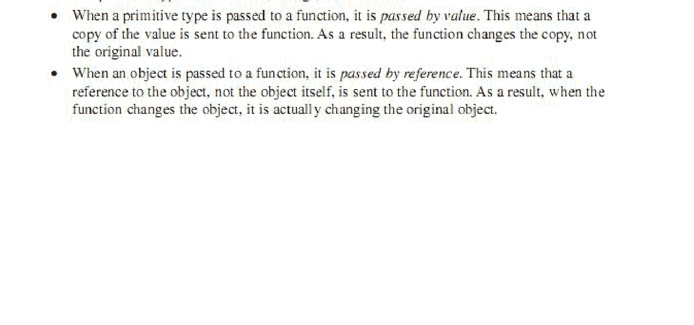

## 词法作用域的工作

编程语言中的作用域（Scope）指的是变量和函数的可见性。也就是说，它告诉你在程序的什么位置可以使用已定义的变量和函数。与许多编程语言不同，JavaScript 使用词法作用域（lexical scoping）来决定你在哪里可以访问变量和函数。

在词法作用域中，全局变量是定义在函数外的变量。这些变量具有全局作用域，因此函数可以使用它们而无需传递。相比之下，局部变量是在函数内部定义的变量。它们具有局部作用域，这意味着它们只能在定义它们的函数内部使用。

图 10-3 中的第一个示例说明了全局和局部变量的使用。在这里，`display_message` 函数显示了一个名为 `message` 的全局变量的内容，但该变量尚未定义；它创建了一个局部变量 `message` 并显示了它。

代码首先调用了 `display_message` 函数。由于 `message` 变量尚未定义，函数创建了一个局部变量 `message`。接下来，创建了一个全局变量 `message` 并调用 `display_message` 函数显示它。这表明函数可以访问全局变量。最后，从函数外部显示 `message` 变量的代码会导致错误，这表明局部变量在函数外部无效。

词法作用域的另一个结果是，命名函数可以在定义之前被调用。这是因为 JavaScript 引擎在执行代码之前会扫描代码并首先创建函数。然后它返回并执行代码。图中的第二个示例说明了这一点。

相反，匿名函数在定义之前不能被调用。图中的第三个示例说明了这一点。在这种情况下，代码会导致运行时错误，因为函数尚未创建。


如果你编写过其他语言，可能熟悉块级作用域（block scope），即代码块内部创建的变量在块外部是不可用的。但在 JavaScript 中，情况并非如此，如图中的第四个示例所示。在这里，在 `if` 语句块内定义的变量 `message` 在块外部是可用的。


## 全局和局部作用域

### 创建一个局部变量并显示全局变量的函数

```javascript
var display_message = function() {
  if (message == undefined) {
    var message = "Unknown message."; // message 有局部作用域
    alert(message);
  } else {
    alert(message); // 显示全局变量
  }
}
```

### 所有函数都可以访问全局变量

```javascript
display_message(); // 显示 "Unknown message."
var message = "Index of range."; // message 有全局作用域
display_message(); // 显示 "Index of range."
```

### 局部变量仅对其定义的函数可用

```javascript
alert(message); // 运行时错误：message 未定义
```

### 命名函数在代码执行之前就会创建

```javascript
coin_toss(); // 显示 Heads 或 Tails
function coin_toss() {
  return (Math.random() > 0.5) ? "Heads" : "Tails";
}
```

### 匿名函数在代码执行时按顺序创建

```javascript
alert(coin_toss()); // 运行时错误：coin_toss 不是函数
var coin_toss = function() {
  return (Math.random() > 0.5) ? "Heads" : "Tails";
}
```

### 代码块内部创建的变量可以在块外部使用

```javascript
if (age >= 18) {
  var can_vote = "Yes";
  alert(can_vote);
}
alert("Voting status: " + can_vote); // can_vote可用
```

## 讨论

- 变量或函数的作用域决定了它可以访问的内容。JavaScript 使用局部作用域，你可以通过分析代码确定变量或函数的作用域。
- 函数外部创建的变量具有全局作用域，函数内部的代码可以访问这些全局变量。
- 函数内部创建的任何变量具有局部作用域，函数外部的代码无法访问这些局部变量。
- 因为所有命名函数在代码执行之前就已经创建了，所以你可以在定义之前调用它们。
- 因为匿名函数是在代码执行时才创建的，如果匿名函数的调用发生在函数声明之前，就会发生运行时错误。
- 代码块中创建的变量在块外部可用。

图 10-3 词法作用域

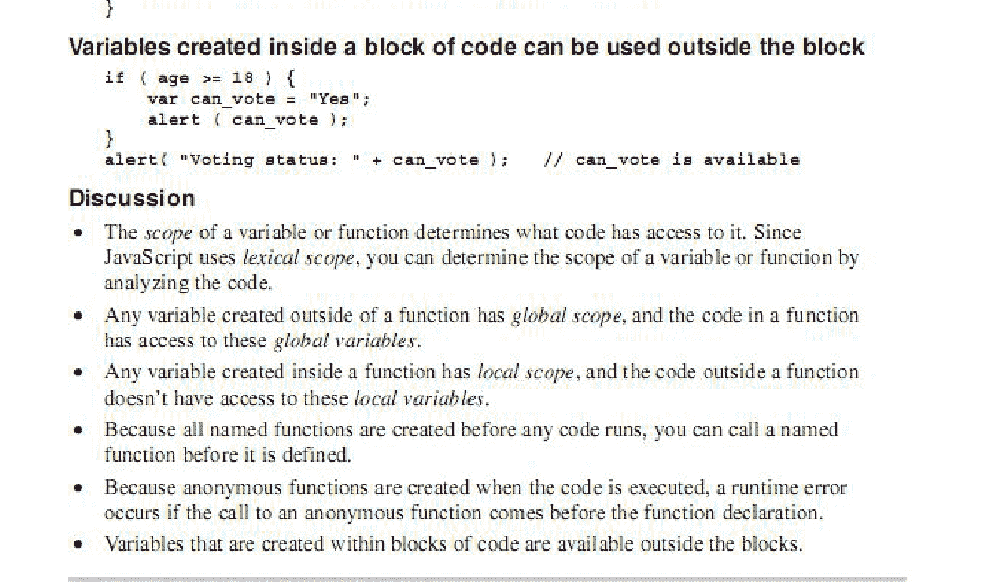

### 处理函数的面向对象技能

在 JavaScript 中，所有函数都是对象。这意味着函数像对象一样拥有属性和方法。在本主题中，你将学习如何使用函数的两个属性两个方法。

## 如何使用函数的 arguments 属性

当你在 JavaScript 中调用函数时，参数存储在函数的参数列表中。这与其他语言相似。然而，JavaScript 的独特之处在于，参数也存储在 `arguments` 属性中。

这个 `arguments` 属性类似于数组。在该属性中，传递给函数的每个参数都存储在从 0 开始的元素中。然后，你可以使用索引访问这些元素。但注意，该属性并不是真正的数组，所以你不能使用在第 9 章中学到的数组属性和方法。

图中的第一个示例展示了如何使用 `arguments` 属性来访问传递给函数的参数。在这里，`arguments` 属性中索引为 0 的元素被用于一个表达式，如果参数能被 2 整除，该表达式返回 true。

第二个示例展示了如何使用该属性来确定传递给函数的参数数量。在这里，`count_args` 函数显示了传递给它的参数数量。你可以创建接收参数少于参数列表定义的函数。这允许你创建带有可选参数的函数。

图中的第三个示例说明了这一点。在这里，`pad_left` 函数接受三个参数，但最后一个参数是可选的。为了处理这一点，函数首先检查是否至少传递了两个参数。如果没有，则返回空字符串。接下来，如果函数只收到了两个参数，则第三个参数（pad）被设置为空格字符。最后，函数使用循环在字符串长度小于参数宽度时向文本中添加填充字符。然后，函数返回填充后的文本。

通过使用 `arguments` 属性，函数还可以处理比参数列表允许的更多的参数。图中的第四个示例说明了这一点。在这里，函数在参数列表中没有参数，但它会计算传递给它的所有参数的平均值。

### 使用 arguments 属性获取参数的函数

```javascript
var isEven = function (value) {
  return arguments[0] % 2 == 0;
}
```

### 如何确定传递的参数数量

```javascript
var count_args = function () {
  alert("Number of arguments: " + arguments.length);
}
```

```javascript
count_args(1, "Text", true); // 显示 "Number of arguments: 3"
```

### 调用参数少于命名参数的函数

```javascript
var pad_left = function (text, width, pad) {
  if (arguments.length < 2) return "";
  if (arguments.length == 2) pad = "";
  while (text.length < width) {
    text = pad + text;
  }
  return text;
}
```

```javascript
alert("Welcome to " + pad_left("JavaScript", 15));
// 显示 "Welcome to JavaScript"
```

### 调用参数多于命名参数的函数

```javascript
var average = function () {
  if (arguments.length == 0) return 0;
  var sum = 0;
  for (var i = 0; i < arguments.length; i++) {
    sum += arguments[i];
  }
  return sum / arguments.length;
}
```

```javascript
alert(average(8, 15, 5, 10)); // 显示 9.5
```

## 讨论

- 在 JavaScript 中，函数是对象，传递给函数的所有参数存储在函数对象的 `arguments` 属性中。
- `arguments` 属性类似于数组，因此你可以使用索引来访问其元素。然而，`arguments` 属性并不是真正的数组，所以你不能对它使用 Array 的方法。
- 如果函数使用该属性来获取传递给它的参数，调用语句传递的参数可以比参数列表指定的要多要少。


## 如何使用函数的 call 和 apply 方法

当函数被调用时，它内部有一个可以通过 `this` 关键字引用的内部参数。该 `this` 关键字所代表的值取决于函数是如何被调用的。当正常调用函数时，该关键字被设置为全局变量，即 `window` 对象。当你使用函数的 `call` 或 `apply` 方法调用函数时，可以使用第一个参数来设置你希望为 `this` 关键字指定的对象。

图 10-5 中的第一个示例展示了一个名为 `this_test` 的函数，它说明了 `this` 关键字的使用。在这里，它使用严格模式运算符来检查关键字和 `window` 是否相等。如果是，函数将显示一条指示此情况的消息。否则，子句将显示关键字的值。

第二个示例展示了对 `this_test` 函数的两次调用。第一次是普通调用，因此 `this` 关键字等于 `window` 对象；第二次使用函数的 `call` 方法来调用函数，并使用方法的第一个参数将参数更改为字符串。结果是，函数 `else` 子句中的 `alert` 语句显示了该参数 "Test String"。

同样，该组中的第三次调用使用函数的 `apply` 方法来调用函数，并使用第一个参数将参数更改为数字。结果是，函数显示 45.72。

通过 `call` 和 `apply` 方法，你都使用第一个参数来设置关键字的对象。但你可以在 `arguments` 列表中向函数传递任何其他参数，而对于 `apply` 方法，你将任何其他参数在一个作为第二个参数的数组中传递。

该组中的第三、四个示例展示了如何使用 `call` 和 `apply` 方法调用 Firefox `console` 对象的 `log` 方法，这是你在第 3 章的图 3-9 和 3-10 中学习过的。在第三个示例中，`console` 被用第一个参数，变量 `message` 作为第二个参数。在第四个示例中，`console` 作为第一个参数，名为 `arguments` 的数组作为第二个参数。在两种情况下，由于 `log` 是 `console` 对象的方法，它需要将 `this` 设置为该对象而不是 `window` 对象。

这两个调用都是在一个名为 `slot` 的包装函数内部进行的，该函数在调用方法之前会使用 `typeof` 运算符检查 Firefox 的 `console` 及其 `log` 方法是否可用。在示例中，如果 `log` 方法可用，数组中的参数将连接成一个字符串然后显示。记住，`arguments` 属性不是真正的数组，所以你不能使用数组的方法来连接元素。相反，你使用 `for` 循环来连接它们。

当你在下一章学习函数如何作为对象方法使用时，请记住，当你调用对象的方法时，JavaScript 在内部内部会使用 `call` 方法。此外，JavaScript 会传递方法的第一个参数，以便方法中的 `this` 关键字指向该对象而不是 `window`。


### 使用 this 关键字的函数

```javascript
var this_test = function () {
  if (this == window) {
    alert("This is the window object.");
  } else {
    alert(this);
  }
}
```

### 两个计数器的 XHTML

```html
<p><span id="counter_a">0</span></p>
<p><input type="button" value="Increment" id="button_a" /></p>
<p><span id="counter_b">0</span></p>
<p><input type="button" value="Increment" id="button_b" /></p>
```

### JavaScript 代码

```javascript
var $ = function (id) {
  return document.getElementById(id);
}

var make_counter = function () {
  var count = 0;
  var increment = function () {
    count++;
    return count;
  };
  return increment;
};

var counter_a_increment = make_counter();
var counter_b_increment = make_counter();

var button_a_click = function () {
  $("counter_a").firstChild.nodeValue = counter_a_increment();
};

var button_b_click = function () {
  $("counter_b").firstChild.nodeValue = counter_b_increment();
};

window.onload = function () {
  $("button_a").onclick = button_a_click;
  $("button_b").onclick = button_b_click;
};
```

### 在网页浏览器中运行的代码


## 讨论

- 在 JavaScript 中，嵌套函数可以访问外部函数的变量。这被称为闭包。
- 只要存在对内部函数的引用，外部函数的变量就是可用的。

# 如何编写递归函数

递归函数是一个通过调用自身（可能调用多次）来解决问题的函数。为了说明这一点，图 10-7 展示了一个递归函数，它使用二分查找法在数字数组中搜索特定值。

在这种情况下，顺序搜索从数组的第一个元素开始，并顺序继续查找，直到找到该值。平均而言，搜索在找到值之前会遍历一半的元素。例如，如果一个数组包含 256 个元素，搜索平均需要 128 次比较。如果数组的大小增加一倍，平均搜索时间也会翻倍。

相比之下，二分查找从数组的中间位置开始。然后，如果搜索值大于中间位置的值，则搜索在数组的上半部分继续；如果较小，则搜索在数组下半部分的中间位置继续。搜索...

在这种类型的搜索中，每次比较都会丢弃数组的一半。结果是，搜索一个包含 256 个项目的数组最多只需要 9 次比较。如果数组的大小增加一倍，搜索只需要多进行一次比较。

在这里，你可以看到一个使用二分查找的递归函数。开始时，代码使用了第 7 章介绍的 `number_function` 函数来创建一个从 1 到 1000 之间的 256 个数字的数组。然后，代码使用数组的 `sort` 方法对数字进行排序。二分查找需要进行排序。

接下来，展示此用于搜索函数代码。这里，参数 `needle` 存储要搜索的值；`haystack` 参数存储要搜索的数组；`lo` 参数存储应搜索的最低位置索引；`high` 参数存储应搜索的最高位置索引。

在函数的体中，代码首先检查传递给函数的参数个数。如果只传递了两个参数，它会将 `lo` 和 `hi` 初始化为数组的第一个和最后一个元素。接着，如果 `hi` 小于 `lo`，则返回 -1。这意味着所有元素都已丢弃且未找到该值。然后，它检查 `hi` 和 `lo` 是否相同。

如果相同，则只有一个元素需要检查，并测试它是否为正确的值。然后，返回该位置或 -1。最后，将中间值与搜索值进行比较。

如果中间值小于该元素，则会再次调用搜索并更改 `hi` 参数，以便在数组剩余部分的下半部分重复操作。或者，如果它大于中间值，则通过更改 `lo` 参数调用搜索，以便在数组的上半部分重复操作。这就是函数变成递归的地方。

该图最后部分显示了使用 `search` 函数的代码。这里，使用 `prompt` 方法从用户处获取数字。然后，将该数字和数组作为参数调用 `search` 函数。这会一直重复，直到用户点击“取消”按钮。


### 创建 256 个数字排序数组的代码

```javascript
var numbers = [];
for (var i = 0; i < 256; i++) {
  numbers[i] = random_number(1,1000);
}

var numeric_order = function (a,b) {
  if (a < b) return -1;
  if (a > b) return 1;
  return 0;
}
numbers.sort(numeric_order);
```

### 使用二分查找搜索数组的递归函数

```javascript
var search = function(needle, haystack, lo, hi) {
  if (arguments.length == 2) {
    lo = 0;
    hi = haystack.length - 1;
  }

  var middle = Math.floor((lo + hi) / 2);

  if (needle == haystack[middle]) {
    return middle;
  } else if (needle < haystack[middle]) {
    return search(needle, haystack, lo, middle - 1);
  } else {
    return search(needle, haystack, middle + 1, hi);
  }
};
```

### 搜索数字的循环

```javascript
var numbers, position;
do {
  number = prompt("要查找的数字（取消退出）");
  if (number == null) break;
  if (isNaN(number)) continue;
  position = search(number, numbers);
  if (position == -1) {
    alert(number + " 不在列表中");
  } else {
    alert(number + " 位于 " + position);
  }
} while (true);
```

图 10-7：如何编写递归函数

### 发票应用程序

图 10-8 到 10-9 展示了一个使用函数的发票应用程序。该应用程序说明了文件的使用。第一个文件是包含工具函数的库；第二个文件是与用户交互的主文件。正如你所看到的，将应用程序的函数分为两个文件有助于保持代码整洁。

## 用户界面

图 10-8 展示了应用程序的用户界面。该应用程序允许用户输入每个项目的名称、成本和数量。每当一个项目添加到发票中时，就会计算行项目成本、小计、销售税和总额。在这个示例中，用户输入了三个项目。

由于此应用程序没有从数据库获取数据，也没有将发票数据保存到数据库，因此并不是真正的发票应用程序。要实现这一点，你需要使用服务器端应用程序。相反，你可以将其视为一个给客户提供报价的草稿应用程序。


## 网页浏览器中的发票应用程序


### XHTML 文件

图 10-9 展示了此应用的 XHTML。开始时，请注意 script 标签标识了两个 JavaScript 文件。第一个是库文件；第二个是使用库函数的主文件。当页面加载到浏览器时，这些文件中的 JavaScript 将按照列出的顺序加载到浏览器。这与所有 JavaScript 存储在单个文件中效果相同。

在 XHTML 的体中，代码分为两部分。第一部分包含用于向发票添加项目的表单字段。它由四个文本字段和一个按钮组成。第二部分包含显示发票的表单字段：一个文本区域和三个字段。如果你参考最后一张图，你可以看到文本区域中显示了两个标题和行项目。

### XHTML 文件

```html
<!DOCTYPE html PUBLIC "-//W3C//DTD HTML 1.0 Transitional//EN"
"http://www.w3.org/TR/html1/DTD/html1-transitional.dtd">
<html xmlns="http://www.w3.org/1999/xhtml">
<head>
  <title>Invoice Manager</title>
  <link rel="stylesheet" type="text/css" href="invoice.css" />
  <script type="text/javascript" src="invoice_library.js"></script>
  <script type="text/javascript" src="invoice.js"></script>
</head>
<body>
  <div id="content">
    <h1>Invoice Manager</h1>
    <div class="formout">
      <label for="item_code">项目代码:</label>
      <input type="text" name="item_code" id="item_code" /> <br />
      <label for="item_name">项目名称:</label>
      <input type="text" name="item_name" id="item_name" /> <br />
      <label for="item_cost">成本:</label>
      <input type="text" name="item_cost" id="item_cost" /> <br />
      <label for="item_qty">数量:</label>
      <input type="number" name="item_qty" id="item_qty" value="1" /> <br />
      <label for="item_add"></label>
      <input type="button" name="item_add" id="item_add" value="添加项目" /> <br />
    </div>
    <p class="startInvoice">当前发票:</p>
    <textarea id="item_list" rows="5" cols="80"></textarea>
    <div class="formout">
      <label for="subtotal">小计:</label>
      <input type="text" name="subtotal" id="subtotal" disabled="disabled" /> <br />
      <label for="sales_tax">税额:</label>
      <input type="text" name="sales_tax" id="sales_tax" disabled="disabled" /> <br />
      <label for="total">总计:</label>
      <input type="text" name="total" id="total" disabled="disabled" /> <br />
    </div>
  </div>
</body>
</html>
```

## 库文件

库文件可以用于存储应用程序所需的辅助函数或工具函数。通常，这些函数可以被多个应用程序使用。例如，图 10-19 库文件中的前两个函数是通用函数，允许你在字符串的左侧或右侧填充空格或其他字符。

如果你研究了 `pad_left` 函数，你会发现它有 `text`、`width` 和 `pad` 参数。第一个参数是要待填充的字符串。第二个参数是字符串应该填充到的宽度。第三个参数是可选的，用于填充的字符。如果省略了此参数，则默认为空格。

在该函数体中，使用函数的 `arguments` 属性来确保传递给函数的参数数量正确。如果传递的少于两个或多于三个，该函数将返回空字符串。如果传递了两个，则 `pad` 参数被设置为空格。

一旦检查完成，`text` 参数被转换为字符串（如果它还不是字符串的话），并赋值给名为 `result` 的变量。接下来，通过一个 `while` 循环填充该变量，然后将其返回给调用语句。

`pad_right` 函数与 `pad_left` 函数类似。区别在于 `while` 循环中填充字符被添加到结果的末尾而不是开头。


### invoice_library.js 文件

```javascript
var pad_left = function(text, width, pad) {
  if (arguments.length < 2 || arguments.length > 3) {
    return "";
  }
  if (arguments.length == 2) {
    pad = "";
  }
  var result = text.toString();
  while (result.length < width) {
    result = result + pad;
  }
  return result;
}

var pad_right = function(text, width, pad) {
  if (arguments.length < 2 || arguments.length > 3) {
    return "";
  }
  if (arguments.length == 2) {
    pad = "";
  }
  var result = text.toString();
  while (result.length < width) {
    result = result + pad;
  }
  return result;
}
```

图 10-10 发票应用程序的库文件（部分，共 2 部分）

库文件中的第三个函数是 `get_item_list` 函数。该函数有一个参数，接收一个包含发票行项目数据的数组。它返回一个格式化后的字符串，其中包含发票的行项目数据。该字符串随后显示在应用程序的文本区域中。

## invoice_library.js

```javascript
var pad_left = function(text, width, pad) {
  if (arguments.length < 2 || arguments.length > 3) {
    return "";
  }
  if (arguments.length == 2) {
    pad = "";
  }
  var result = text.toString();
  while (result.length < width) {
    result = result + pad;
  }
  return result;
}

var pad_right = function(text, width, pad) {
  if (arguments.length < 2 || arguments.length > 3) {
    return "";
  }
  if (arguments.length == 2) {
    pad = "";
  }
  var result = text.toString();
  while (result.length < width) {
    result = result + pad;
  }
  return result;
}
```

### invoice.js 文件

```javascript
var invoice = {};

var $ = function(id) { return document.getElementById(id); }

var update_display = function () {
  $("item_list").value = get_item_list(invoice);
  $("subtotal").value = get_subtotal(invoice).toFixed(2);
  $("sales_tax").value = get_sales_tax(invoice).toFixed(2);
  $("total").value = get_total(invoice).toFixed(2);

  $("item_code").value = "";
  $("item_name").value = "";
  $("item_cost").value = "";
  $("item_qty").value = "1";

  $("item_code").focus();
}

var item_add_click = function () {
  var item = {};
  item["item_code"] = $("item_code").value;
  item["item_name"] = $("item_name").value;
  item["item_cost"] = parseFloat($("item_cost").value);
  item["item_qty"] = parseInt($("item_qty").value);

  if (item["item_code"] == "") return;
  if (item["item_name"] == "") return;
  if (isNaN(item["item_cost"])) return;
  if (isNaN(item["item_qty"])) return;

  invoice.push(item);
  update_display();
}

window.onload = function () {
  $("item_add").onclick = item_add_click;
  $("item_code").focus();
};
```

图 10-11 发票应用程序的 invoice.js 文件

## 展望

现在你已经完成了本章，应该掌握了使用函数所需技能。特别是，你应该能够使用函数对象的 `arguments` 属性来处理可选参数。你应该理解原始变量和对象是如何传递给函数的，以及词法作用域是如何工作的。你应该理解如何使用库文件将函数与与用户交互的代码分离。

在下一章中，你将看到函数在 JavaScript 的面向对象架构中起着核心作用。事实上，JavaScript 正通过函数创建了新类型的对象。

## 术语

- 匿名函数
- 命名函数
- 参数
- 调用函数
- 参数
- 原始类型
- 按值传递
- 按引用传递
- 作用域
- 词法作用域
- 全局作用域
- 全局变量
- 局部作用域
- 局部变量
- 块作用域
- 闭包
- 递归函数
- 二分查找
- 库文件

## 练习 10-1 使用发票应用程序

此练习将让你有机会在本章介绍的发票应用程序中实验函数和函数调用。

### 打开、测试并增强发票应用程序

1. 从 Firefox 浏览器中打开第 10 章 Exercises 文件夹下的 `index.html` 文件。然后通过向表单添加两个项目来测试此应用程序。为此，你可以为项目代码和描述输入任何数据，但必须确保项目代码和数量是有效的。
2. 点击 Firefox 浏览器中的刷新（Reload）按钮以开始新发票。注意，这不会清除上一个发票的数据。
3. 使用文本编辑器打开此应用程序的两个 JavaScript 文件。然后，修改 `onload` 事件的处理程序，使其在点击刷新按钮时清除发票数据。为此，你只需要在 `onload` 事件处理器中调用一个已经定义的函数即可。

### 使用函数的 arguments 属性和 call 方法

4. 修改 `pad_left` 函数，使其使用其 `arguments` 属性来获取传递它的前两个参数。
5. 修改 `item_add_click` 函数中的最后一条语句，使用该函数的 `call` 方法来调用 `update_display` 函数（见图 10-5）。在这种情况下，你不需要传递任何参数，因为你不需要更改用于该参数的对象。
6. 实验完成后，关闭文件。

## 练习 10-2 实验二分查找应用程序

此练习将让你有机会在使用了递归函数的二分查找应用程序环境中实验全局变量和局部变量。

1. 从 Firefox 浏览器中打开第 10 章 文件夹下 `recursive_search` 文件夹中的 `index.html` 文件。然后通过搜索 1 到 512 之间的数值来测试此应用程序。点击取消（Cancel）按钮结束应用程序。
2. 使用文本编辑器打开此应用程序的 `index.html` 文件，其中包含该应用程序的 JavaScript 代码。
3. 修改此应用程序，使用全局变量来计算搜索函数针对每个搜索数字执行的次数。然后使用 `alert` 方法在找到或未找到数字后显示计数器的值，消息如下所示：
   > 搜索函数被调用了 8 次。
   > 要正确实现这一点，计数器需要在每次搜索时重置为零，并在每次调用搜索函数时增加 1。
4. 在搜索函数中添加语句，使用 `alert` 方法在找到数字时显示 `lo` 和 `hi` 的最后值。
5. 如果你想向自己证明函数的参数具有局部作用域，尝试从搜索函数外部显示 `lo` 和 `hi` 的最后值。
6. 实验完成后，关闭文件。

# 第 11 章：如何创建和使用对象

某些原生对象类型的 JavaScript 层次层级结构


### 创建原生类型新对象的语法

```javascript
var variable_name = new Object_Type(arguments);
```

### 如何创建 Date 类型的新对象

```javascript
var today = new Date();
```

### 如何创建 Object 类型的新对象

```javascript
var invoice = new Object();
```

### 如何创建 String、Number 和 Boolean 对象

#### 如何创建 String 类型的新对象

```javascript
var lastName = "Harris"; // 等于 = new String("Harris");
```

#### 如何创建 Number 类型的新对象

```javascript
var taxRate = .0875; // 等于 = new Number(.0875);
```

#### 如何创建 Boolean 类型的新对象

```javascript
var validFlag = true; // 等于 = new Boolean(true);
```

### 如何使用原生对象类型的属性和方法

#### 如何使用 String 对象的 length 属性

```javascript
length = lastName.length; // 等于 = lastName["length"];
```

#### 如何使用 Number 对象的 toFixed 方法

```javascript
formattedDate = taxRate.toFixed(4); // 等于 = taxRate["toFixed"];
```

## 描述

- JavaScript 提供了两级对象类型的层次级结构。顶层由 Object 对象类型组成。下一层由 String、Number、Date 和 Array 等类型组成。
- 第二层的所有对象类型都继承 Object 对象类型的属性和方法。其中一个是 toString 方法，它可以将对象转换为字符串。
- 第二层的所有原生对象类型还提供了用于操作这些对象的属性和方法。这些类型中的大多数都有 toString 方法，该方法覆盖了从 Object 类型继承的 toString 方法。
- 当你为字符串、数字或布尔值创建变量时，JavaScript会将它们转换为原生对象类型。
- 要访问属性或方法，可以使用点运算符（.）或括号。

# 如何创建 Object 类型的对象

创建自定义对象的一种方法是创建 Object 类型的对象。图 11-2 显示，你可以通过使用 `new` 关键字配合 Object 类型或编写一组大括号来这样做。这两种方法都会创建一个可以存储在变量中的 Object 类型新对象。

当你使用大括号创建 Object 类型的对象时，还可以初始化该对象的属性或方法。例如，有一个属性为 taxRate，其值为 0.0875。如你所见，属性名和值之间必须用冒号分隔。

在示例 2 中，invoice 对象初始化了一个名为 salesTax 的方法。在这里，方法名后面跟着冒号和一个执行该方法任务的匿名函数。这里发生的是一个函数被存储为对象的属性，从而使其变成对象的方法。

在示例 3 中，invoice 对象初始化了两个方法和两个属性。在这里，属性对必须用逗号分隔。在为对象创建属性和方法后，你可以像使用原生对象的属性和方法一样使用它们。这意味着你可以使用点运算符或括号来引用属性和方法。

图中最后组示例显示，你还可以将一个对象嵌套另一个对象内部。在这种情况下，term 对象被嵌套在 invoice 对象中。要这样做，invoice 对象初始化了一个名为 terms 的属性，而 terms 属性本身也是一个对象，它初始化了两个名为 rate 和 dueDate 的属性。

要访问嵌套对象的属性和方法，可以使用点运算符或方括号将属性名链起来。在访问嵌套对象时，也可以混合使用点运算符和方括号。但在实践中，通常使用点运算符，因为它更容易且更易于理解。

### 两种创建 Object 类型空对象的方法

#### 使用 `new` 关键字

```javascript
var invoice = new Object();
```

#### 使用大括号

```javascript
var invoice = {};
```

### 如何初始化带有属性和方法的新对象

#### 示例 1：如何初始化一个带有一个属性的新对象

```javascript
var invoice = { taxRate: 0.0875 };
```

#### 示例 2：如何初始化一个带有一个方法的新对象

```javascript
var invoice = {
    getSalesTax: function(subtotal) {
        return (subtotal * invoice.taxRate);
    }
}
```

#### 示例 3：如何初始化一个带有属性和方法的新对象

```javascript
var invoice = {
    getSalesTax: function(subtotal, salesTax) {
        return (subtotal * invoice.taxRate);
    },
    getTotal: function (subtotal, salesTax) {
        return (subtotal + salesTax);
    },
    taxRate: 0.0875,
    dueDays: 30
}
```

### 如何嵌套对象并引用嵌套的属性和方法

#### 如何将一个对象嵌套另一个对象内部

```javascript
var invoice = {
    terms: {
        taxRate: 0.0875,
        dueDays: 30
    }
}
```

#### 如何引用嵌套对象的属性和方法

```javascript
alert(invoice.terms.taxRate); // 显示 0.0875
alert(invoice["terms"]["dueDays"]); // 30
```

## 描述

- JavaScript 提供了两级对象类型的层次级结构。顶层由 Object 对象类型组成。下一层由 String、Number、Date 和 Array 等类型组成。
- 第二层的所有对象类型继承 Object 对象类型的属性和方法。其中一个是 toString 方法，它可以将对象转换为字符串。
- 第二层的所有原生对象类型还提供了用于操作这些对象的属性和方法。这些类型中的大多数都有 toString 方法，该方法覆盖了从 Object 类型继承的 toString 方法。
- 当你为字符串、数字或布尔值创建变量时，JavaScript会将它们转换为原生对象类型。
- 要访问属性或方法，可以使用点运算符或括号。

# 如何扩展、修改或删除

当你创建一个对象时，可以向它添加属性。这由第一个示例所示。当你使用 `delete` 运算符时，如果有多个变量引用一个对象，`delete` 运算符会删除对对象的引用。如果没有没有对对象的引用，对象就会被删除。

### 如何向对象添加属性和方法

#### 使用点运算符

```javascript
invoice.taxRate = 0.0875; // 添加 taxRate 属性
invoice.getSalesTax = function(subtotal) { // 添加 getSales 方法
  return subtotal * invoice.taxRate;
};
```

#### 使用括号

```javascript
invoice["taxRate"] = 0.0875; // 添加 taxRate 属性
```

### 如何修改对象的属性

```javascript
invoice.taxRate = 0.095;
```

### 如何从对象中移除属性

```javascript
delete invoice.taxRate;
alert(invoice.taxRate); // 显示 undefined
```

### 两个引用同一个对象的变量

```javascript
var today = new Date();
var now = today;
```

阐明这些引用的图


### 如何删除一个对象

```javascript
var today = new Date();
delete today;
alert(today); // 显示 undefined
```

### 删除对对象的引用

```javascript
var today = new Date();
var now = today;
delete today;
alert(today); // 显示 undefined
alert(now.getFullYear()); // 显示年份
```

## 如何创建和使用你自己的对象类型

当你使用 JavaScript 时，你也可以创建自己的对象类型。例如，你可以创建一个名为 `Invoice`（发票）的对象类型，它包含与发票相关的属性和方法。

第 11-14 行的第一组示例展示了如何创建你的对象类型。要做到这一点，你需要定义一个构造函数（或简称构造函数）来创建并初始化新对象，并给这个函数起一个名称，该名称将成为对象类型。按照习惯，这些名称以大字母开头。在这些示例中，两个对象是 `InvestmentTerm`（投资期限）和 `Invoice`。

在构造函数的体内，你可以使用 `this` 关键字来引用函数将创建的新对象。在这些示例中，`InvestmentTerm` 构造函数接受两个参数并使用 `this` 关键字将这些参数存储在新对象的 `rate` 属性中。相比之下，`Invoice` 构造函数不接受任何参数，但它创建了一个名为 `items` 的属性（是一个数组）和一个名为 `tax_rate` 的属性（初始化为 0.07）。

由于这些是构造函数，它们不返回结果。相反，函数将通过 `new` 关键字被调用，它们会自动返回新对象，就就像通过它们的最后语句执行 `"return this"` 一样。

要向对象类型添加方法，你需要将该方法添加到它的原型（prototype）对象中。图中的第二组示例说明了这一点。在这里，`getMonths` 方法被添加到 `object` 对象的原型上，`delete_item` 方法被添加到 `Invoice` 对象的原型上。这些原型对象存储在构造函数的原型中。在变成方法的函数内部，你可以使用 `this` 关键字来引用由构造函数创建的对象。

要创建某个对象类型的实例，你使用 `new` 关键字配合构造函数的名称。接下来的示例说明了这一点。在这里，创建了一个名为 `term` 的新 `InvestmentRate` 对象，其 `rate` 属性值为 0.04，`term` 属性值为 10。然后，创建了一个名为 `invoice` 的新 `Invoice` 对象。

对象创建后，你可以像引用任何其他对象的属性和方法一样引用它们的属性。接下来的两组示例说明了这一点。在这里，第四组示例显示了 `terms` 对象的 `rate` 属性值和 `invoice` 对象的 `tax_rate` 属性值。然后，第五组示例的第一条语句显示了 `terms` 对象的 `getMonths` 方法的结果，第二个语句调用了 `invoice` 对象的 `delete_item` 方法来删除 `items` 数组中的一项。


### 如何编写构造函数

```javascript
// 创建 InvestmentTerms 对象的构造函数
var InvestmentTerms = function (init_rate, init_years) {
 // 定义对象的属性
  this.rate = init_rate;
  this.years = init_years;
}
```

```javascript
// 创建 Invoice 对象的构造函数
var Invoice = function () {
  this.items = [];
  this.tax_rate = 0.07;
}
```

### 如何向对象类型添加方法

```javascript
// 向 InvestmentTerms 对象类型添加 getMonths 方法
InvestmentTerms.prototype.getMonths = function () {
  return this.years * 12;
}
```

```javascript
// 向 Invoice 对象类型添加 delete_item 方法
Invoice.prototype.delete_item = function (item_code) {
  if (item_code in this.items) {
    delete this.items[item_code];
  }
  return this;
}
```

### 如何创建对象类型的新实例

```javascript
var terms = new InvestmentTerms(0.04, 10);
var invoice = new Invoice();
```

### 如何访问新对象的属性

```javascript
alert(terms.rate);
alert(invoice.tax_rate);
```

### 如何使用新对象的方法

```javascript
var months = terms.getMonths();
invoice.delete_item(item_code);
```

## 描述

- 要创建你的对象类型，你需要创建一个以对象名称命名的构造函数（或构造函数）。按照习惯，该名称应以大字母开头。然后，构造函数会创建该类型的对象。
- 在构造函数内部，`this` 关键字指向被创建的对象。
- 在 JavaScript 中，每个对象类型都有一个原型对象，其中包含该对象类型的属性和方法。因此，要向对象类型添加方法，你需要将该方法添加到此原型对象中。在该方法内部，你可以使用 `this` 关键字来引用对象的属性和方法。

图 11-4 如何创建和使用我们的对象类型

### 处理对象的高级技能

本主题介绍了一些处理对象的高级技能。虽然你不会在每个应用程序中都这些技能，但你至少应该了解它们，以便在适当的情况下。

## 如何从另一个对象类型继承属性和方法

在你创建一个对象类型后，该对象类型可以从另一个对象类型继承属性和方法。这允许你创建一个具有通用方法的基对象类型，然后用更专门的方法扩展该对象类型。图 11-6 中的示例说明了这一点。

首先，此图展示了如何创建一个名为 `Vehicle` 的基对象类型，并使用上一个图中的技术向其添加方法。该对象类型创建一个具有通用方法的基对象类型，然后用更专门的方法扩展该对象类型。

## 如何向 JavaScript 对象类型添加方法

由于 JavaScript 对象类型基于原型继承，你可以随时扩展任何对象类型的功能。这包括原生 JavaScript 对象、DOM 对象以及浏览器对象。

要扩展任何 JavaScript 对象，你只需要向该对象类型的**原型对象（prototype object）**添加一个新方法即可。事实上，许多 JavaScript 库都是从扩展现有对象类型的功能开始的。

为了说明，图 11-6 显示了如何向 `Date` 和 `String` 对象添加新方法。在第一个示例中，`leapYear` 方法被添加到 `Date` 的原型对象上。该方法首先通过 `this` 关键字调用对象的 `getYear` 方法从 `Date` 原型中获取完整年份。然后，该方法根据年份是否为闰年返回 true 或 false。如果年份能被 4 整除，且不能被 100 整除或者能被 400 整除，则为闰年。

在第二个示例中，`reverse` 方法被添加到 `String` 的原型对象上。该方法返回一个新字符串，其字符顺序与原始字符串相反。由于 `this` 关键字引用的对象永远不会被修改，因此该方法不会改变原始字符串。

图中的第三个示例显示了如何向 `Math` 对象添加函数。但注意，`Math` 对象并不是一个对象类型，因此它没有原型对象。相反，你直接将新方法添加到 `Math` 对象中。在这种情况下，`Math` 对象被添加了一个 `add` 方法。该方法将传递给它的两个参数转换为数字并返回它们的和。

### 如何向 Date 对象添加方法

```javascript
Date.prototype.isLeapYear = function () {
  var year = this.getFullYear();
  if (year % 4 == 0) {
    if (year % 100 == 0) {
      if (year % 400 == 0) {
        return true;
      } else {
        return false;
      }
    } else {
      return true;
    }
  } else {
    return false;
  }
}
```

```javascript
var opening = new Date(2009, 1, 1); // 2009年2月1日
alert(opening.isLeapYear()); // 显示 false
```

### 如何向 String 对象添加方法

```javascript
String.prototype.reverse = function () {
  var reverse = "";
  for (var position = this.length - 1; position >= 0; position--) {
    reverse += this.charAt(position);
  }
  return reverse;
}
```

```javascript
var message = "JavaScript";
alert(message.reverse()); // 显示 tpircpSavaJ
```

### 如何向 Math 对象添加方法

```javascript
Math.add = function (x, y) {
  return parseFloat(x) + parseFloat(y);
}
```

```javascript
alert("3* + 5*"); // 显示 35
alert(Math.add("3", "5"));   // 显示 8
```

## 描述

- 要向 JavaScript 对象类型添加方法，你将方法添加到该类型的原型对象上。然后，该类型的所有对象（包括现有对象）将继承这个新方法。
- 在新方法中，你可以使用 `this` 关键字来引用通过该类型类型的对象。
- 由于 `Math` 对象不是对象类型，它没有原型对象。因此，你直接将新方法添加到 `Math` 对象中。

图 11-6 如何向 JavaScript 对象类型添加方法

## 如何创建链式方法

链式方法（cascading method）是可以与其他方法链式调用的类型方法。要实现这一点，方法必须使用 `this` 关键字返回原始对象的引用。图 11-7 说明了这一点。

在第一个示例中，向 `Array` 对象类型添加了一个名为 `add_value` 的方法。然而，该方法没有返回对象的引用，因此不能与其他 `Array` 方法链式调用。如果你尝试链式调用，将会发生运行时错误。

在第二个示例中，`add_value` 方法以 `return this` 语句结束。它返回原始对象的引用，因此该方法可以链式调用。然后，向 `Array` 对象类型添加了 `delete_value` 方法。由于它也以 `return this` 语句结束，因此也可以链式调用。

此示例展示了两个链式调用的值调用，随后是链式的 `add_value` 和 `delete_value` 值调用。由于链式调用常用于方法调用，因此通过让所有方法都以 `return this` 语句结束来支持链式调用是一种良好的做法。

### 修改对象但未返回对象的方法

#### 向 Array 对象类型添加的 add 方法

```javascript
Array.prototype.add_value = function (key, value) {
  this[key] = value;
}
```

#### 链式调用 add 方法将不起作用

```javascript
var pin_codes = [];
pin_codes.add_value("Mike", "1234").add_value("Ray", "9876");
```

#### add 方法必须一个接一个调用

```javascript
var pin_codes = [];
pin_codes.add_value("Mike", "1234");
pin_codes.add_value("Ray", "9876");
```

### 修改对象并返回对象的方法

#### 向 Array 对象类型添加的 add 方法

```javascript
Array.prototype.add_value = function (key, value) {
  this[key] = value;
  return this;
}
```

#### 链式调用 add 方法有效

```javascript
var pin_codes = [];
pin_codes.add_value("Mike", "1234").add_value("Ray", "9876");
```

#### 向 Array 对象类型添加的 delete 方法

```javascript
Array.prototype.delete_value = function (key) {
  delete this[key];
  return this;
}
```

#### 链式调用方法有效

```javascript
pin_codes.delete_value("Ray");
```

## 描述

- 链式方法是可以与其他方法链式调用的类型方法。
- 如果要与其他方法链式调用，方法必须返回由 `this` 关键字表示的对象。

## 如何对对象使用 for-in 语句

在 JavaScript 中，你可以使用 `for-in` 语句遍历对象的属性。图 11-8 说明了这一点。在示例 1 中，`for-in` 循环显示属性。在示例 2 中，循环构建了一个字符串。

但注意，`for-in` 语句可能无法处理所有属性。首先，`for-in` 语句忽略未赋值的属性。其次，`for-in` 语句只会处理可枚举属性。通过代码添加的所有属性都是可枚举的，但内置属性不是。

### for-in 语句的语法

```javascript
for ( var property_name in object ) {
  // 执行的代码
}
```

### 用于 for-in 循环的对象如下

```javascript
var application = {
  rate: 0.04,
  years: 10
};

var invoice = {
  getSalesTax: function( subtotal ) {
    return ( subtotal * invoice.rate);
  },
  getTotal: function( subtotal, salesTax ) {
    return subtotal + salesTax;
  },
};
```

### 如何对对象使用 for-in 语句

#### 示例 1：使用 application 对象

```javascript
for ( var property in application ) {
  alert( property + ": " + application[property] );
}
```

#### 示例 2：使用 invoice 对象

```javascript
var propList = "";
for ( var property in invoice ) {
  propList += property + ": " + invoice[property] + "\n";
}
alert( propList );
```

## 如何使用 in、instanceof 和 typeof 运算符

为了帮助你获取有关对象或变量的信息，JavaScript 提供了 `in`、`instanceof` 和 `typeof` 运算符。这些运算符可以在方法内部使用，以确保作为参数传递了正确的对象或变量类型。这些运算符的使用如图 11-9 所示。

`in` 运算符用于确定对象是否具有特定的属性。如果该属性已赋值，则它会返回 `true`。在示例中，`application` 对象的属性没有被定义，因此运算符返回 `false`。

但是，`month` 属性已经定义了，因此运算符返回 `true`。

同样地，`invoice` 对象已经通过构造函数定义了，因此 `in` 运算符返回 `true`。

`instanceof` 运算符用于确定对象的类型。如果一个对象是指定类型的实例，则 `instanceof` 运算符返回 `true`。这包括继承的对象的类型实例。如果一个对象不是指定对象类型的实例，则 `instanceof` 运算符返回 `false`。

在示例中，`today` 对象显然是 `Date` 类型的实例。但它也是 `Object` 类型的实例，因为 `Date` 继承自该类型。同样，`application` 对象是 `Object` 类型的实例，因为所有对象都继承自该类型。显然，`application` 对象不是 `Date` 类型的实例。最后，由 `Invoice` 构造函数构建的 `invoice` 对象既是 `Object` 类型也是 `Invoice` 类型的实例。

`typeof` 运算符让你判断变量是数字、字符串、布尔值、对象还是函数。这通过第三组示例说明了这一点。注意这里，`Invoice` 构造函数的类型是 `"function"`。

### 后续运算符使用的对象和变量

```javascript
var application = {
  rate: 0.04,
  years: 10
};

function Invoice() {
  this.items = [];
  this.tax_rate = 0.07;
}
var invoice = new Invoice();

var today = new Date();
var yesterday = [];
var testString = "123";
var testNumber = 123;
```

### 如何使用 in 运算符

```javascript
alert("rate" in application);
alert("month" in application);
alert("items" in invoice);
alert("tax_rate" in invoice);
```

### 如何使用 instanceof 运算符

```javascript
alert(today instanceof Object);
alert(today instanceof Date);
alert(application instanceof Object);
alert(application instanceof Date);
alert(invoice instanceof Object);
alert(invoice instanceof Date);
```

### 如何使用 typeof 运算符

```javascript
alert(typeof application);
alert(typeof yesterday);
alert(typeof testString);
alert(typeof testNumber);
alert(typeof application.rate);
alert(typeof invoice);
```

## 描述

- 如果对象具有命名属性，`in` 运算符返回 `true`。
- 如果对象是指定对象类型的实例，`instanceof` 运算符返回 `true`。它包含了对象的类型以及任何继承的对象类型。
- `typeof` 运算符让你确定变量的类型。对于原始值，它的结果为 `"number"`、`"string"` 或 `"boolean"`；对于对象和 `null` 结果为 `"object"`；对于函数为 `"function"`；如果操作数是 `undefined`，结果为 `"undefined"`。

# 发票应用 (Invoice application)

本章中的发票应用说明了对象、方法和属性的有效使用。这是上一章发票应用的增强版本，上一章使用函数而不是对象来实现该应用。在你学习这个应用时，你将看到面向对象的编程如何帮助组织应用程序的代码。

## 用户界面

图 11-10 展示了发票应用的用户界面。它的工作原理与上一章的发票应用类似，但有三个增强。首先，你可以通过输入项目代码并点击“添加/更新”按钮来修改行项目。其次，你可以通过输入项目代码并点击“删除项目”按钮来删除行项目。第三，行项目按项目代码的顺序进行显示。

### 发票应用的用户界面

#### 发票管理器 (Invoice Manager)

| 项目代码 | jse6 |
|---|---|
| 项目名称 | Java SE |
| 项目成本 | |
| 数量 | 1 |
| | Update Item |
| Item Code | Delete Item |

| 项目代码 | 项目名称 | 数量 | 成本 | 行 |
|---|---|---|---|--|
| J006 | CF Order | 1 | 52.50 | 52.50 |
| J092 | Java Services and JSP | 2 | 52.50 | 105.00 |
| V006 | Virtual Basic | 1 | 52.50 | 52.50 |
| 小计 | 210.00 | | | |
| | | | | |
| 销售税 | 14.70 | | | |
| 总计 | 224.70 | | | |

## 描述

- 该应用是第 10 章应用的增强版本，它使用对象、属性和方法代替了函数。
- 该应用让你输入发票的项目，这样你就可以看到每个行项目的成本以及所有行项目的的小计、销售税和总成本。
- 要输入每个行项目，你需要在四个框中输入适当的数据并点击“添加/更新项目”按钮。然后该行项目会被添加到发票中，并计算行成本、小计、销售税和总额。
- 要更新行项目，你输入项目代码和更新后的数据。然后点击“添加/更新项目”按钮。
- 要删除行项目，你输入项目代码并点击“删除项目”按钮。


## 如何使用 in、instanceof 和 typeof 运算符

为了帮助你获取有关对象或变量的信息，JavaScript 提供了 `in`、`instanceof` 和 `typeof` 运算符。这些运算符可以在方法内部使用，以确保作为参数传递了正确的对象或变量类型。

`in` 运算符用于确定对象是否具有特定的属性。如果该属性已赋值，则它会返回 `true`。

`instanceof` 运算符用于确定对象的类型。如果一个对象是指定类型的实例，则 `instanceof` 运算符返回 `true`。这包括继承的对象的类型实例。如果一个对象不是指定对象类型的实例，则 `instanceof` 运算符返回 `false`。

`typeof` 运算符让你判断变量是数字、字符串、布尔值、对象还是函数。

## 后续运算符使用的对象和变量

```javascript
var application = {
  rate: 0.04,
  years: 10
};

function Invoice() {
  this.items = [];
  this.tax_rate = 0.07;
}
var invoice = new Invoice();

var today = new Date();
var yesterday = [];
var testString = "123";
var testNumber = 123;
```

## 如何使用 in 运算符

```javascript
alert("rate" in application);
alert("month" in application);
alert("items" in invoice);
alert("tax_rate" in invoice);
```

## 如何使用 instanceof 运算符

```javascript
alert(today instanceof Object);
alert(today instanceof Date);
alert(application instanceof Object);
alert(application instanceof Date);
alert(invoice instanceof Object);
alert(invoice instanceof Date);
```

## 如何使用 typeof 运算符

```javascript
alert(typeof application);
alert(typeof yesterday);
alert(typeof testString);
alert(typeof testNumber);
alert(typeof application.rate);
alert(typeof invoice);
```

### 描述

- 如果对象具有命名属性，`in` 运算符返回 `true`。
- 如果一个对象是指定对象类型的实例，`instanceof` 运算符返回 `true`。它包含了对象的类型以及任何继承的对象类型。
- `typeof` 运算符让你确定变量的类型。对于原始值，它的结果为 `"number"`、`"string"` 或 `"boolean"`；对于对象和 `null` 结果为 `"object"`；对于函数为 `"function"`；如果操作数是 `undefined`，结果为 `"undefined"`。

## 发票应用

本章中的发票应用说明了对象、方法和属性的有效使用。这是上一章发票应用的增强版本，上一章使用函数而不是对象来实现该应用。在你学习这个应用时，你将看到面向对象的编程如何帮助组织应用程序的代码。

## 用户界面

图 11-10 展示了发票应用的用户界面。它的工作原理与上一章的发票应用类似，但有三个增强。首先，你可以通过输入项目代码并点击“添加/更新”按钮来修改行项目。其次，你可以通过输入项目代码并点击“删除项目”按钮来删除行项目。第三，行项目按项目代码的顺序进行显示。

### 描述

- 该应用是第 10 章应用的增强版本，它使用对象、属性和方法代替了函数。
- 该应用让你输入发票的项目，这样你就可以看到每个行项目的成本以及所有行项目的的小计、销售税和总成本。
- 要输入每个行项目，你需要在四个框中输入适当的数据并点击“添加/更新项目”按钮。然后该行项目会被添加到发票中，并计算行成本、小计、销售税和总额。
- 要更新行项目，你输入项目代码和更新后的数据。然后点击“添加/更新项目”按钮。
- 要删除行项目，你输入项目代码并点击“删除项目”按钮。

## 库文件

图 11-12 中的库文件反映了此应用的面向对象的结构。首先，它为 `String` 对象增加了 `pad_left` 和 `pad_right` 方法。这些方法的操作方式与上一章中 `Invoice` 类中的 `pad_left` 和 `pad_right` 函数类似，但现在只需要接收并填充参数，因为它们直接从 `String` 对象中获取文本。如果参数不是一个或两个，则返回原始字符串。

接下来，库文件为 `Item_Info` 对象定义了一个构造函数。该对象类型将存储发票中单行项目的数据。它接收三个参数（其中两个是数值类型），并将数据存储在新对象的属性中。

然后，库文件为 `Invoice` 对象定义了一个构造函数。该对象类型将以数组的形式存储发票中的行项目。它的构造函数不接受任何参数，初始化 `items` 数组，并将 `tax_rate` 属性初始化为 7%。在创建项目对象后，你可以通过给 `tax_rate` 属性设置不同的值来修改税率。

构造函数之后，库文件为每种对象类型定义了方法。这些方法处理 `Invoice` 对象实例中的数据。例如，这些方法中的第一个方法向 `Invoice` 实例添加一个项目。它接收两个参数：第一个是项目的 `item_code`；第二个是包含项目数据的 `Item_Info` 对象。

在该方法的体中，它对参数进行了一些基础验证，如果发现任何问题，则返回发票对象。接着，它将 `item_code` 参数转换为大写。然后，如果 `item_code` 已经存在于 `items` 数组中，则删除该数组元素。否则，该方法将 `item_info` 对象添加到发票数组中，调用 `sort_by_code` 方法对发票数组进行排序，并返回发票对象。

在该方法的代码中，注意 `this` 关键字用于引用发票对象。同样注意，该方法在最后一个语句中使用 `this` 关键字来返回发票对象。这样该方法就可以被链式调用。

## invoice_library.js 文件

```javascript
String.prototype.pad_left = function() {
  if (arguments.length < 1 || arguments.length > 2) {
    return this;
  }
  var width = parseInt(arguments[0]);
  var pad = ' ';
  if (arguments.length == 2) pad = arguments[1];
  var result = '';
  while (result.length < width) {
    result += pad;
  }
  return result;
}
```

```javascript
String.prototype.pad_right = function() {
  if (arguments.length < 1 || arguments.length > 2) {
    return this;
  }
  var width = parseInt(arguments[0]);
  var pad = ' ';
  if (arguments.length == 2) pad = arguments[1];
  var result = '';
  while (result.length < width) {
    result = pad + result;
  }
  return result;
}
```

```javascript
var Item_Info = function(item_name, item_cost, item_qty) {
  this.item_name = item_name;
  this.item_cost = parseFloat(item_cost);
  this.item_qty = parseInt(item_qty);
}
```

```javascript
var Invoice = function() {
  this.items = [];
  this.tax_rate = 0.07;
}
```

```javascript
Invoice.prototype.add_item = function(item_code, item_info) {
  if (!(item_info instanceof Item_Info)) return this;
  if (isNaN(item_info.item_cost)) return this;
  if (isNaN(item_info.item_qty)) return this;
  if (item_info.item_name == "") return this;
  if (item_code == "") return this;

  item_code = item_code.toUpperCase();
  if (item_code in this.items) {
    delete this.items[item_code];
  }

  this.items[item_code] = item_info;
  this.sort_by_code();

  return this;
}
```

如果你理解 `add_item` 方法的工作原理，那么你也应该理解库文件第二页上的五个方法，这样就不需要花时间描述它们了。不过，你可能会注意到 `get_item_list` 方法是如何调用字符串字面量的 `pad_left` 和 `pad_right` 方法的。JavaScript 通过将字符串字面量转换为 `String` 对象并调用这些对象上的方法来实现这种表示法。一旦方法调用完成，临时对象会被删除。

## invoice_library.js (续)

```javascript
Invoice.prototype.delete_item = function(item_code) {
  item_code = item_code.toUpperCase();
  if (item_code in this.items) {
    delete this.items[item_code];
  }
  return this;
};
```

```javascript
Invoice.prototype.get_item_list = function() {
  var item_list = "";
  var line_count, item_count = 0;
  item_list += "Item Code".pad_right(40) + " ";
  item_list += "Item Name".pad_right(40) + " ";
  item_list += "Line Cost".pad_right(10) + " ";
  item_list += "Item Cost".pad_right(10) + " ";
  item_list += "Total".pad_right(10) + " ";
  item_list += "------------------------------------------------------------\n";
  for (var code in this.items) {
    item_list += code.pad_right(40) + " ";
    item_list += this.items[code].item_name.pad_right(40) + " ";
    item_list += this.items[code].item_cost.toString().pad_right(10) + " ";
    item_list += this.items[code].item_qty.toString().pad_right(10) + " ";
    item_list += (this.items[code].item_cost * this.items[code].item_qty).toFixed(2).pad_right(10) + "\n";
  }
  return item_list;
}
```

```javascript
Invoice.prototype.sort_by_code = function() {
  var codes = [];
  for (var code in this.items) {
    codes.push(code);
  }
  codes.sort();
  var sorted_items = {};
  for (var i = 0; i < codes.length; i++) {
    sorted_items[codes[i]] = this.items[codes[i]];
  }
  this.items = sorted_items;
  return this;
};
```

## invoice.js 文件

```javascript
var invoice = new Invoice();
var $ = function(id) { return document.getElementById(id); };

var update_invoice = function() {
  $("item_list").value = invoice.get_item_list();
  $("subtotal").value = invoice.get_subtotal().toFixed(2);
  $("tax").value = invoice.get_sales_tax().toFixed(2);
  $("total").value = invoice.get_total().toFixed(2);
}

var item_add_click = function() {
  var item_code = $("item_code").value;
  var item_name = $("item_name").value;
  var item_cost = $("item_cost").value;
  var item_qty = $("item_qty").value;
  var item_info = new Item_Info(item_name, item_cost, item_qty);
  invoice.add_item(item_code, item_info);
  update_invoice();
}

var item_delete_click = function() {
  var item_code = $("item_delete_code").value;
  invoice.delete_item(item_code);
  update_invoice();
}

window.onload = function() {
  $("item_add").onclick = item_add_click;
  $("item_delete").onclick = item_delete_click;
  $("item_code").focus();
}
```

### 观点

现在你已经完成了这一章，你应该能够开发围绕你自己的对象、方法和属性构建的应用程序。反过来，这有助于让你的应用程序更容易编码、测试和调试。这对于大型或复杂的应用程序尤其是如此，这也是为什么在本书其余部分的所有应用程序中都使用了面向对象的技术。

## 术语

| 对象类型 | 原型继承 |
| :--- | :--- |
| 继承 | 级联方法 |
| 嵌套对象 | 可枚举属性 |
| 构造函数 | in 运算符 |
| 原型对象 | instanceof 运算符 |
| | typeof 运算符 |

## 练习 11-1 增强 Invoice 应用程序

在本次练习中，你将增强本章介绍的 Invoice 应用程序。这将为你提供一个操作面向对象应用程序的机会。

### 打开并测试 Invoice 应用程序

1. 从你的 Firefox 浏览器，打开第 11 章练习文件夹中 invoice 文件夹下的 index.html 文件。注意，该网页为每个行项目都提供了一个用于输入备注的字段，尽管该字段尚未由 JavaScript 代码实现。
2. 测试此应用程序，但忽略“注释”（Notes）字段，因为它尚未实现。注意，行项目在文本区域显示中是按项目排序的。

### 增强 Invoice 应用程序

3. 使用你的文本编辑器打开此应用程序的两个 JavaScript 文件。
4. 增强此应用程序，使其将“注释”字段实现为每个行项目的可选输入，并显示在项目列右侧 25 个字符宽的列中。注释列中的数据应右对齐。为了在文本区域为“注释”列留出空间，可以将“项目代码”列缩短为 25 个字符。在文本区域的注释列中，可以将“名称”缩短为 25 个字符。为了高效地进行这些更改，先修改库文件，然后是 invoice 文件。
5. 测试此应用程序直到它正常工作。面向对象的代码是否让这些增强变得相对容易？

## 如何使用正则表达式、处理异常和验证数据

在本章中，你将学习如何使用正则表达式以及如何处理应用程序可能抛出的任何异常。然后，你将学习一个注册应用程序，它使用正则表达式和异常处理来完成彻底的数据验证。当你完成这一章时，你将能够开发出无懈可击的 JavaScript 应用程序。

- **如何使用正则表达式** ................................................................ 386
- 如何创建和使用正则表达式 ..................................................... 386
- 如何创建正则表达式模式 ....................................................... 388
- 如何使用全局和多行标志 ................................................. 392
- 使用正则表达式的字符串方法 ................................................... 394
- 用于数据验证的正则表达式 ........................................................ 395
- **如何处理异常** ................................................................ 398
- 如何创建和抛出 Error 对象 ............................................................ 398
- 如何使用 try-catch 语句处理异常 ............................... 400
- **注册应用程序** ................................................................ 402
- 注册应用程序 ..................................................................... 402
- register_library.js 的 JavaScript 代码 ........................................................ 402
- register.js 的 JavaScript 代码 ........................................................ 406
- **观点** ................................................................................ 416

## 如何创建正则表达式模式

使用正则表达式的技巧在于编写模式代码，而这可能会变得复杂。这就是为什么图 12-2 从简单到复杂地展示了如何创建模式。不过，在开始之前，请记住在模式中，所有的字母和数字都代表它们本身。

图中的第一个表格显示了如何在模式中包含特殊字符。要做到这一点，你需要从转义字符开始，即反斜杠 `\`。例如，`\\` 等于一个反斜杠；`\/` 等于正斜杠；而 `\u00A9` 等同于版权符号。

但请注意，此表并没有包含所有需要在前面加反斜杠的特殊字符。例如，第二个表格指出你需要使用 `\d` 来表示数字，而第三个表格指出你需要使用 `\$` 来匹配美元符号 `$`。

第一个表格之后的示例展示了如何在正则表达式模式中使用特殊字符。在这里，第二条和第三条语句使用了正则表达式字面量，后跟 `\` 来测试表达式对象的 `test` 方法。第二条语句在名为 `string` 的变量中查找反斜杠并找到了它。第三条语句查找版权符号 © 并找到了它。

然后，第四条语句使用了图 12-1 中的第一种技术创建一个 `RegExp` 对象。当你使用 `RegExp` 构造函数时，模式中每一个字面量中的反斜杠都需要编写两个反斜杠。这是因为 `RegExp` 构造函数接受一个字符串参数，而反斜杠也是字符串的转义字符。出于这个原因，使用正则表达式字面量更容易。例如，该模式等于一个反斜杠，但第五条语句没有找到它，因为字符串变量包含的是换行符序列 `\n`，而不是反斜杠。

第二个表格显示了如何匹配字符类型而非特殊字符。例如，如果字面量是 `/\w\d/`，模式将匹配字母后跟的任意数字。或者，如果字面量是 `/\w.../`，模式将匹配字母后跟的三个字符。

最后一个表格之后的示例展示了这是如何工作的。在这里，第二条语句查找字母后跟的任意字符并找到了它。第三条语句查找字母后跟的 `T` 或 `F` 的字符并找到了它。第四条语句查找 `MBT-` 后跟的非字母、数字或下划线的字符。它没有找到匹配项，因为字符串包含 `MBT-3`。

## 如何匹配特殊字符

| 模式 | 匹配 |
| --- | --- |
| `\\` | 反斜杠字符 |
| `\/` | 正斜杠 |
| `\t` | 制表符 |
| `\n` | 换行符 |
| `\v` | 分页符 |
| `\r` | 回车符 |
| `[\b]` | 退格（唯一必须在括号内的特殊字符） |
| `\uxxxx` | 值为四个十六进制数字的 Unicode 字符 |
| `\xdd` | 值为两个十六进制数字的 Latin-1 字符。等于 `\u00dd` |

### 示例

```javascript
var string = "2009 Mike's Bait and Tackle! all reserved (5/2009).";
alert(/\//.test(string)); // 匹配并显示 true
alert(/\\/.test(string)); // 匹配并显示 true
var pattern = new RegExp("\\\\"); // 与 /\\/ 同
alert(pattern.test(string)); // 因为没有 \ 所以显示 false
```

## 如何匹配字符类型

| 模式 | 匹配 |
| --- | --- |
| `.` | 换行符外的任意字符（使用 `\.` 匹配点） |
| `[...]` | 括号内的任意字符（使用 `\]` 或 `\[` 匹配括号） |
| `[^...]` | 不在括号内的任意字符 |
| `a-z` | 括号内字符范围内的任意字符 |
| `\w` | 任意字母、数字或下划线 |
| `\W` | 非字母、数字或下划线的任意字符 |
| `\d` | 任意数字 |
| `\D` | 非数字的字符 |
| `\s` | 任意空白字符（空格、制表符、换行符、回车、分页符或垂直制表符） |
| `\S` | 非空白的任意字符 |

### 示例

```javascript
var string = "The product code is MST-3461.";
alert(/\d/.test(string)); // 显示 true
alert(/\w/.test(string)); // 显示 true
alert(/\W\W/.test(string)); // 显示 false
```

### 描述

- 反斜杠在正则表达式中用作转义字符。它赋予字符特殊含义，并移除其他字符的特殊含义。
- 当你使用 `RegExp` 构造函数时，模式中的任何反斜杠必须加上另一个反斜杠。这是因为反斜杠也是字符串中的转义字符。

## 如何匹配字符串中的位置

此部分的第一个表格显示了如何匹配字符串中特定位置的字符。例如，模式 `/^com/` 将找到字符串开头的字母 "com"。而模式 `/com$/` 将找到字符串结尾的字母 "com"。这通过此表格后的示例进行了说明。在这里，最后一个示例显示了如何找到字符串结尾的字母 "com"。

## 如何使用全局（global）和多行（multiline）标记

在图 12-1 中，你已经看到如何将正则表达式对象的 `ignoreCase` 属性设置为 `true` 以实现不区分大小写的匹配。图 12-3 显示了如何使用正则表达式对象的全局（global）和多行（multiline）属性。

要开启这些属性，你可以使用图中的三种技术之一。例如，如果你使用 `RegExp` 构造函数，请使用 "g" 或 "m" 作为第二个参数。如果你使用正则表达式字面量，请在字面量之后使用 "g" 或 "m"。如果你已经创建了正则表达式对象，请将 `global` 或 `multiline` 属性设置为 `true`。其操作方法与 `ignoreCase` 属性相同。

当你使用 "g" 或 "m" 开启属性时，“g" 或 "m" 通常被称为标记（flag）。因此，你可以称之为 g 标记、m 标记，或者不区分大小写标记。当你使用标记时，它们会使相应的属性变为 `true`。

当 `global` 属性开启时，你可以使用 `test` 方法在字符串中找到多个匹配项。为此，`test` 方法使用正则表达式对象的 `lastIndex` 属性来确定下次搜索的起始位置。该属性的初始值为零，但在每次匹配后都会重置为起始位置。

图中的全局示例说明了这一点。在这里，连续对同一个字符串调用了四次 `test` 方法。第一次，它在字符串的前三个字符中找到了模式 "MBT" 的匹配；它返回 `true` 并设置了 `lastIndex`。第二次，它找到了另一个匹配项，返回 `true` 并将 `lastIndex` 属性设置为 12。第三次，它没有找到匹配项，返回 `false` 并将 `lastIndex` 重置为 0。第四次，结果与第一次相同。

当 `multiline` 属性关闭时，`^` 和 `$` 字符查找的是字符串的开头和结尾。但当该属性开启时，这些字符会查找字符串中**每行**开头和结尾的匹配项。多行示例说明了这一点。在这里，字符串包含两行，第一行是 "Ray Harris"，第二行是 "Author"。因此，如果未开启多行标记，`/Harris$/` 将返回 `false`，但如果开启了标记，则返回 `true`。

## 如何创建全局正则表达式

通过使用 `RegExp` 构造函数：

```javascript
var pattern = new RegExp("Harris", "g");
```

通过编写正则表达式字面量：

```javascript
var pattern = /Harris/g;
```

通过设置正则表达式的 `global` 属性：

```javascript
var pattern = /Harris/; // 初始不是全局的
pattern.global = true;   // 现在是全局的
```

## 正则表达式的一个属性

| 属性 | 描述 |
|---|---|
| lastIndex | 搜索在字符串中开始的位置。该属性初始设置为零。如果找到了匹配项，该属性的值比模式匹配到的最后一个字符多 1，即使已经超过了字符串末尾。如果未找到匹配项，该属性将重置为零。 |

```javascript
var pattern = /MBT/g;
var string = "MBT-6745 MBT-5712";
alert(pattern.test(string) + " " + pattern.lastIndex); // true, 3
alert(pattern.test(string) + " " + pattern.lastIndex); // true, 12
alert(pattern.test(string) + " " + pattern.lastIndex); // false, 0
alert(pattern.test(string) + " " + pattern.lastIndex); // true, 3
```

## 如何创建多行正则表达式

通过使用 `RegExp` 构造函数：

```javascript
var pattern = new RegExp("Harris", "m");
```

通过编写正则表达式字面量：

```javascript
var pattern = /Harris/m;
```

通过设置正则表达式的 `multiline` 属性：

```javascript
var pattern = /Harris/; // 初始不是多行的
pattern.multiline = true;  // 现在是多行的
```

## 如何使用多行正则表达式

```javascript
var pattern1 = /Harris/; // 一个非多行的正则表达式
var pattern2 = /Harris/m; // 一个多行正则表达式
var string = "Ray Harris\nauthor"; // 一个多行字符串
alert(pattern1.test(string)); // 显示 false
alert(pattern2.test(string)); // 显示 true
```

### 描述

- 如果 `global` 属性设置为 `true`，你可以使用 `test` 方法在字符串中查找多个匹配项。
- 如果 `multiline` 属性设置为 `true`，`^` 模式查找每行开头的匹配，`$` 模式查找每行结尾的匹配。

## 使用正则表达式的字符串方法

除了正则表达式对象的 `test` 方法外，你还可以使用三种字符串方法来处理正则表达式。这些表达式总结在图 12-4 中。注意，所有三种方法都接受正则表达式对象作为第一个参数。

字符串的 `search` 方法在字符串中搜索匹配项。如果找到，它返回匹配项在字符串中第一个字符的索引。否则，它返回 -1。图中的第一组示例展示了其工作原理。

字符串的 `match` 方法通常在开启全局标记时使用。这时，它返回一个所有匹配项的数组。第二组示例说明了这一点。如果没有找到匹配项，它将返回 `null`。

## 你可以配合正则表达式使用的三种字符串方法

| 方法 | 描述 |
|---|---|
| `search(regexp)` | 在字符串中搜索匹配项。如果找到，它返回匹配项在字符串中第一个字符的索引。否则，它返回 -1。 |
| `match(regexp)` | 在字符串中搜索匹配项。如果设置了全局标记，它返回所有匹配项的数组。如果未设置全局标记，它返回包含匹配项、索引和分组的数组。 |
| `replace(regexp, value)` | 在字符串中搜索表达式。找到后，匹配的字符串将被替换为 value。如果设置了全局标记，将替换所有匹配项。如果未设置全局标记，只替换第一个匹配项。 |

## 如何配合正则表达式使用 search 和 match 方法

### 使用 search 方法

```javascript
var email = "mike@murch.com"
alert(email.search(/\.com/)); // 显示 11
alert(email.search(/,/)); // 显示 -1
if (email.search(/@/) == -1) {
  alert("Not an address");
} // 显示 Not an address
```

### 配合全局表达式使用 match 方法

```javascript
var items = "Items: MST-6745, MST-572"
var result = items.match(/MST-\d{4}/g);
// result 是数组 ["MST-6745", "MST-572"]
```

### 配合非全局表达式使用 match 方法

```javascript
var items = "Items: MST-6745, MST-572"
var result = items.match(/MST-\d{4}/);
// result 是数组 ["MST-6745"]
// result.index 是 7，第一个匹配项的偏移量
```

## 如何配合正则表达式使用 replace 方法

### 替换文本

```javascript
var items = "Items: MST-6745, MST-572"
alert(items.replace(/MST-\d{4}/, "ITEM")); // 显示 Items: ITEM, MST-572
alert(items.replace(/MST-\d+/g, "ITEM")); // 显示 Items: ITEM, ITEM
```

### 从字符串中去除空白字符

```javascript
var message = "   JavaScript   "
message = message.replace(/^\s+/, ""); // 去除开头空格
message = message.replace(/\s+$/, ""); // 去除结尾空格
alert("(" + message + ")"); // 显示 (JavaScript)
```

## 用于数据验证的正则表达式

图 12-5 包含了一些用于数据验证的模式。例如，第一个模式是用于电话号码，因此它匹配字符串开头的 3 位数字、一个连字符、3 位数字、另一个连字符以及字符串末尾的 4 位数字。同样，第二个是用于信用卡号，匹配四组由连字符分隔的 4 位数字。

第三个模式用于 5 位或 9 位的邮政编码。它匹配字符串，然后通过一个量词匹配 5 位数字，后面跟着一个连字符和 4 位数字。因此，邮政编码的后 4 位是可选的。

第四个模式用于 mm/dd/yyyy 格式的日期，但也接受 m/d/yyyy 格式的日期。首先，该模式使用 `?` 来表示字符串以 0 或 1 个数字开头。这意味着日期中的月份可以编码为 03/1990 或 3/1990。但前提是日期中的月份的第一位是 0 或 1。

然后，该模式要求一个数字、一个斜杠、0、1、2 或 3、另一个数字、另一个斜杠以及另外四个数字。因此，如果月份的第一位大于 1 或第一天大于 3，则该模式将不会匹配该字符串。但它仍然匹配 19/1990 或 25/2010，因此需要额外的数据验证。

紧随这些模式的示例可以用于你的代码。第一个示例在方法中使用了电话号码模式，如果没有找到匹配项则显示错误消息。在这里，该语句有效是因为该方法在未找到匹配项时返回 `null`。

第二个示例原理相同，但它使用的是日期模式。然而，此模式将包含一些无效的日期格式，因此需要验证。

最后一个示例使用了一个名为 `validateEmail` 的函数，该函数基于电子邮件地址形成的 SMTP 协议。该规范将 `@` 符号之前的部分称为本地部分，`@` 符号之后称为域部分。然后，它检查每个部分的要求。

简而言之，此函数将地址分为 `@` 符号前后的部分，如果不是两个部分则返回 `false`。接下来，此函数通过结合字符类组合两个子模式构建一个名为 `localPart` 的正则表达式，这意味着字符串可以匹配每个子模式。然后它在地址中 `@` 符号之前的部分查找匹配。如果没有找到，则返回 `false`。

同样，最后一部分通过结合两个子模式构建一个名为 `domainPart` 的正则表达式。如果没有找到，则返回 `false`。否则，此函数返回 `true`，因为该电子邮件地址是有效的。

当然，在这个模式中，存在一些最难理解的模式。例如，`[^\\"]` 匹配任何不是反斜杠或引号的字符。如果你对学习这些模式如何工作感兴趣，可以在阅读本章末尾 Register 的 JavaScript 代码描述中关于此函数时了解更多。否则，你可以在不理解它的情况下复制并使用此函数。

## 用于测试有效性的正则表达式

- 测试格式为 999-999-9999 的电话号码的模式：
  `^\d{3}-\d{3}-\d{4}$`

- 测试格式为 9999-9999-9999-9999 的信用卡号的模式：
  `^\d{4}-\d{4}-\d{4}-\d{4}$`

- 测试任一格式（99999 或 99999-9999）的邮政编码的模式：
  `^\d{5}(-\d{4})?$`

- 测试格式为 mm/dd/yyyy 的日期的模式：
  `^(0?[1-9]|1[0-2])\/(0?[1-9]|[12]\d|3[01])\/\d{4}$`

## 使用这些表达式的示例

### 测试电话号码有效性

```javascript
var phone = "555-555-6264";      // 有效电话号码
var pattern = /^\d{3}-\d{3}-\d{4}$/;
if (!pattern.test(phone)) {
    alert("Invalid phone number");
}                               // 不显示
```

### 测试日期格式有效，但月份和日期无效

```javascript
var startDate = "8/19/2009";      // 无效日期
var pattern = /^(0?[1-9]|1[0-2])\/(0?[1-9]|[12]\d|3[01])\/\d{4}$/;
// 此模式会匹配像 19/21/2009 和 9/39/2010 这样的日期
if (!pattern.test(startDate)) {
    alert("Invalid start date");
}                               // 显示错误消息
```

## 一个对电子邮件地址进行完整验证的函数

```javascript
function validateEmail(email) {
    if (email.length == 0) return false;
    var parts = email.split("@");
    if (parts.length != 2) return false;
    if (parts[0].length > 64) return false;
    if (parts[1].length > 255) return false;

    var quotedText = "([a-zA-Z0-9!\\$&'*+\\/\\^_`{|}~-]+)";
    var localPart = new RegExp("^" + quotedText + "$");
    if (!parts[0].match(localPart)) return false;

    var domainPart = new RegExp("^([a-zA-Z0-9](?:[a-zA-Z0-9-]{0,61}[a-zA-Z0-9])?(?:\\.[a-zA-Z0-9](?:[a-zA-Z0-9-]{0,61}[a-zA-Z0-9])?)+)$");
    if (!parts[1].match(domainPart)) return false;

    return true;
}
```

## 如何使用 try-catch 语句处理异常

当抛出 `Error` 对象时，你的应用程序需要“捕获”并处理它们。否则，你的应用程序将以运行时错误结束。

要捕获错误，你使用图 12-7 所示的 try-catch 语句。首先，你在你可能抛出异常的代码或语句周围编写一个 `try` 块。然后，编写一个 `catch` 块，包含当 `try` 块中的任何语句抛出异常时将执行的语句。这被称为异常处理。

图中的第一个示例展示了你如何使用 try-catch 语句来捕获由 `try` 块中的语句抛出的任何异常。在这里，第一条语句调用了上图中 `calculate_future_value` 函数。然后，如果该函数抛出异常，将立即跳转到 `catch` 块的第一条语句。此外，`Error` 对象会被传递给 `catch` 块。

在 `catch` 关键字后的括号中，你编写了一个名称来引用此 `Error` 对象。然后，你可以使用该对象的 `message` 属性来访问该对象时发生的消息。你也可以使用 `name` 属性来找出抛出了什么类型的错误。在这个示例中，`catch` 块使用 `alert` 方法显示 `message` 的值。

如果在 `try` 块内抛出异常，该异常将被 `catch` 块捕获。否则，异常将传递给调用函数。异常的传递将一直持续直到被捕获或应用程序因运行时错误结束。

在某些情况下，你可能想使用 `catch` 块将错误抛出给调用函数。图中的第二个示例说明了这一点。在这里，`throw` 语句显示了存储 `Error` 对象的变量。然后，此错误可以由调用堆栈中的下一个函数进行处理。

通常情况下，你只为 try-catch 语句编写 `try` 和 `catch` 块。但正如图顶部的语法所示，你也可以编写一个 `finally` 块。那么，如果没有发生异常，`finally` 块中的代码将在 `try` 块中的语句执行之后执行；如果发生了异常，则在 `catch` 块中的语句执行之后执行。不过，在大多数情况下，你不需要使用 `finally` 块。

## try-catch 语句的语法

```javascript
try { statements }
catch(errorName) { statements; }
finally { statements } // finally 块是可选的
```

## 包含 throw 语句的 try-catch 语句

```javascript
var calculate_click = function() {
  try {
    var investment = parseFloat($("investment").value);
    var annualRate = parseFloat($("rate").value);
    var years = parseFloat($("years").value);

    $("futureValue").value =
    calculate_future_value(investment, annualRate, years);
  } catch(error) {
    alert(error.message);
  }
}
```

## 向其调用函数重抛 Error 对象的 try-catch 语句

```javascript
try {
  $("futureValue").value =
    calculate_future_value(investment, annualRate, years);
} catch(error) {
  // 如果需要，在重新抛出错误之前做某些操作
  throw error;
}
```

### 描述

- 你可以使用 try-catch 语句来处理应用程序抛出的任何错误。这些错误通常被称为异常。
- 在 try-catch 语句中，你编写一个 `try` 块，包含可能抛出异常的语句。然后，你编写一个 `catch` 块，包含当 `try` 块中抛出异常时执行的语句。
- 在 `catch` 块中，错误对象可以通过 `errorName` 变量可用。当执行离开此块时，错误对象将不再可用。JavaScript 要求你必须至少有一个 `catch` 块、一个 `finally` 块或两者都有。在大多数情况下，你将只有一个 `catch` 块。无论 `catch` 块中的语句是否执行，`finally` 块都会执行。

## 注册应用程序

现在，为了展示异常处理和数据验证如何在真实的 JavaScript 应用程序中使用，本章介绍了一个注册应用程序。该应用程序在将数据提交到服务器进行处理之前，会对用户输入表单的数据进行验证。

## 用户界面、XHTML 和 CSS

图 12-8 展示了该应用程序的用户界面。用户输入所需数据并点击 Register（注册）按钮后，JavaScript 代码会检查数据的有效性。然后，如果数据有效，它会将数据提交到服务器进行处理。否则，它将显示错误消息来标记无效条目，以便用户进行修正。在图中，你可以看到字段右侧有错误消息，这些消息以红色显示。

图 12-9 显示了该应用程序主体部分的 XHTML。在代码开头，你可以看到使用 `form` 标签将表单内的字段提交到服务器。在代码末尾附近，你可以看到 Register 按钮被定义为 `button` 类型的 `input` 按钮，而不是 `submit` 类型。然后，为了提交表单，JavaScript 代码使用了表单的 `submit` 方法。

在 Register 按钮之后，你可以看到 Reset（重置）按钮的代码。它被定义为 `button` 类型的 `input` 按钮，而不是 `submit` 类型。然后，为了重置表单，JavaScript 代码使用了表单的 `reset` 方法。

对于每个字段，你可以看到一个带有 `id` 的 `span` 标签。该 `span` 用于在发现错误时显示错误消息。例如，email 字段有一个显示“必须是有效的地址”的 `span` 标签。

每个字段都带有 `notice` 类的 `div` 标签。这些类名被 CSS 用于格式化这些元素。在第一个字段之后，你可以看到注释该图没有显示所有字段标签。如果你感兴趣，可以查看该应用程序的所有代码。

在图 12-10，你可以看到该应用程序的 CSS。你还可以看到一条为 `notice` 类应用红色的规则。最后，你可以看到一条为 `error` 类应用红色的规则。然而，如果你查看 XHTML，找不到 error 类。相反，正如你稍后看到的，该类被分配给无效数据的 `span` 标签。

## 用户界面

### 注册账户

| 信息 | |
|---|---|
| E-Mail | ray@harn.net |
| 密码 | **** |
| 验证密码 | **** |
| 联系信息 | |
| 名字 | Ray |
| 姓氏 | Hariz |
| 地址 | 2560 W. Shawn Lane |
| 城市 | Fresno |
| 州 | CA |
| 邮编 | 937111 |
| 电话号码 | 559-44-5555 |
| 支付信息 | |
| 卡类型 | Visa |
| 卡号 | 111-2222-3333-4444 |
| 有效期 | 03/2009 |

### 描述

- 该应用程序在将表单提交到服务器之前验证数据。如果数据无效，则表单不会提交到服务器。
- 该应用程序的 JavaScript 对表单上每个字段的数据验证得非常详尽。你可以使用此代码作为验证任何表单数据的模型。

## 文档主体的部分 XHTML 代码

```html
<body>
<div id="content">
  <h1 id="register">注册账户</h1>
  <form action="/register_account.html" method="get"
       name="registration_form" id="registration_form">
    <fieldset>
      <legend id="account">账户信息</legend>
      <div class="formLayout">
        <label for="email">电子邮箱:</label>
        <input type="text" name="email" id="email" />
        <span id="email_error">必须是一个有效的
          电子邮箱地址。</span>
      </div>
      <div class="formLayout">
        <label for="password">密码:</label>
        <input type="password" name="password" id="password" />
        <span id="password_error">长度至少为 6 个字符。</span>
      </div>
      <div class="formLayout">
        <label for="verify">验证密码:</label>
        <input type="password" name="verify" id="verify" />
        <span id="verify_error"></span>
      </div>
    </fieldset>

    <fieldset>
      <legend>联系信息</legend>
      <div class="formLayout">
        <label for="first_name">名字:</label>
        <input type="text" name="first_name" id="first_name" />
        <span id="first_name_error"></span>
      </div>
      <div class="formLayout">
        <label for="last_name">姓氏:</label>
        <input type="text" name="last_name" id="last_name" />
        <span id="last_name_error"></span>
      </div>
      <div class="formLayout">
        <label for="address">地址:</label>
        <input type="text" name="address" id="address" />
        <span id="address_error"></span>
      </div>
      <div class="formLayout">
        <label for="city">城市:</label>
        <input type="text" name="city" id="city" />
        <span id="city_error"></span>
      </div>
      <div class="formLayout">
        <label for="state">州:</label>
        <input type="text" name="state" id="state" />
        <span id="state_error">使用缩写</span>
      </div>
      <div class="formLayout">
        <label for="zip">邮编:</label>
        <input type="text" name="zip" id="zip" />
        <span id="zip_error">使用邮政编码</span>
      </div>
      <div class="formLayout">
        <label for="phone">电话号码:</label>
        <input type="text" name="phone" id="phone" />
        <span id="phone_error">格式: 999-999-9999</span>
      </div>
    </fieldset>

    <fieldset>
      <legend>支付信息</legend>
      <div class="formLayout">
        <label for="card_type">卡片类型:</label>
        <select name="card_type" id="card_type">
          <option value="dcb">借记卡</option>
          <option value="mastercard">万事达 (MasterCard)</option>
          <option value="visa">Visa</option>
        </select>
      </div>
      <div class="formLayout">
        <label for="card_number">卡号:</label>
        <input type="text" name="card_number" id="card_number" />
        <span id="card_number_error"></span>
      </div>
      <div class="formLayout">
        <label for="exp_date">有效期:</label>
        <input type="text" name="exp_date" id="exp_date" />
        <span id="exp_date_error">格式: mm/yyyy.</span>
      </div>
    </fieldset>

    <fieldset>
      <legend>提交注册</legend>
      <div class="formLayout">
        <input type="button" id="register" value="注册" />
        <input type="button" id="reset" value="重置" />
      </div>
    </fieldset>
  </form>
  <p class="notice">所有字段均为必填。</p>
</div>
</body>
```

## 注册应用程序的 CSS

```css
body {
  font-family: Arial, Helvetica, sans-serif;
  background: #666666;
}

#content {
  width: 760px;
  margin: 10px auto;
  padding: 5px 20px;
  background: #FFFFFF;
  border: 1px solid #000000;
}

.center { text-align: center; }

fieldset {
  margin-top: 1em;
  margin-bottom: 1em;
}

legend {
  color: black;
  font-weight: bold;
  font-size: 85%;
}

.formLayout { padding-top: 1em; }

.formLayout label {
  float: left;
  width: 11em;
  text-align: right;
}

.formLayout input, .formLayout select {
  margin-left: 0.5em;
  margin-bottom: 0.5em;
}

.formLayout select { width: 11em; }

.formLayout br {
  clear: both;
}

.error {
  color: red;
}

.notice {
  color: red;
  font-size: 67%;
  text-align: right;
}
```

## register_library.js 文件的 JavaScript 代码

此应用程序的 JavaScript 代码分为两个文件。`register_library.js` 文件显示在图 12-11 的四个部分中。在代码的开头，你可以看到标准的 `$` 函数。此页上的剩余代码是 `RegistrationForm` 对象的构造函数，该对象将包含验证用户输入数据的所有属性和方法。

该构造函数的第一条语句声明了一个名为 `fields` 的对象。此构造函数为表单上的每个字段创建一个对象，并将这些对象存储在该对象中。

该构造函数的其余部分由注释标识的两个部分组成。首先是将在 `span` 标签中显示的起始消息。每个字段被分配给每个对象的 `message` 属性。其次，错误消息将用于每个字段，并分配给每个字段的其他属性。

例如，`email` 对象的 `message` 属性被赋值为“必须是一个有效的电子邮箱地址。”。然后，它的 `required` 属性被赋值为“邮箱是必填的。”而 `isInvalid` 属性被赋值为“邮箱无效。”。正如你稍后看到的，错误消息的属性也用于判断是否应对每个字段执行验证测试。

然而，在错误消息中属性编码的方式有两个例外。首先，`password` 对象的 `tooltip` 属性是一个数组，包含元素 0 中的错误消息和要求的长度。其次，`verify` 对象的 `noMatch` 属性是一个数组，元素 0 为错误消息，元素 1 为 "password"（相关字段的名称）。

## register_library.js 文件

```javascript
var $ = function(id) { return document.getElementById(id); };

var RegistrationForm = function() {
  // 字段对象
  this.fields = {
    email: {},
    password: {},
    verify: {},
    first_name: {},
    last_name: {},
    address: {},
    city: {},
    state: {},
    zip: {},
    phone: {},
    card_type: {},
    card_number: {},
    exp_date: {}
  };

  // 消息
  this.fields.email.message = "必须是一个有效的电子邮箱地址";
  this.fields.password.message = "长度至少为 6 个字符";
  this.fields.state.message = "使用缩写";
  this.fields.zip.message = "使用邮政编码";
  this.fields.phone.message = "格式: 999-999-9999";
  this.fields.exp_date.message = "格式: mm/yyyy";

  // 错误
  this.fields.email.required = "邮箱是必填的";
  this.fields.email.isInvalid = "邮箱无效";
  this.fields.password.required = "密码是必填的";
  this.fields.verify.required = "请重复密码";
  this.fields.password.tooltip = ["密码太短", 6];
  this.fields.verify.noMatch = ["密码不匹配", "password"];
  this.fields.first_name.required = "名字是必填的";
  this.fields.last_name.required = "姓氏是必填的";
  this.fields.address.required = "地址是必填的";
  this.fields.city.required = "城市是必填的";
  this.fields.state.required = "省份/州是必填的";
  this.fields.state.isInvalid = "省份/州无效";
  this.fields.zip.required = "邮政编码是必填的";
  this.fields.phone.required = "电话号码是必填的";
  this.fields.phone.isInvalid = "电话号码无效";
  this.fields.card_type.required = "请选择卡片类型";
  this.fields.card_number.required = "卡号是必填的";
  this.fields.card_number.isInvalid = "卡号无效";
  this.fields.exp_date.required = "有效期是必填的";
  this.fields.exp_date.isInvalid = "有效期无效";
};
```

## register_library.js (第 2 部分)

```javascript
// 验证方法
RegistrationForm.prototype.tooShort = function(text, length) {
  return (text.length < length);
}

RegistrationForm.prototype.matches = function(text1, text2) {
  return (text1 == text2);
}

RegistrationForm.prototype.isEmail = function(text) {
  if (text.length == 0) return false;
  var parts = text.split("@");
  if (parts.length != 2) return false;
  if (parts[0].length > 64) return false;
  if (parts[1].length > 255) return false;
  
  var quotedText = "([a-zA-Z0-9!\\$&'*+\\/\\^_`{|}~-]+)";
  var localPart = new RegExp("^" + quotedText + "$");
  if (!parts[0].match(localPart)) return false;

  var domainPart = new RegExp("^([a-zA-Z0-9](?:[a-zA-Z0-9-]{0,61}[a-zA-Z0-9])?(?:\\.[a-zA-Z0-9](?:[a-zA-Z0-9-]{0,61}[a-zA-Z0-9])?)+)$");
  if (!parts[1].match(domainPart)) return false;

  return true;
}

RegistrationForm.prototype.isState = function(text) {
  var states = [
    "AL", "AK", "AZ", "AR", "CA", "CO", "CT", "DE", "DC", "FL",
    "GA", "HI", "ID", "IL", "IN", "IA", "KS", "KY", "LA", "ME",
    "MD", "MA", "MI", "MN", "MS", "MO", "MT", "NE", "NV", "NH",
    "NJ", "NM", "NY", "NC", "ND", "OH", "OK", "OR", "PA", "RI",
    "SC", "SD", "TN", "TX", "UT", "VT", "VA", "WA", "WV", "WI", "WY"
  ];
  for (var i = 0; i < states.length; i++) {
    if (text == states[i]) {
      return true;
    }
  }
  return false;
}

RegistrationForm.prototype.isZip = function(text) {
  return /^\d{5}(?:-\d{4})?$/.test(text);
}

RegistrationForm.prototype.isPhone = function(text) {
  return /^\d{3}-\d{3}-\d{4}$/.test(text);
}

RegistrationForm.prototype.isCC = function(text) { // 检查信用卡
  return /^\d{4}-\d{4}-\d{4}-\d{4}$/.test(text);
}
```

## register_library.js (第 3 部分)

在第 3 部分中，你可以看到另外两个验证方法。这里，`isDate` 方法测试传入的日期是否有效。`hasExpired` 方法检查日期是否已经过期。同样，如果日期有效，这两个方法都会返回 `true`，否则返回 `false`。

如果你查看 `isDate` 方法，可以看到它使用正则表达式来检查日期的格式。但它还检查了月份是否小于 1 或大于 12。然后，`hasExpired` 方法检查当前日期是否大于传入的日期。在这种情况下，必须在调用 `hasExpired` 方法之前调用 `isDate` 方法才能正常工作。

例如，`hasExpired` 方法以一种有趣的方式测试过期日期。通常，在 JavaScript 中使用月份之前，你会对其减 1。但因为信用卡的有效期到月份月底，所以你可以将当前日期与卡过期后的月份进行比较，或者你不需要从过期月份中减 1。

在这些方法之后是 `validateField` 方法，它是用户点击“Register（注册）”按钮后用于验证表单上所有字段的高层方法。它接受两个参数：第一个是字段名，第二个是用户输入的内容。

首先，该方法在 `fields` 对象中搜索具有传入字段名的对象。然后，`if` 语句遵循字段的属性执行，将确定应该调用哪些方法来验证传入的文本。

例如，如果字段需要 `required` 属性，该方法会调用 `tooShort` 方法来确定文本长度是否至少达到某个值。如果不是，它将抛出一个 `Error` 对象，其消息位于字段的 `required` 属性中。例如，如果 `fieldName="email"`，错误信息为“邮箱是必填的”。

此 `validateField` 函数中的其余嵌套语句也以这种方式工作。首先，它们测试字段是否需要特定的测试。然后，它们调用相应的方法，如果该方法返回 `false`，则抛出一个包含相关错误消息的 `Error` 对象。

另一个例子，如果字段具有 `isPhone` 属性，此页上的语句会调用 `isPhone` 方法。然后，如果方法返回 `false`，它将抛出一个包含 `isInvalid` 属性中消息的新 `Error` 对象。

请注意，只有两个通用方法被调用来执行数据验证。它们是 `tooShort` 和 `matches` 方法，并且它们是由第一个嵌套语句调用的。

## register_library.js 文件 (第 3 部分代码)

```javascript
RegistrationForm.prototype.isDate = function(text) {
  if (!/^(0?[1-9]|1[0-2])\/(0?[1-9]|[12]\d|3[01])\/\d{4}$/.test(text)) {
    return false;
  }
  var parts = text.split("/");
  var month = parseInt(parts[0], 10);
  var day = parseInt(parts[1], 10);
  var year = parseInt(parts[2], 10);
  if (month < 1 || month > 12) return false;
  var date = new Date(year, month - 1, day);
  if (date.getFullYear() != year || date.getMonth() != month - 1 || date.getDate() != day) {
    return false;
  }
  return true;
}

RegistrationForm.prototype.hasExpired = function(text) {
  var parts = text.split("/");
  var month = parseInt(parts[0], 10);
  var year = parseInt(parts[1], 10);
  var expDate = new Date(year, month, 0); // 月份月底
  var today = new Date();
  return today > expDate;
}

RegistrationForm.prototype.validateField = function(fieldName, text) {
  var field = this.fields[fieldName];
  if (!field) return;

  // 必填验证
  if (field.required) {
    if (this.tooShort(text, 1)) {
      throw new Error(field.required);
    }
  }

  // 密码长度验证
  if (field.tooltip) {
    if (this.tooShort(text, field.tooltip[1])) {
      throw new Error(field.tooltip[0]);
    }
  }

  // 密码匹配验证
  if (field.noMatch) {
    var otherField = this.fields[field.noMatch[1]];
    if (!this.matches(text, $(field.noMatch[1]).value)) {
      throw new Error(field.noMatch[0]);
    }
  }

  // 邮箱验证
  if (field.isInvalid && fieldName == "email") {
    if (!this.isEmail(text)) {
      throw new Error(field.isInvalid);
    }
  }

  // 州验证
  if (field.isInvalid && fieldName == "state") {
    if (!this.isState(text)) {
      throw new Error(field.isInvalid);
    }
  }

  // 邮编验证
  if (field.isInvalid && fieldName == "zip") {
    if (!this.isZip(text)) {
      throw new Error(field.isInvalid);
    }
  }

  // 电话验证
  if (field.isInvalid && fieldName == "phone") {
    if (!this.isPhone(text)) {
      throw new Error(field.isInvalid);
    }
  }

  // 信用卡验证
  if (field.isInvalid && fieldName == "card_number") {
    if (!this.isCC(text)) {
      throw new Error(field.isInvalid);
    }
  }

  // 日期格式验证
  if (field.isInvalid && fieldName == "exp_date") {
    if (!this.isDate(text)) {
      throw new Error(field.isInvalid);
    }
  }

  // 日期过期验证
  if (field.expired && fieldName == "exp_date") {
    if (this.hasExpired(text)) {
      throw new Error(field.expired);
    }
  }
}
```

## register_library.js (第 4 部分)

```javascript
// 用户点击重置按钮时调用的方法
RegistrationForm.prototype.resetErrors = function() {
  for (var fieldName in this.fields) {
    var errorSpan = $(fieldName + "_error");
    if (errorSpan) {
      errorSpan.className = "";
      var message = this.fields[fieldName].message;
      if (errorSpan.firstChild) {
        errorSpan.firstChild.nodeValue = message ? message : "";
      }
    }
  }
}

// validateForm 方法调用的方法
RegistrationForm.prototype.clearError = function(fieldName) {
  var errorSpan = $(fieldName + "_error");
  if (errorSpan) {
    errorSpan.className = "";
    if (errorSpan.firstChild) {
      errorSpan.firstChild.nodeValue = "";
    }
  }
}

// 用户点击注册按钮时调用的方法
RegistrationForm.prototype.validateForm = function() {
  var hasErrors = false;
  for (var fieldName in this.fields) {
    this.clearError(fieldName);
    try {
      this.validateField(fieldName, $(fieldName).value);
    } catch (error) {
      hasErrors = true;
      var errorSpan = $(fieldName + "_error");
      if (errorSpan) {
        errorSpan.className = "error";
        if (errorSpan.firstChild) {
          errorSpan.firstChild.nodeValue = error.message;
        }
      }
    }
  }
  return hasErrors;
}
```

## register.js 文件的 JavaScript 代码

图 12-12 展示了使用 `RegistrationForm` 对象的 `register.js` 文件中的 JavaScript 代码。首先，该文件声明了一个用于 `RegistrationForm` 对象的变量。然后，它为注册（Register）和重置（Reset）按钮定义了新的事件处理器。

在注册按钮的事件处理器中，按钮首先被禁用。然后，使用一个语句调用 `RegistrationForm` 对象的 `validateForm` 方法。如果该方法返回 `true`（意味着表单存在错误），则显示错误信息。如果该方法返回 `false`，则调用表单的 `submit` 方法，将表单提交到服务器进行处理。

在重置按钮的事件处理器中，按钮首先被禁用。然后，使用表单的 `reset` 方法重置表单上的所有字段。但这并没有清除所有的错误信息。为了做到这一点，该事件处理器调用了 `RegistrationForm` 对象的 `resetErrors` 方法。

在 `onload` 事件中，函数调用构造函数生成一个 `RegistrationForm` 对象并将其存储在 `registerForm` 变量中。然后，将事件处理器绑定到注册和重置按钮的点击事件上。

## register.js 文件

```javascript
var registerForm;

// 注册按钮点击事件的事件处理器
var registerClick = function() {
  $("register").blur();
  if (registerForm.validateForm()) {
    alert("Please correct the errors on the page.");
  } else {
    $("registration_form").submit();
  }
}

// 重置按钮点击事件的事件处理器
var resetClick = function() {
  $("reset").blur();
  $("registration_form").reset();
  registerForm.resetErrors();
}

// onload 事件的事件处理器
window.onload = function() {
  registerForm = new RegistrationForm();
  $("register").onclick = registerClick;
  $("reset").onclick = resetClick;
};
```

### 观点

尽管你可以用许多不同的方式编写数据验证应用程序，但本章中的 Register 应用程序值得研究，因为它展示了一种高度结构化的数据验证方法。如果起初看起来很复杂，但这种结构实际上更容易对此类应用程序进行测试、调试和增强。

使用这种方法的另一个用处是它可以被轻松修改，以便用于任何表单上的数据。要自定义这种方法，你只需要更改字段对象、起始消息、错误消息和验证方法，使其适用于你正在开发的表单。

现在，如果你理解了 Register 应用程序的代码，这说明你已经坚实掌握了对象、方法和属性的使用，并精通了本书前几章的技能。这也意味着你已经准备好学习更多关于 DOM 脚本的内容，这是接下来几章的主题。

## 术语

- 正则表达式 (regular expression)
- 正则表达式对象 (regular expression object)
- 模式 (pattern)
- 正则表达式字面量 (regular expression literal)
- 转义字符 (escape character)
- 子模式 (subpattern)
- 量词 (quantifier)
- 标志 (flag)
- 异常 (exception)
- 抛出异常 (throw an exception)
- throw 语句 (throw statement)
- try-catch 语句 (try-catch statement)
- try 块 (try block)
- catch 块 (catch block)
- 异常处理 (exception handling)
- finally 块 (finally block)

## 练习 12-1 为 Future Value 应用程序添加异常处理

此练习将给你一个使用 try-catch 和 throw 语句的机会。

1. 从你的 Firefox 浏览器打开第 12 章练习文件夹中 future_value 文件夹中的 index.html 文件。然后，使用文本编辑器打开该应用程序的 JavaScript 文件。


- 2. 将 `calculate_click` 函数的所有语句封装在一个 `try` 块中，并编写一个 `catch` 块来显示抛出对象的 `message` 属性。然后，运行应用程序，注意无论你使用什么种无效数据的组合，应用程序都不会抛出异常。

- 3. 在 `try` 块的前三个语句之后添加一个 `throw` 语句，抛出一个消息为 "Please check your entries." 的错误。然后，运行应用程序，注意该错误信息已显示。

# 12-2 修改 Register 应用程序

- 4. 将 `calculate_click` 函数中的 `throw` 语句移动到 `calculate_value` 函数的 `if` 语句中。然后，使用无效值运行应用程序。这次 `calculate_value` 函数抛出的异常会被 `calculate_click` 函数捕获。

- 5. 在 `calculate_click` 函数中编写一个 `throw` 语句。该 `throw` 语句应该重新抛出错误对象。然后，使用无效值运行应用程序。由于 `calculate_click` 函数没有调用者，此异常未被捕获，应用程序以运行时错误结束。

此练习将给你一个使用正则表达式的机会。它还演示了在使用这种编码模型时修改数据验证函数是简单的。

# 打开并测试应用程序

- 1. 从你的 Firefox 浏览器打开 register 文件夹中的 `index.html` 文件。然后，运行应用程序查看其工作情况。如果你输入所有有效数据，将看到一个显示注册已提交的 HTML 页面。

- 2. 使用文本编辑器打开该应用程序的 `register_library.js` 和 `register.js` 文件。然后查看代码。

# 使用正则表达式的 test 方法

- 3. 修改 iPhone 验证方法，使其使用字符串的 `search` 方法而不是正则表达式对象的 `test` 方法。然后，测试此更改。

- 4. 修改邮件验证方法，如果地址以 go 结尾则无效。为了实现这一点，在测试该条件的函数中使用你自己选择的简单正则。然后，测试此更改。

# 修改密码的验证规则

- 5. 删除密码对象的 `short` 属性。接下来，添加一个 `isPassword` 属性，其值为 "Start with 4 or more letters; end with 2 or more digits."。然后在 `isPassword` 中添加一个嵌套 `if` 语句，使用正则表达式按照错误消息所述对密码进行验证。最后，在 `passwordField` 中添加一个嵌套 `if` 语句，使用方法确保密码有效。现在，测试此更改。

- 6. 修改密码对象的 `message` 属性使其变为 "Start with 4 or more letters; end with 2 or more digits."。然后，测试此更改。（在实际应用程序中，你还需要在 `index.html` 中更改此消息，但对于本次练习来说并不是必要的）。

# 第 3 章 DOM 脚本

为了充分利用 JavaScript 的功能，你需要知道如何使用它来操作文档对象模型（简称 DOM）。本节将向你展示如何实现这一点。

在第 13 章中，你将学习如何与常见的 DOM 对象和计时器工作。在第 14 章中，你将学习如何构建库，以便你以兼容所有浏览器的方式处理 DOM 事件。在第 15 和第 16 章中，你将学习用于实际脚本和控制应用程序 CSS 的高级技术。在第 17 章中，你将学习如何编写表格和表单脚本。在第 18 章中，你将学习如何使用 DOM 脚本为应用程序提供动画。

在学习这些 DOM 脚本技能时，你将学习完整的应用程序，它们将向你展示如何运行幻灯片、旋转标题、使用下拉菜单、排序表格数据、提供动画等。当你完成本节学习后，你的 JavaScript 技能将达到专家水平。

# 13 基础 DOM 脚本

在之前的章节中，你已经作为 JavaScript 应用的一部分编写过一些基础的 DOM 脚本。但现在，随着你学习构建更复杂的应用程序，你将更多地关注 DOM 脚本。为了开始学习，本章将教你如何与常见的 DOM 对象工作，如何使用跨浏览器技术处理事件对象，以及如何在你的应用程序中使用计时器。

- 如何操作 DOM 节点 ............................................................ 422

  - DOM 节点简介 ................................................................ 422

  - DOM 节点的类型 ....................................................................... 424

  - Node 接口 ........................................................................ 426

  - Document 接口 ................................................................... 428

  - Element 接口 ..................................................................... 430

  - Attr 接口 ........................................................................ 432

  - 如何操作 DOM HTML 节点 ..................................................... 434

    - HTML 节点的类型 ...................................................................... 434

    - HTMLElement 接口 ..................................................... 436

    - HTMLAnchorElement 接口 ............................................... 436

    - HTMLTableElement 接口 ............................................... 436

    - HTMLButtonElement 接口 ............................................. 438

    - HTMLListElement 接口 ................................................ 438

- 其他 DOM 脚本技能 ................................................................ 440

  - 如何取消事件的默认行为 ................................ 440

  - 如何创建图像悬停 ............................................................ 442

  - 如何使用图片 ....................................................................... 444

  - 图库应用程序 ........................................................ 446

  - XML 文件 .............................................................................. 446

  - JavaScript 文件 ................................................................... 448

  - 如何使用计时器 ........................................................ 452

  - 如何调用一次函数 ................................................ 452

  - 如何重复调用函数 ................................................ 454

  - 幻灯片应用程序 ................................................................ 456

  - XML 文件 .............................................................................. 456

  - CSS 文件 ............................................................................ 456

  - JavaScript 文件 ................................................................... 458

- 观点 ................................................................................... 466

## 如何操作 DOM 节点

正如你在第 1 章中所学到的，DOM 是一个分级的节点集合，代表了在浏览器中显示的网页。为了有效地使用 JavaScript 操作 DOM，你需要理解 DOM 的结构、DOM 节点的类型，以及如何操作每种类型的节点。

当你操作 DOM 时，应该意识到有两个不同的 DOM 规范在处理 DOM 节点：DOM Core（核心）规范和 DOM HTML 规范。在这一主题中，你将学习如何操作核心规范中最常见的 DOM 节点的节点属性和方法。在下一个主题中，你将学习如何操作 HTML 规范中最常见的 DOM 节点。这些是现代浏览器支持的对象、属性和方法。

### DOM 节点简介

图 13-1 显示了一个网页的 XHTML，并展示了由浏览器构建的表示该网页的 DOM 图形。如你所见，DOM 从全局 `window` 开始，该对象存储了 DOM 中的所有元素。

在图中，使用*斜体*来标识每种类型的 DOM 节点，而这些 DOM 节点大部分是 Element（元素）。例如，`<body>` 标签是一个 Element 节点，`<div>` 标签是一个 Element 节点，`<a>` 标签也是 Element 节点。但注意，这些 Element 包含了 Text（文本）节点。例如，`<h1>` 标签是一个带有 Text 节点的 Element 节点。在这里，Text 节点提供了对 `<h1>` 标签显示的文本（“Image Gallery”）的访问权限。

尽管这张图展示了 DOM 最重要的部分，但它并没有显示全部内容。例如，它没有显示 XHTML 页面中各种元素的属性。然而，对于本章来说，这种程度的细节已经足够。随着本章的进行，如果你需要帮助将 DOM 可视化，可以参考此图。

### 网页的 XHTML

```html
<!DOCTYPE html PUBLIC "//W3C//DTD XHTML 1.0 Transitional//EN"
"http://www.w3.org/TR/xhtml1/DTD/xhtml1-transitional.dtd">
<html xmlns="http://www.w3.org/1999/xhtml" lang="en">
<head>
  <meta http-equiv="Content-Type" content="text/html; charset=UTF-8"/>
  <title>Image Gallery</title>
  <link rel="stylesheet" type="text/css" href="gallery.css"/>
</head>
<body>
  <div id="content">
    <p>Click one of the links below to view:</p>
    <ul id="list">
      <li><a href="fishing.jpg">Fishing</a></li>
      <li><a href="release.jpg">Release</a></li>
      <li><a href="catch.jpg">Catch</a></li>
      <li><a href="fish.jpg">Fish</a></li>
      <li><a href="lures.jpg">Lures</a></li>
    </ul>
    <p></p>
  </div>
</body>
</html>
```

（图 13-1 DOM 节点简介）

### DOM 节点的类型

图 13-2 描述了常见的节点。首先，它展示了继承关系。在这里，`Node` 类型位于顶端。也就是说，所有节点都继承 `Node` 类型。同样，`CharacterData` 类型是 `Text` 和 `Comment` 类型的基类型。因此，`Text` 和 `Comment` 类型可以使用 `CharacterData` 的方法。

该图还列出了分配给常见节点的数值。但 `Node` 和 `CharacterData` 类型没有数值。这是因为这些基类型仅为了给其他节点提供方法。因此，你无法从这些类型创建对象，也无需检查类型。

如图所示，DOM Core 规范规定了节点可以拥有子节点以及它们可以拥有的节点类型。首先，`Document` 节点只能有一个子 Element。在图 13-1 中，例如，`Document` 节点只有一个子元素，即 `html` 节点。其次，`Element` 节点可以拥有多个 Element、Text 和 Comment 节点作为子节点。在图 13-1 中，例如，`div` 节点的 Element 节点包含了多个 Element 节点。第三，`Attr`（属性）节点可以附加到 Element 节点上。从技术上讲，`Attr` 不被视为子节点。因此，当你使用 JavaScript 代码时，必须使用与处理子元素不同的技术来处理属性。第四，`Attr` 节点可以有一个 Text 节点作为子节点。在图 13-1 中，并没有显示属性节点。然而，XHTML 代码中某些 Element 附加了属性。例如，`<a>` 标签为元素附加了两个属性：`class` 属性和 `id` 属性。第五，`Text` 和 `Comment` 节点不能拥有子节点。在图 13-1 中，例如，`<h1>` 节点的 Text 节点包含了显示 `<h1>` 标签的文本值，但它没有子节点。

现在，你不需要记住这些规则。重要的是要知道 DOM Core 规范提供了构建 DOM 的规则。在本书的后半部分，当你学习如何使用 JavaScript 添加和删除节点时，必须遵循这些规则。

# DOM 节点的继承层次结构


# DOM 节点的类型

| 类型 | 描述 |
| --- | --- |
| Node | 所有 DOM 节点的基类型 |
| Document | DOM 的根节点 |
| Element | 网页中的一个元素 |
| Attr | 元素的属性 |
| CharacterData | 包含字符数据的节点的基类型 |
| Text | 网页上显示的文本 |
| Comment | 网页中的注释 |

# 用于指示节点类型的数值

| 类型 | 键值 |
| --- | --- |
| Element | 1 |
| Attr | 2 |
| Text | 3 |
| Comment | 8 |
| Document | 9 |

# DOM 中子节点的规则

- `Document` 节点只能有一个 `Element` 节点作为子节点。
- `Element` 节点可以有 `Element`、`Text` 和 `Comment` 节点作为子节点。
- `Attr` 节点可以附加到 `Element` 节点上，但它们不被视为子节点。
- `Attr` 节点可以有一个 `Text` 节点作为子节点。
- `Text` 和 `Comment` 节点不能有子节点。

### 描述

- `Node` 和 `CharacterData` 类型是基类型，为其他类型的节点提供了属性和方法。所有的 DOM 节点类型都继承 `Node` 对象的属性和方法。`Text` 和 `Comment` 节点继承 `CharacterData` 类型的属性和方法。

*图 13-2 DOM 节点的类型*

# Node 接口

接口定义了对象的属性和方法。例如，图 13-3 描述了 `Node` 接口的七个属性和两个方法。换句话说，该图描述了 `Node` 对象类型的属性和方法。

在之前的图中，你学习了所有 DOM 类型都继承 `Node` 类型。因此，当你编写 JavaScript 时，可以使用此图中的属性和方法来与任何类型的 DOM 交互。

第一个示例使用 `nodeType` 属性检查节点是否为 `Element` 节点。如果是，这段代码将显示一个对话框，指示 id 为 `element` 的元素是一个 `Element` 节点。在这里，整数 1 对应 `Element` 节点。

第二个示例使用 `childNodes` 属性遍历当前节点的子节点数组。在循环内部，第一条语句获取当前节点的 `nodeName`。然后，第二条语句使用 `nodeName` 和 `nodeValue` 将这些属性返回的值添加到字符串中。

当你处理 `nodeName` 和 `nodeValue` 属性时，你会发现它们的工作方式取决于节点的类型。文本节点不包含值。因此，它的 `nodeName` 返回值为 "text"。然而，`Element` 节点确实包含一个名称。因此，它的 `nodeName` 返回该元素的 HTML 标签值。

相反，文本节点不包含值。因此，它的 `nodeValue` 返回 `null`。然而，`Element` 节点也不包含值。因此，它的 `nodeValue` 返回 `null`。

同样，如果存在，`parentNode` 属性会返回当前节点的父节点。某些节点没有父节点，该属性通常返回 `null`。但某些节点（如 `Document` 节点）会返回 `null`。这是合理的，因为图 13-1 图中的 `window` 对象是 DOM 层次结构的一部分。因此，`Document` 节点没有父节点。

第三和第四个示例展示了如何使用 `Node` 对象的两个方法。在这里，如果当前节点有任何子节点，第三个示例将显示一条消息。然后，如果当前节点有任何属性，第四个示例将显示一条消息。


# Node 接口的常用属性

| 属性 | 描述 |
| --- | --- |
| nodeType | 表示节点类型的整数。 |
| nodeName | 节点的名称。根据类型而异。对于 `Document` 或 `Element` 节点，此属性返回标签或属性的。对于 `Text` 或 `Comment` 元素，此属性返回值 "Text" 或 "Comment"。 |
| nodeValue | 节点的值。对于 `Comment` 或 `Text` 节点，此属性返回存储在节点中的文本。否则，此属性返回 `null`。 |
| attributes | 表示当前节点属性的 `Attribute` 对象数组。 |
| parentNode | 如果存在，则返回当前节点的父节点。否则，此属性返回 `null`。 |
| childNodes | 表示当前节点子节点的 `Node` 对象数组。 |
| firstChild | 第一个子节点的 `Node` 对象。如果该节点没有子节点，此属性返回 `null`。 |
| lastChild | 最后一个子节点的 `Node` 对象。如果该节点没有子节点，此属性返回 `null`。 |

# 如何确定节点是否为 Element

```javascript
var element = document.getElementById("imageList");
if (element.nodeType == 1) {
  alert("imageList is an Element");
}
```

# 如何对每个子节点执行操作

```javascript
var element = document.getElementById("imageList");
var node, displayString;
for (var i = 0; i < element.childNodes.length; i++) {
  node = element.childNodes[i];
  displayString += node.nodeName + ": " + node.nodeValue;
}
```

# 如何确定节点是否有子节点

```javascript
var element = document.getElementById("imageList");
if (element.hasChildNodes()) {
  alert("The element has child nodes.");
}
```

# 如何确定节点是否有属性

```javascript
var element = document.getElementById("imageList");
if (element.attributes.length > 0) {
  alert("The element has attributes.");
}
```

## Element 接口

图 13-5 首先展示了如何使用 `Element` 对象的 `tagName` 属性来获取 HTML 标签名称。在此示例中，程序首先使用 `Document` 对象的 `getElementById` 方法获取一个用于图像无序列表的 `Element` 对象。然后，它在对话框中显示该 `Element` 对象的标签名称。它使用了 `Element` 对象的 `tagName` 属性。

默认情况下，`tagName` 属性以大写字母显示标签名称。在这个示例中，该 `Element` 是一个无序列表，因此 `tagName` 属性返回值为 `UL`。如果有必要，你可以使用 `toLowerCase` 方法将 `tagName` 转换为小写。

此图还描述了 `Element` 对象的方法。在这些方法中，前四个方法处理元素的属性，最后两个方法处理当前元素的描述符。

第一个示例使用 `hasAttribute` 方法检查元素是否具有名为 `class` 的属性。如果是，它将使用 `getAttribute` 方法显示 `class` 属性的值。

第二个示例首先使用 `Element` 对象的 `setAttribute` 方法显示一个图像。然后，它使用 `setAttribute` 方法将该元素的 `border` 属性设置为 `1`。结果是，代码在图像周围显示了一个 1 像素宽的边框。

第三个示例展示了如何从 `Element` 中移除属性。在第一个示例中，它首先获取一个 `Element`。然后，从 `Element` 对象中移除 `class` 属性。默认情况下，该元素的属性被设置为值 "center"，这会导致元素居中显示。因此，移除该属性将移除该元素的居中设置。

第四个示例展示了如何搜索元素的后代。开始时，代码获取了一个用于图像无序列表的 `Element` 对象。然后，它使用 `getElementsByTagName` 方法检索一个包含 `<li>` 标签的 `Element` 对象数组。

在这里，你可以看到 `Element` 对象的 `getElementsByTagName` 方法的工作方式与 `Document` 对象的 `getElementsByTagName` 方法类似。然而，它允许从指定的 `Element` 对象而不是整个 `Document` 对象获取元素。同样，`Element` 对象的 `getElementsByName` 方法也与 `Document` 对象的 `getElementsByName` 方法类似。


## Element 接口的一个属性

| 属性 | 描述 |
|---|---|
| tagName | 此元素标签的名称。它将是大写的形式。 |

## 如何获取元素的标签名称

```javascript
var element = document.getElementById("imageList");
alert("Tag name: " + element.tagName);
```

## Element 接口的常用方法

| 方法 | 描述 |
|---|---|
| hasAttribute(name) | 如果 `Element` 具有 `name` 中指定的属性则返回 true。 |
| getAttribute(name) | 返回 `name` 中指定的属性的值；如果未设置该名称的属性则返回空字符串。 |
| setAttribute(name, value) | 将指定的属性设为指定的 `value` 值。 |
| removeAttribute(name) | 移除 `name` 中指定的属性。 |
| getElementsByTagName(tagName) | 返回一个包含所有后代且匹配指定标签的 `Element` 对象的数组。如果指定为 "*"，则该方法返回所有 `Element` 对象。 |
| getElementsByName(name) | 返回一个包含所有后代且其名称匹配指定 `name` 的 `Element` 对象数组。 |

## 如何测试检索属性

```javascript
var list = document.getElementById("imageList");
if (list.hasAttribute("class")) {
  alert("class: " + list.getAttribute("class"));
}
```

## 如何更改属性

```javascript
var image = document.getElementById("image");
image.setAttribute("border", "1");
```

## 如何移除属性

```javascript
var list = document.getElementById("imageList");
list.removeAttribute("class");
```

## 如何搜索后代元素

```javascript
var list = document.getElementById("imageList");
var items = list.getElementsByTagName("li");
```

图 13-5 Element 接口

## Attr 接口

图 13-6 描述了 `Attr` 对象的四个属性。通常情况下，你可以使用 `Element` 对象的方法来处理元素的属性。然而，当你需要将元素的属性属性视为一个数组时，可以使用单个 `Attr` 对象的属性，而不是 `Element` 对象的方法。

在此图中，示例显示了指定元素所有属性的名称和值。开始时，代码获取了图像无序列表的 `Element` 对象。然后，它声明了一个名为 `result` 的变量并将其赋值为空字符串。接下来，代码遍历存储在 `Element` 对象 `attributes` 数组中的 `Attr` 对象。为了实现这一点，它使用 `attributes` 属性获取属性数组。在循环内部，代码将每个属性的名称和等值追加到名为 `result` 的变量中。最后，最后一个语句显示了 `result` 字符串。

图中显示的对话框显示指定元素包含两个属性：`id` 和 `class`。在这里，`id` 属性的值为 "ImageList"，`class` 属性的值为 "center"。将这些属性与图 13-1 中的 XHTML 进行比较，你会发现它们是正确的。

## Attr 接口的四个属性

| 属性 | 描述 |
| --- | --- |
| name | 属性的名称。 |
| value | 属性的值。 |
| ownerElement | 该 `Attr` 对象附加的 `Element` 节点；如果对象未附加到元素则为 null。 |
| specified | 如果属性是在 XHTML 文件或 JavaScript 中设置的返回 true；如果属性值为默认值则返回 false。 |

## 如何使用 name 和 value 属性

```javascript
var list = document.getElementById("imageList");
var result = "";
for (var i = 0; i < list.attributes.length; i++) {
  result += list.attributes[i].name + " = " + list.attributes[i].value + "\n";
}
alert(result);
```

## 显示的对话框


- `Attr` 接口的属性在遍历元素的属性时非常有用。

图 13-6 Attr 接口

## 如何处理 DOM HTML 节点

现在你已经理解了如何处理 DOM Core 规范，准备好学习使用 DOM HTML 规范。该规范为 `Element` 节点增加了属性和方法，以便处理 XHTML 元素。

## HTMLElement 节点类型

DOM HTML 规范提供了 50 多种节点类型用于处理几乎所有的 XHTML 标签。图 13-7 介绍了 DOM HTML 规范中最常用的五类型。

首先，此图展示了继承层次，显示 `HTMLElement` 类型继承了 DOM Core 规范中 `Element` 和 `Node` 类型的属性和方法。同时，`HTMLElement` 类型是某些元素（如 `HTMLAnchorElement` 类型和 `HTMLImageElement` 类型）的基类。因此，这些类型继承了 `HTMLElement` 类型可用的所有属性和方法。

当你使用 DOM HTML 规范时，应该记住它的属性和方法并没有提供新功能。相反，它们提供了快捷方式，让你能更容易处理 DOM 节点。例如，图中的第一个示例使用 DOM Core 规范获取元素的 `id` 属性，而第二个示例使用 DOM HTML 规范获取相同元素的 `id` 属性。

如你所示，第二个示例要短得多且易读。两个代码示例完成了相同的任务。

一旦你理解了如何处理图中的节点类型，你就拥有了使用 DOM HTML 规范提供的其他节点类型所需的技能。要了解更多关于这些类型，你可以访问图中显示的 URL，或者在互联网上搜索关于处理特定节点类型的更多信息。


## HTMLElement 节点的继承层次结构


使用 DOM Core 规范获取 id 属性：`list.getAttribute("id")`

使用 DOM HTML 规范获取 id 属性：`list.id`

包含 `HTMLElement` 类型完整列表的 URL：www.w3.org/TR/DOM-Level-2-HTML/html.html

### 描述

- `HTMLElement` 节点的属性没有提供新功能，但它们提供了快捷方式，使得处理 DOM 节点变得更加容易。
- `HTMLElement` 类型继承自 DOM `Element` 类型。因此，它提供了访问 `Node` 和 `Element` 类型的所有属性和方法。
- `HTMLElement` 类型是其他与 HTML 标签对应的元素的基类型。例如，`HTMLAnchorElement` 类型对应 `<a>` 标签，`HTMLImageElement` 类型对应 `` 标签，依此类推。

图 13-7 DOM HTML 节点的类型

## HTMLElement 接口

图 13-8 总结了 `HTMLElement` 接口的两个属性。该接口提供了所有 XML 元素通用的属性，如 `HTMLAnchorElement`、`HTMLImageElement` 等。该图其余部分总结了四个子元素的属性和方法。

第一个示例显示了如何使用 `HTMLElement` 的 `id` 属性来获取元素的 id。在获取文档中所有的 `` 标签后，它显示了 `` 标签的 id 属性值。

第二个示例显示了如何获取元素的标题。在获取文档中所有的 `<a>` 标签后，它显示了第二个标签的 `title` 属性值。

第三个示例显示了如何设置属性的值。在这里，它将第二个 `<a>` 标签的 `title` 属性设置为一个新的字符串值。

## HTMLAnchorElement 接口

`HTMLAnchorElement` 接口提供了 `href` 属性，使得处理链接更加容易。例如，你可以使用 `href` 属性获取链接的 URL，可以将 `href` 属性设置为指定 URL 的字符串。

## HTMLImageElement 接口

`HTMLImageElement` 接口提供了 `src` 属性，使得处理图像更加容易。在这里，第一个示例显示了如何获取 `src` 属性的值。它获取了 id 为 "image" 的元素的引用，然后显示了它的 `src` 属性。

第二个示例显示了如何设置 `src` 属性的值。首先，它获取 id 为 "image" 的元素的引用，然后将其 `src` 属性设置为 "lures.jpg"。

当图像的 `src` 属性更改时，网络浏览器会立即下载并显示新图像。如果新图像与之前的图像尺寸不同，网页布局将调整以适应新的图像尺寸。

## HTMLElement 接口的两个属性

| 属性 | 描述 |
| --- | --- |
| id | XHTML 元素的属性。 |
| title | XHTML 元素的标题属性。 |

## 如何获取元素的 id

```javascript
var images = document.getElementsByTagName("img");
alert("first image id: " + images[0].id);
```

## 如何获取元素的 title 属性

```javascript
var links = document.getElementsByTagName("a");
alert("second link title: " + links[1].title);
```

## 如何设置元素的 title 属性

```javascript
var links = document.getElementsByTagName("a");
links[1].title = "new title";
```

## HTMLAnchorElement 接口的一个属性

| 属性 | 描述 |
| --- | --- |
| href | XHTML `<a>` 元素的 href 属性。 |

## 如何获取锚点元素的 href 属性

```javascript
var links = document.getElementsByTagName("a");
alert("second link href: " + links[1].href);
```

## HTMLImageElement 接口的一个属性

| 属性 | 描述 |
| --- | --- |
| src | XHTML `` 元素的 src 属性。 |

## 如何获取图像元素的 src 属性

```javascript
var imageElement = document.getElementById("image");
alert("image element src: " + imageElement.src);
```

## 如何设置图像元素的 src 属性

```javascript
var imageElement = document.getElementById("image");
imageElement.src = "lures.jpg";
```

图 13-8 HTMLElement、HTMLAnchorElement、HTMLImageElement 接口

## 如何取消事件的默认行为

# 对点击事件具有默认动作的常见 XHTML 标签

| 标签 | 点击事件的默认动作 |
| --- | --- |
| `<a>` | 加载 `href` 属性中指定的页面。 |
| `<input>` | 如果 `type` 属性设置为 submit，则提交表单。 |
| `<input>` | 如果 `type` 属性设置为 reset，则重置表单。 |
| `<button>` | 如果 `type` 属性设置为 submit，则提交表单。 |
| `<button>` | 如果 `type` 属性设置为 reset，则重置表单。 |

## 取消默认动作的 DOM 兼容代码

```javascript
var event_handler = function (evt) {
  evt.preventDefault();
}
```

## 取消默认动作的 IE 代码

```javascript
var event_handler = function () {
  var evt = window.event;
  evt.returnValue = false;
}
```

## 取消默认动作的浏览器兼容代码

```javascript
var event_handler = function (evt) {
  // 如果没有发送事件对象，则获取它
  if (!evt) evt = window.event; // 针对 IE

  // 取消默认动作
  if (evt.preventDefault) {
    evt.preventDefault(); // 针对浏览器
  } else {
    evt.returnValue = false; // 针对 IE
  }
}
```

### 描述

- 除 IE 之外的所有浏览器都会将事件对象作为事件处理程序的第一个参数。
- IE 将事件对象存储在全局 `window.event` 中。
- 除 IE 之外的所有浏览器都为事件对象提供了与 DOM 兼容的 `preventDefault` 方法。调用该方法可以防止事件的默认动作发生。
- IE 在事件对象中提供了一个名为 `returnValue` 的属性。当其设置为 `false` 时，该属性可以防止事件的默认动作发生。


## 如何创建图像悬停

当用户将鼠标悬停在图像上时，图像会变为另一幅图像。然后当用户将鼠标移出图像时，图像会变回第一幅图像。为了实现这种效果，你可以使用如图所示的 `Rollover` 对象。

该 `Rollover` 对象的构造函数接收两个参数。第一个参数 (`imageId`) 指定了用于悬停的 `` 标签的 `id`。第二个参数 (`newImageURL`) 指定了当用户鼠标悬停在图像上时应该显示的图像 URL。请注意，你不需要指定鼠标移出图像时显示的图像 URL，因为该 URL 已经在 XHTML 代码中指定了。

该构造函数首先将 `this` 关键字所指的对象复制到一个变量名中。由于 `this` 关键字指向的是由构造函数创建的 `Rollover` 对象，因此该变量也指向该 `Rollover` 对象。稍后你会明白为什么这个变量是必要的。

接下来，该构造函数创建一个名为 `newImageURL` 的新属性，并将 `newImageURL` 复制到该属性中。然后，它创建了另一个名为 `image` 的新属性，指向由 `imageId` 标识的 DOM 节点。

在构造函数设置好三个变量后，它会对图像节点进行验证。首先，它检查由 `imageId` 指定的节点是否存在。然后，它检查该节点是否为元素。为了做到这一点，它的代码检查 `nodeType` 是否等于 1（元素节点）以及 `nodeName` 是否等于 'IMG'。

在验证图像后，构造函数将 `src` 属性中的原始图像 URL 复制到名为 `oldImageURL` 的新属性中。这使得在鼠标移出图像后可以获取原始图像 URL。

此时，构造函数为图像悬停创建了两个事件处理程序。在这些事件处理程序内部，使用了之前用于引用 `Rollover` 对象的变量名。这是因为在事件处理程序内部，`this` 关键字指向图像对象，而不是 `Rollover` 对象。

第一个事件处理器在用户触发 `mouseover` 事件时运行，并将 `newImageURL` 复制到图像的 `src` 属性中。这显示了新图像。第二个事件处理器在用户触发 `mouseout` 事件时运行，它将 `oldImageURL` 复制到图像的 `src` 属性中。这显示了原始图像。

在 `Rollover` 构造函数的代码之后，图中展示了如何使用 `Rollover` 类型来创建图像悬停。`` 标签的 `src` 属性指向第一幅图像。然后当窗口 `load` 事件发生时，JavaScript 创建了一个新的 `Rollover` 对象并将其存储在一个命名的变量中。

当用户将鼠标悬停在图像上时，会发生 `mouseover` 事件，执行其事件处理程序，并将旧图像替换为新图像。

## 两个鼠标事件

| 事件 | 发生于... |
| --- | --- |
| onmouseover | 鼠标移入元素内部。 |
| onmouseout | 鼠标移出元素外部。 |

## Rollover 类型的 JavaScript 代码

```javascript
var Rollover = function (imageId, newImageURL) {
    var that = this;
    // 保存以便 that 和 this 指向 Rollover 对象
    this.newImageURL = newImageURL;
    this.image = document.getElementById(imageId);

    if (!this.image) {
        throw new Error("Rollover: Image ID not found.");
    }
    if (this.image.nodeType != 1 || this.image.nodeName != "IMG") {
        throw new Error("Rollover: Image ID is not an image tag.");
    }

    // 复制原始图像
    this.oldImageURL = this.image.src;

    // 附加事件处理程序
    this.image.onmouseover = function () {
        that.image.src = that.newImageURL;
    };
    this.image.onmouseout = function () {
        that.image.src = that.oldImageURL;
    };
};
```

## 如何预加载图像

在响应用户事件加载图像的 JavaScript 应用中，图像在 JavaScript 更改 `src` 属性之前不会下载。对于大型图像或慢连接，这会导致延迟。为了解决这个问题，应用程序可以在用户事件之前下载图像。这被称为预加载。

图示显示了如何预加载图像。首先，第一行代码创建一个 `Image` 对象并将其存储在变量中。这创建了一个空的 `Image` 节点。然后，第二行代码将 `src` 属性设置为图像的 URL。这导致浏览器预加载该图像。

第二个示例显示了添加到 `Rollover` 对象中预加载第二个图像的两行代码。请注意这里不需要预加载原始图像。因为 `` 标签的 `src` 属性指定了图像，浏览器会在加载页面时下载并显示它。

第三个示例显示了如何预加载页面上所有链接的图像。代码定义了五个变量。`links` 变量存储了页面所有链接的数组。`images` 变量存储了将用于预加载图像的 `Image` 对象数组。最后三个变量用于循环处理每个链接。在这里，代码遍历数组中的每个链接。在循环内部，第一个语句检查 `links` 变量中的当前链接。然后，`if` 语句使用正则表达式测试链接的 `href` 属性是否以 ".jpg" 结尾，代码就会创建一个 `Image` 对象并存储在 `image` 变量中。接下来，代码将 `Image` 的 `src` 属性设置为链接的 `href` 属性。它预加载了图像。最后，该代码将 `Image` 对象存储在 `images` 数组中供日后引用。

# 如何使用 Image 对象预加载图像

### 如何创建图像对象

```javascript
var image = new Image();
```

### 如何在 Image 对象中加载图像

```javascript
image.src = "image_name.jpg";
```

# 如何在 Rollover 类型中预加载第二张图像

```javascript
var Rollover = function (imageId, newImageURL) {
  // 验证节点 - 与上图相同
  // 拷贝原始图像 - 与上图相同

  // 预加载新图像
  this.preloadImage = new Image();
  this.preloadImage.src = newImageURL;

  // 绑定事件处理器 - 与上图相同
}
```

# 如何预加载页面中链接中的所有图像

```javascript
var links = document.getElementsByTagName("a");
var images = [];
for (var i = 0; i < links.length; i++) {
  var link = links[i];
  if (/\.jpg$/.test(link.href)) {
    var image = new Image();
    image.src = link.href;
    images.push(image);
  }
}
```

### 描述

- 当应用程序预加载图像时，它会在页面加载时加载所有需要的图像，并将这些图像存储在浏览器缓存中供以后使用。
- 图像预加载后，浏览器可以无延迟地显示它们。
- `Image` 对象创建一个新的空节点。设置此节点的 `src` 属性会导致 Web 浏览器预加载图像。

## 图像库应用程序

图 13-12 显示了用户点击列表中的图像名称后，在浏览器中图像库应用程序。当用户点击图像名称时，浏览器会在页面上显示图像，并在图像下方的 `<span>` 标签中显示 `` 标签的 `title` 属性作为说明。例如，在图中浏览器显示了图像和说明。

### XHTML 文件

图 13-12 展示了图像库应用程序的 XHTML 代码。此 XHTML 与图 13-1 中提供的 HTML 类似，但它包含了两个加载 JavaScript 文件的 `<script>` 标签。`id="imageList"` 的无序列表提供了构成图库的图像链接。要向库中添加或删除图像，可以修改 XHTML 代码来向此列表添加或删除条目。这样，没有 JavaScript 经验的网页设计师就可以管理图像列表，而无需修改 JavaScript。虽然可以使用服务器端语言从数据库存储的图像中构建此列表，但图像库应用程序采用的方法是一种简单的方法，适用于许多情况。

当页面最初加载时，最后两个 `` 和 `<span>` 标签显示列表中的第一个图像和说明。然后，当用户点击图像列表中的一个链接时，图像库应用程序会显示该链接对应的图像和说明。这是通过该应用程序的 JavaScript 实现的。

# 浏览器中的图像库

## 钓鱼图库

点击下方链接之一以查看图像。

- 投掷 1 (Casting 1)
- 投掷 2 (Casting 2)
- 钓放放 (Catch and Release)
- 鱼饵 (Lures)

### XHTML 文件

```html
<!DOCTYPE html PUBLIC ...>
<head>
  <title>Image Gallery</title>
  <link rel="stylesheet" type="text/css" href="image_gallery.css">
  <script type="text/javascript" src="image_gallery_library.js"></script>
  <script type="text/javascript" src="image_gallery.js"></script>
</head>
<body>
  <div id="content">
    <h1 class="center">Fishing Image Gallery</h1>
    <p class="center">点击下方链接之一以查看图像。</p>
    <ul class="center" id="imageList">
      <li><a href="casting1.jpg" title="Casting 1">Casting 1</a></li>
      <li><a href="casting2.jpg" title="Casting 2">Casting 2</a></li>
      <li><a href="catch-and-release.jpg" title="Catch and Release">Catch and Release</a></li>
      <li><a href="fish.jpg" title="Fish">Fish</a></li>
      <li><a href="lures.jpg" title="Lures">Lures</a></li>
    </ul>
    <p class="center">
      
    </p>
    <p class="center"><span id="caption">Casting 1</span></p>
  </div>
</body>
</html>
```

图 13-12 图像库应用程序（共 3 部分中的 1 部分）

### JavaScript 文件

此应用程序的 JavaScript 代码位于两个文件中。第一个文件是库文件，定义了一个 `ImageGallery` 类型，该类型获取图像链接，为每个链接绑定在页面上显示图像的事件处理器，并预加载由链接识别的图像。第二个文件在内容加载时创建一个新的 `ImageGallery` 对象。

库文件开头：

```javascript
var $ = function (id) { return document.getElementById(id); };

var ImageGallery = function (listId, imageId, captionId) {
  var that = this; // that 和 this 都指代 ImageGallery 对象
  this.listNode = $(listId);
  this.imageNode = $(imageId);
  this.captionNode = $(captionId);

  // 验证节点
  this.validateNode(this.listNode, "*", "List ID");
  this.validateNode(this.imageNode, "img", "Image ID");
  this.validateNode(this.captionNode, "span", "Caption ID");

  // 获取图像链接
  this.imageLinks = this.listNode.getElementsByTagName("a");
  if (this.imageLinks.length == 0) {
    throw new Error("ImageGallery: List ID contains no image links.");
  }

  // 处理图像链接
  var i, node;
  this.imageCache = [];
  for (i = 0; i < this.imageLinks.length; i++) {
    node = this.imageLinks[i];

    // 绑定事件处理器
    node.onclick = function (evt) {
      var link = this;
      if (!evt) evt = window.event; // this 指代 Anchor 节点对象
      that.linkClick(evt, link); // that 指代 ImageGallery 对象
    };

    // 预加载图像
    var image = new Image();
    image.src = node.href;
    this.imageCache.push(image);
  }
};
```

库文件续：

```javascript
ImageGallery.prototype.validateNode = function (node, tagName, nodeDesc) {
  if (!node) {
    throw new Error("Image Gallery: " + nodeDesc + " not found.");
  }
  if (node.nodeType !== 1) {
    throw new Error("Image Gallery: " + nodeDesc + " is not element node.");
  }
  if (tagName !== "*" && node.tagName !== tagName.toUpperCase()) {
    throw new Error("Image Gallery: " + nodeDesc + " is not a " + tagName.toLowerCase() + " tag.");
  }
};

ImageGallery.prototype.linkClick = function (evt, link) {
  this.imageNode.src = link.href;
  this.captionNode.firstChild.textContent = link.title;
  link.blur();

  // Cancel the default action
  if (evt.preventDefault) {
    evt.preventDefault();
  } else {
    evt.returnValue = false;
  }
};
```

### image_gallery.js 文件

```javascript
var gallery;

window.onload = function () {
  gallery = new ImageGallery("imageList", "image", "caption");
}
```

## 如何使用计时器

计时器允许你在指定的时间段后执行函数。然而，计时器并不是 DOM 或 ECMAScript 标准的一部分。相反，它们是由网络浏览器提供的。正如你很快看到的，计时器在 DOM 脚本中通常非常有用，你将学习两种类型的计时器。

### 如何调用一次函数

第一种计时器只调用其函数一次。要创建这种类型的计时器，请使用全局的 `setTimeout` 方法。它的第一个参数是计时器调用的函数。它的第二个参数是在调用该函数之前等待的毫秒数。

当你使用 `setTimeout` 方法创建计时器时，该方法会返回计时器的引用。然后，如果有必要，你可以使用此引用来取消计时器。要这样做，请将此引用传递给全局 `clearTimeout` 方法。

图中的示例首先声明一个用于计时器的变量。然后，它为窗口的 `onload` 事件定义了一个事件处理程序。该事件处理程序的第一条语句创建一个计时器，在延迟 5 秒（5000 毫秒）后调用 `displayDate` 函数。这条语句还将新计时器的引用存储在名为 `timer` 的变量中。当 `displayDate` 函数被调用时，将使用 `alert` 语句显示当前日期。

该事件处理程序的第二条语句将事件处理程序绑定到取消按钮上，用户可以点击该按钮来取消计时器。该事件处理程序将 `timer` 变量传递给 `clearTimeout` 方法。结果，如果用户在 5 秒结束之前点击取消按钮，就不会显示当前日期。相反，将显示一个指示计时器已取消的对话框。

### 处理调用一次函数的计时器的两种方法

```javascript
setTimeout(function, delayTime) // 创建计时器
clearTimeout(timer)             // 取消计时器
```

### 如何使用调用一次函数的计时器

```javascript
var timer;

window.onload = function () {
  // 创建一个 5 秒后调用 displayDate 函数的计时器
  timer = setTimeout(displayDate, 5000);

  // 为取消按钮附加事件处理程序
  document.getElementById("btnCancel").onclick = cancel_click;

  // 定义显示数据的函数
  var displayDate = function () {
    var now = new Date();
    alert(now);
  };

  // 定义取消按钮的事件处理程序
  var cancel_click = function () {
    clearTimeout(timer);
    alert("The timer has been cancelled.");
  };
}
```

### 描述

- `setTimeout` 方法在指定的延迟后调用一次指定的函数。该方法返回新计时器的引用，可以使用该引用来取消计时器。
- `clearTimeout` 方法取消通过 `setTimeout` 方法创建的计时器。

### 如何重复调用函数

第二种计时器重复调用其函数。要创建这种类型的计时器，请使用全局的 `setInterval` 方法。它的第一个参数是要调用的函数。它的第二个参数是函数调用之间的间隔。要取消这种类型的计时器，请将间隔传递给全局 `clearInterval` 方法。

图中的示例展示了如何使用 `setInterval` 方法创建一个每秒递增的计数器。开始时，此代码创建两个变量。第一个变量存储计数的值。第二个变量存储计时器的引用。

声明变量后，`onload` 事件处理程序使用 `setInterval` 方法创建一个计时器，每秒（1000 毫秒）调用一次 `updateCounter` 方法。该 `updateCounter` 方法更新变量并将更新后的变量显示在网页上。

创建计时器后，`onload` 事件处理程序为取消按钮附加了一个事件处理程序，用户可以点击该按钮来取消计时器。该事件处理程序的代码将 `timer` 变量传递给 `clearInterval` 方法。

当你使用 `setInterval` 方法创建计时器时，计时器等待指定的间隔通过后调用函数。因此，如果你想立即调用函数，需要在创建计时器之前调用该函数。

与之相关的是，一旦你创建了计时器，就无法修改它。因此，如果你想更改计时器的工作方式，必须取消旧计时器并创建一个按你要求工作的新计时器。

## 用于重复调用函数的计时器的两种方法

```javascript
setInterval(function, intervalTime) // 创建计时器
clearInterval(timer)                // 取消计时器
```

## 如何使用重复调用函数的计时器

```javascript
var counter = 0;
var timer;

window.onload = function () {
  // 创建一个每秒调用一次 updateCounter 函数的计时器
  timer = setInterval(updateCounter, 1000);

  // 为取消按钮绑定事件处理器
  document.getElementById("btnCancel").onclick = cancel_click;

  // 计时器调用的函数
  var updateCounter = function () {
    counter++;
    document.getElementById("counter").firstChild.nodeValue = counter;
  };

  // 取消按钮的事件处理器
  var cancel_click = function () {
    clearInterval(timer);
  };
}
```

### 描述

- `setInterval` 方法创建一个计时器，每隔指定的毫秒数间隔调用一次指定的函数。该方法返回新计时器的引用，该引用可用于取消该计时器。
- `clearInterval` 方法取消通过 `setInterval` 方法创建的指定计时器。


## 幻灯片应用

现在你已经学会了如何使用计时器，可以准备学习如何将图片库应用转换为类似图 13-15 节中的那种幻灯片应用了。当用户启动应用程序时，它将根据计时器设置的时间间隔一次显示一张图片和说明。然后，用户可以点击“快速”按钮更改幻灯片的速度，或点击“暂停”按钮进行暂停。如果用户点击“暂停”按钮，就可以点击“下一个”和“上一个”按钮向前向后移动图片。

## HTML 文件

对于 HTML 文件来说，图片库应用和幻灯片应用之间的主要区别增加了四个控制幻灯片的按钮。其中三个按钮是使用 `<button>` 标签创建的，以便它们包含图像。例如，`id` 为 `btnPrev` 的按钮显示存储在 `prev.gif` 文件中的图像，而 `id` 为 `btnNext` 的按钮显示存储在 `next.gif` 文件中的图像。

同样，`id` 为 `btnPlay` 的按钮从存储在 `pause.gif` 文件中的图像开始。当用户点击此按钮时，应用程序会更改此图像以反映相应的操作。例如，第一次点击此按钮时，JavaScript 代码会将图像更改为存储在 `play.gif` 中的图像。

第四个按钮是使用 `<input>` 标签创建的。这使得用户在点击按钮时可以轻松地将按钮上显示的数值从“快”切换到“慢”。或者，该页面也可以使用带有 `<span>` 标签的 `<button>` 标签。

当幻灯片正在播放时，“上一个”和“下一个”按钮是被禁用的。因此，用户无法使用它们移动到上一个或下一张图片。然而，如果用户暂停了幻灯片，“上一个”和“下一个”按钮将变为启用的，用户可以使用它们移动到上一个或下一张图片。

### CSS 文件

虽然图中没有显示 CSS 文件，但它非常重要，因为它隐藏了图片列表。为了实现这一点，CSS 文件将图片列表的 `display` 属性设置为 `none`。然而，尽管图片没有显示，DOM 仍然包含表示图片列表及其内容的元素。因此，幻灯片应用仍然可以使用 DOM 来处理这些元素。


## 浏览器中的幻灯片

### 钓鱼幻灯片


捕获与释放

### XHTML 文件

```html
<!DOCTYPE html PUBLIC "-//W3C//DTD HTML 1.0 Transitional//EN"
   "http://www.w3.org/TR/html1/DTD/html-transitional.dtd">
<html xmlns="http://www.w3.org/1999/xhtml">
<head>
<title>Slide Show</title>
<link rel="stylesheet" type="text/css" href="slide_show.css">
<script type="text/javascript" src="slide_show_library.js"></script>
<script type="text/javascript" src="slide_show.js"></script>
</head>
<body>
<div id="content">
  <h1 class="center">Fishing Slide Show!</h1>
  <ul class="center" id="slideList">
    <li><a href="casting.jpg" title="Casting 1">Casting 1</a></li>
    <li><a href="casting.jpg" title="Casting 2">Casting 2</a></li>
    <li><a href="catchrelease.jpg" title="Catch and Release">Catch and Release</a></li>
    <li><a href="fish.jpg" title="Fish">Fish</a></li>
    <li><a href="lures.jpg" title="Lures">Lures</a></li>
  </ul>
```

### JavaScript 文件

与图片库一样，幻灯片应用使用 `setInterval` 来自动更改图片。然而，幻灯片应用更为复杂，因为它允许用户控制速度并暂停显示。幻灯片库文件包含用于幻灯片的函数，而 `slide_show.js` 文件包含特定应用程序的代码。

幻灯片库文件使用一个对象来存储幻灯片所需的所有信息。这使得管理应用程序状态以及保留 DOM 元素的引用变得更加容易。

## slide_show_library.js 文件

```javascript
var $ = function (id) { return document.getElementById(id); };

var SlideShow = function (params) {
  var that = this;

  // 将元素引用存储为属性
  if (params) {
    this.listNode = $(params.listID);
    this.imageNode = $(params.imageId);
    this.captionNode = $(params.captionID);
    this.previousNode = $(params.previousID);
    this.playNode = $(params.playID);
    this.pauseImageNode = $(params.pauseImageID);
    this.nextNode = $(params.nextID);
    this.speedNode = $(params.speedID);
  }

  // 验证节点
  this.validateNode(this.listNode, "*", "List ID");
  this.validateNode(this.imageNode, "img", "Image ID");
  this.validateNode(this.captionNode, "span", "Caption ID");
  this.validateNode(this.previousNode, "button", "Previous Button ID");
  this.validateNode(this.playNode, "button", "Play Button ID");
  this.validateNode(this.pauseImageNode, "img", "Pause Image ID");
  this.validateNode(this.nextNode, "button", "Next Button ID");
  this.validateNode(this.speedNode, "input", "Speed Button ID");

  // ... 库的其余代码
};
```

## slide_show_library.js 文件续

```javascript
// 获取图像链接
this.imageLinks = this.listNode.getElementsByTagName("a");
if (this.imageLinks.length == 0) {
    throw new Error("Slide Show: List ID contains no image links.");
}

// 处理图像链接
var i;
this.imageCache = [];
for (i = 0; i < this.imageLinks.length; i++) {
    var node = this.imageLinks[i];

    // 预加载图像并复制 title 属性
    var image = new Image();
    image.src = node.href;
    image.title = node.title;
    this.imageCache.push(image);
}

// 创建事件处理器
this.playClick = function () {
    that.togglePlay();
    that.playNode.blur();
};

this.previousClick = function () {
    that.displayPrevImage();
    that.previousNode.blur();
};

this.nextClick = function () {
    that.displayNextImage();
    that.nextNode.blur();
};

this.speedClick = function () {
    that.toggleSpeed();
    that.speedNode.blur();
};

// 附加事件处理器
this.playNode.onclick = this.playClick;
this.previousNode.onclick = this.previousClick;
this.nextNode.onclick = this.nextClick;
this.speedNode.onclick = this.speedClick;

// 设置按钮状态
this.previousNode.disabled = true;
this.nextNode.disabled = true;

// 启动幻灯片
this.timer = setInterval(function () { that.displayNextImage(); }, this.speed);
```

## SlideShow 类型的 validateNode 方法

`SlideShow` 类型的 `validateNode` 方法与 `ImageGallery` 类型的 `validateNode` 方法工作原理相似。因此，你理解它的工作原理不会有困难。


# SlideShow 对象方法详解

## displayImage 方法

`SlideShow` 对象的 `displayImage` 方法显示当前图像。在这里，第一条语句使用 `ImageCounter` 属性获取 `imageCache` 数组中 `Image` 对象的引用并将对象存储在 `image` 变量中。然后，第二条语句将 `Image` 对象的 `src` 属性复制到图像节点的 `src` 属性中。这让应用程序显示图像。最后，该方法将 `Image` 对象的 `title` 属性存储在说明节点的 `entity-tag` 中。这会导致应用程序显示图像的说明。

## displayNext 方法

`SlideShow` 对象的 `displayNext` 方法显示图像数组中的下一个图像。为了做到这一点，该方法将 `ImageCounter` 属性加 1。然后，它使用取模运算符 (`%`) 获取 `ImageCounter` 属性除以 `imageCache` 数组长度的余数。例如，如果 `imageCache` 数组包含 5 个元素，计数器的范围将是 0 到 4。

## displayPrev 方法

`SlideShow` 对象的 `displayPrev` 方法显示图像数组中的上一个图像。为了做到这一点，该方法将 `ImageCounter` 属性减 1。然后，它使用取模运算符 (`%`) 获取 `ImageCounter` 属性除以 `imageCache` 数组长度的余数。例如，如果 `imageCache` 数组包含 5 个元素，计数器的范围将是 0 到 4。

## togglePlay 方法

`SlideShow` 对象的 `togglePlay` 方法切换“播放/暂停”按钮。该方法中的第一个语句将状态复制到名为 `that` 的变量中以引用 `SlideShow` 对象。接下来，使用 `if` 语句检查幻灯片是否正在播放。如果是，该方法将取消计时器，将图像设置为播放 gif，并启用“上一个”和“下一个”按钮。如果幻灯片没有播放，该方法将启动计时器，将图像设置为暂停 gif，并禁用“上一个”和“下一个”按钮。

# slide_show_library.js 文件继续

```javascript
Slideshow.prototype.validateNode = function (node, nodeName, nodeDesc) {
  if (!node) {
    throw new Error("Slide Show: " + nodeDesc + " not found.");
  }
  if (node.nodeType !== 1) {
    throw new Error("Slide Show: " + nodeDesc + " is not an element node.");
  }
  if (nodeName !== "*" && node.tagName !== nodeName.toUpperCase()) {
    throw new Error("Slide Show: " + nodeDesc + " is not a " + nodeName.toLowerCase() + " tag.");
  }
}
```

```javascript
Slideshow.prototype.displayImage = function () {
  var image = this.imageCache[this.imageCounter];
  this.imageNode.src = image.src;
  this.captionNode.firstChild.nodeValue = image.title;
}
```

```javascript
Slideshow.prototype.displayNextImage = function () {
  this.imageCounter = (this.imageCounter + 1) % this.imageCache.length;
  this.displayImage();
}
```

```javascript
Slideshow.prototype.displayPrevImage = function () {
  this.imageCounter = (this.imageCounter - 1 + this.imageCache.length) % this.imageCache.length;
  this.displayImage();
}
```

```javascript
Slideshow.prototype.togglePlay = function () {
  if (this.play) {
    if (this.timer) {
      clearInterval(this.timer);
      this.playPauseNode.src = "play.gif";
      this.previousNode.disabled = false;
      this.nextNode.disabled = false;
    }
  } else {
    this.timer = setInterval(
      function () {
        this.displayNextImage();
      }, this.speed
    );
    this.playPauseNode.src = "pause.gif";
    this.previousNode.disabled = true;
    this.nextNode.disabled = true;
  }
  this.play = !this.play;
}
```

# toggleSpeed 方法与应用初始化

`SlideShow` 对象的 `toggleSpeed` 方法是速度按钮的事件处理程序。与 `togglePlay` 方法一样，该方法首先将关键字的内容复制到名为 `that` 的变量中，以便稍后在方法中使用。如果当前速度为“Fast”，`toggleSpeed` 方法会将速度按钮的标签改为“Slow”，并将应用程序的 `speed` 属性设置为慢速值。否则，它会将速度按钮的标签改为“Fast”，并将应用程序的 `speed` 属性设置为快速值。

接下来，`toggleSpeed` 方法会检查幻灯片是否正在播放。如果是，该方法将取消计时器并创建一个新计时器，以新的速度播放幻灯片。

此时，`SlideShow` 构造函数已经准备好创建一个将运行幻灯片的对象。因此，幻灯片程序唯一需要做的就是在 `window.onload` 事件的事件处理程序中创建一个 `SlideShow` 对象。

在 `onload` 处理程序中，代码首先创建一个名为 `params` 的对象，其包含八个属性，用于存储 `SlideShow` 构造函数所需的八个元素的 ID。然后，事件处理程序通过将参数传递给构造函数来创建一个新的 `SlideShow` 对象，并将其存储在名为 `slideShow` 的变量中。

与 Image Gallery 应用程序一样，你可以通过使用函数而不是 `SlideShow` 对象来简化幻灯片应用程序的代码。但通过使用对象，你创建了可以在任何需要向应用程序中添加幻灯片时，无需任何更改即可重复使用的代码。

# 第 13 章 基础 DOM 脚本编写

## slide_show_library.js 文件后续

```javascript
Slideshow.prototype.toggleSpeed = function () {
  var that = this;
  if (this.speedNode.value == "Fast") {
    this.speedNode.value = "Slow";
    this.speed = this.slow;
  }
  else {
    this.speedNode.value = "Fast";
    this.speed = this.fast;
  }
}

if (this.play) {
  clearInterval(this.timer);
  this.timer = setInterval(
    function () {
      that.displayNextImage();
    },
    this.speed
  );
}
```

## slide_show.js 文件

```javascript
var slideShow;

window.onload = function () {
  var params = {
    listID : "imageList",
    imageId : "image",
    captionID : "caption",
    previousID : "btnPrevious",
    playID : "btnPlay",
    playPauseID : "imgPlayPause",
    nextID : "btnNext",
    speedID : "btnSpeed"
  };

  slideShow = new SlideShow(params);
}
```

> 图 13-15 幻灯片应用程序（第 5 部分，共 5 部分）

## 展望

现在你已经完成了这一章，应该已经掌握了 DOM 脚本的基础。如果是这样，你就准备好应对接下来几章更高级的 DOM 脚本主题了。随着你的学习，你会发现 DOM 脚本让你的 JavaScript 上了一个新台阶。

## 术语

- DOM 核心规范
- DOM HTML 规范
- 接口 (interface)
- 鼠标悬停 (image rollover)
- 预加载图像 (preloaded image)

## 练习 13-1 使用 Rollover 对象

在练习中，你将使用图 13-10 所示的 Rollover 对象。

1. 使用 Firefox 浏览器查看第 13 章练习文件夹下 rollover 文件夹中的 `index.html` 文件。注意，显示了两张图像。
2. 将鼠标移动到上方图像上，看到一张新图像替换了它。然后，将鼠标移动到下方图像，注意该图像没有实现悬停功能。
3. 使用你的文本编辑器打开此应用程序的 html 和 JavaScript 文件。然后修改代码，使鼠标悬停在下方图像上时将其替换为 `catchrelease.jpg` 文件。要实现这一点，你只需要创建 Rollover 对象的另一个实例并向它传递正确的参数即可。

## 练习 13-2 增强幻灯片应用程序

这个练习将让你有机会使用 SlideShow 对象，并看到增强该对象有多简单。

### 打开并测试应用程序

1. 使用 Firefox 浏览器查看第 13 章练习文件夹下 slide_show 文件夹中的 `index.html` 文件。然后，尝试运行应用程序，直到你理解播放/暂停、上一个、下一个和速度按钮的工作原理。注意，快速选择列表无法工作。
2. 使用你的文本编辑器打开此应用程序的 JavaScript 文件。然后检查代码。注意 `slide_show_library.js` 包含一个名为 `speedChange` 的事件处理程序，其中包含一些注释但没有代码。

### 修改应用程序使快速选择列表工作

3. 修改 `slide_show.js` 文件，使其包含一个快速选择列表的参数。确保从 `index.html` 文件获取该控件的正确 id。
4. 修改 `slide_show_library.js` 文件中的 `SlideShow` 构造函数，将快速元素节点的引用作为属性存储。
5. 测试应用程序以确保其运行正常。
6. 增强幻灯片，使快速列表显示默认值。
7. 测试应用程序。

# 第 14 章 事件处理

## 事件处理简介

在学习如何使用我们的库之前，你先需要了解一些关于事件工作原理的通用概念。这就是为什么本主题描述了事件是如何分发的，并向你提供了可用事件类型的概述。

## 事件处理概述

当事件发生时，该事件会被分发到目标元素。这种分发发生在图 14-1 所示的三个阶段中。

事件分发从文档对象开始，沿着 DOM 树向下移动到目标元素。这是捕获阶段。然后，事件由目标进行处理。在目标阶段之后，某些事件会冒泡回文档对象。这是冒泡阶段，某些事件具有冒泡阶段，而某些则没有。

在符合 DOM 标准的浏览器中，你可以将事件处理器绑定到捕获阶段、目标阶段或冒泡阶段。然而，Internet Explorer 不支持捕获阶段。因此，在 Internet Explorer 支持捕获阶段之前，你应该将事件处理器限制在目标阶段和冒泡阶段。

目前，你可以将所有事件看作三种类型之一。首先，**HTML 事件**是由 HTML 或 XHTML 页面的变化触发的。例如，当浏览器加载 XHTML 页面时，它会触发 XML 页面的 `load` 事件。

其次，**鼠标事件**是由用户的鼠标触发的。例如，当用户点击一个元素时，会触发一个 `click` 事件。

第三，**键盘事件**是由用户的键盘触发的。例如，当用户按下一个按键时，会触发一个 `keypress` 事件。在本章中，你将学习如何处理这三种类型的事件。

> 图 14-1 事件处理概述

## 事件分发的三个阶段

| 阶段 | 描述 |
| --- | --- |
| 捕获 (Capturing) | 事件从文档对象向下遍历目标元素。 |
| 目标 (Target) | 事件在目标元素上触发。 |
| 冒泡 (Bubbling) | 事件从目标元素向上遍历文档对象。 |

## DOM 树中的事件分发

> 捕获阶段
> 
> 图片占位符：`img/392b6887a3cae825a254d52ada93a159_488_0.png`
> 
> 冒泡阶段
> 
> 目标阶段

## 普通事件类型

| 事件类型 | 描述 |
| --- | --- |
| HTML 事件 | 由 HTML 或 XHTML 页面触发的事件。 |
| 鼠标事件 | 由用户的鼠标触发的事件。 |
| 键盘事件 | 由用户的键盘触发的事件。 |

### 描述

- 事件分发的冒泡阶段取决于事件是可选的。
- Internet Explorer 不支持事件分发的捕获阶段。

## 事件类型概述

图 14-2 描述了 HTML 标准定义并在 DOM 标准引用的事件类型。这些事件中的某些可能会在未来的 DOM 标准版本中定义。

接下来，该图提供了每个事件的细节。“冒泡 (Bubbles)”列指示事件是否会冒泡到 DOM 树中的元素。请注意，`load` 和 `unload` 事件是不冒泡的唯一事件。

“取消 (Cancelable)”列指示事件是否可以被取消。如果事件被取消，就不会执行默认操作，但事件仍会完成分发过程。

“有效 (Valid)”列指示可以作为事件目标的元素类型，但仅在捕获阶段或目标阶段。

## XHTML 事件

| 事件 | 描述 |
| --- | --- |
| load | 当浏览器加载文档中的所有内容时触发。它的作用与 `window` 相同。 |
| unload | 当浏览器从窗口中移除文档时触发。 |
| submit | 当表单提交时触发。 |
| reset | 当表单被重置时触发。 |
| select | 当用户在字段中选择文本时触发。 |
| change | 当元素的内容发生变化时触发。 |
| focus | 当元素获得焦点时触发。 |
| blur | 当元素失去焦点时触发。 |

## XHTML 事件详情

| 事件 | 冒泡 | 可取消 | 有效于 |
| --- | --- | --- | --- |
| load | 否 | 否 | body |
| unload | 否 | 否 | body |
| submit | 是 | 是 | form |
| reset | 是 | 是 | form |
| select | 是 | 否 | input, textarea |
| change | 是 | 否 | input, select, textarea |
| focus | 是 | 否 | a, label, input, textarea, button |
| blur | 是 | 否 | a, label, input, select, textarea, button |

### 描述

- XHTML 规范定义了这些事件，DOM Level 2 标准引用了它们。
- “冒泡 (Bubbles)”列指示事件是否具有冒泡阶段，并可以被 DOM 树中更高处的元素捕获。
- “取消 (Cancelable)”列指示事件的默认操作是否可以被取消。
- “有效 (Valid For)”列指示哪些元素可以作为事件的目标。

> 图 14-2 事件类型概述

## 鼠标事件类型概述

图 14-3 提供了鼠标事件的概述。大多数事件最初定义在 HTML 和 XHTML 标准中。此外，大多数事件在 DOM 标准中再次被详细定义。

虽然这些事件中的大多数都由 XHTML 和 DOM 标准定义，但有两种方法并非如此。首先，`dclick` 事件被定义了，但没有对应的方法。其次，`contextclick` 事件在用户右键点击时触发。

当用户按下按键时，会触发一个 `keypress` 事件。在本章中，你将学习如何处理这三种类型的事件。

> 图片占位符：`img/392b6887a3cae825a254d52ada93a159_488_0.png`

# 如何使用我们的 JavaScript 库

当你开始处理鼠标和键盘事件时，你会发现在 DOM 和 IE 事件模型之间存在许多差异。这时，为了兼容这些差异，你需要编写大量的额外代码。这就是为什么通常使用 JavaScript 库（如本章中提供的三个可下载的库）来处理鼠标和键盘事件的原因。由于 DOM 标准已被 Internet Explorer 之外的所有浏览器广泛接受，这些库以 DOM 事件模型为标准，而不是 IE 模型。

# 如何附加和移除事件处理程序

第 1-4 节首先总结了本章介绍的三个 JavaScript 库。与其他的 JavaScript 库一样，你必须在使用它们之前先导入这些库。要做到这一点，请在 XML 页面中添加像图中所示的 `<script>` 标签。导入这些库后，你就可以使用 `jsLib` 事件对象的 `add` 方法将事件处理程序附加到事件上，并使用 `remove` 方法从事件上解绑事件处理程序。

当你在 `jsLib` 库中使用 `add` 方法时，可以获得几处好处。首先，这个 `add` 方法允许你向同一个元素的同一个事件挂载多个事件处理程序。这在加载两个或多个 JavaScript 库的应用程序中是非常必要的。其次，如果你使用 `add` 方法附加事件处理程序，则可以使用 `remove` 方法来解绑该处理程序。第三，当你使用这个 `add` 方法时，它为事件处理程序标准化了 `Event` 对象，你可以使用图中属性和方法来操作该 `Event` 对象。

图中的示例展示了如何使用事件库中的 `add` 方法为按钮的 `click` 事件、文档的 `keydown` 事件以及文档的 `load` 事件附加事件处理程序。在这里，文档 `load` 事件的处理程序包含了挂载另外两个事件处理程序的代码。

虽然图中没有显示，但你也可以使用 `add` 方法将一个匿名函数附加到事件上。然而，如果你这样做了，你将无法使用 `remove` 方法从事件上解绑该事件处理程序。

> 图片占位符：`img/392b6887a3cae825a254d52ada93a159_493_0.png`

## 本章介绍的三个 JavaScript 库

| 文件名 | 描述 |
| --- | --- |
| jsLib_event.js | 该库定义了 `jsLib` 事件对象，它拥有你可以用于附加和解绑事件的方法。当你使用该库向事件附加事件处理程序时，它会标准化事件对象的某些属性和方法。 |
| jsLib_event_mouse.js | 该库标准化了用于处理鼠标事件的 `Event` 对象的某些属性和方法。 |
| jsLib_event_keyboard.js | 该库标准化了用于处理键盘事件的 `Event` 对象的某些属性和方法。 |

## jsLib 事件对象的可用方法

| 方法 | 描述 |
| --- | --- |
| add(element, event, handler) | 此方法将指定的事件处理程序附加到指定元素的事件上。 |
| remove(element, event, handler) | 此方法从指定元素的指定事件上解绑指定的事件处理程序。 |

## 导入库的 XHTML 代码

```html
<script type="text/javascript" src="jsLib_event.js"></script>
<script type="text/javascript" src="jsLib_event_mouse.js"></script>
<script type="text/javascript" src="jsLib_event_keyboard.js"></script>
```

## 按钮 click 事件的事件处理程序

```javascript
var submit = function (evt) {
  alert("提交按钮被点击了!");
}
```

## 文档 keydown 事件的事件处理程序

```javascript
var documentKeyDown = function (evt) {
  alert("键被按下了!");
}
```

## 文档 load 事件的事件处理程序

```javascript
var documentLoad = function () {
  var btnSubmit = document.getElementById("submit");
  jsLib.add(btnSubmit, "click", submit);
  jsLib.add(document, "keydown", documentKeyDown);
  jsLib.add(window, "load", documentLoad);
}
```

## 浏览器中的幻灯片应用

## 钓鱼幻灯片

| 键盘控制 | 动作 |
| --- | --- |
| 投掷 (Casting) | 1 |
| 空格 | 切换暂停/播放 |
| 左箭头 | 暂停时显示上一张 |
| 右箭头 | 暂停时显示下一张 |
| Esc | 启动幻灯片 |

| 图像鼠标控制 | 动作 |
| --- | --- |
| Shift+点击 | 切换全屏/播放 |
| 点击 | 暂停时显示下一张 |
| 右键 | 暂停时显示上一张 |

> 图片占位符：`img/392b6887a3cae825a254d52ada93a159_498_0.png`

## XHTML 文件的节

```html
<!DOCTYPE html PUBLIC "//W3C//DTD XHTML 1.0 Transitional//EN"
"http://www.w3.org/TR/xhtml1/DTD/xhtml1-transitional.dtd">
<!-- 这是 XHTML 文件的简化表示 -->
<html xmlns="http://www.w3.org/1999/xhtml">
<head>
  <title>幻灯片标题</title>
  <link rel="stylesheet" type="text/css" href="slide_show.css"/>
  <script type="text/javascript" src="slide_event_mouse.js"></script>
  <script type="text/javascript" src="slide_event_keyboard.js"></script>
  <script type="text/javascript" src="slide_show_library.js"></script>
  <script type="text/javascript" src="slide_show.js"></script>
</head>
<body>
  <!-- 除了描述如何使用键盘和鼠标控制的 XHTML 文件外，XHTML 文件的部分与第 13 章所示幻灯片应用的 XHTML 相同 -->
</body>
</html>
```

> 图 14-6 幻灯片应用（3 部分之 1）

## slide_show_library.js 文件

由于 `slide_show_library.js` 文件中的大部分代码与第 13 章相同，因此此图没有展示所有代码。相反，它使用注释来指示与第 13 章相同的代码部分。这应该让你更容易专注于已添加或更改的代码。

首先，这段代码在 `Slideshow` 对象的构造函数内部定义了事件处理器。在这里，前四个函数是页面上按钮点击事件的事件处理器。每个事件都会调用其方法，然后使被点击的按钮失去焦点（blur）。

相比之下，`keyDown` 函数处理应用程序的键盘事件。首先，该事件处理器检查 `Event` 对象的 `keyidentifier` 属性以查看按了哪个键。空格键函数切换播放模式。对于左箭头，如果幻灯片处于暂停状态，该函数将显示上一张图像。对于右箭头，如果幻灯片处于暂停状态，该函数将显示下一张图像。对于 Escape 键，该函数通过显示第一张图像、将设置为快速并播放幻灯片来重置幻灯片。

## slide_show_library.js 节

```javascript
var $ = function (id) { return document.getElementById(id); };
var slideshow = function (params) {
  var that = this;

  // 将元素 id 存储为节点引用 - 与第 13 章相同
  // 验证节点 - 与第 13 章相同
  // 定义应用程序参数 - 与第 13 章相同
  // 获取图像链接 - 与第 13 章相同
  // 处理图像链接 - 与第 13 章相同

  // 创建事件处理器
  this.playClick = function () {
    that.togglePlay();
    that.playNode.blur();
  }
  this.previousClick = function () {
    that.displayPrevImage();
    that.previousNode.blur();
  }
  this.nextClick = function () {
    that.displayNextImage();
    that.nextNode.blur();
  }
  this.speedClick = function () {
    that.toggleSpeed();
    that.speedNode.blur();
  }
  this.keydown = function (evt) {
    switch (evt.keyCode) { // 空格键
      case 32: 
        that.togglePlay();
        break;
      case 'left': // 左箭头
        if (that.play) that.displayPrevImage();
        break;
      case 'right': // 右箭头
        if (that.play) that.displayNextImage();
        break;
      case 27: // Escape 键
        that.imageCounter = 0;
        that.displayImage();
        if (that.speed == that.slow) that.toggleSpeed();
        if (that.play) that.togglePlay();
        break;
    }
  }
};
```

> 图 14-6 幻灯片应用（3 部分之 2）

## DOM 脚本

`image_Mousedown` 函数处理用户点击图像时发生的鼠标事件。首先，该事件处理器检查 `Event` 对象的 `button` 属性以查看是否按了左键。如果是，且同时按了 Shift 键，则该函数将切换播放模式。如果没有按 Shift 键且幻灯片处于暂停状态，则该函数将显示下一张图像。

`image_Contextmenu` 处理用户右键点击图像时发生的鼠标事件。如果幻灯片处于暂停状态，它将显示上一张图像并通过调用 `getDefault()` 方法防止当前内容显示。

## 访问 Event 对象的 DOM 标准方式

```javascript
var eventHandler = function (evt) {
  // Event 对象位于 evt 参数中
  alert(evt.type); // 显示 Event 对象的 type属性
}
```

## 访问 Event 对象的 IE 方式

```javascript
var eventHandler = function (evt) {
  // Event 对象位于全局 window.event 属性中
  var evt = window.event;
  alert(evt.type); // 显示 Event 对象的 type属性
}
```

## 跨浏览器访问 Event 对象的方式

```javascript
var eventHandler = function (evt) {
  // 如果 evt 参数未定义，则将全局
  // window.event 属性复制到其中
  if (!evt) { evt = window.event; }
}

// 现在在所有浏览器中，Event 对象都在 evt 参数中
alert(evt.type); // 显示 Event 对象的 type属性
```

### 描述

- 大多数浏览器实现了 DOM Level 2 事件模型。在该模型中，浏览器将 Event 对象作为第一个参数传递给事件处理函数。
- Internet Explorer 实现了它自己的事件模型。在该模型中，浏览器通过全局 `window.event` 属性提供 Event 对象。

## Event 对象的属性和方法

图 14-4 描述了 DOM 和 IE 事件模型中使用的一些 Event 对象属性和方法。在这里，`type` 属性是两个模型共有的。其他大多数属性和方法在两个模型中并不相同，但它们提供了相同的功能。

例如，如果你想停止事件在 DOM 树中冒泡，可以将 IE Event 对象的 `cancelBubble` 属性设置为 `true`，并调用 DOM 对象的 `stopPropagation` 方法。同样，如果你想取消事件的默认行为，可以将 IE Event 对象的 `returnValue` 属性设置为 `false`；如果你想获取事件的目标节点，可以使用 IE Event 对象的 `srcElement` 属性或 DOM Event 对象的 `target` 属性。如果你想阻止默认行为，可以调用 DOM Event 对象的 `preventDefault` 方法。最后，

尽管 IE 对象没有类似于 DOM Event 对象 `timestamp` 属性的属性，但你可以模拟它。为了做到这一点，你可以创建一个新的 Date 对象并将其存储在 `timestamp` 属性中。

图中的关键修饰键属性在 DOM 和 IE 事件模型中的工作方式相同。这些属性决定了事件发生时是否按下了四个修饰键中的之一，它们对于处理键盘事件以及鼠标事件非常有用。例如，你可以使用这些属性来确定用户在点击按钮时是否按下了 Shift 键。

由于 Mac 键盘使用 Command 键的方式与 PC 键盘上的 Control 键类似，因此你可能想在应用程序中同时检查 `ctrlKey` 和 `metaKey` 属性。例如，如果你想在应用程序中使用 `Ctrl-1` 序列，那么当 `ctrlKey` 或 `metaKey` 为 `true` 时，你应该执行该操作。

## DOM 和 IE Event 对象的一个属性

| 属性 | 描述 |
|---|--- |
| type | 事件类型。 |

## DOM Event 对象的两个属性

| 属性 | 描述 |
|---|--- |
| target | 作为事件目标的节点。 |
| timestamp | 事件发生的时间，表示为 UTC 1970 年 1 月 1 日午夜后的毫秒数。 |

## DOM Event 对象的两个方法

| 方法 | 描述 |
|---|--- |
| stopPropagation() | 停止事件在 DOM 树中向上或向下分发。 |
| preventDefault() | 防止事件的默认行为发生。 |

## IE Event 对象的三个属性

| 属性 | 描述 |
|---|--- |
| cancelBubble | 设置为 true 以停止事件在 DOM 树中向上或向下分发。 |
| returnValue | 设置为 false 以防止事件的默认行为发生。 |
| srcElement | 作为事件目标的节点。 |

## DOM 标准和 IE Event 对象中的关键修饰键属性

| 属性 | 描述 |
|---|--- |
| shiftKey | 如果正在按下 Shift 键，则返回 true 值。 |
| altKey | 如果正在按下 Alt 键（Mac 上的 Option），则返回 true 值。 |
| ctrlKey | 如果正在按下 Ctrl 键，则返回 true 值。 |
| metaKey | 如果正在按下 Meta 键（Mac 上的 Command 键），则返回 true 值。 |

### 描述

- IE Event 对象的三个属性的功能与图中 DOM Event 对象的属性和方法对应。
- 尽管 IE Event 对象没有 `timestamp` 属性，但你可以通过创建一个新的 Date 对象来模拟该属性。
- DOM Level 3 标准弃用了关键修饰键属性，转而使用名为 `getModifierState` 的方法。有关该方法的更多信息，请参见图 14-15。

> 图片占位符：`img/392b6887a3cae825a254d52ada93a159_506_0.png`

## 绑定和解绑事件处理器的方法

图 14-9 描述了 DOM 和 IE 事件模型中用于向事件绑定事件处理器的方法。它还描述了用于从事件中解绑事件处理器的方法。

首先，该图描述了 DOM 模型提供的用于绑定和解绑事件处理器的 `addEventListener` 和 `removeEventListener` 方法。

接下来，该图描述了 IE 模型提供的用于绑定和解绑事件处理器的 `attachEvent` 和 `detachEvent` 方法。

## DOM addEventListener 方法语法

```javascript
element.addEventListener(eventType, handler, useCapturing);
```

## DOM removeEventListener 方法语法

```javascript
element.removeEventListener(eventType, handler, useCapturing);
```

## 这些 DOM 方法的参数

| 参数 | 描述 |
|---|--- |
| eventType | 事件类型的字符串。对于此参数，不需要在事件名称前指定 "on"。例如，点击事件应指定 "click"。 |
| handler | 定义事件处理器的函数。 |
| useCapturing | 可选布尔参数。当其为 false 或省略时，处理器在事件分发的目标和冒泡阶段触发。当其为 true 时，处理器在事件分发的捕获阶段触发。由于 Internet Explorer 不支持捕获阶段，通常的做法是将 `useCapturing` 参数设置为 false 以实现跨浏览器兼容。 |

## IE attachEvent 方法语法

```javascript
element.attachEvent(eventType, handler);
```

## IE detachEvent 方法语法

```javascript
element.detachEvent(eventType, handler);
```

## 这些 IE 方法的参数

| 参数 | 描述 |
|---|--- |
| eventType | 事件类型的字符串。对于此参数，需要在事件名称前指定 "on"。例如，点击事件应指定 "onclick"。 |
| handler | 定义事件处理器的函数。 |

## 用于附加和移除事件处理器的浏览器兼容代码

图 14-10 显示了将事件处理器绑定到事件的种种方法。首先，你可以使用 XHTML 属性将事件处理器绑定到 XML 元素上，但不建议这样做，因为这会将 JavaScript 代码与 XHTML 代码混合在一起。这也会使得对事件处理器的跟踪和调试变得困难。

其次，你可以使用 JavaScript 属性，我们在本书中一直都是这样做。这种方法不会将 JavaScript 与你的 XHTML 代码混合，并且对于许多类型的网页来说足够了。然而，它只允许你为每个事件添加一个事件处理器。虽然这初看起来看起来是一个很大的限制，但对于任何拥有两个或多个 JavaScript 应用程序的网页来说，都是一个严重的限制。在这种情况下，两个应用程序都需要为窗口的 `onload` 事件注册事件处理器，而你无法通过这种技术实现这一点。

第三，你可以使用 `addEventListener` 和 `attachEvent` 方法来绑定事件，如图中的第四个示例所示。这段浏览器兼容代码首先为按钮元素声明一个变量。然后，它定义了一个名为 `ready` 的事件处理器，该处理器在页面加载时运行。通过这个事件处理器，第一条语句获取按钮元素的引用。然后，一个 `if` 语句检查 DOM 模型是否可用 `addEventListener` 方法，如果可用则调用该方法。如果不可用，该 `if` 语句会检查 IE 的 `attachEvent` 方法是否可用，可用则调用它。结果是适用于 DOM 和 IE 事件模型代码。

最后，这个示例将名为 `windowReady` 的事件处理器绑定到窗口的 `load` 事件。在这里，代码再次检查了 DOM 和 IE 模型中相应的方法，并为每个模型使用正确的方法。

要移除使用 `addEventListener` 或 `attachEvent` 方法添加的事件处理器，请使用 `removeEventListener` 或 `detachEvent` 方法，如图中的最后一个示例所示。注意，这段代码之所以有效，是因为代码在名为 `windowReady` 的事件处理器之外声明了名为 `btn` 的变量。因此，该变量可供名为 `detailClick` 的事件处理器使用。代码的其余部分与之前的示例类似，不同之处使用的是移除事件处理器的方法，而不是附加事件处理器的方法。

请注意，在两个示例中，`addEventListener` 方法的 `Capturing` 参数被设置为 `false`。此外，IE 方法的事件类型带有 "on" 前缀；但 DOM 方法的事件类型不带 "on" 前缀。

如前所述，当你使用这些技术时可以附加任何事件处理器，但出于两个原因，不建议这样做。首先，增加了 bug 的概率，因为你必须为 `addEventListener` 方法写一次函数名，再为 `attachEvent` 方法写一次。其次，你无法移除匿名事件处理器，因为你没有该事件处理器的引用可以传递给 `removeEventListener` 和 `detachEvent` 方法。

## 用于 Play 按钮的事件处理器

```javascript
var playClick = function () {
  alert("The Play button was clicked!");
}
```

### 如何使用 XHTML 属性附加事件处理器（不推荐）

```html
<input type="button" value="Play" id="btnPlay" onclick="playClick()" />
```

### 如何使用 JavaScript 属性附加事件处理器

```javascript
window.onload = function () {
  document.getElementById("btnPlay").onclick = playClick;
}
```

### 如何使用 JavaScript 方法附加事件处理器（最佳）

```javascript
// 用于 Play 按钮的变量
var btnPlay;

// 为 Play 按钮附加事件处理器的代码
window.onload = function () {
  btnPlay = document.getElementById("btnPlay");

  if (btnPlay.addEventListener) {
    btnPlay.addEventListener("click", playClick, false);
  } else if (btnPlay.attachEvent) {
    btnPlay.attachEvent("onclick", playClick);
  }
}
```

```javascript
// 附加名为 windowReady 事件处理器的代码
if (window.addEventListener) {
  window.addEventListener("load", windowReady, false);
} else if (window.attachEvent) {
  window.attachEvent("onload", windowReady);
}
```

### 如何移除事件处理器

```javascript
var detach = function () {
  if (btnPlay.removeEventListener) {
    btnPlay.removeEventListener("click", playClick, false);
  } else if (btnPlay.detachEvent) {
    btnPlay.detachEvent("onclick", playClick);
  }
  alert("The event handler has been detached from the Play button!");
}
```

### 描述

- 通常认为使用 `addEventListener` 方法将事件处理器附加到事件是最佳实践。这允许你为元素的每个事件类型附加多个事件处理器，并允许你移除事件处理器。
- 尽管使用 JavaScript 对象属性附加事件处理器对于简单应用程序是可以接受的，但你应该避免使用 XHTML 属性来附加事件处理器。

## jslib_event.js

图 14-11 展示了你可以用于在混合浏览器环境中标准化事件处理的 JavaScript 事件库。该库定义并移除了某些方法，可以使用这些方法在 DOM 和 IE 模型中附加和移除事件处理器。该库还标准化了 `Event` 对象的属性和方法，因此你的事件处理器只需要使用 DOM 模型描述的属性和方法。

`jsLib_event.js` 文件首先检查 `jsLib` 对象是否存在。如果不存在，则创建该对象。然后，它检查 `jsLib` 对象中是否存在 `event` 对象。如果不存在，则创建 `event` 对象。该对象存储了 `jsLib_event.js` 的方法。

## 第 14 章 DOM 脚本（续）

对于 IE 和 DOM 代码，`add` 方法在成功绑定事件处理器时会返回 `true`。然而，如果 `addEventListener` 或 `attachEvent` 方法都不存在，`add` 方法将返回 `false` 以指示事件处理器未绑定。或者，该方法也可以抛出一个错误，以指示事件处理器未绑定。

在审阅代码时，请注意元素的 `oldHandlerName` 和 `newHandlerName` 属性存储了对处理器的引用。特别是，`oldHandlerName` 属性存储了传递给 `add` 方法的原始事件处理器的引用，而 `newHandlerName` 属性存储了修复 Event 对象属性并将此修复后的 Event 对象传递给原始事件处理器的事件。

`remove` 方法接收的参数与 `add` 方法相同。在事件处理器内部，前两个参数为在 DOM 中使用的事件处理器创建了两个属性名称。然后，`remove` 方法检查元素是否支持 `removeEventListener` 方法。如果是，则使用该方法删除事件处理器；它通过将它们的引用设置为 `null` 来删除原始处理器和新处理器。这避免了旧版本 IE 中的内存泄漏问题。最后，此代码返回 `true` 值，指示事件处理器已成功解绑。

在 DOM 代码之后，IE 会检查元素是否支持 `detachEvent` 方法。如果是，此代码使用该方法移除处理器；此代码的其他部分工作与 DOM 代码类似。最后，如果 `removeEventListener` 或 `detachEvent` 方法都没有返回 `false`，则表示事件处理器已删除。

`fixEvent` 方法接收一个名为 `evt`（原始事件）的事件对象，并返回一个具有标准化属性和方法的新 Event 对象。首先，该方法检查 Event 对象是否已经过修复。如果是，它将返回该对象并退出 `fixEvent` 方法。

但如果事件尚未被修复，此代码将创建一个新的 Event 对象并将 `fixed` 属性设置为 `true`。然后，它在新的 Event 对象的 `oEvent` 属性中存储原始事件的引用，并将 `type` 属性从 `oEvent` 复制到 Event 对象中。该方法的其余代码将修复 Event 对象的属性和方法，使其与浏览器兼容并符合 DOM 标准。

此 `fixEvent` 方法通过检查旧对象中是否存在 `target` 属性来修复 `target` 属性。如果是，此代码将这些属性复制到新 Event 对象的 `target` 属性中。否则，此代码将 `srcElement` 复制到 `target` 属性中。此代码还修复旧版本 Safari 中的一个问题，即当您对 span 标签绑定事件处理器时，该问题会导致 Event 对象的 `target` 指向 span 内部的文本节点而不是 span。因此，此代码检查 `target` 的 `nodeType` 是否为 3（文本节点）。如果是，则将 `target` 重置为父节点。

## jslib_event.js 文件（继续）

```javascript
jsLib.event.remove = function (element, type, handler) {
  var oldHandlerName = "jslib_old_" + type + "_" + handler.handlerId;
  var newHandlerName = "jslib_new_" + type + "_" + handler.handlerId;
  ////// Remove the event handler
  // DOM Standard
  if (element.removeEventListener) {
    element.removeEventListener(type, element[newHandlerName], false);
    element[newHandlerName] = null;
    element[oldHandlerName] = null;
    return true;
  }
  // IE
  else if (element.detachEvent) {
    element.detachEvent("on" + type, element[newHandlerName]);
    element[newHandlerName] = null;
    element[oldHandlerName] = null;
    return true;
  }
  return false;
}

jsLib.event.fixEvent = function (evt) {
  // 如果 Event 对象已经过修复，则退出此方法
  if (evt.fixed == true) return evt;
  // 创建新的 Event 对象
  var newEvt = {};
  newEvt.fixed = true;
  // 设置不需要修复的属性
  newEvt.oEvent = evt;
  newEvt.type = evt.type;
  // 修复 target 属性
  if ("target" in evt) {
    newEvt.target = evt.target;
  } else if ("srcElement" in evt) {
    newEvt.target = evt.srcElement;
  } else {
    newEvt.target = document;
  }
  if (newEvt.target == null) newEvt.target = document;
  if (newEvt.target.nodeType == 3) { // 修复 Safari "span" 问题
    newEvt.target = newEvt.target.parentNode;
  }
  return newEvt;
}
```

此方法通过检查是否存在 `timeStamp` 属性来修复时间戳属性。如果是，它将 `timeStamp` 属性从旧 Event 对象复制到新的 Event 对象中。此外，它创建一个新的 `Date` 对象，并将该对象中存储的时间戳复制到新 Event 对象的 `timeStamp` 属性中。

此方法通过将修饰键从旧 Event 对象复制到新的 Event 对象来修复修饰键。此外，如果旧 Event 对象中不存在 `metaKey` 属性，此代码将旧 Event 对象中的 `ctrlKey` 复制到新 Event 对象的 `metaKey` 中。这样，`metaKey` 属性在 Mac 计算机上就能按照你的预期工作。

此方法通过为新的 Event 对象定义 `preventDefault` 方法来修复 `preventDefault` 方法。该方法首先检查它是否调用了原始 Event 对象中的 `preventDefault` 方法。如果是，则调用 `preventDefault` 方法。

此方法通过为新的 Event 对象定义 `stopPropagation` 方法来修复 `stopPropagation` 方法。该方法首先检查它是否调用了原始 Event 对象中的 `stopPropagation` 方法。如果是，则调用 `stopPropagation` 方法。

此方法通过为新的 Event 对象定义 `cancelBubble` 方法来修复 `cancelBubble` 方法。该方法首先检查它是否调用了原始 Event 对象中的 `cancelBubble` 方法。如果是，则调用 `cancelBubble` 方法。

# DOM 和 IE 事件模型中的 Event 对象属性

| 属性 | 描述 |
| --- | --- |
| clientX | 文档窗口左侧到鼠标事件发生位置的距离。 |
| clientY | 文档窗口顶部到鼠标事件发生位置的距离。 |
| screenX | 屏幕左侧到鼠标事件发生位置的距离。 |
| screenY | 屏幕顶部到鼠标事件发生位置的距离。 |
| button | 表示鼠标键是否被按下或释放的值。 |

## button 属性的值

| 鼠标键 | DOM 值 | IE 值 |
| --- | --- | --- |
| 左键 | 0 | 1 |
| 中键 | 1 | 4 |
| 右键 | 2 | 2 |

## DOM 事件模型中的 Event 对象属性

| 属性 | 描述 |
| --- | --- |
| relatedTarget | 对于 mouseover 事件，鼠标正在移动到的元素。对于 mouseout 事件，鼠标正在离开的元素。 |

## IE 事件模型中的 Event 对象属性

| 属性 | 描述 |
| --- | --- |
| toElement | 对于 mouseover 事件，鼠标正在移动到的元素。 |
| fromElement | 对于 mouseout 事件，鼠标正在离开的元素。 |

## 如何跟踪鼠标位置

```html
<p>X: <input type="text" id="mouseX" />
Y: <input type="text" id="mouseY" /></p>
```

```javascript
var trackMouse = function (evt) {
  document.getElementById('mouseX').value = evt.clientX;
  document.getElementById('mouseY').value = evt.clientY;
}

var ready = function () {
  jsLib.event.add(document, "mousemove", trackMouse);
}

jsLib.event.add(window, "load", ready);
```

> 图 14-12 鼠标事件的 Event 对象属性

由于 `mouseover` 会冒泡，当鼠标移动过页面上的每个元素时，文档对象都会触发事件处理器。最后，JavaScript 代码将 `ready` 函数注册为 `load` 事件的事件处理器。

请注意，此代码使用了 jsLib 事件库的 `jsLib.event.add` 方法来附加事件处理器。因此，`trackMouse` 事件处理器不需要检查 Event 对象是否存在，因为这已经由事件库处理过了。

## 鼠标点击的事件序列

图 14-13 描述了用户点击其中一个鼠标键时发生的事件序列。在所有情况下，当用户按下鼠标键时发生 `mousedown` 事件。其余事件在用户释放鼠标键时开始发生。从这些表格中可以得到的一个重要点是，`mousedown` 和 `mouseup` 事件在跨浏览器兼容性上比其他鼠标键事件更一致。

对于左键，默认操作取决于被点击的元素，但它总是可以取消的。对于中键，使用鼠标滚动页面的默认操作在任何浏览器中都是不可取消的。对于右键，显示上下文菜单的默认操作在 Opera 之外的所有浏览器中都是可取消的。

Internet Explorer 仅对 `mousedown` 和 `mouseup` 事件将 `button` 属性设置为非零值。对于 `click` 和 `contextmenu`，IE 将 `button` 属性设置为零。然而，其他浏览器在鼠标键事件中一致地设置 `button` 属性的值。

如果用户按下鼠标中键时窗口中存在滚动条，Internet Explorer 和 Firefox 会显示页面滚动标记，并在 `mouseup` 事件后停止事件序列。然而，Chrome 和 Opera 总是显示页面滚动标记。在 Chrome 中，只有 `mouseup` 事件会触发中键触发，而在 Opera 中，只有 `mousedown` 事件会触发。相反，Safari 永远从不显示页面滚动标记。

## IE 中的事件序列和按钮值

| 左键事件 | 值 | 中键事件 | 值 | 右键事件 | 值 |
| --- | --- | --- | --- | --- | --- |
| mousedown | 1 | mousedown | 4 | mousedown | 2 |
| click | 0 | click | 0 | contextmenu | 0 |
| mouseup | 1 | mouseup | 4 | mouseup | 2 |

## Firefox 中的事件序列和按钮值

| 左键事件 | 值 | 中键事件 | 值 | 右键事件 | 值 |
| --- | --- | --- | --- | --- | --- |
| mousedown | 0 | mousedown | 1 | mousedown | 2 |
| click | 0 | click | 1 | contextmenu | 2 |
| mouseup | 0 | mouseup | 1 | mouseup | 2 |

## Safari 和 Chrome 中的事件序列和按钮值

| 左键事件 | 值 | 中键事件 | 值 | 右键事件 | 值 |
| --- | --- | --- | --- | --- | --- |
| mousedown | 0 | mousedown | 1 | mousedown | 2 |
| click | 0 | click | 1 | contextmenu | 2 |
| mouseup | 0 | mouseup | 1 | mouseup | 2 |

## Opera 中的事件序列和按钮值

| 左键事件 | 值 | 中键事件 | 值 | 右键事件 | 值 |
| --- | --- | --- | --- | --- | --- |
| mousedown | 0 | mousedown | 1 | mousedown | 2 |
| click | 0 | click | 1 | contextmenu | 2 |
| mouseup | 0 | mouseup | 1 | mouseup | 2 |

### 描述

- 在所有浏览器中，用户点击右键后都会弹出上下文菜单。
- 在 IE 和 Firefox 中，如果窗口支持，`mouseup` 事件后会显示页面滚动标记。
- 在 Chrome 中，`mouseup` 事件后会显示页面滚动标记。
- 在 Opera 中，`mousedown` 事件后会显示页面滚动标记。
- 在 Safari 中，永远从不显示页面滚动标记。

> 图片占位符：`img/392b6887a3cae825a254d52ada93a159_522_0.png`

## jslib_event_mouse.js 文件

```javascript
if (!jsLib) {
    throw new Error("jsLib Mouse Events: jsLib not loaded");
} else if (!jsLib.event) {
    throw new Error("jsLib Mouse Events: jsLib event not loaded");
}

jsLib.event.mouse = {};

jsLib.event.mouse.mousedown = function (evt) {
    // Copy the User Interface properties
    evt.screenX = evt.screenX;
    evt.screenY = evt.screenY;
    evt.clientX = evt.clientX;
    evt.clientY = evt.clientY;
    // Fix the button property
    if ("preventDefault" in evt) {
        evt.button = evt.button;
    } else {
        if (evt.button == 1) { // The left button was pressed
            evt.button = 0;
        } else if (evt.button & 2) { // The right button was pressed
            evt.button = 2;
        } else if (evt.button & 4) { // The middle button was pressed
            evt.button = 1;
        } else {
            evt.button = 0;
        }
    }
    // Fix the relatedTarget property
    if ("relatedTarget" in evt) {
        evt.relatedTarget = evt.relatedTarget;
    } else {
        if (evt.type == "mouseout") {
            evt.relatedTarget = evt.toElement;
        } else if (evt.type == "mouseover") {
            evt.relatedTarget = evt.fromElement;
        }
    }
};
```

### 描述

- 在 IE 事件模型中，你可以使用位按与运算符 (`&`) 来确定点击了哪个按钮，如上所示。具体来说，该运算符允许你确定 `button` 属性中的哪一个位被激活。

> 图片占位符：`img/392b6887a3cae825a254d52ada93a159_522_0.png`

## 键盘事件模型

键盘事件模型是最难标准化的。这主要是因为键盘事件模型直到 DOM Level 3 才在 DOM 标准中定义。因此，大多数浏览器尚未支持这种事件模型。相反，它们支持在 HTML 和 XHTML 标准中定义的旧版事件模型。

尽管如此，本主题介绍了我们用于在 DOM Level 3 标准上标准化键盘事件的库。这样，你现在就可以使用 DOM Level 3 标准来处理键盘事件，而且它可以在不支持该标准的浏览器中正常工作。

首先，本主题描述了 DOM Level 3 标准描述的键盘事件模型，以及大多数浏览器目前支持的键盘事件模型。然后，介绍了我们的 JavaScript 库，该库根据 DOM Level 3 标准对这些事件模型进行了标准化。

## DOM Level 3 中 Event 对象的属性和方法

图 14-15 描述了 DOM Level 3 标准中键盘事件的 Event 对象的属性和方法。这些属性用于 `keypress` 事件，也用于 DOM Level 3 定义的 `TextInput` 事件。`textinput` 事件旨在替代 `keypress` 事件。

从图中得到的一个重要点是：按键不等同于字符。例如，一个按键可能会产生字符，也可能不产生，而且根据同时按下哪些修饰键，按键可能会产生不同的字符。通常，`keydown` 和 `keyup` 事件处理按键，而 `keypress` 和 `textinput` 事件主要处理字符。

在 DOM Level 3 中，`key` 属性在 `keydown` 和 `keyup` 事件期间存储按键名称，`data` 属性在 `TextInput` 事件期间存储按键生成的字符。此外，`getModifierState` 方法取代了旧的 `shiftKey`、`ctrlKey`、`altKey` 和 `metaKey` 属性。

当你按下字符键时，DOM Level 3 浏览器会将 `key` 属性设置为由字符组成的值。例如，无论是否按下 Shift 键，"X" 和 "x" 具有相同的 `key` 属性。然而，`data` 属性会变化以反映是否按下 Shift 键。


当你按下控制键时，DOM Level 3 浏览器会将 `identifier` 属性设置为如 "PageUp" 或 "Enter" 的文本值。相比之下，空格键和 Tab 键等的 `identifier` 属性被设置为 Unicode 值。要查看按键及其标识符值的完整列表，可以访问图中所示 URL。

## DOM Level 3 标准下 Event 对象的属性

| 属性 | 描述 |
|---|---|
| `identifier` | 对于 `keyup` 或 `keydown` 事件，按键的名称。 |
| `data` | 对于 `textinput` 事件，按键生成的文本。 |
| `location` | 对于 `keyup` 或 `keydown` 事件，按下按键的位置。设置为 0 表示“标准键”，1 表示“左侧”，2 表示“右侧”，或 3 表示“数字小键盘”。 |

## DOM Level 3 标准下 Event 对象的方法

| 方法 | 描述 |
|---|---|
| `getModifierState(key)` | 如果按下指定的修饰键，则返回 true。有效参数值包括 'Shift'、'Ctrl'、'Alt' 和 'Meta'。 |

## 典型属性值

| Key | `modifierKey` | `data` |
|---|---|---|
| A | None | U+0041 |
| A | Shift | U+0041 |
| | None | U+0021 |
| / | Shift | U+002F |
| PageUp | None | |
| F8 | None | |
| Enter | None | |
| Backspace | None | U+0008 |
| Tab | None | U+0009 |
| Escape | None | U+001B |

## 键盘事件键码

图 14-17 列出了标准美国 104 键键盘上所有的键和字符，以及在 `keydown`、`keyup` 和 `keypress` 事件期间主流浏览器中生成的值。

此处 `keyidentifier` 列显示每个按键 `keyidentifier` 属性的值。对于位于同一按键上的字符（例如冒号 `:` 和分号 `;`），该值是相同的。

`data` 列显示 `data` 属性的值。该属性仅为字符键（如此图部分 1 所示）提供值，而不适用于控制键（如部分 2）。

`Scan` 列显示每个键最常用的键盘扫描码（scan code）。对于 `keydown` 或 `keyup` 事件，这些值可以通过 `keyCode` 属性获取。

`ASCII` 列显示每个字符的 ASCII 码。对于 `keypress` 事件，根据浏览的不同，这些值可以通过 `keyCode` 或 `charCode` 属性获取。

`Exceptions` 列列出了键盘扫描码和 ASCII 值的异常情况。如果你阅读这一列，会发现主流浏览器之间存在许多差异。

`Exceptions` 列还标识了表格中省略的部分。特别是，有三个范围没有异常，且值连续。这些范围出现在 '0' 到 '9'、'A' 到 'Z' 以及 'a' 到 'z' 之间。

## 字母、数字和符号的键码

| Key | `identifier` | `data` | `Scan` | `ASCII` | `Exceptions` |
|---|---|---|---|---|---|
| Space Bar | U+0020 | space | 32 | | |
| | U+0031 | | 49 | 33 | |
| | U+0027 | | 222 | 34 | |
| | U+0033 | | 51 | 35 | |
| | U+0034 | | 52 | 36 | |
| | U+0035 | | 53 | 37 | |
| | U+0027 | | 222 | 38 | |
| | U+0039 | | 57 | 40 | |
| | U+0030 | | 48 | 41 | |
| | U+0028 | | 56 | 42 | |
| | U+002B | | 187 | 43 | |
| | U+002C | | 188 | 44 | |
| | U+002D | | 189 | 45 | |
| | U+002E | | 190 | 46 | |
| | U+002F | | 191 | 47 | |
| | U+0030 | | 48 | 48 | |
| | U+0039 | | 57 | 57 | |
| | U+003B | | 186 | 58 | |
| | U+003B | | 186 | 59 | |
| | U+002C | | 188 | 60 | |
| | U+002B | | 107 | 61 | |
| | U+002D | | 190 | 62 | |
| | U+002F | | 191 | 63 | |
| | U+0032 | | 50 | 64 | |
| | U+0041 | | 65 | 65 | |
| | U+005A | | 90 | 90 | |
| | U+005B | | 219 | 91 | |
| | U+005D | | 221 | 92 | |
| | U+0036 | | 54 | 93 | |
| | U+002D | | 189 | 94 | |
| | U+0060 | | 192 | 95 | |
| | U+0041 | | 65 | 97 | |
| | U+005A | | 90 | 122 | |
| | U+005B | | 219 | 123 | |
| | U+005C | | 220 | 124 | |
| | U+004D | | 221 | 125 | |
| | U+0060 | | 192 | 126 | |

- Firefox 中 `Scan` 为 107，在 Opera 中是
- Firefox 和 Opera 中 `Scan` 为 109
- 0 到 9 是连续的
- Firefox 和 Opera 中 `Scan` 为 59
- Firefox 和 Opera 中 `Scan` 为 59
- IE 中 `Scan` 为 187，在 Opera 中是
- Firefox 和 Opera 中 `Scan` 为 109
- a 到 Z 是连续的

图 14-1 在 Event 对象属性中使用的代码（共 3 部分，第 1 部分）

## 控制键的键码

| Key | `identifier` | `Scan` | `Exceptions` |
|---|---|---|---|
| Backspace | U+0008 | 8 | |
| Tab | U+0009 | 9 | |
| Enter | U+000D | 13 | |
| Shift | U+000E | 16 | |
| Ctrl | U+000F | 17 | |
| Alt | U+0010 | 18 | Safari and Chrome |
| Break | U+0013 | 19 | |
| Caps Lock | U+0014 | 20 | |
| Escape | U+001B | 21 | |
| Page Up | U+0021 | 33 | |
| Page Down | U+0022 | 34 | |
| End | U+0023 | 35 | |
| Home | U+0024 | 36 | |
| Left Arrow | U+0025 | 37 | |
| Up Arrow | U+0026 | 38 | |
| Down Arrow | U+0027 | 39 | |
| Print Screen | U+002C | 44 | 任何浏览器中没有 keydown |
| Insert | U+002D | 45 | Opera 中没有 keyup |
| Delete | U+007F | 46 | |
| Left Windows | U+005B | 91 | Safari 中 `Scan` 为 219，冲突 |
| Right Windows | U+005C | 92 | Opera 中 `Scan` 为 221，冲突 |
| Select | U+002D | 93 | Safari 中报告为 U+005D，Chrome 中没有事件 |
| F1 | U+0070 | 112 | |
| F2 | U+0071 | 113 | |
| F3 | U+0072 | 114 | |
| F4 | U+0073 | 115 | |
| F5 | U+0074 | 116 | Safari 中捕获，Chrome 中只有 keyup |
| F6 | U+0075 | 117 | |
| F7 | U+0076 | 118 | |
| F8 | U+0077 | 119 | |
| F9 | U+0078 | 120 | |
| F10 | U+0079 | 121 | Safari 和 Chrome 中报告为 F11 |
| F11 | U+007A | 122 | Safari 中报告为 U+005A |
| F12 | U+007B | 123 | |
| Scroll Lock | U+0091 | 145 | |

图 14-17 Event 对象属性中使用的代码（共 3 部分，第 2 部分）

## 不受数字锁定影响的小数字键码

| Key | `identifier` | `Scan` | `Exceptions` |
|---|---|---|---|
| Number Lock | NumLock | 144 | Safari 中报告为 U+0090 |
| Enter | Enter | 13 | |

## 不受数字锁定影响的小数字符号键码

| Key | `identifier` | `data` | `Scan` | `Exceptions` |
|---|---|---|---|---|
| + | U+002B | | 107 | Opera PC 中 43，Opera Mac 中 61 |
| - | U+002D | | 109 | Opera PC 中 45，Opera Mac 中 109 |
| * | U+002A | | 106 | Opera PC 中 42，Opera Mac 中 56 |
| / | U+002F | | 111 | Opera PC 中 47，Opera Mac 中 191 |
| = | U+003D | | 61 | 仅限 Mac，与 Opera Mac 中的 + 冲突 |

## 数字数字锁定的小数字键码

| Key | `identifier` | `data` | `Scan` | `Exceptions` |
|---|---|---|---|---|
| 0 | U+0030 | | 110 | 46 | Opera PC 中 78，Mac 上 190 |
| 1 | U+0031 | | 96 | 48 | |
| 2 | U+0032 | | 97 | 49 | |
| 3 | U+0033 | | 98 | 50 | |
| 4 | U+0034 | | 99 | 51 | |
| 5 | U+0035 | | 100 | 52 | |
| 6 | U+0036 | | 101 | 53 | |
| 7 | U+0037 | | 102 | 54 | |
| 8 | U+0038 | | 103 | 55 | |
| 9 | U+0039 | | 104 | 56 | |

## 数字锁定关闭的小数字键键码

| Key | `identifier` | `Scan` | `Exceptions` |
|---|---|---|---|
| 5 | Clear | 12 | 与 Mac 数字键盘上的 "Clear" 键相同 |
| PgUp | PageUp | 33 | |
| PgDn | PageDown | 34 | |
| End | End | 35 | |
| Home | Home | 36 | |
| Left Arrow | Left | 37 | |
| Up Arrow | Up | 38 | |
| Right Arrow | Right | 39 | |
| Down Arrow | Down | 40 | |
| Ins | Insert | 45 | |
| Del | U+007F | 46 | |

# jsslib_event_keyboard.js 文件

```javascript
if (!jsLib) {
    throw new Error("jsLib Keyboard Events: jsLib not loaded");
} else if (!jsLib.event) {
    throw new Error("jsLib Keyboard Events: jsLib event not loaded");
}

// 创建键盘对象
jsLib.event.keyboard = {};

// 定义一个用于 keydown 和 keyup 事件的键数组
jsLib.event.keydownId = [];

// 定义一个用于 keypress 事件的键数组
jsLib.event.keyboard.pressData = [];

// 定义一个将按键代码值转换为 Unicode 的方法
jsLib.event.keyboard.codeUnicode = function (code) {
    var unicode = code.toString(16).toUpperCase();
    if (unicode.length == 1) unicode = "0" + unicode;
    return "00" + unicode;
};

// 定义一个指示上一个按键是否为控制键的属性
jsLib.event.keyboard.lastKeyDownControl = false;

// 定义 keydown 事件的处理器
jsLib.event.keyboard.keydownTracker = function (evt) {
    if (evt.keyIdentifier == "U-0010") {
        jsLib.event.keyboard.lastKeyDownControl = true;
    } else if (/U-[0-9]+$/.test(evt.keyIdentifier)) {
        jsLib.event.keyboard.lastKeyDownControl = false;
    } else {
        jsLib.event.keyboard.lastKeyDownControl = false;
    }
};

// 定义一个初始化键盘库的方法
jsLib.event.keyboard.init = function () {
    // 将 keydownTracker 处理器挂载到 document 对象
    jsLib.event.add(document, "keydown", this.keydownTracker);

    ////////////////###### updateKeyId 转换
    // 字母
    var code;
    for (code = 65; code < 91; code++) {
        this.updateKeyId[code] = this.codeToUnicode(code);
    }

    // 数字
    for (code = 48; code < 57; code++) {
        this.updateKeyId[code] = this.codeToUnicode(code);
    }
};
```

# 516 第 3 节 DOM 脚本

`fixKeys` 方法首先创建一个名为 `code` 的变量，用于存储事件生成的扫描码或 ASCII 码。然后，它修复必要的属性和方法。

为了修复 `keyIdentifier` 属性，`fixKeys` 方法开始检查原始 Event 对象中是否存在 `keyIdentifier` 属性。如果存在，该方法将此属性的值从旧 Event 对象复制到新对象中。此外，它使用 switch 语句来检查并修复 Safari 实现中 `keyIdentifier` 属性中三个识别错误的键。

另一方面，如果 `keyIdentifier` 属性不存在，则根据 keydown 或 keyup 事件生成代码。在这种情况下，`code` 的值被用作 upkeydownId 数组的索引，为 `keyIdentifier` 属性分配正确的值。如果 `code` 变量不在数组中，则为 `keyIdentifier` 属性赋值 "Undefined"。

为了修复 `data` 属性，`fixKeys` 方法检查原始 Event 对象中是否存在 `data` 属性。如果是，则将其复制到修复后的事件中。为了做到这一点，它会检查按下的键是否为控制事件，以及 `code` 变量是否在 `pressData` 数组中。如果是，则使用 `code` 变量的值作为 `pressData` 数组的索引，为 `data` 属性分配正确的值。否则，为 `data` 属性分配空字符串。

为了修复 `keyLocation` 属性，该方法检查原始 Event 对象中是否存在 `keyLocation` 属性。如果是，则将其复制到新的 Event 对象。如果不是，则将其设置为零。这并没有完全实现 DOM Level 3 标准，但对于大多数用途来说已经足够。

为了修复 `getModifierState` 方法，该方法检查原始 Event 对象中是否存在 `getModifierState` 方法。如果是，则将该方法从旧 Event 对象复制到新 Event 对象。如果不是，这段代码将定义一个功能类似于 DOM Level 3 标准 `getModifierState` 方法的新函数，并将此函数赋值给新 Event 对象的 `getModifierState` 方法。

# jslib_keyboard.file（续）

```javascript
// 符号
this.updownKeyId[32] = this.codeToUnicode(" ".charCodeAt(0));
this.updownKeyId[59] = this.codeToUnicode("'".charCodeAt(0));
this.updownKeyId[61] = this.codeToUnicode("=".charCodeAt(0));
this.updownKeyId[107] = this.codeToUnicode("=".charCodeAt(0));
this.updownKeyId[133] = this.codeToUnicode("-");
```

*图 14-18 jslib_keyboard.file（4 部分的第 2 部分）*

# jslib_event_keyboard.js 文件（续）

```javascript
// 数字键盘
this.updownKeyId[44] = "NumLock";
this.updownKeyId[42] = this.codeToUnicode("*".charCodeAt(0));
this.updownKeyId[43] = this.codeToUnicode("+".charCodeAt(0));
this.updownKeyId[47] = this.codeToUnicode("/".charCodeAt(0));
this.updownKeyId[107] = this.codeToUnicode("+".charCodeAt(0));
this.updownKeyId[109] = this.codeToUnicode("-".charCodeAt(0));
this.updownKeyId[110] = this.codeToUnicode("*".charCodeAt(0));
this.updownKeyId[111] = this.codeToUnicode("/".charCodeAt(0));
for (code = 96; code < 106; code++) {
    this.updownKeyId[code] = this.codeToUnicode(code - 48);
}
this.updownKeyId[126] = "Clear"; // 带 NumLock 的数字键盘
```

```javascript
//// pressData 转换

for (code = 32; code < 126; code++) {

    this.pressData[code] = String.fromCharCode(code);

}
```

```javascript
// 调用初始化键盘的方法

jsLib.event.keyboard.init();
```

```javascript
jsLib.event.keyboard.fixKeys = function (oevt, evt) {

    var code = oevt.keyCode || oevt.charCode || 0;

    // 修复 keyIdentifier

    if ("keyIdentifier" in oevt) {

        evt.keyIdentifier = oevt.keyIdentifier;

        // 修复 Safari 问题

        switch (evt.keyIdentifier) {

            case "U+005B": evt.keyIdentifier = "NumLock";

            case "U+005D": evt.keyIdentifier = "Apps";

            case "U+005A": evt.keyIdentifier = "F1";

        }

    } else {

        if (evt.type == "keydown" || evt.type == "keyup") {

            if (jsLib.event.keyboard.updownKeyId[code]) {

                evt.keyIdentifier = jsLib.event.keyboard.updownKeyId[code];

            } else {

                evt.keyIdentifier = "Undefined";

            }

        }

    }

};
```

(img/392b68873ca825a254dada931595350.png)

# jslib_event_keyboard.js 文件（续）

```javascript

// 修复 data 属性

if ("data" in oevt) {

  evt.data = oevt.data;

} else {

  if (evt.type == "press") {

    if (jsLib.event.keyboard.pressData[code]) {

      evt.data = jsLib.event.keyboard.pressData[code];

    }

  } else {

    evt.data = null;

  }

}

// 修复 keyLocation 属性

if ("keyLocation" in oevt) {

  evt.keyLocation = oevt.keyLocation;

} else {

  evt.keyLocation = 0;

}

// 修复 getModifierState 方法

if ("getModifierState" in oevt) {

  evt.getModifierState = oevt.getModifierState;

} else {

  evt.getModifierState = function (modifier) {

    switch (modifier) {

      case "shift":

        return this.shiftKey;

      case "ctrl":

        return this.ctrlKey;

      case "Alt":

        return this.altKey;

      case "Meta":

        return this.metaKey;

      default:

        return false;

    }

  };

}

```

图 14-18 jslib_event_keyboard.js 文件（4 部分的第 4 部分）

### 观点

现在你已经完成了这一章，你应该理解了如何使用库来标准化事件处理和 Event 对象。你应该知道如何在自己的应用程序中使用此类库，并且应该知道如何编写和修改这些库。

刚开始，你可以使用本章描述的库来处理所有的事件。这些库将使你能够轻松开发具有跨浏览器兼容性的应用程序。如果你从我们的网站下载了书中的应用程序，那么你的系统中已经有了这些库。稍后，如果你需要增强这些库之一，你应该能够做到。

当你使用我们的库时，应该始终使用基础事件库（`jslib_event.js`）来挂载和卸载事件处理器。这样，你就可以为同一个元素的同一个事件挂载多个处理器，并且 Event 对象将是标准的。另一方面，只有当你的应用程序需要点击事件以外的鼠标事件时，你才需要使用鼠标库；只有当应用程序需要键盘事件时才需要键盘库。

# 术语

- 捕获阶段 (capturing phase)
- 目标阶段 (target phase)
- 冒泡阶段 (bubbling phase)
- 按位与运算符 (bitwise AND operator)

# 练习 14-1 在 Image Gallery 应用程序中使用事件库

这个练习给了你机会使用本章描述的事件库之一来挂载事件。

1. 使用 Firefox 浏览器查看第 14 文件夹下 image_gallery 文件夹中的 index.html 文件。
2. 使用文本编辑器打开 index.html 文件和应用程序的 JavaScript 文件。注意 JavaScript 文件包含了本章描述的 `jslib_event.js` 文件。然后，检查这些文件中的代码。
3. 修改 index.html 文件使其包含 `jslib_event.js` 文件。
4. 修改 image_gallery.js 文件，使用事件库挂载窗口事件。然后，测试此更改。
5. 修改 `image_gallery_library.js` 文件，使用事件库为链接的点击事件挂载事件处理器。然后，测试此更改。

## 第 14 章 高级事件处理 521

6. 修改 `image_gallery_library.js` 文件，使其仅使用 DOM 标准定义的用于处理 `Event` 对象的属性和方法。例如，要取消事件的操作，你只需要使用 `preventDefault` 方法。注意这如何让代码变得更短更简单。然后，在 IE 和 Firefox 浏览器中测试你的更改。

## 练习 14-2 在 Register 程序中使用事件库

此练习让你你有机会使用本章中描述的事件库来处理键盘事件。

1. 使用 Firefox 浏览器查看第 14 章练习文件夹下 `register` 文件夹中的 `index.html` 文件。
2. 使用你的文本编辑器打开 `index.html` 文件以及该应用程序的 JavaScript 文件。注意 JavaScript 文件包含了在本章描述的 `jslib_event.js` 和 `jslib_event_keyboard` 文件。然后，审查这些代码。
3. 修改 `index.html` 文件，使其包含这两个事件库。
4. 修改 `register.js` 文件，使用事件库来绑定窗口的 `onload` 事件。然后，测试此更改。
5. 修改 `register.js` 文件，使用 JavaScript 事件库将事件处理器绑定到按钮上。然后，测试此更改。
6. 修改 `register.js` 文件，当用户按下 `Escape` 键时重置表单。然后，测试此更改。

## 练习 14-3 修改幻灯片应用程序

此练习让你有机会使用本章描述的库来处理鼠标和键盘事件。

1. 使用 Firefox 浏览器查看第 14 章练习文件夹下 `slide_show` 文件夹中的 `index.html` 文件。
2. 修改 `slide_show_library.js` 文件，如果用户在按住 `Ctrl` 键时点击图片，则重置幻灯片。

## 高 DOM 操作

许多 JavaScript 应用需要操作 DOM 树。这就是为什么本章向你展示如何检测 DOM 何就绪、如何搜索 DOM 以及如何修改它。在本章结束时，你将看到一个使用了许多这些技能的“Headlines”应用程序。

- 如何检测 DOM 何就绪 ................................ 524
- `load` 事件的问题 ................................................... 524
- 说明此问题的代码 ....................................... 526
- 如何使用 `ready` 方法检测 DOM 何就绪 ............... 528
- 包含 `ready` 方法的 JavaScript 库 ................... 530
- 如何搜索 DOM ............................................................ 534
- 如何使用 `walk` 方法遍历 DOM 树 ................................ 534
- 如何使用高性能自定义方法搜索 DOM ......... 538
- 用于遍历和搜索 DOM 的 JavaScript 库 ............ 540
- 如何修改 DOM ............................................................ 542
- 如何创建和删除 DOM 节点 ........................................ 542
- 如何添加和移除 DOM 节点 ............................................ 544
- 如何使用文档碎片（document fragment） ............................................... 546
- Headlines 应用程序 ........................................................ 548
- 用户界面 ..................................................................... 548
- XML 文件 ........................................................................ 548
- `headlines.library.js` 文件 ................................................... 550
- `headlines.js` 文件 .............................................................. 552
- 观点（Perspective） ............................................................................ 554

## 如何检测 DOM 何就绪

到目前为止，书中的代码使用窗口对象的 `load` 事件来检测 DOM 树何时完全构建并准备好使用。然而，当网页需要加载大文件（如图像文件）时，这可能会延迟页面的使用。本主题详细描述了这个问题，并向你展示如何解决它。

## load 事件的问题

图 15 显示了一个网页，说明了使用窗口的 `load` 事件来检测 DOM 何就绪时发生的问题。在这里，Test 按钮看起来已经可以使用了，但由于图像尚未加载，`load` 事件尚未发生。结果是，`load` 事件的事件处理器还没有运行，Test 按钮的事件处理器还没有绑定。

问题在于，用户可能会点击 Test 按钮，然后在发现它不起作用时感到困惑。当网页包含多个控件且必须加载许多图片时，这个问题会变得更加严重。


## 浏览器中的 XHTML 页面


- 窗口的 `load` 事件在整个页面（包括大图）加载之后才会发生。但通常，DOM 树中的其他元素在所有图像加载之前就已经显示并看起来已经准备好使用了。
- 如果你的应用程序依赖 `load` 事件来绑定事件处理器，那么页面上的元素在整个页面加载完成之前不会对用户做出响应。
- 此页面上的图片约为 2MB，需要几秒钟。

## 说明此问题的代码

图 15-1 显示了一个网页。在这里，Test 按钮看起来已经可以使用了，但由于图像尚未加载，`load` 事件尚未发生。结果是，`load` 事件的事件处理器还没有运行，Test 按钮的事件处理器还没有绑定。

问题在于，用户可能会点击 Test 按钮，然后在发现它不起作用时感到困惑。当网页包含多个控件且必须加载许多图片时，这个问题会变得更加严重。


## 第 15 章 高级 DOM 操作 527

```html
<!DOCTYPE html PUBLIC "-//W3C//DTD HTML 1.0 Transitional//EN"
"://www.w3.org/TR/html1-transitional.dtd">
<html xmlns="http://www.w3.org/1999/xhtml">
<head>
  <title>DOM Ready Test</title>
  <link rel="stylesheet" type="text/css" href="ready_test.css"/>
  <script type="text/javascript" src="ready_test.js"></script>
</head>
<body>
  <div id="content">
    <div class="status"><span>Not Ready</span></p>
    <button id="btnTest">Test</button>
  </div>
  <p>
    <!-- 此脚本防止浏览器缓存图片 -->
    <script type="text/javascript">
      var time = new Date().getTime();
      var site = "http://solarsystem.nasa.gov";
      var path = "/imedia/gallery/GPR-2001-00009.jpg";
      var url = site + "/" + path;
      document.write("");
    </script>
  </p>
</body>
</html>
```

## ready_test.js

```javascript
var $ = function (id) {
  return document.getElementById(id);
}

// Test 按钮的事件处理器
var testClick = function () {
  alert("This button is ready!");
}

window.onload = function () {
  $("btnTest").onclick = testClick;
  $("status").firstChild.nodeValue = "READY"; // 更新状态
}
```

# 如何使用 ready 方法检测 DOM 是否就绪

图 15-3 显示了如何使用 `ready` 方法检测 DOM 是否就绪。该方法存储在下一个图所示的 JavaScript 库中。该库通过此图中的 `<script>` 标签加载。

在你的 JavaScript 代码中，你可以定义一个函数，其中包含你希望在 DOM 就绪时运行的代码。例如，此图中的代码定义了一个名为 `domReady` 的函数。注意，该函数包含的语句与上一个图中展示的 `load` 事件处理程序的语句相同。

要调用此 `domReady` 函数，你需使用 `jslib.dom` 对象的 `ready` 方法。该方法在页面开始加载时几乎立即调用指定的函数，远早于图像加载。因此，你的用户可以更快开始工作。

例如，在浏览器中，你可以看到即使图像尚未完成下载，DOM 状态已变为“Ready”（就绪）。同样，“Test”（测试）按钮已经对点击事件做响应。

# 浏览器中的 XHTML 页面


# DOM Ready 测试

DOM Status: READY

# 导入库的 XHTML

```html
<script type="text/javascript" src="jslib_dom_ready.js"></script>
```

# jsLib.dom 对象的一个方法

| 方法 |  |
| :--- | :--- |
| `ready( function )` | 只要 DOM 就绪，立即运行指定的函数。 |

# ready,test.js 文件的节

```javascript
// 在 DOM 就绪时运行的函数
var domReady = function () {
    $('#btnTest').onclick = testClick; // 挂载事件处理程序
    $('#status').firstChild.nodeValue = "READY"; // 更新状态
}

jslib.dom.ready( domReady ); // 库库
```

图 15-3 如何使用 ready 方法检测 DOM 是否就绪。

# 包含 ready 方法的 JavaScript 库

图 15-4 展示了包含 `ready` 方法的 `jsLib` 和 `jsDom` 对象的代码。首先，这段代码在对象不存在时创建它们。接下来，这段代码创建一个名为 `readyList` 的空数组，用于存储所有应在 DOM 就绪时运行的函数的引用。然后，这段代码创建了一个名为 `isReady` 的布尔变量并将其设置为 `false`。当 DOM 就绪时，该变量将被设置为 `true`。

该库的其余代码由两个方法组成。`ready` 方法初始化了在 DOM 就绪时应调用的函数。`ready` 方法初始化库，并在 DOM 就绪时不带任何参数地调用 `ready`。

`ready` 方法接受一个名为 `fn` 的可选参数。该参数存储了在 DOM 就绪时应运行的函数。在最后一张图中，`ready` 方法运行了 `domReady`。在 `ready` 方法内部，一个 `if` 语句检查是否提供了 `fn` 以及它是否为 true函数。如果是，`ready` 方法会检查 `isReady` 变量，并在 `this` 关键字设置为 `document` 对象的情况下调用 `fn` 中的函数。如果为 `false`，这段代码将函数添加到 `readyList` 数组中。

另一方面，如果没有提供参数，`ready` 方法会检查 `isReady` 变量。如果为 `true`，这段代码将遍历 `readyList` 数组。在循环内部，第一条语句从数组中移除每个函数，第二条语句在 `this` 关键字设置为 `document` 对象的情况下调用该函数。

`ready` 方法初始化此库。为了实现，它建立了确定 DOM 何时就绪的条件。当 DOM 就绪时，该方法将 `isReady` 变量设置为 `true` 并不带任何参数地调用 `ready` 方法。这会执行任何在 DOM 就绪之前存储在 `readyList` 数组中的函数。

`ready` 方法开始使用 DOM 事件模型来检测 DOM 是否就绪。为了做到，一个 `if` 语句检查 `document` 对象中是否存在 `addEventListener` 方法。如果存在，当 DOM 就绪时会触发 `DOMContentLoaded` 事件。该事件是 HTML 5 规范的一部分，该规范目前正在开发中，在最终发布前可能会发生变化。然而，Firefox、Safari 和 Opera 都支持此事件。

如果支持事件模型，`ready` 方法为 `document` 的 `DOMContentLoaded` 事件添加一个处理程序。该事件处理程序包含两个在 DOM 就绪时运行的语句。第一条语句将 `isReady` 变量设置为 `true`，第二条语句不带任何参数调用 `ready` 方法。结果是`ready` 方法运行任何存储在 `readyList` 数组中的函数。


# jslib_dom.js 文件

```javascript
if ( jslib ) { var jslib = {}; };
if ( jslib.dom ) { jslib.dom = {}; };
```

```javascript
// 定义一个存储在 DOM 就绪时要调用的函数数组
jslib.dom.readyList = [];
```

```javascript
// 定义一个指示 DOM 是否就绪的布尔属性
jslib.dom.isReady = false;
```

```javascript
// 定义一个存储要运行的函数的 ready 函数
jslib.dom.ready = function (fn) {
  if ( fn instanceof Function ) {
    if ( jslib.dom.isReady ) {
      fn(document);
    } else {
      jslib.dom.readyList.push(fn);
    }
  }
};
```

```javascript
else {
  if ( jslib.dom.isReady ) {
    while ( jslib.dom.readyList.length > 0 ) {
      var fn = jslib.dom.readyList.pop();
      fn(document);
    }
  }
}
```

图 15-4 包含 ready 方法的 JavaScript 库（部分 1/2）

# 532 节 脚本

如果不支持事件模型，`ready` 方法使用 IE 事件模型。为了做到，这段代码检查 `document` 中是否存在 `attachEvent` 方法。如果是，`ready` 方法检查 `document` 中是否存在 `dScroll` 方法。此外，它还确保文档不在 iframe 中。

如果这两个条件都成立，这段代码使用 `dScroll` 轮询技术确定 DOM 何时就绪。该技术由 Diego Perini 开发，并根据 GNU 许可证发布。

# 2

`dScroll` 轮询技术通过创建一个名为 `dScroll` 的函数开始。在该函数内部，第一条语句检查 `isReady` 变量，如果为 `true` 则执行该函数。接下来，`dScroll` 函数使用 `try-catch` 语句测试 `dScroll` 方法是否抛出异常。如果是，函数设置一个计时器再次运行 `dScroll` 并返回函数顶部。如果 `dScroll` 方法没有抛出异常，它将 `isReady` 变量设置为 `true` 并调用 `ready` 方法运行 `readyList` 数组中的任何函数。

如果文档在 iframe 中或不支持 `dScroll` 方法，这段代码使用 `onload` 事件确定 DOM 何时就绪。该事件发生在 DOM 准备好一段时间之后，但在窗口 `load` 事件之前。换句话说，它比使用 `load` 事件快，但没有使用 `DOMContentLoaded` 或 `dScroll` 轮询技术快。

这段代码使用 `attachEvent` 为 `onchange` 事件添加事件处理程序。该事件处理程序首先检查 `document` 的 `readyState` 属性是否等于 "complete"。如果是，则事件处理程序有效并调用 `ready` 方法运行 `readyList` 数组中的任何函数。

作为最后手段，这段代码使用 `attachEvent` 为窗口的 `load` 事件添加处理程序。这确保了即使其他两种技术出现问题，代码也能检测到 DOM 已就绪。但在大多数情况下，前两种技术之一将检测到 DOM 已就绪并运行 `ready` 方法。因此，当此事件处理程序调用 `ready` 方法时，`readyList` 通常是空的。

该库的最后一条语句调用初始化此的 `readyInit` 方法

```javascript
jslib.dom.readyInit = function () {
  if (document.addEventListener ) {
    document.addEventListener("DOMContentLoaded", function () {
      jslib.dom.isReady = true;
      jslib.dom.ready();
    }, false);
  } else if (document.attachEvent ) {
    document.attachEvent("onreadystatechange", function () {
      if (document.readyState == "complete") {
        jslib.dom.isReady = true;
        jslib.dom.ready();
      }
    });
  } else {
    document.onchange = function () {
      if (document.readyState == "complete") {
        jslib.dom.isReady = true;
        jslib.dom.ready();
      }
    };
  }
};
```

# jslib_dom_ready.js 文件（续）

```javascript
} else if (document.attachEvent) { // IE 事件模型
    // 我们是否在 iframe 中？
    if (document.attachElement.document.dscroll as window == window.top) {
        // 不，我们不在 iframe 中。使用 doScroll 轮询
        // 模拟 DOMContentLoaded。由 Diego Perini 提供
        // http://javascript.info.com/#onContentLoaded/
        var doScrollPoll = function () {
            if (jsLib.dom.isReady) return;
            try {
                document.documentElement.doScroll('left');
            } catch (error) {
                setTimeout(doScrollPoll, 0);
            }
            return;
        };
        jsLib.dom.isReady = true;
        jsLib.dom.ready();
        doScrollPoll();
    }
} else {
    // 是的，我们在 iframe 中，或者不支持 doScroll。
    // 使用 onreadystatechange 事件
    document.attachEvent(
        "onreadystatechange",
        function () {
            if (document.readyState === "complete") {
                jsLib.dom.isReady = true;
                jsLib.dom.ready();
            }
        }
    );
}

// 使用 onload 事件作为最后手段
if (window.attachEvent) {
    window.attachEvent(
        "onload",
        function () {
            jsLib.dom.isReady = true;
            jsLib.dom.ready();
        }
    );
}

// 调用初始化此库的方法
jsLib.dom.readyInit();
```

图 15-4 包含 ready 方法的 JavaScript 库（部分 2，共 2 部分）

# 如何搜索 DOM

在编写 JavaScript 应用时，你通常需要搜索 DOM 树。这就是为什么这个主题将向你展示如何使用名为 `walk` 的通用方法来遍历 DOM 树。然后，它将向你如何使用更具体的方法来搜索 DOM 并返回特定类型的元素。最后，它描述了一个提供这些方法的 JavaScript 库。

# 如何使用 walk 方法遍历 DOM 树

图 15-5 展示了一个应用程序，该程序创建一个代表 DOM 树的字符串，并在对话框中显示该字符串。首先，该图显示了当此程序运行时显示的对话框。此对话框包含了 DOM 树的元素及其属性和值。在这里，每个元素都单独列出一行，并在其父元素下进行缩进。因此，该字符串是 DOM 树的“横向”表示，其中顶层在左侧，更深层级则向右移动。

接下来，该图显示了应用程序的 XHTML 文件。在这里，`<script>` 标签加载了三个 JavaScript 文件。第一个加载了上一个图中的 `jslib_dom_ready.js` 文件；第二个加载了图 15-7 中的 `jslib_dom.js` 文件；第三个加载了此图部分 2 中的 `show_dom_tree.js` 文件。

# 在对话框中显示的 DOM 树

```html
(JavaScript Application)
<html xmlns="http://www.w3.org/1999/xhtml">
<head>
  <title type="text/xml">Title</title>
  <script type="text/javascript" src="jib_dom.js"></script>
  <script type="text/javascript" src="jib_dom.js"></script>
  <script type="text/javascript" src="show_dom_tree.js"></script>
</head>
<body>
  <div id="content">
    <div class="center">
      <div id="class-center">
        
        <a href="casting1.jpg" title="Casting 1">Casting 1</a>
        <a href="casting2.jpg" title="Casting 2">Casting 2</a>
        <a href="catch-release.jpg" title="Catch and Release">Catch and Release</a>
        <a href="fish.jpg" title="Fish">Fish</a>
        <a href="lures.jpg" title="Lures">Lures</a>
      </ul>
    </div>
  </div>
</body>
</html>
```

# XML 文件

```xml
<!DOCTYPE html PUBLIC "-//W3C//DTD HTML 1.0 Transitional//EN"
"http://www.w3.org/TR/html/xhtml1.transitional.dtd">
<html xmlns="http://www.w3.org/1999/xhtml">
<head>
  <title>Image Gallery</title>
  <link rel="stylesheet" type="text/css" href="image_gallery.css" />
  <script type="text/javascript" src="jib_dom_ready.js"></script>
  <script type="text/javascript" src="jib_dom.js"></script>
  <script type="text/javascript" src="show_dom_tree.js"></script>
</head>
<body>
  <div id="content">
    <div class="center">Fishing Image Gallery</div>
    <p class="center">点击下方的方的链接之一来查看图像。</p>
    <div class="center">
      <ul>
        <li><a href="casting1.jpg" title="Casting 1">Casting 1</a></li>
        <li><a href="casting2.jpg" title="Casting 2">Casting 2</a></li>
        <li><a href="catch-release.jpg" title="Catch and Release">Catch and Release</a></li>
        <li><a href="fish.jpg" title="Fish">Fish</a></li>
        <li><a href="lures.jpg" title="Lures">Lures</a></li>
      </ul>
    </div>
  </div>
</body>
</html>
```

# 如何使用 getElementsByClassName 方法搜索 DOM

图 5-6 展示了如何使用存储在 `jslib_dom.js` 文件中的 `jsLib.dom` 对象的另一个方法来搜索 DOM。该图首先描述了该方法，它返回一个包含参数中指定的类名的 `Element` 对象数组。

接下来，该图展示了此示例所需的三个文件的 `<script>` 标签。前两个加载库文件。第三个加载了 `show_centered_elements.js` 文件。

最后，该图展示了搜索 DOM 并显示搜索结果的对话框的 JavaScript 文件。首先，该文件定义了一个名为 `showCenteredElements` 的函数。在该函数内部，第一条语句使用 `jsLib.dom` 对象的 `getElementsByClassName` 方法返回一个具有类名为 "centered" 属性的 `Element` 对象数组。然后，第二条语句显示一个对话框，指示返回的元素数量。最后，该文件使用 `jsLib.dom` 对象的 `ready` 方法运行 `showCenteredElementsCount` 方法。


# jsLib.dom 对象的方法

| 方法 | 描述 |
| --- | --- |
| `getElementsByClassName( className )` | 返回一个其类属性匹配指定 `className` 参数的 `Element` 对象数组。 |

# 导入必要的 JavaScript 文件的 XHTML

```html
<script type="text/javascript" src="jsLib_dom_ready.js"></script>
<script type="text/javascript" src="jsLib_dom_elements.js"></script>
<script type="text/javascript" src="show_centered_elements.js"></script>
```

# show_centered_elements.js 文件

```javascript
var showCenteredElementCount = function () {
  var centeredElements = jsLib.dom.getElementsByClassName("center");
  alert("Centered elements: " + centeredElements.length);
}

jsLib.dom.ready(showCenteredElementCount());
```

# 结果对话框


### 描述

- `show_centered_elements.js` 文件中的函数使用 `getElementsByClassName` 方法来获取所有类属性值为 "center" 的元素的数组。

# 用于遍历和搜索 DOM 的 JavaScript 库

15-7 显示了 `jslib_dom.js` 文件的代码。这段代码定义了 `jsLib.dom` 对象的 `walk` 和 `getElementsByClassName` 方法。首先，该代码会在 `jsLib` 和 `jsLib.dom` 对象不存在时创建它们。紧接着是 `walk` 方法，它定义了你已经介绍过的四个参数。在 `walk` 方法内部部，第一条语句检查 `nodeFn` 是否为 `undefined`。如果是，则返回到调用程序。否则，如果可选的 `node` 参数未下划线（定义），则将节点设置为对象的 `documentElement` 属性。

接下来，`walk` 方法检查 `node` 参数是否是一个元素。如果是，它会将存储在 `nodeFn` 参数中的函数作为参数调用。这完成了对该节点的处理。

在完成对节点的处理后，`walk` 方法检查该节点是否有任何子节点。如果有，如果存在 `preFn` 函数，则调用它。然后，它遍历每个子节点。在循环内部，通过单个状态对 `walk` 方法进行递归调用。该调用指定 `className` 作为 `walk` 方法的起始节点。最后，如果存在 `postFn` 函数，`walk` 方法会调用它。

紧随在 `walk` 方法之后的是 `getElementsByClassName` 方法。该方法使用 `walk` 方法返回一个其类属性匹配 `className` 的 `Element` 对象数组。首先，该方法定义了一个数组，用于存储返回的元素的引用。

接下来，该方法定义了一个函数 `nodeTest`。这是将传递给 `walk` 方法的主处理函数。在该函数内部，一个 `if` 语句检查 `className` 是否与 `nodeTest` 的 `node` 参数的 `className` 属性匹配。如果是，`nodeTest` 将该节点添加到 `elements` 数组中。

在定义完主处理函数后，该方法调用 `walk` 方法并将 `nodeTest` 函数传递给它。这会将匹配指定 `className` 参数的元素添加到 `elements` 数组中。

该方法的最后一条语句首先检查 `elements` 数组是否包含任何元素。如果是，该方法返回 `elements` 数组。否则，该代码返回一个 `undefined` 值。

# jslib.dom.js 文件

```javascript
if ( jsLib ) { var jsLib = { }; }
if ( jsLib.dom ) { jsLib.dom = { }; };
```

```javascript
jsLib.dom.walk = function ( nodeFn, preFn, postFn, node ) {
  if ( nodeFn == undefined ) return;
  if (node == undefined ) node = document.documentElement;
  
  // ...
  
  // 如果节点是一个元素
  if (node.type == 1) {
    // 将节点传递给主函数
    nodeFn(node);
    if (node.childNodes) {
      // 如果需要，将节点传递给前子节点函数
      if (preFn != undefined ) preFn(node);
      
      // 使用递归调用处理每个子节点
      for (var i = 0; i < node.childNodes.length; i++) {
        walk(nodeFn, preFn, postFn);
      }
    }
  }
  
  // 如果存在后节点函数，调用它
  if (postFn != undefined ) postFn(node);
};

jsLib.dom.getElementsByClassName = function ( className ) {
  // 定义一个用于存储返回元素的数组
  var elements = [];
  // 定义函数
  var nodeTest = function ( node ) {
    if (node.className == className) {
      elements.push(node);
    }
  };

  // 调用 walk 方法
  walk(nodeTest);
  return (elements.length > 0) ? elements : undefined;
}
```

### 描述

- `jslib.dom.walk` 方法遍历 DOM 并使用 `nodeFn`、`preFn` 和 `postFn` 参数处理节点。
- `jslib.dom.getElementsByClassName` 方法使用 `walk` 方法搜索 DOM 并返回匹配 `className` 的元素列表。

## 创建新节点的两种文档方法

| 方法 | 描述 |
| --- | --- |
| `createTextNode(text)` | 使用指定的文本作为新节点的 `nodeValue` 属性创建一个新的文本节点（Text node）。 |
| `createElement(tagName)` | 为指定的标签类型创建一个元素节点（Element node）。 |

## 如何创建新节点

### 如何创建文本节点

```javascript
var textNode = document.createTextNode("Lightweight Neoprene Waders");
```

### 如何创建元素节点

```javascript
var li = document.createElement("li");
```

## 复制元素的方法

| 方法 | 描述 |
| --- | --- |
| `cloneNode(deep)` | 创建一个节点及其属性的副本，但不包括其事件处理程序。如果将可选参数设为 `true`，则该方法将执行深拷贝，包括该节点的子节点。否则，该方法执行浅拷贝，不包括该节点的子节点。 |

## 如何克隆节点

### 如何复制现有的元素节点

```javascript
var list = document.getElementById("headlines")
var newList = list.cloneNode();
```

### 如何复制现有的元素节点及其子节点

```javascript
var list = document.getElementById("headlines")
var newList = list.cloneNode(true);
```

## 如何修改新节点的属性

```javascript
var imgNode = document.createElement("img")
imgNode.src = "lures.jpg";
```

### 描述

- 新创建的节点在添加到 DOM 树之前不会在浏览器中显示。要将节点添加到 DOM 树，你可以使用下一个图中描述的方法之一。
- 节点的浅拷贝不包含其子节点。
- 节点的深拷贝包含其子节点。


## 如何添加和移除 DOM 节点

图 15-9 显示了如何从 DOM 树中添加节点和移除节点。当你修改 DOM 树时，浏览器会在网页中显示更新的内容。

你可以使用 `append` 方法将新节点作为指定节点的子节点。换句话说，该方法将新节点添加到指定节点的 `childNode` 数组的末尾。例如，图中的第一个示例将一个文本节点作为 `<li>` 标签的元素节点的最后一个子节点。在这种情况下，该元素节点只能有一个文本节点，因此不要删除我们添加作为第一个或最后一个子节点的文本节点。

你可以使用 `insertBefore` 方法在 `childNode` 数组中的现有子节点之前插入新节点。例如，第二个示例将第一个示例中创建的 `li` 节点插入到 `<ul>` 节点的第一个子节点之前。要实现该操作，代码使用了 `<ul>` 节点的 `firstChild` 属性。结果是，浏览器将新节点作为无序列表中的第一项显示。相反，如果你想将 `<li>` 作为无序列表的最后一项，可以使用 `appendChild` 方法来实现。

你可以使用 `removeChild` 方法从 DOM 树中移除指定的子节点。该方法返回被移除节点的引用，以便稍后使用。例如，该示例移除了最后一个子节点，并将其引用存储在变量 `removedNode` 中。

你可以使用 `replaceChild` 方法移除指定的子节点并将其替换为另一个节点。与 `removeChild` 方法不同，该方法返回被移除节点的引用，以便稍后使用。例如，示例将 `<ul>` 节点中的第一个子节点替换为新创建的 `<li>` 节点，并将被替换节点的引用存储在变量 `replacedNode` 中。

当你向 DOM 添加节点时，通常会添加一个新创建的节点。在图中，所有添加的节点都是由上一个图中的代码创建的。

然而，你也可以添加已经在 DOM 中存在的节点。此时，该节点在添加到新位置之前，会从它在 DOM 中的旧位置被移除。当你使用这种技术时，可以将一个节点添加到其后代节点之一中。为了说明，请考虑这个节点链：

```html
<div><li></li></div>
```

在在这种情况下，你不能用 `<div>` 标签替换 `` 标签（假设存在），因为这会产生循环引用。

当你添加或删除节点时，必须遵循有效 XHTML 文档的规则。例如，锚元素（anchor element）不能包含另一个锚元素作为后代元素。同样，表单元素（form）不能包含另一个表单元素作为后代元素。

## 添加节点作为子节点的两种方法

| 方法 | 描述 |
| --- | --- |
| `appendChild(newNode)` | 将新节点作为 `childNode` 数组中的最后一个子节点添加。 |
| `insertBefore(newNode, childNode)` | 在 `childNode` 数组中的子节点之前插入新节点。如果 `childNode` 是第一个子节点，则新节点将添加到 `childNode` 数组的开头。 |

## 如何让一个节点成为另一个节点的节点

### 将一个节点作为最后一个子节点

```javascript
liNode.appendChild(textNode);
```

### 将一个节点作为第一个子节点

```javascript
var ulNode = document.getElementById("headline"); // 一个 ul元素
ulNode.insertBefore(liNode, ulNode.firstChild);
```

## 移除子节点的方法

| 方法 | 描述 |
| --- | --- |
| `removeChild(childNode)` | 移除子节点并返回其引用。 |

```javascript
var removedNode = ulNode.removeChild(childNode);
```

## 如何替换子节点

| 方法 | 描述 |
| --- | --- |
| `replaceChild(oldNode, newNode)` | 将指定的子节点替换为另一个节点，并返回被移除节点的引用。 |

```javascript
var replacedNode = ulNode.replaceChild(newNode, oldNode);
```

## document 对象创建文档碎片的方法

| 方法 | 描述 |
| --- | --- |
| `createDocumentFragment()` | 创建一个新的文档碎片。 |

### 如何创建文档碎片

```javascript
var docFrag = document.createDocumentFragment();
```

### 将节点添加到文档碎片

```javascript
var textNode = document.createTextNode("Lightweight Neoprene Waders");
var liNode = document.createElement("li");
var ulNode = document.createElement("ul");

var pText = document.createTextNode("Mike's Bait and Tackle Shop");
var pNode = document.createElement("p");
```

### 将节点相互添加

```javascript
liNode.appendChild(textNode);
ulNode.appendChild(liNode);
```

```javascript
pNode.appendChild(pText);
docFrag.appendChild(pNode);
```

### 将节点添加到文档碎片

```javascript
var contentDiv = document.getElementById("content");
contentDiv.appendChild(docFrag);
```

## Headlines 应用

为了展示你刚刚学的一些技能如何应用于实践，本章最后介绍了 Headlines（标题列表）应用程序。该应用程序将一个无序的项目列表转换为轮播的标题列表。这使得长列表能够适应在较小的空间内。

## 用户界面

图 5-11 显示了浏览器中的 Headlines 应用。当此应用程序启动时，它会在“新产品”（New Products）标题下方显示标题并对其进行轮播。此时，用户可以通过点击暂停图像来停止标题滚动。然后，用户可以通过点击播放图像来恢复标题滚动。

同样，当标题正在轮播时，用户可以将鼠标悬停在标题列表上来暂停。然后，将鼠标移出标题列表即可重新开始滚动。

### XHTML 文件

此图还了 Headlines 应用的 XHTML 文件。在这里，该文件的 `<script>` 标签加载了第 14 章描述的核心事件库，以及本章描述的 DOM Ready 就绪库。因此，该应用程序可以使用这些库提供的对象和方法，在 DOM 就绪后立即绑定事件。

该文件中的 `<i>` 标签定义了显示标题的列表。每个 `<i>` 标签都有一个 `attribute="Headlines"`。该文件包含八个 `<i>` 标签，定义了轮播的标题。当应用程序启动时，它只显示前四个 `<i>` 标签。然后，如果你想向此应用程序添加更多标题，只需向列表中添加更多 `<i>` 标签。这使得不熟悉 JavaScript 的 Web 设计师也能轻松更新应用程序。

应用程序的每个标题都编写在 `<i>` 标签内部的锚标签（anchor tag）中。为了保持应用程序简单，没有设置锚点标签属性的链接。但在实践中，会设置这些链接，以便用户点击其中一个来打开相关产品的网页。


## 浏览器中的 Headlines 应用

### Mike 的钓鱼具店 (Mike's Bait and Tackle Shop)

欢迎来到 Mike 的钓鱼具店。我们拥有让你下一次钓鱼之旅圆满成功的所有装备！

请今天拨打 555-555-6624 与我们联系进行订购。

### 新产品

- 刀架与磨刀器
- Tellators XT 涉水夹
- Aqua Cam 营地炉
- 淡水飞虫轻便船用盒

© 2009 Mike's Bait and Tackle Shop

### XHTML 文件

```html
<!DOCTYPE html PUBLIC "//W3C//DTD XHTML 1.0//EN"
"http://www.w3.org/TR/xhtml/xhtml-transitional.dtd">
<html lang="http://www.w3.org/1999/xhtml">
<head>
  <title>Mike's Bait and Tackle Shop</title>
  <link rel="stylesheet" href="main.css" />
  <style>
  </style>
  <script type="text/javascript" src="js_lib.js"></script>
  <script type="text/javascript" src="js_lib_ready.js"></script>
  <script type="text/javascript" src="headlines_libraries.js"></script>
  <script type="text/javascript" src="headlines.js"></script>
</head>
<<body>
  <div class="center">
    <h1>Mike's Bait and Tackle Shop</h1>
    <div id="new_products">
      <p id="new_head">New Products </p>
      <ul>
        <li><a href="#camera">Aqua Cam Stove</a>/></</li></li>
        <li><a href="#boat">Lightweight Boat Box for Saltwater Flies</a>/></</li></li>
        <li><a href="#stretch">Stretch Pants for Wet Wading</a>/></</li></li>
        <li><a href="#micro">Microfiber Zip-Neck with 4-way Stretch</a>/></</li></li>
        <li><a href="#ind">Inflatable Indicators</a>/></</li></li>
        <li><a href="#fly">Pin-on Floating Fly Keeper</a>/></</li></li>
        <li><a href="#waper">Lightweight Mushroom Waders</a>/></</li></li>
        <li><a href="#pump">Compact-Volume Air Pump</a>/></</li></li>
        <li><a href="#discharger">Discharger and Sharpener</a>/></</li></li>
        <li><a href="#wading">Tellators XT Wading Jacket</a>/></</li></li>
      </ul>
    </div>
  </div>
  <p>Welcome to Mike's Bait and Tackle Shop. We have all the gear you need to make your next fishing trip a great success!</p>
  <p>Contact us by phone at 555-555-6624 to place your order today.</p>
  <p class="copyright&copy; 2009 Mike's Bait and Tackle Shop</p>
</body>
</html>
```

## headlines_library.js 文件

headlines_library.js 文件以标准的 `$` 函数开头。然后，它定义了 `Headlines` 对象的构造函数，该对象将控制标题列表。

Headlines 构造函数接受三个参数。第一个参数是标题列表的 id。第二个参数是图像的 id。第三个参数是显示的标题数量。如果没有提供，则默认为 3。

在构造函数内部，它初始化标题。`next` 属性表示标题是否正在运行。

headlines_library.js 文件


```javascript
var $ = function (id) { return document.getElementById(id); };

var headlines = function (ulId, imgId, headlineCount) {
  var headlines = this;

  // 验证参数数量
  if (arguments.length < 2 || arguments.length > 3) {
    throw new Error("Headlines: wrong number of arguments.");
  }

  // 将元素存储为属性
  this.ulNode = $(ulId);
  this.imgNode = $(imgId);

  // 将 headlineCount 参数转换为整数并进行验证
  if (arguments.length < 2) {
    this.headlineCount = 3;
  } else {
    this.headlineCount = parseInt(headlineCount);
  }

  if (isNaN(this.headlineCount) || this.headlineCount < 1) {
    throw new Error("Headlines: Headline count is not a valid number.");
  }

  // 定义应用程序参数
  this.headlineCount = headlineCount;
  this.items = [];
  this.running = false;

  // 从 UL 节点移除 LI 节点并存储在 数组中
  var node;
  while (this.ulNode.firstChild) {
    node = this.ulNode.removeChild(this.ulNode.firstChild);
    if (node.nodeType == 1 && node.tagName == "LI") {
      this.items.push(node);
    }
  }

  // 将适当数量的 LI 节点添加到 UL 节点
  var next;
  while (this.next < this.headlineCount && this.next < this.items.length) {
    this.ulNode.append(this.items[this.next]);
    this.next++;
  }
  this.next = 0;

  // 定义事件处理器
  this.onClick = function () { headlines.toggle(); };
  this.ulOver = function () { headlines.pause(); };
  this.ulOut = function () { headlines.play(); };
};
```

在向 `<ul>` 节点添加了相应数量的 `<li>` 节点后，这段代码定义了三个事件处理器。第一个事件处理器在点击图像时调用 `toggle` 方法，以切换标题的运行状态。第二个事件处理器在鼠标进入标题区域时，调用 `pause` 方法来暂停标题滚动。第三个事件处理器在鼠标离开标题区域时，调用 `play` 方法来播放标题滚动。

在定义了三个事件处理器后，这段代码将它们绑定到 `` 和 `<ul>` 对象的相应事件上。为了完成此任务，这三条语句使用了第 14 节中介绍的 JavaScript 库中提供的 `jsLib` 对象的 `add` 方法：构造函数通过调用 `Headlines` 对象的 `play` 方法结束。这开始了标题的轮播。该文件的其余代码为 `Headlines` 对象增加了四个方法。

`show` 方法增加对象的 `next` 属性值，如果其超过了 `items` 数组的长度，则将其设置为 0。然后，它从 `<ul>` 节点中移除 `<li>` 节点，并将 `items` 数组中的下一个 `<li>` 节点添加到 `<ul>` 列表的尾部，移动一个项目。

`Headlines` 对象的 `pause` 方法取消了更新标题列表的计时器。它将播放/暂停图像更改为播放图像，并将 `running` 属性设置为 `false`。

`Headlines` 对象的 `play` 方法创建一个名为 `headline` 的变量，用于存储该按键事件返回的 `Headlines` 对象的引用。它使用该变量设置一个计时器，每三秒显示下一个标题。它将播放/暂停图像更改为暂停图像，并将 `running` 属性设置为 `true`。

`Headlines` 对象的 `toggle` 方法首先检查 `running` 属性是否为 `true`。如果是，它就调用 `pause` 方法。否则，它调用 `play` 方法。

## headlines.js 文件

`headlines.js` 文件在 DOM 准备绪时创建 `Headlines` 对象。首先，这段代码创建了一个名为 `headlines` 的全局变量，存储了 `Headlines` 对象的引用。

然后，这段代码定义了一个名为 `start` 的函数，该函数创建一个新的 `Headlines` 对象并将其存储在 `headlines` 变量中。在这里，`<ul>` 和 `` 标签的 id 被发送到构造函数中，`headlineCount` 参数被设置为 4。结果是 `Headlines` 对象一次显示四个标题。

最后，这段代码使用 `jsLib.dom` 的 `ready` 方法在 DOM 准备绪后运行 `headlines start` 函数。该方法在本章描述的 JavaScript 库中可用。


## headlines_library.js 文件（续）

```javascript
// 将事件处理器绑定到事件上
jsLib.event.add(this.imgNode, "click", this.imgClick);
jsLib.event.add(this.ulNode, "mouseover", this.ulOver);
jsLib.event.add(this.ulNode, "mouseout", this.ulOut);
```

```javascript
// 调用 play 方法
this.play();

Headlines.prototype.showNext = function () {
  this.next = this.next++ % this.items.length;
  this.ulNode.removeChild(this.ulNode.firstChild);
  this.ulNode.appendChild(this.items[this.next]);
}
```

```javascript
Headlines.prototype.pause = function () {
  clearInterval(this.timer);
  this.imgNode.src = "play.gif";
  this.running = false;
}
```

```javascript
Headlines.prototype.play = function () {
  var headlines = this;
  this.timer = setInterval(function () { headlines.showNext(); }, 3000);
  this.imgNode.src = "pause.gif";
  this.running = true;
}
```

```javascript
Headlines.prototype.toggle = function () {
  if (this.running) {
    this.pause();
  } else {
    this.play();
  }
}
```

## headlines.js 文件

```javascript
var headlines;
var headlinesStart = function () {
  headlines = new Headlines("headlines", "toggle", 4);
}
```

```javascript
jsLib.dom.ready(headlinesStart);
```

图 15-11 Headlines 应用程序（3/3 部分）

### 观点

你在本章中学到的技能可以用于构建重写网页的复杂 JavaScript 应用程序。在第 17 节中，你将学习如何使用这些技能处理表格和表单。在第 18 节中，你将学习如何使用这些技能制作动画。但在之前，在下一章，你将学习如何使用这些技能更改 DOM 元素的 CSS 属性。

## 术语

- 缓存失效脚本 (cache busting script)
- deScroll 轮询技术
- 浅拷贝
- 深拷贝
- 文档片段

## 练习 15-1 运行 Ready Test 应用程序

1. 使用 Firefox 浏览器查看书籍应用程序第 15 文件夹下 `dom_ready_problem` 文件夹中的 `index.html` 文件。注意页面加载到你可以使用 Test 按钮花费了多久。现在，对 `dom_ready_solution` 文件夹中的 `index.html` 文件执行同样的操作。

## 练习 15-2 修改幻灯片应用程序

1. 使用 Firefox 浏览器查看练习第 15 文件夹下 `slide_show` 文件夹中的 `index.html` 文件。注意它底部有一个 Hide Instructions 按钮。
2. 使用文本编辑器打开 `index.html` 文件。注意它底部有一个 Hide Instructions 按钮。
3. 修改 `slide_show.js` 以使用 `jsLib.dom`。
4. 修改 `slide_show.js` 以使用 `ready` 方法。
5. 修改 `slide_show.js` 以使用 `Headlines` 对象。
6. 修改 `slide_show.js` 以切换状态。

# 16

### 如何处理 CSS

在第 5 节中，你学习了如何处理样式。现在，你将学习更多关于外部样式表的知识，以及如何使用 JavaScript 处理它们。

### 如何处理样式表

| 特性 | 页面 |
| :--- | :--- |
| 如何处理样式表 | 556 |
| 三种外部样式表 | 556 |
| 如何启用和禁用样式表 | 558 |
| 如何添加和移除样式表 | 560 |
| 样式应用 | 562 |
| XML 文件 | 562 |
| JavaScript 文件 | 563 |
| 如何修改元素的样式 | 564 |
| 如何设置元素的样式 | 564 |
| 如何获取计算样式 | 566 |
| 如何更改元素的外观 | 568 |
| 如何更改元素的位置 | 570 |
| 如何获取当前样式 | 572 |
| 用于工作的 JavaScript 库 | 574 |
| 栏应用程序 | 576 |
| XML 文件 | 576 |
| menubar.js 文件 | 580 |
| menubar.css | 586 |
| 观点 | 588 |

# 在网页中引入外部样式表的两种方式

使用一个 `<style>` 标签导入两个外部样式表

```css
<style type="text/css">
@import "main.css";
@import "menu_bar.css";
</style>
```

使用两个 `<link>` 标签导入两个外部样式表

```html
<link type="text/css" href="main.css" rel="stylesheet" />
<link type="text/css" href="menu_bar.css" rel="stylesheet" />
```

使用 `<link>` 标签可以创建的三种样式表

如何创建一个持久样式表

```html
<link type="text/css" href="main.css" rel="stylesheet" />
```

如何创建一个首选样式表

```html
<link type="text/css" href="default.css" rel="stylesheet" title="Default" />
```

如何创建一个备用样式表

```html
<link type="text/css" href="main.css" rel="alternate stylesheet" title="Red" />
```

如何使用 Firefox 在首选样式表和备用样式表之间切换


# Mike 的钓鱼具店

请拨打 555-555-6624 联系我们，今天即可下单。

外部样式表存储在 CSS 文件中。

- 持久样式表（persistent style sheet）是始终被应用的样式表。它的 `rel` 属性为 "stylesheet"，且没有 `title` 属性。
- 首选样式表（preferred style sheet）是页面加载时启用的可选样式表。它的 `rel` 属性为 "stylesheet"，并具有 `title` 属性。
- 备用样式表（alternate style sheet）是页面加载时不启用的可选样式表。它的 `rel` 属性为 "alternate stylesheet"，并具有 `title` 属性。
- 要对多个首选或备用样式表进行分组，请为组中的所有表使用相同的 `title`。

图 1-1 三种外部样式表。*

# 如何启用和禁用 link 样式表

图 16-2 列出了 DOM 中 link 元素的属性。然后，图中的示例展示了如何使用这些属性来处理网页的样式表。

第一个示例显示了如何获取所有引用样式表的 link 元素。首先，第一条语句声明了一个名为 `sheets` 的数组来存储 link 元素。接着，第二条语句从文档中获取所有 link 元素并存储在 `links` 数组中。最后，如果 link 元素的 `rel` 属性包含文本 "stylesheet"，这段代码会将 link 元素添加到 `sheets` 数组中。此测试是必要的，因为 link 标签可以用于样式表以外的其他元素。

第二个示例显示了如何启用首选样式表并禁用备用样式表。默认情况下，浏览器在加载页面时会将样式表设置为此状态。因此，你可以使用这段代码在任何需要时将样式表重置为原始状态。首先，这段代码遍历第一个示例中创建的 `sheets` 数组中的每个元素。然后，如果元素的 `rel` 属性包含文本 "alternate"，这段代码将禁用该元素；否则，启用该元素。

第三个示例显示了如何启用所有具有指定标题的样式表。因此，如果元素的 `title` 属性为空或具有正确的标题，则该样式表被启用。这意味着所有备用样式表和错误的样式表都被禁用。

遗憾的是，当您更改样式表时，Internet Explorer 可能不会更新页的所有部分。例如，如果更改样式表会将背景从灰色变为蓝色，Internet Explorer 可能会将部分背景显示为蓝色而其他部分保持原样。在这种情况下，你可以使用第四个示例中的代码强制 Internet Explorer 刷新整个页面。它是通过将页面顶层 XHTML 元素的 `display` 属性设置为 "none"，然后清除该属性来实现的。


# link 元素的属性

| 属性 | 说明 |
|---|---|
| href | 外部样式表的 url。 |
| rel | 外部文件与文档的关系。对于持久和首选样式表设置为 "stylesheet"。对于备用样式表设置为 "alternate stylesheet"。 |
| title | 首选或备用样式表的标题。对于持久样式表设置为 null。 |
| disabled | 控制 link 元素是禁用还是启用的属性。设置为 true 禁用 link；设置为 false 启用它。 |
| media | 使用此样式表的媒体类型。默认是所有类型。 |

### 如何获取引用样式表的 link 元素

```javascript
var sheets = [];
var links = document.getElementsByTagName("link");
var link;
for (var i = 0; i < links.length; i++) {
  link = links[i];
  if (/stylesheet/.test(link.rel)) {
    sheets.push(link);
  }
}
```

### 如何启用所有持久和首选样式表

```javascript
var sheet;
for (var i = 0; i < sheets.length; i++) {
  sheet = sheets[i];
  if (/alternate/.test(sheet.rel)) {
    sheet.disabled = true;
  } else {
    sheet.disabled = false;
  }
}
```

### 如何启用所有指定标题的样式表

```javascript
var sheet;
for (var i = 0; i < sheets.length; i++) {
  sheet = sheets[i];
  if (sheet.title == "" || sheet.title == title) {
    sheet.disabled = false;
  } else {
    sheet.disabled = true;
  }
}
```

### 如何强制 Internet Explorer 刷新整个页面

```javascript
document.documentElement.style.display = "none";
document.documentElement.style.display = "";
```

图 16-2 如何启用和禁用样式表

## 样式选择器应用 (Style Selector application)

当你使用首选和备用样式表时，大多数浏览器会将样式表标题添加到菜单中，以便用户切换样式表。例如，在图 16-1 中，你可以看到如何使用 Firefox 提供的菜单切换样式表。然而，在版本 8 之前，Internet Explorer 并没有提供这种类型的菜单。此外，有些用户并不知道他们的浏览器提供了这种菜单。

为了应对每种情况，你可以在网页上添加样式选择控件，让所有用户都能切换样式表。例如，在图 16-4 中，样式选择器应用提供了一个下拉列表，允许用户在首选和备用样式表之间切换。

### XHTML 文件

样式选择器应用的 XHTML 文件使用了四个 `<link>` 标签来加载外部样式表。第一个标签加载一个持久样式表，它包含了页面中不会改变的样式。第二个标签加载名为 `Default` 的首选样式表。最后两个标签加载了名为 `Red` 和 `Blue` 的备用样式表。

在 `<link>` 标签之后，XHTML 使用四个 `<script>` 标签来加载应用的 JavaScript 文件。在这些文件中，你应该已经通过之前的章节熟悉了前四个文件。然而，最后两个 `<script>` 标签加载了该应用特有的 JavaScript 文件。

在 XHTML 的底部，一个 `<select>` 标签定义了下拉列表，允许用户更改页面的样式表。当页面加载时，JavaScript 代码会根据 `<link>` 标签中的标题填充该标签的内容。

### JavaScript 文件

`styleswitch.library` 和 `styleswitch.js` 文件的代码在本章中没有显示。然而，你可以在下载的书籍应用程序中查看这些文件的 JavaScript 代码。如果你理解了之前的三张图，那么理解这些 JavaScript 文件中的代码应该不会有任何困难，代码中包含了描述其作用的注释。

## 浏览器中的样式选择器应用

## 迈克的鱼饵与钓具店 (Mike's Bait and Tackle Shop)

欢迎来到迈克的鱼饵与钓具店。我们拥有你所需的所有装备，让你的下一次钓鱼之旅圆满成功！

请拨打 555-555-6234 与我们联系，今天下单。

- 新品产品
- 高级设计师整形器
- 美味钓鱼饵
- Aqua Cam 相机
- 适合挥斗者的轻量化顶级钓竿


## XML 文件

```xml
<!DOCTYPE html PUBLIC "//W3//DTD HTML 1.0 TRANSITIONAL//EN"
"http://www.w3.org/TR/html/html-transitional.dtd">
<html xmlns="http://www.w3.org/1999/xhtml">
<head>
<title>Mike's Bait and Tackle Shop</title>
<link rel="stylesheet" type="css" href="main.css />
<link rel="stylesheet" type="css" href="type.css />
<link href="default.css" title="Default />
<link rel="alternate stylesheet" type="css" href="text.css />
<link href="red.css" title="Red />
<link rel="alternate stylesheet" type="css" href="text.css />
<link href="blue.css" title="Blue />

<script type="text/javascript" src="js_dom_ready.js"></script>
<script type="text/javascript" src="js_event.js"></script>
<script type="text/javascript" src="stylesheet_library.js"></script>
<script type="text/javascript" src="headlines.js"></script>
<script type="text/javascript" src="stylesheet_library.js"></script>
<script type="text/javascript" src="stylesheet.js"></script>
</head>
<body>
<div id="content">
<p>Welcome to Mike's Bait and Tackle Shop. We have all the gear you need to make your next fishing trip a great success!</p>
<p>Contact us by phone at 555-555-6234 to place your order today.</p>
<select id="styleselect">
<p class="copyright">&copy; 2005 Mike's Bait and Tackle Shop</p>
</div>
</body>
</html>
```

### 描述

- `stylesheet_library.js` 和 `styleswitch.js` 文件包含在应用程序的可下载文件中。
- 你可以在下载的书籍应用程序中查看此应用的 JavaScript 代码。如果你理解了最后三张图中的代码，你应该能够毫不费力地跟上这些代码。

图 16-4 样式选择器应用 *

## 如何修改元素的样式

现在你已经知道如何使用 JavaScript 切换网页的样式表，你已经准备好学习如何使用 JavaScript 修改网页内特定元素的样式了。由于此主题假设你已经熟悉第 5 章介绍的 CSS 属性，如果你需要刷新对本章使用的任何属性的记忆，可能需要参考该章节。

## 如何设置元素的样式

DOM 中的大多数元素都可以应用 CSS 样式。对于这些元素，你可以使用元素的 `style` 属性来访问该元素的 `Style` 对象。此 `Style` 对象包含一组与 CSS 属性对应的属性，如图 16-5 所示。例如，`fontSize` 属性对应于 `font-size` 属性。

这里的 `Style` 对象有两个重要的点：首先，`fontSize` 属性对应于 `font-size` 属性。其次，`Style` 对象包含一组与 CSS 属性对应的属性，如图 16-5 所示。例如，`fontSize` 属性对应于 `font-size` 属性。

一旦你理解了 `Style` 对象的属性属性，如果你想检查浏览器用于显示元素的最终样式属性，你可以使用图 16-6 所示的技术获取一个只读的 `Style` 对象。其结果，该代码将 `style` 属性设置为 "12px"。


| 属性 | 描述 |
| :--- | :--- |
| style | 元素的样式对象 |
| 属性 | CSS 属性 |
| :--- | :--- |
| fontFamily | font-family |
| fontSize | font-size |
| color | color |
| textAlign | text-align |
| backgroundColor | background-color |
| backgroundImage | background-image |
| borderTop | border-top |

```javascript
var headlines = document.getElementById("headlines");
headlines.style.fontSize = "12px";
```

### 描述

- `stylesheet_library.js` 和 `styleswitch.js` 文件包含在应用程序的可下载文件中。
- 此图仅列出了属性的示例。对于完整的属性列表，你可以搜索互联网。

## DOM 模型中 getComputedStyle 方法的语法

```javascript
var current = window.getComputedStyle(element, pseudoElement);
```

## getComputedStyle 方法的参数

| 参数 | 说明 |
| --- | --- |
| element | 想要获取样式的元素引用。 |
| pseudoElement | 元素的 CSS 伪元素。要获取元素的计算样式，请将此参数设置为 `null`。若要获取伪元素的计算样式，请指定该伪元素的名称。 |

## 如何在 DOM 模型中获取元素的计算样式

```javascript
var menubar = document.getElementById('menubar');
var computedStyle = window.getComputedStyle(menubar, null);
alert('Menu font-size: ' + computedStyle.fontSize);
```

## IE 模型中元素的 currentStyle 属性

| 属性 | 说明 |
| --- | --- |
| currentStyle | 返回指定元素的只读 Style 对象。 |

## 如何在 IE 模型中获取元素的计算样式

```javascript
var menubar = document.getElementById('menubar');
var computedStyle = menubar.currentStyle;
alert('Menu font-size: ' + computedStyle.fontSize);
```

## 为 IE 标准化 getComputedStyle 方法的代码

```javascript
if (!("getComputedStyle" in window)) {
  window.getComputedStyle = function (element) {
    return element.currentStyle;
  }
}
```

## Description

- *getComputedStyle 方法和 currentStyle 属性返回一个只读 Style 对象，该对象是应用到元素的所有外部、嵌入和内联样式产生的结果。*


## 如何更改元素外观

图 16-7 显示了如何更改元素外观。首先，第一个示例展示了两个语句，返回后续示例中使用的两个元素。然后，其他示例展示了控制这些元素外观的 Style 对象属性。

第二个示例展示了如何设置与 CSS 字体属性对应的 Style 对象属性。这些语句更改了指定元素的字体大小和字体样式。请注意，这些属性中的值与 CSS 中的值相同。例如，第一个示例将 `fontSize` 属性设置为 "12px"，这会将 `font-size` 属性设置为 "12px"。

第三个示例展示了如何设置与 CSS 文本属性对应的属性。这些语句更改了指定元素的颜色、文本缩进和行高。

第四个示例展示了如何设置与 CSS 背景属性对应的属性。这些语句设置了背景颜色和背景图像。此外，对于背景图像，这些语句还设置了 repeat（重复）、position（位置）和 attachment（链接）属性。

第五个和第六个示例展示了如何设置与 CSS 边界属性对应的属性。在第五个示例中，这些语句设置了元素底部边界的宽度、样式和颜色。在第六个示例中，使用快捷属性在一个语句中设置了宽度、样式和颜色。由于快捷属性的值用法与 CSS 中相同，因此你应该理解它们的工作原理。如果不了解，可以回顾第 5 章。

第七个示例展示了如何设置与 CSS 列表属性对应的属性。该示例中的语句设置了有序列表的类型。然而，你可以使用其他属性来更改有序和无序列表的外观。

第八个示例展示了如何设置与 CSS 表格属性对应的属性。这些语句设置了两个元素的标题位置（caption side）和框间距（border spacing）。

最后一个示例展示了如何设置与 CSS 显示属性对应的属性。这些语句设置了元素的显示（display）和可见性（visibility）属性。

## 返回元素的语句

```javascript
var menubar = document.getElementById("menubar");
var headlines = document.getElementById("headlines");
```

## 如何使用字体属性

```javascript
menubar.style.fontSize = "12px";
menubar.style.fontStyle = "italic";
```

## 如何使用文本属性

```javascript
menubar.style.color = "rgb(50%,25%,100%)";
menubar.style.textIndent = "24px";
menubar.style.lineHeight = "24px";
```

## 如何使用背景属性

```javascript
menubar.style.backgroundColor = "maroon";
menubar.style.backgroundImage = "url(logo.gif)";
menubar.style.backgroundRepeat = "no-repeat";
menubar.style.backgroundPosition = "bottom right";
menubar.style.backgroundAttachment = "fixed";
```

## 如何使用边界属性

```javascript
menubar.style.borderBottomWidth = "3px";
menubar.style.borderBottomStyle = "dashed";
menubar.style.borderBottomColor = "silver";
```

## 如何使用快捷属性

```javascript
menubar.style.border = "1px dotted dotted";
menubar.style.borderwidth = "1px large";
menubar.style.borderBottom = "1px dashed black";
```

## 如何使用列表属性

```javascript
headlines.style.listStyleType = "lower-roman";
```

## 如何使用表格属性

```javascript
document.getElementById("resultCaption").style.captionSide = "bottom";
document.getElementById("resultTable").style.borderSpacing = "5px";
```

## 如何使用显示属性

```javascript
headlines.style.display = "inline";
headlines.style.visibility = "hidden";
```

## Description

- *要更改元素外观，请使用图中所示属性或 Style 对象提供的其他类似属性。*


## 如何更改元素外观

图 16-7 显示了如何更改元素外观。首先，第一个示例展示了两个语句，返回后续示例中使用的两个元素。然后，其他示例展示了控制这些元素外观的 Style 对象属性。

第二个示例展示了如何设置与 CSS 字体属性对应的 Style 对象属性。这些语句更改了指定元素的字体大小和字体样式。请注意，这些属性中的值与 CSS 中的值相同。例如，第一个示例将 `fontSize` 属性设置为 "12px"，这会将 `font-size` 属性设置为 "12px"。

第三个示例展示了如何设置与 CSS 文本属性对应的属性。这些语句更改了指定元素的颜色、文本缩进和行高。

第四个示例展示了如何设置与 CSS 背景属性对应的属性。这些语句设置了背景颜色和背景图像。此外，对于背景图像，这些语句还设置了 repeat（重复）、position（位置）和 attachment（链接）属性。

第五个和第六个示例展示了如何设置与 CSS 边界属性对应的属性。在第五个示例中，这些语句设置了元素底部边界的宽度、样式和颜色。在第六个示例中，使用快捷属性在一个语句中设置了宽度、样式和颜色。由于快捷属性的值用法与 CSS 中相同，因此你应该理解它们的工作原理。如果不了解，可以回顾第 5 章。

第七个示例展示了如何设置与 CSS 列表属性对应的属性。该示例中的语句设置了有序列表的类型。然而，你可以使用其他属性来更改有序和无序列表的外观。

第八个示例展示了如何设置与 CSS 表格属性对应的属性。这些语句设置了两个元素的标题位置（caption side）和框间距（border spacing）。

最后一个示例展示了如何设置与 CSS 显示属性对应的属性。这些语句设置了元素的显示（display）和可见性（visibility）属性。

# 如何获取元素的当前位置

图 16-9 首先展示了 Element 对象的位置，你可以使用它来获取当前元素的位置。在所有浏览器中，每个元素都有 `offsetTop` 和 `offsetLeft` 属性，可以使用它们来确定元素的当前位置。然而，在 DOM 模型中，这些属性测量的是距离页面顶部和左边缘的距离。在 IE 模型中，它们测量的是距离 `offsetParent` 属性所标识的父元素顶部和左边缘的距离。

图中的前两个示例展示了名为 `getOffsetTop` 和 `getOffsetLeft` 的方法。这两个方法可以获取 IE 和 DOM 模型中距离页面顶部和左边缘的距离。这两个方法都接受一个元素作为参数，并声明了一个初始值为 0 的变量。

这两个方法都包含一个循环，只要元素不为空，循环就会一直运行。在循环内部，将元素的偏移量属性值加到偏移量值上，并将元素重置为 `offsetParent` 属性返回的元素。对于 DOM 模型，这意味着循环只会运行一次，因为 `offsetParent` 将为 `null`。但对于 IE 模型，这个循环可能会运行多次，因为它会遍历多个父元素，并在每次循环中向偏移量值添加更多的偏移量。

第三个示例展示了如何使用 `getOffsetTop` 和 `getOffset` 方法。在这里，第一条语句获取元素的引用。然后，第二和第三条语句获取该元素左上角的顶部偏移和左偏移。接下来，该示例展示了如何使用 `offsetHeight` 和 `offsetWidth` 属性来计算元素的底部和右偏移。在这里，第四条语句通过将高度偏移加到顶部偏移上来计算底部偏移，第五条语句通过将宽度偏移加到左偏移上来计算右偏移。

# Element 对象的定位属性

| 属性 | 说明 |
| --- | --- |
| scrollTop | 返回距离偏移父元素顶部边缘的偏移（单位：像素）。 |
| offsetLeft | 返回距离偏移父元素左边缘的偏移（单位：像素）。 |
| offsetParent | 返回定义为当前元素偏移父元素的元素。在 DOM 模型中，这返回文档元素。在 IE 模型中，这返回当前元素的父元素。 |
| offsetHeight | 返回当前元素的偏移高度（单位：像素）。 |
| offsetWidth | 返回当前元素的偏移宽度（单位：像素）。 |

一个同时适用于 DOM 和 IE 模型的返回顶部偏移的方法

```javascript
var getOffsetTop = function ( element ) {
  var offset = 0;
  while ( element != null ) {
    offset += element.offsetTop;
    element = element.offsetParent;
  }
  return offset;
}
```

一个同时适用于 DOM 和 IE 模型的返回左偏移的方法

```javascript
var getOffsetLeft = function ( element ) {
  var offset = 0;
  while ( element != null ) {
    offset += element.offsetLeft;
    element = element.offsetParent;
  }
  return offset;
}
```

使用这些方法的示例

```javascript
var headlines = document.getElementById("headlines");
var offsetTop = getOffsetTop(headlines);
var offsetLeft = getOffsetLeft(headlines);

var offsetBottom = offsetTop + headlines.offsetHeight;
var offsetRight = offsetLeft + headlines.offsetWidth;
```

# Description

- 在 DOM 模型中，元素的 `offsetTop` 和 `offsetLeft` 属性是相对于文档顶部和左边缘测量的。换句话说，元素的 `offsetParent` 返回的是文档元素。
- 在 IE 模型中，元素的 `offsetTop` 和 `offsetLeft` 属性是相对于父元素边缘测量的。换句话说，`offsetParent` 返回的是 DOM 树中的父元素。

# 用于处理样式的 JavaScript 库

图 16-10 展示了一个让元素样式处理变得简单的 JavaScript 库。首先，这段代码会在 `jsLib` 对象不存在时创建它，并在 `jsLib.css` 对象不存在时创建它。

然后，该库获取适用于 IE 模型的 `TextStyle` 方法。由于这段代码与图 16-5 中描述的代码相同，你应该已经理解了它的工作原理。因此，如果你加载了这个库，可以使用 `getComputedStyle` 方法来获取所有浏览器的计算样式。

最后，该库定义了前一个图中描述的 `getOffsetTop` 和 `getOffsetLeft` 方法。因此，如果你加载了这个库，可以使用这些方法获取所有浏览器中距离网页顶部和左边缘的距离。

# jsLib_css.js 文件

```javascript
if (!jsLib) { var jsLib = new Object(); }
if (!jsLib.css) { jsLib.css = new Object(); }

// 为 IE 模型修复 getComputedStyle 方法
if (!("window.getComputedStyle" in window)) {
  window.getComputedStyle = function (e) {
    return e.currentStyle;
  }
}

// 定义 getOffsetTop 方法
jsLib.css.getOffsetTop = function ( element) {
  var offset = 0;
  while ( element != null) {
    offset += element.offsetTop;
    element = element.offsetParent;
  }
  return offset;
}

// 定义 getOffsetLeft 方法
jsLib.css.getOffsetLeft = function ( element) {
  var offset = 0;
  while ( element != null) {
    offset += element.offsetLeft;
    element = element.offsetParent;
  }
  return offset;
}
```

# Description

- 该库为 IE 模型添加了 `getComputedStyle` 方法。
- 该库为 `jsLib.css` 对象定义了 `getOffsetTop` 和 `getOffsetLeft` 方法，你可以使用这些方法获取 DOM 和 IE 模型的标准偏移值。

# 导航栏应用程序

下拉菜单为网站导航链接提供了一种方便的方式。图 16-11 展示的导航栏应用程序通过脚本 CSS 将无序列表转换为带有下拉菜单的交互式导航栏。

因此，当用户将鼠标悬停在某一项上时，下拉菜单就会出现。相反，当用户移开鼠标时，下拉菜单会在几秒后消失。

### XHTML 文件

## 第 3 节：DOM 脚本

第四，此 XML 文件在文件末尾添加了两个 `<div>` 标签，用于下拉菜单。如果浏览器中禁用了 JavaScript，浏览器会将这些菜单显示在页面底部。因此，如果启用了 JavaScript，用户仍然可以使用这些菜单项。另一方面，浏览器将按如图所示显示下拉菜单。

请注意，在此示例中，列表项（list items）中的 `<a>` 标签的 `href` 属性均设置为 "#"。因此，当用户选择菜单项时，应用程序将跳转到一个新页面。在实际操作中，这些链接通常会被设置为相应页面的 URL。

## menubar.css

存储在 `menubar.css` 文件中的 CSS 代码定义了菜单栏及其下拉菜单的样式。

第一个样式选择了菜单栏的 `<div>` 标签。然后，它使用 `margin` 属性在菜单栏的上下添加空间，并使用 `font-weight` 属性使菜单栏内的所有文本加粗。

第二个样式选择了菜单栏内的无序列表（`<ul>`）。然后，它将宽度设置为容器的 85%，并为其设置了少量的上下内边距（padding），为菜单栏应用了边框。此外，它使 `<div>` 标签内的文本居中对齐。

第三个样式选择了菜单栏内的项目。然后，它将列表项显示为内联元素（inline elements）而不是块元素（block elements）。这使得列表在同一行内显示，而不是每个项目独占一行。此外，该样式设置了负外边距以减小这些项目之间的距离。

第四个样式选择了菜单栏内的链接。然后，它为这些链接设置了一些内边距（padding）和左边框，并将外边距（margin）设置为 0。由于链接通常是蓝色且带有下划线的，此样式还将文本颜色设置为黑色，并通过将 `text-decoration` 属性设置为 "none" 来移除下划线。

第五个样式选择了当链接具有类属性 "highlight" 值的菜单栏链接。此样式将链接的背景颜色设置为红色。虽然页面的 XHTML 文件中没有包含此类，但菜单栏应用程序使用 JavaScript 在用户鼠标悬停在链接上时为链接添加此类。

## way文件（续）

<p>欢迎来到 Mike 的钓鱼诱饵与钓具店。我们拥有你所需的所有装备，让你的下一次钓鱼之旅圆满成功！</p>

<p>请拨打 555-0123 与我们联系，今天即可下单。</p>

<p class="copyright">&copy; 2009 Mike Bait and Tackle Shop</p>

```html
<div class="dropdown">
  <ul>
    <li><a href="#Tackle">钓具</a></li>
    <li><a href="#Bait">诱饵</a></li>
    <li><a href="#Clothing">服装</a></li>
    <li><a href="#Boating Gear">船用设备</a></li>
  </ul>
</div>
<div class="dropdown" id="servicemenu">
  <ul>
    <li><a href="#Custom Flies">定制鱼钩</a></li>
    <li><a href="#Repairs">维修</a></li>
    <li><a href="#Trip Planning">行程规划</a></li>
  </ul>
</div>
</html>
```

## menubar.css 文件

```css
.menubar {
  margin: 1em auto;
  font-weight: bold;
}

menubar ul {
  width: 85%;
  padding: 0.2em 0;
  border: 1px solid black;
  text-align: center;
}

menubar ul li {
  display: inline;
  margin-right: 0.25em;
}

menubar ul li a {
  padding: 0.2em 0.5em;
  border-left: 1px solid black;
  margin: 0px;
  color: black;
  text-decoration: none;
}

menubar ul li a.highlight {
  background-color: red;
}
```

图 16-12 菜单栏应用程序（第 2/6）

第六个样式选择了下拉菜单的 `<div>` 标签。此样式将这些菜单的宽度设置为 200 像素。此外，它将这些菜单的 `z-index` 设置为 1。因此，这些菜单将显示在页面其他元素之上。最后，此样式移除了这些菜单的外边距（margin）和内边距（padding），并将背景设置为白色，以防止背后的文字透出来。

第七个样式选择了下拉菜单的无序列表（`<ul>`）。此样式移除了这些列表的外边距和内边距，并为它们提供了 1 像素的黑色实边框。

第八个样式选择了下拉菜单的列表项（`<li>`）。此样式通过将 `list-style` 属性设置为 "none" 移除了这些项目的符号。然后，它将外边距设置为 0，上下内边距设置为 0，并留有少量的左右内边距。此样式为列表中的项目设置了底边框。

第九个样式选择了下拉列表中具有类属性 "highlight" 值的列表项（`<li>`） 标签。此样式将该项的背景颜色设置为红色。虽然此应用程序的 XML 中没有包含此类，但 JavaScript 代码在用户鼠标悬停在项目上时会向项目添加此类。

最后一个样式选择了菜单栏中具有类属性 "highlight" 值的链接。此样式将链接的背景颜色设置为红色。

# menubar.library.js (续)

```javascript
// 遍历每个菜单栏链接
dropMenu, linkIndex, link;
var listItems, item;
for (linkIndex = 0; linkIndex < this.links.length; linkIndex++) {
  link = this.links[linkIndex];
```

```javascript
// 为每个菜单栏链接添加事件处理程序
jslib.event.add(link, "mouseover", this.highlight(link));
jslib.event.add(link, "mouseout", this.normal(link));
```

```javascript
// 如果菜单栏存在下拉菜单...
if (link.getAttribute("menu")) {
  dropMenu = link.getAttribute("menu");
```

```javascript
// 将菜单存储在下拉菜单数组中
dropMenus = [];
dropMenus.push(dropMenu);
```

```javascript
if (dropMenu && dropMenu.tagName == "DIV") {
  listItems = dropMenu.getElementsByTagName("li");
```

```javascript
// 从最后一个菜单项移除额外的底部边框
last = listItems.length - 1;
listItems[last].style.borderBottom = "none";
```

```javascript
// 为项添加事件处理程序
for (item = 0; item < listItems.length; item++) {
  item = listItems[item];
  jslib.event.add(item, "mouseover", this.highlight(item));
  jslib.event.add(item, "mouseout", this.normal(item));
```

```javascript
// 隐藏下拉菜单并指定绝对定位
dropMenu.style.visibility = "hidden";
dropMenu.style.position = "absolute";
```

```javascript
// 附加显示下拉菜单的事件处理程序
jslib.event.add(link, "mouseover", {
  this.displayMenu(dropMenu, link);
});
```

```javascript
jslib.event.add(dropMenu, "mouseover", {
  this.displayMenu(dropMenu, link);
});
```

```javascript
jslib.event.add(dropMenu, "mouseout", {
  this.hideMenuWithDelay();
});
```

```javascript
jslib.event.add(dropMenu, "mouseout", {
  this.hideMenuWithDelay();
});
```

```javascript
// 如果菜单栏不存在下拉菜单...
} else {
  jslib.event.add(link, "mouseover", this.hideMenu());
}
```

该文件的最后两页展示了添加到 Menubar 对象的五个方法。

Menubar 对象的 `highlight` 方法返回一个函数，用于设置要高亮的元素的 `className`。该方法将其本身作为参数返回。换句话说，此函数会将元素的 `class` 属性设置为 "highlight"。结果是代码会将 `menubex` 文件中定义的高亮颜色应用到该元素，从而为该元素应用红色背景颜色。

Menubar 对象的 `normal` 方法 own类似于 `highlight` 方法。然而，它将 `class` 属性设置为空字符串，从而移除元素的背景颜色。

Menubar 对象的 `displayMenu` 方法接收两个参数并返回一个函数。第一个参数指向要显示的下拉菜单。第二个参数指向菜单栏中对应下拉菜单的链接。该方法返回的函数完成了五个任务：

- 第一，该函数检查定时器是否正在运行。如果是，则会清除定时器并删除 `hideTimer` 属性。
- 第二，该函数检查当前是否正在显示菜单。如果是，则会隐藏菜单并删除 `visibleMenu` 属性。
- 第三，该函数计算菜单左上角的位置。为了实现这一点，代码使用 JS 对象的 `getOffsetTop` 和 `getOffsetLeft` 方法返回链接的顶部和左侧偏移量。然后将链接的偏移量加到顶部偏移量上。结果是，代码会检查链接正方的下拉菜单高度。此外，代码还会检查偏移父元素的名称是否等于 "BODY"。如果不是，则意味着浏览器通过增加顶部偏移量 1 像素和左侧偏移量 2 像素来对定时器进行调整。
- 第四，该函数将下拉菜单的 `top` 和 `left` 位置属性设置为计算出的偏移量值。为了实现这一点，代码为计算出的偏移值添加了 "px" 单位。
- 第五，该函数设置 `visibleMenu` 属性以指向此菜单，并使用菜单的 `visibility` 属性来显示菜单。

# menubar_library.js 文件 (续)

```javascript
MenuBar.prototype.highlight = function ( element ) {
  return function () {
    element.className = "highlight";
  }
}

MenuBar.prototype.normal = function ( element ) {
  return function () {
    element.className = "";
  }
}

MenuBar.prototype.displayMenu = function ( menu, link ) {
  var that = this;
  return function () {
    // 如果存在定时器，清除它并删除 hideTimer 属性
    if (that.hideTimer) {
      clearTimeout (that.hideTimer);
      delete that.hideTimer;
    }
    // 如果菜单可见，则隐藏它
    if (that.visibleMenu) {
      // (根据上下文推出的逻辑)
    }
    // 计算菜单左上角的位置
    var offsetTop;
    offsetTop = link.getOffsetTop();
    // ... (后续逻辑根据原文描述还原)
  }
}
```

*(注：由于原文最后代码块在提供处不完整，上述翻译已根据文字描述进行了逻辑对齐)*

4. 修改代码，使其在应用程序处于“播放（Play）”模式时，将包含标题的 `<span>` 标签中的字体颜色改为黄色；当应用程序处于“暂停（Pause）”模式时，改为白色。

5. 将标题文本的颜色设置为与内容 `<div>` 标签背景色相同的颜色。要实现这一点，你需要获取内容元素的计算后样式（computed styles）。

6. 修改 `index.html` 文件，使其使用与本章中的 Headlines 应用相同的三个 `<div>` 标签来显示菜单栏和下拉菜单。然后，查看此更改。

7. 将 Headlines 应用中用于菜单的 CSS 文件复制到 Slide Show（幻灯片）应用中，并修改 `index.html` 文件使其使用该 CSS 文件来格式化菜单。然后，查看此更改。

8. 将 Headlines 应用中用于菜单的 JavaScript 文件复制到 Slide Show（幻灯片）应用中，并修改 `index.html` 文件使其使用这些文件来显示菜单。然后，查看此更改。

# 如何编写表格和表单脚本

在本章中，你将学习如何编写表格和表单。首先，你将学习如何从表格中添加和删除行以及单元，并学习如何通过表格中的任何列对表格进行排序。然后，你将学习一些编写表单的高级技能，这些技能基于你在第 6 章中学的技能。

- 如何编写表格脚本 ...... 592
- 如何添加行和单元 ...... 592
- 如何删除行和单元 ...... 594
- 如何重新排序行 ...... 596
- Table Sort 应用 ...... 598
- XMLTemplate 文件 ...... 598
- tablesort_library.js 文件 ...... 600
- product_list.js 文件 ...... 606
- 如何编写表单脚本 ...... 608
- 如何处理表单事件 ...... 608
- 如何编写单选按钮脚本 ...... 610
- 如何编写选择列表脚本 ...... 612
- 用于处理文本选择的 JavaScript 库 ...... 614
- 如何使用 JavaScript 库处理文本选择 ...... 616
- Product Configuration（产品配置）应用 ...... 618
- XMLTemplate 文件 ...... 618
- config_library.js 文件 ...... 622
- config.js 文件 ...... 624
- Perspective ................. 698

# 如何编写表格脚本

在第 15 章中，你学习了如何使用 `appendChild` 和 `removeChild` 方法从 DOM 中添加和删除节点。现在，你将学习如何将这些技术应用于表格，以及如何使用某些针对表格的新技术。

# 如何添加行和单元

图 17-1 显示了如何向表格添加行和单元。但请记住，你不能直接向表格元素添加行。相反，你必须将行添加到 `<tbody>` 元素中，它是表格元素的子元素。如果 HTML 中没有包含 `<tbody>` 元素，浏览器在构建 DOM 时会自动创建该元素。

要访问表格的 `tBodies` 数组，你可以使用表格元素的 `tbody` 属性。通常情况下，一个表格只包含一个 `<tbody>`，因此要使用它，你只需要引用数组中的第一个 `tbody` 即可。

该图中的第一组示例展示了向名为 `tableNode` 的表格添加行的两种方法。第一种是使用你在第 15 章中学过的 `appendChild` 方法。要实现这一点，你可以使用表格的 `tbody` 属性来检查是否存在 `<tbody>`。如果不存在，你将创建一个 `<tbody>` 节点并将其添加到表格元素。否则，你可以获取 `tBodies` 数组中的第一个 `<tbody>` 节点，并使用 `appendChild` 方法将行添加到 `<tbody>` 中。

向表格添加行的另一种方法是使用 `insertRow` 方法。需要注意的是，`insertRow` 方法在调用时会自动创建一个新行。如果你在表格元素上调用该方法，它会在 `<tbody>` 中创建行。如果你在 `tBodies` 元素上调用它，你可以使用 `appendChild` 方法将行添加到 `<tbody>` 中。

最后，请注意，`insertRow` 方法会返回新创建的行的引用。顺便提一下，对于 Firefox 这样符合 DOM 标准的浏览器，`insertRow` 方法在没有调用时会自动创建 `<tbody>` 元素。为了兼容 Internet Explorer，你需要从 `<tbody>` 元素上调用该方法。

该图中的第二组示例展示了向行添加单元格的两种方法。第一种是使用 `appendChild` 方法。在示例中，第一种方法是向单元格添加一个文本节点，然后将该单元格添加到行。

使用 `appendChild` 和 `insertCell` 方法向表格添加内容是容易的，但如果你需要，这些方法可能会变得繁琐。

# 向表格添加行的两种方法

### 获取表格元素

```javascript
var table = document.getElementById("item_list");
```

### 使用 append 方法添加行

```javascript
var tbody = table.querySelector("tbody");
if (table.childNodes.length == 0) {
  tbody = document.createElement("tbody");
  table.appendChild(tbody);
} else {
  tbody = table.tBodies[0];
}
var row = document.createElement("tr");
tbody.appendChild(row);
```

### 使用 insertRow 方法添加行

```javascript
var row = tbody.insertRow(-1);
```

# 向行添加单元格的两种方法

### 创建文本节点

```javascript
var textNode = document.createTextNode("text");
cell.appendChild(textNode);
```

### 使用 appendChild 方法添加单元格

```javascript
var cell = document.createElement("td");
row.appendChild(cell);
```

### 使用 insertCell 方法添加单元格

```javascript
var cell = row.insertCell(-1);
```

# 如何从表格中删除行

### 如何删除第一行

```javascript
tbodyNode.deleteRow(0);
```

### 如何删除最后一行

```javascript
tbodyNode.deleteRow(-1);
```

### 如何删除表格中的所有行

```javascript
while ( tbodyNode.rows > 0 ) {
  tbodyNode.deleteRow(1);
}
```

### 如何从行中删除单元格

### 如何获取最后一行

```javascript
var row = tableNode.rows[tableNode.rows.length - 1];
```

### 如何删除第一个单元格

```javascript
rowNode.deleteCell(0);
```

### 如何删除最后一个单元格

```javascript
rowNode.deleteCell(-1);
```

### 如何从行中删除所有单元格

```javascript
while ( rowNode.cells.length > 0 ) {
  rowNode.deleteCell(-1);
}
```

# 

- 你可以使用表格元素的 `rows` 属性来返回表格行的数组。
- 你可以使用行元素的 `cells` 属性来返回单元格数组。

对于符合 DOM 标准的浏览器，可以使用表格节点的 `deleteRow` 方法从表格中删除指定的行。但对于 Internet Explorer，必须在 `tbody` 节点上使用 `deleteRow` 方法，而不是 table 节点。

- 当你使用 `deleteRow` 方法时，行的编号从 0 开始，你可以使用 -1 删除表格的最后一行。
- 你可以使用行的 `cells` 属性返回表格的单元格数组。
- 你可以使用 `deleteCell` 方法从行中删除单元格。单元格的编号从 0 开始，你可以使用 -1 删除行的最后一个单元格。

# 与 Internet Explorer 的兼容性

- 为了浏览器兼容性，你应该始终在 `tbody` 节点上编写 `deleteRow` 方法，而不是 table 节点，因为这是 Internet Explorer 要求的。


# 如何重新排序行

图 17-3 显示了如何更改表格行的顺序。这里，第一个示例展示了如何反转行的顺序。首先，第一个语句获取表格节点的引用，第二个语句获取表格中所有行的节点。

节点列表（Node list）在许多方面与数组相似，但也有不同之处。主要区别在于节点列表是一个“活的”列表。换句话说，当 DOM 发生变化时，节点列表会自动更新。结果是，如果你从表格中删除行，你也会从节点列表中删除这些行，并丢失对这些行节点的引用。

在获取表格中行的引用后，第一个示例创建了一个新的具名数组。然后，它使用循环将行的引用从节点列表复制到数组中。这确保了即使节点从 DOM 中移除，也能保留对这些节点的引用。

将行存储在数组中之后，这段代码通过数组中第一行的 `parentNode` 属性获取对 `body` 的引用。然后，它使用循环删除表格中的所有行。此时，`rowNodes` 列表为空，行已从 DOM 中删除，但数组中仍然包含对它们的引用。

在从 DOM 中删除行后，这段代码调用数组的 `reverse` 方法来反转行的顺序。该方法是任何数组都可用的内置方法。最后，这段代码使用循环将存储在数组中的节点添加回 `body`。

你可能已经注意到这个示例使用了 `removeChild` 和 `append` 而不是 `delete` 和 `insert` 方法。因为 `removeChild` 和 `append` 方法对于此任务非常好用。对于某些任务，`delete` 和 `insert` 方法显然会更好。

图中的第二个示例显示了如何向 `Array` 对象添加一个新的具名 `shuffle` 方法。该方法使用 Fisher-Yates 算法随机打乱数组中的行。该算法从数组末尾到开头遍历元素。每次循环时，它都会从数组的前部分随机选择一个元素并移动到数组末尾。当循环完成时，所有元素已经在数组内移动完毕。

如果你像示例那样向 `Array` 对象添加了 `shuffle` 方法，你就可以从任何数组中调用它。例如，第三个示例展示了如何使用 `shuffle` 方法打乱行的顺序，而不反转顺序。

如果你需要根据特定列对表格中的行进行排序，你需要创建一个自定义比较函数，并将该自定义函数传递给 `Array` 对象的 `sort` 方法。下一图中的 Table Sort 应用程序展示了它是如何工作的。


# 如何在表格中反转行的顺序

```javascript
var tableNode = document.getElementById("item_list");
var rows = tableNode.getElementsByTagName("tr");
```

```javascript
// 将行存储在数组中
var rows = [];
var i;
for (i = 0; i < rows.length; i++) {
  rows.push(rows[i]);
}
```

```javascript
// 从 DOM 中移除行
tbodyNode = rows[0].parentNode;
for (i = 0; i < rows.length; i++) {
  tbodyNode.removeChild(rows[i]);
}
```

```javascript
// 重新排序数组
rows.reverse();
```

```javascript
// 将行添加到到 DOM
for (i = 0; i < rows.length; i++) {
  tbodyNode.appendChild(rows[i]);
}
```

# 如何向 Array 对象添加 shuffle 方法

```javascript
Array.prototype.shuffle = function () {
  var i, j, element;
  for (i = this.length - 1; i >= 0; i--) {
    j = Math.floor(Math.random() * (i + 1));
    element = this.splice(i, 1)[0];
    this.push(element);
  }
}
```

# 如何调用 Array 对象的 shuffle 方法

```javascript
rows.shuffle();
```

#

- 你不能直接操作 `getElementsBy` 返回的行。相反，为了重新排序，你需要将行复制到数组并从 DOM 中移除。然后，你可以重新排序数组并将行添加回 DOM。
- 你可以通过编写自定义函数并将该函数作为参数传递给 `sort` 方法来自定义 `Array` 对象的 `sort` 方法。这种技术在图 9-5 中描述，并被下一图中的应用程序使用。


# 图 展示了 Table Sort 应用程序。当用户点击每列右侧的上下箭头时，表格将根据该列的值进行排序。用户第一次点击某列的箭头时，应用程序按升序排序表格。再次点击同一列时，应用程序会在升序和降序之间切换顺序。如果你难以想象该应用程序的工作原理，可能想在继续之前运行它。你将看到每次表格排序时图像的变化。你还会发现前两列按字母顺序排序，而第三列按数值排序。

### XHTML 文件

Table Sort 应用程序的 XHTML 文件开始加载两个样式表。这里，`table.css` 提供了针对表格的样式。这些样式使文本列左对齐，数值列右齐。然后，代码导入了四个 JavaScript 文件。由于前两个在之前的章节介绍过，你应该已经熟悉它们了。后两个在图中给出。最后，这段代码定义了一个 `id="product_list"` 的表格，显示四行。这里，第一行是表头，其余三行包含数据。注意每个单元格都有一个描述列的 `class` 属性。该值在应用程序排序行时使用。

# 浏览器中的 Sort 应用程序

| Code | Description | Price |
|---|---|---|
| MBT-2843 | Aqua Crate | 24.95 |
| MBT-1348 | Flying Keeper Box | 9.95 |
| MBT-5201 | neoprene Waders | 59.95 |

# XML HTML 文件

```html
<!DOCTYPE html PUBLIC "-//W3C//DTD HTML 1.0 Transitional//EN"
"http://www.w3.org/TR/html1/html-transitional.dtd">
<html xmlns="http://www.w3.org/1999/xhtml">
<head>
  <title>Product Manager</title>
  <link rel="stylesheet" type="text/css" href="style.css" />
  <link rel="stylesheet" type="text/css" href="table.css" />
  <script type="text/javascript" src="list_event.js"></script>
  <script type="text/javascript" src="list_sort.js"></script>
  <script type="text/javascript" src="table_sort.js"></script>
  <script type="text/javascript" src="product_list.js"></script>
</head>
<body>
  <div id="content">
    <p>Product list:</p>
    <table id="product_list" border="0" cellspacing="0" cellpadding="3">
      <tr>
        <th class="product-code">Code</th>
        <th class="product-desc">Description</th>
        <th class="product-price">Price</th>
      </tr>
      <tr>
        <td class="product-code">MBT-2843</td>
        <td class="product-desc">Aqua Crate</td>
        <td class="product-price">24.95</td>
      </tr>
      <tr>
        <td class="product-code">MBT-1348</td>
        <td class="product-desc">Flying Keeper Box</td>
        <td class="product-price">9.95</td>
      </tr>
      <tr>
        <td class="product-code">MBT-5201</td>
        <td class="product-desc">neoprene Waders</td>
        <td class="product-price">59.95</td>
      </tr>
    </table>
  </div>
</body>
</html>
```

图 17-4 Table Sort 应用程序（第 1/5 部分） *

## tablesort.library.js 文件

tablesort.library.js 文件定义了 TableSort 对象的构造函数。该构造函数通过向表头列添加图像并为每个图像绑定事件处理程序，为表格排序做好准备。然后，当用户点击图像时，该库将根据该列的值对表格进行排序。

TableSort 构造函数接受要排序的表格 id 作为其唯一参数。在构造函数内部，代码在 `node` 属性中存储了表格的引用。然后，它通过检查其是否为 DOM 表格元素来验证该节点，如果不是，则抛出错误。

在验证表格后，代码创建了三个属性：`SortColumn` 属性存储表格当前的列。`SortUp` 属性存储一个布尔值，指示该列是否按升序排序。`ImageNodes` 属性是一个数组，存储了添加到表头行的每个排序图像的引用。

在声明这些属性后，该构造函数创建了表格表头行的单元单元格，并遍历每个表头单元格。在循环中，代码为每个图像创建一个节点。然后，它将节点的类名复制到名为 `columnName` 的变量中。接下来，如果该节点是第一列，则将 `SortColumn` 变量设置为列名，并将节点的 `src` 属性名设置为 `arrow_up` 图像，以指示该列按升序排序。否则，节点的 `src` 属性被设置为 `arrow_down` 图像，指示该列当前未排序。

在将图像添加到表头后，该循环调用了后定义的 `imageclickHandler` 方法，以获取图像节点点击事件的事件处理程序。然后，该循环绑定该事件处理程序。

在绑定图像的事件处理程序后，该循环将图像节点作为表头单元格节点的子节点。这将图像显示在表头列文本之后。此代码还将图像节点添加到 `ImageNodes` 数组中。

该构造函数的最后一个语句调用了后定义的 `sort` 方法。该方法根据指定的列按指定的顺序对表格进行排序。此时，该语句按第一列升序对表格进行排序。


## tablesort_library.js 文件


```javascript
var TableSort = function (tableID) {
  var that = this;

  // 将表格节点的引用存储为属性
  this.table = document.getElementById(tableID);

  // 验证表格节点
  if (this.table && this.table.nodeType != 1) {
    throw new Error("TableSort Table is not a DOM element.");
  }

  if (this.table.tagName != "TABLE") {
    throw new Error("TableSort Table id is not a table element.");
  }

  // 设置三个全局属性
  this.sortColumn = "";
  this.sortUp = true;
  this.imageNodes = [];

  // 获取表头节点
  var headers = this.table.getElementsByTagName("th");

  // 遍历表头节点
  var header, columnName, imageNode, imageClick;
  for (var i = 0; i < headers.length; i++) {
    header = headers[i];

    // 为图像创建节点
    imageNode = document.createElement("img");

    // 将“排序箭头”图像添加到表头列
    // 并将第一列设置为默认排序列
    columnName = header.className;
    if (i == 0) {
      this.sortColumn = columnName;
      imageNode.src = "arrows_up.png";
    } else {
      imageNode.src = "arrows_off.png";
    }

    // 获取图像的处理器
    imageClick = this.imageClickHandler(columnName);

    // 将事件处理程序添加到图像
    js.event.add(imageNode, "click", imageClick);

    // 将图像节点添加到列表头和图像节点数组
    header.appendChild(imageNode);
    this.imageNodes[columnName] = imageNode;
  }

  // 排序表格
  this.sort();
};
```

图 17-4 表格排序应用程序（5 部分中的第 2 部分）


`TableSort` 对象的 `imageClickHandler` 方法接受列名作为其唯一参数，并返回一个供应用程序用图像节点点击事件的事件处理程序的函数。该函数根据列名升序对表格进行排序。或者，如果表格已按该列进行排序，此函数将更改排序方向。

在 `imageClickHandler` 方法内部，第一条语句将 `this` 关键字的内容复制到 `that` 变量中。然后，第二条语句返回将作为图像点击事件处理程序的函数。

返回的函数首先使用 `if` 语句检查 `sortColumn` 属性的值。如果当前列已经按排序列名排序，则此代码将更改排序方向。否则，它将关闭之前列的排序列箭头，将 `sortColumn` 属性设置为当前列名，并将排序方向设置为升序。在第一条语句之后，返回的函数将根据指定的列按指定的顺序对表格进行排序。

这意味着 `imageClickHandler` 方法处理切换排序顺序的逻辑，而 `sort` 方法处理实际的排序过程。

```javascript
TableSort.prototype.imageClickHandler = function (columnName) {
  var that = this;

  return function () {
    if (that.sortColumn === columnName) {
      that.sortUp = !that.sortUp;
    } else {
      that.sortColumn = columnName;
      that.sortUp = true;
    }

    if (that.sortUp) {
      that.imageNodes[columnName].src = "arrows_up.png";
    } else {
      that.imageNodes[columnName].src = "arrows_off.png";
    }

    that.sort();
  };
};

TableSort.prototype.sort = function () {
  var that = this;
  if (this.sortColumn === "") return;

  var rows = that.table.getElementsByTagName("tr");
  if (rows.length <= 1) return;

  var body = [];
  for (var i = 1; i < rows.length; i++) {
    body.push(rows[i]);
  }

  body.sort(function (a, b) {
    var valA = a.getElementsByTagName("td")[that.sortColumn].innerHTML;
    var valB = b.getElementsByTagName("td")[that.sortColumn].innerHTML;
    // 比较逻辑在此处
    return 0;
  });

  for (var j = 0; j < body.length; j++) {
    that.table.tbody.appendChild(body[j]);
  }
};
```

# tablesort_library.js 文件（续）

```javascript
// 定义两个检查数据类型的函数
var isDate = function (value) {
  var d = new Date(value);
  return isNaN(d);
}

var isMoney = function (value) {
  var m = value.replace(/[\$,]/g, "");
  return isNaN(m);
}

// 定义方向变量
var direction = (that.sortUp) ? 1 : -1;

// 定义比较两行的函数
var compareColumnValues = function (rowA, rowB) {
  var valueA, valueB;
  var i, cell, cellA, cellB;

// 获取行 A 的单元格值
  cellA = rowB.getElementsByTagName("td");
  for (i = 0; i < cellA.length; i++) {
    cell = cellA[i];
    if (cell.className == "sortColumn") {
      valueA = cell.firstChild.nodeValue;
      break;
    }
  }

// 获取行 B 的单元格值
  cellB = rowA.getElementsByTagName("td");
  for (i = 0; i < cellB.length; i++) {
    cell = cellB[i];
    if (cell.className == "sortColumn") {
      valueB = cell.firstChild.nodeValue;
      break;
    }
  }

// 将值转换为适当的数据类型
if (!isNaN(valueA) && !isNaN(valueB)) {
  valueA = parseFloat(valueA);
  valueB = parseFloat(valueB);
} else if (isDate(valueA) && isDate(valueB)) {
  valueA = new Date(valueA);
  valueB = new Date(valueB);
} else if (isMoney(valueA) && isMoney(valueB)) {
  valueA = parseFloat(valueA.replace(/[\$,]/g, ""));
  valueB = parseFloat(valueB.replace(/[\$,]/g, ""));
}
```

在将列值转换为适当的数据类型后，`compareColumnValues` 函数根据两个值之间的关系返回 1、-1 或 0。要理解这段代码，请记住当 `sortUp` 属性为 `false` 时，代码变量存储值为 -1。因此，这段代码反转了降序排序返回的值。这确保了行按正确的顺序进行排序。

在定义 `compareColumnValues` 函数后，`sort` 方法将 `compareColumnValues` 函数传递给行数组的 `sort` 方法。因此，该 `sort` 方法以正确的方式对行进行排序。

然后，在数组对象的 `TableSort` 方法对行排序后，`TableSort` 对象的 `sort` 方法将行重新添加 DOM。为了实现这一点，它遍历 `rows` 数组中的所有行，并将每行追加到 `tbody` 节点。这在网页上显示了排序后的行。

### product_list.js 文件

要使用 `TableSort` 对象对表格进行排序，只需要在 DOM 准备就绪为表格创建一个新的 `TableSort` 对象。`product_list.js` 文件的代码说明了这一点。这里表格的 id 作为唯一参数传递给 `TableSort` 构造函数。这为表格列头添加了排序图标并按第一列升序对其进行排序。

# tablesort_library.js 文件（续）

```javascript
// 比较两个值并返回相应的比较
if (valueA < valueB) {
    return -1 * direction;
} else if (valueA > valueB) {
    return 1 * direction;
} else {
    return 0;
}
```

```javascript
// 使用 compareColumnValues 函数对 rows 数组排序
rows.sort(compareColumnValues);
```

```javascript
// 将排序后的行追加到表格正体节点
for (var i = 0; i < rows.length; i++) {
    tbody.appendChild(rows[i]);
}
```

# product_list.js 文件

```javascript
jsLib.dom.ready(function () {
    var itemList = new TableSort("product_list");
    ...;
});
```

# 如何编写表单脚本

在第 6 章中，你学习了处理表单控件的一些基本技能。现在，这个主题建立在这些技能之上。

# 如何处理表单事件

图 17-5 回顾了表单和控件可能发生的一些事件。这些事件在用户使用鼠标或键盘时触发。例如，当用户点击提交按钮或用户使用 Tab 键将焦点移动到提交按钮并按下 Enter 键时，会触发 `submit` 事件。同样，当用户使用鼠标或键盘触发控件时，控件也会触发。因此，这些事件的事件处理器比点击事件的事件处理器工作更可靠。

`submit` 事件通常用于验证表单中的数据。要此此，该事件的处理程序会检查表单中的数据是否有效。如果是，事件的默认操作会将表单提交到服务器。否则，处理程序将取消事件的默认操作，防止表单提交到服务器。

`reset` 事件可用于自定义重置过程。在默认情况下，当用户点击表单的重置按钮时，浏览器会重置表单上的所有控件。然而，它不会重置任何其他数据。

（注：原文中后续段落存在重复，此处已按翻译要求未进行重复输出）

## 如何确定哪个单选按钮被选中

一个返回被选中单选按钮的函数

```javascript
var getSelectedRadioButton = function (groupName) {
  var buttons = document.getElementsByName(groupName);
  for (var i = 0; i < buttons.length; i++) {
    if (buttons[i].checked) {
      return buttons[i];
    }
  }
}
```

使用 `getSelectedRadioButton` 函数的代码

```javascript
var selectedButton = getSelectedRadioButton("memory");
if (selectedButton) {
  alert("Value: " + selectedButton.value);
} else {
  alert("No radio button selected.");
}
```

## 如何选择特定值的单选按钮

一个选择特定值单选按钮的函数

```javascript
var setSelectedRadioButton = function (groupName, value) {
  var buttons = document.getElementsByName(groupName);
  for (var i = 0; i < buttons.length; i++) {
    if (buttons[i].value == value) {
      buttons[i].checked = true;
    }
  }
}
```

使用 `setSelectedRadioButton` 函数的代码

```javascript
setSelectedRadioButton("memory", "2GB");
```

### 描述

- 在页面的 XHTML 中，你可以通过为每个单选按钮的 `name` 属性指定相同的值创建一个单选按钮组。

- 你可以使用 `getElementsBy` 方法返回具有指定 `name` 属性的元素列表。然后，你可以遍历列表来找到被选中的单选按钮。或者，你可以遍历列表来选择具有特定值的单选按钮。


## 如何为选择列表编写脚本

在第 6 章中，你学习了如何处理一个允许用户选择单个选项的列表列表。然而，你也可以创建一个允许用户选择多个选项的选择列表。然后，你可以使用 17-7 所示的技术来处理该列表。

图中的第一个示例定义了一个函数 `getSelectedValues`。该函数接受选择列表的 id 作为唯一参数，并返回一个包含选择选项值的数组。为了实现这一点，该函数使用选择列表的属性来返回选项数组。它遍历所有选项。接下来，如果选项被选中，它会将该选项的值添加到值数组中。循环结束时，它返回值数组。

第二个示例定义了一个名为 `clearOptions` 的函数。该函数接受选择列表的 id 作为唯一参数，并清除选择列表中的所有选项。为了实现这一点，该函数遍历选项并将每个选项的 `selected` 属性设置为 false。

第三个示例定义了一个名为 `setSelected` 的函数。该函数接受三个参数：选择列表中的指定值、选择列表的 id、要选择选项的值，以及一个可以用于取消列表中其他选项的可选参数。首先，该函数遍历选择列表中的选项。如果选项与值匹配，它将该选项的 `selected` 属性设置为 true。否则，如果 `clearOthers` 参数被设置为 true，则会将该选项的 `selected` 属性设置为 false。换句话说，如果 `clearOthers` 参数设置为 true，此函数将选中指定值的选项，并取消所有其他选项的选中。

第四个示例展示了如何向选择列表添加选项。在这里，第一条语句创建了一个选项节点。第二条语句给该节点赋值为 "linux"。第三条语句使用节点的 `innerHTML` 属性将节点的显示文本设置为 "Ubuntu Linux"。最后两条语句将该节点附加到选择列表中。

## 如何获取选中选项的值

```javascript
var getSelectedValues = function (id) {
  var select = document.getElementById(id);
  var values = [];
  for (var i = 0; i < select.options.length; i++) {
    if (select.options[i].selected) {
      values.push(select.options[i].value);
    }
  }
  return values;
}
```

## 如何取消所有选项的选中

```javascript
var clearOptions = function (id) {
  var select = document.getElementById(id);
  for (var i = 0; i < select.options.length; i++) {
    select.options[i].selected = false;
  }
}
```

## 如何选择一个选项

```javascript
var setSelected = function (id, value, clearOthers) {
  var select = document.getElementById(id);
  for (var i = 0; i < select.options.length; i++) {
    if (select.options[i].value == value) {
      select.options[i].selected = true;
    } else if (clearOthers) {
      select.options[i].selected = false;
    }
  }
}
```

## 如何添加一个选项

```javascript
// 创建选项
var optNode = document.createElement("option");
optNode.value = "linux";
optNode.innerHTML = "Ubuntu Linux";

// 添加到选择列表
var select = document.getElementById("id");
select.appendChild(optNode);
```

`getFieldIndex` 方法接受一个参数，用于确定检索哪个索引，并返回该索引。为了实现这一点，该方法首先将焦点移动到文本元素上。然后，它获取选区范围对象的引用。接下来，如果文本范围不是文本元素，该方法将返回值 0。

在将索引变量初始化为 0 后，`getIndexMethod` 使用循环逐个字符地将文本范围的起点或终点向移动。每当移动文本时，索引变量就会加 1。然后，当文本范围位于文本元素之外时，选中的范围就不再是文本元素节点。结果是代码退出循环，从索引变量中减 1，并返回该变量。

## 如何使用 JavaScript 库处理文本选择

为了展示你如何使用这个 JavaScript 库，本图以一个简单的示例结束。首先，这会从 id 为 "text_area" 的文本区域创建一个 `TextSelection` 对象，但你也可以为框传递此构造函数 id。然后，示例了如何使用 `TextSelection` 的这些方法来返回所选文本、所选文本的起始索引和结束索引。最后，将结果显示在数据框中。

虽然这个示例没有做任何实用的事情，但它展示了对选区进行某些实用操作所需的所有数据。例如，如果你想在所选文本前后添加格式，可以使用此代码作为起点。你也可以为此库添加用于特定选区任务的方法。

如果你想看一个使用该库的增强版本的简单文本编辑器应用程序，你可以在章节的 `text_editor` 文件夹中找到它。在文本区域输入文本后，你可以通过点击加粗（Bold）或链接（Link）按钮，让你对选中的文本应用 HTML 标签。

## 用于文本选择的库（继续）

```javascript
Selection.prototype.getFieldIndex = function (which) {
  this.node.focus();
  var range = document.selection.createRange();

  if (this.node != range.parentElement()) return 0;

  var index = 0;
  while (range.getParent() == this.node) {
    if (which == "start") {
      range.moveStart("character", -1);
    } else {
      range.moveEnd("character", -1);
    }
    index++;
  }
  return index - 1;
}
```

## 如何使用 JavaScript 库处理文本选择

```javascript
var ts = new Selection(ts.text_area);

var selectedText = ts.getSelectedText();
var startIndex = ts.getStartIndex();
var endIndex = ts.getEndIndex();

alert("Selected text: " + selectedText + "\n" +
      "Start index: " + startIndex + "\n" +
      "End index: " + endIndex + "\n");
```

### 描述

- 该库由一个 `Selection` 对象的构造函数和用于在文本框或文本区域选择文本时的三个方法组成。

- `getSelectedText` 方法获取选中文。`getStartIndex` 方法获取起始索引。`getEndIndex` 方法获取结束索引由于这些方法支持 DOM 和 Internet Explorer，它们适用于所有浏览器。图17-8 用于文本选择的 JavaScript 库（部分 2）。

## 配置应用程序

图17-9 展示了一个帮助用户配置计算机某些组件的配置应用程序。具体来说，用户可以为计算机选择处理器以及一个或两个光驱。这说明了单选按钮组和两个列表的使用。

当用户选择选项时，此应用程序会更新页面顶部的系统费用。此应用程序还会更新每个选项右侧的文本，以反映更改对系统费的影响。最后，此应用程序使用 JavaScript 验证表单中的数据。这种验证防止用户配置不合理的系统。例如，第一个光驱应该与第二个光驱相同或更好。当用户选择比第一个光驱更好的第二个光驱时，应用程序会显示如图所示。如果你在理解此应用程序时有任何困难，可能想在继续之前运行它。然后你可以看到当选择选项时，括号中的价格如何变化，以及当用户选择不合理的选项时如何显示错误消息。在实践中，这样的应用程序会提供许多其他选项。如果你对工作原理感兴趣，可以查看此应用程序的扩展版本。它位于章节的 `product_config_extended` 文件夹中。

### XHTML 文件

该应用程序的 XHTML 开始加载两个 CSS 文件。这里，第一个 CSS 文件提供了适用于所有元素的样式，第二个 CSS 文件用于此应用程序的表单。

在 CSS 文件之后，XHTML 加载了四个 JavaScript 文件。由于前两个在之前的章节中介绍过，你应该知道它们是如何工作的。最后两个在 XHTML 之后介绍。

## 浏览器中的配置应用程序

### 桌面配置

系统费用：$570.00

- 处理器双核 2.5 GHz（减 $75.00）

- 双核 3.0 GHz（包含）

- 四核 2.5 GHz（包含）

- 四核 3.0 GHz（加 $45.00）

| 光驱 | 状态 |

| :--- | :--- |

| 第一个光驱 | 包含 |

| 第二个光驱 | 包含 |

## XHTML 代码

```html
<!DOCTYPE html PUBLIC "-//W3C//DTD XHTML 1.0//EN" "http://www.w3.org/TR/REC1/DTD/transitional.dtd">
<html xmlns="http://www.w3.org/1999/xhtml">
<head>
  <title>Desktop Configuration</title>
  <link rel="stylesheet" href="default.css" />
  <link rel="stylesheet" href="config.css" />
  <script src="event.js"></script>
  <script src="dom.js"></script>
  <script src="config.js"></script>
  <script src="library.js"></script>
</head>
```

### 描述

正文以一个 id 为 "form" 的 `<div>` 开始。内部，有一个 `<p>` 显示总费用和错误消息。这个 `<p>` 包含一个 id 为 "system-cost" 的 `<span>`。

接下来，有一个用于处理器控制的 `<div>`。它包含一个用于处理器错误消息的 `<p>`。这个 `<p>` 包含一个 id 为 "opt-proc-err" 的 `<span>`。处理器组包括四个名为 "proc" 的单选按钮。每个按钮都有一个值和一个显示价格的 `<span>`。

接下来有一个用于光驱控制的 `<div>`。它包含一个用于光驱错误消息的 `<p>`。这个 `<p>` 包含一个 id 为 "opt-opt-err" 的 `<span>`。有两个 `<select>` 元素：一个用于主光驱，一个用于副驱。最后，表单以两个按钮结束。第一个是 id 为 "config_submit" 的提交按钮。第二个是 id 为 "config_error" 的普通按钮。

# XHTML 代码（续）

```html
<body>
<div id="content">
  <p>桌面式配置 <span id="system_cost">&nbsp;</span></p>
  <p>四核成本: <span id="system_cost">&nbsp;</span></p>
  <div class="layout">
    <form action="#" get="product_form">
      <label for="proc">处理器:</label>
      <input type="radio" name="proc" value="0" id="proc0" checked="checked" />
      <br>双核 2.5 GHS <span class="cost" id="proc0_cost">&nbsp;</span><br>
      <label for="proc">内存:</label>
      <input type="radio" name="proc" value="1" id="proc1" />
      <br>双核 3.0 GHS <span class="cost" id="proc1_cost">&nbsp;</span><br>
      <label for="proc">显卡:</label>
      <input type="radio" name="proc" value="2" id="proc2" />
      <br>四核 2.5 GHS <span class="cost" id="proc2_cost">&nbsp;</span><br>
      <label for="proc">存储:</label>
      <input type="radio" name="proc" value="3" id="proc3" />
      <br>四核 3.0 GHS <span class="cost" id="proc3_cost">&nbsp;</span><br>
      <div class="double">
        <p class="error" id="optical_err_">
          <span id="optical_err">&nbsp;</span>
        </p>
        <label for="optical">可选光驱:</label>
        <select name="optical" id="optical">
          <option value="0">无</option>
          <option value="1">BD-ROM</option>
          <option value="2">BD-RW</option>
        </select>
        <br>
        <label for="optical">第二个光驱:</label>
        <select name="optical" id="optical">
          <option value="0">无</option>
          <option value="1">BD-ROM</option>
          <option value="2">BD-RW</option>
        </select>
        <br>
        <div class="double">
          <label for="config_submit">提交</label>
          <input type="submit" id="config_submit" value="下订单" />
          <input type="button" id="config_reset" value="重置表单" />
        </div>
      </div>
    </form>
  </div>
</div>
</body>
</html>
```

# config_library.js 文件

`config_library.js` 定义了 `ConfigObject` 的构造函数以及该对象的方法。此对象控制产品配置应用程序的行为。

该文件首先定义两个快捷函数。首先，它定义了 `$` 函数。然后，它定义了一个 `SetSpan` 函数，用于设置 `<span>` 标签中的文本。它的参数是 `<span>` 标签的 id 以及该标签的文本。

在这些快捷函数之后，该文件定义了 `getSelectedRadioButton` 方法。该方法返回单选按钮组中被选中按钮的引用，其工作方式类似于图 17-6 中的函数。然而，此方法提供了两项增强：首先，如果找不到任何指定名称的按钮，它将抛出一个错误；其次，如果它确定组内没有没有单选按钮被选中，它将选中第一个单选按钮并返回它。

在 `getSelectedRadioButton` 方法之后，该文件定义了 `ConfigObject` 的构造函数。该构造函数首先定义了 `baseCost` 属性，并将系统的基础成本存储在该属性中。然后，构造函数定义了两个数组来存储选项的价格。在这里，`opticalCost` 是一个二维数组。最后，构造函数调用了文件中定义的 `reset` 方法来重置控件、定价文本以及表单错误信息。

在 `ConfigObject` 构造函数之后，该代码定义了 `ConfigObject` 的 `priceText` 方法。此方法接受两个参数：当前选中选项的价格和另一个选项的价格。此方法返回文本，用于显示选择如何影响价格。

在 `priceText` 方法中，第一条语句计算两个价格之间的差值。如果差值为正数，第二条语句将 `action` 变量设置为“Add（增加）”，否则将其设置为“Sub（减少）”。然后，第三条语句获取差值的绝对值。最后，第四条语句返回转换成美元差值的字符串。

在 `priceText` 方法之后，`processClick` 方法定义了用户选择一个单选按钮时运行的代码。在此方法中，第一条语句使用 `getSelectedRadioButton` 获取选中按钮的值，并使用 `parseInt` 方法将其转换为整数。然后，第二条语句获取组内单选按钮的节点列表。接下来，此方法遍历节点列表中的每个按钮。在循环中，比较当前按钮与选中按钮的值。如果当前按钮是选中按钮，将文本设置为“Included（已包含）”；否则使用 `priceText` 方法确定按钮的描述文本。`$setSpan` 使用 `proc` 加上按钮索引和 `_cost` 来设置按钮的 `<span>` 标签文本。在循环结束后，

# config_library.js 文件

```javascript
var $ = function (id) { return document.getElementById(id); };

var $setSpan = function (id, text) { $(id).firstChild.nodeValue = text; };

var getSelectedRadioButton = function (radioName) {
  var buttons = document.getElementsByName(radioName);
  if (buttons.length == 0) {
    throw new Error("No buttons found with name " + radioName);
  }
  for (var i = 0; i < buttons.length; i++) {
    if (buttons[i].checked) {
      return buttons[i];
    }
  }
  buttons[0].checked = true;
  return buttons[0];
};

var ConfigForm = function () {
  this.baseCost = 10;
  this.processorCost = [ 125, 190, 200, 245 ];
};

this.opticalCost = [
  [ 125, 200 ],
  [ 25, 50 ]
];

this.reset = function () {};

ConfigForm.prototype.priceText = function (currentPrice, newPrice) {
  var difference = newPrice - currentPrice;
  var action = difference > 0 ? "Add " : "Sub ";
  return (action + "$" + Math.abs(difference).toFixed(2));
};

ConfigForm.prototype.processClick = function () {
  var choice = parseInt(getSelectedRadioButton("proc").value);
  var buttons = document.getElementsByName("proc");
  var index, value, text;
  for (index = 0; index < buttons.length; index++) {
    value = buttons[index].value;
    if (value == choice) {
      text = "(Included)";
    } else {
      text = this.priceText(this.processorCost[choice], this.processorCost[value]);
    }
    $setSpan("proc" + value + "_cost", text);
  }
  this.updateForm();
};
```

图 17-9 产品配置（部分 3）

# DOM 脚本

`processClick` 方法调用 `updateForm` 来验证表单上的控件并更新总价。

在 `processClick` 方法之后，`opticalChange` 方法定义了用户更改选择列表时运行的代码。此方法更新下拉列表中显示的文本。首先，此方法获取选中选项的值，并获取选择列表中选项的节点列表。然后，它遍历选择列表中的每个选项。对于每个选项，它获取选项的文本并移除括号中的所有文本。接下来，此方法比较选项文本的值。如果当前选项是选中选项，则将文本“Included”添加到文本中。否则，它使用 `priceText` 方法为该选项附加价格文本。

在 `opticalChange` 方法中，第一组语句的工作方式与第二组语句类似。主要区别在于，第一组语句实际上使用 `opticalCost` 的第一个索引 `0` 来选择光驱成本数组。然后，它使用另一个索引从第一个 `opticalCost` 数组中获取选项值。相比之下，第二组语句与第二个 `opticalCost` 数组配合工作。为了做到，这些语句使用 `opticalCost` 数组的第一个索引 `1`。然后，它们使用该数组的另一个索引。

在处理完两个光驱的列表后，`opticalChange` 调用 `updateForm`。这验证了表单上的控件并更新了系统的总价。

在 `opticalChange` 方法之后，该文件定义了 `showError` 方法。此方法接受两个参数：错误消息和组名。然后，它显示错误。为了实现这一点，方法首先检查错误消息是否存在。如果是，此代码将错误设置在组的 `<span>` 标签中，显示包含该错误的 `<span>` 标签，并返回 `true`。否则，此代码将空组的 `<span>` 标签，隐藏包含该错误的 `<span>` 标签，并返回 `false`。

## config_library.js (续)

```javascript
ConfigForm.prototype.optionalChange = function () {
  var choice = parseInt($("optional0").value);
  var options = $("optional0").options;
  var index, option, value, text;
  for (index = 0; index < options.length; index++) {
    option = options[index];
    value = option.value;
    text = option.text.replace(/\(.*\)/, '');
    if (value == choice) {
      text += " (Included)";
    } else {
      text += this.priceText(this.optionalCost[0][choice], this.optionalCost[0][value]);
    }
    option.text = text;
  }
  choice = parseInt($("optional1").value);
  options = $("optional1").options;
  for (index = 0; index < options.length; index++) {
    option = options[index];
    value = option.value;
    text = option.text.replace(/\(.*\)/, '');
    if (value == choice) {
      text += " (Included)";
    } else {
      text += this.priceText(this.optionalCost[1][choice], this.optionalCost[1][value]);
    }
    option.text = text;
  }
}

ConfigForm.updateForm();

ConfigForm.prototype.showError = function (error, groupName) {
  if (error) {
    $setSpan(groupName + "_err", error);
    $(groupName + "_err_p").style.display = "block";
    return true;
  } else {
    $setSpan(groupName + "_err", "");
    $(groupName + "_err_p").style.display = "none";
    return false;
  }
}
```

在该文件的代码最后页中，`opticalValidate` 方法通过检查第一个光驱是否与第二个光驱相同或优于第二个来验证光驱的选择。然后，如果第二个值大于 0 且第一个驱动器更好，代码会将一条消息赋值给错误变量。针对第二个驱动器的该判断语句，是因为该驱动器的第一个选项是“None（无）”。该方法的最后一条语句调用了 `showError` 方法并返回其结果，如果传递给它的错误参数不包含消息，则返回 false。

在 `opticalValidate` 方法之后，`validateAll` 方法调用了表单的所有验证方法。在这种情况下，`opticalValidate` 方法是表单唯一的验证方法，但通过添加更多方法调用，可以轻松地扩展 `validateAll` 方法以处理带有更多控件的任何方法。然后，如果其中任何方法返回 `true` 值（表示控件无效），如果错误方法返回且不包含消息，则 `validateAll` 方法应该返回 `false`。正如你所看到的，该方法由表单提交按钮的事件处理程序调用，以决定是否应该提交表单进行处理。

`updatePrice` 方法更新系统总成本并显示在页面上。为了做到，它从表单获取选定的选项。然后，它使用这些选择作为成本数组的索引。接下来，它将每个选项的费用添加到系统的基础成本中以获得总成本。最后，它在系统成本控件中显示总额。

`updateForm` 方法调用了 `validateAll` 和 `updatePrice` 方法。这会在表单中的选项发生更改后更新错误信息和系统成本。

`reset` 方法调用每个控件的事件处理程序，以更新每个控件的价格文本。此外，此方法调用了 `updateForm` 来更新错误信息和系统总成本。

## config_library.js 文件（续）

```javascript
ConfigForm.prototype.opticalValidate = function () {
  var error;
  var groupName = "optical";
  var choice1 = parseInt($("optical10").value);
  var choice2 = parseInt($("optical11").value);
  if (choice2 > 0 && (choice1 != choice2)) {
    error = "第一个驱动器必须与第二个相同或优于第二个.";
  }
  return this.showError(error, groupName);
};

ConfigForm.prototype.validateAll = function () {
  var error = false;
  error = this.opticalValidate();
  return error;
};

ConfigForm.prototype.updatePrice = function () {
  var proc = parseInt($(getCheckedRadioButton("proc")).value);
  var optical0 = parseInt($("optical10").value);
  var optical1 = parseInt($("optical11").value);

  var total = this.baseCost;
  total += this.baseCost(proc);
  total += this.opticalCost[0][optical0];
  total += this.opticalCost[1][optical1];

  $set("system_cost", "$" + total.toFixed(2));
};

ConfigForm.prototype.updateForm = function () {
  this.validateAll();
  this.updatePrice();
};

ConfigForm.prototype.reset = function () {
  this.processorClick();
  this.opticalChange();
  this.updateForm();
}
```

## config.js 文件

`config.js` 文件初始化产品配置应用程序。首先，该文件定义了一个全局配置变量，存储应用程序的引用。

```javascript
var config;

Lib.dom.ready(function () {
  config = new ConfigForm();
});

var processorClick = function () {
  config.processorClick();
};

var opticalChange = function () {
  config.opticalChange();
};

var formReset = function () {
  $("product_form").reset();
  config.reset();
};

var formSubmit = function (evt) {
  var error = config.validateAll();
  if (error) {
    alert("请在下单前修复错误.");
    evt.preventDefault();
  }
};

jsLib.event.add($("proc0", "click", processorClick);
jsLib.event.add($("proc1", "click", processorClick);
jsLib.event.add($("proc2", "click", processorClick);
jsLib.event.add($("proc3", "click", processorClick);

jsLib.event.add($("optical0", "change", opticalChange);
jsLib.event.add($("optical1", "change", opticalChange);

jsLib.event.add($("config_reset", "click", formReset);
jsLib.event.add($("product_form", "submit", formSubmit));
```

### 观点

现在你已经学习了如何编写表格和表单脚本，你已经看到了大多数常见的 DOM 脚本应用。你应该能够将在本节中学到的技能应用于其他的 DOM 脚本应用。而且，你应该能够将看到的这些应用程序作为模型来编写你自己的代码。

在下一章中，你将学习如何开发另一种类型的 DOM 脚本应用。那就是提供动画效果的应用程序。

## 术语

节点列表 (node list)

## 练习 17-1 修改表格排序应用

这个练习为你提供了编写表格脚本的机会。

- 1. 使用 Firefox 浏览器查看第 17 章节练习中 `table_sort` 文件夹下的 `index.html` 文件。然后，测试此应用程序查看它是如何工作的。

- 2. 使用你的文本编辑器打开应用程序程序的 `index.html` 文件和 JavaScript 文件。然后，检查这些代码。注意，JavaScript 文件包含了本章描述的 `tablesort_library.js` 文件。

- 3. 修改 `tablesort_library.js` 文件，使其在 `sort` 方法中使用 `deleteRow` 方法而不是 `remove` 方法来从 DOM 中删除行。然后，分别在 Firefox 和 Internet Explorer 中测试此更改。应用程序的运行应该与之前相同。

- 4. 修改 `product_list.js` 文件，在浏览器加载应用程序时向表格添加第四个产品。对于该产品，使用以下数据：

```
MST-6214      Fly Rod              214.95
```

要做到这一点，你需要在创建 `Tablelet` 对象之前将产品添加到表格中。然后，分别在 Firefox 和 Internet Explorer 中测试此更改。提示：你可以使用单元格节点的 `className` 属性来指定单元格的类属性（class）。

- 5. 修改 `product_list.js` 文件，在浏览器加载应用程序时从表格中移除第一个产品。然后，分别在 Firefox 和 Internet Explorer 中测试此更改。

## 练习 17-2 修改产品配置应用

这个练习为你提供了编写表单脚本的机会。

- 1. 使用 Firefox 浏览器查看第 17 章节练习中 `product_config_extended` 文件夹下的 `index.html` 文件。注意，该应用程序的工作原理类似于本章介绍的短版产品配置应用程序。

- 2. 使用你的文本编辑器打开应用程序的 `index.html` 文件和 JavaScript 文件。然后，检查这些代码。注意这些文件如何扩展本章介绍的产品配置应用程序。

- 3. 修改 `config_library.js` 文件，包含图 17-6 所示的 `setSelectedRadioButton` 方法。

- 4. 修改 `config_library.js` 文件，如果用户从操作系统组选择了 Premium 选项，则自动将内存（Memory）组设为 4 MB。然后，测试此更改。确保此代码更新了内存 组中选项的定价文本。

# 18

## 使用 DOM 脚本制作动画

在本章中，你将学习如何使用 DOM 脚本为  上的元素制作动画。首先，你将学习如何创建二维动画。然后，你将学习如何创建三维动画，例如本章最后介绍的轮图（Carousel）应用程序。

在阅读这一章时，你很快就会发现你并不是在学习新的 DOM 脚本技术。相反，重点在于提供动画的应用程序所需的数学和三角函数。因此，对于具有深厚数学和三角函数背景的人来说，这一章会更容易；而对于没有背景的人来说则更困难。至少，本章将让你对动画应用所需的技能有一个现实的认识。

| 描述 | 页码 |

| :--- | :--- |

| 如何为元素制作动画 | 634 |

| 动画中用数学回顾 | 634 |

| 如何随时间改变元素的位置 | 636 |

| 如何检测边界 | 640 |

| 如何模拟深度 | 642 |

| 轮图应用程序 | 644 |

| 轮图中心使用的图像 | 644 |

| HTML 文件 | 646 |

| CSS 文件 | 646 |

| carousel_library.js 文件 | 648 |

| carousel.js 文件 | 656 |

| 观点 | 658 |

## 如何为元素制作动画

本主题首先展示了如何随时间更新元素的位置，以及如何检测图像何时到达边界。这些是你制作二维（2D）动画所需的技能。然后，本主题将展示如何模拟深度。这是你制作三 维（3D）动画所需的技能。但在之前，本主题将回顾你处理动画所需的数学概念。

## 动画中用数学的回顾

图 1-1 回顾了动画所需的一些数学。例如，第一个示例展示了如何根据速度和时间计算行驶距离。在这里，第一条语句将速度设置为每英寸 90 像素，相当于每秒 1 英寸。由于大多数显示器每英寸约为 90 像素，因此第二条语句将时间设置为 0.1 秒，第三条语句。

第二个示例展示了如何计算距离。要做到这一点，你需要在创建 `Tablelet` 对象之前将产品添加到表格中。然后，分别在 Firefox 和 Internet Explorer 中测试此更改。

(deltaY) 是距离乘以方向角的正弦值。对于这两个语句，都使用了 `compassToRadians` 方法将罗盘度数转换为弧度。

最后，这段代码通过计算新位置并更新 x 和 y 变量来更新位置。首先，第七条语句通过加上 deltaX 并对结果进行四舍五入来更新水平位置。然后，第八条语句通过从 y 中减去 deltaY 并对结果进行四舍五入来更新垂直位置。在这里减去 deltaY 而不是加上，是因为计算机屏幕的 y 值是向下增加的，而不是像传统的笛卡尔坐标系那样向上增加。

## 如何随时间改变元素的位置

图18-2 显示了一个二维应用的简单示例。该应用展示了如何通过随时间改变元素的位置来制作动画。首先，此图显示了在 Web 浏览器中的应用程序。该应用程序让一条鱼的图片在屏幕上从左向右移动。

HTML 包含了动画元素的代码。该元素是一个 `` 标签，代表一条鱼，其 id 属性为 "fish"。该应用使用了 PNG 格式，因为这种格式允许你将 JPEG 图像中允许的 24 位颜色与 GIF 图像中常见的透明度结合起来。

鱼元素的 CSS 将 `position` 属性设置为 `absolute`，`left` 属性设置为 0，`top` 属性设置为 50。因此，当页面加载时，该图片将位于页面的左边缘，距离顶部 50 像素。

`animate.js` 文件中的 JavaScript 代码首先包含了前一个图中描述的 `compassToRadians` 函数。


## Web 浏览器中的动画应用


欢迎来到 Mike 的钓鱼具店。我们拥有让你下一次钓鱼之旅圆满成功的所有装备！

请拨打电话 555-555-6624 与我们联系，今天下单。

## XHTML 文件（节选）

```
<link rel="stylesheet" type="css" href="main.css" />
<script type="text/javascript" src="jib_lib.js"></script>
<script type="text/javascript" src="jib_lib_event.js"></script>
<script type="text/javascript" src="jib_event_mouse.js"></script>
<script type="text/javascript" src="jib_event_keyboard.js"></script>
<script type="text/javascript" src="animate.js"></script>

  

</body>
```

## CSS 文件（节选）

```css
#fish {
  position: absolute;
  left: 0px;
  top: 50px;
}
```

## animate.js 文件

```javascript
var compassToRadians = function ( compass ) {
  var radians = (compass - 90) * Math.PI / (2 * Math.PI);
  return radians < 0 ? radians + (2 * Math.PI) : radians;
}
```

第63页续

接下来，该文件定义了 `AnimationElement` 对象。该对象为正在动画的元素提供了一个获取当前位置的方法以及更新该元素位置的方法。

`AnimationElement` 的构造函数接收元素作为参数。然后，它将元素的引用复制到名为 `element` 的属性中。`getPosition` 方法返回图片的当前位置。为此，该方法使用了第16章描述的 `getComputedStyle` 方法获取图片的当前位置。然后，它返回一个包含图片水平位置 `x` 属性和存储图片垂直位置 `y` 属性的简单对象。为了让此方法工作，必须加载 `js_css.js` 库。`update` 方法接收两个参数：`distance` 和 `heading`。首先，它获取图片的当前位置。然后，它使用图18-1的方法计算图片的新位置。最后，它通过更改元素的样式 `left` 和 `top` 属性来更新位置。

定义 `AnimationElement` 对象后，该文件定义了执行动画的 `Animator` 对象。该对象的构造函数接收两个参数：`AnimationElement` 对象和 `speed`。然后，该构造函数将这些参数复制到 `element` 和 `speed` 属性中，并将 `heading` 属性设置为90，使元素向右直线移动。

`onTimer` 更新元素的位置。该方法由后续方法创建的 `timer` 调用。首先，`onTimer` 获取当前毫秒时间并计算自上次更新以来的时间。然后，第三条语句将位置更新为当前时间。第四条语句根据速度和已用时间计算距离。第五条语句通过将 `distance` 和 `heading` 值传递给 `AnimationElement` 对象的 `updatePosition` 方法来更新位置。

`play` 方法启动动画。在这里，第二条语句设置 `lastUpdate` 属性的初始值。然后，第三条语句调用 `setInterval` 每50毫秒启动一次 `onTimer`。此外，该语句将定时器的引用存储在 `timer` 属性中。虽然该应用程序没有使用该属性，但可以通过此引用来停止定时器。

最后，考虑使用 `AnimationElement` 和 `Animator` 对象的代码。首先，它创建了两个全局变量名为 element 和 Animator 对象。当页面加载时，第一条语句为DOM创建一个新的 `AnimationElement` 对象，第二条语句创建一个 `Animator` 对象。第三条语句通过调用 `Animator` 对象的 `play` 方法启动动画。


## animate.js 文件（续）

****************************************************************

* 定义 AnimationElement 对象

****************************************************************

```javascript
var AnimationElement = function (element) {
  this.element = element;
}

AnimationElement.prototype.getPosition = function() {
  var style = getComputedStyle(this.element, null);
  return {x: parseInt(style.left), y: parseInt(style.top)};
}

AnimationElement.prototype.updatePosition = function (distance, heading) {
  var position = this.getPosition();
  var deltaX = distance * Math.cos(heading);
  var deltaY = distance * Math.sin(heading);
  var x = Math.round(position.x + deltaX);
  var y = Math.round(position.y + deltaY);
  this.element.style.left = x + "px";
  this.element.style.top = y + "px";
}
```

****************************************************************

* 定义 Animator 对象

****************************************************************

```javascript
var Animator = function (element, speed) {
  this.element = element;
  this.speed = speed;
  this.heading = 90;
}

Animator.prototype.onTimer = function () {
  var now = new Date();
  var elapsedMs = now - this.lastUpdate;
  var distance = this.speed * elapsedMs / 1000; // 将毫秒转换为秒
  this.element.updatePosition(distance, this.heading);
}

Animator.prototype.play = function () {
  var that = this;
  this.lastUpdate = new Date().getTime();
  this.timer = setInterval(function () { that.onTimer(); }, 50);
}
```

****************************************************************

* 启动动画

****************************************************************

```javascript
window.addEventListener("load", function () {
  var fishElement = new AnimationElement(document.getElementById("fish"));
  var animator = new Animator(fishElement, 150);
  animator.play();
});
```

## 如何随时间改变元素的位置（部分2，共2）

## 如何检测边界

前一个图中的应用程序让元素从页面左侧移动到右侧。然而，当元素到达右侧时，移动失效了。现在，图18-3 展示了如何检测边界以便停止元素或改变其方向使其离开屏幕。

图中第一个示例显示了一个名为 `getSize` 的函数，它获取窗口的宽度和高度。为了适应 DOM 和 IE 浏览器，该函数使用了逻辑或运算符。以这种方式使用运算符时，它并不返回真或假。相反，如果左侧表达式为“真”，则返回该值；否则，返回右侧表达式的值。

结果，该函数使用对象的 `innerWidth` 和 `innerHeight` 属性返回 DOM 浏览器的宽度和高度。对于 IE 浏览器，它使用 document 对象的 `clientWidth` 和 `clientHeight`。如果这些属性都不可用，则返回零。

图中第二个示例显示了 `isOutsideWindow` 方法。该方法可以添加到之前的 `AnimationElement` 对象中，用于检测元素是否尝试移动到窗口外。首先，它获取窗口的大小以及元素的位置。然后，它根据窗口宽度或高度计算 x 和 y 坐标的最大值。最后，如果元素的坐标小于 0 或大于 x 坐标的最大值，该方法返回真；如果 y 坐标小于 0 或大于 y 坐标的最大值，该方法也返回真。

图中第三个示例显示了 `center` 方法。该方法也可以添加到之前的 `AnimationElement` 对象中。它在窗口中居中动画。首先，它获取窗口的大小。然后，通过从窗口宽高中减去图片宽的高度计算图片的新位置。最后，将图片移动到新坐标。

第四个示例显示了 `onTimer` 方法。该方法是之前图中 Element 对象 `onTimer` 方法的修改版本。该方法的语句与之前相同。在第五条语句之后，这段代码检查图片是否在窗口外。如果是，代码使用 `center` 方法将元素居中。然后，代码使用 `Math.random` 为元素生成一个随机方向。结果是当图片移出窗口时，这段代码将其在窗口中居中并以随机方向移动。

## 第 18 章 使用 DOM 脚本进行动画

### 一个确定浏览器窗口大小的函数

```javascript
var getWindowSize = function () {
  var width = window.innerWidth || document.documentElement.clientWidth || document.body.clientWidth;
  var height = window.innerHeight || document.documentElement.clientHeight || document.body.clientHeight;
  return { width: width, height: height };
}
```

### AnimationElement 对象的两个方法

检查元素是否在浏览器窗口外的方法

```javascript
AnimationElement.prototype.isOutside = function () {
  var windowSize = getWindowSize();
  var position = this.getBoundingClientRect();
  var maxX = windowSize.width - this.width;
  var maxY = windowSize.height - this.height;
  return position.x < 0 || position.x > maxX || position.y < 0 || position.y > maxY;
}
```

### 一个让元素在浏览器窗口中居中的方法

```javascript
AnimationElement.prototype.center = function () {
  var windowSize = getWindowSize();
  var x = Math.round(windowSize.width / 2 - this.width / 2);
  var y = Math.round(windowSize.height / 2 - this.height / 2);
  this.element.style.left = x + "px";
  this.element.style.top = y + "px";
}
```

### AnimationElement 对象的修改后的方法

```javascript
AnimationElement.prototype.timer = function () {
  var now = new Date().getTime();
  var elapsed = now - this.lastUpdate;
  this.lastUpdate = now;
  var distance = this.speed * elapsed / 1000; // 将毫秒转换为秒
  this.element.update(distance, this.heading);
}

if (this.element.isOutsideWindow()) {
  this.element.center();
  this.heading = Math.random() * 360;
}
```

### OR 运算符在赋值语句中的工作原理

- 当你在此图顶部的 `getWindowSize` 函数中使用 OR 运算符时，该表达式并不返回 true 或 false。相反，如果 OR 运算符左侧的表达式为“真值”（truthy），则返回该表达式的值。否则，返回右侧表达式的值。

图 18-3 如何检测边界

### 如何模拟深度

在前两个图中展示的技巧对于处理 2D 动画非常有用。现在，图 18-4 显示了如何模拟深度，这是在处理 3D 动画时需要的技能。

要模拟深度，你考虑考虑两个因素：尺寸和层级。首先，当元素远离观察者移动时，它应该变小。要调整元素的大小，你可以设置元素样式的 `height` 和 `width` 属性。

其次，当元素向观察者移动时，它应该显示在其他较远元素的前。要控制层级，你可以设置元素的 `zindex` 属性。默认情况下，网页上的元素 `z-index` 值为 0。但是，你可以给元素一个更高或更低的 `z-index` 值，将其放置在其他元素的前面。你甚至可以给它一个负的 `z-index` 值。

第一个示例显示了如何更新图 18-2 中 `Animation` 对象的构造函数，以支持 3D 动画。为了实现这一点，构造函数将传递给它的元素宽度和高度存储在 `originalWidth` 和 `originalHeight` 属性中。

第二个示例显示了如何设置 `depth` 方法。你可以将此添加到图 18-2 的 `Animation` 对象中。然后，你可以用它来设置元素的深度。首先，该方法接收一个整数参数，指定对象的深度。然后，前四个语句设置了用于计算元素尺寸的 `scale` 变量的最大和最小边界。

第五条语句将变量存储在 `z` 变量中。但首先，你使用 `Math.min` 方法使深度变量处于最大和最小边界内。然后，第六条语句计算出 `scale` 并将其在 `scale` 变量内缩放，使其相对于 1 进行调整。在图中，例如当 `z` 变量为 100 时，`scale` 变量为 1。相反，当 `z` 变量为 0 时，`scale` 变量为 0。

最后三个语句设置了元素的大小。在这里，第一条语句设置了 `z-index` 属性。然后，最后使用 `scale` 变量计算元素的宽度和高度，并设置了元素样式的新的 `width` 和 `height` 属性。

第三个示例显示了如何更新 `Element` 对象的 `OnTimer` 方法以便与深度配合。首先，这段代码将深度属性减了 1。然后，它将此属性传递给 `depth` 方法。这减少了 `z-index` 属性和元素的尺寸。最后，当元素移动到浏览器窗口外时，这段代码将深度设置为 100。

结果是，当这段代码运行时，居中的元素 `z-index` 为 100 且为原始尺寸的 100%。然后，随着元素离开中心移动，元素的 `z-index` 属性和尺寸都会减小。然而，元素将始终具有 1 的最小 `z-index` 和原始尺寸 5% 的最小尺寸。


### Animation 对象与其 depth 方法

第一个示例显示了如何更新图 18-2 中 `Animation` 对象的构造函数以提供 3D 动画。为了实现这一点，构造函数将传递给它的元素宽度和高度存储在 `originalWidth` 和 `originalHeight` 属性中。

第二个示例显示了如何设置 `depth` 方法。你可以将此添加到图 18-2 的 `Animation` 对象中。然后，你可以用它来设置元素的深度。首先，该方法接收一个整数参数，指定对象的深度。然后，前四个语句设置了用于计算元素尺寸的 `scale` 变量的最大和最小边界。

第五条语句将变量存储在 `z` 变量中。但首先，你使用 `Math.min` 方法使深度变量处于最大和最小边界内。然后，第六条语句计算出 `scale` 并将其在 `scale` 变量内缩放，使其相对于 1 进行调整。在图中，例如当 `z` 变量为 100 时，`scale` 变量为 1。相反，当 `z` 变量为 0 时，`scale` 变量为 0。

最后三个语句设置了元素的大小。在这里，第一条语句设置了 `z-index` 属性。然后，最后使用 `scale` 变量计算元素的宽度和高度，并设置了元素样式的新的 `width` 和 `height` 属性。

### Element 对象与其 OnTimer 方法

第三个示例显示了如何更新 `Element` 对象的 `OnTimer` 方法以便与深度配合。首先，这段代码将深度属性减了 1。然后，它将此属性传递给 `depth` 方法。这减少了 `z-index` 属性和元素的尺寸。最后，当元素移动到浏览器窗口外时，这段代码将深度设置为 100。

### Carousel 应用

```javascript
var AnimationElement = function (element) {
  this.element = element;
  this.originalWidth = element.offsetWidth;
  this.originalHeight = element.offsetHeight;
  this.depth = 0;
  this.speed = 1;
  this.heading = 0;
  this.lastUpdate = new Date().getTime();
};

AnimationElement.prototype.isOutside = function () {
  var windowSize = getWindowSize();
  var position = this.getBoundingClientRect();
  var maxX = windowSize.width - this.width;
  var maxY = windowSize.height - this.height;
  return position.x < 0 || position.x > maxX || position.y < 0 || position.y > maxY;
};

AnimationElement.prototype.center = function () {
  var windowSize = getWindowSize();
  var x = Math.round(windowSize.width / 2 - this.width / 2);
  var y = Math.round(windowSize.height / 2 - this.height / 2);
  this.element.style.left = x + "px";
  this.element.style.top = y + "px";
};

AnimationElement.prototype.timer = function () {
  var now = new Date().getTime();
  var elapsed = now - this.lastUpdate;
  this.lastUpdate = now;
  var distance = this.speed * elapsed / 1000; // 将毫秒转换为秒
  this.element.update(distance, this.heading);
}

AnimationElement.prototype.depth = function (z) {
  this.depth = Math.min(100, Math.max(0, z));
  var scale = this.depth / 100;
  this.element.style.width = this.originalWidth * scale;
  this.element.style.height = this.originalHeight * scale;
  this.element.style.zIndex = this.depth;
};
```


## 浏览器中的 3D 轮播应用


## 轮播中的图像路径


### XHTML 文件

图 18-6 显示了应用的 XHTML 文件。该文件使用了 CSS 文件和六 JavaScript 文件。之前的 JavaScript 文件在前面的章节中介绍过，因此你应该已经理解了它们是如何工作的。最后两个 JavaScript 文件在下一图中。

在页面的主体内，id 为 "fishing_pics" 的 `<div>` 标签包含了在轮播中显示的图像。在这里，`` 标签被编写在 `<a>` 标签内部。虽然这些 `<a>` 标签没有指向新网页的 `href` 属性，但它们可以以这种方式进行编码。这样，当用户点击图像时，就会加载新页面。

### CSS 文件

此图还显示了针对轮播 `<div>` 标签的特定 CSS 代码。首先，这段代码为类 `carousel` 的元素设置了黑色边框和浅灰色背景。为了实现这一点，这段代码使用了颜色名称 "lightGrey"，其中是 "e" 而不是 "a"。这是因为 Internet Explorer 仅在用 "e" 拼写时支持这种颜色，尽管两种拼写都是正确的并且被其他浏览器支持。在设置背景颜色后，这段代码移除了轮播中 `` 标签的边框。这消除了在链接内部编码的图像周围经常显示的蓝色边框。

### XHTML 文件


# Carousel 应用程序

## HTML 文件

```html
<!DOCTYPE html PUBLIC "-//W3C//DTD HTML 1.0 Transitional//EN"
"http://www.w3.org/TR/xhtml1/DTD/xhtml-transitional.dtd">
<html xmlns="http://www.w3.org/1999/xhtml">
<head>
  <title>Carousel</title>
  <link rel="stylesheet" type="text/css" href="carousel.css" />
  <script type="text/javascript" src="jib.js"></script>
  <script type="text/javascript" src="jib_event.js"></script>
  <script type="text/javascript" src="jib_event_mouse.js"></script>
  <script type="text/javascript" src="jib_carousel_library.js"></script>
  <script type="text/javascript" src="carousel.js"></script>
  <script type="text/javascript" src="main.js"></script>
</head>
<body>
  <div id="content">
    <h1 class="center-text">迈克钓钓鱼饵具店</h1>
    <h2 class="center-text">我们产品的使用图廊：</h2>
    <div class="carousel" id="fishing_pier">
      <a href="#"></a>
      <a href="#"></a>
      <a href="#"></a>
      <a href="#"></a>
      <a href="#"></a>
    </div>
    <div class="instructions">
      <ul>
        <li>使用 `CTRL-Left` 和 `CTRL-Right` 或将鼠标移动到上方来旋转轮播。</li>
        <li>使用 `CTRL-Up` 和 `CTRL-Down` 倾斜轮播视图。</li>
        <li>按下 `ESC` 暂停/恢复轮播。</li>
      </ul>
    </div>
  </div>
</body>
</html>
```

## CSS 文件（节选）

```css
.carousel {
  border: 1px solid black;
  background-color: lightGrey;
}

.carousel img {
  border: none;
}
```

## carousel_library.js 文件

第 18-7 行的 `carousel_library.js` 文件定义了 `ImageElement` 和 `Carousel` 对象，提供了该应用程序的大部分功能。首先，这段代码向 `Math` 对象添加了一个名为 `sign` 的方法。如果参数为正，该方法返回值 1；如果参数为负，返回 -1；如果参数为零，则返回 0。随后，该方法会被 `ImageElement` 对象的 `updateImage` 方法使用。

`ImageElement` 控制轮播中的图像。它将轮播元素和图像元素的引用作为它的两个参数。首先，它将这些元素的引用存储在对象的 `div` 和 `image` 属性中。然后，它将图像的原始高度和宽度作为属性存储。最后，它将图像的位置设置为绝对定位（absolute）。

`ImageElement` 的 `getOriginalSize` 方法返回一个简单的对象，其 `width` 和 `height` 属性被设置为图像的原始宽度和高度。

`update` 方法接收四个参数：最大图像尺寸、图像角度、轮播比例和最小图像尺寸。然后，它根据这些值更新图像的位置。

`Carousel` 对象控制轮播图。该对象的构造函数接收两个参数。第一个参数是轮播图所在 `div` 元素的 `id` 属性。第二个是一个名为 `options` 的简单对象，包含轮播图的可选参数。

`Carousel` 对象的构造函数根据 `options` 参数中存储的属性设置轮播图的属性。在这里，第一组语句在必要时创建一个对象。这可以防止不必要的错误发生。

第二组语句设置轮播图的 `height` 属性。为了实现这一点，此代码检查 `options` 参数是否具有存储了有效高度的 `height` 属性。如果没有，此代码将轮播图的高度设置为默认值 `400` 像素。否则，此代码将轮播图的高度设置为 `options` 变量中存储的高度，且最小高度为 `50` 像素。

第三组语句使用类似的技术来设置轮播图的 `maxAspect`、`minSize` 和 `maxSpeed` 属性。结果，`maxAspect` 属性的默认值为 `0.5`，最小值为 `0`，最大值为 `0.75`。`minSize` 属性的默认值为 `0.15` (15%)，最小值为 `0.05`，最大值为 `0.95` (95%)。而 `maxSpeed` 属性的默认值为 `10`，最小值为 `1`，最大值为 `45`。

第六组语句设置内部属性和变量。在这里，第一句语句将 `aspect` 属性的初始值设置为 `0.4` 或 `maxAspect`，取决于哪个值较小。第二句语句将 `speed` 属性的初始值设置为 `maxSpeed` 属性。

第三和第四句语句将 `paused` 属性设置为 `false`，将 `angle` 属性设置为 `0`。第五句语句将 `Carousel` 对象的引用存储在名为 `that` 的变量中。

## carousel_library.js 文件（续）

```javascript
****************************************************
* 定义 Carousel 对象
****************************************************
var Carousel = function(id, options) {
  // 1. 如果必要，创建 options 对象
  if (options) { this.options = {}; }

  // 2. 设置高度的默认值或从 options 参数获取
  if (isNaN(options.height)) {
    this.height = 400;
  } else {
    this.height = parseInt(options.height);
    this.height = Math.max(this.height, 50);
  }

  // 3. 设置 maxAspect 的默认值或从 options 参数获取
  if (isNaN(options.maxAspect)) {
    this.maxAspect = 0.5;
  } else {
    this.maxAspect = parseFloat(options.maxAspect);
    this.maxAspect = Math.max(this.maxAspect, 0);
    this.maxAspect = Math.min(this.maxAspect, .75);
  }

  // 4. 设置 minSize 的默认值或从 options 参数获取
  if (isNaN(options.minSize)) {
    this.minSize = 0.15;
  } else {
    this.minSize = parseFloat(options.minSize);
    this.minSize = Math.max(this.minSize, 0.05);
    this.minSize = Math.min(this.minSize, 0.98);
  }

  // 5. 设置 maxSpeed 的默认值或从 options 参数获取
  if (isNaN(options.maxSpeed)) {
    this.maxSpeed = 10;
  } else {
    this.maxSpeed = parseFloat(options.maxSpeed);
    this.maxSpeed = Math.max(this.maxSpeed, 1);
    this.maxSpeed = Math.min(this.maxSpeed, 45);
  }

  // 6. 设置内部属性和变量
  this.aspect = Math.min(this.maxAspect, 0.40);
  this.speed = this.maxSpeed;
  this.paused = false;
  this.angle = 0;
  var that = this;
```

第七和第八组语句获取轮播图的 `div` 元素以及从 `div` 元素获取图像节点。

第九组语句创建一个名为 `images` 的属性，用于存储 `ImageElement` 对象的数组。然后，它遍历每个图像节点。对于每个图像节点，这会创建一个 `ImageElement` 对象并将该对象添加到数组中。

第十组语句设置轮播图 `div` 元素的高度。

第十一组语句挂载了两个事件处理器。首先，它将稍后定义的 `mousemoveHandler` 绑定到轮播图元素的 `mousemove` 事件上。然后，它将稍后定义的 `keydownHandler` 方法绑定到 `html` 动画的 `keydown` 事件上。

构造函数的最后一条语句启动动画。在这里，第一句调用 `setInterval` 方法将图像移动到它们的初始位置。然后，第二句启动了一个定时器，每 `50` 毫秒调用一次（即每秒 `20` 次）。

`mousemoveHandler` 方法在用户在轮播图上移动鼠标时更新轮播图的速度。开始时，第一组语句计算轮播图中间“空区域”（null zone）的大小。当用户将鼠标悬停在该区域上时，它会将速度设置为 `0`。`nullMin` 和 `nullMax` 变量取决于 `nullWidth`，并用于使空区域在轮播图中居中。

第二组语句计算鼠标跨越轮播图元素的百分比距离位置。开始时，第一句语句计算鼠标跨越轮播图元素的百分比距离位置。

## carousel_library.js（续）

```javascript
// 7. 获取轮播图 div 元素
var div = document.getElementById(id);

// 8. 从 div 元素获取图像节点
var nodes = div.getElementsByTagName("img");

// 9. 将图像存储在 images 属性中
var images = [];
for (var i = 0; i < nodes.length; i++) {
  // 创建图像Element
  var imageNode = new ImageElement(nodes[i]);
  images.push(imageNode);
}

// 10. 设置 div 元素的高度
div.style.height = this.height + "px";

// 11. 挂载事件处理器
div.addEventListener("mousemove", this.mousemoveHandler);
document.addEventListener("keydown", this.keyDownHandler);

// 12. 启动动画
this.timer = setInterval(function() {
  this.timer();
}, 50);

Carousel.prototype.mousemoveHandler = function(evt) {
  // 1. 设置空区域宽度
  var nullWidth = this.innerWidth / 2;
  var nullMin = 0.5 - (nullWidth / 2);
  var nullMax = 0.5 + (nullWidth / 2);

  // 2. Determine百分比位置
  var base = jslib.getOffsetLeft(this.div);
  var mousePct = (evt.clientX - base) / this.div.clientWidth;

  if (mousePct > nullMin && mousePct < nullMax) {
    this.speed = 0;
  } else if (mousePct < nullMin) {
    this.speed = -this.maxSpeed;
  } else {
    this.speed = this.maxSpeed;
  }
};
```

## DOM 脚本

第三组语句根据鼠标位置设置轮播图的速度。当鼠标在空区域内时，速度设置为 `0`。如果鼠标在空区域左侧，速度设置为 0 到负最大速度之间的值。如果鼠标在空区域右侧，速度设置为 0 到最大速度之间的值。注意，此应用程序中的速度单位是每秒度数。结果，速度越快，图像绕图像路径移动得越快。

`keyDownHandler` 更新速度、宽高或 `paused` 属性。如果用户按下 `Ctrl+Up`，该方法将 `aspect` 属性增加 `0.5`，最大值由 `maxAspect` 属性决定。如果用户按下 `Ctrl+Down`，该方法从 `aspect` 属性中减去 `0.05`，最小值为负 `maxAspect`。

如果用户按下 `Ctrl+Right`，该方法将速度设置为 `maxSpeed` 变量的 70%，并将 `paused` 属性设置为 `false`。如果用户按下 `Ctrl+Left`，该方法将速度设置为负 `maxSpeed` 的 70%，并将 `paused` 属性设置为 `false`。

如果用户按下 `Escape` 键，该方法会切换 `paused` 属性。也就是说，如果用户在按下 `Escape` 键时轮播图正在运行，该方法将停止轮播图。或者，如果轮播图处于停止状态，该方法将启动它。

## carousel_library.js 文件（续）

```javascript
// 3. 根据鼠标位置设置速度
if (mousePct != null && mousePct < nullMax) {
    if (this.speed < 0) {
    } else if (mousePct <= nullMin) {
        this.speed = Math.floor(
            this.maxSpeed *= (nullMin - mousePct) / nullMin
        );
    } else {
        this.speed = Math.ceil(
            this.maxSpeed *= (mousePct - nullMax) / nullMax
        );
    }
}

Carousel.prototype.keyDown = function (evt) {
    switch (evt.keyCode) {
        case "Up":
            if (evt.getModifierState("Ctrl")) {
                this.aspect += 0.05;
                this.aspect = Math.min(this.aspect, this.maxAspect);
            }
            break;
        case "Down":
            if (evt.getModifierState("Ctrl")) {
                this.aspect -= 0.05;
                this.aspect = Math.max(this.aspect, this.minAspect);
            }
            break;
        case "Right":
            if (evt.getModifierState("Ctrl")) {
                this.speed = this.maxSpeed * 0.7;
                this.paused = false;
            }
            break;
        case "Left":
            if (evt.getModifierState("Ctrl")) {
                this.speed -= this.maxSpeed * 0.7;
                this.paused = false;
            }
            break;
        case "\u001B": //  键
            this.paused = !this.paused;
            break;
    }
}
```

`onTimer` 更新轮播中所有图像的大小和位置。构造函数为轮播创建的计时器每 50 毫秒调用一次 `onTimer`。

在 `onTimer` 方法中，第一组语句检查轮播是否处于暂停状态。如果没有暂停，`onTimer` 方法通过加上当前速度来更新角度。

第二组语句找到最宽和最高的图像。这些值被用于计算图像缩放。

第三组语句计算 `scale` 变量的值。为了做到这一点，前两个语句计算可用的最大宽度和高度。然后，第三和第四条语句计算 `scaleX` 和 `scaleY` 变量的值。这些变量存储了将较宽的部分缩放到最大宽度和高度所需的缩放值。第五条语句通过获取 `scaleX` 和 `scaleY` 变量的最小值来获取 `scale` 变量。

第四组语句开始遍历每张图像。在循环中，这些语句更新每张图像的大小和位置。为此，此代码获取原始图像的大小并使用 `scale` 变量为图像计算新大小。然后，代码计算偏移量并存储在名为 `angleOffset` 的变量中。接下来，代码将偏移量添加到带角度的轮播中并存储在名为 `angle` 的变量中。最后一条语句调用 `ImageElement` 对象的 `updateImage` 方法来更新轮播的大小和位置。

## carousel.js 文件

`carousel.js` 文件创建一个 `Carousel` 对象来控制轮播中的图像。首先，此代码定义了一个名为 `fishing_pieces` 的全局变量用于存储对 `Carousel` 对象的引用。然后，代码创建了一个在页面加载时运行的匿名函数。对于此应用程序，没有使用 `jsLib.domReady` 函数，因为图像需要在应用程序运行之前进行加载。该脚本确保应用程序能够访问图像的大小。

匿名函数首先创建一个 `options` 对象并将其 `height` 设置为 500，将 `maxSpeed` 设置为 5。这导致轮播具有 500 像素的高度和 5 的最大速度。然后，此匿名函数通过传递两个参数来创建一个新的 `Carousel` 对象。第一个参数是指定轮播元素 `id` 属性的字符串，第二个参数是一个包含轮播可选参数的对象。一旦此代码创建了该对象的构造函数，轮播就会自动启动——

## Carousel_library.js 文件（续）

```javascript
Carousel.prototype.timer = function () {
  // 1. 如果未暂停则更新角度
  if (!this.paused) {
    this.angle = (this.angle + this.speed) % 360;
    this.angle = (this.angle < 0) ? this.angle + 360 : this.angle;
  }

  // 2. 找到最高和最宽的图像
  var largestWidth = -Infinity;
  var largestHeight = -Infinity;
  var images;
  for (i in this.images) {
    images = this.images[i].getOriginalSize();
    largestWidth = Math.max(largestWidth, images.width);
    largestHeight = Math.max(largestHeight, images.height);
  }

  // 3. 计算图像缩放以适应大尺寸
  var maxWidth = this.div.clientWidth / 2;
  var maxHeight = this.div.clientHeight / (1 - Math.abs(this.aspect));
  var scaleX = maxWidth / largestWidth;
  var scaleY = maxHeight / largestHeight;
  var scale = Math.min(scaleX, scaleY);

  // 4. 图像位置和大小
  for (i in this.images) {
    // 5. 计算尺寸
    images = this.images[i].getOriginalSize();
    images.width *= scale;
    images.height *= scale;

    // 6. 计算角度
    angleOffset = 360 * (i / this.images.length);
    angle = (this.angle + angleOffset) % 360;

    // 7. 调用 updateImage
    this.images[i].updateImage(images, angle, this.minSize);
  }
}
```

## carousel.js 文件

```javascript
var fishing_pieces;
jsLib.event.add(window, "load", function () {
  var options = {
    height: 500,
    maxSpeed: 5
  };
  fishing_pieces = new Carousel("fishing_pieces", options);
});
```

## 透视

在本章中，你学习了如何通过编写 DOM 来创建 2D 和 3D 动画，这可以让你的应用程序更吸引人。但要注意不要过度使用动画，因为这是网页中的常见问题。通常情况下，除非动画有用，否则用户会感到厌倦。

如果你在理解 `Carousel` 应用程序上有困难，那是由于它的数学和三角要求。这说明一旦你掌握了前 17 章所有的 JavaScript 和 DOM 技巧，关键在于将它们应用于具有新复杂性的应用程序。

# 练习 18-1 修改动画

此练习让你有机会处理本章描述的 2D 和 3D 动画。确保在每一步之后都测试你的更改。

1. 使用文本编辑器打开第 18 章练习文件夹中的 `index.html` 和 `animate.js` 文件。然后，查看代码并运行应用程序。注意鱼从页面右侧移动。
2. 打开 `animate.js` 文件并查看代码。然后，修改 `index.html` 文件使用它代替 `animate.js` 并运行应用程序。注意鱼以随机方向移动，并在到达浏览器边缘时返回中心。
3. 打开 `animate.js` 文件并查看代码。然后，修改 `index.html` 文件使用它并运行应用程序。注意鱼在离开中心时变得越来越小。
4. 修改 `animate.js` 文件，使鱼的最小尺寸为原始尺寸的 40%。
5. 修改 `animate.js` 文件，使鱼从屏幕左侧中间位置开始。为此，你可以创建一个名为 `left` 的新方法来定位鱼。此外，修改代码使鱼直接向右移动（方位角 90 度），而不是随机方向移动。
6. 修改此应用程序，使其创建一个速度为 300 像素/秒的第二条鱼。为此，你需要修改此应用程序的 XHTML 和 CSS 文件，以及 `animate.js` 文件。

# 练习 18-2 修改 Carousel 应用

此练习让你有机会修改本章中描述的 Carousel 应用。

1. 查看第 18 章节练习目录中 `carousel` 文件夹下的 `index.html` 文件。然后，尝试该应用程序，直到你理解如何同时使用鼠标和键盘控制它。
2. 使用文本编辑器打开该应用的 `index.html` 文件、`carousel_library.js` 文件和 `carousel.js` 文件。然后检查这些代码。
3. 修改 `index.html` 文件，使其不包含 `` 标签。然后测试此更改。应用程序的运行应与之前相同。
4. 修改 `carousel.js` 文件，使其不再为 `Carousel` 对象的构造函数传递 options 对象。然后测试此更改。此轮播应该使用所有可选参数的默认值。
5. 修改 `carousel.js` 文件，使其向 `Carousel` 对象的构造函数传递 options 对象，以创建一个包含这些可选参数的轮播。

```
height = 550
maxAspect = 0.3
minAspect = 0.4
maxSpeed = 4
```

然后，测试此更改。如果你想尝试这些值，请尝试其他组合，直到轮播按照你想要的方式运行。

# 第 4 节：其他 JavaScript 技能

为了完善你的 JavaScript 技能，本节介绍了另外两个章节。第 19 章向你展示了如何通过浏览器窗口、浏览器对象和 cookie 来控制浏览器。第 20 章向你展示了如何使用 Query 和 Dojo 等第三方库，用最少的代码为你的应用程序添加浏览器兼容的功能。

## 如何控制网页浏览器

在本章中，你将学习如何使用浏览器对象来操作和打印浏览器窗口，并获取有关浏览器的信息。你还将学习如何使用 JavaScript 在用户的网络浏览器中放置 cookie，以及如何读取和使用这些 cookie。

| 内容 | 页码 |
| :--- | :--- |
| 如何编写浏览器窗口脚本 | 664 |
| 如何打开关闭窗口 | 664 |
| 如何打开并恢复窗口 | 665 |
| 如何滚动窗口 | 668 |
| 如何打印窗口 | 670 |
| 如何使用窗口事件 | 672 |
| 如何编写浏览器对象脚本 | 674 |
| 如何使用 navigator 对象 | 674 |
| 如何使用 location 对象 | 675 |
| 如何使用 history 对象 | 678 |
| 如何使用 screen 对象 | 680 |
| 如何使用 cookies | 682 |
| cookies 简介 | 682 |
| 如何创建 cookies | 684 |
| 如何读取 cookies | 686 |
| 如何删除 cookies | 688 |
| 任务列表应用程序 | 690 |
| 用户界面 | 690 |
| XML 文件 | 690 |
| js_cookies.js 文件 | 692 |
| tasklist_library.js 文件 | 694 |
| tasklist.js 文件 | 694 |
| 视角 | 698 |

## 如何编写浏览器窗口脚本

在本主题中，你将学习如何使用窗口对象的方法和属性来控制浏览器窗口。但请记住，如果你过度使用窗口方法，可能会骚扰某些用户。此外，大多数浏览器都提供了选项，允许用户阻止窗口方法的生效，因此你无法确定哪些方法会有效。

### 如何打开和关闭窗口

图 19 显示了 `open` 和 `close` 方法的工作原理。`open` 方法将 URL 加载到新窗口或现有窗口中。这是创建弹出窗口广告的方法。由于这些广告的使用被滥用，大多数浏览器现在都包含了弹窗拦截器。因此，由 `open` 方法打开的窗口大部分情况下会被拦截，除非你在响应用户操作（如点击按钮）时打开该窗口。

`open` 方法接受两个参数，并返回新窗口窗口对象的引用。第一个参数指定要在新窗口中加载的 URL。它的工作原理与 `<a>` 标签的 `href` 属性相同。

第二个参数指定新窗口的名称。如果存在该名称的窗口或框架（frame），则会将 URL 加载到该窗口中。如果不存在，将创建一个该名称的新窗口。

当使用预定义值 `_blank` 作为目标时，窗口将在新窗口或浏览器的标签页中打开。打开新窗口还是新标签页取决于浏览器设置，JavaScript 无法用于更改它们。虽然还有三个其他可以用于 target 参数的预定义值（`_self`、`_parent` 和 `_top`），但它们只适用于框架，我建议你避免使用框架。

`open` 方法的第三个参数是窗口特征的逗号列表。对于控制浏览器控件（如菜单和滚动条）出现或否否的特征，可以通过指定特征或仅在列表中列出该特征名称来启用该功能。可以通过指定特征或不在列表中列出该特征名称来禁用该功能。在图中的第三个示例中，代码构建了一个特征数组，然后使用数组的 `join` 方法创建一个逗号分隔的特征列表。

如果 Firefox 设置为将新窗口作为标签页打开，你可以通过在第三个参数中提供一个或多个特征来强制执行。在 Internet Explorer 中，如果用户将新窗口作为标签页打开，则第三个参数中的特征将被忽略。

`close` 方法关闭窗口。

### open 和 close 方法的语法

```javascript
open( URL, target );
close();
```

### 常见窗口特征

| 特征 | 描述 |
| :--- | :--- |
| resizable | 允许用户调整窗口大小。 |
| menubar | 显示菜单栏。 |
| location | 显示地址栏。 |
| toolbar | 显示工具栏。 |
| status | 显示状态栏。 |
| scrollbars | 需要时显示滚动条。 |
| height | 设置窗口的高度（像素）。 |
| width | 设置窗口的宽度（像素）。 |
| top | 设置距离屏幕顶部的（像素）。 |
| left | 设置距离屏幕左侧的（像素）。 |

### 窗口对象的属性

| 属性 | 描述 |
| :--- | :--- |
| closed | 窗口关闭时设置为 true。 |

### open 和 close 方法的示例

在新窗口或标签页中打开 URL

```javascript
open("http://www.murach.com", "blank");
```

在新窗口或标签页中打开 URL 并存储窗口引用

```javascript
var helpwin = open("/help/topic1.html", "blank");
```

打开新窗口并设置特征

```javascript
var features = [];
features.push("scrollbars","menubar","location","toolbar");
features.push("status","resizable","height=400","width=600");
var helpwin = open("/help/topic1.html", "blank",features.join(","));
```

关闭窗口

```javascript
if (helpwin) { helpwin.close(); }
```

### 描述

- 弹窗拦截器通过阻止 `open` 方法生效来工作。为了防止这种情况，你应该只在响应用户事件（如点击事件）时调用 `open` 方法。
- 特征参数是逗号分隔的列表。如果你在 Firefox 中使用此参数，URL将在新窗口中打开（除非它设置为标签页）。在 Internet Explorer 中，它将忽略此参数。
- 如果关闭了一个不是由该方法创建的窗口，用户将需要确认是否想关闭该窗口。

## 如何移动和调整窗口大小

图 1-2 总结了你可以用于移动或调整窗口大小的方法。这些方法通过图中的示例进行了说明。

第一组示例展示了如何移动窗口。在这里，`moveTo` 方法将窗口移动到屏幕上的特定位置，而 `moveBy` 方法则相对于窗口的当前位置移动窗口。如果对 `moveBy` 方法的 `right` 或 `down` 参数使用负值，窗口将向左和向上移动。

第二组示例展示了如何调整窗口大小。在这里，`resizeTo` 方法将窗口设置为特定大小，而 `resizeBy` 方法则相对于窗口的当前位置设置窗口大小。如果对 `resizeBy` 方法的 `wider` 或 `taller` 参数使用负值，窗口将变得更窄或更短。

要确定当前窗口的左侧和顶部位置，你可以使用第三组示例中所示的窗口属性。如果使用 `windowLeft` 属性获取左侧距离，如果它不存在，则使用 `windowScreenLeft` 属性。同样，使用 `windowTop` 或 `windowScreenTop` 属性获取顶部距离。当你同时使用这两组属性时，可以避免浏览器不兼容性。

要确定网页的宽度和高度，你可以使用网页中 `body` 元素的 `clientWidth` 和 `clientHeight` 属性。这通过示例进行了说明。在这里，使用对象的 `getTagName` 方法来构建 `body` 元素数组。然后，通过 `clientWidth` 和 `clientHeight` 属性获取该区域（即唯一的 body 元素）的宽度高度。

请注意，宽度和高度值仅针对网页，因此不包含菜单栏、状态栏或滚动条。在 Firefox 中，你可以使用窗口的 `outerWidth` 和 `outerHeight` 属性获取结果，但由于 Internet Explorer 中没有相应的属性，这会导致浏览器不兼容性。

最后，此图展示了一个通过多次移动窗口来抖动当前窗口的函数。为了实现这一点，`shakeWindow` 函数使用闭包（见第 10 章图 1）来跟踪窗口移动的次数。在 `shake` 函数内部，`moveWindow` 函数执行了……

在嵌套的 `moveWindow` 函数中，如果 `times` 变量为偶数，则距离设置为 -5 像素；如果是奇数，则距离变量设置为 5 像素。然后，使用 `moveBy` 方法将窗口向左或向右移动，`times` 变量减一。如果变量大于零，则创建一个定时器在 50 毫秒后运行 `moveWindow` 函数。在定义 `moveWindow` 函数后，它被外部层函数调用。

在 `shakeWindow` 函数之后，你可以看到一条调用该函数的语句；该语句创建了一个定时器，在三秒后调用 `shakeWindow` 函数。在实践中，当然，你通常不想抖动用户的窗口，但对于特殊效果来说可能是可以的。

### 移动和调整窗口大小的方法语法

```javascript
window.moveTo( left, top );
window.moveBy( right, down );
window.resizeTo( width, height );
window.resizeBy( wider, taller )
```

### 如何移动窗口

将窗口移动到屏幕的左上角

```javascript
window.moveTo( 0, 0 );
```

将窗口向左和向下移动 10 像素

```javascript
window.moveBy( -10, 10 );
```

### 如何调整窗口大小

将窗口设为 300 像素宽、 200 像素高

```javascript
window.resizeTo( 300, 200 );
```

将窗口加宽 25 像素并变短

```javascript
window.resizeBy( 25, -25 );
```

### 如何确定窗口左侧和顶部边缘的位置

```javascript
var left = ( window.screen ) ? window.screenX : window.screenLeft;
var top = ( window.screen ) ? window.screenY : window.screenTop;
```

### 如何确定页面的可见宽度和高度

```javascript
var width = document.getElementsByTagName("body")[0].clientWidth;
var height = document.getElementsByTagName("body")[0].clientHeight;
```

### 一个抖动当前窗口的 shakeWindow

```javascript
var shakeWindow = function () {
  var time = 0;
  var moveWindow = function () {
    var distance = time % 2 == 0 ? 5 : -5;
    window.moveBy( distance, 0 );
    time++;
    if (time > 0) {
      setTimeout( moveWindow, 50 );
    }
  };
  moveWindow();
}
```

### 一个调用 shakeWindow 函数的语句

```javascript
setTimeout( shakeWindow, 3000 );
```

### 描述

- 许多网页浏览器允许用户阻止脚本移动或调整窗口大小。
- Internet Explorer、Safari 和 Opera 支持 `screenLeft` 和 `screenTop` 属性来查找窗口的左侧和顶部边缘。Firefox 和 Safari 支持 `screenX` 和 `screenY`。
- 要确定页面的宽度和高度，可以使用 `body` 标签的 `clientWidth` 和 `clientHeight` 属性。

## 如何滚动窗口

### `scrollTo` 和 `scrollBy` 方法的语法

```javascript
window.scrollTo( left, top );
window.scrollBy( right, down );
```

### 确定页面的整个宽度和高度

```javascript
var pageWidth = document.getElementsByTagName("body")[0].scrollWidth;
var pageHeight = document.getElementsByTagName("body")[0].scrollHeight;
```

### 确定页面中元素的偏移量

```javascript
var top = element.offsetTop;
var left = element.offsetLeft;
```

### 使用 `scrollTo` 和 `scrollBy` 方法

将窗口滚动到页面顶部

```javascript
window.scrollTo(0, 0);
```

将窗口滚动到页面中间

```javascript
window.scrollTo(0, parseInt(pageHeight / 2));
```

将窗口滚动到页面底部

```javascript
window.scrollTo(0, pageHeight);
```

向上滚动 100 像素

```javascript
window.scrollBy(0, -100);
```

将元素滚动到视图

```javascript
var top = document.getElementById("footer").offsetTop;
window.scrollTo(0, top);
```

### 高亮页面中所有 p 标签的 cycleTags 函数

```javascript
var cycleTags = function () {
  var pTags = document.getElementsByTagName("p");
  var pIndex = 0;

  var nextTag = function () {
    pTags[pIndex].style.backgroundColor = "yellow";
    pIndex++;
    if (pIndex < pTags.length) {
      pTags[pIndex].style.backgroundColor = "silver";
      scrollTo(0, pTags[pIndex].offsetTop);
      setTimeout(nextTag, 1000);
    }
  };

  pTags[pIndex].style.backgroundColor = "silver";
  setTimeout(nextTag, 1000);
};
```

### 从 onload 事件处理程序中调用 cycleTags 函数的语句

```javascript
window.onload = function () { cycleTags(); };
```

## 如何打印窗口

要打印窗口，你可以使用窗口对象的 `print` 方法。该方法会打印当前 Web 。这通常是在应用程序中打印按钮的事件处理程序内完成的，这与使用“文件→打印”命令或点击工具栏上的打印按钮来打印网页相似。

然而，当你使用 JavaScript 打印窗口时，你可以通过提供用于打印的备样式表来控制其打印方式。图 19-4 中的第一个示例说明了这一点。在这里，`link` 标签的 `media` 属性被设置为 `print`，它指向名为 `main_print` 的元素，该元素将在页面打印时被使用。

在样式表中，你可以为 XHTML 元素指定格式，使内容更适合打印。你还可以隐藏不需要打印的按钮或其他元素。

该图中的第二组示例说明了如何隐藏按钮。在这里，对于该 XHTML 页面，打印按钮定义的 `id` 为 `bonPrint`。接下，`main_print` 样式表的 CSS 将打印按钮的 `display` 属性设置为 `none`。这会在页面打印时隐藏该按钮。最后，JavaScript 为打印按钮定义了一个调用 `print` 方法的事件处理程序，该事件处理程序附加到按钮的页面 `onclick` 事件处理程序上。

### print 方法的语法

```javascript
window.print();
```

### 如何为网页指定不同的打印样式表

```html
<link rel="stylesheet" type="text/css" href="tasklist.css" media="print" />
```

### 如何让页面上的打印按钮在打印时消失

按钮的 XHTML

```html
<input type="button" value="Print" id="btnPrint" />
```

`main_print.css` 文件中按钮的 CSS

```css
#btnPrint { display: none; }
```

按钮的 JavaScript

```javascript
var print_click = function () {
  window.print();
}
```

设置打印按钮事件处理程序的代码

```javascript
window.onload = function () {
  document.getElementById('btnPrint').onclick = print_click;
}
```

### 描述

- 如果你在应用程序中提供了一个打印按钮，可以使用单独的样式表来处理页面的打印版本。要做到这一点，你将样式表的 `media` 属性设置为 "print"。
- 打印样式表可以隐藏不必要的元素、移除背景图像，并为文档设置与打印机宽度兼容的宽度。

## 如何使用窗口事件

除了你熟悉的 `onload` 事件外，你还可以使用其他窗口事件。其中五个总结在图 19-5 中。这些事件中的每一个都代表发生在 Web 页面或 Web 浏览器上的操作。

当用户离开 Web 浏览器并切换到另一个应用程序时，浏览器失去焦点并触发 `onload` 事件。当用户返回 Web 浏览器时，浏览器获得焦点并触发 `onclick` 事件。在图中，第一组示例使用这些事件在用户离开浏览器时将背景颜色设置为红色，并在用户返回浏览器时将背景颜色恢复为正常。

当用户离开当前页面时，会触发 `onunload` 事件。在图中的第二个示例中，我们还使用该事件来显示“感谢”消息。

当 JavaScript 用户调整窗口大小时时，会触发 `onresize` 事件。图中第三组示例说明了这一点。在这里，`update_size` 函数被用于在窗口大小变化时在 `span` 标签中显示窗口大小。该函数在 `onload` 事件处理程序中调用，因此在页面加载时会显示大小。它在 `onresize` 处理程序中被调用，因此每次变化时都会显示大小。

最后，此图说明了 `onerror` 事件的使用。当发生 JavaScript 错误时，就会触发此事件。在示例中，`onerror` 处理程序仅显示了一条消息。然后，代码获取当前日期并尝试显示它，但由于 `getYear` 方法拼写错误，这会导致 `onerror` 事件。

### 常见窗口事件

| 事件 | 触发条件 |
| --- | --- |
| onfocus | 浏览器窗口变为活动窗口。 |
| onblur | 浏览器窗口失去焦点。 |
| onunload | 用户离开当前 Web 页面。 |
| onresize | 浏览器窗口被调整大小。 |
| onerror | 发生了 JavaScript 错误。 |

### onblur 和 focus 事件的事件处理程序

```javascript
window.onblur = function () {
  document.documentElement.style.backgroundColor = "red";
}

window.onfocus = function () {
  document.documentElement.style.backgroundColor = "*";
}
```

### onunload 事件的事件处理程序

```javascript
window.onload = function () {
  alert("Thank you for visiting.");
}
```

### onresize 事件的事件处理程序

显示窗口大小的 HTML span 标签

<p>Size: <span id="size">&nbsp;</span></p>

### 更新大小的 JavaScript 函数

```javascript
var update_size = function () {
  var width = document.getElementsByTagName("body")[0].clientWidth;
  var height = document.getElementsByTagName("body")[0].clientHeight;
  window["x"] = width + "px" + height = height;
}
```

```javascript
window.onresize = update_size;
window.onload = function () { update_size(); }
```

### onerror 事件的事件处理程序

```javascript
window.onerror = function () {
  alert("An error occurred.");
}
```

```javascript
var today = new Date();
alert(today.getFullYear());
```

### 描述

- 如果你在应用程序中提供了一个打印按钮，可以使用单独的样式表来处理页面的打印版本。要做到这一点，你将样式表的 `media` 属性设置为 "print"。
- 打印样式表可以隐藏不必要的元素、移除背景图像，并为文档设置与打印机宽度兼容的宽度。

## 如何使用 location 对象

location 对象具有属性和方法，可以解析浏览器地址栏中的 URL。图 10-7 展示了这一点，它从一个包含可解析的六个部分的 URL 开始。URL 包含了随 HTTP 请求发送到服务器的参数。这些参数取自 XMLHttpRequest 内部的字段。

在 URL 中，这些参数以 URL 地址随后的问号 `?` 开头。这些参数由等号连接的键值对组成。如果向服务器传递了多个参数，它们用 `&` 分隔。在这个示例中，向服务器发送了两个名为 `first` 和 `last` 的参数。

在参数之后，该 URL 包含一个以 `#` 开头的锚点名称。它代表由 `<a>` 标签创建的页面锚点（或书签）。当页面加载时，浏览器会自动滚动到该锚点位置。

有了这些背景知识，你可以更好地理解图中表中 location 属性的含义。例如，`href` 属性存储整个 URL。`host` 属性存储 `hostname` 和 `port` 属性的组合。其他六个属性都是 URL 的部分。

接下来，该图总结了 location 对象的两个方法。第一个方法允许你从缓存内存或强制从服务器重新加载当前页面。第二个方法允许通过替换浏览器历史记录中的当前页面来加载新页面。

图中的第一个示例展示了如何从 `search` 属性解析参数。在删除 `search` 参数中的问号后，通过按 `&` 分割字符串，将字符串转换为键值对数组。例如，这将把此图顶部 URL 中的字符串转换为一个包含两个元素的数组：第一个元素是 `first`，第二个元素是 `last=Harris`。

接下来，代码遍历该数组并将每对参数拆分为一个由命名参数组成的数组。名称被用作参数关联数组的索引，而值则存储在字符串中。然而，使用 `decodeURIComponent` 函数可以将 ASCII 编码的字符转换为实际字符。你将在后续章节中学习更多相关内容。

此时，可以使用该关联数组来检索搜索参数。为了说明这一点，示例中的最后一条语句显示并显示命名参数 `first` 的值。

图中的第二个示例展示了如何使用 location 对象在浏览器中加载新页面。第三个示例显示了如何使用 `reload` 方法刷新页面。第四个示例显示了如何使用 `replace` 方法加载新页面。

当使用 `replace` 方法加载新页面时，URL 历史记录中的当前页面会被覆盖。为了说明这一点，假设用户访问了第一个页面，然后位于浏览器历史记录列表中。

### 带有搜索参数的 URL

`http://www.murach.com/#1581/javascript/location.html?first=Ray&last=Harris#result`

### location对象的属性

| 属性 | 描述 | 上述 URL 中的值 |
| --- | --- | --- |
| href | 网页的完整 URL。 | Complete URL |
| protocol | URL 的协议部分，包括冒号。 | http |
| hostname | URL 的主机名部分。 | www.murach.com |
| port | 端口号。 | 8181 |
| host | 服务器的主机名和端口。 | www.murach.com:8181 |
| path | 页面的路径 | /javascript/location.html |
| search | URL 中的查询字符串。 | ?first=Ray&last=Harris |
| hash | URL 中的锚点名称。 | #result |

### location 对象的方法

| 方法 | 描述 |
| --- | --- |
| reload() | 重新加载当前页面。如果参数设置为 `true`，浏览器将从服务器加载页面而非缓存内存。 |
| replace(url) | 在浏览器中加载新页面，并覆盖历史列表中的当前页面。 |

### 如何解析搜索参数

```javascript
var query = location.search.replace("?", "");
var params = query.split("&");
for (var i = 0; i < params.length; i++) {
    var keyValue = query[i].split("=");
    params[keyValue[0]] = decodeURIComponent(keyValue[1]);
}
alert(params["first"]); // 使用上述 URL，这会显示 "Ray"
```

### 如何加载新网页

```javascript
location.href = "http://www.murach.com/javascript";
location.assign = "http://www.murach.com/javascript";
```

### 如何刷新网页

```javascript
location.reload(); // 从缓存或服务器重新加载当前页面
location.reload(true); // 仅从服务器重新加载当前页面
```

### 如何加载新页面并覆盖当前历史页面

```javascript
location.replace("http://www.murach.com/catalog/");
```

### 描述

- location 对象的属性让你检查当前 URL 的不同部分，特别是搜索参数。
- location 对象的方法允许你控制如何将新页面加载到浏览器。

## 如何使用 history 对象

history 对象代表用户过的页面列表。然而，由于隐私考虑，从 history 对象中获取的信息是有限的。

例如，`length` 属性告诉你有多少个历史记录 URL。但是，没有方法可以发现当前 URL 在历史记录中的位置。同样，你无法判断当前页面是第一个、最后一个还是在中间。

同样，图中显示的方法是有限的。这里 `back` 方法等同于点击“后退”按钮。`forward` 方法等同于点击“前进”按钮。带有数字参数的 `go` 方法可以模拟多次点击“前进”按钮。带有字符串参数的 `go` 方法则跳转到历史记录中包含该字符串的最后一个 URL。

### history对象的属性

| 属性 | 描述 |
| --- | --- |
| length | history 对象中 URL 的数量。 |

### history 对象的方法

| 方法 | 描述 |
| --- | --- |
| back() | 在 URL 历史记录中后退。 |
| forward() | 前进。 |
| go(position) | 在 URL 历史记录中前后移动指定的步数。 |
| go(substring) | 跳转到历史记录中包含该字符串的最近 URL。 |

### 如何使用 back 方法

```javascript
history.back();
```

### 如何使用 forward 方法

```javascript
history.forward();
```

### 如何使用 go 方法

```javascript
// 向前移动两个 URL
history.go(2);

// 向后移动三个 URL
history.go(-3);

// 跳转到历史记录中包含 "google" 的最近 URL
history.go("google");
```

## 如何使用 screen 对象

你可以使用 screen 对象的属性来获取用户屏幕的尺寸。当你使用 `window` 对象的 `move` 或 `resize` 方法时，这非常有用。

这些属性总结在图 19-9 中。在这里，`availWidth` 和 `availHeight` 属性提供了屏幕上可用空间的尺寸；它们不包括工具栏或滚动条等功能占用的空间。

对于 `colorDepth` 属性，该图显示了每个每个值可以显示的一些常用值和颜色。如今，大多数显示器的色深为 24 或 32，只有手机和游戏机等移动网络设备具有较低的色深。

图中的第一个示例显示了如何调整窗口大小以填充屏幕。要做到这一点，它首先计算窗口上可用空间顶部和左侧边缘的位置。然后，它调整窗口大小以填充可用的宽度和高度。

注意，这里顶部和左侧位置的计算是近似的。它们只是从全屏的高度和宽度中减去可用屏幕的高度和宽度，并将差值除以二。这将窗口的位置向上并向左移动，但它无法考虑工具栏和滚动条的位置。这说明了使用 JavaScript 调整屏幕的困难。

第二个示例显示了如何调整窗口大小以填充屏幕的一半并将窗口居中。要做到这一点，它首先获取屏幕的宽度和高度。然后，将浏览器移动到距离顶部和左侧边缘四分之一距离，并将浏览器调整为屏幕高度和宽度的一半。

### screen 对象的属性

| 属性 | 描述 |
|---|---|
| width | 用户屏幕的总宽度（单位：像素）。 |
| height | 用户屏幕的总高度（单位：像素）。 |
| availWidth | 用户屏幕的可用宽度（单位：像素）。 |
| availHeight | 用户屏幕的可用高度（单位：像素）。 |
| colorDepth | 可用颜色数的以2为对数。 |

### colorDepth 属性的常用值

| colorDepth | 颜色数量 |
|---|---|
| 8 | 256 |
| 16 | 65,536 |
| 24 | 16,777,216，带有 256 级透明度 |

### 如何调整窗口以填充屏幕

```javascript
var top = parseInt( (screen.height - screen.availHeight) / 2 );
var left = parseInt( (screen.width - screen.availWidth) / 2 );
window.moveTo(left, top);
window.resizeTo(screen.availWidth, screen.availHeight);
```

### 如何调整窗口以填充屏幕的一半

```javascript
var w = screen.width;
var h = screen.height;
window.moveTo(parseInt(w/4), parseInt(h/4));
window.resizeTo(w/2, parseInt(h/2));
```

### 描述

- screen 对象提供了关于用户屏幕的信息。
- 你可以使用 screen 对象的属性结合 `resize` 和 `move` 方法来设置浏览器窗口的大小和位置。
- 如今，大多数屏幕的色深为 24 或 32，但移动设备的值较低。

## 如何使用 cookies

Cookies 允许 Web 服务器或网页在你的浏览器中存储信息，并在你请求新页面时检索这些信息。这涉及到一些 Web 用户，因为他们听过传言说 cookies 可以传输病毒、窃密码并从你的硬盘复制文件。虽然这些传言不是真的，但 cookies 的使用经常被滥用是事实。

常见的滥用之一是广告商，他们使用 cookies 来跟踪你访问过的网站。这些 cookies被称为第三方 cookies，因为它们是从广告商发送的，而不是你访问的网站。为了防止这种滥用，现代 Web 浏览器通过更改浏览器选项来阻止第三方 cookies。

在这个主题中，你将学习如何使用 cookies 使 Web 应用程序对用户更好用。特别是，你将学习如何使用 cookies 保存用户数据，这样用户在使用程序时就不必重新输入这些数据。

### Cookie 简介

Cookie 是一个短文本字符串，由浏览器以“键名/值值对”的形式存储。当你请求一个网页时，服务器可以作为 HTTP 响应的一部分返回 cookie。如果是这样且浏览器启用了 cookies，Web 浏览器将存储该 cookie。然后，当你从服务器加载另一个页面时，服务器会将 cookie 作为 HTTP 请求的一部分发回给服务器。这一过程如图 1-1 所示。

至少，一个 cookie 必须有一个由等号连接的名称和值。图中的第一个示例确定了 cookie 名称，值为 `join=murach.com`。该值对后面可以跟随表中列出的任何属性。注意，键名/值对之间用分号和空格分隔。

如果 cookie 不包含 `max-age` 属性，它被称为会话 cookie（session cookie）。这种 cookie 在浏览器关闭时过期。如果 cookie 包含正值的 `max-age` 属性，它就是持久 cookie，将一直留在用户的硬盘上，直到该属性中的秒数过期。图中的第二个示例说明了这一点，它将 `max-age` 属性设置为 21 天（21 * 24 * 60 * 60 = 1,814,400 秒）。

通常，cookie 的路径属性设置为网站的根目录。这样，网站的每个页面都可以访问该 cookie。

接下来，你将看到如何使用 JavaScript 创建、读取和删除 cookies。对于 Web 浏览器而言，JavaScript 创建的 cookie 与服务器创建的 cookie 是一样的。

### Cookie 的属性

| 属性 | 描述 |
|---|---|
| max-age | cookie 的生存时间（单位：秒） |
| path | 网站上的路径 |
| domain | 网站的域名 |
| secure | 如果存在，则 cookie 将被加密 |

### 如何创建 cookies

```javascript
var cookie = "username=harris; path=/";
document.cookie = cookie;

var cookie = "email=john@murach.com; max-age=2592000; path=/";
document.cookie = cookie;
```

### 如何创建会话 cookie

```javascript
var cookie = "tasklist" + "="; // Create the cookie name
cookie += "=";
```

### 如何创建持久 cookie

```javascript
var cookie = "tasklist" + "="; // Create the cookie name
encodeURIComponent("Feed Dog,Water plants"); // Encode and add the data
cookie += "; max-age=" + 21 * 24 * 60 * 60; // Add the max-age attribute
cookie += "; path=/"; // Add the path for the cookie
document.cookie = cookie; // Store the cookie
```

### 创建 cookie 的 setCookie 函数

```javascript
jsLib.cookies.setCookie = function (name, value, seconds) {
  if (arguments.length < 2) return;

  var name_pattern = /^[\w.-]+$/; // Exclude ; and whitespace
  if (!name_pattern.test(name)) {
    alert("Invalid Name");
    return;
  }

  var cookie = name + "=" + encodeURIComponent(value); // Add value
  if (seconds !== undefined) seconds = parseInt(seconds);
  if (!isNaN(seconds)) {
    cookie += "; max-age=" + seconds + "";
  }
  document.cookie = cookie + "; path=/"; // Add the path
}
```

### 使用 setCookie 函数的代码

```javascript
// 设置一个会话 cookie
jsLib.cookies.setCookie("username", "harris");
// 设置一个 30 天到期的持久 cookie
jsLib.cookies.setCookie("tasklist", "Feed Dog,Water plants", 30 * 86400);
```

### 描述

- Cookie 值不能包含分号、逗号或空格，但你可以使用 `encodeURIComponent` 函数对包含这些字符的值进行编码。
- 如果你使用 `encodeURIComponent` 函数对值进行编码，在获取 cookie 时需要使用 `decodeURIComponent` 函数对其进行解码。

## 如何读取 cookie

图 19-12 显示了如何读取存储在浏览器中的 cookie。首先，请注意 `document.cookie` 对象中可以存储多个 cookie。如果是这样，键/值对是通过分号和空格分隔的。

要解析 `document.cookie` 对象中的 cookie，你可以使用像第一个示例中的函数。此 `parseCookies` 函数从对象中提取 cookie 并将其作为关联数组返回。首先，它将 cookie 字符串拆分为数组并使用分号和空格作为分隔符解析 cookie。然后，对于 `raw_cookies` 数组中的每个 cookie，键/值对会在等号处被拆分为一个命名的 cookie，该对象包含两个元素，分别存储 cookie 的名称和值。

接下来，该函数将 cookie 名称存储在变量中，将 cookie 值存储在 `value` 变量中。然而，在存储值之前，使用 `decodeURIComponent` 将任何编码数据转换为普通数据。然后，使用此关联数组的名称索引将键/值对添加到 `cookies` 数组中。当 `raw_cookies` 数组中的所有键/值对都添加到 `cookies` 数组后，for 循环结束，该函数返回 cookie。

图中的下一个示例显示了 `hasCookie` 函数的代码，用于测试 cookie 是否。它首先使用 `parseCookies` 函数检索 cookie。如果 `cookies` 数组中存在与参数名称相同的元素，则返回 `true`。

图中的第三个示例显示了 `getCookie` 函数的代码，用于返回 cookie 的值。它首先使用 `parseCookies` 函数检索 cookie。然后，它返回 `cookies` 数组中与参数名称相同的元素。如果没有名为该名称的 cookie，此函数将返回 `undefined` 值。

最后，该图展示了一个使用 `hasCookie` 和 `getCookie` 函数的示例。在这里，一个 `if` 语句测试名为 `tasklist` 的 cookie 是否存在。如果存在，则显示 cookie 的值。如果不存在，则显示错误信息。

### document.cookie 对象存储的三个 cookie

`username=harris; status=active; tasklist=Feed dog%2Cwater plants`

### 将所有 cookie 提取到关联数组的 parseCookies 函数

```javascript
jsLib.cookies.parseCookies = function () {
    var raw_cookies = document.cookie.split(";");

    var cookies = [];
    for (var i = 0; i < raw_cookies.length; i++) {
        var pair = raw_cookies[i].split("=");
        var name = pair[0];
        var value = decodeURIComponent(pair[1]);
        cookies[name] = value;
    }
    return cookies;
};
```

### 测试 cookie 是否存在的 hasCookie 函数

```javascript
jsLib.cookies.hasCookie = function (name) {
    var cookies = jsLib.cookies.parseCookies();
    return cookies[name] !== undefined;
}
```

### 从浏览器获取 cookie 的 getCookie 函数

```javascript
jsLib.cookies.getCookie = function (name) {
    var cookies = jsLib.cookies.parseCookies();
    return cookies[name];
}
```

### 使用 hasCookie 和 getCookie 函数获取 cookie 的代码

```javascript
if (jsLib.cookies.hasCookie("tasklist")) {
    alert(jsLib.cookies.getCookie("tasklist"));
} else {
    alert("No tasks");
}
```

### 描述

- `parseCookies` 函数返回关联数组。
- `hasCookie` 函数在 cookie 存在时返回 `true`。
- `getCookie` 函数返回值。

## 如何删除 cookie

要删除 cookie，你需要将其 `max-age` 设置为 0。然而，路径和域名必须与创建时相同。图 19-13 显示了如何删除 cookie。第一个示例是待删除的 cookie，第二个是设置为零的 `max-age`，第三个是 `deleteCookie` 函数。

### 待删除的 cookie

`tasklist=Feed dog; max-age=14400; path=/`

### 删除 cookie

```javascript
var cookie = "tasklist="; // Set the name and data
cookie += "; max-age=" + 0; // Set max-age to 0
cookie += "; path=/; // Set the path
document.cookie = cookie; // Delete the cookie
```

### 删除 cookie 的 deleteCookie 函数

```javascript
jsLib.cookies.deleteCookie = function (name) {
  jsLib.cookies.setCookie(name, "", 0);
}
```

### 使用 deleteCookie 函数删除 cookie 的代码

```javascript
jsLib.cookies.deleteCookie("tasklist");
```

### 描述

- 删除 cookie 需要将其 `max-age` 属性设置为 0。
- 在删除 cookie 时，数据必须为空，但等号仍然是必须。
- 此外，路径和域名必须与创建 cookie 时使用的路径和域名匹配。
- 一旦 cookie 创建，就没有方法确定其路径和域名。

## 浏览器中的任务列表应用

### 任务列表管理器

添加任务 | 编辑任务 | 删除任务

- 1: 给狗喂食
- 2: 倒垃圾
- 3: 给植物浇水

### XHTML 文件

```html
<!DOCTYPE html PUBLIC "-//W3C//DTD HTML 1.0 Transitional//EN"
"http://www.w.org/TR/DTD/html4-transitional.dtd">
<html>
<head>
  <title>Task List Manager</title>
  <link rel="stylesheet" type="text/css" href="tasklist.css" />
  <script type="text/javascript" src="js_combine.js"></script>
  <script type="text/javascript" src="tasklist_library.js"></script>
  <script type="text/javascript" src="tasklist.js"></script>
</head>
<body>
  <div id="content">
    <h1>Task List Manager</h1>
    <input type="button" name="add_task" id="add_task" value="Add Task" />
    <input type="button" name="edit_task" id="edit_task" value="Edit Task" />
    <input type="button" name="delete_task" id="delete_task" value="Delete Task" />
    <textarea rows="8" cols="60" id="task_list"></textarea>
  </div>
</body>
</html>
```

## jslib_cookies.js 文件

接下来的部分介绍了此应用程序的 `jslib_cookies.js` 文件。该文件包含了处理 cookie 的函数库。由于所有这些函数在这一章之前已经介绍过，我在这里不再对它们进行描述。但你应该注意该文件中前两个语句的工作原理：

第一条语句在 `jsLib` 对象不存在时会创建一个 `jsLib` 对象。第二条语句在 `jsLib.cookies` 对象不存在时会创建一个 `jsLib.cookies` 对象。然后，随后的语句将函数存储在 `jsLib.cookies` 对象中。通过这种方式存储函数，这些函数会被存储在名为 `jsLib` 的现有对象或名为 `jsLib` 的新对象中。这意味着两个不同的库可以使用名为 `jsLib` 的对象而不会产生冲突。

顺便提到，当你将函数存储在 `jsLib.cookies` 对象中时，这些函数就变成了方法。尽管如此，在本章中我们将继续将它们称为函数。


```javascript
if (jsLib) var jsLib = {};
if (jsLib.cookies) jsLib.cookies = {};

jsLib.cookies.setCookie = function (name, value, seconds) {
  if (arguments.length < 2) return;
  var name_pattern = new RegExp("^" + name + "=");
  if (name_pattern.test(name)) {
    alert("Invalid Name");
    return;
  }
  var cookie = name + "=" + encodeURIComponent(value);
  if (seconds != undefined) seconds = parseInt(seconds);
  if (!isNaN(seconds)) cookie += "; max-age=" + seconds + ";";
  document.cookie = cookie + "; path=/";
};

jsLib.cookies.parseCookies = function () {
  var rawCookies = document.cookie.split("; ");
  var cookies = {};
  for (var i = 0; i < rawCookies.length; i++) {
    var cookie = rawCookies[i].split("=");
    var name = cookie[0];
    var value = decodeURIComponent(cookie[1]);
    cookies[name] = value;
  }
  return cookies;
};

jsLib.cookies.hasCookie = function (name) {
  var cookies = jsLib.cookies.parseCookies();
  return cookies[name] != undefined;
};

jsLib.cookies.getCookie = function (name) {
  var cookies = jsLib.cookies.parseCookies();
  return cookies[name];
};

jsLib.cookies.deleteCookie = function (name) {
  jsLib.cookies.setCookie(name, "", 0);
};
```

图 19-15 用于任务列表应用的 cookie 库。

## tasklist_library.js 文件

图 19-6 显示了此应用的剩余 JavaScript 代码。在这里，`tasklist_library.js` 文件定义了 `TaskList` 对象及其关联方法。该对象将在应用程序运行时用于存储任务。它还提供了获取任务列表以及添加、编辑或删除任务的方法。

该文件以用于初始化任务列表的 `TaskList` 构造函数开头。它有一个可选参数，提供任务数组。如果将任务数组传递给构造函数，数组的元素将转换为字符串并存储在任务列表中。如果此数组为空，则任务列表将为空开始。

紧接该类之后的是七个方法，你应该能够轻松地理解它们。例如，`hasTasks` 方法确定任务列表是否包含任何任务。`validIndex` 方法确定传递给它的索引是否有效。`getList` 方法返回格式化为文本字符串的任务，以便在文本区域中显示。而 `getCookie` 方法返回格式化为逗号分隔列表的任务，以供使用。

## tasklist.js 文件

`tasklist.js` 显示了此应用的剩余 JavaScript 代码。在这里，`tasklist_library.js` 文件定义了 `TaskList` 对象及其关联方法。该对象将在应用程序运行时用于存储任务。它还提供了获取任务列表以及添加、编辑或删除任务的方法。

该文件从用于初始化任务列表的 `TaskList` 构造函数开始。它有一个可选参数，提供任务数组。如果将任务数组传递给构造函数，数组的元素将转换为字符串并存储在任务列表中。如果此数组为空，则任务列表将为空开始。

紧接该类之后的是七个方法，你应该能够轻松地理解它们。例如，`hasTasks` 方法确定任务列表是否包含任何任务。`validIndex` 方法确定传递给它的索引是否有效。`getList` 方法返回格式化为文本字符串的任务，以便在文本区域中显示。而 `getCookie` 方法返回格式化为逗号分隔列表的任务，以供使用。

```javascript
function TaskList(tasks) {
  this.tasks = [];
  if (tasks) {
    for (var i = 0; i < tasks.length; i++) {
      this.tasks.push(tasks[i]);
    }
  }
}

TaskList.prototype.hasTasks = function () {
  return this.tasks.length > 0;
};

TaskList.prototype.validIndex = function (index) {
  return index >= 0 && index < this.tasks.length;
};

TaskList.prototype.getList = function () {
  return this.tasks.join("\n");
};

TaskList.prototype.addTask = function (task) {
  this.tasks.push(task);
};

TaskList.prototype.editTask = function (index, task) {
  if (this.validIndex(index)) {
    this.tasks[index] = task;
  }
};

TaskList.prototype.deleteTask = function (index) {
  if (this.validIndex(index)) {
    this.tasks.splice(index, 1);
  }
};
```

## tasklist.js 文件

```javascript
var edit_task_click = function () {
  if (list.hasTasks()) {
    var index = parseInt(prompt("Enter the task number to edit:*"));
    if (list.validIndex(index)) {
      var task = prompt("Enter update for task *" + (index + 1));
      if (task != "") {
        list.editTask(index, task);
        display_list();
      }
    }
  }
};

window.onload = function () {
  $("add_task").onclick = add_task_click;
  $("edit_task").onclick = edit_task_click;
  $("delete_task").onclick = delete_task_click;
  display_list();
};
```

### 观点

现在你已经完成了这一章，你已经掌握了处理浏览器窗口和 cookie 所需的所有技能。但请记住，窗口方法可能会被浏览器禁用，并且可能会带来困扰，因此你不应该滥用它们。此外，请记住 cookie 是不安全的，所以你不应该在其中存储个人信息或密码。

# 术语

- 浏览器对象模型 (BOM)
- cookie
- 会话 cookie (session cookie)
- 持久性 cookie (persistent cookie)
- 第三方 cookie

# 练习 19-1 增强任务列表应用程序

在练习中，你将增强本章介绍的任务列表应用程序。这将给你一个操作窗口和 cookie 的机会。

## 打开并测试任务列表应用程序

1. 从你的 Firefox 浏览器，打开练习第 19 文件夹下 task_list 文件夹中的 `index.html` 文件。注意此网页现在提供了“打印列表 (Print List)”和“跳转 (Go To)”按钮。
2. 测试此应用程序，但请忽略“打印”和“跳转”按钮，因为它们尚未实现。在你向列表添加几个任务后，关闭浏览器并重新打开，你会发现任务列表被保留了。
3. 使用你的文本编辑器打开此应用程序的所有文件，并注意有六个文件：一个 HTML 文件、两个 CSS 文件和三个 JavaScript 文件。

## 处理窗口

4. 实现“跳转”按钮，以便在点击按钮时打开一个新窗口或标签页。该窗口应显示 www.murada.com 页面。当你用 Firefox 测试此时，URL 将在新窗口中打开。
5. 修改你用于“跳转”按钮的 `open` 方法，使其提供以下功能：菜单、工具栏、400 的高度和 800 的宽度。注意，你不需要像图 19-1 所示使用数组来设置这些功能。当你用 Firefox 测试此时，URL 将在一个窗口中打开。
6. 增强此应用程序，使其使用图 19-9 中的代码在应用程序加载时调整窗口大小以适应屏幕。通过手动缩小窗口大小然后重新加载页面来实现。注意，这对于某些应用程序可能是有用的（img/392b6887a3ca8254d52ada93159_0.png）。
7. 增强此应用程序，使其在发生 `onresize` 事件时也能调整窗口以满屏。然后，测试此项并注意可以如何实现。
8. 实现“打印”按钮，使其打印任务列表，但不打印按钮。要实现这一点，你需要按照图 19-4 所示更改 XHTML 文件和 CSS 文件。然后，你需要为“打印”按钮实现事件处理程序。
9. 当应用程序加载时，显示浏览器的 cookie 设置以查看它们是否启用。

## 处理 cookie

10. 创建一个名为 `timeouts` 的 cookie，用于跟踪用户加载页面的次数。然后在应用程序启动时，显示类似“访问我们网站的次数！”的消息。要实现这一点，你当然必须在用户每次加载应用程序时增加计数器的值。
11. 在库中创建一个名为 `displayCookies` 的新函数，用一种格式显示此页的所有 cookie。在 `onload` 处理程序中调用此函数，以便在应用程序启动时显示 cookie。务必使用 `decodeURIComponent` 将编码的值转换为普通字符。
12. 使用 Internet Explorer 测试此应用程序，看看一切是否工作得都相同。至少，你会看到每个浏览器都有自己的 cookie。

# 第 20 章 使用 JavaScript 库

在之前的章节中，你已经学习了如何创建和使用自己的库。但现在，你将学习如何使用从其他来源获取的 JavaScript 库。其中许多是免费库，提供了可以帮助你开发复杂应用程序的功能。

在本章中，你将学习如何使用这些库中的两个：jQuery 和 Dojo。这些库提供了帮助选择和修改 XHTML 元素、特效以及操作 DOM 的功能。此外，Dojo 还有一个扩展，提供了增强的控件来帮助你验证用户输入。

| 主题 | 页码 |
| :--- | :--- |
| 如何使用 jQuery | 702 |
| 如何开始使用 jQuery | 702 |
| 如何用 jQuery 选择元素 | 704 |
| 如何使用 jQuery 效果 | 706 |
| 如何用 jQuery 处理事件 | 708 |
| 如何用 jQuery 处理 XHTML 元素 | 710 |
| 如何用 jQuery 处理 DOM | 712 |
| 如何使用 Dojo | 714 |
| 如何开始使用 Dojo | 714 |
| 如何用 Dojo 选择元素 | 716 |
| 如何用 Dojo 处理事件 | 718 |
| 如何使用 Dojo 效果 | 720 |
| 如何使用 Dijit | 722 |
| 如何开始使用 Dijit | 722 |
| 如何使用 Form Dijit | 724 |
| 如何使用 Button Dijit | 724 |
| 如何使用 Checkbox Dijit | 726 |
| 如何使用 RadioButton Dijit | 728 |
| 如何使用 ValidationTextBox Dijit | 728 |
| 如何用 ValidationTextBox Dijit 验证信用卡 | 730 |
| 如何使用 FilteringSelect Dijit | 732 |
| 注册应用程序 | 734 |
| XHTML | 734 |
| JavaScript | 738 |
| 观点 | 742 |

## 如何使用 jQuery

jQuery 库由 John Resig 开发，旨在方便修改文档、处理事件以及应用特效和动画。该库设计适用于所有现代浏览器，并且它是免费的开源软件。在后面的页面中，你将学习一些基础技能，帮助你判断是否想要使用它。然后，你可以访问 `http://www.jquery.com` 获取更多信息。

### 如何开始使用 jQuery

图 20-1 向你展示如何开始使用 jQuery。首先，你需要在应用程序中加载 jQuery。这样做，你可以将 jQuery 下载到你的 Web 服务器并从中引入。或者，你可以从 Google Code 站点加载 jQuery。然后，当发布了新版本的 jQuery 时，你只需要更改代码中的版本号即可。

一旦加载了 jQuery，你可以使用两个全局对象中的任何一个来引用该库。`jQuery` 对象是对该库的主要引用，而 `$` 对象是该库的快捷方式。

#### 在哪里获取 jQuery 库的信息

`http://www.jquery.com`

#### 在哪里下载 jQuery 库

`http://code.google.com/p/jquery/downloads/list`

#### 如何在应用程序中引入 jQuery 库

**从本地文件**

```html
<script type="text/javascript" src="jquery.js"></script>
```

**从 Google Code**

```html
<script type="text/javascript" src="http://jquery.google.com/files/jquery-1.3.2.min.js"></script>
```

#### 指向 jQuery 库的两个对象

| 对象 | 说明 |
| :--- | :--- |
| jQuery | jQuery 库的主要对象 |
| $ | jQuery 库的最短对象 |

#### 如何避免与其他使用 $ 变量的库冲突

在使用两个或多个带有 $ 变量的库时加载 jQuery：

```html
<script type="text/javascript" src="other_library.js"></script>
<script type="text/javascript" src="jquery.js"></script>
```

然后，通过使用 `noConflict` 方法将 $ 恢复到它的原始对象：

`$.noConflict();`

或者，分配一个新的你可以用于引用 jQuery 的快捷方式对象：

`var jq = $.noConflict();`

#### 如何使用 ready 方法在 DOM 加载后运行函数

```javascript
$(function () {
  // 在此处编写你的代码
}).ready();
```

**描述**

- jQuery 是一个 JavaScript 库，让你先选择一组元素，然后通过改变它们的外观或内容或对其应用效果和动画来处理它们。
- jQuery 适用于所有现代浏览器；它支持使用 CSS 选择器从页面中检索元素；并使用隐式迭代和方法链让你写出紧凑的代码。
- 隐式迭代允许单次方法调用在集合中的多个元素上生效，而无需使用循环。
- `ready` 方法在 DOM 加载后运行传递给它的函数。这类似于使用 `window.onload` 事件处理程序。

### 如何使用 jQuery 选择元素

当你使用 jQuery 时，首先会选择一个或多个元素。图 20-2 中的示例说明了这一点。然后，你可以使用 jQuery 方法来处理这些元素，接下来的四幅图对此所示。

图中的第一组示例显示，你可以通过将 `document` 作为参数调用 `$` 函数（或不带参数调用）来选择文档对象。然后，应用于结果的任何 jQuery 方法都将影响 `html` 标签或 `body` 标签，这是恰当的。

第二组示例显示了如何使用 CSS 选择器选择页面中的元素。使用 jQuery，所有的 CSS 1、2 和 3 选择器都得到了支持，即使浏览器不支持它们。

第三组示例显示了如何通过属性和属性值查找元素。在这里，属性名和值被放在元素名称后的括号内。不过，如果你省略了元素名称，将搜索所有具有该属性和值的元素。

如果你指定了属性名，将匹配任何值。如果你使用等号，则值必须完全匹配。如果你使用 `^=`，属性必须以指定的值开头。如果你使用 `$=`，属性必须以指定的值结尾。如果你使用 `*=`，属性必须包含指定的值。

第四组示例显示了如何使用自定义选择器。回想在 CSS 中，`>` 选择器意味着右侧的元素必须是左侧元素的直接子元素。因此，`#content > p` 选择所有 id 为 content 的元素的子元素（段落）。

如果选择找到了多个匹配项，你可以使用 `eq` 选择器选择特定元素。例如，由于编号从零开始，`eq(2)` 选择第三个段落。你也可以使用 `even` 和 `odd` 选择器来选择交替元素。在这里编号同样从零开始，所以第一个元素是偶数，而不是奇数。

最后，你可以使用 `contains` 选择器在元素的文本包含指定文本时选择该元素，并使用 `not` 选择器在元素不匹配指定选择器时选择该元素。`not` 选择器的内容可以简单到单个元素，也可以复杂到完整的 CSS 选择器。在图中的最后一个示例中，使用了操作符来选择不符合条件的元素。

#### 如何选择文档对象

**方法 1：将文档对象作为参数调用 $ 函数**

`$(document);`

**方法 2：不带参数调用 $ 函数**

`$();`

#### 如何通过标签名、类或 id 选择元素

如何选择所有段落标签：

`$("p");`

如何选择所有类名为 error 的元素：

`$(".error");`

如何选择 id 为 submit 的元素：

`$("#submit");`

#### 如何通过属性选择元素

如何选择所有具有 alt 属性的图像标签：

`$("img[alt]");`

如何选择所有 src 属性以 tn 开头的图像标签：

`$("img[src^='tn']");`

如何选择所有 src 属性以 .gif 结尾的图像：

`$("img[src$='.gif']");`

如何选择所有 href 属性包含 "google.com" 的锚点标签：

`$("a[href*='google.com']");`

#### 如何使用自定义选择器

如何选择所有 id 为 content 的元素的子段落：

`$("#content > p");`

如何选择第三个段落（索引 2）：

`$("p:eq(2)");`

如何选择交替元素：

`$("p:even");`
`$("p:odd");`

当元素文本包含指定文本时选择元素：

`$("p:contains('text')");`

选择不匹配选择器的元素：

`$("div:not(.class)");`

### 如何使用效果

第一组示例显示了如何使用 `hide`、`show` 和 `toggle` 方法。`hide` 和 `show` 方法接受 "fast"、"slow" 或数字来控制速度。如果你使用数字，它代表持续的毫秒数。`toggle` 方法在每次执行时切换元素的可见性。

第二组示例显示了如何使用 `slideUp`、`slideDown` 和 `slideToggle` 方法，它们类似于 `hide`、`show` 和 `toggle`。不同在于它们动画元素的高度。通过保持元素的完整宽度，可以避免布局问题。

第三组示例显示了如何淡入或淡出。`fadeOut` 方法将元素淡出到 0% 透明度。`fadeIn` 方法将其淡入到 100% 透明度。这两个方法都允许指定一个在方法完成后运行的函数。相比之下，`fadeTo` 方法将元素淡入 0 到 1 之间的指定透明度。例如，25% 表示 0.25。

最后，介绍了一个 `flash` 函数，它使用内部函数和闭包通过淡入淡出来闪烁元素。开始，`flash` 函数接收一个 jQuery 选择器作为参数。它定义了一个设置为 true 的变量 `keepFlashing`。它还定义了一个名为 `flashIt` 的内部函数，只要 `keepFlashing` 为真，就会闪烁元素。

`flashIt` 首先使用 `fadeOut` 和 `fadeIn` 方法将元素淡出并恢复。在这种情况下，`fadeIn` 方法的第二个参数是一个函数，如果 `keepFlashing` 变量仍为真，则再次调用 `flashIt` 函数。注意这里，如果此函数中的语句写在 `flashIt` 函数的末尾而不是内部，会导致递归错误。

`flash` 然后通过调用 `flashIt` 函数开始让选定的元素闪烁。最后，`flash` 函数返回一个回调函数。当从 `flash` 函数外部调用此函数时，它会将 `keepFlashing` 设置为 false，导致 `fadeIn` 方法中的函数不再调用 `flashIt` 函数。从而停止闪烁。

#### 如何隐藏和显示元素

**如何立即隐藏元素**

```javascript
$('h1').hide();
```

**如何缓慢隐藏元素**

```javascript
$('h1').hide('slow');
```

**如何在 3 秒内显示元素**

```javascript
$('h1').show(3000);
```

**如何快速显示元素并运行函数**

```javascript
$('h1').show('fast', function () { alert('Welcome!'); });
```

**如何切换元素的可见性**

```javascript
$('h1').toggle();
```

#### 如何通过动画高度隐藏或显示元素

**如何向上滑动隐藏元素**

```javascript
$('h1').slideUp('fast');
```

**如何向下滑动显示元素**

```javascript
$('h1').slideDown(2000);
```

**如何通过滑动切换元素的可见性**

```javascript
$('h1').slideToggle('slow');
```

#### 如何通过淡入或淡出隐藏或显示元素

**如何通过淡出隐藏元素**

```javascript
$('h1').fadeOut('slow');
```

**如何通过淡入显示元素**

```javascript
$('h1').fadeIn('fast');
```

#### 如何将元素淡入到指定的透明度

```javascript
$('h1').fadeTo('fast', 0.25); // 淡入 25%
```

#### 一个闪烁的函数

```javascript
var flash = function (selector) {
  var keepFlashing = true;
  var flashIt = function () {
    $(selector).fadeOut('slow');
    $(selector).fadeIn('slow', function () {
      if (keepFlashing) flashIt();
    });
  };
  flashIt();
  return function () { keepFlashing = false; };
};
```

#### 调用 flash 函数的 ready 方法

```javascript
$().ready(function () {
  var flashStop = flash('h1');
  setTimeout(flashStop, 10000);
});
```

在闪烁之后，你可以看到它调用的代码。当文档就绪时，会调用 `flash` 函数来闪烁所有 `h1` 标题，并将返回的函数存储在名为 `flashStop` 的变量中。然后，设置一个定时器在 10 秒后调用 `flashStop` 函数。

当然，你也可以编写一个简单的循环，在不使用闭包和回调函数的情况下进行循环。但是，通过使用闭包和回调函数，你可以在函数外部关闭 `flash` 函数。在这个示例中，`flash` 函数是通过 `setTimeout` 方法停止的。但它也可以通过其他事件的事件处理器来停止。

### 如何用 jQuery 处理事件

使用 jQuery，为一个事件添加多个事件处理器、移除事件处理器以及触发事件都是相对容易的。图 20-4 中的示例说明了这一点。

在第一组示例中，你可以看到将事件处理器绑定到事件的两种方法。首先，你可以使用 `bind` 方法，并将事件的名称作为第一个参数，并将具名函数或匿名函数作为第二个参数。其次，你可以使用事件名称作为方法直接的简短方法。

在第二组示例中，你可以看到如何使用 `unbind` 移除一个具名的事件处理器。这里，第一个参数是事件名称，第二个参数是事件处理器的名称。在执行 `unbind` 方法后，当事件发生时，事件处理器将不会运行。

第三组示例显示了在元素上触发事件的两种方法。首先，你选择元素并调用 `trigger` 方法，并将事件名称作为其参数。其次，你选择元素并调用该事件的无参数快捷方法。无论哪种方法，都会导致该事件的所有处理器运行。

第四组示例显示了如何防止事件的默认操作发生。例如，在链接上点击事件的默认操作是在浏览器中加载该链接。但在某些 Web 应用中，你不希望发生这种情况。

要防止默认操作发生，你首先修改处理器，使其接受一个事件对象作为其第一个参数。在这个示例中，处理器被命名为 `evt`。然后，为了取消默认操作，你可以使用事件对象的 `preventDefault` 方法。在这个示例中，这停止了浏览器加载 `www.example.com`。

最后，此图显示了如何在事件处理器运行一次后自动移除它。在这种情况下，你使用 `one` 方法而不是 `bind` 方法来将事件处理器添加到事件上。在示例中，当用户点击提交按钮时，该事件处理器会确认表单的提交，但这阻止了默认操作（即表单的提交）。但由于这个事件处理器只运行一次，因此当用户下次点击提交时，它不会停止提交。

#### 如何向元素添加事件处理器

**使用 bind 方法**

```javascript
$("#btnSubmit").bind("click", function () { alert("Thank you!"); });
```

**使用快捷方法**

```javascript
$("#btnSubmit").click(function () { alert("Thank you!"); });
```

#### 如何移除事件处理器

**事件处理器必须是一个具名函数**

```javascript
var submit_click = function () { alert("Thank you!"); };
```

**如何附加事件处理器**

```javascript
$("#btnSubmit").click(submit_click);
```

**如何使用 unbind 方法移除事件处理器**

```javascript
$("#btnSubmit").unbind("click", submit_click);
```

#### 如何触发事件

**使用 trigger 方法**

```javascript
$("#btnSubmit").trigger("click");
```

**使用快捷方法**

```javascript
$("#btnSubmit").click();
```

#### 如何防止事件的默认操作发生

**页面中的链接**

```html
<a href="http://example.com" class="exampleLink">Example Link</a>
```

**防止链接的默认操作**

```javascript
$(".exampleLink").click(function (evt) {
  alert("Not again");
  evt.preventDefault();
});
```

#### 在运行一次后移除事件处理器

**事件处理器**

```javascript
var confirm_click = function (evt) {
  alert("Are you sure?");
  evt.preventDefault();
};
```

**设置事件处理器运行一次**

```javascript
$("#btnSubmit").one("click", confirm_click);
```

**描述**

- `bind` 方法及其快捷方法允许你向元素附加多个事件处理器。

### 如何使用 jQuery 操作元素

为了方便你操作元素，jQuery 库提供了多种方法。一些实用的方法如图 20-5 所示。

在第一组示例中，你可以看到如何使用 jQuery 处理类。例如，`addClass` 方法用于带有 id 的 `span` 标签添加类名。`hasClass` 方法用于 `if` 语句以返回带有 id 的元素的值。而 `removeClass` 方法用于移除类。

同样，`toggleClass` 方法用于切换元素类的是否存在。当在只传入类名的情况下调用它时，如果类不存在则添加它，如果存在则移除它。当在传入类名和一个布尔变量的情况下调用它时，该方法在变量为 true 时添加类，为 false 时移除类。在这一组的最后一个示例中，该方法用于切换一组 `span` 标签的错误状态。

在第二组示例中，你可以看到如何使用 jQuery 获取、设置或移除元素的属性。这里，`attr` 方法通过仅将属性名作为参数来获取该属性的值。如果属性不存在，`attr` 方法返回 `undefined`。而且如果选择器选择了多个元素，`attr` 方法仅对选中的第一个元素有效。例如，这一组的第一条语句获取第一个 `img` 标签的 `title` 属性值。

当你调用 `attr` 并传入属性名和值作为参数时，该方法会将所有选中元素的属性设置为该值。例如，这为所有没有 `alt` 属性的 `img` 元素设置了“No description available”。

这一组的第三条语句显示了如何使用 `removeAttr` 方法移除元素的属性。这里，移除了所有链接的 `href` 属性。

最后，第三组示例显示了如何使用 jQuery 操作元素的内容。这里，`text` 方法只获取元素的纯文本内容；`html` 方法获取元素的所有内容（包括 HTML）；而 `val` 方法获取字段元素的值，包括选择框中的选定元素。相反，要设置文本、HTML 和表单字段值，可以使用相同的方法，只需将值作为参数传入即可。

#### 如何在元素上添加、移除和切换类

如何为所有 ID 以 "error" 结尾的元素添加类：

`$('[id$="error"]').addClass('error');`

如何检查是否存在某个类：

`if ($('#register').hasClass('centered')) { $('#reset_form').show(); }`

如何移除类：

`$('#register').removeClass('centered');`

如何切换类：

`$('[id$="error"]').toggleClass('error'); // 添加或移除类`

如何根据第二个参数的布尔值切换类：

`$('[id$="error"]').toggleClass('error', validForm); // 如果为 true 则添加，如果为 false 则移除`

#### 如何获取、设置和移除属性

**如何获取属性**

`alert($('img:eq(0)').attr('title'));`

**如何设置属性**

`$('img:not([alt])').attr('alt', '无描述.');`

**如何移除属性**

`$('a').removeAttr('href');`

#### 如何读取和修改元素的内容

**如何从元素读取文本**

`alert($('#h1:first').text());`

**如何从元素读取 html**

`alert($('div:form >:last').html());`

**如何从表单元素读取值**

`alert($('#exp_data').val()); // 获取文本框中的值`
`alert($('#card_type').val()); // 获取选择框中的值`

**如何设置元素中的文本**

`$('#last_name').text('必须填写姓氏');`

**如何设置元素中的 XHTML**

`$('p:notice').html('字段是 <i>必填的</i>');`

**如何设置表单元素中的值**

`$('#first_name').val('value'); // 设置文本框中的值`
`$('#card_type').val('option'); // 设置选择框中的选项`

**描述**

- jQuery 提供了许多方法，简化了使用表单字段处理 XHTML 元素的过程。

### 如何使用 jQuery 操作 DOM

为了方便操作 DOM，jQuery 库提供了多种方法。其中一些比较有用的方法如图 20-6 所示。

第一组示例显示了如何创建新内容。在这里，当函数带有一个 XHTML 字符串被调用时，它会将一个或多个 DOM 节点创建为文档片段，并返回新创建节点的引用。该引用随后可以与其他方法一起并将新节点添加到页面中。

第二组示例显示了如何使用 `prepend` 和 `append` 方法在节点内部添加 XHTML 内容。在这里，第一个示例在所有 `notice` 类元素的开头添加了文本。第二个示例在所有元素的末尾添加了图片。

第三组示例显示了如何使用 `before` 和 `after` 方法在元素之前或之后添加 XHTML。在这种情况下，XHTML 变成所选元素的兄弟节点，而不是子节点。在这里，第一个示例将复制内容中引用的节点添加到任何带有 `notice` 类元素的 `div` 标签中的图片之后。第二个示例将元素的副本移动到元素节点的末尾。

第四组示例显示了如何使用 `remove` 和 `empty` 方法删除节点。`remove` 方法会移除任何选定的元素及其子元素，包括它们的事件处理器。`empty` 方法移除所选元素的子元素，但保留元素本身。

第五组示例显示了如何复制节点。在这里，`clone` 方法创建元素及其所有子节点的副本。如果你向 `clone` 方法传递 `true` 参数，它还将为克隆复制所有事件处理器。克隆节点可以使用 `append`、`prepend`、`before`、`after`、`appendTo`、`prependTo`、`insertBefore` 或 `insertAfter` 方法插入文档中。

`appendTo` 方法与 `append` 方法类似，不同之处在于节点顺序反了。具体来说，`appendTo` 将选定的节点添加到其参数指定的节点中。这对于 `prepend` 和 `prependTo` 方法同样有效。

在此组示例中，前两个语句得到了相同的结果：它们将元素的副本添加到 `#content` 节点的末尾。然而，我认为使用 `appendTo` 方法更容易理解和维护。同样，接下来的两个语句将 `#register` 节点及其事件插入到 `#content` 节点之前。

最后，最后一组示例显示了如何替换节点。在这里，`replaceWith` 方法首先移除所选元素。然后，如果用 XHTML 作为参数调用它，它将创建新节点并将它们插入到被移除元素的位置。但如果用另一个元素的引用调用它，则该元素将移动到所选元素移除的位置。如果用包含节点的变量引用调用它，则这些节点将移动到所选元素移除的位置。

#### 如何创建新内容

**如何创建单个节点**

```javascript
var newSpan = $('<span></span>');
```

**如何创建多个节点**

```javascript
var copyright = $('<p>&copy;' + (new Date().getFullYear()) + '&copy;</p>');
```

#### 如何向元素内容添加 XHTML

**如何在开头添加 XHTML 内容**

```javascript
$('.notice').prepend('注意： ');
```

**如何在末尾添加 XHTML 内容**

```javascript
$('html').append('');
```

#### 如何在元素之前或之后添加 XHTML

**如何在元素之后添加内容**

```javascript
$('.notice').after(copyright);
```

**如何在元素之前添加内容**

```javascript
$('html').before('<div></div>');
```

#### 如何从页面中移除节点

**如何移除节点**

```javascript
$('selector').remove();
```

**如何删除子元素的所有节点**

```javascript
$('#card_type').empty();
```

#### 如何复制节点

**如何复制并移动节点**

```javascript
$('#content').append($('#html'));
$('#html').clone().appendTo('#content');
```

**如何复制节点及其事件**

```javascript
$('#content').clone(true);
$('#register').clone(true).prependTo('#content');
```

#### 如何替换节点

**用 XHTML 替换节点**

```javascript
$('.html').replaceWith('<p>注册单</p>');
```

**用另一个节点替换节点**

```javascript
$('.html').replaceWith($('#notice')); // 使用现有节点
```

**描述**

- jQuery 允许你添加、移除和复制节点。这允许你在应用程序运行时控制页面结构。

## 如何使用 Dojo

Dojo 库开发于 2004 年，旨在简化 JavaScript 应用开发。该库设计用于所有现代浏览器，它是免费的开源软件。在接下来的页面中，你将学习一些基础技能，帮助你决定是否使用它。然后你可以在 `dojotoolkit.org` 了解更多。

Dojo 是一个模块化库，由三个类别组成：Core、Dijit 和 DojoX。基础模块属于 Core，必须先加载。然后你可以根据需要加载其他模块。Core 模块提供的功能与 jQuery 库类似，你接下来将学习它们。

相比之下，Dijit 模块提供了增强的布局和表单控件，而 DojoX 模块提供了基础但稳定的功能，这些功能在之后可能会移动到 Core 或 Dijit 模块。如果你使用了 DojoX 模块，在升级到新版本的 Dojo 时，务必检查它们的文档。

### 在哪里下载 Dojo 库

`http://www.dojotoolkit.org`

### 在哪里获取 Dojo 文档

`http://api.dojotoolkit.org`

### Dojo 模块分为三类

| 类别 | 描述 |
| :--- | :--- |
| Core（核心） | 提供允许选择元素、操作和应用效果的模块。这类似于 jQuery 库的功能。 |
| Dijit | 提供页面布局和表单的增强控件。 |
| DojoX | 提供基础但稳定的功能，这些功能可能会在后续版本中移动到 Core 或 Dijit 类别。 |

### 如何在应用程序中引入 Dojo 库

**加载 Dojo 库的模板**

```html
<script src="URL" type="text/javascript"></script>
```

**本地文件的 URL**

`dojo-release-1.2.3/dojo/dojo.js`

**Google APIs 网站的 URL**

`http://ajax.googleapis.com/ajax/libs/dojo/1.2/dojo.xd.js`

**AOL 内容分发网络的 URL**

`http://o.aolcdn.com/dojo/1.2/dojo.xd.js`

### 如何加载额外的模块

```javascript
dojo.require("dojo.fx"); // 加载效果模块
```

### 如何使用 addOnLoad 方法在 DOM 加载时运行函数

```javascript
dojo.addOnLoad(function () {
  alert("Ready");
});
```

**描述**

- Dojo 库提供了许多与 jQuery 相同的功能，但它提供了超越 jQuery 范围的功能。

### 如何使用 Dojo 选择元素

当你使用 Dojo 的 Core 模块时，可以从选择你想要处理的元素开始。为了实现，你可以使用带有 CSS 选择器的 `dojo.query` 方法。图 20-8 中的示例说明了这一点。然后，你可以对所选的元素使用其他方法。

图中第一组示例显示了如何使用 CSS 选择器从页面中选择元素。与 jQuery 一样，Dojo 支持所有的 CSS 1、2 和 3 选择器（即使浏览器不支持它们）。此外，你还可以使用 `dojo.byId` 方法选择具有指定 id 的元素。

第二组示例显示了如何通过属性和属性值选择元素。在这种情况下，属性名和值放在元素名称后的括号内。如果你省略了元素名称，则将搜索所有具有指定属性的元素。

如果你指定了属性名，任何值都将匹配。如果你使用 `=`，属性必须完全匹配。如果你使用 `$=`，属性必须以指定的值结尾。如果你使用 `^=`，属性必须以指定的值开头。如果你使用 `*=`，属性必须包含指定的值。

第三组示例显示了如何使用 CSS 伪类选择器。回想一下在 CSS 中，`>` 选择器意味着右侧元素必须是左侧元素的直接子元素。也就是说，`#content > p` 选择所有 id 为 content 的元素的子级段落。

然后，`first-child` 和 `last-child` 选择器选择元素的第一个和最后一个子节点，而 `nth-child` 选择器选择特定的子节点。在这种情况下，由于编号从 1 开始，`nth-child(3)` 选择第三个段落。你还可以配合 `nth-child` 选择器使用 `even` 和 `odd` 关键字来选择偶数和奇数元素。这次，第一个元素是奇数，而不是偶数。

最后，你可以使用 `not` 选择器在元素不匹配指定选择器时选择它。此 `not` 选择器的内容可以简单到单个元素，也可以复杂到完整的 CSS 选择器。第三组示例中的最后两个示例说明了这一点。

#### 如何通过标签名、类或 id 选择元素

如何选择所有 `p` 段落标签：

`dojo.query("p");`

如何选择所有类名为 error 的元素：

`dojo.query(".error");`

两种选择 id 为 btnSubmit 元素的方法：

`dojo.query("#btnSubmit")`
`dojo.byId("btnSubmit");`

#### 如何通过属性选择元素

如何选择所有具有 alt 属性的 `img` 标签：

`dojo.query("img[alt]");`

如何选择所有 src 属性以 tn 开头的 `img` 标签：

`dojo.query("img[src^='tn']");`

如何选择所有 src 属性以 gif 结尾的 `img` 标签：

`dojo.query("img[src$='.gif']");`

如何选择所有包含 "google.com" 的 href 属性的 `a` 标签：

`dojo.query("a[href*='google.com']");`

#### 如何通过伪类选择器选择元素

如何选择 content `div` 标签中的第一个和最后一个 `p` 标签：

`dojo.query("#content > p:first-child");`
`dojo.query("#content > p:last-child");`

如何选择 content `div` 标签中的第三个 `p` 标签：

`dojo.query("#content > p:nth-child(3)"); // 编号从 1 开始`

如何选择 content `div` 标签中的奇数和偶数段落：

`dojo.query("#content > p:nth-child(odd)"); // 第一个标签是奇数`
`dojo.query("#content > p:nth-child(even)"); // 因为编号从 1 开始`

如何选择所有不包含 `p` 标签的 `div` 标签：

`dojo.query("div:not(p)");`

如何选择所有没有 alt 属性的 `img` 标签：

`dojo.query("img:not([alt])");`

**描述**

- `dojo.query` 方法根据你提供的标准从网页上选择元素。
- `dojo.byId` 方法根据你传递给它的 id 标准从网页上选择元素。

### 如何使用 Dojo 处理事件

为了附加和移除事件处理器，Dojo 提供了 `connect` 和 `disconnect` 方法。与 jQuery 一样，这些方法允许你为单个元素附加多个事件。图 20-9 中的第一个示例显示了如何使用 `dojo.connect` 方法附加事件。这里的第二个参数是事件名称。

当你调用 `connect` 方法时，它会返回所创建连接的引用。你可以将此引用存储在变量中并使用它来断开连接。这适用于命名函数和匿名函数。

图中的第二个示例显示了如何移除事件。在这里，只需将连接引用作为参数传递给 `disconnect` 方法。

第三个示例显示了如何取消事件，这是事件处理的重要部分。在这种情况下，你修改事件对象。

与 jQuery 不同，Dojo 没有提供在运行一次后自动移除事件处理器的方法。然而，如最后一个示例所示，可以轻松地在事件处理器中添加此逻辑。在这里，事件处理器的最后一条语句断开了自身连接。这会在运行一次后移除事件处理器。

#### 如何使用 connect 方法为元素添加事件处理器

```javascript
var submit_click = dojo.connect(dojo.byId("btnSubmit"), "onclick",
  function() {
    alert("Thank you!");
  }
);
```

#### 如何使用 disconnect 方法移除事件处理器

```javascript
dojo.disconnect(submit_click);
```

#### 如何防止事件的默认行为发生

**页面中的链接**

```html
<a href="http://www.example.com" id="exampleLink">Example Link</a>
```

**如何防止链接的默认行为**

```javascript
dojo.connect(dojo.byId("exampleLink"), "onclick",
  function (evt) {
    alert("want a real link?");
    evt.preventDefault();
  }
);
```

#### 如何在运行一次后移除事件处理器

```javascript
var submit_click = dojo.connect(dojo.byId("btnSubmit"), "onclick",
  function (evt) {
    alert("Are you sure? Click again to submit.");
    evt.preventDefault();
    dojo.disconnect(submit_click);
  }
);
```

### 如何使用 Dojo 效果

选择一个或多个元素后，你可以使用一些 Dojo 方法为所选元素应用效果或动画。图 20-10 中的示例说明了这一点。虽然淡入淡出效果位于基础模块中，但要使用擦除效果，你需要加载 `dojo.fx` 模块。

图中第一组元素展示了如何使用 `wipeOut` 和 `wipeIn` 方法来隐藏和显示元素。每个方法都接受一个对象作为参数。然后，该对象的 `node` 属性指定要动画的元素 ID，`duration` 属性指定动画持续的毫秒数。

然而，这些方法并不会启动动画。事实上，要启动动画，你需要调用 `play` 方法。在这些示例中，使用了链式调用，在创建动画对象后紧接着调用 `play` 方法。

第二组元素展示了如何使用 `fadeOut` 和 `fadeIn` 方法来隐藏和显示元素。在这里，每个方法接受对象作为参数，对象的属性指定动画持续时间。

第三组元素展示了如何组合两个或多个动画。要并行播放两个或多个动画，你可以使用 `dojo.fx.combine` 方法。要串行播放，你可以使用 `dojo.fx.chain` 方法。在任何情况下，要播放的动画都存储在数组中。然后，将数组作为参数调用 `combine` 或 `chain` 方法创建一个链对象。最后，调用该对象的 `play` 方法。

最后，此图展示了一个名为 `flash` 的函数，它可以反复闪烁元素。这与图 20-5 中的 jQuery `flash` 函数类似，但嵌套的 `flashIt` 函数串行调用了两个动画，以便它们淡出并淡入。

为了使此功能生效，Dojo 动画对象有一个 `onEnd` 事件会被触发。然后，你将方法连接到 `onEnd` 事件处理程序，如果 `keepFlashing` 仍为 `true`，则调用 `flashIt`。通过将此语句放在处理程序中，可以防止递归错误的发生。嵌套 `flashIt` 函数的最后语句调用了 `chain` 对象的 `play` 方法。在嵌套 `flashIt` 函数之后，`flash` 函数调用 `flashIt` 函数来开始闪烁，并返回一个回调函数，将 `keepFlashing` 设置为 `false`。

在这个示例中，你调用了 `flash` 函数。在这种情况下，当文档加载时，会调用 `flash` 函数来闪烁 `registration_form` 元素，返回函数存储在名为 `flashStop` 的变量中。最后，设置了一个定时器在 10 秒后调用 `flashStop`，从而结束闪烁。

#### 如何引入 Dojo FX 模块

```javascript
dojo.require("dojo.fx");
```

#### 如何通过擦除或擦入来隐藏和显示元素

**如何通过擦除隐藏一个元素**

```javascript
dojo.fx.wipeOut({node: "registration_form", duration: 2000}).play();
```

**如何通过擦入显示一个元素**

```javascript
dojo.fx.wipeIn({node: "registration_form", duration: 2000}).play();
```

#### 如何通过淡出或淡入来隐藏或显示元素

**如何通过淡出隐藏一个元素**

```javascript
dojo.fadeOut({node: "registration_form", duration: 2000}).play();
```

**如何通过淡入显示一个元素**

```javascript
dojo.fadeIn({node: "registration_form", duration: 2000}).play();
```

#### 如何组合两个或多个动画

**如何并行组合两个动画**

```javascript
var anim = [];
var args = {node: "registration_form", duration: 2000};
anim.push(dojo.fx.wipeOut(args));
anim.push(dojo.fx.fadeIn(args));
dojo.fx.combine(anim).play();
```

**如何串行组合两个动画**

```javascript
var anim = [];
var args = {node: "registration_form", duration: 2000};
anim.push(dojo.fx.fadeOut(args));
anim.push(dojo.fx.fadeIn(args));
dojo.fx.chain(anim).play();
```

#### 一个闪烁元素的方法

```javascript
var flash = function (id) {
  var keepFlashing = true;
  var args = {node: id, duration: 1000};
  var flashIt = function () {
    var anim = [];
    anim.push(dojo.fx.fadeOut(args));
    anim.push(dojo.fx.fadeIn(args));
    var chain = dojo.fx.chain(anim);
    dojo.connect(chain, "onEnd", function () {
      if (keepFlashing) flashIt();
    });
    chain.play();
  };
  flashIt();
  return function () { keepFlashing = false; };
};
```

#### 一个调用 flash 函数的 onLoad 函数

```javascript
dojo.addOnLoad(function () {
  var flashStop = flash("registration_form");
  setTimeout(flashStop, 10000);
});
```

## 如何使用 Dijit

Dijit 是 Dojo 的三个类别之一。它提供了称为 Dijit 的控件，你可以用它们来增强表单。这些控件让你更容易地验证控件中的数据。

### 如何开始使用 Dijit

图 20-11 显示了开始使用 Dijit 需要的操作。首先，你需要加载一个 Dijit 主题。为此，你需要编写一个带有正确主题的 `link` 标签。

Dojo 提供了三个主题：Tundra、Soria 和 Claro（原文为 Noir，新版本通常为 Claro）。如果你在表单的某些控件使用了 Dijit，那么对所有控件都应该使用它们，以保持样式一致。Dijit 必须在使用之前经过解析器。它们可以自动解析，也可以手动解析。解析完成后，可以通过调用 `dijit.byId` 方法访问 Dijit。

#### 如何引入 Tundra 主题

**加载 Tundra 主题的模板**

```html
<link rel="stylesheet" type="text/css" href="URL" />
```

**本地文件 URL**

`dojo-release-1.2/dijit/themes/tundra/tundra.css`

**Google API URL**

`http://ajax.googleapis.com/ajax/libs/dojo/1.2/dijit/themes/tundra/tundra.css`

**AOL 内容分发网络 URL**

`http://o.aolcdn.com/dojo/1.2/dijit/themes/tundra/tundra.css`

#### 如何解析 Dijit

**加载解析模块**

```javascript
dojo.require("dojo.parser");
```

**自动加载并解析 Dijit 的模板**

```html
<script src="URL" type="text/javascript" djConfig="parseOnLoad:true"></script>
```

**手动解析 Dijit 的语句**

```javascript
dojo.addOnLoad(function() {
  dojo.parser.parse();
});
```

#### 文档解析后如何访问 Dijit

```javascript
var first_name = dijit.byId("first_name");
```

**描述**

- Dijit（Dojo 控件）是用于 Web 应用程序的增强控件。某些控件提供了自动数据验证功能。
- Dijit 在使用之前必须经过解析器解析。它们可以自动解析，也可以手动解析。
- 解析完成后，可以通过调用 `dijit.byId` 方法访问 Dijit。
- Dojo 为 Dijit 提供了三个主题：Tundra、Soria 和 Claro。如果你在表单的某些控件使用了 Dijit，那么对所有控件都应该使用它们，以保持样式一致。

### 如何使用 Form Dijit

Form Dijit 用于增强表单元素，使其与其他 Dijit 正确进行交互。正如你所看到的，这些 Dijit 可以配置为自动测试它们所持有的数据的有效性。默认情况下，如果表单无效，Form Dijit 将不会提交数据。

图 20-12 显示了如何创建一个 Form Dijit。首先，你加载定义 Form Dijit 的 `dijit.form.Form` 模块。然后，你修改 XHTML 表单标签以指示其应被转换为 Form Dijit。要做到这一点，你使用 `dojoType` 属性。一旦你创建了 Form Dijit，就可以使用其方法来处理表单上 Dijit 中的数据。

接下来，此图显示了如何在名为 `checkFormClick` 的事件处理器中使用 Form Dijit 的 `isValid` 方法，该处理器处理标准 HTML 按钮的点击事件。在这种情况下，如果 `isValid` 返回 true，`checkFormClick` 函数将显示一条消息；如果返回 false，则显示另一条消息。如果返回 `true`，意味着表单上的所有 Dijit 都是有效的。

#### 如何加载 Form 和 Button 模块

```javascript
dojo.require("dijit.form.Form");
dojo.require("dijit.form.Button");
```

#### 如何创建 Form Dijit

```html
<form action="register_account.html" method="get" id="register_form" dojoType="dijit.form.Form">
</form>
```

#### Form Dijit 的方法

| 方法 | 说明 |
| :--- | :--- |
| isValid() | 如果表单中的每个 Dijit 都有效，则返回 true。 |
| submit() | 如果表单中的每个 Dijit 都有效，则提交表单。 |
| reset() | 将表单重置为原始状态。 |

#### 使用 isValid 方法的名为 checkFormClick 函数

```javascript
var checkFormClick = function () {
  if (dijit.byId('register_form').isValid()) {
    alert("Form is ready to submit.");
  } else {
    alert("Please correct the errors in the form.");
  }
};
```

### 如何使用 Button Dijit

此图显示了如何使用 Button Dijit。它确保按钮与表单上的其他 Dijit 保持外观一致。首先，你必须加载定义 Button 的 `dijit.form.Button` 模块。然后，你将 HTML 按钮的 `dojoType` 属性设置为 `dijit.form.Button`。

在这些示例中，你可以看到你使用的是 `button` 标签而不是 `input` 标签来创建 Button Dijit。这些示例还显示，你可以使用 `type` 属性来创建自动提交或重置表单的提交按钮，或者你可以省略 `type` 属性。如果你省略了该属性，则需要使用表单的 `isValid` 方法来检查表单上的所有 Dijit 是否有效，并且需要使用 `submit` 和 `reset` 方法来提交和重置表单。

接下来，此图显示了如何创建一个按钮，并为按钮的点击事件附加一个事件处理器，指向该图中之前定义的 `checkFormClick` 函数。请注意，在附加事件处理器时，使用的是 `dojo.connect` 方法来引用按钮。

最后，此图显示了如何更改按钮上的标签并禁用它。要做到这一点，你使用 Button Dijit 的 `attr` 方法来更改其标签和禁用属性。

#### 如何创建提交 Dijit

```html
<button type="submit" id="submit_form" dojoType="dijit.form.Button">Submit</button>
```

#### 如何创建重置 Dijit

```html
<button type="reset" id="reset_form" dojoType="dijit.form.Button">Reset</button>
```

#### 如何为 Button Dijit 的点击事件附加事件处理器

**按钮的 XHTML**

```html
<button id="check_form" dojoType="dijit.form.Button">Check Form</button>
```

**如何为按钮附加事件处理器**

```javascript
dojo.addOnLoad(function () {
  dojo.connect(dojo.byId('check_form'), "onclick", checkFormClick);
});
```

#### 如何更改按钮上的标签并禁用它

```javascript
dijit.byId('submit_form').attr('label', "Please Wait.").attr('disabled', true);
```

**描述**

- Form Dijit 用于增强表单，它将与其他 Dijit 正常工作。
- Button Dijit 通常用于提交和重置 Form Dijit 中的控件。
- 默认情况下，如果任何提供数据验证的 Dijit 无效，Form Dijit 将不会向服务器提交表单。

### 如何使用 Checkbox Dijit

Checkbox Dijit 提供了增强的复选框，与表单中的其他 Dijit 保持外观一致。要使用此 Dijit，你需要加载 Checkbox 模块并如图 20-13 所示设置你的 XHTML 复选框的 `dojoType` 属性。

接下来，此图显示了如何处理 Checkbox Dijit。要做到这一点，你使用 Checkbox 的 `attr` 方法。如果你调用此方法并传入 "checked" 参数，当复选框被选中时将返回 true。如果你带有参数 "checked" 和 true 调用，此方法将勾选该框。如果你带有参数 "checked" 和 false 调用，此方法将取消勾选该框。如果你带有参数 "checked" 和反映当前状态的变量名调用它，此方法将切换该框的状态。

#### 如何加载 Checkbox 模块

```javascript
dojo.require("dijit.form.CheckBox");
```

#### 如何创建 Checkbox Dijit

```html
<input type="checkbox" name="agree" id="agree" dojoType="dijit.form.CheckBox" />
```

#### 如何处理 Checkbox Dijit

**获取复选框状态**

`dijit.byId("agree").attr("checked"); // 返回 true 或 false`

**设置复选框状态**

`dijit.byId("agree").attr("checked", true); // 勾选`
`dijit.byId("agree").attr("checked", false); // 取消勾选`

**切换复选框状态**

`dijit.byId("agree").attr("checked", someVar); // 根据变量切换`

### 如何使用 RadioButton Dijit

RadioButton Dijit 提供了增强的单选按钮，与表单中的其他 Dijit 保持外观一致。要使用此 Dijit，你需要加载 RadioButton 模块并设置你的 XHTML 单选按钮的 `dojoType` 属性。

#### 如何加载 RadioButton 模块

```javascript
dojo.require("dijit.form.RadioButton");
```

#### 如何创建 RadioButton Dijit

```html
<input type="radio" name="gender" id="male" value="male" dojoType="dijit.form.RadioButton" />
<input type="radio" name="gender" id="female" value="female" dojoType="dijit.form.RadioButton" />
```

### 如何使用 ValidationTextBox Dijit

ValidationTextBox Dijit 允许你创建一个增强型的文本框，它可以验证其中的数据，并在焦点离开文本框时，如果内容无效，则立即显示错误消息。对于这种类型的 Dijit，你需要加载 `dijit.form.ValidationTextBox` 模块，并如图 20-14 所示设置 HTML 文本框的 `dojoType` 属性。要验证此文本框中的输入内容，你可以使用该图中插图所示的属性。

例如，图中的第一个示例展示了如何使用 `required`、`trim` 和 `invalidMessage` 属性。如果你将 `required` 属性设置为 `true`，则用户必须在文本框中输入内容。如果你将 `trim` 属性设置为 `true`，则用户输入内容的前和后的空格将被修剪。如果你将 `invalidMessage` 属性设置为一个消息字符串，当用户的输入无效时，将显示该消息。在这种情况下，如果用户没有在文本框中输入任何内容，也会显示该消息。

第二个示例展示了如何在 ValidationTextBox Dijit 中使用 `regExp` 属性。当你使用它时，编写一个类似于你在第 12 章中学到的正则表达式。然后，该表达式将用于验证文本框的内容。当你使用它时，正则表达式的开头有一个隐式的 `^`，在表达式的末尾有一个隐式的 `$`。因此，在这个示例中，正则表达式匹配 5 位或 9 位数字邮政编码。然而，如果你想检查是否漏掉了输入，仍然需要编写 `required` 属性。

图中的第三个示例展示了如何创建一个使用正则表达式生成器的 ValidationTextBox Dijit。生成器是一个函数，它为特定类型的输入返回一个正则表达式，Dojo 为一些常见的输入类型提供了预定义的生成器。

要使用这些预定义的生成器，你必须像示例所示那样加载 `dojo.regexp` 模块。然后，你设置 `regExp` 属性以指定你想要使用的函数。在示例中，使用了 `emailAddress` 生成器，并列出了其他一些生成器。

图中的最后一个示例展示了如何使用带有自定义验证函数的 ValidationTextBox Dijit。该函数用于检查 `verify` 文本框中的输入是否与 `password` 文本框中的输入匹配。要实现此点，需要将文本框的 `validator` 属性设置为验证函数的名称。然后，`constraints` 属性提供一个对象，该对象将作为参数发送给验证函数。在本示例中，该对象提供一个 `matchField` 属性，其中包含密码字段的 id。

在函数的代码中，你提供了两个参数。第一个用于调用该函数的字段的值，它将自动传递。第二个用于约束对象。然后，函数对代码进行验证。

在本示例中，函数使用 `constraints` 对象的 `matchField` 属性来获取密码字段的引用。然后，如果找到了字段，函数将返回 `verify` 字段值与 `password` 字段值比较的结果，如果它们相等则返回 `true`，如果不相等则返回 `false`。

#### 如何加载 ValidationTextBox 模块

```javascript
dojo.require("dijit.form.ValidationTextBox");
```

#### 如何创建 ValidationTextBox Dijit

```html
<input type="text" name="first_name" id="first_name"
  dojoType="dijit.form.ValidationTextBox" required="true" trim="true"
  invalidMessage="First name is required." />
```

#### 如何在 ValidationTextBox Dijit 中使用正则表达式

```html
<input type="text" name="zip" id="zip"
  dojoType="dijit.form.ValidationTextBox" required="true"
  regExp="[\d]{5}(-[\d]{4})?"
  invalidMessage="Required. 5 or 9 digit ZIP code." />
```

#### 如何在 ValidationTextBox Dijit 中使用正则表达式生成器

**如何加载正则表达式模块**

```javascript
dojo.require("dojo.regexp");
```

**ValidationTextBox Dijit 的 XHTML**

```html
<input type="text" name="email" id="email"
  dojoType="dijit.form.ValidationTextBox" required="true"
  regExp="dojo.regexp.emailAddress"
  invalidMessage="E-mail is required." />
```

**正则表达式的常用生成器**

- `regExp="dojo.regexp.emailAddress"` // 邮箱地址
- `regExp="dojo.regexp.ipAddress"` // IP 地址（例如 192.168.1.50）
- `regExp="dojo.regexp.url"` // Web URL

#### 如何在 ValidationTextBox Dijit 中使用自定义验证函数

**ValidationTextBox Dijit 的 XHTML**

```html
<input type="password" name="verify" id="verify"
  dojoType="dijit.form.ValidationTextBox" required="true"
  validator="matchValue"
  constraints="{matchField: 'password'}"
  invalidMessage="Passwords do not match." />
```

**验证函数**

```javascript
var matchValue = function (value, constraints) {
  var matchField = dijit.byId(constraints.matchField);
  if (matchField) {
    return value === matchField.attr("value");
  }
  return false;
};
```

### 如何使用 ValidationTextBox Dijit 验证信用卡

为了验证信用卡，Dojo 在其 `dojox.validate` 模块中提供了实验性的验证函数。这些函数不仅限于检查卡号的位数是否正确，还提供了其他限制。例如，其中一项限制是某些类型的卡必须以特定的值开头（针对 Discover 卡为 6011）。另一项限制是卡号必须通过 Luhn 算法校验。

#### 如何加载信用卡验证模块

```javascript
dojo.require("dojox.validate.creditCard");
```

#### 如何创建信用卡验证的 ValidationTextBox Dijit

```html
<input type="text" name="card_number" id="card_number"
  dojoType="dijit.form.ValidationTextBox" required="true"
  validator="dojox.validate.creditCard"
  constraints="{type: 'visa'}"
  invalidMessage="Invalid credit card number." />
```

### 如何使用 FilteringSelect Dijit

FilteringSelect Dijit 是一种增强型的文本框，它向用户呈现一个选项下拉列表。然后，用户可以从列表中选择一个项目，或者输入项目的开头字符来过滤掉那些不以这些字符开头的项目。如果用户输入的项目不在列表中，则该条目将被视为无效。

当你使用 FilteringSelect Dijit 时，项目列表通常是从数据库检索的。此外，你也可以使用服务器上的数据存储来提供列表项目。要实现这一点，你需要 (1) 加载 `dojo.data.ItemFileReadStore` 模块；(2) 在文本文件中编写数据存储本身；以及 (3) 使用 XHTML 或 JavaScript 为你的应用程序加载数据存储。这些任务在图 20-16 的第一幅图中所示。

当你编写数据存储时，你会创建一个带有两个属性的 JavaScript 对象。`identifier` 属性名定义了用于存储与数据存储关联的 FilteringSelect Dijit 值的标识符名称。`items` 属性是一个对象数组，每个对象都有多个属性。`name` 属性是 Dijit 显示的文本，`value` 属性是 Dijit 将提交的值。其他属性会被忽略。在编写数据存储时，请将其保存到文本文件中。

要加载数据存储，你可以使用图中的两种方法之一。第一种方法使用一个空的 HTML `div` 标签，其 `dojoType` 属性设置为 `dojo.data.ItemFileReadStore`。然后，它指定了用于加载数据存储的 JavaScript 变量名称（`jsId`），`url` 属性指定了包含数据存储的文件名。

第二种方法使用 JavaScript 创建一个新的 `ItemFileReadStore` 对象，并将 URL 作为文件参数传递。数据存储被加载并保存到 JavaScript 变量中。在两个示例中，数据存储都存储在一个名为 `stateList` 的变量中。

一旦创建了数据存储，就可以用它来填充 FilteringSelect Dijit。要做到这一点，你 (1) 加载 FilteringSelect 模块，并 (2) 创建 FilteringSelect Dijit。这在图中第二部分所示。当你创建 FilteringSelect Dijit 时，使用 `store` 属性来标识数据存储。

最后，这幅图显示了在表单重置时如何重置 FilteringSelect Dijit。这种代码是必要的，因为 FilteringSelect Dijit 的重置方法存在 bug，导致它无法正常工作。为了解决这个问题，你首先编写一个简单的函数，将 Dijit 的 `displayedValue` 属性重置为空字符串。在那里，你使用 `dojo.connect` 方法，每当 Dijit 的 `onReset` 事件触发时运行该函数。

#### 如何加载 ItemFileReadStore 模块

```javascript
dojo.require("dojo.data.ItemFileReadStore");
```

#### 存储在 `states.txt` 文件中的项目数据存储

```json
{
  identifier: "value",
  items: [
    {name: "Alabama", value: "AL"},
    {name: "Alaska", value: "AK"},
    // 省略了其他州
    {name: "Wyoming", value: "WY"}
  ]
}
```

#### 创建数据存储的两种方法

**使用 XHTML**

```html
<div dojoType="dojo.data.ItemFileReadStore" jsId="stateList" url="states.txt"></div>
```

**使用 JavaScript**

```javascript
stateList = new dojo.data.ItemFileReadStore({url: "states.txt"});
```

#### 如何加载 FilteringSelect 模块

```javascript
dojo.require("dijit.form.FilteringSelect");
```

#### 如何创建 FilteringSelect Dijit

```html
<input type="text" name="state" id="state"
  dojoType="dijit.form.FilteringSelect" store="stateList" />
```

#### 如何重置 FilteringSelect Dijit

**重置 FilteringSelect 的函数**

```javascript
var stateReset = function () {
  dijit.byId("state").attr("displayedValue", "");
};
```

**将函数绑定到 Dijit**

```javascript
dojo.connect(dijit.byId("state"), "onReset", stateReset);
```

**描述**

- 你可以使用 `ItemFileReadStore` 模块从网站的文本文件中检索数据存储。这在你无法访问数据库或需要快速为应用程序创建测试数据时非常有用。
- 如果你使用 JavaScript 创建将供 Dojo 使用的数据存储，则该存储必须在解析器运行之前创建。这意味着你需要按照图 20-11 所示手动运行解析器。
- FilteringSelect Dijit 是带下拉列表的文本框，列表项目可以来自数据存储。
- 当用户在 FilteringSelect Dijit 的文本框中输入时，下拉列表会被过滤，仅显示包含输入文本的条目。如果用户输入的值不在数据存储中，则 Dijit 将无效。

## 注册应用程序

现在，为了展示使用 JavaScript 库如何帮助你更高效地开发应用程序，本章将一个如图 20-17 所示界面的注册应用程序结束。你可以看到，这个应用程序与你在第 12 章看到的相似。然而，这个版本是使用 Dijit 构建的。

### XHTML 文件

```html
<body class="tundra">
<div id="content">
<h1 id="register_account">注册</h1>
<form action="register_account.html" method="get" id="register_form"
  dojoType="dijit.form.Form">
<h2>信息</h2>
<label for="email">E-Mail:</label>
<input type="text" name="email" id="email"
  dojoType="dijit.form.ValidationTextBox" required="true"
  invalidMessage="必须填写电子邮件地址。">
<br/>
<label for="password">密码:</label>
<input type="password" name="password" id="password"
  dojoType="dijit.form.ValidationTextBox" required="true"
  invalidMessage="密码至少为六个字符。">
<br/>
<label for="verify">确认密码:</label>
```


# 表单验证示例

```html
<input type="text" name="verify" id="verify"
  dojoType="djit.form.ValidationTextBox" required="true"
  validator="matchValue"
  invalidationMessage="密码不匹配。">
<br/>

<h2>联系信息</h2>

<label for="first_name">名:</label>
<input type="text" name="first_name" id="first_name"
  dojoType="djit.form.ValidationTextBox" required="true" trim="true"
  invalidationMessage="必填名。">
<br/>

<label for="last_name">姓:</label>
<input type="text" name="last_name" id="last_name"
  dojoType="djit.form.ValidationTextBox" required="true" trim="true"
  invalidationMessage="必填姓。">
<br/>

<label for="address">地址:</label>
<input type="text" name="address" id="address"
  dojoType="djit.form.ValidationTextBox" required="true" trim="true"
  invalidationMessage="必填地址。">
<br/>

<label for="city">城市:</label>
<input type="text" name="city" id="city"
  dojoType="djit.form.ValidationTextBox" required="true" trim="true"
  invalidationMessage="必填城市。">
<br/>

<label for="state">州:</label>
<input type="text" name="state" id="state"
  dojoType="djit.form.Filteringselect" select="stateList" />
<br/>
```

## 图 20-17 注册应用程序的用户界面和 XHTML 表单（共 3 部分中的第 2 部分）

## 第 20 章 如何使用 JavaScript 库 737
第 3 页

```html
<label for="zip">邮政编码</label>
<input type="text" name="zip" id="zip"
  dojotype="djit.form.ValidationTextBox" required="true"
  regexp="^\d{5}(-\d{4})?$"
  invalidMessage="必填。请使用 5 位或 9 位邮政编码。">
<br/>

<label for="phone">电话号码</label>
<input type="text" name="phone" id="phone"
  dojotype="dojit.form.ValidationTextBox" required="true"
  regexp="^\d{3}-\d{3}-\d{4}$"
  invalidMessage="必填。请使用 999-999-9999 格式。">
<br/>

<label for="cardInfo">卡片信息</label>
<input type="radio" name="cardType" value="mc" checked="checked"
  dojotype="dojit.form.RadioButton" /> 万事达卡
<input type="radio" name="cardType" value="vi"
  dojotype="dojit.form.RadioButton" /> Visa 卡
<input type="radio" name="cardType" value="amex"
  dojotype="dojit.form.RadioButton" /> 美国运通
<input type="radio" name="cardType" value="dis" dojjit.form.RadioButton" /> 发现卡
<br/>

<label for="cardNumber">卡号</label>
<input type="text" name="cardNumber" id="cardNumber"
  dojotype="dojit.form.ValidationTextBox" required="true"
  validator="checkboxNumber"
  invalidMessage="有效的卡号。">
<br/>

<label for="cardCVV">CVV 号</label>
<input type="text" name="cardCVV" id="cardCVV"
  dojotype="dojit.form.ValidationTextBox" required="true"
  validator="checkboxCVV"
  invalidMessage="有效的 CVV 号。">
<br/>

<label for="expDate">过期日期</label>
<input type="text" name="expDate" id="expDate"
  dojotype="dojit.form.ValidationTextBox" required="true"
  regexp="^\d{2}/(0[1-9]|1[0-2])/\d{4}$"
  invalidMessage="必填。请使用 mm/yyyy 格式。">
<br/>

<label></label>
<br/>

<h2 id="registration">注册</h2>
<button type="submit" id="submit"
  dojotype="dojit.form.RadioButton">提交</button>
<br/>
<p>所有字段均为必填。</p>
</div>
</body>
```

*注册应用程序的用户界面和 XHTML 表单（共 3 部分中的第 2 部分）

## 第 20 章 如何使用 JavaScript 库 737
第 3 页

754
注册
注册

正如你所看到的，`checkCVV` 函数与 `checkCardNumber` 函数非常相似。区别在于它使用了 Dojo `isValid` 方法。

该文件以一个匿名函数结尾，这意味着它会在 `stateList` 变量就绪时执行。首先，该函数从 `states.xml` 获取数据并存储在 `stateList` 变量中。其次，该函数解析并创建所有的 Digits。这需要手动或自动完成，因为在创建 Digits 之前必须先创建 `stateList` 数据。第三，该函数将 `stateReset` 绑定到重置事件，这解决了 Digits 的问题，使其在表单重置时能够正确处理。第四，该函数选择卡片类型组中的每个单选框，并为 `change` 事件绑定了两个事件处理器。第一个事件处理器是密码文本框的验证函数，第二个事件处理器是 CVV 文本框的验证函数。这确保了在更改卡片类型时，卡号和 CVV 号会再次进行验证。最后，该函数调用电子邮件字段的 `focus` 方法，将光标置于第一个字段，这样用户无需点击即可开始输入。

755
register.js

```javascript
var stateList;

var matchValues = function (value, constraints) {
  var matchField = dijit.byId(constraints.ctypeId);
  if (matchField) {
    return matchField.attr("value");
  }
  return false;
}

var stateReset = function () {
  dij.byId("state").attr("");
}

var getRadioValue = function (name) {
  var value;
  dojo.query("name=" + name).forEach(function(element) {
    var button = dijit.byId(element);
    if (button.attr("checked")) value = button.attr("value");
  });
  return value;
}

var checkCardNumber = function (value, constraints) {
  var cType;
  if (constraints.ctypeId) {
    cType = dijit.byId(constraints.ctypeId).attr("value");
  } else if (constraints.ctypeName) {
    cType = getRadioValue(constraints.ctypeName);
  } else {
    return false;
  }
  if (cType) {
    return dojo.validate.isValidCreditCard(this.attr("value"), cType);
  }
  return false;
}
```

756
740 其他 JavaScript 技能

正如你所看到的，`checkCVV` 函数与 `checkCardNumber` 函数非常相似。区别在于它使用了 `isValid` 方法。

该文件以一个匿名函数结尾，这意味着它会在 `stateList` 变量就绪时执行。首先，该函数从 `states.xml` 获取数据并存储在 `stateList` 变量中。其次，该函数解析并创建所有的 Digits。这需要手动或自动完成，因为在创建 Digits 之前必须先创建 `stateList` 数据。第三，该函数将 `stateReset` 绑定到重置事件，这解决了 Digits 的问题，使其在表单重置时能够正确处理。第四，该函数选择卡片类型组中的每个单选框，并为 `change` 事件绑定了两个事件处理器。第一个事件处理器是密码文本框的验证函数，第二个事件处理器是 CVV 文本框的验证函数。这确保了在更改卡片类型时，卡号和 CVV 号会再次进行验证。最后，该函数调用电子邮件字段的 `focus` 方法，将光标置于第一个字段，这样用户无需点击即可开始输入。

至此，你可能想将刚刚审查的代码与第 12 章中注册应用程序的代码进行对比。这可以帮助你理解实现注册应用程序的两种方法之间的区别。使用 Digits，你拥有更多的 XHTML 代码，但 JavaScript 代码却少得多。无论这是否吸引你，但都显而易见，使用 JavaScript 库将帮助你更快地开发应用程序。

## 第 2 页

register.js 文件

```javascript
var checkCardCVV = function ( value, constraints ) {
  var ctype;
  if (constraints.ctypeId) {
    ctype = dijit.byId(constraints.ctypeId).attr("value");
  } else if (constraints.ctypeName) {
    ctype = getRadioValue(constraints.ctypeName);
  } else {
    return false;
  }
  if (ctype) {
    return dojo.validate.isValid.ccv(this.attr("value"), ctype);
  }
  return false;
}

dojo.addLoad('load', function () {
  statelist = new dojo.data.itemFileReadStore({url: "states.txt"});
  dojo.parser.parse(statelist);
  dojo.connect(dijit.byId("state"), "reset", reset);
  dojo.query("[name=type]").forEach(function (element) {
    var card = dijit.byId(element.id);
    var card_number = dijit.byId("card-number");
    var cardCVV = dijit.byId("card-cvv");
    dojo.connect(button, "onChange", card_number, "validate");
    dojo.connect(button, "onChange", card_cvv, "validate");
  });
  dijit.byId("*email").focus();
});
```

## 展望

本章介绍了两个流行的 JavaScript 库：Query 和 Dojo。我这样做的目的是为了向你展示如何使用 JavaScript 代码。JavaScript 库可以帮助你提供特效并简化你的代码。在此背景下，你应该能够决定是否喜欢使用 JavaScript 库并想了解更多关于它们的信息。

如果你想了解更多关于 JavaScript 库，你可能会对其他四个流行的通用库感兴趣。它们是：

- Yahoo User Interface
- MooTools
- Prototype
- Script.js

如果你在使用 Adobe Dreamweaver，你可能对对其带的 Spry 库感兴趣。如果你正在使用 ASP.NET，你可能对微软 JavaScript 库感兴趣，它可以作为单独下载。

## 术语

- 隐式迭代 (implicit iteration)
- 回调函数 (callback function)
- 主题 (theme)
- 校验和函数 (checksum function)
- 数据存储 (data store)

## 练习 20-1 增强 Register 应用程序

在此练习中，你将增强本章介绍的 Register 应用程序。这将为你提供一个处理 Digits 的机会。

### 打开并测试 Register 应用程序

1. 从你的 Firefox 浏览器，打开第 20 章练习中 Register 文件夹下的 `index.html` 文件。
2. 通过在 Register 表单中输入你自己的数据来测试此应用程序，但请确保跳过必填字段并输入一些无效数据。输入无效数据后，点击该字段以查看错误消息。
3. 为所有字段输入有效数据。对于信用卡输入，你可以使用 Visa、图 20-17 中的信用卡号，以及作为 CVV 码的 123。然后，点击 Register 按钮。这将显示一个新网页，显示已提交的数据。在此页面的地址栏中，你可以看到表单数据已追加到 URL 之后。
4. 使用你的文本编辑器打开此应用程序的 `register_account.html` 文件。这是提交表单时显示的页面 XHTML。注意，它使用了第 19 章介绍的 `location` 对象来获取已提交的数据。现在，关闭此文件。
5. 使用你的文本编辑器打开此应用程序的 `index.html` 和 JavaScript 文件。注意，它们与文中显示的相同。

### 增强过期日期 Digit 的验证

6. 增强过期日期（Expiration Date）输入的验证，如果该输入不匹配正则表达式或过期日期已过，则该输入将被视为无效。要做到这一点，请使用一个仅有一个参数的自定义验证函数，该参数获取控件的值。作为编写此函数的指南，你可能希望参考第 12 章中 Register 应用程序的代码。

### 使用表单 Digit 的 isValid、submit 和 reset 方法

7. 从 XML 中检测表单 Register 和 Reset 按钮的 `type` 属性。然后修改 JavaScript，使其使用表单的 `isValid`、`submit` 和 `reset` 方法来确保所有的 Digits 都是有效的，如果有效则提交表单，并在点击 Reset 按钮时重置表单。要做到这一点，你需要为 Submit 和 Reset 按钮设置事件处理程序。

### 在表单加载时闪烁表单

8. 在应用程序中添加一个无参数的函数，在文档加载后让注册单闪烁三次。要做到这一点，你可以使用循环。

## 附录 A

### 如何为本书配置计算机

本附录展示了如何安装我们推荐用于编辑、测试和调试 JavaScript 应用程序的软件。包括 Notepad++ 或 TextWrangler 文本编辑器、Firefox 浏览器以及 Firefox 的 Firebug 扩展。本附录还向你展示了如何下载和安装本书源码。

阅读这些描述时，请记住大多数网站都在不断更新。因此，本附录中的某些步骤自本书出版以来可能已经变化。尽管如此，

| 项目 | 页码 |
| :--- | :--- |
| JavaScript 编辑器 | 746 |
| Notepad++ | 746 |
| TextWrangler | 746 |
| Firefox | 748 |
| Firebug | 748 |
| Firefox 扩展 | 748 |
| 本源码 | 750 |

### 如何安装 JavaScript 编辑器

如果你已经熟悉适用于 HTML、CSS 和 JavaScript 的文本编辑器，我们建议你在 Windows 系统上使用 Notepad++ 或在 Mac 系统上使用 TextWrangler。它们都是免费的，并且提供了所需的功能。

### 如何安装 Notepad++

图 A-1 展示了如何在 Windows 系统上下载并安装 Notepad++。如果需要，第 2 章的第一幅图提供了快速介绍。

### 如何安装 TextWrangler

图 A-1 展示了如何在 Mac 系统上下载并安装 TextWrangler。

## 下载 Notepad++ 的网站

`http://notepad-plus.sourceforge`

### 安装 Notepad++

1. 访问网址。
2. 点击顶部的 Download 链接，点击 Download executable files。
3. 点击最新版本的安装文件（例如 `npp.5.3.exe`）并保存到 C 盘。
4. 使用 Windows 找到 C 盘上的安装文件并双击运行。

## 下载 TextWrangler 的网站

`http://www.barebones.com/products/textwrangler`

### 安装 TextWrangler

1. 访问网址。
2. 点击 Download 按钮，点击适用于你的 Mac OS 版本的磁盘映像下载链接，将其拖到桌面。
3. 双击桌面上的磁盘映像。这将打开映像，并在桌面上放置一个 TextWrangler 图标。这也会打开 TextWrangler 窗口。
4. 如果 TextWrangler 窗口没有出现，双击桌面上的 TextWrangler 图标。
5. 在 TextWrangler 窗口中，将 TextWrangler 图标拖到 Applications 文件夹图标上。然后，点击 TextWrangler 窗口。
6. 将 TextWrangler 图标拖到垃圾桶以弹出映像。
7. 在 Finder 中进入应用程序 文件夹或按下 `Command+Shift+A`，双击 TextWrangler 图标启动 TextWrangler。
8. 要让 TextWrangler 图标留在 dock 中，控制键点击图标并选择“保留在 dock”。

## 讨论

- 如果你使用的是 Windows 系统，我们建议使用 Notepad++ 输入和编辑 XHTML、CSS 和 JavaScript 文件。
- 如果你使用的是 Mac OS 系统，我们建议使用 TextWrangler 输入和编辑 XHTML、CSS 和 JavaScript 文件。

# 如何安装 Firefox 和 Firebug

当你开发 JavaScript 时，你需要在用户可能使用的所有浏览器上对其进行测试。对于商业级应用程序，这通常包括 Internet Explorer、Mac 上的 Safari、Opera 以及 Google 新的 Chrome 浏览器。然后，如果应用程序在其中一个浏览器上无法正常工作，你就需要对其进行调试。

不过，在你完成本书中的练习并操作应用程序时，你只需要使用一个浏览器即可，我们推荐你使用的浏览器是 Mozilla Firefox。这样，如果你需要调试应用程序，可以使用 Firefox 的扩展程序 Firebug，它是一个非常出色的调试工具。这两个组件都是免费的，安装速度很快，第 3 章将向你展示如何使用它们。

最后，如果你想为 Firebug 增加颜色，可以安装免费的 Rainbow 扩展。虽然这并非必须，但它确实能增强 Firebug 的显示效果。

# 如何安装 Firefox

图 A-2 显示了如何下载和安装 Firefox。在对安装程序的对话框响应时，我们建议将 Firefox 设置为你的默认浏览器。

# 如何安装 Firebug

图 A-2 也显示了如何向 Firefox 安装 Firebug 扩展，第 3 章将向你展示如何使用它。

# 如何为 Firebug 安装 Rainbow 扩展

图 A-2 还显示了如何向 Firebug 扩展安装 Rainbow 扩展。该扩展可以为 Firebug 的显示添加颜色，但并不是必须。如果你安装了它，请注意操作步骤开始时的警告，并确保你拥有最新版本的 Firefox 和 Firebug。


# 下载 Firefox 的网站地址

`http://www.mozilla.com`

# 如何安装 Firefox

1. 访问下面的网址。
2. 点击“下载 Firefox - Free”按钮。
3. 将 exe 文件保存到你的 C 盘。
4. 运行 exe 文件并对生成的对话框进行响应。

# 如何为 Firefox 安装 Firebug 扩展

1. 点击“工具+附加组件”打开“附加组件”窗口。
2. 点击窗口顶部的“获取附加组件”按钮，然后点击“浏览所有附加组件”。
3. 在搜索文本框中输入“Firebug”并按回车。
4. 在搜索结果中，点击 Firefox 旁边的“添加到 Firefox”。
5. 在“软件安装”窗口中，点击“现在安装”按钮。
6. 安装完成后，点击“重启 Firefox”按钮。
7. Firefox 重启后，关闭“附加组件”窗口。

# 安装 Rainbow 扩展的网站地址

`https://addons.mozilla.org/en-US/firebug/addon/7575`

# 如何为 Firefox 安装实验性的 Rainbow 扩展

警告：要使用此扩展，你必须拥有 Firebug 3.0 或更高版本以及 Firebug 1.3 或更高版本。如果你将此扩展添加到较旧版本的 Firefox 或 Firebug，Firebug 将无法工作。届时，你必须卸载 Rainbow 扩展才能让 Firebug 重新工作。

1. 访问上述地址下载 Rainbow 扩展。
2. 勾选标记为“允许安装此实验性附加组件”的框。
3. 点击“添加到 Firefox”按钮。
4. 在“软件安装”窗口中，点击“现在安装”按钮。
5. 安装完成后，点击“重启 Firefox”按钮。
6. Firefox 重启后，关闭“附加组件”窗口。

### 描述

- 我们建议将 Firefox 作为你的默认浏览器，并将 Firebug 扩展作为你的主要调试工具。
- 如果你想让 Firebug 的标签页用颜色高亮显示，你需要为 Firebug 安装 Rainbow 扩展。

图 A-2 如何安装 Firebug、Themeish* 和 Rainbow 扩展

# 如何安装本书的源代码

图 A-3 显示了如何在 Windows 或 Mac OS 系统上安装本书的源代码。这包括书中应用程序的源代码以及练习启动项源代码。

当你完成此操作后，书中的应用程序和练习启动项将位于图中所示的文件夹中。然后，你就准备好完成书中的练习了。

# Murach 网站

Windows 系统下源代码的默认安装文件夹
`c:\murach\javascript`

书籍和练习的 Windows 文件夹
`c:\murach\javascript\book_apps`
`c:\murach\javascript\exercises`

# 在 Windows 系统上下载并安装源代码

1. 访问 `www.murach.com`，进入 Murach's JavaScript and DOM Scripting 页面。
2. 点击“FREE download of the book applications”链接。然后点击“All book files”获取自解压 zip 文件。这将下载一个名为 `mdom_allfiles.exe` 的设置文件到你的硬盘上。
3. 使用 Murach Explorer 找到硬盘上的 exe 文件。然后，双击此文件。这将源代码安装到上述文件夹中。

Mac OS 系统下书籍和练习的文件夹
`documents:\javascript\book_apps`
`documents:\javascript\exercises`

# 在 Mac 系统上下载并安装源代码

1. 访问 `www.murach.com`，进入 Murach's JavaScript and DOM Scripting 页面。
2. 点击“FREE download of the book applications”链接。然后点击“All files”获取常规 zip 文件。这将下载一个名为 `mdom_allfiles.zip` 的设置文件到你的硬盘上。
3. 将此文件移动到用户目录下的 Documents 文件夹中。
4. 使用 Finder 进入你的 Documents 文件夹。
5. 双击 `mdom_allfiles.zip` 解压应用程序和练习的文件夹。这将在文件夹中创建一个名为 `javascript` 的文件夹，其中包含 `book_apps` 和 `exercises` 文件夹。
6. 如果你打算下载多本书的文件，可能想在你的文件夹中添加 `murach` 文件夹，并将 `javascript` 文件夹移动其中。这样，javascript 文件的路径将与上面的 Windows 路径保持一致。

### 描述

- 本书所有的源代码都包含在 `www.murach.com` 下载的两个文件中。一个文件供 Windows 用户，另一个文件供 Mac 用户使用。


# 754

## 属性节点

## Continue语句

- 属性节点, 18, 19
- 属性选择器, 186, 187
- 自动补全, 44, 55
- 字符实体, 140, 141
- CharacterData节点, 424, 425
- Charat 方法, 262-265
- 复选框, 156, 157
- 数字, 720, 727
- status, 230, 242, 243
- 复选框字段, 156, 157
- 复选框对象, 230, 231
- 复选框, 230, 231
- 子元素选择器, 185, 187
- Chrome, 10, 11
- back 方法, 678, 679
- 背景 (CSS), 206, 207
- Bertrand-Lee, Tim, 10-11
- 二进制运算符, 254, 255
- 块作用域, 332, 333
- 块级标签, 236, 237
- blur 方法, 236, 237, 438
- BOM (浏览器对象模型), 674, 675
- 布尔数据类型, 96, 97
- 边界对象, 356, 357
- 边界 (CSS), 198-201, 204
- 盒模型 (CSS), 199-203
- 断点, 104, 105
- 浏览器对象模型, 674, 675
- 冒泡阶段, 470, 471
- Bug, 90, 91
- 无序列表 (for, 196, 197)
- Barton, 152, 153
- 数字, 724, 725
- 错误消息, 116, 117
- 键盘事件, 508-513
- Char 属性, 132, 133
- 查询, 710, 711
- clearIntervalInterval, 454, 455
- clearObject 方法, 452, 453
- 客户端, 4
- 客户端-服务器属性, 24, 25
- 客户端处理, 12, 13
- cloneNode 方法, 542, 543
- close 方法 (window), 664, 665
- 闭标签, 94, 95, 124-127
- 闭包, 339, 706, 707
- 缓存构建脚本, 526, 527
- a 方法, 62, 63
- a 函数, 77, 328, 329
- call 方法, 336, 337
- 回调函数, 706, 707, 720, 721
- 捕获事件, 54, 55
- 捕获阶段, 470, 471
- 轮播应用, 664, 665
- 级联规则 (CSS), 190, 191
- 级联样式表 (at CSS), 16
- Case label, 286, 287
- Case 结构, 266, 267
- 不区分大小写标志, 386, 387
- case-block, 400, 401
- CDATA 标签, 128, 129
- Cell 方法, 256, 257
- 表格单元, 149, 150
- 链式方法调用, 368, 369
- 冷度, 10, 11
- 颜色, 208, 209
- 引用, 146, 147
- 命令, 158, 159
- CSS, 178, 179
- JavaScript, 52, 53
- HTML, 124, 125
- 索引, 18, 19, 424
- 复杂条件表达式, 280, 281
- 复合赋值, 60, 61
- 复合条件表达式, 70, 71, 280, 281
- 压缩代码, 38, 39
- 压缩样式, 566, 567
- console 方法
  - array, 310-313
  - string, 262, 263
  - string, 38, 39
- 条件断点, 104, 105
- 条件表达式, 70, 71, 276-281
- Condition-block, 24, 25
- confirm, 225, 226
- Console 对象, 106, 107
- 构造函数, 356, 357
- 构造函数, 178, 179
- 构造函数, 62, 63, 362
- Continue 语句, 296, 297

## 控制

## DOM (文档模型) 755

- 控制, 150, 151
- floating, 216, 217
- 分组, 162, 163
- 控制 语句, 70, 275-298
- Cookie, 682, 687
- create, 684, 685
- delete, 688, 689
- road, 686, 687
- Core 模块 (Dojo), 714, 715
- Core 规范 (DOM), 422, 434
- Cosine, 634, 635
- createDocument 方法, 546, 547
- createElement 方法, 542, 547
- createTextNode 方法, 542, 543
- Credit 验证, 397, 409
- 浏览器兼容性, 12, 34, 35
- CSS, 16, 17, 169-219
- 属性, 164, 165
- 盒模型, 198-203
- 级联规则, 190, 191
- 注释, 178, 179
- print, 670, 671
- 规则集, 178, 186
- 脚本, 555, 588
- select, 178, 179, 184-191
- 标准, 22, 23
- 样式表, 174, 177
- Ctrl 键, 158, 159
- 调试, 98, 105
- Firefox, 94, 95, 98-105
- Internet Explorer, 110, 111
- Opera, 114, 115
- Safari, 112, 113
- Decimal 值, 56, 57
- 声明, 16, 17, 178, 179
- 变量, 60, 61
- 声明文本, 194, 195
- 深度拷贝节点, 542, 543
- 默认操作 (事件), 440, 440
- 列表, 138, 139
- 删除元素数组, 304, 305
- 对象, 360, 361
- defaultCell 方法, 594, 595
- deleteRow 方法, 594, 595
- 删除元素数组, 304, 305
- cookie, 688, 689
- 对象, 360, 361
- detach 选择器, 186, 187
- Detach 事件处理器, 476, 477, 490-493
- detachEvent 方法, 490, 491
- DHTML, 198
- Dojo Pulse, 532
- Dojo 模块 (Dojo), 714, 715
- Dojo, 722, 724
- 仅禁用事件, 558, 559
- 显示数据
  - span 标签, 238, 239
  - text area, 244, 245
- down-while 方法, 292, 293
- CTYPE 声明, 546, 547
- 文档碎片, 546, 547
- 文档接口, 428, 429
- 文档方法, 64, 65
- 文档对象, 422, 423
- 文档对象, 64, 65
- 文档模型 (也 DOM), 18, 19
- DOMojo, 714, 715
- Dojo 模块 (Dojo), 714, 715
- DOM (文档模型), 18, 19
- Core 规范, 422, 434
- HTML 节点, 434, 439
- HTML 规范, 422, 434
- 节点, 422-423, 542-547
- 标准, 22, 23
- DataStore (Dojo), 732, 733
- 数据验证器
  - 信用卡, 396, 397, 409, 730, 731
  - 日期, 396, 410, 411
  - 邮箱, 396, 397
  - 电话号码, 395, 409
  - 正则表达式, 396, 397
  - 邮编, 396, 397, 399
- 数据库服务器, 8, 9
- 日期比较, 256, 267
- 日期方法, 66, 67, 268-271, 355, 357, 366
- 日期验证, 396, 397, 410, 411
- 调试标志, 106, 107
- 调试, 90, 91
- Chrome, 116, 117

## DOM 脚本

- DOM 脚本, 26, 27, 42, 466
- 动画, 633, 658
- CSS, 555, 588
- 事件, 605, 629
- 查询, 712, 713
- 表格, 592-607
- DOM 搜索, 534, 537
- 节点, 36, 37
- DOM 滚动技术, 532, 533
- DOM 对象, 62
- Dreamweaver, 44
- 下拉列表, 158, 159
- Dynamic (HTML), 18
- 动态页面, 89
- ECMAScript 版本, 24, 25
- Element, 44, 45
- 事件, 720, 721
- Dojo, 706, 707
- 查询, 706, 707
- Element, 210, 211
- 节点, 18, 19, 422-425
- 对象, 564, 565
- 数组, 302, 303
- 定位, 208, 209, 570-573
- Element 接口, 430, 431
- Else 类, 72, 73, 282, 283
- Else, 72, 73, 284, 285
- Em, 174, 182, 183
- 邮件验证, 396, 397, 408, 409
- 嵌入 JavaScript, 50, 51
- 样式, 16, 17, 180, 181
- 样式, 180, 181
- 空字符串, 50, 57
- 启用样式, 558, 559
- 编码 XML 函数, 684, 685
- 等于运算符, 276, 277
- 错误, 90, 91
- 错误控制台 (Firefox), 48, 49
- 错误对象, 398, 399
- 转义字符, 388, 389
- 转义序列, 55, 56, 257, 261
- Ether, 4
- 事件 规范, 25, 26, 27, 29, 236, 237, 102, 103
- 事件, 25, 26, 27, 29, 236, 237
- 控制, 608, 609
- 默认操作, 440, 441
- 表单, 608, 609
- 重置, 608, 609
- 遵守, 605, 609
- window, 672, 673
- 事件驱动编程, 26, 27
- 事件处理器, 228, 28, 27, 29
- 事件处理器, 228, 28, 29, 469-520
- Dojo, 718, 719
- 查询, 708, 709
- 库, 456, 457, 504, 505, 514-519, 530-533
- 加载事件, 524, 527
- 阶段, 470, 471
- 事件对象, 440, 441
- DOM 标准, 468, 489
- Internet Explorer, 468, 489
- 键盘,, 595, 60-53
- 重用事件, 500, 503
- 标准化, 478, 479
- 事件 规范, 102, 103
- 异常, 400, 401
- 异常处理, 398-401
- 表达式, 56, 57
- 算术表达式, 58, 59
- 条件, 70, 71
- 扩展性标记语言 (作为 XHTML)
- 扩展性标记语言 (XML), 28, 29
- 外部 JavaScript, 50, 51
- 样式表, 16, 17, 180, 181, 156-557
- 样式类, 562, 563
- 因子, 294
- 完整通过, 286, 287
- 字段, 150, 151
- 浮动, 216, 217
- FIFO 数组, 310, 311
- finally 块, 400, 401
- Firebug, 58, 59
- 框架, 104, 105
- console 对象, 106, 107
- console 标签, 108, 109
- 属性, 100, 101
- 脚本 标签, 102, 103
- Firefox, 101, 102
- 样式表, 562, 563
- 错误 Console, 48, 49
- 键盘事件, 508, 513
- 进出数组, 310, 311

## Flag

## Image 757

- 浮动, 258, 289, 392, 393
- 调试, 106, 107
- 全局对象, 64, 65
- 全局属性, 54, 55
- 全局作用域, 332, 353
- 全局变量, 332, 333
- GNU 许可证, 532
- go 方法, 678, 679
- Google, 10, 11
- Flash 元素, 706, 707, 720, 721
- FX 模块 (Dojo), 720, 721
- HTML 规范 (DOM), 422, 423
- HTML 标准, 22, 23
- HTMLAnchor 元素, 436, 337
- HTMLButton 元素, 438, 439
- HTML 元素, 434, 435
- HTMLElement 节点, 436, 437
- HTMLLinking 元素, 436, 437
- HTMLList 元素, 438, 439

## G

- get 方法, 150, 151
- get 数据, 206, 208-211
- getAttribute 方法, 430, 431
- getComputedStyle 方法, 566, 567
- getClassName 方法, 538, 539
- getElements 方法, 538, 539
- getTagName 方法, 428, 429
- getModifierStyle, 478, 479
- getOffsetTop 方法, 572, 573
- 全局 obj, 302, 303
- id 属性, 132, 133
- 标识符, 54, 55
- 恒等运算符, 276, 277
- IEEE 规范, 250, 251
- 全局方法, 54, 55

# 758

# 图片库应用

# JSP

- 图片库应用，446-451
- 图片滚动器，442
- 隐式迭代，702, 703
- in 运算符，372, 373
- 索引(范围)，380, 316, 317
- indexOf 方法，262-265
- 无穷，250, 251
- 错误对象，398, 399
- 从对象类型转换，364-369
- HTMLElement 节点，434, 435
- 代码，426, 427
- 对象，356, 357
- 继承样式，372, 373
- 内联样式，180, 181
- 内联标签，134-138
- 内部函数，338, 339
- innerHTML 属性，544, 545
- insertBefore 方法，591, 592
- insertRow 方法，592, 593
- 实例，62, 63
- 实例化运算符，372, 373
- debugElement，56, 57
- 接口，426, 427
- 互联网，48, 49
- 互联网交换点 (IEP)，4, 5
- Internet Explorer，10-11
- itemStyle 属性，366, 367
- defaultRow 方法，594, 595
- 元素对象，572, 573
- 备用事件，110, 111
- 事件绑定，490, 491
- 事件处理，470, 471
- 事件对象，588, 589
- getStyle 方法，574, 575
- insertRow 方法，592, 593
- innerHTML，708, 709
- 鼠标事件，500, 501
- 文字编辑，614, 615
- window
- 互联网信息服务 (IIS)，10, 11
- 互联网协议 (IP)，6, 7
- 互联网服务提供商 (ISP)，4, 5
- 发票应用（函数），342-351
- 输入法法，71, 250, 251
- ISP (互联网服务提供商)，4, 5
- 迭代结构，297-298
- 项目，4, 5

# J
- JavaScript，12, 13, 20, 21
- 布尔数据类型，56, 57
- 注释，52, 53
- 常见错误，92, 93
- 嵌入，50, 51
- 可扩展接口
- 全局方法，54, 55
- 全局属性，54, 55
- HTMLIdentifier，44, 45
- 命名来源，24
- 命名规范，54
- 数字数据类型，56, 57
- 原始数据类型，56, 57
- 保留字，54, 55
- 状态，52, 53
- 字符串数据类型，56, 57
- 语法错误，52, 53
- vcall 方法，61, 62
- 版本，24, 25
- JavaScript 引擎，12, 13
- JavaScript 对象，62, 63
- Array，356, 357, 368
- Boolean，356, 357
- Date，66, 261, 355, 356, 357
- Function，334, 335, 336
- Math，256, 257
- Number 方法，367, 357
- Object，355, 356
- 正正则表达式，386, 387
- RegExp，66, 67, 262, 356, 357
- RegExp 对象，28, 29
- 返回语句，52, 53
- 赋值，60, 61
- break，296, 297
- for，72, 73, 284, 285
- for，308, 309, 370, 371
- get，72, 73, 285, 288, 289
- return，76, 77
- switch，286, 287
- try-catch，400, 401
- while，74, 75, 298, 299
-- method，674, 675
- join 方法，310, 313
- JPEG (联合光摄影小组)，144, 145
- Query，702-713
- version，24, 25
- JSON (ECMAScript 对象符号)，28, 29

# K
- 键码，510-513
- 键盘事件，514-519
- 键盘事件，474, 475, 508-513
- 菜单栏，576-587
- 合并单元，148, 149
- 方法，52, 63
- 级联，368, 369
- 对象，256, 361
- 方法调用，52, 63
- Microsoft Web Designer，44
- mint，256, 257

# L
- 标签 (本地网络)，4, 5
- 第一个数组，310, 311
- 长度 (数组)，302-308
- 排序，332, 333
- 媒体，24
- 项目，192, 193
- 等宽字体，514, 515
- 鼠标事件库，318, 319
- 事件绑定，494-499
- 库，372-372
- Dojo，714-741
- 事件处理，476, 477
- JQuery，702-713
- 鼠标事件，474, 500-503
- ready 方法 (窗口)，666, 667
- ready 方法 (窗口)，666, 667
- Mozilla Firefox (见 Firefox)，10, 11
- 键按下事件，514-519
- 鼠标事件，504, 505
- ready 方法，576, 577
- 文字选择，614-617
- 查找，540, 541
- 多维数组，318, 319
- 多行文本，392, 393

# N
- 原生函数，328, 329
- Number，250, 251
- 原生对象类型，356, 357
- 添加方法，366, 367
- 导航对象，674, 675
- 链接，142, 188, 189
- 列表，138, 139
- 列表，158, 159, 232, 233
- 列表框，158, 197
- 列表符号，196, 197
- if 语句，72, 73
- 小，74, 75
- 字面量，358, 359
- 数字，61
- 正则表达式，386, 387
- 字符串，60, 61
- 加载事件，254, 257
- HTML，126, 127
- Netscape，250, 251
- Netscape Navigator，10, 11
- 网络，4
- 加载网页，676, 677
- 本地区域网 (LAN)，5
- 本地缩放，322, 323
- 本地变量，332, 333
- Location 对象，676, 677
- 网卡，4
- 网络接口卡，4
- 节点，18, 192-429
- 节点，425, 426
- 方法，252-253
- 逻辑运算符，70, 210, 281
- 循环，290-297
- 对象，426, 427
- 类型，424, 425
- body，592, 593
- 文字，592, 593
- NOT 运算，286, 287
- 外边距 (CSS)，198-203
- Number，50, 51
- Number，55, 56, 57
- Number 方法，66, 272, 253
- match 方法，394, 395

# Number 对象
- Number 对象，66, 67, 356, 357
- 方法，66, 67, 252, 253
- 属性，250, 251
- 数字字面量，60, 61
- 整数，30
- 模式 (正则表达式)，386-391
- 部分，10, 11
- 持久 Cookie，682, 683
- 持久样式表，556, 559
- 电话号码
- 电话号码验证，396, 397, 409
- PHP，10, 11
- 对象，62, 63
- 对象克隆，62, 63, 68
- 对象，356, 359
- 类型，355, 357
- PNG (便携网络图形)，144, 145
- PNG 格式，336, 337
- 点 (单位)，182, 183
- 添加方法，366, 367
- 方法，356, 357
- open 方法 (窗口)，664, 665
- 开启标签，14, 15, 124
- 运算符，10, 11
- pop 方法，310, 313
- 弹出块，664, 665
- PNG (便携网络图形)，144, 145, 336, 337
- 错误消息，114, 115
- 关键字事件，508-513
- 运算符，58, 59
- 赋值，60, 61
- 复合赋值，60, 61
- 条件，254, 255
- 删除，304, 305, 361
- 等等性，276, 277
- 恒标识，276, 277
- 整数，372, 373
- 绝对值，212, 213
- 元素，208, 290, 570
- 相对，214, 215
- Post 方法，150, 151
- pow 方法，256, 257
- 持久样式表，556, 559
- 逻辑，70, 71, 280, 281
- 关系，70, 71, 278, 279
- 类型，366, 372, 373
- OR 运算符，280, 281
- 赋值语句，640, 641
- 前置图像，444, 445
- 默认方法，440, 441, 478, 628, 629
- nojo，718, 719
- Query，708
- 质数，294

### 优先级
- 算术表达式，28, 59
- 条件表达式，70, 71, 280, 281
- 有序列表，138, 139, 196, 197
- 外部函数，338, 339
- 原始数据，56, 57
- 原始类型，350, 351
- 打印窗口，670, 671
- 属性配置，618, 619
- 属性，100, 101
- 渐进增强，26, 27
- prompt 方法，64, 65, 224, 225
- 属性，62, 63
- CSS，178, 179
- 节点，426, 427
- 对象，360, 361
- 内边距 (CSS)，198-203
- 参数，62, 63
- 函数的，328, 329
- parseFloat 方法，64, 65
- 引用传递，330, 331
- 按值传递，330, 331
- 密码字段，154, 155
- 可枚举的，370, 371
- 协议 (URL)，36, 37
- 协议继承，364, 369
- 原型对象，362, 363
- 伪类选择器，188, 189
- push 方法，310, 313
- Python，10, 11

# R
- Radian，634, 655, 638, 639
- 单选按钮，156, 157, 210, 211
- 单选字段 (见 Radian)，156, 157
- Radio 对象，228, 229
- 状态，228, 229, 240, 241
- 彩虹扩展，102, 103
- Random 方法，258, 259
- 随机数生成器，258, 259
- 范围对象，398, 399
- Ready 方法，328, 329
- Query，702, 703
- 递归函数，340, 341
- 对象引用，360, 361
- 引用对象，398, 399
- 刷新按钮，46, 47
- Regex 构造函数，386, 387
- RegExp 对象，386, 387
- 常规应用，402, 403
- 常规应用 (dbl)，734, 735
- 正则表达式，386, 387
- 正则表达式字面量，386, 387
- 正则表达式对象，386, 387
- 正则表达式模式，70, 71, 278, 279
- 关系运算符，214, 215
- 相对定位，142, 143
- 相对 URL，142, 143
- 刷新按钮，46, 47
- 方法，676, 677
- 重新加载页面，560, 561
- 移除样式表，558, 559
- removeObjectURL 方法，430, 431
- removeChild 方法，544, 545
- removeEventListener 方法，490, 491
- replace 方法，386, 387
- replaceChild 方法，544, 545
- 单词，54, 55
- 刷新按钮，152, 153, 440, 441, 620, 621
- 错误事件，608, 609
- 方法，400, 401, 414, 415, 628, 629
- 调整大小系统，608, 609
- 调整大小方法 (窗口)，666, 667
- 滚动到窗口，666, 667
- 返回语句，318, 319
- 方法，310, 311, 596, 597
- 值，182, 183

# S
- 悬停应用，442, 443
- round 方法，256, 257
- 往返，8, 9
- 路由器，6, 7
- 行，146, 147, 148, 149, 592, 593
- Ruby，10, 11
- 类 (CSS)，166, 178, 179
- Ruby set，166, 178, 179
- 运行时错误，90, 91
- Safari，10, 11
- 错误消息，112, 113
- 键盘事件，508, 509
- 保存应用，503, 504
- 无衬线字体，192, 193
- 间距，332, 333
- 屏幕阅读器，680, 681
- 脚本语言 (HTML)，50, 51
- 脚本语言，110, 111
- 滚动窗口，668, 668, 668
- 滚动方法 (window)，668, 669
- 滚动到方法 (window)，668, 669, 670
-  (wait, 滚动到方法 (window)，668, 669, 670
- 搜索栏，340, 341
- 搜索查询，702, 703
- 搜索参数 (URL)，676, 677
- 选择列表，158, 159, 232, 233, 612, 613
- 选择过程，502, 503
- 选择类 (CSS)，16, 17, 178, 179, 184, 185
- 指定符，190, 191
- 自闭合标签，326, 327
- 无衬线字体，192, 193
- 服务器，64, 65
- 服务端处理，12
- 会话 Cookie，582, 583
- set 方法 (Date)，268, 269
- setAttribute，430, 431
- setInnerHTML，454, 455, 638, 639, 640
- setTimeline 方法，452, 453, 454
- 阴影窗口，666, 667
- 节点的影子拷贝，542, 543
- Shift 方法，310, 311
- 简写属性 (CSS)，192, 193, 202, 203, 204, 205
- 显示元素 (Query)，706, 707
- 显示规则，5, 596, 597
- 显示方法，634, 635

## 排序方法 (sort method)

- 排序方法，310-313, 596, 597, 606, 607
- 比较函数，604-607
- 源代码，38, 39
- 跨度输出，238, 239
- 跨跨列，148, 149
- 跨跨行，148, 149
- 稀疏数组，304, 305
- 特别关系，190, 191
- 切片方法，310-313 314, 315
- 排序方法，265-267
- 栈数组，310, 311
- 栈计数，100, 101
- 标准，525-526
- 目标，25, 34
- 状态验证，408, 409
- 语句 (eval 语句），52-53
- 静态网页，6, 7
- 逐步执行应用程序，104, 105
- stopPreparation 方法，478-489
- 字符串，56, 57
- 比较，264, 265
- 构建，58, 59
- 修剪，264, 265
- 字符串数据类型，56, 57
- 字符串字面量，60, 61
- 字符串方法，66, 67, 314, 315, 394, 396
- 字符串对象，66, 67, 262, 263, 356, 357, 366, 367
- 样式，16, 179, 180
- 样式库，575, 576
- 样式对象，564, 565
- 样式对象属性，564, 565, 588-581
- 样式调用应用程序，562-563
- 样式表，174, 177, 180, 181, 556-561
- 备选 (alternate)，670, 671
- 原型 (prototype)，670, 671
- 用户，190, 191
- 表单样式化，192, 193
- 下标方法，132, 153, 440, 441, 620, 621, 718, 719
- 数字，724, 725
- 预方法，628, 629
- JavaScript，52, 53
- XML，126, 127
- SyntaxError 对象，398, 399

## T

- Tab 键，164, 165
- Tab 顺序，164, 165
- 表格，146-149
- 脚本编写，592-597
- Tab 排序应用，598-607
- 标签，124, 125
- 块 (block)，133, 134
- getDOM，128, 129
- 内联 (inline)，134-137
- 目标阶段，470, 471
- 任务列表，320-323
- 任务列表应用 (cookies)，690-697
- tbody 节点，592-595
- 三元运算符，254, 255
- 三元方法，386, 387
- 阶段，67, 78, 79
- 阶段，90, 91
- 文本区域，160, 161, 234, 245, 246
- 文本块，155, 156
- 文本声明，94, 195
- 文本编辑器，44, 45
- 文本字段，154, 155
- 文本格式，194, 195
- 文本索引，18, 19, 422-425, 592, 593
- 文本网站，34, 35
- 文本选择器，614-617
- 文本转换，194, 195
- 文本字段，160, 161
- Textbox 区域，234, 235
- Textbox 方法，68, 69
- Textbox 对象，68, 69
- Textbox 属性，68, 69
- 文本器，44, 45
- 线程 (pthreads)，722, 723
- 关键字，336, 337
- this 构造函数，362, 363
- this 参数，395, 396
- this 异常，398, 399
- throw 语句，398, 399
- 时间，245-246
- title，132, 133
- dateString 方法，268, 269
- toExponential 方法，252, 253
- submit 方法，152, 153, 400, 401, 414, 415
- 系统，390, 391
- switch 方法，263-265
- switched 语句，286, 287
- Switch，288, 289
- 语法，52, 53
- 高亮，44, 45
- title，356
- toFixed 方法，252, 253
- toCase 方法，310, 311
- toLowerCase 方法，262-265
- toPrecision 方法，252, 253
- toString 方法，310-313
- 数组，258-269
- 数字，252, 253
- 时间，268, 269
- topcase 方法，262, 263
- Trace栈，100, 101
- console.log，108, 109
- alert 语句，96, 97
- 转换文本，194, 195
- try 块，400, 401
- try-catch 语句，400, 401
- Transfer 协议，6, 7
- walk 方法，554-557
- Web 应用，8, 9
- Web页面，170, 171
- Web 服务器，266-269
- Web 标准，222-233
- while 循环，74
- while 语句，74, 250, 291
- 空格，52, 53, 124, 125
- Window，672, 673
- 方法，64, 65-664
- 对象，64, 65-663
- 排序，580, 681
- Wrapper 函数，336, 337
- Wrapping 方法，106-109
- 一元运算符，254, 255
- Undefined，277
- Unicode 编码器，260, 261
- 统一资源定位符 (URL)，36, 37
- 单位，182, 183
- 通用选择器，186, 187
- 无序列表，189, 196, 197
- unshift 方法，310-313
- Error 对象，398, 399
- URL (统一资源定位符)，36, 37, 142
- 用户访问性，34, 35
- 用户代理，674, 675
- 用户样式，190, 191

## U

- HTML，14, 15, 121-168
- 属性，124-127
- 徽章标签，136, 135
- outset，152, 123
- 字符实体，140, 141
- 控制，124-127
- 核心属性，132, 133
- 描述，124, 125
- 文档，154, 124, 125
- 元素，14, 15
- 事件，472, 473
- 字段，150, 151
- 表单，150, 191
- head 区域，130, 131
- img 标签，134, 135
- 查询乘法，710, 711
- 列表，138, 139
- 嵌套，126, 127
- script 标签，50, 51
- 标准，22, 23
- 语法，126, 127
- 标签，146, 149
- 标签，124-127
- 验证，128, 129
- 使用 CSS，122, 123
- 无 CSS，122, 123

## V

- 创建表格，396, 397, 409, 730, 731
- 日期，396, 397, 410, 411
- 数字，728, 729
- 电子邮件，399, 397
- 电话号码，396, 397, 409
- 正则，396, 397
- 状态，408, 409
- 值，396, 397
- Value (统一资源定位符)，36, 37
- 变量，268, 269

## W

| 标题 | 价格 |
| :--- | :--- |
| 脚本编写 (scripting) | 592-597 |
| Tab 排序应用 (Tab sort application) | 598-607 |
| 标签 (Tag) | 124, 125 |
| 块 (block) | 133, 134 |
| getDOM | 128, 129 |
| 内联 (inline) | 134-137 |
| 目标阶段 (target phase) | 470, 471 |
| 任务列表 (Task list) | 320-323 |
| 任务列表应用 (cookies) (Task list application (cookies)) | 690-697 |
| tbody 节点 | 592-595 |
| 三元运算符 (Ternary operator) | 254, 255 |
| 三元方法 (ternary method) | 386, 387 |
| 阶段 (phases) | 67, 78, 79 |
| 阶段 (phases) | 90, 91 |
| 文本区域 (Text area) | 160, 161, 234, 245, 246 |
| 文本块 (Text block) | 155, 156 |
| 文本声明 (Text declaration) | 94, 195 |
| 文本编辑器 (Text editor) | 44, 45 |
| 文本字段 (Text field) | 154, 155 |
| 文本格式 (Text formatting) | 194, 195 |
| 文本索引 (Text index) | 18, 19, 422-425, 592, 593 |
| 文本网站 (Text web site) | 34, 35 |
| 文本选择器 (Text selector) | 614-617 |
| 文本转换 (Text transform) | 194, 195 |
| 文本字段 (Text field) | 160, 161 |
| Textbox 区域 (Textbox area) | 234, 235 |
| Textbox 方法 (Textbox methods) | 68, 69 |
| Textbox 对象 (Textbox object) | 68, 69 |
| Textbox 属性 (Textbox properties) | 68, 69 |
| 文本器 (Textwriter) | 44, 45 |
| 线程 (pthreads) (Thread (pthreads)) | 722, 723 |
| 关键字 (keyword) | 336, 337 |
| this 构造函数 (this constructor) | 362, 363 |
| this 参数 (this parameter) | 395, 396 |
| this 异常 (this exception) | 398, 399 |
| throw 语句 (throw statement) | 398, 399 |
| 时间 (time) | 245-246 |
| title | 132, 133 |
| dateString 方法 | 268, 269 |
| toExponential 方法 | 252, 253 |
| submit 方法 | 152, 153, 400, 401, 414, 415 |
| 系统 (system) | 390, 391 |
| switch 方法 | 263-265 |
| switched 语句 | 286, 287 |
| Switch | 288, 289 |
| 语法 (Syntax) | 52, 53 |
| 高亮 (highlighting) | 44, 45 |
| title | 356 |
| toFixed 方法 | 252, 253 |
| toCase 方法 | 310, 311 |
| toLowerCase 方法 | 262-265 |
| toPrecision 方法 | 252, 253 |
| toString 方法 | 310-313 |
| 数组 (array) | 258-269 |
| 数字 (number) | 252, 253 |
| 时间 (time) | 268, 269 |
| topcase 方法 | 262, 263 |
| Trace 栈 (stack) | 100, 101 |
| console.log | 108, 109 |
| alert 语句 (statements) | 96, 97 |
| 转换文本 (Transforming text) | 194, 195 |
| try 块 (block) | 400, 401 |
| try-catch 语句 | 400, 401 |
| Transfer 协议 (Protocol) | 6, 7 |
| walk 方法 | 554-557 |
| Web 应用 (Web application) | 8, 9 |
| Web 页面 (Web page) | 170, 171 |
| Web 服务器 (Web server) | 266-269 |
| Web 标准 (Web standards) | 222-233 |
| while 循环 (while loop) | 74 |
| while 语句 (while statement) | 74, 250, 291 |
| 空格 (Whitespace) | 52, 53, 124, 125 |
| Window | 672, 673 |
| 方法 (methods) | 64, 65-664 |
| 对象 (object) | 64, 65-663 |
| 排序 (ordering) | 580, 681 |
| Wrapper 函数 (function) | 336, 337 |
| Wrapping 方法 (method) | 106-109 |
| 一元运算符 (Unary operator) | 254, 255 |
| Undefined | 277 |
| Unicode 编码器 (encoder) | 260, 261 |
| 统一资源定位符 (URL) | 36, 37 |
| 单位 (Unit of measurement) | 182, 183 |
| 通用选择器 (Universal selector) | 186, 187 |
| 无序列表 (Unordered list) | 189, 196, 197 |
| unshift 方法 | 310-313 |
| Error 对象 (object) | 398, 399 |
| URL (统一资源定位符) | 36, 37, 142 |
| 用户访问性 (accessibility) | 34, 35 |
| 用户代理 (agent) | 674, 675 |
| 用户样式 (sheet style) | 190, 191 |

| HTML | 14, 15, 121-168 |
| 属性 (attribute) | 124-127 |
| 徽章标签 (badge tag) | 136, 135 |
| outset | 152, 123 |
| 字符实体 (character entity) | 140, 141 |
| 控制 (control) | 124-127 |
| 核心属性 (core attributes) | 132, 133 |
| 描述 (description) | 124, 125 |
| 文档 (document) | 154, 124, 125 |
| 元素 (element) | 14, 15 |
| 事件 (event) | 472, 473 |
| 字段 (field) | 150, 151 |
| 表单 (form) | 150, 191 |
| head 区域 (section) | 130, 131 |
| img 标签 | 134, 135 |
| 查询乘法 (Query multiplication) | 710, 711 |
| 列表 (list) | 138, 139 |
| 嵌套 (nesting) | 126, 127 |
| script 标签 | 50, 51 |
| 标准 (standards) | 22, 23 |
| 语法 (syntax) | 126, 127 |
| 标签 (tag) | 146, 149 |
| 标签 (tag) | 124-127 |
| 验证 (validation) | 128, 129 |
| 使用 CSS | 122, 123 |
| 无 CSS | 122, 123 |

| 创建表格 (create table) | 396, 397, 409, 730, 731 |
| 日期 (date) | 396, 397, 410, 411 |
| 数字 (digits) | 728, 729 |
| 电子邮件 (email) | 399, 397 |
| 电话号码 (phone number) | 396, 397, 409 |
| 正则 (regular) | 396, 397 |
| 状态 (state) | 408, 409 |
| 值 (value) | 396, 397 |
| Value (统一资源定位符) | 36, 37 |
| 变量 (Variable) | 268, 269 |

## 专业编程书籍 (Professional programming books)

## 本书所需的软件 (What software you need for this book)

- 为了开发 JavaScript，你可以使用任何文本编辑器，但我们建议 Windows 用户使用 Notepad++，Mac 用户使用 TextWrangler。
- 为了测试调试 JavaScript 应用程序，你需要一个具有调试能力的浏览器。为此，我们推荐 Mozilla Firefox 及其 Firebug 扩展。两者都是免费的。
- 为了帮助你安装这些产品，附录 提供了网址和操作步骤。
- 为了帮助你使用这些产品，第二章的第一图提供了使用 Notepad++ 的快速指南，第三章提供了使用 Firebug 的教程。
