# Murach's JavaScript 和 jQuery：训练与参考指南

## 编辑团队

作者：Zak Ruvalcaba、Mike Murach

编辑：Anne Boehm、Ben Murach

封面设计：Zylka Design

制作：Maria Pedroza David-Spera

---

# 第 1 节 JavaScript 基础

## 目录

- JavaScript 应用程序的两个关键问题 ............................ 170
- 可访问性 ........................................................................................... 170
- 应用程序的部分 JavaScript 代码 ................................ 298
- 使用插件的 jQuery ........................................................ 336
- 用于组件的 HTML、JSON ............................................................................... 372
- 用于组件的 jQuery ...................................................................... 374
- 如何使用交互 .......................................................................................... 380
  - 交互简介 .................................................................................. 380
  - 效果简介 .............................................................................................. 390
  - 如何使用单个效果 ..................................................................................... 392
  - 如何使用颜色过渡 ..................................................................................... 394
  - 如何使用类过渡 ........................................................................................ 396
  - 如何使用可见性过渡 ........................................................................................... 398
- Ajax 简介 ....................................................................................................... 406
  - Ajax 工作原理 ............................................................................................... 406
  - Ajax 常用数据格式 .................................................................................. 408
  - `XMLHttpRequest` 对象的成员 ................................................................. 410
  - 如何使用 `XMLHttpRequest` 对象 ................................................................. 412
  - 如何使用 jQuery 简写方法处理 Ajax .................................................... 414
    - 加载 HTML 数据的 jQuery 简写方法 .................................................... 414
    - 如何使用方法加载本地数据 ........................................................ 416
    - 如何使用 `$.get` 或 `$.post` 方法加载 JSON 数据 ....................................... 418
    - 如何使用 `get` 方法加载 JSON 数据 ...................................................... 420
    - 如何通过 Ajax 请求发送数据 ................................................................. 422
  - 如何使用 `$.ajax` 方法处理 Ajax ................................................................. 424
    - 加载数据的 `$.ajax` 方法语法 ........................................................ 424
    - 如何使用 `$.ajax` 方法加载数据 ......................................................... 426
  - 如何结合 Google Blogger 的 API 使用 Ajax ................................................................. 428
    - Google Blogger 简介 ........................................................................ 428
    - 如何使用 Blogger 的 API ........................................................................ 420
    - 如何使用在线 JSON 编辑器查看网站的提要（feed） ........................... 432
    - 如何使用 Ajax 和 JSON 显示 Blogger 帖子 ................................................. 434
  - 如何配合 YouTube 使用 Ajax ............................................................................. 440
    - 如何使用 YouTube 的 API ........................................................................ 440
    - 你最常用的查询参数和数据项 ................................. 442
    - 如何按通道列视频 ......................................................................... 444
    - 如何按搜索词列视频 ................................................................. 446
    - 在视频播放器中播放视频 ............................................................. 448
  - 如何配合 Twitter 使用 Ajax ....................................................... 450
    - 如何使用 Twitter 的 API ........................................................................ 450
    - 如何显示用户的推文 ................................................................. 452
    - 如何将 URL 转换为链接 ....................................................... 454
    - 如何为每条推文添加时间戳 ................................................................. 456
  - 如何配合 Flickr 使用 Ajax ....................................................... 458
    - 如何使用 Flickr 的 API ........................................................................ 458
    - 你最常用的查询参数和数据项 ................................. 460
    - 如何为照片流显示标题和描述 ....................................... 462
    - 如何显示相册 ................................................................. 464
  - Google Maps 简介 ........................................................................ 470
    - Google Maps API 简介 ................................................................. 470
    - 在网页中添加 Google Maps 的类 ........................................................ 470
    - 用于 Google Maps API 的 `script` 元素 ................................................. 472
    - 如何在网页中添加 Google Maps ......................................................... 474
    - 如何在地图上显示标记 ................................................................. 476
    - 用于地理编码和标记的类与方法 ........................................ 476
    - 如何创建一个列出标记的地址 ......................................................... 478
    - 如何在地图上显示消息 ................................................................. 480
    - 用于消息和标记的类与方法 ........................................ 480
    - 如何向标记添加消息 ......................................................... 482
    - 如何向消息添加自定义标记 ......................................................... 484
    - 如何向消息添加 Flickr 图片 ................................................................. 486
    - 如何显示路线规划 ................................................................. 488
    - 用于路线规划和监听器的类与方法 ........................................ 488
    - 如何在自己的网站上显示路线规划 ................................................. 490
- 如何处理移动设备工作 ......................................................... 498
  - 如何为移动设备提供页面 ................................................................. 498
  - 如何使用 JavaScript 插件将移动浏览器重定向到移动端网页 .... 500
  - 如何设置视口（`viewport`）属性 ................................................................. 502
  - 移动网页设计指南 ........................................................ 504
  - 移动网页测试指南 ......................................................... 504
- 什么是 jQuery Mobile 以及从哪里获取 .......................................................... 506
- 如何在你的网页中引入 jQuery ....................................................... 508
- 如何在单个 HTML 文件中创建多个页面 ........................................ 510
- 如何使用对话框和过渡 ........................................................ 514
- 如何创建按钮 ....................................................... 516
- 如何创建导航栏 ............................................................. 518
- 如何处理默认样式 ......................................................... 520
- 如何对 HTML 元素应用主题切换 ....................................... 522
- 如何使用 ThemeRoller 制作你自己的主题 ............................................. 524
- 如何使用 jQuery Mobile 文档 ................................ 536
  - jQuery Mobile 的组件 ...................................................................... 536
  - jQuery Mobile 的数据属性 ......................................................................... 536
  - jQuery Mobile 的事件和方法 ................................................................. 536
- 如何使用 jQuery Mobile 进行内容格式化 ............................ 538
  - 如何在网格中布局内容 ............................................................................. 538
  - 如何使用折叠内容块 .................................................................................... 540
  - 如何使用折叠组 ........................................................................................ 542
- 为 Vecta 公司构建的增强移动网站 ............................ 562
  - 网站的布局 ........................................................................................ 562
  - HTML 代码 ........................................................................................................................... 564
  - 样式表 ........................................................................................ 564

---

## 引言

jQuery 是一个免费、开源的 JavaScript 库，提供了许多让 JavaScript 编程变得简单的方法。此外，jQuery 方法经过了跨浏览器兼容性编码和测试，因此它们可以在所有浏览器中运行。这只是为什么今天访问量最大的 10,000 个网站中有一半以上使用了 jQuery 的原因之一。

事实上，你可以将 jQuery 视为每个 Web 开发者应该掌握的四种技术之一：HTML、CSS、JavaScript 和 jQuery。但不要忘记，jQuery 实际上是 JavaScript，要使用 jQuery 你需要了解一些 JavaScript。这也是为什么 jQuery 学习起来如此困难的原因之一。

这也是为什么本书从开始教你最少量的 JavaScript 知识，以便有效地使用 jQuery。这对于编程初学者来说至关重要，但对于具有某些 JavaScript 经验的读者也很有用。然后，本书采用高度结构化的方法，介绍你在工作中所需的所有 jQuery、UI（用户界面）和 jQuery Mobile 技能，而且我们总是在实用的真实世界应用背景下介绍这些技能。

- 为了确保你拥有使用 jQuery 所需的所有 JavaScript 技能，本书第一部分的六章内容对这些技能进行了一门速成课程。如果你已经熟悉了 JavaScript，可以略过这一部分，但在学习过程中你可能也会学到一些新技能。如果你是编程初学者，这一部分专门设计用于让你从一个有一个良好的开端。
- 一旦你掌握了所需的 JavaScript 技能，第二部分的五章内容将介绍每个 Web 开发者都应该具备的核心 jQuery 技能。第 7 章将让你快速上手这些技能，接下来的四章将重点关注效果和动画、DOM 脚本、处理表单和数据验证、使用 jQuery 的许多可用插件以及创建你自己的插件。
- 除了核心 jQuery 库外，jQuery 还提供了 jQuery UI（用户界面）库。该库帮助你只需几行代码即可构建高级功能，第三部分的两个章节将向你展示如何利用 jQuery UI。这包括标签页、手风琴和日期选择器等组件的使用……可拖拽、可放置和可排序等交互……以及颜色和类过渡等效果。
- 第四部分的章节展示了如何使用 Ajax 和 JSON 从服务器获取数据并将其添加到网页中而无需重新加载整个页面。它们还向你展示了如何使用 Blogger、YouTube、Flickr 和 Google Maps 等网站的 API，因为这是 Ajax 和 JSON 的常见用途。
- 第五部分的章节向你展示如何使用 jQuery Mobile 为 iPhone 和 Android 手机等移动设备开发 Web 应用。在我们看来，这是目前开发移动网站的最佳方式，因此这也是 Web 开发者应该知道的一切。

和我们的书籍一样，这本书具有在竞争性书中找不到的特点。我们相信通过我们的书，你比通过任何其他书都学得更快、更好。以下是其中的一些特点。

- 因为第一部分提供了使用 jQuery 所需的 JavaScript 完整子集，你将能够理解书中 jQuery 应用中使用的所有 JavaScript。相比之下，大多数 jQuery 教程并不教 JavaScript，所以当你不理解他们示例中使用的 JavaScript 时，你通常需要参考其他资源。
- 如果你读完这本书，你会看到所有信息都以“页面”的形式呈现，右侧页面提供核心语法、指南和示例，左侧页面提供视角和额外的解释。这有助于你通过阅读更少的内容来学得更快……而且这是你复习时的理想参考格式。

---

## 引言 XV

jQuery 是一个免费、开源的 JavaScript 库，提供了许多让 JavaScript 编程变得简单的方法。此外，jQuery 方法经过了跨浏览器兼容性编码和测试，因此它们可以在所有浏览器中运行。

第三部分的两个章节将向你展示如何利用 jQuery UI。这包括标签页、手风琴和日期选择器等组件的使用……可拖拽、可放置和可排序等交互……以及颜色和类过渡等效果。

- 如何使用 jQuery Mobile 为 iPhone 和 Android 手机等移动设备开发 Web 应用。在我们看来，这是目前开发移动网站的最佳方式，因此这也是 Web 开发者应该知道的一切。

开发 JavaScript 和 jQuery 应用，你可以使用任何文本编辑器。然而，带有语法高亮和自动完成功能的文本编辑器将帮助你更快开发并减少错误。这就是为什么我们为 Windows 和 Mac 用户推荐 Aptana Studio。

然后，为了测试网页，Windows 用户可以使用 Internet Explorer，Mac 用户可以使用 Safari，因为这些是它们的默认浏览器。但我们建议你也使用另一个浏览器（如 Mozilla Firefox）测试页面，它也是免费的。

如果你决定使用 Aptana，第 1 章提供了一个让你快速上手的短教程。为了帮助你安装 Aptana 和 Firefox，附录 A 提供了所需的网址和步骤。

如果你访问我们的网站 `www.murach.com`，可以下载为了充分利用本书而所需的所有文件。这些文件包括：

- 书中所有应用程序的文件
- 作为练习起点的文件
- 提供练习题答案的文件

如果你是位想将本书用于课程的培训师或学院讲师，我们提供讲师 CD，其中包含：

1. 一套完整的 PowerPoint 幻灯片，用于回顾和加强书的内容；
2. 描述学生应该掌握的技能的教学目标在完成每一章后；
3. 用于衡量对这些技能掌握程度的题库；
4. 证明掌握程度的额外练习和项目；以及
5. 额外练习和项目的解决方案。

要了解更多关于本讲师 CD 的信息并发现如何获取，请访问我们的网站 `http://www.murach.com` 并点击 Trainers（培训师）链接或 Instructors（讲师）链接。或者，如果您愿意，可以拨打 1-800-221-5528 联系 Kelly，或发送电子邮件至 `kelly@murach.com`。

由于 jQuery、HTML 和 CSS 之间的联系非常紧密，我强烈建议你对 HTML5 和 CSS 的熟悉程度就像熟悉 jQuery 一样。为了获得这些专业知识，你会发现《Murach's HTML5 and CSS3》是 jQuery 书的完美伴侣。有了这两本书在旁，你将能够使用 HTML5、CSS 和 jQuery 开发出像专业人士一样编写的最优质网页。

如果你想学习 jQuery 未提供的客户端编程，我们推荐《Murach's JavaScript and DOM Scripting》。它介绍了本 jQuery 书中未介绍的所有 JavaScript 技能，包括如何使用正则表达式、如何创建和使用对象等。它也是一本非常好的参考书。

如果你在读完这本书后想学习服务器端 Web 编程，我们提供了几本书来帮助你。我们的 ASP.NET 系列书籍将教你如何使用 C# 或 Visual Basic 开发 Web 应用程序。我们的《Servlets and JSP》将展示如何使用 Java 开发 Web 应用程序。我们的《PHP and MySQL》将教你如何使用 PHP 作为脚本语言、MySQL 作为数据库开发 Web 应用程序。

要了解我们的新书和最新版本，请访问我们的网站 `http://www.murach.com`。你可以在那里找到所有书籍的详细信息，包括完整的目录。

从项目启动开始，我们就有三个目标。首先，我们希望对 jQuery 采用新方法，让你比以往任何时候都学得更快、更好。其次，我们希望这本书对编程初学者和对经验丰富的 JavaScript 程序员都同样适用。第三，我们希望将读者的技能提升到专业水平。

现在，我们希望已经成功了。感谢你购买这本书。祝你的 jQuery 开发一切顺利。如果你有任何意见，我们将非常感谢听到你的反馈。

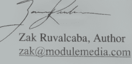


在本节的六章中，你将学习处理 jQuery 所需的所有 JavaScript 基础。首先，第 1 章介绍了开发 JavaScript 应用所需的概念和术语。它还向你展示了如何使用我们推荐开发 JavaScript 应用的 Aptana IDE。

接下来，第 2 章介绍了 JavaScript 语言的子集，第 3 章完成了该子集，第 4 章展示了如何测试和调试 JavaScript 应用。那时你就可以开始开发自己的应用程序了。

然后，第 5 章向你展示如何在 JavaScript 应用中常用的数组。最后，第 6 章向你展示如何使用目前为止学的所有 JavaScript 技能对链接和图像进行 DOM 脚本编写。

完成这些章节后，你将能够开发实用的 JavaScript 应用。尽管如此，你还将拥有使用 jQuery 所需的所有 JavaScript 技能。然后，你可以通过阅读本书的最后四个部分来掌握 jQuery。

---

# 第 1 章 Web 开发简介

本章介绍了开发 JavaScript 应用所需的背景概念、术语和技能。这包括对你所需的 HTML 和 CSS 技能的快速回顾。还包括关于如何使用 Aptana Studio 3 的快速教程，这是我们推荐开发 JavaScript 应用的 IDE。

如果你具有一些开发经验，你应该能够通过浏览你已经熟悉的主题来快速通过本章。但如果你是 Web 开发的新手，你应该花时间掌握本章的概念和术语。

## Web 应用程序的组件

Web 应用程序由客户端、Web 服务器和网络组成。客户端使用称为浏览器的程序从 Web 服务器请求网页。今天，客户端可以是计算机、智能手机或平板电脑。

通常情况下，你不需要了解云是如何工作的。但你应该对正在发生的情况有一个大致的了解。

从开始，网络可以按大小分类。局域网（LAN）是彼此靠近计算机的小网络，它们在短距离内相互通信。局域网中的计算机通常位于同一栋楼内或相邻建筑内。这种类型的网络通常被称为内网（intranet），它可以仅供员工运行 Web 应用程序。

相比之下，广域网（WAN）由多个连接的局域网组成。为了将信息从一个客户端传递到另一个客户端，路由器确定哪个网络离目标最近并通过该网络发送信息。广域网可以由一家公司私有，也可以共享。

互联网提供商（ISP）是拥有连接互联网的广域网的公司。ISP 向需要连接互联网的公司租赁网络访问权限。

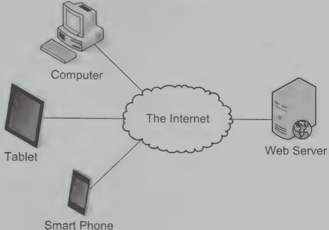

- Web 应用程序由客户端、Web 服务器和网络组成。
- 客户端使用称为浏览器的程序从 Web 服务器请求网页。今天，客户端可以是计算机、智能手机或平板电脑。
- 服务器将请求的页面返回给浏览器。
- 网络连接客户端和 Web 服务器。
- 内网是局域网（LAN），连接彼此靠近的计算机，通常在同一栋楼内。
- 互联网是由许多广域网（WAN）组成的网络，每个广域网又由两个或多个局域网组成。今天，互联网通常被称为“云”，这暗示你真的不需要了解它是如何工作的。

图 1-1 Web 应用程序的组件

## 静态网页

像图 1-2 所示的静态网页是指每次请求时都不会改变的网页。这种网页在浏览器请求它时，会直接从 Web 服务器发送到浏览器。你可以通过查看浏览器地址栏中的扩展名来识别静态页面。如果扩展名是 `.html` 或 `.htm`，则该页面就是静态网页。

此图显示了 Web 服务器如何处理对静态网页的请求。该过程从客户端在浏览器中请求网页时开始。为此，用户可以在浏览器的地址栏中输入页面地址，也可以点击当前页面中指定要加载的页面的链接。

无论哪种情况，浏览器都会构建一个网页请求并将其发送到 Web 服务器。这种请求被称为 HTTP 请求，使用超文本传输协议（HTTP）格式化，该协议让 Web 服务器知道正在请求哪个文件。

当 Web 服务器接收到 HTTP 请求时，它从磁盘驱动器检索请求的页面。该文件包含请求页面的 HTML（超文本标记语言）。然后，Web 服务器将该文件作为 HTTP 响应的一部分发送回浏览器。

当浏览器接收到 HTTP 响应时，它将 HTML 渲染（翻译）为显示在浏览器中的网页。然后，用户就可以查看内容。如果用户通过点击链接或在浏览器地址栏中输入另一个网页地址请求另一个页面，该过程将再次开始。

### `http://www.modulemedia.com/ourwork/index.html` 处的静态网页

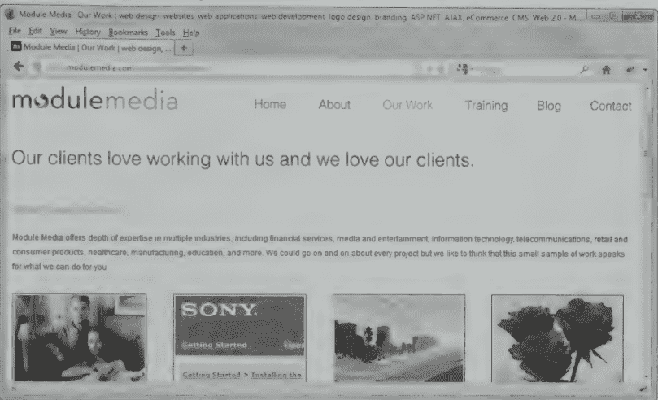
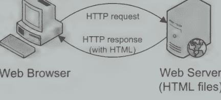

- 超文本标记语言（HTML）是用于设计应用程序网页的语言。
- 静态网页是存储在 Web 服务器上且不改变的 HTML 文档。静态网页的文件具有 `.htm` 或 `.html` 扩展名。
- 当用户请求静态网页时，浏览器会向 Web 服务器发送一个 HTTP 请求，该请求包含正在请求的文件名。
- 当 Web 服务器接收到请求时，它会检索网页的 HTML 并将其作为 HTTP 响应发送回浏览器。
- 当浏览器接收到 HTTP 响应时，它将 HTML 渲染为显示在浏览器中的网页。

图 1-2 静态网页是如何处理的

## 动态网页

像图 1-3 所示的动态网页是每次被请求时都由 Web 服务器上的程序或脚本创建的页面。该程序或脚本由应用程序服务器根据随 HTTP 请求一起发送的数据执行。在这个示例中，HTTP 请求从数据库服务器识别了该书的图像和数据。

此图显示了 Web 服务器如何处理动态页面。该过程从用户在浏览器中请求页面时开始。为此，用户可以在浏览器的地址栏中输入页面的 URL，点击指定要加载的动态页面的链接，或者点击提交表单的按钮，表单包含了动态页面应该处理的数据。

在每种情况下，浏览器都会构建一个 HTTP 请求并将其发送到 Web 服务器。该请求包含了处理请求所需的所有内容。例如，如果用户在表单中输入了数据，这些数据将包含在 HTTP 请求中。

当 Web 服务器接收到 HTTP 请求时，服务器检查网页的文件扩展名，以识别应该处理该请求的应用程序服务器。然后，Web 服务器将请求转发到处理该类型网页的应用程序服务器。

接下来，应用程序从硬盘中检索适当的程序或脚本。然后，它执行该脚本。如有必要，脚本将从数据库服务器请求数据，并将这些数据作为其正在生成的网页的一部分。在应用程序服务器上进行的处理被称为服务器端处理。

当脚本完成后，应用程序服务器将动态生成的 HTML 发送回 Web 服务器。然后，Web 服务器将 HTML 通过 HTTP 响应发送回浏览器。

当浏览器接收到 HTTP 响应时，它渲染 HTML 并显示网页。但请注意，浏览器无法判断 HTTP 响应中的 HTML 是用于静态页面还是动态页面。它只是渲染 HTML。

当页面显示出来时，用户就可以查看内容。然后，当用户请求另一个页面时，该过程将再次开始。该过程从用户请求网页开始，到服务器向客户端发送响应结束，这被称为一次“往返（round trip）”。

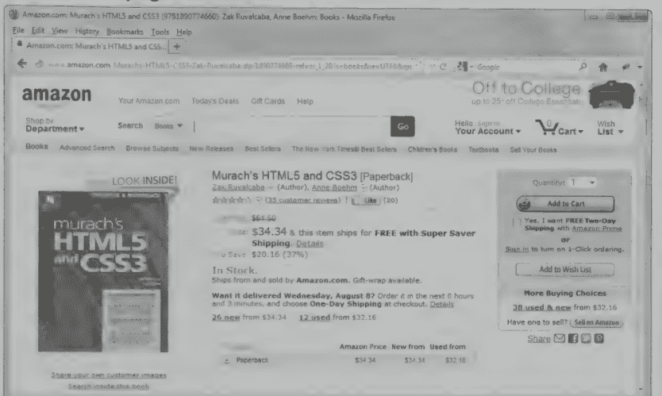
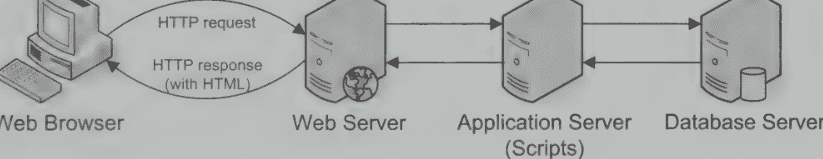

- 动态网页是由运行在服务器上的程序或脚本生成的网页。
- 当 Web 服务器接收到请求时，它检查网页的文件扩展名，以识别应该处理该请求的应用程序服务器。然后，Web 服务器将请求转发到处理该类型网页的应用程序服务器。
- 接下来，应用程序从硬盘中检索适当的程序或脚本。然后，它执行该脚本。如有必要，脚本将从数据库服务器请求数据，并将这些数据作为其正在生成的网页的一部分。
- 当脚本完成后，应用程序服务器将动态生成的 HTML 发送回 Web 服务器。然后，Web 服务器将 HTML 通过 HTTP 响应发送回浏览器。

图 1-3 动态页面是如何处理的

## JavaScript 和 jQuery 用于客户端处理

与在网页上进行的服务器端处理不同，JavaScript 是一种提供客户端处理的脚本语言。在图 1-4 的网页中，JavaScript 用于更改显示的图像。

此图显示了 JavaScript 是如何工作的。当浏览器请求网页时，Web 服务器将 HTML 和相关的 JavaScript 返回给浏览器。然后，JavaScript 代码由 JavaScript 引擎在浏览器中执行。这减轻了服务器的处理负担。

除了图像交换和切换，JavaScript 还有许多其他用途。例如，另一种常见用途是在用户将数据发送到服务器之前对其进行验证。这节省了不必要的服务器往返。JavaScript 的其他常见用途是运行幻灯片和轮播图。

jQuery 在这里处于什么位置？jQuery 实际上是一个 JavaScript 库，这意味着它是 JavaScript。今天，jQuery 让开发许多 JavaScript 应用程序变得更容易；是最流行的 JavaScript 库。这就是为什么本书的最后四个部分专注于如何充分利用 jQuery。

### 具有图像交换和切换的网页

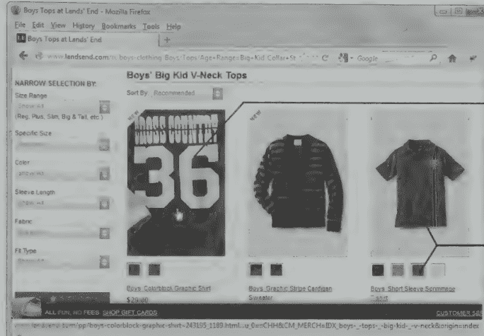
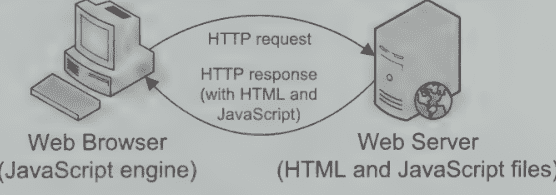

- 数据验证
- 图像交换和切换
- 幻灯片
- JavaScript 是一种由浏览器的 JavaScript 引擎运行的脚本语言，并控制浏览器的操作。
- jQuery 是一个 JavaScript 库，它让 JavaScript 的许多功能变得更容易。
- 当浏览器请求包含 JavaScript 或指向 JavaScript 文件的 HTML 页面时，Web 服务器会将 HTML 和 JavaScript 都加载到浏览器中。
- 因为 JavaScript 在客户端而不是服务器上运行，因此它的功能不需要返回服务器。这有助于应用程序运行得更高效。

图 1-4 JavaScript 和 jQuery 用于客户端处理

## HTML、CSS 和 JavaScript 的角色

当你开发 JavaScript 应用程序时，你使用 HTML 来定义页面的内容和结构。你使用 CSS 对这些内容进行格式化。并使用 JavaScript 进行客户端处理。接下来展示的邮件列表应用说明了这一点。

图 1-5 显示了邮件列表应用的用户界面。它要求用户输入三个项目，然后点击“加入”（Join）或“列表”（List）按钮。输入框右侧的星号表示这些条目是必填的。

当用户点击按钮时，JavaScript 会检查输入内容以确保它们有效。有效，输入将发送到 Web 服务器进行服务器端处理。如果无效，则会显示消息让用户更正输入。这是一个常见的 JavaScript 应用，称为“数据验证”，它可以在输入无效时减少往返服务器的次数。

### 网页的 HTML

超文本标记语言（HTML）用于定义网页的内容和结构。在图 1-5 中：

首先，请注意此文档以一个 `DOCTYPE` 声明开头。你必须完全按照此处所示对其进行编码。如果你已经在使用 HTML5，你会发现此声明比早期版本的 HTML 声明简单得多。在本书中，所有的应用程序都使用 HTML。

其次，在 HTML 文档的 `head` 部分，你可以看到一个 `meta` 元素，它指定 UTF-8 为页面使用的编码。你还可以看到一个 `link` 元素，指定用于格式化此 HTML 的 CSS 文件。你可以看到一个 `script` 元素，它指定用于处理用户输入的 JavaScript 文件。

第三，在 `body` 部分，你可以看到 `section` 元素的使用。它是我们在书中贯穿使用的 HTML5 元素之一。在该节中，你可以使用 `h1`、`form`、`label`、`input` 和 `span` 元素。

在本书中，正如你所看到的，我们将 `<link>`、`<script>`、`<section>` 和 `<h1>` 等 HTML 元素分别称为 link、script、section 和 h1 元素。然而，为了防止在引用如 `p` 和 `a` 等单字母元素时产生混淆，我们将字母放在括号中，例如 `<p>` 元素或 `<a>` 元素。

```html
<!DOCTYPE html>
<html>
<head>
  <meta charset="UTF-8">
  <title>Join Email List</title>
  <link rel="stylesheet" href="email_list.css">
  <script src="email_list.js"></script>
</head>
<body>
  <section>
    <h1>Join our email list</h1>
    <form id="email_form" name="email_form"
      action="email_list" method="get">
      <label for="email_address1">Email Address:</label>
      <input type="text" id="email_address1" name="email_address1">
      <span id="email_address1_error"*=""></span><br>
      <br>
      <label for="email_address2">Re-enter Email Address:</label>
      <input type="text" id="email_address2" name="email_address2">
      <span id="email_address2_error"*=""></span><br>
      <br>
      <label for="first_name">First Name</label>
      <input type="text" id="first_name" name="first_name">
      <span id="first_name_error"*=""></span><br>
      <br>
      <label>&nbsp;</label>
      <input type="button" id="join_list" value="Join our List">
    </form>
  </section>
</body>
</html>
```

- HTML（超文本标记语言）用于定义网页的内容和结构。

图 1-5 网页的 HTML

在实践中，你经常听到“elements”（元素）这个词，你可以将它们视为同义词。在本书中，我们偶尔使用“tag”（标签）一词，特别是在引用如 `<h1>` 这样的起始标签或 `</h1>` 这样的结束标签时。

不久前，HTML 文档的 HTML 不仅定义了网页的内容和结构，还定义了这些内容的格式。然而，这种结构元素和格式元素的混合使得网页的编辑、维护和重新格式化变得困难。

现在，层叠样式表（CSS）允许你将格式与网页的内容和结构分离。结果是，曾经用 HTML 完成的格式化现在由 CSS 完成。

在图 1-6 中，现在你可以看到用于格式化图 1-5 中 HTML 的 CSS。这里同样假设你已经熟悉 CSS，但这里是对这段 CSS 作用的简要描述。

在 `body` 元素的规则集中，`font-family` 属性设置了整个文档的字体，`margin` 属性设置了窗口居中，`width` 属性将 body 的宽度设置为 650 像素，`border` 属性设置了浏览器窗口的边框。

### 网页的 CSS

```css
body {
  font-family: Arial, Helvetica, sans-serif;
  background-color: white;
  margin: auto;
  width: 650px;
  border: 3px solid blue;
}

h1 {
  color: blue;
}

section {
  padding: 2em;
}

label {
  float: left;
  width: 150px;
}

input {
  margin-left: 1em;
  margin-bottom: .5em;
}

span {
  color: red;
}
```

- HTML（超文本标记语言）用于定义网页的结构。

图 1-6 网页的 CSS

### 网页的 JavaScript

HTML 文件中包含 JavaScript 文件的 `script` 元素：

```html
<script src="email_list.js"></script>
```

名为 `email_list.js` 的 JavaScript 文件代码：

```javascript
var $ = function (id) {
  return document.getElementById(id);
}
var joinList = function () {
  var emailAddress1 = $("email_address1").value;
  var emailAddress2 = $("email_address2").value;
  var isValid = true;

  if (emailAddress1 == "") {
    $("email_address1_error").firstChild.nodeValue = "This field is required.";
    isValid = false;
  } else $("email_address1_error").firstChild.nodeValue = "";

  if (emailAddress1 == emailAddress2) {
    $("email_address2_error").firstChild.nodeValue = "This entry must equal first entry.";
    isValid = false;
  } else $("email_address2_error").firstChild.nodeValue = "";

  if ($("first_name") == "") {
    $("first_name_error").firstChild.nodeValue = "This field is required.";
    isValid = false;
  } else $("first_name_error").firstChild.nodeValue = "";

  if (isValid) {
    // submit the form if all entries are valid
    $("email_form").submit();
  }
}
window.onload = function () {
  $("join_list").onclick = joinList;
  $("email_address1").focus();
}
```

图 1-7 网页的 JavaScript 代码

---

## 本书所需的 HTML 和 CSS 技能

尽管本书假设你已经熟悉 HTML 和 CSS，但接下来的六个主题将对你本书所需的 HTML 和 CSS 技能进行快速回顾。如果你不具备这些技能，且无法从后续主题中掌握，我们建议你在学习 JavaScript 和 jQuery 期间使用《Murach's HTML5 and CSS3》作为参考。

### 如何使用 HTML5 语义化元素

书中的所有应用程序在合适的时候都会使用 HTML5 语义化元素。如果你还没有在使用它们，或者至少不熟悉它们，图 1-8 总结了你需要了解的内容。

特别是，书中的应用程序使用了 `section`、`aside` 和 `nav` 元素。这使得对这些元素应用 CSS 变得更容易，因为你不需要编写供 CSS 使用的 `id` 属性。相反，你可以直接将 CSS 应用到元素本身。

然而，请注意，旧版浏览器无法识别 HTML5 语义化元素，这意味着你无法使用 CSS 对它们进行格式设置。因此，如果你想让 CSS 在旧浏览器中生效，需要在 HTML 文档的 `head` 部分编写一个 `script` 元素，提供一个 JavaScript shim（也称为垫片）。这个 shim 使用 JavaScript 将 HTML5 元素放入 DOM 中，从而让浏览器识别它们。

图中的 `script` 元素是你可以在所有 HTML 页面中使用的。它从 Google 网站获取 shim 并加载到浏览器中。为了节省空间并避免重复，我们并没有在书中总是都显示这个 `script` 元素，但在所有可下载的应用程序中都使用了它。

#### 主要 HTML5 语义化元素

| 元素 | 内容 |
|---|---|
| `header` | 页的页眉。 |
| `section` | 文档的通用章节，不指示内容类型。 |
| `article` | 像报纸文章之类的组合。 |
| `nav` | 页面中包含指向其他页面或占位符链接的区域。 |
| `aside` | 页面中的侧边栏，与其相邻的内容相关。 |
| `figure` | 被视为图表的图像、表格或其他组件。 |
| `footer` | 页的页脚。 |

#### 告知旧版浏览器 HTML5 元素的 JavaScript shim

```html
<script src="http://html5shiv.googlecode.com/svn/trunk/html5shiv.js"></script>
```

#### 使用 `header`、`section` 和 `footer` 元素构建的页面

```html
<body>
  <header>
    <h1>San Joaquin Valley Town Hall</h1>
  </header>
  <section>
    <p>Welcome to San Joaquin Valley Town Hall. We have some fascinating speakers for this season!</p>
  </section>
  <footer>
    <p>&copy; San Joaquin Valley Town Hall.</p>
  </footer>
</body>
```

#### 在网页浏览器中显示的页面

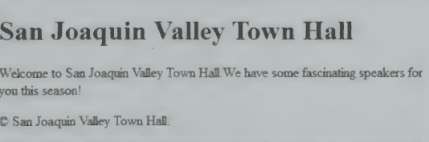

- HTML5 提供了新的语义化元素，你应该使用它们来构建网页内容。使用这些元素可以被称为 HTML5 语义化。
- 图中所有的 HTML5 元素都受到了现代浏览器的支持。如果你在 HTML5 文档的 `head` 部分包含上述 JavaScript shim，它们在旧版浏览器中也能工作。
- 除了 HTML5 语义化元素，本书还使用了标准的 HTML 元素，如标题（`h1` 和 `h2` 元素）、图像（`img` 元素）、链接（`a` 元素）和段落（`p` 元素）。

图 1-8 如何使用 HTML5 语义化元素

### 如何使用 `div` 和 `span` 元素

如果你使用 HTML 一段时间了，你一定熟悉 `div` 元素。在 HTML5 之前，`div` 元素被用于定义文档主体内的结构。现在，HTML5 语义化元素正在取代 `div` 元素。这使得页面结构更加清晰。然而，你仍然会使用 `div` 元素来定义 JavaScript 应用程序中的代码块。

同样，`span` 元素在历史上一直用于标识位置。事实上，你刚刚在邮件列表应用程序中看到了这一点。在那个应用程序中，JavaScript 放了相应的 `span` 元素。

#### `div` 和 `span` 元素

| 元素 | 描述 |
|---|---|
| `div` | 块级元素，为其他元素提供容器。 |
| `span` | 内联元素，允许你识别可以使用 CSS 进行格式设置的文本。 |

#### JavaScript 应用程序 HTML 中的 `div` 元素

```html
<section id="faqs">
  <h1>jQuery FAQs</h1>
  <h2>What is jQuery?</h2>
  <div>
    // contents
  </div>
  <h2>Why is jQuery becoming so popular?</h2>
  <div>
    // contents
  </div>
  <h2>Which is harder to learn: jQuery or JavaScript?</h2>
  <div>
    // contents
  </div>
</section>
```

#### JavaScript 应用程序 HTML 中的 `span` 元素

```html
<label for="email_address1">Email Address:</label>
<input type="text" id="email_address1" name="email_address1">
<span id="email_address1_error"></span><br>
<label for="email_address2">Re-enter Email Address:</label>
<input type="text" id="email_address2" name="email_address2">
<span id="email_address2_error"></span><br>
<label for="first_name">First Name:</label>
<input type="text" id="first_name" name="first_name">
<span id="first_name_error"></span><br>
```

### 如何使用基础 HTML 属性

图 1-10 展示了 JavaScript 应用中常用的 HTML 属性。你应该已经熟悉了标识单个 HTML 元素的 `id` 属性，以及可以应用于多个 HTML 元素的 `class` 属性。你还应该熟悉了用于为元素提供工具提示（tooltip）的 `title` 属性，以及将标签与输入元素关联的 `for` 属性。

当你使用 JavaScript 时，通常会使用 `id` 属性来获取或设置输入元素中的数据。你通常会使用 `name` 属性，以便服务器端代码访问提交给它的数据。你有时会添加或删除 `class` 属性来更改元素的格式。你还会使用 `title` 属性来提供与元素相关的文本。

在实践中，你通常对同一个元素的 `id` 和 `name` 属性使用相同的值。例如，图中的示例使用“email”作为 `id` 和 `name` 属性的值。这使得属性值更容易记忆。

#### 基础 HTML 属性

| 属性 | 描述 |
| --- | --- |
| `id` | 为元素指定唯一标识符，可以通过 CSS 进行引用。 |
| `class` | 指定一个或多个供 CSS 引用的类名，且相同的名称可以用于多个元素。要编写多个类，请用空格分隔名称。 |
| `title` | 为元素指定额外信息。对于某些元素，当用户悬停在元素上时，title 会出现在工具提示中。 |
| `for` | 在标签（label）中，此属性指定它所应用的控件的 id。 |
| `name` | 为元素指定唯一名称，通常由服务器端代码使用，也可以由页面 JavaScript 代码使用。 |

#### 使用这些属性的 HTML

```html
<body>
  <h1>San Joaquin Valley Town Hall</h1>
  <h2 class="first_h2">Welcome to San Joaquin Valley Town Hall.</h2>
  <p>Please enter your e-mail address to subscribe to our newsletter.</p>
  <form id="email_form" name="email_form" action="join.html" method="get">
    <label for="email">E-Mail:</label>
    <input type="text" id="email" name="email" title="Enter e-mail address here.">
    <input type="button" value="Subscribe">
  </form>
</body>
```

#### 网页浏览器中显示文本框工具提示的 HTML

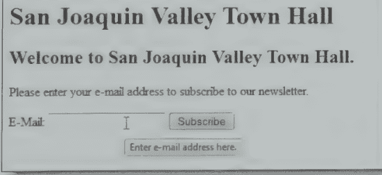

- 属性由一个名称、一个等号以及用单引号或双引号括起来属性值组成。
- `id` 和 `class` 属性通常用于为单个或多个元素应用 CSS 格式。
- `name` 属性通常用于服务器端代码访问发送给它的数据，但该属性也可用于页面的 JavaScript 代码。
- 标签元素中的 `for` 属性用于标识它所应用的控件。

图 1-10 如何使用基础 HTML 属性

### 如何为 HTML 页面提供 CSS 样式

图 1-11 显示了书中的应用程序为 HTML 页面包含样式的两种方式。首先，你可以在 HTML 文档的 `head` 部分编写一个 `link` 元素，指定一个包含页面 CSS 的文件。它被称为外部样式表，这是书中大多数应用所使用的方法。

其次，你可以在 `head` 部分编写一个包含页面 CSS 的 `style` 元素。这被称为嵌入式样式。使用嵌入式样式的好处是在开发页面时不需要在 HTML 和 CSS 文件之间来回切换。总的来说，使用外部样式表更好，因为它们更容易维护代码。

#### 提供样式的两种方式

```html
<head>
  <link rel="stylesheet" href="style.css">
</head>

<head>
  <title>San Joaquin Valley Town Hall</title>
  <style>
    body {
      font-family: Arial, sans-serif;
    }
    h1 {
      font-size: 200%;
    }
  </style>
</head>
```

### 如何编写基础 CSS 选择器

某些情况下，你可能希望使用嵌入式样式，因为它们对于小型项目更容易使用。然后，规则集设置了段落顶部、底部和左侧的边距。这就是为什么该部分的段落被缩进了。

第二组示例中的规则集使用 id 选择器通过其 id 选择元素。要做到这一点，选择器使用井号 (`#`) 后跟一个唯一标识元素的值。结果，该规则集选择了 id 为 `"first_heading"` 的 `h1` 元素。然后，它的规则集设置了标题的边距。

#### 可通过元素类型、ID 或类选择的 HTML

```html
<body>
  <section>
    <h1 id="first_heading">演讲者阵容</h1>
    <p class="blue">10月19日: Jeffrey Toobin</p>
    <p class="blue">11月16日: Andrew Ross Sokin</p>
  </section>
  <footer>
    <p class="blue right">版权所有 SJV 市政厅</p>
  </footer>
</body>
```

#### 按元素类型、ID 和类定义的 CSS 规则集

```css
/* 三种类型的元素 */
body {
  font-family: Arial, Helvetica, sans-serif;
  width: 400px;
  margin: 1em auto;
}
section {
  border: 2px solid black;
  padding: 1em;
}
p { margin: .25em 0 .25em 3em; }

/* 按 ID 选择的单个元素 */
#first_heading { margin: 0 1em .25em; }

/* 按类选择的元素 */
.blue { color: blue; }
.right { text-align: right; }
```

#### 在浏览器中显示的元素

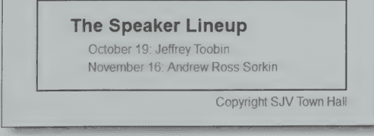

- 你通过命名元素为所有特定类型的元素编写一个选择器。这被称为类型选择器。
- 你为带有 `id` 属性的元素通过编写一个井号 (`#`) 后跟 id 值来编写 id 选择器。这被称为 id 选择器。
- 你为带有 `class` 属性的元素通过编写一个点 (`.`) 后跟类名来编写选择器。然后，规则集将适用于所有具有该类名的元素。这被称为类选择器。

图 1-12 如何编写基础 CSS 选择器

### 如何编写 CSS 规则集

图 1-13 展示了本章之前介绍的邮件列表应用的 CSS。由于本书的重点是 JavaScript 和 jQuery 而不是 CSS，因此 CSS 通常是有限的。例如，此示例中的 CSS 不需要 id 或类选择器。

为了确保我们使用的是相同的术语，此 CSS 包含了七个规则集。每个规则集由一个选择器、一组大括号 `{ }` 以及大括号内的一个或多个规则组成。此外，每条规则由一个属性名、一个冒号、规则的值或多个值以及一个结束分号组成。

示例中的第一个规则集适用于这七个 HTML5 语义元素。为了兼容旧版浏览器，这是必须的。它告诉那些浏览器，语义元素应该被视为块级元素。如果没有这个规则集，旧浏览器将把这些元素视为内联元素，这并不是你想要的。

虽然这个规则集不会出现在本书应用的 CSS 中，但它被包含在可下载的应用程序中。因此，这些应用程序可以在旧版浏览器上运行。

除此之外，本书将解释与应用程序的 JavaScript 相关的任何 CSS。所以现在，如果你知道如何编写规则集，就可以继续学习了。

#### 本书中典型应用的 CSS 文件

```css
/* 为了让 HTML5 语义元素可以格式化所需的 CSS 工作量 */
article, aside, figure, footer, header, nav, section {
  display: block;
}
body {
  font-family: Arial, Helvetica, sans-serif;
  background-color: white;
  margin: 0 auto;
  width: 650px;
  border: 3px solid blue;
}
h1 {
  color: blue;
}
section {
  padding: 0 2em
}
label {
  float: left;
  width: 11em;
  text-align: right;
}
input {
  margin-left: 1em;
  margin-bottom: .5em;
}
span {
  color: red;
}
```

- 因为本书的重点是 JavaScript jQuery 而不是 CSS，因此书中使用的 CSS 通常是简单的。我们只应用足量的 CSS 来让每个应用程序看起来尚可并正常工作。
- 事实上，对于书中的大多数应用程序，你不需要理解 CSS，因此它甚至不会显示。然而，每当 CSS 对理解 JavaScript 应用至关重要时，都会对其进行详细解释。
- 至少，你应该知道 HTML 文档的 CSS 由一个或多个规则集组成。每个规则集都以规则集的选择器开头，后跟一组大括号 `{ }`。其中包含一个或多个规则。
- 你还应该知道每条 CSS 规则由一个属性名、一个冒号、属性的值和一个分号组成。

---

## 如何测试 JavaScript 应用

接下来，你将学习如何测试 JavaScript 应用。为了这样做，你将运行使用 JavaScript 的网页 HTML。

### 如何运行 JavaScript 应用

当你开发 JavaScript 应用时，通常是在自己的电脑或公司的服务器上工作。然后，为了运行应用程序，你使用图 1-14 所示的四种方法之一。四种方法中，从你用于开发 HTML、CSS 和 JavaScript 文件的 IDE 中运行 HTML 页面是最简单的。

---

## 当前浏览器及其 HTML5 评分（满分 500 分）

| 浏览器 | 发布版本 | HTML5 测试评分 |
| --- | --- | --- |
| Google Chrome | 22 | 437 |
| Opera | 12 | 385 |
| Mozilla Firefox | 15 | 346 |
| Apple Safari | 6 | 376 |
| Internet Explorer | 9 | 138 |

### 这些评分的网站

`http://www.html5test.com`

### 跨浏览器兼容性指南

- 在所有主流浏览器上测试您的网页，包括这些浏览器仍在常用使用的所有旧版本。
- 使用所有现代浏览器都支持的 HTML5 和 CSS3 特性，这些也是本书中所介绍的特性。但请使用变通方案，以便这些应用程序也能在旧版浏览器上运行。

### 使用 HTML5 语义元素的两种变通方案

**JavaScript shiv 让旧版浏览器识别元素**

```html
<script src="http://html5shiv.googlecode.com/svn/trunk/html5shiv.js"></script>
```

**使用 CSS 规则集将语义元素设置为块级元素**

```css
article, aside, figure, figcaption, footer, header, nav, section { display: block; }
```

### 如何在旧浏览器中测试您的网页

- 跨浏览器测试的问题之一是，你无法在同一个系统上安装所有的旧浏览器。特别是 Windows 不允许你同时安装超过一个版本的 IE。
- 解决方案是使用提供此类测试的程序或网站。要查找可用工具，可以尝试搜索“browser testing software”（浏览器测试软件）或“cross browser testing”（跨浏览器测试）。

- 如今，不同浏览器处理 HTML、CSS 和 JavaScript 的方式仍然存在差异。作为开发者，尽管你希望网页尽可能在不同的浏览器上运行，但这被称为跨浏览器兼容性。
- 使用 jQuery 的好处之一是它提供的 JavaScript 具有跨浏览器兼容性。然而，HTML、CSS 和其他 JavaScript 仍然会导致兼容性问题。
- 通常，Internet Explorer 给 Web 开发人员带来的问题最多，因为它的标准性最低且没有提供自动更新。
- 最终，所有浏览器都将支持 HTML5 和 CSS3，到那时就不需要变通方案了。


---

## 如何使用 Aptana 开发 JavaScript 应用

由于 HTML、CSS 和 JavaScript 仅仅是文本，你可以使用任何文本编辑器来创建 JavaScript 应用的文件。然而，更好的编辑器或集成开发环境（IDE）可以缩短开发时间并减少编码错误。这就是我们推荐 Aptana Studio 3 的原因。它是一个运行在 Windows、Mac OS 和 Linux 免费 IDE，可以极大提高你的工作效率。

在本书的附录中，你可以学习如何安装 Aptana。你也可以在后续章节中学习如何使用 Aptana 进行常见的开发功能。如果你倾向于使用其他编辑器，当然可以跳过这些章节。尽管如此，你可能也想浏览这些章节，因为它们会让你对 IDE 应该具备的功能有一个良好的了解。它们可能鼓励你尝试 Aptana。

### 如何创建或导入项目

在 Aptana 中，一个项目由完整 Web 应用程序的文件夹和文件组成。一旦创建了项目，处理其文件夹和文件、为项目创建新文件等就会变得更容易。

要创建一个项目，请使用图 1-16 中的第一个步骤。该步骤的结果是你得到了一个命名的项目，以应用程序的顶层文件夹开头。然后，你可以使用下一个所示的 App Explorer（应用管理器）窗口轻松地访问应用程序的文件夹和文件。

为了方便处理书中的应用程序，我们建议将它们导入到一个包含所有书籍应用程序的单个 Aptana 项目中。要做到这一点，你可以使用图中的第二个或第三个步骤，取决于你正在使用的 Aptana 版本。图中的对话框会将位于此位置的下载好的书籍应用程序导入：

`c:/murach/jquery/book_apps`

导入到名为 `jQuery Book Apps` 的项目中。完成后，你可以使用 App Explorer 窗口轻松地访问这些应用程序。

#### Aptana 3.4 导入项目的对话框

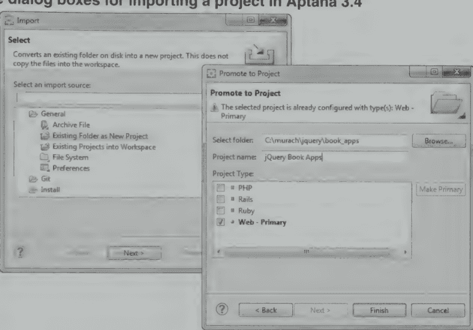

#### 如何创建新项目

- 使用 `File -> New -> Web Project` 命令。

#### 如何使用 Aptana 3.4 或更高版本导入项目

- 使用 `File -> Import` 命令显示上述导入对话框，点击 `Existing Folder` 作为 `New Project`，并点击 `Next`。然后在上述所示的 `Promote to Project` 对话框中，浏览到应用程序的顶层文件夹，输入项目名称并点击 `Finish` 按钮。

#### 如何使用 Aptana 3.3 或早期版本导入项目

- 使用 `File -> New -> Web Project` 命令显示 `New Web Project` 对话框。接下来，输入项目名称，取消勾选 `Use Default Location` 框，并浏览到项目的顶层文件夹。然后，阅读出现的警告信息，点击 `Finish` 按钮。

- 当你为 Web 应用程序设置项目时，Aptana 的效果最好。
- 通常情况下，你应该为你正在编写的 Web 应用程序设置项目。对于书中的应用程序，一个项目应该包含所有的书籍应用程序。

图 1-16 如何在 Aptana 中创建或导入项目

### 如何打开或关闭一个 HTML、CSS 或 JavaScript 文件

图 1-17 显示了如何打开或关闭 HTML、CSS 或 JavaScript 文件。在 Aptana 侧边的 App Explorer 窗口中，你可以在多个项目之间切换。当你打开 Aptana 中一个文件时，它会在新标签页中打开。这意味着你可以通过标签页在多个文件之间切换。

如果你想打开一个不属于项目的文件，可以使用图中的任一方法。首先，使用 Project Explorer 找到文件并双击它。其次，使用 `File -> Open File` 命令。

#### 如何关闭多个文件


- 要关闭一个文件，点击标签页上的 X。要关闭除当前以外的文件，右键点击你想保留的标签并选择 `Close Other`（关闭其他）。要关闭所有文件，右键点击任何标签并选择 `Close All`（关闭所有）。

当你使用 Aptana 时，你会发现它的界面与你使用的程序类似。所以，如果你想做书中没有介绍的操作，可以尝试右键点击项目查看可用菜单。检查工具栏上的其他按钮。查看下拉菜单中的可用选项。通过一些尝试，你会发现这个程序不仅强大而且易用。

## 显示 App Explorer 和第二个标签页中的 JavaScript 文件

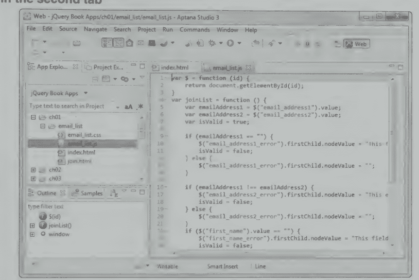

## 如何打开项目

- 使用 App Explorer 中的下拉列表选择项目。
- 然后，在 App Explorer 中找到文件并双击它。

## 如何打开不属于项目的 HTML 文件

- 使用 Project Explorer 找到文件并双击它。
- 使用 `File->Open File` 命令。

## 如何更改语法高亮颜色

当你在 Aptana 中打开文件时，你可能想做的第一件事就是更改用于高亮 HTML、CSS 和 JavaScript 代码语法的颜色。这是因为默认设置是深色背景上的浅色，可能难以阅读。

要更改颜色，你可以参考图 1-18 中的步骤。在本书中，我们使用 Dreamweaver 主题，但你可以尝试其他主题，直到找到你喜欢的那个。如果你在选择主题后点击 `Apply`（应用）按钮，你可以在对话框背后的窗口中看到所使用的颜色。然后，如果你喜欢这些颜色，可以点击 `OK`（确定）按钮关闭对话框。

## Aptana 的主题（Themes）对话框

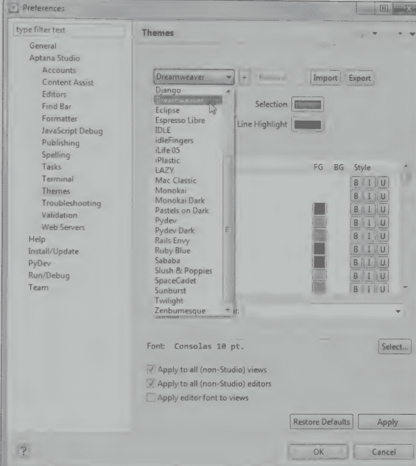

## 步骤

- 使用 `Window->Preferences`（窗口->首选项）命令打开选项对话框。
- 点击 `Aptana Studio`，然后点击 `Themes`（主题）显示主题对话框。
- 从下拉列表中选择一个主题。

## 说明

- Aptana 用不同的颜色显示 JavaScript 语句的不同部分，以便于更好地解释语句。
- 如果你不喜欢使用的颜色，可以使用上述步骤更改颜色。

图 1-18 如何在 Aptana 中更改语法高亮颜色

## 如何编辑文件

图 1-19 显示了如何使用 Aptana 编辑 JavaScript 文件，但编辑 HTML 和 CSS 文件的原理相同。当你打开 `.html`、`.css` 或 `.js` 扩展的文件时，Aptana 知道你正在处理什么类型的文件，因此可以使用颜色来高亮语法组件。好消息是，代码编码也适用于 HTML 文档中 `style` 元素内的 CSS，以及 HTML 文档中 `script` 元素内的 JavaScript。

当你输入新行代码时，自动补全功能会列出以你输入的字母开头的单词列表。这种列表如图所示。在这里，列表显示了输入字母 `t` 后的 JavaScript 选项。然后，你可以选择一个单词并按 `Tab` 键将其插入代码中。

这同样适用于 HTML 和 CSS 条目。例如，如果你在 HTML 文档中输入 `<s`，Aptana 会呈现元素列表，Aptana 会自动完成起始标签并添加结束标签。当你开始输入属性时，此功能也同样有效。

同样，如果你输入 `#` 来开始 CSS 规则集，Aptana 会呈现可以在 id 选择器中使用的 id 列表。如果你开始输入规则，Aptana 会呈现以 `b` 开头的属性列表。如果你开始为属性值输入条目，Aptana 将呈现一个值列表。简而言之，这是一个强大的功能，可以帮助你避免许多输入错误。

除此，Aptana 还提供了错误标记和警告标记，帮助你发现并纠正错误。例如，在图中你可以看到两个错误标记。然后，要获取错误或警告标记的说明，你可以将鼠标悬停在标记上。

## Aptana - JavaScript 输入的 jQuery 自动补全列表

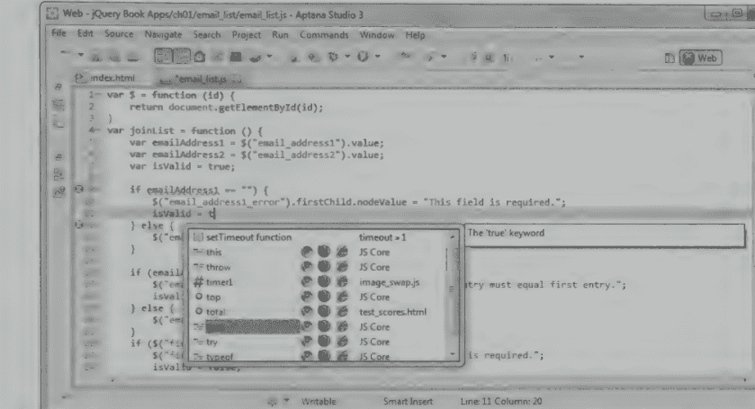

## 说明

- 要展开标签内容并如上所示隐藏项目资源管理器（Project Explorer）和应用资源管理器（App Explorer），请双击标签。要恢复项目和应用资源管理器，请点击编辑窗口左侧垂直栏顶部的 `Restore`（恢复）图标。
- 自动补全功能显示与你输入的内容匹配的元素列表。要插入其中之一，请双击它，或使用方向键高亮它并按 `Tab` 键。
- 错误标记是行首一个包含白色 `X` 的红色圆圈。警告标记是包含感叹号的黄色三角形。这些标记会在输入和编辑代码时显示。
- 要获取错误或警告标记的说明，请将鼠标悬停在标记上。

图 1-19 如何在 Aptana 中编辑文件

## 如何运行 JavaScript

图 1-20 显示了如何从 Aptana 运行 JavaScript。若要在默认浏览器中运行应用程序的 HTML 文件，你首先选择打开的文件的标签，然后点击 `Run`（运行）按钮。这将打开默认浏览器并在该浏览器中运行文件。或者，若要在另一个浏览器中运行 HTML 文件，可以使用 `Run` 按钮右侧的下拉列表。

顺便提一下，如果在未选择 HTML 文件时点击 `Run` 按钮，什么都不会发生。此外，在运行 HTML 文件之前，你需要保存对该 HTML 文件及其相关 CSS 文件的任何更改。要这样做，你可以点击工具栏上的 `Save`（保存）或 `Save All`（全部保存）。

当你通过这种方式运行 JavaScript 应用程序时，每次点击 `Run` 按钮都会打开一个新的浏览器或浏览器标签。因此，如果你对一个应用程序点击 10 次 `Run` 按钮，将打开 10 个浏览器或标签。

不过，另一种方法是第一次通过点击 `Run` 按钮运行应用程序。然后当你发现并修复错误后，可以点击 Aptana 中的 `Save All` 按钮保存更改，切换到浏览器，并点击浏览器中的 `Reload`（重新加载）或 `Refresh`（刷新）按钮重新加载带有更改的应用程序。

## Aptana 的 Run 按钮


# 在开始本书的练习之前...

在开始进行本书的练习之前，你应该下载并安装 Firefox 浏览器以及本书中的相关应用程序。如果你打算使用 Aptana，还应该下载并安装该产品。本书中软件和应用程序的安装步骤见附录 A。

## 练习 1-1 运行 Email List 应用程序

在此练习中，你将运行图 1-5、1-6 和 1-7 所示的 Email List 应用程序。

### 在 Firefox 中打开应用程序

1. 如果 Firefox 未打开，请启动它。然后，使用 `文件->打开文件` 命令打开此 HTML 文件：
   `c:\murach\query\book_apps\ch01\email_list\index.html`
2. 要测试不输入任何数据时会发生什么，只需点击 `Join our List` 按钮而不输入任何数据。然后，你就可以看到显示的错误信息。
3. 在第一个文本框中输入电子邮件地址，在第二个文本框中输入无效数据，然后点击 `Join our List` 按钮查看显示哪些错误信息。
4. 在三个框中都输入有效数据并点击按钮。然后，数据将被提交处理，并显示一个新网页。

## 练习 1-2 运行第 1 节的其他应用程序

此练习要求你运行第 6 章中介绍的应用程序。这些应用程序将让你对完成本节后能够做的事情有一个初步了解。

5. 在 Firefox 浏览器中打开此文件：
   `c:\murach\query\book_apps\ch06\faqs_links\index.html`
   然后，点击其中一个标题显示其文本，再次点击标题隐藏文本。
6. 在 Firefox 浏览器中打开此文件：
   `c:\murach\query\book_apps\ch06\image_swap\index.html`
   然后，点击小图像查看大图的切换。
7. 在 Firefox 浏览器中打开此文件：
   `c:\murach\query\book_apps\ch06\slide_show\index.html`
   观看幻灯片。

## 练习 1-3 开始使用 Aptana

此练习面向打算在本书学习中使用 Aptana 的读者。它将指导你完成创建项目的过程，以便方便访问你下载的书中应用程序和练习。

### 创建项目

1. 启动 Aptana，并使用图 1-16 中的步骤为存储在文件夹中的书籍应用程序创建一个项目：
   `c:\murach\jquery\book_apps`
   该项目应命名为 `jQuery Book Apps`，最后一个对话框的条目应与图中所示一致。
2. 使用相同的步骤为存储在文件夹中的练习创建一个名为 `jQuery Exercises` 的项目：
   `c:\jquery\exercises`
   并为存储在文件夹中的练习答案创建一个名为 `jQuery Solutions` 的项目：
   `c:\murach\jquery\solutions`

### 测试 Email List 应用程序

3. 使用 App Explorer（应用资源管理器）中的下拉列表选择 `jQuery Exercises` 项目。这可以让你访问书中所有的练习（即本书中的所有练习）。
4. 点击 `ch01` 前的加号以显示 `email_list_folder`，然后点击 `email_list` 文件夹的加号以显示 Email List 应用程序的文件。
5. 双击名为 `index.html` 的文件打开文件。然后，点击工具栏上的 `Run` 按钮在默认浏览器中运行应用程序。这会自动将你切换到该浏览器。
6. 回到 Aptana，点击 `Run` 按钮右侧的向下箭头。如果下拉列表提供 Internet Explorer，点击它在浏览器中运行应用程序。然后返回 Aptana。

### 编辑 JavaScript 代码

7. 在 App Explorer 中，双击名为 `email_list.js` 的文件打开该文件，并注意用于语法高亮的颜色。
8. 如果你不喜欢所使用的颜色，请使用图 1-18 中的步骤更改它们。
9. 在 JavaScript 文件中，删除第一行代码中的右括号。这应该显示两个错误标记。然后，将鼠标悬停在标记上以显示错误说明。这说明了 Aptana 的错误检查功能。现在，撤销你所做的更改。（要用键盘撤销更改，请按 `Ctrl+Z`。）
10. 在 JavaScript 文件中，在第三个以 `var` 开头的语句之后，在新的一行上用以下字符开始一个语句：
    ```
    if (e)
    ```
    这应该显示出以字母 `e` 开头的可能输入列表。
    在这里，你可以看到 `emailAddress1` 和 `emailAddress2` 包含在列表中。这些是前两个 `var` 语句创建的变量，此语句说明了 Aptana 的代码补全功能。现在，撤销此更改。
11. 将此新行输入到 JavaScript 代码最后一行（最后一行仅由一个右大括号 `}` 组成）之前：
    ```
    alert("The DOM has been built!");
    ```
    用文字描述，该语句将成为文件的倒数第二行。
12. 要测试你添加的语句，点击工具栏上的 `Save All` 按钮保存你的更改。然后，切换到浏览器并点击 `Reload` 或 `Refresh` 按钮带有此更改运行应用程序。这应该显示一个对话框，你可以通过点击 `OK` 按钮关闭它。之后，应用程序应该应该与之前相同。
13. 如果你好奇，可以自己进行更多实验。然后关闭文件并退出 Aptana。

## 开始学习 JavaScript

本章的目标是让你 JavaScript 之有一个良好的开始，特别是如果你是初学者。如果你有其他语言的编程经验，你应该快速完成本章。否则，请轻松对待并完成本章末的练习。

| 如何在 HTML 文档中引入 JavaScript | |
| :--- | :--- |
| 在 HTML 文档的 head 中引入 JavaScript 的两种方法 | 50 |
| 如何在 HTML 文档的 body 中引入 JavaScript | 32 |

| JavaScript 语法 | |
| :--- | :--- |
| 如何编写 JavaScript 语句 | 54 |
| 如何创建标识符 | 56 |
| 如何使用注释 | 58 |
| 如何使用对象、方法和属性 | 60 |

| 如何处理 JavaScript 数据 | |
| :--- | :--- |
| 原始数据类型 | 62 |
| 如何编写数值表达式 | 64 |
| 如何处理数值变量 | 66 |
| 如何处理字符串和布尔变量 | 68 |
| 如何使用 parseInt 和 parseFloat 方法 | 70 |

| 如何编写控制语句 | |
| :--- | :--- |
| 如何编写条件表达式 | 72 |
| 如何编写 if 语句 | 74 |
| 如何编写 while 和 do-while 循环 | 76 |
| 如何编写 for 循环 | 78 |

| 两个示例应用程序 | |
| :--- | :--- |
| 每加仑油耗应用程序 | 80 |
| 成绩应用程序 | 82 |

| 如何在代码中查找错误 | |
| :--- | :--- |
| 如何通过 Firefox 获取错误信息 | 84 |
| 常见的 JavaScript 错误 | 84 |
| 视角 | 86 |

# 如何在 HTML 文档中引入 JavaScript

在第一章中，你看到了如何将应用程序的 JavaScript 代码在独立文件中。但实际上有三种不同的方法可以将 JavaScript 引入 HTML 文档中。你现在将学习这所有的方法。

## 在 HTML 文档的 head 部分引入 JavaScript 的两种方法

图 2-1 展示了在 HTML 文档中引入 JavaScript 的三种方法中的两种。正如你在上一章中看到的，一种方法是将 JavaScript 代码在独立的外部文件中。然后，你在 HTML 文档的 `head` 部分中编写一个 `script` 元素来包含该文件。

在 `script` 元素中，`src` 属性用于引用外部文件。对于该元素，你还可以编写一个值为 `"text/javascript"` 的 `type` 属性，告诉浏览器该文件包含什么类型的内容。在 HTML5 中，不再需要该属性，因为其假设是所有在 `script` 元素中引用的文件都包含 JavaScript。

在图示例中，`src` 属性引用名为 `calculate_mpg.js` 的文件作为 HTML 文件。假设该文件与 HTML 文件在同一个文件夹中。例如，如果 JavaScript 文件在一个名为 `javascript` 的文件夹中，你需要编写一个相对 URL 来为文件提供正确路径；如果该文件夹与 HTML 文件在同一个目录下，`src` 属性的写法如下：

```html
<script src="javascript/calculate_mpg.js"></script>
```

这与 HTML 文档中任何其他文件的引用原理相同。

在 HTML 文档中引入 JavaScript 的第二方法是在 `head` 部分的 `script` 元素内编写 JavaScript 代码。这被称为*嵌入式 JavaScript*（embedded JavaScript）。但注意，无论 JavaScript 是嵌入在 `head` 部分还是从外部文件加载到 `head` 部分，应用程序的运行方式都是相同的。

使用外部文件的用处是将 JavaScript 与 HTML 分离。使用嵌入式 JavaScript 的用处是在开发应用程序时不需要在 HTML 和 JavaScript 文件之间切换。在本书的示例中，你将看到 JavaScript 的两种用法。

## script 元素的两个属性

| 属性 | 描述 |
| --- | --- |
| src | 指定外部 JavaScript 文件的位置和名称。 |
| type | 在 HTML5 中，可以省略此属性。如果你编写它，请对 JavaScript 代码使用 `"javascript"`。 |

### 在 head 部分加载外部 JavaScript 文件的 script 元素

```html
<script src="calculate_mpg.js"></script>
```

### 在 head 部分嵌入 JavaScript 的 script 元素

```html
<head>
  <script>
    alert("The Calculate MPG application");
    var miles = prompt("Enter miles driven");
    miles = parseFloat(miles);
    var gallons = prompt("Enter gallons of gas used");
    gallons = parseFloat(gallons);
    var mpg = miles/gallons;
    mpg = parseInt(mpg);
    alert("Miles per gallon = " + mpg);
  </script>
</head>
```

## 说明

- HTML 文档 head 部分的 script 元素通常用于标识随页面包含的外部 JavaScript 文件。
- head 部分的 script 元素也可以包含随页面引入的 JavaScript 语句。这被称为*嵌入式 JavaScript*。
- 如果在 head 部分编写了多个 script 元素，JavaScript 将按照 script 语句出现的顺序被包含。
- 当 head 部分的 script 元素包含外部 JavaScript 文件时，文件中的 JavaScript 运行方式就像是直接编写在 script 元素中一样。

## 如何在 HTML 文档的 body 部分引入 JavaScript

图 2-2 展示了在 HTML 文档中引入 JavaScript 的第三种方法。这次，第一个示例中的两个 script 元素是在 HTML 文档的 body 部分中编写的。当在 body 中编写 script 元素时，当应用程序加载时，该元素会被 JavaScript 代码的输出替换。

如果你想为未启用 JavaScript 的浏览器提供支持，可以像第二个示例所示，在 script 元素之后编写一个 `noscript` 元素。那么，如果禁用了 JavaScript，`noscript` 元素的内容将被显示。但如果启用了 JavaScript，script 元素会被 JavaScript 代码的输出替换，而 `noscript` 元素会被忽略。通过这种方式，无论是否启用 JavaScript，都会显示某些输出。

在第二个示例中，如果浏览器未启用 JavaScript，`noscript` 元素紧跟在 script 元素之后编写。这意味着在 2012 年，无论是否启用 JavaScript，结果都是相同的。但在 2013 年，如果启用了 JavaScript，年份将由 JavaScript 更新。

你也可以编写一个不跟 script 元素后面的 `noscript` 元素。例如，你可以在页面顶部编写一个 `noscript` 元素，警告用户如果禁用了 JavaScript，页面将无法正常工作。这由第三个示例所示。在这种情况下，如果启用了 JavaScript，则什么都不显示；如果禁用了 JavaScript，则显示消息。

本书的所有应用程序中，JavaScript 要不是嵌入在 HTML 的 head 部分，就是位于 HTML head 部分中标识的外部文件中。然而，当你想将 JavaScript 引入 HTML 文档的 body 部分时，不应该遇到任何困难。

## HTML 文档的 body 部分中的 JavaScript

```html
<script>
  var today = new Date();
  document.write("Current date: ");
  document.write(today.toString());
</script>
```

### 在 script 元素后使用 noscript 元素

```html
<script>
  var today = new Date();
  document.write("The year is: ");
  document.write(today.getFullYear());
</script>
<noscript>
  The year is: 2012
</noscript>
```

### 在页面顶部使用 noscript 元素

```html
<noscript>
  <p>This page requires JavaScript. Please enable JavaScript in your browser.</p>
</noscript>
```

## 说明

- 当在 body 部分编写 script 元素时，该元素会被 JavaScript 代码的输出替换。
- 如果你想为未启用 JavaScript 的浏览器提供支持，可以在 script 元素之后编写一个 noscript 元素。
- 你也可以编写一个不跟在 script 元素后面的 noscript 元素。

# 语法

JavaScript 语法指的是你在编写语句时必须遵循的规则。如果你不遵守这些规则，网页浏览器将无法解释和执行语句。

## 如何编写 JavaScript

图 2-3 总结了编写 JavaScript 的规则。第一个规则是 JavaScript 是大小敏感的。这意味着大写字母和小写字母被视为不同的。例如，`salest` 和 `salesTax` 被视为不同的。

第二个规则是 JavaScript 语句必须以分号结束。如果你不在每个语句末尾加上分号，JavaScript 将无法判断一个语句的结束和另一个的开始。

第三个规则是 JavaScript 忽略额外的空白。由于空白包括空格、制表符和换行符，这允许我们将语句换行以便阅读。

不过，请务必遵循图中关于何分割语句的指南。如果你在合适的地方分割语句，JavaScript 有时会尝试帮你添加分号，这可能会导致错误。

## 基本语法规则

- JavaScript 是大小敏感的。
- JavaScript 忽略语句中的额外空白。
- 每个 JavaScript 语句都以分号结束。

## 一段 JavaScript 代码

```javascript
var joinList = function () {
  var emailAddress1 = $("email_address1").value;
  var emailAddress2 = $("email_address2").value;

  if (emailAddress1 == "") {
    alert("Email Address is required.");
  } else if (emailAddress2 == "") {
    alert("Second Email Address is required.");
  } else if (emailAddress1 == emailAddress2) {
    alert("Second Email Address must equal first entry.");
  } else if ($("first_name").value == "") {
    alert("First Name is required.");
  } else {
    $("email_form").submit();
  }
}
```

# 如何创建标识符

变量、函数、属性、方法和事件都必须有名称，以便你可以在 JavaScript 代码中引用它们。标识符就是赋予这些组件之一的名称。

图 2-4 显示了 JavaScript 中创建标识符的规则。除了前四个规则外，你不能使用任何 JavaScript 保留字（也称为关键字）。这些是为 JavaScript 语言内部使用保留的单词。你还应该避免将任何 JavaScript 全局属性或方法作为标识符，随着本书的深入，你将学习更多内容。

除了规则之外，你应该为标识符起有意义的名称。这意味着应该很容易看出一个标识符指代什么，并且容易记住名称的拼写。为了创建这样的名称，你应该避免使用缩写。例如，如果你将投资（investment）缩写为 `mon_inv`，将很难看出它指代什么，也很难记住你是怎么写的。但如果你将其完整写为 `monthly_investment`，这两个问题都迎解决了。

同样，你应该避免使用特定行业或研究领域的缩写，除非你确定它们被广泛理解。例如，`mpg` 是每加仑英里（miles per gallon）的常用缩写，但 `cpm` 可能代表许多不同的含义，应该完整写出来。

为了创建一个包含多个单词的标识符，许多 JavaScript 程序员使用一种称为驼峰命名法（camel casing）的约定。按照这种约定，除了第一个单词外，每个字母大写。例如，`monthlyInvestment` 和 `taxRate` 就是使用驼峰命名法的标识符。

另一种方法是使用下划线字符来分隔标识符中的单词。例如，`monthly_investment` 和 `tax_rate` 使用了这种约定。如果你的团队标准规定了其中一种约定，请尽管使用它。否则，你可以使用任何你喜欢的约定……但要保持一致。

在本书中，对 HTML 中的 id 和类名使用下划线法，对所有 JavaScript 标识符使用驼峰命名法。这样，你将更容易判断名称的来源。

# 创建标识符的规则

- 标识符只能包含字母、数字、下划线 `_` 和美元符号 `$`。
- 标识符不能以数字开头。
- 标识符是区分大小写的。
- 标识符可以是任意长度。
- 避免使用全局属性和方法作为标识符。如果你使用了其中之一，你将无法使用同名的全局属性或方法。

# JavaScript 中合法的标识符

| subtotal | index_1 | $ |
| :--- | :--- | :--- |
| taxRate | calculate_click | $log |

# 驼峰命名法对比下划线法

| camelRate | tax_rate |
| :--- | :--- |
| calculateClick | calculate_click |
| emailAddress | email_address |
| firstName | first_name |
| futureValue | future_value |

# 命名建议

- 为标识符使用有意义的名称。这样，你的标识符就不可能成为保留字或全局属性。
- 保持一致：在脚本中使用驼峰法（`taxRate`）或下划线（`tax_rate`）来标识变量中的单词。
- 如果你使用下划线法，请对所有字母使用小写。

# JavaScript 中的保留字

```
abstract        else            instanceof      switch
boolean         int             synchronized
break           export          interface
byte            enum            long            throw
case            false           native          throws
catch           final           new             transient
char            finally         null            true
class           float           package        try
const           for             private         typeof
continue        function        protected       var
debugger        goto            public          void
default         if              return          volatile
delete          implements     short           while
do             import          static          with
double          in              super           
```

# 说明

- 标识符是赋予变量、函数、对象、属性和方法的名称。
- 在驼峰命名法中，标识符内除第一个单词外的所有单词大大写字母开头。


# 如何使用注释

注释允许你在代码中添加 JavaScript 引擎忽略的说明。之后，当需要修改代码时，这些注释可以帮助你或其他人理解代码。

图 2-5 中的示例显示了如何使用注释来描述或解释代码部分。在开始，一个块注释描述了随后的函数。这种注释以 `/*` 开始，以 `*/` 结束。开始和结束之间编写的所有代码在应用程序运行时都会被 JavaScript 引擎忽略。

另一种类型的注释是以 `//` 开头的单行注释。在示例中，第一个单行注释描述了位于其同一行之前的 JavaScript 代码。相比之下，第二个单行注释单独占一行。它描述了随其后的两个语句。

除了描述 JavaScript 代码外，注释在测试应用程序时也很有用。例如，如果你禁用部分 JavaScript 代码，可以将其封装在块注释中。那么，在应用程序运行时它就会被忽略。这被称为注释掉（commenting out）部分代码。稍后测试完其余代码后，可以通过移除块注释的开始和结束标记来重新启用被注释掉的代码。

什么时候应该使用注释来描述或解释代码？当然，当代码复杂到你以后如果需要维护它，可能就会忘记它是如何工作的时刻。如果将来其他人需要维护这些代码，这种注释就特别有用。

另一方面，你不应该使用注释来解释任何专业程序员都应该理解的代码。这意味着你必须在过多和过少之间取得某种平衡。注释最糟糕的问题是在改变代码工作方式的同时改变注释。

# 包含注释的 JavaScript 代码

```javascript
/* 这个 onload 函数设置了显示和隐藏后续文本的事件 */
window.onload = function () {
  var fiveReasons = $("five_reasons"); // 获取 div 元素

  // 获取 div 元素内的 h2 和 div 元素
  var h2Headings = fiveReasons.getElementsByTagName("h2");
  var divTags = fiveReasons.getElementsByTagName("div");

  var i, headingNode, divNode;
  for (i = 0; i < h2Headings.length; i++) { // 为每个 h2 进行循环
    headingNode = h2Headings[i];
    divNode = divTags[i];

    // 为每个 h2 附加事件处理器
    headingNode.onclick = function () {
      var h2 = this;
      if (h2.nextElementSibling.getAttribute("class") == "closed") {
        h2.nextElementSibling.setAttribute("class", "open");
      } else {
        h2.nextElementSibling.setAttribute("class", "closed");
      }
    };
  }
}
```

# JavaScript 注释的基础规则

- 块注释以 `/*` 开始，以 `*/` 结束。
- 单行注释以两个正斜杠 `//` 开始，并持续到行尾。

# 使用注释的指南

- 使用注释描述难以理解的代码部分。
- 使用注释禁用你不想测试的代码。
- 不要进行不注释。

# 说明

- JavaScript 提供了两种形式的注释：块注释和单行注释。
- 注释在执行 JavaScript 时会被忽略。

# 如何使用对象、方法和属性

简单来说，对象是方法和属性的集合。方法执行一个函数或执行一个操作。属性是与对象相关的数据项。当你开发 JavaScript 应用程序时，你经常会处理对象、方法和属性。

为了开始这些操作，图 2-6 显示了如何使用 `window` 对象的方法和属性，`window` 是一个常见的 JavaScript 对象。要调用（执行）对象的方法，你使用表格后摘要中的语法。即：你编写对象名、一个点运算符（句号）、方法名以及该方法在括号内所需的任何参数。

在本书中，语法总结中以*斜体*显示的单词是你需要提供的。没有使用斜体的单词保持不变。在这种情况下，所有的单词都是斜体形式，你需要提供它们中的所有内容。相比之下，第一个表格中的 `alert` 方法显示，你需要像摘要中写那样编写 `alert` 单词，但你必须提供一个字符串参数。

在语法总结后的第一个示例中，你可以看到是如何调用 `window` 对象的 `alert` 方法的：

```javascript
window.alert("This is a test of the alert method");
```

在这种情况下，传递它的唯一参数是 `"This is a test of the alert method"`。因此，当 alert 对话框显示时，就会这条消息。

在第二个示例中，你可以看到是如何调用 `window` 对象的 `prompt` 方法的。不过，这次省略了对象名。对于 `window` 对象（但仅限 `window` 对象），这是因为 `window` 对象是 JavaScript 应用程序的全局对象。

如你所示，`prompt` 方法接受两个参数。第一个是消息，第二个是用户输入的可选默认值。当执行 `prompt` 方法时，它会显示一个像图中所示的对话框。在这里，此时用户可以更改默认值或将其保持原样，然后点击 `OK` 按钮将输入内容存储在名为 `namedEntry` 的变量中。或者，用户点击 `Cancel` 按钮来取消输入。

表格中的第三种方法不需要任何参数。它是 `print` 方法。当它执行时，它会向浏览器发送打印请求。然后，浏览器开始启动其打印功能，通常是显示一个让用户继续或取消打印函数的对话框。

要访问对象的属性，你使用类似的语法。然而，正如第二个语法总结所示，你在点运算符后编写属性名。与方法不同，属性在括号中不需要参数。这通过语法后的语句进行了说明。该语句使用 `window` 对象的 `alert` 方法来显示 `window` 对象的 `location` 属性。

随着学习深入，你将学习如何使用许多对象的方法和属性。无论你处理的是哪种对象，使用方法和属性的语法始终是相同的：对象名、点、然后是属性或方法名。

## window 对象的常用方法

| 方法 | 描述 |
| --- | --- |
| alert(string) | 显示一个对话框，包含通过参数传递的字符串以及一个 OK 按钮。 |
| prompt(string, default) | 显示一个对话框，包含第一个参数中的字符串、第二个参数中的默认值、一个 OK 按钮和一个 Cancel 按钮。当用户输入值并点击 OK 时，该值将作为字符串返回。或者如果用户点击 Cancel，则返回 null。 |
| print() | 向浏览器发送打印请求。 |

## window 对象的一个属性

| 属性 | 描述 |
| --- | --- |
| location | 当前网页的 URL。 |

## 调用对象方法的语法

```
objectName.methodName(parameters)
```

## 一个调用 window 对象 alert 方法的语句

```javascript
window.alert("This is a test of the alert method");
```

## 一个调用 window 对象 prompt 方法的语句

```javascript
var namedEntry = prompt("Please enter your name:", "Your name here");
```

## 一个访问 window 对象 location 属性的语句

```javascript
window.alert(window.location);
```

## 说明

- 要调用对象的方法，请编写对象名、一个点、方法名以及括号内的任何参数。
- 要访问对象的属性，请编写对象名、一个点和属性名。
- 对于 window 对象，你可以省略对象名。

# 如何处理 JavaScript 数据

JavaScript 提供了三种原始数据类型：数字、字符串和布尔值。这些类型用于表示简单值。在本节中，你将学习如何使用这些类型。

## 原始数据类型

### 数字值的示例

- `15` // 整数
- `-21` // 负整数
- `21.5` // 小数值
- `-124.82` // 负小数值
- `3.7e-9` // 0.000000037 的科学计数法

### 字符串值的示例

- `"JavaScript"` // 使用双引号的字符串
- `'String Data'` // 使用单引号的字符串
- `""` // 空字符串

### 布尔值

- `true` // 等于真、是或开启
- `false` // 等于假、否或关闭

## 数字类型

- 数字类型用于表示整数或小数，小数可以以正号或负号开头。
- 整数是一个整数。小数可以在小数点右侧有一个或多个小数位。
- 如果结果存储在比数据类型大或小的数字类型中，它将被存储为值 `Infinity` 或 `-Infinity`。

## 关于浮点数你需要知道什么

- 在 JavaScript 中，小数是以浮点数存储的。在这种格式下，一个数字由正负号、一个或多个有效数字、可选的小数点、可选的小数以及可选的指数组成。
- 如果你正在开发一个需要非常大或非常小的数字的应用程序，你不需要使用科学计数法。但如果你需要使用这种表示法，可以使用上面数字值的最后一个示例。

## 字符串类型

- 字符串类型表示字符（字符串）数据。字符串由双引号或单引号包围。字符串开始和结束必须使用相同类型的引号。
- 空字符串是不包含任何字符的字符串。它通过输入两个引号且不留任何内容来输入。

## 布尔类型

- 布尔类型用于表示布尔值。布尔值可以表示具有两种可能状态的数据：真或假。

## 如何编写数值表达式

数值表达式可以是一个简单的单个值，也可以是一系列产生单个值的运算序列。在图 2-8 中，你可以看到编写数值表达式所使用的运算符。如果你用其他语言编写过程序，这些运算符可能与你一直使用的相似。特别是，前四种算术运算符在大多数编程语言中都是通用的。

大多数现代语言还具有一个模运算符，用于计算左值除以右值时的余数。在该运算符的示例中，`13 % 4` 意味着 `13 / 4` 的余数。由于 `13 / 4` 的结果是 `3` 余 `1`，因此这就是该表达式的结果。

与图中的前五个运算符不同，自增和自减运算符会对变量进行加 1 或减 1 操作。然而复杂的是，这些运算符可以写在变量名的之前或之后，这会影响结果。为了避免混淆，我们建议您在变量名之后编写这些运算符，并且仅在像下一幅图所示的简单表达式中使用它们。

当一个表达式包含两个或多个运算符时，优先级决定了先应用哪些运算符。这种顺序总结在图中的表中。例如，所有的乘法和除法操作都会在任何加减法操作之前从左到右完成。

要覆盖这种顺序，可以使用括号。这时，最内层括号中的表达式先执行，然后是下一层括号中的表达式，依此类推。这是所有编程语言以及基础代数的典型特征，图中的示例展示了了如何工作原理。

## 常见的算术运算符

| 运算符 | 描述 | 示例 | 结果 |
|---|---|---|--|
| + | 加法 | 5 + 7 | 12 |
| - | 减法 | 5 - 12 | -7 |
| * | 乘法 | 6 * 7 | 42 |
| / | 除法 | 13 / 4 | 3.25 |
| % | 取模 | 13 % 4 | 1 |
| ++ | 自增 | counter++ | 给 counter 加 1 |
| -- | 自减 | counter-- | 给 counter 减 1 |

## 算术表达式的优先级

| 顺序 | 运算符 | 方向 | 描述 |
|---|---|---|--|
| 1 | ++ | 从左到右 | 自增运算符 |
| 2 | -- | 从左到右 | 自减运算符 |
| 3 | * / % | 从左到右 | 乘法、除法、取模 |
| 4 | + - | 从左到右 | 加法、减法 |

## 优先级与括号示例

```javascript
3 + 4 * 5 // 结果为 23，因为先执行乘法
(3 + 4) * 5 // 结果为 35，因为先执行加法

13 % 4 + 9 // 结果为 10，因为先执行取模
13 % (4 + 9) // 结果为 0，因为先执行加法

1000 + 1000 * .05 // 结果为 1050，因为先执行乘法
1000 + (1000 * .05) // 结果仍为 1050
```

## 说明

- 为了编写数值表达式，可以使用算术运算符对两个或多个值进行操作。
- 模运算符返回除法操作的余数。
- 算术表达式根据运算符的优先级进行求值。
- 要覆盖优先级，可以使用括号。
- 由于自增和自减运算符的使用可能会引起混淆，我们建议您仅在由变量名后跟运算符的表达式中使用这些运算符，如文所示。

# 如何处理数值变量

变量存储一个随程序执行而可能改变的值。当你编写 JavaScript 应用时，你经常会声明变量并为它们赋值。图 2-9 显示了如何使用数值变量完成这两项任务。

在 JavaScript 中声明数值变量，请编写 `var`（变量的缩写）关键字，后跟上你想要用于该变量的标识符（或名称）。要在一个语句中声明多个变量，请编写 `var` 后跟上用逗号隔开的变量名。图中的第一组示例说明了这一点。

要给变量赋值，请编写赋值语句。这种语句由一个变量名、一个赋值运算符（如 `=`）或一个表达式组成。这里，表达式可以是如 `74.95` 这样的数值字面量、如 `subtitle` 这样的变量名，或算术表达式。当等号是运算符时，等号右侧表达式的值将存储在左侧的变量中。图中第二组示例说明了这种运算符用法。

图中表中第二个运算符是 `+=` 运算符，它是复合赋值运算符。它将右侧表达式的结果加到左侧变量上。在 JavaScript 中，使用该运算符时，变量必须已经存在并已赋值。图中第三组示例说明了这一点。

该图中的最后条语句使用 `+=` 运算符给变量加 1。在整个书中，你都会遇到这种用法。这种示例说明了我们对自增和自减运算符的建议。

最后一组示例展示了你需要注意的一个潜在问题。由于数值值以浮点数形式存储，算术运算的结果并不总是精确的。在这个示例中，`salesTax` 结果本应该是 `7.495`，但却是 `7.495000000000001`。尽管这个结果非常接近 `7.495`，但如果你预期这两个值相等，它可能会导致编程问题。

解决方案是舍入结果，你将在下一章节中学习如何操作。

## 最实用的赋值运算符

| 运算符 | 描述 |
|---|---|
| = | 将表达式的结果赋值给变量。 |
| += | 将表达式的结果加到变量上。 |

## 不赋值的声明数值变量

```javascript
var subtotal; // 声明一个变量
var investment, interestRate, years; // 声明三个变量
```

## 声明变量并赋值

```javascript
var subtotal = 74.00; // subtotal = 74.00
var salesTax = subtotal * .1; // salesTax = 7.4
```

## 编写赋值语句

```javascript
var subtotal = 74.95; // subtotal = 74.95
subtotal += 20.0; // subtotal = 94.95
```

## 将名为 counter 的变量加 1 的三种方法

```javascript
var counter = 1; // counter = 1
counter = counter + 1; // counter = 2
counter += 1; // counter = 3
counter++; // counter = 4
```

## 不精确的浮点结果

```javascript
var subtotal = 74.95; // subtotal = 74.95
var salesTax = subtotal * .1; // salesTax = 7.495000000000001
```

# 如何处理字符串和布尔变量

要声明字符串或布尔变量，你使用的技术与声明数值变量的技术非常相似。主要区别在于，字符串字面量是括在引号中的值，而字面量则不是。此外，在处理字符串时，`+` 号被视为拼接运算符。这意味着其中一个字符串会被添加到另一个字符串的末尾。

图 2-10 中的前两组示例说明了这一点。在第二组示例中，第一条语句将字符串字面量赋值给名为 `firstName` 和 `lastName` 的变量。然后，下一条语句将 `lastName` 与一个由逗号、空格和 `firstName` 组成的字符串字面量拼接。这种拼接的结果是 `"Harris, Ray"`，并存储在一个名为 `fullName` 的新变量中。

在第三组示例中，你可以看到如何使用 `+=` 运算符获得相同的结果。当你处理的表达式是字符串时，该运算符执行的是简单的拼接。

在第四组示例中，你可以看到当 `+=` 运算符用于字符串和数值时会发生什么。在这种情况下，如果数字会被转换为字符串，然后对这些字符串进行拼接。

第五组示例展示了如何在字符串中使用转义序列。你可以使用的许多转义序列中的一部分总结在图的第二个表中。这些序列允许你在字符串中放置无法仅通过按下键盘上相应的键而输入的字符。例如，`\n` 序列等同于在字符串中间按下回车键。而 `\'` 序列等同于按下单引号键。

图中的最后一个示例显示了如何创建并为布尔变量赋值。在这里，创建了一个名为 `isValid` 的变量，并为其赋值了 `false` 的值。

## 字符串的拼接运算符

| 运算符 | 示例 | 结果 |
| --- | --- | --- |
| + | `"Ray" + "Harris"` | `"Ray Harris"` |
| | `"Months: " + 120` | `"Months: 120"` |

## 字符串中使用的转义序列

| 运算符 | 描述 |
| --- | --- |
| \n | 在字符串中开始新行。 |
| \" | 在字符串中放入双引号。 |
| \' | 在字符串中放入单引号。 |

## 如何在不给赋值的情况下声明字符串变量

```javascript
var zipCode; // 声明一个变量
var lastName, state, zipCode; // 声明三个变量
```

## 如何声明字符串变量并赋值

```javascript
var firstName = "Ray", lastName = "Harris"; // 分配两个字符串值
var fullName = lastName + " " + firstName; // fullName 为 "Harris, Ray"
```

## 如何对字符串数据编写复合赋值语句

```javascript
var firstName = "Ray", lastName = "Harris"; // fullName 为 "Harris"
var fullName += lastName; // fullName 为 "Harris, Ray"
fullName += ","; // fullName 为 "Harris, Ray,"
```

## 如何对混合数据编写复合赋值语句

```javascript
var months = 120;
message = "Months: ";
message += months; // message 为 "Months: 120"
```

## 转义序列如何在字符串中使用

```javascript
var message = "A valid variable name cannot start with a number.\n";
var message = "This isn\'t the right way to do this.";
```

## 如何声明布尔变量并赋值

```javascript
var isValid = false; // 布尔值为 false
```

## 说明

- 要给字符串赋值，你可以使用 `+` 和 `+=` 运算符，就像对数值变量使用它们一样。
- 要拼接两个或多个字符串，你可以使用 `+` 运算符。
- 在表达式内部，字符串字面量被括在引号中。
- 转义序列可用于在字符串中插入特殊字符，例如开始新行的行符或引号。
- 如果你在表达式中使用加号且两个值都是字符串，JavaScript 会将它们拼接。但如果其中一个值是数字而另一个是字符串，JavaScript 会将数字转换为字符串并拼接字符串。

图 2-10 如何处理字符串和布尔变量

# 如何使用 parseInt 和 parseFloat 方法

`parseInt` 和 `parseFloat` 方法用于将字符串转换为数字。`parseInt` 方法将字符串转换为整数，而 `parseFloat` 方法将字符串转换为小数值（浮点数）。之所以需要这些方法，是因为 `prompt` 方法返回的值以及用户在文本框中输入的值都被视为字符串。

图 2-11 中的第一组示例说明了这些方法的使用。对于这组示例，假设 `prompt` 方法中的默认值没有被用户更改。结果是该组的第一条语句将 `12345.6789` 作为字符串存储在变量 `A` 中。然后，该组的第三条语句将字符串转换为整数值 `12345`。

请注意，在这些示例中，方法名称之前没有对象名称。这是因为 `window` 是 JavaScript 的全局对象。同样注意，`parseInt` 方法并不返回值，它只是移除并截断了字符串值中的任何小数部分。

第一组示例中的最后四条语句显示了当使用 `parseInt` 或 `parseFloat` 方法转换不是数字的值时会发生什么。在这种情况下，这两个方法都返回 `NaN`，它代表“Not a Number”（不是数字）。

然而，这些方法可以转换包含一个或多个字符的值。

## 对象的 parseInt 和 parseFloat 方法

| 方法 | 描述 |
| --- | --- |
| parseInt(string) | 将字符串转换为整数并返回该值。如果无法转换为整数，则返回 `NaN`。 |
| parseFloat(string) | 将字符串转换为小数并返回该值。如果无法转换为小数，则返回 `NaN` |

## 使用 parseInt 和 parseFloat 方法的示例

```javascript
var A = prompt("", "12345.6789");
alert(A); // 显示 "12345.6789"
alert(parseInt(A)); // 显示 12345

var B = prompt("", "12345.6789");
alert(B); // 显示 "12345.6789"
alert(parseFloat(B)); // 显示 12345.6789

var C = prompt("", "Hello");
alert(C); // 显示 "Hello"
alert(parseInt(C)); // 显示 NaN
```

## 将解析方法嵌入 alert 方法的相同示例

```javascript
var A = prompt("", "12345.6789");
alert(A); // 显示 "12345.6789"
alert(parseInt(A)); // 显示 12345

var B = prompt("", "12345.6789");
alert(B); // 显示 "12345.6789"
alert(parseFloat(B)); // 显示 12345.6789

var C = prompt("", "Hello");
alert(C); // 显示 "Hello"
alert(parseInt(C)); // 显示 NaN
```

# 如何编写控制语句

与所有的编程语言一样，JavaScript 也提供了控制语句，让你控制应用程序中信息的处理方式。这些语句包含了 `if` 以及各种循环语句。不过，在学习如何使用这些语句之前，你需要先学习如何编写条件表达式，因此我们从这里开始。

## 如何编写条件表达式

图 2-12 展示了如何编写使用六种关系运算符的条件表达式。条件表达式根据两个表达式之间的比较结果返回 `true` 或 `false` 的值。例如，如果第一个表中的 `lastName` 值为 `"Harrison"`，则该表达式将返回 `false`。或者，如果最后一个表达式中 `rate` 的值为 10，则该表达式将返回 `true`（10 / 100 等于 .1，且它大于或等于 0.1）。

除了使用关系运算符来编写条件表达式外，你还可以使用 `isNaN` 方法。该方法用于判断字符串是否为有效的数值，如接下来的示例所示。要使用此方法，你只需传递一个代表要测试的字符串值的参数。然后，如果该值无法转换为数字或可以转换，该方法将返回 `true`（注：此处原文逻辑描述可能有误，通常 `isNaN` 在无法转换时返回 true）。

要编写复合条件表达式，你可以使用图中表中所示逻辑运算符来组合两个条件表达式。如果你使用 `AND` 运算符，当两个表达式都为 `true` 时，复合表达式返回 `true`。如果你使用 `OR` 运算符，当其中任一表达式为 `true` 时，复合表达式返回 `true`。如果你使用 `NOT` 运算符，表达式返回的值将发生反转。例如，`!isNaN(10)` 在参数为数字时返回 `true`，因此 `isNaN(10)` 返回 `false`，但 `!isNaN(10)` 返回 `true`。

注意，图中的逻辑运算符按其优先级顺序显示。这意味着如果复合表达式中使用了多个逻辑运算符，`NOT` 运算符会在 `AND` 运算符之前评估，而 `AND` 运算符会在 `OR` 运算符之前评估。尽管这通常是你想要的，但你可以通过括号来覆盖这一顺序。

在大多数情况下，你使用的条件表达式相对简单，因此编写它们并没有问题。在本章的剩余部分中，你将看到一些常用的条件表达式类型。

## 关系运算符

| 运算符 | 说明 | 示例 |
| --- | --- | --- |
| == | 等于 | lastName == "Harris" |
| != | 不等于 | firstName != "Ray" |
| < | 小于 | age < 18 |
| <= | 小于等于 | investment <= 0 |
| > | 大于 | testScore > 100 |
| >= | 大于等于 | rate / 100 >= 0.1 |

## 逻辑 isNaN 方法的语法

```
isNaN(expression)
```

## isNaN 方法的示例

```javascript
isNaN("Harris") // 返回 true，因为 "Harris" 不是数字
isNaN("123.45") // 返回 false，因为 "123.45" 可以转换为数字
```

## 按优先级排序的逻辑运算符

| 运算符 | 说明 | 示例 |
| --- | --- | --- |
| ! | NOT | !isNaN(age) |
| && | AND | age > 17 && score < 70 |
| || | OR | isNaN(rate) || rate < 70 |

## 逻辑运算符如何工作

- 使用 `AND` 运算符的两个测试都为 `true` 时，整体测试才为 `true`。
- 使用 `OR` 运算符的至少一个测试为 `true` 时，整体测试才为 `true`。
- `NOT` 运算符将表达式的结果切换为另一个布尔值。例如，如果一个表达式为 `true`，`NOT` 运算符将其转换为 `false`。
- 当条件表达式中使用两个或多个逻辑运算符时，可以使用括号来覆盖优先级顺序。

## 说明

- 条件表达式使用关系运算符比较两个表达式的结果。
- 复合条件表达式使用逻辑运算符连接两个或多个条件表达式。
- `isNaN` 方法测试字符串是否可以转换为数字。如果字符串不是数字则返回 `true`，如果是数字则返回 `false`。

## 注意

- 将赋值运算符 (`=`) 与相等运算符 (`==`) 混淆是一种常见的编程错误。


# 如何编写 if 语句

如果你用过其他语言进行编程，那么在使用 JavaScript `if` 语句时不会有困难。只需学习图 2-13 以获取语法并查看条件是如何编写的。但如果你是编程初学者，让我们慢一点来。

语句允许你根据条件表达式的结果来控制语句的执行。在如图所示的语法中，括号 `[]` 表示语法中的可选部分。因此，此总结意味着每个语句必须以 `if` 子句开头。然后，它可以有一个或多个 `else if` 子句，但它们是可选的。最后，它可以有一个 `else` 子句，那也是可选的。要要编写 `if`，你编写关键字，后跟一个括号内的条件表达式，以及大括号内一个或多个语句的块。如果条件表达式为 `true`，将执行此代码块并跳过 `if` 语句中的任何剩余子句。如果条件表达式为 `false`，将评估随后的下一个子句。

要编写 `else if`，你编写关键字 `else`，后跟一个括号内的条件表达式，以及大括号内一个或多个语句的块。如果条件表达式为 `true`，将执行此代码块并跳过 `if` 语句中的任何剩余子句。如果条件表达式为 `false`，将评估随后的下一个子句。

要编写 `else`，你编写关键字 `else`。它不接受条件表达式或语句块；只有当所有之前的 `if` 和 `else if` 条件都为 `false` 时才会执行。

## if 语句的语法

```
if (condition) { statements }
[else if (condition) { statements }]
[else { statements }]
```

## 一个简单的 if 语句

```javascript
if (age >= 18) {
  alert("You are an adult.");
}
```

## 一个 if-else 语句

```javascript
if (age >= 18) {
  alert("You are an adult.");
} else {
  alert("You are a minor.");
}
```

## 一个 if-else if-else 语句

```javascript
if (score >= 90) {
  grade = "A";
} else if (score >= 80) {
  grade = "B";
} else if (score >= 70) {
  grade = "C";
} else {
  grade = "F";
}
```

## 说明

- `if` 语句根据条件表达式的结果执行代码块。
- `else if` 子句允许测试多个条件。
- `else` 子句在所有前面的条件都为 `false` 时执行。

# 如何编写 while 和 do-while 循环

图 2-14 开始介绍用于创建 `while` 循环的 `while` 语句语法。如果其条件表达式为真，该语句将执行循环中的代码块。

紧随语法之后的示例展示了如何使用 `while` 循环加 1 到 5 的数字。在 `while` 语句开始之前，一个名为 `sumOfNumbers` 的变量被设置为 0，名为 `counter` 的变量被设置为 1。然后，`while` 语句的条件规定只要 `counter` 的值小于或等于 `numberOfLoops` 的值，`while` 循环就会重复。

在循环内部，第一个语句将 `counter` 的值加到 `sumOfNumbers` 上。然后，`counter` 增加 1。结果是循环执行五次，分别对应 `counter` 的值 1, 2, 3, 4 和 5。当 `counter` 不再小于或等于 5 时，循环结束，此时 `counter` 的值等于 6。

该示例之后是用于创建 `do-while` 循环的 `do-while` 语句语法。这与 `while` 语句相似，但它的条件是在循环结束时测试的，而不是在开始时。因此，循环中的语句始终至少执行一次。语法随后的示例说明了该语句，它将得到与 `while` 语句相同的结果。

通常情况下，当你希望至少执行一次循环中的语句时，你会使用 `do-while` 语句，并且你也可以对其他类型的循环使用相同的语句结构。尽管如此，如果代码编写正确，使用这两种语句可以获得相同的结果。

图中的最后一个示例展示了另一个 `while` 循环的例子。只要用户输入的是有效数字（`!isNaN`），该循环就会持续进行。在循环内部，将输入的数字加到名为 `total` 的变量中，名为 `count` 的变量加 1，并使用 `prompt` 方法从用户处获取另一个数字。当用户点击“取消”按钮时，循环结束，此时返回一个不是数字的值（null 值）。然后，两个语句计算数字的平均值并显示该平均值。

顺便提一下，如果 `!isNaN` 让你感到困惑，那是因为两个负号组合在一起也令人困惑。与其想得太多，不如接受 `!isNaN` 意味着数字是有效的，而 `isNaN` 意味着数字无效。

## while 循环的语法

```
while ( condition ) { statements }
```

## 累加 1 到 5 数字的 while 循环

```javascript
var sumOfNumbers = 0;
var numberOfLoops = 5;
var counter = 1;
while (counter <= numberOfLoops) {
    sumOfNumbers += counter; // 将 counter 加到 sumOfNumbers
    counter++; // 将 counter 增加 1
}
alert(sumOfNumbers); // 显示 15
```

## do-while 循环的语法

```
do { statements } while ( condition );
```

## 累加 1 到 5 数字的 do-while 循环

```javascript
var sumOfNumbers = 0;
var numberOfLoops = 5;
var counter = 1;
do {
    sumOfNumbers += counter; // 将 counter 加到 sumOfNumbers
    counter++; // 将 counter 增加 1
}
while (counter <= numberOfLoops);
alert(sumOfNumbers); // 显示 15
```

## 寻找一组数字平均值的 while 循环

```javascript
var total = 0, count = 0, number;
number = parseFloat(prompt("输入一个数字："));
while (!isNaN(number)) {
    total += number;
    count++;
    number = parseFloat(prompt("输入另一个数字或点击取消停止："));
}
var average = total / count;
alert("平均值是: " + average);
```

## 说明

- `while` 语句创建一个循环，该循环包含一个代码块，当条件为真时执行。该条件在循环开始时测试，如果条件为假，则跳过循环。
- `do-while` 语句创建一个循环，该循环包含一个代码块，当条件为真时执行。然而，它的条件是在循环结束时而不是开始时测试，因此循环中的代码将至少执行一次。

图 2-14 如何编写 while 和 do-while 循环

# 如何编写 for 循环

图 2-15 展示了如何使用 `for` 语句循环。当循环的进度取决于一个每次循环时都会增加一次的值时，这种类型的循环编写起来更容易。在 `for` 语句的括号内，你初始化一个将在循环内使用的计数器（或索引）变量。然后，你编写一个决定循环何时结束的条件。

该图中的第一个示例展示了它是如何工作的。在此处，`for` 语句括号中的第一个条语句声明了一个命名的计数器并将其初始化为 1。然后，括号中的条件决定了只要 `counter` 小于或等于 `numberOfLoops` 的值，循环就会继续，而随后的表达式在每次循环时都会将计数器增加 1。

如果你将此示例与前两个示例进行比较，你会发现使用 `for` 语句时，你不需要在语句之前初始化计数器，也不需要在语句内部增加计数器。下一个示例展示了 `for` 循环更符合实际用途。该循环计算了在特定利率（7%）下，特定年份（10年）内投资（$10,000）的未来价值。这次使用 `i` 用作计数器变量，这是一种常见做法，只要索引小于于或等于年份数，循环就会继续。在循环内部，使用 `+=` 运算符将利息加到 `futureValue` 上。注意，`annualRate` 需要除以 100 才能进行计算（7.0 / 100 = .07）。同样注意，在此示例之后，该语句可以用多种方式编写且仍获得相同的结果。在两个示例中，计数器每次循环时都增加 1，这通常是语句的编写方式。然而，你也可以按其他幅度增加或减少计数器。这取决于你想做什么。例如，要增加 2，你可以将增量表达式编写为：

```javascript
i = i + 2
```

## for 的语法

```javascript
for ( initialization; condition; incrementExpression ) {
  statements
}
```

## 累加 1 到 5 数字的 for 循环

```javascript
var sumOfNumbers = 0;
var numberOfLoops = 5;
for (counter=1; counter <= numberOfLoops; counter++) {
  sumOfNumbers += counter; // 将 counter 加到 sumOfNumbers
}
alert(sumOfNumbers); // 显示 15
```

## 计算投资未来值的 for 循环

```javascript
var investment = 10000;
var annualRate = 7.0;
var years = 10;
var futureValue = investment;
for (i = 1; i <= years; i++) {
  futureValue += futureValue * annualRate / 100;
}
alert(futureValue); // 显示 19672
```

## 计算未来价值的其他方式

```javascript
futureValue = investment * Math.pow((1 + annualRate / 100), years);
alert(futureValue);
```

## 说明

- `for` 语句用于需要每次循环都增加或减少一个决定计数器的情况。
- 在 `for` 语句的括号内，你编写一个初始化计数器变量的表达式、一个决定循环何时结束的条件表达式，以及一个指示每次循环如何增加或减少计数器的增量表达式。
- 变量名 `i` 通常用于 `for` 循环中的计数器。

# 两个示例应用程序

你现在已经学习了足够的 JavaScript 来开发你自己的应用程序。这些并不是真实的应用程序，因为它们通过 `prompt` 语句获取用户输入而不是控件。然而，这些应用程序将使用 JavaScript 的方法和控制语句启动。

# 每加仑英里数（Miles Per Gallon）应用程序

图 2-16 展示了一个简单的应用程序，发布 `prompt` 语句让用户输入行驶里程数和消耗汽油量。然后，应用程序计算每加仑英里数并发布 `alert` 语句在第三个对话框中显示结果。

由于此应用程序使用方法获取输入并使用 `alert` 方法显示输出，因此该应用程序的 HTML 是简单的。它包含一个在 JavaScript 执行完成后显示的 `h1` 元素。（正如我之前说的，这个应用程序是不现实的。）

你能猜到如果在其中一个 `prompt` 对话框中输入无效数据会发生什么吗？那么 `parse` 方法将返回 `NaN` 而不是数字，计算将无法工作。最后一个 `alert` 语句显示：

```
Miles per gallon = NaN
```

与其他语言不同，尽管在无法进行计算时，JavaScript 会运行到结束而不是崩溃，因此网页将会显示。

顺便提一下，图中的对话框是 Firefox 的框，你可以忽略在这些对话框中显示的 Firefox 复选框和消息。当你使用其他浏览器时，对话框将相同，但外观不同。

## 计算 MPG 应用的对话框

第一个提示对话框

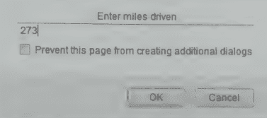

第二个提示对话框

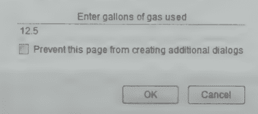

显示结果的警报对话框

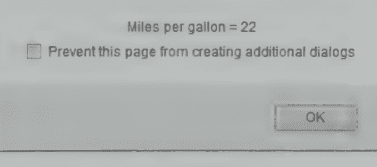

## 应用的 HTML 和 JavaScript

```html
<!doctype html>
<head>
  <title>The Calculate MPG Application</title>
  <script>
    alert("Enter miles driven");
    var miles = prompt("Enter miles driven");
    miles = parseFloat(miles);
    var gallons = prompt("Enter gallons of gas used");
    gallons = parseFloat(gallons);
    var mpg = miles/gallons;
    mpg = parseInt(mpg);
    alert("Miles per gallon = " + mpg);
  </script>
</head>
<body>
  <section>
    <h1>This page is displayed after the JavaScript is executed</h1>
  </section>
</body>
</html>
```

图 2-16 每加仑英里里程数应用

## 测试分数应用程序

图 2-17 显示了一个简单的应用程序，它允许用户输入一系列测试分数。然后，当用户输入 999 结束时，应用程序将显示平均测试分数。

与每加仑英里应用不同，此应用程序在将每个输入添加到分数总和之前，会测试并确保每个输入都是 0 到 100 之间的有效数字。这通常被称为*数据验证*。如果输入无效，应用程序将显示错误信息并发出另一个提示语句，以便用户可以输入另一个分数或输入 999 结束输入。

如果你查看 HTML 头部部分 `script` 元素中的 JavaScript，你会发现它开始声明获取输入所需的三个变量。`total` 变量的初始值为 0，将用于累加分数。`entryCount` 变量的初始值为 0，将用于计算分数数量。第三个变量是 `entry`，它没有分配初始值，将用于接收用户输入。

变量声明后，使用 `do-while` 循环来获取用户输入。因为应用程序至少需要获取一次用户输入，所以使用 `do-while` 循环而不是 `while` 循环是合理的。

在 `do-while` 循环内部，使用 `prompt` 方法获取每个用户输入。注意第二个参数设置为 999，这样用户只需按回车键即可结束输入。


然后，将每个输入解析为整数，并通过 `if` 语句检查其有效性。如果输入有效，则将输入值加到 `total` 变量，并将 `entryCount` 变量加 1。否则，`alert` 方法将显示错误信息且不处理该输入。

当循环中的语句执行完毕，将测试循环条件。如果输入为 999，则语句结束。否则，循环将重复处理下一个输入。

当循环结束时，计算平均测试分数并存储在名为 `average` 的变量中。该计算仅是将 `total` 变量除以 `entryCount` 变量。然后，使用 `parseInt` 方法将小数值转换为整数。最后，使用 `alert` 语句显示平均分。

## 测试分数应用程序的对话框

## 下一个测试分数的提示对话框

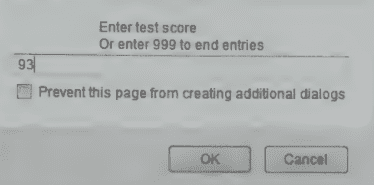

## 输入错误的警报对话框

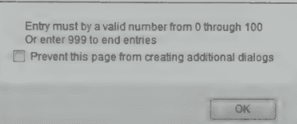

## 显示结果的警报对话框

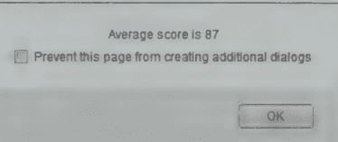

## HTML 文件头部部分的 JavaScript

```javascript
<script>
var total = 0;
var entryCount = 0;
var entry;
do {
  entry = prompt("Enter test score\n" +
                "Or enter 999 to end entries", 999);
  entry = parseInt(entry);
  if (entry >= 0 && entry <= 100) {
    total = total + entry;
    entryCount++;
  } else if (entry == 999) {
    alert("Entry must be a valid number from 0 through 100\n" +
         "Or enter 999 to end entries");
  }
} while (entry != 999);
var average = total/entryCount;
average = parseInt(average);
alert("Average score is " + average);
</script>
```

图 2-17 测试分数应用程序

# 如何查找代码中的错误

当你输入并测试最简单的应用程序时，你的代码中可能会出现错误。当发生这种情况时，JavaScript 可能完全不运行，或者可能会运行一段时间。

## 如何查找代码中的错误（修正部分）

当你输入并测试最简单的应用程序时，你的代码中可能会出现错误。当发生这种情况时，JavaScript 可能完全不运行，或者可能会运行一段时间。

## 带有错误描述的 Firefox

## Firefox 错误控制台及错误描述

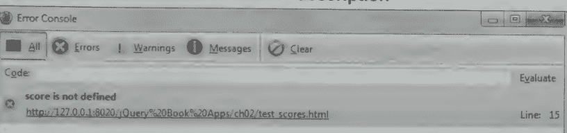

## 点击链接后显示的源代码

```javascript
var average;
do {
  entry = prompt("Enter test score\n" + 
    "Or enter 999 to end entries", 999);
  entry = parseInt(entry);
  if (score <= 100) {
    total = total + entry;
  }
}
```

# 如何查找代码中的错误

当你输入并测试最简单的应用程序时，你的代码中可能会出现错误。当发生这种情况时，JavaScript 可能完全不运行，或者可能会运行一段时间。

## 观点

如果你有编程经验，现在可以发现 JavaScript 的语法与 Java 和 C# 等其他语言相似。因此，你应该能很快读完这一章。你可能也想跳过练习题。

另一方面，如果你是编程初学者，并且能够理解本章中两个应用程序中的所有代码，那么你已经了一个良好的开始。否则，你将需要学习这些应用程序，直到你理解每个程序中的每一行代码。你还应该完成随后的练习题。

## 术语表

- 外部 JavaScript 文件
- 嵌入式 JavaScript
- JavaScript 语句
- 语法
- 空格
- 标识符
- 预留字
- 关键字
- 驼峰命名法
- 注释
- 注释掉
- 对象
- 方法
- 属性
- 调用方法
- 点运算符（dot）
- 参数
- window 对象
- 全局对象
- 原始数据类型
- 数字数据类型
- 整数
- 小数值
- 浮点数
- 字符串数据类型
- 字符串
- 空字符串
- 布尔类型
- 布尔值
- 数字表达式
- 算术运算符
- 取模运算符
- 优先级
- 变量
- 声明变量
- 赋值语句
- 赋值运算符
- 复合赋值运算符
- 数字字面量
- 拼接
- 拼接运算符
- 字符串字面量
- 转义序列
- NaN
- 对象链
- 控制语句
- 条件表达式
- 关系运算符
- 复合条件表达式
- 逻辑运算符
- if 语句
- if 子句
- else if 子句
- else 子句
- 嵌套 if 语句
- while 语句
- while 循环
- do-while 语句
- do-while 循环
- for 语句
- for 循环
- 计数器或索引
- 数据验证

## 总结

- HTML 文档页面的 JavaScript 通常编写在外部 JavaScript 文件中，通过 `script` 元素进行标识。然而，JavaScript 也可以嵌入在文档 `head` 或 `body` 中的 `script` 元素中。
- JavaScript 语句的语法与 Java 相似。它的标识符对大小写敏感，通常使用驼峰命名法（camelCase）或下划线表示法编码。它的注释可以是块注释或行内注释。
- JavaScript 提供了许多对象，这些对象提供了可以在应用程序中调用或引用的方法和属性。由于 `window` 对象是 JavaScript 的全局对象，引用它的方法或属性时可以省略它。
- JavaScript 提供了三种原始数据类型。`number` 数据类型支持整数和小数值。`string` 数据类型提供字符（字符串）数据，`Boolean` 数据类型提供真和假值。要给变量赋值，你可以使用赋值运算符。
- 当你给数字变量赋值时，可以使用包含算术运算符、变量名和数字字面量的数字表达式。
- 当你给字符串变量赋值时，可以使用包含拼接运算符、变量名和字符串字面量的字符串表达式。在字符串字面量内部，可以使用转义序列来提供特殊字符。
- 当你编写条件表达式时，可以使用关系运算符、全局的 `isNaN` 和逻辑运算符。
- `if` 语句始终以 `if` 子句开头。它也可以包含一个或多个 `else if` 子句和一个最后的 `else` 子句，但这些子句是可选的。
- `while` 和 `do-while` 语句可以用于在条件为真时循环一系列语句。
- `for` 语句可以用于在每次测试计数器或索引增加或减少时，循环执行一系列语句。
- 为了帮助在测试 JavaScript 应用程序时找到错误，可以使用 Firefox 错误控制台（Error Console）。

## 在完成本书的练习之前...

如果你还没有这样做，应该安装 Mozilla Firefox 浏览器，并按照附录 A 中的描述安装本课程的下载内容。

## 练习 2-1 为 MPG 添加验证

添加本练习中描述的验证逻辑，并在每一步之后在 Firefox 中测试应用程序。如果应用程序没有运行，请像图 2-18 所示使用错误控制台查找你的错误。

1. 打开你的文本编辑器或 IDE。然后，打开此 HTML 文件：
   `c:\query\exercise\ch02\mpg.html`

2. 使用有效输入运行应用程序，并记录结果。然后，使用无效输入（如零或空格）运行，并记录结果。

3. 在解析该条目的语句之后添加一个 `if` 语句来验证里程数。该语句应检查输入是否不是数字，或者输入是否小于零。如果其中任一条件为真，则显示相应的错误信息。完成后，`if` 语句应该类似于所示：

```javascript
if (isNaN(miles) || miles <= 0) {
  alert("Miles must be a number greater than zero");
}
```

4. 在解析该条目的语句之后添加一个 `if` 语句来验证加仑数。该语句应检查输入是否不是数字，或者输入是否小于零。如果其中任一条件为真，则显示相应的错误信息。完成后，`if` 语句应与上面显示的里程输入语句类似。

5. 为每个包含获取、解析和验证条目的条目添加一个 `do-while` 循环。该循环应一直持续到条目有效为止。要做到这一点，你可以在 `while` 子句中使用与 `if` 子句中相同的条件。例如，用于加仑数条目的循环应该类似于所示：

```javascript
do {
  // 获取、解析和验证条目的语句
} while (isNaN(gallons) || gallons <= 0);
```

## 练习 2-2 创建一个数字求和应用程序

这是一个简单的应用程序，使用 `prompt` 方法来获取数字之和。该应用程序使用 `prompt` 方法获取数字之和……（注：原文此处存在逻辑重复，已根据上下文整合翻译）。

1. 打开你的文本编辑器或 IDE。然后，打开此 HTML 文件：
   `c:\query\exercise\ch02\sum.html`

2. 使用有效输入运行应用程序，并记录结果。然后，使用无效输入（如零或空格）运行，并记录结果。

3. 声明一个初始值为零的变量来存储和。然后编写一个 `for` 语句计算从 1 到 100 的数字之和。该语句应使用一个初始值为 1 的计数器变量，只要计数器变量小于等于用户输入的值，它就会执行，并在每次循环时计数器变量加 1。

4. 添加一个 `if` 语句来验证用户输入。该语句应检查输入是否不是数字、是否小于 1 或是否大于 100。如果这些条件任一为真，则应显示相应的错误信息。

5. 添加一个 `do-while` 语句，它将持续提示用户输入并显示错误信息，直到输入有效为止。

6. 改进结果的显示，使消息看起来如下：
**Sum of the numbers from 1 through 5 is 15**
其中 5 是用户输入，15 是总和。

# 如何使用对象处理数据

在上一章中，你学习了使用对象方法和属性的语法。你还接触了 window 对象的一些方法和属性。现在，你将学习如何使用处理数据所需的对象、方法和属性。

## 如何使用 window 和 document 对象

在第 2 章中，你学习了 window 对象的 `prompt` 和 `alert` 方法。现在，图 3-1 中的第一个表格展示了 window 对象的另一个可用于确认操作的方法。

然后，图中的第二个表格总结了你在第 2 章中学习的 `parseInt` 和 `parseFloat` 方法。它们也是 window 对象的方法。这些方法是必要的，因为 `prompt` 方法返回的值以及用户在文本框中输入的值都是字符串。

第一组示例说明了这些方法的用法，从 `confirm` 方法的示例开始。对于之后的语句，假设 `prompt` 方法中的默认值没有被用户修改。因此，该组中的第二个语句将 `12345.6789` 作为字符串存储在名为 `entryA` 的变量中，第三条语句将字符串转换为整数值 `12345`。第四条语句将 `12345.6789` 作为字符串存储在名为 `entryB` 的变量中，第五条语句将字符串转换为小数值 `12345.6789`。

注意，在这些示例中没有编写对象名称和方法名。这是没关系的，因为 `window` 是 JavaScript 的全局对象。注意 `parseInt` 方法不会对值进行四舍五入，它只是移除并截断字符串中的任何小数部分。

与 window 对象不同，document 对象是 DOM 结构中的最高级对象。它代表文档，当你使用它的任何方法时，你需要编写对象名称（`document`）和点（`.`）。

图中第二组示例展示了如何使用 document 对象的两个方法。第一个是 `getElementById` 方法。它需要一个参数，即 HTML 文档中元素的 id。当执行该方法时，它会返回一个代表 HTML 元素的对象。在这个示例中，该对象存储在名为 `rateBox` 的变量中。

相比之下，`write` 和 `writeln` 方法可以在 HTML 文档的正文中使用，向文档中写入字符串。你在上一章的图 2-2 中见过它的工作原理。

## window 对象的另一个显示对话框的方法

| 方法 | 说明 |
| --- | --- |
| confirm(string) | 显示一个包含参数字符串、一个 OK 按钮和一个 Cancel 按钮的对话框。如果用户点击 OK，则返回 `true`。如果用户点击 Cancel，则返回 `false`。 |

## 处理数字的 window 方法

| 方法 | 说明 |
| --- | --- |
| parseInt(string) | 将传递的字符串转换为整数类型并返回该值。如果无法将字符串转换为整数，则返回 `NaN`。 |
| parseFloat(string) | 将传递的字符串转换为小数类型并返回该值。如果无法将字符串转换为小数，则返回 `NaN`。 |

## document 对象的三个方法

| 方法 | 说明 |
| --- | --- |
| getElementById(id) | 获取指定 id 的 HTML 元素并返回该元素 |
| write(string) | 将传递的字符串写入文档。 |
| writeln(string) | 写入字符串并换行。 |

## window 方法示例

```javascript
confirm("Are you sure you want to delete it?");
var entryA = prompt("Enter any value", 12345.6789);
var entryA = parseInt(entryA); // entryA = 12345
var entryB = prompt("Enter any value", 12345.6789);
var entryB = parseFloat(entryB); // entryB = 12345.6789
```

## document 方法示例

```javascript
// 返回 HTML 元素的对象
var rateBox = document.getElementById("rate");

// 在文档中写入一行
document.writeln("Today is " + today.toDateString());
```

# 关键点

- `window` 对象是全局对象，JavaScript 允许你省略引用 `window` 对象的对象名称和点操作符。
- `document` 对象 (DOM) 是让你能够操作文档对象模型 (DOM) 的对象，它代表了页面上所有的 HTML 元素。
- 文本框中的数据被视为字符串。在计算中使用它之前，你需要使用 `parseInt` 或 `parseFloat` 将其转换为数值数据。
- `NaN` 是表示“不是数字”（Not a Number）的值。当解析的值不是数字时，`parseInt` 和 `parseFloat` 方法会返回 `NaN`。
- `getElementById` 通常用于获取 HTML 元素的对象。

图 3-1 如何使用 window 和 document 对象

# 如何使用 TextBox 和 Number 对象

TextBox 是 DOM 对象之一。它代表网页中的一个文本框，用于获取用户输入或向用户显示输出。图 3-2 中的前两个表格总结了它的一个方法和两个属性。然后，该图展示了具有 "first_name" 和 "sales_amount" 的两个文本框的 HTML 代码。

图中第一组示例展示了如何使用 `focus` 方法。第二组展示了如何使用 `value` 和 `disabled` 属性。第三组展示了如何使用 `toFixed` 方法。

## TextBox 对象的一个方法

| 方法 | 说明 |
| --- | --- |
| focus() | 将焦点移动到文本框。 |

## TextBox 对象的两个属性

| 属性 | 说明 |
| --- | --- |
| value | 获取或设置文本框的值。 |
| disabled | 如果为 `true`，则禁用文本框。 |

## Number 对象的一个方法

| 方法 | 说明 |
| --- | --- |
| toFixed(digits) | 返回一个字符串，表示保留指定小数位数的数字。 |

## 使用 TextBox 和 Number 对象的示例

```javascript
// 将焦点移动到文本框
$("first_name").focus();

// 获取文本框的值
var salesAmount = $("sales_amount").value;

// 禁用文本框
$("sales_amount").disabled = true;

// 将数字格式化为两位小数
var formatted = salesAmount.toFixed(2);
```

# 

- `focus` 方法将焦点移动到文本框。
- `value` 属性获取或设置文本框的值。
- `disabled` 属性禁用或启用文本框。
- `toFixed` 方法将数字格式化为指定的小数位数。

图 3-2 如何使用 TextBox 和 Number 对象

# 如何使用 Date 和 String 对象

当你将数值或字符串值存储在变量中时，它会自动转换为 Number 或 String 对象。这让你可以使用 Number 和 String 对象的属性和方法，而无需显式地创建这些对象。

然而，并没有用于日期的原生数据类型。因此，在使用这些方法之前，你需要先创建一个 Date 对象。要实现这一点，你可以使用图 3-3 中的语法。当你创建一个 Date 对象时，它会被当前的日期和时间初始化，即用户计算机的日期和时间。

创建 Date 对象后，你可以使用此图中的所有方法对它进行操作。这些方法通过第一组示例进行了说明，假设日期为 2012 年 3 月 9 日。在这里，`toString` 方法将日期转换为字符串。`getFullYear` 方法从日期中获取四位年份。`getDate` 方法获取月份中的日。而 `getMonth` 方法获取月份，从 0 开始计数，而不是 1。因此，`getMonth` 方法对 3 月返回 2，而不是 3。

该图还展示了 String 对象的一个属性和四个方法。然后，最后一组示例展示了一些显示这些属性如何工作的语句。例如，第二个语句使用 `toUpperCase` 方法将字符串转换为大写，第三个语句使用 `length` 属性获取字符串中的字符数。

最后两个语句显示了如何使用 String 对象的 `indexOf` 和 `substr` 方法从字符串中提取子字符串。在这里，`indexOf` 方法用于获取字符串中第一个空格的位置（索引），从 0 开始计数。由于空格位于第四个位置，因此该方法返回 3。然后，`substr` 方法获取从第一个位置开始且长度为 3 的子字符串。结果是该方法返回“Ray”。

顺便提一下，JavaScript 为 Date 和 String 对象提供了更多方法和属性，但这些足够你入门了。稍后如果应用程序需要其他的 Date 或 String 属性或方法，我们将详细解释它们的工作原理。

# 创建 JavaScript 对象并将其赋值给变量的语法

```javascript
var variableName = new ObjectType();
```

## 创建一个 Date 对象的语句

```javascript
var today = new Date();
```

## Date 对象的一些方法

| 方法 | 描述 |
| --- | --- |
| toString() | 返回一个带有格式化日期的字符串。 |
| getFullYear() | 从日期中返回四位年份。 |
| getDate() | 从日期中返回月份中的日。 |
| getMonth() | 返回日期中的月份数字。月份从 0 开始编号。1 月是 0，12 月是 11。 |

## String 对象的一个属性

| 属性 | 描述 |
| --- | --- |
| length | 返回字符串中的字符数。 |

## String 对象的一些方法

| 方法 | 描述 |
| --- | --- |
| indexOf(search,position) | 从位置（或如果省略 position 则从 0 开始）开始搜索字符串的首次出现。如果找到，它返回第一个字符的位置，从 0 开始计数。如果未找到，返回 -1。 |
| substr(start,length) | 返回从指定位置开始并包含指定数量字符的子字符串。 |
| toLowerCase() | 返回一个字母转换为小写的新字符串。 |
| toUpperCase() | 返回一个字母已转换为大写的新字符串。 |

## 使用 Date 对象的示例

```javascript
var today = new Date();          // 创建带有当前日期的 Date 对象
alert ( today.toString() ); // 在 3/9/2012 上显示 Fri Mar 09 2012
alert ( today.getFullYear() ); // 显示 2012
alert ( today.getDate() ); // 显示 9
alert ( today.getMonth() ); // 对于 3 月显示 2，而不是 3
```

## 使用 String 对象的示例

```javascript
var name = "Ray Harris";
var nameUpper = name.toUpperCase(); // nameUpper = RAY HARRIS
var nameLength = name.length; // nameLength = 10
var index = name.indexOf(" "); // index = 3
var firstName = name.substr(0,index); // firstName = Ray
```

# 关键点

- 要创建 Date 对象并赋值给变量，请使用上述语法。然后，你可以对变量使用 Date 方法。
- 当你声明字符串变量时，会自动创建一个 String 对象。然后，你可以对变量使用 String 方法。

图 3-3 如何使用 Date 和 String 对象

## 如何使用 DOM 对象

### 更改元素的文本

当浏览器加载 HTML 页面时，它会构建一个文档对象模型（DOM），其中包含表示页面所有 HTML 元素和属性的节点。这通过图 3-4 中的 HTML 页面和图进行了说明。

DOM 从一个 html 元素节点开始，一直嵌套到最底层。此外，这些是 label、input 和 span 元素的节点。除了此图中用椭圆表示的元素节点外，DOM 还包含持有 HTML 元素数据的文本节点。在图中这些文本节点是矩形。例如，第一个文本节点包含 head 部分中 title 元素的文本：“Join Email List”。它右侧的节点包含 body 部分中 h1 元素的文本：“Please join our email list”。依此类推。

DOM 还包含其他类型的节点，例如注释节点。要修改 DOM，你可以使用此处所示的语法：

```javascript
document.getElementById("id").innerHTML = "new content";
```

总之，DOM 是 HTML 文档的树形表示。树中的每个节点代表一个元素。你可以使用 JavaScript 访问并修改这些节点，从而动态地更改网页的内容和样式。

# 第3章 如何与对象、函数和事件交互

## 匿名函数的语法

```javascript
var variableName = function(parameters) {
  // 当执行时运行的语句
}
```

## 无参数且无返回值的匿名函数

```javascript
var showYear = function() {
  var today = new Date();
  alert("The year is " + today.getFullYear());
}
```

## 如何调用该函数

```javascript
showYear();
```

## 带有一个参数并返回 DOM 元素的匿名函数

```javascript
var $ = function(id) {
  return document.getElementById(id);
}
```

## 如何调用该函数

```javascript
var emailAddress1 = $("email_address1").value;
```

## 带两个参数并返回值的匿名函数

```javascript
var calculateTax = function ( subtotal, taxRate ) {
  var tax = subtotal * taxRate;
  tax = parseFloat(tax.toFixed(2));
  return tax;
}
```

## 如何调用该函数

```javascript
var subtotal = 85.00;
var taxRate = 0.05;
var salesTax = calculateTax(subtotal, taxRate ); // 调用该函数
alert(salesTax); // 显示 4.25
```

## 描述

- 函数是程序中其他语句可以调用的代码块。当函数结束时，程序将继续执行调用语句之后的语句。
- 函数在被调用时，可能要求传递一个或多个参数。在调用语句中，这些参数也可以称为变量（arguments）。
- 为了向调用它的语句返回结果，函数使用 `return` 语句。当执行 `return` 语句时，函数返回指定的值并结束。
- 匿名函数是指如所示编写的函数。从技术上讲，该函数没有名称，它被存储在变量中，并通过变量名进行引用。
- 在应用程序的 JavaScript 中，匿名函数必须在任何调用它的语句之前编写。否则，将发生错误。

## 如何创建和调用命名函数

由于匿名函数通常用于处理 JavaScript 中发生的事件，因此你大部分时候都会使用它们。但是，你应该知道 JavaScript 也允许你编写命名函数。

图 3-6 显示了如何创建和调用命名函数。它使用了与前一个图相同的示例，但用命名函数代替了匿名函数。如语法所示，命名函数不存储在变量中，它的名称编写在关键字 `function` 之后、参数之前。

与前一个图一样，`showYear` 函数没有任何参数，并返回保留两位小数的销售税值。在这些示例中，使用命名函数仅仅是获得与匿名函数相同结果的另一种方法。

使用命名函数的一个优点是，它可以在任何调用它的语句之前或之后进行编写。相比之下，匿名函数必须在任何调用它的语句之前编写。尽管这是一个微小的区别，但只要你意识到这一点，就不会引起任何问题。

## 命名函数的语法

```javascript
function functionName(parameters) {
  // 当执行时运行的语句
}
```

## 无参数且无返回值的命名函数

```javascript
function showYear() {
  var today = new Date();
  alert("The year is " + today.getFullYear());
}
```

## 如何调用该函数

```javascript
showYear();
```

## 带两个参数并返回值的命名函数

```javascript
function calculateTax( subtotal, taxRate ) {
  var tax = subtotal * taxRate;
  tax = parseFloat(tax.toFixed(2));
  return tax;
}
```

## 如何调用该函数

```javascript
var subtotal = 85.00;
var taxRate = 0.05;
var salesTax = calculateTax(subtotal, taxRate); // 调用该函数
alert(salesTax); // 显示 4.25
```

## 描述

- 命名函数是指如所示编写的函数。这只是编写函数的另一种方法。
- 与匿名函数相反，命名函数不必在任何调用它的语句之前编写。

## 何时以及如何使用局部和全局变量

编程语言中的作用域（Scope）指的是变量和函数的可见性。也就是说，它告诉你可以在程序的哪个位置使用你定义的变量和函数。

当你使用 JavaScript 时，局部变量（local variables）是定义在函数内部的变量。它们具有局部作用域，这意味着它们只能在定义它们的函数内部使用。

相反，全局变量（global variables）是定义在函数外部的变量。它们具有全局作用域，因此任何函数都可以使用它们，而无需作为参数传递给函数。

图 3-7 中的第一个示例说明了局部变量的使用。在这里，`calculateTax` 函数创建了一个名为 `tax` 的变量并将其返回给调用语句。但请注意，函数外部的语句不能引用该变量名，否则会导致错误。这是因为它具有局部作用域。

相反，第二个示例创建了一个名为 `tax` 的全局变量。然后，函数计算销售税并将结果存储在那个全局变量中。结果是，函数的语句可以引用该变量，因为它是全局的。

虽然使用全局变量似乎比向函数传递数据并从中返回数据更简单，但全局变量往往会产生问题。这些都很容易遗漏变量名。

## 如何处理事件

JavaScript 通常会响应用户的操作，例如点击按钮。这些操作被称为*事件*，而处理这些事件的匿名函数被称为*事件处理器*。要实现这一点，你必须将它们*绑定*（attach）到函数上。

## 如何将事件处理器绑定到事件

表 3-8 总结了 JavaScript 应用中处理的一些事件。例如，`window` 的 `load` 事件发生在浏览器完成页面 HTML 加载并构建其 DOM 之后。按钮对象的 `click` 事件发生在用户点击按钮时。而 `mouseover` 事件（鼠标悬停）发生在用户将鼠标悬停在元素上时。

之后，你就可以编写将函数绑定到事件的语法代码。要做到这一点，你需要编写对象名称以及以 **on** 为前缀的事件名称。然后，编写一个等号，后面跟上将处理该事件的匿名函数的变量名。

图中第一个示例是一个可以用作事件处理器的匿名函数。该函数存储在名为 `joinList` 的变量中，它所做的只是显示一条消息。在实际应用程序中，你会在函数的大括号内编写适当的语句来处理该事件。

第二个示例展示了一个 JavaScript 语句，将 `joinList` 函数绑定到 ID 为 "submit_button" 的按钮的 `click` 事件上。要做到这一点，该语句首先使用 `getElementById` 方法获取按钮对象。接着是点操作符和以 `on` 为前缀的事件名称 `.onclick`。然后，将结果赋值给函数变量名 `joinList`，该函数将作为事件处理器。

注意，这里你不需要在用于函数的变量名后编写括号，正如图 3-5 所示。这是因为你正在绑定事件处理器，而不是在调用它。结果是，函数将在事件触发时被调用。相反，如果你在 `joinList` 后面加上括号，该函数将立即执行，并且该函数不会被赋值给事件。

第三个示例与第二个示例类似。它将 `joinList` 事件处理器绑定到 ID 为 `textbox_1` 的文本框的 `dblclick` 事件上。这意味着同一个事件处理器将用于两个不同的事件。在这里，当你绑定函数时同样不需要编写括号。

## 常见事件

| 对象 | 事件 | 发生于... |
| --- | --- | --- |
| window | load | 文档已加载到浏览器中。 |
| button | click | 按钮被点击。 |
| control or link | focus | 控件或链接获得焦点。 |
| | blur | 控件失去焦点。 |
| control | change | 用户更改了控件中的值。 |
| | select | 用户在文本框或文本区域中选择文本。 |
| element | click | 用户点击了元素。 |
| | dblclick | 用户双击了元素。 |
| | mouseover | 用户将鼠标移动到元素上方。 |
| | mousein | 用户将鼠标移入元素。 |
| | mouseout | 用户将鼠标移出元素。 |

## 绑定事件处理器的语法

`objectVariable.eventName = eventHandlerName;`

## 一个名为 joinList 的事件处理器

```javascript
var joinList = function() {
  alert("函数的语句写放在这里");
}
```

## 如何将事件处理器绑定到按钮的点击事件

```javascript
document.getElementById("submit_button").onclick = joinList;
```

## 如何将事件处理器绑定到文本框的双击事件

```javascript
document.getElementById("text_box_1").dblclick = joinList;
```

## 描述

- 事件处理器是在事件发生时执行的函数，因此它“处理”该事件。因此，你可以像编写任何其他函数一样编写事件处理器。
- 要将事件处理器绑定到事件，你必须先指定触发该处理器的对象和事件。然后，将事件处理器函数赋值给该事件。
- 当为事件处理器编写事件代码时，在事件名称前加上 *on*。例如，`onclick` 用于点击事件。
- 当你想将事件处理器绑定到事件时，不要在函数的变量名后编写括号。


## 如何使用 onload 事件处理器绑定其他事件处理器

你会在何时绑定像上图那样的事件处理器？你会在所有 HTML 加载到用户浏览器且 DOM 构建完成后绑定它。要做到这一点，你只需如图 3-9 所示，为 `window` 对象的 `load` 事件编写一个事件处理器。这让你能够了解事件处理器如何设置和使用的全貌。

在此示例的 HTML 中，你可以使用一个标签（label）、一个文本框、一个包含空格的标签和一个按钮。这个简单的应用程序应该在点击按钮或用户更改文本框中的值时显示一条消息。

在 JavaScript 代码中，你可以看到三个匿名函数。第一个存储在名为 `$` 的变量中。该函数使用 `document` 对象的 `getElementById` 方法，当传递一个 HTML 元素的 id 时，获取该元素。这是一个常用函数，因为它使你无需每次都编写 `getElementById` 方法就能轻松地获取元素。

第二个函数存储在名为 `joinList` 的变量中，它所做的只是显示一条消息。在实际应用程序中，你会在函数的大括号内编写适当的语句来处理该事件。

第三个函数是 `window` 对象的 `onload` 事件处理器。它将 `joinList` 函数绑定到按钮的 `click` 事件和文本框的 `dblclick` 事件上。它还将焦点移动到第一个文本框。

# 浏览器中的每加仑英里（MPG）应用程序

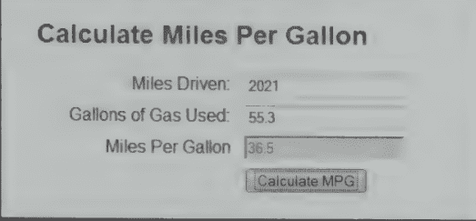

# 程序的 HTML 和 JavaScript

```html
<!DOCTYPE html>
<html>
<head>
  <title>Calculate MPG</title>
  <link rel="stylesheet" href="mpg.css">
  <script>
    var $ = function (id) {
      return document.getElementById(id);
    }
    var calculateMPG = function () {
      var miles = parseFloat($(
```

图 3-10 每加仑英里应用程序

## 邮件列表应用程序

图 3-11 展示了一个邮件列表应用程序，类似于第 1 章中介绍的程序。在这个应用程序中，用户在三个文本框中输入数据并点击“全部加入”（Join all）按钮。然后，JavaScript 会检查数据的有效性。如果任何条目无效，该应用程序将在该条目的右侧显示错误消息。如果所有条目都有效，数据将提交到服务器进行服务器端处理。

此应用程序中执行的数据验证是任何表单在提交到服务器处理之前所做的典型客户端验证。此应用程序还说明了 DOM 脚本，因为它更改了 HTML 中 `span` 元素显示的文本。

在 HTML 的 `head` 部分，你可以看到一个 `link` 元素包含了该页面的 CSS 文件。你还可以看到一个 `script` 元素，包含了该页面的外部 JavaScript 文件。这里同样没有显示 CSS，因为它与应用程序的操作无关。

在 HTML 的 `body` 部分，你可以看到该页面的表单（form）、标签（label）和输入（input）元素。你还可以看到第一个输入元素后面紧跟一个带有星号的 `span` 元素。由于该页面的 CSS 为 `span` 元素应用红色，因此星号在显示时是红色的。然后，由于 JavaScript 将错误消息存储在 `span` 元素中，错误消息也是红色的。

你可能还会注意到表单和文本框的 `id` 属性：`email_form`、`email_address1`、`email_address2` 和 `first_name`。这些将传递给 JavaScript 中 `$` 函数的 `id`。

同样注意，`name` 属性的值与 `id` 属性的值相同。文本框的 `name` 属性用于服务器端代码来获取传递给它的用户输入。

# 网页浏览器中的邮件列表应用程序

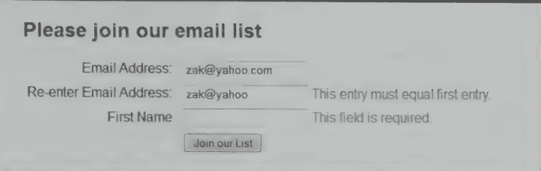

# 页面的 HTML 文件

```html
<!DOCTYPE html>
<html>
<head>
  <title>Join Email List</title>
  <link rel="stylesheet" href="email_list.css">
  <script src="email_list.js"></script>
</head>
<body>
  <section>
    <h1>Please join our email list</h1>
    <form id="email_form" name="email_form"
      action="join" method="get">
      <label for="email_address1">Email Address:</label>
      <input type="text" id="email_address1" name="email_address1">
      <span id="email_address1_error">*</span><br>
      <label for="email_address2">Re-enter Email Address:</label>
      <input type="text" id="email_address2" name="email_address2">
      <span id="email_address2_error">*</span><br>
      <label for="first_name">First Name</label>
      <input type="text" id="first_name" name="first_name">
      <span id="first_name_error">*</span><br>
      <label for="nbsp;"></label>
      <input type="button" id="join_list" value="Join our List">
    </form>
  </section>
</body>
</html>
```

图 3-12 编写此应用程序 JavaScript 的一种方法。在这里，`onload` 事件处理器将 `joinList` 函数绑定到 id 为 `join_list` 的按钮点击事件上。`onload` 事件处理器还将焦点移动到第一个文本框。

当 `joinList` 函数被调用时，前两个语句使用 `$` 函数将两个文本框的输入存储在名为 `emailAddress` 和 `emailAddress2` 的变量中。然后，第三个语句如果任何条目无效，会将布尔变量 `isValid` 设置为 `false`。

后续的三个语句中的每一个都会检查输入的有效性。如果检测到错误，语句会将 `span` 元素的文本设置为相应的错误消息。如图 3-4 所示，这会将 `isValid` 变量设置为 `false`。然而，如果条目有效，语句的 `else` 子句会将 `span` 元素的文本设置为空字符串，这样什么都不显示。

在检查了三个输入的有效性后，第四个语句测试 `isValid` 变量是真还是假。如果是真，意味着所有条目都有效。结果是，`else` 子句使用表单对象的 `submit` 方法将数据发送。另一方面，如果 `isValid` 为假，由于语句没有 `else` 子句，应用程序等待用户修正输入并再次点击列表按钮。

如果你研究这段代码，你会发现此应用程序的代码都在函数中，因此没有全局变量。此外，函数的编码易于阅读，因为调用的函数总是位于函数调用之前。

# 带有语句的邮件列表应用程序 JavaScript

```javascript
var $ = function (id) {
  return document.getElementById(id);
}
var joinList = function () {
  var emailAddress1 = $("email_address1").value;
  var emailAddress2 = $("email_address2").value;
  var isValid = true;

  // 验证第一个输入
  if (emailAddress1 == "") {
    $("email_address1_error").firstChild.nodeValue = "This field is required.";
    isValid = false;
  } else {
    $("email_address1_error").firstChild.nodeValue = "";
  }

  // 验证第二个输入
  if (emailAddress2 == "") {
    $("email_address2_error").firstChild.nodeValue = "This field is required.";
    isValid = false;
  } else if (emailAddress1 != emailAddress2) {
    $("email_address2_error").firstChild.nodeValue = "This entry must equal first entry.";
    isValid = false;
  } else {
    $("email_address2_error").firstChild.nodeValue = "";
  }

  // 验证第三个输入
  if ($("first_name").value == "") {
    $("first_name_error").firstChild.nodeValue = "This field is required.";
    isValid = false;
  } else {
    $("first_name_error").firstChild.nodeValue = "";
  }

  if (isValid) {
    // 使用表单对象的 submit 方法提交表单
    $("email_form").submit();
  }
}
window.onload = function () {
  $("join_list").onclick = joinList;
  $("email_address1").focus();
};
```

图 3-12 邮件列表应用程序的 JavaScript

# 

在本章中，你看到了真实的 JavaScript 应用程序使用对象和响应事件的方式。现在，如果你理解了本章的内容，就准备好开始开发自己的应用程序了。

# 术语

- window 对象
- 参数
- 全局对象
- 返回语句
- document 对象
- 对象链
- 匿名函数
- 命名函数
- DOM（文档对象模型）
- 作用域
- DOM 节点
- 局部变量
- 元素节点
- 全局变量
- 文本节点
- 全局作用域
- 属性节点
- 事件
- 注释节点
- 事件处理器
- 调用函数
- 附加事件处理器

## 总结

- document 对象提供了方法和属性，让你操作文档对象模型（DOM）。
- TextBox、Number、Date 和 String 对象为文本框、数字数据类型、日期和字符串数据类型提供了属性。在处理这些对象的方法和属性时，你经常使用链式调用。
- DOM 在页面加载到浏览器时构建。它包含了代表 HTML 文档中元素的元素节点和代表这些元素内文本的文本节点。要访问元素的文本，可以引用 `firstChild` 的 `nodeValue` 属性。
- 函数由一段代码组成，该代码在函数被调用时执行。函数可能需要调用语句传递给它的一个或多个参数。
- 匿名函数存储在变量中，命名函数被赋予一个名称。
- 局部变量定义在函数内部，只能由函数内部语句访问。全局变量定义在所有函数之外，可以被任何其他代码访问。

## 练习 3-1 增强 MPG 应用

在本次练习中，你将从几个方面增强 MPG 应用。

### 测试应用程序

1. 打开你的文本编辑器或 IDE，打开此 HTML 文件：`c:\query\exercises\ch03\mpg\index.html`。然后，检查代码以确保它与图 3-10 一致。
2. 使用有效数据运行并测试此应用程序，查看其工作原理。当你点击“Calculate MPG”按钮时，应该显示正确的结果。
3. 现在，测试验证程序。注意，无论输入哪一项无效，都会显示一条错误消息。

### 增强数据验证

4. 增强 `if` 语句，使其为每个文本框和每种错误提供不同的错误消息：
   - 英里（Miles）必须是数字
   - 英里（Miles）必须大于零
   - 加仑（Gallons）必须是数字
   - 加仑（Gallons）必须大于零
   `if` 语句应该包含一个测试第一个条件的子句，后面紧跟三个测试后续三个条件的 `else if` 子句。然后，测试此更改。

### 添加“清除条目”按钮

5. 在“Calculate MPG”按钮下方添加一个“Clear Entries”按钮。为此，复制 Calculate 按钮的 label 和 input 元素的 HTML，并将其粘贴在 Calculate 按钮 input 元素之后。然后，修改 Clear Entries 按钮的 HTML，使其具有唯一的 id 和适当的 value 属性。
6. 添加匿名函数的 JavaScript 代码并存储在名为 `clear` 的变量中。该函数应使用 `$` 函数获取每个文本框的 TextBox 对象，然后将文本框的 `value` 属性设置为空字符串。然后在 `onload` 事件处理程序中添加一条语句，将 `clear` 函数绑定到 Clear Entries 按钮的点击事件上，如下：
   `$("clear").onclick = clear;`
   现在，测试此增强。
7. 在 `onload` 事件处理程序中添加一条语句，将 `clear` 函数绑定到 miles 文本框的双击事件上。然后，测试此更改。

## 练习 3-2 开发未来价值应用

本次练习将引导你开发一个名为未来价值（Future Value）的新应用程序。该应用程序的界面如下：

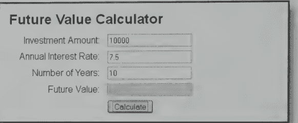

确保在本次练习的每个步骤之后都测试此应用程序。

1. 打开你的文本编辑器或 IDE，打开此文件夹中的 HTML 和 JavaScript 文件：
   `c:\query\exercises\ch03\future_value_`
   运行 HTML 文件以查看它提供了用户界面的所有代码。注意，JavaScript 文件仅包含用于获取特定 id 元素对象的 `$` 函数的常用部分。
2. 添加一个 `calculateClick` 函数，将其作为 Calculate 按钮点击事件的事件处理器。在此函数内部，编写三个变量，使用 `$` 获取前三个文本框的值。将前两个值转换为小数，将第三个值转换为整数。然后，编写一个像图 2-15 第二个示例中的 `for` 循环，用于计算投资的未来价值。循环结束时，使用 `toFixed` 方法移除未来价值中的小数位，并将其置于 Future Value（未来价值）文本框中。
   为 `window` 对象编写一个 `onload` 事件处理程序，将 `calculateClick` 函数绑定到 Calculate 按钮的点击事件上。
3. 添加一个 `if` 语句，测试第一项输入是否为大于零的有效数字。如果输入无效，使用 `alert` 方法显示适当的错误消息。使用一个 `else` 子句结束该语句，其中包含你在步骤 2 中用于计算和显示未来价值的代码。
4. 增强 `if` 语句，以检查另外两项输入的有效性。同样，每项输入应该是大于零的数字，并应使用 `alert` 方法显示相应的错误消息。
5. 为此应用程序添加任何最后的完善，例如在应用程序启动时将焦点移动到第一个文本框。现在，这是一个运行良好的应用程序，是你通过在每个步骤中编写和测试有限数量的语句开发的。

# 如何测试和调试 JavaScript 应用程序

构建 JavaScript 应用程序时，你需要对其进行测试以确保它符合预期。然后，如果有任何问题，你就需要调试应用程序以修正这些问题。本章将向你展示如何进行这些操作。

## 测试与调试简介

当你测试应用程序时，你会运行它以确保其工作正常。在测试应用程序时，你会尝试所有可能的输入数据和操作，以确保它在任何情况下都能工作。换句话说，测试的目标是让应用程序失败。

当你调试应用程序时，你会修复在测试期间发现的错误（bug）。每次修复 bug 后，都要重新测试，以确保你的更改没有影响应用程序的任何方面。

## JavaScript 应用程序的典型测试阶段

当你测试应用程序时，通常会分阶段进行，如图 4-1 总结的三个阶段。

在第一阶段，测试用户界面时，你应该视觉上检查控件以确保它们显示正常且文本正确。然后，你应该确保所有的键和控件工作正常。

在第二阶段，你应该使用有效数据测试应用程序。开始时，你可以输入预期的用户输入的数据。但在完成之前，你应该输入测试应用程序极限的有效数据。

在第三阶段，你要尽全力通过测试你想到的所有无效数据和操作组合来让应用程序失败。这应该包括随机操作，如按回车键或在错误的时间点击鼠标。

# 带有逻辑错误的 Calculate MPG 应用

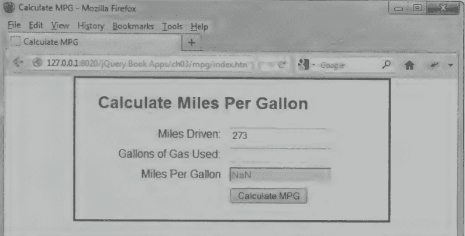

# 测试的目标

- 在应用投入生产之前找到所有错误

# 调试的目标

- 在应用投入生产之前修复所有错误。

# 三个测试阶段

- 检查用户界面以确保其正常工作。
- 使用有效输入数据测试应用程序，以确保结果正确。
- 使用无效数据或意料之外的用户操作测试应用程序。尝试你能想到的任何方法来让应用程序失败。

## 可能发生的三类错误

- **语法错误**违反了 JavaScript 语句的编写规则。这些错误在页面加载到 Web 浏览器时会被 JavaScript 引擎捕获。
- **运行时错误**发生在页面加载后且应用程序运行期间。当发生运行时错误时，JavaScript 引擎会抛出一个异常并停止应用程序的执行。
- **逻辑错误**是指不会引起语法或运行时错误，但会产生错误结果的语句。

## 描述

- 测试 JavaScript 应用时，你运行它以确保无论你输入什么数据或触发什么事件，它都能正常工作。
- 调试应用时，你发现并修复在测试应用时发现的所有错误（bug）。

图 4-1 测试与调试简介

# 常见的 JavaScript 错误

图 4-2 展示了在编写 JavaScript 应用时经常犯的编码错误。如果你完成了上一章的练习，你可能已经经历过其中一些错误。现在，如果你学习这张图，你将更好地了解需要注意什么。

如果你正在使用良好的文本编辑器或 IDE，可以通过注意在输入代码时显示的错误标记来避免大多数此类错误。例如，Aptana 将帮助你避免此图中前两组中的大多数错误。然而，它无法帮助你避免第三组中的错误。

此图中的第四组说明了第 2 章中提到的浮点数算术问题。简而言之，JavaScript 使用 IEEE 754 标准处理浮点数，该标准可能会引入不精确的结果，即使对于简单的计算也是如此。尽管这些结果非常接近精确结果，但它们可能会引起问题，特别是在比较时。例如，数字 7.495 不等于 7.495000000000001。

为了解决这个问题，你可以像示例所示那样运行结果。在这里，数字的 `toFixed` 方法通过使用数字的 `toFixed` 方法返回两位。在这种情况下，结果被存储为字符串；相比之下，第二条语句获取舍入后的结果，然后使用 `parseFloat` 方法将其存储为数字。使用哪种方法取决于你需要的结果是字符串还是数字。

此图中的最后一组说明了当 JavaScript 假设变量是全局变量时可能出现的问题。在此示例中，`salesTax` 使用 `var` 关键字正确声明。但下一条语句在尝试将舍入并解析后的值赋予 `salesTax` 时，将 `salesTax` 拼成了 `salestax`。结果是 `salestax` 被视为全局变量，舍入并解析的值进入了 `salestax` 而不是 `salesTax`，这自然导致了 bug。

不用说，那种类型的 bug 很难发现。但现在你已经意识到了此类错误，你将更好地准备好调试它们。

# 常见的语法错误

- 关键词拼写错误，例如将 `getElementById` 写成 `getElementByID`。
- 遗漏必要的括号、引号或大括号。
- 未使用相同的起始引号和结束引号。
- 遗漏语句末尾的分号。
- 标识符拼写错误或大小写错误，例如定义一个名为 `salesTax` 的变量，稍后用 `salestax` 引用它。

## HTML 引用问题

- 错误地引用属性值或其他 HTML 组件，例如当 id 为 `sales_tax` 时将其引用为 id `salesTax`。

## 数据和比较问题

- 在处理用户输入之前未测试以确保其是正确的数据类型。
- 在处理用户输入之前未使用 `parseInt` 或 `parseFloat` 方法将用户输入转换为数值。
- 使用一个等号而不是两个等号来测试相等性。

## 浮点算术问题

- JavaScript 中的 `number` 数据类型使用浮点数，这可能导致算术结果不精确。例如：
```javascript
var salesAmount = 74.95;
var salesTax = salesAmount * .1; // result is 7.495000000000001
```
- 解决此问题的方法是将结果舍入到指定的位数并将其转换回浮点数：
```javascript
salesTax = salesTax.toFixed(2); // result is "7.50" as a string
salesTax = parseFloat(salesTax.toFixed(2)); // result is 7.50 as a number
```

## 被视为全局变量的未声明变量问题

- 如果你赋值了一个未声明的变量，JavaScript 引擎会将其视为全局变量。这可能发生在你拼错变量名时，例如：
```javascript
var salesTax = 7.50;
salestax = salesTax * 1; // creates global variable salestax
```

## 描述

- 测试 JavaScript 应用时，你运行它以确保无论你输入什么数据或触发什么事件，它都能正常工作。
- 调试应用时，你发现并修复在测试应用时发现的所有错误（bug）。

图 4-2 常见的 JavaScript 错误

## 自顶向下编码和测试如何简化调试

简化调试的一种方法是每次编写一小部分。这可以被称为自顶向下编码或简单的自顶向下测试。如图 4-3 所示。在这里，第一阶段是针对点击事件的事件处理器。然而，该事件处理器没有进行任何验证。它只是计算投资的未来价值。然后，第二阶段通过对输入进行数据验证增加了代码。第三阶段增加了对其他输入的验证。第四阶段增加了完善工作，例如在应用程序启动时将焦点移到第一个文本框。

结果是你正在测试一小部分代码。

# 终价值应用的用户界面

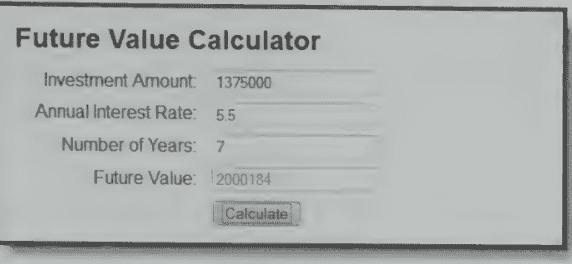

## 测试阶段 1：无数据验证

```javascript
var $ = function (id) {
  return document.getElementById(id);
}
var calculateClick = function () {
  var investment = parseFloat($("investment").value);
  var annualRate = parseFloat($("rate").value);
  var years = parseInt($("years").value);
  for ( i = 1; i < years; i++) {
    investment += investment * annualRate / 100;
  }
  $("future_value").value = investment.toFixed();
}
window.onload = function () {
  $("calculate").onclick = calculateClick;
}
```

## 测试阶段 2：为第一个输入添加数据验证

```javascript
if (isNaN(investment) || investment <= 0) {
  alert("投资必须是数字且大于零.");
}
else {
  // 来自阶段1的未来价值计算
}
```

## 测试阶段 3：为其他输入添加数据验证

```javascript
// 为其他输入添加数据验证
```

## 测试阶段 4：添加完善工作

```javascript
// 添加完善工作如将焦点移到第一个文本框
```

## 如何使用 Firebug 进行调试

在第 2 章中，你已经了解了 Firefox 错误控制台（Error Console）这一查找语法错误的方法。尽管如此，Firefox 还提供了 Firebug 扩展，它的功能比错误控制台更好。Firebug 还为更复杂的应用程序提供了一些优秀的调试功能。

由于 Firebug 相对易用，后续的主题将不再介绍所有功能的使用步骤。相反，这些主题将介绍你将最常使用的技能。之后，如果你决定使用其他某些功能，可以自己进行尝试。

## 如何启用 Firebug 并查找错误

Firebug 是一个 Firefox 扩展，提供了一些优秀的调试能力。安装 Firebug 后（如附录 A 所示），你将在 Firefox 工具栏上看到 Firebug 图标，如图 4-4 所示。然后，你可以点击此图标或按 F12 键来打开和关闭 Firebug。

Firebug 的主要用途之一是获取类似于错误控制台显示的错误消息，但这种方式更加高效。例如，要获取错误消息，你只需打开 Firebug 并点击 Console（控制台）选项卡即可显示控制台。这将显示页面加载时检测到的第一个错误。然后，你可以点击错误链接以切换到 Script（脚本）面板，其中该错误的 JavaScript 代码会被高亮显示。

在某些情况下，你可能需要在在使用 Console 和 Script 面板之前先启用它们。如果某个面板未启用，它将包含一个你可以用来启用它的链接。或者，你也可以从面板的下拉列表中选择 Enable（启用）命令。

Firebug 的工作非常出色，我们建议你立即安装它。每当你启动一个 JavaScript 应用程序但没有任何反应时，点击 Firebug 图标并查看 Console 面板检查是否捕获了错误。如果有，就从那里继续。否则，你可能遇到了更严重的的调试问题。

顺便提一下，在代码中加载应用程序时显示的错误消息是检测到的第一个语法错误，但代码中可能存在其他的语法错误。要捕获它们，你必须修正第一个错误并重新运行应用程序。还要注意，JavaScript 引擎在修正所有语法错误之前将不会运行应用程序。因此，在修复语法错误之前，你将无法发现运行时错误。

在接下来的图中，你将学习如何使用 Script 面板进行调试。但在离开此图之前，请注意 Firebug 除了 Console 和 Script 面板外，还有四个面板。以下是每个面板的要说明。

Console 选项卡右侧的前两个选项卡访问 HTML 和 CSS 面板，显示页面的 HTML 和 CSS。如果一个页面有多个 CSS 文件，可以使用 CSS 面板工具栏中的文件名下拉列表切换到不同的文件。

最后两个选项卡访问 DOM 和 Net 面板。DOM 面板显示以全局对象开头的对象。Net 面板显示发送到网络浏览器的请求信息。这包括下载时间、使用的服务器、HTTP 请求头、HTTP 响应头、HTTP 响应体以及本地缓存信息。

# 显示错误的已打开 Console 面板的 Firebug

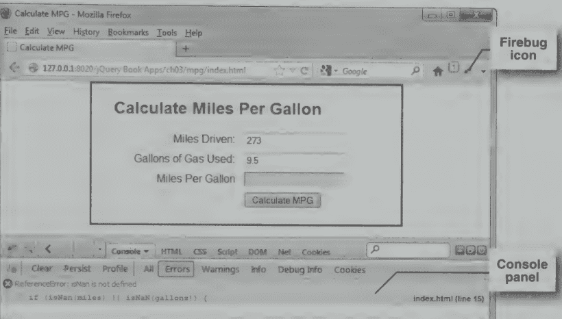

# 点击 Console 面板链接后的 Script 面板

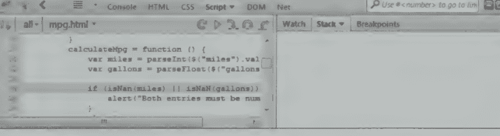

## 如何打开或关闭 Firebug

- 点击 Console 面板或按 F12。

## 如何找到导致错误的 JavaScript 语句

- 点击 Console 选项卡打开 Console 面板。然后，如有必要，点击 Errors 按钮。这将显示类似上方的错误消息，并标出导致错误的代码行。
- 点击 Console 面板中的代码行或点击代码行右侧的行标记。这将打开 Script 面板，显示包含该语句的 JavaScript 代码部分并高亮该语句。

## 关键点

- Firebug 是一个免费的 Firefox 扩展，提供了一些优秀的调试功能。
- Console 面板的用途之一是显示类似于错误控制台显示的错误消息，但这种方式更加高效。

图 4-4 如何启用 Firebug 并查找错误

## 如何使用断点和单步执行代码

断点是代码中的一个点，在该点处应用程序的执行将停止。然后，你可以检查变量的内容以查看代码执行是否符合预期。你还可以从该点开始单步执行代码执行。这些技术可以帮助你解决复杂的调试问题。

图 4-5 展示了如何设置断点、单步执行代码以及在 Watch（监视）面板中查看变量。在本示例中，你可以看到 Email List 应用程序的第 5 行设置了断点。

当你运行应用程序时，它将在遇到第一个断点处停止，并在上方显示一个黄色三角形。当代码停止时，你可以将鼠标悬停在 Script 面板的对象名称上，显示对象的当前值。

在断点处，你还可以在页面右侧的 Watch 面板查看当前变量。这些是正在执行的函数所使用的变量。你还可以点击“New watch expression...”（新建监视表达式...）查看其他变量和表达式的值。


# Firebug Script 标签中的断点

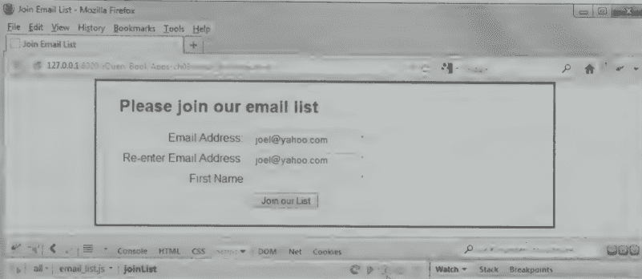

## 如何在 Script 面板中设置断点

- 点击语句左侧的栏设置断点。
- 点击红色断点标记移除断点。

## 如何在 Script 面板中单步执行 JavaScript 代码

- 点击 Step In（进入）按钮或按 F11 逐行执行代码。
- 点击 Step Over（跳过）按钮运行所有调用的函数而不进入其内部。
- 点击 Step Out（跳出）按钮执行函数的剩余部分而不进入内部。
- 点击 Continue（继续）按钮恢复正常执行。

## 如何在每一步查看当前数据值

- 将鼠标光标悬停在 Script 面板中的变量名上。
- 在 Script 面板右侧的 Watch 面板查看当前变量。
- 在 Watch 面板中点击“New watch expression...”，输入你想监视的变量名或表达式。

## 说明

- 你可以在任何行设置断点。当 JavaScript 引擎遇到断点会在执行语句之前停止。
- Script 面板中的红色圆圈标记每个断点，黄色三角形标记单步执行代码时下一个要执行的语句。

图 4-5 如何使用断点和单步执行你的代码

## 其他调试方法

由于 Firefox 是一个非常出色的调试工具，你应该在大多数调试工作中使用它。然而，这里给出了四种你可能偶尔觉得有用的调试方法。

## 何时以及如何从其他浏览器获取错误消息

所有现代浏览器都能检测 JavaScript 错误，并提供如 Firefox 错误控制台（Error Console）和调试（Debug）之类的工具来帮助。但是，如果你使用 Firefox 和 Debug 来调试你的 JavaScript 应用程序，就不需要使用其他浏览器提供的工具了。在 Firefox 上运行的应用程序应该在所有其他浏览器上运行，但有一个例外。

例外是 Internet Explorer，它产生了你可能会遇到的大多数跨浏览器兼容问题。因此，在 Firefox 和其他浏览器上测试过应用程序后，你可能需要在 IE 上对其进行调试。这就是为什么图 4-6 显示了如何访问 IE 调试工具。

如图所示，当前版本 IE 的开发者工具工作方式与 Firefox 非常相似，具有相似的面板。如果你尝试这些工具，你会发现可以像 Firefox 一样，从控制台（Console）面板跳转到脚本（Script）面板中的错误语句。你还可以以相同的方式设置断点并单步执行语句。

### 显示错误的带有控制台面板的 Internet Explorer

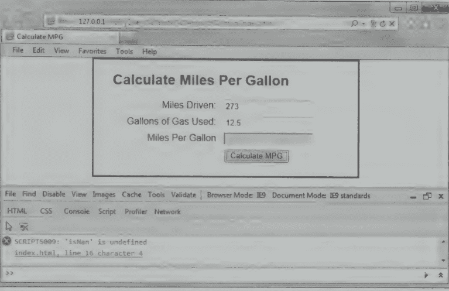

#### 如何在当前版本的 IE 上显示开发者工具

- 使用 工具（Tools）-> 开发者工具（Developer Tools）命令，或按 F12。

#### 如何在旧版本的 IE 上显示错误消息

- 双击浏览器左下角的错误图标查看 IE 消息框。如果有必要，点击显示详细信息（Show Details）按钮查看完整消息。

## 描述

- 所有现代浏览器都提供如 Firefox 错误控制台和 Firebug 等调试工具。但是，如果你在 Firefox 上调试 JavaScript 应用程序，它应该在所有现代浏览器上运行，因此你不需要它们的调试工具。
- 例外是 IE，它仍然存在一些兼容性问题。因此，你在 IE 上测试应用程序时，有时可能需要进一步的调试。
- 当前版本的 IE 提供了与 Firebug 类似的调试工具。要访问它们，你可以使用上述方法。
- 旧版本的 IE 提供了一个消息框，你可以使用上述方法访问。此消息框与图 2-18 显示的 Firefox 错误控制台类似，但用起来没有那么方便。

图 4-6 何时以及如何从其他浏览器获取错误消息

## 跟踪 JavaScript 代码执行的简单方法

当你跟踪应用程序的执行时，你是在确定应用程序中语句执行的顺序。实现此点的简单方法是在代码中添加 `alert` 语句，在代码的关键点显示消息或变量值。

图 4-7 的示例说明了这一点。在这里，高亮显示的第一个 `alert` 语句让你知道 `$` 函数已经启动。第二个 `alert` 语句让你知道 `calculateMpg` 函数已经启动。第三个 `alert` 语句显示用户输入的英里（miles）和加仑（gallons），以确保其之前的两个语句运行正常。第四个 `alert` 语句让你知道 `if` 语句的 `else` 子句已经启动。第五个 `alert` 语句让你知道 `onload` 函数已经启动。

当你使用这种技术时，通常从向代码中仅添加几个 `alert` 语句开始。如果这没有帮助解决问题，你可以添加更多。通常，这能解决简单调试问题所需的所有，而且这比使用 Firebug 设置断点并单步执行代码要快。

### 使用带有五个 alert 语句跟踪代码执行的 JavaScript


```javascript
var $ = function (id) {
  alert("$id has started");
  return document.getElementById(id);
}

calculateMpg = function () {
  alert("calculateMpg function has started");
  var miles = parseInt(parseFloat($miles).value);
  var gallons = parseFloat($gallons).value);
  alert("miles = " + miles + " / gallons = " + gallons + " mpg");

  if (isNaN(miles) || isNaN(gallons)) {
    alert("Both entries must be numeric");
  } else {
    alert("The data is valid and the calculation is next");
    var mpg = miles / gallons;
    $("mpg").value = mpg.toFixed(1);
  }
}

window.onload = function () {
  alert("onload has started");
  $("calculate").onclick = calculateMpg;
  $("miles").focus();
}
```

### JavaScript 执行时显示 alert 对话框

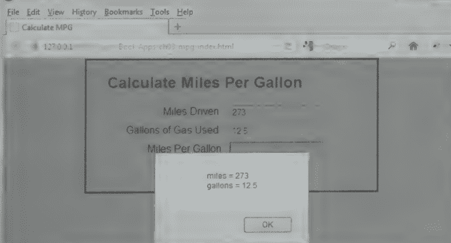

## 描述

- 跟踪 JavaScript 应用程序执行的简单方法是在代码的关键点插入 `alert` 语句。
- `alert` 对话框可以显示指示正在执行哪部分代码的消息，或显示变量的值。
- 对于简单的调试问题，这种跟踪方法就是你解决它们所需的全部。

图 4-7 跟踪 JavaScript 代码执行的简单方法

## 何时以及如何查看源代码

偶尔，当你测试应用程序时发现似乎没有哪里在正常工作，你可能想要查看源代码。

要查看源代码，你可以使用图 4-8 所示的技巧之一。当 HTML 在 Firefox 中显示时，你也可以显示代码。

但请注意，最初加载的 HTML 并不反映更改。不过，如果你查看源代码，你可以看到 `span` 元素仍然存在。

### JavaScript 处理后的邮件列表

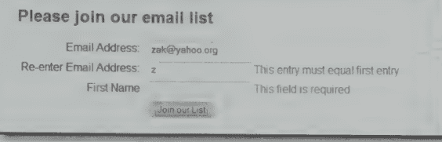

### 浏览器的源代码

```html
Source of: http://127.0.0.1:8020/book/02/email_list/email.html - Mozilla Firefox
<html>
<head>
<title>Join Email List</title>
<link rel="stylesheet" href="email_list.css">
<script src="https://ajax.googleapis.com/ajax/svn/html5.js"></script>
<script src="email-list.js"></script>
</head>
<body>
<section>
<p>Join our email list</p>
<form id="email_form" action="join.html" method="get">
<label for="emailaddress">Email Address:</label>
<input type="text" id="email_address" name="email_address">
<span id="email_address_error"></span><br>
<label for="emailaddress2">Re-enter Email Address:</label>
<input type="text" id="email_address2" name="email_address2">
<span id="email_address2_error"></span><br>
<label for="firstname">First Name:</label>
<input type="text" id="firstname" name="firstname">
<span id="firstname_error"></span><br>
<input type="button" id="join" value="Join our List"><br>
</form>
</section>
</body>
</html>
```

#### 如何查看网页的源代码

- 如果可用，使用菜单命令如 查看→源代码或 查看→页面源代码。
- 你也可以右键点击页面并选择如源代码、查看源代码或查看页面源代码之类的命令。

## 描述

- 在调试时，你可能偶尔需要显示浏览器中的 HTML，以查看是否发生了意外情况。
- 如果你使用的是 Firefox，可以点击链接或脚本元素中的链接，在另一个窗口中显示 CSS 或 JavaScript 的源代码。
- 但注意，对 DOM 的更改不会改变加载到浏览器中的 HTML。它只改变了 DOM，从而导致显示发生改变。

图 4-8 如何查看网页的源代码

## 何时以及如何验证 HTML

当你测试一个 JavaScript 应用时，你不仅在测试 JavaScript 代码，还在测试 HTML。因此，如果你怀疑 HTML 可能存在问题，那么花时间验证 HTML 代码是值得的。要做到这一点，你可以使用图 4-9 中的技术。

事实上，我们建议你对应用程序中的所有页面进行 HTML 验证。当然，当你在做练习或为课程开发应用程序时，这并不是必要的，但它可能帮助你修复影响 JavaScript 的问题。

## 第 4 章 如何测试和调试 JavaScript 应用

### W3C 验证器的首页

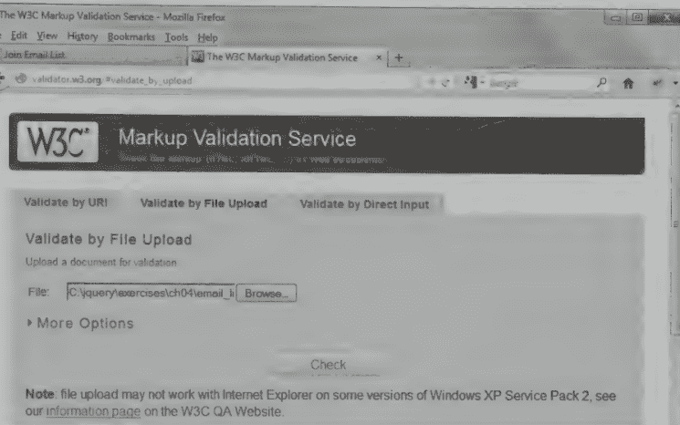

该验证器会检查 Web 文档标记的有效性……

### 如何使用 W3C 标记验证服务

- 访问以下 URL，识别要验证的文件，并点击 Check 按钮：
`http://w3rd.org/`

### 如何从 Aptana 验证 HTML 文件

- 选择文件。然后，选择 `Commands→HTML→Validate Syntax (W3C)` 命令。

## 描述

- 有时，页面 HTML 中的错误会影响该页面 JavaScript 的运行。如果你怀疑可能发生这种情况，那么对页面进行 `validate` 永远无害处。
- 要验证页面的 HTML，你可以使用为此目的设计的程序或网站。最流行的网站之一是 W3C 标记验证服务。
- 当你使用 W3C 标记验证服务时，如果你想要验证的文件已经上传到 Web 服务器，你可以在 Validate by URI 标签页中输入其 URL 来进行验证。如果你想要验证的文件尚未上传到 Web 服务器，你可以在 Validate by File Upload 标签页中找到它并进行验证。
- 如果你正在使用 Aptana，可以使用上述命令验证 HTML 文件。然而，你可能会得到略有不同的结果，因为 Aptana 使用了 HTML Tidy 和其自身的验证器。

图 4-9 如何验证 HTML 文件

## 观点

JavaScript 应用往往在经过彻底测试和调试之前就投入了生产环境。在 JavaScript 编程的早期，这是可以理解的，因为当时的测试和调试工具非常有限。但今天，Firefox 和 Chrome 提供了你在投入生产环境之前彻底调试应用程序所需的所有工具。

### 术语

- 自顶向下的编码和测试
- 自顶向下的测试调试
- Firefox Bug
- 语法错误断点
- 运行时错误单步执行代码
- 异常跟踪
- 逻辑错误验证 HTML

## 总结

- 当你测试应用程序时，你尝试让它失败。当你调试应用程序时，你修复在测试过程中发现的所有问题。
- 当你为 JavaScript 应用编写代码时，你可能会引入三种错误：语法错误、运行时错误和逻辑错误。
- 自顶向下的编码和测试通过一次编码和测试少量语句，简化了应用程序的构建。
- Firefox 是一个 Firefox 扩展程序，提供了一些出色的调试功能。你可以使用它的 Console 面板显示错误消息。然后，你可以点击消息中的链接跳转到 Script 面板中的错误语句。
- 在 Firefox 的 Script 面板中，你可以设置断点，在程序运行时运行时停止代码的执行。然后，你可以从断点开始单步执行代码，并查看每一步变量的变化。
- 尽管所有现代浏览器都提供了像 Firefox 那样的调试工具，但你不应该需要先在 Firefox 上进行测试和调试。唯一的例外是 IE，所以你可能偶尔想使用它的调试工具。
- 跟踪应用程序执行的一种简单方法是在 JavaScript 代码的关键点插入 `alert` 语句。在调试应用程序后，你删除这些语句。
- 当你调试应用程序时，你可能偶尔想查看浏览器中的源代码或验证页面的 HTML。

## 练习 4-1

### 使用 Firebug 的调试功能

在本次练习中，你将使用 Firebug 寻找语法错误、设置断点并单步执行 Email List 应用。

1. 如果你还没有安装，请按照附录 A 所示安装 Firebug。
2. 打开 Email List 应用的 html 文件：
`c:\jquery\exercises\ch04\email_list\index.html`
3. 运行应用程序，在前两个文本框中输入有效值，并点击 Join List 按钮。注意此时什么都没有发生。
4. 打开 Firebug 显示导致问题的错误，如图 4-4 所示。（你可能需要先启用面板。）使用错误链接找到并修复代码。然后，再次测试应用程序。
5. 在 Firebug 中，切换到 Script 面板。然后，如果有必要，启用该面板并使用工具栏中的下拉列表显示 `email_list.js` 文件的代码。
6. 在 `joinList` 函数的第一个语句上设置断点，如图 4-5 所示。然后，在仅前两个文本框有有效值的情况下，点击 Join List 按钮。应用程序应该在断点处停止。
7. 使用 Step Into 按钮或 `F11` 单步执行应用程序。在每一步中，注意变量值的变化。
8. 使用 Step Over 按钮或 `F10` 执行应用程序而不进入函数。

## 练习 4-2

### 使用其他方法

在本次练习中，你将使用其他方法。

1. 打开 Email List 应用的 html 文件：
`c:\jquery\exercises\ch04\email_list\index.html`
2. 运行应用程序，在前两个文本框中输入有效值，并点击 Join List 按钮。注意此时什么都没有发生。
3. 打开 Firebug 显示导致问题的错误，如图 4-4 所示。（你可能需要先启用面板。）使用错误链接找到并修复代码。然后，再次测试应用程序。
4. 在 Firebug 中，切换到 Script 面板。然后，如果有必要，启用该面板并使用工具栏中的下拉列表显示 `email_list.js` 文件的代码。
5. 在 `joinList` 函数的第一个语句上设置断点，如图 4-5 所示。然后，在仅前两个文本框有有效值的情况下，点击 Join List 按钮。应用程序应该在断点处停止。

# 创建数组的语法

使用 `new` 关键字配合 `Array` 对象名

```javascript
var arrayName = new Array(length);
```

使用括号字面量

```javascript
var arrayName = [];
```

# 在一条语句中创建数组并赋值的语法

使用 `new` 关键字配合 `Array` 对象名

```javascript
var arrayName = new Array(arrayList);
```

使用括号字面量

```javascript
var arrayName = [arrayList];
```

# 如何在一条语句中创建数组并赋值

```javascript
var rates = new Array(14.95, 12.95, 11.95, 9.95);
var names = ["Ted Lewis", "Sue Jones", "Ray Thomas"];
```

# 引用数组元素的语法

```javascript
arrayName[index];
```

# 引用数组元素的代码

```javascript
rates[2] // 引用 rates 数组中的第三个元素
names[1]  // 引用 names 数组中的第二个元素
```

# 如何通过访问每个元素给数组赋值

如何向一个带有四个 undefined 元素的数组赋值 rates

```javascript
var rates = new Array(4);
rates[0] = 14.95;
rates[1] = 12.95;
rates[2] = 11.95;
rates[3] = 9.95;
```

# 如何向一个空元素数组赋值字符串

```javascript
var names = [];
names[0] = "Ted Lewis";
names[1] = "Sue Jones";
names[2] = "Ray Thomas";
```

# 数组基础概念

- 数组可以存储一个或多个元素。数组的长度是数组中元素的个数。
- 创建数组的一种方法是使用 `new` 关键字、对象的名称（`Array`）以及一组包含长度参数的括号。如果你不指定长度，数组将不包含任何元素。如果你指定了长度，每个元素都将被设置为 `undefined`。
- 另一种创建数组的方法是使用一组括号，可以或不包含元素列表。
- 要引用数组中的元素，你使用索引，其中 0 是第一个元素，1 是第二个元素，依此类推。

图 5-1 如何创建数组并引用其元素

# 如何添加和删除数组元素

图 5-2 展示了你在处理数组时可以使用的一个属性和一个操作符。`length` 属性返回数组中元素的个数。`delete` 操作符可用于删除数组中元素的值。

要向数组末尾添加元素，可以使用数组的 `length` 属性作为新元素的索引。由于该属性始终比数组中使用的最高索引大 1，这会将新元素添加到数组的末尾，如第一个示例所示。

要在特定索引处添加元素，你使用该索引来引用该元素并对其赋值。如果你使用的索引大于数组的长度，则你跳过的元素将被创建并被赋值为 `undefined`。这在第二个示例中得到了说明。

第三个示例展示了如何删除数组中元素的值。要这样做，你需要使用 `delete` 操作符。当你使用此操作符时，元素会留在数组中，但值变为 `undefined`，因此数组的长度保持不变。

# 数组的一个属性和一个操作符

| 属性 | 描述 |
| :--- | :--- |
| length | 数组中元素的个数。 |
| delete | 删除元素的内容并将元素设置为 `undefined`，但不会从数组中移除该元素。 |

# 如何向数组末尾添加元素

```javascript
var numbers = [1, 2, 3, 4];      // 数组为 1, 2, 3, 4
numbers[numbers.length] = 5; // 数组为 1, 2, 3, 4, 5
```

# 如何在特定索引处添加元素

```javascript
var numbers = [1, 2, 3, 4];      // 数组为 1, 2, 3, 4
numbers[6] = 7;               // 数组为 1, 2, 3, 4, undefined, undefined, 7
```

# 如何在特定索引处删除数字

```javascript
var numbers = [1, 2, 3, 4];      // 数组为 1, 2, 3, 4
delete numbers[2];           // 数组为 1, 2, undefined, 4
```

## 描述

- 向数组末尾添加元素的一种方法是使用 `length` 属性作为索引。
- 如果你在不是顺序位置的特定索引处添加元素，则在新元素和原数组末尾之间添加 `undefined` 元素。

# 如何使用 for 循环处理数组

`for` 循环通常用于通过递增索引变量来一次处理一个数组元素。图 5-3 展示了其工作原理。

该图中的第一个示例展示了如何创建一个数组并用 1 到 10 的数字填充它。首先，代码创建了一个空数组 `numbers`。然后，使用索引变量 `i` 通过从 0 到 9 的值来遍历数组的前十个元素。在循环体内，将 `i` 的值加 1 并将结果存储在元素中。结果是索引 0 处的元素存储 1，索引 1 处的元素存储 2，依此类推。

接下来，此示例显示了数组中的值。首先，它创建了一个名为 `numbersString` 的空字符串。然后，它使用 `for` 循环访问数组中的元素。在 `for` 循环中，使用数组的长度来控制循环执行的次数。这使得相同的代码适用于不同长度的数组。在 `for` 循环内部，将元素的值和空格拼接到 `numbersString` 的末尾。最后，显示 `numbersString`，显示存储在数组中的数字。

该图中的第二个示例展示了如何计算总和数组的和和平均值。首先，代码创建了一个存储四个总计值的数组 `totals`。然后，它创建了一个名为 `sum` 的变量并初始化为零。接下来，使用 `for` 循环访问 `totals` 中的每个元素并将其加到 `sum` 上。最后，通过将和除以长度来计算平均值。

之后，此示例显示了总计、和以及平均值。首先，它创建了一个名为 `totalsString` 的空字符串。然后，它使用 `for` 循环将数组中的每个元素和换行符拼接到 `totalsString`。

## 描述

- 当你使用 `for` 循环处理数组时，可以使用循环计数器作为数组的索引。

图 5-3 如何使用循环处理数组

# 如何使用 for-in 循环处理数组

与 `for` 循环不同，`for-in` 使得处理数组变得更容易。图 5-4 展示了这种循环的工作方式。

正如图顶部的语法所示，`for-in` 循环不需要像 `for` 循环那样分别初始化、测试和递增索引计数器的表达式。相反，你声明一个变量将用于引用数组每个元素的索引。然后，在循环内部，你可以使用该变量访问数组中的每个元素。

该图中的第一个示例将 1 到 10 的数字存储在数组中并创建一个名为 `numbersString` 的空字符串。然后，它使用 `for-in` 循环将数组中的每个数字和空格拼接到字符串中。最后，在对话框中显示这些数字。

第二个示例展示了 `for` 循环和 `for-in` 循环处理数组中 `undefined` 元素的方式。简而言之，`for` 循环处理 `undefined` 元素，而 `for-in` 循环会跳过它们。你可以从此示例中每个循环显示的消息中看到这种差异。

## for-in 循环的语法

```javascript
for (var elementIndex in arrayName) {
    // 访问元素的语句
}
```

## 在消息框中显示数字数组的 for-in 循环

```javascript
var numbers = [1, 2, 3, 4, 5, 6, 7, 8, 9, 10];
var numbersString = "";
for (var index in numbers) {
    // for-in 循环的开始
    numbersString += numbers[index] + " ";
}
alert(numbersString);
```

显示的消息


## 显示 for 循环和 for-in 循环区别的代码

```javascript
var names = ["Mike", "Anne", "Ray"]; // 数组为 Mike, Anne, Ray
names[4] = "Joel";
names[names.length] = "Pren"; // Pren 被添加到数组
delete names[2]; // Ray 从数组中删除
```

```javascript
var namesString1 = "for 循环显示的元素:\n\n";
for (var i = 0; i < names.length; i++) {
    namesString1 += names[i] + ", ";
} // 包含 undefined 元素

var namesString2 = "for-in 循环显示的元素:\n\n";
for (var i in names) {
    namesString2 += names[i] + ", ";
} // 跳过 undefined 元素
```

```javascript
alert(namesString1);
alert(namesString2);
```

由 for 循环和 for-in 循环创建的消息

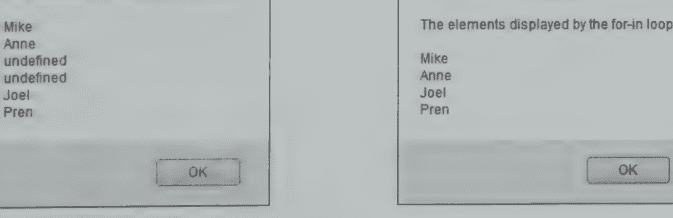

## 描述

- 你可以使用 `for-in` 语句来创建一个 `for-in` 循环，该循环只访问数组中已定义的元素。

图 5-4 如何使用 for-in 循环处理数组

## 如何使用 Array 对象的方法

像数字、字符串或日期一样，数组是一个 JavaScript 对象。在图 5-5 中，你可以看到 JavaScript 为处理 `Array` 对象提供的许多方法中的几个。

前两个方法 `push` 和 `pop` 用于从数组末尾添加和移除元素。这允许你将数组当作栈，其中最后添加的元素是第一个移除的元素（后进先出）。在这种情况下，最旧的元素位于数组开头。

接下来的两个方法 `unshift` 和 `shift` 用于从数组开头添加和移除元素。这些方法也允许你将数组当作栈，最后添加的元素是第一个移除的元素。在这种情况下，最旧的元素位于数组的末尾。

当你使用 `shift` 和 `pop` 方法时，可以将数组当作队列，第一个添加的元素是第一个移除的元素（先进先出）。在这种情况下，最旧的元素位于数组的末尾。你还可以使用 `push` 和 `shift` 将数组作为先进先出的队列。在这种情况下，最旧的元素位于数组开头。

当你使用 `pop` 或 `shift` 方法时，它实际上会从数组中删除元素，并将数组的 `length` 属性减 1。相比之下，当你使用之前学过的 `delete` 操作符时，元素并没有被移除。

`join` 和 `toString` 方法允许你创建一个包含数组元素的单个字符串。它们的主要区别在于处理分隔符字符串的方式。这些方法对任何 `undefined` 元素都会使用空字符串，无论是未定义的元素还是被设置为 `undefined` 的元素。

此图中的示例展示了这些方法是如何工作的。这里，第一个示例使用 `push` 和 `pop` 方法添加和移除元素。第二个示例使用 `unshift` 和 `shift` 方法执行相同的操作。第三个示例显示了 `join` 和 `toString` 方法的工作原理。注意，前两个示例使用的 `join` 方法的结果不包含任何 `undefined` 元素。这是因为这些示例使用的 `pop` 和 `shift` 方法移除了元素。

## Array 对象的方法

| 方法 | 描述 |
| --- | --- |
| `push(elements_list)` | 在数组末尾添加一个或多个元素，并返回数组的新长度。 |
| `pop()` | 移除数组中的最后一个元素，减小长度，并返回被移除的元素。 |
| `unshift(elements_list)` | 在数组开头添加一个或多个元素，并返回数组的新长度。 |
| `shift()` | 移除数组中的第一个元素，减小数组长度，并返回被移除的元素。 |
| `join(separator)` | 当不传递参数时，此方法将数组的所有元素转换为字符串并用逗号连接它们。若要更改分隔符，可以向此方法传递一个字符串字面量。 |
| `toString()` | 与不传递任何参数的 `join` 方法相同。 |

## 如何使用 push 和 pop 方法添加和移除元素

```javascript
var names = ["Mike", "Anne", "Joel"];
names.push("Ray", "Pren"); // names 是 Mike, Anne, Joel, Ray, Pren
var removedName = names.pop(); // removedName 是 Pren
alert(names.join(",")); // 显示 Mike, Anne, Joel, Ray
```

## 如何使用 unshift 和 shift 方法添加和移除元素

```javascript
var names = ["Mike", "Anne", "Joel"];
names.unshift("Ray", "Pren"); // names 是 Ray, Pren, Mike, Anne, Joel
removedName = names.shift(); // removedName 是 Ray
alert(names.join(",")); // 显示 Pren, Mike, Anne, Joel
```

## 如何使用 join 和 toString 方法

```javascript
var names = ["Mike", "Anne", "Joel"];
names.push("Ray", "Pren"); // names 是 Mike, Anne, Joel, Ray, Pren
var removedName = names.pop(); // removedName 是 Pren
alert(names.join(",")); // 显示 Mike, Anne, Joel, Ray
```

## 描述

- `push` 和 `pop` 方法用于从数组末尾添加和移除元素。
- `unshift` 和 `shift` 方法用于从数组开头添加和移除元素。
- `join` 和 `toString` 方法允许你创建一个包含数组元素的单个字符串。

# 用于增强型邮件列表应用程序的 JavaScript

```javascript
var $ = function (id) {
  return document.getElementById(id);
}

var stateCodeLookup = function (stateCode) {
  var states = ["CA", "WA", "OR", "NV", "NM", "AZ", "WY", "MT"];
  stateCode = stateCode.toUpperCase();
  for (var i = 0; i < states.length; i++) {
    if (states[i] == stateCode) {
      return true;
    }
  }
  return false;
}

var joinList = function () {
  var emailAddress1 = $("email_address1").value;
  var emailAddress2 = $("email_address2").value;
  var isValid = true;
  // 验证第一条目的代码与之前相同
  // 验证州代码输入
  var stateCode = $("state_code").value;
  if (!stateCodeLookup(stateCode)) { // 调用 stateCodeLookup
    $("state_code_error").firstChild.nodeValue = "State code is invalid.";
    isValid = false;
  } else {
    $("state_code_error").firstChild.nodeValue = "";
  }
  // 如果所有输入都有效，则提交表单
  if (isValid) {
    $("email_form").submit();
  }
}

window.onload = function () {
  $("join_list").onclick = joinList;
  $("email_address1").focus();
}
```

# 总结与术语

循环和数组是许多 JavaScript 应用程序的重要部分。因为在使用 jQuery 时你也会使用数组，所以在本章中学习的概念同样适用于那里。不过，正如你将看到的，jQuery 让处理数组变得简单得多。

### 术语

- 数组索引
- for-in 语句中的数组元素
- for-in 循环中的数组长度

## 总结

- 数组由可以通过索引引用的元素组成。要处理数组中的每个元素，可以使用 `for-in` 语句。
- 在 JavaScript 中，每个数组都是一个 `Array` 对象，提供了处理数组的方法。这些方法包括 `push` 和 `pop` 方法，允许你向数组添加元素或从中移除元素。

# 练习 5-1 使用 for-in 循环处理数组

1. 使用你的文本编辑器打开此文件夹中的 `index.html` 和 `email_list.js` 文件：`c:\query\exercises\ch05\email_list`
2. 测试应用程序以查看其工作原理，并检查代码。
3. 在 JavaScript 文件中，注释掉判断州代码是否有效的循环。然后用一个获取相同结果的 `for-in` 循环替换它，并测试此更改。
4. 纯好玩，使用 `states` 数组的 `push` 方法为该数组添加代表犹他州的“UT”（Utah）。你可以直接在数组声明之后编写该语句。然后测试对该州代码的查找是否有效。

# 如何使用 JavaScript 编写 DOM

到此时，你已经具备了某些 DOM 脚本所需的 JavaScript 脚本技能。你只需要学习如何使用 DOM 规范提供的某些属性和方法，以及处理链接和图像的一些特殊技巧。

| DOM 脚本属性和方法 | 页码 |
| :--- | :--- |
| DOM 脚本概念 | 158 |
| Node 接口 | 160 |
| Document 和 Element 接口 | 162 |
| **FAQs 应用程序** | 164 |
| 用户界面、HTML 和 CSS | 164 |
| JavaScript | 166 |
| FAQs 应用程序的另一种编码方式 | 168 |
| **JavaScript 应用程序的两个关键问题** | 170 |
| 可用性 | 170 |
| 无障碍性 | 170 |
| 改进无障碍性的 FAQs 应用程序 | 172 |
| **链接和图像的 DOM 脚本技巧** | 174 |
| 如何取消事件的默认行为 | 174 |
| 如何预加载图像 | 176 |
| **图片切换应用程序** | 178 |
| HTML 和 CSS | 178 |
| JavaScript | 180 |
| **如何使用定时器** | 182 |
| 如何使用一次性定时器 | 182 |
| 如何使用间隔定时器 | 184 |
| **幻灯片应用程序** | 186 |
| HTML 和 CSS | 186 |
| JavaScript | 188 |
| **观点** | 190 |

# DOM 脚本属性和方法

在第 3 章，你通过使用两个属性将消息放入 `span` 元素中，学习了 DOM 脚本。现在，你将学习其他可用于 DOM 脚本的属性和方法。这些属性和方法由所有当前浏览器都实现的 DOM Core 规范定义。

# DOM 脚本概念

在学习 DOM Core 规范的属性和方法之前，图 6-1 展示了在使用之前应该理解的 DOM 脚本概念。首先，正如你可能从第 3 章回忆起的，文档对象模型（DOM）是在 HTML 页面加载到浏览器时构建的。它包含了代表页面所有 HTML 元素和属性的节点。图中的 HTML 图说明了这一点。

除了图中用椭圆表示的元素节点外，DOM 还包含了存储 HTML 元素数据的文本节点。在图中，文本节点是矩形。例如，第一个文本节点包含了 head 部分 `title` 元素的文本：“Join Email List”。它右侧的节点包含了 body 中 `h1` 元素的文本：“Please our email list”。以此类推。

为了简单起见，此图只包含了元素和文本节点，但 DOM 还包含属性节点，且每个属性节点都有一个持有属性值的文本节点。此外，如果 HTML 中包含注释，DOM 将包含注释节点。

如果你研究图中的表格，可以看到元素节点可以包含文本、元素和注释节点作为子节点。属性节点可以包含文本节点作为子节点。文本节点不能有子节点。有趣的是，尽管属性节点附加在元素节点上，但它并不被视为元素的子节点。

处理 DOM 的属性和方法是由称为“接口”（interface）的规范定义的。在接下来的主题中，你将学习如何使用 `Node`、`Document` 和 `Element` 接口的属性和方法。

当你处理这些接口时，会遇到父级（parent）、兄弟（sibling）和后代（descendant）等术语。这些术语用法就像在家族树中一样。例如，图中的 `form` 元素是 `label`、`input` 和 `span` 元素的父级。而 `label`、`input` 和 `span` 元素也是 `form` 元素的子元素。它们具有相同的父级，因此它们是兄弟。同样，`h1` 和 `form` 是 `body` 元素的子元素，而 `h1`、`form`、`label`、`input` 和 `span` 元素都是 `body` 的后代。

你也应该能够在网页页的 HTML 中看到这些关系。例如，图中的 HTML 通过缩进清晰地显示了每个元素的子元素和后代。

## 网页的代码

```html
<!DOCTYPE html>
<html>
<head>
  <title>加入邮件列表</title>
</head>
<body>
  <h1>请加入我们的邮件列表</h1>
  <form id="email_form" name="email_form" action="join.html" method="get">
    <label for="email_address">邮箱地址:</label>
    <input type="text" id="email_address">
    <span id="email_error"></span><br>
  </form>
</body>
</html>
```

## 网页的 DOM

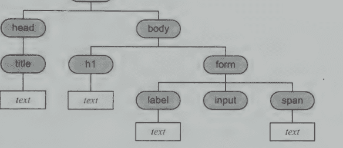

# 你常用的 DOM 节点

| 类型 | 描述 |
| --- | --- |
| Element（元素） | DOM 的根节点。它只能有一个 Element 节点作为子节点。网页中的元素。它可以有 Element、Text（文本）和 Comment（注释）节点作为子节点。 |
| Attr（属性） | 元素的属性。虽然它附加在 Element 节点上，但它不是子节点。它可以有一个 Text 节点作为子节点。 |
| Text（文本） | 元素或属性的文本。它不能有子节点。 |

## 描述

- DOM（文档对象模型）是浏览器内存中一个层次化的节点集合，表示当前的网页内容。
- 网页的 DOM 是随着浏览器的加载而构建的。
- JavaScript 可以通过修改 DOM 来修改浏览器中的网页。每当 DOM 发生变化时，网页浏览器就会显示更改的结果。
- 要修改 DOM，你可以使用 DOM Core 规范定义的属性和方法。

图 6-1 DOM 脚本概念

# Node 接口

图 6-2 描述了你可以用于处理节点的六个属性。这些属性由 `Node` 接口定义。此图中所有示例都假设使用了标准的 `$` 方法，它通过 id 获取元素。

第一个示例展示了如何使用 `firstChild` 和 `nodeValue` 属性来获取 HTML 元素的文本。在这种情况下，在语句运行且节点被更改之前，该语句将在名为 `errorText` 的变量中存储一个星号（*）。这是因为该节点被 HTML 设置为了星号。

如果你回过头看上一个图表，你会发现需要 `firstChild` 属性来获取 `span` 元素的文本节点。然后，通过 `nodeValue` 属性从该文本节点获取文本。

第二个示例展示了如何使用 `firstChild` 和 `nodeValue` 属性将文本放入 HTML 元素的文本节点中。这就是邮件应用程序将错误信息放在文本框随后的 `span` 元素中的方式。

第三个示例展示了如何使用 id 为 `"email_address"` 的 `input` 元素的三个属性，将紧随其后的 `span` 元素的文本设置为空字符串。首先，`nextElementSibling` 属性获取 `input` 元素的相邻兄弟元素 `span`。然后，通过 `firstChild` 和 `nodeValue` 属性获取文本。

# Node 接口的一些属性

| 属性 | 描述 |
| --- | --- |
| `nodeValue` | 对于 Text、Comment 或 Attribute 节点，此属性返回存储在节点中的文本。否则，返回 `null` 值。 |
| `parentNode` | 如果存在，则返回当前节点的父节点。否则，此属性返回 `null` 值。 |
| `childNodes` | 返回一个 `Node` 对象的数组，表示当前节点的子节点。 |
| `firstChild` | 返回第一个子节点的 `Node` 对象。如果该节点没有子节点，则此属性返回 `null` 值。 |
| `lastChild` | 返回最后一个子节点的 `Node` 对象。如果该节点没有子节点，则此属性返回 `null` 值。 |
| `nextElementSibling` | 返回相邻兄弟元素的 `Node` 对象。如果该节点没有随后的兄弟元素，则此属性返回 `null` 值。 |

# 包含元素和文本节点的 HTML

```html
<body>
  <h1>请加入我们的邮件列表！</h1>
  <form id="email_form" name="email_form" action="join.html" method="get">
    <label for="email_address">邮箱地址:</label>
    <input type="text" id="email_address">
    <span id="email_error">*"</span><br>
    <label>&nbsp;</label>
    <input type="button" id="join_list" value="加入我们的列表">
  </form>
</body>
```

# 如何获取 id 为 "email_error" 的 HTML 元素的文本

```javascript
var errorText = $("email_error").firstChild.nodeValue;
```

# 如何设置 id 为 "email_error" 的 HTML 元素的文本

```javascript
$("email_error").firstChild.nodeValue = "输入无效.";
```

# 如何在不使用 id 的情况下将 span 标签为空字符串

```javascript
$("email_address").nextElementSibling.firstChild.nodeValue = "";
```

## 描述

- 接口描述对象的属性和方法。
- 在进行 DOM 脚本时，你经常使用 `Node` 接口的属性。上面的表格总结了一些最有用的属性。
- 在上面的示例中，`$` 符号调用了标准的 `$` 函数，该函数使用 `getElementById` 方法获取作为参数传递给它的元素。

图 6-2 Node 接口的属性

# Document 和 Element 接口

第一个表格总结了 `Document` 和 `Element` 接口的方法。第一个示例使用 `getElementsByTagName` 方法获取所有指定标签的元素，并将它们存储在数组中。

这些方法在作为对象使用时会返回数组。例如，第二个示例使用 `getElementsByName` 获取所有具有指定名称的元素。第三个示例使用 `getElementsByClassName` 获取所有具有指定类的元素。

第二个表格总结了 `Element` 接口的方法。第一个示例使用 `getElementsByTagName` 方法获取所有指定标签的元素，并将它们存储在数组中。

这些方法在作为对象使用时会返回数组。例如，第二个示例使用 `getElementsByName` 获取所有具有指定名称的元素。第三个示例使用 `getElementsByClassName` 获取所有具有指定类的元素。

## FAQs 应用

现在，你将看到 `Node`、`Document` 和 `Element` 接口的属性和方法如何用于一个典型的 DOM 脚本应用程序。我们将此应用程序称为 FAQs（常见问题解答）应用。

## 用户界面、HTML 和 CSS

图 6-4 显示了 FAQs 应用的用户界面。如果用户点击前面带有加号的标题，则下方的文本将显示，且加号将变为减号。同样，如果用户点击前面带有减号的标题，则下方的文本将被隐藏，且减号将变为加号。

在 HTML 中，你可以看到每个问题都编码在一个 `h2` 元素中，后面紧跟着一个包含答案的 `div` 元素。注意，这些 `h2` 元素中的每一个都有一个类属性为“plus”，而每个 `div` 元素都有一个类为“closed”。当用户点击标题时，DOM 脚本程序会更改这些类名。

在 CSS 中，你可以看到“plus”类的 `h2` 元素具有一个背景属性，其中包含一个名为 `plus.png` 的图像。该图像仅一次（不重复）显示在元素的左侧，并垂直居中。同样，“minus”类的 `h2` 元素具有一个使用名为 `minus.png` 图像的背景属性。

你还可以看到，“closed”类的 `div` 元素具有隐藏它们的 `display` 属性。但“open”类的 `div` 元素具有将它们显示为块元素的 `display` 属性。

由于 HTML 将 `h2` 元素的设置类设置为“plus”，将 `div` 元素的类设置为“closed”，因此用户界面在初始时标题显示加号，`div` 元素处于关闭状态。现在，JavaScript 在每次用户点击标题时必须反转这些类名。

## 浏览器中的 FAQs 应用

| jQuery FAQs |
| :--- |
| 什么是 jQuery？ |
| 为什么 jQuery 变得如此流行？ |
| 三个原因：* 免费免费。* 它让你在更短的时间内完成更多工作。* 它所有的函数都跨浏览器兼容。 |
| 哪个更难学：jQuery 还是 JavaScript？ |

## HTML

```html
<section id="faqs">
  <h1>Query FAQs</h1>
  <h2 class="plus">What is jQuery</h2>
  <div class="closed">
    <p>jQuery is a library of the JavaScript functions that you're most likely to know as you develop web sites.</p>
  </div>
  <h2 class="plus">Why is jquery becoming so popular?</h2>
  <div class="closed">
    <p>Three reasons:</p>
    <ul>
      <li>It's free.</li>
      <li>It lets you get more done in less time.</li>
      <li>All of its functions are cross-browser compatible.</li>
    </ul>
  </div>
  <h2 class="plus">Which is harder to learn: jQuery or JavaScript?</h2>
  <div class="closed">
    <p>For most functions, jQuery is significantly easier to learn and use than JavaScript. But remember: jQuery is JavaScript.</p>
  </div>
</section>
```

## CSS

```css
h2 {
  padding: .25em 0 .25em 25px;
  cursor: pointer;
}
h2.plus {
  background: url(images/plus.png) no-repeat left center;
}
h2.minus {
  background: url(images/minus.png) no-repeat left center;
}
div.closed {
  display: none;
}
div.open {
  display: block;
}
```

图 6-4 FAQs 应用的 HTML 和 CSS

## JavaScript

图 6-5 显示了此应用程序的 JavaScript。在这里，`onload` 函数的事件处理器为每个 `h2` 元素创建并附加了事件处理器。为了实现这一点，第一条语句获取 id 为“faq”的 `section` 元素的对象。第二条语句使用 `getElementsByTagName` 方法获取该 `section` 内部的 `h2` 元素数组。该数组存储在变量 `h2Elements` 中。

紧接着是一个创建并附加 `h2` 元素事件处理器的语句。它的循环为 `h2Elements` 数组中的每个元素执行一次。循环中的第一条语句将当前 `h2` 元素赋值给 `h2Node` 变量。然后，是创建和附加每个 `h2` 元素事件处理器的代码。

首先，为 `h2Node` 变量中对象的点击事件创建一个函数。与你迄为止看到的处理事件的函数不同，此函数被编码在 `onload` 事件处理器的函数内部。这是为 DOM 脚本编写事件处理器的标准方法。

该函数内部的第一条语句声明了一个名为 `h2` 的变量并将其赋值给 `this` 关键字。这是该函数中的关键语句，因为该关键字指向 DOM 中特定的 `h2` 对象。结果是 DOM 中的每个 `h2` 元素都创建了一个事件处理器。

如果没有这条语句，循环将创建一个事件处理器并将其附加到每个 `h2` 元素上。例如，如果你将 `h2Node` 赋值给 `h2` 变量而不是 `this` 关键字，点击任何标题都会打开并关闭最后一个标题的 `div` 元素。

## FAQs 的 JavaScript

```javascript
var $ = function (id) {
  return document.getElementById(id);
}

window.onload = function () {
  var faqs = $("faqs");
  var h2Elements = faqs.getElementsByTagName("h2");
  var h2Node;
  for (var i = 0; i < h2Elements.length; i++) {
    h2Node = h2Elements[i];
    h2Node.onclick = function () {
      var h2 = this;
      if (h2.getAttribute("class") == "plus") {
        h2.setAttribute("class", "minus");
      } else {
        h2.setAttribute("class", "plus");
      }
      if (h2.nextSibling.getAttribute("class") == "closed") {
        h2.nextSibling.setAttribute("class", "open");
      } else {
        h2.nextSibling.setAttribute("class", "closed");
      }
    };
  }
}
```

## 注意

- `onload` 事件处理器中的前两个语句获取了 id 为 "faqs" 的 section 中的 h2 元素数组。
- `for` 循环为每个 h2 元素执行一次。
- 在为每个 h2 元素附加事件处理器的代码中，`this` 关键字指向该 h2 元素。

## 另一种 FAQs 应用的编码方式

当你开发 JavaScript 应用时，你的首要目标是让它正常运行。在完成之后，花时间审查你的代码，看看是否可以改进。在许多情况下，你会发现代码可以简化或改进，从而易于维护、增强和复用。

改进 FAQs 应用代码的一种方法是消除在 HTML 中编码初始类属性的需求。这将使应用程序更易审查和复用。这也会简化 JavaScript 代码。

这可以通过图 6-6 中的代码所示。在这里，从 HTML 中的 `h2` 和 `div` 元素中删除了类属性。然后，对 CSS 进行了修改，使得 `h2` 元素初始具有加号背景，而当 `div` 元素具有类属性“minus”时，其背景变为减号；当它具有类属性“open”时，显示该元素。

这之所以有效，是因为 `h2.minus` 和 `div.open` 选择器比 `h2` 和 `div` 选择器更具特殊性。因此它们的规则覆盖了 `h2` 和 `div` 元素的规则。现在，JavaScript 只需要在编码标题时添加或删除这些类即可。

你可以从 JavaScript 中看到它是如何工作的。如果 `h2` 元素具有类属性，则移除该属性。否则，通过 `setAttribute` 方法添加属性并设置为值“minus”。如果 `div` 元素具有类属性，则移除该属性。否则，添加值为“open”的属性。

这种编码此应用程序的方法更好吗？毫无疑问。

## HTML

```html
<section id="faqs">
  <h1>查询常见问题</h1>
  <h2>什么是 jQuery？</h2>
  <div>
    // 内容
  </div>
  <h2>为什么 jQuery 变得如此流行？</h2>
  <div>
    // 内容
  </div>
  <h2>jQuery 或 JavaScript 哪一个更难学？</h2>
  <div>
    // 内容
  </div>
</section>
```

## CSS

```css
h2 {
  padding: .25em 0 .25em 25px;
  cursor: pointer;
  background: url(images/plus.png) no-repeat left center;
}
h2.minus {
  background: url(images/minus.png) no-repeat left center;
}
div {
  display: none;
}
div.open {
  display: inline;
}
```

## 用于绑定事件处理器的 JavaScript

```javascript
// 绑定事件处理程序
hNode.onclick = function () {
  var h2 = this; // h2 是当前的 h2Node 对象
  if (h2.hasAttribute("class")) {
    h2.removeAttribute("class");
  } else {
    h2.setAttribute("class", "minus");
  }
  if (h2.nextElementSibling.hasAttribute("class")) {
    h2.nextElementSibling.removeAttribute("class");
  } else {
    h2.nextElementSibling.setAttribute("class", "open");
  }
};
```

## 描述

- 在你让一个应用程序正常运行后，思考代码是否可以改进以使其更易维护、处理和重用，这总是好的。
- 当 FAQ 应用程序如图中所示进行编码时，你不需要为 HTML 中的 h2 和 div 元素设置类名属性，这使得此代码复用到其他网页时变得更容易。

图 6-6 FAQ 应用程序的另一种编码方式

## JavaScript 应用的两个关键问题

在第 1 章中，你接触了跨浏览器兼容性问题。现在，图 6-7 展示了另外两个问题。在本书中，当我们引入新应用程序时，会回顾这些问题。

## 易用性

易用性是指使用网站的容易程度，而易用性是 Web 用户最想要的东西。他们希望尽可能快速、方便地找到他们寻找。当找到时，他们希望尽可能快速、方便地提取信息或完成任务。

虽然网站的易用性有很多组成部分，但简言之，导航应该是显而易见的。最重要的与导航有关。带下划线的文本应该是用户可以点击的链接，按钮应该是可以点击的。用户不需要猜测哪些是可点击的，以及导航将他们带到何处。

如果你看图中的 FAQ 应用程序，你可以看到标题是可以点击的，或者前面有加号或减号，这是一种指示可点击项的常用惯例。此外，当指针悬停在标题上时，CSS 将鼠标指针改为手形指针，这让用户知道该项目是可以点击的。

这应该足够了，但你可以通过在鼠标悬停在标题上时高亮来改进这一点。这样，用户就可以确定标题是可点击的。如果标题获得焦点时也能高亮会更好，但标题是无法接收焦点的。

## 可访问性

可访问性是指使网站能够被尽可能多的用户（尤其是残障用户）访问的特质。例如，视觉障碍用户可能无法阅读图像中的文本，因此你需要为他们提供其他方案。同样，肢体残障的用户可能无法使用鼠标，因此你需要确保网站的所有内容和功能都可以通过键盘访问。

在很大程度上，这意味着你在开发应用程序时，应该确保即使未使用图像且禁用了 JavaScript，你的网页内容仍然是可用的。这并不意味着你不应该使用 JavaScript。这意味着你应该让你的 JavaScript 尽可能具有可访问性，或者为可以使用 JavaScript 功能的用户提供其他替代方案。

为了说明，图中的 FAQ 应用程序需要改进，以便肢体残障人士可以使用。这通过图中列出的四点进行了总结。然而，为了提供这些功能，你需要将标题变为链接，正如你在下一个图中看到的。

## FAQ 应用程序

| jQuery FAQ |
| :--- |
| 什么是 jQuery？ |
| 为什么 jQuery 变得如此流行？ |
| jQuery 或 JavaScript 哪一个更难学 |

## 易用性导航指南

- 带下划线的文本始终是链接。
- 文本短语前面的小符号是可以点击的。
- 靠近短短语的图像是可以点击的。
- 按钮看起来应该像按钮，并且应该总是可点击的。

## 如何提高此应用程序的易用性

- 当标题获得焦点或鼠标悬停在其上方时，高亮标题。

## 可访问性指南

- 对于视觉障碍人士，所有基本信息都应该以易读的文本呈现，因为某些用户可能无法阅读图像中的文本。
- 对于肢体障碍人士，所有基本内容和功能都应该可以通过键盘访问，某些用户可能无法使用鼠标。

## 如何提高此应用程序的可访问性

- 将标题变为链接，以便用户可以使用 Tab 键进行移动。
- 当页面加载时，将焦点移动到第一个链接。
- 当标题获得焦点或鼠标悬停在其上方时高亮标题。
- 按 Enter 键时触发标题的点击事件。

图 6-7 JavaScript 应用的两个问题

## 改进可访问性的 FAQ 应用程序

图 6-8 显示了如何提高 FAQ 应用程序的可访问性。首先，将 `<a>` 元素编码在 `<h2>` 元素内部，这意味着用户可以使用 Tab 键移动到下一个链接，使用 Shift 键移动到上一个链接。

## 改进可访问性的 FAQ 应用程序

> FAQ
> **什么是 jQuery?**
> 这是你在开发网站时最可能需要的 JavaScript 函数库。
>
> **为什么 jQuery 变得如此流行?**
> jQuery 或 JavaScript 哪一个更难学

## HTML

```html
<section id="faqs">
  <h1>查询常见问题</h1>
  <h2><a href="#" id="first_link">什么是 jQuery？</a></h2>
  <div>
    // 内容
  </div>
  <h2><a href="#">为什么 jQuery 变得如此流行？</a></h2>
  <div>
    // 内容
  </div>
  <h2><a href="#">jQuery 或 JavaScript 哪一个更难学？</a></h2>
  <div>
    // 内容
  </div>
</section>
```

## CSS

```css
a {
  color: black;
  text-decoration: none;
}
a:focus, a:hover { color: blue; }
```

## JavaScript

```javascript
window.onload = function () {
  var faqs = $("#faqs");
  var h2Elements = faqs.getElementsByTagName("h2");
  var h2Node;
  for (var i = 0; i < h2Elements.length; i++) {
    h2Node = h2Elements[i];
    // 绑定事件处理程序
    h2Node.onclick = function () { // h2 是当前的 h2Node 对象
      var h2 = this;
      if (h2.hasAttribute("class")) {
        h2.removeAttribute("class");
      } else {
        h2.setAttribute("class", "minus");
      }
      if (h2.nextElementSibling.hasAttribute("class")) {
        h2.nextElementSibling.removeAttribute("class");
      } else {
        h2.nextElementSibling.setAttribute("class", "open");
      }
    }
  }
  $("#first_link").focus(); // 将焦点移动到链接
};
```

## 链接和图像的 DOM 脚本技巧

接下来，你将学习两种处理链接和图像的 DOM 脚本技巧。

## 如何取消事件的默认行为

图 6-9 中的表格展示了 HTML 元素点击时的一些常见默认行为。例如，点击链接的默认行为是加载页面或跳转到链接 `href` 属性指定的占位符。同样，点击表单中提交或重置按钮的默认行为是提交或重置表单中的数据。

对于某些应用程序，你不希望发生默认行为。这时，你需要取消这些操作。遗憾的是，这引入了浏览器兼容性问题，因为旧版本的 IE 的工作方式与 Firefox、Safari、IE 和 Chrome 等 DOM 标准浏览器不同。

图 6-9 中的第一个示例显示了在 DOM 标准浏览器中取消默认行为是多么简单。在这些浏览器中，每当事件发生时，就会创建一个事件对象，该对象会自动传递给事件处理程序。该对象包含有关事件的信息，并提供了一个允许你控制事件行为的方法。

要访问这些信息，你在事件处理器的函数中编写一个参数，如第一个示例所示。在这种情况下，`evt` 被用作参数名，当处理器被调用时，它将接收事件对象。然后，为了取消默认行为，你使用参数所代表的事件对象的 `preventDefault` 方法。

然而，对于 IE 版本，你需要使用第二个示例中的代码。获取事件对象，你使用 `window.event` 属性而不是通过参数获取对象。然后，你设置事件对象的 `returnValue` 属性以防止默认行为发生。

为了让你的应用程序兼容这两种类型的浏览器，你如第三个示例所示结合了两种技术。在这里，函数有一个参数，将在 DOM 标准浏览器中接收事件对象。然后，函数中的 `if` 语句测试 `evt` 参数以检查它是否为 `undefined`。如果是，说明浏览器是 IE，这段代码将 `window.event` 属性中的事件对象赋值给 `evt` 参数。否则，浏览器是 DOM 标准浏览器，因此 `evt` 参数已经包含了事件对象。

然后，用 `if` 语句测试 `evt` 参数检查它是否提供了 `preventDefault` 方法。如果是，这段代码将调用 `preventDefault` 方法。如果没有，这段代码将 `returnValue` 设置为 `false`。

从实际角度来看，你只需要将此代码复制并粘贴到任何需要取消默认行为的事件处理程序中。你将在后续的应用中看到这些示例。

## 点击事件的常见默认行为

| 标签 | 点击事件的默认行为 |
|---|---|
| `a` | 加载页面或跳转到 `href` 属性中的占位符。 |
| `input` | 如果 `type` 属性设置为 `submit`，则提交表单。 |
| `input` | 如果 `type` 属性设置为 `reset`，则重置表单。 |
| `button` | 如果 `type` 属性设置为 `submit`，则提交表单。 |
| `button` | 如果 `type` 属性设置为 `reset`，则重置表单。 |

## 取消默认行为的 DOM 标准代码

```javascript
var eventHandler = function (evt) {
  evt.preventDefault();
}
```

## 取消默认行为的 IE 代码

```javascript
var eventHandler = function () {
  var evt = window.event;
  evt.returnValue = false;
}
```

## 取消默认行为的浏览器兼容代码

```javascript
var eventHandler = function (evt) {
  // 如果没有设置事件对象，则获取它
  if (!evt) { evt = window.event; } // 用于 IE
  // 取消默认行为
  if (evt.preventDefault) {
    evt.preventDefault(); // 用于大多数浏览器
  } else {
    evt.returnValue = false; // 用于 IE
  }
}
```

## 描述

- 在某些 JavaScript 应用中，你需要取消事件的默认行为。
- 除了旧版 IE 浏览器，所有浏览器都会将事件对象传递给事件处理器的第一个参数，但 IE 将事件对象存储在全局 `window.event` 属性中。
- 除了旧版 IE 浏览器，所有浏览器都为事件对象提供了 `preventDefault` 方法。调用此方法可以防止事件的默认行为发生。
- 与此相反，旧版 IE 浏览器为事件对象提供了一个名为 `returnValue` 的属性。当设置为 `false` 时，该属性可以防止事件的默认行为发生。


## 如何预加载图像

在响应用户事件加载图像的 DOM 脚本应用程序中，除非 JavaScript 代码更改显示已图像的 `img` 元素的 `src` 属性，否则图像不会被下载。对于大图像或慢连接，这可能会导致浏览器加载图像时出现延迟。

为了解决这个问题，你的应用程序可以在用户事件发生之前下载图像。这被称为预加载图像。尽管这在页面最初加载时可能会导致延迟，但用户在使用应用程序时不会遇到任何延迟。

图 6-10 显示了如何预加载图像。首先，你使用 `new` 关键字创建一个 `Image` 对象并将其存储在变量中。这创建了一个空图像对象。然后，你将 `src` 属性设置为想要预加载的图像 URL。这会导致 Web 浏览器预加载图像。

## 创建并预加载 Image 对象

```javascript
var image = new Image();
```

## 设置图像的 src

```javascript
image.src = "image_name.jpg";
```

## 如何预加载所有图像

```javascript
var links = document.getElementsByTagName("a");
var i, image;
for (i = 0; i < links.length; i++) {
  link = links[i];
  image = new Image();
  image.src = link.href;
}
```

# 第 6 章 如何使用 JavaScript 编写 DOM

## 图片切换应用程序的用户界面


## HTML 部分

```html
<section>
<h1>Ram Tap Combined Test/html</h1>
<ul id="image_list">
  <li><a href="first_link"></a></li>
  <li></a></li>
  <li></a></li>
  <li><a href="thumbnails/t3.jpg" title="James Allison: 1-3"></a></li>
  <li><a href="thumbnails/t4.jpg" title="James Allison: 1-4"></a></li>
  <li></a></li>
  <li><a href="thumbnails/t6.jpg" title="James Allison: 1-6"></a></li>
  <li></li>
</ul>
<h2 id="caption">James Allison 1-1</h2>
<p></p>
</section>
```

用于 `li` 元素的 CSS

```css
li {
  padding-right: 10px;
  display: inline;
}
```

图 6-11 图片切换应用程序的用户界面、HTML 和 CSS

## JavaScript 部分

图 6-12 展示了该应用程序的 JavaScript。在 `onload` 事件处理器中，前三条语句获取了 `ul` 元素（`image_list`）、用于标题的 `h2` 元素以及显示切换内容的 `img` 元素对象。这些对象对应 DOM 中的节点。然后，第四条语句在图像列表中创建了一个 `<a>` 元素数组，并将其保存在变量 `imageLinks` 中。代码处理数组中的每个链接。

在每个元素的 `for` 循环中，为每个链接的事件创建了一个事件处理器。注意，创建每个事件处理器的函数有一个 `evt` 参数，它将接收来自 DOM 标准浏览器中每个链接的事件对象，因此每个链接都应用了不同的事件处理器。

之后，第一条语句将图像节点中的 `src` 属性更改为链接的 `href` 属性。接着，下一条语句将标题节点第一个子节点的值更改为链接的 `title` 属性。稍后，当应用程序运行且用户点击缩略图时，这些语句将更改 DOM，从而立即更改显示的图像和标题。

该事件处理器通过使用图 6-9 中的代码取消链接的默认操作来结束。由于默认事件是显示由 `href` 属性标识的文件，因此取消此操作至关重要。否则，点击链接将在新的浏览器窗口或标签页中显示由 `href` 属性指定的图像。

在事件处理器函数结束后，将使用类似图 6-10 中的语句对图像进行加载。然后，将焦点移动到用户界面中的第一个链接。

## 图片切换的 JavaScript

```javascript
$ = function (id) {
  return document.getElementById(id);
}

window.onload = function () {
  var listNode = $("image_list"); // ul 元素
  var captionNode = $("caption"); // h2 元素
  var imageNode = $("image"); // 主 img 元素
  var imageLinks = listNode.getElementsByTagName("a");
  // 处理图像链接
  var i, linkNode, image;
  for (i = 0; i < imageLinks.length; i++) {
    linkNode = imageLinks[i];
    // 绑定事件处理器
    linkNode.onclick = function (evt) {
      var link = this; // link 是 linkNode
      imageNode.src = link.getAttribute("href");
      captionNode.firstChild.nodeValue = link.getAttribute("title");
      // 取消事件默认操作
      if (!evt) {
        evt = window.event;
      }
      if (evt.preventDefault) {
        evt.preventDefault(); // DOM 标准兼容代码
      } else {
        evt.returnValue = false;
      }
    }
    // 预加载图像
    image = new Image();
    image.src = linkNode.getAttribute("href");
  }
  $("first_link").focus();
}
```

图 6-12 图片切换应用程序的 JavaScript

## 如何使用定时器

定时器允许你在指定时间段后执行函数。这些定时器由网络浏览器提供，通常用于幻灯片等 DOM 脚本应用程序。在这里，你将学习两种定时器。

## 如何使用单次定时器

第一种定时器只调用一次函数。要创建此类定时器，请使用图 6-13 所示的全局 `setTimeout` 方法。它的第一个参数是定时器调用的函数。第二个参数是调用函数前的毫秒数。

当你使用 `setTimeout` 方法创建定时器时，该方法会返回所创建的定时器的引用。然后，如果有必要，可以使用此引用来取消定时器。要这样做，你需要将此引用传递给 `clearTimeout` 方法。

图示例使用单次定时器在延迟五秒后隐藏页面标题中的消息。它通过将标题的 `class` 属性设置为 "closed" 来实现这一点。由于该类的 CSS 将 `display` 属性设置为 `none`，因此标题会被隐藏。

在第一个 JavaScript 代码示例中，`onload` 事件处理器创建了一个定时器，在 5 秒（5000 毫秒）后调用 `hideMessage` 函数。在 `hideMessage` 函数中，使用 `setAttribute` 方法将标题的 `class` 属性设置为 "closed"。之后，`hideMessage` 函数使用 `clearTimeout` 方法取消定时器。这不是必要的，但这样做是可以的，因为定时器不会再次使用。

在第二个 JavaScript 代码示例中，调用的函数嵌入在 `setTimeout` 方法的第一个参数中。仔细观察它是如何编码的。在 `setTimeout` 方法的左括号之后，整个函数后面跟着一个逗号。然后，第二个参数编码为 5000。尽管比第一个示例中的代码更复杂，但它避免了创建一个单独的命名函数。

## 如何使用一次性定时器的语法

```javascript
setTimeout(function, milliseconds) // 创建定时器
clearTimeout(timer)                // 取消定时器
```

## 如何使用一次性定时器隐藏消息

```javascript
window.onload = function () {
  var timer = setTimeout(hideMessage, 5000);
}

function hideMessage() {
  document.getElementById("message").setAttribute("class", "closed");
  clearTimeout(timer);
}
```

## 使用匿名函数的一次性定时器

```javascript
window.onload = function () {
  setTimeout(
    function () {
      document.getElementById("message").setAttribute("class", "closed");
    },
    5000
  );
}
```

## 描述

- `setTimeout` 方法创建一个定时器，在指定的毫秒数后调用一次函数。
- 如果需要，可以使用 `clearTimeout` 方法取消定时器。

图 6-13 如何使用一次性定时器

## 如何使用间隔定时器

第二种定时器会重复调用函数。要创建此类定时器，请使用图 6-14 所示的全局 `setInterval` 方法。它的第一个参数是定时器调用的函数。第二个参数是调用函数之间的毫秒数。

当你使用 `setInterval` 方法创建定时器时，该方法会返回所创建的定时器的引用。然后，如果有必要，可以使用此引用来取消定时器。要这样做，你需要将此引用传递给 `clearInterval` 方法。

图示例使用间隔定时器每秒更新页面底部的计数器。它通过增加计数器变量并将结果显示在 `span` 元素中来实现这一点。

## 用于重复调用函数的定时器的两种方法

```javascript
setInterval(function, intervalTime)   // 创建定时器
clearInterval(timer)                  // 取消定时器
```

## 底部带有计数器的 FAQ 应用

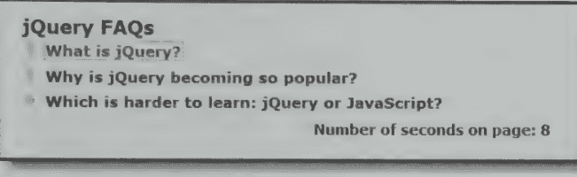

## 计数器的 HTML

```html
<h3>页面秒数：<span id="counter">0</span></h3>
```

## 更新计数器的间隔定时器 JavaScript

```javascript
window.onload = function () {
  // 创建一个每秒调用一次函数的定时器
  var counter = 0;
  var timer = setInterval(
    function () {                   // 第一个参数开始
      counter++;
      document.getElementById("counter").firstChild.nodeValue = counter;
    },
    1000);                        // 第二个参数
}
```

## 描述

- `setInterval` 方法创建一个定时器，每当通过指定的毫秒间隔时，它就会调用一次函数。

图 6-14 如何使用间隔定时器

## 幻灯片应用

图 6-15 展示了一个需要使用间隔定时器的幻灯片应用。当用户启动此应用时，它每隔两秒显示一个新的标题和图像。

## HTML 和 CSS

如果你查看 HTML，你会发现五个 `<a>` 元素被编码在一个 `<ul>` 元素中。每个 `<a>` 元素的 `href` 属性提供了幻灯片中一张图片的位置。`title` 属性提供了幻灯片的标题。

在无序列表之后，`<h2>` 元素是显示每张幻灯片标题的元素。它的内容提供了第一张幻灯片的标题。其后是 `` 元素，它将显示每张幻灯片的图像。它的 `src` 属性提供了第一张幻灯片的位置。这样，当应用程序启动时就会显示第一个标题和幻灯片。

为了保持此应用程序的简单，没有提供停止幻灯片或手动切换幻灯片的控制控件。因此，这个幻灯片不符合可用性或可访问性的最佳标准。

CSS 中值得注意的是包含列表的 `<ul>` 元素的规则集。由于此列表的目的是为幻灯片提供标题和图像，因此列表不应该被显示。这就是为什么它的 `display` 属性被设置为 `none`。

## 显示第三张图像的幻灯片应用


## HTML

```html
<section>
  <h1>钓鱼幻灯片</h1>
  <ul id="image_list">
    <li><a href="images/casting1.jpg" title="Casting on the Upper Kings"></a></li>
    <li><a href="images/casting2.jpg" title="Casting on the Lower Kings"></a></li>
    <li><a href="images/catchrelease.jpg" title="Catch and Release on the Big Horn"></a></li>
    <li><a href="images/fsh.jpg" title="Catching on the South Fork"></a></li>
    <li><a href="images/lures.jpg" title="The Lures for Catching"></a></li>
  </ul>
  <h2 id="caption">Casting on the Upper Kings</h2>
  <p></p>
</section>
```

## ul 元素的 CSS

```css
ul { display: none; }
```


# 图 6-15 幻灯片应用的用户界面、HTML 和 CSS

## JavaScript

图 6-16 展示了此应用程序的 JavaScript。在这里，你可以看到 `onload` 事件处理器通过声明变量开始，这些变量包含元素的节点、用于标题的 `<h2>` 元素以及用于幻灯片的 `` 元素。然后，使用 `getElementsByTagName` 方法创建一个名为 `links` 的数组，其中包含 `<ul>` 中每个 `<a>` 元素的对象。

这些链接中的每一个都由随后的 `for` 循环进行处理。然而，这个循环所做的只是预加载图像，并将每张图像的 `title` 属性设置为当前链接的 `title` 属性。然后，将图像对象添加到 `imageCacheArray` 中，以便稍后使用。

此时，`onload` 事件处理器启动了幻灯片。为了做到这一点，它创建了一个间隔定时器，其中第一个参数嵌入了一个函数，第二个参数是 2000（2 秒）。正是这个嵌入的函数在定时器到时显示下一张幻灯片。

在该函数内部，名为 `imageCounter` 的变量决定显示 `imageCache` 数组中的哪一个幻灯片。该函数的第一条语句将 `imageCounter` 加 1，然后使用取模运算符 (`%`) 获取 `imageCounter` 除以 `imageCache` 数组长度的余数。这意味着 `imageCounter` 属性的范围从 0 到数组长度减 1。

例如，如果 `imageCache` 数组包含 5 张图像，计数器值将从 0 到 4（1%5=1; 2%5=2; 3%5=3; 4%5=4; 5%5=0; 6%5=1，以此类推）。所以，如果将 `imageCounter` 值用作索引……

## 间隔定时器的 JavaScript

```javascript
var $ = function (id) {
  return document.getElementById(id);
}

window.onload = function () {
  var listNode = $("image_list");
  var captionNode = $("caption");
  var imageNode = $("image");
  var links = listNode.getElementsByTagName("a");
  var imageCache = [];
  var i, linkNode, image;

  for (i = 0; i < links.length; i++) {
    linkNode = links[i];
    image = new Image();
    image.src = linkNode.getAttribute("href");
    image.title = linkNode.getAttribute("title");
    imageCache.push(image);
  }

  var imageCounter = 0;

  setInterval(function () {
    imageCounter = (imageCounter + 1) % imageCache.length;
    image = imageCache[imageCounter];
    imageNode.src = image.src;
    captionNode.firstChild.nodeValue = image.title;
  }, 2000);
};
```

## 观点

现在你已经完成了这一章，你应该知道如何使用 JavaScript 进行一些 DOM 脚本应用，如图像切换和幻灯片。如果某些内容让你感到困惑，那是因为这确实复杂且困难。

好消息是，jQuery 让开发这类 DOM 应用变得简单。更棒的是，你现在掌握了使用 jQuery 所需的所有 JavaScript 技能，这些技能将帮助你更容易学习 jQuery。

## 术语

- DOM
- 元素节点
- 文本节点
- 属性节点
- 注释节点
- DOM 核心规范

## 总结

- 文档模型（简称 DOM）在页面加载到浏览器时构建。它由各种节点组成。
- 在 DOM 中，元素节点表示 HTML 文档中的元素，文本节点表示元素中的文本。DOM 还可以包含存储属性值的属性节点以及注释节点。
- JavaScript 为 DOM 核心规范描述的对象提供了属性和方法，这些由 `Node`、`Document` 和 `Element` 接口描述的属性和方法。
- 对于某些 JavaScript 应用，你需要取消事件的默认行为，例如点击链接或按钮。
- 对于图像切换和幻灯片等应用，预加载图像是很好的。这样，页面加载可能会更长，但图像切换将立即发生。
- 浏览器提供了两种不同的定时器。单次定时器在指定的间隔后只执行一次函数。间隔定时器每当通过指定的间隔时就会执行一次函数。

## 练习 6-1 尝试 FAQs

在本书的后续章节中，你将学习如何使用 jQuery 对 DOM 进行脚本。由于这比使用 JavaScript 进行 DOM 脚本更容易，你现在不需要练习用 JavaScript 进行 DOM 脚本。但是，你应该理解本章中 JavaScript 应用是如何工作的。为了帮助你理解这一点，你可以开始尝试 FAQs 应用。

1. 使用你的文本编辑器或 IDE 打开此文件夹中的 `index.html` 和 `faqs.js` 文件：`c:\query\exercises\ch06\faqs`
2. 测试应用程序以查看它是如何工作的，并检查代码。
3. 如下所示注释掉 `headingNode.onclick` 函数中的第一条语句：
   `// var h2 = this;`
   然后，在它之后添加此语句：
   `var h2 = headingNode;`
4. 测试程序并注意所有三个标题都绑定了相同的事件处理器。结果是，点击任何一个标题只会影响第三个标题及其所在的区域。这证明了使用 `this` 关键字来引用标题节点当前实例的重要性。
5. 撤销你在第 3 步中做的更改并再次测试。然后，对你任何不理解的代码进行尝试。

## 练习 6-2 复习其他章节的应用程序

如果你对本章中任何应用程序的工作原理有任何疑问，可以使用 `c:\query\exercises\ch06\`。这样，你就可以测试、修改并尝试它们，直到你完全理解它们是如何工作的。除了本章介绍的完整应用程序外，你将在名为 `faqs_timers` 的文件夹中找到另一个，它使用了图 6-13 和 6-14 显示的计时器。

## 练习 6-3 开发一个书籍列表应用程序

如果你想接受挑战，此练习提供了后续界面的 HTML 和 CSS。然后，你来开发使其运行的 JavaScript。

这将对你的 JavaScript 和 DOM 脚本技能进行严峻测试。不要感到沮丧，请记住，这样的应用程序使用 jQuery 开发要容易得多。

## Murach 产品

- 面向 Web 开发者的书籍
  - Murach's HTML5 and CSS3
  - Murach's JavaScript and DOM Scripting
  - Murach's PHP and MySQL
  - Murach's MySQL
- 面向 Java 开发者的书籍
  - 面向 .NET 开发者的书籍

## 开发指南

1. 你可以在此文件夹中找到此应用程序的 HTML、CSS 和图像文件：`c:\jquery\exercises\ch06\book_list_`
   你还会找到一个名为 `book_list.js` 的 JavaScript 文件，其中只包含美元符号 `$` 的代码。你可以将你的代码添加到此文件中。

2. 此应用程序的工作方式与你在本章看到的应用程序类似，不同之处在于每个标题下方显示了一个书籍链接列表。如果用户点击这些链接之一，列表右侧将显示书籍图像。此外，每当用户点击带有加号或减号的标题时，图像不应再显示。

3. 此应用程序链接的 HTML 与 Swap 应用程序的 HTML 相同。但是，此应用程序的链接不需要 `title` 属性，因为图像没有显示说明。

4. 此应用程序中链接 `href` 属性引用的图像应该预加载。要做到这一点，你可以遍历 `section` 元素中的所有链接。此外，务必取消链接的默认操作。

5. 随时从你可以使用的任何应用程序中复制和粘贴代码。这是构建新应用程序最有效的方法。

注意：如果你将 `img` 元素的 `src` 属性设置为空字符串，以便在应用程序启动和用户点击标题时不显示图像，在 Internet Explorer 中该元素将显示一个占位符。为了避免这种情况，你可以将 `img` 元素的 `style` 属性中的 `display` 设置为 "none"。然后，当你想要显示图像时，可以将此属性设为 "block"。在下一节中，你将学习使用 jQuery 设置 CSS 属性的其他方法。

## jQuery Java 基础

现在你已经拥有使用 jQuery 所需的 JavaScript 技能，准备好学习 jQuery 了。因此，在第 7 章，你将学习一个运行良好的 jQuery 子集，它将让你快速上手。在第 8 章，你将学习如何使用 jQuery 效果和动画，这些效果可以让网页活起来。

然后，在第 9 章，你将学习如何使用 DOM 操作和遍历方法进行高级 DOM 脚本。在第 10 章，你将学习如何使用 jQuery 特性处理表单。在第 11 章，你将学习如何使用许多可以快速提高生产力的 jQuery 插件，你还将学习如何创建自己的插件。

当你完成本节后，你将拥有开发专业网页所需的所有 jQuery 技能。你也可以继续学习后续三个章节中的任何一个，因为它们是作为独立模块编写的。例如，如果你想学习如何使用 Ajax，请跳到该节。

# 第 7 章 使用 jQuery 快速上手

在这一章中，你将学习一个运行良好的 jQuery 子集，它会让 JavaScript 编程变得简单。

- jQuery 简介
- 什么是 jQuery
- 如何在网页中包含 jQuery
- jQuery 如何简化 JavaScript
- 如何调用 jQuery
- 如何使用 jQuery
- 应用程序

## jQuery 官方网站 www.jQuery.com

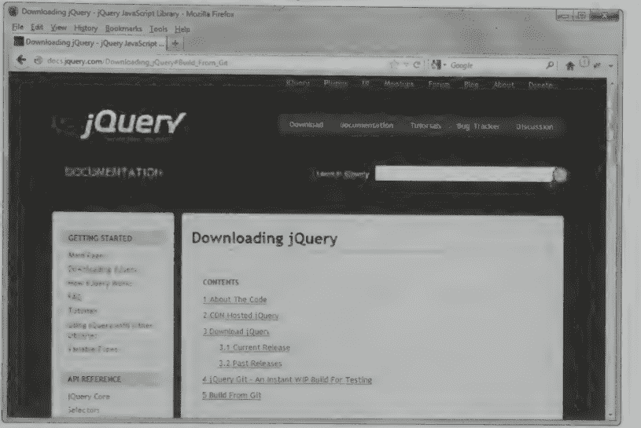

## jQuery 提供的功能

- 十多种方法，可以让你更轻松地为网页添加 JavaScript 功能
- 经过跨浏览器兼容性测试的方法

## 将 jQuery 文件下载到电脑后如何引入它

```html
<script src="jquery-1.8.3.min.js"></script>
```

## 如何从内容分发网络（CDN）引入 jQuery 文件

```html
<script src="http://code.jquery.com/jquery-1.8.3.min.js"></script>
```

## 描述

- jQuery 是一个免费、开源的 JavaScript 库，提供了许多让 JavaScript 编程更简单的方法。今天，10,000 个访问量最大的网站中超过 50% 的网站在使用 jQuery，其人气正在迅速增长。
- jQuery 提供两个版本。其中一个（min）是压缩版本，体积较小且加载速度快。另一个版本是未压缩的，你可以用它来学习库中的 JavaScript 代码。
- 如果从内容分发网络（CDN）引入 jQuery 文件，你就不需要从自己的服务器提供它，但你就无法离线工作。书中的所有应用程序使用的都是 1.8.3，这是写作时的当前版本。
- 如果你将 jQuery 文件下载到系统中，可以更改文件名使其更简单，但你可能会忘记正在使用的版本。

图 7-1 什么是 jQuery 以及如何将其包含在你的应用程序中。

## jQuery 如何简化 JavaScript 开发

为了向你展示 jQuery 如何简化 JavaScript 开发，图 7-2 显示了你在第 6 章中学会开发的 FAQ 应用的 JavaScript 和 jQuery 代码。如果你像大多数学习 JavaScript 的人一样，你可能发现该应用程序的 JavaScript 代码既复杂又令人困惑。因为它确实如此。

相比之下，jQuery 代码的行数不到后者的半。一旦你学会了如何使用 jQuery 选择器、方法和事件方法，你还会发现它更容易理解得多。你将在这段介绍之后紧就开始学习这些技能。

顺便提一下，jQuery 使用 CSS 选择器来选择应该应用这些方法的 HTML 元素。例如，

```css
#faqs h2
```

是 CSS 选择器 `#faqs` 对应的 jQuery 选择器，它选取了 id 为 "faqs" 的元素中所有的 h2 元素。事实上，jQuery 支持所有 CSS 选择器，包括 CSS3 选择器，即使在不支持所有 CSS3 选择器的浏览器中也是如此的。这是开发者喜欢 jQuery 的另一个原因。

## jQuery 如何影响测试和调试

当你使用 jQuery 开发应用程序时，你可以使用在第 4 章中学到的相同测试和调试技能。但请记住，调用 jQuery 方法实际上是调用你在 HTML `head` 部分的 `script` 元素中指定的 jQuery 文件。换句话说，当你的代码执行 jQuery 方法时，执行处理过程的是 jQuery 文件中的 JavaScript。

如果 jQuery 代码无法执行，Firebug 或浏览器错误控制台中的显示将指向 jQuery 文件中的某条语句。这可能会发生，例如是因为向 jQuery 方法传递了错误的参数。遗憾的是，Firebug 或错误控制台中的信息不会告诉你你的代码中哪条语句导致了问题。相反，你必须使用其他调试技术来发现并修复它。

在大多数情况下，Firebug 和浏览器错误控制台确实提供了帮助你发现并修复 bug 的信息。因此，这是一个小问题，而使用 jQuery 带来的益处远大于它的麻烦。

## FAQ 应用的用户界面

| jQuery FAQ |
| :--- |
| **什么是 jQuery？** |
| **为什么 jQuery 变得如此流行？** | 三点：- 它是免费的。- 它让你在更短的时间完成更多工作。- 它所有的功能都跨浏览器兼容。 |
| **哪个更难学：jQuery 还是 JavaScript？** | |

## 应用的 JavaScript 代码

```javascript
var $ = function (id) {
  return document.getElementById(id);
}

window.onload = function () {
  var faqs = $("faqs");
  var h2Elements = faqs.getElementsByTagName("h2");

  for (var i = 0; i < h2Elements.length; i++) {
    h2Node = h2Elements[i];

    // 附加事件处理器
    h2Node.onclick = function () {
      var h2 = this; // h2 是当前的 h2 对象

      if (h2.getAttribute("class") == "plus") {
        h2.setAttribute("class", "minus");
      } else {
        h2.setAttribute("class", "plus");
      }

      if (h2.nextElementSibling.getAttribute("class") == "closed") {
        h2.nextElementSibling.setAttribute("class", "open");
      } else {
        h2.nextElementSibling.setAttribute("class", "closed");
      }
    }
  }
}
```

## 应用的 jQuery 代码

```javascript
$(document).ready(function () {
  $("#faqs h2").toggle(
    function () {
      $(this).addClass("minus");
    },
    function () {
      $(this).addClass("plus");
    }
  );
});
```

图 7-2 jQuery 如何简化开发。

## jQuery UI 和插件

## jQuery UI 可以简化 JavaScript 开发

在实践中，首先寻找实现你需求的插件是明智的。如果你找到了，你可以在几小时内完成原本需要几天的工作。接下来，如果你没有找到合适的插件，看看 jQuery UI 是否可以实现该功能。最后，如果插件和 jQuery UI 都不能帮助你，你就必须仅使用 jQuery 核心库开发该功能。

## 作为 jQuery UI 手风琴的 FAQ

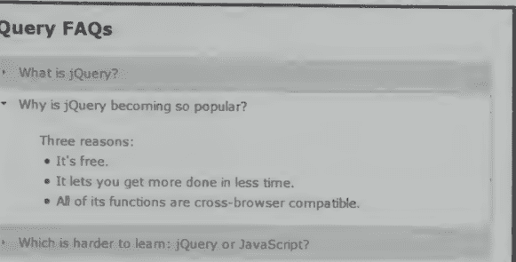

## jQuery UI 手风琴的 HTML

```html
<div id="accordion">
  <h3><a href="#what">什么是 jQuery？</a></h3>
  <div><!--面板内容 --></div>
  <h3><a href="#why">为什么 jQuery 变得如此流行？</a></h3>
  <div><!--面板内容 --></div>
  <h3><a href="#harder-to-learn">哪个更难学：jQuery 还是 JavaScript？</a></h3>
  <div><!--面板内容 --></div>
</div>
```

## jQuery UI 手风琴的 JavaScript 代码

```javascript
<script>
$(document).ready(function() {
  $("#accordion").accordion();
});
</script>
```

## 一些典型的插件功能

- 数据验证
- 幻灯片
- 轮播图

## 描述

- jQuery UI 是一个免费、开源的 JavaScript 库，提供了高级效果、组件和鼠标交互，可以通过使用主题进行自定义。在第 3 节中，你将学习如何使用 jQuery UI。
- 插件是一个与 jQuery 协同工作的 JavaScript 库，它让为 Web 应用程序添加功能变得简单。在第 11 章中，你将学习如何使用一些实用的插件，你还将学习如何创建自己的插件。

# jQuery 编程基础

在接下来的三幅图中，你将学习 jQuery 编程的基础。然后，你将学习一个使用这些技能的应用程序。这将向你展示 jQuery 如何简化 JavaScript 编程。

## 如何编写 jQuery 选择器

当你使用 jQuery 时，首先要选择你想要应用 jQuery 方法的元素或元素。要做到这一点，你可以如图 7-4 所示使用 jQuery 选择器。

编写 jQuery 选择器时，你从编写美元符号 (`$`) 开始，后面跟着带有引号的括号。然后，在引号中，你使用你想要选择的元素或元素的 CSS 选择器。这在图顶部的语法总结中已经给出。

HTML 和示例展示了使用 jQuery 选择一个或多个元素是多么简单。例如，第一组示例中的第一个选择器选择整个文档中所有的 `<p>` 元素。第二个选择器选择 id（标识符）为 "faqs" 的元素。第三个选择器选择所有类名（class attribute）属性值为 "plus" 的元素。

在第二组示例中，你可以看到如何编写其他类型的 CSS 选择器、通用兄弟元素和子元素。例如，第一个选择器获取所有 id 为 "faqs" 的元素的后代 `<p>` 元素。这包含了图中 HTML 中所有的 `<p>` 元素。

相反，第二个选择器获取与 h2 元素相邻的 div 元素，包含了所有的 div 元素。第三个选择器获取所有作为 ul 元素兄弟的 `<p>` 元素，它选择了第二个 div 元素中的 `<p>` 元素。第四个选择器获取所有作为 div 元素子元素的 ul 元素，它选择了第二个 div 元素中的 ul 元素。

第三组示例展示了如何编写多个选择器。要做到这一点，你像编写 CSS 那样用逗号将它们隔开。

## jQuery 选择器的语法

`$("selector")`

## 示例中所选元素的 HTML

```html
<section id="faqs">
  <h1>常见问题解答</h1>
  <h2 class="plus">什么是 jquery?</h2>
  <div>
    <p>jQuery 是一个 JavaScript 函数库，你在开发网站时可能需要它。</p>
  </div>
  <h2 class="plus">为什么 jquery 变得如此流行？</h2>
  <div>
    <p>三个原因：</p>
    <ul>
      <li>它是免费的。</li>
      <li>它让你用更短的时间完成更多工作。</li>
      <li>它的所有函数都跨浏览器兼容。</li>
    </ul>
  </div>
</section>
```

## 如何通过元素、id 和类选择元素

- 通过元素类型：整个文档中所有的 `<p>` 元素：`$("p")`
- 通过 id：id 为 "faqs" 的元素：`$("#faqs")`
- 通过类：所有类名为 "plus" 的元素：`$(".plus")`

## 如何通过关系选择元素

- 后代：所有作为 section 元素后代的 `<p>` 元素：`$("#faqs p")`
- 相邻兄弟：所有与 h2 相邻的 div 元素：`h2 + div`
- 通用兄弟：所有作为 ul 元素兄弟的 `<p>` 元素：`ul ~ p`
- 子元素：所有作为 div 元素子元素的 ul 元素：`div > ul`

## 如何编写多个选择器

`$("#faqs li, div p")`
`$("p + ul, div > p")`

## 描述

- 当你使用 jQuery 时，美元符号 (`$`) 用于引用 jQuery 库。然后，你可以使用引号括号内的 CSS 语法编写选择器。


## 如何调用 jQuery 方法

一旦你选择了想要应用方法的元素或元素，就可以使用图 7-5 顶部的语法来调用该方法。这与调用任何对象的方法相同。使用获取元素或元素的选择器、点（.）、方法名以及括号内的任何参数。

要开始使用 jQuery，图中的表格总结了一些你将用到的 jQuery 方法。例如，不带参数的 `val` 方法可以从选定的文本框或其他表单控件获取值，而带参数的 `val` 方法则可以设置选定文本框或其他表单控件的值。表格后的前两个示例展示了这是如何运作的。

同样，不带参数的 `text` 方法可以获取所选元素的文本，而带参数的 `text` 方法可以用于设置所选元素的文本。这些方法通常被称为 getter（获取）和 setter（设置）方法。在这里，第三个示例说明了 `text` 方法的 setter 版本，它将元素的文本设置为 "Email address is required"。

表格中的第五种方法是 `next` 方法，用于获取元素的下一个（或相邻的）兄弟元素。此方法通常后面紧跟另一个 JavaScript 方法。这由第四个示例所示。在这里，`next` 方法获取所选元素之后的下一个兄弟元素，`text` 方法为该兄弟元素设置文本。

表格中的最后两个方法是 `submit` 和 `focus` 方法，它们与 JavaScript 的 `submit` 和 `focus` 方法一样。`submit` 方法将选定表单的数据提交到服务器，`focus` 方法将焦点移动到选定的表单控件或链接。

稍后，你将看到这些选择器和方法在应用程序中工作。但首先，你需要学习如何为应用程序设置事件处理器。

## 调用 jQuery 方法的语法

`$(selector).methodName(parameters)`

## 常用的 jQuery 方法

| 方法 | 描述 |
| --- | --- |
| `val()` | 获取文本框或其他表单控件的值。 |
| `val(value)` | 设置文本框或其他表单控件的值。 |
| `text()` | 获取元素的文本。 |
| `text(value)` | 设置元素的文本。 |
| `next([selector])` | 获取元素的下一个兄弟元素，或者如果编写了参数则获取指定类型的下一个兄弟元素。 |
| `submit()` | 提交选定的表单。 |
| `focus()` | 将焦点移动到选定的表单控件或链接。 |

## 示例

## 如何从文本框获取值

```javascript
var gallons = $("#gallons").val();
```

## 如何为输入元素设置值

```javascript
$("#gallons").val("");
```

## 如何为元素设置文本

```javascript
$("#email_address").text("Email address is required");
```

## 如何为下一个元素设置文本

```javascript
$("#last_name").next().text("Last name is required");
```

## 如何提交表单

```javascript
$("#join_list").submit();
```

## 如何将焦点移动到表单控件

```javascript
$("#email_address").focus();
```

## 描述

- 当你使用 jQuery 时，美元符号 (`$`) 用于引用 jQuery 库。然后，你可以编写选择器。
- 当你使用 jQuery 链式调用时，每个方法都会返回对象。
- 如果选择器选择了多个元素，jQuery 会将该方法应用到所有元素。


## 如何使用事件方法

当你使用 jQuery 时，你使用事件方法将事件处理器绑定到事件。要做到这一点，你使用图 7-6 顶部的语法。首先，你编写触发事件的元素选择器，例如会被点击的按钮。然后，你编写要使用的事件方法名称。最后，你在括号内编写一个作为事件处理器的函数。

图中的表格总结了你将用到的两个事件方法。`ready` 事件是 `load` 事件的 jQuery 替代方案，但效果更好。与 `load` 事件不同，`ready` 事件在 DOM 构建完成后立即触发，即使其他元素如图像仍在加载。这意味着用户可以更快地使用页面。

因为在运行 JavaScript 或 jQuery 之前通常必须构建 DOM，你可能会在开发的每个 JavaScript 应用程序中使用 `ready` 方法。图中的示例展示了两种方法。在长格式中，你使用 `document` 作为页面的选择器，后面跟着点、方法名（`ready`）以及事件处理器的函数。

在短格式中，你可以省略选择器和事件方法名，直接在美元符号后的括号内编写函数。虽然这种格式经常被专业开发人员使用，但本书中的所有示例都使用这种格式。这样可以清楚地看到 `ready` 事件处理器的开始。

图中的下一个示例展示了用于 h2 元素点击事件的事件处理器。它的编写方式与 `ready` 事件的事件处理器相同，只是使用 `h2` 作为选择器并将 `click` 作为事件方法名称。

图中的最后一个示例展示了如何在 `ready` 事件处理器内部编写事件处理器。注意，每个事件处理器的闭合括号、括号和分号是至关重要的。正如你所料的，很容易漏掉其中一个标记或让它们的顺序出现混乱，因此这是一个常见的错误来源。这就是为什么专业程序员通常会在每个事件处理器的结束标记之后编写注释，以标识这些标记属于哪个事件处理器。

## jQuery 事件方法的语法

```javascript
$(selector).eventMethodName(function() {
  // 事件处理程序的的语句
});
```

## 两种常用的 jQuery 事件方法

| 事件方法 | 描述 |
| :--- | :--- |
| `ready(handler)` | 当 DOM 准备就绪时执行事件处理程序。 |
| `click(handler)` | 当选定的元素被点击时，执行事件处理程序。 |

## 为 jQuery ready 事件编写事件处理程序的两种方式

### 长写法

```javascript
$(document).ready(function() {
  alert("The DOM is ready");
});
```

### 短写法

```javascript
$(function() { // 假设执行了 (document).ready
  alert("The DOM is ready");
});
```

### 针对所有 h2 元素点击事件的事件处理器

```javascript
$("h2").click(function() {
  alert("This heading has been clicked");
});
```

## ready 事件处理器内部的点击事件处理器

```javascript
$(document).ready(function() {
  $("h2").click(function() {
    alert("This heading has been clicked");
  }); // end of click event handler
}); // end of ready event handler
```

## 描述

- 编写 jQuery 事件处理程序时，你需要编写一个选择器，以及一个在括号内处理事件的匿名函数。
- `ready` 事件的事件处理器会在浏览器加载页面图像和其他内容时立即运行它包含的任何方法。这比 JavaScript 的 `onload` 事件效果更好，因为 `onload` 事件要等到页面所有内容加载完成后才会发生。
- 在本书中，`ready` 始终使用上述所示的长写法进行编写。但在实践中，许多程序员使用短写法。
- 在一个事件处理器内部编写另一个事件处理程序时，大括号、括号和分号的使用至关重要。为了确保无误，许多程序员会在这些标点符号后编写行内注释，以标识处理程序的结束位置。

## jQuery 中的邮件列表（Email List）应用程序

在这些背景下，你准备好查看 jQuery 如何在你在第 1 节学习过的邮件列表应用程序中使用了。这将向你展示 jQuery 如何简化代码编写。

## 用户界面与 HTML

为了唤起你的记忆，图 7-7 展示了邮件列表应用程序的用户界面和 HTML。要使用该应用程序，用户在前三个文本框中输入文本并点击“Join our List”（加入我们的列表）按钮。然后，JavaScript 会验证输入内容，并在发现错误时显示相应的错误消息。如果没有发现错误，表单数据将提交到 Web 服务器进行处理。

在 HTML 中，首先注意加载 jQuery 的 `<script>` 元素。其后是标识包含该应用程序 JavaScript 文件的 `<script>` 元素。这个顺序是关键的，因为 JavaScript 将使用 jQuery 文件。

此外，注意 `<span>` 元素是文本框输入元素的相邻兄弟元素。这些 `<span>` 元素的起始文本是一个星号，表示该文本框输入是必填的。如果 JavaScript 在输入中发现错误，它会在这些 `<span>` 元素中显示错误消息。

## 邮件列表应用程序的用户界面

## HTML

```html
<!DOCTYPE html>
<html>
<head>
  <meta charset="UTF-8">
  <title>Join Email List</title>
  <link rel="stylesheet" href="email_list.css">
  <script src="http://html5shiv.google.com/svn/trunk/html5.js"></script>
  <script src="http://code.jquery.com/jquery-latest.min.js"></script>
  <script src="email_list.js"></script>
</head>
<body>
  <section>
    <h1>Please join our email list</h1>
    <form id="email_form" name="email_form" method="get">
      <label for="email_address1">Email Address:</label>
      <input type="text" id="email_address1">
      <span>*</span><br>
      <label for="email_address2">Re-enter Email Address:</label>
      <input type="text" id="email_address2">
      <span>*</span><br>
      <label for="first_name">First Name:</label>
      <input type="text" id="first_name">
      <span>*</span><br>
      <label>&nbsp;</label>
      <input type="button" id="join_list" value="Join our List">
    </form>
  </section>
</body>
</html>
```

## jQuery

图 7-8 展示了该应用程序的 jQuery。这是 HTML 包含的 `email_list.js` 文件中的代码。在这里，所有的 jQuery 代码都被高亮显示。其余代码是 JavaScript。

首先，你可以看到对于点击事件，Join List 按钮的事件处理器是编写在 `ready` 事件处理器内部的。然后，如果你查看代码的最后三行，你可以看到这些处理器的结束标点符号。在点击事件处理器内部，前两个语句展示了如何使用 jQuery 选择器和 `val` 方法从文本框中获取值。

## 邮件列表应用程序的 jQuery (email_list.js)

```javascript
$(document).ready(function() {
  $("#join_list").click(function() {
    var isValid = true;

    if ($("#email_address1").val() == "") {
      $("#email_address1").next().text("This field is required.");
      isValid = false;
    } else {
      $("#email_address1").next().text("");
    }

    if ($("#email_address2").val() == "") {
      $("#email_address2").next().text("This field is required.");
      isValid = false;
    } else if ($("#email_address2").val() != $("#email_address1").val()) {
      $("#email_address2").next().text("This entry must equal first.");
      isValid = false;
    } else {
      $("#email_address2").next().text("");
    }

    if ($("#first_name").val() == "") {
      $("#first_name").next().text("This field is required.");
      isValid = false;
    } else {
      $("#first_name").next().text("");
    }

    // 如果所有输入有效，则提交表单
    if (isValid) {
      $("#email_form").submit();
    }
  }); // end click
}); // end ready
```

## 描述

- 编写 jQuery 事件处理程序时，你需要编写一个选择器，以及一个在括号内处理事件的匿名函数。
- `ready` 事件的事件处理器会在浏览器加载页面图像和其他内容时立即运行它包含的任何方法。这比 JavaScript 的 `onload` 事件效果更好，因为 `onload` 事件要等到页面所有内容加载完成后才会发生。
- 在本书中，`ready` 始终使用上述所示的长写法进行编写。但在实践中，许多程序员使用短写法。
- 在一个事件处理器内部编写另一个事件处理程序时，大括号、括号和分号的使用至关重要。为了确保无误，许多程序员会在这些标点符号后编写行内注释，以标识处理程序的结束位置。

## 选择器、方法和事件方法的实用子集

接下来的三幅图展示了常用的选择器、方法和事件方法的实用子集。这包含大量内容，但一旦你理解了它们，就能编写实际的应用程序。

## 最常用的选择器

在 7-4 节中，你接触了可以与 jQuery 一起使用的基础选择器。现在，图 7-9 展示了应用程序中最可能使用的其他选择器。唯一缺失的重要选择器是你将在后续章节中学习的，例如用于动画的选择器，以及用于表单的表单控件选择器。

如果这看起来很令人生畏，只需阅读该列表并意识到这些选择器可以让你选择任何需要的元素。稍后，当你需要对应用程序进行特定类型的选择时，可以回看此总结和图 7-4。

为了说明这些选择器的用法，第一个示例展示了一个获取父元素第一个子 `li` 元素的选择器。如果 HTML 包含多个列表，这将选择每个列表的第一个 `li`。第二个示例展示了如何获取 HTML 表格中的 `tr`（行）元素。

第三个示例展示了如何使用 `:eq` 选择器从元素数组中获取特定元素。例如，如果 `faqs` 元素下有四个 `<p>` 元素，`:eq(2)` 将返回第三个 `<p>` 元素，因为索引从零开始。

最后一个示例展示了一个获取所有 `type` 属性值为 "text" 的 `<input>` 元素的选择器。换句话说，这个选择器获取所有文本框。不过注意，你也可以通过此选择器获取文本框：

```javascript
$("input[type=text]")
```

## 最常用的 jQuery 选择器总结

| 选择器 | 选择目标 |
| :--- | :--- |
| `[attribute]` | 所有具有指定属性的元素。 |
| `[attribute=value]` | 所有具有指定属性和对应属性值的元素。 |
| `:contains(text)` | 所有包含指定文本的元素。 |
| `:empty` | 所有不包含子文本节点的元素。 |
| `:eq(n)` | 选中集合中索引为 n 的元素。 |
| `:even` | 选中集合中索引为偶数的元素。 |
| `:first` | 集合中的第一个元素。 |
| `:first-child` | 所有作为其父元素第一个子元素的元素。 |
| `:gt(n)` | 选中集合中索引大于 n 的元素。 |
| `:has(selector)` | 所有包含由选择器指定的元素的元素。 |
| `:header` | 所有标题元素（h1, h2, ...）。 |
| `:hidden` | 所有隐藏的元素。 |
| `:last` | 选中集合中的最后一个元素。 |
| `:last-child` | 所有作为其父元素最后一个子元素的元素。 |
| `:lt(n)` | 选中集合中索引小于 n 的元素。 |
| `:not(selector)` | 所有未被选择器选中的元素。 |
| `:nth-child` | 所有作为其父元素第 n 个子元素的元素。 |
| `:odd` | 选中集合中索引为奇数的元素。 |
| `:only-child` | 所有作为其父元素唯一子元素的元素。 |
| `:parent` | 所有包含其他元素的元素，包括文本节点。 |
| `:text` | 所有 type 属性设置为 "text" 的 input 元素。 |
| `:visible` | 所有可见元素。 |

## 示例

- 如何选择作为父元素第一个子元素的 li 元素：`$("li:first-child")`
- 如何选择表格中的 tr 元素：`$("table > tr:even")` // 计数从 0 开始，所以第一个标签是偶数
- 如何选择某个元素的第三个后代 `<p>` 元素：`$("#faqs p:eq(2)")` // 计数从 0 开始
- 如何选择所有 type 属性为“text”的 input 元素：`$(":text")`

## 描述

- 图 7-4 和上面的表格总结了你最可能需要的选择器。
- 未包含六种属性选择器，它们允许你选择值包含特定子字符串的属性。
- 在第 8 章中，你将学习用于动画的选择器，在第 10 章中，你将学习用于表单控件的其他选择器。

图 7-9 最常用的选择器

## 最常用的方法

图 7-10 中的表格代表了从多个 jQuery 类别提取的方法集合。例如 `prev` 和 `next` 方法是 DOM 遍历方法。`attr`、`css`、`addClass`、`removeClass` 和 `toggleClass` 是 DOM 操作方法。`hide` 和 `show` 方法是效果方法。`each` 方法是杂项方法。

这些是最常用的 jQuery 方法，它们将帮助你快速上手 jQuery。然后，你将学习并添加更多方法，以阅读本节的其余章节。例如，你将在第 8 章学习如何使用其他效果方法，并在第 9 章学习如何使用其他 DOM 遍历和操作方法。

再次，如果这个表格看起来很令人生畏，只需阅读一遍了解可用内容。然后，研究示例以查看如何使用它们。稍后，当你为应用程序需要特定方法时，可以查阅此总结。

在第一个示例中，`attr` 方法用于获取 id 为 "image" 的元素的 `src` 属性。第二个示例使用 `attr` 方法为选中的元素添加 `src` 属性，其值存储在名为 `imageSource` 的变量中。如果元素已经具有 `src` 属性，该方法将更改其值。第三个示例使用 `css` 方法将选中的元素的 `color` 属性改为蓝色。

在第四个示例中，`addClass` 方法用于为 id 为 "faqs" 的元素内所有的 h2 元素添加一个类。这与你使用 JavaScript 执行的操作相似。

在最后一个示例中，`each` 方法用于为数组中的每个元素执行一个函数。在这种情况下，数组包含了 id 为 "image_list" 的元素内所有的 `<a>` 元素，`each` 方法都会遍历这些元素。正如你所看到的，这简化了数组中元素的处理。

## 最常用的 jQuery 方法总结

| 方法 | 描述 |
| --- | --- |
| `next([selector])` | 获取元素的下一个兄弟元素，或者如果编码了参数，则获取指定类型的第一个兄弟元素。 |
| `prev([selector])` | 获取元素的上一个兄弟元素，或者如果编码了参数，则获取指定类型的上一个兄弟元素。 |
| `attr(attributeName)` | 获取指定属性的值。 |
| `attr(attributeName, value)` | 设置指定属性的值。 |
| `css(propertyName)` | 获取指定属性的值。 |
| `css(propertyName, value)` | 设置指定属性的值。 |
| `addClass([className])` | 为元素添加一个或多个类，并在必要时创建该类。如果你使用多个类作为参数，请用空格隔开它们。 |
| `removeClass([className])` | 从元素中移除一个或多个类。 |
| `toggleClass(className)` | 切换元素上类的存在与否。 |
| `hide([duration])` | 隐藏元素。 |
| `show([duration])` | 显示元素。 |
| `each(function)` | 为集合中的每个元素运行函数。 |

## 最常用的 jQuery 事件方法总结

| 事件方法 | 说明 |
|--- |--- |
| `ready(handler)` | 当 DOM 准备就绪时执行处理函数。 |
| `unload(handler)` | 当用户关闭浏览器窗口时执行处理函数。 |
| `error(handler)` | 当发生 JavaScript 错误时执行处理函数。 |
| `click(handler)` | 当被选元素被点击时执行处理函数。 |
| `toggle(handlerEven, handlerOdd)` | 第一个处理函数在元素被偶数次点击时执行（从 0 开始）。第二个处理函数在元素被奇数次点击时执行。注意，此事件方法在 1.8 版本中已弃用，并在 1.9 版本中删除，因此你需要停止使用它。 |
| `dblclick(handler)` | 当被选元素被双击时执行处理函数。 |
| `mouseenter(handler)` | 当鼠标指针进入被选元素内部时执行处理函数。 |
| `mouseover(handler)` | 当鼠标指针移动到被选元素上方时执行处理函数。 |
| `mouseout(handler)` | 当鼠标指针移出被选元素时执行处理函数。 |
| `hover(handlerIn, handlerOut)` | 第一个事件处理函数在鼠标指针进入元素内部时执行。第二个事件处理函数在鼠标指针移出元素时执行。 |

## 所有文本框双击事件的处理函数，用于清除被点击的框

```javascript
$(":text").click(function () {
  $(this).val("");
});
```

## 列表中每个 img 元素的 hover 事件处理函数

```javascript
$("#image_list img").hover(
  function() {
    alert("The mouse pointer has moved into an img element");
  },
  function() {
    alert("The mouse pointer has moved out of an img element");
  }
); // end hover
```

## 描述

- 上表展示了你最常用的事件方法。未包含的有：`keydown`, `keypress`, `keyup`, `mousedown`, `mouseup`, `mouseleave` 和 `mousemove`。

图 7-11 最常用的事件方法

## 你应该注意的其他事件方法

对于大多数应用程序，你将使用已经介绍过的事件方法。你还将作为事件方法的参数编写事件处理函数的函数或多个函数。

但是，有时你可能想通过其他方式附加事件处理函数、移除事件处理函数，或触发一个启动事件处理函数的事件。这时，你可以使用下表中介绍的方法。

当你使用表中的前两个方法时，你通常会将事件处理函数的函数存储在变量中，如表后的第一个示例所示。然后，你可以使用变量名作为事件方法的第二个参数。

为了说明，第二个示例显示了如何使用 `bind` 方法将事件处理函数附加到 id 为 "clear" 的元素的点击事件上。但注意，当你使用快捷方法将事件处理函数附加到事件时，同样会使用 `bind` 方法。它只是在后台运行，所以你可能没有意识到。

将事件处理函数存储在变量中的用处之一是你可以将处理函数附加到多个事件。如第三个示例所示。在那里，使用了两个语句将 `clearClick` 事件处理函数应用于 id 为 "clear" 的按钮的 click 事件，以及所有文本框的 dblclick 事件。

对于某些应用程序，你可能想在某个条件发生时移除事件处理函数。要这样做，你可以使用 `unbind` 方法，如图中的第四个示例所示。

或者，如果你想在事件处理函数运行一次后移除它，你可以使用 `one` 方法。如第五个示例所示。

如果你想从 jQuery 代码中启动事件，可以使用长形式或短形式的 `trigger` 方法，如第六组示例所示。这两个示例都触发了 id 为 "clear" 的元素的 click 事件，从而导致了 `clearClick` 事件的运行。

这为两个不同的事件运行同一个事件处理函数提供了另一种方法。你只需要从一个事件处理函数触发另一个事件处理函数的事件即可。这如图中的最后一个示例所示。在那里，所有文本框双击事件的处理函数触发了 id 为 "clear" 的元素的 click 事件，从而启动了 `clearClick` 事件处理函数。

## 你应该注意的其他事件方法

| 事件方法 | 说明 |
|---|---|
| `bind(event, handler)` | 将事件处理函数附加到事件。 |
| `unbind(event, handler)` | 从事件中移除处理函数。 |
| `one(event, handler)` | 附加事件处理函数并在运行一次后将其移除。 |
| `trigger(event)` | 触发被选元素的事件。 |

## 如何在变量中存储事件处理函数

```javascript
var handleClick = function () {
  // the statements for the event handler
}
```

## 如何将事件处理函数附加到事件

使用 `bind` 方法：
`$("#clear").bind("click", clearClick);`

使用快捷方法：
`$("#clear").click(clearClick);`

## 如何将事件处理函数附加到两个不同的事件

```javascript
$("#clear").click(clearClick);
$("#text").dblclick(clearClick);
```

## 如何从事件中移除事件处理函数

`$("#clear").unbind("click", clearClick);`

## 如何附加并移除事件处理函数使其仅运行一次

`$("#clear").one("click", clearClick);`

## 如何触发事件

使用 `trigger` 方法：
`$("#clear").trigger("click");`

使用快捷方法：
`$("#clear").click();`

## 如何从另一个事件使用事件处理函数

```javascript
$("#text").dblclick(function () {
  $("#clear").trigger("click");
});
```

## 浏览器中的 FAQs 应用

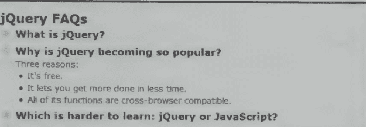

### HTML 部分

```html
<section id="faqs">
  <h1>jQuery FAQs</h1>
  <h2>什么是 jQuery?</h2>
  <div>
    <p>jQuery 是一个 JavaScript 函数库，你在开发网站时最可能需要用到这些函数。</p>
  </div>
  <h2>为什么 jQuery 变得越来越流行？</h2>
  <div>
    <p>三个原因：</p>
    <ul>
      <li>它是免费的。</li>
      <li>它让你在更短的时间内完成更多工作。</li>
      <li>它所有的函数都具有跨兼容性。</li>
    </ul>
  </div>
  <h2>jQuery 和 JavaScript 哪个更难学？</h2>
  <div>
    <p>对于大多数函数，学习 jQuery 要比使用原生 JavaScript 简单得多。但记住：jQuery 本就是 JavaScript。</p>
  </div>
</section>
```

### jQuery 部分

```javascript
$(document).ready(function () {
  $("#faqs h2").toggle(
    function () {
      $(this).addClass("minus");
      $(this).next().show();
    },
    function () {
      $(this).removeClass("minus");
      $(this).next().hide();
    }
  ); // 结束 toggle
}); // 结束 ready
```

图 7-13 jQuery 中的 FAQs 应用

## jQuery 中的图片切换应用

图 7-14 展示了另一个展示 jQuery 威力的应用。它是你在第 6 章中学习的图片切换应用。简而言之，当用户点击浏览器顶部的一张缩略图之一时，缩略图下方的说明和图像就会发生更改。

在该应用的 HTML 中，使用 `img` 元素来显示六张缩略图。然而，这些元素被编写在 `<a>` 元素内部，以便图像是可以点击的并且可以接收焦点。在 `<a>` 元素中，`href` 属性标识了点击链接时要切换的图像，而 `title` 属性为相关说明提供了文本。在这种情况下，`<a>` 元素和 `` 元素都编写在 `<ul>` 元素内部。

在 `<ul>` 元素之后，你可以看到用于说明的 `<h2>` 元素和页面上主图的 `` 元素。这些元素的 id 被突出显示，因为 jQuery 在将说明和图像切换到它们时会使用这些 id。

对于动作障碍者，此 HTML 通过在 `<a>` 元素中编写缩略图的 `img` 元素提供了无障碍支持。这样，用户可以通过点击 Tab 键访问缩略图链接，并在缩略图获得焦点时按 Enter 键来切换图像，从而触发点击事件。

页面 CSS 中的注释是针对 `<li>` 元素的规则集。它们的 `display` 属性被设置为 `inline`，这样图像就会从左到右排列，而不是从上到下。此外，每个项目右侧的内边距被设置为 10 像素，以便在图像之间留出。

## 图片切换应用的用户界面


### HTML 部分

```html
<section>
  <h1>Ram Tap Combined测试</h1>
  <ul id="image_list">
    <li><a href="images/h1.jpg" title="James Allison: 1-1">
      
    </a></li>
    <li><a href="images/h2.jpg" title="James Allison: 1-2">
      
    </a></li>
    <li><a href="images/h3.jpg" title="James Allison: 1-3">
      
    </a></li>
    <li><a href="images/h4.jpg" title="James Allison: 1-4">
      
    </a></li>
    <li><a href="images/h5.jpg" title="James Allison: 1-5">
      
    </a></li>
    <li><a href="images/h6.jpg" title="James Allison: 1-6">
      
    </a></li>
  </ul>
  <h2 id="caption">James Allison 1-1</h2>
  <p></p>
</section>
```

### 列表项元素的 CSS

```css
li {
  padding: 10px;
  display: inline;
}
```

图 7-14 图片切换应用的用户界面、HTML、CSS

页面 CSS 中的注释是针对 `<li>` 元素的规则。它们的 `display` 属性被设置为 `inline`，这样图像就会从左到右排列，而不是从上到下。此外，每个项目右侧的内边距被设置为 10 像素，以便在图像之间留出。

## JavaScript

```javascript
$(document).ready(function () {
  // 预加载图像
  $("#image_list a").each(function() {
    var swappedImage = new Image();
    swappedImage.src = $(this).attr("href");
  });

  // 设置事件处理器
  $("#image_list a").click(function(evt) {
    // 切换图像
    var imageURL = $(this).attr("href");
    $("#image").attr("src", imageURL);

    // 切换说明
    var caption = $(this).attr("title");
    $("#caption").text(caption);

    // 取消链接的默认行为
    evt.preventDefault(); // jquery 跨浏览器方法
  }); // 结束 click

  // 将焦点移动到第一个缩略图
  $("li:first-child a:first-child").focus();
}); // 结束 ready
```

## 说明

- 当为链接绑定事件处理器时，通常需要取消链接的默认行为，即打开 `href` 属性标识的页面或图像。
- 要取消链接的默认行为，可以使用传递给事件处理器的对象的 `preventDefault` 方法。jQuery 版本的该方法具有跨兼容性。
- 要获取传递给方法的事件对象，你需要为事件处理器函数编写一个参数。你可以为该参数使用任何名称，例如 `evt` 或 `event`。那么在引用该对象时必须使用该名称。
- 当使用 jQuery 处理未包含在 HTML 中的图像时，预加载图像可以提高性能，让用户无需等待新图像加载。
- 要预加载图像，创建一个新的 `Image` 对象并将图像的 URL 赋值给该 `Image` 对象的 `src` 属性。一旦完成，图像就会加载到浏览器中。

# jQuery 中的图像翻滚应用

图 7-16 展示了另一个展示 jQuery 威力的应用程序。简而言之，当用户将鼠标指针移动到起始图像之一时，它会被另一张图像替换。当用户将鼠标指针移出图像时，原始图像将再次显示。

在该应用的 HTML 中，`img` 元素被编码在无序列表的 `li` 元素中。在这些 `img` 元素中，`src` 属性标识图像加载到浏览器时显示的图像，而 `id` 属性标识当鼠标悬停在元素上时应该显示的图像。

在该应用的 JavaScript 中，使用了 `hover` 事件方法来设置事件处理程序。但请注意，该事件方法被编码在 `each` 方法中，为 `ul` 元素内每个 `img` 元素的出现执行一个函数：

```javascript
$("#image_rollovers img")
```

`each` 函数首先使用 `this` 关键字和 `attr` 方法获取每个图像的 `src` 和 `id` 属性的值，并将它们存储在名为 `oldURL` 和 `newURL` 的变量中。记住，这些属性持有着定位每个起始图像和翻滚图像的值。如果你查看 HTML，你会看到图像是存储在 `images` 文件夹中的 `jpg` 文件。例如，翻滚图像由第一个 `id` 属性指定：

```javascript
images/h4.jpg
```

接下来的两个语句通过为每个图像创建一个新的 `Image` 对象并将 `newURL` 变量的值赋值给其 `src` 属性来预加载翻滚图像。一旦 `src` 属性被设置，浏览器就会加载图像。虽然预加载不是必须的，但它可以改善用户体验，因为用户无需等待翻滚图像的加载。

此时，使用 `hover` 事件方法为其参数设置事件处理程序。记住，该事件方法有两个处理程序作为参数。第一个事件处理程序在鼠标指针进入元素时运行，第二个处理程序在鼠标指针移出图像时运行。在这里，使用了 `this` 关键字，以便 `hover` 事件作用于每个 `img` 元素。

在第一个事件处理程序的函数中，你可以看到使用 `this` 关键字和 `attr` 方法将图像的 `src` 属性设置为 `newURL` 变量的值。这导致翻滚图像的显示。第二个事件处理程序通过将 `src` 属性恢复到 `oldURL` 变量的值来反转这一过程。

当然，编写这样的应用程序有多种方法。例如，你可以通过 `mouseover` 和 `mouseout` 事件而不是 `hover` 事件方法来实现此应用。那么，你可以将 `hover` 事件的第一个函数编码为 `mouseover` 事件处理程序，并将第二个函数编码为 `mouseout` 事件处理程序。

## 中间图像翻滚的三张图像


## HTML

```html
<section>
  <h1>Ram Tap 组合测试</h1>
  <ul id="image_rollovers">
    <li></li>
    <li></li>
    <li></li>
  </ul>
</section>
```

## JavaScript

```javascript
$(document).ready(function() {
  $("#image_rollovers img").each(function() {
    var oldURL = $(this).attr("src"); // 获取 src 属性
    var newURL = $(this).attr("id"); // 获取 id 属性

    // 预加载图像
    var rolloverImage = new Image();
    rolloverImage.src = newURL;

    // 设置事件处理程序
    $(this).hover(
      function() {
        $(this).attr("src", newURL); // 设置 src 属性
      },
      function() {
        $(this).attr("src", oldURL); // 设置 src 属性
      }
    ); // 结束 hover
  }); // 结束 each
}); // 结束 ready
```


图 7-16 jQuery 中的图像翻滚应用

# 展望

为了快速上手，本章介绍了最实用的 jQuery 选择器、方法和事件方法的运行子集。这应该让你对在使用 jQuery 时需要处理的内容有一个大致的了解。当你阅读此书的后续章节时，你将增加这些选择器和方法。

当然，诀窍在于能够将正确的选择器、方法和事件方法应用到你试图开发的应用程序上。要精通此道，回顾许多不同 jQuery 应用程序是有帮助的。这就是为什么本章介绍了四个应用程序，这也是为什么在完成这本书之前，你还会看到更多。

# 术语

| jQuery 方法 |
| :--- |
| CDN (内容分发网络) 获取方法 |
| jQuery UI 设置方法 |
| 插件对象链式 |
| 选择器事件方法 |

## 总结

- jQuery 是一个 JavaScript 库，提供了让 JavaScript 编程更简单的方法。这些方法已经通过了跨浏览器兼容性测试。
- jQuery UI 和插件是使用 jQuery 库构建更高级功能的 JavaScript 库。
- 要使用 jQuery，你需要在 `head` 部分编写一个 `script` 元素，包含 jQuery 核心库文件。该文件可以下载并存储在你的计算机或服务器上，或者你可以通过内容分发网络 (CDN) 访问。
- 当使用 jQuery 编写语句时，你使用类似于 CSS 的选择器。要在 jQuery 中设置事件处理程序，你使用事件方法。这些方法大多有一个在事件发生时运行的参数。但某些事件方法（如 `toggle` 方法）接受两个处理程序参数。

# 练习 7-1 为列表应用程序添加清除按钮

在此练习中，你将为图 7-7 和 7-8 的列表应用程序添加一个清除按钮。这将强制你创建另一个处理程序。

1. 使用文本编辑器打开此文件夹的文件：
`c:\jquery\exercises\ch07\email_list\`

2. 运行应用程序以回顾其工作原理。注意 Join 按钮下方添加了一个按钮，但它不起作用。

3. 为清除按钮的点击事件添加一个事件处理程序，将所有文本框设置为空字符串 (`""`)。这可以通过语句完成。选择文本框，你使用类似于图 7-9 中的最后一个选择器。要设置值为空字符串，你使用图 7-5 第二示例中的 `val` 方法。现在测试。

4. 该事件处理程序还应该在框右侧显示的 `span` 元素中恢复星号，以显示需要输入。这需要一个使用 `next` 和 `text` 方法的语句。

5. 向此事件处理程序添加一个语句，将焦点移动到第一个文本框。现在测试此更改。

6. 为应用程序中的任何文本框添加另一个双击事件处理程序。该事件处理程序应该执行与清除按钮点击事件处理程序相同的操作。最简单的方法是从双击事件处理程序触发清除按钮的点击事件，如图 7-12 中的最后一个示例所示。

7. 注释掉你刚刚用于触发清除按钮点击事件的代码。然后，在双击事件处理程序中添加一条语句，仅清除用户点击的文本框的文本。为了这样做，你需要使用 `this` 关键字，如图 7-11 中的第一个示例所示。

## 第 2 节 jQuery Essentials

- 3. 在 JavaScript 中注释掉 `hover` 方法，并重写代码以使用 `mouseover` 和 `mouseout` 事件来实现此应用程序。这大约需要五分钟时间。

## 练习 7-3 开发一个书籍列表应用程序

在本次练习中，你将从该用户界面的 HTML 和 CSS 开始。然后，你将开发 jQuery 代码使其能够运行。

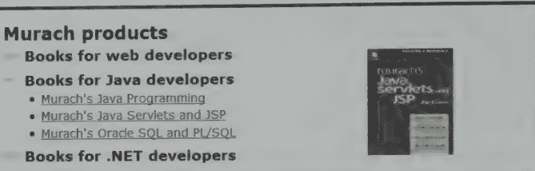

## 开发指南

- 1. 你可以在此文件夹中找到该应用程序的 HTML、CSS 和图像文件：`c:\jquery\exercises\ch07\book_list.js`。你还会发现一个名为 `book_list.js` 的空 JavaScript 文件。你可以将你的代码添加到此文件中。

- 2. 该应用程序的工作原理与你在本章中应用的 FAQ 类似，但在每个标题下方都会显示一个书籍链接列表。如果用户点击这些链接之一，书籍图像将显示在列表的右侧。此外，每当用户点击带有加号或减号标记的标题时，图像应不再显示。

- 3. 此应用程序链接的 HTML 与“图像切换”应用程序类似。然而，此应用程序的链接不需要 `title` 属性，因为图像不需要显示说明。

- 4. 此应用程序链接 `href` 属性引用的图像应该被预加载。要实现这一点，你可以遍历 `section` 元素中的所有链接。此外，务必取消链接的默认操作。

- 5. 随时从任何可用的应用程序中复制和粘贴代码，请注意：这是构建新应用程序最有效的方法。

**IE 注意：** 如果你将 `img` 元素的 `src` 属性设置为空字符串，当应用程序启动和用户点击标题时，将不会显示图像，但在 Internet Explorer 中，该元素将显示一个占位符。为了避免出现这种情况，你可以将 `img` 元素的 `style` 属性的 `display` 属性设置为 `"none"`。然后，当你想显示图像时，将此属性设置为 `"block"`。在第 9 章中，你将学习到一种使用 jQuery 设置 CSS 属性的更简单的方法。

# 如何使用效果和动画

现在你已经了解了使用 jQuery 的基础知识，本章介绍了效果和动画的方法。许多开发者最喜欢这些 jQuery 方法，因为开发效果和动画非常有趣，并且可以为页面增添趣味。在学习这些方法时，请记住网站的首要目标是可用性，因此请确保你的效果和动画不会偏离这一目标。

请记住，在看到这些方法运行之前，可能很难理解某些方法是如何工作的。为了帮助你理解，我们已经在本章的大多数示例包含在本章的下载资源中。因此，你可能需要在学习本章的过程中运行这些示例，以查看它们是如何工作的。

- 如何使用效果......................................................................232
- 用于效果的 jQuery 方法...............................................................232
- 使用 jQuery 效果的 FAQ 应用程序.............................................234
- 带效果的幻灯片应用程序................................................236
- 用户界面、HTML 和 CSS..........................................................236
- 编写 jQuery 的两种方法................................................................238
- 如何启动和停止幻灯片...............................................240
- 如何使用动画...............................................................................242
- 如何使用 `animate` 方法的基本语法..............242
- 如何链式调用 `animate` 方法......................................................244
- 如何使用 `delay` 和 `stop` 方法...............................................246
- 在效果和动画中使用缓效果.........................248
- 如何使用高级 `animate` 语法...........................................
以及处理队列的方法..................................................250
- 带动画的轮播应用程序.......................................252
- 用户界面、HTML 和 CSS......................................................252
- jQuery......................................................................................254
- 透视（Perspective）..................................................................................256

## 如何使用效果

本章首先介绍了 jQuery 提供的效果效果。在学习如何使用它们之后，你将学习如何使用 jQuery 文档中所谓的“自定义效果”。在实践中，网页上任何运动的幻象都可以称为*动画*，因此你可以将本章中的所有示例视为动画。

## 用于效果的 jQuery 方法

图 8-1 总结了*jQuery 效果方法*。这些包括第 7 章中介绍的 `show` 和 `hide` 方法。

对于 `fadeTo` 之外的所有方法，主要参数是 `duration` 参数，它决定了效果持续多长时间。例如，如果 `fadeOut` 方法的 `duration` 参数为 5000，则元素或元素将在 5 秒（5000 毫秒）内淡出。如果省略持续时间，效果将立即发生，因此没有动画。

相反，`fadeTo` 方法不仅需要 `duration` 参数，还需要 `opacity` 参数。`opacity` 参数必须是 0 到 1 之间的值，其中 1 是完全（正常）透明度，0 是不可见。

图中的示例显示了这些方法如何工作。在这里，第一个示例使用 `fadeOut` 方法在 5 秒内淡出。然后，第二个示例调用了 `fadeOut` 和 `slideDown` 方法，先让标题在 5 秒内淡出，然后在 1 秒内重绘其高度，使其看起来在向下滑动。正如你所看到的，

| 方法 | 说明 |
| :--- | :--- |
| `show()` | 从左侧显示元素。 |
| `hide()` | 从右上隐藏元素。 |
| `toggle()` | 切换显示隐藏。该方法已弃用。 |
| `slideDown()` | 以滑动动作显示元素。 |
| `slideUp()` | 以滑动动作隐藏元素。 |
| `slideToggle()` | 通过淡入显示或隐藏元素。 |
| `fadeOut()` | 通过淡出隐藏元素。 |
| `fadeToggle()` | 通过淡入显示或隐藏元素。 |
| `fadeTo()` | 根据第二个参数设置的透明度调整元素的透明度。 |

## `fadeTo` 之外方法的基本语法

```javascript
methodName({duration}, callback);
```

## `fadeTo` 方法的基本语法

```javascript
fadeTo(duration, opacity, callback);
```

## 网页加载后进行动画的标题 HTML

```html
<h1 id="startup-message">临时施工中！</h1>
```

## 在 5 秒内淡出标题的 jQuery

```javascript
$("#startup-message").fadeOut(5000);
```

## 使用链式调用淡出并滑回标题的 jQuery

```javascript
$("#startup-message").fadeOut(5000).slideDown(1000);
```

## 使用 `fadeTo` 方法的链式调用

```javascript
$("#startup-message").fadeTo(5000, .2).fadeTo(1000, 1);
```

## 使用回调函数获得与链式调用相同结果的 jQuery

```javascript
$("#startup-message").fadeTo(5000, .2, // 开始回调函数
function() {
    $(this).fadeTo(1000, 1); // 结束回调函数
});
```

元素的高度、宽度和透明度属性。例如，要显示一个元素，增加其高度、宽度和透明度，使其看起来是从左上角开始增长。相反，要隐藏一个元素，则减少其高度、宽度和透明度，使其看起来是从右下角收缩。

## 使用 jQuery 的 FAQs 应用程序

还记得上章节中的 FAQs 应用程序吗？该应用程序之前使用没有持续时间参数的 `show` 和 `hide` 方法来显示和隐藏 h2 元素中的问题答案。现在，图 8-2 展示了将动画应用于该应用的两种方法。

在第一个示例中，使用了带有持续时间参数的 `slideDown` 和 `fadeOut` 方法为应用程序添加动画。这与第 7 章中应用程序的代码相似，只是将 `show` 和 `hide` 方法替换成了这些新方法。

注意这里，对 `h2` 标题使用了 `toggle` 事件方法，因此第一个函数在标题的偶数次点击时执行，而第二个函数在奇数次点击时执行。由于计数从零开始，它的工作方式符合你的预期：在第一次点击时显示答案，第二次点击时隐藏，依此类推。不过，请记住 `toggle` 事件方法将在 jQuery 1.9 中被移除。

这就是为什么第二个示例展示了另一种获取结果的方法。在这里，对 `h2` 标题使用了 `click` 方法。然后，通过 `click` 事件的函数，使用 `toggleClass` 方法在每次点击时切换“minus”类，并使用 `slideToggle` 方法在每次点击时切换 `slideOut` 和 `slideIn` 方法。这种工作方式与 `toggle` 事件方法的示例相同，只是使用了 `slideUp` 方法代替了 `out` 方法。它所需的代码行也更少。

## 当标题文本显示时的 FAQs 应用程序

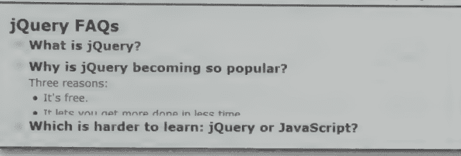

## HTML 部分

```html
<section id="faqs">
  <h1>jQuery FAQs</h1>
  <h2>What is jQuery?</h2>
  <div>
    <!-- div content -->
  </div>
  <h2>Why is jQuery becoming so popular?</h2>
  <div>
    <!-- div content -->
  </div>
  <h2>Which is harder to learn: jQuery or JavaScript?</h2>
  <div>
    <!-- div content -->
  </div>
</section>
```

## 带有 `slideDown` 和 `fadeOut` 方法的 jQuery

```javascript
$(document).ready(function() {
  $("#faqs h2").toggle(
    function() {
      $(this).addClass("minus");
      $(this).next().slideDown(1000);
    },
    function() {
      $(this).removeClass("minus");
      $(this).next().fadeOut(1000);
    }
  ); // end toggle
}); // end ready
```

```javascript
$(document).ready(function() {
  $("#faqs h2").click(
    function() {
      $(this).toggleClass("minus");
      $(this).next().slideToggle(1000);
    }
  ); // end click
}); // end ready
```

图 8-2 带有 jQuery 效果的 FAQs 应用程序

## 带有效果的幻灯片应用程序

为了让你了解如何使用效果，你现在将回顾编写幻灯片应用程序的两种不同方法。

## 用户界面、HTML 和 CSS

在图 8-3 中，屏幕截屏显示了幻灯片中的第三张幻片淡入的过程。在 HTML 的 `div` 元素中，你可以看到五个 `img` 元素为显示提供了幻片，每个这些元素都有一个 `alt` 属性，提供显示在幻片上方的说明。

在 HTML 中，注意使用 `h2` 元素用于说明，`img` 元素用于幻灯片，随其后的 `div` 元素包含幻灯片的 `img` 元素。这些元素的 `id` 属性分别为 "caption"、"slide" 和 "slides"，而 "caption" 和 "slide" 元素包含了系列中第一张幻片的说明和幻片。

在显示此应用程序的 CSS 中，你可以看到图像的高度被设置为 250 像素。在实践中，幻灯片的所有图像通常具有相同的大小，但为所有图像设置高度可以确保即使宽度不同，高度也是相同的。

注意，CSS 将名为 "slides" 的 `div` 元素中所有 `img` 元素的 `display` 属性设置为 "none"。这意味着这些 `img` 元素会在页面加载时加载到浏览器中，但不会被显示。相反，它们将在通过 jQuery 移动到 "slide" `img` 元素时逐个显示。

## 带有淡出和淡入的幻灯片应用程序


## 幻灯片的 HTML

```html
<section>
  <h1>Fishing Slide Show</h1>
  <h2 id="caption">Casting on the Upper Kings</h2>
  
  <div id="slides">
    
    
    
    
  </div>
</section>
```

## 幻灯片的 CSS

```css
img {
  height: 250px;
}
#slides img {
  display: none;
}
```

## 幻灯片的描述

为了让你了解如何使用效果，你现在将回顾编写幻灯片应用程序的两种不同方法。

在第一个示例中，代码首先为 "slides" 元素中的第一个 `img` 设置 `nextSlide` 变量。然后，`setInterval` 的函数淡出起始幻片和说明，就像在第一个示例中那样。然而，`fadeOut` 方法的回调函数中的代码完全不同。

它首先测试 "slides" 元素中的下一个 `img` 长度是否为零。如果是，这意味着没有下一张幻片了，此时 `nextSlide` 变量被设置为该区域中的第一个 `img`。否则，`nextSlide` 被设置为 "slides" 元素中的下一个 `img` 元素。

一旦确定了下一张幻片，代码就会为下一张幻片的 `src` 和 `alt` 属性设置变量。然后，它使用第一个变量为显示幻灯片的 `img` 元素设置 `src` 属性并将其淡入，并使用第二个变量设置说明文本并将其淡入。

这展示了编写此类应用程序的两种方法，你将在后续章节中看到更多。当你开发 applicli

# 编写 jQuery 的一种方式

```javascript
$(document).ready(function() {
  // create an array of the slide images
  var image, imageCache = [];
  $('#slides').each(function() {
    image = new Image();
    image.src = $(this).attr("src");
    image.title = $(this).attr("alt");
    imageCache.push( image );
  });
  // slide show
  var imageCounter = 0;
  var nextImage;
  var timer = setInterval(function () {
    $('#caption').fadeOut(1000);
    $('#slide').fadeOut(1000);
    function () {
      imageCounter = (imageCounter + 1) % imageCache.length;
      nextImage = imageCache[imageCounter];
      $('#slide').attr("src", nextImage.src).fadeIn(1000);
      $('#caption').text(nextImage.title).fadeIn(1000);
    }
  }, 3000);
})
```

# 编写 jQuery 的另一种方式

```javascript
$(document).ready(function() {
  var nextSlide = $("#slides img:first-child");
  var nextCaption;
  var nextSlideSource;
  // slide show
  setInterval(function () {
    $('#caption').fadeOut(1000);
    $('#slide').fadeOut(1000);
    function () {
      if (nextSlide.next().length == 0) {
        nextSlide = $("#slides img:first-child");
      } else {
        nextSlide = nextSlide.next();
      }
      nextSlideSource = nextSlide.attr("src");
      nextCaption = nextSlide.attr("alt");
      $('#slide').attr("src", nextSlideSource).fadeIn(1000);
      $('#caption').text(nextCaption).fadeIn(1000);
    }
  }, 3000);
})
```

图 8-4 用于幻灯片展示编写 jQuery 的两种方式

标题，目标之一是编写易于阅读、维护和在其他网页中重用的代码。另一个目标是编写高效的代码。根据这些目标判断，图中的第二个示例更好，因为它的代码相对直观，且不需要 Image 对象的数组。

无论你如何编写此应用程序，你都会发现当运行它时，标题和幻灯片几乎同时淡出，而不是一个接一个地进行。这是因为两个元素的特效一旦启动就会立即运行。在这种情况下，这意味着一个效果比另一个效果启动了几个毫秒，因此标题的淡出和淡入与幻灯片的淡出和淡入几乎在同一时间运行。

# 如何停止和启动幻灯片

为了提高幻灯片的可用性，你通常会为用户提供某种启动和重启幻灯片的方法。图 8-5 显示了其中方法。当用户点击当前幻灯片时，它从当前幻灯片开始，并在用户再次点击时重启。

首先，代码设置了一个用于运行幻灯片的匿名函数，并将其存储存储在名为 `runSlideShow` 的变量中。如果你查看该函数的代码，你会发现它与上一个图中第二个示例的代码是相同的。

其次，该函数之后是一个创建定时器变量的语句，该语句每 3 秒调用一次 `runSlideShow` 函数。但注意，它必须在 `runSlideShow` 函数之后编写，因为它是一个匿名函数。如果此语句在函数之前编写，JavaScript 引擎将抛出错误。

第三，最后一个事件处理器使用 `click` 事件方法在交替点击当前幻灯片时取消和恢复定时器。当幻灯片被点击时，如果定时器不为 null，则函数使用 `clearInterval` 方法取消定时器，从而停止幻灯片。否则，将创建定时器使其启动。

你还会注意到，幻灯片显示的是完整图像，而不是正在淡出或淡入的图像。这是因为幻灯片的定时器在当前间隔结束之前不会被取消的。此外，幻灯片会从下一个图像序列重新开始。这是因为即使定时器被取消，`nextSlide`、`nextCaption` 和 `nextSlide` 变量的值仍然被保留。

当然，还有许多其他方法可以停止和重启幻灯片。例如，你可以提供一个停止/启动按钮，其工作原理与点击幻灯片相同。你还可以添加“下一页”和“上页”按钮，允许用户在幻灯片停止时手动从一张幻灯片移动到下一张。现在你已经了解了运行、停止和启动幻灯片的基础代码，你应该能够自己添加这些增强功能。

# 用于停止和重启幻灯片的 jQuery

```javascript
$(document).ready(function() {
  var nextSlide = $("#slides img:first-child");
  var nextCaption;
  var nextSlideSource;
  // the function for running the slide show
  var runSlideShow = function() {
    $('#caption').fadeOut(1000);
    $('#slide').fadeOut(1000);
    function () {
      if (nextSlide.next().length == 0) {
        nextSlide = $("#slides img:first-child");
      } else {
        nextSlide = nextSlide.next();
      }
      nextSlideSource = nextSlide.attr("src");
      nextCaption = nextSlide.attr("alt");
      $('#slide').attr("src", nextSlideSource).fadeIn(1000);
      $('#caption').text(nextCaption).fadeIn(1000);
    }
    runSlideShow();
  };
  // start the slide show
  var timer = setInterval(runSlideShow, 3000);
  $('#slide').click(function() {
    if (timer != null) {
      clearInterval(timer);
    } else {
      timer = setInterval(runSlideShow, 3000);
    }
  });
});
```

## 说明

- 还有许多其他方法可以停止和重启幻灯片。
- 你可以提供一个停止/启动按钮，其工作原理与点击幻灯片相同。
- 你还可以添加“下一页”和“上页”按钮，允许用户在幻灯片停止时手动从一张幻灯片移动到下一张。
- 现在你已经了解了运行、停止和启动幻灯片的基础代码，你应该能够自己添加这些增强功能。

# `animate` 方法的基本语法

`animate({properties}[, duration][, callback])`

一个正在移动到“faqs”区域的动画标题

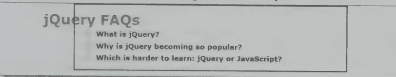

# h1 标题的 CSS

```css
#faqs h1 {
  position: relative;
  left: -175px;
  font-size: 75%;
  opacity: .2;
}
```

# 不带回调函数的 h1 标题 animate 方法

```javascript
$("#faqs h1").animate(
  { fontSize: "275%", opacity: 1, left: 0 }, // 属性映射
  2000
); //结束 animate
```

# 带有回调函数的 h1 标题 animate 方法

```javascript
$("#faqs h1").animate(
  { fontSize: "275%", opacity: 1, left: "+=175" }, 2000,
  function() {
    $("#faqs h2").next().fadeIn(1000).fadeOut(1000);
  }
); //结束 animate
```

## 描述

- 当运行 `animate` 方法时，所选元素的 CSS 属性将更改为作为方法第一个参数编码的 `properties` 映射中的属性。动画根据 `duration` 参数分阶段过渡完成。
- 要在 `properties` 映射中指定属性名，可以使用驼峰命名法（camel case）代替 CSS 连字符（如上所示），或者将属性名包含在引号中。
- 要指定非数值属性值，请将值包含在引号中。
- 要指定数值属性值，请使用代码。对于测量值，假设单位是像素。你也可以对数值使用 `+=` 和 `-=` 运算符，但这些表达式必须包含在引号中。
- 对于某些属性，如 `width`、`height` 和 `opacity`，可以使用 "show"、"hide" 或 "toggle" 作为属性值。这些将通过适当设置属性来显示、隐藏或切换元素。

虽然 jQuery 不处理颜色过渡，但它们由 jQuery UI 处理。

最后，你应该意识到，jQuery 动画在处理颜色时并不正常。但是，例如，你是否会让颜色随时间从橙色变为黑色？不过，jQuery UI 提供了颜色动画，你将在第 3 节中学习这些。

# 如何链式调用 `animate` 方法

要链式调用动画，你可以使用与链效果或其他方法相同的技术。在第一个动画方法后编写一个点运算符（`.`），然后编写第二个 `animate` 方法。

图 8-7 中的第一个示例说明了这一点，它在标题的点击事件处理程序中链式调用了两个 animate 方法。在这里，代码的缩进和对齐是为了表示两个 animate 方法是链式调用的。第一个方法增加了字体大小和透明度，并将标题向右移动 275 像素，使其回到起点。

当你对所选元素链式调用效果或动画时，它们被放入该元素的 `queue`（队列）中。然后，效果和动画将按顺序执行。这让你能够创建一些有趣的动画。

但是，请注意，单独编码的动画也会放置在队列中。图中的第二个示例说明了这一点。在这里，第一个语句是应用于标题（this）的 `animate` 方法。第二个语句是应用于相同标题的另一个 `animate` 方法。然后，当用户点击标题时，这些动画被放入队列中并连续运行，就像它们是链式调用的一样，因此结果与第一个示例中的链式方法相同。

现在，如果你快速连续点击标题两次或三次会发生什么？无论如何，`animate` 方法都会放入标题的队列中，因此它们将连续运行两次或三次。

相比之下，第三个示例为第一个 `animate` 方法使用回调函数来提供第二个 `animate` 方法。那么，如果用户只点击一次标题，它的工作方式与其他两个示例一样。但如果用户连续点击两次，第二次点击会将第二个 `animate` 方法排入队列，使其在第一个之后运行。但这意味着第二个 `animate` 方法可能会在第一个 `animate` 方法的回调完成之前开始。

正如你将看到的，排队列的概念对于某些应用很重要，特别是当你想停止队列中的方法运行时。记住，每个元素都有一个独立的队列。这就是为什么在幻灯片应用程序中，每个淡入和淡出几乎是同时发生的。

# 由点击事件启动带有两个动画的标题

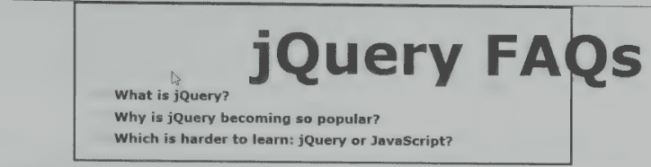

# 链式动画

```javascript
$('#faqs h1').click(function() {
  $(this).animate(
    { fontSize: "650%", opacity: 1, left:"+275px" }, 2000)
    .animate(
      { fontSize: "175%", left: "-275px" }, 1000)
    );
  //结束 click
});
```

# 队列动画

```javascript
$('#faqs h1').click(function() {
  $(this).animate(
    { fontSize: "650%", opacity: 1, left:"+275px" }, 2000);
  $(this).animate(
    { fontSize: "175%", left: "-275px" }, 1000);
});
```

# 带有回调函数的 h1 标题 animate 方法

```javascript
$("#faqs h1").click(function() {
  $(this).animate(
    { fontSize: "275%", opacity: 1, left: "+=175" }, 2000,
    function() {
      $("#faqs h2").next().fadeIn(1000).fadeOut(1000);
    }
  );
});
```

# 如何在效果和动画中使用缓动

图 8-9 显示了如何在效果和动画中使用缓动。缓动（easing）决定了动画的执行方式。例如，动画可以缓慢启动并随着进行逐渐加速。或者，动画可以在开始或结束时带有轻微的弹跳。

目前，jQuery 仅提供两种缓动：线性（linear）和摆动（swing）。正如你可能猜测的，线性缓动以匀的速度移动动画，而摆动则以更有趣的方式变化速度。幸运的是，摆动是默认值，所以你不需要更改。

如果你想使用其他缓动，你需要使用插件或 jQuery UI。两者都提供了许多你可以尝试的不同缓动。为了演示如何使用 jQuery UI 的缓动，本图提供了你需要的技巧，但你将在第 3 节学习更多关于缓动的知识。

要使用 jQuery UI 的缓动，你首先为 jQuery UI 编写一个脚本元素。在本图的示例中，该脚本元素从 Google CDN 获取 jQuery UI。注意，该脚本元素必须在 jQuery 的脚本元素之后编写，因为 jQuery UI 使用了 jQuery。

然后，为了使用 jQuery UI 提供的缓动之一，你为效果或动画编写缓动参数。该参数在种类型语句中的位置见本图顶部的语法摘要。

要编写此参数，你自然需要知道你想要使用的缓动名称。也许找到可用内容的最佳方法是访问本图底部指定的 URL。jQuery UI 网站的此页面不仅给你提供了缓动的名称，还让你运行每种缓动的演示。这可以帮助你为每种类型的动画选择想要使用的缓动。

# 在效果和动画中使用缓动的语法

除 `fadeTo` 方法外，所有基础方法的语法均如下：
`methodName([duration], easing[, callback])`

`fadeTo` 方法的语法
`fadeTo(duration, opacity[, callback])`

基础 `animate` 方法的语法
`animate(properties[, duration], easing[, callback])`

用于从 Google CDN 获取 jQuery UI 库的脚本元素
```html
<!-- jquery ui 的脚本元素必须位于 jquery 元素之后 -->
<script
src="https://ajax.googleapis.com/ajax/libs/jquery/1.8.16/jquery-ui.js">
</script>
```

# FAQs 应用中使用的两种缓动

```javascript
$("#faqs h2").toggle(
function() {
  $(this).toggleClass("minus");
  $(this).next().slideDown(1000, "easeOutBounce");
  function() {
    $(this).toggleClass("minus");
    $(this).next().slideUp(1000, "easeInBounce");
  }
}); // end toggle
```

# 动画标题的两种缓动

```javascript
$("#faqs h1").click(function() {
  $(this).animate(
    { fontSize: "650%", opacity: 1, left: "+=275" }, 2000, "easeInExpo" )
  .animate(
    { fontSize: "175%", left: "-275" }, 1000, "easeOutExpo" );
}); // end click
```

## 描述

- 缓动是指动画执行的方式。jQuery 仅提供两种缓动：摆动（swing）和线性（linear）。摆动是默认值，是你想要的动画。
- 插件（包括 jQuery UI）提供了许多其他类型的缓动。
- 要使用缓动，你为插件库或 jQuery UI 编写一个脚本元素。然后，使用插件或 jQuery UI 支持的任何缓动的名称为方法编写缓动参数。
- 在第 11 章，你将学习更多插件，在第 12 和 13 章中，你将学习更多关于 jQuery UI 的知识。
- 所有 jQuery UI 缓动的完整列表和演示可以访问：
http://jquery.com/effect/#easing

图 8-9 如何在效果和动画中使用缓动

# 如何使用高级 `animate` 语法和处理队列的方法

到此时，你可能已经学习了在效果和动画中将要的所有方法和技巧。但以防你尝试构建对队列有更多控制的应用程序，图 8-10 展示了 `animate` 方法的高级语法以及处理队列的方法。

当你使用高级 `animate` 方法时，你在括号内编写两个参数并用逗号隔开。在第一大括号中，你编写属性映射（properties map），就像在基础语法中一样。在第二组大括号中，你编写在本图第一个表格中汇总的一个或多个选项。

本图第一个示例展示了如何配合三个选项工作：`duration`、`specialEasing` 和 `complete`。在这里，`duration` 选项类似于基础语法中的 `duration` 参数，而 `complete` 选项类似于基础语法中的 `callback` 参数。然而，`specialEasing` 参数允许你为每个动画的属性指定不同的缓动。

虽然使用特殊缓动可能超出了你的需求，但你应该知道你也可以在基础语法中使用它们。这在本图的第二个示例中得到了体现。在这里，你只需要在属性映射的括号内编写每个属性及其缓动。

高级 `animate` 方法的 `step` 选项允许你在动画的每一步后运行一个函数。这让你意识到动画实际上被拆分成了微小的步骤，从而产生连续进展的错觉。例如，如果你用一个函数编写 `step` 选项，你就能看到动画拆分成了多少步。

高级 `animate` 方法的 `queue` 选项允许你在不将其放入队列的情况下立即执行动画。你也可以使用图中的方法来处理队列。但正如我在主题开始时说的，你可能永远不需要高级 `animate` 语法或处理队列的方法。

# `animate` 方法的高级语法

`animate({properties}, {options})`

# 高级语法的 options

| 选项 | 描述 |
| --- | --- |
| duration | 指定动画持续时间的字符串或数字。 |
| easing | 指定缓动函数的字符串。 |
| complete | 动画完成时运行的回调函数。 |
| step | 在动画拆分的每一步后进行调用的函数。 |
| queue | 布尔值。如果为 true，动画将放入队列。如果为 false，动画将立即开始。 |
| specialEasing | 属性映射中一个或多个属性对应的缓动。 |

# 处理队列的方法

| 方法 | 描述 |
| --- | --- |
| `queue([name])` | 获取选中元素的队列。 |
| `queue([name], newQueue)` | 用新队列替换选中元素的队列。 |
| `queue([name], callback)` | 将新函数（callback）添加到选中元素的队列末尾。 |
| `dequeue([name])` | 执行选中元素队列中的下一个。 |
| `clearQueue([name])` | 从队列中移除所有尚未运行。 |

# 使用高级语法的 `animate` 方法

```javascript
$("#faqs h1").animate(
  { fontSize: "60%", opacity: 1, left: "+=175",
  easing: { fontSize: "easeInExpo", left: "easeOutExpo" },
  duration: 2000,
  complete: function() {
    $("#faqs h2").next().fadeIn(1000).fadeOut(1000);
  }
}
); // end animate
```

# 使用基础语法按属性提供缓动

```javascript
$("#faqs h1").animate(
  { fontSize: ["60%", "easeInExpo"],
  opacity: [1, "swing"],
  left: ["+=275", "easeOutExpo"] }, 2000
); // end animate
```

## 带有动画的轮播图应用

本章最后介绍了一种名为轮播应用（Carousel application）的常见应用。它使用了一个简单的 `animate` 方法，但使用该方法的设置非常复杂。

## 用户界面、HTML 和 CSS

图 8-11 展示了轮播应用的用户界面、HTML 和 CSS。由于轮播图非常常见，你很可能在多个网站上使用过它们。如果你点击此处显示的轮播图中三本书右侧的按钮，书籍将向左滑动并显示另外三本书。如果你点击书籍左侧的按钮，书籍将向右滑动回到之前的三本书。

在 HTML 中，你可以看到整个轮播图的 `div` 元素内编写了三个 `div` 元素。第一个 `div` 元素包含左侧的书籍；第二个包含将用于轮播的全部九本书；第三个包含右侧的书籍。

在第二个 `div` 中，你可以看到一个包含 9 个 `li` 元素的 `ul` 元素。然后，在每个 `li` 元素内部，每个 `<a>` 元素中都有对应每本书的 `` 元素。这意味着用户可以点击每本书进入该书的页面。在示例中，所有 `href` 属性的值都被编码为 "newpage.html"，但在实际应用中，这些值将指向书籍的实际页面。

在该应用的关键 CSS 中，你可以看到中间 `div` 元素的宽度 `display_panel` 设置为 300 像素，这是三本书的宽度。此外，它的 `overflow` 属性被设置为 `hidden`，这意味着任何超出 300 像素的内容（即其他书籍）都将被隐藏。

接下来，`ul` 元素的 CSS（id 为 "image_list"）将 `position` 属性设置为 `relative`，这意味着对 `top` 或 `left` 属性的任何设置都将相对于该元素的正常位置。你会在该应用的 jQuery 中看到，轮播图中显示的书籍是由 `left` 属性决定的。该元素的 CSS 将 `width` 设置为 900 像素，`list-style` 设置为 "none"，这移除了列表项目符号。`left` 属性的浏览器兼容性在 IE 中必须设置为 0，而在其他浏览器中则假设如此。

然后，列表项目的 CSS 将它们向左浮动（float）。这意味着 `ul` 元素中的项目将水平显示，但 900 像素的宽度（每个项目 100 像素）将超过其容器 `div` 的宽度。记住，这里 `overflow` 为隐藏。

最后的 CSS 规则将 `li` 项目中 `img` 元素的宽度设置为 95 像素。这意味着每张图像右侧应该有 5 像素的间隔。如果你在 IE 和 Firefox 中运行此应用，你会发现 IE 获取的内边距较少。

由于总共有九张图片且每个 `li` 项目设置的宽度为 100 像素，`ul` 元素的宽度为 900 像素。

## 轮播图应用

查看书籍

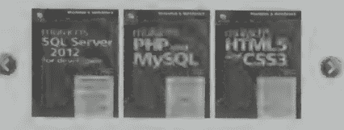

## 应用的 HTML

```html
<section>
  <h1>查看书籍</h1>
  <div id="carousel">
    <div id="left_button" class="button_panel">
      
    </div>
    <div id="display_panel">
      <ul id="image_list">
        <li><a href="newpage.html">
          
        </li>
        <li><a href="newpage.html">
          
        </li>
        <!-- 更多 5 个包含图片的元素 -->
        <li><a href="newpage.html">
          
        </li>
        <li><a href="newpage.html">
          
        </li>
        <li><a href="newpage.html">
          
        </li>
      </ul>
    </div>
    <div id="right_button" class="button_panel">
      
    </div>
  </div>
</section>
```

## 应用的关键 CSS

```css
#display_panel {
  width: 300px;
  overflow: hidden;
  float: left;
  height: 125px;
}
#image_list {
  position: relative; /* IE 需要，但 Firefox 不需要 */
  left: 0px;
  width: 900px;
  list-style: none;
}
#image_list li {
  float: left;
  width: 100px;
}
#image_list li img {
  width: 95px;
}
```

图 8-11 轮播应用的 HTML 和 CSS

## 章节2 jQuery 基础

为了让此应用正常工作，`div`、`ul` 和 `li` 元素的宽度必须正确协调。

## jQuery

如果你查看图 8-12 中应用的 jQuery 代码，你可以看到它由两个事件处理器组成：一个右按钮，和一个左按钮。你还可以看到每个事件处理器的最后一行使用 `animate` 方法将滑块的 `left` 属性移动到变量 `newLeftProperty` 的值。由于 `ready` 事件处理器的第一行代码将滑块值设置到 `ul` 元素，因此 `ul` 元素根据 `newLeftProperty` 变量的值向右或向左移动。

技巧在于每次点击右或左按钮时设置 `newLeftProperty` 变量的值。这就是每个事件处理器中其余代码所做的。在学习此代码时，请记住 `ul` 元素必须移动以显示 `li` 元素中的图像，因此 `left` 属性将为 0（起始位置）或负数。

现在看右按钮的事件处理器。为了让此应用正常工作，`div`、`ul` 和 `li` 元素的宽度必须正确协调。

左按钮的事件处理器工作原理类似。在获取当前属性值后，它使用 `if/else` 语句设置 `newLeftProperty`。这次，如果当前属性小于 0，则 `newLeftProperty` 增加 300。这意味着 `animate` 方法将滑块一直移动到右侧。否则，`left` 属性被设置为 0。

## 轮播应用的 jQuery

```javascript
$(document).ready(function() {
  var slider = $("#image_list"); // 滑块 = ul 元素
  var leftProperty, newLeftProperty;
  // 右按钮的点击事件处理器
  $("#right_button").click(function() {
    // 获取当前 left 属性的值
    leftProperty = parseInt(slider.css("left"));
    // 确定 left 属性的新值
    if (leftProperty - 300 < -900) {
      newLeftProperty = 0;
    } else {
      newLeftProperty = leftProperty - 300;
    }
    // 使用 animate 方法改变 left 属性
    slider.animate({left: newLeftProperty}, 1000);
  }); // 点击点击
  // 左按钮的点击事件处理器
  $("#left_button").click(function() {
    // 获取当前 left 属性的值
    leftProperty = parseInt(slider.css("left"));
    // 确定 left 属性的新值
    if (leftProperty < 0) {
      newLeftProperty = leftProperty + 300;
    } else {
      newLeftProperty = 0;
    }
    // 使用 animate 方法改变 left 属性
    slider.animate({left: newLeftProperty}, 1000);
  }); // 点击
}); // ready
```

## 描述

*   获取 `ul` 元素的 `left` 属性值范围为 0 到 -600。
*   `ul` 元素的 `left` 属性值范围为 0 到 -600。

## 展望

现在你已经完成了本章，你应该能够为你的网页添加一些常见的动画，例如幻灯片或轮播图。在下一章中，你将学习如何使用用于 DOM 脚本的 jQuery 方法，这些方法通常与效果和动画结合使用。因此，当你完成该章节后，将能够开发更复杂的动画。

## 术语

- 效果 (effect)
- 动画 (animation)
- 回调函数 (callback function)
- 属性映射 (properties map)
- 队列 (queue)
- 缓动 (easing)

## 总结

- jQuery 效果方法（例如淡入和淡出），让你能够为网页添加动画。
- jQuery 的 `animate` 方法允许你在特定持续时间内更改元素的 CSS 属性。这让你能够创建动画。
- 为了获得你想要的动画，通常会将一个效果一个接一个地链接。这会将效果放入队列，以便按顺序执行效果。
- 如果用户连续快速启动多次效果，这些效果将被放入队列中。在用户可能会这样做的某些情况下，你可能想要使用 `stop` 方法来停止效果并清空队列。
- 缓动（Easings）是指效果和动画随时间执行的方式。虽然 jQuery 仅提供了两种缓动——线性（linear）和摆动（swing），但 jQuery UI 提供了更多。

## 练习 8-1 动画实验

在此练习中，你将对效果、动画和缓动进行实验。

### 复习应用程序

1. 使用文本编辑器打开此文件夹中的 HTML、CSS 和 JavaScript 文件：
   `c:\jquery\exercises\ch08\animation\`
2. 运行应用程序查看其如何工作。注意顶层标题是如何从页面外进入视图的。然后，点击 FAQ 标题看看发生了什么。

### 针对 FAQ 标题的效果实验

3. 在 jQuery 代码中，更改 FAQ 标题的效果，使答案在点击标题时淡入和淡出视图。
4. 现在，更改 FAQ 标题的效果，使答案在点击标题时向下滑动和向上滑动。
5. 尝试不同的持续时间和效果，看看你认为哪种最符合易用性。

### 针对 h1 标题实验

6. 检查 h1 标题的 CSS，确认其起始位置为左属性（left）减去 175 像素。然后，检查 jQuery 代码，查看它向右移动 375 像素，然后向左移动 200 像素，这意味着左属性结束于零像素。
7. 重启应用程序，并注意 h1 标题从页面外移动到正确位置的动画。然后，点击标题查看动画如何重复，这将标题进一步向右移动。再次点击查看它再次重复，这使标题移动得更远。
8. 重启应用程序。然后，快速点击两次顶层标题。这应该连续运行两次动画，表明动画是排队执行。
9. 修复顶层标题的动画，使其在动画结束后始终返回 FAQ 上方的正确位置。这样它就不会跨越页面移动。要做到这一点，将其左属性设置为 0 像素。

### 在应用程序中添加 jQuery UI 缓动

10. 注意页面 HTML 中有一个用于 jQuery UI 的 `script` 元素。然后，将图 8-9 所示的缓动添加到效果和动画中。这改进效果了吗？
11. 如果你运行应用程序查看这些缓动如何工作，点击页面底部的链接进入 jQuery UI 缓动的演示。注意这将在你的浏览器中打开一个新页面或标签页。然后，尝试其他缓动，看看你喜不喜欢。

## 第 2 章 jQuery 基础

## 练习 8-2

这是一个简单的练习，让你尝试用于图 8-3 中幻灯片的各种效果。它使用了图 8-4 所示的第二个 jQuery 代码块。

1. 使用你的编辑器打开此文件夹中的 HTML、CSS 和 JavaScript 文件：
   `c:\jquery\exercises\ch08\slide_show\`
   然后，运行应用程序查看其如何工作。
2. 修改 jQuery，使标题和图像在幻灯片从一张移动到另一张时向上滑动然后滑回。然后，测试一下你是否喜欢。
3. 修改 jQuery，使用 `hide` 方法隐藏标题并使用 `show` 方法显示标题，者的间隔均为一秒。此外，将显示和隐藏幻灯片的时间增加到两秒，并将计时器的间隔增加到五秒。然后测试这些更改。
4. 如果你好奇，可以尝试效果、持续时间和缓动，直到幻灯片以你喜欢的方式运行。

## 练习 8-3 修改轮播图应用程序

这是一个简单的练习，将测试你是否理解了图 8-11 和 8-12 中轮播图应用程序的代码。

1. 使用你的编辑器打开此文件夹中的 HTML、CSS 和 JavaScript 文件：
   `c:\jquery\exercises\ch08\carousel\`
2. 按照现在的情况，当显示前三本书时点击左按钮，什么都不会发生。更改此设置，使得当在前三本书可见时点击左按钮时，显示最后三本书。
3. 修改 jQuery 代码，使当你点击其中之一时，轮播图每次移动一本书。

# 处理属性的方法

| 方法 | 描述 |
| --- | --- |
| `attr(name)` | 获取命名属性的值。 |
| `attr(name, value)` | 设置命名属性的值。 |
| `attr(map)` | 根据属性映射中指定的键值值对，设置多个属性的值。 |
| `attr(name, function)` | 将命名属性的值设置为函数返回的值。 |
| `removeAttr(name)` | 移除指定的属性。 |

## 处理类属性的方法

| 方法 | 描述 |
| --- | --- |
| `hasClass(name)` | 如果类存在，则返回 true。 |
| `addClass(name)` | 添加指定的类。 |
| `addClass(function)` | 添加函数返回的值指定的类。 |
| `removeClass(name)` | 移除指定的类。 |
| `removeClass(function)` | 移除函数返回的值指定的类。 |
| `toggleClass(name)` | 如果类存在，则移除它；否则，添加它。 |
| `toggleClass(function)` | 如果函数返回的值指定的类存在，则移除它；否则，添加它。 |

## 属性示例

将图像的 src 属性值设置为变量的值
`$("image").attr("src", "book1.jpg");`

使用映射设置两个属性的值
`$("image").attr({"src":"book1.jpg", "alt": "Book 1" });`

使用函数设置每个 `<a>` 元素的 href 属性值
```javascript
$("a").attr("href", function(index) {
  var href = "heading" + (index + 1);
  return href;
});
```

从 "faqs" 元素内的所有 `<h2>` 元素移除 id 属性
`$("#faqs h2").removeAttr("id");`

## 类属性示例

测试元素的类属性中是否包含 "closed" 值
`if ($("#faqs").hasClass("closed")) { ...`

为 "faqs" 元素的 `<h2>` 后代元素添加一个类
`$("#faqs h2").addClass("minus");`

从 `<h2>` 后代元素的类属性中移除 "minus" 类
`$("#faqs h2").removeClass("minus");`

图 9-1 处理属性的方法

## DOM 替换的方法

图 9-2 总结了 DOM 替换的方法，你应该已经知道如何使用 `val` 和 `text` 方法来处理控件中的值或元素内的文本。然而，请注意，与上一个图中看到的许多方法一样，你可以使用函数返回的值来指定值或文本。

此图中的示例展示了如何使用其他 DOM 替换方法。第一个示例位于 `<aside>` 元素内，第二个示例显示了如何将 HTML 放入 `<aside>` 元素中。在这种情况下，`<h2>` 元素被放置在 `<aside>` 元素内部。

第三个示例使用 `replaceWith` 方法将所有类名为 "old" 的元素替换为空的 `<h2>` 元素。在这里，选择器获取被替换的元素，而参数提供了将要替换它们的元素。

相比之下，第四个示例使用 `replaceAll` 方法获得相同的结果。这次，`<h2>` 元素位于通常选择器所在的位置，而参数指定了将被替换的目标元素。

| 方法 | 描述 |
| --- | --- |
| `val()` | 获取表单上第一个被选中控件的值。 |
| `val(value)` | 设置表单上第一个被选中控件的值。 |
| `val(function)` | 将表单上第一个被选中控件的值设置为函数返回的值。 |
| `text()` | 获取所有被选中元素（包括其后代）的合并文本。 |
| `text(textString)` | 将每个被选中元素的内容设置为指定的文本。 |
| `text(function)` | 将每个被选中元素的内容设置为函数返回的文本。 |
| `html()` | 获取第一个被选中元素的 HTML 内容。 |
| `html(htmlString)` | 将第一个被选中元素的 HTML 内容设置为指定的 HTML 字符串。 |
| `html(function)` | 将第一个被选中元素的 HTML 内容设置为函数返回的 HTML 字符串。 |
| `replaceWith(content)` | 用指定的内容替换每个选中的元素。可以是 HTML 字符串、DOM 元素或 jQuery 对象。 |
| `replaceAll(target)` | 用选中的元素替换每个目标元素。这与 `replaceWith` 的编码方式相反。 |

## 示例

显示 `<aside>` 元素中的所有 HTML
`alert($("aside").html());`

将 `<h2>` 元素放入 `<aside>` 元素中
`$("aside").html("<h2>Table</h2>");`

将所有类名为 "old" 的元素替换为 `<h2>` 元素
`$(".old").replaceWith("<h2>old</h2>");`

将所有类名为 "old" 的元素替换为 `<h2>` 元素
`$(".old").replaceAll("<h2>old</h2>");`

## 描述

- 在第 7 章中，你学习了如何使用 `val` 和 `text` 方法来获取和设置值以及文本。注意，你也可以使用函数来提供值和文本。
- 如果你在 `val`、`text` 或 `html` 方法中使用函数，函数将接收两个参数。第一个是元素在集合中的索引，第二个是旧的值、文本或 HTML。

图 9-2 处理属性的方法

## DOM 替换的方法

图 9-3 总结了 DOM 替换的方法。`prepend` 和 `append` 方法在选中元素的开头或结尾插入内容。`before` 和 `after` 方法在选中的元素之前或之后插入内容。

如果你在 `prepend` 或 `append` 方法在使用函数，它会接收集合中元素的索引以及元素的 HTML。如果你在 `before` 或 `after` 方法在使用函数，它仅接收元素的索引。

如果你想在将元素插入到文档的其他地方之前先复制它，则需要使用 `clone` 方法。否则，元素将从旧位置移动到新位置。

## DOM 插入和复制的方法

| 方法 | 描述 |
| --- | --- |
| `prepend(content)` | 在每个选中元素的开头插入指定的内容。 |
| `prepend(function)` | 在每个元素的开头插入函数返回的内容。 |
| `prependTo(target)` | 将选中的元素插入到目标元素的开头。 |
| `append(content)` | 在每个选中的元素结尾插入指定的内容。 |
| `append(function)` | 在每个元素的结尾插入函数返回的内容。 |
| `appendTo(target)` | 将选中的元素插入到目标元素的结尾。 |
| `before(content)` | 在每个选中的元素之前插入指定的内容。 |
| `before(function)` | 在每个选中的元素之前插入函数返回的内容。 |
| `insertBefore(target)` | 将选中的元素插入到目标元素之前。 |
| `after(content)` | 在每个选中的元素之后插入指定的内容。 |
| `after(function)` | 在每个选中的元素之后插入函数返回的内容。 |
| `insertAfter(target)` | 将选中的元素插入到目标元素之后。 |
| `clone([withEvents])` | 创建选中的元素的副本。参数是一个布尔值，指示是否复制事件处理程序。 |

## 示例

在 `<aside>` 元素的结尾插入一个 `<h2>` 元素
`$("aside").append("<h2>Table of contents</h2>");`

在 `<article>` 中的最后一个 `<p>` 元素之后插入 `<a>` 元素
`$("article p:last-child").after("<a href='#top'>Back to top</a>");`

将 `<article>` 中的 `<a>` 元素插入到 `<aside>` 中的 `<h2>` 元素之后
`$("article a").insertAfter("aside h2");`

复制 `<article>` 中的 `<a>` 元素并将它们插入到 `<aside>` 元素中的 `<h2>` 元素之后
`$("article a").clone().insertAfter("aside h2");`

## DOM 包装与移除方法

图 9-4 展示了包装和移除 DOM 元素的方法。例如，第一个示例将所有的 `<a>` 元素包装在 `<h2>` 元素中，如下所示：

```html
<h2><a id="heading1">The text for the a element</a></h2>
```

第二个示例仅将 一个 `<h1>` 元素的文本包装在 `<a>` 元素中，如下所示：

```html
<h1><a id="top">The text for the h1 element</a></h1>
```

第三个示例移除了文章中的第一个 `<a>` 元素。

## DOM 包装与移除方法

| 方法 | 描述 |
| --- | --- |
| `wrap(element)` | 在每个选定元素周围包装指定的元素。 |
| `wrap(function)` | 将函数返回的元素包装在每个选定元素周围。 |
| `wrapAll(element)` | 在所有选定元素周围包装指定的元素。 |
| `wrapInner(element)` | 在每个选定元素的内容周围包装指定的元素。 |
| `wrapInner(function)` | 将函数返回的元素包装在每个选定元素的内容周围。 |
| `empty([selector])` | 移除选定元素的所有子节点。 |
| `remove([selector])` | 从 DOM 中移除选定的元素。如果指定选择器，它将过滤选定的元素。 |
| `unwrap()` | 移除选定元素的父元素。 |

## 示例

在 h2 中包装所有的 `<a>` 元素
`$("a").wrap("<h2></h2>");`

在 `<a>` 元素中包装 h1 文本
`$("article h1").wrapInner("<a id='top'></a>");`

移除文章中的第一个 `<a>` 元素
`$("article a:first").remove();`

## 描述

- 用于包装的 DOM 元素允许你将 `<a>` 元素包装在其它想要以不同方式处理的元素或文本周围。
- 如果你在 `wrap` 或 `wrapInner` 方法上使用函数，它将接收一个参数，该参数是当前元素在集合中的索引。
- 用于移除和取消包装的 DOM 元素允许你移除元素或取消包装元素。


## TOC 应用

如果你在好奇如何或为什么要使用你刚刚学会的方法，现在你将回顾一个可以给你一些灵感的应用。

## 用户界面和 HTML

图 9-5 展示了 TOC（目录）应用程序的用户界面。它在侧边栏为页面提供了一系列链接，用户可以通过这些链接跳转到文章中七个主题的任何一个。它在每个主题之后还提供了一个“返回顶部”链接，让用户回到页面顶部。

在该页面的 HTML 中，你可以看到每个主题都由 `aside` 和 `article` 元素组成，这些元素用于构建页面。但请注意，`aside` 是空的。这意味着 jQuery 将为 `aside` 提供所有内容。

在文章中，你可以看到每个主题由一个 `<h1>` 元素后跟一个或多个段落组成。但请注意，每个主题的最后一个段落后面没有跟“返回顶部”链接。这意味着 jQuery 也必须为这些链接提供支持。

在 HTML 之后，你可以看到此应用中的 DOM 脚本对 HTML 产生的影响。虽然 HTML 实际上没有被改变（DOM 被改变了），但它显示了对 DOM 所做的更改。

首先，一个 `<a>` 元素被包装在 `<h1>` 元素的文本周围。这里的 id 是“top”，这意味着每个 `<a>` 元素可以使用“top”作为其 href 属性进行链接。换句话说，`<h1>` 元素内部的 `<a>` 元素是其他 `<a>` 元素链接的占位符。这就是为什么 HTML 可以工作，所以 jQuery 必须为 `<a>` 元素设置 id 和 href 属性。

其次，所有的 `<h2>` 元素都是由 jQuery 生成的。这些由文章中每个主题后面的一个 `<a>` 元素组成。每个主题的文本与文章中每个 `<h2>` 元素的文本相同。注意这些 `<a>` 元素中的 href 属性是“#heading1”、“heading2”等。

第三，在文章中每个 `<h2>` 元素的文本周围都包装了一个 `<a>` 元素。这里注意 `<a>` 元素中的 id 属性是“heading1”、“heading2”等。这意味着当用户点击侧边（aside）中的每个链接时，它将跳转到文章中相应的标题。

最后，在文章中每个主题的最后一个段落之后插入了一个 `<a>` 元素。这些元素的每个 id 都被设置为“#top”。这意味着点击这些链接中的一个将跳转到页面顶部，因为 `<h1>` 元素内 `<a>` 元素的 id 是“top”。

## TOC 应用程序的用户界面

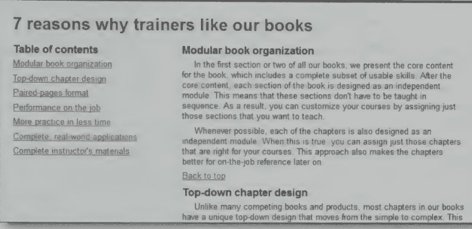

## HTML

```html
<body>
  <h1>7 reasons why trainers like our books</h1>
  <aside>
    <article>
      <h2>Modular book organization</h2>
      <p>In the first section or two of all our books, ... </p>
      <p>Whenever possible, each of the chapters is ... </p>
      <h2>Top-down design</h2>
      <p>Unlike books and products, ... </p>
    </article>
  </aside>
</body>
```

## jQuery 如何修改 DOM

```html
<body>
  <h1>7 reasons why trainers like our books</h1>
  <aside>
    <h2>Table of contents</h2>
    <a href="#heading1" id="heading1">Modular book organization</a>
    <a href="#heading2" id="heading2">Top-down design</a>
    <article>
      <h2><a href="#top" id="heading1">Modular book organization</a></h2>
      <p>In the first section or two of all our books, ... </p>
      <p>Whenever possible, each of the chapters is ... </p>
      <h2><a href="#top" id="heading2">Top-down design</a></h2>
      <p>Unlike books and products, ... </p>
      <a href="#top" id="top">Back to top</a>
    </article>
  </aside>
</body>
```

图 9-5 用户界面和 HTML

## jQuery

当你开发这样一个应用时，你需要计划执行什么以及顺序是什么。这通过图 9-6 的简单计划所示。

首先，jQuery 使用 `append` 方法将“Table of contents”添加到侧边。其次，jQuery 使用 `wrap` 方法在文章中的每个 `<h2>` 元素周围包装一个 `<a>` 元素。

第三，jQuery 为这些 `<a>` 元素添加 id 属性。为了实现这一点，它使用一个方法处理每个 `<a>` 元素。在方法的函数中，参数 id 将接收每个 `<a>` 元素的索引值，从零开始。然后将索引加1与单词“heading”拼接存储在变量 id 中。最后，使用 `attr` 方法将每个 `<a>` 元素的 id 属性设置为 id 的值。结果 id 值将是“heading1”、“heading2”等。

第四，文章中所有的 `<a>` 元素都被复制并插入到 `<h2>` 元素之后。这创建了所有需要的链接。但是第五，删除文章中 `<a>` 元素的 id 属性，因为它们不需要。此外，重复的 id 会导致错误。

第六，为这些 `<a>` 元素添加 href 属性。这次，使用函数作为 `attr` 方法的第二个参数来设置这些 href 属性的值也可以可以得到相同的结果。

此时，jQuery 将可以工作，但用户除了点击返回按钮或滚动之外，没有方法回到页面顶部。为了修复这个问题，第七段代码将 `<h1>` 元素的文本包装在一个 `<a>` 元素中，并将其 id 设置为“top”。

## 第 9 章 如何使用 DOM 操作和遍历方法

### 将“目录”标题的 jQuery h2 元素添加到 aside 标签中。

- 向 aside 中添加 h2 元素。
- 使用 `<a>` 元素包裹 article 中所有 h2 元素的文本。
- 为 article 中的 `<a>` 元素添加正确的 `id` 属性。
- 克隆 article 中的 `<a>` 元素，并将其向后插入到 aside 中 h2 元素之后。
- 移除 aside 中 `<a>` 元素的 `id` 属性。
- 为 aside 中的 `<a>` 元素添加正确的 `href` 属性。
- 用 `id` 为“top”的 `<a>` 元素包裹 h1 元素。
- 在每个主题的末尾插入指向 h1 元素的 `<a>` 元素。

### jQuery 实现

```javascript
$(document).ready(function() {
  // 向 aside 中添加 h2 标题
  $("aside").append("<h2>Table of contents</h2>");
  // 将 aside 中 h2 的文本包裹在 <a> 标签中
  $("aside h2").wrapInner("<a></a>");
  // 为标签添加 id
  $("article a").each(function(index) {
    var id = "heading" + (index + 1);
    $(this).attr("id", id);
  });
  // 克隆 article 中的 <a> 标签并将其到 aside 中
  $("article a").clone().insertAfter($("aside h2"));
  // 移除 aside 中 <a> 标签的 id 属性
  $("aside a").removeAttr("id");
  // 为 aside 中的 <a> 标签添加 href 属性
  $("aside a").attr("href", function(index) {
    var href = "#heading" + (index + 1);
    return href;
  });
  // 用 <a> 标签包裹 h1 元素
  $("h1").wrapInner("<a id='top'></a>");
  // 在每个主题后插入“回到顶部” <a> 标签
  $("article h2").before("<a href='#top'>Back to top</a>");
  $("aside a:first").remove();
  $("aside p:last").after("<a href='#top'>Back to top</a>");
})
```


## 描述

- 因为 jQuery 方法的功能经常重叠，你可以用许多不同的方式来编写此应用程序，并获得相同的结果。

图 9-6 用于目录应用程序的 jQuery

## 处理样式和定位的方法

接下来的两个主题将介绍处理样式和定位的 jQuery 方法。然后，你将看到如何使用其中一些方法来增强你刚刚学习的目录应用程序。

### 处理样式的方法

图 9-7 展示了处理样式的 DOM 操作方法。与 `attr` 方法类似，`css` 方法允许你获取和设置 CSS 属性。你还可以使用 map（映射）通过单个方法设置多个属性，也可以使用函数来设置属性的值。该图中的前两个示例展示了如何使用 `css` 方法设置一个或多个属性。

各种高度和宽度方法允许你获取和设置元素的高度和宽度。这些方法的区别在于它们的测量值是否包含了外边距（margins）、内边距（padding）和边框（borders）。例如，图中的第三个示例使用 `height` 方法获取 `article` 元素的高度，该高度不包含内边距、外边距或边框。

### 处理样式的方法

| 方法 | 描述 |
| --- | --- |
| `css(name)` | 获取指定属性的值。 |
| `css(name, value)` | 设置指定属性的值。 |
| `css(map)` | 根据属性映射中指定的键值对设置多个属性的值。 |
| `css(name, function)` | 将指定属性的值设置为函数返回的值。 |
| `height()` | 获取第一个选中元素的高度。该高度不包含内边距、外边距或边框。 |
| `height(value)` | 设置第一个选中元素的高度。 |
| `innerHeight()` | 获取第一个被选中元素的高度，包括内边距，但不包含外边距或边框。 |
| `outerHeight([includeMargin])` | 获取第一个被选中元素的高度，包括内边距和边框。如果参数设置为 `true`，则还包含外边距。 |
| `width()` | 获取第一个被选中元素的宽度。该宽度不包含内边距、外边距或边框。 |
| `width(value)` | 设置第一个选中元素的宽度。 |
| `innerWidth()` | 获取第一个被选中元素的宽度，包括内边距，但不包含外边距或边框。 |
| `outerWidth([includeMargin])` | 获取第一个被选中元素的宽度，包括内边距和边框。如果参数设置为 `true`，则还包含外边距。 |

### 示例

将所有 `h2` 元素的 CSS 颜色属性设置为蓝色

```javascript
$("h2").css("color", "blue");
```

使用 map 为所有 `h2` 元素设置两个 CSS 属性

```javascript
$("h2").css({ "color": "blue", "font-size": "150%" });
```

获取 `article` 元素的高度

```javascript
var height = $("article").height();
```

## 描述

- 这些属性可以很方便地获取和设置元素的属性，还可以获取和设置元素的高度和宽度。
- 当你获取高度或宽度值时，它以数字形式返回，并假设单位为像素。
- 当你指定高度或宽数字时，如果你使用 `css` 方法，它包含单位。

图 9-7 处理样式的方法

## 处理定位的方法

图 9-8 展示了定位方法。在这里，`offset` 方法获取相对于文档的坐标。相比之下，`position` 方法获取相对于父元素的坐标。例如，第一个示例获取 `article` 元素的 offset。相比之下，第二个示例创建了这样一个对象：

```javascript
var asideCoordinates = new Object();
```

这是使用 JavaScript 创建 offset 的方法。然后，接两个语句给 `top` 和 `left` 属性赋值。最后，使用 `offset` 方法设置 `top` 和 `left`。同样，你可以使用 `scroll` 方法来获取和设置 `top` 和 `left`。例如，第三个示例使用 `scrollTop` 方法设置窗口顶部。

### 处理定位的方法

| 方法 | 描述 |
| --- | --- |
| `offset()` | 获取第一个被选中元素的坐标，并将它们在一个包含 `top` 和 `left` 属性的对象返回。这些坐标相对于文档。 |
| `offset(coordinates)` | 设置第一个被选中元素相对于文档的坐标。参数是一个包含 `top` 和 `left` 属性的对象。 |
| `position()` | 获取第一个被选中元素的坐标，并将它们在一个包含 `top` 和 `left` 属性的对象返回。这些坐标相对于父元素。 |
| `scrollTop()` | 获取第一个被选中元素垂直滚动条的位置。 |
| `scrollTop(value)` | 设置第一个被选中元素垂直滚动条的位置。 |
| `scrollLeft()` | 获取第一个被选中元素水平滚动条的位置。 |
| `scrollLeft(value)` | 设置第一个被选中元素水平滚动条的位置。 |

### 示例

```javascript
// 获取 article 元素的顶部 offset
var offsetTop = $("article").offset().top;
```

```javascript
// 设置 aside 元素的 offset 坐标
var asideCoordinates = new Object();
asideCoordinates.top = 200;
asideCoordinates.left = 100;
$("aside").offset(asideCoordinates);
```

```javascript
// 将窗口滚动条移动到顶部
$(window).scrollTop(0);
```

## 描述

- `scroll` 方法适用于窗口对象，以及当元素高度小于其内容时、`overflow` CSS 属性设置为 `auto` 的元素。
- `scrollTop` 方法返回滚动区域上方隐藏的视图的像素数。如果滚动条在顶部或元素不可滚动，则该数字为 0。
- `scrollLeft` 方法返回滚动区域左侧隐藏的视图的像素数。如果滚动条在最左侧或元素不可滚动，则该数字为 0。

## 增强型 TOC 应用

为了展示如何使用这些方法，图 9-9 展示了 TOC 应用的增强版本，以及用于这些增强的 jQuery 代码。该应用程序的工作方式与之前的类似，但带有两项增强。

首先，当用户点击某个选中主题的链接时，该主题的标题会放大并变为蓝色；这样很容易看出哪个标题被选中了。每当用户点击链接时，目录都会移动到选中标题的左侧。这样，目录始终可见，用户可以轻松地选择他们感兴趣的下一个主题。这意味着不再需要“回到顶部”链接，尽管可以在目录的底部添加一个。

用于这些增强的 jQuery 代码位于 `aside` 元素中 `<a>` 元素点击事件的事件处理器中。每个链接点击事件的默认操作是跳转到文章中相关的标题。但此事件处理器将阻止该默认操作。

该事件处理程序中的第一个代码块从 `aside` 中被点击的 `<a>` 元素获取 `href` 属性，并将其赋值给命名为 `id` 的变量。为了做到这一点，它使用 `$(this)` 来引用被点击的 `<a>` 元素。例如，如果点击了目录中的第三个链接，则 `id` 将是 `"heading3"`。

第二个代码块使用该 `id` 获取文章中的标题。例如，`"heading3"` 是一个选择器，用于获取 `id` 为 `"heading3"` 的元素。然后，使用 `.css()` 方法为选中的标题设置两个属性。

第三个代码块移动 `aside`，使其位于选中标题的左侧。该代码块中的前三个语句获取了选中标题的顶部偏移量（top offset）、`aside` 的高度以及文章的高度。然后，它使用这些值来确定目录的偏移量应该是多少。

如果选中标题的偏移量加上 `aside` 的高度小于或等于文章的高度，则给 `aside` 分配与所选标题相同的偏移量。这意味着 `aside` 的顶部将与文章中的标题对齐。反之，`aside` 的偏移量将设置为文章高度减去 `aside` 的高度，这意味着 `aside` 将位于页面底部。

该代码块中的最后一个语句使用 `.css()` 方法将 `aside` 的 `top` 属性设置为由该偏移量指定的值。这就是让 `aside` 在页面上移动的原因。

对于这项工作，`body` 的 `position` 属性应设置为 `relative`，`aside` 的 `position` 属性应设置为 `relative` 或 `absolute`。然后，TOC 将根据 CSS `top` 属性的设置在 `aside` 内部定位。然而，位置将根据 `aside` 使用相对定位还是绝对定位而略有不同。

注意，无论你使用 `position` 方法还是 `offset` 方法获取顶部偏移量，此应用程序的效果都是相同的。注意，无论链接的 HTML 是由 jQuery 生成、在图 9-6 中还是手动输入 HTML 的，此应用程序都能工作。

## 第 9 章：如何使用 DOM 操作和遍历方法

## TOC 移动到选中主题的 TOC 应用

## 培训师喜欢我们书籍的 7 个理由

| 模块化书籍 |
| :--- |
| 在我们所有书籍的第一或二节中，我们介绍了书籍的核心内容，其中包括一套完整的、可用示例。核心内容之后，书的每一节都被设计成一个独立的模块。这意味着这些章节不需要按顺序学习。因此，你可以通过分配你想要学习的章节来自定制课程。每个章节也被设计成独立的模块。如果是这样，你可以只将那些章节分配到你的课程中。这种方法也使得章节更适合按需参考。 |

- 目录
- 模块化书籍组织
- 自顶向下的章节设计
- 跨页格式
- 工作表现
- 在更短的时间内进行更多练习
- 完整的、真实的应用
- 完整的讲师材料

| 自顶向下的章节设计 |
| :--- |
| 与许多书籍和产品不同，我们书籍中的大多数章节都有独特的自顶向下的设计，从简单到复杂。这使得学习变得更容易。这也意味着你可以介绍一个章节的主题以让每个人理解核心细节，而无需介绍该章节中的所有主题。然后，读者可以在工作需要时自行学习这些主题。 |

| 跨页格式 |
| :--- |
| 如果你翻阅我们的其中一本书，你会看到所有相关的 |

## `aside` 的 `position` 必须是 `relative` 或 `absolute`

```css
body { position: relative; }
aside { position: absolute; }
```

## jQuery 事件处理器已添加到应用程序中

```javascript
// 更改所选主题的 CSS 并移动 TOC
$('a').click(function() {
  // 从 <a> 标签中派生所选 h2 元素的偏移量
  var id = $(this).attr("href"); // 获取 <a> 标签中 href 属性的值

  // 更改选中标题的样式
  $(id).css({ "color": "blue", "font-size": "150%" });

  // 移动 aside 使紧邻下一个标题
  var h2offset = $(id).offset().top; // 获取 h2 的顶部偏移量
  var asideHeight = $("aside").height(); // 获取 aside 的高度
  var articleHeight = $("#article").height(); // 获取文章的高度

  if (h2offset + asideHeight <= articleHeight) {
    var asideOffset = h2offset;
  } else {
    var asideOffset = articleHeight - asideHeight;
  }

  $("aside").css("top", asideOffset);
});
```

## Description

- `aside` 的 `position` 必须是 `relative` 或 `absolute`。
- jQuery 事件处理器已添加到应用程序中。
- 更改所选主题的 CSS 并移动 TOC。
- 从 `<a>` 标签中派生所选 `h2` 元素的偏移量。
- 更改选中标题的样式。
- 移动 `aside` 使紧邻下一个标题。

## DOM 方法

本章中的 `next` 方法提供了一套用于遍历 DOM 的方法。这意味着你可以介绍一个章节的主题让每个人理解核心细节，而无需介绍该章节中的所有主题。然后，读者可以在工作需要时自行学习这些主题。

## 树遍历方法

| 方法 | 说明 |
| :--- | :--- |
| `siblings([selector])` | 获取每个选中元素的兄弟元素，可以根据选择器过滤。 |
| `next([selector])` | 获取每个元素之后的第一个兄弟元素，可以根据选择器过滤。 |
| `nextAll([selector])` | 获取每个元素之后的所有兄弟元素，可以根据选择器过滤。 |
| `nextUntil([selector])` | 获取每个元素之后的所有兄弟元素，直到指定的元素。 |
| `prev([selector])` | 获取每个元素之前的第一个兄弟元素，可以根据选择器过滤。 |
| `prevAll([selector])` | 获取每个元素之前的所有兄弟元素，可以根据选择器过滤。 |
| `prevUntil([selector])` | 获取每个元素之前的所有兄弟元素，直到指定的元素。 |
| `children([selector])` | 获取每个选中元素的子元素，可以根据选择器过滤。 |
| `parents([selector])` | 获取每个元素的祖先元素，可以根据选择器过滤。 |
| `parentsUntil([selector])` | 获取每个元素的祖先元素，直到指定的元素。 |
| `parent([selector])` | 获取每个选中元素的父元素，可以根据选择器过滤。 |
| `offsetParent()` | 获取最近的已定位祖先。 |
| `closest([selector, context])` | 从当前元素开始并向上 DOM 树查找第一个匹配指定选择器的元素。如果指定了 `context` 参数，则它指定了必须在其中查找选中元素的 DOM 元素。 |
| `find([selector])` | 在每个选中元素经过指定选择器过滤后，获取其后代。 |

## 示例

获取元素的上一个段落兄弟
`var previousParagraph = $("#last_heading").prev("p");`

获取元素的父元素
`var parent = $("#faqs").parent();`

获取带有 `article` 元素的 `<p>` 元素中的所有 `span`
`$("article p").find("span").css("color", "red");`

# 过滤方法

为了增强树遍历方法，DOM 遍历方法也包含了过滤方法。这些方法总结在表 9-11 中。例如，图中的第一个示例展示了如何使用 `filter` 方法仅选择 `"best"` 类的 `h2` 元素。第二个示例展示了如何使用 `not` 方法选择除 `"first"` 类元素之外的所有 `<p>` 元素。

第三个示例展示了如何使用 `slice` 方法选择 ID 为 `"slides"` 的元素中，从第二张图片到最后一张图片的所有图像。为了做到这一点，它使用了索引值 `1`，由于索引从 0 开始，因此这获取了第二张图片。

在很多情况下，这些过滤方法的结果与你通过普通选择器和方法可以得到的结果是重复。例如：

```javascript
$("h2.best")
```

选择元素与

```javascript
$("h2").filter(".best")
```

选择的元素相同。

不过，在某些情况下，过滤方法可以获得普通选择器无法获得的结果。

过滤方法的另一个优点是它们便于了链式调用（chaining）。图中的最后一个示例说明了这一点。在这里，方法被跨多行编写，但它们也可以写在单行中。

在第一行方法中，第一个方法被用于过滤 ID 为 `"slides"` 的元素中的图像集，使其仅包含第一张图片。然后，该图片被淡出（faded out）。在第二行中，使用 `next` 方法获取第一张图片的第一个兄弟元素，即第二张图片。然后，该图片被淡入（faded in）。

此时，集合中的唯一对象是第二张图片。正因如此，链中的后续方法将在该图片上执行。例如，如果随后的方法是本示例所示的 `appendTo` 方法，该方法将把第二张图片移动到其他图像的末尾。在这种情况下，你希望将第一张图片移动到图像的末尾，以便它在原始图像集中的最后一张图片显示后再次显示。为了实现这一点，在执行 `appendTo` 方法之前执行了 `end` 方法。这会将选定的元素集返回到其之前的状态，即仅包含第一张图片的集合。你将在下一幅图的幻灯片中看到它是如何运作的。

# 过滤方法

| 方法 | 说明 |
|---|---|
| `filter(selector)` | 将选定的元素集减少为匹配选择器的元素。 |
| `filter(function)` | 将选定的元素集减少为通过函数测试的元素。 |
| `not(selector)` | 从选定的元素集中剔除由选择器指定的元素。 |
| `not(elements)` | 从选定的元素集中剔除指定的元素。 |
| `not(function)` | 从选定的元素集中剔除通过函数测试的元素。 |
| `has(selector)` | 将选定的元素集减少为拥有匹配选择器的后代的元素。 |
| `eq(index)` | 将选定的元素集减少为指定索引处的元素。 |
| `first()` | 将选定的元素集减少为集合中的第一个元素。 |
| `last()` | 将选定的元素集减少为集合中的最后一个元素。 |
| `slice(start[, end])` | 将选定的元素集减少为位于参数指定的索引范围内的元素。 |
| `end()` | 将选定的元素集返回到其之前的状态。 |

# 示例

更改 `"best"` 类的 `h2` 元素的属性
`$("h2").filter(".best").css("color", "red");`

更改除 `"first"` 类元素之外的所有 `<p>` 元素的属性
`$("p").not(".first").css("text-indent", "1.5em");`

隐藏 `"slides"` 元素中索引 0 之外的所有图像
`$("#slides img").slice(1).hide();`

对集合中的图像操作

```javascript
$("#slides img")
  .first().fadeOut(1000) // 淡出集合中的第一个元素
  .next().fadeIn(1000) // 淡入集合中的下一个元素
  .end() // 返回集合中的第一个元素
  .appendTo("#slides"); // 将第一个元素追加到集合的末尾
```

## 描述

- 许多过滤方法重复了通过选择器可以完成的功能。
- 使用过滤方法的益处是它们便于了链式调用。特别是 `end` 方法允许你将链中的对象返回到原始选择。
- 如果你在 `filter` 或 `not` 方法中使用函数，它将接收一个带有当前元素在集合中索引的参数。

图 9-11 过滤方法

# 一个使用 DOM 遍历方法的幻灯片应用

图 9-12 展示了如何在幻灯片中使用 DOM 遍历方法。在这里，幻灯片是 ID 为 `"slides"` 的 `div` 元素中的 `img` 元素。然后，jQuery 淡出这些图像创建一个幻灯片。

为了让这段代码工作，必须通过 CSS 将图像的 `position` 属性设置为 `absolute`。否则，淡入的图像将短暂地出现在淡出图像右侧，然后移动到左侧。这是因为 `fadeIn` 方法在 `fadeOut` 方法完成之前稍微开始了。

为了说明 jQuery 有多种编写方式，此图展示了运行幻灯片的两种方法。在第一个示例中，第一个语句使用 `slice` 方法隐藏除第一张图片以外的所有图像。接下来，`setInterval` 中的第一个语句使用 `slice` 方法……（此处由于原文重复混乱，已按逻辑处理）。

## 第 9 章 如何使用 DOM 操作和遍历

## 复习应用程序

1. 使用你的文本编辑器打开此文件夹中的 HTML 文件：
   `c:\jquery\exercises\ch09\toc\`
   注意，该文件包含了包含此应用程序 JavaScript 的 `<script>` 元素。

2. 运行应用程序并点击目录（TOC）中的几个链接，查看导航是如何工作的。注意，此应用程序没有在每个主题后包含“回到顶部”链接。注意，当选择一个主题时，文章中的 `<h2>` 标题会放大并变为蓝色，但当选择另一个主题时，该标题不会重置为原始的 CSS 值。

## 增强应用程序

3. `ready` 事件处理器中的第三块代码为刚刚添加到文章中的 `<a>` 元素添加了内容。将其注释掉。然后，在它下方重写代码，使其使用带有 `attr` 方法的函数而不是任何事件方法来设置 `id`。如果你在此遇到任何困难，请查看使用函数设置 `aside` 中 `<a>` 元素 `href` 属性的三个代码块。完成后，测试此更改。

4. 在 `aside` 末尾添加一个“回到顶部”的 `<a>` 元素。点击时，此链接应跳转到文章中的第一个标题。注意与其他链接与“回到顶部”链接之间有空格，你可以在“回到顶部”链接之前插入 `<br>` 元素来获取该空格。

5. 如上所示，对每个主题除第一个以外的所有段落进行缩进。为此，将 `text-indent` 属性设置为 `1.5em`。如果你使用 DOM 遍历方法，可以使用一条语句设置缩进。否则，使用两条语句来实现该结果也可以的。

6. 在 `aside` 中 `<a>` 元素的点击事件处理器中，第一块代码设置了刚选中的文章中 `<h2>` 元素的颜色和字体大小。紧接着，编写一条或多条语句将文章中所有其他 `<h2>` 元素重置为黑色和字体大小 `120%`，因为这些是 CSS 中的初始值。要选择除当前选中外的所有 `<h2>` 元素，请尝试使用 `not` 方法。

## 如何处理表单和数据验证

为了创建动态网页，你使用 HTML 创建允许用户输入数据的表单。然后，用户可以点击按钮将数据提交到 Web 服务器进行处理。但在数据提交之前，数据通常会通过浏览器中的 JavaScript 进行验证。

在本章中，你将学习如何使用 jQuery 处理表单，并学习如何使用 JavaScript 在浏览器中进行数据验证。你还将学习如何使用验证插件来验证表单中的数据。

- 表单和控件简介 ................................................ 288
- 表单的工作原理 ..................................................................... 288
- 用于处理表单的 HTML5 和 CSS3 特性 ............................ 290
- 如何使用 jQuery 处理表单 ................................................ 292
- 用于表单的 jQuery 选择器和方法 ....................................... 292
- 用于表单的 jQuery 事件方法 ................................................... 294
- 使用 JavaScript 的验证应用程序................................................... 296
- 用户界面和 HTML.................................................................................. 296
- 应用程序的一些 JavaScript 代码 ........................ 298
- 如何使用插件进行数据验证 ............................................ 300
- 如何使用验证插件.............................................................. 300
- 验证插件的选项和默认错误信息...... 302
- 使用验证插件的验证应用程序......................................................... 304
- 用户界面 ................................................................................... 304
- HTML ........................................................................................ 306
- CSS .................................................................................................. 308
- 观点 ................................................................................ 310

### 表单和控件简介

表单包含一个或多个控件，例如文本框和按钮。接受用户输入的控件也称为字段（fields）。在接下来的两个主题中，你将学习表单如何工作，以及如何使用 HTML5 特性处理表单。

## 表单的工作原理

图 10-1 显示了如何创建一个包含三个控件的表单：两个文本框和一个按钮。首先，你编写 `<form>` 元素代码。在该元素的起始标签上，你编写了 `action` 和 `method` 属性。`action` 属性指定了提交表单时用于处理数据的 Web 服务器文件。`method` 属性指定了将表单发送到 Web 服务器的 HTTP 方法。

在示例中，当用户点击“加入我们的列表”（Join our List）按钮时，表单将使用 HTTP `"get"` 方法提交到服务器。然后表单中的数据将由名为 `join.php` 的文件代码处理。该文件将使用 PHP 作为脚本语言。

当你使用 `"get"` 方法时，表单数据作为 HTTP 请求 URL 的一部分发送。这意味着数据是可见的，页面可以被标记。图中的 URL 说明了这一点。在这里，URL 后面跟着一个问号以及由 `&` 分隔的键值对，展示了 `name` 属性和字段值。在这种情况下，提交了两个值：电子邮件地址和名字。

## 用于处理表单的 HTML5 和 CSS3 特性

如果不熟悉 HTML5 和 CSS，图 10-2 总结了它们处理表单的主要特性。这些特性已经影响了某些表单的开发方式，当所有浏览器都完全支持它们时，它们将产生更大的影响。

首先，HTML5 提供了新的输入控件，这些控件在图中第一个表格中进行了总结。通常情况下，这些控件被实现为文本框，但 `type` 属性指示了每个文本框中应该输入什么类型的数据。某些浏览器已经对这些输入条目提供了自动验证，某些浏览器可能还会添加小部件来帮助用户输入有效内容。

例如，如果你在 `type` 属性上使用 `"email"`，某些浏览器会对比输入的电子邮件地址进行数据验证。如果你在 `type` 属性上使用 `"number"`，某些浏览器将添加按钮，让用户增加或减少当前值。如果你使用 `"date"` 作为 `type` 属性，某些浏览器将对输入进行验证，而 Opera 还会显示一个日历让用户选择日期。至少，这些属性指示了控件所属的数据类型，这从语义化角度来说是有益的。

HTML5 提供了用于处理控件的新属性，最重要的属性总结在图中第二个表格中。`autofocus` 属性会在表单加载时将焦点移动到控件。这意味着你不需要使用 JavaScript 来实现这一点。此外，`placeholder` 属性可以用于在控件中放置起始文本，帮助用户以正确的格式输入数据。当用户获取控件焦点时，该文本会被移除。

相比之下，`required` 属性会导致浏览器在提交表单进行处理之前检查字段是否为空。如果字段为空，它会显示一条消息且不提交表单。当点击提交按钮时，浏览器还会高亮显示所有其他为空的必填字段。

如果你为字段编写了 `title` 属性，那么当鼠标悬停在字段上时，就会显示该属性的值。它也会显示在浏览器针对字段的标准错误消息的末尾。

`pattern` 属性通过使用正则表达式提供数据验证。正则表达式提供了一种将用户输入与字符模式匹配的方法。因此，正则表达式可以用于验证用户输入的内容，如信用卡号、邮政编码、日期或电话号码。许多编程语言（包括 JavaScript 和 PHP）都支持正则表达式，现在 HTML5 也支持正则表达式了。当然，诀窍在于编写你需要的正则表达式，这可能很困难。

为了格式化所需的、有效的和无效的表单，可以使用图中列出的 CSS3 伪类。例如，你可以使用 `:required` 伪类格式化所有必需字段，并使用 `:invalid` 伪类格式化所有无效的表单。

对于简单的表单，你可能仅通过 HTML5 验证就能应对。对于大多数表单，你将需要 JavaScript。原因之一是 HTML5 特性尚未被所有浏览器支持。另一个原因是 HTML5 特性没有提供大多数表单所需的所有类型的验证。

### 用于输入数据的 HTML5 控件

| 控件 | 说明 |
| --- | --- |
| `email` | 获取由浏览器完成验证的电子邮件地址。 |
| `url` | 获取由浏览器完成验证的 URL。 |
| `tel` | 获取电话号码，当前浏览器不进行验证。 |
| `number` | 支持时，获取带有 `min`、`max` 和 `step` 属性的数值输入、浏览器验证以及增加或减少输入的按钮。 |
| `range` | 支持时，获取带有 `min`、`max` 和 `step` 属性的数值输入、浏览器验证以及滑块控件。 |
| `date` | 支持时，获取带有 `min`、`max` 属性和浏览器验证的日期输入，可能包含日历小部件。 |
| `time` | 支持时，获取带有 `min`、`max` 属性和浏览器验证的时间输入。 |

### 用于处理表单的主要 HTML5 属性

| 属性 | 说明 |
| --- | --- |
| `autofocus` | 一个布尔属性，告诉浏览器在页面加载时将焦点设置在字段上。 |
| `placeholder` | 字段中的消息，当控件获取焦点时会被移除。 |
| `required` | 一个布尔属性，表示字段需要一个值。如果在提交表单时字段为空，浏览器将显示其默认的错误消息。 |
| `title` | 指定在当鼠标悬停在元素上时显示在工具提示中的文本。此文本也会显示在浏览器错误消息之后。 |
| `pattern` | 指定一个用于验证字段中输入的正则表达式。如果在提交表单时字段无效，浏览器将显示其默认错误消息加上控件的 `title` 属性中的消息。 |

### 用于必需、有效和无效字段的 CSS3 伪类

`:required` `:valid` `:invalid`

### 你需要 JavaScript 进行数据验证的两个原因

- 用于数据验证的 HTML5 特性尚未被所有当前浏览器实现，且已实现的实现并不总是相同。
- HTML5 在验证方面存在局限性。例如，HTML5 无法检查一个字段是否等于另一个字段，或在表中查找状态代码。

## 描述

- 最终，所有现代浏览器都将支持 HTML5 数据验证特性，因此 HTML5 验证对于某些表单将足够了。
- 在此之前，你需要使用 JavaScript 和 jQuery 甚至可能需要插件来完成完善的客户端验证工作。
- 如需有关 HTML5 和 CSS3 特性的完整描述，请参考索引。

## 如何使用 jQuery 处理表单

为了方便处理表单，jQuery 提供了选择器、方法和事件方法。

### 用于表单的 jQuery 选择器

图中第一个表格总结了你可以用于表单的 jQuery 选择器。你可以看到，这些选择器可以选择禁用的、启用的、选中的控件。

| 选择器 | 说明 |
| --- | --- |
| `*` | 选择所有元素。 |
| `#id` | 选择特定 ID 的元素。 |
| `.class` | 选择特定类名的元素。 |
| `element` | 选择特定类型的元素。 |
| `[attribute]` | 选择带有属性的元素。 |
| `[attribute=value]` | 选择属性具有特定值的元素。 |
| `:disabled` | 选择禁用的元素。 |
| `:enabled` | 选择启用的元素。 |
| `:checked` | 选择选中的元素。 |
| `:selected` | 选择被选中的元素。 |

图中第二个表格总结了你已经熟悉的 jQuery 方法。它们让你获取并设置控件的值。

| 方法 | 说明 |
| --- | --- |
| `.val()` | 获取某些表单的值或设置某些表单的值。 |
| `.text()` | 获取匹配元素的组合文本或设置匹配元素的文本。 |
| `.html()` | 获取匹配元素的内部 HTML 或设置匹配元素的内部 HTML。 |
| `.attr()` | 获取元素的属性值或设置元素的属性值。 |
| `.prop()` | 获取元素的属性或设置元素的属性。 |

第三个表格总结了 `trim` 方法，它是杂项方法之一。它很有用是因为 JavaScript 本身没有提供 `trim` 方法。在图中的示例中，你可以看到如何使用该方法修饰 ID 为 `"first_name"` 的控件中的输入，然后将其输入保存到变量 `"firstName"` 中。示例中的第二个语句将该输入放回控件。

图中的第三个示例展示了如何获取命名组中被选单选按钮的值。在这里，选择器首先选择名称为 `"contact_by"` 的所有输入元素。这包含了组中的所有单选按钮，因为它们必须具有相同的名称。然后，它使用 `:checked` 选择器获取该被选属性值为 `true` 的单选按钮。这之所以可行是因为命名组中只能选择一个单选按钮。对于单选按钮，`.val()` 方法返回 `value` 属性的值，这就是保存到变量 `radioButton` 中的。

最后一个示例展示了如何获取选择列表中的选中选项。首先创建一个名为 `selectOptions` 的空数组。接下来，使用 `:checked` 选择器获取 ID 为 `"select_list"` 的选择列表中的所有选中选项。这些选项随后保存在 `selectOptions` 变量中。

注意在此示例中，选择列表的 ID 和 `:checked` 选择器之间有一个空格。因为选择列表由一个包含选项元素的 `select` 元素组成。因此，该示例中的选择器选择的是所有后代选项元素。在第三个示例中，`:checked` 选择器前面没有空格。

相比之下，因为一组单选按钮是由具有相同名称属性的独立输入元素组成的。因此，该示例中的选择器选择的是组中被选中的单选按钮。

### 表单控件的 jQuery 选择器

| 选择器 | 选择内容 |
| --- | --- |
| `:input` | 所有表单元素：`input`, `select`, `textarea`, `button`。 |
| `:text` | 所有文本框：`type` 等于 `"text"` 的 `input` 元素。 |
| `:radio` | 所有单选按钮：`type` 等于 `"radio"` 的 `input` 元素。 |
| `:checkbox` | 所有复选框：`type` 等于 `"checkbox"` 的 `input` 元素。 |
| `:file` | 所有文件上传：`type` 等于 `"file"` 的 `input` 元素。 |
| `:password` | 所有密码字段：`type` 等于 `"password"` 的 `input` 元素。 |
| `:submit` | 所有提交元素和按钮元素：`type` 等于 `"submit"` 的 `input` 元素和按钮。 |
| `:reset` | 所有重置按钮：`type` 等于 `"reset"` 的 `input` 元素。 |
| `:image` | 所有图像按钮：`type` 等于 `"image"` 的 `input` 元素。 |
| `:button` | 所有按钮：`type` 等于 `"button"` 的 `input` 元素。 |
| `:disabled` | 所有禁用的元素：具有 `disabled` 属性的元素。 |
| `:enabled` | 所有启用的元素：不具有 `disabled` 属性的元素。 |
| `:checked` | 所有被选中的复选框和单选按钮。 |
| `:selected` | `select` 元素中所有被选中的选项。 |

### 获取设置控件值的 jQuery 方法

| 方法 | 描述 |
| --- | --- |
| `val()` | 获取文本框或其他表单控件的值。 |
| `val(value)` | 设置文本框或其他表单控件的值。 |

### 用于修剪输入项的 jQuery 方法

| 方法 | 描述 |
| --- | --- |
| `trim()` | 移除字符串首尾的所有空格。 |

如何从文本框获取数字输入项的值

```javascript
var age = parseInt($("#age").val());
```

如何修剪输入项的值并放回同一个文本框

```javascript
var firstName = $("#first_name").val().trim();
$("#first_name").val(firstName);
```

如何获取某组中被选中的单选按钮的值

```javascript
var radioButton = $("input[name='contact_by']:checked").val();
```

如何从列表中获取被选选项的数组

```javascript
var selectOptions = [];
selectOptions = $("#select_list :selected");
```

## 描述

- jQuery 提供了特殊的选择器来选择表单上的控件；提供了 `val` 方法来获取和设置控件的值；以及可以使用 `trim` 方法来修剪用户的输入内容。

图 10-3 用于表单的 jQuery 选择器和方法

## 用于表单的 jQuery 事件方法

图 10-4 中的第一个表格总结了用于表单的 jQuery 事件方法，你已经接触了其中一些。例如，当焦点移动到选定元素时，`focus` 事件方法的处理程序会运行；当选定元素的值改变时，`change` 事件方法的处理程序会运行。

该表中的最后一个事件在发生提交事件时运行。该事件在用户点击提交按钮或当用户将焦点移动到提交按钮并按下回车键时发生。但是，当使用 `submit` 方法触发事件时，它也会发生。

该图中的第二个表格总结了用于触发（或启动）事件的 jQuery 方法。例如，如果你为一个文本框编写了 `focus` 方法，焦点将移动到该文本框，并触发 `focus` 事件。然而，如果没有为该事件分配处理程序，则该事件不会被处理。请注意，这些触发方法的名称与事件方法的名称相同。

图中的示例展示了你如何使用事件方法。在第一个示例中，使用 `change` 事件方法为 `id` 为 `"contact_me"` 的复选框创建了一个 `change` 事件处理程序。然后，该处理程序中的函数会检查复选框 `prop` 属性的值，以查看复选框是否被选中。如果选中，代码将关闭所有单选按钮的 `disabled` 属性。否则，代码将开启所有单选按钮的 `disabled` 属性。

这对于只有在勾选复选框时才启用的应用程序非常有用。例如，如果用户勾选了联系框，单选按钮应该是启用状态，以便用户可以点击首选的联系方式。否则，单选按钮应该被禁用。

图中的第二个示例展示了你如何在 `type` 属性为 `"button"` 的 `input` 按钮的点击事件处理程序的末尾触发 `submit` 事件。在这里，事件处理程序的函数首先开始验证所有输入项中的代码。然后，如果所有输入项都有效，则使用 `submit` 方法启动表单的提交事件，这将把表单发送到服务器。你在之前章节的 Email List 中一直使用的方法。

提供数据验证的另一种方法是使用提交按钮而不是普通按钮。然后，你可以为表单的提交事件编写事件处理程序。在该处理程序内部，你可以测试所有输入项的有效性。如果它们都有效，你可以结束处理程序，这样表单就会提交。但如果一个或多个输入项无效，你可以对提交事件调用 `preventDefault` 方法来取消表单提交。你将在图 10-6 中看到这种说明。

### 用于表单的 jQuery 事件方法

| 事件方法 | 描述 |
| --- | --- |
| `focus(handler)` | 当焦点移动到选定元素时，运行处理程序。 |
| `blur(handler)` | 当焦点离开选定元素时，运行处理程序。 |
| `change(handler)` | 当选定元素的值改变时，运行处理程序。 |
| `select(handler)` | 当用户选择元素时，运行处理程序。 |
| `submit(handler)` | 当表单被提交时，运行处理程序。 |

### 用于触发的 jQuery 方法

| 方法 | 描述 |
| --- | --- |
| `focus()` | 将焦点移动到选定元素。 |
| `blur()` | 从选定元素中移除焦点。 |
| `change()` | 触发 `change` 事件。 |
| `select()` | 触发 `select` 事件。 |
| `submit()` | 触发 `submit` 事件。 |

### 当复选框被选中时禁用或启用单选按钮的处理程序

```javascript
$("#contact_me").change(function() {
    if ($(this).is(":checked")) {
        $("input[type='radio']").prop("disabled", false);
    } else {
        $("input[type='radio']").prop("disabled", true);
    }
});
```

### 在数据验证后触发提交的处理程序

```javascript
$(document).ready(function() {
    $("#member_form").submit(function() {
        // 验证逻辑在此
    });
});
```

## 使用 JavaScript 的验证应用程序

为了向你展示如何使用 jQuery 处理表单，我们现在将学习一个验证应用程序。正如你所看到的，jQuery 让你能够轻松访问用户输入并显示错误消息。然而，为了测试用户输入内容的有效性，你需要使用 JavaScript。

### 用户界面和 HTML

图 10-5 展示了验证应用程序的用户界面和 HTML。

#### 验证应用的表单

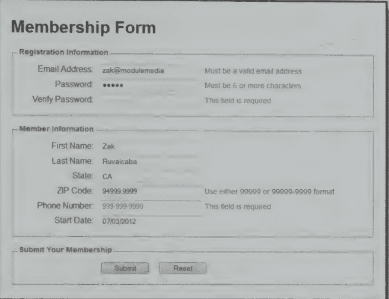

#### HTML

```html
<form action="register.html" method="get"
  name="member_form" id="member_form">
  <fieldset>
    <legend>Registration Information</legend>
    <label for="email">Email Address:</label>
    <input type="text" id="email" name="email"><br>
    <label for="password">Password:</label>
    <input type="password" id="password" name="password"
      placeholder="at least 6 characters"><br>
    <label for="verify">Verify Password:</label>
    <input type="password" id="verify" name="verify"><br>
  </fieldset>
  <fieldset>
    <legend>Member Information</legend>
    <!-- 这里缺少了四个字段 -->
    <label for="phone">Phone Number:</label>
    <input type="text" id="phone" name="phone"
      placeholder="999-999-9999"><br>
    <label for="start_date">Start Date:</label>
    <input type="text" id="start_date" name="start_date"><br>
  </fieldset>
  <fieldset id="buttons">
    <legend>Submit Membership</legend>
    <label>&nbsp;</label>
    <input type="submit" id="submit" name="submit" value="Submit"><br>
    <input type="reset" id="reset" name="reset" value="Reset"><br>
  </fieldset>
</form>
```

图 10-5 验证应用的用户界面和 HTML

### 应用程序的部分 JavaScript 代码

图 10-6 展示了该应用程序的一些 JavaScript 代码。这将让你更清楚地了解如何使用 jQuery 进行数据验证，以及为什么如果你想完成彻底的验证工作，你就需要 JavaScript。`ready` 事件处理句程序中的第一条语句使用 `:text` 选择器来选择所有类型为 `"text"` 的元素，并使用 `:password` 选择器选择所有类型为 `"password"` 的输入元素。然后，你在第 9 章中学习的 `after` 方法会在每个选定字段之后插入一个 `span` 元素。这些元素将用于显示错误消息。

下一块代码使用 `Date` 对象和一些字符串处理将 `start_date` 字段设置为当前日期。这样，当当前日期合适时，用户就不需要输入日期了。这种处理通常用于为表单控件设置正确的初始值。例如，你也可以使用 JavaScript 来设置下拉列表中的值和文本。

图中的剩余代码是表单 `submit` 事件的事件处理器。当用户点击提交按钮或将焦点移动到按钮并按下回车键时，就会触发该事件。该事件处理程序中的代码包含了 9 个字段中 3 个字段的验证程序，但这应该能让你很好地了解如何将 jQuery 和 JavaScript 用于数据验证。

对电子邮件条目的验证将一个正则表达式赋值给名为 `emailPattern` 的变量。该表达式的 `test` 方法用在 `else` 子句中，以检查用户的输入是否匹配该模式。如果不匹配，则使用 jQuery 的 `next` 和 `text` 方法在 `ready` 事件处理程序中第一条语句创建的 `span` 元素中显示错误消息。对密码条目的验证使用字符串的 `length` 属性来测试输入长度是否小于 6。如果是，则显示错误消息。

对第一个名字（first name）条目的验证使用 jQuery 的 `trim` 方法在测试其是否为空字符串之前对输入进行裁剪。如果你不使用 `trim` 方法，包含一个或多个空格的输入将不等于空字符串，因此会被视为有效。在三个验证字段的代码块之后，你可以看到最后一条语句：如果 `isValid` 变量为 `false`，意味着一个或多个字段是无效的。在这种情况下，将执行事件的 `preventDefault` 方法。该对象作为参数传递给 `submit` 事件处理程序函数，并由该处理程序的第一行存储在变量中。如果当一个或多个字段无效时不使用 `preventDefault` 方法，表单将提交到服务器，因为这是它的默认操作。如果你已经熟悉 JavaScript，你应该理解这一点。否则，这说明了掌握完整 JavaScript 技能的必要性。如果你想培养这些技能，我们自然推荐我们的 JavaScript 书籍。但数据验证的另一种选择是使用如所示的验证插件。

#### JavaScript 验证

```javascript
$(document).ready(function() {
  // 在每个输入元素之后添加 span元素
  $(":text, :password").after("<span></span>");

  // 在起始日期文本框中放入今天的日期
  var today = new Date();
  var month = today.getMonth() + 1; // 月份从 0 开始
  var day = today.getDate();
  var year = today.getFullYear();
  var dateText = (month < 10) ? "0" + month : month + "/"; // 补月份
  dateText += (day < 10) ? "0" + day : day + "/"; // 补日
  dateText += year; // 补年份
  $("#start_date").val(dateText);

  $("#member_form").submit(function(event) {
    var isValid = true;

    // 验证电子邮件条目
    var emailPattern = /^[a-zA-Z0-9._%+-]+@[a-zA-Z0-9.-]+\.[a-zA-Z]{2,}$/;
    var email = $("#email").val();
    if (email == "") {
      $("#email").next().text("此项必填。");
      isValid = false;
    } else if (!emailPattern.test(email)) {
      $("#email").next().text("请输入有效的电子邮件地址。");
      isValid = false;
    }

    // 验证密码条目
    var password = $("#password").val();
    if (password.length < 6) {
      $("#password").next().text("至少包含 6 个字符。");
      isValid = false;
    }

    // 验证第一个名字条目
    var firstName = $("#first_name").val().trim();
    if (firstName == "") {
      $("#first_name").next().text("此项必填。");
      isValid = false;
    }

    // 如果任何字段无效，则阻止表单提交
    if (!isValid) {
      event.preventDefault();
    }
  }); // 结束 submit
}); // 结束 ready
```

图 10-6 验证应用的用户界面和 HTML

## 第二节

## jQuery 基础知识

## 如何使用插件进行数据验证

## 如何使用验证插件

图 10-7 介绍验证插件

### 用户界面

| 邮箱地址: | 这不是一个有效的邮箱地址 |
| 姓名: | 请提供姓名。 |
| | 加入我们的列表 |

### 验证插件的 URL

`http://bassistance.de/jquery-plugins/jquery-plugin-validation`

### HTML head 区域中的脚本元素

```html
<script src="//code.jquery.com/jquery-1.8.3.min.js"></script>
<script src="jquery.validate.min.js"></script>
<script src="email_list.js"></script>
```

### HTML body 中的表单

```html
<form id="email_form" name="email_form" action="join.html" method="post">
<label for="email_address">邮箱地址:</label>
<input type="text" id="email_address" name="email_address"><br>
<label for="first_name">姓名:</label>
<input type="text" id="first_name" name="first_name"><br>
<label>&nbsp;</label>
<input type="submit" id="join_list" value="加入我们的列表"><br>
</form>
```

### JavaScript (email_list.js) 使用插件的验证方法

```javascript
$("#email_form").validate({ // 使用 id 选择表单
  rules: {
    email_address: { // 使用 name 属性引用字段
      required: true,
    },
    first_name: {
      required: true
    }
  },
  messages: {
    email_address: { // 使用 name 属性引用字段
      required: "请提供邮箱地址。",
      email: "这不是一个有效的邮箱地址。",
    },
    first_name: {
      required: "请提供姓名。"
    }
  }
}); // 结束 validate
```

## 描述

- 该验证插件由 Jörn Zaeffer 编写并维护，他是 jQuery 团队的成员，也是 jQuery UI 团队的开发人员。
- 使用此插件的方法之一是对表单运行 `validate` 方法，并将条目的验证规则和消息作为参数指定，如上所示。
- 使用该插件验证方法的另一种方法是在 HTML 中嵌入规则和消息的属性。对于简单的表单，这种方法更简单，但维护和调试更困难。

## 验证插件的选项和默认错误消息

现在你已经对如何使用验证插件有了大致了解，图 10-8 总结了它提供的基本选项及其默认错误消息。如你所示，此插件可以验证邮箱地址、URL、日期、数字、位数和信用卡号。它可以检查某个条目是否在特定范围内，或者某个条目的字符数是否在特定范围内。它可以检查有效的扩展名。它还可以检查一个条目是否等于另一个条目。

遗憾的是，这并没有涵盖表可能需要的每类型条目，也没有验证你可能希望的每种方式。增加此列表的方法之一是使用从验证网站下载的 `additional-methods` 文件。例如，该文件增加了 `phoneUS` 和 `phoneUK` 选项。你将在章末的应用程序中使用该文件。

另一种选项是为此插件编写你自己的方法。你也可以使用插件中提供的一些自定义选项。但你花费在超出可用范围之外的时间越长，使用此插件的价值就越低。因此，在某个时候，你可能更好地用 JavaScript 编写自己的数据验证代码，这样你的表单就能完全按照你想要的方式运行。

但请记住，浏览器验证不必是完美的。如果它能捕获表单中的大部分错误，可能足够了。然后，服务器验证可以完成剩余的工作。

此图还显示了验证插件如何向你的 HTML 添加错误消息。要做到这一点，它只需在每个 `input` 元素之后添加一个带有类名属性 `"error"` 的 `label` 元素，并将文本设置为错误消息。因此，你可以使用 CSS 来指定 `"error"` 类中消息的格式。

### 插件验证方法的选项

| 选项 | 默认消息 |
| --- | --- |
| `required: true` | 此字段为必填。 |
| `email: true` | 请输入有效的邮箱地址。 |
| `url: true` | 请输入有效的 URL。 |
| `date: true` | 请输入有效的日期。 |
| `dateISO: true` | 请输入有效的日期 (ISO)。 |
| `number: true` | 请输入有效的数字。 |
| `digits: true` | 请仅输入数字。 |
| `creditcard: true` | 请输入有效的信用卡号。 |
| `equalTo: "selector"` | 请再次输入相同的值。 |
| `accept: "extension1\|extension2..."` | 请输入一个具有有效扩展名的文件。 |
| `maxlength: value` | 请输入不超过 (value) 个字符。 |
| `minlength: value` | 请至少输入 (value) 个字符。 |
| `rangelength: [value1, value2]` | 请输入长度在 (value1) 到 (value2) 个字符之间的值。 |
| `range: [value1, value2]` | 请输入在 (value1) 和 (value2) 之间的值。 |
| `max: value` | 请输入小于或等于 (value) 的值。 |
| `min: value` | 请输入大于或等于 (value) 的值。 |

### validate 事件处理程序中的选项示例

```javascript
$("#email_form").validate({
  rules: {
    email_address: {
      required: true,
    },
    first_name: {
      required: true
    }
  }
});
```

### 验证插件如何向你的 HTML 添加错误消息

```html
<input type="text" id="email_address" name="email_address"><label class="error">请提供邮箱地址。</label><br>
<input type="text" id="first_name" name="first_name"><label class="error">请提供姓名。</label><br>
```

## HTML

图 10-10 展示了此表单的 HTML。在 `<head>` 部分，你可以看到用于 jQuery 的 `<script>` 元素，接着是用于验证插件的，然后是用于 `additional-methods` 文件的，最后是用于启动处理的 JavaScript 文件。这个顺序至关重要，因为每个文件都会调用上一个文件中的方法。

在表单的 HTML 中，使用提交按钮（submit button）将表单提交到服务器。这意味着如果验证插件发现错误，它必须取消表单的默认操作。

如果你查看各个文本字段的代码，你会发现所有字段都编写了 `name` 属性。这是因为验证插件使用了这些名称。你还会发现字段后面没有跟随用于显示错误信息的元素。这是因为验证插件会在需要时随时为信息添加 `<label>` 元素。

### 用于 validate 和 additional-methods 插件的 `<script>` 元素

```html
<script src="http://jquery.com/jquery-1.8.3.min.js"></script>
<script src="jquery.validate.js"></script>
<script src="additional-methods.min.js"></script>
<script src="member.js"></script>
```

### HTML `<body>` 中的 `<form>` 元素

```html
<form action="register.html" method="get"
  name="member_form" id="member_form">
  <fieldset>
    <legend>注册信息</legend>
    <label for="email">邮箱:</label>
    <input type="text" name="email" id="email" autofocus><br>
    <label for="password">密码:</label>
    <input type="password" name="password" id="password"
      placeholder="至少 6 位字符"><br>
    <label for="verify">验证密码:</label>
    <input type="password" name="verify" id="verify"><br>
  </fieldset>
  <fieldset>
    <legend>会员信息</legend>
    <!-- 这里缺少了四个字段 -->
    <input type="text" name="phone" id="phone"
      placeholder="999-999-9999"><br>
  </fieldset>
  <fieldset>
    <legend>支付信息</legend>
    <label for="start_date">请求开始日期:</label>
    <input type="text" name="start_date" id="start_date"
      placeholder="99/99/9999"><br>
    <label for="payment_type">支付类型:</label>
    <select name="payment_type" id="payment_type">
      <option value="Visa">Visa</option>
      <option value="Master">Master Card</option>
      <option value="American">American Express</option>
    </select><br>
    <label for="card_number">卡号:</label>
    <input type="text" name="card_number" id="card_number"><br>
    <select name="expiry_month" id="expiry_month">
      <option value="01">01</option>
      <option value="02">02</option>
      <!-- 其他月份的 option 元素 -->
    </select><br>
    <select name="expiry_year" id="expiry_year"> ...
  </fieldset>
  <fieldset id="buttons">
    <legend>提交您的会员</legend>
    <label>&nbsp;</label>
    <input type="submit" id="submit" value="提交">
    <input type="reset" id="reset" value="重置"><br>
  </fieldset>
</form>
```

图 10-1 验证页的 HTML

## CSS

图 10-11 首先展示了用于验证错误信息的标签（labels）的 CSS。`float` 属性表示这些标签不应该是浮动状态。要理解它是如何运作的，你需要记住，标识文本字段的标签是浮动在文本字段左侧的。然而，你需要让错误标签出现在文本字段的右侧，通过将 `float` 属性设置为 `"none"` 就可以实现这一点。

接下来的两个属性将错误信息的颜色设置为红色，并将字体大小缩小到 87.5%，以便让长消息能够适应提供的空间。当然，你可以按照任何想要的方式为这些标签设置 CSS，从而控制它们的显示位置和方式。

## jQuery

图 10-11 还展示了此表单的 jQuery 代码。在调用 `validate` 方法之前，你可以为表单编写任何设置操作，例如将焦点移动到表单上的第一个字段、设置日期或加载下拉列表的选项。

然后，你为表单编写 `validate` 方法，并将规则作为第一个参数传入。在这里，`phoneUS` 方法是 `additional-methods` 文件中的方法之一，它能很好地验证美国电话号码。大多数其他验证也足够了，但对州份邮政编码（state zip code）的验证可以改进，特别是因为此应用程序中的邮编可以是五位数也可以是九位数代码。

对于大多数表单，你可能还想提供一些自定义的错误信息，如图 10-7 所示。例如，你可以将州份代码（state code）的提示从“请输入 2 到 2 个字符之间的值”更改为“请输入两个字符的州代码”。

### 错误信息的 CSS

```css
label.error {
  float: none;
  color: red;
  font-size: 87.5%;
}
```

### 应用程序的 jQuery

```javascript
$(document).ready(function() {
  $("#email").focus();
  // 其他设置
  $("#member_form").validate({
    rules: {
      email: {
        required: true
      },
      password: {
        required: true,
        minlength: 6
      },
      verify: {
        required: true,
        equalTo: "#password"
      },
      first_name: {
        required: true
      },
      last_name: {
        required: true
      },
      state: {
        required: true,
        minlength: 2
      },
      zip: {
        required: true,
        rangelength: [5, 9]
      },
      phone: {
        required: true,
        phoneUS: true
      },
      start_date: {
        required: true,
        date: true
      },
      card_number: {
        required: true,
        creditcard: true
      }
    }
  }); // 结束 validate
}); // 结束 ready
```


# 图 10-11 应用程序的 CSS 和 jQuery

## 观点

到目前，你应该已经熟悉处理表单的 jQuery 特性，并理解编写自己的验证代码与使用验证插件之间的区别。最终，你可能想学习更多的 JavaScript，以便编写自己的验证。当那一天到来时，请记住本书。

## 术语

| 表单 | 重置按钮 |
| --- | --- |
| 控件 | 数据验证 |
| 字段 | 正则表达式 |

## 总结

- 表单包含多个接收数据的控件，如文本框、单选按钮或复选框。这些控件也被称为字段。当表单提交到服务器处理时，控件中的数据会随 HTTP 请求发送。
- 提交按钮在点击时将数据提交到服务器。重置按钮在点击时会重置表单中的所有数据。
- HTML5 引入了一些输入控件，如 `email`、`url`、`tel` 和 `date` 控件，这些控件在语义上很好，因为它们指示了控件的数据类型。HTML5 还引入了一些用于数据验证的属性，而 CSS3 引入了一些伪类来格式化必填、有效和无效字段。
- 当表单提交到服务器时，服务器脚本应该对表单中的数据进行完整验证，如果有错误则将表单返回给客户端。
- 在表单提交到服务器之前，JavaScript 应该尝试捕获 80% 或更多的错误。这将减少处理表单所需的往返服务器的次数。
- jQuery 提供了用于处理表单的一些选择器、方法和事件方法，但没有用于数据验证的方法。因此，为了验证用户输入，许多开发者使用了书中未介绍的 JavaScript 特性和字符串方法。
- 验证用户输入的另一种方法是使用验证插件。这通常会让向表单添加验证变得更容易，但该验证可能并不适用于所有表单。

## 练习 10-1 使用 JavaScript 进行验证

由于你已经知道如何使用 JavaScript 验证某些类型的字段，因此此练习的大部分代码已经为你提供。不过，你将对这些代码进行一些增强。你将处理的表单如下：

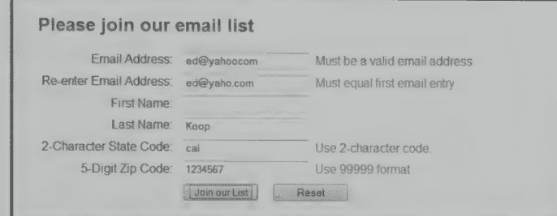

1. 使用你的文本编辑器打开此文件夹中的 HTML 和 JavaScript 文件：`c:\query\exercise\ch10\email_list_javascript`。
2. 在 HTML 文件中，注意每个输入字段后都没有编写 `span`。在 JavaScript 文件中，添加一条语句在每个输入字段后添加一个 `span`。每个 `span` 元素的内容应该是一个星号（*）。要实现这一点，你需要使用与图 10-6 中第一个相似的语句。
3. 检查 JavaScript 文件，注意它包含了前五个字段的验证程序。然后，在表单中输入任何数据之前，点击“Join our List”（加入我们的列表）按钮进行测试。哦不！即使没有任何输入，数据也被提交了。
4. 为了修复这个问题，你必须停止提交按钮的默认操作。要做到这一点，如图 10-6 所示，在文件末尾语句中编写事件对象的 `preventDefault` 方法。记住，你用于事件对象的名称必须与用于提交事件处理程序的参数名称相同。现在，再次使用空字段进行测试。这应该会在除邮政编码字段外的每个字段右侧显示“This is required”（此必填项）。
5. 在名字（`first-name`）字段中输入四个空格，再次点击“Join our List”按钮。注意错误信息被删除了，这意味着四个空格被接受为有效输入。
6. 通过在验证之前对名字（`first-name`）输入进行修剪（trimming）来解决这个问题，参考姓氏（`last-name`）输入的代码。如果输入有效，则应将修剪后的值也放置在文本框中。通过以下方式测试此增强：首先在该字段中输入四个空格，然后输入四个空格后接名字。
7. 添加验证邮政编码（`zip-code`）字段的代码，通过测试确保它由五个字符组成。要做到这一点，你可以复制并修改用于验证状态代码（`state-code`）字段的代码。现在，测试此更改。

## 练习 10-2 使用验证插件

此练习将让你有机会使用图 10-7 至 10-11 所示的验证插件。你将使用此插件来验证所示表单中的数据：

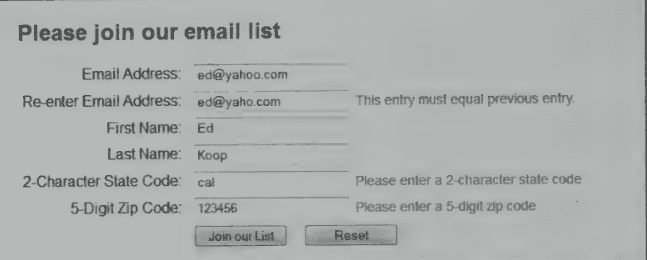

1. 使用你的文本编辑器打开此文件夹中的 HTML、CSS 和 JavaScript 文件：`c:\jquery\exercises\email_list_plugin\`
2. 在 index 文件中，注意验证插件的 `script` 元素。同样注意此应用程序文件夹包含了该插件文件。
3. 在 JavaScript 文件中添加使用验证插件编辑上方表单中六个字段的代码。验证规则如下：
   - 所有字段均为必填项。
   - 前两个字段应该是有效的电子邮件地址，且第二个地址应与第一个相同。
   - 状态代码应该是两个字符的代码。
   - 邮政编码应该是五位数字，因此应该同时测试数字和五个字符。
4. 测试完成的验证，并注意消息没有显示在你想要的位置。要修复此，将图 10-11 顶部的 CSS 代码添加到 CSS 文件中。你可能还想为该规则添加一个 `margin-left` 属性，以便在错误消息前留出一些空间。
5. 再次使用显示的默认消息测试验证。然后，将默认消息替换为上方所示三个自定义消息。你可以参考图 10-7 进行此操作。
6. 注意，可以使用 JavaScript 查找来改进状态和邮政编码的验证。但请记住，所有输入都将由服务器端代码进行彻底验证。因此，这种级别的客户端验证通常是可以接受的。

## 如何创建和使用插件

提高 Web 开发效率的一种快速方法是使用插件。正如你所看到的，所有常见的 Web 开发任务都有插件可用，而且许多插件都易于使用。通常，使用插件可以为你节省大量的开发时间，而且大多数插件执行任务的效果可能比你的代码执行得更好。

在第 8 章中，你学习了如何使用缓动（easings）插件。在第 10 章中，你学习了如何使用表单验证插件。现在，在这一章中，你将首先学习使用 jQuery 的技能。然后，你将学习如何创建自己的插件。

| 主题 | 页码 |
| :--- | :--- |
| 插件简介 | 314 |
| 如何查找 jQuery 插件 | 314 |
| 一些实用的插件 | 316 |
| 如何使用任何插件 | 318 |
| 如何使用四个最实用的插件 | 320 |
| 如何使用 Lightbox 插件处理图片 | 320 |
| 如何使用 bxSlider 插件处理轮播图 | 320 |
| 如何使用插件处理幻灯片 | 322 |
| 如何使用 jQuery 实现双列 | 324 |
| 如何创建自己的插件 | 326 |
| 插件的结构 | 328 |
| 如何编写插件 | 330 |
| 如何为插件添加选项 | 332 |
| 使用插件的网页 | 334 |

## 一些实用的插件

图 11-2 总结了一些最实用的插件。这些插件按类型分组。稍后，你将看到前三组的示例。在第 10 章中，你学习了如何使用第四组的表单验证插件。在第 3 节中，你将学习如何使用第五组的 jQuery UI 插件。在第 5 节，你将学习如何使用第六组的 jQuery Mobile 插件。

### 一些实用的插件

| 用于图片的插件 | |
| --- | --- |
| Lightbox | http://lokshdhakar.com/projects/lightbox2/ |
| Fancybox | http://fancybox.net |
| ThickBox | http://jquery.com/demo/thickbox |
| ColorBox | http://www.jacklmoore.com/colorbox |
| Shadowbox.js | http://www.shadowbox-js.com |
| **幻灯片、轮播图和画廊的插件** | |
| bxSlider | http://bxslider.com |
| Malsup Query Cycle | http://jquery.malsup.com/cycle |
| JCarousel | http://sorgalla.com/jcarousel |
| Nivo Slider | http://nivo.dev7studios.com |
| Galleria | http://galleria.io |
| AD Gallery | http://coffeescripter.com/code/ad-gallery |
| **用于文本布局的插件** | |
| UI Layout | http://layout.jquery-dev.net |
| Masonry | http://masonry.desandro.com |
| Columnizer | http://website.teleomeinter.net/columnizer-jquery-plugin |
| jsColumns | http://code.google.com/p/js-columns |
| JLayout | http://www.bramstein.com/projects/layout-jquery-plugin.html |
| **用于表单的插件** | |
| Malsup Query Form | http://jquery.malsup.com/form |
| Ideal Forms | http://code.google.com/p/idealforms |
| Bassistance Validation | http://bassistance.de/jquery-plugins/jquery-plugin-validation |
| jqTransform | http://www.dfc-e.com/multimedia/opensource/jqtransform |
| Niceforms | http://www.emblematiq.com/lab/niceforms |
| **用于界面设计的插件** | |
| jQuery UI | http://plugins.jquery.com |
| Wijmo | http://wijmo.com |
| **用于移动开发的插件** | |
| jQuery Mobile | http://www.jquerymobile.com |
| jqTouch | http://www.jqtouch.com |

### 描述

- 上表列出了一些最实用的插件。但如果你需要其他用途的插件，可以进行搜索。你可能会找到它。
- 在书的第 3 节中，你将学习如何使用 jQuery UI，在第 5 节中，你将学习如何使用 jQuery Mobile。

## 如何使用任何插件

图 11-3 显示了在找到你需要的插件后如何使用它。

首先，如果你还没有这样做，请学习该插件的文档，以便了解它需要哪些 HTML 和 CSS，以及它提供了哪些方法和选项。通常，你会在评估插件时执行这一点，看看它是否符合你的需求，而文档会告诉你所需的所有信息。

其次，你通常会下载插件的文件并将其保存到你的 Web 服务器上。这种下载通常以 zip 文件的形式存在，并且始终包含至少一个 JavaScript 文件。此外，它可能还包含插件使用的 CSS 或图像文件。

下载可能还包含两个版本的主 JavaScript 文件。如果你想查看该文件的代码，可以在文本编辑器中打开完整版本。但在应用程序中你应该使用的是压缩版本，它的名称通常以 `min.js` 结尾。

对于某些插件，文件也可以从内容分发网络 (CDN) 获取。如果你通过这种方式访问文件，可以记录文件的 URL。然后，你可以在文件的 `link` 和 `script` 元素中使用这些 URL。

第三，如果插件需要一个或多个 CSS 文件，你需要在 HTML 的 `head` 元素中编写 `link` 元素。然后，你为该插件的 JavaScript 文件编写 `script` 元素。通常只需要一个 JavaScript 文件，但某些插件需要多个。此时，你已经准备好使用该插件了。

第四，你编写页面的 HTML 和 CSS 以适应插件。第五，你编写使用该插件的 JavaScript。这可以位于外部文件中，也可以位于 HTML 的 `head` 元素内。

此图中的示例说明了这一过程，该示例使用了 bxSlider 插件。在这里，`script` 元素显示插件的元素必须位于 jQuery 库元素之后。因为所有 jQuery 插件都使用 jQuery 库。正如图中第一个警告所示，按此顺序编写这些脚本元素是一个常见的错误。

接下来的 HTML 显示了插件所需的元素。特别地，无序列表的 `id` 属性设置为 "slider"，这样 jQuery 在调用插件的 `bxSlider` 方法时就能识别它。

之后是使用此插件的 jQuery 代码。在这里，`bxSlider` 方法作为文档 `ready` 方法函数的第一条语句被调用。

## 一个使用 Lightbox 插件的网页


### 该插件的 URL

http://lokeshdhakar.com/projects/lightbox2/

### Lightbox 插件的 link 和 script 元素

```html
<!-- CSS 文件的 link 元素 -->
<link href="lightbox.css" rel="stylesheet">

<!-- 插件的 script 元素 -->
<script src="js/lightbox.js"></script>
```

### Lightbox 插件的 HTML

```html
<a href="images/building_01.jpg" rel="lightbox" title="建筑正面">
  
</a>

<a href="images/building_02.jpg" rel="lightbox" title="建筑左侧">
  
</a>

<!-- a元素中的更多 img 元素 -->
```

### 描述

- Lightbox 插件可用于打开缩略图的大尺寸版本。该插件适用于单张或一组图片。
- 当用户点击一组图片中的某一张时，将显示大尺寸版本，同时页面的其他部分变暗，并在下方显示说明和计数器。此外，当鼠标指针移动到大图上时，会出现“下一个”和“上一个”按钮。
- Lightbox 下载包包含一个 CSS 文件、一个插件文件以及一张在幻灯片加载时用于关闭、下一个和上一个按钮的图片。然而，此插件不需要任何 jQuery 代码。
- Lightbox 的 HTML 如上所示，由 `<a>` 元素中的 `` 元素组成。`` 元素的 `src` 属性标识缩略图。`<a>` 元素的 `href` 属性标识大尺寸图像。每个 `<a>` 元素的 `title` 属性可用于提供图像下方显示的说明。
- `<a>` 元素的 `rel` 属性在单词 lightbox 之后的方括号中指定一个唯一名称。如果你想定义一组元素，请使用 "lightbox[group]"。

> 图 11-4 如何使用 Lightbox 插件处理图像

## 如何使用 bxSlider 插件制作轮播图

图 11-5 展示了用于创建轮播图的 bxSlider 插件。在示例中，该插件一次显示两张图片，用户可以通过点击图片左右的按钮移动到下一张或上一个图片。然而，你可以通过设置选项来更改此插件工作方式许多方面。你还可以将 Lightbox 插件与 bxSlider 插件配合使用，这样当用户点击任何图像时就会显示大图。

如果你下载了该插件的 JavaScript 文件，图中的 `script` 元素可以引用它。作为下载的一部分，你将获得一组可用于此插件的图片。访问 JavaScript 文件的另一种方法是从 bxSlider.com 站点获取，使用如下 `script` 元素：

```html
<script src="http://bxslider.com/sites/default/files/jquery.bxslider.min.js"></script>
```

图中展示了使用该插件 HTML 的方法。在这里，`` 元素被编写在无序列表的 `<li>` 元素中，`` 元素的 `src` 属性标识了显示的图像。然而，你可以在 `<li>` 元素中编写任何你想要的元素。另一种设置方法是在顶层 `<div>` 中编写元素。

要使用默认选项运行轮播图，你需要在 jQuery 程序的 `ready` 函数内编写此 jQuery 语句：

```javascript
$("#slider").bxSlider();
```

要设置某些选项，你只需编写一个包含键/值对的大括号集合，如图中所示。在此处，一次显示的幻灯片数量设置为 2，且当点击“下一个”或“上一个”按钮时移动的幻灯片数量设置为 2。

默认情况下，bxSlider 插件将在轮播图的左下角显示“下一个”和“上一个”链接。但你可以通过设置 `nextImage` 和 `previousImage` 使它们指向你想使用的图像，从而将文本链接改为按钮。此外，此插件提供了许多其他影响轮播图工作方式的选项。为了更好地理解这些，你可以查看该插件网站上的示例。然后，你可以查看选项文档查看哪些可用。

要更改“下一个”和“上一个”链接或图像的位置，你还需要编写一些使用 `bx.next` 和 `bx.prev` 类的 CSS。不过，你不会在 HTML 中找到这些类，因为它们是由插件添加到 DOM 中的。你也可以使用这些类将默认链接更改为图像，这就是本示例中应用程序的工作方式。要查看你使用的 CSS，可以查看下载的应用程序的 CSS 文件。

虽然这是必须的但在本示例中未实现，但为 `` 元素编写 `width` 和 `height` 属性并将其设置为图像的精确尺寸是一个良好习惯。这样，浏览器可以在图像加载时为图像留空间并继续渲染页面。

## 一个使用 bxSlider 插件制作轮播图的网页

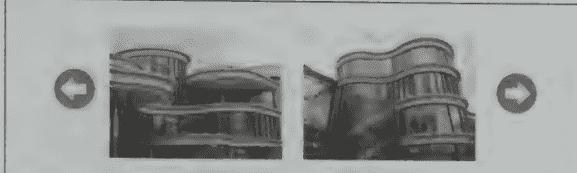

### 该插件的 URL

http://bxslider.com/

### bxSlider 插件的 script 元素

```html
<script src="js/jquery.bxslider.min.js"></script>
```

### bxSlider 插件的 HTML

```html
<ul id="slider">
  <li></li>
  <li></li>
  <li></li>
  <li></li>
  <li></li>
</ul>
```

### bxSlider 的 jQuery 代码

```javascript
$(document).ready(function() {
  $('#slider').bxSlider({
    maxSlides: 2,
    moveSlides: 2
  });
});
```

### 描述

- bxSlider 插件可以轻松制作轮播图。
- 此插件的 HTML 可以是一个包含每个幻灯片项目的无序列表。或者也可以是一个顶层 `<div>`。
- bxSlider 插件提供了许多选项。最常用的是 `maxSlides` 和 `moveSlides`。前者决定一次显示的幻灯片数量；后者决定一次移动的幻灯片数量。
- 默认情况下，bxSlider 插件将在轮播图的左下角显示“下一个”和“上一个”链接。但你可以通过设置 `nextImage` 和 `previousImage` 使它们指向你想使用的图像，从而将文本链接改为按钮。
- 要更改“下一个”和“上一个”链接或图像的位置，你还需要编写一些使用 `bx.next` 和 `bx.prev` 类的 CSS。不过，你不会在 HTML 中找到这些类，因为它们是由插件添加到 DOM 中的。
- 为 `` 元素编写 `width` 和 `height` 属性并将其设置为图像的精确尺寸是一个良好习惯。这样，浏览器可以在图像加载时为图像留空间并继续渲染页面。

> 图 11-5 如何使用 bxSlider 插件制作轮播图

## 如何使用 Cycle 插件制作幻灯片

图 11-6 展示了用于制作幻灯片的 Cycle 插件。该插件有两个版本：全版和轻量版。这些版本相似，但轻量版提供的选项较少且占用空间较小。例如，轻量版仅在切换时使用淡入效果。相比之下，全版提供了 27 种用于切换的效果。

此插件的 HTML 与所选 `<div>` 元素的子元素工作。这些元素是 `` 元素或 `<div>` 元素。当你使用 `<div>` 元素时，可以在其中编写任何你想要的内容，包括标题、文本和图像。

## 使用 Cycle 插件制作幻灯片的网页


### 该插件的 URL

http://jquery.malsup.com/cycle/

### Cycle 插件的 script 标签

```html
<script src="js/jquery.cycle.all.js"></script>
```

### 该插件的 HTML 结构

```html
<div id="slideshow">
  
  
  
</div>
```

### 使用该插件的 jQuery

```javascript
$(document).ready(function() {
  $('#slideshow').cycle({
    fx: "scrollHorz", // 设置过渡效果
    speed: 500,        // 设置过渡速度
    timeout: 2000,     // 设置幻片之间的切换时间
    pause: 1           // 鼠标悬停时暂停幻片
  });
});
```

### 描述

- Cycle 插件使得开发幻灯片变得简单。它将 div 元素的子元素视为幻片。这些元素通常是 img 元素或 div 元素。
- 该插件有两个版本：完整版和精简版。精简版与完整版类似，但提供的选项较少。
- 该插件的完整版提供了许多不同选项，包括 27 种可用于图像切换的不同效果。
- 如果你学习该插件的一些演示，你将更好地了解如何使用它的选项。

> 图 11-6 如何使用 Cycle 插件制作幻灯片

## 如何使用 jLayout 插件制作双列布局

图 11-7 显示了如何使用 jLayout 插件在不使用 CSS 的情况下创建双列布局。这是该相对复杂的插件的简单用法，它还有许多其他用于页面布局的选项。事实上，这个插件可以用于加载完整的页面，包括页眉和页脚。即使仅用于简单的双列布局，下载包含的六个 JavaScript 文件中也有三个需要 `script` 标签。

创建双列布局插件的 HTML 代码由一个顶层 `div` 元素组成，该元素包含另外两个 `div` 元素，每列一个。这些列的 `class` 属性必须为 "column1" 和 "column2"。

然后，该插件的 jQuery 代码选择顶层 `div` 元素并调用 `layout` 方法。它还将布局选项传递给此插件。在示例中，`type` 选项被设置为 "grid"；`hgap` 选项将列之间的间隙设置为 27 像素，`items` 选项设置两列的宽度。在这种情况下，列的宽度是相同的，但不必如此。

当然，你可以通过 CSS 获得相同的结果。但使用此插件简化了 CSS，这对于不那么擅长 CSS 的开发者来说特别有帮助。

如果你学习该插件的示例和文档，你会发现你可以将其用于许多不同类型的布局。然而，要弄清楚如何用它实现其他布局并不容易。因此，在某些情况下，使用 CSS 进行格式化比使用该插件更容易。这是你在评估插件使用情况时经常需要考虑的权衡类型。

## 使用 jLayout 插件创建双列的网页

| 我们的解决方案 | 客户证言 |
| --- | --- |
| vProspect 2.0 定义并研究你的受众，定义策略以向该受众传达并展示强大且令人深刻的品牌。 | "多年来，我们与 Vecta Corporation 合作，一直对他们为我们和 WDG 产品提供的奉献精神和专业水平感到惊叹；事实上，这成倍地增加了我们的收入和曝光率。" |
| Convert 2.0 创建一个非常用户友好且易于导航的存档，将帮助你的潜在客户在更高层次与你的公司互动。 | Aaron D. Tires, ADT Tire and Rubber, Inc. 创始人兼首席执行官 |

### 该插件的 URL

http://www.bramstein.com/projects/jlayout/jquery-plugin.html

### jLayout 插件的 script 标签

```html
<script src="js/jquery.sizes.js"></script>
<script src="js/jlayout.grid.js"></script>
<script src="js/jlayout.js"></script>
```

### jLayout 插件的 HTML 结构

```html
<div id="layout">
  <div class="column1">
    <!-- 第一列的内容在此处 -->
  </div>
  <div class="column2">
    <!-- 第二列的内容在此处 -->
  </div>
</div>
```

### 使用插件的 jQuery

```javascript
$(function() {
  $("#layout").layout({
    type: "grid",
    hgap: 27,
    items: [$(".column1").width(210), $(".column2").width(210)]
  });
});
```

### 描述

- jLayout 插件使得像上面所示的在不使用 CSS 的情况下开发双列布局变得简单。它提供了许多其他布局。
- 双列布局的 HTML 由一个顶层 `div` 元素组成，包含另外两个 `div` 元素，每列一个。这些列的 `class` 属性必须为 "column1" 和 "column2"。然后，该插件的 jQuery 代码选择顶层 `div` 元素并调用 `layout` 方法。它还将布局选项传递给此插件。在示例中，`type` 选项被设置为 "grid"；`hgap` 选项将列之间的间隙设置为 27 像素，`items` 选项设置两列的宽度。

> 图 11-7 如何使用 jLayout 插件制作双列布局

## 如何创建自己的插件

jQuery 的功能之一是提供了一个 API（应用程序接口），让你创建自己的插件。由于有时这样做是有意义的，本主题将介绍如何操作。在开始开发插件之前，你应该问自己几个问题：首先，你是否已经彻底搜索过是否存在你需要的插件？其次，你计划创建的插件是否用于许多页面？第三，你确定你的插件会提高页面的有效性和可用性吗？如果你回答“是”，那么可能就有意义创建。

## 插件的结构

图 11-8 中的前两个示例展示了两种构建插件的方法。在两个示例中，插件函数都封装在一个立即执行函数表达式（IIFE）中：

```javascript
(function($) {
  // 插件在此处
})(jQuery);
```

在这里，IIFE 使用 jQuery 库作为参数。这样，库的作用范围就被限制在插件内部，你可以在其他代码中继续使用 `$` 符号。如果插件不这样保持，可能会与其他使用 `$` 符号的库和插件产生冲突。

在 IIFE 内部，不同插件之间唯一不同的是方法名和实现插件的代码。在插件函数中，每个方法都应用于插件所属的对象，该对象通过 `this` 引用。然后，如果插件由多个元素组成，插件函数将应用于每个元素。

在第一个示例的插件函数末尾，返回语句返回该对象，再次使用了 `this`。这意味着插件方法可以与其他方法进行链式调用。在第二个示例中，返回语句位于 `each` 方法之前。

### 插件的结构

**一种编写这种结构的方式**

```javascript
(function($) {
  $.fn.methodName = function() {
    this.each(function() {
      // 插件的代码
      return this;
    });
  }
})(jQuery);
```

**大多数专业人士编写这种结构的方式**

```javascript
(function($) {
  $.fn.methodName = function() {
    return this.each(function() {
      // 插件的代码
    });
  }
})(jQuery);
```

### 一个使用这种结构的简单 Selection 插件

**位于名为 jquery.selection.js 文件中的插件 jQuery 代码**

```javascript
(function($) {
  $.fn.displaySelection = function() {
    return this.each(function() {
      alert("The text for the selection is " + $(this).text() + "");
    });
  }
})(jQuery);
```

**该插件的 script 元素**

```html
<script src="jquery.selection.js"></script>
```

**使用该插件的 jQuery**

```javascript
$(document).ready(function() {
  $("#faqs h2").displaySelection();
});
```

### 插件文件的命名规范

`jquery.pluginName.js`

### 插件的 API 标准

- 插件应该支持隐式迭代。
- 插件应该通过返回选择的对象来保留链式调用。
- 插件定义应该以分号结尾。
- 插件选项应该提供合理的默认值。
- 插件应该有良好的文档。

### 说明

- 对于许多插件，大部分代码将位于 `each()` 方法函数中。
- 当插件完成后，此对象应返回给调用的应用程序。

> 图 11-8 插件的结构

图 11-8 还显示了插件文件的命名规范以及插件的 API 标准。为了支持“隐式迭代”，你在插件函数内部使用了 `each` 方法。为了保留链式调用，你返回 `this` 对象。除此之外，你还应该确保所有方法定义都以分号结束，并为你的插件选项提供合理的默认值。最重要的是，如果插件要供他人使用，它应该有良好的文档。

## 如何编写一个高亮菜单项的插件

现在你已经了解了插件的结构，图 11-9 显示了如何创建一个插件，该插件为位于无序列表 `li` 内部 `<a>` 元素的菜单项设置 CSS 样式。此插件在鼠标进入项时会高亮该项，并在鼠标离开该项时将其恢复到原始样式。

此插件的代码使用了前一个图中的第二种结构。在每个方法内部，第一条语句选择了插件应用的元素 `li` 元素内的 `<a>` 元素。它将这些元素存储在名为 `items` 的变量中。

然后，插件使用 jQuery 的 `css` 方法为 `items` 变量中的项应用六种样式，这些项是菜单中的 `<a>` 元素。注意，`css` 方法是链接到 `items` 对象上的。这是可能的，因为每个 `css` 方法都会返回它所应用的对象。

接下来，插件为 `items` 变量中 `<a>` 元素的 `mouseover` 和 `mouseout` 事件提供了函数。`mouseover` 事件的函数更改项的背景颜色和文字颜色。`mouseout` 事件的函数将项的背景颜色和颜色恢复为原始颜色。

由于插件存储在名为 `jquery.highlight.js` 的文件中，插件的 `script` 元素也反映了这一点。然后，激活插件的 jQuery 通过其 id 选择无序列表并调用插件的 `highlightMenu` 方法。

## 由 highlightMenu 插件高亮的菜单


### 可由插件高亮的菜单的 HTML

```html
<ul id="vecta_menu">
  <li><a href="index.html">首页 (Home)</a></li>
  <li><a href="aboutus.html">关于我们 (About Us)</a></li>
  <!-- 菜单的其余链接 -->
</ul>
```

### 位于名为 jquery.highlight.js 文件中的 highlightMenu 插件

```javascript
(function($) {
  $.fn.highlightMenu = function () {
    return this.each (function() {
      var items = $("li a");

      items.css("font-family", "arial, helvetica, sans-serif");
      items.css("font-weight", "bold");
      items.css("text-decoration", "none");
      items.css("background-color", "#dfe3e6");
      items.css("color", "#cc1c0d");
      items.css("width", "12px");

      items.mouseover(function () {
        $(this).css("background-color", "#000");
        $(this).css("color", "#fff");
      });

      items.mouseout(function () {
        $(this).css("background-color", "#dfe3e6");
        $(this).css("color", "#cc1c0d");
      });
    });
  };
})(jQuery);
```

### 插件的 script 元素

```html
<script src="jquery.highlight.js"></script>
```

### 使用 highlightMenu 插件的 jQuery

```javascript
$(document).ready(function () {
  $("#vecta_menu").highlightMenu();
});
```

### 说明

- highlightMenu 插件中的代码为选中列表内的链接设置了 CSS 样式。它还为 `mouseover` 和 `mouseout` 事件更改了其中两种样式。

> 图 11-9 一个高亮菜单项的插件

## 如何为插件添加选项

为了让插件更有用，你通常会为它提供一些选项。为了做到，你可以使用图 11-10 所示的编码技术。

首先，在插件方法的函数中编写 `options` 参数。此参数将接收用户在对象中以“键/值对”形式设置的所有选项。

由于图 11-8 中插件的 API 标准始终为选项提供默认值，因此如果用户不想设置选项，就不需要设置。为了实现，你可以使用 `$.extend` 方法来设置默认值，如示例所示。在这里，名为 `defaults` 的变量被设置为由 `$.extend` 方法创建的对象。

`extend` 方法的第一个参数由键/值对组成，这些为创建的对象提供了属性。

## 带有选项的 highlightMenu 插件

```javascript
(function($) {
  $.fn.highlightMenu = function (options) {
    var defaults = $.extend({
      bgColor: "#000000",
      color: "#ffffff",
      hoverColor: "#cccccc",
      linkWidth: "12px",
    }, options);

    return this.each(function() {
      var items = $("li a");

      items.css("font-family", "arial, helvetica, sans-serif")
        .css("font-weight", "bold")
        .css("text-decoration", "none")
        .css("background-color", defaults.bgColor)
        .css("color", defaults.color)
        .css("width", defaults.linkWidth);

      items.mouseover(function () {
        $(this).css("background-color", defaults.hoverColor);
        $(this).css("color", defaults.hoverColor);
      });

      items.mouseout(function () {
        $(this).css("background-color", defaults.bgColor);
        $(this).css("color", defaults.color);
      });
    });
  };
})(jQuery);
```

## 使用 highlightMenu 插件并仅设置两个选项的 jQuery

```javascript
$(document).ready(function() {
  $("#vecta_menu").highlightMenu({
    bgColor: "#dfe3e6",
    color: "#cc1c0d"
  });
});
```

### 说明

- 要为插件提供选项，为插件方法编写代码参数来接收用户设置的选项。在上面的示例中，此参数名为 `options`。
- 要设置默认选项，你使用 `$.extend` 方法，它根据第一个参数中的键/值对创建一个对象。然后，它将这些对与第二个参数中的键/值对（即用户设置的选项）合并。这将替换第一个参数中具有相同名称的，因此用户选项会覆盖默认值。
- 要引用创建的对象中的选项，你使用“对象.属性”语法。

> 图 11-10 带有选项的 highlightMenu 插件

## 使用两个插件的网页

本章通过展示一个使用两个插件的页面代码作为结束。这说明了如何在单个页面上使用两个或多个插件。

### 用户界面

图 11-11 展示了该网页的用户界面。在这里，页面标题下方显示了一个幻灯片。它使用 Cycle 插件来循环显示三款产品对应的图像。但是，当用户将鼠标悬停在图像上时，该幻灯片会暂停。

然后，在页面的左栏，使用了 highlightMenu 插件来突出显示菜单中的项。这就是在前一个图中所示的自定义插件。

### 脚本元素

该图还显示了此应用程序所需的脚本元素。第一个是核心 jQuery 库的。第二个是 Cycle 插件的。第三个是 highlight 插件的。

在这种情况下，两个插件的脚本元素必须位于 jQuery 库的脚本元素之后。然而，插件脚本元素的先后顺序并不重要。

### 页面布局


### HTML head 区域中的脚本元素

```html
<!-- jQuery 库的脚本元素 -->
<script src="http://code.jquery.com/jquery-1.8.3.min.js"></script>

<!-- Cycle 插件的脚本元素 -->
<script src="js/jquery.cycle.all.js"></script>

<!-- 自定义 highlightMenu 插件的脚本元素 -->
<script src="js/highlight.js"></script>
```

### 描述

- 此网页使用了两个插件。
- Cycle 插件循环显示三个 Vecta Corp 产品图像。
- 图 11-10 中的 highlightMenu 插件用于格式化菜单并突出显示鼠标悬停的任何菜单项。
- 插件的脚本元素必须位于核心 jQuery 库的脚本元素之后，但哪个先后并不重要。

> 图 11-11 Vecta Corp 页面的用户界面和脚本元素

## 插件所用元素的 HTML

图 11-12 展示了网页中使用插件的部分的 HTML。这从包含幻灯片三张图像的 `div` 元素开始。随后是用于被 highlight 插件高亮的无序列表。

## 使用插件的 jQuery

该图还显示了使用插件的 jQuery。注意两个插件都是从 `ready` 事件的事件处理器中调用的。因此，它们在页面准备就绪后立即开始。
由于你已经知道如何使用这些插件，理解调用它们的代码应该不会有任何困难。与你之前看到的唯一区别是，某些选项的设置不同。

### Cycle 和 highlightMenu 插件的 HTML

```html
<section>
  <!-- Cycle 插件使用的幻灯片内容 -->
  <div id="slideshow">
    
    
    
  </div>

  <!-- 自定义 highlightMenu 插件使用的菜单 -->
  <nav>
    <ul id="vecta-menu">
      <li><a href="index.html">Home</a></li>
      <li><a href="aboutus.html">About Us</a></li>
      <li><a href="solutions.html">Solutions</a></li>
      <li><a href="support.html">Support</a></li>
      <li><a href="contactus.html">Contact Us</a></li>
    </ul>
  </nav>

  <!-- 剩余的 html -->
</section>
```

### 使用 Cycle 和 highlightMenu 插件的 jQuery

```javascript
$(document).ready(function() {
  // 设置 Cycle 插件
  $("#slideshow").cycle({
    fx: "fade",
    speed: 1000,
    pause: 1
  });

  // 设置 highlightMenu 插件
  $("#vecta-menu").highlightMenu({
    bgColor: "#dfe3e6",
    color: "#cc1c0d",
    hoverBgColor: "#cc1c0d",
    hoverColor: "#fff",
    linkWidth: "125px"
  });
});
```

## 观点

现在你已经完成了这一章，你应该能够找到并使用用于常用网页开发功能的插件。这本身就能提高你开发网页时的生产力，而且插件的功能通常会比你自己编写的运行更好。

如果你需要创建自己的插件，你也应该能做到。但是，只有当插件功能是明确需要、尚未可用且会被频繁复用时，你才应该开发自己的插件。

## 术语

- plugin (插件)
- API (应用程序编程接口)
- IIFE (立即执行函数表达式)

## 总结

- 如果你为网页需要一个常用函数，很有可能已经有现成的插件。通过使用插件，你可以节省数小时的工作，并比自己完成得更好。

## 练习 11-1 使用 Cycle 插件实验

在本练习中，你将对 Cycle 插件以及图 11-6 所示的幻灯片进行实验。你还将查看该插件的文档。这将让你更好地了解如何使用插件。

### 查看应用程序

1. 使用你的文本编辑器打开文件夹中的 HTML 文件：`c:\jquery\cycle\`
2. 注意使用插件的 jQuery 在脚本元素中。然后运行应用程序查看效果。

### 实验效果

3. 访问 Cycle 插件的网站，地址为：http://jquery.malsup.com/cycle/
   查看首页的效果。然后，在你的幻灯片尝试 shuffle 和 curtain 效果。
4. 返回 Cycle 插件的网站，点击 Effects 链接。然后点击列出的任何效果查看该效果如何工作。如果你感兴趣，尝试在你的幻灯片中使用一个或多个效果。

### 实验选项

5. 返回 Cycle 插件的网站，点击 Intermediate Demos (Part 2) 链接以更好地了解如何使用选项。然后点击返回按钮并点击 Options Reference 链接以获取更多关于选项的信息。
6. 如果你感兴趣，尝试使用一个或多个选项。

### 检查下载

7. 返回 Cycle 插件的网站，点击页面左上角的 Download Cycle plugin。这将进入一个提供 Cycle Plugin 和 Cycle Lite Plugin 的页面。
8. 点击 Cycle Lite plugin，注意该插件的 JavaScript 在新标签页或窗口中打开。虽然这不是大多数下载的方式，但这在插件中相对常见。
9. 将 Cycle Lite 代码下载到你的系统。为此，在 Cycle 应用的 js 文件夹中创建一个名为 `jquery.cyclelite.js` 的新 JavaScript 文件。然后，在浏览器中选择所有的 Cycle Lite 代码，复制到剪贴板并粘贴到新文件中。
10. 在文本编辑器中打开 Cycle Lite 文件，注意该插件具有图 11-8 所示的标准插件结构。

## 练习 11-2 尝试 Selection 插件

本练习将让你尝试图 11-8 中的 Selection 插件，并证明标准的插件结构有助于链式调用。

1. 使用你的文本编辑器打开此文件夹中的 HTML 文件和 JavaScript 文件：
   `c:\jquery\exercises\ch11\selection`
2. Selection 插件位于名为 `jquery.selection.js` 的文件中，而使用该插件的 jQuery 代码是 `faqs.js` 文件中 `ready` 事件处理程序中的第一个语句。注意，该语句在调用插件方法之前选择了“faqs”元素中的 `h2` 元素。如果你查看应用程序的 HTML，你会发现它包含了三个 `h2` 元素。
3. 运行应用程序，查看三个 `h2` 元素的文本显示在警告对话框中。然后，将选择器改为所有 `h1` 元素并再次运行应用程序，查看一个 `h1` 元素的文本。
4. 为了证明标准的插件结构有助于链式调用，请更改 `faqs.js` 文件中紧随插件方法调用之后的 `css` 方法：
   `css("color","red")`
   然后测试此更改。显示警告对话框后，它应该将 `h1` 元素的颜色改为红色。

## 练习 11-3 创建一个 Reveal 插件

在本练习中，你将创建一个名为 Reveal 的简单插件。该插件将为所选元素设置点击事件处理程序。交替点击所选元素将首先显示并隐藏下一个相邻兄弟元素。

1. 使用你的文本编辑器打开此文件夹中的文件：
   `c:\jquery\exercises\ch11\reveal\`
2. 在 `jquery.reveal.js` 文件中，你可以看到 `reveal` 方法的标准插件结构。在 `faqs.js` 文件中，你可以看到 FAQs 应用程序的 jQuery 代码。但 Reveal 插件应该实现这段代码的功能。将 `toggle` 方法的代码复制到 `reveal` 文件中的每个方法中。
3. 修改 `reveal` 文件中的代码，使其对该方法选择的任何元素显示并隐藏其相邻兄弟元素。然后，在 HTML 文件中，为列表元素添加一条语句，为“faqs”部分的 `h2` 元素调用 `reveal` 方法。由于此 HTML 文件已包含 Reveal 插件的脚本元素，你现在可以测试此应用程序。它应该显示并隐藏 FAQs 应用程序的答案。
4. 注意，此插件可以用于任何此类运行的应用程序。用户只需要更改所使用的选择器即可。现在，为了让此插件更有用，在每个方法的循环开始处添加一条语句隐藏所选元素的相邻兄弟元素。删除 CSS 文件中隐藏 `div` 元素的规则集，并测试此更改。

# 第 3 部分

## jQuery UI 基础

jQuery UI（用户界面）是一个免费、开源的 JavaScript 库，它通过提供主题、组件（widgets）、交互和效果扩展了 jQuery 库。在本部分的第 12 章，你将通过学习如何使用折叠面板（accordions）、标签页（tabs）和滑块（sliders）等组件来增强你的网页。然后，在第 13 章中，你将学习如何使用 jQuery UI 的交互和效果。

本节提供的信息基于 jQuery UI 的 1.8.23 版本。不过，在本书出版时，jQuery UI 发布了 1.9.0 版本。这个新版本包含了三个新组件，并对 jQuery UI 的某些现有组件进行了更改。虽然这里没有介绍新组件，但在阅读完第 12 章后，学习如何使用它们应该没有困难。而且，尽管本节所示应用程序是为 jQuery UI 1.8.23 版本编写的，但它们将继续在 1.9.0 版本上运行。

jQuery UI 网站也针对 1.9.0 版本进行了修改，我们将在第 12 章中展示如何使用更新后的网站。这样，你就能顺利地构建 jQuery UI 下载并使用 jQuery UI 文档。请记住，jQuery UI 和 jQuery UI 网站更新非常频繁。因此，如果你在网站上看到的内容与此处展示时不符，不要惊讶。

## 使用 jQuery UI 主题和组件快速上手

在本章中，你将通过学习如何使用其主题和组件来快速上手 jQuery UI。正如你所见的，组件可以用最少的开发时间为你的网页添加实用的功能。jQuery 的组件被许多网站使用。事实上，组件可能是你网页中唯一想要使用的 jQuery UI 组件了。

| 主题 | 页码 |
| :--- | :--- |
| jQuery UI 简介 | 344 |
| 什么是 jQuery UI 以及从何处获取 | 344 |
| jQuery UI 组件 | 346 |
| 如何构建和使用 jQuery UI 下载 | 348 |
| 如何使用 ThemeRoller 构建自定义主题 | 348 |
| 如何使用下载的文件夹和文件 | 352 |
| 如何使用 jQuery UI 组件 | 354 |
| 如何使用任何组件 | 354 |
| 如何使用折叠面板组件 | 356 |
| 如何使用标签页组件 | 358 |
| 如何使用按钮和对话框组件 | 360 |
| 如何使用自动完成组件 | 362 |
| 如何使用日期选择组件 | 364 |
| 如何使用滑块组件 | 366 |
| 如何使用进度条组件 | 368 |
| 使用 jQuery UI 的网页 | 370 |
| 用户界面 | 370 |
| 链接和脚本元素 | 370 |
| 组件的 HTML | 372 |
| 组件的 jQuery | 374 |
| 透视 | 376 |

## jQuery UI 简介

为了让你上手 jQuery UI，你将首先学习它是什么、从何处获取以及它包含哪些组件。

## 第 12 章 从 jQuery UI 主题和组件开始

## jQuery UI 网站


### jQuery UI 的 URL

http://jqueryui.com/

### jQuery UI 提供的四类功能

| 名称 | 描述 |
| --- | --- |
| 主题 (Themes) | 24 个预定义主题以及一个允许您创建自定义主题的 ThemeRoller。主题通过 CSS 样式表实现。 |
| 组件 (Widgets) | 手风琴、标签、日期选择器等。 |
| 交互 (Interactions) | 可拖拽、可放置、可调整大小等。 |
| 效果 (Effects) | 颜色动画、类过渡等。 |

### 描述

- jQuery UI 是一个免费、开源的 JavaScript 库，通过提供更高级的功能来扩展 jQuery 库。jQuery UI 使用 jQuery，可以被认为是 jQuery 的官方插件。
- 可以通过上述 URL 访问 jQuery UI 网站，或者点击 jQuery 网站首页顶部的 UI 链接。

> 图 12-1 什么是 jQuery UI 以及在哪里获取它

## jQuery UI 组件

图 12-2 总结了 jQuery UI 支持的所有组件。在构建 jQuery UI 下载包时，你可以决定在网页中使用这些组件中的哪些。自然，你选择的组件越少，加载到用户浏览器中的 jQuery UI 文件就越小。

图中第一组的核心 jQuery UI 组件分为核心 (core)、组件 (widget)、鼠标 (mouse) 和位置 (position)。当你使用 jQuery UI 时，始终需要核心部分。如果你使用交互功能，则需要鼠标部分。如果你使用需要相对于网页上其他元素进行定位的元素，则需要位置部分。

接下来的三组列出了 jQuery UI 目前提供的所有组件、交互和效果。其中，组件的使用频率最高。然而，如果你不使用其中的某些组件，可以从下载包中将它们排除掉。

请注意，此表排除了 jQuery UI 1.9.0 版本中包含的三个新组件。它们是菜单 (menu)、数字调节器 (spinner) 和提示框 (tooltip) 组件。由于你处理这些组件使用的基础技术与你在本章看到的其他组件相同，因此如果你以后需要使用它们，应该不会遇到任何困难。

与许多网站相比，很多网站并不使用任何交互功能。如果你的网站也是如此，你可以从下载包中排除它们。但请注意，对话框 (Dialog) 组件依赖于可拖拽 (Draggable) 和可调整大小 (Resizable) 交互，如果你要包含对话框组件，就必须包含这些交互。

jQuery UI 交互的强大之处在于它们可以应用于任何 HTML 元素。例如，你可以让无序列表中的项目变为可选，或者让可选区域内的某行变为可选。对于此类用途，你需要在下载包中包含这些交互。在第 13 章中，你将学习如何使用这些交互。

jQuery UI 效果可以配合交互和组件使用。例如，可以使用效果来控制新标签在 Tabs 组件中的显示方式。此外，jQuery UI 效果还可以用于不属于 jQuery UI 的 HTML 元素。在第 13 章中，也将学习如何使用这些效果。

### UI 核心组件

| 名称 | 描述 |
| --- | --- |
| Core (核心) | 提供核心功能。所有交互和组件都需要它。 |
| Widget (组件) | 为所有组件提供基础功能。 |
| Mouse (鼠标) | 为所有需要鼠标的交互提供基础功能。 |
| Position (位置) | 所有需要元素定位的交互都需要它。 |

### 组件

| 名称 | 描述 |
| --- | --- |
| Accordion (手风琴) | 一个手风琴组件。 |
| Autocomplete (自动完成) | 根据用户输入显示建议列表的文本框。 |
| Button (按钮) | 可自定义的按钮。 |
| Dialog (对话框) | 一个可以调整大小和拖拽的模态对话框。 |
| Slider (滑动条) | 一个可以拖动范围值的滑动条。 |
| Tabs (标签) | 一组标签，点击标签时会显示其内容。 |
| Datepicker (日期选择器) | 可以从文本框切换或内联的日历。 |
| Progressbar (进度条) | 可用于显示进度或百分比值的状态指示。 |

### 交互

| 名称 | 描述 |
| --- | --- |
| Draggable (可拖拽) | 让网页上的元素变得可拖拽。 |
| Droppable (可放置) | 定义可拖拽对象可以放置其中的目标区域。 |
| Resizable (可调整大小) | 让网页上的元素变得可调整大小。 |
| Selectable (可选) | 让元素可以通过鼠标变为可选。 |
| Sortable (可排序) | 让项目列表变得可排序。 |

### 效果

| 名称 | 描述 |
| --- | --- |
| Effects core (效果核心) | 所有效果所需的。 |
| Blind (盲视) | 创建一种类似于窗户百叶帘的盲视效果。 |
| Bounce (弹跳) | 让元素上下或左右弹跳。 |
| Clip (裁剪) | 开启或关闭元素的裁剪。 |
| Drop (落下) | 将元素向一个方向移动并同时隐藏。 |
| Explode (爆炸) | 让元素向所有方向爆炸。也支持向内聚合。 |
| Fade (淡入) | 让元素淡入或淡出。 |
| Fold (折叠) | 水平和垂直方向折叠元素。 |
| Highlight (高亮) | 在指定时间内用颜色高亮元素的背景。 |
| Pulsate (脉动) | 通过改变透明度让元素在一定时间内脉动。 |
| Scale (缩放) | 放大或缩小元素及其内容。 |
| Shake (抖动) | 让元素在指定时间内上下或左右抖动。 |
| Slide (滑动) | 让元素滑入或滑出屏幕。 |
| Transfer (传输) | 将元素从一个元素传输到另一个元素。 |

> 图 12-2 jQuery UI 组件

## 如何构建和使用 jQuery UI 下载包

与 jQuery 下载不同，你必须在下载之前先构建 jQuery UI 下载包。这允许你为下载包选择组件，从而让下载包保持在满足你网页所需的最小尺寸。

## 如何构建下载包

图 12-3 显示了构建器（Download Builder）页面，通过点击 jQuery UI 首页上的按钮或链接即可访问该页面。该页面允许你选择下载包中所需的组件。此页面包含一个组件列表、一个下拉主题列表和一个下载按钮。

组件列表包含了前一图总结的四组中的所有组件：UI 核心、交互、组件和效果。开始时，所有组件都是被选中的。这会产生一个约为 200KB 的 JavaScript 库。为了减小此尺寸，你可以取消选择（取消勾选）你不使用的组件。然而，如果你尝试取消选择一个被其他组件所需的组件，将会消息提示这两个组件都将被移除。例如，如果你在未取消可放置和对话框组件的情况下尝试取消可拖拽组件，就会发生，因为这些组件依赖于可拖拽组件。然后你可以通过移除所有依赖组件或取消操作来继续。

对于许多网站，你会取消选择少数交互和效果。例如，如果你将使用对话框组件，可以取消选择所有其他组件、交互和效果。

在选择组件后，你可以从下拉主题列表的 24 个主题中选择一个，或者选择“无主题”。或者，如果你想创建一个自定义主题，可以点击“设计自定义主题”链接，这将引导你进入下一图中的 ThemeRoller 页面。

你还可以设置保存主题的文件夹名称。否则，主题文件夹将获得一个默认名称。此外，你还可以设置主题范围。当你需要对页面的区域应用不同的主题时这样做。

当你确定已包含所需内容时，可以点击下载按钮，这将下载压缩文件夹到你的电脑。然后，你可以解压文件夹以便在应用程序中使用其中包含的文件。你将在图 12-5 中学习更多关于此下载及其如何使用的知识。

## 第 12 章 使用 jQuery UI 主题和组件快速上手

## 下载构建器（Download Builder）页面


## 如何构建自定义的 jQuery UI 库并下载文件

1. 从首页，点击导航栏中的 Download（下载）链接或 Custom Download（自定义下载）按钮。这将带你进入下载构建器页面。
2. 选择或取消选择交互组件、组件和效果，直到勾选框标识出你想要包含在下载中的组件。你选择的越少，下载的文件就越小。
3. 如果你想为下载选择一个主题，请使用页面底部的下拉列表。或者，如果你想构建自定义主题，点击下拉列表上方的链接。这将带你进入下一个图中的 ThemeRoller。
4. 在选择了主题或设计了自定义主题并返回上述页面后，点击 Download（下载）按钮下载一个包含 jQuery UI 文件的压缩包。

> 图 12-3 如何构建下载

## 如何使用 ThemeRoller 构建自定义主题

如果你更倾向于“自己制作”主题（可能是为了匹配你网站使用的配色方案），可以使用 jQuery UI 的 ThemeRoller 来实现。该应用程序的使用总结如图 12-4 所示。

有趣的是，ThemeRoller 页面的左侧边栏是一个 Tabs 组件，包含 Roll Your Own（自己制作）、Gallery（库）和 Help（帮助）标签。此外，在 Roll Your Own 标签中，使用了一个 Accordion（手风琴）组件用于你可以更改的十一个类别。正如这个手风琴组件所示，你可以自定义各种 CSS 属性。发现可用内容的最佳方法是查看此页面，你将在章末的练习中有机会这样做。

在此示例中，Font Settings（字体设置）面板已打开，字体粗细已更改为粗体。一旦更改了设置，更改就会反映在侧边栏右侧的组件中。例如，手风琴中的标题已从普通更改为粗体。

如果你点击 ThemeRoller 侧边栏的 Gallery 标签，你会发现左侧边栏显示了 24 个预定义主题在 Datepicker（日期选择器）组件中的外观。接下来，如果你点击某个主题的 Datepicker 组件，你将看到该主题是如何应用于侧边栏右侧的其他组件的。然后，如果你喜欢某个预定义主题，可以点击下方的 Download（下载）按钮返回下载构建器页面，此时下拉 Theme（主题）列表中已选中该主题。

另一种替代方案是点击主题下方的 Edit（编辑）按钮。这将带你回到 Roll Your Own 标签，其中每个类别中的所有属性都已设置为该主题的基础属性。然后，你可以对这些设置进行任何更改，并点击 Download Theme（下载主题）按钮返回下载构建器页面，此时下拉列表中已选中 Custom Theme（自定义主题）。

## ThemeRoller 页面


## 如何使用 ThemeRoller 创建自定义主题

- 使用左侧边栏的手风琴组件来自定义列表中任何项的属性。在更改了设置后，你可以在侧边栏右侧的组件中看到其效果。
- 当你对主题满意时，点击 Download（下载）按钮。这将带你回到下载构建器页面，此时下拉列表中已选中 Custom Theme（自定义主题）。

## 描述

- jQuery UI 有 24 个预定义主题，你可以在下载构建器页面的 Themes（主题）列表中进行选择。此外，jQuery UI 的 ThemeRoller 允许你创建自己的主题。
- 如果你想从一个预定义主题开始自定义主题，请点击 ThemeRoller 页面侧边栏的 Gallery 标签。这将显示该主题应用到组件时的样式。然后，你可以通过点击其 Download 按钮选择其中一个主题，或者点击其 Edit 按钮返回 Roll Your Own 标签。
- ThemeRoller 左侧边栏的手风琴组件列出了主题的可自定义属性。侧边栏右侧的组件显示了自定义属性的外观。
- 如果你倾向于使用自己的 CSS 样式表而不是 jQuery UI 样式表，你不需要从下载构建器页面选择主题，也不需要使用 ThemeRoller 构建自己的主题。

> 图 12-4 如何使用 ThemeRoller 构建自定义主题

## 如何使用下载的文件夹和文件

图 12-5 中的第一个位图显示了 jQuery UI 下载压缩包中包含的文件和文件夹。如所示，下载组织分为三个主要文件夹（css、development-bundle 和 js），以及一个 index.html 文件。该索引文件显示了一个展示部分 jQuery UI 组件的页面。

下载中的 css 文件夹包含了你主题的 CSS 样式表，以及组件所需的所需的图像（包括箭头、图标、背景等）。此样式表和 images 文件夹在一个反映你主题名称的文件夹中。在这种情况下，我选择了“smoothness”主题，因此样式表和 images 文件夹位于该文件夹中。

development-bundle 文件夹包含演示、文档等内容。下载中的 index.html 文件可用于启动演示和文档。

js 文件夹包含 jQuery UI 文件。如果 jQuery UI 基于预定义主题，CSS 库和相关图像将存储在以该主题命名的文件夹中。

## 第 12 章 使用 jQuery UI 主题和组件快速上手

## jQuery UI 下载的组件

```
jquery-ui-1.8.23-custom
├── css
│   └── smoothness
│       ├── images
│       └── jquery-ui-1.8.23-custom.css
├── development-bundle
├── js
│   ├── jquery-1.8.3.min.js
│   └── jquery-ui-1.8.23-custom.min.js
└── index.html
```

## jQuery UI 的典型目录结构

```
accordion
├── css
│   └── smoothness
│       ├── images
│       └── jquery-ui-1.8.23-custom.css
├── images
├── js
│   └── jquery-ui-1.8.23-custom.min.js
├── index.html
└── styles.css
```

## 如何在应用程序中引入下载的文件

```html
<!-- 用于 jQuery UI 的 link 标签 -->
<link rel="stylesheet" href="css/smoothness/jquery-ui-1.8.23-custom.css">
```

```html
<!-- 用于 jQuery 和 jQuery UI 库的 script 标签 -->
<script src="http://code.jquery.com/jquery-1.8.3.min.js"></script>
<script src="js/jquery-ui-1.8.23-custom.min.js"></script>
```

```html
<!-- 用于你的外部 JavaScript 文件或代码的 script 标签 -->
<script src="your-script.js"></script>
```

## 如何使用 jQuery UI 组件

开始使用 jQuery UI 的最好方法是从使用它的组件（widgets）。这可以向你展示如何用最少的代码为你的网页快速添加诸如折叠面板（accordions）和标签页（tabs）等功能。在接下来的主题中，你将学习如何使用目前 jQuery UI 支持的八个组件。

## 如何使用任何组件

接下来的七幅图展示了如何以基本形式使用这八个组件。这可能就是网页中使用这些组件所需的所有信息。然而，所有这些组件都提供了超出图中内容的选项（options）、事件（events）和方法（methods）。因此，如果你想查看这些组件的用法，可以查阅 jQuery UI 组件文档，该文档非常出色。

例如，图 12-6 显示了如何使用折叠面板（Accordion）组件的文档。很好的开始方法是点击右侧边栏中的示例名称，查看组件如何使用。然后，你可以点击 View Source（查看源码）链接查看使示例运行的源代码。之后，你可以点击 API Documentation（API 文档）链接来查看组件的选项、方法和事件。

当你熟悉了组件的工作原理后，就可以在网页上实现它了，这分为三个阶段。首先，在 HTML 的 `head` 元素中编写 jQuery UI 的链接和脚本元素，如前一幅图所示。其次，为组件编写所需的 HTML。第三，编写运行组件的 jQuery 代码。如果你读过插件（plugins）章节，你会发现任何插件的工作原理都是这样。

在图中的 jQuery 示例中，你可以看到组件所需的 jQuery 代码的通用结构。首先，使用组件的代码位于 `ready` 事件处理器中。其次，使用 jQuery 选择器（selector）来选择用于组件的 HTML 元素。第三，调用运行组件的方法。第四，组件的任何选项都编写在方法参数的大括号 `{}` 内。这同样是任何插件的工作原理。

## 第 12 章 通过 jQuery UI 主题和组件快速上手

### jQuery UI 网站上的交互文档


## 如何使用 jQuery UI 文档

- 在左侧边栏中，点击组件名称显示概览。
- 在右侧边栏中，点击示例名称查看工作示例，然后点击 View Source 链接查看示例代码。
- 点击 API Documentation 链接显示关于组件选项、方法和事件的信息。

## 用于组件的 jQuery 代码

```javascript
$(document).ready(function() {
  $("selector").widgetMethod({
    // option settings
  });
});
```

## 描述

- 要使用 jQuery UI 组件，你需要为组件编写 HTML 和 jQuery 代码。
- 在 jQuery 中，你编写一个选择器、要使用的方法和选项。

> 图 12-6 如何使用任何组件

## 如何使用折叠面板（Accordion）组件

图 12-7 展示了如何使用折叠面板组件，它由两个或多个标题以及这些标题的内容组成。默认情况下，折叠面板从显示第一个标题开始，并且一次只能打开一个面板。然后，当用户点击其他标题之一时，该标题的内容将显示，而第一个标题的内容将被隐藏。

如图中的 HTML 所示，一个折叠面板组件由一个顶层 `div` 元素组成，其中包含 `h3` 元素以及对应折叠面板中每个项的 `div` 元素。在每个 `h3` 元素中，包含一个 `<a>` 元素，其 `href` 属性等于哈希值（`#`）。例外是你使用的是 jQuery UI 的 1.9.0 或更高版本。在这种情况下，不需要 `<a>` 元素。

在折叠面板的 jQuery 中，你选择折叠面板的顶层 `div` 元素，并带或不带选项调用 `accordion` 方法。通常，你会在不带选项的情况下调用此方法，因为它的默认设置符合你的需求。

在图的示例中，编写了两个选项。`event` 选项将导致标题内容显示的事件从“click”（点击）更改为“mouseover”（鼠标悬停），但你也可以使用其他事件来激活折叠面板。然后，`collapsible` 选项设置为 `true`，这意味着所有面板可以同时关闭。要关闭打开的面板，你需要点击其标题或将鼠标悬停在它的标题上。

另一个你可能想使用的选项是 `animated`（动画）。该选项允许你指定面板打开或关闭时使用的效果。但通常，使用效果并不会增强折叠面板组件的可用性。

虽然折叠面板的基本格式是由 jQuery UI 的 CSS 样式完成的，但你可以使用自己的样式代码来格式化面板的内容。事实上，当面板由几种不同类型的 HTML 元素组成时，你通常需要这样做。

## 第 12 章 通过 jQuery UI 主题和组件快速上手

### 一个折叠面板组件


## 折叠面板的 HTML

```html
<div id="accordion">
  <h3><a href="#">什么是 jQuery?</a></h3>
  <div>-- the content --</div>
  <h3><a href="#">为什么它流行？</a></h3>
  <div>-- the content --</div>
  <h3><a href="#">学习它难吗？</a></h3>
  <div>-- the content --</div>
</div>
```

## 折叠面板的 jQuery

```javascript
$(document).ready(function() {
  $("#accordion").accordion({
    event: "mouseover",
    collapsible: true
  });
});
```


## 描述

- 要使用 jQuery UI 组件，你需要为组件编写 HTML 和 jQuery 代码。
- 在 jQuery 中，你编写一个选择器、要使用的方法和选项。
- `event` 选项将导致标题内容显示的事件从“click”更改为“mouseover”，但你也可以使用其他事件来激活折叠面板。
- `collapsible` 选项设置为 `true`，这意味着所有面板可以同时关闭。要关闭打开的面板，你需要点击其标题或将鼠标悬停在它的标题上。
- 另一个你可能想使用的选项是 `animated`。该选项允许你指定面板打开或关闭时使用的效果。但通常，使用效果并不会增强折叠面板组件的可用性。
- 虽然折叠面板的基本格式是由 jQuery UI 的 CSS 样式完成的，但你可以使用自己的样式代码来格式化面板的内容。

## 如何使用标签组件

图 12-8 展示了如何使用标签组件，它由两个或多个标题以及这些标题的内容组成。默认情况下，折叠面板从显示第一个标题开始，并且一次只能打开一个面板。然后，当用户点击其他标题之一时，该标题的内容将显示，而第一个标题的内容将被隐藏。

如图中的 HTML 所示，标签组件由一个顶层 `div` 元素组成，其中包含 `h3` 元素以及对应标签中每个项的 `div` 元素。在每个 `h3` 元素中，包含一个 `<a>` 元素，其 `href` 属性等于哈希值（`#`）。例外是你使用的是 jQuery UI 的 1.9.0 或更高版本。在这种情况下，不需要 `<a>` 元素。

在标签的 jQuery 中，你选择标签的顶层 `div` 元素，并带或不带选项调用 `tabs` 方法。通常，你会在不带选项的情况下调用此方法，因为它的默认设置符合你的需求。

在图的示例中，编写了两个选项。`event` 选项将导致标题内容显示的事件从“click”更改为“mouseover”，但你也可以使用其他事件来激活折叠面板。`collapsible` 选项设置为 `true`，这意味着所有面板可以同时关闭。要关闭打开的面板，你需要点击其标题或将鼠标悬停在它的标题上。

另一个你可能想使用的选项是 `animated`。该选项允许你指定面板打开或关闭时使用的效果。但通常，使用效果并不会增强标签面板组件的可用性。

虽然折叠面板的基本格式是由 jQuery UI 的 CSS 样式完成的，但你可以使用自己的样式代码来格式化面板的内容。事实上，当面板由几种不同类型的 HTML 元素组成时，你通常需要这样做。

## 标签的 HTML

```html
<div id="tabs">
  <ul>
    <li><a href="#tabs-1">书籍描述</a></li>
    <li><a href="#tabs-2">关于作者</a></li>
    <li><a href="#tabs-3">这本书的读者群</a></li>
  </ul>
  <div id="tabs-1">-- the content --</div>
  <div id="tabs-2">-- the content --</div>
  <div id="tabs-3">-- the content --</div>
</div>
```

## 标签的 jQuery

```javascript
$(document).ready(function() {
  $("#tabs").tabs();
});
```

## 如何使用 Button 和 Dialog 控件

图 12-9 显示了 Button 和 Dialog 控件的工作原理。Button 控件的 HTML 通常是一个类型为 "button" 的 `input` 元素，但该控件也适用于 "submit"、"reset"、"radio" 和 checkbox 类型以及 `<a>` 元素。

当通过 jQuery `button` 方法激活 Button 时，HTML 会被转换为使用 jQuery UI 主题的按钮。除此之外，该按钮按其正常方式工作。在图中的示例中，Button 被编码为 `<a>` 元素，其中包含一个用于书籍的 `img` 元素，jQuery UI 会改变它的外观。当用户点击它时，就会打开对话框。

与此相反，Dialog 控件的 HTML 由一个包含对话框内容的 `div` 元素组成。该元素的 `title` 属性可用于指定对话框的标题栏。该元素的内容可以包含任何 HTML 元素。

当对话框显示时，它是可拖动且可调整大小的。这意味着你可以通过标题栏拖动框，也可以通过拖动右下角的调整大小句柄来调整框的大小。你还可以点击右上角的 "X" 图标来关闭框。

要使用 jQuery 显示 Dialog 控件，你需要使用 `dialog` 方法。例如，如果你想在页面加载后显示对话框，请选择对话框的 `div` 元素并调用 `dialog` 方法。如果你希望用户在继续之前关闭对话框，还可以将 `modal` 选项设置为 "true"。

通常，你希望在某些事件发生时（例如点击 Button 控件）打开对话框。这时，你使用图中所示的 jQuery 代码。首先，调用 `button` 方法转换 Button 控件的 HTML。然后，为按钮的 `click` 事件设置事件处理程序。在事件处理程序内部，调用对话框的 `dialog` 方法来显示框。在这里，`modal` 选项设置为 `true`，因此用户在继续之前必须关闭对话框。这就是为什么图中对话框背后的页面是变暗的。

你可能还需要使用 Dialog 控件的一些其他选项。例如，如果你想更改对话框的高度或宽度，或者你不希望对话框是可拖动和可调整大小的，可以将这些选项设置为 `false`。如果你不想使用 `title` 属性，也可以使用 `title` 选项来设置对话框的标题。

如果你想在对话框中添加一个或多个按钮（如 OK 按钮），可以使用 `buttons` 选项。如果你查看该选项的文档，你会发现这很容易。文档还显示了如何编写在点击按钮时关闭对话框的函数。

顺便提一下，Dialog 控件通常被认为是对打开另一个窗口并将其作为对话框的 JavaScript 技术的一种很好的改进。这尤其是如此，因为大多数浏览器都内置了阻止弹出窗口的功能。

## Button 和 Dialog 控件的 HTML

```html
<a id="book" src="images/javascript.book" alt="JavaScript book" width="159" height="192" />
<div id="dialog" title="JavaScript and DOM Scripting" style="display:none;">
<!-- 对话框的内容 -->
</div>
```

## Button 和 Dialog 控件的 jQuery

```javascript
$(document).ready(function() {
  $("#book").button();
  $("#book").click(function() {
    $("#dialog").dialog({ modal: true });
  });
});
```

## Description

- Button 控件的 HTML 可以是带有任一 `type` 属性的 `input` 元素：buttons、submit、reset、radio 或 checkbox。激活时，jQuery UI 会对 Button 控件进行样式处理，使其看起来像一个按钮。
- Dialog 控件的 HTML 由一个包含对话框内容的 `div` 元素组成。该元素的 `title` 属性可以通过对话框的标题标签来实现，也可以通过 jQuery UI `dialog` 方法的 `title` 选项来实现。
- 为了防止 Dialog 在页面加载时出现，请将其 `display` 属性设置为 "none"。你可以在 `style` 属性或控件的 CSS 中进行这一点。
- 在 jQuery 中，使用 `button` 方法激活 Button 控件。然后，在按钮的 `click` 事件处理程序中，使用 `dialog` 方法显示 Dialog 控件。
- jQuery UI 为 Dialog 提供了许多选项。例如，如果 `modal` 选项设置为 `true`，则用户在继续之前必须关闭框。`width` 选项可将框的宽度从默认的 300 像素更改。`buttons` 选项可向框添加用于关闭框的按钮。
- 默认情况下，对话框是可调整大小和可拖动的，但你可以通过将其设置为 `false` 来更改这些选项。

## 如何使用 Autocomplete 控件

图 12-10 显示了如何使用 Autocomplete 控件。当用户在该控件的文本框中输入一个或多个字符时，会弹出一个列表显示包含这些字符的项。

## Autocomplete 控件的 HTML

```html
<div class="ui-widget">
  <label for="books">书籍:</label>
  <input id="books">
</div>
```

## Autocomplete 控件的 jQuery

```javascript
$(document).ready(function() {
  var murachBooks = [
    "ADO.NET", "ASP.NET", "C#", "C++", "ICS", "CSS", "COBOL",
    "DB2", "HTML", "JMS", "Java", "JavaScript", "LINQ", "MySQL",
    "Oracle SQL", "OS/390", "PHP", "VB", "Web Development",
    "Web Programming", "XHTML", "z/OS JCL"
  ];
  $("#books").autocomplete({
    source: murachBooks
  });
});
```

## 如何使用日期选择器 (DatePicker)

图 12-11 显示了如何使用与文本框关联的 Datepicker 组件。随后，当用户点击文本框时，会显示日历。当用户选择日期后，日历将隐藏，选定的日期将出现在文本框中。

要实现 Datepicker 组件，你需要在 HTML 中编写一个文本框。然后，在 jQuery 中选择该文本框并调用 `datepicker` 方法。默认情况下，日历看起来与图中所示，并以 mm/dd/yyyy 格式显示当前日期。但有许多选项可以自定义日期格式、语言、可选日期和范围。

在图中的第二个 jQuery 示例中，设置了三个选项。第一个选项将最小日期设置为当前日期，这是通过为该选项分配一个新的 `Date` 对象来实现的。第二个选项将组件接受的最大日期设置为当前日期的 45 天后。第三个选项会在日历下方显示一个面板，其中带有“今天（Today）”和“完成（Done）”按钮。如果用户在移动另一个月份后点击“今天”按钮，日历将返回到包含当前日期的月份。如果用户点击“完成”按钮，日历将关闭。

## 未设置选项的 Datepicker 组件的 HTML

```html
<label>到达日期：</label>
<label><input type="text" id="datepicker"></label>
```

## 未设置选项的 Datepicker 组件的 jQuery

```javascript
$(document).ready(function() {
  $("#datepicker").datepicker();
});
```

## 设置三个选项的 Datepicker 组件的 jQuery

```javascript
$(document).ready(function() {
  $("#datepicker").datepicker({
    minDate: new Date(),
    maxDate: +45,
    showButtonPanel: true
  });
});
```

## 描述

- Datepicker 组件的 HTML 是一个文本框。
- Datepicker 组件的 jQuery 是对 `datepicker` 方法的调用。
- 默认情况下，当用户聚焦文本框时会显示 Datepicker 组件，并高亮当前日期。
- jQuery UI 为 Datepicker 组件提供了许多选项。例如：`minDate` 设置用户可以选择的最小日期；`maxDate` 设置用户可以选择的最大日期；`changeMonth` 和 `changeYear` 设置为真时提供用户选择要显示的月份和年份的控件；`numberOfMonths` 设置应显示的月份数；`showButtonPanel` 在组件底部显示一个条带，其中带有“今天”和“完成”按钮。

## 如何使用滑块组件 (Slider)

图 12-12 显示了如何使用 Slider 组件。此组件允许用户拖动滑块到代表特定值的位置。你可以使用此组件将用户可以选择的值限制在有效范围内，从而无需对输入进行验证。

图中的示例显示了如何将滑块与显示滑块所设置数值的文本框结合使用。在这种情况下，Slider 组件的 HTML 之前是文本框的 HTML。

Slider 组件的 HTML 仅包含一个 `div` 元素。然后，jQuery 选择该元素并调用 `slider` 方法，通常会带有一个或多个选项。例如，图中的示例将起始值为 50，最小值为 1，最大值为 100。因此，用户必须通过拖动滑块从 1 到 100 选择一个值。

此示例还将 `slide` 选项设置为函数，该函数每当鼠标移动滑块时就会被调用一次。该函数有两个参数：第一个用于 `slide` 事件的事件对象，第二个用于包含滑块所设置的值的对象。在函数内部，选择了 id 为 "employees" 的文本框，并使用 `val` 方法将其值设置为滑块所设置的值（`ui.value`）。这样一来，文本框中的值就会随之改变。

在 `slider` 方法代码之后，`ready` 事件处理程序还包含另一条语句。该语句选择文本框并将其值设置为 50，这与滑块的起始值相同。因此，文本框和滑块的值从开始将是一致的。

## 滑块组件 (Slider) 的 HTML

```html
<div id="size">
  <label>公司规模： </label>
  <input type="text" id="employees" style="border:0;">
</div>
<div id="slider" style="width:100px;"></div>
```

## 滑块组件 (Slider) 的 jQuery

```javascript
$(document).ready(function() {
  $("#slider").slider({
    value: 50,
    min: 1,
    max: 100,
    slide: function(event, ui) {
      $("#employees").val(ui.value);
    }
  });
  $("#employees").val(50);
});
```

## 描述

- 滑块的 HTML 包含一个 `div` 元素。要设置滑块的大小，可以设置 CSS 的 `width` 和 `height` 属性。
- 滑块的 HTML 之前是文本框的 HTML。
- 滑块的 jQuery 选择元素并调用 `slider` 方法，通常带有一个或多个选项。
- `slide` 选项被设置为函数，每当鼠标移动滑块时就会被调用一次。该函数有两个参数：第一个用于 slide 事件的事件对象，第二个用于包含滑块所设置的值的对象。在函数内部，选择了 id 为 "employees" 的文本框，并使用 `val` 方法将其值设置为滑块所设置的值（`ui.value`）。这样一来，文本框中的值就会随之改变。
- 在 `slider` 方法代码之后，`ready` 事件处理程序包含另一条语句。该语句选择文本框并将其值设置为 50，这与滑块的起始值相同。因此，文本框和滑块的值从开始将是一致的。

## 如何使用进度条组件 (Progressbar)

图 12-13 显示了如何使用 Progressbar 组件。此组件设计用于显示从 0% 到 100% 的进度。

进度条组件的 HTML 是一个 `div` 元素。

## 使用 jQuery UI 的网页

本章将通过展示一个使用了五个 jQuery UI 组件（widgets）的网页代码结束。这展示了如何在单个页面中使用两个或多个组件。

## 用户界面

图 12-14 展示了该网页的用户界面。在这里，使用 `Dialog` 组件来提供有关网站支持文档的信息，在表单内部使用 `Tab` 组件来获取用户输入的数据，并使用 `Button` 组件作为提交表单的按钮。

此外，在 Company（公司）选项卡中使用 `Slider` 组件来获取公司员工人数的范围。同时，在 Additional（其他）选项卡中使用了 `Datepicker` 组件来获取日期。如果你在自己的计算机上运行此应用程序，将更好地感受到这些组件是如何运作的。

## link 和 script 元素

该图还显示了此应用程序所需的 `link` 和 `script` 元素。第一个 `link` 元素用于 jQuery UI CSS 样式表。第二个用于开发者的 CSS 样式表。

同样，第一个 `script` 元素用于 jQuery 库。第二个用于 jQuery UI 库。第三个用于开发者的外部 jQuery 文件。这当然是这些库所需的顺序，因为开发者的 jQuery 使用了 jQuery 和 jQuery UI 库，而 jQuery UI 库使用了 jQuery 库。

## 网页的 link 和 script 元素

```html
<!-- jQuery UI 样式表引用。使用了 Smoothness主题 -->
<link href="css/smoothness/jquery-ui-1.8.23.custom.css" rel="stylesheet">
<!-- 用于布局和常规格式的普通样式表 -->
<link href="styles.css" rel="stylesheet">
<!-- 引用 jquery CDN 上的 jQuery 库 -->
<script src="http://code.jquery.com/jquery-1.8.23.min.js"></script>
<!-- jQuery UI 库引用 -->
<script src="js/jquery-ui-1.8.23.custom.min.js"></script>
<!-- 开发者的外部 JavaScript 文件 ---->
<script src="vecta-corp.js"></script>
```

## 描述

- 该网页在表单元素内使用了三个 jQuery 组件：一个获取数据的 `Tabs` 组件；一个在用户点击 vSupport Documentation 链接时显示帮助框的 `Dialog` 组件；以及一个用于提交表单按钮的 `Button` 组件。
- 在 Tabs 内部，Company 选项卡使用了 `Slider` 来获取公司规模范围，Additional 选项卡使用了 `Datepicker` 组件来获取联系日期。

## 组件的 HTML

图 12-15 展示了网页中使用组件部分的 HTML 代码。由于你已经见过这些组件的运行情况，因此理解这些 HTML 应该没有任何问题。但请注意，所有五个组件都编写在一个表单元素内。

## 组件的 HTML

```html
<form id="contactusForm">
  <p>请填写下方表单，销售代表将很快与您联系。有关如何填写此表单的更多信息，请查阅我们的 <a href="#help" id="help">支持文档</a>。</p>
  <!-- DIALOG WIDGET -->
  <div id="helpdialog" title="support" style="display:none">
    <p>我们的联系表单分为四个部分：... </p>
  </div>
  <!-- TABS WIDGET -->
  <div id="tabs">
    <ul>
      <li><a href="#tabs-1">Personal</a></li>
      <li><a href="#tabs-2">Company</a></li>
      <li><a href="#tabs-3">Product</a></li>
      <li><a href="#tabs-4">Additional</a></li>
    </ul>
    <div id="tabs-1"></div>
    <div id="tabs-2">
      <label>Company Size:</label>
      <input type="text" id="employees" style="border:0;">
      <!-- SLIDER WIDGET -->
      <div id="slider"></div><br>
    </div>
    <div id="tabs-3"></div>
    <div id="tabs-4">
      <!-- DATEPICKER WIDGET -->
      <input type="text" id="datepicker"><br>
    </div>
  </div>
  <!-- BUTTON WIDGET -->
  <input type="submit" id="submitbutton" value="Submit Form">
</form>
```

## 组件的 jQuery

图 12-16 显示了组件的 jQuery 代码。注意，所有五个组件的方法都是从 `ready` 事件的处理器中调用的。在这里，由于你已经知道如何使用这些组件，理解使用它们的代码不应该有任何困难。

但请注意，对话框的 jQuery 代码使用了 `buttons` 选项为对话框添加了一个 OK 按钮。然后，该按钮的函数表示对话框在点击时关闭。

## 组件的 jQuery

```javascript
$(document).ready(function() {
  // DIALOG WIDGET
  $("#helpdialog").dialog({
    buttons: {
      "OK": function () {
        $(this).dialog("close");
      }
    }
  });
  // TABS WIDGET
  $("#tabs").tabs();
  // SLIDER WIDGET
  $("#slider").slider({
    min: 0,
    max: 100
  });
  // DATEPICKER WIDGET
  $("#datepicker").datepicker();
  // BUTTON WIDGET
  $("#submitbutton").click(function() {
    alert("Form submitted!");
  });
});
```

## 练习 12-2

- 4. 修改 jQuery 代码，使用户无法输入当前日期之前或当前日期 6 个月之后的日期。要引用当前日期，可以使用 `Date` 对象。要引用当前日期 6 个月之后的日期，可以使用字符串 `"+6m"`。然后，测试应用程序。
- 5. 修改 jQuery，当使用户点击文件夹中的 `calendar.jpg` 图片时显示 widget 小部件。要学习如何操作，你需要复阅 `showOn`、`buttonImage` 和 `buttonOnly` 选项的文档。然后，测试应用程序。

## 练习 12-3 回顾构建下载内容的页面

- 1. 访问此 URL 的 jQuery UI 网站：`http://jquery.com/`。然后，点击右上角的 Custom Download（自定义下载）按钮显示 Download Builder（下载器）页面。
- 2. 查看可用的组件。然后，展开底部的主题列表查看有哪些可用主题。
- 3. 点击主题列表上方“design a custom theme”（设计自定义主题）链接显示 ThemeRoller 页面。然后，显示左侧栏的 Gallery（画廊）标签，查看它列出了所有可用主题，并展示了每个主题应用到 Datepicker 小部件时的样式。
- 4. 点击一个或多个主题的 Datepicker 小部件，查看它们应用到页面主要部分显示的其他组件时样式如何。
- 5. 点击其中一个主题下方的 Edit（编辑）按钮。你将返回到 Roll Your Own（自定义）标签页，你所选主题的属性将在 Accordion（手风琴）组件中列出。
- 6. 对主题属性进行任何更改，查看它们应用到页面组件上的效果。完成后，点击侧边栏顶部的 Download Theme（下载主题）按钮返回 Download Builder 页面。
- 7. 如果你想创建一个使用自定义主题的下载，请取消任何不想包含在下载中的组件的勾选。
- 8. 当你仅选择了所需的组件后，点击 Download（下载）按钮并对显示的对话框做出。然后，解压缩下载文件夹并查看其中包含的文件。

## 如何使用 jQuery UI 交互和效果

除了你在上一节中学习的 widget 之外，jQuery UI 下载还可以包含交互和效果。虽然交互和效果的使用没有 widget 那么广泛，但它们为一些有趣的 jQuery 应用提供了基础。在本章中，你将学习如何使用它们。

### 如何使用交互

jQuery UI 交互提供了某种你可以应用到 HTML 元素的行为。因此，它们为一些有趣的 jQuery 应用提供了基础。

### 交互简介

图 13-1 首先展示了一个交互示例。在这里，`resizable` 元素被应用到一个格式化为类似于对话框的 `div` 元素上。注意 HTML 中，`div` 元素及其包含的 `h3` 部分都被分配了类。这些类包含在 jQuery UI 下载部分的 jQuery UI CSS 文件中。正如你在图中交互示例中所看到的，此类类在交互中经常使用。

要使用交互，你可以像使用 widget 一样，在带或不带选项的情况下编写 jQuery UI 方法。例如，在图中，使用 `resizable` 方法来使 id 为 "dialog" 的元素变为可调整大小。然后，四个选项指定了可调整大小元素的最小和最大高度及宽度。

此图还列出了你在上一节中介绍的 jQuery UI 交互。当你从后面的页面中学习这些交互时，请记住 jQuery UI 网站为它们提供了极佳的文档和演示。因此，使用本章开始学习交互，并在需要扩展所学知识时使用文档和演示。

## 五种 jQuery UI 交互

- Draggable（可拖拽）
- Droppable（可放置）
- Resizable（可调整大小）
- Selectable（可选择）
- Sortable（可排序）

## 描述

- jQuery UI 交互可以提供用 JavaScript 难以实现的交互性。
- 像 widget 一样，交互也有控制其工作方式的选项。
- 交互对 jQuery UI 类的依赖程度高于 widget。
- jQuery UI 网站上的交互文档和演示是非常出色的。

## 如何使用 draggable 和 droppable 交互

图 13-2 显示了如何使用 draggable 和 droppable 交互。在这里，用户可以拖动页面顶部的任何产品并将其放到底部的购物车中。

如图所示中的 HTML 所示，拖拽和放置被定义为 `div` 元素。在这种情况下，定义拖拽对象的三个 `div` 元素包含图像。相比之下，定义放置区域的 `div` 元素包含一个 `<p>` 元素，标识该区域为购物车。

jQuery 实现 draggable 和 droppable 交互首先选择前三个 `div` 元素并调用 `draggable` 方法。该方法包含 `cursor` 选项，用于指定在拖动元素时显示的光标。你可以在网页上看到正在被拖拽元素的光标。

接下来，jQuery 选择第四个 `div` 元素并调用 `droppable` 方法。该方法包含一个带有回调函数的 `drop` 事件，指示元素进入放置区域时发生的情况。在这种情况下，使用 `addClass` 方法为元素分配 `ui-state-highlight` 类。该类会将放置区域的背景颜色设置为浅黄色并将文本颜色设置为深灰色。然后，它使用 `find` 方法获取 `div` 元素的后代 `<p>` 元素，并使用 `html` 方法更改 `<p>` 元素中的文本，以指示已添加到购物车。

在大多数情况下，你会像这里结合使用 draggable 和 droppable 交互。虽然可以不带 droppable 使用 draggable 交互，但通常让用户拖动元素而不提供放置位置是没有意义的。

## 当可拖拽元素被拖动到可放置元素时

### 元素的 HTML

```html
<div id="vprospect"></div>
<div id="vconvert"></div>
<div id="vretain"></div>
<div id="cart"><p>Your Cart</p></div>
```

### 交互的 jQuery

```javascript
$(document).ready(function() {
  $("#vprospect, #vconvert, #vretain").draggable({ cursor: "move" });
  $("#cart").droppable({
    drop: function() {
      $(this).addClass("ui-state-highlight").find("p").html("Solution added!");
    }
  });
});
```

## 描述

- 可拖拽元素的 HTML 包含一个包含可放置元素的 `div` 元素。
- 可放置元素的 HTML 包含一个定义了可拖拽元素放置区域的 `div` 元素。
- 在 jQuery 中，使用 `draggable` 方法使 `div` 元素变为可拖拽，使用 `droppable` 方法使 `div` 元素成为可拖拽元素的目标。
- jQuery UI 为 `draggable` 方法提供了多种选项，这些用于控制元素如何以及在何处被拖拽。
- jQuery UI 也为 `droppable` 方法提供了选项。例如，`accept` 选项识别可放置元素可以接受的元素，而 `tolerance` 选项指示何时拖拽对象被认为位于可放置元素上方。
- 要控制拖拽对象被释放时发生的情况，可以为可放置元素的 `drop` 事件编写一个回调函数。

## 如何使用 resizable 交互

图 13-3 显示了如何使用 `resizable` 交互。在这里，该交互应用于文本区域（text area），使其能够放大以为用户输入更多文本留空间。然而，`resizable` 交互可以用于任何 HTML 元素。

文本区域的 HTML 仅由一个带有 `id` 的起始标签和一个结束标签组成。然后，jQuery 通过 `id` 选择文本区域并调用 `resizable` 方法。在此示例中，该方法包含了 `handles` 选项，用于指示区域可以向哪些方向放大。在这里，“se”代表东南，指的是右下角。

当你通过拖动角部来调整元素大小时，该角附近会出现条纹。然而，通常条纹并不像此处所示在角部内部。要修复这个问题，你可以根据 `handles` 选项的值重写分配给元素的类的属性。例如，在该图的 CSS 中指定了 `ui-resizable-se` 的 `bottom` 和 `right` 属性。

在继续之前，你应该意识到某些浏览器会自动提供通过拖动右下角来调整文本区域大小的功能。然而，其他浏览器（尤其是旧浏览器）并不提供此功能。因此，每当你希望用户能够通过拖动来放大文本区域时，最好使用 `resizable` 交互。但请记住，如果输入的文本超过一次能显示的容量，文本区域将添加垂直滚动条。在大多数情况下，这足够了。

## 可调整大小的文本区域

我们是一家已经营 40 年的小型出版公司。我们正在寻找增长客户群的新方法，特别是在大学市场。

### 文本区域的 HTML

```html
<p>Questions / Comments:</p>
<textarea id="questions"></textarea>
```

### 交互的 jQuery

```javascript
$(document).ready(function() {
  $("#questions").resizable({
    handles: "se"
  });
});
```

### 交互的 CSS

```css
.ui-resizable {
  bottom: 13px;
  right: 2px;
}
```

## 描述

- `resizable` 交互可以用于任何 HTML 元素。要启用 `resizable` 交互，你使用 jQuery `resizable` 方法。
- 默认情况下，你可以拖动元素的右下角或右侧或底部来调整其大小。要更改此默认设置，你可以使用 `handles` 选项。你为此选项编写的值代表方向。例如，“se”代表东南，指的是右下角。
- 如果元素可以通过拖动角部来调整大小，元素的角部附近会出现条纹。如果条纹没有出现在你想要的位置，你可以通过重写相应的 jQuery UI CSS 类的属性来移动它们。
- 要限制元素的大小，可以使用 `minWidth`、`minHeight`、`maxWidth` 和 `maxHeight` 选项。你还可以使用 `containment` 选项来限制元素的边界。

## 如何使用 selectable 交互

图 13-4 显示了如何使用 `selectable` 交互，它通常用于提供一种更视觉的方式来选择一个或多个选项。在这种情况下，`selectable` 交互用于选择由图像表示的一个或多个产品。

在该图的 HTML 中，你可以看到可选元素被编码为列表中的项。

## 如何使用可排序交互（sortable interaction）

图 13-5 显示了如何使用可排序交互对一组 HTML 元素进行排序。当元素是可排序的，用户可以将其从一个位置拖到另一个位置。如图所示，当一个元素位于两个其他可排序元素之间时，会出现一个占位符（placeholder）。然后，用户可以将元素拖到占位符上以更改排序顺序。

在大多数情况下，你会如图所示配合无序列表使用可排序交互。然而，你也可以将此交互用于任何 HTML 元素组。

注意此处显示的 HTML，可排序列表中的每个列表项（line item）都分配了 `ui-state-default` 类。该类提供了图中所示的默认外观。当然，你可以覆盖此类来更改外观。

在 jQuery 的可排序交互中，你首先选择包含可排序项目的元素。然后，你在该元素上调用 `sortable` 方法。在示例中，该方法中包含了 `placeholder` 选项。此选项为拖动可排序元素时出现的的占位符分配了 `ui-state-highlight` 类。

默认情况下，`ui-state-highlight` 类会将占位符周围的框变为浅黄色，并将占位符的背景颜色变为更浅的黄色。但在图中，你可以看到该类被添加了 `height` 属性。该属性的值将使占位符的高度与可排序元素的高度相当。

## 当其中一个项目向下移动时，列表是排序的

### 列表的 HTML

```html
<ul id="vsupport">
  <li class="ui-state-default">Blog / How-To Articles</li>
  <li class="ui-state-default">Discussion Forum</li>
  <li class="ui-state-default">Knowledge Base</li>
  <li class="ui-state-default">Phone Support</li>
  <li class="ui-state-default">Wiki Support</li>
</ul>
```

### 用于交互的 jQuery

```javascript
$(document).ready(function() {
  $("#vsupport").sortable({
    placeholder: "ui-state-highlight"
  });
});
```

### 用于交互的 CSS

```css
.ui-state-highlight {
  height: 1.5em;
}
```

## 描述

- 可排序交互可用于使一组 HTML 元素变为可排序。要启用可排序交互，你需要使用 `sortable` 方法。
- 虽然将可排序元素定义为列表项很常见，但你也可以使用其他元素，例如 `div` 。
- 要移动元素，将其拖到列表内的新位置。当元素位于两个其他可排序元素之间时，会出现一个占位符，你可以将元素落在占位符上。
- 为可排序列表中的元素设置样式，可以为可排序元素分配 `ui-state-default` 类。要为列表的占位符设置样式，可以为 `sortable` 方法的 `placeholder` 选项分配 `ui-state-highlight` 类。

## 如何使用效果

在接下来的主题中，你将学习使用 jQuery UI 提供的许多视觉效果的基本技能。

### 效果介绍

图 13-6 展示了 jQuery UI 效果。图中顶部的表格列出了效果核心组件（effects core）中包含的效果。这些效果扩展了 jQuery 提供的效果。例如，jQuery UI 扩展了 `animate` 方法以提供核心过渡动画的支持。

该图还列出了 jQuery UI 提供的 15 独立效果。你可以将这些效果应用于小部件（widgets）、交互以及其他 HTML 组件。

要使用这些效果，你必须在下载中包含 jQuery UI 核心效果组件。此外，你必须包含特定效果的组件。两个例外是 `puff`（气泡）和 `size`（尺寸）效果，它们没有独立的组件。相反，它们需要“Effects Scale”组件。

jQuery UI 网站再次提供了优秀的文档和演示。因此，当你需要扩展所学内容时，请使用它。

正如在第 8 章中所学到的，当你使用其中一个基础 jQuery 效果时，可以对其应用 jQuery UI 缓动（easing）。如果你想查看这些缓动效果的完整列表和演示，可以访问图中的 URL。

## jQuery UI 核心效果

| 效果 | 描述 |
| :--- | :--- |
| 颜色过渡 (Color transitions) | 提供背景颜色、边框颜色、文本颜色和轮廓颜色的动画。 |
| 类过渡 (Class transitions) | 在类被添加、删除或更改时提供动画效果。 |
| 缓动 (Easing) | 为动画元素提供缓动效果。 |
| 可见性过渡 (Visibility transitions) | 提供对元素应用单个效果以显示、隐藏或切换元素。 |

## jQuery UI 独立效果

| Blind (盲视) | Fade (淡入) | Scale (缩放) |
| :--- | :--- | :--- |
| Bounce (弹跳) | Fold (折叠) | Shake (抖动) |
| Clip (裁剪) | Highlight (高亮) | Size (尺寸) |
| Drop (落下) | Puff (气泡) | Slide (滑动) |
| Explode (爆炸) | Pulsate (脉动) | Transfer (转移) |

## jQuery UI 网站上缓动演示的 URL

`http://jqueryui.com/effect/#easing`

## 描述

- jQuery UI 核心效果组件通过提供颜色过渡、类过渡、缓动和可见性过渡扩展了 jQuery 的功能。
- jQuery UI 库包含 15 个独立效果，你可以将其应用于小部件、交互，甚至你自己的非 jQuery UI HTML 元素。这些效果中的每一个都需要核心效果组件，除非是独立效果。
- 每一个这些效果中，jQuery UI 网站上的效果文档和演示非常优秀。
- 在第 8 章的图 9 中，你学习了如何在使用效果时缓动。要查看效果的完整列表，可以访问上述 URL。

## 如何使用独立效果

要使用独立效果，你需要调用图 13-7 所示的 `effect` 方法。在该方法中，唯一的参数是效果名称。除了此参数外，你还可以编写多个选项、持续时间和回调函数。

### effect 方法的语法

```javascript
effect(effect [,options}], [duration [, callback]])
```

### 使用高亮和脉动的排序列表

### 排序列表的 HTML

```html
<ul id="vsupport">
  <li class="ui-state-default">Blog / How-To Articles</li>
  <li class="ui-state-default">Discussion Forum</li>
  <li class="ui-state-default">Knowledge Base</li>
  <li class="ui-state-default">Phone Support</li>
  <li class="ui-state-default">Wiki Support</li>
</ul>
```

### 用于效果的 jQuery

```javascript
$(document).ready(function() {
  $("#vsupport").sortable({
    placeholder: "ui-state-highlight",
    start: function(event, ui) {
      $(ui.item).effect("pulsate", { times: 3 }, 1000);
    },
    update: function(event, ui) {
      $(ui.item).effect("highlight", { color: "#7fffd4" }, 2000);
    }
  });
});
```

## 描述

- 你可以使用 jQuery UI `effect` 方法对一个或多个元素应用独立效果。该方法的唯一参数是效果名称。
- 如果你在 `effect` 方法参数中编写了回调函数，该函数将在效果执行后被调用。
- 如果你在回调函数内部编写 `effect` 方法，该函数应该接收 `event` 和 `ui` 参数。`event` 参数包含原始浏览器事件的信息，而 `ui` 参数包含所选项目的信息。
- 你也可以配合 `show`、`hide` 和 `toggle` 方法使用某些独立效果。更多信息，请参阅图 13-10。

## 如何使用颜色过渡

图 13-8 展示了如何使用颜色过渡来实现从一种颜色到另一种颜色的动画。要实现这一点，你需要使用在第 8 章中学到的 `animate` 方法。然后，将新的颜色属性包含在属性映射中，并包含一个指示颜色变化所需时间的持续时间。这使得从一种颜色到另一种颜色的过渡变得更加平滑。

图中的示例使用了一个文本区域来演示颜色过渡的工作原理。在这里，用户可以点击链接来增大文本区域的大小。当这种情况发生时，文本区域的背景颜色和文本颜色也会随之改变。

该示例的 jQuery 代码包含一个针对链接点击事件的事件处理器。在这个事件处理器内部，在文本区域上调用了 `animate` 方法。然后，该方法的属性映射包含了改变宽度、高度、背景颜色和文本颜色的四个属性。最后，对持续时间参数进行编码，使过渡在秒内完成。

请注意，当你在为颜色过渡指定颜色时，必须使用颜色名称、RGB（红-绿-蓝）值或十六进制值（hex）。这意味着你不能使用 CSS 颜色规范。

## 点击链接时增大并改变颜色的文本区域

## 文本区域和链接的 HTML

```html
<textarea id="comments" style="width:350px;height:125px;"></textarea><br>
<a href="#" id="grow_textarea">Increase text area</a>
```

## 过渡的 jQuery

```javascript
$(document).ready(function() {
  $("#grow_textarea").click(function() {
    $("#comments").animate({
      width: 500,
      height: 200,
      backgroundColor: "#ededed",
      color: "green"
    }, 1000);
  });
});
```

## 可以动画的颜色属性

| color | borderRightColor |
| :--- | :--- |
| backgroundColor | borderTopColor |
| borderBottomColor | outlineColor |
| borderLeftColor | |

## 描述

- jQuery UI 扩展了 `animate` 方法以支持颜色过渡。
- 要使用颜色过渡，你需要在 `animate` 方法的属性映射中包含颜色属性。
- 你可以使用颜色名称、RGB 值或十六进制值来指定颜色。
- 有关编写 `animate` 方法的更多信息，请参阅第 8 章。

## 如何使用类过渡

图 13-9 展示了如何使用类过渡。类过渡允许在指定的时间内更改分配给一个多个元素的类，从而使变化是渐进的。你可以结合第 7 章中学过的 jQuery `addClass`、`removeClass` 和 `toggleClass` 方法使用类过渡。你也可以将它们与 jQuery UI 核心效果组件中的 `switchClass` 方法一起使用。

图中的示例展示了如何使用类过渡来更改段落的字体大小。要更改字体大小，用户可以点击页面上的 Medium（中等）、Large（大）或 X-Large（特大）按钮。然后，被点击按钮的点击事件处理器就会被执行。

你可以在此图的 jQuery 代码中看到这些事件处理器。对于每个处理器，都会调用一个名为 `setState` 的函数，并传入一个指示应分配给段落的类名的值。这些类在 CSS 中的定义所示。

`setState` 函数首先通过调用 `removeClass` 方法来移除当前分配到段落的任何类。然后，该函数调用 `addClass` 方法添加传递给函数的同名类。此变化在一秒内完成。

## 类过渡方法的语法

```javascript
addClass(className, duration)
removeClass(className, duration)
toggleClass(className, duration)
switchClass(removeName, addName, duration)
```

## 尺寸改变前后

## 类过渡的 HTML

```html
Change text size:
<input type="button" id="button1" value="Medium">
<input type="button" id="button2" value="Large">
<input type="button" id="button3" value="X-Large">
<h2>Welcome</h2>
<p id="p1">... INSERT CONTENT HERE ...</p>
```

## 类过渡的 jQuery

```javascript
$(document).ready(function() {
  $("#button1").click(function() { setTimeout("medium"); });
  $("#button2").click(function() { setTimeout("large"); });
  $("#button3").click(function() { setTimeout("x_large"); });
});

function setTimeout(size) {
  $("#p1").removeClass();
  $("#p1").addClass(size, 1000);
}
```

## 类的 CSS

```css
.medium { font-size: 100%; }
.large { font-size: 120%; }
.x_large { font-size: 150%; }
```

## 描述

- jQuery UI 提供了在持续时间内对两个类之间进行动画过渡的功能。动画可以应用于任何属性。
- 要使用颜色过渡，你需要在 `animate` 方法的属性映射中包含颜色属性。
- 你可以使用颜色名称、RGB 值或十六进制值来指定颜色。
- 有关编写 `animate` 方法的更多信息，请参阅第 8 章。

## 练习 13-1 使用可排序交互

在本次练习中，你将尝试一个类似于图 13-5 中的可排序列表。然后，你将为该列表的 `sortable` 方法添加一些选项和事件。在进行练习时，你可能需要或想要参考 jQuery UI 网站上的文档和演示。

### 检查应用程序

- 1. 使用你的文本编辑器打开文件夹中的 HTML 文件：`c:\jquery\exercise\ch13\sortable\`
- 2. 运行应用程序。然后，尝试将列表中的某一项（包括最后一项）拖到列表外部，看看会发生什么。

### 为 sortable 方法添加三个更多选项

- 3. 为 `sortable` 方法添加 `containment` 选项，将其值设置为 "parent" 或包含列表项元素的 ID（"#support"）。然后，运行应用程序，你会发现无法将某一项拖到列表右侧或左侧的新位置、列表的最后一项或列表的第一个项目上方。
- 4. 注释掉 `containment` 选项。然后，添加 `items` 选项，指示列表中除最后一项外的所有项目都是可排序的。为此，为除最后一项以外的所有列表项添加一个名为 "sortable" 的类，并使用该类 (`.sortable`) 作为 `items` 选项的值。运行应用程序，发现你无法再拖动最后一项。
- 5. 为 `sortable` 方法添加 `revert` 选项，并将其值设置为 `true`。然后，运行应用程序，将某一项拖到新位置，注意到该项目是滑动到新位置的而不是直接吸附在那里。

### 为 sortable 方法添加两个事件

- 6. 为 `sortable` 方法添加 `start` 事件，其回调函数接受 `event` 和 `ui` 参数，类似于图 13-7 中的 `start` 选项。在该函数内部，使用 `removeClass` 方法从正在拖拽的项目中移除 `ui-state-default` 类。引用该项目，请使用 `ui` 参数的 `item` 属性。然后为该项目添加 `ui-state-active` 类。
- 7. 运行应用程序并将某一项拖到新位置。注意到当你开始拖动时，该项目的外观发生了变化。然而，当把它掉到新位置时，外观并没有恢复。
- 8. 为了修复这个问题，为 `sortable` 方法添加 `stop` 事件。该事件的回调函数工作原理应与 `start` 事件相同，但它应该移除 `ui-state-active` 类并添加 `ui-state-default` 类。再次运行应用程序，看到当项目掉落在新位置时，它会恢复到原始外观。

## 练习 13-2

在本次练习中，你将通过添加 jQuery UI 颜色和可见性过渡来增强使用 jQuery 效果和动画的应用程序。

### 检查应用程序

- 1. 使用文本编辑器打开此文件夹中的 HTML 文件：`c:\exercises\ch13\animation\`
- 2. 运行应用程序，注意“jQuery FAQs”标题执行的 jQuery 动画。然后，点击其中一个子标题显示问题的答案，再次点击标题将其隐藏。

### 增强标题的动画

- 3. 以图 13-8 为指导，为标题添加颜色动画。在第一个动画中，将背景颜色从初始值白色改为蓝色，将文本颜色从初始值红色改为其他。在第二个动画中，反转这些颜色变化。

### 增强子标题的效果

- 4. 以图 13-10 为指导，将 h2 标题 `toggle` 方法中的 `slideUp` 和 `slideDown` 方法更改为带有可见性过渡的隐藏和显示方法。对于 `show` 方法，使用持续时间 500 毫秒的 jQuery UI bounce 效果。对于 `hide` 方法，使用持续时间 1500 毫秒的 jQuery UI puff 效果。
- 5. 进入此 URL 查看 jQuery UI 提供的效果：`http://jqueryui.com/effect/`，然后尝试应用程序中的另外两种效果。

# Ajax、JSON 和 API 基础

本节的三个章节将介绍如何使用 Ajax、如何使用 JSON 数据以及如何结合一些最流行网站的 API（应用程序接口）使用 Ajax。这些是开发现代网站的重要技能。

在第 14 章中，你将学习如何使用 Ajax 从 Web 服务器加载 HTML、XML 和 JSON 数据，而无需加载新网页。本章还向你展示如何结合 Google Blogger API 加载博客。这是 Ajax 的典型用法。

然后，在第 15 章中，你将学习如何结合其他三个流行网站（YouTube、Twitter 和 Flickr）的 API 使用 Ajax。在第 16 章中，你将学习如何使用 Google Maps 的 API。当你完成这些章节后，你就能在探索其他网站的 API 时应用所学知识。

# 如何使用 Ajax、JSON 和 Blogger

本章向你展示如何使用 Ajax 使用 HTML、XML 或 JSON 数据更新页面，而无需在浏览器中加载新页面。由于 Ajax 常用于从流行网站获取数据，本章还展示了如何使用 Google Blogger 的 API。

## 主题与页码

| 主题 | 页码 |
| :--- | :--- |
| Ajax 简介 | 406 |
| Ajax 工作原理 | 406 |
| Ajax 常用数据格式 | 408 |
| XMLHttpRequest 对象的成员 | 410 |
| 如何使用 XMLHttpRequest 对象 | 412 |
| 如何使用 jQuery Ajax 简写方法 | 414 |
| 用于 Ajax 的 jQuery 简写方法 | 414 |
| 如何使用 load 方法加载 HTML 数据 | 416 |
| 如何使用 $.get 或 $.post 方法加载 XML 数据 | 418 |
| 如何使用 $.getJSON 方法加载 JSON 数据 | 420 |
| 如何通过 Ajax 请求发送数据 | 422 |
| 如何使用 $.ajax 方法处理 Ajax | 424 |
| $.ajax 方法的语法 | 424 |
| 如何使用 $.ajax 方法加载数据 | 426 |
| 如何结合 Google Blogger API 使用 Ajax | 428 |
| Google Blogger 简介 | 428 |
| 如何使用 Blogger API | 430 |
| 如何使用 Ajax 检查提送 | 432 |
| 如何使用 Ajax 和 JSON 显示帖子 | 434 |
| 视角 | 436 |

## Ajax 简介

接下来的四个主题将为你介绍 Ajax、Ajax 常用的数据类型以及作为 Ajax 基础的 XMLHttpRequest 对象。

## Ajax 工作原理

Ajax 是异步 JavaScript 和 XML 的缩写。如图 14-1 所示，Google 的自动建议功能是一个典型的 Ajax 应用。当你输入搜索开头时，Google 使用 Ajax 获取匹配你已输入字符的词。这有时被称为“部分页面刷新”。

为了实现这一点，所有现代浏览器都提供了 XMLHttpRequest（或 XHR 对象），用于向服务器发送 Ajax 请求并接收返回的数据。此外，JavaScript 在浏览器中用于发布请求、处理返回的数据并修改 DOM。

在服务器端，应用程序或脚本被用于返回数据。通常，这些程序或脚本在开发者使用它们之前就已经写好了，这样他们就知道请求必须被编码。否则，JavaScript 开发者和服务器端开发者需要协调，以便服务器脚本可以处理 Ajax 请求。

此图中的两个图展示了普通的 HTTP 请求是如何发送和处理的，以及 Ajax 请求是如何发送和处理的。主要区别在于，服务器为普通的 HTTP 请求返回页面，因此浏览器必须加载该页面。相比之下，Ajax 请求通过 XMLHttpRequest 对象获取数据，服务器只返回数据。此外，JavaScript 用于发送请求、处理返回的数据并用新数据更新 DOM。结果是，Web 页面不需要重新加载。

## Google 的自动建议是一个 Ajax 应用

## 普通的 HTTP 请求是如何处理的

## Ajax XMLHttpRequest 是如何处理的

## 描述

- Ajax 代表异步 JavaScript 和 XML（Asynchronous JavaScript and XML）。与普通的 HTTP 请求不同，Ajax 允许你在不刷新页面的情况下从 Web 服务器接收数据。这有时被称为“部分页面刷新”。
- 正如 Ajax 名称所示，JavaScript 对使用 Ajax 至关重要，因为 JavaScript 不仅发送请求，还处理响应并使用新数据更新 DOM。
- 要发送 Ajax 请求，JavaScript 使用一种名为 `XMLHttpRequest` (XHR) 的浏览器对象。该对象可以包含数据，告诉应用程序服务器正在请求什么数据。
- XHR 对象通常由应用程序服务器上一个用 PHP 或 ASP.NET 等语言编写的程序或脚本处理。然后，JavaScript 程序员必须协调 Ajax 请求与应用程序脚本。
- 如今，像 Google 的 Blogger、YouTube、Twitter 和 Flickr 等网站提供了 API（应用程序接口），让您可以使用 Ajax 从它们的站点获取数据。

## Ajax 的常用数据格式

图 14-2 展示了 Ajax 应用的三种常用数据格式。最易用的是 HTML，你已经对其非常熟悉。当你使用 Ajax 将 HTML 数据加载到网页中时，你不需要解析数据，因为它包含了数据的 HTML 标签。相比之下，当你处理 XML 或 JSON 数据时，必须对数据进行解析。

如今，XML（可扩展标记语言）是处理 Ajax 时最流行的格式，以至于 XML 已经成了 Ajax 名称的一部分。XML 是一种用于在互联网上交换数据的开放标准、设备无关的格式，其语法和文档树模仿了 HTML。XML 的缺点是使用 JavaScript 和 jQuery 解析 XML 文件中的数据相对较困难。

JSON 读作 "Jason"，代表 JavaScript 对象表示法（JavaScript Object Notation），它在处理 Ajax 方面的流行程度正在迅速增长。这种格式易于理解，且大多数服务器端语言已经提供了 JSON 编码函数。例如，PHP 拥有 `json_encode()` 函数，而 ASP.NET 有 `DataContractJsonSerializer` 类。

JSON 基于 JavaScript 编程语言的子集，并使用了让 C、C++、Java 和 JavaScript 等 C 风格语言程序员熟悉的约定。由于它的结构是名/值对的层级结构，并以对象的形式返回，因此使用 JavaScript 和 jQuery 解析 JSON 数据相对容易。

虽然 HTML、XML 和 JSON 是处理 Ajax 最常用的三种数据格式，但它们并不是唯一支持的格式。事实上，你也可以配合 Ajax 使用纯文本、YAML 和 CSV 文件。

## Ajax 的常用数据格式

| 格式 | 描述 | 文件扩展名 |
| :--- | :--- | :--- |
| HTML | 超文本标记语言 | html |
| XML | 可扩展标记语言 | xml |
| JSON | JavaScript 对象表示法 | json |

## XML 数据

```xml
<?xml version="1.0" encoding="utf-8"?>
<management>
  <teammember>
    <name>Agnes</name>
    <title>财务部副总裁</title>
    <bio>拥有超过14年的公共会计经验 ...</bio>
  </teammember>
  <teammember>
    <name>Wilbur</name>
    <title>创始人兼首席执行官</title>
    <bio>虽然 Wilbur 是创始人兼首席执行官 ...</bio>
  </teammember>
</management>
```

## JSON 数据

```json
{
  "teammembers":[
    {
      "name":"Agnes",
      "title":"Vice President of Accounting",
      "bio":"With over 14 years of public accounting... "
    },
    {
      "name":"Wilbur",
      "title":"Founder and CEO",
      "bio":"While Wilbur is the founder and CEO ... "
    }
  ]
}
```


## 描述

- 处理 Ajax 的常用数据格式是 HTML、XML 和 JSON。
- XML（可扩展标记语言）是一种开放标准的、设备无关格式，必须由 JavaScript 或 jQuery 进行解析。
- JSON（JavaScript 对象表示法）正成为 Ajax 应用最流行的格式。通常情况下，JSON 文件比 XML 文件更小、速度更快。由于 JSON 数据以 JavaScript 对象的形式返回，它们也更容易解析。
- 大多数服务器端语言都有可以在服务器上对 JSON 数据编码的方法。例如，PHP 5 拥有 `json_encode()` 方法，而 ASP.NET 4 拥有 `DataContractJsonSerializer` 类。
- 有关您喜爱的编程语言内置 JSON API 的更多信息，可以访问 www.json.org。

图 14-2 Ajax 常用数据格式

## XMLHttpRequest 对象的成员

图 14-3 展示了 `XMLHttpRequest` 对象的所有成员（方法、属性和事件）。无论什么类型的 Ajax 请求，其背后都这个这个对象。

### 方法

| 方法 | 描述 |
| --- | --- |
| `abort()` | 取消当前请求。 |
| `getAllResponseHeaders()` | 返回包含所有响应头名称和值的字符串。 |
| `getResponseHeader(name)` | 返回特定响应头的值。 |
| `open([method,url,async[,user],pass])` | 打开请求连接。参数允许你设置 GET 或 POST 方法、设置请求 URL、设置异步模式为真或假，并在需要验证时提供用户名和密码。使用异步时，应用程序会在处理请求时继续运行。 |
| `send({data})` | 开始请求。此方法可以包含随请求发送的数据。此方法必须在请求打开后调用。 |
| `setRequestHeader(name,value)` | 为请求头指定名称和值。 |

### 属性

| 属性 | 描述 |
| --- | --- |
| `readyState` | 表示当前状态的数值：0 是 UNSET，1 是 OPENED，2 是 HEADERS_RECEIVED，3 是 LOADING，4 是 DONE。 |
| `responseText` | 从服务器返回的纯文本格式内容。 |
| `responseXml` | 从服务器返回的 XML 格式内容。 |
| `status` | 服务器返回的数值状态码。常见值包括成功的 200 和未找到的 404。 |
| `statusText` | 服务器返回的文本格式状态消息。 |

### 事件

| 事件 | 描述 |
| --- | --- |
| `onreadystatechange` | 当请求状态改变时触发的事件。 |

# 如何使用 XMLHttpRequest 对象

图 14-4 显示了如何使用 `XMLHttpRequest` 对象从 Web 服务器获取 XML 数据，而无需刷新网页。在这里，第一个示例显示了 XML 文件的一部分，但你可以假设它包含了在 bio 字段中具有完整数据的所有团队成员。然后，第二个示例显示了将接收 XHR 对象返回数据的 `div` 元素。

第三个示例显示了使用 XHR 对象发送 Ajax 请求并接收返回数据的 JavaScript 代码。这段代码编写在 `ready` 事件的事件处理程序内部。这段 JavaScript 代码的第一条语句使用 `new` 关键字创建一个新的 XHR 对象。接着是针对 `onreadystatechange` 事件的事件处理器。该处理程序中的第一条语句用于测试 `readyState` 属性是否为 4 且 `status` 属性是否为 200，这意味着请求已完成且执行成功。如果为真，该语句将解析返回的数据；否则，它什么都不做。

为了解析数据，处理程序中的第一条语句将 XHR 对象的 `responseXML` 保存到名为 `xmlDoc` 的变量中。然后，下一条语句使用 `getElementsByTagName` 将每个团队成员的数据存储在名为 `team` 的数组中。接下来，它设置一个名为 `html` 的变量为空字符串。`for` 循环将用团队成员的格式化数据填充该变量。

在循环中，会为数组中的每个团队成员都执行一条语句。该语句使用 `getElementsByTagName` 方法获取数组中每个成员的名称、标题和简介数据。它将这些数据连接到 `html` 变量中，并使用 `br` 元素提供数据项之间的间距。当 `for` 循环结束时，第一条语句将数据保存在 id 为 "team" 的 `div` 元素中。这将在此图顶部网页上显示所示的数据。

此时，Ajax 请求尚未发送。代码只是为它设置了已发送的事件处理程序。要发送请求，紧跟在事件处理程序之后的 `open` 方法将为请求打开连接。它将请求方法设置为 `GET`，提供 XML 数据的 URL，并将 `asynchronous` 设置为 `true`。在这种情况下，URL 参数是一个相对 URL，显示 `team.xml` 文件与 JavaScript 文件位于同一个文件夹中。

然后，该方法发送请求。一旦完成，将触发 `onreadystatechange` 事件，如果请求成功，事件处理器将解析返回的数据。

除 `ready` 事件外，此示例使用了 JavaScript 而不是 jQuery。这应该让你对 XHR 对象的传统使用方式有所了解。但请注意，此应用也可以使用 jQuery。事实上，随着 jQuery 的出现，Ajax 编程已变得简单得许多。只需记住，无论是否使用 jQuery 发起请求，每个 Ajax 请求都会使用 XHR 对象。

# 使用 XHR 对象和 JavaScript 加载 XML 数据的网页

| 首页 | Vecta 公司管理团队 |
| :--- | :--- |
| 关于我们 | Agnes 财务副总裁 |
| 解决方案 | 在托尼加、厄瓜多尔、加拿大、博茨瓦纳和美国拥有超过14 年的公共会计和业务咨询服务经验。Agnes 是 |

# XML 文件 (team.xml)

```xml
<?xml version="1.0" encoding="utf-8"?>
<management>
  <teammember>
    <name>Agnes</name>
    <title>Vice President of Accounting</title>
    <bio>With over 14 years of public accounting ...</bio>
  </teammember>
</management>
```

# 接收数据的 HTML div 元素

```html
<div id="team"></div>
```

# 获取和解析数据的 JavaScript

```javascript
$(document).ready(function() {
  xhr = new XMLHttpRequest();
  xhr.onreadystatechange = function() {
    if (xhr.readyState == 4 && xhr.status == 200) {
      xmlDoc = xhr.responseXML;
      var team = xmlDoc.getElementsByTagName("teammember");
      var html = "";
      for (var i = 0; i < team.length; i++) {
        html += team[i].getElementsByTagName("name")[0].childNodes[0].nodeValue + "<br>" +
                team[i].getElementsByTagName("title")[0].childNodes[0].nodeValue + "<br>" +
                team[i].getElementsByTagName("bio")[0].childNodes[0].nodeValue + "<br>";
      }
      document.getElementById("team").innerHTML = html;
    }
  };
  xhr.open("GET", "team.xml", true);
  xhr.send();
});
```

- 此处使用 XHR 对象加载 Web 服务器上名为 team.xml 文件中的所有团队成员，并将它们显示在 id 为 "team" 的 `div` 元素中。
- 如果 readyState 为 4 且 status 属性为 200，则 onreadystatechange 事件的事件处理器将解析方法返回的数据。

图 14-4 如何使用 XMLHttpRequest 对象

# 如何使用 jQuery Ajax 快捷方法

在本主题中，你将学习如何使用 jQuery 提供的处理 Ajax 的快捷方法。

## 用于 Ajax 的 jQuery 简写方法

图 14-5 总结了处理 Ajax 的 jQuery 方法。在这里，使用 `load` 方法获取 HTML 数据。`$.get` 和 `$.post` 方法常用于获取 XML 数据（这些方法的默认数据类型），而 `$.getJSON` 方法用于获取 JSON 数据。

示例展示了这些方法是如何工作的。第一个示例使用 `load` 方法加载 HTML。第二个示例使用 `get` 方法加载 XML。第三个示例使用 `getJSON` 方法加载 JSON。

在第三个示例中，URL 是请求所需的。第二个参数包含过滤结果的数据。success 参数是请求成功时调用的函数。你可以在图 14-8 中看到它。

### 处理 Ajax 的简写方法

| 方法 | 说明 |
| :--- | :--- |
| `load(url,data[,success])` | 加载 HTML 数据。 |
| `$.get(url,data[,success])` | 使用 GET 请求加载数据。 |
| `$.post(url,data[,success])` | 使用 POST 请求加载数据。 |
| `$.getJSON(url,data[,success])` | 使用 GET 请求加载 JSON 数据。 |

### 快捷方法的参数

| 参数 | 说明 |
| :--- | :--- |
| `url` | 请求发送到的 URL 字符串。 |
| `data` | 可选，发送到服务器过滤数据的映射或字符串。 |
| `success` | 请求成功时执行的函数。 |
| `dataType` | 指定数据类型（html, xml, json, script 或 text）。默认为 XML。 |

### 处理返回数据的 $.each 方法

| 方法 | 说明 |
| :--- | :--- |
| `$.each(collection, callback)` | collection 参数是一个对象或数组。callback 参数是针对集合中每个项执行的函数。 |

### 一个 load 方法

```javascript
$("#solution").load("solutions.html");
```

### 一个包含数据并调用成功函数的 $.get 方法

```javascript
$.get("manager.php", "name=agnes", showManager);
```

### 一个带有嵌入函数的 $.getJSON 方法

```javascript
$.getJSON("team.json", function(data) {
  // 成功函数的语句
});
```

# 如何使用 load 方法加载 HTML 数据

图 14-6 显示了如何使用 Ajax 请求通过 load 方法加载 HTML 数据。对于此示例，在一个名为 solutions.html 的文件中编写了三个 `div` 元素。这些元素的 id 分别为“vpro”、“vconvert”和“vretain”，分别代表三个产品。当用户点击产品链接时，会加载其中一个 `div` 元素。

你可以通过该应用程序的 jQuery 代码看到它是如何工作的。它由这三个链接点击事件的事件处理器组成。在这些链接的 `load` 方法中，URL 不仅包含 HTML 文件的名称，还包含对该链接对应 `div` 元素的引用。例如，后续代码中的 #vconvert：

```javascript
$("#solution").load("solutions.html #vconvert");
```

使用 Ajax 请求配合 HTML 的一个优点是，数据已经处于 HTML 元素中，可以通过页面的 CSS 直接进行格式化。换句话说，你不需要解析请求返回的数据。相比之下，如接下来的两幅图所示，你需要解析返回的 XML 或 JSON 数据。

顺便说一下，你应该知道，如果你在 Firefox、IE 或 Safari 浏览器中测试 `load` 方法，即使 HTML 文件位于你的文件服务器上它也能正常工作。但是，如果你使用 Chrome 或 Opera，则 HTML 文件需要位于 Web 服务器上。

## 点击其中一个链接时加载 HTML 元素的网页

| 关于我们 | 您对 Vecta Corp. 的哪些解决方案感兴趣？ |
| :--- | :--- |
| 解决方案 | vProspect 2.0 | Convert 2.0 | Retain 1.0 |
| 支持 | vConvert 2.0 |
| 联系我们 | 创建一个高度用户友好且易于导航的信息体系架构，帮助您的潜在客户以高度交互的水平与公司进行互动。vConvert 可以帮助您的业务： |
| | 构建一个视觉化和功能性的用户前端，专注于提供卓越的用户体验，同时传达公司形象。 |

## 用户界面的 HTML 代码

```html
<p>Which Vecta Corp. solution are you interested in learning about?</p>
<a id="vprospect" href="#">vProspect 2.0</a>
<a id="vconvert" href="#">vConvert 2.0</a>
<a id="vretain" href="#">vRetain 1.0</a>
<div id="solution"></div>
```

## solutions.html 中第二个 div 元素的开始

```html
<div id="vconvert">
  <p><strong>vConvert 2.0</strong></p>
  <p> Create a highly user-friendly and easy-to-navigate information ...</p>
  <ul>
    <li>Build a visual and functional user front end that ... </li>
    <li>Cause the desired emotional response in a user to ... </li>
  </ul>
</div>
```

## 点击链接时加载数据的查询语句

```javascript
$(document).ready(function() {
  $("#vprospect").click(function() {
    $("#solution").load("solutions.html #vprospect");
  });
  $("#vconvert").click(function() {
    $("#solution").load("solutions.html #vconvert");
  });
  $("#vretain").click(function() {
    $("#solution").load("solutions.html #vretain");
  });
});
```

- `load` 函数只能从与调用页面位于同一服务器上的文件加载内容。
- 在测试期间，你可以在 Firefox、IE 和 Safari 中从文件系统加载文件，但 Chrome 和 Opera 要求所有文件必须位于真实的 Web 服务器上。

图 14-6 如何使用 load 方法加载 HTML 数据

# 如何使用 $.get 或 $.post 方法加载 XML 数据

图 14-7 中的示例显示了如何使用 `$.get` 方法从 Web 服务器加载 XML 数据。尽管如此，`$.post` 方法的工作方式相同，只是使用 POST 方法来发送请求。

此示例中 `get` 方法的第一个参数是将被请求加载的 XML 文件的 URL。在这里，该 URL 相对于包含 jQuery 代码的文件是相对路径。第二个参数是用于处理返回数据的函数。该函数的参数是请求返回的数据。

在该函数内部，第一条语句将接收处理数据的 HTML `div` 元素的值设置为空字符串。然后，为了处理返回的数据，它对返回的数据执行 `find` 方法，查找名为“management”的 XML 项目子元素。这些子元素是名为“teammember”的项，每个方法都链式调用到子元素上，以便处理每个团队成员。

每个方法中的第一条语句将一个名为 `xmlDoc` 的新变量设置为正在处理的团队成员的值。然后，下一条语句将该团队成员的数据附加到接收处理数据的 `div` 元素中。

# 加载 JSON 数据的网页

| 首页 | Vecta Corp. 管理团队 |
|---|---|
| 关于我们 | 姓名：Agnes 职位：财务副总裁 |
| 解决方案 | 简介：Agnes 在厄瓜多尔、加拿大、博茨瓦纳和美国拥有超过14 年的公共会计和业务咨询服务经验，是 Vecta Corp. 团队中最资深且背景最多元化的成员 |
| 支持 | |
| 联系我们 | 姓名：Damon 职位：开发总监 简介：Damon 是 Vecta Corp. 的开发总监。Damon 创建 |

# JSON 文件 (team.json)

```json
{"teammembers":[{
  "name":"Agnes",
  "title":"Vice President of Accounting",
  "bio":"With over 14 years of public accounting... "
  },
  {
  "name":"Damon",
  "title":"Director of Development",
  "bio":"Damon is the Director of Development for ... "
  }
]}
```

# 接收数据的 HTML div 元素

```html
<div id="team"></div>
```

# jQuery

```javascript
$(document).ready(function() {
  $.getJSON("team.json", function(data) {
    $.each(data.teammembers, function(index, value) {
      $("#team").append(
        "Name: " + value.name + "<br>" + 
        "Title: " + value.title + "<br>" + 
        "Bio: " + value.bio + "<br>"
      );
    });
  });
});
```

## 描述

要处理返回的 JSON 数据，可以使用 `$.each`。第一个处理中的函数将处理返回数据中的每个集合（在本例中，团队成员的单一集合）。
- 第二个 `$.each` 方法中的函数将处理集合中的每个项目（团队成员）。它有两个参数，分别代表每个项目的键和值。然后，你可以使用对象表示法获取返回数据中的字段。

图 14-8 如何使用 `$.getJSON` 方法加载 JSON 数据

## 如何通过 Ajax 请求发送数据

图 1-9 显示了如何通过 Ajax 请求发送数据。要做到这一点，你使用快捷方法的 `data` 参数来提供字符串或包含数据的映射（map）。在图中，第一个示例使用字符串发送一个键/值对，请求一个值为“wilbur”的“name”项目。第二个示例使用在花括号内编码的映射（或对象字面量）来发送相同的键/值对。

这两个示例中的 `$.get` 方法还包含一个第三参数，该参数指明了函数名称，并在请求成功时被调用。然后，你在 `$.get` 方法之后编写此函数。该函数有一个参数，用于接收由 Ajax 请求返回的数据。当然，你也可以像本章其他示例那样，将函数嵌入在参数中。

在某些 Ajax 应用中，表单被用于获取随请求发送的数据。在这种情况下，你可以使用此图中的辅助方法对随请求发送的数据进行打包。`serialize` 方法将表单条目收集为字符串。`serializeArray` 方法将表单条目收集为键/值对的数组。

此图中的下一个示例显示了 `serialize` 方法如何与数据请求一起工作。在这里，`ready` 事件处理程序中的第一条语句使用 `serialize` 方法将表单条目编码为字符串并保存到名为“formData”的变量中。接着是一个 `$.get` 方法，它使用 `formData` 变量作为其 `data` 参数。

每当你通过 Ajax 请求发送数据时，都必须协调发送的数据与服务器端脚本的编写方式。例如，从前两个示例可以看出，名为 manager.php 的文件中 PHP 脚本接受一个名为 name 的数据项，但你还可以向请求中发送哪些其他数据项呢？

### 通过 Ajax 请求发送数据的两种方法

```javascript
// 使用字符串作为 data 参数的 $.get 方法
$(document).ready(function() {
  $.get("manager.php", "name=wilbur", showManager);
  function showManager(data) {
    // 处理数据
  }
});
```

```javascript
// 使用映射作为 data 参数的 $.get 方法
$(document).ready(function() {
  $.get("manager.php", {name:"wilbur"}, showManager);
  function showManager(data) {
    // 处理数据
  }
});
```

### 用于 Ajax 的辅助方法

| 函数 | 描述 |
| --- | --- |
| `serialize()` | 将一组表单元素编码为字符串，可以用于 Ajax 请求的 data 参数 |
| `serializeArray()` | 将一组表单元素编码为键/值对的数组，可以用于 Ajax 请求的 data 参数 |

### 表单的 HTML

```html
<form id="contactForm">
  <!-- 表单的控件 -->
</form>
```

### 使用 serialize 方法的 jQuery

```javascript
$(document).ready(function() {
  var formData = $("#contactForm").serialize();
  $.get("contact.php", formData, processReturnedData);
  function processReturnedData(data) {
    // 成功函数的语句
  }
});
```

## 描述

- 当你通过 Ajax 请求发送数据时，URL 指向服务器端脚本（如 PHP 文件）。然后，你可以使用 JSONP 选项从另一个域获取数据。
- `serialize` 方法将表单条目收集为字符串。`serializeArray` 方法将表单条目收集为键/值对的数组。
- `serialize` 方法允许你打包随请求发送的数据。

图 1-9 如何通过 Ajax 发送数据

## `$.ajax` 的语法

```javascript
$.ajax({
```

## `$.ajax` 的部分选项

| 选项 | 描述 |
| --- | --- |
| `url` | 请求发送到的字符串 |
| `beforeSend(jqHR, settings)` | 在发送请求之前执行的函数。它可以传递两个参数：jqHR 和 settings |
| `cache` | 决定浏览器是否可以缓存响应的布尔值 |
| `complete(jqHR, status)` | 请求完成时执行的函数。它可以接收两个参数：jqHR 和表示状态的字符串 |
| `data` | 发送到服务器的映射或字符串 |
| `dataType` | 指定数据类型的字符串（html, xml, json, script, text） |
| `error(jqHR, status, error)` | 请求失败时执行的函数。它可以接收三个参数：jqHR 对象、表示错误类型的字符串，以及接收 HTTP 状态文本部分的异常对象 |
| `jsonp` | 包含传递给服务器的 JSONP 参数名称的字符串 |
| `password` | 包含用于响应身份验证的密码字符串 |
| `success(data, status, error)` | 请求成功时执行的函数。它可以接收三个参数：返回的数据、描述状态的字符串以及 jqHR 对象 |
| `timeout` | 请求在多少毫秒后超时并失败 |
| `type` | 指定 GET 或 POST 方法的字符串 |
| `username` | 包含用于响应身份验证的用户名字符串 |

## 如何使用 `$.ajax` 方法加载数据

当成功时，图 14-11 中的应用程序与图 14-7 类似。然而，`$.ajax` 方法将 `timeout` 选项设置为 10000 毫秒，因此它将在 10 秒后报错。此外，除了成功完成的回调函数外，它还提供了两个函数。

在 `beforeSend` 选项中，你可以看到在 Ajax 请求发送之前执行的函数。如图所示，它会在接收请求数据的 `div` 元素中显示“Loading ...”。当然，你可以通过显示类似进度指示器或旋转轮的动画 gif 来让它更有趣。

在 `error` 选项中，你可以看到发生错误时执行的函数。该函数包含三个参数：`"xhr"`、`status`（描述所发生错误类型的字符串）以及 `"error"`（HTTP 状态的文本部分）。在函数内部，使用 `alert` 方法显示请求状态 (xhr.status)、一个连字符，然后是 HTTP 状态的文本部分 (error)。例如，如果发生了 404 错误，将显示一个如图所示的警告框。这当然是找不到 URL 时的常见错误。

在 `success` 选项中，你可以看到处理返回数据的函数。该函数有一个名为 `"response"` 的参数，它将接收请求返回的数据。该函数的第一条语句使用 `html` 方法将 id 为 "team" 的 `div` 元素中的数据设置为空字符串。这替换了请求处理期间显示的“Loading...”消息。

该语句之后是一个 jQuery 语句，它使用 `find` 方法在 XML 文件中查找 "management" 数据，使用 `children` 方法获取 "management" 数据中的子元素（团队成员），并使用 `each` 方法处理每个子元素的数据。在 `each` 方法的函数中，名为 `xmlDoc` 的变量被设置为关键字，即每个循环正在处理的团队成员。

然后，下一条语句使用 `append` 方法将当前团队的数据附加到 id 为 "team" 的 `div` 元素中。为了实现这一点，它使用 `find` 方法获取 `name`、`title` 和 `bio` 字段的数据，并使用 `text` 方法获取这些字段的文本。该方法还将将名称值封装在 `<h3>` 元素中，并在标题和 bio 字段之后添加 `<br>` 元素，为这些字段提供间距。

### 带有加载消息和错误警告对话框的网页

| 首页 | Vecta Corp. 管理团队 |
|---|---|
| 关于我们 | Loading |
| 解决方案 | Error: 404 - Not Found |
| 支持 | OK |
| 联系我们 | |

XML 文件：
```xml
<management>
  <teammember>
    <name>Agnes</name>
    <title>Vice President of Accounting</title>
    <bio>With over 14 years of public accounting ...</bio>
  </teammember>
  ...
</management>
```

接收数据的 HTML div 元素：
```html
<div id="team"></div>
```

```javascript
$(document).ready(function() {
  $.ajax({
    type: "get",
    url: "team.xml",
    beforeSend: function () { $("#team").html("Loading..."); },
    timeout: 10000,
    error: function(xhr, status, error) {
      alert("Error: " + xhr.status + " - " + error);
    },
    dataType: "xml",
    success: function (data) {
      $("#team").html("");
      $(data).find("management").children().each(function() {
        var xmlDoc = $(this);
        $("#team").append(
          "<h3>" + xmlDoc.find("name").text() + "</h3>" +
          xmlDoc.find("title").text() + "<br>" +
          xmlDoc.find("bio").text() + "<br>"
        );
      });
    }
  });
});
```

## 说明

- 当成功时，此应用程序的工作原理类似于图 14-7。然而，除了成功完成请求的函数，它还提供了一个超时值两个函数。

图 14-11 如何使用 `$.ajax` 方法加载数据

## 如何结合 Google Blogger 的 API 使用 Ajax

一旦你学会了如何使用 Ajax，你就拥有了从 YouTube、Twitter 和 Flickr 等流行网站获取数据所需的技能。事实上，你可以从任何提供 API 的网站获取数据。

为了让你了解其工作原理，本章现在将向你展示如何结合 Google Blogger 的 API 使用 Ajax。这里的目标并不是向你展示如何使用 Blogger，而是如何使用任何网站的 API。接下来的两章将向你展示如何使用其他流行网站的 API。

## Google Blogger

图 14-12 介绍了 Blogger。Google Blogger 是一个免费的 Google 应用程序，可以轻松地在 Google 站点上创建自己的博客。例如，此图顶部的浏览器窗口显示了 Vecta Corp. 的虚构博客。该博客的 URL 是 vectacorp.blogspot.com，你可以为你的博客选择任何可用名称。

要开始使用 Blogger，你需要获取其 API 的密钥。为此，你可以使用此图中的步骤。只需要一个 Google 账户。在完成配额请求表单并点击提交按钮后，你需要等待来自提供进一步说明的电子邮件。一旦收到那封邮件以及你的 API 密钥，你就可以准备创建自己的博客了。

## 如何使用在线 JSON 编辑器查看网站的 Feed

对于许多网站来说，API 文档很难理解。因此，为了节省时间，你可能想要查看你想要使用的 JSON Feed。这样，你就可以看到它实际上包含哪些数据，这可能为你节省好几小时研究文档的时间。

要查看网站的 JSON Feed，你可以使用图 14-14 所示的在线 JSON 编辑器。首先，在浏览器的地址栏中输入或粘贴 JSON Feed 的 URL，并按回车键。这将在浏览器窗口中显示 JSON。遗憾的是，这些数据可能是未格式化的且难以阅读的。事实上，它们可能会以单行形式显示。这正是在线 JSON 编辑器的用武之地。

要使用此编辑器，在浏览器窗口中选择所有 JSON（Windows 系统上按 Ctrl+A），将其复制到剪贴板，切换到图中所示器的 URL，并将 JSON 粘贴到编辑器的左侧窗格中。然后，点击 Format（格式化）按钮查看格式化后的 JSON，例如示例所示的 JSON。

接下来，点击编辑器两个窗格之间的右箭头按钮。这将以结构化格式在右侧窗格中显示 JSON 数据。最后，点击此窗格上方的 Expand All（全部展开）按钮查看此格式下的所有 JSON 数据。

现在，如果你查看右侧窗格，很容易看出 Feed 中包含哪些数据项。例如，此示例显示了 kind、blog.id、published、updated、url、selfLink 和 title 项。注意，所有这些项都包含在 items 项中。你将在下一图中看到它是如何工作的。

这说明了在线 JSON 编辑器在节省时间方面的潜力。要使用它，你只需要通过 API 文档确定你想要使用的 Feed URL 是什么。然后，你就可以使用 JSON 编辑器来决定你想使用哪些数据项。

### 在在线 JSON 编辑器中 Vecta Corp 博客的 Blogger Feed


### 在线 JSON 编辑器的 URL

www.jsoneditoronline.org

### Vecta 博客的 URL

https://www.googleapis.com/blogger/v2/blogs/8698899267502010836/posts?key=AlzaSyByyIL407voPR0QNA2YKWwBC5FullBIdQ

### 在在线 JSON 编辑器中查看 Feed 的步骤

1. 在浏览器的地址栏中输入或粘贴 Feed 的 URL。然后按回车键在浏览器中查看 JSON Feed 的内容。
2. 复制所有 JSON，进入在线 JSON 编辑器的 URL（上文），并将 JSON 粘贴到编辑器的左窗格中。
3. 点击左侧窗格顶部的 Format 按钮查看格式化后的 JSON 数据。
4. 点击窗格之间的右箭头按钮查看数据的结构化版本。然后，点击右窗格顶部的 Expand（展开）按钮查看 Feed 中的所有数据。

## 描述

- 当 API 文档难以理解时，你通常可以通过查看应用程序 JSON Feed 中的数据来节省时间。这样，你就可以准确判断你的应用程序将获得什么。
- 在示例中，Vecta Corp 博客的 JSON Feed 在在线 JSON 编辑器中显示。这让你很容易看出 Feed 中包含哪些数据项。

图 14-14 如何使用在线 JSON 编辑器查看网站的 Feed

## 如何使用 Ajax 和 JSON 显示 Blogger 帖子

图 14-15 显示了如何使用 Ajax 和 JSON 显示你博客的帖子。首先，你可以编写一个全局变量来存储你的 API 密钥值。这是一个很长的字符串，你可以将其粘贴到代码中。接下来，你可以在 `$.ajax` 方法的 URL 选项最后使用它。

接下来，你可以编写另一个全局变量，用于存储 Blogger 数据解析后的 HTML。之后，你应该编写这条语句：

```javascript
$.support.cors = true;
```

这允许进行跨域 JSON 请求，即使在像 IE 这样不完全支持它的浏览器中也是如此。尽管可以使用 JSONP，但它并不总是有效。在这种情况下，你可以使用上述语句，它可以启用跨源资源共享 (CORS)。

最后，你可以为 `$.ajax` 方法编写一个就绪的事件处理程序来获取 Blogger 帖子。在该方法的 URL 选项中，你单行编写获取 Blogger 数据的 URL（而不是为了这张图而将该 URL 拆分成两行）。在该 URL 中，你编写你博客的 blog id。在 URL 的末尾，你编写你的 API 密钥。

在该方法的 success 选项中，你可以使用 `$.each` 方法处理每个帖子的数据。该方法的第一个参数可以是 `data.items`，它代表所有帖子的数据，第二个参数是为每个帖子执行的函数。

## 练习 14-1 修改 Blogger 应用

本练习涉及从 Blogger 网页获取 JSON 数据的 Blogger 应用。这样，你就不需要将此应用程序部署到 Web 服务器上即可运行它并测试你进行的修改。

### 审查 Blogger 应用、网站和文档

- 1. 使用文本编辑器打开此文件夹中的 HTML 文件：`c:\jquery\exercise\child\blogger\`
  在检查 `script` 元素中的 JavaScript 代码后，运行此应用程序查看主页。
- 2. 在浏览器中使用此 URL 进入 Blogger 主页：`www.blogger.com`
  如果你感兴趣，可以浏览一下该网站。
- 3. 在浏览器中使用此 URL `https://developers.google.com/blogger/docs/3.0/getting_started` 进入 Blogger API 文档的开头。
  然后，滚动该页面查看它提供的功能。
- 4. 点击左侧边栏的“Using API”链接进入 API 文档。然后，点击“Retrieving posts for a blog”链接并浏览该文档。它显示了获取文章的 URL 格式以及你可以为文章获取的数据项。

### 使用在线 JSON 编辑器审查 Vectorp 文章 Feed

- 5. 仔细在浏览器地址栏中输入以下密钥，或从应用程序中复制此 URL 的部分到地址栏（这应该在同一行内）：
  `https://www.googleapis.com/blogger/v2/blogs/8698899267502010836/posts?key=AizaSyByJl3I4Q7vOPRMyAYZKkBC5FuI1bD0`
  然后按 Enter 键。这将在浏览器窗口中显示 Vectorp 博客的 Feed，尽管这些数据没有经过格式化。然后，选择所有数据并复制到剪贴板。
- 6. 访问此地址的在线 JSON 编辑器：`www.jsoneditoronline.org`
  然后将剪贴板中的 JSON 粘贴到左窗。
- 7. 点击左窗顶部的 Format 按钮以格式化 JSON。点击窗格之间的右箭头按钮，使右窗中的 Feed 数据结构化。然后，点击右窗顶部的 Expand 按钮显示 Feed 中的所有数据。这比文章的 API 文档更容易理解吗？

### 为 `$.ajax` 方法添加错误函数

- 8. 在此应用程序的文本编辑器中，为 `$.ajax` 方法添加一个 error 选项。该方法应该像图 14-11 所示，在发生错误时在 alert 对话框中错误消息。
- 9. 从 `$.ajax` 方法 URL 中的 blog id 删除一个数字。然后保存文件并测试此应用程序。它应该显示一条错误消息。
- 10. 运行成功后，撤销你引入的错误并再次测试以确保其正常工作。

### 使用 `$.getJSON` 方法并显示另外两个项目

- 11. 注释整个 `$.ajax` 方法。然后，在该方法下方编写一个 `$.getJSON` 方法，获取相同的结果，但不包含错误函数。然后，测试此更改。
- 12. 修改 `$.getJSON` 方法，使其为每篇文章额外显示两个数据项：发布日期和回复数。这些项目应该显示在每篇文章其他项目的之后。要获取这些项目的名称，你可以回溯查看在线 JSON 编辑器中的数据。然后，测试此更改。

### 想要进行更多实验吗？

- 13. 如果你想尝试 Ajax、JSON 和 Blogger 编码的其他方面，请自己进行实验。这是学习的好方法。

# 如何使用 YouTube、Twitter 和 Flickr 的 API

在上一章中，你学习了如何使用 Ajax 和 JSON。你还学习了如何使用 Blogger 的 API，因为与另一个网站交互是 Ajax 和 JSON 的常见用途。现在，在本章中，你将学习如何将 Ajax 和 JSON 用于另外三个网站的 API：YouTube、Twitter 和 Flickr。

| 主题 | 页码 |
| :--- | :--- |
| 如何配合 YouTube Ajax | 440 |
| 如何使用 YouTube API | 440 |
| 你最常用的查询参数和数据项 | 442 |
| 如何按频道列出视频 | 444 |
| 如何按搜索词列出视频 | 446 |
| 如何在你网站的视频播放器中播放视频 | 448 |
| **如何配合 Twitter Ajax** | 450 |
| 如何使用 Twitter API | 450 |
| 如何显示用户的推文 | 452 |
| 如何将推文内的 URL 转换为链接 | 454 |
| 如何为每条推文显示时间戳 | 456 |
| **如何配合 Flickr Ajax** | 458 |
| 如何使用 Flickr API | 458 |
| 你最常用的查询参数和数据项 | 460 |
| 如何显示 Flickr 照片 Feed 的标题和描述 | 462 |
| 如何显示 Flickr 照片库 | 464 |

## 如何配合 YouTube Ajax

在上一章中，你学习了如何使用 Ajax 和 JSON。你还学习了如何使用 Blogger 的 API，因为与另一个网站交互是 Ajax 和 JSON 的常见用途。现在，在本章中，你将学习如何将 Ajax 和 JSON 用于另外三个网站的 API：YouTube、Twitter 和 Flickr。

## 如何使用 YouTube API

图 15-2 介绍了 YouTube API。

### YouTube 视频的基础 URL

http://gdata.youtube.com/feeds/api

### 获取不同类型视频的 URL 扩展

| URL 后缀 | 描述 |
|---|---|
| `/standardfeeds/most_popular` | 获取最热门的视频。 |
| `/users/user/uploads` | 按用户频道获取视频。 |
| `/videos?vq=search_term` | 按搜索词获取视频。 |

### 普通查询参数

| 参数 | 描述 |
|---|---|
| `vq` | 搜索词。 |
| `max-results` | 获取的视频数量。 |
| `orderby` | 用于排序条目的方法。选项有相关性 (relevance)、发布时间 (published)、评分 (rating)。默认是发布时间。 |
| `alt` | 日期格式。默认是 atom，但 json 也是一个流行的替代方案。 |

### 一个带有三个查询参数的通过搜索词获取视频的 URL

http://gdata.youtube.com/feeds/api/videos?vq=apple&max-results=5&alt=json

### 普通数据项

| 数据项 | 描述 |
|---|---|
| `entry` | 返回项的集合。 |
| `id.$` | 视频的唯一标识符。 |
| `published.$` | 视频发布的日期和时间。 |
| `updated.$` | 视频更新的日期和时间。 |
| `category` | 视频关联的分类集合，例如方案 (scheme) 和术 (term)。 |
| `title.$` | 视频标题。 |
| `content.$` | 视频的描述文本。 |
| `link[index]` | 视频的链接数组。例如，`link[0].href` 是 YouTube 网站上的视频 URL。 |
| `author[index].name.$` | 视频作者集合。例如，`author[0].name.$` 是第一个作者的名字。 |
| `media$group.media$content[index].url` | 视频播放器的 URL 集合。 |
| `media$group.media$thumbnail[index].url` | 缩略图 URL 集合。 |
| `rating$` | 包含视频平均评分 (average) 和评分人数 (numRaters) 的集合。 |
| `yt$statistics` | 包含视频观看次数 (viewCount) 和收藏人数 (favoriteCount) 的集合。 |

图 15-2 你将最常用的查询参数和数据项

## 如何按频道列出视频

图 15-3 显示了一个列出用户频道五段视频的应用（尽管图中只显示了三个）。在这种情况下，频道是“microsoft”。然后，它对每个视频使用了四个数据项：YouTube 网站上的视频链接、视频标题、发布日期以及视频作者姓名。

在该应用的 `getJSON` 方法中，你可以看到使用了 `$.each` 方法来处理每个视频的数据，该数据被称为 `data.feed.entry`。

```javascript
data.feed.entry
```

然后，`$.each` 方法的第一条语句为从 Feed 中获取的四个数据项创建了变量。因为 YouTube 为视频提供了多个链接，`url` 变量被设置为：

```javascript
item.link[0].href
```

这会将变量赋值为返回的第一个链接（索引 0）的 `href` 属性，因为它指向 YouTube 网站上的视频。同样地，第四条语句将 `author` 变量设置为 YouTube 提供的多个作者集合中的第一个作者姓名。

第三条语句也很有趣。它将变量赋值为 `item` 中的 `published` 项。然而，它还对该数据项链式调用 `substring` 方法，从该项中提取前 10 个字符。这样做是因为 `published` 项不仅包含日期，还包含时间，而前十个字符正好是这种格式的日期：yyyy/mm/dd。

一旦设置了这些变量，下一条语句会创建一个名为 `that` 的变量，将 `url` 变量放入 `<a>` 标签中，以便它链接到 YouTube 视频。它还将将 `title` 变量放入该 `<a>` 标签的内容中，这就是链接中显示的内容。最后，这条语句将 `datepublished` 和 `author` 变量放入文本，并使用两个 `<br>` 元素进行间距处理。然后，`$.each` 函数的最后语句将变量添加到 `div` 元素中，该元素用于在浏览器窗口中显示内容。

与上一章显示 Blogger 文章的应用类似，此应用的 jQuery 开始启用 CORS。这意味着该应用可以在 Internet Explorer 等完全不支持跨域请求的浏览器中运行。不过，正如你在本章从 Twitter 和 Flickr 获取数据的应用程序所示，这并不总是必要的。

### 按相关性列出 Microsoft 频道视频的网页

```
Microsoft unveils a new look
Published: 2012-08-23 by Microsoft

Inigo Sancho Te Ensea El Azul Zen Book
Published: 2012-07-05 by Microsoft

Cloud Computing's Role in Job Creation
Published: 2012-03-21 by Microsoft
```

### 此应用的 URL（始终保持单行）

http://gdata.youtube.com/feeds/api/users/microsoft/uploads?max-results=5&alt=json

### 接收 YouTube 数据的 div 元素

```html
<div id="youtube"></div>
```

### jQuery

```javascript
$.support.cors = true;

$(document).ready(function() {
  var url = "http://gdata.youtube.com/feeds/api/users/microsoft/uploads?max-results=5&alt=json";
  $.getJSON(url, function(data) {
    $.each(data.feed.entry, function(i, item) {
      var link = item.link[0].href;
      var title = item.title.$t;
      var datepublished = item.published.$t.substring(0, 10);
      var author = item.author[0].name.$t;
      var text = "<a href=\"" + link + "\">" + title + "</a><br>Published: " + datepublished + " by " + author + "<br><br>";
      $("#youtube").append(text);
    });
  });
});
```

## 如何按搜索词列出视频

图 15-4 显示了如何按搜索词列出视频。此应用程序与前一个类似，只是 URL 使用了搜索词参数。

### 按搜索词列出视频的网页

```
Apple iPhone 5 Review
Published: 2012-09-21 by Apple

Apple iPad Mini Announcement
Published: 2012-10-23 by Apple

Apple WWDC 2012 Keynote
Published: 2012-06-11 by Apple
```

### 此应用的 URL（始终保持单行）

http://gdata.youtube.com/feeds/api/videos?vq=apple&max-results=5&alt=json

### 接收 YouTube 数据的 div 元素

```html
<div id="youtube"></div>
```

### jQuery

```javascript
$.support.cors = true;

$(document).ready(function() {
  var url = "http://gdata.youtube.com/feeds/api/videos?vq=apple&max-results=5&alt=json";
  $.getJSON(url, function(data) {
    $.each(data.feed.entry, function(i, item) {
      var link = item.link[0].href;
      var title = item.title.$t;
      var datepublished = item.published.$t.substring(0, 10);
      var author = item.author[0].name.$t;
      var text = "<a href=\"" + link + "\">" + title + "</a><br>Published: " + datepublished + " by " + author + "<br><br>";
      $("#youtube").append(text);
    });
  });
});
```

## 如何在你的网站的视频播放器中播放视频

图 15-5 展示了一个与上一个应用类似的程序，不同之处在于它根据用户频道搜索获取视频数据。此外，它还在网站内置的视频播放器中播放视频！

在 jQuery 中，搜索按钮的点击事件处理程序与之前的图中类似。它将接收来自 Feed 数据的 `div` 元素的 HTML 设置为空字符串。它获取用户输入的频道名称，并构建该频道的 Feed 访问 URL。它还将用于显示视频播放器的 `div` 元素的 HTML 设置为空字符串。虽然这个 `div` 元素在这里没有显示，但它的工作原理与第一个 `div` 一样。

在 `$.getJSON` 方法中，前四条语句与前两个示例相似。然而，通过设置 `url` 变量需要不同类型的数据：

```javascript
var url = item.media$group.media$content[0].url
```

因为该 `url` 将为每个视频返回一个视频播放器。在这里，`media$content` 条目是 Flash 和 3GPP 格式（支持 3G 的手机）的条目集合。为了访问 Flash 格式的链接，将索引设置为零。这会返回一个可以用于构建 Flash 视频播放器的 URL。

下一条语句创建了每个视频显示的文本。这条语句也与前两个示例相似。主要区别在于视频的 URL 被赋值给 `<a>` 标签的 `title` 属性。这样，当点击链接时，就可以获取 URL 页面上显示视频。

下一个事件处理程序用于 `<a>` 元素的点击事件。在处理事件处理程序清除视频播放器 `div` 元素中的现有 HTML 后，它获取存储在 `title` 属性中的 URL。然后，创建一个字符串对象、`param` 元素和 `embed` 元素。在这里，`object` 元素设置了播放器的大小。接着，将 `param` 元素的 `value` 属性设置为 `url` 变量的值。为了兼容浏览器，在这两个元素之后紧跟一个 `embed` 元素，其 `src` 属性设置为 `url` 变量的值。这样，视频将可以在 Firefox、Safari 以及 Internet Explorer 中播放。

当然，这并没有准确解释 `object`、`param` 和 `embed` 元素的内部工作原理，但你只需要这样设置代码。为了简单起见，每当你需要包含视频播放器时，只需将此应用程序的代码粘贴到你自己的页面中。

### 在视频播放器中播放频道搜索视频的网页


### jQuery

```javascript
$.support.cors = true;

$(document).ready(function() {
    $("#btnSearch").click(function() {
        $("#youtube").html("");
        var channel = $("#txtChannel").val();
        var channelUrl = "http://gdata.youtube.com/feeds/api/users/" +
            channel + "/uploads?max-results=5&alt=json";
        $("#video").html("");
        $.getJSON(channelUrl, function(data) {
            $.each(data.feed.entry, function(i, item) {
                var url = item.media$group.media$content[0].url;
                var title = item.title.$t;
                var datepublished = item.published.$t.substring(0, 10);
                var author = item.author[0].name.$t;
                var text = "<a href='#' title='" + url + "'>" + title + "</a><br>" +
                    "<p>Published: " + datepublished + " by " + author + "</p><br>";
                $("#youtube").append(text);
            });
        });
    });

    $("#youtube").on("click", "a", function(e) {
        e.preventDefault();
        $("#video").html("");
        var url = $(this).attr("title");
        var text = "<object width='425' height='344'>" +
            "<param name='movie' value='" + url + "'></param>" +
            "<param name='allowFullScreen' value='true'></param>" +
            "<embed src='" + url + "' " +
            "type='application/x-shockwave-flash' " +
            "allowfullscreen='true' width='425' " +
            "height='344'></object>";
        $("#video").append(text);
    });
});
```

图 15-5 如何在你的网站的视频播放器中播放 YouTube 视频

## 如何在 Twitter 中使用 Ajax

Twitter 当然是发布推文的流行网站。好消息是，Twitter 的 API 允许你在无需授权的情况下获取任何用户的推文。这意味着你可以在自己的网站上显示它们。
但请注意，Twitter 的 JSON Feed 目前限制你每小时访问 150 次。一旦超过该限制，在下一个小时开始之前它将不会显示 Feed。不过，对于本书来说，这应该不是问题。

### 如何使用 Twitter API

图 15-6 显示了如何使用 Twitter API。

#### 常用查询参数

| 参数 | 说明 |
| :--- | :--- |
| `screen_name` | 要返回的用户时间线。 |
| `count` | 返回的条目最大数量。 |
| `include_rts` | 如果设置为 1 (true)，则包含转发推。 |
| `callback` | 可选参数，除非返回格式为 JSONP（本章示例中是如此）。 |

#### 带四个查询参数获取用户推文的 URL（单行）

http://api.twitter.com/1/statuses/user_timeline.json?screen_name=microsoft&count=5&include_rts=1&callback=?

#### 常用数据项

| 数据项 | 说明 |
| :--- | :--- |
| `text` | 用户时间线中的推文。它可能包含推文者发布的 URL。 |
| `created_at` | 推文发布的时间。 |
| `user.location` | 用户的位置。 |
| `user.url` | 用户的网站 URL。 |
| `user.followers_count` | 用户的粉丝数量。 |
| `user.friends_count` | 用户的好友数量。 |

## 如何显示用户的推文

图 15-7 显示了如何使用 JSONP 数据显示用户的推文。在这里，为此应用程序声明的 URL 用于 JSON 数据，其中四个参数指定了 microsoft 为用户、5 为返回的推文数量、true 表示包含转推，以及 `?` 作为 JSONP 的回调函数。

在此应用程序的 `$.getJSON` 方法中，仅使用了文本数据项。它包含了本图顶部示例所示的每条推文的所有信息。为了在推文之间添加间距，在每条推文后编写了两个 `<br>` 元素。然后，当 `$.each` 方法完成后，使用 `append` 方法将推文添加到 HTML 中的 `div` 元素中，在此之前 `h3` 元素为推文提供了标题。

当然，你可以通过提供一个搜索框来增强此应用程序，让用户输入他们想要查看推文的用户名称。这样，用户就可以轻松地从一组推文切换到另一组。你还可以格式化推文并提供推日期，正如你在接下来的两个应用程序中所看到的。

### 网页显示来自 Microsoft 的推文


### 接收 Feed 数据的 HTML 元素

```html
<div id="twitter"></div>
```

### jQuery

```javascript
$(document).ready(function() {
  var url = "http://api.twitter.com/1/statuses/user_timeline.json?screen_name=microsoft&count=5&include_rts=1&callback=?";
  var tweet = "";
  $.getJSON(url, function(data) {
    $.each(data, function(i, item) {
      tweet += item.text + "<br><br>";
    });
    $("#twitter").html("<h3>Microsoft&rsquo;s Twitter Feed</h3>").append(tweet);
  });
});
```

## 描述

- 连接到用户 Twitter Feed源的 URL 必须包含 `callback=?`。
- 因为此应用程序检索 JSONP 数据，因此回调查询参数必须如上所示编写。

图 15-7 如何显示用户的推文

## 如何将推文中的 URL 转换为链接

图 15-8 显示了如何增强推文的格式化，使推文中的任何 URL 都转换为可点击的链接。这样，用户就可以点击链接跳转到 URL 所代表的页面。否则，此应用程序与上一个图中的应用程序相同，它只使用文本数据项。

此应用程序 jQuery 中的区别在于使用了一个名为 `convertUrlToLink` 的函数，用于查找推文中的 URL 并将其转换为链接。该函数使用了原生 JavaScript 和 jQuery，你不需要理解它的作用，特别是因为本书没有介绍它所用到的 JavaScript 特性。如果你想使用它，只需将该函数复制到你的代码中，并如图所示调用它即可。

如果你对该函数的 JavaScript 代码感兴趣，这里有一个简短描述。第一行代码设置了一个正则表达式，它将找到一个 URL 并将其保存到名为 `exp` 的变量中。正则表达式末尾的 `/i` 意味着在搜索 URL 时应忽略大小写。

然后，第二行代码调用了字符串（推文文本）的 `replace` 方法。该方法的第一个参数是 `exp` 变量中的正则表达式。第二个参数是一个包含 `"$1"` 的字符串。在这里，`$1` 代表正则表达式找到的 URL。结果是该 URL 被插入到字符串的两个位置，该字符串替换了来自推文的文本数据项的值。结果是 URL 既是 `<a>` 元素 `href` 属性的值，也是该元素的文本。

你可以从本图顶部的示例看到这一点。这意味着用户可以点击 URL 链接进入它所指向的页面。

### 带有可点击 URL 链接的推文网页


### 调用 convertUrlToLink 函数的修改 $.getJSON 方法

```javascript
$.getJSON(url, function(data) {
  $.each(data, function(i, item) {
    tweet += convertUrlToLink(item.text) + "<br><br>";
  });
  $("#twitter").html("<h3>Twitter Feed</h3>").append(tweet);
});
```

### convertUrlToLink 函数

```javascript
function convertUrlToLink(text) {
  // 可以用于在推文中查找 URL 的正则表达式
  var exp = /(\b(https?|ftp|file):\/\/[-A-Z0-9+&@#\/%?=~_|!:,.;]*[-A-Z0-9+&@#\/%=~_|])/ig;
  // 使用正则表达式配合搜索方法的语句
  // 查找任何 URL 并将其封装在 <a> 元素中
  return text.replace(exp, "<a href=\"$1\">$1</a>");
}
```

## 描述

- `convertUrlToLink` 函数使用正则表达式查找推文中的 URL。
- 它将 URL 替换为 `<a>` 标签，其中 `href` 属性和文本均为该 URL。

图 15-8 如何将推文中的 URL 转换为链接

## 如何为每条推文显示时间戳

图 15-9 显示了如何转换推文日期以考虑用户的时区。

## 如何在 Flickr 中使用 Ajax

Flickr 是一个让你免费存储照片的网站。这意味着只要你能连接到该网站，就可以在任何地方访问你的照片。由于你还可以为每张照片存储描述（其中包含 HTML 标签内的缩略图和文本），该网站还可以用作简单的内容管理系统 (CMS)。

## 如何使用 Flickr 的 API

图 15-10 显示了 Flickr 的 URL 以及 Flickr API 的 URL。在 API 的网页上：

### Flickr API 的网页


### Flickr 的 URL

http://www.flickr.com

### Flickr API 的 URL

http://www.flickr.com/services/api/

### Flickr Feed

| Feed | 描述 |
| :--- | :--- |
| 公共照片与视频 | 返回符合指定标准的公开内容。 |
| 朋友照片流 | 返回指定用户的联系人和家的公开内容。 |
| 用户的公开收藏 | 返回用户的公开收藏内容。 |
| 群组讨论 | 返回指定群组的近期讨论。 |
| 群组池 | 返回最近添加到指定群组的项目。 |
| 论坛讨论 | 返回 Flickr 论坛的近期话题。 |
| 最近活动 | 返回指定用户的近期活动。 |
| 最近评论 | 返回指定人员的近期评论。 |

## 描述

- Flickr 是一个让你免费存储照片的网站。这意味着无论你身在何处都可以访问你的照片。
- Flickr 提供了一个名为 "The App Garden" 的 API，让你可以在无需授权的情况下检索公开照片，尽管你确实需要知道照片 Feed 所需的用户 ID。

图 15-10 如何使用 Flickr 的 API

### 最常用的查询参数和数据项

图 15-11 展示了获取公开照片 Feed 的基 URL，第一个表格展示了与 URL 一起使用的常用参数。然后，表格后的示例展示了如何使用这些参数。其中，`id` 参数指定 Flickr 用户的 ID。`format` 参数指定数据为 JSON 格式。`callback` 参数指定将使用 JSONP。`tags` 参数指定只返回带有 "vector" 标签的照片。

该图中的第二个表格总结了一些照片 Feed 中常用的 Flickr 数据项。例如，`title` 是照片的标题，`link` 是该照片的 Flickr 页面，`media.m` 是照片本身的 URL，而 `description` 是照片的描述。

然而，请注意，描述中包含一个在 `<a>` 链接中的照片缩略图，该链接指向该照片的 Flickr 页面。它还包含了用于文本的 `<p>` 标签。这意味着你可以在网页中显示描述，而无需对其应用自己的 HTML 标签。实际上，它的作用就像一个简单的内容管理系统 (CMS)。

但请注意，描述以 `<p>` 元素开头，其中包含一个 `<a>` 链接，指向发布照片者的 Flickr 页面。正如你在下一个图中看到的所示，某些应用程序你可能希望从描述中移除这些 `<p>` 元素。

#### 获取公开照片流的基 URL

http://api.flickr.com/services/feeds/photos_public.json

#### 常用查询参数

| 参数 | 描述 |
| :--- | :--- |
| `id` | 用户 ID。 |
| `ids` | 用户 ID 的逗号分隔列表。 |
| `tags` | 标签的逗号分隔列表。 |
| `tagmode` | 控制返回的项目是匹配所有指定的标签 (tagmode=all) 还是匹配任何一个标签 (tagmode=any)。 |
| `format` | 返回的 Feed 的格式。默认为 Atom 1.0。 |
| `lang` | Feed 的显示语言。默认为英语。 |
| `jsoncallback` | 可选，除非返回格式为 JSONP（本章示例中已包含）。在这种情况下，此参数必须编码为 `jsoncallback=?`。 |

#### 获取特定用户 ID 的 JSON Feed 的 URL（单行）

http://api.flickr.com/services/feeds/photos_public.json?id=82407828@N07&format=json&jsoncallback=?&tags=vectacorp

#### 常用数据项

| 数据项 | 描述 |
| :--- | :--- |
| `items` | 返回的项目集合。 |
| `title` | 照片的标题。 |
| `link` | 照片或视频的 Flickr 页面 URL。 |
| `media.m` | 照片的 URL。 |
| `date_taken` | 拍摄照片的日期。 |
| `description` | 照片的描述文本，外加 `<a>` 元素中的缩略图，该元素链接到 Flickr 网站上的完整照片。此数据使用 HTML 标签格式化，可以直接显示。 |
| `published` | 图像或视频上传到 Flickr 的日期时间。 |
| `author` | 作者的用户名和邮箱。 |
| `tags` | 图像或视频的过滤标签。 |

上述 URL 的 JSON Feed 中第一个项的描述

```
"description":"<p><a href=\"http://www.flickr.com/people/82407828@N07/\">zakruvalcoba</a> posted a photo:</p>"
```

## 如何显示 Flickr 照片 Feed 的标题和描述

图 15-12 显示了如何显示 Flickr 照片 Feed 的标题和描述。

## 如何显示 Flickr 照片库

图 15-13 显示了如何在图片画廊中使用 Flickr 照片。在这里，缩略图显示在画廊中。然后，当用户点击这些缩略图之一时，将使用 Lightbox 显示完整图片，这是你在第 11 章学习了如何使用的插件。

在此应用的 URL 中，`tag` 参数指定了 `vectacorpbuilding` 标签而不是 `vectacorp` 标签。因此，此应用获取了与之前使用的应用程序不同的照片集 Feed。

这次，jQuery 在 `$.each` 方法的第一条语句使用 `title` 和 `media.m` 数据项开始一个 `<a>` 元素，并将 `media.m`（照片的 URL）作为 `href` 属性和 `title` 属性。这意味着点击此链接将显示照片。该语句还将 `rel` 属性设置为 "lightbox[vecta]"，这会在点击链接时自动激活 Lightbox 插件，并使用 `title` 属性作为照片的说明文字。

`$.each` 方法的第二个语句在 `<a>` 链接内放置了一个 `` 元素。由于其 `src` 属性被设置为 `media.m`，因此 `` 元素将显示照片。现在，由于 `width` 和 `height` 属性将此图像设置为 120 x 100 像素，它们将以缩略图尺寸显示。

然后，`$.each` 方法的第三条语句结束 `<a>` 元素，而 `$.getJSON` 方法的最后一个语句将接收数据的 `<div>` 元素的 HTML 设置为刚刚构建的 HTML。最终结果是缩略图显示在图片画廊中，点击这些图像之一将会在 Lightbox 中显示完整图片。

### 显示 Flickr 照片画廊的网页

#### 关于我们

6 月 6 日，Vecta Corp 搬入了其全新的 4 层、面积为 35,000 平英尺的设施。以下是新设施的几张照片


### 接收 Feed 数据的 HTML 元素

```html
<div id="newbuilding"></div>
```

### jQuery 代码

```javascript
$(document).ready(function() {
  var url = "http://api.flickr.com/services/feeds/photos_public.json?id=82440728@N07&format=json&jsoncallback=?&tags=vectacorpbuilding";
  $.getJSON(url, function(data) {
    $.each(data.items, function(i, item) {
      var link = "<a href='" + item.media.m + "' title='" + item.title + "' rel='lightbox[vecta]'>";
      var image = "";
      var endLink = "</a>";
      $("#newbuilding").append(link + image + endLink);
    });
  });
});
```


```javascript
var html = "";

$.each(data.items, function(i, item) {
  html += "<a href=" + item.media.m + " title=" + item.title + " rel="lightbox[vecta]";
  html += "";
  html += "</</a>";
});

$("#newbuilding").html(html);
```

## 描述

- 此应用获取 Flickr 照片的 URL 并将其放入 `<a>` 元素内的 `` 元素中。为了限制这些图像显示的大小，`` 元素的 `width` 和 `height` 属性设置为 120 和 100 像素。
- 此应用还使用 Lightbox 插件在点击画廊中的图像时显示完整照片。为了实现该功能，`<a>` 元素的 `rel` 属性被设置为 `lightbox[vecta]`。

图 15-13 如何显示 Flickr 照片库

## 展望

现在你已经完成了这一章，你应该知道如何使用另外三个网站的 API。你还应该意识到，某些网站（如 Twitter）的 API 非常简单，而另一些网站（如 YouTube）的 API 则很复杂。我们在这一章的目标是提供足够的信息，让你开始使用 YouTube、Twitter 和 Flickr，然后你可以在此继续探索。

在下一章中，你将学习如何使用 Google Maps 的 API，这是另一个复杂的 API。之后，我们希望你会有信心去研究任何网站的 API，并弄清楚如何使用它来实现你的目标。

## 术语

- JSONP：跨域安全策略

## 总结

- Ajax 和 JSON 的常见用途之一是从 YouTube、Twitter 和 Flickr 等热门网站获取馈送。
- YouTube、Twitter 和 Flickr 的 API 向你展示了如何构建馈送的 URL，包括查询参数的使用。它们还总结了馈送提供的的数据项。
- 如果你在理解某些网站的 API 文档时遇到困难，可以在浏览器或在线 JSON 编辑器中显示其馈之一。这通常会让数据结构更容易理解。
- JSONP 通常用于 Web 馈送，因为它提供了一种从不同域的服务器请求数据的方法，这通常被浏览器的跨域安全策略所禁止。要在典型的 API 中使用 JSONP，可以将 `callback` 或 `jsoncallback` 查询参数设置为问号 (?)。

## 练习 15-1 修改 YouTube 应用程序

此练习要求你查看图 15-4 中的 YouTube 应用程序，然后修改它，使其显示列表中每个视频的缩略图。

### 复习 YouTube 应用程序、网站和 API

1. 使用你的文本编辑器打开此文件夹中的 HTML 文件：`c:\jquery\exercises\ch15\`
2. 复习 YouTube 应用程序、网站和 API。
3. 进入 YouTube API 查看它提供的功能。
4. 使用在线 JSON 编辑器进行搜索。
5. 切换到在线 JSON 编辑器来格式化馈送。
6. 格式化馈送中的数据。
7. 为列表中的每个视频添加缩略图。
8. 在此应用的文本变量末尾添加一个 `` 元素。

## Google Maps 简介

你现在可能已经使用过多个 Google 地图，无论是在 Google Maps 网站还是其他网站上。如果是这样，你就知道它有多么方便了。你可能还使用过 Google Maps 获取从一点到另一个点的路线。

好消息是，你可以将 Google 地图添加到你自己的网站中，可以免费，也可以支付少量费用。截至本文为止，例如，Google Maps 每天允许 25,000 次地图请求，之后将开始收取少量费用。这意味着你可以利用自己的网站向客户展示你们在 Google 地图上的位置，并提供从客户位置到你们位置的驾驶导航。

## Google Maps API 简介

在 16-1 中，你将学习如何开始使用 Google Maps API。首先，你可以利用文档了解该 API。当你查看它时，你会发现内容非常详尽。这无疑是因为该 API 提供了许多功能，但也使得该 API 难以理解和使用。

例如，图中的屏幕显示了 API 参考文档目录的开头。但该目录向下滚动有很多页，很难看出如何开始使用它。此外，如果你点击目录中的某一项，将会进入另一个更高复杂度的层次。

在本章中，你将学习如何使用此 API 开发一些最实用的地图应用。如果你在阅读本章时参考 API，你会发现本章已经尽力简化了你所需的知识。你还会发现，本章仅展示了该 API 提供的类和方法的一部分。以后，如果你想将 Google Maps 用于其他应用程序，你必须深入……

如果你打算为你自己的网站或正在开发的网站（而非学校项目）使用 Google Maps API，你应该按照图中的步骤获取 API 密钥。这样就可以监控应用程序对该 API 的情况。当你的应用程序超过免费请求上限时，这也提供了一种联系 Google 的方法。

## Google Maps 服务控制台的 URL

`code.google.com/apis/console/`

## Google Maps API 开发者文档的基础 URL

`developers.google.com/maps/documentation/javascript/reference`

## API 参考的起始网页


## 如何获取 Google Maps API 密钥

1. 访问上述显示的 APIs 服务控制台 URL 并登录。
2. 如果你是第一次使用 Google APIs，将会被重定向到欢迎界面，你可以在那里点击“创建项目 (Create project)”按钮。然后点击该按钮进入控制台页面。
3. 点击左侧边栏中的“服务 (Services)”链接。
4. 向下滚动并将开关从“关闭 (off)”改为“开启 (on)”以启用 API v3。

- 你应该在使用 Google Maps API 时使用 API 密钥，以便监控应用程序对 API 的使用。
- Google Maps 每天允许 25,000 次免费请求，之后收取少量费用。
- Google Maps API 的文档非常详尽，这使其难以使用。本章中的示例将帮助你入门。

图 16-1 Google Maps API 简介

## 为网页添加 Google 地图的类

与你看过的某些 API 不同，Google Maps API 由类组成，这些类提供了将 Google 地图添加到网页所需的方法和属性。例如，图 16-2 中的第一个表格总结了你用于向网页添加地图时使用的三个类。

由于 Google Maps 类的文档非常详尽，因此使用 URL 跳转到特定类的文档是非常有用的。例如，你可以通过在页面顶部的基础 URL 后面添加 `#LatLng` 来访问 `LatLng` 类的文档。在本章介绍的任何类也是如此。只需在地址栏的基础 URL 后添加井号和类名即可。

你可能记得前面的章节，类的构造函数会从该类创建一个对象。该构造函数可能需要一个或多个参数。例如，第一个表中 `Map` 的构造函数需要两个参数。第一个识别将重建地图的 HTML 元素。第二个识别地图的一个或多个选项。执行此构造函数时，它会创建一个 `Map` 对象，该对象的地图将显示在页面的 HTML 元素中。

同样，`LatLng` 构造函数需要两个参数。第一个用于地图上点的纬度，第二个用于点的经度。当执行此构造函数时，它会创建一个 `LatLng` 对象，用于标记地图的中心。

第一个表中的 `MapTypeId` 是另一种类型的类，不用于创建对象。相反，它提供了可以与其他类配合使用的常量。这些常量标识了应该显示的地图类型。图中第二个表格总结了 `Map` 对象构造函数第二个参数所需的三个选项。随后的示例展示了如何使用这三个选项和类将地图添加到网页中。首先，创建一个名为 `mapOptions` 的变量，其中包含三个选项。缩放选项……

| 类 | 描述 |
|---|---|
| `Map(element, options)` | 此构造函数创建一个 `Map` 对象。第一个参数识别 HTML 元素。第二个参数识别地图的选项。 |
| `LatLng(latitude, longitude)` | 此构造函数创建一个 `LatLng` 对象。第一个参数是纬度，第二个参数是经度。 |
| `MapTypeId` | 此类提供了用于显示地图类型的常量。 |

| 选项 | 设置 |
|---|---|
| zoom | 提供缩放层级的数字。 |
| center | 用于标记地图中心的 `LatLng` 对象。 |
| mapTypeId | 指定地图类型的常量。 |

```javascript
var mapOptions = {
  zoom: 8,
  center: new google.maps.LatLng(33.493611, -117.1475),
  mapTypeId: google.maps.MapTypeId.ROADMAP
};

var map = new google.maps.Map($("#map").get(0), mapOptions);
```

图 16-2 为网页添加 Google 地图的类

## 用于 Google Maps API 的 script 元素

图 16-3 显示了如何使用前一个图中的类向网页中添加地图。但首先请注意，需要一个引用 Google Maps API 的 `script` 元素。本章中的每个应用程序都需要此元素，尽管在其他图中没有显示，而且它可以编写在 jQuery 代码之前或之后，因为 Google Maps API 并不使用 jQuery。

注意，该 API 的 URL 包含一个关键参数，你可以使用它来指定 API 密钥。虽然此参数不是必须的，但 Google 建议包含它。要获取 API 密钥，可以按照 16-1 中的步骤。

## 如何在网页中添加 Google 地图

图 16-3 还显示了在本示例中用于接收地图的 `div` 元素的 HTML 代码，以及在该元素中显示地图的 jQuery 代码。这里的 jQuery 代码与前一个图中的相同。首先，创建了一个包含三个必需地图选项的变量。然后，使用 `Map` 构造函数根据这些选项创建地图并显示在 `div` 元素中。在这里，除非你稍后代码中引用该地图，否则不需要将 `Map` 对象存储在变量中。

在本示例中，中心选项的 `LatLng` 构造函数使用了实际的纬经度值，这些值代表加利福尼亚州的特穆拉（Temula）。如果你知道想要使用的值，可以这样做。不过，你也可以使用地理编码（geocoding）来获取这些值，如接两个图所示。

一旦你在网页中添加了 Google 地图，它的工作方式与 Google Maps 网站上的地图一样。因此，用户可以使用控件放大或缩小地图，并移动地图上、下、右或左。用户还可以拖动地图上、下、右或左。为了根据用户的操作显示地图的不同部分，Google Maps 使用 Ajax。

## 显示 Google 地图的网页


## 用于 Google Maps API 的 script 元素（单行）

```javascript
<script src="https://maps.googleapis.com/api/js?key=your_api_key&sensor=false"></script>
```

## 地图的 div 元素的 HTML

```html
<div id="map"></div>
```

## jQuery

```javascript
$(document).ready(function() {
  var mapOptions = {
    zoom: 8,
    center: new google.maps.LatLng(33.493611, -117.14745),
    mapTypeId: google.maps.MapTypeId.ROADMAP
  };
  var map = new google.maps.Map($("#map", mapOptions);
});
```

## 描述

- 在网页中使用 Google Maps API，必须始终包含一个类似上面的 `script` 元素。虽然 API 密钥是可选的，但 Google 建议包含它。
- 当你使用 `Map` 构造函数创建 Google 地图时，地图显示在由构造函数的第一个参数标识的 HTML 元素中。要获取此元素的 DOM 对象，请使用参数为零的 jQuery `get` 方法。
- 在此示例中，`LatLng` 方法使用了实际的纬度和经度值。然而，通常你会使用地理编码来获取这些参数值，如接两个图所示。
- 当你在网站网页上添加 Google 地图时，用户可以使用地图上的控件并水平或垂直拖动地图，就像在 maps.google.com 网站上操作一样。

图 16-3 如何在网页中添加 Google 地图

## 如何在地图上显示标记

在接下来的主题中，你将学习如何向地图添加标记。作为其中，你将学习如何使用地理编码来获取地址的纬经度。

## 地理编码和标记的类与方法

图 16-4 展示了用于地理编码和向地图添加标记所需的类和方法。地理编码是指将地址转换为由该位置的纬经度组成的位置，反之亦然。这就是 `Geocoder` 类和 `geocode` 方法所做的作用。

如图中的第二个表格所示，`geocode` 方法有两个参数。第一个是请求，或说 `GeocodeRequest` 对象，它包含多个属性，包括图中第三个表格中的两个属性。如果转换是从地址到位置，则应使用 `address` 属性。如果转换是从位置到地址，则应使用 `location` 属性。

`geocode` 方法的第二个参数是一个回调函数，它以 `GeocodeResult` 对象的格式接收请求。该对象包含多个属性，包括图中第四个表格中的属性。

该方法通过图中的第一个示例进行了说明。在这里，第一个参数是一个请求对象，它由一个地址（4340 N Knoll, Fresno, CA）组成，因此转换将是该地址位置的 `LatLng` 对象。然后，第二个参数是一个回调方法，它接收结果对象作为参数。在这种情况下，该参数被称为 `results`。

`alert` 语句显示了如何从结果对象获取位置。要获取此对象的 `formatted_address` 属性，请使用：

```javascript
results[0].formatted_address
```

注意，`geometry.location` 属性是请求的位置。通过它，你可以使用 `lat()` 和 `lng()` 方法获取位置的纬经度：

```javascript
results[0].geometry.location
```

图中的下一个示例显示了如何使用 `Marker` 的构造函数。在这里，需要位置和地图选项。

## 地理编码和标记的类

| 类 | 描述 |
| --- | --- |
| `Geocoder` | 此构造函数创建一个 `Geocoder` 对象，提供与 Google 服务器通信并返回地理编码结果的方法。 |
| `Marker` | 此构造函数创建一个在地图上标记位置的 `Marker` 对象。两个常用的选项是 `position`（它以 `LatLng` 对象的形式提供位置）和 `map`。 |

## Geocoder 的方法之一

| 方法 | 描述 |
| --- | --- |
| `geocode(request, callback)` | 向 Google 服务器发送一个包含地址或位置的 `GeocodeRequest` 对象，并返回一个包含数组结果的 `GeocodeResult` 对象。 |

## GeocodeRequest 对象的两个属性

| 属性 | 描述 |
| --- | --- |
| address | 字符串格式的地址。 |
| location | `LatLng` 对象格式的位置。 |

## GeocodeResult 对象的三个属性

| 属性 | 描述 |
| --- | --- |
| address_components | 地址的组件。通过此属性，你可以使用 `long_name` 和 `short_name` 获取这些属性。 |
| formatted_address | 字符串格式的格式化地址。 |
| geometry.location | `LatLng` 对象格式的位置。通过此属性，你可以使用 `lat()` 和 `lng()` 方法获取位置的纬经度。 |

## 如何使用 geocode 方法

```javascript
geocoder = new google.maps.Geocoder();
geocoder.geocode({address: "4340 N Knoll, Fresno, CA"}, function(results) {
  alert("Latitude for " + results[0].formatted_address + " is " + results[0].geometry.location.lat());
});
```

## 如何创建 Marker 对象

```javascript
var marker = new google.maps.Marker({
  position: new google.maps.LatLng(36.799793, -119.853835),
  map: map // 假设 Map 对象在一个名为 map 变量中
});
```

## 如何创建一个显示标记的地址列表

图 16-5 显示了如何使用你刚刚学习的构造函数和方法向网页上添加标记。在这里，当用户点击右侧边栏中的一个城市链接时，会添加一个标记。事实上，此应用程序将为每个点击的链接添加标记，这就是地图上显示了三个标记的原因。

此地图的 HTML 包含一个用于地图的 `div` 元素和一个用于城市链接的 `ul` 元素。使用样式表来使这两个元素浮动，以便它们以所示的形式出现。

在此应用程序的 jQuery 中，你可以看到 `ready` 事件处理程序中的第一条语句创建了一个名为 `geocoder` 的 `Geocoder` 对象。随后是创建地图的语句。这些与你在图 16-3 中看到的语句相同。

然后，`Geocoder` 对象被 `click` 事件方法使用，该方法为每个链接创建事件处理程序。在该方法的函数内部，第一条语句使用 `this` 关键字和 `text` 方法从链接中获取地址，并将其存储在变量“address”中。这是你在第 2 节中学的典型 jQuery 代码。

接下来，使用 `Geocoder` 对象的 `geocode` 方法获取每个链接的地址位置，并在回调函数中返回结果。然后，在该回调函数内部，使用 `geocode` 方法返回的位置作为 `position` 选项，使用已创建的地图作为 `map` 选项，创建一个 `Marker` 对象。稍后，当用户点击城市链接并创建 `Marker` 对象时，它会被添加到地图上。

## 当用户点击地址链接时，地图上会添加标记


## 地图和链接的 HTML

```html
<div id="map"></div>
<ul id="links">
  <li><a href="#">Los Angeles, CA</a></li>
  <li><a href="#">Tecumeca, CA</a></li>
  <!-- 其他城市的 li 元素 -->
</ul>
```

## jQuery

```javascript
$(document).ready(function() {
  var geocoder = new google.maps.Geocoder();
  var myLatLng = new google.maps.LatLng(33.493611, -117.14375);
  var mapOptions = {
    zoom: 8, center: myLatLng,
    mapTypeId: google.maps.MapTypeId.ROADMAP
  };
  var map = new google.maps.Map($("#map"), mapOptions);
  $("#links a").click(function() {
    var address = $(this).text(); // 从 <a> 元素获取地址
    geocoder.geocode({address: address}, function(results) {
      new google.maps.Marker({
        map: map,
        position: results[0].geometry.location
      });
    });
  });
});
```

## 描述

- 在地址链接的 `click` 事件处理程序中，`geocode` 方法将地址转换为位置对象并传递给其回调函数。
- 在回调函数内部，`Marker` 构造函数使用结果来获取标记的位置。当 `Marker` 被创建时，它会被添加到地图上。

图 16-5 如何创建一个在地图上显示标记的地址列表

## 如何在地图上显示消息

现在，你将学习如何在地图上为标记显示消息。为了实现这一点，你将学习如何使用另外三个类和几个新方法。

## 用于消息和标记的类与方法

图 16-6 展示了另外三个类、适用于这些类的几个方法，以及 `Marker` 类的两个方法。简而言之，`InfoWindow` 类提供了允许你向标记添加消息的方法。`OverlayView` 类提供了三个方法，允许你以自定义消息的形式向地图上添加覆盖层。而 `MapCanvasProjection` 类提供了一个方法，允许你定位自定义消息。

你可能会注意到，`MapCanvasProjection` 类没有构造函数。相反，`MapCanvasProjection` 对象是通过 `OverlayView` 对象的 `getProjection` 方法创建的。这是从类创建对象的另一种方式。

图中最后一张表格展示了前两个图中的 `Marker` 类的两个方法。`getPosition` 方法获取标记在地图上的纬度和经度坐标，这些坐标可以用于定位消息。`setMap` 方法将标记置于地图上，或者如果其参数设置为 `null`，则会从地图上移除标记。

你将在接下来的三个图中看到所有这些类和方法的图示。当你学习这些图对应的应用程序时，可以参考此图中的表格。

## 用于向标记添加消息的类

| 类 | 描述 |
| --- | --- |
| `InfoWindow(options)` | 此构造函数创建一个作为标记消息气泡作用的对象。其 `content` 选项提供了气泡的内容，该内容可以使用纯文本或 HTML 编码。 |
| `OverlayView()` | 此构造函数创建一个可以用于在地图上悬盖对象的对象。 |
| `MapCanvasProjection` | 当调用 `OverlayView` 对象的 `getProjection` 方法时，会从该类创建一个对象。 |

## InfoWindow 类的一个方法

| 方法 | 描述 |
| --- | --- |
| `open(map, marker)` | 打开地图上的标记。 |

## OverlayView 类的三个方法

| 方法 | 描述 |
| --- | --- |
| `draw()` | 绘制覆盖层。 |
| `setMap(map)` | 添加覆盖层。 |
| `getProjection()` | 返回覆盖层。 |

## MapCanvasProjection 类的一个方法

| 方法 | 描述 |
| --- | --- |
| `fromLatLngToContainerPixel(marker)` | 返回标记的像素坐标。 |

## Marker 类的两个方法

| 方法 | 描述 |
| --- | --- |
| `getPosition()` | 获取标记在地图上的纬经度坐标。 |
| `setMap(map)` | 在地图上渲染标记。 |

## 描述

- 图 16-6 标记的类和方法

## 如何为标记添加消息

图 16-7 显示如何使用 `InfoWindow` 类向地图添加消息。在这里，标记被添加到地图上。

在此应用程序的 jQuery 中，`ready` 处理器的第一条语句声明了一个名为 `marker` 的变量。随后是创建 `InfoWindow` 对象的语句指定内容。在 `click` 事件处理程序中，第一条语句与图 16-5 相同，但第二条语句测试变量 `marker` 是否包含值。如果是，将 `setMap` 方法设置为 `null` 以移除标记。

接下来，在 `geocode` 方法的回调函数中，`Marker` 的创建正如图 16-5。在第一次执行 `if` 语句时，由于 `marker` 将为 `null`，因此不会执行 `setMap` 方法。

## 第 16 章 使用 Google Maps API 483

## 当用户点击链接时会添加标记和消息


## jQuery

```javascript
$(document).ready(function() {
  var marker;
  var geocoder = new google.maps.Geocoder();
  var myLatLng = new google.maps.LatLng(33.493611, -117.18475);
  var mapOptions = {zoom: 8, center: myLatLng, mapTypeId: google.maps.MapTypeId.ROADMAP};
  var map = new google.maps.Map($("#map"), mapOptions);
  $("#links a").click(function() {
    var address = $(this).text(); // 从 <a> 元素获取地址
    if (marker) { marker.setMap(null); } // 删除当前标记
    geocoder.geocode({address: address}, function(results) {
      marker = new google.maps.Marker({
        position: results[0].geometry.location,
        map: map
      });
      // 添加消息气泡
      var infoWindow = new google.maps.InfoWindow({
        content: "<h3>" + address + "</h3>"
      });
      infoWindow.open(map, marker);
    });
  });
});
```

## 如何为标记添加自定义消息

图 16-8 显示了如何使用 `OverlayView` 和 `MapCanvasProjection` 类以及 `Marker` 的另一个方法添加自定义消息。在这里，消息气泡是一个 HTML div 元素，其属性设置为 "message"。该 div 元素由单独的样式进行样式化。

在 jQuery 代码中，前五个语句与上一个图相同。地址链接的点击事件处理程序的起始部分也与上一个图相同。但在 `geocode` 方法函数中设置标记后，代码发生了变化。

在 `geocode` 方法函数中，创建了一个 `OverlayView`。然后，执行它的 `draw` 方法，该方法的开头是创建一个变量，该变量将包含标记以像素为单位的位置。该变量稍后将用于为自定义消息定位。

要获取此点的位置，覆盖层的 `getProjection` 方法为覆盖层创建一个 `MapCanvasProjection` 对象。然后，使用 `MapCanvasProjection` 对象的 `fromLatLngToContainerPixel` 方法来获取标记以像素为单位的位置。该方法的参数是标记的位置，它由标记的 `getPosition` 方法返回。（你可能在想这是谁编出来的，但这就是你获得所需的位置值的方法。）

一旦计算出该值，剩下的就很简单了。同样在覆盖层对象的 `draw` 方法函数中，使用 `html` 方法将消息的内容添加到 id 为 "message" 的 HTML div 元素中。然后，使用 `show` 方法显示此 div 元素，并且链式调用 `show` 方法的 `css` 方法通过设置相对于 `point` 变量（代表 y 和 x 坐标）的 `top` 和 `left` 属性，将消息放置在标记附近。

尽管如此，此时消息尚未在网页中显示。为了实现这一点，`geocode` 方法函数中的最后一个语句调用了 `OverlayView` 对象的 `setMap` 方法。然后，消息将显示在指定的地图上。

在这个示例中，消息气泡的内容包含一些 HTML，包括一个链接到 Google Maps 网站的 `<a>` 元素。该 URL 包含 `daddr` 参数，用于标记的地址。这仅仅是为了说明你可以在消息气泡上发挥创意。

## 显示标记自定义消息的网页


## 消息气泡的 HTML

```html
<div id="message" style="display:none;"></div>
```

## jQuery

```javascript
$(document).ready(function() {
  // 前五个语句与上一个图相同
  $("#links a").click(function() {
    var address = $(this).text();
    if (marker) { marker.setMap(null); }
    geocoder.geocode({address: address}, function(results) {
      marker = new google.maps.Marker({
        position: results[0].geometry.location,
        map: map
      });
      var overlay = new google.maps.OverlayView();
      overlay.draw = function () {
        var point = overlay.getProjection().fromLatLngToContainerPixel(marker.getPosition());
        $("#message").html(
          "This is: " + address +
          "<br><a href=\"http://maps.google.com/maps?daddr=" + address + "\">Get directions to here</a>"
        );
        $("#message").css({
          top: point.y + 10,
          left: point.x
        });
      };
      overlay.setMap(map);
    });
  });
});
```

## 描述

- 在 `OverlayView` 和 `Marker` 方法获取标记以像素为单位的位置后，`html` 和 `css` 方法创建并定位 HTML，该 HTML 由样式表进行样式化。

图 16-8 如何为标记添加自定义消息

## 如何向消息中添加 Flickr 图片

图 16-9 显示了如何通过从 Flickr 网站检索图像来增强标记的消息气泡。这结合了你在最后两个章节中学到的技能以及现在正在学习的技能。此图中的应用程序与上一个图类似，不同之处在于在城市的消息气泡中显示了 Flickr 图片。

此应用程序的 jQuery 代码与上一个图的代码相同。之后，第一条语句创建一个 Flickr 的 URL，使用链接的地址来获取相关照片。然后，第二条语句使用 `$.getJSON` 方法和 `$.each` 方法获取地址的图像并将其存储在标记的 HTML div 元素中。

随后是链式的 `show` 和 `css` 方法，它们与上一个图中的相似。在这里，`geocode` 方法函数再次通过调用覆盖层对象的 `setMap` 方法结束，从而显示消息。

## 显示位置 Flickr 图片的网页


## 为链接设置点击事件处理程序的代码

```javascript
$("#links a").click(function() {
  var address = $(this).text();
  if (marker) { marker.setMap(null); }
  geocoder.geocode({address: address}, function(results) {
    marker = new google.maps.Marker({
      position: results[0].geometry.location,
      map: map
    });
    var overlay = new google.maps.OverlayView();
    overlay.draw = function () {
      var point = overlay.getProjection().fromLatLngToContainerPixel(marker.getPosition());
      $("#message").html(
        "This is: " + address +
        "<br><a href=\"http://maps.google.com/maps?daddr=" + address + "\">Get directions to here</a>"
      );
      $("#message").css({
        top: point.y + 10,
        left: point.x
      });
    };
    overlay.setMap(map);
  });
});
```

## 描述

- 在 `OverlayView` 和 `Marker` 方法获取标记以像素为单位的位置后，`html` 和 `css` 方法创建并定位 HTML，该 HTML 由样式表进行样式化。

图 16-9 如何向消息中添加 Flickr 图片

## 如何显示行驶路线

如果你使用地图向用户显示位置，你可能还想为该位置提供行驶路线。在接下来的两个图中，你将学习如何实现。

## 用于路线和监听器的类和方法

图 16-10 中的前三个表格总结了提供路线所需的类和方法。简单来说，你使用 `DirectionsService` 及其一个方法来获取路线。然后，你使用 `DirectionsRenderer` 类及其三个方法来显示路线。

图中的第一个示例显示了如何使用这些类和方法。这假设 `DirectionsService` 和 `DirectionsRenderer` 对象已经创建。然后，为所需的请求设置一个变量。在这里，`origin` 属性设置为标记的位置，`destination` 属性设置为另一个标记的位置，`travelMode` 属性设置为 `TravelMode` 类中的 `DRIVING` 常量。

随后是一个使用 `DirectionsService` 对象的 `route` 方法来获取路线的语句。在该方法的回调函数中，使用 `DirectionsRenderer` 对象的 `setDirections` 方法来显示结果。该方法的参数是请求返回的结果对象。

## 用于检索和显示行驶路线的类

| 类 | 描述 |
| :--- | :--- |
| `DirectionsService()` | 此构造函数创建一个对象，用于从 Google 服务器检索行驶路线。 |
| `DirectionsRenderer()` | 此构造函数创建一个对象，用于检索渲染行驶路线。 |
| `TravelMode` | 此类提供了四种旅行模式的内容：驾车（DRIVING）、骑行（BICYCLING）、公共交通（TRANSIT）和步行（WALKING）。 |

## DirectionsService 类的一个方法

| 成员 | 描述 |
| :--- | :--- |
| `route(request, callback)` | 发出路线请求。其第一个参数是 `DirectionsRequest` 对象（起始位置）、目的地和旅行模式。该方法返回一个 `DirectionsResult` 对象和一个 `DirectionsStatus`。 |

## DirectionsRenderer 类的三个成员

| 成员 | 描述 |
| :--- | :--- |
| `setMap(map)` | 指定用于渲染路线的地图。 |
| `setPanel(panel)` | 指定用于接收路线的 HTML div 元素。 |
| `setDirections(result)` | 在 div 元素中渲染路线请求的结果。 |

## 一个典型的路线请求

```javascript
var request = {
  origin: marker1.getPosition(),
  destination: marker2.getPosition(),
  travelMode: google.maps.TravelMode.DRIVING
};
directionsService.route(request, function(result, status) {
  directionsRenderer.setDirections(result);
});
```

## 用于事件处理器的 event 命名空间的三个方法

| 方法 | 描述 |
| :--- | :--- |
| `addListener(object, event, handler)` | 为对象和事件注册事件处理器。它返回一个具有事件相关属性的事件对象。 |
| `removeListener(listener)` | 移除指定的监听器。 |
| `trigger(object, event)` | 为指定的对象触发指定的事件。 |

## 如何使用 addListener 方法注册事件处理器

```javascript
google.maps.event.addListener(marker, "click", function(event) {
  // 事件处理器的代码
});
```

图 16-10 用于路线和监听器的类和方法

## 如何在自己的网站上显示行驶路线

图 16-11 展示了一个在其自身网站上提供行驶路线规划的应用程序。在这里，路线在用户点击地图上的两点后显示在地图的右侧，地图和路线的位置是通过样式表控制的。

首先，该应用程序的 `ready` 事件创建了一个新的 `DirectionsService` 并将其存储在名为 `directionsService` 的变量中。然后，由于该应用程序涉及两个不同的标记，它声明了一个名为 `markers` 的数组用于存储这些标记。最后，在地图添加到网页之后，为地图的点击操作创建一个监听器。

要创建该监听器，`addListener` 方法的第一个参数设置为名为 `map` 的变量，该变量包含 `Map` 对象。第二个参数设置为 "click"，即要监听的事件。然后，在该监听器的回调函数（事件处理器）中，每当用户点击地图时，会创建一个新标记。该函数使用传递给事件处理器的事件对象的 `latLng` 属性来设置标记的位置。之后，使用数组的 `push` 方法将标记添加到数组中。

事件处理器中的下一条语句是一个 `if` 语句，用于测试数组中标记的数量大于 1。如果是，说明用户已经点击了地图上的两个点，因此已经创建了两个标记。这时将执行该分支的语句。否则，事件处理器将不执行其他操作。

如果执行了 `if` 子句中的语句，第一条语句将移除监听器。这样就可以在地图上添加第三个标记。接下来，处理器通过从索引为 0 和 1 的数组中复制标记，为这两个标记设置变量。

随后是一个语句创建一个新的 `DirectionsRenderer` 并将其存储在名为 `directionsRenderer` 的变量中。然后，该对象的 `setMap` 方法将地图设置为已创建的地图，而 `setPanel` 将其显示面板设置为属性为 "directions" 的 div 元素。在这里，`get(0)` 方法必须链式到选择器上，以便 `setPanel` 接收到该 div 元素的 DOM 对象。

下一条语句创建了一个变量 `request`，该变量将用于第一个标记的位置。其 `origin` 属性被设置为第一个标记的位置，`destination` 属性被设置为第二个标记的位置，其 `travelMode` 属性设置为 `TravelMode` 类中的 `DRIVING` 常量。通过 `Marker` 对象的 `getPosition` 方法获取两个标记的位置。

此时，`DirectionsService` 和 `DirectionsRenderer` 对象都已准备好获取并显示它们。然后，监听器 `if` 子句中的最后一条语句使用 `DirectionsService` 对象的 `route` 方法，并将 `request` 变量作为第一个参数。该方法返回结果和状态，并将它们传递给回调函数。

在回调函数内部，`if` 语句检查状态对象以确认请求是否成功。这使用了另一个类 `DirectionsStatus` 及其 `OK` 常量。如果成功，`DirectionsRenderer` 对象的 `setDirections` 方法将在 "directions" div 元素中显示结果。

## 显示两点之间行驶路线的网页


## 地图和路线面板的 HTML 代码

```html
<div id="map"></div>
<div id="directions"></div>
```

## jQuery

```javascript
$(document).ready(function() {
  var directionsService = new google.maps.DirectionsService();
  var markers = [];
  var myLatLng = new google.maps.LatLng(37.732, -122.147);
  var mapOptions = {
    zoom: 8,
    center: myLatLng,
    mapTypeId: google.maps.MapTypeId.ROADMAP
  };
  var map = new google.maps.Map($("#map"), mapOptions);
  var listener = google.maps.event.addListener(map, "click", function(event) {
    var marker = new google.maps.Marker({
      position: event.latLng,
      map: map
    });
    markers.push(marker);
    if (markers.length > 1) {
      google.maps.event.removeListener(listener);
      var marker1 = markers[0];
      var marker2 = markers[1];
      var directionsRenderer = new google.maps.DirectionsRenderer();
      directionsRenderer.setMap(map);
      directionsRenderer.setPanel($("#directions").get(0));
      var request = {
        origin: marker1.getPosition(),
        destination: marker2.getPosition(),
        travelMode: google.maps.TravelMode.DRIVING
      };
      directionsService.route(request, function(result, status) {
        if (status == google.maps.DirectionsStatus.OK) {
          directionsRenderer.setDirections(result);
        }
      });
    }
  });
});
```

## 练习 16-1 增强地图应用

在这个练习中，你将回顾一些 Google Maps 文档，并增强一个地图应用，使其通过标记和自定义消息显示你的家乡，然后显示从你的家乡到地图上点击某个位置的路线规划。


### 审阅 Google Map 应用程序和 Google Maps API

1. 使用你的文本编辑器打开此文件夹中的 HTML 文件：`c:\jquery\exercises\ch16\map`
   然后，运行应用程序查看它是否只显示了一张地图。
2. 使用此 URL 进入 Google Maps API 文档首页：
   `developers.google.com/maps/documentation/javascript`
   然后，点击左侧边栏中的 API Reference（API 引用）链接。这将列出许多类的列表，你可以点击这些类来查看该类的文档。首先，点击目录中的 Map 链接。接下来，在该类的构造函数中，第二个参数有一个指向 MapOptions 的链接。接着，点击该链接查看该参数的属性，包括必需的 zoom、center 和 mapTypeId 属性。然后，点击 center 属性的 LatLng 链接，查看你可以与 LatLng 对象一起使用的。这应该让你对使用此 API 有多困难有一个初步了解。
3. 如果你要为自己的网站（而不是课程）使用 Google Maps，你应该获取一个 API 密钥。然后，使用此 URL 进入 Google 服务控制台：
   `code.google.com/apis/console/`
   然后，按照图 16-1 中的步骤获取 API 密钥。

### 增强地图

5. 在地图应用程序 ready 方法开头，使用地理编码（geocoding）获取你家乡的位置。然后，通过将代码放在 geocode 方法的回调函数中，执行以下增强。
6. 首先，将请求返回的位置存储在名为 `myLatLng` 的变量中。然后，移动显示地图的代码，使其在 geocode 方法的回调函数中执行，并将地图的 center 选项更改为 `myLatLng` 变量。当你测试此更改时，你的家乡应该就是地图显示的中心点。
7. 参考图 16-5，在地图上为你的家乡添加一个标记（marker）。
8. 参考图 16-8，在标记上方添加一条自定义消息，写道：“This is my home town!”此消息应该放置在 h3 元素中。当消息显示时，此应用程序提供的样式表将恰当地格式化消息。

### 提供前往另一个位置的路线规划

9. 参考图 16-11，并继续在 geocode 方法的回调函数中编码，编写一个监听器，当用户点击地图时在地图上添加一个标记。然后，移除该监听器。
10. 再次参考图 16-11，显示从你的家乡到用户点击位置的路线规划。此应用程序提供的样式表将把路线规划显示在地图的右侧。

如果你有时间，可以做更多实验。那是学习的最好方法。

## jQuery Mobile 基础

jQuery Mobile 是一个扩展 jQuery 库的 JavaScript 库。
jQuery Mobile 比以往任何时候都更容易构建具有移动设备原生接口的网站。

在本部分的第 17 章中，你将通过学习基础的 jQuery Mobile 技能来快速上手 jQuery Mobile。然后，第 18 章将介绍你充分利用 jQuery Mobile 所需要的其余技能。当你完成本部分时，你已经准备好以专业水平开发移动网站了。

## 快速上手 jQuery Mobile

在本章中，你将学习如何构建具有手机和 PDA 等移动设备原生接口的网站。为了实现这一点，你将使用名为 jQuery Mobile 的 jQuery 库。

- 如何与移动设备交互................498
- 如何为移动设备提供页面................498
- 如何使用 JavaScript 插件重定向移动浏览器.......500
- 到一个网站...........................................................502
- 如何设置视口属性....................................504
- 移动网页的设计指南..............................504
- 移动网页的测试指南...............................504
- 如何开始使用 jQuery Mobile...............................506
- 什么是 jQuery Mobile 以及在哪里获取它...............................506
- 如何在你的网页中引入 jQuery Mobile..................508
- 如何使用 jQuery Mobile 创建一个网页......................510
- 如何在单个 HTML 文件中编写多个网页......512
- 如何使用对话框（dialogues）和过渡（transitions）................................514
- 如何创建按钮..................................................516
- 如何创建导航栏（navigation bar）...........................518
- 如何使用 jQuery Mobile 为网页样式...........................520
- 如何与默认样式交互..................................520
- 如何对 HTML 元素应用主题切换（theme switches）................522
- 如何使用 ThemeRoller 制作你自己的主题...............524
- 为 Vecta Corp 的网站............................................526
- Vecta Corp 的网站............................................526
- 移动站的 HTML...............................528
- 移动站的样式表...............................528
- 视角（Perspective）................................532

## 如何与移动设备交互

现在有很多类型的移动设备，因为它们的屏幕比标准屏幕小得多。为了适应移动设备，你可以隐藏或调整网页组件的大小。

## 如何为移动设备提供页面

如今，开发者为他们的网站提供完整版本。如图 17-1 所示。一个是完整版，另一个是移动版。

要检测移动设备并将它们重定向到移动版本，你可以使用客户端 JavaScript 或服务器端脚本语言如 PHP。

当你使用这种技术时，移动站的一种常见约定是在域名前加上 m。第二种约定是将移动放在主站的子目录下。

如果你没有网站的移动版本，适应移动设备的另一种方法是使用媒体查询（media queries）为移动设备提供样式表，使完整版本在这些设备上更易用。

## 完整网站和移动版本的首页


## 重定向用户到网站移动版本的两种方法

- 使用 JavaScript 或 jQuery 检测移动设备并将其重定向到移动版本。
- 使用服务器端脚本语言（如 PHP）检测移动设备并将重定向到移动版本。

## 如何为移动设备提供不同的样式

- CSS3 提供了一种名为媒体查询的功能，它允许你为移动设备提供不同的样式表。例如，可以使用 link 元素为宽度小于 480 像素的设备提供样式表：
  `<link rel="stylesheet" href="styles.css" media="only screen and (max-device-width: 480px)">`
  更多信息，请访问：`http://www.w3.org/TR/css3-mediaqueries/`
- 缺点是旧版浏览器不支持此功能，因此这种技术不向后兼容。

## 描述

- 目前，为移动设备提供服务的最好方法是将用户重定向到主网站的移动版本。
- 如果你没有移动版本，适应移动设备的另一种方法是使用媒体查询为移动设备提供样式表，使完整版本在这些设备上更易用。

图 17-1 如何为移动设备提供页面

## 如何使用 JavaScript 插件将移动浏览器重定向到移动版网站

由于移动设备和浏览种类非常多，编写和维护一个能够将移动浏览器重定向到网站移动版本的 JavaScript 应用将是非常困难的。当你需要这样做时，一个很好的入门方法是寻找一个可以实现你所需功能的插件。

一个提供浏览器检测脚本的网站是图 17-2 所示的 Detect Mobile Browsers 网站。它提供了客户端和服务器端的脚本，用于检测移动浏览器并将它们重定向到网站的移动版本，包括服务器端的 ASP.NET、JSP、PHP 和 Python，以及浏览端的 JavaScript 和 jQuery。

图中所示步骤展示了如何使用 JavaScript 版本的程序。简而言之，下载具有 `txt` 扩展名的 JavaScript 文件。接下来，使用编辑器修改文件末尾的 URL，使其指向你移动版网站中的页面，重命名文件使扩展变为 `js` 而不是 `txt`，并将文件部署到你的 Web 服务器。然后，在任何你想在检测到移动浏览器时重定向到移动站的网页中，编写一个包含该文件的 `script` 元素。

## 第 17 章 使用 jQuery Mobile 快速入门

### Detect Mobile Browsers 的首页


### Detect Mobile Browsers 的 URL

`http://www.detectmobilebrowser.com`

### 下载的文件（detectmobilebrowser.js.txt）中的代码末尾

```javascript
...window.opera, 'http://detectmobilebrowser.com/mobile');
```

### 编辑 URL 后的代码末尾

```javascript
...window.opera, 'http://www.vectacorp.com/mobile');
```

### 任何想要重定向到移动页面的页面的 script 元素

```html
<script src="detectmobilebrowser.js"></script>
```

### 如何使用 JavaScript 插件检测移动浏览器

1. 访问上述 URL。然后，点击“Download Scripts”标题下的 JavaScript 按钮，下载名为 `detectmobilebrowser.js` 的文件。
2. 在文本编辑器中打开该文件，将光标移动到 JavaScript 代码的末尾，那里将包含一个类似上面的 URL。然后，将此 URL 改为你想重定向的移动站路径。
3. 保存工作，复制文件，并重命名文件移除 `.txt` 扩展名。然后，将文件部署到你的 Web 服务器。
4. 在任何你想重定向到移动网站的网页中，编写一个引用你刚刚部署的文件 `script` 元素。

## 描述

- Detect Mobile Browsers 网站提供了许多服务器端和客户端脚本，可以将移动设备从网站的完整版本重定向到移动版本。
- 在修改 JavaScript 插件中的 URL 指向正确的移动页面后，你需要在每个想要重定向的页面上提供该 `script` 元素。

图 17-2 如何使用 JavaScript 插件将用户重定向到移动网站

## 如何设置视口属性

当你为移动设备开发网站时，可以使用一个特殊的 `meta` 元素来配置设备的视口（viewport）。图 17-3 展示了该 `meta` 元素。

首先你应该知道移动设备上的视口与电脑屏幕上的视口不同。在电脑屏幕上，视口是网页的可见区域。然而，用户可以通过更改浏览器窗口的大小来改变视口的大小。

相比之下，移动设备上的视口可以比可见区域大或小，并决定页面内容在该区域的显示方式。例如在图中，你可以看到第一个网页没有使用 `meta` 元素，因此页面的整个宽度都是可见的。对于像所示这样的 iPhone，其视口的默认宽度为 980 像素，而显示的页面宽度为 697 像素。

相比之下，第二个网页有一个视口 `meta` 元素，它将视口设置为设备宽度并将缩放比例设置为 .5。这使得完整版网站的页面在移动设备上更容易处理。

要配置视口，你使用一个 `name` 属性设置为 "viewport" 的 `meta` 元素。然后，对于 `content` 属性，你可以指定图中总结的任何属性，以设置网页在移动设备内的尺寸和缩放。

在实践中，如果你正在为移动设备设计页面，可以使用像图中第一个示例那样的 `viewport` 视口 `meta` 元素。你将在本章末尾的应用中看到演示。

然而，如果你正尝试为完整网站设置视口，这可能需要一些实验。例如，图中的第二个视口 `meta` 元素将视口宽度设置为设备宽度并将缩放比例设置为 .5。图中顶部右侧的页面展示了这一点。

此外，你可以不断尝试 `content` 属性，直到找到适用于你完整网站方案。但更好的解决方案是开发网站的移动版本，而 jQuery Mobile 让这变得比任何时候都容易。

## iPhone 上的网页及缩放前

没有视口 meta 元素

`width=device-width, initial-scale=.5`


## 视口的基础设置

```html
<meta name="viewport" content="width=device-width, initial-scale=.5">
```

### 视口的内容属性

| 属性 | 描述 |
| :--- | :--- |
| width | 视口的宽度 |
| height | 视口的高度 |
| initial-scale | 初始缩放比例 |
| minimum-scale | 最小缩放比例 |
| maximum-scale | 最大缩放比例 |
| user-scalable | 指定用户是否可以缩放。值为 yes 或 no |

## 描述

- Detect Mobile Browsers 网站提供了许多服务器端和客户端脚本，可以将移动设备从网站的完整版本重定向到移动版本。
- 移动设备上的视口可以比可见区域大或小。

图 17-3 如何设置视口属性

## 设计移动页面的指南

如果你专门为移动设备创建网页，你应该遵循一些通用指南，以便用户操作。图 17-4 展示了这些指南。通常，你想简化布局和内容。这通过两个页面进行了说明。第一个显示首页，第二个显示产品列表。

## 测试移动页面的指南

由于设备种类众多，尽可能在多种设备和浏览器中测试移动页面是非常重要的。测试移动页面的方法是将页面部署在 Web 服务器并在各种设备上显示，但这并不总是可行。在这种情况下，你可能需要使用模拟器。

大多数情况下，你需要从制造商网站下载所需的模拟器或仿真器以便在桌面电脑上运行。但在少数情况下，你可以在线运行模拟器或仿真器。不过，为了这样做，有时需要部署网页以便在线访问。

为了获取本章的截图，我使用了 iPhone。为了做到这一点，我首先将页面部署到我的 Web 服务器。然后，我在 iPhone 上的 Safari 浏览器中显示这些页面。为了捕捉每个页面，我同时按住 Home 键和电源键。在捕捉所有页面后，我将图像从 iPhone 复制到电脑。

如果你没有可以部署移动页面的 Web 服务器，一个简单的选项是将浏览器窗口大小调整为移动设备的大小。这将对页面在移动设备上的外观有一个直观的了解。如果你无法使用 iPhone，我建议下载并使用 Safari。这将提供元素在运行 jQuery Mobile 的 iPhone 上外观和功能最准确的表示。

## www.orvis.com 移动版网站的两个页面

### 首页

### 产品列表


## 移动网页设计指南

- 保持布局简单，使焦点集中在内容上。单列布局通常效果最好。
- 仅包含核心内容。
- 保持图片尽可能小并尽量减少数量。
- 避免使用 Flash。大多数移动设备（包括 iPhone 在内）都不支持它。
- 在页面页眉中仅包含必要的导航。其他导航应作为该页面内容的一部分。
- 使链接和其他元素足够大，以便用户可以方便地操作。
- 使用相对测量值，以便页面无论缩放比例如何看起来都很美观。

## 移动网页测试指南

- 尽可能在尽可能不同的移动设备和不同的移动浏览器上测试所有页面。
- 测试移动网页的最佳方法是将它们部署到你的 Web 服务器，并在设备本身上进行测试。
- 当你无法在设备上直接测试页面时，可以使用设备模拟器和浏览器模拟器。

图 17-4 移动网页设计与测试指南

## 如何开始使用 jQuery Mobile

在本书中，你已经学习了如何使用 jQuery 和 jQuery UI 来增强你的网页。现在，在本章中，你将学习如何使用 jQuery Mobile 库来开发移动网页。虽然还有其他移动网页的方法，但我们认为 jQuery Mobile 设定了一个其他开发方法很难超越的标准。

## 什么是 jQuery Mobile 以及从何处获取

如图 17-5 所示，jQuery Mobile 是一个免费、开源、跨平台的 JavaScript 库，你可以用它开发移动网页。该库让你能够创建看起来和感觉类似于原生移动应用程序的页面。

尽管 jQuery Mobile 还是很新，但当前版本提供了开发移动网页所需的所有功能。此外，由于 jQuery Mobile 的人气日益增加，新版本正在开发中。在编写时，当前的稳定版本是 1.1.1，但 1.2.0 的 Beta 版本已经发布。

要在你的页面中引入 jQuery Mobile，你可以从 jQuery Mobile 网站下载所需的 JavaScript 和 CSS 库，将其部署到你的 Web 服务器，然后将它们包含在移动网页中。或者，你可以像我们在书中对 jQuery 的最新版本所做的那样使用内容分发网络（CDN）。

## jQuery Mobile 网站 (www.jquerymobile.com)


## 你需要的两个 jQuery 库

- jQuery（核心库）
- jQuery Mobile

- jQuery Mobile 是一个免费、开源的 JavaScript 库，让为移动设备开发网站变得更容易。它与 jQuery 核心库结合使用。
- jQuery Mobile 允许你在单个 HTML 文件中存储多个页面：创建对话框、按钮和导航栏；在无需编写自定义 CSS 的情况下格式化你的页面；使用双列、可折叠内容块和手风琴组件布局页面；以及更多功能。
- jQuery Mobile 支持包括 iPhone iOS、Android、BlackBerry、Windows Phone、Palm Web 和 Symbian 在内的大多数设备。
- jQuery Mobile 网站提供了开始移动设备工作所需的所有文档、示例代码和下载内容。
- 要下载 jQuery Mobile，请访问其网站（www.jquerymobile.com）。但是，如果你从 CDN 引入它（参见图 17-6），则就不需要这样做。

图 17-5 什么是 jQuery Mobile 以及从何处获取

## 如何在你的网页中引入 jQuery Mobile

要使用 jQuery Mobile，你需要在网页中包含图 17-6 顶部列出的三个文件：jQuery 文件、jQuery Mobile 文件和 jQuery Mobile CSS 样式表。所示，有两种方法可以实现。

第一方法是 CSS 文件的 `link` 元素以及 jQuery 和 jQuery Mobile 文件的 `script` 元素使用内容分发网络（CDN）。在本文中，Microsoft 和 jQuery 是你可以用于获取 jQuery Mobile 库的唯一 CDN，此示例使用了 jQuery CDN。

使用 CDN 的用处是，当新版本可用时，你不需要在服务器上管理 jQuery 和 jQuery Mobile 的版本。你只需要更改这些文件 `link` 和 `script` 元素中的版本号即可。

第二种方法是下载三个文件并将它们部署在你的系统或 Web 服务器上。要这样做，你需要从 zip 文件下载压缩包，并将文件复制到你的 Web 服务器。

然后，对于每个使用 jQuery Mobile 的网页，你编写一个包含 CSS 文件的 `link` 元素，以及两个包含 jQuery 和 jQuery Mobile 文件的 `script` 元素。这由图中的第二个示例所示。在这里，保留了当前版本文件的名称。虽然你可以在文件进入服务器后更改这些名称，但保留下载时的名称可以轻松识别你正在使用哪个版本的文件。

无论使用哪种方法，你必须在 jQuery 的 `script` 元素之后编写 jQuery Mobile 的 `script` 元素。因为 jQuery Mobile 使用了 jQuery 库。

## 第 17 章 快速上手

## 你需要的三个文件

- jQuery 文件
- jQuery Mobile 文件
- jQuery Mobile CSS 表

## 引入文件的两种方法

- 使用类似 Microsoft 或 jQuery 的内容分发网络 (CDN)
- 下载并部署文件

## 从内容分发网络引入 jQuery Mobile 文件

```html
<!-- 引入 CSS 样式表 -->
<link rel="stylesheet" href="jquery.css">
<!-- 引入 JavaScript 文件 -->
<script src="jquery.js"></script>
<script src="mobile.js"></script>
```

## 在你的服务器上引入 jQuery Mobile 文件

```html
<!-- 引入 CSS 样式表 -->
<link rel="stylesheet" href="mobile.css">
<!-- 引入 JavaScript 文件 -->
<script src="jquery.js"></script>
<script src="mobile.js"></script>
```

## 描述

- 要使用它们，你需要包含上述的三个文件。前两个是 jQuery 和 jQuery Mobile 的 JavaScript 文件。第三个是 jQuery Mobile 的 CSS 文件。
- jQuery Mobile 正在不断改进和增强，因此经常查看网站获取最新版本。
- 在本文中，只有 Microsoft 和 jQuery 提供了可用于访问这些文件的内容分发网络。
- jQuery 的文件名始终包含版本号。在编写时，jQuery Mobile 的最新稳定版本是 1.1.1。
- 如果你将 jQuery 文件下载并部署到系统，你可以更改文件名使其更简单。但这样你可能会忘记你正在使用哪些版本以及何时需要升级到新版本。

图 17-6 如何在你的网页中引入 jQuery Mobile

## 如何使用 jQuery Mobile 创建网页

为了让你了解 jQuery Mobile 的工作原理，图 17-7 展示了如何用它创建一个网页。在页面的 HTML 中，你使用 `data-role` 属性来标识页面的组件：page、header、content 和 footer。你还使用 `h1` 元素作为页眉的内容，并使用 `h4` 元素作为页脚的内容。

在显示的页面中，你可以看到 jQuery Mobile 如何自动格式化这些组件。在这里，页眉和页脚的文字在黑色背景上以白色字体居中，而内容的文字是灰色背景上的黑色文字。这是 jQuery Mobile 提供的默认样式，它类似于原生 iPhone 应用程序。

## 一个使用 jQuery Mobile 的网页


## 移动端网页的 HTML 代码

```html
<div data-role="page">
  <header data-role="header">
    <h1>Header</h1>
  </header>
  <section data-role="content">
    <p>The page content</p>
  </section>
  <footer data-role="footer">
    <h4>Footer</h4>
  </footer>
</div>
```

## 描述

- 使用 jQuery Mobile 的典型网页的 HTML 将包含 `div`、`header`、`section` 和 `footer` 元素。
- `data-role` 属性用于识别移动网页的不同部分。要识别移动网页的四个主要部分，请将此属性的值设置为 "page"、"header"、"content" 和 "footer"。
- 在页头（header）中，内容应该编写在 `h1` 元素内。在页脚（footer）中，内容应该编写在 `h4` 元素内。
- 在 `data-role` 属性为 "content" 的 section 中，你可以编写任何需要的元素。
- jQuery Mobile 的样式表根据 `data-role` 属性中的值来格式化网页。

图 17-7 如何使用 jQuery Mobile 创建网页

## 如何在单个 HTML 文件中编写多个页面

与开发显示在计算机屏幕上的网站网页的方式不同，jQuery Mobile 允许你在单个 HTML 文件中创建多个页面。这如图 17-8 所示。在这里，你可以看到网站的两个页面以及这些页面的 HTML 代码。令人惊讶的是，这两个页面都编写在同一个 HTML 文件中。

对于每个页面，你编写一个具有唯一 `id` 的 `div` 元素。然后，在这些 `div` 元素的每个内部，编写 HTML5 的 `header`、`content` 和 `footer` 元素。稍后当 HTML 文件加载时，文件主体（body）中的第一个页面将被显示。

要建立 HTML 文件中页面之间的链接，你使用标准的 HTML 占位符。例如，第一页第二个 `li` 元素中的 `<a>` 元素指向 `id` 属性为 "solutions" 的 `div` 元素的页面。同样，第二页第一个 `li` 元素中的 `<a>` 元素指向 `id` 属性为 "home" 的 `div` 元素的页面。在这个示例中，`<a>` 元素显示为导航栏中的按钮，你将在图 17-11 中学习更多。然而，无论链接如何显示，原理都是相同的。

尽管此示例只显示了两个页面，但你可以在单个 HTML 文件中编写许多页面。请记住，所有页面及其图片都会随着单个 HTML 文件一起加载。因此，如果你在一个文件中存储过多的页面，加载时间将变得过长。当发生这种情况时，你可以将页面划分为多个 HTML 文件。

请记住，由于多页面文件的所有页面都是同时加载的，因此所有页面中使用的 `id` 必须是唯一的。尽管页面是在单独的文件中编写的，`id` 也必须跨页面保持唯一。这是因为当用户显示另一个页面时，jQuery Mobile 会将该页面添加到 DOM 中而不是替换它。

## 两个使用 jQuery Mobile 的网页


## Vecta Corp 提供可扩展的软件包，通过三种方式帮助公司增加销售：

- 寻找潜在客户
- 将潜在客户转化为客户
- 留住客户

要了解更多信息，请访问解决方案（Solutions）。

客户心声

## 一个 HTML 文件主体中两个页面的 HTML 代码

```html
<div data-role="page" id="home">
  <header data-role="header">
    <h1>Vecta Corp</h1>
    <div data-role="navbar">
      <ul>
        <li><a href="#home">Home</a></li>
        <li><a href="#solutions">Solutions</a></li>
        <li><a href="#contact">Contact Us</a></li>
      </ul>
    </div>
  </header>
  <section data-role="content">
    <!-- the contents of section -->
  </section>
  <footer data-role="footer"><h4>&copy; 2012</h4></footer>
</div>

<div data-role="page" id="solutions">
  <header data-role="header">
    <h1>Vecta Corp</h1>
    <div data-role="navbar">
      <ul>
        <li><a href="#home">Home</a></li>
        <li><a href="#solutions">Solutions</a></li>
        <li><a href="#contact">Contact Us</a></li>
      </ul>
    </div>
  </header>
  <section data-role="content">
    <!-- the rest of the section and the footer -->
  </section>
</div>
```

## 描述

- 要在文件中编写多个页面，请将每个页面的 `id` 属性设置为占位符值，以便其他页面的 `<a>` 元素引用它。

图 17-8 如何使用 jQuery Mobile 创建网页

## 如何使用对话框和过渡效果

图 17-9 显示了如何创建一个对话框（dialog）。为此，你将 `<a>` 元素的 `data-role` 属性设置为 "dialog"，并使用 `data-transition` 属性设置其中一个值。

## 一个 HTML 文件主体中两个页面的 HTML 代码

```html
<a href="#solutions" data-transition="fade">
```

```html
<a href="#home" data-transition="pop">
```


## 描述

- 要在一个文件中编写多个页面，请将每个页面的 `id` 属性设置为占位符值，以便其他页面的 `<a>` 元素引用它。
- 如果设备不支持该过渡效果，则会被忽略。
- 对话框的样式可能需要开发者的样式表进行格式化。

| 过渡效果 | 描述 |
|---|---|
| slide | 下一页从右侧滑动 |
| slideup | 下一页从底部滑动 |
| slidedown | 下一页从顶部滑动 |
| pop | 下一页从中间淡入 |
| fade | 下一页渐淡入视野 |
| flip | 下一页翻转 |

# 一个使用 jQuery Mobile 的网页


# 一个 HTML 文件主体中两个页面的 HTML 代码

# 如何创建按钮

图 17-10 显示了如何使用按钮从一个页面导航到另一个页面。为此，你将 `<a>` 元素的 `data-role` 属性设置为 "button"，由 jQuery Mobile 完成其余工作。

- 例如，如果你想让两个或更多按钮并排排列，如图中前两个按钮所示，你将 `data-inline` 属性设置为 "true"。
- 如果你想为按钮添加 jQuery Mobile 提供的 18 个图标之一，你还需要编写 `data-icon` 属性。例如，此示例中的第三个按钮使用“delete” 图标，第四个按钮使用“home” 图标。
- 如果你水平地分组两个或多个按钮，如图中的 Yes、No 和 Maybe 按钮，你可以在 `data-role` 属性为 "controlgroup" 为 "horizontal" 的 `div` 元素内编写按钮的 `<a>` 元素；或者，要垂直分组按钮，你可以将 `data-type` 属性改为 "vertical"。
- 如果你将按钮的 `data-role` 属性设置为 "back" 并 `href` 属性设置为井号 (#)，该按钮将返回调用它的页面。也就是说，该按钮的作用就像后退按钮。

最后两个按钮显示了按钮在页面页脚中的外观。在这里，图标和文本在黑色背景上是白色的。在这种情况下，页脚的 `class` 属性设置为 "ui-bar"，这告诉 jQuery Mobile 应该在页脚内容周围留出更多空间。

# 一个显示按钮的移动网页


# jQuery Mobile 提供的图标

| 删除 | 左箭头 | 右箭头 | 上移 | 下移 | 搜索 |
| --- | --- | --- | --- | --- | --- |
| 加号 | 减号 | 勾 | 齿轮 | 刷新 | 前进 |
| 返回 | 网格 | 星形 | 警告 | 信息 | 首页 |

# 该区域内按钮的 HTML 代码

```html
<!-- 内联按钮，将 data-inline 属性设置为 true -->
<a href="#" data-role="button" data-inline="true">取消</a>
<a href="#" data-role="button" data-inline="true">确定</a>

<!-- 若要给按钮添加图标，使用 data-icon 属性 -->
<a href="#" data-role="button" data-icon="delete">删除</a>
<a href="#" data-role="button" data-icon="home">首页</a>

<!-- 若要组合按钮，使用带有以下属性的 div 元素 -->
<div data-role="controlgroup" data-type="horizontal">
  <a href="#" data-role="button" data-text="Yes">是</a>
  <a href="#" data-role="button" data-text="No">否</a>
  <a href="#" data-role="button" data-text="Maybe">也许</a>
</div>

<!-- 若要编写返回按钮，将 data-role 属性设置为 back -->
<a href="#" data-role="button" data-role="back" data-icon="back">返回上一页</a>
```

# 页脚中按钮的 HTML 代码

```html
<footer data-role="footer" data-class="ui-bar">
  <a href="http://www.facebook.com" data-role="button" data-icon="plus">分享到 Facebook</a>
  <a href="http://www.twitter.com" data-role="button" data-icon="plus">推文此页面</a>
</footer>
```

## 描述

- 要在页面上添加按钮，你需要编写一个 `<a>` 元素并将其 `data-role` 属性设置为 "button"。

图 17-10 如何创建按钮

# 如何创建导航栏

图 17-11 显示了如何向网页添加导航栏。为此，你需要编写一个 `<div>` 元素，将其 `data-role` 属性设置为 "navbar"。在该元素内部，编写一个包含 `<li>` 元素的 `<ul>` 元素，这些 `<li>` 元素包含了导航栏项目的 `<a>` 元素。请注意，你不需要为 `<a>` 元素编写 `data-role` 属性。

要更改导航栏项目的颜色，此示例中的代码为每个项目都包含了值为 "b" 的 `data-theme` 属性。结果是，jQuery Mobile 将每个项目的背景颜色从默认的黑色改为吸引人的蓝色。此外，此代码为激活按钮设置了类属性“ui-btn-active”，以便 jQuery Mobile 将激活按钮的颜色改为浅蓝色。这展示了你如何更改 jQuery Mobile 执行的格式，你将在接下来学习更多相关内容。

# 第 17 章

# 使用 jQuery Mobile 快速上手

# 519

# 带有导航栏的移动网页


# 导航栏的 HTML 代码

```html
<header data-role="header">
  <h1>Vecta Corp</h1>
  <div data-role="navbar">
    <ul>
      <li><a href="#home" data-icon="home" data-theme="b">首页</a></li>
      <li><a href="#solutions" class="ui-btn-active" data-icon="star" data-theme="b">解决方案</a></li>
      <li><a href="#contact" data-icon="grid" data-theme="b">联系我们</a></li>
    </ul>
  </div>
</header>
```

# 如何编写导航栏的 HTML 代码

- 在头部（`<header>`）元素内创建一个 `<div>` 元素。然后，将该 `<div>` 的 `data-role` 属性设置为 "navbar"。
- 在 `<div>` 内部，编写一个包含 `<li>` 元素的 `<ul>` 元素。
- 在每个 `<li>` 中，为导航栏项目编写一个 `<a>` 元素。
- 请注意，你不需要为 `<a>` 元素编写 `data-role` 属性。
- 要更改导航栏项目的颜色，为每个项目使用值为 "b" 的 `data-theme` 属性。
- 结果是，jQuery Mobile 将每个项目的背景颜色从默认的黑色改为吸引人的蓝色。
- 此外，为激活按钮设置类属性“ui-btn-active”，以便 jQuery Mobile 将激活按钮的颜色改为浅蓝色。这展示了你如何更改 jQuery Mobile 执行的格式，你将在接下来学习更多相关内容。

## 第 17 章 使用 jQuery Mobile 快速上手

两个展示主题色块（theme swatches）用法的头部和导航栏

### 头部 "a"，导航栏 "b"


### 头部 "e"，导航栏 "d"


第二个头部和导航栏的 HTML 代码

```html
<header data-role="header" data-theme="e">
  <h1>Solutions</h1>
  <div data-role="navbar">
    <ul>
      <li><a href="#home" data-icon="home">Home</a></li>
      <li><a href="#solutions" data-icon="star" class="ui-btn-active">Solutions</a></li>
      <li><a href="#contactus" data-icon="grid">Contact Us</a></li>
    </ul>
  </div>
</header>
```

jQuery 默认主题中的五个色块

| 色块 | 说明 |
|---|---|
| a | 黑色背景，白色前景。这是默认设置。 |
| b | 蓝色背景，白色前景。 |
| c | 浅灰色背景，黑色前景。文字将加粗显示。 |
| d | 深灰色背景，黑色前景。文字不会加粗显示。 |
| e | 橙色背景，黑色前景。用于点缀，且应谨慎使用。 |

## 应用色块的两种方法

### 使用 data-theme 属性
```html
<li><a href="#home" class="ui-btn-active" data-icon="home">Home</a></li>
```

### 使用指示色块的类属性
```html
<div class="ui-bar ui-bar-b">Bar</div>
```

## 描述

- jQuery Mobile 包含一个默认主题，由全局设置组成，包括字体、按钮和方框的圆角以及色块。
- 色块定义了各种元素的不同颜色组合，旨在为页面上的元素提供视觉优先级，其中色块 "a" 的优先级最高，色块 "c" 最低。
- 尽管你可以应用色块来改变元素的样式，但你通常需要使用自己的样式表来按你想要的方式获取其他格式（如边框、外边距和内边距）。

图 17-13 如何将主题色块应用于 HTML 元素

## 如何使用 ThemeRoller 制作自己的主题

除了更改应用色块外，你还可以“制作自己的”主题。要实现这一点，你可以使用 jQuery Mobile 的 ThemeRoller ，如图 17-14 所示。该程序允许为整个 jQuery Mobile 元素设置自定义属性，并为色块 a、b 和 c 设置属性。

要更改色块中某个组件的颜色，只需从页面顶部的颜色调色板拖到该组件即可。例如，如果你想将色块 A 的颜色改为深蓝色，只需将颜色拖到该色块显示的链接上。你还可以使用左侧边栏标签的折叠面板来调整其他属性。当你完成所有所需的更改后，按照本文档描述下载创建的主题 CSS 文件，并将其部署到你的 Web 服务器。

要在 HTML 文件的页面中使用你自己的主题，需要在文件中添加一个指向已下载的 CSS 文件的链接元素。请注意，该链接元素必须位于 jQuery Mobile CSS 文件的链接之后。完成此后，你创建的自定义样式将覆盖默认样式。

从实际角度考虑，你可能认为不需要为网站制作自己的主题。这是因为默认样式能够很好地模拟原生用户界面。但是，如果你想在此基础上改进，ThemeRoller 可以为你提供帮助。

## 使用 ThemeRoller 制作自己的主题


## ThemeRoller 的 URL

jquerymobile.com/themeroller/

## 如何制作自己的主题

1. 通过侧栏标签的折叠面板调整全局属性或开关属性，并将颜色从调色板拖到特定元素。
2. 当你对主题满意时，点击页面顶部导航栏中的“Download theme zip file”按钮。
3. 在“Download Theme”对话框中为你的主题输入一个名称。然后点击“Download Zip”按钮下载包含主题 CSS 文件的压缩包。
4. 解压并将 CSS 文件部署到你的 Web 服务器上。

## 如何使用你自己的主题

- 在每个使用该主题的 HTML 文件中添加一个指向 CSS 文件的链接元素。该链接元素必须位于 jQuery Mobile CSS 文件链接之后。

## 描述

- ThemeRoller 让你根据默认 jQuery Mobile 主题创建自定义主题。
- 你可以从 ThemeRoller 的颜色库或 Adobe 的 Kuler 方案中为色块选择颜色。
- 侧栏 Global 标签中的折叠面板允许你调整字体、元素的激活状态、方框的圆角、使用的图标和阴影。
- 标签 A、B、C 中的折叠面板允许你调整页眉和页脚、内容主体以及按钮的正常、悬浮和按下状态。
- 带有加号的色块添加。

图 17-14 如何使用 ThemeRoller 制作自己的主题

## 用于 Vecta 的移动端网页

通过展示你学习的功能如何协同工作，本章结束于介绍如何使用 jQuery Mobile 构建移动端网页。

## vProspect 的布局

图 17-15 展示了 Vecta 的移动端网页。这包含了 Home、Solutions 和 Contact Us 页面，通过这些页面你可以了解 vProspect 所示的解决方案。

图 17-16 如何使用 jQuery Mobile 制作自己的网站

## 使用 jQuery Mobile 的移动端页面

### Home 页面

### Solutions 页面


### Contact Us 页面

## 客户评价

- 当用户点击按钮或指向另一个页面的链接时，页面将打开。
- 当用户点击 Contact Us 页面上的电话号码时，手机功能将尝试拨打该号码。
- 当用户点击 Contact Us 页面上的电子邮件地址时，邮件功能将尝试发送邮件。
- 当用户点击 Contact Us 页面底部的按钮时，将重新打开之前的页面。

## vProspect 对话框


## vConvert 2.0

# 移动端网站的 HTML

图 17-16 展示了该网站的三个部分的 HTML 代码。由于这些 HTML 使用了你刚刚学的功能，你应该可以在不需要任何帮助的情况下理解它们。不过，如果你感兴趣，这里有一些亮点。

在第一部分的 `head` 中，`viewport` 元数据指定了等于设备宽度的宽度以及初始缩放和最大缩放均为 1。这应该适用于所有移动设备，包括 iPhone 和 Android 设备。

接下来是 jQuery Mobile CSS 文件的 `link` 元素，第二个文件用于为页面中的 `h3` 标题添加顶部边框，并设置某些元素的前后间距。这些 `link` 元素之后是 jQuery 和 jQuery Mobile 的 `script` 元素，它们都指向内容交付网络（CDN）中的文件。

在第一部分的 `body` 中，你可以看到该网站首页的 HTML。由于该页面位于文件的开头，因此它是加载 HTML 文件时显示的内容。除了 `data-role` 属性和导航栏属性外，该页面使用了普通的 HTML 代码。

在图的第二部分中，你可以看到解决方案（Solutions）页的代码。要从此页面进入三个产品的对话框，每个产品描述都以一个“阅读更多”链接结束。如果你添加一点趣味，可以使用三种不同的过渡效果跳转到：滑动（slideup）、幻灯片（slideshow）和翻转（flip）。如果你在电脑的 Safari 浏览器上运行此应用程序，你将看到这些过渡之间的差异。

如果你查看图 17-15 中解决方案页的方式，你可以发现开发者样式表中的样式已用于为 `h3` 元素提供顶部边框。它们还被用于设置元素的页边距（margins）和内边距（padding）。否则，这种格式将不令人满意。

在图的第三部分中，你可以看到 vProspect 对话框的代码。它将以对话框的形式打开，因为 Pages 中的链接在编码时将其 `data-role` 属性设置为 "dialog"。

你还可以看到联系我们（Contact Us）页的代码。在这里，`<a>` 元素用于电话号码和电子邮件地址。这就是为什么当点击电话号码时，设备会尝试拨打；当点击电子邮件地址时，它会尝试启动电子邮件。

该页面以一个按钮结束，该按钮的 `data-role` 属性设置为 "back"。因此，此按钮将把用户带回上一页。例如，如果用户在首页上点击“联系我们”按钮进入联系我们页，此按钮将带用户返回首页。如果用户从解决方案页点击它，它将带用户返回解决方案页。

# 移动端网站的样式表

该应用程序的开发者样式表使用简单的 CSS 对 HTML 中的某些元素应用顶部边框、页边距和内边距。如果你想查看此样式表，可以在下载的应用程序中查阅该文件。

# head 部分和首页的 HTML

```html
<head>
  <meta charset="utf-8">
  <meta name="viewport" content="width=device-width, initial-scale=1, maximum-scale=1">
  <title>Vecta Corp.</title>
  <!-- style sheets -->
  <link rel="stylesheet" href="http://code.jquery.com/mobile/1.1.1/jquery-mobile-1.1.1.min.css">
  <link rel="stylesheet" href="styles.css">
  <!-- JavaScript files -->
  <script src="http://code.jquery.com/jquery-1.8.3.min.js"></script>
  <script src="http://code.jquery.com/mobile/1.1.1/jquery-mobile-1.1.1.min.js"></script>
</head>
<body>
  <div data-role="page" id="home">
    <header data-role="header">
      <h1>Vecta Corp</h1>
      <div data-role="navbar">
        <ul>
          <li><a href="#home" data-icon="home" class="ui-btn-active" data-theme="b">首页 (Home)</a></li>
          <li><a href="#solutions" data-icon="star" data-theme="b">解决方案 (Solutions)</a></li>
          <li><a href="#contactus" data-icon="grid">联系我们 (Contact Us)</a></li>
        </ul>
      </div>
    </header>
    <section data-role="content">
      <h2>为什么选择 Vecta (Why choose Vecta)</h2>
      <p>Vecta Corp 提供的软件软件包可以通过以下三种方式帮助增加销售：</p>
      <ul>
        <li>寻找潜在客户</li>
        <li>将潜在客户转化为客户</li>
        <li>留住客户</li>
      </ul>
      <p>要了解更多信息，请访问 <a href="#solutions">解决方案 (Solutions)</a>。</p>
      <h3>客户怎么说</h3>
      <q>在与 Vecta Corp 合作多年来，我们一直对他们的敬业精神和专业水平感到惊叹。</q>
      <cite>Zak Ruvalcala, CEO@br Module Media, Inc.</cite>
      <q>Vecta Corp 团队通过惊人的努力取得了不可置信的结果！我们对与他们合作获得的业务收益非常满意。</q>
      <cite>Robin Banks, CEO@br Financial, Inc.</cite>
    </section>
    <footer data-role="footer">
      <h4>&copy;2012</h4>
    </footer>
  </div>
```
图17-16 Vecta Corp 网站的 HTML（1/3）

# 解决方案页的 HTML

```html
<div data-role="page" id="solutions">
  <header data-role="header">
    <h1>Vecta Corp</h1>
    <div data-role="navbar">
      <ul>
        <li><a href="#home" data-icon="home" data-theme="b">首页 (Home)</a></li>
        <li><a href="#solutions" data-icon="star" class="ui-btn-active" data-theme="b">解决方案 (Solutions)</a></li>
        <li><a href="#contactus" data-icon="grid" data-theme="b">联系我们 (Contact Us)</a></li>
      </ul>
    </div>
  </header>
  <section data-role="content">
    <p>Vecta Corp 提供可扩展的解决方案，帮助公司通过增加收入、成本管理和满意度取得成功。</p>
    <h3>潜在客户 (Prospect)2.0</h3>
    
    <p>定义目标受众，制定接触该受众的策略并展示强大且深刻的品牌。<a href="#vpros" data-role="dialog" data-transition="slideup">更多</a></p>
    <h3>转化 (Convert)2.0</h3>
    
    <p>创建一个用户友好且易于导航的架构，帮助您的潜在客户与公司进行高度交互。<a href="#vconvert" data-role="dialog" data-transition="slideown">更多</a></p>
    <h3>留住 (Retain)1.0</h3>
    
    <p>建立现有客户关系以提高生产力并提高客户忠诚度，同时增加收入。<a href="#vretain" data-role="dialog" data-transition="flip">更多</a></p>
  </section>
  <footer data-role="footer">
    <h4>&copy;2012</h4>
  </footer>
</div>
```
图17-16 Vecta Corp 网站的 HTML（2/3）

# vProspect 和联系页的 HTML

```html
<div data-role="page" id="vProspect">
  <header data-role="header">
    <h1>Vecta Corp</h1>
  </header>
  <section data-role="content">
    
    <h2>vProspect 2.0</h2>
    <h3>vProspect 可以帮助您做什么</h3>
    <ul>
      <li>定义您的目标受众和竞争对手。</li>
      <li>研究竞争对手以及目标受众的行为、需求、技术水平等。</li>
      <li>建立与公司方向一致的概念和视觉身份。</li>
      <li>确保所有媒体的一致性。</li>
      <li>为任何未来的开发建立公司规范。</li>
      <li>定义和或完善您的服务和服务。</li>
      <li>定义扩张计划和策略。</li>
      <li>对所有在线材料进行搜索引擎优化。</li>
    </ul>
  </section>
</div>

<div data-role="page" id="contactus">
  <header data-role="header">
    <h1>Vecta Corp</h1>
    <div data-role="navbar">
      <ul>
        <li><a href="#home" data-icon="home" data-theme="b">首页 (Home)</a></li>
        <li><a href="#solutions" data-icon="star" data-theme="b">解决方案 (Solutions)</a></li>
        <li><a href="#contactus" data-icon="grid" class="ui-btn-active" data-role="by-contact">联系我们 (Contact Us)</a></li>
      </ul>
    </div>
  </header>
  <section data-role="content">
    <h4>请通过电话、邮件或电子邮件与我们联系……任何对您方便的方式</h4>
    <h4>电话 (Phone)</h4>
    <p><a href="tel:555-555-5555">555-555-5555</a></p>
    <h4>邮件 (Mail)</h4>
    <p>Vecta Corporation<br>555 Sample Dr.<br>San Diego, CA 55555</p>
    <h4>电子邮件 (Email)</h4>
    <p><a href="mailto:sales@vectacorp.com">sales@vectacorp.com</a></p>
    <h4>返回 (Back)</h4>
    <a href="#" data-role="button" data-rel="back" data-icon="back" data-theme="b">返回上一页</a>
  </section>
  <footer data-role="footer"><h4>&copy;2012</h4></footer>
</div>
```
图1-16 Vecta Corp 网站的 HTML（3/3）

## 观点

现在你已经完成了这一章，你应该能够使用 jQuery Mobile 构建简单的网站。你还应该意识到，jQuery Mobile 让构建移动网站的任务变得简单得多。在下一章中，你将学习如何使用 jQuery Mobile 提供的许多其他功能。

# 术语

- 媒体查询 (media query)
- 对话框 (dialog)
- 视口 (viewport)
- 过渡 (transition)
- 缩放 (scale)
- 主题 (theme)
- jQuery Mobile
- 色块 (swatch)

## 总结

- 为移动设备提供网页的最佳方法是为这些设备构建单独网站。然后你可以使用客户端或服务器端代码检测移动设备，并将它们从完整网站重定向到移动网站。
- 移动设备上的视口决定了显示的内容。为了控制其工作方式，可以在页面的 head 部分编写一个 viewport 元元素。
- *jQuery Mobile* 是一个用于开发移动网站的 JavaScript 库。jQuery Mobile 使用核心 jQuery 库以及其自带的 CSS 文件。
- 在网页中引入 jQuery Mobile 和 jQuery 库，你需要在 head 部分编写 `script` 元素。因为 jQuery Mobile 使用 jQuery，所以 jQuery Mobile 的 `script` 元素必须在 jQuery 的元素之后编写。
- jQuery Mobile 允许你在单个 HTML 文件中编写许多移动页面的 HTML。jQuery Mobile 还支持使用对话框、过渡、按钮、导航栏等。
- 默认情况下，jQuery Mobile 使用一种*主题*，该主题提供了依赖浏览器原生渲染引擎的格式。jQuery Mobile 还提供了五个色块（swatches），你可以使用它们来调整默认格式，而无需使用自己的 CSS 样式表。
- 如果你想自己制作主题，jQuery Mobile 的 ThemeRoller 可以让你实现这一点。

# 练习 17-1 对移动网站进行实验

在本次练习中，你将首先测试本章中介绍的 Vecta Corp 网站的移动版本。然后，你将对其进行一些简单的修改。

### 打开并测试 Vecta Corp 的移动网站

1. 使用你的文本编辑器打开文件夹中的 HTML 页面：`c:\jquery\exercises\chi7\vectacorp\`
2. 测试此页面以及网站内页面之间的导航。实现此最简单的方法是在浏览器中运行该页面，然后缩小浏览器窗口的大小，使其大致相当于移动窗口的大小。在页面之间跳转时，请记住所有页面都来自一个 HTML 文件。
3. 如果你的系统中有 Safari，请打开它并启动 Vecta Corp 网站。这样，你就能看到打开对话框时使用的过渡效果。然后，在解决方案（Solutions）页面上，点击所有的“阅读更多”（Read more）链接，查看滑块和翻转过渡的差异。
4. 从首页（Home）开始，点击导航栏中的“联系我们”（Contact Us）按钮。然后，点击“联系我们”页面底部的按钮，注意你返回了首页。接下来，从“解决方案”页面开始执行相同的操作，注意你返回了“解决方案”页面。

### 修改页面工作方式并测试这些更改

5. 修改“联系我们”页面底部按钮的代码，无论用户是如何到达那里的，使其始终返回到“解决方案”页面。
6. 修改“解决方案”页面上的链接，使第一个产品页面作为页面打开而不是作为对话框打开。接下来，在此页面底部添加一个指向“联系我们”页面的按钮。测试此时，将产品页面与一个产品对话框进行比较，查看格式上的差异。
7. 创建一个 id 为“about”的新页面。该页面应该具有与其他页面相同的导航栏，但其内容应仅包含一个显示“关于我们”（About Us）的标题。然后，在首页中，更改指向“解决方案”页面的段落和链接，使其指向“关于我们”页面，并读起来像：
   要了解更多关于我们的信息，请访问“关于我们”（About Us）。
8. 临时删除或注释掉开发者样式表的链接。然后运行网站以查看默认格式。这说明了开发者样式表的必要性。现在，恢复到样式表的链接，并运行应用程序。
9. 在首页的 header 中添加一个 `data-theme` 属性，将默认主题更改为“e”，并将首页导航栏中按钮的主题从“b”更改为“d”。测试更改以看看你对结果有什么看法。然后，将主题改回原来的样子。

# 如何增强 jQuery Mobile 网站

在最后一章中，你介绍了 jQuery Mobile。现在，你将学习如何通过内容格式、列表视图和表单控件来增强你的移动页面。

- 如何使用 jQuery Mobile 文档..............536
- jQuery Mobile 的组件................536
- jQuery Mobile 的数据属性................536
- jQuery Mobile 的事件和方法................536
- 如何使用 jQuery Mobile 进行内容格式化..............538
- 如何在网格中布局内容..............538
- 如何使用折叠内容块..............540
- 如何使用折叠集..............542
- 如何使用 jQuery Mobile 列表视图..............544
- 如何使用基础列表..............544
- 如何使用分拆按钮列表和嵌入列表..............546
- 如何使用列表分割符和计数气泡..............548
- 如何使用搜索栏..............550
- 如何使用 jQuery Mobile 处理表单..............552
- 如何使用文本字段和文本区域..............552
- 如何使用滑块和开关..............554
- 如何使用单选框和复选框..............556
- 如何使用下拉菜单..............558
- 如何提交表单..............560
- 用于 Vecta Corp 的增强网站..............562
- 网站的布局..............562
- HTML................564
- 样式表................564
- 观点..............568

# jQuery Mobile 1.1.1 演示与示例 URL

http://jqerymobile.com/demos/1.1.1/index.html

jQuery Mobile 文档的开始


按钮的 data属性引用

# 按钮

带有 `data-role="button"` 的链接。基于输入的元素和按钮元素会自动增强，不需要 `data-role`。

| data-corners | true | false |
| :--- | :--- | :--- |
| data-icon | home | delete | plus | arrow-u | arrow-d | check | gear | grid | star | custom | arrow-r | arrow-l | minus | refresh | forward | back | alert | info | search |
| data-iconpos | left | right | top | bottom | notext |
| data-shadow | true | false |
| data-inline | true | false - 紧凑尺寸版本 |
| data-mini | true | false |
| data-shadow | true | false |
| data-theme | 调色板 (a-z) |

多个按钮可以封装在一个带有 `data-role="controlgroup"` 属性的容器中，以实现垂直分组。为按钮添加 `data-type="horizontal"` 属性可以并排显示。添加 `data-mini="true"` 可以为控制组中出现的所有按钮获取微型/紧凑尺寸版本。

## 描述

- * 本章和最后一章旨在通过展示其组件的常用方法，帮助你快速上手 jQuery Mobile。
- jQuery Mobile 文档非常出色，它展示了其组件的所有使用方法，包括对数据属性的使用。

图 18-1 如何使用 jQuery Mobile 文档

# 如何使用 jQuery Mobile 进行内容格式化

jQuery Mobile 中的内容格式提供了网格、可折叠内容块和可折叠集合。你将在接下来的三个主题中学习如何使用这些组件。

# 如何在网格中布局内容

图 18-2 显示了如何在由行和列组成的网格中布局内容。在这个示例中，网格包含两列，但 jQuery Mobile 最多支持五列。不过，在大多数情况下，你会将列限制为一次在页面上看到的内容。

要创建列和行，你使用 jQuery Mobile 类来指示列数并标识每列的内容。例如，在图中，你可以看到所有列都编写在一个带有 `ui-grid-a` 类的 `section` 元素中。该类用于将内容格式化为两列。然后，第一列的内容编写在带有 `ui-block-a` 类的 `div` 元素中，第二列的内容被编写在带有 `ui-block-b` 类的 `div` 元素中。

如果你需要扩展此代码以创建额外的列，可以通过使用额外的类来实现。例如，对于三列网格，你将 `section` 的类设置为 `ui-grid-b`。对于四列网格，你将此类设置为 `ui-grid-c`。对于五列网格，你将此类设置为 `ui-grid-d`。

之后，你只需为额外的列添加 `div` 元素即可。然后，第三列使用 `ui-block-c` 类，第四列使用 `ui-block-d` 类，第五列使用 `ui-block-e` 类。

# 一个具有两列网格的移动网页


# 两列的 HTML

```html
<section class="ui-grid-a">
  <div class="ui-block-a">
    
    <h4><a href="#agnes">Agnes Agnew</a></h4>
    <p>财务副总裁</p>
    <!-- 第一列中其他演讲者的代码 -->
  </div>
  <div class="ui-block-b">
    
    <h4><a href="#mike">Mike Masters</a></h4>
    <p>营销副总裁</p>
    <!-- 第二列中其他演讲者的代码 -->
  </div>
</section>
```

# 如何编写两列的 HTML

- 为两列区域编写一个 `section`（或 `div`）元素，并将其 `class` 设置为 "ui-grid-a"。
- 在该 section 内，为每一列定义一个 `div` 元素，并将这些元素的 `class` 设置为 "ui-block-a" 和 "ui-block-b"。
- 在列的 `div` 元素中，编写列的内容。

## 描述

- jQuery Mobile 允许你布局由列和行组成的内容。
- `ui-block-a` 和 `ui-block-b` 由 jQuery Mobile 格式化为向左浮动。结果是上述示例中的元素以两列显示。
- 要布局具有三列的页面，将顶层 `section` 或 `div` 元素的 `class` 设置为 "ui-grid-b"，并将第三列的 `class` 设置为 "ui-block-c"。这可以持续到五列。

图 18-2 如何在网格中布局内容

# 如何使用可折叠块

图 18-3 显示了如何使用内容块来使内容折叠。这与 jQuery UI 的工作方式类似，但一次只显示一个标题。

要创建可折叠块，为每个块编写一个 `div` 元素并将 `data-role` 设置为 "collapsible"。默认情况下，所有块将折叠。如果你希望显示多个块，可以将块的 `data-collapsed` 属性设置为 "false"。注意，在图中，通过将 `data-collapsed` 属性设置为 "false" 来显示内容。你可以使用 h1 到 h6 的任何元素来影响折叠状态。

# 一个带有可折叠块的移动网页

所有块已折叠
第二个块已展开


可折叠块的 HTML

```html
<div data-role="collapsible">
  <h3>Agnes</h3>
  <p>财务副总裁</p>
</div>
<div data-role="collapsible" data-collapsed="false">
  <h3>Mike</h3>
  <p>营销副总裁</p>
</div>
<!-- 其他块的代码 -->
<div data-role="collapsible">
  <h3>John</h3>
  <p>销售总监副总裁</p>
</div>
```

# 如何编写可折叠块的 HTML

- 为折叠块编写一个 `div` 元素，并将其 `data-role` 设置为 "collapsible"。
- 默认情况下，块将折叠。如果你希望显示多个块，可以将块的 `data-collapsed` 属性设置为 "false"。
- 在 `div` 元素中，通过 h1 到 h6 显示内容。

## 描述

- 多个块可以同时展开。
- jQuery Mobile 自动为内容块添加加减图标。

图 18-3 如何使用可折叠块

# 如何使用 jQuery Mobile 列表视图

在 jQuery Mobile 中，列表视图（list view）由一组链接到其他页面的项目组成。在接下来的主题中，你将学习如何创建和格式化列表视图，使其按照你想要的方式工作。

# 如何使用基础列表

图 18-5 向你展示了如何创建一个基础列表。为此，你需要编写一个 `ul` 元素并将其 `data-role` 属性设置为 "listview"。然后，在列表的每个 `li` 元素内部编写编写带有 `href` 属性的 `<a>` 元素，该属性用于指定点击列表项时显示的页面。
图中的第一个网页显示了列表的默认外观。在这里，每个链接的内容都会显示，并带有一个右箭头指示。你也可以像第二个网页所示对列表中的项目进行编号。这样做，你需要在 `ol` 列表中编写 `li` 元素而不是 `ul` 元素。

注意，由于列表中的每个元素都显示另一个页面，你可以使用上一章中学习过的六种过渡效果之一来显示该页面。为此，你只需要在 `<a>` 元素上编写 `data-transition` 属性即可。例如，如果你想让页面滑入视图，可以将此属性设置为 "slide"。

# 带有列表视图的移动端网页

### 基础列表


### 编号列表


### 第一个列表视图的 HTML 代码

```html
<ul data-role="listview">
  <li><a href="#agnes">Agnes Agnew</a></li>
  <li><a href="#mike">Mike Masters</a></li>
  <li><a href="#damon">Damon Dell</a></li>
  <li><a href="#herbert">Herbert Huff</a></li>
  <li><a href="#wilbur">Wilbur Wilkes</a></li>
  <li><a href="#wally">Wally Waters</a></li>
  <li><a href="#cammy">Cammy Caruthers</a></li>
  <li><a href="#tina">Tina Tobin</a></li>
</ul>
```

# 如何编写基础列表的 HTML

- 编写一个 `ul` 元素，将其 `data-role` 属性设置为 "listview"
- 在 `ul` 元素内部，为列表中的每个项目编写一个 `li` 元素。
- 在每个 `li` 元素内部，编写一个链接到另一个页面的 `<a>` 元素。该元素可以包含你想要的内容。
- 要创建编号列表，将 `ul` 元素更改为 `ol` 元素。

## 说明

- 列表视图用于显示点击时链接到其他页面的项目列表。
- jQuery Mobile 会自动在每个列表项的右侧添加右箭头指示。

图 18-5 如何使用基础列表

# 如何使用分拆符号列表 (split bullet lists)

在大多数情况下，你希望列表中的项目在用户点击时显示同一个页面，而不是用户点击的地方。但偶尔，你可能希望提供可以链接到两个不同页面的列表项。为此，你可以使用如图 18-6 所示的分拆符号列表。

在图顶部的网页中，你可以看到列表项有两个不同的区域：列表项的主部分和列表项右侧的指示器。要创建这样的列表，你需要在每个列表项内部编写第二个 `<a>` 元素。该元素的 `href` 属性应该指定点击指示器时显示的页面。

当你使用分拆列表时，你还可以更改每个列表项显示的指示器。为此，你编写 `data-split` 属性，并使用上一章中学习过的图标值之一。在所示的第二个列表中，指示器已更改为齿轮。

此示例还说明了嵌入式列表 (inset list)。这种列表通常用于页面包含列表以外的内容的情况。你可以看到，嵌入式列表在屏幕的左侧和右进行了格式化。要创建一个嵌入式列表，只需将 `ul` 元素的 `data-inset` 属性设置为 "true"。

在图中的示例中，当用户点击列表的主部分时，会显示关于经理的更多信息。但用户点击指示器时会发生什么呢？答案是，除非指示器明确表示，否则用户不知道。例如，为了指示将发送电子邮件，指示器应该是信封图标。幸运的是，你可以在应用程序中创建这样的自定义图标。要学习如何操作，可以参考图标文档。然后，你可以将此技术应用于列表中的项目。

# 带有分拆按钮的移动端网页

### 默认情况


### 嵌入式列表和特殊图标


### 第一个列表的 HTML 代码

```html
<ul data-role="listview">
  <li>
    <a href="#agnes">
      
      <h3>Agnes Agnew</h3>
      <p>VP of Accounting</p>
    </a>
    <a href="mailto:agnes@Vectorp.com" title="Send Email">Send Email</a>
  </li>
  <!-- 其他项目的 li 元素 -->
</ul>
```

# 第二个列表的 ul 元素

```html
<ul data-role="listview" data-split-icon="gear" data-inset="true">
```

# 如何编写分拆列表的 HTML

- 按照基础列表的方式编写列表（见图 18-5）。
- 为每个列表项添加第二个 `<a>` 元素，链接到第一个 `<a>` 元素未链接的页面。该元素应该包含一个用于辅助功能的 `title` 属性。
- 要更改指示器，为元素添加 `data-split-icon` 属性，将其设置为想要使用的图标名称。图标列表见图 17-10。
- 要创建一个嵌入式列表，添加值为 "true" 的 `data-inset` 属性。

## 说明

- 分拆列表允许将每个列表项分为两个可点击区域。
- 嵌入式列表通常用于页面具有列表以外的内容。

图 18-6 如何使用分拆列表和嵌入式列表

# 如何使用分割线和计数气泡

图 18-7 展示了如何向列表视图添加两个额外元素：分割线和计数气泡。正如图中的第一个网页所示，分割线提供了将列表项分组的方法。在这种情况下，公司的员工被分为高管、经理和其他员工。

相比之下，第二个网页显示计数气泡提供了显示代表组的列表项数量的方法。在这种情况下，列表项代表高管、经理和其他员工的数量，计数气泡指示每个组的员工人数。

要创建分割线，只需在列表中想要分割线出现的地方添加一个 `li` 元素。然后，将该元素的 `data-role` 属性设置为 "list-divider"，并设置你想在分割线显示的内容。

要为列表项添加计数气泡，在 `<a>` 元素的内容之后添加一个 `span` 元素。然后，将该元素的 `class` 设置为 `ui-li-count`，并编写你想在该元素显示的数字。

# 带有分割线和计数气泡的移动端网页

### 带有分割线

### 带有计数气泡


### 第一个列表的 HTML 代码

```html
<ul data-role="listview">
  <li data-role="list-divider">Agnes Agnew</li>
  <li><a href="#emps">Agnes Agnew</a></li>
  <li><a href="#mike">Mike Masters</a></li>
  <li><a href="#damon">Damon Dell</a></li>
  <li><a href="#harbert">Herbert Huff</a></li>
  <li><a href="#wilbur">Wilbur Wilkes</a></li>
  <li data-role="list-divider">Managers</li>
  <li><a href="#tina">Managers</a></li>
  <li><a href="#wally">Wally Waters</a></li>
  <li><a href="#cammy">Cammy Caruthers</a></li>
  <li><a href="#tina">Tina Tobin</a></li>
  <li>其他项目的 li 元素</li>
</ul>
```

### 第二个列表的 HTML 代码

```html
<ul data-role="listview">
  <li><a href="#emps">Executives<span class="ui-li-count">368</span></a></li>
  <li><a href="#mgrs">Managers<span class="ui-li-count">25</span></a></li>
  <li><a href="#execs">Other Employees<span class="ui-li-count">5</span></a></li>
</ul>
```

# 如何编写分割线的 HTML

- 添加一个 `li` 元素，将其 `data-role` 属性设置为 list-divider。

# 如何编写计数气泡的 HTML

- 在 `span` 元素内部编写一个数字值，并将该元素的 `class` 属性设置为 ui-li-count。

## 如何使用搜索过滤栏

如果列表包含许多项目，可以通过为列表添加搜索功能来让单个项目更容易定位。要实现这一点，你可以使用如图 18-8 所示的搜索过滤栏。

要在列表中添加搜索过滤栏，你需要将 `ul` 元素的 `data-filter` 属性设置为 "true"。然后，当页面首次显示时，过滤栏将显示在列表上方，如图中的第一个网页所示。此时，用户可以通过向过滤器框中输入一个（或多个）字符来对列表进行过滤。例如，在图中的第二个网页中，列表项目已经过过滤，只显示包含字符“w”的项。

请注意，当列表被过滤时，过滤栏的右端会出现一个 X 图标。此时，用户可以点击此图标移除过滤。

### 使用搜索过滤栏的移动端网页

### 过滤前

### 过滤后


过滤栏和列表的 HTML

```html
<ul data-role="listview" data-filter="true">
  <li><a href=
```

## 如何编写搜索过滤栏的 HTML

- 为 `ul` 元素添加 `data-filter` 属性，并将其值设置为 "true"。

## 如何使用搜索过滤栏

- 在过滤器框中输入一个或多个字符。列表中的项将进行过滤，只显示包含你所输入字符的项。
- 当列表被过滤时，搜索框的右端会出现一个 X 图标。用户可以点击此图标移除过滤。

图 18-8 如何使用搜索过滤栏

## 如何使用 jQuery Mobile 表单

除了你已经学过的 jQuery Mobile 组件外，你还可以使用 jQuery Mobile 创建带有你在第 10 章中看到的那些控件的表单。事实上，所有的 jQuery Mobile 表单控件都是标准 HTML 控件的增强版本。如果你知道如何编写这些控件，那么编写 jQuery Mobile 控件时就不会遇到困难。

## 如何使用文本字段和文本区域

图 18-9 显示了如何使用文本字段和文本区域控件。这些控件的相似之处在于文本区域控件可以接受多行文本。

要创建一个字段，你需要编写一个 `input` 元素，并将其 `type` 属性设置为任何有效的 HTML5 值。例如，在图中，前两个字段的 `type` 属性设置为 "text"；第三个字段的 `type` 属性设置为 "tel"；而第四个字段的 `type` 属性设置为 "email"。jQuery Mobile 可以使用这些值来判断是否存在可以提高数据输入效率的特殊键盘。例如，当用户点击类型为 "tel" 的文本字段时，将显示数字键盘，如图中的第二个网页所示。

除了 `type` 属性外，还应该在 `input` 元素上包含 `id` 和 `name` 属性。然后，你可以在该元素之前放置一个 `label` 元素来标识文本字段。该元素应该包含一个 `for` 属性，其值与文本字段的 `id` 属性值相同。

要创建一个文本区域，你需要编写一个带有 `id` 和 `name` 属性的 `textarea` 元素。此外，你像编写文本字段一样，编写一个带有 `for` 属性的 `label` 元素。

默认情况下，文本字段和文本区域的标签显示在控件上方，如图中的网页所示。在大多数情况下，这就是你想要的。不过，如果你想将标签显示在控件的左侧，可以通过将标签和控件封装在一个 `div` 元素中，并将其 `data-role` 属性设置为 "fieldcontainer"。

### 带有文本字段和文本区域的移动端网页

带有带数字输入键盘的文本字段和文本区域


文本字段和文本区域的 HTML

```html
<label for="name">姓名:</label>
<input type="text" name="name" id="name">
<label for="companyname">公司名称:</label>
<input type="text" name="companyname" id="companyname">
<label for="phone">电话:</label>
<input type="tel" name="phone" id="phone">
<label for="email">邮箱:</label>
<input type="email" name="email" id="email">
<label for="questions">问题/意见:</label>
<textarea name="questions" id="questions"></textarea>
```

## 如何编写文本字段或文本区域的 HTML

- 对于文本字段，编写一个 `input` 元素，将 `type` 设置为有效的 HTML5 值，并包含 `id` 和 `name` 属性。
- 对于文本区域，编写一个带有 `id` 和 `name` 属性的 `textarea`。
- 在文本字段或文本区域之前编写一个 `label` 以标识控件。包含一个 `for` 属性，其值设置为控件 `id` 属性的值。

## 描述

- 默认情况下，标签显示在其关联的控件上方。要将其显示在控件左侧，将标签和控件封装在一个 `data-role` 设置为 "fieldcontainer" 的 `div` 元素中。
- jQuery Mobile 自动将 `type` 为 "range" 的 `input` 元素转换为滑块，并在滑块左侧的文本字段中显示当前值。
- Switch 开关用于二进制输入，且只有两个值。

图 18-9 如何使用文本字段

## 如何使用滑块和开关

图 18-10 显示了如何使用滑块和开关。要创建一个开关，你需要编写一个 `data-role` 设置为 "slider" 的 `select` 元素。尽管这似乎不符合直觉（因为你创建一个开关而不是滑块），但它提供了一个二进制值。

- 你还可以包含 `step` 属性来设置增量或减量值。
- 要突出滑块左侧的部分，将 `data-highlight` 属性设置为 "true"。
- 在 `select` 元素内部，你编写两个代表二进制值的选项。不过，由于开关代表二进制值，你通常会使用 true/false、on/off 或 yes/no。

### 带有滑块和开关的移动端网页


滑块和开关的 HTML

```html
<label for="size">公司规模:</label>
<input type="range" name="size" id="size" min="10" max="500" value="300" step="10" data-highlight="true">
<label for="currentinstall">当前已安装?</label>
<select name="currentinstall" id="currentinstall" data-role="slider">
  <option value="No">否</option>
  <option value="Yes">是</option>
</select>
```

图 18-10 如何使用滑块和开关

# 如何使用单选框和复选框

图 18-11 展示了如何使用单选框和复选框。这两种控件的区别在于，复选框之间是独立工作的，而单选框的设置使得使用户在一组按钮中只能选择一个单选框。例如，在图中，用户只能选择三个单选框中的一个，但可以选择任意数量的复选框。

要创建一个单选框组，首先编写一个 `fieldset` 元素，将其 `data-role` 属性设置为“controlgroup”。然后，在该元素内部，编写一个 `legend` 元素来标识该组。在元素元素之后，为每个单选框编写一个 `input` 元素，并将其 `type` 属性设置为“radio”。你还需要将组内每个单选框的 `name` 属性设置为相同的值。

最后，编写一个 `label` 元素来标识该单选框。你可以有两种方式实现：第一，可以在单选框的 `input` 元素之后编写 `label` 元素，然后将 `label` 的属性设置为与单选框的 `id` 属性相同的值。第二，可以将 `input` 元素封装在 `label` 元素内部。在这种情况下，你可以省略该属性。

你使用类似的技术来编写复选框组。唯一的区别是，将每个 `input` 元素的 `type` 属性设置为“checkbox”。但请记住，你不需要将复选框编写成组，因为它们之间是独立的。如果复选框之间没有关联，那么你可以省略 `fieldset` 和 `legend` 元素，只需编写单独的复选框和标签即可。

# 带有复选框和单选框的移动网页

带有垂直控件
带有水平单选框


# 第二页上复选框和单选框的 HTML

```html
<fieldset data-role="controlgroup">
  <legend>你对哪些解决方案感兴趣?</legend>
  <input type="checkbox" name="vprospect" id="vprospect">
  <label for="vprospect">vProspect</label>
  <!-- 在此处添加更多 inputs/labels -->
</fieldset>

<fieldset data-role="controlgroup" data-type="horizontal">
  <legend>当前基础设施?</legend>
  <input type="radio" name="Infrastructure" id="linux">
  <label for="linux">Linux</label>
  <input type="radio" name="infrastructure" id="mac">
  <label for="mac">Mac</label>
  <!-- 在此处添加更多 inputs/labels -->
</fieldset>
```

# 如何编写单选框组或复选框组的 HTML

- 编写 `fieldset` 元素，将其 `data-attribute` 设置为 "controlgroup"。要水平显示组内的控件，请将 `data-type` 设置为 "horizontal"。
- 在 `fieldset` 元素内部，编写 `legend` 元素，其中包含描述该组的文本。
- 为每个单选框编写 `type` 属性设置为"radio"的 `input` 元素，或为每个复选框编写设置为"checkbox"的元素。请确保每个单选框具有相同的 `name`。
- 为每个控件编写 `label` 元素，并带有一个标识控件的属性。或者，在 `label` 元素内部编写 `input` 元素。

## 说明

- 因为复选框是相互独立的，所以你不需要在 `fieldset` 元素中编写它们。不过，将相关的控件分组是很常见的。

图 18-11 如何使用单选框和复选框

# 如何使用选择菜单

图 18-12 展示了如何使用选择菜单，它类似于下拉列表。事实上，像所示这样的基础选择菜单的 HTML 与下拉列表的 HTML 几乎相同。唯一的区别是你必须包含一个标识该选择器的 `label` 元素。

尽管选择菜单的 HTML 与下拉列表相似，但它们的显示方式大不相同。图中的网页说明了这一点。当用户点击选择菜单时，手机的转盘会显示项目列表。然后，用户可以旋转转盘或点击“上一个”或“下一个”按钮来显示更多项目，点击列表中的某项进行选择，然后点击“完成”按钮关闭转盘并在菜单中显示所选项目。

你还可以对两个或多个相关的选择菜单进行分组。例如，假设你想让用户选择月份、日期和年份。那么你可以创建三个选择菜单并将它们分组，使它们由单个文本值描述。

例如，在图的第二个网页中，你可以看到一组两个选择菜单。第一个让用户选择月份，第二个让用户选择年份。要创建这样的菜单组，你需要将菜单封装在一个 `div` 元素中，并将其 `data-role` 属性设置为“fieldcontain”。然后，通过一个 `data-role` 属性设置为“controlgroup”的 `fieldset` 元素进行分组。接着在第一个选择菜单之前，编写一个带有组文本的 `legend` 元素。

默认情况下，选择菜单组中的菜单垂直显示，标识性文本位于第一个菜单的左侧。当你这样显示菜单时，通常会在每个列表的开头添加一个 `option` 元素，以标识该列表的内容。例如，你可能会为图中所示的选择菜单添加“月份”和“年份”选项。但在大多数情况下，你会像这里这样水平地显示菜单组。要做到这一点，你需要将 `fieldset` 元素的 `data-type` 属性设置为“horizontal”。

# 带有选择菜单的移动网页

# 单个菜单


# 菜单组


# 选择菜单的 HTML

```html
<label for="hearaboutus">你是如何知道我们的?</label>
<select name="hearaboutus" id="hearaboutus">
  <option value="magazine">杂志广告</option>
  <option value="radio">广播广告</option>
  <option value="tv">电视广告</option>
  <option value="word">口碑</option>
</select>
```

# 如何编写选择菜单的 HTML

- 编写带有标识名称和属性的 `label` 元素。
- 编写带有名称和属性的 `select` 元素。
- 在 `select` 元素内部，为每个项目编写 `option` 元素。包含相应的 `value` 属性。

# 如何分组选择菜单

- 编写一个 `data-role` 属性设置为"fieldcontainer"的 `div` 元素。
- 在 `div` 元素内部，编写一个 `data-role` 属性设置为"controlgroup"的 `fieldset`。要创建水平分组，将 `data-type` 设置为"horizontal"。
- 在 `fieldset` 元素内部，编写一个 `legend` 元素，带有你想为组显示的文本。
- 如上所示编写各个选择菜单。如有必要，在每个列表开头添加一个带有显示文本的 `option` 元素。

## 说明

- 点击选择菜单时，移动浏览器将显示带有列表转盘。

图 18-12 如何使用选择菜单

# 如何提交表单

18-13 展示了如何提交 jQuery Mobile 表单。如你所示，它的工作方式与任何表单相同。即将控件封装在 `form` 元素中，并包含一个 `type` 属性设置为"submit"的 `input` 元素。然后，当用户点击提交按钮时，表单提交到服务器并执行由表单元素 `action` 属性指定的脚本。

默认情况下，jQuery Mobile 表单使用 Ajax 提交。虽然使用 Ajax 会导致结果页过渡更平滑，但使用 Ajax 增加的复杂度通常并不值得。在大多数情况下，你将使用标准的 HTTP 请求。要做到这一点，你需要将表单元素的 `data-ajax` 属性设置为"false"。

虽然你在本章中没有看到它，但你应该知道你可以在表单中包含执行客户端验证的 HTML 代码。例如，你可以使用 HTML5 的 `required` 属性或 CSS3 的 `:required` 伪类选择器来指示用户必须在字段中输入值。你还可以使用正则表达式来指示条目必须匹配的模式。这提供了一种在不使用客户端或服务器端脚本语言的情况下验证表单数据的简单方法。

# 一个向服务器端脚本提交表单的移动端网页


# 表单和提交按钮的 HTML

```html
<form action="../scripts/mobile.asp" method="post" data-ajax="false">
  <!-- 移动端表单元素在此 -->
  <input type="submit" value="Submit Form">
</form>
```

## 描述

- 你可以为移动端网页使用标准的 HTML 表单元素。
- 要提交表单，可以使用一个 `type` 为 "submit" 的 `input` 元素。
- 默认情况下，jQuery Mobile 使用 Ajax 请求提交表单。除非你需要使用 Ajax，否则你应该使用标准的 HTTP 请求。要实现这一点，请将表单元素的 `data-ajax` 属性设置为 "false"。

图 18-13 如何提交移动端表单

# 为 Vecta Corp 设计的增强型移动网站

现在你已经学习了如何使用 jQuery Mobile 的其他功能，准备好查看一个使用了这些功能的网站了。该网站是你在上一章末尾看到的 Vecta Corp 网站的增强版本。

# 网站的布局

图 18-14 展示了增强型 Vecta Corp 移动网站的四个页面。未显示的页面与上一章显示的页面相似。

该网站的第一个更改是“Solutions”（解决方案）页面已更新为使用列表视图（list view）。然后，在选择解决方案时，不再显示对话框，而是显示另一个页面。在图中，你可以看到 vProspect 的页面。注意，该页面的头部包含一个“Back”（返回）按钮，用户点击它可以返回 Solutions 页面。

第二个更改是“Contact Us”（联系我们）页面已更新为使用表单。你在本章早期已经看到过该页面的许多元素。

最后，在“Home”（首页）、“Solutions”和“Contact Us”页面的页脚添加了一个按钮，用于在对话框中显示最近推文。你可以在图中 Solutions 页的页脚看到这个按钮，以及一个显示推文的对话框。虽然这个对话框没有说明 jQuery Mobile 的任何新功能，但它说明你可以在 jQuery Mobile 应用中使用标准的 jQuery 代码。

# 使用 jQuery Mobile 的增强型移动网站的页面布局

# Solutions 页面


# vProspect 页面


vProspect 可以帮助你做：
- 定义你的目标受众和竞争对手。
- 研究你的竞争对手以及目标受众的需求、技术水平等。
- 建立一个与公司定义方向相符的理念和视觉识别。
- 确保所有媒体的一致性。
- 为未来的任何开发建立凝聚力的公司准则。

# 最近推文对话框


# Contact Us 页面


## 描述

- 该 Vect Corp 网站为每个解决方案提供一个页面和一个用于推文的对话框。
- Solutions 页面已更新为使用基础列表视图。当用户点击列表中的某一个解决方案时，将显示该解决方案的页面。
- Contact Us 页面已更新，包含了表单元素，这些元素可以提交到服务器并由服务器端脚本处理。
- 在 Home、Solutions 和 Contact 页的页脚添加了一个按钮，用于显示“最近推文”对话框。

图 18-14 为 Vecta Corp 设计的增强型移动网站

# HTML

图 18-15 分三部分展示了该网站的主要 HTML。由于你已经在本章中看到过这样的代码，你应该能够独立理解它。不过，如果你感兴趣，这里有几个亮点。

图的第 1 部分显示了 Solutions 页面的 HTML。在内容部分，你可以看到用于格式化这三个解决方案的列表视图。在这里，你可以看到每个列表项都包含一个指向另一个页面的链接。每个链接的 `<a>` 元素包含了显示的图像和文本。

该页面的页脚部分还包含一个指向名为 twitter 的页面的 `<a>` 元素。因为该元素的 `data-role` 属性设置为 "button"，所以链接显示为对话框。并且因为 `data-rel` 属性设置为 "dialog"，该页面将作为对话框显示。最后，`data-icon` 属性设置为 "info"，所以按钮上显示字母“i”，如上一幅图所示。

图的第 2 部分，你可以看到 vProspect 页面的代码。在这里，该页面的 `<header>` 元素包含了定义返回按钮的 `<a>` 元素。注意，该元素的 `data-icon` 属性设置为 "arrow-left"，因此按钮上显示一个左箭头；`data-rel` 属性设置为 "back"，当用户点击此按钮时将显示上一个页面。由于此页面只能从 Solutions 页面显示，因此此按钮始终返回该页面。最后，该页面的 `data-transition` 属性设置为 "slide"，因此 Solutions 页面将滑入。

图的第 2 部分还显示了最近推文对话框的代码。在这里，你可以看到 vProspect 页面是一个 `<div>` 元素，它包含了最近的推文。

图的第 3 部分，你可以看到 Contact Us 页面的代码。虽然这个页面使用了简单的 `<div>` 元素，但它使用了 CSS 边框、外边距和内边距来应用样式表。如果你想查看该样式表，可以将其应用到应用程序中。

# 使用 jQuery Mobile 的样式表

# Solutions 页面的 HTML

```html
<div data-role="page" id="solutions">
  <header data-role="header">
    <h1>Vecta Corp</h1>
    <div data-role="navbar">
      <ul>
        <li><a href="#home" data-icon="home">Home</a></li>
        <li><a href="#solutions" data-icon="star" class="active">Solutions</a></li>
        <li><a href="#contact" data-icon="info">Contact Us</a></li>
      </ul>
    </div>
  </header>
  <section data-role="content">
    <div data-role="listview">
      <li>
        <a href="#pros">
          
          <h2>Prospect 2.0</h2>
          <p>Define your target audience</p>
        </a>
      </li>
      <li>
        <a href="#convert">
          
          <h2>Convert 2.0</h2>
          <p>Conversion framework</p>
        </a>
      </li>
      <li>
        <a href="#vretain">
          
          <h2>Retain 1.0</h2>
          <p>Maximize loyalty</p>
        </a>
      </li>
    </div>
  </section>
  <footer data-role="footer">
    <div data-role="controlgroup" data-type="horizontal">
      <a href="#twitter" data-rel="dialog" data-role="button" data-icon="info">Recent Tweets</a>
    </div>
  </footer>
</div>
```

图 18-15 移动网站的 HTML（第 1 部分）

# vProspect 页面的 HTML

```html
<div data-role="page" id="vpro">
  <header data-role="header">
    <a href="#" data-role="button" data-icon="arrow-l" data-rel="back" data-transition="slide">Back</a>
    <h1>Prospect 2.0</h1>
  </header>
  <section data-role="content">
    
    <h2>Prospect 2.0</h2>
    <h3>What vProspect can help you do</h3>
    <ul>
      <li>定义你的目标受众和竞争对手。</li>
      <li>研究你的竞争对手以及目标受众的需求、技术水平等。</li>
      <li>建立一个与公司定义方向相符的理念和视觉识别。</li>
      <li>确保所有媒体的一致性。</li>
      <li>为未来的任何开发建立凝聚力的公司准则。</li>
      <li>定义和或重新定义你的服务和/或产品供应。</li>
      <li>制定扩张计划和策略。</li>
      <li>对所有在线材料进行搜索引擎优化。</li>
    </ul>
  </section>
</div>
```

图 18-15 移动网站的 HTML（第 2 部分）

# 最近推文对话框的 HTML

```html
<div data-role="page" id="twitter">
```


<header data-role="header">
  <h1>Recent Tweets</h1>
</header>

<section data-role="content">
  <div id="twitterfeed"></div>
</section>

</div>

```

图 18-15 移动网站的 HTML（第 3 部分）

# 联系我们的 HTML

```html
<div data-role="page" id="contactus">
  <!-- 头部内容在此处 -->
  <section data-role="content">
    <h3 id="content">联系我们</h3>
    <form action="mail.asp" method="post" data-ajax="false">
      <label for="name">姓名:</label>
      <input type="text" name="name" id="name">
      <label for="companyname">公司名称:</label>
      <input type="text" name="companyname" id="companyname">
      <label for="phone">电话:</label>
      <input type="tel" name="phone" id="phone">
      <label for="email">邮箱:</label>
      <input type="email" name="email" id="email">
      <label for="size">尺寸:</label>
      <input type="range" name="size" id="size" min="10" max="500" value="10">
      <label for="currentinstall">当前安装</label>
      <select name="currentinstall" id="currentinstall" data-role="slider">
        <option value="No">否</option>
        <option value="Yes">是</option>
      </select>
      <fieldset data-role="controlgroup">
        <legend>您对哪些解决方案感兴趣?</legend>
        <input type="checkbox" name="vprospect" id="vprospect">
        <label for="vprospect">Vprospect</label>
        <input type="checkbox" name="vconvert" id="vconvert">
        <label for="vconvert">Convert</label>
        <input type="checkbox" name="vretain" id="vretain">
        <label for="vretain">Vretain</label>
      </fieldset>
      <fieldset data-role="controlgroup" data-type="horizontal">
        <legend>当前基础架构</legend>
        <input type="radio" name="linux" id="linux">
        <label for="linux">Linux</label>
        <input type="radio" name="mac" id="mac">
        <label for="mac">Mac</label>
        <input type="radio" name="windows" id="windows">
        <label for="windows">Windows</label>
      </fieldset>
      <fieldset>
        <label for="hearaboutus" class="slider"></label>
        <label>您是如何知道我们的？</label>
        <select name="hearaboutus" id="hearaboutus">
          <option value="magazine">杂志广告</option>
          <option value="radio">广播广告</option>
          <option value="tv">电视广告</option>
          <option value="word">口碑传播</option>
        </select>
        <label for="questions">问题/意见:</label>
        <textarea name="questions" id="questions"></textarea><br>
        <input type="submit" value="提交表单">
    </form>
  </section>
  <!-- 底部内容在此处 -->
</div>
```

图 18-15 移动网站的 HTML（5 部分中的第 3 部分）

# 展望

现在你已经完成了本章，你应该能够使用 jQuery Mobile 开发你网站的移动版本，作为你网站完整版本的良好补充。但请记住，你也可以在 jQuery 网站中包含 jQuery 特性。jQuery 和 jQuery Mobile 库共同让你为移动 Web 带来强大的功能。

# 术语

- 折叠内容块 (`collapsible content block`)
- 折叠集 (`collapsible set`)
- 列表视图 (`list view`)
- 分离按钮列表 (`split button list`)
- 嵌入列表 (`inset list`)
- 列表分隔符 (`list divider`)
- 计数气泡 (`count bubble`)
- 搜索过滤栏 (`search filter bar`)

## 总结

- jQuery Mobile 文档是其提供的组件和数据属性的极参考。
- 使用 jQuery Mobile，你可以在行和列组成的网格中布局内容。
- 你可以使用折叠内容块和折叠集来节省页面空间。两者的区别在于，你可以显示多个折叠内容块的内容，但在折叠集中一次只能显示一个内容块的内容。
- 你可以使用列表视图来显示项目列表，允许你链接到其他页面，并在点击指示器时跳转到另一个页面。当页面包含其他内容时，可以使用嵌入列表。
- 你可以向列表添加分隔符以将列表项分组，并且当列表项代表组时，可以包含计数气泡来指示组中的项目数量。
- 搜索过滤栏可以让你过滤列表中的项目，以便更容易找到找到所需的项目。
- jQuery Mobile 为用户输入提供了许多标准表单控件，包括字段、文本区域、单选按钮和复选框。这些控件的工作原理与其 HTML 对应物相似，但针对移动设备进行了优化。
- jQuery Mobile 还提供了滑块（工作原理类似于 HTML5 范围控件）、开关（具有两个二值结果之一）以及选择菜单（工作原理类似于 HTML 下拉列表）。
- 要提交移动端表单，你需要在标准表单元素中编写表单控件并包含一个提交按钮。

# 练习 18-1 复习 jQuery Mobile 文档

在此练习中，你将显示 jQuery Mobile 网站并复习其中包含的一些文档。

## 复习 jQuery Mobile 组件

1. 访问 jQuery Mobile 网站并查看组件。
2. 从列表中点击“布局网格 (Layout Grids)”。
3. 从列表中复习折叠块和折叠集。
4. 点击“数据属性参考 (Data Attribute Reference)”。
5. 点击每个组件的文档。
6. 继续实验，直到你熟悉文档的组织方式。

# 练习 18-2 实验移动网站

在此练习中，你将测试本章介绍的网站移动版本。你将对其进行一些修改。

## 打开并测试 Vecta Corp 的移动站点

1. 使用你的文本编辑器打开此文件夹中的 HTML 页面：`c:\jquery\exercises\ch8\vectorp\`
2. 测试此页面以及页面之间的导航。特别是，使用“解决方案 (Solutions)”页面上的列表项来显示单个解决方案，点击解决方案头部的“返回 (Back)”按钮返回解决方案页面，并点击“首页解决方案 (Home Solutions)”页面底部的“最近推文 (Recent Tweets)”按钮以显示显示的最近推文对话框。
3. 点击首页解决方案页面导航栏中的“联系我们 (Contact Us)”按钮显示联系我们页面。然后填写表单并点击“提交”按钮查看发生了什么。

## 将联系我们页面上的开关改为单选按钮

4. 将“联系我们”页面上的开关替换为一组水平单选按钮。然后测试此更改是否确实有效。
5. 修改你输入的代码，使每个单选按钮输入元素包含在标签内，并删除标签的 `for` 属性。然后再次测试。

## 让解决方案页面使用折叠内容块

6. 将此页面列表视图中的 `li` 元素更改为具有 `data-role="collapsible"` 属性的 `div` 元素，并删除列表视图的 `ul` 元素。
7. 从刚刚添加的 `div` 元素中删除 `<a>` 和 `<p>` 元素。然后将 `` 元素移动到包含内容的 `<h3>` 元素内部。
8. 测试此网页查看其工作原理。当你点击一个折叠块时，应该显示该块的段落。注意你可以同时显示所有折叠块。还要注意，虽然标题的格式可以改进，但目前足够。
9. 将每个折叠块中的 `<p>` 元素替换为对应解决方案页面上的 `<h3>` 和 `<ul>` 元素。现在，当你点击其中一个折叠块时，之前在单独页面上的所有文本都应该显示出来。
10. 注意每个折叠块现在都以两个 `h3` 元素开头。将每个块中的第一个 `h3` 元素更改为 `<h2>` 元素并再次测试页面。因为 jQuery Mobile 始终以相同的方式样式标题，因此它们的外观不会发生变化。

## 附录 A

## 为本书准备您的计算机

本附录介绍了如何安装我们推荐的用于编辑和测试书中网页及应用程序的软件。这包括适用于 Windows 和 Mac OS 用户的文本编辑器 Aptana Studio 3，以及适用于 Windows 和 Mac OS 用户的 Firefox 浏览器。本附录还向您了如何下载和安装本书的源代码。

在阅读这些描述时，请记住大多数网站都在不断更新。因此，本附录中的某些步骤可能自本书出版以来已经发生了变化。尽管如此，这些步骤仍然是安装软件的良好指南。

| 如何安装 Aptana Studio 3... | 572 |
| :--- | :--- |
| 在 Windows 系统上 | 572 |
| 在 Mac OS 系统上 | 572 |
| 如何安装 Firefox 和 Firebug... | 574 |
| 如何安装 Firefox | 574 |
| 如何安装 Firebug | 574 |
| 如何安装和使用本书的源代码... | 576 |
| 对于 Windows 用户 | 576 |
| 对于 Mac OS 用户 | 578 |

### 如何安装 Aptana Studio 3

如果您已经习惯了可以编辑 HTML、CSS 和 JavaScript 的文本编辑器，可以继续使用它。否则，我们建议您使用 Aptana Studio 3。它是一个免费的编辑器，提供了许多功能，可在 Windows 和 Mac OS 系统上运行，且本书第 1 节介绍了关于它的快速教程，将帮助您快速上手。

#### 在 Windows 系统上

图 A-1 显示了如何在 Windows 系统上下载并安装 Aptana Studio 3。

#### 在 Mac OS 系统上

图 A-1 也显示了如何在 Mac OS 系统上下载并安装 Aptana Studio 3。

#### 下载 Aptana Studio 3 的网页地址

`http://www.aptana.com/products/studio3/download`

#### 在 Windows 系统上安装 Aptana Studio 3

1. 访问该网址。
2. 点击页面底部附近的 `Download Aptana Studio 3` 按钮，在弹出的对话框中点击 `Save` 按钮，并在显示的“另存为”框中确定您想要保存文件的位置。
3. 下载完成后，使用 Windows 资源管理器找到 `exe` 文件，并双击它开始运行。
4. 按照随后的向导步骤操作，您可以接受提供的所有默认设置。
5. Aptana Studio 3 安装完成后，启动它，在显示的 `Workspace Launcher` 对话框中勾选复选框以便启动 Aptana 时使用相同的工作区位置，并接受默认位置。
6. 如果您的系统中没有安装 Git 应用程序，Aptana 会询问您是否想安装便携版 Git 应用程序。接受该选项，因为没有它 Aptana 将无法运行。

#### 在 Mac OS 系统上安装 Aptana Studio 3

1. 访问该网址。
2. 点击 `Customize Your` 按钮并选择 `Mac OS X`。
3. 点击 `Download Aptana Studio 3` 按钮，在弹出的对话框中点击 `Save` 按钮。
4. 下载完成后，双击 `Downloads` 文件夹中的 `dmg` 文件以显示 Aptana Studio 3 窗口。
5. 使用 Finder 显示 `Applications` 文件夹。然后，将 Aptana Studio 3 文件夹拖到 `Applications` 文件夹中。
6. 启动 Aptana Studio 3。然后，如果您的系统中没有安装 Git 应用程序，Aptana 会询问您是否想安装便携版 Git 应用程序。接受该选项，因为没有它 Aptana 将无法运行。

#### 说明

- Aptana 可在 Windows、Mac 和 Linux 系统上运行。
- Git 是 Aptana 需要的源代码管理工具。如有必要，Aptana 将您首次启动 Aptana 时安装它。
- 本书的第 1 节提供了一个教程，将帮助您快速上手 Aptana。

### 如何安装 Firefox 和 Firebug

当您开发 JavaScript 应用时，您需要在用户可能使用的所有浏览器上对其进行测试。对于商业应用程序，这通常包括 Internet Explorer、Firefox、Mac 版 Safari、Opera 和 Google 的 Chrome。如果某个应用程序在其中一个浏览器上无法正常工作，您就需要对它进行调试。

不过，在您完成书中的练习并操作应用程序时，您可以只使用一个浏览器，我们推荐的是 Mozilla Firefox。然后，如果您需要调试应用程序，可以使用 Firefox 的 Firebug 扩展，这是一个极佳的调试工具。这两个组件都是免费的，安装很快，且第 4 节将向您展示如何使用它们。

#### 如何安装 Firefox

图 A-2 显示了如何下载和安装 Firefox。在响应安装程序的对话框时，我们建议您将 Firefox 设置为默认浏览器。

#### 如何安装 Firebug

图 A-2 也显示了如何为 Firefox 安装 Firebug 扩展，且第 4 节将向您展示如何使用它。

#### 下载 Firefox 的网页地址

`http://www.mozilla.com`

#### 如何安装 Firefox

1. 访问上述网址。
2. 点击 `Firefox – Free Download` 按钮。
3. 将文件保存到您的计算机。
4. 下载完成后，使用 Windows 资源管理器找到 `exe` 文件，并双击它开始运行。
5. 按照随后的向导步骤操作，您可以接受提供的所有默认设置。
6. Aptana Studio 3 安装完成后，启动它，在显示的 `Workspace Launcher` 对话框中勾选复选框以便启动 Aptana 时使用相同的工作区位置，并接受默认位置。
7. 如果您的系统中没有安装 Git 应用程序，Aptana 会询问您是否想安装便携版 Git 应用程序。接受该选项，因为没有它 Aptana 将无法运行。

#### 如何安装 Firebug

1. 访问网址。
2. 点击 `Customize Your` 按钮并选择 `Mac OS X`。
3. 点击 `Download Aptana Studio 3` 按钮，在弹出的对话框中点击 `Save` 按钮。
4. 下载完成后，双击 `Downloads` 文件夹中的 `dmg` 文件以显示 Aptana Studio 3 窗口。
5. 使用 Finder 显示 `Applications` 文件夹。然后，将 Aptana Studio 3 文件夹拖到 `Applications` 文件夹中。
6. 启动 Aptana Studio 3。然后，如果您的系统中没有安装 Git 应用程序，Aptana 会询问您是否想安装便携版 Git 应用程序。接受该选项，因为没有它 Aptana 将无法运行。

#### 说明

- Aptana 可在 Windows、Mac 和 Linux 系统上运行。
- Git 是 Aptana 需要的源代码管理工具。如有必要，Aptana 将您首次启动 Aptana 时安装它。
- 本书的第 1 节提供了一个教程，将帮助您快速上手 Aptana。

### Mac OS 用户

图 A-4 显示了如何在 Mac OS 系统上安装本书的源代码。这包括书中应用程序的源代码、练习的起始文件以及练习题的答案。

当你完成此操作后，书中的应用程序、练习和答案将位于图中列出的三个文件夹中。然后，在开始练习之前，你应该将 `exercises` 文件夹从：

```
documents\murach\query
```

复制到

```
documents\query
```

这样，你就可以通过从第一个文件夹复制文件到第二个文件夹将练习文件恢复到原始状态。

在进行练习时，你可能想将书籍应用程序中的代码复制到你正在处理的文件中。这样做很容易，应用程序位于此文件夹中：

```
documents\murach\query\book_apps
```

完成一个练习后，你可能想将你的答案与我们的答案进行比较，你可以在此文件夹找到它们：

```
documents\murach\query\solutions
```

当你遇到练习上的困难时，也可能想查看答案。这将帮助你解决当前的问题，以便继续进步。无论如何，答案都是学习过程的重要组成部分。

# Murach 网站

`www.murach.com`

# 书中应用程序和练习的 Mac OS 文件夹

```
documents\murach\jquery\book_apps
doc\murach\jquery\exercises
doc\murach\jquery\solutions
```

# 用于练习的 Mac OS 文件夹

```
documents\jquery\exercises
```

# 如何在 Mac OS 系统上下载并安装源代码

1. 访问 `www.murach.com`，进入 Murach JavaScript 和 jQuery 页面。
2. 点击“FREE download of the book applications”（免费下载应用程序）链接。然后点击“All book files”（所有书籍文件）链接获取常规 zip 文件。此下载将把名为 `query_allfiles.zip` 的文件设置到你的硬盘。
3. 将此文件移动到用户文件夹的 Documents（文档）文件夹。
4. 使用 Finder 进入你的 Documents 文件夹。
5. 双击 `query_allfiles.zip` 以提取应用程序、练习和答案文件夹。这将在文档文件夹中创建一个名为 `jquery` 的文件夹，其中包含 `book_apps`、`exercises` 和 `solutions` 文件夹。
6. 通过将 `exercises` 文件夹从 `documents\murach\jquery` 复制到 `documents\jquery` 创建两个 `exercises` 文件夹副本。

# 如何从子文件夹恢复练习文件

- 将其从 `documents\murach\jquery\exercises` 复制到 `documents\jquery\exercises` 对应的子文件夹中

## 描述

- 此过程将练习存储在两个不同的文件夹中。这样，你可以使用一个文件夹中的文件进行练习，同时也拥有一份备份。
- 如果你想将书籍应用程序中的代码复制到你正在处理的练习文件中，可以在 `book_apps` 文件夹中找到所有应用程序。
- 在 `solutions` 文件夹中，你可以查看每章末尾练习答案。

# 本书应用程序摘要

本附录总结了书中介绍的应用程序。这将使你在想要回顾或复制代码时更容易找到应用程序。

# 第 1 节：JavaScript 基础

| 应用程序名称 | 起始页码 | 描述 |
| --- | --- | --- |
| Miles Per Gallon | 2-16 | “入门”应用，使用 `prompt` 方法获取用户输入并使用 `alert` 方法显示结果 |
| Test Scores | 2-17 | “入门”应用，使用 `prompt` 方法获取用户输入并使用 `alert` 方法显示结果 |
| Miles Per Gallon | 3-10 | 从文本框获取输入并在文本框中显示结果 |
| Email List | 3-11 | 从文本框获取输入，验证输入并在 `span` 元素中显示错误消息 |
| Enhanced Email List | 5-6 | 类似于之前的 Email List 应用，但使用数组来验证状态 |
| FAQs (版本 1) | 6-4 | 使用可折叠的 `div` 元素隐藏和显示位于 `h2` 元素中的答案问题 |
| FAQs (版本 2) | 6-6 | 类似于之前的 FAQs 应用，但改进了代码 |
| FAQs (版本 3) | 6-8 | 类似于之前的 FAQs 应用，但改进了可访问性 |
| Image Swap | 6-12 | 点击缩略图时切换大图。为了实现，它取消了 `<a>` 元素的默认操作并预加载了图像 |
| Slide Show | 6-15 | 使用计时器在幻灯片中显示图像。它也预加载了图像 |

# 第 2 节：jQuery 基础

| 应用程序名称 | 列表 | 描述 |
| --- | --- | --- |
| Email List | 7-7 | 使用 jQuery 简化第 1 节的 Email List 应用 |
| FAQs | 7-12 | 使用 jQuery 简化第 1 节的 FAQs 应用 |
| Image Swap | 7-14 | 使用 jQuery 简化第 1 节的 Image Swap 应用 |
| Image Rollover | 7-15 | 当鼠标悬停在图像元素上时更改图像 |
| FAQs with Effects | 8-2 | FAQs 应用的两个版本 |
| Slide Show | 8-3 | 使用计时器在幻灯片中显示图像 |

# 第 5 节：jQuery Mobile 基础

| 应用名称 | 图表编号 | 描述 |
| --- | --- | --- |
| Vecta Corp | 17-15 | 一个使用 jQuery Mobile 基本功能的移动应用程序。 |
| Vecta Corp | 18-14 | 第 17 章应用程序的增强版本，使用了 jQuery Mobile 的其他功能。 |

# 附录 C

## 如何解决 $ 冲突

当两个或多个库或插件都需要使用 `$` 符号，且它们的编写方式没有防止冲突时，就会发生 $ 冲突。此时，浏览器不知道 `$` 符号是指代哪一个库或插件，这将导致调试问题。

在继续操作之前，你应该知道 $ 冲突永远是不应该发生的的，因为库和插件按理上本应该以一种防止这些冲突的方式来编写的。例如，第 11 章展示了如何创建一个不会引起 $ 冲突的插件。因此，$ 冲突极其罕见，你可能永远不会遇到它们。这就是为什么你可以将本附录中提供的解决方案视为“最后手段”。

## 如何避免 $ 冲突

如果你在使用 jQuery、jQuery UI 和 jQuery Mobile 库之外的某个或多个库或插件，并且怀疑自己可能正经历 $ 冲突，图 C-1 提供了两种解决冲突的解决方案。要理解这些解决方案，你需要知道你可以使用 `$` 符号或 "jQuery" 来指代 jQuery 库。

因此，解决 $ 冲突的一种简单方法是将所有指代 jQuery 库的 `$` 符号更改为 "jQuery"。该图中的第一个示例说明了这一点。这也是一种判断你代码中的调试问题是否包含 $ 冲突的快速方法。这种方法的唯一麻烦是，如果你的代码中包含许多对 jQuery 的引用，它可能会变得非常繁琐。

图中的第二个解决方案不仅解决了问题，还让你能够使用 `$` 符号来指代 jQuery。通过这种解决方案，你使用 `$.noConflict` 方法放弃 jQuery 对 `$` 符号的控制权。之后，你使用 "jQuery" 代替 `$` 符号来为 `ready` 方法启动事件处理程序，并将 `$` 作为该处理程序的唯一参数。一旦你完成了这一操作，你就可以 `ready` 事件处理程序内部使用 `$` 符号来指代 jQuery。你也可以在 `ready` 事件处理程序外部使用 `$` 符号来指代其他库或插件。

## 指代 jQuery 的两种方式

- `$`
- `jQuery`

### 使用 `jQuery` 代替 `$` 符号来指代 jQuery 的 jQuery 代码

```javascript
jQuery(document).ready(function() {
  jQuery("#selected_item").jqueryMethod();
});
```

### 使用 `$.noConflict` 方法避免冲突的 jQuery 代码

```javascript
$.noConflict(); // 放弃对 $ 符号的控制
jQuery(document).ready(function($) {
  // 使用 $ 符号指代 jQuery 的代码
  $("#selected_item").jqueryMethod();
});

// 针对其他库或插件的代码
```

## 如何编写避免 $ 冲突的 JavaScript 代码

- 编写 `$.noConflict` 方法。
- 使用 jQuery 代替 `$` 符号来选择文档，并为其 `ready` 处理器创建一个事件处理程序。
- 在 `ready` 事件处理器的参数中编写 `$`。这样你就可以 `ready` 事件处理程序内部使用 `$` 符号。
- 将任何需要 `$` 符号的库或插件的代码写在 `ready` 事件处理程序外部。

## 描述

- 当 jQuery 使用其他需要使用 `$` 符号的库或插件时，可能会发生 $ 冲突。此时，`$` 符号可能会无意中指代你预期的其他库或插件。
- 指代 jQuery，你可以使用 `$` 符号或 "jQuery"。因此，你可以通过使用 "jQuery" 代替 `$` 符号来指代 jQuery，从而完全避免 $ 冲突。
- 避免 $ 冲突的另一种方法是上所示的 `$.noConflict` 方法。


# 索引

$ cost, 585-587

$ajax method (Ajax), 424-427, 435, 435

$each method, 356, 289

$get method (Ajax), 414, 415, 418, 419

$getJSON method (Ajax), 414, 415, 418, 420, 421

$noConflict method (jquery), 586, 587

$post method (Ajax), 414, 415, 418, 419

$support.cors property (jquery), 434, 435, 444, 445

# A

Accessibility, 170-173

Accordion (jquery Mobile), 542, 543

Accordion widget, 356, 387

action attribute (form), 288

addCssMethod (jquery), 214, 215, 261, 296, 397

Adding an array element, 144, 145

Address bar, 30, 31

after (jquery), 264, 265

Ajax, 405-436

with Google Maps, 474

alert method (JavaScript), 60, 61

animate method (jquery), 242, 243, 250, 251

Animation (jquery), 242-251

Animation queue, 244, 245

Anonymous function, 100, 101

API, 328, 406, 407-439

Blogger, 428

Flick, 458-465

Google Maps, 470, 471

Twitter, 250-457

YouTube, 440-449

API key

Google Blogger, 428, 429

Google Maps, 470, 471

append (jquery), 264, 265

appendTo (jquery), 264, 265

Application (JavaScript)

Email List, 112-115, 152-155

FAQs, 164-169, 172-173

Image Swap, 178-181

Miles Gall, 80-81, 110-111

Slide Show, 186-189

Test Scores, 82-83

Validation, 296-299

Application (jquery)

Carousel (animation), 252-255

Email List, 208-211

FAQs, 220-221

FAQs with effects, 234-235

Google Maps, 490-491

Google Maps map, 474-475

Google Maps marker, 478-479

Google Maps message, 482-487

Highlighter plugin, 330-333

Image Rollover, 226-227

Image Swap, 222-224

Plugins, 334-337

Slide Show with DOM, 282-283

Slide Show with effects, 236-240

TOC, 268-271, 276-277

Validation (plugin), 304-309

Application (jquery Mobile), Vecta Corp, 526-531, 562-567

Application (UI), Vecta Corp with widgets, 370-373

Application Programming Interface (see API)

Application summary, 581-584

Application server, 8-9

aptana Studio, 3, 34-43

auto-completion, 40, 41

change colors, 38, 39

create project, 34, 35

ner error, 40, 41, 84, 85

HTML validation, 136, 137

installing, 572, 573

open file, 36, 37

project, 34, 35

run application, 42, 43

save work, 42, 43

set exercise, 47

syntax highlighting, 40, 41

Argument, 100, 101

Arithmetic greater, 64, 65

Array, 141-156

methods, 150, 151

object, 142, 143

element, 142, 143

index, 142, 143

length, 142, 143

Assignment operator, 66, 67

Assignment statement, 66, 67

Asynchronous JavaScript and XML, 406, 407

Atom System Formation, 442

Attach (event handler), 107

attr method (jquery), 214, 215, 260, 261

Attribute (see Attribute)

Attribute (form), 288, 289

Attribute (HTML5), 290, 291

Attribute (jquery Mobile)

class, 516, 517, 518, 519, 522

data-ajax, 560, 561

data-filter, 550, 551

data-highlight, 554, 555

data-icon, 516, 517, 518, 519

Attribute jQuery Mobile Cycle plugin

Attribute (continued)

data-inline, 516, 517

data-inset, 546, 547

data-rel, 514, 515

data-role, 510, 511, 516

data-split-icon, 546, 547

data-theme, 516, 517, 518, 519, 522, 523

data-translation, 514, 515

data-type, 556, 557

Attribute node, 98, 99, 158

Autocomplete widget, 362, 363

autofocus attribute (HTML5), 290, 291

childNodes property, 160, 161

children method (jquery), 264, 265

Class, 272, 273

class attribute, 22, 23

jQuery Mobile, 516, 517, 518, 519, 522, 523

class selector, 26, 27

class transitions, 396, 397

clearInterval method (jquery), 184, 185

timeout method (jquery), 182, 183

click event (JavaScript), 106, 107, 108, 109, 174, 175

click method (jquery), 206, 207, 216, 217

clone (jquery), 264, 265

closest event (jquery), 278, 279

Closing tag, 20

CMS (Content Management System), 458, 459, 460, 463

Collapsible blocks (jQuery), 540, 541

Collapsible select (jQuery), 542, 543

Color transitions, 394, 395

Comment (JavaScript), 58, 59

Comment node, 98, 99, 158

Comment out, 58, 59

Common errors, 122, 123

Compatibility (cross-browser), 32, 33

Compound operator, 66, 67

Compound event, 72, 73

confirm method (JavaScript), 92, 93

constant (in jQuery), 472, 473

Concatenate method, 68, 69

Conditional expression, 72, 73

Control, 72

Controls (from), 288, 289

Core components (jQuery), 346, 347

Core effects (jQuery UI), 390, 391

Count bubble (jQuery Mobile), 548, 549

Count for a loop, 78, 79

Creating a plugin, 328-333

Content Delivery Network (CDN), 196, 197

Content Management System, 458, 459, 460, 463

Content lists (jQuery), 540, 541

Control statement, 72

## 数据属性 (jQuery Mobile)

## 事件方法 (jQuery)

- 数据属性 (jQuery Mobile), 536, 537
- data-ajax, 560, 561
- data-collapsed, 540, 541
- data-filter, 550, 551
- data-highlight, 554, 555
- data-icon, 516, 517, 518, 519
- data-inline, 516, 517
- data-inset, 546, 547
- data-rel, 514, 515
- data-role, 510, 511, 516, 517, 518, 519
- data-split-icon, 546, 547
- data-theme, 516, 517, 518, 519, 522, 523
- data-transition, 514, 515
- data-type, 556, 557
- jQuery UI, 355, 355
- Twitter, 450, 451
- YouTube, 440, 441
- DOM (文档对象模型), 16, 98, 99, 158, 159
  - 核心规范, 158, 159
  - 操作方法, 260-277
  - 替换方法, 262, 263
  - 脚本, 16, 157-190
  - 遍历方法, 278-283
- 域名, 30, 31
- 点运算符, 60, 61
- do-while 循环, 76, 77
- do-while 语句, 76, 77
- 下载
  - 书籍应用, 576, 577
  - jQuery UI, 348-353
  - 可拖拽交互, 382, 383
  - 驾路线（地图上）, 488-491
  - 可放置交互, 382, 383
  - 动态网页, 8, 9

## 数据类型

- 布尔值, 62, 63, 68, 69
- 数字, 62, 63
- 字符串, 62
- 数据验证, 10, 11, 296-309
- 数据库服务器, 8, 9
- 数据控制, 290, 291
- 数据对象, 53, 96, 97
- 日期选择器组件, 364, 365
- dblclick 事件 (JavaScript), 106, 107
- dblclick 事件 (jQuery), 216, 217
- 调试, 120-125
  - 使用 Firebase, 126-128
  - 使用 Firefox, 126-128
- jquery 应用, 198, 199
- 小数值, 62, 63

## 声明

- DOCTYPE, 12, 13
- 变量, 66, 67
- 递减运算符, 64, 65
- 默认动作 (事件), 174, 175
- 延迟方法, 246, 247
- 删除运算符 (jQuery Array), 144, 145
- 后代, 158, 159
- 移动网页设计, 504, 505
- 检测移动观察者, 500, 501
- 对话框 (jQuery Mobile), 514, 515
- 数据组件, 360, 361
- 选项（地图上）, 488-491
- 禁用属性 (JavaScript), 94, 95
- div 元素, 20, 21
- DOCTYPE 声明, 12, 13
- 接口, 162, 163
- Document 对象, 92, 93
- 文档对象模型 (DOM)

## 文档

- Blogger, 430-431
- Google Maps, 470-471
- jQuery Mobile, 536-537
- each 方法 (事件), 214, 215
- 缓动 (jQuery UI), 248, 249, 250, 251, 390, 391
- 效果方法 (jQuery UI), 392, 393
- 方法 (jQuery), 232, 235
- 效果 (jQuery UI), 346, 370, 399-309
- 元素 (HTML 元素)
  - 元素接口, 162, 163
  - 元素节点, 98, 99, 158
  - 数组中的元素, 142, 143
- else 子句, 74, 75
- else if, 74, 75
- 邮件列表应用 (JavaScript), 112-115, 155
- 邮件列表应用 (jQuery), 208-211
- 嵌入 JavaScript, 50, 51
- 嵌入样式, 24, 25
- empty 方法 (jQuery), 266, 267
- 空字符串, 62, 63
- 移动设备模拟器, 504, 505
- end 方法 (事件), 280, 281
- eq 方法 (jQuery), 280, 281
- error错误方法 (jQuery), 216, 217
- 错误消息 (浏览器), 130, 131
- 错误 (JavaScript), 150, 121
- 转义序列, 68, 69
- 事件 (JavaScript), 106, 107
- 事件 (jQuery Mobile), 536, 537
- 事件处理器, 106-109
- 事件方法 (jQuery), 206, 207
  - 绑定器, 218, 219
- blur, 294, 295

## 事件方法 (jQuery)

## 高度方法 (jQuery)

## 事件方法 (续)

- change, 294, 295
- click, 206, 207, 216, 217
- doubleclick, 217
- error, 217
- focus, 294, 295
- hover, 216, 217
- mouseenter, 217
- mouseout, 217
- one, 218, 219
- ready, 206, 207, 216, 217
- select, 294, 295
- submit, 294, 295
- toggle, 216, 217
- trigger, 218, 219
- unbind, 218, 219
- unload, 216, 217
- 指数, 62, 63

## 表达式

- 条件, 72, 73
- 数字, 64, 65
- First-in, first-out, 150, 151
- Flash, 504, 505
- Flick, 458-465
- 地图上的图像, 486-487
- 浮点运算, 122, 123
- 浮点值, 62, 63, 66, 67
- focus 事件 (JavaScript), 106, 107
- focus 事件 (jQuery), 294, 295
- focus 方法
  - JavaScript, 94, 95
  - jQuery, 204, 205, 294, 295
  - for 属性, 22, 23
  - for 循环, 78, 79
    - 配合数组, 146, 147
  - for 语句, 78, 79
    - 配合数组, 146, 147
    - for-in 循环, 148, 149
  - for-statement, 148, 149
  - 表单 (jQuery), 287-310
  - 表单 (Mobile), 560, 561
  - 函数 (JavaScript), 100-103
  - 可扩展标记语言 (XML), 408, 409, 412, 413, 418, 419
- 外部文件, 50, 51
- 外部样式, 24, 25

## G

- 地理编码, 476, 477
- get 方法 (从), 288, 289, 410, 411
- getAttribute (JavaScript), 162, 163
- getDate (JavaScript), 96, 97
- getElementById (JavaScript), 92, 93
- getByClassName (JavaScript), 162, 163
- getByName (JavaScript), 162, 163
- getByTagName (JavaScript), 162, 163
- getFullYear (JavaScript), 96, 97
- getMethod (JavaScript), 96, 97
- 全局对象, 60, 61, 70, 71, 92, 93
- 全局变量, 104, 105
- 问题, 122, 123
- Google Auto Suggest, 406, 407
- Google Blogger, 428-435
- Google Maps, 469-492
- API, 470, 471
- 应用, 474-475, 478-482, 487-490, 491
- 类, 472, 473, 476, 477, 480, 481
- 网格 (jQuery), 538, 539

## F

- fadeIn (jQuery), 232, 233
- fadeOut (jQuery), 232, 233
- fade, 163
- fadeTo (jQuery), 232, 233
- fadeToggle (jQuery), 232, 233
- FAQ 应用
  - JavaScript, 164-169, 172-173
  - jQuery, 220-221
- 字段, 288-293
- 文件名, 30, 31
- 过滤器栏 (jQuery), 550, 551
- filter 方法 (jQuery), 280, 281
- find 方法 (jQuery), 278, 279
- 虫, 126, 127
- 调试, 126-128
- 断点, 128, 129
- 安装, 574, 575
  - 配合 (jQuery), 198, 199
- Firefox, 126-128
- 错误控制台, 84, 85
- 错误消息, 84, 85
- 安装, 574, 575
- first 方法 (jQuery), 280, 281
- firstChild (JavaScript), 98, 99, 160, 161

## H

- 处理器 (事件), 106-109
- has 方法 (jQuery), 280, 281
- hasAttribute (JavaScript), 162, 163
- has 方法 (jQuery), 260, 261
- height 方法 (jQuery), 272, 273

## hide 方法 (jQuery)

- hide 方法 (jQuery), 214, 215, 232, 233
- Highlighter (jQuery), 330-333
- hover 方法 (jQuery), 216, 217
- HTML (超文本标记语言), 7
- HTML 属性, 22, 23
- HTML 类, 22, 23
- HTML 元素, 12, 13
- HTML 5, 20, 21
- HTML 标题, 22, 23
- HTML 样式, 24, 25
- HTML 标签, 26, 27
- HTML 文本, 30, 31
- HTML 链接, 32, 33
- HTML 节点, 34, 35
- HTML 列表, 36, 37
- HTML 媒体, 38, 39
- HTML 视频, 40, 41
- 42, 43
- HTML 文本内容, 44, 45
- HTML 属性, 46, 47
- HTML 布局, 48, 49
- HTML 脚本, 50, 51
- HTML 样式, 52, 53
- HTML 结构, 54, 55
- HTML 元素, 56, 57
- HTML 语义, 58, 59
- HTML 容器, 60, 61
- HTML 表格, 62, 63
- HTML 映射, 64, 65
- HTML 模板, 66, 67
- HTML 验证, 68, 69
- HTML 交互, 70, 71
- HTML 动画, 72, 73
- HTML 响应, 74, 75
- HTML 性能, 76, 77
- HTML 优化, 78, 79
- HTML 维护, 80, 81
- HTML 扩展, 82, 83
- HTML API, 84, 85
- HTML 安全, 86, 87
- HTML 搜索, 88, 89
- HTML 开发者, 90, 91
- HTML 调试, 92, 93
- HTML 错误, 94, 95
- HTML 示例, 96, 97
- HTML 文档, 98, 99
- HTML 引擎, 100, 101
- HTML 属性, 102, 103
- HTML 框架, 104, 105
- HTML 字体, 106, 107
- HTML 语法, 108, 109
- HTML 交互, 110, 111
- HTML 模块, 112, 113
- HTML 节点, 114, 115
- HTML 模式, 116, 117
- HTML 规范, 118, 119
- HTML 资源, 120, 121
- HTML 结构, 122, 123
- HTML 样式, 124, 125
- HTML 文本, 126, 127
- HTML 变量, 128, 129
- HTML 窗口, 130, 131
- HTML 属性, 132, 133
- HTML 元素, 134, 135
- HTML 节点, 136, 137
- HTML 布局, 138, 139
- HTML 逻辑, 140, 141
- HTML 媒体, 142, 143
- HTML 属性, 144, 145
- HTML 样式, 146, 147
- HTML 文本, 148, 149
- HTML 元素, 150, 151
- HTML 属性, 152, 153
- HTML 脚本, 154, 155
- HTML 样式, 156, 157
- HTML 元素, 158, 159
- HTML 节点, 160, 161
- HTML 属性, 162, 163
- HTML 样式, 164, 165
- HTML 文本, 166, 167
- HTML 变量, 168, 169
- HTML 窗口, 170, 171
- HTML 属性, 172, 173
- HTML 元素, 174, 175
- HTML 样式, 176, 177
- HTML 文本, 178, 179
- HTML 变量, 180, 181
- HTML 属性, 182, 183
- HTML 样式, 184, 185
- HTML 元素, 186, 187
- HTML 文本, 188, 189
- HTML 变量, 190, 191
- HTML 属性, 192, 193
- HTML 样式, 194, 195
- HTML 元素, 196, 197
- HTML 文本, 198, 199
- HTML 属性, 200, 201
- HTML 样式, 202, 203
- HTML 元素, 204, 205
- HTML 属性, 206, 207
- HTML 样式, 208, 209
- HTML 元素, 210, 211
- HTML 属性, 212, 213
- HTML 样式, 214, 215
- HTML 元素, 216, 217
- HTML 属性, 218, 219
- HTML 样式, 220, 221
- HTML 属性, 222, 223
- HTML 样式, 224, 225
- HTML 元素, 226, 227
- HTML 属性, 228, 229
- HTML 样式, 230, 231
- HTML 元素, 232, 233
- HTML 属性, 234, 235
- HTML 样式, 236, 237
- HTML 元素, 238, 239
- HTML 属性, 240, 241
- HTML 样式, 242, 243
- HTML 元素, 244, 245
- HTML 属性, 246, 247
- HTML 样式, 248, 249
- HTML 元素, 250, 251
- HTML 属性, 252, 253
- HTML 样式, 254, 255
- HTML 元素, 256, 257
- HTML 属性, 258, 259
- HTML 样式, 260, 261
- HTML 元素, 262, 263
- HTML 样式, 266, 267
- HTML 元素, 268, 269
- HTML 样式, 270, 271
- HTML 元素, 272, 273
- HTML 样式, 274, 275
- HTML 元素, 276, 277
- HTML 样式, 278, 279
- HTML 元素, 280, 281
- HTML 样式, 282, 283
- HTML 元素, 284, 285
- HTML 样式, 286, 287
- HTML 元素, 288, 289
- HTML 样式, 290, 291
- HTML 元素, 292, 293
- HTML 样式, 294, 295
- HTML 元素, 296, 297
- HTML 样式, 298, 299
- HTML 元素, 300, 301
- HTML 样式, 302, 303
- HTML 元素, 304, 305
- HTML 样式, 306, 307
- HTML 元素, 308, 309

## JavaScript（续）

## meta 元素 593

- 语法, 54-61
- link 元素, 352, 353
- 变量, 66, 67, 68, 69
- 方法，参见 Method (jQuery UI)
- JavaScript 对象表示法 (JSON), 408, 409
- script 元素, 352, 353

## JavaScript 语句

- ThemeRoller, 352, 351
- 赋值, 66, 67
- 主题, 344, 350, 351
- do-while, 76, 77
- 小部件, 354-375
- for, 78, 79, 146, 147
- jqX-object, 424, 425
- for-in, 148, 149
- JSON, 408, 420, 421
- if, 74, 75
- JSON 编辑器, 432, 433
- while, 76, 77
- JSONP, 424, 425, 450, 451, 453
- JLayout 插件, 326-327
- join 方法 (JavaScript), 150, 151
- jQuery, 196-202

## K

- 编码计划, 270, 271
- 事件方法，参见 Method (jQuery)
- 关键字, 56, 57
- 方法，参见 Method (jQuery)
- this (JavaScript), 166, 167
- 插件, 200, 201, 313-338
- this (jQuery), 220, 222
- 选择器, 202, 203, 212-213
- jQuery Mobile, 506-532

## L

- 手风琴, 516, 542
- LAN（局域网）, 4, 5
- 按钮, 516, 517
- last 方法 (jQuery), 280, 281
- 折叠内容, 540, 541
- lastChild (JavaScript), 160, 161
- 折叠集, 542, 543
- 后进先出数组 (FIFO), 150, 151
- 列, 538, 539
- 数组长度, 142, 143
- 内容列表, 544, 545
- length 属性 (JavaScript), 96, 147, 154
- 计数气泡, 548, 549
- 灯箱效果 (Lightbox), 320-321, 464, 465
- 对话框, 514, 515
- link 元素, 24, 25
- 文档, 536-537
- jQuery Mobile, 508, 509
- 过滤器栏, 550, 561
- jQuery UI, 352, 353
- 表单, 560, 561
- 列表分割线 (jQuery Mobile), 548, 545
- 网格, 538, 539
- 列表视图 (jQuery Mobile), 544, 545
- link 元素, 508, 509
- 列表分割符, 548, 549
- 监听器 (Google Maps), 488-491
- 单选按钮, 556, 557

## 字量

- script 元素, 508, 509
- 数值, 66, 67
- select 元素, 555, 559
- 字符串, 68, 69
- 滑块, 554, 555
- load 事件 (JavaScript), 106, 107, 108
- 样式表, 508, 509
- load 方法 (Ajax), 414, 415, 416, 417
- 色块, 520, 521
- 局域网 (LAN), 4, 5
- 色块, 522, 523
- 局部变量 (JavaScript), 104, 105
- location 属性 (JavaScript), 60, 61
- 文本区域, 552, 553
- 文本字段, 522, 523
- 逻辑错误, 120, 121
- 主题, 522, 523
- 逻辑运算符, 72, 73
- ThemeRoller, 524, 525
- 翻译, 514, 515

## M

- jQuery UI, 200, 201, 346, 317-390
- Map (Google), 469-492
- 组件, 346, 347
- 标记 (在地图上), 476-479
- 核心组件, 346, 347
- 媒体属性 (link 元素), 24, 25
- 媒体查询, 498, 499
- 下载, 348-353
- 成员, 410, 411
- 缓动, 248, 249, 250, 251, 390
- meta 元素
- 效果, 346, 379-390
- 字符, 12, 13
- 交互, 346, 347, 380-389
- 移动设备, 502, 503

## Method (jQuery)

- 方法, 60, 61, 472, 473
- 子元素, 278, 279
- 隆, 264, 265
- closest, 278, 279
- clearInterval, 184, 185
- css, 214, 215, 272, 273
- delay, 246, 247
- each, 214, 215
- empty, 266, 267
- getAttribute, 162, 163
- end, 280, 281
- getDate, 96, 97
- eq, 280, 281
- getElementId, 92, 93
- fadeIn, 232, 233
- getByClassName, 162, 163
- fadeOut, 232, 233
- getElementsByTagName, 162, 163
- getFullYear, 96, 97
- fadeToggle, 232, 233
- getMonth, 96, 97
- filter, 280, 281
- find, 278, 279
- first, 280, 281
- focus, 204, 205, 294, 295
- parseFloat, 70, 71, 92
- has, 280, 281
- parseInt, 70, 71, 92
- hasClass, 260, 261
- pop, 150, 151
- height, 272, 273
- preventDefault, 174, 175
- hide, 214, 215, 232, 233
- html, 262, 263
- prompt, 60, 61
- innerHeight, 272, 273
- push, 150, 151
- innerWidth, 272, 273
- remove, 162, 163
- insertAfter, 264, 265
- setInterval, 184, 185
- insertBefore, 264, 265
- setTimeout, 182, 183
- last, 280, 281
- shift, 150, 151
- load (Ajax), 414, 415, 416, 417
- substr, 96, 97
- next, 204, 205, 214, 278, 279
- toDate, 96, 97
- nextAll, 278, 279
- toFixed, 94, 95
- toLowerCase, 96, 97
- offset, 274, 275
- toString, 150, 151
- offsetParent, 278, 279
- toUpperCase, 96, 97
- outerHeight, 272, 273
- unshift, 150, 151
- outerWidth, 272, 273
- write, 92, 93
- parent, 278, 279
- written, 92, 93
- position, 274, 275
- prependParent, 278, 279
- prependTo, 264, 265, 279
- prev, 214, 215, 279
- prevAll, 278, 279
- preventDefault, 224, 225
- addClass, 214, 215, 260, 261, 396
- after, 264, 265
- removeAttr, 260, 261
- animate, 242, 243
- removeClass, 214, 215, 260, 291, 397
- append, 264, 265
- appendTo, 264, 265
- replaceWith, 262, 263
- replaceAll (jQuery), 262, 263
- scrollTop, 274, 275

## Method (JavaScript)

- alert, 60, 61
- children, 278, 279
- clone, 264, 265
- closest, 278, 279
- clearInterval, 184, 185
- css, 214, 215, 272, 273
- delay, 246, 247
- each, 214, 215
- empty, 266, 267
- getAttribute, 162, 163
- end, 280, 281
- getDate, 96, 97
- eq, 280, 281
- getElementId, 92, 93
- fadeIn, 232, 233
- getByClassName, 162, 163
- fadeOut, 232, 233
- getElementsByTagName, 162, 163
- getFullYear, 96, 97
- fadeToggle, 232, 233
- getMonth, 96, 97
- filter, 280, 281
- find, 278, 279
- first, 280, 281
- focus, 204, 205, 294, 295
- parseFloat, 70, 71, 92
- has, 280, 281
- parseInt, 70, 71, 92
- hasClass, 260, 261
- pop, 150, 151
- height, 272, 273
- preventDefault, 174, 175
- hide, 214, 215, 232, 233
- html, 262, 263
- prompt, 60, 61
- innerHeight, 272, 273
- push, 150, 151
- innerWidth, 272, 273
- remove, 162, 163
- insertAfter, 264, 265
- setInterval, 184, 185
- insertBefore, 264, 265
- setTimeout, 182, 183
- last, 280, 281
- shift, 150, 151
- load (Ajax), 414, 415, 416, 417
- substr, 96, 97
- next, 204, 205, 214, 278, 279
- toDate, 96, 97
- nextAll, 278, 279
- toFixed, 94, 95
- toLowerCase, 96, 97
- offset, 274, 275
- toString, 150, 151
- offsetParent, 278, 279
- toUpperCase, 96, 97
- outerHeight, 272, 273
- unshift, 150, 151
- outerWidth, 272, 273
- write, 92, 93
- parent, 278, 279
- written, 92, 93

## Node

- Node interface, 160, 161
- nodeValue (JavaScript), 98, 99, 160, 161
- script, 52, 53
- not method (jQuery), 280, 281

## Number

- Number control, 290, 291
- Number data type, 62, 63
- Number object (JavaScript), 94, 95
- Numeric expression, 64, 65
- Numeric literal, 66, 67
- Numeric variable, 66, 67

## N

- name attribute, 22, 23
- for form, 288, 289
- Named function, 102, 103
- Coming conventions, 56, 57
- NaN, 70, 71, 92
- Nested if, 74, 75
- Network, 4, 5
- new keyword, 97, 142, 143, 176
- next method (jQuery), 204, 205, 215, 215, 278, 279
- nextAll method (jQuery), 278, 279
- nextSibling method (JavaScript), 160, 161
- nextUntil method (jQuery), 278, 279

## P

- Parameter, 60, 61, 100, 101
- Perf, 158, 159
- parent method (jQuery), 278, 279
- parentNode property (JavaScript), 160, 161
- parents method (jQuery), 278, 279
- parentsUntil method (jQuery), 278, 279

## parseFloat method (JavaScript)

- parseFloat method (JavaScript), 70, 71, 92
- parseInt method (JavaScript), 70, 71, 93
- Path, 30, 31
- Pattern (regular expression), 290, 291
- pattern attribute (HTML5), 290, 291
- placeholder attribute (HTML5), 290, 291
- Plugin (jQuery), 313-338
- API standards, 329
- application (jQuery), 334-337
- Size, 322-332
- creating, 323-338
- Cycle, 324-332
- highlighter, 330-332
- iLayout, 326-327
- Lightbox, 320-321, 464, 465
- naming conventions, 329
- Redirection, 500, 501
- Validation, 300
- pop method (JavaScript), 150, 151
- position method (jQuery), 274, 275
- Preloading images, 176, 177
- prepend method (jQuery), 264, 265
- prependTo (jQuery), 264, 265
- prev method (jQuery), 214, 215, 279
- prevAll method (jQuery), 278, 279
- prevDefault method
- JavaScript browsers, 174, 175
- jQuery, 224, 225
- preUnit method (jQuery), 278, 279
- Primitive data type, 62, 63
- print method (JavaScript), 60, 61
- Progressbar, 368, 369
- prompt method (JavaScript), 60, 61
- Property, 28, 29, 60
- returnValue (IE), 174, 175
- viewport metadata, 502, 503
- Property (JavaScript)
- (JavaScript)
- disabled, 94, 95
- firstChild, 98, 99
- length, 96, 97, 144, 145
- nodeValue, 98, 99
- value, 94, 95
- Protocol, 30, 31
- push (JavaScript), 150, 151

## Q

- Queue (animation), 244, 245

## R

- Radio button (jQuery Mobile), 556, 557
- Range control, 290, 291
- ready event (jQuery), 206, 207, 216
- Redirection plugin, 500, 500, 501
- Redirection to mobile web site, 498, 499, 500
- Refresh buffer, 42, 43
- Regular expression, 290, 291, 454, 455
- Relational operator, 72, 73
- Reload, 42, 43
- remove method (jQuery), 266, 267
- removeAttr (jQuery), 260, 261
- removeAttribute method (JavaScript), 162, 163
- removeClass method (jQuery), 214, 215, 260, 291, 397

## Rendering

- driving directions, 488-491
- web page, 6, 7
- replaceAll method (jQuery), 262, 263
- replaceWith method (jQuery), 262, 263
- required attribute (HTML5), 290, 291
- Reserved word, 56, 57
- Reset button, 288, 289
- return statement (JavaScript), 100, 101
- returnValue (IE), 174, 175
- Reset, 450, 451, 452
- Round trip, 8, 9
- Router, 4
- Rule, 28, 29
- Rule set, 28, 29
- Runtime error (JavaScript), 120, 121

# scrollTop 方法(jQuery)

# toggleClass 方法(jQuery)

- scrollTop (jQuery), 274, 275
- select 事件 (JavaScript), 106, 107
- select 事件 (jQuery), 294, 295
- 选择菜单 (jQuery Mobile), 558, 559
- select 方法 (jQuery), 294, 295
- 可选择交互, 386, 387

## 选择器

- CSS, 26
- jQuery, 202, 203, 212, 213, 292
- serialize 方法 (Ajax), 422, 423
- serializeArray (Ajax), 422, 423

## 服务端

- 服务端处理, 6
- setAttribute 方法 (JavaScript), 162, 163
- setInterval (JavaScript), 184, 185
- setTimeout (JavaScript), 182, 183
- shift 方法 (JavaScript), 150, 151
- shim (shift), 18, 19, 32
- show 方法 (jQuery), 214, 215, 232
- 兄弟节点, 159
- siblings (jQuery), 278, 279
- 移动设备模拟器, 504, 505
- slice 方法 (jQuery), 280, 281
- 幻灯片, 10, 11

### 幻灯片应用

- jQuery, 186-189
- jQuery DOM 遍历, 282-283
- jQuery 效果, 236-240
- slideDown 方法 (jQuery), 232, 233
- 滑块组件, 366, 367
- 滑块 (jQuery Mobile), 554, 555
- slideToggle 方法 (jQuery), 232, 233
- slideUp 方法 (jQuery), 232, 233
- 可排序交互, 388, 389
- 源代码视图, 124, 135
- span 元素, 20, 21
- 分拆列表选项 (jQuery), 546, 547
- src 属性 (元素), 50, 51
- 栈 (数组), 150, 151
- 开始幻灯片, 240, 241
- 语句 (JavaScript), 54, 55
- 赋值, 66, 77


## 索引

- `do-while`, 76, 77
- `for`, 78, 149, 147
- `in-for`, 148, 149
- `if`, 74, 75
- `while`, 76, 77
- 静态网页, 6, 7
- 步进应用, 128, 129
- `stop` 方法 (jQuery), 246, 247
- 停止幻灯片, 240, 241
- 字符串, 62, 63
- 拼接, 68, 69
- 数据类型, 62, 63
- 字面量, 68, 69
- 对象, 96, 97
- 变量, 68, 69
- 样式表, 24, 25
- jQuery Mobile, 508, 509
- jQuery UI, 352, 353
- 提交按钮, 288, 289, 560
- `submit` 事件方法 (jQuery), 294, 295
- `submit` 方法 (jQuery), 204, 205, 288, 294, 295
- `substr` 方法 (JavaScript), 96, 97
- 色块 (jQuery Mobile), 522, 523
- 开关 (jQuery Mobile), 554, 555
- `switchClass` 方法 (jQuery), 396, 397

### 语法

- 常见错误, 84, 85
- JavaScript, 54-61, 120, 121

## T

- 标签页组件, 358, 359
- 标签, 14
- `tel` 控制, 290, 291
- 测试分数应用, 82-83
- 测试, 43, 120-125
- JavaScript 应用, 30, 31
- jQuery 应用, 198, 199
- 阶段, 120, 121
- 移动网页, 504, 505
- 文本区域 (jQuery Mobile), 552, 553
- 文本字段 (jQuery Mobile), 552, 553
- `text` 方法 (jQuery), 204, 205, 262, 263
- 文本样式, 59, 98, 159
- `Textbox` 对象 (JavaScript), 94, 95

### 主题

- jQuery Mobile, 522, 523
- jQuery UI, 344, 350, 351

### ThemeRol

- jQuery Mobile, 524, 525
- jQuery UI, 350, 351

### `this` 关键字

- JavaScript, 166, 167
- jQuery, 220, 221

- 时间控制, 290, 291
- 定时, 182, 185
- `title` 属性, 22, 233
- HTML5, 296, 302
- TOC 应用 (jQuery), 268, 271
- `dateString` (JavaScript), 96, 97
- `fixed` 方法 (JavaScript), 94, 95
- `toggle` 事件方法 (jQuery), 216, 217
- `toggle` 方法 (jQuery), 232, 233
- `toggleClass` 方法 (jQuery), 214, 215, 260, 261, 396, 397

### `toLowerCase`

- `toLowerCase` (JavaScript), 96, 97

- Top-down 代码, 124, 125
- Top-down 方法, 124, 125
- `toString` (JavaScript), 150, 151
- `toUpperCase` (JavaScript), 96, 97
- Tracing, 132, 133
- 转换, 394-399
- jQuery Mobile, 514, 515
- `trigger` 事件 (jQuery), 218, 219
- `trim` 方法 (jQuery), 292, 293
- Tweet, 450-457
- Twitter, 450-457
- `type` 属性 (`script` 元素), 50, 51
- `type` 选择器, 26, 27
- While 循环, 76, 77
- `while` 语句, 76, 77
- 空格, 54, 55
- 广域网 (WAN), 4, 5
- Widget, 354-375
- `width` 方法, 272, 273
- `window` 对象, 60, 61, 70, 71, 92, 93
- `wrap` 方法 (jQuery), 266, 267
- `wrapAll` 方法 (jQuery), 266, 267
- `wrapInner` 方法 (jQuery), 266, 267
- `write` 方法 (JavaScript), 53, 92
- `writeln` (JavaScript), 92, 93

## U

- `unbind` 方法 (jQuery), 218, 219
- 声明变量, 122, 123
- 资源定位符 (URL), 30, 31
- `unload` 事件方法 (jQuery), 216, 217
- `unshift` 方法 (JavaScript), 150, 151
- `wrap` 方法 (jQuery), 266, 267
- URL (统一资源定位符), 30, 31
- 单位控制, 290, 291
- 可用性, 170

## X

- `XHR` 对象, 406, 407, 410, 411, 412, 413
- XML, 408, 409, 413, 418, 419
- `XMLHttpRequest` 对象, 406, 407, 410, 411, 412, 413
- YouTube, 440-449

## V

- `val` 方法 (jQuery), 204, 205, 262, 263, 292, 293
- 验证 (HTML), 136, 137
- 验证应用
  - JavaScript, 296-309
  - 插件, 304-309
- 验证插件, 300-309
- `value` 属性 (JavaScript), 94, 95
- 变量, 66, 67, 68, 69
  - 全局, 104, 105, 122, 123
  - 局部, 104, 105
  - 声明, 122, 123
- 带有组件的 Vector Corp 应用, 370-373
- 视频应用, 440-449
- 查看源代码, 134, 135
- 视口 (Viewport), 502, 503
- 可见性转换, 398, 399

## W

- W3C 标记验证服务, 137
- WAN (广域网), 4, 5
- 观察表达式, 128, 129
- 浏览器, 4-11
- Web 服务器, 4-11

---

# 欲了解更多关于 Murach 产品，请访问 www.murach.com

# 面向 Web 开发者的书籍

| 标题 | 价格 |
| :--- | :--- |
| Murach's HTML5 and CSS | $54.50 |
| Murach's JavaScript and jQuery | $54.50 |
| Murach's JavaScript and DOM Scripting | $54.50 |
| Murach's PHP and MySQL | $54.50 |

# 面向数据库开发者的书籍

| 标题 | 价格 |
| :--- | :--- |
| Murach's MySQL | $54.50 |
| Murach's SQL Server 2012 for Developers | $54.50 |
| Murach's Oracle SQL and PL/SQL | $52.50 |

# 面向 .NET 开发者的书籍

| 标题 | 价格 |
| :--- | :--- |
| Murach's C# 2012 | $54.50 |
| Murach's Visual Basic 2012 | $54.50 |
| Murach's ASP.NET 4.5 | $54.50 |

# 面向 Java 开发者的书籍

| 标题 | 价格 |
| :--- | :--- |
| Murach's Java | $57.50 |

# 我们的保证

- 价格变动。如果你对这本书有任何意见，我非常期待收到。

# 您的意见很重要

如果你对我们的书籍不满意，可以在 90 天内退回并获得全额退款。

## 为什么 Murach 书籍是最好的

在过去的 40 年里，许多客户问我，一家位于弗雷斯诺（Fresno）的小型出版社是如何能制作出最好的编程书籍的。简短的回答是，没有其他出版社像我们这样工作。

我们没有使用没有经过培训的自由职业者，而是使用一小部分程序员团队，他们接受过我们经过验证的编写和教学方法的培训。我们不是每年出版 40 多本书，而是专注于少数的几本。我们不是只展示代码片段，而是提供经过反复检查准确性的应用程序。我们不是急于于将书籍推向市场，而是拒绝让进度表或预算影响质量。在我看来，这是确保我们出版的每一本书都是该领域最佳内容的唯一途径。

这就是为什么人们经常告诉我们，每他们需要学习新主题时，他们寻找的就是我们的书。为什么不试读这本书并亲眼看看呢！

Mike Murach 出版人

## JavaScript & jQuery 目录

### JavaScript 快速入门

- 良好开端：掌握所需的 JavaScript 技能，以充分利用 Murach 书籍价值
- 学习测试和调试 JavaScript（或 jQuery）应用程序的最佳方法
- 从 JavaScript 级别开始 DOM 脚本

### jQuery 完整课程

- 在 4 个章节中掌握最实用 jQuery 选择器、方法和事件方法
- 通过包括图像切换、可折叠面板、幻灯片、轮播等在功能增强你的网页
- 使用 jQuery 高效开发 jQuery 应用程序……并学习如何创建自己的插件

### jQuery UI（用户界面）完整课程

- 以最少的精力为你的网页添加标签页（Tabs）、手风琴组件（Accordions）、日期选择器（Datepickers）和滑块（Sliders）等组件
- 通过交互（如拖拽和放放）和过渡（如颜色和动画）增强你的网页

### AJAX、JSON 和 API 基础

- 使用 AJAX 和 JSON 从 Web 服务器获取数据并将其添加到网页中，无需重新加载页面
- 使用 YouTube 和 Google Maps 等网站的 API 将其馈送中的数据映射到你的网页

### jQuery Mobile 完整课程

- 使用 jQuery Mobile 为移动设备开发具有原生应用外观和感的网页
- 自动将移动设备从网站完整版重定向到移动版

### 下载书籍应用程序代码和练习解决方案

- 获取书中应用程序的 HTML、CSS、JavaScript 和 jQuery 代码……以及章节练习的标准答案

## 开发者如何评价 Murach 书籍

我读过大量关于 JavaScript 的书，但 Murach 这本奇妙的巨著可能是我读过的**最好的**现代书籍。主题组织得非常智能，编写简洁，并有实践示例，以友好的语气呈现，让那些可能复杂或令人惑的概念变得易于理解。

Jason Salas，开发者及训练营，KUAM/Giam

在读了其他几本书后，我仍然无法让我的网页按照我的想要运行。读了 Murach 的书后，它完美运行了。

Harold E. Luse；发布于在线商店

在我看来，如果你想提高 CSS 和 HTML 的速度，这是必读的。我喜欢它每个章节末都有大量的示例和练习。

发布于在线商店

教授 #html 课程，@Murachbooks 是一门非常棒的课程。

@static voidmain

Murach 这种在左页放置解释、在右页放置对应示例的独特风格简直是惊人的有效。结果是读起来非常快。

发布于我们 PHP/MySQL 书籍的在线商店

我职业生涯的很大成功归功于我一进门就能证明我具备编程专业知识。它们被写得如此清晰、简洁、实用，使我能够立即应用这些知识。即使当我还是个初学者时，也没有怀疑我是初学者。

Scott E. Spururlock，高级开发者-佐治亚州亚特兰大

www.murach.com

MurachBooks

| 项目 | 详情 |
| :--- | :--- |
| ISBN | 978-1-8907740-7 |
| 代码 | 55450 |
| 价格 | 54.50 美元 |
| 分类 | 编程/查询 |
| 条形码 | 9781890777470 |
