# 我的神奇故障程序妙集：卷1 - JavaScript


这是一本全面的指南，旨在帮助孩子们使用 JavaScript 独立解决问题。


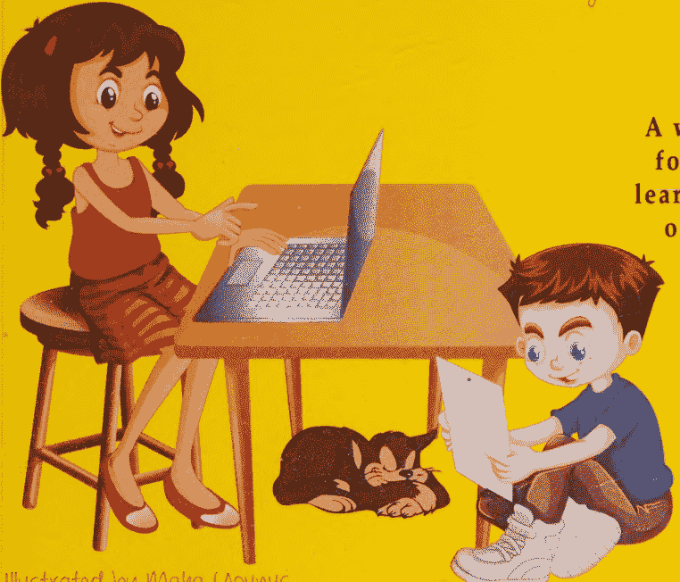


## 关于作者：

Kiki Protsman 是一位屡奖的教育设计师，拥有计算机科学硕士学位，主导过 200 节全方位的小学课程。

作为 Thinkersmith 的前执行董事，Kiki 通过创建让学生接触编程背后概念的活动而闻名。在 2013 年加入 Code.org 后，Kiki 开始为年轻程序员开发在线课程。

她负责监督了年度“编程小时”（Hour of Code®）活动中的数十项练习，估计 Kiki 的活动已覆盖全球超过 2 亿名学习者。如果你准备好第一次尝试编程，你真的应该用一本带有她名字指南。


## 亲爱的家长们：

恭喜你们选择为孩子们介绍一个创意、有趣且实用的学科！

编程可能非常困难，但这本书经过深思熟虑的设计，以简单易懂的方式介绍了特定的语言和重要概念。如果孩子在任何时候遇到困难，请鼓励他们解释自己所知道的，并让他们尝试描述他们遇到的问题。这是帮助你的孩子独立调试问题的第一步！

如果孩子遇到挣扎不再产生成效的情况，我提供了二维码来扫描获取帮助资源。

尽管很诱人，但请尽力不要冲过去接管孩子的操作（鼠标、键盘或导航）。挫败感在学习中起着至关重要的作用，这本书巧妙地平衡了挫败的机会与成功的机会。没有彼此，这两者都没有意义。

祝编码愉快！
Kiki

## 入门

### 你的新游乐场

编写 JavaScript 有很多方法。
在书中，我们推荐 https://repl.it。它允许你创建一个账户（在父母许可的情况下），这样你就可以在线保存和分享你的代码！

扫描阅读更多关于 JavaScript 环境的内容

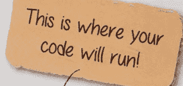
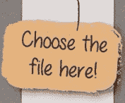
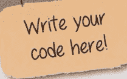

```javascript
console.log("Hello, World!");
```

在书的其余部分，我们将对已经启动的程序操作。点击文件窗口中的正确文件，然后编辑程序窗口中的代码。

> 技术变化非常快！没有什么是永恒的，网站也不例外！如果推荐的网站不再可用，请访问 bit.ly/editJSOnline 获取其他选项！

现在是了解编程环境中图标和按钮作用的好时机了。你能弄清楚如何运行你的代码吗？有分享它的方法吗？下载它？还有其他可以玩的设置吗？

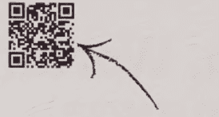

用二维码扫描器扫描观看 Kiki 解释 repl.it

### 轮你了！


当你玩程序时，你应该知道你对计算机拥有完全的控制权！你不必总是完全按照书上说的来写！

有时当你改变某些内容时，程序会停止工作。不用担心。只需还原，然后尝试改变其他内容。很快，你就会弄清楚每个东西的作用了。这是自学的一种极佳方法。

确保你记录过程中所做的编辑（以防你想撤销某些操作）。

5

## 你好，世界！
### （我的第一个程序）

程序员们有一个传统，通过让电脑说“Hello, World!”来测试一种新的编程语言。这并不是最兴奋的句子，但如果你愿意，以后可以把它改成其他内容。

> 大写很重要！请务必注意字母的大小写。

https://repl.it/@KIKlvsIT/vol1Intro

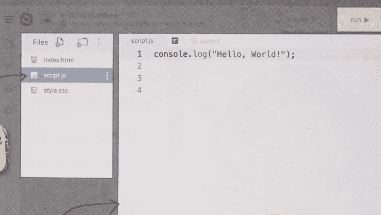

> 我们在 script.js 文件中工作。

> 你在这里会看到初始代码

> 让它变得不同！

在程序中使用 `console.log` 会向控制台输出一些内容。当你把 `console.log` 替换为单词 `alert` 时会发生什么？

访问上面的紫色 URL 获取此程序的初始代码。

- 1) 你认为这个是做什么的？
- 2) 你的控制台中会出现什么？

你在这个程序中可以更改什么内容？尝试一下“香蕉”测试！将程序中的单词替换为单词 `banana`（一次替换一个），看看哪些更改能让你的程序继续运行，哪些会让你的程序崩溃。确保在每次尝试之间将程序改回来！

你能猜出哪些会有效，哪些不会吗？

扫描此处查看你可以对“Hello, World!”做的一些有趣的更改。

## 点击我
### （将 JavaScript 连接到 HTML）

在书中，我们将代码分为三个部分：

- 1) **HTML 文件** - 它将包含告诉网页在当你点击“运行”（run）时应该加载内容的代码。
- 2) **JavaScript 文件** - 这是我们将花费大部分时间的地方。
- 3) **CSS 文件** - 这是编写样式规则的地方。

这是代码的主页面。它调用了另外两个文件。我们会在这里看一眼，但只在需要的时候看。

JavaScript 代码保存在这个文件中，所以我们在这里编写大部分代码，只有当我们需要更改网页的某些内容时才会访问其他文件。

CSS 文件保存了让网页看起来良好的代码。对于我们的大多数程序，这部分已经为我们做好了。

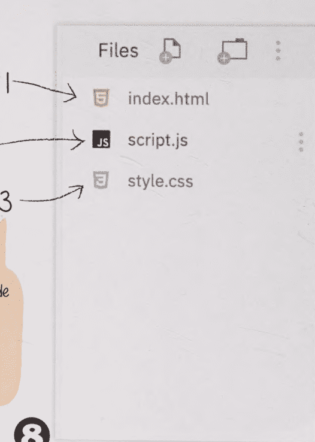

访问 https://repl.it/@KIKlvsIT/clickMe 查看下一个程序的代码。当你点击运行时，它应该可以工作。但它会做什么？

https://repl.it/@KIKlvsIT/clickMe

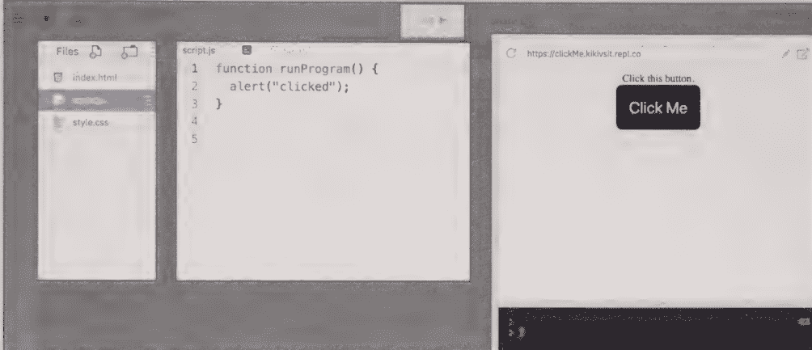

### 让我们拆解一下...

### function

这个词告诉计算机我们正在给接下来的代码命名。

### runProgram()

这是大括号之间的代码块的名字。

{ }

这些被称为大括号，它们就像书签，用于开始和结束代码块。

### alert()

这告诉电脑弹出一个带有消息的警告框。

你还记得这些是做什么的吗？（ " " )


## 它无法工作！
(在代码中寻找 bug)

这个程序出坏了。它有一个 bug（意味着它有一个错误）。
你能将其与其他程序进行比较，并找出它为什么无法运行吗？点击蓝色按钮时会发生什么？

https://repl.it/@KIKIVsIT/oopsie

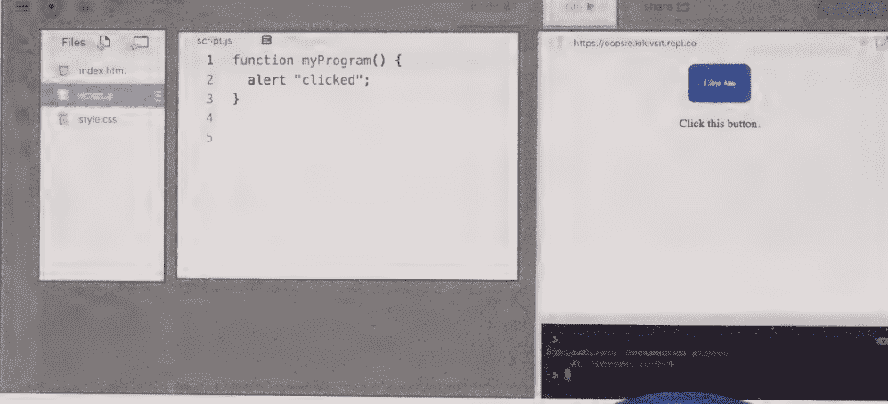

记住你需要点击

网站才会加载，然后
你还需要点击

函数才会运行。

> 找找不同之处！
其他程序有什么而这个程序没有的吗？
当你把缺失的内容加回来时会发生什么？

## 读取控制台

SyntaxError: Unexpected string（意外的字符串）

> 这告诉我们某个东西的编写方式不对，那个东西是计算机尚未预期看到的字符串。

at /script.js:2:9

> 这告诉我们计算机感到困惑的地方在 "script.js" 的第 2 行第 9 个位置。（那里它期望看到其他内容。）

ReferenceError: myProgram is not defined at HTMLButtonElement.onclick (:12:37)

> 因为 myProgram 函数内部有一个错误，文件没有识别出定义！修复这个 bug，这个问题就会消失。

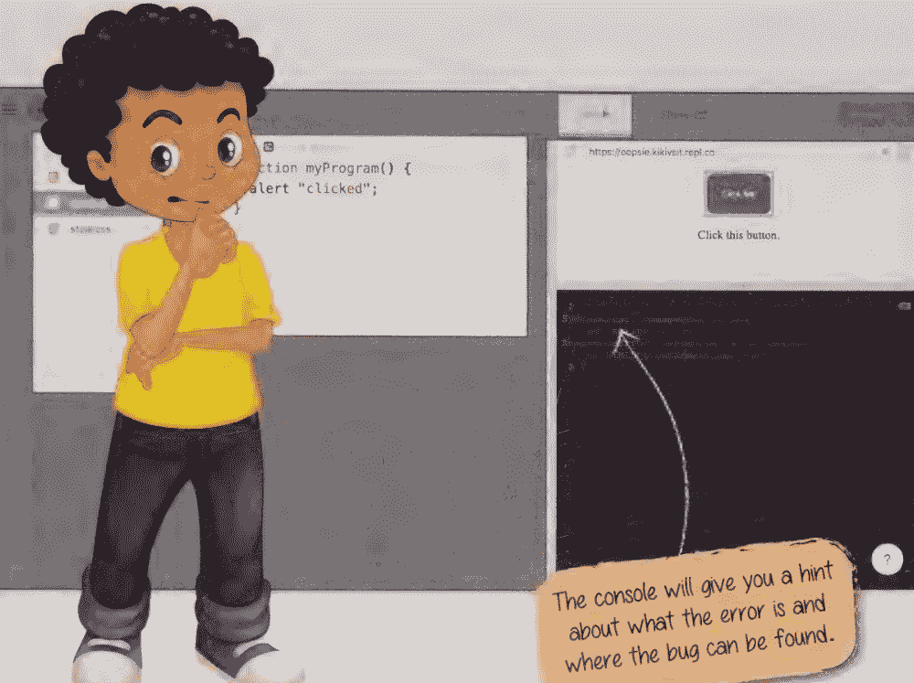

## 你尝试了什么？

## 发生了什么？

你可能会发现，不仅仅缺少了一个东西，而是一组东西！你发现这个问题了吗？控制台有帮助吗？


有时候你产生了一个主意，但在来得及去电脑尝试之前忘记了。

在解决问题时，手边准备好纸很有帮助。

（此外，你可以在这里做笔记。）

## 你是谁？
(获取输入)

使用 JavaScript 获取用户输入非常简单。我们只需要使用 `prompt` 命令。点击此程序中的按钮会弹出一个输入框，询问用户的姓名。

https://repl.it/@KIKlvsIT/whoDIs

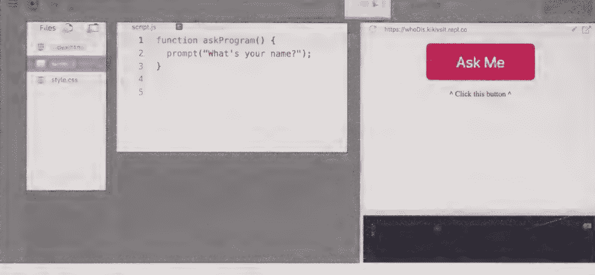

> ### 让我们来拆解一下...
### askProgram()

这是点击按钮时运行的代码块名称。

### prompt()
告诉计算机为用户弹出一个输入框。

你还记得其他东西是干做什么的吗？

这是 repl.it 中 prompt 框的样子。

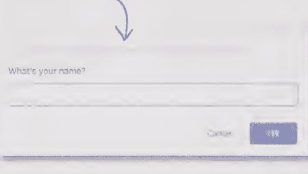

输入你的名字并点击，框就会消失。

## 你是谁？

(将输入保存到变量中)

为了从 prompt 框的输入中受益，我们要么立即使用它，要么需要将其保存到一个**变量**中供以后使用。

https://repl.it/@KIKIVsIT/uWho

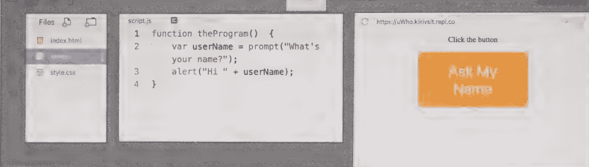

## 让我们来拆解一下...

function theProgram() {

> 这一行告诉计算机我们把函数命名为 theProgram()，并且正准备开始定义它。

var userName = prompt("What's your name?");

> 这创建了一个名为 userName 的存储容器，我们在询问用户姓名时，将用户输入的值存入其中。

alert("Hi " + userName);

> 这会弹出一个提示框，显示 "Hi" 并重复用户的名字。

}

> 告诉计算机定义已完成。

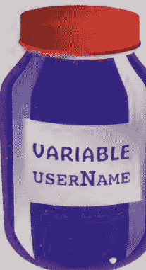

变量超级有用！它们就像小罐子，可以装下你需要的任何信息……即使你不知道那是什么。

你可能不知道用户会输入什么名字，但你需要在程序的后续部分使用那个名字。变量（如 `userName`）让你在获取这些值后，在代码中为它们留出一个位置。

```javascript
function theProgram() {
  var userName = prompt("What's your name?");
  alert("Hi " + userName);
}
```

> 你可以自己命名！
你可以给变量起任何想要的名字。
只要确保在任何你想使用该变量的地方使用该名字即可。

## 变...变...变...变化了！

如果我们想知道某人最喜欢的动物而不是他们的名字呢？

你会把变量名改成什么？你还会如何修改程序？

做一些修改并运行你的新程序，看看它是否合逻辑。你可能需要多次尝试（可能超过五次）才能让它按照你的想要运行。

15

## 变量汤
(我的变量里有一个 bug！)

变量让程序变得有趣，但也引入了许多 bug 隐藏的地方。

你的变量在所有使用地方拼写必须完全一致。它不能包含任何空格，且不能以数字开头。
此外，大小写也是重要的！

https://repl.it/@KiKlvsT/bugSoup

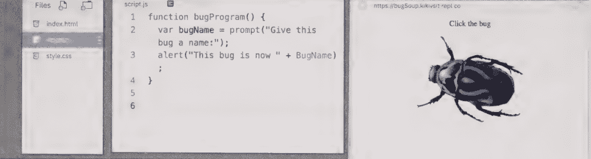

这个程序运行得不对。
你能弄出它应该做什么的吗？

> 这个程序应该：

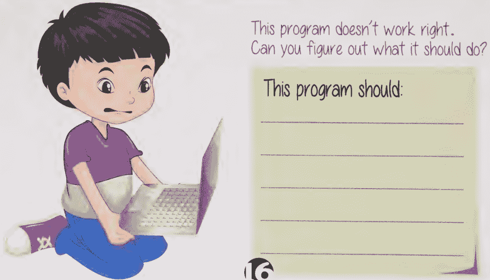

仔细查看代码以找出哪里错了。
这就像一个谜题，你需要寻找线索来解决它。

```javascript
function bugProgram() {
  var bugName = prompt("Give this
bug a name:");
  alert("This bug is now " + bugName)
}
```

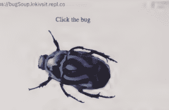

这看起来可能像两行，但实际上只是一行太长了代码，所以它自动折行到了下方。
计算机仍然认为它全部是第 2 行。

控制台正试图告诉你什么？

用这个作为草稿纸来跟踪想法。

## 建立连接
(HTML 和 JavaScript 如何连接)

到目前为止，缺的不仅仅是一个东西，而是一组东西！你发现了吗？控制台有帮助吗？


有时候你产生了一个主意，但在来得及去电脑尝试之前忘记了。

在解决问题时，手边准备好纸很有帮助。

（此外，你可以在这里做笔记。）

建立连接
(HTML 和 JavaScript 如何连接)

到目前为止，缺的不不仅仅是一个东西，而是一组东西！你发现了吗？控制台有帮助吗？

（ ，错误]


 有时候你产生了一个主意，但在来得及去电脑尝试之前忘记了。

 在解决问题时，手边准备好纸很有帮助。

 （此外，你可以在这里做笔记。）


# 整合一切

现在你已经理解了 HTML 中发生了什么，让我们来看看这个页面的 JavaScript，看看它们是如何连接的。

https://repl.it/@KiKIlvsIT/theCurtain

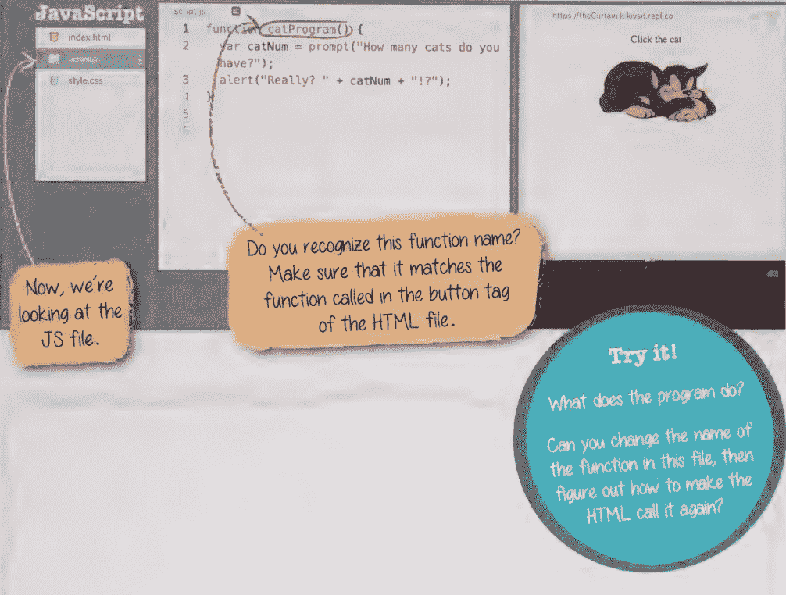

现在，我们正在看 JS 文件。

你认得这个函数名吗？确保它与 HTML 文件中 `<button>` 标签内调用的函数匹配。

试一试！这个程序是做什么的？你能更改此文件中函数的名称，然后找出如何让 HTML 再次调用它吗？

把这个当作草稿纸来记录你的。

## 按钮在谁手里？

（将按钮连接到 JavaScript）

在我们开始玩花哨之前的最后一步。

这个程序没法运行！你能查看 JavaScript 和 HTML，看看能不能弄出如何修复它吗？

https://repl.it/@KIKivsit/bzzt

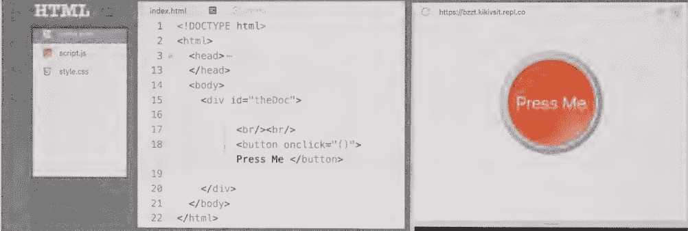

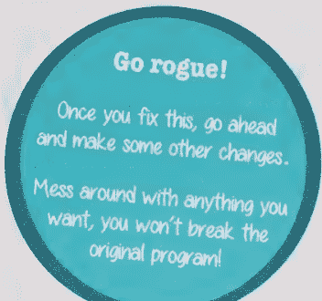

## 点击它
（使用图片代替按钮）

Kiki 详细讲解了标签和属性

在接下来的几个程序中，我们仍然会点击图片而不是 `<button>`，我们将使用 `` 标签。这会让创意变得容易一点。

https://repl.it/@KIKlivsIT/clickit

```html
HTML
Files: index.html
1 <!DOCTYPE html>
2 <html>
3 <head>
13 </head>
14 <body>
15 <div id="theDoc">
16   Click to buckle
17   <br/>
18   
20 </div>
21 </html>
```

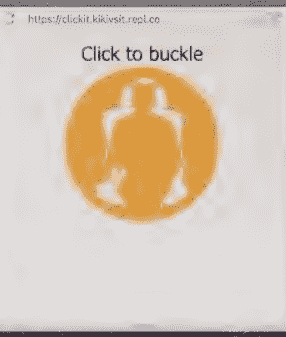

这看起来像四行，那是因为电脑把它们都读作了一行。

### 让我们拆解一下...

```html

```

- **img** - 告诉计算机该标签描述的是一张图片。
- **src** - 提供你在互联网上所需的图片的 URL。
- **id** - 为这张特定的图片分配一个特殊的名称，以便我们以后以后想使用它时可以找到它（我们将其命名为 "myImage"）。
- **onclick** - 这是我们给计算机的指令，告诉它当有人点击图片时应该做什么。我们在 `<button>` 中也使用了这个。在这里，我们告诉它调用我们的 `buckleProgram()` 函数。

这个 JavaScript 文件和我们之前的几个文件非常相似，因为它只包含一个函数。

不过，如果你仔细观察，你会发现里面有一些新颖且陌生的内容。

https://repl.it/@KIKivsIT/clickit

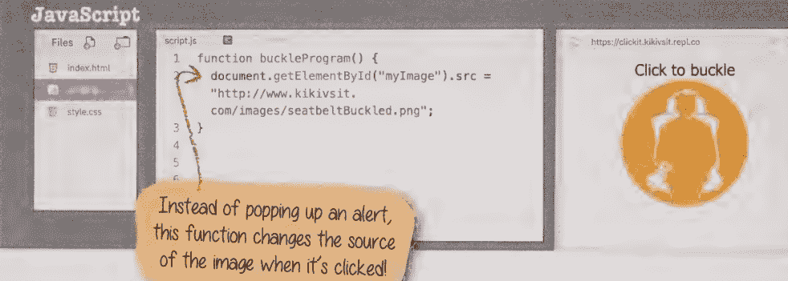

### 让我们拆解一下...

`document.getElementById("myImage").src = "http://www.kikivsit.com/images/seatbeltBuckled.png";`

- **document**
这部分告诉计算机我们正准备对调用此函数的文档（HTML 页面）进行某些操作。

- **getElementById("myImage")**
我们想要更改我们命名为 "myImage" 的元素。

- **src**
我们正在更改图片的源 URL。

- **"http://www.kikivsit.com/images/seatbeltBuckled.png"**
这是我们要切换到的图片的新 URL。

## HTML

```html
<!DOCTYPE html>
<html>
<head>
</head>
<body>
<div id="theDoc">
  Click to buckle
  <br/>
  
</div>
</body>
</html>
```


将此替换为你的第一个 URL。


记住在为网页寻找内容时，要使用免版且未经许可的图片。

将此替换为你的第二个 URL。

## JavaScript

```javascript
function buckleProgram() {
  document.getElementById("myImage").src = 
    "http://www.kikivit.com/images/seatbeltBuckled.png";
}
```

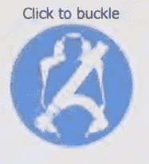

## 追踪球
（哪里出错了？）

这个页面在你刚刚学到的知识的基础上构建的，但它推向了极端！遗憾的是它无法运行。你能玩玩网页并查看文件，看看能不能弄出哪里出错了吗？

https://repl.it/@KiKivsit/ball

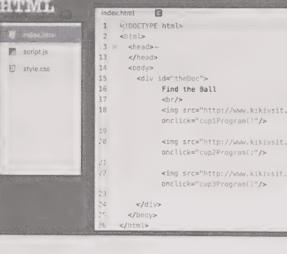

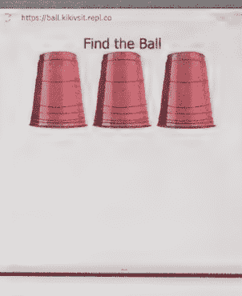

你需要玩玩这个页面，弄出哪里是新的，哪里是错误的。错误在哪里？

```html
<!DOCTYPE html>
<html>
<head>

</head>
<body>
<div id="theDoc">
Find the Ball


</div>
</body>
</html>
```

```javascript
function Program(id) {
  document.getElementById("cup" + id).src = 
    "http://www.kikivit.com/images/ball.png";
}
```


## 收集硬币
（避开口香糖）

这个程序是一个有趣的游戏，使用了我们刚刚学到的技能。
唯一的问题是它无法运行！你能找出原因是什么吗？
https://repl.it/@KiKIlivT/noGum

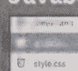

```javascript
var randNumber = Math.ceil(Math.random()) * 3;
var coinScore = 0;
function pigProgram() {
  if(pigName == "pig") {
    document.getElementById(pigName).src = "http://www.kikivit.com/images/pig.png";
    if (coinScore >= 2) {
      alert("You did it!");
    } else {
      alert("Oh, no. Gum!");
    }
  } else {
    coinScore = coinScore + 1;
  }
  document.getElementById(pigName).src = "http://www.kikivit.com/images/piggy.png";
}
```

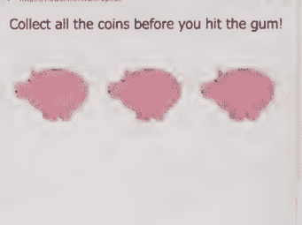

别忘记检查 HTML 文件，查看 HTML 中的函数调用是否与 JS 函数匹配。

这个程序增加了很多代码，但其中有产生 Bug 吗？

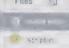

```html
<!DOCTYPE html>
<html>
<head>
</head>
<body>
<div id="doc">
在撞到口香糖之前收集所有的硬币！


</div>
</body>
</html>
```

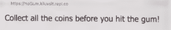

在撞到口香糖之前收集所有的硬币！


## 我可以注释吗？
（在你的代码中留笔记）

这个程序增加了更多的猪，还增加了一个分数计数器！有了所有这些代码，阅读程序开始变得混乱，我们添加了一些计算机无法读取但我们可以读取的秘密笔记！这些笔记是注释注释（comments），它们不会改变你程序运行的方式。

https://repl.it/@KIKivsiT/whack

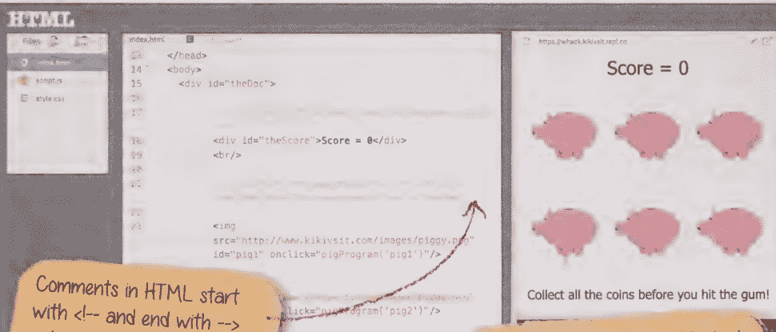

```html
<head>
<body>
<div id="theDoc">
<div id="Score">Score = 0</div>
<br>

```

> HTML 中的注释以 <!-- 开头，以 --> 结束，并可以跨多行。

在撞到口香糖之前收集所有的硬币！

> JS 中这种类型的注释以 // 开头，不需要结束符号，因为它在程序中的单行后会自动停止。

```javascript
var randomNumber = Math.floor(Math.random() * 6);
var coinScore = 0;
function pigProgram(pigName) {
  if(pigName == "pig" + randomNumber){
    document.getElementById(pigName).src = "http://www.kikivsit.com/images/gun.png";
    coinScore = 0; // 重置分数为 0
    document.getElementById("theScore").innerHTML = Score;
  }
}
```

在撞到口香糖之前收集所有的硬币！

## 无限的小猪
（刷新点击过的猪）

我们添加了另一个函数，当你的鼠标离开你最后点击的地方时会被调用。它本应该替换小猪，但程序没有正常工作。你能找出原因吗？

https://repl.it/@KIKivsit/resets

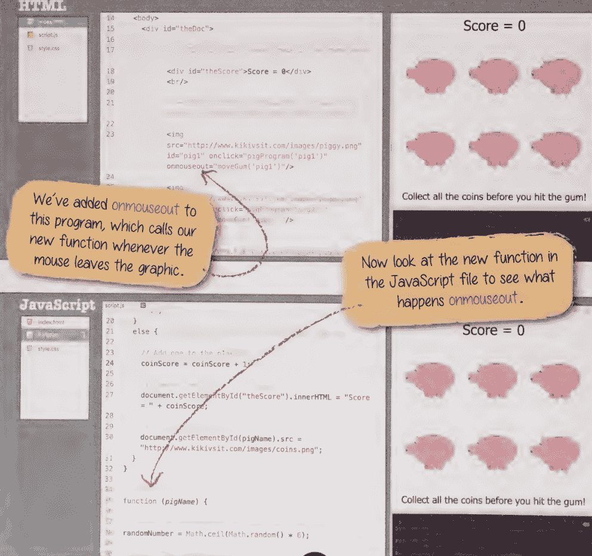

> 我们在这个程序中添加了 mouseout，每当鼠标离开图形时，它就会调用我们的新函数。

> 现在查看 JavaScript 文件中的新函数，看看 mouseout 发生了什么。

## 现在来点点不一样的
（填空）

这与上一个程序完全不同，有大量的 JS 代码缺失。你可以阅读注释，然后使用你所学的知识来完成这个游戏吗？

https://repl.it/@KIKlivst/think

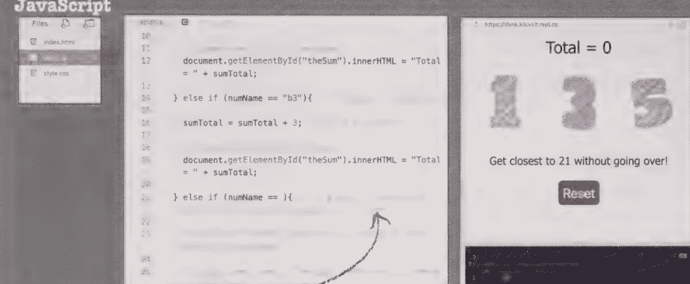

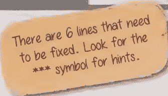


- 为 "b5" 完成 else
- 给 sumTotal 增加 5
- 将 sumTotal 重置为零
- 更新页面上的 total
- 创建页面 alert

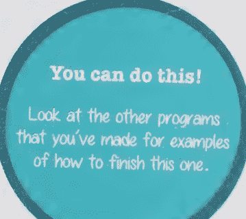

## 神秘语句
（我们损坏的程序）

这是点击按钮公式的另一种变体。这次当你点击水晶球时，应该获取一个短语。那么，它为什么不工作呢？

https://repl.it/@KIKlivst/mystic

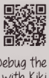

```javascript
var myList = [
  "选择快乐",
  "追求月亮",
  "善良",
  "让阳光洒下!"
];

var randomNumber = Math.floor(Math.random() * myList.length);

function getRandom() {
  return myList[randomNumber];
}
```

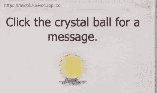

## 使用你的想象力
（制作你的程序）

这非常好玩！把你所学的知识进行组合。由你决定！

## 答案
（Bug 在哪里？）

### 无法运行（第10页）
pigProgram() 函数的第 2 行应该是
`alert("clicked");`
但缺少了括号。

### 变量大汤（第16页）
bugProgram() 函数的第 3 行尝试使用变量 BugName，但该变量应该是 bugName，小写字母 'b'。

### 谁拿了按钮？（第22页）
HTML 文件的第 18 行没有调用任何函数！不应该是 `<button onclick="()">` 应该是 `<button onclick="buttonProgram()">`。

### 跟随球体（第26页）
JS 文件的第 10 行提供的信息不对。没有名为“cup”的元素。相反，该行应该是：
`document.getElementById("cup3").src =`

### 收集硬币（第30页）
注意调试台显示 pigName 未定义。这是因为 pigProgram() 函数在 JS 文件中没有请求参数。如果你将 JS 文件第 5 行的
`function pigProgram() {`
改为 `function pigProgram(pigName) {`
那么你就可以正常运行了！


# 无限的小猪（第 32 页） -

当控制台显示“函数语句需要函数名称”时，它给了你最大的提示。这是因为我们在 JS 文件的第二个函数中漏掉了名称。第 35 行应该是：

```javascript
function moveGum(pigName) {
```

# 有些不同之处（第 33 页） -

这个程序是一场缺失代码的捉迷猫。总共有六行代码需要编辑或添加。你可以通过寻找三个星号（***）来确定它们所在的位置。

- 1) 第 21 行应该是：} else if (newName == "b5") {
- 2) 第 23 行应该是：sumTotal = sumTotal + 5;
- 3) 第 25 行应该是：document.getElementById("theSum").innerHTML = "Total " + sumTotal;
- 4) 第 29 行应该是：sumTotal = 0;
- 5) 第 31 行应该是：document.getElementById("theSum").innerHTML = "Total " + sumTotal;
- 6) 第 37 行应该类似于：alert("Sorry, you lose.");

# 神秘短语（第 34 页） -

这个比较棘手，这个错误不会给浏览器引起错误，只会影响程序的运行方式。如果你仔细观察，你会发现本该更新屏幕上短语的行是不完整的。第 17 行应该是：

```javascript
document.getElementById("theThought").innerHTML = myList[randomNumber];
```

# 词汇表
（单词及其含义）

- **bugs**（错误）：代码或程序运行过程中的问题
- **JavaScript**: 一种允许网页在不重新加载的情况下更改信息的文件类型
- **code**（代码）：告诉计算机做什么的指令
- **online**（在线）：在互联网上
- **comment**（注释）：人类可以阅读但计算机不能读取的消息
- **parameter**（参数）：你在程序元素之间传递的一个信息
- **console**（控制台）：显示计算机反馈的屏幕
- **program**（程序）：一组完整的代码集
- **CSS (级联样式表)**：用特殊语言编写的文件，用于告诉计算机元素应该看起来什么样
- **programming**（编程）：编写程序
- **random**（随机）：在没有明显规律的情况下挑选
- **royalty-free**（免版税）：你可以使用而无需为每次使用向作者支付费用的东西
- **debugging**（调试）：发现并修复错误
- **string**（字符串）：你希望计算机完全按照你书写的方式显示的一字符组
- **function**（函数）：可以从程序其他地方调用的代码块
- **HTML (超文本标记语言)**：一种用于创建网页的语言
- **tag**（标签）：定义网页上元素的代码片段
- **input**（输入）：用户提供计算机的信息
- **variable**（变量）：用于象征一段信息的单词或短语
- **internet**（互联网）：连接全球范围内传输信息的电线和计算机的连接系统
- **webpage**（网页）：互联网上的页面

# 索引
（我们在哪里讨论过它？）

- alert() - 9
- body - 18, 19, 20
- bugs - 10
- button - 20
- console - 4, 11
- console.log - 6, 7
- CSS - 8
- file window - 4
- function - 9
- getElementById() - 24
- head - 18, 19
- Hello, World! - 6
- HTML - 8, 18
- if/else - 28
- img - 23
- input box - 13
- JavaScript - 8, 18, 21
- lists - 34
- parameter - 27, 28
- program window - 4
- prompt() - 13
- random - 29
- repl.it - 4
- runProgram() - 9
- starter code - 6
- string - 11
- variable - 14, 15, 16

# 笔记
（你在想什么？）

美国制造
特拉华州 Middletown
2020年10月2日
20965638R0024

# 我的神奇程序集：第1卷 - JavaScript 的编写是为了让年轻的程序员能够以简单的方式开始接触最常用的语言。读者将在学习 JavaScript 和 HTML 的同时，获得应对问题的经验。

“这是一个非常有趣且吸引人的 JavaScript 入门——我等不及要分享给我认识的那些小程序员了！”
- Jake Baskin, 计算机科学教师协会执行主任

“Kiki Sedwick 引导并鼓励他们通过用自己的语言解释他们创作的内容来应用学习。对于想要深化 JavaScript 之之旅的人来说，这是必读的。”
- Angle Kalthoff, Capstone 课程产品经理

“Kiki Pottsman 为孩子们提供了一种学习新语言的独特方式。因为许多启动程序是故意损坏的，孩子们也会对错误感到熟悉，并学会使用错误信息来获取修复问题的提示。”
- Vicky Sedwick, 计算机科学老师

“这本书在学习编程方面采取了非常聪明的方法。很多时候，我们要求初学者在没有指导的情况下就开始编码。回想我们如何教学生阅读，我们并不是一开始就要求他们写段落，而是从故事开始。谁比 Kiki Pottsman 更适合做我们的编程故事家呢？”
- Rebecca Dov, CodeVA 教育总监

# Bug 可能很讨厌，但 Kiki 会教你如何发现并修复代码中的问题。

