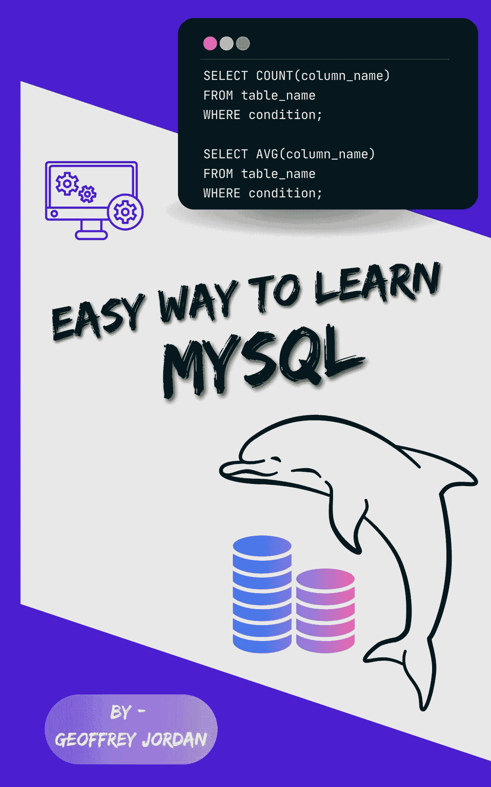
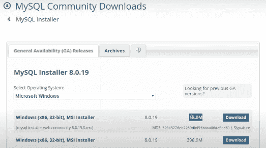
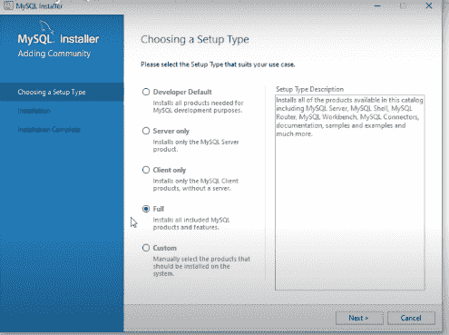
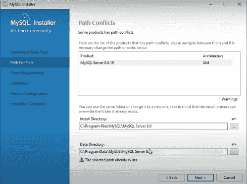
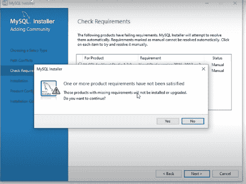
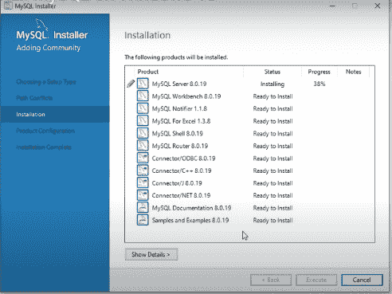
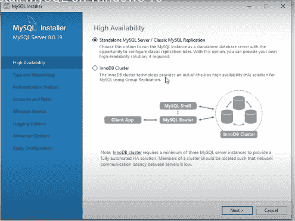
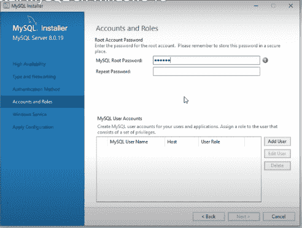
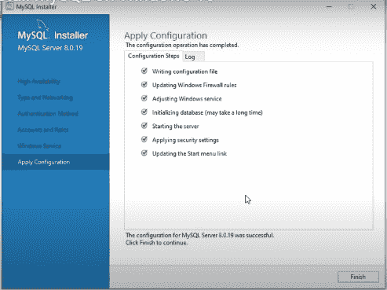
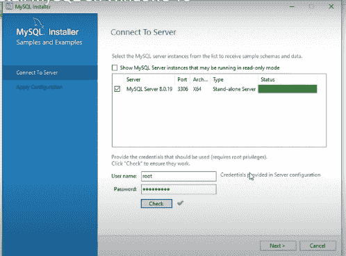

# MySQL 入门指南（编程语言 - JavaScript, Java, MySQL, PHP 及使用 Python 自动化）



# 前言

# MySQL 概述

SQL 是处理 RDBMS（关系型数据库管理系统）任务最强大的语言之一。它使用简洁的英语语句来创建、定义、更新和控制关系型数据库。

SQL 用于在关系型数据库中存储和处理信息，而 MySQL 用于开源关系型数据库。MySQL 最适用于客户端-服务器环境。它提供了灵活的事务管理。它是许多应用程序以及商业产品的主要关系型数据库。作为一本电子书，这将是关于如何使用 MySQL 提取、管理和操作存储在关系型数据库中的数据的参考。我们已经通过示例详细讨论了 DDL、DQL、DCL 和 TCL。如果你觉得大多数编程书籍很枯燥，这可能是你入门 MySQL 的绝佳书籍。

# MySQL 概述

SQL（结构化查询语言）最初由 IBM 创建，并于 1979 年由 Oracle 公司首次实现，但由于没有标准，在随后的 1986 年它由 ANSI 和 ISO 改进并联合发布。1992 年发布了 SQL_92。它的组织方式变得更好，数据包含在表中，表分组为模式（schemas），模式分组为集群（clusters）。MySQL 的第一个版本由 Monty Widenius、David Axmark 和 Allan 开发，于 1995 年出现。到 2000 年，发布了多个版本的 MySQL。这些版本兼容所有主流平台。

MySQL 是一种基于结构化查询语言（SQL）的 RDBMS（关系型数据库管理系统）。关系型数据库以表格的形式存储信息，行和列表示不同的数据属性以及数据值之间的各种关系。我们使用命令来创建、定义、插入、更新和控制数据库。以下是 SQL 的类型：

* DDL（数据定义语言）
* DQL（数据查询语言）
* DML（数据操纵语言）
* DCL（数据控制语言）
* TCL（事务控制语言）

我们将在后续章节中讨论所有这些内容。

以下是使用 MySQL 的前 10 个热门应用程序：

1. 在线游戏
2. 数字营销
3. 零售销售点系统
4. 物联网监控系统
5. SaaS 应用程序
6. Facebook
7. Flickr
8. Web 开发
9. Twitter
10. YouTube

# 第 1 章：MySQL 简介

## 1.1 简介

MySQL 是一个采用 SQL（结构化查询语言）的软件。它非常快速、可靠、可扩展，且易于小型和大型应用程序。MySQL 的名字是由创始人 Widenius 的女儿命名的。

### 什么是数据库？

数据是现实世界中到处使用的原始事实和数字。一组数据构成特定的信息或数据库。在我们的日常生活中，如果我们访问商场，会看到店主使用扫描器处理产品数据库。另一个例子，让我们考虑银行，他们处理客户数据库。第三个例子是学校，他们处理学生数据库。因此，数据库既可以手动在登记簿处理，也可以通过 MySQL 等计算机软件处理。

### 什么是关系型数据库？

它是存储在一个或多个表中的组织数据集合。我们可以轻松地看到并理解不同数据结构之间相互的关系。

## MySQL 和 SQL 的区别

我们使用 MySQL 来创建、读取、更新和删除数据库。但 SQL（结构化查询语言）是一种用于访问、操作和协调数据库的简洁英语语句。在本文电子书中，我们将讨论关于如何在进入的数据库上操作交互式环境。

## MySQL 中使用的命令类型

以下是 MySQL 中使用的命令类型：

* DDL（数据定义语言）- 这些命令用于创建、删除、修改和描述表。
* DML（数据操纵语言）- 这些命令用于操作数据，如求和、平均值等
* DCL（数据控制语言）– 它为数据库提供安全性，如 `Grant`（授权）和 `Revoke`（撤销）。
* DQL（数据查询语言）– 它允许用户向关系型数据库传递查询。
* TCL（事务控制语言）– 它允许用户保存和恢复数据库。

**注意：** 我们即将在接下来的章节中讨论这些命令。

## 1.2 安装 MySQL

在本节中，你将学习安装 MySQL Workbench。让我们从从 `dev.mysql.com` 下载 MySQL 开始。选择操作系统并下载 MySQL 安装程序 `8.0.19`。将其保存在合适的位置，例如桌面。



点击保存的文件，现在选择一种安装类型，我根据我的需求选择“Full”（完整安装），然后点击 next（下一步）按钮。



选择 MySQL 和数据的位置。点击 next（下一步）按钮，出现需求检查界面，你可以选择需求或直接点击 next（下一步）。



如果我们不选择需求，将出现下方所示界面，只需点击“Yes”（是），然后点击 next（下一步）。



将出现 MySQL 的功能界面，点击 `Execute`（执行）并等待几分钟。



所有产品已成功安装在我们的电脑上，现在双击 next（下一步）按钮，选择 standalone MySQL server（独立 MySQL 服务器），然后点击 next（下一步）按钮。



点击 next（下一步）跳过类型和网络/身份验证。

现在为你的账户设置密码，点击 next（下一步）按钮。



点击 next（下一步）到达 Apply configuration（应用配置）界面，点击 `execute` 然后点击 `Finish`（完成）。我们已成功配置了 MySQL。下一步跳过产品配置。



将出现 Connect to the server（连接服务器）界面，输入你的账户密码并检查是否已连接到服务器 – 连接成功，点击 next（下一步）按钮。



回到 Apply configuration（应用配置），点击 `execute` 然后点击 `Finish`（完成）。我们在电脑上已成功配置并安装了 MySQL。

MySQL Workbench 安装成功，使用你的密码连接服务器并开始使用 MySQL。

# 第 2 章：MySQL 语法

与其他编程语言一样，MySQL 遵循一套独特的规则和指南，被称为 MySQL 语法。它也非常容易运行和执行。

## 2.1 MySQL 中的数据类型

MySQL 数据类型指定了存储在数据库表中的值的类型。数据类型主要分为三类。

* 数字
* 字符串
* 日期和时间

### 2.1.1 数字数据类型

它是指数字形式的数据，如 `Integer`（整数）、`Float`（浮点数）和 `Boolean`（布尔）。下表列出了 MySQL 数字数据类型。

| 数字数据类型 | 范围 |
| :--- | :--- |
| BIT | 0-1 |
| TINYINT | 0-255 |
| SMALLINT | -32,768 - 32,767 |
| BIGINT | -9,223,372,036,854,775,808 - 9,223,372,036,854,775,807 |
| FLOAT | -1.79E+308 - 1.79E+308 |
| REAL | -3.40E+38 - 3.40E+38 |

### 2.1.2 字符串数据类型

它允许我们存储固定或可变的字符值，如 `char`、`varchar` 和 `text`。下表列出了 MySQL 字符串数据类型。

| 字符串数据类型 | 说明 |
| :--- | :--- |
| CHAR | 固定长度 8000 字符 |
| VARCHAR | 变长 8000 字符 |
| TEXT | 变长 2GB 数据 |

### 2.1.3 日期和时间数据类型

它用于存储同时包含日期和时间的值。下表列出了 MySQL 日期和时间数据类型。

| 日期和时间数据类型 | 说明 |
| :--- | :--- |
| DATE | 以 (YYYY-MM-DD) 格式存储日期 |
| TIME | 以 (HH:MI:SS) 格式存储时间 |
| DATETIME | 存储日期和时间信息 (YYYY-MM-DD HH:MI:SS) |

## 2.2 MySQL 中的运算符

MySQL 运算符用于在语句中指定特定条件。运算符大致分为五类：

* 算术运算符
* 逻辑运算符
* 比较运算符
* 位运算符
* 集合运算符

### 2.2.1 算术运算符

它也可以对数值型数据执行算术操作。下表列出了算术运算符。

| 算术运算符 | 说明 |
| :--- | :--- |
| + | 加法 |
| - | 减法 |
| * | 乘法 |
| / | 除法 |
| % | 取模 |

### 2.2.2 逻辑运算符

它给出真或假的结果。下表列出了逻辑运算符。

| 逻辑运算符 | 说明 |
| :--- | :--- |
| AND | 如果两个表达式都为真则为真 |
| IN | 如果操作数等于列表中的任何一个则为真 |
| OR | 如果任意一个为真则为真 |
| NOT | 取反逻辑 |
| LIKE | 如果操作数匹配模式 |
| BETWEEN | 如果操作数在范围内 |

### 2.2.3 比较运算符

它是关系性的，比较表中的值。下表列出了比较运算符。

| 比较运算符 | 说明 |
| :--- | :--- |
| = | 等于 |
| > | 大于 |
| < | 小于 |
| >= | 大于等于 |
| <= | 小于等于 |
| <> | 不等于 |

### 2.2.4 位运算符

它将整数转换为二进制，对每个位执行 AND、OR 和 NOT 操作。下表列出了位运算符。

| 位运算符 | 说明 |
| :--- | :--- |
| AND | 如果两个位都为 1 |
| OR | 如果任意一位为 1 |
| NOT | 取反 |

### 2.2.5 集合运算符

集合运算符用于合并两个或多个表的行。下表列出了集合运算符。

| 集合运算符 | 说明 |
| :--- | :--- |
| UNION | 不包含重复值的结果集合并 |
| UNION ALL | 包含重复值的结果集合并 |
| INTERSECT | 仅包含两个集合共有的值 |
| EXCEPT | 包含第一个集合不在第二个集合中的结果 |

# 第 3 章：数据定义语言 (DDL)

在上一章中我们看到了 MySQL 的语法，包括 MySQL 中的数据类型和运算符，现在我们将学习 MySQL 中的完整性约束，然后学习使用 DDL 命令创建表。

## 3.1 MySQL 中的完整性约束

完整性约束是表数据或列必须遵循的规则。我们可以在列级或表级使用约束约束。表级约束适用于整个表，而列级约束仅适用于列。表显示了 MySQL 中使用的完整性约束。

| 完整性约束 | 说明 |
| :--- | :--- |
| NOT NULL | 防止列出现空值 |
| DEFAULT | 当列没有定义值时，DEFAULT 约束提供默认值 |
| UNIQUE | 确保列中的任何值都是唯一的 |
| PRIMARY KEY | 唯一标识每行/记录 |
| FOREIGN KEY | 唯一识别任何数据库表中的行/记录 |

## 3.2 MySQL DDL 简介

MySQL DDL 语句用于定义和操作数据库结构。它允许我们使用命令创建、修改和维护数据库。

以下是 DDL 命令：

* `CREATE` - 用于创建表和模式。
* `ALTER` - 用于从数据库表中添加、修改或删除列或约束。
* `TRUNCATE` - 用于删除表中的数据，但不会删除表本身。
* `DROP` – 用于删除整个表。
* `RENAME` – 用于重命名表。

### 3.2.1 CREATE 命令

MySQL 允许我们使用 `CREATE` 命令创建数据库表。让我们创建一个员工表。如果我们在 MySQL Workbench 中按如下所示执行语句序列，就可以创建一个员工表。

```sql
CREATE TABLE employees (
  employee_id INT,
  first_name VARCHAR (50),
  last_name VARCHAR (50),
  hourly_pay DECIMAL (5,2),
  hire_date DATE
);
```

我将向你展示如何在 MySQL 中创建一些表。关系型数据库中的表由行和列组成，类似于 Excel 表格。在本主题中，我们将创建表和列。

只需输入 `CREATE TABLE` 然后跟上表名，我将创建一个名为 `employees` 的表，然后在末尾添加一组括号和分号；在括号内部，我们将列出 `employees` 的列，例如 `employee_id`、`first_name`、`hourly_pay` 和 `hire_date`。现在，我们需要为每个列设置要在该列中存储的数据类型。

让我们为每一列设置数据类型：

- `Employee_id INT` – 数据将为整数
- `First_name VARCHAR (50)` –最多 50 个字符的序列
- `Last_name VARCHAR (50)` –最多 50 个字符的序列
- `Hourly_pay Decimal (5,2)` – 小数前最多 5 位，后 2 位 (99999.99)
- `Hire_data DATE` – 日期格式 (dd-mm-yyyy)

如果你需要查询表，请输入：

**语法：** `SELECT * FROM table name;`

**实现：** `SELECT * FROM employees;`

| employee_id | first_name | last_name | hourly_pay | hire_date |
| :--- | :--- | :--- | :--- | :--- |
| | | | | |

我们已成功创建了一个包含五列的员工表。

### 3.2.2 `RENAME` 命令

如果我们需要重命名上面的表，请输入：

**语法：** `RENAME TABLE original name TO new name;`

**实现：** `RENAME TABLE employees TO workers;`

在 MYSQL workbench 中执行并获取结果。

### 3.2.3 `DROP` 命令

如果我们需要删除上面的表，请输入：

**语法：** `DROP TABLE name of table;`

**实现：** `DROP TABLE employees;`

在 MYSQL workbench 中执行并获取结果。

### 3.2.4 `ALTER` 命令

如果我们需要修改表，让我们添加新列 `phone_number`，输入：

```sql
ALTER TABLE employees
ADD phone_number VARCHAR (15);
```

在 MYSQL workbench 中执行并获取结果。

将 `phone_number` 重命名为 `email`，输入：

```sql
ALTER TABLE employees
RENAME COLUMN phone_number to email;
```

在 MYSQL workbench 中执行并获取结果。

让我们为 `email` 列添加数据类型，这里我们必须使用 `MODIFY` 命令，输入：

```sql
ALTER TABLE employees
MODIFY COLUMN email VARCHAR (100);
```

在 MYSQL workbench 中执行并获取结果。

在 `last_name` 之后添加 `email`，输入：

```sql
ALTER TABLE employees
MODIFY email VARCHAR (100)
AFTER last_name;
```

在 MYSQL workbench 中执行并获取结果。

让我们删除 `email` 列，输入：

```sql
ALTER TABLE employees
DROP COLUMN email;
```

在 MYSQL workbench 中执行并获取结果。

# 第 4 章：数据操纵语言 (DML)

## 4.1 MySQL DML 简介

MySQL DML 处理数据库表中数据的修改。DML 语句用于向数据库中添加（插入）、删除和修改（更新）数据。

以下是 DML 命令：

- `INSERT` – 用于手动向表中添加行。
- `SELECT` – 我们可以使用 `Select` 命令访问和操作数据。
- `DELETE` – 可以使用 `Delete` 命令删除现有表的行。
- `UPDATE` - 用于更改表中的实际数据。

## 4.2 DML 命令执行

在上一章节中，我们创建了一个 `employees` 表，现在让我们使用 DML 命令操作该表。

### 4.2.1 `INSERT` 命令

在本主题中，我将讨论如何向表中插入行。我们有一个名为 `employees` 的表。我将从我的 `employees` 表中选择所有内容。

```sql
SELECT * FROM employees;
```

| employee_id | first_name | last_name | hourly_pay | hire_date |
| :--- | :--- | :--- | :--- | :--- |
| | | | | |

让我们使用 `INSERT` 命令插入一行数据。要向表中插入行，我们将输入 `INSERT INTO` 后跟上表名，然后是 `VALUES` 括号和分号；在这组括号之间，我们将添加该行的所有数据。我们将按照从 `employee_id`、`first_name`、`last_name` 等开始的顺序进行操作，但我们必须注意数据类型。每条数据之间将用逗号分隔。

在 `Employees` 表中插入一行数据：

```sql
INSERT INTO employees
VALUES (1, "Eugene", "Krabs", 25.50, "2023-01-02");
```

现在我们可以执行这些语句并获得如下所示的结果。

| employee_id | first_name | last_name | hourly_pay | hire_date |
| :--- | :--- | :--- | :--- | :--- |
| 1 | Eugene | Krabs | 25.50 | 2023-01-02 |

让我们一次插入多行，MySQL 允许如下通过逗号添加另一组括号：

```sql
INSERT INTO employees
VALUES (2, "Squidward", "Tentacles", 15.00, "2023-01-03"),
(3, "Spongebob", "Squarepants", 12.50, "2023-01-04"),
(4, "Patrick", "Star", 12.50, "2023-01-05"),
(5, "Sandy", "Cheeks", 17.25, "2023-01-06");
```

执行：

```sql
SELECT * FROM employees;
```

| employee_id | first_name | last_name | hourly_pay | hire_date |
| :--- | :--- | :--- | :--- | :--- |
| 1 | Eugene | Krabs | 25.50 | 2023-01-02 |
| 2 | Squidward | Tentacles | 15.00 | 2023-01-03 |
| 3 | Spongebob | Squarepants | 12.50 | 2023-01-04 |
| 4 | Patrick | Star | 12.50 | 2023-01-05 |
| 5 | Sandy | Cheeks | 17.25 | 2023-01-06 |

### 4.2.2 `SELECT` 命令

在本节中，我们将讨论如何在表中选择数据。要选择 `employees` 表中的整个行和列：

```sql
SELECT * FROM employees;
```

有时你可能不需要所有数据。我们可以选择特定的列。检索 `employees` 的全名：

```sql
SELECT first_name, last_name FROM employees;
```

| first_name | last_name |
| :--- | :--- |
| Eugene | Krabs |
| Squidward | Tentacles |
| Spongebob | Squarepants |
| Patrick | Star |
| Sandy | Cheeks |

我们还可以更改列的顺序：

```sql
SELECT last_name, first_name FROM employees;
```

如果我们正在寻找某些内容，有一个 `WHERE` 子句。从 `employees` 中选择 `employee_id` 等于 1 的：

```sql
SELECT * FROM employees
WHERE employee_id = 1;
```

这将给我们一个 ID 为 1 的特定员工。同样，我们可以引用任何列及其对应的数据，如 `first_name`、`last_name` 等。我们还可以在 `WHERE` 子句中使用比较运算符。找到所有时薪大于或等于 15 的员工：

```sql
SELECT * FROM employees
WHERE hourly_pay >= 15;
```

| employee_id | first_name | last_name | hourly_pay | hire_date |
| :--- | :--- | :--- | :--- | :--- |
| 1 | Eugene | Krabs | 25.50 | 2023-01-02 |
| 2 | Squidward | Tentacles | 15.00 | 2023-01-03 |
| 5 | Sandy | Cheeks | 17.25 | 2023-01-06 |

我们还可以向 `WHERE` 子句添加完整性约束。`NULL` 表示没有数据，让我们显示每个有入职日的员工数据：

```sql
SELECT * FROM employees
WHERE hire_date IS NOT NULL;
```

| employee_id | first_name | last_name | hourly_pay | hire_date |
| :--- | :--- | :--- | :--- | :--- |
| 1 | Eugene | Krabs | 25.50 | 2023-01-02 |
| 2 | Squidward | Tentacles | 15.00 | 2023-01-03 |
| 3 | Spongebob | Squarepants | 12.50 | 2023-01-04 |
| 4 | Patrick | Star | 12.50 | 2023-01-05 |
| 5 | Sandy | Cheeks | 17.25 | 2023-01-06 |

### 4.2.3 `UPDATE` 命令

在本节中，我们将讨论如何从表中更新数据。在我们的表中，`employee_id` 6 缺少了一些数据。

| employee_id | first_name | last_name | hourly_pay | hire_date |
| :--- | :--- | :--- | :--- | :--- |
| 1 | Eugene | Krabs | 25.50 | 2023-01-02 |
| 2 | Squidward | Tentacles | 15.00 | 2023-01-03 |
| 3 | Spongebob | Squarepants | 12.50 | 2023-01-04 |
| 4 | Patrick | Star | 12.50 | 2023-01-05 |
| 5 | Sandy | Cheeks | 17.25 | 2023-01-06 |
| 6 | Sheldon | Plankton | | |

让我们更新单列 `hourly_pay = 10.25` 类型

```sql
UPDATE employees
SET hourly_pay = 10.25
WHERE employee_id = 6;
```

#### 输出

| employee_id | first_name | last_name | hourly_pay | hire_date |
| :--- | :--- | :--- | :--- | :--- |
| 1 | Eugene | Krabs | 25.50 | 2023-01-02 |
| 2 | Squidward | Tentacles | 15.00 | 2023-01-03 |
| 3 | Spongebob | Squarepants | 12.50 | 2023-01-04 |
| 4 | Patrick | Star | 12.50 | 2023-01-05 |
| 5 | Sandy | Cheeks | 17.25 | 2023-01-06 |
| 6 | Sheldon | Plankton | 10.25 | |

让我们更新多列 `hourly_pay` 和 `hire_date` 类型

```sql
UPDATE employees
SET hourly_pay = 10.25,
    hire_date = "2023-01-07"
WHERE employee_id = 6;
```

#### 输出

| employee_id | first_name | last_name | hourly_pay | hire_date |
| :--- | :--- | :--- | :--- | :--- |
| 1 | Eugene | Krabs | 25.50 | 2023-01-02 |
| 2 | Squidward | Tentacles | 15.00 | 2023-01-03 |
| 3 | Spongebob | Squarepants | 12.50 | 2023-01-04 |
| 4 | Patrick | Star | 12.50 | 2023-01-05 |
| 5 | Sandy | Cheeks | 17.25 | 2023-01-06 |
| 6 | Sheldon | Plankton | 10.25 | 2023-01-07 |

我们可以更新列中的所有行。

让我们更新所有员工的 `hourly_pay = 10.25` 类型

```sql
UPDATE employees
SET hourly_pay = 10.25;
```

#### 输出

| employee_id | first_name | last_name | hourly_pay | hire_date |
| :--- | :--- | :--- | :--- | :--- |
| 1 | Eugene | Krabs | 10.25 | 2023-01-02 |
| 2 | Squidward | Tentacles | 10.25 | 2023-01-03 |
| 3 | Spongebob | Squarepants | 10.25 | 2023-01-04 |
| 4 | Patrick | Star | 10.25 | 2023-01-05 |
| 5 | Sandy | Cheeks | 10.25 | 2023-01-06 |
| 6 | Sheldon | Plankton | 10.25 | |

我们也可以在 `UPDATE` 命令中使用完整性约束

让我们将某个字段设置为 `NULL`（表示无值），如上面的示例所示，Sheldon Plankton 的 `hire_date` 是空的

```sql
UPDATE employees
SET hire_date = NULL
WHERE employee_id = 6;
```

#### 输出

| employee_id | first_name | last_name | hourly_pay | hire_date |
| :--- | :--- | :--- | :--- | :--- |
| 1 | Eugene | Krabs | 10.25 | 2023-01-02 |
| 2 | Squidward | Tentacles | 10.25 | 2023-01-03 |
| 3 | Spongebob | Squarepants | 10.25 | 2023-01-04 |
| 4 | Patrick | Star | 10.25 | 2023-01-05 |
| 5 | Sandy | Cheeks | 10.25 | 2023-01-06 |
| 6 | Sheldon | Plankton | 10.25 | |

注意：Plankton 的 `hire_date` 现在是 `NULL`。

### 4.2.4 `DELETE` 命令

要删除 `employees` 表中的所有行，输入

```sql
DELETE FROM employees;
```

注意：小心！表中的整行将被删除。

要删除 `employees` 表中的第 6 行，输入

```sql
DELETE FROM employees
WHERE employee_id = 6;
```

#### 输出

| employee_id | first_name | last_name | hourly_pay | hire_date |
| :--- | :--- | :--- | :--- | :--- |
| 1 | Eugene | Krabs | 10.25 | 2023-01-02 |
| 2 | Squidward | Tentacles | 10.25 | 2023-01-03 |
| 3 | Spongebob | Squarepants | 10.25 | 2023-01-04 |
| 4 | Patrick | Star | 10.25 | 2023-01-05 |
| 5 | Sandy | Cheeks | 10.25 | 2023-01-06 |

# 第 5 章：数据控制语言 (DCL)

## 5.1 MySQL DCL 简介

MySQL DCL 用于对对象实现安全性。`GRANT` 命令授予访问权限，`REVOKE` 命令用于移除之前授予的权限。

MySQL 中的主要 DCL 命令包括：

- `GRANT`：允许用户执行特定任务。
- `REVOKE`：移除权限。

## 5.2 DCL 执行

我们通过授予权限来控制数据库。DCL 让我们能够对创建的数据库实现安全性。

### 5.2.1 `GRANT` 命令

我们已经创建了数据库（`employees` 表），使用 `GRANT` 命令为新用户（`user1`）授予权限。转到 MySQL Workbench，点击连接，进入服务器的“Users and Privileges”（用户和权限）。在“Users and Privileges”部分，我们已经创建了用户，现在我们将添加一个账户，输入 `user_1` 和密码 `12345`，确认并应用。

现在转到 MySQL Workbench 的主页，点击数据库，连接数据库，输入 `User_1` 和密码 `12345`，会出现一个空白屏幕。因为没有给用户访问权限，我们必须关闭此应用并进入已创建的数据库（`hr_emp`）。输入 Grant 命令：

```sql
USE hr_emp;
GRANT SELECT, INSERT, DELETE ON hr_emp TO "User_1";
```

执行语句序列：

```sql
USE hr_emp;
GRANT SELECT ON TO "User_1";
```

现在注销 MySQL Workbench，使用 `User_1` 和密码 `12345` 重新登录，`User_1` 获取了员工数据的访问，输入：

```sql
USE hr_emp;
SELECT * FROM employees;
```

#### 输出

| employee_id | first_name | last_name | hourly_pay | hire_date |
| :--- | :--- | :--- | :--- | :--- |
| 1 | Eugene | Krabs | 25.50 | 2023-01-02 |
| 2 | Squidward | Tentacles | 15.00 | 2023-01-03 |
| 3 | Spongebob | Squarepants | 12.50 | 2023-01-04 |
| 4 | Patrick | Star | 12.50 | 2023-01-05 |
| 5 | Sandy | Cheeks | 17.25 | 2023-01-06 |
| 6 | Sheldon | Plankton | 10.25 | 2023-01-07 |

注意：新用户（`User_1`）拥有访问、插入和删除数据库中数据的权限。

### 5.2.2 `REVOKE` 命令

让我们移除向 `employees` 表插入数据的权限，登录根数据库，按 `ctrl+V` 并输入：

```sql
USE hr_emp;
REVOKE INSERT ON employees FROM 'User_1';
```

执行并获取结果：`INSERT` 命令的用户访问权限已成功移除。

注意：现在新用户（`User_1`）无法在数据库（`employees` 表）中插入数据。

# 第 6 章：事务控制语言 (TCL)

## 6.1 MySQL TCL 简介

MySQL TCL 是 SQL 命令的子集，用于管理数据库中的事务。它允许我们回滚事务期间对数据库进行的更改。

以下是 MySQL TCL 的应用：

1. **提交事务 (Committing Transactions)**：TCL 允许保存数据库中的更改。
2. **回滚事务 (Rolling Back Transactions)**：TCL 用于撤销事务期间的更改，并将数据库恢复到之前的状态。
3. **设置事务隔离级别 (Setting Transaction Isolation Levels)**：TCL 用于设置事务隔离级别。我们可以确定并发和一致性的水平。
4. **保存点 (Savepoints)**：TCL 允许在事务内部设置保存点，以便需要时进行部分回滚。
5. **在存储过程中管理事务 (Managing Transactions in Stored Procedures)**：我们可以在过程范围内管理事务。

## 6.2 TCL 命令执行

在本节中我们将解释自动提交（auto commit）、`commit`（提交）和 `rollback`（回滚）。自动提交是默认模式，当你在 MySQL 中执行事务时，只要自动提交开启，该事务就会被保存。如果我们创建一个事务并需要撤销它怎么办？例如如果我们小心删除了表中的所有行。

以我们已经创建的 `employees` 表为例，我由于忘记添加 `WHERE` 子句而删除了所有行，现在所有行都消失了，如何撤销这些更改，输入：

```sql
DELETE FROM employees;
```

要撤销，请按照以下步骤操作：

```sql
SET AUTOCOMMIT = OFF;
```

现在，事务不会自动保存，我们需要手动保存每个事务，输入：

```sql
COMMIT;
```

执行它。现在我要选择我的表，输入：

```sql
SELECT * FROM employees;
```

现在如果我删除行并撤销更改，输入：

```sql
ROLLBACK
```

这将我的当前事务恢复到我们使用 `commit` 的之前的保存点，输入：

```sql
SELECT * FROM employees;
```

我们的表恢复到了原来的样子。

**注意：** 如果我们想保存更改，请使用 `COMMIT` 命令。

# 第 7 章：数据查询语言 (DQL)

## 7.1 MySQL DQL 简介

MySQL 中的 `DQL` 是 SQL 子语言基础分组的一部分。它被用于向数据库架构发送查询。它提供了使用 `SELECT` 命令的最大灵活性，可以根据用户需求从数据库中检索信息。我们将详细讨论 `SELECT` 命令。

当针对表执行 `SELECT` 语句时，结果将根据要求编译成进一步的临时表。

只有在创建表并插入值后，我们才能使用 `SELECT` 命令。让我们以已经创建的 employees 表举例。

### 7.1.1 语法 1

```sql
SELECT * FROM table_name;
```

实现：从 employees 表中检索所有信息。

```sql
SELECT * FROM employees;
```

执行并获取结果

| employee_id | first_name | last_name | hourly_pay | hire_date |
| :--- | :--- | :--- | :--- | :--- |
| 1 | Eugene | Krabs | 25.50 | 2023-01-02 |
| 2 | Squidward | Tentacles | 15.00 | 2023-01-03 |
| 3 | Spongebob | Squarepants | 12.50 | 2023-01-04 |
| 4 | Patrick | Star | 12.50 | 2023-01-05 |
| 5 | Sandy | Cheeks | 17.25 | 2023-01-06 |
| 6 | Sheldon | Plankton | 10.25 | 2023-01-07 |

### 7.1.2 语法 2

```sql
SELECT Col1, Col2,…. FROM table_name;
```

实现：检索表的特定列。

```sql
SELECT employee_id, first_name, last_name FROM employees;
```

执行并获取结果

| employee_id | first_name | last_name |
| :--- | :--- | :--- |
| 1 | Eugene | Krabs |
| 2 | Squidward | Tentacles |
| 3 | Spongebob | Squarepants |
| 4 | Patrick | Star |
| 5 | Sandy | Cheeks |
| 6 | Sheldon | Plankton |

注意：列的顺序将由用户决定。

### 7.1.3 语法 3

```sql
SELECT * FROM table_name WHERE condition;
```

实现：它将检索所有与 `WHERE` 子句相关的数据行。

```sql
SELECT * FROM employees WHERE employee_id< 4;
```

执行并获取结果

| employee_id | first_name | last_name | hourly_pay | hire_date |
| :--- | :--- | :--- | :--- | :--- |
| 1 | Eugene | Krabs | 25.50 | 2023-01-02 |
| 2 | Squidward | Tentacles | 15.00 | 2023-01-03 |
| 3 | Spongebob | Squarepants | 12.50 | 2023-01-04 |

注意：`WHERE` 子句用于根据条件过滤行。

### 7.1.4 语法 4

```sql
SELECT col1, col2, …… FROM table_name WHERE condition;
```

实现：这里将根据 `WHERE` 子句检索员工的 `first_name`、`last_name` 和 `hourly_pay`。

```sql
SELECT first_name, last_name, hourly_pay FROM employees WHERE hourly_pay<15;
```

执行并获取结果

| first_name | Last_name | hourly_pay |
| :--- | :--- | :--- |
| Spongebob | Squarepants | 12.50 |
| Patrick | Star | 12.50 |
| Sheldon | Plankton | 10.25 |

## 7.2 使用 MySQL 获取当前日期和时间

让我们创建一个临时演示表，输入：

```sql
CREATE TABLE demo(
    my_date DATE,
    my_time TIME,
    my_datetime DATETIME
);
```

执行它，我们成功创建了一个包含三个列的表——`my_date`、`my_time`、`my_datetime`。

如果我们想获取当前日期，我们需要创建一个时间戳。

向 `DEMO` 表插入数据，输入：

```sql
INSERT INTO demo
VALUE(CURRENT_DATE(), CURRENT_TIME(), NOW());

SELECT * FROM demo;
```

执行它并获取当前日期和时间。

| my_date | my_time | my_datetime |
| :--- | :--- | :--- |
| 2024-07-23 | 07:27:58 | 2024-07-23 07:27:58 |

在当前日期基础上加一天，输入：

```sql
INSERT INTO demo
VALUES(CURRENT_DATE() + 1, NULL, NULL)

SELECT * FROM demo;
```

执行并获取结果

| my_date | my_time | my_datetime |
| :--- | :--- | :--- |
| 2024-07-23 | 07:27:58 | 2024-07-23 07:27:58 |
| 2024-07-24 | | |

注意：这里 time 和 datetime 设置为 `NULL`。

# 第 8 章：约束的作用

在本节中我们将讨论 MySQL 中的约束。

## 8.1 UNIQUE 约束

`UNIQUE` 约束确保列中的值是不同的。

```sql
CREATE TABLE products (
    product_id INT,
    product_name VARCHAR(25),
    price DECIMAL(4,2)
);
```

如果我们两次插入相同的 `product_name`，将会发生错误。可以使用以下命令添加：

```sql
ALTER TABLE products ADD UNIQUE (product_name);
```

## 8.2 NOT NULL 约束

`NOT NULL` 约束确保列不能为 `NULL` 值

## 8.3 CHECK 约束

`CHECK` 约束用于限制列的值范围。

```sql
CREATE TABLE employees (
    employee_id INT,
    first_name VARCHAR(50),
    last_name VARCHAR(50),
    hourly_pay DECIMAL(5,2),
    hire_date DATE,
    CONSTRAINT chk_hourly_pay CHECK (hourly_pay >= 10.00)
);
```

如果薪水小于 10，则违反约束。要删除它：

```sql
ALTER TABLE employees DROP CHECK chk_hourly_pay;
```

## 8.4 DEFAULT 约束

`DEFAULT` 在未指定值时为列提供默认值。

```sql
CREATE TABLE products (
    product_id INT,
    product_name VARCHAR(25),
    price DECIMAL(4,2) DEFAULT 0
);
```

## 8.5 PRIMARY KEY 约束

`PRIMARY KEY` 是 `UNIQUE` 和 `NOT NULL` 的组合。一个表只能有一个主键。

```sql
CREATE TABLE transactions(
    transaction_id INT PRIMARY KEY,
    amount DECIMAL(5,2)
);
```

向现有表添加它：

```sql
ALTER TABLE products ADD PRIMARY KEY (transaction_id);
```

## 8.6 MYSQL 中的自动递增属性

`auto increment` 属性可以应用于设置为键的列，每当我们插入一条新行时，我们的主键就会自动填充，然后随后的每一行都会自动递增。

让我们删除事务表并带有自动递增功能重新创建，输入：

```sql
CREATE TABLE transactions (
  transaction_id INT PRIMARY KEY AUTO_INCREMENT,
  amount DECIMAL (5,2)
);
```

注意：默认情况下，`auto increment` 将设置为 `1`。

让我们在 transactions 表中插入一些值，不需要插入 `transaction_id`，它将被自动分配。

```sql
INSERT INTO transactions (amount)
VALUES (2.56);
SELECT * FROM transactions;
```

| transaction_id | amount |
| :--- | :--- |
| 1 | 2.56 |

注意：这里 `transaction_id` 是自动插入的。

我们可以设置主键从不同的值开始，输入：

```sql
ALTER TABLE transactions
AUTO_INCREMENT = 1000;
```

执行并获取结果，transaction ID 从 `1000` 开始设置。我们必须删除整个行并插入新值。

## 8.7 FOREIGN KEY 约束

外键是一个表中的 `PRIMARY KEY`，可以通过 `foreign key` 在另一个表中找到，我们可以在两个表之间建立链接。在我们的事务表中，这样做有两个主要优点：如果我想查看发起此交易的客户 ID，我可以引用 `customers` 表，然后找到该客户的姓和名。

让我们创建事务和客户表，使用外键建立它们之间的链接

我将创建一个新的客户表，输入：

```sql
CREATE TABLE customers (
  customer_id INT PRIMARY KEY AUTO_INCREMENT,
  first_name VARCHAR (50),
  last_name VARCHAR (50)
);
```

执行并获取结果

现在向表中插入一些值，输入：

```sql
INSERT INTO customers (first_name, last_name)
VALUES ("Fred", "Fish"),
("Larry", "Lobster"),
("Bubble", "Bass")

SELECT * FROM customers;
```

| customer_id | first_name | last_name |
| :--- | :--- | :--- |
| 1 | Fred | Fish |
| 2 | Larry | Lobster |
| 3 | Bubble | Bass |

现在我们将通过 `ID` 在我们的 `customers` 表和 `transactions` 表之间建立链接。让我们创建一个带有 `FOREIGN KEY` 约束的 `transactions` 表，输入：

```sql
CREATE TABLE transactions (
  transaction_id INT PRIMARY KEY AUTO_INCREMENT,
  amount DECIMAL (5,2),
  customer_id INT,
  FOREIGN KEY (customer_id) REFERENCES customers(customer_id)
);
```

执行并获取结果

注意：这里 `customer_id` 列是 `FOREIGN KEY`。

使用外键两个表之间的链接所示所示：

| transaction_id | amount | customer_id | first_name | last_name |
| :--- | :--- | :--- | :--- | :--- |
| 1000 | 4.89 | 2 | Larry | Lobster |
| 1001 | 2.68 | 3 | Bubble | Bass |
| 1002 | 3.32 | 1 | Fred | Fish |
| 1003 | 4.99 | 3 | Bubble | Bass |

## 8.8 JOIN 子句

`JOIN` 是一个用于根据表与表之间的相关列（例如外键）合并两个或多个表的行的子句。让我们连接之前创建的表。我们有两个表：`transaction` 表和 `customers` 表。

| transaction_id | amount | customer_id |
| :--- | :--- | :--- |
| 1000 | 4.89 | 2 |
| 1001 | 2.68 | 3 |
| 1002 | 3.32 | 1 |
| 1003 | 4.99 | 3 |

| customer_id | first_name | last_name |
| :--- | :--- | :--- |
| 1 | Fred | Fish |
| 2 | Larry | Lobster |
| 3 | Bubble | Bass |

让我们内连接两个表，输入：

```sql
SELECT *
FROM transactions
INNER JOIN customers ON transactions.customer_id = customers.customer_id;
```

执行并获取结果

| transaction_id | amount | customer_id | first_name | last_name |
| :--- | :--- | :--- | :--- | :--- |
| 1000 | 4.89 | 2 | Larry | Lobster |
| 1001 | 2.68 | 3 | Bubble | Bass |
| 1002 | 3.32 | 1 | Fred | Fish |
| 1003 | 4.99 | 3 | Bubble | Bass |

# 第 9 章：MySQL 中的函数和逻辑运算符

## 9.1 MySQL 中的函数

一种接受用户参数并返回值的存储程序称为 `Function`。`MySQL` 提供了许多函数。其中一些显示所示。

让我们统计 `transaction` 表 `amount` 列的行数，输入：

```sql
SELECT COUNT(amount)
FROM transaction;
```

执行并获取结果

查找 `amount` 列中的最大值，输入：

```sql
SELECT MAX(amount) AS maximum
FROM transaction;
```

注意：这里列名将变为 “maximum”。

查找 `amount` 列中的最小值，输入：

```sql
SELECT MIN(amount) AS minimum
FROM transaction;
```

执行并获取结果

查找 `amount` 列的平均值，输入：

```sql
SELECT AVG(amount) AS average
FROM transaction;
```

执行并获取结果

查找 `amount` 列的总和，输入：

```sql
SELECT SUM(amount) AS sum
FROM transaction;
```

执行并获取结果

拼接 `employees` 的姓和名，输入：

```sql
SELECT CONCAT(first_name, last_name) AS full_name
FROM employees;
```

执行并获取结果

注意：这里我解释了 `MySQL` 中的函数的用法。

## 9.2 MySQL 中的逻辑运算符

`Logical operator` 是一个用于组合多个条件的关键字。让我们使用 `employees` 表来演示逻辑运算符。

```sql
SELECT * FROM employees;
```

| employee_id | first_name | last_name | hourly_pay | hire_date |
| :--- | :--- | :--- | :--- | :--- |
| 1 | Eugene | Krabs | 25.50 | 2023-01-02 |
| 2 | Squidward | Tentacles | 15.00 | 2023-01-03 |
| 3 | Spongebob | Squarepants | 12.50 | 2023-01-04 |
| 4 | Patrick | Star | 12.50 | 2023-01-05 |
| 5 | Sandy | Cheeks | 17.25 | 2023-01-06 |
| 6 | Sheldon | Plankton | 10.25 | 2023-01-07 |

### 9.2.1 AND 运算符

```sql
SELECT *
FROM employees
WHERE hire_date<"2023-01-06" AND hourly_pay<15;
```

它将返回符合这些标准的结果。

| employee_id | first_name | last_name | hourly_pay | hire_date |
| :--- | :--- | :--- | :--- | :--- |
| 3 | Spongebob | Squarepants | 12.50 | 2023-01-04 |
| 4 | Patrick | Star | 12.50 | 2023-01-05 |

### 9.2.2 OR 运算符

```sql
SELECT *
FROM employees
WHERE hire_date<"2023-01-06" OR hourly_pay<15;
```

它将返回符合这些标准之一的结果。

| employee_id | first_name | last_name | hourly_pay | hire_date |
| :--- | :--- | :--- | :--- | :--- |
| 1 | Eugene | Krabs | 25.50 | 2023-01-02 |
| 2 | Squidward | Tentacles | 15.00 | 2023-01-03 |

### 9.2.3 NOT 运算符

```sql
SELECT *
FROM employees
WHERE NOT hourly_pay = 12.50;
```

这里，`NOT` 基本上反转了你说的任何。

| employee_id | first_name | last_name | hourly_pay | hire_date |
| :--- | :--- | :--- | :--- | :--- |
| 1 | Eugene | Krabs | 25.50 | 2023-01-02 |
| 2 | Squidward | Tentacles | 15.00 | 2023-01-03 |

### 9.2.4 Between 运算符

```sql
SELECT *
FROM employees
WHERE hire_date BETWEEN "2023-01-04" AND "2023-01-07";
```

根据标准执行并获取结果。

| employee_id | first_name | last_name | hourly_pay | hire_date |
| :--- | :--- | :--- | :--- | :--- |
| 3 | Spongebob | Squarepants | 12.50 | 2023-01-04 |
| 4 | Patrick | Star | 12.50 | 2023-01-05 |
| 5 | Sandy | Cheeks | 17.25 | 2023-01-06 |
| 6 | Sheldon | Plankton | 10.25 | 2023-01-07 |

### 9.2.5 IN 运算符

```sql
SELECT *
FROM employees
WHERE hourly_pay IN (17.25,10.25);
```

我们可以找到集合中的任何值。

| employee_id | first_name | last_name | hourly_pay | hire_date |
| :--- | :--- | :--- | :--- | :--- |
| 5 | Sandy | Cheeks | 17.25 | 2023-01-06 |
| 6 | Sheldon | Plankton | 10.25 | 2023-01-07 |

# 第 10 章：一些重要的 MySQL 命令

在本节中，我们将讨论用于 MySQL 中处理数据库或架构对象的一些重要子句。

## 10.1 通配符

通配符是一种用于处理数据库的特殊字符。有两种通配符——百分号和下划线。

让我们在 `employees` 表中使用 `%` 来检索以 S 开头的姓名，输入：

```sql
SELECT * FROM employees
WHERE first_name LIKE "s%";
```

执行并获取结果

| employee_id | first_name | last_name | hourly_pay | hire_date |
| :--- | :--- | :--- | :--- | :--- |
| 2 | Squidward | Tentacles | 15.00 | 2023-01-03 |
| 3 | Spongebob | Squarepants | 12.50 | 2023-01-04 |
| 5 | Sandy | Cheeks | 17.25 | 2023-01-06 |
| 6 | Sheldon | Plankton | 10.25 | 2023-01-07 |

让我们从 employees 表中查找 1 月份入职的员工，输入

```sql
SELECT * FROM employees
WHERE hire_date LIKE "____-01-__";
```

注意：年份使用四个下划线，月份使用两个下划线。

#### 输出

| employee_id | first_name | last_name | hourly_pay | hire_date |
| :--- | :--- | :--- | :--- | :--- |
| 1 | Eugene | Krabs | 25.50 | 2023-01-02 |
| 2 | Squidward | Tentacles | 15.00 | 2023-01-03 |
| 3 | Spongebob | Squarepants | 12.50 | 2023-01-04 |
| 4 | Patrick | Star | 12.50 | 2023-01-05 |
| 5 | Sandy | Cheeks | 17.25 | 2023-01-06 |
| 6 | Sheldon | Plankton | 10.25 | 2023-01-07 |

## 10.2 Order by 子句

`ORDER BY` 子句根据我们列出的列按升序或降序对查询结果进行排序。

让我们更改 employees 表中姓名的顺序，输入

```sql
SELECT * FROM employees
ORDER BY first_name DESC;
```

执行并获取结果：

```sql
SELECT * FROM employees
ORDER BY first_name ASC;
```

执行并获取结果。

## 10.3 Limit 子句

`LIMIT` 子句用于限制记录数。如果你正在处理大型数据库，它将非常有用。

让我们限制 employees 表中显示的员工数量，输入

```sql
SELECT * FROM employees
LIMIT 2;
```

注意：仅显示前两个员工的详细信息。

#### 输出

| employee_id | first_name | last_name | hourly_pay | hire_date |
| :--- | :--- | :--- | :--- | :--- |
| 1 | Eugene | Krabs | 25.50 | 2023-01-02 |
| 2 | Squidward | Tentacles | 15.00 | 2023-01-03 |

## 10.4 Union 运算符

`UNION` 运算符合并两个或多个 select 语句的结果。

让我们合并两个表（Employees 表和 Customers 表）的 `first_name` 和 `last_name`。

#### Employees 表

| employee_id | first_name | last_name | hourly_pay | hire_date |
| :--- | :--- | :--- | :--- | :--- |
| 1 | Eugene | Krabs | 25.50 | 2023-01-02 |
| 2 | Squidward | Tentacles | 15.00 | 2023-01-03 |
| 3 | Spongebob | Squarepants | 12.50 | 2023-01-04 |
| 4 | Patrick | Star | 12.50 | 2023-01-05 |
| 5 | Sandy | Cheeks | 17.25 | 2023-01-06 |
| 6 | Sheldon | Plankton | 10.25 | 2023-01-07 |

#### Customers 表

| customer_id | first_name | last_name |
| :--- | :--- | :--- |
| 1 | Fred | Fish |
| 2 | Larry | Lobster |
| 3 | Bubble | Bass |

使用 `UNION` 进行合并，输入

```sql
SELECT first_name, last_name FROM employees
UNION
SELECT first_name, last_name FROM customers
```

#### 输出

| first_name | last_name |
| :--- | :--- |
| Eugene | Krabs |
| Squidward | Tentacles |
| Spongebob | Squarepants |
| Patrick | Star |
| Sandy | Cheeks |
| Sheldon | Plankton |
| Fred | Fish |
| Larry | Lobster |
| Bubble | Bass |

注意：如果我们想合并重复值，请使用 `UNION ALL` 而不是 `UNION`。

## 10.5 MySQL 中的视图

我们可以使用 MySQL 中的 `VIEWS` 创建一个虚拟表。视图中的字段是数据库中一个或多个真实表中的字段。

让我们将 employees 表显示为 `employees_attendance` 表，输入

```sql
CREATE employees_attendance AS
SELECT first_name, last_name
FROM employees;
```

输出：

| first_name | last_name |
| :--- | :--- |
| Eugene | Krabs |
| Squidward | Tentacles |
| Spongebob | Squarepants |
| Patrick | Star |
| Sandy | Cheeks |
| Sheldon | Plankton |

## 10.6 MySQL 中的索引

索引用于快速查找列中的值。通常在列上创建。

#### Customer 表

| customer_id | first_name | last_name |
| :--- | :--- | :--- |
| 1 | Fred | Fish |
| 2 | Larry | Lobster |
| 3 | Bubble | Bass |

让我们在 customers 表上创建一个名为索引，输入

```sql
CREATE INDEX last_name ON customers(last_name);
```

执行并获取结果：

如果我们按姓氏搜索：

```sql
SELECT * FROM customers
WHERE last_name = "Bass";
```

## 10.7 子查询

查询内部的查询被称为子查询。

让我们显示薪水等于平均值的员工姓名，输入

```sql
SELECT first_name, last_name, (SELECT AVG(hourly_pay) FROM employees) AS avg_pay
FROM employees;
```

执行并获取结果。

## 10.8 Group by 子句

`GROUP BY` 子句按特定列对行进行分组，通常与聚合函数 `SUM()`、`MAX()`、`MIN()`、`COUNT()` 等一起使用。

#### Transaction 表

| transaction_id | amount | order_date |
| :--- | :--- | :--- |
| 1000 | 4.89 | 2023-01-01 |
| 1001 | 2.68 | 2023-01-01 |
| 1002 | 3.32 | 2023-01-02 |
| 1003 | 4.99 | 2023-01-02 |

让我们在 transactions 表应用 group by 子句计算每日交易额，输入

```sql
SELECT SUM (amount), order_date
FROM transactions
GROUP BY order_date;
```

输出：

| SUM(amount) | order_date |
| :--- | :--- |
| 7.57 | 2023-01-01 |
| 8.31 | 2023-01-02 |

## 10.9 Roll up 子句

它是 `GROUP BY` 子句的扩展，产生另一行并显示超级聚合值。

让我们使用 `ROLLUP` 计算 transactions 表中的交易总额，输入

```sql
SELECT SUM (amount), order_date
FROM transactions
GROUP BY order_date WITH ROLLUP;
```

输出：

| SUM(amount) | order_date |
| :--- | :--- |
| 7.57 | 2023-01-01 |
| 8.31 | 2023-01-02 |
| 15.88 | |

## 10.10 On delete 子句

`ON DELETE` 子句有两个版本：

1. `ON DELETE SET NULL`
2. `ON DELETE CASCADE`

当外键被删除，我们可以将外键替换为值 0。

让我们以 customer 表为例，其中 customer id 是外键，因此要删除整个选定行，输入：

```sql
SET foreign_key_checks = 0;
DELETE FROM customers
WHERE customer_id = 4;
SELECT * FROM customers;
```

# 结束
