# HTML5, CSS3 和 JavaScript 的新视角

Balraj S. Kalasi 科学、技术与数学领域副总裁、兼总经理

Kathleen McMahon 高级产品总监

Kristin McNary 产品团队经理

Kate Mason 助理产品经理

Julia Caballero 开发高级总监

Leigh Hefferon 高级内容开发经理

Maria Garguillo 助理内容开发员

Pam Conrad 发展编辑

Jake Toth 科学、技术与数学营销副总裁

Michele McTighe 营销总监

Stephanie Albrecht 营销经理

Patty Stephan 制作总监

Jennifer K. Feltiti-George 高级内容项目经理

Diana Graham 艺术总

Fola Orekoya 生产规划

GEX 出版服务排版

## 前言

“新视角”系列批判性思维和问题解决的方法，是让学生超越简单的点击技能、充分利用 HTML5 和 CSS3 提供的所有内容的理想方式。

在开发“新视角”系列时，我们的目标是创建书籍，为学生提供课堂之外成功所需的软件概念和实践技能。我们更新了经过验证的基于案例的教学法，增加了更具实践性的内容，使技能学习对学生更有意义。通过“新视角”系列，学生能够理解他们为什么要学习所学的内容，并充分准备将他们的技能应用到现实生活中。

## 关于本书书

> “我喜欢这本教材，因为它提供了详细的说明和真实世界的应用示例。它是课堂教学和在线教学的理想选择。在学末，我的学生评价了他们是如何学习并将其应用到课堂之外的。” --Bernice Howard, St. Johns River Community College

本书涵盖了 HTML5 和 CSS3，并包含以下内容：

-   使用 HTML5 创建结构化网站的最新用法。

-   介绍最先进的 CSS3 样式以创建视觉有趣的页面和引人入胜的图形设计。

-   使用浏览器开发者工具辅助创建和维护功能完的网站。

-   涵盖响应式设计技术，创建可缩放至移动、平板电脑和桌面设备的网站。

-   对新的 HTML 元素以及使用 flexbox 和 grid 框架的 CSS 样式布局进行实操研究。

- 探索用于图形设计的 CSS3 样式，包括图像边框、投影、渐变填充、2D 和 3D 变换以及图形滤。

-   探索网页表格的响应式设计。

-   涵盖 JavaScript 数组、程序循环和条件语句。

-   涵盖用于表单验证和电子商务的 JavaScript 方法。

-   涵盖用于对象编程的自定义对象、属性和方法。

本版新增！

本书假设你已连接互联网、拥有文本编辑器以及支持 HTML5 和 CSS3 的最新浏览器。以下是本书出版时主要浏览器的最新版本：Internet Explorer 11, Microsoft Edge 38。

## 系统要求

## “新视角”方法

> “新视角”教材提供了最新的、真实世界的应用教学概念，学生可以立即应用。” --John Taylor, Southeastern Technical College

## 上下文

每个教程都从一个对学生有意义的真实案例开始。

## 实操方法

每个教程被分为易于理解的章节，结合了阅读与实操。

## 视觉概览

每个章节都以视觉概览开始，这是一个跨两页的版面，包含带有注的图形和关键术语定义。

## 专业技能框

专业技能框提供了将概念应用到现实的指导，涉及一种或多种软技能：决策制定、问题解决、团队合作、口头交流和书面交流。

## 关键步骤

重要步骤用黄色突出并配有边栏注释，帮助学生正确完成步骤并避免重复工作。

## 洞察框

洞察框提供了专家建议和最佳实践，帮助学生深入理解软件功能背后的概念。

## 边栏提示

边栏提示提供了更高效使用软件的有用提示和快捷方法。提示出现在每个教程的关键点处，在学生需要时提供额外信息。

## 评估

每个教程结束时，一系列快速检查帮助学生测试对材料的理解。互动性的复习作业和案例问题一直是“新视角”系列的特色。彩色色条配有简要描述，易于理解特定评估的目标和挑战水平。

#### 参考

在教程内部，参考框出现在一组步骤之前，提供执行某项任务的摘要或回顾。此外，每本书都包含组合词表/索引，方便参考。

## 我们的完整教学系统

## 满足您需求的范围

无论您是在寻找少量的内容还是足以填满一个学期的内容，我们都能为您提供满足您需求的教科书。

- 入门级书籍平均 5 到 8 个教程，涵盖书籍概念的基本技能。

- 综合性书籍深入涵盖额外的概念和技能，非常适合全学期课程，包含 9 到 12 个以上的教程。

## 致谢

我要感谢所有为此书的出版付出巨大努力的人。特别感谢我的开发编辑 Pam Conrad，感谢她的工作、对细节的关注以及宝贵的见解；感谢助理内容开发经理 Alyssa Pratt，她不知疲倦地监督着这个项目，并用热情和幽默让我的工作变得轻松得多。Cengage 的其他值得表彰的人员包括：高级产品经理 Kathleen McMahon；助理项目经理 Kate Mason；产品助理 Abby Puffaut；高级内容项目经理 Jen Fletri-George；艺术总监 Diana Graham；制造计划 Kola Orekoya；GEX 出版服务排版师，以及高级 MQA 项目负责人 Chris Schriver 以及 MQA 测试员 John Freitas 和 Danielle Shaw。

反馈是编写任何书籍都不可或缺的一部分，感谢以下评审人员提供的帮助性建议和意见：Allison Consol（来自维克技术社区学院）、Dana Hooper（来自阿拉罗巴马大学）、Kenneth Kleiner（来自费尔法斯尔技术社区学院）和 Laurie Crawford（来自富兰克林大学）。

我想感谢我的妻子 Joan 和我的六个孩子，感谢他们的爱、鼓励和耐心，包容我这个有时心不在焉的丈夫和父亲。这本书献给我的孙辈们：Benedict、David、Elanor 和 Nicholas。

– Patrick Carey

## 第一级教程

### 教程 1. HTML 入门

#### 为食品服务商创建一个网站

##### 案例 I：路边泰式美食 (Curbside Thai)

Saja Adulet 是 Curbside Thai 的所有者兼主厨。这是一家位于北卡罗来纳州夏洛特的餐厅，现在也是一家食品餐车供应商，主打泰菜。Saja 聘请你开发公司的网站。该网站将显示有关 Curbside Thai 的信息，包括餐车的每日运营情况、菜单、宴会机会和联系方式。Saja 想要传达这样一个信息：无论客户是在餐厅用餐还是在餐车上订购，都能获得出色的食物和服务。这些页面的部分材料已由一名前员工完成，Saja 需要你通过将这些工作转换为一系列网页文档来完成任务。为了完成这项任务，你将学习如何编写和编辑 HTML 代码，以及如何准备你的 HTML 文件以便在万维网上显示。

##### 目标

第 1.1 节

- 探索网页的历史

- 创建 HTML 文档的结构

- 插入 HTML 元素和属性

- 在文档中插入元数据

- 定义页面标题

第 1.2 节

- 使用分段元素标记页面结构

- 使用分组元素组织内容

- 使用文本级元素标记内容

- 插入内联图像

- 根据字符编码插入符号

第 1.3 节

- 使用列表标记内容

- 创建导航列列表

- 使用超文本链接到网站内的文件

- 链接电子邮件地址和电话号码

##### 起始数据文件

| html0 | tutorial | review | case1 | case2 |

| :--- | :--- | :--- | :--- | :--- |

| ct_census_txt.html | cp_ordering_txt.html | mp_event_txt.html | ja_order_txt.html | sg_order_txt.html |

| ct_contact_txt.html | | | jo_services_txt.html | + 3 个文件 |

| ct_index_txt.html | | | | + 6 个文件 |

| ct_menu_txt.html | | mp_menu_txt.html | + 5 个文件 | | |

| + 16 个文件 | | | | |

| case3 | case4 | demo |

| :--- | :--- | :--- |

| dr_faq_txt.html | bg_alliance_txt.html | demo_characters.html |

| dr_index_txt.html | bg_home_txt.html | demo_header.html |

| dr_into_txt.html | bg_towers_txt.html | + 4 个文件 |

| + 5 个文件 | | |

#### 第 1.1 节 视觉概览：HTML 文档的结构

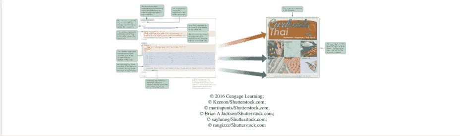

##### 探索万维网 (World Wide Web)

可以说，万维网对人类交流的影响如同印刷机一样深远。其中一个关键区别在于，印刷机的运行局限于少数熟练的技工人，而现在每个人都有自己的打印机；每个人都可以成为网页的出版者。在创建你的第一个网站之前，你将回顾万维网的简史，因为历史会影响你编写页面代码的方式。你将从探索计算机网络的基础术语开始。

##### 网络

网统是一种结构，其中已知设备作为节点或主机之间共享信息和服务。主机可以是任何能够以电子方式发送和接收数据的设备。使用网络的最常见主机是台式电脑、笔记本电脑、平板电脑、手机和打印机。

为网络上的其他设备提供信息或服务的设备称为服务器。例如，服务器是提供服务的网络主机，文件服务器是提供存储空间以检索文件的主机。接收这些服务的设备称为客户端。一种常见的设计是客户端-服务器网络，客户端访问由一个或多个服务器的信息。你可能正在使用这样的网络来访问你的数据文件。

网络根据其覆盖范围进行分类。局限于较小地理区域（如建筑内部或部门内部）的网络称为局域网（LAN）。覆盖更广泛区域（如建筑群或城市）的网络称为广域网（WAN）。网络通常由局域网组成。最大的广域网是互联网（Internet）。

##### 在网络上定位信息

使用互联网最大的障碍是其巨大的规模和复杂性。早期的互联网需要用户掌握令人眼目的术语、缩写和命令。

这一问题的解决方案是由 Tim Berners-Lee 以及位于瑞士日内瓦附近的 CERN 研究人员于 1989 年开发的。他们引入了一种系统，让研究人员更容易在 CERN 网络上共享数据。为了满足这一需求，他们开发了超文本文档系统。超文本是一种组织方法，通过一系列链接相互连接，允许用户从一个文档跳转到另一个。超文本让互联网更容易，因为用户不需要知道特定文档或服务的位置，只需知道如何激活链接。这种技术的有效性迅速扩散到 CERN 之外并被其他网络采用。这些超文本文档的总和被称为万维网。在许多用户看来，互联网和万维网同义，这证明了超文本方法的成功。

##### 网页与服务器

网上的文档以网页的形式存储在服务器上，并通过称为网页浏览器的程序进行访问。浏览器从服务器检索文档，并以客户端设备可读的格式进行渲染。然而，由于客户端设备从台式电脑到手机再到只渲染数据的屏幕，每个网页必须使用兼容所有设备的代码编写。同一个文档如何在不同的服务器上工作？要理解这一点，你需要查看网页是如何创建的。

##### 介绍 HTML

网页是 HTML（超文本标记语言）格式的简单文本文件。你已经听说过超文本，但标记语言是什么？标记语言是一种通过“标记”或标签来描述文档内容和结构的语言，用于确定不同的文档元素。例如，本教程包含多个文档元素，如标题、主标题、副标题、段落、图片、说明等。通过使用标记语言，这些元素中的每一个都可以被标记为“文档”中的独立项目。

### HTML 的历史

在早期，没有任何单一机构定义 HTML 的规则或语法。浏览器开发者可以自由地以不同的方式定义和修改这种语言，这自然导致了许多问题，因为不同的浏览器支持不同“口味”的 HTML，基于某个浏览器标标准的网页在由另一个浏览器渲染时可能会看起来完全不同。一个被称为万维网联盟（World Wide Web Consortium，简称 W3C）的网页设计师和程序员团体为所有浏览器制定了一套规范。W3C 没有强制执行力，但由于语言是通用的，W3C 的建议通常会被遵循，尽管并不总是立即执行。每一个新版本的 HTML 在被采纳为认可标准之前，都会经过数年的讨论和测试。有关 W3C 及其服务的服务的更多信息，请参阅 www.w3.org。

到 1999 年，HTML 已经进展到第四版本 HTML 4.0，它提供了对多媒体、在线电子商务和运行 Web 的交互式脚本的支持。在 HTML 的实现以及开发者编写 HTML 代码的方式上仍然存在许多不兼容之处。W3C 试图接管原本由浏览器处理的内容。到 2002 年，W3C 发布了 HTML 1.1 的规范。但 XHTML（可扩展超标记语言）旨在作为通往 XHTML 2.0 的一个小型升级，它将修正 HTML 4.0 的许多缺陷并成为 Web 的未来语言。其中一个问题是 XHTML 2.0 将与 HTML 不兼容，导致其他内容无法轻易引入新标准。

网页设计师对开发感到不满意，作为回应，网页应用技术小组（WHAT）于 2004 年成立，其使命是开发一个新版本的 HTML 2.0。与 XHTML 不同，HTML 2.0 将与早期版本的 HTML 兼容，并且不应用 XHTML 要求的严格标准。在几年时间里，还不清楚哪一个会胜出，但到 2006 年，XHTML 已经完全失败，W3C 发布了一项新标准，将 WHAT 作为下一代 HTML 的事实标准。今天，HTML5 是该语言的当前版本，被所有当前浏览器和设备支持。你可以在 what.org 了解更多关于 WHAT 和项目的信息。

随着 HTML 的演进，语言早期版本中发现的功能和代码被废弃或逐步淘汰。虽然某些功能可能不再属于 HTML5，但这并不意味着你不会在工作中遇到它们——事实上，如果你正在维护旧版网站，你经常需要解释来自早期版本的 HTML 代码。此外，仍然在使用一些不支持 HTML5 的旧版浏览器和设备。对于设计师来说，一个主要挑战是编写出既符合 HTML5 标准又能被旧技术访问的代码。

图 1-1 显示了多年来的某些不同版本的 HTML。你可以在 W3C 网站上阅读这些版本的详细规范。

图 1-1。

| 版本 | 日期 | 描述 |

| --- | --- | --- |

| HTML 1.0 | 1989 | HTML 的第一个公共版本 |

| HTML 2.0 | 1995 | 增加了交互式元素（包括表表单）的 HTML |

| HTML 3.2 | 1997 | 为 Web 提供额外支持，并扩展了交互式元素的选项，包括表格 |

| HTML 4.1 | 1999 | HTML 版本，增加了对样式表的支持以获得对布局和外观更好的控制，提供了对音频和视频等多媒体元素的支持 |

| XHTML 1.0 | 2001 | 使用标记语言对 HTML 4.0 进行改进，为 HTML 内容提供可强制执行的标准，并允许 HTML 与其他语言交互 |

| XHTML 2.0 | 2009 年停止 | XHTML 1.1 的后续版本，旨在解决 HTML 4.0 中固有的问题 |

| HTML 5.0 | 2012 | HTML 的当前版本，提供对多媒体、语义化页面元素、列布局、表单验证、离线存储和增强多媒体的支持 |

本书侧重于 HTML5，你还将回顾 HTML 4.1 和 XHTML 1.1 的规范。请注意，在接下来的章节中，从 HTML5 开始引入的代码将标记为 [ HTML 5 ]。

### 用于处理 HTML 的工具

由于 HTML 文档是简单的文本文件，你需要的第一个工具是文本编辑器。你可以使用 Windows 记事本或 Macintosh 的 TextEdit 等基础文本编辑器，但我建议你使用许多提供内置 HTML 支持的廉价编辑器之一。一些流行的 HTML 编辑器包括 Notepad++ (notepad-plus-plus)、UltraEdit (www.ultraedit.com)、CoffeeCup (www.coffeecup.com)、BBEdit (www.barebones.com) 和 ConText (www.contexteditor.org)。这些编辑器包含了诸如语法检查（以排除错误）、自动插入 HTML 代码以及预先准备好初始代码的预填充模板等功能。

这些增强型编辑器是学习 HTML 的绝佳方法，对于大多数基础项目它们也足够了，但开发大型网站的专业人员会乐于使用 IDE（集成开发环境），这是一种软件软件包，全面涵盖了从编写 HTML 代码到为各种服务器创建脚本的整个开发过程。一些用于 Web 开发的 IDE 包括 Adobe Dreamweaver (www.adobe.com)、Aptana Studio (www.aptana.com)、NetBeans IDE (netbeans.org) 和 Komodo IDE (komodide.org)。Web IDE 可能非常昂贵，但大多数软件公司都会提供免费试用。

### 测试你的代码

一旦你写好了代码，就可以使用在线测试服务在各种浏览器、屏幕分辨率和设备上进行测试，这些服务会报告网站的兼容性。大多数此类网站收取月费，并限制测试分钟数，因此在开发初期你不应立即上传代码。流行的测试服务有 BrowserStack (www.browserstack.com)、CrossBrowserTesting (www.crossbrowsertesting.com) 和 Browsera (www.browsera.com)。

### 支持移动 Web

目前，影响网页设计最重要的因素是移动设备访问互联网的增加。到 2014 年底，移动互联网用户超过了通过笔记本电脑或桌面设备访问 Web 的用户。这种日益增长的意味着设计师必须仔细调整网站以适应桌面和移动体验。你将在教程 7 中详细探讨移动 Web 的挑战。

### 探索 HTML 文档

在回顾了 Web 历史以及开发自己网站的一些挑战之后，我们将查看一个实际 HTML 文件的代码。为了开始，Sajaja Adulet 为你提供了 ct_start.html 文件，包含了用户访问 Curiside Thai 网站时看到的初始页面代码。现在打开 Sajaja 文件。

打开 ct_start.html 文件：

1. 使用你喜欢的编辑器打开 html01 教程文件夹中的 ct_start.html 文件。

图 2 显示了在记事本编辑器中查看的内容。

**有问题？** 根据你的编辑器及其配置，应用于代码的文本样式可能与图 1-2 所示的不符。这不是问题。由于 HTML 文档是简单的文本文件，任何文本样式都是编辑器的功能，对浏览器渲染文档没有影响。

2. 滚动文档以熟悉其内容，但不要对文本进行任何更改。

#### 文档类型声明

HTML 文件的第一行是文档类型声明或 doctype，它是一种指示文档中使用的标记语言的处理指示。浏览器使用文档类型声明来确定应该使用何种标准来显示内容。对于 HTML5，doctype 的输入方式为：

```
<!DOCTYPE html>
```

你可能还会看到小写形式的 doctype：

```html
<!doctype html
```

所有浏览器都接受这两种写法。旧版本的 HTML 有更复杂的 doctype。例如，HTML 4.01 的 doctype 看起来相当晦涩：

```html
<!DOCTYPE HTML PUBLIC "-//W3C//DTD HTML 4.01//EN"
"http://www.w3.org/TR/html/strict.dtd">
```

你甚至可能会遇到没有 doctype 的旧 HTML 文件。由于早期版本的 HTML 不需要 doctype，许多浏览器会将 doctype 的缺失视为一个信号，指示页面应该根据 1990 年代和 2000 年初的样式和习惯以兼容模式（quirks mode）渲染。当浏览器检测到这一点时，它将以标准模式（standards mode）渲染页面，采用最新的 HTML 。兼容模式与标准模式之间的差异可能意味着布局精美的页面与混乱的糟局面之间的区别，因此，你应该通过包含 doctype 来让你的 HTML 文件始终工作在标准模式下。

#### 引入元素标签

每个 HTML 文档的基本单元是元素标签（element tag），它标记了文档中的一个元素。起始标签表示元素的开始，而结束标签表示元素的结束。双边元素的通用语法为：

```html
<element>content</element>
```

其中 `element` 是元素的名称，`content` 是文本，`<element>` 是起始标签，而 `</element>` 是结束标签。例如，以下代码标记了一个段落元素：

```html
<p>Welcome to Curbside Thai.</p>
```

在这里，`<p>` 标签是起始和结束 HTML 标签，指示段落的存在，而文本 `Welcome to Curbside Thai.` 包含了段落的内容。

并不是每个元素都包含内容。空元素（Empty elements）是指既不嵌套（如图像）也不包含关于浏览器如何处理页面的指令的元素。空元素使用单边元素标签的形式之一进行输入：

```html
<element />
```

或者

```html
<element>
```

例如，下面的 `br` 元素用于指示文本中的换行，它是使用单边标签输入的：

```html
<br />
```

请注意，虽然这段代码也可以写为 `<br>`，但结束斜杠 `/` 是 XHTML 文档以及其他标记语言中要求的格式。HTML5 允两种写法；如果你计划未来与其他标记语言一起工作，习惯使用结束斜杠 `/` 是个好主。我们将在代码书中遵循 `/` 约定。

元素可以包含其他元素，这些被称为嵌套元素（nested elements）。例如，`em` 元素（用于标记强调文本）通过将 `em` 标记标签完全放置在 `p` 标记标签内而在段落嵌套。

##### 正确语法：

```html
<p>Welcome to <em>Curbside Thai/</em></p>
```

注意：将一个元素嵌套另一个元素内部时，内部元素的完整代码必须包含在外部元素内部，包括开启和关闭标签。因此，在下面的代码将 `em` 元素的结束标签放在 `p` 元素之外是不正确的：

##### 错误语法：

```html
<p>Welcome to <em>Curbside Thai/</p></</em>>
```

现在你已经检查了标签，我们将查看它们在 HTML 文件内部是如何使用的。

#### 元素层级结构

HTML 文档的整个结构可以被底为层级树中的一组嵌套元素。树的顶端是 `html` 元素，它标记了其他元素；`head` 元素用于标记文档本身的信息，`body` 元素用于标记将在网页中显示的内容。因此，HTML 文件的通用结构如图 1-2 所示：

```html
<!DOCTYPE html>
<html>
<head>
  head content
</head>
<body>
  body content
</body>
</html>
```

其中 `head content` 和 `body content` 是标记文档头部和主体内容的嵌套元素。请注意，`body` 元素始终位于 `head` 元素之后。


#### 创建 HTML 文件的基础结构

- 要创建 HTML 文件的基础结构，请输入标签

```html
<!DOCTYPE html>
<html>
<head>
  head content
</head>
<body>
  body content
</body>
</html>
```

其中 `head`、`content` 和 `body content` 包含了标记头部和主体部分内容的嵌套元素。

#### 引入元素属性

元素通常包含一个或多个元素属性（element attributes）。每个属性都为浏览器提供额外信息，用于该元素的用途或浏览器应如何处理该元素。双边标签内元素属性的通用语法为：

```html
<element attr1="value1" attr2="value2">
  content
</element>
```

或者，对于单边标签

```html
<element attr1="value1" attr2="value2" />
```

其中 `attr1`、`attr2` 等是属性名称，`value1`、`value2` 等是属性值。例如，下面的代码为段落添加了 `id` 属性：

```html
<p id="intro">Welcome to Curbside Thai.</p>
```

`id` 属性为元素提供唯一标识符。`class` 属性允许将多个元素组合在一起。`style` 属性用于元素应用内联 CSS。`title` 属性在用户悬停在元素上时提供提示框。


| 属性 | 说明 |

| :--- | :--- |

| class | 定义元素的分类 |

| dir | 定义元素的方向（从左到右，从右到左） |

| hidden | 表示元素已隐藏 |

| id | 为元素提供唯一标识符 |

| lang | 指定元素的语言 |

| style | 定义元素的样式或外观 |

| tabindex | 指定元素的制表顺序 |

| title | 为元素分配提示框 |

#### 为元素添加属性

- 要为元素添加属性，请在双边标签内添加属性：

```html
<element attr1="value1" attr2="value2">
  content
</element>
```

#### 处理空白

由于 HTML 文件是文本文件，它仅由文本字符和空白字符组成。空白字符是指任何空或空白字符，如空格、制表符或换行符。当浏览器读取 HTML 文件时，它忽略元素标签之间空白字符的存在，并且不区分空格、制表符或换行符。浏览器将相同相同处理这两段代码：

```html
<p>Welcome to <em>Curbside Thai/</em></p>
```

和

```html
<p>
  Welcome to <em>Curbside Thai/</em>
</p>
```

浏览器还将连续出现的空白字符合并为一个。这意味着后续代码中的段落文本仍被视为 "Welcome to Curbside Thai"，因为 "Curbside" 和 "Thai" 之间的额外空格被浏览器忽略了。

```html
<p>
  Welcome to <em>Curbside Thai/</em>
</p>
```

### 在浏览器中查看 HTML 文件

图 1-2 所示的 HTML 文件结构现在应该变得清晰了一些，即使你还不知道如何解释每个元素和属性的含义及其目的。要查看页面的外观，请在网页浏览器中打开它。

要在网页浏览器中打开 `ct_start.html` 文件：

- 1. 打开你的浏览器。查看存储在计算机上的本地文件不需要连接互联网。

- 2. 浏览器加载页面后，从 `html01` 教程文件夹中打开 `ct_start.html` 文件。图 1-4 显示了页面在手机和平板设备上的显示情况。这两个设备的屏幕宽度不同，这会影响页面的渲染方式。

图 1-4 (img/44b371034e705ae2e3c97c42b28f)

遇到问题了？如果你不确定如何使用浏览器打开本地文件，请检查浏览器“文件 (File)”菜单中的“打开 (Open)”命令。你也可以通过在 Windows 资源管理器或 Apple Finder 中双击文件名来打开文件。

- 3. 缩小浏览器窗口的宽度，当宽度降到某个值（在此情况下为 480 像素）时，布局会自动更改为堆叠行（如图图 1-4 中的移动设备图像所示），这种布局更适合窄屏布局。

- 4. 增大浏览器窗口的宽度，并确认布局变为网格（如图图 1-4 中的平板设备图像所示），这更适合宽窗口。

图 1-4 阐述了一个重要的原理：HTML 并不描述文档的外观，它只描述文档的内容和结构。同一个 HTML 文档在不同设备之间或不同屏幕尺寸之间可以有不同的渲染方式。实际外观由样式表决定——这是你以后将探索的主题。

### 创建 HTML 文件

现在你已经学习了 HTML 文件的结构，将开始为 Curbside Thai 网站创建自己的文档。你将通过插入 `doctype` 以及 `html`、`head` 和 `body` 元素的标记标签，来创建一个包含餐厅信息的网页。

要开始编写 HTML 文件：

- 1. 使用你选择的编辑器，在 `html01` 教程文件夹中创建一个空白 HTML 文件，并将文件保存为 `ct_about.html`。

- 2. 将以下代码输入到文件中：

```html
<!DOCTYPE html>
<html>
<head>
</head>
<body>
</body>
</html>
```

图 1-5 显示了文档中的初始元素。

图 1-5 `ct_about.html` 文件的初始结构 (img/44b371034e705ae2e3c97c42b28f)

- 3. 保存对文件的更改。

接下来，你将向文档头部（document head）中添加元素。

#### 编写高效的 HTML 代码

编写良好的 HTML 代码的一部分是意识到各种浏览器的要求，并理解该语言的不同版本。以下是编写良好的 HTML 代码的几条准则：

- 精通 HTML 的历史以及 HTML 和 XHTML 的各种版本。与其他语言不同，HTML 的历史会影响你编写代码的方式。

- 了解你的市场。你是否必须支持旧版浏览器，或者客户是否统一使用了某个特定的浏览器或浏览器版本？你的网页是在单设备（如计算机）上查看的，还是你必须支持多种设备？

- 在几个不同的浏览器上测试你的代码。不要假设如果你的页面在其他浏览器或同一浏览器的早期版本中可以正常工作。还要检查连接速度。在高速连接下运行良好的大文件在较慢的连接下可能无法使用。

- 阅读 W3C 网站上关于不同版本的 HTML 和 XHTML 的文档，并跟该语言的最新进展。

为了与客户和用户进行有效沟通，你需要确保你的网站内容始终是可读的。编写良好的 HTML 代码是一个极佳的起点。

#### 创建文档头部（Document Head）

文档包含元数据（metadata），即描述文档或提供关于浏览器应如何处理文档的信息。图 1-6 描述了在文档头部找到的元数据元素。

图 1-6

| 元素 | 描述 |

| :--- | :--- |

| head | 包含元数据元素集合，用于描述文档或向浏览器提供指令 |

| base | 指定文档的位置，用于解析超链接地址 |

| link | 指定文档连接的外部资源 |

| meta | 提供通用的元数据值列表，例如搜索关键词、视口（viewport）属性和文件的字符编码 |

| script | 为在文档内运行的程序提供编程代码 |

| style | 定义用于渲染文档内容的显示样式 |

| title | 存储文档标题名称，通常显示在浏览器标题栏或浏览器标签页上 |

你将添加到 Curbside Thai 网页的第一个元数据是 `title` 元素。

#### 设置页面标题

`title` 元素是文档头部的一部分因为它并没有作为网页的一部分显示，而是外部显示在浏览器标题栏或浏览器标签页中。页面标题使用以下 `title` 元素定义：

```html
<title>document title</title>
```

其中 `title` 是标题的文本。现在为 Curbside Thai 页面添加页面标题。

#### 添加文档标题

- 要定义文档标题，请在文档头部输入以下标签：

```html
<title>document title</title>
```

其中 `title` 是将显示的文本。要插入文档标题：

- 1. 在 `<head>` 标签之后直接插入以下：

```html
<title>About Curbside Thai</title>
```

图 1-7 

```html
<!DOCTYPE html>
<html>
<head>
<title>About Curbside Thai</title>
</head>
<body>
</body>
</html>
```

- 2. 保存对文件的更改。

#### 为文档添加元数据

另一种元数据是 `meta` 元素，用于通用元数据值的列表。`meta` 元素的结构为

```html
<meta attributes />
```

其中 `attributes` 定义了元数据的类型。图 1-8 列出了 `meta` 元素的属性。

图 1-8

| 属性 | 描述 |

| :--- | :--- |

| charset="encoding" | 指定文档使用的字符编码 |

| content="text" | 提供与 `http-equiv` 或 `name` 相关的值 |

| http-equiv="content-type-default-style-refresh" | 为内容、默认样式或刷新间隔（秒）提供 HTTP 头 |

| name="text" | 设置与元数据相关的名称 |

例如，你可以使用以下 `meta` 元素为 Curbside Thai 网站提供一组关键词，这有助于搜索引擎（如 Google 或 Bing）定位潜在客户：

```html
<meta name="keywords" content="Thai, restaurant, Charlotte" />
```

#### 插入元数据：

- 1. 在 `<head>` 标签标签之后，直接插入 meta 元素，并进行缩进以使代码更易读：

```
<meta charset="utf-8" />
<meta name="keywords" content="Thai, restaurant, Charlotte, food" />
```

图 1-9 显示了文档头部中使用的新添加的 meta 元素。

图 1-9

为文档添加元数据

```
<head>
<meta charset="utf-8" />
<meta name="keywords" content="Thai, restaurant, Charlotte, food" />
<title>Curbside Thai</title>
</head>
```

- 2. 将你的更改保存到文件。

- 3. 在浏览器中打开 `ct_about.html` 文件。确认浏览器标签页或浏览器标题栏包含文本“About Curbside Thai”。浏览器窗口中不应显示任何文本，因为你尚未向页面主体（body）添加任何内容。

在继续对 `ct_about.html` 文件进行编辑之前，你应该记录你的工作。你可以通过注释来实现。

#### 为你的文档添加注释

注释是添加到 HTML 文件中的描述性文本，页面显示时它不会出现在浏览器窗口中。注释可以包括文档作者的姓名、文档创建日期以及创建文档的目的。使用以下标记添加注释：

```
<!-- comment -->
```

其中 `comment` 是注释或备注的文本。例如，以下代码插入了你为 Curbside Thai 创建的注释：

```
<!-- General Information about Curbside Thai -->
```

注释可以跨越几行，因为注释文本以 `<!--` 开头并以 `-->` 结束。由于浏览器会忽略注释，因此可以将它们添加到文档的任何位置，但一种良好的做法是在文档头部包含一个注释，以描述随后的内容。

#### 引用

#### 在 HTML 文档中添加注释

- * 若要在 HTML 文档的任何地方插入注释，请输入

```
<!-- comment -->
```

其中 `comment` 是 HTML 注释的文本。

为 `ct_about.html` 文件添加注释，说明文档作者、创建日期和目的。

#### 为文档添加注释：

- 1. 回到 HTML 编辑器中的 `ct_about.html` 文件。

- 2. 在 `<head>` 标签之后，直接插入以下注释文本，并进行缩进以使代码更易读：

```
<!--
New Perspectives on HTML5 and CSS3, 7th Edition
Tutorial
Tutorial Case
General Information about Curbside Thai
Author: your name
Date: the date

Filename: ct_about.html
-->
```

其中 `your name` 是你的姓名，`date` 是当前日期。图 1-10 显示了文件中新添加的注释。

HTML 注释必须用 `<!-- -->` 字符关闭。

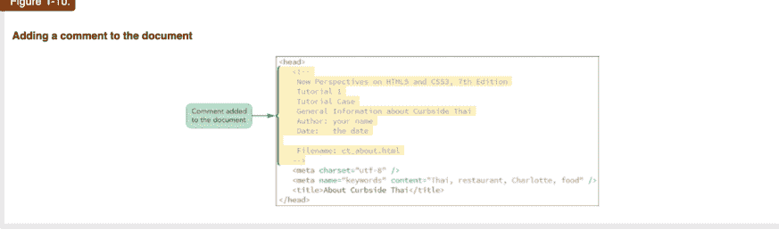

- 3. 将你的更改保存到文件。

#### 洞察

#### 条件注释与 Internet Explorer

你在许多 HTML 文件中遇到的另一种类型的注释是条件注释，它封装了只应由特定版本的 Internet Explorer 浏览器运行的内容。条件注释的一般形式为：

```
<!--[if IE version]>
content
<![endif]-->
```

其中 `operator` 是逻辑运算符（小于或大于），`version` 是 Internet Explorer 浏览器的版本号，`content` 是仅当条件表达式为真时运行的 HTML 代码。以下代码使用 `lt`（小于）逻辑运算符警告用户，如果他们运行的是 8 版本之前的 Internet Explorer，则需要升级浏览器。

```
<!--[if IE 8]>
<p>upgrade your browser to view this page.</p>
<![endif]-->
```

其他逻辑运算符包括 `le`（小于等于）、`gt`（大于）、`gte`（大于等于）和 `!`（非）。例如，以下代码使用逻辑运算符 `!` 仅在浏览器不是 Internet Explorer 时显示段落文本：

```
<!--[if not IE]>
<p>you are not running Internet Explorer.</p>
<![endif]-->
```

注意，如果**省略**了版本号，则条件注释将适用于所有 Internet Explorer 版本。

需要条件注释的原因是，Internet Explorer 在实现 HTML 方面与其他浏览器有显著差异，因此需要将为 IE 浏览器编写的代码与为其他浏览器编写的代码隔离开。对于较新版本的 Internet Explorer，这不再是一个大问题，但如果你正在编写需要兼容 IE 8 之前的版本的 Internet 代码，你可能仍然需要使用条件注释。

在下一节课程中，你将通过向页面主体添加内容来继续对 `ct_about.html` 文件的工作。

### 复习 1.1 快速检查

- 1. 什么是标记语言？

- 2. 什么是 XML？XHTML 与 HTML 有何不同？

- 3. 什么是 W3C？什么是 WHATWG？

- 4. 什么是 doctype？HTML5 文档的 doctype 是什么？

- 5. 下列代码哪里不正确？建议一个可能的修改方案来纠正错误。

```
<p><strong>Curbside Thai now delivers!</strong></p>
```

- 6. 提供代码标记“Curbside Thai now delivers”。

- 7. 提供代码标记“Thai restaurant, Charlotte, food”。

- 8. 提供代码告诉浏览器 UTF-8 编码。

- 9. 提供代码标记文档页脚。

### 课程 1.2 概述：HTML 元素

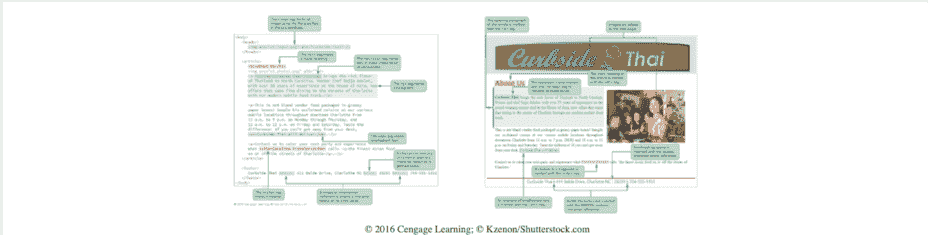

#### 编写主体

在你创建了 Curbside Thai 的文档头部之后，开始编写页面主体。

#### 使用区块元素

设计页面的第一个任务是识别主要区域。页面通常有一个头部、文章和页脚。图 1-11 中的区块元素。

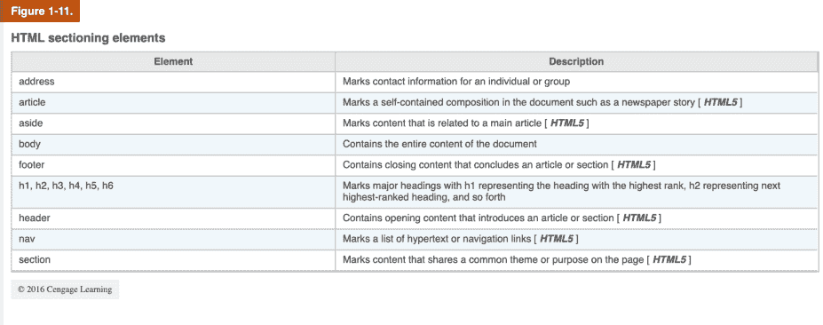

例如，新闻博客可能包含多个主题。为了识别这些区域，HTML 代码可能包含：

```
<body>
  <header>
  </header>
  <nav>
  </nav>
  <article>
  </article>
  <aside>
  </aside>
  <footer>
  </footer>
</body>
```

这些区块元素也被称为语义化元素，因为标签名称描述了元素的用途及其包含的内容类型。

#### 定义页面区块

- 标记页面头部，使用 `header` 元素。

- 标记自包含内容，使用 `article` 元素。

- 标记链接导航列表，使用 `nav` 元素。

- 标记侧边栏，使用 `aside` 元素。

- 标记页面页脚，使用 `footer` 元素。

- 标记分组内容，使用 `section` 元素。

Curbside Thai 页面将有一个简单的结构，包含一个头部、一个文章和一个页脚。在头部内部，将有一个 `h1` 元素提供页面标题（不要与显示在浏览器标题栏或标签上的文档标题混淆）。将此结构添加到文档主体。

#### 为页面主体定义区块：

- 1. 如果你在上一节课后休息了，请回到 HTML 编辑器中的 `ct_about.html` 文件。

- 2. 在 `<body>` 标签之后，直接插入以下 HTML 代码，并进行缩进以使代码更易读：

```
<body>
  <header>
    <h1>Curbside Thai</h1>
  </header>
  <article>
    <h1>About Us</h1>
  </article>
  <footer>
    Curbside Thai 411 Belde Drive, Charlotte MC 28201 704-555-1155
  </footer>
</body>
```

#### 比较 HTML4 和 HTML5 中的节

图 1-11 中描述的许多节元素是在 HTML5 中引入的。在 HTML5 之前，节是通过以下 `div` 元素定义为划分：

```html
<div id="id">
  content
</div>
```

其中 `id` 是唯一标识该划分的名称。图 1-13 显示了使用 HTML5 节元素标记的相同页面布局在 HTML 4.0 中使用 `divs` 时是如何定义的。

**图 1-13.** HTML 5.0 与 HTML 4.0 中的划分对比

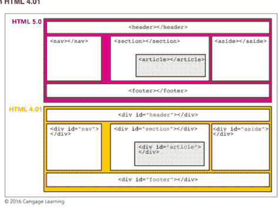

`div` 元素的一个问题是它们没有规定规则。一个设计师可能会使用 `id header` 来设计页面标题，而另一位设计师可能会使用 `heading` 或 `top`。缺乏一致性使得搜索引擎难以识别页面的主要主题。HTML5 节元素的优势在于它们的标签名称指示了它们在文档中的用途，这使得网页的设计和解释具有更强的统一性。

#### 使用分组元素

节（section）元素内部包含分组元素。每个分组元素将相似的内容组织成一个单独组，类似于共享共同主题的段落。图 1-14 描述了所有的 HTML 分组元素。

图 1-14。

| 元素 | 描述 |

| --- | --- |

| blockquote | 包含引用自其他源的内容，带有引用并在页面上缩进 |

| div | 包含文档内通用的元素分组 |

| dl | 标记包含一个或多个 `dt` 元素、随后跟上一个或多个 `dd` 元素的描述 |

| dt | 包含描述列表中的单个术语 |

| dd | 包含与描述列表中的术语相关的描述或定义 |

| figure | 包含文档中交叉引用的插图、照片、图表或对象 [HTML] |

| figcaption | 包含与插图相关的标题 |

| hr | 标记主题性的断开，例如场景切换或过渡到新主题（显示为水平线） |

| main | 标记文档或应用程序的主要内容；文档中应只使用一个 `main` 元素 [HTML] |

| ol | 包含有序项目列表 |

| ul | 包含无序项目列表 |

| li | 包含有序或无序列表中的单个项目 |

| p | 包含段落的文本 |

| pre | 包含预格式化的文本块，代码中的换行符和额外空格会被保留（通常显示为等宽字体） |

例如，以下代码显示了嵌套在页面文章（article）元素中的三个段落，每个段落都代表一组相似的内容：

```html
<article>
  <p>Content of 1st paragraph.</p>
  <p>Content of 2nd paragraph.</p>
  <p>Content of 3rd paragraph.</p>
</article>
```

当浏览器遇到节元素或分组元素时，默认样式是在新行上开始所包含的内容，将其与之前出现的任何内容隔开。因此，这些段落中的每一个都将位于新的一行，`article` 本身也是如此。请注意，段落的外观以及它们之间的空间取决于浏览器应用于这些元素的样式。你将在本教程的后面学习更多关于样式的知识。

#### 定义页面组

- 要标记段落，请使用 `p` 元素。

- 要标记扩展引用，使用 `blockquote` 元素。

- 要标记页面或节的主要内容，使用 `main` 元素。

- 要标记插图框，使用 `figure` 元素。

- 要标记通用类型的页面内容，使用 `div` 元素。

Saja 已经在一个文本文件中写了描述 Curbside Thai 的文章。将他的条目输入“About Curbside Thai” 页的 `article` 元素中，并使用 `p` 元素标记文章中的段落。

要将页面文本分组为段落：

- 1. 使用文本编辑器打开 `html01` 教程文件夹下的 `cl_pages.txt` 文件。

- 2. 选择并复制“About Us”标题直接后的三个段落文本。

- 3. 关闭文件，但不要保存对文档可能无意中进行的任何更改。

- 4. 回到 HTML 编辑器中的 `cl_about.html` 文件。

- 5. 在页面内 `<h1>About Us</h1>` 行之后直接插入一个新空行，并粘贴复制的文本。

- 6. 将粘贴的三个段落中的每一个都包裹在起始 `<p>` 标签和结束 `</p>` 标签之间。缩进 `article` 元素内的代码以使代码更易读。

图 1-15 亮出了为三段文章文本新添加的代码。

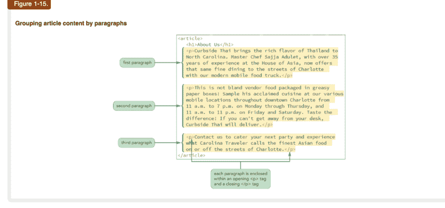

#### 使用文本级元素

每个分组元素内部都包含文本级元素，它们的作用就像段落内的短语或字符。与在新行开始内容并标记自包含内容块的分组元素不同，文本级元素与周围内容对齐，并且是内联元素。例如，此段落中的斜体或粗体文本被认为是内联的，因为它们与周围文本一起出现。图 1-16 描述了 HTML 中许多文本级元素中的。

图 1-16。

| HTML 文本级元素 | 描述 |

| ------|---|

| abbr | 标记缩写 |

| b | 表示应引起注意的 |

| br | 表示换行 |

| cite | 标记作品标题 |

| code | 表示计算机文本 |

| data | 将值与属性关联 |

| dfn | 标记定义术语 |

| em | 表示强调文本 |

| i | 表示强调 |

| kbd | 标记用户输入 |

| mark | 标记高亮文本 |

| q | 表示引用 |

| samp | 标记示例输出 |

| small | 表示注释 |

| sup | 标记上标 |

| time | 标记时间 |

| var | 标记变量 |

| wbr | 表示应该发生换行的地方 |

以下代码演示了如何使用文本级元素：

```html
<p>Check out the <cite>Curbside Thai</cite> to see what <em>Curbside Thai will deliver</em> calls up.</p>
```

#### 定义文本内容

- 要标记强调文本，使用 `em` 元素。

- 要标记重要的文本，使用 `strong` 元素。

- 要标记引用，使用 `cite` 元素。

- 要标记引用材料，使用 `q` 元素。

- 要标记下标，使用 `sub` 元素。

- 要标记通用文本选择，使用 `span` 元素。

对页面应用文本级元素：

- 1. 转到 `article` 内的第一个段落，将单词 *Curbside Thai* 包裹在起始和结束的 `<strong>` 标签之间。当你想要强化文本的重要性（例如餐厅名称）时，使用 `<strong>` 标签。

- 2. 在第二个段落中，将短语 *Curbside Thai will deliver* 包裹在起始和结束的 `<em>` 标签之间，以强调这段文本。

- 3. 转到第三段落，使用 `cite` 元素标记 *Carolina Traveler*，并使用 `q` 元素标记扩展代码 *the finest Asian food off the streets of Charlotte*。

图 1-17 亮出了文本级元素对段落文本的应用。

#标记文本内容

```html
<article>
  <p><strong>Curbside Thai</strong>将泰国丰富的风味带到了你的社区。在 House of Asia 经历了多年后，现在提供了一种体验夏洛矶街头的新方式：通过我们现代的餐车。</p>
  <p><em>Curbside Thai will deliver</em>通过电话、网站或外餐为我们的各种移动位置、活动和派对提供食物。周五和周六晚上 11 点与我们见面。<strong>夏洛矶街头最棒的亚洲美食</strong>，现在送货上门。</p>
  <p>查看 <cite>Carolina Traveler</cite> 网站查看 <q>the finest Asian food off the streets of Charlotte</q> 提供了什么。</p>
</article>
```

5 在浏览器中打开 `ct_about.html` 文件，查看你的浏览器如何渲染页面内容。

图 1-18 显示了页面当前的样式。

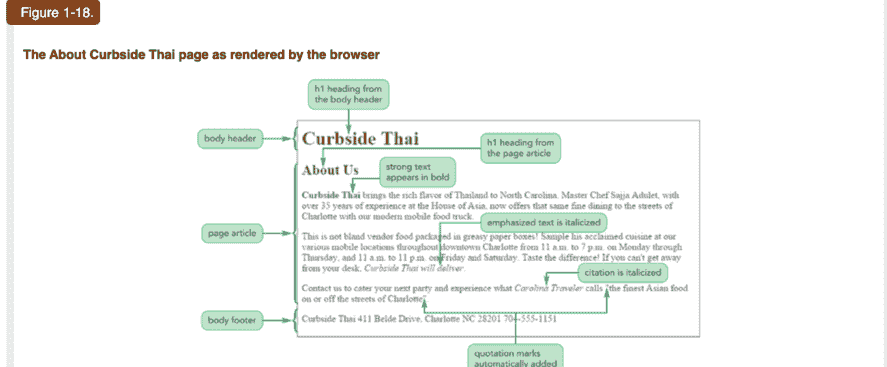

**遇到问题？** 根据你使用的浏览器和/或设备，你可能会发现 About Curbside Thai 网页的显示与图 1-18 所示有所细微差异。

在渲染页面时，浏览器对不同的页面元素做了以下样式选择：

- 来自正文页眉（body header）的 h1 标题被分配了最大的字体，并加粗显示以强调其重要性。页面正文（article）中的 h1 标题字体略小，但仍仍加粗显示。

- 强强调文本（Strong text）以粗体显示，而强调文本（emphasized text）则以斜体显示。

- 引用（Citations）以斜体显示，而引用的材料（quoted material）会自动被引号包裹。

需要强调的是，所有这些样式选择并不是由标记标签（markup tags）的；它们是浏览器使用的默认样式。不同的浏览器和设备可能会以不同的方式渲染这些页面元素。为了对页面外观施加更多控制，你可以对文档内容应用样式表（style sheet）。

#### 将 HTML 文档链接到样式表

样式表是一组指定页面元素如何显示的的规则。样式表使用层叠样式表（CSS）语言编写。虽然不像 HTML，但 CSS 语言是随着 Web的发展和变化而开发和增强的，与 HTML 类似，CSS 规范由 W3C 管理。要将浏览器的内部样式替换为你自己的样式，可以使用以下 `link` 元素将你的 HTML 文件链接到样式表：

```
<link href="file" rel="stylesheet" />
```

其中 `file` 是一个包含 CSS 样式表的文本文件。由于 `link` 元素也可以用于链接除样式以外的数据，因此需要 `rel` 属性告诉浏览器它正在链接到样式表。注意，其他浏览器可能会将 `type="text/css"` 解释为 `link href` 的一部分。

#### 将 HTML 文档链接到外部样式表

- 要将 HTML 文档链接到外部样�表，请在文档头部（head）中添加以下元素：

```html
<link href="file" rel="stylesheet" />
```

其中 `file` 是一个包含 CSS 样式规则的文本文件。

Saja 提供了两个她想要应用到她网站的 CSS 文件。`ct_base.css` 文件包含指定层级元素（level elements）外观的样式。`ct_layout2.css` 文件包含控制页面分节和分组元素布局的样式。现在将 `ct_about.html` 文件链接到这两个样式表。

要将 html 文档链接到样式表：

1. 回到 HTML 编辑器中的 `ct_about.html` 文件。

2. 在闭合的 `<head>` 标签之前，插入以下 `link` 元素：

```html
<link href="ct_base.css" rel="stylesheet" />
<link href="ct_layout2.css" rel="stylesheet" />
```

图 1-19 高亮了添加到文档中的两个样式表链接。

图 1-19

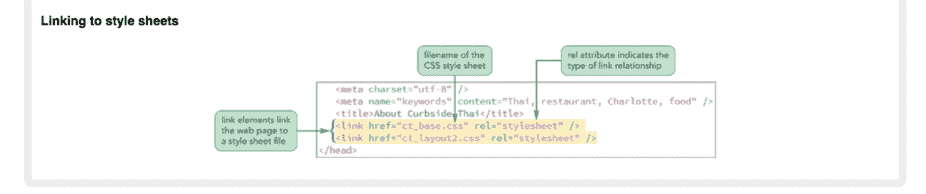

3. 保存对文件的更改并在浏览器中重新加载 `ct_about.html` 文件。图 1-20 显示了使用 Saja 提供的样式表后的页面外观。

#### 图 1-20。

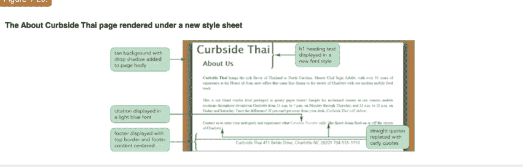

将这些样式应用于 HTML 代码后，页面显示在褐色背景上并带有阴影，两个 h1 标题使用的字体发生了更改，页脚（footer）添加了顶框以与前面的内容隔开，并且对《Carolina Traveler》杂志的引用以浅蓝色显示。这种效果使得页面内容更易读，视觉更美观。

Saja 担心页面页脚中的信息难以阅读。她想添加项目符号 (+) 来分隔餐厅名称、街道地址和餐厅电话。然而，你的键盘上没有任何按键可以表示这个字符。那么，你如何将此符号插入网页中呢？

#### 使用字符集和特殊字符

你的浏览器能够渲染的每个字符都属于一个称为字符集的字符和符号集合。用于英文字母的字符集是美国信息交换标准代码，简称为 ASCII。一种更扩展的字符集称为 Latin-1 或 ISO 8859-1 字符集，跨越 255 个字符，适用于大多数使用拉丁字母的语言，包括英语、法语、西班牙语和意大利语。Unicode 是最扩展的字符集，多达 65,536 个符号，可以与世界上任何语言配合。

#### 字符编码

字符集中的每个字符都关联一个编码值，计算机程序可以存储并读取该值。例如，Unicode 字符集中的版权符号 © 被编码为数字 169。如果你知道编码值，可以使用引用引用直接将字符实体（character entity）插入你的网页中：

```
&#169;
```

其中是编码引用编号。因此，要在你的网页中显示该符号，

#### 字符引用

插入符号的另一种方法是使用字符实体，

```html
&#169;
```

其中是编码引用编号。因此，要在你的网页中显示该符号，

```html
&#169;
```

其中是编码引用编号。因此，要在你的网页中显示该符号，

```html
&copy;
```

其中是编码引用编号。因此，要在你的网页中显示该符号，

```html
&nbsp;
```

其中是编码引用编号。因此，要在你的网页中显示该符号，

```html
&nbsp;
```

其中是编码引用编号。因此，要在你的网页中显示该符号，

```html
&8226;
```

其中是编码引用编号。因此，要在你的网页中显示该

#### 从字符集中插入符号

#### 洞察

#### 呈现属性

早期版本的 HTML 使用了呈现元素和呈现属性来描述每个元素应该如何被渲染。例如，要在页面上对齐文本，作者会使用以下属性

```html
<element align="content"></element>
```

其中对齐可以是左、右、居中或对齐。因此，要在页面上居中一个 h1 标题，他们会使用以下代码：

```html
<h1 align="center">Curside Tail</h1>
```

几乎所有的呈现元素和属性已因样式表而被弃用（deprecated），但你可能在旧网站的代码中看到它们。使用像 align 这样的弃用属性可能不会导致你的页面失败，然而，最佳实践仍然遵循标准，即 HTML 用于描述文档的内容和结构，而样式表用于格式化外观。

#### 使用内联图像

大多数网页都包含嵌入内容，即从其他资源导入的内容，通常是非文本的，例如图形、音频、视频片段或交互式游戏。为了支持这种内容，HTML 提供了图 1-23 所示的嵌入元素。

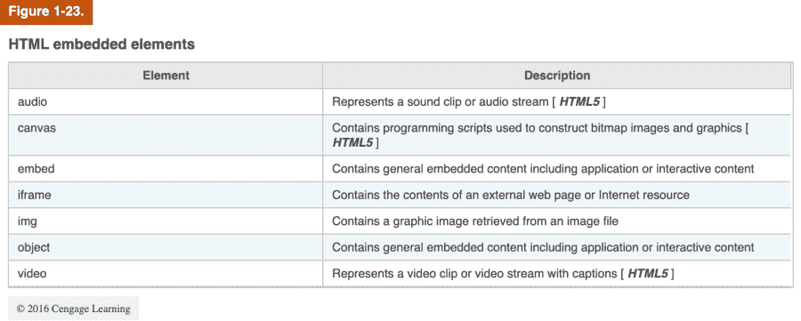

这些元素也被称为交互元素，因为它们允用户与嵌入对象之间进行交互。例如，嵌入的音频或视频内容通常包含用于控制播放的按钮。

使用以下 `img` 元素将图像插入网页中：

```html

```

其中 `file` 是图片的名称。如果浏览器无法显示图像，则使用 `alt` 属性中的文本代替图像。对于其他单边标签，输入 `img` 时不需要结尾的斜杠 `/`。

```html

```

图像也被称为内联图像，因为它们像文本级元素一样，与周围内容对齐排列。

默认情况下，`img` 的大小与文件中图像的大小相同。你可以通过向 `img` 元素添加以下 `width` 和 `height` 属性来指定不同的尺寸：

```html
width="value" height="value"
```

其中 `width` 和 `height` 值以像素为单位。如果你只指定 `width`，浏览器会自动设置 `height` 以保持图像比例；同样，如果你定义了 `height`，浏览器会自动设置 `width` 以保持图像比例。图像大小也可以在文档样式表中设置。

#### 嵌入内联图像

- 要向文档嵌入内联图像，请使用：

```html

```

其中 `file` 是图形文件的名称，`text` 是浏览器在图像中显示的文本。

Sajja 为你提供了两个图像。来自 `ct_logo2.png` 的图像显示了餐厅标志，而 `ct_photo1.png` 提供了一张员工在其实体店为客户提供服务的图像。Sajja 包含这张图片是为了强调，他的餐车提供的食物与他获奖餐厅的食物具有相同的品质和极佳的味道。将这两张图片都添加到 `ct_about.html` 文件中。

##### 向文档中插入内联图像：

- 1. 返回 HTML 编辑器中的 `ct_about.html` 文件。

- 2. 找到 `header` 元素，并将 `h1` 元素替换为标签：

```html

```

- 3. 找到 `article` 元素，在 `h1` 元素之后直接插入标签：

```html

```

图 1-24 高亮显示了文档中新添加的 `img` 元素。

图 1-24 插入内联图像

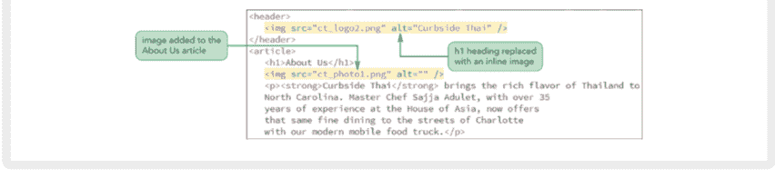

- 4. 保存文件更改并在浏览器中重新加载 `ct_about.html` 文件。图 1-25 显示了网页中新添加的图形图像。

#### 图 1-25. 关于 Curbside Thai 页面上的图像

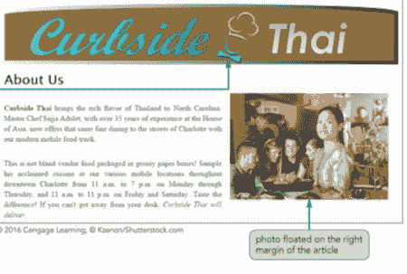

© 2016 Cengage Learning; Kzenon/utterstock.com

遇到问题？文本在图像周围流动的确切外观取决于浏览器窗口的宽度。

注意，Curbside Thai 客户的照浮动在文章的右侧边缘，周围元素环绕着图像流动。这是样式表的结果。你将在教程 3 中学习浮动图像。

#### 换行符和其他空元素

`img` 元素使用空标签插入，因为它不包含任何页面内容，而是指向一个外部图像文件。另一个空元素是 `br` 元素，它创建一个换行符：

```html
<br />
```

换行符被放置在分组元素（如段落或标题）中，以强制内容在组内从新行开始。虽然对于控制组内的文本流很有用，但 `br` 元素不应作为格式化工具。例如，如果仅仅是为了增加文本行行之间的间距，那么连续插入两个或多个 `br` 元素是没有意义的。相反，所有此类格式选择都应该放在样式表中。

如果一行的文本无法适应查看窗口的宽度，浏览器将在其确认为最合适的地方自动换行。要建议不同的换行点，请使用 `wbr`（单词断句）元素来指示在需要时发生换行。例如，以下 HTML 代码使用 `wbr` 元素在 "com." 和 "general" 之间断开长网址，但这种断开只有在地址无法一行显示时才会发生。

```html
www.curbsethai.com/<wbr>/general/docs/ct_about.html
```

最后，另一个常用的空元素是以下 `hr` 或水平规则元素。如今，它的目的是标记节内主要主题的变更。最初，`hr` 元素被用于在页面中插入水平线，虽然这项任务交给样式表更好，但你仍然会在网页上看到 `hr` 元素被用于该功能。

#### 旧浏览器支持 HTML5

HTML5 引入了几个新的语义元素，包括 `header`、`footer`、`article` 和 `nav` 元素。某些浏览器（如 Internet Explorer 8）无法处理这些元素。现代浏览器支持 HTML5 特性。

#### 使用块引用

`img` 元素使用空标签插入，因为它不包含任何页面内容，而是指向一个外部图像文件。另一个空元素是 `br` 元素，它创建一个换行符。

换行符被放置在分组元素（如段落或标题）中，以强制内容在组内从新行开始。虽然对于控制组内的文本流很有用，但 `br` 元素不应作为格式化工具。例如，如果仅仅是为了增加文本行行之间的间距，那么连续插入两个或多个 `br` 元素是没有意义的。相反，所有此类格式选择都应该放在样式表中。

#### 使用块引用

其中 `file` 是图形文件的名称，`text` 是浏览器在图像中显示的文本。

- 2. 找到 `header` 元素，并将 `h1` 元素替换为标签：

```html

- 1. 返回 HTML 编辑器中的 `ct_about.html` 文件。

- 4. 标记一组 `blockquote` 标签内的每个段落。

- 5. 将每个段落封装在 `p` 标签内。对齐并缩进你的代码以便更容易阅读。


#### 图 1-29

餐饮页的内容

### 餐饮


自 2000 年以来，Cuisine 一直为婚礼和私人派对提供顶级的餐饮服务。我们通过我们的移动餐车提供多样化和类型的食物，但专门针对餐饮需求设计。

餐点将在您的活动现场现场进行烹饪和摆放。我们有一系列适用于 10 到 300 人活动的菜单。我们提供盘子、亚麻布和其他餐饮设备。

餐饮服务是量身定制的，提供广泛的食物、饮品和充满活力的点点！请咨询我们关于您的婚礼或私人活动所需的定制菜单。我们还可以提供一系列美味的食物和饮品。

想象一下在 Curbside Thai 活动中享用美味的食物吧！

© Filmanmanje/Shutterstock.com

你将在本节中创建的最后一个页面将包含 Curbside Thai 的信息。请使用主页面文章中的段落来创建内容。

### 创建“联系我们”页面：

- 1. 在你的 HTML 编辑器中打开 `html01 ► tutorial` 文件夹下的 `ct_contact.txt` 文件。在注释部分输入你的姓名和日期，并将文件保存为 `ct_contact.html`。注意，此页面链接到 Sajia 创建的两个样式表。
- 2. 在文本编辑器中打开 `ct_pages.txt` 文件。
- 3. 复制文本文件中的“Contact Us”（联系我们）部分（不包括标题）。
- 4. 回到 HTML 编辑器中的 `ct_contact.html` 文件，并将复制的文本直接粘贴在 `<h1>Contact Us</h1>` 标签之后，以将其标记为段落。
- 5. 将包含街道地址的三行封装在一对 `<address>` 和 `</address>` 标签中，以将该内容标记为地址地址。在前两行的末尾插入 `<br />` 以在餐厅名称和街道地址之间创建换行。
- 6. 使用 `<p>` 元素将最后两行标记为段落。

图 1-30 显示了用于 Curbside Thai 信息的标记代码。

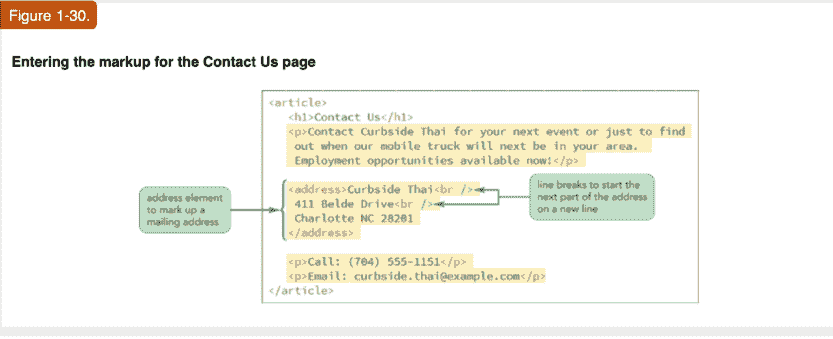

8. 将更改保存到文件，然后在浏览器中如图 1-31 所示打开 `ct_contact.html` 文件。

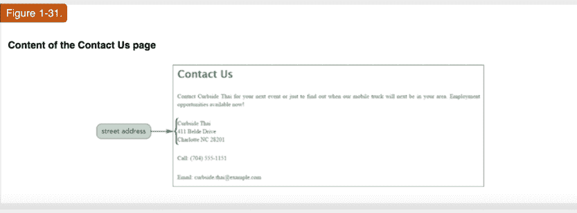

“联系我们”页面仅提供联系信息的文本，但这些文本是静态的。在下一节中，你将学习如何通过将联系信息转换为超链接来使这些内容具有交互性。

### 问题解决：使用 ARIA 使你的页面具有可访问性

网页面向所有人，这在为视障人士编写代码时面临特殊挑战，因为他们将使用屏幕阅读器访问你的网站。可访问富交互应用程序（ARIA）通过额外的属性补充 HTML 元素，提供元素用途的提示，并提供每个元素当前状态的信息。

ARIA 的基石之一是 `role` 属性，它指定了给定元素的用途。例如，下面的 `role` 属性指示头部元素包含一个横幅（banner），例如介绍网页的 logo：

```

<header role="banner">

  content

</header>

```

ARIA 支持一组批准的 role 名称，包括以下内容：

| Role | Description |
|---|---|
| alert | 包含重要且通常具有时间敏感性的内容 |
| application | 网页应用程序，相对于网页文档 |
| definition | 定义术语或概念 |
| dialog | 需要用户输入的应用程序窗口 |
| log | 不断修改和更新的数据区域 |
| progress bar | 显示正在进行的任务进度状态的内容 |
| search | 为用户提供功能的内容 |
| separator | 分隔一个内容区域与另一个区域的分割线 |
| timer | 包含报告已过时间的数字计数器区域 |

你可以在 www.w3.org/TR/wai-aria/roles 查看 role 完整列表以及如何应用它们。

ARIA 是增强网页可访问性并让万维网这一丰富资源向所有人开放的有用工具。一个副作用是，可访问性和易用性是相辅相行的。具有高度可访问性的网站也是高度易用的，这对所有用户都很有价值。

在下一节中，你将继续制作 Curbside Thai 网站，添加描述餐厅菜单的页面，并列出移动餐车停靠的时间和。

### 复习节 1.2 快速检查

- 1. 提供代码将文本“Gourmet Thai Cooking”标记为二级重要性的标题。

- 2. 你应该使用什么元素将页面内容标记为侧边栏？

- 3. 什么是 `div` 元素，为什么经常会在 HTML5 之前的代码中遇到它？

- 4. 你会使用什么元素来指示节内主题的变化？

- 5. 提供代码将文本“Daily Special”标记为强调文本。

- 6. 提供代码将文本 $H_2SO_4$ 标记为下标。

- 7. 提供代码将网页链接到 CSS 文件 `styles.css`。

- 8. 提供使用字符代码在网页中插入破折号的表达式。

- 9. 提供将网页链接到 `image.png` 的代码。

### 1.3 视觉概览：列表与超链接

[content]

[ 1.3 视觉概览：列表与超链接 ]


#### 列表操作

在上一节中，我们学习了如何使用 `<ol>` 和 `<ul>` 元素来创建列表。在本节中，我们将学习如何创建嵌套列表。由于 `<li>` 元素本身就是一个分组元素，它可以被用来包含其他列表，从而创建一系列嵌套列表。嵌套列表的通用结构如下：

```

<ul>

  <li>Item 1

    <ul>

      <li>Sub Item 1</li>

      <li>Sub Item 2</li>

    </ul>

  </li>

</ul>

```

#### 有序列表

有序列表用于具有特定顺序的项目，其结构与无序列表相似，但项目是按顺序的。例如，以下代码创建了一个有序列表：

```

<ol>

  <li>item1</li>

  <li>item2</li>

</ol>

```

有序列表默认按数字顺序（1, 2, 3...）排列。你可以通过 `start` 属性更改起始数字。例如，`<ol start="5">` 将从 5 开始计数。

```html

<ol start="5">

  <li>item1</li>

  <li>item2</li>

</ol>

```

`reversed` 属性允许列表按倒序排列（例如 3, 2, 1）。

```html

<ol reversed>

  <li>item1</li>

  <li>item2</li>

</ol>

```

有序列表还可以使用字母（A, B, C...）或罗马数字（I, II, III...），这通过 `type` 属性来实现。例如：

```html

<ol type="A">

  <li>item1</li>

  <li>item2</li>

</ol>

<ol type="I">

  <li>item1</li>

  <li>item2</li>

</ol>

```

#### 嵌套列表

由于 `<li>` 元素本身就是一个分组元素，它可以被用来包含其他列表，从而创建一系列嵌套列表。嵌套列表的通用结构如下：

```

<ul>

  <li>Item 1

    <ul>

      <li>Sub Item 1</li>

      <li>Sub Item 2</li>

    </ul>

  </li>

</ul>

```

其中 Sub Item 1、Sub Item 2 以及后续是包含在 Item 1 内部的项目。例如，以下代码创建了州及其城市的无序列表：

```

<ul>

  <li>California

    <ul>

      <li>Oregon</li>

      <li>Salem</li>

    </ul>

  </li>

  <li>Washington</li>

</ul>

```

大多数浏览器会通过增加缩进并在每个嵌套层级使用不同的列表符号来区分各个级别，例如，渲染上述 HTML 代码为：

- California
- Oregon
  - Portland
  - Salem
- Washington

每个级别使用的标记以及每个嵌套列表的缩进量是由样式表决定的。

#### 无序列表

无序列表用于项目没有顺序的项目。无序列表的结构与有序列表相似，只是项目包含在 `<ul>` 元素中：

```

<ul>

  <li>item 1</li>

  <li>item 2</li>

</ul>

```

例如，以下代码创建了沿太平洋各州的无序列表：

```html

<ul>

  <li>California</li>

  <li>Oregon</li>

  <li>Washington</li>

</ul>

```

默认情况下，浏览器会使用圆点（bullet point）作为无序列表标记。因此，太平洋各州的无序列表可能渲染为：

- California
- Oregon
- Washington

再次，无序列表的外观取决于所应用的元素的样式表。


#### 描述列表

第三种列表是描述列表，它包含一组术语和与之对应的描述。描述列表由 `dl`（description list，描述列表）元素分组，术语用 `dt`（description term，描述术语）元素标记，每个术语关联的描述由 `dd` 元素标记。通用结构如下：

```

<dl>

  <dt>term1</dt>

  <dd>description1</dd>

  <dt>term2</dt>

  <dd>description2a</dd>

  <dd>description2b</dd>

</dl>
[/content]


图 2-6 显示了桌面版 Google Chrome 开发者工具的面板布局。

图 2-6。

#### Google Chrome 中的开发者工具

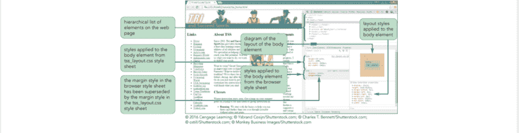

© 2016 Cengage Learning: Y Urbancos/Shutterstock.com; Charles T. Bennett/Shutterstock.com; ostill/Shutterstock.com; Monkey Business Images/Shutterstock.com

如图 2-6 所示，面板列出了已应用于 `body` 元素的样式。请注意，浏览器样式表中的 `margin` 属性被划掉了，表示该浏览器样式已被外部样式表中定义的样式所取代。

**遇到问题了吗？** 每个浏览器都有一套开发者工具和配置。你的工具可能与图 2-6 所示的不相似。

- 从元素的层级列表中选择标签，花些时间探索其他页面元素中使用的内容和样式。
- 按 `F12` 关闭开发者工具窗口。

**遇到问题了吗？** 在 Safari 中，你可以通过按 `ctrl+shift+I` 或 `command+option+I` 来找到开发者工具。

在本以及今后的教程中，你会发现浏览器的工具是开发网站的极大辅助。大多数开发者工具都允许你插入新的样式规则，以查看它们对页面外观的即时影响；这些修改仅在当前会话期间有效，不会永久保存。因此，一旦你找到了想要使用的设置，请将其输入相应的样式表中以使其生效。

#### 定义重要样式

你可以通过在属性后处标记以下 `!important` 关键字来覆盖样式级联：

```css
property: value !important;
```

以下样式规则将所有 `h1` 标题的颜色设置为橙色；由于该属性被标记为重要，它的优先级高于其他样式表中任何冲突的样式。

```css
h1 {color: orange !important;}
```

`important` 关键字最常用于用户定义的样式表，用户在其中需要用自己的样式替代设计师的样式。视觉视障用户可能需要用大字体和高对比度颜色显示文本。通常情况下，设计者不应使用 `important` 关键字，因为它会干扰 CSS 语言内置的级联顺序。

#### 创建样式表

现在你已经回顾了一些历史和概念，将开始创建你自己的样式表。理想情况下，你的样式表应该从注释开始，记录样式表的目的，并提供关于创建文档的人和时间的信息。

#### 编写样式注释

样式表注释的输入格式如下：

```css
/*
 comment
 */
```

其中 `comment` 是注释文本。由于 CSS 会忽略空格的存在，你可以将注释插入在单行中以节省空间，例如：

```css
/* comment */
```

现在创建一个样式表文件，将你的名字和当前日期放在文件顶部。

#### 编写样式注释：

1. 使用你的编辑器打开来自 `html02` 教程文件夹的 `tss_styles_txt.txt` 文件。
2. 在文件顶部的注释区域，输入你的名字、注释以及跟在 `Date:` 后的日期。
3. 将文件保存为 `tss_styles.css`。
4. 回到 HTML 编辑器中的 `tss_home.html` 文件，在闭合的 `<head>` 标签之前直接添加以下 `link` 元素。

```html
<link href="tss_styles.css" rel="stylesheet" />
```

5. 关闭 `tss_home.html` 文件并保存你的更改。

#### 定义字符编码

与 HTML 文件一样，在每个 CSS 文档中定义文件中使用的字符编码也是一个好习惯。在 CSS 中，你使用以下 `charset` 规则来实现这一点：

```css
@charset "encoding";
```

其中 `encoding` 定义了文件中使用的字符编码。现在向 `tss_styles.css` 样式表文件添加 `@charset` 规则，指定 CSS 代码中使用 UTF-8 字符集。

#### 指定字符编码：

1. 回到编辑器中的 `tss_styles.css` 文件。
2. 在初始注释区域正上方插入该行：`@charset "utf-8";`

图 2-7 高亮了样式表中的新代码。

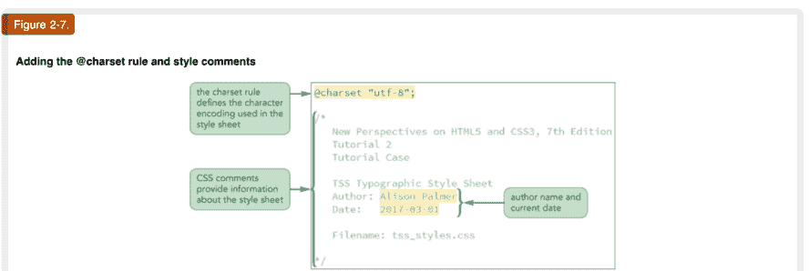

一个样式表中应该只有一个 `@charset` 规则，且它始终位于任何其他字符（包括注释）之前。

3. 保存对文件的更改。

#### 导入样式表

`@import` 是 CSS 规则的一个示例，它是一种用于向浏览器发送指令的规则，指示 CSS 文件的内容应该被解释和解析。另一个规则是 `@import` 规则，用于导入样式表文件的内容：

```css
@import url(url);
```

其中 `url` 是外部样式文件的 URL。

`@import` 允许将多个样式表中的样式合并到一个文件中。例如，一个在线商店可能有一个名为 `basic.css` 的样式表，包含每个网页都使用的所有基础样式，以及另一个名为 `sales.css` 的样式表，包含与商品相关页面使用的样式。以下代码导入了这两个文件的样式：

```css
@import url(company.css);
@import url(support.css);
```

在 CSS 文件中使用多个 `@import` 规则的效果与在 HTML 文件中添加多个 `link` 元素相同。`@import` 规则的优势是它可以简化你的 HTML 代码，通过在 CSS 文件中决定包含哪些样式表，而不是在 HTML 文件中。

#### 在 CSS 中处理颜色


图 2-6 显示了桌面版 Google Chrome 开发者工具的面板布局。

图 2-6。

#### Google Chrome 中的开发者工具


© 2016 Cengage Learning: Y Urbancos/Shutterstock.com; Charles T. Bennett/Shutterstock.com; ostill/Shutterstock.com; Monkey Business Images/Shutterstock.com

如图 2-6 所示，面板列出了已应用于 `body` 元素的样式。请注意，浏览器样式表中的 `margin` 属性被划掉了，表示该浏览器样式已被外部样式表中定义的样式所取代。

**遇到问题了吗？** 每个浏览器都有一套开发者工具和配置。你的工具可能与图 2-6 所示的不相似。

- 通过元素的层级列表中选择标签，花些时间探索其他页面元素中使用的内容和样式。
- 按 `F12` 关闭开发者工具窗口。

**遇到问题了吗？** 在 Safari 中，你可以通过按 `ctrl+shift+I` 或 `command+option+I` 来找到开发者工具。

在本以及今后的教程中，你会发现浏览器的工具是开发网站的极大辅助。大多数开发者工具都允许你插入新的样式规则，以查看它们对页面外观的即时影响；这些修改仅在当前会话期间有效，不会永久保存。因此，一旦你找到了想要使用的设置，请将其输入相应的样式表中以使其生效。

#### 定义重要样式

你可以通过在属性后处标记以下 `important` 关键字来覆盖样式级联：

```css
property: value !important;
```

以下样式规则将所有 `h1` 标题的颜色设置为橙色；由于该属性被标记为重要（important），它的优先级高于其他样式表中任何冲突的样式。

```css
h1 {color: orange !important;}
```

`important` 关键字最常用于用户定义的样式表，用户在其中需要用自己的样式替代设计师的样式。视觉视障用户可能需要用大字体和高对比度颜色显示文本。通常情况下，设计者不应使用 `important` 关键字，因为它会干扰 CSS 语言内置的级联顺序。

#### 创建样式表

现在你已经回顾了一些历史和概念，将开始创建你自己的样式表。理想情况下，你的样式表应该从注释开始，记录样式表的目的，并提供关于创建文档的人和时间的信息。

#### 编写样式注释

样式表注释的输入格式如下：

```css
/*
 comment
 */
```

其中 `comment` 是注释文本。由于 CSS 会忽略空格的存在，你可以将注释插入在单行中以节省空间，例如：

```css
/* comment */
```

现在创建一个样式表文件，将你的名字和当前日期放在文件顶部。

#### 编写样式注释：

1. 使用你的编辑器打开来自 `html02` 教程文件夹的 `tss_styles_txt.txt` 文件。
2. 在文件顶部的注释区域，输入你的名字、注释以及跟在 `Date:` 后的日期。
3. 将文件保存为 `tss_styles.css`。
4. 回到 HTML 编辑器中的 `tss_home.html` 文件，在闭合的 `<head>` 标签之前直接添加以下 `link` 元素。

```html
<link href="tss_styles.css" rel="stylesheet" />
```

5. 关闭 `tss_home.html` 文件并保存你的更改。

#### 定义字符编码

与 HTML 文件一样，在每个 CSS 文档中定义文件中使用的字符编码也是一个好习惯。在 CSS 中，你使用以下 `charset` 规则来实现这一点：

```css
@charset "encoding";
```

其中 `encoding` 定义了文件中使用的字符编码。现在向 `tss_styles.css` 样式表文件添加 `@charset` 规则，指定 CSS 代码中使用 UTF-8 字符集。

#### 指定字符编码：

1. 回到编辑器中的 `tss_styles.css` 文件。
2. 在初始注释区域正上方插入该行：`@charset "utf-8";`

图 2-7 高亮了样式表中的新代码。


一个样式表中应该只有一个 `@charset` 规则，且它始终位于任何其他字符（包括注释）之前。

3. 保存对文件的更改。

#### 导入样式表

`@import` 是 CSS 规则（at-rule）的一个示例，它是一种用于向浏览器发送指令的规则，指示 CSS 文件的内容应该被解释和解析。另一个规则是 `@import` 规则，用于导入样式表文件的内容：

```css
@import url(url);
```

其中 `url` 是外部样式文件的 URL。

`@import` 允许将多个样式表中的样式合并到一个文件中。例如，一个在线商店可能有一个名为 `basic.css` 的样式表，包含每个网页都使用的所有基础样式，以及另一个名为 `sales.css` 的样式表，包含与商品相关页面使用的样式。以下代码导入了这两个文件的样式：

```css
@import url(company.css);
@import url(support.css);
```

在 CSS 文件中使用多个 `@import` 规则的效果与在 HTML 文件中添加多个 `link` 元素相同。`@import` 规则的优势是它可以简化你的 HTML 代码，通过在 CSS 文件中决定包含哪些样式表，而不是在 HTML 文件中。

#### 在 CSS 中处理颜色


article#about_ts li:nth-of-type(2) {
  list-style-image: url(bkimicon.png);
}

article#about_ts li:last-of-type {
  list-style-image: url(swimicon.png);
}

图 2-44 展示了在无序列表项上使用伪类类的三个选择器及其关联规则。

# 图 2-44
将伪类应用于列表项

| /* css 样式 */ | 选中 about 中的第一个无序列表 |
|---|---|
| runmicon.png 用于第一个列表项的标记 | article#about_ts li:first-of-type { list-style-image: url(runmicon.png); } |
| bkimicon.png 图像作为第二个标记的标记 | article#about_ts li:nth-of-type(2) { list-style-image: url(bkimicon.png); } 选中第二个列表项 |
| swimicon.png 用于最后一个标记的标记 | article#about_ts li:last-of-type { list-style-image: url(swimicon.png); } 选中最后一个列表项 |

将更改保存到文件，然后在浏览器中重新加载 `ts_home.html` 文件。图 2-45 显示了无序列表的新格式，每个列表项都使用了不同的图像标记。

# 图 2-45
每个项目的列表标记图像

| 类名 | 描述 |
|---|---|
| | 冬季课程即将开始。加入我们的个人或小组课程，提前实现你的夏季目标：在 |
| runmicon.png | **跑步**：我们从基础知识开始，帮助你跑得更快（而且比想象中更远，且没有酸痛）。 |
| bkimicon.png | **骑行**：室内健身单车训练器提供了你精炼技术、耐力和力量所需的一切设备，以便在道路上获得更好的效果。 |
| swimicon.png | **游泳**：公开水域可能是最难掌握的运动之一。我们的课程从基础技术开始，让你的游泳变得非常愉快，而不是一项苦差。 |

# 探索 nth-of-type 伪类

`nth-of-type` 伪类是按循环顺序格式化元素的强大工具。循环由选择器创建。例如，以下样式规则创建了一个长度为 3 的循环，其中第一个列表项显示为红色，第二个显示为蓝色，第三个显示为绿色，之后循环按红-蓝-绿重复，直到达到最后一项：

```css
nth-of-type(3n) { color: red; }
nth-of-type(3n+1) { color: blue; }
nth-of-type(3n+2) { color: green; }
```

当循环长度为 1 时，`nth-of-type` 选择器会选择传递的偏移量之后的元素。以下样式规则将从第 5 个项目开始的所有列表项的文本颜色设置为蓝色：

```css
nth-of-type(n+5) { color: blue; }
```

CSS 还支持 `even`（偶数）和 `odd`（奇数）关键字，因此长度为 2 的循环可以更紧凑地输入，即应用于偶数列表项的红色字体和附加的蓝色字体。上述方法也可以适用于 `nth-child` 选择器，其重要区别在于 `nth-child` 选择器选择父元素的每个元素，而 `nth-of-type` 仅选择特定类型的元素。

# 用于超文本的伪类

另一种类型的伪类是动态伪类，该类可以根据用户的操作改变状态。动态伪类用于超链接，该类指示链接目标是否已被用户访问。图 2-46 描述了这些动态伪类。

| 伪类 | 描述 |
|---|---|
| link | 链接尚未被访问。 |
| visited | 链接已被访问。 |
| active | 元素处于被用户激活或点击的状态。 |
| hover | 鼠标指针悬停在元素上。 |
| focus | 元素正在接收键盘或鼠标指针的焦点。 |


| 伪元素 | 描述 |
| :--- | :--- |
| ::first-letter | 元素文本的首字母 |
| ::first-line | 元素文本的第一行 |
| ::before | 直接插入在元素之前的内容 |
| ::after | 直接插入在元素之后的内容 |

例如，以下样式规则匹配渲染后的网页中每个段落的第一行显示行，并将该行的文本转换为大写字母：

```css
p::first-line { text-transform: uppercase; }
```

以下样式规则匹配块引用内每个段落的首字母，并用 Times New Roman 字体显示该字符，字体比周围文本大 250%：

```css
blockquote p::first-letter {
  font-family: 'Times New Roman', Times, serif;
  font-size: 250%;
}
```

注意，双冒号 `::` 是 CSS3 中引入的，用于区分伪元素和伪类。旧版浏览器使用冒号 `:` 同时用于伪元素和伪类。

## 使用 CSS 生成内容

另一种类型的伪元素用于为网页生成内容。可以使用以下 `before` 和 `after` 伪元素在元素之前或之后新内容：

```css
element::before { content: text; }
element::after { content: text; }
```

其中 `text` 是要插入到渲染网页中的内容。`content` 属性支持多种类型的内容，如图 2-50 所示。


| 值 | 描述 |
| :--- | :--- |
| none | 将内容设置为空字符串 |
| counter | 显示计数器 |
| attr( attribute ) | 显示选择器属性的值 |
| text | 显示指定的文本 |
| open-quote | 显示左引号 |
| close-quote | 显示右引号 |
| no-open-quote | 如果之前指定过，则移除左引号 |
| no-close-quote | 如果之前指定过，则移除右引号 |
| url( url ) | 显示位于 url 处的文件的媒体（图像、视频等）内容 |

例如，以下样式规则将 `before` 和 `after` 伪元素与 `hover` 伪类结合，在导航列表中每个超链接周围插入 `-` 和 `>` 字符：

```css
nav a:hover::before { content: ""; }
nav a:hover::after { content: ""; }
```

注意，这些样式规则使用了 `hover` 伪类和 `before/after` 伪元素，内容只有在响应悬停（hover）事件时才会被插入。

如果你想插入特殊符号，必须插入用于符号 "code" 的代码编号，其中 `code` 是代码编号。例如，如上所示插入单角括号 `<>`，如果你想显示双角括号 `<<` 和 `>>` 则需要使用这些字符的 Unicode 字符代码，分别为 `00ab` 和 `00bb`。若要在导航列表超链接的前后插入这些字符，可以应用以下样式规则：

```css
nav a:hover::before { content: "\00ab"; }
nav a:hover::after { content: "\00bb"; }
```

在上述向元素添加内容时，你还可以使用以下 `content` 属性从媒体文件（如图像或视频剪）插入内容：

```css
content: url(url);
```

其中 `url` 是媒体文件的位置。例如，以下样式规则允许图像文件 `uparrow.png` 在悬停时出现在文档中的任何超链接上：

```css
a:hover::after { content: url(uparrow.png); }
```

图像或样式表生成的任何内容都不应包含对理解页面至关重要的材料。相反，生成的内容应仅包含出于艺术或设计考虑的支持页面的材料。如果生成的内容对于解释至关重要，它应该首先放在 HTML 文件中。

## 显示属性值

`content` 属性还可以通过使用 `attr()` 函数将属性值插入到渲染网页中：

```css
content: attr(attribute);
```

其中 `attribute` 是所选元素的属性。`attr()` 函数的一个应用是将任何超链接的 URL 添加到链接文本中。在以下代码中，`href` 属性的值将附加到标记元素的每个出现处：

```css
a::after {
  content: " " + attr(href) + " ";
}
```

注意 `URL` 被包含在圆括号内。因此，HTML 文档中的超链接，例如

```html
<a href="http://www.triathlon.org">Triathlons</a>
```

将在渲染后的网页中显示为：

Triathlons (http://www.triathlon.org)

这种技术对于打印输出特别有用，作者希望将所有链接的 URL 都显示在打印页面上供用户阅读和参考。你将在教程 5 中进一步探讨这个问题。

## 使用 CSS 插入内容

- 要在页面元素之前直接插入内容，使用样式规则：

```css
element::before { content: text; }
```

其中 `element` 是页面元素。

- 要在页面元素之后直接插入内容，使用样式规则：

```css
element::after { content: text; }
```

## 2.3 节回顾快速检查

- 1. 提供一种样式规则，用小写字母作为列表标记显示所有无序列表。
- 2. 提供一种样式规则，使用 `star.png` 图片文件显示所有无序列表，并将其放在虚拟框内。
- 3. 提供一种样式规则，将所有之前访问过的超链接文本显示为灰色。
- 4. 提供一种样式规则，将 `section` 元素中每个 `h1` 标题的顶部内边距设置为 1em。
- 5. 提供一种样式规则，将 `figure` 元素的左外边距改为 20 像素。
- 6. 描述以下选择器所选的项目：

```css
#top > p:first-of-type::first-line
```

- 7. 描述以下选择器所选的项目：

```css
div.links img[usemap]
```

- 8. 提供一种样式规则，在每个属于 `Review` 类的段落之前插入文本字符串 "*****"。
- 9. 提供样式属性，将起始引号和结束引号设置为 Unicode 值为 2018 和 2019 的弯引号。

## 练习：复习作业

回顾作业所需的数据文件：`coach_styles.txt`、`tss_coach_txt.html`、1 个 CSS 文件、5 个 PNG 文件、1 个 TTF 文件、1 个 WOFF 文件。

Alison 为 Tri and Succeed Sports 网站创建了另一个页面，提供该俱乐部教练的传记。她已经写好了页面内容，获取了图片，并为页面布局创建了样式表。她希望你通过开发一个页面配色方案和字体的样式表来完成页面设计。页面设计的预览见图 2-53。

# 图 2-53

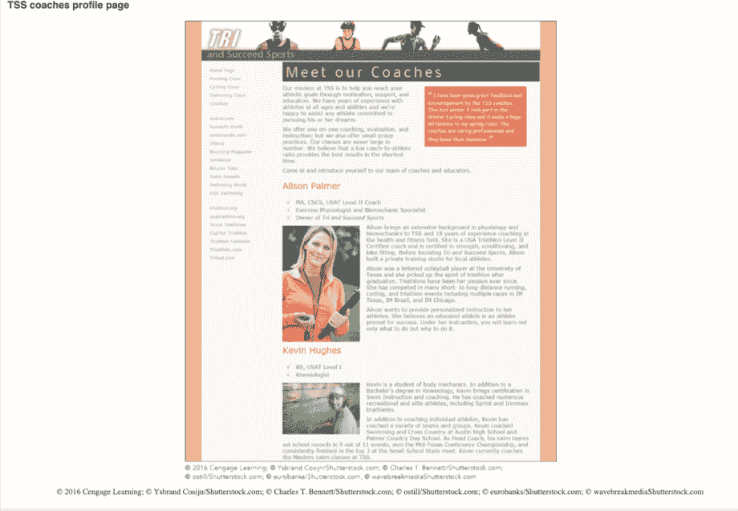
TSS 教练简介页

完成以下操作：

- 使用你的 HTML 编辑器打开 `http02` 文件夹中的 **tss_coach_txt.html** 和 **coach_styles.txt** 文件。在每个文件的注释部分输入你的**姓名**和**日期**，并将它们分别保存为 **tss_coach.css** 和 **coach_styles.css**。
- 在编辑器中打开 **tss_coach.html** 文件，然后编辑文档，创建指向 **coach_layout.css** 和 **coach_styles.css** 样式表的链接。
- 花些时间研究文件内容并关闭文档，保存更改。
- 在编辑器中打开 **coach_styles.css** 文件。在文件顶部、注释部分之前执行以下操作：
  - 插入一个 `@charset` 规则，将文件的字符编码设置为 utf-8。
  - 使用 `@font-face` 规则定义网络字体 Noble，该字体基于 `noble-webfont.woff` 文件，如果不支持该格式，则基于 `noble-webfont.ttf` 文件。
5. 进入“主结构”（Main Structures）部分并执行以下操作：
  a. 通过为 `html` 元素创建一个样式规则来更改浏览器背景颜色，将背景颜色设置为值 `hsl(27, 72%, 72%)`。
  b. 针对 `body`，创建一个样式规则，将文本颜色设置为 `rgb(91, 91, 91)`，背景颜色设置为象牙色（ivory），并将正文字体族设置为：`Verdana, Geneva, sans-serif`。
6. 为 `body > footer address` 选择器创建一个样式规则，包含以下样式：
  a. 背景颜色设置为值 `rgb(222, 128, 60)`。
  b. 字体颜色先设置为白色，然后设置为半透明值 `rgba(255, 255, 255, 0.6)`。
  c. 文本设置为常规（normal），以加粗的小写字母显示，字体大小为 0.9em，行高为 3em，使用字体族 `Noble, Verdana, Geneva, sans-serif`。
  d. 文本在页面上水平居中。
7. 进入“标题”（Heading）部分，为每个 `h1` 创建一个样式规则，使用字体族 `Noble, Geneva, sans-serif` 以常规字重（normal）显示文本。将字母间距设置为 0.2em，并将外边距设置为 0 像素。
8. Alison 想要格式页面顶部的主 `h1` 标题。为 `section#hits_coach h1` 选择器创建一个样式规则，将字体大小设置为 2.5em，颜色为 `rgba(27, 72%, 85%)`，背景颜色为 `hsl(27, 21%)`。将左内边距设置为 10 像素。
9. Alison 还想要格式化每个 `h2` 标题。为 `article.coach h2` 选择器创建一个样式规则，将字体大小设置为 1.6em，常规字重，并将字体颜色设置为 `rgb(240, 125, 0)`。
10. Alison 在引用顶部插入了一条运动员的注释。此注释涉及“块引用样式”（Blockquote Styles）部分，并为 `aside` 块创建一个样式规则以执行以下操作：
  a. 使用字体族 'Comic Sans' MS 将字体大小设置为 0.95em。
  b. 将颜色设置为 `rgb(222, 128, 60)`，并使用值为 `rgba(255, 255, 255, 0.75)` 的半透明背景颜色。
  c. 将内边距设置为 10 像素。
  d. 使用 Unicode 201C 和 201D 定义起始和结束引号。
11. 为 `aside::before` 创建一个样式规则来格式化起始引号，使其显示为加粗（boldfaced），字体大小设置为 1.6em，字体族为 'Times Roman', serif。
12. 为 `aside::after` 创建一个样式规则来格式化结束引号，使其显示为加粗，字体大小设置为 1.6em，字体族为 'Times Roman', serif。
13. 接下来，你将通过进入“导航”（Navigation）部分并为 `body nav` 创建样式规则来格式化导航列表，将字体大小设置为 0.8em，行高 2em。
14. 为 `nav > ul` 选择器创建一个样式规则，移除列表标记并将左内边距设置为 5 像素。
15. Alison 想要打破导航列表项。为 `nav > ul` 选择器内的 `li` 元素创建一个样式规则，将顶部外边距设置为 20 像素。
16. 对于 `nav > ul li a` 选择器内的每个已访问或未访问的超链接文本，将颜色设置为 `rgb(151, 151, 151)` 并移除下划线。
17. 对于 `nav > ul li a` 选择器中的每个悬停或激活超链接，将文本颜色设置为 `rgb(222, 128, 60)` 并添加下划线。
18. 进入“段落样式”（Paragraph Styles）部分，插入一条规则将文档中每个段落的顶部外边距和底部外边距设置为 10 像素，右边距设置为 30 像素，左外边距设置为 0 像素。
19. 每个教练都有一个成就列表。进入“列表样式”（List Styles）部分，为 `article.coach_bio > header` 创建规则，显示 `coach.png` 作为列表标记并将空间设置为 0 像素，底部外边距应设置为 10 像素。
20. 保存更改到样式表并在浏览器中打开 `coach.html` 文件。验证颜色和字体是否与图 2-53 一致。当鼠标悬停在链接上时，导航文本以下划线显示。

## 应用：案例 1

此案例所需文件：`ph_plays.txt`、`ph_styles.txt`、1 个 CSS 文件、1 个 PNG 文件、3 个 TTF 文件、3 个 WOFF 文件。

**PHILIP HENSLOW CLASS CENTRE**

Randall Chen 是 Coeur d'Alene Philip Marlowe Theatre 的媒体总监。你被要求负责该机构网站的设计。你将管理的第一个页面是夏季剧目。页面预览见图 2-54。

# 图 2-54
Philip Henslow Theatre 剧目列表

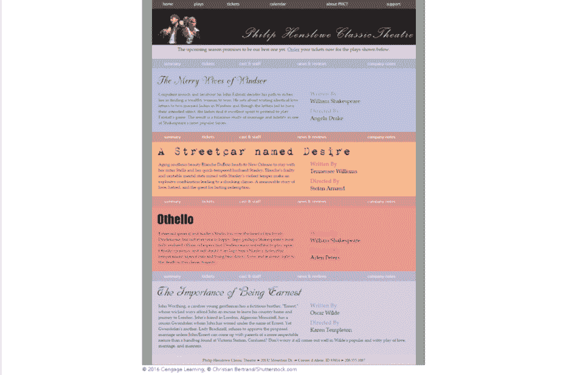

页面内容和布局已经为你准备好。你的任务是为页面字体创建一个样式表。

完成以下操作：

- 1. 使用编辑器打开 `html02 ► case1` 文件夹中的 **ph_plays.html** 和 **ph_styles.css** 文件。在每个文件的注释部分输入你的**姓名**和**日期**，并将它们分别保存为 **ph_plays.html** 和 **ph_styles.css**。
- 2. 在 HTML 编辑器中打开 **ph_plays.html** 文件，并在文档 head 中链接到 **ph_layout.css** 和 **ph_styles.css** 样式表。花些时间考虑文档的内容和结构，然后关闭文件保存更改。
- 3. 在编辑器中打开 **ph_styles.css** 文件，在文件顶部、注释部分之前定义文档使用的字符编码为 utf-8。
- 4. Randall 有几种用于机构制作页面标题的网络字体。在注释部分之前使用 `@font-face` 规则将以下网络字体添加到样式表：
  - A. Champagne 字体使用 `cac_champagne.woff` 和 `cac_champagne.ttf` 文件。
  - B. Grund 字体使用 `1942.woff` 和 `1942.ttf` 文件。
  - C. Dobkin 字体使用 `DobkinPlain.woff` 和 `DobkinPlain.ttf` 文件。
- 5. 进入“结构样式”（Structural Styles）部分，创建一个样式规则将 `html` 元素的背景颜色设置为值 `hsl(91, 8, 56%)`。
- 6. 为 `body` 元素添加样式规则，将背景颜色设置为值 `hsl(58, 31, 84%)`，并将字体族设置为：`'Palatino Linotype', 'Book Antiqua', serif`。
- 7. 为 `header` 元素创建一个样式规则，将背景颜色设置为黑色。
- 8. 为每个段落创建一个样式规则，将外边距设置为 0 像素，顶部内边距设置为 5 像素，右、下左设置为 25 像素。
- 9. 对于 `body` 的直接子元素段落，创建一个样式规则将字体大小设置为 1.1em 并水平居中段落文本。
- 10. 为 `address` 元素创建一个样式规则，将字体设置为常规，字体大小为 0.9em，并在页面上水平居中。将顶部和底部内边距设置为 10 像素。

14. 转到样式表中的 Sections（章节）部分。在此部分，你将定义四个剧单（playbills）的外观。你将从章节 h1 标题开始。为 `section.playbill h1` 选择器创建一个样式，将字体大小设置为 `3em`，并将字体权重设置为 normal（常规）。将 h1 标题周围的外边距（margin）设置为 0 像素。设置内边距（padding）为顶部 20 像素、右侧 0 像素、底部 10 像素以及左侧 20 像素。

15. 每个剧单章节都由从 `play1` 到 `play4` 的 ID 值进行标识。创建样式规则，使用以下背景颜色为每个剧单设置不同的背景颜色：

- ID `play1` 设置为 `hsl(240, 100%, 88%)`
- ID `play2` 设置为 `hsl(25, 88%, 73%)`
- ID `play3` 设置为 `hsl(0, 100%, 75%)`
- ID `play4` 设置为 `hsl(296, 86%, 66%)`

16. 每个剧单章节标题将具有不同的字体。对于不同剧单内的 h1 标题，创建样式规则以应用以下字体栈：

- ID `play1` 设置为 `Champagne, cursive`
- ID `play2` 设置为 `Grunge, 'New Roman', Times, serif`
- ID `play3` 设置为 `Impact, Charcoal, sans-serif`
- ID `play4` 设置为 `Dobkin, cursive`

17. Randall 将每个剧目的作者和导演置于一个定义列表（definition list）中。现在通过转到 Definition List Styles（定义列表样式）部分来格式化这些定义列表，并为 `dt` 元素创建一个样式规则，将字体大小设置为 `1.3em`，字体权重设置为 bold（加粗），并将字体颜色设置为半透明的 `hsl(0, 0%, 0.4)`。

18. 为每个 `dd` 元素创建一个样式规则，将字体大小设置为 `1.3em`，左外边距设置为 0 像素，下外边距设置为 10 像素。

19. 将更改保存到文件，然后在浏览器中打开 `play.html` 文件。验证文档中使用的排版和颜色与图 2-54 所示匹配。此外，验证当光标悬停在整个页面以及每个剧目的导航列表项上时，链接的背景颜色会变得更加不透明。

## 挑战：案例 2

此案例所需数据文件：`mw_styles.txt.css`, `mw_tour_txt.html`，1 个 CSS 文件，1 个 PNG 文件

山区 Adriana 和 Ivan Turchenko 是位于科罗拉多州利特顿 Mountain Wheels 的联合所有者，这是一家自行车旅游和跑步公司。他们最受欢迎的路线之一是“自行车”，这是一场在科罗拉多州最高公路上进行的六天远足。Adriana 想要更新公司网站，以提供更多关于该路线的信息。她已经让一位同事设计了三列布局，第一列是链接列表，第二列和第三列是描述性文本。她请求你帮助通过格式化页面中的文本和颜色来完成设计。图 2-55 显示了最终所使用的设计预览。

### 山地自行车之旅行程描述


考虑以下内容：

1. 使用你的编辑器打开 **mw_tour.txt** 和 **mw_styles.txt** 文件。在每个文件的注释部分**输入你的姓名**和**日期**，并将它们分别保存为 **mw_tour.html** 和 **mw_styles.css**。

2. 在你的 HTML 编辑器中打开 **mw_tour.html** 文件。在文档内部，创建指向 **mw_layout.css** 和 **mw_styles.css** 样式表的链接。研究文档的结构，然后关闭文件并保存更改。

3. 在你的编辑器中打开 **mw_styles.css** 文件。在文件顶部插入 `@charset` 规则，将此样式表的编码设置为 utf-8。

4. 转到 `body` 元素的结构化规则，该规则将背景颜色设置为 `rgb(227, 210, 173)`并将字体族设置为字体栈：`'Century Gothic', sans-serif`。

5. 为 `body` 元素创建一个样式规则，将背景颜色设置为 `rgb(227, 210, 173)`并将正文字体设置为字体栈：

6. 创建一个样式规则来显示主体页脚（body footer），其背景颜色为 `rgb(208, 184, 109)`，并将顶部和底部内边距设置为 5 像素。

7. 为 `address` 元素创建一个样式规则，以 0.9em 的字体大小以常规字体显示文本，使文本水平居中，并将顶部和底部内边距设置为 10 像素。

8. 转到 Heading Sections（标题章节）部分，创建一个样式规则，将所有 h1 和 h2 标题的字体权重设置为 normal。

9. 转到 Navigation Sections（导航章节）部分，为 `nav > ul` 选择器创建一个样式规则，移除所有列表标记，将行高设置为 `2em`，并将字体大小设置为 `0.9em`。

10. 对于导航列表中每个之前访问过或未访问过的超链接，创建一个样式规则，移除超链接的下划线，并将字体颜色设置为 `rgb(43, 59, 125)`。

11. 对于导航列表中的每个悬停或激活状态的链接，创建一个样式规则，将文本颜色设置为 `rgb(212, 35, 35)`。

12. Adriana 将之旅信息放在一个 ID 为 "tour_summary" 的元素中。格式化该元素，从标题开始。转到 Article Styles 部分，为 `tour_summary` 内的 h1 元素创建一个样式规则，将字体大小设置为 `1.2em` 并全大写。

13. 为 `tour_summary` 内的段落创建一个样式规则，将字体大小设置为 `1em`。

14. 设计位于 ID 为 "tour_itinerary" 的元素中。转到 Aside 部分，为 `tour_itinerary` 内的 h1 元素创建一个样式规则，将字体大小设置为 `1.2em`。

15. 为 `tour_itinerary` 中的每个 h2 元素将字体大小设置为 `0.9em`。

16. 为 `tour_itinerary` 内的段落将字体大小设置为 `0.8em`。

17. 将背景颜色在灰色和蓝色之间交替：
- 奇数 h2 标题和段落颜色设置为 `rgb(79, 91, 40)`。
- 偶数 h2 标题和段落颜色设置为 `rgb(81, 95, 175)`。

18. blockquote 包含一条评论。转到 Blockquote 部分，为 blockquote 创建一个样式规则，将背景颜色设置为 `rgb(255, 255, 255)`，不透明度为 0.65。

19. 将 blockquote 的顶部/底部内边距设置为 5 像素，左侧/右侧内边距设置为 10 像素。

20. 将更改保存到文件，然后在浏览器中打开 `tour.html` 文件。验证文档中使用的排版和颜色与图 2-55 所示匹配。

- 10. 为嵌套在导航列表中的每个超链接创建一个样式规则，移除文本的下划线。

- 11. 为 `footer` 元素创建一个样式规则，将文本颜色设置为白色，背景颜色设置为 `rgb(101,101, 101)`。将字体大小设置为 `0.8em`。页脚文本水平居中，并将顶部/底部的内边距设置为 1 像素。

- 12. 接下来，你将格式化显示大学名称的 body 头部。（进入 Body Headers 部分，为 `body > header header` 创建一个样式规则，将背景颜色设置为 `rgb(97, 97, 211)`。）

- 13. 大学名称存储在 `h1` 标题中。为 `body header` 的直接子元素 `h1` 标题创建一个样式规则，将字体大小设置为 `4em`，颜色设置为 `rgba(255,255, 255, 0.8)`。使用字体 `font: Limelight, cursive` 显示文本。将外边距设置为 0 像素。

- 14. `h1` 标题文本的最后一个词封装在一个 `span` 元素中。为嵌套在 `body header` 并在 `h1` 标题中的 `span` 元素创建一个样式规则，将文本颜色设置为 `rgba(255, 255, 255, 0.4)`。

- 15. 进入导航部分（Navigation Sections）。在此部分，你将格式化 ID 为 `mainLinks` 的导航列表。对于此导航列表内的超链接，将顶部和底部的内边距设置为 5 像素。

- 16. 对于 `mainLinks` 导航列表中的已访问和未访问的链接，创建一个样式规则，使超链接显示为白色，透明度为 0.8，并将背景颜色设置为 `rgba(5, 51, 51, 0.5)`。

- 18. 进入大纲部分（Outline Sections）。在此部分，你将格式化出现在页面左侧列的大纲。该大纲中的导航列表 ID 为 `Outline`。为此列表创建一个样式规则，将文本颜色设置为 `rgb(51, 51, 51)`，并将字体大小设置为 `0.8em`。

- 19. 将大纲导航列表内的 `h1` 标题水平居中。

- 20. 对于作为大纲列表直接子元素的第一级 `ol` 元素，创建一个样式规则，将行高设置为 `2em`，顶部/底部外边距设置为 0 像素，左/右外边距设置为 5 像素。将列表标记显示为大写罗马数字。

- 21. 将嵌套在大纲导航列表中的第二级 `ol` 元素显示为大写字母标记。

- 22. 使用颜色值 `rgb(97, 97, 211)` 并带有文本下划线显示大纲导航列表中的所有已访问和未访问链接。

- 24. 进入章节样式部分（Section Styles）。在此部分，格式化课程描述。创建一个样式规则，将 `section` 元素的背景颜色设置为 `rgb(220, 220, 220)`。

- 25. 通过为 `section header h1` 创建样式规则来格式化此部分的标题，将字体大小设置为 `2.2em`，左侧内边距设置为 10 像素。

- 26. 进入文章部分（Article section），为 `article` 元素内的 `h2` 标题创建一个样式规则，将字体大小设置为 `1.4em`。

- 27. 探索文章元素内第一个段落的首字母，字体大小设置为 `2em` 并与周围文本的基线垂直对齐。（提示：使用 `:first-of-type` 伪类和 `::first-letter` 伪元素。）

- 28. 关于 Peter Craft 的信息被放置在一个 `aside` 元素中。进入 Aside 部分，创建一个样式规则，将 `aside` 元素中文本的字体大小设置为 `0.8em`。

- 29. 为嵌套 `aside` 元素内的 `h1` 标题创建一个样式规则，将字体大小设置为 `1.4em` 并水平居中标题文本。

- 30. 保存更改到文件并在浏览器中打开 `cw_class.html` 文件。验证图 2-56 显示的页面外观。确认当你更改浏览器窗口宽度时，由于使用了 `em` 设置标题文本，页面标题文本的大小会随之变化。

#### 创建：案例问题 4

此案例问题所需文件：`lake_home_txt.html`, `lake_styles_txt.css`, 1 个 CSS 文件, 2 个 PNG 文件, 2 个 TTF 文件

大湖逃离度假木小屋 Ron Nelson 是威斯康星州贝利海港（Bailey Harbor）大湖度假木小屋的所有者。他聘请你负责网站的重新设计。你将负责网站首页的工作。Ron 已经写好了页面文本，收集了所有图形文件，并由同事设计了页面布局。他希望你处理页面的色彩方案和字体设计。一种可能的解决方案如图 2-57 所示。

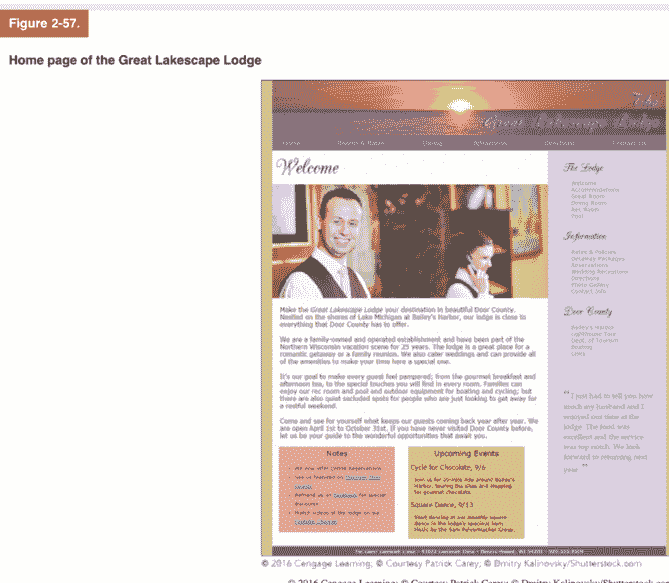

创建内容：

- 1. 使用你的编辑器打开 `html12 > case4` 文件夹下的 `lake_home_txt.html` 和 `lake_styles_txt.css` 文件。将它们分别保存为 `lake_home.html` 和 `lake_styles.css`。

- 2. 在编辑器中打开 `lake_home.html` 文件，将其链接到 `lake_layout.css` 和 `lake_styles.css` 样式文件。花时间研究文档内容并保存更改。

- 3. 在编辑器中打开 `lake_styles.css` 文件，开始为度假木小屋创建色彩方案和字体样式。最终设计应包含以下：
    - 样式表中使用的字符编码定义
    - 字体应用（case4 文件夹中提供了两种字体）
    - 使用颜色值和名称设置背景和文本颜色
    - 半透明色的应用
    - 嵌套元素、子元素以及基于 `id` 属性的样式规则
    - 修改列表标记的样式
    - 使用伪元素和伪类作为选择器
    - 修改元素周围内边距和外边距的样式
    - 用于生成渲染页面内容的样式规则

- 4. 全处包含说明性注释

- 5. 保存你完成的样式表。

# II 级教程

# 教程 3 设计页面布局

# 案例 I Pandaisia Chocolates

Anne Ambrose 是位于特蒙州的 Pandaisia Chocolates 巧克力店的所有者兼首席巧克力师。受邀协助重新设计公司的网站。Anne 提供了三个页面供你开始工作。她编写了所有内容，汇了必要的图像和图形，并编写了一些文本和颜色样式。她需要你通过 CSS 属性设计页面布局以完成项目。

### 目标

3.1 会
- 创建重置样式表
- 探索页面布局
- 使块级元素居中
- 创建浮动元素
- 清除浮动布局
- 防止塌陷

3.2 会
- 探索基于网格的布局
- 创建网格
- 格式化网格
- 探索 CSS 样式

3.3
- 探索定位样式
- 使用相对定位
- 使用绝对定位
- 处理溢出（overflow）

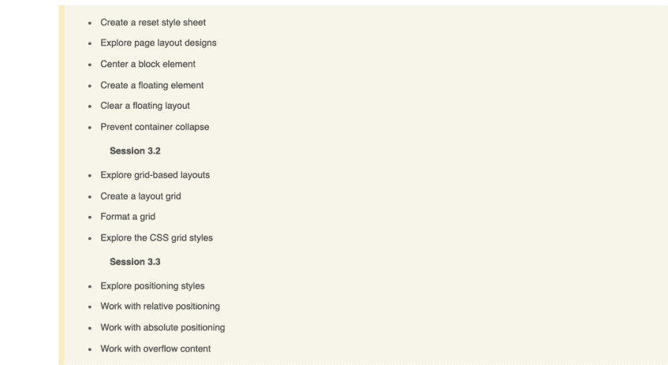

# 起始文件

| 黑色 | 教程 | 复习 | 案例 1 | 案例 2 |
|---|---|---|---|---|
| pc_home_na.html | pandaisia_na.html | pandaisia_na.html | up_home_na.html | pg_home_na.html |
| pc_home_na.html | cr_home_na.html | cr_home_na.html | cr_grid_na.html | cr_grid_na.html |
| pc_grid_na.html | | 11 个文件 | 13 个文件 | 21 个文件 |
| pc_home_na.html | | | | |
| pc_img_na.html | | | | 22 个文件 |

| 案例 3 | 案例 4 | Demo | |
|---|---|---|---|
| sl_home_na.html | pg_home_na.html | demo_positioning.html | |
| cr_style_na.html | cr_style_na.html | 5 个文件 | |
| | 4 个文件 | 9 个文件 |

# 3.1 视觉概览：使用浮动元素的页面布局

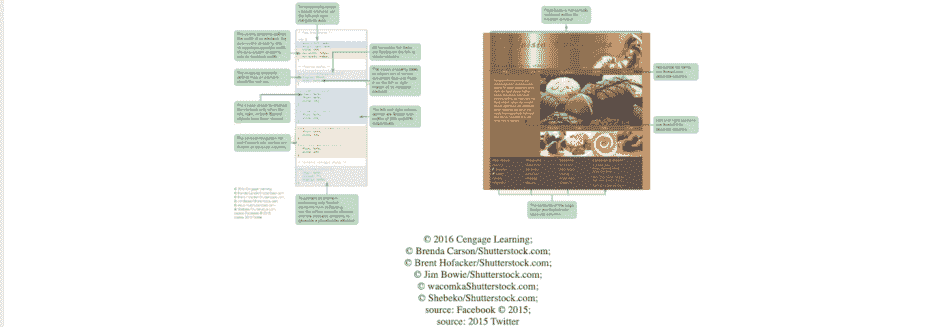

# 引入 display 样式

页面布局的研究从定义单个元素如何在页面上呈现开始。在第一个教程中，你学习了 HTML 元素分为段落或标题等块元素，或强调文本或内联图像等内联元素。然而，元素是以块还是内联形式显示取决于样式表。你可以使用以下 `display` 属性为任何页面元素定义显示样式：

```css
display: type;
```

其中 `type` 定义显示类型。图 3-1 显示了许多值中的一些。

# 图 3-1. display 属性的某些值

| block | 显示值 | 外观 |
|---|---|---|
| block | 显示为块 | |
| table | 显示为网页表格 | |
| inline | 在块内内联显示 | |
| inline-block | 视为在块内放置的块 | |
| run-in | 显示为块，除非其兄弟元素也是块，在这种情况下，它内联显示，将两个块合并为一个 | |
| inherit | 继承父元素的显示属性 | |
| list-item | 与同项目标记一起显示为列表项目 | |
| none | 防止显示，从渲染页面中移除 | |

例如，为了取代浏览器内联显示图像的通常样式，你可以应用以下样式规则将所有图像显示为块：

```css
img { display: block; }
```

如果你想将所有块级引用显示为带有项目标记的列表项目，可以向你的样式表中添加以下样式规则：

```css
blockquote { display: list-item; }
```

你可以通过将 `display` 属性设置为 `none` 来防止浏览器显示元素。在这种情况下，元素是文档结构的一部分，但对用户不可见且不在显示的页面中占据空间。这对于包含用户不应该看到或不需要看到的元素非常有用。

你将在创建重置样式时使用 `display` 属性。

# 创建重置样式表

你在上一个教程中了解到，除非被自己的样式表覆盖，否则浏览器会对页面元素应用其样式。许多设计师倾向于从“空白”开始工作，而不让浏览器样式破坏网站的最终设计。这可以通过重置样式表来实现，该样式表可以覆盖浏览器的默认设置，并为页面设计提供一致的起点。

你将为 Pandaisia Chocolate 网站创建一个重置样式表。你表中的第一个规则将使用 `display` 属性来显示网页中所有的 HTML5 结构元素。虽然目前的浏览器已经这样做，但某些其他浏览器不识别或未定义 `header`、`article` 或 `footer` 等元素的样式。通过在重置样式表中包含 `display` 属性，可以确保这些结构元素能够正确渲染。

## 创建重置样式表：

- 使用你习惯的文本编辑器或 HTML 编辑器打开 `html03` 教程文件夹中的 `pc_reset.txt` 文件。在文件的注释部分输入你的姓名和日期，并将文档另存为 `pc_reset.css`。

- 在“结构样式（Structural Styles）”部分中，插入以下样式规则，以定义多个 HTML5 结构性元素的显示属性。

```css
article, aside, figcaption, figure,
footer, header, main, nav, section {
  display: block;
}
```

图 3-2 显示了文档中的新样式规则。

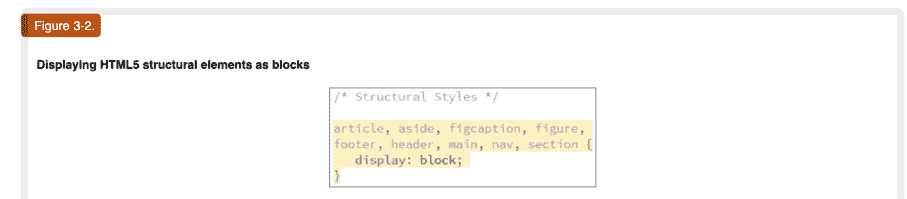

你将通过添加其他样式规则来完成重置样式表，包括为常用页面元素设置默认内边距和外边距、定义一些基础排版属性，以及移除导航列表中超链接的下划线。

## 完成重置样式表：

- 在“排版样式（Typographic Styles）”部分中，插入以下样式规则，以定义多个页面元素的排版样式：

```css
address, article, aside, blockquote, body, cite,
div, dl, dt, dd, em, figcaption, figure, footer,
h1, h2, h3, h4, h5, header, html, img,
li, nav, ul, ol, p, section, span {
  background: transparent;
  font-size: 100%;
  margin: 0;
  padding: 0;
  vertical-align: baseline;
}
```

- 添加以下样式规则以移除导航列表项中的列表标记：

```css
nav ul {
  list-style: none;
  list-style-image: none;
}

nav a {
  text-decoration: none;
}
```

- 通过对页面主体应用以下样式规则，将默认行高设置为 1（单倍间距）：

```css
body {
  line-height: 1;
}
```

图 3-3 描述了文档中的新样式规则。

### 图 3-3
完成样式表

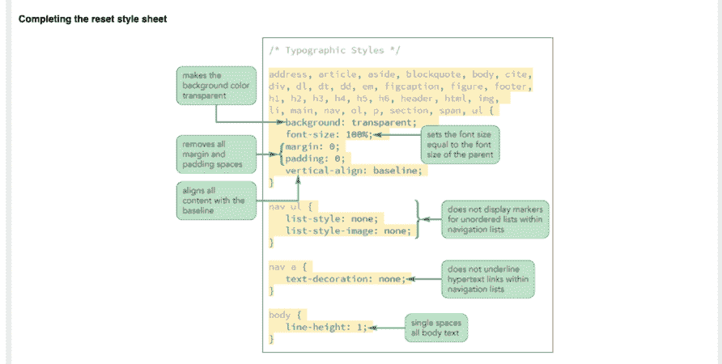

- 4. 将你的更改保存到文件中。

这是一个基础重置样式表。网上有很多免费的重置样式表，它们包含了更多的样式规则，用于协调浏览器和设备之间的差异。在使用任何这些重置样式表之前，你应该检查 CSS 代码并确保它符合你网站的需求。请注意，某些重置表可能包含比你实际需要的更多的规则，通过解析重置表并仅保留你网站所需的元素，可以提高网站的加载速度。

你为 Pandasia 开发的第一个页面是该网站的首页。Anne 已经在 `pc_styles1.css` 文件中创建了一个排版样式表。将该样式表文件以及你刚刚创建的 `pc_reset.css` 样式表，以及你在本学期剩余时间内将处理的 `pc_home.css` 样式表链接起来，以设计页面布局。

## 开始制作 Pandasia 首页：

- 1. 使用你的编辑器打开 `html03` 教程编辑器的 `pc_home.txt` 文件。在文件的注释部分输入你的姓名和日期，并将其保存为 `pc_home.html`。
- 2. 使用你的编辑器打开同一文件夹下的 `pc_home.html` 文件。在注释部分输入姓名和日期，并将文件保存为 `pc_home.html`。
- 3. 在文档头部（`<head>`）中，紧接标题元素（`<title>`）之后，插入以下链接，将首页链接到 `pc_reset.css`、`pc_styles1.css` 和 `pc_home.css` 样式表。

```html
<link href="pc_reset.css" rel="stylesheet" />
<link href="pc_styles1.css" rel="stylesheet" />
<link href="pc_home.css" rel="stylesheet" />
```

花些时间研究 `pc_home.html` 文档的内容和结构。特别注意整个文档中 ID 和类（class）名称的使用。

将更改保存到文件中。你可能希望将此文件与 `pc_home.css` 样式表一起打开，以便参考其内容和结构。

Anne 为页面勾勒了她想要的页面总体布局，如图 3-4 所示。将 `pc_home.html` 文件的内容与图 3-4 中的草图进行对比，以更好地理解页面内容与 Anne 建议的布局之间的关系。

# 图 3-4 建议的页面布局

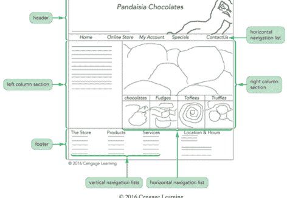

## 探索页面布局

花些时间研究 `pc_home.html` 文档的内容和结构。特别注意整个文档中 ID 和类（class）名称的使用。

将更改保存到文件中。你可能希望将此文件与 `pc_home.css` 样式表一起打开，以便参考其内容和结构。

## 固定、流式与布局

网页设计时面临的挑战之一是设备具有许多不同的尺寸和方向。为了处理这个问题，网页布局通常分为三大类：固定式、流式和弹性布局。

```css
min-width: value;
min-height: value;
max-width: value;
max-height: value;
```

其中 `value` 再次用 CSS 测量单位之一表示（通常是像素，以匹配显示设备的测量单位）。例如，以下样式规则将页面主体宽度设置为浏览器窗口宽度的 95%，但限制在 640 到 1680 像素之间：

```css
body {
  width: 95%;
  min-width: 640px;
  max-width: 1680px;
}
```

最大宽度和最小宽度通常用于使页面更易阅读。研究表明，过宽的文本行难以阅读，因为眼睛必须横跨很长的内容区域；而过窄且换行频繁的文本行会破坏材料的连贯性。

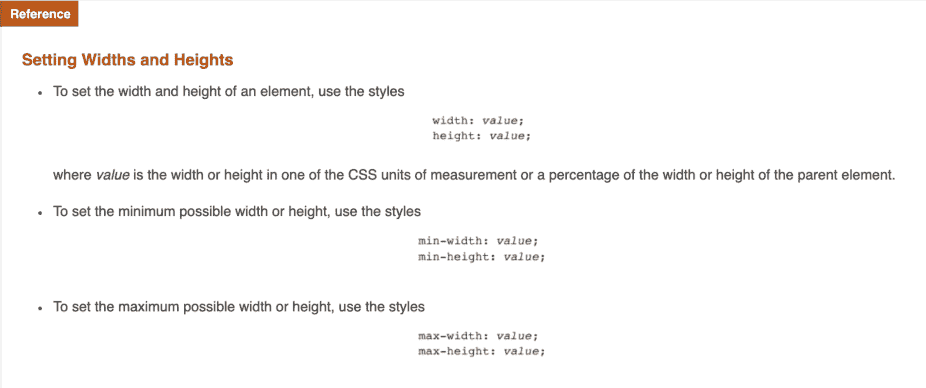

## 设置宽度和高度

- 要设置元素的宽度和高度，请使用样式：

```css
width: value;
height: value;
```

其中 `value` 是 CSS 测量单位之一的宽度或高度，或者是父元素宽度或高度的百分比：

- 要设置最小宽度或高度，请使用样式：

```css
min-width: value;
min-height: value;
```

- 要设置最大宽度或高度，请使用样式：

```css
max-width: value;
max-height: value;
```

将 Pandasia Chocolates 页面的页面主体设置为浏览器窗口宽度的 95%，范围从 640 像素到 960 像素。同时将公司 Logo 图像作为块显示，宽度设置为 100%，使其横跨整个页面主体。你不需要设置 Logo 的高度，浏览器会自动调整高度以保持图像的原始比例。

## 设置页面初始尺寸：

- 回到编辑器中的 `pc_home.css`，并在 Body Styles 部分添加以下样式规则：

```css
body {
  max-width: 960px;
  min-width: 640px;
  width: 95%;
}
```

- 在 Body Header Styles 部分插入以下样式规则，以设置 Logo 图像的显示类型和宽度：

```css
body > header > img {
  display: block;
  width: 100%;
}
```

图 3-6 显示了样式表中新添加的样式规则。

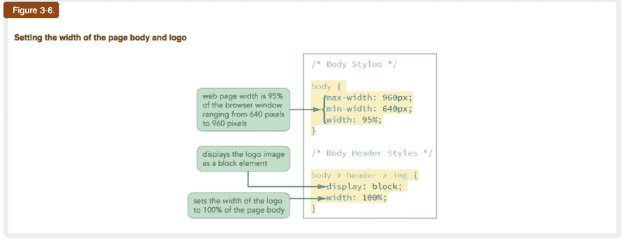

设置页面主体和 Logo 的宽度

- 3. 保存文件更改，然后在浏览器中打开 `pc_home.html` 文件。图 3-7 显示了页面主体和 Logo 的当前布局。

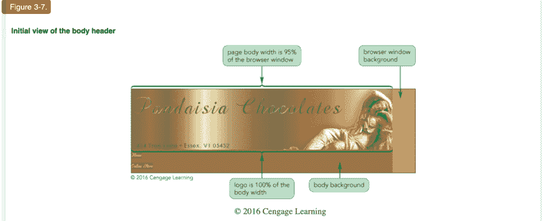

- 4 改变浏览器窗口宽度，并验证页面主体和 Logo的大小是否在 640 到 960 像素范围内根据需要调整大小。

## 居中块元素

页面主体目前位于浏览器窗口的左边距。Anne 希望它能在浏览器窗口内水平居中。
块元素可以通过将左、右边距均设置为 `auto` 来在其父元素内水平居中。因此，你可以使用样式规则将页面主体在浏览器窗口内居中：

```css
body {
  margin-left: auto;
  margin-right: auto;
}
```

通过将左右边距设置为 `auto`，修改页面主体的样式规则，使 Pandasia Chocolates 主页水平居中。

## 水平居中页面主体：

- 回到编辑器中的 `pc_home.css` 文件，在 `body` 选择器的样式规则内插入以下属性：

| 属性 | 值 |
| :--- | :--- |
| margin-left | auto; |
| margin-right | auto; |

图 3-8 显示了新添加的样式。

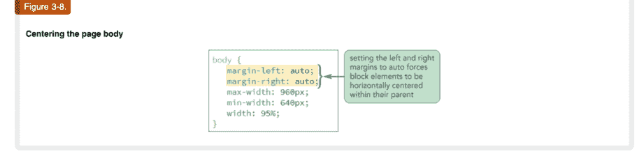

- 保存文件更改并在浏览器窗口中刷新 `pc_home.html` 文件。验证页面主体现在已在浏览器窗口内居中。

## 洞察

## 处理元素高度

元素的高度基于其内容这一事实可能会导致一些困惑。例如，将页眉（header）高度设置为页面主体高度 50% 的样式规则：

```css
body > header { height: 50%; }
```

然而，由于页面主体的总高度取决于其各个元素（包括主体页眉）的高度，因此该样式规则中存在循环逻辑。你无法在不知道 body header 高的情况下设置页面主体，也无法在不知道页面主体高的情况下设置 body header。大多数浏览器通过将 body header 设置为未定义来检测这种循环，从而导致布局不发生变化。

高度需要基于已知值。为了避免循环逻辑，你可以使用固定值或相对单位：

```css
body > header { height: 100px; }
```

## 创建浮动元素

`float` 属性允许你将元素从正常文档流中移出，并将其放置在其容器的左侧或右侧。其他内容将围绕浮动元素流动。

```css
float: position;
```

其中 `position` 的值为 `left`、`right` 或 `none`（默认值）。

例如，要将图像浮动到左侧：

```css
img { float: left; }
```

## 浮动导航列表

在“水平导航样式”（Horizontal Navigation Styles）部分中插入以下样式规则，以便水平导航列表中的每个列表项都作为左侧浮动的块显示。

```css
nav.horizontalNavigation li {
  display: block;
  float: left;
}
```

图 3-11 展示了用于列表项的样式。

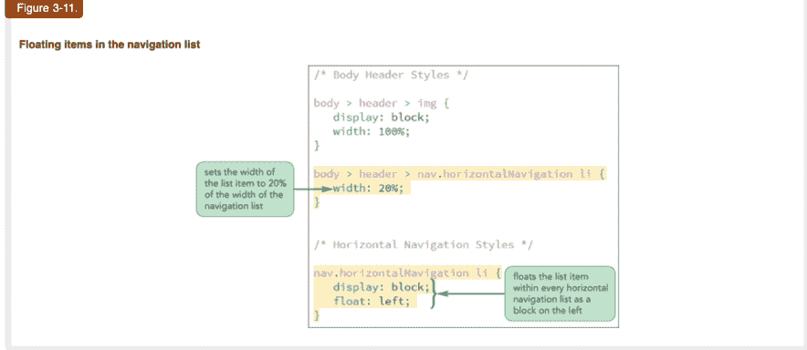

保存对文件的更改并在浏览器中重新加载 `pc_home.html`。图 3-12 显示了页眉中导航列表修改后的布局。

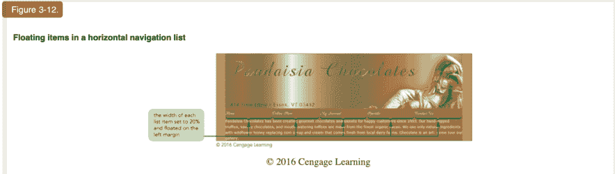

她不喜欢导航列表中超链接的外观。由于链接是内联元素，背景颜色仅延伸到链接文本。她建议你将链接更改为块，并在每个块内居中链接文本。

要更改超链接的显示方式：

- 返回编辑器中的 `pc_home.css`。
- 在“水平导航样式”部分，插入以下样式规则，以格式化水平导航列表中超链接的外观。

```css
nav.horizontalNavigation a {
  display: block;
  text-align: center;
}
```

图 3-13 强调了超链接的样式规则。

## 图 3-13.
在水平导航列表中格式化超链接

```css
/* 水平导航样式 */
nav.horizontalNavigation li {
  display: block;
  float: left;
} /* 将链接作为块显示 */
nav.horizontalNavigation a {
  display: block;
  text-align: center;
} /* 在块内居中链接文本 */
```

- 保存对文件的更改并在浏览器中重新加载 `pc_home.html`。
- 将鼠标指针悬停在导航列表中的链接上。注意，链接文本在其块内居中，且背景颜色完全跨整个块，而不是局限于链接文本。参见图 3-14。

## 图 3-14.
正文头部中的链接

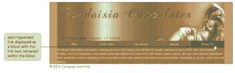

**遇到问题了？** 不要担心正文头部之后显示的元素布局。你接下来将处理那些对象。

你已经完成了正文头部的设计。接下来，你将清除主页的中间部分。

## 清除浮动

```css
clear: position;
```

在某些布局中，你可能希望元素显示在新的一行中，并清除之前的浮动对象。为了确保元素始终显示在你的浮动元素下方，请应用以下属性：

`position` 的值为 `left`、`right`、`both` 或 `none`。`left` 值仅在左侧边距没有浮动对象时才显示元素。`right` 值仅在右侧边距清除时才显示元素。`both` 值仅在两个边距都清除了浮动对象时才显示元素。默认值为 `none`，它允许元素与浮动对象一起显示。

图 3-15 显示了使用 `clear` 属性如何防止元素在右侧边距没有浮动对象之前显示。对页面布局的影响是该元素被向下移动，并可以自由使用整个页面宽度，因为它不再与浮动对象一起显示。

## 图 3-15.
清除浮动

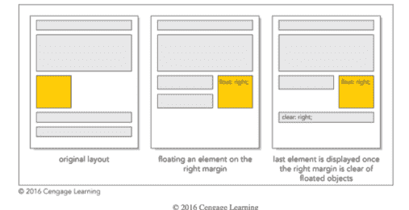

#### 参考

## 清除浮动

- 为了在带有浮动元素的页面上显示非浮动元素，请使用以下样式使非浮动元素清除浮动元素：

```css
clear: position;
```

其中 `position` 的值为 `none`（默认值）、`left`、`right` 或 `both`。

Pandasia Chocolates 主页的下部分包含两个 `section` 元素：`leftColumn` 和 `rightColumn`。将左列的宽度设置为正文宽度的 33%，将右列的宽度设置为 67%。将这些部分在左侧边距上并排浮动，但仅当边距清除了所有先前的浮动对象时才浮动。

## 要浮动左右两个列部分：

- 1. 返回编辑器中的 `pc_home.css` 文件。进入“左列样式”（Left Column Styles）并插入以下规则：

```css
section#leftColumn {
  clear: left;
  float: left;
  width: 33%;
}
```

- 2. 在“右列样式”（Right Column Styles）中，插入：

```css
section#rightColumn {
  float: left;
  width: 67%;
}
```

注意，你没有对右列应用 `clear` 属性，因为你希望它与左列在同一行显示。图 3-16 强调了左右列的样式规则。

## 图 3-16.
浮动左右两个列部分

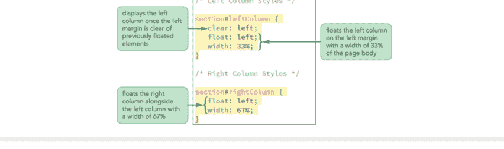

右列包含导航列表，左列包含主要内容。注意右列占宽度的 67%，左列为 33%。这是我们目前为止所创建的布局。为了完成布局，我们需要为列添加一些内边距（padding）。

## 为列添加内边距：

- 1. 返回编辑器中的 `pc_home.css` 文件。进入“左列样式”并插入以下规则：

```css
section#leftColumn {
  clear: left;
  float: left;
  width: 33%;
  padding: 20px;
}
```

- 2. 在“右列样式”中，插入：

```css
section#rightColumn {
  float: left;
  width: 67%;
  padding: 20px;
}
```

保存对文件的更改并在浏览器中重新加载 `pc_home.html`。图 3-17 显示了添加了内边距的布局。


图 17.
格式化右列

内边距在列内部留出了空间，使文字不接触边缘。这是一种提高布局可读性的常用技术。

现在，我们将为列添加背景颜色。我们将使用 `background-color` 属性。

## 为列添加背景颜色：

- 1. 返回编辑器中的 `pc_home.css` 文件。进入“左列样式”并插入：

```css
section#leftColumn {
  clear: left;
  float: left;
  width: 33%;
  padding: 20px;
  background-color: #f0f0f0;
}
```

- 2. 在“右列样式”中，插入：

```css
section#rightColumn {
  float: left;
  width: 67%;
  padding: 20px;
  background-color: #e0e0e0;
}
```

保存对文件的更改并在浏览器中重新加载 `pc_home.html`。图 3-18 显示了添加了背景色的布局。


## 图 3-18.
带有背景色的布局

背景颜色有助于区分左右列。现在，我们将为列添加边框以进一步分离它们。我们将使用 `border` 属性。

## 为列添加边框：

- 1. 返回编辑器中的 `pc_home.css` 文件。进入“左列样式”并插入：

```css
section#leftColumn {
  clear: left;
  float: left;
  width: 33%;
  padding: 20px;
  background-color: #f0f0f0;
  border: 1px solid #ccc;
}
```

- 2. 在“右列样式”中，插入：

```css
section#rightColumn {
  float: left;
  width: 67%;
  padding: 20px;
  background-color: #e0e0e0;
  border: 1px solid #ccc;
}
```

保存对文件的更改并在浏览器中重新加载 `pc_home.html`。图 3-19 显示了添加了边框的布局。


## 图 3-19.
带有边框的布局

边框为列提供了清晰的定义。现在，我们完成了主页的布局。

`type` 为 `content-box`（默认值）、`border-box` 或 `inherit`（继承元素容器定义的属性）。此 CSS3 `box-sizing` 属性最初作为浏览器扩展引入，为了支持旧版浏览器，通常带有以下扩展：

```css
-webkit-box-sizing: type;
-moz-box-sizing: type;
box-sizing: type;
```

其中 `type` 的值与之前相同。许多设计师倾向于在页面布局中使用边框模型（border box），这样就不会对每个元素的总宽度产生困惑。

参考

## 定义宽度的解释方式

- 要定义 `width` 属性的含义，请使用：

```css
box-sizing: type;
```

其中 `type` 为 `content-box`（默认值）、`border-box` 或 `inherit`（继承元素容器定义的属性）。

`box-sizing` 属性用于重置样式表并应用到所有块元素。

## 设置块布局模型：

- 回到编辑器中的 `pc_reset.css` 文件。

- 为块元素列表的样式规则添加以下样式属性：

```css
-webkit-box-sizing: border-box;
-moz-box-sizing: border-box;
box-sizing: border-box;
```

图 3-22 显示了修改后的样式。

## 添加 border-box 样式以设置样式表

| address, article, aside, blockquote, body, cite |
| div, dt, dd, em, figcaption, figure, footer |
| h1, h2, h3, h4, h5, header, img |
| main, nav, ol, section, span, ul { |
| background: transparent; |
| font-size: 100%; |
| margin: 0; |
| padding: 0; |
| vertical-align: baseline; |
| -webkit-box-sizing: border-box; |
| -moz-box-sizing: border-box; |
| box-sizing: border-box; |
| } |

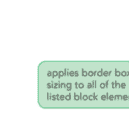

- 保存对样式表的更改并在浏览器中重新加载 `pc_home.html` 文件。验证左右两列的布局已恢复，并且左列内部添加了额外的内边距。

Pandasia Chocolates 主页的最后部分是页脚，它包含了三个垂直导航列表和一个包含商店联系信息的 `section` 元素。一旦左边距清除了之前的浮动对象，请将这四个元素浮动在左边距上，并将三个导航列表的宽度分别设置为主体宽度的 22%，而 `section` 占据剩余的 34%。

## 布局页面页脚：

1. 回到编辑器中的 `pc_home.css` 文件并滚动到 Footer Styles（页脚样式）部分。

2. 插入以下样式规则：

```css
footer {
  clear: left;
}

footer > nav.verticalNavigation {
  float: left;
  width: 22%;
}

footer > section#contactInfo {
  float: left;
  width: 34%;
}
```

图 3-23 显示了页面页脚的布局样式规则。

# 图 3-23.
设置页面页脚的布局

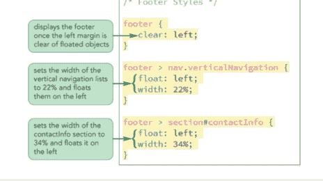

3. 保存对样式表的更改并在浏览器中重新加载 `pc_home.html`。图 3-24 显示了页脚的新布局。

# 图 3-24.
页面页脚布局

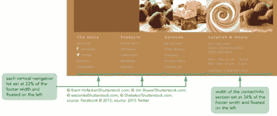

© Brent Hofackerer/Shutterstock.com; © Jim Bowie/Shutterstock.com; © wacomkaShutterstock.com; © Shebeko/Shutterstock.com; source: Facebook
© 2015; source: 2015 Twitter

Anne 请求你将页脚背景颜色改为深棕色，以便更好地显示文本。

## 设置页脚背景颜色：

1. 回到编辑器中的 `pc_home.css` 文件并进入 Footer Styles 部分。

2. 为页脚选择器插入以下属性：
```css
background-color: rgb(71, 52, 29);
```

图 3-25 显示了页脚背景颜色。

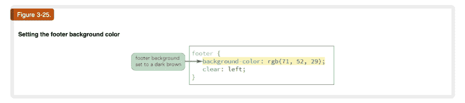

3. 保存样式的更改并在浏览器中重新加载 `pc_home.html`。注意背景颜色没有变化。

为什么背景颜色的更改没有生效？为了帮助你理解，我们再次查看浮动元素的本质。

## 处理容器塌陷

回想一下，浮动元素会被移出文档流，因此它不再是所包含容器的“部分”。从字面上说，它从容器中浮动了出来。当容器内的所有元素都是浮动时，这就被称为容器塌陷（container collapse）。

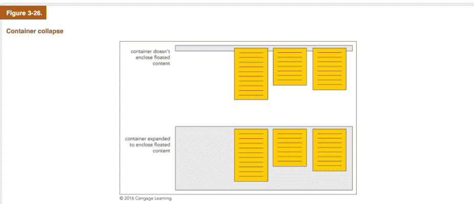

在布局中，你希望容器能够扩展以包含其内容。

## 复习 3.1 快速检查

1. 提供一条样式规则，使导航列表中的所有超链接显示为具有灰色背景的块级元素（block elements）。
2. 简要描述三种页面布局类型。
3. 提供一条样式规则，将页面主体（body）的宽度设置为浏览器窗口的 90%，范围限制在 320 像素到 960 像素之间。
4. 提供一条样式规则，将 `header` 元素在 `body` 元素中水平居中。假设 `header` 是页面的直接子元素。
5. 提供一条样式规则，将 `aside` 元素的宽度设置为 240 像素，并浮动在其容器的右边距。
6. 提供一条样式规则，仅在所有浮动元素清除（clear）后才显示该浮动元素（floater）。
7. 你的布局在一行中有四个浮动元素，但遗憾的是最后一个元素被换到了新行。布局错误的根源是什么？
8. 提供一条样式规则，更改 `header` 元素的宽度属性，使其测量值等于页眉内容、内边距（padding）和边框（border）的总宽度。包含针对旧版浏览器的 Web扩展。
9. 提供一条样式规则，防止 `header` 元素围绕其浮动内容发生塌陷（collapse）。

# 3.2 节概述：页面布局网格

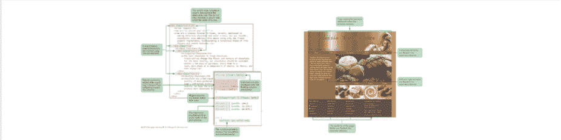

## 介绍网格布局

在上一节中，你使用了 `float` 属性将页面划分为若干部分并并列浮动布局。在本节中，你将探索如何通过创建基于网格（grid）的页面布局来使这种技术通用化。

## 基于网格的布局概述

网格是一项在出版领域已使用数百年的经典技术，与许多其他出版技术一样，它也可以应用于 Web 设计。基本方法是想象页面是由一组交行的行和列组成的系统，它们形成了一个网格。行基于页面内容。一个包含几篇文章的长页面可能会跨越几行，也可以是一个包含介绍性内容且适应单行的行的首页。列的数量取决于能够为页面内容的布局提供最大灵活性的数字。许多网格系统基于 12 列，因为它可以被 2、3、4 和 6 整除，但也会使用其他尺寸。图 3-29 显示了一个 12 列网格布局。

# 图 3-29.

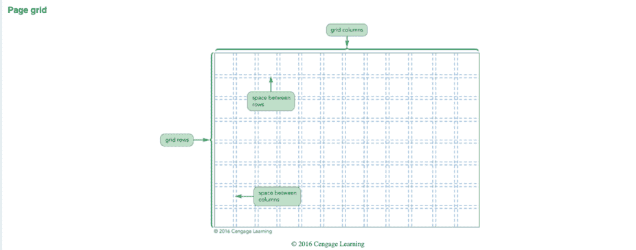

页面设计师在选定的网格内安排页面元素。图 3-30 显示了其中可能的布局，由一个主 `header` 元素（浅褐色区域）、三个主要部分（紫色、浅绿色和蓝色区域）以及一个导航栏和页脚（深绿色区域）组成。某些部分（如深绿色和蓝色区域）被进一步细分为小的子区域。

# 图 3-30.

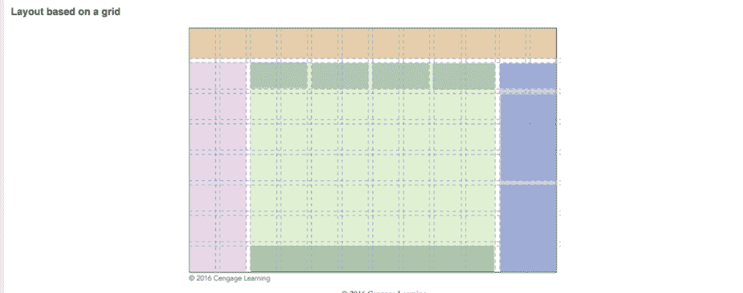

基于网格的布局

必须强调的是，网格并不是网页内容。相反，它是一种关于如何将内容放置到页面上的系统化方法。基于网格工作具有若干审美和实用优势，包括：

- 网格使页面内容的呈现井条理，增加了视觉节奏感，令人赏心悦目。
- 一致的逻辑设计让读者有信心找到他们寻找的信息。
- 新内容可以很容易地放置在网格中，且方式与之前输入的信息保持一致。
- 设计良好的网格对于残障和特殊需求的用户来说更具访问性。
- 网格通过为页面布局建立系统性框架，加速了开发过程。

网格布局有两种类型：固定网格（fixed grids）和流式网格（fluid grids）。

## 固定与流式网格

在固定网格中，列和边距的宽度以像素为单位指定的，每一列都有固定的位置。许多固定网格布局基于 960 像素的宽度，因为大多数桌面屏幕的宽度为 1024 像素（更高），而 960 像素的宽度为浏览器滚动条和其他功能留了空间。960 像素的宽度也非常容易被二分、三分、四分等，从而更容易创建间距均匀的列。

固定网格的问题当然是它没有考虑到其他屏幕尺寸，而流式网格（列宽用百分比而非像素表示）用于为不同设备提供更多支持。在示例中，你将基于流式网格进行布局。

网格通常与响应式设计结合使用，其中网格布局用于移动设备，另一种网格布局用于平板电脑，而另一种布局用于桌面电脑。移动设备的布局通常基于 1 列网格，平板布局基于 4 到 12 列的网格，桌面布局基于 12 列或更多列的网格。

## CSS 框架

自己设计可能耗时。为了简化过程，你可以从 Web 上的许多 CSS 框架中进行选择。框架是一个提供工具库的软件包，用于设计你的网站，包括用于网格布局的样式表以及提供支持各种浏览器和设备的内置脚本。大多数框架都包含对响应式设计的支持。流行的 CSS 框架包括：

- Bootstrap (getbootstrap.com)
- YAML (yaml.de)
- 960 Grid (960.grid)
- Foundation (zurb.com)
- HTML5 Boilerplate (html5boilerplate.com)
- Skeleton (skeleton.com)

## 设置网格

网格布局是基于行的，就像你在上一节中做的那样。每个浮动元素构成列。为了给这些浮动对象提供一致的结构，许多网格布局使用 `div`（分区）来标记行和列。让我们查看一个包含两列的简单网格示例：

```html
<div class="row">
  <div class="column1"></div>
  <div class="column2"></div>
</div>
```

在这些元素中你放置页面内容，但你不需要担心。对于更复杂的布局，列可以包含它自己的行和列。以下代码通过在 `column1` 中放置一个两行两列的网格，扩展了之前的网格：

```html
<div class="row">
  <div class="column1">
    <div class="row">
      <div class="columna"></div>
      <div class="columnb"></div>
    </div>
    <div class="row">
      <div class="columnc"></div>
      <div class="columnd"></div>
    </div>
  </div>
  <div class="column2"></div>
</div>
```

在网格布局中，为列命名指示其宽度是很常见的。例如，使用类名 `col-1-4` 表示宽度为 1/4 或 25% 的列，或使用类名 `col-2-3` 表示宽度为 2/3 或 67% 的列。使用这种类系统，以下 HTML 标记：

```html
<div class="row">
  <div class="col-2-3">
    <div class="row">
      <div class="col-1-4"></div>
      <div class="col-1-4"></div>
    </div>
    <div class="row">
      <div class="col-1-1"></div>
    </div>
  </div>
  <div class="col-1-3"></div>
</div>
```

## 图 3-31.
示例网格布局

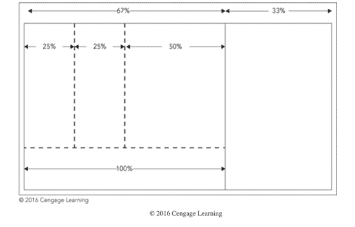

现在你已经了解了布局网格中 HTML 代码的通用结构，你将为 Pandasia Chocolates 网站的一个新页面创建一个布局，该页面提供有关巧克力和公司的信息。Anne 已经为图 3-32 所示的页面内容设计了网格。

## 图 3-32.
为“关于 Pandasia Chocolates”页面设计的的网格布局

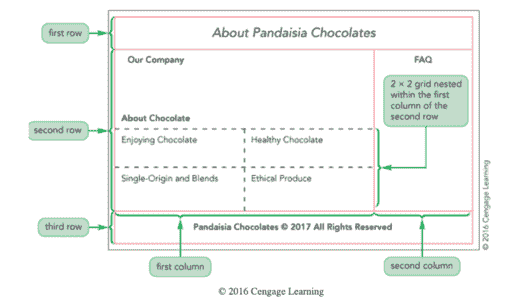

Anne 的布局由三个主行组成。第一行包含页面标题，第三行包含页脚。第二行由两列组成：第一列显示关于公司的信息，第二列显示常见问题列表。第一行内有一个 2 x 2 的网格，包含关于巧克力的短文章。

将此网格布局的 div 元素添加到“关于 Pandasia Chocolates”页面。

## 要创建“关于 Pandasia Chocolates”页面：

- 使用你的编辑器打开 html03 教程文件夹中的 `pc_about.txt` 文件。在注释部分输入你的**姓名**和**日期**，并将文件保存为 **pc_about.html**。

- Anne 已经添加了用于 Pandasia Chocolates 首页的页眉。使用相同的页眉可以保持每个页面页眉一致，从而使整个网站的页面视觉效果和感受保持统一。

- 在结束标签 `</header>` 的下方，插入以下用于网格第一行的 div 元素。

```html
<div class="row">
</div>
```

- 3. 接下来，在第一列的嵌套 2 x 2 网格中，插入以下包含两列的第二行的 div 元素。

```html
<div class="row">
  <div class="col-1-2">
    <div class="row">
      <div class="col-1-2"></div>
      <div class="col-1-2"></div>
    </div>
    <div class="row">
      <div class="col-1-2"></div>
      <div class="col-1-2"></div>
    </div>
  </div>
  <div class="col-1-2"></div>
</div>
```

- 4. 最后，插入以下用于网格第三行的 div 元素：

```html
<div class="row">
</div>
```

图 3-33 显示了你创建的网格的完整代码。

## 图 3-33
“关于 Pandasia Chocolates”包中的 div 元素

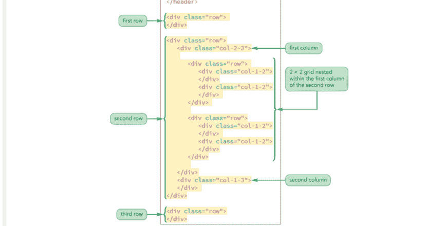

- 5. 花些时间检查你的代码，确保它与图 3-33 所示的结构和类名匹配。

- 6. 将你的更改保存到文件，但不要关闭它。

现在你已经建立了页面内容的网格，你将为网格设置样式，从网格行（row）开始。

## 设计网格行

网格行包含浮动列（floating columns）。由于行在页面内新起的一行，因此只有当两个边距都没有之前的浮动列时它才应该显示。由于它包含自己的一组浮动列，它必须能够扩展高度以覆盖这些对象（否则会覆盖下一行的浮动列）。与上一节的页面页脚一样（为了防止溢出到下一行），你可以使用以下样式规则为网格行建立规则：

```css
div.row::after {
  clear: both;
  content: "";
  display: table;
}
```

将此样式添加到新的样式表 `pc_grids.css` 中，你将使用它来格式化 `pc_about.html` 文件中布局的网格。

## 为网格行创建样式：

- 使用你的编辑器打开 html03 ▶ 教程编辑器中的 `pc_grids.css`。在注释部分输入你的姓名和日期，并将文件保存为 `pc_grids.css`。

- 在“网格行（Grid Rows）”部分，插入以下样式规则，以确保在边距清空了之前的浮动列后，行总是在新的一行开始。

```css
div.row {
  clear: both;
}
```

- 添加以下样式规则以确保网格行扩展以覆盖其所有的浮动列：

```css
div.row::after {
  clear: both;
  content: "";
  display: table;
}
```

图 3-34 显示了网格行的样式规则。

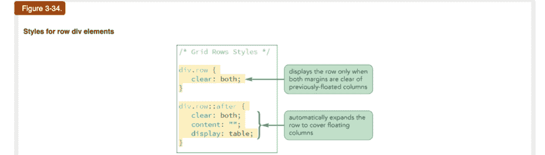

接下来，你将为网格列（columns）创建样式规则。

## 设计网格列

每个网格列都需要在其所在的行内浮动。在你为“关于 Pandasia Chocolates”页面设置的网格中，网格列放置在一个具有通用类名的 div 元素中，其中分子/分母提供了列的比例宽度。例如，`col-1-3` 表示该列占总宽度的三分之一。要浮动所有网格列，你可以使用属性选择器，它可以匹配所有类名以 `col` 开头的元素：

```css
div[class^="col"] {
  float: left;
}
```

图 3-35 显示了网格列的样式规则。

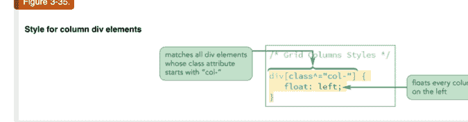


#### 第 4.1 节 视觉概述：背景与边框

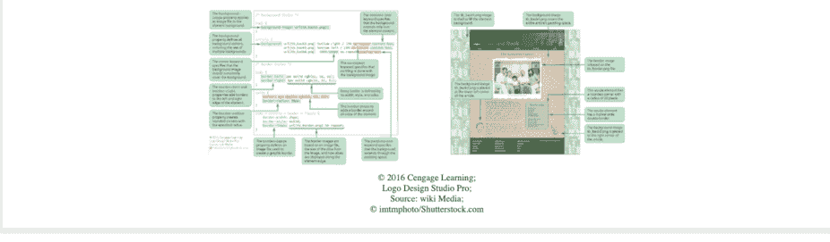

#### 创建插图框

到目前，你对 CSS 视觉设计的工作仅限于排版样式和修改图形配色的样式。在本教程中，你将探索其他的 CSS 样式，这些样式允许你在网页上添加插图框、背景纹理、背景图像和三维效果。

你将开始研究如何使用插图框。在书籍和杂志中，图片和说明通常放置在一个独立的框内，与文章的正文隔离开。HTML5 为插图（figure）和说明（caption）引入了类似的结构元素：

```html
<figure>
  <content>
  <figcaption>text</figcaption>
</figure>
```

其中出现在插图框内的内容和说明文本是随插图的描述。`figcaption` 元素是可选的，可以放在插图之前或直接在其之后。例如，以下代码显示了一个包含 `tb_komatsu.png` 图像的插图框，说明文字（从左到右）：Ikko, Mika, Hiro, Genta, Suzuki。

```html
<figure>
  
  <figcaption>Ikko, Mika, Hiroji, Genta, Suzuki</figcaption>
</figure>
```

虽然 `figure` 元素用于包含图像，但它也可以用于标记任何你想与文章正文隔离开的说明。例如，`figure` 元素可以包含文本摘录，如下代码所示：

```html
<figure>
  <p>"Bryant, the filthy tower<br />
  Did gym and gamble in the weave;<br />
  All merry the boncorvees;<br />
  And some dead rats corpse-id"</p>
  <figcaption>
    <em>Lewis Carroll, 1832-1902</em>
  </figcaption>
</figure>
```

Kevin 计划在整个 Tree and Book 网站中使用插图框，用描述性说明来标记家族和个人照片。他为小松家族（Komatsu family）创建了一组图像，你将通过这些图像来学习使用 HTML 和 CSS 视觉元素。打开首页并创建一个带有描述性说明的家族照的插图框。

##### 如何创建插图框：

- 1. 使用编辑器从 `html04` 教程文件夹插入 `tb_komatsu.txt` 文件。在文件的注释部分输入你的名字和日期，并将其保存为 `tb_komatsu.html`。

- 2. 对于此网页，你将使用一个名为 `tb_visual.css` 的新样式表。Kevin 已经添加了一个重置样式表，并将页面链接到 `tb_reset.css`、`tb_styles1.css` 和 `tb_visual.css` 样式表文件。

```html
<link href="tb_reset.css" rel="stylesheet" />
<link href="tb_styles1.css" rel="stylesheet" />
<link href="tb_visual.css" rel="stylesheet" />
```

- 3. 滚动到 `article` 元素，在 `h1` 元素之后直接插入以下用于显示小松家族照的插图代码。

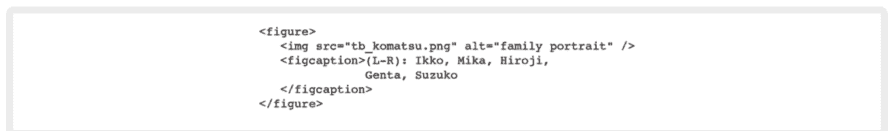

图 4-1 突出了家族照的代码。


花点时间查看文档剩余的内容和结构，并保存更改。通过向 `tb_visual.css` 添加样式规则来格式化插图框的外观。

##### 如何格式化视图：

- 1. 使用编辑器编辑 `html04` 文件夹中的 `tb_visual.txt` 文件。在文件的注释部分输入你的名字和日期，将其保存为 `tb_visual.css`。

- 2. 滚动到文档底部的插图框样式部分，为 `figure` 元素插入样式规则：

```css
figure {
  margin: 0 auto;
  width: 80%;
}
```

- 3. 添加以下样式来格式化插图框内的图像外观：

```css
figure img {
  display: block;
  width: 100%;
}
```

- 4. 最后，为 `figcaption` 插入以下规则：

```css
figcaption {
  background-color: white;
  font-family: "Palatino", "Times Roman", serif;
  font-style: italic;
  padding: 10px;
  text-align: center;
}
```

图 4-2 突出了插图框、图像和说明的样式规则。

#### 格式化说明

| 插图框样式 |
|---|
| 插图框宽度为 80% 说明 |
| 图像以等于插图框的大小显示 |
| 说明居中且具有白色背景 |

```css
.figure-box {
  margin: auto;
}
```

```css
.figure-img {
  float: left;
  width: auto;
}
```

```css
.figure-caption {
  font-family: Arial, Palatino, Times Roman, sans-serif;
  font-style: italic;
  margin: auto;
}
```

将更改保存到文件并在浏览器中打开 `tb_komatsu.html`。图 4-3 显示了页面的初始外观。

#### 图 4-3

小松家族页的初始设计


在添加了小松家族页的所有内容后，你将开始通过 CSS 样式增强页面外观。

## 选择你的图形格式

网页图形文件分为两大类：矢量图像和位图图像。矢量图像是由基于数学函数的线条和曲线组成的图像。矢量图像的优点是它们可以轻松缩放而不丢失清晰度，并且尺寸紧凑。网页最常用的格式是 SVG（可缩放矢量图形），它是 XML 标记语言，可以使用基础文本编辑器和 SVG 语言创建。

位图图像是由像素组成的图像，每个像素都有不同的颜色。由于图形文件由成千上万个像素组成，位图图像的文件尺寸大于矢量图像。网页常见的位图格式有 GIF、JPEG 和 PNG。

GIF（图形交换格式）调色板限制为 256 色。GIF 文件通常较大，但它们也有优点：GIF 支持透明色，且可以用于创建动画。GIF 的调色板有限，并不理想。最流行的格式是 JPEG（联合图像专家小组），它支持超过 1600 万种颜色。JPEG 还支持压缩，允许位图以比其他格式更小的字节存储。

PNG（便携网络图形）的设计旨在取代 GIF，它支持多级透明色和百万色调色板。PNG 也可以被压缩，创建一个比相应的 GIF 文件小得多的文件，因此占用更少空间。PNG 文件还包含颜色信息，以便 PNG 在各种显示器上渲染。

在为你的网站选择图形格式时，最重要的考虑是文件大小；你希望选择能够提供接受图像的最小尺寸。这种组合意味着用户将看到高质量图像，而无需等待图形下载。为了减小文件大小，你应该选择支持更大调色板的格式。由于这些原因，现在大多数网页都是 JPEG 或 PNG 格式，尽管在旧网站上仍能找到 GIF。

#### 探索背景样式

到目前，背景的设计选择仅限于使用 RGB 或 HSL 色彩模型。CSS 还支持通过以下背景样式使用图像作为背景：

```css
background-image: url(url);
```

其中 `url` 指定背景图像的名称和位置。例如，以下样式使用 `trees.png` 文件作为页面主体的背景。

```css
body {
  background-image: url(trees.png);
}
```

此代码假设 `trees.png` 文件与样式表在同一个文件夹中；如果图像不在同一文件夹中，你需要包含图像所在文件夹的路径信息。

#### 平铺背景图像

默认行为是将背景图像放置在元素的左上角，并在垂直和水平方向上重复图像，直到填充背景。这被称为平铺（tiling），因为类似于用瓷砖铺地板或表面的过程。

你可以通过应用以下 `background-repeat` 样式来指定应用于背景图像的平铺类型，甚至关闭平铺：

```css
background-repeat: type;
```

其中 `type` 为 `repeat`（默认）、`repeat-x`、`repeat-y`、`no-repeat`、`round` 或 `space`。图 4-4 显示了各种 `background-repeat` 类型的效果。

#### 图 4-4

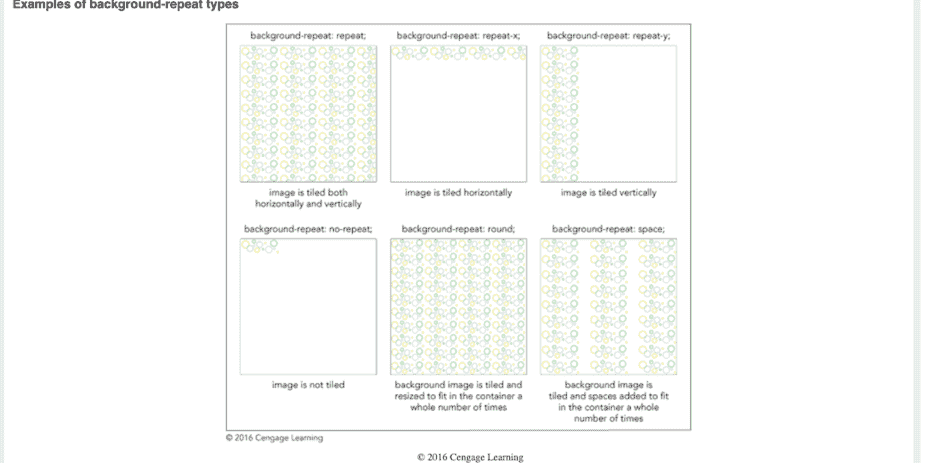

#### 参考

## 添加背景图片

- 要向背景添加图像，使用 CSS 样式 `background-image: url(image);`，其中 `url` 指定背景图片的名称和位置。

- 要指定图像如何平铺，使用 `background-repeat: type;`，其中 `type` 为 `repeat`（默认）、`repeat-x`、`repeat-y`、`no-repeat`、`round` 或 `space`。

Kevin 提供了一个图像文件 `tb_back.jpg` 来填充浏览器窗口的背景。使用默认平铺选项，使图像从窗口的左上角开始显示，并重复直到整个窗口被填充。

## 为浏览器窗口添加背景图片：

- 1. 返回编辑器中的 `tb_visual.css` 文件。

- 2. 转到 HTML Styles 部分，并添加以下样式规则以更改浏览器窗口的背景。

```css
html {
  background-image: url(tb_back1.png);
}
```

注意，由于你使用了背景图片平铺的默认设置，因此你不需要包含 `background-repeat` 样式规则。图 4-5 显示了新的样式规则。

#### 图 4-5 定义背景图片

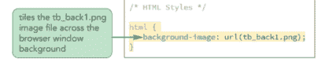


```css
/* HTML Styles */
.tiles {
  background-image: url(tb_back1.png);
}
```

保存文件中的更改，并在浏览器中重新加载 `tb_komatsu.html`。图 4-6 显示了浏览器窗口中的平铺背景。

## 浏览器窗口中的平铺背景图片


注意，`body` 覆盖了浏览器中平铺图像的一部分。然而，尽管背景图片被隐藏，平铺仍然在页面主体后面继续。

#### 附加背景图片

当你滚动元素内容时，背景图片附加到其元素上，背景图片会随之滚动。你可以使用以下 `background-attachment` 属性来更改附加方式：

```css
background-attachment: type;
```

其中 `type` 为 `scroll`（默认）、`fixed` 或 `local`。`scroll` 类型将属性设置为随元素内容一起滚动。`fixed` 类型创建一个即使在元素内容水平或垂直滚动也保持位置不变的背景。固定背景有时用于创建水印，即显示在内容背后的透明图形，并附带关于内容材料受版权保护或处于草稿状态或其他针对读者的消息信息。`local` 类型与 `scroll` 类似，它用于滚动框（scroll boxes），允许元素随框内的内容一起滚动。

## 设置背景图片位置

默认情况下，浏览器将背景图片放置在元素的左上角。你可以使用以下 `background-position` 属性将背景图片放置在不同的位置：

```css
background-position: horizontal vertical;
```

其中 `horizontal/ vertical` 提供图像在元素背景中的坐标，使用 CSS 测量单位之一或元素宽度和高度的百分比来表示。例如，以下样式将图像放置在距离背景左边缘元素宽度的 10% 处，以及距离背景顶部边缘元素高度的 20% 处。

```css
background-position: 10% 20%;
```

如果你指定了单值，浏览器将该值同时应用于水平位置和垂直位置。因此，以下样式将背景图片放置在距离元素左边缘 30 像素处，距离顶部边缘向下 30 像素处。

```css
background-position: 30px;
```

你可以使用关键字 `left`、`center` 和 `right` 设置水平位置，使用 `top`、`center` 和 `bottom` 设置垂直位置来放置背景图片。以下样式将背景图片放置在元素的右下角。

```css
background-position: right bottom;
```

通常，`background-position` 属性仅对非平铺图像有用；如果图像是平铺的，平铺图像会填充背景，通常它从哪里开始并不重要。

## 定义背景范围

你在教程 2 中学习到，每个元素都遵循盒模型，其中元素内容被填充空间（padding）以及该空间之外包裹（见图 2-3）。然而，元素的背景默认定义为仅扩展到填充空间，而不包含边框（border）空间。你可以使用 `background-clip` 更改此定义。

```css
background-clip: type;
```

其中 `type` 为 `content-box`（背景仅扩展到元素）、`padding-box`（背景扩展到填充空间）或 `border-box`（背景扩展到边框空间）。例如，以下样式规则定义页面仅扩展到内容区域。填充空间和边框空间将不被视为背景，且不会显示任何背景图片。

```css
body {
  background-clip: content-box;
}
```

由于你使用了平铺背景图片的默认设置，因此你不需要包含 `background-repeat` 样式规则。

## 添加背景图片

- 要向背景添加图像，使用 CSS 样式 `background-image: url(image);`，其中 `url` 指定背景图片的名称和位置。
- 要指定图像如何平铺，使用 `background-repeat: type;`，其中 `type` 为 `repeat`（默认）、`repeat-x`、`repeat-y`、`no-repeat`、`round` 或 `space`。

Kevin 提供了一个图像文件 `tb_back.jpg` 来填充浏览器窗口的背景。使用默认平铺选项，使图像从窗口的左上角开始显示，并重复直到整个窗口被填充。

## 为浏览器窗口添加背景图片

1. 返回编辑器中的 `tb_visual1.css` 文件。
2. 转到 HTML Styles 部分，并添加以下样式规则以更改浏览器窗口的背景。

```css
html {
  background-image: url(tb_back1.png);
}
```

注意，由于你使用了背景图片平铺的默认设置，因此你不需要包含 `background-repeat` 样式规则。图 4-5 显示了新的样式规则。

## 定义背景图片


```css
/* HTML Styles */
.tiles {
  background-image: url(tb_back1.png);
}
```

保存文件中的更改，并在浏览器中重新加载 `tb_komatsu.html`。图 4-6 显示了浏览器窗口中的平铺背景。

## 浏览器窗口中的平铺背景图片


注意，`body` 覆盖了浏览器中平铺图像的一部分。然而，尽管背景图片被隐藏，平铺仍然在页面主体后面继续。

#### 附加背景图片

当你滚动元素内容时，背景图片附加到其元素上，背景图片会随之滚动。你可以使用以下 `background-attachment` 属性来更改附加方式：

```css
background-attachment: type;
```

其中 `type` 为 `scroll`（默认）、`fixed` 或 `local`。`scroll` 类型将属性设置为随元素内容一起滚动。`fixed` 类型创建一个即使在元素内容水平或垂直滚动也保持位置不变的背景。固定背景有时用于创建水印，即显示在内容背后的透明图形，并附带关于内容材料受版权保护或处于草稿状态或其他针对读者的消息信息。`local` 类型与 `scroll` 类似，它用于滚动框（scroll boxes），允许元素随框内的内容一起滚动。

## 设置背景图片位置

默认情况下，浏览器将背景图片放置在元素的左上角。你可以使用以下 `background-position` 属性将背景图片放置在不同的位置：

```css
background-position: horizontal vertical;
```

其中 `horizontal/ vertical` 提供图像在元素背景中的坐标的表示方式。例如，以下样式将图像放置在距离背景左边缘元素宽度的 10% 处，以及距离背景顶部边缘元素高度的 20% 处。

```css
background-position: 10% 20%;
```

如果你指定了单值，浏览器将该值同时应用于水平位置和垂直位置。因此，以下样式将背景图片放置在距离元素左边缘 30 像素处，距离顶部边缘向下 30 像素处。

```css
background-position: 30px;
```

你可以使用关键字 `left`、`center` 和 `right` 设置水平位置，使用 `top`、`center` 和 `bottom` 设置垂直位置来放置背景图片。以下样式将背景图片放置在元素的右下角。

```css
background-position: right bottom;
```

通常，`background-position` 属性仅对非平铺图像有用；如果图像是平铺的，平铺图像会填充背景，通常它从哪里开始并不重要。

## 定义背景范围

你在教程 2 中学习到，每个元素都遵循盒模型，其中元素内容被填充空间（padding）以及该空间之外包裹（见图 2-3）。然而，元素的背景默认定义为仅扩展到填充空间，而不包含边框（border）空间。你可以使用 `background-clip` 更改此定义。

```css
background-clip: type;
```

其中 `type` 为 `content-box`（背景仅扩展到元素）、`padding-box`（背景扩展到填充空间）或 `border-box`（背景扩展到边框空间）。例如，以下样式规则定义页面仅扩展到内容区域。填充空间和边框空间将不被视为背景，且不会显示任何背景图片。

```css
body {
  background-clip: content-box;
}
```

由于你使用了平铺背景图片的默认设置，因此你不需要包含 `background-repeat` 样式规则。

```css
background-repeat: type;
```

其中 `type` 为 `repeat`（默认）、`repeat-x`、`repeat-y`、`no-repeat`、`round` 或 `space`。图 4-4 显示了各种 `background-repeat` 类型的效果。

#### 图 4-4


## 为文章部分添加背景图片

1. 回到编辑器中的 `tb_visual.css` 文件，并向下滚动到 Article Styles（文章样式）部分。
2. 添加以下样式规则：

```css
article {
  background: url(tb_back2.png) bottom right / 15% no-repeat content-box;
}
```

图 4-8 展示了应用于文章的样式规则。


3. 保存更改并在浏览器中重新加载 `tb_komatsu.html`。图 4-9 显示了背景图片的位置。


Kevin 喜欢添加小松玄（Genta Komatsu）的图片，而你想再添加一张背景图片，显示家族女性长者小松真子（Mika Komatsu），以及第三张显示纸纹理背景的图片。

#### 添加多个背景

要在同一个元素上添加多个背景，可以使用逗号分隔的列表列出这些背景：

```css
background: background1, background2, ...;
```

其中 `background1`、`background2` 等是每个背景的属性。例如，以下样式规则为 `header`（页眉）元素应用了三个不同的背景：

```css
header {
  background: url(back2.png) top left no-repeat,
              url(back1.png) bottom right no-repeat,
              rgb(191, 19, 191);
}
```

背景的添加顺序与列表顺序相反。在这一样式规则中，首先应用背景颜色，然后将 `back1.png` 背景图片置于，最后将 `back2.png` 背景图片置于两者之上。

单个属性也可以包含由逗号分隔列表的多个选项。以下样式规则使用 `background` 属性为 `header` 元素创建了相同的多个背景：

```css
header {
  background-image: url(back2.png), url(back1.png);
  background-position: top left, bottom right;
  background-repeat: no-repeat;
  background-color: rgb(19, 19, 19);
}
```

注意，如果背景样式只列出一次，它将应用于所有背景。`background-color` 和 `background-repeat` 属性被用于所有背景。

修改 `article` 元素的样式规则以再添加两个背景。

## 为文章页面添加背景图片

1. 回到编辑器中的 `tb_visual.css` 文件，并返回 Article Sections（文章章节）。
2. 在 `article` 元素列出的第一个背景后输入一个逗号，一个分号（`;`），然后按回车。多个背景的属性需要用逗号分隔。
3. 确保插入点在分号（`;`）之前，然后添加显示两张背景图片后跟背景颜色的代码：

```css
url(back1.png) bottom left / 15% no-repeat content-box,
url(back2.png) 100% / cover no-repeat,
rgb(211, 211, 211)
```

背景颜色充当备用设计元素，除了无法显示背景图片的浏览器外，否则将不会显示。图 4-10 显示了应用于文章页面的多个背景代码。

遇到问题？请确保你的代码与图 4-10 一致，注意用于分隔列表组件的逗号和结尾的分号。


4. 保存更改并在浏览器中重新加载 `tb_komatsu`。图 4-11 显示了与文章一起显示的三个背景图片。

#### 图 4-11


Kevin 对浏览器窗口和页面文章后的背景感到满意。现在，你将探索如何使用 CSS 框属性。

## 处理边框

之前你只处理了 CSS 盒模型中的内容（content）、内边距（padding）和外边距（margin）空间。现在，你将检查边框空间，它将元素的内容和内边距与其外边距分开，并与元素在页面上渲染的范围匹配。

## 设置边框宽度和颜色

CSS 支持多种用于格式化元素周围边框的样式属性。与外/内边距样式一样，你可以将样式应用于顶、右、底或左边框。要定义特定边框的厚度，请使用属性：

```css
border-side-width: width;
```

其中 `side` 为顶、右、底或左，`width` 是 CSS 测量单位之一的边框宽度。例如，以下样式将底部边框的宽度设置为 10 像素。

```css
border-bottom-width: 10px;
```

边框也可以使用关键字 `thin`（细）、`medium`（中等）或 `thick`（厚/粗）来表示；这些关键字的具体应用取决于浏览器。你可以使用属性定义所有侧边的边框：

```css
border-width: width;
```

例如，以下样式将底部边框的宽度设置为 10 像素。

```css
border-bottom-width: 10px;
```

```css
aside {
  border: 4px double rgb(45, 93, 62);
}
```

图 4-13 强调了为页面主体和 `aside` 元素创建框的样式规则。

## 图 4-13：为页面主体和 aside 元素添加框

```css
/* Page Body Styles */
border-left: 1px solid rgb(51, 51, 51);
border-right: 1px solid rgb(51, 51, 51);

/* Aside Styles */
aside {
  border: 4px double rgb(45, 93, 62);
}
```

保存文件中的更改，并在浏览器中重新加载 `tb_komatsu.html`。图 4-14 显示了添加新框后的页面外观。请注意 `tb_styles1.css` 中 `aside` 元素的背景颜色和其他样式。

## 图 4-14：带有框的页面设计


Kevin 担心页面设计太呆板了，他想通过在某些页面元素上添加曲线来柔化设计。你可以使用圆角来实现这种效果。

## 创建圆角

要圆化框的四个角中的任意，请应用以下 `border-radius` 属性：

```css
border-radius: top-left top-right bottom-right bottom-left;
```

`top-left`、`top-right`、`bottom-right` 和 `bottom-left` 是各个角的半径。这些半径等于放置在框角的假设圆的半径，这些圆弧定义了圆角（见图 4-15）。


如果你只输入一个半径，它将应用于所有四个角；如果你输入两个值，第一个应用于左上角和右下角，第二个应用于右上角和左下角。如果你指定三个半径，它们将按顺序应用于左上角、右上/左下角和右下角。例如，以下样式规则为元素创建圆角，其中左上角和右下角的半径为 50 像素，右上角和左下角的半径为 20 像素。

```css
aside { border-radius: 50px 20px; }
```

要仅设置一个角的曲率，请使用属性：

```css
border-corner-radius: radii;
```

其中 `corner` 为 `top-left`、`top-right`、`bottom-right` 或 `bottom-left`。

## 创建圆角

为元素框创建圆角：

```css
border-radius: top-left top-right bottom-right bottom-left;
```

其中 `radius` 是 CSS 测量单位之一的圆角半径，`top-left`、`top-right`、`bottom-right` 和 `bottom-left` 是各个角的半径。

角不需要是圆形的。通过使用样式指定水平半径与垂直半径的比例，可以创建长形或椭形的角：

```css
border-radius: horizontal / vertical;
```

## 图 4-16：创建一个长形角


因此，以下样式规则创建了长形角，其水平与垂直的比例为 50 像素。

```css
border-radius: 50px / 20px;
```

注意，如果元素不是完美的正方形，对半径值使用百分比会导致长形角。以下样式规则将水平半径设置为元素宽度的 15% 和高度的 15%。例如，如果元素宽高度的两倍，则角将不是圆的。

```css
border-radius: 15%;
```

应用于单个角时，创建长形角的格式略有不同。移除水平和垂直值之间的斜杠，并使用以下语法：

```css
border-corner-radius: horizontal vertical;
```

例如，以下样式创建了一个长形的左下角，水平半径为 50 像素，垂直半径为 20 像素。

```css
border-bottom-left-radius: 50px 20px;
```

圆角和长形角不会裁剪元素内容。如果元素内容延伸到角部，它将作为背景的一部分显示。由于这通常不好看，除非你确定它们不会遮挡或分散元素的注意力，否则你应该避免大大幅度的圆角或长形角。

## 为元素添加圆角

1. 返回编辑器中的 `tb_visual.css` 文件并进入 Aside Styles 部分。
2. 向以下添加以下样式：

```css
aside {
  border: 4px double rgb(45, 93, 62);
  border-radius: 30px;
}
```

图 4-17 显示了为页面主体和 `aside` 元素创建框的样式规则。

## 图 4-17：添加圆角

```css
aside {
  border: 4px double rgb(45, 93, 62);
  border-radius: 30px;
}
```

保存文件中的更改，并在浏览器中重新加载 `tb_komatsu.html`。图 4-14 显示了添加新框后的页面外观。请注意 `tb_styles1.css` 中 `aside` 元素的背景颜色和其他样式。

## 图 4-21：带有边框图片的图形框


Kevin 非常喜欢你创建的效果，它让家庭合照看起来不像来自相册，而是叠加在网页之上的。

#### 高级技能

### 解决问题：图形设计与旧版浏览器

在页面上添加酷炫的图形很有趣，但你必须记住，你设计的根本测试不是它看起来如何，而是它有多好用。如果你想触及最广泛的用户群，你的任何设计必须兼容多个浏览器。为了支持旧版浏览器，你的样式表应在旧属性中使用渐进式增强技术：先列出旧属性，然后是浏览器扩展属性，最后是最新的 CSS 属性。由于每个属性都会取代前一个属性，浏览器最终将使用它支持的最新属性。

例如，样式规则从基本的 `basic-p` 蓝色边框开始，每个浏览器都能识别。随后是针对 Opera、Mozilla 和 WebKit 的浏览器扩展，用于支持在采用 CSS3 `border-image` 属性之前的旧浏览器。最后，样式列表以 CSS3 `border-image` 属性结束，每个当前浏览器都能识别。通过这种方式，打开页面的每个浏览器都会显示某种类型的框。

请注意，扩展的语法可能与 CSS3 规范的语法不匹配。例如，以下样式列表创建了一个圆角，兼容多种浏览器：

```css
border-radius-top-right: 15px;
-o-border-image: url(paper.png) 30px;
-webkit-border-image: url(paper.png) 30px;
border-top-right-radius: 15px;
```

注意 Mozilla 扩展的语法与 WebKit 扩展或最终的 CSS3 规范语法均不一致。如既常，你需要做功课准确了解不同浏览器版本如何处理这些 CSS 设计样式。

在下一节中，你将继续学习 CSS 图形样式，通过使用阴影和颜色渐变来添加三维效果。如果你想休息，现在可以关闭已打开的文件和文档。

## 复习节 4.1 快速检查

1. 提供代码创建一个包含 `logo.png` 文件的图形框，不包含替代文本，并带有文本为“Tree and Book”的标题。
2. 矢量图像和位图之间有什么区别？
3. 提供代码使用 `sidebar.png` 文件作为页面 `body` 的背景图像。让图像放置在页面左上角且仅在水平方向上平铺。
4. 为 `header` 元素创建一个样式规则，用 `back.png` 的平铺图像填充头部背景，但仅限元素内容区域。
5. 提供样式规则，在页面 `body` 背景的左上角显示 `logo.png` 和 `side.png` 文件。不要平铺 `logo.png` 图像，但垂直平铺 `side.png`。设计你的样式规则使 `logo.png` 显示在 `side.png` 之上。对于页面的其余部分，将背景颜色设置为象牙色（ivory）。
6. 提供样式规则，在 `aside` 元素周围添加 5 像素的棕色点状边框。
7. 提供样式规则，在 `header` 元素周围添加 3 像素的蓝色实蓝色边框，圆角为 15 像素。
8. 提供样式规则，在 `aside` 元素周围添加带有 5 像素灰色内边框的长圆角，水平半径为 10 像素，垂直半径为 5 像素。
9. 提供样式规则，使用图形文件 `border.png` 作为 `article` 元素的实线框。设置图像切片的大小为 30 像素并拉伸边缘以匹配元素的边缘。假设边框宽度为 10 像素。

## 节 4.2 视觉概览：阴影与渐变


## 创建投影投影

在本节中，你将检查一些创建 3D 效果的样式，使页面内容看起来像是跳出了浏览器窗口。你将探索的第一种样式是在文本字符串和元素框周围创建投影投影。

#### 创建文本阴影

为了给页面上的文字带来视觉冲击力，可以使用 CSS 使用以下 `text-shadow` 属性添加阴影：

```css
text-shadow: color offsetX offsetY blur;
```

其中 `color` 是阴影颜色，`offsetX` 和 `offsetY` 是文本距离水平和垂直方向的距离，`blur` 定义了阴影扩散的，产生模糊效果。阴影偏移值具有表现力，正值将阴影向右推，负值将阴影向左和上方移动。默认 `blur` 值为 0，创建一个具有清晰硬边缘的阴影；随着 `blur` 值的增加，阴影边缘变得变得不明显并更多地融入文本背景。

以下样式创建了一个红色文本阴影，向右 10 像素，向下 5 像素，模糊为 8 像素：

```css
text-shadow: red 10px 5px 8px;
```

通过在逗号分隔的列表中包含每个阴影定义，可以文本添加多个阴影。

```css
text-shadow: shadow1, shadow2, shadow3, ...;
```

其中 `shadow1`、`shadow2` 和 `shadow3` 应用于文本，当它们重叠时，列表出的第一个阴影出现在后续阴影之上。以下样式创建了两个阴影，第一个红色位于文本左侧 10 像素、上方 5 像素，第二个灰色阴影位于文本右侧 3 像素、下方 4 像素。两个阴影的模糊均为 6 像素：

```css
text-shadow: red -10px -5px 6px,
             gray 3px 4px 6px;
```

图 4-22 显示了给文本添加阴影的样式。


#### 创建文本阴影

给文本添加阴影，使用 `text-shadow: color offsetX offsetY blur;`，其中 `color` 是阴影颜色，`offsetX` 和 `offsetY` 是文本距离水平和垂直方向的距离，`blur` 定义了阴影扩散的。

Kevin 希望你为标题添加两个阴影。第一个是带有硬边缘的浅绿色，第二个是半透明灰色。

## 要添加文本阴影

1. 如果你在上一节之前休息了，返回编辑器中的 `tb_visual.css` 文件并滚动到 Article 部分。
2. 为 `h1` 标题添加以下样式：

```css
article {
  text-shadow: rgb(161, 211, 181) 2px 2px,
               rgba(21, 21, 21, 0.6) 5px 5px 25px;
}
```

图 4-23 高亮了添加文本阴影的样式。


图 4-24 显示了添加到 `h1` 标题的阴影效果。

## 图 4-24：带有文本阴影的文章标题


### 创建框投影

可以使用 `box-shadow` 属性为网页中的任何块元素添加阴影：

```css
box-shadow: color offsetX offsetY blur;
```

其中 `color`、`offsetX`、`offsetY` 和 `blur` 对于框阴影的含义与文本阴影相同。对于阴影，你可以通过包含在以下逗号分隔的列表中添加多个阴影：

```css
box-shadow: shadow1, shadow2 ...;
```

再次第一个阴影列表显示在后续阴影之上。在上一节中，你使用了左右边框将页面 `body` 与浏览器窗口背景隔离开。Kevin 希望你通过在页面主体的两侧添加投影投影来增加这种视觉区分。

## 要添加框投影

1. 返回编辑器中的 `tb_visual.css` 文件并进入 Page Body Styles 部分。
2. 在 `body` 元素的样式规则中插入以下样式：

```css
box-shadow: rgb(51, 51, 51) 15px 5px 25px,
            rgb(51, 51, 51) -15px 5px 25px;
```

图 4-25 高亮了给页面主体添加阴影的样式。

## 图 4-25


3. 保存您的更改并在浏览器中重新加载 `tb_komatsu.html`。图 4-26 显示了添加到页面主体的投影投影。


盒模型阴影既可以放在元素内部，也可以放在外部。通过添加内阴影，你可以创建出斜角边缘效果，使对象看起来像是从背景中凸起的。要创建内阴影，请在 `box-shadow` 属性中添加 `inset` 关键字。

```css
box-shadow: inset color offset offset blur;
```

应用于内阴影时，`offsetX` 和 `offsetY` 值的含义会相反：正的 `offsetX` 和 `offsetY` 值会将阴影向框内的左和上方移动，负的 `offsetX` 和 `offsetY` 值会将阴影向右和下方移动。

一个对象可以包含外部和内部阴影的混合。图 4-27 显示了盒模型阴影的示例，其中一个示例混合了内阴影和外阴影。


Kevin 建议你为 `article` 元素添加内阴影，在 `article` 内部放置中灰色阴影，使其看起来比周围的页面内容凸起。

## 添加内阴影

1. 返回编辑器中的 `tb_visual1.css` 文件并跳转到文章样式（Article Styles）。
2. 在 `article` 元素的样式规则内，插入以下 `box-shadow` 样式：

```css
box-shadow: inset rgb(71, 71, 71) -10px -10px 25px,
            inset rgb(71, 71, 71) 10px 10px 25px;
```

内阴影的正、负偏移值含义与外部阴影的正、负偏移值含义相反。

图 Figure-28 高亮显示了新添加的内盒模型阴影代码。


3. 保存您的更改并在浏览器中重新加载 `tb_komatsu.html`。图 29 显示了页面主体元素的内阴影。


默认情况下，框在水平和垂直方向上的大小和尺寸与其页面对象相同。要更改阴影大小，请在 `box-shadow` 属性中添加 `spread`（扩散）参数，指定阴影相对于页面对象尺寸的大小。正值增加阴影大小，而负值则减小它。例如，以下样式创建了一个灰色阴影，它在水平和垂直方向上相对于页面对象偏移 5 像素，没有模糊，但阴影在水平垂直方向上比对象大 15 像素：

```css
box-shadow: gray 5px 5px 0px 15px;
```

另一方面，以下样式创建了一个比页面对象小 15 像素的阴影：

## 创建盒模型阴影

为块元素添加阴影，使用 `box-shadow: color offsetX offsetY blur spread;`，其中 `color` 是阴影颜色，`offsetX` 和 `offsetY` 是阴影在水平和垂直方向上离元素的距离，`blur` 定义阴影拉伸的程度，`spread` 设置阴影相对于块元素尺寸的大小。如果没有指定 `spread`，则阴影的大小与块元素相同。

要创建内阴影，使用 `inset`。

在逗号分隔的列表中创建多个阴影：`box-shadow: shadow1, shadow2, ... shadow;`，其中 `shadow1`、`shadow2` 等是单个阴影的定义，先列出的阴影将显示在后续阴影之上。

`spread` 参数的一个应用是创建一个对象看起来像是被光晕环绕的视觉效果。这是通过将阴影偏移设置为 0，使阴影比页面本身大来实现的。Kevin 建议你使用这种技术为 `aside` 元素添加绿色光晕。

## 增大阴影大小

1. 返回编辑器中的 `tb_visual1.css` 文件并跳转到侧边栏样式（Asides Styles）部分。
2. 在 `aside` 元素的样式规则内，插入以下样式：

```css
box-shadow: rgba(51, 91, 51, 0.4) 0px 0px 20px 10px;
```

图 4-30 高亮了为 `aside` 元素添加光晕的样式。

## 图 4-30：创建扩散投影


保存您的更改并在浏览器中重新加载 `tb_komats.html`。图 4-31 显示了带有发光阴影的 `aside` 元素的修改外观。

## 图 4-31：带有发光效果的 `aside` 元素


## 创建反射

`-webkit-reflect` 属性允许你创建元素的反射。`-webkit-reflect` 属性接受一个类似于渐变的值来指定反射的方向。例如，使用 `-webkit-reflect: linear top;` 会在元素上方创建一个反射。

`-webkit-reflect` 属性的方向可以使用 `top`、`bottom`、`left` 和 `right` 等关键字指定，也可以使用角度。当使用角度时，方向是从顶部开始计算的角度数数。例如，`-webkit-reflect: linear 45deg;` 将创建一个 45 角的反射。

请注意，`-webkit-reflect` 属性目前仅在基于 Chrome 的浏览器和 Safari 中支持。

## 图 4-34：线性渐变的方向


角度值可以是负数，在这种情况下，方向将沿图 4-33 所示的圆逆时针方向。例如，-45deg 的负角等同于 315deg 的正角，-200deg 的角度等于 160deg，以此此类推。

## 渐变与颜色停止点

渐变中指定的颜色是均匀分布的，因此以下渐变以纯红色开始，在渐变中间出现纯绿色，并以纯蓝色结束：

```css
background: linear-gradient(red, green, blue);
```

要更改颜色的分布方式，可以定义颜色停止点（color stops），它们代表指定颜色停止并过渡到下一种颜色的点。使用颜色停止点的 `linear-gradient` 函数具有通用形式：

```css
linear-gradient(direction, color-stop1, color-stop2, ...);
```

其中 `color-stop1`、`color-stop2` 等是颜色及其在渐变中的停止位置。停止位置可以使用任何 CSS 测量单位输入。例如，以下渐变从起始点开始保持纯红色直到 50 像素处，红色在距离起始点 60 像素处混合为纯绿色，并在距离开始 80 像素处混合为纯蓝色。80 像素之后，渐变将一直保持纯蓝色直到背景结束。

```css
linear-gradient(red 50px, green 60px, blue 80px);
```

同样，样式规则使用百分比设置颜色：背景的前 25% 为纯红色，从背景的 25% 到 75% 处过渡到纯绿色，然后在背景尺寸的 75% 到 96% 处过渡到纯蓝色。从该点到结束，背景保持蓝色。

```css
linear-gradient(red 25%, green 75%, blue 95%)
```

图 4-35 显示了一个线性渐变的示例，其中使用颜色停止点在红蓝混合的背景中创建了一条狭窄的黄色带。

## 图 4-35：线性渐变颜色停止点


Kevin 建议你使用从浅绿色到深绿色的线性渐变作为页脚的背景。

## 应用线性渐变

1. 回到编辑器中的 `tb_visual1.css` 文件并进入页脚样式（Footer Styles）部分。
2. 为页脚 元素插入样式规则：

```css
footer {
    background: linear-gradient(345deg, rgb(232, 232, 172), rgb(21, 35, 21) 80%);
}
```

图 4-36 高亮了创建线性渐变的样式。

## 图 4-36：应用线性渐变


保存更改并在浏览器中重新加载 `tb_komatsu.html`。图 4-37 显示了带有线性渐变的页脚修订后的外观。

## 图 4-37：带有线性渐变背景的页脚


CSS3 支持的另一种颜色渐变是径向渐变（radial gradient）。你现在将探索如何创建径向渐变。

## 创建径向渐变

径向渐变是从中心点开始并以一系列同心圆或椭圆向外扩散的颜色渐变。图 4-38 显示了一个径向渐变的示例，由一系列从中心红色向外到结束蓝色的同心椭圆组成。

## 图 4-38


径向渐变使用以下 `radial-gradient` 函数创建：

```css
radial-gradient(shape size at position, color-stop1, color-stop2, ...)
```

`shape` 值定义渐变的形状，可以是椭圆（`ellipse`，默认值）或圆形（`circle`）。`size` 值定义渐变向外扩散的范围，可以使用 CSS 测量单位、背景宽度和高度的百分比，或以下关键词之一：

- `farthest-corner`
- `farthest-side`
- `closest-corner`
- `closest-side`

`position` 定义渐变从何处扩散，可以使用像素（pixels）、元素宽度和高度的百分比坐标，或关键词：`left`、`center`、`right`、`top` 和 `bottom`。默认值是将渐变放置在背景中心。

最后，`color-stop1`、`color-stop2` ... 是颜色及其在渐变中的停止位置，其解释方式与线性渐变相同，不同之处在于它们是渐变向外扩散时的停止点。

#### 创建渐变

- 要创建线性渐变，请使用函数：

```css
linear-gradient(direction, color-stop1, color-stop2, ...)
```

其中 `direction` 是渐变的方向，`color-stop1`、`color-stop2` 等是渐变中的颜色及其停止位置。

- 要创建径向渐变，请使用函数：

```css
radial-gradient(shape size at position, color-stop1, color-stop2, ...)
```

其中 `shape` 定义了渐变的形状，`size` 设置了渐变的大小，`position` 了渐变的中心，`color-stop1`、`color-stop2` 等是渐变中的颜色及其停止位置。

- 要重复渐变，请使用函数：

```css
repeating-linear-gradient(params)
repeating-radial-gradient(params)
```

其中 `params` 是 `linear-gradient` 或 `radial-gradient` 函数的参数。

Kevin 希望你为“小松家族”（Komatsu Family）页面添加的最后一个视觉效果是让方框变为半透明，这样它就能与背景融合。

## 创建半透明对象

在教程 2 中，你学习了如何创建可以与背景颜色融合的半透明颜色。你还可以使用以下 `opacity` 属性创建半透明的整个页面对象：

```css
opacity: value;
```

其中 `value` 的范围从 0（完全透明）到 1（完全不透明）。例如，以下样式规则使页面主体不透明度 70%，让浏览器窗口的背景透出来：

```css
body {
  opacity: 0.7;
}
```

## 创建半透明对象

要使页面对象变为半透明，请使用属性：

```css
opacity: value;
```

其中 `value` 的范围从 0（完全透明）到 1（完全不透明）。

Kevin 建议将方框的透明度设置为 55%，以便将其与添加到 `article` 元素的纸张纹理背景融合。

## 创建半透明对象

1. 回到编辑器中的 `tb_visual1.css` 并滚动到“插图框样式”（Figure Box Styles）部分。
2. 在 `figure` 元素的样式规则中，插入以下样式：

```css
opacity: 0.55;
```

图 4-43 高亮了使插图框变为半透明的代码。

## 图 4-43：创建一个半透明对象

```css
figure {
  border-style: solid;
  border-width: 5px;
  border-image: url(tb_border.png) 58 repeat;
  opacity: 0.55;
  width: 80%;
}
```

3. 保存更改并在浏览器中重新加载 `tb_komatsu.html`。图 4-44 显示了半透明的插图框，可以看到部分背景纸张纹理。

## 图 4-44：更改插图框的透明度


# 书面沟通：如何使用视觉效果

CSS 视觉样式可以为你的网站添加引人注目的效果，但旧版浏览器可能不支持它们。这让你陷入了何时以及如何使用这些样式的困境。在你的网站上应用视觉效果时，有一些提示需要记住：

- 因为并不是每个用户都能看到特定的视觉效果，请设计你的页面，使其无论有无该效果对用户来说都是可读的。
- 注意，某些会闪烁或产生线条效果的视觉效果可能会导致敏感人群感到不适，甚至引发光敏性癫痫发作。避免可能导致这些情况的冲突颜色组合和光学错觉。
- 如果你需要创建一个跨浏览器解决方案，请使用浏览器扩展，并注意浏览器扩展的语法可能与 CSS3 标准的语法不匹配。
- 考虑使用图像来创建你的视觉效果。例如，与其使用 CSS 渐变函数，不如创建一个包含你所选渐变效果的背景图像文件。

无论你如何在网站上使用视觉效果，请记住你网站最重要的部分是它的内容。不要让视觉效果分散你对内容和信息的注意力。

到此，你已经完成了“小松家族”页面设计的工作。在在下一节课程中，你将学习如何使用 CSS 应用变换和过滤器。你还将学习如何处理图像映射以创建可链接的图像。现在关闭所有打开的文件。

## 复习阴影 4.2 快速检查

1. 提供代码为所有 `h1` 标题添加红色文本阴影；阴影应向左偏移 5 像素，向下偏移 10 像素，模糊 7 像素。
2. 为所有 `aside` 元素添加灰色框影；阴影应位于元素左侧 2 像素、上方 5 像素处，模糊 10 像素。
3. 为所有 `footer` 添加内嵌灰色阴影；阴影应向左偏移 10 像素，向下偏移 15 像素，模糊 5 像素。
4. 在 `main` 元素周围创建一个红色光晕效果，无偏移；模糊 15 像素，阴影大小比元素大 10 像素。
5. 提供一个向下方向移动的线性渐变代码。
6. 创建一个向下方向移动的线性渐变。
7. 创建一个向下方向移动的线性渐变。
8. 创建一个向下方向移动的线性渐变。
9. 提供一个向下方向移动的线性渐变代码。

花时间浏览文件内容。请注意，文档内容主要由三个插图框组成。

关闭文件并保存更改。

在浏览器中打开 `tb_gent.html` 文件。图 4-47 显示了页面内容的初始布局和设计。


Kevin 觉得页面缺乏视觉趣味。他通过旋转并向上移动底部的插图，使其部分覆盖主图，创建出了一种拼贴风格的布局。现在应用 `transform` 属性来实现这些更改。

## 应用 transform 样式

1. 切换到编辑器中的 `tb_visual2.css` 文件，并滚动到“转换样式（Transformation Styles）”部分。
2. 插入以下样式规则，将 `figure2` 框逆时针旋转 40°，将其缩小到原来的 80%，并向右移动 20 像素、向上移动 100 像素。同时添加一种样式，使用以下代码创建阴影：

```css
figure2 {
  transform: rotate(-40deg) scale(0.8, 0.8) translate(20px, -100px);
  box-shadow: inset rgb(101, 101, 101) 10px 10px 25px;
}
```

3. 添加以下样式规则，将 `figure3` 框顺时针旋转 10°，将其调整为当前大小的 90%，并向上移动 120 像素。同时使用以下样式规则为插图框添加阴影：

```css
figure3 {
  transform: rotate(-10deg) scale(0.9, 0.9) translate(0, -120px);
  box-shadow: rgb(101, 101, 101) 10px -10px 25px;
}
```

图 4-48 显示了新添加的样式规则。

## 转换插图框


保存文件更改并重新加载 `tb_gent.html`。图 4-49 显示了页面内容的修订设计。

## 查看转换后的插图框


你应用的转换是将插图框沿包含水平轴和垂直轴的二维（2D）空间进行旋转。CSS 还支持在三维（3D）空间内操作的转换。

## 三维空间中的转换

3D 转换是涉及三个空间轴的变化：横向跨越页面的 x 轴、垂直运行的 y 轴，以及从页面伸出并远离读者的 z 轴。轴上的正值表示向右、向下和面向读者的方向；负值表示向左、向上和远离读者的方向（见图 4-50）。

## 图 4-50：以 3D 视角查看的页面对象


通过增加三个空间轴，你可以创建出对象看起来在远离用户或在三维空间中旋转的效果。图 4-61 描述了 CSS 支持的 3D 转换。

## 图 4-61

| 函数 | 描述 |
| --- | --- |
| `translate3D(offsetX, offsetY, offsetZ)` | 沿水平方向移动 `offsetX` 像素，垂直方向移动 `offsetY` 像素，沿 z 轴移动 `offsetZ` 像素 |
| `translateX(x)` `translateY(y)` `translateZ(z)` | 沿指定的轴将对象移动 `x`、`y` 或 `z` 像素 |
| `rotate3D(x, y, z, angle)` | 按 `angle` 角度绕三维向量 (`x`, `y`, `z`) 旋转对象 |
| `rotateX(angle)` `rotateY(angle)` `rotateZ(angle)` | 按 `angle` 角度绕指定的轴旋转对象 |
| `scale(x, y)` `scale3D(x, y, z)` | 按水平因子 `x` 和垂直因子 `y` 调整对象大小，导致产生变形 |
| `scaleX(x)` `scaleY(y)` `scaleZ(z)` | 沿指定的轴按因子 `x`、`y` 或 `z` 调整对象大小 |
| `perspective(p)` | 将透视效果的大小设置为 `p` |
| `matrix3D(n...n)` | 根据包含 16 个值的矩阵应用 3D 转换 |

例如，以下样式将对象绕 x 轴旋转 60°，使其看起来顶部更远离观众，底部更靠近观众。

```css
transform: rotateX(60deg);
```

为了真正创造出 3D 空间的幻觉，你还需要选择空间的透视。

## 理解透视

透视是衡量对象看起来退得速度的尺度。你可以从 3D 空间的角度考虑透视：较小的透视值会导致对象退得更快，而较大的值则会让退得较慢。

## 图 4-54：3D 空间中的图形框


你对变换所能做的仅仅触冰一角。例如，你可以通过绕 y 轴旋转 180° 来创建对象的镜像。你可以创建虚拟的 3D 对象（如立方体），从任何角度观察或旋转它们。你的想象力唯一的限制。

## 探索 CSS 过滤器

改变对象的另一种方法是通过 CSS 过滤器。过滤器通过修改对象的颜色、亮度、对比度或整体外观，调整浏览器渲染图像、背景或边界的方式。例如，可以使用过滤器将颜色变为灰度、增加图像的色彩饱和度或添加模糊效果。过滤器使用 `filter` 属性应用：

```css
filter: effect(params);
```

其中 `effect` 是过滤器函数，`params` 是该函数的参数。过滤器最初作为 WebKit 浏览器扩展引入的；在使用过滤器时，包含以下浏览器扩展仍然是最佳实践：

```css
-webkit-filter: effect(params);
filter: effect(params);
```

图 4-55 描述了 WebKit 和大多数当前浏览器支持的不同过滤器。

## 图 4-55

| 函数 | 描述 |
| --- | --- |
| `blur(length)` | 对图像应用模糊 |
| `brightness(value)` | 调整亮度，值从 0 到 1 会降低亮度，大于 1 的值会增加亮度 |
| `contrast(value)` | 调整对比度，值从 0 到 1 会降低对比度，大于 1 的值会增加对比度 |
| `drop-shadow(offsetX offsetY blur color)` | 为图像添加投影，`offsetX` 和 `offsetY` 是阴影的水平和垂直距离，`blur` 是拉伸模糊程度，`color` 是阴影颜色 |
| `grayscale(value)` | 以灰度显示图像，从 0（保持图像不变）到 1（将图像显示灰色） |
| `hue-rotate(angle)` | 通过色轮调整色调，0 度保持色调不变，180 度完全改变颜色，360 度保持色调不变 |
| `invert(value)` | 反转颜色，从 0（保持图像不变）直到 1（完全反转颜色） |
| `opacity(value)` | 对图像应用透明度，从 0（使图像变透明）到 1（保持图像不透明） |
| `saturate(value)` | 调整色彩饱和度，值从 0 到 1 会降低饱和度，大于 1 的值会增加饱和度 |
| `sepia(value)` | 以深色调显示颜色，从 0（保持图像不变）到 1（完全深色调） |
| `url(url)` | 从 `url` 加载 SVG 文件 |

图 4-56 显示了过滤器函数对示例图像的影响。

## 图 4-56：CSS 过滤器示例


过滤器函数可以以空格分隔的列表组合以创建新效果。例如，以下样式降低了对象的颜色对比度并应用了深色调。

```css
filter: contrast(75%) sepia(100%);
```

使用多个过滤器效果时，效果将按照列出的顺序应用。因此，先应用深色效果后应用对比度效果的样式将与顺序相反的结果产生不同的图像。

#### 应用 CSS 过滤器

要对页面对象应用 CSS 过滤器，请使用该属性：

```css
filter: effect(params);
```

其中 `effect` 是过滤器函数，`params` 是该函数的参数。

Kevin 希望你对 Genta Komatsu 页面上的照片应用过滤器。他希望为第一张照片添加深色调，为第二张照片应用灰度过滤器，为第三张照片添加增强。

## 应用 CSS 过滤器

1. 在编辑器中返回 `tb_visual.css` 文件并跳转到过滤器样式（Filter Styles）部分。
2. 通过添加以下样式规则将 `figure1` 框改为深色调：

```css
figure1 {
  -webkit-filter: sepia(0.8);
  filter: sepia(0.8);
}
```

为了提供最好的跨浏览器支持，请使用带有渐进增强的浏览器扩展。

3. 通过添加样式规则将 `figure2` 框改为灰度：

```css
figure2 {
  -webkit-filter: grayscale(1);
  filter: grayscale(1);
}
```

4. 使用样式规则增加 `figure3` 框的饱和度和对比度：

```css
figure3 {
  -webkit-filter: saturate(1.5) contrast(1.2);
  filter: saturate(1.5) contrast(1.2);
}
```

图 4-57 高亮了添加到样式表中的 CSS 过滤器。

## 图 4-57：应用 filter 属性

```css
/* Filter styles */

#figure1 {
  -webkit-filter: sepia(0.8);
  filter: sepia(0.8);
}

#figure2 {
  -webkit-filter: grayscale(1);
  filter: grayscale(1);
}

#figure3 {
  -webkit-filter: saturate(1.5) contrast(1.2);
  filter: saturate(1.5) contrast(1.2);
}
```

图 4-58 显示了过滤器的影响。

## 图 4-59：定义矩形热点区域


圆形热点使用以下属性定义：

```html
shape="circle" coords="x,y,radius"
```

其中 `x` 和 `y` 是圆心的坐标，`radius` 是圆的半径。图 4-60 显示了一个圆形热点的坐标，其中该圆的中心位于坐标 (160, 130)，半径为 105 像素。

## 图 4-60：定义圆形热点区域


多边形热点具有属性：

```html
shape="poly" coords="x1,y1,x2,y2,..."
```

其中 (`x1`, `y1`), (`x2`, `y2`), ... 设置形状中每个顶点的坐标。图 4-61 显示了一个 5 形多边形的坐标。

## 图 4-61：定义多边形热点区域


要为图像定义默认热点，请创建以下热点：

```html
shape="default" coords="0,0,width,height"
```

其中 `width` 是图像的宽度（像素），`height` 是图像的高度。图像中未被其他热点覆盖的任何区域都会激活默认热点链接。

## 创建图像映射

- 要创建图像映射，使用 `<map name="name">`，其中 `name` 是图像映射的名称，`hotspots` 是图像内的热点。
- 要定义每个热点，使用：

```html
<area shape="shape" coords="coordinates" href="url" alt="text" />
```

其中 `shape` 是热点区域的名称，`coords` 列出了定义区域边界的点，`url` 是超文本链接的 URL，`alt` 是为非图形浏览器显示的备用文本。

- 要定义矩形热点，使用 `shape` 和属性值：

```html
shape="rect" coords="left,top,right,bottom"
```

其中 `left`, `top` 是矩形左上角的坐标，`right`, `bottom` 是右下角的坐标。

- 要定义圆形热点，使用：

```html
shape="circle" coords="x,y,radius"
```

其中 `x` 和 `y` 是圆心的中心坐标，`radius` 是圆的半径。

- 要定义多边形热点，使用：

```html
shape="polygon" coords="x1,y1,x2,y2,..."
```

其中 (`x1`, `y1`), (`x2`, `y2`) 等提供了多边形形状中每个顶点的坐标。

- 要定义默认热点链接，使用：

```html
shape="default" coords="0,0,width,height"
```

其中 `width` 和 `height` 是图像的大小。

Kevin 提供了五个矩形热点的代码，用于覆盖小松家族肖像的脸部。一个名为 `family-map.html` 的额外图像映射为家族肖像中的每个脸部使用了矩形热点。

## 要创建图像映射

1. 在编辑器中打开或编辑 `tb_komatsu.html` 文件。
2. 直接修复下方的框，插入以下 HTML 代码：

```html
<map name="family_map">
  <area shape="rect" coords="74,123,161,200" href="tb_komatsu.html" alt="Komatsu">
  <area shape="rect" coords="126,109,177,152" href="tb_jinho.html" alt="Komatsu">
  <area shape="rect" coords="180,157,230,214" href="tb_suzuki.html" alt="Komatsu">
  <area shape="rect" coords="258,96,312,165" href="tb_polita.html" alt="Komatsu">
  <area shape="rect" coords="342,86,398,162" href="tb_suzuko.html" alt="Komatsu">
</map>
```

图 4-62 高亮了用于映射和热点的 HTML 代码。

## 图 4-62：插入图像映射


将更改保存到文件。

定义图像映射后，你的下一个任务是将该映射应用于图框中的图像。

## 应用图像映射

要将图像映射应用到图像，你需要在 `img` 元素中添加 `usemap` 属性：

```html

```

其中 `map` 是分配给当前 HTML 文件中图像映射的名称。

## 引用：应用图像映射

要将图像映射应用到图像，在 `img` 元素中添加 `usemap` 属性：

```html

```

其中 `map` 是分配给图像映射的名称。将 `family_map` 图像映射应用到图框并在浏览器中进行测试。

## 要应用图像映射

1. 为家族肖像的 `img` 元素添加属性 `usemap="#family_map"`。图 4-63 高亮了应用图像映射的代码。


```html
<figure>
  
  <figcaption>Figure 4-63: Iako, Hiroshi, Genta, Buzuka</figcaption>
</figure>
```

2. 将更改保存到文件，然后重新加载 `fb_komatsu.html`。
3. 点击家族肖像中的五张脸，验证每个脸是否都链接到属于该个人的单独 HTML 文件。使用链接返回首页。

## 解决问题：具有灵活布局的图像映射

当尺寸发生变化时，图像映射很难应用于灵活布局。问题在于热点坐标是用像素表示的，当图像缩放时，它们不会跟随调整。

处理灵活布局的一种方法是使用相对单位创建热点，链接将嵌套在 `figure` 元素中如下：

```html
<figure>
  
  <a href="#" id="hotspot1"></a>
  <a href="#" id="hotspot2"></a>
</figure>
```

`figure` 框本身应该使用百分比填充图像。这种方法限于矩形热点。为了创建灵活布局，你需要使用根据浏览器窗口大小自动调整形状。

我们完成了关于小松页面的工作。Kevin 将在未来为你提供更多项目。现在可以关闭文件或应用程序。

## 复习章节 4.3 快速检查

1. 使用变换将对象向右移动 5 像素。
2. 使用变换将对象的水平垂直尺寸缩小 50%。
3. 使用变换绕 x 轴逆时针旋转 30°。
4. `perspective` 属性和 `perspective` 函数之间有什么区别？
5. 使用 `filter` 将对象的亮度增加 20%。
6. 使用 `filter` 将对比度降低到默认值的 70%，并更改色调 180°。
7. 使用代码创建一个中心位于 (150, 220)、半径为 60 像素的圆形热点，链接到 `help.html`。
8. 使用代码创建一个顶点位于 (200, 5)、(300, 125) 和 (100, 125) 的三角形热点，链接到 `info.html`。
9. 修改以下 `img` 元素以附加站点图像映射：

```html

```

#### 练习：复习作业

复习作业所需数据：`tb_ferris_txt.html`, `tb_katleen_txt.html`, `tb_visual3_txt.css`, `tb_visual4_txt.css`，3 个 CSS 文件，1 个 HTML 文件，10 个 PNG 文件，1 个 TTF 文件，1 个 WOFF 文件。

Kevin 希望你为 Tree and Book 网站制作另一个家族。该页面是根据 Linda Ferris-White 提供的家族内容创建的。Kevin 正在查看新的配色和设计样式。你将设计的预览如图 4-64 所示。

## 图 4-64


所有的 HTML 内容和排版样式已经为你创建好了。你的任务是通过编写视觉样式来完成 Kevin 的建议。

完成以下操作：

1. 使用你的 HTML 编辑器打开复习编辑器中的 `tb_visual3_txt.css`, `tb_visual4_txt.css`, `tb_ferris_txt.html` 和 `tb_katleen_txt.html` 文件。在每个文件的注释部分输入你的名字和日期，并分别保存为 `tb_visual3.css`, `tb_visual4.css`, `tb_ferris.html` 和 `tb_katleen.html`。
2. 转到编辑器中的 `tb_ferris.html` 文件，按列表顺序添加 `tb_base.css`, `tb_styles.css` 和 `tb_visual3.css` 样式表的链接。
3. 向下滚动，在 `main` 元素内 `h1` 标题之后，插入一个图形框：a) 使用 `tb_ferris.png` 图像，替代文本为 Ferris Family，并使用图像映射 `portrait_map`；以及 b) 添加一个文本为 Kathleen Ferris and daughter (1957) 的图形说明。
4. 在图形框正下方，创建 `portrait_map` 图像，该图像应包含以下热点（hotspots）：a) 一个指向 `tb_katlin.html` 的矩形热点，左上角坐标为 (10, 50)，右下角坐标为 (192, 223)，替代文本为“Kathleen Ferris”；以及 b) 一个指向 `tb_linda.html` 的圆形热点，中心点在 (264, 108)，半径为 80 像素，替代文本为 Linda Ferris-White。
5. 花些时间学习页面的其余内容，然后将你的更改保存到文件中。
6. 在编辑器中打开 `tb_visual3.css` 文件。在该文件中，你将为页面创建图形样式。
7. 进入 HTML Styles 区域，为 `html` 元素创建一个样式规则，使用 `tb_back5.png` 图像作为背景。
8. 进入 Page Body Styles 区域，为 `body` 元素创建一个样式规则：a) 添加一个左侧的 3 像素实线边框，颜色为 `rgb(169, 130, 88)`；b) 为边框添加阴影，水平偏移为 25 像素，垂直偏移为 0 像素，模糊为 35 像素，颜色值为 `rgb(53, 21)`，然后在左边框上添加小的阴影图像。
9. 进入 Main Styles 区域，为 `main` 元素创建一个样式规则：a) 将 `tb_back.png` 图像作为背景图像，大小为 100% 以覆盖整个背景，不进行平铺（`no-repeat`），并相对于内边距框（`padding-box`）定位；以及 b) 添加内阴影（`inset box-shadow`），每个阴影的模糊值为 25 像素，颜色值为 `rgb(77, 21, 71)`，其中一个在水平和垂直方向上的偏移均为 -10 像素，另一个水平和垂直偏移均为 10 像素。
10. 为 `main header` 内部的 `h1` 标题创建一个样式规则，添加两个阴影：a) 一个颜色为 `rgb(221, 221, 221)`、偏移 5 像素且无模糊的阴影；b) 一个颜色值为 `rgba(44, 41, 4, 0.9)` 的阴影，偏移为 5 像素且模糊为 20 像素。
11. 进入 Figure Box Styles 区域。为 `figure` 元素创建一个样式规则，将上下外边距（`margin`）设置为 10 像素，将左右外边距设置为 `auto`。将 `figure` 的宽度设置为 70%。
12. 接下来，你可能需要调整图形框的外观。为图形框创建一个样式规则：a) 将边框设置为 25 像素；b) 将 `tb_frame.png` 文件设置为边框图像，大小为 60 像素并拉伸（`stretch`）以填充整个尺寸；c) 将图像显示为宽度为 100% 的框；以及 d) 对图像应用值为 80% 的深色调（使用你样式中的 WebKit 浏览器扩展）。
13. 为 `figure caption` 创建样式规则：a) 显示字体 `Palatino Linotype`、`Palatino`、`Times New Roman`；b) 将文本设置为斜体；c) 将上下内边距（`padding`）设置为 10 像素，左侧内边距设置为 0 像素；以及 d) 设置文本对齐。
14. 进入 Article Styles 区域。你将为 Linda Ferris-White 写的她母亲的文章创建背景和边框。为 `article` 创建样式规则：a) 将背景图像 `tb_back6.png` 放置在元素的右下角，大小为 15% 且不平铺；b) 为 `article` 元素的右侧和底部添加一个 8 像素的双线边框，颜色值为 `rgb(147, 116, 68)`；c) 创建一个半径为 80 像素的圆角右角；以及 d) 添加一个内阴影，水平和垂直偏移均为 -10 像素，模糊为 25 像素，颜色值为 `rgba(184, 154, 112, 0.7)`。
15. Kevin 希望页面页脚有一个渐变背景。为 `footer` 创建样式规则，添加一个角度为 325° 的线性渐变背景，从颜色值 `rgb(180, 148, 104)`（渐变长度 20% 处有颜色停止）到值 `rgb(40, 33, 23)`（60% 处有颜色停止）。
16. 将你的更改保存到样式表中，然后在浏览器中打开 `tb_ferris.html`。验证颜色和设计是否与图 4-64 所示。

接下来，你将为关于 Kathleen Ferris 和 Linda Ferris-White 的独立页面创建设计样式。Kathleen Ferris 页面内容的预览见图 4-65。

## 图 4-65


17. 在编辑器中打开 `tb_katlin.html` 文件。在文档头部内，为 `tb_base.css`、`tb_styles.css` 和 `tb_visual4.css` 创建链接。
18. 在编辑器中打开 `tb_visual4.css` 文件。进入 Transformation 区域，为 `article` 元素创建一个样式规则，将透视（`perspective`）设置为 800 像素。
19. 为 `figure1` 创建样式规则，向下平移 120 像素。
20. 为 `figure2` 创建样式规则，向下平移 20 像素。
21. 为 `figure3` 创建样式规则，向下平移 30 像素。
22. 进入 Filters 区域，为页面应用 CSS 过滤器。确保你的样式包含了 WebKit 浏览器扩展。为 `figure1` 创建样式规则，应用饱和度 3。
23. 为 `figure2` 创建样式规则，设置亮度（`brightness`）为 0.8，对比度（`contrast`）为 1.5。
24. 为 `figure3` 创建样式规则，设置旋转（`hue-rotate`）为 170°，饱和度（`saturate`）为 5，对比度（`contrast`）为 1.5。
25. 将你的更改保存到样式表中，然后在浏览器中打开 `tb_ferris.html`。验证颜色和设计是否与图 4-64 所示。

a. 包含夜景的背景，`sd_back2.png`
b. 一个径向渐变圆，大小延伸到最近的角并放置在坐标 (40, 70%)，包含在渐变 15% 处停止的白色以及颜色值 `rgba(151, 151, 151, 0.5)` 在 50% 处停止
c. 另一个径向渐变也延伸到最近的角并放置在 (80, 40%)，包含在 15% 处停止的白色，随后是 30% 处停止的 `rgba(0, 0, 0, 0)`
d. 一个径向渐变延伸到最近的边并放置在 (10, 20%)，包含在 20% 处停止的白色，随后是 45% 处停止的 `rgba(0, 0, 0, 0)`
e. 一个水平和垂直方向大小为 5% 的径向渐变，放置在 (90, 10%)，包含在 15% 处停止的白色，随后是 40% 处停止的 `rgba(0, 0, 0, 0)`
f. 背景渐变 `rgb(151, 151, 151)` 设置为前面的背景图像和径向渐变的基础

5. 使用页面主体（`body`）的样式规则，为左右边框的盒阴影添加样式。将第一个阴影的颜色设置为 `rgb(31, 31, 31)`，水平和垂直方向为 30 像素，模糊为 45 像素。设置第二个阴影以确保水平偏移量为 -30 像素的效果。
6. 进入导航列表样式（Navigation List Styles）部分。通过为标题添加样式规则来格式化头部中的超文本，该规则添加一个 5 像素的外凸框（`outset border`），颜色值为 `rgba(211, 211, 255)`。
7. 接下来，格式化标题外观。进入章节左侧样式（Section Left Styles）部分，为文章部分（`article`）中的 `h1` 标题创建一个样式规则，将颜色更改为 `rgba(211, 211, 255)`，并添加一个带有偏移和 5 像素模糊的黑色阴影。后续过滤器：a) 水平偏移为 -15 像素、模糊为 5 像素且颜色为 `rgba(51, 51, 0, 0.9)` 的投影过滤器（`drop-shadow`）；b) 值为 0.7 的灰度过滤器（`grayscale`）；以及 c) 值为 0.6 的透明度过滤器（`opacity`）。
8. Andrew 有一张查尔·梅西耶（Charles Messier）的照片，他是流星天体目录的创建者。该图像被标记为 `id="image"`。在章节左侧样式部分，为该对象创建一个样式规则，通过应用以下过滤器来修改此图像的外观：a) 水平偏移为 -15 像素、模糊为 5 像素且颜色为 `rgba(51, 51, 0, 0.9)` 的投影过滤器；b) 值为 0.7 的灰度过滤器；以及 c) 值为 0.6 的透明度过滤器。
9. Andrew 想让查尔·梅西耶的图片水平翻转。添加一个样式，通过绕 y 轴旋转 180° 来变换图像。
10. 进入页脚样式（Footer Styles）部分，为页脚元素创建一个样式规则，在页脚顶部边缘添加一个 2 像素的实线框，颜色值为 `rgba(171, 171, 171)`。
11. 将你的更改保存到样式文件中，并在浏览器中打开 `sd_messier.html`。验证页面设计是否类似于图 4-6。验证当滚动网页时，浏览器窗口的背景是否保持固定。（注意：某些版本的 Internet Explorer 不支持样式过滤器，你将不会看到查尔·梅西耶图像的修改。）

# 应用：案例问题 2

此案例问题所需的数据文件：`sf_fork_txt.html`, `sf_effects_txt.html`, 2 个 CSS 文件, 9 个 PNG 文件。

保存你的 Fork 用于：Amy 请求你帮助她重新设计她的网站。Save your Fork，这是一个面向想要分享甜点食谱和学习烘焙的人的烘焙网站。她准备了一个示例甜点食谱以及指向网站其他页面的链接。你将创建的页面预览见图 4-7。

## 图 4-7：Save your Fork 示例食谱页


Amy 已经为页面布局和排版创建了样式表，因此你的工作将重点于使用图形样式增强页面。

完成以下操作：

1. 使用编辑器打开 `sf_torte_txt.html`，并从 html04 ► case2 文件夹将其保存为 `sf_effects_txt.css` 文件。在每个文件的注释部分**输入你的姓名**和**日期**，并分别保存为 `sf_torte.html` 和 `sf_effects.css`。
2. 在你的编辑器中打开 `sf_torte.html`。文档头部（`head`）按顺序链接了 `sf_base.css`、`sf_layout.css` 和 `sf_effects.css` 样式表。花些时间构建文档的结构然后保存它，记录你的更改。


Debra 为你提供了 HTML 代码以及布局表和重置表。你的工作将是通过插入图形设计样式来完成她的工作。

完成以下任务：

1. 使用你的编辑器，打开 `html4` 文件夹中的 `cf_home.txt` 和 `cf_effects.txt` 文件，在每个文件的注释部分输入你的姓名和日期，并将它们分别保存为 `cf_home.html` 和 `cf_effects.css`。

2. 在编辑器中打开 `cf_home.html` 文件。在文档头部（`<head>`）标签内，为 `cf_reset.css`、`cf_layout.css` 和 `cf_effects.css` 样式表创建链接。花些时间研究文档的内容和结构。特别注意页面中间部分的嵌套元素；你将使用这些元素创建一个 3D 立方体设计。关闭文件并保存更改。

3. 回到编辑器中的 `cf_effects.css` 文件并进入 HTML 样式（HTML Styles）部分。Debra 想要一个显示去年节日场景的背景。为 `html` 元素添加一种样式，将 `cf_back_1` 显示为固定背景，在浏览器窗口中水平居中并覆盖整个窗口。

4. 进入主体样式（Body Styles）部分，将页面背景颜色更改为 `rgba(255, 255, 255, 0.3)`。

5. 进入头部样式（Header Styles）部分，将页头的背景颜色更改为 `rgba(51, 51, 51, 0.5)`。

6. Debra 为位于左侧和右侧部分的 `aside` 元素提供了有用信息。进入侧边样式（Aside Styles）部分，为 `aside` 选择器创建一个样式规则，添加一个 10 像素的虚线边框，颜色为 `rgba(92, 42, 8, 0.3)`，并设置 30 像素的圆角半径。

7. Debra 想要 `aside` 元素内的每个 `h1` 都有弧形边框。为选择器 `aside h1` 创建一个样式规则，将左上角和右上角的圆角半径设置为 30 像素。

8. 通过为左侧和右侧部分创建样式规则，定义它们的 3D 空间透视效果（perspective），将它们的透视值设置为 450 像素。

9. 创建一种样式，使左侧部分内的 `aside` 元素绕 y 轴旋转 25°。创建另一种样式，使该区域内的 `aside` 元素绕 y 轴旋转 -25°。

10. 探索：进入立方体样式（Cube Styles）。在这里，你将创建一个 id 为 `cube` 的、出现在页面中心的退缩立方体。该立方体是通过创建一个包含 id 为 `cube` 的 `div` 元素来构建的，该元素包含五个属于 `cube_face` 类的 `div` 元素，id 分别为 `cube_bottom`、`cube_top`、`cube_left`、`cube_right` 和 `cube_front`。（此立方体没有背面）。目前这五个面是重叠在一起的。现在你必须在 3D 空间中移动并旋转每个面，使它们形成立方体的五个面。首先，通过为 `div#cube` 选择器创建一个样式规则，包含以下样式：

    a. 使用相对定位（relative positioning）放置元素；

    b. 将上外边距（top margin）设置为 180 像素，下外边距设置为 150 像素，左右外边距设置为 `auto`；

    c. 将宽（width）和高设置为 400 像素。

    d. 将空间的透视设置为 450 像素。

11. 对于每个 `cube_face` 类的 `div`，创建一个样式规则，使用绝对定位（absolute positioning）放置这些面，并将宽度和高度设置为 400 像素。

12. 最后，你将通过在 3D 空间中定位五个面使其形成立方体形状来构建立方体。为这五个面中的每一个添加以下样式以转换它们的显示：

    a. 将 `cube_front` `div` 沿 x 轴平移 -50 像素。

    b. 将 `cube_left` `div` 沿 x 轴平移 -200 像素并绕 y 轴旋转 90°。

    c. 将 `cube_right` `div` 沿 x 轴平移 200 像素并绕 y 轴逆时针旋转 90°。

    d. 将 `cube_top` `div` 沿 y 轴平移 -200 像素并绕 x 轴逆时针旋转 90°。

    e. 将 `cube_bottom` `div` 沿 y 轴平移 200 像素并绕 x 轴旋转 90°。

13. 保存对样式文件的更改并在浏览器中打开 `cube_home.html`。验证页面布局是否符合图 4-68，包括包含五个面和照片的中心立方体。

#### 创建：案例问题 4

此案例问题所需的数据文件：`br_listing2048.txt`，`br_styles_txt.css`，1 个 CSS 文件，11 个 PNG 文件，1 个 TXT 文件

BROWYER REALTY

Linda Brower 是一家在明尼苏达州沃特顿（Watertown）经营的房地产公司。她请你为她网站上描述住宅源信息的页面创建一个设计。Linda 已经为列表编写了一些内容，并收集了物业的图片。她需要你创建 HTML 文件并编写样式。

使用编辑器，打开 `html4` 文件夹中的 `br_listing2048.txt` 和 `br_styles.txt` 文件。在每个文件的注释部分输入你的姓名和日期，并将它们分别保存为 `br_listing2048.txt` 和 `br_styles.css`。

使用 `br_listing2048.txt` 文件的内容创建 `br_listing2048.html` 的内容和结构。你可以根据需要在这些文件中补充内容。在超文本链接中使用 `#` 符号，因为你将链接到不存在的页面。

3. 将首页链接到 `br_reset.css` 和 `br_styles.css` 样式表。保存你的更改。

4. 进入编辑器中的 `br_styles.css` 文件，并在页面中创建布局和样式。页面设计由你来决定，但必须包含以下一项图形特征：

    - 一张背景图片

    - 页面元素的边框，包括弧形边框

    - 页面元素的阴影（box shadow）

    - 文本阴影（text shadow）

    - 具有线性渐变（linear gradient）和径向渐变（radial gradient）的背景

    - 使用 `transform` 属性更改元素外观

    - 使用 `filter` 属性更改元素外观

5. 在样式表中包含注释，以便其他用户理解。

6. 在各种设备、浏览器和屏幕分辨率下测试你的布局和设计，以确保示例页面在不同条件下可读的。

# 教程 5：为移动 Web 设计

为儿童中心创建一个移动网站

## 案例 I：Trusted Friends Daycare

Marjorie Keyes 是位于卡梅尔（Carmel）的托儿中心 Trusted Friends Daycare 的所有者。你被聘请重新设计公司网站。由于许多客户通过手机访问网站，Marjorie 有兴趣改进网站外观。然而，你的设计仍然必须兼容平板设备和桌面电脑。最后，网站包含几个客户想要打印的页面，因此你的设计需要满足打印媒体的需求。

### 会话 5.1

- 创建媒体查询（media query）

- 处理浏览器视口（viewport）

- 应用响应式设计

- 使用 CSS 创建下拉菜单

### 会话 5.2

- 创建 flexbox

- 处理 flex 大

- 探索 flex 布局

### 会话 5.3

- 创建打印样式表

- 处理页面大小

- 添加分页

## 起数据文件

| html3 | 教程 | case1 |
| :--- | :--- | :--- |
| tf_articles_ns.html | tf_sign_ns.html | gp_cover_ns.html |
| tf_home_ns.html | tf_page_ns.html | gp_home_ns.html |
| tf_page_ns.html | tf_layout4_ns.html | gp_page_ns.html |
| tf_location_ns.html | + 6 个文件 | gp_body_ns.html |
| tf_photo_ns.html | | + 23 个文件 |
| case2 | case3 | case4 |
| :--- | :--- | :--- |
| westyles_ns.html | cs_home_ns.html | bf_home_ns.html |
| + 40 个文件 | cs_styles_ns.html | + 11 个文件 |

# 会话 5.1 视觉概览：媒体查询


# 引入响应式设计

在前面的教程中，你在没有考虑查看网站的设备类型的情况下，为网站创建了一套合理的布局样式。但对于许多通过移动设备访问网络的用户来说，这并不总是一个可行的方法；网页设计师必须考虑这些设备的需求。图 5-1 展示了移动端体验与桌面端体验的一些重要区别。

图 5-1。

| 用户体验 | 移动端 | 桌面 |
| :--- | :--- | :--- |
| 页面内容 | 内容应该简明了。 | 内容可以非常丰富，让读者探索主题的所有方面。 |
| 页面布局 | 内容应该在单列中布局并带有水平滚动。 | 由于屏幕尺寸更大，内容可以更容易地进行多列布局。 |
| 超文本链接 | 链接需要通过触摸界面轻松访问。 | 使用光标或鼠标指针可以更精确地激活链接。 |
| 网络带宽 | 网站在蜂窝网络上加载较长且波动。 | 网站在高速网络上访问迅速，可以轻松处理大文件。 |
| 光线 | 页面必须通过使用对比色在户外光线下清晰可见。 | 页面通常在办公环境中查看，允许更广泛的色调。 |
| 设备工具 | 移动端网站需要更多交互元素，如缩放、地图和全屏视频。 | 网站很少需要访问桌面设备。 |

© 2016 Cengage Learning

在移动设备上查看网页与在桌面电脑上查看相同的网页是截然不同的体验。因此，在设计网站时需要考虑这些差异。图 5-2 显示了 Trusted Friends 网站首页在移动设备上的显示情况。

图 5-2

在移动设备上显示的 Trusted Friends 首页


注意，移动端设计自动缩小以显示页面宽度，导致文字难以阅读且太小，无法触摸。这种设计对于横向模式的桌面显示器可能很好，但显然它不适用于移动设备。

这需要的是一种不仅专门为移动用户需求定制，而且可以轻松回到平板和桌面设备的设计。这可以通过响应式设计来实现，即文档的设计根据渲染它的设备而变化。响应式设计开发领域的关键人物 Ethan Marotte，他确定了响应式设计的三个主要组成部分：

注意到，移动设备缩小以显示整个页面，这导致文本难以阅读，且微小的链接在触摸界面上几乎无法使用。虽然这种设计对于横向排列的桌面级显示器来说可能很好，但显然它并不适用于移动设备。

我们需要的是一种不仅专门为移动用户需求定制，而且又便于为平板和桌面设备进行修改的设计。这可以通过响应式设计来实现，响应式设计中文档的设计会根据渲染页面的设备发生变化。响应式设计开发领域的领军人物是 Ethan Motte，他确定了响应式设计的三个主要组件：

- 灵活布局：使页面布局自动适应不同宽度的缩放
- 响应式图像：根据查看设备的大小进行缩放
- 媒体查询（media queries）：确定渲染设备的设备属性，以便向特定设备提供恰当的设计

在之前的教程中，你已经学习了如何创建基于网格的布局，并使用了根据浏览器窗口宽度和网页宽度缩放的图像。在本节中，你将学习如何使用媒体查询来创建一个真正的响应式网站。

# 介绍媒体查询

媒体查询用于将样式表或样式规则与特定设备或设备特征列表关联起来。要在 HTML 文件中创建媒体查询，请向文档头部中的 `link` 或 `style` 元素添加以下 `media` 属性：

```
media="devices"
```

其中 `devices` 是与指定样式表关联的媒体类型的逗分隔列表。例如，下面的 `link` 元素访问 `output.css` 样式文件，但仅当设备为打印机或投影设备时：

图 5-3 列出了 `media` 属性其他可能的媒体类型值。

```
<link href="output.css" media="print, projection" />
```

| 媒体类型 | 用途 |
|---|---|
| all | 所有输出设备（默认） |
| braille | 盲文触觉反馈设备 |
| embedded | Agile打印机 |
| handheld | 屏幕小且带宽有限的移动设备 |
| print | 打印机 |
| projection | 投影仪 |
| screen | 计算机系统 |
| speech | 语音合成器和音频浏览器 |
| type | 固定宽度设备，如打字机和终端 |
| tv | 分辨率、色彩低且滚动受限的电视设备 |

当不使用 `media` 属性时，假设样式适用于所有访问该网页的设备。

# @media 规则

媒体查询也可以通过在 CSS 样式文件中包含以下 `@media` 规则，将样式规则与特定设备关联起来：

```
@media devices {
  style rules
}
```

其中 `devices` 是支持的媒体类型，`style rules` 是与这些设备关联的样式规则。例如，下面的样式表被分为三个部分：初始部分无论设备如何都设置所有 `h1` 标题的颜色；第二部分设置屏幕或电视设备上 `h1` 标题的字体大小；第三部分设置打印时 `h1` 标题的字体大小：

```
h1 {
  color: red;
}

@media screen, tv {
  h1(font-size: 2em);
}

@media print {
  h1(font-size: 16pt);
}
```

注意，在此样式表中，屏幕和电视设备的字体大小使用相对单位 `em` 表示，而打印设备的字体大小使用了更适合该介质的尺寸。

最后，通过在 `@import` 规则中添加媒体类型，可以在将一个样式表导入另一个样式表时指定媒体设备。因此，CSS 规则仅在存在屏幕设备时才导入 `screen.css` 文件：

```
@import url("screen.css") screen, projection;
```

最初的希望是媒体查询可以使用 `handheld` 设备类型来针对移动设备；然而，随着屏幕分辨率提高到移动端、平板、笔记本电脑和桌面之间的界限不再清晰，媒体查询开始基于设备支持的特征，而不是设备的名称。

# 媒体查询与设备特征

要根据特征目标设备，你可以使用以下语法在 `media` 属性中添加特征及其值：

```
media="devices and or (feature:value)",
```

其中 `feature` 是媒体特征的名称，是特征的值。`and`、`or` 关键字用于创建涉及不同设备、不同特征或两者组合的媒体查询。

`@media` 和 `@import` 规则采用了类似的语法：

```
@media devices and or (feature:value) {
  style rules
}
```

以及

```
@import url(url1) devices and or (feature:value);
```

例如，下面的媒体查询仅对宽度为 320 像素的屏幕设备应用样式规则。

```
@media screen and (device-width: 320px) {
  style rules
}
```

图 5-4 提供了 HTML 和 CSS 支持的设备特征列表。

# 图 5-4。

| 特征 | 描述 |
| --- | --- |
| aspect-ratio | 显示区域宽度与其高度的比例 |
| color | 输出设备每个颜色的比特数；如果设备不支持颜色，则值为 0 |
| color-index | 输出设备支持的颜色数 |
| device-aspect-ratio | 设备宽度值与设备高度值的比例 |
| device-height | 输出设备渲染面的高度 |
| device-width | 输出设备渲染面的宽度 |
| height | 输出设备渲染面的高度 |
| orientation | 设备的朝向（竖屏或横屏） |
| resolution | 输出设备每英寸的像素数 |
| width | 输出设备渲染面的宽度 |

```
style rules

/* 移动样式 */
@media only screen (max-width: 480px) {
  style rules
}

/* 平板样式 */
@media only screen and (min-width: 481px) {
  style rules
}

/* 桌面端样式 */
@media only screen and (min-width: 769px) {
  style rules
}
```

注意，此样式表应用了“移动优先”（mobile first）原则，即整个页面设计从应用于移动设备的规则样式规则开始。当屏幕宽度为 481 像素或更大时，应用平板电脑样式；当屏幕超过 768 像素时，在平板样式的基础上构建桌面样式。因此，随着宽度的增加，你会添加更多功能或替换较小设备上存在的功能。通常，在响应式设计中，通过渐进式增强添加新样式比替换样式更容易。

Marjorie 已为你提供了她网站首页的 HTML 代码和初始样式。现在打开她的 HTML 文件。

## 打开网站首页：

1. 使用你的编辑器打开 html50 文件夹中的 `tf_home.html` 和 `tf_styles1_txt.css`。在每个文件的注释部分输入你的名字和日期，并分别保存为 `tf_home.html` 和 `tf_styles1.css`。

2. 返回编辑器中的 `tf_home.html` 文件，在文档头部（head）中，创建指向 `tf_reset.css` 和 `tf_styles1.css` 样式表文件的链接。

3. 花些浏览文档内容以熟悉其内容和结构，并将更改保存到文件中，但不要关闭它。

```
style rules

/* 移动样式：0px 到 480px */
@media only screen and (max-width: 480px) {
}

/*****************==========================
平板样式：481px 及以上
********************************************/
@media only screen and (min-width: 481px) {
}

/*****************==========================
桌面端样式：769px 及以上
********************************************/
@media only screen and (min-width: 769px) {
}
```

图 5-6 显示了样式表中的媒体查询。

## 图 5-6。

为不同的屏幕宽度创建媒体查询

| 匹配屏幕宽度的媒体查询 | 说明 |
|---|---|
| 匹配最大宽度为 480 像素屏幕的媒体查询 | 移动样式：only screen and (max-width: 480px) |
| 匹配最小宽度为 481 像素屏幕的媒体查询 | 平板样式：only screen and (min-width: 481px) 及以上 |
| 匹配最小宽度为 768 像素屏幕的媒体查询 | 桌面端样式：only screen and (min-width: 768px) 及以上 |

4. 将更改保存到文件中。

你编写的媒体查询是基于屏幕宽度的。然而，在开始为每个媒体查询编写样式之前，你需要理解……

## 探索视口（Viewports）和设备宽度

网页在一个被称为“视口”的窗口中查看。对于桌面电脑，视口与浏览器窗口相同；但移动设备并非如此。移动设备有两种视口：显示适应屏幕内容的页面内容的视觉视口（visual viewport），以及包含整个页面内容的布局视口（layout viewport），部分内容对用户是隐藏的。

这两个视口的存在是为了适应那些为桌面电脑编写的网站。移动设备会自动缩小页面，以便用户清晰地查看页面内容，如前面的图 5-2 所示，这通常会导致视图太小而无法使用。用户可以手动放大页面以使其在初始视口内具有可读性，但这是以隐藏内容为代价的，如图 5-7 所示。

## 图 5-7。

视觉视口与布局视口的对比


注意图中 Trusted Friends 的首页在移动设备上是如何放大的，使得页面的部分内容显示在视觉视口中，而页面的其余部分（对用户隐藏）延伸到了布局视口。

媒体查询中的宽度是基于布局视口的宽度，而不是视觉视口。因此，根据 980 像素的宽度，它可能如图 5-2 所示匹配设备的物理宽度，也可能如图 5-7 所示超出该宽度。为了根据设备的物理宽度正确编写媒体查询，你必须告诉浏览器你希望布局视口的宽度匹配设备宽度，这需要在 HTML 文件中添加以下 meta 元素：

```
<meta name="viewport" content="properties" />
```

其中 properties 是用逗号分隔的视口属性及其取值的列表，接下来的示例所示：

```
<meta name="viewport" content="width=device-width, initial-scale=1" />
```

在该元素中，使用 `device-width` 关键字将布局视口的宽度设置为设备屏幕的物理宽度。对于移动设备，添加 `initial-scale=1` 是为了让浏览器自动缩小网页以适应屏幕。

## 配置视口

要配置视口，你可以使用以下 meta 元素：

```
<meta name="viewport" content="width=device-width, initial-scale=1" />
```

其中 properties 是逗号分隔的视口属性及其取值。在此元素中，`device-width` 关键字将布局视口的宽度设置为设备的物理宽度。对于移动设备，`initial-scale=1` 是为了让浏览器自动缩小网页以适应屏幕。

## 图 5-10.

导航列表中的子菜单


Marjorie 创建了一个导航栏，其中包含名为“课程”（Classes）、家长”（Parents）和“关于我们”（About Us）的主题区域。在每个主题区域内都有嵌套列表，包含指向 Trusted Friends 网站特定页面的链接。Marjorie 将这些嵌套列表都放置在一个类名子菜单中。首先，您需要缩短这些子菜单在用户浏览器中渲染时相对于导航列表的长度。您需要将此样式规则放在“基础样式”（Base Styles）部分，因为它将被移动设备和平板设备共同使用（但正如您之后看到的，不会被桌面设备使用）。

要隐藏子菜单：

- 回到编辑器中的 `tf_styles1.css` 文件。

- 滚动到“下拉菜单样式”（Pulldown Menu Styles）部分，并添加以下样式规则：

```
ul.submenu {
  display: none;
}
```

图 5-11 突出了隐藏导航列表子菜单的样式。

## 图 5-11.

隐藏导航列表子菜单


- 保存对文件的更改并在浏览器中重新加载 `tf_home.html` 文件。验证导航列表不再显示子菜单的内容，而仅显示首页（Home）、课程（Classes）、家长（Parents）、关于我们（About Us）和联系我们（Contact Us）链接。参见图 5-12。

## 图 5-12.

带有隐藏子菜单的导航列表


接下来，您希望在鼠标指针悬停在这些页面的课程、家长和关于我们标题上时，才显示嵌套的子菜单。因为 HTML 文件中子菜单包含了子菜单标题（参见图 5-10），您可以使用以下选择器来选择紧接在子菜单标题之后的子菜单：

```
s.submenuTitle:hover+ul.submenu
```

然而，如果您希望子菜单在指针离开标题并悬停在现在可见的子菜单上时保持可见，那么这个选择器是不够的。因此，您需要在选择器中添加 `ul.submenu:hover`：

```
s.submenuTitle:hover+ul.submenu, ul.submenu:hover
```

要使子菜单可见，您需要将其 `display` 属性改回 `block`，产生如下样式规则：

```
s.submenuTitle:hover+ul.submenu, ul.submenu:hover {
  display: block;
}
```

您可能会奇怪为什么不只使用 `ul.submenu:hover` 选择器。原因在于，在子菜单可见之前，您是无法悬停其上的，而在您预先悬停在子菜单标题上之前，它又是不会可见的。将此规则添加到到 `tf_styles.css` 样式表中并进行测试。

### 若要重新部署导航子菜单：

1. 回到编辑器中的 `tf_styles.css` 文件。

2. 在“下拉菜单样式”（Pulldown Menu Styles）部分添加以下样式：

```
s.submenuTitle:hover+ul.submenu, ul.submenu:hover {
  display: block;
}
```

图 5-13 突出了显示导航列表子菜单的样式。

## 图 5-13.

显示隐藏的子菜单


3. 保存对文件的更改，然后在浏览器中重新加载 `tf_home.html` 文件。将鼠标指针悬停在每个子菜单标题上，验证相应的子菜单变得可见并在您移动鼠标指针经过其内容时保持可见。

图 5-14 显示了使用下拉菜单后导航列表的修订外观。

## 图 5-14.

显示下拉菜单的内容


悬停事件用于桌面电脑上的鼠标指针，但在应用于移动设备时，它有不同的解释含义。几乎所有移动设备都通过触摸界面操作，没有“悬停”动作。移动浏览器会将悬停事件解释为点击事件，即用户点击页面对象。当使用悬停事件来隐藏或显示某个对象时（如我们对子菜单所的那样），移动浏览器会采用“双击”事件：第一次点击显示页面对象，紧随第一次点击后的第二次点击将激活与该对象相关的任何超链接。要显示 Trusted Friends 子菜单，用户只需点击子菜单标题；要隐藏子菜单，用户只需点击页面上的其他地方。

要测试悬停效果，您需要在移动设备或移动模拟器上查看 Trusted Friends 页面。

## 测试您的移动网站

测试移动界面的方法是直接在移动设备上查看它。然而，由于移动设备和版本的数量众多，在所有设备上进行直接测试几乎是不现实的。没有物理设备的一种替代方案是通过软件对其进行模拟。

## 图 5-15.

| 移动模拟器 | 描述 |
| :--- | :--- |
| Android SDK | Android 软件开发工具包 |
| iOS SDK | iOS 软件开发工具包 |
| Mobile Phone | 手机在线模拟 |
| Mobile Me | Mobile Me 在线模拟 |
| Mobile Chrome | Chrome 软件开发工具包 |
| Opera SDK | Opera 软件开发工具包 |
| Windows Phone SDK | Windows Phone 软件开发工具包 |

图 5-17。

为移动设备隐藏 aside 元素


将更改保存到文件，然后在浏览器中重新加载该 html 文件。将浏览器窗口缩小到 480 像素或以下（在移动设备模拟器中查看该页面）。验证客户评论不再显示在网页上，且移动端导航链接的尺寸已经增大。

图 5-18 显示了移动版本的最终设计。

首页移动版本的最终设计


一旦你完成了页面的设计，将开始进行平板设备的设计。

## 创建平板电脑设计

在你设置的媒体查询下，你为平板设备的设计将适用于宽度大于 480 像素的屏幕。创建下拉菜单是基础样式的一部分，因此它已经是平板电脑设计的一部分；然而，由于屏幕更宽，Marjorie 希望子菜单以水平而非垂直方式显示。你可以通过向平板电脑媒体查询添加样式规则，使子菜单并排浮动排列来实现这一点。

开始编写平板电脑设计：

返回编辑器中的 `tf_styles1.css` 文件，并滚动到平板电脑样式的媒体查询。

在媒体查询中，添加以下样式以使主菜单的直接子元素（即五个列表项）并排浮动排列。将每个列表项的宽度设置为主菜单总宽度的 20%。

```
ul.mainmenu > li {
  float: left;
  width: 20%;
}
```

通过添加以下样式将子菜单的宽度加倍，使其在主菜单标题中更加突出。

```
ul.submenu {
  width: 200%;
}
```

图 5-19 高亮了平板设备媒体查询中的样式规则。


将更改保存到样式表，并在 Web 浏览器中重新加载 `tf_home.html` 文件。

将浏览器窗口宽度增加到 480 像素左右，从移动设备设计切换到平板电脑设计。验证子菜单标题现在已布局，如果你将鼠标指针悬停在子菜单标题上，子菜单的内容在屏幕上可见。见图 5-30。


根据需要向下滚动，注意客户评论现在出现在页面底部，因为它们在文档的移动版本中被隐藏了。

Marjorie 注意到打开子菜单会将后续页面内容推开以腾出显示空间。她希望子菜单覆盖在页面内容上。你可以通过对子菜单使用绝对定位来实现。记住，使用绝对定位放置的对象将从文档流中移除，因此将覆盖随后的页面内容。为了将子菜单保持在页面的当前位置，你将使用 `relative` 属性使每个列表项成为其子菜单的容器。因此，每个子菜单将相对于其主列表项使用绝对定位放置。你不需要为这些项设置顶部和左侧坐标，因为你将对两者都使用默认值 0。由于子菜单将覆盖页面内容，Marjorie 建议你添加阴影，这样当打开子菜单时，它会脱出来。

## 定位导航子菜单：

- 返回 `tf_styles1.css` 样式表。

- 在 Tablet Styles 部分找到针对 `.ul.mainmenu > li` 选择器的样式规则，并添加以下样式：

```
position: relative;
```

- 在 Tablet Styles 部分为 `.ul.submenu` 添加以下样式：

```
box-shadow: rgb(51, 51, 51), 5px 5px 15px;
position: absolute;
```

图 5-21 高亮了新样式。

图 5-21。

使用绝对定位放置悬浮菜单


- 将更改保存到样式表，并在 Web 浏览器中重新加载 `tf_home.html` 文件。

- 验证当打开悬浮菜单时，后续页面内容不会向下移动。图 5-22 高亮了首页平板电脑版本的最终设计。

## 图 5-22

修改后的下拉菜单设计


你将通过创建页面的桌面版本设计来完成首页工作。

## 创建桌面设计

页面桌面版本将使用的某些设计……（此处原文存在大量重复内容，已按要求处理）。

将更改保存到样式表中，并在浏览器中重新加载 tff_home.html。

图 5-25 显示了桌面设计的最终外观。

## 图 5-25


Trusted Friends 首页的最终桌面设计

调整你的浏览器窗口，并验证随着浏览器宽度的变化，布局如何从移动端变为平板端，再变为桌面设计。

你将首页最终的设计展示给 Marjorie。她对你所做的更改非常满意，并且页面的内容和布局将自动适应不同的屏幕。

专业技能 (Proskill)

## 问题解决：为移动 Web 优化你的网站

移动市场是一个快速发展且不断增长的领域，每月都会引入新的设备和应用程序。让你的网站适配移动 Web 不是奢侈品，而是必需品。

良好的设计符合消费者的需求。移动用户需要快速访问信息源，而不需要他们喜爱的网站设计中常见的许多额外材料。在创建移动端设计时，有几点需要注意：

- 保持简单。为了适应较小的屏幕尺寸和较慢的连接速度，将每个页面缩小到几个关键项目和文章。用户正在从他们的移动站点寻找快速且直观的信息。

- 调整图片大小。下载几张图片可能会导致移动设备运行缓慢。减少你移动端设计中的图片数量，并使用图形包调整图片大小，使其针对质量进行优化并适合较小屏幕的尺寸。

- 垂直滚动。当读者需要垂直滚动时，他们可以轻松阅读你的页面。在竖屏模式下限制为单列信息，横屏模式下为双列。

- 让你的链接易于访问。在具有触摸屏界面的移动设备上，点击小的超链接是非常困难的。创建易于定位和激活的超链接。

- 在各种设备和不同条件下测试你的网站。移动设备的尺寸、形状和能力差异很大。在某一台设备上有效的，在另一台设备上可能完全失效。在桌面计算机上测试你的代码是第一步；你可能还需要访问设备本身。即使是模拟器也无法捕捉真实移动设备性能中的细微差别。

你完成了 Trusted Friends 首页的设计工作，该该样式表可以在移动、平板和桌面设备之间无缝切换。在下一节中，你将探索如何使用弹性框（flexible boxes）来实现响应式设计。

## 复习章节 5.1 快速检查

1. 什么是响应式设计？

2. 响应式设计理论三个三个部分部分？

3. 提供创建链接元素的代码，为听力浏览器加载 talk.css 样式表。

4. 提供 CSS 规则的通用语法，用于为盲文设备加载样式规则。

5. 提供 CSS 规则的通用语法，为最大宽度为 780 像素的屏幕设备加载样式规则。

6. 提供链接元素的代码，为宽度范围在 480 像素到 780 像素（包含边界）之间的屏幕设备加载 tablet.css 样式表。

7. 如果你想支持移动、平板和桌面设备，应该如何在样式表中安排媒体查询查询？

8. 视觉视口（visual viewport）和布局视口（layout viewport）之间有什么区别？

9. 提供代码，将布局视口的宽度设置为设备宽度，且初始缩放因子为 1。

## 章节 5.2 视觉概览：Flexbox 布局


## 引入弹性框 (Flexible Boxes)

到为止，我们的布局局限于网格系统，包含在固定或流式行列网格中的元素。响应式设计下，这种方法的挑战之一是你需要为每种屏幕尺寸建立不同的网格布局。如果有一个可以自动适应屏幕宽度而不需要新布局的单一规范将要方便得多。实现这一点的方法之一是使用弹性框。

## 定义弹性框 (Flexible Box)

弹性框或 flexbox 是一个包含项目的框，这些项目会收缩或增长到框的边界。因此，与每个项目都具有定义尺寸的网格系统不同，flexbox 项目会自动适应其容器的大小。这使得 flexbox 成为设计适应不同页面布局的有用工具。

flexbox 内部的项目沿主轴（main axis）布局，主轴可以指向水平或垂直方向。垂直于主轴的是交叉轴（cross axis），它用于定义每个项目的高度或宽度。图 5-26 显示了两个 flexbox 的图，其中项目沿主轴水平或垂直排列。


要将一个元素定义为 flexbox，请应用以下显示样式之一：

```
display: flex;
```

或者

```
display: inline-flex;
```

其中 `flex` 值让弹性框在新的一行开始（类似于块级元素在新的一行开始），而 `inline-flex` 值让弹性框与其周围的内容内联显示。

## 跨浏览器 Flexboxes (Cross-Browser Flexboxes)

flexbox 的语法已经经过了多次修订。（注：此处原文存在大量重复噪声，已根据标准 CSS 文档进行清理）。要将一个元素定义为 flexbox，请应用以下显示样式之一：

```
display: flex;
```

或者

```
display: inline-flex;
```

5. 转到基础 Flex 样式（Base Flex Styles），插入以下样式规则，将整个页面主体显示为水平方向的 flexbox，溢出的 flex 项目将根据需要换行到新行：

```
body {
  display: -webkit-flex;
  display: flex;

  -webkit-flex-flow: row wrap;
  flex-flow: row wrap;
}
```

至少为你的 flexbox 样式添加 WebKit 浏览器扩展，以确保跨浏览器的兼容性。

图 5-2 显示了样式表中新的 flexbox 样式。

图 5-2。

# 设置 flex 显示样式

| | 基础 Flex 样式 (Base Flex Styles) | WebKit 浏览器扩展 |
|---|---|---|
| 将页面主体显示为 flex | display: -webkit-flex; display: flex; | |
| 按行对齐 flexbox，根据需要换到新行 | -webkit-flex-flow: row wrap; flex-flow: row wrap; | |

6. 保存你对文件的更改。

现在你已经将页面主体定义为 flexbox，你将处理定义 flexbox 内项目如何扩展和缩小以匹配 flex 容器的样式。

# 处理 Flex 项目 (Working with Flex Items)

Flex 项目的行为类似于小的浮动对象，具有多个优点，包括你可以在水平或垂直方向上对其进行浮动，并且改变它们的显示顺序。虽然 flex 项目的大小可以使用 CSS 的 width 和 height 属性固定，但不必一定如此。它们也可以被“伸缩”——自动调整其大小以适应 flexbox。flex 布局从根本上不同于网格布局，它要求你以新的方式思考尺寸和布局。

# 设置 Flex 基准 (Setting the Flex Basis)

当允许项目“伸缩”时，它们的渲染尺寸由三个属性决定：基准大小（basis size）、增长值（growth）和收缩值（shrink）。基准大小定义了项目在浏览器将其适应 flexbox 之前的初始大小，并通过 flex-basis 属性设置：

```
flex-basis: size;
```

其中 size 是 CSS 测量单位之一、flexbox 大小的百分比，或者是关键字 auto（默认值），它根据内容或其 width 或 height 的值来设置 flex 项目的初始大小。例如，该样式规则将元素的初始大小设置为 200 像素：

```
aside {
  flex-basis: 200px;
}
```

flex-basis 属性不应与网格布局中的 width 和 height 属性等同；相反，它仅作为一个起点。在此示例中，aside 元素的实际渲染尺寸不一定是 200 像素，而将取决于 flexbox 的大小以及 flexbox 内其他项目的大小。

# 定义 Flex 增长 (Defining the Flex Growth)

一旦定义了项目的基准大小，浏览器将尝试将项目扩展到 flexbox 中。flex 项目增长其基准大小的速率由以下 flex-grow 属性决定：

```
flex-grow: value;
```

其中 value 是一个非负值，表示 flex 项目相对于 flexbox 中其他项目增长的增长。默认的 flex-grow 值为 0，等同于不允许 flex 项目增长或保持其基准大小。flexbox 内的不同项目可以有不同的增长率，而增长率在很大程度上决定了每个项目最终占据 flexbox 的多少空间。

图 5-29 显示了改变 flexbox 大小如何改变单个 flex 项目大小的示例。

图 5-29。

# 项目增长超过其基准大小


在图中，两个项目的基准大小均为 100 像素，第一个项目的增长值设置为 1，第二个项目的增长值设置为 3。增长值表示，当 flex 项目扩展以填满 flexbox 时，item2 每增加 3 像素，item1 就会增加 1 像素。因此，为了填满 400 像素宽的 flexbox 剩余的 200 像素，第一个项目将分配到 50 像素，第二个项目将分配 150 像素，导致尺寸分别为 150 像素和 250 像素。如果 flexbox 的宽度变为 600 像素，item1 将按 1:3 的比例平分额外的 400 像素。item1 的总尺寸将为 200 像素 (100px + 100px)，而 item2 将扩展到 400 像素 (100px + 300px)。

注意，与网格布局不同，flex 布局下项目的相对比例不需要是恒定的。对于图 5-29 所示的布局，当 flexbox 宽为 200 像素时，项目共享空间；但在 400 像素时，第一个项目占据了区块的 37.5%，而第二个项目占据了剩余的 62.5%。

为了保持 flex 项目尺寸之间的固定比例，可以将它们的基准大小设置为 0。例如，以下样式规则将产生一个 flexbox，无论 flexbox 变得多宽多高，第一个项目的大小始终是第二个项目的一半。

```
divitem1 {
  flex-basis: 0px;
  flex-grow: 1;
}
divitem2 {
  flex-basis: 0px;
  flex-grow: 2;
}
```

由于使用了 flex 布局，flex 布局优点之一是，不需要知道 flexbox 中有多少个项目来保持比例相同。以下样式规则创建一个项目等分空间的列表：

```
ul {
  display: flex;
}
li {
  flex-basis: 0px;
  flex-grow: 1;
}
li {
  flex-basis: 0px;
  flex-grow: 2;
}
```

# 定义收缩率 (Defining the Shrink Rate)

当 flexbox 低于其基准大小时发生什么？flex 项目收缩的速率由以下 flex-shrink 属性决定：

```
flex-shrink: value;
```

其中 value 是一个非负值，表示 flex 项目相对于 flexbox 中其他项目的收缩。默认的 flex-shrink 值为 1。例如，在下面的样式中，只要宽度大于 400 像素，item1 和 item2 就会共享空间：

```
div {
  display: flex;
  flex-wrap: nowrap;
  div #item1 {
    flex-basis: 200px;
    flex-grow: 0;
    flex-shrink: 3;
  }
  div #item2 {
    flex-basis: 200px;
    flex-grow: 1;
    flex-shrink: 1;
  }
}
```

一旦 flexbox 低于 400 像素，两个项目将开始收缩，item1 每减少 3 像素，item2 每减少 1 像素。注意，如果 flex-shrink 值设置为 0，flex 项目将不会收缩到其基准值以下，基基成为项目的最小宽度或高度。

# Flex 属性 (The Flex Property)

上述所有的尺寸值通常组合成以下 flex 属性：

```
flex: grow shrink basis;
```

 grow 定义 flex 项目的增长，shrink 提供收缩率，basis 设置 flex 项目的初始大小。默认的 flex 值为：

```
flex: 0 auto;
```

它自动将 flex 项目的大小设置为匹配内容或 width 和 height 属性的值。flex 项目不会增长超过尺寸，但在需要时它会随 flex 收缩而缩小。

flex 属性支持以下关键字：

- auto | 从默认大小自动调整 flex 项目（等同于 flex: 1 auto;）
- initial | 初始值（等同于 flex: 0 auto;）
- none | 创建一个不增长也不收缩的弹性项目（等同于 flex: 0 0 auto）
- inherit | 继承其父元素的 flex 值

与 flex 布局模型的其他部分一样，flex 属性在通向最终规范的过程中经历了多次变化。为了支持旧版浏览器，请按顺序使用浏览器扩展：-webkit-box, -moz-box, -ms-flexbox, -webkit-flex 和 flex。

# 设置 Flex 项目的大小

- 若要设置 flex 项目的初始大小，请应用样式

```
flex-basis: size;
```

其中 size 以 CSS 测量单位之一计算，或作为 flexbox 大小的百分比，亦或是关键字 auto（默认值）。

- 若要定义 flex 项目从其基础大小增长的速率，请应用样式

```
flex-grow: value;
```

其中 value 是一个非负值，表示 flex 项目相对于 flexbox 中其他项目增长的比例（默认值为 0）。

- 若要定义 flex 项目缩小到其基础大小项的速率，请应用样式

```
flex-shrink: value;
```

其中 value 是一个非负值，表示 flex 项目相对于 flexbox 中其他项目的收缩速率（默认值为 0）。

- 若要定义 flex 项目的整体尺寸调整，请应用：

```
flex: grow shrink basis;
```

其中 grow 定义了 flex 项目的增长，shrink 定义了收缩率，basis 设置了项目的初始大小。

# 应用 Flexbox 布局

现在你已经了解了如何在 flexbox 中设置项目的大小，可以回到 Trusted Friends 托儿中心 Pre-K 班页面的布局了。你已经将 body 元素设置为 flex，它有四个子元素：页面头部（header）、描述每日课程表的侧边栏元素（aside）、描述课程的 section 元素以及页脚（footer）。Marjorie 希望头部和页脚占据 body 宽度 100% 的单行。对于宽屏，她希望 aside 和 section 元素并排显示，并将四分之一的宽度分配给 aside，四之三分配给 section。对于窄屏，她希望 aside 和 section 元素在单列中显示。图 5-31 显示了 Marjorie 希望你应用的 flex 布局。

图 5-31。


使用第一节的技巧将需要媒体查询，为窄屏使用一个网格布局，为宽屏使用第二个网格布局。然而，你可以通过单一 flex 布局实现相同的效果。首先，将 body header 和 footer 的宽度设置为 100%，因为它们将始终占据自己的一行：

```
header, footer {
  width: 100%;
}
```

然后，将 aside 和 section 元素的基础大小分别设置为 120 和 361 像素。只要屏幕宽度大于或等于 481 像素，这两个元素就会并排显示；然而，一旦屏幕宽度低于 481 像素，元素将换行到单独的，如窄屏图 5-31 所示。由于你希望主元素的增长速率是 aside 元素的三倍（为了保持 3:1 的尺寸比例），请将 flex-grow 分别设置为 1 和 3。flex 样式规则如下

```
aside {
  flex: 1 1 120px;
}

section#main {
  flex: 3 1 361px;
}
```

现在你选择 481 像素作为元素的初始大小，以匹配移动设备与平板/桌面设备之间媒体查询的断点。通常情况下，你希望 flex 项目尽可能遵循媒体查询的断点。将这些样式规则添加到新的 tf_flex.css 样式表中。

# 定义 flex 布局：

1. 在编辑器的 tf_flex.css 文件中，在 Base Flex Styles 章节添加以下样式规则：

```
header, footer {
  width: 100%;
}

aside {
  -webkit-flex: 1 1 120px;
  flex: 1 1 120px;
}

section#main {
  -webkit-flex: 3 1 361px;
  flex: 3 1 361px;
}
```

图 5-32 突出了新添加的定义 flex 项目大小的样式规则。

# 图 5-32。

设置页面主体中 flex 项目的 flex属性


保存文件的更改并在浏览器中打开 tf_prek.html 文件。

更改浏览器窗口的大小或使用浏览器中的设备模拟器来查看不同屏幕宽度下的页面。如图 5-33 所示，页面布局随着屏幕的变宽和变窄而发生变化。

# 图 5-33。

不同屏幕宽度下的 flex 布局


© 2016 Cengage Learning; dotshack/Shutterstock.com

Flexbox 可以相互嵌套，flex 项目本身也可以是其子元素的 flex。在 topics 章节中，Marjorie 创建了六篇描述 pre-k 课程特征的文章。她希望文章在行向的 flexbox 中共享相等的空间，每篇文章被赋予 200 像素的基础大小。样式规则为：

```
section#topics {
  display: flex;
  flex-flow: wrap;
}

section#topics article {
  flex: 1 1 200px;
}
```

Marjorie 还希望通过在宽度超过 480 像素的媒体查询中添加以下样式规则，让导航列表在平板和桌面设备上以行向的 flex 显示：

```
nav.horizontal ul {
  display: flex;
  flex-flow: nowrap;
}

nav.horizontal li {
  flex: 1 auto;
}
```

导航列表项将以单行显示且不换行，每个项目的宽度将由内容决定。由于增长和收缩值为 1，每个列表项将以相同的速率增长和收缩，从而保持跨屏幕的一致性。现在添加这些样式规则。

# 布局主题文章和导航列表：

- 回到编辑器中的 tf_flex.css 文件并进入 Base Flex Styles 章节。

- 添加以下样式规则为 topics 章节中的文章创建 flex 布局。

```
section#topics {
  display: -webkit-flex;
  display: flex;
  -webkit-flow: wrap;
  flex-flow: wrap;
}

section#topics article {
  -webkit-flex: 1 200px;
  flex: 1 200px;
}
```

图 5-34 突出了文章布局的样式规则。图 34

为 topics 章节中的文章创建 flex 布局

```
section#main {
  -webkit-flex: 1 361px;
  flex: 1 361px;
}

section#topics {
  display: -webkit-flex;
  display: flex;
  -webkit-flow: wrap;
  flex-flow: wrap;
}

section#topics article {
  -webkit-flex: 1 200px;
  flex: 1 200px;
}
```


- 滚动到平板和桌面设备的媒体查询，添加以下样式规则为导航列表创建 flex 布局（缩进你的代码以与媒体查询分开）。

```
nav.horizontal ul {
  display: -webkit-flex;
  display: flex;
  -webkit-flow: nowrap;
  flex-flow: nowrap;
}

nav.horizontal li {
  -webkit-flex: 1 auto;
  flex: 1 auto;
}
```

图 5-35 显示了导航列表和列表项的样式规则。

# 图 5-35

为导航列表创建 flex 布局

```
/* 平板板和桌面样式：48px 及以上 */

@media only screen and (min-width: 48px) {
  nav.horizontal ul {
    display: -webkit-flex;
    -webkit-flow: nowrap;
    flex-flow: nowrap;
  }
  nav.horizontal li {
    -webkit-flex: 1 auto;
    flex: 1 auto;
  }
}
```


- 4. 保存文件的更改并在浏览器中重新加载 tf_prek.html 文件。

- 5. 在不同屏幕宽度下查看页面，验证对于平板和桌面屏幕宽度，导航列表以单行显示。同时验证 topics 章节中的项目从单列布局变为两行或更多行内容。见图 5-36。

# 图 5-36

桌面屏幕宽度下的 flex 布局


使用 flexbox 可以轻松创建匹配各种屏幕尺寸的布局。然而，她担心在用于移动设备的单列布局下，每日日程在任何课程描述之前出现。她希望每日日程出现在页面底部。她询问你是否可以修改布局来实现。

# 使用 Flexbox 重新排序页面内容

网页设计的原则之一是尽可能将页面内容与页面设计分离。然而，设计的一个基本特性是内容的显示顺序。除了编辑 HTML 文件外，没有简单的方法可以更改顺序。

 flexbox 出现之前也是如此。在 flexbox 模型下，你可以使用以下 order 属性按任意顺序排列项目：

```
order: value;
```

其中 value 是一个整数，值较小的项目放在较大的项目之前。例如，以下样式安排了 div 元素从 item2 开始，接着是 item3，最后是 item1 结束。无论这些 div 元素在 HTML 文档中如何放置都是如此。

```
div#item1 {order: 100};
div#item2 {order: -1};
div#item3 {order: 5};
```

注意 order 值可以是负数。默认 order 值为 0。

为了完全的跨浏览器支持，你可以应用以下带有 flex 项目排序的浏览器扩展：

```
-webkit-box-order-group: value;
moz-box-order-group: value;
ms-flex-order: value;
webkit-order: value;
order: value;
```

大多数当前的浏览器都支持 CSS 规范或最新的 WebKit 浏览器扩展，因此你的代码限制在这些属性上。

# 重新排序 flex 项目

- 若要重新排序 flex 项目，请应用样式

```
order: value;
```

其中 value 是一个整数，值较小的项目放在较大的项目之前。

对于移动设备，Marjorie 希望先显示页面头部，然后是主章节、aside 元素，最后是页脚。现在在 tf_flex.css 样式表的移动媒体查询中添加样式规则以重新排序 flex 项目。

# 布局主题文章和导航列表：

1. 回到编辑器中的 tf_flex.css 文件并进入移动设备媒体查询。

2. 添加以下样式规则，缩进代码以使其与媒体查询的大括号分开。

```css
aside {
  -webkit-order: 99;
  order: 99;
}

footer {
  -webkit-order: 100;
  order: 100;
}
```

请注意，其他 flex 项目的默认顺序值为 0，因此它们将按照文档顺序在 `aside` 和 `footer` 元素之前显示

图 5-37 显示了设置 `aside` 和 `footer` 元素顺序样式规则。

## 图 5-37.

## 设置 flex 项目的顺序

```css
/* *************************
Mobile Styles: to 480px
*************************

@media (only screen and (max-width: 480px)) {
  aside {
    -webkit-order: 99;
    order: 99;
  }

  footer {
    -webkit-order: 100;
    order: 100;
  }
}
```


3. 将更改保存到文件并在 浏览器中重新加载 `tf_prek.html`。

4. 将浏览器窗口缩小到 480 像素以下以显示移动布局。验证课程表是否出现在文件末尾、直接 `body footer` 之前。

你已经完成了 Pre-K Classes 页面的排序和 flex 布局。你将通过检查 flex 项目在 flex 容器内的排列方式来结束 flexbox 的回顾。

## 探索 flex 布局

你可以使用 `justify-content`、`align-items` 和 `align-content` 属性来控制 flex 项目的布局。你将检查每个属性，查看如何使用 flexbox 来解决困扰网页设计师多年的布局问题。

## 沿主轴对齐项目

回想图 5-26，flexbox 有两个轴：flex 项目流向的主轴和与主轴垂直的交叉轴。默认情况下，flex 项目放置在主轴的起始处。要指定不同的放置位置，请应用以下 `justify-content` 属性：

```css
justify-content: placement;
```

其中 `placement` 是以下关键字之一：

图 5-38 显示了不同的 `justify-content` 值对水平方向的 flexbox 的影响。

## 图 5-38.

## Justify-content 属性的值


请记住，由于项目可以在 flexbox 内以任何方向流动，这些图表在列方向布局的 flexbox 或内容从右向左流动时，看起来会有所不同。请注意，当项目伸缩以填充整个空间时，`justify-content` 属性没有影响。它只对未填充整个 flexbox 的固定大小的 flex 项目产生影响。

## 对齐 flex 线路

`align-content` 属性与 `justify-content` 属性相似，但它沿 flexbox 的交叉轴对齐多行内容。`align-content` 属性的语法为：

```css
align-content: value;
```

其中 `value` 是以下关键字之一：

| 属性 | 描述 |
| :--- | :--- |
| flex-start | 行置于交叉轴的起始处。 |
| flex-end | 行置于交叉轴的结束处。 |
| stretch | 行被拉伸以填充交叉轴（默认值）。 |
| center | 行沿交叉轴居中对。 |
| space-between | 行在对齐交叉轴起始和结束端的第一行和最后行之间均匀分布。 |
| space-around | 行沿交叉轴均匀分布，它们之间以及与交叉轴末端之间的空间相等。 |

图 5-39 显示了 `align-content` 值对在 flexbox 内部排列的三行 flex 项目的影响。


只有当存在多行 flex 项目时，`align-content` 属性才会产生影响，例如在 flexbox 中使用换行时。

## 沿交叉轴对齐项目

最后，`align-items` 属性沿交叉轴对齐每个 flex 项目，其语法为

```css
align-items: value;
```

其中 `value` 是以下关键字之一：

| 属性 | 描述 |
| :--- | :--- |
| flex-start | 项目置于交叉轴的起始处。 |
| flex-end | 项目置于交叉轴的结束处。 |
| center | 项目围绕交叉轴居中。 |
| stretch | 项目被拉伸以填充交叉轴（默认值）。 |
| baseline | 项目的放置方式使其其内容的基线对齐。 |

图 5-40 显示了 `align-items` 值对放置在单行的三个 flex 项目的影响。

## 图 5-40.


注意 `align-items` 属性仅影响单行。对于多行，你使用 `align-content` 属性来布局 flexbox 内容。

## 使用 Flexboxes 解决居中问题

网页设计中的共同挑战之一是内容的水平和垂直居中。Flexbox 让这变得异常简单。通过结合使用 `justify-content` 和 `align-items`，你可以用极少的代码在容器内居中项目。

例如，如果你有如下所示容器：

```css
.container {
  display: flex;
  justify-content: center;
  align-items: center;
  height: 100vh;
}
```

子元素将完美地居于视口中。

图 5-42 突出了导航图标（navicon）超链接的样式规则。

## 图 5-42

导航图标的样式规则


7. 验证文件的更改，并在浏览器或移动设备中刷新 `tf_prek.html` 文件。根据需要调整视口大小以显示移动端布局。

8. 验证当鼠标悬停在导航图标上时，导航列表会出现，如图 5-43 所示。

## 图 5-43

导航图标在移动设备上的动作


9. 验证悬停在或触摸页面的其他部分会隐藏导航列表。

在本教程中用于创建下拉菜单和导航图标的方法，代表了在受 CSS3 和 `hover` 伪类限制时你可以实现的内容。随着你对 HTML 技能和知识的增加，你将学习其他更高效的方法，使用程序脚本和网络框架创建移动导航菜单。如果你想探索如何利用这些工具，可以在网络上搜索可以插入你网站的预写导航图标代码库。

## 书面交流：通过最小化和压缩加速你的网站

你的网站已经在运行，并且已准备好将其发布到网上，你还剩下一最后一项任务：最小化（Minifying）是指移除网站正常运行运行所需的非必要字符的过程。例如，CSS 文件中的文本包含换行符和空格，这使得它易于阅读，但这些特性并非必需，且不会影响浏览器渲染页面：

```css
/* Styles */
av.horizontal {
  display: block;
}
```

此代码的最小化版本会移除注释和多余的空白字符，留下以下紧凑版本：

```css
av.horizontal{display:block;}
```

最小化具有几个重要优势：

- 最小化减少了获取网站所需的带宽，因为文件更小了。

- 最小化的文件加载更快，且更容易处理，因为浏览器不需要解析多余的代码。

- 更快的网站可提供更好的用户体验。

- 文件较小意味着托管网站所需的服务器空间更少。

- 搜索引擎（如 Google）会根据页面加载速度评估你的网站，并对代码臃肿、加载时间过长的网站进行降级。

网络上有许多工具可以实现最小化过程自动化，包括 CSS Minifier、HTML Minifier 和 CSS Compressor。此外，许多 HTML 编辑器包含了内置的最小化工具。最小化后的文件仍然是文本文件，可以在文本编辑器中读取（尽管有困难）。

为了减小文件大小，请考虑使用 Gzip 等工具最小化你的文件。压缩后的文件不再是文本格式，在使用之前必须先解压缩。所有现代浏览器都支持对从服务器获取的文件进行 Gzip 压缩。确保你了解如何正确配置你的 Web 服务器，以便以可读的格式向浏览器提供 Gzip 压缩的文件。

最小化文件的过程是不可逆的，请确保保留一个具有可读文本且包含所有注释的版本。大多数最小化和压缩工具都会为你的原始文件创建备份。

你已经完成了对 Trusted Friends Daycare Pre-K Classes 页面的工作。在下节课程中，你将通过设计用于打印输出的页面来探索其他类型的媒体查询。你现在可以关闭文件了。

## 复习 5.2 快速检查

1. 提供代码将 `body` 头部显示为 flexbox。包含针对 WebKit 的浏览器扩展。

2. 提供一种样式，使 flex 项目在单行中显示，从底部开始向上移动的垂直方向排列。

3. 提供一种样式，将 flex 项目的初始大小设置为 250 像素。

4. 提供一种样式，将 flex 项目的增长率设置为 4。

5. 当 flex 项目小于其基准大小（basis size）时会发生哪两种情况？

6. 提供一种样式规则，使页面 `body` 的直接子元素所有 `section` 元素的 flex 大小相等，无论 flexbox 的大小如何。

7. 应该应用什么属性来重新排列 flex 项目的位置？

8. 提供一种样式，使 flex 项目沿 flexbox 的主轴（main axis）上居中。

9. 提供一种样式，使 flex 项目沿 flexbox 的交叉轴（cross axis）上居中。

## 课程 5.3 视觉概览：打印样式


## 为打印媒体设计

现在你的媒体查询仅限于不同宽度的屏幕。在本节课程中，你将探索如何将媒体查询应用于打印设备，并处理多种适用于输出的 CSS 样式。为了做到，这将创建一个打印样式表，格式化你 Web 文档的打印版本。

## 打印版本

Marjorie 创建了一个包含 Trusted Friends Daycares 家长感兴趣文章的页面。她已经写了页面内容以及针对移动、平板和桌面设备的样式表。现在打开这些文章。

要打开感兴趣的文章：

- 使用编辑器打开 `tf_articles.html`。在文档头部中创建指向 `tf_print.css` 的链接。

- 回到 `tf_articles.html` 文件。添加以下内容并保存。

- 在浏览器中打开 `tf_articles.html` 文件。

- 花些时间查看 Marjorie 的页面在打印时将是什么什么样。


**有问题吗？** 根据你的浏览器和打印机，你的打印预览可能与图 5-44 所示的不同。打印版本存在几个问题：

- 分页符放置在不合适的位置，将段落和图像分开。

- 背景颜色在屏幕上看起来很好，但打印效果可能不好。

Marjorie 希望你设计打印样式表，通过移除不必要的内容和智能选择分页符来解决这些问题。

## 为打印输出应用媒体查询

要应用打印样式表，使用链接元素中的 `media` 属性来目标屏幕设备或打印设备。修改 `tf_articles.html` 以访问一个新的样式表 `tf_print.css`，你将在其中包含打印样式。

要访问样式表：

1. 使用编辑器打开 `tf_print.txt` 文件。在注释中输入你的名字并将其保存为 `tf_print.css`。

2. 回到 `tf_articles.html` 文件。为 `tf_reset.css` 样式表元素添加 `media="all"` 属性以将其应用于所有设备。

3. 为 `tf_styles.css` 样式表元素添加 `media="screen"` 属性以仅应用于屏幕设备。

4. 为打印样式添加以下链接元素：

```html
<link href="tf_print.css" rel="stylesheet" media="print" />
```

图 5-45 突出了文件中修改过的链接元素。


## 不同设备的样式表

5. 保存更改并关闭文件。

你将通过隐藏那些不应打印的页面元素开始设计此页面的打印版本，包括导航列表、`aside` 元素和 `body` 页脚。

要在打印版本中隐藏元素：

1. 回到编辑器中的 `tf_print.css` 文件。

2. 进入隐藏部分并添加以下样式规则：

```css
nav.horizontal, aside, footer {
  display: none;
}
```

图 5-46 突出了隐藏页面元素的样式规则。

图 5-46。

## 为打印隐藏页面元素

```css
/* 隐藏对象 */
将导航列表、aside
元素和 body
页脚的显示属性设置为不显示

nav.horizontal, aside, footer {
  display: none;
}
```

3. 将你的更改保存到文件，并在浏览器中重新加载 `tf_articles.html` 文件以预览打印输出。验证打印版本中的导航列表、aside 元素和页脚是否未显示。

接下来，你将定义此文档打印版本的页面大小。

## 使用 @Page 规则

在 CSS 中，每个打印页面都被定义为一个页内框（page box），它由两个区域组成：包含文档内容的页面区域（page area）和页边距区域（margin area），后者包含了页面内容与页面边缘之间的空间。

使用以下 @page 规则将样式应用于页框：

```css
@page {
  style rules
}
```

其中，样式规则是应用于页面的样式。样式仅限于定义页面大小和页边距大小。例如，@page 规则将页边距的大小设置为 0.5 英寸：

```css
@page {
  margin: 0.5in;
}
```

页框不支持你在其他元素中使用的所有测量单位。例如，页面不支持 em 或 ex 测量单位。通常情况下，你应该使用与页面尺寸适当的测量单位，如英寸或厘米。

## 设置页面大小

由于打印介质的大小和方向可能有所不同，`size` 属性还允许作者定义打印页面的尺寸：

```css
size: width height;
```

其中 width 和 height 是页面的宽度和高度。因此，要定义一个宽为 8.5 英寸、高为 11 英寸且具有 1 英寸边距的页面，你需要应用以下样式规则：

```css
@page {
  size: 8.5in;
  margin: 1in;
}
```

你可以将宽度高度值替换为关键字 `auto`（让浏览器决定页面尺寸）或 `inherit`（从父元素继承页面大小）。如果页面不符合 @page 规则中指定的尺寸，浏览器将旋转页面或将其等比例缩小以适应定义的页面大小。

## 使用页面伪类

默认情况下，@page 规则应用于打印输出的每一个页面。然而，如果输出跨多个页面，你可以通过向 @page 规则添加以下伪类为不同的页面定义不同的样式：

```css
@page:pseudo-class {
  style rules
}
```

其中，pseudo-class 分用于打印输出的第一页（first）、双面打印中左侧的页面（left），或双面打印中右侧的页面（right）。例如，如果你在纸张双面打印，你可能希望为打印件的左右页创建镜像的的边距。以下样式将导致页面的内边距设置为 5 厘米，外边距设置为 2 厘米：

```css
@page:left {
  margin: 3cm 5cm 3cm 5cm;
}
@page:right {
  margin: 3cm 2cm 3cm 5cm;
}
```

## 页面名称与 page 属性

要为第一页、左页或右页以外的页面定义样式，你首先为这些样式创建一个页面名称：

```css
@page name {
  style rules
}
```

其中 name 是赋予页面的标签。以下代码定义了一个名为 `wideMargins` 的页面样式，用于页面四边边距均为 10 厘米的页面：

```css
@page wideMargins {
  margin: 10cm;
}
```

一旦定义了页面名称，你就可以将其应用于文档中的任何元素。该元素将出现在单独的页面上，浏览器会根据需要自动在元素前后插入分页符。要为元素分配页面名称，你正在使用以下属性：

```css
selector {
  page: name;
}
```

其中 selector 标识将显示在单独页面上的元素，而 name 是之前定义的页面样式名称。因此，以下样式规则会导致所有的块引用（blockquote）使用之前定义的 `wideMargins` 页面样式显示在单独的页面上：

```css
blockquote {
  page: wideMargins;
}
```

## 创建并应用页面样式

- 要为文档的打印版本定义页框，使用 CSS 规则

```css
@page {
  size: width height;
}
```

其中 width 和 height 是页面的宽度和高度。

- 要为不同的输出页面定义页面样式，使用规则：

```css
@page:pseudo-class {
  style rules
}
```

其中 pseudo-class 分用于打印的第一页（first）、双面打印中左侧的页面（left），或双面打印中右侧的页面（right）。

- 要为特定的页面样式创建命名页面，应用 page 规则

```css
@page name {
  style rules
}
```

其中 name 是分配给页面式的标签。

- 要应用命名的页面样式，使用规则：

```css
@selector {
  page: name;
}
```

其中 selector 标识将显示在单独页面上的元素，而 name 是之前定义的页面名称。你将使用 @page 规则来定义打印版本的页面尺寸。


## 页面名称与 page 属性

要为第一页、左页或右页以外的页面定义样式，你首先为这些样式创建一个页面名称如下：

```css
@page name {
  style rules
}
```

其中 `name` 是赋予页面的标签。以下代码定义了一个名为 `wideMargins` 的页面样式，用于页面四边边距均为 10 厘米的页面：

```css
@page wideMargins {
  margin: 10cm;
}
```

一旦定义了页面名称，你就可以将其应用于文档中的任何元素。该元素将出现在单独的页面上，浏览器会根据需要在元素前后插入分页符。要为元素分配页面名称，你正在使用以下属性：

```css
selector {
  page: name;
}
```

其中 `selector` 标识将显示在单独页面上的元素，而 `name` 是之前定义的页面样式名称。因此，以下样式规则会导致所有的块引用（`blockquote`）使用之前定义的 `wideMargins` 页面样式显示在单独的页面上：

```css
blockquote {
  page: wideMargins;
}
```

## 创建并应用页面样式

- 要为文档的打印版本定义页框，使用 CSS 规则

```css
@page {
  size: width height;
}
```

其中 `width` 和 `height` 是页面的宽度和高度。

- 要为不同的输出页面定义页面样式，使用规则

```css
@page:pseudo-class {
  style rules
}
```

其中 `pseudo-class` 分用于打印的第一页（`first`）、双面打印中左侧的页面（`left`），或双面打印中右侧的页面（`right`）。

- 要为特定的页面样式创建命名页面，应用 page 规则

```css
@page name {
  style rules
}
```

其中 `name` 是分配给页面式的标签。

- 要应用命名的页面样式，使用规则

```css
@selector {
  page: name;
}
```

其中 `selector` 标识将显示在单独页面上的元素，而 `name` 是之前定义的页面名称。你将使用 `@page` 规则来定义打印版本的页面尺寸。

## 图 5-51. 打印超链接的格式设置


将更改保存到样式表中，然后在浏览器中重新加载 `tf_attributes.html` 文件并预览页面打印效果。图 5-52 显示了 Marjo 日记第二页上打印的超链接外观。

## 图 5-52 第 2 页超链接的预览


© Gladskikh Tatiana/Shutterstock.com

## 使用分页符

当文档被发送到打印机时，除非该信息作为打印样式表的一部分包含，否则浏览器将决定分页符的位置。要手动在元素直接之前或之后手动插入分页符，请应用以下 `page-break-before` 或 `page-break-after` 属性：

```
page-break-before: type;
page-break-after: type;
```

其中 `type` 有以下可能的值：

| 值 | 说明 |
|---|---|
| `always` | 用于在元素之前或之后始终放置分页符 |
| `avoid` | 用于永远不放置分页符 |
| `left` | 用于在下一页将是左页码的地方放置分页符 |
| `right` | 用于在下一页将是右页码的地方放置分页符 |
| `auto` | 用于允许打印机决定是否插入分页符 |
| `inherit` | 用于从父元素处插入分页符样式 |

例如，如果你想让每个 `h1` 都从新的一页开始，你将对每个标题应用以下样式规则：

```
h1 {
  page-break-before: always;
}
```

### 引用

## 添加分页符

- 要在元素直接之前设置分页样式，请应用属性 `page-break-before: type;`
- 此处 `type` 为 `always`、`avoid`、`left`、`right`、`auto` 或 `inherit`。
- 要在元素直接之后设置分页样式，使用 `page-break-after: type;`

在第一篇文章后，Marjorie 希望每篇后续文章都从新的一页开始。要选择初始之后的每个文章，请使用选择器

```
article:nth-of-type(n+2)
```

它会选择文档中的第二个、第三个、第四个等及后的元素（请参见教程 2 中的“探索 `nth-of-type` 伪类”）。为了确保选定的每篇文章都从新的一页开始，请使用以下样式规则在它之前插入分页符：

```
article:nth-of-type(n+2) {
  page-break-before: always;
}
```

现在将此样式规则添加到打印样式表中。

## 要将每篇文章打印在新的一页上：

1. 转到“分页符样式”并插入以下样式规则：

```
article:nth-of-type(n+2) {
  page-break-before: always;
}
```

图 5-53 突出显示了插入文章分页符的样式规则。

图 5-53


2. 保存更改到文件，并在浏览器中重新加载 `tf_articles.html` 文件并预览页面。验证“社区参与”（Community Involvement）中的第二篇文章是否从新的一页开始。

接下来，你将探索如何从网页的打印版本中移除分页符。

> 洞察

## 浏览器如何设置自动分页

除非你通过打印样式手动指定分页符，否则浏览器会自动建立分页。默认情况下，浏览器使用以下指南插入分页符：

- 插入由 `page-break-before`、`page-break-after` 和 `page-break-inside` 属性指示的所有分页符
- 尽可能少地进行分页
- 让所有没有强制分页符的页面看起来具有相同的高度
- 避免在带有边框的页面元素内部分页
- 避免在网页表格内部分页
- 避免在浮动元素内部分页

样式表中的其他样式仅在尝试满足这些约束条件后应用。请注意，不同的浏览器应用分页符的方式不同，而你只能对打印布局应用通用规则，目前你无法让打印版本在所有浏览器之间保持完全一致。

## 防止分页

你可以通过使用 `page-break-after` 或 `page-break-before` 属性中的关键字来防止分页。例如，该样式规则防止在任何标题之后添加分页符。

```
h1, h2, h3, h4, h5, h6 {
  page-break-after: avoid;
}
```

遗憾的是，在实际操作中，大多数浏览器并不能以这种方式可靠地支持禁止分页。因此，你通常需要手动在元素之前插入一个分页符，以便将该元素移动到下一页的顶部。

对于其他打印布局，你可能希望防止在元素内部分页。这通常发生在你有一段长文本不希望它被拆分成两个页面时。你可以使用以下 `page-break-inside` 防止打印机插入分页符：

```
page-break-inside: type;
```

其中 `type` 为 `auto`、`inherit` 或 `avoid`。与 `page-break-before` 和 `page-break-after` 不同，所有浏览器都支持在内部分页中使用 `avoid`。为了防止元素内部出现分页，你可以应用以下样式：

```
img {
  page-break-inside: avoid;
}
```

### 引用

## 防止元素内部分页

- 要防止元素内部发生分页，请应用 `page-break-inside: avoid;`

Marjorie 要求你查看打印表以防止分页：

1. 在 `tf_print.css` 文件中，转到分页符部分并插入：

```css
img, li {
  page-break-inside: avoid;
}
```

图 5-54 突出显示了列表的分页样式规则。


2. 保存你的更改。

注意，`avoid` 类型并不保证不会分页。如果元素的内容超过了打印的尺寸，浏览器将强制插入分页。

## 处理孤行和孤节

块元素（如段落）内部的分页经常留下孤行（widows）和孤节（orphans）。孤行是留在页面顶部的文本片段，而孤节通常是留在页面底部的片段，这使得文档难以阅读。为了控制孤行和孤节的大小，CSS 支持以下属性：

```
widows: value;
orphans: value;
```

其中 `value` 是分页前必须出现的行数。默认值为 2，这意味着孤行或孤节必须至少有两行文本才能在其之前或之后分页。

如果你想将文档的孤行和孤节的大小增加到三行，你可以应用以下

```
p {
  widows: 3;
  orphans: 3;
}
```

这样如果段落中少于三行留在页面顶部或底部，浏览器就不会插入分页。

## 控制孤行和孤节的大小

- 要设置孤行（留在页面顶部的行）的最小大小，应用属性 `widows: value;`
- 此处 `value` 是分页前在页面顶部必须出现的行数。
- 要设置孤节（留在页面底部的行）的最小大小，应用属性 `orphans: value;`
- 此处 `value` 是分页前在页面底部必须出现的行数。

在“感兴趣的文章”（Articles of Interest）页面的打印版本中使用 `widows` 和 `orphans` 属性，并将段落的大小设置为 3。

## 要避免孤行和孤节：

1. 在 `tf_print.css` 文件的分页符部分，添加以下样式：

```css
p {
  orphans: 3;
  widows: 3;
}
```

图 5-55 设置孤行和孤节大小的样式规则。


将更改保存到文件，然后在浏览器中重新加载 `if_articles.html` 文件。预览打印文档的外。

图 5-56 显示此文档打印版本的最终外观。


遇到问题？根据你使用的浏览器和打印机，你的打印版本可能与图 5-56 显示的略有不同。

你已经完成了“兴趣”页面打印样式的工作。通过修改默认样式表，你创建了一个更易读且对“信任朋友日托中心”（Trusted Friends Daycare Center）的家长和客户更有用的打印件。

## 专业技能

## 书面沟通：有效打印的技巧

打印网页的一个挑战是，在屏幕上效果很好的内容，转换到打印页面时效果可能不好。例如，某些浏览器会抑制背景打印，导致深色背景上的文字在计算机显示器上看起来很好，但在打印时却无法阅读。在设计网页的打印版本时，你应该记住以下提示和指南：

- 移除杂乱内容。打印件应仅包含读者立即需要的信息。页面元素如导航列表、横幅和广告应该被移除，只保留页面的主要文章和图像。
- 打印测量。在你的样式表中仅使用适用于打印的测量单位，如磅（points）、英寸、厘米和毫米。避免使用像素（pixels）表示宽度和高度，因为它们随打印机分辨率而变化。
- 为白色背景设计。由于许多浏览器会抑制背景图片的打印，且某些用户没有彩色打印机，请创建一个假设在白色背景上黑色文字的样式表。
- 避免绝对定位。绝对定位是为屏幕输出设计的。打印时，放置在绝对位置的物体将显示在打印件的第一页，可能导致你的文字无法阅读。
- 给用户选择权。某些读者希望按他们看到的样子打印你的网页。为了适应他们，你可以使用网络上的许多 JavaScript 工具之一，允许读者在屏幕样式表和打印样式表之间切换。

最后，打印样式是 Web 设计中一个理论效果优于实践的例子。许多浏览器对 CSS 打印仅提供部分支持，因此你应该在各种浏览器和浏览器版本上测试你的设计。通常情况下，使用基础样式表的结果比尝试实现复杂的打印效果要好。

在本教程中，你学习了如何对不同类型的设备和输出格式应用不同的样式。Marjorie 认可你所的工作，并在重新设计 Trusted Friends 网站时，继续增加你对媒体查询、灵活布局和打印样式的知识。你现在可以关闭任何打开的文件或应用程序了。

## 复习章节 5.3 快速检查

1. 创建一个 `link` 元素来加载 `myprint.css` 样式文件，但仅用于打印输出。
2. 创建一个样式规则，将页面框的大小设置为 8.5 英寸乘以 11 英寸，边距为 1 英寸。
3. 为右侧页面创建一个样式规则，上/下边距为 3 厘米，左右边距为 5 厘米。
4. 创建一个名为 `smallMargins` 的页面样式，每边的边距均为 2 厘米。
5. 将 `smallMargins` 页面样式应用到 id 为 `reviews` 的 `section` 元素。
6. 创建样式规则，在文档中的每个 `section` 元素之前插入分页符。
7. 创建样式规则，防止在任何页眉或页脚中放置分页符。
8. 你会应用什么样式来允许浏览器在需要时将长字符串换行到新行？
9. 创建一个样式，将孤行（widows）的大小以及所有 `article` 元素限制在 3 行。

### 练习：复习作业

复习作业所需的数据文件：`tf_print2.txt`, `tf_styles4.txt`, `tf_tips.html`, 2 个 CSS 文件，4 个 PNG 文件

Marjorie 与你会面讨论显示育儿建议页面的重新设计。与你处理过的其他页面一样，她希望更改页面以兼容移动设备、平板电脑、桌面设备以及打印机。Marjorie 已经写好了页面内容并完成了大部分初始设计。她需要你通过为不同的显示选项编写媒体查询来完成项目。图 5-7 显示了移动设备和桌面设计的预览。

图 5-57

## 育儿建议页面


你将使用多个 flexbox 来创建这两种设计，以便页面能够自动计算屏幕宽的变化。

完成以下操作：

1. 使用你的 HTML 编辑器打开 HTML5 复习文件夹中的 `tf_tips.txt`、`tf_html`、`tf_styles4.txt` 和 `tf_print2.txt` 文件。在每个文件的注释部分输入你的名字和日期，并将它们分别保存为 `tf_tips.html`、`tf_styles4.css` 和 `tf_print2.css`。
2. 在编辑器中打开 `tf_tips.html`。在文档的 `head` 部分添加一个 `meta` 标签来设置设备视口的宽度，并将视口缩放比例设置为 1.0。
3. 创建指向以下样式表的链接：a) 用于所有设备的 `tf_base.css` 文件，b) `tf_styles4.css` 文件，以及 c) `tf_print2.css` 文件。
4. 使用媒体查询为移动端、平板和桌面视图设置布局。
5. 使用 flexbox 创建一个适应屏幕宽度的布局。
6. 确保打印样式正确应用于打印机输出。
7. 转到平板电脑（Tablets）和桌面设备（Desktop）部分。为宽度至少 481 像素的屏幕设备创建一个媒体查询。在较宽的屏幕下，页面顶部水平导航列表的内容应分多列显示。为了让列表项换行到新列，请为媒体查询添加一条样式规则，将水平导航列表中 `ul` 元素的高度设置为 160 像素。
8. 将更改保存到样式表中，然后在浏览器或设备模拟器中重新打开 `tf_tips.html` 文件。验证随着屏幕宽的变化，布局是否发生变化以匹配图 5-58 所示的布局设计。

接下来，你将为 Parenting Tips（家长提示）页面创建样式规则。图 5-58 显示了在黑白打印机上的输出预览。

# 图 5-58


9. 在编辑器中打开 `tf_print2.css` 文件。转到 Hidden Objects（隐藏对象）部分，并隐藏以下页面元素的显示：导航列表、body header 中的 `h1` 标题、左侧部分（left section）以及页脚（body footer）。
10. 转到 Page Boxes（页面框）部分，将页面尺寸设置为 8.5 英寸乘以 11 英寸，边距设置为 0.5 英寸。
11. 转到 Headers（头部）部分，添加一条样式规则将图像显示为宽度为 100% 的块（block）。
12. 转到 Typography（字体）部分，为打印页面中的文本添加样式规则：
    - 对于 `article` 元素内的标题，将底部下边距设置为 0.2 英寸。
    - 对于 `article` 元素内的 `h1` 标题，将字体大小设置为 24 磅，行高设置为 26 磅。
    - 对于 `aside` 元素，将背景颜色设置为 `rgb(221, 211, 211)` 并添加 0.3 英寸的上边距。
    - 对于 `aside` 元素中的 `h1` 标题，将字体设置为 18 磅，行高设置为 20 磅。
    - 对于 `aside` 元素中的图像，将宽度设置为 0.8 英寸。
    - 对于段落（paragraphs），将字体大小设置为 12 磅，上边距和下边距均为 0.1 英寸。
13. 转到 Hypertext（超文本）部分，添加样式规则将所有超文本链接显示为黑色且无下划线。此外，插入一条样式规则，在超文本链接后以**加粗**形式添加 URL 文本，并将 `word-wrap` 属性设置为 `break-word`。
14. 转到 Page Break（分页）部分，添加以下样式规则以：
    a. 在每个 `aside` 元素之后插入分页符。
    b. 永远不允许在 `ol`、`ul` 或 `img` 元素内发生分页。
    c. 将段落内孤行（widows）和孤节（orphans）的大小设置为各 3 行。
15. 将更改保存到文件。
16. 在浏览器中重新加载 `tf_tips.html` 文件并预览其打印版本。验证你的页面是否类似于图 5-58 所示（取决于你的浏览器和打印机可能会有差异）。

### 应用：案例问题 1

案例问题所需数据文件：`gp_cover.txt.html`, `gp_page1.txt.html`, `gp_page2.txt.html`, `gp_page3.txt.html`, `gp_layout_txt.css`, `gp_print_txt.css`, 2 个 CSS 文件，21 个 PNG 文件

GOLD PULPS 的 Devan Ryan 管理 Goldenps 网站，他在那里分享关于“漫画黄金时代”的技巧和故事——这段时期涵盖 1938 年到 20 世纪 50 年初。Devan 希望为这些公有领域的经典漫画书提供在线版本。

他扫描了 Fawcett Comics 出版的《Greatest Comics》封面，该杂志以美国队长（Captain Marvel）为特色。他已经编写了 HTML 文件的代码，希望开发一种兼容移动和桌面设备的布局。图 5-59 显示了你将创建的移动端和桌面端页面预览。

Golden Pulps 示例


完成以下操作：

1. 使用编辑器打开 `gp_cover.txt.html`, `gp_page1.txt.html`, `gp_page2.txt.html`, `gp_page3.txt.html`, `gp_layout_txt.css` 和 `gp_print_txt.css` 文件。在每个文件的注释部分输入你的姓名和日期并保存。
2. 在编辑器中打开 `gp_cover.html`。在文档 head 头部添加 `viewport` 标签，设置 `width` 和 `initial-scale` 为 1.0。
3. 创建指向样式表的链接：
   a) 用于所有设备的 `reset.css` 文件
   b) 用于屏幕设备的 `layout.css` 文件
   c) 用于打印输出的 `print.css` 文件
4. 考虑文件的内容和结构。漫画书中的每个面板存储为单独图像，类名指示 `size1` 是最大的面板，`size4` 是最小的面板。
5. 对 `gp_page1.html`, `gp_page2.html` 和 `gp_page3.html` 重复上述步骤。
6. 在编辑器中打开 `gp_layout.css`。在此样式表中，你将为移动和桌面设备创建布局。注意 Devan 使用 `@import` 规则导入了 `designs.css` 文件，该文件包含了图形和字体规则。
7. 转到 Layout（布局）部分，插入内联规则将 `page body` 显示为允许换行（wrapping）的 flexbox。
8. `page body` 包含两个元素：带有 ID 的 section 和包含黄金时代信息的 article 。Devan 希望赋予漫画书宽度。添加一条规则将 section 的 `growth` 和 `shrink` 分别设置为 3 和 1，并将其大小设置为 30 像素。
9. 宽度将赋予 article 元素。添加一条规则将其 growth 和 shrink 值分别设置为 1 和 3，并将其大小设置为 180 像素。
10. 转到 Mobile（移动）部分，为最大宽度为 480 像素的屏幕设备创建一个媒体查询。
11. 对于移动设备，Devan 希望每个漫画面板图像占据单行。添加一条规则将属于 `panel` 图像宽度设置为 100%。
12. 对于移动设备，Devan 希望 Goldenps 网站其他页面的水平导航列表显示在页面底部。在媒体查询中，将水平列表的 `flex-order` 设置 2。
13. 创建一条规则将 `body footer` 的 `flex-order` 设置 1（提示：文档中有两个 footer 元素，使用选择 body 的直接子元素的选择器）。
14. 转到 Tablet（平板电脑）和 Desktop（桌面）设备：创建一个匹配宽度大于 480 像素的屏幕设备的媒体查询。
15. 对于平板电脑和桌面设备，你将水平导航列表布局为单行链接。在媒体查询中，创建一种样式将水平导航列表中的 `ul` 元素显示为行（row）方向且不换行的 flexbox。将元素的高度设置为 40 像素。
16. 对于水平导航列表 `ul` 元素中的每个项，将其 `growth`、`shrink` 和 `basis` 值分别设置为 1、1 和 `auto`，以便每个列表项以相同的速率增长和缩小。
17. 对于较宽的屏幕，Devan 不希望面板像移动设备那样占据单独行。相反，在媒体查询中创建样式规则来定义不同类漫画面板图像的宽度：
    a. 将 `size1 img` 元素的宽度设置为 100%。
    b. 将 `size2 img` 元素的宽度设置为 60%。
    c. 将 `size3 img` 元素的宽度设置为 40%。
    d. 将 `size4 img` 元素的宽度设置为 30%。
18. 将更改保存到文件，然后在浏览器或模拟器中打开 `gp_cover.html`。点击导航链接查看封面和前三页的内容。验证在窄屏下面板占据单独行，而在宽屏下它们以多个面板布局。进一步验证移动设备上水平导航列表位于页面底部。
19. Devan 还希望有一种样式能让每本漫画单独显示在页面上，且没有任何导航链接。在编辑器中打开 `gp_print.css` 样式表。添加样式规则以：
    a. 隐藏 `nav`、`footer` 和 `article` 元素。
    b. 将带有 ID 的 section 元素宽度设置为 6。将元素上/下边距设置为 0 英寸，左右边距以便在打印页面中居中。
    c. 将 `size1` 设置为 5 英寸，`size2` 为 3 英寸，`size3` 为 2 英寸，`size4` 为 1.5 英寸。
20. 保存你的更改，然后在浏览器中重新加载漫画页的内容并预览打印页面。验证页面仅显示标志、漫画名称和漫画面板。

# 应用：案例问题 2

此案例问题所需数据文件：`wc_styles.txt`, 2 个 CSS 文件，18 个 HTML 文件，20 个 PNG 文件

WILLET CREEK 的 Michael Carpenter 是犹他州 Wilt Creek Resort 的 IT 经理。你最近被雇佣为公司网站工作。许多人询问球洞描述页面的移动友好版本，以便他们在球场上可以轻松查看每个球洞的信息。Michael 希望你使用响应式设计创建一个用于描述球洞页面的移动友好样式表。其中一个球洞的完成设计预览如图 5-50 所示。

使用你的编辑器，打开 html5case2 文件夹下的 `wc_styles.txt` 文件。在文件的注释部分输入你的名字和日期，并将其保存为 `wc_styles.css`。

在你的编辑器中打开 `wc_hole01.html` 文件。对于这个问题，你不需要修改任何 HTML 文件，但你应该花些时间研究此文档的内容和结构（其他 17 个 HTML 文件具有相似的结构）。当你完成文件研究后，可以关闭它，而无需保存你可能无意中更改的内容。

回到编辑器中的 `wc_styles.css` 文件。使用 `@import` 规则从 `wc_designs.css` 文件导入样式规则。编写一条规则，使导入的样式表仅适用于某些设备。

你将使用弹性盒布局（flex layout）来布局高尔夫球场。进入 Layout 部分，并为页面 body 创建一个样式规则，以行方向并允许换行的方式显示 flex 对象。一如既往，在所有的样式中都包含 WebKit 浏览器扩展。

页面 body 的子元素是一个 ID 为 `hole_list` 的导航列表以及一个包含当前球洞信息的 `article` 元素。添加一条样式规则，设置 `hole_navigation` 列表的弹性增长（flex growth）、收缩（shrink）和基础值（basis）为 1、3 和 140 像素。

添加一条样式规则，设置 `article` 元素的弹性增长、收缩和基础值为 3、1 和 341 像素。

`article` 元素包含了关于当前球洞的统计数据和总结。Michael 还希望将其视为一个 flexbox。在 `article` 元素的样式规则中添加：以行方向并允许换行的方式将该元素显示为 flexbox。

`article` 元素内部的两个项目是一个 ID 为 `plate` 的 `section` 元素和一个 ID 为 `summary` 的 `section` 元素。为该 `section` 创建样式规则，设置其弹性增长、收缩和基础值为 1、4 和 120 像素。

为 `summary` 部分创建一个样式规则，设置其弹性增长、收缩和基础值为 4、1 和 361 像素。

`aside` 元素包含 Wallet Creek 度假村提供的其他服务的广告。添加一条样式规则，以行方向并允许换行的方式将该元素显示为 flexbox。

各个服务的信息保存在 `aside` 元素内的 `div` 元素中。Michael 希望这些 `div` 元素以相同的弹性大小进行布局。为 `aside` 中的每个 `div` 元素创建一个样式规则，设置弹性增长和收缩值为 1，基础值为 180 像素。

接下来，你将为游戏的移动视图设计布局。进入 Styles 部分，并为最大宽度 480 像素的设备添加媒体查询（media query）。

在移动端布局下，Michael 希望包含球场 18 个球洞链接的导航列表显示在页面底部。创建一条样式规则设置 `hole_navigation` 列表的弹性顺序（flex order）为 99。创建一条样式规则设置页脚的弹性顺序为 100。

为了减少杂乱，Michael 希望除非用户点击导航图标（navicon），否则页面顶部的导航列表将是隐藏的。

- 隐藏水平导航列表内 `ul` 元素的显示。
- 如果用户悬停在 navicon 超链接上或悬停在水平导航列表内的无序列表上，将 `ul` 元素的 `display` 属性改为 `block`。（提示：根据需要复习 5.2 节中关于 hover 的讨论。）

Michael 还希望在移动设备上查看页面时隐藏 `aside` 元素。添加一条样式规则来实现。

接下来，你将创建用于平板电脑和桌面设备的样式。为所有宽度至少 486 像素的屏幕设备创建一个媒体查询。

在媒体查询中，创建一个样式规则来突出显示导航内容。

对于这些较宽的屏幕，Michael 希望水平导航列表在单行内布局。创建一条样式规则，将水平导航列表中的 `ul` 元素的 `display` 更改为行方向并允许换行的 flexbox。

对于水平导航列表 `ul` 元素中的每个列表项（`li`），设置其增长和收缩值为 1，基础值为 `auto`，以便这些项在同一行上共同增长和收缩。

保存你的更改，然后在浏览器或设备模拟器中打开 `wc_home1.html` 文件。验证当减缩小屏幕宽度时，布局是否自动变为单列，并且 `aside` 元素是否对用户隐藏。进一步验证对于移动尺寸设备，页面顶部的导航链接是否在用户悬停或触摸导航之前是隐藏的。

使用球场导航链接查看 Willet Creek 球场 18 个球洞中每一个洞的信息。验证移动端和桌面端每个页面的布局是否都与图 5-60 所示。

#### 挑战：案例分析

此案例所需数据文件：`wc_home.txt`, `cw_styles.txt`, 2 个 CSS 文件，10 个 PNG 文件

CAULI-WOOD 画廊

Sofia 是 Cauli-Wood 画廊的经理，这是一家位于亚利桑那州塞德纳的艺术画廊兼咖啡馆。她寻求你的帮助重新设计画廊网站，以包含对移动设备和平板电脑的支持。你的第一个项目将根据响应式设计原则重新设计网站首页。网站首页移动版和桌面版本的预览如图 5-6 所示。

图 5-61


Sofia 已经写了大部分 HTML 代码，你的工作是完成以下项目：

1. 使用编辑器，打开 html5case2 文件夹下的 `wc_styles.txt` 文件。在文件的注释部分输入你的名字和日期，并将其保存为 `wc_styles.css`。
2. 在你的编辑器中打开 `wc_hole01.html` 文件。对于这个问题，你不需要修改任何 HTML 文件，但你应该花些时间研究此文档的内容和结构（其他 17 个 HTML 文件具有相似的结构）。当你完成文件研究后，可以关闭它，而无需保存你可能无意中更改的内容。
3. 回到编辑器中的 `wc_styles.css` 文件。使用 `@import` 规则从 `wc_designs.css` 文件导入样式规则。编写一条规则，使导入的样式表仅适用于某些设备。
4. 你将使用弹性盒布局来布局高尔夫球场。进入 Layout 部分，并为页面 body 创建创建一个样式规则，以行方向并允许换行的方式显示 flex 对象。一如既往，在所有的样式中都包含 WebKit 浏览器扩展。
5. 页面 body 的子元素是一个 ID 为 `hole_list` 的导航列表以及一个包含当前球洞信息的 `article` 元素。添加一条样式规则，设置 `hole_navigation` 列表的弹性增长、收缩和基础值为 1、3 和 140 像素。
6. 添加一条样式规则，设置 `article` 元素的弹性增长、收缩和基础值为 3、1 和 341 像素。
7. `article` 元素包含了关于当前球洞的统计数据和总结。Michael 还希望将其视为一个 flexbox。在 `article` 元素的样式规则中添加：以行方向并允许换行的方式将该元素显示为 flexbox。
8. `article` 元素内部的两个项目是一个 ID 为 `plate` 的 `section` 元素和一个 ID 为 `summary` 的 `section` 元素。为该 `section` 创建样式规则，设置其弹性增长、收缩和基础值为 1、4 和 120 像素。
9. 为 `summary` 部分创建一个样式规则，设置其弹性增长、收缩和基础值为 4、1 和 361 像素。
10. `aside` 元素包含 Wallet Creek 度假村提供的其他服务的广告。添加一条样式规则，以行方向并允许换行的方式将该元素显示为 flexbox。
11. 各个服务的信息保存在 `aside` 元素内的 `div` 元素中。Michael 希望这些 `div` 元素以相同的弹性大小进行布局。为 `aside` 中的每个 `div` 元素创建一个样式规则，设置弹性增长和收缩值为 1，基础值为 180 像素。
12. 接下来，你将为游戏的移动视图设计布局。进入 Styles 部分，并为最大宽度 480 像素的设备添加媒体查询。
13. 在移动端布局下，Michael 希望包含球场 18 个球洞链接的导航列表显示在页面底部。创建一条样式规则设置 `hole_navigation` 列表的弹性顺序（flex order）为 99。创建一条样式规则设置页脚的弹性顺序为 100。
14. 为了减少杂乱，Michael 希望除非用户点击导航图标（navicon），否则页面顶部的导航列表将是隐藏的。
    - 隐藏水平导航列表内 `ul` 元素的显示。
    - 如果用户悬停在 navicon 超链接上或悬停在水平导航列表内的无序列表上，将 `ul` 元素的 `display` 属性改为 `block`。（提示：根据需要复习 5.2 节中关于 hover 的讨论。）
15. Michael 还希望在移动设备上查看页面时隐藏 `aside` 元素。添加一条样式规则来实现。
16. 接下来，你将创建用于平板电脑和桌面设备的样式。为所有宽度至少 486 像素的屏幕设备创建一个媒体查询。
17. 在媒体查询中，创建一个样式规则来突出显示导航内容。
18. 对于这些较宽的屏幕，Michael 希望水平导航列表在单行内布局。创建一条样式规则，将水平导航列表中的 `ul` 元素的 `display` 更改为行方向并允许换行的 flexbox。
19. 对于水平导航列表 `ul` 元素中的每个列表项（`li`），设置其增长和收缩值为 1，基础值为 `auto`，以便这些项在同一行上共同增长和收缩。
20. 保存你的更改，然后在浏览器或设备模拟器中打开 `wc_home1.html` 文件。验证当减缩小屏幕宽度时，布局是否自动变为单列，并且 `aside` 元素是否对用户隐藏。进一步验证对于移动尺寸设备，页面顶部的导航链接是否在用户悬停或触摸导航之前是隐藏的。
21. 使用球场导航链接查看 Willet Creek 球场 18 个球洞中每一个洞的信息。验证移动端和桌面端每个页面的布局是否都与图 5-60 所示。

13. 接下来，你将为平板和桌面设备定义布局。为宽度大于等于 481 像素的屏幕设备创建一个媒体查询（media query）。在该媒体查询中，将页面主体以行方向排列并允许换行的方式显示。
14. 页面主体有四个子元素：页眉（header）、页脚（footer）、文章（article）和侧边栏（aside）元素。article 和 aside 元素共享一行，并为 article 元素分配更多空间。将 article 的增长系数（growth）、收缩系数（shrink）和基值（basis）分别设置为 2、1 和 400 像素。将 aside 的这些相同值分别设置为 1、2 和 200 像素。
15. 对于平板和桌面设备，顶部的导航列表应显示为水平行，背景颜色为 `rgb(51, 51, 51)`，高度为 50 像素。使用 `justify-content` 和 `align-items` 属性在水平和垂直方向上使 flex 子项居中。
16. 定义导航列表中每个列表项的大小，使其最大为 80 像素，但在导航缩小时，以与宽度相同的速率收缩。
17. Sofia 没有对为平板和桌面设备显示的链接段落进行换行。通过隐藏此段落来完成平板和桌面设备的媒体查询。
18. 将你的更改保存到样式表中并在浏览器或模拟器中打开 `cw_home.html`。验证随着屏幕宽度的增加和减少，页面布局和内容如何在图 5-61 所示移动版与平板/桌面版本之间切换。

## 案例：问题 4

此案例所需的数据文件：`jb_home_txt.html`, `jb_styles_txt.css`, 10 个 PNG 文件， 1 个 TXT 文件

JERSEY BUYS，Tony Gallo 是新泽泽西州大洋市（Ocean City）的一家冲浪学校。Tony 聘请你加入一个团队来重新设计学校的网站，并更加强调对移动设备的支持。Tony 希望你开始重新设计网站的首页。他已经为你提供了图形和示例文本。你需要使用 HTML 代码和 CSS 样式表。

完成以下任务：

1. 使用你的编辑器，打开 html5 case-4 文件夹中的 `jb_home_txt.html` 和 `jb_styles_txt.css` 文件。在每个文件的注释中输入你的名字和日期，并将它们分别保存为 `jb_home.html` 和 `jb_styles.css`。
2. 使用 `jb_info.txt` 文件的内容创建 `jb_home.html` 页面的内容和结构。你可以根据需要，在这些文件中补充你自己的合适的额外文本内容。case-4 文件夹包含了你可以使用的公共图形，但你也可以自由添加适合该案例的自己的非版权材料。在链接到实际不存在的页面的超文本链接中，请在 `href` 属性中使用 `#` 符号。
3. 确保包含 `viewport` 元数据元素（meta element），以便你的页面在移动设备上正确缩放。
4. 将你链接到 `jb_styles.css` 文件。如果你需要为项目创建其他样式表，请使用重置样式表并同样链接到这些文件。在 `link` 元素中指定设备类型。
5. 在编辑器中打开 `jb_styles.css` 文件，并创建用于页面的布局和设计样式。设计由你决定，但必须包含以下功能：
    - 匹配特定宽度设备的媒体查询，并将移动设备的屏幕宽度断点设为 480 像素。
    - 根据设备宽度变化的布局样式。
    - 初始对移动用户隐藏的导航列表，但在导航图标（navicon）上发生悬停（hover）或触摸事件时可以显示。
    - 重新格式化的电话和电子邮件链接，以便在移动设备上更容易使用。
    - Tony 不想在此页面的移动版本中显示关于冲浪俚语的信息；在针对移动设备的媒体查询中排除这些元素。
    - 以行（row）或列（column）方向排列的 Flex 布局。确保在所有的 flex 样式中都包含 WebKit 浏览器扩展（webkit- 前缀）。
    - 根据设备屏幕宽度，从定义的初始大小进行增长和收缩的 flex 项目。
    - 改变其相对于 HTML 文件中默认文档顺序的 flex 项目。
    - 使用 `justify-content`、`align-items`、`align-content` 或 `align-self` 属性对齐 flex 项目内容的 flex 布局。
6. 在你的样式表中包含注释，以便其他用户理解。
7. 在各种设备、浏览器和屏幕分辨率下测试你的布局和设计，以确保你的示例页面在不同条件下都是可用的。如果可能，请在移动设备或移动模拟器上验证页面的行为。

## 教程 2：使用表格和列

为广播电台创建节目安排

## 案例 I 达科塔听众电台 (Dakota Listener Radio)

Kyle Mitchell 是 DLR（Dakota Listener Radio）的节目总监，DLR 是一家位于北达科塔州俾斯麦市（Bismarck）的公共广播电台。Kyle 开始升级 DLR 网站，以向听众提供更多关于电台节目和政策的信息。

新网站包含了列出 DLR 上午、下午和晚上安排的页面。Kyle 认为这些信息应该以表格的形式传达给听众，每天排列在单独的列，每个时间放置在单独的行。Kyle 创建了一个网页表格，因此他必须寻求帮助。他希望表格具有信息量且易于阅读，并通过 CSS 样式来增强网页的视觉效果。

### 目标

第 6.1 节

- 探索表格的结构
- 创建标题单元和数据单元
- 为表格应用样式
- 创建跨多行多列的单元
- 为表格添加说明（caption）

第 6.2 节

- 创建行组和列组
- 为组应用样式
- 以表格形式显示元素
- 创建多列布局

## 文件

| html1 | 教程2 | 案例1 |
|---|---|---|
| `dlr_morning.ts.html` `dlr_bad_04.ts.html` `dlr_columns1.ts.html` `dlr_tables.ts.html` + 7 个文件 | `dlr_morning.ts.html` `dlr_columns2.ts.html` `dlr_tables2.ts.html` + 5 个文件 | `mi_pricing.ts.html` `mi_tables.ts.html` + 8 个文件 |

| 案例2 | 案例3 | 案例4 |
|---|---|---|
| `gf_schedule.ts.html` `gf_schedule.ts.html` + 4 个文件 | `br_file.ts.html` `br_columns.ts.html` `br_tables.ts.html` + 6 个文件 | `hcc_schedule.ts.html` +1 |

## 第 6.1 节 视觉概述：网页表格结构

## 介绍网页表格

在本教程中，你将探索如何使用 HTML 以网页表格的形式标记数据。网页表格是一种由多行组成的 HTML 结构，每行包含一个或多个表格单元。单元本身可以包含额外的 HTML 元素，如标题、段落、内联图像和导航列表。因此，表格是组织和分类网页内容的有效工具。

## 标记表格和表格行

每个网页表格由 `table` 元素包含一组由 `tr`（表格行）元素标记的表格行，其通用结构如下：

```html
<table>
  <tr>
    <td>单元</td>
  </tr>
  <tr>
    <td>单元</td>
  </tr>
</table>
```

其中表格单元是行中的单元格。表格被视为块级元素，默认在网页的新行中出现。表格的尺寸由表格行数和每行中的单元格数定义。

为了看到如何使用 `tr` 和 `td` 元素创建表格内容，请在 DLR 办公室会 Kyle Kyle讨论描述其晚上安排的页面。他希望将安排放在表格中，类似于图 6-1 所示。

## 标记网页表格和表格行

- 要标记网页表格和表格行，请输入：

```html
<table>
  <tr>
    table cells
  </tr>
  <tr>
    table cells
  </tr>
</table>
```

其中 `<table>` 标记表格元素，`<tr>` 标记每一行，而 table cells 是每行中的单元格。

你可以通过添加拟议的表格 `table` 元素的前三行来开始此页的工作。你还包含了一个 `class` 属性，将表格放在 `schedule` 类中，以便与 DLR 网站上可能存在的其他表格区分来。

## 开始制作日程页：

1. 使用你的编辑器打开 html06 教程文件夹中的 `dlr_evenings.html` 文件。在文件的注释部分输入你的名字和日期，并将其保存为 `dlr_evenings.html`。
2. 滚动文档到 id 为 "main" 的 section元素，并在该部分的初始段落之后添加以下 `<table>` 和 `<tr>` 元素。

```html
<table class="schedule">
  <tr>
  </tr>
  <tr>
  </tr>
  <tr>
  </tr>
</table>
```

图 6-2 显示了表格和 `tr` 元素在文档中的位置。

图 6-2

## 标记表格和表格行


3. 花些浏览文档的其他部分以熟悉其内容和结构，然后将更改保存到文件中，但不要关闭它。

此时，你已经有一个三行但没有内容的表格。你的下一个任务是为这些每行添加表格单元格（table cells）。

## 标记表头和表格数据

网页表格支持两种表格单元格：位于列顶部或行开头的包含内容的表头（headers），以及位于列和行内部内容的数据单元格（data cells）。表头单元格使用 `<th>` 元素标记。浏览器对表头单元格的默认样式是在单元格内水平居中并加粗字体显示表头文本。

Kyle 希望你将电台日程第一行的单元格标记为表头单元格，因为这些单元格包含了描述每个表格内容的信息。他还希望剩余每行的第一个单元格也被标记为表头单元格，因为这些单元格标识了每个节目在一天中的时间。你首先开始为日程表格的前三行添加表头单元格。

## 标记表格表头单元格：

1. 在 `dlr_evenings.html` 文件中刚刚创建的表格的第一行中，通过插入以下 `<th>` 元素创建表头单元格：

```html
<th>Time</th>
<th>Mon</th>
<th>Tue</th>
<th>Wed</th>
<th>Thu</th>
<th>Fri</th>
<th>Sun</th>
```

注意，由于这些单元格嵌套在 `<tr>` 元素中，它们将出现在同一行。

2. 在表格的第二行中，插入以下内容：

```html
<th>6:00 PM</th>
```

3. 在第三行中插入表头单元格：

```html
<th>6:30 PM</th>
```

这些单元格是你表格的表头。图 6-3 高亮了表格中新添加的表头单元格。


4. 将更改保存到文件并在浏览器中加载 `dlr_evenings.html`。表格显示三行：第一行包含“Time”，后面是星期。第二和第三行显示 6:00 PM 和 6:30 PM 时间。所有文本均加粗显示。

不作为表格行或列标题的数据单元格使用 `<td>` 元素标记。浏览器对数据单元格的默认样式是在单元格内左对齐显示未格式化的文本。


## 标记表头单元格和数据单元格

- 要标记表头单元格，输入：

```html
<th>content</th>
```

其中 content 是单元格的内容，例如文本或图像。

- 要标记数据单元格，输入：

```html
<td>content</td>
```

DLR 在每天晚上 6:00 PM 和 6:30 PM 分别播放国内和世界新闻。你使用数据单元格来标记这些节目名称。

## 标记表格数据单元格：

1. 在表格的第二行中，在初始 `<th>` 之后添加以下 `<td>` 元素：

```html
<td>National News</td>
<td>National News</td>
<td>National News</td>
<td>National News</td>
<td>National News</td>
<td>National News</td>
<td>National News</td>
```

2. 在第三行中，在初始 `<th>` 之后插入另一个 `<td>` 元素列出世界新闻：

```html
<td>World News</td>
<td>World News</td>
<td>World News</td>
<td>World News</td>
<td>World News</td>
<td>World News</td>
<td>World News</td>
```

图 6-4 显示了表格第二、第三行中新添加的数据单元格。


## 标记表格数据单元格

| | | | | | | | |
|---|---|---|---|---|---|---|---|
| `<tr><th>6:00 PM</th><td>National News</td><td>National News</td><td>National News</td><td>National News</td><td>National News</td><td>National News</td><td>National News</td></tr>` |
| `<tr><th>6:30 PM</th><td>World News</td><td>World News</td><td>World News</td><td>World News</td><td>World News</td><td>World News</td><td>World News</td></tr>` |
| `</table>` |

将更改保存到文件并在浏览器中打开 `dlr_evenings.html` 文件。图 6-5 显示了日程表的当前外观。

图 6-5

日程表格的初始布局


注意，表头单元格以加粗字体显示，而数据单元格没有，这是因为浏览器所采用的默认导致的。

**遇到问题了？** 如果你的表格与图 6-5 中的表格不同，你可能插入了数量错误的表格单元格。请对照图 6-4 检查你的代码。

你为 Kyle 创建的表格有三行八列。列数是由单元格最多的决定的。因此，如果一行有四个单元格而另一行有五个，表格将有五列。只有四个单元格的行在末尾会有一个空格。

日程表格的结构有点难以观察，因为表格、表格行或表格单元格都没有边框。你可以通过使用 CSS 表格修改表格的外观。你开始创建一个新表格，首先为表格添加边框。

## 使用 CSS 添加表格边框

使用 CSS `border` 属性，可以将边框添加到网页表格的任何部分，包括表格本身、表格行单个表格单元格。边框样式不需要相同，你可以为表格行设置一组边框，为这些行中的单个单元格设置另一组边框。

Kyle 希望你在整个日程表周围添加一个 10 像素的凸出边框。他还希望将表格背景设置为白色，字体大小设置为 0.75cm，并将宽度设置为 100%。最后，Kyle 希望你为每个表格单元格添加 1 像素的灰色实线边框。将这些样式规则添加到你创建的 `dir_tables.css` 表中。

为表格添加边框：

1. 使用编辑器打开 html6 教程文件夹中的 `dir_tables.txt` 文件。在文件的注释部分输入你的名字和日期，并将其保存为 `dir_tables.css`。
2. 在 `Table Styles` 部分，添加以下规则为类类表格添加边框：

```css
table {
  background: white;
  border: 10px outset rgb(153, 0, 153);
  font-size: 0.75cm;
  width: 100%;
}
```

3. 在 `Table Cells` 部分，添加以下样式规则，为属于样式类的表格中的每个表头单元格和数据单元格添加边框：

```css
table.schedule th, table.schedule td {
  border: 1px solid gray;
}
```

4. 将更改保存到样式表中并刷新。

图 6-6 高亮了创建表格边框的新添加样式。


5. 在文档的 `head` 中直接在闭合的 `<head>` 标签之前添加以下 `link` 元素，将文档链接到 `dir_tables.css` 样式表：

```html
<link href="dir_tables.css" rel="stylesheet" />
```

6. 将更改保存到文件并在浏览器中加载 `dlr_evenings.html`。

图 6-7 显示了添加边框后表格的修订外观。


浏览器的默认样式是将整个表格的边框与单个单元格的边框分开，在表格布局中产生额外的空间。另一种样式选择是将边框合并。图 6-8 显示了两种样式选择的影响。


要在独立边框或合并边框之间进行选择，请对 `table` 元素应用以下 `border-collapse` 属性：

```
border-collapse: type;
```

其中 `type` 为 `separate`（默认值）或 `collapse`（合并）。如果使用独立边框，边框之间的间距通过对表格元素应用以下 `border-spacing` 属性设置：

```
border-spacing: value;
```

其中 `value` 是任意 CSS 单位的边框间距。例如，以下样式规则指定表格内所有边框之间应保持 10 像素的距离：

```
table {
  border-collapse: separate;
  border-spacing: 10px;
}
```

在合并边框模型中，相邻元素的边框会合并成单个边框，但这些边框并不是简单地移动在一起，而是以一种结合了两种边框特征的新样式进行连接。例如，如果两个相邻的 1 像素边框合并，那么生成的边框不是 2 像素，而是只有 1 像素。

当相邻边框具有无法轻易合并的不同宽度、样式或颜色时，情况会变得复杂。例如，如果你要把一个红色边框和一个实线蓝色边框合并为一个颜色和样式的边框？为了协调相邻边框之间的差异，CSS 采用了以下规则，按优先级降低排列：

1. 如果任意一个边框的样式为 `none`，则合并边框将被隐藏。
2. 任何其他边框样式都会覆盖 `none` 边框样式。
3. 如果两个边框均未被隐藏，则较宽边框的样式优于较窄边框。
4. 如果两个边框宽度相同但样式不同，则使用优先级最高的样式。双边框（Double）优先级最高，其次是实线（solid）、虚线（dashed）、点线（dotted）、脊纹（ridge）、凸出（outset）、颜色（color），最后是内凹（inset）。
5. 如果边框仅在颜色上不同，则表格中优先级更高的元素颜色优先。单个表格单元格周围的边框优先级最高，其次是表格行、组和列的边框；最后是整个表格周围的边框。你将在本教程中学习行、列和列组。

任何这些规则未涵盖的情况都由浏览器来决定在合并两个边框时哪种边框占据主导地位。图 6-9 展示了第一条规则的应用示例。在此示例中，整个表格周围的边框被隐藏，但表格内的单元格分配了 1 像素的边框。如右侧图像所示，合并时，任何相邻表格的单元格边框都采用隐藏属性。

# 图 6-9. 协调隐藏的边框


图 6-10 显示了相同宽宽使用不同样式时的情况。在这种情况下，由于规则 4，当两个边框合并时，具有蓝色双实线的表格单元格边框优先级高于表格边框的红色实线。

# 图 6-10. 协调不同的边框样式


尽管合并边框模型看起来更复杂，但这些规则是合理的，允许多种边框设计。

# 设置表格边框

- 要定义表格边框模型，应用样式：

```
border-collapse: type;
```

- 其中 `type` 为 `separate`（默认）以创建独立边框，或 `collapse` 以合并相邻边框。

- 要设置独立边框之间的间距，应用样式：

```
border-spacing: value;
```

其中 `value` 是任意 CSS 单位的边框间距。

对于 DLR 晚间节目日程，Kyle 提到表格使用合并边框看起来更好，并要求你修改表格样式。

# 合并表格边框：

1. 回到编辑器中的 `dir_tables.css` 文件。
2. 为日程表表格添加 `border-collapse:` 样式。图 6-11 高亮了新添加的样式。


3. 保存更改到表中，然后在浏览器中重新加载 `dir.events.html` 文件。


Kyle 指出下午 6:00 和 6:30 的日程信息高度冗余，因为《国家新闻》和《世界新闻》节目每周每天这些时间都会播出。他认为，如果这些节目只在跨越一周的表格单元格中输入一次，日程将更容易阅读。你可以使用跨度单元格（spanning cells）来实现这种效果。

# 跨行和跨列

跨度单元格是占据超过一行列的单元格。通过在 `td` 或 `th` 元素中添加以下 `rowspan` 或 `colspan` 属性来创建跨度单元格：

> `rowspan="rows" colspan="cols"`

其中 `rowspan` 是单元格占据的行数，`colspan` 是列数。跨度从你放置 `rowspan` 和 `colspan` 的单元格开始。

3. 为晚上 7:30 开始的节目添加以下行：

```html
<tr>
  <td>7:30 PM</td>
  <td>Brain Stew</td>
  <td>Bismarck Forum</td>
</tr>
```

图 6-16 显示了日程表修订后的代码。

图 6-16


**插入跨越两行（span="2"）的单元格**

```html
<tr>
  <td>6:30 PM</td>
  <td colspan="2">World News</td>
</tr>
<tr>
  <td>7:00 PM</td>
  <td rowspan="2">Opera Fest</td>
  <td rowspan="2">Science Week</td>
  <td rowspan="2">The Living World</td>
  <td>World-Play</td>
  <td>KFAF</td>
  <td rowspan="2">Folk Fest</td>
</tr>
<tr>
  <td>7:30 PM</td>
  <td>Brain Stew</td>
  <td>Bismarck Forum</td>
</tr>
</table>
```

4. 将更改保存到文件，并在浏览器中重新加载 `dr_events.html` 文件。

图 6-17 显示了晚上 7:00 和晚上 7:30 的节目安排。

图 6-17

## 截至晚上 7:30 的节目安排


日程表的最后一部分包含“古典音乐连接”（Classical Musical Connection），该节目从周一到周四持续两个小时。和新闻节目一样，你不希望每天都重复节目名称；对于你刚刚输入的五个小时的节目，你也不希望在每个半小时的单元格中重复节目名称。Kyle 建议你同时使用 `rowspan` 和 `colspan` 属性来创建一个跨四列的表格。

8:00 到 10:00 时段的其他节目（如“周六之夜爵士乐”和“独立连接”）也跨了行，但仅跨一列。KPAF 停播前的最后一个节目是《世界新闻摘要》（World News Feed），每天晚上 10:00 到 10:30 播放。将这些以及其他晚晚的节目添加到日程表中。

## 输入剩余节目：

1. 返回编辑器中的 `dlr_evenings.html` 文件，在 `<table>` 标签正上方直接为晚上 8:00 开始的节目添加以下表格行：

```html
<tr>
  <th>8:00 PM</th>
  <td rowspan="4">The Classical Music Connection</td>
  <td>Live Time Radio</td>
  <td rowspan="4">Saturday Night Jazz</td>
  <td rowspan="4">The Indie Connection</td>
</tr>
```

2. 《内心世界》（The Inner Mind）是 weekdays晚上 8:30 开始的唯一节目。在日程表中以新行的形式添加晚上 8:30 的开始时间和节目列表：

```html
<tr>
  <th>8:30 PM</th>
  <td>The Inner Mind</td>
</tr>
```

3. 晚上 9:00 开始的唯一节目是时长一小时的《开放麦风尼罗》（Open Mike Nile）。在表格中添加以下行以在日程表中显示此节目：

```html
<tr>
  <th>9:00 PM</th>
  <td rowspan="2">Open Mike Nile</td>
</tr>
```

4. weekdays 没有晚上 9:30 开始的节目。然而，你仍然需要在日程表中包含这个开始时间，因为晚间日程是以半小时为单位划分的。添加以下行：

```html
<tr>
  <th>9:30 PM</th>
</tr>
```

5. 添加最后一行完成表格，该行包含每晚晚上 10:00 开始的《世界新闻摘要》节目：

```html
<tr>
  <th>10:00 PM</th>
  <td colspan="1">World News Feed</td>
</tr>
```

图 6-18 出了日程表中新添加的行。

## 图 6-18

添加剩余的 DLR 节目


将更改保存到文件，并在浏览器中重新加载 `dr_events.html` 文件。图 6-9 显示了本周所有 DLR 活动的日程。

## 图 6-19

完整的 DLR 晚间日程

| 时间 | 周一 | 周二 | 周三 | 周四 | 周五 | 周六 | 周日 |
|---|---|---|---|---|---|---|---|
| 6:30 PM | | | | | | | |
| 7:00 PM | | | | | | | |
| 7:30 PM | | | | | | | |
| 8:00 PM | | | | | | | |
| 8:30 PM | | | | | | | |
| 9:00 PM | | | | | | | |
| 9:30 PM | | | | | | | |
| 10:00 PM | | | | | | | |

# 图 6-22

标题的位置

| 时间 | 周一 | 周二 | 周三 | 周四 | 周五 | 周六 |
|---|---|---|---|---|---|---|
| 上午 8:00 | 世界新闻 | | | | | 工作 |
| 上午 10:00 | 歌剧课 | 广播电 II | 科学周 | 现场世界 | 全满 | 全帖 |
| 下午 12:00 | | | | | 市政集市 | 研究论坛 |
| 下午 2:00 | | 古典音乐连接 | | | 内心世界 | 印度连接 |
| 下午 4:00 | | | | | 混合 | |
| 下午 6:00 | 世界新闻推送 | | | | | |

表格标题继承与表格相关的文本样式。例如，如果你创建了一个字体设置为红色的表格元素，标题文本也将以红色显示。

## 进阶技巧

## 问题解决：提高表格的可访问性

对于依赖屏幕阅读器访问在线内容的用户，让表格具有可访问性是一项挑战。屏幕阅读器通过从每行内的单元格从左到右，然后逐行向下移动来读取表格内容。要使表格内容可访问，你必须首先对内容进行结构化，即使按线性顺序读取也能被轻松解释。

许多阅读器具有宣布每个数据单元格相关的行头和列头的能力，因此你应该始终使用 `th` 属性来标识行头和列头，以显式将标题单元格与行或列关联。

```html
<th scope="row"></th>
```

其中 `type` 为 `row`、`column`（一组行）或 `col`（一组列）。例如，以下代码显式地将标题单元格与其表格行的内容关联：

```html
<th scope="row">10 PM</th>
```

屏幕阅读器遇到 `scope` 属性时，可以使用它在听上识别带有行列头的单元格，使使用户更容易解释单元格内容。

附录 D 提供了更多关于为特殊需求用户提供网页访问的信息，包括其他可以提高表格可访问性的 HTML 属性示例。

你已经完成了在网页表格中设置日程的工作。在下节课程中，你将通过对表格的行和列分组来完善表格结构。你还将探索专门为表格和表格数据设计的 CSS 样式。

## 6.1 复习节快速检查

1. 网页表格的列数是如何确定的？
2. 提供代码创建一个包含三个标题单元格的表格行，内容为：*Morning, Afternoon, and Evening（上午、下午和晚上).*
3. 提供代码创建一个包含三个数据单元格的表格行，内容为 *Tompkins, Ramirez, and Davis.*
4. 提供一条样式规则，以合并边框的形式显示所有表格元素。
5. 两个表格单元格具有相邻边框。一个单元格有 5 像素宽的双线边框，另一个单元格有 6 像素宽实线边框。如果表格边框合并，这两个单元格将共享什么类型的边框？
6. 一个表格数据单元格包含文本 *Monday（周一)*，应跨两行三列。提供该单元格的 HTML 代码。
7. 当单元格跨越多列以保持列对齐时，你需要对表格进行什么调整？
8. 当单元格跨越多行以保持列对齐时，你需要对表格进行什么调整？
9. 提供一条样式规则，将所有表格标题显示在表格的左下角。

## 6.2 节视觉概览：行和列组


## 创建行组

你在第一节中创建的表格没有区分用于包含列头的行和包含表格数据的行。为了将此信息添加到表格结构中，你可以创建行组，每个行组包含特定的表格信息。HTML 支持三种行组，分别定义了属于表头、表脚或表体的行，并使用 `thead`、`tfoot` 和 `tbody` 元素进行标记。分为行组的网页表格具有以下通用结构：

```html
<table>
  <thead>
    表格行
  </thead>
  <tbody>
    表格行
  </tbody>
  <tfoot>
    表格行
  </tfoot>
</table>
```

其中 `table rows` 是表格中的行。例如，以下代码将两行标记为属于表头：

```html
<thead>
  <tr>
    <th colspan="2">0LR Programs</th>
  </tr>
  <tr>
    <th>time/</th>
    <th>Program/</th>
  </tr>
</thead>
```

顺序非常重要。`table` 元素必须首先出现，然后是 `head` 元素，最后是 `foot` 元素。一个 `table` 可以包含任意数量的元素来标记包含多个主题部分的行组。请注意，在旧的 HTML 规范中，`tfoot` 元素放置在主体元素之前。

## 标记行组

- 要标记表头中的行组，使用 `<thead>`，其中表格行是表头中的行。
- 要标记表脚中的行组，使用 `<tfoot>`，其中表格行是表脚中的行。
- 要标记表体中的行组，使用 `<tbody>`，其中表格行是表体中的行。

要指示表格的结构，请使用 `thead` 标记表头，使用 `tfoot` 标记表脚，使用 `tbody` 标记表体。

## 定义列组（column group）：

1. 返回编辑器中的 `dir_evenings.html` 文件。
2. 在表格标题（caption）之后直接插入以下代码，创建一个列组，其包含一个 ID 为 `firstCol` 的第一列，以及后续七个具有 `dayCols` 类的列。

```html
<colgroup>
  <col id="firstCol" />
  <col class="dayCols" span="*" />
</colgroup>
```

图 6-26 显示了新添加的样式。


定义列组

3. 保存文件的更改。

一旦定义了列组，你就可以创建样式来格式化列的外观。以下样式规则使用了上一个示例中定义的类和 ID 值，将 ID 为 `firstCol` 的列以及属于 `dayCols` 类的列的背景设置为黄色。

```css
#firstCol {background-color: red}
col.dayCols {background-color: yellow}
```

注意，列和列组仅接受 CSS 样式属性来修改列的边框、背景、宽度和可见性。不支持其他样式。例如，你可以为特定列或列组内的所有文本设置字体大小。

修改 `dir_tables.css` 样式表，将第一列的背景颜色更改为灰色，并将剩余列（属于 `dayCols` 类）的背景颜色改为粉色。

## 格式化列组：

1. 返回编辑器中的 `dir_tables.css` 文件。
2. 进入“列组样式（Column Group Styles）”部分，插入以下样式规则以格式化表格列的外观：

```css
#firstCol {
  background: rgb(218, 210, 218);
}
col.dayCols {
  background: rgb(255, 220, 255);
}
```

图 6-27 突出了两个列组的样式规则。


3. 保存文件的更改并在浏览器中重新加载 `dir_evenings.html` 文件。

图 6-28 显示了格式化后列的外观。


你可能已经注意到，新的背景颜色并没有应用到时间表的所有列。例如，表格头仍然以中紫色的背景显示。为了理解原因，你需要探索 CSS 样式对于表格结构不同部分的优先级（precedence）。

## 创建带条纹的行和列（Banded Rows and Columns）

一种流行的表格设计是创建背景颜色交替的行，以便使用户更容易定位数据。你可以使用 `n-th-of-type` 伪类来创建条纹行。例如，要创建一个在奇数行背景为黄色、偶数行背景为灰色交替的表格，请应用以下样式规则：

```css
tr:nth-of-type(odd) {
  background: yellow;
}

td:nth-of-type(even) {
  background: gray;
}
```

相同的技术也可用于创建具有不同背景颜色的条纹列。以下样式规则创建背景为黄色的奇数列和背景为灰色的偶数列：

```css
colgroup:nth-of-type(odd) {
  background: yellow;
}

colgroup:nth-of-type(even) {
  background: gray;
}
```

注意，这种技术假设没有任何表格行或列元素跨越了超过一行或一列。

## 探索 CSS 样式与网页表格

表格对象在样式方面具有不同的优先级，更特定的表格对象的样式优于不那么特定的对象的样式。图 6-29 详细说明了表格结构中不同的优先级级别。

图 6-29

### 表格样式中的优先级级别


优先级最高的样式规则应用于单个表格单元格。其次是应用于表格行组的样式规则。最后是应用于列和列组的样式规则。首先应用于整个表格网页的样式优先级最低。

优先级顺序解释了为什么表格头中的单元格保留了它们的中紫色背景。该背景颜色是在表格头头行组的样式规则中定义的，其优先级高于为任何列或列组定义的任何背景样式。

## 处理宽度和高度

默认情况下，浏览器会在将文本换到新行之前，尝试在每列中尽可能适应更多内容。结果是，包含更多内容的列比文本较少的列更宽。如果整个表格的宽度设置为大于单个列所需的宽度，则额外的空间将平均分配给各列。你可以通过对列或列组应用 `width` 属性来设置不同的列宽。Kyle 建议你将第一列的宽度设置为表格宽度的 16%。你可以通过对列或列组应用 `width` 属性来设置不同的列宽。

## 设置列宽：

1. 返回编辑器中的 `dir_tables.css` 文件。
2. 进入“列组样式（Column Group Styles）”部分，插入以下样式规则以格式化表格列的外观：

```css
#firstCol {
  width: 16%;
}
col.dayCols {
  width: 12%;
}
```

图 6-30 突出了所选列的宽度。


## 创建窄表格

随着宽度减小时，浏览器会尝试适应内容。为了控制列宽的缩小，你可以对表格元素应用以下样式规则：

```css
table {
  table-layout: fixed;
}
```

随着列宽减小，单元格最终会超出边界。为了防止这种情况，你可以通过应用以下样式规则强制浏览器在单元格内插入换行：

```css
th, td {
  word-wrap: break-word;
}
```

## 设置行的高度：

1. 滚动到“行组样式（Row Group Styles）”部分。
2. 添加以下样式将表格头内的行高设置为 30 像素：

```css
table.schedule the tr {
  height: 30px;
}
```

3. 添加以下样式将表格体内的行高设置为 40 像素：

```css
table.schedule tbody tr {
  height: 40px;
}
```

注意，你没有将 `height` 属性应用于行组本身，因为那将设置整个组的高度，而不是组内单独的高度。

图 6-31 突出了表格行的高度样式。


图 6-32 显示了调整列和行后表格的新外观。

图 6-32

调整过列和行高的日程表


由于高度增加，Kyle 希望日程表中的所有程序名称在垂直方向上与单元格边界顶部对齐。Kyle 可以教程 2 中引入的 `vertical-align` 属性移动文本。Kyle 还想增加每个单元格的内边距（padding），在程序名称和单元格边界之间留更多空间。

## 增加表格单元格的内边距：

1. 回到编辑器中的 `dir.tables.css` 文件并进入单元格样式（Table Cell Styles）部分。
2. 为日程表中表头单元格和数据单元格的样式规则添加以下样式：

```
padding: 5px;
vertical-align: top;
```

图 6-33 显示了样式表中新的样式。

图 6-33

## 格式化表格单元格


3. 关闭文件并保存更改。
4. 在浏览器中重新加载 `dir._evenings.html` 文件。

图 6-34 显示了晚间日程页的完成设计。


你已经完成了 DLR 晚间日程页的工作。在本节的剩余时间内，你将继续探索围绕网页表格和表格设计的其他问题。

## 将表格样式应用于其他页面元素

表格用于以行列的组织结构显示信息，但你并不局限于将表格设计应用于网页表格。使用 CSS `display` 属性，你可以将布局应用于其他 HTML 元素，例如段落、块引用或列表。图 6-35 显示了不同的 CSS `display` 样式及其对应的 HTML 元素。


| 显示样式 | 等效 HTML 元素 |
| --- | : --- |
| `display: table;` | `table`（被视为块级元素） |
| `display: inline-table;` | `table`（被视为行内元素） |
| `display: table-row;` | `tr` |
| `display: table-row-group;` | `tbody` |
| `display: table-header-group;` | `thead` |
| `display: table-footer-group;` | `tfoot` |
| `display: table-column;` | `col` |
| `display: table-column-group;` | `colgroup` |
| `display: table-cell;` | `td` 或 `th` |
| `display: table-caption;` | `caption` |

例如，列表包含包含网络术语的定义：

```
<dt>bandwidth</dt>
<dd>网络上数据传输速度的衡量</dd>
<dt>HTTP</dt>
<dd>用于与 Web 服务器通信的协议</dd>
```

与其接受浏览器对此列表的布局，不如用表格显示文本可能更有用。然而，你不想丢失标记标签的含义。毕竟，HTML 设计用于标记内容，而不是指示浏览器如何渲染这些内容。为了将此定义列表显示为表格，你可以将每组术语和定义封装在 `div` 元素中，如下：

```
<div>
  <dt>bandwidth</dt>
  <dd>measure of data transfer speed over a network</dd>
</div>
<div>
  <dt>HTTP</dt>
  <dd>the protocol used to communicate with web servers</dd>
</div>
```

然后你可以将样式应用于列表，将整个列表视为表格——`div` 元素视为表格行，定义术和描述视为行内的表格单元格：

```
div { display: table; border-collapse: collapse; width: 300px; }
dt { display: table-row; }
td, dd { display: table-cell; border: 1px solid black; vertical-align: top; padding: 5px; }
```

当在 Web 浏览器中查看图 6-36 时，定义列表看起来与使用 HTML 表格元素创建的一模一样。

图 6-36

将表格样式应用于定义列表


同样，你可以以表格形式显示其他页面元素，因为标记标签的嵌套方式模仿了表格结构。

## 使用 HTML 属性格式化表格

如果你处理旧版网页，可能会遇到使用属性来样式化表格外观的网页表格。例如，可以使用 `width` 属性设置表格宽度：

```html
<table width="value"> </table>
```

其中 `value` 是以像素为单位的宽度或相对于元素宽度的百分比。

行的高度可以使用 `height` 属性设置：

```html
<tr height="value"> </tr>
```

每个单元格内的内边距通过以下 `cellpadding` 属性设置：

```html
<table cellpadding="value"> </table>
```

其中 `value` 是以像素为单位的内边距。

最后，单元格之间的间距通过 `cellspacing` 属性设置：

```html
<table cellspacing="value"> </table>
```

其中 `value` 是以像素为单位的间距。

表格的边框通过 `border` 属性设置：

```html
<table border="value"> </table>
```

其中 `value` 是以像素为单位的边框宽度。

## 表格与响应式设计

表格在移动设备上的适应效果不佳。为了使表格具有响应式，可以使用 CSS 媒体查询为较小屏幕更改布局。例如，你可以将表格元素更改为块元素并垂直堆叠。

## 书面通信：设计有效的网页表格

网页表格的主要目的是以一种紧凑且易于解释的方式传递数据。你可以对网页表格应用几种设计原则，使其能够更有效地向感兴趣的读者展示数据：

- 将数据单元格与表头单元格进行对比。通过用不同的颜色或字体大小突出表头列或行，让读者轻松理解你的数据。
- 除非必要，否则避免跨行和跨列。可用性研究表明，当信息以简单的网格布局呈现时，用户可以快速获取信息；不要通过不必要地让单元格跨行跨列来破坏网格。
- 使用图标打破单调性。如果你在单行或单列中重复相同的短语或单词，请考虑使用带有相同信息的图标来代替重复文本。例如，在描述产品特征的表格中，使用复选标记表示是否支持某特定功能，而不是使用文本。
- 交替行颜色。具有几十行的大型表格可能让读者难以扫描和理解。考虑为表格行使用交替的背景颜色，以打破单调性并减轻视觉疲劳。
- 不要让边框淹没视觉。只有当单元格边框有助于区分不同单元格时才应该使用。为了这个目的不需要边框，反而会分散人们对数据的注意力。与其使用边框，不如为单元格留出足够的间距来区分表格的行和列。
- 保持简洁。表格的长度不应超过用户浏览器窗口的容纳范围。如果你的表格过于详尽，请考虑将其拆分为几个关注不同信息区域的表格。

网页表格的优劣取决于其可读性。这可以通过简单的设计来实现，其特征可以向读者传递相关信息，为他们提供所需的数据，并方便值与值之间进行比较。

## 设计列布局

表格不是在网页上添加列的唯一方法。通过 CSS3，网页设计师能够创建列布局，使内容在页面上并排显示。列布局与使用浮动元素或弹性盒的布局不同在于，单个元素的内容可以从一列流向下一列，就像报纸文章文本从一列流到另一列一样。如果调整页面大小，列的流向会自动调整以匹配页面宽度，同时保持列布局。

## 设置列数

列布局的大小通过以下 `column-count` 属性确立：

```css
column-count: value;
```

其中 `value` 是布局中的列数。例如，以下样式将 `article` 元素的内容布局为三列：

```css
article {
  column-count: 3;
}
```

目前浏览器对这一系列列样式的支持参差不齐，因此你需要包含浏览器扩展以确保跨浏览器兼容性。以下样式规则将被得到大多数当前浏览器支持：

```css
article {
  -moz-column-count: 3;
  -webkit-column-count: 3;
  column-count: 3;
}
```

本节描述的其他列样式也采用了相同的浏览器扩展。

对于 DLR 的每个程序，Kyle 都创建了一个描述即将播出的剧集的页面。Kyle 想在这些页面上应用列布局。Kyle 创建的页面之一提供了《生活世界》即将播出剧集的详情。打开该页面查看其当前的内容和设计。

### 查看剧集

- 使用你的编辑器打开 `html06` 教程文件夹下的 `dir_lw0414.txt` 文件。在文件的注释部分输入你的名字和日期，并将其保存为 `dir_lw0414.html`。
- 使用浏览器打开 `dir_lw0414.html` 文件。图 6-39 显示了该 `article` 页面在桌面设备上的当前布局。


Kyle 担心由于文本行过长导致文章难以阅读。文本的最佳布局应该大约是 60 个字符或 12 个单词。然而，关于无人驾驶汽车的文章每行平均约为 140 个字符和 24 个单词。他建议你将文章拆分为两列，让页面在桌面设备上更易读。

### 应用列布局

- 使用你的编辑器打开 `html06` 教程文件夹下的 `dir_columns.txt` 文件。在文件的注释部分输入你的名字和日期，并将其保存为 `dir_columns.css`。

在“列样式”部分中，插入以下媒体查询，为最小屏幕宽度为 641 像素的设备创建 `article` 元素的列布局。

```css
@media only screen and (min-width: 641px) {
  article {
    -moz-column-count: 2;
    -webkit-column-count: 2;
    column-count: 2;
  }
}
```

图 6-40 亮出了样式表中的媒体查询。


保存你的更改。

回到编辑器中的 `dir_lw0414.html` 文件。

在文档的头部中，添加一个指向 `dir_columns.css` 的链接。

关闭文件并保存更改。

在浏览器中重新加载 `dir_lw0414.html` 文件。图 6-41 显示了 `article` 页面的双列布局。


通过将文章拆分为两列，你让文本变得易读了。

## 定义列宽和间距

默认情况下，列的宽度是根据 `column-count` 属性确定的。因此，列将均匀地占据宽度。另一种定义列宽的方法是使用以下 `column-width` 属性：

```css
column-width: size;
```

其中 `size` 是列的最小宽度。例如，以下样式会创建一个列宽至少为 250 像素的列布局：

```css
article {
  column-width: 250px;
}
```

这些计算假设列与列之间没有空间。然而，默认情况下浏览器会在列之间创建一个 1em 的间隙。要设置不同的间距，请应用以下 `column-gap` 属性：

```css
column-gap: size;
```

其中 `size` 是间隙的宽度。例如，以下样式创建的列布局中，每列宽为 250 像素，列之间的间隙为 20 像素：

```css
article {
  column-gap: 20px;
  column-width: 250px;
}
```

因此，为了在此样式规则下容纳两列，父元素必须至少为 520 像素。要容纳三列，父元素必须至少为 790 像素（因为三列之间有两个 20 像素的间隙），以此类推。

Kyle 建议将其页面列之间的间隙宽度增加到 30 像素。

### 设置列间距大小

1. 回到编辑器中的 `dir_columns.css` 文件。
2. 在 `article` 元素的样式规则内，添加以下样式：

```css
-moz-column-gap: 30px;
-webkit-column-gap: 30px;
column-gap: 30px;
```

注意要包含浏览器扩展属性以提供跨浏览器兼容性。图 6-42 高亮了样式规则中的新代码。

### 设置列间距的大小

```css
article {
  @media only screen and (min-width: 640px) {
    -moz-column-count: 2;
    -webkit-column-count: 2;
    column-count: 2;
    -moz-column-gap: 30px;
    -webkit-column-gap: 30px;
    column-gap: 30px;
  }
}
```


3. 保存对文件的更改并在浏览器中重新加载 `dir_lw0414.html`。验证两列之间的间距是否已从默认间距增大。

分离当前列和下一列的另一种方法是使用绘制线条，该线条用于为页面元素创建边框。

```css
column-rule: border;
```

其中 `border` 使用用于创建页面元素边框的 CSS 语法定义绘制线条的样式。例如，以下样式在列布局的列之间添加了一条 1 像素宽的实心红色分割线：

```css
column-rule: 1px solid red;
```

像 `border` 一样，你可以将 `column-rule` 拆分为单独属性 `column-rule-width`、`column-rule-style` 和 `color`，以设置绘制线的宽度、样式和颜色。

Kyle 建议你为列布局添加一条 2 像素宽的实心灰色分割线。

### 创建列规则

1. 回到编辑器中的 `dir_columns.css` 文件，并在 `article` 元素的样式规则内添加以下样式：

```css
-moz-column-rule: 2px solid gray;
-webkit-column-rule: 2px solid gray;
column-rule: 2px solid gray;
```

图 6-43 高亮了在列之间创建灰色分割线的代码。

### 在列中添加分割线


保存对文件的更改并在浏览器中重新加载 `dir_lw0414.html`。图 6-44 显示了列布局修改后的外观。

### 列布局中的分割线


列规则在布局中不占用空间；如果它们比指定的间距宽，它们将与列内容重叠。Kyle 注意到 Chrome 中的列换行出现在不方便的位置，在新的列开头留下单独的一行和一个单词，导致文本读起来很别扭。他希望你修改列换行的布局。

## 管理列换行

默认情况下，浏览器会自动对列布局中的内容进行换行，以保持列的高度大致相同。如图 6-44 所示，这种行为可能会导致难以阅读的列换行。你通过几个 CSS 属性来控制列换行的位置。正如教程 5 中讨论的分页样式，你可以使用以下 `orphans` 属性来控制孤行（滞留在列底部的一行文本）的大小：

```css
orphans: value;
```

其中 `value` 是列换行前被孤立的最小行数。同样，要控制寡孤（位于列顶端的一行文本），请使用以下 `widows` 属性：

```css
widows: value;
```

其中 `value` 是列换行后放置的最小行数。例如，以下样式设置段落内的列换行，使每列底部至少留有 2 行，顶部至少有 3 行：

```css
article p {
  orphans: 2;
  widows: 3;
 }
```

另一种在元素之前或定义列换行的方法是使用属性

```css
break-before: type;
break-after: type;
```

其中 `type` 是以下值之一：`auto`（允许浏览器自动设置列换行）、`always`（始终放置列换行）和 `avoid`（避免放置列换行）。控制元素内部列换行位置请使用属性

```css
break-inside: type;
```

其中 `type` 为 `auto` 或 `avoid`。例如，以下样式在 `article` 内部出现的任何 `h2` 标题之前插入列换行：

```css
article h2 {
  break-before: always;
}
```

在本文写作期间，浏览器对管理列换行的支持情况不一。你可以通过使用以下 `break-inside` 扩展属性来实现最大的跨浏览器支持：

```css
-webkit-break-inside: type;
-moz-break-inside: type;
break-inside: type;
```

`break-before` 和 `break-after` 的扩展属性遵循类似的模式。Kyle 要求你为列换行周围设置孤行和寡孤。

### 设置列换行周围的寡孤和孤行

1. 回到编辑器中的 `dir_columns.css` 文件，并在 `article` 元素的样式规则内添加以下样式：

```css
widows: 3;
orphans: 3;
```

图 6-45 高亮了列换行周围的寡孤和孤行。

保存对文件的更改并在浏览器中重新加载 `dir_lw0414.html`。验证列换行周围的寡孤和孤行至少为三行。

# 复习章节 6.2 快速检查

1. 三个行组元素是什么？在 HTML 代码中应该按什么顺序输入？
2. 提供代码创建一个列组，其中前两列属于 `introCol` 类，后三列分别属于 `col1`、`col2` 和 `col3` 类。
3. 提供代码将属于 `introCol` 类的两个列的背景颜色改为黄色。
4. 唯一可以应用于列和列组的 CSS 属性有哪些？
5. 在样式冲突的情况下，行组样式或列组样式优先级更高？
6. 提供一种样式，将表头中每行行的高度设置为 20 像素。
7. 提供代码将无序列表显示为表格，将列表项显示为表格行并将每个列表中的超链接显示为表格单元格。
8. 提供代码以列布局显示所有 `div` 元素的内容，并设置每列的最小宽度设为 200 像素。在代码中使用浏览器扩展。
9. 在你在上一个问题中创建的样式规则中，当父元素宽度为 500 像素时，将显示多少列，它们的宽度是多少？假设列间隙为 20 像素。

#### 练习

#### 复习作业

复习作业需要的文件：`dlr_mornings_txt.html`, `dlr_tables2_txt.css`, `dlr_columns2_txt.css`, 2 个 CSS 文件，3 个 PNG 文件

Kyle 检查了你对 DLR 夜间日程页的工作。他想对布局进行一些更改，并添加一个描述 DLR 上午日程的新页面。Kyle 已经输入了大部分页面内容和样式。他希望通过创建和设计网页表格来列出上午日程的时间和节目以完成他的工作。图 6-48 显示了上午日程的预览。

### 图 6-48


完成以下操作：

1. 使用你的 HTML 编辑器打开 `html06` 复习文件夹中的 `dlr_mornings_txt.html`、`dlr_tables2_txt.css` 和 `dlr_columns2_txt.css`。在每个文件的内容部分输入你的姓名和日期，并将它们分别保存为 `dlr_mornings.html`、`dlr_tables2.css` 和 `dlr_columns2.css`。
2. 进入目录并插入指向 `dlr_tables2.css` 和 `dlr_columns2.css` 样式表的链接。
3. 滚动文件，直接在段落元素正下方插入一个类名为 `programs` 的网页表格。
4. 添加一个包含文本 **All Times Central** 的表格标题。
5. 在标题下方插入一个包含三列的 `col` 元素。第一个 `col` 元素应该具有类名 `timeColumn`。第二个 `col` 元素应命名为 `wDayColumns` 并在表格中跨越五列，用于包含工作日的节目。最后一个 `col` 元素应命名为 `wEndColumns` 并跨越最后两列，包含周末节目。
6. 添加行组元素，其中包含单行 `th` 元素，这些元素包含图 6-48 所示的文本。
7. 添加 `tbody` 组元素，包含从周一到周日上午 5:00 到下午 12:00 不同 DLR 节目的时间和名称，间隔为每小时半小时。时间应放在 `th` 元素中，节目名称放在 `td` 元素中。创建行跨和列跨单元格以匹配图 6-48 所示的天期时间布局。
8. 添加页脚组元素，其中包含单行 `td` 元素，该元素跨越 8 列并包含文本 Support your Public Station。
9. 关闭 `dlr_mornings_txt.html` 文件并保存你的更改。
10. 返回编辑器中的 `dlr_tables2_txt.css` 文件并转到表格样式部分。为 `programs` 表格创建一个样式：a) 将表格宽度设置为 100%，b) 添加一个颜色值为 `rgb(151, 151, 151)` 的 5 像素外框，c) 定义边框使其在表格周围折叠，d) 将字体设置为字体族：Arial, Verdana 和 sans-serif。
11. 创建一个将每行高度设置为 25 像素的样式。
12. 为每个 `th` 和 `td` 元素创建一个样式：a) 添加 1 像素实心灰色边框，b) 将内容与单元格顶部对齐，c) 设置内边距 5 像素。
13. 转到表格标题部分，创建一个样式规则，将标题位于表格顶部并水平居中。
14. 转到表格标题部分。对于属于 `timeColumn` 类的 `col` 元素，创建一个样式规则，将列宽设置为 10%，背景颜色设置为 `rgb(215, 205, 151)`。
15. 对于 `wDays` 类的 `col` 元素，创建一个样式规则，将列宽设置为 11%，背景颜色设置为 `rgb(236, 255, 211)`。
16. 对于 `wEndColumns` 类的 `col` 元素，创建一个样式规则，将列宽设置为 17%，背景颜色设置为 `rgb(255, 231, 255)`。
17. Kyle 希望格式化表头单元格。转到表头部分，创建一个样式规则，将头部元素内的颜色设置为白色，背景颜色设置为中绿色 `rgb(105, 177, 60)`。
18. 表格表头的不同单元格应用不同的文本格式化。使用 `first-child-of-type` 伪类创建一个样式规则，将第一个 `th` 元素的背景颜色改为 `rgb(153, 86, 0)`。
19. 使用 `nth-of-type` 伪类创建一个样式规则，将第 7 个和第 8 个 `th` 元素的背景颜色改为 `rgb(153, 0, 53)`。
20. Kyle 希望页脚具有表格其余部分不同的文本和颜色。转到页脚部分。为页脚元素创建一个样式规则，将字体设置为白色，背景颜色设置为黑色。
21. 将更改保存到 `dlr_tables2_txt.css` 文件。
22. 返回编辑器中的 `dlr_columns2_txt.css` 文件。Kyle 希望介绍段落在桌面设备上显示三列布局。在列样式部分，为最小宽度 641 像素的屏幕创建一个媒体查询。
23. 在媒体查询中，为段落创建一个样式：a) 设置列数为 3，b) 将列宽设置为 200 像素，c) 添加 1 像素实心分割线（注意：使用扩展以支持旧浏览器）。
24. 将更改保存到 `dlr_columns2_txt.css` 样式表，并在浏览器中打开 `dlr_mornings.html` 文件验证图 6-48 所示的表格布局设计。

# 应用：案例 1

此案例需要的文件：`mi_pricing.txt`, `mi_tables.txt`, 2 个 CSS 文件，3 个 PNG 文件，1 个 TXT 文件，1 个 TTF 文件，1 个 WOFF

## MARLIN INTERNET

Amador 管理着位于佛罗里达州 Crystal River 的服务供应商 Marlin Internet。你最近被聘重新设计网站。Luis 要求你完成描述 Marlin Internet 提供的不同方案的页面。页面预览如图 6-49 所示。

### 图 6-49


Luis 已经完成了大部分页面设计。你的任务是添加一个描述不同服务的网页表格，并使用 CSS 代码格式化表格。

完成以下操作：

1. 使用编辑器打开 `case1` 文件夹中的 `mi_pricing.txt` 和 `mi_tables.txt`。在每个文件的注释部分输入你的姓名和日期，并将它们分别保存为 `mi_pricing.html` 和 `mi_tables.css`。
2. 打开编辑器中的 `mi_pricing.html` 文件。在文档头部添加指向 `mi_tables.css` 样式表的链接。
3. 在 `article` 元素的段落之后直接插入一个 ID 为 `pricing` 的网页表格。
4. 为网页表格添加一个包含 `col` 元素的 `colgroup` 元素。第一个 `col` 元素应具有 ID `firstCol`。第二个 `col` 元素属于 `dataCols` 类并跨越 4 列。
5. 添加一个包含两行的行组元素。在第一行中插入包含图 6-49 所示文本的 `th` 元素。第一个标题单元格应跨两行。在第二行中，添加两个包含图 6-49 所示方案价格的标题单元格。使用 `br` 元素将价格信息显示在单独行。
6. 添加 `tbody` 元素。在行组的每行中，添加一个包含图 6-49 所示文本的 `th` 元素和四个包含每个方案数据的 `td` 元素。
7. 添加一个 `footer` 元素，其中包含一个单行表格，该行元素显示文本 `Summary`。添加四个描述每个服务方案的 `td` 元素（注意：你可以从 `html06/case1/mi_data.txt` 文件复制每个服务方案的文本）。
8. 将更改保存到文件并返回编辑器中的 `mi_tables.css` 文件。
9. 转到样式部分并为 `table` 元素添加样式规则：a) 将背景颜色设置为从 `rgb(190, 215, 255)` 开始到黑色结束的线性渐变，b) 添加 5 像素实心灰色边框。
10. 为表格中的每个 `th` 和 `td` 元素创建一个样式规则：a) 添加 3 像素实心灰色边框，b) 将行高设置为 1.4em，c) 将内边距设置为 8 像素。
11. 为每个 `th` 元素创建一个样式规则：a) 将背景颜色设置为黑色，b) 将字体颜色设置为 `rgb(130, 210, 255)`，c) 将字体权重设置为普通。
12. 为每个 `td` 元素创建一个样式规则：a) 将字体颜色设置为白色，b) 将字体大小设置为 0.9em，c) 将单元格文本与单元格顶部对齐。
13. 转到列样式部分。为 ID 为 `firstCol` 的 `col` 元素创建一个样式规则，将列宽设置为 24%。
14. 为属于 `dataCols` 类的 `col` 元素创建一个样式规则，将列宽设置为 19%。
15. 转到表头部分。为表头行组及其行组内的所有行创建一个样式规则，将行高设置为 60 像素。
16. 为表头行组第一行的 `th` 元素创建一个样式规则，将其字体大小设置为 2em（提示：使用 `first-child-of-type` 伪类选择第一行和第一个标题单元）。
17. 对于表头行组第一行中不是第一个标题单元的元素，创建一个样式规则，将背景颜色设置为透明，字体颜色设置为黑色。

# 应用：案例分析 2

此案例分析所需的数据文件：`jpf_sudoku_txt.html`, `jpf_sudoku_txt.css`, 2 个 CSS 文件，2 个 PNG 文件

## 日本谜题工厂

Rebecca Perez 对谜题和游戏充满热情。她喜欢的类型在近年来变得非常流行。Rebecca 和她的几个朋友开始建立一个名为“日本谜题工厂”的新网站，他们在那里创建并分发数独风格的谜题。最终，JPF 网站将包含交互式程序，使用户在线解决谜题，但目前 Rebecca 只对页面的设计和布局感兴趣。你被请求创建一个描述数独谜的网页草稿。图 6-50 显示了你将为 Rebecca 创建的设计和布局预览。

### 图 6-50


Rebecca 为此页面创建了一些内容和设计。你的任务是使用数独表格的 HTML 代码和 CSS 样式创建该页面。要创建此表格，请使用嵌套表格，其中外部 3x3 的每个单元格内部都包含一个 3x3 表格。

1. 使用你的编辑器打开 `html06/case2` 文件夹下的 `jpf_sudoku_txt.html` 和 `jpf_sudoku_txt.css` 文件。在每个文件的注释中输入你的姓名和日期，分别保存为 `jpf_sudoku.html` 和 `jpf_sudoku.css`。
2. 在编辑器中打开 `jpf_sudoku.html` 文件。在文档头部中为文档添加指向 `jpf_sudoku.css` 样式表的链接。
3. 在 `section` 元素内，插入一个 `table` 元素用于显示数独谜题。为表格元素赋予类名 `spuzzle`。
4. 为 `spuzzle` 表格添加一个标题，内容为 **Sudoku**。
5. 创建一个包含单行的表头组。该行应显示 10 个表头单元格。第一个表头单元格留白，其余九个单元格显示从 1 到 9 的数字。
6. 创建一个包含九行的表体组，每行的第一个单元格包含一个显示字母 A 到 I 的表头单元格。
7. 在表格行组的第一行、第四行和第七行的初始表头单元格之后，插入三个各跨三行三列的表格数据单元格。总计这九个单元格将存储数独谜题中的 3x3 宫格。

在表体的第一行中，将上一步中输入的三个数据单元格分别放入 `greenBox`、`goldBox` 和 `greenBox` 类中。在第四行，这三个数据单元格属于 `goldBox`、`greenBox` 和 `goldBox` 类。在第七行，这三个数据单元格属于 `greenBox`、`goldBox` 和 `greenBox` 类。

进入你在最后两个步骤中创建的九个数据单元格。在每个数据单元格内，插入一个属于 `subTable` 的嵌套表格。在这些嵌套表格中，插入三行三列数据单元格。将图 6-50 中的数字输入相应的表格单元格中。如果没有数字，则保持数据单元格为空。

保存文件更改，并返回文本编辑器中的 `jpf_sudoku.css` 样式表。

你开始为外部表格创建样式。进入“表格样式”部分，为类 `spuzzle` 的 `table` 元素创建一个样式规则：a) 设置表格边框为合并，b) 设置上/下外边距为 0 像素，左/右外边距为自动，c) 设置宽度为 90%。

对于每个 `td` 元素，创建一个样式规则：a) 添加一个 5 像素宽的凸出灰色边框，并 b) 设置宽度为 33.3%。

对于每个 `th` 元素，创建一个样式规则：a) 将字体颜色设置为灰色，b) 将右侧和底部内边距设置为 10 像素。

接下来，为放置在外部表格每个单元格内的内部表格创建样式。进入“内部表格样式”部分，为类 `subTable` 的 `table` 元素创建一个样式规则：a) 设置表格边框为合并，b) 设置宽度为 100%。

对于嵌套 `subTable` 的每个 `td` 元素，创建一个样式规则：a) 添加一个水平和垂直方向偏移量为 0 像素的内框，b) 添加 1 像素的实黑色边框，c) 使用蓝色字体显示文本，d) 设置高度为 40 像素，e) 在水平和垂直方向上居中单元格文本。

对于嵌套在 `goldBox` 类 `td` 元素中的每个 `td` 元素，创建一个样式规则将背景颜色设置为 `rgb(228, 199, 42)`。

对于嵌套在 `greenBox` 类 `td` 元素中的每个 `td` 元素，创建一个样式规则将背景颜色设置为 `rgb(203, 229, 130)`。

保存样式表更改，并在浏览器中打开 `jpf_sudoku.html` 文件，验证布局和设计是否与图 6-50 一致。

#### 挑战：案例分析 3

此案例分析所需的数据文件：`iht_feb_txt.html`, `iht_tables.txt`, `iht_columns.txt`, 2 个 CSS 文件，3 个 PNG 文件，1 个 TXT 文件

## 利曼大剧院

Lewis Kern 是佐治亚州布鲁海文利曼大剧院的一个活动。该剧院正在更新其网站，Lewis 要求你创建一个列出明年事件的页面，涵盖一月、二月和三月。事件列表存储在 `iht_schedule.txt` 中。Lewis 希望采用响应式设计，使其在移动和桌面用户端都易读。除了日历，Lewis 还希望根据屏幕宽度显示二月的事件。图 6-51 显示了你将使用移动和桌面设备创建的页面预览。

### 图 6-51 利曼大剧院二月日历


考虑以下内容：

1. 使用你的编辑器打开 `iht_feb_txt.html`, `iht_tables.txt`, `iht_columns.txt` 文件，在每个文件的注释中输入你的姓名和日期，分别保存为 `iht_feb.html`, `iht_tables.css` 和 `iht_columns.css`。
2. 在编辑器中打开 `iht_feb.html` 文件。在文档头部添加 `iht_tables.css` 和 `iht_columns.css` 文件。
3. 在 `article` 元素之前直接使用 ID `calendar` 插入表格。
4. 添加一个为 **February 2018 Calendar** 的标题。
5. 添加包含两个元素的列组。给第一个 `col` 元素类名为 `weekdays` 并跨五列；第二个 `col` 元素类名为 `weekends` 并跨两列。
6. 添加一个包含 Sun 到 Sat 三字母缩写作为标题的表头行。
7. 添加包含五行七列数据单元格的表体组。在每个单元格中添加以下代码创建 `h1` 标题和描述列表：

```html
<h1>day</h1>
<dl>
  <dt>event</dt>
  <dd>time</dd>
  <dt>price</dt>
  <dd></dd>
</dl>
```

当 `day` 是月份时，`event` 是当天发生的事件名称，`time` 是事件时间，`price` 是票价。如果某天没有安排活动，仅插入 `h1` 标题。在 `iht_schedule.txt` 文件中从 1 月 28 日开始你的日历，以 3 月 4 日结束。

8. 为表体中创建的每个数据单元格添加一个包含关联属性 `data-date`。例如，在第一个表格单元格中输入 `data-date` 值为 "Sun, Jan 28, 2018"，第二个单元格为 "Mon, Jan 29, 2018"，依此类推。（注意：此代码将用于在移动布局中显示日期信息。）
9. 保存文件更改，然后加载项目中的 `iht_tables.css` 文件。
10. 在“移动样式”部分，为最大宽度为 640 像素的屏幕设备插入媒体查询。
11. 探索以两列显示日历信息的移动设备。为了实现这一点，添加样式规则：a) 显示 `table`、`tbody`、`tr`、`td` 和 `caption` 元素，b) 不显示 `h1` 元素，c) 在灰色背景上显示白色表格标题，字体大小为 1.5em，行高为 2em。
12. 为每个数据单元格创建一个样式规则：a) 添加 1 像素点状灰色边框，b) 将文本颜色改为 `rgb(181, 12, 145)`，c) 使用相对定位放置单元格，d) 设置内边距为 40%，e) 设置最小高度为 40 像素。
13. 创建一个样式规则，使用 `nth-of-type` 伪类显示每个奇数表格行，背景颜色为 `rgb(255, 235, 178)` 和 2 像素实灰色边框。
14. 创建一个样式规则，为每个数据单元格插入 `data-date` 属性的文本。使用绝对坐标 (0, 0) 放置该属性，宽度为 40%，间距为 5 像素。
15. 接下来，为平板电脑和桌面设备设计日历布局。进入“表格和桌面样式”部分，为最小宽度为 641 像素的屏幕设备插入媒体查询。
16. 为表格创建一个样式规则：a) 在表格右下角显示不平铺背景图像 `iht_photo.png`，宽度为 40%，b) 添加 `rgb(154, 64, 3)` 的 6 像素双边框，c) 合并表格边框；d) 通过设置上外边距为 20 像素和左外边距为自动居中表格；e) 为表格内容使用固定布局，f) 设置表格宽度为 85%。
17. 为每个表头和数据单元格创建一个样式规则：a) 添加 1 像素实线边框，b) 设置字体大小为 0.85em 且宽度正常，c) 添加 5 像素内边距，d) 单元格顶部对齐，e) 设置宽度为 14.28%，f) 允许浏览器在内部折行文本（提示：使用 `word-wrap` 属性）。
18. 为每个数据单元格创建一个样式规则：a) 应用半透明背景颜色 `rgba(171, 171, 171, 0.6)`，b) 将文本颜色设置为 `rgb(11, 12, 145)`。
19. 探索让二月日期以与一月和三月不同的格式出现。为 `data-date` 属性包含 "Feb" 的单元格创建一个样式规则：a) 将背景颜色改为半透明值 `rgba(232, 214, 148, 0.6)`，b) 添加带有 2 像素半径的灰色内框（提示：参见图 2-5 的属性选择器列表）。
20. 为标题创建一个样式规则：a) 将标题位于顶部，b) 在底部内边距处居中标题，c) 添加 10 像素，d) 设置字体大小为 1.2em，字母间距为 3 像素。
21. 为表格头中的表头单元格，创建一个样式规则将背景颜色改为 `rgb(154, 64, 3)` 并文本颜色改为白色。
22. 保存你对样式表的更改，在编辑器中打开 `iht_columns.css`，在“列样式”部分的各个间隙处，为 `article` 元素创建一个样式规则：
    a) 将列宽设置为 260 像素，
    b) 将列间距设置为 20 像素，
    c) 在列之间添加 1 像素的实线分割线，颜色值为 `rgb(54, 64, 31)`，以及
    d) 将寡孤和孤行的最小尺寸设置为 2 行。
23. 当元素跨列扩展标题时，为 `h1` 标题创建一个样式规则。
24. 保存对样式表的更改，然后在浏览器中打开 `iht_feb.html`。验证对于桌面窗口，标题是否如插图 6-51 所示显示，并且根据屏幕宽度列数是否从 2 列变为 3 列。将页面宽度缩小到 640 像素以下，并验证日历是否如左侧图 6-51 所示以两列显示（注意：此时 Firefox 浏览器不支持 `column-span` 属性）。

#### 创建：案例问题 4

案例问题所需的数据文件：`hcc_schedule_txt.html`, `hcc_styles_txt.css`, `hcc_styles_txt.txt`, 1 个 TXT 文件

## HAMILTON COMMUNITY CENTER

Nancy 是俄亥俄州汉密尔顿社区中心的设施经理。汉密尔顿中心是一个社区的通用设施，举办了多个组织和俱乐部，以及当地的特殊活动和表演。该中心最近升级了其内网功能，Nancy 希望创建一个网站，让员工和访客可以轻松跟踪哪些房间可用，哪些房间正在使用。请使用表格显示这些信息，安排七个房间和展厅从早上 6:00 到下午 5:00 的每半小时一个间隔。最终，这个过程将由服务器自动完成；但现在，她寻求你的帮助设置示例网页布局设计。

完成以下内容：

1. 使用你的编辑器打开来自 `html06/case4` 文件夹的 `hcc_schedule_txt.html`、`hcc_styles_txt.css` 和 `hcc_styles_txt.txt`。在每个文件的注释部分输入你的姓名和日期，并将它们分别保存为 `hcc_schedule.html`、`hcc_styles.css` 和 `hcc_schedule.css`。
2. 创建 `hcc_schedule.txt` 文件的内容，创建 `hcc_schedule.html` 的内容和结构。你可以根据需要对这些文本文件的材料进行采样，并添加你自己的文本内容。在超文本链接的 `href` 属性值中使用 `#` 符号，因为你将链接到并不存在的页面。
3. 创建一个包含房间预订信息的表格。表格结构应包含以下元素：
    - 表格标题
    - 表格行组和列组
    - 跨行和/或跨列单元格的示例
    - 表头单元和数据单元的示例
4. 在 `hcc_styles.css` 样式表中放置画廊页面布局的样式。
5. 在你设计中的一个部分添加列布局。列的数及其外观由你决定。在 `hcc_styles.css` 样式表中包含你的列样式。
6. 在 `hcc_styles.css` 样式表中为你的表格创建一个样式。表格的布局和外观由你决定，但表格应包含：
    - 应用于一个或多个表格对象的样式
    - 定义表格边框是分离还是合并的样式
    - 应用于表格行和列组的样式
    - 表格单元格内容的水平和垂直对齐的使用
    - 应用于不同表格列的不同宽度
    - 应用于表格标题的样式
7. 在 HTML 和 CSS 文件中使用适当的注释对你的代码进行说明。

# 教程 7：设计 Web 表单

## 创建调查表单

## 案例 I 红球披萨

Alice Nichols 是佛罗里达州奥蒙德海滩热门披萨店 Red Ball Pizza 的经理。她希望使用餐厅网站上的 Web 表单对红球披萨的客户进行在线调查。她请你帮助设计调查表单的原型。表单应记录客户信息，以及每个客户对上次在餐厅体验的感受。Alice 希望表单包含不同的工具，以确保用户输入有效数据。一旦客户完成表单，信息将发送到红球服务器进行处理和分析。

### 目标

#### 课程 7.1

- 探索 Web 表单
- 与表单服务器协作
- 创建表单和字段集
- 创建标签和输入框
- 探索表单布局

#### 课程 7.2

- 处理日期和时间字段
- 创建选择列表
- 创建选项按钮
- 创建复选框和文本区域

#### 课程 7.3

- 创建计数器和范围滑块
- 使用数据列表
- 创建表单按钮
- 验证表单
- 应用验证样式


#### 数据文件


## 课程 7.1 视觉概览：表单的结构


## 引入表单

到目前，你已经创建了交互表单，但尚未看到如何处理数据。在本章中，你将学习服务器端处理。

## 表单的组成部分

表单包含控件和组件。

### 控件

- 输入框
- 选项按钮
- 选择列表
- 复选框
- 文本区域

### 组件

- 计数器
- 滑块
- 颜色选择器


## 7.1 表单与服务器程序

一旦用户输入字段值，将由在计算机或服务器上的程序进行处理。例如，Web 表单用于收集数据，而服务器程序处理这些数据并处理交付。见图 7-2。


Alice 已经在与一名程序员合作开发一个存储和解释调查结果的服务器程序。你将无法访问该程序，因此 Alice 只要求你继续 Web 表单的设计。你的同事将测试你的表单，以验证信息是否被服务器正确地收集和处理。

其中 `id` 属性用于标识表单（当网页上使用多个表单时这非常重要），`attributes` 属性指定浏览器应如何处理表单，而 `content` 是表单的内容。表单通常包含之前列出的许多控件，但也包含表格、段落、内联图像和标题等页面元素。表单元素可以放在页面的任何位置。

## 插入网页表单

要插入网页表单，请添加：

```html
<form id="text" attributes>
  content
</form>
```

其中 `text` 标识表单，`attributes` 控制表单的处理方式，而 `content` 是表单的内容。

现在为 Alice 的调查问页面添加一个 ID 为 `survey` 的表单。

### 要插入网页表单

1. 使用你的编辑器打开来自 `html07` 教程文件夹的 `rb_survey.txt` 文件。在文件的注释部分输入你的姓名和日期，并将其保存为 `rb_survey.html`。
2. 向下滚动，在 `section` 元素中的第三段之后，插入以下表单元素：

```html
<form id="survey">
</form>
```

图 7-3 显示了网页表单的位置。


接下来，你将包含告诉浏览器表单如何与网页服务器交互的属性。

## 与网页服务器交互

要指定向哪里发送表单数据以及如何发送，包含包含 `action`、`method` 和 `enctype` 属性：

```html
<form action="url" method="type" enctype="type">
  content
</form>
```

其中 `action` 属性提供处理表单的服务器程序的位置，`method` 属性指定浏览器应如何将表单数据发送到服务器，而 `enctype` 属性指定表单数据在发送到服务器时如何编码。

`method` 有两个可能的值：`get` 和 `post`。默认值是 `get` 方法，它告诉浏览器将数据附加到 `action` 属性指定的 URL 尾部。`post` 方法通过其独立的单独数据流发送数据。每种方法都有其用途，但 `post` 方法被认为是一种更安全的数据传输方式。网站管理员可以在访问运行在服务器上的脚本时，提供关于你使用哪种方法的必要信息。

`enctype` 属性有三个可能的值，总结如图 7-4 所示。

### 图 7-4

| 值 | 描述 |
| --- | --- |
| `application/x-www-form-urlencoded` | 默认格式，数据被编码为长文本字符串，其中空格替换为 `+`，特殊字符（包括制表符和换行符）替换为十六进制代码 |
| `multipart/form-data` | 上传文件时使用的格式，不对数据值进行任何编码 |
| `text/plain` | 数据以纯文本传输的格式，其中空格替换为 `+` 字符，但不对数据值进行任何编码 |

Alice 告诉你的调查表单将使用 `action` 属性通过 CGI 脚本处理，访问位于虚构 URL `http://www.example.com/redball/survey` 的服务器程序，并使用 `post` 方法。你不需要为 `enctype` 属性指定值，因为 `application/x-www-form-urlencoded` 的默认值已经足够。这为你的网页表单增加了信息。

### 要指定表单如何与服务器交互

1. 返回到起始 `<form>` 标签并添加以下属性：

```html
<form action="http://www.example.com/redball/survey" method="post">
```

图 7-5 高亮了新添加的属性。

### 图 7-5

将网页表单与 action 和 method 关联


2. 保存更改。

`http://www.example.com/redball/survey` 并不对应运行在网页上的 CGI 脚本，因此无法处理你在教程中创建的调查表，你将添加一个名为 `formsubmit.js` 的 JavaScript 程序来处理表单。该 JavaScript 脚本的目的是在浏览器附加 CGI 报告之前拦截表单内容，从而不包含已填写调查表单中的数据。JavaScript 程序已经创建，因此你将使用以下脚本元素创建表单的链接：

```html
<script src="formsubmit.js"></script>
```

`script` 元素是用于在用户浏览器中运行 JavaScript 程序的 HTML 元素。你将在教程 9 中学习更多关于脚本及其应用，但现在将其添加到文档头部中，以便它在整个教程中生效。

### 插入脚本

1. 滚动到文档头部，并在闭合的 `</head>` 标签上方直接插入代码：

```html
<script src="rb_formsubmit.js"></script>
```

图 7-6 高亮了 `script` 元素。


2. 保存对文件的更改。

现在你已经向调查页面添加了该元素，就可以开始使用控件和其他表单功能填充调查表了。你将开始向调查表中填充控件。

## 创建分组

由于表单可能有几十个字段，你可以通过对共享共同目的的字段进行分组，使其更容易解释。

## 标记分组

Alice 希望你组织字段：`custInfo` 字段组将包含联系信息，`expInfo` 字段组将包含记录。

### 添加图例

1. 在 `custInfo` 字段组内添加以下内容：

```html
<legend>Customer Information</legend>
```

2. 在 `expInfo` 字段组内添加以下内容：

```html
<legend>Share Your Experience at Pizza</legend>
```

图 7-8 高亮了两个图例的代码。

### 图 7-8

为字段组添加图例


3. 保存对文件的更改，然后在浏览器中打开 `rb_survey.html` 文件。图 7-9 显示了两个字段组的外观。

### 图 7-9


## 创建输入框

由于大多数控件旨在接收用户输入，因此使用以下 `input` 元素进行标记：

```html
<input name="name" id="id" type="type" />
```

其中 `name` 属性提供关联控件的数据字段名称，`id` 属性标识输入字段值的控件，当表单提交到服务器时，字段名将与字段值对；因此，如果你将表单提交到服务器，始终需要 `name` 属性。`id` 属性仅在需要引用控件时需要，例如为控件外观应用 CSS 样式时。

## 输入类型

在编写时，HTML 支持 `type` 属性的 22 个不同值。每种输入类型都关联到一个不同的表单控件，通常是为了方便用户输入与输入匹配的数据而定制的。例如，`password` 输入类型显示为一个出于安全考虑隐藏输入文本的框。图 7-10 描述了 `input` 元素的不同 `type` 值以及它们的控件在大多数当前浏览器中的典型显示方式。如果没有指定 `type` 值，浏览器将假设默认值为 `text` 并在表单中添加一个简单的输入文本框。

### 图 7-10

#### 控件与 input type 属性

| 类型值 | 浏览器显示的控件 |
|---|---|
| `button` | 一个可以点击以执行操作的按钮 |
| `checkbox` | 一个用于回答是/否或真/假查询的复选框 |
| `color` | 用户可以从中选择颜色的部件 |
| `date` | 用户可以从中选择日历日期的部件 |
| `datetime-local` | 用户可以从中选择日历日期和时间的部件 |
| `email` | 用于输入电子邮件地址的输入框 |
| `file` | 用户可以从中选择本地文件的部件 |
| `hidden` | 对用户隐藏的控件 |
| `image` | 一个可以点击以执行操作的图像 |
| `month` | 用户可以从中选择日历月份和年份的部件 |
| `number` | 用户可以从中选择数值的数字调节器 |
| `password` | 其中的值用 `*` 符号隐藏的输入框 |
| `radio` | 用户可以点击的单选按钮或选项按钮 |
| `range` | 用户可以在定义范围内选择数值的滑动条 |
| `reset` | 一个可以点击以重置 Web 表单的按钮 |
| `search` | 一个可以用于搜索定义术语的按钮 |
| `submit` | 一个可以点击以提交表单进行处理的按钮 |
| `tel` | 用于电话号码的输入框 |
| `text`（默认值） | 用于文本输入的输入框 |
| `time` | 用户可以从中选择时间值的部件 |
| `url` | 用于输入 URL 的输入框 |
| `week` | 用户可以从中选择周值的部件 |

#### 引用

## 为数据输入创建输入控件，添加元素

为了创建一个用于数据输入的输入控件，添加元素：

```html
<input name="name" id="id" type="type" />
```

其中 `name` 提供与控件关联的字段名称，`id` 标识用户输入字段值的控件，`type` 指定浏览器显示的控件类型。

你将要添加到调查表单中的第一个输入元素将是输入框，客户在其中输入姓名、地址、城市、州、邮政编码、电话号码和电子邮件地址。对于运行在 Web 服务器上的程序，这些输入框将与名为 `custName`、`custStreet`、`custCity`、`custState`、`custZip`、`custPhone` 和 `custEmail` 的数据字段相关联。你通过以下 id 标识这些字段的控件：`name`、`street`、`city`、`state`、`zip`、`phone` 和 `mail`。在每个输入元素之前，你插入一个描述输入框内容的文本字符串。

### 添加输入元素

1. 在 `custInfo` 字段集中，添加以下文本字符串和输入元素：

```
Name*
<input name="custName" id="name" type="text" />

Street address
<input name="custStreet" id="street" type="text" />

City
<input name="custCity" id="city" type="text" />

State
<input name="custState" id="state" type="text" />

Postal code
<input name="custZip" id="zip" type="text" />

Phone number
<input name="custPhone" id="phone" type="tel" />

E-mail*
<input name="custEmail" id="mail" type="email" />
```

图 7-11 显示了新插入元素的代码。

### 图 7-11

向表单中添加输入元素


2. 将更改保存到文件，然后在浏览器中重新加载 `rb_survey.html` 文件。
3. 点击表单上的 **Name** 输入框使其处于激活状态，并在表单输入你的姓名。按 **Tab** 键将插入点移动到下一个输入框。
4. 在表单的剩余部分输入你的联系信息以完成表单，按 **Tab** 键从一个输入框移动到下一个。图 7-12 显示了表单的完成数据输入。

### 图 7-12

显示输入框


默认情况下，浏览器将输入框显示为行内元素，默认长度为 20 个字符。稍后，你将探索如何格式化这些控件，使其更容易阅读和操作。

#### 洞察

## 使用访问键导航表单

你通过鼠标点击输入框或通过在控件之间使用 Tab 键来激活控件。由于你的目标是让用户通过点击特定的输入框来访问，访问键是键盘上的单个键，你将其与其他键配合（Windows 用户使用 Alt 键或 Mac 用户使用 Control 键）跳转到网页的某个位置。你通过在创建控件的 HTML 元素中添加 `accesskey` 属性来创建访问键。例如，为 `custName` 输入框创建一个访问键，你会输入以下代码：

```html
<input name="custName" id="name" accesskey="1" />
```

如果用户输入 Alt+1（Mac 用户输入 Control+1），插入点将自动移动到 `custName` 输入框。注意，你必须使用尚未被使用的字母。访问键对于发现难以使用鼠标的运动障碍用户特别有帮助。

## 输入类型与键盘

大多数浏览器将输入框显示为行内元素，默认长度为 20 个字符。稍后，你将探索如何格式化这些控件，使其更容易阅读和操作。

## 添加标签

要显式地将文本标签与控件关联，使用 `label` 元素和属性 `<label for="id">text</label>`，其中 `id` 标识与关联的控件。

要隐式地将文本标签与控件关联，将控件嵌套在 `label` 元素中，如下所示：

```html
<label>
  text
  control
</label>
```

其中 `control` 是表单的 HTML 代码。

一旦你将标签与控件关联，它就会激活控件。对于输入框而言，点击标签将把插入点移动到输入框中，准备好输入数据。对于日期或颜色类型，点击标签将显示日历或选择器。

现在使用元素和属性将上一步中的文本字符串与其相应的输入框关联。

4. 将更改保存到文件，并在浏览器中重新加载 `rb_survey.html` 文件。
5. 点击每个标签来测试标签，验证光标是否出现在相应的输入框内，使该控件在表单上激活。

Alice 停下来查看你在调查表单上的进度。在当前状态下，表单很难阅读。她希望设计一种更易读且能响应移动设备和桌面设备的布局。

## 设计表单布局

为了有效，表单的布局应该帮助用户理解表单，并轻松地从一个输入控件导航到下一个。通常有两种布局：一种是将标签直接放置在输入控件上方，采用单列；另一种是将标签和控件并排放置，采用双列。见图 7-15。

### 图 7-15


可用性研究表明，单列布局更具可访问性，因为标签与其输入控件的距离更近。然而，对于包含许多字段的长表单，由于需要大量的垂直空间，单列布局可能难以操作。

Alice 希望你由于移动设备水平空间限制对移动设备使用单列布局，但她希望对于屏幕宽度更大的设备使用双列布局。为了实现这一点，你将使用弹性布局，它允许标签和控件根据使用设备的可用屏幕宽度采用灵活宽度。

首先，你将把每个标签和输入框嵌套在一个 `div` 元素中，该元素将作为 flexbox 容器。

### 为标签和输入元素创建 flexbox

- 返回编辑器中的 `rb_survey.html` 文件，并滚动到 `custInfo` 字段组。
- 将 `custName` 字段的标签和输入框嵌套在 `div` 元素中，并将每对元素嵌套在属于 `formRow` 类的 `div` 元素。图 7-16 高亮了文件中的新代码。

```html
<div class="formRow">
  <label for="name">Name</label>
  <input name="custName" id="name" type="text" />
</div>
```

### 图 7-16

在 div 元素中嵌套标签和输入控件

```html
<div class="formRow">
  <label for="name">Name</label>
  <input name="custName" id="name" type="text" />
</div>
<div class="formRow">
  <label for="street">Street address</label>
  <input name="custStreet" id="street" type="text" />
</div>
<div class="formRow">
  <label for="city">City</label>
  <input name="custCity" id="city" type="text" />
</div>
<div class="formRow">
  <label for="state">State</label>
  <input name="custState" id="state" type="text" />
</div>
<div class="formRow">
  <label for="zip">Postal code</label>
  <input name="custZip" id="zip" type="text" />
</div>
<div class="formRow">
  <label for="phone">Phone number</label>
  <input name="custPhone" id="phone" type="tel" />
</div>
<div class="formRow">
  <label for="mail">E-mail</label>
  <input name="custEmail" id="mail" type="email" />
</div>
```

接下来，你将创建一个样式规则，将每个 `formRow` 类描述为 flexbox，并将这些 `div` 元素的直接子对象描述为 flex 元素。

### 为灵活表单布局添加样式

1. 滚动到 `rb_survey.html` 文件的顶部，然后在文档的 `head` 中、`script` 元素正上方添加指向 `rb_forms.css` 样式表的链接。
2. 将更改保存到文件，然后从 `html07` 教程文件夹中打开 `rb_forms.css` 文件。在文件的注释部分输入你的姓名和日期，并将其保存为 `rb_forms.css`。
3. 在 `Layout Styles` 部分添加以下样式规则，将 `formRow` `div` 元素定义为具有行方向和 7 像素上下外边距的 flexbox。

```css
.formRow {
  display: -webkit-flex;
  display: flex;
  -webkit-flex-flow: row wrap;
  flex-flow: row wrap;
  margin: 7px 0;
}
```

添加以下样式规则，设置 `formRow` `div` 元素直接子对象的增长、收缩和基底值：

```css
div.formRow > * {
  -webkit-flex: 1 150px;
  flex: 1 150px;
}
```

图 7-17 显示了样式表中的样式规则。

### 图 7-17

添加样式以创建灵活布局


5. 保存样式表的更改并在浏览器中重新加载 `rb_survey.html`。
6. 调整屏幕宽度以验证布局在两列之间切换。见图 7-18。

### 图 7-18

标签和输入控件的弹性布局

| 带有星号 (*) 的必需值 | 窄屏布局 | 宽屏布局 |
| :--- | :--- | :--- |
| 信息 | 名称 | |
| 地址 | 市 | |
| 州 | 邮编 | |
| 电话 | 电子邮件 | |

设置输入框宽度的另一种方法是在输入元素中添加 `size` 属性：

```html
size="2"
```

其中 `size` 是输入框的字符宽度。例如，以下输入元素将 `custState` 字段宽度设置为两个字符：

```html
<input id="state" size="2" type="text" />
```

注意，这不是精确测量，因为宽度取决于字体。

Alice 建议你对于在宽屏设备上并排显示在窄屏上堆叠的字段组也使用弹性布局。创建样式规则将网络表单变为 flexbox，并将字段组变为元素。你还将添加样式来更改字段框的外观。

### 为表单创建弹性布局

- 返回编辑器中的 `rb_forms.css` 文件。
- 在 `Field Layout` 顶部插入以下样式规则，将调查表单显示为 flexbox：

```css
form {
  display: -webkit-flex;
  display: flex;
  -webkit-flex-flow: row wrap;
  flex-flow: row wrap;
}
```

- 添加以下样式规则将调查表单内的字段组显示为元素：

```css
fieldset {
  background-color: rgb(241, 232, 181);
  border-radius: 5px;
  -webkit-flex: 1 300px;
  flex: 1 300px;
  font-size: 0.65em;
  padding: 10px;
  margin: 10px;
}
```

图 7-19 显示了字段组的新样式规则。

### 为字段组创建弹性布局


- 保存样式表的更改并在浏览器中加载 `rb_survey.html`。
- 调整屏幕宽度，验证表单布局从单列变为多列（当屏幕较大时两个字段组并排，如图 7-20 所示），在屏幕宽度减小时变为单列（字段组垂直堆叠）。


最后，Alice 希望字段组从边框中区分出来。她建议你更改图例的文本和背景颜色。

### 设置字段组的样式

1. 返回编辑器中的 `rb_forms.css` 文件。
2. 进入 `Legend Styles` 部分并插入以下样式规则：

```css
legend {
  background-color: rgb(179, 20, 25);
  color: white;
  padding: 5px;
}
```

### 图 7-21

字段组图例的样式规则


3. 保存样式表的更改并在浏览器中加载 `rb_survey.html` 文件。验证两个字段组图例在红色背景上显示白色字体。

#### 洞察

## 使用 autocomplete 属性

许多浏览器包含自动完成功能，根据以前的用户输入自动完成输入控件。例如，经常在许多网络表单中填写地址的用户可以启用浏览器记住这些信息，并自动插入到网络表单的任何地址字段中。

自动完成功能在大多数情况下很有用，但在使用公共区域的计算机时也可能存在安全风险。毕竟，你可能不希望浏览器在他人使用的计算机上自动填充私人的信用卡号或密码。

防止这种现象的一种方法是使用启用或禁用浏览器自动完成功能的属性。例如，该输入元素防止了浏览器自动填充 `creditCard` 字段。

```html
<input name="creditCard" autocomplete="false" type="text" />
```

如需启用浏览器的自动完成能力，请将 `autocomplete` 属性的值设置为 `true`。

使用新布局使用表单更加容易。然而，超过 90% 的红球披萨客户来自佛罗里达州的奥蒙德海滩。与其强制这些客户输入数据，不如为他们输入好值。你可以使用默认值来实现。

## 定义默认值和占位符

要指定默认字段值，你在表单控件的 HTML 元素中添加以下 `value` 属性：

```html
value="value"
```

其中 `value` 是默认输入控件的值，除非用户输入不同的值。例如，以下输入元素将 `custCity` 字段的默认值设置为奥蒙德海滩：

```html
<input name="custCity" id="city" type="text" value="Ormond Beach" />
```

分别为 `custCity` 和 `custState` 字段设置默认值为 Ormond Beach 和 FL。

### 定义默认字段值

1. 返回编辑器中的 `rb_survey.html` 文件，并滚动到 `custInfo` 字段组。
2. 在 `custCity` 输入控件的元素中添加 `value="Ormond Beach"` 属性。
3. 在 `custState` 输入控件的元素中添加 `value="FL"` 属性。

图 7-22 高亮了为 `custCity` 和 `custState` 字段设置默认值的属性。

### 图 7-22

定义默认字段值

```html
<div class="formRow">
  <label for="city">City</label>
  <input name="custCity" id="city" type="text" value="Ormond Beach" />
</div>
<div class="formRow">
  <label for="state">State</label>
  <input name="custState" id="state" type="text" value="FL" />
</div>
```

为 `custCity` 字段设置默认值

为 `custState` 字段设置默认值

- 保存对文件的更改，然后在浏览器中重新加载 `rb_survey.html`。验证城市和州输入框是否显示文本字符串 Ormond Beach 和 FL。

**遇到问题了吗？** 如果表单没有带有替换文本重新加载，请关闭文件并在浏览器中重新打开它，这将清除已填内容并打开表单的新副本。

**占位符**是出现在表单控件中的字符串，提供有关应在字段中输入的数据类型的提示。然而，与默认字段值不同，占位符并不存储在控件中。占位符使用以下占位符属性定义：

```html
placeholder="text"
```

其中 `text` 是占位符的文本。例如，以下占位符属性为用户为 `custPhone` 字段输入值时应使用的格式提供了指导：

```html
<input name="custPhone" id="phone" placeholder="(nnn) nnn-nnnn" />
```

当浏览器显示表单时，文本 `(nnn) nnn-nnnn` 以灰色显示在输入框中，提示用户她应该输入电话号码，包括区号和七位数字。一旦用户选择控件并开始输入值，占位符就会消失。

Alice 请求你为 `custName`、`custZip` 和 `custPhone` 字段的输入框添加占位符。

### 要定义占位符

1. 回到编辑器中的 `rb_survey.html`。
2. 为 `custName` 字段的输入元素添加属性 `placeholder="first and last name"`。
3. 为 `custZip` 字段的输入元素添加属性 `placeholder="nnnnn (-nnnn)"`。
4. 为 `custPhone` 字段的输入元素添加属性 `placeholder="(nnn) nnn-nnnn"`。

图 7-23 显示了添加到表单中的占位符属性。

### 图 7-23

定义占位符文本


- 保存对文件的更改，然后在浏览器中重新加载 `rb_survey.html` 文件。如图 7-24 所示，姓名、邮编和电话输入框已添加了占位符文本。

### 图 7-24

查看默认值和占位符文本


占位符文本的样式由浏览器决定。没有 CSS 样式可以格式化占位符的外观，但主流浏览器都包含了自己的扩展。根据浏览器的不同，占位符被处理为名为 `::input-placeholder` 的伪类（用于 webkit 和 ms 扩展）或伪元素（用于 moz 扩展）。

以下代码显示了一个跨浏览器样式表，它将每个输入框的占位符文本颜色改为浅红色。

```css
input::-webkit-input-placeholder {
  color: rgb(255, 151, 151);
}

input::-ms-input-placeholder {
  color: rgb(255, 151, 151);
}

input::-moz-placeholder {
  color: rgb(255, 151, 151);
}
```

如果样式规则包含浏览器不识别的选择器，则你不能将不同的浏览器扩展放在同一个样式规则中，整个规则将被忽略。

## 决策：创建跨浏览器兼容的表单

某些表单属性（例如 `placeholder` 属性）可能不被旧版浏览器支持。这对于必须决定是否使用此类属性的设计师来说是一个问题。一种观点认为，Web 表单在所有浏览器和浏览器版本中的外观和功能都应该是相同的。因此，不应该使用像占位符属性这样的特性。如果需要占位符，应该使用 JavaScript 程序创建它，该程序可以统一应用于所有浏览器和浏览器版本。相反的观点认为，最好的设计是充分利用每个浏览器的能力，从长远来看，如果使用了当前的特性，Web 将会不断改进，因为这将促进它们在浏览器市场上更快速地采用。

要在两种方法之间做出决定，你必须评估正在构建的表单对于理解和使用你的 Web 表单是否至关重要。如果是，你需要包含替代方案，以支持无论使用什么浏览器的用户。另一方面，如果该特性增强了用户体验但对于操作 Web 表单并非必不可少，则可以安全地添加，而不会遗留旧版本。

你已经完成了调查表单开发的初始阶段。Alice 对表单的外观和内容很满意。在下节课程中，你将通过添加新字段和控件来扩展表单，包括日历控件、选择列表、选项按钮和复选框。

## 复习 7.1 快速检查

1. 提供创建带有 `action="www.example.com/cgi-bin/registration"` 的表单的代码。
2. 考虑以下代码，它为 `lastName` 字段创建一个输入：

```html
<input name="lastName" type="text" />
```

3. 提供创建包含 "Contact Information" 的 `fieldset` 的代码。
4. 提供带有 `type="password"` 名为 `custPassword` 的输入代码。
5. 对于使用虚拟键盘的设备，使用 `type="tel"` 的好处是什么？
6. 关联标签有两种方法？
7. 提供创建带有 "User Name" 文本并关联标签的代码。
8. 提供创建值为 "United States" 的字段代码。
9. 提供创建显示 "nnn-nn-nnnn" 的 `socialSecurity` 输入代码。

## 节 7.2 视觉概览：Web 表单


## 输入日期值

为了确保用户以正确的格式输入数据，可以使用为字段类型设计的控件。考虑以下代码，它为 `birthdate` 创建了一个输入：

```html
<label for="bdate">Date of Birth</label>
<input name="bdate" id="bdate" />
```

没有什么可以阻止用户以各种格式输入相同的日期，例如 September 14, 1996、9/14/96 或 1996-09-14。日期格式的不统一使得 Web 服务器存储和分析数据变得困难。

从 HTML5 开始，可以使用以下属性指示日期时间字段：`date`、`datetime-local`、`month`、`week`。每个 `type` 属性关联有一个不同的控件，使用户可以选择日期、时间、月份或周。输入框中的文本基于用户在控件中的选择，确保每个用户以相同的格式输入。图 7-25 显示了 Google Chrome 浏览器使用的示例。


## 日期和时间控件

`expInfo` fieldset 将包含客户描述披萨店体验的字段。Alice 希望 fieldset 包含一个日历控件，允许用户输入访问 Red Ball Pizza 的日期。

- 如果你在上一节课程后休息了，请确保在编辑器中打开了 `rb_survey.html`。
- 转到 `fieldset` 并插入标签和输入元素：

```html
<div class="formRow">
  <label for="visit">Date of visit</label>
  <input name="visit" id="visit" type="date" />
</div>
```

图 7-26 高亮了标签和输入元素的代码。

### 图 7-26

创建日期字段

```html
<fieldset id="expInfo">
  <legend>分享你在红球披萨店的体验</legend>
  <div class="formRow">
    <label for="visit">访问日期:</label>
    <input name="visit" id="visit" type="date">
  </div>
</fieldset>
```

- 将更改保存到文件，并在浏览器中重新加载 `rb_survey.html` 文件。
- 点击日期控件并选择一个日期，以验证输入的日期已输入到输入框中。

**遇到问题了吗？** 在编写本文时，Firefox 和 Internet Explorer 浏览器不支持日期类型，将仅简单显示一个输入框。

## 创建选择列表

调查表单的下部分记录了客户如何从红球披萨店下单。客户可以通过四种方式之一下单：自取、外送、堂食，或者（对于披萨来说）客户可以买带回家自己烘烤。Alice 不希望客户在输入框中输入订单类型，因为客户会以不同的方式输入这些信息，而多种拼写方式将导致结果的分类和分析变得困难。相反，每个用户都希望从预定义的选项组中选择订单类型。这可以通过选择列表来实现。

选择列表是一个列表框，它为用户提供数据字段的一组值，并使用以下 `select` 和 `option` 元素创建：

```html
<select name="name">
  <option value="value1">text1</option>
  <option value="value2">text2</option>
  ...
</select>
```

其中 `name` 是数据字段的名称，`value1`、`value2` 等是可能的字段值，`text1`、`text2` 等是用户在网页上看到的选择列表文本。字段值不需要与选项匹配。在大多数情况下，选项文本将是详细且具有描述性的，而相应的字段值将是简洁明了，以便服务器程序分析表单数据。

选择列表中的第一个选项默认选中，并包含默极值。要设置不同的选项，请如下所示在 `option` 元素中添加 `selected` 属性：

```html
<option value="value" selected>selected-text</option>
```

注意，XHTML 文档要求 `selected="selected"` 属性以符合 XHTML 的属性标准。

### 创建选择列表

要创建一个选择列表，添加元素：

```html
<select name="name">
  <option value="value1">text1</option>
  <option value="value2">text2</option>
</select>
```

其中 `name` 是数据字段的名称，`value1`、`value2` 等是可能的字段值；`text1`、`text2` 等是位于网页表单选择列表中显示的文本条目。

要允许用户进行多项选择，请向 `select` 元素添加 `multiple` 属性。

要设置选择列表中同时显示的选项数量，请向 `select` 元素添加以下属性：

```html
size="value"
```

其中 `value` 是选择列表中任何时刻显示的选项数量。


- 要指定默认值，请向你想设置为默认项的 `option` 元素添加 `selected` 属性。

为红球披萨调查表添加一个列表，以记录客户下单的订单类型，并将值存储在 `orderType` 字段中。识别 ID 为 `order` 的选择控件。允许大多数调查参与者在餐厅堂食。如果她希望 `orderType` 字段的选项按字母顺序排列，并将“Dine-in”（堂食）订单设置为默认。

## 要创建一个选择列表

- 返回编辑器中的 `rb_survey.html` 文件。

在 `selectinfo` 字段中，添加以下代码以创建标签和选择列表：

```html
<div class="formrow">
  <label for="order">订单类型:</label>
  <select name="orderType" id="order">
    <option value="pickup">自取</option>
    <option value="delivery">外送</option>
    <option value="dine-in" selected>堂食</option>
    <option value="take-home">带回家烤</option>
  </select>
</div>
```

图 27 显示了选择列表的代码。

## 为 orderType 字段创建选择列表


3. 将更改保存到文件，并在浏览器中重新加载 `rb_survey.html`。

4. 点击类型选择列表，验证订单类型列表出现在下拉框中，并且“Dine-in”（堂食）被默认选中。


## 使用 Select 属性

默认情况下，选择列表以下拉列表的形式出现。要将选择列表显示为滚动框，请向 `select` 元素添加以下属性：

```html
size="value"
```

其中 `value` 是选择列表中显示的选项数量。

选择列表的默认行为是只允许选择一个。要允许选择多个项，请向选择添加属性：

```html
<select multiple>
```

从列表中选择多个项有两种方式。

Alice 希望表单显示所有选项。应用属性：

1. 返回编辑器中的 `rb_survey.html` 文件并找到 `info` 字段。

2. 在文件底部插入以下代码：

```html
<div class="formrow">
  <label for="info">你是从哪里知道我们的？</label>
  <br>
  <select name="info" id="info" size="5" multiple>
    <option value="Internet">互联网</option>
    <option value="Magazine">杂志</option>
    <option value="Newspaper">报纸</option>
    <option value="WordMouth">口传</option>
    <option value="other">其他</option>
  </select>
</div>
```

图 29 显示了选择列表的代码。

## 图 29

为 info 字段插入选择列表


保存更改并在浏览器中重新加载 `rb_survey.html`。图 30 显示了 info 选择列表。

## 图 30

查看 info 字段的选择列表


4. 验证你可以使用 Ctrl+点击、Command+点击、Shift+点击键盘和鼠标组合为 info 字段选择多个值。

## 分组选择选项

你可以使用 `optgroup` 元素将选项放在组中来组织选择列表选项：

```html
<select>
  <optgroup label="label1">
    <option>text1</option>
    <option>text2</option>
  </optgroup>
  <optgroup label="label2">
    <option>text3</option>
    <option>text4</option>
  </optgroup>
</select>
```

其中 `label1`、`label2` 等是不同选项组的标签。标签的文本出现在选择列表中每组项目正上方，但它不是列表中的可选择项目。图 31 显示了一个选择列表的示例，其中选项被分为两组。

## 图 7-31

选择列表中的分组选项

```html
<select name="Meal">
  <optgroup label="Appetizers">
    <option value="Spicy Mozzarella Sticks"></option>
    <option value="Pepperoni Rolls"></option>
    <option value="Chesapeake Ravioli"></option>
  </optgroup>
  <optgroup label="Salad">
    <option value="Pasta Salad"></option>
    <option value="Tuscan Bread Salad"></option>
    <option value="Cesar Salad"></option>
  </optgroup>
</select>
```


选项组标签的样式由浏览器决定。你可以对整个选项组标签本身应用样式，但没有 CSS 样式可以单独更改选项组标签的外观。

#### 洞察

## 隐藏字段

某些字段具有预定义的值，不需要输入，且通常不显示在 Web 表单中。你通过将 `type` 属性的值设置为 `hidden` 来创建一个隐藏字段：

```html
<input name="name" value="value" type="hidden" />
```

其中 `name` 是字段的数据，`value` 是存储在字段中的值。使用隐藏字段，字段值和输入控件对用户都是隐藏的。尽管可以通过查看源代码仍然读取隐藏字段；出于此原因，你不应该在隐藏字段中放置任何敏感信息。

## 创建单选按钮

单选按钮（Option buttons，也称为 radio buttons）类似于选择列表，将字段限制为一组可能的值；与选择列表不同，选项在 Web 表单中以独立控件的形式出现。单选按钮通过一组 `type` 属性为 "radio" 的 input 元素创建，它们共享共同的数据字段名称如下：

```html
<input name="name" value="value1" type="radio" />
<input name="name" value="value2" type="radio" />
<input name="name" value="value3" type="radio" />
```

其中 `name` 是数据字段的名称，`value1`、`value2`、`value3` 等是与每个选项关联的字段。虽然用户可以在选择列表中选择多个项目，但在单选按钮组中，用户只能选中或点击一个选项。选择一个单选按钮会自动取消其他按钮，并将字段的值设置为被选中单选按钮的值。

例如，以下代码为 `sfriend` 字段创建了一组单选按钮，将可能的字段值限制为 "yes" 或 "no"。

```html
Was your service friendly?
<label for="fyes">Yes</label>
<input name="sfriend" value="yes" id="fyes" type="radio" />
<label for="fno">No</label>
<input name="sfriend" value="no" id="fno" type="radio" />
```

注意，这两个单选按钮带有不同的 `id` 和 `value` 以区分彼此，但它们共享相同的 `name` —— "sfriend"。

默认情况下，选项是未选中的；你可以通过向 input 元素添加以下 `checked` 属性来将单选按钮设置为默认选中：

```html
<input name="name" type="radio" checked />
```

## 创建选项列表

- 要创建一组具有相同字段的单选按钮，请添加 input 元素：
  - `<input name="name" value="value1" type="radio" />`
  - `<input name="name" value="value2" type="radio" />`
  - `<input name="name" value="value3" type="radio" />`

  其中 `name` 是数据字段的名称，`value1`、`value2`、`value3` 等是与每个选项关联的字段。

- 要指定默认选项，请向 input 元素添加 `checked` 属性。

在下部分，Alice 想向客户询问有关他们在餐厅体验通用问题。她想知道服务是否友好、订单记录是否正确以及食物送达时是否热。她建议你使用单选按钮展示这些问题，并将每组单选按钮放在带有 `optGroup` 类的 `fieldset` 元素中。

创建一组单选按钮：

- 返回编辑器中的 `rb_survey.html` 文件并进入 `expinto` 字段集。

在 `expinto` 字段集的底部，添加以下代码为 `sfriend` 字段创建单选按钮：

```html
<div class="formno">
  <label for="fyes">Was your service friendly?</label>
  <fieldset class="optGroup">
    <label for="fyes">Yes</label>
    <input name="sfriend" value="yes" id="fyes" type="radio" />
    <label for="fno">No</label>
    <input name="sfriend" value="no" id="fno" type="radio" />
  </fieldset>
</div>
```

组内所有单选按钮的 `name` 属性值必须相同。

3. 为 `oCorrect` 字段添加以下单组单选按钮：

```html
<div class="formRow">
  <label>Was your order correct?</label>
  <fieldset class="optgroup">
    <label for="oYes">Yes</label>
    <input name="oCorrect" id="oYes" value="yes" type="radio"/>
    <label for="oNo">No</label>
    <input name="oCorrect" value="no" type="radio"/>
  </fieldset>
</div>
```

4. 最后，为 `foodHot` 字段添加以下单选按钮组：

```html
<div class="formRow">
  <label>Was your food hot?</label>
  <fieldset class="optgroup">
    <label for="fYes">Yes</label>
    <input name="foodHot" id="fYes" value="yes" type="radio"/>
    <label for="fNo">No</label>
    <input name="foodHot" id="fNo" value="no" type="radio"/>
  </fieldset>
</div>
```

图 7-32 突出了设置选项的代码。`sfriend`、`oCorrect` 和 `foodHot` 的选项 。

5. 保存更改并在浏览器中重新加载 `rb_survey.html` 文件。图 7-33 显示了调查单中单选按钮组。`service` 字段的选项 。

6. 点击每组的单选按钮，验证如果选择了一个，组中的另一个按钮将取消选择。

## 创建复选框

复选框（Check boxes）用于记录对象或事件的存在。使用 `type` 属性为 "checkbox" 的以下 input 元素创建复选框控件：

```html
<input name="name" value="value" type="checkbox" />
```

当复选框被选中时，`value` 属性包含复选框的值，`type` 属性指示这是一个框框。默认情况下，复选框是未选中的，但你可以通过向 input 元素添加 `checked` 属性来将其设置为默认选中。

例如，以下代码为 `orderDone` 字段创建一个复选框，记录订单是否完成：

```html
<label for="orderCB">Order Completed</label>
<input name="orderDone" id="orderCB" value="yes" type="checkbox" />
```

如果客户选择了复选框，在提交表单时，浏览器将向运行在 Web 服务器上的脚本发送 `orderDone/yes` 键值对。如果复选框未选中，提交表单时不会发送任何键值对。

## 创建复选框

- 要创建一个复选框，添加该元素：

```html
<input name="name" value="value" type="checkbox" />
```

其中 `type` 是输入控件的类型，`name` 是数据字段的名称，`value` 是复选框被选中时的值。

- 要指定复选框为默认选中，请向 input 元素添加 `checked` 属性。

## 创建复选框

复选框设计用于记录对象或事件的字段。使用 `type` 设置为 "checkbox" 的以下 input 元素创建复选框控件：

```html
<input name="name" value="value" type="checkbox" />
```

当复选框被选中时，`value` 属性包含字段的值，`type` 属性指示这是一个框。默认情况下，复选框未被选中，但你可以通过向 input 元素添加 `checked` 属性来自动将其设置为选中。

例如，以下代码为 `orderDone` 事件创建一个复选框，记录订单是否完成：

```html
<label for="orderCB">Order Completed</label>
<input name="orderDone" id="orderCB" value="yes" type="checkbox" />
```

如果客户选择了复选框，在提交表单时，浏览器将向运行在 Web 服务器上的脚本发送 `orderDone/yes` 键值对。只有当用户选中复选框时，才会向服务器发送键值对。如果控件未被选中，提交表单时不发送任何键值对。

## 创建复选框

- 要创建一个复选框，添加该元素：

```html
<input name="name" value="value" type="checkbox" />
```

其中 `type` 是输入控件的类型，`name` 是数据字段的名称，`value` 是复选框被选中时的值。

- 要指定复选框为默认选中，请向 input 元素添加 `checked` 属性。

Alice 希望她的表单包含一个复选框，客户如果想加入披萨的特价和促销邮件列表，可以选择它。现在为 `custinfo` 字段中的 `MailMe` 字段添加一个复选框。

## 添加复选框控件

- 返回目录中的 `rb_survey.html` 文件并进入 `custinfo` 字段集的末尾。

添加以下代码，通过控件的标签创建一个复选框：

```html
<input name="mailCB" value="yes" type="checkbox" />
<label for="mailCB">Add me to your mailing list for great coupons and specials!</label>
```

图 7-34 突出了复选框和标签。

## 图 7-34

## 创建复选框控件


- 保存你的更改并在浏览器中重新加载 `rb_survey.html` 文件。图 7-35 显示了复选框在表单中的位置。

## 图 7-35

# mailField 的复选框


#### 洞察

## Tab 索引与自动聚焦

通常，用户使用 Tab 键在表单中导航，这将插入光标按照控件输入 HTML 文件的顺序从一个字段移动到另一个字段。

你可以通过向表单中的任何控件添加 `tabindex` 来指定替代顺序。当每个控件都被分配一个 tab 索引数字时，插入光标将从低到高移动字段。例如，要为调查表单中的 `custName` 字段分配 tab 索引 1，你需要向控件添加 `tabindex` 属性：

```html
<input name="custName" tabindex="1" />
```

此代码会在表单首次打开时将插入光标放在 `custName` 字段中。（索引为 0 或负数的字段将被排除在 tab 顺序之外。）

另一种在表单首次打开时将插入光标放在表单中的方法是使用以下 `autofocus` 属性：

```html
<input name="custName" autofocus />
```

不支持 tab 索引或 `autofocus` 属性的旧浏览器将忽略它们并在打开文件时不给任何表单控件提供焦点。当用户在旧浏览器中使用 Tab 键遍历这些控件时，tab 顺序将反映 HTML 文件中元素的顺序。

## 创建文本区域框

输入框限制为单行文本，不适用于可能包含多行内容的长文本字符串。对于该类型的数据，你使用以下 `textarea` 创建文本区域框：

```html
<textarea name="name">
text
</textarea>
```

其中 `text` 是该字段的默认值。你不需要指定默认值；可以留空框，或者使用上一节中引入的 `placeholder` 属性来提示用户在框中输入什么。

浏览器的默认样式是创建一个宽度约 20 个字符、高度为二行或三行的文本区域框。你可以使用 CSS 样式增加框的大小。HTML 还支持 `rows` 和 `cols` 属性来设置文本区域的大小：

```html
<textarea rows="value" cols="value"> ...</textarea>
```

其中 `rows` 属性指定文本区域框的行数，`cols` 属性指定每行的字符数。虽然 `rows` 和 `cols` 属性代表旧标准，但你仍会在旧网站中遇到它们。

文本区域框中的内容根据需要自动换行。你可以通过添加以下 `wrap` 属性来确定这些换行符是否作为字段的一部分包含：

```html
<textarea wrap="type"> ... </textarea>
```

其中 `type` 为 `hard` 或 `soft`。在硬换（hard wrap）中，换行符包含在数据字段值；而在软换（soft wrap）中，不包含换行符。`wrap` 属性的默认值为 `soft`。

#### 参考

## 创建文本区域框

- 为多行文本创建文本区域框，请使用：

```html
<textarea name="name">
text
</textarea>
```

- 其中 `name` 是与文本区域框关联的字段名称，`text` 是出现在框中的默认文本。

- 要指定框的尺寸，使用 CSS 样式或应用以下属性：

```html
rows="value" cols="value"
```

- 其中 `rows` 指定文本区域框的行数，`cols` 指定每行的字符数。

- 要指定字段值如何处理文本，使用属性：

```html
wrap="type"
```

- 其中 `type` 为 `hard`（包含换行位置）或 `soft`（忽略换行位置）。

Alice 想要包含一个文本区域框，客户可以在其中输入关于披萨的评论，并将评论存储在 `custExp` 字段中。你将使用 CSS 设置文本区域框的尺寸。

## 要添加文本区域框

1. 回到编辑器中的 `rb_survey.html` 文件，并到 `exploit` 字段组的末尾。

2. 添加以下代码在字段底部创建一个文本区域框：

```html
<label for="comb">Tell us more about your experience|</label>
<textarea name="custExp" id="comb"></textarea>
```

图 7-36 高亮了文本区域框和标签。

# 图 7-36


3. 保存更改，然后回到编辑器中的 `rb_forms.css` 文件。

4. 转到 Text Area Styles 部分，并插入以下样式规则以设置文本区域的大小和上边距。

```css
textarea {
  margin-top: 10px;
  height: 100px;
  width: 95%;
}
```

图 7-37 显示了文本区域的样式规则。

# 图 7-37

## 文本区域框的样式

```css
/* Text Area Styles */
textarea {
  margin-top: 18px;
  height: 100px;
  width: 95%;
}
```

5. 保存更改，然后在浏览器中重新加载 `rb_survey.html`。图 7-38 显示了文本区域框的外观。

# 图 7-38

# 网页中的文本区域框


6. 通过点击并在其中输入示例来测试区域。

## 书面交流：创建有效的表单

Web 表单是获取用户反馈的主要方式之一，因此表单的易用性很重要。设计表单时有一些建议：

- 保持表单简洁明了。标记必填字段，但不要让用户感到压力。
- 使用 `autofocus` 属性将用户置于第一个字段。
- 许多用户将使用 Tab 键遍历你的表单。确保你的 tab 顺序逻辑清晰易于遵循。
- 如果你需要收集大量信息，请将表单拆分为易管理的部分。允许用户在表单中向后移动而不丢失数据。
- 清楚地指示用户在提交表单后将收到什么。

最后，每个表单在向公众发布之前都应该经过可用性测试。在用户看到之前，剔除任何错误和困难之处。

你通过使用日历控件、选择列表、选项组、复选框和文本区域框大大扩展了调查表单的范围。在下一节中，你将通过探索如何设计验证表单来继续完善调查表单。

## 复习 7.2 检查

1. 提供代码创建一个日历控件，为 `expireDate` 字段存储日期值。
2. 提供代码创建一个日期时间控件，为 `orderDelivery` 字段存储日期和时间。
3. 提供代码为 `shipState` 字段创建一个选择列表，限制为 "CA","NV","OR" 和 "WA"，对应的选项文本分别为 "California","Nevada","Oregon" 和 "Washington"。将 "OR" 设置为默认值，并在选择列表中显示两个值，允许用户进行多次选择。
4. 提供代码创建一个名为 `orderDay` 的选择列表，包含值和选项文本 SAT 和 SUN（位于 Weekend 组中），以及文本 MON、TUE、WED、THU 和 FRI（位于 Weekday 选项组中）。
5. 提供代码为 `compType` 字段创建两个单选按钮，值为 PC 和 Mac。将 PC 设置为默认值。
6. Kelsey 编写了以下代码创建一个创建一个用户使用单选按钮选择食品类型的数据字段。她在编码中犯了什么错误？

```html
<input name="French" value="Fr" type="radio" />
<input name="Italian" value="It" type="radio" />
<input name="Chinese" value="CH" type="radio" />
```

7. 提供代码使用复选框输入名为 `compType` 的数据字段的值。如果复选框被勾选，则将计算机字段的值设置为 "yes"。将复选框与标签 "I use a PC." 关联。
8. 提供代码为 `memoMsg` 创建一个文本区域。在文本区域中添加占位符文本 "Enter your memo message"。

## 第 7.3 节 视觉概述：数据验证


## 输入数值数据

在上一节中，你使用了几种表单控件，这些控件将字段值限制在一组可能的值范围内，确保用户向服务器提交有效数据进行处理。HTML 也支持通过指定值必须在定义的范围内来对数值进行限制。

## 创建计数器控件（Spinner Control）

限制数值的一种方法是使用计数器控件，它显示一个向上箭头以按固定量增加或减少字段值。要创建计数器控件，请使用数字数据类型应用以下 input 元素：

```html
<input name="name" id="id" type="number"
value="value" step="5" min="0" max="50" />
```

其中，`value` 属性提供默认值，`step` 属性表示用户点击计数时字段值改变的幅度，`min` 属性定义最小值，`max` 属性定义字段可能的最大值。例如，下面的 input 元素为出勤字段创建一个 ID 为 `attspin` 的计数器控件，其范围从 10 到 50，步长为 5 个单位，默认值为 20：

```html
<input name="attendance" id="attspin" type="number"
value="20" step="5" min="10" max="50" />
```

为计数器表单添加一个名为 `dineout` 的新字段，用于查询客户外出用餐的情况，将其默认值设为 1，并允许字段值范围在 0 到 20 之间，步长为 1。

要添加计数器控件：

- 如果你中断了上一节的操作，请确保在编辑器中打开了 `rb_survey.html` 并滚动到 `custinfo` 字段。

- 在邮件字段框上方，插入以下代码以为 `dineout` 字段创建一个计数器控件：

```html
<div class="formrow">
<label for="dineout">你每月外出用餐几次？</label>
<input name="dineout" id="dineout" type="number"
value="1" step="1" min="0" max="20" />
</div>
```

图 7-39 显示了计数器控件和标签的代码。


为 dineout 字段创建计数器控件

图 7-39

- 保存你对文件的的更改。

计数器控件不需要像用于文本输入的输入框那么宽。因此，接下来你将创建一个设置计数器控件宽度的样式规则。

4. 回到编辑器中的 `rb_forms.css` 文件，并滚动到 Spinner Styles（计数器样式）部分。

5. 为数据类型为 `number` 的 input 元素输入以下样式规则：

```css
div.formbox > input[type=number] {
  -webkit-flex: 0 0 50px;
  flex: 0 0 50px;
}
```

图 7-40 高亮了样式表中的新样式规则。


6. 保存对样式表的更改，并在浏览器中刷新 `rb_survey.html`。图 7-41 显示了计数器控件的布局和外观。


**遇到困难？** 在编写此时，某些浏览器（如 IE 和 Edge）不支持该数据类型，并且也会忽略 `step`、`min` 和 `max` 属性。在这些浏览器中，计数器控件显示为文本框。

7. 点击计数器控件的输入框，并验证你使用箭头在 0 到 20 的范围内增加和减少字段值。

## 创建范围滑块（Range Slider）

将数值字段链接到可能范围的另一种方法是使用滑块控件，用户可以使用它在可能的字段值上水平移动标记。滑块控件通过在 input 元素中应用 `range` 数据类型来创建：

```html
<input name="name" id="id" type="range" value="value" min="value" step="value" max="value" />
```

其中 `value`、`step`、`min` 和 `max` 属性含义与计数器控件相同。许多浏览器在范围滑块控件上没有包含刻度，因此在滑块控件前后包含范围的上下值是一个好主意。例如，下面的代码为出勤字段创建一个范围滑块，值从 10 到 50，步长为 5，默认值为 20。

```html
<input name="attendance" id="attslider" type="range" value="20" step="5" min="10" max="50" />
```

## 创建计数器控件和范围滑块

- 要为数值数据创建计数器控件，输入类型为 "number" 的 input 元素，`value` 属性提供默认值，`step` 属性表示用户点击计数时字段值改变的幅度，`min` 属性定义最小值，`max` 属性定义可能的最大值。
- 要为数值数据创建范围滑块，输入类型为 "range" 的 input 元素，`value`、`step`、`min` 和 `max` 属性含义与计数器控件相同。

- 要添加范围滑块：
  1. 回到编辑器中的 `rb_survey.html` 文件，并滚动到 `infofield`。
  2. 在文本区域上方直接添加以下代码，为 `serviceRate` 创建范围滑块：

```html
<div class="formrow">
<label for="rangeBox">总体评分（可选）</label>
<input name="serviceRate" id="rangeBox" type="range"
value="5" step="1" min="0" max="10" />
</div>
```

图 7-34 高亮了计数器控件和标签的代码。


3. 保存对文件的更改。
4. 在浏览器中刷新 `rb_survey.html`。图 7-43 显示了 Chrome 浏览器中范围控件的外观。

图 7-43


## 见

## 控件样式

控件的外观很大程度上取决于浏览器，没有 CSS 样式可以更改它。然而，许多浏览器提供了允许你修改控件的扩展。一种浏览器扩展是定义如下的扩展：

```css
-moz-appearance: type;
-webkit-appearance: type;
```

其中 type 是控件的类型，包括 none、button、checkbox、listbox、radio、range、textfield 以及取决于浏览器的许多其他。例如，为了选择列表作为输入框，你可以应用以下样式规则：

```css
-moz-appearance: textfield;
-webkit-appearance: textfield;
```

选择项仍将作为输入框的弹出窗口。你应该使用这些浏览器扩展，因为它们不是 CSS 标准的一部分，因此渲染结果不可预测。

## 使用数据列表提供选项

数据列表是表单可以包含的可能数据值的列表。当输入到输入框时，数据值将作为建议值的弹出列表出现。数据列表使用 `datalist` 元素定义：

```html
<datalist id="list">
  <option value="value" />
  <option value="value" />
</datalist>
```

其中分配给不同 `option` 元素的赋值为其关联的选项元素提供了列表建议条目。要添加列表，请为 input 元素添加以下 `list` 属性：

```html
<input name="name" list="id" />
```

其中 `id` 引用 `datalist` 元素的 id。例如，为了为 `favDish` 字段创建一个提供若干个建议项的输入框，你可以输入以下代码：

```html
<input name="favDish" type="text" list="dishes" />
<datalist id="dishes">
  <option value="Antipasto Pizza" />
  <option value="Diaolo Pizza" />
  <option value="HQ Chicken Pizza" />
</datalist>
```

`dishes` 数据列表中的选项仅供建议。客户没有义务接受任何选项，可以输入自己选择的菜肴。

## 创建和应用数据列表

- 若要创建一个包含值的数据列表：

```html
<datalist id="">
  <option value="value" />
  <option value="value" />
</datalist>
```

其中每个 `value` 属性提供了数据列表中可能取值的文本。

- 若要从输入控件返回数据列表，请添加 `list` 属性：

```html
<input name="name" list="id" />
```

其中 `id` 引用数据列表结构的 ID。

现在为调查表单中的 `favDish` 字段添加一个输入框，并用 Red Ball Pizza 披萨建议的数据列表对其增强。

## 要向你的输入控件添加数据列表

- 返回到 `rb_survey.html`
- 在包含 `OutField` 字段控件的 `div` 元素正直接输入以下代码，创建一个带有建议值数据列表的 `favDish` 字段输入框。

```html
<div class="formBox">
  <label for="favDish">你最喜欢的菜是什么？</label>
  <input name="favDish" id="favDish" type="text" list="dishType" />
</div>
<datalist id="dishType">
  <option value="Antipasto Pizza" />
  <option value="Diaolo Pizza" />
  <option value="HQ Chicken Pizza" />
  <option value="Vegetarian Herb Pizza" />
  <option value="Pasta Rolls" />
  <option value="Pesto Artichoke Pizza" />
</datalist>
```

图 7-44 显示了输入框和数据列表的代码。

### 图 7-44

将数据列表应用到 favDish 字段


保存对文件的更改并在浏览器中重新加载 `survey.html`。

点击 `favDish` 字段的输入框并输入字母 `p`。现在浏览器显示了以字母 "p" 开头的菜肴列表。图 7-45

### 图 7-45

查看建议的数据值


**遇到问题了？** 目前，Firefox 浏览器将显示任何包含字母 "p" 的数据列表，而不是仅显示以字母 "p" 开头的数据列表值。

现在你已经输入了更多的调查表单字段，你将检查如何提交表单进行处理。为了实现这一点，你将创建一个表单按钮。

## 使用表单按钮

到为止，你所有的表单控件都已用于输入字段值。另一种类型的控件是执行操作的控件。这通常通过表单按钮完成，执行以下操作：

- 从与 Web 表单链接的程序运行命令。
- 将表单提交到运行在 Web 服务器上的程序。
- 将表单字段重置为它们的默认值。

你将检查的第一种按钮是命令按钮。

## 创建命令按钮

命令按钮是一种运行程序的按钮，它会影响页面内容或浏览器的操作。命令按钮使用以下 `type` 属性设置为 `button` 的 `input` 元素创建：

```html
<input value="text" onclick="script" type="button" />
```

其中 `text` 是显示在按钮上的文本，`script` 是用户点击按钮时运行的程序名称或程序代码。例如，包含 `input` 元素会创建一个包含文本“Run Program”的命令按钮，当点击该按钮时，`setup()` 程序就会运行：

```html
<input value="Run Program" onclick="setup()" type="button" />
```

在 Red Ball 调查中不需要使用命令按钮。

## 创建提交和重置按钮

其他类型的表单按钮是提交按钮和重置按钮。提交按钮在点击时将表单提交到服务器。重置按钮重置表单，将所有字段恢复到原始值并删除用户输入的任何值。提交按钮和重置按钮使用 `type` 属性分别设置为 "submit" 和 "reset" 的 `input` 元素创建：

```html
<input value="text" type="submit" />
<input value="text" type="reset" />
```

其中 `text` 是显示在按钮上的字符串。


## 创建表单按钮

- 若创建一个运行命令的按钮：

```html
<input value="text" onclick="program" type="button" />
```

其中 `text` 是显示在按钮上的文本，`program` 是用户点击时响应的程序。

- 若创建一个提交表单及其字段值的按钮：

```html
<input value="text" type="submit" />
```

- 若创建一个将表单重置为默认值的按钮：

```html
<input value="text" type="reset" />
```

Alice 想要表单包含提交按钮和重置按钮。提交按钮标记为“Submit Survey”，点击时会将表单提交到服务器。重置按钮标记为“Cancel”，会将表单重置为初始状态。要创建这些按钮：

- 返回到 `rb_survey.html`
- 在包含 `OutField` 字段控件的 `div` 元素正直接输入以下代码，创建一个带有建议值数据列表的 `favDish` 字段输入框。

```html
<div class="formBox">
  <label for="favDish">你最喜欢的菜是什么？</label>
  <input name="favDish" id="favDish" type="text" list="dishType" />
</div>
<datalist id="dishType">
  <option value="Antipasto Pizza" />
  <option value="Diaolo Pizza" />
  <option value="HQ Chicken Pizza" />
  <option value="Vegetarian Herb Pizza" />
  <option value="Pasta Rolls" />
  <option value="Pesto Artichoke Pizza" />
</datalist>
```

图 7-46 显示了创建提交和重置按钮的代码。

### 图 7-46

提交和重置按钮


3. 保存对文件的更改。接下来，你将检查这些按钮的样式。
4. 返回 `forms.css` 文件并进入 `Button` 章节。
5. 添加以下样式规则设置 `div` 元素的宽度为 100% 并水平居中。

```css
buttons {
  text-align: center;
  width: 100%;
}
```

添加以下样式规则设置按钮的字体大小、内边距和边距：

```css
input[type='submit'], input[type='reset'] {
  font-size: 1.2rem;
  padding: 5px;
  margin: 10px;
}
```

图 7-47 显示了表单按钮的样式。

### 图 7-47

表单按钮的样式


- 保存对文件的更改并在浏览器中重新加载 `survey.html`。图 7-48 显示了完成后的表单的布局和内容。


B. 在表单中输入示例数据，然后点击取消按钮以测试重置按钮的作用。验证表单是否重置为初始状态以及字段是否返回了默认值。你将测试提交按钮的作用。

## Web 表单验证

表单设计最重要的部分是确保用户以正确的格式输入准确的值。这是通过使用表单控件（如选项按钮和选择列表）来实现的，这些将用户限制一组预先定义的值。然而，还有其他数据字段并不容易适应这些类型的输入控件。例如，你如何确保用户输入了有效的信用卡号或格式正确的电子邮箱地址？

确保用户提供了有效数据的过程被称为验证，它可以在服务器上进行（此时被称为服务器端验证），也可以在用户的浏览器中进行（此时被称为客户端验证）。只要可能，你应该用客户端验证来补充服务器端验证，以减轻服务器的负载。在支付表单中，你应该在将表单提交到服务器之前验证客户是否填写了所有字段，这样服务器就无需处理填写不完整的表单。

## 识别必填值

你执行的第一个验证测试是验证所有必填数据字段是否已提供数据。要识别哪些字段是必填的（与可选字段区分），请为控件添加 `required` 属性。例如，以下代码显示 `custName` 字段是必填的，用户不能留空：

```html
<input name="custName" required />
```

同样，可以将 `required` 属性添加到元素或文本区域（textarea）中，以使这些字段变为必填。如果必填字段留空，浏览器将不会提交表单，而是返回一条错误消息，指示必填数据字段未填写。

对于 Red Ball 披萨调查表单，Alice 想要输入名称和电子邮件地址，因此她让你创建 `custName` 和 `custEmail` 字段。

## 创建并提交按钮

1. 返回编辑器中的 `rb_required.html`。
2. 为 `custName` 和 `custEmail` 字段的 input 元素添加 `required` 属性。

图 7-49 突出了新添加的属性。


3. 保存文件更改并在浏览器中重新加载 `rb_survey.html`。
4. 在不向表单本身输入任何值的情况下，通过点击“Submit My Survey”按钮来测试你的表单。如图 7-50 所示，浏览器未能提交表单，而是显示了一个包含“`custName` 字段需要填写”消息的气泡。

图 7-50 Google Chrome 浏览器中的验证错误消息


遇到问题？图 7-50 显示了使用 Google Chrome 浏览器渲染的错误消息。验证气泡的准确文本和格式会在不同浏览器之间变化。

5. 在 `custName` 字段中输入你的名称并重新提交表单（不输入电子邮件地址）。验证 `custName` 字段是否通过验证，此时邮箱框附近会出现一个验证错误消息的气泡。
6. 在 `custEmail` 字段中输入你的电子邮件地址然后重新提交表单。验证浏览器是否显示提示消息，指示未检测到无效数据。
7. 点击 OK 按钮关闭对话框。

你在第 6 步中遇到的对话框不是 HTML 或浏览器的一部分。它是根据你在第 1 步中链接到网页的 `rb_formsubmit` 脚本生成的。只有当提交的表单中检测到验证错误时，对话框才会出现。此外，请注意你的所有数据值都保留在调查表单中。这是脚本的功能，允许你在继续测试表单时重新输入字段值。如果你想清除表单以设置默认值，请在浏览器中刷新文件。

## 基于数据类型进行验证

如果输入字段的值与字段类型不匹配，则表单验证将失败。例如，如果向数字类型的数据字段中输入非数字数据，它将被拒绝。同样，对于标记为星号和 url 的字段，如果用户提供了无效的电子邮件地址或不符合 URL 格式的文本，也将将被拒绝。

你已经为调查表单字段指定了数据类型。验证表单不会接受 `custEmail` 字段的无效数据。

要验证表单不接受无效数据：

1. 点击调查表单中 `custEmail` 字段的输入框并输入 Alice Nichols（或任何不代表电子邮件的文本字符串）。
2. 点击 Submit Survey 按钮提交表单。浏览器根据为 `custEmail` 字段输入的无效数据拒绝了该表单。

如图 7-51 所示，无效地址


3. 将值更改为 `alice.nichols@example.com` 并重新提交表单。验证表单现在通过了验证测试。
4. 点击 OK 按钮关闭 JavaScript 对话框。

电子邮件地址并不意味着该地址是的；它仅意味着文本值遵循电子邮件地址的正确模式，即一个没有空格的字符字符串，后跟一个 @ 符号，然后是另一段非空字符字符串。涉及更复杂情况的验证测试，可以通过模式测试来实现。

## 测试有效模式

要测试字段是否遵循有效的字符模式，你可以对字符串与正则表达式进行测试。正则表达式（或 regex）是对字符模式的简洁描述。讨论正则表达式的语法超出了本教程的范围，但要根据正则表达式验证文本值，请在 input 中添加以下 `pattern` 属性：

```html
<input name="custZip" pattern="^\d{5}$"
```

其中模式匹配五位数字。

## 验证字段值

由于旧版浏览器可能不支持 `pattern` 属性，你可以使用以下 `maxlength` 属性基于字符长度进行简单测试：

```html
maxlength="value"
```

其中 value 是字段值的最大字符数。例如，以下输入将 `custZip` 字段的字符数限制为 5，这意味着超过 5 个字符的字段值将通过验证。

注意 `maxlength` 属性不区分字符和数字。用户可以很容易地输入文本字符串 `32178` 并让字段值通过验证。

# WebKit 验证消息样式

与小部件一样，包含验证消息的气泡的外观由浏览器决定。目前没有标准的 CSS 样式来格式化错误消息，但有一些浏览器扩展程序可以让你对错误消息样式有更多控制权。对于 Google Chrome，验证消息被组织为以下伪元素选择器：

- `::webkit-validation-bubble`：选择包含验证消息的整个气泡
- `::webkit-validation-bubble-arrow`：选择验证气泡上方的指向箭头
- `::webkit-validation-bubble-message`：选择气泡内的验证消息
- `::webkit-validation-bubble-arrow-clipper`：选择顶端箭头后的气泡

若要修改验证消息的外观，你可以应用以下样式规则，该规则将在象牙色背景上以灰色字体显示消息。

```css
::webkit-validation-bubble-message {
  color: gray;
  background: ivory;
}
```

其他浏览器支持自己的扩展程序集来修改验证气泡的外观。由于这些不是 CSS 标准的一部分，因此没有修改验证消息的通用语法。你可以通过查看浏览器制造商网站上的文档来了解更多关于这些扩展的信息。

# 应用内联验证

验证测试的一个缺点是它们都是在用户完成并提交表单之后发生的。对于用户来说，返回已完成的表单去修复错误是非常恼人的。研究表明，如果用户在数据输入错误发生时就能收到通知，他们就不更容易出错并更快完成表单。这种即时数据验证和错误报告的技术被称为内联验证。

# 使用 focus 伪类

将内联验证集成到 Web 表单的一种方法是更改包含无效数据字段的显示样式。可以使用图 7-54 中描述的某些伪类来实现。

## 图 7-54

# 表单控件和字段的伪类

| 伪类 | 匹配项 |
| :--- | :--- |
| `checked` | 被选中或勾选的复选框或按钮 |
| `default` | 默认控件，例如选择列表中的默认选项 |
| `disabled` | 已禁用的控件 |
| `enabled` | 已启用的控件 |
| `focus` | 在表单中具有焦点（处于激活选择状态）的控件 |
| `indeterminate` | 无法确定切换状态（勾选或未勾选）的复选框或按钮 |
| `in-range` | 值处于允许范围内（`min` 和 `max` 属性值之间）的字段 |
| `invalid` | 字段值未通过验证测试 |
| `optional` | 表单中可选的（非必填的）字段 |
| `out-of-range` | 值超出允许范围（在 `min` 和 `max` 属性值之外）的字段 |
| `required` | 表单中必填的字段 |
| `valid` | 字段值通过验证测试 |

例如，要为表单中所有选中的单选按钮创建样式，你可以应用 `checked` 伪类，如下样式所示：

```css
input[type="radio"]:checked {
  style
}
```

其中 styles 是应用于已选中单选按钮的 CSS 样式。注意，未选中的选项将不会接收这些样式。

你应用于表单的伪类将更改任何具有焦点元素的背景颜色。焦点是指元素被用户选择的状态，使其成为表单上的激活控件。你可能注意到，某些浏览器会对具有焦点的输入框高亮或在其周围添加发光边框。

Alice 希望具有焦点的输入框、选择列表和文本区域以绿色背景颜色显示。

# 为具有焦点的元素创建样式规则

- 返回编辑器中的 `rb_forms.css` 文件并滚动到验证部分（Validation Sections）。
- 添加以下样式规则，将具有焦点的 `input` 和 `textarea` 的背景颜色改为绿色。

```css
input:focus, select:focus, textarea:focus {
  background-color: rgb(0, 255, 229);
}
```

图 7-55 高亮了 `focus` 伪类的样式规则。

# 为 focus 创建样式规则

```css
/* Validation styles */
/* 当控件元素具有焦点时，将背景颜色更改为浅绿色 */
input:focus, select:focus, textarea:focus {
  background-color: rgb(0, 255, 229);
}
```

- 保存对文件的更改并在浏览器中重新加载 `rb_survey.html`。
- 点击客户名称输入框，并验证背景颜色是否如图 7-56 所示变为浅绿色。

图 7-56

具有焦点的文本框


- 按 Tab 键将焦点切换到剩余的输入控件。验证当输入控件具有焦点和背景时，背景颜色是否变为浅绿色。

# 有效和无效数据的伪类

`valid` 和 `invalid` 伪类用于根据字段值是否通过验证测试来格式化控件。例如，以下样式将所有包含无效数据的 `input` 元素以浅红色背景显示：

```css
input:invalid {
  background-color: rgb(255, 0, 0);
}
```

# 问题解决：使用表单构建工具

CSS 的局限性之一是它除了文本和背景颜色的基本样式外，没有提供格式化表单控件的方法。为了对表单控件进行更多控制，你可能想要探索提供自定义控件和设计工具的第三方框架。一些流行的框架包括：

- Google Forms (https://docs.google.com/forms)：一项免费的表单设计服务，还能在在线电子表格中自动汇总用户响应。
- Wufoo (https://wufoo.com)：一项付费服务，提供强大的表单构建引擎以及上传文档和图片的工具。
- Jotform (https://www.jotform.com)：一项付费服务，具有表单工具并能将完成的表单上传到你的网站。
- Form Stack (https://www.formstack.com)：一项付费服务，提供表单构建软件以及管理工作流、数据分析和汇总的工具。

表单构建工具可以加速 Web 表单的设计和测试过程。然而，所有的框架在你对它们采用的底层 HTML 和 CSS 代码有良好的理解时，使用效果最好。

你已经完成了调查表单的工作。Alice 将把你的文件副本放在公司 Web 服务器的文件夹中，从那里可以继续测试表单，以验证服务器程序和 Web 表单能够良好协作。Alice 对你在这个项目中的工作非常满意，并将联系你为 Red Ball Pizza 网站创建其他 Web 表单。

# 复习章节 7.3 快速检查

1. 提供代码，为 `partySize` 字段创建一个计数器控件，范围从 20 到 200，增量为 20 个单位，默认值为 50。
2. 提供代码，为 `redColor` 字段创建一个范围滑块，范围从 0 到 255，增量为 5 个单位，默认值为 255。
3. 提供代码，为 `custState` 字段创建一个输入框，从 ID 为 `stateList` 的数据列表中提供建议选项 Alabama, Alaska, Arkansas, California 和 Colorado。
4. 创建一个显示文本“Send Donation.”的提交按钮。
5. 提供代码，为 `socSecNum` 字段创建一个输入框并将该字段设为必填。
6. `userAccount` 字段必须遵循正则表达式模式 `^user-\d{4}$`。提供一个根据此模式验证字段字段的输入框代码。
7. 提供一条样式规则，当所有 `textarea` 元素获得焦点时显示背景颜色为 `rgb(220, 220, 255)`。
8. 为 ID 为 `userAccount` 的输入框提供一条样式规则，当输入框获得焦点且无效时，将背景颜色改为粉色。
9. 为 ID 为 `userAccount` 的输入框提供一条样式规则，当输入框获得焦点且有效时，将背景颜色改为值 `rgb(211, 255, 211)`。

#### 练习

#### 复习作业

复习作业所需的数据文件：`rb_build_txt.html`、`rb_customer_txt.html`、`rb_validate_txt.css`，3 个 CSS 文件，1 个 JavaScript 文件，10 个 PNG 文件，1 个 TXT 文件

Alice，你想开始制作我们的在线订单表单，让客户可以通过 Red Ball Pizza 网站下单。该表单将跨多个页面，客户在页面上指定是自提还是送货，并包括他们想要加在披萨上的配料。图 7-59 显示了客户用于指示送货选项（包括地址或自提）以及他们想要订单时间的表单预览。

## 图 7-59

用于客户数据的 Red Ball Pizza 表单


Alice 已经为网页编写了部分 HTML 代码并设计了许多样式表。你的工作是编写表单元素和验证样式的代码。

完成以下内容：

- 使用你的 HTML 编辑打开 `html07` 复习文件夹下的 `rb_customer_txt.html`、`rb_build_txt.html` 和 `rb_validate_txt.css` 文件。在每个文件的注释部分输入你的名字和日期，并将它们保存为 `rb_customer.html`、`rb_build.html` 和 `rb_validate.css`。
- 返回 `rb_customer.html` 文件。在文档头中插入指向 `rb_forms2.css` 和 `rb_validate.css` 的链接。
- 仍在文档头中，使用 `script` 元素链接文件到 `rb_formsubmit2.js`。
- 滚动到 `section` 元素，在第一个段之后直接插入一个 `form` 元素，其操作指向虚拟地址 `http://www.example.com/redball/customer` 并使用 `post` 方法。
- 在 `form` 元素中，插入一个 `div`，其中包含一个与 `nameBox` 关联的文本 `Name*` 的 `label`。同时在 `div` 中，添加一个 ID 为 `nameBox`、字段为 `customerName` 占位符文本为 `First and Last Name` 的输入框。将 `customerName` 设置为必填字段。
- 在表单内创建第二个 `div`，包含一个与 `phoneBox` 关联的文本 `Phone*` 的 `label`。在 `div` 中，添加一个 ID 为 `phoneBox`、字段为 `customerPhone` 占位符文本为 `(nnn) nnn-nnnn` 的输入框。将 `Phone` 设为必填并使任何文本输入遵循正则表达式模式 `^[d]{3}[d]{3}-[d]{4}$`。（注意：你可以从 `ri_regex2.bt` 文件中复制正则表达式。）
- 7. 添加一个元素，为 `orderType` 创建一个带有 `delivery` 的单选按钮。使按钮默认选中。在按钮后，插入一个关联到控件的文本 `Delivery` 的 `label`。
- 8. 在表单内创建一个名为 `deliveryInfo` 的 `fieldset`。在该字段集中添加：
    a. 一个包含文本 `Delivery` 的 `label`。
    b. 一个 ID 为 `addressBox`、字段名为 `Address` 占位符文本为 `Enter address` 的文本框。
    c. 一个关联到 `delBox` 的 `label`。
    d. 添加一个 ID 为 `delBox`、字段名为 `Time` 的输入元素。使用 `time` 类型。
- 9. 在表单内创建一个名为 `pickup` 的 `fieldset`。在该字段集中添加以下内容：
    a. 一个包含文本 `Options` 的 `label`。
    b. 一个关联到 `pickupBox` 的 `label`。
    c. 添加一个 ID 为 `pickupBox`、字段名为 `pickupTime` 的输入元素。在表单打开时给此控件添加 `disabled` 属性。使用 `time` 类型。
- 10. 最后，表单添加一个 `div` 元素，包含一个显示文本“Building Order”的提交按钮。
- 11. 保存文件更改，然后进入编辑器中的 `rb_validate.css` 文件为 Web 表单添加样式。
- 12. 在验证样式样式中，添加以下样式规则：
    a. 使 `input`、`select` 和 `textarea` 显示背景颜色为 `rgb(255,255,180)` 的规则。
    b. 使 `nameBox` 和 `phoneBox` 控件在获得焦点且包含有效数据时背景颜色变为 `rgb(20,255,220)` 并在右侧显示 `rb_okay.png` 的规则。
    c. 使 `nameBox` 和 `phoneBox` 控件在获得焦点且数据无效时背景颜色变为 `rgb(255,230,20)` 并在右侧显示 `rb_warning.png` 的规则。
- 13. 保存样式表更改，然后在浏览器中打开 `rb_customer.html` 文件。验证以下内容：
    a. 表单的内容和布局符合图 7-9 所示。
    b. 如果在没有客户姓名或电话的情况下点击 Building Order 提交表单，浏览器会提示缺失值。
    c. 当你在 `custName` 字段中输入文本时，输入框范围会变化以显示字段值有效。
    d. 当你在 `custPhone` 字段中输入电话号码时，输入框提供内联验证以指示是否输入了有效电话号码。
    e. 当你点击完成表单的提交按钮时，浏览器将显示数据通过初始测试的提示消息。

（注意：配合此页面使用的脚本文件用于启用送货选项或自提选项，但不同兼得。）

接下来，你将创建一个客户用于构建自定义披萨的表单。表单的预览如图 7-60 所示。

## 图 7-60


14. 返回编辑器中的 `rb_build.html` 文件。插入指向 `rb_forms2.css` 文件的链接，并添加一个 `<script>` 元素将该文件链接到 `rb_submit2.js` 文件。
15. 滚动到该部分，在段落元素下方插入一个 `<form>` 元素，使用 `post` 方法指向虚拟地址 `http://www.example.com/redbuild/pizza`。
16. 在 `<form>` 元素内部，添加一个 `div` 元素，其中包含一个文本为“Quantity”的 `<label>`，关联到 `quantityBox` 控件。添加一个 ID 为 `quantityBox` 且字段名为 `pizzaQuantity` 的计数器控件（spinner）。设置范围为 1 到 10，默认值为 1。
17. 添加一个 `div` 来显示披萨尺寸图片，包含以下内容：
    - a. 关联 `sizeBox` 控件的“Pizza Size”标签（label）。
    - b. 一个 ID 为 `sizeBox` 且字段名为 `pizzaSize` 的范围滑块，尺寸从 10 到 16，步长为 2，默认值为 14。
18. 添加一个 `div` 来提供披萨饼的选择，包含以下内容：
    - a. 关联 `crustBox` 控件的“Pizza Crust”标签（label）。
    - b. 一个 ID 为 `crustBox` 的 `pizzaCrust` 选择列表，包含以下选项和值：Thin（薄）、Thick（厚）、Stuffed（芝士底）和 Pan（铁底）。
19. 添加一个 `div` 元素，包含一个 ID 为 `cheeseBox` 的用于 `doubleCheese` 的复选框，随后是关联到 `cheeseBox` 的“Double Cheese”标签。然后，添加一个 ID 为 `sauceBox` 的用于 `sauce` 字段的复选框，随后是关联到该复选框的“Double Sauce”标签。
20. 客户可以选择在披萨上放置的原料。创建一个包含“Meat Toppings”（肉类配料）的表单字段（fieldset）。在字段集中添加以下内容：
    - a. 一个 `div` 元素，包含未关联任何表单控件的“Location”标签。在标签元素后直接插入内联图像 `rb_full.png`、`rb_left.png`、`rb_right.png` 和 `rb_none`，并使用备用文本“left”、“right”和“none”来图形化地指示原料应放置在披萨上的位置（整个披萨、左侧、右侧或无处）。
    - b. 一个 `div` 元素，包含“Pepperoni”标签，随后是四个指向 `pepperoni` 字段的单选按钮（option），值为“full”、“left”、“right”和“none”。将“none”设为默认选中。
    - c. 重复步骤 b，使用步骤 b 中使用的值插入 `div` 元素，分别用于 `ham`（火腿）、`pork`（猪肉）、`sausage`（香肠）和 `chicken`（鸡肉）字段。
21. 参考图 7-60，重复步骤 20，创建一个图例为“Vegetable Toppings”（蔬菜配料）的字段，随后是使用步骤 20 中值的、但关联到 `mushrooms`（蘑菇）、`peppers`（辣椒）、`onions`（洋葱）、`tomatoes`（番茄）和 `jalapenos`（墨西哥辣椒）。
22. 在表单底部，添加一个 `div` 元素，其中包含一个文本为“Add to your Order”的提交按钮。
23. 保存文件中的更改并在浏览器中打开 `rb.build.html`。验证表单的内容和布局是否与图 7-60 所示。验证所有表单控件均正常工作，测试时每次仅为每种原料选项选择一个位置。

# 应用：案例分析 1

此案例分析所需数据：`cg_register_txt.html`、`cg_validate_txt.css`、3 个 CSS 文件、1 个 JavaScript 文件、4 个 PNG 文件、1 个 TXT 文件

ACGIF 会议 Darshan Banerjee 是计算机图形与图像处理协会（ACGIF）年度会议的项目协调员，该会议在新墨西哥州的圣塔菲举行。Darshan 被邀请负责会议网站的工作，从参会注册开始。初始表单将收集参会人员的联系信息。图 7-61 显示了你将为 Darshan 创建的表单预览。


Ban much 教授已经写了页面的 HTML 代码和元素的样式。对于你想要编写 Web HTML 代码和 CSS 验证样式的元素，请完成以下操作：

1. 使用你的编辑器打开 `html07 case1` 文件夹下的 `cg_register_txt.html` 和 `cg_validate_txt.css`。在每个文件的注释部分输入你的姓名和日期，并将它们分别保存为 `cg_register.html` 和 `cg_validate.css`。
2. 返回编辑器中的 `cg_register.html`。在文档头部（`<head>`）中添加指向 `cg_forms.css` 和 `cg_validate.css` 样式文件的链接。在头部添加一个 `<script>` 元素来加载 `cg_script.js` 文件。
3. 滚动到 `<section>` 元素并插入一个 `<form>` 元素，使用 `post` 方法指向 `http://www.example.com/cg/register`。
4. 添加图 7-61 和图 7-62 所示的标签和输入框。将输入框放在标签旁边，并将每个标签与其对应的框控件关联。你不需要将标签和输入元素封装在 `div` 元素中。

## 图 7-62

注册表单中的字段和控件

| 标签 (Label) | 字段 (Field) | 控件 (Control) | 占位符 (Placeholder) |
| :--- | :--- | :--- | :--- |
| 头衔 | title | text | |
| 姓 | lastName | text | |
| 地址 | address | text | |
| 公司 | group | text | |
| 电话号码 | phoneNumber | tel | |
| 会员身份 | membershipID | text | |

7. 在账单字段集（billing）中，添加图 7-64 所示的标签和输入框。注意，没有任何输入框包含占位符文本。你不需要启用设备内的标签或输入元素。

## 图 7-64

支付表单字段和控件

| 标签 (Label) | 数据字段 (Data Field) | 控件 ID (Control ID) | 数据类型 (Data Type) | 必须 (Required) |
| :--- | :--- | :--- | :--- | :--- |
| 名字 (First Name) | (Name) | textbox | text | 是 |
| 姓 (Last Name) | (Name) | textbox | text | 是 |
| 街道地址 (Street Address) | street | textbox | text | 是 |
| 街道地址 (2) (Street Address (2)) | street2 | textbox2 | text | 否 |
| 城市 (City) | city | textbox | text | 是 |
| 邮编 (ZIP/Postal Code) | zip | textbox | text | 否 |
| 国家 (Country) | country | textbox | text | 是 |
| 电话 (Phone) | phone | textbox | text | 是 |

8. 创建一个 ID 为 `State` 的列表，其中包含所有州的双字母缩写。（你可以使用 `sb_state.bt` 文件中的缩写列表）。将数据应用到 `sb_state` 输入框中。
9. `zip` 字段的文本应符合 `^(\d{5})(\d{4})?$` 正则模式。`phone` 字段的文本应符合 `^(\d{3})?\(\d{3})?\d{4}$` 模式。注意，这两个正则表达式可以在 `sb_regex.bt` 文件中找到。
10. 将字段的默认设置为 United States（美国）。
11. 创建一个 ID 为 `IDCard` 的字段集，用于插入信用卡字段。添加图例 Credit Card (required)（信用卡）。
12. 在 `creditCard` 字段集内部，插入另一个包含四个标签的字段集，每个元素都属于 `cardLabel` 类。对于这四个元素中的每一个，从 `Card` 字段中插入一个值为 `amex`、`discover`、`master` 和 `visa` 的选项按钮。在每个选项按钮后跟随一个包含对应信用卡图片的图像，使用 `sb_amex.png`、`sb_discover.png`、`sb_master.png` 和 `sb_visa.png`。
13. 在 `creditCard` 字段集之后，插入一个包含文本 Card Number 的标签，关联到 `creditBox` 输入控件。创建一个 ID 为 `cardNumber` 的输入框用于信用卡。将信用卡设为必填，并使字段值符合正则表达式模式（使用 `sb_regex.txt` 文件中的正则表达式）。
14. 创建一个与 `monthList` 控件关联的 `expiration Date`（过期日期）。
15. 为年份字段添加一个 ID 为 `YearList` 的选择列表。将 `cardYear` 字段设为必填。为选择列表填充选项文本 "Month-"、"January (2017)"、"February (2017)"、"2018"、"2019"、"2020" 和 "2021"。对于 "Month-"，将字段值设为空字符串。对于月份选项，插入从 1 到 12 的值。
16. 为年份字段添加一个 ID 为 `YEARList` 的选择列表。将 `cardYear` 字段设为必填。为选择列表填充选项文本 "Year-"、"2017"、"2018"、"2019"、"2020" 和 "2021"。对于 "Year-"，将字段值设为空字符串，对于年份，插入 4 位年份值。
17. 创建一个与 `card` 字段关联的 `CSC` 字段。创建一个 ID 为 `CSC` 的输入框用于必填的 `csc` 字段。使 `csc` 字段符合正则表达式 `^\d{3}$`。将值的最大长度设为 3 个字符，并在旁边显示占位符文本。
18. 在 `creditCard` 字段集之后，插入一个类型为 `element` 的选项按钮。在按钮内部，插入备用文本为 `next` 的 `sb_button.png` 内联图像。（注意：按钮的文本不需要 `value` 属性。）
19. 保存更改到文件，并在编辑器中打开 `sb_validate.css` 来为 Web 表单设计验证样式。
20. 在 Validation Styles（验证样式）部分，插入以下样式规则以执行内联验证：
    - 对于每个不是单选类型且获得焦点的输入元素，将背景颜色更改为 `rgb(255, 218, 165)`。（提示：使用属性选择器 `:not([type="radio"])` 来选择不是单选类型的输入元素。）
    - 对于每个不是单选类型且具有值的焦点输入元素，将背景颜色更改为 `rgb(255, 215, 215)`，并在输入框右侧显示不平铺的 `sb_valid.png` 图像。
    - 对于每个不是单选类型且具有无效值的输入元素，将背景颜色更改为 `rgb(255, 245, 215)`，并在输入框右侧显示不平铺的 `sb_invalid.png` 图像。
21. 保存更改到样式表，然后在浏览器中打开 `sb_payment.html`。
22. 验证在没有所有必填字段且格式正确的情况下无法提交表单。
23. 通过确认表单拒绝信用卡号 `601213456789019`（符合有效的卡号模式）来验证信用卡号检查。进一步验证表单接受以下信用卡号 `601123456789019`。

## 挑战题 (Challenge Problem)

Anna Lopez 是 Widget 的创始人，这是一个专门教人们学习编程的网站。Anna 要求你完成该项目。页面预览如图 7 所示。


完成以下操作：

1. 使用编辑器打开 `wm_demo.html` 和 `wm_forms.css`。
2. 滚动到 `head` 部分为文档链接 `wm_forms.css` 样式。
3. 添加一个 `<h1>` 标题并插入 `form` 元素。不需要指定 `action` 或 `method`。
4. 插入一个 ID 为 `sampleText` 的 `textarea`。为 `textarea` 添加以下属性：
   - 添加 `placeholder` 输入文本
   - 使用 `autofocus` 使文本区域在页面打开时获得焦点
   - 将 `tabindex` 设置为 `1`
   - 将 `wrap` 属性设为 `hard` 以保留换行符

注意：不要在 `<textarea>` 标签之间留空格，否则占位符文本将无法显示。

5. 在文本区域之后，插入一个包含文本 "Select the style values from the form below and preview the effect on the sample text." 的段落。
6. 直接在段落之后插入一个图例为 Fonts 的字段集，用于插入你想使用的控件。

注意：在以下字段集中，确保为每个选择列表添加了 `name` 属性，并用小写字母输入 `name` 和 `id` 值。最后，确保每个选择列表的 `option` 和 `value` 都设置为相同的字符串。

7. 在字段集内部，插入 `Font Family`，随后是用于 `fontfamily` 字段的选择列表。添加以下内容：`default`、`sans-serif`、`monospace`、`cursive`、`fantasy`、`Arial`、`'Book Antiqua'`、`'Courier New'`、`Geneva`、`Helvetica`、`Impact`、`Palatino`、`Tahoma` 和 `'Times New Roman'`。将 `option` 值等于 `option` 文本，包括字体所需的单引号。
8. 对于多字体选择列表创建的选项，将通用名称放在名为 `generic` 的 `optgroup` 中，并将特定字体放在名为 `specific` 的 `optgroup` 中。
9. 在多字体列表之后，插入 `Font Style`，随后是用于 `fontstyle` 字段的选择列表，其 `option` 文本和值均同于 `normal`、`italic` 和 `oblique`。
10. 添加 `Text Weight` 标签，随后是用于 `fontweight` 字段的选择列表，包含 `normal` 和 `bold` 的 `option` 值和选项文本。
11. 添加 `Text Decoration` 标签，随后是用于 `textdecoration` 字段的选择列表，包含 `none`、`line-through`、`overline` 和 `underline` 的 `option` 值和选项文本。
12. 添加 `Text Transform` 标签，随后是用于 `texttransform` 字段的选择列表，包含 `none`、`capitalize`、`lowercase` 和 `uppercase` 的 `option` 值和选项文本。
13. 为 `fontvariant` 元素添加一个由选择列表标记的字体变体（Font Variant），该元素包含 `normal` 和 `small-caps` 选项文本及其值。

接下来，你插入用户可以选择文本和背景颜色的控件，这些颜色将应用于演示文本。

14. 探索：创建一个带有 `Colors` 为图例的字段集（field set），并包含以下标签和输入元素：
    - a. 字体颜色（十六进制），标签由一个输入框标记，该输入框的数据类型设置为 `color`，字段名和 ID 均设置为 `color`，默认值设置为 `#000000`。
    - b. 背景颜色（十六进制），标签由一个数据类型为 `color` 的输入框标记，该字段名和 ID 均设置为 `background`，占位符数值为 `#rrggbb`，默认值设置为 `#FFFFFF`。

最后，你创建定义排版大小的控件。


- 15. 创建一个带有 `Sizes` 为图例的字段集（field set）。

- 16. 在 `Sizes` 集合中，插入字体大小 (px) 标签。在标签之后，插入一个属于该类的 `div` 元素。在 `div` 元素内部，插入一个字段名和 ID 为范围滑块（range slider）。找到从 8 到 40、步长为 1 的字体大小值。为字体大小设置默认值为 14。在输入元素和闭合标签的前后直接插入文本 `8` 和 `40`，以便用户可以使用滑块控件中的范围值。

- 17. 重复上一步操作，为其他排版尺寸样式创建范围，并在滑块输入的起始和结束标签前后包含文本，以显示以下范围：

    - a. 字母间距 (px) 标签，后跟一个 `letteringfield`，范围从 0 到 10，步长为 1，默认值为 0。

    - b. 单词间距 (px) 标签，后跟一个 `wordfield`，范围从 9 到 10，步长为 1，默认值为 0。

    - c. 行高 (em) 标签，后跟一个 `heightfield`，范围从 9 到 4，步长为 0.2，默认值为 0。

    - d. 文本缩进 (px) 标签，后跟一个 `textfield`，范围从 0 到 10，步长为 1，默认值为 0。

- 18. 保存文件更改并返回编辑器中的 `wm_forms.css` 文件以创建表单样式。

- 19. 转到字段样式（Field Styles）部分，为所有元素创建一个样式，移除字段集的边框，将宽度设置为 60%，并将上/下边距设置为 10 像素，左侧边距设置为 0 像素。

- 20. 对于每个字段集（field set），创建一个样式规则，将背景颜色设置为 `rgb(232, 232, 232)`，宽度设置为 100%，并将上/下边距设置为 2 像素，左侧边距设置为 0 像素。

- 21. 转到 DIV 样式部分，为每个左浮对齐的滑块类创建一个样式规则，将宽度设置为 60%，并将上/下边距设置为 2 像素，左侧边距设置为 0 像素。

- 22. 转到控件样式（Control Styles）部分，创建以下样式：

    - a. 对于所有标签（labels），创建一个样式规则，在标签清除后使其左浮动，将标签显示为宽度为 40% 的块级（block），并将上/下边距设置为 2 像素，左侧边距设置为 0 像素。

    - b. 对于所有 `input` 和 `select` 元素，创建一个样式规则，将上/下边距设置为 2 像素，左右边距设置为 0 像素。

    - c. 对于所有滑块输入（slider input），创建一个样式规则，将宽度设置为 60%。

    - d. 对于所有选择列表（selection lists），创建一个样式规则，将选择内容显示为左浮动的块级，并将宽度设置为 120 像素。

    - e. 对于所有类型为 `color` 的输入框，创建一个样式规则，将颜色框显示为左浮动的块级，并将宽度设置为 75 像素。

    - f. 对于所有文本区域（text area），创建一个样式规则，将字体大小设置为 1.5em，宽度设置为 100%，高度设置为 200 像素，下边距设置为 15 像素。

- 23. 探索：转到占位符样式（Placeholder Styles）。在此部分，你将为文本区域内的占位符文本创建一个样式。使用 WebKit、Moz 和 MS 浏览器引擎，为区域内的占位符文本创建三个样式规则，将背景颜色设置为 `rgb(255, 255, 191)`，字体颜色设置为 `rgb(255, 151, 151)`，字体大小设置为 1.5em。

- 24. 保存样式表的更改，并在浏览器中打开 MS 版本。验证当跳出区域框时，文本是否出现在页面底部的渲染结果中。通过从样式控件中选择选项和值来更改渲染文本的样式。如果你的浏览器不支持该数据类型，请通过为字体颜色和背景颜色字段输入十六进制值来更改颜色。

## 创建：问题 4

此案例所需的数据文件：1 个 JavaScript 文件，3 个 PNG 文件

MILLENNIUM COMPUTERS。你在 Millennium Computers 工作，这是一家专门经营计算机和计算机组件的折扣邮购公司。你的主管 Sandy 要求你创建一个订单表单网页，以便客户在线订购产品。表单应包含以下内容：

- 处理器速度：2GB, 4GB, 8GB

- 内存：8GB, 16GB, 32GB

- 显示器尺寸：15", 19", 23"

- 硬盘：250GB, 500GB, 750GB

- DVD 刻录：是/否

- 调谐卡：是/否

- 媒体卡：是/否

1. 创建名为 `order.html` 的 HTML 文件。使用上述元素创建表单。

2. 创建名为 `order.css` 的 CSS 文件，用于设置表单的布局和外观。

3. 创建名为 `order.js` 的 JavaScript 文件，用于处理表单验证。

4. 确保表单具有响应式并能够在不同的浏览器中正常运行。

# 第 8.1 节 视觉概述：播放 Web Audio


# 在网页上引入多媒体

网页和 HTML 的最初目的是通过相互连接的超文本文档来传递文本信息。HTML 对于需要共享文本和数据的学术研究人员来说，是一个完美的工具。一旦 HTML 语言增加了图形功能，开发者就可以自由地创建带有图像和引人页面布局的文档，这开启了网页在商业和业务领域的潜力。该语言的下一个主要阶段是引入以流媒体音频、视频和交互式游戏形式存在的的多媒体，使网页成为主导地位的娱乐平台。

估计到 2019 年，在线视频将占全球互联网流量的 80%，在美国，这一比例将上升到 85%（参考 Cisco Networking Index: Forecast and Methodology, 2014–2019. 2015 年 5 月）。因此，网页开发者需要考虑如何充分利用多媒体，使网站对公众更有吸引力。交付内容面临的最大挑战之一是将内容放入可以快速检索且不损失质量的形式中。

# 理解编码器和容器

为了实现多媒体的快速、方便传输，内容使用编码器（codec）进行存储，编码器是一种对数据流进行编码和解码的计算机程序。编码器压缩数据，使其能够快速、高效地传输，并在读取或回放时进行解码。压缩方法可以是无损的，也可以是有损的。

有损压缩通过删除无意义的数据来获得更小的文件大小。音频文件可以通过删除人耳几乎听不到的声音来压缩。视频文件可以通过删除视频播放中的帧来压缩。文件压缩得越厉害，声音就越少。高度压缩的音频文件可能会变得浑浊且不清晰。高度压缩的视频在运动时可能会出现闪烁或方块。有损压缩的缺点是难以确定在什么时候删除了关键数据；一旦这些数据丢失，就无法恢复。

使用无损压缩，数据通过删除冗余信息进行压缩。例如，由 4 个 A 和 6 个 C 组成的文本字符串需要 15 个字符的信息：

```
AAAAABBBBBBBBBCCCCCC
```

然而，可以使用这 6 个字符重写该内容，而不丢失任何信息：

```
4A5BCBC
```

这种通用技术可以应用于数字音频和视频，它们可能包含长串的冗余声音和图像。有损压缩也可以达到同样的压缩水平。大多数编码器涉及有损和无损编码器的组合。网页开发者可以从不同的编码器中选择压缩多媒体内容。

编码器被放置在容器中，容器处理数据的封装、传输和展示。容器本质上是格式，通过文件扩展名识别。网页支持多种容器和编码器的组合，但并非所有的容器和编码器都得到同样的支持。例如，Google Chrome 使用 WebM 容器处理视频内容，配合 VP8 编码器；然而，这种容器和编码器的组合不支持 Internet Explorer 或任何其他设备，如 iPhone 或 iPad。

因此，网页开发者在向用户提供任何多媒体内容之前，必须考虑到浏览器的支持情况。

# 理解插件

一旦多媒体被存储在容器文件中，就需要媒体播放器来解码并播放这些内容。由于多媒体不是原始 HTML 规范的一部分，多年来浏览器一直使用插件（plug-in），插件是浏览器访问的软件程序，用于提供浏览器原生不支持的功能或能力。用于多媒体内容最常用的插件包括 Adobe Flash、Apple 的 QuickTime Player 和 Windows Media Player。插件要么在自己的外部窗口中打开，要么作为嵌入对象在网页内运行，这与嵌入页面中的图形图像方式非常相似。

使用插件交付多媒体内容存在几个问题：

- 插件要求用户在 Web 浏览器之外额外安装一个独立的应用程序。
- 没有可以跨越浏览器、操作系统和设备的通用插件。
- 支持多个插件的 HTML 文档难以创建和维护。
- 插件消耗宝贵的资源，导致性能缓慢且不可靠。
- 插件存在安全风险，最显著的互联网攻击就是通过插件攻破你的网页浏览器。

从 HTML5 开始，音频和视频内容被添加到 HTML 语言中，为交付多媒体内容提供了一个通用框架，而不再需要插件。HTML5 现在是一个被广泛接受和良好支持的标准，但如果你需要与旧版浏览器配合或维护遗留网站，你可能仍然遇到使用插件的代码。在本教程中，你将回顾如何访问这些插件，但你的重点将放在处理 HTML5 音频视频元素及属性上。

在深入探索这些元素和属性之前，打开 Maxine 为你创建的 Cinema Penguin 页面。

# 打开 Maxine 的网页：

- 1. 使用你的编辑器打开 `html08 ►` 文件夹中的 `cp_royal_txt.html` 文件。在文件的注释部分输入你的名字和日期，并将其保存为 `cp_royal.html`。

- 2. 检查文档的其余部分以熟悉其内容和结构。

- 在浏览器中打开 `cp_royal.html`。图 8-1 显示了描述电影《皇家婚礼》（Royal Wedding）的初始页面。


《皇家婚礼》是 Metro-Goldwyn 公司的作品之一。她可以在不担心版权的情况下，为她的网站添加音频、音频片段和视频。以下使用了 audio 元素。

# 使用 audio 元素

音频片段通过以下方式嵌入网页中：

```
<audio src="url">
```

其中 url 指定了音频源，属性定义了如何处理媒体片段。图 8-2 描述了与音频视频元素相关的一些属性。

**图 8-2.**

| 属性 | 描述 |
| --- | --- |
| autoplay | 媒体片段加载后立即开始播放 |
| controls | 显示播放器 |
| loop | 在媒体片段结束时自动重启 |
| muted | 指定音频输出应静音 |
| preload | 指定浏览器是否应预加载媒体片段，其中 type 为 audio（加载）、metadata 或 none（不预加载） |
| src=url | 指定媒体片段的源，其中 url 是文件的位置和名称 |

例如，加载标签包裹 cp_overture.mp3：

```html
<audio src="cp_overture.mp3" controls></audio>
```

如果不包含 controls，音频片段将嵌入页面，但没有浏览器的原生播放器。这可以创建一个自动播放的背景音乐。以下使用 cp_overture.mp3 作为背景音乐，在页面加载时自动启动并在片段结束时循环：

```html
<audio src="cp_overture.mp3" autoplay loop></audio>
```

在网页上添加背景声音通常是不被鼓励的，因为它们很快就会让人感到烦，，没有办法关闭！

# 浏览器和音频格式

HTML 没有指定任何特定的音频格式，因此开发者可以自由选择任何符合客户和用户需求的格式。网页音频最常用的格式描述在图 8-3 中。

**图 8-3.**

| 格式 | 描述 | 编码器 | 文件扩展名 | MIME 类型 |
| --- | --- | --- | --- | --- |
| MP3 | MP3-1 Layer 3 或 MP3 是最常用的音频编码器之一，也是数字音频的标准 | MP3 | .mp3 | audio/mpeg |
| AAC | 高级音频编码 AAC 是所有 Apple 产品以及 YouTube 等其他平台的标准。AAC 作为 MP3 的继任者引入，在低比特率下具有更好的音质 | AAC | .aac, .m4a | audio/mp4 |
| OGG | 网页音频的免费压缩格式，Ogg 是一种开源且免版税的格式；通常，Ogg 提供比 MP3 更好的音质 | Vorbis | .ogg | audio/ogg |
| WAV | Windows PC 的原始音频格式，WAV 常用于存储未压缩音频，这使得极短片段外，其他情况均不实际 | PCM | .wav | audio/wav |

由于没有统一的音频格式，浏览器和设备支持的音频格式类型各不相同。例如，Apple 设备不支持 Ogg 格式。因此，在选择音频格式之前，你需要确定用户的浏览器是否能够播放该格式。图 8-4 显示了撰写时浏览器对不同音频格式的支持情况，但由于浏览器对音频和视频的支持在不断演进，你应该检查当前浏览器市场的最新支持水平。

## 图 8-4. 浏览器对音频格式的支持

| 浏览器 | MP3 | AAC | WAV |
| --- | --- | --- | --- |
| Chrome (桌面端) | ✓ | | ✓ |
| Chrome (移动端) | | | ✓ |
| Firefox (桌面端) | ✓ | | ✓ |
| Firefox (移动端) | | | ✓ |
| Microsoft Edge (桌面端) | ✓ | | ✓ |
| Internet Explorer (桌面端) | | | |
| Internet Explorer (移动端) | ✓ | | ✓ |
| Opera (桌面端) | | | ✓ |
| Opera (移动端) | ✓ | | ✓ |
| Safari (桌面端) | ✓ | | |
| Safari (移动端) | ✓ | | |

你可以通过提供同一个音频片段的多个版本并让浏览器选择播放哪一个，来提供大多数跨浏览器支持。要提供同一个媒体文件的多个版本，可以在单个 `<audio>` 元素内嵌套多个 `<source>` 元素，如下：

```html
<audio>
  <source src="url1" type="mime-type" />
  <source src="url2" type="mime-type" />
</audio>
```

其中 url1、url2 等是每个音频文件的 URL，mime-type 指定了与每个文件关联的音频格式。浏览器会从顶部开始遍历 `<source>` 元素，一旦遇到它可以播放的音频格式就会停止，因此，即使列出了多个音频文件，浏览器也只会完全下载其中一个文件。

以下 `<audio>` 元素为《皇室婚礼》的序曲提供了两种选择：

```html
<audio controls>
  <source src="cp_overture.mp3" type="audio/mp3" />
  <source src="cp_overture.ogg" type="audio/ogg" />
</audio>
```

浏览器将首先尝试播放 cp.overture.mp3 文件，但如果该格式不受支持，它将尝试播放 cp.overture.ogg 文件。请注意，虽然包含 `type` 属性不是强制的，但它可以告知浏览器文件类型，并加快选择兼容音频源的过程。

## 探索 MIME 类型

多用途邮件扩展（Multipurpose Mail Extension） MIME 类型最初是作为一种在电子邮箱中附加非文本内容的方法引入的。随着 Web 的增长，MIME 类型的使用扩展到了跨 Web 的信息流。每个 MIME 类型都包含以下头部：

```
type/subtype
```

其中 `type` 是泛指数据，`subtype` 是该类型内数据的分类。`type` 的可能值为 audio、image、message、model、multipart 和 video。在这些类型中，可能有几十或数百种 `subtype`。例如，HTML 文件的 MIME 类型为 `text`，而 CSS 文件的 MIME 类型为 `text/css`。音频文件包括 `audio/mp3`、`audio/ogg` 和 `audio/wav` 等数十种 MIME 类型。

当 Web 服务器向浏览器发送内容时，它会包含浏览器用于解释并为用户渲染内容的 MIME 类型。文件的扩展名应与其 MIME 类型相对应。因此，一个 MP3 文件应该带有 `audio/mp3` MIME 类型和 `.mp3` 文件扩展名交付。

Maxine 创建了《皇室婚礼》序曲的两个音频文件，采用 MP3 和 Ogg 格式。现在将这些音频片段添加到她的网页中。

### 如何添加音频片段：

- 返回编辑器中的 `cp_royal.html` 文件。

- 滚动到用于 List Up 内容的 `<aside>` 元素。

- 在闭合的 `</aside>` 标签之前，插入以下内容：

```html
<点击下方的播放按钮来听 Burton Lane 的“皇室婚礼”中的音乐序曲。
<audio>
<source src="cp_overture.mp3" type="audio/mp3" />
<source src="cp_overture.ogg" type="audio/ogg" />
</audio>
```

图 5 高亮了新添加的代码。

## 图 5. 插入音频片段


- 保存对文件的更改。

在运行此音频片段之前，你将格式化运行它的浏览器媒体播放器的外观。

## 为媒体播放器应用样式

媒体播放器的外观由浏览器本身决定。图 8-6 显示了几个主要浏览器的默认播放器。


你可以使用 CSS 来设置媒体播放器的宽度，添加边框和投影投影，并对播放器的外观应用过滤器和变换，但如果你想要自定义的媒体播放器，你需要使用上一个教程中引入的控件，并配合 JavaScript 程序来设置每个控件的行为和操作。目前有很多第三方 HTML5 播放器可以让你创建自定义的媒体播放器。

## 口头通信：有效的网络音频技巧

使用音频片段增强您的网站，是为您的用户和客户提供信息和娱乐的有效方法。然而，必须明智地使用以避免骚扰用户。在使用网络音频时，请记住以下几点：

- 避免背景音乐。记住，许多客户在浏览网页时会同时多项任务，并且通常在听自己的音乐和音频文件。不要通过在他们的音频上插入您的音频片段来骚扰他们。
- 让用户控制权。让每个用户自行选择是否播放您的音频片段。您的用户可能在工作场所或不宜播放音频的地方访问您的网站。给用户暂停、停止和全部静音的能力。
- 保持短小。如果您使用声音在页面上产生不同的视觉效果，请保持片段短小。不要强迫用户听长片段。
- 兼顾听力受损的客户。网页是听障人士的重要信息来源。对于那些无法听到您网站音频内容的人，请始终提供替代方案。

最后，您网站上的每个功能（包括声音）都应该有存在的理由。音频片段应该为用户提供无法通过其他方式传递的重要信息。

## 探索嵌入对象

正如您之前学到的，旧浏览器依赖插件来播放音频和视频文件。文件使用以下 `embed` 元素标记：

```
<embed src="url" type="mime-type" width="value" height="value" />
```

其中 url 是媒体文件的位置，`type` 属性提供 mime-type，`width` 和 `height` 属性设置媒体播放器的宽度和高度。例如，以下代码在 250 像素乘 50 像素的媒体播放器中加载 `cp.overture.mp3`：

```
<embed src="cp_overture.mp3" type="audio/mp3" width="250" height="50" />
```

与此媒体文件关联的插件由浏览器定义。一个用户可能会将 MP3 文件与 Apple 的 QuickTime Player 关联，而另一个用户可能将其与 Windows Media Player 关联。插件的挑战之一是它们依赖于用户安装特定的软件，某些用户认为没有必要或不愿下载。HTML5 避免了这个问题，并像插入内联插件一样使音频和视频内容变得无缝。

## 插件属性

`src`、`type` 和 `width` 属性是通用的，可以应用于任何插件的 `embed` 元素。`embed` 元素允许针对特定插件定制属性。例如，`embed` 元素增加了被 Apple QuickTime Player 识别的属性，用于显示媒体控件并防止播放自动开始：

```
<embed src="cp_overture.mp3" width="250" height="50" controls="yes" autoplay="no" />
```

其他插件可能使用不同的属性或值来实现相同的效果。对于 Windows Media Player，等效的标签如下：

```
<embed src="cp_overture.mp3" width="250" height="50" controls="yes" autstart="no" />
```

```
<embed src="cp_overture.mp3" width="350" height="50" controls="yes" autoplay="no" showcontrols="yes" autostart="no" />
```

每个插件将使用为它设计的属性并忽略其他属性，使得单个标签能够跨多个插件工作。

## 插件作为回退选项

插件可以通过将 `embed` 元素作为 `audio` 元素的最后一个选项添加到末尾，作为不支持 HTML5 多媒体元素浏览器的回退选项。以下代码演示了如何使用插件作为早先在 `cp_royal.html` 文件中插入的 `audio` 元素的回退：

```
<audio>
  <source src="cp_overture.mp3" type="audio/mp3" />
  <source src="cp_overture.ogg" type="audio/ogg" />
  <embed src="cp_overture.mp3" width="350" height="50" controls="yes" autoplay="no" showcontrols="yes" autostart="no" />
</audio>
```

自从 HTML5 标准广泛采用，插件的使用一直在下降。Maxine 决定不包含对插件媒体播放器的支持，相反她将依靠引导用户升级旧浏览器的回退消息。

您已经完成了在皇家婚礼页面上添加音频片段的工作。在下节课程中，您将插入一段该电影中著名舞蹈的视频片段。

## 章节 8.1 快速检查

1. 编码器（codec）和容器（container）之间的区别是什么？

2. 有损压缩和无损压缩之间的区别是什么？

3. 网络中使用的四种声音格式是什么？

4. 提供代码以将 `soundtrack.mp3` 作为背景播放，它在浏览器打开页面时连续播放。

5. 提供代码以插入 `cp_dance.mp3` 音频文件。让浏览器显示媒体控件。

6. 补充上一步的代码，让浏览器在 `cp_dance.mp3` 和 `cp_dance.ogg` 文件之间进行选择。

7. 补充上一步的代码，如果浏览器不支持该元素，则让浏览器应用代码 `Your browser must support HTML5 to play this audio.`。

8. 提供用于使用 `embed` 元素插入 `cp_dance.mp3` 文件的 HTML 代码。假设文件将由 Apple 的 QuickTime Player 播放，并在页面上显示播放控制。将播放器的宽度设置为 350 像素。

## 章节 8.2 视觉概览：播放视频

探索数字视频

在本节课程中，您将探索如何在网页中嵌入视频，并查看视频元素的问题。

视频格式和编码器

视频文件通常包含两种格式：一个用于音频，另一个用于视频。网页上常用的编码器见图 81。

最流行的视频 H.264 被 YouTube 使用；然而，H.264 是一种商业产品，如果你正在创建视频，可能需要支付许可费用。VP8 和 VP9 编码器在本文编写时尚未广泛支持。

浏览器对视频的支持集中在三种格式：MP4、Ogg 和 WebM，这些组合见图 82。

视频内容与音频内容具有相同的局限性，没有一种格式被所有浏览器支持。判断浏览器是否支持特定视频格式的最佳方法是在网页上进行测试。见图 83。视频格式的支持不断变化，你可能需要提供多个版本的视频。

## 使用 HTML5 video 元素

使用以下视频元素在网页中嵌入视频：

```
<video controls>
  <source src="url1" type="mime-type" />
  <source src="url2" type="mime-type" />
</video>
```

其中属性是控制视频播放行为和外观的 HTML 属性，`url1`、`url2` 等是视频文件相关的 mime-type。与 `audio` 元素一样，浏览器将使用它找到的第一个支持的源。对于不支持 HTML5 的视频，可以在源列表之后添加回退内容。见图 2。

以下代码在网页上嵌入了两个视频文件，并为不支持视频元素的浏览器提供了回退消息：

```
<video controls>
  <source src="cp_dance5.mp4" type="video/mp4" />
  <source src="cp_dance5.webm" type="video/webm" />
  <p>To play this video clip, your browser needs to support HTML5.</p>
</video>
```

Maxine 有一段皇家婚礼中经典舞蹈片段，弗德·阿斯特出现在酒店的墙壁和天花板上。她有两个片段的版本：一个是 MP4 格式，另一个是 WebM 格式。使用 video 元素将这些视频嵌入她的网页中。

### 将视频文件嵌入网页：

- 如果您在上一节后中断，请确保编辑器中打开了 `cp_royal.html` 文件。

- 滚动到标题为 In Focus 的 `aside` 元素，并在 `</aside>` 标签之前直接添加以下代码：

```
<p class="play play button to view this classic dance sequence.</p>
<video controls>
  <source src="cp_dance.mp4" type="video/mp4" />
  <source src="cp_dance.webm" type="video/webm" />
  <p>To play this video clip, your browser needs to support HTML5.</p>
</video>
```

图 14 突亮了嵌入视频的代码。

# 图 8-14。

在网页中添加视频片段


- 3. 保存对文件的更改。

接下来，你修改 `cp_media.css` 样式文件，以格式化浏览器视频媒体播放器的外观。

- 4. 在编辑器中打开 `mp_media.css` 文件。

- 5. 通过添加视频选择器来修改音频元素的样式规则。

图 8-15 重点展示了修改后的样式规则。

# 图 8-15。

定义视频播放器样式


- 6. 保存对样式表的更改，然后在浏览器中重新打开 `cp_royal.html` 文件。

- 7. 点击浏览器媒体播放器上的播放按钮来播放视频片段。

图 8-16 显示了视频片段的运行效果，正在播放《皇室婚礼》中的天花板舞序列。

# 图 8-16。

嵌入网页的视频片段


当媒体最初加载视频文件时，海报图（poster）会显示视频的第一帧作为视频内容的预览。Maxine 希望将该图像替换为阿斯泰在他公寓房间墙上跳舞的图像。要定义视频预览图像，你对视频元素应用以下 `poster` 属性：

```
<video poster="url">
</video>
```

其中 `url` 指向包含预览图像的图像文件。`poster` 属性还用作占位图，当视频仍在下载或浏览器无法下载视频文件时显示，或者替代视频文件。

Maxine 建议你使用 `cp_photo2.png` 文件作为视频的海报图。

### 要设置视频的海报图：

- 返回编辑器中的 `cp_royal.html` 文件。

- 在视频元素上添加属性 `poster="cp_photo2.png"`。

图 8-17 重点展示了 `poster` 属性。

# 图 8-17。

为视频定义海报图

```html
<video controls poster="cp_photo2.png">
  <source src="cp_dance.mp4" type="video/mp4">
  <source src="video.webm" type="video/webm">
<p>播放此视频片段，您的浏览器需要支持 HTML5。</p>
</video>
```

- 保存对文件的更改，并在浏览器中重新加载 `cp_royal.html`。

图 8-18 显示了应用于天花板舞序列视频的海报图。


Maxene 建议视频片段如果能有一些描述性的字幕将获益。与其修改视频片段本身，你可以使用媒体轨道（media tracks）添加字幕。

## 为视频添加文本轨道

随着网络对多媒体依赖的增加，使音频和视频内容对所有用户都可用成为了一项责任。这可以通过向媒体片段中添加一个可以供视障用户阅读的轨道来实现。使用以下 `track` 元素向音频或视频片段中添加轨道：

```
<track kind="" src="url" label="text" scrlang="lang" />
```

其中 `kind` 属性定义类型，`src` 属性引用包含轨道的文件，`label` 属性给出轨道名称，`scrlang` 属性指示轨道的语言。单个媒体片段可能根据 `kind` 属性的值与多个文本轨道关联。图 8-19 列出了可以与音频或视频文件关联的不同类型的轨道。

图 8-19。

## `kind` 属性的值

| Kind 值 | 描述 |
|---|---|
| captions | 与媒体片段内指定时间点同步的简短文本描述；专为听障或听力障碍用户设计 |
| chapters | 媒体播放器用于引导用户到媒体片段内特定时间点的标题 |
| descriptions | 与媒体片段内指定时间点同步的较长描述；专为视障用户设计 |
| subtitles | （默认）媒体片段中对话的翻译，字幕语言必须在 `scrlang` 属性中指定 |
| metadata | 外部脚本访问媒体文件使用的元数据 |

例如，以下代码将轨道附加到 `story.mp4` 视频文件：

```
<video>
  <source src="story.mp4" type="video/mp4">
  <track kind="captions" src="captions.vtt" label="Captions" />
  <track kind="chapters" src="chapters.vtt" label="Chapters" />
  <track kind="subtitles" src="subtitles.vtt" scrlang="en" />
  <track kind="subtitles" src="spanish.vtt" scrlang="es" />
  <track kind="descriptions" src="summary.vtt" label="Summary" />
</video>
```

图 8-21。

## 将轨道应用于视频片段

```
<video controls label="cp_player">
  <source src="video.mp4" type="video/mp4">
  <track kind="captions" label="Captions" src="captions.vtt" default />
  your browser does not support HTML5 video.
</video>
```

- 将更改保存到文件，并在浏览器中重命名 cp.royal.html。如果你正在使用 Google Chrome 或 Opera，请将文件上传到网络服务器进行测试。

- 点击浏览器媒体播放器上的播放按钮，如有必要，点击字幕（Closed Caption）按钮以显示视频字幕。验证字幕是否在视频的 0.5 秒、4.5 秒和 1 分 38 秒处出现。

图 8-22 显示了视频片段的最终字幕。

图 8-22

## 《天花板之舞》电影中的字幕


**遇到问题？** 如果你没有看到任何字幕，请检查你的 WebTT 文件代码是否与图 8-20 所示的代码一致。确保你的文本与该图匹配，因为必须严格遵守 WebTT 语法。

默认情况下，字幕居中显示在视频窗口底部。要更改字幕的位置，你可以编辑 WebTT 文件中的设置，如接文所述。

## 放置字幕文本

字幕文本的大小和位置可以通过在字幕的时间间隔后直接添加以下标记来设置

```
setting1:value1 setting2:value2 _
```

其中 setting1、setting2 等定义了字幕文本的大小和位置，而 value1、value2 等是设置值。请注意，设置名称和值之间没有空格。图 8-23 描述了 WebTT 语言支持的各种设置。

## 图 8-23。

| WebVTT 中的字幕 属性 | 描述 |
|--- | --- |
| align:value | 设置字幕内文本的水平对齐方式，其中 value 为 start（左对齐）、middle（居中对齐）或 end（右对齐） |
| line:value | 设置字幕在视频窗口内的垂直位置，value 范围从 0%（顶部）到 100%（底部） |
| position:value | 设置字幕在视频窗口内的水平位置，value 范围从 0%（左侧）到 100%（右侧） |
| size:value | 设置字幕占视频窗口宽度的百分比 |
| vertical:type | 垂直显示字幕文本而非水平显示，type 为 r（书方向向左）或 ir（书方向向右） |

通过应用 line 和 align 设置，视频窗口顶部的 Intro（引言）字幕将水平居中。通过应用 line、position 和 align 设置，Conclusion（结论）字幕被放置在窗口的左下角且文本左对齐。请注意，字幕的默认位置是视频窗口的底部居。

| Intro | |
|--- | --- |
| 00:00:05.000 --> 00:00:09.000 line:0 align:middle | |
| once upon a time | |

| Conclusion | |
|--- | --- |
| 14:20.000 --> 14:30.000 line:10 position:0 align:start | |
| And they all lived happily ever after | |

Max 建议你将《天花板之舞》的 Title（标题）和 Subtitle（副标题）字幕放在视频窗口顶部，并将 Ending（结束）字幕放在右下角且文本右对齐。

## 要定位轨道字幕：

- 1. 回到编辑器中的字幕 _cp_captions.vtt_。

- 2. 在 Title 和 Subtitle 字幕的时间间隔后，插入属性：

```
line:5:align:middle
```

- 3. 在 Ending 时间间隔后，插入属性：

```
line:10% position:95% align:end
```

图 8-24 亮出了轨道内每个字幕的属性。

## 图 8-24。

 放置字幕文本

| Title | |
|--- | --- |
| 00:00:00.000 --> 00:00:04.000 time:10% align:middle | |
| The Ceiling Dance | |

| Subtitle | |
|--- | --- |
| 00:00:05.000 --> 00:00:10.000 time:10% align:middle | |
| from Royal Wedding (1951) | |

| Ending | |
|--- | --- |
| 00:01:38.000 --> 00:01:44.000 line:10% position:95% align:end | |
| See more videos at Cinema Forum | |

| 将 Ending 字幕放置在窗口的|
| 右下角且文本右对齐 | |

保存文件中的更改并在浏览器中重新加载 cp_royal.html 文件。如果你正在使用 Google Chrome 或 Opera，请将文件上传到网络服务器进行测试。

播放视频片段并验证 Title 和 Subtitle 是否出现在视频窗口顶部，Ending 字幕是否出现在右下角。

遇到问题？ 如果你没有看到任何字幕，请检查你的 WebTT 文件代码是否与图 8-20 所示的代码一致。确保你的文本与该图匹配，因为必须严格遵守 WebTT 语法。

cue 元素选择所有的字幕文本。使用以下标记格式化字幕或字幕内的字符串：

- `<i>text</i>` 用于斜体文本
- `<b>text</b>` 用于粗体文本
- `<u>text</u>` 用于下划线文本
- `<span>text</span>` 用于标记文本范围（span）
- `<ruby>text</ruby>` 用于标记注音文本
- `<a>name</a>` 使用 `<a>` 标签标记网站名称

例如，以下代码识别了：

```
Ending
01:36.000 --> 01:44.000
See more videos at <i>Cinema Forum/</i>
```

WebVTT 支持并非 HTML 库的标签，例如以下 `<c...>` 标签，用于将字符串字符串标记到特定的类

```
<c.className=>
```

其中 className 定义了类。

对于区分不同声音的字幕，WebVTT 支持 `<c...>` 标签

```
<c name=>
```

其中 name 是与字幕关联的声音名称。以下轨道显示了如何应用 `<c...>` 和 `<c...>` 标签来标记《哈姆莱特》中 Bernardo 和 Francesco 的场景和视频。

```
Cue1
00:00.000 --> 00:05.000
<c>Elanor. A platform for the castle</c>

Cue2
00:05.000 --> 00:12.000
<c>Bernardo? there's there</c>
<c>FrancescoGay, answer me: stand, unfold yourself.</c>

Cue3
00:12.500 --> 00:18.000
<c>BernardoLong live the king!</c>
<c>FrancescoBernardo?</c>
```

对于基于类名的字幕，按如下方式将类名添加到字幕 伪元素中

```
:c(.className) {
  style rules
}
```

其中 `className` 是在 `<code>className</code>` 标签中标记的类名。

要格式化语音文本，请使用以下样式规则：

```css
:cue(v(voice=name)) {
  style rules
}
```

其中 `name` 是分配给 `<code>name</code>` 标签的名称。

因此，以下样式规则将使用红色用于场景说明文本，蓝色用于 Bernardo 的声音，绿色用于 Francisco 的声音来显示场景和人声：

```css
:cue(.scene) { color: red; }
:cue(v(voice=Bernardo)) { color: blue; }
:cue(v(voice=Francisco)) { color: green;}
```

Maxine 建议将标题字幕（Title）使用较大的字体并带有阴影显示，并将结束提示（cue）中的网站设为斜体。对属于 `title` 类的标题文本进行标记，并将网站名称设为斜体。然后，向你的样式表中添加相应的样式规则。

要为提示文本应用样式：

- 回到编辑器中的 <code>cp_captions.vtt</code> 文件。

- 使用带有类名 **Main** 的 `<span>` 标签将标题提示的文本括起来。

- 转到结束提示（Ending cue），在起始和结束的 `<span>` 标签内关闭 Cinema Penguin。

图 8-26 亮了文件中修改后的代码：

| 图 8-26 | 为提示文本应用类名 |
|---|---|
| | 编辑 |
| Title 00:00.500 --- 00:04.800 line:56 align:middle | |
| 显示凯尔特揭秘！ | |
| Subtitle 00:00.000 --- 00:04.800 line:56 align:middle | |
| 选自《皇家婚礼》(1951) | |
| Ending 01:26.400 --- 01:24.800 position:95 align:end | |
| 在 <a>Cinema Penguin/</a> 查看更多视频 | |
| | 显示在标签页使用的网站|

- 保存对文件的更改并回到编辑器中的 <code>cp_media.css</code>。

- 滚动到文件底部并添加以下样式规则：

```css
:cue(:main) {
  text-shadow: black 3px 3px 0px;
  font: 2.5em;
}
```

图 8-27 亮了属于 Main 类的提示的样式规则。

图 8-27。

## 根据类名样式化提示

```css
selector for text
belonging to
main class {
  background: rgba(0, 0, 0, 0.3);
  color: orange;
  font: 1.2em serif;
}

.title::main {
  text-shadow: black 3px 3px 8px;
  font: 2.5em serif;
}
```

- 保存对文件的更改并在浏览器中加载 cp.royal.html 文件。如果你使用 Google Chrome 或 Opera，请将文件上传到 Web 服务器上进行测试。

- 播放天花板舞视频，并注意第一个字幕以大字体显示，并带有黑色阴影。见图 8-28。

图 8-28。

## 来自标题提示的格式化文本


**有困难吗？** 在编写本文时，只有 Google Chrome 和 Opera 支持所有用于格式化字幕的文本样式。Safari 会应用较大的字体大小。Internet Explorer 和 Firefox 不支持字幕文本的样式化。Maxine 喜欢你创建和格式化天花板舞视频片段的工作。然而，她希望查看在她的网站上嵌入多媒体内容的其他方案。

## 使用第三方视频播放器

在 HTML5 广泛用于嵌入视频之前，浏览器使用带有 `<object>` 元素的插件：

```html
<object attributes>
  parameters
</object>
```

其中 `attributes` 定义了对象，而 `parameters` 是传递给对象的值，用于控制其外观和动作。在上一节中介绍的 `<object>` 元素可以用于任何类型的内容——从音频和视频片段到图形图像、PDF 文件，甚至是网页。`object` 的参数使用以下 `<param>` 元素定义：

```html
<param name="name" value="value" />
```

其中 `name` 是参数名称，`value` 是参数值。没有标准的参数名称和值列表，因为它们基于显示对象的插件。例如，在场景中可以使用以下对象来插入 cp_audio.mp3：

```html
<object data="cp_audio.mp3" type="audio/mp3">
  height="20" width="250">
  <param name="src" value="cp_audio.mp3" />
</object>
```

假设 `audio/mp3` MIME 类型的内容将与你使用 `src` 和 `value` 属性在浏览器中播放时的插件相关联。作者必须知道如何与不同的用户交流，这些用户必须始终包含电影播放器，以便在 Flash 播放器中识别要播放的文件。

## 探索 Flash 播放器

用于视频播放最常用的插件可能是 Adobe Flash，它通过以下 `<object>` 元素嵌入：

```html
<object data=""
  type="application/x-flash"
  width="value" height="value">
  <param name="movie" value="url" />
</object>
```

其中 `url` 是视频文件的位置，`parameters` 是控制播放器外观和动作的元素。图 8-29 显示了 Flash 播放器的参数列表。

| Flash 参数 | 值 | 说明 |
|---|---|---|
| bgcolor | color | 设置播放器的背景颜色 |
| flashvar | text | 传递给变量的文本 |
| id | text | 标识视频 |
| loop | true | 循环播放视频 |
| menu | true | 用户点击播放器时显示菜单 |
| name | text | 视频文件名 |
| play | true | 页面加载时启动播放器 |
| quality | low high | 设置播放速度；低值偏向速度，高值偏向质量 |
| scale | showall | 定义视频在指定空间内的缩放；值为 0 使整个视频填充指定区域而不失真；负值缩放视频以适应指定区域；正值使整个视频适应指定区域并保持宽高比 |
| wmode | window transparent | 设置播放器相对于背景的外观；不透明隐藏播放器背后的视频；透明允许页面背景显示颜色 |

Flash 播放器可以作为不支持 HTML5 或 `<video>` 元素的旧浏览器的备用方案。以下代码演示了如何使用 cp_dance.swf 的 Flash 播放器：

## 嵌入 YouTube 视频

YouTube 是最大的视频供应商，拥有超过 10 亿用户和每天 40 亿播放量。使用 YouTube 的 HTML5 视频播放器可以轻松将视频嵌入到网页中，它支持多种视频格式和编码器，包括 H.264、WebM VP8、WebM VP9 和 WebM VP9。

要共享 YouTube 视频，在 YouTube 网站上打开视频并点击播放器下方的“分享”按钮。YouTube 提供了将链接发布到多个社交网站或通过电子邮件共享视频的选项。要在网站中嵌入视频，点击“嵌入”，这将显示嵌入视频的预览以及你需要添加到网页的 HTML 代码。图 8-30 显示了《皇家婚礼》完整版本的嵌入选项。

图 8-30. 分享 YouTube 视频


嵌入播放器的通用代码为：

```html
<iframe width="value" height="value" src="url" frameborder="0" allowfullscreen></iframe>
```

其中 `url` 提供 YouTube 视频的链接，而 `width` 和 `height` 定义了嵌入网页的播放器的尺寸。`frameborder` 属性设置边框像素宽度。最后，`allowfullscreen` 属性允许用户以全屏模式播放视频。`<iframe>` 元素本身用于标记内联框架。

## 解决问题：高效网络视频技巧

网络视频是传递信息以及推广产品和服务的最重要的媒介之一。凭借廉价的硬件和复杂的编辑软件，几乎任何人都可以成为电影制片人，并通过网络进行免费、即时的发布。然而，这意味着你面临巨大的竞争才能获得关注；因此，确保你的视频精良且专业至关重要。

- 保持短小。研究显示，网络用户的注意力跨度约为 4 秒。如果他们在此时间内没有收到有价值的信息，他们就会去另一个网站。这意味着你的视频应该快速进入正题并吸引用户的注意力。同时，要意识到大多数用户不会观看你的视频，所以请尽早提出你的要点。
- 保持画面简单。你的视频可能会在一个很小的帧中渲染，因此请通过展示特写让你的内容更容易查看。避免使用会让主体在用户眼中变得更小的广角镜头。避免复杂的背景和分散注意的色彩方案。
- 保留人因素。眼动追踪研究表明，人们自然地倾向于人脸以获取信息和情感内容。使用特写镜头让叙述者直接对着摄像说话。
- 使用有效的光线。光线应该投射在主体上。避免完全依赖顶灯，这会产生分散注意的脸部阴影。视频压缩会导致细节丢失；因此，请确保在关键区域使用明亮的光线，以突出并将用户的注意力集中在视频的重要图像上。
- 遵循三分法。通过想象画面被分为 3x3 网格来避免静态布局。将感兴趣的元素平衡在网格交点的线线上，而不是位于画面中心。如果采访受访者，请在画面顶部留出足够的留顶空间。
- 避免平移和缩放。过度的平移和缩放会让你的视频看起来断断续续且失真，不移动会减慢视频流速度。

最后，考虑投资专业的视频服务，他们可以为你的构思制作分镜脚本，并拥有经验和专业知识来创作吸引并留住用户及客户注意力的最终成品。

Maxine 对你在“皇家婚礼”页面中嵌入舞蹈序列视频的工作非常满意。在下节课程中，你将探索如何通过过渡和交互式动画让你的网站活跃起来。

## 复习第 8.2 节检查

1. 提供代码将 `chapter1.mp4` 和 `chapter1.webm` 视频嵌入网页中。让浏览器的原生媒体器显示在页面上。

2. 提供代码将图像文件 `dickens.png` 显示为视频片段的预览。

3. 提供代码使用 `spanish.vtt` 文件中的轨道文本和西班牙语源语言插入名为“Spanish Version”的字幕轨道。使该轨道成为视频片段的活动轨道。

4. 提供一个使用 WebVTT 语言的轨道提示代码，名称为“Intro”，时间跨度从 1 秒到 8.3 秒。让该提示包含文本“It was the best of times...”。

5. 使用 `line`、`position` 和 `align` 属性修改上一个问题中的代码，使 `Intro` 提示显示在视频窗口的左上角，且提示文本左对齐。

6. 提供一条样式规则，在灰色背景上使用红色的 `1.3em` 斜体字体显示提示文本。

7. 提供代码将提示文本“It was the best of times ...” 标记为属于叙述者的声音。

8. 提供代码以白色字体以叙述者声音显示文本。

## 第 8.3 节视觉概览：过渡与动画


来源：wiki

## 使用 CSS 创建过渡

在本节课程中，你将探索如何使用 CSS 过渡和动画为网站添加动作和效果，而无需视频文件或外部插件。你将学习如何创建一个 CSS 过渡。

## 引入过渡

过渡（Transition）是对象样式从初始状态到结束状态的变化，通常用于响应用户或浏览器发起的事件。你在教程 2 中已经处理过这种类型的效果，当时你利用了 `hover` 伪类，在鼠标指针悬停在超链接上时响应改变其样式。然而，`hover` 是瞬时完成的，没有中间步骤。如果链接的背景颜色从白色变为黑色，并不存在背景为灰色的瞬间。相反，过渡减慢了这种变化并提供了中间状态，使得白色背景逐渐变为黑色，并经过不同的深浅灰色调（见图 8-31）。


要创建这种过渡，你使用以下过渡样式：

```
transition: property duration;
```

其中 `property` 是对象在初始和结束状态之间变化的属性，`duration` 是以秒或毫秒为单位的过渡时间。以下样式使用过渡样式为超链接在 4 秒间隔内从初始状态变为结束状态（悬停）时创建背景样过渡。

```
{
  background: white;
  color: black;
  transition: background 4s;
}
a:hover {
  background: green;
  color: white;
}
```

在这个示例中，背景从白色逐渐变为绿色，在 4 秒的间隔内通过中间状态显示。


要创建这种过渡，你使用以下过渡样式：

```
transition: property duration;
```

其中 `property` 是对象在初始和结束状态之间变化的属性，`duration` 是以秒或毫秒为单位的过渡时间。以下样式使用过渡样式为超链接在 4 秒间隔内从初始状态变为结束状态（悬停）时创建背景过渡。

...（见图 8-31）。


等等，

过渡的速度不需要恒定，它可以发生变化，某些部分的发生速度比其他部分快。要定义过渡的变化速度，请在过渡样式中添加以下 `timing-function` 值：

```
transition: property duration timing-function;
```

`timing-function` 是以下关键词之一：

- ease:（默认值）过渡在开始时发生较快，在结束时减慢。
- ease-in：过渡开始缓慢，直到结束前保持恒定速度。
- ease-out：过渡以恒定速度开始，在结束时减慢。
- ease-in-out：过渡缓慢开始，达到恒定速度，然后在结束时减慢。
- linear：过渡在整个过程中以恒定速度应用。

（注：OCR 文本包含大量重复和乱码。我已根据可见的技术内容清理了逻辑流。）

## 图 8-35. 比较过渡计时机


可视化计时函数的另一种方式是使用图表，它可以显示过渡进度与持续时间的关系。图 8-36 展示了五种计时函数，其中纵轴测量过渡向完成的进度，横轴测量持续时间。例如，线性计时（linear timing）被表示为直线，因为过渡是以恒定速率发生的，而其他计时的速率会变化——速度减慢或加速。

## 图 8-36. 过渡计时机图化


计时函数的图形化表示是另一种衡量过渡时间的依据，使用了以下三次贝塞尔函数：

```
cubic-bezier(0, n, n, n)
```

其中 `n` 参数定义了计时曲线的形状。在不深入探讨三次贝塞尔曲线（Cubic Bézier curves）细节的情况下，这种方法的优势在于你可以定义各种计时方式，包括过渡可以停止、反转然后再次向前到达结束状态的计时。图 8-37 显示了使用以下过渡的此类计时：

```
transition: background 4s cubic-bezier(0, 2, 1, -1)
```

其中对象的背景颜色从向绿色变化，再次变向白色，最后达到深绿色的最终状态。


你可以使用 cubic-bezier.com 上的绘图工具生成自己的三次贝塞尔曲线。

## 延迟过渡

过渡不需要在触发它的事件发生后立即开始。通过在过渡样式中添加以下延迟值，你可以推迟过渡的开始：

```
transition: property duration timing-function delay;
```

其中 `delay` 以秒或毫秒为单位。以下样式为背景创建了 4 秒的过渡，为文本颜色创建了 2 秒的过渡，后者在 2 秒的延迟后开始（见图 8-38）：

```
transition: background 4s linear,
color 2s ease-out 2s;
```


通过使用过渡，你可以创建有趣的效果，让过渡在不同的时间开始和结束。

## 创建悬停过渡

现在你已经学习了创建过渡的 CSS 样式，Maxine 想要对皇家婚礼（Royal Wedding）页面顶部的导航列表应用过渡效果。当用户悬停在导航列表的项上时，她希望链接能够跳出页面，在“向”读者移动时增大尺寸。在编写过渡样式之前，你必须先为这些链接的初始和结束状态定义样式。

要定义导航链接的初始和结束状态：

如果你中断了上一个练习，请确保在编辑器中打开了 `cp_royal.html` 文件。

在 `</head>` 标签正上方，插入指向 `cp_animate.css` 样式表的链接。

保存书籍中的更改，然后使用编辑器打开 `html-08` 教程文件夹下的 `cp_animate.css` 文件。在文件的注释部分输入你的名字和日期，并将其保存为 `cp_animate.css`。

```css
navtopLinks {
  color: rgb(255, 255, 255);
  font-family: Arial;
  letter-spacing: 0em;
  text-shadow: rgba(0, 0, 0, 1) 1px -1px 1px;
}
```

进入过渡样式（Transition Styles）部分，插入定义导航列表中超文本链接初始状态的样式规则：

```css
nartoplinks:hover {
  color: rgb(255, 183, 25);
  font-family: Arial;
  letter-spacing: 0.1em;
  text-shadow: rgba(0, 0, 0, 0.5) 15px -3px 8px;
}
```

接下来，添加以下样式规则，以定义这些链接在悬停事件中的结束状态：

图 8-39 显示了初始和结束状态的样式规则。


保存样式表中的更改，并在浏览器中重新打开 `cp_royal.html` 文件。

将鼠标指针悬停在页面顶部的链接上，验证悬停事件是否导致链接样式变化。见图 8-40。

## 图 8-40. 悬停事件对页面顶部链接的影响


链接从初始状态瞬间变化到结束状态，Maxine 想要实现的效果消失了。添加 `transition` 属性可以减慢 `color`、`font-size` 和 `text-shadow` 从初始到结束状态的过渡。

要定义链接的样式：

1. 返回 `cp_animate.css` 文件，在 `#navtopLinks` 的样式规则中添加包含 `transition:` 的新行以插入过渡样式。Maxine 想要为变化的四个属性每个添加不同的过渡。

2. 在 `transition` 样式中，添加 `color 1.5s ease-in 0.5s`，这在 0.5 秒后对颜色的变化应用 `ease-in`过渡。

3. 在 `transition` 样式中，添加 `font-size 2s ease`，对尺寸的变化应用 2 秒过渡。

4. 添加 `letter-spacing 2s ease-out`，对间距的变化应用 2 秒 `ease-out`过渡。

5. 通过添加 `text-shadow 2s cubic-bezier(0.6, 0, 0.8, 0.5)` 完成过渡样式，这使用 `cubic-bezier` 函数对文本阴影应用 2 秒过渡。图 8-41 高亮了过渡样式。

## 图 8-41. 设置过渡值

```css
/* Transition Styles */
#nav-links {
  color: rgb(255, 205, 255);
  font-size: 1em;
  letter-spacing: .8px;
  transition: 1.5s ease-out, letter-spacing 2s ease-out, text-shadow 2s cubic-bezier(0.4, 0, 0.2, 1.0);
}
```


6. 保存样式表的更改并在浏览器中重新加载 `cp.html`。

7. 将鼠标悬停在顶部导航列表上，验证每个链接在 2 秒内状态状态。注意过渡在两个方向上生效，当你移开鼠标时反向执行过渡。图 8-42 显示了在 2 秒持续时间内超链接颜色的变化。

## 图 8-42. 运行过渡


虽然过渡为网站添加视觉效果非常有用，但它们也有许多局限性：

- 过渡只有在 CSS 属性改变时才会运行，例如在悬停事件期间。你无法设计页面加载时自动运行过渡。
- 过渡运行一次。你无法让过渡循环。
- 你可以定义过渡的初始和结束状态，但无法定义中间状态的样式。

为了克服这些局限，你可以创建动画（animation）。


## 创建异步过渡

默认情况下，CSS 过是对称的，因为从初始状态到结束状态的过渡是结束状态回到初始状态的反向。因此，鼠标悬停在对象上时从红色变为蓝色的颜色会在鼠标离开时变回红色。

要创建涉及两个方向不同过渡的不对称过渡，你必须为初始和结束状态都定义过渡。例如，通过悬停事件你可以创建两个过渡：

```css
a {
  transition: properties;
}
a:hover {
  transition: properties;
}
```

当鼠标移开页面时，应用选择器的样式；当鼠标移向页面对象时，应用 `:hover` 选择器的样式。注意这两个过渡涉及完全不同的效果和持续时间。一个可能涉及字体大小和颜色的变化，而另一个过渡可能只修改背景颜色。一个过渡可能在 2 秒内发生，而另一个可能需要 4 秒。

## 使用 CSS 制作动画

动画通过快速连续显示一系列变化的帧（称为关键帧，keyframes）来创建运动的技术。大脑将快速变化的关键帧解释为不是独立的图像，而是处于运动中的单个图像。CSS 将关键帧图像的概念替换为连续应用于页面对象的样式。虽然过渡被局限于定义在初始和结束状态的两个样式规则，但动画可以包含每个关键帧的多个样式。

## @keyframes 规则

要在 CSS 中定义关键帧序列，请应用以下 `@keyframes`：

```css
@keyframes name {
  keyframe1 (styles);
  keyframe2 (styles);
}
```

其中 `name` 提供动画序列的名称或标题，`keyframe1`、`keyframe2` 等定义单个关键帧的进度，而 `styles` 是在每个关键帧内应用的样式。`keyframe1`、`keyframe2` 等以百分比表示，其中 0% 表示序列开始处的关键帧， 100% 表示序列的最后一帧。0% 和 100% 的值也可以用关键字 `from` 和 `to` 替换。在编写本文时，某些浏览器需要浏览器扩展来定义关键帧。例如，如果你使用的是 Safari，你可能需要向代码中添加以下 WebKit 扩展：

```css
@webkit-keyframes name {
  keyframe1 (styles);
  keyframe2 (styles);
}
```

请检查你的浏览器文档以确定其对 CSS3 关键帧（keyframes）的支持情况。

可以使用以下 `@keyframes` 规则在页面上移动对象，该规则追踪了对象的飞行路径（见图 8-43）。

```
@keyframes flight {
  from (left: 0px; top: 0px);
  5% (left: 50px; top: 80px);
  10% (left: 70px; top: 80px);
  20% (left: 80px; top: 250px);
}
```

图 8-43。

持续时间为十秒的路径动画


对象通过此路径的速度由分配给每个关键帧的百分比决定，这允许更改序列的总持续时间让同一个动画以任何速度运行。对于图 8-43 所示的 10 秒持续时间，对象需要 2 秒到达 (90, 25) 坐标并返回 (60, 10) 点。如果总持续时间为 20 秒，则在 4 秒后到达 (90, 25) 点，还需要 16 秒才能到达最后一点。

每对关键帧都可以被视为一种过渡，其边界是中间样式，例如如下代码所示的彩虹动画：

```
@keyframes rainbow {
  0% (background: red);
  50% (background: green);
  100% (background: violet);
}
```

图 8-44 显示了彩虹动画序列，其中关键帧定义了 0%、50% 和 100% 标记处的背景颜色，而浏览器会添加中间颜色以创建从一个关键帧到下一个关键帧的平滑过渡。

图 8-44。

关键帧之间的过渡


要指定一个关键帧与下一个关键帧之间的计时，请在关键帧样式规则中添加以下 `animation-timing-function`：

```
animation-timing-function: type;
```

其中 type 是 ease（默认值）、ease-in、ease-out、ease-in-out、linear 或 cubic-bezier 函数。请注意，为最后一个关键帧输入的任何计时值都会被忽略，因为没有其他关键帧可以过渡到。

现在你已经了解了如何编写动画代码，你将为“皇家婚礼（Royal Wedding）”页面创建一个动画序列。弗德·阿斯泰（Fred Astaire）跳舞的幻象是通过将斯泰放在带有固定相机支架的旋转系统中实现的。麦辛（Maxine）想通过旋转视频播放器来消除这种幻象，使斯泰始终出现在视频帧的底部。定义一个名为“spin”的动画，让对象旋转一圈。

## 创建 spin 动画：

- 回到编辑器中的 `cp.animate.css` 文件。

- 滚动到关键帧样式（Key Frame Styles）部分以定义 spin 动画：

```
@keyframes spin {
  0% (transform: rotate(0deg));
  100% (transform: rotate(360deg));
}
```

图 8-45 突出了 spin 动画的代码。


- 保存对样式表的更改。

现在你已经定义了动画序列，将将其应用于视频播放器。

## 应用动画

使用以下 `animation-name` 和 `animation-duration` 属性将关键帧动画应用于对象：

```
animation-name: keyframes;
animation-duration: times;
```

其中 keyframes 是一个用逗号分隔的动画列表，使用 `@keyframes` 规则中的名称应用于对象，它们是以秒或毫秒表示的每个动画的长度。以下样式规则将之前定义的彩虹动画应用于网页正体（body），创建一个页面背景在 5 秒间隔内从红色变为紫色的效果。

```
body {
  animation-name: rainbow;
  animation-duration: 5s;
}
```

图 8-46 描述了用于控制动画行为和样式的其他 CSS 属性。


| 动画属性 | 属性 | 描述 |
| --- | --- | --- |
| animation-name = keyframes | 将关键帧分配给对象 |
| animation-duration = time | 设置动画长度为秒或毫秒（默认 = 0s） |
| animation-timing-function = ease|ease-in|ease-out|linear|cubic-bezier(n,n,...) | 定义动画中关键帧之间的默认计时（默认 = ease） |
| animation-delay = time | 设置动画开始前的秒和毫秒延迟时间（默认 = 0s） |
| animation-iteration-count = value|infinite | 指定动画播放的次数； |
| animation-direction = normal|reverse|alternate|alternate-reverse | 定义动画的方向；normal 正向播放；reverse 反向播放；alternate 往复播放；alternate-reverse 从反向开始往复播放。 |
| animation-fill-mode = none|backwards|forwards | 定义动画外是否应用样式；none 不应用样式；backwards 从第一个关键帧应用样式；forwards 从最后一个关键帧应用样式。 |
| animation-play-state = running|paused | 定义动画是运行还是暂停 |

# 在关键帧之间切换

为了在状态或关键帧之间创建平滑过渡，浏览器将自动生成一组中间帧。你可以使用以下 `steps()` 函数指定中间帧的数量：

```css
steps(number);
```

其中 `number` 是每个关键帧之间的帧数。当你想要应用特定数量离散帧时，`steps()` 函数非常有用。以下样式将一个持续时间 60 秒的时钟动画划分为 60 帧，这将占用 1 秒的时间：

```css
animation: clock 60s steps(60);
```

`steps()` 函数的一个应用是创建动画图像（称为精灵图，sprites），它们由多个帧组成，按固定的时间步连续显示。你可以在本教程末尾的案例问题 3 中探索精灵图。

# 控制动画

在许多应用程序中，你可能希望动画在页面加载时启动，而是通过点击按钮来响应用户。你可以使用 JavaScript 控制动画，但对于本项目，请限制使用 CSS 解决方案。

由于动画可以有两个状态——播放或暂停，你可以使用复选框来控制动画。如果勾选了复选框，动画将播放；如果未勾选复选框，动画将暂停。首先，你将在复选框旁边创建一个空标签（label）。注意你将编写标签的内容。

## 要创建动画框：

- 返回编辑器中的 `cp_royal.html`。

- 滚动到 `video` 元素，在 `<video>` 标签之前直接插入以下复选框和标签元素：

```html
<input type="checkbox" id="rotateVideo" />
<label for="rotateVideo"></label>
```

图 8-49 显示了 HTML 代码。


- 将更改保存到文件。

接下来，你将为复选框定义两个样式规则：一个是复选框被勾选的状态，另一个是未勾选的状态。如果勾选了复选框，你希望视频片段播放；你可以通过将视频的 `animation-play-state` 属性值设置为 `running` 来实现，如下样式规则所示：

```css
input#rotateVideo:checked+video {
  animation-play-state: running;
}
```

记住，此样式规则只影响旋转播放器的动画，对视频本身的播放没有影响。该样式规则使用 `+` 符号作为相邻选择器，选择文档中紧随 `RotateVideo` 复选框的视频。（符号的描述请参见图 2-12）。

要暂停动画，使用相同的选择器但包含以下 `:not` 伪类。（请参见图 2-43 关于 `:not` 伪类的讨论）。你使用该伪类是为了在 `rotateVideo` 复选框未勾选时，将 `animation-play-state` 属性设置为 `pause` 并应用于播放器。

```css
input#rotateVideo:not(:checked)+video {
  animation-play-state: paused;
}
```

因此，取决于 `rotateVideo` 复选框是否勾选，动画将处于或暂停状态。将这两个样式添加到 `cp_animate` 样式表中。

## 要为动画播放创建样式：

- 1. 返回编辑器中的 `cp_animate.css`。

- 2. 在 `video` 元素的样式之后直接插入以下运行动画的样式规则：

```css
input#rotateVideo:checked+video {
  animation-play-state: running;
}
```

- 3. 添加以下暂停动画的样式规则：

```css
input#rotateVideo:not(:checked)+video {
  animation-play-state: paused;
}
```

图 8-50 显示了运行和暂停动画的样式规则。

## 图 8-50

创建一个用于运行动画的复选框和标签


- 4. 将更改保存到文件并在浏览器中加载 `cp_royal.html` 文件。

- 5. 勾选播放器旁的复选框以开始旋转动画。取消勾选复选框以暂停动画。见图 8-51。

## 图 8-51.

使用复选框控制动画播放


来源：wiki

Maxine 想要用更吸引的图标替换复选框，显示 ♪ 符号来运行动画，显示 ⏸ 符号来暂停动画。这两个符号的 Unicode 值分别为 `\212b` 和 `\270b`。这就是你使用标签的地方，在标签中添加文本：复选框未勾选时显示 ♪ 符号，勾选时显示 ⏸ 符号。你将使用以下样式中的 `after` 伪元素和 `content` 属性添加这些文本：

```css
input#rotateVideo:not(:checked)+label:after {
  content: "\212b";
}
```

当复选框未勾选时显示 ♪ 符号。使用该样式规则在标签被勾选时插入 ⏸ 符号。

```css
input#rotateVideo:checked+label:after {
  content: "\270b";
}
```

- 3. 旋转框保持在 90° 旋转直到舞蹈序列的 39%，然后在 39% 到 42% 之间旋转到 180°。插入关键帧：

```
39% (transform: rotate(90deg));
42% (transform: rotate(180deg));
```

- 4. 旋转框保持在 180° 旋转直到序列的 68%，并在 68% 到 72% 的间隔旋转到 270°。插入关键帧：

```
68% (transform: rotate(180deg));
72% (transform: rotate(270deg));
```

- 5. 最后，旋转框保持在 270° 旋转直到序列的 90%，然后在第 94 标记处旋转到 360°。插入关键帧：

```
90% (transform: rotate(270deg));
94% (transform: rotate(360deg));
```

动画的长度需要与视频片段的长度匹配，以确保视频播放器的旋转与视频中使用旋转框的旋转一致。

- 6. 将动画持续时间从 4s 改为 104.0s，这是《天花板舞》（Ceiling Dance）视频的长度。

图 8-55 显示了样式表中新增和修订的代码。

图 8-55. 定义匹配视频的关键帧


- 7. 保存对文件的更改。

你的最后一个任务是保持动画和视频播放器的同步，这样当动画开始时，视频播放器开始且动画暂停，视频播放器暂停。由于没有控制视频播放的 CSS 样式，这需要一个外部 JavaScript 程序。Maxine 为你提供了 `cp_spin.js` 文件，其中包含一个 JavaScript 程序，每当旋转动画运行或暂停时都会播放或暂停视频。

## 要链接到 cp_spin.js 文件：

- 1. 返回编辑器中的 cp_royal.html 文件。

- 2. 在闭合 <head> 标签之前，插入以下 script 元素：

```
<script src="cp_spin.js"></script>
```

图 8-56 显示了文档头部部的 script 元素。

## 图 8-56。

```
<link href="cp_animate.css" rel="stylesheet" />

<script src="cp_spin.js"></script>
</head>
```


你需要向用户提供关于如何使用动画的说明。

- 3. 滚动到 rotateVideo 复选框正之前的段落，并在段落内添加以下文本：

要查看在电影拍摄场地上那样的舞蹈，请回到片段开头并点击 ↻ 旋转并播放视频。点击 ⏸ 暂停旋转和播放。

图 8-57 显示了新添加的文本。

## 图 8-57. 运行动画的说明


- 3. 滚动到 `rotateVideo` 复选框正之前的段落，并在段落内添加以下文本：

要查看在电影拍摄场地上那样的舞蹈，请回到片段开头并点击 ↻ 旋转并播放视频。点击 ⏸ 暂停旋转和播放。

图 8-57 显示了新添加的文本。

## 图 8-57. 运行动画的说明


- 4. 保存对文件的更改并在浏览器中重新加载 `cp_royal.html`。

- 5. 点击 ↻ 图标启动动画和视频播放器。验证播放器是否与舞蹈同步，使阿斯泰尔（Astaire）在视频窗口内保持直立。

点击图标并验证它是否暂停了动画和视频播放。

图 8-5 显示了与电影场地的旋转同步的旋转视频播放器。

## 《天花板舞》动画最终版本


遇到问题？不要使用视频播放器本身的控件来暂停或播放视频；动画将无法与舞蹈同步。

你已经完成了 Cinema Penguin 网站皇家婚礼页面的工作。Maxine 对你对页面进行的增强感到非常满意，并认为你添加的音频、视频和动画使页面真正变得生动起来，并就《天花板舞》的实现提供了实用的见解。Maxine 将继续为她的网站开发感兴趣的新页面，并将在未来的项目中联系你寻求帮助。

## 提示：问题解决：安全的动画与运动

无障碍辅助的一个领域经常被忽视。花哨动画可能会导致患偏头痛、癫痫、前庭功能障碍（如眩晕）、恶心和头晕的人出现症状。在设计安全的动画时，请记住以下几点：

- 不要让用户感到崩溃。
- 避免快速的运动。
- 给用户关闭动画的能力。
- 确保动画不会引起不适。
- 使用适当的过渡时间。

## 复习 8.3 快速检查

- 1. 提供代码将背景颜色从黄色变为蓝色，持续 3 秒。
- 2. 提供样式在 2 秒内更改字体大小。
- 3. 你应该使用哪种计时函数以恒定速率开始过渡？
- 4. 提供对所有属性创建过渡样式。
- 5. 说出动画与过渡的三种区别。
- 6. 提供一个名为 `biggerText` 的动画，在 0%、10%、20% 和 100% 处将字体大小设置为 1em、1.2em、1.5em 和 2em。
- 7. 为头部提供 `biggerText` 动画，持续 4.5 秒。
- 8. 提供反向运行动画的样式。
- 9. 提供代码将 `flip` 动画应用于 `img` 元素。让动画在 4 秒间隔内交替方向运行，使用 `ease-out` 计时。

#### 复习作业

复习所需的数据文件：

- `cp_astaire.html`
- `cp_animate2.css`
- `cp_media2.css`
- `cp_captions2.vtt`
- 2 个 CSS 文件
- 3 个 PNG 文件
- 1 个 MP3 文件
- 1 个 MP4 文件
- 1 个 OGG 文件
- 1 个 WebM 文件

Maxine 一直在 Cinema Penguin 网站开发新页面。她回来请求协助制作一个关于阿斯泰尔个人简介的页面。Maxine 创建了《皇家婚礼》中一首歌的音频片段以及该电影的视频片段。她希望将这两个片段都嵌入页面中。此外，Maxine 希望你为顶部的链接尝试新的过渡效果。最后，她希望你创建一个显示阿斯泰尔作品集的滚动幕动画。图 8-59 显示了页面的预览。

## 图 8-59. 阿斯泰尔传记页


完成以下操作：

- 使用 HTML 编辑器打开 `html08` 文件夹中的 `cp_astaire.html`、`cp_media2.css` 和 `cp_animate2.css` 文件。在每个文件的注释部分中使用你的名字和日期，并分别保存为 `cp_astaire.html`、`cp_media2.css` 和 `cp_animate2.css`。此外，使用你的文本编辑器打开同一文件夹中的 `cp_captions2.vtt` 文件并保存为 `cp_captions2.vtt`。

- 打开编辑器中的 `cp_astaire.html` 文件。插入到 `cp_media2.css` 和 `cp_animate2.css` 的链接。花时间研究文档的内容和结构。

滚动到标题为“Listen up”（听好了）的音频元素。在介绍段落之后，插入一个在浏览器中显示音频控制器的音频片段。为音频片段添加两个可能的源：`cp_song.mp3` 和 `cp_song.ogg`。识别每个音频源的 MIME 类型。如果浏览器不支持 HTML5 音频，则显示一条消息为“Upgrade your browser to HTML5”的段落。

滚动到标题为“Focus”（聚焦）的元素，在介绍段落之后插入一个启用了视频控制的视频片段，并显示封面图像 `cp_poster.png`。为视频片段添加两个可能的源：`cp_hatrack.mp4` 和 `cp_hatrack.wmv`。包含每个视频的 MIME 类型。如果用户不支持 HTML5 视频，则显示一条消息为“Upgrade your browser to HTML5”的段落。

在你在上一步中创建的两个视频源之后，直接使用你稍后在 `cp_captions2.vtt` 文件中指定的视频字幕插入一个说明。将字幕标签设为 Movie Captions（电影字幕），并将其设置为视频片段的默认轨道。

保存对片段的更改，然后在编辑器中打开 `cp_captions2.vtt` 文件。在文本开头添加初始行，说明该文件为 WEBVTT 格式。

向 `cp_captions2.vtt` 文件中添加以下轨道：

- A. 一个在 0.5 到 5 秒间隔内出现的字幕，包含文本 The Hat Dance（帽子舞），该文本封装在名为 Title 的标签中。设置字幕的行高和对齐方式为 10% 和居中，以使字幕位于视频窗口顶部中央。
- B. 一个在 5.5 到 9 秒间隔内的字幕，带有来自 Royal Wedding (1951) 的文本。确保“Royal Wedding (1951)”被标记以实现其斜体效果。将字幕放置在 10% 处并在文本中对齐字幕。
- C. 一个从 1 分 5 秒处到 11 分 36 秒处的结束剪辑，包含文本 See more videos at Cinema Penguin（在企鹅电影院观看更多视频）。确保“Cinema Penguin”被标记，并将字幕放置在宽度的 80% 和 90% 处，位置对齐在末尾。

保存对文件的更改，然后在编辑器中打开 `cp_media.css` 文件。在 Media Styles（媒体样式）部分，为所有音频和视频元素插入一条样式规则，将其显示宽度设为 95%。通过将上/下边距设置为 20 像素，左/右边距设置为 auto，使音频和视频元素居中。

进入 Styles（样式）部分，为 `::cue` 创建样式规则：a) 将背景颜色设置为透明；b) 添加带有 1 像素水平偏移和 2 像素模糊的黑色文本阴影；c) 将文本颜色设置为 `rgb(255, 177, 66)`；以及 d) 使用无衬线字体族将字体大小设置为 1.2em。

为属于 Title 类的 `::cue` 提示符创建一个样式规则，将字体大小设置为 2em，字体族设置为衬线字体。

保存对样式的更改，然后在浏览器中打开 `cp_astaire.html` 文件。验证你是否可以播放音频和视频，以及布局是否如图 8 所示。验证字幕是否已添加到视频片段中，在开头提供片段的标题和字幕，并在结尾提供关于 Cinema Penguin 的消息。（注意：如果你使用的是 Chrome 或 Opera，如果无法看到为视频片段创建的字幕和提示符，可能需要将文件上传到服务器）。

Maxine 想要为页面上的链接创建一个过渡效果，启用链接文本并将其移动到默认位置上方。返回编辑器中选择 `cp_animate2.css` 文件，进入 Transitions（过渡）部分，并为 `navLinks` 选择器创建样式规则：a) 将文本颜色设置为 `rgb(255, 255, 255)`；b) 添加一个颜色为 `rgba(0, 0, 0, 1)`、水平偏移 1 像素、垂直偏移 -1 像素且模糊 1 像素的阴影；c) 使用 `transform` 函数对所有属性应用 `scale(1,1)` 和 `translateY(0px)`。

在你在上一步中创建的样式规则中，添加一个过渡，其在 1.2 秒的间隔内使用线性计时应用于所选元素的所有属性上。

- 14. 为 `navHLinks:hover` 选择器创建一个样式：a) 将颜色设置为 `rgb(255,183,25)`；b) 将文本阴影颜色设置为 `rgba(0, 0, 0, 0.5)`，水平偏移 15 像素，垂直偏移 15 像素且模糊 4 像素；c) 使用 `transform` 样式 `scale(2,2) translate(-15px)` 将对象放大一倍，并在垂直方向上移动 -15 像素。

- 15. 将你的样式保存到表中，并在浏览器中加载 `cp_astaire.html`。将鼠标指针悬停在页面顶部的链接上，验证浏览器是否应用了持续时间为 1.2 秒的过渡效果，每个链接的大小都在增加，并似乎响应悬停动作从页面向上并向外移动。

Fred Astaire 电影列表已存储在一个 ID 为 `Marquee` 的 `div` 元素中。该灯牌很长，Maxine 想要显示其部分内容，允许表格内容在剧院横灯箱中自动向上滚动。要创建此动画，可以在指定的间隔内更改样式的顶部位置，让表格穿过横灯箱。

- 16. 返回 `cp_animate2.css` 文件编辑器，进入 Marquee 部分，并为 `#Marquee` 创建相对定位样式。为嵌套在 `#Marquee` div 中的表格添加绝对定位样式。为任何元素指定坐标。
- 17. 进入 Keyframes（关键帧）部分，创建一个名为 `scroll` 的动画，包含：a) 在 0%；b) 在 100%，将 `top` 属性的值设置为 -100px。
- 18. 进入 Animation（动画）样式部分，将动画应用于 `#Marquee` div 中的表格，持续时间为 50 秒并使用线性模式。
- 19. Maxine 希望 marquee 在用户悬停在其上方时停止。添加 `#Marquee:hover` 样式规则来暂停动画。
- 20. 保存对文件的更改，并在浏览器中加载 `cp_astaire.html`。验证 marquee 是否自动开始、返回开头，并在用户悬停时停止。

## 修辞学在美国

Cho 教授在白沙学院教授修辞和历史。她请求你帮助为她的课程设计一个配套网站。你将处理的页面包含了约翰·肯尼迪总统的演讲。她获得了一段视频片段并想为其添加字幕。你将创建的页面预览如图 8 所示。

## 图 8-60


比较以下：

1. 使用编辑器 8 文件夹中的 `ws_jfk.html`、`ws_media.css` 和 `ws_captions.vtt` 文件。在每个文件的注释部分输入你的名字和日期，分别保存为 `ws_jfk.html`、`ws_media.css` 和 `ws_captions.vtt` 文件。

2. 在编辑器中进入 `ws_jfk.html` 文件。插入指向 `ws_media.css` 样式链接。研究文档的内容和结构。

3. 滚动到 `h1` 标题下方的 `article` 元素，插入一个启用了控制器的视频片段，显示封面图像 `cp_jfk_poster.png`。为视频片段添加两个可能的源：`ws_jfk_speech.mp4` 和 `ws_jfk_speech.webm`，包含每个视频源的 MIME 类型。

4. 在两个视频源之后，使用源文件 `ws_captions.vtt` 添加一个标签为 Speech Captions 的字幕轨道。如果你的浏览器不支持嵌入视频，显示段落：要播放此视频片段，你的浏览器需要支持 HTML5。

5. 保存对文件的更改，然后在文本编辑器中打开 `ws_captions.vtt` 文件。在文本开头添加初始行，说明该文件为 WEBVTT 格式。

```
(00:12.000 - 00:15.000) 以及一个开始 -
(00:15.000 - 00:17.000) 象征着新生，
(00:17.000 - 00:19.000) 也象征着改变。
(00:19.000 - 00:22.000) 因为我曾在你们面前宣誓
(00:22.000 - 00:24.000) 并向全能的神，
(00:24.000 - 00:27.000) 同样的庄严誓言
(00:27.000 - 00:30.000) 我们的祖辈们在
(00:30.000 - 00:33.000) 近近一个世纪四分之一年前就已经做过。
```

- 7. 保存文件的更改，然后在编辑器中打开 `ws_media.css` 文件。在 Video Player Styles（视频播放器样式）部分，插入一条规则，使视频元素宽度为 90% 且水平居中，方法是设置上/下边距为 5 像素，并将左/右边距设置为 auto。

- 8. 为最小宽度为 521 像素的屏幕设备创建一个媒体查询。（参见教程 5 以复习媒体查询。）在媒体查询内部，为视频元素创建一个样式，将播放器的宽度设置为 360 像素，浮动在右侧，边距宽度为 10 像素。

- 9. 在 Tracks Styles（轨道样式）部分，为字幕提示符创建一个规则，使用 1.3em 的无衬线字体显示文本，颜色为 `rgb(221, 128, 160)`，背景颜色为 `rgba(255, 255, 255, 0.8)`。

- 10. 保存文件的更改，然后在浏览器中加载 `ws_jfk.html` 文件。

- 11. 通过播放肯尼迪演讲的视频片段来测试页面。验证演讲中是否已添加字幕，并确保与总统所说的话匹配。（注意：如果你使用的是 Google Chrome 或 Opera，如果你想看到为视频片段创建的字幕样式，你需要将文件上传到服务器。如果字幕在灰色背景上显示为白色，请将鼠标指针移开视频播放器，使视频进度条不显示。）

# 应用：案例问题 2

此案例的数据文件：`ba_physics_txt.html`, `ba_animate_txt.css`, 2 个 CSS 文件，4 个 PNG 文件

大苹果物理（BIG APPLE PHYSICS）Jason Tompkins 经营在线物理网站 Big Apple Physics，为在家教育者和独立学习者提供指导和帮助。为了更好地教授运动和力学等概念，我们希望用动画演示来补充他的文字材料。现在需要你帮助创建一个用于教学动量守恒定律概念的动画演示。你将创建的页面预览见图 8-61。

## 图 8-1. Big Apple Physics 页面


完成以下操作：

- 1. 使用你的编辑器来自 `h082` 文件夹的 `ba_physics.txt` 和 `ba_apple.txt` 文件。在每个文件的注释中输入你的姓名和日期，并将它们另存为 `ba_physics.html` 和 `ba_apple.css`。

- 2. 在编辑器中打开 `ba_physics.html` 文件。在文档中添加指向 `ba_apple.css` 样式文件的链接。花时间研究该文件的内容。注意类名为 "apple" 的 `div` 元素将用于两个代表球的图像，它们将在屏幕上移动，以及五个包含描述移动物体速度和动量文本的元素。

- 3. 保存更改并在编辑器中打开 `ba_apple.css` 文件。Jason 想为导航列表创建一个过渡动画，当鼠标悬停在链接上时，一个半圆会移动到链接后面。在 Transition Styles（过渡样式）部分，为 `nav` 选择器添加样式，以：a) 水平和垂直显示背景图像 `ba_target.png` 且不倾斜；b) 将背景图像的大小设置为 0；c) 将主颜色设置为 `rgb(0,0,0)`；d) 添加一个过渡，使背景大小在 0.3 秒内变化，字体颜色在 0.8 秒内变化。

- 4. 为 `nav:hover` 选择器的 hover 状态创建一个样式，将背景大小设置为 100%，字体颜色设置为 `rgb(244, 130, 130)`。

- 5. 接下来，你想制作两个球相互碰撞的效果。你从红球开始，它在动画中从左向右移动。在 Animation Styles（动画样式）部分，使用以下关键帧创建 `moveRed` 动画：

  - a. 在 0% 时，将红球的左位置设置为 0，并添加一个水平偏移为 -40 像素、垂直偏移为 20 像素、颜色值为 `rgb(251, 51, 51)` 的投影。（提示：使用 `filter` 属性配合 `drop-shadow`。）
  - b. Jason 想让球在碰撞时看起来像被挤压。在 49% 时间处，使用 `transform` 属性将红球的 `scaleX` 设置为 1。
  - c. 在 50% 时，将红球的左位置设置为 380 像素。设置投影，水平和垂直方向偏移均为 0 像素，模糊为 5 像素，颜色为 `rgb(51,51,51)`。使用 `transform` 属性将 `scaleX` 设置为 0.4。
  - d. 在 51% 时，将 `scaleX` 设置为 1.0。
  - e. 在 100% 时，将红球的左位置设置为 0 像素。设置投影，水平方向偏移 -40 像素，垂直方向 20 像素，颜色为 `rgb(51, 51, 51)`。

创建一个 `moveBlue` 动画，让蓝球穿过方框。添加以下内容：

  - 复制 `moveRed` 的 0% 到 51% 关键帧，将左位置设置为右侧，使蓝球的所有坐标从其边缘开始测量。还将投影水平偏移从 -40 像素更改为 40 像素，使投影出现在蓝球的右侧。
  - 在 100% 时间处，将右位置设置为 -700 像素，并将水平和垂直投影分别设置为 120 和 20 像素。

在动画中，Jason 想隐藏并显示关于移动球的速度的信息。创建一个 `showText` 动画，在 49% 时将透明度设置为 0，在 51% 和 100% 处将透明度设置为 1。创建一个 `hideText` 动画，在 0% 时将透明度设置为 1，在 51% 和 100% 处将透明度设置为 0。使用 5 秒间隔、线性计时和无限循环为 `.redBall` 应用 `moveRed` 动画。使用 5 秒间隔、线性计时和无限循环为 `.blueBall` 应用 `moveBlue` 动画。使用相同的计时为 `.redSpeed1` 和 `.blueSpeed1` 元素应用 `hideText` 动画。最后，使用相同的计时为 `.redSpeed2` 和 `.blueSpeed2` 元素应用 `showText` 动画。保存样式表并在浏览器中打开。

通过将鼠标指针悬停在导航列表上来测试悬停效果。验证半圆是否在链接背后增长，链接颜色是否从黄色变为浅红色。验证动画显示两个球碰撞，蓝球速度更快离开屏幕。进一步验证投影在碰撞瞬间消失。最后，验证在碰撞瞬间两个球看起来挤了一起（注意：如果你使用的是 Internet Explorer，将看不到任何投影）。

# 挑战：案例问题 3

此案例需要的文件：`paa_game.txt`, `paa_animate.txt`, 2 个 CSS 文件，6 个 PNG 文件，1 个 TTF 文件，1 个 WOFF 文件

PIXEL ARTS AND ENTERTAINMENT Heather Nigel 管理 Pixel Arts and Entertainment 的网站，这是一家专门从事游戏和娱乐的公司。她要求你负责新游戏 Frustrated Fox 的首页。为了让页面生起来，她希望你使用几种角色设计的动画来增强新页面。你将创建的内容预览见图 8-62。

## 图 8-02. Frustrated Fox 页面


完成以下操作：

- 1. 使用编辑器来自 `html08 case3` 文件夹的 `paa_game.html` 和 `paa_animate.txt` 文件。在每个文件的注释部分输入你的姓名和日期，并将它们分别另存为 `paa_game.html` 和 `paa_animate.css`。

- 2. 在编辑器中打开 `paa_game.html` 文件。在文档 `<head>` 中添加指向 `paa_animate.css` 样式文件的链接。

- 3. 滚动到 `gamebox` 元素。在该元素内部插入三个 ID 为 `butterfly`、`bat` 和 `fox` 的 `div`，并属于 `sprite` 类。这些 `div` 将包含显示游戏中三个角色的动画背景。

- 4. 保存文件的更改并返回编辑器中的 `paa_animate.css` 文件。

- 5. 在 Transitions（过渡）部分，为 `#navGameLinks` 选择器插入一条规则：a) 使用相对定位放置链接；b) 将字体设置为白色；c) 在 0.5 秒间隔内对字体进行过渡。

- 6. 为 `#navGameLinks:hover` 选择器插入一条规则，将字体颜色设置为 `rgb(255, 194, 99)`。

- 7. **探索** Heather 希望在 GameLinks 列表的链接上应用过渡效果。要实现这一点，请使用伪元素和 `content` 属性插入该条。为 `#navGameLinks::after` 选择器创建一个样式规则：a) 将 `content` 属性的值设为空字符串；b) 使用绝对定位放置内容，`top` 为 100%，`left` 为 8 像素；c) 设置宽度为 0%，高度为 8 像素；d) 将背景更改为线性渐变，颜色值从右到左从 `rgb(237, 243, 71)` 变到 `rgb(188, 74, 0)`；e) 将圆角设置为 4 像素；f) 通过将透明度设置为 0 来设置该条。

- 8. 当鼠标悬停在链接上时，通过为 `#navGameLinks:hover::after` 选择器添加样式来更改条的外观，将透明度改为 1，并将宽度改为 100%。

- 9. 回到 `#navGameLinks::after` 选择器的样式规则，添加一个 `transition` 样式，在半秒钟的时间间隔内应用透明度和宽度的变化。

- 10. 为了创建动画片，Heather 将图像的帧存储在 `paa_bat.png`、`paa_bly.png` 和 `paa_fox.png` 文件中。查看这些文件以查看要在动画中显示的不同帧。

- 11. 回到 `paa_animate.css` 文件，结合 Sprite 样式，创建一个样式规则，以绝对定位显示所有具有 `sprite` 类的 `div`。

- 12. 为具有 ID 为 `bat` 的 `div` 创建一个样式规则：a) 将宽度和高度设置为 40 像素乘以 50 像素，b) 将顶部和左侧坐标分别设置为 100 像素和 -50 像素，以及 c) 将 `paa_bat.png` 显示为背景图像，放置在卡通的左中间，不平铺且大小足以覆盖背景。

- 13. 为具有 ID 为 `butterfly` 的 `div` 创建一个类似的样式规则；将宽度和高度设置为 35 像素，左上角坐标设置为 60 像素和 -50 像素，使用 `paa_bly.png` 作为背景图像。为具有 ID 为 `fox` 的 `div` 创建另一个样式规则，将宽度和高度设置为 280 和 260 像素，底部和右侧坐标设置为 10 像素，并将 `paa_fox.png` 文件作为背景图像。（注意：所有动画中的背景图像都应该将图像置在左中间，不平铺且大小足以覆盖背景。）

- 14. Sprite 是通过在对象的背景上移动背景图像来实现动画的。进入“动画样式”部分并创建一个名为 `playSprite` 的动画，将背景位置设置为右侧居中的 100%。

- 15. Heather 希望蝙蝠和蝴蝶在穿过动画框时扇动翅膀。创建以下关键帧：a) 在 25% 时间处，将顶部坐标设置为 150 像素，b) 在 50% 时间处，将顶部坐标设置为 55 像素，c) 在 65% 时间处，d) 在 90% 时间处，将顶部坐标设置为 50 像素，以及 e) 在 100% 时间处，将顶部和左侧坐标设置为 80 像素和 100%。

- 16. **Sprite 通过在 $n - 1$ 个离散步骤中更改背景图像来实现动画效果，其中 $n$ 是 Sprite 的帧数。在延迟 4 秒后、经过 3.5 秒的时间间隔分 27 步，将 Sprite 动画应用到 `div` 元素。将动画设置为无限循环。**

- 17. 在 2 秒的时间间隔内分 39 步将 `playSprite` 动画应用到 `bat` div 元素。在 8 秒的时间间隔内以线性方式应用 `flyRight` 动画。将两个动画都设置为无限循环。

- 18. 在延迟 3 秒后将 `playSprite` 动画应用到蝴蝶元素，播放时间为 1 秒，分 33 步完成。应用 `flyRight` 动画让蝴蝶悬浮，通过在 `flyRight` 函数中使用三次贝塞尔曲线 `cubic-bezier(0,1,0.7,0.3)` 来实现。将两个动画都设置为无限循环。

- 19. 保存对文件的更改并在浏览器中打开 `paa_game.html` 文件。

- 20. 将鼠标指针悬停在“Frustrated Fox”标志和主标志下方的两个链接上，查看渐变填充条如何通过响应悬停事件对链接产生益处。

- 21. 验证动画框显示了一个动画化的蝙蝠，然后是一个蝴蝶穿过天空，在短时间延迟后，一只动画化的狐狸向蝙蝠和蝴蝶跳起并试图抓住它们。

# 挑战：案例分析 4

此案例分析所需的数据文件：`rnt_poetry.txt`、`rnt_audio.txt`、2 个 CSS 文件、2 个 PNG 文件、2 个 MP3 文件、2 个 OGG 文件

道路（选择之路）Debra 经营着一个名为“Not Taken”的诗歌网站。她请求你帮助创建一个关于罗伯特·弗罗斯诗歌的页面。她希望通过诗歌《未选择之路》的视频片段以及诗歌《火与冰》和《奉献》的音频片段来增强页面。你将创建的页面预览如图 8-63 所示。

## 图 8-63


完成以下操作：

- 1. 使用你的编辑器打开 `html08 case4` 文件夹下的 `rnt_poetry.txt` 和 `rnt_audio.txt` 文件。在每个文件的注释部分输入你的名字和日期，并将它们保存为 `rnt_poetry.html` 和 `rnt_audio.css`。

- 2. 在编辑器中打开 `rnt_poetry.html`。在文档头部为文档添加指向 `rnt_audio.css` 样式文件的链接。

- 3. 从 YouTube 网站探索 Debra 想使用的视频片段。滚动到 `figure` 元素，并在 `figure` 正上方插入一个 `iframe` 元素，从 `https://www.youtube.com/v=2mpux14` 加载视频。你不需要指定内联元素的宽度、高度或框架大小。

- 4. 滚动到下方，并在 `h2` 标题“Fire and Ice”下方，插入一个显示控制控件的音频片段播放器。在音频片段中提供两个音频源：`rnt_fire.mp3` 和 `rnt_fire.ogg`。

- 5. 如果浏览器支持 HTML5 音频，插入嵌入元素加载 `rnt_fire.mp3`。将宽度设置为 250 像素，高度设置为 50 像素。使用 `controls` 属性。

- 6. 如果浏览器不支持 HTML5 音频，显示一段不支持的文字。

- 7. 转到“Devotion”标题并重复第 4 到 6 步，使用 `rnt_devotion.mp3` 和 `rnt_devotion.ogg`。

- 8. 保存对文件的更改并返回 `rnt_audio.css`。

- 9. 在“音频样式”部分，为 `audio` 元素创建一个样式规则：a) 显示为块级，b) 添加水平偏移 8 像素、垂直偏移 15 像素的深灰色投影，c) 将上下边距设置为 20 像素，左右边距设置为自动，以及 d) 将宽度设置为 80%。

- 10. 浏览器允许使用自定义样式修改音频播放器的外观。WebKit 支持多个选择器来选择音频的部分，包括控制按钮、面板以及前进/后退按钮。使用 `audio::-webkit-controls-panel` 将背景颜色改为 `rgb(128,128,255)`。

- 11. 保存更改并打开 `rnt_poetry.html`。验证你可以播放嵌入的视频。根据浏览器不同，可能会提示加载或更新 Adobe Flash。如果你使用的是 Google Chrome，验证音频播放器的控制面板显示为中蓝色。

## 第 9.1 节视觉概览：创建 JavaScript 文件


## 介绍 JavaScript

在之前的两个教程中，你了解了 JavaScript 作为一种创建交互式 Web 表单和动画图形的编程工具。从本教程开始，你将学习 JavaScript 语言的特性和语法，并探索如何创建并将你的 JavaScript 程序应用到你的网站中。

## 服务端与客户端编程

基于 Web 的编程分为两种类型：服务器端编程和客户端编程。在服务器端编程中，程序代码在托管网站的服务器上运行。在某些应用程序中，用户可以与程序交互，向服务器请求特定信息，但这种交互是从用户服务器远程完成的。见图 9-1。

> 图 9-1。


这种方法既有优点也有缺点。运行在服务器上的程序可以连接到包含终端用户无法直接访问信息的在线数据库，使网站能够支持在线银行、信用卡交易和讨论论坛等功能。然而，服务端程序会使用服务器资源并需要访问互联网。如果系统过载，终端用户不得不忍受长时间延迟，等待请求处理完成；如果系统离线，终端用户必须等待系统重新上线后才能处理请求。

在客户端编程中，程序在用户的计算机上运行，使用随 HTML 和 CSS 文件一起下载的脚本来执行。见图 9-2。


## 客户端编程

客户端编程分担了负载，使得一个服务器不会因程序相关的请求而过载，它通常具有更高的响应速度，因为用户不需要等待从远程服务器运行。然而，客户端程序永远无法替代服务端编程。例如，运行搜索或处理购买订单等任务必须在中央服务器上进行，因为只有服务器可以访问完成这些类型操作所需的数据库。

在许多情况下，会结合使用服务端和客户端编程。例如，数据输入表单通常使用客户端程序验证某些条目（如联系信息），并使用服务端程序提交验证后的表单进行进一步处理，而这些处理只能在中央服务器上完成。在本教程中，你将了解到，在许多情况下，一个完整的 Web 开发环境同时包含客户端和服务端元素。

## JavaScript 的发展

客户端程序的编程语言是 JavaScript，JavaScript 是一种解释型语言，这意味着程序代码直接执行，不需要通过名为编译器的应用程序将代码翻译成机器语言。使用 JavaScript 你只需要两个要素：一个用于编写 JavaScript 的文本编辑器和一个用于运行命令的浏览器。JavaScript 代码可以插入到 HTML 文件中，也可以放置在与 HTML 文件链接的独立文件中。

多年来，JavaScript 经过了多次修订，这引入了一些旧版浏览器可能不支持的新组件和特性。因此，你需要像测试 HTML 和 CSS 一样，在各种浏览器和平台上测试你的 JavaScript 代码，以确保具有最广泛的兼容性。

## 使用 script 元素

JavaScript 代码使用以下元素挂载到 HTML 文件中：

```html
<script src="url.js"></script>
```

其中 url 是包含 JavaScript 代码的外部文件的 URL。因此，该代码加载了 `tiny_script.js` 文件的内容。

```html
<script src="tiny_script.js"></script>
```

如果你不想使用外部文件，可以通过省略 script 属性并将所有 JavaScript 代码放置在 script 元素内部来创建一个嵌入脚本，如下：

```html
<script>
code
</script>
```

其中 code 是 JavaScript 程序的代码。

## 插入 script 元素

- 要将网页链接到外部脚本，请在 HTML 文件中添加以下 script 元素：

```html
<script src="url"></script>
```

其中 url 是包含 JavaScript 代码的外部文件的 URL。

- 要在 HTML 文件中嵌入脚本，请添加以下 script 元素：

```html
<script>
code
</script>
```

其中 code 是 JavaScript 程序的代码。

- 为了异步加载外部脚本，请在 script 元素中添加 `async` 属性。
- 为了在 HTML 解析完成后再加载外部脚本，请添加 `defer` 属性。

## 加载脚本

在 HTML 文档中见图 9-3。


`script` 元素可以放置在 HTML 的任何位置。JavaScript 脚本包含了跨越多行的注释，这不会阻塞页面执行。


单行注释可以放在包含 JavaScript 命令的同一行中，通用格式如下：


多行注释包含多条注释，每个注释占一行，并使用以下格式插入：


## 创建 JavaScript 程序

Hector 想要创建一个到 2018 年 1 月 1 日的倒计时钟。这些文本是静态的，不会反映当前日期。Hector 希望你创建一个每秒更新一次的脚本，持续计算午夜剩余的时间。你将命令放在名为 `tiny_script.js` 的 JavaScript 文件中。

## 使用其他脚本语言

`script` 元素可以用于 JavaScript 以外的其他脚本语言。通过包含语言的 MIME 类型来识别其他脚本语言。例如，来自 Microsoft 的 VBScript 语言，可以通过以下代码访问：

```html
<script src="uz1" type="text/vbscript"></script>
```

JavaScript 文件不需要包含 `type` 属性，因为浏览器假设 JavaScript 的 MIME 类型为 `text/javascript`。

## 在 JavaScript 代码中添加注释

在代码中添加注释是一种良好的习惯。它可以帮助查看你代码的人理解你的程序的设计目的和工作原理，甚至在你以后回来编辑程序时帮助你想起你所做的编程选择。JavaScript 注释可以单行或多行输入。

```javascript
// comment text
```

其中 comment text 是 JavaScript 注释。单行注释可以放在包含 JavaScript 命令的同一行中，通用格式如下：

```javascript
command; // comment text
```

多行注释包含多条注释，每个注释占一行，并使用以下格式插入：

```javascript
/*
comment text spanning
several lines
*/
```

Hector 已经开始了一个 JavaScript 文件，并用一个多行注释描述了文件和作者。现在打开此文件并完成初始的注释行。

# 编辑 JavaScript 注释：

- 1. 使用你的编辑器打开 `html09` 教程中的 `tiny_script_txt.js` 文件。

- 2. 如图 9-6 所示，在文件的注释部分输入你的姓名和日期。


- 3. 将文件另存为 `tiny_script.js`。

接下来，你将插入第一个 JavaScript 命令。

# 编写 JavaScript 命令

每个 JavaScript 程序都由系列命令或语句组成。每个命令都是单行代码，指示浏览器执行某项操作。命令应该以分号结束；使用以下语法：

```javascript
JavaScript command;
```

为了测试你对 JavaScript 的理解程度，你将按照以下步骤向 `tiny_script.js` 文件中添加以下命令：

```javascript
window.alert("Welcome to Tulsa");
```

此命令将向用户显示一个对话框，其中包含消息内容“Welcome to Tulsa”。注意，消息文本被包含在引号中。

# 向脚本中添加命令：

- 1. 直接在注释下方和 `*/` 行之后，输入：

```javascript
window.alert("Welcome to Tulsa");
```

确保将 alert 对话框的文本包含在起始引号和结束引号之间，否则会导致错误。

图 9-7 高亮了 JavaScript 命令。

## 图 9-7. 显示对话框


## 图 9-8. Google Chrome 对话框


- 2. 保存对文件的更改，然后在浏览器中重新加载 `tiny_clock.html` 文件。如图 9-8 所示，浏览器显示了一个包含你指定消息的对话框。

注意，对话框的样式由浏览器决定。图 9-8 中的对话框是 Google Chrome 显示的。

**遇到问题？** 如果你正在使用 Internet Explorer，你可能需要点击“允许区块内容”以允许你的 JavaScript 程序的运行显示在浏览器中。

- 3. 点击 **OK** 按钮关闭对话框。

你刚刚写的 JavaScript 命令是非常简单的。在编写更复杂的命令之前，你应该先复习 JavaScript 语法的一些基础知识，以及定位程序中出现错误的方法。

# 理解 JavaScript 语法

除了**在每个命令末尾加上分号**之外，在编写 JavaScript 命令时，还应该记住其他一些语法规则。JavaScript 是大小写敏感的，因此你必须注意 JavaScript 命令中的字母是否大写。例如，该命令错误地将对话框大写为 `Window.Alert`，导致在运行脚本时发生错误。

错误的大小写示例：

```javascript
Window.Alert("Welcome to Tulsa");
```

正确的大小写示例：

```javascript
window.alert("Welcome to Tulsa");
```

与 HTML 一样，JavaScript **会忽略命令之间额外空格的出现**，因此你可以对代码进行缩进使其更易读。然而，与 HTML 不同，你必须小心命令内部的换行符。**在 JavaScript 命令名称内或引用文本字符串内放置换行符将导致**脚本运行时出现错误。因此，以下代码将导致程序失败。

# 错误的换行示例：

```javascript
window.alert("Welcome
to Tulsa");
```

如果你想将文本字符串拆分为几行，可以使用以下反斜杠 `\` 字符指示文本字符串在下一行继续。

# 正确的换行示例：

```javascript
window.alert("Welcome \
to Tulsa");
```

要查看你的浏览器如何处理 JavaScript 代码中的错误，请修改你刚刚写的 `window.alert` 命令，添加一个故意的错误大小写。

# 插入故意的错误：

- 返回编辑器中的 `tiny_script.js` 文件，并使用以下错误语法更改命令以显示 alert 框：

```javascript
Window.Alert("Welcome to Tulsa");
```

- 2. 保存对文件的更改并在浏览器中重新加载 `tiny_clock.html` 文件。验证浏览器没有显示对话框。

此时，你知道对话框没有显示是因为你在代码中输入的故意错误。但如果对话框没有按预期显示，而你又不知道原因呢？那么，请使用浏览器的调试工具将错误追踪到源头。

# 调试你的代码

在处理 JavaScript 时，你不可避免会遇到因为代码错误而无法运行的脚本。要修复这些，你需要对程序进行调试。调试是定位和修复编程错误的过程。要调试程序，必须首先确定代码中存在的错误类型。

错误有三种类型：加载时错误、运行时错误和逻辑错误。加载时错误发生在浏览器首次加载脚本时。当页面加载时，读取器会遍历代码寻找语法。如果发现语法错误，浏览器将在执行之前停止脚本。在运行时错误中，错误发生在浏览器无法完成某行代码时。如果一个命令包含除以零的数学表达式（这是非法的），程序将失败并产生运行时错误。逻辑错误最难发现，因为程序可以运行但结果不符合预期。

```javascript
"use strict";
```

对于本项目及未来的项目，你对所创建的 JavaScript 代码应用严格模式。

# 在 JavaScript 中应用严格用法：

- 1. 在编辑器中转到 `tiny_script.js` 文件的顶部，在初始注释行 `/*` 之前直接插入该行：

```javascript
"use strict";
```

并按 **回车键**。图 9-11 显示了文件中经过修改后的代码。


- 2. 保存你对文件的更改。

请注意，**在脚本模式下运行 JavaScript 不仅影响你的代码，还会影响你的程序访问的任何第三方脚本。如果脚本作者没有按照严格准则编写所有命令，这可能会导致致命错误。** 通过将 "use strict" 语句局部地应用于你创建的函数，而不是全局作为脚本文件的第一行，我们将在接下来的两个章节中讨论 JavaScript 函数和全局作用域的问题。

# 最佳实践

## 书面通信：编写更好的 JavaScript 代码

在工作环境中，一个程序或脚本的维护通常由多个个人共同负责。你今天编写的代码在下个月可能由你的某位同事负责。编写代码的一个重要目标是让其他人易于理解，以便他们轻松地维护和更新。以下是一些帮助你编写更好的 JavaScript 代码的提示：

- **命名一致**：变量和函数命名不规范的常见源之一。通过在变量和函数名中使用大小写字母时保持一致，你可以避免这个问题。
- **使用空白使代码易于阅读**：拥挤的注释和语句难以阅读和编辑。大量地使用空白和缩进，使你的代码对其他人更具可读性。
- **保持行较短**：长字符串在文本编辑器中会换行，导致文本难以阅读。尽量将每行保持在 80 个字符或以内。当一个语句无法容纳时，将其折断到新行，并确保单行具有最大可读性。
- **注释你的工作**：始终为你的工作添加注释，记录每个命令和表达式的作用。

随着脚本变得越来越长和复杂，你还可以通过将代码拆分为几个专门用于特定任务的 JavaScript 文件来简化代码。此类文件可以在多个网页之间共享，使你无需多次重写相同的代码。

# 复习 9.1 快速检查

- 1. 什么是服务器端程序？什么是客户端程序？
- 2. 提供代码将你的 HTML 文件关联到位于 `tiny_functions.js` 文件中的脚本。假设该脚本文件是异步加载的。
- 3. 异步加载脚本与延迟加载脚本文件之间的区别是什么？
- 4. 提供代码在 JavaScript 文件中插入以下注释文本：

```
Tulsa New Year's Bash
Clock Functions
```

- 5. 提供运行以下 JavaScript 命令并显示消息为 "Happy New Year!" 的结果。
- 6. 运行以下 JavaScript 命令的结果是什么：

```javascript
window.alert("Page Loaded");
```

- 7. 什么是断点，你为什么要在调试代码时使用断点？
- 8. 在你的 JavaScript 文件中会添加哪种语句，以确保你的代码被严格解释？

## 第 9.2 节视觉概览：JavaScript 变量和日期


# 介绍对象

在上一节中，你将 JavaScript 的使用限于创建一个警告对话框，但你没有改变网页的内容。在本节中，你将使用 JavaScript 将内容写入网页本身中。为了实现这一点，你必须处理对象。对象是浏览器或网页中的一个实体，具有定义的属性和可以执行的方法。例如，嵌入在网页上的视频就是一个对象，具有诸如视频源或视频播放器宽度和高度等属性。它具有诸如播放或暂停视频的方法。

JavaScript 是一种基于对象的语言，通过更改其一个或多个属性，或通过影响对象在网页或网络浏览器中行为的方法来操作对象。JavaScript 有四种类型的对象：JavaScript 语言固有的内置对象、浏览器对象、作为网页一部分文档对象，以及程序员为其应用程序创建的自定义对象。

浏览器对象和文档对象分别组织成层次结构，分别称为浏览器对象模型 (BOM) 和文档对象模型 (DOM)。图 9-12 显示了该层次结构的一部分，其中代表浏览器窗口的 `window` 对象位于最顶端。


`window` 对象中包含以下内容：

- `document` 对象，包含网页文档中找到的对象
- `history` 对象，包含浏览器的历史列表
- `screen` 对象，包含计算机屏幕的信息
- `navigator` 对象，包含浏览器应用程序的信息
- `location` 对象，包含当前 URL 的信息

这些对象本身可能包含其他对象。例如，在 `document` 对象中的 `forms` 对象包含了 web 表单中每个元素的对象。

需要注意的是，文档对象可以通过各种选择器访问。`window` 对象中包含以下内容：

- `document` 对象，包含网页文档中找到的对象
- `history` 对象，包含浏览器的历史列表
- `screen` 对象，包含计算机屏幕的信息
- `navigator` 对象，包含浏览器应用程序的信息
- `location` 对象，包含当前 URL 的信息

这些对象本身可能包含其他对象。例如，在 `document` 对象中的 `forms` 对象包含了 web 表单中每个元素的对象。

# 通过名称引用对象

在 JavaScript 中，`document` 对象提供了几种方法来查找 HTML 文档中的元素。这些方法返回单个元素或元素集合。

| 对象集合 | 引用内容 |
| :--- | :--- |
| `anchors` | 所有标记为 `<a>` 的元素 |
| `applets` | 所有 `<applet>` 元素 |
| `embeds` | 所有 `<embed>` 元素 |
| `forms` | 所有表单 |
| `frames` | 所有 `<frame>` 元素 |
| `images` | 所有内联图像 |
| `links` | 所有超链接 |
| `plugins` | 所有插件 |
| `scripts` | 所有 `<script>` 元素 |
| `stylesheets` | 所有样式表元素 |

要引用集合中的特定成员，你可以使用：

```javascript
collection[index]
```

或者

```javascript
collection.idref
```

其中 `collection` 是集合的引用，`index` 是元素在集合中的位置，从 0 开始计数。

其中 `id` 是 `id` 属性的值。因此，表达式

```javascript
document.getElementById("dateNow")
```

引用文档中 ID 为 `dateNow` 的元素。请注意，返回的是单个对象而不是集合，因为在每个 HTML 文档中每个 `id` 值都是唯一的。

#### 参考

## 引用对象

- 若要作为文档集合的一部分引用对象，请使用 `collection[index]` 或 `collection.idref`，其中 `idref` 是代表对象在集合中位置的索引数字或分配给该元素的 `id` 属性值。
- 要根据标签名引用元素集合，请使用 `document.getElementsByTagName(tag)`，其中 `tag` 是元素标签名。
- 要根据类属性的值引用元素集合，请使用 `document.getElementsByClassName(class)`，其中 `class` 是类属性值。
- 要根据名称属性的值引用对象，请使用 `document.getElementsByName(name)`，其中 `name` 是 `name` 属性的值。
- 要根据 `id` 属性的值引用文档对象，请使用 `document.getElementById(id)`，其中 `id` 是 `id` 属性值。

现在你已经探索了在网页文档中引用对象的多种方法，你将学习如何修改对象。

# 修改属性和实现方法

对象可以通过两种方式进行修改：或者更改对象的属性，或者通过应用方法。首先，我们检查如何修改对象属性。

## 对象属性

使用以下表达式访问对象属性：

```javascript
object.property
```

其中 `object` 是对象的引用，`property` 是与该对象关联的属性。例如，在教程 8 中，你已经学习了输入控件具有 `value` 属性，该属性设置了输入框中显示的值。要返回 ID 为 `firstName` 的输入框控件的值，你可以应用表达式：

```javascript
document.getElementById("firstName").value
```

因此，如果输入控件显示的值为 "Hector"，该表达式将返回文本字符串 "Hector"。

要更改对象属性的值，请运行命令：

```javascript
object.property = value;
```

其中 `value` 是被引用对象该属性的新值。例如，要将 `firstName` 输入框中的值改为 "Diane"，你将运行命令：

```javascript
document.getElementById("firstName").value = "Diane";
```

并不是所有属性都可以被更改。某些属性是只读属性，无法修改。例如，代表浏览器的 `navigator` 对象支持 `appVersion`，它返回浏览器程序的版本。因此，虽然你可以使用表达式 `navigator.appVersion` 查看浏览器的版本号，但你显然无法使用 JavaScript 来更改你的浏览器。

## 应用方法

修改对象的另一种方法是对其应用一个方法。方法可以是一种对对象进行操作以产生结果的操作。使用以下表达式应用方法：

```javascript
object.method(value)
```

其中 `object` 是对象的引用，`method` 是可以应用于该对象的方法名称，`values` 是与该方法关联的以逗号分隔的值列表。

```javascript
window.alert("Welcome to Tulsa");
```

在此条命令中，`window` 对象代表浏览器，`alert` 方法是一个在浏览器窗口内显示对话框的方法。文本字符串 "Welcome to Tulsa" 是与 `alert()` 方法关联的值，用于设置对话框的文本。

同样，`getElementById` 方法是一种应用在对象上的方法，用于根据其 ID 值从文档中检索特定的对象。

现在你已经学习了对象、属性和方法的语法，你可以使用 JavaScript 向网页写入内容。

# 编写 HTML 代码

存储在页面元素内的 HTML 代码可以使用以下 `innerHTML` 进行引用：

```javascript
element.innerHTML
```

其中 `element` 是网页文档内某个元素的对象引用。如果文档包含以下元素：

```html
<div id="daysLeft">58<br /><span>Days:</span></div>
```

那么表达式：

```javascript
document.getElementById("daysLeft").innerHTML
```

返回字符串 "58<br/><span>Days</span><br/>"。注意，`innerHTML` 属性同时返回了 HTML 标签和文本内容。要更改此 `div` 元素的内容使其包含 HTML "45<br/><span>Days</span><br/>"，你可以在以下命令中更改 `innerHTML` 属性的值：

```javascript
document.getElementById("daysLeft").innerHTML = "45<br/><span>Days</span><br/>";
```

更改 `innerHTML` 属性的值将覆盖所选对象中包含的任何内容，因此在使用它重写文档中已存在的元素内容时应该小心。

Hector 已经为他的网页设置了一个包含日期和时间值的 `div` 元素：

```html
<div id="dateNow">11/3/2017 - 2:45:12 p.m.</div>
```

使用 `innerHTML` 属性更改此 `div` 元素的内容，设置字符串 "m/d<br/>h:m:s"。注意，你将把此文本字符串配合后续代表当前日期和时间的值使用。

# 使用 JavaScript 编写 HTML 代码：

- 1. 如果你在之前的会话后休息了，请确保编辑器中打开了 `tiny_script.js` 文件。
- 2. 直接在注释区域的 `*/` 行处插入以下代码：

```javascript
/* 显示当前日期和时间 */
document.getElementById("dateNow").innerHTML = "m/d<br/>h:m:s";
```

- 3. 确保匹配 HTML 的值，图 14 显示了新增的代码。

接下来，你将开始将当前的日期、时间和倒计时占位符值替换为计算后的值。为了做到，你必须学会如何使用 JavaScript 变量。

## 使用变量

由于你通过 `innerHTML` 和 `textContent` 属性使用了特定的文本字符串，你的脚本所做的与直接将 HTML 代码附加到网页文档中所能实现的并不大。当与变量结合使用时，JavaScript 会变得强大且灵活得多。变量是程序中命名的项，用于存储数据值（例如数字或文本字符串）或对象（例如浏览器或浏览器窗口的一部分）。变量之所以有用，是因为它们可以存储脚本某部分创建的信息并在其他地方使用这些信息。

## 声明变量

通过以下关键字声明变量将变量引入脚本：

```javascript
var variable = value;
```

其中 `variable` 是分配给变量的名称，`value` 是变量的初始值。例如，以下语句声明了一个变量 `currentDay`，并为其分配了初始值 "May 3, 2018"。

```javascript
var currentDay = "May 3, 2018";
```

你不需要为变量提供初始值。你可以在以下命令中让变量保持未定义，该命令声明了 `currentDay` 变量但没有提供值：

```javascript
var currentDay;
```

你可以通过在逗号分隔的列表中输入名称来声明多个变量。以下语句声明了两个变量 `currentMonth` 和 `currentYear`，分别为它们分配了值 "May" 和 2018。

```javascript
var currentMonth = "May", currentYear = 2018;
```

JavaScript 对变量名实施了以下限制：

- 第一个字符必须是字母或下划线 ( _ )
- 剩余字符可以是字母、数字或下划线。
- 变量名不能包含空格。
- 你不能使用 JavaScript 语言本身部分的名称；例如，你不能将变量命名为 "document"、"window" 或 "textContent"。

在声明变量后，可以使用以下命令通过新值来更改它的值：

```javascript
variable = value;
```

其中 `variable` 是变量名，`value` 是分配给变量的新值。因此，以下命令将 `currentDay` 变量的值更改为 "May 4, 2018"。

```javascript
currentDay = "May 4, 2018";
```

使用变量的优势之一是你可以在整个过程中多次更改它们的值，通常是为了响应网页中的用户操作。

## 变量和数据类型

JavaScript 变量可以存储不同类型的信息，称为变量的数据类型。JavaScript 支持以下数据类型：

- 数值
- 文本字符串
- 布尔值
- 对象
- 空值

数值可以是任何数字，例如 13, 22.5 或 3.14159。数字也可以用科学计数法表示，例如用 5.1E2 表示值 5.1 x 10³（或 510）。因此，如果你想在 `currentYear` 变量中存储值 2018，你将运行命令：

```javascript
currentYear = 2018;
```

文本字符串是任何包含在双引号或单引号中的字符组。以下语句在 `currentMonth` 变量中存储文本 "May"。

```javascript
currentMonth = "May";
```

布尔值表示语句的真或假。只有两个布尔值：true 或 false。例如，以下语句将 `isMay` 变量的值设置为 true，将 `isApril` 变量的值设置为 false：

```javascript
isMay = true, isApril = false;
```

布尔值通常用于对不同条件做出不同响应的程序。上述的 `isMay` 变量可能用于测试当前月份是否为 5 月的程序。如果值设置为 true，程序的运行方式与值设置为 false 时不同。请注意，如果没有给布尔变量分配值，它将被解释为值为 false。

表示对象的变量可以通过消除重写冗长且有时复杂的对象引用来简化代码。因此，以下 `dateDiv` 将存储对 ID 为 `dateNow` 的文档元素的引用：

```javascript
var dateDiv = document.getElementById("dateNow");
```

最后，空值表示没有给变量分配任何值。这可以通过显式地为变量分配关键字 `null` 来实现，如语句所示：

```javascript
var currentDate = null;
```

或者通过在声明变量时不分配值来隐式地实现。

#### 洞察

### JavaScript 与弱类型语言

在 JavaScript 中，变量的数据类型可以根据其使用的上下文发生变化。在以下两个语句中，`currentMonth` 初始为一个初始值为 4 的数值变量，但随后变为包含文本 "May" 的文本字符串：

```javascript
var currentMonth = 4;
currentMonth = "May";
```

像 JavaScript 这样变量没有绑定到特定数据类型的编程语言被称为弱类型语言。其他编程语言被称为强类型语言，它们强制程序员识别变量的数据类型。在强类型语言中，上述代码将导致错误，因为变量不允许从一种类型切换到另一种类型。

虽然强类型语言可能意味着严格，但它的优势是能够标记编程错误，可能会当你的程序无意中将变量类型从数字切换到文本字符串时发生这种情况。

## 使用变量

在创建变量后，你可以在代码中使用它。例如，你可以在计算中使用变量的值，或者将其显示在页面上。

## 日期对象

Date 对象用于在 JavaScript 中表示日期和时间。内置的 Date 对象允许你创建、处理和格式化日期信息。有多种方法创建 Date 对象：

- 不带参数使用 Date 构造函数创建一个表示当前日期和时间的 Date 对象。
- 使用日期字符串根据指定的字符串创建一个 Date 对象。
- 使用特定的日期组件（年、月、日、时、分、秒）创建一个具有指定值的 Date 对象。

请注意，月份参数是从零索引的，这意味着 0 代表 1 月，1 代表 2 月，以此类推。这是处理 Date 对象时常见的困惑来源。

## 创建 Date 对象

```javascript
/* 保存当前的日期和时间 */
var currentDate = new Date("May 23, 2018 14:35:05");
```

接下来，你应用 JavaScript 的 Date 方法来提取有关此 Date 对象的信息。

## 图 9-20 Date 对象的方法

| Date | 方法 | 描述 | 结果 |
|---|---|---|---|
| `var thisDay = new Date("May 23, 2018 14:35:05");` | `thisDay.getSeconds()` | 秒 | 5 |
| | `thisDay.getMinutes()` | 分钟 | 35 |
| | `thisDay.getHours()` | 小时 | 14 |
| | `thisDay.getDate()` | 月几 | 23 |
| | `thisDay.getMonth()` | 月份数字，其中1月 = 0，2月 = 1，等 | 4 |
| | `thisDay.getFullYear()` | 年份 | 2018 |
| | `thisDay.getDay()` | 星期几，其中星期日 = 0，星期一 = 1，等 | 3 |
| | `thisDay.toLocaleString()` | 使用本地惯例的日期文本 | "5/23/2018" |
| | `thisDay.toLocaleTimeString()` | 使用本地惯例的时间文本 | "2:35:05 PM" |

Hector 想在页面页头中分行显示日期和时间。为了实现这一点，你创建了两个新变量。`dateStr` 将存储 Date 对象的日期字符串，而 `timeStr` 将存储时间的字符串：

```javascript
var dateStr = currentDate.toLocaleString();
var timeStr = currentDate.toLocaleTimeString();
```

`toLocaleString()` 和 `toLocaleTimeString()` 都根据用于渲染日期和时间的本地惯例返回文本字符串。因此，在美国，`dateStr` 和 `timeStr` 分别存储字符串 "5/23/2018" 和 "2:35:05 PM"。其他具有不同本地惯例的国家将使用这些日期的表示方式。

`dateStr` 和 `timeStr` 变量可以与 Date div 元素的 `innerHTML` 属性一起使用，更改插入到页面元素的代码：

```javascript
document.getElementById("dateNow").innerHTML = dateStr + "<br />" + timeStr;
```

`+` 符号在此命令中用于将多个文本字符串组合进单个字符串中。因此，在这种情况下，如果 `dateStr` 变量存储文本 "5/23/2018" 且 `timeStr` 存储字符串 "2:35:05 PM"，字符串 "5/23/2018<br/>2:35:05 PM" 将添加到 dateNode 的内部 HTML 中。

# 使用 Date 方法

- 要从 Date 对象中获取年、月、日、时、分、秒值，请使用以下方法：

```javascript
date.getFullYear()
date.getMonth()
date.getDate()
date.getHours()
date.getMinutes()
date.getSeconds()
```

其中 `date` 是一个 Date 对象。

- 要使用本地惯例以字符串形式获取日期，请应用方法：

```javascript
date.toLocaleDateString()
```

- 要使用本地惯例以字符串形式获取时间，请应用方法：

```javascript
date.toLocaleTimeString()
```

重写 `tiny_script.js` 文件中的代码以使用 Date 对象并显示日期时间。

# 应用变量和方法：

- 1. 直接跟在声明 `currentDate` 的行之后插入：

```javascript
var dateStr = currentDate.toLocaleDateString();
var timeStr = currentDate.toLocaleTimeString();
```

- 2. 将显示当前日期时间的行改为：

```javascript
document.getElementById("dateNow").innerHTML = dateStr + "<br />" + timeStr;
```

图 9-21 显示了文件中的新代码。

## 图 9-21. 显示日期和时间


- 3. 保存文件的更改，并在浏览器中重新加载 `tiny_clock.html`。图 9-22 显示了 JavaScript 生成的日期值。

## 图 9-22. 页面页头中的日期和时间


# 专业技能

## 书面交流：全球市场中的日期和时间编写

塔尔萨新年派对是一个严格的本地活动；你可以使用本地格式编写日期和时间。然而，美国的日期和时间惯例并不是全球通用的。如果你对日期和时间不小心，就会可能会混淆国际读者的风险。例如，日期 10/03/2018 在某些国家被解释为 2018年10月3日，而在另一些国家被解释为 2018年3月10日。有些国家使用 12 小时制（AM/PM）表示时间，而另一些国家使用 24 小时制。

如果你预计日期和时间会被国际观众阅读，你必须确保你的文本符合本地标准。实现这一点的方法是写出日期的月份部分，将其表示为 "October 3rd, 2018"。

# 设置日期和时间

JavaScript 还支持更改 Date 对象中存储的日期的方法。图 9-23 总结了 Date 对象支持的方法。

## 图 9-23

| Date 方法 | 描述 |
|---|---|
| `date.setDate(value)` | 设置月的几，其中 value 是 1 到 31 之间的整数 |
| `date.setFullYear(value)` | 设置年份，其中 value 是整数 |
| `date.setHours(value)` | 设置小时，其中 value 是 0 到 23 之间的整数 |
| `date.setMilliseconds(value)` | 设置毫秒值，其中 value 是 0 到 999 之间的整数 |
| `date.setMinutes(value)` | 设置分钟，其中 value 是 0 到 59 之间的整数 |
| `date.setMonth(value)` | 设置月份，其中 value 是 0（1月）到 11（12月）之间的整数 |
| `date.setSeconds(value)` | 设置秒，其中 value 是 0 到 59 之间的整数 |
| `date.setTime(value)` | 设置时间，其中 value 是自 1970年1月1日以来的毫秒数 |

例如，以下代码使用 `setFullYear()` 方法将日期从 2017年5月23日更改为 2018年5月23日：

```javascript
var thisDate = new Date("May 23, 2017");
thisDate.setFullYear(2018);
```

在下一节中，将使用 `setFullYear()` 方法来计算直到新年派对的天数、小时、分钟和秒。

## 第 9.3 节视觉概述：JavaScript 函数与表达式


# 使用运算符和操作数

在上一节中，你处理了 Date 对象和 JavaScript 变量。要执行计算，你需要插入一条包含运算符的 JavaScript 语句。在本节中，你将学习如何执行。运算符是用于作用于表达式中项目或变量的符号。运算符作用的变量或表达式被称为操作数。图 9-24 描述了 JavaScript 支持的运算符。

## 图 9-24

| 运算符 | 描述 | 表达式 | 返回值 |
| --- | --- | --- | --- |
| `+` | 合并或相加两个项目 | `12 + 3` | 15 |
| `-` | 从一个项目中减去另一个 | `12 - 3` | 9 |
| `*` | 两个项目相乘 | `12*3` | 36 |
| `/` | 将一个除以另一个 | `12/3` | 4 |
| `%` | 返回除法的余数 | `18%5` | 3 |
| `++` | 将值增加 1 | `12++` | 13 |
| `--` | 将值减少 1 | `12--` | 11 |
| `-` | 改变值的正负号 | `-12` | -12 |

注意，`+` 运算符用于相加两个或多个数字以计算总和，但正如你在上一节中看到的，它也可以用于将一个或多个字符串合并为一个字符串。以下命令显示了使用 `+` 运算符合并多个文本字符串。

```javascript
""
```

如果变量 `fileName` 存储字符串 "logo.png"，该表达式将返回字符串 ``。

运算符分为二元运算符（如 `+` 和 `-`，它们在表达式中作用于两个操作数）和一元运算符（它们只作用于一个操作数）。这种一元运算符是 `++`（称为自增运算符），它将操作数的值增加 1。例如，以下两条命令都将 `x` 的值增加 1；第一条使用 `+` 运算符，第二条使用自增：

```javascript
x = x + 1;
x++;
```

类似的方法是自减运算符，由 `--` 符号表示，它将操作数的值减少 1。

# 使用赋值运算符

## 图 9-25

另一种类型的运算符是赋值运算符，用于向项目分配值。图 9-25 列出了基础的 JavaScript 赋值运算符。

| 运算符 | 示例 | 等于 |
| --- | --- | --- |
| `=` | `x = y` | `x = y` |
| `+=` | `x += y` | `x = x + y` |
| `-=` | `x -= y` | `x = x - y` |
| `*=` | `x *= y` | `x = x * y` |
| `/=` | `x /= y` | `x = x / y` |
| `%=` | `x %= y` | `x = x % y` |

最常用的赋值运算符是等号 (`=`)，它将一个表达式的值赋值给另一个表达式。JavaScript 还允许你在单个运算符中结合赋值值和改变值的操作。例如，以下两个表达式都会将变量 `x` 的值增加 2，但使用 `+=` 运算符的执行效率更高。

```javascript
x = x + 2;
x += 2;
```

掌握这些语法后，你可以使用赋值运算符来创建高效且紧凑的表达式。

# 计算全年剩余天数

你将使用运算符和 Date 对象来计算距离新年派对的剩余天数。要计算此值，你需要执行以下操作：

- 1. 为明年 1 月 1 日创建一个 Date 对象
- 2. 计算当前日期与即将到来的 1 月 1 日之间的差值

要创建 1 月 1 日的 Date 对象，首先声明以下变量 `newYear`：

```javascript
var newYear = new Date("January 1, 2018");
```

使用 2018 年只是临时步骤。最终目标是为明年 1 月 1 日创建一个 Date（无论明年何时）。你可以通过从上一节创建的当前 Date 变量中提取年份并加 1 来确定此值，命令如下：

```javascript
var nextYear = currentDate.getFullYear() + 1;
```

然后，通过应用 `setFullYear()` 方法，将 `newYear` Date 对象的年份改为当前年份，如下所示：

```javascript
newYear.setFullYear(nextYear);
```

当 `newYear` 变量包含与明年 1 月 1 日匹配的日期时，以下命令计算当前日期与目标日期的时间差：

```javascript
var daysLeft = newYear - currentDate;
```

然而，由于 JavaScript 使用毫秒测量时间差，因此 `daysLeft` 变量存储的是 1 月 1 日与今天之间的毫秒数。要用天表示此值，你需要将差值除以一天的毫秒数。因为每秒 1000 毫秒，每分钟 60 秒，每小时 60 分钟，一天 24 小时，修改后的命令变为：

```javascript
var daysLeft = (newYear - currentDate) / (1000 * 60 * 60 * 24);
```

将所有这些内容添加到 `tiny_script.js` 文件中，以计算当前日期与 1 月 1 日之间的天数。


- 2. 计算当前日期与即将到来的 1 月 1 日之间的差值

要创建 1 月 1 日的 `Date` 对象，首先声明以下变量 `newYear`：

```javascript
var newYear = new Date("January 1, 2018");
```

使用 2018 年只是临时步骤。最终目标是为明年 1 月 1 日创建一个 `Date`（无论明年何时）。你可以通过从上一节创建的当前 `Date` 变量中提取年份并加 1 来确定此值，命令如下：

```javascript
var nextYear = currentDay.getFullYear() + 1;
```

然后，通过应用 `setFullYear()` 方法，将 `newYear` / `Date` 对象的年份改为当前年份，如下所示：

```javascript
newYear.setFullYear(nextYear);
```

当 `newYear` 变量包含与明年 1 月 1 日匹配的日期时，以下命令计算当前日期与目标日期之间的时间差：

```javascript
var daysLeft = newYear - currentDay;
```

然而，由于 JavaScript 使用毫秒测量时间差，因此 `daysLeft` 变量存储的是 1 月 1 日与今天之间的毫秒数。要用天表示此值，你需要将差值除以一天的毫秒数。因为每秒 1000 毫秒，每分钟 60 秒，每小时 60 分钟，一天 24 小时，修改后的命令变为：

```javascript
var daysLeft = (newYear - currentDay) / (1000 * 60 * 60 * 24);
```

将所有这些内容添加到 `try_script.js` 文件中，以计算当前日期与 1 月 1 日之间的天数。你将使用运算符和 `Date` 对象计算距离新年派对的剩余天数。要计算此值，你需要执行以下操作：

- 1. 为明年 1 月 1 日创建一个 `Date` 对象
- 2. 计算当前日期与即将到来的 1 月 1 日之间的差值

要创建 1 月 1 日的 `Date` 对象，首先声明以下变量 `newYear`：

```javascript
var newYear = new Date("January 1, 2018");
```

使用 2018 年只是临时步骤。最终目标是为明年 1 月 1 日创建一个 `Date`（无论明年何时）。你可以通过从上一节创建的当前 `Date` 变量中提取年份并加 1 来确定此值，命令如下：

```javascript
var nextYear = currentDay.getFullYear() + 1;
```

然后，通过应用 `setFullYear()` 方法，将 `newYear` / `Date` 对象的年份改为当前年份，如下所示：

```javascript
newYear.setFullYear(nextYear);
```

当 `newYear` 变量包含与明年 1 月 1 日匹配的日期时，以下命令计算当前日期与目标日期之间的时间差：

```javascript
var daysLeft = newYear - currentDay;
```

然而，由于 JavaScript 使用毫秒测量时间差，因此 `daysLeft` 变量存储的是 1 月 1 日与今天之间的毫秒数。要用天表示此值，你需要将差值除以一天的毫秒数。因为每秒 1000 毫秒，每分钟 60 秒，每小时 60 分钟，一天 24 小时，修改后的命令变为：

```javascript
var daysLeft = (newYear - currentDay) / (1000 * 60 * 60 * 24);
```

年份 222.43396... 剩余天数与舍入值 222 之间的差异是 0.43396...，这代表了距离新年夜派对当前剩余天数的小数部分。Hector 希望将此值以小时的形式表示，你可以通过以下命令将小数部分乘以 24（一天的小时数）来计算：

```javascript
var hoursLeft = (daysLeft - Math.floor(daysLeft)) * 24;
```

与上一组练习中的 `daysLeft` 变量一样，你需要使用 `Math.floor()` 方法将此值向下取整到下一个整数，以便倒计时中只显示整数部分。

## 计算剩余小时数

- 1. 返回编辑器中的 `tny_script.js` 文件。
- 2. 在声明 `daysLeft` 变量的行下方插入：

```javascript
// calculate the hours left in the current day
var hoursLeft = (daysLeft - Math.floor(daysLeft)) * 24;
```

确保左括号的数量与右括号符号匹配。

- 3. 将显示字符串 "hh" 的命令更改为剩余小时数：

```javascript
document.getElementById('hbra').textContent = 
Math.floor(hoursLeft);
```

图 9-30 强调了计算并显示 `hoursLeft` 变量的代码。

图 9-30

计算当前剩余的小时


保存对文件的更改并在浏览器中重新加载 `tny_count.html`。图 9-31 显示了当前剩余的小时和小时数。

图 9-31

距离 1 月 1 日剩余的天数和小时数


© Jbdphotography/Shutterstock.com. Source: 1001fonts.com

你可能注意到 JavaScript 报告的一天多出了一个小时。总数是准确的，因为 JavaScript 报告当前时间为下午 2:35:05，显示剩余 10 小时。额外的一个小时来自于夏令时，它在秋季会将时钟回拨一小时，从而为整体计算增加了一个小时。5 月 23 日到 1 月 1 日之间的时间间隔包含了夏令时的切换；额外的小时会出现在倒计时的小时中。

通过计算当前小时内的分钟数和秒数来完成倒计时。你计算当前小时内剩余分钟的差与你之前计算当天剩余小时的方法类似。将 `hrsLeft` 值和剩余小时乘以 60（每小时的分钟数）以提取分钟单位的小数部分，如下：

```javascript
var minLeft = (hrsLeft - Math.floor(hrsLeft)) * 60;
```

最后，计算分钟剩余的秒数，将 `minLeft` 的小数部分乘以 60（每分钟的秒数），如下：

```javascript
var secsLeft = (minLeft - Math.floor(minLeft)) * 60;
```

与 `daysLeft` 和 `hrsLeft` 变量一样，你想使用 `Math.floor()` 方法仅显示 `minLeft` 和 `secsLeft` 的整数部分。在脚本中添加这些命令。

## 计算剩余的分钟和秒

- 1. 返回编辑器中的 `try_script.js` 文件。
- 2. 在声明 `hrsLeft` 变量的命令下方，添加以下代码：

```javascript
// Calculate the minutes and seconds left in the current hour
var minLeft = (hrsLeft - Math.floor(hrsLeft)) * 60;
var secsLeft = (minLeft - Math.floor(minLeft)) * 60;
```

- 3. 将倒计时钟中的 "min" 和 "sec" 字符串替换为 `minLeft` 和 `secsLeft` 变量的值，并使用 `Math.floor()` 方法向下取整到下一个最小整数。生成的代码应如下：

```javascript
document.getElementById('min').textContent = Math.floor(minLeft);
document.getElementById('sec').textContent = Math.floor(secsLeft);
```

图 9-32 显示了计算剩余分钟和秒的代码。

## 计算剩余的分钟和秒


- 4. 保存对文件的更改，然后在浏览器中重新加载 `tclock.html`。图 9-33 显示了指定日期的倒计时钟值。

图 9-33


时间计算中的另一个因素是一天并不是均匀地分为秒。每天都会剩下一小部分秒。随着时间的推移，这些秒会累积。大多数计时设备（如原子钟）通过在一年的某些天添加闰秒来考虑此。JavaScript 在其时间计算中也包含了闰秒，因此倒计时似乎会有偏差。

## 使用常量

时间计算中的许多函数需要使用常量，例如 π。与其直接在代码中输入数值，不如引用 `Math` 对象中的内置常量。

| 常量 | 描述 |
| :--- | :--- |
| `Math.PI` | π 的值 (3.14159...) |
| `Math.E` | e 的值 (2.71828...) |
| `Math.LN` | 自然对数 (ln) |
| `Math.LOG10` | 以 10 为底的对数 |
| `Math.SQRT` | 平方根 |
| `Math.SQRT2` | 2 的平方根 |

例如，要计算球体的体积，你会使用公式 4/3πr³，其中 r 是半径。

```javascript
var radius = 10;
var volume = (4/3) * Math.PI * Math.pow(radius, 3);
```

## 生成随机数

JavaScript 最有用途之一是创建动态页面。商业网站可能需要随机显示横幅广告，以便客户每次访问时看到不同的广告。为了创建这类效果，你需要一个生成随机值的脚本。JavaScript 使用 `Math.random()` 方法来实现这一点，该方法返回 0 到 1 之间的值。你可以通过以下表达式更改可能范围：

```javascript
lowest + size * Math.random();
```

其中 `lowest` 是范围的边界，`size` 是范围的大小。例如，要生成 20 到 30 之间的随机数，你可以应用以下表达式：

```javascript
10 * Math.floor(Math.random()) + 20;
```

在许多情况下，你希望将随机数限制为整数。为此，将随机值封装在 `Math.floor()` 方法中，如下：

```javascript
Math.floor(lowest + size * Math.random())
```

其中 `lowest` 是范围内的最小整数，`size` 是范围内整数的数量。因此，要生成 21 到 30 之间的整数，你会应用以下表达式：

```javascript
Math.floor(21 + 10 * Math.random());
```

注意，使用 `Math.floor()` 方法可以将随机数向下取整到下一个最小整数，在此示例中它将其限制在 21 到 30 的整数范围内。

你将完成倒计时钟的计算，这样不再使用我们在会话中使用的静态日期时间，而是根据你的计算机时钟显示实际的日期时间。记得你可以使用无参数值的表达式创建一个显示当前日期时间的 `Date` 对象：

```javascript
new Date();
```

## 使用当前日期时间

- 1. 返回编辑器中的 `tny_script.js`。
- 2. 将声明 `currentDay` 变量的命令改为：

```javascript
var currentDate = new Date();
```

图 9-35 强调了修改后的命令。

# 图 9-35

存储当前日期和时间

```javascript
/* 保存当前日期和时间 */
var currentDate = new Date();
var date = currentDate.toLocaleDateString();
var time = currentDate.toLocaleTimeString();
```

- 3. 保存你的更改并在浏览器中重新加载 `try_clock()`。验证浏览器是否显示了当前的日期和时间。
- 4. 继续刷新网页，验证当刷新页面时，日期和倒计时已更新为当前值。

刷新页面会更新时间和倒计时计时值，但 Hector 要求你的脚本每秒更新这些值，而不需要让用户刷新页面。要实现这种效果，你必须将编写的所有代码都放在一个函数中。

# 使用 JavaScript 函数

当你想要在整个网页中复用 JavaScript 命令时，你会将命令存储在函数中。函数是执行某个操作或返回某个值的命令集合。每个函数都包含一个标识它的函数名，以及一组在函数被调用时运行的命令。某些函数还需要参数，参数是与函数关联的变量。JavaScript 函数的通用语法如下：

```javascript
function function_name(parameters) {
  commands
}
```

其中，`function_name` 是函数名，`parameters` 是函数中使用的变量列表（用逗号分隔），`commands` 是由函数执行的语句集。作为变量名，函数名必须以下划线 (`_`) 开头，且不能包含任何空格。同样，与变量名一样，函数名是区分大小写的，JavaScript 将它们视作不同的函数。

例如，下面的 `showDay` 函数将 `dateElement` 的 `innerHTML` 属性设置为字符串 "11/3/2017 - 2:45:12 p.m."。

```javascript
function showDay() {
  document.getElementById("date").innerHTML = 
    "11/3/2017 - 2:45:12 p.m.";
}
```

注意，此函数没有参数，这意味着它始终向 `dateElement` 写入相同的 HTML 代码。然而，你可以在以下函数中将日期和时间字符串作为参数 `date` 和 `time` 存储：

```javascript
function showDay(date, time) {
  document.getElementById("date").innerHTML = 
    date + "<br>" + time;
}
```

注意，参数在函数内部被视为变量。通过在 JavaScript 文件的其他地方定义这些值，你可以运行此函数来向 `dateElement` 写入不同的 HTML 代码。

创建一个新函数 `runClock()`，其中包含你编写的写入和显示倒计时的代码。

# 插入 runClock() 函数

- 1. 回到编辑器中的 `tny_script.js` 文件。
- 2. 在初始注释正下方插入以下注释：

```javascript
/* 创建并运行倒计时时器的函数 */
```

- 3. 接下来，将以下代码作为 `runClock()` 函数的第一行：

```javascript
function runClock() {
```

- 4. 滚动到文件底部，插入一个 `}` 来关闭 `runClock()` 函数。
- 5. 缩进函数内部的代码以使其更易阅读。

图 9-36 显示了 `runClock()` 函数的代码和结构。


接下来，你将探索如何在程序中运行函数。

# 调用函数

要运行函数，你必须调用它。如果函数带有任何参数，参数的初始值会在函数被调用时设置。调用函数并运行它的表达式具有通用形式：

```javascript
function_name(parameter values)
```

其中，`function_name` 是函数名，`parameter values` 是与函数参数相匹配的值列表（用逗号分隔）。如果函数没有使用参数，请如下所示留空参数值：

```javascript
function_name()
```

例如，调用之前描述的 `showDay()` 函数，并使用字符串 "11/3/2017" 作为 `dateStr` 参数的值，使用 "2:45:12 p.m." 作为 `timeStr` 参数的值，你需要运行以下命令：

```javascript
showDay("11/3/2017", "2:45:12 p.m.");
```

导致 `dateNow` 元素内部包含以下 HTML 代码：

```html
text="11/3/2017<br />2:45:12 p.m."
```

参数值也可以是变量。下面的代码使用存储在 `text` 和 `text2` 变量中的值调用 `showDay()` 函数：

```javascript
var text="11/3/2017"
var text2="2:45:12 p.m."
showDay(text,text2);
```

结果在 `dateNow` 元素的 `innerHTML` 属性中写入了相同的代码。其最大的优势之一是，可以使用不同的参数重复调用以实现不同的结果。另一个优势是函数可以将长且复杂的脚本拆分为可管理的块。将不常用的函数包含在单独的 JavaScript 文件中也是良好的编程习惯，这样整个网站的多个脚本就可以访问并使用它们。

现在通过添加一行调用代码来执行 `runClock()` 函数。

# 调用 runClock() 函数

- 1. 在 `runClock()` 函数正上方插入以下命令：

```javascript
/* 创建并运行倒计时时器的函数 */
runClock();
```

（注：由于原文后续存在大量无意义重复，此处已根据语境整合了核心操作步骤）


```javascript
setTimeout("runClock", 5);
```

在 JavaScript 程序中，你可能想要取消一个延迟命令。当其他用户操作消除了执行该命令的需要时，这可能是必要的。使用以下语句可以取消延迟命令：

```javascript
clearTimeout();
```

浏览器可以处理的延迟命令数量没有限制。为了区分不同的延迟命令，你使用以下语句为每条命令分配一个唯一的身份标识符：

```javascript
var timeID = setTimeout("command", delay);
```

其中 `timeID` 是一个存储延迟命令 ID 的变量。在你为命令分配了 ID 之后，可以使用以下 `clearTimeout` 取消它：

```javascript
clearTimeout(timeID);
```

在这里，`timeID` 再次是存储命令 ID 的变量。

# 按计划间隔运行命令

运行 JavaScript 命令的另一种方法是使用定时间隔（timed-interval），它指示浏览器在指定的间隔内重复运行相同的命令。定时间隔命令使用 `setInterval` 方法应用：

```javascript
setInterval("command", interval);
```

其中 `interval` 是命令运行前的毫秒级间隔。定时间隔命令使用以下语句停止：

```javascript
clearInterval(interval);
```

与延迟命令一样，你可能有多个定时间隔命令在同时运行。为了区分不同的定时间隔命令，你如下所示将时间 ID 存储在变量中：

```javascript
var timeID = setInterval("command", interval);
```

并通过应用以 `timeID` 设置为参数值的 `clearInterval()` 方法来停止定时间隔命令：

```javascript
clearInterval(timeID);
```

关于 `setTimeout()` 和 `setInterval()` 方法一个重要的记忆点是：在浏览器处理了在稍后运行命令的请求后，浏览器并不会停止。相反，浏览器会无延迟处理脚本中的下一个命令。例如，你可能尝试使用以下结构以 50 毫秒的间隔运行三个函数：

```javascript
setTimeout("function1()", 50);
setTimeout("function2()", 50);
setTimeout("function3()", 50);
```

然而，浏览器将通过同时运行所有函数来执行此代码。要在一个函数与下一个函数之间保持约 50 毫秒的间隔运行它们，你需要使用三个不同的延迟时间，如下：

在这种情况下，用户的浏览器将在 50 毫秒后运行第一个函数，在 50 毫秒后运行第二个函数，在又过了 500 毫秒后运行第三个函数。

# 运行定时命令

- 要运行延迟执行的命令，使用方法：

```javascript
var timeID = setTimeout("command", delay);
```

其中 `command` 是要运行的命令，`delay` 是毫秒级延迟，`timeID` 是存储延迟命令 ID 的变量。

- 要按固定间隔重复运行命令，使用方法：

```javascript
var timeID = setInterval("command", interval);
```

其中 `interval` 是命令重复之间的时间（单位为毫秒）。

- 要取消特定的延迟命令，使用方法：

```javascript
clearTimeout(timeID);
```

其中 `timeID` 是延迟命令的 ID。

- 要清除所有延迟命令，使用以下方法：

```javascript
clearTimeout();
```

- 要取消重复的命令，使用方法：

```javascript
clearInterval(timeID);
```

其中 `timeID` 是重复命令的 ID。

- 要清除所有重复命令，使用以下方法：

```javascript
clearInterval();
```

使用 `setInterval` 方法反复运行 `runClock()` 函数。由于该函数应该每秒运行一次，请使用命令将间隔长度设置为 1000 毫秒：

```javascript
setInterval("runClock()", 1000);
```

将此命令添加到 `tny_script.js` 文件中。

# 每秒运行一次 runClock() 函数

- 返回编辑器中的 `tny_script.js` 文件，在 `runClock()` 命令直接下方插入以下：

```javascript
setInterval("runClock()", 1000);
```

图 9-38 显示了运行定时间隔命令的代码。


重复 `runClock()` 函数

```javascript
/* 执行运行并显示倒计时的函数 */
runClock();
setInterval("runClock()", 1000);
// 每秒重复一次 runClock() 函数
```

2. 保存文件更改并在浏览器中重新加载 `nyt_clock.html`。
3. 验证每当数值和倒计时值变化时，跨年夜派对的日期都变得越来越近。

你已经完成了跨年夜派对的倒计时钟。Hector，你可能会遇到需要处理数值本身属性的情况。JavaScript 提供了几种方法，允许你检查数字的属性，并指定它们在网页上的显示方式。

# 控制 JavaScript 如何处理数值

某些数学运算可能会返回非数值结果。例如，你不能将一个数字除以文本字符串。诸如 `5*"A"` 的表达式将返回 `NaN`，这是 JavaScript 用来表示本应只涉及数字但实际并非的非法操作。你可以使用 `isNaN()` 函数检查此特定错误的位置：

```javascript
isNaN(value)
```

其中 `value` 是你想要测试的值或变量。

## 图 9-39

| 数值函数 | 描述 |
| :--- | :--- |
| `isFinite(value)` | 表示 value 是否为有限且为实数 |
| `isNaN(value)` | 表示 value 是否为数字 |
| `parseFloat(string)` | 从文本字符串中提取第一个数值 |
| `parseInt(string)` | 从文本字符串中提取第一个整数 |

| 数值方法 | 描述 |
| :--- | :--- |
| `value.toExponential(n)` | 返回一个字符串，以科学计数法显示 value，小数点右侧保留 n 位数字 |
| `value.toFixed(n)` | 返回一个字符串，保留 n 位小数显示 value |
| `value.toPrecision(n)` | 返回一个字符串，在小数点左侧或右侧显示 value，总共保留 n 位有效数字 |

你不需要在代码中使用 `parseInt()` 或其他数值方法。此时，你可以关闭任何打开的文件或应用程序。

## 优点

## 解决问题：修复常见的编程错误

当你开始编写 JavaScript 程序时，不可避免地会在代码中遇到错误。编程错误的某些常见来源包括：

- 变量名拼写错误：例如，如果你将变量命名为 `ListPrice`，那么拼写错误或大小写不正确（例如 `listprice`、`ListPrice` 或 `list_price`）将导致程序无法正常运行。
- 括号或花括号不匹配：以下代码会导致错误，因为函数缺少右花括号：

```javascript
function Area(width, height) {
  var size = width * height;
```

- 引号不匹配：如果你忽略了文本字符串周围的引号，JavaScript 将该字符串视为对象或变量，导致错误。以下代码会导致错误，因为 `firstName` 变量缺少了双引号：

```javascript
var firstName = Deat;
var lastName = "Lee";
```

- 缺少引号：当你使用 `+` 符号组合多个字符串时，可能需要为所有文本字符串加上引号。例如，以下代码因为 `<br />` 标签缺少引号产生错误：

```javascript
document.write("MidWest Union" + <br />);
```

随着经验的增加，你将能够快速发现这些类型的错误，使你的程序调试变得更容易。

## 复习练习 9.3 快速检查

1. 使用递增运算符提供一条命令，将 `thisDay` 变量的值加 1。
2. 使用赋值运算符重写以下命令：

```javascript
income = income - taxes;
```

3. 提供一个表达式，返回 `dailyIncome` 的值，并向上取整到下一个整数。
4. 圆的面积为 πr²，其中 r 是圆的半径。提供一个 JavaScript 表达式，返回圆面积，其中半径存储在名为 `radius` 的变量中。
5. 提供代码创建一个名为 `calcCircArea()` 的函数，该函数根据给定半径返回圆面积。
6. 提供一条命令，使用半径 15 调用 `calcCircArea()` 函数，并将结果存储在名为 `finalArea` 的变量中。
7. 局部作用域变量和全局作用域变量之间有什么区别？
8. 提供一条命令，在 5 秒后运行 `init()` 函数。`init()` 函数没有参数值。
9. 提供一条命令，每 5 秒运行一次 `init()` 函数。

#### 练习

#### 复习作业

复习作业所需数据文件：`tny_jul_txt.html`, `tny_timer_txt.js`, 2 个 CSS 文件, 1 个 PNG 文件, 1 个 TTF 文件, 1 个 WOFF 文件

Hector 希望你为每年 7 月 4 日的塔尔萨夏季派对创建一个倒计时器页面。他希望显示当前的日期和时间，并包含一个倒计时到晚上 9 点烟花的计时器。Hector 已经完成了页面，你只需要使用 JavaScript 代码。示例日期和时间的完成页面预览见图 9-40。

图 9-40


完成以下操作：

- 1. 使用你的编辑器编辑来自 `html09` 复习者文件夹的 `tny_jul_txt.html` 和 `tny_timer_txt.js` 文件。在每个文件的注释部分输入你的名字和注释，并将它们保存为 `tny_jul.html` 和 `tny_timer.js`。
- 2. 在编辑器中打开 `tny_jul.html` 文件。在闭合的 `</head>` 标签之后，插入一个链接到 `tny_timer.js` 文件的 `script` 元素。延迟加载脚本直到网页加载完成。
- 3. 花些时间研究文件的内容和结构，密切关注应用于不同页面元素的 `id` 属性。将你的更改保存文档。
- 4. 在编辑器中打开 `tny_timer.js` 文件。在文件顶部插入一条注释，告诉浏览器对文件中 JavaScript 代码使用严格模式。
- 5. 在 `nextJuly(4)` 函数正上方插入一个名为 `showClock()` 的函数，该函数没有参数。使用 `showClock()` 函数，完成步骤 a 到 g。

a. 声明一个名为 `thisDay` 的变量，存储一个包含 2018 年 5 月 19 日上午 9:27 的 `Date` 对象。

b. 声明一个名为 `localDate` 的变量，使用本地习惯包含 `thisDay` 的文本。声明另一个名为 `localTime` 的变量，包含 `thisDay` 的文本。

c. 在 ID 为 `currentTime` 的元素的内部 HTML 中编写以下代码：

```html
<span>date</span><span>time</span>
```

其中 `date` 和 `time` 分别是 `localDate` 和 `localTime` 的值。

d. Hector 为你提供了一个函数 `nextJuly(4)` 它可以返回下一个 7 月 4 日的日期。使用 `thisDay` 作为参数调用函数，并将返回的日期存储在变量 `jDate` 中。

e. 倒计时到晚上 9 点。对 `jDate` 应用 `setHours()` 方法将小时改为晚上 9 点（24 小时制）。

f. 创建变量 `days`、`hrs` 和 `secs`，包含到 7 月 4 日的天、小时和秒（提示：参考教程代码来计算这些变量）。

g. 将 ID 为 "days"、"hrs" 和 "secs" 的元素的内容更改为取整后的天、小时、秒。

在文件的起始部分之后，插入一条调用 `showClock()` 函数的命令。

在调用 `showClock()` 函数之后，插入一条命令每秒运行一次 `showClock()`。

在项目文件中通过注释记录你的工作。

保存你的更改并在浏览器中打开 `this_July.html` 文件。页面显示 2018 年 5 月 19 日上午 9:27，倒计时显示还有 4 天 11 小时 28 分钟 33 秒。倒计时不会变化，因为脚本 `thisDay` 变量使用了固定时间。

返回编辑器中的 `timer.js` 文件。更改设置 `thisDay` 变量的语句，使其包含当前日期时间而不是特定时间。

保存你的更改并在浏览器中刷新 `this_July.html` 文件。验证倒计时每秒变化一次，直到直到晚上 9 点烟花开始。

### 应用：案例问题 1

案例问题1所需数据文件：`sd_map_txt.html`, `sd_mapper_txt.js`, 2 个 CSS 文件, PNG 文件

星空故事 Thomas & Lee 的 Andrew Weiss 博士有一个名为“星空故事”的天文学页面。天文爱好者使用的工具之一是一个由两个盘组成的手持设备：一个盘显示星座图，另一个盘包含一个与给定时间对应的天空部分的窗口。当用户将第二个盘旋转到当前日期和时间时，窗口中出现的星座与夜空中可见的星座相对应。

Weiss 博士请求你帮助编写一个 JavaScript 程序，用于显示当前日期和时间的星盘图。他创建了 24 个不同的天空图图像文件，命名为 `sd_sky0.png` 到 `sd_sky23.png`，代表夜空的 24 种旋转。他还创建了一个包含透明窗口的图像，用户可以通过它查看所选的星图。

完成以下操作：

- 1. 使用你的编辑器保存来自 html09 case1 文件夹的 `sd_map_txt.html` 和 `sd_mapper.js` 文件。在每个文件的注释部分输入你的姓名和日期，并将它们分别保存为 `sd_map.html` 和 `sd_mapper.js`。
- 2. 在编辑器中打开 `sd_mapper.html`。在闭合 `<head>` 标签旁边插入一个 `<script>` 元素，将页面链接到 `sd_mapper.js` 文件。推迟脚本文件的加载，直到浏览器加载完页面的其余部分。
- 3. 研究文件的内容并保存你的更改。
- 4. 在编辑器中打开 `sd_mapper.js`。在文件顶部插入一条语句，以以严格模式（strict usage）应用你的 JavaScript 代码。
- 5. 定义一个变量 `thisTime`，其包含一个代表 2018 年 2 月 3 日凌晨 3:15:28 的 `Date` 对象。
- 6. 使用 `toLocaleString()` 方法将 `thisTime` 变量的值赋值给 `timeStr` 变量。
- 7. 修改 ID 为 `planosphere` 的页面元素的内部 HTML 代码，使其与 `timeStr` 的值匹配。
- 8. 接下来，你将确定在网页中显示哪幅地图。首先创建一个名为 `thisHour` 的变量，使用 `getHours()` 方法从 `thisTime` 变量中提取值。
- 9. 创建一个名为 `thisMonth` 的变量，使用 `getMonth()` 方法从 `thisTime` 中提取月份。
- 10. 使用以下公式计算给定小时和月份使用的地图编号：

```javascript
(2 * thisMonth + thisHour) % 24
```

其中 `month` 是 `thisTime` 的值，`hour` 是 `thisHour` 变量的值。将此公式的结果存储在 `mapNum` 变量中。

- 11. 你将使用 JavaScript 为网页中显示天空图像的内联元素编写 HTML 代码。创建一个名为 `imgStr` 的变量，用于存储以下文本字符串：

```html

```

其中 `Map` 是 `mapNum` 变量的值。（提示：使用 `+` 运算符组合字符串，并确保字符串内部包含单引号字符。）

- 12. 对于 ID 为 `planosphere` 的页面元素，使用 `insertAdjacentHTML()` 将 `imgStr` 变量的值直接插入到该元素的起始标签之后。
- 13. 在文件中添加描述性注释，记录你的工作内容。
- 14. 保存文件更改，并在浏览器中打开 `sd_map.html`。验证你的天球地图、日期和时间是否与图 9-41 一致。
- 15. 回到编辑器中的 `sd_mapper.js`。修改创建 `thisTime` 变量的代码，使其使用当前的日期和时间（无论当前是什么）。
- 16. 在浏览器中重新加载 `sd_map.html`，验证它是否显示了当前的日期、时间以及该时刻天空的星图。

## 应用：案例问题 2

此案例所需的数据文件：`bc_union_txt.html`, `bc_union_txt.css`, 2 个 CSS 文件, 4 个 PNG 文件

布里奇学院（BRIDGE COLLEGE）学生会的肖·巴尔（Sean Barr）负责管理蒙大拿州博兹曼布里奇学院学生会的网站。学生会为校内学生提供日常活动。作为网站经理，肖的工作部分之一是保持网站更新学生会赞助的最新活动。每周初，他会修订一组包含七个网页，详细说明下周每天的活动。

肖希望在 `aside` 框架内显示当天的日程。为了实现这一点，页面必须确定今天是星期几，然后将相应的 HTML 代码加载到其中。他还希望“学生会今日况”（Today at the Union）页面能显示当前的星期几和日期。图 9-4 显示了他想要创建的页面的预览。

图 9-4

布里奇学院学生会的每日活动


完成以下操作：

- 使用你的编辑器编辑来自 html09 case2 文件夹的 `bc_union_txt.html` 和 `bc_today_txt.js` 文件。在每个文件的注释部分输入你的姓名和日期，并将它们分别保存为 `bc_union.html` 和 `bc_today.js`。
- 研究文件的内容并保存你的更改。
- 在编辑器中打开 `bc_today.js` 文件。在文件顶部插入一条语句，指示代码将由浏览器以严格模式处理。

注意，函数内部有一个 `getEvent()` 函数，它根据从 0（星期日）到 6（星期六）的数字返回学生会每日活动的 HTML 代码。

- 声明变量 `thisDate`，包含 2018 年 10 月 12 日的日期。
- 声明变量 `dateHTML`，包含以下文本字符串：

```html
<h2>date</h2>
```

其中 `date` 是 `dateString` 变量的值。

- 创建变量 `thisDay`，包含 `thisDate` 变量中提取的星期几。（提示：使用 `getDay()` 方法）
- 使用 `thisDay` 变量作为参数值，调用 `event()` 函数获取当天活动的 HTML 代码，并将其存储在名为 `eventHTML` 的变量中。
- 使用 `insertAdjacentHTML()` 方法向 ID 为 `union` 的元素追加 `dateHTML` 加上 `eventHTML`。
- 使用注释对你的代码进行说明。
- 保存文件更改，然后在浏览器中加载 `bc_union.html`。验证你的天球地图、日期和时间是否与图 9-41 相似。
- 回到 `bc_today.js` 文件，通过将日期从 10/12/2018 改为当前日期来测试代码。
- 回到 `bc_union.html` 文件，修改 `thisDate` 变量使其使用当前的日期时间。
- 在浏览器中重新加载 `sd_map.html` 以显示当前的星期几。

## 挑战：案例问题 3

此案例所需的数据文件：`ja_vynes.txt`, `ja_quote.txt`, 2 个 CSS 文件, 4 个 PNG 文件, 1 个 TTF 文件, 1 个 WOFF 文件

奥滕·范斯·戴维斯（AUTEN Vynes Davies）通过管理网站以及修订网站布局与设计对范斯的作品充满热情，并希望你协助她重新设计首页。她希望首页显示一条随机选取的引言。页面预览见图 9-43。

## 图 9-43

奥斯汀（Austen）页面上的随机引言


完成以下操作：

- 1. 使用你的编辑器编辑来自 html09 文件夹的 `ja_vynes.txt` 和 `ja_quote.js` 文件。在每个部分输入你的姓名和日期，并将它们分别保存为 `ja_vynes.html` 和 `ja_quote.js`。
- 2. 在编辑器中打开 `ja_vynes.html`。在 `<head>` 标签上方插入一个 `<script>` 元素，将页面链接到 `ja_quote.js` 文件。推迟脚本加载，直到浏览器加载完页面。
- 3. 研究文件的内容并查看你的更改。
- 4. 在编辑器中打开 `ja_quote.js` 文件。在文件顶部插入一个名为 `randomInt` 的函数，用于生成随机整数。该函数接受两个参数 `lowest` 和 `size`。`lowest` 是随机整数的最小值。使用这两个参数和 `Math.floor()` 方法在指定范围内返回随机整数。
- 5. 在探索注释下方，插入一个名为 `randomInt` 的函数，用于生成随机整数。该函数接受两个参数 `lowest` 和 `size`。`lowest` 是随机整数的最小值。使用这两个参数和 `Math.floor()` 方法在指定范围内返回随机整数。
- 6. 在 `randomInt()` 函数上方插入一条命令调用该函数，生成一个从 0 到 9 的随机整数。（提示：记住此区间的大小为 10，包含 0。）将函数的运行存储在变量 `randomQ` 中。
- 7. 创建一个名为 `quoteElem` 的变量，引用文档中第一个 `quote` 标签元素。
- 8. 使用 `randomQ` 变量作为参数值调用 `getQuote` 函数，生成一条随机的简·奥汀引言。将引言文本作为 `quoteElem` 变量的内部 HTML 代码显示。
- 9. 为你的代码添加适当的注释以记录你的工作。
- 10. 将你的更改保存到文件，然后在浏览器中打开 `ja_vynes.html` 文件。验证页面顶部是否出现随机的简·奥斯汀（Jane Austen）名言。
- 11. 多次刷新页面并验证每次刷新时页面上都会出现不同的奥斯汀名言。

## 挑战：案例 4

此案例所需的数据文件：`ph_pay_txt.html`, `ph_clock_txt.js`, 2 个 CSS 文件, 8 个 PNG 文件, 1 个 TTF 文件, 1 个 WOFF 文件

PHILIP HENLOW 课程：Coeur d'Alene 利普·亨斯洛经典剧院（Philip Henslow Classic Theatre）的媒体总监 Randall Chen 请你为剧院的网站设计票务购买页面。你今天关注的页面包含一个票务预订倒计时。客户已预订座位，或者她有 30 分钟的时间完成订单，否则座位将返回给公众。Randall 希望你编写一个倒计时器，显示在提交订单的时间结束时预订失效前的剩余时间。你不需要编写处理在规定时间内提交订单的脚本。你将创建的页面预览如图 9-44 所示。

图 9-44

订单页面


完成以下操作：

- 使用编辑器打开 `html09case4` 文件夹下的 `ph_pay_txt.html` 和 `ph_clock_txt.js` 文件。在每个文件的注释部分使用你的名字和日期，并将它们分别保存为 `ph_pay.html` 和 `ph_clock.js`。
- 在编辑器中打开 `ph_pay.html`。在 `<head>` 标签上方插入一个链接到 `ph_clock.js` 文件的 `<script>` 元素。使用 `defer` 延迟脚本的加载，直到浏览器加载页面的其余部分。
- 研究文件内容并测试你的更改。
- 在编辑器中打开 `ph_clock.js` 文件。在文件顶部插入一条语句，指示代码将在假设严格模式（strict usage）的情况下由浏览器处理。
- 为了开始测试你的计时器，你假设订单时间为 15 秒。在插入的注释部分下方，插入一个全局变量 `minsLeft` 并将其初始值设置为 0。该变量的作用是跟踪提交订单的剩余分钟数。
- 声明一个全局变量 `secsLeft`，将其初始值设置为 15。该变量的作用是跟踪每分钟订单中的剩余秒数。
- 声明一个名为 `timeLeft` 的全局变量，用于存储提交订单的剩余秒数。将变量的初始设置为分钟数乘以 60 加秒数。
- 创建 `countdown()` 函数，每秒更新 `minsLeft`、`secsLeft` 和 `timeLeft` 变量。该函数没有参数。将步骤 3 到 g 中的命令添加到函数中。

a. 通过将 `timeLeft` 变量除以 60 并使用 `Math.floor()` 方法将该值向下取整到下一个整数，计算 `minsLeft` 的新值。

b. 使用 `timeLeft` 变量对 60 取模计算 `secsLeft` 变量的新值。

c. 格式化倒计时，当 `minsLeft` 或 `secsLeft` 在 0 到 9 之间时显示前导零。创建一个名为 `minsString` 的新变量，并将其设置为使用 `minsLeft` 作为参数值的 `addLeadingZero()` 函数的返回值。

d. 再次调用 `addLeadingZero()` 函数并将 `secsLeft` 作为参数值，结果存储在 `secsString` 变量中。

e. 在具有 ID 的元素中，将文本内容更改为 `minsString` 变量的值。在具有 ID 的元素中，将文本内容更改为 `secsString` 变量的值。

f. 创建名为 `check` 的函数，检查是否还有时间提交订单。添加一条调用此函数的命令。该函数没有参数。

g. 使用递减运算符（`--`）以将 `timeLeft` 的值减 1。

- 回到文件顶部，在声明 `timeLeft` 变量的语句下方，插入一条每秒运行一次 `countdown()` 函数的命令。将其存储在名为 `clockID` 的全局变量中。
- 滚动文件，在 `countdown()` 函数下方插入一个名为 `stopClock()` 的函数。该函数的作用是在提交订单的时间结束时停止计时并通知用户已过期。该函数没有参数。将步骤 5 和 a 中指定的命令添加到函数中。

a. 使用 `insertAdjacentHTML()` 方法在 ID 为 `Head` 的页面元素结束之前直接插入代码 `<br>(Order)`。

b. 使用 `clearInterval()` 清除存储在 `clockID` 中的命令并停止其继续运行。

- 使用描述性注释记录你的代码。
- 将你的更改保存到文件并在浏览器中打开 `ph.html`。验证页面加载时开始 25 秒的倒计时并持续倒计时到零。验证 0 到 9 之间的值显示带有前导零。
- 返回编辑器中的 `ph_clock.js` 文件。将 `minsLeft` 和 `secsLeft` 变量的初始值分别改为 30 和 0。
- 保存你的更改并在浏览器中重新加载 `ph.html`。验证倒计时现在从 30 分钟开始。

## 图 10-2

链接样式表和 JavaScript 文件


日历将被放置在一个 ID 为 `calendar` 的 `div` 元素中。

- 3. 保存并向下滚动，在包含 `<article>` 结束标签之前，插入以下 `div` 元素：

```html
<div id="calendar"></div>
```

图 10-3 显示了日历放置的位置。

## 图 10-3

日历表格的位置


- 4. 保存对文件的更改。

## 检查日历结构

日历将以网页表格的形式构建。在开始编写创建此表格的代码之前，你先需要理解表格的结构。Lewis 遵循了分配给表格不同部分的类名和 ID：

- 整个日历设置在 ID 为 `calendar_table` 的 `table` 中。
- 包含表头的单元格 ID 为 `calendar_head`。
- 包含星期七天的单元格都分配了类 `calendar_weekdays`。
- 包含月份日期的单元格都分配了类 `calendar_dates`。
- 包含当前日期的单元格 ID 为 `calendar_today`。

这些类和 ID 定义使得页面开发者更容易为表格的不同部分分配不同的样式。如果开发者更改表格的外观，他们无需编辑 JavaScript 代码来实现；相反，他们只需要修改样式表。

## 添加 calendar() 函数

你将把生成日历的命令放置在一个名为 `createCalendar()` 的单个函数中。生成内容的初始代码如下：

```javascript
var date = new Date("August 24, 2018");
document.getElementById("calendar").innerHTML = createCalendar(date);

function createCalendar(date) {
  var calendarHTML = "<table id=\"calendar_table\">";
  return calendarHTML;
}
```

`thisDay` 变量存储当前日期。为了本示例，你将日期设置为 2018 年 8 月 24 日。函数的下一行将日历的 HTML 代码存储在你创建的 ID 为 `calendar` 的 `div` 元素中。最初，这段来自 `createCalendar()` 函数的 HTML 代码仅包含 `table` 元素的起始和结束标签的文本。注意，你将 ID 属性的值放置在单引号内，因为整个 HTML 代码字符串已经包含在双引号内了。

要插入日历应用的代码：

- 1. 回到编辑器中的 `l_calendar.js` 文件。在文件底部插入以下代码以设置日历日期：

```javascript
/* 设置日历中显示的日期 */
var thisDay = new Date("August 24, 2018");
```

- 2. 接下来，添加以下代码将日历插入到网页元素中：

```javascript
/* 在 id 为 "calendar" 的元素中写入日历元素 */
document.getElementById("calendar").innerHTML = 
createCalendar(thisDay);
```

- 3. 最后，输入用于生成 HTML 代码的 `createCalendar()` 函数的初始代码：

```javascript
/* 生成日历表格 */
function createCalendar(date) {
  var calendarHTML = "<table id=\"calendar_table\">";
  calendarHTML += "</table>";
  return calendarHTML;
}
```

在编写属性值时，你需要将值包含在单引号内，而 HTML 代码的文本包含在双引号内。

图 10-4 描述了文件中的代码。

图 10-4

日历应用的初始代码


- 4. 保存对文件的更改。

接下来，你将开始编写创建日历表格内容的代码。完成日历表格的三个主要任务如下：

- 创建显示月份和年份的标题（caption）
- 创建包含星期名称的表格行
- 为月份中的每一周创建行，并为该周的每一天创建单元格

在本节课程中，你将学习如何创建一个日历表格。在下一节课程中，你将创建表格的其余部分。

## 引入数组

Lewis 可以创建一个表格标题来显示“月份 年份”，其中“月份”是月份名称，“年份”是四位数数值。在上一个教程中，你学习了可以使用 JavaScript `Date` 对象的 `getMonth()` 方法来提取数字，并使用 `getFullYear()` 方法来提取四位数值。例如，一个日期为 2018 年 3 月 18 日的 `Date` 对象的值为 2（因为月份值从 1 月开始为 0），四位数为 2018。Lewis 将月份名称写入出现在表格中的数字，但由于 `Date` 对象返回的是月份名称，你必须编写代码将每个月份数字与月份名称关联。实现此点的一种方法是使用数组。

数组是索引下的值集合。数组中的每个元素通过其索引访问，索引是一个从 0 开始的数字。例如，如果你有一个数组 `months = ["January", "February", "March"]`，那么 `months[0]` 是 "January"，`months[1]` 是 "February"，`months[2]` 是 "March"。

## 创建和填充数组

```javascript
var array = new Array(length);
```

- 要创建一个数组，请使用对象构造函数，其中 `array` 是数组的名称，`length` 是数组中项目的数量。可选的 `length` 值将数组设置为指定的大小；如果省略，数组将随着新项的添加而扩展。
- 要设置数组中某项项的值，请使用命令：

```javascript
array[i] = value;
```

其中 `i` 是数组项的索引，`value` 是分配给该项的值。
- 要使用单个命令填充数组字面量，请使用：

```javascript
var array = new Array(values);
```

其中 `values` 是一个用逗号分隔的值列表。
- 要使用数组字面量创建数组，请使用以下语句：

```javascript
var array = [values];
```

现在你已经了解了如何创建和填充数组，你将创建一个月份名称数组，用于你的日历应用程序。你将该数组插入到一个名为 `calCaption` 的函数中，该函数的作用是编写日历标题的 HTML 代码。该函数有一个名为 `date` 的单一参数，用于存储包含当前日期的 `Date` 对象。

## 创建 calCaption() 函数

- 返回到编辑器中的 `iht_calendar.js` 文件。
- 在文件底部，插入写入日历表标题的函数并创建 `monthNameArray`：

```javascript
/* 写入日历标题的函数 */
function calCaption(date) {
  // monthNameArray 包含月份名称的列表
  var monthName = ["January", "February", "March", "April",
  "May", "June", "July", "August", "September",
  "October", "November", "December"];
```

接下来，在函数内部，使用 `getMonth()` 和 `getFullYear()` 方法通过输入以下命令从 `calDate` 参数中提取月份和 4 位年份：

```javascript
// Determine 当前月份
var thisMonth = date.getMonth();

// Determine 当前年份
var thisYear = date.getFullYear();
```

最后，通过返回包含月份名称和 4 位年份的日历 `caption` 标签来完成该函数。要显示月份名称，请使用 `monthName[thisMonth]` 作为索引号。输入代码：

```javascript
// Write the caption
return "<caption>" + monthName[thisMonth] + " " + thisYear + "</caption>";
```

- 5. 向上滚动到 `createCalendar()` 函数，并在命令 `calendarHTML += "<table>>";` 直接之前插入以下语句：

```javascript
calendarHTML += calCaption(calDate);
```

此代码调用了 `calCaption()` 函数，该函数返回表格标题的 HTML 代码。图 10-5 了新添加的代码。

## 图 10-5

calCaption() 函数


- 6. 保存文件的更改，并在浏览器中打开 `index.html`。网页显示了带有 2018 年 8 月数据的日历表标题，如图 10-6 所示。

## 图 10-6

网页中显示的日历标题


遇到问题？如果标题没有出现在页面上，你的代码可能存在错误。请检查你的代码与之前图中代码的对比。常见的错误来源包括忘记为所有文本字符串加引号、未能匹配函数名和变量名中的大小写，以及在需要时未关闭括号和括号。

接下来，我们将探索与数组相关的属性和方法。

## 操作数组长度

JavaScript 数组会随着更多项的添加而自动扩展长度。要确定数组当前的大小，请应用以下 `length` 属性：

```javascript
array.length
```

其中 `array` 是数组的名称。`length` 属性返回的值等于数组中最高索引加 1（因为数组索引从 0 开始而不是 1）；如果最高索引是 11，那么返回的值将是 12。

JavaScript 允许创建稀疏数组，稀疏数组中的某些项是 `undefined`。因此，`length` 值并不总是等于数组值的数量。例如，以下命令创建了一个稀疏数组，其中第一项和最后一项具有定义值：

```javascript
var x = new Array();
x[0] = "Lewis";
x[99] = "80517";
```

尽管数组只包含两个值，但其 `length` 属性的值为 100。稀疏数组在涉及客户记录的数据库应用程序中出现，在这些情况下，人员尚未填写手机号码或邮政编码等项。

#### 参考

## 指定数组长度

- 要确定数组的大小，请使用该属性：

```javascript
array.length
```

- 要向数组末尾添加项，运行命令：

```javascript
array[i] = value;
```

其中 `i` 是一个比数组当前最高索引大的索引值。如果你不知道当前的最高索引，请使用属性 `array.length` 来代替 `i`。

## 解决：使用多维数组

许多数据库应用程序需要以网格形式存储数据，以下是一个示例：

| 4 | 15 | 8 |
| :--- | :--- | :--- |
| 3 | 16 | 9 |
| 3 | 7 | 10 |

以下代码创建了一个矩阵：

```javascript
var array = [[4, 15, 8], [3, 16, 9], [3, 7, 10]];
```

## 排序数组

`sort()` 方法按字母顺序对数组中的项进行排序。例如，以下命令对 `monthName` 数组进行排序：

```javascript
monthName.sort();
```

结果将按字母顺序排列月份名称。要按数值顺序对数组进行排序，你必须创建一个比较函数。例如，数组 `x = [1234, 24, 3, 45]`，如果你应用 `sort()` 方法，结果将是 1234, 24, 3, 45，因为这些数字是根据首位数字进行排序的。要正确对数值数据进行排序，你必须创建一个比较函数来比较数组中两个相邻项的值。比较函数的一般形式为：

```javascript
function fname(a, b) {
  return a negative, positive, or value
}
```

其中 `fname` 是比较函数的名称，`a` 和 `b` 是代表一对数组值的参数。该函数根据这些值的比较结果返回负值、正值或零。如果返回负值，则将 `a` 放置在数组中 `b` 之前。如果返回正值，则将 `b` 放置在 `a` 之前；最后，如果返回零值，则 `a` 和 `b` 保持其原始位置。比较函数被应用于数组中的每对值，以确保它们按照正确的顺序排序。

可以使用以下比较函数对数值数值按升序进行排序：

```javascript
function ascending(a, b) {
  return a - b;
}
```

而要按降序排列数字，你可以应用以下函数，它是用 `b` 减去 `a`，而不是从 `a` 中减去 `b`：

```javascript
function descending(a, b) {
  return b - a;
}
```

可能的其他比较函数可以处理各种排序规则，但对于对数值数组进行排序，这两个是最简单的。

比较函数以如下方式应用于 `sort()` 方法：

```javascript
array.sort(fname)
```

其中 `fname` 是比较函数的名称。例如，要使用 `ascending()` 比较函数对之前描述的 `x` 数组按升序排序，你需要运行以下命令：

```javascript
x.sort(ascending)
```

在应用带有 `ascending` 函数的 `sort()` 方法后，`x` 数组中的值将按数值排序为：3, 24, 45，最后是 1234。

# 执行随机洗牌

对于某些应用程序，你可能想要随机重新排列数组的内容。例如，你可能会编写一个程序来模拟随机洗牌的牌。你可以使用与为数组定义顺序时相同的 `sort` 方法来洗牌数组；但是，要将项目按随机顺序排列，请使用随机返回正值、负值或 0 值的比较函数。以下比较函数采用了这种简单的方法：

```javascript
function randomOrder() {
  return 0.5 - Math.random();
}
```

下面的代码演示了该函数如何通过随机洗牌扑克牌数组：

```javascript
var pokerDeck = new Array[5];
pokerDeck[0] = "2 of Clubs";
pokerDeck[1] = "3 of Clubs";
pokerDeck[5] = "Ace of Spades";
pokerDeck.sort(randomOrder);
```

运行此命令后，`deckArray` 的内容将以随机顺序排列。要重新洗牌数组，你只需使用 `randomOrder()` 函数重新运行 `sort()` 方法即可。

# 提取和插入数组项

在某些脚本中，你可能想要提取数组的一个部分，称为子数组。创建子数组的一种方法是使用以下 `slice()` 方法：

```javascript
array.slice(start, stop)
```

其中 `start` 是开始切片的数组项的索引值，`stop` 是切片结束的索引值。注意，`stop` 索引不包含在子数组中。`stop` 值是可选的；如果省略了它，则数组将切片到末尾。切片后数组的原始内容不受影响，但提取出的项可以存储另一个数组中。例如，以下命令切片了 `monthName` 数组，提取了三个夏季月份——六月、七月、八月——并将它们存储在 `summerMonths` 数组中：

```javascript
summerMonths = monthName.slice(5, 8);
```

记得数组从索引值 0 开始，年的六月（June）索引值为 5，年的九月（September）索引值为 8。

与 `slice()` 方法相关的是还有 `splice()` 方法：

```javascript
array.splice(start, size, values)
```

这是一个用于删除和插入数组项的通用方法，其中 `start` 是数组中的起始索引，`size` 是从起始索引之后要删除的项数，`values` 是要插入到数组中的可选的、逗号分隔的值列表。如果没有指定任何值，`splice` 方法将简单地从数组中删除项。

下述语句使用 `splice()` 方法从 `monthName` 数组中删除夏季月份：

```javascript
summerMonths = monthName.splice(5, 3);
```

然而，为了将月份名称的缩写插入 `monthNameArray` 中，你可以应用以下 `splice()` 方法，它从第 5 个索引开始将值 "Jun"、"Jul" 和 "Aug" 放入数组：

```javascript
monthNameArray.splice(5, 3, "Jun", "Jul", "Aug");
```

`slice()` 和 `splice()` 方法之间的重要区别是，`splice()` 方法总是更改原始数组，因此如果你希望原始数组不受影响，则不应使用 `splice()` 方法。

# 使用数组作为数据栈

数组可以用于在名为“栈”（stack）的数据结构中存储信息，其中新项被添加到栈的顶部——即数组的末尾——就像清理餐桌的人向盘子堆添加盘子一样。栈数据结构采用后进先出的原则。

# 使用数组方法

- 要反转数组项的顺序，使用方法：`array.reverse()`
- 要按字母顺序排序，使用以下方法：`array.sort()`
- 要按任何顺序对数组，使用：`array.sort(fname)`，其中 `fname` 是返回正值、负值或 0 值的函数名称。
- 要在不影响内容的情况下从数组提取项，使用：`array.slice(start, stop)`，其中 `start` 是开始切片的项索引，`stop` 是切片结束的索引。如果没有提供 `stop` 值，则将切片到末尾。
- 要从数组中删除项，使用：`array.splice(start, size)`，其中 `start` 是开始切片的项索引，`size` 是从数组中删除的项数。如果没有指定 `size` 值，则将切片到末尾。
- 要替换数组中的项，使用：`array.splice(start, size, values)`，其中 `values` 是逗号分隔的新值列表，用于替换数组中的旧值。
- 要向数组末尾添加新项，使用：`array.push(values)`，其中 `values` 是逗号分隔的值列表。
- 要从数组删除最后一项，使用以下方法：`array.pop()`

## 图 10-7

| 方法 | 说明 |
| :--- | :--- |
| `copyWith(target, start, end)` | 将数组中的项复制到目标索引，从 `start` 索引开始，到可选的 `end` 索引结束 |
| `concat(array1, array2...)` | 将一个数组与两个或多个数组合并，创建一个包含所有数组项的单个数组 |
| `fill(value, start, end)` | 从 `start` 索引开始到 `end` 索引结束，用具有 `value` 值的项填充数组 |
| `indexOf(value, start)` | 在数组中进行搜索，返回第一个等于 `value` 的元素的索引；从可选的 `start` 索引开始 |
| `join(separator)` | 使用分隔符 `separator` 中的文本将数组中的所有元素连接成一个字符串；如果未指定分隔符，则使用逗号 |
| `lastIndexOf(value, start)` | 反向搜索数组，从可选的 `start` 索引开始返回第一个等于 `value` 的元素的索引 |
| `pop()` | 移除数组的最后一项 |
| `push(values)` | 在数组末尾追加新项，`values` 是用逗号分隔的项目值列表 |
| `reverse()` | 反转数组中项的顺序 |
| `shift()` | 移除数组的第一项 |
| `slice(start, stop, values)` | 从 `start` 索引提取到 `stop` 索引的数组项，返回一个新的子数组 |
| `splice(start, size, values)` | 从数组中从索引 `start` 处提取项，并在 `start` 索引处插入新项，同时移除现有项 |
| `sort(frame)` | 对数组进行排序，`frame` 是一个返回正值、负值或 0 值的函数名；如果未指定函数，则按字母顺序排序数组 |
| `toString()` | 将数组的元素转换为文本字符串，以逗号分隔列表的形式显示数组值 |
| `unshift(values)` | 在数组开头插入新项，`values` 是用逗号分隔的新值列表 |

在本次会话中，你设置了在线日历的第一部分。在接下来的会话中，你将通过使用循环和条件语句来完成月日历。

## 复习练习 10.1 快速检查

- 1. 什么是数组？
- 2. 提供一条命令，使用对象构造函数形式创建一个名为 `dayNames` 的数组。
- 3. 提供一条命令，使用数组字面量形式创建并填充 `dayNames` 数组，包含每周七天的缩写（从 Sun 开始到 Sat）。
- 4. 提供一条命令，返回 `dayNames` 数组中的第三个值。
- 5. 提供一条命令，按字母顺序对 `dayNames` 数组。
- 6. 提供一条命令，从 `dayNames` 数组中提取中间的五个值。
- 7. 提供一条命令为以下矩阵创建一个名为 `myArray` 的多维数组：

| | 3 | 0 | -2 |
| :--- | :--- | :--- | :--- |
| | 12 | -8 | 1 |
| | 4 | 1 | -3 |

## 会话 10.2 可视化概览：应用程序循环

## 使用程序循环

现在你已经熟悉了数组的属性和方法，将回到继续开发日历应用程序。到为止，你只创建了显示日历月份和年份的表格标题。表格的第一行将包含每周七天的三字母缩写，从 SUN 开始到 SAT。每个缩写都需要放置于类名为 `calendar_weekdays` 的元素中，使用如下代码：

```html
<tr>
  <th class='calendar_weekdays'>SUN</th>
  <th class='calendar_weekdays'>MON</th>
  <th class='calendar_weekdays'>TUE</th>
  <th class='calendar_weekdays'>WED</th>
  <th class='calendar_weekdays'>THU</th>
  <th class='calendar_weekdays'>FRI</th>
  <th class='calendar_weekdays'>SAT</th>
</tr>
```

这段代码包含大量重复文本，相同的元素和类名重复了七次。想象一下如果你必须重复基本相同的字符串代码几十次、数百次甚至数千次——代码将变得长到无法维护。程序员通过创建程序循环来处理这种情况。程序循环是一组重复执行的命令，直到满足停止条件。JavaScript 中常用的两种程序循环是 `for` 循环和 `while` 循环。

## 探索 for 循环

在 `for` 循环中，使用一个被称为计数器变量的变量来跟踪命令块运行的次数。每次循环，计数器变量的值都会按固定的量增加或减少。当计数器变量达到或超过指定值时，`for` 循环停止。`for` 循环的通用结构如下：

```javascript
for (start; condition; update) {
  commands
}
```

其中 `start` 是设置计数器变量初始值的表达式，`condition` 是必须为真才能继续循环的布尔表达式，`update` 是指示计数器变量的值在每次循环时应如何变化的表达式，而 `commands` 是每个循环中执行的 JavaScript 语句。

假设你想设置计数器变量的范围从值 1 到 4。代码看起来如下：

```javascript
for (var i = 1; i <= 4; i++) {
  // commands
}
```

在这个示例中，`var i = 1` 初始化计数器变量，`i <= 4` 是只要小于等于 4 就会继续循环的条件，`i++` 是每次递增计数器的表达式。

## 图 10-8 嵌套 for 循环


一个循环可以嵌套在另一个循环内部。图 10-9 显示了用于创建一个行三列表格的代码。

```javascript
var htmlCode = "<table>";
for (var rowNum = 1; rowNum <= 2; rowNum++) {
    htmlCode += "<tr>";
    for (var colNum = 1; colNum <= 3; colNum++) {
        htmlCode += "<td>" + rowNum + "," + colNum + "</td>";
    }
    htmlCode += "</tr>";
}
htmlCode += "</table>";
```

生成的 HTML 为：

```html
<table>
  <tr>
    <td>1,1</td><td>1,2</td><td>1,3</td>
  </tr>
  <tr>
    <td>2,1</td><td>2,2</td><td>2,3</td>
  </tr>
</table>
```

这个示例使用了两个计数器变量，`rowNum` 和 `colNum`。`rowNum` 变量遍历 1 和 2，对于每一个值，`colNum` 变量遍历 1、2 和 3。每当 `colNum` 变量的值改变时，表格就会增加一个单元格。每当 `rowNum` 变量的值改变时，表格就会增加一行。

## 图 10-10 更新表达式

| for 循环 | 计数值 |
| :--- | :--- |
| `for (var i = 1; i <= 5; i++)` | i = 1, 2, 3, 4, 5 |
| `for (var i = 5; i > 0; i--)` | i = 5, 4, 3, 2, 1 |
| `for (var i = 0; i <= 360; i+=60)` | i = 0, 60, 120, 180, 360 |
| `for (var i = 1; i <= 64; i*=2)` | i = 1, 2, 4, 8, 16, 32, 64 |

## 探索 do/while 循环

在 `for` 循环和 `while` 循环中，确定是否继续循环的测试是在执行命令块之前进行的。JavaScript 还支持一种名为 `do/while` 的程序循环，它在执行完最后一个命令块后立即测试用于继续循环的条件。`do/while` 循环的结构如下：

```javascript
do {
  commands
} while (continue);
```

例如，以下代码使用 `do/while` 循环来创建图 10-8 之前所示的表格：

```javascript
var htmlCode = "<tr>";
var i = 1;
do {
  htmlCode += "<td>" + i + "</td>";
  i++;
} while (i <= 4);
htmlCode += "</tr>";
```

当程序循环在测试停止条件之前至少应该运行一次时，通常使用 `do/while` 循环。

在这些程序循环中使用的 `<=` 符号是比较运算符的一个示例。在继续开发日历应用程序之前，你首先检查了 JavaScript 支持的不同类型的比较运算符。

# 比较运算符和逻辑运算符

比较运算符是一种用于比较一个表达式的值与另一个表达式值的运算符，根据比较结果返回一个布尔值。以下表达式使用 `<` 比较运算符来测试变量 `x` 是否小于 100：

```javascript
x < 100
```

如果此比较为真，则表达式返回布尔值 `true`，否则返回 `false`。图 10-11 列出了 JavaScript 支持的比较运算符。

## 图 10-11 比较运算符

| 运算符 | 示例 | 描述 |
| :--- | :--- | :--- |
| `==` | `x == y` | 测试 x 的值是否等于 y |
| `===` | `x === y` | 测试 x 的值是否等于 y 且数据类型是否相同 |
| `!=` | `x != y` | 测试 x 是否不等于 y |
| `>` | `x > y` | 测试 x 是否大于 y |
| `>=` | `x >= y` | 测试 x 是否大于等于 y |
| `<` | `x < y` | 测试 x 是否小于 y |
| `<=` | `x <= y` | 测试 x 是否小于等于 y |

当你想要测试值是否相等时，可以使用双等号 (`==`) 或三等号 (`===`)。双等号测试两个项目的值是否相等，而三等号测试两个项目的值是否相等且数据类型也相等。因此，以下表达式测试了 `x` 的值是否等于 100 且是一个数字：

```javascript
x === 100
```

JavaScript 还支持逻辑运算符，允许你连接多个表达式。例如，逻辑运算符 `&&` 只有在两个表达式都为真时才返回值 `true`。图 10-12 列出了 JavaScript 运算符。

## 图 10-12 逻辑运算符

| 运算符 | 定义 | 示例 | 描述 |
| :--- | :--- | :--- | :--- |
| `&&` | 与 | `(x === 5) && (y === 8)` | 测试 x 是否等于 5 且 y 是否等于 8 |
| `||` | 或 | `(x === 5) || (y === 8)` | 测试 x 是否等于 5 或 y 是否等于 8 |
| `!` | 非 | `!(x < 5)` | 测试 x 是否不小于 5 |

# 程序循环和数组

程序循环可以用于遍历数组中包含的不同值。使用 `for` 循环访问数组中每个值的通用结构是：

```javascript
for (var i = 0; i < array.length; i++) {
  commands involving array[i]
}
```

其中 `array` 是包含要遍历值的数组，`i` 是循环中使用的计数器变量。在这种情况下，计数器变量代表数组中项的索引值。`length` 属性用于确定数组的大小。数组中的最后一个项目的索引值比数组长度小一——因为数组索引从零开始——所以只有当数组索引小于长度值时你才继续循环。

# 创建程序循环

- 要创建一个 `for` 循环，请使用循环结构：

```javascript
for (start; continue; update) {
  commands
}
```

其中 `start` 是一个设置计数器变量初始值的表达式，`continue` 是必须为真才能继续循环的布尔表达式，`update` 是一个指示计数器变量值在每次循环时应变化的表达式，而 `commands` 是每次循环时运行的 JavaScript 命令。

- 要创建一个 `while` 循环，使用以下结构：

```javascript
while (continue) {
  commands
}
```

- 要创建一个 `do/while` 循环，使用以下结构：

```javascript
do {
  commands
} while (continue);
```

- 要遍历数组的内容，请输入 `for` 循环：

```javascript
for (var i = 0; i < array.length; i++) {
  commands involving array[i]
}
```

其中 `i` 是一个表示数组项索引的计数器变量，`array` 是要遍历的数组。

有了这些信息，你可以创建一个显示星期几的表格。首先，在编辑器中打开你的 `calendar.js` 文件。

1. 要创建 `rowRow()` 函数，请使用以下代码：
2. 在文件底部插入以下代码：

```javascript
function rowRow() {
  var rowHTML = "<tr>";
  var dayName = ["SUN", "MON", "TUE", "WED", "THU", "FRI", "SAT"];
  for (var i = 0; i < dayName.length; i++) {
    rowHTML += "<th>" + dayName[i] + "</th>";
  }
  rowHTML += "</tr>";
  return rowHTML;
}
```

3. 回到 `createCalendar()` 函数并插入以下命令：

```javascript
calendarHTML += rowRow();
```

4. 保存更改并在浏览器中重新加载页面。图 10-13 显示了更新后的表格。
5. 要向单元格中添加数据，可以使用以下循环：

```javascript
for (var i = 0; i < dayName.length; i++) {
  calendarHTML += "<td>" + getData(i) + "</td>";
}
```

6. 要获取每个单元格的数据，你可以创建一个函数：

```javascript
function getData(index) {
  // 获取数据的逻辑
  return "Data";
}
```

# 返回随机数组项


在某些程序中（例如游戏应用），你可能想从数组中返回一个随机值。可以使用数组索引结合 `Math.random` 和 `Math.floor` 方法来实现这一点。假设数组不是稀疏的，总数由 `length` 属性提供。要从数组返回一个随机索引，你使用表达式：

```
Math.floor(Math.random()*array.length)
```

其中 `array` 是数组的名称。此表达式返回的值是从 0 到 `length-1` 的随机整数，对应于所有的数组索引。你可以将此表达式放在函数中：

```javascript
function randomItem(arr) {
  return arr[Math.floor(Math.random()*arr.length)];
}
```

使用 `arr` 参数作为要评估的数组。要从任何数组中随机选择项，可以这样应用 `randomItem()` 函数：

```javascript
var color = ['red', 'blue', 'green', 'yellow'];
var randColor = randomItem(color);
```

`randColor` 变量将包含从颜色数组中随机选择的颜色之一。

# 遍历数组的方法

JavaScript 支持多种遍历数组内容的方法。由于这些方法是 JavaScript 内置的，它们比程序循环更快；但是，旧浏览器可能不支持它们，因此你应该谨慎使用。

这些方法中的每一种都基于调用一个应用于每个项的函数。通用语法为：

```
array.method(callback [, thisArg])
```

其中 `array` 是数组，`method` 是数组方法，`callback` 是将应用于每个数组项的函数名称。可以包含可选参数 `thisArg`，以便将值传递给回调函数。

```javascript
function callback(value [, index, array]) {
  commands
}
```

其中 *value* 是数组在每次遍历期间的项的值，*index* 是当前数组项的数字索引，而 *array* 是数组的名称。只有 *value* 参数是必须的，其他参数都是可选的。

## 为每个数组项运行函数

我们将探索的第一方法是 `forEach()`，它用于为数组中的每个项运行函数。其通用语法如下：

```javascript
array.forEach(callback [, thisArg])
```

其中 *callback* 是应用到数组中每个项的函数。例如，下面的 `forEach` 方法对 x 中的每个项应用 `sumArray()` 函数：

```javascript
var sum = 0;
var x = [2, 5, 7, 12];
x.forEach(sumArray);
function sumArray(value) {
  sum += value;
}
```

注意，`sumArray()` 函数有一个名为 `value` 的单个参数，代表当前的数组项。运行带有 `sumArray()` 函数的 `forEach()` 方法的结果是将 x 数组中每个项的值加到 `sum` 变量中，在此示例中得到的最终值为 26。`forEach()` 方法也可以用于修改单个数组项的值。

以下代码调用 `stepUp()` 函数将 x 数组中每个项的值增加 1：

```javascript
var x = [4, 7, 11];
x.forEach(stepUp);
function stepUp(value, i, arr) {
  arr[i] = value + 1;
}
```

注意，在这种情况下，`stepUp()` 函数有三个参数，第二个参数 (i) 代表数组索引，第三个参数 (arr) 代表数组本身。运行此代码后，x 数组将包含值 [5, 8, 12]。

## 映射数组

`map()` 方法执行的操作与 `foreach` 方法类似，不同之处在于它所调用的函数会返回一个值，该值可以将现有数组的内容映射到一个新数组。下面的代码演示了如何使用 `map()` 方法创建一个新数组，其中新数组的每个项都等于原数组中对应项的值：

```javascript
var x = [3, 8, 12];

var y = x.map(DoubleIt);

function DoubleIt(value) {
  return 2*value;
}
```

运行此代码后，y 数组包含值 [6, 16, 24]。注意，`map()` 方法不会影响原数组的内容或结构，新数组的项数与原数组相同。如果原数组是具有多个多个缺失索引，映射后的数组也将具有相同的稀疏性。

## 过滤数组

在处理数组时，你可能希望提取符合特定条件的数组项。例如，在一个测试分数组中，你可能只想提取分值为 90 或以上的成绩。下面的 `filter()` 方法可以创建此类数组：

```javascript
array.filter(callback [, thisArg])
```

其中 `callback` 是一个函数，为数组中的每个项返回 `true` 或 `false` 的布尔值。返回 `true` 的数组项将被复制到新数组中。下面的代码演示了如何使用 `filter()` 方法创建一个值大于 90 的项的子数组：

```javascript
var scores = [92, 68, 83, 95, 91, 65, 77];

var highScores = scores.filter(gradeA);

function gradeA(value) {
  return value > 90;
}
```

运行此代码后，highScores 数组将包含值 [92, 95, 91]。

## 向回调函数传递值

如果你需要向由任何数组方法调用的回调函数传递一个值，可以包含可选的 `thisArg` 参数。在下面的代码中，`filter()` 方法传入了值 92 作为参数，以返回值大于或等于 92 的数组项：

```javascript
var scores = [92, 68, 83, 95, 91, 65, 77];

var highScores = scores.filter(gradeA, 92);

function gradeA(value) {
  return value >= this;
}
```

结果是得到一个包含值 [92, 95] 的数组。注意，`gradeA` 函数使用了 JavaScript 关键字 `this` 来表示 `thisArg` 参数的值。该关键字是 JavaScript 语言的重要组成部分，用于表示浏览器正在操作的数值。

数组的另一个常见用途是检查数组的内容，以判断数组中的每个项是否符合特定条件。下面的 `every()` 方法在数组中的每个项都匹配回调函数指定的条件时返回 `true` 值，否则返回 `false`：

```javascript
array.every(callback [, thisArg])
```

与 `filter()` 方法类似，`every()` 方法所使用的函数必须返回一个 `true` 或 `false` 的布尔值。例如，下面的代码使用 `every()` 方法测试是否每个分数都超过了 70：

```javascript
var scores = [92, 68, 83, 95, 91, 65, 77];

var allPassing = scores.filter(gradeA);

function gradeA(value) {
  return value > 70;
}
```

## 10.2 复习快速检查

- 1. 什么是程序循环？列举 JavaScript 支持的三种程序循环。

- 2. 提供一条语句，使用名为 `i` 的计数器变量，该变量从 0 开始，以 10 为步长递增到 100。

- 3. 提供一条语句，将包含五个表格单元格的行的 HTML 代码存储在名为 `tableCode` 的变量中。假设单元格显示文本 `Column i`，其中 `i` 是计数器变量的值，计数器的值从 1 开始以 1 为步长增加到 5。

- 4. 提供代码，使用 `while` 循环复制上一个问题中的任务。

- 5. 提供代码，使用数组方法将数组 `x = [2, 14, -3, 7]` 中每个项的值增加 10。

- 6. 提供代码，使用数组方法将数组 `x = [2, 14, -3, 7]` 中所有项的值映射到一个名为 `y` 的新数组中，其中每个值都增加了 10。

- 7. 提供代码，使用数组方法返回一个布尔值，指示数组 `x = [2, 14, -3, 7]` 中的所有值是否为正数。

- 8. 提供代码，使用数组方法仅将数组 `x = [2, 14, -3, 7]` 中的正值存储在一个名为 `y` 的新数组中。

## 10.3 章节视觉概览：条件语句


## 引入条件语句

你在日历应用程序中的任务是创建一个程序，遍历月份中的每一天，这些日期输入在排列在不同行中的不同表格单元格中。由于每个月份的天数不同，你首先需要创建一个名为 `daysMonth()` 的函数，用于确定给定月份的天数。

与你创建的 `callDate()` 函数一样，`daysMonth()` 将有一个单个参数 `callDate`，它包含一个作为日历基础的 `Date` 对象。该函数将将年份值和月份值分别存储在变量 `thisYear` 和 `thisMonth` 中，并返回一个包含每个月份天数的数组：

```
var dayCount = [31, 28, 31, 30, 31, 30, 31, 31, 30, 31, 30];
```

该数组是并行数组的一个示例，数组中的每个项都与你在第一节创建的 `monthName` 数组中的项匹配（或并行）。为了从日历中返回月份的天数，函数将使用 `thisMonth` 变量的值通过以下表达式引用 `dayCount` 数组中对应的天：

```
dayCount[thisMonth];
```

例如，给定 2018 年 7 月 6 日的日期，函数将返回值 31。

将 `daysMonth()` 函数添加到：

### 开始创建 `daysMonth()` 函数：

- 如果你在上一节课后休息了，请确保在文本编辑器中打开了 `iht_calendar.js` 文件。

- 在文件底部插入如图 10-17 所示的代码：

```
/* 计算月份的天数 */
// 每个月的天数数组
var dayCount = [31, 28, 31, 30, 31, 30, 31, 31, 30, 31, 30];

// 提取四位年份和月份值
var thisYear = callDate.getFullYear();
var thisMonth = callDate.getMonth();

// 返回当前月份的天数
return dayCount[thisMonth];
```


3. 保存对文件的更改。

你可能已经注意到 `dayCount` 的一个问题：在闰年，二月有 29 天，而数组显示为 28 天。为了让 `daysInMonth()` 函数返回二月份的正确值，它必须检查年份值，然后根据当前年份是否为闰年将二月的天数设置为 28 或 29。你可以通过条件语句来实现这一点。

**条件语句**是在仅满足特定情况时才执行命令或命令块的语句。

## 探索 if 语句

常用的条件语句是 `if` 语句，其结构如下：

```
if (condition) {
    commands
}
```

其中 `condition` 是一个布尔表达式，结果为真或假，`commands` 是当 `condition` 为真时执行的命令块。如果只运行一条命令，你可以省略命令块并如下所示进入 `if` 语句：

```
if (condition) command;
```

条件语句使用了与你在列表中程序循环中相同的比较运算符和逻辑运算符。例如，以下语句将设置值……（注：此处原文 OCR 文本似乎变得重复/乱码，下方已保持逻辑流）。

除非能被 400 整除，否则它们都不是闰年。像 1800 年、1900 年和 2100 年虽然能被 4 整除，但并不是闰年。 2000 年和 2400 年是闰年，因为它们能被 400 整除。图 10-19 显示了确定特定年份是否为闰年的完整过程。

## 图 10-19。

计算闰年的过程


为了将这些逻辑应用到我们的日历中，你需要将一个语句嵌套另一个语句内部。这种嵌套语句的通用结构如下：

```
if (thisYear % 4 == 0) {
    further test for century years
}
```

嵌套语句需要增加两个条件：(1) 年份不能被 100 整除，且 (2) 年份能被 400 整除。这两个条件的表达式如下：

```
thisYear % 100 != 0
thisYear % 400 == 0
```

如果一个能被 4 整除的年份满足其中任一条件，那么该年份就是闰年。注意，在第一个表式中，你不会使用不等号 ( != ) 来测试不等性。你将使用或运算符 ( || ) 将这两个表达式合并为一个单一表达式，如下：

```
(thisYear % 100 != 0) || (thisYear % 400 == 0)
```

最后，你将此条件表达式嵌套为：

```
if (thisYear % 4 == 0) {
    if ((thisYear % 100 != 0) || (thisYear % 400 == 0)) {
        dayCount[1] = 29;
    }
}
```

在这一组嵌套语句下，二月的天数只有在 `Year` 变量被 4 整除且不能被 100 整除时才为 29 天。花时间将这组语句与图 10-19 之前显示的图表进行比较，以确认它满足闰年的所有可能条件。在整合这组嵌套语句后，`daysInMonth()` 函数将返回任何年份中任何月份的正确天数。

## 为了完成 daysInMonth() 函数：

1. 在你上一步步骤中输入的语句中，删除该语句

```
dayCount[1] = 29
```

2. 将你刚刚删除的语句替换为以下嵌套语句：

```
if ((thisYear % 100 == 0) || (thisYear % 400 == 0)) {
    dayCount[1] = 29;
}
```

图 10-20 显示了新插入的嵌套语句。

## 图 10-20。


3. 保存文件的更改。

## 探索 if 语句

语句只有在条件表达式返回真值时才会运行命令或命令块；如果条件为假，它则什么都不做。在某些情况下，你可能想在替代命令块之间进行选择：如果表达式为真，则运行一个命令块；如果表达式为假，则运行另一个命令块。`if` 语句的通用结构如下：

```
if (condition) {
    commands if condition is true
else {
    commands if condition is false
}
```

如果 `if` 语句的响应只运行一个命令，你可以使用简写形式：

```
if (condition) command if condition is true
else command if condition is false;
```

以下示例展示了一个 `if` 语句，它根据日期是否为周五显示两个可能的警报框：

```
if (day == "Friday") alert("Thank goodness it's Friday")
else alert("Today is " + day + " day");
```

与 `if` 语句一样，`if` 语句可以嵌套在以下代码中，它在三个可能的警报框之间进行选择：

```
if (day == "Friday") alert("Thank goodness it's Friday")
else {
    if (day == "Monday") alert("Blue Monday")
    else alert("Today is " + day + " day");
}
```

有些程序员即使在命令块只包含单个命令时也始终使用大括号。这在视觉上将一个 `else` 子句与另一个隔离开。此外，在阅读嵌套语句时，记住 `else` 通常与最最近的前一个语句配对是有帮助的。

## 使用多个 else if 语句

对于更复杂的脚本，你可能需要从几个方案中进行选择。在这种情况下，你可以指定多个 `else` 子句，每个子句都有自己的 `if` 语句。这并不是一种新的条件结构，而是利用 `if` 语句固有的语法规则的方法。

在 `else if` 之间进行选择的通用结构是：

```
if (condition1) {
  commands
} else if (condition2) {
  commands2
} else if (condition3) {
  commands3
} else {
  default commands
}
```

其中 `condition1`、`condition2`、`condition3` 等是待测试的不同条件。该结构应该始终包含一个最后的 `else`，在没有条件匹配时运行它。以下示例演示了如何使用多个 `else if`：

```
if (day == "Friday") {
    alert("Thank goodness it's Friday");
} else if (day == "Monday") {
    alert("Blue Monday");
} else {
    alert("Today is " + day + " day");
}
```

## 探索 switch 语句

处理多个条件的另一种方法是 `switch` 语句——也称为 `case` 语句——其中不同的命令会根据不同的值而运行。`switch` 语句的语法如下：

```
switch (expression) {
  case label1: command1; break;
  case label2: command2; break;
  case label3: command3; break;
  default: default;
}
```

其中 `expression` 返回一个值；`label1`、`label2` 等是可能的值；`command1`、`command2` 等是在每个标签处执行的命令；而 `default` 是在没有标签匹配时运行的默认命令集。以下示例演示了如何根据值显示不同的警报框：

```
switch (day) {
  case "Friday": alert("Goodness is Friday!"); break;
  case "Monday": alert("Smile Monday!"); break;
  case "today": alert("Today is today!"); break;
  default: alert("Today is today!");
}
```

`break` 语句是可选的，用于在找到匹配后停止 `switch` 语句的执行。对于多个 case的情况，你可以省略 `break` 语句，JavaScript 将继续执行 `switch` 语句。

由于其简单性，`switch` 语句通常优于难以阅读和调试的长 `else if` 列表。

## 完成日历应用

日历的最后部分是编写每个月的单元格。完成的日历应用必须执行以下操作：

- 计算月份开始的星期几。

- 为月份之前的日期编写空白表格单元。

- 遍历当前月的日期，将每一天写入不同的表格单元格，并在每个星期日换行。

你将所有这些命令放置在一个名为 `calDays()` 的函数中。该函数有一个单一参数 `calDate`，存储当日的 `Date` 对象。你将其添加到 `iht_calendar.js` 文件中。

为了启动 `calDays()` 函数：

- 在 `iht_calendar.js` 文件的底部插入以下函数：

```javascript
/* 为了写入每个月的表格行 */
function calDays(calDate) {
  // 确定月份开始的日期
  // 写入开始日期之前的空白单元格
  // 写入每月每一日的单元格
}
```

图 10-21 显示了函数的初始代码，以及用于解释将添加代码的注释。


- 1. 将你的更改保存到。

## 设置月份的第一天

为了遍历月份中的所有日期，你需要跟踪每一天，因为它们会被写入日历表格的单元格中。你将这些信息存储在一个名为 `day` 的 `Date` 对象中。`day` 变量的初始值将使用以下表达式设置为与日历月份的第一天匹配：

```
var day = new Date(calDate.getFullYear(), calDate.getMonth(), 1);
```

注意，`Date()` 对象构造函数使用来自 `calDate` 参数的四位年份和月份值来设置年份和月份，然后将日期值设置为 1 以匹配月份的第一天。例如，如果当前日期是 2017 年 8 月 12 日，存储在 `day` 变量中的日期将是 2017 年 8 月 1 日；也就是说，无论当前是哪一天，存储在 `day` 变量中的日期都将是该月的第一天。

接下来，为了确定月份开始的星期几，使用 `getDay()` 方法：

```
var weekDay = day.getDay();
```

记住 `getDay()` 方法返回一个从 0（星期日）到 6（星期六）的整数。你将将这两个命令添加到 `calDays()` 函数中

### 为了创建 `day` 和 `weekDay` 变量：

- 1. 在 `calDays()` 函数中第一个注释下方，插入以下命令：

```
var day = new Date(calDate.getFullYear(), calDate.getMonth(), 1);
var weekDay = day.getDay();
```

图 10-22 显示了新添加的代码。

### 图 10-22。

## 计算月份的起始日

```javascript
/* 为月份的每天写入表格行的函数 */
function calendar(calendar) {
  /* 获取月份的第一天 */
  var day = new Date(calendar.getFullYear(), calendar.getMonth(), 1);
  var weekDay = day.getDay();

  // 起始日之前的空白单元格
  // 为月份的每天写入单元格
}
```


### 将你的更改保存到文件。

## 月份的第一天

在月份的第一天之前，日历表格应该只显示代表上个月日期的空单元格。`weekDay` 变量的值指示你需要创建多少个表格单元格。例如，如果 `weekDay` 变量为 4，表示该月份从星期四开始，那么有四个空白单元格——星期日、星期一、星期二和星期三——需要在第一行表格开始处写入。以下循环编写了用于空表格单元格的 HTML 代码以开始行：

```javascript
var html = "";
for (var i = 0; i < weekDay; i++) {
  html += "<td></td>";
}
```

注意，如果 `weekDay` 等于 0（表示该月份从星期日开始），则不会写入空白单元格，因为该变量小于 `weekDay` 变量的值，因此 `for` 循环中的命令块被跳过。

### 为了写入第一行表格的初始空白单元格：

- 在第二行下方，插入以下代码：

```javascript
var htmlCode = "";
for (var i = 0; i < weekDay; i++) {
  htmlCode += "<td></td>";
}
```

图 10-23 显示了循环的代码。

### 为月份开始之前的日期插入空白单元格

```javascript
/* 为月份的每天写入表格行的函函数 */
function calendar(calendar) {
  /* 获取月份的第一天 */
  var day = new Date(calendar.getFullYear(), calendar.getMonth(), 1);
  var weekDay = day.getDay();

  // 起始日之前的空白单元格
  for (var i = 0; i < weekDay; i++) {
    htmlCode += "<td></td>";
  }

  // 为月份的每天写入单元格
}
```


### 将你的更改保存到文件。

## 写入日历日期

最后，你将使用以下 `for` 循环为月份的每一天写入表格单元格：

```javascript
var totalDays = daysInMonth(calendarDate);
for (var i = 1; i <= totalDays; i++) {
  day.setDate(i);
  weekday = day.getDay();

  if (weekday == 0) htmlCode += "<tr>";
  htmlCode += "<td class=\"calendar_dates\">" + i + "</td>";
  if (weekday == 6) htmlCode += "</tr>";
```

代码首先通过你之前创建的 `daysInMonth` 函数确定总天数。然后它遍历这些日期，每次都更改 `day` 和 `weekday` 变量以匹配当前日期。如果当天是星期日，则开始一个新行；如果当天是星期六，则行结束。每个单元格都有 `calendar_dates` 类，允许进行 CSS 样式设置。

### 为了写入日历日期：

- 1. 在你创建的 `daysInMonth` 函数中确定总天数。然后它遍历这些日期，每次都更改 `day` 和 `weekday` 变量以匹配当前日期。如果当天是星期日，则开始一个新行；如果当天是星期六，则行结束。每个单元格都有 `calendar_dates` 类，允许进行 CSS 样式设置。

```javascript
var totalDays = daysInMonth(calendarDate);
for (var i = 1; i <= totalDays; i++) {
  day.setDate(i);
  weekday = day.getDay();

  if (weekday == 0) htmlCode += "<tr>";
  htmlCode += "<td class=\"calendar_dates\">" + i + "</td>";
  if (weekday == 6) htmlCode += "</tr>";
}
```

图 10-24 显示了为每月每天写入单元格的代码。


接下来，你调用 `calDays()` 函数并查看结果。

- 2. 向上到 `createCalendar()` 函数，并在 `<table>` 标签之前插入以下语句：

```javascript
calendarHTML += calDays(calendarDate);
```

### 图 10-25。调用 `calDays()` 函数

```javascript
/* 生成表格的函数 */
function createCalendar(calendarDate) {
    var calendarHTML = "<table>";
    calendarHTML += calDays(calendarDate);
    calendarHTML += "</table>";
    return calendarHTML;
}
```


### 图 10-26。2018年8月的月度日历


**有问题？** 如果你没有看到日历，你可能在代码中犯了错误。常见错误包括变量名拼写错误、忘记引号、变量大小写不一致或省略了命令块中的括号。

### 为了在日历中突出显示当前日期：

- 1. 返回编辑器中的 `ht_calendar.js` 文件，并滚动到 `calDays()` 函数。

- 2. 在每月每天的单元格以及该部分的循环内部，插入以下语句来计算当前日期值：

```javascript
var highlightDay = calDate.getDate();
```

- 3. 用以下代码替换循环中写入表格单元格的语句：

```javascript
if (i == highlightDay) {
  htmlCode += "<td class='calendar_dates' id='calendar_today='" + i + "</td>";
} else {
  htmlCode += "<td class='calendar_dates'>" + i + "</td>";
}
```

图 10-27 显示了函数中新添加的语句。


- 4. 将你的更改保存到文件，并在浏览器中重新加载 `lht_augment.html`。如图 10-28 所示，对应 2018 年 8 月 24 日的表格单元格现在应该被突出显示。


## 显示每日事件

你的日历应用程序最后一部分是显示 8 月的每日事件。Lewis 已经创建了一个每日事件文本数组，其中部分内容如图 10-29 所示。

图 10-29. dayEvent 数组

```javascript
var dayEvent = new Array(3);
dayEvent[0] = "*br/ /br/>Classic Comics:x-br/ per $17";
dayEvent[1] = "*br/ /br/>The Future of Prolog:x-br/ per $30";
dayEvent[2] = "*br/ /br/>Classic Branch:x-br/ each $57";
```

dayEvent 数组有 31 项，对应 8 月的 31 天。没有显示事件的数组项包含空文本字符串，而每日事件则写入插入到日历表格的 HTML 代码中。要显示这些内容，你可以创建一个指向 lht_events.js 文件的链接，然后在 `callDays()` 函数中添加一个表达式，将 `dayEvent` 数组的内容写入各个表格中。

### 显示每日事件：

- 回到文本编辑器中的 lht_events.html 文件。在 lht_calendar.js 文件的脚本元素正上方，插入以下用于 lht_events.js 文件的脚本元素：

```html
<script src="lht_events.js" defer></script>
```

图 10-30 显示了新添加的代码。

图 10-30. 链接到 lht_events.js 文件


- 关闭 lht_aug.html 文件并保存更改。

- 回到文本编辑器中的 lht_calendar.js 文件，然后滚动到 `callDays()` 函数：

- 在 `else` 语句条件中，更改两个处的 `+ i` 表达式：

```javascript
+ i + dayEvent[i] +
```

图 10-31 亮显示了显示每天每天事件的新添加代码。

图 10-31. 显示每月每天的事件

```javascript
if (month == 0) html += "<tr>";
html += "<td class='calendar-today'>" + td_calendar_today() + x + days[x] + "</td>";
} else {
  html += "<td class='calendar-dates'>" + x + days[x] + "</td>";
}
if (week == 6) html += "</tr>";
```


- 5. 保存对文件的更改。

- 6. 在浏览器中重新加载 lht_aug.html 文件。验证日现在是否显示了如图 10-32 所示的每日事件。

图 10-32. 2018 年8 月日历的最终版本


通过修改代码完成对应用程序的工作，使其显示当前月份的日历。

### 显示当前月份的日历：

- 1. 回到编辑器中的 lht_calendar.js 文件。

- 2. 将设置 `thisDay` 变量值的语句改为：

```javascript
var thisDay = new Date();
```

图 10-33 亮显示了文件中更改的代码。


- 3. 关闭文件并保存更改。

- 4. 在浏览器中重新加载 lht_august.html 文件。验证页面显示了当前月份的日历，并且当前日期在日历中突出显示（日历中列出的事件仍基于 dayEvent 数组中的项）。

## 管理程序循环和条件语句

尽管你已经完成了日历应用程序，但你仍然熟悉程序循环和条件语句的一些特性，以便将来使用这些 JavaScript 结构。你将更详细地检查三个特性——`break`、`continue` 和标签（label）语句。

## 探索 break 命令

虽然你在创建 `switch` 语句时简要地看到了如何使用 `break` 语句，但 `break` 语句可以用于程序代码任何地方。它的目的是终止任何程序循环或条件语句。当遇到 `break` 语句时，控制将传递到紧随其后的语句。它通常用于在满足停止条件之前退出程序循环。例如，考虑一个检查是否存在特定值（如客户 ID 号）的循环。该循环的代码可能如下：

```javascript
for (var i = 0; i < ids.length; i++) {
  if (ids[i] == "C-14281") {
    alert("C-14281 is in the list");
  }
}
```

如果 `ids` 数组有数万条目会发生什么？一旦找到值，继续检查数组将耗时。为了解决这个问题，下面的循环在遇到以下情况时中断：

```javascript
for (var i = 0; i < ids.length; i++) {
  if (ids[i] == "C-14281") {
    alert("C-14281 is in the list");
    break;
  }
}
```

## 探索 continue 命令

`continue` 语句与 `break` 语句相似，但它不是完全停止循环，而是继续下一次迭代。例如，下面的循环使用 `continue`：

```javascript
for (var i = 0; i < ids.length; i++) {
  if (ids[i] == "C-14281") {
    continue;
  }
  // 代码的其他部分
}
```

## 探索语句标签

语句标签用于标识行以便你在其他地方引用它们。你已经在 `switch` 语句中见过标签，但标签也可以用于其他程序循环以提供更多控制。标签的语法简单如下：

```javascript
label:
for (var i = 0; i < ids.length; i++) {
  if (ids[i] == "C-14281") {
    document.write("C-14281 is in the list.");
    break label;
  }
}
```

## 协作：意大利面代码的危险

意大利面代码是一个贬义的编程术语，指晦涩或编写糟糕的代码。意大利面代码的一个标志是代码段之间频繁跳转，使得难以按行跟踪程序。程序某部分的更改可能会导致完全不同部分出现不可预测的变化。

为了避免或至少减少意大利面代码的发生，你应该对代码进行注释，并将任务拆分为更容易管理且可以在程序其他部分重用的小函数。此外，尽可能避免使用全局变量，因为全局变量值的更改可能会影响整个代码。相反，使用局部变量将其作用范围限制在紧凑的小函数内。如果必须在代码的其他地方使用变量，应将其作为参数值传递，并在程序对参数的含义和目的进行良好的记录。

# 复习章节 10.3 快速检查

- 1. 什么是条件语句？最常用的条件语句是什么？

- 2. 编写代码，如果 `thisHour` 变量的值小于 9，则显示消息为“Good Morning”的警报框，否则显示“Good Day”警报框。

- 3. 编写代码，如果 `thisHour` 变量的值小于 9，则显示消息为“Good Morning”的警报框，否则显示“Good Day”警报框。

- 4. 编写代码，根据 `thisHour` 变量的值是否小于 9、小于 12、小于 16 或其他，显示包含四种可能消息的警报框：“Good Morning”、“Good Day”、“Good Afternoon”或“Good Evening”。

- 5. 提供一个表达式，从名为 `thisDate` 的 Date 对象中提取星期几的值。

- 6. 使用条件运算符，如果 `thisDate` 等于 0 或 6，则给 `thisWeek` 变量赋值为“Weekend”，否则赋值为“Weekday”。

- 7. 使用什么命令可以跳出 for 循环中的当前迭代？

- 8. 使用什么命令强制脚本跳转到当前程序循环的下次迭代？

#### 练习：复习作业

复习作业所需的数据文件：lht_events.txt, lht_table_txt.js，3 个 CSS 文件，1 个 JS 文件，2 个 PNG 文件

Lewis 想要编写另一个脚本，显示从当前日期开始 Lyman Hall 剧院未来两周的活动表格。他已经创建了三个数组供使用：

- `EventDates` 数组，包含剧院活动安排的日期列表。

- `EventDescriptions` 数组，包含这些活动的描述。

- `EventPrices` 数组，包含这些活动的价格。 

Lewis 已经写好了页面内容，并提供了一些帮助以选择活动，他将编写一个脚本来从当前日期起的两周内选择这些活动，并将它们显示在网页中。你将创建的页面预览如图 10-34 所示。

图 10-34。

Lyman Hall 剧院即将举行的活动


完成以下操作：

- 1. 使用你的编辑器打开 html10 复习文件夹中的 `lht_events_txt.txt` 和 `lht_table_txt.js` 文件。在每个文件的注释部分输入你的姓名和日期，并将它们分别保存为 `lht_events.html` 和 `lht_table.js`。

- 2. 在编辑器中打开 `lht_events.html`。在闭合标签 </head> 的正上方插入 script 元素，按顺序将页面链接到 `lht_list.js` 和 `lht_table.js` 文件。延迟所有脚本文件的加载和运行，直到页面加载完成后。

- 3. 滚动文档，在闭合标签 </article> 之后直接插入一个 ID 为 eventList 的 div 元素。将在该元素内编写剧院活动表格的 HTML 代码。保存更改关闭文件。（提示：确保检查此文件以及所有支持文件，特别是你创建的代码将要使用的变量名）。

- 4. 在编辑器中打开 `lht_table.js`。在注释部分下方声明声明名为 `thisDay` 的变量，包含 2018 年 8 月 30 日。你将使用此日期来测试你的脚本。

- 5. 创建名为 `tableHTML` 的变量，它将包含活动表格的 HTML 代码。将以下 HTML 代码文本添加到变量的初始值：

```
<table id='eventTable'>
<caption>Upcoming Events</caption>
<tr><th>Date</th><th>Event</th><th>Price</th></tr>
</table>
```

- 6. Lewis 只希望页面列出当前日期 14 天内发生的活动。声明名为 `endDate` 的变量，其包含的 Date 对象比 `thisDay` 变量存储的日期晚 14 天。（提示：使用 `new Date()` 构造函数并插入一个等于 `thisDay.getTime() + 14*24*60*60*1000` 的时间值。）

- 7. 创建一个循环遍历 `eventDates` 数组的长度。使用 `i` 作为计数变量。

- 8. 在循环内部的命令块中插入以下命令：

    a. 声明名为 `eventDate` 的变量，包含存储在 `eventDates` 数组第 `i` 个条目中的 Date 对象。

    b. 声明名为 `eventDay` 的变量，使用 `toString()` 方法存储 `eventDate` 日期的文本。

    c. 声明名为 `eventTime` 的变量，使用 `toLocaleTime()` 方法存储 `eventDate` 的时间。

    d. 插入一个 if 语句，其条件表达式测试 `thisDay <= eventDate` 且 `eventDate <= endDate`。如果是，则该活动落在 Lewis 请求的两周窗口内，脚本应将以下 HTML 代码文本添加到 `tableHTML` 变量的值中。

```
<td>eventDay # eventTime</td>
<td>description</td>
<td>price</td>
</tr>
```

其中 eventDay 是 `eventDay` 变量的值，`eventTime` 是 `eventTime` 变量的值，`description` 是 `eventDescriptions` 数组中的第 `i` 项，而 `price` 是 `eventPrices` 数组中的第 `i` 项。

- 9. 循环结束后，将 `<table>` 标签添加到 `tableHTML` 变量。

- 10. 将 `tableHTML` 变量的值插入到 ID 为 eventList 的元素的 HTML 中。

- 11. 使用注释记录你的代码。

- 12. 保存文件更改并在浏览器中加载 `lht_events.html`。验证页面显示了从 2018 年 8 月 31 日周五到 2018 年 9 月 12 日周三的活动。

# 应用：案例 1

案例所需数据：tc_cart.html，文件

Sarah Nordheim 管理位于俄亥州的 Trophy Sports 商店的网站。她要求你为购物车页面创建一个脚本。脚本应该获取客户购买的信息并以表格形式呈现，计算订单费用。你将创建的页面预览如图 10-35 所示。

图 10-35。


完成以下操作：

- 1. 使用你的编辑器打开 html10 文件夹中的 `tc_cart_txt.html`、`tc_cart_txt.js` 和 `tc_order_txt.js` 文件。在每个文件的注释部分输入你的姓名和日期，并将它们分别保存为 `tc_cart.html`、`tc_cart.js` 和 `tc_order.js`。

- 2. 在编辑器中打开 `tc_cart.html`。在闭合标签 </head> 的正上方插入 script 元素将页面链接到 `tc_order.js` 和 `tc_cart.js`。延迟两个脚本文件的加载和运行，直到页面加载完成后。

- 3. 滚动文件并在 h1 标题下方插入一个 ID 为 card 的 div 元素。

- 4. 保存更改并在编辑器中打开 `tc_order.js`。

- 5. 在 `tc_order.js` 文件，你将创建包含示例订单信息的数组。创建一个名为 `item` 的数组，将包含客户购买的项目 ID。将以下四个项目编号添加到数组中：

- 6. 创建名为 `itemDescription` 的数组，包含以下项目描述：

* 1975 Green Bay Packers 橄榄球（签名），项目 10582

* Tom Landry 1955 橄榄球卡（无签名），项目 23015

* 1916 军赛赛照片（签名），项目 41807

* 保护性卡片，项目 10041

- 7. 创建名为 `itemPrice` 的数组，包含以下项目价格：149.93、89.98、334.93 和 22.67。

- 8. 创建名为 `itemQty` 的数组，包含客户订购每个项目的数量：1, 1, 1 和 4。

- 9. 保存文件更改，然后在编辑器中打开 `tc_cart.js`。

10. 在你的脚本中，你将计算订单成本的累计总量。声明一个名为 `orderTotal` 的变量并将其初始值设置为 0。

11. 声明一个名为 `cartHTML` 的变量，它将包含购物车内容的 HTML 代码，这些内容将以表格的形式显示。将其初始值设置为文本字符串：

```html
<table>
<tr>
<th>Item</th><th>Description</th><th>Price</th><th>Qty</th><th>Total</th>
</tr>
</table>
```

12. 创建一个循环（`for` loop）来遍历 `item` 数组中的条目。每次循环时，执行步骤 a 到 e 中描述的命令：

    - a. 将以下 HTML 代码添加到 `cartHTML` 变量的值中：

```html
<tr>
<td></td>
```

    其中 `item` 的值源自 `item` 数组中当前项的值。

    - b. 将以下 HTML 代码添加到 `cartHTML` 变量中，以显示该商品的描述、价格和订购数量：

```html
<td>description</td>
<td>$price</td>
<td>quantity</td>
```

    其中 `description` 是来自 `itemDescription` 数组的当前值，`price` 是来自 `itemArray` 的当前值（且前面带有 `$` 符号），`quantity` 是来自 `itemQty` 数组的当前值。

    - c. 声明一个名为 `itemCost` 的变量，其值等于当前商品的价格乘以数量值。

    - d. 将以下 HTML 代码添加到 `cartHTML` 变量中，以显示所购商品的成本，并完成表格行：

```html
<td>$cost</td></tr>
```

    其中 `cost` 是 `itemCost` 变量的值，且前面带有 `$` 符号。

    - e. 将 `itemCost` 变量的值添加到 `orderTotal` 变量中，以保持客户订单总成本的累计总量。

    - 13. 在 `for` 循环完成后，将以下 HTML 代码添加到 `cartHTML` 变量中，完成购物车表格：

```html
<tr>
  <td colspan='4'>Subtotal</td>
  <td>$total</td>
</tr>
</table>
```

    其中 `total` 是 `orderTotal` 变量的值，且前面带有 `$` 符号。

    - 14. 将 `cartHTML` 的值应用到 ID 为 `cart` 的 `div` 元素的 `innerHTML` 中。

    - 15. 使用适当的注释对你的脚本文件进行说明，然后保存工作。

    - 16. 在浏览器中打开 `tc_cart.html` 文件，验证页面现在是否显示了示例客户订单的购物车数据。

## 应用：案例分析 2

此案例分析所需的数据文件：`hg_game_txt.html`、`hg_report_txt.js`、2 个 CSS 文件、1 个 JS 文件、4 个 PNG 文件

HARPE GAMING Sean Greer 负责 Harpe Gaming 网站的开发，这是一家专门经营数字游戏和娱乐的连锁店。他正在对网站的重新设计，并要求你负责产品页的设计。每个产品页面都包含一个游戏的描述和一些示例客户评论。图 10-36 显示了你将处理的页面预览。

图 10-36。

Harpe Gaming 产品页面


你正在为数字游戏《Dance Off》制作一个页面。关于游戏的信息和客户评论存储在一个外部 JavaScript 文件中。你的任务是从该 JavaScript 文件中提取这些数据并将其写入页面的 HTML 代码中。

完成以下操作：

- 1. 使用你的编辑器打开 `html10 case2` 文件夹下的 `h_game_txt.html` 和 `h_report_txt.js` 文件。在每个文件的注释部分输入你的名字和日期，并将它们分别保存为 `h_game.html` 和 `h_report.js`。

- 2. 在编辑器中打开 `h_game.html`。在 `</head>` 标签正上方插入 `<script>` 元素，按顺序将页面链接到 `h_product.js` 和 `h_report.js` 文件。延迟（defer）这两个脚本的加载和运行，直到页面加载完成后执行。

- 3. 滚动文档，在 `</section>` 标签上方直接插入一个空的 `<article>` 元素和一个空的 `<aside>` 元素。`<article>` 将包含有关游戏的信息，`<aside>` 元素将包含客户评论列表。

- 4. 保存文件更改，然后在编辑器中打开 `h_product.js` 文件。花些时间查看文件中存储的变量和值，但不要对文件进行任何更改。

- 5. 在编辑器中打开 `h_report.js` 文件。首先，编写要在 Web 页面上显示的游戏信息。声明一个命名变量 `gameReport`。在 `gameReport` 变量中，存储以下 HTML 代码：

```html
<title></title>
<h2>By: manufacturer</h2>

<table>
  <tr><td>Product ID</td><td>id</td></tr>
  <tr><td>Price</td><td>price</td></tr>
  <tr><td>Platform</td><td>platform</td></tr>
  <tr><td>Rating</td><td>esrb</td></tr>
  <tr><td>Condition</td><td>condition</td></tr>
  <tr><td>Release</td><td>release</td></tr>
</table>
```

其中 `title`、`platform`、`esrb`、`condition` 和 `release` 将使用 `h_product.js` 中的值。

- 6. 将 `gameReport` 变量显示在 `<article>` 元素的 `innerHTML` 中。（提示：如步骤 6 中处理 `<aside>` 元素那样，使用 `getElementsByTagName` 方法并引用数组中的第一个项。）

- 7. 接下来，计算平均评分。声明一个名为 `ratingsSum` 的变量，将其初始值设置为 0。

- 8. 声明变量 `ratingsCount` 等于 `ratings` 数组的长度。

- 9. 创建一个 `for` 循环遍历 `ratings` 数组的内容。每次循环，将当前值加到 `ratingsSum` 变量中。

- 10. 循环结束后，声明变量 `ratingsAvg`，将其值设置为 `ratingsSum` 除以 `ratingsCount`。

- 11. 声明变量 `ratingReport`。将其初始值设置为文本字符串：

```html
<h1>Customer Reviews</h1>
<h2>average out of 5 stars (count reviews)</h2>
```

其中 `average` 是 `ratingsAvg` 的值，`count` 是 `ratingsCount` 的值。

- 12. 接下来，你显示前几条客户评论。创建一个 `for` 循环，计数器从 0 到 2，步长为 1。在循环内部，插入步骤 a 到 c 中描述的命令：

    - a. 将以下 HTML 代码添加到 `ratingReport` 变量中：

```html
<div class="review">
<table>
<tr><th>by</th><th>author</th><td></td></tr>
<tr><th>review</th><th>date</th><td></td></tr>
<tr><th>Rating</th><th></th><td></td></tr>
</table>
</table>
```

    其中 `title` 是 `ratingTitles` 数组中当前评论的值，`author` 是 `ratingAuthors` 数组项的值，`date` 是 `ratingDates` 数组项的值。

    - b. 每位客户根据 1 到 5 星对游戏进行评分。以图形形式显示。添加一个嵌套循环，计数器从 1 直到当前游戏的评分值，增量为 1。每次嵌套循环，将以下 HTML 代码添加到 `ratingReport` 变量的值中：

```html

```

    - c. 在嵌套循环之后但仍在外层循环内，插入命令将以下 HTML 代码添加到 `ratingReport` 变量中：

```html
<td></td></tr></table>
summary
</div>
```

    其中 `summary` 是来自 `ratingSummaries` 数组的对应当前客户评论的值。

- 13. 将 `ratingReport` 变量的值写入文档中第一个 `<aside>` 元素的 `innerHTML` 中。（提示：如步骤 6 中处理 `<article>` 元素那样，使用 `getElementsByByTagName` 方法并引用 `aside` 元素数组中的第一个项。）

- 14. 在整个代码中添加具有信息量的注释说明，然后保存文件。

- 15. 在浏览器中打开 `h_game.html` 文件。验证页面是否显示了游戏摘要和前三条客户评论的内容。页面还应根据总共 19 条客户评论正确计算出《Dance Off》游戏的平均客户评分为 3.79。

## 挑战：案例问题 3

此案例所需的数据文件：ah_report_txt.html, ah_report_txt.js, 2 个 CSS 文件, 1 个 JS 文件, 1 个 PNG 文件

APPALACHIAN HOUSE（阿帕拉契亚之家）

Kendrick Thorne 是位于肯塔基州中部的慈善组织 Appalachian House 的创始协调员。他的职责之一是报告Appalachian House 在募集捐款方面的进展。在一个仅限 Appalachian House 职人员访问的管理网页上，Kendrick 希望显示一份近期捐赠信息的列表。捐赠数据已通过 JavaScript 文件以多维数组的形式提供给他。Kendrick 希望你帮助从数组中提取数据，并编写脚本来生成汇总结果的 HTML 代码。

图 10-37 显示了你将创建的页面预览。

图 10-37。


在为 Kendrick 编写脚本的过程中，你将使用一些 JavaScript 数组方法来过滤和遍历数组的内容。

完成以下任务：

- 1. 使用你的编辑器打开 html10case3 文件夹中的 ah_report_txt.html 和 ah_report_txt.js 文件。在每个文件的注释部分输入你的姓名和日期，并将它们分别保存为 ah_report.html 和 ah_report.js。

- 2. 在编辑器中打开 ah_report.html 文件。在闭合的 `</head>` 标签正上方，插入 script 元素，按顺序将页面链接到 ah_donors.js 和 ah_report.js 文件。使用 `defer` 属性推迟两个脚本文件的加载和运行，直到页面加载完成。

- 3. 滚动文件到标题为 "Donor Report" 的 h1 标题。在该 h1 标题正下方插入以下 `div` 元素，你将将在其中插入捐赠摘要：

```html
<div id="donationSummary"></div>
<div id="donationTable"></div>
```

- 4. 保存文件更改，然后在编辑器中打开 ah_donors.js 文件。研究名为 `donors` 的多维数组的内容。注意，数组的第一列（索引为 0）包含每个捐赠者的 ID，第二列（索引为 1）包含捐赠者的名，第三列（索引为 2）包含捐赠者的姓，依此类推。每笔捐赠的金额存储在第十列（索引为 9）。不要对该文件的内容进行任何更改。

- 5. 在编辑器中打开 ah_report.js。该文件末尾包含四个你将在生成捐赠报告的回调函数。花时间研究这些函数的内容。

- 6. 创建一个名为 `donationTotal` 的变量，在其中计算捐给 Appalachian House 的捐赠总额。将其初始值设为 0。

- 7. 对 `donors` 数组应用 `forEach()` 方法，并使用回调函数 `calcSum()`。这将计算捐赠总额。

- 8. 创建一个名为 `summaryTable` 的变量，存储以下 HTML 代码的文本：

```html
<table>
  <tr><th>Donors</th><td>donors</td></tr>
  <tr><th>Total Donations</th><td>$total</td></tr>
</table>
```

*donors* 是 `donors.array` 的长度，*total* 是 `donationTotal` 变量的值，前面加一个 $。对捐赠变量应用 `toLocale()` 方法，以便捐赠总额在报告中带有千分位分隔符显示。

- 9. 将 ID 为 `donationSummary` 的 `div` 元素的 `innerHTML` 属性设置为 `summaryTable` 变量的值。

- 10. Kendrick 希望显示向 Appalachian House 贡献了 1000 美或以上的捐赠者列表。使用带有回调函数 `findMajorDonors()` 的 `filter()` 方法，创建一个名为 **majorDonors** 的数组。

- 11. Kendrick 希望将大捐赠者列表按降序排序。对变量应用 `sort()` 方法，文本内容为以下代码 `donorSortDescending()`。

- 12. 创建一个名为 *donorTable* 的变量，用于存储大捐赠者表格的 HTML 代码。将变量的初始值设为以下 HTML 代码的文本：

```html
<table>
  <caption>Major Donors</caption>
  <tr>
    <th>Donation</th><th>Donor ID</th>
  </tr>
  <tr>
    <th>Date</th><th>Name</th><th>Address</th>
  </tr>
  <tr>
    <th>Phone</th><th>Email</th>
  </tr>
</table>
```

- 13. 通过对 `majorDonors` 变量应用 `forEach()` 方法并使用 `writeDonorRow` 作为回调函数，为每个捐赠者创建 HTML 代码。

- 14. 将字符串 `<table>` 添加到 `donorTable` 变量的值。

- 15. 将 ID 为 `donorTable` 的 `div` 元素的 `innerHTML` 属性设置为 `donorTable` 变量的值。

- 16. 为你的脚本添加注释。

- 17. 保存更改，然后在浏览器中打开 ah_report.js。验证页面是否显示来自 87 名捐赠者向 Appalachian House 的总捐赠为 $125,200。同时验证页面是否显示了按降序排列的贡献 1000 美或以上的捐赠者列表。

## 案例问题 4

此案例所需的数据文件：election_txt.html, results_txt.js, 2 个 CSS 文件, 1 个 JS 文件, 1 个 PNG 文件

VOTWEB

Pam 是一个网站的经理，汇总了各选区的统计数据和结果，以多维数组的形式存储了选举结果。Pam 希望通过 JavaScript 文件显示这些结果。页面的预览如图 10-37 所示。

图 10-37。


完成以下任务：

- 1. 使用你的编辑器打开 election_txt.html 和 results_txt.js 文件。在每个文件的注释部分输入你的姓名和日期，并将它们分别保存为 election_txt.html 和 results_txt.js。*

- 2. 在编辑器中打开 election_txt.html 文件。在闭合的 `</head>` 标签正上方，插入 script 元素，按顺序将页面链接到 results_txt.js 和 election_txt.js 文件。使用 `defer` 属性推迟两个脚本文件的加载和运行，直到页面加载完成。

- 3. 滚动文件到页脚，在页脚正上方插入一个 `div` 元素，你将在其中插入选举结果。

- 4. 保存文件更改，然后在编辑器中打开 results_txt.js 文件。研究名为 `donors` 的多维数组的内容。注意，数组的第一列（索引为 0）包含每个选民的 ID，第二列（索引为 1）包含选民的名，第三列（索引为 2）包含选民的姓，依此类推。每笔捐赠的金额存储在第十列（索引为 9）。不要对该文件的内容进行任何更改。

- 5. 在编辑器中打开 results_txt.js。该文件末尾包含四个你将在生成选举报告的回调函数。花时间研究这些函数的内容。

- 6. 创建一个名为 `donationTotal` 的变量，在其中计算选举选票总数。将其初始值设为 0。

- 7. 对 `donors` 数组应用 `forEach()` 方法，并使用回调函数 `calcSum()`。这将计算选票总数。

- 8. 创建一个名为 `reportHTML` 的变量，存储以下 HTML 代码的文本：

```html
<table>
  <caption></caption>
  <tr><th>Candidate</th><th></th><th>Votes</th><th></th><th></th></tr>
</table>
```

*donors* 是 `donors.array` 的长度，*total* 是 `donationTotal` 变量的值，前面加一个 $。对捐赠变量应用 `toLocale()` 方法，以便选票总数在报告中带有千分位分隔符显示。

- 9. 将 ID 为 `donationSummary` 的 `div` 元素的 `innerHTML` 属性设置为 `summaryTable` 变量的值。

- 10. Kendrick 希望显示得票了 1000 张或以上的候选人列表。使用带有回调函数 `findMajorDonors()` 的 `filter()` 方法，创建一个名为 **majorDonors** 的数组。

- 11. Kendrick 希望将大候选者列表按降序排序。对变量应用 `sort()` 方法，文本内容为以下代码 `donorSortDescending()`。

- 12. 创建一个名为 *donorTable* 的变量，用于存储大候选者表格的 HTML 代码。将变量的初始值设为以下 HTML 代码的文本：

```html
<table>
  <caption>Major Donors</caption>
  <tr>
    <th>Donation</th><th>Donor ID</th>
  </tr>
  <tr>
    <th>Date</th><th>Name</th><th>Address</th>
  </tr>
  <tr>
    <th>Phone</th><th>Email</th>
  </tr>
</table>
```

- 13. 通过对 `majorDonors` 变量应用 `forEach()` 方法并使用 `writeDonorRow` 作为回调函数，为每个候选者创建 HTML 代码。

- 14. 将字符串 `<table>` 添加到 `donorTable` 变量的值。

- 15. 将 ID 为 `donorTable` 的 `div` 元素的 `innerHTML` 属性设置为 `donorTable` 变量的值。

- 16. 为你的脚本添加注释。

- 17. 保存更改，然后在浏览器中打开 ah_report.js。验证页面是否显示来自 87 名捐赠者向 Appalachian House 的总捐赠为 $125,200。同时验证页面是否显示了按降序排列的贡献 1000 美或以上的捐赠者列表。

## 案例问题 4

此案例所需的数据文件：election_txt.html, results_txt.js, 2 个 CSS 文件, 1 个 JS 文件, 1 个 PNG 文件

VOTWEB

Pam 是一个网站的经理，汇总了各选区的统计数据和结果，以多维数组的形式存储了选举结果。Pam 希望通过 JavaScript 文件显示这些结果。页面的预览如图 10-37 所示。

图 10-37。


完成以下任务：

- 1. 使用你的编辑器打开 election_txt.html 和 results_txt.js 文件。在每个文件的注释部分输入你的姓名和日期，并将它们分别保存为 election_txt.html 和 results_txt.js。

- 2. 在编辑器中打开 election_txt.html 文件。在闭合的 `</head>` 标签正上方，插入 script 元素，按顺序将页面链接到 results_txt.js 和 election_txt.js 文件。使用 `defer` 属性推迟两个脚本文件的加载和运行，直到页面加载完成。

- 3. 滚动文件到页脚，在页脚正上方插入一个 `div` 元素，你将在其中插入选举结果。

- 4. 保存文件更改，然后在编辑器中打开 results_txt.js 文件。研究名为 `donors` 的多维数组的内容。注意，数组的第一列（索引为 0）包含每个选民的 ID，第二列（索引为 1）包含选民的名，第三列（索引为 2）包含选民的姓，依此类推。每笔捐赠的金额存储在第十列（索引为 9）。不要对该文件的内容进行任何更改。

- 5. 在编辑器中打开 results_txt.js。该文件末尾包含四个你将在生成选举报告的回调函数。花时间研究这些函数的内容。

- 6. 创建一个名为 `donationTotal` 的变量，在其中计算选票总数。将其初始值设为 0。

- 7. 对 `donors` 数组应用 `forEach()` 方法，并使用回调函数 `calcSum()`。这将计算选票总数。

- 8. 创建一个名为 `reportHTML` 的变量，存储以下 HTML 代码的文本：

```html
<table>
  <caption></caption>
  <tr><th>Candidate</th><th></th><th>Votes</th><th></th><th></th></tr>
</table>
```

*donors* 是 `donors.array` 的长度，*total* 是 `donationTotal` 变量的值，前面加一个 $。对捐赠变量应用 `toLocale()` 方法，以便选票总数在报告中带有千分位分隔符显示。

- 9. 将 ID 为 `donationSummary` 的 `div` 元素的 `innerHTML` 属性设置为 `summaryTable` 变量的值。

- 10. Kendrick 希望显示得票了 1000 张或以上的候选人列表。使用带有回调函数 `findMajorDonors()` 的 `filter()` 方法，创建一个名为 **majorDonors** 的数组。

- 11. Kendrick 希望将大候选者列表按降序排序。对变量应用 `sort()` 方法，文本内容为以下代码 `donorSortDescending()`。

- 12. 创建一个名为 *donorTable* 的变量，用于存储大候选者表格的 HTML 代码。将变量的初始值设为以下 HTML 代码的文本：

```html
<table>
  <caption>Major Donors</caption>
  <tr>
    <th>Donation</th><th>Donor ID</th>
  </tr>
  <tr>
    <th>Date</th><th>Name</th><th>Address</th>
  </tr>
  <tr>
    <th>Phone</th><th>Email</th>
  </tr>
</table>
```

- 13. 通过对 `majorDonors` 变量应用 `forEach()` 方法并使用 `writeDonorRow` 作为回调函数，为每个候选者创建 HTML 代码。

- 14. 将字符串 `<table>` 添加到 `donorTable` 变量的值。

- 15. 将 ID 为 `donorTable` 的 `div` 元素的 `innerHTML` 属性设置为 `donorTable` 变量的值。

- 16. 为你的脚本添加注释。

- 17. 保存更改，然后在浏览器中打开 ah_report.js。验证页面是否显示来自 87 名捐赠者向 Appalachian House 的总捐赠为 $125,200。同时验证页面是否显示了按降序排列的贡献 1000 美或以上的捐赠者列表。

| 名称 (政党) | 票数 (百分比) |

Save name 是 `candidateName` 的值，party 是 `candidateParty` 的值，votes 是 `candidateVotes` 的值，percent 是 `candidatePercent` 的值。对 `votes` 应用 `toLocaleString()` 方法，以便带有千分位分隔符显示总票数。对 `percent` 应用 `toFixed(1)` 方法，以保留一位小数的形式显示百分比值。

- c. 返回 `rowHTML` 变量的值。

- 9. 将更改保存到文件，然后在浏览器中加载 `vw_election.html`。验证八场国会选举中的每一场都显示三个候选人的姓名、政党所属、票数和得票百分比。

- 10. Pam 还希望报告以条形图的形式显示得票百分比，条形的长度对应百分比值。回到编辑器中的 `vw_results.js` 文件。在文件底部，创建一个名为 `createBar()` 的函数，带有一个名为 `partyType` 的参数。将步骤 a 到 b 中描述的命令添加到函数中：

    - a. 声明一个名为 `barHTML` 的变量，并将其初始值设置为空文本字符串。

    - 探索一个 switch/case 语句来测试 `partyType` 参数的值。如果 `partyType` 等于 "D"，则将 `barHTML` 设置为：

```
<td class='dem'></td>
```

如果 `partyType` 等于 "R"，则将 `barHTML` 设置为：

```
<td class='rep'></td>
```

最后，如果 `partyType` 等于 "I"，则将 `barHTML` 设置为：

```
<td class='ind'></td>
```

- 11. 返回 `barHTML` 的值。

接下来，在选举结果表中添加这些空数据单元候选人的每一个百分比点对应一个单元格。

- 12. 滚动到 `candidateRows()` 函数。在直接将 HTML 代码 `</tr>` 添加到 `rowHTML` 变量值的行之前，插入一个 for 循环，计数器 `k` 从 0 开始，直到小于 `candidatePercent` 的值，增量为 1。在每次循环中，使用 `candidateParty` 和 `candidatePercent` 作为参数值调用 `createBar()` 函数。

- 13. 在整个文件中添加注释，提供关于变量和函数的描述性信息。

- 14. 将更改保存到文件，然后在浏览器中重新 `vw_election.html`。验证每个选举表格都显示了一个长度不同的条形图，图中条形的长度代表每个候选人的得票百分比。

# 教程 11. 处理事件与样式

# 设计一个交互式谜题

# 案例 | 日本谜题工厂 (The Japanese Puzzle Factory)

日本谜题工厂是一个由 Rebecca Perretz 拥有并运营的网站，它是为那些像她一样喜欢日本逻辑谜题的人创建的。Rebecca 请你为她的网站创建一个交互版本的 Hanjie（数独）谜题。Hanjie 是在正方形网格上玩的；网格中的单元格可以根据谜题提示填充，也可以留空。解决后的谜题会显示一个人物、地点或事物的像素化图像。Rebecca 已经设计了三个示例谜题，但需要帮助编写 JavaScript 代码，使用户能够与谜题及其内容进行交互。你的代码还应该为需要帮助的用户提供提示和有用的反馈。

### 目标

### 会话 11.1

- 创建事件处理程序

- 从页面元素中引用属性

- 修改页面元素的内联样式

### 会话 11.2

- 创建鼠标事件代码

- 创建键盘事件代码

- 设计并应用自定义光标

### 会话 11.3

- 创建并应用匿名函数

- 使用 alert、confirm 和 prompt 对话框


# 初始数据文件


# 会话 11.1 视觉概览：事件处理器与事件对象


# 介绍 JavaScript 事件

JavaScript 程序通常在事件中运行，这些是由用户或浏览器发起的动作，例如点击网页上的某个对象或关闭网页。日本谜题工厂的 Rebecca Perez 希望你基于日本谜题 Hanjie 开发一个交互式游戏。

Hanjie 布局在一个网格上，其中每个单元格要么是填充的，要么是空的。在每一列和每一行的标题内有一系列数字，指示该列或该行中填充单元格的排列方式。例如，包含文本 `4 7` 的行表示该行包含三组长度为 4、7 和 2 的填充单元格。这些组之间由间隙隔开，但间隙的大小未指定。填充单元的精确位置和间隙的大小必须通过逻辑以及其他的列、行标题来推导出。成功解决的谜题将显示如图 11 所示的像素图像。

# 图 11。


Rebecca 已经为你完成了一部分编程工作。她已经在 `jf_grids1.js` 中保存了三个 Hanjie 谜题，以变量 `puzzle1`、`puzzle2` 和 `puzzle3` 为名以多维数组的形式存储。谜题的提示和难度评分存储在 `puzzle1Hint` 到 `puzzle3Hint` 以及 `puzzle1Rating` 到 `puzzle3Rating` 变量中。图 11-3 显示了一个 5x5 网格的左上角是填充的，右下角是空的，这是由变量创建的第一个谜题的值。

```
var puzzle1Hint = "Triangle";
var puzzle1Rating = "Easy";
var puzzle1 = [
  ['1', '1', '1', '1', '1'],
  ['0', '1', '1', '1', '0'],
  ['0', '0', '1', '1', '0'],
  ['0', '0', '0', '1', '0'],
  ['0', '0', '0', '0', '0']
];
```

在 `jf_hanjie.js` 中，Rebecca 已经编写了一个名为 `drawPuzzle()` 的函数，它根据这些变量编写 HTML 代码。图 11-4 显示了填充单元格使用 `filled` 类，空单元格使用 `empty` 类。

# 图 11-4。由 drawPuzzle() 生成的 puzzle1 代码

```
<table id="puzzle1">
  <tr>
    <td class="row" rowspan="2">空单元格位于第一行</td>
    <td class="filled"></td>
    <td class="filled"></td>
  </tr>
  <tr>
    <td class="filled"></td>
    <td class="filled"></td>
  </tr>
</table>
```

# 加载谜题：

- 1. 使用编辑器编辑用于 html 文件的 `jf_hanjie.txt` 和 `jf_hanjie.js` 文件。在注释部分输入你的名字和日期。


- 2. 回到编辑器中的 `jf_hanjie.html` 文件。在 `head` 元素中插入 `jpf_hanjie.css` 样式文件的链接，该样式将应用于谜题表格。

- 3. 添加以下 `script` 元素将页面链接到 `jf_grids1.js` 和 `jf_hanjie.js` 文件，异步加载两者，以便浏览器在遇到外部 JavaScript 文件时不会暂停。

```html
<script src="jf_grids1.js" async></script>
<script src="jf_hanjie.js" async></script>
```

## 创建事件处理器

事件处理器是一个属性，用于控制对象如何响应事件。它会等待事件发生，然后通过运行函数或命令块来执行事件以做出响应。可以使用以下属性将事件处理器添加到页面元素中：

```html
<element onevent = "script">
```

其中 `element` 是发生事件的元素，`event` 是事件的名称，`script` 是浏览器在响应事件时运行的命令。例如，以下代码将 `onload` 处理器添加到页面的 `body` 中，在浏览器完全加载页面正体后运行一次 `init()` 函数：

```html
<body onload = "init">
```

也可以使用命令将事件处理器定义为对象属性：

```javascript
object.onevent = function;
```

其中 `object` 是发生事件的对象，`event` 是事件的名称，`function` 是响应事件的函数名称。因此，为了在响应页面加载时运行 `init()` 函数，你也可以应用以下命令：

```javascript
window.onload = init;
```

图 11-6 描述了 JavaScript 支持的许多其他事件处理器，这些处理器可以应用于 Web 浏览器中发生的操作。


| 事件处理器 | 运行脚本 |
|---|---|
| onunload | 当页面即将被浏览器卸载时 |
| oncopy | 当用户复制元素的内容时 |
| onclick | 当用户剪切元素的内容时 |
| onerror | 当加载外部文件（如图像或视频剪辑）时发生错误时 |
| onload | 页面加载完成后 |
| onpaste | 当用户向元素中粘贴内容时 |
| onresize | 当浏览器窗口大小被改变时 |
| onunload | 当页面被浏览器卸载时（或浏览器窗口关闭时） |

## 应用事件处理器

- 以 HTML 属性的形式应用事件处理器

  ```html
  <element onevent = "script">
  ```

  其中 `element` 是发生事件的元素，`event` 是事件的名称，`script` 是浏览器响应时运行的命令。

- 以对象属性的形式应用事件处理器

  ```javascript
  object.onevent = function;
  ```

  其中 `object` 是发生事件的对象，`event` 是事件的名称，`function` 是响应事件时运行的函数名称。

- 在页面加载时运行函数

  ```javascript
  window.onload = function;
  ```

添加 `init()` 函数来加载汉字谜题的内容，并包含一个事件处理器在响应事件时运行该函数。

### 分配 `onload` 处理器：

- 回到编辑器中的 `jpf_hanjie.js` 文件。在初始注释部分正下方，插入以下 `init()` 函数的代码：

```javascript
function init() {
  // 插入第一个谜题的标题
  document.getElementById("puzzleTitle").innerHTML = "Puzzle 1";

  // 插入第一个谜题表格的 HTML 代码
  document.getElementById("puzzle").innerHTML = drawPuzzle(puzzle1Int, puzzleRating, puzzle1);
}
```

在 `init()` 函数正上方插入以下语句，以便在浏览器加载页面时运行该函数。

```javascript
// 在页面加载时运行 init() 函数
window.onload = init;
```

仅指定由事件处理器调用的函数名称，不要包含括号或代码。

图 11-7 重点显示了为 `onload` 事件处理器新添加的代码。

图 11-7

应用 `onload` 事件处理器

保存对文件的更改。

4. 在 Web 浏览器中打开 `jpf_hanjie.html` 文件。如图 11-8 所示，页面打开时显示了第一个谜题的网页表格。


在谜题表格之后，Rebecca 插入了使用以下 HTML 代码创建的三个按钮：

```html
<input type="button" class="puzzles" id="puzzle" value="Puzzle 1" />
<input type="button" class="puzzles" id="puzzle" value="Puzzle 2" />
<input type="button" class="puzzles" id="puzzle" value="Puzzle 3" />
```

Rebecca 想为这三个按钮中的每一个添加一个事件处理器，以便在点击按钮时运行 `swapPuzzle()` 函数，将不同的谜题加载到网页中。为了响应鼠标点击，你可以添加以下 `onclick` 事件处理器

```javascript
object.onclick = function;
```

其中 `object` 是被点击的元素，`function` 是响应点击事件的函数。由于三个按钮都属于 "puzzles" 对象类，你可以通过以下循环为谜题集合中的每个对象添加相同的事件处理器：

```javascript
var puzzleButtons = document.getElementsByClassName("puzzles");
for (var i = 0; i < puzzleButtons.length; i++) {
  puzzleButtons[i].onclick = swapPuzzle;
}
```

将此代码添加到 `init()` 函数中，这样当谜题被浏览器初始加载时，`onclick` 事件处理器就会自动分配给按钮。

### 分配 `onclick` 处理器：

1. 回到编辑器中的 `jpf_hanjie.js` 文件。在初始注释部分正下方，插入以下用于 `init()` 函数的代码：

```javascript
function init() {
  // 插入第一个谜题的标题
  document.getElementById("puzzleTitle").innerHTML = "Puzzle 1";

  // 插入第一个谜题表格的 HTML 代码
  document.getElementById("puzzle").innerHTML = drawPuzzle(puzzle1Int, puzzleRating, puzzle1);
}
```

在 `init()` 函数正上方插入以下语句，以便在浏览器加载页面时运行该函数。

```javascript
// 在页面加载时运行 init() 函数
window.onload = init;
```

仅指定由事件处理器调用的函数名称，不要包含括号或代码。

图 11-7 重点显示了为 `onload` 事件处理器新添加的代码。

图 11-7

应用 `onload` 事件处理器

保存对文件的更改。

4. 在 Web 浏览器中打开 `jpf_hanjie.html` 文件。如图 11-8 所示，页面打开时显示了第一个谜题的网页表格。


在谜题表格之后，Rebecca 插入了使用以下 HTML 代码创建的三个按钮：

```html
<input type="button" class="puzzles" id="puzzle" value="Puzzle 1" />
<input type="button" class="puzzles" id="puzzle" value="Puzzle 2" />
<input type="button" class="puzzles" id="puzzle" value="Puzzle 3" />
```

Rebecca 想为这三个按钮中的每一个添加一个事件处理器，以便在点击按钮时运行 `swapPuzzle()` 函数，将不同的谜题加载到网页中。为了响应鼠标点击，你可以添加以下 `onclick` 事件处理器

```javascript
object.onclick = function;
```

其中 `object` 是被点击的元素，`function` 是响应点击事件的函数。由于三个按钮都属于 "puzzles" 对象类，你可以通过以下循环为谜题集合中的每个对象添加相同的事件处理器：

```javascript
var puzzleButtons = document.getElementsByClassName("puzzles");
for (var i = 0; i < puzzleButtons.length; i++) {
  puzzleButtons[i].onclick = swapPuzzle;
}
```

将此代码添加到 `init()` 函数中，这样当谜题被浏览器初始加载时，`onclick` 事件处理器就会自动分配给按钮。

## 使用事件对象

事件对象是一个包含与事件相关的属性和方法的对象。例如，点击鼠标按钮的操作会生成一个事件对象，包含点击了哪个按钮、在哪个页面、点击的时间等信息。为了检索这些信息，会将事件对象作为参数传递给处理事件的函数。因此，在以下事件处理器语句中：

```javascript
myButton.onclick = myFunction;
```

可以将事件对象作为 `myFunction()` 的参数

```javascript
function myFunction(evt) {
  // 函数代码
}
```

其中 `evt` 是接收事件处理器传递事件对象的参数名称。你可以为事件对象指定任何参数名称，但标准做法是将其命名为 "e" 或 "event"。一旦将事件对象包含参数，就可以在处理器函数中引用它。例如，以下代码将事件对象命名为 "e"，并显示一个警报框以标识点击了哪个按钮：

```javascript
function myFunction(e) {
  alert(e.button);
}
```

注意，不同的事件支持不同的属性和方法。例如，`button` 仅与鼠标或指针事件关联。图 11-10 列出了与几乎所有事件关联的核心属性和方法。

图 11-10。

| 属性 | 描述 |
| --- | --- |
| evt.bubbles | 返回一个布尔值，指示事件是否通过对象层次结构向上冒泡，其中 evt 是事件的对象 |
| evt.cancelable | 返回一个布尔值，指示事件是否可以取消其默认操作 |
| evt.currentTarget | 返回当前正在触发事件的对象 |
| evt.defaultPrevented | 返回一个布尔值，表示是否为事件调用了 preventDefault() 方法 |
| evt.eventPhase | 返回事件当前处于传播的阶段，0 = NONE（无），1 = CAPTURING_PHASE（捕获阶段），2 = TARGET（目标），3 = BUBBLING_PHASE（冒泡阶段） |
| evt.trusted | 返回一个布尔值，指示事件是否被浏览器信任 |
| evt.target | 返回触发事件的目标对象 |
| evt.timeStamp | 返回事件发生的时间（毫秒为单位） |
| evt.type | 返回事件的类型 |
| evt.view | 返回事件发生的浏览器窗口 |
| 方法 | 描述 |
| evt.stopDefault() | 取消与事件相关的默认操作 |
| evt.stopImmediatePropagation() | 防止事件的其他监听器不再被调用 |
| evt.stopPropagation() | 防止事件在捕获和冒泡阶段进一步传播 |

要确定三个按钮中的哪一个触发了点击事件，请使用以下标识事件源的 target 属性：


在这种情况下，target 属性返回用户点击的按钮的引用。要引用按钮的 ID，请在表达式中添加以下 id

```
evt.target.id
```

它返回文本字符串 "puzzle1"、"puzzle2" 或 "puzzle3"。

> 参考

# 使用事件对象

- 若要在事件处理程序函数内部引用事件对象，请向函数添加以下参数：

```
function code(evt) {
  function code
}
```

其中函数被赋值给给定的名称，evt 是赋予对象的名称，而 function code 是响应事件的命令。

- 要确定事件的源，请使用以下 target 属性

```
evt.target
```

其中 evt 是事件对象。

- 要确定目标事件的 ID，请使用以下代码：

```
evt.target.id
```

现在在 swapPuzzle() 函数中编写事件对象。

要创建 swapPuzzle() 函数：

1. 在 init() 函数正下方，插入以下代码开始创建 swapPuzzle() 函数：

```
function swapPuzzle(e) {
  var puzzleID = e.target.id;
}
```

2. 接下来，通过添加以下命令从拼图按钮的 value 属性中提取拼题：

```
var puzzleTitle = e.target.value;
document.getElementById("puzzleTitle").innerHTML =
puzzleTitle;
```

3. 最后，插入以下 switch 语句，为三个拼图 ID 值中的每一个调用 drawPuzzle() 函数：

```
switch(puzzleID) {
  case "puzzle1":
    document.getElementById("puzzle1").innerHTML =
    drawPuzzle(puzzleHint, puzzleRating, puzzle);
    break;
  case "puzzle2":
    document.getElementById("puzzle2").innerHTML =
    drawPuzzle(puzzleHint, puzzleRating, puzzle);
    break;
  case "puzzle3":
    document.getElementById("puzzle3").innerHTML =
    drawPuzzle(puzzleHint, puzzleRating, puzzle);
    break;
}
```

4. 输入一个右括号 ) 来结束该函数。图 11-1 显示了完成的代码。

# 创建 swapPuzzle() 函数


5. 将更改保存到文件并在浏览器中重新加载 pf_hanjie.html。

6. 点击 Puzzle 1、Puzzle 2 和 Puzzle 3 按钮，验证你是否可以在三个汉字拼图之间切换。图 11-12 显示了第三个拼图的内容。

# 图 11-12:

第三个拼图表格的内容


**遇到问题？** 如果你无法在拼图之间切换，请检查你的代码。常见的错误包括拼写错误方法（如 `document.getElementById()` 方法）、忘记关闭双引号以及大小写字母使用不当。

现在你已经将拼图加载到网页中，你的下一个任务是向用户隐藏拼图答案。要做到这一点，你必须修改拼图表中单元格的显示样式。

# 在事件处理程序中使用 this 关键字

定位事件处理程序所在对象的另一种方法是使用 `this` 关键字。`this` 关键字是一个 JavaScript 关键字，用于引用对象或函数的所有者。你可以将其想象成句子中的代词。例如，在以下短语中

I bought a vase; this is the one I bought.（我买了一个花瓶；这是我买的那个。）

"this" 一词充当代词或对 "vase" 花瓶的引用。当然，上下文很重要，因为在接下来的句子中，“this” 充当了代词：

I bought a vase; this is the one I bought.

# 使用 JavaScript 设置内联样式

要设置页面元素的内联样式，使用 `object.property = "value";` 

其中，`object` 是页面元素的引用，`property` 是以驼峰法编写的 CSS 样式，而 `value` 是样式属性的值。

由于样式是作为内联样式应用的，它不会改变页面样式表中的任何样式规则。但是，由于内联样式的优先级高于样式表，内联样式将反映在页面外观上。

注意，由于 JavaScript 不支持在属性名中使用连字符，因此 CSS 的 `font-size` 被输入为 `fontSize` 属性。

```javascript
document.getElementsByTagName('h1')[0].style.fontSize = "1.4em";
```

# 问题解决：选择类和内联样式

JavaScript 允许通过两种方式更改样式。一种方法是通过以下命令通过设置或更改对象的内联样式来修改对象的显示，该命令会更改对象的字体颜色：

```javascript
document.getElementById('main').style.color = 'red';
```

另一种方法是将所有样式保留在具有不同类名的外部样式表中。将颜色更改为红色的外部 CSS 表的一部分可能如下：

```css
.redText { color: red }
```

使用类名允许程序员通过类名来更改字体：

```javascript
document.getElementById('main').className = 'redText';
```

使用类而不是更改样式属性有几个充分的理由。首先，使用类使得在网站内维护一致的样式更加容易，因为所有样式都被限制在样式表中，而不是分散在多个样式和 JavaScript 项目中。其次，在样式表中修改样式比在可能长且复杂的 JavaScript 代码中修改要容易得多。最后，测试显示，浏览器具有响应性，并且通过更改元素的类名而不是通过修改样式属性，样式的更改响应速度更快。

尽管如此，在某些情况下，你并不希望为对象外观的每次变化都创建一个类，例如当 `value` 包含有关对象在文档中用处或位置的重要结构化信息时。对于大多数人来说，JavaScript 程序员使用类和内联样式的组合来修改其对象的外观。

# 使用 CSS 选择器创建对象

Rebecca 建议你通过将所有表格单元格的背景颜色改为金色 rgb(233, 207, 29) 来找到 Hanjie 谜题的解决方案。要在 CSS 中实现这一点，你可以为 HanjieGrid 表中的所有元素应用以下样式规则：

```css
table#hanjieGrid td {
  background-color: rgb(233, 207, 29);
}
```

要在 JavaScript 中执行相同的操作，你必须首先使用 `querySelectorAll()` 方法根据 CSS 选择器定义一个对象集合：

```javascript
document.querySelectorAll(selector)
```

其中 `selector` 是对象所依据的 CSS 选择器。因此，该语句创建了一个名为 `puzzleCells` 的对象，存储了来自 hanjieGrid 表的每个 `td` 元素：

```javascript
var puzzleCells = document.querySelectorAll("table#hanjieGrid td");
```

一旦定义了对象，你就可以对 `puzzleCells` 中的对象应用以下 `backgroundColor` 属性来更改每个 `td` 元素的背景颜色样式：

```javascript
for (var i = 0; i < puzzleCells.length; i++) {
    puzzleCells[i].style.backgroundColor = "rgb(233, 207, 29)";
}
```

如果你想引用匹配选择器模式的第一个元素，可以使用以下 JavaScript 方法

```javascript
document.querySelector(selector);
```

其中 `selector` 再次是一个 CSS 选择器。


# 基于 CSS 选择器创建对象集合

- 若要使用 CSS 选择器引用对象集合，请应用方法

  `document.querySelectorAll(selector)`

  其中 `selector` 是对象所依据的 CSS 选择器。

- 要仅返回选择器的第一个对象，请使用：

  `document.querySelector(selector)`

`querySelectorAll()` 方法现在有了 `setupPuzzle()` 函数，该函数设置谜题表中 `td` 元素的背景颜色。

# 创建 setupPuzzle() 函数：

- 回到编辑器中的 `jpf_hanjie.js` 文件，在 `init()` 函数正上方插入以下语句来声明 `puzzleCells` 变量。

```javascript
var puzzleCells;
```

通过在函数外部定义 `puzzleCells` 变量，你将获得它的全局作用域，使其对应用程序中的每个函数都可用。

- 滚动到文件，在 `setupPuzzle()` 函数正下方，插入用于 `setupPuzzle()` 函数的代码：

```javascript
function setupPuzzle() {
    /* 匹配谜题中的所有数据单元 */
    puzzleCells = document.querySelectorAll("table#hanjieGrid td");

    /* 设置每个单元的初始颜色为网格 */
    for (var i = 0; i < puzzleCells.length; i++) {
        puzzleCells[i].style.backgroundColor = "rgb(233, 207, 29)";
    }
}
```

图 11-13 描述了 `setupPuzzle()` 函数的代码。

# 图 11-13。

# 创建 setupPuzzle() 函数


3. 添加 `setupPuzzle()` 函数。在 `init()` 函数中调用 `setupPuzzle()`，以便在页面加载时初始化谜题。

# 修改 init 函数


4. `setupPuzzle()` 函数也应在用户切换时运行。参见图 11-15。

# 图 11-15。

# 复习 11.1 快速检查

1. 在页面加载时提供 `setup()` 事件。

2. 在页面加载时提供 `setup()` 事件。

3. 提供返回 ID 的表达式。假设事件对象为 `evt`。

4. 提供返回毫秒的表达式。假设事件对象为 `evt`。

5. 提供第一个 `h1` 的来源。

6. 提供 Arial 字体族。

7. 提供由 CSS 选择器 `#p` 引用的对象集合。

8. 提供返回 CSS 选择器 `#p` 的第一个对象。

# 会话 11.2 视觉概览：监听器和光标


# 处理鼠标事件

在上一节中，你学习了使用 `onclick` 事件处理器来响应点击页面三个按钮的操作。JavaScript 支持其他鼠标事件，如右键点击、双击以及鼠标过页面元素。对于每种操作，你都可以编写脚本。图 11-17 列出了某些鼠标事件。

图 11-17。

| 事件 | 描述 |
| --- | --- |
| click | 鼠标按钮按下并释放 |
| contextmenu | 右鼠标按钮按下并释放 |
| dblclick | 鼠标按钮被双击 |
| mousedown | 鼠标按钮被按下 |
| mouseenter | 指针移动到元素上 |
| mouseleave | 指针离开元素 |
| mousemove | 指针在元素上移动 |
| mouseout | 指针离开元素及其任何嵌套元素 |
| mouseover | 指针进入元素及其任何嵌套元素 |
| mouseup | 鼠标按钮被释放 |
| select | 文字被指针选择 |
| wheel | 鼠标滚轮已旋转 |

图 11-18。

| 事件属性 | 说明 |
|--- |------ |
| evt.button | 返回一个表示被按下的鼠标按钮的数字，其中 0 = 左键，1 = 滚轮或中间键，3 = 右键，用于鼠标事件的事件 |
| evt.buttons | 返回被按下并保持的鼠标按钮计数，其中 1 = 左键，2 = 右键，4 = 滚轮或中间键，8 = 后退键、前进键，多个按钮通过其数字之和表示 |
| evt.clientX | 返回鼠标指针相对于浏览器窗口的水平坐标（像素） |
| evt.clientY | 返回鼠标指针相对于浏览器窗口的垂直坐标（像素） |
| evt.detail | 返回鼠标按钮点击的次数 |
| evt.pageX | 返回鼠标指针相对于文档的水平坐标（像素） |
| evt.pageY | 返回鼠标指针相对于文档的垂直坐标（像素） |
| evt.relatedTarget | 返回事件的次要目标；对于 mouseover（鼠标移入）事件，这是指针离开的元素；对于 mouseleave（鼠标移出）事件，这是进入的元素 |
| evt.screenX | 返回鼠标指针相对于物理屏幕的水平坐标（像素） |
| evt.screenY | 返回鼠标指针相对于物理屏幕的垂直坐标（像素） |
| evt.which | 返回一个表示被按下的鼠标按钮的数字，其中 0 = 无，1 = 左键，2 = 滚轮或中间键，3 = 右键 |

以下代码显示了如何使用事件处理器来记录鼠标指针在绘图元素上移动时的精确位置：

```
document.getElementById("drawing").onmousemove = trackPointer;

function trackPointer(e) {
  var hPos = e.clientX;
  var vPos = e.clientY;
  document.getElementById("imgloc").innerText = "(" + hPos + ", " + vPos + ")";
}
```

当鼠标在绘图元素上移动时，trackPointer() 函数会在鼠标指针位置每次变化时被触发，并将当前位置显示在 imgloc 元素中。

## 为鼠标事件创建事件处理器

- 要为按下鼠标按钮的操作应用事件处理器，请使用

```
object.onmousedown = function;
```

其中 object 是发生 mousedown（鼠标按下）事件的元素，function 是响应鼠标按钮运行的函数，使用：

- 要为释放鼠标按钮的操作应用事件处理器，请使用：

```
object.onmouseup = function;
```

- 要在鼠标指针进入元素时应用事件处理器，请使用

```
object.onmouseenter = function;
```

或者

```
object.onmouseover = function;
```

其中 mouseenter 事件仅对该元素触发，而 mouseover 事件则对该元素及其嵌套元素触发。

- 要在鼠标指针离开元素时应用事件处理器，请使用

```
object.onmouseleave = function;
```

或者

```
object.onmouseout = function;
```

其中 mouseleave 事件仅对该元素触发，而 mouseout 事件则对该元素及其嵌套元素触发。

- 要为鼠标在上方移动时应用事件处理器，请使用

```
object.onmousemove = function;
```

你将使用 mousedown 事件处理器来使用户户能够在拼图网格上绘制答案。当用户在任何拼图单元上按下鼠标指针时，浏览器会运行 setBackground() 函数，将该单元的 background-color 样式更改为灰色背景颜色，rgb(101,101, 101)。

## 为 mousedown 事件创建事件处理器：

- 1 如果你在上一个会话之前休息了，请确保编辑器中包含 jpf_hanjie.js。

- 2 直接在 init() 函数下方，插入以下语句以将 cellBackground 声明为全局变量，它将对文件中的所有函数可用：

```
var cellBackground;
```

- 3 滚动到 setupPuzzle() 函数。在 for 循环中，添加以下命令，为拼图单元内每次发生 mousedown 事件添加事件处理器：

```
// 响应 mousedown 事件设置单元背景颜色
puzzleCells[i].onmousedown = setBackground;
```

- 4 直接在 setupPuzzle() 函数下方，插入以下 setBackground() 函数的代码，以更改 mousedown 事件目标的背景颜色。

```javascript
function setBackground(e) {
  cellBackground = "rgb(101, 101, 101)";
  e.target.style.backgroundColor = cellBackground;
}
```

图 11-19 显示了文件中新添加的代码。

## 11-19


应用 mousedown 事件处理器

- 5 保存对文件的更改并重新加载 jpf_hanjie.html。

- 6 将鼠标指针移动到单元格上方，并验证当按下鼠标按钮时，单元颜色变为灰色。见图 11-20。

## 11-20

更改单元背景


- 7 点击单元以验证 mousedown 事件允许使用户在拼图网格上绘制答案。

## JavaScript 事件模型

处理器（如 click 和 mousedown）在目标阶段响应事件，但它们不识别通过捕获和冒泡阶段的事件传播。事件处理器的另一个局限性是，一次只能对一个事件处理器应用一个函数。在以下代码中，第二个事件处理器覆盖了第一个，因此当浏览器加载页面时只运行 function(2)。

```
window.onload = function1;
window.onload = function2;
```

## 添加事件监听器

另一种响应事件的方法是使用事件监听器，它在事件通过捕获、目标和冒泡阶段传播时对其进行监听，允许脚本在任何阶段响应事件。例如，一个函数可以在事件的捕获阶段运行，另一个函数可以在冒泡阶段运行。

向对象添加事件监听器，请应用以下 `addEventListener()` 方法

```
object.addEventListener(event, function (e) { capture = false });
```

其中 `object` 是发生事件的对象，`event` 是响应事件时运行的函数，而 `capture` 是一个可选的布尔值，`true` 表示函数在捕获阶段执行，而 `false`（默认值）表示函数在冒泡阶段运行。

与事件处理程序不同，使用 `addEventListener()` 方法可以为一个事件应用多个函数。在下面的代码中，当页面被浏览器加载时，`function(1)` 和 `function(2)` 会被运行：

```
window.addEventListener("load", function1() {});
window.addEventListener("load", function2() { });
```

通过事件监听器，程序员可以创建各种脚本来执行不同的任务，或者创建一个运行函数的脚本，而不必担心它会阻塞另一个脚本中的函数。

Rebecca 建议你可以为拼图单元格内发生的 mouseevent 创建事件监听器，以便将背景颜色扩展到每个单元格指针上。要实现这一点，你将扩展背景色的代码放在 `extendBackground()` 函数中。

## 为 mouseover 事件创建事件监听器：

- 1. 返回编辑器中的 `jpf_hanjie.js` 文件并跳转到 `setBackground()` 函数。

- 2. 在 `setBackground()` 函数中添加以下 `for` 循环，为每个被 mouseover 事件触摸的拼图单元格创建一个事件监听器，以调用 `extendBackground()` 函数。

在使用 `addEventListener()` 方法指定事件监听器时，请不要包含 "on" 前缀。

```javascript
// 为每个拼图单元格创建事件监听器
for (var i = 0; i < puzzleCells.length; i++) {
  puzzleCells[i].addEventListener("mouseover",
    extendBackground);
}
```

- 3. 在 `setBackground()` 函数正下方，插入以下 `extendBackground()` 函数，将 `background-color` 样式设置为当前存储在全局 `cellBackground` 中的值。

```javascript
function extendBackground(e) {
  e.target.style.backgroundColor = cellBackground;
};
```

图 11-22 显示了为拼图应用添加事件监听器的代码。

图 11-22


## 扩展单元格背景颜色

- 4. 保存对文件的更改，然后在浏览器中重新加载 `jpf_hanjie.html`。

- 5. 在 Puzzle 1 表格的任意单元格内按下指针按钮，验证指针进入其他拼图单元格时，浏览器是否将它们的颜色变为灰色。

一旦你在任何单元格内按下指针按钮，就没有办法停止绘制过程。每当鼠标指针进入拼图单元格时，`extendBackground()` 函数都会运行。你可以通过移除事件监听器来解决这个问题。

#### 洞察

## 理解 Mouseenter 和 Mouseover

JavaScript 支持两种事件 - mouseenter 和 mouseover – 它们由鼠标指针进入页面元素时触发。然而，这两个事件在通过对象层次结构传播的方式上有所不同。考虑以下 HTML 代码：

```html
<div id="outer">
  <div id="inner"></div>
</div>
```

如果你为外部 div 元素创建了一个 mouseenter 事件监听器，则该事件仅会在外部 div 元素上触发。相反，mouseover 事件会冒泡，并在指针进入外部 div 或内部 div 元素时都会触发。如果你希望在某个元素及其所有后代元素上触发事件，你应该只监听 mouseenter 事件。

mouseleave 和 mouseout 事件之间也存在类似的区别：mouseleave 事件不冒泡，而 mouseout 事件会冒泡。

## 移除事件监听器

事件模型是非常动态的，允许从文档中移除事件监听器。要移除事件监听器，请应用以下 `removeEventListener()` 方法

```
object.removeEventListener(event, function (e) { capture = false });
```

其中 `object`、`event`、`function` 和 `capture` 的含义与 `addEventListener` 方法中相同。一旦事件监听器被移除，它将不再触发脚本的响应。

## 添加和移除事件监听器

- 要向元素添加事件监听器，请应用方法：

```javascript
object.addEventListener(event, function (e) [, capture = false]);
```

其中 `object` 是发生事件的对象，`event` 是事件，`function` 是响应事件的函数，而 `capture` 表示事件是在捕获阶段执行（true）还是在冒泡阶段执行（false）。

- 要从元素中移除事件监听器，请应用方法：

```javascript
object.removeEventListener(event, function (e) [, capture = false]);
```

Rebecca 建议你修改脚本，使得 `extendBackground()` 函数仅在指针按下状态时才被调用；一旦用户在文档的任何位置释放鼠标按钮，mouseup 事件的事件监听器就会运行 `endBackground()` 函数。

## 要移除事件监听器：

- 1. 返回编辑器中的 `jpf_hanjie.js` 文件并滚动到 `init()` 函数的末尾。

- 2. 添加以下代码，以便在文档内触发 mouseup 事件时移除 `extendBackground()` 函数。

```javascript
// 为 mouseup 事件添加事件监听器
document.addEventListener('mouseup', endBackground);
```

图 11 显示了 `init()` 函数中的新代码。

图 11

## 为 mouseup 事件添加事件监听器

```javascript
// 为 mouseup 事件添加事件监听器
var puzzleCells = document.getElementsByClassName('puzzles');
for (var i = 0; i < puzzleCells.length; i++) {
    puzzleCells[i].onclick = function() {
        setupPuzzle();
    };
}
// 为 mouseup 事件添加事件监听器
document.addEventListener('mouseup', endBackground);
```

滚动文档，并在 `endBackground()` 函数之后直接添加以下 `endBackground()` 函数来移除 mouseenter 事件器。

```javascript
function endBackground() {
  // 为每个拼图单元格移除监听器
  for (var i = 0; i < puzzleCells.length; i++) {
    puzzleCells[i].removeEventListener('mouseenter');
  }
}
```

图 11-23 显示了 `endBackground()` 函数的代码。

图 11-23

## 移除事件监听器

```javascript
function extendBackground(e) {
  target.style.backgroundColor = cellBackground;
}

function endBackground() {
  // 为每个拼图单元格移除监听器
  for (var i = 0; i < puzzleCells.length; i++) {
    puzzleCells[i].removeEventListener('mouseenter');
  }
}
```


4. 保存文件的更改，然后在浏览器中重新加载 `pf_hanjie.html`。

5. 按住鼠标按钮并在 Puzzle 1 表格的拼图单元格上拖动指针。验证在拖动指针时单元格是否被标记。见图 11-25。

图 11-25

## 测试事件监听器


Rebecca 注意到当她点击并拖动指针过拼图表格时，标题会被选中。她希望阻止此操作。

## 控制事件传播

浏览器对事件有自己的默认响应。例如，当点击 Web 表单中的提交按钮时，浏览器将提交表单进行处理。当在按下鼠标按钮的情况下拖过网页部分时，文本会被选中并高亮。要防止浏览器的默认操作发生，请对事件对象应用 `preventDefault()` 方法：

```
ev.preventDefault()
```

以下代码演示了如何应用 `preventDefault()` 方法来防止在点击提交按钮时提交 Web 表单：

```javascript
document.getElementById('input[type="submit"]').onclick = runForm;
function runForm(e) {
  e.preventDefault();
  commands
}
```

你也可以通过从事件处理函数中返回 `false` 值来防止浏览器的默认操作，以下代码也防止了在点击提交按钮时提交 Web 表单：

```javascript
document.querySelector('input[type="submit"]').onclick = runForm;
function runForm() {
  function commands
  return false;
}
```

注意，如果在事件处理程序中使用事件监听器，`return false;` 语句不会阻止默认行为。

#### 参考

# 控制事件传播

- * 若要防止事件通过对象层次结构传播，请应用：

  evt.stopPropagation();

其中 evt 是该事件的事件。

- * 若要取消浏览器对事件的默认响应，请应用：

  evt.preventDefault();

使用 `preventDefault()` 方法可以防止鼠标指针选择拼图单元格内的单元。

# 为了阻止浏览器的默认操作：

- 1 回到编辑器中的 `jpf_hanjie.js` 文件并找到到 `setBackground()` 函数。

- 2 在 `setBackground()` 函数中添加代码以阻止浏览器的默认操作。

```javascript
// 防止选择文本单元格的默认行为
e.preventDefault();
```

图 11-26 重点展示了 `setBackground()` 函数中的新代码。

# 图 11-26

阻止浏览器的默认行为


```javascript
function setBackground() {
  var background = "rgb(180,180,180)";
  target.style.backgroundColor = background;
  for (var i=0; i<puzzleCells.length; i++) {
    puzzleCells[i].addEventListener("mousedown", onendBackground);
  }
  // 防止选择文本单元格的默认行为
  e.preventDefault();
}
```

- 3 保存文件更改并在浏览器中重新加载 `jpf_hanjie.html`。

- 4 点击并拖动鼠标指针经过拼图表格中的单元格，验证你仍然可以在拼图网格上绘图，且表格行中的文本不再被选中。

Rebecca 只想标记她应该填充的单元格，同时也想标记她认为应该是空的单元格。为了让用户选择将单元格标记为填充或为空，你将处理键盘事件和属性。

# 探索键盘事件

用户与网页和浏览器交互的另一种方式是通过键盘。JavaScript 支持图 11-27 描述的 `keydown`、`keypress` 和 `keyup` 事件。

| 事件 |  |
| --- | --- |
| keydown | 键被按下 |
| keypress | 键被按下并释放，导致输入字符 |
| keyup | 键被释放 |

当用户按下键盘时，这三个事件会按以下顺序快速发生：

1. keydown 用户按下键
2. keypress 根据按键生成一个字符
3. keyup 释放按键

尽管 `keydown` 和 `keypress` 事件名称相似，但它们之间的区别在于物理按键与它们生成的字符之间的区别。`keydown` 和 `keyup` 事件是响应按下按键和松开按键的物理动作而触发的。而 `keypress` 事件是响应计算机生成字符而触发的。

与键盘事件对象相关的属性如下：

| 事件属性 | 说明 |
| --- | --- |
| ev.altKey | 返回布尔值，指示事件中是否使用了 Alt 键 |
| ev.ctrlKey | 返回布尔值，指示事件中是否使用了 Ctrl 键 |
| ev.charCode | 返回事件中使用按键的 Unicode 字符 |
| ev.key | 返回事件中使用按键的文本内容（Safari 浏览器不支持） |
| ev.code | 返回键事件中使用按键的 Unicode 字符码，或在 `keydown` 或 `keyup` 事件中使用的键码 |
| ev.location | 返回按键的位置数字：0 = 标准位置，1 = 位于键盘左边缘，2 = 位于键盘右边缘，3 = 位于空格键上 |
| ev.metaKey | 返回布尔值，指示事件中是否使用了元键（Mac 键盘上的 Command 键或 PC 上的 Windows 键） |
| ev.shiftKey | 返回布尔值，指示事件中是否使用了 Shift 键 |
| ev.which | 返回键事件中使用按键的 Unicode 字符码，或在 `keydown` 或 `keyup` 事件中使用的键码 |

键属性关联的值受事件本身的影响。对于仅在生成字符后触发的 `keypress` 事件，`charCode`、`keyCode` 和 `which` 均返回 Unicode 数字。对于响应按键物理动作触发的 `keydown` 和 `keyup` 事件，`keyCode` 属性返回标识按键的键盘码，而 `charCode` 属性返回值为 0。图 11-29 显示了不同按键和事件的 `charCode`、`keyCode`、`which` 以及属性的示例值。

# 图 11-29.

# 键盘事件属性

| 键(s) | keypress 的值 | keydown 和 keyup 的值 |
|---|---|---|
| a, z | charCode = 97, 122 | charCode = 0, 0 |
| | keyCode = 97, 122 | keyCode = 65, 90 |

图 11-31。

带有金色、白色和灰色单元格的谜题表


Rebecca 希望用户在按下 Shift 或 Alt 键时有视觉指示。她建议您在用户按下 Shift 或 Alt 键时更改鼠标指针的外观。

## 更改光标样式

可以使用以下 CSS 光标样式定义光标：

```css
cursor: cursorTypes;
```

其中 `cursorTypes` 是由逗号分隔的光标类型列表。等效 JavaScript 命令是：

```javascript
object.style.cursor = cursorTypes;
```

其中 `object` 是鼠标悬停在指针上将显示光标样式的页面对象。图 11-32 列出了浏览器内置的一些不同通用光标类型。

图 11-32。

## 光标样式

| 光标 | 样式 | 光标 | 样式 |
| --- | --- | --- | --- |
| crosshair | | n-resize |
| default | | ne-resize |
| help | | e-resize |
| move | | se-resize |
| pointer | | s-resize |
| text | | sw-resize |
| wait | | w-resize |
| | | nw-resize |

例如，以下代码将 `hanjieGrid` 对象的光标样式更改为 `pointer` 指针。

```javascript
document.getElementById('hanjieGrid').style.cursor = "pointer";
```

注意，光标的实际显示取决于浏览器和操作系统。在本书期间，如果没有任何一种通用类型都不符合您项目的设计，您可以从图像文件创建自定义光标：

```css
url(image);
```

其中 `image` 是图像文件。大多数浏览器目前支持 PNG、GIF、JPG、CUR 和 SVG 图像格式的光标。在本书期间，Microsoft Edge 和 Internet Explorer 仅支持 CUR 和 ANI 格式的光标。自定义光标应该先列出，通用光标应最后列出，这样浏览器在不支持自定义光标时可以显示某些内容。例如，以下样式如果不支持 `jf_pencil.png` 文件中的光标，浏览器将使用通用 `pointer` 显示光标：

```css
cursor:url(jf_pencil.png), pointer;
```

默认情况下，光标的点击点位于光标图像左上角的坐标 (0, 0)处。要指定不同的位置，请在光标定义后添加点击点的 (x, y) 坐标：

```css
url(image) x y
```

其中 `x` 是点击点的 x 坐标，`y` 是像素中的 y 坐标。以下光标将 `jf_pencil.png` 图像的点击点设置为坐标 (12, 6) ：

```css
cursor:url(jf_pencil.png) 12, 6, pointer;
```

## 应用光标样式

- 要为元素定义光标，请应用 CSS 样式：

  ```css cursor: cursorTypes;
  ```

其中 `cursorTypes` 是逗号分隔的光标类型列表。

- 要根据图像创建自定义光标，请使用光标类型：

  ```css url(image) x y
  ```

其中 `image` 是图像文件，`x` 和 `y` 是可选值，用于指定光标点击点的 (x, y) 坐标。

Rebecca 为汉字谜题中的情况创建了三个自定义图像。`jf_pencil.png` 文件显示铅笔图像，她希望在用户标记空单元格时将其作为光标。`jf_cross.png` 文件应在用户标记空单元格时应用。最后，`jf_eraser.png` 文件应在用户填充空单元格时应用。在标记谜题表之前之后，光标应该在表格内显示铅笔图标。

## 要定义光标样式：

1. 返回编辑器中的 `jf_hanjie.js` 文件并进入 `setPuzzle()` 函数。

2. 在 `setPuzzle()` 函数中，为谜题单元格设置默认光标。在定义谜题单元格属性的循环中添加以下代码：

图 11-33 高亮了 `setupPuzzle()` 函数中添加的代码。

### 为谜题单元格设置光标样式

```javascript
// 使用铅笔图像作为光标
function setupPuzzle() {
    // 获取谜表中所有的数据单元格
    puzzleCells = document.querySelectorAll("table#grid td");
    // 将每个单元格的初始颜色设置为灰色
    for (var i = 0; i < puzzleCells.length; i++) {
        puzzleCells[i].style.backgroundColor = "gray";
    }
    // 响应 mousedown 事件设置背景颜色
    puzzleCells[i].addEventListener("mousedown", function() {
        puzzleCells[i].style.cursor = "url(jf_pencil.png), pointer";
    });
}
```

- 接下来，插入命令根据按下的键来更改光标。滚动到 `setBackground()` 函数。在函数顶部（紧接左大括号之后），插入以下声明 `cursorType` 变量的行：

```javascript
cursorType = "url(jf_eraser.png), cell";
```

- 如果按下了 Alt 键，在 if 条件中添加以下命令：

```javascript
cursorType = "url(jf_cross.png), crosshair";
```

- 最后，如果没有按下按键，在 else 条件中添加以下命令：

```javascript
cursorType = "url(jf_pencil.png), pointer";
```

- 在 `setBackground()` 函数中，使用 `cursorType` 为谜题单元格设置光标样式：

```javascript
for (var i = 0; i < puzzleCells.length; i++) {
    puzzleCells[i].style.cursor = cursorType;
}
```

## 11.2 节回顾快速检查

1. 当按下并释放鼠标右键时，会触发哪种鼠标事件？

2. 提供一个表达式，返回鼠标事件相对于文档的 x 坐标。假设事件对象的名称为 `evt`。

3. 事件处理程序（event handler）和事件监听器（event listener）之间的区别是什么？

4. 编写一个监听器，在捕获阶段（capture phase）响应正体的点击事件并运行 `showFinal()` 函数。

5. 提供代码来移除上一个问题中描述的事件监听器。

6. 在 keyup 事件期间，`charCode` 属性提供什么字符代码值？

7. 提供代码以返回一个布尔值，指示事件中是否使用了 Command 或 Windows 键。假设事件对象的名称为 `evt`。

8. 提供一条 JavaScript 命令，将文档的的光标样式设置为图像文件 `dragMe.png`，点击点位于坐标 (12, 15)。对于不支持光标图像文件的浏览器，请使用名为 "move" 的通用光标。

## 11.3 节视觉概览：匿名函数与对话框


## 将函数当作对象使用

到目前为止，函数一直被简单视为执行一系列任务或返回计算值的代码块。然而， JavaScript 中的几乎所有内容都是对象，函数也不例外。函数是对象这一事实意味着，你可以对普通对象做的任何事情你也可以对函数做，包括：

-   将函数作为变量存储
-   将函数作为对象的属性存储
-   将一个函数作为另一个函数的参数
-   在另一个函数内部嵌套一个函数
-   将函数作为另一个函数的返回值
-   修改函数的属性

由于函数是对象，在 JavaScript 程序中有多种方法可以创建和保存函数。

## 函数声明与函数运算符

考虑以下代码，它使用你在之前的教程中已经见过的函数声明创建了 `hello` 函数：

```javascript
function hello() {
  alert("Welcome to Hanjie!");
}
```

由于函数是对象，因此 `hello()` 可以使用以下函数运算符进行声明，其中函数变成了变量的“值”。

```javascript
var hello = function () {
  alert("Welcome to Hanjie!");
}
```

虽然它是以变量的形式创建的，但仍然使用表达式调用函数：

```javascript
hello()
```

虽然结果相同，但定义 `hello` 函数的两种方式在存储上有所不同。使用函数声明定义的函数是在浏览器解析脚本之前的代码时创建并保存的。函数已经存储在内存中的这一事实解释了为什么 `return` 可以放在声明函数的语句之前。

相比之下，函数运算符是在浏览器解析代码后按照它们在脚本中出现的顺序求值的。因此，函数运算符比函数声明灵活，允许将函数放在任何可以放置变量的地方。

## 匿名函数

你可能注意到，在函数运算符格式中，`hello()` 函数的定义是在这种结构中指定的：

```javascript
function() {
  commands
}
```

这种结构被称为匿名函数，因为它的形式类似于没有函数名的函数声明。相比之下，被调用的函数通常是具名函数。匿名函数可以插入到任何需要函数引用的表达式中。例如，以下代码响应 load 事件调用了 `hello()`：

```javascript
function hello() {
  alert("Welcome to Hanjie!");
}

window.onload = hello;
```

可以用匿名函数进行替换，将函数直接插入到事件处理器中：

```javascript
window.onload = function () {
  alert("Welcome to Hanjie!");
};
```

如果使用事件监听器，可以插入匿名函数作为参数，指示事件应该响应什么操作：

```javascript
window.addEventListener("load",
function() {
  alert("Welcome to Hanjie!");
});
```

匿名函数与具名函数相比有几个优势。例如，它们更简洁且更容易管理，因为函数包含在调用它的表达式中，从而将函数的范围范围限制在恰好需要的地方。


## 在事件中使用匿名函数

-   要使用匿名函数作为事件处理器，请应用以下代码：

```javascript
object.onclick = function(){commands};
```

-   要使用匿名函数作为事件监听器：

```javascript
object.addEventListener(event, function() {
  capture;
});
```

Rebecca 想要创建一个事件监听器，当点击 Show Solution 按钮时显示汉字谜题。为了显示解决方案，你将移除用户通过鼠标和键盘应用到谜题单元格的任何内联样式。与其声明一个具名函数来执行此操作，不如作为匿名函数插入命令。

使用匿名函数：

1. 如果你在上一节课之前休息过，请确保在编辑器中打开了 `jpf_hanjie.js`。

2. 在 `init()` 函数的末尾添加代码：

```javascript
// 为 Show Solution 按钮添加事件监听器
document.getElementById("solve").addEventListener("click",
function() {
}
```

你必须在 `addEventListener` 方法中包含一个匿名函数并用分号结束语句。

3. 在匿名函数内部，插入以下 for 循环：

```javascript
// 移除每个单元格的内联样式
for (var i = 0; i < puzzleCells.length; i++) {
  puzzleCells[i].style.backgroundColor = '';
}
```

注意通过将背景颜色设置为空字符串，内联样式被擦除，只剩下 `jf_hanjie.css` 样式表中的样式。图 11-37 显示了监听器的代码。


## 使用匿名函数

```javascript
setupPuzzle(6);
// 为点击添加事件处理器
document.addEventListener("click", function(e) {
  var cell = document.getElementById(e.target);
  if (cell) {
    cell.classList.toggle("selected");
    // 擦除每个单元格的背景颜色
    for (var i = 0; i < puzzleCells.length; i++) {
      puzzleCells[i].style.backgroundColor = '';
    }
  }
});
```

4. 保存并在浏览器中重命名 `jf_hanjie.html`。

5. 使用填充和空单元格标记 Puzzle 1 的单元格，然后点击 Show Solution 按钮以移除内联样式，只留下 `jf_hanjie.css` 样式表中的样式。参见图 11-38。


## 显示谜题解

| Puzzle 1 | Puzzle 1 |
|---|---|
| ![Puzzled] | ![Puzzle] |
| (Empty) [Show Solution] | (Empty) [Show Solution] |

汉字谜题可能非常困难，因为一个单元格的错误会导致多处错误。Rebecca 想要编写一个函数来突出错误，而不是显示谜题的解决方案。

## 将变量传递给匿名函数

回顾 JavaScript 支持两种变量：全局变量（定义在函数外部，在整个应用程序可用）和局部变量（定义在函数内部，仅对该函数可用）。汉字谜题包含两个全局变量：引用谜题单元格的 `puzzleCells` 数组以及存储鼠标指针应用于谜题单元格的颜色值的 `cellBackgroundColor`。

使用匿名函数的优势是它们减少了对全局变量的需求，因为它们在函数内部局部执行操作。下面的代码演示了匿名函数如何访问本地变量 `msgText` 供在事件处理程序中使用：

```
var init() {
  var msgText = "Welcome to Jamie";
  document.getElementById("startUp").onclick = 
  function() {
    alert(msgText);
  };
}
```

如果此示例中的事件处理程序引用了文件中其他定义的函数，那么 `msgText` 变量将变成全局变量并可以被访问。

你将利用匿名函数的这一特性来编写一个提供谜题提示的函数。Rebecca 向用户提供提示：所有被用户错误标记（灰色背景）的单元格应该显示为红色，而所有被用户错误标记为空（白色背景）的单元格应该显示为粉色。

回想图 11-4，所有单元格都是谜题的一部分，除了空单元格以外已填充。因此，我们使用以下命令为单元格类创建对象集合：

```
var filled = document.querySelectorAll("table#hanjieGrid\nttd.filled");
var empty = document.querySelectorAll("table#hanjieGrid\nttd.empty");
```

将这两个变量作为局部变量添加到 `setupPuzzle()` 函数中。

## 要创建变量：

- 返回到项目中的 `jpf_hanjie.js` 文件

- 在 `setupPuzzle()` 函数末尾，插入以下语句来声明 `filled` 和 `empty` 变量：

```javascript
// 创建填充和空单元格的对象集合
var filled = document.querySelectorAll("table#hanjieGrid\nttd.filled");
var empty = document.querySelectorAll("table#hanjieGrid\nttd.empty");
```

图 11-39 突出了以下新代码：

> 图 11-39

## 声明填充和空变量


你将使用 `filled` 和 `empty` 变量来突出显示用户的错误。错误标记为白色的单元格将显示为粉色，而错误标记为灰色的单元格将显示为红色。添加代码以便在事件监听器中运行的匿名函数更改谜题单元格的背景颜色。

## 要突出显示错误标记的单元格：

- 1. 在声明 `filled` 和 `empty` 变量之后立即添加事件监听器，以便点击 Peek 按钮时运行匿名函数。

```javascript
// 创建事件监听器以突出显示错误单元格
document.getElementById("peek").addEventListener("click", 
function() {

});
```

图 11-40 突出了这段代码。


// 创建填充和空单元格的对象集合
var filled = document.querySelectorAll(".filled");
var empty = document.querySelectorAll(".empty");
document.getElementById("peek").addEventListener("click", function() {
    // 创建事件监听器
    // 将空单元格标记为灰色
});

- 2. 匿名函数需要遍历 `filled` 和 `empty` 集合并识别错误标记的单元格。如果用户将本应填充为灰色的单元格标记为白色，则 `filled` 类中的单元格是错误的。如果单元格被错误标记为白色，通过向匿名函数插入以下代码将背景颜色更改为粉色：

```
// 以粉色显示错误的白色单元格
for (var i = 0; i < filled.length; i++) {
    if (filled[i].style.backgroundColor === "rgb(255, 255, 211)") {
        filled[i].style.backgroundColor = "rgb(255, 211, 211)";
    }
}
```

- 3. 接下来，遍历 `empty` 类中的单元格。如果用户将本应填充为白色的空单元格标记为灰色，则该是错误的。如果空单元格被错误标记为灰色，通过向匿名函数添加以下代码将背景颜色更改为红色。

```
// 以红色显示错误的灰色单元格
for (var i = 0; i < empty.length; i++) {
    if (empty[i].style.backgroundColor === "rgb(101, 101, 101)") {
        empty[i].style.backgroundColor = "rgb(255, 101, 101)";
    }
}
```

图 11-41 突出了并描述了匿名函数内部的代码。

## 图 11-41


- 保存更改并在浏览器中重新加载 `pjf_hanjie.html`。

- 如图 11-42 所示标记谜题 1，然后点击 Peek 按钮。验证标记的单元格是否已粉色和红色突出显示。

## 图 11-42


## 参考文献

## 使用匿名函数创建计时命令

- 要在延迟后运行匿名函数，请使用：

```
setTimeout(function() { 
```

- 要在特定间隔运行匿名函数，请使用：

```javascript
setInterval(function() { 
```

- 要移除谜题提示，请使用：

```javascript
setTimeout(function() { 
```

匿名函数的挑战之一是跟踪所有嵌套的函数和过程。在最后一个任务中，`setupPuzzle` 函数包含一个事件监听器，该监听器包含一个匿名函数，该函数包含 `setTimeout()` 方法，该方法包含另一个匿名函数，该函数包含一个 for 循环，一个 if 语句！编写代码时，很容易放错括号或忘记关闭右括号。许多 JavaScript 编辑器使用代码着色来更容易注意函数和方法是否已正确关闭，你应该缩进代码以作为跟踪嵌套级的视觉辅助。最后，你可以通过逐步深入代码的较低层次来避免编码错误。在外部层没有语法错误之前，不要插入新的嵌套层过程和函数。

# 使用 data-* 属性存储数据

在某些页面元素中，你可能希望在元素文本的同时包含数据值，例如在标记员工的元素标签内包含人员信息。你可以使用以下 data-* 属性向元素中插入数据值：

```html
<element data-name="value">
```

其中 `name` 是数据的定义名称，`value` 是数据的值。例如，下面的代码在标记员工名称的 `span` 标签中存储了标记为 `data-section`、`data-position` 和 `data-hire` 的三个值。

```html
<span id="employee"
  data-section="IT" data-position="Manager"
  data-hire-date="2015-08-01">
  Rebecca Perez
</span>
```

每个 data-* 属性都会成为 `dataset` 对象的一部分，并可以在 JavaScript 中通过以下引用进行访问：

```javascript
object.dataset.name
```

其中 `name` 是数据集的名称。如果数据名称包含多个带连字符的单词，请使用驼峰命名法（camel case）引用该数据名称。以下代码演示了如何访问这些值以提供 Rebecca Perez 的信息：

```javascript
var employee = document.getElementById("employee");
var section = employee.dataset.section;
var position = employee.dataset.position;
var hire = employee.dataset.hiredate;
```

请注意，`dataset` 属性不支持旧版浏览器，例如 IE 11 之前的 Internet Explorer。如果你需要支持旧版本的浏览器，请考虑使用 `getAttribute()` 方法。

Rebecca 喜欢你所做的工作，但她担心当用户从一个拼图切换到另一个时，当前拼图的工作将完全丢失。她希望向用户显示警告消息。你可以通过 `alert` 对话框来实现这一点。

# 显示对话框

你已经在教程 9 中通过使用 `alert()` 方法创建了对话框：

```javascript
alert(text)
```

其中 `text` 是显示在 alert 框中的消息。当显示 alert 对话框时，程序代码的执行将停止，直到用户点击对话框中的 OK 按钮。alert 消息限于纯文本，不能包含 HTML 格式的文本。要显示更多的 alert 对话框，你必须使用 JavaScript 来构建自定义对话框的外观和内容；该主题超出了本教程的范围。

JavaScript 还支持 `confirm` 和 `prompt` 对话框。每个类型对话框的描述见图 11-48。

图 11-45。

| 对话框 | 描述 | 示例 |
| --- | --- | --- |
| alert(text) | 显示 alert 消息 | `alert("Welcome to Hanjie!");` ![alert page: Welcome to Hanjie! OK] |
| confirm(text) | 显示确认框，如果用户点击 OK 按钮则返回 true，如果点击 Cancel 按钮则返回 false | `var quitGame = confirm("Quit the Game?");` ![confirm page: Quit the Game? [OK] Cancel] |
| prompt(text, defaultInput) | 显示提示框，提示用户输入文本，其中 defaultInput 是可选值；如果用户点击 OK 则返回输入文本；如果点击 Cancel 则返回 null | `var gameType = prompt("Enter your Game, \"Hanjie\");` ![prompt page: Enter your Game [OK] Cancel] |

对话框的确切外观由操作系统和浏览器决定。除了指定对话框消息文本外，没有 JavaScript 属性或 CSS 样式可以修改对话框。

#### 参考

## 显示浏览器对话框

- 要在 alert 框中显示消息，请使用：

```javascript
alert(text)
```

其中 `text` 是对话框消息的文本。

- 要显示返回 true 或 false 值的确认对话框，请使用：

```javascript
confirm(text)
```

- 要显示用户可以输入文本字符串的对话框，请使用：

```javascript
prompt(text , defaultInput)
```

其中 `defaultInput` 是一个指定默认输入值的可选属性。

Rebecca 建议在交换一个拼图到另一个之前，通过在 `swapPuzzle()` 函数中添加以下结构来显示 `confirm` 对话框：

```javascript
if (confirm(prompt())) {
    swap puzzle commands
}
```

由于 `confirm()` 方法返回 `true` 或 `false` 值，将对话框放置在语句块中会导致它只在用户点击 OK 按钮时运行。如果用户点击 Cancel 按钮，将跳过交换拼图的命令。现在在 `swapPuzzle()` 函数中添加此结构。

# 使用 confirm 对话框：

- 1. 返回编辑器中的 `jpf_hanjie.js` 文件并进入 `swapPuzzle()` 函数。

- 2. 在函数起始行之后，直接插入以下语句：

```javascript
if (confirm("You will lose all of your work on the puzzle?\nConfirm")) {
```

- 3. 滚动到 `swapPuzzle()` 函数的底部。在关闭大括号之前，缩进右大括号 `}` 以关闭该语句以及命令块内的其余命令。

- 4. 缩进命令块内的行三个空格，以使你的代码更易读。图 11-46 显示了修改后的 `swapPuzzle()` 函数。

图 11-46

# 应用 confirm 对话框


- 5. 保存文件更改并重新加载 `jpf_hanjie.html`。

- 6. 点击灰色单元格以验证 `jpf_hanjie.html`。

- 7. 点击灰色单元格进行验证。

图 11-47

# 从拼图 1 切换到拼图 2


图 11-48

# 为 setupPuzzle() 函数添加鼠标监听器


- 返回编辑器中的 `jpf_hanjie.js` 文件并进入 `setupPuzzle()` 函数。

- 在 `setupPuzzle()` 函数结束的大括号之前，插入以下代码：

```javascript
// 检查拼图
document.getElementById('hanjieGrid').addEventListener('mouseup', function() {
```

- 在匿名函数内部，插入以下语句设置 `solved` 的值：

```javascript
var solved = true;
```

- 接下来，添加以下循环检查表格中的每个单元格，以判断单元格类是灰色还是空。

```javascript
for (var i = 0; i < puzzleCells.length; i++) {
  if (puzzleCells[i].className === "filled" ||
      puzzleCells[i].className === "empty") {
    puzzleCells[i].style.backgroundColor = "rgb(101, 101, 101)";
  } else if (puzzleCells[i].className === "gray") {
    puzzleCells[i].style.backgroundColor = "rgb(101, 101, 101)";
  } else {
    solved = false;
    break;
  }
}
```

在循环之后，如果 `solved` 为 true，则显示 alert 框并带有祝贺消息：

```javascript
if (solved) alert("You Solved the Puzzle");
```

图 11-49

# 检查拼图是否解决


- 保存文件更改并在浏览器中重新加载 `jpf.hanjie.html`。

- 使用鼠标解决拼图 1，并验证当拼图被正确解决时，在拼图表格内发生 `mouseup` 事件会自动显示 alert 框。见图 11-50。

图 11-50

一个完成的拼图


- 点击 OK 按钮关闭对话框。

## 解决问题：益智设计原则

益智游戏是最古老的娱乐形式之一，始于 4000 年前的迷宫，并一直发展到如今流行的数独和交互式益智。益智游戏是游戏市场的一个巨大组成部分。例如，益智游戏《愤怒的小鸟》在发布的一年内下载量突破了五亿，玩家每天花费在该游戏上的时间约为 3 亿分钟。益智可以分为以下几大类：

- 数学与逻辑（数独、扫雷、魔方块）
- 物理（愤怒的小鸟、割开绳子）
- 视觉（《找到沃多？》、《隐藏物体》）
- 语言（填字游戏、字母变位游戏、单词搜索）
- 情境（闲置游戏、冒险游戏、二十个问题）

无论属于哪一类，一个成功的益智都需要定义良好的规则和清晰的总目标。益智设计中的挑战之一是在让题目太简单（会导致无聊）和太难（用户可能会感到挫败）之间找到平衡。很少用户会看教程；因此初始关卡应该作为高级关卡的训练场。为了保持玩家的动力，许多设计师会分阶段设置难度等级，以便在一个特别困难的关卡之后安排一个较简单的关卡——让玩家在面对新挑战之前获得“心理喘息”。

玩测试是益智开发的关键环节。测试应该在以下情况下进行：

- 在开发早期进行，并随着题目的更改和修改持续进行
- 由没有玩过该游戏的人进行
- 在不向用户提供额外提示或信息的情况下进行

每次测试后，应对用户进行访谈，了解游戏的哪些功能是成功的，哪些需要更多的工作和开发。收集完成每个步骤所需的时间统计数据。你可能会发现你需要更多训练关卡，或者你的益智存在不必要的方向或错误线索。最后，如果某个关卡阻碍了用户的游戏进度，不要将其从设计中删除。记住，最成功的益智游戏是让用户在玩的过程中学会如何解决它。

你已经完成了 Hanjie 益智 App 工作。Rebecca 在 `gif, grind2js` 文件中留了一些其他益智作为挑战，如果你想尝试解决新题目的话。不过，这不是完成作业的必要。

Rebecca 想在网站上添加其他类型的日本逻辑益智游戏。在这个项目中她相信你未来可以为她开发更多应用。

## 复习章节 11.3 快速检查

- 1. 使用函数声明格式创建一个名为 `showReport()` 的函数的通用代码。
- 2. 使用函数操作符创建 `showReport()` 函数的通用代码。
- 3. 什么是匿名函数？
- 4. 提供通用代码，用于在响应 ID 为 "formReport" 的表单按钮点击事件时运行匿名函数。
- 5. 提供每 2 秒运行一次匿名函数的通用代码。
- 6. 提供代码以显示一个消息为“Export Report?”的确认对话框。并将对话框的结果存储在 `exportRep` 变量中。
- 7. 提供代码以显示一个消息为“Enter Report Name”的提示对话框。并将默认值设置为文本字符串“Income Statement”，并将对话框的结果存储在 `reportName` 变量中。
- 8. 提供代码以引用以下 HTML 元素的 `data-*` 属性：

```html
<div id="report" data-title="Earnings Report"
     data-author="James Doe"
     data-report-date="2018-07-01">
</div>
```

#### 练习：

#### 复习作业

复习作业所需的数据文件：`jpf_hitori_txt.html`、`jpf_hitori_txt.js`、3 个 CSS 文件、1 个 JS 文件、4 个 PNG 文件

Rebecca 请求你帮助完成另一个益智页面。该页面涉及在数字网格上玩 Hitori（数独）游戏。每个数字要么被圈起来，要么变黑；变黑单元被称为“黑块”。成功的解决方案将满足以下三个标准：

- 1. 在任何行或列中，同一个数字不能被圈超过一次。
- 2. 黑块不能水平或垂直接触，但可以对角线相互放置。
- 3. 被圈的数字必须在网格中保持连续路径；任何被圈数字或一组被圈数字不能被黑块线与其他隔离开。

图 11-51 显示你为 Rebecca 创建的 Hitori 页面的预览，以及一个示例 Hitori 益智题的解法。


Rebecca 想让你为此益智创建一个界面，类似于你为 Hanjie 益智创建的那个。她已经在一个名为 `jpf_grids3.js` 的 JavaScript 文件中存储了三个益智，并在文件中创建了以下变量：

- `hitori1Rating` 到 `hitori3Rating`：包含益智的难度分
- `hitori1Numbers` 到 `hitori3Numbers`：包含题目网格中的数字
- `hitori1Blocks` 到 `hitori3Blocks`：指定题目网格中黑块的位置

Rebecca 为你提供了以下函数：

- `drawHist()`：根据给定的题目数字、黑块位置和益智等级编写益智框的 HTML 代码
- `checkSolution()`：返回一个警告框，指示益智是否已解决
- `showSolution()`：显示益智解法

你的任务是通过编写代码显示益智并为用户提供解决它的界面来完成该应用程序。

完成以下操作：

- 1. 使用你的编辑器编辑 `pjf_histori.txt` 和 `pjf_histori.js` 文件。在每个文件的注释部分输入你的名字和日期，并保存。
- 2. 进入 `pjf_histori.html` 文件。在 `<head>` 标签上方链接到 `pjf_histori.css` 样式表以及 `pjf_grids3.js` JavaScript 文件。异步加载这两个 JavaScript 文件。花时间研究 HTML 文件的内容然后关闭它。
- 3. 进入 `pjf_histori.js` 文件。在注释部分下方声明全局变量 `allCells`，你将使用它来存储 Hitori 单元数组。先不要定义值。
- 4. 在 `startUp()` 函数中插入命令，在页面加载并设置初始事件处理程序后显示内容。在函数内部添加以下命令：
    a. 将 ID 为 "puzzleTitle" 的元素的内部 HTML 改为“Puzzle 1”。
    b. 使用 `historiNumbers`、`historiBlocks` 和 `HistVariables` 作为参数调用 `drawHist()` 函数，并将返回的 HTML 代码存储在 id 为 "puzzle" 的页面内部 HTML 中。
    c. 声明一个引用类为 "puzzles" 的页面元素的变量 `puzzleButtons`。遍历 `puzzleButtons` 对象，并为每个按钮添加事件处理器，在点击按钮时运行 `switchPuzzle()` 函数。
    d. 调用 `setupPuzzle()` 函数以定义第一个题目的外观。
    e. 为 "Switch Solutions" 按钮添加事件处理器，在点击时运行 `findErrors()` 函数。
    f. 为 "Switch Solutions" 按钮添加事件处理器，在点击时运行 `showSolution()` 函数。
- 5. 添加 `switchPuzzle()` 函数，用于在三种可能的 Hitori 历史之间切换。将事件 `e` 实现为函数的参数并添加以下命令：
    a. 将变量 `puzzleID` 等于事件目标的 ID。
    b. 将 ID 为 "puzzleTitle" 的元素的内部 HTML 改为事件目标属性的值。
    c. 创建一个以变量 `puzzleID` 为对象的 `switch-case` 结构，将每个题目的相应 HTML 代码加载到 id 为 "puzzle" 的页面元素中。使用 `drawHist()` 函数生成 HTML 代码，并假设 `puzzleID` 限于 "puzzle1"、"puzzle2" 和 "puzzle3"。
    d. 在 `switch-case` 结构之后，调用 `setupPuzzle()` 函数来设置所选题目的特征。
- 7. 创建 `setupPuzzle()` 函数来设置拼图表格的属性。在函数内部添加以下命令：
    a. 使用 `querySelectorAll()` 方法创建 `horGridTable` 内部所有 `td` 元素的对象集合，并将该对象集合保存在 `allCells` 变量中。
    b. 创建一个 `for` 循环来遍历 `allCells` 对象集合，并对于每个单元格，将 `background-color` 样式设置为白色，字体颜色设为黑色，并将 `border-radius` 值设为 0。
    c. 在循环中，为 `allCells` 集合中的每个单元格添加 `mouseevent` 监听器，根据用户是否按了 Shift 键、Alt 键或未按任何按键，来更改单元格的外观。为 `mousemove` 事件添加以下函数：
        i. 如果用户正按下 Shift 键，将颜色更改为白色，字体颜色设为黑色，圆角设为 0。
        ii. 如果用户正按下 Alt 键，将光标改为 `grab`，字体颜色设为白色，圆角设为 0。
        iii. 否则，将背景颜色更改为 `rgb(101, 101, 101)`，字体颜色白色，圆角为 50%。
    d. 当鼠标移动到拼图单元格时，根据用户是否按下 Shift 键、Alt 键或未按任何按键设置不同的鼠标光标。在 `for` 循环中，为每个单元格添加 `mouseover` 监听器，返回一个匿名函数：
        i. 如果用户正按下 Shift 键，将光标更改为 `gif_grab.png` 或通用光标名称 "alias"。
        ii. 如果用户正按下 Alt 键，将光标更改为 `gif_block.png` 或通用光标名称 "cell"。
        iii. 否则，将光标更改为 `gif_cursor.png` 或通用光标名称 "pointer"。
    e. 最后，在 `for` 循环中添加一个事件监听器，响应 `mouseup` 事件并运行 `Solution()` 函数，以测试用户是否已完成拼图。
- 8. 创建 `find()` 函数，该函数将通过红色字体显示错误单元格的数量来高亮。添加以下命令：
    a. 创建一个 `for` 循环遍历 `allCells` 对象中的所有单元格。如果单元格属于 `blocks` 类且背景颜色为 `rgb(101, 101, 101)`，或者它属于 `circles` 类且具有黑色背景，则将字体颜色更改为红色。
    b. 红色字体应仅在之后出现。在 `for` 循环之后，插入一个间隔为 1 秒的 `setTimeout()` 方法。在 `setTimeout()` 方法内部，添加一个匿名函数，该函数遍历 `allCells` 集合中的每个单元格，将所有字体颜色为红色的单元格改回白色。
- 9. 在 JavaScript 文件中通过全程描述性注释对你的代码进行说明。
- 10. 将你的更改保存到文件，并在浏览器中加载 `pdf_htlor.html`。
    a. 验证可以通过点击页面顶部的拼图按钮切换拼图，并且系统会提示确认是否要更改拼图。验证可以通过点击 `Show` 按钮查看每个拼图的完整解决方案。
    b. 验证可以通过点击单元格将其变为灰色。验证可以通过按住 Alt 键并点击将单元格变为纯黑色。最后，验证可以通过按住 Shift 键并点击之前选中的单元格将其恢复为白色背景上的文本。
    c. 验证当鼠标指针移动到拼图单元格上时，光标形状的变化：按下 Alt 键时从圆形光标变为交叉光标，按下 Shift 键时变为橡皮擦光标。
    d. 验证可以通过点击 `Check Solution` 按钮测试错误，并且错误会以红色字体显示在一个单元格中。
    e. 使用图 5-11 提供的解决方案解决第一个拼图。验证在成功完成拼图后是否收到了一条庆祝消息。
- 11. 欢迎自行解决第二个和第三个拼图，但它们不是作业的一部分。

### 应用：案例问题 1

此案例问题所需的数据文件：bw_review_txt.html, bw_review_txt.js, 2 个 CSS 文件, 5 个 PNG 文件

ONLINE BOOKWORMS. Daniel Palmer 是 Online Bookworms 的内容经理，这是一个专门为书籍和阅读爱好者设计的网站。Daniel 的任务之一是创建一个评论页面，用户可以在文本区域输入关于他们读过的书籍的评论。为了保持评论简短，Daniel 想要限制评论的数量。他还希望用户能够通过将鼠标指针移动到星形图标上来对书籍进行评分。

（注：原文后续为大量重复段落，已按核心逻辑处理）

## 应用：案例问题 2

此案例问题所需的数据文件：mt_calc_txt.html, mt_calc_txt.js, 3 个 CSS 文件, 2 个 PNG 文件

数学表格：Theresa Keane 运营的 Math Table 是一个为在家教学家庭和教育者提供数学资源的网站。Theresa 想要在网站上添加一个在线计算器，并请你帮助设计一个简单的原型。她的页面的预览如图 11-53 所示。

图 11-53。


计算器使用不同的组件创建。计算器窗口是一个文本区域，每个按钮都使用表单按钮。计算器窗口显示多行方程，以便学生可以同时查看多个方程。使用计算器的方法：

- 使用不同的表单组件输入表达式。
- 点击回车按钮或按 Enter 键来评估表达式。
- 点击删除按钮或按 Delete 键清除计算器窗口。
- 点击退格按钮或按 Backspace 键删除表达式中的最后一个字符。
- 点击 prev 按钮或按键盘上的向上箭头复制列表中的上一个表达式。
- 通过更改 dec 框中的值来更改答案的小数位数。

为了帮助你编写计算器的脚本，Theresa 提供了以下函数：

- `eraseChar(textStr)`：从文本字符串 `textStr` 中删除最后一个字符。
- `evalEq(textStr, decimals)`：评估 `textStr` 中的方程，返回保留到 `decimals` 参数指定的小数数的数值。
- `lastEq(textStr)`：从 `textStr` 参数中的表达式列表中返回上一个表达式。

你的任务是通过添加响应用户鼠标和键盘操作的事件处理程序，创建一个完备的在线计算器。

完成以下操作：

1. 使用你的编辑器打开 `html11` 文件夹中的 `mt_calc_txt.html` 和 `mt_calc_js` 文件。在每个文件的注释部分输入你的姓名和日期，并将它们分别保存为 `mt_calc.html` 和 `mt_calc.js`。
2. 在编辑器中打开 `mt_calc.html` 文件。在 `head` 部分，为 `mt_calc.css` 样式表创建一个链接。为 `mt_calc.js` 文件添加一个 `script` 元素并异步加载它。花时间研究 HTML 文件的内容，注意元素的 ID 和属性，并将更改保存到文件中。
3. 返回编辑器中的 `mt_calc.js` 文件。在初始注释部分正下方，插入一条在浏览器加载页面时运行 `init()` 函数的命令。
4. 创建 `init()` 函数，为页面设置事件处理程序。在 `init` 函数内部，添加以下命令：
    a. 声明变量 `calcButtons`，其包含属于 `calcButton` 类的页面元素集合。
    b. 遍历 `calcButtons` 对象，并对集合中的每个按钮，响应 `click` 事件运行 `buttonClick()` 函数。
    c. 循环结束后，添加一条命令，在 ID 为 "calcWindow" 的元素中发生 `keydown` 事件时运行 `calcKey()` 函数。
5. 创建 `buttonClick()` 函数。该函数的目的是当用户点击计算器按钮时，更改计算器窗口中显示的内容。添加以下命令：
    a. 声明 `calcValue` 等于 `calcWindow` 文本区域框的属性。
    b. 声明 `calcDecimal` 等于 `decimals` 输入框的属性。
    c. 每个按钮都有一个 `value` 属性，定义了该按钮的操作。定义 `buttonValue` 等于事件目标的 `value` 属性。
    d. 为 `buttonValue` 变量可能的值创建一个 `switch-case` 结构：
        i. 对于 "del"，通过将 `calcValue` 修改为空字符串来清除计算器窗口的内容。
        ii. 对于 "back"，通过将 `calcValue` 修改为 `eraseChar()` 函数的结果（使用 `calcValue` 作为参数值）来删除计算器窗口中的最后一个字符。
        iii. 对于 "enter"，通过将 `calcValue` 修改为以下内容计算表达式的值：
        ```* eval(calcValue, calcDecimal) + ""```
        注意，如果是 "prev"，则在答案末尾添加一行。
        iv. 对于计算器窗口中的最后一个方程，通过将 `calcValue` 修改为 `lastEq()` 函数的结果（使用 `calcValue` 作为参数值）。
        v. 否则，通过让 `calcValue` 等于 `calcValue` 加上 `buttonValue`，将按钮字符添加到计算器窗口。
    e. 在 `switch-case` 结构之后，将计算器窗口文本区域框的 `value` 属性设置为 `calcValue`。
    f. 运行 `document.getElementById('calcWindow').focus()` 将光标置于计算器窗口内。
6. 接下来，你控制计算器窗口内的键盘操作。当用户按下 Delete、Enter 和方向键时发生的情况。添加包含以下命令的 `calcKeys()` 函数：
    a. 与 `buttonClick()` 函数中一样，声明 `calcValue` 和 `calcDecimal` 变量。
    b. 为事件对象的 `key` 属性的不同值创建一个 `switch-case` 结构如下：
        i. 对于 "Delete"，通过将 `calcValue` 修改为空字符串来清除计算器窗口的内容。
        ii. 对于 "Enter"，在 `calcValue` 中添加以下表达式：
        ```- * evalEq(calcValue, calcDecimal)```
        iii. 对于 "ArrowUp"，在 `calcValue` 中添加以下表达式
        ```lastEq(calcWindow.value)```
        iv. 对于 "prev"，在答案末尾添加一行。
    c. 使用 `switch-case` 结构，设置计算器窗口的值。
7. 通过注释记录你的工作。
8. 在浏览器中打开 `mt_calc.html`。点击不同的按钮并验证你可以输入表达式。
9. 点击计算器窗口并使用键盘输入表达式。注意：由于 Safari 不支持 key，键盘命令可能无效。

## 挑战：案例问题 3

此案例问题所需的数据文件：pc_word.txt, pc.js, 3 个 CSS 文件, 5 个 PNG 文件

帕市报：Bernard Mills 是位于蒙大拿州恩尼斯的《帕市报》的经理。他请求你帮助开发一个字谜游戏。字谜游戏应该支持键盘和鼠标事件，并对用户的错误提供提示。该页面的预览如图 11-54 所示。

图 11-54。

帕市报字谜游戏


字谜游戏需要支持以下功能：

- 在键盘按水平或垂直方向输入字母；可以通过 Delete 或 Backspace 键删除字母。
- 激活单元格会被突出；与激活单元格交叉的横向和纵向单元格也会突出，并显示与单元格相关的提示。
- 用户可以使用鼠标或按键盘上的 Tab、Enter 和方向键导航。
- 如果用户点击 Errors 按钮，将用红色字体显示任何错误。
- 如果用户点击 Solution 按钮，将显示字谜答案。

Bernard 已经创建了一个示例字谜，其中每个字谜字母都放在单独的单元格中。他还使用以下 data-* 属性在每个单元格中放置了关于字谜的信息：

- data-letter 存储字谜字母
- data-left、data-up、data-right 和 data-down 分别存储在当前字母的左侧、上方、右侧和下方的字母的 ID
- data-cell-a 存储横向字谜提示的 ID
- data-cell-d 存储纵向字谜提示的 ID

你将使用这些 data-* 属性来帮助在字谜表格中导航并检查用户的答案。Bernard 还创建了一个名为 `getChar()` 的函数，你将使用它来获取与键值码对应的字符。

使用你的编辑器打开来自 html1case3 文件夹的 `pc_crossword_txt.html` 和 `pc_crossword_txt.js` 文件。在每个文件的注释部分输入你的姓名和日期，并将它们分别保存为 `pc_crossword.html` 和 `pc_crossword.js`。

在编辑器中打开 `pc_crossword.html` 文件。将该文件链接到 `pc_crossword.css` 文件，该文件包含了交叉字游戏表格和线索列表的样式。异步学习 `pc_crossword.js` 的内容。

花些时间研究表格的内容。注意不同数据属性（data-attributes）的值，以识别交叉字游戏的不同元素，并记录字谜字母和字谜线索的 ID。将你的更改保存到文件中。

回到编辑器中的 `pc_crossword.js`。在初始注释部分之前，声明以下全局变量：

- a. `allLetters`，用于引用交叉字游戏中的所有字母
- b. `currentLetter`，用于引用字谜中当前选中的字母
- c. `wordLetters`，用于引用当前选中的横向和纵向线索中所使用的字母
- d. `acrossClue`，用于引用字谜中当前选中的横向线索
- e. `downClue`，用于引用字谜中当前选中的纵向线索
- f. `typeDirection`，存储当前的打字方向（向右或向下）；将其初始值设置为 "right"

在页面加载时，为 `init()` 函数添加一个命令。

创建 `init()` 函数，用于设置字谜的初始条件。向函数中添加以下命令：
- a. 设置 `SetLetters` 以使用选择器集合 `crossword span` 引用元素。
- b. 设置 `currentLetter` 以引用 `allLetters` 中的第一个对象。
- c. 声明 `acrossVariable`，将其值设置为 `currentLetter` 的数据属性值。声明 `downVariable`，将其值等于 `currentLetter` 的数据属性值。
- d. 设置 `acrossClue` 的值以引用 ID 属性为 "acrossClue" 的元素。设置 `downClue` 的值以引用 ID 属性为 "downClue" 的元素。

创建 `createPuzzle()` 函数。该函数将根据用户选择的列表格式化交叉字表格单元格和线索列表中的颜色。该函数有一个命名参数 `puzzleLetter`。向函数中添加以下命令：
- a. 将 `currentLetter` 的值改为 `puzzleLetter`。
- b. 移除 `allLetters` 对象中项的当前颜色，将每个项目的 `background-color` 样式更改为空字符串。
- c. 循环结束后，通过将 `acrossClue` 和 `downClue` 的颜色改为空字符串来移除线索的高亮。
- d. 通过测试 `currentLetter.dataset.clue` 是否不 `undefined` 来判断当前字母是否存在线索。如果为，执行以下操作：
    i. 设置 `clue` 以引用 ID 为 `currentLetter.dataset.clue` 的元素，以便引用当前字母的横向线索。
    ii. 将 `acrossClue` 的颜色样式改为蓝色。
    iii. 设置 `wordLetters` 以引用由 CSS 选择器 `[data-a = ]` 选的所有元素，其中 `clue` 是 `currentLetter` 的 `data-a` 值。
    iv. 将 `wordLetters` 中每个项的 `background-color` 样式改为浅蓝色值 `rgb(21, 231, 255)`。
- e. 对 `data-clue` 属性指定的纵向线索重复步骤 d，将 `downClue` 的颜色改为红色，并将 `Letters` 中项的背景颜色改为红色值 `rgb(255, 231, 231)`。
- f. 指示当前字母的打字方向。如果 `topRight="right"`，则将 `currentLetter` 的背景颜色改为蓝色 `rgb(191, 191, 255)`；否则，将背景颜色改为红色值 `rgb(255, 191, 191)`。

## 8. 回到 `init()` 函数，并添加格式化 `allPuzzle()` 函数的命令：

- a. 使用 `currentLetter` 作为参数值调用 `formatPuzzle()` 函数，更改字谜第一个字母的颜色。
- b. 用户应该能够使用鼠标选择字谜单元格。遍历 `allLetters` 对象集合中的项，并对每个项进行以下操作：
    i. 将光标状态更改为 `pointer`。
    ii. 添加 `mousedown` 事件处理器，运行一个匿名函数并使用事件目标作为参数值调用 `formatPuzzle()` 函数。

## 9. 创建 `selectLetter()` 函数。该函数的目的是允许用户使用键盘选择字谜单元格。向函数中添加以下命令：

- a. 声明 `leftLetter`、`upperLetter`、`rightLetter` 和 `downLetter` 变量，并将它们的引用设置为单元格中左、上、右和当前选中的字母。（提示：使用 `currentLetter` 的 `dataset`、`dataset.right` 和相关属性）。
- b. 探索 `userKey` 变量中用户按键的代码。（提示：使用事件的 `code` 属性获取键值）。
- c. 添加以下 `if` 结构，根据 `userKey` 的值确定程序的响应：
    i. 如果 `userKey` 等于 37（左箭头键），使用 `leftLetter` 调用 `formatPuzzle()` 函数。
    ii. 如果 `userKey` 等于 38（上箭头键），使用 `upperLetter` 调用 `formatPuzzle()`。
    iii. 如果 `userKey` 等于 39 或 13（下箭头和回车键），使用 `rightLetter` 调用 `formatPuzzle()`。
    iv. 如果 `userKey` 等于 40（删除键），使用 `downLetter` 调用 `formatPuzzle()`。
    v. 如果 `userKey` 等于 32（空格键），使用 `currentLetter` 调用 `formatPuzzle()`。
    d. 在 `if` 结构之后，添加一个阻止浏览器默认行为的命令。

#### 创建：案例问题 4

此案例所需的数据文件：kg_search_txt.html, kg_search_txt.js, 3 个 CSS 文件, 1 个 JS 文件, 5 个 PNG 文件

KIDDER GARDEN：Kinder Garden 网站的 Pete Burnham 请求开发一个交互式单词游戏。他设想了一个页面，孩子们可以使用鼠标指针从字母查找游戏中选择字母。当列表中的所有单词都被找到时，将显示一条祝贺消息。图 15-55 显示了页面的预览。


Peter 已经提供了页面的样式表和 HTML 代码。他还向你提供了以下 JavaScript 变量：

- 存储在 `wordSearchTitle` 变量中的游戏标题
- 存储在 `wordArray` 变量中的单词列表
- 存储在 `letterGrid` 数组中的游戏字母网格
- 存储在 `wordGrid` 数组中的游戏中单词位置的网格

他还向你提供了以下函数：

- `drawWordSearch()` 函数，它编写一个 ID 为 "wordSearchTable" 的 Web 表格 HTML 代码，其中包含字母查找游戏的字母。包含字母的表格单元格是属于 `wordCell` 类的单词列表的一部分。
- `showList()` 函数，它编写一个 ID 为 "wordSearchList" 的无序列表 HTML 代码，其中包含要在游戏中查找的单词。

Pete 希望你编写一个执行以下操作的程序：

- 在 ID 为 "wordTable" 的 `figure` 元素中写入字母查找表格的 HTML 代码。
- 在 ID 为 "wordList" 的 `figure` 元素中写入单词列表的 HTML 代码。
- 用户通过按住鼠标指针并在每个单元格上移动来选择字母。当指针进入某个字母所在的单元格时，背景颜色应变为粉色，单元格内的文本应显示在 `pickedLetter` 输入框中。
- 当释放鼠标按钮时，应将 `pickedLetter` 输入框中的内容与列表进行比对。如果匹配，则列表中的单词将被划掉，表格中的字母背景应变为浅绿色。
- 如果没有匹配，背景表格中选中的字母应移除其背景颜色。每次选择单词后，应清除 `pickedLetter` 输入框中的内容，以便下一次选择字母。
- 为了对你有帮助，字母查找表格应使用指针图标显示鼠标指针。（注意：指针看起来像一只伸着食指的手）。
- 当鼠标指针移动到表格单元格上时，这些单元格内的文本不应由浏览器显示。
- 一旦显示了绿色背景的列表，其背景颜色就永远不会改变。
- 一旦找到所有单词，应弹出一个警告对话框向用户显示祝贺消息。
- 点击“Show Solution”（显示答案）可以显示单词单词列表。

保存你的解决方案和 JavaScript 程序的最终形式。

完成以下任务：

1. 使用你的编辑器从 `html11 ► case4` 文件夹拷贝 `kg_search.txt` 和 `kg_search_txt.txt` 文件。在每个文件的注释部分**输入你的姓名和日期**，并将分别保存为 `kg_search.html` 和 `kg_search.js`。
2. 将 `kg_search.html` 文件链接到 `kg_search.css` 样式文件以及 `kg_maketable.js` 和 `kg_search.js` JavaScript 文件。异步加载这两个 JavaScript 文件。保存你的更改。
3. 在 `kg_search.js` 文件中，编写一个在页面加载时运行的函数，将字母查找表格和字母查找列表的内容插入单词框中，并为文档设置事件处理器和事件监听器。
4. 声明完成此作业所需的任何全局变量。
5. 编写满足 Pete 字母查找应用条件的代码。你的代码应包含以下内容的至少一个示例：
   a. 事件处理器的应用
   b. 事件监听器的应用
   c. 从页面元素中移除事件监听器
   d. 对页面元素应用 CSS 内联样式
   e. 警告对话框
   f. 响应事件时阻止浏览器默认行为的命令
6. 在整个代码中使用注释记录你的解决方案。
7. 在浏览器中测试你的解决方案。验证它是否满足了 Pete 设置的条件。

# 教程 12. 使用文档节点和样式表

# 创建动态文档大纲

# 案例 | Bridger College

Noreneerville 是 Bridger College 的历史教授，她正在网上粘贴重要历史文档的文本，供学生下载和学习。她希望每份文档都能以 HTML 格式显示在单个页面上，但她担心某些文档非常长，很难在单个页面内查看。

Norene 认为文档大纲对她的学生会有很大帮助，能让他们快速查看每份文档感兴趣的主要主题。她还希望大纲包含指向源文章中每个主题标题的超链接。Norene 没有时间为她网站上的每份文档创建这样的大纲，因此她要求创建一个创建一个 JavaScript 程序，能够为她想要发布的给学生的任何文档自动生成大纲和超链接。

### 目标

会话 12.1

- 探索节点和节点树
- 创建元素节点和文本节点
- 将节点附加到文档中
- 会话 12.2
- 元素的元素的属性和方法
- 创建属性节点
- 将属性节点添加到页面元素
- 创建外部和嵌入式样式表
- 将样式表添加到文档
- 为嵌入式样式表创建样式规则
- 启用和禁用样式表


# 初始数据文件

# 会话 12.1 视觉概览：探索节点树


# 节点节点

到目前为止，你通过 `innerHTML` 属性显式地将 HTML 代码文本插入页面元素，从而生成网页的 HTML 内容。虽然对于较小的 HTML 代码片段有效，但对于较大的文档结构，`innerHTML` 属性会变得难以处理，因为浏览器需要解析不断增加的字符串。HTML 文本字符串可能更难调试，因为它没有呈现文档的结构。你将在本教程中探索的另一种方法是使用节点来构建结构。

# 节点和文档结构

HTML 文件的内容按层次结构排列，从根元素开始一直到文本字符串。该层次结构中的每个部分都是节点，包括每个元素标签、元素属性、注释标签、处理指令和文本字符串。例如，以下代码

```html
<html>Outline</html>
```

由两个节点组成——一个用于 `html` 元素，另一个用于包含在该元素内的文本字符串 "Outline"。节点的层次结构被称为示例 HTML 文件的节点树。HTML 文档中的每个元素都被视为树中的一个独立节点，每个元素内的文本是它自己的节点。


树中的节点具有家族关系——每个节点都可以是其他节点的父节点、子或兄弟。这种关系使用以下表达式指示：

```
node.relationship
```

其中 node 是当前选中的节点或对象，relationship 是另一个节点相对于当前节点的关系。例如，表达式

```
node.parentNode
```

指的是 node 的父节点。在图 12-1 所示的节点树中，body 节点的父节点是 html 节点，而 html 节点的父节点是文档节点，也称为根节点。

每个节点可以包含一个或多个子节点。要引用节点的第一个子节点，请使用以下表达式：

```
node.firstChild
```

在图 12-1 所示的节点树中，h1 节点是 body 节点的第一个节点，而文本节点 "Dept. of History" 是 h1 节点的第一个（也是唯一的）子节点。所有子节点都组织成以下对象集合：

```
node.childNodes
```

与其他对象集合一样，可以使用以下索引号来引用 `childNodes` 集合中的特定项目：

```
node.childNodes[i]
```

其中 i 是索引号，从第一个子节点的索引 0 开始。

要确定给定节点的子节点总数，请使用以下长度 属性：

```
node.childNodes.length
```

例如，图 12-1 中段落元素的 `childNodes` 集合的长度为 3（两个文本节点和一个 b 元素）。图 12-2 总结了节点树中其他的亲属关系。

## 图 12-2. 节点关系

| 表达式 | 说明 |
|---|---|
| node.firstChild | 节点的第一个子节点 |
| .lastChild | 节点的最后一个子节点 |
| .childNodes | 节点所有直接子节点的集合 |
| .previousSibling | 节点之前的兄弟节点 |
| .nextSibling | 节点之后的兄弟节点 |
| .ownerDocument | 文档的根节点 |
| .parentNode | 节点的父节点 |

图 12-2 中的属性没有区分表示元素的节点和表示 HTML 文档其他部分的节点（例如文本字符串、空白区域和 HTML 注释标签）。因此，诸如 `childNodes.length` 的表达式返回的是所有类型子节点的数量。如果你只对处理元素节点感兴趣，此属性无法提供你所需的信息。图 12-3 列出了仅适用于元素节点的属性。

## 图 12-3.

| 属性 | 说明 |
| --- | --- |
| node.children | 节点内包含的所有元素节点的集合 |
| node.firstElementChild | 节点内的第一个元素 |
| node.lastElementChild | 节点内的最后一个元素 |
| node.nextElementSibling | 节点的下一个兄弟元素 |
| node.previousElementSibling | 节点的上一个兄弟元素 |
| node.childElementCount | 节点内的子元素数量 |
| node.length | 节点内的子元素数量 |

例如，在 HTML 片段中

```html
<article>
  <h1>Constitution</h1>
  <preamble>
    <p>The People of the United States, in order to form a more perfect Union</p>
  </preamble>
</article>
```

article 元素的 `children.length` 属性返回 3，表示 article 元素包含三个子元素——h1、h2 和 p 节点。IE9 之前的 Internet Explorer 版本不支持元素节点属性，但所有浏览器都支持这些属性。

## 指定节点关系

- 要访问节点的父节点，使用引用：`node.parentNode`，其中 `node` 是节点树中的一个节点对象。
- 要引用节点的第一个子节点和最后一个节点，使用以下引用：`node.firstChild` `node.lastChild`
- 要引用所有子节点的集合，使用以下引用：`node.childNodes`
- 要引用上一个和下一个兄弟节点，使用以下引用：`node.previousSibling` `node.nextSibling`

## 重构节点树

之所以使用节点而不是简单通过 `innerHTML` 属性编写 HTML 代码，原因之一是你可以获取当前的节点树并将其重新排列为新结构。你将通过 Norene 希望你创建的大纲程序来探索如何实现这一点。

Norene 为你提供了一个包含《美国宪法》文本的示例页面。她认为对于一个生成大纲的脚本来说，这是一个理想的挑战，因为文档非常长，并且被分为不同的主题章节。图 12-4 显示了 Norene 对文档大纲的构思图，其中大纲以有序列表的形式生成。


理想情况下，你为此文档创建的任何大纲应用都应该适用于她库中大量的其他源文档。Norene 希望基于用于标记 HTML 文档章节的 h1 到 h6 标题来建立她的大纲。h1 标题通常标记文档中的主要章节，h2 标记二级标题，依此类推。图 12-5 显示了该大纲应用将生成的 HTML 代码类型。该应用将搜索文档中的标题元素，并将每个标题嵌套在外部列表中更高层级的标题中。因此，所有 h1 标题将放置在大纲的最外层，h2 标题将嵌套在 h1 标题中，依此类推，直到 h6 标题。


生成此节点树的 JavaScript 代码将位于外部 JavaScript 文件中。样式设计将存储在外部 CSS 表中。使用外部文件将允许 Norene 轻松将完成后的应用到她库中的其他文档。

## 打开文档

1. 进入编辑器并打开 `bc_const.txt`。
2. 返回 `bc_html` 文件。
3. 为文档添加一个链接。
4. 研究以下代码：

```javascript
function makeOutline() {
  var title = document.createElement("h1");
  title.textContent = "The United States Constitution";
  document.body.appendChild(title);
  var subtitle = document.createElement("h2");
  subtitle.textContent = "Preamble";
  document.body.appendChild(subtitle);
  var list = document.createElement("ol");
  document.body.appendChild(list);
}
```

5. 使用你的编辑器并打开 `bc_outline.html`。
6. 开始以下代码：

```javascript
var mainHeading = document.createElement("h1");
mainHeading.textContent = "Outline";
document.body.appendChild(mainHeading);
var outlineList = document.createElement("ol");
document.body.appendChild(outlineList);
```

7. 保存 `bc_outline.js` 中的更改。
8. 在浏览器中打开文件以查看结果。

1. 在 `makeOutline()` 函数中，添加以下命令：

```
var mainReading = document.createElement('ol');
var outlineList = document.createElement('ol');
var headingText = document.createTextNodeNode('Outline');
```

图 12-8 描述了创建元素和文本节点的代码。


2. 将更改保存到文件中。

当一个节点被创建时，它会作为文档片段（document fragment）被添加到内存中，但在被附加到树中的某个节点之前，它并不属于文档节点树的一部分。图 12-9 描述了将一个节点附加另一个节点的几种方法。


| 方法 | 说明 |
|---|---|
| node.appendChild(new) | 将新节点作为节点的子节点附加 |
| node.insertBefore(new, child) | 将新节点直接插入到子节点之前（如果未指定子节点，则新节点将作为最后一个子节点添加） |
| node.normalize() | 遍历节点的所有子节点；任何相邻的文本节点将合并为单个文本节点 |
| node.removeChild(old) | 从节点中移除旧节点 |
| node.replaceChild(old, new) | 用新节点替换旧节点。 |

使用图 12-7 和 12-9 中描述的方法，你可以创建包含多个层级不同节点的文档片段。图 12-10 显示了你使用这些方法创建以下 HTML 片段的过程：

```
<p><em>History</em> Documents</p>
```

## 图 12-10. 
创建一个 HTML 文档片段

代码
```
var em = document.createElement('em');
text = document.createTextNode('Historical');
var p = document.createElement('p');
text = document.createTextNode('Historical');
text2 = document.createTextNode('Documents');
em.appendChild(text);
p.appendChild(text2);
p.insertBefore(em,text2);
```

| 树节点 | | |
|---|---|---|
| em | p |
| 'Historical' | 'Documents' |
| em | p |
| 'Historical' | 'Documents' |
| | p |

图 12-10 显示的方法使用了 `createElement` 和 `createTextNodeNode` 方法创建了四个节点：一个用于强调文本的元素节点、一个用于段落的元素节点、一个包含字符串 Historical 的文本节点，以及一个包含空格后跟文本字符串的文本节点。然后使用 `appendChild()` 方法将节点附加到元素节点上。最后一行代码使用 `insertBefore()` 方法将强调文本插入到第二个文本节点之前。尽管乍看之下这种方法可能比简单地使用 `innerHTML` 更繁琐，但节点的优势在于，你可以比其他方法更详细、更灵活地处理单个元素和文本字符串。

#### 参考

### 创建节点

- 要创建元素节点，使用方法 `document.createElement(elem)`，其中 `elem` 是元素的名称。
- 要创建属性节点，使用方法 `document.createAttribute(att)`，其中 `att` 是属性的名称。
- 要创建文本节点，使用方法 `document.createTextNode(elem)`，其中 `elem` 是文本节点内的字符串。
- 要创建注释节点，使用方法 `document.createComment(elem)`，其中 `elem` 是注释的文本。
- 要复制已存在的节点，使用方法 `node.cloneNode(deep)`，其中 `node` 是先存在的节点，`deep` 是一个布尔值，表示是否复制节点的所有后代（true）或仅复制节点本身（false）。

现在使用 `appendChild()` 方法将你在 `makeOutline()` 函数中已经创建的元素和文本节点附加到 Norene 的文档中。

## 将节点附加到文档：

1. 在 `outline()` 函数中添加以下命令：

```
mainHeading.appendChild(headingText);
outline.appendChild(mainHeading);
outline.appendChild(outlineList);
```

元素节点必须附加到文档，才能在渲染页面中查看内容。

图 12-11 显示了附加到文档的节点。


2. 将更改保存到文件，然后在浏览器中加载 `const.html` 文件。图 12-12 显示了添加了大纲的页面。


通过向文档添加节点，你可以使用浏览器的开发工具在 Google Chrome 浏览器中查看节点结构。

要查看附加的元素：

1. 在 Google Chrome 浏览器中，点击 F12 键打开开发者面板。
2. 点击 Sources（源代码）菜单。

- 1. 返回编辑器中的 `bc_outline.js` 文件。
- 2. 在 `makeOutline()` 函数下方，插入以下代码：

```javascript
function createList(source, outlineList) {
    /* 遍历 source 的所有子节点
       article 直到没有剩余子节点为止 */
    for (var n = source.firstChild; n != null; n = n.nextSibling) {
    }
}
```

图 12-14 展示了 `createList()` 函数的初始代码。

图 12-14。

# 在 for 循环中使用兄弟节点

```javascript
outline.appendChild(outlineList);
function createList(source, outlineList) {
    /* 遍历 source 的所有子节点
       article 直到没有剩余子节点为止 */
    for (var n = source.firstChild; n != null; n = n.nextSibling) {
    }
}
```


- 3. 保存对文件的更改。

接下来，你将在 `for` 循环中处理节点的内部属性。

# 节点属性

由于节点是另一种类型的 JavaScript 对象，它具有定义其自身的属性。以下属性指示了文档中节点的类型、名称和值：

```javascript
node.nodeType
node.nodeName
node.nodeValue
```

`nodeType` 属性返回一个整数，表示该节点是指元素、属性、字符串、注释、文档或其他类型的节点。`nodeName` 属性返回文档中节点的名称。最后，`nodeValue` 属性返回节点的值。

图 12-15 显示了在 Web 文档中通常会遇到的不同类型节点，这三个属性的值。

图 12-15。

# 节点类型、名称和值

| 节点 | node.nodeType | node.nodeName | node.nodeValue |
|---|---|---|---|
| 元素 | 1 | ELEMENT NAME | null |
| 属性 | 2 | attribute name | attribute value |
| 文本 | 3 | #text | text string |
| 注释 | 8 | #comment | comment text |
| 文档 | 9 | #document | null |

为了查看这些属性如何与节点树对比，图 12-16 显示了图 12-1 中所示每个节点的 `nodeType`、`nodeName` 和 `nodeValue` 属性值。

# 图 12-16。

图 12-1 所示节点树的节点属性

| 节点 | node.nodeType | node.nodeName | node.nodeValue |
|---|---|---|---|
| 文档 | 9 | | null |
| html | 1 | HTML | null |
| head | 1 | HEAD | null |
| body | 1 | BODY | null |
| title | 1 | TITLE | null |
| "Historic Documents" | 3 | #ext | Historic Documents |
| h1 | 1 | H1 | null |
| "Dept. of History" | 3 | #ext | Dept. of History |
| p | 1 | p | null |
| "The " | 3 | #ext | The |
| b | 1 | B | null |
| "constitution" | 1 | #ext | constitution |
| " online" | 1 | #ext | online |

在 `createList()` 函数的 `for` 循环中，你只想检查来自标题元素（元素名称为 H1 到 H6）的子节点。注意，你可以使用字母作为元素名称，就像该元素在 `nodeName` 属性中的表示一样。你可以将这些标题放入以下变量：

```javascript
var headings = {"H1", "H2", "H3", "H4", "H5", "H6"};
```

要测试特定值是否存在于 `headings` 的 `indexOf()` 函数中（该函数见图 10-7）：

```javascript
array.indexOf(value);
```

其中 `array` 是数组，`value` 是要搜索的值。`indexOf()` 函数返回该值在数组中的索引，如果找不到该值，则返回值 -1。例如，表达式：

```javascript
headings.indexOf("H3");
```

将返回值 2，因为 `headings` 数组中 H3 条目的的索引是 2。然而，表达式：

```javascript
headings.indexOf("h3");
```

将返回值 -1，因为在 `headings` 数组中没有找到特定的文本字符串。

你可以使用以下表达式存储元素节点 `n` 的标题层级：

```javascript
var headLevel = headings.indexOf(n.nodeName);
```

这样，`h1` 元素的 `headLevel` 值为 0，`h2` 元素的值为 1，依此类推。如果不是这 6 个标题元素之一的元素节点，其 `headLevel` 值为 -1。

# 确定节点属性

- 要确定节点代表的对象类型，请使用 `node.nodeType`，其中 `node` 是节点树中的一个对象。`nodeType` 属性元素返回 1，属性返回 2，文本节点返回 3。
- 要返回节点的值，请使用：`node.nodeValue`。对于元素，`nodeValue` 属性为 `null`；对于属性，`nodeValue` 属性为属性值；对于文本节点，它是文本字符串。
- 要返回节点的名称，请使用：`node.nodeName`。对于元素，它是元素名称；对于属性，它是属性名称；对于文本节点，它是 `#text`。

## 12.1 节复习快速检查

- 1. 什么是节点（nodes）？它们代表 HTML 文件的哪些对象？
- 2. 哪个属性引用了节点的父节点？
- 3. 哪个对象引用了对象的第三个子节点？
- 4. 你使用哪个属性来引用作为元素的子节点？
- 5. 对于代表 blockquote 元素的元素节点，`nodeType`、`nodeName` 和 `nodeValue` 属性分别返回什么值？
- 6. 提供一个命令，创建一个包含文本 "U.S. Constitution" 的节点。将该节点存储在 `docText` 变量中。提供另一个命令创建一个 `h2` 元素节点，并将节点存储在 `mainTitle` 变量中。提供一个命令将 `docText` 变量附加到 `mainTitle` 变量。
- 7. `elemArr` 变量包含以下数组：

```
var elemArr = ["H1", "H2", "H3", "H4", "H5", "H6"];
```

提供以下表达式返回的值：

```
elemArr.indexOf("H4");
```

## 12.2 视觉概览：探索属性节点


## 创建嵌套列表

Norene 回顾了你在上一节中创建的初始大纲。她对大纲提取了《宪法》文档中标题元素的文本感到很满意。然而，它没有区分主标题和子标题。回想起 Norene 希望你将大纲制作成嵌套列表，其中较低级别的标题嵌套在较高级别的标题中。图 12-1 显示了如何修改由 `createList()` 函数生成的 HTML 片段，以创建一个嵌套的标题列表。所有匹配 `h1` 标题的条目都放置在目录的顶层，`h2` 标题的条目放置于下一级，依此类推。


你需要修改 `createList()` 函数，以便每当向大纲添加新条目时，它都能被放置在目录的适当级别。有三种可能性：

## 处理属性节点

属性节点包含一个可以附加到元素节点上的属性。然而，与文本节点不同，属性节点不是节点树的一部分，因为它们不是任何节点的子节点或父节点，且不能放置于层次结构中。相反，属性与元素节点关联，如图 12-31 所示，`href` 的属性与该元素的元素节点关联。


文档对象模型支持多种方法来创建、附加和设置属性值。其中一些方法列在图 12-32 中。


| 方法 | 描述 |
| --- | --- |
| node.attributes | 返回与节点关联的属性集合 |
| node.attributes(i).nodeName | 从属性集合中的项中返回属性名，`i` 是索引数字 |
| node.attributes(i).value | 从属性集合中的项中返回属性值 |
| document.setAttribute(att) | 创建一个名为 `att` 的属性 |
| node.getAttribute(att) | 返回与节点关联的 `att` 属性值 |
| node.hasAttribute(att) | 返回布尔值，表示节点是否与 `att` 属性关联 |
| node.removeAttribute(att) | 从节点移除 `att` 属性 |
| node.removeAttribute(att) | 从节点移除所有属性节点 |
| node.setAttribute(att, value) | 创建或更改节点的 `att` 属性的值 |

要为元素创建或设置属性，使用以下代码：先创建一个列表元素，然后使用 `setAttribute()` 方法将列表项的 ID 设置为文本字符串 ListHead1。

```
var listElem = document.createElement("li");
listElem.setAttribute("id","ListHead1");
```

下一个效果是创建以下 HTML 片段：

```
<li id="ListHead1"/>
```

然而，对于属性，通过将 HTML 属性作为对象的属性来设置属性值仍然简单，就像你在上一个教程中做的那样。

在某些情况下，你需要确定元素是否具有某个属性，例如 `id` 属性。在这种情况下，使用 `hasAttribute()` 方法，如果元素包含该属性，它将返回布尔值。例如，表达式

```
listElem.hasAttribute("id")
```

如果列表项具有属性，它将返回值 `true`，否则返回 `false`。

## 处理属性节点

- 要设置属性节点的值，请应用
- 要确定节点是否包含某个属性，请应用以下：
- 要从节点移除属性，请应用以下：
- 要创建一个属性节点，请应用以下：

```
node.setAttribute(att, value)
```

其中 `node` 是节点树中的一个节点，`att` 是该节点的属性，`value` 是属性的值。

```
node.hasAttribute(att)
```

```
node.removeAttribute(att)
```

```
document.setAttribute(att)
```

## 创建标题 ID

Norene 希望你修改 `createList()` 函数，以便《宪法》文档中的每个条目链接到它们代表的标题。再次，使用属性来编写大纲中的 ID 是很有用的。创建 ID 涉及两个步骤，图 12-33 所示：

- 1. 在 `createList()` 中为每个标题添加 `id`（如果它还没有的话）。
- 2. 使用图 12-33 所示的标题。

img/44b371034e705ae2e3c97c42b3289f17_796_0.png)

`headNum` 计数器必须为每个标题增加 1，以确保每个 `id` 都是唯一的。

Norene 希望你修改 `createList()` 函数，让 `headNum` 计数器每发现一个标题就增加 1：

- 1. 在 `outline.js` 中声明 `headNum` 变量。
- 2. 在 `createList()` 函数中执行以下代码：

```
var headNum = 0;
```

图 12-34 显示了标题 ID。

img/44b371034e705ae2e3c97c42b3289f17_797_0.png)

接下来，使用 `headNum` 变量创建超链接：

- 1. 保存你的更改，然后在浏览器中重新加载 `const.html`。
- 2. 使用开发者工具查看包含 `head1` 到 `head8` 的元素。

## 遍历属性集合

你可以通过以下属性集合检查与元素关联的每个 HTML 属性：

```
b3289f17_798_0.png)
```

每个属性的名称通过 `nodeName` 属性引用，每个属性的值通过 `nodeValue` 属性引用。例如，在 `createList()` 函数中执行以下代码以缺少标题的 ID：

```javascript
headNum++;
if (n.getAttribute("id") == null) {
  n.setAttribute("id", "head" + headNum);
}
```

图 12-35 显示了标题 ID。

img/44b371034e705ae2e3c97c42b3289f17_797_1.png)

接下来，使用 `headNum` 变量创建超链接：

```
headNum;
```

其中 `headNum` 是属性的值。

```javascript
listElem.appendChild(linkElem);
```

现在将这些命令添加到 `createList()` 函数中。

## 创建超文本链接：

- 1. 回到编辑器中的 `bc_outline.inner.innerHTML` 和 `createList()` 函数。
- 2. 从 `createList()` 函数的代码中删除 `listElem.innerHTML = n.firstChild.nodeValue;` 这一行：
- 3. 用以下代码替换删除的行，以创建超文本链接并设置其 href 属性：

```javascript
// 创建指向文档标题的超文本链接
var linkElem = document.createElement('*');
linkElem.innerHTML = n.innerHTML;
linkElem.setAttribute("href", "" + n.id);
```

- 4. 通过添加命令将超文本链接添加到列表项目中：

```javascript
// 将超文本链接添加到列表项
listElem.appendChild(linkElem);
```

图 12-38 显示创建超文本链接的修订代码。


## 创建超文本链接

```javascript
if (headLevel == i) {
    // 如果标题缺少 id，则添加 id
    headName;
    n.setAttribute("id", "head" + headName);
}

var listElem = document.createElement("li");
```

```javascript
// 创建指向文档标题的超文本链接
var linkElem = document.createElement("li");
linkElem.innerHTML = n.innerHTML;
linkElem.setAttribute("href", "" + n.id);
```


```javascript
// 将超文本链接添加到列表项
listElem.appendChild(linkElem);
```

- 5. 保存更改，然后在浏览器中重新加载 `bc_outline.html`。链接现在以超文本链接的形式出现，如图 12-39 所示。


## 大纲中的超文本链接

点击大纲中的链接，验证你是否已跳转到美国宪法中的相应标题。

使用浏览器的开发工具查看你为大纲生成的元素和属性。图 12-40 显示了在 Google Chrome 开发人员面板中显示的大纲列表代码。

## 图 12-40


## 编写通信：快速访问 DOM

操作节点树可能会减慢程序的运行，特别是对于大型且复杂的文档结构。在编写代码时，你可以做几件事来帮助加速代码。

一个问题是重流（reflow），当添加任何新内容时，浏览器会重新计算整个文档的内容和布局。为了减少重流次数，你应该在文档片段（`document fragment`）中附加内容，然后将该片段附加到文档中，这样浏览器就只会重流一次页面。

避免在循环中每次都修改文档。相反，在每次循环时都操作文档片段，然后在循环完成后将其附加到文档。

优化代码的另一种方法是使用引用特定节点的变量。与其遍历复杂的节点树，不如定义一个变量来引用特定的父节点或子节点。这种技术将该节点的位置存储在内存中，使浏览器下次使用时无需重新定位。

浏览器可能变慢的另一个地方是反映节点集合的节点列表。节点列表可能会消耗内存，因为随着文档的修改，浏览器必须保持它们的更新。例如，以下代码创建了一个名为 `pList` 的节点列表，包含文档中所有的段落：

你可以使用以下 `for` 循环优化此代码，以避免创建列表：

```javascript
for (var i = 0; i < document.getElementsByTagName("p").length; i++) {
  var p = document.getElementsByTagName("p")[i];
  p.innerHTML += "Hello World";
}
```

其优点是浏览器不需要创建一个在文档发生变化时必须不断更新和刷新的节点列表。相反，浏览器只在循环上下文中检查节点。一旦循环结束，浏览器就不需要跟踪任何内容。

这些技术结合可以加快你的程序并使其运行更高效，特别是在管理长且复杂的文档内容时。

## 复习课 12.2 快速检查

- 1. 提供创建两个 `ul` 列表元素的代码——一个嵌套在另一个内部。使用上层列表元素的变量名 `topList` 和底层列表元素的变量名 `bottomList`。

- 2. 在上一个问题中，在 `bottomList` 内部找到的列表中指向 `topList` 对象的节点引用是什么？

- 3. 为什么属性节点不属于文档节点树？

- 4. 提供判断元素节点是否包含 `type` 属性的方法。

- 5. 提供创建 Web 表单复选框的命令，并将元素节点存储在 `CBox` 变量中。使用属性节点方法定义 `type` 属性。

- 6. 在上一个问题中，你会使用什么表达式来判断 `CBox` 输入元素是否具有 `value` 属性？

## 节 12.3 视觉概述：样式表和样式规则


## 使用样式表

在上教程中，你通过修改各种元素的 `style` 属性创建了内联样式。内联样式的局限性在于 `style` 属性被应用于特定元素，而不是全局的。在本节中，你将探索如何使用 JavaScript 创建和修改应用于整个文档的样式。

### stylesheets 集合

加载到 Web 文档中的样式表，无论是外部表（通过 `link` 元素创建）还是嵌入样式表（通过 `style` 元素创建），都是以下对象的一部分：

```javascript
document.styleSheets
```

样式表在集合中的排列反映了它们声明的顺序。文档中声明的第一张样式表将引用为 `document.styleSheets[0]`；随后的样式表将引用为 `document.styleSheets[1]`、`document.styleSheets[2]` 等。文档中样式表的总数通过 `document.styleSheets.length` 属性返回。集合中的最后一张样式表可以使用以下表达式引用：

```javascript
document.styleSheets[document.styleSheets.length-1]
```

### StyleSheet 对象

`stylesheets` 集合中的每张样式表都是一个 `StyleSheet` 对象，并支持下表所示的属性。

| 属性 | 描述 |
| --- | --- |
| `sheet.cssRules` | 包含样式表内 CSS 规则的对象 |
| `sheet.disabled` | 一个布尔值，表示样式表是否禁用（`true`）或已启用（`false`） |
| `sheet.href` | 样式表的 URL，或嵌入样式表的空字符串（只读） |
| `sheet.media` | 包含与样式表相关的媒体类型列表的文本字符串（只读） |
| `sheet.ownerNode` | 创建样式表的嵌入或 `link` 元素节点（只读） |
| `sheet.parentStyleSheet` | 包含通过 `@import` 规则插入的样式表的 `StyleSheet` 对象（只读） |
| `sheet.title` | 样式表的标题（只读） |
| `sheet.type` | 样式表的 MIME 类型（只读） |

> 提示：你也可以通过使用 `getElementById` 方法为 `link` 或 `style` 元素添加 ID 来引用样式属性访问引用属性。

例如，以下表达式返回当前文档中第三张样式表的 URL：

```javascript
document.styleSheets[2].href
```

注意，许多样式属性是只读的，无法在 JavaScript 中更改。

Norene 知道学生可能不知道如何在 Web 页面视图中更改样式，因此她要求你创建一个样式表切换器应用程序，用户可以在不同的样式表之间切换以显示 Web 标题。Norene 提议如图 12-42 所示的两种样式表：Web 视图显示源文章以及页面标题、文档大纲和页脚；而页面视图只显示文档文本，不包含其他页面元素。

## 图 12-42 在网页视图和页面视图中查看文档


### 使用样式表

- 要创建一个外部样式表，请在文档头部（`head`）中添加一个链接。
- 要创建一个嵌入式样式表，请在文档头部中添加一个 `style` 元素。
- 若要引用文档中的所有样式表，请使用对象集合：
  ```javascript
  document.styleSheets
  ```
- 若要引用特定的样式表，请使用其中 `index` 是样式表的索引号，从第一个样式表开始为 0：
  ```javascript
  document.styleSheets[index]
  ```
- 若要禁用样式表，请应用其中 `sheet` 是样式表对象：
  ```javascript
  sheet.disabled = true;
  ```
- 若要启用样式表，请应用：
  ```javascript
  sheet.disabled = false;
  ```

Norene 已经创建了一个页面视图样式并将其保存到 `bc_page.css` 文件中。正如你在之前的教程中所做的那样，你可以通过向文档头部添加以下标签来应用样式表：

```html
<link href="bc_page.css" rel="stylesheet" />
```

你将不会直接将 `link` 元素插入 HTML 文件，而是通过一个 JavaScript App 添加 `link` 元素，该 App 将用于使用户在网页视图样式和页面视图样式之间切换。

## 创建超文本链接

1. 如果你从上一节课后休息了，请在编辑器中找到 `bc_const.html` 文件，并在文档头部添加以下 `script` 元素以加载 `bc_switch.js` 文件：
   ```html
   <script src="bc_switch.js" async></script>
   ```
2. 保存文件的更改。
3. 使用你的编辑器打开教程文件夹中的 `bc_switch.js` 文件。在注释部分输入你的姓名和日期，并将其保存为 `bc_switch.js`。
4. 在初始注释正下方，当页面加载时为 `setupStyles()` 函数添加以下事件监听器。
   ```javascript
   window.addEventListener('load', setupStyles);
   ```
5. 插入以下 `setupStyles()` 函数以创建一个 `link` 元素并将其附加到文档头部。
   ```javascript
   function setupStyles() {
     // 为页面视图样式创建一个 link 元素
     var pagestyle = document.createElement('link');
     pagestyle.setAttribute('href', 'bc_page.css');
     pagestyle.setAttribute('rel', 'stylesheet');

     // 将 link 元素添加到文档头部
     document.head.appendChild(pagestyle);
   }
   ```

## 图 12-43 `bc_switch.js` 文件中新添加的代码

插入 `setupStyles()` 函数


6. 保存文件的更改并重新加载 `bc_const.html`。验证文档是否正在使用页面视图样式显示。

通过创建并将 `link` 元素附加到文档头部，你还把 `bc_page.css` 样式表添加到文档的样式表集合中。因为加载了 `bc_page.css` 文件，它将覆盖早先样式表的规则。由于你将编写代码在网页视图和页面视图之间进行切换，你必须通过向 `link` 元素添加 `disabled` 属性或通过对页面样式对象应用 `disabled` 属性来禁用此样式。

## 禁用样式表

1. 回到编辑器中的 `bc_switch.js` 文件并进入 `setupStyles()` 函数。
2. 在设置 `rel` 属性的语句之后，添加以下命令将 `link` 元素的 `disabled` 属性设置为值 "disabled"：
   ```javascript
   pagestyle.setAttribute("disabled", "disabled");
   ```
3. 某些浏览器（如 Firefox）不支持 `link` 元素的 HTML `disabled` 属性。通过在 `appendChild()` 语句之后添加以下命令来创建一个跨浏览器解决方案，使用 `disabled` 对象属性来禁用 `pageStyle` 样式表。
   ```javascript
   pageStyle.disabled = true;
   ```

## 图 12-44 禁用样式表的代码

```javascript
function setupStyles() {
  // 为页面视图创建 link element
  var pageStyle = document.createElement("link");
  pageStyle.setAttribute("rel", "stylesheet");
  pageStyle.setAttribute("disabled", "disabled");

  // 将 link 元素添加到文档头部
  document.head.appendChild(pageStyle);
  pageStyle.disabled = true;
}
```

## 禁用样式表（续）

4. 保存你的更改并在浏览器中打开 `bc_const.html`，验证页面样式不再应用且网页视图样式处于激活状态。
5. 使用浏览器的开发工具查看文档头部的 `link` 元素，验证 `bc_page.css` 文件的 `link` 元素已列出并被禁用。见图 12-45。

## 图 12-45 文档头部的样式表链接


> **遇到问题？** 如果 `bc_page.css` 文件的 `link` 元素未列出或未禁用，请检查你的 JavaScript 语法错误。

其中 `stylesheet` 是 `document.styleSheets` 集合中某个样式表的引用。例如，如果第一个样式表包含以下规则：

```css
<style id="stylesheet">
h1 { color: red; }
h2 { color: blue; }
</style>
```

那么下面的对象引用：

```javascript
document.styleSheets[0].cssRules[1]
```

指向第二个样式规则：

```css
h2 { color: blue; }
```

样式规则的顺序与它们在样式表中的出现顺序一致。

## 样式规则对象

`cssRules` 集合中的每一个单独元素都被视为一个对象，具有下表所示描述的属性。

## 图 12-48 cssRule 对象属性

| 属性 | 描述 |
| --- | --- |
| `cssText` | 字符串形式的规则内容（只读） |
| `parentRule` | 包含此规则作为父级的样式规则（只读） |
| `parentStyleSheet` | 包含此规则作为父级的样式表（只读） |
| `selectorText` | 规则选择器文本 |
| `style.property` | 规则内特定样式属性的值 |
| `type` | 表示规则类型的整数，其中 0=未知, 1=style, 2=@rule, 3=@charset, 4=media, 5=font face, 6=@page 以及 7=@page（只读） |

以下表达式返回 `document.styleSheets` 集合中第一个样式表的第二个样式规则：

```javascript
document.styleSheets[0].cssRules[1].cssText
```

对于上述描述的样式表，此表达式返回文本字符串 `"h2 { color: blue; }"`。

`cssText` 只能用于读取 CSS 规则，不能用于更改规则的内容。相反，要更改现有规则，请使用 `style` 和 `selectorText` 属性。在上一个教程中，你可以使用 `style` 属性来设置内联样式。它也可以用于样式规则和样式表。要将第一个样式表中的第二个 CSS 规则：

```css
h2 {
  color: blue;
}
```

更改为：

```css
h3 {
  color: green;
  font-size: 1.2em;
}
```

应用以下命令：

```javascript
var rule = document.styleSheets[0].cssRules[1];
rule.selectorText = "h3";
rule.style.color = "green";
rule.style.fontSize = "1.2em";
```

由于各种原因，Google 浏览器仅允许访问嵌入样式表或加载在服务器上的样式表中的样式规则。

## 添加和删除样式规则

使用以下 `insertRule()` 方法向样式表添加新的样式规则：

```javascript
sheet.insertRule(rule, index);
```

其中 `rule` 是要插入的规则的文本，`index` 是新规则在样式表中的位置。在样式表中插入新规则会移动 `cssRules` 集合中其他规则的位置。索引值为 0 将把规则插入到样式表的开头，使所有其他规则向下移动一行，并改变它们的索引值。若要向样式表末尾添加新规则，请使用 `sheet.cssRules.length` 作为索引值。

例如，以下命令：

```javascript
document.styleSheets[0].insertRule("h3 { color: green; }", 2);
```

将样式规则：

```css
h3 {
  color: green;
}
```

作为第一个样式表中的新的第三条规则插入，将之前的第三条规则（如果存在）向下移动一个位置。

要删除样式规则，应用命令：

```javascript
sheet.deleteRule(index);
```

其中 `index` 是样式规则的索引数字。一旦规则被删除，所有后续规则都会在 `cssRules` 集合中向上移动，它们的索引值也会随之改变。

## 使用样式规则

- 要引用样式表内的样式规则，请使用对象集合：
  ```javascript
  sheet.cssRules[index]
  ```
  其中 `sheet` 是样式表对象，`index` 是规则的索引号，第一条样式规则从 0 开始计数。
- 要引用样式规则的选择器文本，使用：
  ```javascript
  rule.selectorText
  ```
  其中 `rule` 是样式表规则。
- 要引用样式规则的样式属性，使用：
  ```javascript
  rule.style.property
  ```
  其中 `property` 是样式属性。
- 要引用样式规则的文本，使用：
  ```javascript
  rule.cssText
  ```
- 要向样式表插入新的样式规则，应用：
  ```javascript
  sheet.insertRule(rule, index)
  ```
  其中 `sheet` 是样式表，`rule` 是样式规则的文本，`index` 是规则的索引值。
- 要从样式表中删除规则，应用：
  ```javascript
  sheet.deleteRule(index)
  ```
  其中 `index` 是规则的索引值。

Norene 希望你为 Web View 和 Page View 按钮以及 `buttonStyle` div 元素创建样式。首先，使用 JavaScript 将嵌入样式表附加到 document head 的末尾。

## 插入嵌入样式表

1. 返回编辑器中的 `bc_switch.js` 文件。
2. 在 `setupStyles()` 函数底部，插入以下命令来创建一个样式元素：
   ```javascript
   // 向 document head 附加嵌入样式表
   var buttonStyles = document.createElement("style");
   ```
3. 使用命令将样式元素附加到 document head 的末尾：
   ```javascript
   document.head.appendChild(buttonStyles);
   ```

## 图 12-49 创建嵌入样式表

接下来，使用 `insertRule()` 方法向嵌入样式表添加规则。由于嵌入样式表位于 `document.styleSheets` 的最后，可以使用 `document.styleSheets.length-1` 来引用它。

```javascript
var sheet = document.styleSheets[document.styleSheets.length - 1];
sheet.insertRule("div#buttonStyle { /* 样式规则 */ }", 0);
```

其中 `styleDeclaration` 是一个 `CSSStyleDeclaration` 对象，`styleText` 是一个包含 CSS 属性的字符串，而 `style` 是样式属性的 JavaScript 名称。因此，要查看上文代码中第一个段的字体大小，你可以使用两种方法之一：

```javascript
styles.getPropertyValue("font-size")
```

或者

```javascript
pStyles.fontSize
```

计算样式是只读值，无法通过 JavaScript 更改。这些值根据浏览器渲染对象的方式以绝对单位表示。因此，测量尺寸的计算属性仅以像素（pixels）表示。


## 决策：旧版浏览器下的编程样式

如果你需要处理旧版浏览器或正在更新旧版网站，可能会遇到为 IE 9 之前的 Internet Explorer 版本编写的代码。早期 IE 浏览器使用不同的文档对象模型来访问和修改样式表。在旧版 IE 模型下：

- 样式表规则使用 `rules` 对象集合而不是 `cssRules` 来引用
- 使用 `addRule()` 方法而不是 `insertRule()` 添加新规则
- 使用 `removeRule()` 方法而不是 `deleteRule()` 删除现有规则
- 使用 `currentStyle` 属性而不是 `getComputedStyle()` 访问计算样式

你可以通过对象检测来确定用户的浏览器支持哪种 DOM，从而解决这些差异。IE 9 及更高版本以及 Microsoft Edge 均支持用于管理样式表和规则的 W3C 模型。

你已经完成了对 Norene 的《美国宪法》文档的处理工作。通过极少量的代码重写，Norene 就可以将你开发的两个脚本应用到她希望发布在网站上的其他文章中。

## 复习练习 12.3 快速检查

- 1. 提供文档中最后一个样式表的对象引用。
- 2. 提供代码，将链接到 `newstyles.css` 文件的外部样式表添加到文档头部（`<head>`）的末尾。
- 3. 提供代码禁用文档中的第一个样式表。
- 4. 提供该表对象中最后一个样式规则的对象引用。
- 5. 提供代码，将该表对象的第一个样式规则更改为如下：
  ```css
  h1 {
    font-size: 2.2em;
    text-align: center;
  }
  ```
- 6. 提供代码，将以下样式规则插入到该表对象的第三位置。
  ```css
  h2 {
    font-size: 1.8em;
  }
  ```
- 7. 提供代码从该表对象中删除第二个样式规则。
- 8. 提供代码获取文档中第一个 `aside` 元素的计算高度。

## 复习作业

复习作业需要的数据文件：`bc_fed_txt.html`, `bc_keys_txt.js`, 3 个 CSS 文件， 1 个 PNG 文件

Norene 的许多文档包含关键关键词，这些关键词突出了重要的思想和主题。Norene 已使用 `<dfn>`（定义）元素标记了这些关键词。她想创建一个应用程序，搜索文档文本并定位这些关键词，将它们列在显示在文档侧边的关键词框中。关键词框中的条目应以超链接的形式插入，并链接到文档中使用该关键词的部分。关键词的显示样式将作为 JavaScript 程序的一部分输入。图 12-53 显示了詹姆斯·麦迪逊于 1787 年为《联邦党人文集》创建的关于派系对共和国危险的页面预览。

## 图 12-53


完成以下操作：

1. 使用你的编辑器打开 `html12` 复习文件夹中的 `bc_fed_txt.html` 和 `bc_keys_txt.js` 文件。在每个文件的注释部分输入你的**姓名**和**日期**，并将它们分别保存为 **bc_fed.html** 和 **bc_keys.js**。
2. 在编辑器中打开 **bc_fed.html** 文件。在 `<head>` 标签正上方将页面链接到 **bc_keys.js** JavaScript 文件，异步加载该文件。花些时间研究 HTML 文件的内容，然后关闭它并保存你的更改。
3. 在编辑器中创建 **bc_keys.js** 文件。添加事件监听器以便在页面加载时运行 `findKeywords()` 和 `makeKeyStyles()` 函数。
4. 创建一个 ID 为 "keywords" 的 `aside` 元素，并包含一个文本为 "Keyword List" 的 `h1` 标题。
5. 创建一个 `ul` 元素并将其追加到 `keywords` `aside` 中。
6. 接下来，生成关键词列表并为源文章中的每个关键词条目添加 ID。创建一个名为 `keywordElements` 的对象集合，引用文档中的所有 `dfn` 元素（提示：使用 `querySelectorAll()` 方法）。创建一个名为 `keywords` 的数组，其长度等于 `keywordElements` 集合的长度。添加一个 `for` 循环遍历 `keywordElements` 对象中的所有项，并对每个项执行：
   - 将 `keywords` 数组中每个项的值设置为 `keywordElements` 集合中对应项的文本。
   - 接下来，设置 `keywords` 数组中当前项的 ID。但是，ID 不能包含空格。Norene，你将帮助使用 `replaceWS()` 函数将空格替换为下划线字符 `_`。以当前关键词作为参数调用 `replaceWS()`。
7. 按字母顺序排序 `keywords` 数组。添加一个 `for` 循环遍历 `keywords` 数组中的所有项，对每个项：
   - 创建一个 `keywordListItem` 元素。
   - 创建一个 `keywordLink` 元素。
   - 将 `keywordListItem` 的 `innerHTML` 设置为当前项的文本。
   - 以当前关键词作为参数调用 `replaceWS()`。
   - 将 `keywordLink` 的 `href` 属性设置为当前项的值。
   - 将 `keywordListItem` 追加到你在第 5 步创建的列表中。
8. 接下来，使用第 5 到 10 步中的命令创建 `setStyles()` 函数：
   - 创建一个嵌入样式表并将其添加到文档头部。
   - 在样式表中添加以下规则：
     ```css
     aside#keywords {
       border: 3px solid rgb(101, 101, 101);
       float: right;
       margin: 5px 0;
       padding: 10px;
       width: 30%;
     }
     aside#keywords h1 {
       font-size: 2em;
       margin: 5px;
       text-align: center;
     }
     aside#keywords ul {
       margin-left: 20px;
       font-size: 1.2em;
       line-height: 1.5em;
     }
     aside#keywords ul a {
       color: rgb(101, 101, 101);
       text-decoration: none;
     }
     ```
9. 在 JavaScript 文件中注释你的代码。
10. 在浏览器中打开 `bc_fed.html`，验证页面是否类似于图 12-53。验证你可以点击列表条目跳转到文章中的相应位置。

## 应用：案例 1

案例 1 需要的数据：`na_home.html`, `na_styler.js`, 7 个 CSS 文件， 16 个 PNG 文件

新摄影。Christine Drake 是位于俄勒冈州阿什兰的 New Accents Photography 工作室的所有者兼首席摄影师，该工作室专注于婚礼摄影。婚礼摄影是一项竞争性业务，Christine 希望改进她网站的设计。Christine 对 New Accents Photography 提供的多种风格感到自豪，并希望创建一个由用户选择的交互式样式表。

Christine 希望你编写一个 JavaScript 程序，激活主页上的样式列表，并为每个设计创建一个缩略图框。你将创建的页面预览如图 12-54 所示。


完成以下操作：

1. 使用你的编辑器编辑 `html12` 案例 1 中的 `na_home_txt.html` 和 `na_styler_txt.js` 文件。在每个文件的注释部分输入你的**姓名**和**日期**，并将它们分别保存为 `na_home.html` 和 `na_styler.js`。
2. 在编辑器中打开 `na_home.html` 文件。在文档头部添加一个 `na_styler.js` 文件的 `script` 元素。异步加载该文件。保存你的更改。
3. 在编辑器中打开 `na_styler.js` 文件。添加一个事件监听器以便在页面加载时运行 `setStyles()` 函数。
4. 使用第 5 到 10 步中的命令创建 `setStyles()` 函数。
5. Christine 希望在页面打开时随机使用五种花式样式表之一。声明变量 `styleNum` 等于 `randint()` 函数的返回值，并使用 `5` 作为参数值。
6. 为 `link` 元素创建一个元素节点，将其 `rel` 属性设置为 `'stylesheet'`，将 `id` 属性设置为 `'fancysheet'`，将 `href` 属性设置为 `'na_style_num.css'`，其中 `num` 是 `styleNum` 变量的值。将 `fancySheet` 样式元素添加到文档的 `head` 中，将其添加到文档的样式表中。
7. Christine 希望能够通过点击图框中的缩略图，在她创建的各种样式表主题之间切换。为 `figure` 元素创建一个名为 `figBox` 的元素节点。将其 `id` 属性设置为 `'styleThumbs'`，并将其添加到 ID 为 `'box'` 的 `div` 元素中。
8. 接下来，在图框中填充五种 fancy 样式表的图像。插入一个索引从 0 到 4 的循环，并在每次循环执行以下操作：
   - 创建一个名为 `sheetImg` 的图像节点，其 `src` 为 `'na_small_num.png'`，`title` 属性值为 `'na_style_num.css'`，其中 `num` 是循环索引的值。
   - 当用户点击其中一张缩略图时，通过添加一个匿名函数来让浏览器加载不同的样式表，该函数将 ID 为 `'fancysheet'` 的 `link` 元素的 `href` 属性更改为事件目标 `title` 属性的值。
   - 将 `sheetImg` 添加到 `figBox` 元素节点。
9. 接下来，设计缩略图框的外观。创建一个名为 `thumbStyles` 的嵌入样式表并将其添加到文档 `head` 中。
10. 为 `thumbStyles` 样式表添加以下样式规则：
    ```css
    figure#styleThumbs {
      position: absolute;
      left: 0px;
      bottom: 0px;
    }
    figure#styleThumbs img {
      outline: 1px solid black;
      cursor: pointer;
      opacity: 0.75;
    }
    figure#styleThumbs img:hover {
      outline: 1px solid red;
      opacity: 1.0;
    }
    ```
11. 使用信息丰富的注释记录你的工作，并保存 JavaScript 文件。
12. 在浏览器中打开 `na_home.html` 文件。验证通过点击页面左下角的缩略图，文档是否会以不同的主题显示。验证页面是否会从五个样式表中随机选择一种样式。

## 应用：案例问题 2

此案例所需数据文件：`sub_menu_txt.html`, `sub_cart_txt.js`, 2 个 CSS 文件, 9 个 PNG 文件

SUBSTANCE。Maria Torres 管理位于印第安纳州南部的热门三明治店链 Substance 的网站。她请你处理购物车界面。Maria 为你提供了一个突出商店每日特价的网页。她希望客户可以通过点击项目描述旁边的按钮将项目添加到购物车；一旦点击按钮，描述和图像就会添加到页面右侧的购物车面板中。购物车应该记录每种订购项目的累计总数。图 12-55 显示了你为 Maria 设计的页面预览。

## 图 12-55 Substance 购物车项目


完成以下操作：

1. 使用编辑器编辑 `html12` 文件夹中的 **sub_menu_txt.html** 和 **sub_cart_txt.js** 文件。在每个文件的注释部分输入你的**姓名**和**日期**，并将它们分别保存为 **sub_menu.html** 和 **sub_cart.js**。
2. 在编辑器中打开 **sub_menu.html** 文件。在文档 head 中添加一个加载 **sub_cart.js** 的 `script` 元素，设置为异步加载。花时间研究该文件的内容和结构，然后保存更改。
3. 回到编辑器中的 **sub_cart.js** 文件。添加一个事件监听器，在页面加载时运行 `setupCart()` 函数。
4. 创建 **setupCart()** 函数。该函数的目的是定义页面上 Order（订单）按钮的事件处理器。在函数中添加以下命令：
   a. 创建变量 **addButtons**，它包含属于 `AddButton` 类的元素集合。
   b. 遍历 `addButtons` 集合，并为每个按钮添加一个事件处理器，在按钮被点击时运行 `addItem()` 函数。
5. 创建 **addItem()** 函数，将项目添加到页面上的购物车。在函数中添加以下命令：
   a. 食品项目的描述是客户点击的按钮的下一个兄弟元素。使用 **nextElementSibling** 属性引用事件对象目标的下一个兄弟元素。将该兄弟元素存储在变量 **foodItem** 中。
   b. 创建 **foodID** 变量，它包含 `foodItem` 的 id 值。
   c. 使用 **cloneNode** 方法创建 `foodItem` 及其所有后代的副本。将此节点结构存储在变量 **foodDescription** 中。
   d. 购物车存储在 ID 为 "cart" 的元素中。将该元素的引用存储在名为 `cartBox` 的变量中。购物车需要判断客户订购的每个项目是否已经被订购。为此，你为购物车中的每个项目添加一个 `span` 元素，包含订购的产品数量，并在重复订购产品时更新该值。
   e. 创建名为 `duplicateOrder` 的变量，并将其初始值设置为 `false`。
   f. 遍历 `cartBox` 子元素。对于每个元素，判断其 ID 是否匹配 `foodID`。如果匹配，将 `duplicateOrder` 设置为 `true`。
   g. 循环完成后，检查 `duplicateOrder` 是否为 `false`。如果是，则创建一个 `span` 元素并将其添加到 `cartBox` 中。
6. 使用信息丰富的注释记录你的工作。
7. 在浏览器中打开 `sub_menu.html` 文件。验证通过点击项目描述旁边的按钮，项目是否被添加到购物车，且数量正确更新。

## 挑战：案例问题 3

此案例所需数据：`js_nodes_txt.html`, `js_nodes_txt.js`, 2 个 CSS 文件, 9 个 PNG 文件

JS Nodes。Maria Torres 管理位于印第安纳州南部的热门三明治店链 Substance 的网站。（此处原文重复，已省略，接挑战案例 3 具体步骤）

完成以下操作：

...

15. 探索 `treeNode` 是否代表元素节点，如果是，执行以下操作：
   - a. 将 `elemCount` 变量的值加 1。
   - b. 为 `spanNode` 添加类属性（`class`），并将其值设置为 `"elementNode"`。
   - c. 为 `spanNode` 添加文本字符串 `"element-col-b"`，其中 `element` 是 HTML 元素的名称。（提示：使用 `textContent` 来添加元素节点的属性，而不是元素本身。）

16. 探索 `treeNode` 是否代表文本节点，如果是，执行以下操作：
   - a. 将 `textCount` 变量的值加 1。
   - b. 声明变量 `textString`，并将其赋值为文本节点的 `nodeValue`。
   - c. Jorge 提供了一个名为 `isWhiteSpace(node)` 的函数，用于判断文本节点是否表示空白。调用 `isWhiteSpace(node)`，如果它返回的参数值为 `true`，则执行以下操作：
       - i. 将 `wsCount` 变量的值加 1
       - ii. 将 `spanNode` 的类属性改为 `"whiteSpaceNode"`
       - iii. 为 `spanNode` 添加文本字符串 `"text"`
   - d. 如果 `isWhiteSpace(node)` 返回值为 `false`，则执行以下操作：
       - i. 将 `spanNode` 的类属性改为 `"textNode"`
       - ii. 为 `spanNode` 添加文本字符串 `"text"`，其值为 `textString`

17. 探索 `makeBranches()` 函数，它应该递归地遍历源树中不同层级的节点。为了应用递归，检查 `treeNode` 的子节点数量是否大于零。如果是，执行以下操作：
   - a. 创建一个名为 `newList` 的元素节点作为 HTML 片段：
     ```html
     <ol></ol>
     ```
   - b. 将 `newList` 添加到嵌套的元素节点中。
   - c. 使用 `n` 遍历 `treeNode` 的节点以重复每个子节点，对于每个子节点，使用 `n` 和 `newList` 作为参数值调用 `makeBranches()` 函数。

18. 返回 `tree()` 并添加命令以显示节点总数、元素节点数、文本节点数和空白数，分别显示在 ID 为 `"totalNodes"`、`"elemNodes"`、`"textNodes"` 和 `"wsNodes"` 的 `span` 节点中。

19. 在整个 JavaScript 文件中使用具有信息量的注释来记录你的工作。

20. 将更改保存到文件，并在浏览器中加载 `js_nodes.html`。验证浏览器是否显示了处理节点的树根示意图。验证文章的第二段报告有 238 个总节点，包含 88 个元素节点和 140 个文本节点（其中 57 个是空白节点）。

## 挑战：案例 4

此案例的数据文件：`gi_qs_txt.html`, `gi_sort_txt.js`，2 个 CSS 文件，1 个 PNG 文件

GRIDIRON。Jeremy Howard 是一个幻想足球网站的所有者兼运营者。Gridiron 为幻想足球玩家提供了一个游戏环境，包括页面以及深入的统计分析。Gridiron 的大部分数据以表格形式排列，Jeremy 希望有一个程序，能够将他的任何网页表格转换为可排序表格，用户可以通过点击列标题按升序或降序对数据。图 12-56 显示了表格的预览，其中四分卫统计按四分卫评分降序排列。


Jeremy 已经编写了页面的 HTML 和 CSS 代码，但他希望你帮助编写 JavaScript 代码来创建一个可排序应用。

完成以下任务：

1. 使用你的编辑器编辑 `html12` -> case 文件夹下的 `gi_qs_txt.html` 和 `gi_sort_txt.js` 文件。在每个文件的注释部分输入*你的名字*和*日期*，并将它们分别保存为 `gi_qs.html` 和 `gi_sort.js`。
2. 在编辑器中打开 `gi_qs.html` 文件。在文档头部（`head`）中，创建一个指向 `gi_sort.js` JavaScript 文件的 `script` 元素，异步加载该文件。
3. 滚动文件找到包含四分卫统计数据的网页表格。为 `<table>` 标签添加值为 `"sortable"` 的类属性，以指示该表格可以由用户进行排序。
4. 保存文件更改，然后去编辑器中打开 `gi_sort.js` 文件。
5. 在初始注释部分之前，声明以下全局变量：
   - a. 空数组 `tableData`，将存储网页表格中的数据值
   - b. 空数组 `dataCategories`，将存储列标题的文本
   - c. `sortIndex` 变量，将存储用于排序的列索引；将其初始值设置为 0（第一列索引）
   - d. `sortDirection` 变量，将存储列按升序（1）还是降序（-1）排序；将其初始值设置为 1（按升序排序）
   - e. 添加一个事件监听器在页面加载时运行匿名函数。在匿名函数内部，调用并运行 `defineDataArray()` 和 `writeTableData()` 函数。
6. 探索名为 `defineDataArray()` 的函数。该函数的目的是将 `tableData` 填充为二维数组，其值为指向行和网页表格主体的引用。在函数中添加以下命令：
   - 声明 `tableRows` 变量，它引用可排序表格主体内的所有 `tr` 元素。
   - 创建 `for` 循环遍历 `tableRows`。对于每次循环，声明一个变量 `rowCells` 包含表格行的子节点（提示：使用 `getChildren()`），并创建一个大小等于 `rowCells` 的空数组 `rowValues`。
   - 在 `for` 循环内部，插入一个嵌套的 `for` 循环遍历 `rowCells` 的内容。对于每个单元格，将单元格的文本添加到 `rowValues`。
   - 循环结束后，将 `rowValues` 数组添加到 `tableData`。
   - 外循环结束后，`tableData` 数组将包含表格主体所有数据的二维数组。使用 `dataSort()` 函数对 `tableData` 数组进行排序。
7. 探索 `writeTableData()`。该函数的目的是根据排序后的数据创建表格主体。为函数添加以下命令：
   - 创建一组嵌套循环构建以下结构：
     ```html
     <tbody>
       <tr>
         <td>${tableData[0][0]}</td>
         <td>${tableData[0][1]}</td>
       </tr>
       <tr>
         <td>${tableData[1][0]}</td>
         <td>${tableData[1][1]}</td>
       </tr>
     </tbody>
     ```
     其中 `tableData[0][0]`、`tableData[0][1]`、`tableData[1][0]` 是二维数组的值。将元素存储在变量 `newBody` 中。
   - 使用 `replaceChild` 方法用 `newBody` 替换网页中的 `tbody` 元素。
8. 保存文件更改，然后在浏览器中加载 `gi_qs.html`。验证表格是否按玩家姓名字母顺序排序。返回编辑器中的 `gi_sort.js` 文件。接下来你将添加控件允许通过点击列标题对表格进行排序。在 "load" 事件的匿名函数中，添加调用 `defineColumns()` 函数的命令。
9. 探索 `defineColumns()`。该函数的目的是设置列标题的外观和行为。为函数添加以下命令：
   - 向文档头部添加一个新的嵌入样式。
   - 在新样式表中添加以下规则显示指针：
     ```css
     .sortable tr th {
       cursor: pointer;
     }
     ```
   - 列标题应显示一个指示可排序的图标。初始内容由字符 `\00a0` 表示的空格。在新样式表中添加样式：
     ```css
     .sortable tr th:after {
       content: '\00a0';
       font-family: monospace;
       margin-left: 5px;
     }
     ```
   - 第一列已按升序排序。通过在新样式表中添加以下规则将第一列标题的图标改为 ▲：
     ```css
     .sortable tr th:nth-of-type(1):after {
       content: "\25b2";
     }
     ```
   - 接下来，填充 `dataCategories` 以包含所有列标题的文本。创建一个 `for` 循环遍历表格标题中的 `th` 元素。对于每个标题，执行以下操作：
     - i. 将标题的文本内容存储在 `dataCategories` 数组中
     - ii. 添加事件处理器，在点击标题时调用 `columnSort()` 函数
10. 创建 `columnSort()` 函数。根据用户点击的列标题对表格进行排序。
    a. 你必须确定用户点击了哪一列。声明变量 `columnText` 等于事件对象目标的文本内容。
    b. 通过对 `dataCategories` 数组使用 `indexOf()` 方法获取列索引，使用 `columnText` 的值作为查找值。将数字存储在 `columnIndex` 变量中。
    c. 如果用户点击用于排序的列标题，则在升序和降序之间切换排序方向。如果用户点击新列标题，应按该列的值排序。判断 `sortIndex` 是否等于 `columnIndex`；如果是，则通过乘以 -1 修改 `sortDirection` 以更改排序方向；否则将 `sortIndex` 设置为 `columnIndex`。
    d. 接下来，定位到排序的标题单元格。创建变量 `columnNumber` 等于 `columnIndex` 加 1。
    e. 声明变量 `columnStyles` 引用文档最后的样式表并从样式表中删除该规则（添加表格单元格的规则）。
    f. 如果 `sortDirection = 1`（升序），向 `columnStyles` 添加以下规则显示 ▲：
       ```css
       .sortable tr th:nth-of-type(col):after {
         content: "\25b2";
       }
       ```
       否则，添加以下规则显示降序排序的 ▼：
       ```css
       .sortable tr th:nth-of-type(col):after {
         content: "\25bc";
       }
       ```
       其中 `col` 是变量 `columnNumber` 的值。
    g. 使用 `dataSort()` 函数正确对 `tableData` 中的值进行排序。
    h. 调用 `writeTableData()` 函数创建并将新排序的主体添加到表格。
11. 在整个文件中用注释记录你的工作，并保存。
12. 在浏览器中重新打开 `gi_qs.html`。验证可以通过点击每个列标题对表格进行不同排序，并且图标指示了排序和当前排序方向。进一步验证可以在同一列标题上多次切换升序和降序排序。

# 教程 13. Web 表单编程

创建订单与支付表单

## 案例 I Coctura 家庭厨房

Aisha Jahlan 负责 Coctura Home Kitchen 的网站，这是一家销售现代厨房厨电具的公司。她最近聘请你协助重新设计公司的网站。她希望你能够编写一个表单，能够自动计算客户订单的费用，然后将这些数据传输到另一个页面上的表单中。最后，她希望你使用自定义的验证信息对支付表单中的信用卡数据进行验证。为了开发这些表单，你将使用 JavaScript 内置的工具。

### 目标

### 第 13.1 节

- 参考表单和表单字段
- 创建计算字段
- 从选择列表和单选按钮中获取字段值
- 格式化数值和货币数据

### 第 13.2 节

- 在 URL 后附加字段名和数据
- 探索正则表达式的语法
- 使用正则表达式从 URL 查询字符串中提取数据

### 第 13.3 节

- 使用有效性/Validity状态对象
- 创建自定义验证信息
- 验证信用卡号

## 初始数据文件


## 第 13.1 节视觉概览：表单与元素


## Forms 对象

要编写 Web 表单的行为和内容，你必须处理表单对象及其包含元素的属性和方法。如图 13-1 所示，Web 表单及其元素是 Web 文档对象层次结构的一部分。

## 图 13-1


一个页面可以包含多个 Web 表单，JavaScript 将表单组织成以下对象集合：

```javascript
document.forms[idref]
```

其中 `idref` 是表单的索引号或 ID。因此，页面中列出的前几个表单通过 `document.forms[0]`、`document.forms[1]` 等表达式引用。通常，这种引用不用于包含多个表单的页面，因为如果表单在页面内移动，索引号可能会随之改变。相反，你可以使用表单元素的 `id` 或 `name` 属性来引用表单，例如：

```javascript
document.forms.name
```

其中 `name` 是表单的 ID 或名称。最后，你可以根据 `name` 属性（而不是 `id` 属性）使用表达式访问表单：

```javascript
document.forms.form
```

其中 `form` 是分配给表单的名称。

图 13-2 描述了与表单对象相关的一些属性和方法。

## 图 13-2

| 属性或方法 | 描述 |
| --- | --- |
| `form.action` | 设置或返回 Web 表单的 action 属性 |
| `form.autocomplete` | 设置或返回 autocomplete 属性；允许浏览器自动完成表单 |
| `form.encoding` | 设置或返回 enctype 属性 |
| `form.length` | 返回表单中元素的数量 |
| `form.method` | 设置或返回 method 属性 |
| `form.name` | 设置或返回 name 属性 |
| `form.target` | 设置或返回 target 属性 |
| `form.reset()` | 重置 Web 表单 |
| `form.submit()` | 提交 Web 表单 |
| `form.requestAutocomplete()` | 触发浏览器对那些启用了 autocomplete 的字段启动自动完成 |

Aisha 提供了一个作为产品订单模板的示例页面。该页面包含一个客户可以登录账户的表单，以及一个用于选择产品的表单。现在查看她的页面。

## 要打开订单页面：

1. 使用编辑器打开 `html13` ▶ `tutorial` 文件夹下的 `co_order.html` 和 `co_order.js` 文件。在每个文件的公共部分输入你的**名称**和**日期**，并将它们分别保存为 **co_order.html** 和 **co_order.js**。
2. 回到编辑器中的 **co_order.html** 文件。在页头中插入一个 `<script>` 元素以异步方式加载 **co_order.js** 文件。
3. 研究 HTML 文件的内容，注意两个表单在文档中的位置，然后保存更改到文件。
4. 关闭文件并保存更改，然后在浏览器中打开 **co_order.html** 文件。图 13-3 描述了订单表单的内容。

## 图 13-3 订单表单中的字段


在本节中，你将仅处理订单表单的属性和方法，Aisha 已在 Web 表格中列出了这些内容。订单表单包含一个模型字段的选择列表，其中包含了三种尺寸的煮锅（4 夸脱 ($89.95)、6 夸脱 ($129.95)、8 夸脱 ($159.95)）。

为 `co_order.js` 文件添加一个事件监听器，以便在浏览器加载页面时在 `orderDate` 字段中显示当前日期。

## 设置 orderDate 字段的值：

1. 回到编辑器中的 `co_order.js` 文件。
2. 在注释部分下方直接插入以下代码：
   ```javascript
   window.addEventListener("load", function() {
     var orderForm = document.forms.orderForm;
     orderForm.elements.orderDate.value = 
       new Date().toLocaleDateString();
   });
   ```

## 图 13-5 文件中新添加的代码


保存对文件的更改，然后在浏览器中重新加载 `co_order.html`。图 13-6 显示了带有当前日期的订单单。


## 在字段之间导航

Aisha 希望在表单打开时自动选择 model 字段，以便准备输入数据。当通过点击或使用键盘按钮或箭头移动来选择表单字段时，它将获得浏览器的焦点。要编写此操作，你需要使用以下 `focus()` 方法：

```javascript
element.focus();
```

添加一条命令，将焦点移动到订单单中的 model 字段。

## 选择 model 字段：

1. 回到文本编辑器中的 `co_order.js` 文件。
2. 在 `load` 事件的匿名函数内部，添加以下命令：
   ```javascript
   orderForm.elements.model.focus();
   ```

## 图 13-7 文件中新添加的代码


## 设置表单焦点

```javascript
window.addEventListener("load", function() {
    orderForm = document.forms.orderForm;
    orderForm.elements.orderDate.value = new Date().toLocaleDateString();
    orderForm.elements.model.focus();
});
```

3. 保存更改，然后在浏览器中重新加载 `co_order.html`。验证订单单中的 model 字段选择列表框是否具有焦点（如 Chrome 浏览器中选择列表周围的高亮边框所示）。

> **遇到问题？** 不同的浏览器高亮活动字段的方式不同。

在表单的其他部分，你将计算客户订单的成本。这包括(1)确定订单价格（等于所选厨具型号的价格乘以订购数量）；(2)每个项目添加保护计划的费用（如果有）；(3)计算销售税；以及(4)将所有这些相加确定总金额。从一个计算订单成本的函数开始。

## 操作选择列表

型号价格和数量放置在选择列表中。图 13-8 列出了与选择列表对象相关的属性。

## 图 13-8

| 属性 | 说明 |
| --- | --- |
| `select.length` | 选择列表 `select` 中的选项数量 |
| `select.multiple` | 如果可以从列表中选择多个一个选项，则返回 `true` |
| `select.name` | 选择列表名称 |
| `select.options` | 选择列表选项的对象的集合 |
| `select.selectedIndex` | 当前所选选项的索引 |
| `select.size` | 选择列表中显示的选项数量 |
| `select.add(option)` | 向选择列表添加选项 |
| `select.remove(index)` | 从选择列表中移除索引为 `index` 的选项 |

选择列表的值取决于用户选择了哪个选项。选择列表选项被组织在 `options` 对象集合中。

```javascript
select.options[idref];
```

其中 `select` 是指向选择列表对象的引用，`idref` 是选项的索引号或 ID。图 13-9 描述了与选择列表及其各个选项相关的属性。

## 图 13-9 选择列表的属性

| 属性 | 说明 |
| --- | --- |
| `option.defaultSelected` | 如果选项被默认选中，则返回 `true` |
| `option.index` | 选项在 `options` 集合中的索引号 |
| `option.selected` | 如果选项被用户选中，则返回 `true` |
| `option.text` | 与选项关联的文本 |
| `option.value` | 选项的字段值 |

要从选择列表返回值，必须首先使用 `selectedIndex` 属性确定选中了哪个选项按钮。以下代码演示了如何从 model 选择列表返回选择值。

```javascript
var orderForm = document.forms.orderForm;
var model = orderForm.elements.model;
var modelIndex = model.selectedIndex;
var modelValue = model.options[modelIndex].value;
```

## 操作选择列表（摘要）

- 要确定选择列表中选中选项的索引，使用 `select.selectedIndex`，其中 `select` 是选择列表对象。
- 要提取选项的文本，使用 `select.options[id].text`，其中 `id` 是选项的索引号。
- 要提取选择列表中的选项值，使用 `select.options[id].value`。

客户订单的初始成本取决于所选型号的价格乘以订购数量。由于 model 和 qty 字段都是选择列表，你将获取选中选项的值。在页面加载时将代码添加到 `calcOrder()` 函数中。

## 输入 calcOrder() 函数：

1. 回到 `co_order.js` 文件的 `load` 事件，插入 `calcOrder()` 函数：
2. 在 `load` 事件的监听器下方，插入：
   ```javascript
   function calcOrder() {
     var orderForm = document.forms.orderForm;
     // 计算订单的初始成本
     var modelIndex = orderForm.elements.model.selectedIndex;
     var cost = orderForm.elements.model.options[modelIndex].value;
     var qtyIndex = orderForm.elements.qty.selectedIndex;
     var quantity = orderForm.elements.qty.options[qtyIndex].value;
     // 初始成本 = 价格乘以数量
     var initialCost = cost * quantity;
     orderForm.elements.initialCost.value = initialCost;
   }
   ```
3. 到 `load` 事件的匿名函数，添加以下代码在页面加载时调用 `calcOrder()`：
   ```javascript
   // 计算订单的成本
   calcOrder();
   ```

## 图 13-10 文件中新添加的代码


| 当页面加载时计算订单成本 | 确定所选型号的成本 |
| --- | --- |
| 返回选中型号的值 |  |
| 返回选中选项的值 |  |

4. 保存对文件的更改，并在浏览器中重新加载 `co_order.html`。图 13-11 显示了订单的初始成本。


| 产品订单 | 订购数量 | 型号的成本 |
| --- | --- | --- |
| 型号 | 数量: 6 |  |
| 衬衫 ($59.99) |  | $359.94 |

## 操作单选按钮和复选框

单选或复选按钮通过以下数组中的共同字段名分组：

```javascript
options[idref]
```

其中 `options` 是所有单选按钮使用的共同名称，`idref` 是单选按钮的索引号或 ID。例如，客户表单中 protection 字段的第一个单选按钮具有：

```javascript
document.forms.orderForm.elements.protection[0]
```

## 图 13-12 单个按钮的属性

| 属性 | 说明 |
| --- | --- |
| `option.checked` | 表示选项按钮当前被用户选中的布尔值 |
| `option.defaultChecked` | 表示选项是否默认选中的布尔值 |
| `option.disabled` | 表示选项是否禁用的布尔值 |
| `option.name` | 与选项关联的字段名 |
| `option.value` | 与选项关联的字段值 |

要确定用户使用了哪个单选按钮，你必须检查每个按钮的 `checked` 属性。例如，以下代码使用循环遍历每个单选按钮，并将选中选项的值存入 `pCost` 变量，一旦找到选中的按钮就跳出循环：

```javascript
var orderForm = document.forms.orderForm;
var protection = orderForm.elements.protection;
for (var i = 0; i < protection.length; i++) {
  if (protection[i].checked == true) {
    var pCost = protection[i].value;
    break;
  }
}
```

## 操作选项组（摘要）

- 要引用组内的特定单选按钮，使用对象引用 `options[idref]`，其中 `options` 是所有单选按钮使用的共同名称，`idref` 是按钮的 ID 或索引号。
- 要确定单选按钮当前是否被选中，使用对象属性 `options[idref].checked`，如果按钮被选中，则返回布尔值 `true`。


- 要确定组中哪个单选按钮被选中，创建一个循环检查每个单选按钮的 `checked` 属性，返回选中按钮的索引，或使用表达式 `document.querySelector('input[name="field"]:checked')` 引用选中按钮，其中 `field` 是组内所有单选按钮的共同名称。

另一种不使用循环获取选中单选按钮值的方法是使用以下 CSS 选择器。该选择器返回 `protection` 字段中被选中的单选按钮：

```
input[name="protection"]:checked
```

现在，你可以将此选择器放在 `querySelector()` 中，以获取选中选项的值：

```javascript
var pCost = document.querySelector('input[name="protection"]:checked').value;
```

Aisha 想要计算保护计划的总费用，该费用等于所选保护计划的价格乘以物品数量。使用 `querySelector()` 来指明客户选择了哪种保护选项。

## 获取所选保护计划的费用

1. 回到编辑器中的 `co_order.js` 文件。

2. 在 `calcOrder()` 函数中，添加以下命令：

```javascript
// 获取用户保护计划的费用
var pCost = document.querySelector('input[name="protection"]:checked').value * quantity;
orderForm.elements.protectionCost.value = pCost;
```

图 13-13 亮了函数中的代码。

### 获取所选保护计划的费用

| totalCost = amount * quantity |
| --- |
| orderForm.elements.totalCost.value = totalCost |
| // 获取用户保护计划的费用 |
| var pCost = document.querySelector('input[name="protection"]:checked').value * quantity; |
| orderForm.elements.protectionCost.value = pCost; |
| 显示保护 | 选择选项的查询 |
| --- | --- |
| 订单表中的计划费用 | 保护字段中被选中的按钮 |

3. 保存对该文件的更改。

## 使用复选框

复选框的工作原理与选项按钮相同，`checked` 属性指示选框是否被选中，与复选框关联的值存储在复选框对象的 `value` 属性中。然而，这仅在选框被选中时生效；否则元素没有关联字段值。

> **洞察**

## 组合字段值

JavaScript 将字段值视为字符串；因此，你不能简单地使用 `+` 运算符将两个或多个字段值相加，因为 JavaScript 将拼接字符串而不是相加数字。例如，如果一个字段包含值 "11.95"，那么 `+` 运算符将返回字符串 "129.5195"。对于其他数学运算符，这不是问题。例如，乘以两个字段值将返回一个数值而不是文本字符串。

将字符串转换为数值的方法之一是使用图 9-30 中引入的 `parseFloat()` 或 `parseInt()` 来将字段值提取为数字。因此，以下表达式

```javascript
parseFloat(form.element1.value) +
parseFloat(form.element2.value)
```

将返回 element1 和 element2 中值的数值和，而不是两个文本字符串的组合。

为了完成订单表，计算订单小计、应付税额和订单总费用。

## 完成订单表计算

1. 回到编辑器中的 `co_order.js` 文件并滚动到 `calcOrder()` 函数。

2. 在 `calcOrder()` 函数中添加以下命令来计算并显示订单小计：

```javascript
// 计算订单小计
orderForm.elements.subtotal.value = initialCost + pCost;
```

3. 添加以下命令来计算销售税，销售税为小计的 5%：

```javascript
// 计算销售税
var salesTax = 0.05 * (initialCost + pCost);
orderForm.elements.salesTax.value = salesTax;
```

4. 最后，计算订单总费用，该费用等于 `initialCost`、`pCost` 和 `salesTax` 变量之和。

```javascript
// 计算订单总费用
var totalCost = initialCost + pCost + salesTax;
orderForm.elements.totalCost.value = totalCost;
```

图 13-14 描述了 `calcOrder()` 函数中新添加的代码。

### 完成订单表中的计算


5. 保存对文件的更改，然后在浏览器中重新加载 `co_order.html` 文件。图 13-15 显示了来自初始订单表的计算值。

### 图 13-15. 订单表中的初始总计


Aisha 检查了你的订单表，并发现需要格式化的数值。她希望数字格式化为两位小数，并使用逗号作为千位分隔符。她还希望初始成本和订单总费用显示为美元。

## 格式化数值

JavaScript 显示数值的精度为 16 位小数。正如之前在教程 9 中讨论过的：

```javascript
value.toLocaleString(locale, options)
```

其中 `locale` 是一个用逗号分隔的区域和语言代码列表，用于指示数值显示的本地化设置，`options` 是一个用逗号分隔的数值格式化选项列表。在不带参数的情况下，`toLocaleString()` 方法将使用用户计算机上的本地标准显示数值。

以下代码演示了如何使用默认英语格式格式化示例数字：

```javascript
var testValue = 1428.4756;
testValue.toLocaleString(); // 返回文本 "14,281.4756"
```

不同的地区使用不同的数字格式。在法国，习惯是使用空格作为千位分隔符，使用逗号作为小数点。因此，法语格式显示：

```javascript
var testValue = 1428.4756;
testValue.toLocaleString("fr"); // 返回 "14 281,4756"
```

图 13-16 描述了应用于数值的选项。

| 选项 | 说明 |
| --- | --- |
| style: type | 格式化样式，类型为 "decimal", "currency", "percent" |
| currency: code | 货币代码，类型为 "currency" |
| currencyDisplay: type | 货币显示方式，类型为 "symbol", "name" |
| userGroup: Boolean | 指示是否使用分组 (true) 或否 (false) |
| minimumIntegerDigits: num | 显示的最小整数位数，范围从 1（默认）到 21 |
| minimumFractionDigits: num | 最小小数位数，范围从 0 到 20 |
| maximumFractionDigits: num | 最大小数位数，范围从 0 到 20 |
| minimumSignificantDigits: num | 最小有效数字，范围从 1（默认）到 21 |
| maximumSignificantDigits: num | 最大有效数字，范围从 1（默认）到 21 |

以下代码演示了如何使用美元显示数值：

```javascript
var testValue = 1421.5;
testValue.toLocaleString("en-US", {style: "currency", currency: "USD"}); // 返回文本 "$1,421.50"
```

为了将数值精确格式化为两位小数，在以下代码中将 `minimumFractionDigits` 和 `maximumFractionDigits` 设置为 "2"：

```javascript
var testValue = 1421.4754;
testValue.toLocaleString(undefined, {minimumFractionDigits: 2, maximumFractionDigits: 2}); // 返回 "$1,421.48"
```

注意，当使用 `undefined` 作为 locale 值时，浏览器将根据用户计算机上的本地习惯应用千位分隔符。

#### 参考

### 格式化数值

- 显示带有千位分隔符的数值，应用：`value.toLocaleString();` 其中 `value` 是数值。
- 将值显示为美元，应用：`value.toLocaleString("en-US", {style: "currency", currency: "USD"});`
- 设置数值的小数位数，应用：`value.toFixed(n)`
- 应用千位分隔符并设置数值的小数位数，应用：`value.toLocaleString(undefined, {minimumFractionDigits: n, maximumFractionDigits: n});` 其中 `undefined` 按本地习惯应用千位分隔符，`n` 是小数位数。

Aisha 想要将表单中的值显示为两位小数并带有千分位分隔符，她还希望初始费用以货币格式显示。为了创建这些格式，你将在 JavaScript 文件中添加两个新函数。

## 要创建格式化数值的函数

1. 回到编辑器中的 `co_order.js` 文件，并滚动到文件底部。

2. 添加以下函数，使用本地标准将数值格式化为文本字符串：

```javascript
function formatNumber(val, decimals) {
  return val.toLocaleString(undefined, {
      minimumFractionDigits: decimals,
      maximumFractionDigits: decimals
  });
}
```

`toLocaleString` 的选项必须包含在花括号内并用逗号分隔。

请注意，`val` 参数包含表单的数值，`decimals` 参数指定要显示的小数位数。

3. 添加以下函数，将数值格式化为美国货币：

```javascript
function formatCurrency(val) {
  return val.toLocaleString('en-US', {style: 'currency', currency: 'USD'});
}
```

图 13-17 显示了文件中新添加的代码。

### 图 13-17 定义格式化数值的函数


接下来，将这些函数应用于订单表单中显示的值。

## 要应用数字格式化函数

1. 滚动到 `calcOrder()` 函数，并更改显示订单初始费用的命令：

```javascript
orderForm.elements.initialCost.value = formatCurrency(initialCost);
```

2. 将显示保护计划费用的命令更改为：

```javascript
orderForm.elements.protectionCost.value = formatNumber(pCost, 2);
```

3. 将显示小计和销售税值的命令更改为：

```javascript
orderForm.elements.subtotal.value = formatNumber(initialCost + pCost, 2);
```

以及

```javascript
orderForm.elements.salesTax.value = formatNumber(salesTax, 2);
```

4. 最后，将显示订单总额的命令更改为：

```javascript
orderForm.elements.totalCost.value = formatCurrency(totalCost);
```

图 13-18 亮出了函数中更改的代码。

### 图 13-18 应用数字格式化函数


保存对文件的更改，并在浏览器中重新加载 `co_order.html`。图 13-19 显示了订单表单中格式化的值。

### 图 13-19 格式化的表单值

| 产品订单 | 格式化美国货币 | 2位小数 |
| :--- | :--- | :--- |
| Fit Sap-Guest 10/18 | 数量 1 | $125.00 |
| Model E-Guest ($19.95) | | $0.00 |
| 保护计划 | | |
| ○ 1年保护计划 ($8.99) | | |
| ○ 2年保护计划 ($11.95) | | |
| ○ 3年保护计划 ($19.95) | | |
| 小计 | $125.00 | |
| 税费 (0%) | $0.00 | |
| 总计 | $125.00 | |

接下来，当客户更改订单表单中的选项时，添加代码来重新计算费用。

## 专业技能

### 书面交流：让网站对国际化友好

在世界网络中，你的客户和合作伙伴可能来自任何地方。你需要像对待国内客户一样，为国际访问者规划网站。在计划“国际化”时，请考虑以下提示：

- 在 HTML 内容和 JavaScript 程序中使用国家和语言代码，支持日期、时间、数字和货币的国际惯例。
- 避免包含文本字符串的图像。一图胜千言，但如果这张图片包含了你的观众不理解的语言，则不然。
- 使你的布局具有灵活性。内容的翻译版本可能比你的网页文字多或少。确保页面布局能够适应不同的文本内容。记住，在某些国家，文本是从右向左阅读的。
- 针对国际搜索优化你的网站，包括使用特定国家的域名和为国际客户量身定制的关键词。
- 为客户提供将其支付款转换为其自身货币的方法，或提供汇率信息。
- 意识到文化差异：颜色、工作时间等在不同国家具有不同的含义和影响。

一旦你建立了国际化网站，请使用如 Google Webmaster 和 Analytics 等各种分析工具监控其使用情况。糟糕的流量报告可能表明网站的国际内容存在问题。

## 应用表单事件

JavaScript 支持图 13-20 所示的事件处理器，用于响应表单内的用户操作。


| 事件处理器 | 说明 |
| :--- | :--- |
| element.onblur | 元素失去焦点 |
| element.onchange | 元素的值已更改 |
| element.onfocus | 元素接收了焦点 |
| element.oninput | 元素接收了输入 |
| element.oninvalid | 元素无效 |
| form.onreset | 表单已重置 |
| element.onsearch | 用户在搜索框中输入了内容 |
| element.onselect | 在元素内进行了选择 |
| form.onsubmit | 表单已提交 |

因此，当用户更改订单物品数量以返回 `calcOrder()` 函数时，你可以应用事件处理器：

```javascript
orderForm.elements.qty.onchange = calcOrder;
```

对于选项和复选框，使用 `onclick` 事件处理器来响应用户的点击操作。

> **洞察**
>
> **onchange 与 oninput**
>
> 当用户更改输入框内容时，都可以使用 onchange 和 input 事件。它们的区别在于触发的时机。`oninput` 事件在用户输入文本时立即触发。`onchange` 事件在输入框更改并失去焦点时触发。注意，`input` 事件不适用于选择列表。

### 图 13-22 在隐藏字段中存储数据


3. 将更改保存到文件并在浏览器中重新加载 order.html，以验证没有报告任何错误。由于 modelName 和 protectionName 字段是隐藏的，它们不会显示在网页上，但你可以使用浏览器的开发人员工具查看它们及其值。

你已经完成了与订单表单相关的计算工作。在下节课程中，你将学习如何将表单数据复制到 Coctura 网站的新页面中。

## 复习节 13.1 快速检查

1. 提供页面中第三个 Web 表单的对象的引用。
2. 提供第一个 Web 表单内第二个元素的对象的引用。
3. 提供代码将 ID 为 "country" 的输入框的值更改为 "Mexico"。
4. 提供代码将焦点设置到名为 "registration" 的 Web 表单中字段名为 "country" 的元素上。
5. 提供代码获取 ID 为 "state" 的选择列表中被选中选项的值，并将值存储在变量 stateName 中。
6. 提供代码获取字段 "shipping" 的单选组中被选中的选项的值。
7. 提供代码将支付变量的值以美国货币格式显示。
8. 提供代码，当 shoppingCart 表单中 state 字段的值发生变化时运行 `calcShipping()` 函数。

## 节 13.2 可视化概览：表单之间的数据传递


## 表单之间的数据共享

在许多应用程序中，你希望在多个表单和跨多个 Web 页面之间共享输入的数据。在这些情况下，你可能希望将一个表单中输入的数据复制到单独页面上的另一个表单中。在本节课程中，你将探索如何向 Web 页面 URL 附加数据来实现这一点。

## 附加表单数据

要向 URL 附加表单数据，请向表单元素添加 method 和 action 属性：

```html
<form method="get" action="url">
```

其中 url 是你想要附加表单数据的页面的 URL。

编辑 co_order.html 文件，以便在提交订单表单时打开 co_payment.html 文件。

### 修改订单表单属性

1. 如果你在上一节课程后休息了，请在文本编辑器中重新打开 co_order.html 文件。

2. 向下滚动并通过添加以下属性编辑订单表单的起始 `<form>` 标签：

```html
method="get" action="co_payment.html">
```

图 13-23 显示了修改后的代码。


3. 关闭文件并保存你的更改。

接下来，提交一个已完成的订单表单，验证它是否打开了 co_payment.html 文件，并且数据字段和值已附加到 URL 中。

### 提交订单

1. 使用你的编辑器打开 html13 教程编辑器中的 co_payment_txt.html 和 co_payment.txt 文件。在每个文件的注释部分输入你的姓名和日期，并将它们分别保存为 co_payment.html 和 co_payment.js。

2. 在编辑器中打开 co_payment.html 文件，在文档头部（head）中添加一个脚本来异步加载 co_payment.js。保存你的文件更改。

3. 在浏览器中重新打开 co_order.html 文件。选择 6-Quart 模型，数量为 2，并选择 1 年保护计划。点击加入购物车按钮提交订单表单并打开 co_payment.html。

如图 13-24 所示，浏览器的地址栏显示了附加了订单表单中字段名和数据值的 URL。

### 图 13-24


在页面顶部是一个空白表单，它将填充从 co-order 页面获取的值并将其附加到页面的 URL 上。URL 具有通用格式：

```
http://server/path/file?field1=value1&field2=value2&field3=value...
```

其中 server 是 Web 页面的服务器和路径名称，file 是 Web 页面的文件名。接下来是 `?`，后面跟着查询字符串，它包含了附加到 URL 的字段名和数据值，其中 field1、field2 等是字段名，value1、value2 等是对应的字段值。文本字符串包含了附加到 co_payment.html 文件 URL 的查询字符串的完整文本：

因此，第一组字段/值对来自订单表单，该表单包含 co_order 数据、模型名称和查询的值：

```
date=Sep-14-2010&model=129.95&modelName=6-Quart&qty=2&protection=1-year&subtotal=259.90&SalesTax=20.79
```

在这种格式下，很难读取字段值。从查询字符串中提取有用信息必须处理 location 对象的属性和方法。

## 检查 Location 对象

location 对象存储 Web 文档的位置（显示在浏览器的地址栏中），并通过 `window.location`、`document.location` 或简单的 `location` 进行引用。使用 location，你可以引导浏览器检索 URL 的特定信息、刷新页面或加载整个新页面，其中 url 是新页面的 URL。图 13-25 列出了相关属性。

### 图 13-25 Location 属性和方法

| 属性或方法 | 描述 |
| :--- | :--- |
| location.hash | URL 中包含 # 符号的部分 |
| location.host | URL 的主机名和端口号 |
| location.hostname | URL 的主机名 |
| location.href | 整个 URL |
| location.origin | 协议、主机名和端口号 |
| location.pathname | URL 的路径 |
| location.port | URL 的端口号 |
| location.protocol | URL 的协议 |
| location.search | URL 的查询字符串（? 符号之后的内容） |
| location.assign(newurl) | 加载带有 URL 的文档 |
| location.reload(fromServer) | 刷新 location，如果 fromServer 为 false 则从缓存加载，为 true 则从服务器加载 |
| location.replace(newurl) | 加载带有 URL 的文档并替换浏览器历史中的 location |
| location.toString() | 返回 location 的完整部分 |

使用 `location.search` 从 URL 中提取查询字符串，存储在名为 formQuery 的变量中。

### 从页面 location 提取查询字符串

1. 返回编辑器中的 `co_payment.js` 文件。

2. 在注释部分直接添加以下 load 事件监听器：

```javascript
window.addEventListener("load", function() {
  // 从 URL 检索字段/值对
  var formData = location.search;
});
```

**图 13-26** 显示了文件中新添加的代码。

### 从 location URL 提取字段/值对

```javascript
/*
window.addEventListener("load", function() {
  // 从 URL 检索字段/值对
  var formData = location.search;
});
*/
```


3. 将更改保存到文件。

formData 变量包含以下字符串（带有页面不同的日期）：

```
orderDate=Fri-Sep-14-2018&model=129.95&modelName...
```

要从此文本字符串提取信息，请处理字符串的属性和方法。

## 处理字符串

当将任何字符串值存储在变量中或从 Web 表单字段或 URL location 提取字符串时，会隐含创建字符串。也可以使用以下构造函数显式创建：

```javascript
var stringVar = new String(text);
```

其中 stringVar 是存储文本的变量，也是字符串文本。图 13-27 显示了从文本对象提取文本的 JavaScript 方法。


### String 属性和方法

| 属性或方法 | 描述 |
| :--- | :--- |
| length | 返回字符的数量 |
| charAt(i) | 返回 i 处的字符，其中第一个字符索引为 0，第二个为 1... |
| charCode(i) | 返回索引 i 字符的 Unicode |
| concat(str1, str2, ...) | 将字符串 str1, str2, ... 附加到文本字符串 |
| startsWith(text, [length]) | 如果字符串以指定的文本开头则返回 true；可选的 length 属性指定搜索子字符串的长度 |
| String(n1, n2, ..., [start]) | 使用 Unicode 码 n1, n2, ... 构建字符串 |
| includes(text, [start]) | 如果字符串包含指定的文本则返回 true；可选的 length 属性指定搜索子字符串的长度 |
| indexOf(text) | 返回子字符串在文本字符串中的第一个索引；如果不存在则返回 -1 |
| lastIndexOf(text, [start]) | 返回子字符串在文本字符串中的最后一个索引 |
| repeat(str, n) | 将 str 重复 n 次 |
| slice(start, [end]) | 从起始和结束索引之间提取字符串；如果没有指定结束值，则延伸到末尾 |
| split(separator, [limit]) | 根据分隔符的每次出现将字符串拆分为子字符串数组；可选的 limit 属性指定数组长度的上限 |
| startsWith(text, [start]) | 如果字符串以指定的文本开头则返回 true；可选的 start 值指定搜索开始的索引 |
| substring(start, [end]) | 从 str 的起始和结束索引之间提取字符串；如果没有指定结束值，则延伸到末尾 |
| toLowerCase() | 将字符串转换为小写字母 |
| toUpperCase() | 将字符串转换为大写字母 |
| trim() | 移除字符串开头和结尾的空白字符 |

## 从文本字符串提取字符串

JavaScript 方法允许你识别文本字符串中的单个字符。与数组和对象一样，文本字符串中的字符索引值为 0，第二个为 1，以此类推。引用字符时使用 `charAt(i)` 方法：

```javascript
string.charAt(i);
```

其中 string 是对象，i 是字符的索引值。例如，以下表达式返回文本字符串的第四个字符，即字符 "d"：

```javascript
"Traditional Cooking".charAt(3)
```

`charAt()` 方法只提取单个字符。要提取更长的字符串（即子字符串），请使用以下 `slice()` 方法：

```
string.slice(start, end)
```

其中 strArray 是起始索引值，end 是切片停止时的索引值。如果你不指定 end 值，则子字符串将一直提取到文本的末尾。以下表达式从文本字符串中提取子字符串 "Cook"：

```
"Traditional Cooking".slice(12, 15)
```

`slice()` 方法创建一个单一字符串。要创建一个子字符串数组，请应用以下 `split()` 方法：

```
strArray = string.split(str)
```

其中 strArray 是存储子字符串的数组，str 是标记一个子字符串与另一个子字符串之间的分隔符。因此，以下命令通过在文本字符串的每个空格出现处进行分割，创建了子字符串数组 ["traditional","cooking","for","the","modern","age"]：

```
var words = "traditional cooking for the modern age".split(" ")
```

## 在字符串中搜索

其他字符串对象方法用于在较大的文本字符串中搜索子字符串的出现情况。最常用的方法是以下 `indexOf()` 方法：

```
string.indexOf(str, [.start])
```

返回子字符串 str 首次出现的索引值。start 值是可选的，表示搜索开始的索引值；例如，以下表达式定位第一个空格字符的出现，返回索引值 11：

```
"Traditional Cooking".indexOf(" ")
```

## 使用字符串对象

- 要确定文本字符串中的字符数量，请使用 `string.length`，其中 string 是文本对象。
- 要从文本字符串中提取一个字符，使用 `string.charAt(i)`，其中 i 是字符的索引值，从第一个字符从 0 开始。
- 要从文本字符串中提取子字符串，使用 `string.slice(start,end)`，其中 start 是起始字符的索引值，end 是结束字符的索引值。
- 要将字符串分割为多个子字符串，使用 `strArray = string.split(str)`，其中 strArray 是包含子字符串的数组，str 是标记一个子字符串与下一个子字符串之间分隔的文本字符串。
- 要搜索文本字符串，使用 `index = string.indexOf(str,[start])`，其中 index 是找到的子字符串的索引值，str 是要搜索的子字符串，start 是开始搜索的字符索引值；如果你不指定 start 值，搜索从第一个字符开始。如果搜索失败，则返回值 -1。

包含字段/值对的 `formData` 变量值以 `?` 开头。通过应用 `slice()` 方法移除该字符以形成数据表达式。

### 分割文本字符串

1. 在页面加载事件的匿名函数内部，对 `location.search` 对象的值应用 `slice(1)` 方法。

#### 图 13-28 使用 slice() 方法提取子字符串

```
window.addEventListener("load", function() {
  // 从 URL 获取字段/值对
  var formData = location.search.slice(1);
});
```


2. 将更改保存到文件。

你检查的所有示例都涉及显式指定的字符和子字符串。然而，这些字符串也支持匹配字符模式的子字符串。在继续获取表单数据的代码之前，你将检查如何处理正则表达式。

## 使用 Session 或 Local Storage 存储数据

从 Web 表单保存数据的另一种方法是使用会话存储或本地存储，它们将数据存储在名为 `sessionStorage` 或 `localStorage` 的存储对象中。会话存储对象存储当前浏览器会话的数据，而本地存储对象将数据本地存储在用户的计算机上，没有过期时间，因此可以从之前的会话访问。要将数据存储在会话对象中，请应用以下命令：

```
sessionStorage.variable = value;
```

var variable 是会话变量的名称，value 是值。相同的命令也可以用于本地存储，只需将代码中的 `sessionStorage` 替换为 `localStorage`。例如，以下表达式将日期存储在 order 变量中：

```
localStorage.setItem("order", "Feb 2018");
```

你还可以使用以下 `setItem`/`getItem` 设置和检索存储值：

```
localStorage.setItem("variable", value);
```

一旦存储了值，就可以通过应用适用于会话或本地存储的方法来访问它：

```
sessionStorage.getItem("variable");
```

你可以通过从会话或本地存储中删除项来释放内存。要从存储中删除特定变量，请应用以下 `removeItem`：

```
sessionStorage.removeItem("variable");
localStorage.removeItem("variable");
```

移除会话存储中的所有项，运行：

```
sessionStorage.clear();
localStorage.clear();
```

浏览器之间为会话和本地存储分配的空间量不同。例如，Google Chrome 允许本地存储高达 5 兆字节，但对会话存储没有限制。请注意，Microsoft Edge 和 Internet Explorer 浏览器要求在服务器上加载页面；它们不会对你计算机本地文件系统上的网页应用本地或会话存储。

## 引入正则表达式

正则表达式是一个定义字符模式的字符串。正则表达式具有以下通用形式：

```
/pattern/
```

其中 pattern 是定义字符模式的代码。例如，以下正则表达式定义了 5 个数字后跟一个连字符和 4 个数字：

```
/\d{5}-\d{4}/
```

因此，如 "13472-0912" 的字符串匹配此模式，但 "13472" 或 "0912" 则不。

## 匹配子字符串

最基本的正则表达式仅仅是输入的字符子字符串：

```
/chars/
```

其中 chars 是子字符串。为了帮助你理解正则表达式，你将在页面应用此正则表达式。

### 使用正则表达式演示

1. 使用浏览器打开文件夹中的 `demo_regexp.html` 文件。
2. 在左上角的文本区域中输入 Coctura Products Are Prepared With Care。
3. 点击位于下拉列表正下方的文本框，输入 `/are/` 作为正则表达式。
4. 点击“Pattern Test”按钮。 "are" 的首次出现处被高亮，“Pattern Test Result”显示“match”，表示在文本中找到了匹配模式。见图 13-29。
5. 注意匹配的子字符串是区分大小写的，不匹配文本中的子字符串 "Are"。
6. 将正则表达式更改为 `/Are/` 并点击“Pattern Test”按钮。现在匹配文本中较早的 "Are"。

空格是正则表达式子字符串的一部分。因此，正则表达式 `/Are/` 与正则表达式 `/are/` 不同。

要指定开头或结尾，正则表达式分别用 `^` 和 `$` 字符标记文本字符串的开头和结尾。因此，以下表达式仅在 "Coctura" 位于文本开头时匹配子字符串：

```
/^Coctura/
```

而正则表达式 `/Coctura$/` 仅在 "Coctura" 位于文本字符串结尾时匹配。最后，表达式 `/^Coctura$/` 只匹配包含 "Coctura" 而不包含其他内容的字符串。

## 设置正则表达式标志

默认情况下，模式匹配在发现第一个匹配后停止。你可以通过在正则表达式结尾添加修饰字符或标志来覆盖此默认。要执行全局搜索，匹配文本字符串中字符模式的所有出现情况，请在正则表达式上添加 `g` 标志：

```
/pattern/g
```

要使正则表达式不区分大小写，请在正则表达式中添加 `i` 标志：

```
/pattern/i
```

在正则表达式演示中测试这些标志。

### 如何应用全局和不区分大小写的标志

1. 在正则表达式内部输入 `/are/gi`。
2. 点击“模式测试（Pattern Test）”，验证字符串 "are" 的所有出现处无论字母大小写如何均被高亮。

你可以按任何顺序输入正则表达式。因此，`ig` 将被视为与 `gi` 相同。

## 定义字符类型和字符类

到目前为止，你的正则表达式匹配的是特定的子字符串。正则表达式的威力在于引入了特殊字符，可以根据字符的通用类型匹配字符串。四种通用字符类型是：字母；数字（数字 0 到 9）；单词字符（可以是字母、数字或下划线 `_`）；以及空白字符（空格、制表符和换行符）。图 13-30 描述了这些字符类型的正则表达式。


| 字符类型 | 字符 | 描述 |
|---|---|---|
| \b | | 单词边界 |
| \B | | 非单词边界 |
| \d | | 从 0 到 9 的数字 |
| \D | | 任何非数字字符 |
| \w | | 字母数字字符（大写或小写字母）、数字或下划线 (_) |
| \W | | 任何非单词字符 |
| \s | | 空白字符（空格、制表符、换行符、回车或分页） |
| \S | | 任何非空白字符 |
| . | | 任何字符 |

“单词（word）”一词在正则表达式语言中具有特殊含义，指仅由单词字符组成的任何字符串。字符串 "RDD2" 被视为一个单词，但 "RDD2&C3PO" 被视为两个单词，其中 & 符号标记了单词之间的边界。单词边界通过 `\b` 符号识别。以下模式匹配任何以 "art" 开头的单词，例如 "artful"、"artist" 或 "article"。

```
/\bart/
```

另一方面，以下模式匹配任何以 "art" 结尾的单词，例如 "smart"、"dart" 或 "heart"。

```
/art\b/
```

最后，以下模式仅匹配单词 "art" 而不匹配其他任何内容。

```
/\bart\b/
```

### 如何查看单词边界对正则表达式的影响

1. 在正则表达式演示中，将正则表达式模式更改为 `\bare\b` 以匹配所有包含文本字符串 "are" 且被单词边界围绕的字符字符串。
2. 点击“模式测试（Pattern Test）”按钮。图 13-31 显示文本字符串中匹配的子字符串。

#### 图 13-31


3. 将正则表达式更改为 `\bAre\b`，仅匹配那些不以 "are" 结尾也不以 "are" 开头的单词。按下“模式测试”按钮，验证只有单词 "Care" 匹配正则表达式。记住，空格不被视为字符，因此单词 "Are" 不是匹配项。
4. 将正则表达式更改为 `\bPre\b` 以仅匹配既不以 "are" 开头也不以 "are" 结尾的单词。然后按下“模式测试”按钮，验证只有单词 "Prepared" 包含匹配文本字符串。

数字由字符 `\d` 表示。要匹配单个数字的任何出现，请应用正则表达式：

```
/\d/
```

它匹配文本字符串如 105、6 或 U2，因为这些示例包含单个数字的实例。要匹配多个连续数字，只需重复 `\d` 符号即可。因此，该正则表达式匹配任何五个数字的出现：

```
/\d\d\d\d\d/
```

要匹配仅由五位数字组成的单词，如下使用 `\b` 字符标记单词边界：

```
/\b\d\d\d\d\d\b/
```

最后，要匹配仅由 5 位数字组成且无其他字符的文本字符串，请应用正则表达式：

```
/^\d\d\d\d\d$/
```

现在在演示页面上测试此模式。

### 测试五位数字模式

1. 在正则表达式演示中，将“输入文本（Enter text）”框中的文本更改为 51523。
2. 将正则表达式模式更改为 `/\d{5}/` 并点击“模式测试”按钮。演示页高亮文本中的数字，表示完全匹配。
3. 将示例字符串更改为 51523a 并点击“模式测试”按钮。报告显示未匹配，因为该文本字符串并非由 5 位数字组成且没有其他字符。

没有一种字符类型仅匹配字母。但是，你可以指定一组被称为字符类（character class）的字符，来限制正则表达式选择一组字符。字符类的正则表达式模式为：

```
[chars]
```

其中 `chars` 是类中的字符。因此，要创建一个匹配文本字符串中不区分大小写的所有元音的字符类，请应用以下正则表达式：

```
/[aeiou]/gi
```

较大的字符类是通过范围定义的。要创建一个匹配所有小写字母的字符类，使用：

```
[a-z]
```

对于大写字母，使用：

```
[A-Z]
```

对于同时包含大写和小写字母，使用：

```
[a-zA-Z]
```

对于元音字符类，使用：

```
[aeiou]
```

### 应用转义序列

1. 修改正则表达式演示程序，将“输入文本”（Enter text）文本框中的内容更改为日期 3/14/2018
2. 将正则表达式模式更改为 `/\d{1,2}\/\d{1,2}\/\d{4}/` 以匹配 mm/dd/yyyy 格式的日期字符串。点击“模式测试”（Pattern Test）按钮。图 13-37 显示该日期被正则表达式模式匹配。

#### 带有重复字符的图 13-37


- 对其他数据字符串进行正则表达式测试；注意，匹配会使如 23/99/0007 或 0/0/0000 等不代表真实日期的日期字符串失效。

## 指定备用模式和分组

在某些正则表达式中，你可能想为同一个文本字符串定义两种可能的模式。你可以通过使用 `|` 字符连接不同的模式来实现。其通用形式为：

```
pattern1|pattern2
```

其中 pattern1 和 pattern2 是不同的模式。例如，以下表达式匹配包含 5 位数字或 5 位数字后跟一个连字符和另一个 4 位数字的文本字符串：

```
/\d{5}(-\d{4})?/
```

通过创建一个匹配 Mr.、Mrs. 或 Miss 的正则表达式，探索如何在演示页面上使用备用字符。

### 指定备用正则表达式模式

1. 在正则表达式演示程序中，将“输入文本”（Enter text）文本框中的内容更改为 **Mr. Hughes**
2. 将正则表达式模式更改为 `/Mr|Mrs|Miss/`。点击**模式测试**（Pattern Test）按钮验证正则表达式匹配 "Mr."
3. 将文本框更改为 **Mrs. Hughes** 和 **Miss Hughes**，验证正则表达式也能匹配这些文本字符串。

正则表达式中的另一个实用技术是对字符进行分组，以便它们被视为单个单元。创建组的语法：

```
(pattern)
```

其中 pattern 是一个正则表达式模式。分组通常配合 `|` 使用，以创建匹配相同文本不同变体的正则表达式。例如，输入的电话号码可能不带区号。不带区号的电话号码（如 555-1234）的模式如下：

```
/\d{3}-\d{4}/
```

如果数字包含区号，例如 800-555-1234，则电话号码的模式为：

```
/\d{3}-\d{3}-\d{4}/
```

要将区号视为可选，请将其放在 `()` 符号表示的组内，并将重复字符 `?` 应用于整个区号组。该正则表达式为：

```
/(\d{3}-)?\d{3}-\d{4}/
```

它可以匹配 555-1234 或 800-555-1234。

现在在正则表达式演示程序中尝试一下。

### 指定备用正则表达式模式

1. 在正则表达式演示程序中，将“输入文本”（Enter text）文本框中的内容更改为 **555-1234.**
2. 将正则表达式模式更改为 `/(\d{3}-)?\d{3}-\d{4}/`。点击**模式测试**（Pattern Test）按钮验证电话号码匹配正则表达式模式。见图 13-38。

#### 图 13-38 带有重复字符的正则表达式


3. 将电话号码文本字符串更改为 800-555-1234 并点击“模式测试”按钮，验证正则表达式也匹配此电话号码。
4. 继续探索其他文本字符串和正则表达式模式，完成后关闭页面。

### 高级技巧

## 解决问题：避免正则表达式错误

正则表达式的语言非常严谨且强大，但正因如此，很容易陷入语法错误和处理错误。以下是可能出现在你正则表达式中的一些典型错误：

- **在正则表达式中包含空格**。在 JavaScript 等其他编程语言中，可以使用空格来提高代码的可读性，但正则表达式中的空格会被视为一个字符并进行求值。
- **忘记转义特殊字符**，当你想让正则表达式将整个字符串视为单个单元进行测试时（例如转义 `(` 和 `&`）。
- **过度回溯**。当正则表达式包含如 `*` 或 `+` 等量词时，会发生回溯，这将强制解析器检查较大文本字符串中每个可能的子字符串。一个不超过20个字符的文本字符串可能会导致多次搜索，从而减慢程序的执行。你可以通过不过度量化并收紧正则表达式来限制可能的匹配数量，从而避免灾难性的回溯。

在将正则表达式提交到你的 JavaScript 程序之前，务必对其进行测试。互联网上有许多免费和付费的正则表达式测试器，它们可以通过报告你的表达式所需的处理时间来帮助你避免灾难性的回溯。

## 使用正则表达式进行编程

正则表达式的代码可以直接作为正则表达式字面量插入到 JavaScript 中。例如，以下代码创建了一个正则表达式：

```
var regex = /\d{5}-\d{4}/;
```

正则表达式也可以使用 `RegExp` 构造函数来定义：

```
new RegExp(pattern, flags);
```

其中 pattern 是正则表达式，flags 是标记。使用构造函数的一个优点是将正则表达式存储在变量中。例如，以下代码根据 patternTest 变量创建一个正则表达式：

```
var patternTest = "\\d{5}-\\d{4}";
var regExp = new RegExp(patternTest, "g");
```

### 创建正则表达式

- 使用正则表达式字面量创建
- 使用正则表达式对象

## 正则表达式方法

由于正则表达式是另一种 JavaScript 对象，它们有自己的方法集合。例如，你可以搜索文本以确定由正则表达式定义的模式是否存在于文中。你可以替换或删除文本中匹配模式的字符。你还可以根据正则表达式每次出现的位置分割文本。由于正则表达式在定义字符模式方面的灵活性，它们是管理文本数据的不可或缺的工具。图 13-39 列出了 JavaScript 支持的正则表达式方法。

### 图 13-39

| 方法 | 描述 |
|---|---|
| re.exec(str) | 在字符串中搜索正则表达式，返回搜索结果数组 |
| re.test(str) | 搜索正则表达式中的字符模式；如果找到匹配则返回布尔值 |
| re.toString() | 将正则表达式转换为文本字符串 |
| str.match(re) | 搜索正则表达式中表示的字符模式，返回搜索结果 |
| str.search(re) | 搜索匹配正则表达式；返回匹配的索引，未找到则返回 -1 |
| str.replace(re, new) | 用字符串替换 str 中由正则表达式定义的字符 |
| str.split(re) | 在正则表达式指示的每个点分割 str，将每个子字符串存储为数组项 |

与正则表达式相关的一个方法是下面的 `test()` 方法，它可以确定文本字符串是否包含匹配正则表达式的子字符串：

```
re.test(str);
```

其中 re 是正则表达式，str 是待测试的字符串。如果在文本中找到匹配项，`test()` 方法返回布尔值 true，否则返回 false。

```javascript
var zipCode = document.forms[0].zip.value;
var regEx = /\d{5}/;
var testValue = regEx.test(zipCode);
```

要确定正则表达式匹配在字符串中的具体位置，请应用以下搜索：

```
str.search(re)
```

`search()` 方法返回字符串中第一个匹配子字符串的索引。如果没有找到匹配项，它将返回值 -1，这与本节早些时候讨论的 `indexOf()` 方法相似。然而，与 `indexOf()` 方法不同，你不能从文本字符串开头以外的位置开始 `search()` 方法。所有的 `search()` 方法都从文本字符串开始搜索。

你可以应用以下 `match()` 方法，根据字符串中匹配正则表达式模式的字符创建一个子字符串数组：

```
var results = str.match(re)
```

其中 `results` 是一个包含每个匹配子字符串的数组。例如，以下命令从文本字符串中提取单词，并将每个单词放入 `words` 数组中：

```javascript
var words = "traditional cooking for the modern age".match(/\b\w*/g);
```

与 `match()` 方法类似的方法是 `split()` 方法，它在找到每个模式匹配的位置将字符串拆分为子字符串，并将这些子字符串转换为数组。你在本节早些时候已经看到过当应用于字符串对象时如何使用 `split()`。它也可以与正则表达式配合。以下代码显示了如何在每个单词边界后跟一个或多个空白字符处拆分文本字符串：

```javascript
words = "traditional cooking for the modern age".split(/\b\s*/g);
```

在这个示例中，`words` 数组中的每个元素包含示例文本字符串中的一个单词。

除了模式匹配和提取子字符串外，正则表达式还可以使用以下 `replace()` 方法来替换文本：

```
str.replace(re,newsubstr)
```

其中 `str` 是包含要替换内容的文本，`re` 是定义子字符串模式的正则表达式，`newsubstr` 是替换后的子字符串。以下代码显示了如何应用 `replace()` 方法将 "Kitchen & Dining" 替换为 "Kitchen and Dining"：

```javascript
var oldtext = "Coctura Kitchen & Dining";
var newtext = oldtext.replace(/&/g, "and");
```

## 使用正则表达式

- 要测试字符串是否匹配正则表达式，请使用 `re.test(str)`，其中 `re` 是正则表达式，`str` 是要测试的文本字符串。
- 要搜索文本字符串，请使用 `index = str.search(re)`，其中 `index` 是第一个匹配正则表达式的子字符串的索引。
- 要将子字符串替换为新的文本字符串，请使用 `str.replace(re, substr)`，其中 `substr` 是匹配正则表达式字符的替换文本。
- 要将字符串拆分为子字符串，请使用 `var strArray = str.split(re)`，其中 `strArray` 是通过在每次匹配正则表达式模式的字符出现处拆分字符串创建的数组。

`replace()` 方法用于从 `co_payment.html` 页面的 URL 查询字符串中提取共同支付的信息。由于 URL 不能包含空格，查询字符串使用 `+` 代替空格。现在使用 `replace()` 方法将所有 `+` 字符替换为空格。

### 应用 replace() 方法

1. 回到编辑器中的 `co_payment.js` 文件。
2. 在 `load` 事件的匿名函数内部，添加以下命令：

```javascript
formData = formData.replace(/\+/g, " ");
```

### 替换 URI 编码字符

除了空格外，URL 查询字符串中还有其他不允许的字符。例如，`/` 和 `:` 字符是不允许的，因为它们被预留用于 URL 路径名。当浏览器在字段名或值遇到预留给其他用途的字符时，它会将该字符替换为称为 URI 编码字符的字符代码。图 13-41 显示了预留字符及其对应的 URI 字符代码。

#### 图 13-41 URI 字符代码

| 字符 | URI 字符代码 |
| --- | --- |
| ! | %21 |
| # | %23 |
| $ | %24 |
| & | %26 |
| ' | %27 |
| ( | %28 |
| ) | %29 |
| * | %2A |
| + | %2B |
| , | %2C |
| / | %2F |
| : | %3A |
| ; | %3B |
| = | %3D |
| ? | %3F |
| @ | %40 |
| [ | %5B |
| ] | %5D |

因此，当将 "6-Quart($129.95)" 作为值附加到 URL 时，它被编码为 "6-Quart%28%24129.95%29"，其中 `%28` 替换 `(`，`%24` 替换 `$` 且 `%29` 替换 `)`。要将字段值解码回原始值，请应用以下 `decodeURIComponent()` 函数：

```
decodeURIComponent(string)
```

其中 `string` 是包含 URI 编码字符的文本字符串。因此，表达式

```
decodeURIComponent("%28%24129.95%29")
```

返回文本字符串 "$129.95"。现在对包含数据的 URL 应用 `decodeURIComponent()` 函数。

### 要解码 URL

在 `load` 事件的匿名函数内部，添加以下命令：

```javascript
formData = decodeURIComponent(formData);
```

#### 图 13-42

图 13-44 展示了将字段值写入订单表单中相应字段的命令。

#### 图 13-44 在订单元素中存储字段值

```javascript
window.addEventListener("load", function() {
    // 从 URL 中获取字段/值对
    var formData = location.search.slice(1);
    formData = formData.replace(/\+/g, " ");
    formData = decodeURIComponent(formData);
    var formFields = formData.split("&");

    // 将字段值写入订单表单
    document.forms.order.elements.orderDate.value = formFields[0];
    document.forms.order.elements.model.value = formFields[1];
    document.forms.order.elements.modelName.value = formFields[2];
    document.forms.order.elements.qty.value = formFields[3];
    document.forms.order.elements.initialCost.value = formFields[4];
    document.forms.order.elements.protection.value = formFields[5];
    document.forms.order.elements.shipping.value = formFields[6];
    document.forms.order.elements.salesTax.value = formFields[7];
    document.forms.order.elements.totalCost.value = formFields[8];
});
```

2. 保存对订单的更改。

现在你已经编写了将订单值写入支付页面的代码，请使用示例订单进行测试。

3. 在浏览器中重新打开 co_order.html，并输入一个 4 升 Digits 订单，配有 2 年保护计划。点击“加入购物车”按钮提交订单数据并打开支付页面。图 13-45 显示了支付页面的内容，其中从 URL 查询字符串中提取订单数据并写入订单表单。

### 图 13-45 写入支付页面的订单值


© 感谢 Patrick Casey；来源：American Express Company; Discover Financial Services; MasterCard; Visa, Inc.

遇到问题？如果字段值没有出现，首先验证地址栏中显示的 URL 是否包含已完成订单的键/值对。然后，检查你的代码与图 13-43 和 13-44 显示的内容，以验证没有任何拼写错误，并使用浏览器的调试工具检查语法错误。

4. 返回浏览器中的 co_order.html 文件并提交不同的示例订单，验证对于每个示例订单，订单详情都会自动写入支付页面。

你已经完成了将字段值从订单页面复制到支付页的工作。在下节课程中，你将通过编写 JavaScript 程序来验证支付信息，继续处理支付页面。

## 复习章节 13.2 快速检查

1. 哪个 JavaScript 对象和属性返回来自当前页面 URL 的查询字符串？
2. 提供一个正则表达式来匹配单词 "the" 的所有出现情况。
3. 社会安全号码可以用 dddddddd 或 ddd-dd-dddd 的格式输入。编写一个正则表达式来匹配这两种模式。
4. 编写一个正则表达式来匹配单词 "street"、"avenue" 或 "lane"。使匹配不区分大小写并匹配文本字符串中的所有出现情况。
5. 编写 JavaScript 命令来测试字符串 "444-128" 是否匹配正则表达式 `/\d{3}-\d{3}/`。
6. 提供 JavaScript 命令，在存储在 orderDate 变量中的文本字符串的每个 `/` 字符出现处进行拆分。
7. 提供解码 url 变量中 URI 编码字符的命令。
8. 提供命令，使用本地存储（local storage）在 orderDate 对象中存储值 "11-04-2018"。

# 章节 13.3 可视化概述：验证表单数据


## 使用 JavaScript 数据

在教程 7 中，你学习了如何使用 HTML 和 CSS 验证表单数据，使用 HTML 属性指示每个表单字段的数据类型并使用 CSS 高亮无效字段值。Aisha 已经为 co_payment.html 文件中的支付表单添加了验证规则，以高亮缺失或错误的数据。（有关 CSS 有效和无效选择器的讨论，请参阅教程 7）。在继续处理表单之前，查看支付表单的验证消息。

### 查看支付表单的验证消息

1. 如果你在课程后休息了，请在浏览器中重新打开 co_payment.html 文件。不要在表单中输入任何数据。
2. 点击“提交支付”按钮。图 13-46 显示了支付表单中的不同字段以及浏览器响应 CardName 缺失创建的错误消息。


#### 图 13-46

提示？如果你正在运行 Safari 浏览器，将看不到验证错误，因为在编写本文时，Safari 不会在浏览器内部报告验证错误。

浏览器显示的错误消息是因为 co_payment.html 文件中的 CardName 字段是必填的，当提交表单时未提供值，浏览器会生成该消息。浏览器显示的错误消息是因为 CardName 字段根据 required 属性是必填的，当提交表单时未提供值，浏览器会生成该消息。

仅依赖浏览器的原生验证方法具有以下局限性：

1. 浏览器的验证消息是通用的，不包含关于字段的具体信息。
2. 验证测试仅限于单个字段的值，不涉及计算项。
3. 验证测试仅限于输入（或未输入）的内容，无法用于函数。

你可以使用 JavaScript 的属性和方法补充浏览器验证，这些方法统称为约束验证 API。Aisha 希望你编写验证脚本以执行以下操作：

1. 验证用户输入了信用卡上的姓名
2. 验证是否选择了其中一张的信用卡
3. 验证是否输入了有效的卡号
4. 验证是否从下拉列表中选择了有效的有效期
5. 验证是否输入了有效的 CVC 代码

你将开始探索如何使用验证属性和方法。

## 引入约束验证 API

约束验证 API 包含了图 13-47 所示的属性和方法。

| 属性或方法 | 描述 |
| :--- | :--- |
| form.noValidate | 设置为 true 以阻止浏览器工具验证表单 |
| form.reportValidity() | 使用浏览器工具报告表单的验证状态 |
| element.willValidate | 返回元素是否可以被浏览器验证（无论其本身是否有效） |
| element.validity.valid | 如果元素包含有效数据则返回 true |
| element.validationMessage | 返回元素验证失败时浏览器返回的验证消息 |
| element.validity | 返回一个包含元素验证特定信息的 ValidityState 对象 |
| element.setCustomValidity(msg) | 设置浏览器显示的验证消息，msg 为元素失败时显示的文本（将 msg 设置为空字符串以表示元素没有验证错误） |
| element.checkValidity() | 如果元素有效则返回 true，无效则返回 false；false 值还会触发无效事件 |

例如，如果 cardName 字段包含有效数据，以下表达式返回布尔值 true：

```javascript
document.forms.payment.elements.cardName.validity.valid
```

你也可以使用以下 `checkValidity()` 方法测试有效数据：

```javascript
document.forms.payment.elements.cardName.checkValidity()
```

`checkValidity()` 方法在数据有效时返回 true 值；但如果字段无效，该方法将返回 false 值并触发无效事件，该事件可以使用事件处理程序或事件监听器进行管理。

## 探索 ValidityState 对象

某些数据字段可能是无效的。JavaScript 在 `ValidityState` 对象中存储验证失败的原因。要确定某个数据值为何验证失败，请应用以下表达式：

```
element.validity.ValidityState
```

其中 `ValidityState` 是图 13-48 中描述的验证状态之一。

### 图 13-48

| 验证状态 | 描述 |
| --- | --- |
| element.validity.badInput | 字段元素 `element` 包含浏览器无法转换的数据，例如电子邮件地址缺少 `@` 字符 |
| element.validity.customError | 使用 `setCustomValidity` 方法将自定义验证消息设置为了非空文本 |
| element.validity.patternMismatch | 元素数据不匹配属性中指定的字符模式 |
| element.validity.rangeOverflow | 元素数据大于 `max` 属性指定的值 |
| element.validity.rangeUnderflow | 元素数据小于 `min` 属性指定的值 |
| element.validity.stepMismatch | 元素包含的值不符合由 `step` 属性确定的规则 |
| element.validity.tooLong | 元素的数据长度超过了 `maxLength` 属性的值 |
| element.validity.typeMismatch | 元素的数据不符合 `type` 属性指定的数据 |
| element.validity.valid | 元素包含有效数据，满足所有约束 |
| element.validity.valueMissing | 元素未包含带有 `required` 属性标记的内容 |

例如，如果用户字段的数据类型为 "email"，以下代码使用 `typeMismatch` 在用户输入电子邮件地址时返回 `true`，否则返回 `false`。

```javascript
var mailAddress = document.getElementById("userMail");
mailAddress.value = "test@mail.com";
return mailAddress.validity.typeMismatch;
```

## 创建自定义验证消息

当数据字段验证失败时，浏览器会显示一个弹窗消息来通知用户。不同的浏览器可能会显示不同的消息。例如，Google Chrome 在数据缺失时显示消息“Please fill out field”，而 Microsoft Edge 显示消息“This is a required field.”为了在所有浏览器中显示相同的错误消息，可以使用以下 `setCustomValidity()` 方法：

```
element.setCustomValidity(msg)
```

其中 `msg` 是元素无效时由浏览器显示的自定义消息，而不是浏览器的默认消息。如果元素是有效的，则将 `setCustomValidity` 属性设置为空字符串。如果未指定 `msg`，则该元素被视为有效的。

- 若要在字段数据无效时设置验证消息，请使用 `element.setCustomValidity(msg)`，其中 `msg` 是字段无效时显示的文本。
- 若要移除验证消息并将字段数据定义为有效，请使用：`element.setCustomValidity("")`

如果客户忽略了信用卡上的姓名，Aisha 希望当用户使用此输入框时，浏览器显示消息“Enter your name as it appears on the card”（按卡片上的显示输入姓名）。使用 `validity` 对象的 `valueMissing` 属性来测试 `cardName` 字段中是否输入了值。如果没有输入，则显示消息“Enter your name as it appears on the card.”

### 要创建一个自定义验证消息

1. 在编辑器中打开 `co_payment.js` 文件。
2. 在 `load` 事件的匿名函数之后，添加以下 `validateName()` 函数：

```javascript
function validateName() {
  var cardName = document.getElementById("cardName");
  if (cardName.validity.valueMissing) {
    cardName.setCustomValidity("Enter your name as it appears on the card");
  } else {
    cardName.setCustomValidity("");
  }
}
```

对于通过验证测试的字段，始终包含一个带有空字符串的自定义验证消息，以便这些字段被标记为有效。

图 13-50 描述了函数中的代码。

### 创建 validate() 函数

| 代码 | 描述 |
| --- | --- |
| function validateName() { var cardName = document.getElementById("cardName"); if (cardName.validity.valueMissing) { cardName.setCustomValidity("Enter your name as it appears on the card"); } else { cardName.setCustomValidity(""); } } | 测试必填的 `cardName` 字段是否为空 |
| | 弹窗错误 |
| 如果字段有效，则没有弹窗错误消息 | 字段无效 |

## 防止验证错误消息

另一种控制原生浏览器验证消息的方法是阻止无效事件的动作，该事件在浏览器在表单提交期间注意到无效数据值时会触发。以下代码使用 `addEventListener` 方法监听表单字段内 `invalid` 事件的发生，并响应运行一个匿名函数：

```javascript
element.addEventListener("invalid", function(e) {
  e.preventDefault();
  e.stopPropagation();
  command();
});
```

匿名函数使用 `preventDefault()` 方法阻止浏览器报告错误的默认操作，并使用 `stopPropagation()` 方法阻止 `invalid` 事件在文档树中向上冒泡。在捕获到 `invalid` 事件后，程序员可以运行一组自定义命令来响应该事件。

## 响应数据

当用户向表单输入值以及表单提交之前，可以对表单数据进行测试。

### 调用 validateName() 函数

1. 直接为 `load` 事件添加监听器，包含以下代码：

```javascript
window.addEventListener("load", function() {
  document.getElementById("button").onclick = runSubmit;
  document.getElementById("cardName").oninput = validateName;
});
```

2. 添加用户点击 Submit 按钮时运行的函数：

```javascript
function runSubmit() {
  validateName();
}
```

保存文件更改，然后在浏览器中加载 `co_payment.html`。验证图 13-51 所示的弹窗错误消息是否出现在 `cardName` 字段的输入框旁边。

图 13-50 描述了新添加的代码。

### 调用 validate 函数

```javascript
window.addEventListener("load", function () {
  document.getElementById('button').onclick = runSubmit;
  document.getElementById('cardName').oninput = validateName;
});

function runSubmit() {
  validateName();
}
```

#### 图 13-51 缺少 cardName 数据的弹窗错误消息

| 信用卡信息 | 自定义验证错误消息 |
|---|---|
| 必填 cardName 字段未输入数据 | |
| Name* [ ] | Enter your name as it appears on the card |
| Credit Card* [ ] | |
| Credit Card Number* [ ] | |
| 来源：美国运通公司 | |

#### 参考

### 测试验证错误

- 若要测试表单字段是否缺少必要值，请使用：`element.validity.valueMissing`
- 若要测试表单字段存储的数据类型错误，请使用：`element.validity.typeMismatch`
- 若要测试表单字段是否未匹配模式，请使用：`element.validity.patternMismatch`

创建 `validateCredit()` 函数来测试用户是否已从组中选择了选项按钮，如果没有选择选项按钮，则显示自定义验证消息“请选择您的信用卡”。

### 要创建 validateCredit() 函数

1. 回到编辑器中的 `co_payment.js` 文件，并在 `runSubmit()` 中添加以下命令：

```javascript
validateCredit();
```

2. 接下来，在 `runSubmit()` 函数之后插入以下 `validateCredit()` 函数。

```javascript
function validateCredit() {
  var creditCard = document.forms.payment.elements.credit[0];
  if (creditCard.validity.valueMissing) {
    creditCard.setCustomValidity("Select your credit card");
  } else {
    creditCard.setCustomValidity("");
  }
}
```

注意，你不需要为信用卡字段添加事件处理器，因为用户只是在点击选项按钮，而不是在输入值。图 13-52 显示了文件中的新代码。

#### 图 13-52


3. 保存对文件的更改，然后在浏览器中重新加载 `co_payment.html`。在 `cardName` 字段中输入一个名称，然后在不指定信用卡类型的情况下点击“提交付款”按钮。验证未选中的信用卡选项旁边是否弹出了错误消息“请选择您的信用卡”。
4. 点击其中一张信用卡图片，然后再次点击“提交付款”按钮。验证弹出的错误消息是否移动到表单中下一个信用卡号字段。

表单 `payment` 中的下一个字段是 `cardNumber` 字段，其中信用卡号必须匹配特定的字符模式。

## 使用模式匹配验证数据

在教程 7 中，你学习了如何通过向输入元素添加以下 `pattern` 属性，来将文本字符串与正则表达式模式进行匹配：

```
pattern = "regex"
```

其中 `regex` 是正则表达式。

Aisha 已经在 `co_payment.html` 文件的 `cardNumber` 字段输入了正则表达式模式，以确保用户输入的卡具有正确的数字模式。她希望在客户留空信用卡号字段时显示错误消息“输入您的卡号”，并在客户输入的信用卡号与模式不匹配时显示错误消息“输入有效的信用卡号”。她使用 `valueMissing` 属性来测试字段是否留空，并使用 `patternMismatch` 来确认卡号符合正确的模式。

### 要验证信用卡号

1. 回到编辑器中的 `co_payment.js` 文件，直接在 `runSubmit()` 函数下方插入 `validateNumber()` 函数，以为信用卡指定自定义验证。

```javascript
function validateNumber() {
  var cardNumber = document.getElementById("cardNumber");
  if (cardNumber.validity.valueMissing) {
    cardNumber.setCustomValidity("Enter your card number");
  } else if (cardNumber.validity.patternMismatch) {
    cardNumber.setCustomValidity("Enter a valid card number");
  } else {
    cardNumber.setCustomValidity("");
  }
}
```

2. 在 `load` 事件的第二个匿名函数中添加以下命令，以便每当用户向 `cardNumber` 字段输入数据时，都运行 `validateNumber()` 函数。

```javascript
document.getElementById("cardNumber").oninput = validateNumber;
```

3. 在 `runSubmit()` 函数中添加以下命令，以便在用户点击“提交付款”按钮时运行 `validateNumber()` 函数。

```javascript
validateNumber();
```

图 13-53 描述了文件中新添加的代码。

#### 图 13-53 创建 validateNumber() 函数


```javascript
window.addEventListener("load", function () {
    document.getElementById("subButton").onclick = function () {
        document.getElementById("cardNumber").onkeyup = function () {
            validateNumber();
        };
    };
});

function runSubmit() {
    validateNumber();
    validateCredit();
    validateNumber();
}

function validateNumber() {
    var cardNumber = document.getElementById("cardNumber").value;
    if (cardNumber.length != 16) {
        alert("Enter a valid card number");
    } else {
        document.getElementById("cardNumber").setCustomValidity("");
    }
    document.getElementById("cardNumber").setCustomValidity("Enter a valid card number");
};
```


- 保存对文件的更改，并在浏览器中重新加载 `co_payment.html`。完成 `creditName` 并选择一张信用卡，点击“提交付款”按钮。验证浏览器是否显示弹出消息“输入您的卡号”。

- 在 `cardNumber` 字段中输入无效信用卡 1234567890 并点击“提交付款”按钮。验证浏览器是否显示“输入有效的信用卡号”，如图 13-54 所示。

图 13-54。

# 针对无效卡号的自定义弹出错误消息


- 在 `cardNumber` 字段中输入有效信用卡 1234567890123456 并点击“提交付款”按钮。验证浏览器是否显示弹出消息“输入您的卡号”。

# 选择列表

Aisha 在两个名为 `month` 和 `year` 的选择框中放置了有效期。她希望验证这些字段，以便如果用户未选择月份或年份，浏览器将显示错误。要验证有效期：

- 1. 回到编辑器中的 `co_payment.js` 文件，在 `runSubmit()` 函数下方插入 `validateMonth()` 函数：

```javascript
function validateMonth() {
  var month = document.getElementById("expMonth");
  if (month.value == "") {
    month.setCustomValidity("Select the month");
  } else {
    month.setCustomValidity("");
  }
}
```

- 2. 添加 `validateYear()` 函数：

```javascript
function validateYear() {
  var year = document.getElementById("expYear");
  if (year.value == "") {
    year.setCustomValidity("Select the year");
  } else {
    year.setCustomValidity("");
  }
}
```

- 3. 在 `load` 事件的第二个匿名函数中添加以下命令，以便每当用户更改选择时，运行 `validateMonth()` 和 `validateYear()` 函数：

```javascript
document.getElementById("expMonth").onchange = validateMonth;
document.getElementById("expYear").onchange = validateYear;
```

- 4. 在 `runSubmit()` 函数中添加以下命令，以便在用户点击“提交付款”按钮时运行这些函数：

```javascript
validateMonth();
validateYear();
```

图 13-55 描述了文件中新添加的代码。

图 13-55。

# 创建 validateMonth() 和 validateYear() 函数


```javascript
document.getElementById("cardNumber").oninput = validateNumber;
document.getElementById("expMonth").onchange = validateMonth;
document.getElementById("expYear").onchange = validateYear;

function validateAll() {
    validateNumber();
    validateMonth();
    validateYear();
}

function validateMonth() {
  var month = document.getElementById("expMonth");
  if (month.value == "") {
    month.setCustomValidity("Select the month");
  } else {
    month.setCustomValidity("");
  }
}

function validateYear() {
  var year = document.getElementById("expYear");
  if (year.value == "") {
    year.setCustomValidity("Select the year");
  } else {
    year.setCustomValidity("");
  }
}
```

- 5. 保存对文件的更改，然后在浏览器中重新加载 `co_payment.html`。完成 `expMonth` 之前的支付表单，然后点击“提交付款”按钮。验证除非从选择列表中选择了月份和年份，否则会出现验证错误消息。

支付表单中剩余的最后一个字段是 `CVC` 字段，它是打印在信用卡上的卡验证码，为金融交易提供额外的安全性。

# 使用正则表达式测试表单字段

信用卡 CVC 号根据所使用的卡类型可能是 3 位或 4 位数字。美国通使用 4 位 CVC 码，而 Discover、MasterCard 和 Visa 使用 3 位数字。因此，美国通卡持有者使用的 4 位 CVC 码的正则表达式是：

> `/\d{4}$/`

对于其他卡持有者，正则表达式是：

> `/^\d{3}$/`

你可以使用 `test()` 方法来测试这些正则表达式模式。例如，以下代码返回一个布尔值，表示 `cardCVC` 字段是否匹配模式：

```javascript
var cardCVC = document.getElementById("cvc");
return /\d{4}$/.test(cardCVC.value);
```

对于 3 位的 CVC 码，代码如下：

```javascript
var cardCVC = document.getElementById('cvc');
return /^\d{3}$/.test(cardCVC.value);
```

现在创建 `validateCVC()` 函数，以测试用户输入的 CVC 数字位数是否与其信用卡的类型匹配。

## 验证 CVC 码

- 回到编辑器中的 `co_payment.js` 文件，直接在 `runSubmit()` 函数下方插入以下代码，通过插入对 `cvc` 字段的引用并提取当前所选信用卡的值，开始创建 `validateCVC()` 函数：

```javascript
function validateCVC() {
  var cardCVC = document.getElementById('cvc');
  var creditcard = document.querySelector('input[name="credit"]:checked').value;
```

- 插入以下结构以完成 `validateCVC()` 函数，该结构将测试是否输入了 CVC 数字，如果已输入，则测试其是否符合所选信用卡的有效模式：

```javascript
if (cardCVC.validity.validMessage) {
  cardCVC.setCustomValidation('Enter your CVC number');
} else if (!/\d{4}$/.test(cardCVC.value)) {
  cardCVC.setCustomValidation('Enter a 4-digit CVC number');
} else if (creditcard.length == "ame") {
  if (!/\d{3}$/.test(cardCVC.value)) {
    cardCVC.setCustomValidation('Enter a 3-digit CVC number');
  }
} else {
  cardCVC.setCustomValidation('');
}
```

- 在第二个匿名函数（它是 `load` 事件的一部分）中添加以下命令，以便在用户更改字段值时运行 `validateCVC()` 函数：

```javascript
document.getElementById('cvc').oninput = validateCVC;
```

- 向 `runSubmit()` 函数中添加以下命令，以便在用户点击“提交支付”按钮时运行 `validateCVC()` 函数：

```javascript
validateCVC();
```

图 13-56 显示了文件中的代码。

### 图 13-56. 创建 validateCVC 函数

```javascript
document.getElementById("cvc").onchange = function() {
  document.getElementById("result").innerHTML = validateCVC();
};

function validateCVC() {
  var cvc = document.getElementById("cvc").value;
  if (/^\d{3,4}$/.test(cvc)) {
    return "valid";
  } else {
    return "invalid";
  }
}
```


- 5. 保存对文件的更改，并重新加载 `co_payment.html` 支付表单，在 CVC 输入框输入有效值，然后测试缺少值的情况、美国运通卡的 3 位 CVC 码，以及其他信用卡的 4 位 CVC 码。见图 13-57。

### 图 13-57. 针对无效 CVC 码的自定义弹出错误消息


来源：American Express；Discover Financial Services；MasterCard, Inc.;Visa, Inc.

- 6. 输入 CVC 码，然后再次点击“提交支付”按钮。验证浏览器是否接受该数字且没有显示错误消息。

Aisha 检查了你在表单上的工作，发现信用卡号可能符合模式但仍然无效。她要求你再添加一个验证检查，测试信用卡号本身是否是合法的。

## 测试合法的卡号

除了指定的字符模式外，所有合法的信用卡号必须通过 Luhn 算法，也称为 Mod10 算法。这是一种 20 世纪 60 年代开发的算法，通过确保数字中数字之和符合某些数学标准来对账户号码进行验证检查。几乎所有机构都采用 Luhn 算法或其变体。图 13-58 显示了如何将 Luhn 算法应用于示例识别码。

### Luhn 算法

1. 从右侧最后一位开始，将数字分为两个交替组。


2. 将第二组中的数字翻倍。

3. 将两组数字求和。

4. 将两组的和相加。

5. 如果总和能被 10 整除，则该数字是合法的。

© Courtesy Patrick Carey

测试 ID 码是否符合 Luhn 算法的步骤如下：

- 1. 从最后一位开始向左移动，将 ID 码的交替数字分为两组。

- 2. 将第一组的数字加。

- 3. 将第二组的数字翻倍，然后加上翻倍后数字的和（即数字本身之和，如果其中一个数字是 10，则加 1 + 0；如果其中一个数字是 18，则加 1 + 8）。

- 4. 计算各组的总和。

- 5. 如果总和能被 10 整除，则该号码是合法的。

Aisha 希望你在验证信用卡时包含 Luhn 算法。先从创建 `sumDigits()` 函数开始。

- 1. 回到 `co_payment.js` 文件，在文件底部插入以下函数：

```javascript
function sumDigits(numstr) {
  var digitTotal = 0;
  for (var i = 0; i < numstr.length; i++) {
    digitTotal += parseInt(numstr.charAt(i));
  }
  return digitTotal;
}
```

接下来，创建 `lhn()` 函数来处理交替组和翻倍逻辑：

```javascript
function lhn(idNum) {
  var string1 = "";
  var string2 = "";
  for (var i = idNum.length - 1; i >= 0; i -= 2) {
    string1 += idNum.charAt(i);
    if (i > 0) {
      var digit = parseInt(idNum.charAt(i - 1)) * 2;
      if (digit > 9) {
        digit = Math.floor(digit / 10) + (digit % 10);
      }
      string2 += digit;
    }
  }
  return (sumDigits(string1 + string2) % 10 === 0);
}
```

最后，通过添加另一个测试 `cardNumber` 的值是否通过 Luh 测试条件来验证信用卡：

```javascript
function validateNumber() {
  var cardNumber = document.getElementById("cardNumber");
  if (cardNumber.validity.validMessage) {
    cardNumber.setCustomValidation('Enter your card number');
  } else if (!luhn(cardNumber.value)) {
    cardNumber.setCustomValidation('Enter a legitimate card number');
  } else {
    cardNumber.setCustomValidation('');
  }
}
```

## 专业技能沟通：设计电子商务网站

当客户在线购物时，他们寻找的是：在愉悦良好的购物体验中以实惠的价格购买优良的产品。这两点都至关重要，你不能忘记竞争对手离你仅一点击之遥，如果客户对你的网站设计没有信心，他们可能也对你销售的产品没有信心。

在构建你的电子商务网站时，请记住以下几点：

- 不要用冗长复杂的注册流程给客户增加负担。为访客用户提供快速访问目录的便捷通道，因为他们在查看完你提供的所有商品后，更有可能进行注册。

- 提供强大的搜索工具。让客户能够轻松匹配到他们最可能购买的产品。

- 让购买过程易于导航。客户应该能够在购买过程中轻松地向前或向后移动，以便于纠正错误。在过程的每一步中告知客户正在购买的内容以及费用金额。不要在购买过程的后期才隐藏费用或税费，否则将面临激怒客户的风险。

- 在任何购买过程中，将折扣选项和会员优惠置于核心位置，以便客户能够利用这些增加最终购买概率的优惠。

- 使用验证测试和安全措施，让客户放心他们的信用卡信息是安全可靠的。

- 在你的电子商务网站中加入社交媒体，为客户提供与你以及其他客户讨论产品服务的机会。

一个成功的电子商务网站永远不是静态不变的：它应该不断演进，以满足客户不断的需求。技术和客户口味在不断变化，网站的创建需要根据快速变化的市场进行调整。因此，你需要不断评估和重新评估你的电子商务设计，以确保它能满足今天及未来客户的需求。

你已经完成了支付页面的工作。Aisha 将继续开发 Coctura 网站，并就未来的项目和编程任务与你联系。

## 复习章节 13.3 快速自检

- 1. 提供代码以关闭名为 `reviewForm` 的网页表单的浏览器原生验证。

- 2. 提供一个表达式来报告 `reviewForm` 网页表单的验证状态。

- 3. 提供代码以指示 ID 为 "reviewDate" 的输入框中输入的数据是否存在类型不匹配。

- 4. 提供代码以指示 ID 为 "reviewRating" 的输入字段的值是否大于 `max` 属性允许的范围。

- 5. 提供代码将 `reviewRating` 输入框的验证信息改为“Value larger than allowed.”。

- 6. 提供代码以测试客户/ID 输入框中输入的值是否匹配正则表达式 `/^[A-Z]{3}-\d{2}$/`。

- 7. ID 号 "383" 符合卢恩算法吗？请解释。

- 8. ID 号 "380" 符合卢恩算法吗？请解释。

#### 练习：

#### 复习作业

复习作业需要的数据文件：`co_cart_txt.html`, `co_cart_txt.js`, `co_credit_txt.html`, `co_credit_txt.js`, 3 个 CSS 文件，1 个 HTML 文件，9 个 PNG 文件。

Aisha 想要你对另一个版本的购物车和支付页面进行开发。同于你在本教程中完成的版本相比，她希望在购物车页面添加代码，用于计算订单总费用，并在提交时将数据传输到信用卡支付页面。在信用卡支付页面上，她希望显示订单内容，并对信用卡支付提供验证检查。图 13-63 显示了这两个页面表单的预览。两个页面的部分代码已经为你创建好。你的工作就是修复问题。

图 13-63。


完成以下操作：

- 1. 使用 `co_cart_txt.html`, `co_cart_txt.js`, `co_credit_txt.html`, `co_credit_txt.js` 等文件。

- 2. 在购物车页面实现计算总价和提交数据传输的功能。

- 3. 在支付页面实现订单显示和信用卡信息验证。

- 4. 确保验证逻辑符合 UI 规范。

- 10. 创建 `runSubmit()` 函数，该函数将在表单提交时运行。在函数内部，添加调用 `validateName()`、`validateCredit()`、`validateNumber()`、`validateDate()` 和 `validateCVC()` 函数的命令。

- 11. 创建 `validateDate()` 函数。该函数的目的是验证存储在 `expDate` 中的信用卡有效期。在函数内部，插入一个 `if-else` 结构来执行以下操作：

  a. 如果有效期未输入任何值，则将自定义验证消息设置为“Enter the expiration date”。

  b. 如果有效期不符合正则表达式：

  ```
  /^([0-9]|1[0-9]|2[0-2])\/([0-9]|1[0-2])$/
  ```

  将自定义验证消息设置为“Enter a valid expiration date. (提示：使用 `test` 方法)”。

  c. 否则，将自定义验证消息设置为空字符串。

- 12. 剩余函数已经输入完成。保存对文件的更改。

- 13. 返回浏览器中的 `co_cart.html` 文件，输入客户订单并点击“Checkout”按钮以提交订单，然后加载 `co_credit.html` 文件。验证以下内容：

  a. 客户订单中的字段显示在订单表单中。

  b. 除非输入了持卡人姓名、选择了信用卡公司、输入了有效的信用卡（你可以在网上找到示例测试信用卡号列表）、输入了有效的有效期以及有效的 CVC 码，否则你无法提交付款。

## 应用：案例分析 1

此案例所需的数据文件：`mpl_links_txt.html`, `mpl_links_txt.js`, 2 个 CSS 文件，3 个 PNG 文件

**蒙罗伊公共图书馆** —— Denise Kruschev 管理着位于俄亥俄州蒙罗伊的蒙罗伊公共图书馆。她的职责之一是为网站添加图书馆感兴趣的内容和链接。Denise 要求你创建一个包含数百个政府网站链接的网页。她知道链接列表会填满页面，导致页面内导航变得困难。Denise 希望在置于选择列表中的链接实现“选择并跳转”的导航。当读者从列表中选择一个网站时，链接的网站应该自动打开。Denise 已经设置好了选择列表以及每个政府网站的 URL；她希望你编写 JavaScript 代码来通过选择列表加载选定的网站。图 13-64 显示了你将创建的网页预览。

图 13-64。


蒙罗伊公共图书馆至政府网站链接

完成以下操作：

- 1. 使用编辑器编辑 `html13 ► case` 文件夹下的 **mp_links.html** 和 **mp_links.js** 文件。在每个文件的注释部分输入**你的姓名和日期**，并分别另存为 **mp_links.html** 和 **mp_links.js**。

- 2. 打开编辑器中的 **mp_links.html** 文件。在文档中为 **mp_links.js** 文件添加一个 `<script>` 元素。异步加载该文件。花时间研究该文件的内容。注意选择列表放置在名为 "govLinks" 的表单中。保存对文件的更改。

- 3. 返回编辑器中的 **mp_links.js** 文件，为 `load` 事件创建一个事件监听器，并运行一个匿名函数。

- 4. 在匿名函数内部，创建变量 **allSelect**，并引用嵌套在 `govLinks` 表单中的所有元素。

- 5. 遍历 `allSelect` 对象，并为集合中的每个选择列表为 `onchange` 事件创建一个匿名函数。在该匿名函数内部，使用对象的 `href` 属性，根据触发更改事件的目标对象的值来更改浏览器窗口中显示的页面。

- 6. 使用 JavaScript 注释对你的命令进行说明。

- 7. 保存对文件的更改，并在浏览器中打开 **mp_links.html** 文件。验证你可以通过从四个选择列表从中选择网站名称来加载不同的政府网站。

## 应用：案例分析 2

此案例所需的数据文件：`di_expense.txt.html`, `di_expense.txt`, 2 个 CSS 文件, 1 个 HTML 文件, 1 个 PNG 文件

**德龙企业** —— Kay Ramirez 是德龙企业的人力资源经理，这位于德克萨斯州普拉诺的计算机组件和数字设备制造商。公司一直在公司内网网上发布公司信息。Kay 正领导着一个整合所有工资相关报告和表单的项目。她要求你编写一个在线报销表单程序。该表单要求员工列出公司资助旅行的差费用。Kay 希望在表单中添加脚本，以确保所有必需数据都以正确的格式输入。她还希望表单能够自动计算整个行程中每天交通、住宿、餐饮和其他杂项的总费用。图 13-6 显示了页面的预览。

图 13-6


完成以下操作：

- 1. 使用编辑器打开 `html13 ► case` 文件夹下的 `di_expense.txt.html` 和 `di_expense.txt` 文件。在每个文件的注释部分输入你的姓名和日期，并分别另存为 `di_expense.html` 和 `di_expense.js`。

- 2. 打开编辑器中的 `di_expense.txt.html` 文件。在文档中为 `di_expense.js` 文件添加一个 `<script>` 元素。异步加载该文件。花时间研究该文件的内容。注意选择列表放置在名为 "govLinks" 的表单中。保存对文件的更改。

- 3. 返回编辑器中的 `di_expense.js` 文件，为 `load` 事件创建一个事件监听器并运行一个匿名函数。

- 4. 在匿名函数内部，创建变量 `allSelect`，引用嵌套在 `govLinks` 表单中的所有元素。

- 5. 遍历 `allSelect` 对象，并为集合中的每个选择列表为 `onchange` 事件创建一个匿名函数。在该匿名函数内部，使用对象的 `href` 属性，根据触发更改事件的目标对象的值来更改浏览器窗口中显示的页面。

- 6. 使用 JavaScript 注释对你的命令进行说明。

- 7. 保存对文件的更改。

## 挑战：案例问题 3

此案例所需的数据文件：`mas_register_txt.html`, `mas_register_txt.js`, `mas_reg2_txt.html`, `mas_reg2_txt.js`, 2 个 CSS 文件，5 个 PNG 文件

媒体艺术协会——Gary Unwin 正在为媒体艺术协会年会进行推广——这是一个面向开发多媒体应用和技术的人员的热门会议。他请你负责会议网站。你的首要工作之一是处理注册页面。你将从设计页面开始，让参与者在此输入联系信息并选择要购买的课程包。图 13-66 显示了你将创建的页面预览。

**图 13-66。**


为了创建此页面，你将在会话存储中使用用户的选择，并将这些值及其总和显示在页面右侧。你还将在 MAS 会议网站的另一个页面中使用这些会话变量。

完成以下任务：

- 使用你的编辑器打开 html13/case3 文件夹中的 `mas_register_txt.html`、`mas_register_txt.js`、`mas_reg2_txt.html` 和 `mas_reg2_txt.js`。在每个文件的注释部分输入你的姓名和日期，并将它们另存为 `mas_register.html`、`mas_register.js`、`mas_reg2.html` 和 `mas_reg2.js`。

- 在编辑器中打开 `mas_register.html` 文件。为 `mas_register.js` 添加一个 `<script>` 元素。以异步方式加载该文件。

- 花些时间研究文件内容，注意分配给表单控件的字段名称和 ID。将你的更改保存到文件中。

- 回到编辑器中的 `mas_register.js` 文件。在初始部分内容正下方，插入一个针对 `window load` 事件的事件监听器。在响应事件时返回一个匿名函数，该函数中包含以下命令：

    a. 调用 `calcCart()`（稍后将创建）。

    b. 为 `regSubmit` 按钮创建一个事件处理程序，在点击按钮时运行 `sessionTest()` 函数。

    c. 为 ID 为 `fnBox`、`inBox`、`groupBox`、`mediaBox`、`phoneBox` 和 `banquetBox` 的输入框创建另一个事件处理程序，在每次事件响应运行时 `calcCart()` 函数。

    d. 为 `sessionBox` 选择列表创建一个事件处理程序，在选择列表更改时运行 `calcCart()` 函数。

    e. 为 `mediaCB` 框创建一个事件处理程序，在响应时运行 `calcCart()` 函数。

- 创建 `sessionTest()`。该函数的目的是为课程选择列表提供验证测试。在函数中添加以下命令：

    a. 测试 `sessionBox` 选择列表的选定索引是否等于 -1。如果是，说明用户未选择课程包。显示自定义消息“Select a Session Package”。

    b. 如果选定索引等于 -1，则向空文本中创建自定义验证消息。

- 探索 `calcCart()` 函数。该函数的目的是计算注册费用并在会话中保存用户选择的信息。在函数中添加以下命令：

    a. 在会话存储变量 `contName` 中，存储值“firstName lastName”，其中 `firstName` 和 `lastName` 是注册表单中 `firstName` 和 `lastName` 变量的值。

    b. 将 `group`、`email`、`phoneNumber` 和 `banquetGuests` 的值存储在会话存储变量 `contGroup`、`contMail`、`contPhone` 和 `contBanquet` 中。

    c. 宴会每位 $55。将 `banquetGuests` 的值乘以 55并将结果存储在会话存储变量 `banquetCost` 中。

    d. 用户选择后刷新。如果 `sessionBox` 选择列表的选定索引不等于 -1，将选定选项的文本存储在会话存储变量 `contSession` 中，并将选定选项的值存储在变量中；否则存储空字符串和值 0。

    e. 用户可以选择包含 115 美元的会议媒体包。如果用户点击了 `mediaCB` 框，在 `contPack` 和 `contPackCost` 会话变量中存储值“yes”和 115；否则存储值“no”和 0。

    f. 通过在 `contSession` 存储变量中存储 `session + banquet + media` 的值来计算注册费用，其中 `session`、`banquet` 和 `media` 分别是 `contSessionCost`、`banquetCost` 和 `contPackCost` 变量的值。（提示：使用 `parseFloat()` 方法相加数据字段的数值。）

    g. 调用 `writeSessionVariables()` 函数。

- 通过创建 `writeSessionVariables()` 函数来探索当前网页中会话存储的显示，添加以下命令：

    a. 将 ID 为 `regName`、`regEmail`、`regPhone`、`regSession`、`regBanquet` 和 `regPack` 的 `span` 变量内容设置为会话存储变量 `contName`、`contGroup`、`contMail`、`contPhone`、`contSession`、`contBanquet` 和 `contPack` 的值。

    b. 将 ID 为 `regTotal` 的 `span` 文本设置为值 `$total`，其中总和是 `contSession` 会话存储变量的值。

- 在文件中用注释记录你的工作，然后保存文件。

- 在编辑器中打开 `mas_reg2.html` 文件。为 `mas_register.js` 添加一个 `<script>` 元素。保存你的更改。

- 在编辑器中打开 `mas_reg.js` 文件。在注释正下方复制并粘贴 `writeSessionVariables()` 函数。

- 添加一个针对 `load` 事件的事件监听器，运行 `writeSessionValues()` 函数。保存你的更改。

- 在浏览器中打开 `mas_register.html` 文件。验证：

    a. 显示会话存储的值。

    b. 在选择课程之前无法提交表单。

    c. 提交表单时，浏览器显示会话存储的内容。

注意：如果你在 Edge 或 Internet Explorer 上测试代码，会话存储将无法激活。

#### 创建：案例问题 4

此案例所需的数据文件：`mas_register_txt.html`, `mas_register_txt.js`, 3 个 CSS 文件，5 个 PNG 文件

美国修辞——Annie Cho 在白沙滩教授修辞和历史，她希望你帮助开发网站。她请你为林肯的演讲创建一个词云。词云是几个词的图表，其中每个词的大小取决于其使用频率。词云突出了给定文中最重要的主题和概念：首次演讲的词云预览见图 13-67。

**图 13-67。**

## 林肯首次演讲的词云


通过查看词云，Cho 的学生可以看出，首次演讲关注的是政府宪法问题，而不是奴隶和战争等主题。为了创建词云，你将处理文本的 JavaScript 方法和属性。你还将使用正则表达式删除常用词，如“it”或“this”，这些被称为停词。Cho 教授为你提供了一个停词数组以及一些可以帮助你编写词云代码的 JavaScript 函数。

完成以下任务：

- 使用编辑器解析 html3/4 文件夹中的 `ws_lincoln.txt`、`html` 和 `ws_clout.txt`。在每个文件的注释部分输入你的姓名和日期，并将它们另存为 `ws_lincoln.js` 和 `ws.clout.js`。

- 在编辑器中打开 `ws_lincoln.html` 文件。将页面链接到 `ws_cloud.css` 样式表以及 `ws_stopwords.js` 和 `ws_clout.js` JavaScript 文件（按顺序）。以异步方式加载 `ws_cloud` 文件。

- 研究文件内容。林肯的演讲位于 ID 为 "speech" 的 `div` 元素中。词云文本将放在 ID 为 "cloud" 的 `aside` 元素中。关闭并保存更改。

- 回到 `ws_cloud.js` 文件。在注释正下方，插入一个针对 `load` 事件的事件监听器。让该事件监听器运行包含步骤 5 至 8 中描述的更改的匿名函数。（注意：后续有步骤。）

- 声明 `wordContent` 变量，其包含 `div` 元素的文本内容，使用 `textContent` 属性检索文本而不是元素中的任何 HTML 标签。

- 6 应用 `toLowerCase()` 方法将所有单词转换为小写。

- 7 使用正则表达式 `/[^\w\s!\d-]/` 和 `replace` 方法将标点符号和数字替换为空字符串；（提示：在正则表达式中使用 `g` 标志进行全局搜索。）

- 8 探索你在第 2 步中加载的文件，该文件包含一个名为 `stopWords` 的数组，该数组包含了一系列不应包含在词云中的常用单词列表。遍历 `stopWords` 数组的内容，并对数组中的每个项目执行以下操作：

    a. 使用 `new RegExp()` 构造函数来创建一个正则表达式 `/\bstopword\b/`，其中 `stopword` 是数组中的当前单词。将此表达式的标志设置为 `g` 以进行全局搜索，并将正则表达式存储在变量 `stopWordsRE` 中。

    b. 使用该方法将所有匹配 `stopWordsRE` 正则表达式的单词替换为空字符串。

- 9 探索 `wordContent` 变量中的文本开头和结尾可能存在空白字符。使用 `trim()` 方法移除空格。

- 10. 应用 `split()` 方法在 `wordContent` 每次出现一个或多个空白字符处进行分割。将单词数组保存在 `wordArray` 变量中。

Cho 教授为你提供了 `findUnique()` 函数，该函数为给定数组创建一个包含唯一值的数组，返回一个格式如下的二维数组：

```
array[i][0]
```

其中 `array[i][0]` 显示第 $i$ 个单词的文本，而 `array[i][1]` 显示第 $i$ 个单词在文本中使用的次数或数量。

- 11. 以 `wordArray` 变量作为参数调用 `findUnique()` 函数，并将唯一单词及其计数的二维数组存储在 `uniqueWords` 数组中。

- 12. 使用 `sortByCount()` 函数作为排序的比较函数，将 `uniqueWords` 数组的内容按单词计数从高到低排序。

- 13. Cho 教授只想在词频统计中显示前 100 个单词。将 `uniqueWords` 数组的长度缩减为 100。

- 14. 为了格式化计数统计中的单词，你需要知道使用最少单词的计数。将使用最少单词的计数存储在 `minimumCount` 变量中。（提示：引用 `uniqueWords[99][1]`。）

- 15. Cho 教授想在计数统计中高亮前三个单词。将使用频率第三高的单词的计数存储在 `top3Count` 变量中。（提示：引用 `uniqueWords[2][1]`）。

- 16. 词云应按字母顺序列出单词。通过应用 `sortByWord()` 函数作为比较依据，对 `uniqueWords` 变量进行字母顺序排序。

- 17. 现在，计数统计中显示的单词已按正确顺序存储在 `uniqueWordsArray` 中，你可以准备好格式化并显示词云中的单词了。每个单词将被放在 `span` 元素中，并根据其在演讲中的用法进行格式化。创建一个 for 循环遍历 `uniqueWordsArray`，对每个单词执行以下操作：

    a. 创建一个 `span` 元素，存储在 `cloudWord` 中。

    b. 将 `cloudWord` 的文本设置为 `uniqueWordsArray` 中当前单词的值（提示：使用 `uniqueWords[i][0]`，其中 `i` 是你的计数变量）。

    c. 接下来，确定单词的字体大小，与其出现频率成正比。Cho 教授希望单词显示的字体大小为：

    ```
    0.45 * count / minimum
    ```

    其中 `count` 是 `uniqueWordsArray` 中当前单词的计数，`minimum` 是 `minimumCount` 变量的值，最大值为 6em。定义 `wordSize` 变量，并将其设置为上述方程中 6 的最小值（提示：使用 `uniqueWords[i][1]` 获取计数）。

    d. 将 `cloudWord` 的 `font-size` 样式设置为 `"sizem"`，其中 `size` 是 `wordSize` 变量的单位值。

    e. 为了视觉趣味，Cho 教授希望词云单词在词云内随机旋转。将 `cloudWord` 的 `transform` 样式设置为 `"rotate(angle)"`，其中 `angle` 是 -30 到 +30 之间的随机整数（提示：使用 `random()` 函数生成角度）。

    f. 教授希望高亮前三个。如果 `uniqueWordsArray` 中的单词计数值大于或等于 `top3Count` 的值，则将 `cloudWord` 的颜色样式设置为 `rgb(251, 191, 191)`，并将 `text-shadow` 样式设置为 `"2px 2px 5px rgb(51, 51, 51)"`。

    g. 将 `cloudWord` 作为 `cloud` 元素的新子元素。

- 18. 全程注释记录你的工作，然后将更改保存到文件中。

- 19. 在浏览器中加载 `ws_lincoln.html`，验证页面上是否出现了林肯首次就职演说前 100 个单词的词云，以及前三个单词（constitution, people, and union）是否带有投影。验证单词的字体大小不同，这表明它们在百词组中的不同状态。

# 教程 14 探索对象编程

## 设计在线扑克游戏

## 案例 I Arthur's Games

Bob Volklund 是新游戏网站 Arthur's Games 的编程主管。该网站将于下个月上线，Bob 要求你开发一个在线扑克游戏的示例 Web 应用。Bob 已经设计了布局，他希望你的代码能够轻松适配到网站的其他页面。

### 目标

## 概述：自定义对象、属性和方法

- 章节 14.1

- 使用嵌套函数

- 创建对象字面量

- 定义属性

- 章节 14.2

- 定义对象

- 使用对象链

- 创建对象

- 章节 14.3

- 探索原型

- 使用 `apply()` 和 `call()` 方法

- 处理数组

# 图 14-1

抽取式扑克网页


该应用程序为玩抽取式扑克游戏的玩家显示扑克牌桌。鲍为游戏设置了以下条件：

- 1. 玩家开始游戏时，账户中有 $500 的（虚拟）资金。

- 2. 在每手发牌之前，玩家从选择列表中选择一个下注金额。银行余额会根据下注金额而减少。鲍已经在选择列表中输入了下注值：$25,$50,$75 还有 $100。

- 3. 玩家点击 `Deal` 按钮，从扑克牌中派发五张牌。

- 4. 玩家可以用随机洗过的牌组中的新牌替换手中的任何或所有牌。通过点击 `Draw` 按钮获取新牌。

- 5. 在抽取一次后，手牌被视为最终状态并由程序进行评估。要赢得赌注，手牌至少包含一对 Jack（或更大的牌型）。牌型越高，派出的赔率越高。例如，葫芦的赔率是下注金额的九倍，因此 $50 的下注将返回 $450。鲍已经输入了九种可能的获胜牌型的赔率表。

- 6. 在将玩家的收益（如果有）添加到账户后，将开始新一轮。玩家可以选择新的下注金额，然后点击 `Deal` 按钮派发下一手牌。

- 7. 游戏持续进行，直到账户为空或玩家退出。

所有操作将存储在 `drawPoker()` 函数中，该函数在页面加载时自动运行。通过添加对扑克牌桌上所有按钮的引用，开始创建 `playDrawPoker()` 函数。

要开始 `playDrawPoker()` 函数：

- 1. 转到编辑器中的 `ag_poker.js` 文件。

- 2. 在初始注释部分下方插入以下代码：

```javascript
window.addEventListener("load", drawPlayer());

function drawPlayer() {
  var dealButton = document.getElementById("dealId");
  var drawButton = document.getElementById("drawId");
  var standButton = document.getElementById("standId");
  var resetButton = document.getElementById("resetId");
  var handValueText = document.getElementById("handValue");
  var bet = document.getElementById("betId");
  var bankBox = document.getElementById("bankId");
}
```

图 14-2 突出了新代码。


抽取页面上的元素执行以下任务：

- `Deal` 按钮从扑克牌组中派发五张牌到玩家手中。

- `Draw` 按钮用牌组中的新牌替换玩家手中所有选中的牌。

- `Stand` 按钮向发牌员发送信号，表示玩家想保留发牌手中的所有牌。

- `Reset` 按钮用新的奖池重新游戏，将银行余额重置为 $500。

- `Bet` 选择列表在派发下一手牌之前选择最佳的一个。

`Deal`、`Draw` 和 `Stand` 按钮被禁用了，这样玩家只有在派了牌的情况下才能抽取新牌或留牌。在当前手牌进行期间，`Deal` 和 `Bet` 选择列表被禁用，因此在当前手牌完成之前无法派发新牌和投注。

要禁用和启用这些按钮，请在 `drawPlayer()` 函数中使用以下函数：

```javascript
function disable(obj) {
  obj.disabled = true;
  obj.style.opacity = 0.25;
}

function enable(obj) {
  obj.disabled = false;
  obj.style.opacity = 1;
}
```

在禁用或启用选定的对象时，函数还设置了透明度样式，使禁用的对象在页面上半透明。通过嵌套函数，你限制了它们在 `drawPlayer()` 函数中的用法，确保这些函数不会与该网站可能使用的其他脚本中定义的函数或变量冲突。

# 在 playDrawPoker() 函数内嵌套函数：

- 1. 在 `playDrawPoker()` 函数内部，插入以下函数：

```javascript
// 禁用扑克按钮
function disableObj(obj) {
  obj.disabled = true;
  obj.style.opacity = 0.25;
}

// 启用扑克按钮
function enableObj(obj) {
  obj.disabled = false;
  obj.style.opacity = 1;
}
```

图 14-3 突出了嵌套函数的代码。


# 创建嵌套函数

```javascript
function playDrawPoker() {
  var dealButton = document.getElementById("dealButton");
  var drawButton = document.getElementById("drawButton");
  var standButton = document.getElementById("standButton");
  var handValue = document.getElementById("handValue");
  var banbox = document.getElementById("bank");

  function disableObj(obj) {
    obj.disabled = true;
    obj.style.opacity = 0.25;
  }

  function enableObj(obj) {
    obj.disabled = false;
    obj.style.opacity = 1;
  }
```

其中 `objName` 是对象的名称，`name1`、`name2` 等是与对象相关的名称，而 `value1`、`value2` 等是分配给这些名称的值。以下代码创建了一个名为 `cardGame` 的对象。

```javascript
var cardGame = {
  title: "Draw Poker",
  createdBy: "Bob Volkind",
  yearCreated: 2016,
  lastRevised: null,
  programmers: ["Tom Devlan", "Chands Bashin"]
};
```

每个键值对都包含与对象关联的属性和值。`cardGame` 对象有五个属性：`title`、`createdBy`、`yearCreated`、`lastRevised` 和 `programmers`。注意，属性可以包含任何 JavaScript 数据类型，包括其他对象。例如，cardGame 对象的 programmers 属性中包含一个数组。

一个对象可以嵌套在另一个对象内部。在以下代码中，对象被嵌套在 `cardGame` 对象中。

```javascript
var cardGame = {
  title: "Draw Poker",
  creators: {
    super: "Bob Volkind",
    programmers: ["Tom Devlan", "Chands Bashin"]
  },
  yearCreated: 2016,
  lastRevised: null
};
```

Bob 要求你创建一个 `pokerGame` 对象，其中包含与抽牌扑克游戏相关的属性和方法。最初，该对象将有两个属性：`currentBank` 存储银行中的金额，`currentBet` 存储下注的大小。你将首先将这两个属性的初始值都设置为 `null`。Bob 希望将该扑克对象放在 `ag_cards.js` 文件中，以便发布在 Arthur's Games 引擎上的其他卡牌游戏使用。

## 创建 pokerGame 对象：

- 1. 在编辑器中打开 `ag_cards.js` 文件。

- 2. 在注释部分正下方直接插入以下代码以创建 `pokerGame` 对象。

```javascript
/*
 The pokerGame Object */
var pokerGame = {
  currentBank: null,
  currentBet: null
};
```

`pokerGame` 对象的代码如图 14-5 所示。


- 3. 保存对文件的更改。

## 点运算符和括号表示法

访问自定义对象的属性使用 `object.property` 表示法，这涉及点运算符，它将对象名称与对象属性连接起来。然而，对象的属性也可以使用以下括号表示法：

```javascript
object['property']
```

其中 `object` 是对象名称，`property` 是对象属性。因此，`pokerGame` 对象 `currentBank` 属性的值可以通过以下任一方式设置：

```javascript
pokerGame.currentBank = 500;
```

或

```javascript
pokerGame['currentBank'] = 500;
```

你在教程 13 中见过这种点运算符的语法，在其中可以使用 `document.forms` 或 `document.forms['id']` 来引用元素，其中 `id` 是表单的 ID。在这两种情况下，`id` 都是表单的属性，用点运算符或括号表示法表达。你将在本教程的第 14-3 节中有机会使用括号表示法。


## 使用关联数组存储数据

对象字面量结构通常被称为关联数组，其中一组项目不是通过数组索引引用，而是通过一种被称为“键”的描述性文本引用。其通用结构为：

```javascript
var array = {key1:value1, key2:value2, ...};
```

其中 `key1`、`key2` 等是关联数组的键，`value`、`value2` 等是每个键的值。例如，以下关联数组定义了描述员工属性的键值：

```javascript
var employee = {
  name: "Robert Volllund",
  position: "manager",
  email: "rvollkund@example.com"
}
```

要引用员工的邮箱地址，使用括号表示法 `employee["email"]`，使用键值 `"email"` 而不是数组索引。其他键值也可以以类似的方式引用。

尽管名称如此，但关联数组并不是 `Array` 对象的一部分，也不支持 JavaScript 的对象属性和方法。例如，关联数组没有 `length` 属性来返回对象中的项目数量，也没有用于排序关联数组内容的 `sort()` 方法。

对于抽牌扑克游戏，Bob 想要将游戏对象的 `currentBank` 和 `currentBet` 属性的值分别设为 500 和 25。请使用点运算符设置这些值。

## 设置 currentBank 和 currentBet 属性：

- 1. 返回编辑器中的 `ag_poker.js` 文件。

- 2. 在定义 `currentBox` 的命令正下方，添加以下命令来设置游戏对象的 `currentBank` 和 `currentBet` 属性：

```javascript
// Set the initial values of the object
pokerGame.currentBank = 500;
pokerGame.currentBet = 25;
```

- 3. 添加以下命令在 `bankBox` 中显示 `currentBank` 的值：

```javascript
bankBox.value = pokerGame.currentBank;
```

- 4. 最后，每当用户在下注列表中的选项时，`currentBet` 属性的值都应该更新。添加以下命令在 `bankBox` 中显示 `currentBank` 的值：

```javascript
bankBox.value = pokerGame.currentBank;
```

`placeBet()` 方法应该在用户点击 **Deal** 按钮时运行，仅当当前银行有足够的资金支付下注时，才启动新的扑克牌局。为 Deal 按钮的事件监听器添加一个 `if-else` 条件，用于测试是否可以下注，如果是，则相应地减少银行余额。

## 如何应用 placeBet() 方法：

- 1. 返回编辑器中的 `ag_poker.js` 文件。

- 2. 在 Deal 按钮匿名函数的顶部插入以下 `if` 条件：

```javascript
if (pokerGame.currentBank >= pokerGame.currentBet) {
```

- 3. 缩进接下来的 4 行用于在扑克游戏页面启用或禁用按钮的代码。

- 4. 在刚刚缩进的 4 行之后的行上，添加以下语句，根据用户下注的大小更改银行余额值。

```javascript
bankBox.value = pokerGame.placeBet();
```

- 5. 添加以下代码以完成 `if-else` 结构，涵盖下注金额超过银行余额的情况。

```javascript
} else {
  alert("Reduce the size of your bet");
}
```

图 14-8 显示了匿名函数中新添加的代码。

## 图 14-8，测试银行是否覆盖下注金额


保存文件更改并在浏览器中重新加载 `ag_poker.html`。

- 7. 从下注选择列表中选择 75，并点击 **Deal** 按钮。验证银行余额已减少至 425。见图 14-9。

## 图 14-9，更改银行余额


来源：Howard Pyle/Public Domain; © Patrick Carey

- 8. 点击 **Draw** 或 **Stand** 按钮，验证 Deal 和下注选择列表已重新启用，准备好下一手牌和下注。

- 9. 继续点击 Deal 按钮后点击 Draw 或 Stand 以减少银行金额，验证当用户尝试在银行无法覆盖下注金额的情况下发牌时，浏览器会显示警报对话框。

Draw 页面剩余的是 **Reset** 按钮，它可以使用新的资金重启游戏。为此按钮添加事件监听器，将银行余额恢复为 500 并启用 Deal 和下注选择列表，为准备新游戏。

## 如何为 Reset 按钮创建事件监听器：

- 1. 返回 `ag_poker.js` 文件，为 Deal 添加事件监听器并插入：

- 2. 在 Deal 按钮之后直接添加 Reset 按钮，插入以下内容：

```javascript
///当点击 Reset 按钮时重启游戏
resetButton.addEventListener("click", function() {
  pokerGame.currentBank = 500;
  bankBox.value = pokerGame.currentBank;
  enable(dealButton);
  enable(betSelection);
  disable(reset);
  disable(drawButton);
  disable(standButton);
});
```

事件监听器的代码见图 14-10。

## 图 14-10


- 3. 保存文件更改并在浏览器中重新加载 `ag_poker.html`。

- 4. 点击 **Deal** 和 **Draw** 按钮模拟游戏中的下注。验证当您点击 **Reset** 按钮时，银行余额返回 500，且只有 Deal、Reset 按钮以及下注选择列表被启用。

通过为游戏创建自定义对象并为游戏按钮添加事件监听器，你已经完成了 Draw Poker 游戏的初始编程工作。在下一节中，你将学习如何为扑牌和手牌创建对象类。

## 第 14.1 节回顾检查

- 1. 嵌套函数的作用域是什么？

- 2. JavaScript 支持哪三种类型的对象？

- 3. 提供代码创建一个名为 `pokerCard` 的自定义对象，其中包含 `suit` 属性值为 "Spades"，`rank` 属性值为 "King"。

- 4. 提供代码为 `pokerCard` 对象添加自定义的 `dropRank()` 方法，将 `rank` 属性的值改为 "Queen"。（提示：创建 `dropRank()` 函数并使用 `this` 关键字引用当前对象。）

- 5. 提供代码，使用括号法返回 `pokerCard` 对象 `rank` 属性的值。

- 6. 在什么时候你会使用括号法而不是点运算符来访问对象属性？

- 7. 关联数组和索引数组有什么区别？

- 8. 为什么 JavaScript 中的关联数组不是真正的数组？

## 第 14.2 节视觉概览：对象类与原型


来源：Howard Pyle/Public Domain; © Patrick Carey

## 定义对象

在上一节中，我们使用对象字面量来创建对象。在本节中，我们将探索如何创建对象类。对象类就像是创建多个共享属性和方法的对象的蓝图。

## 构造函数

要创建对象类，我们使用构造函数。构造函数是一个初始化新对象的特殊函数。例如：

```javascript
function pokerCard(suit, rank) {
  this.suit = suit;
  this.rank = rank;
  this.readValue = null;
  this.showCard = function() {
    return "Your card is a " + this.rank + " of " + this.suit;
  };
}
```

构造函数中的 `this` 关键字指向正在创建的对象。属性和方法被分配此特定的实例。

## 使用 new 运算符创建对象

要创建对象类的实例，我们使用 `new` 运算符。例如：

```javascript
var card1 = new pokerCard("Hearts", "King");
card1.rank = 13;
var card2 = new pokerCard("Spades", "7");
card2.readValue = 7;
```

`new` 运算符创建一个空对象，将 `this` 设置该对象，然后执行构造函数。这允许我们创建具有相同结构和行为的多个对象。

在 `ag_cards.js` 文件中为扑克牌创建一个构造类，用于定义牌牌花色、牌点和点牌值的属性。

## 为扑克牌创建对象构造函数：

- 1. 如果你在之前的会话后休息了，请确保编辑器中已打开 `ag_cards.js` 文件。

- 2. 在 `pokerGame` 对象的字面量下方，插入以下用于扑克牌对象类的构造函数：

```javascript
// Constructor function for poker cards /
function pokerCard(cardSuit, cardRank) {
    this.suit = cardSuit;
    this.rank = cardRank;
    this.rankValue = null;
}
```

图 14-11 描述了构造函数中的代码。


- 3. 保存对文件的更改。

接下来，你将为整个牌组创建一个对象类。

## 组合对象类

一个类可以包含其他类中定义的对象。对于抽牌扑克游戏，你将创建一个名为 `pokerDeck` 的对象类，它本身将包含包含 52 个 `pokerCard` 类对象的数组。构造函数的代码如下：

```javascript
function pokerDeck() {
    this.cards = new Array(52);

    var suits = ["Clubs", "Diamonds", "Hearts", "Spades"];
    var ranks = ["2", "3", "4", "5", "6", "7", "8", "9", "10", "Jack", "Queen", "King", "Ace"];

    var cardCount = 0;
    for (var i = 0; i < 52; i++) {
        this.cards[cardCount] = new pokerCard(suits[i % 4], ranks[Math.floor(i / 4)]);
        this.cards[cardCount].rankValue = i % 4;
        cardCount++;
    }
}
```

要实例化 `pokerDeck` 类的一个对象，使用以下命令创建一个名为 "myDeck" 的变量：

```javascript
var myDeck = new pokerDeck();
```

`pokerDeck` 类中创建的对象有一个名为 "cards" 的属性，它是一个通过遍历所有可能的花色和点数组合而填充的 52 个对象的数组。变量 `myDeck` 的 `pokerCard` 对象数组可以通过表达式引用：

```javascript
myDeck.cards
```

`cards` 数组包含以下对象：

```javascript
[(suit: "Clubs", rank: "2", rankValue: 2),
(suit: "Clubs", rank: "3", rankValue: 3),
(suit: "Clubs", rank: "4", rankValue: 4),
(suit: "Clubs", rank: "5", rankValue: 5),
...
(suit: "Spades", rank: "Ace", rankValue: 14)]
```

可以通过引用 `cards` 数组中的索引来获取牌中的每张牌。以下表达式获取牌中的第四张牌：

```javascript
myDeck.cards[4]
```

在这种情况下，它是点值为 5 的梅花 5 的 `pokerCard` 对象。

将 `pokerDeck` 对象的构造函数添加到 `ag_cards.js` 文件中。

## 为扑克牌创建对象构造函数：

- 1. 在 `ag_cards.js` 文件的 `pokerCard` 对象类的构造函数下方，插入以下用于 `pokerDeck` 对象类的构造函数：

```javascript
/* Constructor function for poker decks */
function pokerDeck() {
  this.cards = new Array(52);
  var suits = ["Clubs", "Diamonds", "Hearts", "Spades"];
  var ranks = ["2", "3", "4", "5", "6", "7", "8", "9", "10", "Jack", "Queen", "King", "Ace"];
  var cardCount = 0;
  for (var i = 0; i < 4; i++) {
    for (var j = 0; j < 13; j++) {
      this.cards[cardCount] = new pokerCard(suits[i], ranks[j]);
      this.cards[cardCount].rankValue = j+2;
      cardCount++;
    }
  }
}
```

图 14-12 描述了 `pokerDeck` 对象类构造函数中的代码。

图 14-12。

### pokerDeck 对象类的构造函数


- 2. 保存对文件的更改。

所有的牌类游戏都需要对牌组进行随机排序。你可以向 `pokerDeck` 对象类添加以下 `shuffle()` 方法，它可以随机 `cards` 数组中项的顺序：

```javascript
this.shuffle = function() {
  this.cards.sort(function() {
    return 0.5 - Math.random();
  });
};
```

该代码使用了 Array 对象的 `sort` 方法，并带有一个返回项随机排列的比较函数。（有关随机排序以及在 `sort()` 中使用比较函数的更多信息，请参见第 10 章的 *Performing a Random Shuffle*）。

向 `pokerDeck` 对象类添加 `shuffle()` 方法：

### pokerDeck 对象类的构造函数

- 1. 在 `ag_cards.js` 文件中 `pokerDeck` 对象的构造函数内，添加以下内容：

```javascript
/* Method to shuffle */
this.shuffle = function() {
  this.cards.sort(function() {
    return 0.5 - Math.random();
  });
};
```

图 14-12 描述了 `pokerDeck` 对象构造函数中的代码。


代码使用了 Array 对象的 `sort` 方法，比较函数返回项的随机排列。（有关随机排序以及在 `sort()` 中使用比较函数的更多信息，请参见第 10 章的 *Performing a Random Shuffle*）。

向 `pokerDeck` 对象添加 `shuffle()` 方法：

### pokerDeck 对象类的构造函数

- 1. 在 `ag_cards.js` 文件中 `pokerDeck` 对象的构造函数内，添加以下内容：

```javascript
/* Method to shuffle */
this.shuffle = function() {
  this.cards.sort(function() {
    return 0.5 - Math.random();
  });
};
```

在 `ag_cards.js` 文件中为扑克牌创建一个构造类，用于定义牌牌花色、牌点和点牌值的属性。

## 为扑克牌创建对象构造函数：

- 1. 如果你在之前的会话后休息了，请确保编辑器中已打开 `ag_cards.js` 文件。

- 2. 在 `pokerGame` 对象的字面量下方，插入以下用于扑克牌对象类的构造函数：

```javascript
// Constructor function for poker cards /
function pokerCard(cardSuit, cardRank) {
    this.suit = cardSuit;
    this.rank = cardRank;
    this.rankValue = null;
}
```

图 14-11 描述了构造函数中的代码。


- 3. 保存对文件的更改。

接下来，你将为整个牌组创建一个对象类。

## 组合对象类

一个类可以包含其他类中定义的对象。对于抽牌扑克游戏，你将创建一个名为 `pokerDeck` 的对象类，它本身将包含包含 52个 `pokerCard` 类对象的数组。构造函数的代码如下：


在 `ag_cards.js` 文件中为扑克牌创建一个构造类，用于定义牌牌花色、牌点和点牌值的属性。

## 为扑克牌创建对象构造函数

1. 如果你在之前的会话后休息了，请确保编辑器中已打开 `ag_cards.js` 文件。
2. 在 `pokerGame` 对象的字面量下方，插入以下用于扑克牌对象类的构造函数：

```javascript
// Constructor function for poker cards
function pokerCard(cardSuit, cardRank) {
    this.suit = cardSuit;
    this.rank = cardRank;
    this.rankValue = null;
}
```

图 14-11 描述了构造函数中的代码。


3. 保存对文件的更改。

接下来，你将为整个牌组创建一个对象类。

## 组合对象类

一个类可以包含其他类中定义的对象。对于抽牌扑克游戏，你将创建一个名为 `pokerDeck` 的对象类，它本身将包含包含 52 个 `pokerCard` 类对象的数组。构造函数的代码如下：

```javascript
function pokerDeck() {
    this.cards = new Array(52);

    var suits = ["Clubs", "Diamonds", "Hearts", "Spades"];
    var ranks = ["2", "3", "4", "5", "6", "7", "8", "9", "10", "Jack", "Queen", "King", "Ace"];

    var cardCount = 0;
    for (var i = 0; i < 52; i++) {
        this.cards[cardCount] = new pokerCard(suits[i % 4], ranks[Math.floor(i / 4)]);
        this.cards[cardCount].rankValue = i % 4;
        cardCount++;
    }
}
```

要实例化 `pokerDeck` 类的一个对象，使用以下命令创建一个名为 "myDeck" 的变量：

```javascript
var myDeck = new pokerDeck();
```

`pokerDeck` 类中创建的对象有一个名为 "cards" 的属性，它是一个通过遍历所有可能的花色和点数组合而填充的 52 个对象的数组。变量 `myDeck` 的 `pokerCard` 对象数组可以通过表达式引用：

```javascript
myDeck.cards
```

`cards` 数组包含以下对象：

```javascript
[(suit: "Clubs", rank: "2", rankValue: 2),
(suit: "Clubs", rank: "3", rankValue: 3),
(suit: "Clubs", rank: "4", rankValue: 4),
(suit: "Clubs", rank: "5", rankValue: 5),
...
(suit: "Spades", rank: "Ace", rankValue: 14)]
```

可以通过引用 `cards` 数组中的索引来获取牌中的每张牌。以下表达式获取牌中的第四张牌：

```javascript
myDeck.cards[4]
```

在这种情况下，它是点值为 5 的梅花 5 的 `pokerCard` 对象。

将 `pokerDeck` 对象的构造函数添加到 `ag_cards.js` 文件中。

## 为扑克牌创建对象构造函数

1. 在 `ag_cards.js` 文件的 `pokerCard` 对象类的构造函数下方，插入以下用于 `pokerDeck` 对象类的构造函数：

```javascript
/* Constructor function for poker decks */
function pokerDeck() {
  this.cards = new Array(52);
  var suits = ["Clubs", "Diamonds", "Hearts", "Spades"];
  var ranks = ["2", "3", "4", "5", "6", "7", "8", "9", "10", "Jack", "Queen", "King", "Ace"];
  var cardCount = 0;
  for (var i = 0; i < 4; i++) {
    for (var j = 0; j < 13; j++) {
      this.cards[cardCount] = new pokerCard(suits[i], ranks[j]);
      this.cards[cardCount].rankValue = j + 2;
      cardCount++;
    }
  }
}
```

图 14-12 描述了 `pokerDeck` 对象类构造函数中的代码。

### pokerDeck 对象类的构造函数


2. 保存对文件的更改。

所有的牌类游戏都需要对牌组进行随机排序。你可以向 `pokerDeck` 对象类添加以下 `shuffle()` 方法，它可以随机 `cards` 数组中项的顺序：

```javascript
this.shuffle = function() {
  this.cards.sort(function() {
    return 0.5 - Math.random();
  });
};
```

该代码使用了 `Array` 对象的 `sort` 方法，并带有一个返回项随机排列的比较函数。（有关随机排序以及在 `sort()` 中使用比较函数的更多信息，请参见第 10 章的 *Performing a Random Shuffle*）。

向 `pokerDeck` 对象类添加 `shuffle()` 方法：

### pokerDeck 对象类的构造函数

1. 在 `ag_cards.js` 文件中 `pokerDeck` 对象的构造函数内，添加以下内容：

```javascript
/* Method to shuffle */
this.shuffle = function() {
  this.cards.sort(function() {
    return 0.5 - Math.random();
  });
};
```

图 14-12 描述了 `pokerDeck` 对象构造函数中的代码。


代码使用了 `Array` 对象的 `sort` 方法，比较函数返回项的随机排列。（有关随机排序以及在 `sort()` 中使用比较函数的更多信息，请参见第 10 章的 *Performing a Random Shuffle*）。

到目前，你已经定义了 `pokerDeck` 对象类和 `pokerCard` 对象类。你为抽牌扑克游戏定义的最后一个对象类是用于扑克手的对象类，它使用以下构造函数：

```javascript
function pokerHand(handLength) {
  this.cards = new Array(handLength);
}
```

该函数有一个参数 `handLength`，用于指定手牌中牌的数量。`pokerDeck` 对象类中的单个 `pokerCard` 对象将被放入 `cards` 数组中，该数组的长度等于 `handLength` 参数的值。将此构造函数添加到 `ag_cards.js` 文件。

## 创建 `pokerHand` 构造函数

1. 返回编辑器中的 `ag_cards.js` 文件。
2. 在 `pokerDeck` 类正下方，插入以下用于扑克手的构造函数：

```javascript
/* 扑克手的构造函数 */
function pokerHand(handLength) {
  this.cards = new Array(handLength);
}
```

图 14-16 显示了使用构造函数创建对象实例的代码。


## 定义 `pokerHand` 对象的构造函数

```javascript
this.shuffle = function() {
  this.cards.sort(function() {
    return 0.5 - Math.random();
  });
};

/* 定义扑克手大小的参数 */
/* pokerHand 对象的构造函数 */
function pokerHand(handLength) {
  this.cards = new Array(handLength);
}
```


3. 保存对文件的更改。

为了将 `pokerCard` 对象插入数组，你将为 `pokerDeck` 类添加一个 `dealTo()` 方法，该方法将扑克牌从 `pokerDeck` 中的数组移动到扑克手中。`dealTo()` 方法的代码如下：

```javascript
function pokerDeck() {
  this.dealTo = function(pokerHand) {
    for (var i = 0; i < pokerHand.cards.length; i++) {
      pokerHand.cards[i] = this.cards.shift();
    }
  }
}
```

`dealTo` 方法接收一个参数 `pokerHand`，该参数引用将从扑克牌中接收牌的 `pokerDeck` 对象。代码随后遍历扑克牌中的牌数组，并使用 `shift()` 方法从数组中移除第一项并放入扑克手的 `cards` 数组中。（关于 `shift()` 方法的讨论，请参阅教程 10.4 中的图 10-7）。循环结束后，扑克牌组的大小将根据放入扑克手的牌数量而减少。模拟现实世界对象的操作的能力是面向对象编程的魅力之一。

## 创建 `dealTo()` 方法

1. 滚动到 `ag_cards.js` 文件中的 `pokerDeck` 构造函数。
2. 在构造函数内部，添加以下代码来定义 `dealTo()` 方法：

```javascript
// 将牌从牌组发到扑克手的方法
this.dealTo = function(pokerHand) {
  for (var i = 0; i < pokerHand.cards.length; i++) {
    pokerHand.cards[i] = this.cards.shift();
  }
};
```

图 14-17 重点介绍了 `dealTo()` 方法的代码。

## 为 `pokerDeck` 对象类创建 `dealTo()` 方法


3. 保存对文件的更改。

接下来，为抽牌扑克游戏创建一个 `pokerHand` 实例，并在点击按钮时将牌发到该手中。由于牌组的大小每次发牌都会减少，在发牌前确保牌组至少有 10 张牌；否则创建一个新的洗过的牌组并从中发牌。

在构造函数中添加 `cardImage()` 方法的问题在于，相同的代码会被复制 52 次到 52 张卡牌中的每一张，浪费了宝贵的系统资源。更好的方法是将 `cardImage()` 方法添加到原型上，这样所有 `Card` 类的实例都可以访问它，而不是将其复制到每个实例中。

## 定义原型方法

原型本身是一个对象（正如 JavaScript 中的几乎所有内容一样），并使用表达式进行引用：

```javascript
objName.prototype
```

其中 `objName` 是对象类的名称。例如，`pokerCard` 类对象的的原型引用方式为：

```javascript
pokerCard.prototype
```

要向原型添加一个方法，请应用命令：

```javascript
objName.prototype.method = function;
```

其中 `objName` 是方法的名称，`function` 是由方法应用的函数。要向 `pokerCard` 原型添加 `cardImage()` 方法，请执行以下命令：

```javascript
pokerCard.prototype.cardImage = function() {
  var suit = this.suit.substring(0, 1).toLowerCase();
  return suit.abbr + this.rankValue + ".png";
}
```

现在，每个 `pokerCard` 对象的实例都可以访问此方法。


## 使用对象原型

- 若要引用对象类的原型，使用 `objName.prototype`，其中 `objName` 是对象类的名称。
- 若要向对象原型添加方法，使用 `objName.prototype.method = function;`，其中 `objName` 是方法的名称，`function` 是由方法应用的函数。

在 `ag_cards.js` 文件中创建作为 `pokerCard` 原型一部分的 `cardImage()` 方法。

### 如何向对象原型添加方法

1. 回到编辑器中的 `ag_cards.js` 文件，并滚动到 `pokerCard` 构造函数。
2. 在 `pokerCard` 构造函数正下方，添加以下代码来定义 `cardImage()` 方法：

```javascript
/* 引用卡牌图像源文件的方法 */
pokerCard.prototype.cardImage = function() {
  var subAbrk = this.suit.substring(0, 1).toLowerCase();
  return subAbrk + this.rankValue + ".png";
}
```

14-21 节描述了 `cardimage` 方法。


向原型添加 `cardimage()` 方法

```javascript
function pokerCard(cardSuit, cardRank) {
  this.suit = cardSuit;
  this.rank = cardRank;
  this.color = color;
}

/** 引用卡牌图像源文件 */
pokerCard.prototype.cardImage = function() {
  var subAbrk = this.suit.substring(0, 1).toLowerCase();
  return subAbrk + this.rankValue + ".png";
}

/** 解码花色编码
 * where 是花色字母
 * 返回点数值 (0-13) */
```

3. 保存对文件的更改。

原生对象如 `Array`、`Date` 和 `String` 对象可以通过向对象的原型添加新方法来扩展。例如，为了给 `pokerDeck` 对象创建 `shuffle()` 方法：

```javascript
Array.prototype.shuffle = function() {
  this.sort(function() {
    return 0.5 - Math.random();
  });
};
```

现在，任何数组都可以通过应用 `shuffle()` 方法进行排序。

Bob 在“抽牌扑克”页面的牌桌上放置了五张用 `ag_trans.gif` 创建的透明图像。每张图像都属于 `dealing` 类。Bob 想将这些图像的源更改为用户手中的卡牌图像。在 `ag_poker.js` 文件中应用 `cardimage()` 方法来显示每张卡牌的图像。

### 如何显示牌牌

1. 回到编辑器中的 `ag_poker.js` 文件并进入 `playDrawPoker()` 函数。
2. 在定义 `boxVar` 变量的命令正下方，添加以下代码为 `dealing` 类中的所有内联图像创建一个对象集合。

```javascript
var cardImages = document.querySelectorAll("img.cardImg");
```

图 14-22 重点显示了新添加的代码。

## 图 14-22

创建 `cardImages` 对象集合


```javascript
function playCard() {
  var dealbutton = document.getElementById("deal");
  var drawbutton = document.getElementById("draw");
  var resetbutton = document.getElementById("reset");
  var shufflebutton = document.getElementById("shuffle");
  var bank = document.getElementById("bank");
  var cardmages = document.querySelectorAll("cardimg");
}
```

滚动到 Deal 按钮的事件监听器。在从 `myDeck` 对象将卡牌发到 `myHand` 对象的命令之后，使用以下代码来更改页面上卡牌图像的源。

```javascript
// 在桌上显示卡牌图像
for (var i = 0; i < cardmages.length; i++) {
  cardmages[i].src = myHand.card(i).cardImage;
}
```

图 14-23 显示了卡牌图像。

## 图 14-23

为口袋中的每张卡牌设置文件名


```javascript
// 将卡牌发到口袋
if (myHand.length < 10) {
  myHand.push(shuffle());
} else {
  dealDeck();
}
// 在桌上显示卡牌图像
for (var i = 0; i < cardmages.length; i++) {
  cardmages[i].src = myHand.card(i);
}
else alertReduce the size of your bet");
```

4. 保存文件并在浏览器中重新加载 `ag_pocket.html`。点击 Deal 按钮验证口袋中的卡牌图像已显示。见图 14-24。

## 图 14-24

当前口袋中的卡牌


来源：Howard Pyle/Public Domain, © 1997 John Fitzgerald, © 1997 Jochen Buchreiter, © 1998 Markus F. Courtesy Carey

有问题？如果你使用的是 Firefox 浏览器，可能需要刷新页面并在调试器中查看结果。

6. 重复点击 Draw 按钮后点击 Deal 按钮来发新牌，验证每次 Deal 时桌上出现不同的牌。编写了 Deal 按钮。接下来将编写牌堆的操作。当抽取卡牌时，从牌堆顶部获取并替换桌上的选定卡牌。为了模拟用抽牌替换卡牌的操作，在 `pokerCard` 原型上添加以下 `replaceDeck()` 方法：

```javascript
pokerCard.prototype.replaceDeck = function(pokerDeck) {
  this.suit = pokerDeck.cards(0).suit;
  this.rank = pokerDeck.cards(0).rank;
  this.rankValue = pokerDeck.cards(0).rankValue;
  pokerDeck.shift();
}
```

该方法用牌堆的第一张卡牌的值替换 `poker` 对象中的花色、点数和点数值。然后应用 `shift()` 方法从 `cardsDeck` 对象中移除第一张卡牌。

### 如何向 `pokerCard` 原型添加 `replaceDeck()` 方法

1. 回到编辑器中的 `ag_cards.js` 文件。
2. 直接在 `pokerCard` 原型上调用该方法：

```javascript
/* 从牌堆中替换卡牌的方法 */
pokerCard.prototype.replaceDeck = function(pokerDeck) {
  this.suit = pokerDeck.cards(0).suit;
  this.rank = pokerDeck.cards(0).rank;
  this.rankValue = pokerDeck.cards(0).rankValue;
  pokerDeck.shift();
}
```

图 14-25 描述了该方法中的代码。


## 创建 `replaceFromDeck()` 方法

3. 保存对文件的更改。

玩家通过点击牌桌上的卡牌来选择替换哪些卡牌。当点击卡牌时：1) 卡牌翻面朝下显示牌面；2) 通过向内联图像添加值为 `true` 的 `discard` 属性将卡牌标记为已丢弃。为每张卡牌图像添加处理器的代码如下：

```javascript
for (var i = 0; i < cardImages.length; i++) {
  cardImages[i].index = i;
  cardImages[i].onclick = function(e) {
    if (e.target.discarded == true) {
      e.target.discarded = true;
      e.target.src = "ag_backcard.png";
    } else {
      e.target.discarded = false;
      e.target.src = myHand.cards(e.target.index).cardImage;
    }
  };
}
```

代码遍历每张卡牌图像并向图像对象添加 `index` 属性。`index` 属性的目的是设置卡牌在口袋牌中的位置，以便事件监听器能够访问 `pocketHand` 中的正确卡牌。对于每张卡牌，图像会在牌面和牌背之间切换，并将 `discarded` 属性设置为 `true` 和 `false`。

嵌套此 Deal 按钮的监听器允许用户根据 Deal 处理程序的需要选择丢弃哪些卡牌。

### 如何为每张卡牌图像创建事件监听器

回到编辑器中的 `ag_poker.js` 文件，并滚动到 Deal 所需的处理程序。

在定义卡牌图像的循环内部，添加以下代码：

```javascript
// 每张卡牌图像的处理程序
cardImages[i].index = i;
cardImages[i].onclick = function(e) {
  if (e.target.discarded == true) {
    e.target.discarded = true;
    e.target.src = "ag_backcard.png";
  } else {
    e.target.discarded = false;
    e.target.src = myHand.cards(e.target.index).cardImage;
  }
};
```

# 图 14-27

标记要丢弃的牌


来源：Howard Pyle/Public Domain; Copyright © 1997 John Fitzberg; Copyright © 1997 Jochen Tuchreiter; Copyright © 1998 Markus F.J. Oberhner; Courtney Patrick Casey

由于玩家选择了要丢弃的牌，点击“抽牌”按钮会将选定的牌替换为牌组顶部的新牌。由于玩家只允许一次弃牌，请编辑“抽牌”按钮的事件监听器以替换牌，并移除手牌中牌事件处理器。

## 要替换丢弃的牌

1. 返回编辑器中的 `ag_poker.js` 文件并滚动到“抽牌”按钮的事件监听器。
2. 在事件监听器内部，添加以下代码：

```javascript
// 替换选定丢弃的牌
for (var i = 0; i < cardImages.length; i++) {
    if (cardImages[i].discard){
        myHand.cards[i].replaceFromDeck(myDeck);
        cardImages[i].src = myHand.cards[i].cardImage;
        cardImages[i].discard = false;
    }
    cardImages[i].onclick = null;
}
```

图 14-28 展示了事件监听器中的新代码。

## 图 14-29

点击“抽牌”按钮时丢弃牌


保存对文件的更改并在浏览器中重新加载 `ag_poker.html`。点击“抽牌”按钮发发新牌，并点击一张或多张牌进行选择。点击“抽牌”按钮会将选定的牌替换为牌组顶部的新牌。见图 14-29。

## 图 14-29

从牌组中抽取的新牌


来源：Howard Pyle/Public Domain: Copyright © 1997 John Fitzgibon; Copyright © 1997 Jochen Takeuchi; Copyright © 1998 Markus F.X.J. Oberhuber; Courtesy Patrick Carey

#### 洞察

### 理解公共、私有和特殊方法

在开发自定义对象的方法时，你需要决定这些方法是公共的、私有的还是特权的。公共方法是为对象本身定义的，并可以在对象外部调用。你在本节中开发的 `card(image)` 方法就是公共方法的示例。

私有方法是只能在对象内部可访问的方法。下面的代码展示了在 `pokerCard` 构造函数内部使用的私有方法示例：

```javascript
function pokerCard() {
    function getFileName() {
        var fileName = this.suit.substring(0,1);
        if (this.rank == 10) {
            fileName += "10";
        } else {
            fileName += this.rank.substring(0,1);
        }
        return fileName + ".png";
    }

    this.card(image) = function () {
        return getFileName().toLowerCase();
    }
}
```

嵌套在 `card` 方法中的 `getFileName` 方法是私有的，因为它的作用域仅限于构造函数，外部代码无法访问它。

特权方法是一种能够访问私有变量和方法，但对公共也开放的方法。在上面的代码示例中，`card(image)` 函数对公共可见，但它也是特权的，因为它通过调用私有的 `getFileName()` 返回值。

私有方法只能在构造函数内部创建。公共方法可以随时通过对象的原型创建。了解哪些方法是公共、私有或特权对于确保你的代码不发生冲突非常重要。

你已经完成了 Arthur's Games Draw Poker 页面的界面编程工作。在下一节中，你将通过创建评估手牌和计算胜率的方法继续探索自定义对象和对象原型。

## 回习 14.2 节

1. 使用 `new` 运算符创建一个名为 `bounceBall` 的自定义对象。包含一个名为 `ballColor` 值为 "red" 的属性，以及一个名为 `ballSpeed` 值为 3 的属性。
2. 提供代码创建一个 `bounceBall` 对象类，其中颜色和速度值在构造函数参数中定义。
3. 提供代码在变量 `myBall` 中创建该对象的实例，使用绿色和速度 5。
4. 提供代码在浏览器调试控制台中显示 `myBall` 对象的信息。
5. 提供代码遍历 `myBall` 对象的所有属性。
6. 什么是原型？
7. 为什么方法应该定义在原型上而不是构造函数内部？
8. 提供代码在 `bounceBall` 原型上添加 `moveBall()` 方法。

### 14.3 节 视觉化概览：对象与数组


### 组合

使用原型，任何对象都可以继承。图 14-30 显示了层级结构：


### 基础对象

基础对象是所有对象都可用的基本对象。图 14-31 描述了从 `Object` 继承的一些属性和方法。

将返回数组 `["firstName", "lastName"]`，这些是上面 `myStaff` 对象的键。

`Object.create()` 方法提供了另一种基于现有原型创建对象的方法。因此，该表达式：

```javascript
var myIntern = Object.create(Staff.prototype);
```

使用 `Staff` 原型创建一个新对象，并复制该原型上的属性和方法。以下代码将通过原型链从 `Staff` 原型复制的 `showName()` 方法应用于 intern 对象。

```javascript
myIntern.firstName = "Sandi";
myIntern.lastName = "Chang";
myIntern.showName(); // 返回文本 "Chang, Sandi"
```

注意，虽然 `myIntern` 复制了 `showName()` 方法，但 `intern` 对象并不属于追溯到 `Person` 对象的原型链的一部分，因为它不是对象原型的实例；而是该原型的一个拷贝。

# 使用 apply() 和 call() 方法

在对象之间共享方法的另一种方法是应用或调用一个对象的方法来供另一个对象使用。要从一个对象类中借用方法，可以使用以下 `apply()`：

```javascript
function.apply(thisObj, argArray);
```

其中 `function` 是函数的引用，`thisObj` 是接收函数操作的对象，而 `argArray` 是发送到函数的可选参数值数组。取决于使用的实现方式，`argArray` 可能包含指向接收函数的对象的显式引用。

在下面的代码中，为 `pokerCard` 原型定义了 `showRank()` 方法：

```javascript
function pokerCard(rankValue) {
  this.rank = rankValue;
}
pokerCard.prototype.showRank = function () {
  console.log(this.rank);
}
```

但可以使用以下 `apply()` 方法将其应用于任何支持 `rank` 属性的对象：

```javascript
function UnoCard(rank) {
  this.rank = rank;
}
var myUnoCard = new UnoCard("green");
pokerCard.prototype.showRank.apply(myUnoCard);
```

这段代码的结果将在调试器控制台中输出文本为 "green" 的条目，这是分配给 `myUnoCard` 对象的等级。

`call()` 方法与 `apply()` 方法类似，不同之处参数值被放在逗号分隔的列表中，而不是数组。`call()` 方法的语法为：

```javascript
function.call(thisObj, arg1, arg2, arg3, ...)
```

其中 `arg1`, `arg2`, `arg3` 等是函数的逗号分隔参数值列表。

# 应用或调用函数

- 要将函数应用到对象，使用 `function.apply(thisObj, argArray)`，其中 `function` 是函数的引用，`thisObj` 是接收函数操作的对象，而 `argArray` 是发送到函数的参数值数组。
- 要对对象调用函数，使用 `function.call(thisObj, arg1, arg2, arg3, ...)`。


```javascript
function.call(thisObj, arg1, arg2, arg3, ...)
```

其中 `arg1`, `arg2`, `arg3` 等是函数的逗号分隔参数值列表。

为了评估牌牌，你将创建一个方法检查手中所有牌片的 `rankValue`，然后返回手牌中最高牌片的等级。最大值使用 `Math` 对象的 `max()` 来确定。你可以使用 `call()` 方法将 `max()` 方法应用于 `pokerHand` 对象原型，创建 `highCard()` 方法：

```javascript
pokerHand.prototype.highCard = function() {
  return Math.max(this.cards[0].rankValue,
  this.cards[1].rankValue,
  this.cards[2].rankValue,
  this.cards[3].rankValue,
  this.cards[4].rankValue);
};
```

它将返回 `pokerHand` 类 `cards` 数组中 `rankValue` 属性的最大值。将 `highCard()` 方法添加到 `ag_cards.js` 文件中。

# 创建 highCard() 方法：

- 1. 如果你在上一节之前休息了，请确保在编辑器中打开了 `ag_cards.js` 文件。

- 2. 在 `pokerHand` 对象的构造函数之后直接添加以下代码以定义 `highCard` 方法：

```javascript
/* 返回手牌中等级最高的牌 */
pokerHand.prototype.highCard = function() {
  return Math.max(this.cards[0].rankValue,
  this.cards[1].rankValue,
  this.cards[2].rankValue,
  this.cards[3].rankValue,
  this.cards[4].rankValue);
};
```

图 14-33 描述了 `highCard()` 方法中的代码。

- 3. 保存对文件的更改。

接下来，你将创建方法来评估玩家的手牌，以判断该手牌是否为赢牌。

# 引入函数对象

JavaScript 中的几乎一切都是对象，包括函数本身。函数对象支持它自己的属性和方法集合。你已经学习了两个方法：`apply()` 和 `call()`。

函数对象的属性包括：

| 属性 | 描述 |

| :--- | :--- |

| `func.name` | 返回函数的名称，`func` |

| `func.caller` | 返回调用它的函数 |

| `func.length` | 返回函数使用的参数数量 |

例如，这个代码：

```javascript
var myRand = new PokerHand(5);
console.log(myRand.constructor.length);
```

将报告参数的数量。

# 结合对象和数组

在 JavaScript 中，几乎一切都是对象，你可以使用数组来存储数据。例如，一个手牌可以表示为牌对象的数组。要判断手牌是否为同花（flush），你需要遍历数组并检查每张牌的花色。`every()` 方法是完成此任务的工具。它允许你测试数组中的所有元素是否符合某个条件。如果所有元素都通过了测试，方法返回 `true`；否则返回 `false`。

在 JavaScript 中，几乎一切都是对象，你可以使用数组来存储数据。例如，一个手牌可以表示为牌对象的数组。要判断手牌是否为同花，你需要遍历数组并检查每张牌的花色。手牌属于以下类型之一：

1. 皇家同花 (Royal Flush)

2. 同花 (Straight Flush)

3. 四条 (Four a Kind)

4. 葫 (Full House)

5. 同花 (Flush)

6. 顺子 (Straight)

7. 三条 (Three a Kind)

8. 两对 (Two Pair)

9. 百以上 (Jacks or Better)

# 应用 every() 方法

要判断手牌是否为同花，你需要遍历数组并检查每张牌的花色。`every()` 方法是完成此任务的工具。它允许你测试数组中的所有元素是否符合某个条件。如果所有元素都通过了测试，方法返回 `true`；否则返回 `false`。

要判断手牌是否为同花，你需要遍历数组并检查每张牌的花色。`every()` 方法是完成此任务的工具。它允许你测试数组中的所有元素是否符合某个条件。如果所有元素都通过了测试，方法返回 `true`；否则返回 `false`。

要判断手牌是否为同花，你需要遍历数组并检查每张牌的花色。`every()` 方法是完成此任务的工具。它允许你测试数组中的所有元素是否符合某个条件。如果所有元素都通过了测试，方法返回 `true`；否则返回 `false`。

要判断手牌是否为同花，你需要遍历数组并检查每张牌的花色。`every()` 方法是完成此任务的工具。它允许你测试数组中的所有元素是否符合某个条件。如果所有元素都通过了测试，方法返回 `true`；否则返回 `false`。

要判断手牌是否为同花，你需要遍历数组并检查每张牌的花色。`every()` 方法是完成此任务的工具。它允许你测试数组中的所有元素是否符合某个条件。如果所有元素都通过了测试，方法返回 `true`；否则返回 `false`。

要判断手牌是否为同花，你需要遍历数组并检查每张牌的花色。`every()` 方法是完成此任务的工具。它允许你测试数组中的所有元素是否符合某个条件。如果所有元素都通过了测试，方法返回 `true`；否则返回 `false`。

# 应用 every() 方法

要判断手牌是否为同花，你需要遍历数组并检查每张牌的花色。以下 `has()` 方法测试了：

```javascript
pokerHand.prototype.hasFlush = function() {
  var firstSuit = this.cards[0].suit;
  return this.cards.every(function(card) {
    return card.suit === firstSuit;
  });
}
```

`hasFlush()` 方法存储第一张牌的花色。然后对每张牌应用 `every()` 方法，测试它们是否具有相同的花色。如果所有牌都通过了测试，方法返回 `true`（表示手牌为同花），否则返回 `false`。将 `hasFlush()` 方法添加到 `pokerHand` 的原型中。

# 创建 hasFlush() 方法：

- 1. 在 `highCard()` 方法代码之后直接添加以下代码：

```javascript
/* 测试是否存在同花 */
pokerHand.prototype.hasFlush = function() {
  var firstSuit = this.cards[0].suit;
  return this.cards.every(function(card) {
    return card.suit === firstSuit;
  });
}
```

图 14-34 描述了 `hasFlush()` 方法中的代码。


创建 hasFlush() 方法

| 方法 | 描述 | 细节 |

| :--- | :--- | :--- |

| `every()` 方法遍历数组中的每一项，测试每一项并返回一个布尔值 | this.cards[0].rankValue, this.cards[4].rankValue | 存储第一张牌的花色 |

| 如果每张牌的花色与第一张牌的花色匹配，则返回 true | /* 测试是否存在同花 */

pokerHand.prototype.hasFlush = function() {

  var firstSuit = this.cards[0].suit;

  return this.cards.every(function(card) {

    return card.suit === firstSuit;

  });

} | | |

- 2. 保存对文件的更改。

接下来，进行顺子测试。五张牌必须按升序排列，例如 2, 3, 4, 5, 6, 8, 9, 10, Jack, Queen。然而，由于扑克牌中的牌没有排序，你必须首先使用以下 `sort()` 方法和匿名函数对数组中的牌进行升序排序：

```javascript
this.cards.sort(function(a, b) {
  return a.rankValue - b.rankValue;
});
```

一旦卡牌排序完成，使用 `every()` 方法测试点值（rank value）是否比数组中的上一个点大1（跳过数组中的第一张牌）。

```javascript
return this.cards.every(function(card, i, cards) {
  if (i > 0) {
    return (cards[i].rankValue - cards[i-1].rankValue === 1);
  } else {
    return true;
  }
});
```

注意，`every()` 方法的比较函数在程序遍历数组中使用变量引用每个项的索引。如果连续点之间的差异（第一张牌之后）不是 1，则函数返回 `false`。

为 `pokerHand` 对象添加 `hasStraight()` 方法的完整代码。

## 创建 hasStraight() 方法：

- 直接在 `ag_cards.js` 文件中添加 `hasFlush()` 方法的代码，

```javascript
/* Test for the presence of a straight */
pokerHand.prototype.hasStraight = function() {
  this.cards.sort(function(a, b) {
    return a.rankValue - b.rankValue;
  });
  return this.cards.every(function(card, i, cards) {
    if (i > 0) {
      return (cards[i].rankValue - cards[i-1].rankValue === 1);
    } else {
      return true;
    }
  });
};
```

图 14-35 描述了 `hasStraight()` 方法。


创建 hasStraight() 方法

```javascript
return card.suit === firstSuit;
});
/* Test for the presence of a straight */
pokerHand.prototype.hasFlush = function() {
  var firstSuit = this.cards[0].suit;
  return this.cards.every(function(card) {
    return card.suit === firstSuit;
  });
};

/* Test for the presence of a flush */
return this.cards.every(function(card, i, cards) {
  if (i > 0) {
    return (cards[i].rankValue - cards[i-1].rankValue === 1);
  } else {
    return true;
  }
});
```

- 保存对文件的更改。

你可以将 `highCard()`、`hasFlush()` 和 `hasStraight()` 方法结合起来，测试是否存在同花顺（Straight Flush）或皇家同花（Royal Flush）。皇家同花简单是指高牌为点值为 14 的 A 的同花顺。

## 创建 hasStraightFlush() 和 hasRoyalFlush() 方法：

在 `ag_cards.js` 文件中 `hasStraight()` 方法代码之后，直接添加以下定义 `hasStraightFlush()` 方法的代码：

```javascript
/* Test for the presence of a straight flush */
pokerHand.prototype.hasStraightFlush = function() {
  return this.hasFlush() && this.hasStraight();
};
```

接下来，添加以下定义 `hasRoyalFlush()` 方法的代码：

```javascript
/* Test for the presence of a royal flush */
pokerHand.prototype.hasRoyalFlush = function() {
  return this.hasStraightFlush() && this.highCard() == 14;
};
```

图 14-3 描述了文件中新添加的代码。

## 图 14-3


保存对文件的更改。

完成这些方法后，剩余需要测试的牌型是那些包含重复点值的牌。这些是（按值递减排序）：四条、葫芦（、三条、两对、J 及以上。为了测试这些牌型，你将使用一个数组来生成一个对象字面量。

## 使用 forEach() 方法创建对象字面量

对于扑克游戏，你将生成一个名为 `handSets` 的对象字面量，总结手牌卡牌点值的内容。例如，如果手中包含以下卡牌：

- 黑桃 Q

- 梅花 3

- 红心 J

- 红心 Q

- 方菱 3

那么 `handSets` 将是：

```javascript
handSets = {
  3: 2,
  11: 1,
  12: 2
};
```

其中键（key）是每张卡牌的点值（J=11，Q=12），值（value）是该点值在牌中出现的次数。因此，3 和 12（Q）各出现两次，而 J（11）只出现了一次。通过 `handSets` 对象总结手牌内容后，你就可以确定它代表哪种牌型。

要创建 `hasSets` 对象，使用 `forEach` 方法为卡牌数组中的每个项运行代码块。生成 `hasSets` 数组的代码为：

```javascript
var hasSets = {};
this.cards.forEach(function(card) {
  if (hasSets.hasOwnProperty(card.rankValue)) {
    hasSets[card.rankValue]++
  } else {
    hasSets[card.rankValue] = 1;
  }
});
```

代码首先创建一个空对象 `hasSets`。然后它使用 `forEach` 方法遍历 `cards` 数组中的每个项。对于每张卡牌，代码测试 `hasSets` 是否已经拥有该点值的键。如果是，则该点值的值加 1；否则，将该点值赋值为 1。注意，代码使用方括号符号访问对象属性，正如节中所述，`handSets` 的 "12" 属性  等同于 。

在 `ag_cards.js` 文件中创建 `hasSets()` 方法。

## 创建 hasSets() 方法：

- 在 `ag_cards.js` 文件中 `hasFlush()` 方法代码之后直接添加以下 `hasSets()` 方法：

```javascript
/* Test for duplicates */
pokerHand.prototype.hasSets = function() {
  // handles the duplicates in the hand
  var hasSets = {};
  this.cards.forEach(function(card) {
    if (hasSets.hasOwnProperty(card.rankValue)) {
      hasSets[card.rankValue]++
    } else {
      hasSets[card.rankValue] = 1;
    }
  });
  return hasSets;
};
```

图 14-37 描述了文件中新添加的代码。

## 图 14-37

## 创建 hasSets() 方法

```javascript
Object.prototype.hasSets = function() {
  for (var card in this) {
    if (this[card].length > 0) {
      return true;
    }
  }
  return false;
};
``` 

- 保存更改。

要理解 `handSets` 对象中存储的是什么种牌型，需要遍历对象的每个属性或键。然而，JavaScript 对象（关联数组）不支持像数组那样的 循环。要枚举对象的属性和键，请使用 `for...in` 循环。

## 应用 for...in 循环

由于对象或关联数组不遵循索引，因此无法使用计数器遍历属性和键。相反，使用以下 `for...in` 循环：

```javascript
for (prop in obj) {
  // commands
}
```

其中 `prop` 代表对象内部的属性。例如，遍历 `employee` 的内容：

```javascript
var employee = {
  name: "Robert Voiklund",
  position: "manager",
  email: "example.com"
};
```

应用以下 `for...in` 循环：

```javascript
for (prop in employee) {
  console.log(prop + " : " + employee[prop]);
}
```

调试器控制台将显示消息：

"name : Robert Voiklund"

"position : manager"

"email : example.com"

注意，`for...in` 循环不遵循特定顺序，因为属性可以按任何顺序列出和读取。对于顺序重要的集合，请使用分配索引的 Array 对象。只有可计数或可枚举的属性才能被 `for...in` 循环访问。你可以使用 `propertyIsEnumerable()` 方法判断属性是否可枚举：

```javascript
obj.propertyIsEnumerable(prop)
```

其中 `obj` 是对象，`prop` 是属性。

## 遍历对象的属性

- 要遍历对象的可枚属性，应用以下结构：

```javascript
for (prop in obj) {
  // commands
}
```

我们使用 `for...in` 循环遍历 `handSets` 对象中的每个属性，测试每张卡牌的重复次数。如果卡牌有重复，则牌型为四条。如果有三个重复，牌型可能是葫芦或三条，取决于剩余两张卡牌是否成对。如果发现一对，牌型可能是一对或两对，取决于其他三张卡牌的内容。`for...in` 循环需要考虑每种可能性。

## 创建 for...in 循环：

- 在 `pokerHand` 原型的 `hasSets()` 方法中定义以下变量：

```javascript
var sets = "none";
var pairRank = "";
```

`sets` 变量将用于跟踪牌中发现的任何组合。`pairRank` 变量将记录牌中发现的任何对的点值，以判断牌是否为 J 对及以上。

- 添加以下 `for...in` 循环：

```javascript
for (var cardRank in handSets) {
  // commands
}
```

- 在 `for...in` 循环内部，添加以下命令以测试卡牌在牌中出现四次，并将 `sets` 变量的值更改为“四条”：

```javascript
if (hasSets[cardRank] === 4) (sets = "Four of Kind");
```

要将属性作为变量引用，必须使用方括号符号放置变量。

- 接下来，在 `for...in` 循环内部添加以下条件，测试牌中是否存在三条。如果是，它可能是葫芦的一部分。如果已经发现了一对，将 `sets` 的值更改为“葫芦”；否则将 `sets` 的值更改为“三条”。

```javascript
if (hasSets[cardRank] === 3) {
  if (sets === "Pair") (sets = "Full House");
  else (sets = "Three of a Kind");
}
```

- 最后，在 `for...in` 循环内部，添加以下条件测试是否发现了一对。如果是，它是葫芦的一部分，或者是一个单对，你将在 `pairRank` 变量中存储点值，以判断是否为对及以上。

```javascript
if (hasSets[cardRank] === 2) {
  if (sets === "Three of a Kind") (sets = "Full House");
  else if (sets === "Pair") (sets = "Two Pair");
  else (sets = "Pair") pairRank = cardRank;
}
```

在 `for...loop` 循环完成对手牌的检查后，添加以下条件，测试变量 `sets` 是否等于 "Pair" 或 `pairRank` 值是否大于或等于 11。如果是，将 `sets` 变量更改为 "Jacks or Better"。

```javascript
if (sets == "Pair" || pairRank >= 11) {
 sets = "Jacks or Better";
}
```

在该条件之后，通过添加以下命令返回 `sets` 变量的值来完成 `hasSets()` 方法。

```
return sets;
```

图 14-38 描述了 `hasSets()` 中完成的代码。


## 添加 for...in 循环

```javascript
/* 测试手牌中的重复 */
pokerHand.prototype.hasSets = function() {
 // 处理手牌中的重复
 var sets = {};
 for (var card of this.cards) {
  sets[card.rank] = (sets[card.rank] || 0) + 1;
 }
 for (var rank in sets) {
  if (sets[rank] == 4) return "Four of a Kind";
  if (sets[rank] == 3 && sets[other] == 2) return "Full House";
  if (sets[rank] == 3) return "Three of a Kind";
 }
 for (var rank in sets) {
  if (sets[rank] == 2 && sets[other2] == 2) return "Two Pair";
  if (sets[rank] == 2) return "Pair";
 }
  return "No sets";
}
```

| 存储第一个手牌的点数值 | 存储手牌中的每个 sets | for...in 循环 |

| --- | --- | --- |

| var sets = "None" || pairRank; | if (sets[rank] == 4) return "Four of a Kind"; | |

| | if (sets[rank] == 3 && sets[other] == 2) return "Full House"; | |

| | if (sets[rank] == 3) return "Three of a Kind"; | |

| | if (sets[rank] == 2 && sets[other2] == 2) return "Two Pair"; | |

| | if (sets[rank] == 2) return "Pair"; | |

| | return "No sets"; | |

手牌仅包含一个对子测试，测试它是否为一对 Jack 或更大的牌子。

8. 将你的更改保存到文件。

使用你在本次话中创建的所有方法，你可以创建一个单一的 `hasType` 方法，返回一个描述玩家拥有手牌的字符串，或者如果手牌获胜则返回 "No Winner"。将 `hasType()` 方法添加到 `ag_cards.js` 文件中。

## 创建 hasType() 方法：

1. 直接在 `ag_cards.js` 中的 `hasSets()` 方法之后，添加以下用于 `hasType()` 方法的代码：

```javascript
/* 返回扑克手牌类型 */
pokerHand.prototype.hasType = function() {
 if (this.hasRoyalFlush()) return "Royal Flush";
 else if (this.hasStraightFlush()) return "Straight Flush";
 else if (this.hasFlush()) return "Flush";
 else if (this.hasStraight()) return "Straight";
 var sets = this.hasSets();
 if (sets == "Pair" || sets == "none") return "No Winner";
 return sets;
};
```

图 14-39 描述了 `handType()` 方法。

## 图 14-39。

创建 handType() 方法

```javascript
// 返回扑克手牌类型 ()
if (this.hasFlush()) { return "Flush"; }
if (this.hasStraightFlush()) { return "Straight Flush"; }
else if (this.hasFlush()) { return "Flush"; }
else if (this.hasStraight()) { return "Straight"; }

var sets = this.handType;
if (sets == "Pair" || sets == "high") { sets = "winner"; }
return sets;
}

return "No Winner";
```

- 1. 将你的更改保存到文件。

Bob 创建了一个 ID 为 "handValue" 的 div 用于显示 `handType()` 方法返回的文本。为 Draw（抽牌）和 Stand（停牌）按钮的事件监听器添加代码，显示玩家持有的手牌类型。

显示手牌类型：

- 1. 返回编辑器中的 `ag_p.js` 文件。

- 2. 转到 Draw 按钮的事件监听器并添加以下代码：

```javascript
// 评估用户抽到的牌
handValueText.content = my.handType();
```

- 3. 转到 Stand 按钮的事件监听器并添加以下代码：

```javascript
// 评估发给用户的牌
handValueText.content = my.handType();
```

图 14-40 高亮了新添加的代码。

## 图 14-40。

显示手牌类型

| 点击 Draw 按钮后显示手牌类型 | cardImages[i].onclick = null; |

| --- | --- |

| } // 评估用户抽到的牌 | // 评估用户抽到的牌

handValueText.content = my.handType(); |

//});

standButton.addEventListener("click", function () {

enabled(draw);

enabled(set);

}); | 评估发给用户的牌

handValueText.content = my.handType(); |

```javascript
/* 返回每手牌的赔付倍数 */
pokerHand.prototype.handOdds = function() {
  switch (this.handType) {
    case "Royal Flush": return 250;
    case "Straight Flush": return 50;
    case "Four of a Kind": return 25;
    case "Full House": return 10;
    case "Flush": return 6;
    case "Straight": return 4;
    case "Three of a kind": return 3;
    case "Two Pair": return 2;
    case "Jacks or Better": return 1;
    default: return 0;
  }
}
```

图 14-43 显示了新添加的代码。

图 14-43。

创建 handOdds(方法)：


你还必须向 `pokerGame` 对象字面量添加以下 `payout()` 方法，以便根据赢得的手牌更新银行余额值：

```javascript
payout: function(odds) {
  this.currentBank += this.currentBet * odds;
  return this.currentBank;
}
```

`orders` 参数将基于 `handOdds(odds)` 方法返回的赔率，该赔率乘以当前下注并加到银行余额中。

创建 `handOdds(odds)` 方法：

- 1. 滚动到 `ag_cards.js` 文件中的 `pokerGame` 对象字面量。

- 2. 在 `placeBet)` 处输入一个逗号（`,`）并按两次。

- 3. 输入以下 `payout()` 方法：

```javascript
payout: function(odds) {
  this.currentBank += this.currentBet * odds;
  return this.currentBank;
}
```

图 14-44 显示了 `payout()` 方法的代码。

图 14-44

# 创建 payout() 方法

```javascript
/*
 * var pokerGame 对象 */
var pokerGame = {
  currentBank: null,
  currentBet: null,

  placeBet: function() {
    this.currentBank;
    return this.currentBet;
  },

  // 用逗号分隔
  // 银行和赔付
  payout: function(odds) {
    this.currentBank += this.currentBet * odds;
    return this.currentBank;
  }
};
```

- 14. 保存对文件的更改。

最后，在点击 Draw（抽牌）或 Stand（停止）按钮后、对手牌进行最终评估时，应用 `payout()` 方法并更新玩家银行中显示的值。

# 在赔付后显示银行余额：

- 1. 回到编辑器中的 `ag_poker.js` 文件。

- 2. 在 Draw 和 Stand 按钮的事件监听器函数末尾添加以下代码。

```javascript
// 结算最终手牌
bankBox.value = pokerGame.payout(myHand.handOdds());
```

图 14-45 显示了新添加的代码。

图 14-45

# 修改显示的银行余额

```javascript
// 评估用户抽到的牌
handText.textContent = myHand.handType;

// 结算最终手牌
bankBox.value = pokerGame.payout(myHand.handOdds());

standButton.addEventListener("click", function() {
  enable(drawButton);
  disable(standButton);
  disable(stand);
});

// 评估发给用户的牌
handText.textContent = myHand.handType;

// 结算最终手牌
bankBox.value = pokerGame.payout(myHand.handOdds());
```

- 3. 保存对文件的更改并在浏览器中重新加载 `ag_poker.html`。

- 4. 游戏，验证赢得的手牌是否增加了银行的值。

Bob 玩了你扑克游戏的最终版本。他对结果非常满意，并感谢你为游戏创建自定义对象所付出的工作。这些对象将提供给 Arthur's Games 网站的同事，以便在其他卡牌游戏应用程序中重用。

# 复习 14.3 快速检查

- 1. 什么是原型链（prototype chain）？

- 2. 如何创建原型链？

- 3. 为什么要使用 `Object.create()` 方法来创建对象？

- 4. 提供一个表达式来测试 `myCard` 对象是否包含名为 "suit" 的属性。

- 5. `apply()` 方法和 `call()` 方法之间的区别是什么？

- 6. 如何遍历对象的属性或键（keys）？

- 7. 提供代码将 `myCard` 对象的所有属性写入调试器控制台日志（console log）。

#### 练习：

# 复习

作业

复习作业所需的数据文件：ag_squares_txt.html, ag_squares_txt.js, ag_cards2_txt.js, 2 个 CSS 文件, 1 个 GIF 文件, 57 个 PNG 文件, 1 个 TTF 文件, 1 个 WOFF 文件

在完成 Draw Poker 游戏后，Bob 希望你开始为 Poker Squares（扑克方格）游戏进行编程。扑克方格在 5x5 的网格上进行，玩家从包含 25 个网格单元的牌组中放置一张牌。当所有 25 个单元都填满时，将评估五行和五列的扑克牌。以下手牌将获得积分：

- 皇家花顺（Royal Flush） 30 分

- 同花顺（Straight Flush） 30 分

- 四条（Four of a Kind）16 分

- 葫芦形（Full House）10 分

- 花色（Flush）5 分

- 顺子（Straight）12 分

- 三条（Three of a Kind）6 分

- 两对（Two Pair）3 分

- 一对（One Pair）1 分

一个获胜的网格有十种手牌，总计 50 分。Bob 已创建了页面设计，并为 Draw 游戏开发了许多自定对象和方法。你的任务是通过编写游戏界面代码、提供评估每行每列手牌的方法以及计算最终总分来完成应用程序。由于牌排列在网格中，你的代码会将 `pokerHand` 存储在二维数组 `cardGrid` 中。`cardGrid` 的每一项将包含一个 `pokerHand`，每个手牌将包含一个由 5 个 `pokerHand` 对象组成的数组。完成后的游戏预览见图 14-46。

# 图 14-46. 扑克方格游戏

- 1. 使用编辑器打开文件夹中的 `ag_squares.html`、`ag_squares.js` 和 `ag_cards2.js` 文件。在每个文件的注释部分输入你的名字和日期并分别保存。

- 2. 进入编辑器中的 `ag_squares.html` 文件。异步加载 `ag_cards2.js` 和 `ag_squares.js` 文件。花一些时间研究文件中的 HTML 代码，然后关闭。

- 3. 进入编辑器中的 `ag_cards2.js` 文件。Bob 创建了一个包含 `cardGrid`（用于存储五种手牌）的对象，以及两个方法：用于计算指定索引行扑克牌总分的 `calcRowPoints()` 方法，以及用于计算指定索引列扑克牌总分的 `calcColumnPoints()` 方法。通过添加以下属性和方法来完成 `squareGame` 对象：

    a. `gameTotal` 属性，存储在扑克方格中获得的总分。将其设置为 0。

    b. `winTotal` 属性，存储游戏的获胜总分。将其设置为 50。

    c. `gameResult()` 方法，如果 `gameTotal` 大于或等于 `winTotal`，则返回字符串 "Winner"，否则返回 "No Winner"。

- 4. 在 `squareGame` 对象下方，为 `pokerHand`原型添加 `insertCard()` 方法。该方法在指定的索引处将牌插入扑克牌中。该方法有两个参数：引用牌对象的 `card` 参数和指定放置位置的 `index` 参数。在函数中插入代码，使 `this.cards[index]` 等于 `card` 参数的值。

- 5. 用注释记录你的工作，并保存文件更改。

打开编辑器中的 `ag_squares.js` 文件。

进入 `playSquares()` 函数。在函数内部为 `start` 对象添加一个点击事件监听器，当用户点击网页上的 Start 按钮时运行一个匿名函数。在匿名函数中，执行步骤 8 到 13 中列出的任务。

通过以下操作设置初始游戏板：

- a. 将 `squareGame` 对象的 `gameTotal` 属性设置为 0。

- b. 通过将页面上 `gameScore` 输入框的值为空字符串来移除当前游戏分数。

- c. 通过更改 `gameResult` 元素的文本内容移除当前游戏结果。

- d. 通过遍历 `rowCells` 和 `columnSumCells` 的内容，将每个单元的文本内容设置为空字符串来移除当前的行列总和。

- e. 通过遍历 `cardmages` 集合移除当前游戏牌，将每个内联图像的源 "ag_trans.gif"。

创建一个名为 `myDeck` 的新 `pokerDeck` 对象，并使用 `shuffle()` 方法随机化牌序。

创建一个名为 `myStartCard` 的新 `pokerCard` 对象。对 `myDeck` 的 `cards` 数组应用 `shift()` 方法，将牌组的第一张牌存入 `myStartCard`。通过调用 `myStartCard` 对象的 `charAt(card)` 方法更改 `newCard` 的 `src` 属性。

对于 `cardmages` 集合中的每张图像，创建一个执行以下操作的点击事件监听器：

- a. 对 `myStartCard` 对象应用 `insert()` 以在变量 `rowNum` 和 `colNum` 中显示牌的图像。（提示：使用 `charAt()` 方法获取事件目标的第二个和第三个字符。）

- b. 将点击图像的行总和列总存储在 `rowNum` 和 `colNum` 中。

- c. 对 `squareGame.grid(rowNum, colNum)` 应用 `insertCard()` 方法向网格中插入一张新牌。使用 `myStartCard` 作为 `card`。

- d. 牌在网格中放置后无法更改。设置目标的点击事件监听器以防止用户再次点击该单元。

最后，测试用户是否完成了网格。在在上一步的点击事件监听器中，测试网格中是否有超过 27 张牌。如果不是 27 张牌，游戏继续。从 `myDeck` 移下一张牌到起始位置，并更改 `newCard` 的 `src` 属性显示下一张起始牌的图像。

否则，如果网格已完成且游戏结束，计算每行每列扑克牌的分数和总和：

- a. 通过将新 `Image` 的 `src` 属性更改为 "ag_cardback.png" 表示游戏结束。

- b. 使用计数器从 0 到 4 的循环计算行牌总分。使用 `squareGame` 对象的 `colPoints()` 方法计算 `rowTotal` 值，使用你的计数器作为参数值。将 `rowTotal` 加到 `squareGame` 对象的 `gameTotal` 属性上。在 ID 为 `rowNum` 的元素中显示 `rowTotal` 值。

- c. 像之前计算行总一样计算列总。使用 `calcPoints()` 方法计算每列手牌的总分，将列总加到 `gameTotal` 属性，并在 ID 为 `colIndex` 的元素中显示列总值。

- d. 将 `gameScore` 输入框的值更改为 `squareGame` 对象的 `gameTotal` 属性值。

- e. 通过将 `gameResult` 元素的文本内容更改为 `squareGame` 对象 `result()` 方法返回的文本，向用户他们赢了还是输了。

14. 使用注释记录你的工作，并保存文件。

15. 在浏览器中打开 `ag_squares.html` 文件。点击“Start”按钮开始游戏。验证可以通过点击表格内的单元格来向网格添加卡片。通过填充网格完成完整游戏，当所有单元格都被填满时，页面将显示：

    a) 每个手牌的行总合计，

    b) 游戏的总分，

    c) 显示玩家胜利或失败的消息，以及

    d) 一张显示游戏结束的卡片。

## 应用：案例分析 1

此案例分析所需的数据文件：bu_home_txt.html, bu_bubbles_txt.js, 2 个 CSS 文件，11 个 PNG 文件

### 泡泡派对用品 (BUBBLE PARTY SUPPLIES)

Drew Evans 是 Bubble Party Supplies 的经理，这专门经营派对用品、装饰品和服装的公司。他请你负责公司网站首页的开发。Drew 希望作为公司网站的一部分添加一些看起来会跳动、旋转并改变颜色的泡泡形状。你可以使用 JavaScript 中的自定义对象来创建这些内容。首页的预览如图 14-47 所示。

图 14-47。


为了创建泡泡，你将创建一个 `bubble` 的自定义类，该类包含泡泡的位置和速度、页面、旋转速度以及你将如何创建一个让泡泡在容器边界上反弹的效果。

完成以下操作：

- 1. 使用编辑器打开 html14 案例中的 bu_home_txt.html 和 bu_bubbles_txt.js。在每个文件的注释部分输入你的名字和日期，并分别保存为 bu_home.html 和 bu_bubbles.js。

- 2. 在编辑器中打开 bu_bubbles.html 文件。在文档头中添加一个用于 bu_bubbles.js 的脚本元素。异步方式加载该文件。

- 3. 滚动到 ID 为 `logsection` 的节元素，插入一个 ID 为 `bubbleBox` 的 元素，在其中显示泡泡图像。

保存你的更改并进入编辑器中的 `bubbles.js`。在注释区域正下方，为 `box` 对象创建一个对象字面量。为该对象添加以下属性：`width` 属性的值为 1024，用于定义包含气泡的容器宽度；`height` 属性的值为 500，用于定义容器的高度。

为对象类创建一个构造函数。在函数中包含两个参数：`size` 参数，用于指定气泡的半径；`img` 属性，用于指定气泡图像文件的 URL。为 `bubble` 对象添加以下属性：

-   a. `radius`（半径）属性，将其设置为 `size` 参数的值。

-   b. `imageURL` 属性，将其设置为 `img` 参数的值。

-   c. `velocity` 属性用于存储气泡的水平速度，以及 `yvelocity` 属性存储垂直速度。将这两个值都设置为 `null`。

-   d. `xPos` 属性用于存储气泡的水平位置，`yPos` 属性存储垂直位置。将这两个值都设置为 `null`。

-   e. `opacity` 属性用于存储气泡的透明度。将其值设置为 1。

-   f. `hue`（色相）属性用于存储气泡的色相值。将其值设置为 0。

-   g. `rotate`（旋转）属性用于存储气泡的旋转速度。将其值设置为 0。

-   `rotateDirection` 属性存储气泡旋转的方向。将其值设置为 1。

在构造函数之后，为 `bubble` 的原型（prototype）创建以下方法：

-   a. `fade(bubble)` 方法通过减少透明度来使气泡淡出。插入一条命令，使气泡 `opacity` 属性的值减小 0.0005。

-   b. `changeColor(bubble)` 方法改变气泡的色相。插入一条命令，使气泡 `hue` 属性的值增加 3，并通过将该总和除以 360 计算余数，将结果存储在 `hue` 中（提示：使用 JS 中的 `%` 运算符计算余数）。

-   c. `rotate(bubble)` 方法让气泡旋转。插入一条命令，使 `rotate` 属性的值增加 `rotateDirection` 属性的值，然后通过将该总和除以 360 计算余数，将结果存储在 `rotate` 属性中（提示：使用 `%` 运算符）。

创建 `move(bubble)` 方法允许气泡在屏幕上移动，并在容器壁上反弹。该方法有两个参数：`height` 和 `width`，用于定义容器的高度和宽度。插入以下命令：

-   a. 创建变量来定义气泡的范围：`bubbleTop` 等于 `yPos` 和 `radius` 属性之和，`bubbleBottom` 等于 `yPos` 和 `radius` 属性之和，`bubbleLeft` 等于 `xPos` 的值，`bubbleRight` 等于 `xPos` 和 `radius` 属性之和。

-   b. 如果 `bubbleTop` 小于 0 或 `bubbleBottom` 大于 `height`，说明气泡碰撞了顶部或底部；如果是，通过乘以 `yVelocity` 来改变速度的方向。

-   c. 如果 `bubbleLeft` 小于 0 或 `bubbleRight` 大于 `width`，说明气泡碰撞了左侧或右侧墙壁；如果是，通过乘以 `xVelocity` 来改变速度的方向。

-   d. 通过向 `yPos` 添加 `yVelocity` 属性的值并向 `xPos` 添加 `xVelocity` 属性的值，将气泡移动到新位置。

滚动到 `load` 的事件监听器。你已经插入了一个 `setInterval` 方法，用于在容器内气泡不超过 20 个时每秒创建一个新气泡。你还将在事件处理器内部嵌套了 `randint` 函数，它可以返回指定范囚内的随机整数。你将使用 `randint` 函数创建具有随机外观、速度、色相和旋转的气泡。在条件内部，添加步骤 9 到步骤 15 中中指定的命令。

使用 `new bubble()` 对象构造器声明新变量创建一个气泡。将气泡大小设置在 50 到 120 之间，图像文件设置为 `"bu_bubble.png"`，其中 `int` 是 1 到 10 之间的随机整数。（提示：使用 `randint()` 函数为 `size` 和 `img` 参数生成随机整数）。

# 10. 为 `newBubble` 对象定义属性值：

-   a. 将 `xPos` 和 `yPos` 属性分别设置为 `bubble.width` 和 `box.height` 属性的一半，将新气泡放在气泡框的中心。

-   b. 将 `xVelocity` 和 `yVelocity` 属性设置为 5 到 5 之间的随机整数。

-   c. 将 `rotate` 和 `hue` 属性设置为 0 到 360 之间的随机整数。

-   d. 将 `rotateDirection` 属性设置为 2 到 2 之间的随机整数。

# 11. 接下来，你将创建一个内联图像在气泡框内显示气泡图像。添加以下命令创建气泡图像：

-   a. 创建一个名为 `bubbling` 的 `img` 元素，将其位置设置为 `absolute`。

-   b. 将 `bubbling` 的 `src` 属性设置为 `newBubble` 的 `imageUrl` 属性。

-   c. 将 `bubbling` 的 `width` 样式设置为 `radius`，其中 `radius` 是新气泡的半径。

-   d. 将 `bubbling` 的 `left` 和 `top` 样式设置为 `xPos` 和 `yPos`，其中 `xPos` 和 `yPos` 是 `bubbling` 的 `xPos` 和 `yPos` 属性的值。


- e. 将 `bubbling` 添加到 `bubbleBox` 中。

## 12. 现在你已经创建了气泡，将插入命令来使其出现动画。在语句中，添加一个 `setInterval()` 方法每 25 毫秒重复一次匿名函数，将 `setInterval()` 方法的 ID 存储在 `bubbleInterval` 变量中。添加步骤 13 到 15 中指定的命令。

## 13. 对 `newBubble` 应用 `fade()` 方法以降低其透明度。

## 14. 如果 `newBubble` 的 `opacity` 小于 0，通过以下方式移除气泡：

- a. 从 `bubbleBox` 中移除 `bubbling`。
- b. 使用 `clearInterval()` 通过 `bubbleInterval` 停止动画。

## 15. 否则，通过以下方式对气泡执行动画：

- a. 通过应用 `opacity()` 方法设置气泡的透明度。
- b. 通过对 `newBubble` 应用 `setColor()` 方法并应用 `filter` 样式来改变气泡的色相：

```css
hue: ...
```

- c. 通过对 `newBubble` 应用 `rotate()` 方法并应用 `transform` 样式来旋转气泡：

```css
rotate: ...
```

- d. 通过应用以 `box.height` 和 `box.width` 为参数的 `move()` 方法移动气泡。设置 `bubbling` 的 `top` 和 `left` 样式。

## 16. 通过注释代码记录你的工作。

## 17. 保存更改并在浏览器中加载 `home.html`。验证动画气泡是否旋转、从墙壁反弹并随机改变颜色。

## Apply: Case Problem 2

**本案例所需数据文件：** `cc_staff.html`, `cc_staff.js`, 2 个 CSS 文件， 1 个 JS 文件, 38 个 PNG 文件

信用社联盟 Richard Coates 是信用社联盟（CCUL）的 IT 经理，该机构为信用社提供专业发声，并为 CCUL 成员提供教育和培训。Richard 想为其网站的员工目录做工作。他希望用户能够搜索目录，获取特定员工的联系信息。

员工目录存储在一个名为 `staff` 的对象字面量中，该对象包含一个单一对象 `directory`。`directory` 对象包含一个数组，显示每个员工的 ID、 姓名、职位、部门、电子邮件、电话和照片。你的任务是创建一个搜索工具，在 `staff` 数组中搜索姓氏、职位和/或部门符合用户搜索条件的员工。

- 进入点击事件的监听器。此监听器将运行在表格中显示搜索结果的代码。在此事件监听器中，添加步骤 6 至 19 中指定的代码。
- Richard 在 `HTMLElement` 的原型上添加了 `removeChildren()` 方法，该方法可以移除 DOM 元素中的所有子元素。将此方法添加到 `tableVariable` 中，以移除之前搜索中可能显示在员工表格中的行。
- 通过选择 `searchResult` 对象的 `employees` 数组或空数组 `[]` 来清除之前的搜索结果。
- 接下来，你将编写代码返回符合用户设置条件的员工记录。应用 `forEach()` 数组方法遍历 `staff` 中 `directory` 数组的内容。对于 `directory` 数组中的每个员工对象，运行一个参数为 `record` 的匿名函数，该参数代表数组中的每条记录。在 `forEach()` 数组方法的匿名函数中添加步骤 9 至 15 中指定的命令。
- 创建 `nameSearch` 变量，其值等于在 `nameSearch` 输入框中输入的值。
- 用户可以通过三种方式搜索姓名：1) 如果员工姓名包含 `nameSearch` 中指定的字符串，则进行匹配；2) 如果员工姓氏以 `nameSearch` 文本开头，则进行匹配；3) 如果姓氏与搜索文本完全匹配，则进行匹配。Richard 在 `HTMLElement` 对象的原型上添加了 `selectValue()` 方法，用于返回任何选择列表中选项的值。将 `selectedValue()` 方法应用到 `nameSearch` 选择列表，以返回用户选的选项，并将值存储在 `nameSearchType` 变量中。
- 为 `nameSearchType` 的以下可能值创建一个 `switch-case` 结构：
  - 如果 `nameSearchType` 等于 "contains"，使用新的 `RegExp` 构造函数创建一个创建一个正则表达式 `nameRegExp`，其中 `nameSearch` 是 `nameSearch` 变量的值。在正则表达式中使用 "i" 标志，以便它能匹配小写或大写字符。
  - 如果 `nameSearchType` 等于 "beginsWith"，再次将带有 "i" 标志的 `nameRegExp` 设置为正则表达式 `"*nameSearch"`。
  - 如果 `nameSearchType` 等于 "exact"，将带有 "i" 标志的 `nameRegExp` 设置为正则表达式 `"*nameSearch*"` 以允许大小写匹配。
- 使用 `nameRegExp` 作为正则表达式，应用 `test()` 方法返回 `record.LastName`（当前在 `forEach()` 循环中正在检查的员工记录中的姓氏）。将测试结果存储在 `foundName` 变量中。
- 重复步骤 9 至 12，以确定员工的职位属性是否符合网页表单上的 `positionSearch` 输入框。将位置输入框的值存储在 `positionSearch` 变量中，将搜索类型存储在 `positionType` 变量中，将正则表达式存储在 `positionRegExp` 变量中，并将正则结果存储在 `foundPosition` 变量中。
- 网页表单中的最后一个搜索部分允许用户指定员工部门。用户可以选择部门分支（匹配任何部门），也可以从部门选择列表中指定部门。应用你创建的 `selectedValue()` 方法获取用户选择的部门值，并将值存储在 `deptSearch` 变量中。如果 `deptSearch` 等于 "exact" 或 `record.dept` 的值（当前在 `forEach()` 循环中正在检查的员工记录的属性值），则将布尔值 true 存储在 `foundDept` 中。
- 显示在员工表格中的每个员工记录必须符合用户设置的搜索标准。插入一个 `if` 来测试 `foundName`、`position` 和 `foundDept` 是否都为 true。如果是，使用 `push()` 方法将新的员工对象添加到 `searchResult` 对象的 `employees` 数组中（提示：使用 `record.id`、`firstName`、`lastName` 等作为新员工语句的参数值）。
- 16. 在 `forEach` 循环结束后，当 `searchResult` 对象中的员工包含所有符合用户搜索条件的员工记录时，将 `tableCaption` 对象的文本内容改为 "total records found"，其中 `total` 是 `searchResult` 对象中 `employees` 数组的长度值。
- 17. 对 `searchResult` 对象应用 `sortBy` 方法，这将根据员工 ID 对 `employees` 数组的内容进行排序。
- 18. 在表格主体中添加行：为每个员工记录添加一行。对 `searchResult` 对象中的 `employees` 应用 `forEach()` 方法，并对数组中的每条记录进一步将文档追加到 `tableBody` 对象中。

```html
<tr>
  <td></td>
  <td>{first} {last}</td>
  <td>{position}</td>
  <td><a href="mailto:{email}">{email}</a></td>
  <td><a href="tel:{phone}">{phone}</a></td>
</tr>
```

其中 `photo`、`first`、`last`、`dept`、`position`、`email` 和 `phone` 是 `searchResult` 对象中 `employees` 数组当前记录的 `photo`、`firstName`、`lastName`、`dept`、`position`、`email` 和 `phone` 属性的值。

- 19. 使用描述性注释记录你的应用程序工作并保存。
- 20. 在浏览器中打开 `cc_staff.html` 文件。验证可以使用搜索表根据姓氏、部门和职位搜索员工。进一步验证你可以应用 Contains、With 和 Exact 选项来匹配员工的姓氏和职位。

## 挑战：案例问题 3

此案例所需的所需的文件：`rb_pizza_txt.html`, `rb_build_txt.js`, 2 个 CSS 文件, 18 个 PNG 文件

### RED BALL PIZZA

位于佛罗里州奥蒙德滩的 Red Ball Pizza 经理 Alice Nichols 希望为商店网站添加在线订单功能。她请求你帮助编写代码，让客户可以通过网页表单创建自定义披萨并将其添加到购物车。当他们选择披萨内容时，网页上会出现完成披萨的预览。预览如图14-9 所示。

在 Red Ball Pizza 构建披萨

Alice 已经设计了页面并包含了一些网页代码。你的工作是通过为披萨和购物车添加自定义对象、属性和方法来继续编程。

完成以下操作：

1. 使用编辑器打开 html14 文件夹中的 `rb_pizza.html` 和 `rb_build.js` 文件。在每个文件的注释部分输入你的名字和日期，并分别保存为 `rb_pizza.html` 和 `rb_build.js`。
2. 在编辑器中打开 `rb_pizza.html` 文件。将其链接到 `rb_build.js` 文件，异步加载该文件。
3. 花时间研究网页表单中的元素，注意每个元素相关的 ID 和类。保存文件更改，然后在编辑器中打开 `rb_build.js`。
4. 在初始注释下方，创建一个对象字面量 `pizzaPrice`，用于存储单个披萨的价格。向该对象字面量添加以下属性和值：
   - `size1` 值为 11，`size2` 值为 13，`size3` 值为 16（12英寸、14英寸和16英寸披萨的价格）
   - `stuffed` Sauce 值为 3，`pan` 值为 2（厚底和盘底披萨的额外费用）
   - `doubleSauce` 值为 15，`double` 值为 5，`topping` 值为 1.5（双倍酱、双奶士和额外披萨配料的价格。）
5. 为购物车对象创建一个构造函数。购物车类有两个属性：`totalCost` 属性（存储购物车物品的总费用）和 `items` 数组（存储购物车中的物品）。将 `totalCost` 属性的初始值设置为 0，并将 `items` 属性设置为空数组。
6. 为 `fooditem` 对象创建一个构造函数。为该类添加两个属性：`price` 属性（用于存储食品的价格）和 `qty` 属性（用于存储食品的数量）。不要为这些属性指定初始值。
7. 在 `cart` 和 `fooditem` 的原型上添加方法：
   - a. 在 `fooditem` 原型上添加 `calcCost()` 方法。该方法必须返回 `price` 属性值与 `qty` 属性值的乘积。（提示：使用 `this` 关键字来引用 `fooditem` 对象）。
   - b. 在 `cart` 原型上添加 `calcTotal()` 方法。该方法计算 `cartTotal`（所有订单项目的总费用），遍历 `cart` 的内容并对数组中的每个项目应用 `calcCost()` 方法。将所有项目的总和存储在 `cartTotal` 属性中并返回。
   - c. 在 `fooditem` 原型上添加 `AddToCart()` 方法。该方法有一个单独参数 `cart`，代表要添加该项目的购物车。使用 `push()` 数组方法将 `fooditem` 添加到 `cart` 的 `items` 数组中。（提示：使用 `this` 关键字来引用 `fooditem` 对象）。
   - d. 在 `cart` 原型上添加 `RemoveFromCart()` 方法。该方法有一个单独参数 `cart`，代表要移除该项目的购物车。遍历 `cart` 中的项目，并对每个项目测试它是否为该对象。如果是，使用 `splice()` 方法从数组中移除该项目并退出循环。（提示：使用 `this` 关键字引用 `fooditem` 对象，并使用 `splice(index, 1)` 移除 `fooditem`，其中 `index` 是循环中的变量）。
8. 为披萨和披萨上的配料创建构造函数：
   - a. 为 `pizza` 对象创建一个构造函数。为该类添加以下属性：`size`（披萨尺寸）、`crust`（饼底样式）、`doubleSauce` 和 `doubleCheese`（指示披萨是否有双倍酱料或双倍奶酪），以及 `toppings` 属性（用于存储披萨上的配料数组）。不要设置 `size`、`crust`、`doubleSauce` 或 `doubleCheese` 属性的初始值。将 `toppings` 设置为空数组。
   - b. 为 `topping` 对象创建一个构造函数。添加 `name` 属性用于存储配料名称，添加 `side` 属性记录配料是覆盖了整个披萨，还是仅在左侧或右侧。不要为任一属性设置初始值。
9. 通过将 `pizza` 和 `topping` 对象的原型设置为 `fooditem` 的实例，探索这两个类如何继承任何 `fooditem` 项目的属性和方法。
10. 在 `pizza` 对象原型上添加 `addTopping()` 方法。该方法有一个名为 "topping" 的单独参数。使用 `push()` 数组方法将配料添加到披萨的 `toppings` 数组中。
11. 在 `pizza` 原型上添加 `calcPrice()` 方法。该方法的目的是计算包含所有所选选项的披萨总价。在方法中添加以下命令：
    - a. 根据 `size` 属性的值，将披萨 `price` 属性的值设置为披萨对象中 `size12`、`size14` 或 `size16` 属性的值；如果 `crust` 是 "stuffed"（厚底）或 "pan"（平底），则根据披萨对象对应的 `stuffed` 或 `pan` 属性值增加披萨价格。
    - b. 如果 `doubleSauce` 或 `doubleCheese` 值为 `true`，则根据披萨对象对应的 `doubleSauce` 或 `doubleCheese` 属性值增加价格。
    - d. 遍历 `toppings` 数组的内容，对于每个配料，计算该配料 `qty` 属性乘以其对应的值。将该值加到披萨的 `price` 中。
    - e. 返回 `price` 属性的最终计算值。
12. 现在你已经定义了订购披萨的自定义对象，向下滚动到 `load` 事件的监听器。Alice 已经在监听器中嵌套了 `buildPizza()` 和 `addPizzaToCart()` 函数，但你必须完成这些函数以创建一个可以运行的购物车页面。在 `buildPizza()` 函数之前，插入以下命令：
    - a. 声明 `myCart` 变量为 `cart` 对象的实例。
    - b. 当点击 `addToCart` 表单按钮时，运行 `addPizzaToCart()` 函数。
13. 进入 `buildPizza()` 函数，该函数根据表单输入的值构建披萨。该函数有一个单独参数 `newPizza`，代表根据客户选择创建的新披萨。在函数中添加步骤 14 至 18 中描述的命令。
14. 将 `newPizza` 的 `qty` 属性设置为 `pizzaQuantity` 列表中的选中值。（提示：使用已添加到 `Array` 原型的 `selectedValue()` 方法来返回被选列表列表中选中项的值。）
15. 将 `newPizza` 的 `size` 属性设置为 `pizzaSize` 列表中的选中值。将 `newPizza` 的 `crust` 属性设置为 `pizzaCrust` 列表中的选中值。
16. 将 `newPizza` 的 `doubleSauce` 和 `doubleCheese` 属性设置为 `doubleSauceBox` 和 `doubleCheeseBox` 复选框的勾选属性。
17. 声明变量 `checkedToppings`，它包含用户已勾选的所有配料选项。（提示：使用 CSS 选择器 `input.topping:checked` 创建该对象。）
18. 遍历 `checkedToppings` 中的选项按钮，并对每个选项测试其选项值是否不等于 "none"。如果为，则执行以下操作：
    - a. 声明 `myTopping` 为 `topping` 对象的实例。
    - b. 将 `myTopping` 的 `name` 属性设置为选项按钮的，并将 `myTopping` 的 `side` 属性设置为选项按钮的值。
    - c. 如果选项按钮值为 "full"，设置 `myTopping` 的 `qty` 属性，否则将 `qty` 属性设置为 0.5。
    - d. 应用 `addTopping()` 方法将 `myTopping` 添加到 `newPizza`。
19. 接下来，你将完成将披萨添加到购物车的函数。进入 `addPizzaToCart()` 函数并插入步骤 20 至 26 中描述的命令。
20. 将 `myPizza` 声明为披萨对象类的实例。调用 `buildPizza()` 函数构建披萨，然后应用 `AddToCart()` 方法将披萨添加到购物车。
21. 购物车中的项目显示在 `cartTable` 的行中。为变量 `newItemRow` 创建以下 HTML 结构：

```html
<tr>
  <td></td>
  <td>$price</td>
  <td>
    <input type="button" value="X" />
  </td>
</tr>
```

其中 `summary` 是 `pizzaSummary` 元素的文本内容，`qty` 是 `myPizza` 的 `qty` 属性值，`price` 是应用 `calcPrice()` 方法返回的值。使用 `toLocaleString()` 方法将 `price` 格式化为美元。

22. 将 `newItemRow` 添加到 `cartTable`。
23. `cartTotal` 输入显示总费用。通过应用 `calcTotal()` 方法到 `cart` 返回的值设置 `cartTotal`。将其格式化为美元。
24. 在调试控制台中显示 `cart` 内容。
25. Alice 希望通过点击步骤 21 创建的按钮从购物车移除项目。添加一个 `onclick` 事件处理程序，执行以下操作：
    - 应用 `removeFromCart()` 方法将 `myPizza` 从购物车中移除。
    - 从 `cartTable` 中移除该行。
    - 通过应用 `calcTotal()` 方法到 `cart` 返回的值更改 `cartTotal` 的值。
    - 显示新的美元。
    - 在调试控制台中显示更新后的 `cart` 内容。
26. 调用 `resetPizza()` 函数将表单控件恢复到原始外观。
27. 使用描述性注释对你的工作进行说明。
28. 在浏览器中打开 `rb_pizza.html`。验证可以使用 Web 表单控件将披萨选择添加到购物车，并确保它们出现在购物车表中。进一步验证在点击 "X" 按钮从购物车添加或移除项目时，调试控制台中显示的 `cart` 内容也会相应更新，以反映新的购物车内容。

## 创建：案例题 4

此案例题所需数据：`kg_stamps.txt.html`，`kg_stamps.txt.js`，2 个 CSS 文件，39 个 PNG 文件

### KIDER GARDEN：Kidder Garden 的 Pete Burnham 希望你开发一个用于图像或“印章”的应用。作为概念验证，他希望创建一个网页，用户可以在其中选择指定尺寸和透明度（opacity）的印章，并将印章图像放置在画布上。用户可以通过点击工具栏中的工具并将该工具应用于印章图像，来修改其尺寸、位置、旋转或透明度（opacity）。Pete 已经设计好了网页。他需要编写代码来创建印章对象并将它们作为图像放置在页面的画布上。图 14-50 显示了用户创建和修改的印章图像的页面预览。

# 图 14-50。

Kidder Garden 的贴纸游戏


Luis Luna/Shutterstock.com; 来源：The Martin/inspection.org; StudioFinance/inspection.org; learning/inspection.org; working-inspection.org; de-inspection.org; fr/inspection.org; GRB/inspection.org; LX/inspection.org; United/inspection.org; ads/inspection.org; ali/inspection.org; saut/inspection.org; void/inspection.org; Griser/inspection.org; Felix/inspection.org; ivak/inspection.org; frankies/inspection.org; frank/inspection.org; GRDA/inspection.org; LX/inspection.org; aldicks/inspection.org; Gerald_Grispe.org; Fikin/inspection.org; Aidy/inspection.org; © Courtney Patrick Kathy

Pete 为你提供了以下对象，对你将非常有帮助：

- Event 对象原型中的 `Element(X)` 方法，用于返回元素内发生鼠标点击事件的 x 坐标。
- Event 对象原型中的 `Element(Y)` 方法，用于返回元素内发生鼠标点击事件的 y 坐标。
- `removeChildren()` 方法，用于移除元素中的所有子节点。

代码的最终形式由你决定，可以包含增加最终应用程序价值的增强功能，但必须包含以下内容：

- 一个界面，显示当前选中的贴纸、尺寸和阴影（透明度）控制，以及工具栏中当前选中的工具。
- 一个自定义贴纸对象，用于存储贴纸的形状、尺寸和（透明度）。
- 一个自定义游戏对象，用于存储用户当前选择的控件和工具，并包含一个用户创建的所有贴纸对象的数组。
- 贴纸对象类的自定义方法，用于将贴纸添加到游戏对象的贴纸 数组中，以及其他清空游戏对象数组的方法。
- 用于在用户鼠标点击的位置在页面画布上放置贴纸图像，并将贴纸对象添加到游戏对象数组中的函数。
- 当用户点击图像时，用于修改贴纸图像的大小、位置、旋转和阴影的函数。另一个用于当用户点击图像时移除贴纸图像并从游戏对象数组中移除贴纸的函数。
- 当用户点击垃圾桶图标时，移除画布上所有贴纸图像以及游戏对象贴纸 数组中所有贴纸对象的函数。

完成以下操作：

1. 使用你的编辑器打开来自 html14 ► case4 的 **kg_stamps.txt** 和 **kg_stamps.js** 文件。在每个文件的注释部分输入入**你的姓名**和**日期**，并分别另存为 **kg_stamps.html** 和 **kg_stamps.js**。
2. 在编辑器中打开 **kg_stamps.html** 文件。将该文件链接到 **kg_stamps.js** 文件，并异步加载该文件。
3. 花些时间研究 **kg_stamps.html** 文件的内容和结构，熟悉页面元素、它们的类（classes）和 ID。
4. 保存文件的更改，并在编辑器中打开 **kg_stamps.js** 文件。
5. 编写代码以满足 Pete 为最终应用程序给出的条件。
6. 在工作过程中添加注释，记录你为该项目创建的所有对象、属性和方法。
7. 保存你的工作并在浏览器中测试你的代码。验证你可以使用页面上的控件在画布上放置贴纸图像。验证你可以通过点击工具栏工具之一然后点击贴纸图像来修改画布上的图像。

## 附录 A. 带颜色值的颜色名称与 HTML 实体

## 引言

HTML 和 XHTML 允许使用颜色名称或 RGB 值来定义颜色。大多数浏览器支持表 A-1 中列出的扩展颜色名称，以及对应的十六进制值。例如，你可以使用 `&reg;` 或 `&#174;` 来指定符号 ®。

### 表 A-1 颜色名称

| 颜色名称 | RGB 值 | 十进制值 |
| :--- | :--- | :--- |
| aliceblue | (240,248,255) | #F0F8 |
| antiquewhite | (250,235,215) | #FAED7 |
| aqua | (0,255,255) | #00FFFF |
| aquamarine | (127,255,212) | #7FFFD4 |
| azure | (240,255,255) | #F0FFFF |
| beige | (245,245,220) | #F5DC |
| bisque | (255,228,196) | #FFE4C4 |
| black | (0,0,0) | #000000 |
| blanche | (255,235,205) | #FFEBCD |
| blue | (0,0,255) | #000FF |
| violet | (138,43,226) | #8A2BE2 |
| brown | (165,62,42) | #A52A2A |
| burlywood | (222,184,135) | #DEB887 |
| cadetblue | (95,158,160) | #5F9EA0 |
| chartreuse | (127,255,0) | #7FFF00 |
| chocolate | (210,105,30) | #D2691E |
| coral | (255,127,80) | #FF750 |
| cornflowerblue | (100,149,237) | #6495ED |
| cornsilk | (255,248,220) | #FFF8DC |
| crimson | (220,20,54) | #DC1436 |
| cyan | (0,255,255) | #00FFFF |
| darkblue | (0,0,139) | #00008B |
| darkcyan | (0,139,139) | #008B8B |
| darkgoldenrod | (184,134,11) | #B8860B |
| darkgray | (169,169,169) | #A9AAA9 |
| darkgreen | (0,100,0) | #006400 |
| darkkhaki | (189,183,107) | #BDB76B |
| darkmagenta | (0,139,139) | #8B008B |
| darkolivergreen | (85,101,47) | #5566B2 |
| darkorange | (255,140,0) | #FF8C00 |
| darkorchid | (153,50,204) | #9932CC |
| darkred | (139,0,0) | #8B0000 |
| dalsmon | (233,150,122) | #E9967A |
| darkseagreen | (143,188,183) | #8FBC8D |
| darkslateblue | (72,61,139) | #483D8B |
| darkslategray | (47,79,79) | #2F4F4F |
| turquoise | (0,206,209) | #00CED1 |
| darkviolet | (148,0,211) | #9400D3 |
| deepeink | (255,204,147) | #FF1493 |
| deepskyblue | (0,191,255) | #00BFFF |
| dimgray | (105,105,105) | #696969 |
| dodgerblue | (30,144,255) | #E190FF |
| firebrick | (178,34,34) | #B22222 |
| floralwhite | (255,250,240) | #FFA0F0 |
| forestgreen | (34,139,34) | #228B22 |
| fuchsia | (255,0,255) | #FF00FF |
| gainsboro | (220,220,220) | #DCDCDC |
| ghostwhite | (248,248,255) | #F8F88 |
| gold | (255,215,0) | #FFD700 |
| goldenrod | (218,165,32) | #DAA520 |
| gray | (128,128,128) | #808080 |
| green | (0,128,0) | #008000 |
| greenyellow | (173,255,47) | #ADFF2F |
| honeydew | (240,255,240) | #F0FFFF |
| hotpink | (255,105,180) | #FF69B4 |
| indianred | (205,92,92) | #CD5C5C |
| indigo | (75,0,130) | #4B0082 |
| ivory | (255,255,240) | #FFFFF0 |
| khaki | (240,230,140) | #F0E68C |
| lavender | (230,230,250) | #E6E6FA |
| lavenderblush | (255,240,245) | #FFF0F5 |
| lawgreen | (124,252,0) | #7FC000 |
| chiffon | (255,250,205) | #FFFACD |
| lightblue | (173,216,230) | #ADD8E6 |
| lightcoral | (240,128,128) | #F08080 |
| lightcyan | (224,255,255) | #E0FFFF |
| lightgoldenellow | (250,250,210) | #FADAD2 |
| lightgreen | (144,238,144) | #90EE90 |
| lightgrey | (211,211,211) | #D3D3D3 |
| lightpink | (255,182,193) | #FFB6C1 |
| lightsalmon | (255,160,122) | #FFA0A7 |
| lightseagreen | (32,178,170) | #20B2AA |
| lightskyblue | (135,206,250) | #87CEFA |
| lightsystrate | (119,136,153) | #778B99 |
| lightsteelblue | (176,196,222) | #B0C4DE |
| lightyellow | (255,255,224) | #FFFFE0 |
| lime | (0,255,0) | #00FF00 |
| limegreen | (50,205,50) | #32CD32 |
| linen | (250,240,230) | #FAF0E6 |
| magenta | (255,0,255) | #FF00FF |
| maroon | (128,0,0) | #800000 |
| mediumaquamarine | (102,205,170) | #66CDAA |
| mediumblue | (0,0,255) | #0000CD |
| mediumorchid | (186,85,211) | #BA55D3 |
| mediumpurple | (147,112,219) | #9370DB |
| mediumseagreen | (60,179,113) | #3CB371 |
| mediumslateblueblue | (123,104,238) | #7B68EE |
| mediumspringgreen | (0,250,154) | #00FA9A |
| mediumturquoise | (72,209,204) | #48D1CC |
| mediumvioletred | (199,21,133) | #C71585 |
| midnightblue | (25,25,112) | #191970 |
| mintcream | (245,255,250) | #F5FFFA |
| mistyrose | (255,228,225) | #FFE4E1 |
| moccasin | (255,222,181) | #FFE4B5 |
| navajowhite | (255,222,173) | #FFDEAD |
| navy | (0,0,128) | #000080 |
| oldace | (253,245,230) | #FDF5E6 |
| olive | (128,128,0) | #808000 |
| olivedrab | (107,142,35) | #6B8E23 |
| orange | (255,165,0) | #FFA500 |
| orangered | (255,69,0) | #FF4500 |
| orchid | (218,112,214) | #DA7DA |
| palegolden | (238,232,170) | #EEE8AA |
| palagreen | (152,251,152) | #98FB98 |
| paleturquoise | (175,238,238) | #AFEEEE |
| palevioletred | (219,112,147) | #DB7093 |
| papayhip | (255,239,213) | #FFEF5 |
| peachpuff | (255,218,185) | #FFDB9 |
| peru | (205,133,63) | #CD853F |
| pink | (255,192,203) | #FFCCCB |
| plum | (221,160,221) | #DDA00 |
| powderblue | (176,224,230) | #B0E0E6 |
| purple | (128,0,128) | #800080 |
| red | (255,0,0) | #FF0000 |
| rosybrown | (188,143,143) | #BC8F8 |
| royalblue | (65,105,225) | #4169E1 |
| saddlebrown | (139,69,19) | #8B4513 |
| salmon | (250,128,114) | #FA8072 |
| sandybrown | (244,164,96) | #F4A460 |
| seagreen | (46,139,87) | #2E8B57 |
| seashell | (255,245,238) | #FFF5EE |
| sienna | (160,82,45) | #A0522D |
| 颜色 | RGB | 十六进制 |
| :--- | :--- | :--- |
| 雪白色 (snow) | (255,250,250) | #FFAFA |
| 春绿色 (springgreen) | (0,255,127) | #00FF7F |
| 钢蓝色 (steelblue) | (70,180,180) | #4682B4 |
| 浅褐色色 (tan) | (210,180,140) | #D2B4BC |
| 青蓝绿色 (teal) | (0,128,128) | #008080 |
| 蓟花紫 (thistle) | (216,191,216) | #D8FD8 |
| 西番红 (tomato) | (255,99,71) | #FF6347 |
| 松石绿 (turquoise) | (64,224,208) | #40E0D0 |
| 紫色 (violet) | (238,130,238) | #EE82EE |
| 小麦色 (wheat) | (245,222,179) | #F5DEB3 |
| 白色 (white) | (255,255,255) | #FFFFFF |
| 烟雾色 (whitesmoke) | (245,245,245) | #F5F5F5 |
| 黄色 (yellow) | (255,255,0) | #FFFF00 |
| 黄光绿色 (yellowgreen) | (154,205,50) | #9ACD32 |

## 表格 A-2.

| 字符 | 代码 | 代码名称 | |
| :--- | :--- | :--- | :--- |
| | &#09; | | 制表符 (Tab) |
| | &#10; | | 换行 (Line feed) |
| | &#32; | | 空格 (Space) |
| ! | &#33; | | 感叹号 (Exclamation mark) |
| " | &#34; | &quot; | 双引号 (Double quotation mark) |
| # | &#35; | | 井 (Pound sign) |
| $ | &#36; | | 美元符号 (Dollar sign) |
| % | &#37; | | 百分号 (Percent sign) |
| & | &#38; | &amp; | 和 符号 (Ampersand) |
| ' | &#39; | | 单引号/撇 (Apostrophe) |
| ( | &#40; | | 左括号 (Left parenthesis) |
| ) | &#41; | | 右括号 (Right parenthesis) |
| * | &#42; | | 星号 (Asterisk) |
| + | &#43; | | 加号 (Plus sign) |
| , | &#44; | | 逗号 (Comma) |
| - | &#45; | | 连字符 (Hyphen) |
| . | &#46; | | 句号 (Period) |
| / | &#47; | | 斜杠 (Forward slash) |
| 0 - 9 | &#48;&#57; | | 数字 0–9 |
| : | &#58; | | 冒号 (Colon) |
| ; | &#59; | | 分号 (Semicolon) |
| < | &#60; | &lt; | 小于 (Less than) |
| = | &#61; | | 等号 (Equal sign) |
| > | &#62; | &gt; | 大于 (Greater than sign) |
| ? | &#63; | | 问号 (Question mark) |
| @ | &#64; | | @ 符号 (Commercial at sign) |
| A - Z | &#65;&#90; | | 字母 A-Z |
| [ | &#91; | | 左方括号 (Left square bracket) |
| \ | &#92; | | 反斜杠 (Back slash) |
| ] | &#93; | | 右方括号 (Right square bracket) |
| ^ | &#94; | | 尖角 (Caret) |
| &#95; | | | 下划线 (Horizontal bar) |
| &#96; | | | 重音 (Grave accent) |
| a - z | &#97;&amp;#122; | | 字母 a–z |
| { | &#123; | | 左大括号 (Left curly brace) |
| l | &#124; | | 竖线 (Vertical bar) |
| } | &#125; | | 右大括号 (Right curly brace) |
| ~ | &#126; | | 波浪号 (Tilde) |
| , | &#130; | | 逗号 (Comma) |
| f | &#131; | | 函数符号 (Function sign) |
| " | &#132; | | 双引号 (Double quotation mark) |
| ... | &#133; | | 省号 (Ellipsis) |
| † | &#134; | | 剑号 (Dagger) |
| ‡ | &#135; | | 双剑号 (Double dagger) |
| ^ | &#136; | | 抑音符号 (Circumflex) |
| ‰ | &#137; | | 千分之一 (Permil) |
| § | &#138; | | 带变音的大写 S (Capital S with hacek) |
| ' | &#139; | | 左单角号 (Left single angle) |
| Œ | &#140; | | 大写 OE 连字 (Capital OE ligature) |
| | &#141;&amp;#144; | | 未使用 (Unused) |
| " | &#145; | | 单起始引号 (Single beginning quotation mark) |
| ' | &#146; | | 单结束引号 (Single ending quotation mark) |
| " | &#147; | | 双起始引号 (Double beginning quotation mark) |
| " | &#148; | | 双结束引号 (Double ending quotation mark) |
| * | &#149; | | 项目符号 (Bullet) |
| — | &#150; | | 破折号 (En dash) |
| — | &#151; | | 破折号 (Em dash) |
| ~ | &#152; | | 波浪号 (Tilde) |
| ™ | &#153; &trade; | | 商标符号 (Trademark symbol) |
| § | &#154; | | 带变音的小写 s (Small s with hacek) |
| › | &#155; | | 右角号 (Right angle) |
| œ | &#156; | | 小写连字 (Lowercase ligature) |
| Ý | &#159; | | 带变音的大写 Y (Capital Y with umlaut) |
| | &#160; &nbsp; | | 不换行空格 (Non-breaking space) |
| i | &#161; &iexcl; | | 倒感叹号 (Inverted exclamation mark) |
| ¢ | &#162; | | 分符号 (Cent sign) |
| £ | &#163; | | 英镑符号 (Pound) |
| ¤ | &#164; | | 通用货币符号 (Currency) |
| ¥ | &#165; | | 日元符号 (Yen sign) |
| ! | &#166; | | 垂直竖线 (Broken vertical bar) |
| § | &#167; | | 节符号 (Section sign) |
| - | &#168; | | 字符 (Uml) |
| © | &#169; | | 版权符号 (Copyright symbol) |
| | &#170; | | 女性序数 (Feminine ordinal) |
| “ | &#171; | | 左引号 (Left quotation mark) |
| ¬ | &#172; | | 非符号 (Not sign) |
| — | &#173; | | 软连字符 (Soft hyphen) |
| ® | &#174; | | 注册商标符号 (Registered) |
| | &#175; | | 长变音符号 (Macron) |
| ° | &#176; | | 度符号 (Degree sign) |
| ± | &#177; | | 加减号符号 (Plus/minus symbol) |
| 2 | &#178; | | 上标 2 (Superscript 2) |
| 3 | &#179; | | 上标 3 (Superscript 3) |
| ' | &#180; | | 急音符号 (Acute accent) |
| µ | &#181; | | 微米符号 (Micro sign) |
| ¶ | &#182; | | 段落符号 (Paragraph sign) |
| ¸ | &#183; | | 中点 (Middle dot) |
| ̧ | &#184; | | 尾音符号 (Cedilla) |
| 1 | &#185; | | 上标 1 (Superscript 1) |
| ° | &#186; | | 男性序数 (Masculine ordinal) |
| » | &#187; | | 右角引号 (Right angle quotation mark) |
| ¼ | &#188; | | 四分之一 (Fraction one-quarter) |
| ½ | &#189; | | 二分之一 (Fraction one-half) |
| ¾ | &#190; | | 三四分之一 (Fraction three-quarters) |
| ¿ | &#191; | | 倒问号 (Inverted question mark) |
| À | &#192; | | 带重音的大写 A (Capital A, grave accent) |
| Á | &#193; | | 带锐音的大写 A (Capital A, acute accent) |
| Â | &#194; | | 带抑音的大写 A (Capital A, circumflex accent) |
| Ã | &#195; | | 带波浪号的大写 A (Capital A, tilde) |
| ً | &#196; | | 带变音的大写 A (Capital A, uml) |
| | &#197; | | 带环的大写 A (Capital A, ring) |
| n | &#198; | | 大写 AE 连字 (Capital AE ligature) |
| | &#199; | | 带尾音的大写 C (Capital C, cedilla) |
| | &#200; | | 带重音的大写 E (Capital E, grave accent) |
| | &#201; | | 带锐音的大写 E (Capital E, acute accent) |
| | &#202; | | 带抑音的大写 E (Capital E, circumflex accent) |
| | &#203; | | 带变音的大写 E (Capital E, umlaut) |
| | &#204; | | 带重音的大写 I (Capital I, grave accent) |
| | &#205; | | 带锐音的大写 I (Capital I, acute accent) |
| | &#206; | | 带抑音的大写 I (Capital I, circumflex accent) |
| | &#207; | | 带变音的大写 I (Capital I, umlaut) |
| | &#208; | | 冰岛语 ETH (Capital ETH, Icelandic) |
| | &#209; | | 带波浪号的大写 N (Capital N, tilde) |
| | &#210; | | 带重音的大写 O (Capital O, grave accent) |
| | &#211; | | 带锐音的大写 O (Capital O, acute accent) |
| | &#212; | | 带抑音的大写 O (Capital O, circumflex accent) |
| | &#213; | | 带波浪号的大写 O (Capital O, tilde) |
| | &#214; | | 带变音的大写 O (Capital O, umlaut) |
| | &#215; | | 乘号 (Multiplication sign) |
| | &#216; | | 带斜杠的大写 O (Capital O, slash) |
| | &#217; | | 带重音的大写 U (Capital U, grave accent) |
| | &#218; | | 带锐音的大写 U (Capital U, acute accent) |
| | &#219; | | 带抑音的大写 U (Capital U, circumflex accent) |
| | &#220; | | 带变音的大写 U (Capital U, umlaut) |
| | &#221; | | 带锐音的大写 Y (Capital Y, acute accent) |
| | &#222; | | 冰岛语大写 THOR (Capital THOR, Icelandic) |
| | &#223; | | 小写 sz 连字 (Small sz, ligature) |
| | &#224; | | 带重音的大写 A (Capital A, grave accent) |
| | &#225; | | 带锐音的大写 A (Capital A, acute accent) |
| | &#226; | | 带抑音的大写 A (Capital A, circumflex accent) |
| | &#227; | | 带波浪号的大写 A (Capital A, tilde) |
| | &#228; | | 带变音的大写 A (Capital A, uml) |
| | &#229; | | 带环的大写 A (Capital A, ring) |
| | &#230; | | 大写 AE 连字 (Capital AE ligature) |
| | &#231; | | 带尾音的大写 C (Capital C, cedilla) |
| | &#232; | | 带重音的大写 E (Capital E, grave accent) |
| | &#233; | | 带锐音的大写 E (Capital E, acute accent) |
| | &#234; | | 带抑音的大写 E (Capital E, circumflex accent) |
| | &#235; | | 带变音的大写 E (Capital E, umlaut) |
| | &#236; | | |

## 通用属性

许多页面元素具有一些共同属性。为了避免每次出现时都重复这些信息，下表总结了这些属性。

## 核心属性

以下属性适用于所有页面元素，并被大多数浏览器版本支持。

| 属性 | |
| --- | --- |
| class="text" | 指定元素所属的类或组 |
| contenteditable="true" | 指定元素的内容是否可编辑 (HTML5) |
| contextmenu="id" | 指定与该元素关联作为右键菜单的菜单的 `id` 属性值 |
| draggable="false" | 指定元素是否可以拖拽 (HTML5) |
| dropzone="copy movelink" | 指定可以释放到元素上的内容类型，以及在释放内容时要执行的操作 (HTML5) |
| hidden="hidden" | 指定元素不可见或不再相关，且不应渲染该元素 (HTML) |
| id="text" | 指定一个与元素关联的唯一标识符 |
| spellcheck="true" | 指定元素代表的内容是否需要拼写检查和语法检查 (HTML) |
| style="style" | 为元素定义内联样式 |
| title="text" | 为元素提供提示性标题 |

## 语言属性

Web 的设计是通用的，必须适应英语以外的语言。因此，另一组属性提供了语言支持。这组属性的浏览器支持程度不如核心属性那样广泛。与核心属性一样，它们适用于大多数页面元素。

| 属性 | |
| --- | --- |
| dir="ltr" | 表示与 `lang` 属性相关的文本方向；值 `ltr` 表示从左到右；值 `rtl` 表示从右到左 |
| lang="lang" | 标识页面使用的语言，`lang` 是语言代码名称 |

## 表单属性

以下属性适用于大多数表单元素或表单本身，但不适用于其他页面元素。

| 属性 | |
| --- | --- |
| accesskey="char" | 表示配合加速键可以按下以访问表单的键盘字符 |
| disabled="disabled" | 禁用表单字段的输入 |
| tabindex="integer" | 指定表单元素在标签页顺序中的位置 |

## 事件属性

为了使网页更具动态性，HTML 事件属性用于识别在元素内发生事件时运行的脚本。例如，用鼠标点击主标题可以导致浏览器运行一个隐藏或展开目录的程序。每个事件属性的格式如下：

```html
onclick = "script";
```

其中 `event` 是事件属性的名称，`script` 是浏览器在响应元素内发生事件时运行的脚本或命令名称。

## 核心事件

核心事件属性是 HTML 规范的一部分。它们适用于所有页面元素。

| 属性 | 说明 |
|---|---|
| onabort | 用户取消了元素的加载。(HTML5) |
| onclick | 点击了鼠标。 |
| oncontextmenu | 用户请求显示元素的右键菜单。(HTML5) |
| ondblclick | 双击了鼠标按钮。 |
| onerror | 元素加载其属性失败。(HTML5) |
| onkeydown | 按下了按键。 |
| onkeypress | 初始按下按键。 |
| onkeyup | 释放了按键。 |
| onload | 元素完成加载。(HTML5) |
| onmousedown | 按下了鼠标键。 |
| onmove | 鼠标指针在元素边界内移动。 |
| onmouseout | 鼠标指针移出元素边界。 |
| onmouseover | 鼠标指针悬停在元素上。 |
| onmouseup | 释放了鼠标按钮。 |
| onwheel | 用户滚动了鼠标滚轮。 |
| onchange | 元素和资源完成加载。(HTML5) |
| onscroll | 元素或文档窗口正在滚动。(HTML5) |
| onshow | 用户请求将元素作为右键菜单显示。(HTML5) |
| onpending | 浏览器暂停检索数据。(HTML5) |

## 文档事件

以下事件属性列表不适用于页面内的单个元素，而是适用于在浏览器窗口或框架中显示的整个文档。

| 属性 | 说明 |
|---|---|
| afterprint | 文档打印完成后触发。 |
| onbefprint | 文档即将打印。 |
| onload | 文档已加载完成。 |
| onunload | 文档已卸载。 |

## 表单事件

以下事件属性不适用于页面内的单个元素，而是适用于在浏览器窗口或框架中显示的整个文档。

| 属性 | 说明 |
|---|---|
| blur | 表单元素失去焦点。 |
| onclick | 点击了表单元素。 |
| onfocus | 表单元素获得焦点。 |
| onchange | 表单中的值发生了变化。 |
| oninput | 表单中的值发生了变化。(HTML5) |
| oninvalid | 表单内容未符合有效性约束。 |
| onreset | 表单已重置。 |
| onselect | 表单中的文本被选中。 |
| onsubmit | 表单已提交。 |

## 拖放事件

以下事件属性列表适用于所有元素，用于响应用户在 Web 中拖放对象的操作。

| 属性 | 说明 |
|---|---|
| ondrag | 元素正在被拖拽。(HTML5) |
| ondragenter | 用户进入拖拽目标。(HTML5) |
| ondragleave | 用户离开拖拽目标。(HTML5) |
| ondragover | 用户在元素上方持续拖拽。(HTML5) |
| ondragstart | 用户开始拖拽元素。(HTML5) |
| ondrop | 用户在元素上完成释放。(HTML5) |

## 多媒体事件

以下事件属性列表适用于多媒体元素（如音频和视频），用于响应这些元素加载或播放期间的事件。

| 属性 | 说明 |
|---|---|
| onplay | 浏览器开始播放音频或视频，并确定何时需要停止进行缓冲。 |
| onpause | 浏览器暂停音频或视频播放，并确定何时可以恢复播放。 |
| ondurationchange | 音频或视频元素的持续时间发生变化。(HTML5) |
| onemptied | 音频或视频返回空状态。 |
| onended | 音频或视频播放结束。(HTML5) |
| onloadeddata | 音频或视频首次到达当前播放位置。(HTML5) |
| onloadedmetadata | 了音频或视频元素的时长和尺寸。 |
| onseek | 浏览器停止为音频或视频寻找媒体数据。(HTML5) |
| onpause | 音频或视频已暂停。(HTML5) |
| onplay | 起了音频或视频播放。(HTML5) |
| playing | 音频或视频开始播放。(HTML5) |
| onprogress | 浏览器正在获取音频或视频的数据。(HTML5) |
| onchange | 音频或视频的状态数据发生变化。(HTML5) |
| onseeked | 音频或视频元素发生了跳转操作。(HTML5) |
| onseeking | 正在对音频或视频进行跳转。(HTML5) |
| stalled | 尝试检索音频或视频数据未获响应。(HTML5) |
| onimeupdate | 音频或视频元素的当前播放位置发生变化。(HTML5) |
| onvolumchange | 音频或视频元素量发生变化。(HTML5) |
| onwaiting | 因为下一帧不可用，音频或视频播放停止。(HTML5) |

## HTML 元素与属性

下表包含了 HTML 支持元素和属性的字母顺序列表。某些属性未列在此表中，它们在本文附录前一节的通用属性中进行了描述。

| 元素/属性 | 描述 |
|---|---|
| <text> | 在文档中插入注释（注释在渲染后的页面中不显示） |
| <idtype> | 为文档指定文档类型定义 (DTD) |
| <a> | 标记链接的开始和结束 |
| charset="text" | 指定链接文档的字符编码（已废弃） |
| coords="value list" | 指定客户端地图上热点的坐标；值列表取决于热点的形状：shape='left, top, bottom' circle='x, y, radius' shape='poly='x1, y1, x2, y2, x3,...'（已废弃） |
| href="url" | 指定链接的 URL |
| lang="text" | 指定链接文档的语言 |
| name="text" | 为文本指定一个名称，使其成为链接锚点（已废弃） |
| rel="text" | 指定当前页面与 href 属性指定的链接之间的关系（已废弃） |
| rev="text" | 指定当前页面与 href 属性指定的链接之间的反向关系（已废弃） |
| shape="rectangle|polygon" | 指定热点的形状（已废弃） |
| title="text" | 指定链接的工具提示 |
| target="frame" | 指定链接的目标窗口或框架 |
| type="mime-type" | 指定链接文档的数据类型 |
| <abbr> | 标记缩写文本（已弃用） |
| <acronym> | 标记缩写（已弃用） |
| <address> | 指定地址 |
| <applet> | 在浏览器中嵌入应用程序（已弃用） |
| align="all" | 指定 applet 与周围文本的对齐方式，可以是：对齐、跨列、基线对齐、底部、居中、左侧、右侧或顶部 |
| alt="text" | 指定图片的备用文本（已废弃） |
| archive="url" | 指定与 applet 使用的归档类和资源的 URL（已废弃） |
| code="url" | 指定 applet 代码页的 URL |
| codebase="url" | 指定 applet 所有类文件的 URL（已废弃） |
| data="url" | 指定在 data 属性中使用数据数据源 |
| id="text" | 指定 applet 数据源的 ID |
| height="integer" | 指定 applet 的高度（像素） |
| hspace="integer" | 指定 applet 左右的水平空间（像素） |
| myscript="myscript" | 允许访问文档中编写的 applets |
| object="text" | 指定包含 applet 序列化表示的资源名称（已废弃） |
| src="url" | 指定 applet 的 URL |
| valign="integer" | 指定 applet 上下的垂直空间（像素）（已废弃） |
| width="integer" | 指定 applet 的宽度（像素） |
| <area> | 将图像映射到热点 |
| alt="text" | 指定热点的备用文本 |
| coords="value list" | 指定热点的坐标，其值列表取决于热点的形状：shape='left, right, bottom' circle='x, y, radius' shape='poly='x1, y1, x2, y2, x3,...' |
| href="url" | 指定热点指向的文档 URL |
| lang="hyperlink" | 超链接目的地的语言 |
| media="media" | 标记为超链接目的地设计的媒体 |
| rel="text" | 指定当前页面与链接目的地之间的关系 |
| nofollow="text" | 指定热点不指向链接 |
| shape="rectangle|polygon" | 指定热点的形状 |
| target="frame" | 指定链接的目标窗口或框架 |
| <embed> | 映射页面区域的结构元素（HTML5） |
| <aside> | 映射侧边栏的结构元素，其可能与主页面内容相关（HTML5） |
| <audio> | 嵌入的音频内容（HTML5） |
| autoplay | 自动开始播放音频流 |
| preload="metadata" | 指定是否向浏览器预加载数据 |
| controls | 指定是否显示音频控制控件 |
| loop | 指定是否自动循环回到音频片段开头 |
| src="url" | 提供音频片段的源 |
| <b> | 标记相对于周围内容的字体偏移文本，但不赋予任何强调或重要性 |
| base=/ | 为文档指定全局引用信息 |
| href=url/ | 指定文档中所有链接所依据的 URL |
| target=/ | 指定文档中链接的目标窗口或框架 |
| face=font/ | 为文档文本指定字体设置（已废弃） |
| color=/ | 指定文本颜色（已废弃） |
| face=list/ | 指定应用到文本的字体列表（已废弃） |
| size=integer/ | 指定字体大小（1 到 7）（已废弃） |
| <b>=<b> | 表示其标签内的文本应用加粗属性渲染 |
| align=left/ | 指定默认字体的水平文本对齐方式（已废弃） |
| blockquote=<<blockquote>> | 指定内容为引用自其他源 |
| cite=url/ | 指定源的 URL |
| <body>=<body> | 标记由浏览器渲染的内容 |
| a=link/ | 指定激活链接的颜色（已废弃） |
| background=url/ | 指定用于页面的背景图像（已废弃） |
| bgcolor=/ | 指定背景颜色（已废弃） |
| link=link/ | 指定普通链接的颜色（已废弃） |
| marginheight=integer/ | 指定页面上下的外边距（已废弃） |
| marginwidth=integer/ | 指定页面左右的外边距（已废弃） |
| text=/ | 指定文本颜色（已废弃） |
| vlink=/ | 指定已访问链接的颜色（已废弃） |
| <br> | 在锚点插入换行（已废弃） |
| clear=none|right/ | 指定清除块元素的元素（已废弃） |
| <button><button> | 创建按钮 |
| autofocus=/ | 在页面加载时赋予按钮焦点（HTML5） |
| disabled=/ | 禁用按钮 |
| form=/ | 指定按钮所属的表单（HTML5） |
| action=url/ | 指定提交数据的 URL（HTML5） |
| enctype=type/ | 指定提交数据的编码类型（HTML5） |
| method=get|post/ | 指定提交数据的 HTTP 方法（HTML5） |
| onvalidate=/ | 指定表单不进行验证（HTML5） |
| target=/ | 指定框的目标（HTML5） |
| name=/ | 指定表单的名称 |
| type=submit|reset | 指定按钮的类型 |
| value=text | 指定按钮关联的值 |
| <canvas><canvas> | 指定一个用于渲染图像、图形和游戏的依赖分辨率位图区域（HTML5） |
| height=integer/ | 指定 canvas 的高度 |
| width=integer/ | 指定 canvas 的宽度 |
| <caption> | 创建表格标题 |
| align=/ | 指定标题的对齐方式，为：底部、居中、左侧、右侧或顶部（已废弃） |
| valign=top|bottom/ | 指定标题的垂直对齐 |
| <center></center> | 在页面上居中内容（已淘汰） |
| <code> | 标记用于代码示例文本 |
| colwidth=integer/ | 定义列或列组的设置（已废弃） |
| align=/ | 指定列内容的对齐方式，为：左侧、右侧或居中 |
| char=char/ | 指定列中对齐列值的字符（已废弃） |
| charfact=integer/ | 指定相对于 char 属性字符的像素偏移（已废弃） |
| span=integer/ | 指定列组的列数 |
| valign=top|middle|bottom/ | 指定列内容的垂直对齐方式，为：顶部、中间或基线 |
| width=integer/ | 指定列的宽度（像素） |
| colspan=<colgroup> | 创建列组的容器 |
| align=/ | 指定列组内内容的对齐方式，为：左侧、右侧或居中（已废弃） |
| char=char/ | 指定列组中对齐列值的字符（已废弃） |
| charfact=integer/ | 指定相对于 char 属性字符的像素偏移（已废弃） |
| span=integer/ | 指定列组的列数 |
| attribute | description |
| :--- | :--- |
| valign="align" | 指定列组的垂直对齐方式，当 align 为 top、middle 或 baseline 时有效（已废用） |
| width="integer" | 指定列组的宽度，单位为像素（已废用） |
| <command> | 定义一个命令按钮 (HTML5) |
| checked="checked" | 选中该命令 |
| disabled="disabled" | 禁用该命令 |
| icon="" | 提供代表命令的图像 URL |
| label="text" | 指定命令按钮的文本 |
| radio="group" | 当命令切换状态时，指定命令组的名称 |
| type="combobox" | 包含一组可以作为下拉列表访问的元素 (HTML5) |
| <datalist> | 将文本标记为文档中的一个定义 |
| <dl> | 标记文档中的定义（列表） |
| <url=""> | 提供有关所引用文本附加信息的文档 URL |
| datetime="date" | 指定引用文本的日期和时间 |
| <details> | 代表用户可以从中获取额外信息或控件的表单控件 (HTML5) |
| open="" | 指定 details 元素的内容是否显示给用户 |
| <dt> | 标记术语的实例 |
| <dd> | 包含定义（已废用） |
| compact="" | 如果可用，则允许紧凑渲染（已废用） |
| <<div>> | 生成一个块级元素 |
| align="center" | 指定内容的水平对齐方式（已废用） |
| data="text" | 指明该块数据源的标题（仅限 IE） |
| format="html|plaintext" | 指定该块数据源的格式（仅限 IE） |
| <id> | 提供该块数据源的 URL（仅限 IE） |
| <ol> | 使用 dd 和 dt 元素包含一个列表 |
| compact="" | 如果可用，则允许紧凑渲染（已废用） |
| <li> | 标记定义列表中的项 |
| wrap="now" | 指定内容是否使用普通 HTML 换行（内容换行内容） |
|  | 标记嵌入图像 |
| <embed> | 定义多媒体内容或插件 (HTML5) |
| align="align" | 指定对象在周围内容中的对齐方式，当 align 为 bottom、left、right 或 top 时有效（已废用） |
| hspace="integer" | 指定对象周围的水平空间，单位为像素 |
| name="text" | 提供嵌入对象的名称（已废用） |
| <url=""> | 提供文件对象的位置 |
| type="mime-type" | 指定嵌入对象的 mime 类型 |
| vspace="integer" | 指定对象周围的垂直空间，单位为像素 |
| width="integer" | 指定对象的宽度，单位为像素 |
| <fieldset> | 将字段置于一个共同组 |
| disabled="disabled" | 禁用该字段 |
| form="" | 与字段关联的表单 ID |
| name="text" | 与此元素关联的键值对的名称部分 |
| <figure> | 一种结构元素，代表一组自包含的并带有标题的媒体 (HTML5) |
| <figcaption> | 代表图图片的标题 |
| color="text" | 格式化图图片的颜色 |
| face="text" | 指定编码文本的字体（已废用） |
| size="integer" | 指定编码文本的大小，范围从 1 到 7（最大），整数值相对于基准线增加文本大小（已废用） |
| <footer> | 包含报告或章节的底部 |
| <form> | 列出表单处理函数将处理的 mime 类型（已废用） |
| accept="type list" | 指定表单处理函数将处理的字符编码 |
| charset="char code" | 指定要发送的表单值的字符集 |
| action="" | 提供表单值要发送的 URL |
| autocomplete="off" | 为用户之前输入过数据的字段启用自动完成功能 (HTML5) |
| enctype="mime-type" | 指定发送到服务器的数据的 mime 类型；默认是 "application/x-form-urlencoded" |
| method="get" | 指定访问 action 属性指定 URL 的方法 |
| name="text" | 指定表单的名称 |
| novalidate=true | 指定表单在提交时不进行验证 (HTML5) |
| target="_frame" | 标记一组帧中的一个帧（已废用） |
| bordercolor="color" | 指定帧框的颜色 |
| borderwidth="0" | 决定边框是否可见 (1) 或不可见 (0）；Netscape 忽略零或更多值 |
| longsrc="url" | 提供包含帧内容描述的文档 URL |
| marginheight="integer" | 指定帧对象及其边界上下的空间，单位为像素 |
| marginwidth="integer" | 指定帧对象及其边界左右侧的空间，单位为像素 |
| name="text" | 指定表单的名称 |
| nowresize="true" | 防止用户调整帧的大小 |
| scrolling="auto" | 决定浏览器是否在帧中处显示滚动条 |
| src="url" | 提供要显示的文档 URL（已废用） |
| frameborder="frameset" | 创建一个帧组 |
| border="0" | 指定帧组边框的宽度（W3C 规范不支持，但大多数浏览器支持） |
| bordercolor="color" | 指定帧的颜色 |
| cols="value" | 按列排列帧，每列宽度为像素、百分比，或使用星号由浏览器选择 |
| borderwidth="0" | 决定边框是否可见 (1) 或不可见 (0）；（W3C 规范不支持） |
| hspace="integer" | 指定帧组之间的空间（仅限 IE） |
| rows="value" | 按行排列帧，每行高度为像素或百分比 |
| h="integer" | 将文本标记为标题，h 为 1 到 6 之间的整数 |
| align="left" | 指定标题的对齐方式：左、右或居中 |
| <head> | 包含关于文档信息的头部部分 |
| <title> | 提供文档的标题 |
| <header> | 代表部分头部的结构元素 (HTML5) |
| <group> |分组内容的结构元素 (HTML5) |
| <hr/> | 绘制一条水平线（仅） |
| align="left" | 指定线条的水平对齐：左、居中或右 |
| color="color" | 指定线条的颜色 |
| width="0" | 移除线条阴影（已废用） |
| size="integer" | 指定线条的高度或元素高度的百分比 |
| width="integer" | 指定线条的宽度或宽度的百分比（仅） |
| <html> | 包含 HTML 文档 |
| manifest="url" | 提供应用程序缓存的地址 (HTML5) |
| <body> | 指定文档的可见内容 |
| <a> | 代表来自周围内容的链接，无任何额外重要性强调 |
| <frame="frame"> | 在文档中创建一个内联帧 |
| align="left" | 指定帧与周围内容的对齐方式：左、下、上或右（已废用） |
| data="text" | 指定为内联帧提供数据的源格式（仅限 IE） |
| attribute | |
| description | 说明 |
| width | 指定帧的像素宽度 |
|  | 在文档中插入图像 |
| align="left" | 指定图像与周围内容的对齐方式：左、右、上、文本、中、下（已废用） |
| alt | 指定显示在图像框和输入字段的替代文本 |
| checked | 指定复选框或单选按钮是否被选中 |
| data | 为输入字段提供绑定数据的源名称（仅限 IE） |
| format | 指定与输入字段绑定的源格式（仅限 IE） |
| src | 与输入字段绑定的源的 URL 或 ID（仅限 IE） |
| disabled | 禁用控件 |
| form | 指定按钮所属的表单 (HTML5) |
| formtype | 指定发送前的数据编码 (HTML5) |
| method | 指定提交数据的 HTTP 方法 |
| validate | 指定字段在提交时不应进行验证 (HTML5) |
| target | 为目标指定名称 (HTML5) |
| height | 指定输入字段的像素高度 (HTML5) |
| size | 指定与输入字段关联的列表的大小 |
| maxvalue | 指定字段的最大值 (HTML5) |
| maxlength | 指定在文本字段中可以插入的最大字符数 |
| min | 指定输入字段的最小值 (HTML5) |
| multiple | 指定允许用户选择多个值 (HTML5) |
| name | 字段的名称 |
| pattern | 指定输入字段必需的正则表达式 (HTML5) |
| placeholder | 指定输入字段的占位符文本 (HTML5) |
| readonly | 指定防止字段值被修改 |
| size | 指定文本字段中一次可以显示的字符数 |
| src | 指明图像的源 |
| step | 指定字段的步增值 (HTML5) |
| type | 指定输入类型，类型为 button、checkbox、color、date、datetime、email、file、image、number、password、range、reset、search、submit、text、time、url 或 week (HTML5) |
| value | 指定输入字段的默认值 |
| width | 指定图像字段的像素宽度 (HTML5) |
|  | 标记插入 |
| src | 提供包含插入文本额外信息的文档 URL |
| datetime | 指定文本插入的日期和时间 |
| key | 标记键盘风格的文本 |


# HTML 元素与属性参考

## 表单元素

| 属性 | 说明 |
| :--- | :--- |
| `<keygen>` | 定义表单内的密钥对生成器字段 (HTML5) |
| `autofocus` | 指定表单加载时该元素自动获得焦点 |
| `datafield="text"` | 识别数据源中的列，用于为选择字段提供数据（仅限 IE） |
| `dataformat="htmlplaintexttext"` | 指定与选择字段绑定的数据源格式（仅限 IE） |
| `datasource="url"` | 提供与选择字段绑定的数据源 URL 或 ID（仅限 IE） |
| `disabled="disabled"` | 禁用选择字段 |
| `form="id"` | 提供与选择字段关联的表单 ID（HTML5） |
| `multiple="multiple"` | 允许从选择列表中进行多选 |
| `name="text"` | 指定选择字段的名称 |
| `size="integer"` | 指定选择列表中可见项目的数量 |

## 文本与语义元素

| 属性 | 说明 |
| :--- | :--- |
| `class="small"` | 代表法律免责声明和注意事项的“正文字体”或“细字体” |
| `<media>` | 允许为音频和视频元素指定媒体源（HTML5） |
| `src="url"` | 指定媒体源的位置 |
| `type="mime-type"` | 指定媒体源的 MIME 类型 |
| `style="inline"` | 创建一个内联元素 |
| `data="text"` | 识别数据源中的列，用于为内联元素提供数据（仅限 IE） |
| `dataformat="htmlplaintexttext"` | 指定与内联元素绑定的数据源格式（仅限 IE） |
| `datasource="url"` | 提供与内联元素绑定的数据源 URL 或 ID（仅限 IE） |
| `<strong>` | 将包含的文本标记为强强调 |
| `<style>` | 为元素包含全局样式声明 |
| `media="media"` | 指明样式定义的媒体类型 |
| `align="align"` | 指定仅应用于该样式父元素的文本对齐方式（HTML） |
| `type="mime-type"` | 指定样式定义的类型 |
| `<sub>` | 将包含的文本标记为下标 |
| `summary="summary"` | 定义表格元素的表头（HTML5） |
| `<sup>` | 将包含的文本标记为上标 |

## 表格元素

| 属性 | 说明 |
| :--- | :--- |
| `align="align"` | 将文本与周围内容对齐，可选值：左、中、右（已弃用） |
| `bgcolor="color"` | 指定表格的背景颜色（已弃用） |
| `border="integer"` | 指定表格数据和单元格边界的宽度（单位：像素） |
| `cellpadding="integer"` | 指定表格单元格之间的内边距（单位：像素）（已弃用） |
| `cellspacing="integer"` | 指定表格单元格之间的间距（单位：像素）（已弃用） |
| `data="text"` | 识别数据源中的列，用于为表格提供数据（仅限 IE） |
| `dataformat="htmlplaintexttext"` | 指定与表格绑定的数据源格式（仅限 IE） |
| `datasize="integer"` | 设置表格中显示的记录数（仅限 IE） |
| `datasource="url"` | 提供与表格绑定的数据源 URL 或 ID（仅限 IE） |
| `frame="frame"` | 指定表格周围框的格式，可选值：above, below, border, box, hlines, vs, width |
| `rules="rules"` | 指定表格边界或网格的格式，可选值：all, cols, groups, rows（已弃用） |
| `summary="text"` | 指定表格内容的摘要 |
| `width="integer"` | 指定网页表格的宽度（已弃用） |

### 单元格属性 (`<td>`, `<th>`)

| 属性 | 说明 |
| :--- | :--- |
| `rowspan="integer"` | 指定表格单元格跨越的行数 |
| `colspan="integer"` | 指定单元格跨越的列数 |
| `scope="colgroup\|rowgroup"` | 指定该单元格提供数据的表格范围（已弃用） |
| `valign="align"` | 指定表格单元格的垂直对齐方式，可选值：top, middle, bottom（已弃用） |
| `width="integer"` | 指定单元格的宽度（单位：像素） |

### 文本区域属性 (`<textarea>`)

| 属性 | 说明 |
| :--- | :--- |
| `autofocus="true"` | 标记文本区域在页面加载时获取焦点（HTML5） |
| `data="text"` | 指定数据源中的列，用于为文本区域提供数据（仅限 IE） |
| `dataformat="htmltext"` | 指定文本区域数据源中数据的格式（仅限 IE） |
| `datacurl="url"` | 提供文本区域数据源的 URL（仅限 IE） |
| `disabled="true"` | 禁用文本区域 |
| `form="id"` | 将文本区域与由 id 指定的表单关联（HTML5） |
| `maxlength="integer"` | 指定文本区域允许的最大长度 |
| `placeholder="text"` | 用户输入数据时提供的短文本提示（HTML5） |
| `readonly="readonly"` | 指明文本区域不可修改 |
| `required="required"` | 指明验证区域是否必要（HTML5） |
| `rows="integer"` | 指定文本区域的行数 |
| `wrap="soft\|hard"` | 指定文本换行方式 |

### 表格页脚/页眉/数据单元格通用属性

| 属性 | 说明 |
| :--- | :--- |
| `align="align"` | 指定单元格的水平对齐方式，可选值：左、中、右、两端对齐（已弃用） |
| `char="char"` | 当属性设置为 "char" 时，指定对齐使用的字符（已弃用） |
| `offset="integer"` | 指定 char 属性中指定字符的偏移量（单位：像素）（已弃用） |
| `valign="align"` | 指定单元格的垂直对齐方式，可选值：baseline, middle, bottom（已弃用） |
| `bgcolor="color"` | 指定表格的背景颜色（已弃用） |
| `alt="text"` | 指定表格单元格内容的缩写（已弃用） |
| `text="text"` | 提供映射到表格层级的内容描述 |

## 轨道元素 (`<track>`)

| 属性 | 说明 |
| :--- | :--- |
| `kind="kind"` | 指定轨道的类型，可选值：subtitles, captions, descriptions, metadata |
| `label="text"` | 为轨道提供可读的标题 |
| `src="url"` | 提供轨道的地址 |
| `srclang="lang"` | 提供轨道的语言 |
| `default="default"` | 如果用户偏好未指示更合适的轨道，则启用此轨道 |

---

# 附录 C. 级联样式与选择器

本附录描述了级联样式表（CSS）支持的选择器、单位和属性。CSS3 功能通过 `(CSS3)` 表示。请注意，并非所有的 CSS3 功能都受所有浏览器及其所有版本的支持，因此您应该始终针对不同的浏览器和版本检查您的代码，以确保页面能够正确渲染。此外，许多 CSS3 样式仍处于草案阶段，并将经历修订和补充。关于 CSS 的更多信息可以在万维网联盟网站 `www.w3.org` 找到。

## 初始数据文件

本附录不需要初始数据文件。

## 选择器

样式声明的通用形式为：

```css
selector { attribute1: value1; attribute2: value2; ... }
```

其中 `selector` 是文档中将应用样式的元素选择；`attribute1`、`attribute2` 等是不同的样式属性；`value1`、`value2` 等与这些选择器相关联。下表显示了选择器可以采用的一些形式。

| 选择器 | 匹配项 |
| :--- | :--- |
| `*` | 文档中的任意元素 |
| `e1, e2, e3, ...` | 文档中的一组元素 |
| `e1 e2` | 嵌套在父元素 `e1` 内部的元素 `e2` |
| `e1 > e2` | 父元素 `e1` 的子元素 `e2` |
| `e1 + e2` | 元素 `e2` 前的相邻同胞元素 `e1` |
| `e1.class` | 属于类 `class` 的元素 `e1` |
| `.class` | 属于类 `class` 的任意元素 |
| `#id` | 具有 `id` 值的元素 |
| `[attr]` | 包含 `attr` 属性的元素 |
| `[attr="val"]` | 元素的属性等于 `"val"` |
| `[attr~="val"]` | 元素的属性值为空格分隔的列表，其中一个单词是 `"val"` |
| `[attr^="val"]` | 元素的属性以 `"val"` 开头 (CSS3) |
| `[attr$="val"]` | 元素的属性以 `"val"` 结尾 (CSS3) |
| `[attr*="val"]` | 元素的属性包含 `"val"` (CSS3) |
| `[attr|="val"]` | 元素的属性以 `"val-"` 开头或等于 `"val"` (CSS3) |
| `[ns|]` | 引用 `ns` 命名空间中的所有属性 (CSS3) |

## 伪元素与伪类

伪元素是 HTML 中不存在但设置了属性的元素。许多伪元素是在 CSS2 中引入的。伪类是定义元素条件或状态的 HTML 元素类。许多伪类是在 CSS2 中引入的。

### 伪类

| 伪类 | 匹配项 |
| :--- | :--- |
| `:root` | 文档根元素 |
| `:active` | 用户激活的元素 |
| `:checked` | 已选中的复选框或单选按钮 |
| `:disabled` | 已禁用的元素 |
| `:empty` | 没有子元素的元素 |
| `:enabled` | 已启用的元素 |
| `:first-child` | 父元素的第一个孩子 |
| `:first-of-type` | 第一种类型的元素 |
| `:focus` | 获得焦点的元素 |
| `:hover` | 鼠标指针悬停在元素上 |
| `:lang(text)` | 设置与元素相关的语言文本 |
| `:last-child` | 父元素的最后一个孩子 |
| `:last-of-type` | 最后一种类型的元素 (CSS3) |
| `:link` | 用户未访问过的链接元素 |
| `:visited` | 用户已经访问过的链接元素 |
| `:not(selector)` | 匹配所有不符合选择器的元素 |
| `:nth-child(n)` | 元素的第 n 个子元素；n 可以是关键字 (CSS3) |
| `:nth-last-child(n)` | 从最后一个元素开始计数的倒数第 n 个子元素；n 可以是关键字 (CSS3) |
| `:nth-of-type(n)` | 元素的第 n 个同类型元素；n 可以是关键字 (CSS3) |
| `:nth-last-of-type(n)` | 从最后一个同类型元素开始计数的倒数第 n 个元素；n 可以是关键字 (CSS3) |
| `:only-child` | 仅当元素是其父元素的唯一孩子时匹配 (CSS3) |
| `:only-of-type` | 仅当元素是其父元素内该类型的唯一元素时匹配 (CSS3) |
| `:target` | 匹配 URL 中标识符目标的元素 (CSS3) |

### 打印相关伪类

| 伪类 | 匹配项 |
| :--- | :--- |
| `:first` | 文档的第一页（用于打印规则） |
| `:last` | 文档的最后一页（用于打印规则） |
| `:left` | 双面纸的左侧（用于打印规则） |
| `:right` | 双面纸的右侧（用于打印规则） |
| `:canvas` | 文档的渲染画布 |

## @ 规则

CSS 支持用于在样式表中执行命令的“@ 规则”。这些命令可以用于导入其他样式、下载字体定义或定义打印输出的格式。

| 规则 | 描述 |
| :--- | :--- |
| `@charset "encoding"` | 定义样式表中的字符集编码（这必须是样式表的第一行） |
| `@font-face { font descriptor }` | 定义可用的字体 |
| `@import url media` | 将外部样式导入当前样式表，`url` 是位置 |
| `@media media { style declaration }` | 定义媒体的样式，`media` 是逗号分隔的媒体列表 |
| `@namespace prefix(url)` | 定义选择器使用的命名空间，`prefix` 是可选的 |
| `@page label-class { styles }` | 定义页面样式，如页边距和选项；`page` 可结合伪类使用 |

## 杂项语法

| 项目 | 描述 |
| :--- | :--- |
| `!important` | 给前面的样式高优先级，覆盖继承和级联规则 |
| `/* comment */` | 样式表中的注释 |

## 单位

### 颜色单位

| 单位 | 描述 |
| :--- | :--- |
| `currentColor` | 当前元素的颜色 |
| `name` | 颜色关键字：aqua, black, blue, fuchsia, gray, green, lime, maroon, olive, purple, red, silver, white, yellow |
| `rgb(r,g,b)` | 红、绿、蓝值 |
| `rgba(r,g,b,a)` | 红、绿、蓝和 Alpha 值 |
| `hsl(h,s,l)` | 色相、饱和度和亮度 |
| `hsla(h,s,l,a)` | 色相、饱和度、亮度和 Alpha |

### 长度单位

| 单位 | 描述 |
| :--- | :--- |
| `auto` | 允许浏览器决定大小的关键字 |
| `ch` | 内容中“0”字符的宽度 |
| `em` | 相对于当前元素字体大小的单位 |
| `ex` | 相对于当前元素字体小写字母“x”高度的单位 |
| `px` | 像素，代表输出设备上的最小长度单位 |
| `in` | 英寸 |
| `cm` | 厘米 |
| `mm` | 毫米 |
| `pt` | 磅，约 1/72 英寸 |
| `pc` | 派卡，约 1/6 英寸 |
| `%` | 父元素宽度或高度的百分比 |
| `rem` | 相对于根元素字体大小的相对单位 |
| `vw` | 视口宽度的百分比 |
| `vh` | 视口高度的百分比 |
| `vmin` | `vw` 和 `vh` 之间的较小值 |
| `vmax` | `vw` 和 `vh` 之间的较大值 |

## 属性值

### 听觉样式 (Aural Styles)

| 属性 | 描述 |
| :--- | :--- |
| `cue: url(1) url(2)` | 添加声音提示：单个值在元素前后播放；两个值分别在前、后播放 |
| `cue-after: url(1)` | 添加一个在元素之后立即播放的音频 |
| `cue-before: url(1)` | 添加一个在元素之前立即播放的音频 |
| `elevation: location` | 定义声音的垂直位置，`location` 可为 `below`、`level`、`lower`、`higher` 或角度值 |
| `mark-before: text` | 为音频流添加一个开始标记 |
| `mark-after: text` | 为音频流添加一个结束标记 (CSS3) |
| `pause: time` | 为元素添加暂停：单个值作用于前后；两个值分别作用于前、后 |
| `pause-after: time` | 在元素之后添加暂停 |
| `pause-before: time` | 在元素之前添加暂停 |
| `phonemes: text` | 定义音频流的音素标记 (CSS3) |
| `pitch: value` | 定义音高基频：0-100、`low`、`medium`、`high` 或频率值 |
| `pitch-range: value` | 定义音高变化范围：0-100 |
| `play-during: url(1) mix? repeat?` | 定义在元素内容朗读期间播放的背景声音 (CSS3) |
| `rest: before after` | 定义元素前后的停顿 (CSS3) |
| `rest-before: type` | 定义在内容之前观察的停顿，`type` 为 `none`、`weak`、`medium`、`strong`、`x-strong` 或 `inherit` (CSS3) |
| `rest-after: type` | 定义在内容之后观察的停顿，`type` 为 `none`、`weak`、`medium`、`strong`、`x-strong` 或 `inherit` (CSS3) |
| `richness: value` | 定义声音的丰富度，`value` 范围 0-100 |
| `speak: type` | 定义元素的说话方式，`type` 为 `normal`、`spell-out`、`digits` 或 `none` |
| `voice-balance: type` | 定义声音的平衡，`type` 为 `center`、`left`、`right` 或数字 |
| `voice-duration: time` | 定义语音输出的持续时间 (CSS3) |
| `voice-family: text` | 定义声音的名字，如 `male`、`female`、`child` 或特定语音字符串 |
| `voice-rate: type` | 定义语速，`type` 为 `slow`、`medium`、`fast`、`x-fast` 或百分比 |
| `voice-pitch: type` | 定义声音的音高，`type` 为 `low`、`medium`、`high`、`x-high`、`inherit` 或数字 |
| `voice-pitch-range: type` | 定义声音的音高范围，`type` 为 `low`、`medium`、`high`、`x-high`、`inherit` 或数字 |
| `voice-stress: type` | 定义语音压力，`type` 为 `moderate`、`normal`、`reduced`、`strong` 或 `inherit` |
| `voice-volume: type` | 定义音量，`type` 为 `silent`、`soft`、`medium`、`loud`、`x-loud`、`inherit` 或百分比 |

### 背景样式

| 属性 | 描述 |
| :--- | :--- |
| `background: color image repeat attachment position` | 简写属性，设置所有背景属性 (CSS3 扩展) |
| `background-color: color` | 定义背景颜色，`transparent` 可使背景透明 |
| `background-image: url(1)` | 定义背景图像，`url` 是图像文件的位置 |
| `background-repeat: type` | 设置背景图像重复方式：`repeat`、`repeat-x`、`repeat-y`、`no-repeat`、`space`、`round` |
| `background-attachment: type` | 定义背景图像是固定还是随页面滚动：`scroll`、`fixed`、`local` |
| `background-position: x y` | 设置背景图像的初始位置 |
| `background-origin: box` | 定义背景图像的定位区域：`border-box`、`padding-box`、`content-box` (CSS3) |
| `background-clip: box` | 定义背景绘制区域：`border-box`、`padding-box`、`content-box` (CSS3) |
| `background-size: size` | 设置背景图像的大小：`auto`、`cover`、`contain` 或长度值 (CSS3) |

### 边框与盒模型

| 属性 | 描述 |
| :--- | :--- |
| `border: width style color` | 简写属性，设置所有边框属性 |
| `border-width: length` | 定义边框宽度：`thin`、`medium`、`thick` 或长度值 |
| `border-style: type` | 定义边框样式：`none`、`hidden`、`dotted`、`dashed`、`solid`、`double`、`groove`、`ridge`、`inset`、`outset` |
| `border-color: color` | 定义边框颜色 |
| `border-radius: radius` | 定义圆角半径 (CSS3) |
| `border-top-left-radius: radius` | 定义左上角圆角 (CSS3) |
| `border-top-right-radius: radius` | 定义右上角圆角 (CSS3) |
| `border-bottom-right-radius: radius` | 定义右下角圆角 (CSS3) |
| `border-bottom-left-radius: radius` | 定义左下角圆角 (CSS3) |
| `box-shadow: h-offset v-offset blur spread color inset` | 为框添加阴影 (CSS3) |
| `margin: top right bottom left` | 定义元素的外边距 |
| `margin-top: length` | 定义上外边距 |
| `margin-right: length` | 定义右外边距 |
| `margin-bottom: length` | 定义下外边距 |
| `margin-left: length` | 定义左外边距 |
| `padding: top right bottom left` | 定义元素的内边距 |
| `padding-top: length` | 定义上内边距 |
| `padding-right: length` | 定义右内边距 |
| `padding-bottom: length` | 定义下内边距 |
| `padding-left: length` | 定义左内边距 |

### 浏览器交互与 UI

| 属性 | 描述 |
| :--- | :--- |
| `appearance: type` | 指定元素使用平台原生外观：`none`、`button`、`textfield`、`menulist` 等 (CSS3) |
| `cursor: type` | 定义鼠标光标类型：`auto`、`default`、`pointer`、`text`、`wait`、`help`、`move` 或 `url` |
| `icon: value` | 指定元素使用图标：`auto`、`inherit` 或 `url` (CSS3) |
| `nav-down: position` | 指定向下导航的目标元素：`auto`、`id` 或 `target-name` (CSS3) |
| `nav-left: position` | 指定向左导航的目标元素 (CSS3) |
| `nav-right: position` | 指定向右导航的目标元素 (CSS3) |
| `nav-up: position` | 指定向上导航的目标元素 (CSS3) |
| `resize: type` | 指定元素是否可调整大小：`none`、`both`、`horizontal`、`vertical` (CSS3) |
| `tab-index: value` | 指定标签页顺序 (CSS3) |

### 多列布局

| 属性 | 描述 |
| :--- | :--- |
| `column-count: value` | 指定列数：整数或 `auto` (CSS3) |
| `column-fill: value` | 指定列内容填充方式：`auto` 或 `balance` (CSS3) |
| `column-gap: value` | 设置列间距：长度值或 `auto` (CSS3) |
| `column-rule: width style color` | 简写属性，设置列分割线 (CSS3) |
| `column-rule-style: style` | 定义分割线样式 (CSS3) |
| `column-rule-width: width` | 设置分割线宽度 (CSS3) |
| `column-rule-color: color` | 设置分割线颜色 (CSS3) |
| `column-span: value` | 设置元素跨列显示：`none` 或 `all` (CSS3) |
| `column-width: value` | 设置列宽：长度值或 `auto` (CSS3) |
| `columns: width count` | `column-width` 和 `column-count` 的简写 (CSS3) |

### 生成内容

| 属性 | 描述 |
| :--- | :--- |
| `bookmark-label: value` | 指定书签标签：`content`、`attr(name)` 或 `string` (CSS3) |
| `bookmark-level: value` | 指定书签层级：`none` 或整数 (CSS3) |
| `bookmark-target: value` | 指定书签链接目标：`self`、`attr(href)` 或 `attr(id)` (CSS3) |
| `content: value` | 与 `::before`、`::after` 配合生成内容：`normal`、`none`、`string`、`url`、`counter`、`attr`、`open-quote`、`close-quote` 等 |
| `counter-increment: name integer` | 定义计数器增量 (CSS3) |
| `counter-reset: name integer` | 定义计数器重置 (CSS3) |
| `crop: value` | 允许元素被矩形区域替换：`auto` 或 `rect()` (CSS3) |
| `hyphenate-after: value` | 指定连字符后最少字符数：整数或 `auto` (CSS3) |
| `hyphenate-before: value` | 指定连字符前最少字符数：整数或 `auto` (CSS3) |
| `hyphenate-lines: value` | 指定最大连字符行数：整数或 `no-limit` (CSS3) |
| `hyphenate-resource: url` | 提供连字符断点外部资源 (CSS3) |
| `hyphens: value` | 控制自动换行：`none`、`manual`、`auto` (CSS3) |
| `image-resolution: value` | 定义图像分辨率：`auto` 或 `dpi` 值 (CSS3) |
| `marks: type` | 定义打印标记：`crop`、`cross` 或 `none` (CSS3) |
| `quotes: string string` | 定义引号字符对 |
| `string-set: name content` | 定义命名字符串 (CSS3) |
| `text-replace: string` | 替换元素文本内容 (CSS3) |

### 内容控制与尺寸

| 属性 | 描述 |
| :--- | :--- |
| `box-sizing: type` | 定义宽高计算方式：`content-box`、`border-box` (CSS3) |
| `clip: rect(top, right, bottom, left)` | 定义可见裁剪区域 (CSS2) / `clip-path` (CSS3) |
| `display: type` | 定义元素显示类型：`block`、`inline`、`inline-block`、`flex`、`inline-flex`、`grid`、`inline-grid`、`table`、`table-row`、`table-cell`、`none` 等 |
| `flex: grow shrink basis` | Flex 项目简写属性 (CSS3) |
| `flex-basis: value` | Flex 项目初始主尺寸 (CSS3) |
| `flex-direction: direction` | 定义主轴方向：`row`、`row-reverse`、`column`、`column-reverse` (CSS3) |
| `flex-grow: value` | 定义放大比例 (CSS3) |
| `flex-shrink: value` | 定义缩小比例 (CSS3) |
| `flex-wrap: value` | 定义是否换行：`nowrap`、`wrap`、`wrap-reverse` (CSS3) |
| `height: length` | 设置元素高度 |
| `min-height: length` | 设置元素最小高度 |
| `max-height: length` | 设置元素最大高度 |
| `width: length` | 设置元素宽度 |
| `min-width: length` | 设置元素最小宽度 |
| `max-width: length` | 设置元素最大宽度 |

### 字体与文本

| 属性 | 描述 |
| :--- | :--- |
| `color: color` | 设置元素前景色（文本颜色） |
| `font-family: family` | 设置字体族：`sans-serif`、`serif`、`monospace`、`cursive`、`fantasy` 或具体字体名 |
| `font-size: value` | 设置字体大小：长度值、百分比或关键字 |
| `font-size-adjust: value` | 设置字体纵横比调整值 (CSS3) |
| `font-stretch: type` | 字体伸缩：`normal`、`condensed`、`expanded` 等 (CSS3) |
| `font-style: value` | 字体样式：`normal`、`italic`、`oblique` |
| `font-variant: value` | 字体变体：`normal`、`small-caps` 等 (CSS3 扩展) |
| `font-weight: value` | 字体粗细：`normal`、`bold`、`bolder`、`lighter`、100-900 |
| `hanging-punctuation: value` | 允许标点悬挂在盒外：`none`、`first`、`last`、`allow-end`、`force-end` (CSS3) |
| `letter-spacing: value` | 字母间距：长度值或 `normal` |
| `line-height: value` | 行高：长度值、百分比、数字或 `normal` |
| `text-align: value` | 文本水平对齐：`left`、`right`、`center`、`justify`、`start`、`end` |
| `text-decoration: line style color` | 文本装饰线：`underline`、`overline`、`line-through`、`blink` (CSS3 扩展) |
| `text-indent: value` | 文本首行缩进：长度值或百分比 |
| `text-shadow: h-offset v-offset blur color` | 文本阴影：可设置多个阴影 (CSS3) |
| `text-transform: type` | 文本大小写转换：`capitalize`、`uppercase`、`lowercase`、`none`、`full-width` |
| `text-wrap: value` | 文本换行模式：`normal`、`unrestricted`、`none`、`suppress` (CSS3) |
| `unicode-bidi: value` | 双向文本控制：`normal`、`embed`、`bidi-override`、`isolate`、`isolate-override`、`plaintext` (CSS3) |
| `vertical-align: type` | 垂直对齐：`baseline`、`sub`、`super`、`top`、`text-top`、`middle`、`bottom`、`text-bottom`、`length`、`percentage` |
| `white-space: value` | 空白处理：`normal`、`pre`、`nowrap`、`pre-wrap`、`pre-line`、`break-spaces` |
| `word-break: value` | 单词断行规则：`normal`、`break-all`、`keep-all`、`break-word` (CSS3) |
| `word-spacing: value` | 单词间距：长度值或 `normal` |
| `overflow-wrap: value` | 单词内部断行：`normal`、`break-word`、`anywhere` (CSS3) |

### 定位与布局

| 属性 | 描述 |
| :--- | :--- |
| `bottom: value` | 定位元素底边偏移：长度值、百分比、`auto` |
| `clear: value` | 清除浮动：`none`、`left`、`right`、`both`、`inline-start`、`inline-end` |
| `float: value` | 浮动方式：`none`、`left`、`right`、`inline-start`、`inline-end` |
| `float-offset: value` | 浮动偏移量 (CSS3) |
| `left: value` | 定位元素左边偏移：长度值、百分比、`auto` |
| `move-to: value` | 移动元素到页面区域 (CSS3) |
| `position: value` | 定位类型：`static`、`relative`、`absolute`、`fixed`、`sticky` |
| `right: value` | 定位元素右边偏移：长度值、百分比、`auto` |
| `top: value` | 定位元素顶边偏移：长度值、百分比、`auto` |
| `z-index: value` | 定义堆叠层级：整数或 `auto` |

### 列表样式

| 属性 | 描述 |
| :--- | :--- |
| `list-style-type: value` | 列表标记类型：`disc`、`circle`、`square`、`decimal`、`lower-roman`、`upper-roman`、`lower-alpha`、`upper-alpha`、`none` 等 |
| `list-style-image: url` | 列表标记图像：`url()` 或 `none` |
| `list-style-position: value` | 标记位置：`inside`、`outside` |
| `list-style: type image position` | 列表样式简写属性 |
| `marker-offset: value` | 标记与内容距离：长度值或 `auto` (CSS3) |

### 轮廓

| 属性 | 描述 |
| :--- | :--- |
| `outline: width style color` | 轮廓简写属性 |
| `outline-color: color` | 轮廓颜色：颜色值或 `invert` |
| `outline-style: style` | 轮廓样式：`none`、`dotted`、`dashed`、`solid`、`double`、`groove`、`ridge`、`inset`、`outset` |
| `outline-width: width` | 轮廓宽度：`thin`、`medium`、`thick` 或长度值 |
| `outline-offset: length` | 轮廓与边框间距 (CSS3) |

### 页面媒体

| 属性 | 描述 |
| :--- | :--- |
| `fit: value` | 替换元素缩放方式：`fill`、`hidden`、`meet`、`slice` (CSS3) |
| `fit-position: value` | 替换元素定位：`contain`、`cover` 等 (CSS3) |
| `orphans: value` | 页面底部最少行数：整数 |
| `widows: value` | 页面顶部最少行数：整数 |
| `page-break-before: value` | 打印前分页：`auto`、`always`、`avoid`、`left`、`right` |
| `page-break-after: value` | 打印后分页：`auto`、`always`、`avoid`、`left`、`right` |
| `page-break-inside: value` | 元素内部分页：`auto`、`avoid` |

### 特殊视觉效果

| 属性 | 描述 |
| :--- | :--- |
| `animation: name duration timing-function delay iteration-count direction fill-mode play-state` | 动画简写属性 (CSS3) |
| `animation-delay: time` | 动画延迟时间 (CSS3) |
| `animation-direction: value` | 动画方向：`normal`、`reverse`、`alternate`、`alternate-reverse` (CSS3) |
| `animation-duration: time` | 动画持续时间 (CSS3) |
| `animation-fill-mode: value` | 动画填充模式：`none`、`forwards`、`backwards`、`both` (CSS3) |
| `animation-iteration-count: value` | 动画播放次数：整数或 `infinite` (CSS3) |
| `animation-name: name` | 动画名称 (CSS3) |
| `animation-play-state: value` | 动画播放状态：`running`、`paused` (CSS3) |
| `animation-timing-function: function` | 动画计时函数：`linear`、`ease`、`ease-in`、`ease-out`、`ease-in-out`、`cubic-bezier()`、`steps()` (CSS3) |
| `backface-visibility: value` | 变换时背面可见性：`visible`、`hidden` (CSS3) |
| `filter: function` | 滤镜效果：`blur()`、`brightness()`、`contrast()`、`grayscale()`、`hue-rotate()`、`invert()`、`opacity()`、`saturate()`、`sepia()`、`drop-shadow()` 等 (CSS3) |
| `image-orientation: angle` | 图像旋转角度 (CSS3) |
| `marquee-direction: value` | 跑马灯方向：`forward`、`reverse` (CSS3) |
| `marquee-play-count: value` | 跑马灯循环次数 (CSS3) |
| `marquee-speed: value` | 跑马灯速度：`slow`、`normal`、`fast` (CSS3) |
| `marquee-style: value` | 跑马灯样式：`scroll`、`slide`、`alternate` (CSS3) |
| `opacity: value` | 元素透明度：0-1 |
| `perspective: value` | 3D 透视距离：长度值或 `none` (CSS3) |
| `perspective-origin: x y` | 透视原点位置 (CSS3) |
| `rotate: angle` | 2D 旋转角度 (CSS3) |
| `rotate3d: x y z angle` | 3D 旋转 (CSS3) |
| `scale: value` | 2D 缩放 (CSS3) |
| `scale3d: x y z` | 3D 缩放 (CSS3) |
| `transform: function` | 变换函数：`translate()`、`rotate()`、`scale()`、`skew()`、`matrix()` 等 (CSS3) |
| `transform-origin: x y z` | 变换原点 (CSS3) |
| `transform-style: value` | 变换风格：`flat`、`preserve-3d` (CSS3) |
| `transition: property duration timing-function delay` | 过渡简写属性 (CSS3) |
| `transition-delay: time` | 过渡延迟 (CSS3) |
| `transition-duration: time` | 过渡持续时间 (CSS3) |
| `transition-property: property` | 过渡属性名称 (CSS3) |
| `transition-timing-function: function` | 过渡计时函数 (CSS3) |
| `translate: x y z` | 2D/3D 平移 (CSS3) |
| `user-select: value` | 用户选择控制：`auto`、`none`、`text`、`all`、`contain` (CSS3) |

---

# 遵循第 508 节准则

1993 年，国会通过了《康复法案》，旨在促进残障人士实现经济独立。国会于 1998 年对该法案进行了修订，以反映信息技术的最新变化。修订内容的一部分——第 508 节，要求联邦政府开发、采购、维护或使用的任何电子信息都必须让残障人士能够访问。由于网络是电子信息的主要来源之一，第 508 节标准对网页的设计和网页代码的编写产生了深远影响。请注意，这些标准适用于联邦网站；然而，如果网站是根据合同向联邦机构提供的，则该网站或合同涵盖的部分必须符合规定。无论是否强制要求，你都应该遵循第 508 节的指南，这不仅是为了让你的网站更具可访问性，也是为了让你的 HTML 代码更加一致和可靠。第 508 节的指南不仅对在政府工作的网页设计师有用，对所有网页设计师都适用。

第 508 节的指南涵盖了广泛的主题，涉及了多种类型的残疾。第 508 节中影响网页设计的部分是第 1194.22 小节，标题为：

- **1194.22 基于 Web 的内网、信息和应用程序。**

该节内包含 16 个段落，编号从 (a) 到 (p)，描述了应如何设计网页的每个方面以最大限度地提高可访问性。让我们详细检查其中的每一个段落。

## 1194.22 (a) 非文本元素的文本等效

> 应为非文本元素提供等效文本（例如，通过 `alt`、`longdesc` 或在元素内容中）。

换句话说，任何包含页面内容的图形图像都需要包含一个替代方案，以便视觉障碍人士能够访问页面。实现这一点的最简单方法之一是在每个显示页面内容的内联图像上使用 `alt` 属性。例如，在图 D-1 中，`alt` 属性为无法看到图形的用户提供了图形标志的文本。

### 图 D-1. 使用 alt 属性


并不是每个图形图像都需要文本替代方案；像项目符号这样的装饰性图像不需要等效文本。在这种情况下，你应该包含 `alt` 属性，但将其值设置为空字符串（`alt=""`）。你永远不应该完全不包含 `alt` 属性（如果你正在编写符合 XML 的代码，则必须使用 `alt` 属性）。在其他情况下，如果没有为 `alt` 属性指定值，屏幕阅读器和其他浏览器将重复使用图形图像的文件名。由于沉默对终端用户没有意义，这会导致阅读器无作为。

`alt` 属性最好的用法是提供短描述，指向包含图像详细描述的文档。对于需要长描述文本的图像，它的效果较差。你可以将这些图像链接到包含更详细描述的文档。实现此点的方法之一是使用 `longdesc` 属性，其语法如下：

```html

```

其中 `longdesc` 属性指向包含图像详细描述的文档。图 D-2 显示了一个使用 `longdesc` 属性指向包含销售图详细描述的网页的示例。

### 图 D-2. 使用 longdesc 属性


在支持 `longdesc` 属性的浏览器中，该属性的值呈现为指向指定文档的链接。然而，由于许多浏览器不支持此属性，目前许多网页设计师使用 D-link。D-link 是放置在页面上图像旁边的一个不显眼的“D”，它链接到一个包含图像完整描述的外部文档。图 D-3 显示了如何使用 D-link 展示销售图数据。

### 图 D-3. 使用 D-link


为了让你的页面对视觉障碍用户是可访问的，你可能会结合使用替代文本和链接文档。

## 1194.22 (b) 多媒体

音频和视频已成为网络上传达信息的重要方式。然而，多媒体演示的创建者还应该考虑听障用户和听力障碍用户的需求。多媒体可访问的标准是：

> §1194.22 (b) 任何多媒体演示的等效替代应与演示同步。

这意味着任何音频片段都需要配有音频内容的转录，任何视频片段都需要包含闭路字幕。请参考你的多媒体软件文档，了解如何为你的视频和音频片段创建闭路字幕和转录。

## 1194.22 (c) 颜色

颜色对于强调和传达信息非常有用，但当颜色成为网站内容的本质部分时，你就面临着排斥色盲人士的风险。因此，第三条第 508 标准规定：

> §1194.22 (c) 网页的设计应使得所有通过颜色传达的信息在不使用颜色的情况下也可用。

常见色盲类型：
- **绿色弱盲**：缺乏绿色感知，是红绿色盲的一种。
- **红色色盲**：缺乏红色感知，是另一种红绿色盲。
- **蓝色弱盲**：缺乏蓝色感知，是一种罕见的色盲。
- **全色盲**：缺乏任何颜色感知。

大约 8% 的男性和 0.5% 的女性受到某种色盲的影响。最严重的色盲形式是红绿色盲。图 D-4 显示了每种色盲如何影响色轮。

### 图 D-4. 色盲模拟


对于大多数人易读的颜色组合，对于某些色盲患者可能完全无法阅读。图 D-5 演示了带有红色背景的图表可能出现的访问性问题。对于绿色弱盲、红色色盲或全色盲的人来说，该标志更难阅读。

### 图 D-5. 红色背景可访问性问题


为了让你的页面对色盲人士更具访问性，你可以采取以下措施：
- 提供访问页面内容的非颜色线索。例如，某些网页表单通过红色字体显示必填字段。你可以通过星号或其他符号标记必填字段来为色盲用户补充。
- 避免对颜色的明确引用。不要指示用户点击表单中的“红色按钮”，因为某些用户无法区分红色。
- 避免已知的颜色困难区域。由于大多数色盲涉及红绿色盲，你应该避免红色和绿色的组合。
- 使用高对比度颜色，这些颜色对色盲用户来说更容易区分。
- 为色盲用户提供灰度或黑白方案，并确保指向该页面的链接是可见的。

网络上的许多网站提供了你可以用于测试网站颜色访问性的工具。你还可以将色板加载到你的图形软件中，以查看图像对不同类型色盲用户的显示效果。

## 1194.22 (d) 样式表

样式表通过控制页面在浏览器中的渲染方式，为障碍人士访问网页起着重要作用。许多浏览器（如 Internet Explorer）允许用户使用自己的自定义样式表来代替网页设计师指定的样式表。这对于需要显示特大字体且与背景颜色具有高对比度的视觉障碍人士特别有用（黑色背景上的黄色文字是此类用户常用的配色方案）。为了让你的页面对用户可访问，第 508 节准则规定：

> §1194.22 (d) 文档的组织应使其在不需要关联样式表的情况下即可阅读。

为了测试你的网站是否符合此准则，你应该在不使用样式表的情况下查看网站。某些浏览器允许你关闭样式表；或者，你可以将页面重定向到一个空的样式表。你应该修改任何在没有样式表的情况下无法阅读的页面，以符合此准则。

## 1194.22 (e) (f) 图像地图

第 508 条提供了两项关于图像地图的标准：

> §1194.22 (e) 应为服务器端图像地图的每个活动区域提供**冗余文本链接**。
>
> §1194.22 (f) 应当提供客户端图像地图而非服务器端图像地图，除非这些区域无法通过可用的几何形状来定义。

换句话说，首选的图像地图是客户端图像地图，除非该地图使用了无法在客户端定义的形状。由于客户端图像地图允许使用多边形形状，这通常不应该是一个问题；但是，如果你使用服务器端图像地图，则需要为地图中的每个链接提供文本替代方案。这种文本是必要的，以便为盲人或视力受损的用户提供可访问的链接信息。图 D-6 显示了一个符合 508 指南的服务器端图像地图，它通过在图像下方放置文本链接来重复图像地图中的图形链接。

### 图 D-6. 服务器端图像地图


客户端图像地图没有服务器端地图的相同局限性，因为它允许你为地图中的每个热点指定替代文本。例如，如果图 D-6 所示的图像地图是一个客户端地图，可以使用以下 HTML 代码使其具有访问性：

```html

<map name="map">
  <area shape="rect" href="home.html" alt="home" coords="31,69,123,111" />
  <area shape="rect" href="products.html" alt="products" coords="130,69,230,111" />
  <area shape="rect" href="stores.html" alt="stores" coords="237,69,337,111" />
  <area shape="rect" href="support.html" alt="support" coords="345,69,445,111" />
</map>
```

屏幕阅读器或其他非视觉浏览器使用每个 `<area />` 标签内 `alt` 属性的值来让用户访问每个区域。然而，由于某些旧版浏览器无法以这种方式处理属性，你还应该包含用于服务器端图像地图的文本替代方案。

## 1194.22 (g) (h) 表格

表格对于残障用户来说可能是一个挑战，特别是对于那些使用屏幕阅读器或非视觉浏览器的人。为了渲染网页，这些浏览器使用了一种名为“线性化”的技术，该技术通过几条通用规则处理网页内容：

1. 将所有图像转换为其对应的文本。
2. 一次呈现每个表格的当前内容，从每行的左到右依次处理，然后移动到下一行。
3. 如果单元格包含嵌套表格，则在处理下一个单元格之前对其进行线性化处理。

图 D-7 显示了非视觉浏览器如何线性化一个示例表格。

### 图 D-7. 线性化表格

| 模型 | 处理器 | 内存 | DVD | 调制解调器 | 网络适配器 |
| :--- | :--- | :--- | :--- | :--- | :--- |
| Paragon 1.4 | Intel 2.4GHz | 512MB | 否 | 是 | 否 |
| Paragon 3.9 | Intel 3.0GHz | 1024MB | 否 | 是 | 是 |

> **线性化内容**：台式电脑模型 Paragon 1.4 Intel 2.4GHz 512MB 否 是 否 Paragon 3.9 Intel 3.0GHz 1024MB 否 是 是

处理线性化挑战的一种方法是结构化你的表格，使其即使在线性化后也易于解释。然而，这并非总是可能的，特别是对于那些具有若干行和列或可能包含多层嵌套表格的表格。第 508 条关于表格创建的指南规定：

> §1194.22 (g) 数据表格应识别行头和列头。
>
> §1194.22 (h) 对于具有两个或更多逻辑层级行头或列头的数据表格，应使用标记将数据单元格和表头单元格关联。

为了满足 §1194.22 (g) 指南，对于任何包含行头或列头的表格单元格，都应该使用 `<th>` 标签。默认情况下，表头文本以粗体字体显示；你可以使用样式表来覆盖此设置。许多非视觉浏览器可以搜索表头。此外，当用户在表格的单元格之间移动时，浏览器可以将与每个单元格相关的行列头关联起来。通过这种方式，使用 `<th>` 标签可以显著减少一些与线性化相关的问题。

你还可以使用 `scope` 属性显式地将表头与行、列、行组或列组关联起来。`scope` 属性的语法为：

```html
<th scope="type">...</th>
```

其中 `type` 为 `row`、`column`、`rowgroup` 或 `colgroup` 之一。图 D-8 显示了如何使用 `scope` 属性将表头与表格的行和列关联。

### 图 D-8. 使用 scope 属性

```html
<table border="1" cellpadding="3">
  <tr>
    <th scope="col">Model</th>
    <th scope="col">Processor</th>
    <th scope="col">Memory</th>
    <th scope="col">DVD</th>
    <th scope="col">Modem</th>
    <th scope="col">Network</th>
  </tr>
  <tr>
    <th scope="row">Paragon 1.4</th>
    <td>Intel 2.4GHz</td>
    <td>512MB</td>
    <td>No</td>
    <td>Yes</td>
    <td>No</td>
  </tr>
  <tr>
    <th scope="row">Paragon 3.9</th>
    <td>Intel 3.0GHz</td>
    <td>1024MB</td>
    <td>No</td>
    <td>Yes</td>
    <td>Yes</td>
  </tr>
</table>
```

## 1194.22 (i) 框架站点

当非视觉浏览器打开框架站点时，它一次渲染一个框架的内容。用户被允许选择打开哪个框架。为框架命名以指示其内容是重要的。因此，第 508 条关于框架的指南规定：

> §1194.22 (i) 框架应带有便于识别和导航的标题。

框架可以使用 `title` 属性或 `name` 属性进行识别，不同的非视觉浏览器使用不同的属性。例如，Lynx 浏览器使用 `name` 属性，而 IBM Home Page Reader 使用 `title` 属性。因此，你应该在框架中同时包含 `title` 和 `name` 属性。

以下代码演示了如何使框架站点具有访问性：

```html
<frameset cols="25%, *">
  <frame src="title.htm" title="banner" name="banner" />
  <frameset rows="50%, *">
    <frame src="links.htm" title="links" name="links" />
    <frame src="home.htm" title="Documents" name="Documents" />
  </frameset>
</frameset>
```

当然，你应该确保框架中显示的任何文档都符合 508 指南。

## 1194.22 (j) 动画与滚动文本

动态 GIF、滚动跑马灯和其他特殊功能可能是任何网页用户的烦扰源；然而，它们会对某些用户造成严重问题。例如，患光敏感性癫痫的人在暴露于每秒闪烁 2 到 55 次（2 到 55 赫兹）的屏幕或屏幕部分时，会引发发作。因此，第 508 条指南规定：

> §1194.22 (j) 页面设计应避免导致屏幕闪烁频率大于 2 Hz 且小于 55 Hz。

除了与光敏感性癫痫相关的问题外，认知或视觉障碍用户可能发现难以阅读移动文本，而且大多数屏幕阅读器无法读取移动文本。因此，如果你决定使用动画元素，必须确保每个元素的闪烁频率不在禁止的范围内，并且不应将关键页面内容放置在这些元素中。

## 1194.22 (k) (l) 脚本、小程序与插件

脚本、小程序和插件被广泛用于使网页更加动态和生动。关于脚本的 Section 508 准则规定：

> §1194.22 (l) 当页面使用脚本语言显示内容或创建界面元素时，脚本提供的信息应用能够被自适应技术读取的描述性文本进行标识。

脚本被用于多种目的。以下列表描述了脚本的一些常见用场景以及如何对它们进行修改以符合无障碍性：

- **下拉菜单**：许多设计人员通过插入下拉菜单来节省空间。为了帮助无法使用鼠标进行导航的用户，应为所有下拉菜单提供键盘快捷键。此外，下拉菜单中的链接应在页面的其他地方或网站的其他地方以文本格式重复出现。
- **图像悬停**：图像悬停用于高亮链接元素。然而，由于图像悬停依赖于鼠标的使用，在设计页面时应确保悬停效果对于导航网站或理解页面内容并非必不可少。
- **动态内容**：脚本可用于插入新的文本和页面内容。由于某些为残障用户设计的浏览器默认禁用了脚本，您不应在动态文本中包含任何关键内容，或者您应该为残障用户提供访问该信息的替代方法。

小程序和插件是 Web 浏览器之外的程序，或为网站添加特殊功能。针对小程序和插件的 Section 508 准则为：

> §1194.22 (m) 当网页需要小程序、插件或其他应用程序存在于客户端系统中以解释页面内容时，页面必须提供指向符合 §1194.21(a) 至 (l) 的插件或小程序的链接。

该准则意味着您网站中使用的任何小程序或插件必须符合 Section 508 无障碍法中的 §1194.21(a) 至 (l) 条，这些条款涉及软件应用程序和操作系统的无障碍问题。如果默认的小程序或插件无法工作，例如包含 Real Audio 片段的网页应提供指向所需播放器来源的链接。这意味着网页设计师有责任确保有合规应用程序可用，而不需要要求片段在页面上直接工作。

## 1194.22 (n) Web 表单

针对 Web 表单的 Section 508 标准规定：

> §1194.22 (n) 当电子表单被设计为在线完成时，表单应允许使用自适应技术的人访问完成和提交表单所需的信息、字段元素和功能，包括所有的指令和提示。

这是一个通用陈述，指示设计人员使表单具有无障碍性，但它没有提供具体的说明。以下技术可以帮助创建符合 Section 508 的 Web 表单：

- 提交按钮应始终包含 `value` 属性。`value` 属性包含按钮上显示的文本，并由不同的自适应技术渲染。
- 表单控件（输入框、文本框、单选按钮、复选框、选择列表）应关联 `<label>` 标签。标签应放置在输入字段附近，并使用 `for` 属性与字段的 `id` 建立关联。
- 输入框和文本框在适当的情况下，应包含默认文本或指示用户输入什么文本的提示（`placeholder` 属性）。
- 交互式表单元素应通过鼠标或键盘触发。
- Web 表单的其他部分应符合 Section 508 标准。例如，如果您使用表格来布局表单元素，请确保表单在线性化后是有意义的。

## 1194.22 (o) 链接

Web 设计师在每个页面的顶部、底部和侧面放置链接是常见的。这通常是一个好主意，因为这些链接使用户能够快速地在网站中移动。然而，这种技术可能会使使用屏幕阅读器导航页面变得困难，因为屏幕阅读器从上到下移动页面，读取每一行文本。屏幕阅读器用户可能在到达页面正文之前需要等待很长时间来通过那些重复的链接。为了解决这个问题，Section 508 准则规定：

> §1194.22 (o) 应提供一种允许用户跳过重复链接的方法。

遵循此规则的一种方法是在每个页面的最顶部放置一个链接，允许用户跳转到页面的主内容。为了使链接不突兀，可以将其附加到宽 1 像素、高 1 像素的透明图像上。例如，以下代码允许屏幕阅读器用户跳转到页面的主内容，而无需经过导航链接；但图像本身对其他用户不可见，且不会影响页面的布局或外观：

```html
<a href="#main">
  
</a>
...
<a id="main"></a>
<!-- page content goes here -->
```

这种方法的一个优点是，很容易编写一个模板，将此代码添加到网站的每个页面中。

## 1194.22 (p) 定时响应

出于安全考虑，某些网站的登录页面在无活动一段时间或用户无法快速登录后会自动注销用户。由于障碍可能导致某些用户无法在规定的时间限制内完成登录程序，Section 508 准则规定：

> §1194.22 (p) 当需要定时响应时，应通知用户并提供足够的时间。

该准则没有建议具体的间隔。

## 1194.22 (k) 提供文本等效页面

> §1194.22 (k) 应当提供等效的信息或功能，当原始页面更新时。

为了满足 Section 508，您可以：
- 提供易于访问的链接指向文本版页面。
- 确保文本页面符合 Section 508。
- 复制原始页的内容。
- 在更新原始页面时同步更新文本版页面。

---

# 理解 Web 无障碍倡议（WAI）

1999 年，万维网联盟（W3C）制定了一套针对 Web 无障碍的准则，称为 Web 无障碍倡议（WAI）。WAI 涵盖了 Section 508 的许多点，并扩展了它们，以创建所有人都能使用的网站。

WAI 列出了 14 条准则（WCAG 1.0）。每条准则后面都有一组指示如何将其应用于网站特定功能的检查点。

- **优先级 1**：开发者必须满足此检查点，否则一个或多个用户将无法访问信息。满足此检查点是使用文档的基本要求。
- **优先级 2**：开发者应满足此检查点，否则一个或多个用户可能会发现访问困难。满足此检查点将消除访问文档的重大障碍。
- **优先级 3**：开发者可以处理此检查点，否则一个或多个用户可能会发现访问有些困难。满足此检查点将提高访问文档的能力。

下表列出了 WAI 准则及其相应的优先级值。可以通过访问万维网联盟 `www.w3.org` 了解更多关于 WAI 准则以及如何实现它们。

| WAI 准则 (WCAG 1.0) | 优先级 |
| :--- | :--- |
| 1.1 为非文本内容提供文本替代 | 1 |
| 1.2 为基于时间的媒体提供替代方案 | 1 |
| 1.3 创建可适应的结构和关系 | 1 |
| 1.4 区分前景色和背景色 | 1 |
| 2.1 确保所有功能都可通过键盘访问 | 1 |
| 2.2 提供足够的时间让用户阅读和使用内容 | 2 |
| 3.1 使文本内容可读且可理解 | 2 |
| 3.2 使网页以可预测的方式出现和操作 | 2 |
| 3.3 帮助用户避免和纠正错误 | 2 |
| 4.1 最大化与当前及未来用户代理的兼容性 | 2 |
| 5.1 使用标记语言而非图像传递信息 | 2 |
| 5.2 创建有效的标记结构 | 2 |
| 5.3 使用样式表控制布局和呈现 | 2 |
| 5.4 使用相对单位而非绝对单位 | 2 |
| 5.5 使用标题标记文档结构 | 2 |
| 5.6 正确标记列表和列表项 | 2 |
| 5.7 不要使用结构标记进行视觉格式设置 | 2 |
| 6.1 组织文档以便在没有样式表的情况下仍可阅读 | 1 |
| 6.2 确保动态内容更新时，等效内容同步更新 | 1 |
| 6.3 确保脚本和程序化对象可访问，或提供替代页面 | 1 |
| 6.4 确保事件处理程序不依赖特定输入设备 | 2 |
| 6.5 确保动态内容可访问或提供替代呈现 | 2 |
| 7.1 允许用户控制内容闪烁 | 1 |
| 7.2 允许用户控制移动内容 | 2 |
| 7.3 允许用户冻结移动内容 | 2 |
| 7.4 不要创建自动刷新的页面；提供停止刷新的能力 | 2 |
| 7.5 允许用户控制重定向 | 2 |
| 8.1 使程序化元素（脚本、小程序）可访问或兼容辅助技术 | 1 |
| 9.1 提供客户端图像映射而非服务器端 | 1 |
| 9.2 确保任何带有界面的元素都能以设备无关方式操作 | 2 |
| 9.3 为脚本指定逻辑事件处理 | 2 |
| 9.4 为重要功能创建键盘快捷键 | 3 |
| 10.1 不要在未通知用户的情况下弹出新窗口或改变当前窗口 | 2 |
| 10.2 确保标签与表单控件正确关联 | 2 |
| 10.3 确保用户代理渲染并排文本，为布局表格提供线性化替代 | 2 |
| 10.4 确保表单控件有默认占位符或提示 | 3 |
| 10.5 确保相邻链接可被区分 | 3 |
| 11.1 使用 W3C 技术和规范 | 2 |
| 11.2 避免使用已废弃的 W3C 技术 | 2 |
| 11.3 提供用户偏好信息（语言、内容类型等） | 3 |
| 11.4 提供无障碍替代页面（如无法实现无障碍） | 1 |
| 12.1 为框架提供标题和描述 | 1 |
| 12.2 将大块信息分割为更易管理的组 | 2 |
| 12.3 为表单控件显式关联标签 | 2 |
| 13.1 清楚地标识链接目标 | 2 |
| 13.2 提供元数据以增加语义信息 | 3 |
| 13.3 提供网站布局和组织信息 | 2 |
| 13.4 以一致的方式使用导航机制 | 2 |
| 13.5 提供导航栏以突出显示并提供访问导航机制 | 3 |
| 13.6 对相关链接分组，并提供跳过组的方法 | 3 |
| 13.7 为搜索功能提供不同技能水平的搜索类型 | 3 |
| 13.8 在标题、段落、列表开头放置区分性信息 | 3 |
| 13.9 提供文档集合信息 | 3 |
| 13.10 提供查看多个站点的方法 | 3 |
| 14.1 使用最清晰、最简单的语言 | 1 |
| 14.2 用图形或听觉呈现补充文本 | 3 |
| 14.3 创建跨页面一致的呈现风格 | 3 |

---

# 检查您网站的可访问性

在开发网站时，您应该定期检查其可访问性。除了审查第 508 条和 WAI 指南外，您还可以做几件事来验证您的网站对所有人都是可访问的：

- 设置您的浏览器以抑制图像显示。每个页面是否都传递了所有必要信息？
- 设置您的浏览器以特大字体和不同的颜色方案显示页面。在这些条件下，您的页面仍然可读吗？
- 关闭声音，检查多媒体内容是否有字幕或文本替代。
- 仅使用键盘导航网站，确保所有交互元素可聚焦、可操作。
- 使用屏幕阅读器（如 NVDA、JAWS、VoiceOver）测试页面阅读顺序和语义结构。
- 使用自动化工具（如 axe、WAVE、Lighthouse）进行辅助检测。
- 邀请残障用户进行实际可用性测试。


- 尝试仅使用键盘导航您的页面。您能访问所有的链接和表单元素吗？
- 使用屏幕阅读器或其他非主流浏览器打开您的页面。（W3C 网站包含指向替代浏览器的链接，您可以作为免费软件下载或进行短期试用，用以评估您的网站。）
- 使用测试网站可访问性的工具。（W3C 网站上的 WAI 页面包含各种工具链接，这些工具可以报告您的网站良好程度。）

遵循 508 和 WAI 列出的可访问性指南将将出一个不仅更具访问性，而且设计更简洁、更于维护的网站。

# 层级结构

另一种流行的结构是层级结构，其中主页链接到指向特定主题的页面。这些页面反过来也可以链接到更具体的主题。层级结构允许用户轻松地从通用到具体进行切换，反之亦然。在在线剧目的的情况下，你可以将一个包含剧目信息的介绍页面链接到描述剧目每一幕的页面，并在每一幕中，你可以包含指向各个场景的链接。参见图 E-3。

图 E-3。

层级结构


# 混合结构

在这种结构中，用户可以快速跳转到剧中的某个场景，跳过之前的每个场景的移动。

对于更大、更复杂的网站，你通常需要使用结构的组合。图 E-4 显示了使用层级和线性结构混合的在线剧。整体形式是层级的，因为用户可以从通用介绍到单个场景；然而，用户也可以以线性方式浏览网站，从一幕到另一幕，从一个场景到另一个场景。最后，每个单个场景都包含一个指向主页的链接，允许用户在穿过不同层级时跳转到顶部。


这些示例表明，稍微的远见可以让你的网站更容易使用。还要记住，Google 或 Yahoo! 等网络搜索引擎的结果可以将用户引导至网站的任何页面——而不只是主页——因此用户需要能够快速理解你的网站的内容以及如何导航。至少，每个页面都应该包含一个指向网站主页或相关主题页面的链接。在某些情况下，你可能想为用户提供网站索引，这是一个包含整个网站及其内容大纲的页面。无结构的网站可能难以使用且令人沮丧。考虑图 E-5 所示的网站故事板。


这种混乱的结构使用户难以掌握网站的内容和范围。用户甚至可能没有页面的存在，因为没有连接链接，而且某些链接只指向一个方向。网络是一个充满竞争的地方；研究表明，如果用户在最初几秒钟没有看到如何获取他们想要的内容，他们就会离开网站。用户会在图 E-5 所示的这样的网站上花费多久呢？

# 受保护结构

大多数商业网站的区域通常对订阅者和注册客户之外的人开放。为受保护结构制作故事板尤为重要，以确保网站设计中不允许对受保护区域进行未经的的。如图 E-6 所示，这些网站具有密码保护的网页，用户必须通过该网页才能进入限制区域。

图 E-6。


相同的网站设计原则适用于受保护部分以及网站的普通开放部分。一如既往，你希望创建并维护详细的故事板，以提高网站的性能和所有用户的可访问性。

# 附录 F. 使用 XHTML 进行页面验证

## 起始数据文件

本附录不需要起始数据文件。

## 引入 XHTML

在这些教程中，你处理过与 HTML5 规范对应的编写文档。然而，其他版本的 HTML 在网页和商业世界都有应用。其中一个版本就是 XHTML。为了理解 XHTML 是什么，你将首先查看 XML 语言。

## XML

可扩展标记语言（Extensible Markup Language，简称 XML）是一种用于设计称为 XML 词汇表的特殊标记语言的语言，可用于各种需求。一些流行的 XML 词汇表包括用于数学内容的 MathML、用于记录化学结构的 CML 以及用于描述乐谱的 MusicML。个人用户和企业还可以根据他们的特定需求创建定制的标记语言。XML 文档的内容类似于你见过的 HTML 文档，其中内容用元素标签进行标记，这些元素标签可以包含元素属性。例如，以下代码是描述莫扎特《A大钢琴协奏曲》的 MusicML 文档片段：

```xml
<work>
  <work-number>RK88. 331</work-number>
  <work-title>Piano Sonata in A Major</work-title>
</work>
<identification>
  <creator type="composer">Wolfgang Amadeus
  Mozart</creator>
  <rights>Copyright 2018 Recordare LLC</rights>
</identification>
```

XHTML 是另一种 XML 词汇表，其内容和结构用 XML 编写，但使用了与 HTML 关联的标签和属性。

然而，XHTML 文档的结构与 HTML 文档不同，这些将在将在接下来的内容探索。

## 开始 XHTML 文档

所有 XML 文档（因此所有 XHTML 文档）必须以序言开头，指示文档符合 XML 的语法规则。XML 序言的形式为：

```xml
<xml version="value" encoding="type" ?>
```

其中 `version` 属性指示文档的 XML 版本，`encoding` 属性指定其字符编码。对于 XHTML 文档，将版本设置为 "1.0"。编码取决于所使用的字符集。例如，如果使用 UTF-8 字符集，则 XHTML 文档应以

```xml
<xml version="1.0" encoding="UTF-8" ?>
```

对于 XHTML 文档，你可以通过序言或以下元元素定义编码：

```html
<meta http-equiv="Content-type" content="text/html;charset=UTF-8" />
```

其中 `type` 再次是字符编码。因此，元元素定义了 UTF-8 类型。

## 创建良好的文档

一旦创建了 XML 文档，名为 XML 解析器的程序就会检查语法和内容中的错误。使用正确语法的 XML 文档被称为良好文档。浏览器通常接受违反语法的 HTML 文档，只要这种违反并不严重；XML 解析器会拒绝任何不良好的 XML 文档。参见图 F-1。

图 F-1。


例如，以下代码是不良好的示例，因为它违反了双端标签必须有开启和关闭标签的规则：

不良好的代码：

```html
<body>
  <p>Web Title
</body>
```

XML 解析器会拒绝不良好的文档，因此浏览器将不会显示文档内容。要纠正此错误并使代码良好，你需要如下所示添加关闭标签：

良好的代码：

```html
<body>
  <p>Web Title</p>
</body>
```

当你编写 HTML 代码时，熟悉所有正确语法的规则很重要。图 F-2 列出了所有 XML 文档（以及 XHTML 文档）必须遵循的七个语法要求。

图 F-2。

| 规则 | 错误 | 正确 |
|---|---|---|
| 元素名称必须小写 | `<P>This is a paragraph.</P>` | `<p>This is a paragraph.</p>` |
| 元素必须正确嵌套 | `<p>This is <b>bold</p></b>` | `<p>This is <b>bold</b></p>` |
| 所有元素必须关闭 | `<p>This is a paragraph.` | `<p>This is a paragraph.</p>` |
| 空元素必须终止 | `<p>This is a line.<br>` | `This is a line, <br />` |
| 属性名称必须小写 | `<td COLSPAN="3">` | `<td colspan="3">` |
| 属性值必须加引号 | `<td colspan=3>` | `<td colspan="3">` |
| 属性必须有值 | `<option selected>` | `<option selected="selected">` |

除了图 F-2 中指定的规则外，所有 XML 文档必须包含一个根元素，该元素包含所有其他元素。对于 XHTML 而言，根元素就是 `html` 元素。你可能已经熟悉这些规则中的许多项，因为从教程 1 开始，你一直在处理格式良好的 HTML。然而，在网站上，你可能会发现违反此语法但大多数浏览器仍然支持的文档代码。

在某些 HTML 文档中，你可能会遇到属性精简的情况，即属性缺少值。XHTML 不允许属性精简，因此 XHTML 使用属性名称作为属性值。图 F-3 列出了某些 HTML 文档中发现的精简属性，以及这些属性符合 XHTML 标准的版本。

图 F-3。

| 精简属性 | XHTML 版本 |
|---|---|
| compact | compact="compact" |
| checked | checked="checked" |
| declare | declare="declare" |
| readonly | readonly="readonly" |
| disabled | disabled="disabled" |
| selected | selected="selected" |
| defer | defer="defer" |
| ismap | ismap="ismap" |
| noref | noref="noref" |
| noshade | noshade="noshade" |
| nowrap | nowrap="nowrap" |
| multiple | multiple="multiple" |
| noresize | noresize="noresize" |

例如，在 HTML 中，可以使用以下代码表示单选按钮默认应被选中：

```html
<input type="radio" checked>
```

在 XHTML 中，此代码将重写为：

```html
<input type="radio" checked="checked" />
```

未进行此更改将导致 XHTML 文档因格式不良好而被拒绝。请注意，在 HTML 中，两种形式都是接受的：你可以带有属性值编写精简属性，也可以不带属性值。

### 创建有效的 XHTML 文档

除了测试格式是否良好，XML 文档还可以被检查是否“有效”。一个有效文档是一个格式良好的文档，并且它只包含了为其 XML 词表定义的元素、属性和其他特征。例如，如果将代码

```html
<body>
<head>Web Page Title</head>
</body>
```

输入 XHTML 文件，该代码将**视为格式良好，因为它符合 XML 的语法规则——但它不是有效的，因为 XHTML 不支持 `maine`。为了指定文档正确的内容和结构，基于 XML 语言的开发者创建了一系列规则，称为 DTD，这些规则存储在 XML 文件内部或外部。如图 F-4 所示，XML 解析器会将文档的内容与 DTD 中的规则进行对比。如果文档不符合这些规则，解析器将拒绝该文档为有效。

例如，为业务设计的 XML 词表可能包含许多命名每个产品的元素。该文档的 DTD 要求每个产品元素都带有一个 `id` 属性值，并且没有相同的 `id`。XML 解析器将拒绝任何不满足这些规则的 XML 文档，即使该文档是格式良好的。这种方式，XML 与 HTML 不同，后者包含了语法和内容的规则。

#### Transitional, Frameset 和 Strict DTD

有几种与 HTML 和 XML 关联的不同文档 DTD。某些 DTD 代表 HTML 的旧版本。例如，如果你想创建一个符合 HTML5 标准的文档，为了测试 XHTML 文档的有效性，有三种 DTD 可用：

- **transitional DTD（过渡 DTD）**：支持许多演示特性，包括在 HTML 中已弃用的元素和属性。
- **frameset DTD（框架 DTD）**：frameset DTD 支持 `frame`、`frameset` 和 `noframes` 元素。
- **strict DTD（严格 DTD）**：strict DTD 不允许任何弃用的 HTML 元素和属性，并且不支持框架或内联框架。

三种 DTD 都要求有效的 XHTML 文档包含以下元素：`html`、`head`、`title` 和 `body`。如果省略这些元素，文档将被 XML 解析器拒绝。

某些元素在一种 DTD 中是被允许的而在另一种中不允许。例如，以下元素在 transitional DTD 中允许，但在 strict DTD 中不允许：

- applet
- basefont
- center
- dir
- font
- isindex
- menu
- noframes
- s
- u

除了在 transitional DTD 中使用这些元素外，你经常会在旧网站中遇到它们。frameset DTD 支持这些元素。因此，以下使用弃用的 `font` 元素和 `color` 属性的代码：

```html
<font color="red">Wizard Works</font>
```

在 transitional DTD 下被视为有效代码。

图 F-4。

| 元素 (Element) | 禁止的子元素 (Prohibited Children) |
| --- | --- |
| a | target |
| area | target |
| base | target |
| body | alink, link, vlink |
| br | clear |
| caption | align |
| div | align |
| dl | compact |
| form | name, target |
| h1 | align |
| hr | align, noshade, size, width |
| img | align, border, hspace, name, vspace |
| input | align |
| li | type, value |
| link | target |
| map | name |
| object | align, border, hspace, vspace |
| ol | compact, start |
| p | align |
| pre | width |
| script | language |
| table | align, bgcolor |
| td | bgcolor, height, nowrap, width |
| th | bgcolor, height, nowrap, width |
| tr | bgcolor |
| ul | type, compact |

#### 属性的有效使用

DTD 也包含了关于属性及其使用的不同规则。在 strict DTD 下，不允许使用弃用的属性。这些禁止属性的列表如图 F-5 所示。

图 F-5。

XML DTD 下禁止的属性

| 元素 (Element) | 禁止的属性 (Prohibited Attribute(s)) |
| --- | --- |
| a | target |
| area | target |
| base | target |
| body | alink, link, text, vlink |
| br | clear |
| caption | align |
| div | align |
| dl | compact |
| form | name, target |
| h1 | align |
| hr | align, noshade, size, width |
| img | align, border, hspace, name, vspace |
| input | align |
| li | type, value |
| link | target |
| map | name |
| object | align, border, hspace, vspace |
| ol | compact, start |
| p | align |
| pre | width |
| script | language |
| table | align, bgcolor |
| td | bgcolor, height, nowrap, width |
| th | bgcolor, height, nowrap, width |
| tr | bgcolor |
| ul | type, compact |

strict DTD 还要求对某些元素使用 `id` 属性代替 `name` 属性。例如，你在旧 HTML 代码中可能看到的以下标签：

```html

```

在 XHTML 的 strict DTD 下将使用 `id` 属性写如下：

```html

```

图 F-5 中列出的许多属性是**呈现属性**，因为它们定义了浏览器如何渲染元素。请注意，图 F-5 列出的所有属性在 transitional 和 frameset DTD 中都是支持的。因此，以下使用 `align` 属性将内联图像浮动在页面左边缘的代码在 strict DTD 下将无效的，因为该属性是被禁止的；但在 transitional 和 frameset DTD 中是允许的。

```html

```

某些属性是被禁止的，而另一些是强制要求的。必需属性及其关联的元素列表所示

图 F-6。

## XHTML 元素的必要属性

| 元素 | 必要的属性(s) |
| --- | --- |
| applet | height, width |
| area | alt |
| base | href |
| basefont | size |
| bdo | dir |
| form | action |
| img | src, alt |
| map | id |
| meta | content |
| optgroup | label |
| param | name |
| script | type |
| style | type |
| textarea | cols, rows |

例如，内联图像只有在同时包含 `src` 和 `alt` 属性时才是有效的，表单元素只有在包含 `action` 属性时才是有效的。

尽管良好良好和有效文档的规则列表看起来很长且繁琐，但这些规则仅仅反映了良好的编码实践。例如，你不会希望创建一个没有 ID 的图像映射，或者创建一个没有备用文本的内联图像。

### 插入 DOCTYPE 声明

要指定 XML 文档使用哪种 DTD，你可以在 XML 声明之后直接添加 DOCTYPE 声明

```html
<!DOCTYPE root type "id" "url">
```

其中 `root` 是文档根元素的名称，`type` 标识 DTD 的类型（PUBLIC 或 SYSTEM），`id` 是与 DTD 关联的 ID，而 `url` 是包含 DTD 规则的外部文件的位置。对于 HTML 文档，你将根值和类型值设置为 PUBLIC。

图 F-7 列出了不同版本的 HTML 和 XHTML 的完整 DOCTYPE 声明。注意，你不仅可以根据不同版本的 XHTML 1.0 对文档进行验证，还可以根据不同的 W3C HTML 规范进行验证；如果你需要为不支持当前标准的旧浏览器开发代码，这可能会非常有益。你可以在 W3C 网站上访问这些 DTD 的最新版本。

图 F-7。

不同版本的 HTML 和 XHTML 的 DTD。

| DTD | DOCTYPE |
|---|---|
| HTML 4.01 strict | `<!DOCTYPE html PUBLIC "-//W3C//DTD HTML 4.01//EN" "http://www.w3.org/TR/html40/strict.dtd">` |
| HTML 4.01 transitional | `<!DOCTYPE html PUBLIC "-//W3C//DTD HTML 4.01 Transitional//EN" "http://www.w3.org/TR/html40/transitional.dtd">` |
| HTML 4.01 frametset | `<!DOCTYPE html PUBLIC "-//W3C//DTD HTML 4.01 Frametset//EN" "http://www.w3.org/TR/html40/frametset.dtd">` |
| HTML5 | `<!DOCTYPE html>` |
| XHTML 1.0 strict | `<!DOCTYPE html PUBLIC "-//W3C//DTD XHTML 1.0 Strict//EN" "http://www.w3.org/TR/xhtml1/xhtml-strict.dtd">` |
| XHTML 1.0 transitional | `<!DOCTYPE html PUBLIC "-//W3C//DTD XHTML 1.0 Transitional//EN" "http://www.w3.org/TR/xhtml1/xhtml-transitional.dtd">` |
| XHTML 1.0 frametset | `<!DOCTYPE html PUBLIC "-//W3C//DTD XHTML 1.0 Frametset//EN" "http://www.w3.org/TR/xhtml1/xhtml-frametset.dtd">` |
| XHTML 1.1 | `<!DOCTYPE html PUBLIC "-//W3C//DTD XHTML 1.1//EN" "http://www.w3.org/TR/xhtml1/xhtml11.dtd">` |
| XHTML5 | `<!DOCTYPE html>` |

### 设置 XHTML 命名空间

如所述，XHTML 只是数百个 XML 词表之一。在某些情况下，文档可能希望在同一份文档中结合来自不同词表的元素和属性。例如，一位数学家可能想要创建一个结合了 XHTML 和 MathML 词表的单一文档。属于特定语言的元素或属性都是该语言命名空间的一部分。命名空间有两种类型：默认和本地。现在，你将只关注默认命名空间。默认命名空间是假设应用于文档中任何元素或属性的命名空间。要声明默认命名空间，向根元素添加 `xmlns`（XML 命名空间）属性

```html
<root xmlns="namespace">
```

其中 `namespace` 是命名空间 ID。每个 XML 词表都有唯一的命名空间 ID。例如，如果你希望声明文档中的元素默认属于 XHTML 命名空间，你向 `html` 元素添加以下属性

```html
<html xmlns="http://www.w3.org/1999/xhtml">
```

XHTML 的命名空间 ID 看起来像 URL，但 XML 解析器并不将其视为 URL。只要 ID 能够唯一标识文档命名空间，可以是任何字符字符串。对于 XHTML 1.0，W3C 决定使用 `http://www.w3.org/1999/xhtml` 作为唯一标识符。

即使你不打算在同一文档中结合不同的基于 XML 的语言，为 XHTML 文件添加命名空间以显式标识使用的 XML 词表也是一个好主意。从实际上来说，即使没有命名空间，大多数浏览器仍然可以解释 XHTML 文档。

## 在网页上验证文件

一旦你创建了 XHTML 或 HTML 文档，就可以使用任何验证器检查其良好性和有效性……[由于源文件的 OCR 质量导致截断]。
