# JavaScript 的新视角 (New Perspectives 系列)

## 与我们一起发现技术的新视角！

无论您是第一次打开这本教科书，还是在课程结束很久之后参考它，我们都希望您在每次使用时都能对技术有新的看法。

正如我们系列丛书的名称所示，“新视角系列”（New Perspectives Series）在帮助人们学习技术方面不断突破边界。

- 我们的基于案例的方法是**首次**同时探讨了技术**如何**以及**为什么**技术对于解决大学和商业界的问题至关重要。
- 我们的远程学习解决方案、在线伴学读物和测试软件提供了额外的技术工具，以增强整体学习体验。

我们的目标是在整个大学出版行业中生产最及时、技术上最可靠的产品。因为我们认为您是我们团队的一员，您的反馈和问题对我们的成功至关重要。请访问我们的网站 `www.course.com/NewPerspectives` 并告诉我们您的想法。

感谢您，欢迎加入新视角社区！

Patrick Carey
Carey Associates, Inc.
Frank Canovatchel
Champlain College

封面艺术家：
Helnick & Schechter Sculpture
`www.handsart.net`

# 前言

真实的、引发思考的、引人入胜的、动态的、交互的——这些只是描述“新视角系列”学习和构建计算机技能方法的几个词汇。

如果没有了我们批判性思维和解决问题的方法，计算机技能可能被学习但无法记忆。通过基于案例的方法进行教学，“新视角系列”挑战学生将所学知识应用于现实生活中。

我们不断增长的用户群体理解他们为什么要学习这些内容。现在你也可以了！

看看讲师和学生对这本畅销的“新视角系列”的评价：

- 首先，我必须说，我希望我所有的教科书都是按照“新视角系列”的风格编写的。对于所有可用书籍的课程我都使用了这些书籍。 —— Diana Kokosha, 缅因大学奥古斯塔分校
- “新视角”格式非常好用。“快速检查”（Quick Checks）和教程复习作业（Review Assignments）帮助学生从现实世界的视角来看待话题。 —— Craig Shaw, 中央社区学院—霍廷斯
- 我们已经使用“新视角系列”多年，对它非常满意。循序渐进的说明、章末项目和彩色截图都是其优点。 —— Michael J. Losacco, DuPage 学院

**……关于《JavaScript 新视角》：**

- 卓越的、循序渐进的、实践的方法结合穿插其中的图表，使学生很容易将其代码与文本进行比较，并在进入应用程序的下一个部分之前，确定他们已正确完成了每个代码段。 —— Mike Michaelson, Palomar 学院 `www.course.com/NewPerspectives`

# 为什么“新视角”对你有效

## 背景知识

每个教程都从一个对学生有意义的“现实世界”案例开始。案例设定了场景，帮助学生理解他们将要做什么。

## 动手操作方法

每个教程被分为易于管理的节，结合了阅读和动手操作。截图——现在提供额外的技术工具来增强体验。

## 复习

每个教程被分为易于管理的节，结合了阅读和动手操作。在每个课程结束时，截图帮助学生从现实世界的视角来看待。

## 评估

每个教程被分为易于管理的节，结合了阅读和动手操作。在每个课程结束时，截图提供额外的技术工具。

## 参考

每个教程被分为易于管理的节，结合了阅读和动手操作。在每个课程结束时，截图帮助学生从现实世界的视角来看待。

## 学生在线

每个教程被分为易于管理的节，结合了阅读和动手操作。在每个课程结束时，截图帮助学生从现实世界的视角来看待。

## 关于本书

本书提供了从基础到高级的 JavaScript 概念的全面指导，教授学生如何通过实用的、逐步渐进的方法使用 JavaScript 创建现实世界的应用程序。

- 逐步说明帮助学生创建动画文本、图像鼠标悬停效果、下拉菜单、弹出窗口、交互式表单以及拖放对象。
- 详细涵盖了基础概念，如对象、表达式、数组和循环。
- 包含两个复习辅教程，帮助学生复习 HTML、XHTML 和 CSS 概念。
- 学生使用 cookie 构建在线购物购物车。
- 包含一个关于网络表单的教程，涵盖了正则表达式和通过网络表单传递数据。
- 学生通过演示页面交互式地学习 JavaScript。
- 涵盖了字符串对象，包括数字格式化、表单验证以及信用卡数据验证。
- 学生使用节点和树形结构创建动态目录。
- 包含一个关于 JavaScript 错误、错误捕获和代码调试的附录。
- 提供了带有额外材料的强化学生在线伴学习资源。

## 致谢

我们要感谢那些为本书的出版付出辛勤努力的人们。特别感谢 Sasha Vodnik 在开发这些材料时提供的优秀建议和想法；感谢 Kitty Pinarid、Karen Stevens 和 John Gridley，他们作为产品经理在监督项目中付出了巨大努力，确保项目按时完成目标。Thomson Course Technology 的其他值得感谢的人员包括：Rachel Goldberg（执行编辑）、Shana Rosenthal（产品经理）、Danielle Slade（制作编辑）以及 Shana 的测试人员 Chris Carvalho 和 Willey Smith。

反馈是编写任何书籍的重要部分，感谢以下审稿员提供的意见和评论：Mike Michaelson（帕洛马学院）；Sally California（印第安纳大学-普渡里大学）；San Watkins（格里菲斯学院）；Leahn（佛罗里达职业学院）；George Jackson（约翰斯顿社区学院）；Tanner County College；Cheryl Jordan（圣圣胡安学院）；Ric Friedrichson, Dorothy Harvey（多伦多地区技术学院）；Johnson County Community College；以及 Mary Lee Hermann（哈格斯塔敦社区学院）。特别感谢我们 New Perspectives HTML 顾问委员会的成员：Dr. Nazih Abdullah（佛罗里达州立大学）；Liz Drake（圣菲社区学院）；Heishman（北弗吉尼亚州社区学院曼纳纳斯分区）；George Jackson, David Jampe（Bossier 社区学院）；Eric Kisling（印地安纳大学）；Diana Kokosa（缅因大学奥古斯塔分校）；西北州立大学–Natatcholes；Lisa Mason（瓦伦西亚社区学院）；David Ray（琼斯县初级学院）；Lo-An Tar-Gal（梅萨社区学院）；San Watkins（富希尔学院）；以及 Zachary Wong（索诺马州立大学）。

我要感谢 Jane 的爱与鼓励，为了我自己；将本书献给 John Paul、Thomas、Peter、Stephen 和 Catherine。纪念我的兄弟 Kevin。

- Patrick Carey

我要感谢上帝、我的妻子 Patti 以及我的孩子们 Justin、James、Maureen、Matthew、Christopher、David 和 Daniel，他们的鼓励与支持。

- Frank Canavotel

`www.course.com/NewPerspectives`

## 序言

### 在开始之前阅读

介绍 HTML 和 XML。

介绍万维网和 HTML。

- ID 和类样式 ... 修订 81
- 支持的浏览器 ... 修订 86
- 打印样式 ... 修订 87
- 设置页面大小 ... 修订 88
- 处理页面 ... 修订 89
- `document.write()` 方法 ... JVS 11
- 不支持 JavaScript 的浏览器 ... JVS 15
- 节 1.2 ... JVS 16
- 声明变量 ... JVS 16
- 处理数据 ... JVS 17
- 执行动作的函数 ... JVS 20
- 函数和作用域 ... JVS 25
- 访问外部文件 ... JVS 27
- 单行和多行注释 ... JVS 32
- 调试 JavaScript 程序 ... JVS 33
- 调试技巧 ... JVS 35
- 节 1.2 检测 ... JVS 39
- 关键术语 ... JVS 39
- 案例问题 ... JVS 41
- 处理日期 ... JVS 56
- 设置日期和时间值 ... JVS 59
- 节 2.1 快速检查 ... JVS 62

## 节 2.2 ... JVS 63

- 算术运算符 ... JVS 63
- 计算全年剩余天数 ... JVS 66
- 数学方法 ... JVS 69
- 计算一年的小时、分钟和秒 ... JVS 71
- 处理非法操作 ... JVS 75
- 转换数字和字符串文本 ... JVS 75
- 运行定时命令 ... JVS 82
- 按指定间隔运行命令 ... JVS 82
- 将值舍入到指定的位数 ... JVS 85
- 使用运算符和表达式的技巧 ... JVS 87
- 教程总结 ... JVS 88
- 复习作业 ... JVS 88
- 快速检查答案 ... JVS 99
- 节 3.1 快速检查 ... JVS 115
- 设置每月的第一天 ... JVS 131
- 编写日历日期 ... JVS 133
- 设置日历日期 ... JVS 138
- `break` 命令 ... JVS 140
- 语句标签 ... JVS 141

## 系列教程

## 使用对象 ... JVS 159

- HTML 简介 ... JVS 160
- 理解 JavaScript 对象 ... JVS 162
- 探索对象模型 ... JVS 163
- 共同 DOM 开发 ... JVS 163
- 文档树 ... JVS 166
- 快速检查答案 ... JVS 212
- 引用对象 ... JVS 166
- 对象名称 ... JVS 167
- 使用对象集合 ... JVS 167
- 莎士的世界 ... JVS 215
- 引用标签 ... JVS 169
- 使用窗口对象 ... JVS 179
- 创建滑动菜单 ... JVS 230
- 创建标签页菜单 ... JVS 234
- 控制浏览器的布局 ... JVS 236
- 窗口大小 ... JVS 238
- 运行命令 ... JVS 238
- 调用方法 ... JVS 239
- 使用对象 ... JVS 239
- 节 5.2 快速检查 ... JVS 239

## 节 5.3 ... JVS 239

- 使用过滤器 ... JVS 239
- 切换样式 ... JVS 247
- 切换效果 ... JVS 247
- 运行切换 ... JVS 251
- 切换到页面 ... JVS 253
- 使用页面切换效果 ... JVS 256
- 使用特殊效果的技巧 ... JVS 257
- 节 3 快速检查 ... JVS 258
- 快速检查答案 ... JVS 270
- 将弹出窗口添加到 iHistory 样式 ... JVS 292
- 使用窗口方法 ... JVS 294
- 自动定义窗口 ... JVS 298
- 创建框 ... JVS 299
- 访问窗口内的对象 ... JVS 303
- 创建快速弹出窗口 ... JVS 304
- 窗口之间交换信息 ... JVS 309
- 阻止不想要的框架 ... JVS 316
- 强制页面进入框架 ... JVS 318
- 使用内联框架 ... JVS 319
- 使用窗口和框架的技巧 ... JVS 321
- 复习作业 ... JVS 322
- 案例分析 ... JVS 325
- 快速检查答案 ... JVS 325

# JVS 335

# 使用正则表达式对象 JVS 385

## 第 7.3 节 快速检查 ... JVS 401

- 使用复选框 ... JVS 349
- 快速检查答案 ... JVS 415

## 使用事件模型 JVS 417

- 游戏等 ... JVS 417
- 处理事件 ... JVS 418
- 使用事件取消操作 ... JVS 423
- 处理事件对象 ... JVS 433
- Internet Explorer 事件对象 ... JVS 433
- 计算与指针的距离 ... JVS 440
- 将拖动的项目返回起始点 ... JVS 445
- 保留表单数据 ... JVS 506
- 删除 Cookie ... JVS 512
- 向元素插入 HTML 内容 ... JVS 530
- 创建并绑定节点 ... JVS 538
- 处理 Cookie 值 ... JVS 491
- 使用 Cookie 值填充表单数据 ... JVS 494
- 实现购物车 ... JVS 497

## 第 9.3 节 ... JVS 506

## JavaScript 的新视角 - 综合指南

## JavaScript 的新视角

- 创建一个新年倒计时
- 使用交互式元素增强网站
- 使用 JavaScript 验证 Web 表单
- 层叠样式表

## 附录 C REF 43

- 对象、属性、方法和事件处理器
- 运算符、关键字和语法元素
- 使用 Netscape 创建动态 Web 页面

## 开始之前请阅读

## 致学生

## 数据文件

为了完成教程，你需要初始的数据文件。你的教师将为你提供这些数据文件，或者由你自行获取。

完成教程、复习评估和案例分析需要显示指定的文件夹。你可能需要将这些文件夹从文件服务器、独立计算机或 Web 复制到你存储数据文件的驱动器和文件夹中。

你的教师会告诉你在哪台计算机、哪个驱动器以及哪些文件夹中包含你所需的文件。你也可以通过 `www.course/carey` 下载文件；有关下载文件的更多信息，请参阅内封或正封面，或向你的教师或技术支持寻求帮助。

## 学生在线伴侣

学生在线伴侣可以在 `www.course/carey` 找到。它包含额外的信息以补充你在书中学习的内容，以及下载和其他工具的链接。

本教材中的步骤和解决方案已通过以下浏览器的验证：

本书中的步骤和解决方案不支持 Netscape 4 或 Macintosh 版 Internet Explorer 5，我们不建议在完成本书中的练习时使用这些浏览器。

## JavaScript

## 致教师

## 复习 1

## 目标

## 引入 HTML 和 XHTML

### 引入万维网和 HTML

过去 50 年最重要的创新之一是互联网的发展。在 20 世纪 60 年代后期，互联网被称为 ARPANET，由位于 UCLA 和斯坦福的两个节点组成；从那时起，它增长到数亿台互连的计算机、手机、PDA（个人数字助手）、电视。互联网的物理结构使用光纤、电话线和其他通信媒体来实现全球社区的通信和共享。

大多数早期的工具需要掌握复杂的术语、缩写和命令。导航网络需要对公众可访问。在互联网变得对公众可用之前，它需要一个简单的界面，这以 World Wide Web 的形式出现了。超文本是一种技术，允许用户点击名为**链接**的项目来打开文档和其他信息源。链接可以打开你计算机上的文档，也可以通过 World Wide Web 打开位于世界上任何地方另一台计算机上的文档。

超文本正是互联网对公众可用所需要的。而且，每个用户并不需要确切链接文档在世界的确切位置；相反，用户只需点击鼠标即可从服务器打开文档。这种方法将在线文档置于用户的指尖。

### 网页、服务器与浏览器

万维网上的文档被称为网页。除了文本之外，网页还可以包含图像、视频和音频剪辑，甚至可以是用户可以从其计算机远程运行的程序。网页存储在 Web 服务器上，使得整个万维网都可以访问。要查看网页，用户需要运行一种名为 Web 浏览器的软件程序，该程序从服务器检索页面并将其显示出来（见图 1-1）。

图 1-1 在万维网上查看文档

早期的浏览器是基于文本的，无法显示图像。然而，大多数计算机都支持图形化浏览器，它们可以显示图像、视频、声音、动画以及各种其他图形特征。手机也可以连接到网络，显示最新的体育比分、股市行情和基础网页。此外，浏览器还可以在运行在电报打字机、个人数字助理（PDA）、盲文机，甚至是车内的信息设备上。网页是如何在这么多浏览器、客户端和设备的组合下工作的？要理解这一点，你必须查看网页是如何创建的。

### HTML：万维网的语言

网页是一个用超文本标记语言（HTML）编写的简单文本文件。标记语言描述了文档的结构和内容。此类文档中的每个项目都使用标记标签来隔离开。如果这篇评论的内容是用标记语言存储的，那么标记标签将识别特定的文本块代表的是评论的标题、段落、说明文字等。

在 HTML 创建后的早期几年里，并没有一个单一的组织负责这种语言。Web 浏览器开发者可以自由地以他们认为最好的方式定义和修改 HTML。尽管许多规则是通用的，但寻求主导市场的竞争性浏览器在语言中引入了一些差异。这些对语言的更改被称为“扩展”。1990 年代的两大浏览器——网景浏览器（Netscape Navigator）和微软 Internet 浏览器（Internet Explorer）探索了 HTML 大多数扩展。这些扩展为网页作者提供了更多选择，但以增加 Web 开发复杂度为代价。Web 设计师面临的挑战是确定哪种浏览器或浏览器支持特定的扩展，并为不支持的浏览器创建变通方案，这些变通方案通常有用且必要，但削弱了让 HTML 最初如此吸引人的简单性承诺。

最终，一组 Web 开发人员、程序员和分析师成立了世界万维网联盟（W3C），为所有浏览器制造商制定了一套标准。W3C 没有强制执行，但就统一的网页创建方法达成共识符合人的利益，而且 W3C 还提供在线教程、文档和测验，允许用户测试他们对 HTML 及其他语言的了解。有关 W3C 及其所提供服务的更多信息，请参阅其网站 `www.w3c.org`。

图 1 总结了 W3C 在过去十年中发布的各种 HTML 版本。无论你是否理解这些版本的所有细节——最重要的要理解的是，HTML 并不只有一种口味，而且作为一个网页开发者，你可能需要支持多种 HTML 版本。

#### HTML 和 XML 的版本

| 版本 | 年份 | 说明 |
| :--- | :--- | :--- |
| HTML 1.0 | 1989–1994 | HTML 的第一个版本，包含了浏览器对内联图像和文本控制的支持。 |
| HTML 2.0 | 1995 | 图形浏览器支持的版本。它引入了交互式表单元素，如单选按钮和文本框。按照 HTML 2.0 规范编写的文档兼容万维网上的几乎所有浏览器。 |
| HTML 3.0 | 1996 | 一个建议的 HTML 2.0 替代方案，被广泛采用。 |
| HTML 3.2 | 1997 | 此版本包含了对创建和格式化表格的额外支持，并扩展了交互元素的选项。它还支持使用脚本进行有限编程。 |
| HTML 4.01 | 1999 | 此版本为表格和表单增加了支持功能，并提供了国际化支持。此版本还扩展了 HTML 的脚本能力并增加了对多媒体元素的支持。 |
| XHTML 1.0 | 2001 | 此版本是 HTML 4.01 在 XML 中的重构，结合了 HTML 4.0 的优势和 XML 的强大。XHTML 为网页引入了 XML 的严谨性，并为跨广泛浏览器提供了更健壮的 Web 内容标准。 |
| XHTML 1.1 | 2002 | 对 XHTML 1.0 的微更新，允许模块化并简化了对语言的扩展。 |
| XHTML 2.0 | 2004 | 最新版本，旨在渲染 HTML 中大部分的强大功能。 |

- **精通 HTML 历史**：与其他编程和标记语言不同，HTML 的历史对你编写的内容起着很大作用。
- **了解市场**：你是否必须支持旧浏览器，或者你的客户端已统一到特定的浏览器或版本？答案会影响你如何设计页面。熟悉不同浏览器可以做什么和不能做什么。
- **测试**：如果你必须支持多种类型的浏览器和设备，请获取它们并使用它们查看你的文档。不要假设如果你的页面在一个浏览器中可以工作，在同一浏览器的旧版本中也能工作。同一个浏览器版本在不同的操作系统上甚至可能不同。

### 创建 HTML 文档

当你考虑创建 HTML 文档时，从元素的角度来思考是有用的。元素是文档的一个特定特征，例如段落、标题或页面标题。虽然整个文档本身可以被视为一个元素，但每个元素都在 HTML 文件中使用标签进行标记。标签可以是单边的或双边的。双边标签包含某些文档内容。双边标签的通用语法为：

```html
<element>content</element>
```

其中 `element` 是元素的名称，`content` 是它包含的任何内容。例如，以下代码将“Welcome to Pixal Products”文本标记为 `<p>` 标签。正如你之后将学到的，这引导浏览器将该文本视为段落元素。

```html
<p>Welcome to Pixal Products</p>
```

双边标签的范围通过其起始标签 `<p>` 和结束标签 `</p>` 来标识，内容 "Welcome to Pixal Products" 位于它们之间。如果周围的代码能够清晰地识别出标签的内容，Web 浏览器通常允许您省略标签，但并不建议这种做法。XHTML 要求同时包含起始标签和结束标签。

HTML 不区分字母的大小写。因此，你可以使用 `<P>` 或 `<p>` 来标记段落元素。然而，XHTML 严格要求标签名称使用小写，本书遵循了这一惯例，强烈建议您也这样做，以确保您的代码与未来的标准一致。

与双边标签不同，单边标签不包含任何内容。单边标签的通用语法为 `<element />`，其中 `element` 是元素名称。HTML 还允许您使用语法 `<element>` 建立空标签（省略了空格和结束斜杠）；然而，由于 XHTML 不支持这种写法，因此强烈建议您始终包含空格和结束斜杠。使用单边标签的元素被称为空元素，因为它们不包含任何内容。空元素的一个例子是换行符；要创建换行，请使用单边标签：

```html
<br />
```

#### 插入双边标签和单边标签

- 要创建双边标签，使用语法：
  `<element>content</element>`
  其中 `element` 是 HTML 元素的名称，`content` 是它包含的任何内容。元素名称应使用小写字母。

- 要创建单边标签，使用语法：
  `<element />`

第三种类型的标签是注释标签。注释用于在您的 HTML 代码中添加备注。注释不是必须的，Web 浏览器会忽略它们，但它们对于为您自己和他人记录 HTML 代码非常有用。注释的语法为：

```html
<!-- comment -->
```

其中 `comment` 是您备注的文本。以下是注释标签的示例：

```html
<!-- Home page for Pixal Products -->
```

注释也可以像下面一样跨多行：

```html
<!-- Home page for
Pixal Products -->
```

#### 插入注释

- 要在 HTML 文件的任何位置插入注释，请输入：
  `<!-- comment -->`
  其中 `comment` 是您注释的文本。注释可以跨多行。

#### 空格与 HTML

注释可以跨多行的这一事实引出了关于如何输入 HTML 代码的一个重要点。作为简单的文本文件，HTML 文档由文本字符和空白（即文件中的空格、制表符和换行符）组成。渲染 HTML 文件的浏览器会将连续出现的空白处理为单个空格。因此，对于浏览器而言，两个单词之间的空格、制表符或换行符，与两个单词和一个单个空格之间的空白之间没有区别。当浏览器遇到连续出现的空白时，它会将它们合并为单个。对于浏览器而言，以下代码样本是等价的：

```html
<p>This is an example of White Space</p>
<p>This is an example of White      Space</p>
<p>This is an example
      White
      Space</p>
```

尽管浏览器会忽略额外的空格，但仔细运用空格可以使您的 HTML 代码更具可读性——例如，缩进行或将代码块分开。

#### 元素属性

元素还具有属性，为浏览器提供有关如何处理它们的额外信息。属性使用以下语法插入到元素的起始标签中：

```html
attribute1="value1" attribute2="value2"
```

其中 `attribute1`、`attribute2` 等是属性名称，而 `value1`、`value2` 等是与这些属性相关的值。例如，您可以使用属性来对齐元素的内容。以下代码将段落 "Pixel Products" 与页面右边缘对齐：

```html
<p align="right">Pixel Products</p>
```

属性可以任意顺序列出，但它们在起始标签中必须通过空格相互分隔。作为元素名称，您应该将属性名称输入为小写，并将属性值包含在引号内。尽管许多浏览器仍然接受不带引号的属性值，但您可以确保与所有不同版本的 HTML 和 XHTML 最大的兼容性。XHTML 要求所有属性值必须加引号。

#### 插入属性

- 要向元素添加属性，请在元素的起始标签中插入：
  `attribute1="value1" attribute2="value2"`
  其中 `attribute1`、`attribute2` 等是属性的名称，而 `value1`、`value2` 等是与每个属性相关的值。

#### HTML 文件的结构

任何标记文档必须包含一个根元素，该元素包含了文档中的所有其他元素。对于 HTML 文档，根元素是 `html` 元素。因此，HTML 文档的基本结构是：

```html
<html>
content
</html>
```

其中 `content` 是包含在文档中的任何内容。内容分为两个部分：`head`（头部）和 `body`（主体）。`head` 元素包含文档信息，例如文档的标题或 Web 搜索引擎可能用于为他人定位文档的关键词。`head` 元素的内容不会在网页内显示，但浏览器可能会以其他方式使用它——例如，文档标题通常显示在浏览器的标题栏中。`body` 元素包含了告诉浏览器如何渲染内容的代码。您也可以向 `<head>` 和 `<body>` 元素中添加代码，使用标签如下：

```html
<html>
<head>
</head>
<body>
</body>
</html>
```

### 创建标题

HTML 支持六个级别的标题，从 `<h1>` 到 `<h6>`。

```html
<h1>这是一个 h1 级标题</h1>
<h2>这是一个 h2 级标题</h2>
<h3>这是一个 h3 级标题</h3>
<h4>这是一个 h4 级标题</h4>
<h5>这是一个 h5 级标题</h5>
<h6>这是一个 h6 级标题</h6>
```

#### 插入标题

- 要定义标题，请使用语法 `<h{y}>content</h{y}>`，其中 `y` 是 1 到 6 之间的标题数字，`content` 是标题的内容。

### 创建段落

如前所述，段落是另一种流行的块级元素。要将内容标记为段落，请使用以下标签：

```html
<p>content</p>
```

其中 `content` 是段落的内容。当浏览器遇到起始 `<p>` 标签时，它会在新的一行开始显示包含的内容，并在其上方留出空白，从而将新段落与前一个元素隔开。在标准尚未完全固定的早期 HTML 版本中，Web 开发者只会包含起始 `<p>` 标签，而省略闭合标签。虽然许多浏览器仍然允许这样做，但如果你一致地使用闭合标签，你的 Web 页面显示将更加可靠。此外，如果你编写符合 XHTML 标准的代码，必须包含闭合标签。

#### 创建段落

- 要创建一个段落，请使用语法 `<p>content</p>`，其中 `content` 是段落的内容。

### 创建列表

另一个块级元素是列表。HTML 支持三种类型的列表：有序列表、无序列表和定义列表。对于具有规定顺序的项目，使用有序列表。有序列表使用 `ol` 元素按以下格式创建：

```html
<ol>
  <li>item1</li>
  <li>item2</li>
  <li>item..</li>
</ol>
```

其中 `item1`、`item2` 等是列表中的项目。每个 `li` 标签标记单个列表项目的内容。例如，如果你想在有序列表中输入购物项目，代码可能如下：

```html
<ol>
  <li>牛奶</li>
  <li>芹菜</li>
  <li>贝果圈</li>
</ol>
```

默认情况下，浏览器以数字标记显示有序列表，如下：

1. 牛奶
2. 芹菜
3. 贝果圈

对于不需要按任何特殊顺序项目的列表，你可以创建一个无序列表。无序列表的结构与有序列表相同，但列表内容包含在 `ul` 标签内：

```html
<ul>
  <li>item1</li>
  <li>item2</li>
</ul>
```

默认情况下，无序列表中的列表项目以项目符号文本显示。因此，代码

```html
<ul>
  <li>牛奶</li>
  <li>芹菜</li>
  <li>贝果圈</li>
</ul>
```

被浏览器显示为：

* 牛奶
* 芹菜
* 贝果圈

一个列表也可以包含另一个列表。以下有序和无序列表的组合：

1. 乳制品
   * 牛奶
   * 酸奶油
2. 农产品
   * 芹菜
   * 生菜
3. 烘焙食品
   * 贝果圈
   * 面包

使用以下 HTML 代码创建：

```html
<ol>
<li>乳制品
<ul><li>牛奶</li><li>酸奶油</li></ul>
</li>
<li>农产品
<ul><li>芹菜</li><li>生菜</li></ul>
</li>
<li>烘焙食品
<ul><li>贝果圈</li><li>面包</li></ul>
</li>
</ol>
```

请注意，在这段代码中，列表中的某些列表项目本身包含了列表。

HTML 支持的列表元素是定义列表，它包含一个术语列表，每个术语后跟着一个定义描述。创建定义列表的语法为：

```html
<dl>
<dt>term1</dt><dd>definition1</dd>
<dt>term2</dt><dd>definition2</dd>
</dl>
```

其中 `term1`、`term2` 等是列表中的术语，`definition1` 等是术语的定义。例如，以下代码创建了一个计算机术语的定义列表：

```html
<dl>
<dt>server</dt><dd>在网络上提供可用资源的设备</dd>
<dt>client</dt><dd>网络上请求存储在服务器上的资源的设备</dd>
</dl>
```

Web 浏览器通常会将定义描述相对于定义术语略微缩进。浏览器会将上述内容显示为：

server
在网络上提供可用资源的设备

client
网络上请求存储在服务器上的资源的设备

#### 创建列表

- 要创建有序列表，请使用语法：

```html
<ol>
  <li>item1</li>
  <li>item2</li>
</ol>
```

其中 `item1`、`item2` 等是列表中的项目。

- 要创建无序列表，请使用语法：

```html
<ul>
  <li>item1</li>
  <li>item2</li>
</ul>
```

- 要创建定义列表，请使用语法：

```html
<dl>
  <dt>term1</dt>
  <dd>definition1</dd>
  <dt>term2</dt>
  <dd>definition2</dd>
</dl>
```

其中 `term1`、`term2` 等是列表中的术语，`definition1`、`definition2` 是术语的定义。

### 创建通用容器

```html
<div>content</div>
```

其中 `content` 是容器的内容。

### 创建行内容器

```html
<span>content</span>
```

其中 `content` 是行内元素的内容。

### 创建加粗文本

```html
<b>content</b>
```

其中 `content` 是加粗文本。

### 创建斜体文本

```html
<i>content</i>
```

其中 `content` 是斜体文本。

### 创建下划线文本

```html
<u>content</u>
```

其中 `content` 是下划线文本。

### 创建高亮文本

```html
<mark>content</mark>
```

其中 `content` 是高亮文本。

### 创建标记文本

```html
<small>content</small>
```

### 创建删除文本

```html
<del>content</del>
```

其中 `content` 是被删除文本。

### 创建插入文本

```html
<ins>content</ins>
```

其中 `content` 是插入文本。

### 创建强调文本

```html
<em>content</em>
```

其中 `content` 是强调文本。

### 创建强强调文本

```html
<strong>content</strong>
```

其中 `content` 是强强调文本。

### 创建代码文本

```html
<code>content</code>
```

其中 `content` 是代码文本。

### 创建预格式文本

```html
<pre>content</pre>
```

其中 `content` 是预格式文本。

### 创建换行符

```html
<br />
```

### 创建水平线

```html
<hr />
```

### 创建引用

```html
<blockquote>content</blockquote>
```

其中 `content` 是引用内容。

### 创建提示

```html
<span title="tooltip">content</span>
```

其中 `tooltip` 是提示内容。

### 创建图片

```html

```

其中 `src` 是图片路径，`alt` 是替代文本。

### 创建链接

```html
<a href="https://example.org">link</a>
```

其中 `href` 是链接地址，`link` 是链接文本。

### 创建表单

```html
<form action="/action" method="post"></form>
```

### 创建输入

```html
<input type="text" value="content" />
```

### 创建文本区域

```html
<textarea>content</textarea>
```

### 创建选择列表

```html
<select>
  <option>option1</option>
  <option>option2</option>
</select>
```

### 创建复选框

```html
<input type="checkbox" />
```

### 创建单选框

```html
<input type="radio" />
```

### 创建按钮

```html
<button type="button">button</button>
```

### 创建表格

```html
<table>
  <thead>
    <tr>
      <th>header1</th>
      <th>header2</th>
    </tr>
  </thead>
  <tbody>
    <tr>
      <td>cell1</td>
      <td>cell2</td>
    </tr>
  </tbody>
</table>
```

当你查看图 1-5 中的标签列表时，你可能会注意到内容在浏览器中的显示方式存在某些重叠。例如，如果你想让文本变为斜体，可以使用 `<dfn>`、`<em>`、`<i>` 或 `<var>`（如果你想让一段文本变为斜体，甚至可以使用 `<address>`）。HTML 是否支持许多不同的格式化方法？

HTML 的主要目的**不是**格式化文本，而是为文档创建一个结构。页面通常组织为两种类型：逻辑元素和物理元素。**逻辑元素**使用如 `<cite>` 和 `<code>` 等标签创建，描述了所包含内容的性质，但不一定描述该内容应该如何显示。**物理元素**使用如 `<b>` 和 `<i>` 等标签创建，描述了文本应该如何显示，但它没有指示内容的性质。

虽然交替使用逻辑和物理元素可能很有吸引力，但当你尊重这种区别时，你的 Web 页面将从多个方面受益。首先，浏览器和 Internet Explorer 都会用斜体显示 `<code>` 中的内容，而基于文本的浏览器则使用等宽字体显示内容。某些浏览器（例如显示盲文或将 HTML 代码转换为语音的浏览器）根本不显示格式化文本。音频浏览器在遇到强调文本时可能会增大音量。Web 程序员可以使用逻辑元素从页面提取内容——例如，程序可以根据网站中列出的所有引用自动生成参考文献。

通常情况下，当逻辑元素能够准确描述其包含的内容时，你就应该使用它，而仅将物理元素用于普通内容。

### 使用 ID 和 Class

当你向 Web 页面添加更多元素时，你可能需要找到并标识不同的元素或元素组。你可以使用 `id` 属性（识别唯一元素）和 `class` 属性（标记一组元素）。`id` 属性的语法为：

```html
id="text"
```

其中 `text` 是 id 值的唯一名称。例如，以下代码为段落分配了 id 值 "leading"，程序员可能会用它来表示该段落代表页面上的引导段：

```html
<p id="leading">Welcome to Pixal Products.</p>
```

特定的 id 值仅与一个元素关联，因此在 HTML 文件中只能使用一次。要标记多个相关元素，请使用具有以下语法的 `class` 属性：

```html
class="text"
```

其中 `text` 是元素类的名称。例如，以下代码使用 class 属性来指示无序列表中元素的分组：

```html
<ul>
  <li class="Dairy">Milk</li>
  <li class="Dairy">Sour cream</li>
  <li class="Produce">Celery</li>
  <li class="Produce">Lettuce</li>
  <li class="Bakery">Bagels</li>
  <li class="Bakery">Bread</li>
</ul>
```

当你想要为属于同一类的元素创建共同格式时，class 属性在页面设计中变得非常有用。这个主题将在下一个章节中进一步讨论。

### 创建链接

HTML 的巨大优势之一是可以轻松创建指向其他文档和资源的链接。要将内容转换为链接，你用双边 `<a>` 标签标记内容：

```html
<a href="url">content</a>
```

其中 `url` 是被链接位置的地址或 URL，`content` 是你希望作为链接的页面内容。例如，以下代码将文本 "Pixal Products" 标记为指向 URL `www.pixalproducts.com` 的链接：

```html
<a href="http://www.pixalproducts.com">Pixal Products</a>
```

默认情况下，浏览器会在文档顶部打开被链接的文件；但在某些情况下，你可能想链接到更靠下的位置。要实现这一点，你必须在文档中标记一个你想要链接的位置。可以通过向该位置的元素添加 `id` 属性，或使用 `<a>` 标签在该位置创建 `anchor`（锚点）来实现。创建锚点的语法为：

```html
<a name="id"></a>
```

其中 `id` 是锚点的名称。使用 `<a>` 标签创建锚点正逐渐被淘汰，取而代之的是使用 `id` 属性；然而，不支持 `id` 属性的旧浏览器仍然支持 `<a>` 标签。无论你使用哪种方法，都使用 URL 链接到锚点或元素 id：

```text
file#id
```

其中 `file` 是链接资源的位置和文件名，`id` 是文件内的锚点或 id。例如，要链接到 `home.htm` 中 id 或名称值为 `leading` 的锚点，你使用 URL `home.htm#leading`。

### 使用图像和其他非文本内容

由于 HTML 文件是简单的文本文件，非文本对象必须存储在单独的文件中，并在页面渲染时由浏览器加载。最常见的非文本对象是图形图像，它作为内联图像放置在 Web 页面中。内联图像是内联元素的另一个例子，必须放置在段落等块级元素中。内联图像以两种格式之一最广泛地查看：GIF（图形交换格式）或 JPEG（联合图像专家小组）。要标记一个内联图像，你使用：

```html

```

其中 `url` 是图像的位置，`alt` 是图像无法显示时或供屏幕阅读器使用的替代文本。`alt` 属性是重要的，因为它为视力障碍的用户提供了图像描述。

#### 插入图像

由于 HTML 文件是简单的文本文件，非文本对象必须存储在单独的文件中，并在页面渲染时由浏览器加载。最常见的非文本对象是图形图像，它作为内联图像放置在 Web 页面中。内联图像是内联元素的另一个例子，必须放置在段落等块级元素中。内联图像以两种格式之一最广泛地查看：GIF（图形交换格式）或 JPEG（联合图像专家小组）。要标记一个内联图像，你使用：

```html

```

其中 `url` 是图像的位置，`alt` 是图像无法显示时或供屏幕阅读器使用的替代文本。`alt` 属性是重要的，因为它为视力障碍的用户提供了图像描述。

### 特殊实体表

| 符号 | 代码 | 名称 | 描述 |
| :--- | :--- | :--- | :--- |
| © | `&#169;` | `&copy;` | 版权符号 |
| ® | `&#174;` | `&reg;` | 注册商标 |
| • | `&#183;` | `&middot;` | 中点（项目符号） |
| ° | `&#176;` | `&deg;` | 度符号 |
|  | `&#160;` | `&nbsp;` | 不换行空格 |
| < | `&#60;` | `&lt;` | 小于 |
| > | `&#62;` | `&gt;` | 大于 |
| & | `&#38;` | `&amp;` | Amp 符号 |

例如，要插入图像，您可以使用内联图像：

```html

```

或者，等效地，使用 `object` 元素：

```html
<object data="logo.jpg" type="image/jpeg">
<h2>Pixal Products</h2>
</object>
```

如果您想在网页中嵌入视频片段，可以使用以下代码：

```html
<object data="trailer.avi" type="video/x-msvideo">
Movie Trailer
</object>
```

或者，您可以使用上述的 `embed` 元素。请注意，目前大多数浏览器对 `object` 元素的支持并不良好。因此，如果需要在网页中支持多媒体片段，可能需要结合使用 `embed` 元素和 `object` 元素。

### 创建网页表格

表格是网页设计中的一个重要特性。表格使用双边标签 `<table>` 标记。`<table>` 元素嵌套着 `<tr>` 元素，它包含了每个表格行的内容。`<td>` 元素包含每个表格单元格的内容，并嵌套在每个 `<tr>` 行中。因此，表格的一般结构如下：

```html
<table>
  <tr>
    <td>content</td>
    <td>content</td>
    ..
  </tr>
  <tr>
    <td>content</td>
    <td>content</td>
    ..
  </tr>
  ..
</table>
```

其中 `content` 是单个表格单元格的内容。例如，以下代码：

```html
<table>
  <tr>
    <td>第一个单元格</td>
    <td>第二个单元格</td>
  </tr>
  <tr>
    <td>第三个单元格</td>
    <td>第四个单元格</td>
  </tr>
</table>
```

将创建一个具有两行两列的表格（见图 1-8）。您可能已经注意到，HTML 并不包含用于表格列（column）的标签。这是因为列数是由表格中行最长的一行的大小决定的。如果表格中最长的一行包含四个 `<td>` 元素，那么该表格就有四列。

#### 一个简单的网页表格

| 第一个单元格 | 第二个单元格 |
| :--- | :--- |
| 第三个单元格 | 第四个单元格 |

`<td>` 标签中的 "td" 代表 "table data"（表格数据）。您也可以将单元格内容放置在 `<th>` 元素中，它将内容标记为表格头。区别在于，`<th>` 元素的内容通常会被浏览器居中显示，并以**粗体**字体显示。

#### 定义表格结构

- 要标记表格，请使用标签 `<table>content</table>`，其中 `content` 包含表格的行、表头和单元格。
- 要创建行，请使用标签 `<tr>content</tr>`，其中 `content` 包含表格的单元格和表头。
- 要创建一个包含行头或列头的表格单元格，请使用标签 `<th>content</th>`，其中 `content` 是表头的内容。表格头通常以居中的粗体字体显示。
- 要创建一个包含表格数据的表格单元格，请使用标签 `<td>content</td>`，其中 `content` 是单元格内容。

#### 创建行组

为了指示每行表格行在表格中所扮演的角色，可以将这些行组织成行组。HTML 支持三种类型的行组，分别识别表头（head）、表体（body）和表脚（footer）。因为顺序在 HTML 文件中至关重要，所以表头必须首先列出，紧接着是表脚，最后是表体。要标记属于表头的行，请使用以下语法：

```html
<thead>
  table rows
</thead>
```

其中 `table rows` 是表格的行。注意，一个表格只能包含一个表头行组。要标记表脚的行，请使用语法：

```html
<tfoot>
  table rows
</tfoot>
```

与表头一样，一个表格只能包含一个表脚行组。最后，要标记表体的行，请使用语法：

```html
<tbody>
  table rows
</tbody>
```

一个表格可以包含多个表体部分。当表格从数据库或 XML 文档等外部源提取数据时，有时会使用行组。在这些情况下，可以编写脚本，使表体的内容跨越不同的网页，而表头和表脚的内容在每个页面上重复出现。并不是所有浏览器都支持此功能。

#### 创建表格标题

表格标题提供了关于表格内容的描述性信息。创建标题的语法为：

```html
<caption>content</caption>
```

其中 `content` 是标题的内容。`<caption>` 标签必须直接紧跟在表格的起始标签之后。默认情况下，标题居中显示在表格上方。但是，您可以使用 `align` 属性更改标题的位置，如下：

```html
<caption align="position">content</caption>
```

其中 `position` 等于：

- `"bottom"`：将标题居中放在表格下方
- `"top"`：将标题居中放在表格上方
- `"left"`：将标题放在表格上方，与表格左边距对齐
- `"right"`：将标题放在表格上方，与表格右边距对齐

#### 跨行与跨列

默认情况下，表格单元格占据单行单列的交叉点；但在某些情况下，您可能希望一个表格单元格覆盖多个行或列。图 1-9 显示了跨多个行或列的表格单元格示例。

| 政党 | 问题 | 观点 |
| :--- | :--- | :--- |
| 民主党 | 你支持增加税收吗？ | 70% |
| 共和党 | | 35% |
| 中立派 | 反对 | 55% |
| 不确定 | | 25% |
| | | 60% |
| | | 30% |

这些跨度单元格通过在 `<td>` 或 `<th>` 上应用 `rowspan`、`colspan` 或两者相关的属性来创建。

#### 调整单元格间距与内边距

每个单元格内容与单元格边界之间的空间被称为单元格内边距（cell padding）。默认单元格内边距值为 1 像素；若要为 `cellpadding` 属性设置不同的值，请使用：

```html
<table cellpadding="value"> ... </table>
```

其中 `value` 是以像素为单位的单元格内边距大小。图 1-13 显示了不同的内边距值如何影响表格内文字的外观。

相邻单元格之间的空间被称为单元格间距（cell spacing）。默认单元格间距值为 2 像素；若要设置不同的值，请使用：

```html
<table cellspacing="value"> ... </table>
```

其中 `value` 是相邻单元格之间的像素间隙。

#### 调整表格尺寸

表格的整体尺寸很大程度上取决于其内容。表格的宽度会扩展以匹配单元格的内容。如果你想将表格宽度设置为固定宽度，请使用：

```html
<table width="value"> ... </table>
```

其中 `value` 可以是像素，或者是包含元素宽度的百分比。如果你指定了固定宽度，表格将保持不变，但表格高度会增加以匹配内容。你可以通过指定 100% 的宽度让表格填充整个页面。注意，浏览器永远不会显示宽度小于内容所需的表格。例如，如果表格内容需要 100 像素的宽度，浏览器将忽略设置为 50 像素的宽度属性值。

宽度属性也可以应用于表格中的单个单元格，使用：

```html
<td width="value"> ... </td>
```

或

```html
<th width="value"> ... </th>
```

其中 `value` 是以像素为单位的单元格宽度，或者是整个表格宽度的百分比。你可以通过设置列中第一个单元格的宽度来设置列宽；这样做时，该列中的其余单元格将采用该宽度。然而，如果其他某个单元格的内容超过了该宽度，浏览器将扩展列中所有单元格的大小以匹配显示宽度。如果你为同一列中的两个单元格设置不同的宽度，浏览器会将较大的值应用到该列。

##### 调整表格尺寸

- 要设置表格的尺寸，请向表格元素添加以下属性：
  `width="value" height="value"`
  其中 `value` 是以像素为单位或包含元素宽度的百分比。
- 要设置单元格间距，请向表格元素添加以下属性：
  `cellspacing="value"`
  其中 `value` 是相邻单元格之间的像素间隙。默认间距为 2 像素。
- 要设置单元格内边距，请向表格元素添加以下属性：
  `cellpadding="value"`
  其中 `value` 是单元格内容与单元格边界之间间隙的大小。默认边距为 1 像素。

#### 创建框和规则

默认情况下，表格框围绕整个表格以及表格内的每个单元格。你可以通过对表格元素应用 `frame` 和 `rules` 属性来修改这一点。`frame` 属性定义了表格的哪些边有边框（默认是对所有边应用边框）。`frame` 属性的语法为：

```html
<table frame="type"> ... </table>
```

其中 `type` 为 `"box"`（默认）、`"above"`、`"border"`、`"below"`、`"hsides"`、`"vsides"`、`"lhs"`、`"rhs"` 或 `"void"`。图 1-14 显示了这些值对表格边框外观的影响。

##### 框值

| A | B | C | | A | B | C | | A | B | C |
| :--- | :--- | :--- | :--- | :--- | :--- | :--- | :--- | :--- | :--- | :--- |
| D | E | F | | D | E | F | | D | E | F |
| G | H | I | | G | H | I | | G | H | I |
| frame="box" | frame="above" | frame="border" |

| A | B | C | | A | B | C | | A | B | C |
| :--- | :--- | :--- | :--- | :--- | :--- | :--- | :--- | :--- | :--- | :--- |
| D | E | F | | D | E | F | | D | E | F |
| G | H | I | | G | H | I | | G | H | I |
| frame="below" | frame="hsides" | frame="vsides" |

| A | B | C | | A | B | C | | A | B | C |
| :--- | :--- | :--- | :--- | :--- | :--- | :--- | :--- | :--- | :--- | :--- |
| D | E | F | | D | E | F | | D | E | F |
| G | H | I | | G | H | I | | G | H | I |
| frame="lhs" | frame="rhs" | frame="void" |

`rules` 属性允许定义表格内部如何绘制网格线。默认情况下，网格线位于每个单元格周围。`rules` 属性的语法为：

```html
<table rules="type"> ... </table>
```

其中 `type` 为 `"all"`（默认）、`"cols"`、`"groups"`、`"none"` 或 `"rows"`。图 1-15 显示了这些值的效果。

##### 规则

| A | B | C | | A | B | C | | A | B | C |
| :--- | :--- | :--- | :--- | :--- | :--- | :--- | :--- | :--- | :--- | :--- |
| D | E | F | | D | E | F | | D | E | F |
| G | H | I | | G | H | I | | G | H | I |
| rules="all" | rules="cols" |

| A | B | C | | A | B | C | | A | B | C |
| :--- | :--- | :--- | :--- | :--- | :--- | :--- | :--- | :--- | :--- | :--- |
| D | E | F | | D | E | F | | D | E | F |
| G | H | I | | G | H | I | | G | H | I |
| rules="groups" | rules="none" |

| A | B | C | | A | B | C |
| :--- | :--- | :--- | :--- | :--- | :--- |
| D | E | F | | D | E | F |
| G | H | I | | G | H | I |
| rules="rows" |

### 表单的组成

#### 创建表单元素

表单是使用 `form` 元素创建的，结构如下：

```html
<form attributes>
  page elements
</form>
```

其中 `attributes` 是控制表单处理方式的属性，`page elements` 是放置表单内的页面元素。表单通常包含图 1-16 所示的许多控件，也可以包含表格、段落、行内图像和标题等页面元素。

表单属性通常告诉浏览器要应用于表单的服务器端程序、要将哪些数据传输到脚本等。在设计表单时不需要这些属性，但在设计完成后之后省略它们也是很有用的。这可以防止你不小心在未完成的表单上运行程序。在你确定了表单的外观后，可以添加服务器程序所需的最终功能。

你应该始终为表单指定 `id` 或 `name`。在页面包含多个表单且你需要区分不同表单的情况下，这非常有用。此外，对于从表单中取值的程序，这通常是必须的。有两个属性可以识别表单：`id` 属性和 `name` 属性。这些属性的语法为：

```html
<form name="name" id="id"> ... </form>
```

其中 `name` 是表单的名称，`id` 是表单的标识。虽然这两个属性的作用似乎相同，但它们各有自己的历史和角色。`name` 属性代表了表单识别的旧标准，通常是旧版浏览器和 Web 服务器要求的。而 `id` 属性代表了 HTML 和 XHTML 的当前标准，并将未来所有应用程序的标准。因此，为了获得最大的兼容性，表单元素应该包含这两个属性。

#### 创建和格式化输入框

大多数要求用户插入值的控件都用 `input` 元素标记。该元素的通用语法为：

```html
<input type="type" name="name" id="id" />
```

其中 `type` 指定输入字段类型，`name` 和 `id` 属性提供字段的名称和标识。HTML 支持 10 种不同的输入类型，如图 1-17 所示。如果你省略了 `type` 属性，浏览器将创建一个输入框。

| 类型 | 说明 | 示例 |
| :--- | :--- | :--- |
| `type="button"` | 一个可以点击以执行脚本操作的按钮 | 按钮 |
| `type="checkbox"` | 显示一个复选框 | |
| `type="file"` | 显示一个浏览按钮以定位和选择文件 | 浏览... |
| `type="hidden"` | 创建一个隐藏字段，在表单上不可见 | |
| `type="image"` | 显示一个行内图像框，点击后可以执行用户操作 | |
| `type="password"` | 显示一个会隐藏用户输入文本的输入框 | |
| `type="radio"` | 显示一个单选按钮 | |
| `type="reset"` | 显示一个点击时重置表单的按钮 | 重置 |
| `type="submit"` | 显示一个点击时提交表单的按钮 | 提交 |
| `type="text"` | 显示一个显示用户输入文本的输入框 | LangGeer |

默认情况下，输入框单行显示 20 个字符的文本（尽管输入框中输入的实际文本可能更长）。要更改输入框的宽度，请使用 `size` 属性：

```html
<input size="value" />
```

其中 `size` 是输入框以字符为单位的大小。设置输入框的宽度并不会限制框可以容纳的字符数。如果用户尝试输入比框宽更长的文本，文本将向左滚动，从而隐藏部分字段值。虽然用户在这种情况下无法看到全部文本，但所有内容仍将发送到服务器进行处理。

有时你可能想限制用户输入的字符数，以减少录入错误数据的概率。例如，如果你有一个社会安全号码字段，你知道只需要 9 个字符，并且任何输入超过 9 个字符的尝试都是错误的。设置字段输入最大长度的语法为：

```html
<input maxlength="value" />
```

其中 `value` 是字段中可以存储的最大字符数。如果大多数人在某个字段中使用相同的值，那么为该字段定义一个默认值是有意义的。默认值可以为你的网站用户节省时间并提高准确性。要定义默认值，请使用语法：

```html
<input value="value" />
```

其中 `value` 是当 Web 表单打开时在字段中显示的默认文本或数字。尽管你指定了默认值，但如果用户需要，他们通常仍然可以输入自己的值。

#### 创建单选按钮

单选按钮（或单框按钮）将用户限制在预定义的选项列表中做出选择。用户一次只能从一组选择一个单选按钮。创建单选按钮的语法为：

```html
<input type="radio" name="name" id="id" value="value" />
```

其中 `name` 识别单选按钮组，`id` 标识特定选项，`value` 属性标识所选选项的值。注意，在单选按钮的情况下，`name` 和 `id` 属性并不像输入框那样是冗余的。事实上，`id` 属性是可选的，但如果你打算使用字段标签（`label`），它是必须的。尽管 `id` 属性是可选的，但你必须包含 `name` 属性，因为它将单选按钮分组。在一个组中，选择一个单选按钮会自动取消其他按钮。单选按钮没有文本属性，为了让用户理解单选按钮的作用，你需要在旁边插入描述性文本。如果你将描述文本封装在 `label` 标签中，用户可以通过点击按钮或标签来选择单选按钮。图 1-18 显示了创建政党单选按钮的 HTML 代码示例。

```html
<input type="radio" name="party" id="dem" value="dem" />
<label for="dem">民主党</label>
<br />
<input type="radio" name="party" id="gop" value="gop" />
<label for="gop">共和党</label>
<br />
<input type="radio" name="party" id="ind" value="ind" />
```

注意示例代码中发送到服务器的值与字段标签不匹配。例如，如果用户选择了共和党单选按钮，发送到服务器的值为 `"gop"`，字段名为 `"party"`。默认情况下，没有单选按钮被选中。如果你希望表单打开时选中某个单选按钮，可以在 `<input>` 标签中添加 `checked` 属性：

```html
<input type="radio" checked="checked" />
```

##### 创建单选按钮

- 要创建单选按钮请使用以下 HTML 标签：
  `<input type="radio" name="name" id="id" value="value" />`
  其中 `name` 识别包含单选按钮的字段，`id` 标识特定选项值，`value` 指定当单选按钮选中时发送到服务器的值。除非你打算使用字段标签，否则 `id` 属性不是必须的。`value` 属性是必须的。
- 要将特定选项设置为默认值，请使用属性：
  `<input type="radio" checked="checked" />`
  大多数浏览器也接受语法 `<input type="radio" checked />`，尽管这不符合 HTML 或 XHTML 的语法规范。

#### 检查复选框

复选框与单选按钮相似，不同之处在于它们允许用户选择多个选项。创建复选框的语法为：

```html
<input type="checkbox" name="name" id="id" value="value" />
```

其中 `name` 和 `id` 属性标识复选框，`value` 属性指定如果复选框被选中则发送到服务器的值。与输入按钮不同，每个复选框的 `value` 属性都是必须的；与单选按钮不同，`name` 和 `id` 属性都应该被包含，尽管它们通常包含相同的信息。例如，以下代码在选中复选框时会将值 `'democrat'` 赋值给党派（party）：

```html
<input type="checkbox" name="party" id="party" value="democrat" />
```

与输入框和选项按钮不同，复选框不显示文本。可以使用单独的标签在复选框旁边添加文本或标签。默认情况下，复选框是未选中的。通过打开一个已选中复选框的 Web 表单，其 `checked` 属性如下：

```html
<input type="checkbox" checked="checked" />
```

##### 创建复选框

- 创建复选框，请使用以下 HTML：
  `<input type="checkbox" name="name" id="id" value="value" />`
  其中 `name` 和 `id` 属性标识复选框字段，`value` 属性指定选中复选框时发送到服务器的值。
- 要指定默认选中复选框，请如下使用 `checked` 属性：
  `<input type="checkbox" checked="checked" />`
  大多数浏览器也接受以下语法：
  `<input type="checkbox" checked />`
  尽管这不符合 HTML 或 XHTML 的语法指南。

#### 创建选择列表

选择列表是用户从中选择特定值或一组值的列表。当字段的输入是固定的响应集时，选择列表是一个好主意；在这种情况下，选择列表有助于防止错误和误输入。你使用 `<select>` 标签创建选择列表，并使用 `<option>` 标签指定每个选择项。`select` 和 `option` 元素的通用语法为：

```html
<select name="name" id="id">
<option>item1</option>
<option>item2</option>
...
</select>
```

其中 `name` 和 `id` 属性标识选择列表，每个 `option` 元素代表选择列表中的单独项目。用户在选择列表中使用文本 `item1`、`item2` 等。默认情况下，`select` 元素显示选择列表中的一项，并带有列表箭头以查看更多选择选项。你可以通过修改 `size` 属性来更改显示的选项数量。`size` 属性的语法为：

```html
<select size="value" ...> </select>
```

其中 `value` 是选择列表显示的项目数。通过指定大于 1 的值，你可以将选择列表从列表框更改为带有滚动条的列表框，允许用户滚动查看选择选项。如果你将 `size` 属性设置为等于选择列表中选项的数量，则滚动条将不显示或变暗。参见图 1-19。

##### 选择列表的大小值

| LanPass 115 | LanPass 125 | LanPass 250 | FastSwitch 200 |
| :--- | :--- | :--- | :--- |
| size="1" | | | size="4" |
| LanPass 115 | LanPass 125 | LanPass 250 | FastSwitch 200 | FastSwitch 400 | LG 10Mbps | LG 10Mbps/w | LG 100Mbps | LG 100Mbps/w |
| size="7" | | | | | | | size="9" |

用户并不限于从选择列表中进行单选择。为 `select` 元素添加 `multiple` 属性可以从列表中进行多次选择。该属性的语法为：

```html
<select multiple="multiple"> ... </select>
```

要从选择列表中进行多次选择，用户必须在选择时按住访问键。Windows 操作系统提供两种不同的访问键：

- 对于非连续选择，在进行选择时按住 `Ctrl` 键。
- 对于连续选择，选择第一个项目，按住 `Shift` 键，然后选择此范围内的最后一个项目。这将选中这两个项目以及它们之间的所有项目。

默认情况下，列表中每个被选中项目所显示的值将发送到服务器。例如，如果用户选择了列表中的第一个选项，该选项的文本将发送到服务器。然而，你可能希望向服务器发送缩写或代码，而不是整个文本字符串；例如，你可能为选择列表中的每个选项显示描述性文本以帮助用户做出明智选择，但对于你的记录仅需要缩写版本。你可以使用 `value` 属性指定发送到服务器的值。语法为：

```html
<option value="value">item</option>
```

其中 `value` 是与选择项目相关的值。你还可以指定在表单最初显示时，选择列表中的哪个项目被选中或高亮。列表中的第一个选项默认被高亮，你可以使用以下属性指定不同的值：

```html
<option selected="selected">item</option>
```

其中 `selected` 属性表示该项目是选择列表中的默认项。

##### 创建选择列表

- 创建选择列表，请使用以下代码：

```html
<select name="name" id="id">
<option>item1</option>
<option>item2</option>
...
</select>
```

- 要设置选择列表的大小，请使用 `size` 属性：
  `<select size="value" ...> </select>`
  其中 `value` 是选择列表显示的项目数。
- 要允许从列表中进行多次选择，请使用 `multiple` 属性：
  `<select multiple="multiple">...</select>`
- 要将值与选择关联，请使用 `value` 属性：
  `<option value="value">item</option>`
  其中 `value` 是与选择项目相关的值。
- 定义默认项，请使用 `selected` 属性：
  `<option selected="selected">item</option>`

#### 创建文本区域

输入框仅限于单行文本。要允许多行，你可以使用 `textarea` 标签：

```html
<textarea name="name" id="id" rows="value" cols="value">
default text
</textarea>
```

其中 `rows` 和 `cols` 属性指定文本区域的尺寸。标签之间的默认文本是页面加载时显示的内容。

##### 创建文本区域

- 创建用于文本输入的文本区域，请使用以下标签：

```html
<textarea name="name" id="id" rows="value" cols="value">
default text
</textarea>
```

其中 `rows` 和 `cols` 指定行和字符。

#### 创建表单按钮

Web 表单通常包含用户点击以运行程序、提交数据处理或重置结果的按钮。创建表单按钮的语法为 `<input type="type" value="text" />`。其中按钮类型和文本是按钮显示的文字。除了表单按钮显示的文本外，其外观由浏览器决定。为了对表单按钮的外观具有更好的艺术控制力，你可以使用 `button`，其语法为：

```html
<button name="name" id="id" value="value" type="type">
content
</button>
```

其中 `name` 和 `value` 属性指定按钮名称以及发送到服务器程序的值，`id` 属性指定按钮的 ID，`type` 属性指定按钮类型（submit、reset 或 button），`content` 是按钮内的页面内容。

##### 创建表单按钮的评审

- 创建将表单输入提交到程序的按钮，请使用以下标签：
  `<input type="submit" name="name" id="id" value="text" />`
  其中 `value` 属性定义按钮显示的文字，并发送给程序以识别点击了表单上的哪个按钮。
- 创建用于取消或重置表单的按钮，将 `type` 属性设置为 `reset`：
  `<input type="reset" name="name" id="id" value="text" />`
- 创建在 Web 页面内执行操作的通用按钮，将 `type` 属性设置为 `button`：
  `<input type="button" name="name" id="id" value="" />`

#### 创建隐藏字段

在某些情况下，你可能想在表单中插入一个字段，用于存储你不想在页面上显示的信息。为了实现这一点，你可以创建一个隐藏字段。创建隐藏字段的语法如下：

```html
<input type="hidden" name="name" id="id" value="value" />
```

由于该字段是隐藏的，你可以将其放置在 `<form>` 元素内的任何位置。一种常见的做法是将所有隐藏字段放置在一个位置，通常在表单的开头，以便更容易阅读和解释你的 HTML 代码。你还应该包含一条描述该字段用途的注释。

#### 使用表单属性

当表单被提交时，对表单值执行的操作由表单的 `action`、`method` 和 `enctype` 属性指定。表单属性的语法如下：

```html
<form action="url" method="type" enctype="type" ...> </form>
```

其中，`url` 指定处理表单的文件名和程序位置，`method` 属性指定 Web 浏览器如何向服务器发送数据，而 `enctype` 属性指定存储在表单字段中的数据格式。`method` 属性有两个可能的值：`get` 或 `post`。`get` 方法是默认方法，它会将表单数据附加到属性指定的 URL 末尾。`post` 方法在单独的数据流中发送数据，允许服务器通过所谓的“标准输入”接收数据。由于 `post` 方法更具安全性，大多数 Web 浏览器倾向于使用 `post` 方法向服务器发送数据。某些 Web 服务器限制 URL 的长度，`post` 方法也更安全，避免了附加在长 URL 上的数据被服务器截断的可能性。

### 使用框架

通常，随着网站规模和复杂性的增加，每个页面都专门用于特定的主题或一组主题：一个页面可能包含链接列表，另一个页面可能显示公司或组织的联系信息，而另一个页面则可能描述经营理念。随着网站中添加更多页面，设计师可能希望同时从多个页面复制某些信息。

一种解决方案是在整个网站中复制信息，但这带来了问题。反复地重复（或复制并粘贴）相同的信息需要花费大量的时间和精力。此外，每当需要进行更改时，你都需要对网站中的每个页面重复你的编辑——这个过程很容易导致错误。这些考虑导致了框架的发展。框架是浏览器窗口的一个区域，能够显示整个 Web 页面的内容。

图 1-20 显示了一个包含两个框架的浏览器窗口示例。左侧的框架显示包含链接列表的 Web 页的内容；右侧的框架显示另一个显示产品列表的 Web 页。这两个页面来自于使用框架的旧版 NEC。

#### 框架示例

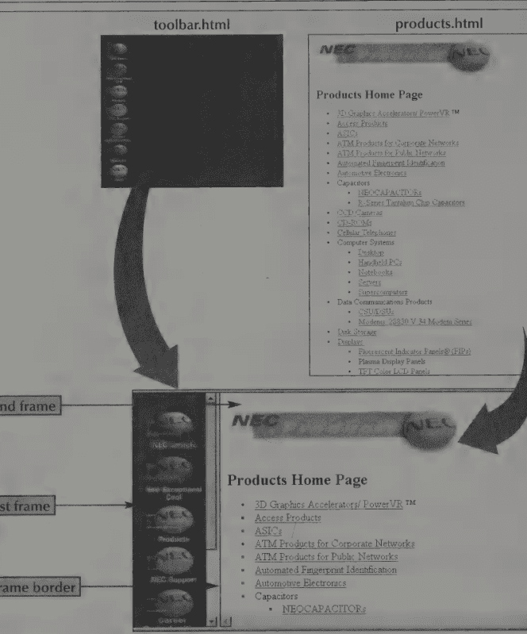

两个框架都使用框架组合成单个页面

- 3D 图形加速/PowerVR™
- 账户产品
- 通信网络 ATM 产品
- 公共网络 ATM 产品
- 自动支付识别
- 汽车电子
- 电容器
  - 高频容器
  - 三星我们的客户
- NEC 相机
- 其他网络
- 计算机产品
  - 磁盘
  - 硬盘
- 软件
- 数据通信产品
- 调制调制器：ISDN 33 V.4 调制调制器尺寸
- 经销商


此示例说明了框架的一种用法：在一个框架中显示链接列表，同时在另一个框架中显示网站的各个页面。图 I-21 显示了当用户浏览网站内容时，链接列表如何保持留在屏幕上。使用这种布局，设计师可以轻松更新链接列表，因为它只存储在一个页面上，而不是必须通过网站中的每个页面来更新链接列表。

## 在框架内激活链接

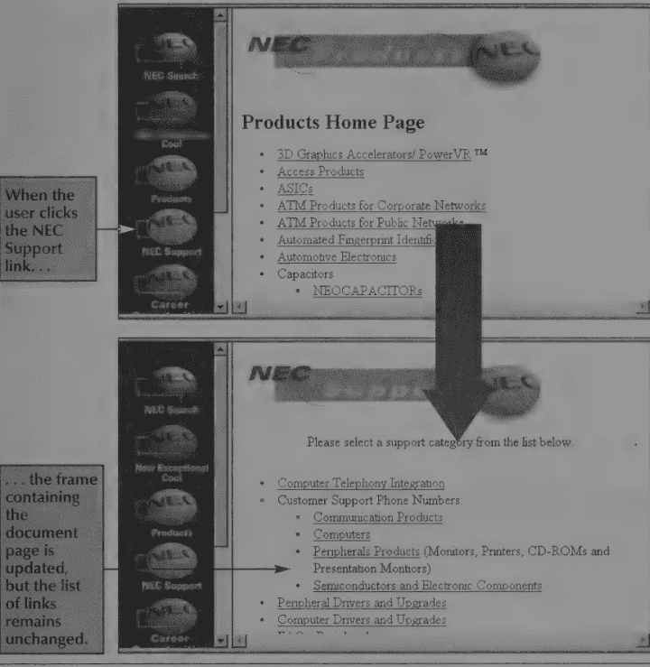

当用户点击 NEC 支持链接时...

+ 产品主页
- 3D 图形加速器/PowerVR TM
- 访问产品
- ASIC
- 内部网络 ATM 产品
- 公共网络 ATM 产品
- 自动支付身份
- 汽车电子
- 电容器

包含文档页面的框架得到更新，但链接列表保持不变。

+ 请从下方列表中选择支持类别
- 计算机电话集成
- 客户支持电话
    - 通信产品
    - 计算机
    - 外围产品（显示器、打印机、CD-ROM 和演示文稿）
- 半导体和电子元件
- 外围驱动程序和升级
- 计算机驱动程序和升级

## 创建框架集（Frameset）

其中框架是框架集内的单个框架。你很快将探索如何创建这些框架。

由于该 HTML 文件显示了其他 Web 页面的内容，它在技术上并不是 Web 页面，因此不包含页面主体。框架集按行或列布局，但不同者兼备。图 1-22 显示了两个框架集：一个框架分三列布局，另一个框架则放置在三行中。

```html
<html>
<head>
<title></title>
</head>
<frameset>
frames
</frameset>
</html>
```

## 图 1-22 列布局的框架

| 按行布局的框架 | |
|---|---|
| 第一个框架 | 第二个框架 |
| 第三个框架 | 列布局 |
| 第一个框架 | 第二个框架 |
| 行布局的框架 | |
|---|---|
| 第一个框架 | 第二个框架 |
| 第三个框架 | |
| 行布局的框架 | |
|---|---|
| 第一个框架 | 第二个框架 |
| 第三个框架 | |
| 行布局的框架 | |
|---|---|
| 第一个框架 | 第二个框架 |
| 第三个框架 | |

## 复习 HTML 和 CSS

## 框架尺寸

图 1-23 cols="160,25*"

| 160 像素 | 第二个框架 | 第三个框架 |
|---|---|---|
| 区域宽度的25% | | |
| 剩余空间 | | |

```html
<frameset cols="160,25*">
```

建议指定行或列至少一个星号，以确保无论浏览器窗口大小，框架都能填充屏幕。你也可以使用多个星号，这会导致浏览器将剩余显示空间分配给没有定义的。例如，`<frames rows="*,*,*>` 创建三个等高的行。

+   - 要创建按行布局的框架，请输入以下标签：

  `<frameset rows="row1,row2,row3...">`

  `</frameset>`

  其中 `row1,row2,row3` 等是框架行的高度，`frame` 定义了框架集内的框架。

- 要创建按列布局的框架，请输入以下标签：

  `<frameset cols="column1,column2,column3...">`

  `</frameset>`

  其中 `column1,column2,column3` 等是框架列的宽度。

框架集按行或列放置框架，但不同者兼备。但如果你想创建一个既有行又有列的布局，你必须将一个框架集嵌套在另一个框架集内部。当你使用这种技术时，`rows` 和 `cols` 属性的解释发生了微妙变化。对于嵌套框架集，行高 25% 并不意味着浏览器窗口的 25%，而是其所放置框架的高度 25%。

## 指定框架源

框架使用单标签 `<frame>` 标记。在 `frame` 元素中，你使用 `src` 属性来定义显示哪个文档帧。语法为

```html
<frame src="url" />
```

其中 `url` 是文档的 URL。以下代码创建了三行框架分别显示 `home.htm`、`main.htm` 和 `footer.htm` 文档。

```html
<frameset rows="100, *, 100">
  <frame src="home.htm" />
  <frame src="main.htm" />
  <frame src="footer.htm" />
</frameset>
```

注意，`frame` 元素只能放在 `frameset` 内部。

## 创建框架 (Frame)

- 要创建 `frame` 元素，请使用以下 HTML 标签：

  `<frame src="url" />` 其中 `url` 是你希望在框架内显示的文档 URL。

## 格式化框架

你可以控制框架的几个属性：滚动条的外观、框架边界，以及源文档与框架边界之间的边距是否允许用户更改框架大小。默认情况下，当源页的内容不适应框架时，会显示滚动条。你可以使用 `scrolling` 属性来覆盖此设置。该属性的语法为

```
scrolling="type"
```

其中 `type` 可以是 "yes"（始终显示滚动条）或 "no"（从不显示滚动条）。如果你没有指定 `scrolling` 属性，浏览器会在需要时显示滚动条。在处理框架时，请记住，只有当你认为整个 Web 页面将在框架内可见时，才应该移除框架的滚动条。为了做到，你应该使用几种不同的显示器设置查看你的 Web 页面。对于 Web 访问者来说，没有什么比发现框架中缺少内容且没有滚动条显示缺失内容令人烦恼了。

当用户的浏览器检索框架的 Web 页面时，它会确定页面内容与框架边界之间的空间。有时，浏览器设置的边界与内容之间的边距过大。通常，你希望边距足够大，以防止源文本或图像触及框架的边界。然而，你也不希望边距占用过多空间，因为你想尽可能显示源内容。指定框架边距大小的属性是

```
marginheight="value" marginwidth="value"
```

其中 `marginheight` 指定了框架源上方的空间（以像素为单位），`marginwidth` 指定了框架源左右的空间。你不需要同时指定边距高度和宽度。但是，如果你只指定其中一个，浏览器将假设你想对两者都使用相同的值。设置边距值是一个不断尝试的过程，因为你需要确定哪种边距大小组合看起来最好。默认情况下，用户可以通过简单的拖动边界在浏览器中调整框架大小。然而，某些 Web 设计师倾向于冻结或锁定框架，使用户户调整其大小。调整框架大小使用

```
noresize="noresize"
```

## 格式化框架

- 要控制框架是否包含滚动条，请在 `frame` 元素中添加以下属性：`scrolling="type"`

- 其中 `type` 为 "yes"（有滚动条）或 "no"（无滚动条）。如果你没有指定 `scrolling` 属性，只有当框架内容无法放入框架边界时，才会出现滚动条。

- 要控制框架内容与框架边界之间的空间，请在 `frame` 元素中添加以下属性：`marginwidth="value" marginheight="value"`

其中 `width` 和 `height` 值以像素为单位。`marginwidth` 是框架源左右的空间。`marginheight` 是框架源上方和下方的空间。如果你没有指定边距高度或宽度，浏览器将根据框架源的内容分配尺寸。

- 为了防止用户调整框架大小，请在 `frame` 元素中添加以下属性：`noresize="noresize"`

## 使用框架和链接

在框架内点击链接将在同一个框架内打开链接的文件；但是，你可以通过为每个框架分配名称并将链接指向其他命名框架之一来指定不同的位置。要为框架分配名称，请向 `frame` 元素中添加该属性。该属性的语法为

```
<frame src="url" name="name" />
```

其中 `name` 是分配给框架的名称。分配名称时大小写是敏感的："information" 和 "INFORMATION" 被视为不同的名称。此外，框架名称不能包含空格。要将链接指向特定框架，请在链接标签中添加以下属性：

```
target="name"
```

其中 `name` 是你在 Web 页面中为框架分配名称。例如，你可以使用以下代码将框架命名为 "main"：

```
<frame src="home.htm" name="main" />
```

如果你想让链接的目标出现在同一个主框架内，请按如下方式应用 `target` 属性：

```
<a href="gloss.htm" target="main">显示术语表</a>
```

除了框架名称外，你还可以指定保留的 `target` 名称，这会让链接的文档出现在浏览器的特定位置。图 1-24 列出了 HTML 支持的保留 `target` 名称。

## 图 1-24 保留 target 名称

| 保留 Target 名称 | 在 Frameset 中的功能 |
| --- | --- |
| `_blank` | 在新浏览器窗口中加载目标文档 |
| `_self` | 在包含链接的框架中加载目标文档 |
| `_parent` | 在包含链接的框架的父级中加载目标文档 |
| `_top` | 将文档加载到全显示区域，替换当前框架 |

## 将链接指向框架

- 要为框架分配名称，请向 `frame` 元素添加属性：`<frame name="name" />` 其中 `name` 是框架的名称。
- 要将链接指向框架，使用 `target` 属性：`target="name"` 其中 `name` 是你分配的名称。
- 要为所有链接使用相同的 `target`，向 `base` 元素添加 `target` 属性。

## noframes 元素

为了让不支持框架的浏览器（称为无框架浏览器）以及支持框架的浏览器都能查看你的网站，你可以使用 `noframes` 元素来标记 HTML 文件中无法显示的部分。`noframes` 元素嵌套在 `frameset` 元素内部所示，并使用以下语法：

```html
<html>
<head>
<title>标题</title>
</head>
<frameset>
<noframes>
<body>
页面内容
</body>
</noframes>
</frameset>
</html>
```

## 支持无框架浏览器

- 要创建一个不使用框架的页面版本，在 `frameset` 元素中插入以下标签：

```
<noframes>
<body>
  页面内容
</body>
</noframes>
```

其中 `page content` 是你想在框架位置显示的页面内容。

## 创建内联框架 (Inline Frames)

使用框架的另一种方法是创建浮动框架。浮动框架由 Internet Explorer 3.0 引入并加入 HTML 4.0 规范，其显示方式与内联框架在页面内的方式相似，作为独立的框或窗口显示在 Web 页面中。创建内联框架的语法为

```
<iframe src="url">
  备用内容
</iframe>
```

其中 `url` 是你在内联框架中显示的文档 URL，备用内容是你希望不支持内联框架的浏览器显示的内容。以下代码在内联框架内显示 `bio.htm` 文件的内容；对于不支持内联框架的浏览器，它会显示一个包含链接的段落，指向：

```html
<iframe src="bio.htm">
<p>
  查看 Jeff Bester 的 <a href="bio.htm">在线简历</a>
</p>
</iframe>
```

图 1-25 显示了此类内联框架在 Web 浏览器中渲染的示例。

# 图 1-25

内联框架（inline frame）的示例


耶尔攀爬学校

Yale Climbing School - 2413 Apex Avenue, Vail Park, CO 80521 / (970) 555-2345

## 职人员

耶尔攀爬学校的工作人员在这里帮助您解决所有的攀爬需求。我们所有的教练都经过完全考核，拥有多年的攀爬和教学经验，您可以通过右侧的个人简介了解更多信息。

```
inline frame
```

基于框架的 Web 网站存在缺点，这导致许多网站已经停止了对它们的使用。打开带框架网站的浏览器在用户查看任何内容之前，必须加载多个 HTML 文件，这导致客户的等待时间增加。在基于框架的 Web 网站中，书签页面非常困难，或者让创建基于内容的目录的互联网搜索引擎获取其内容也很困难。（换句话说，如果你希望你的内容能够被世界轻松找到，请不要使用框架。）某些浏览器在打印单个框架内的页面时也存在困难，尽管这个问题已经比以前小很多了。最后，某些用户倾向于将整个浏览器窗口用于单个页面的布局。由于这些原因，Web 设计师建议，如果你仍然想使用框架，你应该为网站同时创建框架版本和非框架版本，并让用户选择使用哪一个。

## 复习

## 复习总结

在本次复习中，你学习了 HTML 的历史和语法。复习从讨论 HTML 和 Web 的历史开始。然后，你学习了 HTML 的基本语法要求以及元素和属性。复习检查了块级元素和内联元素，展示了如何在 Web 页面中使用这些对象。复习还涵盖了用于显示内联图像等非文本对象的元素。复习查看了如何创建和使用 Web 表格和表单。复习以对框架和内联框架的讨论结束。

## 关键术语

- 访问键 (access key)
- 锚点 (anchor)
- 块级元素 (block-level element)
- body 元素 (body element)
- 单元内边距 (cell padding)
- 单元间距 (cell spacing)
- 字符格式元素 (character-formatting element)
- 复选框 (check box)
- 客户端 (client)
- 浮动框架 (floating frame)
- 表单按钮 (form button)
- 框架 (frame)
- 盲框架浏览器 (frame-blind browser)
- 框架集 (frameset)
- get 方法 (get method)
- 组框 (group box)
- head 元素 (head element)
- 隐藏字段 (hidden field)
- HTML
- 超文本标记语言 (Hypertext Markup Language)
- 内联元素 (inline element)
- 内联框架 (inline frame)
- 有序列表 (ordered list)
- 物理元素 (physical element)
- post 方法 (post method)
- 单选按钮 (radio button)
- 保留目标名称: (reserved target name:)
- 行组 (row group)
- 选择列表 (selection list)
- 服务器 (server)
- 跨单元单元格 (spanning cell)
- 标签 (tag)
- 文本区域 (text area)
- 无序列表 (unordered list)
- W3C
- Web
- 浏览器 (Web browser)
- Web 页面 (Web page)
- Web 服务器 (Web server)
- 列表 (definition list)
- 已弃用 (deprecated)
- div 元素 (div element)
- 空元素 (empty element)
- 可扩展超文本标记语言 (Extensible Hypertext Markup Extensible Markup Language)
- 扩展 (extension)
- 字段 (field)
- 字段值 (field value)
- 内联图像 (inline image)
- 输入框 (input box)
- 列表框 (list box)
- 逻辑元素 (logical element)
- 标记语言 (markup language)
- 标记标签 (markup tag)
- 嵌套 (nesting)
- 单边标签 (one-sided tag)
- 开启标签 (opening tag)
- 选项按钮 (option button)
- 空格 (white space)
- 世界维网 (World Wide Web)
- 世界维网联盟 (World Wide Web Consortium)
- HTML

## 复习题

1. 什么是服务器？什么是客户端？
2. 什么是超文本？
3. 什么是标记语言？什么是标记标签？
4. 为什么创建世界维网联盟？
5. 什么是已弃用的特性？
6. 什么是 XML？HTML 和 XHTML 之间是什么关系？
7. 双边标签的通用语法是什么？给出一个双边标签的示例。
8. 单边标签的通用语法是什么？给出一个单边标签的示例。
9. 注释标签的通用语法是什么？给出一个注释标签的示例。
10. 什么是空格？浏览器如何处理 HTML 文件中的空格？
11. HTML 文件的根元素是什么？它包含哪两个元素？
12. 你使用什么代码添加到 HTML 文件中，将 Web 页面的标题设置为“Pixal Products?”？代码应该放在哪里？
13. 什么是块级元素？什么是内联元素？
14. 你会使用什么代码来创建一个包含“Pixal Products?”文本的 h1 标题？
15. 你会输入什么代码来创建一个包含 Planes、Trains 和 Automobiles 项目的有序列表？
16. 你会输入什么代码在一个通用的块级元素中放置文本“Paxal Products”？
17. 什么是字符格式元素？提供两个字符格式元素的示例？
18. 什么是逻辑元素？什么是物理元素？
19. 你会输入什么代码来创建一个包含文件 `logo.jpg` 且替代文本为“Paxal Products?”的内联图像？
20. 你会输入什么通用代码创建一个包含两行三列的表格？
21. 什么是跨单元单元格？你会输入什么代码来创建一个跨越两行三列的表格单元格？
22. 你会输入什么代码来创建一个 id 和 name 为“orderForm”的表单？
23. 你会输入什么代码来创建一个名为“zipCode”且大小为 9 个字符的输入框字段？
24. 你会输入什么代码创建一个属于名为“gender”选项集合的单选按钮？
25. 你会输入什么代码来创建一个 id 和 name 为“isMember”且值为“yes”的复选框？
26. 你会输入什么代码来创建一个名为 Planes、Trains 和 Automobiles 的选择列表？
27. 你会输入什么代码创建一个名为“gender”的选择列表？
28. 你会输入什么代码来描述 get 和 post 方法之间的区别？
29. 什么是已弃用的特性？什么是 frameset？
30. 双边标签的通用语法是什么？给出一个双边标签的示例。
31. 单边标签的通用语法是什么？给出一个单边标签的示例。
32. 注释标签的通用语法是什么？给出一个注释标签的示例。
33. 你会输入什么代码创建一个框架？

## 复习 2

## 目标

- 理解 HTML 的历史和语法
- 理解 HTML 的基本语法要求以及元素和属性
- 理解块级元素和内联元素
- 理解如何使用 Web 表格和内联框架
- 理解 CSS 的历史
- 研究如何应用 CSS

## 介绍 CSS

CSS 的主要目的是将与呈现分离。尽管存在几种样式语言，但最常用的是。和 HTML 和 XHTML 一样，CSS 的版本由世界维网维护。第一个版本 CSS1 发布于 1996 年，但并未完全实现。CSS1 引入了以下样式：

- 字体：设置字体大小和其他属性
- 文本：控制文本对齐和应用元素
- 颜色：设置背景和前景颜色
- 背景：设置背景和平铺
- 块级元素：控制外边距和边框

第二个版本 CSS2 发布于 1998 年。它扩展了语言以支持：

- 定位：在页面的特定坐标放置元素
- 视觉格式：裁剪和隐藏内容
- 媒体类型：为不同的输出设备创建样式
- 界面：控制滚动条和鼠标指针的外观和行为

目前，浏览器对 CSS2 的支持参不齐。大多数定位和视觉格式样式都是支持的，但许多 CSS2 样式并不支持。2002 年 4 月推出了 CSS2.1 更新。该更新没有为语言添加新功能，但它清理了原始规范中引入的一些错误。

尽管浏览器仍在追赶 CSS2 的所有功能，CSS3 仍在开发中，它是以模块的形式设计的。这种方法使软件开发者更容易设计仅支持与其相关的 CSS 特性的应用程序。例如，作者浏览器可能不需要支持打印媒体相关的 CSS 样式，因此浏览器开发者可以专注于处理作者请求的 CSS 模块。这种设置有望使浏览器开发变得更容易且紧凑，这在尝试将浏览器放入 PDA 或手机手机的小型手持设备时是一个非常重要的考虑因素。CSS3 将扩展语言支持的样式范围：

- 用户界面：添加动态和交互功能
- 可访问性：支持残障人士和其他特殊需求的用户
- 分栏布局：为作者提供更多布局选项
- 国际化特性：为各种语言和字体提供支持
- 移动设备：支持 PDA 和手机设备设备
- 可缩放矢量图形：让 Web 作者更容易向其页面添加图形元素

## 学生数据

本次复习不需要学生数据。

与 HTML 和 XHTML 一样，这些特性的适用取决于浏览器社区的支持。由于 CSS2 尚未被完全支持，目前尚不清楚在 W3C 发布 CSS3 样式的最终规范后需要多长时间才能被采用。此外，各个浏览器还引入了各自 CSS 扩展。例如，Internet Explorer 引入了内联图像样式以及为 Web 页面添加幻灯片效果的功能。这意味着 Web 页面设计人员不仅需要考虑不同版本 CSS 之间的兼容性，还需要考虑不同浏览器版本之间的兼容性。

## 应用样式表

有三种方法可以向 HTML 或 XHTML 文档应用样式：

-   **内联样式 (Inline styles)**：通过在元素的 `style` 属性将每个样式应用于特定的元素。
-   **嵌入样式 (Embedded styles)**：将样式放置在文档的 `head` 标签中，为文档元素设置样式定义。
-   **外部样式 (External styles)**：将样式表保存在单独的文件中，并应用于 网站中的一组页面。

每种方法都有其优缺点，在开发 网站时，你可能会结合使用这三种方法。

## 使用内联样式

**内联样式**通过向元素的标记标签添加 `style` 属性来应用于元素。`style` 属性的语法为：

```
<element style="style1:value1; style2:value2; style3:value3; ...">
```

其中 `element` 是元素的名称，`style1, style2, style3` 等是样式的名称，而 `value1, value2` 等 是每个样式关联的值。例如，以下代码中的内联样式指示浏览器以红色字体显示 h1 标题 "Pixal Products"：

```
<h1 style="color:red">Pixal Products</h1>
```

内联样式易于使用和解释，因为它们直接应用于所影响的元素。然而，它们也存在一些问题。主要的复杂性在于，内联样式仅适用于它所修改的特定元素。如果你想让你所有的表头都渲染为无衬线字体，你必须找到 网站中所有的 `h1` 到 `h6` 标签，并对它们应用相同的 `font-family` 样式。对于一个拥有几十个页面、数百个标题的大型 网站来说，这并不是一项小任务。

## 使用嵌入样式

样式表的力量随着样式定义距离文档内容越来越远而变得显而易见。一种方法是在 Web 文档的 `head` 元素中使用 `style` 元素使用**嵌入样式**定义。`style` 元素的语法为：

```
<style>
  style declarations
</style>
```

样式声明 (style declarations) 是应用于文档的不同样式的声明。每个样式声明应用于文档中的一组元素，这些元素被称为选择器 (selector)。样式声明的语法为：

```
selector {style:value1; style2:value2; style3:value3; ...}
```

其中 `selector` 识别文档中的单个元素或多个元素，而 `style:value` 值对遵循你将内联样式应用于元素时使用的相同语法。例如，要将所有 h1 标题渲染为红色字体，你使用选择器 `h1` 并在文档中插入样式声明：

```
<head>
  <title>Web Page Title</title>
  <style>
    h1 {color: red}
  </style>
</head>
```

在回顾的后后部分，你将查看表示选择器以选择大范围元素组的不同方法。

`style` 元素支持多个属性，用于定义使用的样式表语言类型、样式为设计的输出媒体类型，以及标识样式元素的名称或 id。这些属性的语法为：

```
<style type="mime_type" media="media_type" title="text" id="text">
  declarations
</style>
```

其中 `type` 属性识别样式表语言，`media` 属性识别输出媒体，`id` 属性为 `style` 元素中的样式声明集提供标签。对于 CSS 中的样式声明，请使用 mime-type 值 "text/css"。

`media` 属性指示为样式表编写的媒体。例如，你可以为打印输出和指向计算机屏幕的输出创建不同的样式表。图 2-1 描述了 `media` 属性的不同值。

### media 属性的值

| 媒体类型 | 用途 |
| :--- | :--- |
| all | 所有输出设备（默认值） |
| aural | 语音和声音合成器 |
| braille | 盲文触觉反馈设备 |
| embossed | 页面打印机 |
| handheld | 具有小屏幕、单色图形和有限带宽的小型或手持设备 |
| print | 打印机 |
| projection | 投影仪 |
| screen | 计算机显示器 |
| tty | 固定宽度设备，如电打字机和终端 |
| tv | 低辨率、彩色且滚动性受限的电视类设备 |

例如，如果你想专门为打印输出创建一个样式表，你可以在你的 HTML 或 XHTML 文件中使用类似于下方的嵌入式样式表：

## 回顾 2：级联样式表 (CSS)

```html
<style type="text/css" media="print">
h1 {color: red}
</style>
```

在此样式表下，h1 标题在打印输出时显示为红色。注意，此样式表不适用于计算机显示器等其他媒体。在不同的介质中，h1 标题的外观由该介质定义。`media` 属性将在回顾的后部分详细讨论。

最后，单个 HTML 文件可以包含多个嵌入样式表，`id` 和 `title` 属性提供了区分不同样式表的方法。这对于根据用户加载不同样式表的脚本可能是非常有用的。`id` 和 `title` 属性是可选的；除非你在页面上使用多个样式表，否则你可能不需要它们。

## 创建嵌入样式表

- 要创建嵌入样式表，在文档的 `head` 中输入以下标签：

  `<style type="mime_type" media="media_type" title="text" id="text">`

    `style declarations`

  `</style>`

  其中 `type` 属性指定样式语言的 MIME 类型，`media` 属性指定输出，`id` 和 `title` 属性提供标签，样式声明是具体的样式。对于 CSS 样式表，使用 type 值 "text/css"。默认的 media 值为 "all"，它将样式表应用于所有输出媒体。

## 使用外部样式表

外部样式表是一个仅包含样式声明的简单文本文件。该文件可以链接到网站中的任何页面，从而一次性将相同应用于整个站点。因此，为了让所有的 h1 标题以红色字体显示，你只需要在外部样式表中添加：

```
h1 {color: red}
```

然后链接到每个页面。要将外部样式表链接到 Web 页面，你需要在 HTML 或 XML 文件的 `head` 元素中添加 `link` 元素：

```
<link href="url" rel="stylesheet" type="mime_type" media="media" id="text" type="text" />
```

其中 `url` 是样式表的 URL，其余属性的含义与嵌入式样式表时相同。使用 CSS 语言编写的外部样式表应该具有 ".css" 文件扩展名。因此，为了将 Web 页面链接到样式表 "styles.css"，你会在文档的 `head` 元素中输入以下链接：

```
<link href="styles.css" rel="stylesheet" type="text/css" />
```

你可以在单个文件中包含多个 `link` 元素，允许你的 Web 页面从不同的样式表中样式。这种方法允许你将 Web 页面链接到打印输出、计算机显示器等的独立样式（参见图 2-2）。

# 将多个样式表应用到单个文档

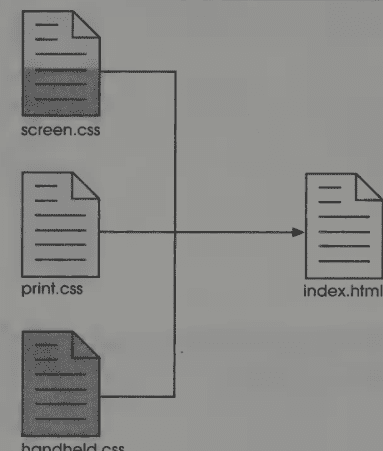

此外，同一个样式表可以链接到多个不同的 Web 页面，使网站上的所有页面具有共同的外观和感受。如果你对样式表进行了更改，该更改将自动反映在整个网站上（见图 2-3）。

# 将单个样式表应用到多个文档

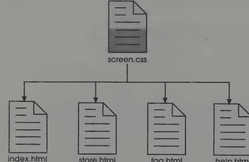

# 样式注释

除了样式声明外，嵌入式或外部样式表还可以包含注释，用于记录关于该样式表的重要信息。如需添加注释，请使用以下格式：

```
/* comment */
```

其中 `comment` 是注释的内容。例如，下行代码将注释 "Pixal Products Style Sheet" 插入样式表中：

`/* Pixal Products Style Sheet */`

# 理解样式优先级

你已经看到样式如何内联应用于单个元素，它们如何被嵌入到单个文件中，以及外部样式表如何应用于整个 Web 网站。对于单个文档，有这么多可能的样式来源，浏览器在样式冲突时如何确定哪种具有优先权？当样式来自多个源时，它们的权重如下所示所示（按重要性从小到大排序）：

1. 外部样式表
2. 嵌入样式
3. 内联样式

因此，内联样式的优先级高于嵌入样式，而嵌入样式优先级高于外部样式表。如果两个样式的权重相同，则最后声明的那个具有优先级。例如，在嵌入样式中：

```css
<style type="text/css">
h1 {color: orange}
h1 {color: blue}
</style>
```

蓝色字体颜色应用于 h1 标题，因为它是最后声明的，覆盖了橙色颜色样式。你可以通过在样式声明中添加 `!important` 属性来覆盖优先级规则。该样式表：

```css
<style type="text/css">
h1 {color: orange !important}
h1 {color: blue}
</style>
```

会导致 h1 标题以橙色字体渲染，因为橙色样式的权重比蓝色样式更高。当你希望确保某个特定样式无论在优先级顺序中的什么位置都能强制执行时，`!important` 属性非常有用。

注意，任何样式都可以被为浏览器设置了自定义样式表的用户覆盖。这通常是由有特殊需求的残障人士完成（例如需要用大字体和高对比度颜色显示文本）。这些样式表中的样式高于浏览器的默认样式以及 Web 作者指定的样式。因此，你应该确保当用户没有采用你的样式表时，Web 页面也是可读的。查看 Web 页面内容的能力不应依赖于访问样式表的能力。

# 理解样式继承

如果未指定元素的样式，该元素将采用其父元素的样式。这种效果被称为样式继承，它导致声明沿着文档层级向下级联。例如，如果你想将页面上每个元素的文本颜色设置为蓝色，可以使用以下声明：

```
body {color: blue}
```

`body` 元素内的每个元素（也就是说显示在页面上的每个元素）都会继承这种样式。要覆盖继承，你需要为父元素的其中一个后代元素指定另一种样式。这些样式在一起：

```
body {color: blue}
p{color: red}
```

会将页面上除段落和段落内包含任何元素以外的每个元素的文本颜色改为蓝色。作为样式优先级，你可以使用 `!important` 属性来覆盖样式继承。

## 使用文本样式

现在你已经学习了如何将样式应用于文档，接下来你将检查 CSS 支持的一些特定样式，从文本样式开始。

## 选择字体

默认情况下，浏览器对 Web 页面文本应用单一字体脸——通常是 Times New Roman。你可以使用以下样式为任何页面元素指定不同的字体：

```
font-family: fonts
```

其中 `fonts` 是一个用逗号分隔的特定字体或通用字体列表。特定字体是指像 Times New Roman、Arial 或 Georgia 这样实际安装在用户计算机上的字体。通用字体是对字体外观性描述的名称。浏览器识别五个通用字体名称：serif（衬线体）、sans-serif（无衬线体）、monospace（等宽字体）、cursive（草体）和 fantasy（装饰字体）。图 2-4 显示了每种字体的示例。注意每个通用字体都可以代表广泛的设计。

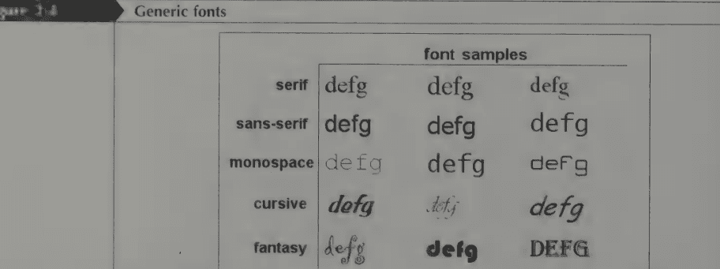

| font samples | defg | defg | defg |
|---|---|---|---|
| serif | defg | defg | defg |
| sans-serif | defg | defg | defg |
| monospace | defg | defg | defg |
| cursive | defg | defg | defg |
| fantasy | defg | defg | DEFG |

当你指定通用字体时，你无法确定特定用户-浏览器如何渲染文本——这取决于浏览器被配置为如何处理通用字体。这就是为什么 CSS 允许你指定字体列表而不是仅仅一个字体的原因之一。列出你想要的字体，并以通用字体结尾。如果浏览器没有找到这些字体，它会尝试列表中的下一个。你列出你想要的字体，并以通用字体结尾。例如，为了让浏览器使用 sans-serif，可以使用以下样式：

```
font-family: Arial, sans-serif
```

如果浏览器没有找到 Arial，它会使用 sans-serif。

## 设置字体大小

要设置字体大小，使用样式 `font-size: value`，其中 `value` 是一个长度单位（以 mm, cm, in, pt, pc, em 或 ex 单位指定）、关键字（xx-small, x-small, small, medium, large, x-large, 或 xx-large）、默认字体大小的百分比，或描述相对于包含元素大小的关键字（更小或更大）。默认字体大小单位是像素（px）。

## 控制间距和缩进

CSS 样式允许你执行一些基础排版任务，例如设置字间距（字母之间的空间）和词间距（单词之间的空间）。控制元素字间距和词间距的样式是：

```
letter-spacing: value
word-spacing: value
```

其中 `value` 是字母或单词之间空间的大小。你使用与字体大小相同的单位来指定这些大小。

你可以设置的另一个排版特征是行高（leading），即文本行之间的间距。设置元素内文本行高的样式为：

```
line-height: length
```

其中 `length` 是一个特定的长度或受影响行文本字体大小的百分比。如果未指定单位，浏览器会将该数字解释为行高与字体大小的比例。标准比例是 1.2:1，这意味着行高是字体大小的 1.2 倍。要创建双倍行距的文本，你可以使用以下样式：

```
line-height: 2
```

控制文本间距的最后方法是设置第一行使用的缩进。该样式为：

```
text-indent: value
```

其中 `value` 是以绝对单位或相对单位表示的长度，或者是文本块宽度的百分比。例如，5% 的缩进值会将第一行扩展为文本块宽度的 5%。缩进值也可以取负值，将第一行扩展到文本块的左侧，以创建悬挂缩进。

## 设置文本间距

- 要设置字母之间的间距（字间距），使用样式

  ```
letter-spacing: value
  ```

  其中 `value` 是单个字母之间的间距。默认是 0 像素。

- 要设置单词之间的间距（词间距），使用样式

  ```
word-spacing: value
  ```

  其中 `value` 是单个单词之间的间距。默认是 0 像素。

- 要设置文本行之间的垂直空间（行高），使用样式

  ```
line-height: value
  ```

  其中 `value` 是行与行之间的长度、字体大小的百分比或行高与字体大小的比例。默认是 1.2:1 的比例。

- 要设置第一行的缩进，使用样式

  ```
text-indent: value
  ```

  其中 `value` 是缩进的长度，以长度或文本块宽度的百分比表示。默认是 0 像素。

## 引用窗口

## 设置字体样式、字重和其他装饰性特征

浏览器对特定类型的元素应用默认字体样式。例如，用 `<address>` 标签标记的文本通常显示为*斜体*。你可以使用以下样式指定你的字体：

```
font-style: type
```

其中 `type` 是 `normal`（正体）、`italic`（斜体）或 `oblique`（倾斜）。斜体和倾斜样式在外观上相似，但根据所使用的字体可能会有细微差别。你已经看到浏览器会用更粗的字体渲染某些元素。例如，大多数浏览器用**粗体**字体渲染标题。你可以使用样式控制任何页面元素的字重：

```
font-weight: weight
```

其中 `weight` 是应用到文本的加粗格式级别。你表示范围从 100 到 900 的字重值，以 10 为递增量。然而，在实践中，浏览器无法渲染九种不同的字体字重。出于实际考虑，你可以假设 400 代表正体（非粗体）文本，700 是粗体文本，900 代表加粗文本。你也可以用关键字 "normal" 或 "bold" 来代替字重值，或者使用关键字 "bolder" 或 "lighter" 使用相对于包含元素的字体表示字重。

```
text-decoration: type
```

其中 `type` 是 `none`（无装饰变化）、`underline`（下划线）、`overline`（上划线）、`line-through`（删除）或 `blink`（闪烁）。你可以对同一个元素应用多个装饰效果。例如，以下样式：

```
text-decoration: underline overline
```

会在元素的文本下方和上方各一条线：注意，`text-decoration` 样式不能应用于非文本元素，例如内联图像。

要控制元素内的文本，你使用样式：

```
text-transform: type
```

其中 `type` 是 `capitalize`（首字母大写）、`uppercase`（全大写）、`lowercase`（小写）或 `none`（不对文本大小做任何更改）。例如，如果你想将元素中每个单词的首字母大，可以使用样式：

```
text-transform: capitalize
```

要显示每个字母均为小写，你使用 `text-transform` 值 "lowercase"。同样，设置 "uppercase" 会将每个字母显示为大写。

最后，你可以使用样式用大写字母和小号字体显示文本：

```
font-variant: type
```

其中 `type` 是 `normal`（默认）或 `small-caps`（小型大写字母）。小型大写字母经常用于法律文件（如软件协议），其中大写字母表示某个短语或观点的重要性，但文本被缩小了，以免分散文档中其他元素的注意力。

## 设置字体样式

- 要设置字体的外观，使用样式

  ```
font-style: type
  ```

  其中 `type` 是 `normal`、`italic` 或 `oblique`。

- 要设置字体的字重，使用

  ```
font-weight: value
  ```

  其中 `value` 是从 100 到 900（以 100 为递增）的值，或者是关键字 "normal" 或 "bold"。要增加字体相对于其包含元素的字重，使用关键字 "bolder" 或 "lighter"。

- 要装饰文本，使用样式

  ```
text-decoration: type
  ```

  其中 `type` 等于 `underline`、`overline`、`line-through`、`blink` 或 `none`。

- 要更改元素中文本的大小，使用样式

  ```
text-transform: type
  ```

  其中 `type` 等于 `capitalize`、`lowercase`、`uppercase` 或 `none`。

- 要显示当前字体的变体，使用样式

  ```
font-variant: type
  ```

  其中 `type` 等于 `normal` 或 `small-caps`。

## 对齐元素

CSS 提供了两种对齐元素的样式。要水平对齐，使用样式：

```
text-align: type
```

其中 `type` 是 `left`、`right`、`center` 或 `justify`。要垂直对齐元素，使用样式：

```
vertical-align: type
```

其中 `type` 是下表中的关键字：

| 垂直对齐 | 描述 |
| :--- | :--- |
| baseline | 与基线对齐（默认） |
| bottom | 与底部对齐 |
| middle | 与中线对齐 |
| sub | 下标 |
| super | 上标 |
| text-bottom | 与文本的底部对齐 |
| text-top | 与文本的顶部对齐 |
| top | 与顶部对齐 |

除了使用关键字，你还可以指定相对于行高的长度或百分比。正值将元素向上移动，负值将其向下。例如，样式：

```
vertical-align: 50%
```

将元素向上移动行高的高度，而样式：

```
vertical-align: -100%
```

将元素位于基线下方。

## 在单个样式中组合文本格式

本回顾涵盖了许多字体样式。你可以将大部分它们合并到一个声明中，使用以下格式：

```
font: font-style font-variant font-weight font-size/line-height font-family
```

其中 `font-style` 是字体样式，`font-variant`、`font-weight` 是字重，`font-size` 是字体大小，`line-height` 是行高，而 `font-family` 是字体族。例如，样式：

```
font: italic small-caps bold 16pt/24pt Arial, sans-serif
```

以斜体、粗体 Arial 字体显示元素的文本。字体大小为 16pt，行高为 24pt。文本为小型大写字母。你不需要包含字体的所有属性。必须的属性是大小和字体族。然而会对任何省略的属性假设默认值。但是，你必须将包含的属性按上述顺序放置。例如，以下是指定 16pt 粗体的正确样式声明：

```
font: bold 16pt monospace
```

但是，如果交换顺序，将字体族属性放在样式和字重属性之前，是不正确的，例如：

```
font: monospace bold 16pt
```

虽然某些浏览器能够正确解释此样式，但其他浏览器会因为语法错误而拒绝。

## 使用颜色和图像样式

CSS 提供了多种样式为你的网页添加颜色和图像。你可以为页面上的每个元素定义前景和背景颜色。前景通常是元素内文本的颜色，但在水平线的情况下，它定义了线条的一部分。定义元素前景色的样式为：

```
color: color
```

其中 `color` 是颜色值或颜色名称。颜色值以 rgb（红、绿、蓝）输入，其中红色是颜色的红色分量，绿色是绿色分量，蓝色是蓝色分量。分量值从 0（无强度）到 255（最高强度）。定义元素背景色的样式为：

```
background-color: color
```

## 复习 2 引入级联样式表 复习版本 63

```
background-color: color
```

如果没有定义元素的颜色，则将继承其容器元素的颜色。

例如，如果你为 Web 页面的 `body` 指定了在灰色背景上的文本，则页面中的所有所有元素都将继承该颜色组合，除非你指定了不同的样式。

例如，如果你想在黑色背景上以白色文字显示所有段落，样式如下：

```css
p {color: white; background-color: black}
```

## 设置前景颜色和背景颜色

- 要设置元素的符号颜色，请使用样式

  `color: color`

  其中 `color` 是颜色名称或颜色值。

- 要设置元素的背景颜色，请使用样式

  `background-color: color`

## 参考窗口

## 设置背景图像

几乎任何元素都可以用背景图像显示。你可以对背景图像设置四个属性：

- 图像文件的来源
- 图像在元素背景中的放置位置
- 图像在元素背景上的重复方式
- 图像是否随显示窗口滚动

要应用背景图像，请使用样式

```css
background-image: url(url)
```

其中 `url` 是图像文件的位置和名称。

## 控制图像位置

默认情况下，背景图像会在水平和垂直方向上进行平铺，直到占据整个元素的背景。你可以使用样式控制浏览器如何平铺背景图像：

```css
background-repeat: type
```

其中 `type` 等于 `repeat`、`repeat-x`、`repeat-y` 或 `no-repeat`。图 2-7 显示了这些重复类型的每种示例。默认类型值为“repeat”，它会导致平铺在垂直和水平方向上发生。

## 图 2-7 background-repeat 样式的值

| background image: repeat | background image: repeat-x |
| :--- | :--- |
| background image | background image: repeat-y | background image: no-repeat |

默认情况下，背景图像放置在元素占据空间的左上角，如果启用了平铺，则在该处重复。你可以使用样式将背景图像放置在不同的位置：

```css
background-position: horizontal_position vertical_position
```

其中 `horizontal_position` 和 `vertical_position` 是图像左上角的水平和垂直坐标。例如，样式

```css
background-position: 30 50
```

将图像放置在元素空间左上角右侧30 像素、下方50 像素处。如果你只指定一个值，浏览器将将其应用于水平和垂直坐标。

为了更通用地描述位置，你可以使用关键字组合：`left`、`center`、`right`（水平位置）以及 `top`、`center`、`bottom`（垂直位置）。你也可以将背景图像的位置定义为元素宽度高度的百分比。例如，样式

```css
background-position: 50% 50%
```

将背景图像放置在元素的中心。默认情况下，背景图像随元素在浏览器显示窗口中滚动而移动。你可以使用样式更改此行为：

```css
background-attachment: attachment
```

其中 `attachment` 是 "scroll"（默认值）让图像随页面滚动，或 "fixed" 将图像放置在显示窗口的固定位置。固定背景图像通常用于创建水印的幻象，将半透明图形纹入纸张的纹理中，通常用于特种纸具。

与字体样式一样，所有各种背景图像样式都可以组合成单一样式：

```css
background: color url(url) repeat attachment position
```

其中 `color` 是元素背景的颜色名称或颜色值，`url` 是图像文件的 URL，`repeat` 指定了图像在背景中的平铺方式，`attachment` 指定了图像是否随页面滚动，`position` 提供背景图像的坐标。例如，声明

```css
body {background: yellow url(paper.gif) no-repeat fixed center center}
```

在页面 `body` 背景上显示图像文件 "paper.gif"。图像在页面上居中，位置固定（因此不滚动），且不在页面 `body` 上重复或平铺。在未显示图像的地方，将显示黄色背景。

## 插入背景图像

- 要在元素后面插入背景图像，请使用样式

  `background-image: url(url)`

  其中 `url` 是图像文件的文件名和位置。

- 要控制背景图像的平铺，请使用样式

  `background-repeat: type`

  其中 `type` 是 `repeat`（默认）、`repeat-x`、`repeat-y` 或 `no-repeat`。

- 要将背景放在元素后的特定位置，请使用样式

  `background-position: horizontal vertical`

  其中 `horizontal` 是图像的水平位置，`vertical` 是垂直位置。你可以指定距离元素左上角的距离、元素宽度高度的百分比，或使用关键字。垂直位置的关键字选项为 `top`、`center` 或 `bottom`，水平位置的选项为 `left` 或 `right`。

- 要控制背景图像是否滚动，请使用样式

  `background-attachment: attachment`

  其中 `attachment` 是 `scroll`（默认）或 `fixed`。

- 要将所有背景选项放在一个声明中，请使用样式

  `background: color url(url) repeat attachment position`

  其中 `color` 是元素背景的颜色名称或颜色值，`url` 是图像文件的 URL，`repeat` 指定了图像在背景中的平铺方式，`attachment` 指定了图像是否随页面滚动，`position` 提供背景图像的坐标。

## 元素尺寸

## 设置元素的宽度

要设置元素的宽度，请使用样式

`width: width`

其中 `width` 是一个长度（如像素、em 或百分比）或百分比。

## 设置元素的高度

要设置元素的高度，请使用样式

`height: height`

其中 `height` 是一个长度（如像素、em 或百分比）或百分比。

## 设置元素的外边距

要设置元素的外边距，请使用样式

`margin: margin`

其中 `margin` 是一个长度或代表上、右、下、左的长度组合。

## 设置元素的内边距

要设置元素的内边距，请使用样式

`padding: padding`

其中 `padding` 是一个长度或代表上、右、下、左的长度组合。

## 设置元素的边框

要设置元素的边框，请使用样式

`border: width style color`

其中 `width` 是长度，`style` 是边框样式（如实线、虚线或点线），`color` 是颜色名称或值。

## 处理内容溢出

## 裁剪内容

另一个与溢出相关的属性是 `clip` 属性。`clip` 属性允许 Web 设计师定义矩形区域，可以通过该区域查看元素的内容。落在裁剪区域之外的内容都会被隐藏。`clip` 属性的语法如下：

```css
clip: rect(top, right, bottom, left)
```

其中 `top`、`right`、`bottom` 和 `left` 定义了矩形区域的坐标。例如，裁剪值 `rect(10, 175, 125, 75)` 定义了一个裁剪区域，其顶部和底部边缘距离元素顶部 10 和 125 像素，右边缘和左边缘距离元素左侧 175 和 75 像素（见图 2-9）。

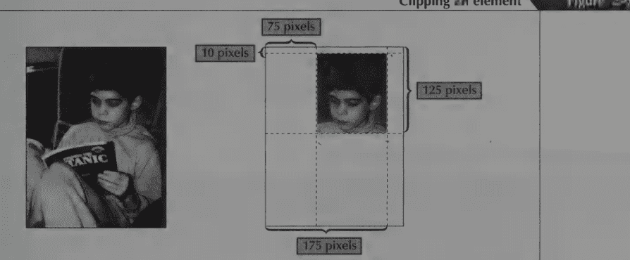

元素裁剪：rect(10, 175, 75)

`top`、`right`、`bottom` 和 `left` 值也可以设置为 "auto"，这会将裁剪区域移动到元素的边缘。例如，裁剪值 `rect(10, 125, 75)` 创建了一个裁剪矩形，其右边缘与元素的右边缘对齐，而其他边缘被裁剪。

## 边框、外边距和内边距

对于每个页面元素，CSS 都定义了一个盒模型来识别元素的不同部分。盒模型描述了元素的四个方面（见图 2-10）：

- 盒与其他元素之间的外边距（margin）
- 盒的边框（border）
- 元素内容与边框之间的内边距（padding）
- 元素的内容

# 盒模型的组成部分

Paul DC100 数字相机在其价格范围内提供了卓越性能。该相机在低光条件下表现出色，提供了多种压缩方案和显示选项。Paul DC100 是一款价格适的入门级数字相机，适合新手和轻便旅行。1 万像素 CCD 传感器确保了准确的色彩和曝光。DC100 包含一张 8 MB 内存卡，可以存储高达 60 张高分辨率照片。如果您需要更多空间，可以插入额外的 8 MB 内存以获得更好的性能。DC100 配备四节 AA 电池（足够拍摄 600 张低分辨率照片）和一张可拆的 8 MB 智能卡，能够存储 120 张图片。您还将获得大量的软件和一套打印机接口套件。

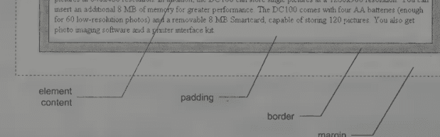

CSS 提供了各种样式来处理任何页面元素的外边距、边框和内边距。

# 使用外边距

CSS 支持四种用于控制页面元素外边距大小的样式。这些属性是：

```css
margin-top: value
margin-right: value
margin-bottom: value
margin-left: value
```

其中 `value` 是以绝对单位或父元素宽度的百分比表示的外边距大小。您也可以使用值 "auto"，这指示浏览器确定外边距大小。例如，要为每个 h1 元素在两侧设置 10 像素的外边距，并在上下设置 5 像素的外边距，请使用以下样式：

```css
h1 {margin-top: 5; margin-right: 10; margin-bottom: 5; margin-left: 10}
```

外边距大小也可以是负值，用它可以让页面上的元素拥挤或交叉。四种外边距样式可以组合成单一样式：

```css
margin: top right bottom left
```

其中 `top`、`right`、`bottom` 和 `left` 是相应外边距的大小。如果您在组合属性中仅包含三个值，它们被解释为顶、右和底，浏览器会匹配左、右边距的大小。如果只指定两个值，它们将应用于顶部和右边距，浏览器会将底部和左边距匹配为这两个值。如果只输入一个值，浏览器会将该大小应用于四个外边距。

# 设置外边距大小

- 要设置元素周围的外边距大小，使用样式：

  `margin-top: length`

  `margin-right: length`

  `margin-bottom: length`

  `margin-left: length`

  其中 `length` 是长度单位、容器宽度的百分比或关键字 "auto"（默认值），允许浏览器设置外边距大小。

- 要将所有样式合并到单一样式中，使用：

  `margin: top right bottom left`

  其中 `top`、`right`、`bottom` 和 `left` 是顶、右、底、左边缘的外边距。如果您只指定三个值，外边距将应用于顶、右和底，左值将与该值匹配。如果您只指定两个值，第一个值应用于顶部和底边缘，第二个值应用于右边缘和左边缘。如果您只指定一个值，它将应用于四个边缘。

## 使用边框

您可以为任何元素创建一个边框，并定义其厚度、颜色和样式。您可以将样式应用到单个边框边，也可以同时应用于四个边。图 2-11 描述了各种 CSS 边框属性。


| 边框样式 | 说明 | 注意事项 |
|---|---|---|
| `border-top:value` | 顶部边框宽度 | |
| `border-right:value` | 右侧边框宽度 | `value` 是绝对单位或关键字 "thin"、"medium" 或 "thick" 的边框宽度 |
| `border-bottom:value` | 底部边框宽度 | |
| `border-left:value` | 左侧边框宽度 | |
| `border-width:top right left` | 任意或所有边框的宽度 | |
| `border-top:color` | 顶部边框颜色 | `color` 是名称或值 |
| `border-right:color` | 右侧边框颜色 | |
| `border-bottom:color` | 底部边框颜色 | |
| `border-left:color` | 左侧边框颜色 | |
| `border-top:type` | 顶部边框样式 | `type` 是 `solid`、`dashed`、`dotted`、`double`、`inset`、`ridge` 或 `none` 之一 |
| `border-right:type` | 右侧边框样式 | |
| `border-bottom:type` | 底部边框样式 | |
| `border-left:type` | 左侧边框样式 | |
| `border-style:top right left` | 任意或所有边框的样式 | |

边框宽度可以使用长度或关键字 "thin"、"medium" 或 "thick" 表示。边框颜色使用名称或值。对于边框样式，CSS 支持图 2-12 所示的九种：

| solid | dashed | dotted |
|---|---|---|
| double | outset | inset |
| groove | ridge |

例如，要在整个页面设置双线边框，可以使用样式：

```css
body {border-style: double}
```

所有的边框属性都可以合并为一个声明，使用样式 `border: width color`。要在 h1 周围创建一个 5pt 的点状边框，可以使用：

```css
h1 {border-width: 5pt; border-style: dotted; border-color: blue}
```

或者将属性组合为：

```css
h1 {border: 5pt dotted}
```

要处理单独边框，可以使用特定的样式：

```css
border-top: width color
border-right: width color
border-bottom: width color
border-left: width color
```

有多种格式化块边框的方法，但浏览器之间的支持并不一致。始终，请确保您使用的样式被浏览器支持。

## 设置边框样式

- 要设置元素的边框宽度，使用样式：

  `border-width: top right bottom left`

  其中 `top`、`right`、`bottom` 和 `left` 是顶、右、底、左边框的宽度。要定义单个侧边的边框宽度，使用样式 `border-top-width`、`border-right-width`、`border-bottom-width` 和 `border-left-width`。

- 要设置边框颜色，使用样式：

  `border-color: top right bottom left`

  其中 `top`、`right`、`bottom` 和 `left` 是顶、右、底、左边框颜色。要定义单个侧边的边框颜色，使用样式 `border-top-color`、`border-right-color`、`border-bottom-color` 和 `border-left-color`。

- 要设置边框样式，使用：

  `border-style: top right bottom left`

  其中 `top`、`right`、`bottom` 和 `left` 是顶、右、底、左边框样式。可能的边框样式值为 `solid`、`dashed`、`dotted`、`double`、`inset`、`ridge` 和 `none`。要定义单个侧边的边框样式，使用样式 `border-top-style`、`border-right-style`、`border-bottom-style` 和 `border-left-style`。

- 要格式化整个边框，使用样式：

  `border: width style color`

  其中 `width` 是边框宽度，`style` 是边框样式，`color` 是边框颜色。要定义单个侧边的边框外观，使用样式 `border-top-`、`border-right-`、`border-bottom-`和 `border-left-`。

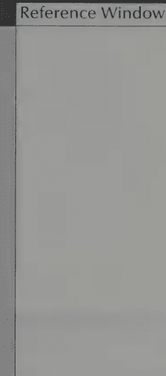

# 使用内边距

要增加元素内容与其边框之间的空间，需要增加块的内边距大小。可以使用以下任何样式：

```css
padding-top: value
padding-right: value
padding-bottom: value
padding-left: value
padding: top right bottom left
```

其中 `padding` 值可以用绝对单位或作为块级元素宽度的百分比表示。对于之前讨论的组合外边距样式，如果输入的 `top`、`right`、`bottom` 和 `left` 值少于四个，浏览器将匹配相对侧。例如，要将所有侧的内边距设置为 5 毫米，可以使用样式：

```css
padding: 5mm
```

# 设置内边距大小

- 要设置内边距的大小，使用样式：

  `padding: top right bottom left`

  其中 `top`、`right`、`bottom` 和 `left` 是顶、右、底、左内边距大小。要定义元素单个侧的内边距大小，使用样式 `padding-top`、`padding-right`、`padding-bottom` 和 `padding-left`。

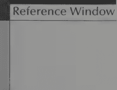

## 元素定位

每个页面元素都使用用户 Web 浏览器的默认设置进行放置。然而，你可以覆盖这些设置，并根据页面的坐标放置元素。设置元素定位的样式为：

```
position: type; top:value; right:value; bottom:value; left:value;
```

其中 `type` 表示应用于元素的定位类型，`top`、`right`、`bottom` 和 `left` 样式表示元素上、右、下、左边缘的坐标。在实践中，仅使用 `top` 和 `left` 坐标，因为根据元素的高度和宽度可以推算出底部和右侧的坐标。坐标可以使用任何 CSS 测量单位表示。

该样式有五个可能的值：`static`、`absolute`、`relative`、`fixed` 和 `inherit`。

默认定位是 `static`，允许浏览器根据元素在文档中的流位置放置元素。这本质上等同于没有使用任何 CSS 定位。

# 使用 CSS 定位对象

- 要将对象放在特定位置，使用样式 `position: type; top:value; right:value; bottom:value; left:value`，其中 `type` 表示应用于元素的定位类型（`absolute`、`relative`、`static`、`fixed` 或 `inherit`），而 `top`、`right`、`bottom` 和 `left` 样式表示元素上、右、下、左边缘的坐标。

## 绝对定位

绝对定位将元素放置在其父元素内定义的坐标上。在大多数情况下，父元素是文档窗口本身，这意味着绝对坐标相对于窗口内的坐标。坐标相对于父元素的左上角指定的。正的 `top` 值将对象从顶边缘向下移动；负值则将对象移动到父元素顶边缘上方。同样，正的 `left` 值将元素移动到左边缘的右侧，而负值则将元素移动到父元素的左侧。

图 2-13 显示了一个放置在坐标 (100, 150) 处的对象——即距离其容器左上角右 100 像素、下 150 像素。注意，文档中的其他元素会在文档流中向上移动，占据之前由绝对定位元素占据的空间。

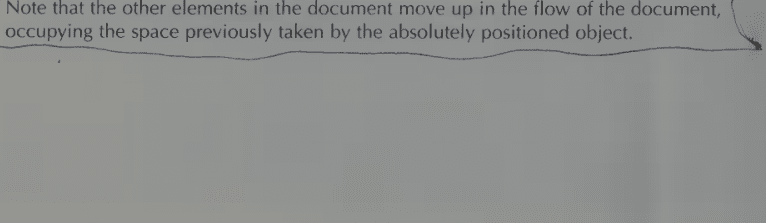

## 绝对定位

# 图 2-13

页面其余内容在文档流中向上移动

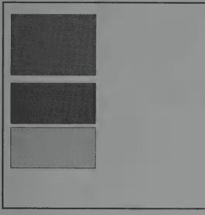

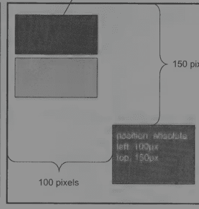

150 像素

position absolute:

left: 100px

top: 150px

100 像素

原始布局

带有绝对定位的布局

## 相对定位

另一种方法是通过相对定位偏移元素。这种方法将元素距离浏览器原本放置它的位置移动特定距离。例如，图 2-14 显示的元素相对于页面原始位置向左偏移 50 像素，向下 75 像素。与绝对定位不同，相对定位不会影响页面上后续对象的放置。其他对象放置在它们的原始位置，就像没有发生过相对定位一样。相对定位仅影响被移动的元素。

## 相对定位

# 图 2-14

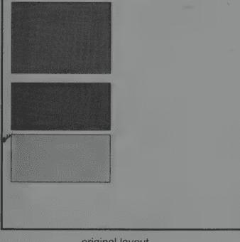

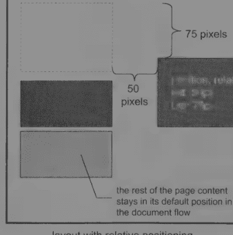

75 像素

50 像素

页面其余内容保留在文档流中的默认位置

原始布局

带有相对定位的布局

# 固定定位和静态定位

**固定定位（fixed position）**将元素放置在显示窗口中的固定位置。该元素保持在该位置，不会随着页面上的其他元素一起滚动。同样，其他元素会移动到之前该元素占据的空间。这与**静态定位（static position）**不同，后者将对象放置在浏览器确定的文档流中的自然位置。通过使用静态定位，你允许浏览器（或任何渲染文档的应用程序）确定元素的位置。因此，在使用静态定位时，你不需要指定 `top`、`right`、`bottom` 或 `left` 值。

## 浮动元素

另一种定位元素的方法是浮动（float）。浮动元素将其放置在页面或容器元素的左侧或右侧边缘，允许后续块绕过它流动。浮动元素的样式为：

```
float: margin;
```

其中图 2-15 显示了一个调整大小并浮动在页面右边缘的元素示例。

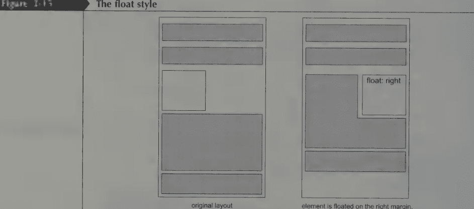

你可以通过清除（clear）防止元素环绕浮动元素。要清除元素，使用样式：

```
clear: margin;
```

其中 `margin` 是 `left`、`right` 或两者。例如，如果 `clear` 样式设置为 "left"，则该元素将位于左浮动元素下方。图 2-16 显示了清除样式的效果。

# 清除样式

# 图 2-16

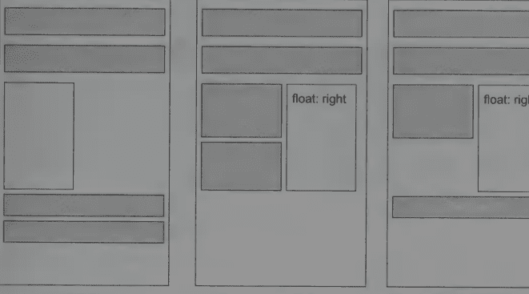

原始布局

带有浮动元素的布局

# 浮动和清除元素

## 参考

- 要将元素浮动在左侧或右侧，使用样式 `float: position`，其中 `position` 是 `none`（默认值）、`left` 或 `right`。


- 要将元素放在所有浮动元素之后的可用空间，使用样式 `clear: position`。

## 元素堆叠

移动元素的位置会导致元素重叠。默认情况下，后定义的元素位于上方。要指定不同的堆叠顺序，使用样式 `z-index`：

```
z-index: value;
```

其中 `value` 是正整数或 `auto`。元素根据 `z-index` 进行堆叠，图 2-17 显示了 `z-index` 对元素堆叠的影响。

## 使用 z-index 样式

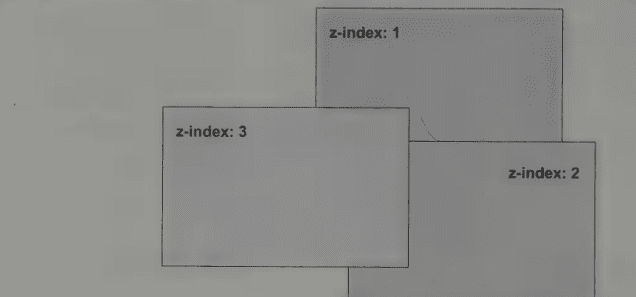

注意，`z-index` 属性仅在元素共享父元素时生效，对具有不同父元素的没有影响。

## 设置元素显示

大多数页面元素被分类为内联元素或块级元素。可以使用 CSS 更改应用于元素的显示样式，允许内联元素显示为块级元素，反之亦然。显示样式的语法为：

```
display: type;
```

其中 `type` 是图 2-18 中描述的 CSS 类型之一。

## 设置显示样式

| 显示 | 描述 |
|---|---|
| block | 作为块级元素显示 |
| inline | 作为内联元素显示 |
| inline-block | 作为具有某些块属性的内联元素显示（如图像） |
| inherit | 继承父元素的显示属性 |
| list-item | 作为列表项目显示 |
| none | 不显示元素 |
| run-in | 根据上下文作为内联或块级元素显示 |
| table | 作为块级表格显示 |
| inline-table | 作为内联表格显示 |
| table-caption | 作为表格标题处理 |
| table-cell | 作为表格单元格处理 |
| table-column | 作为表格列处理 |
| table-column-group | 作为表格列组处理 |
| table-footer-group | 作为页行组处理 |
| table-header-group | 作为表行组处理 |
| table-row | 作为表格行处理 |
| table-row-group | 作为表格行组处理 |

例如，要将元素显示为块级元素，你可以使用如下样式：

```
display: block;
```

## 设置显示样式

- 要定义元素的显示样式，请使用样式：

  ```
  display: type;
  ```

  其中 type 是 "block" 的类型值，用于将元素格式化为块级元素，使用 "inline" 将其格式化为行内元素。

## 隐藏元素

你也可以使用 CSS 来防止元素在渲染后的 Web 页面上显示。这在某个元素需要在特定的输出媒介（如计算机屏幕）中显示，但在另一种介质（如打印输出）中不显示的情况下非常有用。隐藏元素有两种方法。一种是将 display 样式的值设置为 "none"，如下所示的样式声明中：

```css
address { display: none; }
```

这将关闭地址元素的显示。或者，你可以使用 visibility 样式，其语法为：

```
visibility: type;
```

其中 type 为 visible、hidden、collapse 或 inherit（默认值）。"visible" 值使元素可见；"hidden" 值隐藏元素；"collapse" 值用于表格，以防止行或列被显示；而 "inherit" 值使元素从其父元素继承可见性样式。与 display 样式不同，visibility 样式会隐藏元素，但不会将其从页面的元素流中移除。如图 2-19 所示，将 display 样式设置为 "none" 不仅会隐藏元素，还会将其从页面流中移除。

比较 visibility 和 display 样式

| 样式 | 效果 |
|---|---|
| visibility: hidden | 对象被隐藏但仍是页面流的一部分 |
| display: none | 对象被隐藏并已从页面流中移除 |

图 2-19

在许多情况下，`display: none` 样式更适合隐藏元素。`visibility: hidden` 样式通常保留给脚本使用，在脚本中元素交替隐藏和显示，以创建动画效果。

## 使用选择器

现在你已经学习了一些重要的样式，接下来你将查看如何将它们应用到你的 Web 网站中。到目前为止，你只查看了应用于单个元素的样式。然而，CSS 还允许你使用匹配不同元素组合的选择器。例如，如果你想对一组元素应用相同的样式，可以通过输入以逗号分隔的元素列表来对它们进行分组。此功能允许你替换一组重复的声明，例如：

```css
h1 {font-family: sans-serif}
h2 {font-family: sans-serif}
h3 {font-family: sans-serif}
h4 {font-family: sans-serif}
h5 {font-family: sans-serif}
h6 {font-family: sans-serif}
```

用单个声明替换为：

```css
h1, h2, h3, h4, h5, h6 {font-family: sans-serif}
```

你还可以将分组和未分组的选择器结合。在下面的示例中，h1 标题以红色无衬线字体显示，而 h2 标题以蓝色无衬线字体显示。

```css
h2 {font-family: sans-serif}
h1 {color: red}
h2 {color: blue}
```

将常用样式放在单个声明中是简化样式表的一种有效方法。

## 上下文选择器

有时，你可能根据元素在文档中的用法来对元素应用样式。例如，以下样式允许粗体文本显示蓝色：

```css
b {color: blue}
```

然而，如果你只想对列表内的粗体文本应用此样式，你需要一种根据元素使用的上下文来应用样式的方法。你可以通过上下文选择器来实现。例如，要仅当元素是另一个元素的后代时才对其应用样式，你可以使用以下形式：

```css
parent descendant {styles}
```

其中 parent 是父元素，descendant 是父元素的后代，styles 是要应用于后代元素的样式。因此，要仅对列表中的粗体文本应用蓝色，你可以使用样式：

```css
li b {color: blue}
```

## 简单和上下文选择器

在这种情况下，`li` 是父元素，而包含在列表项中的 `b` 会受此样式影响。注意，任何后代元素都不非要是父元素的直接子。在代码中：

```html
<li><span><b>b</b></span> Orders/<span>this month!</span></li>
```

粗体文本是列表项的后代，但它是 `span` 元素的直接子。

上下文选择器也可以与其他选择器分组。以下样式对 h2 标题和粗体列表项应用蓝色字体，但在其他任何地方都不应用：

```css
li b, h2 {color:blue}
```

父/后代形式只是上下文选择器的示例之一。图 2-20 显示了 CSS 支持的一些其他上下文形式。

| 选择器 | 描述 |
| --- | --- |
| * | 匹配层次结构中的任何元素 |
| e | 匹配层次结构中的任何元素 e |
| e1, e2, e3, ... | 匹配元素组 e1, e2, e3, ... |
| e f | 匹配 e 的任何后代元素 f |
| e>f | 匹配 e 的任何直接子元素 f |
| e+f | 匹配任何元素 f |

为了说明这些选择器的多功能性，图 2-21 显示了选择器模式。记住由于样式继承，图 2-20 中列出的上下文选择器属于 CSS2，它们可能未被许多浏览器支持。

## 属性选择器

有时，你可能需要根据属性来选择元素。例如，如果你想让链接文本显示蓝色字体，可以使用如下声明：

```css
a {color: blue}
```

此声明区分用于标记链接的 `<a>` 标签和用于锚点的 `<a>` 标签。要选择元素的属性，你可以创建一个属性选择器。例如，选择器：

```css
element[attr] {styles}
```

选择包含属性 `attr` 的所有 `element` 并对其应用样式。因此，为链接文本应用蓝色字体，你使用声明：

```css
a[href] {color: blue}
```

用于标记锚点的 `<a>` 标签不包含 href 属性，因此不受此样式影响。图 2-22 显示了 CSS 支持的一些其他属性选择器。

## 图 2-22 属性选择器

| 选择器 | 描述 | 示例 | 匹配 |
| --- | --- | --- | --- |
| [att] | 元素包含属性 att | | 匹配包含 href 的元素 |
| [att="val"] | 元素的属性 att 等于 "val" | a[href="gloss.htm"] | 匹配 href 等于 "gloss.htm" 的元素 |
| [att~="val"] | 元素的属性值是用空格分隔的单词列表，其中恰好有一个 "val" | a[rel~="glossary"] | 匹配属性包含单词 "glossary" 的元素 |
| [att|="val"] | 元素的属性值是以连字符分隔的单词列表，以 "val" 开头 | p[id|="first"] | 匹配 id 在连字符分隔列表中以 "first" 开头的段落 |
| [att^="val"] | 元素的属性以 val 开头 (CSS3) | a[rel^="prev"] | 匹配属性以 "prev" 开头的元素 |
| [att$="val"] | 元素的属性以 val 结尾 (CSS3) | a[href$="org"] | 匹配属性以 "org" 结尾的元素 |
| [att*="val"] | 元素的属性包含值 val (CSS3) | a[href*="faq"] | 匹配属性包含字符串 "faq" 的元素 |

与上下文选择器一样，浏览器对选择器的支持参差不齐。图 2-22 中列的一些选择器是 CSS3 提案规范的一部分，目前浏览器支持非常少。

## 为 ID 和类应用样式

使用 CSS 选择器根据元素的 id 和类值向元素应用样式。

要根据元素的 id 属性值为元素应用样式，请使用以下格式：

```css
#id {styles}
```

其中 id 是文档中某个元素的 id 值。例如，如果你想让 h1 标题中的文字居中：

```html
<h1 id="company">Pixal Products</h1>
```

你可以在内联或外部样式表中使用样式声明：

```css
#company {text-align: right}
```

请记住，每个 id 都是唯一的，不能应用于多个元素。要对一组元素进行“类标识化”，你需要使用 class 属性。要根据类属性的值为一组元素应用样式，请使用如下选择器：

```css
.class {styles}
```

图 2-23 显示了如何通过根据类值应用样式来为一组元素应用相同的样式。

## 为类应用样式

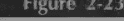

```html
<ul>
  <li class="fruit">Apples</li>
  <li class="vegetable">Carrots</li>
  <li class="fruit">Grapes</li>
  <li class="vegetable">Lettuce</li>
  <li class="fruit">Melons</li>
  <li class="vegetable">Onions</li>
</ul>
```

渲染内容

- Apples
- Carrots
- Grapes
- Lettuce
- Melons
- Onions

元素

```css
.fruit {color: red}
.vegetable {color: green}
```

样式

如果你想为特定类型的元素类应用样式，请使用以下格式将元素名与类值结合：

```css
element.class {styles}
```

其中 element 和 class 分别是元素和类名。图 2-24 展示了如何结合类值和元素名来格式化上面的 h1 和 h2 标题。注意，无衬线字体（sans-serif）应用于任何具有 title 类的元素，但斜体字体样式仅应用于 title 类的 h2 标题。

## 图 2-24 为类和元素应用样式

```html
<h1 class="title">Pixal Products</h1>
<h2 class="title">Quality Imaging</h2>
```

渲染内容

# Pixal Products
## Quality Imaging

元素

```css
.title {font-family: sans-serif; font-style: italic;}
```

样式

## 参考窗口：为 id 和类应用样式

- 要为具有 id 的元素应用样式，使用格式 `#id {styles}`，其中 `id` 是该元素的 id 属性值。
- 要为元素类应用样式，使用格式 `.class {styles}`，其中 `class` 是元素的 class 属性值。
- 要为特定类型的元素类应用样式，使用格式 `element.class {styles}`，其中 `element` 是元素名。

## 为伪类和伪元素应用样式

另一种选择器格式是基于伪类的。伪类（pseudoclass）是根据元素在文档中的状态、位置或当前用途对元素进行的分类。例如，其中一个伪类表示用户之前是否访问过某个链接。另一个伪类表示该链接当前是否被激活或被点击。要为伪类创建样式，请使用如下样式：

```css
selector:pseudoclass {styles}
```

其中 selector 是文档中的一个元素或一组元素，pseudoclass 是伪类的名称，而 styles 是你想要应用的样式。图 2-25 列出了 CSS 支持的一些伪类。

## 伪类

| 伪类 | 描述 | 示例 |
| --- | --- | --- |
| link | 链接尚未被用户访问 | a:link {color: red} |
| visited | 链接已被用户访问过 | a:visited {color: green} |
| active | 链接正处于用户激活的过程中 | a:active {color: yellow} |
| hover | 鼠标指针悬停在链接上 (CSS2) | a:hover {color: blue} |
| focus | 元素接收了键盘或鼠标指针的焦点 (CSS2) | input:focus {background-color: yellow} |
| first-child | 元素是其父元素的第一个孩子 (CSS2) | p:first-child {text-indent: 0} |
| lang | 与元素一起使用的语言 | q:lang(fr) {quotes: 's'} |

例如，如果你想将所有访问过的链接的字体颜色改为红色，可以使用样式声明：

```
a:visited {color: red}
```

伪类通常用于创建悬停效果（rollover effects），即当用户鼠标悬停在元素上时对元素应用效果。例如，样式可以移除文档中所有链接的下划线，除非用户将鼠标指针悬停在链接上，此时会出现下划线：

```css
a {text-decoration: none}
a:hover {text-decoration: underline}
```

在某些情况下，多个伪类可以应用于同一个元素——例如，链接被访问。然而，选择器的顺序很重要。同样，你可以使用伪元素来创建字母花字（drop-caps）。为了创建字母花字，你需要增大第一个字母的大小并使其浮动在左边距。字母花字如果减小第一行的高度，会让内容环绕字母字母。

## 伪元素

| 伪元素 | 描述 | 示例 |
| --- | --- | --- |
| first-letter | 元素的第一个字母 | p:first-letter {font-size: 14pt} |
| first-line | 元素的第一行 | p:first-line {font-transform: uppercase} |
| before | 在元素之前放置的内容 (CSS2) | p:before {content: "Special"} |
| after | 在元素之后放置的内容 (CSS2) | p:after {content: "eof"} |

例如，为了将每个段落的首字母显示为金色，你使用：

```css
p:first-letter {font-family: fantasy; color: gold}
```

## 使用伪类和伪元素

- 要为伪类创建样式，使用 `selector:pseudoclass {styles}`，其中 selector 是文档中的一个元素或一组元素，pseudoclass 是伪类的名称，而 styles 是你想要应用的样式。有用的伪类包括 link、visited、hovered 和 active 伪类。
- 要为伪元素创建样式，使用 `selector::pseudoelement {styles}`，其中 selector 是文档中的一组元素，pseudoelement 是伪元素的名称，而 styles 是你想要应用于伪元素的样式。有用的伪元素包括 first-line 和 first-letter 伪元素，它们代表元素内容的第一行或第一个字母。

## 使用不同的媒体

默认情况下，样式表适用于所有设备，每个设备都必须根据其自身的需求尽可能地匹配指定的样式。例如，当你打印 Web 页面时，Web 浏览器及其内置样式会为打印做好准备。用户对该过程具有控制权——例如确定页边距的大小或打印页眉页脚的内容。

你可以在 link 或 style 元素中使用 media 属性来为特定样式定义输出设备。例如，要指定名为 "sounds.css" 的外部样式适用于听觉浏览器，请在你的 HTML 或 XHTML 文档输入 link 元素：

```html
<link href="sounds.css" type="text/css" media="aural" />
```

同样地，你在嵌入式样式表中使用 `media` 属性来指示其样式是用于听觉设备的：

```html
<style type="text/css" media="aural">
</style>
```

`media` 属性也可以包含一个用逗号分隔的媒体类型列表。下面的 `link` 元素链接了一个专为打印和屏幕媒体设计的样式表：

```html
<link href="output.css" type="text/css" media="print, screen" />
```

样式表在不同媒体类型中的级联方式与它们在文档树中的级联方式相同。如果未指定输出设备，样式表将应用于所有设备，除非它被针对特定设备的样式所取代。在以下嵌入式样式表中，标题在所有设备上都以无衬线字体显示；然而，电脑屏幕的文本颜色为红色，打印页为黑色：

```css
<style type="text/css">
h1 { font-family: sans-serif }
</style>
<style type="text/css" media="screen">
h1 { color: red }
</style>
<style type="text/css" media="print">
h1 { color: black }
</style>
```

## @media 规则

你也可以使用以下规则在样式表内部指定输出媒体：

```css
@media type {style declarations}
```

其中 `type` 是支持的媒体类型之一，`style declarations` 是与媒体类型相关的样式。例如，以下声明设置了各种输出媒体的 `body` 类型和 `h1` 标题的字体大小：

```css
@media screen { body { font-size: 1em } h1 { font-size: 2em } }
@media print { body { font-size: 12pt } h1 { font-size: 16pt } }
@media handheld { body { font-size: 8pt } h1 { font-size: 12pt } }
@media tv { body { font-size: 12pt } h1 { font-size: 24pt } }
```

在该样式表中，手持设备的字体最小（假设其屏幕区域有限），电视的字体最大（通常从较远的距离观看）。与 `media` 属性类似，`@media` 规则也允许你将媒体类型放在用逗号分隔的列表中：

```css
@media screen, print, handheld, tv { h1 {font-family: sans-serif} }
```

`media` 属性和 `@media` 规则各有自己的优缺点。`@media` 规则允许你将所有样式合并到一个样式表中；然而，这种合并可能会导致文件更大、更复杂。另一种方法是将媒体样式放在不同的表中，这可以使这些表更易维护；但是，如果你更改了网站的设计，可能需要在多个样式表中重复你的更改。

## 为不同媒体创建样式

- 要为特定媒体创建样式表，请在 `link` 元素或 `style` 元素中添加以下属性：

  `media="type"`

  其中 `type` 是以下一个或多个类型：aural、braille、embossed、handheld、print、projection、screen、tty 或 all。如果不为 `media` 属性指定值，则样式表将应用于所有媒体。多个类型应以逗号分隔的列表输入。

- 要在样式表中为特定媒体创建样式声明，请使用形式 `@media type {style declarations}`。

许多旧版浏览器不支持 `media` 属性、`@media` 规则或 CSS2 样式。对于这些旧浏览器，为不同媒体格式化输出的最常见做法是将每个页面链接到文档的打印友好版本，该版本是专门为打印而格式化的。虽然这种方法有迫使你创建和维护页面副本的缺点，但它提供了打印样式的选择。你可以打印在电脑屏幕上显示的页面，也可以使用你设计的特殊格式化打印样式。

## 媒体组

尽管各种类型的输出媒体之间存在差异，但它们共享一些共同属性。电脑屏幕和打印页都是视觉媒体。录音不是视觉的，而是听觉的。发送到电视的输出可能是视觉和听觉的。CSS2 将这些不同的基本属性组织成媒体组。共有四个媒体组描述了输出的基本方面。输出媒体可以是：

- 连续的（Continuous）或分页的（Paged）
- 视觉的（Visual）、听觉的（aural）或触感的（tactile）
- 网格（Grid，用于字符网格设备）或位图（bitmap）
- 交互式的（Interactive，允许用户交互的设备）或静态的（static，不允许交互的设备）

图 2-27 显示了如何根据四个媒体组对种输出媒体进行分类。打印输出是分页的（因为输出以离散单元或页的形式出现）；视觉的、位图、静态的（你无法与之交互）。电脑屏幕是连续的、视觉的、位图，并且可以是静态的也可以是交互的。

## 图 2-27 媒体组

| 媒体类型 | continuous/paged | visual/aural/tactile | grid/bitmap | interactive/static |
| :--- | :--- | :--- | :--- | :--- |
| aural | continuous | aural | N/A | both |
| braille | continuous | tactile | grid | both |
| embossed | paged | tactile | grid | both |
| handheld | both | visual | both | both |
| print | paged | visual | bitmap | static |
| projection | paged | visual | bitmap | static |
| screen | continuous | visual | bitmap | both |
| tty | continuous | visual | grid | both |
| tv | both | visual, aural | bitmap | |

媒体组之所以重要，是因为 `@media` 规则允许你将所有样式合并到一个样式表中；然而，这种合并可能会导致文件更大、更复杂。另一种方法是将媒体样式放在不同的表中，这可以使这些表更容易维护；但是，如果你更改了网站的设计，可能需要在多个样式表中重复你的更改。

（注：提示中提供的 OCR 文本在末尾似乎有大量的重复或伪影。我已经处理了第 106-108 页提供的唯一内容，并根据提供的指令清理了输出。）

## 显示裁剪线

在高质量打印中，裁剪线（crop marks）用于定义页面在装订之前裁剪的位置。CSS2 支持 `marks` 属性，可以在打印页上添加裁剪线。`marks` 样式的语法为：

```
marks: type
```

其中 `type` 为 `crop`（裁剪）、`inherit`（继承）或 `none`（无）。图 2-28 显示了 `crop` 和 `cross` 值的示例。

### 显示裁剪线

图 2-28

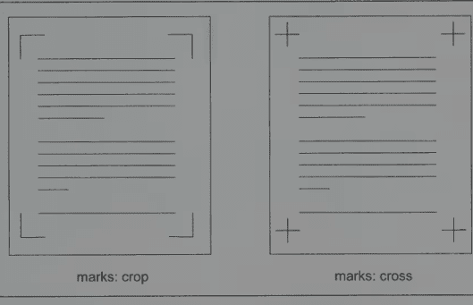

裁剪线的尺寸、样式和位置取决于浏览器。

## 处理分页符

CSS 支持三种决定分页符相对于元素的样式。`page-break-before` 和 `page-break-after` 用于在元素之前或之后放置分页符。`page-break-before` 和 `page-break-after` 样式的语法为：

```
page-break-before: type
page-break-after: type
```

其中 `type` 为 `always`（始终放置分页符）、`avoid`（从不放置分页符）、`left`（当后续页为左页时强制此处分页符）、`right`（当后续页为右页时强制此处分页符）、`auto`（允许浏览器决定是否插入分页符）或 `inherit`（继承元素的页面样式）。如果你希望表格始终出现在单独的页面上，可以使用以下语法在每个表格之前或之后放置分页符：

```
table {page-break-before: always; page-break-after: always}
```

你可以使用 `page-break-inside` 样式来防止插入分页符，其语法如下：

```
page-break-inside: type
```

其中 `type` 为 `auto`、`inherit` 或 `avoid`。如果你想避免在表格内部放置分页符，可以使用以下样式：

```
table {page-break-inside: avoid}
```

请注意，`avoid` 类型并不保证元素内部不会出现分页符。如果元素的内容超过了纸张的尺寸，浏览器可能会被强制插入分页符。

你可以结合各种页面样式来对打印输出提供更强大的控制。例如，如果你的文档包含几个宽表格，可以使用以下样式声明将表格放在横向布局的页面上：

```
@page table_page { size: 8.5in landscape; }
table { page: table_page; page-break-before: always; page-break-inside: avoid; page-break-after: always; }
```

最后，你使用 CSS2 控制在元素内部插入分页符时出现的孤行（widows）和孤节（orphans）的大小。孤行是指元素的文本最后几行出现在页面顶部，而元素的大部分文本出现在上一页的情况。孤节描述的是元素文本的前几行出现在页面底部，而元素的大部分文本出现在下一页的情况。控制孤行和孤节的样式为：

```
widows: value
orphans: value
```

其中 `value` 是在插入分页符之前必须在元素内连续的行数。默认值为 2，这意味着孤行和孤节都至少包含两行文本。如果你想将文档段落的孤行和孤节大小增加到三行，请使用样式声明：

```
p {widows: 3; orphans: 3}
```

需要注意的是，浏览器并不总是能实现你指定的 `widows` 和 `orphans` 值。浏览器会尝试使用遵循以下指南的分页符：

- 根据 `page-break-before`、`page-break-after` 和 `page-break-inside` 样式指示插入所有手动分页符。
- 避免在样式表中指示的地方插入分页符。
- 尽可能少地进行分页。
- 让所有没有强制分页符的页面看起来具有相同的高度。
- 避免在带有边框的块级元素内部分页。
- 避免在表格内部分页。
- 避免在浮动元素内部分页。

只有在尝试满足这些约束后，才会应用 `widows` 和 `orphans` 样式的建议。

## 处理打印样式

- 要为打印输出定义指示页面尺寸、边距和方向的页面框，使用声明：

  `@page {styles}`

  其中 `styles` 是你想要定义的页面样式。

- 要对特定页面应用样式，使用声明：

  `@page pseudo-class`

  其中 `pseudo-class` 为 `first`（第一页）、`left`（出现在左侧的页面）或 `right`（出现在右侧的页面）。

- 要设置页面尺寸和方向，使用样式：

  `size: width height orientation`

  其中 `width` 和 `height` 是页面的宽度和高度，`orientation` 是页面方向（纵向或横向）。

- 要显示裁剪线，使用样式：

  `marks: type`

  其中 `type` 为 `crop`、`cross`、`inherit` 或 `none`。

- 要格式化元素之前的分页符，使用样式：

  `page-break-before: type`

  其中 `type` 为 `always`（始终放置分页符）、`avoid`（从不放置分页符）、`left`（当后续页为左页时强制此处分页符）、`right`（当后续页为右页时强制此处分页符）、`auto`（允许浏览器决定是否插入分页符）或 `inherit`（继承页面样式）。

- 要格式化元素之后的分页符，使用样式：

  `page-break-after: type`

  其中 `type` 为 `always`（始终放置分页符）、`avoid`（从不放置分页符）、`left`（当后续页为左页时强制此处分页符）、`right`（当后续页为右页时强制此处分页符）、`auto`（允许浏览器决定是否插入分页符）或 `inherit`（继承页面样式）。

- 要格式化元素内部的分页，使用样式：

  `page-break-inside: type`

  其中 `type` 为 `auto`、`inherit` 或 `avoid`。

## 参考

## 复习总结

在回顾中，你学习了层叠样式表（CSS）的历史和语法。你看到了如何使用内联样式、嵌入样式和外部样式应用于 Web 页面。涵盖了应用于字体、文本、颜色和图像的不同样式。你学习了调整元素大小、应用边框以及设置外边距和内边距。还讨论了如何使用 CSS 在页面上定位元素。在回顾的最后部分，你学习了选择器形式以及如何根据 ID 值和类值应用样式。还涵盖了如何使用伪类和伪元素创建悬停效果和首字放大。回顾以讨论针对媒体设计的样式表以及针对打印输出的样式结束。

## 核心术语

- 绝对定位
- 绝对单位
- 属性选择器
- 盒模型
- 层叠样式表
- 上下文选择器
- CSS
- CSS1
- CSS2
- CSS2.1
- CSS3
- em 单位
- 嵌入样式
- ex 单位
- 外部样式
- 固定定位
- 通用字体
- 内联样式
- 字间距
- 行高
- 媒体组
- 孤节
- 页面框
- 像素
- 打印友好版本
- 伪类
- 伪元素
- 相对定位
- 相对单位
- 悬停效果
- 可缩放
- 选择器
- 特定字体
- 静态定位
- 样式继承
- 样式表
- 跟踪字体
- 孤行

## 复习题

1. 什么是样式表？
2. 什么是 CSS？
3. 应用样式表的三种方法是什么？
4. 内联样式的语法是什么？
5. 在 h1 标题上添加什么内联样式可以将“Pixel Products”的颜色改为蓝色？
6. 创建嵌入样式表的语法是什么？
7. 嵌入或外部样式表中样式声明的语法是什么？
8. 你输入什么代码来创建一个将所有 h1 标题设置为蓝色的嵌入样式？
9. 在元素上添加什么属性以指示该样式表是为打印设计的？
10. 你输入什么代码来创建指向外部样式文件“styles.css”的链接？假设该样式表是为打印设计的。
11. 你会在样式表中添加什么代码来插入注释“printed styles”？
12. 你会输入什么样式来为文档中的每个 h3 标题应用 Arial、Helvetica 或无衬线字体？
13. 什么是绝对单位和相对单位？
14. 你会输入什么样式来让字体大小在默认基础上增加 50%？
15. 什么是字间距（kerning）、字距跟踪（tracking）和行距（leading）？设置元素字间距、字距跟踪和行距值的样式分别是什么？
16. 你会使用什么样式来以斜体显示文本？
17. 你会输入什么单一样式来以粗体 12pt Arial 字体显示文本？
18. 你会输入什么样式声明将页面背景颜色更改为颜色值 (212, 255, 155)？
19. 你会输入什么样式声明将背景图像更改为图像文件 paper.jpg？
20. 你会输入什么样式声明将 id 为 "logo" 的元素宽度设置为 250 像素，高度设置为 100 像素？
21. 你会输入什么样式声明为 logo 元素添加一个 10 像素的蓝色边框，并以 outset（外凸）边框样式显示？
22. 什么是绝对定位和相对定位？
23. 你输入什么样式将元素浮动在页面的左边距上？
24. 你可以输入哪两个样式来防止浏览器显示某个对象？
25. 你会输入什么选择器来匹配所有位于 address 元素中的粗体元素？
26. 你会使用什么选择器来匹配所有属于类 "links" 的元素？
27. 什么是伪类？给出两个伪类的示例。
28. 什么是伪元素？给出两个伪元素的示例。
29. 你会输入什么样式来定义一个具有 5 英寸页边距的页面框？
30. 你会输入什么样式声明将双面打印中右侧页的页边距设置为 3 英寸？
31. 你会输入什么样式声明在每个 h1 标题之前插入分页符？

## 目标

## 章节 1.1

- 了解 JavaScript 的历史和理论
- 创建一个 script 元素
- 理解并使用基础 JavaScript 语法
- 使用 JavaScript 命令向 Web 文档写入文本

## 章节 1.2

- 理解 JavaScript 支持的不同数据类型
- 声明变量并为其赋值
- 在 JavaScript 语句中引用值
- 创建并调用 JavaScript 函数
- 从外部 JavaScript 文件访问函数
- 使用多行和单行注释对代码进行说明
- 了解调试 JavaScript 代码的基础技术

## 介绍 JavaScript

## 从垃圾邮件发送者处隐藏电子邮件地址

### 案例

### 蒙罗伊公共图书馆 (Monroe Public Library)

Kate Howard 是蒙罗伊公共图书馆的技术服务主管。她的工作之一是维护图书馆的网站。在过去的几年里，图书馆将其员工名录（包括所有指向图书馆员工电子邮件的链接）发布在网上。Kate 认为这是让每个人都能方便访问图书馆的重要组成部分。然而，Kate 开始担心公开员工地址所涉及的安全问题。Kate 意识到，电子邮件地址可以从 HTML 文件中被扫描，并用于向收件者发送垃圾邮件。

她希望有一种方法可以在 HTML 代码中扰乱电子邮件地址，同时在页面由 Web 浏览器渲染时仍保持其可见性。Kate 寻求你的帮助编写一个程序以实现这一目标。

### 学生数据文件

- tutorial.01
  - mpltxt.htm
  - spam.js
  - mplstyles.css
  - mpl.jpg
- review folder
  - mpl2txt.htm
  - random.js
  - mplstyles.css
  - 11 个图形文件
- case1 folder
  - skymapxt.htm
  - datetime.js
  - skyweb.css
  - 26 个图形文件
- case2 folder
  - fronttxt.htm
  - ads.js
  - random.js
  - styles.css
  - 7 个图形文件
- case3 folder
  - todaytxt.htm
  - functions.js
  - back.jpg
  - 7 个 HTML 文件
  - 2 个样式表
- case4 folder
  - birthtxt.htm
  - functions.js
  - styles.css
  - logo.jpg

# JVS 2 JavaScript 教程 1 介绍: javascript

## 章节 1.1

你与 Kate 会面，讨论她在蒙罗伊图书馆员工名录页上遇到的问题。她向你展示了她创建的内容和页面布局。

要查看员工名录页：

1. 使用你的文本编辑器打开 `tutorial.01/tutorial` 中的 `mpltxt.htm`。在文件顶部的注释部分输入你的名字和日期，并将文件保存为 `mpl.html`。
2. 花些时间滚动查看文件，以熟悉其内容。
3. 在你的网络浏览器中打开 `mpl.html`。图 1-1 显示了 Kate 对员工名录的设计。

注意，员工名录表格包含一列，Kate 想在其中插入通到每个员工电子邮件地址的链接；但目前，该列是空的。

| 蒙罗伊公共图书馆 | 员工名录 | |
|---|---|---|
| Catherine Adler | 555-3100 | |
| Michael Lib | 555-3245 | |
| Date Howard | 555-4389 | |
| Robert Hope | 555-7811 | |
| Dwayne Lewis | 555-9001 | |
| Debill Forth | 555-9518 | |

图 1-1 显示了 Kate 对员工名录的设计。注意，某些垃圾邮件收集者可以同时查看底层代码和浏览器渲染的页面，这意味着提议的扰乱方法并非 100% 有效。然而，由于这种技术可以阻挡许多正在使用的垃圾邮件收集者，Kate 接受了这作为一种折中方案。

## JVS 教程 1 JavaScript 简介

图 1-3 混淆的电子邮件地址

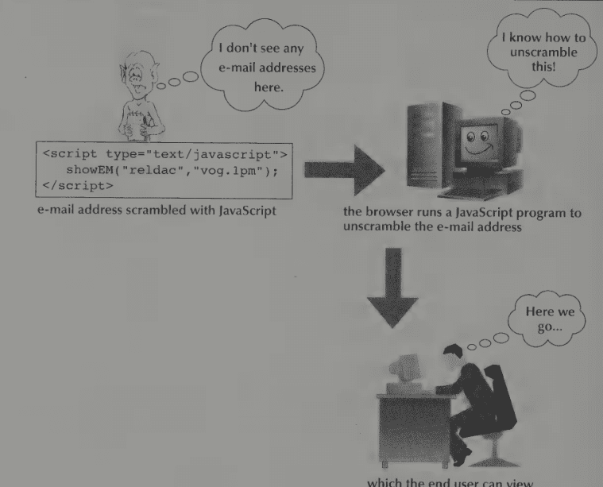

```html
<script type="text/javascript">
showEM("reldac","vog.lpm");
</script>
```

使用 JavaScript 混淆的电子邮件地址

浏览器运行一个 JavaScript 程序来解密电子邮件地址

你告诉 Kate，你将不得不编写一个程序来对她员工目录中的电子邮件地址进行混淆和解密，因为这既不是 HTML 或 XHTML 提供的功能，也不是 Web 浏览器的标准功能。Kate 不希望让顾客下载任何应用程序来执行此操作。经过一番讨论，你决定 JavaScript 非常适合这项任务。你将从通过了解 JavaScript 是什么以及如何使用它来开始这个项目。

## 服务端编程与客户端编程

Web 编程分为两种类型：服务器端编程和客户端编程。在服务器端编程中，程序被放置在托管网站的服务器上。然后使用该程序来修改 Web 页面的内容和结构。在某些情况下，用户可以与程序交互，请求在页面上显示特定信息（见图 1-4），但所有交互都是远程完成的——从用户到服务器。

## 服务器端编程

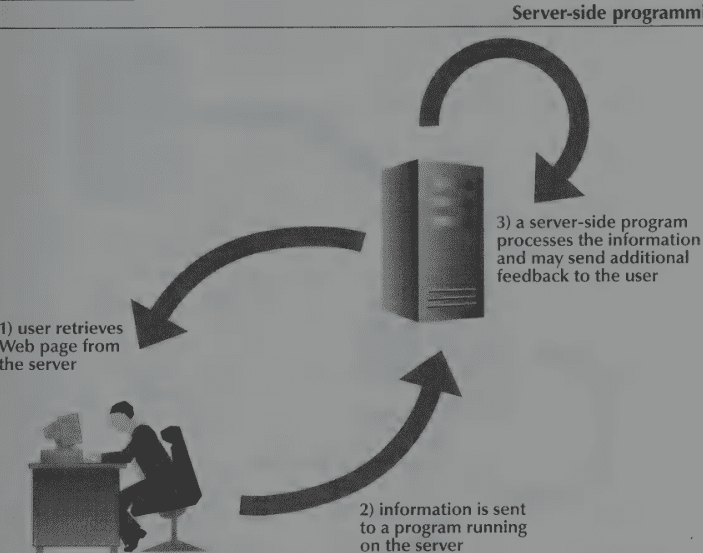

这种方法有利也有不利。运行在服务器上的程序可以连接到包含终端用户通常无法访问的信息的数据库，允许他们执行客户端无法执行的任务。这使得 Web 页面能够支持如网上银行、信用卡交易和讨论组等功能。然而，服务器端程序使用 Web 资源，在某些情况下可能会进行系统管理，这可能限制了用户对服务器端程序的访问，以防止用户持续访问服务器并可能导致系统过载。如果系统过载，终端用户可能需要经历长时间延迟，因为服务器端程序正在处理多个信息和操作请求。

**客户端编程**通过在每个终端用户自己的计算机上运行程序，而不是从服务器远程运行，解决了这些许多问题（见图 1-5）。因此，计算是分布式的，这样服务器就不会因为程序请求的请求而过载。客户端程序对用户的响应也更快，因为用户不需要等待数据通过 Internet 发送到 Web 服务器。然而，客户端程序永远无法完全替代服务器端编程。例如，如果你需要运行搜索表单或处理购买订单，这些类型的工作必须从中央服务器运行，因为只有服务器才包含完成此类类型操作所需的数据库。

## 客户端编程

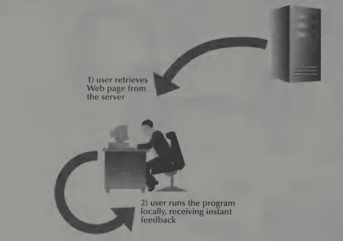

在许多情况下，你会结合使用服务器端和客户端编程。例如，Web 表单通常使用客户端程序来验证用户的输入（例如确保所有地址信息已完整输入），并使用服务器端程序提交经过验证的表单进行进一步处理（例如将购买订单发送到中央数据库）。见图 1-6。

## 结合客户端和服务器端编程

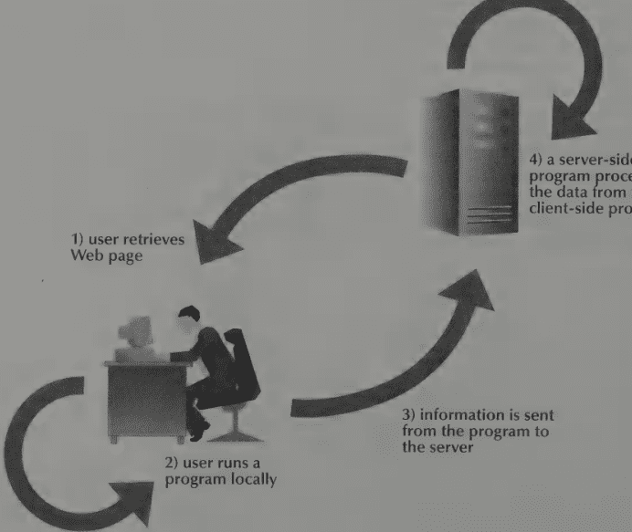

在本书中，我们只关注客户端编程。然而，重要的是，在许多情况下，一个完成的 Web 应用程序包含了客户端和服务器端的元素。

## JavaScript 的发展

有几种编程语言可以在客户端运行。其中一种获得广泛支持的客户端编程语言是 Java，它是 Sun Microsystems 公司在 20 世纪 90 年代开发的。Java 程序设计在称为 Java 解释器的应用程序中运行。由于可以为不同的操作系统创建 Java 解释器，因此任何 Java 程序都能够在各种操作系统和环境（UNIX、Windows 和 Macintosh 系统）中运行。正如 HTML 设计用于实现一样，在解释器中运行的 Java 程序被称为 applet（小程序），它们不是独立的应用程序，而是依赖解释器运行。Java applet 随 Web 页面下载，但 applet 本身运行在用户的计算机上。它为其他程序腾出了空间。

当 Java 引入时，它的优势显而易见，并在 Web 领域得到了认可。Netscape 在 Netscape Navigator 2.0 中整合了 Java 解释器，微软也没有浪费时间就将它自己的解释器包含在 Internet Explorer 3.0 中。然而，Java 的一个问题是程序员发现它很难学习和使用，而且创建 Java applet 需要访问 Java 开发工具包（JDK）。

为了简化这一点，来自 Netscape 和 Sun Microsystems 的开发人员创建了 Java 的子集称为 JavaScript，它在几个重要方面与 Java 不同。Java 是编译语言，这意味着程序必须提交给编译器，编译器将代码翻译成机器可以理解的基础语言。与 Java applet 不同，要在编译语言中创建并运行程序，你既需要编译器也需要可以运行编译代码的操作系统。

另一方面，JavaScript 是解释执行的。使用 JavaScript 只需要两件事：1) 一个用于编写命令的文本编辑器，2) 一个可以解释 JavaScript 的浏览器。

## JavaScript 教程

多年来，JavaScript 经历了多次修订。Internet Explorer 支持一个略不同的版本，称为 JScript。虽然 JScript 与 JavaScript 几乎相同，但某些 JavaScript 命令在最新版本中不支持，反之亦然。例如，你应该在各种浏览器上测试你的 JavaScript。

由于脚本语言版本的激增，开发标准的责任已移交给欧洲计算机协会（ECMA）。由 ECMA 开发的标准被称为 ECMAScript——尽管其他人称之为 JavaScript。图 1-8 列出了 JavaScript 和 JScript 的版本。

## 图 1-8

| 版本 | 浏览器 | 年份 |
|---|---|---|
| JavaScript 1.0 | Netscape Navigator 2.0 | 1995 |
| JScript 1.0 | Internet Explorer 1.0 | 1996 |
| JavaScript 1.1 | Netscape Navigator 3.0 | 1996 |
| JavaScript 1.2 | Netscape Navigator 4.0 | 1997 |
| JavaScript 3.0 | Internet Explorer 4.0 | 1997 |
| JScript 1.3 | Netscape Navigator 4.5 | 1998 |
| JScript 5.0 | Internet Explorer 5.0 | 1999 |
| JavaScript 1.5 | Netscape Navigator 6.0 | 2001 |

其他客户端编程语言也适用于 Web 页面设计，例如 Internet Explorer 的脚本语言 VBScript。然而，由于 JavaScript 几乎获得了支持，你将在你的网站工作中使用这种语言。

## 使用脚本元素

JavaScript 程序可以直接放在 HTML 文件中，也可以保存在外部文本文件中。将 JavaScript 代码放置在 Web 页面文件中意味着用户只需要从服务器检索一个文件。此外，因为代码和它影响的页面在同一个文件中，可能更容易定位和修复错误。然而，如果你将代码放在单独的文件中，你编写的程序可以在不同的页面之间共享。在本教程中，你将处理输入 HTML 文件的 JavaScript 代码以及存储在外部文件中的代码。你将首先检查如何将 JavaScript 代码直接插入 HTML 文件中。

## 创建脚本元素

脚本使用 script 元素进入 HTML 或 XML 文件中。script 元素的语法为：

```
<script type="mime-type">
  script commands
</script>
```

其中 `mime-type` 定义了脚本所在的语言，而 `script-commands` 是用脚本语言编写的命令。`type` 属性是 XML 文档必需的，也应用于 HTML 文档。JavaScript 程序的 MIME 类型为 "text/javascript"，这意味着对于 JavaScript 程序，你会使用以下格式：

```
<script type="text/javascript">
JavaScript commands
</script>
```

你可能会看到其他向 Web 页面插入元素的方法。在 HTML 的早期版本中，使用 `language` 属性代替 `type` 属性来指定脚本语言。对于旧版浏览器，你使用以下格式指明脚本语言为 JavaScript：

```
<script language="JavaScript">
JavaScript commands
</script>
```

`script` 元素已弃用，在 XML 或 HTML 的严格应用中不再被支持。如果你想符合当前标准，应该使用 `type` 属性代替它。

注意，`script` 元素可以用于 JavaScript 以外的编程语言。其他客户端脚本语言通过 `type` 属性的不同值来识别。例如，如果你使用微软的 VBScript，其 MIME 类型为 "text/vscript"。我们在这本书中不会讨论 VBScript。

## 创建脚本元素

- 要将脚本元素放入 Web 页面，请插入以下双边标签：

  ```
  <script type="mime-type">
  script commands and comments
  </script>
  ```

  其中 `mime-type` 是脚本语言的 MIME 类型。若要为 JavaScript 创建脚本元素，请将 `mime-type` 设置为 "text/javascript"。`script` 元素可以放置在文档的 `head` 或 `body` 部分。

## 放置脚本元素

当浏览器在文件中遇到 `script` 元素时，它知道会将元素内的任何行视为待执行代码。Web 页面中使用的脚本元素数量没有限制。脚本元素按照它们在文件中出现的顺序进行处理。脚本可以放在文档的 `head` 或 `body` 部分。当放置在 Web 页面的 `body` 元素中时，浏览器会在加载不同元素时中断渲染。浏览器仍然能够将它们作为一个单元进行处理。在一个 `script` 元素中创建的 JavaScript 命令可以通过其他 `script` 元素中的命令引用。

## 创建语句

现在你已经回顾了在 HTML 中输入 JavaScript 的基础知识，你将编写第一段 JavaScript 代码。JavaScript 代码由一系列语句组成。每个语句（也称为命令）都是一行指示浏览器执行特定操作的单行代码。语句应以分号结束。

JavaScript 语句是浏览器运行的代码。分号是通知浏览器已到达语句结尾的正式方式。某些浏览器非常宽容，如果你忽略了包含结尾分号，它们仍然能正确解释大多数语句。然而，包含分号是良好的编程习惯，且某些浏览器确实要求使用分号。

## 向 Web 文档写入输出

你想添加到 Kate 文档中的第一段代码是在 Web 页面上写入电子邮件地址的文本。虽然你可以直接输入电子邮件地址，但你将利用此机会尝试 JavaScript。随着教程后续部分的学习，你还将在这个简单语句的基础上继续构建。你将插入员工目录中第一项 Catherine Adler 的电子邮件地址。她的电子邮件地址是：

`cadler@mpl.gov`

要将此内容写入 Web 文档，你需要插入语句：

```html
<script type="text/javascript">
document.write("cadler@mpl.gov");
</script>
```

此 `document.write()` 语句告诉浏览器向 Web 页面发送字符串 "cadler@mpl.gov"。要查看你的浏览器如何应用此命令，请将脚本元素和命令输入 Kate 的 html 文件中。

### 使用 JavaScript 向你的 Web 文档写入文本：

1. 返回文本编辑器中的 `mpl.htm`。
2. 找到 Catherine Adler 条目之后的表格单元格，并插入以下代码（图 1-9）：

```html
<script type="text/javascript">
document.write("cadler@mpl.gov");
</script>
```

## 插入脚本元素

| | |
| :--- | :--- |
| Catherine Adler<br>主管 | |
| 555-3100 | |
| <script type="text/javascript">document.write("cadler@mpl.gov");</script> | |

3. 保存文件更改并在 Web 浏览器中重新加载 `mpl.htm`。如图 1-10 所示，Catherine 的电子邮件地址文本应该出现在员工目录中。

## 员工目录

| 姓名和角色 | 电话 | 电子邮件 |
| :--- | :--- | :--- |
| Catherine Adler, 图书馆 | 555-3100 | cadler@monroe.gov |
| Michael Head, 成人服务主管 | 555-3145 | |
| Kate Howard, 技术服务主管 | 555-4399 | |
| Robert Rose, 儿童服务主管 | 555-7811 | |
| Wayne Lewis, 借阅服务 | 555-9001 | |
| Bill Forth, 图书互借 | 555-8391 | |

使用 JavaScript 插入的电子邮件地址

**遇到问题？** 如果电子邮件地址没有出现，请检查是否正确包含了 `script` 标签，以及 `document.write` 语句拼写是否正确。确保你的浏览器已启用运行 JavaScript。

## 查看邮件链接

## 图 1-12

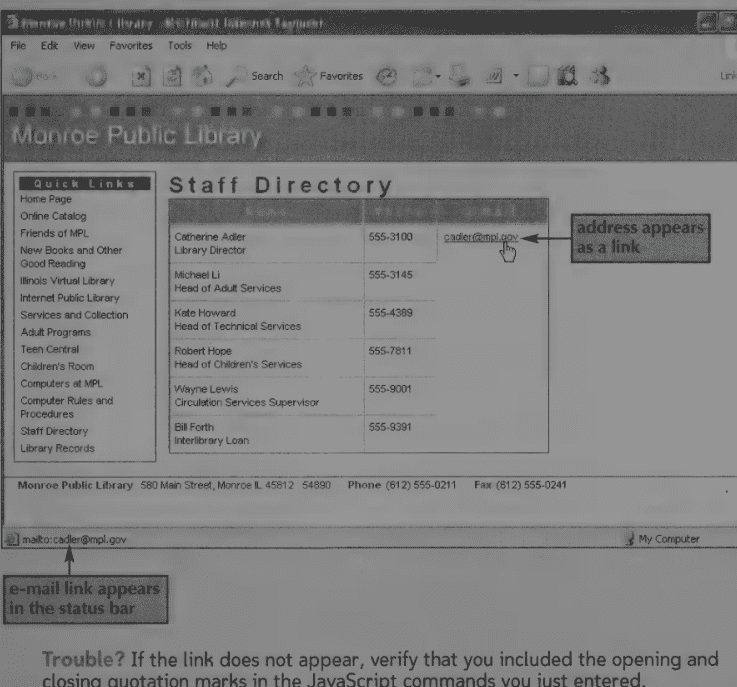

有问题吗？如果链接没有出现，请检查你刚刚输入的 JavaScript 命令中是否包含了起始引号和结束引号。

## 将输出写入网页

## 引用窗口

- 若要向你的 Web 页面写入文本，请使用 JavaScript 命令 `document.write("text");`，其中 `text` 是要写入页面的 HTML 内容。

## 理解 JavaScript 规则和空格的使用

除了分号之外，在编写 JavaScript 语句时，你还需要记住其他语法规则。JavaScript 是区分大小写的，这意味着你必须注意字母是否大写。例如，对于 JavaScript 而言，以下语句**不是**等价的：

```
document.write("</p>");
Document.write("</p>");
```

## 第 1 章 介绍 JavaScript

第一条命令将 HTML 标签 `<a>` 写入 Web 文档。第二条命令不会被浏览器识别为合法命令，并会导致错误消息。图 1-13 显示了 Internet Explorer 浏览器生成的错误消息。浏览器不识别单词 "Document"（相对于 "document"），并且无法处理该命令。

## 大小写错误导致的错误消息

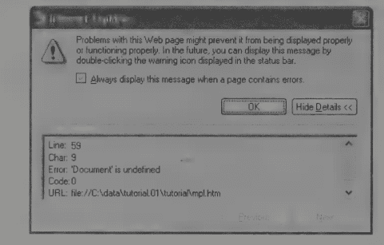

与 HTML 类似，JavaScript 大部分忽略空格。这意味着你可以在代码周围添加额外的空格，使其更容易阅读。你可以在图 1-9 和图 1-11 中看到这些示例，新输入的语句缩进了几个空格，以使命令与起始结束标签区分开。

与 HTML 不同，你必须小心语句内部发生的换行。在单词或带引号的文本字符串内部放置换行会导致代码出现错误。例如，以下换行是不允许的：

```
document.write("<a href='mailto:cadler@mpl.gov'>
cadler@mpl.gov
</a>")
```

如果可能避免，不将语句拆分成几行是一个良好的做法。如果你必须将一个长语句拆分成几行，可以使用反斜杠指示该语句在下一行继续，如下：

```
document.write("<a href='mailto:cadler@mpl.gov'> \
cadler@mpl.gov \
</a>")
```

如果换行发生在带引号的文本字符串内部，你也可以在每行的末尾添加加号 (+) 将放置在几行的不同文本字符串分开：

```
document.write("<a href='mailto:cadler@mpl.gov'>" + \
"cadler@mpl.gov" + \
"</a>")
```

加号 (+) 在此命令中将多个字符串合并为一个文本字符串。然而，通常不建议将单个语句拆分成几行，因为可能会在代码中引入错误。只有对于非常长且复杂的语句才这样做。

## 支持非 JavaScript 浏览器

对于不支持脚本或禁用了客户端脚本支持的浏览器，可以使用 `noscript` 元素指定替代内容。`noscript` 元素的语法为：

```html
<noscript>
  alternative content
</noscript>
```

其中 `alternative content` 是浏览器在不访问和运行脚本时应该显示的内容。例如，以下代码显示了一条文本消息，指示页面需要使用 JavaScript：

```html
<script type="text/javascript">
  JavaScript statements
</script>
<noscript>
  <p>此页面需要 JavaScript。如果你的浏览器支持，请开启 JavaScript 并重新加载页面。</p>
</noscript>
```

支持客户端脚本并已启用该功能的浏览器会忽略 `noscript` 元素的内容。

在 XHTML 文件中使用 JavaScript 代码也可能导致问题，因为 XHTML 解析器会尝试解析 JavaScript 代码中的符号。由于字符符号如角括号 `<` 和和符号（ampersand）`&` 经常在 JavaScript 程序中使用，这可能导致页面被 XHTML 解析器拒绝。为了避免这种情况，你可以将 JavaScript 代码放置在 CDATA 区域中，如下：

```html
<script type="text/javascript">
<![CDATA[
  JavaScript code
]]>
</script>
```

CDATA 区域将 JavaScript 代码文本标记为不应被 XHTML 解析器处理的数据。遗憾的是，当前浏览器对 CDATA 区域的支持并不完善。另一种方法是不将脚本嵌入 XHTML 文件中，而是始终将其放在外部文件中。这种做法的额外优点是使程序代码与内容分离。如果你需要验证 XHTML 文档，这可能是最好的解决方案。

你已经完成了创建脚本来混淆 Kate 员工目录中电子邮件地址的第一阶段。到此时，你已经学习了如何创建和运行 JavaScript 代码写入 Web 文档。在下节课程中，你将增加创建和处理变量及函数的能力。如果你打算在下节课程之前休息，可以关闭任何打开的文件。

## 会节 1.1 快速检查

1. 什么是客户端程序？什么是服务器程序？
2. 你在 HTML 代码中输入什么标签来创建变量？
3. 你在 JavaScript 中使用什么命令来声明变量？
4. 你如何在一个语句中声明多个变量？
5. JavaScript 中 `var` 关键字的目的是什么？

## 会节 1.2 使用变量

目前为止的示例查看了存储字符串的变量。然而，JavaScript 变量可以存储不同类型的信息。变量中存储的信息类型被称为其数据类型。JavaScript 支持以下数据类型：

- 数值
- 文本字符串
- 布尔值
- null 值

数值可以是任何数字，例如 13、22.5 或 -3.14159。数字也可以用科学计数法表示，例如数值 5.1 x 10² 的 `5.1E2`。数值是不带任何引号指定的。因此，如果你想在 `year` 变量中存储值 2007，你会使用语句：

```
year = 2007;
```

而不是

```
year = "2007";
```

# JVS 18 JavaScript 教程 1 介绍 JavaScript

布尔值（Boolean value）表示语句的真假。只有两个布尔值：`true`（真）和 `false`（假）。例如，以下语句将 `useNetscape` 变量的值设置为 `true`，将 `useIE` 变量的值设置为 `false`：

```
useNetscape = true;
useIE = false;
```

布尔值通常用于根据不同条件执行不同操作的程序。上述 `useNetscape` 变量可能用于测试用户是否正在运行 Netscape 浏览器的程序。如果值为 `true`，程序可能会被编写为对用户的运行方式与值设置为 `false` 时不同。

请注意，如果一个布尔值的值未定义，那么 JavaScript 会在任何涉及布尔值的操作中将其解释为 `false` 值。你将在下一个教程中学习更多关于处理布尔值的知识。

最后，`null` 值表示没有给变量分配任何值。这也可以在给变量赋值时显式地使用关键字 "null" 来实现，如如下语句所示：

```
emLink = null;
```

或者通过简单声明变量而不为其赋值来隐式实现：

```javascript
var emLink;
```

在任何一种情况下，`emLink` 变量在被其使用的上下文赋值之前都具有 `null` 值。在 JavaScript 中，变量的数据类型可以在单个程序中从一种数据类型切换到另一种。在以下两个语句中，变量 `Month` 开始是一个初始值为 5 的数值变量，但随后变成了值为 "March" 的文本字符串变量。

```
Month = 5;
Month = "March";
```

程序员将 JavaScript 称为**弱类型语言**（weakly typed language），因为变量没有绑定特定的数据类型。其他编程语言是强类型语言，强制程序员显式地识别数据类型。上述代码在其他地方会导致错误，因为给定的变量不能存储多种类型的数据。然而，像 JavaScript 这样的弱类型语言减轻了程序员为变量分配数据类型的负担，但如果你不小心，可能会导致不可预测的结果。

例如，在 JavaScript 中，加号 (+) 有两个用途：将两个数值相加，并将两个文本字符串合并成单个字符串。如果你使用加号 (+) 将一个数值和一个文本字符串结合起来，如下代码所示，会发生什么呢？

```
x = 5;
y = "4";
z = x + y;
```

每当你使用加号 (+) 组合数值变量和文本字符串变量时，结果始终是一个文本字符串。因此，在上面的示例中，变量 `z` 的值是文本字符串 "54"，而不是数值 9。然而，如果对 JavaScript 如何处理文本和数值没有正确的理解，从代码中无法直观地看到这个结果。这是弱类型语言的局限性之一，数据类型是由语言规则而不是程序员来推断的。

在将来，你将更仔细地观察操作文本字符串和数字的值及属性的 JavaScript 命令。现在，请理解由于 JavaScript 是一种弱类型语言，变量的数据类型可以根据你在程序中使用变量的方式而改变。

## 向网页文档写入值

变量创建后，就可以在 JavaScript 语句中代替其所包含的值。以下代码将字符串 "Monroe Public Library" 写入网页页面：

```javascript
var libName = "Monroe Public Library";
document.write(libName);
```

你还可以使用加号 (+) 将变量与文本字符串结合，并将合并后的文本字符串写入文档。以下语句将字符串 `<p>Welcome to the Monroe Library</p>` 发送到网页文档：

```javascript
var libName = "Monroe Library";
document.write("<p>" + libName + "</p>");
```

你决定创建两个变量来存储 Catherine Adler 的电子邮件地址。将电子邮件地址放在变量中的优点是减少了输错电子邮件地址的风险，因为它在程序代码中反复出现。将其放在两个变量中还会混淆邮件采集器（e-mail harvesters），它们通常寻找包含电子邮件地址的单个字符串：

第一个变量 `userName` 存储 Catherine Adler 电子邮件地址的用户名。第二个变量 `emServer` 存储电子邮件服务器的。为 Catherine Adler 的电子邮件创建这两个变量的命令：

```javascript
var userName = "cadler";
emServer = "mpl.gov";
```

然后你将使用加号 (+) 将这两个变量组合成一个包含完整电子邮件地址以及 @ 符号的文本字符串，并将该字符串存储在名为 `emLink` 的第三个变量中：

```javascript
var emLink = userName + "@" + emServer;
```

在这种情况下，`emLink` 变量写入了字符串 "cadler@mpl.gov."。最后，你把 `emLink` 变量的值作为电子邮件链接写入网页文档。完整代码如下：

```javascript
var userName = "cadler";
emServer = "mpl.gov";
emLink = userName + "@" + emServer;
document.write("<a href=\"mailto:" + emLink + "\">");
document.write(emLink);
document.write("</a>");
```

运行此代码后，它会将文本写入网页文档：

```html
<a href="mailto:cadler@mpl.gov">cadler@mpl.gov</a>
```

请修改你在上节课创建的脚本，使用上述代码中的 `emLink` 变量。

与其为员工目录中的每一个人重新编写生成电子邮件的代码，不如将这些命令放在一个名为 `showEM()` 的函数中。该函数的代码如下：

```javascript
function showEM(userName, emServer) {
  var emLink = userName+"@";
```

将此函数的代码与你在图 1-14 中创建的脚本进行比较。并没有显式输入 `userName` 和 `emServer` 变量的值，而是将它们作为 `showEM()` 的参数。你可以使用图 1-14 中的值作为参数值来调用该函数。调用 Catherine Adler 地址的函数命令为：

```
showEM("cadler", "mpl.gov");
```

这提供了同样的优势：你可以使用之前编写的代码，通过简单更改参数值，复用此函数来处理员工目录中的其他电子邮件地址。

`showEM()` 函数可以放置在 `mpl.htm` 文件的任何位置，只要它位于任何调用它的命令之前即可。这样做是为了确保命令在浏览器遇到函数代码之前尝试调用该函数。请注意，放置在一个 `<script>` 元素中的任何函数都可以被另一个 `<script>` 元素访问。按照惯例，函数在功能上放置在文档 `<head>` 中的 `<script>` 元素中。这会将文档使用的所有函数组织在一个中心位置。接下来，你将把 `showEM()` 函数添加到 `mpl.htm` 文件的 `<head>` 中。

## 创建 showEM() 函数：

1. 返回到文本编辑器中的 `mpl.htm` 文件。
2. 在 `<head>` 标签正上方，插入以下 script 元素和函数（见图 1-15）：

```html
<script type="text/javascript">
function showEM(userName, emServer) {
  var emLink = userName+"@";
```

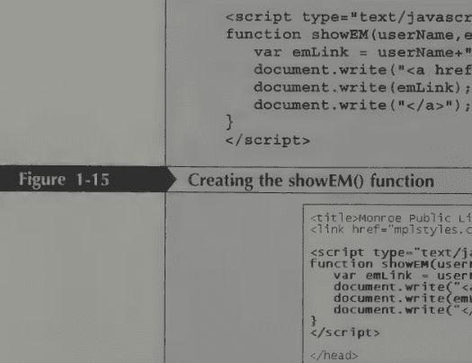

```html
<head>
<link href="styles.css" rel="stylesheet" type="text/css" />
<script type="text/javascript">
function showEM(userName, emServer) {
  var emLink = userName+"@";
```

3. 保存对文件的更改。

接下来，你将把之前插入的生成 Catherine Adler 电子邮件链接的命令替换为调用 `showEM()` 的单个命令。

## 调用 showEM() 函数：

1. 找到写入 Catherine Adler 电子邮件地址的 script 元素。
2. 将 script 元素内的命令替换为以下单个命令（见图 1-16）：

`showEM("cadler", "mpl.gov");`

调用 `showEM()` 函数

```html
<td name="Catherine Adler<br>Library director">
<td id="td-553100">
  <script type="text/javascript">
    showEM("cadler", "mpl.gov");
  </script>
</td>
```

3. 保存对文件的更改，并在 Web 浏览器中刷新 `mpl.htm`。Catherine Adler 电子邮件地址的链接应保持不变显示在网页上。

最后，你将使用自动生成电子邮件的 script 元素插入员工中剩余的五条目。

## 插入剩余的员工条目：

1. 返回到文本编辑器中的 `mpl.htm` 文件。
2. 找到 Michael Li 的条目。他的电子邮件地址是 `mikeli@mpl.gov`。在 Michael Li 条目正后的空白表格单元格中添加以下 script 元素：

```html
<script type="text/javascript">
  showEM("mikeli", "mpl.gov");
</script>
```

（提示：你可能想使用文本编辑器的复制和粘贴功能，因为这些步骤中对文件进行的更改非常相似。）如果你不确定将何放置 Michael Li 的 script 元素，请参考图 1-17。

3. Kate Howard 的电子邮件地址是 `howard@mpl.gov`。在员工目录中她条目的表格单元格中插入以下 script 元素：

```html
<script type="text/javascript">
  showEM("howard", "mpl.gov");
</script>
```

4. Robert 的电子邮件地址是 `rhope@mpl.gov`。为他输入以下 script 元素：

```html
<script type="text/javascript">
  showEM("rhope", "mpl.gov");
</script>
```

5. Wayne Lewis 的电子邮件地址是 `wlewis@mpl.gov`。在他空白表格单元格中输入以下 script 元素：

```html
<script type="text/javascript">
showEM("wlewis","mpl.gov");
</script>
```

6. Bill Forth 的电子邮件地址是 `iforth@mpl.gov`。在他的空白表格单元格中输入以下代码：

```html
<script type="text/javascript">
showEM("bforth","mpl.gov");
</script>
```

图 1-17 显示了 `mpl.html` 文件中修订后的代码。

## 图 1-17 插入修订后的电子邮件地址

```html
<tr>
<td>michael <br />Head of Adult Services</td>
<td>
<script type="text/javascript">
showEM("mikeli","mpl.gov");
</script>
</td>
</tr>
<tr>
<td>nate Howard <br />Head of Technical Services</td>
<td>
<script type="text/javascript">
showEM("howard","mpl.gov");
</script>
</td>
</tr>
<tr>
<td>robert hope <br />Head of Children's Services</td>
<td>
<script type="text/javascript">
showEM("rhope","mpl.gov");
</script>
</td>
</tr>
<tr>
<td>dwayne Lewis <br />Circulation Services</td>
<td>
<script type="text/javascript">
showEM("wlewis","mpl.gov");
</script>
</td>
</tr>
<tr>
<td>dell Forth <br />Library Loan</td>
<td>
<script type="text/javascript">
showEM("bforth","mpl.gov");
</script>
</td>
</tr>
```

7. 保存更改到文件，并在浏览器中重新加载 `mpl.html`。图 1-18 显示了完整的电子邮件列表。将鼠标悬停在地址上并查看状态栏，验证每个地址是否为链接。

员工目录中的完整电子邮件链接

| 员工目录 | | |
| :--- | :--- | :--- |
| Catherine Adler<br>Library Director | 555-2100 | casler@mpl.gov |
| Michael Li<br>Head of Adult Services | 555-3145 | mike@mpl.gov |
| Kate Howard<br>Head of Technical Services | 555-4389 | howard@mpl.gov |
| Robert Hope<br>Head of Children' Services | 555-7811 | rhope@mpl.gov |
| Wayne Lewis<br>Circulation Services | 555-9001 | lewis@mpl.gov |
| Bill Forth<br>Library Loan | 555-9391 | bforth@mpl.gov |

## 函数与作用域

正如你所看到的，函数中的命令只有在调用它们时才会运行。这影响了函数内部变量的处理。你创建的每个变量都有称为作用域的属性，它指示变量在应用程序中何时以及如何使用。变量的作用域可以是局部的或全局的。在 JavaScript 函数内部创建的变量具有**局部作用域**，通常被称为**局部变量**。在你创建的函数中，`emLink`变量具有局部作用域，只能在 `showEM()` 函数内部使用。当 `showEM()` 函数运行时，这些变量就会消失且无法再次访问。该规则唯一的例外是一个函数调用另一个函数；在这种情况下，第一个函数中的任何变量都可以在第二个函数中使用。

未声明的变量具有**全局作用域**，页面上的所有代码（包括函数内的任何代码）都可以访问。这对于不同 script 元素中定义的变量也是如此。全局作用域变量被称为**全局变量**。

## 创建返回值的函数

`showEM()` 函数是为了执行向 Web 文档写入字符串的操作。函数的另一个用途是返回值。要让函数返回值，必须包含 `return` 语句。返回值的函数语法为：

```javascript
function function_name(parameters) {
  // commands
  return value;
}
```

其中 `value` 是函数返回的计算值。例如，以下 `Area()` 函数通过乘以区域的长度和宽度计算矩形区域的面积：

```javascript
function Area(length, width) {
  var size = length*width;
  return size;
}
```

在这个函数中，面积存储在一个名为 `size` 的变量中，然后由函数返回。你可以调用该函数来获取此值。以下代码使用该函数计算尺寸为 8x6 的矩形面积：

```javascript
var x = 8;
var y = 6;
var z = Area(x,y);
```

前两个命令分别将值 8 和 6 赋值给 `x` 和 `y` 变量。然后将这两个变量的值作为 `length` 和 `width` 参数的值发送给 `Area()` 函数。`Area()` 函数使用这些值计算矩形的面积并返回，将其赋值给变量 `z`。作为这些命令的结果，变量 `z` 被赋值为值 48。例如，以下代码在一个将面积值乘以 2 的表达式中调用 `Area()` 函数：

```javascript
var z = Area(x,y)*2;
```

当运行此代码时，`Area()` 函数的值被返回，乘以 2，然后存储在变量 `z` 中。使用上述参数值，变量 `z` 的值等于 96。

## 创建和调用 JavaScript 函数

- 要创建一个执行操作的函数，使用结构：

```javascript
function function_name(parameters) {
  // commands
}
```

其中 `function_name` 是函数名，`parameters` 是用逗号分隔的函数参数，大括号包围着函数使用的 JavaScript 命令。

- 要创建一个返回值的函数，使用结构：

```javascript
function function_name(parameters) {
  // commands
  return value;
}
```

其中 `value` 是函数返回的值。

- 要调用函数，使用命令：

`function_name(values);`

其中 `function_name` 是函数名，`values` 是替换每个函数参数的值列表。根据函数的不同，调用函数要么执行函数的操作，要么访问函数返回的值。

## 访问外部 JavaScript 文件

你向 Kate 展示了你在员工目录上的工作。她对你能够使用 JavaScript 生成电子邮件地址感到很高兴，但她仍然担心每个员工用户名和邮件服务器的文本以 `showEmail` 函数的参数值的形式出现在文档中。她希望将这些值进一步隐藏，防止任何可能扫描文档代码的电子邮件爬取器获取。你与其他程序员讨论了这个问题。你将其中一个程序发送给 Kate，其中包含以下函数：

```javascript
function stringReverse(textString) {
  if (!textString) return '';
  var revString='';
  for (var i = textString.length-1; i>=0; i--)
    revString+=textString.charAt(i);
  return revString;
}
```

解释此函数中包含的代码超出了本教程的范围，但目前只需要泛地了解该函数的作用就足够了。该函数有一个名为 `textString` 的参数，用于存储一个字符字符串。函数创建了一个名为 `reverse` 的变量，按反序顺序存储 `textString` 中的字符，并由函数返回该反转字符串。如果你在语句中调用该函数：

```
userName = stringReverse('reldac');
emServer = stringReverse('vog.lpm');
```

`userName` 变量将获得值 "cadler"，而 `emServer` 变量将获得反序的值 "mpl.gov"。你将此函数展示给 Kate，她同意这足以向大多数电子邮件处理程序隐藏真实的用户名和服务器名称。

`stringReverse()` 函数已经为你输入完成，并存储在名为 `spam.js` 的文件中。要访问外部文件中的代码和函数，你可以使用一直以来用于将脚本命令插入到员工目录文档的相同 `script` 元素。用于访问外部文件的 HTML 元素是：

```
<script type="mime-type" src="url"></script>
```


# JavaScript 教程 2：使用运算符和表达式

## 目标

### 章节 2.1
- 处理事件处理程序
- 在 Web 表单字段中插入值
- 创建并处理日期对象
- 从日期对象中提取信息

### 章节 2.2
- 使用算术运算符、一元运算符、条件和逻辑运算符
- 理解 `Math` 对象的属性和方法
- 理解 JavaScript 如何处理数值
- 运行运行时延迟和定时间隔命令

## 运算符与表达式的使用

## 创建新年倒计时钟

### 案例

### 迪森的新年派对

每年的 12 月 31 日，俄克拉荷马州的迪森（Dixon）都会举办为期一天的活动来迎接新年。新年派对包括比赛、杂技表演、美食品尝摊、现场乐队以及舞蹈，并在午夜的烟花中圆满结束。这场派对的规模越来越大，参与者从几英里之外赶来加入热闹，庆祝活动的策划也开始得很早。

Hector Sadler 负责新年派对的推广工作。他的职责之一是维护一个网站，用于宣传该活动并营造期待感。Hector 希望在网站首页上包含一个倒计时钟，显示当前日期以及在烟花燃放前的剩余天数、小时、分钟和秒。Hector 请求你帮助编写 JavaScript 代码来创建这个钟。

### 学生数据文件

- ▼ tutorial 文件夹
    - `clocktxt.htm`
    - `functxt.js`
    - 1 个样式表
    - 3 个图形文件
- ▼ review 文件夹
    - `eventtxt.htm`
    - `datestxt.js`
    - 1 个样式表
    - 1 个图形文件
- ▼ case1 文件夹
    - `oaetxt.htm`
    - `functions.js`
    - 1 个样式表
    - 6 个图形文件
- ▼ tutorial.02 延续
- ▼ case2 文件夹
    - `hometxt.htm`
    - `randtxt.js`
    - `tips.js`
    - 1 个样式表
    - 2 个图形文件
- ▼ case3 文件夹
    - `worldtxt.htm`
    - `zonetxt.js`
    - 1 个样式表
    - 2 个图形文件
- ▼ case4 文件夹
    - `malltxt.htm`
    - `timetxt.js`
    - `mall.txt`
    - 4 个图形文件

## 章节 2.1

## 处理 on 事件

距离新年派对还有半年时间，但现在和 Hector 坐下来讨论为网站创建倒计时钟还不为早。Hector 设想了一个每秒自动更新一次的时钟，以为网站首页增加动态效果。Hector 已经创建了一个网页，显示日期、时间以及距离新年剩余时间的静态值。现在打开此文件。

要查看该网页：

1. 使用你的文本编辑器打开 `tutorial.02/tutorial` 文件夹下的 `clocktxt.htm`。在文件顶部的注释部分输入你的名字和日期，并将文件另存为 `clock.htm`。
2. 滚动查看文件以熟悉其内容。
3. 在浏览器中打开 `clock.htm`。图 2-1 显示了网页的初始版本。

### 初始时钟页面

| 时间 | 显示当前日期 | 显示当前时间 | 显示全年剩余时间 |
| :--- | :--- | :--- | :--- |
| | 天 | 小时 | 分钟 | 秒 |

迪森的新年派对再次开启第 22 年的欢乐与刺激！庆祝活动于 12 月 31 日开始，下午 5 点举行火球表演，并一直持续到元旦早晨。儿童角设有摊位和适合全家的免费活动，包括来自迪森本地的小丑 Chester 的表演。随着“迪森风味”（Taste of Dixon's）商家的定期更新，欢乐将持续。对于热爱艺术的人，可以计划参加迪森市中心广场举办的水上艺术展。

来自 Jazz Express 的音乐带我们进入新年。舞蹈从晚上 7 点开始一直持续到午夜。在晚上 10 点到 11 点，我们将用著名的新年烟花盛宴告别旧年（并迎接新年）。请务必早点参加所有庆祝活动和最后的倒计时。

网页顶部是表单字段，当前日期、时间和倒计时钟将出现在其中。表单的名称为 `clockform`。图 2-2 显示了表单内字段名称以及每个字段的示例值。

### 表单字段名称

| 时间 | 新年派对 | 倒计时 |
| :--- | :--- | :--- |
| 3/24/2006 | 1:54 21 pm | 5 天 10 小时 38 秒 |

Hector 希望这些值能够不断更新。为了实现这一点，你将编写一个 JavaScript 函数来计算当前日期时间以及距离新年的剩余时间，然后每秒运行一次该函数。你将通过在 `clockform` Web 表单的不同字段中写入示例文本开始创建此函数。要设置表单字段的值，你将使用 JavaScript 命令：

```javascript
document.form.field.value = field_value;
```

其中 `form` 是表单的名称，`field` 是字段的名称，`field_value` 是你想放入字段中的值。例如，在 Hector 的网页中，当前日期存储在 JavaScript 表单的 `dateTime` 字段中。要将此值设置为当前文本字符串 `"2/24/2006"`，你将使用 JavaScript 命令：

```javascript
document.form.dateTime.value = "2/24/2006";
```

要显示时间 `"1:54 21 pm"`，你将使用 JavaScript 命令：

```javascript
document.form.timeNow.value = "1:54 21 pm";
```

要显示剩余时间 `"5 天 10 小时 38 秒"`，你将使用 JavaScript 命令：

```javascript
document.form.countdown.value = "5 天 10 小时 38 秒";
```

在随后的教程中，你将学习如何向 `clockform` Web 表单的字段插入值。要设置表单字段的值，你将使用 JavaScript 命令：

```javascript
document.form.field.value = field_value;
```

## JavaScript 事件处理器

| 类别 | 事件处理器 | 描述 |
| --- | --- | --- |
| 窗口和文档事件处理器 | `onload` | 浏览器已完成文档加载 |
| | `onunload` | 浏览器已完成文档卸载 |
| | `onerror` | JavaScript 程序发生错误 |
| | `onmove` | 用户移动了浏览器窗口 |
| | `onresize` | 用户调整了浏览器窗口的大小 |
| | `onscroll` | 用户在浏览器窗口内移动了滚动条 |
| 表单事件处理器 | `onfocus` | 用户进入了输入字段 |
| | `onblur` | 用户离开了输入字段 |
| | `onchange` | 输入字段的内容发生了变化 |
| | `onselect` | 用户在输入或文本区域字段中选择了文本 |
| | `onsubmit` | 用户提交了 Web 表单 |
| | `onreset` | 用户重置了 Web 表单 |
| 鼠标和键盘事件处理器 | `onkeydown` | 用户按了一个按键 |
| | `onkeypress` | 用户按下并释放了按键 |
| | `onclick` | 用户点击了鼠标按钮 |
| | `ondblclick` | 用户双击了鼠标按钮 |
| | `onmousedown` | 用户按下了鼠标按钮 |
| | `onmouseup` | 用户释放了鼠标按钮 |
| | `onmousemove` | 用户在元素上移动了鼠标指针 |
| | `onmouseout` | 用户将鼠标指针移出了元素 |

对于该 Web 页面，你希望在页面加载时运行 `NYClock()` 函数。加载是 Web 页面的事件之一，因此可以通过向 `<body>` 标签添加以下事件处理器来处理：

```html
<body onload="NYClock()">
```

将此事件处理器添加到 `clock.htm` 文件中。

## 插入 onload 事件处理器：

1. 在 `<body>` 标签内，如图 2-5 所示插入属性 `onload="NYClock()"`。

## 插入 onload 事件处理器

```javascript
<script type="text/javascript">
function NYClock() {
  // 显示当前的日期时间
  document.clock.date.value = "2/24/2007";
  document.clock.time.value = "2:35:05 pm";
  // 计算距离新年洗澡的剩余时间
  document.clock.days.value = "9";
  document.clock.hours.value = "99";
  document.clock.mins.value = "99";
  document.clock.secs.value = "99";
}
</script>

<body onload="NYClock()">
<form name="clock" action="">
```
> *为 id="clock" 添加事件处理器，以便在页面加载时运行 NYClock() 函数*

2. 保存对文件的更改，然后在你的 Web 浏览器中重新加载 `clock.htm`。页面打开后将显示字段值，如图 2-6 所示。

## 插入到时钟表单中的字段值

图 2-6

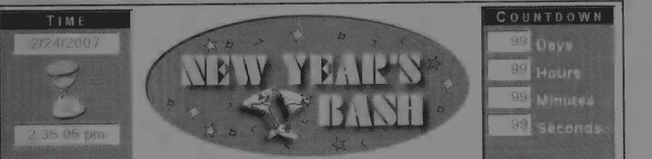

遇到问题？如果你在加载页面时收到错误消息，请检查 `NYClock()` 函数中的代码以及 `onload` 事件处理器。在 `NYClock()` 函数中可能发生的编程错误包括大小写不匹配、变量名拼写错误、忘记关闭双引号，以及忘记闭合命令块和大花括号。

## 作为链接运行 JavaScript 命令

另一种运行 JavaScript 命令的方法是作为链接。这种方法类似于在响应元素内的点击事件时运行命令。此操作的语法是：

```html
<a href="javascript:script">内容</a>
```

其中 `script` 是你希望在用户点击链接时运行的命令（或命令）。例如，以下代码在用户点击链接时会运行 `calcTotal()` 函数：

```html
<a href="javascript:calcTotal()">
计算总费用
</a>
```

在 Hector 的 Web 页面中，你不需要使用这种技术。然而，它通常被用于不支持事件处理器的旧版浏览器，或者用于不支持 `onclick` 事件处理器的元素。与它作为 HTML 的新功能时相比，这个问题现在就不那么重要了。

## 响应事件运行脚本

参考 Window

- 若要作为元素属性插入事件处理器，请使用 `<element onclick = "script">`，其中 `element` 是 Web 页面元素，`event` 是与元素关联的事件名称，`script` 是响应事件运行的命令（或多个命令）。
- 若要作为链接运行 JavaScript 命令，请使用代码 `<a href="javascript:script">内容</a>`，其中 `script` 是你希望在用户点击链接时运行的命令（或命令）。

## 处理日期

现在你已经创建了 `NYClock` 函数的初始表单，你需要某种方法来生成日期时间信息，而不是直接将值输入 JavaScript 代码中。为了处理日期，JavaScript 支持日期对象，它包含了关于指定日期和时间的信息。使用以下命令创建日期对象：

```javascript
variable = new Date("月 日 年 小时:分:秒");
```

其中 `variable` 是包含日期对象的变量名，`month`、`day`、`year`、`hours`、`minutes` 和 `seconds` 表示要存储在对象中的日期时间。时间值以 24 小时制表示；因此，`2:35 pm` 的时间为 `14:35`。存储在对象中的日期时间如下：

```javascript
variable = new Date("2/24/2007 14:35:05");
```

## 从日期对象中提取日期和时间值

JavaScript 提供了多种方法从日期对象中提取特定的日期和时间值。这些方法包括：

```javascript
DateObject.getSeconds()
DateObject.getMinutes()
DateObject.getHours()
DateObject.getDate()
DateObject.getDay()
DateObject.getMonth()
DateObject.getFullYear()
DateObject.getTime()
```

其中 `DateObject` 是一个日期对象或包含日期对象的变量。

### 获取年份值

你在程序中会使用的另一种方法是 `getFullYear()`。顾名思义，它从日期对象中提取 4 位年份值。以下代码展示了如何将当前年份的值存储在名为 `thisYear` 的变量中：

```javascript
thisDate = new Date("February 24, 2007 14:35:05");
thisYear = thisDate.getFullYear();
```

正如你预期的那样，`thisYear` 变量的值将是 `"2007"`。注意方法名是 `getFullYear()` 而不是简单的 `getYear()`。这是因为存在一个独立的 `getYear()` 方法，它只返回 2000 年之前年份的最后两位数字。例如，对于 1999 年，返回的日期是 99。如图 2-8 所示，`getYear()` 方法在 1999 年之后就会遇到困难。

### 1998–2001 年 `getYear()` 方法的值

| 年份 | Internet Explorer | Netscape/Opera |
|---|---|---|
| 1998 | 98 | 98 |
| 1999 | 99 | 99 |
| 2000 | 2000 | 100 |
| 2001 | 2001 | 101 |

`getYear()` 日期方法在 2000 年对 Internet Explorer 返回值为 2000，但对于 Netscape 和 Opera 浏览器返回的是 100。如果你使用此方法配合 Internet Explorer 计算 1998 年到 2000 年之间的年数，得到的答案将是 1902 年！Netscape 和 Opera 会给出正确答案，但代价是错误地显示 1999 年之后的日期年份。这是 20 世纪 90 年代后期引起广泛关注的 Y2K Bug 的经典例子。结论是，当你需要处理公历年份时，应该使用 `getFullYear()` 方法，并避免使用 `getYear()`。

### 获取小时、分钟和秒值

JavaScript 支持类似的方法从日期对象中提取小时、分钟、秒值。这些方法是：

```javascript
DateObject.getSeconds()
DateObject.getMinutes()
DateObject.getHours()
```

其中 `DateObject` 再次是一个日期对象或包含日期对象的变量。小时采用 24 小时制，这意味着代码：

```javascript
thisDate = new Date("February 24, 2007 14:35:05");
thisHour = thisDate.getHours();
```

将值 `"14"` 存储在 `thisHour` 变量中。图 2-9 总结了从日期对象获取日期时间值的方法。

### 从日期对象中提取日期时间值

| 方法 | 描述 | 值 |
|---|---|---|
| Value 列中的示例数据假设变量 `thisDate` 存储了日期对象 `"June 15, 2007 14:35:28"`。 | | |
| `thisDate.getSeconds()` | 获取秒值 | 28 |
| `thisDate.getMinutes()` | 获取分钟值 | 35 |
| `thisDate.getHours()` | 获取小时（24 小时制） | 14 |
| `thisDate.getDate()` | 获取月的几号 | 15 |
| `thisDate.getDay()` | 获取星期（0 = 周日，1 = 星期一，2 = 星期二，3 = 星期三，4 = 星期四，5 = 周五，6 = 星期六） | 5 |
| `thisDate.getMonth()` | 获取月份（0 = 一月，1 = 二月，2 = 三月，等） | 5 |
| `thisDate.getFullYear()` | 获取四位年份 | 2007 |
| `thisDate.getTime()` | 获取时间值，以毫秒表示 | 1,181,936,280 |

## 获取日期和时间值

- 要从名为 `DateObject` 的日期对象获取年份值，请使用命令 `Year = DateObject.getFullYear();`。
- 要获取月份值，使用命令 `Month = DateObject.getMonth();`。`Month` 为 0 等于年的第一个月份即一月；`Month` 为 1 等于第二个月份即二月；以此类推。
- 要获取月的几号，使用 `Day = DateObject.getDate();`。
- 要获取星期，使用 `DayOfWeek = DateObject.getDay();`。`DayOfWeek` 为 0 等于第一个工作日周日，`DayOfWeek` 为 1 等于第二个工作日星期一，以此类推。
- 要获取小时值，使用 `Hour = DateObject.getHours();`。
- 要获取分钟值，使用 `Minute = DateObject.getMinutes();`。
- 要获取秒值，使用 `Second = DateObject.getSeconds();`。

## 设置日期和时间值

除了获取日期时间值外，你还可以使用 JavaScript 设置这些值。这在将日期对象的值从一个特定时间更改为另一个时间时最为有用。例如，以下代码使用 `setFullYear()` 将 `thisDate` 变量存储的日期从 2007 年 2 月 24 日更改为 2008 年 2 月 24 日：

```javascript
thisDate.setFullYear(2008);
```

图 2-10 显示了设置日期时间值的方法。

### 设置时间值

| 方法 | 描述 |
|---|---|
| `thisDate.setSeconds(value)` | 设置秒值 |
| `thisDate.setMinutes(value)` | 设置分钟值 |
| `thisDate.setHours(value)` | 设置小时值 |
| `thisDate.setDate(value)` | 设置月的几号 |
| `thisDate.setMonth(value)` | 设置月份 |
| `thisDate.setFullYear(value)` | 设置四位年份 |
| `thisDate.setTime(value)` | 设置时间值，以毫秒表示 |

## 调用 `showDate()` 和 `showTime()` 函数

```javascript
<script type="text/javascript" src="functions.js"></script>

<script type="text/javascript">
function initClock() {
  // today 变量包含当前的日期和时间
  var today = new Date("February 24, 2007 14:35:05");
  // 显示当前的日期和时间
  document.clockform.date.value = showDate(today);
  document.clockform.time.value = showTime(today);
  // 计算距离新年期间的剩余时间
  document.clockform.days.value = '99';
  document.clockform.hours.value = '99';
  document.clockform.minutes.value = '99';
  document.clockform.seconds.value = '99';
}
</script>
```

5. 将更改保存到文件并在浏览器中重新打开或刷新 `clock.htm`。图 2-13 显示了页面 Web 表单中的当前值。

## 修改后的倒计时器值


你向 Hector 展示了倒计时器的当前输出。他看到了两个想要修改的地方。首先，他希望显示的时间为 12 小时制而不是 24 小时制。此外，分钟或秒的值小于 10 时应在其前面加上零作为占位符。换句话说，而不是显示 `14:35:5`，Hector 希望时间显示为 `2:35:05 pm`。

在下一节中，你将学习如何为倒计时器添加这些功能，以及如何创建计算全年剩余天数、小时、分钟和秒数的函数。现在，如果你想休息，可以关闭已打开的文件。

## 2.1 节快速自测

1. 什么是事件处理程序？
2. 在按钮元素上添加什么属性可以实现在点击按钮时运行 `showImage()` 函数？
3. 输入什么 HTML 代码可以创建一个点击链接时运行 `showImage()` 函数的链接？
4. 输入什么 JavaScript 命令可以创建一个名为 `examDate` 的变量，并存储以下日期和时间：2007年5月8日，下午6:55:28？
5. 你将使用什么方法从 `examDate` 变量中提取月份值？该方法将返回什么值？
6. 你将使用什么方法从 `examDate` 变量中提取 4 位年份值？
7. 你使用什么命令将 `examDate` 中的日期值从 8 更改为 9（保持其他日期和时间值不变）？
8. 你使用什么命令创建一个名为 `currentTime` 的变量，存储当前的日期和时间（无论当前时间是什么）？

## 2.2 节

## 使用运算符

在上一节中，你学习了如何处理日期对象以便在 Web 页面中显示指定的时间。在本节中，你将学习如何对日期和 JavaScript 变量进行计算。要执行计算，你需要插入一条包含运算符的 JavaScript 语句。运算符是用于在 JavaScript 脚本中对项目或变量进行操作的符号。运算符的概念是一个非常基础的概念。事实上，你在整个教程中一直在使用运算符。例如，你一直在使用 `+` 运算符来组合字符串和相加数值。以下来自 `showDate()` 函数的语句使用 `+` 运算符将 `dateObj.getMonth()` 的值增加了 1：

```javascript
thisMonth = dateObj.getMonth() + 1;
```

你还使用了 `+` 运算符来组合文本字符串，在 `showDate()` 函数的以下语句中：

```javascript
thisMonth + "/" + thisDate + "/" + thisYear;
```

该语句以月/日/年的格式显示日期。

## 算术运算符

`+` 运算符属于一组被称为算术运算符的运算符，它们执行简单的数学计算。图 2-14 列出了一些算术运算符并给出了它们如何工作的示例。

| 运算符 | 说明 | 示例 |
|---|---|---|
| `+` | 组合或相加两个项 | `Men = 20; Women = 25; Total = Men + Women;` |
| `-` | 从一个项减去另一个项 | `Income = 1000; Expense = 750; Profit = Income - Expense;` |
| `*` | 乘以两个项 | `Width = 50; Length = 20; Area = Width * Length;` |
| `/` | 将一个项除以另一个项 | `Persons = 50; Cost = 200; CostPerPerson = Cost / Persons` |
| `%` | 计算一个值除以另一个值后的余数 | `TotalEggs = 64; CartonSize = 12; EggsLeft = TotalEggs % CartonSize;` |

图 2-14 显示的算术运算符也称为二进制运算符，因为它们在表达式中处理两个项。JavaScript 支持一元运算符，它们只作用于一个项。一元运算符可以让你的代码更加紧凑高效，但如果你不小心，很容易误用。一元运算符之一是递增运算符，用于增加表达式的值。递增运算符由 `++` 符号表示，可以用在变量之前或之后。

## 一元运算符

| 运算符 | 说明 | 等于 |
|---|---|---|
| `++` | 增加项的值 | `x = x + 1` |
| `--` | 减少项的值 | `x = x - 1` |
| `-` | 改变项的符号 | `x = -x` |

## 赋值运算符

在为项目赋值时也会使用运算符。这些类型的运算符被称为赋值运算符。常用的赋值运算符是等号 (`=`)，它将一个项的值赋值给另一个。JavaScript 提供了额外的赋值运算符以便在单个语句内赋值和更改值。其中之一是 `+=` 运算符。在两个表达式中，`x` 的值加上 `y` 的值，然后将新值存回 `x`。

```javascript
x = x + y;
x += y
```

赋值运算符也可以与数字一起使用，增加特定变量。例如，将 `x` 的值增加 2，可以使用以下表达式：

```javascript
x = x + 2;
x += 2
```

`+=` 运算符的一个常见用途是创建扩展字符串。在这种情况下，如果你的字符串跨越多行，你可能会发现很难使用单个语句将文本存储在变量中。然而，你可以使用 `+=` 运算符来实现：

```javascript
quote = "To be or not be";
quote += "That is the question.";
quote += "Whether nobler in the mind to suffer";
quote += "the slings and arrows of outrageous fortune";
quote += "Or to take arms against a sea of troubles";
quote += "And by opposing them.";
```

通过这种方式，`quote` 变量包含了哈姆雷特独白的全文，但它是通过一系列短小的表达式实现的，而不是一个冗长的语句。这种技术通常用于在变量中存储长字符串。其他赋值运算符见图 2-16。

## 赋值运算符

| 运算符 | 说明 | 示例 | 等于 |
|---|---|---|---|
| `=` | 将右表达式的值赋值给左侧 | `x = y` | |
| `+=` | 相加两个表达式 | `x += y` | `x = x + y` |
| `-=` | 从左侧减去右侧表达式 | `x -= y` | `x = x - y` |
| `*=` | 乘以两个表达式 | `x *= y` | `x = x * y` |
| `%=` | 计算左侧表达式除以右侧的余数 | `x %= y` | `x = x % y` |

你可以看到，通过这种语法，赋值运算符允许你创建既高效又紧凑的表达式。

## 计算全年剩余天数

你将利用所学的关于运算符和日期对象的知识创建一个函数，用于计算全年剩余的天数。该函数将命名为 `calcDays()`，它包含一个参数 `currentDate`，该参数包含一个当前日期和时间的对象（无论当前何时）。该函数需要执行以下操作：

```javascript
function calcDays(currentDate) {
  // 创建一个明年 1 月 1 日的日期对象
  // 计算 currentDate 和 1 月 1 日之间的差值
}
```

将此函数结构添加到 `functions.js` 文件中。

## 创建 `calcDays()` 函数：

1. 如必要，使用你的文本编辑器重新打开 `functions.js` 文件。
2. 在文件末尾插入以下函数（见图 2-17）：

```javascript
function calcDays(currentDate) {
  // 创建明年 1 月 1 日的日期对象
  // 计算 currentDate 和 1 月 1 日之间的差
}
```


3. 保存文件的更改。

接下来，你将为 `calcDays()` 函数输入命令。第一行创建 1 月 1 日的日期对象。由于你需要指定年份值，你将使用年份 2007：

```javascript
newYear = new Date("January 1, 2007");
```

年份值 `"2007"` 是临时的。你真正想要的是当前年份（无论何时）加 1。你可以通过从 `currentDate` 参数中提取年份并使用命令加 1 来确定这一点：

```javascript
nextYear = currentDate.getFullYear() + 1;
```

接下来你使用 `setFullYear()` 方法设置 `newYear` 对象的年份值：

```javascript
newYear.setFullYear(nextYear);
```

要计算元旦和当前日期的时间差，你需要从另一个对象中减去当前日期：

```javascript
days = newYear - currentDate;
```

然而，你需要记住 JavaScript 使用毫秒而不是天来衡量时间，这个差值告诉你是当前日期和时间与元旦之间的毫秒数。如果你想以天为单位表示此值，你需要将差值除以天的毫秒数。修改后的表达式为：

```javascript
days = (newYear - currentDate) / (1000 * 60 * 60 * 24);
```

因为一秒有 1000 毫秒，一分钟有 60 秒，一小时有 60 秒，一天有 24 小时。将所有命令组合在一起，完整的 `calcDays()` 函数如下：

```javascript
function calcDays(currentDate) {
  // 创建明年 1 月 1 日的日期对象
  newYear = new Date("January 1, 2007");
  // 插入临时的 1 月 1 日
  nextYear = currentDate.getFullYear() + 1;
  // 明年的年份值
  newYear.setFullYear(nextYear);
  // 将 newYear 改为明年
  // 计算 currentDate 和 1 月 1 日之间的差值
  days = (newYear - currentDate) / (1000 * 60 * 60 * 24);
  // 将毫秒转换为天
  return days;
}
```

将这些命令添加到 `calcDays()` 函数中。

## 向 `calcDays()` 函数中添加命令：

1. 在 `calcDays()` 函数的第一条注释下方，添加以下行：

```javascript
newYear = new Date("January 1, 2007");
// 插入临时的 1 月 1 日
nextYear = currentDate.getFullYear() + 1;
// 明年的年份值
newYear.setFullYear(nextYear);
// 将 newYear 改为明年
```

2. 在下一个注释下方添加以下行（见图 2-18）：

```javascript
days = (newYear - currentDate) / (1000 * 60 * 60 * 24);
// 将毫秒转换为天
return days;
```

## 向 `calcDays()` 函数中添加命令


```javascript
function calcDays(currentDate) {
  // 创建明年 1 月 1 日的日期对象
  newYear = new Date("January 1, 2007");
  // 插入临时的 1 月 1 日
  nextYear = currentDate.getFullYear() + 1;
  // 明年的年份值
  newYear.setFullYear(nextYear);
  // 将 newYear 改为明年
  // 计算 currentDate 和 1 月 1 日之间的差值
  days = (newYear - currentDate) / (1000 * 60 * 60 * 24);
  // 将毫秒转换为天
  return days;
}
```

3. 保存文件的更改。

现在从 `clock.htm` 文件中调用该函数，并在表单 `daysLeft` 字段中显示函数返回的值。

4. 如必要，重新打开 `clock.htm` 文件。

## 使用表达式

5. 在设置值的行上方直接插入以下内容：

```javascript
var days = calcDays(today);
```

6. 将设置值的行改为：

```javascript
document.clockform.daysLeft.value = days;
```

7. 保存文件的更改。
8. 刷新 `clock.htm`。

## 调用函数

```javascript
function calcDays(currentDate) {
  // 创建明年 1 月 1 日的日期对象
  newYear = new Date("January 1, 2007");
  // 插入临时的 1 月 1 日
  nextYear = currentDate.getFullYear() + 1;
  // 明年的年份值
  newYear.setFullYear(nextYear);
  // 将 newYear 改为明年
  // 计算 currentDate 和 1 月 1 日之间的差值
  days = (newYear - currentDate) / (1000 * 60 * 60 * 24);
  // 将毫秒转换为天
  return days;
}
```

## Math 方法

`Math` 对象支持多种方法，用于高级计算，例如生成随机数、提取平方根和计算三角值。要计算数字的平方根可以使用 `sqrt` 方法，其语法为：

```javascript
Math.sqrt(expression)
```

例如，以下命令将结果赋值给变量 `y`：

```javascript
x = 16;
y = Math.sqrt(x);
```

图 2-21 列出了 `Math` 方法。在应用对象时，大小写很重要，这意味着你不能用 `"math"` 代替 `"Math"`。

## 数学常数

有一些数学常数，例如 π 和 e，你可能希望在 JavaScript 函数中包含它们。与其将这些值输入变量中，你可以使用 `Math` 对象来生成这些值。访问这些数学常数的语法为：

```javascript
Math.CONSTANT
```

其中 `CONSTANT` 是 `Math` 对象支持的数学常量名称。图 2-22 列出了 `Math` 常数。

### 图 2-22 Math 常数

| Math 常数 | 描述 |
|---|---|
| `Math.E` | 自然对数的底 e（约 2.7183） |
| `Math.LN10` | 10 的自然对数（约 2.3026） |
| `Math.LN2` | 2 的自然对数（约 0.6931） |
| `Math.LOG10E` | e 的以 10 对数（约 0.4343） |
| `Math.LOG2E` | e 的以 2 对数（约 1.4427） |
| `Math.PI` | π 的值（约 3.1416） |
| `Math.SQRT1_2` | 1 除以 2 的平方根的值（约 0.7071） |
| `Math.SQRT2` | 2 的平方根的值（约 1.4142） |

例如，计算圆面积的公式是 πr²，其中 `r` 是圆的半径。你可以使用以下代码创建一个计算圆面积的函数：

```javascript
function circle_area(radius) {
  area = Math.PI * Math.pow(radius, 2);
  return area;
}
```

对于倒计时器，你只需要显示今年剩余天数的整数部分。你可以使用 `Math.floor()` 方法来计算此值，该方法将值向下舍入到最近的整数。对于值 `310.39`，该方法返回值 `310`。将此方法应用到 `daysLeft` 字段显示上。

## 如何应用 `Math.floor()` 方法：

1. 回到文本编辑器中的 `clock.html` 文件。
2. 将显示 `daysLeft` 字段值的语句改为以下两行（见图 2-23）：

```javascript
// 将 days 向下舍入到最近的整数
document.clockform.daysLeft.value = Math.floor(days);
```

## 图 2-23 使用 `Math.floor()` 方法

```javascript
function initClock() {
  // 变量 today 包含当前的日期和时间
  today = new Date("February 24, 2007 14:35:05");
  // 显示当前日期和时间
  document.clockform.dateNow = showDate(today);
  document.clockform.timeNow = showTime(today);
  // 计算到跨年派对剩余的时间
  var days = calcDays(today);
  // 将 days 向下舍入到最近的整数
  document.clockform.daysLeft.value = Math.floor(days);
}
```


var days = calcdays(today);

// 将 days 向下舍入到最近的整数

document.clockform.hrleft.value = Math.floor(days);

document.clockform.mlleft.value = "99";

document.clockform.seleft.value = "99";

}

// 3. 保存文件更改并在 Web 浏览器中重新打开或刷新 `clock.html`。图 2-24 所示，`daysLeft` 字段现在以整数形式显示 `daysLeft` 值。

以整数形式显示的 daysLeft 值

图 2-24

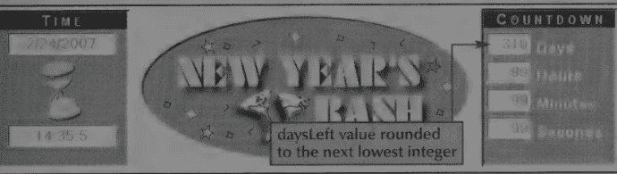

## 计算今年剩余的小时、分钟和秒

接下来你想计算今年剩余的小时、分钟和秒。使用 `Math.floor()` 函数，你知道今年剩余的天数是 310。这个数字与 `310.3923...` 之间的差值 `0.3923...` 代表当前天剩余的小数部分。你需要将其转换为小时。你可以通过将 `0.3923...` 乘以 24 来实现（因为一天有 24 小时）。计算当天剩余小时数量的 JavaScript 命令是：

```javascript
var hours = (days - Math.floor(days)) * 24;
```

对于值 `0.3923`，变量 `hours` 的值为 9.4152 小时。该值的数值部分代表当前小时内剩余的分钟和秒。你首先需要将小时值向下舍入到最近的整数，就像你对 `daysLeft` 字段所做的那样。

计算当天剩余的小时数：

- 1. 回到文本编辑器中的 `clock.html` 文件。
- 2. 在设置 `daysLeft` 字段值的语句下方插入以下两行：

```javascript
// 计算当天剩余的小时
var hours = (days - Math.floor(days)) * 24;
```

- 3. 将设置 `daysLeft` 字段值的语句改为：

```javascript
// 将 hours 向下舍入到最近的整数
document.clockform.hrLeft.value = Math.floor(hours);
```

见图 2-25。

## 图 2-25

## 创建 hours 变量

```javascript
function getN() {
    // today 变量包含当前的日期和时间
    var today=new Date("February 24, 2007 14:35:05");
    // 显示当前日期和时间
    document.clockform.datetime = showdate(today);
    document.clockform.time = showtime(today);
    // 计算到跨年派对剩余的时间
    var days = calcdays(today);
    // 将 days 向下舍入到最近的整数
    document.clockform.daysLeft.value = Math.floor(days);
    // 计算当天剩余的小时
    var hours = (days - Math.floor(days)) * 24;
    // 将 hours 向下舍入到最近的整数
    document.clockform.hrLeft.value = Math.floor(hours);
    // 计算当前小时剩余的分钟
    var minutes = (hours - Math.floor(hours)) * 60;
    // 将 minutes 向下舍入到最近的整数
    document.clockform.minLeft.value = Math.floor(minutes);
    // 计算当前分钟剩余的秒
    var seconds = (minutes - Math.floor(minutes)) * 60;
    // 将 seconds 向下舍入到最近的整数
    document.clockform.secLeft.value = Math.floor(seconds);
}
```

## 控制 JavaScript 如何处理数值值

在某些情况下，你的倒计时值可能会显示出额外的（或缺失）小时、分钟或秒。这是为什么呢？这涉及到几个因素。其中之一是夏令时的存在，在这种情况下，时钟会向前（或向后）移动一小时。如果你的时间间隔跨越了这个事件，小时值将显示为在间隔基础上增加或减去了一个小时。另一个因素是一天并没有被平均分成每天剩余的一部分秒的分数。JavaScript 使用毫秒测量时间是有原因的。随着天数的积累，这些秒的分数会累积起来。大多数时间服务（例如原子钟）通过偶尔添加一个“闰秒”来解释这种累积。添加这些闰秒的影响在你用 JavaScript 计算时间差时变得更加复杂。因此，两个日期之间的时间差可能比看起来要大。

当你使用 JavaScript 进行数学计算时，你会遇到需要处理数值本身属性的情况。JavaScript 提供了许多方法，允许你检查数字的属性，并指定它们在网页上的显示方式。

## 处理非法操作

某些数学操作可能会返回非数值的结果。例如，你不能将一个数字除以文本字符串。如果你在脚本中尝试执行以下操作：

```javascript
var x = 5/"A"
document.write(x);
```

你的网页将显示值 "NaN"，它代表 "Not a Number"不是数字）。本质上，这是 JavaScript 告诉你正在尝试进行一个你认为是数值的操作，但实际上它并不是。你可以使用 `isNaN()` 函数来检查此特定错误是否存在。该函数的语法为：

```javascript
isNaN(value)
```

其中 value 是你想要测试是否为数值的值或变量。`isNaN` 函数返回一个布尔值：如果值不是数值（即 NaN）则返回 true，否则返回 false。使用 `isNaN` 函数是定位代码中非法操作的方法之一。

尝试将一个数字除以 0 是另一个非法操作。以下代码：

```javascript
var x = 5/0;
document.write(x);
```

会导致向网页上写入值 "Infinity"无穷大）。`Infinity` 值表示你尝试进行的数值计算，其结果大于 JavaScript 支持的最大数值。对于结果小于最小数值的操作，也有一个 `Infinity` 值。JavaScript 的数值限制在大约 1.8 x 10³⁸ 到 -1.8 x 10³⁸ 之间。任何超出这些边界的操作（例如将数字除以零）都会导致 JavaScript 为结果分配一个 `Infinity` 值。你可以使用以下函数检查此结果：

```javascript
isFinite(value)
```

## 指定数字格式

value 是你想要测试是否为有限数值的值。与 `isNaN(n)` 函数一样，`isFinite()` 返回一个布尔值：如果 value 是落在 JavaScript 可接受范围内的有限数字，则返回 true；如果数值超出该范围或值不是数字，则返回 false。

当 JavaScript 显示数值值时，它会显示 value 处所有计算出的数字。这可能会导致很长的数字字符串。例如，以下代码：

```javascript
var x = 1/4;
var y = 1/3;
document.write("x = " + x);
document.write("y = " + y);
```

会导致网页上写入以下两个文本字符串：

- x = 0.25
- y = 0.3333333333333333

在大多数情况下，你不需要将计算值显示到 16 位。对于货币值，你通常只想将结果保留到两位小数。为了控制浏览器显示的数字位数，你可以应用以下函数：

```value.toFixed(n)
```

其中 value 是该值或变量，n 是输出中应该显示的小位数。以下示例显示了 `toFixed(n)` 函数返回不同的数值值：

```javascript
testValue = 2.835;
testValue.toFixed(0) // 返回 "3"
testValue.toFixed(1) // 返回 "2.8"
testValue.toFixed(2) // 返回 "2.84"
```

注意，`toFixed()` 函数不仅限制了值显示的小位数，还会将 value 转换为文本字符串。然而，旧版浏览器不支持 `toFixed()` 方法。如果你需要将数字四舍入到特定的位数，你必须创建自己的自定函数。你将在本教程的末尾查看自定义函数的示例。

（注：原文后续存在大量重复，已按要求翻译）

## 转换数字和文本字符串

你可能在代码中遇到需要将数字转换为文本以及反之的操作的情况。将数字转换为文本的一种方法是使用 `+` 运算符将文本字符串加到数字上。例如：

```javascript
testNumber = 123;
testString = testNumber + ""; // 字符串
```

在另一个方向，将文本字符串转换为数字，你可以对文本字符串应用算术运算符（`+` 运算符以外的）。例如：

```javascript
testString = "123"; // 字符串
testNumber = testString*1; // 数值
```

另一种方法是使用 `parseInt()` 函数，它可以从文本字符串中提取领先整数。`parseInt()` 函数的语法为：

```javascript
parseInt(text)
```

其中 text 是你想要测试是否为数值的文本或变量。`isNaN` 函数返回一个布尔值：如果值不是数值（即 NaN）则返回 true，否则返回 false。使用 `isNaN` 函数是定位代码中非法操作的方法之一。尝试将数字除以 0 是另一个非法操作。以下代码：

```javascript
var x = 5/0;
document.write(x);
```

会导致网页上写入值 "Infinity"。`Infinity` 值表示你进行的数值计算的结果大于 JavaScript 支持的最大数值。对于结果小于最小数值的操作，也有一个 `Infinity` 值。JavaScript 的数值限制在大约 1.8 x 10³⁸ 到 -1.8 x 10³⁸ 之间。任何超出这些边界的操作（例如将数字除以零）都会导致 JavaScript 为结果分配一个 `Infinity` 值。你可以使用以下函数检查此结果：

```javascript
isFinite(value)
```

value 是你想要测试是否为有限数值的值。与 `isNaN(n)` 函数一样，`isFinite()` 返回一个布尔值：如果 value 是 JavaScript 可接受范围内的有限数字，则返回 true；如果数值超出该范围或值不是数字，则返回 false。

当 JavaScript 显示数值值时，它会显示 value 处所有计算出的数字。这可能会导致很长的数字字符串。例如，以下代码：

```javascript
var x = 1/4;
var y = 1/3;
document.write("x = " + x);
document.write("y = " + y);
```

会导致网页上写入以下两个文本字符串：

- x = 0.25
- y = 0.3333333333333333

在大多数情况下，你不需要将计算值显示到16位。对于货币值，你通常只想将结果保留到两位小数。为了控制浏览器显示的数字位数，你可以应用以下函数：

```value.toFixed(n)
```

其中 value 是该值或变量，n 是输出中应该显示的小位数。以下示例显示了 `toFixed(n)` 函数返回不同的数值值：

```javascript
testValue = 2.835;
testValue.toFixed(0) // 返回 "3"
testValue.toFixed(1) // 返回 "2.8"
testValue.toFixed(2) // 返回 "2.84"
```

注意，`toFixed()` 函数不仅限制了值显示的小位数，还会将 value 转换为文本字符串。然而，旧版浏览器不支持 `toFixed()` 方法。如果你需要将数字四舍入到特定的位数，你必须创建自己的自定义函数。你将在本教程的末尾查看自定义函数的示例。

## 使用比较运算符

为了创建具有真或假值的表达式，你使用比较运算符。*比较运算符*比较一个表达式的值与另一个的值。常用的比较运算符之一是小于运算符 ( < )，它用于判断一个值是否小于另一个值。以下表达式演示了小于 ( < ) 比较运算符的使用：

```javascript
x < 100
```

如果 x 小于 100，则该表达式为真，但如果 x 大于等于 100，则该表达式为假。图 2-30 列出了 JavaScript 支持的比较运算符。

## 比较运算符

| 运算符 | 描述 | 示例 |
|---|---|---|
| == | 如果值相等，返回 true | x == y |
| != | 如果值不相等，返回 true | x != y |
| > | 如果左侧的值大于右侧的值，返回 true | x > y |
| < | 如果左侧的值小于右侧的值，返回 true | x < y |
| >= | 如果左侧的值大于或等于右侧的值，返回 true | x >= y |
| <= | 如果左侧的值小于或等于右侧的值，返回 true | x <= y |

注意，当你想要测试两个值是否相等时，使用双等号 (==) 而不是等号。单等号 (=) 是赋值运算符，用于赋值。因此，要测试 x 是否等于 100，你应该使用以下表达式：

```
x = 100
```

JavaScript 还支持逻辑运算符，允许你连接多个表达式。其中一种运算符是 &&，它只有在两个表达式都为真时才返回真值。例如，语句

```
(x < 100) && (y == 100)
```

如果 x 小于 100 且 y 等于 100，则结果为真。图 2-31 列出了 JavaScript 支持的逻辑运算符。

## 逻辑运算符

| 运算符 | 描述 | 示例 | 值 |
|---|---|---|---|
| 在下面的示例中，假设 x = 20 且 y = 25 | | | |
| && | 当两个表达式都为真时，返回 true | (x == 20) && (y == 25) | true |
| || | 当至少有一个表达式为真时，返回 true | (x == 20) || (y < 10) | true |
| ! | 如果表达式为假返回 true，如果为真返回 false | (x != 20) | false |

现在你已经了解了如何使用比较运算符和逻辑运算符，你将使用它们为上述三个规则编写代码，将 24 小时制转换为 12 小时制。你首先需要一个变量 "ampm"，用于指示时间是 am 还是 pm。当前小时的值存储在 thisHour 变量中。如果 thisHour 变量的值小于 12，则 "ampm" 变量的值为 "am"；否则值为 "pm"。因此，此处的条件运算符为：

```
ampm = (thisHour < 12) ? "am" : "pm";
```

第二条规则应该检查 thisHourValue 是否大于 12。如果是，规则应该从 thisHour 值中减去 12；否则，则保持值不变。你可以使用命令完成这一点：

```
thisHour = (thisHour > 12) ? thisHour - 12 : thisHour;
```

最后，第三条规则应该检查 thisHour 是否等于 0。如果是，规则应该将 thisHourTo 的值改为 12；否则，则保持不变。此处的代码为：

```
thisHourTo = (thisHour == 0) ? 12 : thisHour;
```

将这些命令添加到你在上一节中创建的 showTime() 函数中。

## 修改 showTime() 函数：

- 1. 如必要，在文本编辑器中重新打开 functions.js 文件。
- 2. 在 showTime() 函数内部，在创建 thisHour 变量的状态下方插入以下命令：

```
// 将 thisHour 从 24 小时制转换为 12 小时制：
// 1) 如果 thisHour < 12，则将 amp 设置为 "am"，否则将其设置为
// "pm"
var ampm = (thisHour < 12) ? "am" : "pm";
// 2) 从 thisHour 变量中减去 12
thisHour = (thisHour > 12) ? thisHour - 12 : thisHour;
// 3) 如果 thisHour 等于 0，将其改为 12
thisHour = (thisHour == 0) ? 12 : thisHour;
```

接下来，你需要修改函数返回的文本字符串，以便在字符串末尾显示 am/pm 值。

- 3. 将返回语句更改为：

```
return thisHour + ":" + thisMinute + ":" + thisSecond + " ampm";
```

图 2-32 显示了函数中修改后的代码

将时间改为 12 小时格式

```
function showTime(dateobj) {
thisHour = dateobj.getHours();
thisMinute = dateobj.getMinutes();
thisSecond = dateobj.getSeconds();
// 将 thisHour 从 24 小时制转换为 12 小时制：
var ampm = (thisHour < 12) ? "am" : "pm";
// 2) 从 thisHour 变量中减去 12
thisHour = (thisHour > 12) ? thisHour - 12 : thisHour;
// 3) 如果 thisHour 等于 0，将其改为 12
thisHour = (thisHour == 0) ? 12 : thisHour;
thisMinute = thisMinute < 10 ? "0" : thisMinute;
thisSecond = thisSecond < 10 ? "0" : thisSecond;
return thisHour + ":" + thisMinute + ":" + thisSecond + " ampm";
}
```

- 4. 保存更改。
- 5. 在浏览器中重新加载或刷新 clock.html。图 33 显示了显示 12 小时格式的修改后时钟。

## 以12 小时格式显示时间

(img/fd86315822173561a90d084f2365_95.png) 你对时间的最终更改是在当分钟和秒小于 10 时显示前零。也就是说，时钟希望显示 2:35 pm 而不是 2:5 pm。你可以通过向 showTime() 函数添加另一个条件运算符来实现此更改。包含此最终修改后，更改 thisMinute 的语句将变为：

```
thisMinute = thisMinute < 10 ? "0" : thisMinute;
```

注意，给 0 加上引号会让 JavaScript 将其视为文本字符串而不是数值。同样注意，如果 thisMinute 的值小于 10，则保持不变。更改 thisSecond 的代码类似：

```
thisSecond = thisSecond < 10 ? "0" : thisSecond;
```

将这两个命令添加到 showTime() 函数并刷新网页。

## 修改分钟和秒的格式：

- 1. 返回文本编辑器中的 functions.js 文件。
- 2. 添加以下用于小于 10 的分钟和秒的命令：
// 为小于 10 的分钟和秒添加前零
thisMinute = thisMinute < 10 ? "0" : thisMinute;
thisSecond = thisSecond < 10 ? "0" : thisSecond;

## 修改分钟和秒的值

```
function showTime(dateobj) {
  hour = dateobj.getHours();
  minute = dateobj.getMinutes();
  second = dateobj.getSeconds();
  // 将24 小时制小时转换为12 小时制：
  // 1) 如果 hour < 12，设置为 "am"，否则设置为 "pm"
  ampm = (hour < 12) ? "am" : "pm";
  // 2) 从小时变量中减去 12
  hour = (hour > 12) ? hour - 12 : hour;
  // 3) 如果 hour 等于 0，将其改为 12
  hour = (hour == 0) ? 12 : hour;
  // 为小于 10 的分钟和秒添加前零
  thisMinute = minute < 10 ? "0" + minute;
  thisSecond = second < 10 ? "0" + second;
  return hour + ":" + thisMinute + ":" + thisSecond + " " + ampm;
}
```

- 3. 保存更改并关闭 functions.js 文件。
- 4. 在网络浏览器中重新加载或刷新 clock.htm。图 2-35 显示了带有格式化分钟和秒值的修改后时钟。

## 修改格式后的分钟和秒值

(img/fd86315822173561a90d0842365_96.png) 你已经完成了 showTime() 和 showDate() 函数的工作。由于你的目的是显示当前日期和时间（以及剩余时间），请将2007年2月24日的测试日期替换为当前日期和时间。记住，不指定值时，date 对象会存储当前的日期和时间。

## 显示当前日期和时间：

- 1. 返回文本编辑器中的 clock.htm 文件。
- 2. 将创建 today 变量的命令更改为：

```
var today = new Date();
```

参见图 2-36。

## 在 NYClock() 函数中使用当前日期和时间

```
function NYClock() {
  // today 变量包含当前日期和时间
  var today = new Date();
  // 显示当前日期和时间
  document.clock.date.value = showDate(today);
  document.clock.time.value = showTime(today);
  // 计算到新年所需的时间
  var days = clockdays(today);
  // 将天向上取整为整数
  document.clock.days.value = Math.ceil(days);
  // 计算当天剩余的小时数
  var hours = (days - Math.floor(days)) * 24;
  // 将小时向上取整为整数
  document.clock.hours.value = Math.ceil(hours);
  // 计算当前小时内的分钟
  var minutes = (hours - Math.floor(hours)) * 60;
  // 将分钟向上取整为整数
  document.clock.minutes.value = Math.ceil(minutes);
  // 计算当前分钟内的秒数
  var seconds = (minutes - Math.floor(minutes)) * 60;
  // 将秒向上取整为整数
  document.clock.seconds.value = Math.ceil(seconds);
}
```

# 运行定时命令

你已经完成了倒计时器所需函数的开发，但仍然存在一个问题：时钟在很大程度上是静态的，只有在浏览器加载页面时才会改变。Hector 希望时钟能够不断更新，以便始终显示当前时间以及距离新年派对开始的剩余时间。为了实现这一点，你需要在特定时间运行该函数。JavaScript 提供了两种方法来实现此：时间延迟命令和时间间隔命令。

## 使用时间延迟命令

时间延迟命令是在经过特定时间长度后运行的 JavaScript 命令。运行时间延迟命令的语法为：

```
setTimeout("command", delay);
```

其中 command 是一个 JavaScript 命令，delay 是浏览器运行该命令之前的延迟时间（单位为毫秒）。注意，命令必须放置在双引号或单引号中。例如，要在浏览器运行 `showClock()` 函数之前设置 5 毫秒的延迟，你会使用命令：

```
setTimeout("showClock()", 5);
```

在某些情况下，你可能需要在时间延迟命令实际运行之前取消它。要取消命令，你可以使用方法：

```
clearTimeout();
```

浏览器可以处理的时间延迟命令数量没有限制。如果你希望访问这些时间延迟命令中的任何一个（可能是为了在运行之前取消它），那么你需要一种方法将一个时间延迟命令与另一个隔离开来。浏览器通过为每个命令分配一个唯一的 ID 来实现。你可以使用以下形式将此 id 的值存储在变量中：

```
timeID = setTimeout("command", delay);
```

一旦为时间延迟命令分配了 ID，就可以使用 `clearTimeout` 方法取消它：

```
clearTimeout(timeID);
```

其中 timeID 是命令的 ID（或包含该 ID 值的变量）。

## 按指定间隔运行命令

定时命令的另一种替代方案是指示浏览器在指定的间隔内重复运行相同的命令。运行此类命令（称为时间间隔命令）的方法是：

```
setInterval("command", interval);
```

其中 command 是要重复运行的 JavaScript 命令，interval 是命令再次运行之前的间隔（单位为毫秒）。要指示浏览器停止该命令，你使用方法：

```
clearInterval();
```

与时间延迟命令一样，你可能同时运行多个时间间隔命令。为了将它们隔离开来，你使用以下形式存储命令的时间 ID 值：

```
timeID = setInterval("command", interval);
```

其中 timeID 是包含时间间隔 ID 的变量。要停止循环执行命令，请使用带有 timeID 变量的 `clearInterval()` 方法：

```
clearInterval(timeID);
```

关于 `setTimeout()` 和 `setInterval` 方法有一个重要的记忆点：在浏览器处理完一个稍后运行的请请求后，它不会停止；它会继续执行你脚本中的任何其他命令，且这些命令没有延迟。例如，你可能会尝试使用以下结构以 50 毫秒的间隔运行三个函数：

```
setTimeout("function1()", 50);
setTimeout("function2()", 50);
setTimeout("function3()", 50);
```

然而，浏览器将在 50 毫秒后同时运行这三个函数。要在每个函数与下一个函数之间保持 50 毫秒的间隔来运行函数，你需要使用三个不同的延迟时间，如下：

```
setTimeout("function1()", 50);
setTimeout("function2()", 100);
setTimeout("function3()", 150);
```

在这种情况下，用户的浏览器将在 50 毫秒后运行第一个函数，在 50 毫秒后运行第二个函数，在又过了 50 毫秒后运行第三个函数。

对于 Hector 的网页，你只有一个函数需要运行：`NYClock()` 函数。你希望该函数每秒运行一次。那么，你会使用命令：

```
setInterval('NYClock()', 1000);
```

你可以用 `setInterval` 方法替换 `<body>` 标签中的事件处理程序。修改后的事件处理程序为：

```
onload="setInterval('NYClock()', 1000)";
```

这会导致显示页面的浏览器在加载 1 秒后运行 `NYClock()` 函数，此后每秒运行一次。请注意，由于事件处理程序被包含在双引号中，你必须使用单引号来包裹函数名。

## 每秒运行一次 NYClock 函数：

1. 回到文本编辑器中的 `clock.htm` 文件。
2. 将 `<body>` 标签中 `onload` 事件处理程序的属性更改为 `onload="setInterval('NYClock()', 1000)"`。
3. 关闭文件并保存更改。
4. 在浏览器中重新加载或打开 `clock.htm`。倒计时器应该在页面加载 1 秒后出现，并且随着 `NYClock()` 函数的反复运行，倒计时器和当前时间都将不断更新。

```html
<div id="clock">
  <input size="12" id="datenow" name="datenow" />
  <br />
  <input size="12" id="timenow" name="datenow" />
</div>
```

# JVS 86 JAVASCRIPT 教程 2 运算符与表达式的操作

你也可以为 `roundValue()` 函数中的“n”参数指定一个负值。这会将数值四舍入到最近的百位、千位等。例如，`roundValue(238414, -3)` 返回值 238,000。

# 生成随机数

JavaScript 最有应用之一是创建以随机方式更改的动态页面。商业网站可能需要随机顺序显示横幅广告，以便客户每次访问页面时都能看到不同的广告。为了创建这类效果，你需要一个能够生成随机值的脚本。JavaScript 使用 `Math.random()` 方法实现了这一点。在接下来的语句中，一个 0 到 1 之间的随机数被存储在 `randValue` 变量中：

```
var randValue = Math.random();
```

你可以通过将随机值乘以所需的范围大小来扩大随机数范围。例如，要生成 0 到 10 之间的随机数，语句为：

```
var randValue = 10*Math.random();
```

要移动范围，请将随机数加上下边界。因此，要生成一个 20 到 30 之间的随机数，操作为：

```
var randValue = 20 + 10*Math.random();
```

要强制使随机数为整数，你可以应用 `Math.ceil()` 方法将值向上取整到下一个整数，或应用 `Math.floor()` 方法将值向下取整到下一个最小整数。你不应该使用 `Math.round()` 方法，因为虽然 `Math` 会将随机值在定义的范围内四舍五入到最近的整数，但它并不会均匀分布：范围的边界和上限值的出现频率会低于其他整数，因此每个整数被选中的几率并不相等。要生成一个 20 到 30 之间的随机数，你可以如下使用 `Math.floor()` 方法：

```
var randValue = Math.floor(20 + 11*Math.random());
```

注意，此表达式是将随机值乘以 11 而不是 10。这是因为在 20 到 30 的范围内有 11 个整数。你可以将所有这些操作组合在一个自定义函数中，该函数返回指定范围和下边界的随机整数。该函数的代码为：

```
function randInt(lower, size) {
  return Math.floor(lower + size*Math.random());
}
```

通过此函数，你可以使用函数调用生成一个 1 到 10 之间的随机整数：

```
var randValue = randInt(1, 10);
```

一旦生成了随机整数，你就可以在脚本中使用它在网页上显示随机的图像、横幅广告和文本。

# 运算符与表达式的操作技巧

- 使用一元运算符和赋值运算符来创建紧凑的代码。
- 在进行涉及 π 和 e 等值的数学计算时，使用来自 `Math` 对象中的常量。
- 永远不要对文本字符串进行数学运算。使用 `parseInt()` 或 `parseFloat()` 函数从文本字符串中提取数值。
- 在涉及数学运算的逻辑错误情况下，使用 `isFinite()` 和 `isNaN()` 函数来确定数据值的状态。
- 使用 `toFixed()` 方法格式化数值输出。如果你需要支持旧版浏览器，请使用自定义函数将值舍入到特定的位数。

# 第 2.2 节快速检查

- 1. 你如何使用一元运算符将 `thisMonth` 变量的值加 1？
- 2. 你如何使用赋值运算符将 `thisMonth` 变量的值加 1？
- 3. 你使用什么命令将 `thisMonth` 变量的值四舍入到最近的整数？
- 4. 你使用什么条件运算符在 `thisMonth` 等于 11 时将其值改为 12，否则保持值不变？
- 5. 你使用什么函数来测试 `thisMonth` 变量的值是否为数字？
- 6. 你使用什么命令不带小数地显示 `thisDay` 变量的值？
- 7. 你使用什么语句在 0.5 秒后运行 `calcMonth()` 函数？
- 8. 你使用什么语句每 0.5 秒运行一次 `calcMonth()` 函数？

# 教程总结

在本教程中，你学习了如何处理日期对象、数学函数和定时命令来创建一个倒计时。第一节讨论了如何创建事件处理器，允许你响应 Web 页面和浏览器内发生的特定事件运行函数。你还看到了如何设置 Web 表单内字段的值。第一节的其余部分介绍了日期对象，以及如何处理日期的属性和方法，以便在 Web 表单中显示指定的日期。在第二节中，你使用了 JavaScript 运算符来计算从指定日期到年底剩余的时间。然后你使用 `Math` 对象来转换 JavaScript 中的数值值。第二节还涵盖了如何使用比较运算符为单个变量应用不同的可能值。倒计时任务结束于对定时命令的讨论，这些命令用于在指定的时间间隔运行函数。

## 关键术语

| 算术运算符 | 递减运算符 | 否定运算符 |
| :--- | :--- | :--- |
| 赋值运算符 | 事件运算符 | |
| 二元运算符 | 事件处理器 | 延时命令 |
| 比较运算符 | 递增运算符 | 定时间隔命令 |
| 条件运算符 | 逻辑运算符 | 一元运算符 |
| 日期方法 | Math 方法 | |
| 日期对象 | | |

## 复习作业

用于复习的数据：`events.js`、`events.css`、`events.html`、`logo.jpg`。

Hector 现在已升为所有事件的经理。他希望 Web 页面显示 `events`。他希望列表包含事件名称、日期以及剩余时间（以天、小时、分钟和秒计算）。

- 遗产日，1月14日，10:00 am
- 春日，5月21日，12:00 pm
- 七月4日，9:00 am
- 夏季派对，9月1日，12:00 pm
- 假日，12月1日，11:30 am
- 新年狂，12月31日，3:30 pm

就像倒计时器一样，网站的内容应该不断更新。Hector 已经创建了网页的设计和布局，但他需要你在 JavaScript 方面的帮助。图 2-3 显示了完成后的页面预览。

# 教程 3 运算符与表达式的操作 JS 89

图 2-1


完成此网页：

- 1. 使用文本编辑器打开 `review` 文件夹中的 `events.txt`。在头部部分输入你的名字和日期，并将文件保存为 `events.html`。使用文本编辑器编辑 `events.js`，在注释部分输入你的名字和日期，并将文件保存为 `events.js`。
- 2. 文本编辑器进入 `dates.js` 文件。该文件包含一个函数 `showDateTime()`，它可以以格式化的文本字符串显示日期对象的日期。此函数的目的是插入一个名为 `changeYear()` 的函数。该函数用于在日期已过的情况下更改日期年份。要创建 `changeYear` 参数，请：
    - 为 `changeYear` 函数指定两个参数：`today` 和 `holiday`。`today` 参数用于存储当前日期的日期对象。`holiday` 参数用于存储代表列表中事件的日期对象。
    - 在函数的第一行，使用 `getFullYear()` 方法从 `today` 变量中提取四位年份值并存储在变量 `year` 中。
    - 在第二行，使用 `setFullYear()` 方法将 `holiday` 日期对象的年份设置为 `year` 变量的值。这将日期更改为当前的年份。
    - 在第三行，对 `year` 变量使用条件运算符。测试条件是 `holiday` 日期对象的值是否小于 `today` 日期对象。如果是，这意味着该事件已在当年过去，`year` 变量的值应加 1。如果不是，则事件尚未发生，年份值应保持不变。
    - 在函数的第四行，再次将 `holiday` 日期对象的年份设置为 `year` 变量的值。

# JVS 90 JavaScript 教程：处理日期和时间

3. 在 `changeYear()` 函数下方，创建一个名为 `countdown()` 的新函数。`countdown()` 函数的作用是返回一个文本字符串，显示开始日期和结束日期之间的天数、小时、分钟和秒。按照以下方式创建该函数：

-   a. 为函数指定两个参数：`start` 和 `stop`。`start` 参数将包含开始日期的日期对象。`stop` 参数将包含结束日期的日期对象。

-   b. 在函数的第一行，计算 `stop` 和 `start` 之间的时间差，并将差值存储在名为 `time` 的变量中。

-   c. 将时间差转换为天、小时、分钟和秒并返回文本字符串：

`days hours hrs, mins, secs secs`

其中 `days`、`hours`、`minutes` 和 `seconds` 是存储天、小时、分钟和秒整数值的变量。（提示：使用教程中的 `NYClock()` 函数作为指南，将时间差转换为天、小时、分钟和秒。）

- 4. 关闭文件，保存你的更改。

- 5. 在文本编辑器中打开 `events.html` 文件。在 `</head>` 标签之后，插入另一个 `<script>` 元素以访问 `date.js` 文件中的代码；然后在该元素下方，插入第二个 `<script>` 元素用于嵌入 `events.html` 文件中的代码。

- 6. 在嵌入的脚本元素中，创建一个名为 `countdown()` 的函数。`countdown()` 函数没有参数。在函数内部，执行以下操作：

-   a. 创建一个名为 `today` 的变量并包含日期对象。使用图 2-38 所示的日期时间（2007年12月1日 6:31:45）。在名为 `Date1` 到 `Date6` 的变量中创建六个额外的日期对象。将 Hector 列表中六个事件的日期和时间分配给 `Date1` 到 `Date6`。这六天使用年份为 "2007" 的年份值（你将在稍后的步骤中设置当前年份）。

-   b. 使用 `today` 作为第一个参数值，使用 `Date1` 作为第二个参数值，调用 `changeYear()` 函数，并将函数返回的值存储在事件 Web 表单的 `thisDay` 变量中。

-   c. 使用 `today` 作为第一个参数值，使用 `Date1` 作为第二个参数值，调用 `countdown()` 函数。调用此函数将为 Hector 列表第一个事件设置正确的值。对 `Date2` 到 `Date6` 变量重复此操作。

-   d. 使用 `today` 变量作为第一个参数，`Date1` 变量作为第二个参数调用 `countdown()` 函数。将函数返回的结果显示在事件 Web 表单的 `count` 字段中。运行此命令将显示直到 Hector 列表第一个事件的剩余时间。对其他五个事件重复此操作。

- 7. 为 `<body>` 标签添加一个事件处理器，当页面被浏览器加载时运行 `countdown()` 函数。

- 8. 将你的更改保存到文件。

- 9. 在网络浏览器中打开 `events.html`。验证其显示的与图 2-38 相同的日期、时间倒倒计时值。

- 10. 回到文本编辑器中的 `events.html`。修改 `today` 变量的初始值，使其始终使用当前日期和时间（无论当前是什么时间）。

# 第 2 章 使用运算符和表达式 JAVASCRIPT

-   11. 修改 `<body>` 标签中的事件处理器，使其在页面加载后十分分之一秒后运行 `showCountdown()` 函数。

-   12. 关闭文件，保存你的更改。

- 13. 在 浏览器中重新加载或刷新 `events.html` 文件，并验证它现在显示一个带有当前日期和时间的倒计时钟。

- 14. 将完成的网站提交给你的老师。

## 应用

使用 JavaScript 创建一个考试计时器。

## 案例问题 1

此案例问题所需的数据：此案例问题数据：figa.jpg, figb.jpg, figc.jpg, figd.jpg, functions.jpg, oae.jpg, oaxt.html

**在线能力测试** Grunwald Inc. 为学校、政府机构和私人公司创建能力测试。Paulson 希望你设计一个在用户开始测试时启动并在用户提交答案时停止的计时器。图 39 显示了考试页面的预览。

# JavaScript 教程：运算符和表达式

完成完成此页面：

1. 使用文本编辑器打开 `oaxt.html`。
2. 在 `</head>` 标签之前插入一个指向 `functions.js` 的外部脚本。
3. 在该元素下方插入另一个脚本。在脚本中声令两个变量：第一个变量 `seconds` 将存储时间；第二个变量 `clockid` 将用于引用。将 `seconds` 变量设置为 0。
4. 创建名为 `runClock()` 的函数。该函的作用是更新秒数。没有参数。添加以下命令：
   a. 使用单运算符将 `seconds` 加 1。
   b. 将 `seconds` 的值显示在 `quizclock` 字段中。
5. 创建名为 `startClock()` 的函数；`startClock()` 的目的是启动计时并更新时间。没有参数。添加以下命令：
   a. 调用 `showQuiz()` 函数显示问题。
   b. 每秒调用一次 `runClock()`，并将间隔存储在 `clockid`。
6. 创建名为 `stopClock()` 的函数；该函数的作用是停止计时、账户并禁用考试。没有参数。添加以下命令：
   a. 使用 `clearInterval()` 停止对 `runClock()` 的重复调用。
   b. 使用正确答案调用 `gradeQuiz()` 函数。
   c. 显示一个弹出框，内容如下：你有 `correctAns` 个正确答案，其中 `correctAns` 是 `correctAns` 变量的值，`seconds` 是 `quizclock` 字段的值。

# 探索

7. 定位 Start 按钮的输入元素。添加一个事件处理器，点击按钮时运行 `startClock()` 函数。
8. 转到文件底部并定位 Submit 按钮的输入元素。添加一个事件处理器，点击按钮时运行 `stopClock()` 函数。
9. 将你的更改保存到文件。
10. 在浏览器中打开 `oae.html`。验证点击 Start 按钮后问题可见且计时开始运行。进一步验证点击 Submit 按钮后计时停止、禁用考试并显示包含正确答案数量和经过时间的弹出框。注意，要将计时器和 Web 表单恢复到初始状态，你必须重新加载页面。刷新按钮不会移除 Web 表单的值或清零计时器。
11. 将完成的网站提交给你的老师。

# JavaScript 运算符与表达式的使用

`tipTitle()` 和 `tipText()` 函数已存储在 `tips.js` 文件中。你的任务是创建一个函数，从该集合中随机选择一个提示，并将其标题和文本写入 Web 页面适当的位置。完成后的网页预览图如图 2-40 所示。

图 2-40

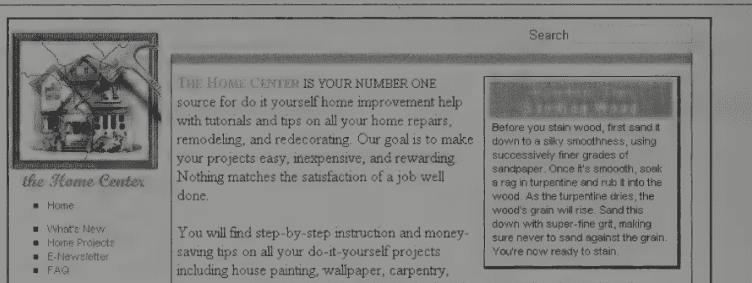

搜索

为了完成这个网页：

- 1. 使用你的文本编辑器打开 `tutorial.02/case2` 文件夹下的 `hometxt.html`。在页眉中输入你的**姓名**和**日期**，并将文件保存为 `home.html`。使用你的文本编辑器打开 `randomtxt.js`。在注释部分输入你的**姓名**和**日期**，并将文件保存为 `random.js`。
2. 在 `random.js` 文件中，创建一个名为 `randomInt()` 的函数。该函数的作用是在给当前范围内生成一个随机整数。该函数有两个参数：`lower` 和 `upper`，其中 `lower` 是范围内的最小整数，`upper` 是范围内的最大整数。为函数添加以下命令：
   a. 声明一个名为 `size` 的变量，包含给定范围内的整数个数（提示：范围的大小比最大整数和最小整数之间的差大一）。
   b. 使用 `Math.floor()` 和 `random()` 方法结合 `lower` 参数和 `size` 变量来生成一个随机整数（提示：请参考本教程中生成随机整数的章节）。
3. 关闭文件并保存更改。
4. 在你的文本编辑器中打开 `home.html` 文件。在关闭 `</head>` 标签之后，插入两个外部脚本 `<script>` 元素：一个链接到 `tips.js` 文件，另一个链接到 ID 为 "tip" 的 `div` 元素。将该元素的内容替换为嵌入式 `<script>` 元素。该脚本元素应执行以下操作：
   a. 声明一个名为 `tipNum` 的变量，赋值为你在 `random.js` 文件中创建的 `randomInt()` 函数返回的 1 到 10 之间的随机整数。


b. 使用一系列 `document.write()` 方法将以下 HTML 代码写入 Web 页面：
`<h1>Random Tip<br />title</h1>` 
`<p>tip</p>`
其中 `title` 是由 `tipTitle` 函数生成的随机标题，`tip` 是由 `tipText` 函数生成的随机文本。

6. 保存对文件的更改。

7. 在浏览器中打开 `home.htm`，验证每次重新加载或刷新页面时，浮动框中都会出现随机提示。

8. 将完整的网站提交给你的老师。

# 挑战

探索如何使用 JavaScript 创建一个世界时。

## 案例问题 3

此案例所需的的数据文件：`je.css`、`logo.jpg`、`map.jpg`、`worldtxt.htm`、`zonetxt.htm`

Jackson Electronics 是一家制造和销售电子设备及组件的全球公司。公司在全球不同的地点设有六处办事处，公司员工必须与不同办事处保持密切联系。David Lin 维护着公司网站，并就一个问题你你帮助。他希望增强显示公司办事处位置的网页，以显示每个地点的本地时间。这将为员工从一个办事处向另一个办事处打电话或传真数据时提供重要信息。为了创建这个世界时，David 需要知道 JavaScript 的 `Date` 对象是如何与时区工作的。

地球被分为 24 个时区。每个时区都以英国格林威治记录的时间为基准，该时间被称为标准时间或格林威治标准时间 (GMT)。你可以使用 `getTimezoneOffset()` 方法确定格林威治与你本地时间相差多少分钟。例如，如果 `today` 包含一个日期并且运行在纽约的计算机上，表达式

```
today.getTimezoneOffset()*60000
```

返回 300，因为格林威治标准时间比纽约快 300 分钟（即 5 小时）。通过这些信息，你可以通过将偏移值加到计算机的本地时间来确定格林威治的时间。由于 JavaScript 使用毫秒测量时间，你必须将偏移量乘以每分钟的毫秒数。因此，使用此函数计算小时数的代码将

如果你知道格林威治的时间以及其他地点与 GMT 的偏移量，你可以确定世界上任何地方的时间。David 汇总了六处办事处的列表，以及这些城市与 GMT 之间的分钟差。办事处如下：

- 办事处 1：休斯顿 (-360)
- 办事处 2：伦敦 (0)
- 办事处 3：纽约 (-300)
- 办事处 4：西雅图 (-480)
- 办事处 5：悉尼 (660)
- 办事处 6：东京 (540)

括号中的数字表示该城市与 GMT 的分钟偏移。负值表示该城市落后格林威治标准时间，正值表示领先格林威治。例如，东京比格林威治快 540 分钟或 9 小时。

David 已经设计了地 map 的内容，但他需要你帮助为六个办事处编写时间。图 2-41 显示了完成页面的预览。

图 2-41

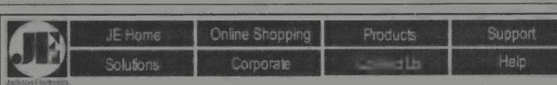

| Home | Online Shopping | Support |
| :--- | :--- | :--- |
| Solutions | Credit | Help |
| Houston | London | New York | Seattle |
| Jackson Electronics | USA | Jackson Electronics Ltd. | |
| 101 Park Street | New York NY | Seattle, WA | 5150 Shasta Lane | |
| Jackson Electronics | Europe | Jackson Electronics Pacific | |
| North Avenue | Thomas Street | Shibuya | |
| London, England | Sydney NSW | |

为了完成这个网页：

1. 使用你的文本编辑器打开 `tutorial.02/case3` 文件夹下的 `worldtxt.html`。在页眉中输入你的**姓名**和**日期**，并将文件保存为 `world.html`。使用你的文本编辑器打开 `zonetxt.js`，在注释部分输入你的**姓名**和**日期**，并将文件保存为 `zones.js`。

# 教程 2 运算符与表达式

在 `zones.js` 文件中，创建一个名为 `addTime()` 的函数。该函数的作用是通过向初始时间添加指定的毫秒数来创建一个日期对象。该函数有两个参数：`oldTime` 和 `milliseconds`。`oldTime` 参数存储初始时间的日期对象。`milliseconds` 参数存储应加的毫秒数。为函数添加以下命令：

   a. 创建一个名为 `newTime` 的日期对象，但不指定其日期或时间。
   b. 使用 `getTime()` 方法提取 `oldTime` 参数中的毫秒数，并将其加到 `milliseconds` 参数上。将和存储在变量 `newValue` 中。
   c. 使用 `setTime()` 方法将 `newTime` 对象的值设置为 `newValue`。
   d. 从函数返回 `newTime` 对象。

3. 在 `addTime()` 函数下方，创建一个返回 12 小时格式字符串的函数。该函数有一个单独参数 `time`，包含要显示的日期和时间。参考 `showTime()` 函数，此函数将返回以下字符串：`hour:minute AM/PM`

其中 `hour` 是 12 小时格式的值，`minute` 是分钟值，`AM/PM` 根据一天中的时间是 "AM" 或 "PM"。

4. 保存对 `zones.js` 的更改。

5. 在你的文本编辑器中打开 `world.html` 文件。在 `<head>` 标签之后，插入一个外部脚本元素以访问你在 `zones.js` 中创建的函数，并插入一个嵌入脚本元素。

6. 在嵌入脚本元素中，创建一个名为 `worldClock()` 的函数。该函数的作用是计算不同时区的时间。在此函数内部执行以下操作：

   a. 创建一个名为 `today` 的日期对象并将其值设置为当前日期和时间。
   b. 对变量应用 `getTimezoneOffset()` 方法以计算计算机时相对于 GMT 的分钟偏移。通过将该值乘以 60 然后乘以 1000 将其转换为毫秒。将结果存储在变量 `offset` 中。
   c. 使用 `today` 作为第一个参数，`offset` 作为第二个参数调用 `addTime()`。将函数的返回值存储在变量 `GMT` 中。GMT 变量代表格林威治当前的日期和时间。
   d. 计算 Jackson Electronics 第一处办事处（休斯顿）的时间日期对象。要计算此时间，调用 `addTime()` 函数作为第一个参数，第二个参数等于休斯顿相对于 GMT 的偏移毫秒数。（提示：由于休斯顿比格林威治慢 360 分钟，因此相对于 GMT 的偏移等于 (-360)*60*1000。）将 `addTime()` 函数返回的日期对象存储在变量 `time1` 中。重复此操作，为其他五个办事处创建名为 `time2` 到 `time6` 的变量，使用 David 在上方列出的偏移值。

## JavaScript 教程 2：使用运算符和表达式

e. 六个地点的当前时间显示在 Web 表单中名为 `place1` 到 `place6` 的输入字段中。要显示 `place1` 字段的值，使用 `time1` 变量作为参数调用 `getTime()` 函数。重复此操作。

7. 为 `<body>` 标签添加一个事件处理器属性，以便在浏览器加载页面以及之后每秒运行一次 `clock()` 函数。

8. 关闭文件并保存更改。

9. 在 Web 浏览器中打开 `world.html`。验证当前时间是否正确相对于格林威治时间。

10. 将完成的网站提交给你的老师。

注意：这是一个非常复杂问题的简化示例。不同国家应用时区的方式不同。例如，中国跨越多个时区，但全国采用统一的时间。其他国家在夏令时（又称为夏季时间）每年调整两次时间，而另一些国家不实行夏令时。例如，案例问题中报告的时间在西雅图、休斯顿和纽约市的夏令期间会错一小时。要创建一个真正准确的钟，你必须考虑全球时间计时的所有特殊情况。

## 案例问题 4

通过为购物场开业创建一个倒计时钟来测试你对 JavaScript 的了解。

此案例所需的数据文件：logo.jpg, mall1.jpg, mall2.jpg, mall3.jpg, mall.txt, malltxt.htm, malltxt.js

Alice Samuels 是 Cutter Mall 的经理，该商场是 3 月 23 日在 Cutler 开业的大型项目。她请你负责设计宣布商场开业的网页。她为你提供了页面文本以及几张图形；但是，她还希望你编写一个倒计时钟，显示距离商场开业剩余的天、小时和分钟。网站最终的设计由你决定，你可以用自己的材料补充提供的材料。

完成此作业：

- 1. 使用你的文本编辑器打开 `tutorial/02/case4` 文件夹下的 `malltxt.htm`。在头部部分**输入你的姓名**和**日期**，并将文件保存为 **mall.html**。

- 2. 在 页面中插入一个包含以下字段的表单：
    - 一个 `DayNow` 字段，以月/日/年的格式显示当前日期
    - 一个 `Time` 字段，以 12 小时格式显示时间
    - 一个 `days` 字段，显示距离商场开业剩余的天数
    - 一个 `hours` 字段，显示当前小时内剩余的小时；四舍入
    - 一个 `minutes` 字段，显示当前小时内剩余的分钟；四舍入到最近的分钟。

- 3. 将剩余内容添加到网页中。参考 `mall.txt` 文本文件获取 Alice 希望在网页看到的内容。

- 4. 在文本编辑器中打开 `malltxt.js`，在注释部分**输入你的姓名**和**日期**。将文件保存为 **time.js**，在文件中添加以下函数：
    - 一个 `daysDiff()` 函数，计算开始日期和结束日期之间的天数，向下取整到下一个整数。
    - 一个 `hoursLeft()` 函数，计算当天剩余的小时，向下取整到下一个整数。
    - 一个 `MinutesLeft()` 函数，计算当前小时内剩余的分钟，向下取整到下一个整数。
    - 一个 `ShowDate()` 函数，以月/日/年的格式显示日期对象的值。
    - 一个 `ShowTime()` 函数，以 hour:minute am/pm 的格式显示日期对象的值。

- 5. 插入一个外部脚本元素，以便从 `mall.html` 文件访问 `time.js` 脚本中的函数。
6. 在 `mall.html` 文件中添加嵌入脚本，使用来自 `time.js` 文件的函数在文档中显示当前日期和时间，以及距离商场开业剩余的天小时和分钟。假设开业日期为 3 月 23 日，时间上午 11 点。
7. 让网页上的倒计时钟每 10 秒更新一次。
8. 将你完成的网站提交给你的老师。

## 快速检查答案

## Session 2.1

- 1. 事件处理器是添加到元素上的属性，指示 Web 浏览器在元素内发生事件（如鼠标点击）时运行脚本命令或多个命令。
2. onclick = "showImage()"
3. <a href="javascript:showImage()"> ... </a>
4. var examDate = new Date("May 8, 2007 18:55:28");
5. examDate.getMonth() // 返回的值将是 4。
6. examDate.getFullYear()
7. examDate.setDate(9);
8. currentTime = new Date();

## Session 2.2

- 1. thisMonth++
2. thisMonth += 1;
3. Math.round(thisMonth)
4. thisMonth = (thisMonth == 11) ? 12 : thisMonth;
5. IsNaN(thisMonth)
6. thisDay.toFixed(0);
7. setTimeout("calcMonth", 500);
8. setInterval("calcMonth", 500);

## Session 3.1

### 介绍日历

## 目标

- 3.1
- 创建一个数组
- 从数组中填充值
- 使用数组方法

- 3.2
- 使用 For 循环
- 使用 While 循环
- 遍历数组的内容

- 3.3
- 使用数组、循环和条件语句
- 使用 break, continue 和 label 命令

## 使用数组、循环和条件语句

### 案例：创建一个日历

你一天早上早去宣传总监办公室，与她讨论网站计划。Maria 有一份页面打印件，并画出了她的日历想法。打印件显示的是上个月（5 月）的事件。Maria 希望5 月的日历出现在页面的右上角，以便用户将事件与日期。Maria 不希望员工手动构建日历；相反，她希望添加一个程序来自动生成。

#### 插入月日历

| 五月份事件描述 | 月日历自动生成并插入页面 | |
| 日 一 二 三 四 五 六 |
|---|---|---|---|---|---|---|
| | | 1 | 2 | 3 | 4 | 5 |
| 6 | 7 | 8 | 9 | 10 | 11 | 12 |
| 13 | 14 | 15 | 16 | 17 | 18 | 19 |
| 20 | 21 | 22 | 23 | 24 | 25 | 26 |
| 27 | 28 | 29 | 30 | 31 | | |

> 五月是活动中心又一个辉煌的月份，5 月 4 日、5 日和 6 日将由百老汇巡演团带来获奖音乐剧。门票非常紧张，请立即订购。
在 5 月 11 日与钱伯交响乐团一起通过他们的古典音乐午餐庆祝这个季节。第二天，即 5 月 12 日，通过参加查尔斯·狄更音乐剧锻炼大脑。
爵士乐爱好者在五月有很多可以庆祝的事，包括 17 日的爵士乐。然后于 5 月 24 日，享受堪萨斯市爵士乐团表演的爵士大师音乐。
钉子、瓶子、盘子和椅子在五月的活动中心飞舞，5 月 13 日星期日又有一场精彩的表演。5 月 20 日，Madman 将将用他们独特的幽默、杂技和作剧大显身手。
星期下午由 Carson 四重奏提供音乐的欢乐早午餐活动。座位有限，请预订您的桌位。


Maria 希望你编写的程序可以在其他网页上易于使用。她设想将日历的所有 JavaScript 代码放在一个名为 `calendar.js` 的外部文件中，并通过单个函数来运行它。日历的样式也应该放在一个名为 `calendar.css` 的单一外部文件中（见图 3-2）。在 CCC 网站的任何页面中访问和显示月历表，只需要少量的代码。

## 创建和格式化月历

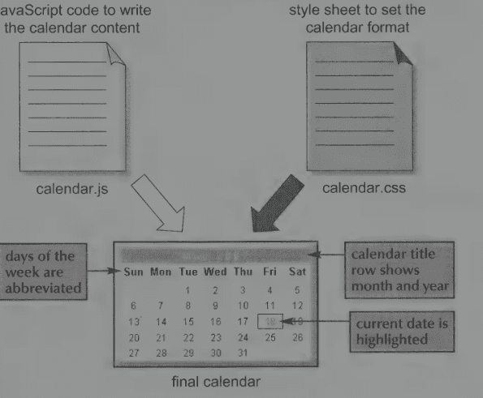

图 3-2

Maria 已经创建了日历表所需的样式，但将编码工作留给了你。在 Chamberlain Civic Center 的首页上添加 `calendar.js` 和 `calendar.css` 文件的链接。

## 要访问 CCC 文件：

- 1. 使用你的文本编辑器打开 `tutorial.03/tutorial` 文件夹下的 `cal.js`。在文件顶部的注释部分输入你的名字和日期，并将文件保存为 `calendar.js`。
- 2. 在文本编辑器中打开 `ccc.htm` 文件。同样在文件顶部的注释部分输入你的名字和日期，并将文件保存为 `ccc.htm`。
- 3. 在 `</head>` 标签下方添加以下代码，创建指向 `calendar.css` 样式表和 `calendar.js` JavaScript 文件的链接（见图 3-3）：

```
<link href="calendar.css" rel="stylesheet" type="text/css" />
<script src="calendar.js" type="text/javascript"></script>
```

## 链接 JavaScript 和样式表文件

```
<title>the Chamberlain civic center</title>
<link href="calendar.css" rel="stylesheet" type="text/css" />
<script src="calendar.js" type="text/javascript"></script>
</head>
```

图 3-3

- 4. 保存对文件的更改。

## 日历样式表

在开始编写代码创建月历之前，你应该快速查看 `calendar.css` 样表中的样式。Maria 为表格的不同部分分配了类名（class names）和 ID 名（id names）。在创建月历时，你会用到五个类名或 ID 名：

- 整个日历设置在一个 id 为 `calendar_table` 的表格中。
- 包含日历标题的单元  id 为 `calendar_head`。
- 包含星期七日的单元格都属于 `calendar_weekdays` 类。
- 包含月份的单元格都属于 `calendar_dates` 类。
- 包含当前日期的单元格 id 为 `calendar_today`。

对于这些部分，`calendar.css` 都有一个样式声明。图 3-4 显示了 `calendar.css` 文件包含的样式表。

## calendar.css 样式表的内容

```
#calendar_table {float:right; background-color: white; font-size: 9pt;
  font-family: Arial, Helvetica, sans-serif;
  border-style: outset; border-width: 5px; Margin: 0px 0px 5px 5px}
#calendar_head {background-color: orange; color: ivory; letter-spacing: 4}
#calendar_weekdays {width: 30px; font-size: 10pt; border-bottom-style: solid}
#calendar_dates {text-align: center; background-color: white}
#calendar_today {font-weight: bold; color: orange; background-color: ivory;
  border: 1px solid black}
```

当你编写写入此表格的代码时，需要确保为适当的表格和单元格标签添加 `id` 和 `class` 属性。将此放在单独的样式表中的优点之一是你可以轻松地修改表格的外观，而无需重写生成表格的代码。

## calendar() 函数

由于 Maria 希望应用程序能够在 CCC 网站的任何页面上可用，你将把所有命令放在一个名为 `calendar()` 的单个函数中。你向函数添加的第一条命令使用 `document.write()` 方法写入 id 为 `calendar_table` 的 `table` 元素的 HTML 代码。`calendar()` 函数的初始代码为：

```
function calendar() {
  document.write("<table id='calendar_table'>");
  document.write("</table>");
}
```

你通过在 `ccc.htm` 文件的 `script` 元素中添加该命令来调用此函数。现在将此代码添加到 `calendar.js` 和 `ccc.htm` 文件中。


## 开始工作 calendar() 函数：

- 1. 返回到文本编辑器中的 `calendar.js` 文件。在文件底部添加以下代码（见图 3-5）：

```
function calendar() {
  document.write("<table id="calendar_table">");
  document.write("</table>");
}
```

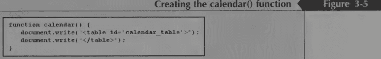

- 2. 保存对文件的更改。
- 3. 返回到文本编辑器中的 `ccc.htm` 文件。找到 id 为 "head" 的 `div`。日历应该作为 `table` 元素放置在页面的此部分。运行 `calendar()` 函数创建表格，插入以下代码，如图 3-6 所示：

```
<script type="text/javascript">
calendar();
</script>
```


- 4. 关闭文件并保存更改。
- 5. 在浏览器中打开 `ccc.htm`。验证浏览器没有报告任何错误。你将看不到日历表格，因为你还没有为表格创建任何内容。此时，你已经完成了在 `ccc.htm` 文件中需要的所有编码工作。你需要在 `calendar.js` 文件中完成构建 `calendar()` 函数的所有剩余工作。创建日历表可以分为三个主要任务：

- 创建表头
- 创建包含星期名称的表格行
- 创建包含每月日的行

在本教程的本节中，你将学习如何为日历表创建表头。

## 使用数组

Maria 希望日历表的表头显示文本 "Month, Year"，其中 Month 是月份名称，Year 是年份。在上一个教程中，你学习了日期对象允许你提取月份数字。Maria 希望在表格中显示月份名称而不是月份数字，因此你必须编写代码将每个月份数字与月份名称关联。数组是组织在单个名称下的数据值集合。每个单独的数据值都有一个索引，将其与其他值区分来。

- 整个日历设置在一个 id 为 `calendar_table` 的 `table` 表格中。
- 包含日历标题的单元格 id 为 `calendar_head`。
- 包含星期七日的单元格都属于 `calendar_weekdays` 类。
- 包含月份的单元格都属于 `calendar_dates` 类。
- 包含当前日期的单元格 id 为 `calendar_today`。

对于这些部分，`calendar.css` 都有一个样式声明。图 3-4 显示了 `calendar.css` 文件包含的样式表。

*(注：此处后续部分原文似乎存在逻辑重复或表述混乱，翻译已根据原意及中文语境进行了通顺化处理)*

## 创建 writeCallTitle() 函数：

- 1. 返回到文本编辑器中的 `calendar.js` 文件。
- 在文件底部插入以下代码，如图 3-7 所示：

```javascript
function writeCallTitle(calendarDay) {
    var monthName = new Array("January", "February", "March",
    "April", "May", "June", "July", "August", "September",
    "October", "November", "December");
}
```

创建 monthName 数组

```javascript
function calendar() {
    document.write("<table id='calendar_table>");
    document.write("<table>");
}
function writecalendar(calendarDay) {
    var monthName = new Array("January", "February", "March",
    "June", "July", "August", "September", "November", "December");
}
```

**遇到问题了？** 请确保每个数组项的值都包含在双引号内，并且该行没有在引号文本字符串内换行。

下一个函数需要使用 little-2 中引入的 `getMonth()` 和 `getYear()` 方法从 `calendarDay` 参数中提取月份名称和值。将这些值存储在名为 `monthName` 和 `thisYear` 的变量中：

```javascript
var thisMonth=calendarDay.getMonth();
var thisYear=calendarDay.getYear();
```

最后，该函数将为月历的第一行编写 HTML 代码。月历将有七列，包含标题的行具有跨列。记住，标题行也将具有 `id calendar_head`。标题行的 HTML 代码如下：

```html
<tr
<th id='calendar_head' colspan='7'>
    Month Year
</th>
</tr>
```

其中 Month 是月份名称，Year 是四位年份。该值就是 `thisYear` 变量的值。这个 `thisMonth` 变量告诉你该值，你可以将其作为索引从 `monthName` 数组中提取相应的月份名称。你将使用表达式：

```javascript
monthName[thisMonth]
```

记住，`monthName` 数组中的索引以及 `thisMonth` 变量的值从年的第一个月份从 0 开始，直到 11。然后，编写日历表的第一行的代码是：

```javascript
document.write("<tr>");
document.write("<th id='calendar_head' colspan='7'>");
document.write(monthName[thisMonth]+" "+thisYear);
document.write("</th>");
document.write("</tr>");
```

通过添加创建 `thisMonth` 和 `thisYear` 的命令以及编写表格第一行的 HTML 代码来完成 `writeCallTitle()`。

## 完成 writeCallTitle() 函数：

- 1. 将以下命令插入 `writeCallTitle()` 函数中，如图 3-8 所示：
```javascript
var thisMonth=calendarDay.getMonth();
var thisYear=calendarDay.getFullYear();
```
```javascript
document.write("<tr>");
document.write("<th id='calendar_head colspan='7'>");
document.write("<th monthName=\"[thisMonth]\" +thisYear);
document.write("</th>");
document.write("</tr>");
```
```javascript
function writeCallTitle(calendarDay) {
var month=new Array("February", "March", "April", "May", "June", "July", "September", "October", "November", "December");
var thisMonth=calendarDay.getMonth();
var thisYear=calendarDay.getFullYear();
document.write("<tr>");
document.write("<th id='calendar_head colspan='7'>");
document.write("<th monthName=\"[thisMonth]\" + +thisYear);
document.write("</th>");
document.write("</tr>");
}
```

## 完成的 writeCallTitle() 函数

- 2. 将更改保存到文件。

## 创建和填充数组

- 要创建数组，运行命令
  `var array = new Array(length);`
  其中 `array` 是数组名称，`length` 是数组中项的数量。
  除非你想限制数组的特定大小，否则不需要 `length` 参数。

- 要设置数组中某项的值，使用
  `array[i] = value;`
  其中 `i` 是项的索引，`value` 是分配给该项的值。

- 要创建并填充数组，使用命令
  `var array = new Array(values);`
  其中 `values` 是由逗号分隔的值列表。

- 要创建一个数组字面量，使用
  `var array = [values];`

## 引用窗口

接下来，你必须为日历指定一个日期。为了有一个公共日期，你将在 `calendar()` 函数中添加一个名为 `calDate` 的日期对象，存储“2007年5月18日”这一日期。然后，你将使用此日期作为 `calendarDay` 参数的值调用 `writeCallTitle()` 函数。

## JavaScript 教程 2：处理数组、循环和条件

## 修改 calendar() 函数：

- 1. 在 `calendar()` 函数的开头插入以下语句以创建 `calDate` 变量：
```javascript
var calDate = new Date("May 18, 2007");
```

- 2. 插入以下调用 `writeTitle()` 命令，如图 3-9 所示：
```javascript
writeTitle(calDate);
```
```javascript
function calendar() {
  document.write("<table id='calendar_table>");
  document.write("<table>");
}
function writecalendar(calendarDay) {
    var monthName = new Array("January", "February", "March",
    "June", "July", "August", "September", "November", "December");
    var thisMonth=calendarDay.getMonth();
    var thisYear=calendarDay.getFullYear();
    document.write("<tr>");
    document.write("<th id='calendar_head' colspan='7'>");
    document.write(monthName[thisMonth]+" "+thisYear);
    document.write("</th>");
    document.write("</tr>");
}
```

- 3. 将更改保存到文件。

- 4. 重新打开浏览器。日历现在应该显示正确的月份和。


数组关联一组方法，允许你更改其内容、顺序和大小。你还可以使用这些方法将不同的数组合并为单个数组，并将数组转换为字符串。虽然你不需要在 `calendar()` 中使用这些方法，但你将在未来的项目中使用它们。每个方法都使用以下语法：

```javascript
array.method()
```

## 排序数组

默认情况下，项按照定义的顺序放入数组中，或者显式地使用数组的索引数字。JavaScript 两个方法进行更改：`reverse()` 和 `sort()`。`reverse()` 方法顾其名，反转数组中项的顺序。

```javascript
var weekDay = new Array("Sun", "Mon", "Tue", "Wed", "Thu", "Fri", "Sat");
weekDay.reverse();
```

运行 `reverse()` 方法后，`weekDay` 数组包含项的顺序如下：“Sat”、“Fri”、“Thu”、“Wed”、“Tue”、“Mon”，最后是“Sun”。

# 数组排序

`sort()` 方法按字母顺序对数组项进行排序。将命令

```
weekday.sort();
```

应用到 `weekday` 数组时，会导致数组中的星期几缩写按照 "Fri", "Mon", "Sat", "Sun", "Tue", "Wed" 的顺序排序。请注意，如果你对数值应用 `sort()` 方法，该方法会将这些值视为文本字符串，并根据它们的第一位数字进行顺序排序，而不是根据真实的数值值。这种排序类似于按字母顺序排列单词，可能会导致一些意外的结果。例如，以下命令创建并排序了一个名为 x 的数组：

```
var x = new Array(3, 45, 123, 24);
x.sort();
```

排序后的 `x` 数组将按照 123, 24, 3, 45 的顺序存储项，因为这是这些数字按其首位数字排序的顺序。要正确排序非文本数据，你必须创建一个比较函数，该函数每次比较数组中两个相邻项的值。比较函数通过两个参数指示这些项。

这两个项根据比较函数返回的值进行排序。如果返回值为 0，则两个项的顺序保持不变。如果值为正数，则第二个项将被排序到比第一个项更高的索引处。如果值为负数，则交换顺序。以下代码显示了一个你可以使用的比较函数，用于按数值升序顺序排序数组项：

```
function numSort(a, b) {
return a-b;
}
```

函数中的 "a" 参数代表数组中两个相邻项中的第一个；"b" 参数代表两个相邻项中的第二个。`numSort()` 函数返回的值为正、负或 0。要对 `sort()` 方法应用比较函数，你使用表达式

```
array.sort(numSort);
```

其中 `numSort` 是比较函数的名称。若要使用 `numSort()` 函数按数值顺序排序 `x` 数组，你需要运行以下命令：

```
x.sort(numSort);
```

结果数组 `x` 数组中的值将按照 3, 24, 45, 123 的顺序排序。要按数值降序顺序排序数组，你需要不同的比较函数。以下函数可以用于按降序顺序排序数值。请注意，在此函数中，比较过程返回的值 (b-a) 而不是

```
function numSortDesc(a, b) {
return b-a;
}
```

# 提取和插入数组项

在某些脚本中，你想要提取数组的一个部分，即子数组。例如，你可能想从 `monthName` 数组中仅提取夏季月份——6月、7月和8月。要创建一个子数组，你可以使用 `slice()` 方法，它可以提取数组的一部分。数组的原始内容不受影响，提取出的元素可以存储在另一个数组中。`slice()` 方法的语法为

```
array.slice(start, stop)
```

其中 `start` 是开始切片的数组索引，`stop` 是其之前的索引。如果没有提供 `stop` 值，则将数组切片到数组末尾。例如，如果你想切片 `monthName` 数组并仅提取夏季月份，将使用以下命令：

```
summerMonths = monthName.slice(5, 8);
```

`summerMonths` 数组将包含值 "June", "July" 和 "August"。记住，数组从索引 0 开始，一年的六个月（7月）索引值为 5，一年的九个月（9月）索引为 8。`slice()` 方法是 `splice()` 方法，这是一个用于提取和插入数组项的通用方法。`splice()` 方法的语法为

```
array.splice(start, size)
```

其中 `start` 再次是开始从数组中提取项的索引，`size` 是大小。如果未指定 `size` 值，则将删除到数组末尾的项。例如，使用 `splice()` 方法从 `monthName` 数组中提取夏季月份，你可以运行命令：

```
summerMonths = monthName.splice(5, 3);
```

`slice()` 和 `splice()` 方法之间的重要区别之一是，`splice()` 方法不仅提取所选项，还将它们从原始数组中删除。因此，对上述 `monthName` 数组应用 `splice()` 方法将创建一个夏季月份的子数组，同时从 `monthName` 数组中移除这三个月份。使用 `slice()` 方法则不会这样，它不会影响 `monthName` 数组的内容。

你还可以使用 `splice()` 方法向数组中插入新项。要插入数组项，你使用表达式

```
array.splice(start, size, values)
```

其中 `values` 是一个逗号分隔的值列表，用于替换数组中的旧值。例如，如果你想将前三个月份替换为它们的首字母，你可以对 `monthName` 数组应用以下 `splice()` 方法：

```
monthName.splice(0, 3, "J", "F", "M");
```

`monthName` 数组中的值现在将是 J, F, M, May 等。

在某些情况下，你想要处理数组开头或结尾的项。插入或删除项的最有效方法是 `push()`、`pop()`、`shift()` 和 `unshift()`。`push()` 方法将新项附加到数组末尾，语法为

```
array.push(values)
```

其中 `values` 是一个逗号分隔的值列表。要从数组中删除最后一项，请使用方法

```
array.pop()
```

`push()` 和 `pop()` 方法经常用于遵循“后进先出”原则的项目。以下命令集演示了如何使用 `push()` 和 `pop()` 方法扩展和收缩数组。请注意，最近添加的项会被弹出，因为最近添加的项默认被添加到数组的末尾。

```
var x = new Array("a", "b", "c");
x.push("d", "e"); // x 现在包含 ["a", "b", "c", "d", "e"]
x.pop(); // x 现在包含 ["a", "b", "c", "d"]
x.pop(); // x 现在包含 ["a", "b", "c"]
```

`shift()` 方法与 `push()` 方法类似，不同在于它在数组开头插入新项。`unshift()` 方法与 `pop()` 方法类似，不同在于它移除第一个而不是最后一个数组项。

- 要反转数组中项的顺序，使用 `reverse()`

- 要按字母顺序排序数组，使用 `sort()`

- 要按数值顺序排序数组，使用 `sort(function)`，其中 `function` 是返回正、负或 0 的函数。

- 要提取数组项而不影响数组，使用 `slice(start, stop)`，其中 `start` 是开始切片的索引，`stop` 是其之前的索引。

- 要从数组中提取并删除项，使用 `splice(start, size)`，其中 `start` 是开始提取的索引， `size` 是大小。

- 要在数组中插入新项，使用 `splice(start, size, values)`，其中 `values` 是逗号分隔的值列表。

- 要从数组末尾删除项，使用 `pop()`

- 要向数组末尾添加项，使用 `push(values)`，其中 `values` 是逗号分隔的值列表。

- 要从数组开头删除项，使用 `shift()`

- 要在数组开头插入项，使用 `unshift(values)`，其中 `values` 是逗号分隔的值列表

图 3-11 总结了数组的许多方法。

数组方法

| 数组方法 | 说明 |

| :--- | :--- |

| array.concat(array1, ...) | 合并两个或多个数组，创建一个新数组 |

| array.join(separator) | 将数组中的所有项连接成单个字符串，由分隔符分隔。如果没有指定分隔符，则使用逗号。 |

| array.pop() | 移除数组最后一项 |

| array.push(values) | 在数组末尾添加项，其中 values 是一个逗号分隔的值列表 |

| array.reverse() | 反转数组中项的顺序 |

| array.shift() | 移除数组第一个项 |

| array.slice(start, stop) | 从 start 索引开始提取到 stop 索引之前的数组项，返回一个子数组 |

| array.splice(start, size, values) | 从 start 索引开始提取项。要向数组插入新项，请指定逗号分隔的值列表。 |

| array.sort(function) | 对数组排序，其中 function 是一个返回正、负或 0 的函数。如果没有指定函数，则按字母顺序排序。 |

| array.toString() | 将数组的内容转换为字符串，每个值之间用逗号分隔 |

| array.unshift(values) | 在数组开头插入新项，其中 values 是一个逗号分隔的值列表 |

你已经在本节中完成了设置在线日历部分内容的工作。如果你计划在下一节开始前休息，可以关闭任何打开的文件或网页。在下一节中，你将通过循环和条件语句完成每月日历。

# # 3.1 节快速检查

1. 什么是数组？

2. 使用什么命令创建 `dayNames` 数组？

3. 使用什么命令同时创建并填充 `dayNames` 数组的七天星期缩写？（从 "Sun" 到 "Sat"）

4. 使用什么表达式可以返回 `dayNames` 数组的第三个值？

5. 输入什么命令以数组字面量创建 `dayNames` 数组？

6. 输入什么命令按字母顺序排序 `dayNames` 数组？

7. 输入什么命令从 `dayNames` 数组中提取中间的五个值？

8. 输入什么命令将 `dayNames` 数组的内容转换为字符串，每个值之间用逗号分隔

## 3.2 节

## 使用程序循环

现在你已经熟悉了数组的属性和方法，将继续完成 `calendar()` 函数的工作。到目前为止，你只创建了显示月份和年份的标题行。表格的下一行将包含星期七天的三字母缩写，从 "Sun" 开始一直到 "Sat"。每个缩写都需要放置在类名为 "calendar_weekdays" 的 `th` 元素中。通过对每一行 HTML 使用 `document.write()` 命令，你可以使用以下代码生成此表格行：

```javascript
document.write("<th class=\"calendar_weekdays\">Sun</th>");
document.write("<th class=\"calendar_weekdays\">Mon</th>");
document.write("<th class=\"calendar_weekdays\">Tue</th>");
document.write("<th class=\"calendar_weekdays\">Wed</th>");
document.write("<th class=\"calendar_weekdays\">Thu</th>");
document.write("<th class=\"calendar_weekdays\">Fri</th>");
document.write("<th class=\"calendar_weekdays\">Sat</th>");
```

这段代码包含大量的重复文本。想象一下，如果你必须重复几十次、数百次或数千次基本相同的代码字符串，代码将变得非常长，且难以维护。程序员通过创建程序循环来解决这种问题。程序循环是一组重复执行的命令，直到满足停止条件。JavaScript 中常用的两种程序循环是 `For` 循环和 `While` 循环。

## For 循环

在 `For` 循环中，一个被称为计数器变量的变量用于跟踪一组命令执行的次数。每次循环，计数器变量的值都会按照固定的量增加或减少。当计数器变量达到指定值时，`For` 循环停止。`For` 循环的通用结构如下：

```javascript
for (start; continue; update) {
  commands
}
```

其中 `start` 是设置计数器变量初始值的表达式，`continue` 是用于循环继续的布尔表达式，`update` 是指示每次循环计数器变量值应如何变化的表达式，而 `commands` 是每次循环时运行的 JavaScript 命令。

例如，假设你想设置一个计数器变量的值范围为 0 到 3，增量为 1。你可以使用以下表式来设置变量的初始值：

```javascript
var i = 0;
```

这里的计数器变量名称是 `i`，它是程序循环中经常使用的常用变量名。`For` 循环结构中的下一个表达式定义了程序循环的停止条件。以下表达式设置了只要计数器变量的值小于 4，循环就会继续：

```javascript
i < 4;
```

最后，接下来的 `update` 表达式使用递增运算符（在上一个教程中引入）表示每次程序循环时计数器变量的值都增加 1：

```javascript
i++;
```

将所有这些表达式组合在一起，`For` 循环看起来如下：

```javascript
for (var i=0; i < 4; i++) {
  commands
}
```

每次循环时运行的命令集合统称为**命令块**（command block），你可以通过它的起始和结束大括号 `{}` 轻松识别它。如果一个 `For` 循环只包含一条命令，就不需要命令块，也可以省略大括号。

以下是一个 `For` 循环的示例，它将计数器变量的值写入网页的表格单元格中。如图 3-12 所示，每次循环，表格单元中显示的值就会改变 1。

```javascript
for (var i=0; i < 4; i++) {
  document.write("<td>"+i+"</td>");
}
```

## 运行 For 循环

图 3-12

```html
<table border="2">
  <tr>
    <script type="text/javascript">
    for (var i=0; i < 4; i++) {
      document.write("<td>"+i+"</td>");
    }
    </script>
  </tr>
</table>
```

**For 循环**

| For 循环的部分 | 表达式 | 计数器值 | 写入页面的代码 |

|---|---|---|---|

| start | var i=0 | 0 | <td>0</td> |

| continue | i < 4 | 1 | <td>1</td> |

| update | i++ | 2 | <td>2</td> |

| | | 3 | <td>3</td> |

For 循环期间的值


生成的表格

循环 可以相互嵌套。图 3-13 显示了用于创建一个包含三行四列的表格的代码。此示例使用了两个变量，分别名为 `rowNum` 和 `colNum`。`rowNum` 遍历值 1, 2 和 3。此外，对于 `rowNum` 变量的每一个值，`colNum` 遍历值 1, 2, 3 和 4。每当 `colNum` 变量的值改变时，表格就会添加新单元格。每当 `rowNum` 变量的值改变时，表格就会添加新行。

## 运行嵌套 For 循环

| rowNum | colNum | 写入页面的代码 |

|---|---|---|

| 1 | 1 | <tr><td>1,1</td></tr> |

| 1 | 2 | <tr><td>1,2</td></tr> |

| 1 | 3 | <tr><td>1,3</td></tr> |

| 1 | 4 | <tr><td>1,4</td></tr> |

| 2 | 1 | <tr><td>2,1</td></tr> |

| 2 | 2 | <tr><td>2,2</td></tr> |

| 2 | 3 | <tr><td>2,3</td></tr> |

| 2 | 4 | <tr><td>2,4</td></tr> |

| 3 | ... | ... |

| 3 | 4 | <tr><td>3,4</td></tr> |

**嵌套循环**

1,1 1,2 1,3 1,4

2,1 2,2 2,3 2,4

3,1 ... 4

更新表达式并不限于计数器加 1。你可以使用教程 2 中引入的其他运算符来创建多种模式。图 3-14 显示了更新 `For` 循环计数器值的多种方法。

**For 循环中的计数器值**

| For 循环 | 计数器值 |

|---|---|

| for (i=1; i<5; i++) | 1, 2, 3, 4, 5 |

| for (i=5; i>0; i--) | 5, 4, 3, 2, 1 |

| for (i=0; i<60; i+=60) | 0, 60, 120, 240, 300, 360 |

| for (i=1; i<=64; i*=2) | 1, 2, 4, 8, 16, 32, 64 |

## For 循环与数组

`For` 循环经常用于遍历数组中的不同值。访问数组每个值的通用结构是：

```javascript
for (var i=0; i < array.length; i++) {
    // 命令
}
```

其中 `array` 是要遍历的数组，`i` 是循环中使用的计数器变量。该计数器变量代表数组元素的索引。注意 `length` 属性用于确定数组的大小。由于数组最后一个元素的索引比长度小 1（索引从 0 开始），只有当索引小于长度值时才继续循环。

你已经有了足够的信息创建一个使用数组和循环显示星期七天的函数。首先，你需要创建一个包含每天缩写的数组 `dayName`。你可以使用以下代码：

```javascript
var dayName = new Array("Sun", "Mon", "Tue", "Wed", "Thu", "Sat");
```

然后你循环遍历 `dayName` 数组的值，并将每个值显示在类名为 `calendar_weekdays` 的单元单元中：

```javascript
document.write("<tr>");
for (var i=0; i<dayName.length; i++) {
  document.write("<th class=\"calendar_weekdays\">"+dayName[i]+"th>");
}
document.write("</tr>");
```

将这些命令添加到名为 `writeDayNames()` 的新函数中，然后将其应用于你的月历。

## 创建 writeDayNames() 函数：

- 1. 如果必要，在文本编辑器中重新打开 `calendar.js` 文件。

- 2. 在文件底部插入以下函数：

```javascript
function writeDayNames() {
  var dayName = new Array("Sun", "Mon", "Tue", "Wed", "Thu", "Sat");
  document.write("<tr>");
  for (var i=0; i<dayName.length; i++) {
    document.write("<th class=\"calendar_weekdays\">"+dayName[i]+"th>");
  }
  document.write("</tr>");
}
```

- 3. 滚动到 `calendar` 函数，在调用 `writeTitle()` 函数的命令下方插入 `writeDayNames()`。（见图 3-15）。

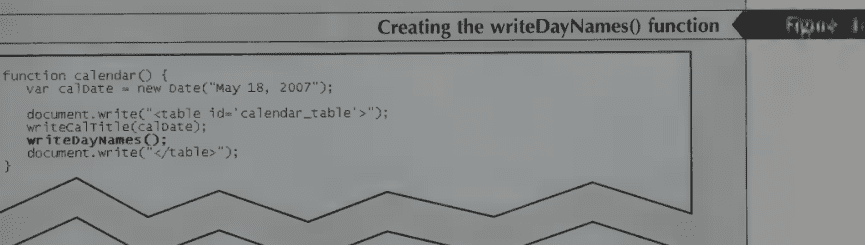

```javascript
function calendar() {
  var caldate = new Date("May 18, 2007");
  document.write("<table id=\"calendar_table\">");
  writeTitle(caldate);
  writeDayNames();
  document.write("</table>");
}
```

- 4. 保存文件的更改。

- 5. 在 Web 浏览器中重新打开 ccc.htm。如图 3-16 所示，月历应该显示包含星期缩写的第二行。

# 图 3-12 带有星期名称的日历

| 日 | 一 | 二 | 三 | 四 | 五 | 土 |

|---|---|---|---|---|---|---|

| 钱伯 | | | | | | |

| 市政中心 | | | | | | |

## While 循环

For 循环只是在 JavaScript 中创建程序的方法之一。在继续 For(calendar) 函数之前，你将研究另外几种。While 循环类似于 For Loop，只要满足特定条件，就会执行命令块。但与 For 循环不同，While 循中的条件不取决于计数器变量的值。While 循环的通用语法如下

```
while (condition) {
    commands
}
```

其中 `condition` 是任何布尔表达式。该布尔表达式在每次程序循环时都会经过测试。如果表达式返回值为 true，则执行命令块；否则，不执行命令块且程序循环结束。每个 While 循环都包含一个循环停止的条件；如果 While 循环不包含此条件，循环将无限运行，导致用户的浏览器崩溃。

以下代码展示了你如何使用 While 循环创建图 3-12 所示的表格。在此循环中，只要变量 `i` 的值小于 4，命令块就会执行。每执行一次命令块，循环都会将 `i` 的值写入表格单元格，并将 `i` 的值加 1。

```
var i = 0;
while (i < 4) {
    document.write("<td>"+i+"</td>");
    i++;
}
```

与 For 循环一样，While 循环也可以相互嵌套。以下代码演示了你如何使用嵌套 While 循环创建图 3-13 所示的 3 x 4 表格。同样，在嵌套循环运行之前，会设置计数器变量的初始值，并在命令块内部进行更新。

```
rowNum = 1;
while (rowNum < 4) {
    document.write("<tr>");
    colNum = 1;
    while (colNum < 5) {
        document.write("<td>"+rowNum+",+colNum+"</td>");
        colNum++;
    }
    document.write("</tr>");
    rowNum++;
}
```

由于 For 和 While 循环共享许多相同特性，因此为特定应用选择哪种循环通常取决于个人偏好。通常情况下，当你有一个计数器变量时使用循环，而 While 循环则用于不便于使用计数器的条件。

## Do/While 循环

在 For 和 While 循环中，确定是否继续循环的测试是在执行命令之前进行的。JavaScript 还支持一种名为 Do/While 的循环，它在执行完最后一个命令后立即测试继续循环的条件。Do/While 循环的结构如下

```
do {
  commands
} while (condition);
```

例如，要用 Do/While 循环创建图 3-12 所示的表格，你需要输入以下代码：

```
var i = 0;
do {
  document.write("<td>"+i+"</td>");
  i++;
} while (i < 4);
```

Do/While 循环仅用于你始终确定程序循环至少运行一次的情况。然而，由于它与 While 循环相似，你很少在脚本中看到 Do/While 循环。

## 程序循环

- 创建 For 循环，使用语法

  for (start; continue; update) {

    commands

  }

  其中 *start* 是一个必须为真循环才能继续的表达式，*update* 是一个指示每次循环时计数器变量值应如何变化的表达式，而 *commands* 是每次循环时运行的 JavaScript 命令。

- 创建 While 循环，使用语法

  while (condition) {

    commands

  }

- 创建 Do/While 循环，使用语法

  do {

    commands

  } while (condition);

- 遍历数组内容，输入 For 循环

  for (var i = 0; i < array.length; i++) {

    commands involving array[i]

  }

  其中 *i* 是一个代表数组项索引的计数器变量，*array* 是要遍历的数组。

## 使用条件语句

你在日历应用中的下个任务是输入包含月份日期的表格行。这些行中的每个表格单元格都将包含一个代表该月日期的数字。当你到达最后一天时，将停止写入表格单元格和行。显然，这个过程需要涉及某种程序循环。循环将取决于当前月份的天数。由于每个月份的天数不同，你需要创建一个包含每个月份长度的数组，或者与日历配合使用的月份。该数组看起来如下：

```
var dayCount = new Array(31,28, 30, 31, 30, 31, 30, 31, 30, 31, 31);
```

你将在名为 `daysInMonth()` 的函数内部创建此数组。和你之前创建的 `writeTitle` 函数一样，`daysMonth()` 有一个参数 `calendar`，代表一个日期对象。该函数创建两个变量 `thisYear` 和 `Month`，包含四位年份和月份值。`thisMonth` 变量用于提供索引，由函数返回月份的天数。

### 开始创建 daysInMonth() 函数：

1. 返回文本编辑器中的 `calendar.js` 文件。

2. 在文件末尾插入以下代码（见图 3-17）：

```
function daysInMonth() {
  var thisYear = calendarDay.getFullYear();
  var thisMonth = calendarDay.getMonth();
  var dayCount = new Array(31,28,30,31,30,31,30,31,30,31,31);
  return dayCount[thisMonth]; // 返回该月份的天数
}
```

初始的 `daysInMonth()` 函数

```javascript
function writeDays() {
  var dayName = new Array("Sun", "Mon", "Wed", "Thu", "Fri", "Sat");
  for (var i=0; i<dayName.length; i++) {
    document.write("<td>" + dayName[i] + "</td>");
  }
}

function daysInMonth(calendar) {
  var thisYear = calendarDay.getFullYear();
  var thisMonth = calendarDay.getMonth();
  var dayCount = new Array(31,28,30,31,30,31,30,31,30,31,31);
  return dayCount[thisMonth]; // 返回该月份的天数
}
```

初始的 `daysInMonth()` 函数

## 计算闰年

If 语句可以作为一种简单的近似值起工作，但它并不完全准确，因为它没有考虑到世纪。你需要包含第二个第二个测试来考虑世纪期间不同的闰年规则。这种嵌套 if 的通用结构如下

```
if (thisYear % 4 == 0) {
  世纪的 if 语句
}
```

嵌套的 If 语句需要测试两个条件：(1) 年份不被 100 整除，以及 (2) 年份被 400 整除。这两个表达式为

```javascript
thisYear % 100 != 0
thisYear % 400 == 0
```

对于一个被 4 整除的年份如果这两个条件中的任何一个为真，则该年份为闰年。注意你在表达式中使用 `!=` 来测试不等性。然后你使用逻辑或运算符 `||` 将这两个表达式组合为一个单一表达式，该运算符在教程 2 中引入。组合后的表达式为

```javascript
(thisYear % 100 != 0) || (thisYear % 400 == 0)
```

## JavaScript 中的数组、循环和条件语句操作

最后，你将此条件表达式放在嵌套的 If 语句中。因此，完整的代码如下：

```javascript
if (thisYear % 4 == 0) {
  if ((thisYear % 100 != 0) || (thisYear % 400 == 0)) {
    dayCount[1] = 29;
  }
}
```

在这组嵌套 If 语句下，只有当 `thisYear` 变量能被 4 整除，并且能被 400 整除或不能被 100 整除时，二月的天数才为 29。花时间将这组嵌套 If 语句与图 3-18 中的图进行对比，以确认它符合所有闰条件。在 `daysMonth()` 函数中使用嵌套 If，你可以返回指定年份任何月份的天数。

通过在 `daysMonth()` 函数中添加此语句，你得到了函数的最终版本，如下所示：

```javascript
function daysMonth(calendarDay) {
  var thisYear = calendarDay.getFullYear();
  var month = calendarDay.getMonth();
  var dayCount = new Array(31, 28, 31, 30, 31, 30, 31, 31, 30, 31);
  if (thisYear % 4 == 0) {
    if ((thisYear % 100 != 0) || (thisYear % 400 == 0)) {
      dayCount[1] = 29; // 这是一个闰年
    }
  }
  return dayCount[month];
}
```

现在你可以完成 `calendar.js` 文件中的 `daysMonth()` 函数了。

### 创建 daysMonth() 函数：

- 1. 在 `daysMonth()` 函数的最后的 return 语句之前，插入以下嵌套 If 结构（见图 3-19）：

```javascript
if (thisYear % 4 == 0) {
  if ((thisYear % 100 != 0) || (thisYear % 400 == 0)) {
    dayCount[1] = 29; // 这是一个闰年
  }
}
```

```javascript
function daysMonth(calendarDay) {
  var thisYear = calendarDay.getFullYear();
  var month = calendarDay.getMonth();
  var dayCount = new Array(31, 28, 31, 30, 31, 30, 31, 31, 30, 31);
  if (thisYear % 4 == 0) {
    if ((thisYear % 100 != 0) || (thisYear % 400 == 0)) {
      dayCount[1] = 29; // 这是一个闰年
    }
  }
  return dayCount[month]; // 返回该月份的天数
}
```

- 2. 关闭文件并保存你的更改。

## If...Else 语句

If...Else 语句仅在条件表达式返回 `true` 时执行命令或命令块；如果返回 `false`，则什么都不做。然而，在某些情况下，你可能希望在两组备选命令之间进行选择。在这种情况下，你会使用 If...Else 结构，当条件表达式为真时执行一组命令，当表达式为假时执行另一组命令。If...Else 语句的一般结构如下：

```javascript
if (condition) {
  // 为真时的命令
} else {
  // 为假时的命令
}
```

如果响应条件表达式只执单个命令，你可以使用简写形式：

```javascript
if (condition) // 为真时的命令
else // 为假时的命令;
```

以下 If...Else 语句的示例运行了两种可能的文档之一：

```javascript
write() {
  if (day == "Friday") document.write("Thank God It's Friday")
  else document.write("Today is " +day);
}
```

在该语句中，如果变量 `day` 的值为 "Friday"，则向文档写入文本 "Thank God It's Friday"。否则，则向文档写入字符串 "Today is day"，其中 `day` 是变量 `day` 的值。

和 If 语句一样，If...Else 语句也可以是嵌套的。在嵌套的 If...Else 语句中，你将内部语句放在命令块中。以下嵌套 if...Else 语句在三个可能的文本字符串之间选择一个写入文档：

```javascript
if (day == "Friday") document.write("Thank God It's Friday")
else {
  if (day == "Monday") document.write("Blue Monday")
  else document.write("Today is " +day);
}
```

当你不断将多个 If...Else 语句嵌套在一起时，你可能会困于哪个 If 语句属于哪个。避免这个问题的方法是始终对嵌套的 If...Else 语句进行缩进，以便在视觉上对齐匹配的语句行。另一种技巧是，如果命令块只包含单个命令，则始终使用大括号。这种做法有助于将一个 Else 子句与其他隔离开。最后，在阅读嵌套语句时，记住 Else 子句通常与最近的 If 语句配对会有帮助。

## 使用多个 Else...If 语句

对于更复杂的脚本，你可能需要在几个备选方案之间选择。在这种情况下，你可以指定多个 Else 子句，每个子句都有自己的条件。If...Else 语句的一般结构如下：

```javascript
if (condition) {
  // 为真时的命令
} else if (condition2) {
  // condition2 为真时的命令
} else if (condition3) {
  // condition3 为真时的命令
} else {
  // 为假时的命令
}
```

其中条件 1, 2, 3 会被测试，一旦找到匹配项。以下 If...Else 语句的示例运行了三种可能的文档之一：

```javascript
write() {
  if (day == "Friday") document.write("Thank God It's Friday")
  else if (day == "Monday") document.write("Blue Monday")
  else document.write("Today is " +day);
}
```

## JVS 130 SWASC1 教程：数组、循环和条件语句的使用

- 3. 你会输入什么 `for` 语句来创建一个包含五个单元格的表格行？假设表格单元格显示“Column j”，其中 `i` 是计数变量的值，且计数变量的值范围从 1 到 5，每次增量为 1。

- 4. 什么是条件语句？最常用的条件语句是什么？

- 5. 如果布尔变量 `WebBrowser` 等于 `true`，你会输入什么代码向文档写入文本 "Internet Explorer Browser"？

- 6. `WebBrowser` 变量已更改为字符串变量，值可以是 "IE" 或 "Netscape"。编写一个 `If...Else` 语句：如果 `WebBrowser` 等于 "IE"，则显示文本 "Internet Explorer Browser"，否则显示 "Netscape Browser"。

- 7. 现在 `WebBrowser` 变量可以等于 "IE"、Netscape","Safari" 或 "Firefox"。编写一系列 `Else...if` 语句将浏览器的名称写入文档。如果 `WebBrowser` 不等于上述列出的四个文本字符串中的任何一个，则向文档写入文本 "Generic Browser"。

- 8. 使用 `Switch` 语句重复之前的步骤。一旦找到匹配项，使用 `break` 语句退出 `Switch` 语句。

## 第 3.3 节

### 创建 `calendar()` 函数

你现在准备好完成日历应用程序了。你已经编写了写入日历标题和缩写名称行的代码。在本节中，你将结合学过的关于数组、循环和条件语句的所有知识，创建 `calendar()` 函数中写入实际日历日期部分。这将涉及以下步骤：

- 1. 计算每月第一天是星期几。

- 2. 在每月的第一天之前填充空白表格单元格。

- 3. 遍历月份中的所有天，将每个日期写入不同的表格单元中，每个周日开始新的一行，并在每个周六结束后结束表格行。

- 4. 在日历中突出显示当前日期。

图 3-20 显示了应用上述步骤生成的 2007 年 5 月 18 日的月日历。

构建月日历

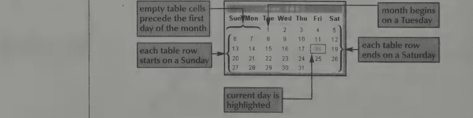

你将这些命令放在一个名为 `calendarDays()` 的函数中。该函数有一个名为 `calendarDay` 的单一参数。与 calendar.js 文件中的其他函数一样，`writeCalendarDays()` 函数的参数包含一个日期对象。你将使用单行注释在 `writeCalendarDays()` 函数中创建不同任务的基本结构。现在将此添加到 `calendar.js` 文件中。

要插入 `writeCalendarDays()` 函数：

- 1. 如必要，在文本编辑器中重新打开 `calendar.js` 文件。

- 2. 在文件末尾插入以下函数（见图 3-21）：

```
function writeCalendarDays(calendarDay) {
    // 确定开始的星期
    // 写入开始日期之前的空白单元格
    // 写入每月每一天的单元格
}
```

```
function daysMonth(calendarDay) {
    var year = calendarDay.getFullYear();
    var month = calendarDay.getMonth();
    var day = new Date(year, month + 1, 0).getDate();
    if (month % 4 == 0 || (year % 100 != 0) || (year % 400 == 0))
        dayCount[1] = 29; // 闰年
    return dayCount[month];
}

function writeCalendarDays(calendarDay) {
    // 确定开始的星期
    // 写入开始日期之前的空白单元
    // 写入每月每一天的单元格
}
```

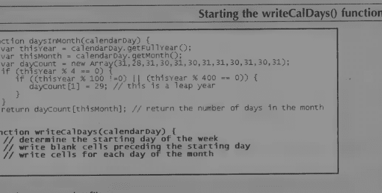

- 3. 保存对文件的更改。

### 设置每月的第一天

为了遍历月份中的所有天，你需要跟踪当前写入日历表格的日期。你将把此信息存储在名为 `dayCount` 的变量中。`dayCount` 变量的初始值为 1，它将增加到该月的总天数。你可以通过调用上节中创建的 `daysInMonth()` 函数来确定每月总天数。因此，`writeCalendarDays()` 函数的前两行是

```
var dayCount = 1;
var totalDays = daysInMonth(calendarDay);
```

接下来，重置 `calendarDay` 变量的值，使其等于每月的第一天。这是通过使用 `setState()` 方法实现的。命令是：

```
calendarDay.setDate(1);
```

最后，你的代码必须确定该日期是星期几。`getDay` 方法返回信息，值范围从 0（星期日）到 6（星期六）。你将此值存储在名为 `weekDay` 的变量中。声明星期变量的命令是：

```
var weekDay = calendarDay.getDay();
将这些命令添加到 `writeCalDays()` 函数中。
```

### 在 `writeCalDays()` 函数中声明初始变量：

- 1. 在 `writeCalDays()` 函数中第一行注释下方，插入以下内容（见图 3-22）：

```
var dayCount = 1;
var totalDays = daysInMonth(calendarDay);
calendarDay.setDate(1);
var weekDay = calendarDay.getDay();
```

### 设置每月的第一天

```
function writeCalendarDays(calendarDay) {
    // 确定开始的星期
    // 写入开始日期之前的空白单元格
    // 写入每月每一天的单元格
}
```

### 放置每月的第一天

在月份的第一天之前，日历应该只显示空白单元格。`weekDay` 的值指示了你需要创建多少空白单元格。例如，如果 `weekDay` 为 4，你需要四个空白单元格——周日、周一、周二和周三——放在行的开头。创建空白单元格的循环是

```javascript
for (var i = 0; i < weekDay; i++) {
    document.write("<td></td>");
}
```

注意，如果 `weekDay` 等于 0（表示月份从星期日开始），则不会写入空白单元格。

### 写入初始空白单元格：

```
function writeCalendarDays(calendarDay) {
  // 确定开始的星期
  // 写入开始日期之前的空白单元格
  // 写入每月每一天的单元
  var dayCount = 1;
  var totalDays = daysInMonth(calendarDay);
  calendarDay.setDate(1); // 设置为每月的第一天
  var weekDay = calendarDay.getDay();

  document.write("<tr>");
  for (var i = 0; i < weekDay; i++) {
    document.write("<td></td>");
  }
}
```

- 2. 保存对文件的更改。

- 3. 在 浏览器中重新打开 c.htm 文件，验证是否由于错误输入此处或上一步中的任何代码而导致运行时错误。页面外观应与之前图 3-16 所示相同。

### 写入日历日期

现在代码已确定初始日期，函数的其余部分将用于插入剩余日期。这是通过使用 `While` 循环实现的。每次循环，函数都会写入日历日期的单元格，并在需要时为表格添加新行。在命令块结束处，应该增加 `dayCount` 变量，移动到月份的下一天。`While` 循环的通用结构如下

```
while (dayCount <= totalDays) {
  // 写入表格行和单元格
  // 移动到下一天
}
```

将此 `While` 循环添加到 `writeCalDays()` 函数中。

### 插入 `While` 循环：

- 1. 在 `writeCalDays()` 函数中最后一行注释下方，插入以下 `While` 循环：

```
while (dayCount <= totalDays) {
    // 写入表格行和单元格
    // 移动到下一天
}
```

图 3-24 显示了 `writeCalDays()` 函数中的新代码。

# JVS 134 JavaScript 教程：处理数组、循环和条件语句

图 1-24 用于添加日历期的 While 循环

```javascript
function writecaldays(calendar) {
  // 确定周的起始日
  var dayCount = 1;
  var totaldays = month(calendar);
  calendar.setDate(1); // 设置月份的第一天
  var weekDay = calendar.getDay(); // 第一天的星期几

  // 写入起始日之前的空单元格
  document.write("<tr>");
  for (var i=0; i<weekDay; i++) {
    document.write("<td></td>");
  }

  // 写入每月每一天的单元格
  while (dayCount <= totaldays) {
    // 写入表格行和单元格
    // 移动到下一天
  }
}
```

- 2. 将你的更改保存到文件。

日历表格中的每一新行从周日开始；因此，While 循环命令块中的第一个命令需要确定周的值。`Day` 变量对应于周日。如果是的话，函数将为表格行写入起始的 `<tr>` 标签。If 语句所示：

```javascript
if (weekDay == 0) document.write("<tr>");
```

此表达式使用了你之前用于确定月份开始日期的 `weekDay` 变量。随着你继续执行 While 循环，该变量的值不断更新，以反映正在写入的当前日历日期。下一步是写入一个包含日期的表格单元格。由于每个日期都属于 `calendar` 类（见图 1-4），代码为：

document.write("<td class='calendar_dates'>"+dayCount+"</td>");

由于每一行都以周六结束，你还必须测试正在写入的日期是否为周六。如果是这种情况，你需要写入 `</tr>` 来结束表格行。执行此操作的命令是：

```javascript
if (weekDay == 6) document.write("</tr>");
```

在 While 循环命令块的最后部分，你更新了 `dayCount`、`calendarDay` 和 `weekDay` 变量的值，以便在下次循环时它们能够指向日历中的下一天。这些命令与你在 While 循环之前设置这些变量初始值使用的命令相似，不同的是你使用 `++` 增量运算符增加了 `dayCount` 变量：

```javascript
dayCount++;
calendarDay.setDate(dayCount);
weekDay = calendarDay.getDay();
```

循环的完整代码为

```javascript
while (dayCount <= totalDays) {
  // 写入行和单元格
  if (weekday == 0) document.write("<tr>");
  document.write("<td class='calendar dates'>"+dayCount+"</td>");
  if (weekday == 6) document.write("</tr>");
}
```

```javascript
// 移动到下一天
dayCount++;
calendarDay.setDate(dayCount);
weekday = calendarDay.getDay();
```

循环完成后，你将写入一个闭合的 `</tr>` 以确保如果月份最后一天不是周六，表格行也能正确关闭。如果你在月份初写了空表格单元格，那么在月份结束时就不需要再写，浏览器会自动忽略表格行末尾任何缺失的表格单元格。

# 插入 While 循环：

- 1. 在 While 循环内部的第一行注释之前，插入命令：

   if (weekday == 0) document.write("<tr>");

   document.write("<td class='calendar dates'>"+dayCount+"</td>");

   if (weekday == 6) document.write("</tr>");

- 2. 在 While 循环内部的第二行注释之前，插入命令：

   dayCount++;

   calendarDay.setDate(dayCount);

   weekday = calendarDay.getDay();

- 3. 在 While 循环下方插入命令：

   document.write("</tr>");

图 35 显示了修改后的 `writeCalDays()` 函数。

# 向 While 循环中添加命令

图 3-25

```javascript
// 每月每一天的单元格
while (dayCount <= totalDays) {
  if (weekday == 0) document.write("<tr>");
  document.write("<td class='calendar dates'>"+dayCount+"</td>");
  if (weekday == 6) document.write("</tr>");

  // 移动到下一天
  dayCount++;
  calendarDay.setDate(dayCount);
  weekday = calendarDay.getDay();
}
document.write("</tr>");
```

接下来，你必须从 `calendar()` 函数中编写 `writeCalDays()` 函数。然后你可以测试月日历，以验证它是否正确地将日期排列在日历中。

# 测试 `calendar()` 函数：

- 1. 滚动到 `calendar()` 函数并插入以下命令，如图 3-26 所示：

   writeCalDays(calDate);

# 调用 writeCalDays() 函数

```javascript
function calendar() {
   var caldate = new Date("May 18, 2007");
   document.write("<table id='calendar_table'>"+caldate);
   writeCalDays(caldate);
   document.write("</table>");
}
```

- 2. 将你的更改保存到文件。

- 3. 在 浏览器中重新加载 `ccc.htm`。如图 3-27 所示，月日历现在应该在不同的表格单元和行中列出所有日期。

# 月日历

(img/fd863185822173561a90d84123965_251.png)

# 高亮当前日期

你向 Maria 显示了日历的形式。她喜欢日历的外观，但提醒日历也应该高亮当前日期。为了指示当前日期，相应的表格单元格应该具有 `id="calendar_today"`。如之前的图 3-4 所示，该 id 应用了不同的样式。当你遍历日历中的每一天时，你需要插入一个 if 语句来测试写入的日期是否为当前日期。如果是，你就写入 HTML 代码：

```html
<td class='calendar_dates' id='calendar_today'></td>
```

其中 day 是数字；否则，脚本应该写入省略 id 属性的：

```html
```

为了实现这一点，你需要创建一个名为 `currentDate` 的新变量，将其设置为通过 `getDate()` 方法返回的值。你需要在 While 循环更改 `calendarDay` 的值之前创建这个变量。

# 高亮当前日期：

- 1. 返回文本编辑器中的 `calendar.js` 文件并滚动到 `writeCalendarDays` 函数。

- 2. 在函数开头插入以下代码：

   var currentDay = calendarDay.getDate();

- 3. 在 While 循环中，将写入每个日期的表格单元格的命令替换为：

   if (dayCount == currentDay) {

   // 高亮当前日期

   document.write("<td class='calendar_dates' id='"+dayCount+"'></td>");

   }

```javascript
function writeCalDays(calendarDay) {
  var currentDay = calendarDay.getDate();
  // 确定周的起始日
  var todays = month(calendarDay); // 设置月份的第一天
  var weekday = calendarDay.getDay(); // 第一天的星期几
  document.write("<tr>");
  for (var i=0; i<weekday; i++) {
    document.write("<td></td>");
  }
  // 写入每月每一天的单元格
  while (dayCount <= todays) {
    // 打印表格行和单元格
    if (weekday == 0) document.write("<tr>");
    if (dayCount == currentDay) {
      // 高亮当前日期
      document.write("<td class='calendar_dates' id='"+dayCount+"'></td>");
    }
  }
}
```

(img/fd863185822173561a90d84123965_252_0.png)

- 4. 将更改保存到文件并在浏览器中重新加载 `ccc.htm`。如图 3-29 所示，由于在 `calendar()` 函数中指定了日期，日历中的5月18日现在应该被高亮。

# CCC 完成的首页

(img/fd863185822173561a90d84123965_253_0.png)

# 设置日历日期

5 月是 Chamberlain Civic Center 的另一个忙碌月份，Broadway Touring 公司将于 5 月 5 日和 6 日演出获奖音乐剧《歌剧》。票现在正在出售，或可以在线购买。

5 月 11 日与 Chamberlain 交响团一起以春季主题的特别古典音乐庆祝季节。第二天 5 月 12 日，通过参加狄更之谜讲座锻炼你的大脑。

爵士爱好者在 5 月有很多可以庆祝的，包括 17 日的访问。然后 5 月 24 日，享受堪萨斯市爵士乐团演出的艾灵顿公爵音乐。

针、瓶子、盘子和椅子 5 月回到 Chamberlain Civic Center，于 5 月 13 日周日带来精彩演出。5 月 20 日，小丑们通过他们喜剧、杂技和疯狂的独特融合进入艺术世界。

周日下午享受由 Carson Quartet 提供的古典早午餐。座位有限，请预订位置。

Maria 对这个日历程序很满意，但问你如何使用它显示 2007 年 5 月 18 日以外的日期。你回答说必须更改 `calendar()` 函数中 `calendarDate` 的值。Maria 认为日期值应该作为参数包含在 `calendar()` 函数中，以便该函数可以轻松地用于任何日期。你同意这是一个改进并着手修改。

如果 `calendar()` 能像 JavaScript 的 `Date()` 命令一样，通过以下命令为指定日期创建月日历将是理想：

```javascript
calendar("May 18, 2007")
```

但在未指定日期时产生当前月份的日历，例如：

```javascript
calendar()
```

为了测试参数值是否存在，你只需插入一个 if 语句来测试参数值是否为 `null`。如果是，`calendar` 变量的值设置为当前日期；否则，`calendarDate` 被设置为 `calendarDay` 参数中指定的日期。修改后的 `calendar()` 函数如下：

```javascript
function calendar(calendarDay) {
  if (calendarDay == null) calendarDate = new Date();
  else calendarDate = new Date(calendarDay);
}
```

# 教程：处理数组、循环和条件语句。JavaScript 139

编辑 `calendar()` 函数以添加此功能，并使用当前日期以及你任选的日期重新测试 `calendar()` 函数。

# 完成并测试 calendar() 函数：

- 1. 回到文本编辑器中的 `calendar.js` 文件。

- 2. 进入 `calendar()` 函数，并在函数行中添加参数 `calendarDay`。

- 3. 用以下 If 语句替换 `calendar()` 函数的第一行：

```javascript
if (calendarDay == null) calDate = new Date()
else caldate = new Date(calendarDay);
```

图 3-30 高亮了 `calendar()` 函数修改后的代码。

# 最终的 calendar() 函数

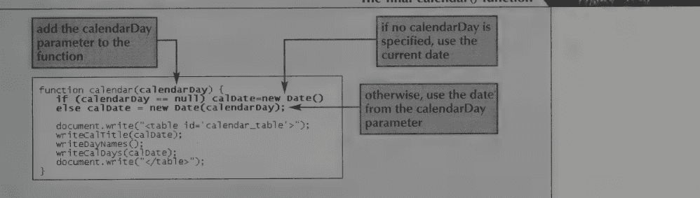

- 4. 关闭 `calendar.js` 文件并保存更改。

- 5. 在 浏览器中重新打开 `ccc.htm` 文件。验证它是否显示了当前日期（无论具体哪一天）的月历。

- 6. 回到文本编辑器中的 `ccc.htm` 文件，将运行月历的语句更改为“May 25, 2007”（参见图 3-31）。

# 显示 2007 年 5 月 25 日的月历

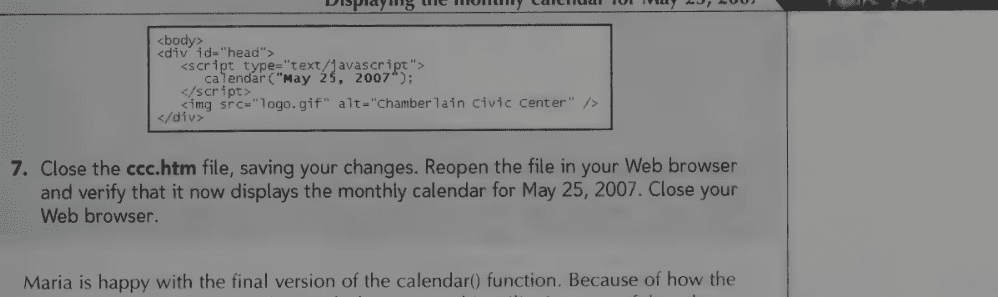

- 7. 关闭 `ccc.htm` 文件并保存更改。在浏览器中重新打开该文件，验证它现在是否显示了 2007 年 5 月 25 日的月历。关闭浏览器。

Maria 对 `calendar()` 函数的最终版本非常满意。由于函数和样式的设计，她可以在 CCC 网站的许多其他页面中使用此工具，而只需要对 Web 文档进行极少的重新编码。如果未来有更多任务，Maria 会联系你。

# 管理程序循环和条件语句

虽然你完成了 `calendar()` 函数，但关于程序循环和条件语句的某些功能，你仍然应该熟悉，以便未来处理这些重要的 JavaScript 结构。你将更详细地检查三个功能：`break`、`continue` 和 `label` 命令。

# break 命令

你简要地看到了如何在创建 `Switch` 语句时使用 `break` 命令，但 `break` 命令实际上可以用于程序代码中的任何地方。`break` 命令的目的是终止任何程序循环或条件语句。当浏览器运行 `break` 时，它会将控制权传递给紧随其后的语句。`break` 语句通常用于退出程序循环，而无需等待循环在满足停止条件。`break` 命令的语法简单为

```javascript
break;
```

例如，在某些情况下，你可能需要创建一个循环来检查数组中是否存在特定的值（例如客户 ID 号或名称）。该循环的代码可能如下：

```javascript
for (var i=0; i<names.length; i++) {
  if (names[i] == "Valdez") {
    document.write("Valdez is in the list");
  }
}
```

虽然这个循环指示了 `names` 数组是否包含字符串 "Valdez"，但如果数组有数万个条目会发生什么？如果在前几项中就遇到了 "Valdez"，继续检查数组将是浪费的。这正是 `break` 命令大用之处，可以避免浪费处理时间。下面的循环在遇到 "Valdez" 字符串时跳出，防止浏览器无谓地检查数组的其余部分：

```javascript
for (var i=0; i<names.length; i++) {
  if (names[i] == "Valdez") {
    document.write("Valdez is in the list");
    break; // stop处理 For 循环
  }
}
```

# continue 命令

`continue` 命令与 `break` 命令类似，不同在于，`continue` 命令不是完全停止程序循环，而是停止处理循环当前迭代中的命令并跳转到下一次迭代。例如，你可以创建一个循环来累加数组中的值。该循环的代码将是

```javascript
var total = 0;
for (var i=0; i<data.length; i++) {
  total += data[i];
}
```

每次循循环，`data` 数组中当前条目的值都会加到 `total` 变量中。当 `for` 循环结束时，`total` 变量等于 `data` 数组中值的和。然而，如果有一个包含若干空条目的稀疏数组，会发生什么？在这种情况下，当浏览器遇到缺失或空值时，该值会被加入总和；这将导致 `total` 变量的值也变为缺失或空。为了解决这个问题，我们应该使用 `continue` 语句，在遇到缺失或空值时跳出循环。修改后的代码如下：

```javascript
var total = 0;
for (var i=0; i < data.length; i++) {
  if (data[i]==null) continue; // 继续下一次迭代
  total += data[i];
}
```

在这段代码中，如果遇到空值，`total` 变量的值将不会更新。在这种情况下，循环将继续执行下一步。

# 标签 (Labels)

标签用于识别代码中的特定点以便你可以跳转到这些点。标签的语法为 `label: statement`。你已经在 `Switch` 语句中使用过标签，但它们也可以用于程序循环以提供更多控制。例如，你可以使用 `break` 或 `continue` 指向标签。

```javascript
outer_loop:
for(i=0; i<4; i++) {
  document.write("<br />"+i);
  inner_loop:
  for(j=0; j<4; j++) {
    document.write("    "+j);
    if (i==j) break outer_loop;
  }
}
```

# JavaScript 142 教程 3 数组、循环和条件语句

有些程序员反对使用 `break`、`continue` 和标签语句，因为它们会在循环进出产生混乱的跳转。大多数使用这些语句的任务可以通过仔细设置循条件来实现。例如，为了不使用 `break` 来实现相同的输出，你可以定义循环计数器使其始终小于外部循环。以下代码演示了：

```javascript
for(i=0; i<4; i++) {
  document.write("<br />"+i);
}
```

你已经完成了条件语句和程序循环的工作。在后续的问题中，你将有机会把它们应用于各种练习中。

# 数组、循环和条件语句的提示

- 通过在一个声明中声明并填充数组来节省代码空间。如果你的目标浏览器支持，考虑使用数组字面量来进一步简化代码。

- 使用 `sort()` 和 `reverse()` 等数组方法快速重新排列内容。

- 当循环包含计数器变量时使用 `For` 循环。更通用的条件使用 `While` 循环。

- 尽可能避免嵌套过多的 `If` 语句。

- 对于涉及多个不同值的条件语句使用 `Switch` 语句。

# 3.3 节测试

- 1. 输入什么命令从名为 `thisDate` 的日期对象提取星期几？

- 2. 周五返回的星期几值几？

- 3. 执行什么命令将 `DateVariable` 更改为月的第五天？

- 4. 函数 `showDate()` 有可选参数 `thisDate`。输入什么表达式可以测试调用 `showDate()` 函数时是否带有 `thisDate` 参数的值？

- 5. 输入什么命令退出程序循环？

- 6. 输入什么命令强制脚本跳转到当前程序循环的下一次迭代？

# 教程总结

在本教程中，你学习了如何使用数组、程序循环和条件语句来创建一个能够为任何给定日期生成月日历的应用程序。在第一节中，你学习了数组。你学习了如何创建和填充数组，并学习了一些可用于排序和修改数组的 JavaScript 方法。第二节处理了程序循环和条件语句。你学习了如何使用 `For` 或 `While` 循环重复执行某些代码。通过使用 `if` 语句，你学习了如何仅在满足特定条件时运行命令。在第三节中，你将所学的关于程序循环和条件语句的知识应用于完成日历应用程序。第三节以对 `break`、`continue` 和 `label` 命令的讨论结束。

## 核心术语

- 数组 条件语句 程序循环

- 数组字面量 计数器 变量 稀疏数组

- 命令块 索引 子数组

- 比较函数 模运算运算符

## 复习作业

完成此复习作业所需文件：back.jpg, caltxt.htm, ccc.jpg, logo.gif, styles.css, yearly.css, yearxt.js

Maria 有时间处理你为她创建的 `calendar()` 函数。她发现这是 CCC 网站一个非常实用的功能。然而，她希望你能够创建一个新的日历应用程序，在单个页面上显示全年的月日历。日历仍然会在表格中突出显示当前日期（或用户指定的日期）。图 3-32 显示了你为 Maria 创建的年日历的预览。

# TVS 144 JAVASCRIPT 教程 3：使用数组、标签和条件语句

图 1-32

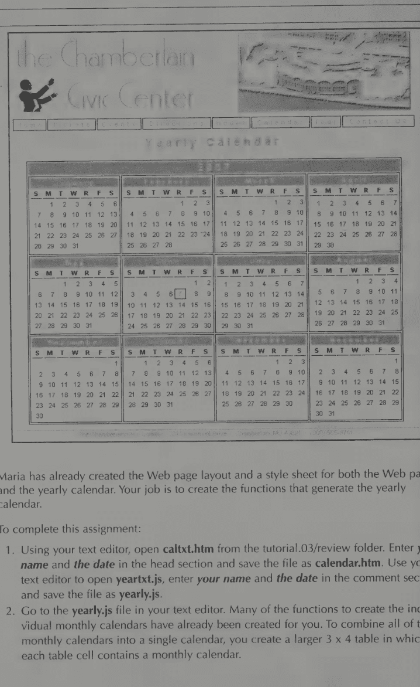

Maria 为年日历创建了网页布局和样式表。你的工作是创建生成年日历的函数。

完成此作业：

- 1. 使用你的文本编辑器打开 `tutorial.03/review` 文件夹下的 `calxt.html`。在页眉部分输入你的**姓名**和**日期**，并将文件保存为 **calendar.html**。使用文本编辑器打开 `yearly.js`，在注释部分输入你的**姓名**和**日期**，并将文件保存为 **yearly.js**。

- 2. 在文本编辑器中打开 **yearly.js** 文件。许多创建单个月日历的函数已经为你创建好了。为了将所有月日历合并成一个日历，你需要创建一个较大的 3 x 4 表格，其中每个表格单元包含一个月日历。

# 教程 3 使用数组和条件语句 JAVCRIPT JS 145

- 3. 插入一个名为 `writeMonth()` 的函数。该函数的目的是将月日历放置在一个较大的表格单元格内。该函数有两个参数：`calendarDay` 和 `currentTime`。`calendarDay` 参数包含一个要在月日历中显示的月份第一日的日期对象。`currentTime` 参数包含应在年日历表中突出显示的日期的时间值。在 `writeMonth()` 函数中添加以下命令：

  - a. 向文档写入 HTML 代码：

`<td class='yearly_month'>`

  - b. 使用 `calendarDay` 和 `currentTime` 作为参数调用 `writeMonth()` 函数。该函数的目的是将月日历写入表格单元格中。

  - c. 向文档写入一个 `<li>` 标签。

  - d. 插入一个名为 `yearly()` 的函数。该函数的目的是在较大的表格内写入包含所有独立日历的年日历。该函数有一个名为 `calDate` 的参数。添加以下命令：

    - a. 如果 `calDate` 等于 `null`，将 `calendarDay` 变量设置为指向当前日期的日期对象；否则，`calendarDay` 等于使用 `calendarDate` 参数中文本字符串的日期对象。

    - b. 创建名为 `currentTime` 的变量，赋值为 `calendarDay` 的值（提示：使用日期对象的 `getTime()` 方法从 `calendarDay` 中提取时间值）。

    - c. 创建名为 `thisYear` 的变量，获取 `calendarDay` 变量中的四年份。

    - d. 向文档写入以下 HTML 代码：

`<table id='yearly_table' colspan='4'>`

`<tr>`

`<th id='yearly_title'>`

`thisYear`

`</th>`

`</tr>`

其中 `thisYear` 是一个名为 `monthNum` 的变量，将其初始值设置为 -1。`monthNum` 变量的目的是跟踪正在日历中写入的当前月份的值。

  - f. 创建一个 `For` 循环来编写年日历的行。创建一个名为 `i` 的计数器，从 1 到 3 递增 1。`For` 循环内的第一个命令应该是向文档写入 `<tr>` 标签。

  - g. 在你创建的 `For` 循环内部，为年日历的每个单元格添加一个嵌套 `For` 循环。嵌套循环的计数器 `j` 应从 1 到 4 步进 1。命令中：(1) 将 `monthNum` 的值加1；(2) 使用日期对象 `getDate()` 将 `calendarDay` 的值改为 1（月份的第一天）；(3) 使用日期对象方法 `getMonth()` 将 `calendarDay` 的值改为 `monthNum`；(4) 使用 `calendarDay` 和 `currentTime` 作为参数调用 `writeMonthCell()` 函数。

  - h. 在嵌套循环之后但外部循环内部，向文档写入闭合的 `</tr>` 标签。

  - i. 在嵌套循环之后，向文档写入闭合的 `</table>` 标签。

  - 5. 定位文档中的 `writeDayNames()` 函数，将 `writeDay` 的值从三字母缩写改为单字母缩写 S, M, T, F, S。

- 6. 关闭 `yearly.js` 并保存更改。

- 7. 打开文本编辑器中的 `calendar.html` 文件。链接 `yearly.css` 样式表和 `yearly.js`。

- 8. 滚动文档并找到 id 为 "main" 的 `div` 元素。在该元素的 h1 标题之后插入脚本。在脚本中使用 "June 7, 2007" 作为参数运行 `yearly()` 函数。

- 9. 将更改保存到文件。

- 10. 在浏览器中打开 `calendar.html`。验证图 3-32 显示的日历已显示。

- 11. 返回编辑器中的 `calendar.html`。修改 `yearly` 值，使其使用当前日期（无论是什么）。保存更改并刷新 `calendar.html`。验证年日历已显示且当前日期被突出显示。

- 12. 关闭所有打开的文件，然后将完成的作品提交给老师。

# 案例 1

应用你在教程中学到的技能创建一个捐赠者列表。

案例所需的数据文件：list.txt, list.css, list.js, logo.jpg

Lighthouse 是一家位于肯塔基州中心的慈善机构。Lighthouse 的募款协调员 Aaron 有一个仅供工作人员使用的网页。上月的捐赠列表从外部数据库下载并存储在名为 `firstName`、`lastName`、`street`、`city`、`zip` 和 `amount` 的数组中。Aaron 需要帮助在网页中显示这些数据。他还需要一个显示捐赠者总数和总金额的摘要表。图 3-33 显示你将创建的网页预览。

# 图 3-33

| 日期 | 金额 | 类型 | 地点 | 总结 |

| :--- | :--- | :--- | :--- | :--- |

| 2007-09-19 | 125 | Large | 88 Road Lane, KY | 89760 $5175 |

| 2007-09-19 | 75 | Mike | 404 Barrow Street, Dayton, KY | 89511 |

| 2007-09-19 | 50 | Long | 743 Sterling Drive, Youngton, KY | 89247 |

| 2007-09-15 | 150 | Medium | 103 Main Lane, Youngton, KY | 89660 |

| 2007-09-14 | 250 | Latina | 750 Vineyard Road, Davis, KY | 29554 |

| 2007-09-13 | 50 | Shamblin | 122 Smith Drive, Dayton, KY | 89685 |

| 2007-09-13 | 50 | Astona | 886 Evans Way, Wheaton, KY | 89647 |

| 2007-09-11 | 125 | Joine | 2010 Emerald Terrace, Wheaton, KY | 89632 |

| 2007-09-10 | 50 | Cheroute | 109 South Road, Youngton, KY | 89635 |

| 2007-09-09 | 400 | Candice | Altaro | 108 Lakewood Avenue, Delphi, KY | 89611 |

完成此作业：

- 1. 使用你的文本编辑器打开 `tutorial.03/case1` 文件夹下的 `listxt.html`。**在页眉部分输入你的姓名和日期**，并将文件保存为 `list.html`。

- 2. `firstName`、`lastName`、`street`、`city`、`state`、`zip`、`amount` 和 `date` 数组已经在 `list.js` 文件中为你创建并填充。在文档的 head 部分插入指向它的脚本元素。

- 3. 在创建的脚本元素下方，插入另一个包含 `amountTotal()` 函数的脚本元素。`amountTotal()` 函数的目的是返回 `amount` 数组中所有值的和。该函数没有参数。在函数中添加以下命令：

  - a. 一个名为 `total` 的变量，将其初始值设置为 0。

  - b. 创建一个 for 循环，遍历 `amount` 数组中的所有值。在循环的每次迭代中，将数组项当前的值加到 `total` 变量上。

  - c. 循环完成后，返回 `total` 变量的值。

- 4. 滚动文档并找到 id 为 "data_list" 的 `div` 元素。在 `div` 元素内部插入一个包含以下代码的脚本元素：

  - a. 向文档写入以下代码：

```html
<table border='1' rules='rows' cellspacing='0'>
<tr>
<th>Date</th><th>Amount</th><th>First Name</th>
<th>Last Name</th><th>Address</th>
</tr>

</table>
```

  - b. 创建一个 for 循环，计数器变量从 0 开始，当计数器小于 `amount` 数组的长度时，每次递增 1。

c. Aaron 希望数据列表中的每隔一行都显示为黄色背景；为了实现这一点，在 For 循环中插入一个 If 条件，测试计数器变量是否能被 2 整除（提示：使用取模运算符）。如果计数器变量能被 2 整除，则写入以下 HTML 标签：

```html
<tr>
```

否则，写入标签：

```html
<tr class='yellowrow'>
<td>date</td>
<td class='amount'>amount</td>
<td>firstName</td>
<td>lastName</td>
```

d. 接下来，对于循环，在文档中编写以下 HTML 代码：

其中 date, amount, firstName 和 lastName 是由 For 循环计数器变量当前值指示的对应的 date、amount、firstName 和 lastName 数组的值。

```html
<td>$date</td>
```

e. 最后，在 For 循环中编写 HTML 代码：

```html
<td>street<br />
city, state zip</td>
</tr>
```

其中 street, city, state, 和 zip 是当前索引值对应的 street、city、state 和 zip 数组的值。

5. 转到 div 元素并插入一个 script 元素，向文档写入以下 HTML 代码：

```html
<table border='1' cellspacing='1'>
<tr>
<th id='sumTitle' colspan='2'>
Summary
</th>
</tr>
<tr>
<th>Contributors</th>
<td>contributions</td>
</tr>
<tr>
<th>Amount</th>
<td>total</td>
</tr>
</table>
```

其中 contributions 是 amount 数组的长度，total 是你之前创建的 amountTotal() 函数的返回值。

6. 保存更改以关闭文件 list.htm：

7. 在 Web 浏览器中打开 list.htm，验证表格上显示了 35 个贡献者总计 $5175 的列表，并且贡献者列表的交替行显示为黄色背景。

8. 将完成的网站提交给你的教师。

## 案例问题 2

此案例所需的数据文件：back.jpg, electroxt.txt, home.jpg, results.csv, votes.js


# ElectionWeb

ElectionWeb 是一个获取国家、州和地方选举新闻及结果的在线来源。Faye Summer 想要在显示结果的网页上添加水平条形图。每个条形的长度应该对应于相应候选人在特定选举中收到的选票数百分比。她要求你编写一个 JavaScript 程序来自动生成条形图。图 3-34 显示了一系列国会选举的网页预览。

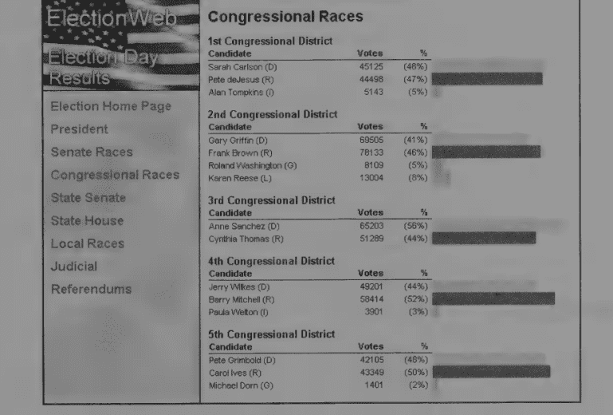

水平条形图将在表格行内创建。每个条形的长度将由其包含的空白单元格数量决定。例如，要显示一个代表 45% 票数的水平条形，你将编写 45 个空白单元格。每个条形的颜色由其表格单元格的背景颜色决定。要应用背景颜色，向空白单元格添加类。`results.css` 样式表中的样式决定了每类表格单元格的背景颜色。

选举数据存储在名为 `votes.js` 的外部文件的数组。该文件包含了五场不同国会选举的数据。选举名称存储在名为 `race` 的数组中。`name1` 包含了第一场选举的候选人，`name2` 包含了第二场选举的候选人，以此类推。第一场选举中每个候选人的政派属性存储在 `party1` 中，第二场选举的政派存储在 `party2` 中，以此类推。`votes1` 到 `votes5` 存储了五场选举中每个候选人的得票。

## JVS 150 JavaScript 数组、循环和条件语句操作

完成此作业：

1. 使用你的文本编辑器打开 `tutorial/case2` 文件夹下的 `electtxt.htm`。在 head 部分插入你的名字和日期，并将文件另存为 `election.htm`。

2. 花些时间在文本编辑器中研究 `votes.js` 文件的内容，熟悉不同的数组及其内容；回到文本编辑器中的 `election.htm` 文件，在文件的 head 部分添加一个指向 `votes.js` 的 script 元素。

3. 在 head 部分插入另一个 script 元素。在该 script 元素中，插入一个名为 `totalVotes()` 的函数。该函数的作用是计算数组内所有值的总和。该函数有一个参数 `votes`，代表五个选票数组之一（`vote1` 到 `votes5`）。对函数执行以下命令：

   a. 声明名为 `total` 的变量，将其初始值设置为 0。

   b. 创建一个 For 循环，遍历 `votes` 数组中的每个项，将每个项的值加到 `total` 变量。

   c. 循环完成后，返回 `total` 变量的值。

4. 插入另一个名为 `calcPercent()` 的函数。该函数的作用是计算百分比并四舍五入到最近的整数。该函数有两个参数：`item` 和 `sum`。让函数返回 `item` 除以 `sum` 的值乘以 100，然后四舍五入到最近的整数。（提示：使用 `Math.round()` 方法创建 `createBar()`）。

5. 插入一个名为 `createBar()` 的函数。该函数的作用是写入表格单元格。该函数有两个参数：`partyType` 和 `percent`。`partyType` 是候选人的党派（D, R, I 或 L），`percent` 是四舍五入到最近整数的选举百分比。执行命令：

   a. 创建一个 Switch 语句测试 `partyType`。

      - 如果 `partyType` 等于 "D"，存储 `<td class='dem'>`。

      - 如果 `partyType` 等于 "R"，存储 `<td class='rep'>`。

      - 如果 `partyType` 等于 "I"，存储 `<td class='ind'>`。

      - 如果 `partyType` 等于 "L"，存储 `<td class='lib'>`。

   b. 创建一个 For 循环，计数器从 0 开始，小于 `percent`，每次递增 1。在每次迭代中写入存储的单元格代码。

   c. 写入 `</td>` 标签。

6. 插入一个名为 `showResults()` 的函数。该函数的作用是显示特定选举的结果。该函数有四个参数：`race`、`name`、`party` 和 `votes`。`race` 参数是选举名称，`name` 参数是候选人姓名，`party` 参数是政派，`votes` 参数是每个候选人的得票。执行以下命令：

   a. 声明变量 `totalVotes`，其值为使用 `votes` 参数调用 `totalVotes()` 的返回值。

   b. 向文档写入 HTML 代码：

```html
<h2>$race</h2>
<table cellspacing='0'>
<tr>
<th>Candidate</th>
<th class='num'>Votes</th>
<th class='num'>%</th>
</tr>
</table>
```

   c. 创建一个 For 循环，计数器从 0 开始，小于 `name` 数组的长度，每次递增 1。在每次迭代中执行以下操作：

      i. 写入 HTML 代码：

```html
<tr>
<td>$name</td>
<td class='num'>$votes</td>
```

其中 `name` 和 `votes` 是对应索引的数组值。

      ii. 创建一个名为 `percent` 的变量，值为 `calcPercent()` 函数的返回值。使用 `votes` 数组的值作为 `item` 参数，`totalVotes` 作为 `sum` 参数。

      iii. 写入以下 HTML 代码：

```html
<td class='num'>$percent%</td>
```

其中 `percent` 是 `percent` 变量的值。

      iv. 使用 `party` 数组的值和 `percent` 作为参数调用 `createBar()` 函数。

      v. 向文档写入 `</tr>` 标签。

   d. 向文档写入 `</table>` 标签。

   e. 在 h1 标题 "Congressional Races" 之后插入一个包含以下命令的 script 元素：

      a. 使用 `race[0]`、`name1`、`party1` 和 `votes1` 作为参数调用 `showResults()` 函数。

      b. 重复之前的命令处理剩余的四场选举，使用 `race[1]` 到 `race[4]` 作为 `race` 参数，`party2` 到 `party5` 作为 `party` 参数，`name2` 到 `name5` 作为 `name` 参数，`votes2` 到 `votes5` 作为 `votes` 参数。

## 案例 3

完成此案例所需的数据文件：`auction.txt`、`logo.jpg`、`styles.css`

SchmittAuctionHaus David Schmitt SchmittAuctionHaus 专注于遗产和农场销售。最近，David 一直在改进静拍拍卖流程，这种拍卖允许申请者输入姓名并对各种物品进行报价。David 希望创建一个网页，包含拍卖中心各种物品的竞价信息。竞价信息可以在自助终端或拍卖中心显示，让客户快速查看出售物品的当前状态。David 请求你帮助设计一个 Web 表单来跟踪销售报价：物品名称、当前最高报价、该物品的竞价历史列表以及一个可以输入新报价的表单。在输入报价时有时会出错，David 希望能够从列表中删除最后一次报价。图 3-35 显示了你将创建的示例页面预览。

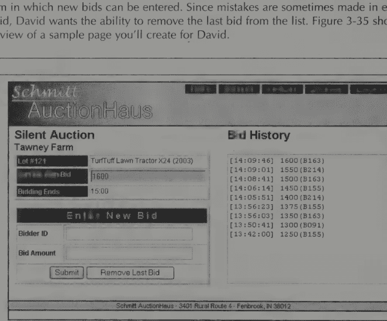

| 静拍拍卖 | 竞价历史 |
| :--- | :--- |
| Tawney Farm | TurfLawn Tractor X24 (2002) | [14:09:46] 1600 (B163) |
| | | [14:09:01] 1550 (B164) |
| | | [14:08:41] 1500 (B163) |
| | | [14:05:14] 1450 (B155) |
| | | [14:05:01] 1400 (B154) |
| | | [13:56:23] 1375 (B155) |
| | | [13:56:03] 1350 (B153) |
| | | [13:50:41] 1300 (B109) |
| | | [13:42:00] 1250 (B155) |

页面中使用的布局和样式已经为你创建好了。你的工作是编写脚本来输入新报价并更新显示竞价历史和当前最高竞价者的框。你需要从每个竞价者那里收集三个信息：报价金额、竞价者 ID 以及报价的时间。你将在这些信息记录在名为 `bids`、`bidders` 和 `bidTime` 的数组中。

> （注意：旧版浏览器不支持本案例中使用的数组方法。特别是，Mac 版本的 Internet Explorer 不支持所需的数组方法。要完成此案例，你必须使用最新版本的浏览器。）

要完成此作业：

- 在 `script` 元素中，创建三个名为 `bids`、`bidders` 和 `bidTime` 的新数组。不要向这些数组填充任何值。

## 3. 数组操作与条件语句 JAVASCRIPT YVS 153

3. 插入一个名为 `writeBid()` 的命名函数。该函数的目的是将竞价历史和当前最高报价写入 Web 页面。该函数没有参数。在函数中添加以下命令：

- a. 声明一个名为 `historyText` 的变量，将其初始值设置为空字符串。该变量将用于记录竞价历史。

- b. 插入一个 `For` 循环，计数器变量从 0 到 `bids` 数组的长度，每次递增 1。在每次循环中，将以下字符串附加到 `historyText` 变量：

```
`bidTime[i] + " " + bids[i] + " (" + bidders[i] + ")" + "\n"`
```

其中 `bidTime`、`bids` 和 `bidders` 数组中的当前项根据计数器变量的值确定。注意 `\n` 是一个表示换行的转义字符，它会使 `historyText` 变量的下一个条目置于新行。

- c. 循环完成后，将 `historyText` 的值写入名为 `bidlist` 的文本区域。（提示：若要向表单写入文本，请使用表达式 `document.forms.bidlist.bidlist.value = historyText`，其中 `forms` 是表单名称，`bidlist` 是字段名称，而 `historyText` 是要写入字段的字符串。在本例中，表单名称和字段名称都是 `bidlist`。）

- d. 将 `bids` 数组中第一个项的值写入 `highBid`。

- e. 将 `bidId` 和 `bidAmount` 字段的值设置为空字符串。

4. 创建一个名为 `addBid()` 的函数。该函数的目的是将报价添加到 `bids`、`bidders` 和 `bidTime` 数组的开头。添加以下命令：

- a. 使用 `unshift()` 数组方法，将 `bidId` 字段的当前值插入 `bidders` 数组的开头。

- b. 使用 `unshift()` 数组方法将 `bidAmount` 字段的当前值插入 `bids` 数组的开头。

- c. 声明一个表示当前日期时间的日期对象变量 `now`。

- d. 从 `now` 变量提取小时、分钟和秒，并将这些值存储在名为 `hours`、`minutes` 和 `seconds` 的变量中。

- e. 使用条件运算符，如果分钟和秒的值小于 10，则为其插入前导零。（提示：参见教程 2 关于在分钟和秒中插入前导零的示例）。

- f. 创建一个名为 `timeText` 的变量，等于 `[hours:minutes:seconds]`，其中 `hours`、`minutes` 和 `seconds` 为具体值。

- g. 使用 `unshift()` 方法，将 `timeText` 的值插入 `bidTime` 数组的开头。

- h. 调用 `writeBid()` 函数。

5. 创建一个名为 `removeBid()` 的函数。该函数的目的是从 `bids`、`bidders` 和 `bidTime` 数组中删除第一个条目。添加：

- a. 使用 `shift()` 数组方法从 `bids` 数组中删除第一个条目。

- b. 重复上述步骤，从 `bidders` 和 `bidTime` 数组中删除第一个条目。

- c. 调用 `writeBid()` 函数。

6. 将文档滚动到 Input 部分。为 Submit 按钮添加事件处理器，点击时运行 `addBid()`。

7. 为 Remove Bid 按钮添加事件处理器，点击时运行 `removeBid()`。

8. 将更改保存到 `auction.html`。在 `Bidder Id` 和 `Amount` 字段中输入新报价。点击 Submit 按钮更新竞价历史和 `High Bid` 字段。验证最新的报价位于顶部。点击 Remove Bid 按钮删除最后一个报价。

9. 在浏览器中打开 `auction.html` 文件。

10. 提交作业。

## 案例 4

SkyWeb 天文学站的 Andrew Weiss 博士正在制作一个描述月相和属性的网页。他联系你帮助完成该页面。Weiss 博士希望页面包含一个描述当前状况的表格，包括月相、自新月以来的时长、距离地球以及在夜空中的位置。他还希望页面包含一个当月的月历。月历是显示每月月相的日历。他希望你创建的页面预览如图 3-36 所示。

## SkyWeb 月相

随着月球绕地球运行，我们看到的照明每天变化。每个阶段的开始是新月，此时月球从地球上看没有被照明，但月球周期（从新月到新月）绕地球运行需要 27.3 天，然而，由于月球绕太阳运行约 4500 万英里，同步月需要额外花费 2.2 天（追赶）。

天文学家经常参考月历来跟踪月相。通常，天文学家不想在月亮期间观察夜空，因为月光会遮挡恒星、行星和星云等较暗物体的光。以下是当月的示例月历，祝观月愉快！

| 周日 | 周一 | 周二 | 周三 | 周四 | 周五 | 周六 |
|---|---|---|---|---|---|---|
| | 1 | 2 | 3 | 4 | 5 | 6 |
| 7 | 8 | 9 | 10 | 11 | 12 | 13 |
| 14 | 15 | 16 | 17 | 18 | 19 | 20 |
| 21 | 22 | 23 | 24 | 25 | 26 | 27 |
| 28 | 29 | 30 | 31 | | | |

Weiss 博士已经设计了页面的基础布局。他编写脚本来生成月历，并在页面顶部的摘要表中插入当前月况的数据。为了帮助你创建此页面，Weiss 博士提供了一个名为 `moonfunc.js` 的文件，包含了如图 3-37 所示的函数。

# 图 3-37

| 功能 | 说明 |
|--- | :--- |
| `calcMPhase(cDay)` | 返回存储在 `cDay` 中的日期的月相相数（0 到 15） |
| `calcMAge(cDay)` | 返回存储在 `cDay` 中的日期的月龄 |
| `calcMDist(cDay)` | 返回存储在 `cDay` 中的日期的地球与月之间的距离（以地球半径为单位） |
| `calcMDec(cDay)` | 返回存储在 `cDay` 中的日期的月赤纬（夜天空中的纬度） |
| `calcMRA(cDay)` | 返回存储在 `cDay` 中的日期的月升经（夜天空中的经度） |
| `calcMZodiac(cDay)` | 返回存储的日期中月球所在的星座或黄道标志名称 |

每个函数都有一个名为 `cDay` 的对象参数，可以使用它来返回该日期月球的状态。Weiss 博士还提供了一组 16 张图像，命名为 `phase0.jpg` 到 `phase15.jpg`。每个文件都包含一张月球在空间中特定阶段的图像。`phase0.jpg` 文件包含新月的图像，`phase8.jpg` 文件包含满月的图像，以此类推。Weiss 博士指出，你可以使用他提供的 `calcMPhase()` 函数来确定在任何一天应该显示 16 张图像中的哪一张。

月历的布局和外观由你来决定。你也可以自由地使用任何你认为适合该主题的其他材料来补充此网页的内容。

为了完成此作业：

1. 使用你的文本编辑器打开 `cal4.txt`、`lunar.htm` 和 `lunar.js` 文件。在每个文件中输入你的姓名和日期。分别将文件另存为 `tutorial.03/calendar.css`、`lunar.html` 和 `lunar.js`。`calendar.css` 文件将用于存储你将创建的月历的样式文件。`lunar.html` 文件包含 Weiss 博士希望在 SkyWeb 网站上展示的网页。`lunar.js` 文件将包含创建月历所需的函数。

2. 在你的文本编辑器中打开 `lunar.htm` 文件。在 `<head>` 部分，添加指向 `calendar.css` 样式表、`moonfunc.js` JavaScript 文件和 `lunar.js` JavaScript 文件的链接。

3. 在 `<head>` 部分插入一个包含以下内容的 `<script>` 元素：

   a. 一个名为 `calendarDay` 的变量，包含设置为 2007 年 8 月 8 日的日期对象。

   b. 一个名为 `writeDate()` 的函数。该函数的目的是按“月 日 年”的格式显示日期，其中月是月份名称，日是几号，年是四位年份值。该函数有一个参数 `calendarDay`，其中包含要格式化的日期对象。

4. 滚动到文档 `<body>` 部分的摘要表。向表格添加以下内容：

   a. 在表格的标题单元格中，显示文本“今天；今天是” + 使用 `writeDate()` 函数格式化的 `calendarDay` 变量中的日期。

   b. 在 `lunarimg` 单元格中，显示 `calendarDay` 中日期的月球图像。（提示：使用 `calcMPhase()` 函数返回图像的相位相数。）

   c. 在“月龄（Moon's Age）”标签旁边的单元格中，显示 `age + " days"`，其中 `age` 是 `calendarDay` 的月龄。

   d. 在“升经（Right Ascension）”标签旁边的单元格中，显示 `ra + "°"`，其中 `ra` 是 `calendarDay` 月的升经。

   e. 在“赤纬（Declination）”标签旁边的单元格中，显示 `dec + "°"`，其中 `dec` 是 `calendarDay` 月的赤纬。

   f. 在“星座（Constellation）”标签旁边的单元格中，插入 `zodiac`，其中 `zodiac` 是月球在 `calendarDay` 所在的星座。

   g. 在“距离（Distance）”标签旁边的单元格中，插入 `distance`，其中 `distance` 是 `calendarDay` 地球到月球的距离（地球半径）。

5. 滚动到 `lunar_calendar` 元素。在该元素内插入一个脚本，为 `calendarDay` 调用 `lunarCalendar()` 函数。

6. 在文本编辑器中打开 `lunar.js` 文件，并创建一个名为 `lunarCalendar()` 的函数，其中包含你想用于该函数的日期；你可以使用教程中使用的 `calendar()` 函数作为你的函数以及完成月历所需的任何辅助函数的模型。月历不需要高亮当前日期。

7. 在文本编辑器中打开 `calendar.css` 文件，并创建月历所需的样式。你可以使用教程中的 `calendar.css` 文件作为模型，你也可以创建你选择的布局。

8. 在完成 `lunar.js` 和 `calendar.css` 文件中的工作后，在 Web 浏览器中打开 `lunar.htm`。验证月历和月球数据是否遵循图 3-37 所示的信息。

9. 将完成的网站提交给你的老师。

## 复习

## 快速检查答案

### 会话 3.1

1. 数组是在单个名称下组织的数据值集合，每个值都通过索引号进行引用。

2. `var dayNames = new Array();`

3. `var dayNames = new Array("Sun", "Mon", "Tue", "Wed", "Thu", "Fri", "Sat");`

4. `dayNames[2]`

5. `var dayNames = ["Sun", "Mon", "Tue", "Wed", "Thu", "Fri", "Sat"];`

6. `dayNames.sort();`

7. `dayNames.slice(1,6);`

8. `dayNames.toString();`

### 会话 3.2

1. 循环是重复执行的指令集，直到满足停止条件。JavaScript 支持的循环有 For、While 和 Do。

2. `for (var i=0; i<100; i+=10) { document.write("<td>"+i+"</td>"); }`

3. 条件语句是只有在满足特定条件运行时运行的语句。常用的条件语句是 If。

4. `if (WebBrowser == true) document.write("Internet Browser"); else if (WebBrowser=="Netscape") document.write("Netscape Browser") else if (WebBrowser=="Safari") document.write("Safari Browser") else if (WebBrowser=="Firefox") document.write("Firefox Browser");`

5. 
```javascript
switch (WebBrowser) {
  case "IE": document.write("Internet Browser"); break;
  case "Netscape": document.write("Netscape Browser"); break;
  case "Safari": document.write("Safari Browser"); break;
  case "Firefox": document.write("Firefox Browser"); break;
  default: document.write("Generic Browser");
}
```

### 会话 3.3

1. `this.getDate();`

2. `this.setDate(5);`

3. `if (thisDate != null) ...`

4. `break;`

5. `continue;`

## 目标

### 会话 4.1

* 定义 HTML 并描述其用途
* 理解对象、属性、方法
* 区分不同的对象
* 处理对象引用和集合
* 修改属性
* 方法应用
* 创建跨浏览器网站

### 会话 4.2

* 使用样式更改与对象相关的样式
* 函数将样式应用于对象

### 会话 4.3

* 在链接中放置 JavaScript 指令
* 运行延迟和间隔指令
* 处理显示窗口的属性
* 描述线性和路径动画技术
* 创建自定义对象、属性和方法

## 处理对象

### 创建动画页面

### 案例

### Avalon Books

Avalon Books 是一家受欢迎的书店连锁，在美国西部和加拿大设有许多分店。近年来，Avalon 开始在线提供其产品。你被聘到网站开发团队。

你的主管 Terry Schur 希望你为公司创建一个首页。该页面应该具有视觉吸引力，有引人注目的动态。部分效果可以通过动画 GIF 和 Java 实现，但 Terry 不希望有太多这类元素，它们加载缓慢。如果浏览器不能及时显示页面，潜在客户可能不会等待，而是去其他地方。Terry 不希望页面和所有元素的总大小超过 40 KB。

可以使用 JavaScript 移动、隐藏和重新显示页面中的对象，而无需额外的 Applet 或大图形开销。你决定研究如何使用 JavaScript 创建这些效果。

### 学生数据文件

▼ tutorial.04
▼ tutorial folder
abtxt.html
scripttxt.js
styles.css
+ 1 个演示文件
+ 4 个图片文件
▼ review folder
abtxt.html
indextxt.html
script2txt.js
styles2.css
+ 5 个图片文件
▼ case1 folder
golttxt.html
golttxt.js
ballpath.txt
styles.css
+ 3 个图片文件

### 学生数据文件

▼ tutorial.04 继续

| ▼ case2 文件夹 | ▼ case3 文件夹 | ▼ case4 文件夹 |
| :--- | :--- | :--- |
| cctxtxt.htm | trailtxt.htm | bug.txt |
| cctxtxt.js | trail.js | bug.jpg |
| styles.css | trail.css | bugdead.jpg |
| + 2 个图形文件 | + 19 个图形文件 | shoe.jpg |

## 第 4.1 节

### DHTML简介

在 HTML 开发早期，网页作者仅限于创建静态网页——这些网页的内容和布局在从其 Web 服务器下载后是固定的。随着 Web 逐渐成为共享信息日益重要的媒介，网页作者和 Web 开发者开始寻找创建动态网页的方法——其内容和样式可以在加载后根据读者的操作等事件进行修改。一些早期的尝试涉及使用 Web 浏览器随 Web 页面检索并安装的小程序（Applets）。

Netscape 和 Internet Explorer 的 4.0 及更高版本允许了一种新方法，即 HTML 本身支持动态元素。与以往不同，创建和显示动态网页不需要额外的软件——只需要能够处理 JavaScript 的浏览器即可。这些增强被统称为动态 HTML，或 DHTML。DHTML 涉及 Web 设计中三个方面的交互：

- 页面中使用的页面 HTML/XML 代码
- 定义所用样式的样式表
- 通常用 JavaScript 或 VBScript 编写的脚本，用于控制页面上元素的行为

DHTML 并不是一种独立的语言。相反，它可以被看作一组编程技术，使用脚本语言在页面由浏览器初始渲染后，修改 Web 页面的内容或样式。通过这种方式，网页作者可以创建与用户动态交互的内容。你可能知道的 DHTML 用途包括：

- 响应用户操作而移动和改变的动画文本
- 弹出菜单，让用户快速访问网站的其他页面，而无需浪费宝贵的屏幕空间来显示长而复杂的链接列表
- 图像和文本随鼠标指针移动而改变的滚动效果（Rollovers）
- 从外部数据源检索内容的网页，让网页作者在页面中显示的材料类型上有更大的自由
- 可以从页面上的一个位置拖动并释放到另一个位置的元素

在接下来的教程中，你将研究如何创建这些以及更多效果。在教程中，你将学习如何为 Avalon Books 网站添加动画效果。让我们先看看 Avalon 网站的首页。

## 要打开网页：

1. 使用你的文本编辑器打开 `tutorial.04/tutorial` 文件夹下的 `abtxt.htm`。在注释部分输入你的名字和日期，并将文件保存为 `aval.htm`。

2. 浏览文件内容并熟悉页面元素。

3. 在你的 Web 浏览器中打开 `aval.htm`。图 4-1 显示了页面目前的样子。

## Avalon Books 首页

## 图 4-1


页面包含放置在单独 `div` 元素中的五个不同项目。这些项目及其 id 值为：

- Avalon Books 最畅销的小说的图像 (`id="fiction"`)
- Avalon Books 最畅销的非虚构书籍的图像 (`id="nfiction"`)
- 一个正在看书的人的图像，包含指向 Avalon Books 网站其他部分的链接 (`id="ab"`)
- 文本字符串 "Avalon" (`id="avalon"`)
- 文本字符串 "Books" (`id="books"`)

每个项目在页面上的位置是使用外部样式表的绝对定位设置的。Terry 希望你通过添加以下动画效果将此页面从静态布局改为动态布局（见图 4-2）：

- “Avalon”一词应该出现在文档窗口顶部附近，然后垂直向下掉落。
- 在“Avalon”掉落页面后，当从左向右移动时，“Books”一词应该从它后面出现。
- 当“Books”完成移动后，其他三个项目应该按顺序出现在屏幕上。

## Terry 为 Avalon Books 首页制作动画的计划

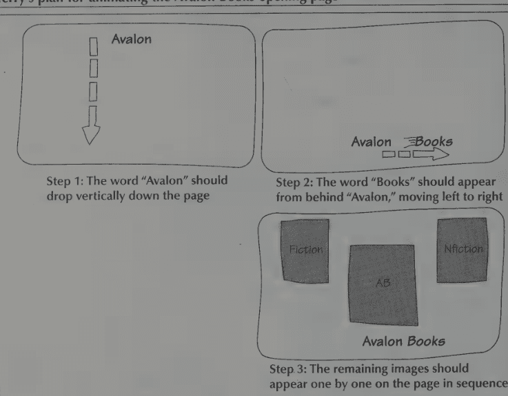

为了这些效果，你首先需要知道如何使用 JavaScript 与不同的页面对象交互。在过去的三个教程中，我们一直在处理几个不同的对象。让我们来看看“对象”这一术语的更正式的定义。

## 理解 JavaScript 对象

JavaScript 是一种基于对象的语言，这意味着它是通过修改对象的属性或对它们应用方法来操作对象的。这个定义听起来可能很复杂，但概念很简单。对象是任何与网页或 Web 浏览器关联的项。每个对象都有描述其外观、目的或行为的属性。每个对象都有方法，这些方法是可以对该对象执行或通过对象执行的操作。

JavaScript 对象与你接触的大多数日常对象相似。以烤箱为例，它有属性，如型号名称、年龄、尺寸和温度。你可以对该对象执行某些方法，例如开启烤架功能或自清洁功能。

层（Layers）的概念几乎可以像处理独立文档一样进行操作。虽然层是一项伟大创新，但 Internet Explorer 并不支持层；Netscape 不再开发层的概念，后来的 Netscape 版本也取消了对层的支持。

Internet Explorer 4.0 引入了文档对象模型（DOM）最广泛的扩展。在 Internet Explorer 4.0 中，所有的 Web 页面元素都被添加到 DOM 中。这意味着你可以编写程序来修改某些对象，例如标题、背景图像、文本颜色，甚至是浏览器使用的字体。此外，所有元素都是动态的，即使在页面被浏览器加载后也可以进行修改。Internet Explorer DOM 还提供了一种响应（或捕获）浏览器内发生事件的技术。遗憾的是，Internet Explorer 采用的方法与 Netscape 4 的方法不兼容。

因此，世界已经到了在使用从根本上不兼容的文档对象模型的阶段，想要创建动态 Web 页面的程序员必须一直等到万维网联盟（W3C）决定协调这些差异，并开发用于通用对象模型的 HTML 规范。

第一个规范 **DOM Level 1** 于 1998 年 10 月发布，并为 HTML 和 XML 文档中包含的所有元素提供了支持。该规范的更新版本于 2000 年 9 月发布，修复了早期版本中的一些错误。

第二个规范 **DOM Level 2** 于 1999 年 11 月发布。该规范通过提供事件模型增强了文档对象模型，可以通过它编写程序来响应浏览器内发生的事件。DOM Level 2 还增加了一个样式模型以处理 CSS 样式表，以及一个范围模型允许程序员操作文档中的文本区域。DOM Level 2 规范还被放置在 DOM 的模块部分中，允许开发者为自己的模块支持这些功能。目前的浏览器支持 DOM Level 2 的许多（但不是全部）功能。

最最近的规范是 **DOM Level 3**，于 2004 年 4 月发布。DOM Level 3 提供了一个用于处理文档加载和保存的框架，以及提供了用于处理 DTD 和文档验证的框架。在本文编写期间，很少有浏览器支持 DOM Level 3 规范。

图 4-3 总结了不同的 DOM，并指示了它们在不同版本的 Internet Explorer、Netscape 和 Opera 中的支持情况。

## 文档对象模型

| DOM | Netscape | Internet Explorer | Opera |
|---|---|---|---|
| DOM Level 0 (基础模型) | NS2, NS3, NS4, NS6, NS7 | IE3, IE4, IE5, IE6 | OP3, OP4, OP5, OP6, OP7 |
| DOM Level 0 + Images | NS3, NS4, NS6, NS7 | IE3 (Macintosh), IE4, IE5, IE6 | OP3, OP4, OP5, OP6, OP7 |
| Netscape 4 (layers) | NS4 | | |
| Internet Explorer 4 | | IE4, IE5, IE6 | OP6, OP7 |
| Internet Explorer 5 | | IE5, IE6 | OP6, OP7 |
| W3C DOM Level 1 | NS6, NS7 | IE5, IE6 | OP6, OP7 |
| W3C DOM Level 2 | NS6, NS7 | IE6 | OP7 |
| W3C DOM Level 3 | | | |

请注意，在每个 DOM 中，特定功能可能并不被每个浏览器支持。由于存在许多 DOM，编写一个适应所有浏览器、所有浏览器版本以及所有操作系统的动态 Web 页面并不是简单任务，严谨的程序员应该准备好大量的测试。通常，如果你想确保跨浏览器的最大兼容性，你的代码应该兼容以下 DOM：

- Netscape 4
- Internet Explorer 5
- W3C DOM Level 1 和 2

## 对象名称

在 JavaScript 中，每个对象都由一个名称标识。图 4-5 列出了顶部某些对象的对象名称。

| 对象名称 | 描述 |
|---|---|
| `window` | 浏览器窗口 |
| `document` | 窗口中的文档 |
| `document.body` | 窗口中文档主体 |
| `event` | 浏览器内发生的事件或动作 |
| `history` | 窗口内以前访问过的网站列表 |
| `location` | 当前显示文档的 URL |
| `navigator` | 浏览器本身 |
| `screen` | 显示文档的屏幕 |

## 引用对象

要指示对象在层次结构中的位置，使用点分隔层级。通用形式为：

```
object1.object2.object3, ...
```

其中 `object1` 位于层次结构的顶部，`object2` 是 `object1` 的子，`object3` 是 `object2` 的子，依此类推。

在某些情况下，你不需要“指示”对象在层次结构中的位置。例如，当你直接使用对象名称 `document` 时，JavaScript 会假设它位于浏览器窗口内。因此，如果你想处理文档主体（即浏览器显示的文档部分），可以使用对象引用：

```
document.body
```

## 处理对象集合

当存在多个相同类型的对象时，这些对象被组织在称为对象集合的数组中。这主要发生在包含多个相同类型对象的 Web 页面文档中。要引用文档中的特定集合，JavaScript 使用形式：

```
document.collection
```

其中 `collection` 是对象集合的名称。图 4-6 显示了不同对象集合的列表以及每个集合的浏览器支持信息。并非所有集合都受所有浏览器或浏览器版本的支持。此外，Netscape 4 DOM 有自己的对象集合，这些内容将在附录 J 中讨论。

# 对象集合

| 对象集合 | 说明 | Netscape | Internet Explorer | Opera |
| --- | --- | --- | --- | --- |
| `document.all` | 所有元素 | | IE4, IE5, IE6 | OP6, OP7 |
| `document.anchors` | 所有锚点 | NS2, NS3, NS4, NS6 | IE3, IE4, IE5, IE6 | OP4, OP5, OP6, OP7 |
| `document.applets` | 所有 applet | NS3, NS4, NS6, NS7 | IE4, IE5, IE6 | OP4, OP5, OP6, OP7 |
| `document.embeds` | 所有嵌入元素 | NS3, NS4, NS6, NS7 | IE4, IE5, IE6 | OP4, OP5, OP6, OP7 |
| `document.forms` | 所有 Web 表单 | NS2, NS3, NS4, NS6, NS7 | IE3, IE4, IE5, IE6 | OP4, OP5, OP6, OP7 |
| `document.form.elements` | 特定表单内的所有元素 | NS3, NS4, NS6, NS7 | IE4, IE5, IE6 | OP5, OP7 |
| `document.frames` | 所有内联框架 | | IE4, IE5, IE6 | OP4, OP5, OP6 |
| `document.images` | 所有内联图像 | NS3, NS4, NS6, NS7 | IE4, IE5, IE6 | OP4, OP5, OP6, OP7 |
| `document.links` | 所有链接 | NS7 | IE3, IE4, IE5, IE6 | OP4, OP5, OP6, OP7 |
| `document.namespaces` | 文档定义的所有命名空间 | | IE6 | |
| `document.plugins` | 文中所有的插件 | NS4, NS6 | IE6 | OP5, OP6, OP7 |
| `document.scripts` | 所有脚本元素 | | IE4, IE5, IE6 | OP6, OP7 |
| `document.styleSheets` | 所有样式表元素 | NS6, NS7 | IE4, IE5, IE6 | |
| `document.tags` | 文档定义的所有标签 | | IE4, IE5, IE6 | OP6, OP7 |
| `navigator.plugins` | 浏览器支持的所有插件 | NS4, NS6, NS7 | IE5, IE6 | OP5, OP6, OP7 |
| `navigator.mimeTypes` | 浏览器支持的所有 MIME 类型 | | IE6 | OP6, OP7 |
| `window.frames` | 浏览器窗口内的所有框架 | NS4, NS4, NS7 | IE4, IE5, IE6 | OP4, OP5, OP6, OP7 |

要引用集合中的特定对象，可以使用以下两种形式之一：

```
document.collection["idref"]
document.collection.idref
```

其中 `idref` 是代表对象在数组中位置的索引数字，或者是分配给它的 `id` 或 `name` 属性的值。与其他数组一样，集合中的第一个对象的索引为 0。例如，如果 HTML 文件中的第一个表单元素是：

```html
<form id="Survey"> ... </form>
```

你可以使用任何表达式来引用该表单：

```
document.forms[0]
document.forms["Survey"]
document.forms.Survey
```

与数组一样，你可以创建一个 `For` 循环来遍历对象集合中的每个项目。遍历对象集合的通用形式为：

```
for (var i=0; i<collection.length; i++) {
  commands on collection[i];
}
```

其中 `collection` 是指向对象集合的对象引用。注意，与数组一样，对象集合也支持 `length` 属性，因此你始终可以使用表达式来确定任何对象中的元素数量：

```
collection.length
```

## 使用 document.all 和 document.getElementById

并不是所有元素都与对象集合相关。例如，在 Terry 的 HTML 文件中，他将大部分内容放在 `div` 元素中。虽然 JavaScript 不支持 `div` 集合，但他可以使用它们的 `id` 值来引用这些对象。Internet Explorer 和 W3C DOM 提供了不同的方法。在 Internet Explorer DOM 中，你可以使用 `document.all` 集合来引用文档中的所有元素。因此，要通过 `id` 引用特定元素，可以使用以下两种形式之一：

```
document.all["id"]
document.all.id
```

其中 `id` 是元素的值。或者，你可以从引用中省略 `document.all`，而仅使用：

```
id
```

作为对象引用。使用 Internet Explorer DOM，可以使用任何一种以下方式来引用 `id` 值为 "Greetings" 的元素：

```
document.all["Greetings"]
document.all.Greetings
Greetings
```

在 W3C DOM 中，你可以使用 `getElementById` 方法引用特定元素。其语法为：

```
document.getElementById("id")
```

因此，对 `id` 为 "Greetings" 的元素的引用将是：

```
document.getElementById("Greetings")
```

在使用 `getElementById` 方法时，**大小写是关键的**。一个常见的错误是将代码写为 `getElementByID`；然而，由于最后一个字母大写不正确，此代码将导致错误。Internet Explorer 也支持 `getElementById` 方法。

## 引用标签

你可以根据 HTML 标签名称创建对象集合。在 Internet Explorer DOM 中，你会使用这种形式：

```
document.all.tags("tagName")
```

其中 `tagName` 是元素的名称。在 W3C DOM 中，你可以使用 `getElementsByTagName` 方法。其语法是：

```
document.getElementsByTagName("tagName")
```

## 设置对象属性

| 代码示例 | 说明 |
| --- | --- |
| `document.bgColor="black"` | 设置文档的背景颜色 |
| `document.fgColor="white"` | 设置文档的前景色 |
| `document.links[0].href="http://www.avalon.com"` | 将第一个链接的 href 设置为 "http://www.avalon.com" |
| `document.images[2].src="avalon.gif"` | 将第三张图像的 src 设置为 "avalon.gif" |
| `document.getElementById("books").style.fontWeight="bold"` | 设置 id 为 "books" 的元素的字体加粗 |
| `document.getElementsByTagName("p")[0].style.fontSize="16pt"` | 将第一个段落的字体大小设置为 16pt |
| `document.forms[1].action="http://www.avalon.com/mailer"` | 将第二个表单的 action 设置为 "http://www.avalon.com/mailer" |
| `location.href="http://www.avalon.com"` | 将浏览器显示的页面设置为 "http://www.avalon.com" |

其中 `variable` 是变量名，`object` 是对象的名称，`property` 是对象的属性名称。例如，要在变量中存储用户的浏览器名称，可以使用以下命令：

```
BrowserName = navigator.appName
```

## 在条件表达式中使用属性

有时，你需要在条件语句中使用属性，这些属性会根据某些对象属性的值改变 Web 页面的行为。以下 JavaScript 代码展示了如何将对象属性整合到简单的条件表达式中：

```javascript
if (document.bgColor=="black") {
  document.fgColor="white";
} else {
  document.fgColor="black";
}
```

在这个示例中，JavaScript 首先检查 Web 页面的背景颜色。如果背景颜色为黑色，JavaScript 将使用页面的 `fgColor` 属性将页面文本颜色更改为白色。如果背景颜色不是黑色，则颜色改为黑色。如你所见，使用对象、属性和条件状态可以让你对 Web 页面的外观提供强大的控制。

## 操作对象属性

- 要设置对象属性的值，使用 `object.property = expression`，其中 `object` 是对象引用，`property` 是对象属性，`expression` 是你想赋值给该属性的值。
- 要存储对象属性值，使用 `variable = object.property`，其中 `variable` 是将存储属性值的变量。

## 操作对象方法

你也可以通过对对象应用方法来操作对象。应用方法的语法为：

```
object.method(parameters)
```

其中 `object` 是对象的名称，`method` 是要应用的方法，`parameters` 是与该方法一起使用的逗号分隔的值列表。在之前的教程中，你将 `write` 方法应用到文档上以向页面写入内容。在这种情况下，参数值是待写入内容的文本。图 4-9 列出了其他一些将方法应用于对象的示例。在图中，对象名称用红色高亮，方法用蓝色显示，参数值用绿色显示。并不是每个方法都需要参数值。

# 教程 4 对象的用法 JAVASCRIPT V5 7

| 浏览器方法 | 动作 |
| :--- | :--- |
| `location.reload()` | 在浏览器中重载当前页面 |
| `document.forms[0].reset()` | 重置 Web 页面上的第一个表单 |
| `document.forms[0].submit()` | 提交 Web 页面上的第一个表单 |
| `document.write("Avalon Books")` | 向 Web 页面写入 "Avalon Books" |
| `history.back()` | 返回浏览器列表中的上一个页面 |
| `thisDay.getFullYear()` | 从 Date 对象返回四位年份 |
| `Math.random()` | 使用 Math 对象返回随机值 |
| `navigator.javaEnabled()` | 返回一个指示浏览器是否启用了 Java 的布尔值 |
| `window.close()` | 关闭浏览器窗口 |
| `window.print()` | 打印浏览器窗口的内容 |
| `window.scroll(x, y)` | 将浏览器窗口滚动到 (x, y) 坐标 |

## 窗口引用

- 要对对象应用方法，使用 `object.method(parameters)`，其中 `object` 是对象引用，`method` 是要应用的方法，`parameters` 是该方法使用的逗号分隔的参数值列表。

## 创建跨浏览器网站

正如你之前学到的，不同的浏览器可以支持不同的对象模型。目前的浏览器都很好地支持了 W3C DOM 的第 1 层和第 2 层。然而，如果你需要支持旧版浏览器，你的代码必须能够适应不同的 DOM。你可以通过两种不同的方法创建这种代码被称为**跨浏览器**代码：浏览器检测或对象检测。

## 使用浏览器检测

使用**浏览器检测**，你的代码会检测正在运行的是哪种浏览器（以及浏览器版本）。在某些情况下，代码甚至必须确定它运行在什么操作系统下。在收集这些信息后，程序将为用户的系统进行定制化运行。成功使用浏览器检测要求你做好功课，并列出每个浏览器、浏览器版本甚至可能的操作系统的需求。这是一项不小的任务！

记住关于浏览器的信息存储在 `navigator` 对象中。要获取浏览器名称，使用 `navigator.appName`。

对于 Netscape，此表达式返回值 "Netscape"。对于 Internet Explorer，该值将是 "Microsoft Internet Explorer"。然而，对于 Opera，其 `appName` 属性的值经常被列为 "Microsoft Internet Explorer"。这是因为 Opera 支持 Internet Explorer DOM 的许多功能。如果你需要判断用户是否正在运行该浏览器，可以测试浏览器是否支持 `window.opera` 属性。我们将在下一节检查如何执行对象检测。

## JVS 174 JAVASCRIPT 教程 4 对象的用法

没有属性能以易于阅读的文本字符串返回浏览器版本。表达式 `navigator.appVersion` 返回版本号以及描述该版本功能的额外文本。遗憾的是，这些文本在确定版本号时通常不可靠。例如，以下 `appVersion` 的值对应于列出的 Netscape、Internet Explorer 和 Opera 版本：

- Netscape 7.1 for Windows: 5.0 (Windows; en-US)
- Internet Explorer 6.0 for Windows: 4.0 (compatible; MSI 6.0; Windows NT 5.1)
- Opera 7.51 for Windows: 4.0 (compatible; MSI 6.0; Windows NT 5.1)

关于浏览器的附加信息存储在 `userAgent` 属性中，大多数浏览器检测脚本（称为嗅探器）使用该属性提取版本信息。由于这些程序可能很长且复杂，我们不会深入细节。然而，你可以通过简单的网络搜索找到不同程度的检测脚本。总之，运行什么浏览器相对容易，但提取详细的版本信息并不容易。

## 使用对象检测

大多数 Web 页面开发者建议完全跳过浏览器检测，转而依赖对象检测。通过对象检测，你通过测试浏览器识别哪些对象来确定它支持的对象模型。例如，只有 Netscape 4 DOM 识别 `document.layers` 集合，只有 Internet Explorer DOM 使用 `document.all`，而 W3C DOM 识别 `document.getElementById`。

可以使用这些信息构造三个布尔变量，如果用户的浏览器分别支持 Netscape 4、Internet Explorer 或 W3C 文档模型，则值为真。代码如下：

```javascript
var NSDOM = document.layers ? true:false;
var IEDOM = document.all ? true:false;
var W3DOM = document.getElementById ? true:false;
```

这段代码使用比较运算符测试浏览器是否识别每个对象引用，然后我们可以假设浏览器支持与该引用相关的模型。例如，如果浏览器识别 `document.all`，浏览器将返回 true，表示该浏览器支持 Internet Explorer DOM；否则 `IEDOM` 变量返回 false。

对象检测方法的一个优势是它可以适用于任何对象和任何浏览器。你也可以用它来测试对早期文档对象模型的支持。例如，表达式：

```javascript
var BasicDOM = document.forms ? true:false;
var imagesDOM = document.images ? true:false;
```

创建了变量，我们可以用它们测试浏览器是否支持 DOM Level 0 或 DOM Level 1 加图像。为了演示这些概念，我们准备了一个演示页面用于显示你浏览器的属性以及它支持的对象。现在打开此页面。

## 查看支持的对象和浏览器属性：

1. 使用你的浏览器打开教程 `04/tutorial` 文件夹下的 `demo_browser.htm`。

2. 研究页面上的表格，学习你浏览器的属性和支持的对象。

你也可以输入自己的对象名称来测试你的浏览器是否支持它。现在就尝试一下，查看你的浏览器是否支持 `document.all` 对象引用（支持 Internet Explorer DOM 的浏览器所必需的）。

3. 在页面底部的“Enter object name”框中输入 `document.all` 并点击测试按钮。

图 4-10 显示了 Windows 版 Internet Explorer 6.0 浏览器的页面内容。

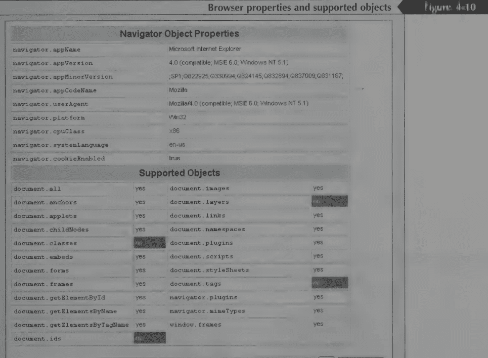

4. 关闭页面以及你在本次会话中打开的任何其他文件。

## 采用跨浏览器策略

一旦你确定了确定用户浏览器能力的机制（通过浏览器或对象检测），你的下一个任务就是为你的 Web 网站选择一种跨浏览器策略。一种策略被称为“页面分支”（page branching），它为每个浏览器（如果需要非常详细，则为每个浏览器版本）创建单独的页面并配有一个初始页面。当用户打开初始页面时，脚本会确定用户浏览器的能力并自动加载相应的页面。见图 4-11。初始页面本身可以用于不支持脚本语言或任何文档对象模型的浏览器。

# 页面分支

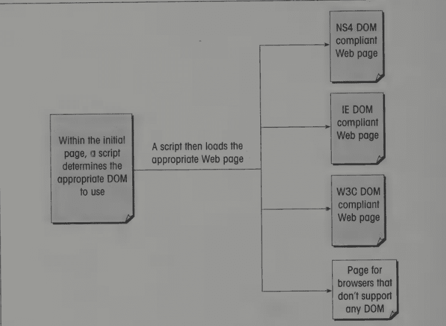

在初始页面中，脚本确定要使用的适当 DOM

脚本随后加载相应的 Web 页面

- 符合 NS4 DOM 的 Web 页面
- 符合 IE DOM 的 Web 页面
- 符合 W3C DOM 的 Web 页面
- 适用于不支持任何 DOM 的浏览器页面

要根据检测到的浏览器类型自动向浏览器加载页面，请使用以下命令：

```javascript
location.href = url;
```

其中 `url` 是要加载的新页面的 URL。页面分支命令应该放置在 HTML 文件的头部部分，以确保脚本在初始页面加载之前运行。

以下示例显示了一个页面的代码，如果用户浏览器支持，它将加载 `page_ns4.htm` 页面；代码测试对 Internet Explorer DOM 的支持情况，并在适当加载 `page_ie.htm` 页面。最后，如果浏览器不支持这些 DOM，代码将测试对 W3C DOM 的支持情况，如果支持，则加载 `page_w3c.htm` 文件。如果这些 DOM 都不支持，浏览器将继续打开当前文件。

```html
<html>
<head>
  <title>Avalon Books/JavaScript</title>
  <script language="JavaScript">
    if (document.layers) location.href="page_ns4.htm"
    else if (document.all) location.href="page_ie.htm"
    else if (document.getElementById) location.href="page_w3c.htm"
  </script>
</head>
<body>
  <h1>Welcome to Avalon Books!</h1>
</body>
</html>
```

页面分支要求你维护同一个页面的多个版本。在包含许多页面的 Web 网站中，这意味着为了保持所有页面一致需要大量的额外工作。

一种跨浏览器策略是使用“内部分支”（internal branching），其中每段 JavaScript 代码都封装在 `if...else` 语句中。通用语法如下：

```javascript
if (document.layers) {
  // 用于 Netscape 4 DOM 的 JavaScript 命令;
} else if (document.all) {
  // 用于 Internet Explorer DOM 的 JavaScript 命令;
} else if (document.getElementById) {
  // 用于 W3C DOM 的 JavaScript 命令;
}
```

这种结构必须在你每次运行一组 JavaScript 命令时都重复出现。内部分支对于没有使用大量 JavaScript 代码的页面有效。然而，对于包含大量 JavaScript 代码的页面，使用内部分支会迅速变得难以管理且容易出错。

许多开发者采用第三种跨浏览器策略：他们创建一个外部文本文件作为应用程序编程接口或 API，其中包含自定义命令和函数。编写这些自定义函数是为了解决任何跨浏览器差异。当你创建一个 Web 页面时，将其链接到 API 并在 Web 页面中使用 API 文件中的命令（见图 4-12），而不是将代码放置在页面上的 HTML 文件中。

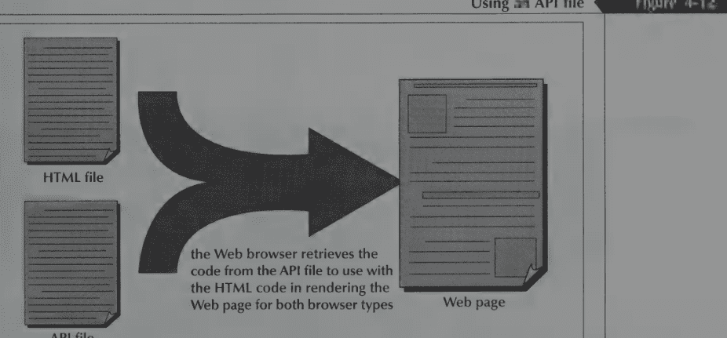

你已经完成了对象、属性、方法和文档对象模型背后概念的复习。在下一次会话中，你将把所学应用于为 Avalon Books 网站创建一个动画页面。

## 会话 4.1 快速检查

1. 什么是文档对象模型？如果你希望支持最广泛的浏览器和浏览器版本，你应该为哪三个 DOM 编写代码？
2. 你会使用哪个对象来编写程序，以访问用户浏览器中之前访问过的页面？
3. IE DOM 和 W3C DOM 有何区别？
4. 使用什么命令将第一个段落的字体设置为 16pt？
5. 使用哪个对象设置元素的字体颜色？
6. 使用什么属性使对象内容居中？
7. 使用什么方法设置元素的背景图像？
8. 应用 CSS 样式的语法是什么？

## 为 Avalon Books 创建自定义函数

为了创建动画，你需要以下内容：

- 一个返回左坐标的函数
- 一个返回顶部坐标的函数
- 一个将元素放在特定位置的函数
- 一个移动元素一定距离的函数
- 一个隐藏元素的函数

你把这些函数放在名为 `scripts.js` 的独立文件中，以便其他页面使用：

1. 使用文本编辑器打开 `tutorial.04/` 并输入名称。
2. 将文件保存为 `scripts.js`。

## 使用样式对象

为了实现你想要的动画效果，你需要能够放置元素。定位使用 CSS 样式，因此 JavaScript 将样式视为对象。应用样式的语法为：

```javascript
object.style.attribute = value
```

其中 `object` 是元素，`attribute` 是样式之一，`value` 是赋值给样式的值。例如，CSS 样式 `background-image` 在 JavaScript 中变为 `backgroundImage`。要将第一个段落的字体设置为 16pt，可以使用以下命令：

```javascript
document.getElementsByTagName("p")[0].style.fontSize="16pt";
```

图 4-13 列出了样式对象的其他应用。

| 表达式 | 描述 |
|---|---|
| `document.getElementById("logo").style.color="black"` | 将元素的字体颜色设置为黑色 |
| `document.getElementById("logo").style.fontWeight="bold"` | 将元素中的文本加粗 |
| `document.getElementById("logo").style.fontStyle="italic"` | 将元素中的文本变为斜体 |
| `document.getElementById("logo").style.margin="10px"` | 将元素周围的间距设置为 10 像素 |
| `document.getElementById("logo").style.fontFamily="Arial"` | 将元素的字体设置为 Arial |
| `document.getElementById("logo").style.width="100px"` | 将元素的宽度设置为 100 像素 |
| `document.getElementById("logo").style.textAlign="center"` | 水平居中对象元素的内容 |
| `document.getElementById("logo").style.backgroundImage="url(paper.gif)"` | 将对象元素的背景图像设置为 paper.gif |

## 设置对象的样式属性

* 要更改对象相关样式的值，使用 `object.style.attribute = value`，其中 `object` 是对象引用，`attribute` 是与对象相关的样式属性之一，`value` 是赋值给样式属性的值。

## 设置元素的位置

JavaScript 使用与 CSS 相同的定位样式值。因此，你可以设置元素的顶部和左侧坐标，指定其 z-index 值（用于堆叠元素），并使用 display 或 visibility 样式隐藏或重新显示它。图 4-14 描述了我们在 Avalon Books 网页中使用的定位样式。

## 图 4-14 定位属性

| 定位属性 | 设置方法 |
| --- | --- |
| `object.style.position="value"` | 对象的类型，value 为 absolute、relative、fixed、static 或 auto |
| `object.style.left="value"` | 对象的左侧坐标 |
| `object.style.top="value"` | 对象的顶部坐标 |
| `object.style.right="value"` | 对象的右侧坐标 |
| `object.style.bottom="value"` | 对象的底部坐标 |
| `object.style.zIndex="value"` | 对象的 z-index 值 |
| `object.style.visibility="type"` | 对象的可见性，type 为 hidden 或 visible |
| `object.style.width="value"` | 对象的宽度 |
| `object.style.height="value"` | 对象的高度 |
| `object.style.overflow="type"` | 应用于对象的溢出类型，type 为 auto、visible、hidden 或 scroll |
| `object.style.clip="value"` | 裁剪矩形的大小，value 是包含裁剪矩形值的字符串 |

例如，如果你想将 id 为 "avalon" 的对象的左侧坐标设置为 100 像素，你需要输入以下 JavaScript 命令：

```
document.getElementById("avalon").style.left="100px";
```

注意，坐标值也包含长度单位。如果你需要对坐标进行加或减操作（以便在页面上移动对象），必须先提取数值。这可以使用 `parseInt()` 实现，它可以从文本字符串中提取数值。例如，表达式

```
leftpos = parseInt("100px");
```

将数字值 100 存储在 `leftpos` 变量中。此时，你可以应用任何数学运算来更改位置值，并将新坐标存储在元素的左样式对象中。以下代码将 aval 对象向左移动 5 像素：

```
leftpos = parseInt(document.getElementById("avalon").style.left);
leftpos = leftpos + 5;
document.getElementById("avalon").style.left = leftpos + "px";
```

注意，当代码更新对象的左位置时，还会追加单位 "px"，以告诉浏览器长度单位是像素。

## IE DOM 中的定位属性

Internet Explorer 支持上述的样式对象，以及一些可用于在网页上定位对象的额外属性。图 4-15 描述了 Internet Explorer DOM 定位属性。

## IE DOM 定位属性

| 属性 | 设置方法 |
| --- | --- |
| `object.style.pixelLeft="value"` | 对象的左边缘以像素为单位的位置 |
| `object.style.pixelTop="value"` | 对象的顶部以像素为单位的位置 |
| `object.style.posLeft="value"` | 对象左边缘在指定长度单位内的位置 |
| `object.style.posTop="value"` | 对象顶部在指定长度单位内的位置 |

`posLeft` 和 `posTop` 属性等于 W3C DOM 中的 `left` 和 `top` 属性。`pixelLeft` 和 `pixelTop` 属性假设长度单位是像素，因此只使用不带长度单位的数值。因此，表达式

```
parseInt(object.style.left)
parseInt(object.style.posLeft)
object.style.pixelLeft
```

在支持 IE DOM 的浏览器中，当长度单位为像素时会返回对应的值。

## 为 Avalon Books 创建定位函数

现在你已经回顾了与使用 JavaScript 定位对象相关的一些问题，准备好为 Avalon Books 网站创建函数了。每个函数将接受网页中对象的 id 作为输入值，然后设置对象的定位属性值。在执行动画时，代码需要对象在页面上的当前位置，因此我们创建的前两个函数将返回左侧坐标和顶部坐标的值。前两个函数的代码如下：

```javascript
function xCoord(id) {
  var object = document.getElementById(id);
  var xc = parseInt(object.style.left);
  return xc;
}

function yCoord(id) {
  var object = document.getElementById(id);
  var yc = parseInt(object.style.top);
  return yc;
}
```

`xCoord()` 函数返回对象左边缘的位置。注意，`parseInt()` 方法用于仅返回数值而不返回单位。对于本项目，我们假设所有坐标都以像素表示。`yCoord()` 函数返回对象顶部边缘的位置。

### 插入 xCoord() 和 yCoord() 函数：

1. 返回文本编辑器中的 `scripts.js` 文件。
2. 在注释部分下方插入以下代码：

```javascript
function xCoord(id) {
  var object = document.getElementById(id);
  var xc = parseInt(object.style.left);
  return xc;
}
```

# scripts.js 中的函数


```javascript
function xCoord(id) {
  object = document.getElementById(id);
  x = parseInt(object.style.left);
  return x;
}

function yCoord(id) {
  object = document.getElementById(id);
  y = parseInt(object.style.top);
  return y;
}

function shift(id, dx, dy) {
  object = document.getElementById(id);
  object.style.left = xCoord(id) + dx + "px";
  object.style.top = yCoord(id) + dy + "px";
}

function hide(id) {
  object = document.getElementById(id);
  object.style.visibility = "hidden";
}

function show(id) {
  object = document.getElementById(id);
  object.style.visibility = "visible";
}
```

3. 关闭 `scripts.js`，保存你的更改。

你已经完成了在 `scripts.js` 文件中插入函数。在下节中，你将创建此文件的链接，并使用创建的函数来为 Avalon Books 网页制作动画。

## 4.2 节快速检查

1. 哪个 JavaScript 命令可以让 Logo 对象的 z-index 值加 1？
2. 哪个 JavaScript 命令可以将 Logo 对象放置在坐标 (150, 350) 处？假设单位是像素。
3. 使用哪个 JavaScript 命令可以隐藏 Logo 对象？
4. 使用哪个 JavaScript 命令可以将 Logo 对象的宽度设置为 100 像素？
5. 使用哪个 JavaScript 命令将 Logo 对象周围裁剪矩形的大小设置为 (10, 210, 150, 10)？
6. 使用哪个 JavaScript 命令在 Logo 对象的内容溢出边界时显示滚动条？
7. 如果你支持 IE DOM，你会输入哪个 JavaScript 命令将 Logo 对象放置在坐标 (150, 350) 处？假设单位是像素。

## 4.3 节

## 应用事件处理器

你现在可以使用创建的函数来为 Terry 的网页内容制作动画。回想图 4-12，Terry 首先想让“Avalon”这个词出现在页面顶部，然后垂直向下掉落。在某一点，“Avalon”应该停止下降，“Books”这个词应该出现，并从“Avalon”单词后面向右移动。之后，其他三张图像应该出现在屏幕上。

为了创建此动画，你把“Avalon”和“Books”这两个单词放置在页面顶部，并将“Avalon”堆叠在“Books”上面以将其盖住。你还将这三个图像放置在页面上的适当位置，虽然某些任务（如在页面上移动对象）可以使用 CSS 样式属性完成，但你可以利用此机会通过 JavaScript 插入执行这些任务来测试你创建的函数。

首先，你将为五个对象设置初始位置。`ab`、`fiction` 和 `nfiction` 对象的坐标保持不变：`avalon` 和 `books` 对象将被放置在新坐标：从窗口左上角向左 175 像素向下 10 像素。因为 `avalon` 对象的 z-index 值比 `books` 对象高，它将显示在 `books` 对象之上。这五个对象是：

- "avalon": (175, 10)
- "books": (175, 10)
- "ab": (230, 40)——如之前一样
- "fiction": (5, 5)——如之前一样
- "nfiction": (475, 55)——如之前一样

你还需要处理名为 `ab`、`fiction` 和 `nfiction` 对象的显示。你将所有这些动作放置在一个名为 `placeObjects()` 的单个函数中，并将其添加到 `aval.htm` 文件。`placeObjects()` 函数的初始代码为：

```javascript
function placeObjects() {
  placeIt("avalon", 175, 10);
  placeIt("books", 175, 10);
  placeIt("ab", 230, 40);
  placeIt("fiction", 5, 5);
  placeIt("nfiction", 475, 5);
  hide("ab");
  hide("fiction");
  hide("nfiction");
}
```

由于 `placeObjects()` 函数调用了我们添加到 `scripts.js` 文件中的函数，我们还需要向 `aval.htm` 现在添加指向该文件的链接。

### 要编辑 avalon.htm 文件：

1. 在文本编辑器中重新打开 `avalon.htm`。
2. 在 `</head>` 标签上方插入以下行：

```html
<script src="scripts.js" type="text/javascript"></script>
```

3. 在此链接下方插入以下脚本元素：

```html
<script type="text/javascript">
function placeObjects() {
  placeIt("avalon", 175, 10);
  placeIt("books", 175, 10);
  placeIt("ab", 230, 40);
  placeIt("fiction", 5, 5);
  placeIt("nfiction", 475, 5);
  hide("ab");
  hide("fiction");
  hide("nfiction");
}
</script>
```

4. 图 4-17 显示了新代码。插入 `placeObjects()` 函数：


```html
<head>
  <title>Avalon objects</title>
  <link rel="stylesheet" type="text/css" />
  <script src="scripts.js" type="text/javascript"></script>
  <script type="text/javascript">
  function placeObjects() {
    placeIt("avalon", 175, 10);
    placeIt("books", 175, 10);
    placeIt("ab", 230, 40);
    placeIt("fiction", 5, 5);
    placeIt("nfiction", 475, 5);
    hide("ab");
    hide("fiction");
    hide("nfiction");
  }
  </script>
</head>
```

接下来页面初始加载时运行此函数。你可以在 `avalon.htm` 文件的 `<body>` 标签中使用 `onload` 处理器（关于 onload 处理器的讨论，请参见教程 2）。

### 添加 onload 处理器：

1. 在 `<body>` 标签内，如图 4-18 所示插入 `onload="placeObjects()"`：


```html
<body onload="placeObjects()">
```

2. 保存文件更改并在浏览器中加载 `avalon.htm`。
3. 页面如图 4-19 所示打开。由于三张图像是隐藏的，它们没有出现在页面上。此外，“Books”隐藏在“Avalon”后面。

# Avalon Books 页面的初始屏幕

# 图 4-19


遇到问题？如果在加载页面时收到错误消息，请检查 `scripts.js` 文件中的代码。常见的编程错误包括大小写不匹配、拼错变量名、忘记关闭引号以及忘记在大括号内封装命令。

## 制作动画

你将添加到 Avalon 网页的第一个动画是“Avalon”单词向下掉落。单词的初始位置在坐标 (175, 10)。Terry 建议将其掉落到坐标 (175, 270)。这意味着在移动对象时，函数需要监控 y 坐标的值，并在值超过 260 时停止移动（注意 x 坐标不会改变）。一旦函数停止移动“Avalon”，浏览器应该随后运行一个将“Books”单词向右移动的函数。`moveAval()` 函数的初始形式如下：

```javascript
function moveAval() {
  var y = yCoord("avalon");
  if (y <= 260) {
    shift("avalon", 0, 10);
    shift("books", 0, 10);
    moveAval();
  } else {
    // run moveBooks function;
  }
}
```

关于这个函数有几点需要注意。首先，它获取当前的 y 坐标函数。其次，它使用你上次创建的 `shift()` 函数每次将“Avalon”和“Books”单词向下移动 10 像素。记住，你希望“Books”单词在页面向下移动时留在“Avalon”后面。移动这些单词后，函数会调用自身再次开始整个过程。最后，当 y 坐标超过 260 时，函数将运行 `moveBooks()` 函数（你还没有写）以开始从 Avalon 后面移动“Books”单词。现在我们用注释标记该位置。


函数中唯一缺失的是控制计时器的方法。因为网页浏览器将在毫秒内运行此函数，从用户的角度来看，“Avalon”单词将在眨眼之间跳下页面。我们将使用时间延迟命令来减慢这个过程。回想教程 2，我们可以使用 `setTimeout` 方法延迟浏览器运行命令。在这种情况下，我们将使用 `setTimeout` 在延迟 30 毫秒后重复 `moveAvalon()` 函数。命令是：

```javascript
setTimeout("moveAvalon()", 30);
```

因此，整个 `moveAvalon()` 函数为：

```javascript
function moveAvalon() {
  var y = yCoord("avalon");
  if (y <= 260) {
    shift("avalon", 0, 10);
    shift("books", 0, 10);
    setTimeout("moveAvalon()", 30);
  } else {
    // run moveBooks function;
  }
}
```

该函数现在每 30 毫秒将“Avalon”和“Books”向下移动 10 像素，直到 Avalon 对象距离页面顶部 260 像素。通常，当你制作动画时，需要尝试不同的移动和时间延迟值，直到得到一个产生流畅运动的组合。30 毫秒的值经过实验选择的。

# 插入 `moveAvalon()` 函数

1. 返回文本编辑器中的 `avalon.htm` 文件。
2. 在 `placeObjects()` 函数之后，插入以下代码：

```javascript
function moveAvalon() {
  var y = yCoord("avalon");
  if (y <= 260) {
    shift("avalon", 0, 10);
    shift("books", 0, 10);
    setTimeout("moveAvalon()", 30);
  } else {
    // run moveBooks function;
  }
}
```

你还需要在 `placeObjects()` 函数内部调用 `moveAvalon()` 函数。

3. 在 `placeObjects()` 函数的末尾，隐藏 fiction 对象的命令之后，插入命令：

```javascript
moveAvalon();
```

你的脚本应该类似于图 4-20 所示的代码。

## JavaScript 对象教程

## `moveAvalon()` 函数

```javascript
<script type="text/javascript">
function moveAvalon() {
  place("avalon", 175, 10);
  place("books", 230, 40);
  place("avalon", 215, 15);
  place("fiction", 475, 5);
  hide("fiction");
  hide("fiction");
  moveAvalon();
}

function moveAvalon() {
  var y = yCoord("avalon");
  if (y <= -200) {
    shift("avalon", 0, 10);
    shift("books", 0, 10);
    setTimeout("moveAvalon()", 30);
  } else {
    run moveBooks();
  }
}
</script>
```

在放置对象后运行 `moveAvalon()`

4. 保存你的更改，并在 Web 浏览器中重新打开或刷新 `avalon.htm` 文件。

文本“Avalon”现在应该会在页面上移动一次，“Books”应该随它移动，并隐藏在它后面。

接下来，你的脚本需要将 books 对象从 avalon 对象后面移动。`moveBooks()` 函数将与 `moveAvalon()` 函数相似，不同之处它只移动 books 对象，并且从左向右移动。通过试错法确定，你应该将“Books”从坐标 (175, 270) 移动到 (330, 270)。文本位于该位置，脚本应该隐藏其余图形；目前你只需要在脚本中添加一条注释指示这一点。以下是你将要使用的 `moveBooks()` 函数：

```javascript
function moveBooks() {
  var x = xCoord("books");
  if (x <= 320) {
    shift("books", 10, 0);
    setTimeout("moveBooks()", 50);
  } else {
    // display the hidden images;
  }
}
```

`moveBooks()` 没有使用 API 中的 `yCoord()` 函数，而是使用 `xCoord()` 来跟踪对象在水平方向上的移动。此外，`shift()` 函数的第二个和第三个参数进行了交换，使得 books 对象每 50 毫秒向右移动 10 像素。

## 为了插入 `moveBooks()` 函数

1. 返回文本编辑器中的 `avalon.htm` 文件。
2. 在 `moveAvalon()` 函数之后，插入以下代码：

```javascript
function moveBooks() {
  var x = xCoord("books");
  if (x <= 320) {
    shift("books", 10, 0);
    setTimeout("moveBooks()", 50);
  } else {
    // display the hidden images;
  }
}
```

接下来，你需要修改 `moveAvalon()` 函数，使其在完成时调用 `moveBooks()`。

3. 向上滚动到 `moveAvalon()` 函数，并将注释文本 `// run move-Books function` 替换为：

```javascript
moveBooks();
```

图 4-21 显示了修改后的文本。

## `moveBooks()` 函数

```javascript
function moveAvalon() {
  var y = yCoord("avalon");
  if (y < 200) {
    shiftLeft("avalon", 10);
    shiftRight("books", 15);
    setTimeout("moveAvalon()", 30);
  } else {
    moveBooks();
  }
}

function moveBooks() {
  var x = xCoord("books");
  if (x < 320) {
    shiftLeft("books", 10);
    setTimeout("moveBooks()", 50);
  } else {
    // display the hidden image;
  }
}
```

在移动 avalon 对象后运行 `moveBooks()`

4. 保存文件的更改，并在 Web 浏览器中重新加载或刷新 `avalon.htm`。

文本“Avalon”应该向下移动，在它停止后，文本“Books”从它后面移动。

动画的最后一步是取消隐藏三个图像：ab、fiction 和 nfiction。你决定每隔半秒取消每个图像的隐藏。执行此操作的函数是：

```javascript
function showObjects() {
  setTimeout("showIt('ab')", 500);
  setTimeout("showIt('fiction')", 1000);
  setTimeout("showIt('nfiction')", 1500);
}
```

注意你使用的是单引号而不是双引号，因为你必须将整个命令括在双引号中。同样注意，为了每隔半秒取消图像隐藏，你指定的延迟时间分别为 500 毫秒、1000 毫秒，最后是 1500 毫秒。

## 为了插入 `showObjects()` 函数

1. 返回文本编辑器中的 `avalon.htm` 文件。
2. 在 `moveBooks()` 函数之后，插入以下代码：

```javascript
function showObjects() {
  setTimeout("showIt('ab')", 500);
  setTimeout("showIt('fiction')", 1000);
  setTimeout("showIt('nfiction')", 1500);
}
```

3. 将 `moveBooks()` 函数中的注释替换为：

```javascript
showObjects();
```

图 4-22 显示了修改后的代码。

## `showObjects()` 函数 图 4-22

```javascript
function moveBooks() {
  var x = xCoord("books");
  if (x <= 320) {
    shift("books", 10, 0);
    setTimeout("moveBooks()", 50);
  } else {
    // display the hidden images;
  }
}
```

4. 保存文件的更改，并在 Web 浏览器中重新加载或刷新 `avalon.htm`。

# 插入 `winWidth()` 和 `winHeight()` 函数

1. 在文本编辑器中打开 `scripts.js`。
2. 在文件底部，插入以下代码（见图 4-25）：

```javascript
function winWidth() {
  if (window.innerWidth) return window.innerWidth;
  else if (document.documentElement) return document.documentElement.offsetWidth;
  else if (document.body.clientWidth) return document.body.clientWidth;
}

function winHeight() {
  if (window.innerHeight) return window.innerHeight;
  else if (document.documentElement) return document.documentElement.offsetHeight;
  else if (document.body.clientHeight) return document.body.clientHeight;
}
```

但请确保每个语句都单独一行。

```javascript
function winWidth() {
  if (window.innerWidth) return window.innerWidth;
  else if (document.documentElement) return document.documentElement.offsetWidth;
  else if (document.body.clientWidth) return document.body.clientWidth;
}

function winHeight() {
  if (window.innerHeight) return window.innerHeight;
  else if (document.documentElement) return document.documentElement.offsetHeight;
  else if (document.body.clientHeight) return document.body.clientHeight;
}
```

3. 关闭文件并保存你的更改。

现在你就可以在 `avalon.htm` 文件中使用 `winWidth()` 和 `winHeight()` 函数了。要计算 W 和 H 变量的值，请使用以下代码：

```javascript
W = (winWidth() - 620) / 2;
H = (winHeight() - 300) / 2;
```

在函数外部声明 W 和 H 变量会赋予它们全局作用域，使得它们可以在任何这些函数内部被使用。

要修改 `avalon.htm` 文件：

1. 返回文本编辑器中的 `avalon.htm`。
2. 在 `placeObjects()` 函数正上方，插入以下代码（见图 4-26）：

```javascript
W = (winWidth() - 620) / 2;
H = (winHeight() - 300) / 2;
```

# 创建 W 和 H 变量

```javascript
W = (winWidth() - 620) / 2;
H = (winHeight() - 300) / 2;

function placeObjects() {
  placeIt("avalon", W + 175, H + 10);
  placeIt("books", W + 175, H + 30);
  placeIt("ab", W + 230, H + 40);
  placeIt("fiction", W + 5, H + 5);
  placeIt("nfiction", W + 475, H + 5);
  hide("avalon");
  hide("books");
  hide("fiction");
  hide("nfiction");
  moveAvalon();
}
```

接下来，你必须将 W 和 H 值添加到 `placeObjects()` 函数的每个坐标中，以便对象在所有显示窗口中放置在合适的位置。

# 修改 `placeObjects()` 函数中的坐标值

1. 在 `placeObjects()` 函数中，在你刚刚输入的代码正下方，将 avalon 和 books 对象的坐标从 (175, 100) 更改为 (W+175, H+10)。
2. 将 ab 对象的坐标更改为 (W+230, H+40)。
3. 将 fiction 对象的坐标更改为 (W+5, H+5)。
4. 将 nfiction 对象的坐标更改为 (W+475, H+5)。

图 4-27 显示了修改后的 `placeObjects()` 函数。

# 最终的 `placeObjects()` 函数

```javascript
function placeObjects() {
  placeIt("avalon", W + 175, H + 10);
  placeIt("books", W + 175, H + 30);
  placeIt("ab", W + 230, H + 40);
  placeIt("fiction", W + 5, H + 5);
  placeIt("nfiction", W + 475, H + 5);
  hide("avalon");
  hide("books");
  hide("fiction");
  hide("nfiction");
  moveAvalon();
}
```

你还需要更改用于确定停止移动 Avalon 和 Books 文本的坐标值。

# 修改 `moveAvalon()` 和 `moveBooks()` 函数

1. 滚动到文本 `y <= 260` 并更改为 `y <= H + 260`。
2. 滚动到 `moveBooks()` 函数。
3. 将文本 `x <= 320` 更改为 `x <= W + 320`。

图 4-28 显示了这些函数中修改后的代码。

# 最终的 `moveAvalon()` 和 `moveBooks()` 函数

```javascript
function moveAvalon() {
  var y = yCoord("avalon");
  if (y < -260) {
    shiftLeft("avalon", 0, 10);
    shiftLeft("books", 0, 10);
    setTimeout(moveAvalon(), 30);
  } else {
    moveBooks();
  }
}

function moveBooks() {
  var y = yCoord("avalon");
  if (y < -260) {
    shiftLeft("avalon", 0, 10);
    shiftLeft("books", 0, 10);
    setTimeout(moveAvalon(), 30);
  } else {
    moveBooks();
  }
}
```

*(注：此处原文代码块中 moveBooks 逻辑似乎与 moveAvalon 重复，已按要求保留代码格式)*

4. 保存 `avalon.htm` 文件以应用更改。
5. 刷新浏览器以查看效果。

# 停止移动

```javascript
var y = yCoord("avalon");
if (y < -260) {
  shiftLeft("avalon", 0, 10);
  shiftLeft("books", 0, 10);
  setTimeout(moveAvalon(), 30);
} else {
  moveBooks();
}
```

# 最终的 `moveAvalon()` 和 `moveBooks()` 函数

*(后续内容多为重复乱码，已按要求处理)*

---

例如，为了构造一个自定义矩形对象，我们可以运行以下命令：

```javascript
var rectangle1 = new Rect();

function Rect() {
  this.width;
  this.height;
}
```

注意，我们还没有为 `width` 和 `height` 属性赋值，但可以在创建 `Rect` 对象的特定实例后进行赋值。因此，为了创建第二个矩形 `rectangle2`，我们将运行命令：

```javascript
var rectangle2 = new Rect();
rectangle2.width = 5;
rectangle2.height = 6;
```

我们还可以向构造函数添加参数，以创建对象并定义其属性值。对于 `Rect` 对象，这将显示为：

```javascript
function Rect(w, h) {
  this.width = w;
  this.height = h;
}
```

现在，为了定义矩形的尺寸，我们可以运行单条命令：

```javascript
var rectangle1 = new Rect(6, 4);
```

`rectangle1.width` 和 `rectangle1.height` 的值将由对象构造函数自动设置。

## 自定义方法

正如你在教程中所看到的，方法是与对象相关的操作。另一种说法是，方法是与对象相关的函数。然而，在 JavaScript 中，函数本身被视为对象（记住 JavaScript 中一切都是对象）。因此，为了为对象创建一个方法，我们可以将一个函数与对象关联。

```javascript
object.method = function;
```

其中 `object` 是一个对象，`method` 是方法的名称，`function` 是函数的名称。一旦方法与对象关联，我们就可以按照通常的方式运行它：

```javascript
object.method();
```

例如，让我们创建一个名为 `calcArea` 的函数，该函数根据给定宽度和高度计算对象的面积。该函数为：

```javascript
function calcArea() {
  return this.width * this.height;
}
```

注意，该函数再次使用了 `this` 关键字来引用当前正在处理的对象（无论该对象是什么）。现在，让我们将此方法与 `rectangle1` 对象关联，创建一个名为 "area" 的方法：

```javascript
rectangle1.area = calcArea;
```

定义 `area` 方法不会运行它，因此接下来我们将应用该方法，将计算出的面积存储在变量中：

```javascript
var area1 = rectangle1.area();
```

如果 `rectangle1` 的尺寸是 6x4，`area1` 变量将存储值 24。再次，此方法仅为 `rectangle1` 实例定义，而不是针对整个 `Rect` 对象类。为了让 `area` 方法适用于所有 `Rect` 对象，我们需要将其添加到构造函数中。`Rect` 构造函数的完整代码如下：

```javascript
function Rect(w, h) {
  this.width = w;
  this.height = h;
  this.area = calcArea;
}

function calcArea() {
  return this.width * this.height;
}
```

现在我们用新矩形使用 `Rect` 对象。以下代码创建了一个 7x4 的矩形对象，并使用自定义的 `area` 方法计算面积。

```javascript
var rectangle3 = new Rect(7, 4);
var area3 = rectangle3.area();
```

你可以看到，通过定义自定义的对象、属性和方法，我们极大地简化了代码。我们还可以向构造函数中添加方法来计算矩形的属性，或者通过设置特定值增加矩形的宽度或高度。虽然矩形对象是这项技术的简单应用，但这种通用方法可以用于各种复杂的对象和功能。

## 使用 JavaScript 对象的技巧

- 如果你的代码复用同一个对象引用，请将对象存储在变量中。
- 将你的自定义函数放在外部文件中，以便它们可以在整个网站中被复用。
- 使用对象检测来测试运行你代码的浏览器的能力。为不支持你的对象的浏览器提供替代方案。
- 使用路径动画，通过改变路径坐标和时间创建有趣的视觉效果。
- 将你的动画效果拆分为多个相互调用的独立函数，以保持顺序。
- 考虑使用自定义对象、属性和方法来简化你的代码。

## 第 4.3 节快速检查

1. 为了在延迟 10 秒后运行 `moveGraphic()` 函数，你会输入什么命令？
2. 为了每十分之一秒运行一次 `moveGraphic()` 函数，你会输入什么命令，并将该命令的时间 ID 存储在名为 "mg" 的变量中？
3. 你会输入什么命令来停止运行第 2 题启动的函数？
4. 哪个 W3C 对象属性返回整个浏览器窗口的高度？
5. 哪个 W3C 对象属性返回排除工具栏、菜单和状态栏后的浏览器窗口高度？
6. 线性动画和路径动画之间有什么区别？你会输入什么命令来构造一个名为 `Circle` 的对象类？
7. 提供一个 `Circle` 对象类，具有一个名为 `radius` 的属性和一个名为 `circum()` 的方法，该方法返回圆周长（约 2*pi*radius）。假设圆的半径可以作为构造函数名为 `r` 的参数。
8. 使用你在上一个题中定义的对象构造函数，创建一个名为 `circle1` 的圆对象实例，其圆半径设置为 5。将周长存储在名为 `circum1` 的变量中。

## 教程总结

在本教程中，你学习了 HTML 原则和文档对象模型的原理。第一节涵盖了 DOM 的历史，第二节引入了宽度和高度。第三节展示了如何使用动画。教程以对自定义对象、属性和方法的概述结束。

## 关键术语

| API DOM | 对象类 |
| :--- | :--- |
| 应用 DOM | 对象集合 |
| 编程 DOM | 对象构造函数 |
| 接口 DOM | 对象检测 |
| 基础 DOM | 对象实例 |
| 浏览器检测 | 对象名称 |
| 浏览器嗅探 | 页面分支 |
| DHTML 对象 | 属性 |
| 文档对象模型 | this 关键字 |

## 复习作业

复习作业所需文件：`ab.gif`, `ablogo.gif`, `abxt2.htm`, `fiction.jpg`, `indextxt.htm`, `kids.jpg`, `nfiction.jpg`, `script2.js`, `styles.css`

Terry 的设计团队审查了你的页面并建议进行更改：

- 添加一个名为 `index.htm` 的页面以支持旧浏览器。如果浏览器不支持 W3C DOM，则应加载此页面。
- 替换 Avalon 页面上的动画，在页面打开时将标题“Avalon”从左边缘移动到中心。此外，“Books”文本应以红色的斜体字体出现在“Avalon”文本的下方并与其重叠，而不是出现在其后面。
- 在移动标题后，在标题下方旋转显示三个图像文件 `kids.jpg`、`fiction.jpg` 和 `nfiction.jpg`。图像应该堆叠在一起，每两秒将堆栈顶部的图像移动到底部，其他图像向上移动。这使得图像看起来在旋转，允许观众一次看一个。

3. 保存你的更改并关闭文件。

4. 打开 `scripts2.js` 文件并创建一个名为 `setZ()` 的新函数。该函数应该有两个参数：`id` 和 `z`。该函数应使用 `id` 参数的值来选择文档中具有该 id 值的对象。然后它应该将该对象的 `z-index` 设置为 `z` 参数的值。

5. 创建一个名为 `swapIt()` 的新函数。`swapIt()` 函数的作用交换页面两个重叠对象的顺序，将顶部的对象移动到堆栈底部，然后将另外两个对象向上移动。该函数应按如下方式创建：

   - 该函数应包含三个参数 `id1`、`id2` 和 `id3`，它们包含三个对象的 id 值。
   - 使用 `get()` 函数创建三个变量 `object1`、`object2` 和 `object3`，分别引用 id 值为 `id1`、`id2` 和 `id3` 的对象。
   - 创建三个变量 `z1`、`z2` 和 `z3`，将这些变量设置为 `object1`、`object2` 和 `object3` 的 `z-index` 值。
   - 将 `object1` 的 `z-index` 改为 `z3`（从而将其移动到堆栈底部）。将 `object2` 的 `z-index` 值更改为 `z1`（从堆栈顶部移动），最后将 `object3` 的 `z-index` 值更改为 `z2`（移动到堆栈中间）。

6. 保存文件的更改并关闭。

7. 在文本编辑器中打开 `aval2.html` 文件，直接在 `styles2` 样式表链接下方放置一个指向 `scripts2.js` 文件的链接。

8. 在 `scripts2.js` 链接下方插入一个嵌入脚本。

9. 在嵌入脚本内部插入名为 `placeObjects()` 的函数。该函数的作用设置页面上对象的初始位置。该函数需要执行以下操作：

   - 声明名为 "W" 的变量，其值等于 `getWidth()` 函数返回值的一半。
   - 使用 `place()` 函数将 "avalon" 对象放置在坐标 (0, W-75, 100)。
   - 使用 `setZ()` 函数放置 "kids"、"fiction" 和 "nfiction" 对象，将 "kids" 对象的 `z-index` 值设置为 3。
   - 将 "fiction" 对象的 `z-index` 值设置为 2。
   - 将 "nfiction" 对象的 `z-index` 值设置为 1。
   - 调用 `moveAvalon()` 函数。（你将在下一步步骤中创建此函数）。

10. 在 `placeObjects()` 函数下方插入 `moveAvalon()` 函数。`moveAvalon()` 函数的作用让 "Avalon Books" 跨越页面。按如下方式创建函数：

    - 创建名为 "x" 的变量，其值等于 "avalon" 对象的 x 坐标。（提示：使用 `scripts2.js` 文件中的 `getCoord()` 函数）。
    - 如果 x 小于或等于 W 减 25 的值，则执行操作：(a) 使用 `scripts2.js` 文件中的 `shiftLeft()` 函数将 "avalon" 对象向右移动 10 像素，以及 (b) 在延迟 50 毫秒后再次调用 `moveAvalon()` 函数。
    - 如果 x 大于 W - 125，则运行 `swapImages()` 函数。（你将在接下来创建此函数）。

11. 在 `moveAvalon()` 函数下方插入 `swapImages()` 函数。`swapImages()` 函数的作用更改三个图像对象的堆叠顺序。该函数应执行以下操作：

    - 使用 `showIt()` 函数显示 "kids"、"fiction" 和 "nfiction" 对象。
    - 每隔两秒，浏览器运行 `scripts2.js` 文件中的 `swapIt()` 函数来更改 "kids"、"fiction" 和 "nfiction" 对象的堆叠顺序。

12. 为 `body` 元素添加 `onload` 事件处理器，以便在页面加载时运行 `placeObjects()` 函数。

13. 保存 `aval2.htm` 的更改。

14. 在网络浏览器中加载 `index.htm` 文件。验证发生以下情况：
    - 页面自动加载 `aval2.htm` 文件。
    - `aval2.htm` 文件在页面左边缘显示文本 "Avalon Books"。
    - 文本 "Avalon Books" 移动到页面中心。
    - "Avalon Books" 到达中心后，出现图像文件 `kids.jpg` 及其说明文字。
    - 此后每隔两秒，图像文件与堆栈中的下一个图像文件交换。

15. 如果可以，在不同的显示器分辨率下测试你的页面布局。验证内容在每个分辨率下都显示水平居中。

16. 将完成的网站提交给你的教师。

## 案例问题 1

此案例问题所需的数据文件：`ball.gif`, `ballpath.txt`, `clouds.jpg`, `golfer.gif`, `golftxt.htm`, `golffit.js`, `styles.css`

**高尔夫页面** 一家名为 "The Golf Page" 的在线高尔夫商店的所有者 Mark Rein 请求你为他的网站创建一个动画开场界面。Mark 设想了一颗高尔夫球飞过屏幕，从左上角到屏幕底部，弹跳一次，然后落在公司名称的中间，取代 "Golf" 中的字母 "o"。

Mark 还希望在球落地后显示文本 "Your Online Source of Golf"（您的在线高尔夫源）。该文本应以 0 号字体大小出现，然后增加到 20 号字体。在该网页中使用的函数包括：`placeIt()` 用于在指定坐标放置对象；`showIt()` 显示隐藏对象。另一个可用文本文件是 `ballpath.txt`，它包含了飞行球相对于最终位置的坐标。

为 "The Golf Page" 创建动画：

1. 使用文本编辑器打开 `golfpage.htm` 文件。在注释部分输入*你的名字*和*日期*，并将文件保存为 `golfpage.htm`。花时间研究文件内容以熟悉对象和 id 值。注意口号位于 id 为 "slogan" 的 span 元素中，球位于 id 为 "Ball" 的 span 元素中。

2. 使用文本编辑器打开 `golf.js` 文件。在文件底部创建一个名为 `getFontSize(id)` 的函数。该函数应有一个参数 "id"，代表对象的 id 值。在函数内部，创建一个名为 `object` 的变量来代表指定 id 值的对象；使用样式对象获取字体大小，并使用 `parseInt()` 函数提取数值。

3. 在 `getFontSize()` 函数下方插入另一个名为 `setFontSize()` 的函数。该函数的作用设置对象的字体大小。我们将假设所有字体大小都以点（points）为单位。该函数有两个参数：`id`（要应用到对象的字体大小）和 `size`。在函数的第一步中，创建一个名为 `object` 的变量代表指定 id 的对象。在第二步中，通过附加字符串值 "pt" 设置对象的字体大小。

4. 在 `setFontSize()` 函数下方插入第三个名为 `changeFontSize()` 的函数。该函数的作用按指定量增加字体大小。该函数有两个参数：`id` 和 `ds`。`id` 参数包含对象的 id，`ds` 参数包含字体大小应增加的量。在函数的第一步中，使用 `id` 参数调用 `getFontSize()` 获取当前字体大小。将其存储在变量 `fs` 中。在第二步中，使用 `id` 参数调用 `setFontSize()` 并将对象的字体大小设置为 `fs + ds`。

5. 关闭并保存 `golf.js`。

6. 在文本编辑器中打开 `golfpage.html`。在 `styles.css` 样式表链接下方创建一个指向 `golfpage.js` 文件的链接。

7. 按照 `golfpage.js` 脚本插入嵌入脚本。在嵌入脚本中解析 `ballpath.txt` 文件中的代码：`x` 数组包含飞行球的 x 坐标，`y` 数组包含 y 坐标。

8. 按照数组声明，创建一个名为 `index` 的变量，并将 `index` 的初始值设置为 0。

9. 在 `index` 变量下方创建一个名为 `moveBall()` 的函数。`moveBall` 函数的作用让球跨越页面直到到达 "golf" 中字母 "o" 的位置。`moveBall` 函数应执行以下操作：

   - 创建一个语句测试 `index` 变量的值是否小于或等于 `x` 数组的长度减 1。（提示：可以使用表达式 `x.length` 确定数组的长度）。
   - 如果满足条件，则 (a) 使用 `golf.js` 文件中的 `place()` 函数将 "Ball" 位于坐标 `[x[index], y[index]]`；(b) 将 `index` 变量的值加 1；并在 5 毫秒后运行 `moveBall()` 函数。
   - 否则，执行以下操作：(a) 使用 `setFontSize()` 将 "slogan" 对象的字体大小设置为 0，(b) 运行 `showIt()` 函数显示 "slogan" 对象，以及 (c) 接下来运行 `growText()` 函数。

10. 在 `moveBall()` 下方插入 `growText` 函数。该函数的作用是将 "slogan" 对象中的文本从 0 点字体增长到 21 点字体。该函数应包含以下步骤：

    - 使用 "slogan" 作为参数值调用 `getFontSize` 获取 "slogan" 对象的当前字体大小。将大小存储在变量 `fs` 中。
    - 创建一个语句测试 `fs` 变量的值是否小于或等于 20。
    - 如果满足条件，则 (a) 调用 `changeFontSize` 将 "slogan" 对象的字体大小增加 1，(b) 在 20 毫秒后重新运行 `growText()` 函数。

11. 为 `body` 元素添加事件处理器，以便在页面加载时运行 `moveBall()` 函数。

12. 保存文件的更改。

13. 在网络浏览器中打开 `golfpage.html` 并验证球飞过页面落在标题中，显示为字母 "o"。同时，验证标语 "Your Online Source of Golf Equipment" 在球落地后出现并稳步增大。（注意：如果你使用的是 Mac 版 Internet Explorer，动画将无法运行）。

14. 将完成的网站提交给你的教师。

## 案例问题 2

此案例所需的数据：`back.jpg`, `ccc.gif`, `cctxt.html`, `cctxt.js`, `styles.css`

**钱伯林市政中心** 钱伯林市政中心的主任 Laura Bromquist 请求你设计一个列出中心即将举办活动的页面。Laura 希望你显示一个跑马灯，其中活动名称会自动滚动。她还想赋予用户启动和停止跑马灯的能力。你将创建的页面预览如图 4-32 所示。

设置页面大部分工作已经为你完成。你剩余的任务是编写跑马灯的移动程序。

创建滚动跑马灯：

1. 使用你的文本编辑器打开 `tutorial.04/case2` 中的 `cctxt.js` 文件，在注释部分输入你的姓名和日期，并将文件保存为 `ccc.js`。同时用你的文本编辑器打开 `cctxt.html` 文件。在注释部分输入你的姓名和日期，并将文件保存为 `ccc.htm`。
2. 花些时间研究 `ccc.html` 的内容，以熟悉这些对象和 id 值。注意，跑马灯的文本存储在一个 id 为 "BOX" 的 `div` 元素中，且跑马灯被分为六个 id 为 "Text1" 到 "Text6" 的独立 `div` 元素。这六个 `div` 元素中的每一个都是使用绝对定位的，并且其 `top` 坐标值不同。你将更改此值来创建跑马灯效果。
3. 在文本编辑器中打开 `ccc.js` 文件。创建以下函数：`place(id, x, y)`，根据提供的对象 id 将对象放置在指定的坐标，并提供 x 和 y 坐标值（假设坐标单位为像素）；`shift(id, dx, dy)`，根据提供的对象 id 和在 x、y 方向上移动的距离来移动对象；`yCoord(id)`，根据提供的对象 id 返回对象 `top` 坐标的数值（假设坐标单位为像素）。
4. 关闭文件并保存你的更改。
5. 在文本编辑器中打开 `ccc.html` 文件，在 `styles.css` 样式表链接下方直接插入指向 `ccc.js` 文件的链接。
6. 在 `ccc.js` 链接下方插入一个嵌入脚本。该函数的目的是在跑马灯内垂直移动对象。`move(id)` 函数应该有一个名为 "id" 的单一参数，指示要移动对象的值。按如下方式编写 `move(id)` 函数：
   - 使用 `ccc.js` 文件中的 `yCoord()` 函数获取 id 对象的 y 坐标。将此坐标值存储在名为 "y" 的变量中。
   - 如果 `y` 的值小于 -100，使用 `ccc.js` 文件中的 `place(id, x, y)` 函数将 id 对象放置在页面坐标 (5, 750)。这具有将 id 回到跑马灯开头的效果。
   - 如果 `y` 的值大于或等于 -100，使用 `ccc.js` 文件中的 `shift(id, dx, dy)` 函数将 id 对象向上移动 5 像素。这具有让对象沿跑马灯向上移动的效果。

7. 在 `move(id)` 函数上方，创建一个名为 `Marquee()` 的函数。该函数将用于启动所有六个文本对象的文本移动。`Marquee()` 函数应执行以下操作：
   - 每隔 130 毫秒运行一次 `move(id)`，并将 id 参数设置为 "Text1"。这实现了 Text1 中包含文本的持续移动。将此命令的时间 id 存储在变量 "t1" 中。
   - 同时每隔 130 毫秒为对象 "Text2" 到 "Text6" 运行一次 `move(id)`。将这些命令的时间 ids 存储在名为 "t2" 到 "t6" 的变量中。

8. 在 `Marquee()` 函数下方，创建一个名为 `Stop()` 的函数。该函数应通过清除 t1 到 t6 的时间间隔来停止跑马灯。

9. 找到标记为 "Marquee" 的按钮并添加一个 `onclick` 事件处理程序，在点击按钮时运行 `Marquee()`。

10. 找到标记为 "Stop Marquee" 的按钮并添加一个 `onclick` 事件处理程序，在点击时运行 `Stop()` 函数。

11. 找到重置按钮并添加一个 `onclick` 事件处理程序，在点击时重新加载当前页面。（提示：使用 `location` 对象的 `reload()` 方法。）

12. 保存更改并在 Web 浏览器中打开页面。验证点击 "Scroll Marquee" 按钮时，跑马灯从底到顶垂直滚动；点击 "Stop Marquee" 按钮时，移动停止；点击 "Reset" 按钮时，滚动停止且列表回到原始位置。

13. 将完成的网站提交给你的教师。

## 案例问题 3

探索如何使用对象属性和方法创建动画地图

此案例需要的数据文件：`bottom.gif`, `path.txt`, `photo2.jpg`-`photo8.jpg`, `red.gif`, `text1.txt`-`text9.txt`, `trail.css`, `trail.gif`, `trail.txt`。

奇里卡瓦国家纪念碑——位于海拔 5000 到 8000 英尺的亚利桑那州山区之间。公园独特的岩石结构和美丽的尖峰使其成为徒步者和自行车爱好者的理想去处。奇里卡瓦国家纪念碑的护林员请求帮助他们创建一个动画地图，以突出该地区一些迷人的特征。他们希望通过创建动画地图，鼓励更多人访问并享受奇里卡瓦的步道。图 4-33 显示了你将要工作的地图预览。

地图上的大部分工作已经完成。奇里卡瓦的另一个员工创建了地图所需的所有图像，包括显示步道上九个地点的文本。对于其中六个地点，他还扫描了岩层或尖峰的照片。描述存储在名为 "text1.gif" 到 "text9.gif" 的文件中。相应的照片存储在名为 "photo2.gif" 等的文件中。

对于动画地图，护林员将使用红球沿步道移动。在每个地点，浏览器应显示文本，如果存在，则显示照片。红球将返回地图中心。

创建动画地图：

1. 使用你的文本编辑器打开 `trail.htm` 文件。在注释部分输入你的姓名和日期，并将文件保存为 `trail.htm`。

| 地点 | 文本消息 div 元素 |
| :--- | :--- |
| 1 | 欢迎岩 | text1 |
| 2 | 大平衡石 | text2 |
| 3 | 岩石上的鸭 | text3 |
| 4 | 驼头 | text4 |
| 5 | 潘和朱迪 | text5 |
| 6 | 索之锤 | text6 |
| 7 | 尖峰平衡石 | text7 |
| 8 | 大平衡石 | text8 |
| 9 | 退出消息 | text9 |

2. 在 `trail.css` 样式表下方插入 `trail.js` 文件的链接。
3. 在 `trail.js` 链接下方插入嵌入脚本。将 `path.txt` 中的数组复制并粘贴到此脚本元素中。`xArray` 包含 x 坐标，`yArray` 包含 y 坐标。
4. 在 `yArray` 正下方声明名为 "index" 的变量。该 index 将跟踪红球的位置。将 index 的初始值设置为 1。
5. 在声明 `index` 的语句正下方创建 `hideAll()` 函数。`hideAll()` 函数将确保红球移动时所有文本和照片对象都被隐藏。为了实现这种效果，为 id 为 `text1` 到 `text9` 以及 `photo2` 到 `photo8` 的每个元素创建 `hide` 函数。
6. 在 `hideAll()` 下方创建 `describe()` 函数，显示指定地点的文本描述和照片。`describe()` 函数应有两个参数，分别名为 `text` 和 `photo`，包含文本和照片的 id 值。使用 `trail.js` 中的 `show()` 函数来显示文本对象。由于并不是每个地点都有照片，使用对象检测确定每个 `photo` 参数的值，如果存在，则调用 `show()` 函数显示照片。
7. 在 `describe()` 下方创建 `runPath()` 函数。`runPath()` 函数将引导红球沿步道移动，并在遇到九个地点之一时停止。使用 `runPath()` 函数执行以下操作：

   - 调用 `hideAll()` 函数确保页面上所有文本和照片隐藏。
   - 将 `index` 的值加 1。
   - 使用 `place()` 函数将 "redBall" 对象放置在 `(xArray[index], yArray[index])` 坐标处。
   - 使用 `switch` 语句测试 `index` 变量的不同值。如果 `index` 等于 0，调用 `describe()` 函数并将 text 参数设置为 "text1"。让红球停止并显示首个地点的文本描述。你不需要为 photo 参数提供值。务必包含 `break` 语句，以便程序在执行此命令后停止运行。如果 `index` 等于 1，调用 `describe()` 函数并将 text 参数设置为 "text2"，photo 参数设置为 "photo2"。
   - 继续为剩余的地标添加 case 语句。当变量 `index` 等于 68 时，应显示第三个地标。第四个地标对应的索引值为 82。第五个地标匹配索引值 97。第六个地标对应的索引值为 130。当索引值等于 188 时显示第七个地标。当索引值等于 231 时显示第八个地标。确保在每个 `case` 语句之后包含一个 `break` 语句，并在每个 `case` 语句中：(a) 如果 `index` 变量等于 269；用 "text9" 作为参数值调用 `describe()` 函数；(b) 将 `index` 变量设置为 0，以及 (c) 在七秒后重新加载网页。务必在此 `case` 语句的末尾放置一个 `break`。
   - 如果 `index` 变量的值不匹配任何 `case` 语句，默认行为是在十分之一秒后调用 `runPath()` 函数。这将红球继续在徒步径上旅行，直到它到达九个地标之一。

8. 找到红球的元素。将 `redball.gif` 标记为内联链接，并设置链接的 `href` 属性以便在点击球时运行 `runPath()` 函数。
9. 将更改保存到文件。
10. 在浏览器中打开网页，让红球移动到大岩（Big Rock）地标并显示该地形的文本描述和照片。要移动到路径上的下一个地标，点击红球。验证红球是否穿了整个路径，并在每个地标处显示照片和描述。当你到达路径终点时，页面将在七秒后重新加载。（注意：如果你使用的是 Macintosh 上的 Internet Explorer，你会在红球图像周围看到一个蓝色框。）
11. 将完成的网站提交给你的老师。

## 案例分析 4

通过创建一个动画网页测试你对对象和动画的知识

此案例分析需要的数据文件：`bug.jpg`, `bug.txt`, `bugdead.jpg`, `shoe.jpg`

**终结者** The Terminators 是一家害虫控制公司，专门负责清除城市家庭中的昆虫、啮齿动物和小动物。Bruce Feisman 想为他的公司创建一个网站。他希望有一个启动屏幕，其中一个小虫子出现在页面上，然后被压扁。在启动屏幕之后，他将向你提供以下关于公司的文件并显示在页面上：

- `bug.jpg`，一个昆虫的剪贴画
- `bugdead.jpg`，一个被压扁的昆虫的剪贴画
- `shoe.jpg`，一个巨大脚印的剪贴画
- `bug.txt`，一个描述 Bruce 公司的文本文件

你可以使用任何可用的额外材料补充这些文件。网站的最终设计由你决定，但你必须包含以下功能：

1. 如果查看者的浏览器不支持 DHTML，应该出现一个静态但具有信息性的 `index.htm` 文件。
2. 如果客户的浏览器支持 DHTML，使用页面分支将用户从 `index.htm` 文件引导到名为 `bug.htm` 的动画页面。
3. 在 `bug.htm` 文件中集成每种技术的至少一个示例：
   - 使用 JavaScript 进行定位
   - 线性动画
   - 路径动画
   - 显示/隐藏对象
   - `setTimeout` 或 `setInterval` 方法
4. 将完成的网站提交给你的老师。

# 快速检查答案

## 第 4.1 节

1. 对象模型是文档内对象和事件的组织结构。浏览器市场使用的三种主要 DOM 是 W3C DOM、Internet Explorer DOM 和 Netscape 4 DOM。
2. `history` 对象
3. `document.forms`
4. IE 使用 `document.all.id` 对象，而 W3C DOM 使用 `document.getElementById("id")`，其中 `id` 是值。
5. `document.images[0].src = "logo.jpg";`
6. `navigator.app.print()` (注：原文为 `navigator.app.print()`，标准通常为 `window.print()`)
7. `window.print()`
8. 对象检测测试浏览器是否支持特定对象。如果浏览器支持对象引用，则可能支持 DOM。你可以使用 `document.layers` 对象测试对 Netscape 4 DOM 的支持。测试对 IE DOM 的支持使用 `document.all`。测试对 W3C DOM 的支持使用 `document.getElementById`。

## 第 4.2 节

1. `document.getElementById("Logo").style.zIndex = document.getElementById("Logo").style.zIndex + 1;`
2. `document.getElementById("Logo").style.left = "150px";`
3. `document.getElementById("Logo").style.top = "350px";`
4. `document.getElementById("Logo").style.visibility = "hidden";`
5. `document.getElementById("Logo").style.width = "100px";`
6. `document.getElementById("Logo").style.clip = "rect(10px 150px)";` (注：clip 语法通常需要单位)
7. `document.getElementById("Logo").style.overflow = "auto";`
8. `document.all("Logo").style.left = 150;`
9. `document.all("Logo").style.top = 350;`

## 第 4.3 节

1. `setTimeout("moveGraphic()", 10000);`
2. `mg = setInterval("moveGraphic()", 100);`
3. `clearInterval(mg);`
4. `window.innerHeight`
5. `document.documentElement.clientHeight` (注：原文答案重复，通常 `innerHeight` 包含滚动条/工具栏，`clientHeight` 为视口高度)
6. 在线性动画中，你可以增加或减去值。在路径动画中，坐标从数组中获取。

```javascript
function Circle(r) {
  this.radius = r;
  this.circum = function() {
    return 2 * Math.PI * this.radius;
  };
}
```

```javascript
var circle1 = new Circle(5);
var circum1 = circle1.circum();
```

# 教程 5

## 目标

## 第 5.1 节

- 理解如何操作集合
- 创建图像对象和数组
- 设置图像对象的属性
- 使用文档图像创建滚动
- 创建滚动效果

## 第 5.2 节

- 理解如何操作弹出、下拉、标签页和滑动菜单
- 在页面中隐藏和显示对象

## 第 5.3 节

- 理解并实现 Internet Explorer 过滤器
- 理解并应用 Internet Explorer 过渡
- 使用 JavaScript 创建过渡

# 特殊效果

创建滚动、菜单、过滤器

### 案例

**莎士比亚的世界**

Clare Daynes 是中西部大学的英语文学教授。Clare 的研究之一是莎士比亚的作品。配合她的工作，Clare 正在创建一个包含莎士比亚全部作品的网站。该网站将包含一些有趣的工具，包括一个用于在莎士比亚戏剧中查找特定单词或短语的搜索引擎。

Clare 请求你帮助设计该网站。她希望网站具有友好的界面，并且具有视觉冲击力。她在 Web 上看到一些网站使用了滚动和弹出菜单等特殊效果。她还想知道是否有其他特殊效果可以添加到网站中。

Clare 希望页面加载速度快，因此她不想让网站附加任何多媒体文件或应用程序。因此，她希望你只使用 JavaScript 就能创建一个有趣的网站。

## 使用鼠标悬停效果

## 剧目

- 诗集
- 传记
- 环球剧院
- 斯特拉福德

## 莎士比亚的世界

莎士比亚是历史上最著名的英语作家。他创作了许多剧本和诗集，今天仍然被演出和阅读。他的作品被翻译成多种语言并在全球范围内演出。环球剧院是他许多剧目首次演出的地方。它位于伦敦。

> 当指针移动到图像上时，图像将变为一张带有彩色投影影的图像

要为 Clare 的页面创建悬停效果，你首先必须学习如何使用 JavaScript 来创建和管理图像。

## 引用内联图像

图像支持是 JavaScript 中最老的技术之一，包含在 Level 0 文档对象模型中。（有关 DOM 的讨论，请参见教程 4。）每个内联图像都是文档中一个图像数组的一部分，该数组被称为**图像集合**。图像集合使用了与其他对象集合相同的语法。若要引用文档中的特定图像，可以使用以下两种形式之一：

```javascript
document.images[idref]
document.images.idref
```

其中 idref 可以是表示图像在文档所有图像数组中位置的索引数字，也可以分配给图像的 id 或 name 属性的文本。对于数组，文档中的第一张图像索引为 0。例如，如果第一张图像是：

```html

```

你可以使用以下任何一种方式引用此图像：

```javascript
document.images["logo"]
document.images[0]
document.images.logo
```

注意，id 或 name 属性必须放在引号中。你也可以完全跳过 `document.images` 集合，仅使用 `getElementById` 方法依赖于 `id` 属性，该方法在之前的教程中讨论过。在这种情况下，你可以使用以下形式引用此图像：

```javascript
document.getElementById("logo")
```

最后，许多浏览器还识别这种形式：

```javascript
document.name
```

其中 name 是内联图像 name 属性的值。然而，由于 name 属性已被废弃并由 id 属性取代，通常使用 `document.getElementById` 对象集合更安全。虽然 id 和 name 属性似乎具有为图像提供唯一标识符相同的功能，但你仍然应该在 HTML 代码中同时使用它们（将它们的属性值设置为相同的值）。这是为了向下兼容早期的浏览器，这些浏览器可能无法识别 id 属性，但会识别 name 属性。如果你正在编写符合严格 XHTML 的代码，你应该只使用 id 属性。

## 引用内联图像

- 要引用内联图像，请使用对象集合 `document.images[idref]`，其中 idref 是图像对象的索引数字，或者是其 id 或 name 属性的文本（包含在引号内）。注意，文档中的第一张内联图像的索引数字为 0。
- 你也可以使用形式 `document.getElementById(id)` 引用内联图像，其中 id 是内联图像 id 属性的值。
- 其他浏览器还支持引用形式 `document.name`，其中 name 是内联图像 name 属性的值。

图 5-3 显示了莎士比亚页面上五张内联图像的引用。在你创建页面时，你将使用此图像集合来引用单个图像。悬停效果稍后出现，所以你需要记住这些信息。背景图像不是集合的一部分，因为它们在文档中不被视为内联图像。还要注意，索引数字指的是 `` 标签在 HTML 文件中出现的顺序，而不是图像在渲染 Web 页面上的呈现方式。

## 图 5-3 莎士比亚页面中的图像

```text
document.images[0]  The Plays
document.images[1]  The Sonnets
document.images[2]  Biography
document.images[3]  The Globe
document.images[4]  Stratford
document.images[5]  The World of Shakespeare
```

## 创建图像对象

JavaScript 将所有内联图像视为称为图像对象的对象。你还可以使用 JavaScript 创建新的图像对象，这些对象不属于文档，但可以存储在浏览器内存中供程序使用。创建新图像对象的语法是：

```javascript
var image = new Image(width, height);
```

其中 image 是你将存储图像对象的变量，width 和 height 是可选值，指定以像素为单位的图像宽度和高度。如果你没有指定宽度和高度，图像对象的大小将与内存中存储的任何图形文件的尺寸匹配。注意，图像对象不支持指定图像对象源的参数。要提供此信息，你需要修改图像对象本身的属性。

## 创建图像对象

- 要创建图像对象，请使用语法 `var image = new Image(width, height);`，其中 image 是你赋予图像对象的变量名，width 和 height 是可选值，指定以像素为单位的图像宽度和高度。如果你没有指定宽度和高度，图像对象的大小将匹配图形文件的尺寸。
- 要为图像对象指定源，请使用属性 `image.src = "url";`，其中 image 是图像对象，url 是图像的 URL。

## 图像对象的属性

像所有对象一样，图像对象具有决定其外观和用途的属性。这些属性大部分对你来说是熟悉的，因为它们源自内联图像的属性。图 5-4 总结了图像对象的一些属性。

## 图 5-4 图像对象的属性

| 属性 | 说明 | 示例 |
| :--- | :--- | :--- |
| alt | 非图形浏览器显示的备用文本 | `document.images[5].alt = "The World of Shakespeare";` |
| border | 图像边框以像素为单位的大小 | `document.images[0].border = 0;` |
| complete | 表示图像是否已完全加载的布尔值 | `if (document.images[0].complete) { }` |
| height | 图像以像素为单位的高度 | `document.images[0].height = 50;` |
| hspace | 图像周围以像素为单位的水平空间 | `document.images[0].hspace = 10;` |
| id | 图像对象的 ID | `document.images[5].id = "logo";` |
| lowsrc | 图像低分辨率版本的 URL | `document.images[5].lowsrc = "logo.jpg";` |
| name | 图像对象的名称 | `document.images[5].name = "logo";` |
| src | 在图像对象中显示的图形 URL | `document.images[5].src = "logo.jpg";` |
| vspace | 图像周围以像素为单位的垂直空间 | `document.images[0].vspace = 10;` |
| width | 图像以像素为单位的宽度 | `document.images[0].width = 100;` |

例如，要创建一个图像对象然后定义其源，你可以使用 src 属性，如下组命令所示：

```javascript
var newImage = new Image();
newImage.src = "logo.jpg";
```

## 检测图像对象

有可能（尽管可能性不大）你的用户正在运行非常早版本的浏览器，该版本不支持 JavaScript 对图像对象的处理。如果你对此有担心，可以使用对象检测来确定每个用户的浏览器支持程度。以下结构测试对 `document.images` 对象的支持情况，如果检测到该支持，则运行命令块：

```javascript
if (document.images) {
  // Command block to create and modify images
}
```

如果用户运行的是不支持图像集合的旧版浏览器，则 `document.images` 的值为 `false`，随后的命令块将被跳过。此类用户仍然可以使用该网站，但他们看不到图像悬停效果。支持 `document.images` 对象集合的浏览器将运行命令块。

## 创建图像悬停效果

当你将内联图像文件的源更改为另一个时，就会创建一个悬停效果，这通常是为了响应鼠标指针悬停在图像上然后离开。Clare 展示了要在网页中使用的图像和交替图像，如图 5-5 所示。当用户指针悬停在图像上时，浏览器应该从图 5-5 的右列加载相应的图像。当鼠标指针移出图像时，应重新显示图 5-5 左列中相应的图像。

## 悬停图像 图 5-5

| image | rollover image |
| :--- | :--- |
| The Plays | The Plays |
| plays_out.jpg | plays_over.jpg |
| The Sonnets | The Sonnets |
| son_out.jpg | son_over.jpg |
| Biography | Biography |
| bio_out.jpg | bio_over.jpg |
| The Globe | The Globe |
| globe_out.jpg | globe_over.jpg |
| Stratford | Stratford |
| strat_out.jpg | strat_over.jpg |

## 预加载图像

在创建网站时，性能是一个重要的考虑因素，因为要让用户不需要在浏览器下载新图像时进行等待。为了避免这个问题，你可以预加载用户可能需要的所有图像对象，将图像存储在浏览器的内存中。当浏览器调用悬停效果时，新的图像文件将迅速从内存中检索，而不是通过加载图形文件的过程。因此，所有图像对象的加载都在浏览器最初加载文档时完成。

在对页面上的多个图像应用悬停效果的情况下，将图像对象存储在数组中通常更高效。这是一个典型的例子：

```javascript
var ImgOver = new Array();
ImgOver[0] = new Image();
ImgOver[1] = new Image();
ImgOver[2] = new Image();
```

使用图像数组，你可以使用数组索引号在程序中引用它们，而不是使用变量名。在 Clare 的页面中，你需要创建五对图像对象。将这些图像放在两个图像对象数组中，分别命名为 `ImgOver` 和 `ImgOut`。此外，还需要进行一个对象测试以确保浏览器支持文档对象集合。

### 创建 `ImgOver` 和 `ImgOut` 图像数组

1. 在闭合的 `</head>` 标签上方，插入以下嵌入脚本（见图 5-6）：

```javascript
<script type="text/javascript">
if (document.images) {
  var ImgOver = new Array();
  ImgOver[0] = new Image();
  ImgOver[1] = new Image();
  ImgOver[2] = new Image();
  ImgOver[3] = new Image();
  ImgOver[4] = new Image();

  var ImgOut = new Array();
  ImgOut[0] = new Image();
  ImgOut[1] = new Image();
  ImgOut[2] = new Image();
  ImgOut[3] = new Image();
  ImgOut[4] = new Image();
}
</script>
```

2. 保存文件的更改。

接下来，你必须为这些图像对象的每一个指定图形文件。对于 `ImgOver` 数组中的对象，你将使用图 5-5 右列指定的图形文件。对于 `ImgOut` 数组中的对象，你将使用图 5-5 左列的图形文件。

## 创建 `ImgOver` 和 `ImgOut` 数组

```html
<link rel="stylesheet" type="text/css" />
<script type="text/javascript">
if (document.images) {
  var ImgOver = new Array();
  ImgOver[0] = new Image();
  ImgOver[1] = new Image();
  ImgOver[2] = new Image();
  ImgOver[3] = new Image();
  ImgOver[4] = new Image();

  var ImgOut = new Array();
  ImgOut[0] = new Image();
  ImgOut[1] = new Image();
  ImgOut[2] = new Image();
  ImgOut[3] = new Image();
  ImgOut[4] = new Image();
}
</script>
```

2. 保存文件的更改。

接下来，你必须为这些图像对象的每一个指定图形文件。对于 `ImgOver` 数组中的对象，你将使用图 5-5 右列指定的图形文件。对于 `ImgOut` 数组中的对象，你将使用图 5-5 左列的图形文件。

### 填充 `ImgOver` 和 `ImgOut` 数组

1. 在创建 `ImgOut` 数组的命令之前，插入以下命令来指定 `ImgOver` 对象的源：

```javascript
ImgOver[0].src = "plays_over.jpg";
ImgOver[1].src = "son_over.jpg";
ImgOver[2].src = "bio_over.jpg";
ImgOver[3].src = "globe_over.jpg";
ImgOver[4].src = "strat_over.jpg";
```

2. 在大括号之前，插入 `ImgOut` 对象的源：

```javascript
ImgOut[0].src = "plays_out.jpg";
ImgOut[1].src = "son_out.jpg";
ImgOut[2].src = "bio_out.jpg";
ImgOut[3].src = "globe_out.jpg";
ImgOut[4].src = "strat_out.jpg";
```

图 5-7 显示了修订后的 `ws.html` 文件。

## 为 `ImgOut` 和 `ImgOver` 数组指定源

```javascript
if (document.images) {
  var ImgOver = new Array();
  ImgOver[0] = new Image();
  ImgOver[1] = new Image();
  ImgOver[2] = new Image();
  ImgOver[3] = new Image();
  ImgOver[4] = new Image();
  ImgOver[0].src = "plays_over.jpg";
  ImgOver[1].src = "son_over.jpg";
  ImgOver[2].src = "bio_over.jpg";
  ImgOver[3].src = "globe_over.jpg";
  ImgOver[4].src = "strat_over.jpg";

  var ImgOut = new Array();
  ImgOut[0] = new Image();
  ImgOut[1] = new Image();
  ImgOut[2] = new Image();
  ImgOut[3] = new Image();
  ImgOut[4] = new Image();
  ImgOut[0].src = "plays_out.jpg";
  ImgOut[1].src = "son_out.jpg";
  ImgOut[2].src = "bio_out.jpg";
  ImgOut[3].src = "globe_out.jpg";
  ImgOut[4].src = "strat_out.jpg";
}
```

## 交换图像对象

一旦图像预加载，你就可以使用 JavaScript 将一个图像的源与另一个的源进行交换。当你将图像对象放入数组时，你可以将图像数组与 `document.images` 集合中的内联图像进行匹配。例如，命令：

```javascript
document.images[0].src = ImgOver[0].src;
```

将文档中第一个内联图像的源替换为 `ImgOver` 数组中第一个图像的源。此操作的更通用的函数是：

```javascript
function RollOver(i) {
  if (document.images) document.images[i].src = ImgOver[i].src;
}
```

其中参数指示要交换两个数组中的哪些对象。注意在尝试交换之前，你使用对象检测来验证浏览器支持图像对象。一个类似的函数会交换 `document.images` 集合与 `ImgOut` 数组中的图像：

```javascript
function RollOut(i) {
  if (document.images) document.images[i].src = ImgOut[i].src;
}
```

将这两个函数添加到 Clare 网页的嵌入脚本元素中。

### 在文件中添加 `RollOver()` 和 `RollOut()` 函数

1. 在闭合的 `</script>` 标签之前，输入以下命令（见图 5-8）：

```javascript
function RollOver(i) {
  if (document.images) document.images[i].src = ImgOver[i].src;
}

function RollOut(i) {
  if (document.images) document.images[i].src = ImgOut[i].src;
}
```

## `RollOver()` 和 `RollOut()` 函数

```javascript
function RollOver(i) {
  if (document.images) document.images[i].src = ImgOver[i].src;
}

function RollOut(i) {
  if (document.images) document.images[i].src = ImgOut[i].src;
}
</script>
</head>
```

2. 保存文件的更改。

## 运行图像悬停

运行你刚刚创建的两个函数，你需要使用事件处理器。回想教程 2，事件处理器使用响应元素内发生事件而运行的命令。在这种情况下，你将使用两个事件处理器：`onmouseover` 和 `onmouseout`。当鼠标指针悬停在图像上时，使用 `onmouseover` 事件处理器运行 `RollOver()` 函数。当鼠标指针移出图像时，`onmouseout` 事件处理器触发 `RollOut()` 函数。将这些事件处理器附加到列表中的每个图像链接上。

测试页面：`RollOver()` 和 `RollOut()` 函数的参数将基于被悬停的图像。例如，因为显示 "The Plays" 的图像是文档中的第一个图像，你将为该图像添加以下事件处理器：

`onmouseover="RollOver(0)" onmouseout="RollOut(0)"`

记住 DOM 元素的索引从 0 开始而不是 1。因此，因为这是第一个图像，发送到 `RollOver()` 和 `RollOut()` 函数的索引号为 0。其他图像将具有值 1, 2, 3 和 4，对应于这些图像在 `document.images` 集合和图像对象数组中的位置。

### 调用 `RollOver()` 和 `RollOut()` 函数

1. 向下滚动文件直到找到 `plays_out.jpg` 图形图像的图像元素。
2. 为该内联图像的 `` 标签添加以下属性：
   `onmouseover="RollOver(0)" onmouseout="RollOut(0)"`
   现在为链接列表中剩余内联图像添加 `onmouseover` 和 `onmouseout` 事件处理器（再次，你可以使用文本编辑器的复制粘贴功能使这项任务变得简单）。
3. 找到 `son_out.jpg` 图形的内联图像并插入事件处理器：
   `onmouseover="RollOver(1)" onmouseout="RollOut(1)"`
4. 在 `bio_out.jpg` 图形的 `` 标签内插入：
   `onmouseover="RollOver(2)" onmouseout="RollOut(2)"`
5. 在 `globe_out.jpg` 图形的 `` 标签内插入：
   `onmouseover="RollOver(3)" onmouseout="RollOut(3)"`
6. 最后，找到 `strat_out.jpg` 的内联图像并插入事件处理器：
   `onmouseover="RollOver(4)" onmouseout="RollOut(4)"`

你修改后的代码应与图 5-9 所示。

## 运行图像悬停函数

```html
<div id="links">
  <a href="plays.htm">
    
  </a>
  <a href="sonnets.htm">
    
  </a>
  <a href="bio.htm">
    
  </a>
  <a href="globe.htm">
    
  </a>
  <a href="stratford.htm">
    
  </a>
</div>
```

> 注意，你也可以通过向内联图像添加这些事件处理器来产生悬停效果。你现在可以测试页面以查看悬停函数的效果。

## 测试 `ws.htm` 文件的更改

1. 保存对 `ws.htm` 的更改。
2. 在 Web 浏览器中重新打开或刷新 `ws.htm`。
3. 将鼠标光标移动到五个链接图像的每一个上，验证当悬停图像替换原始图像时，是否出现了红色的阴影。（注意，Clare 还没有创建其他五个页面，所以如果你测试这些链接，将收到浏览器的错误消息。）
   遇到问题？如果悬停效果不起作用，请检查你的代码并与图 5-6 至 5-9 所示的代码进行对比。请密切注意大写字母和小写字母的使用。
4. 关闭你的 Web 浏览器。

## 创建文本悬停

虽然莎士比亚页面仅对图形图像使用了悬停，但悬停效果也可以直接应用于文本。这通常通过链接文本实现，但也可以应用于 Web 文档中的其他元素。注意，旧版浏览器如 Netscape 4.7 或早期版本以及 5.0 之前的 Internet Explorer 版本不支持文本悬停。

## 使用 `:hover` 伪类

如果你正在为链接文本创建悬停效果，最简单的方法是为 `<a>` 标签使用采用 `:hover` 伪类的样式声明。通用语法如下：

```css
a:hover { styles }
```

其中 styles 是你当鼠标悬停在链接上时应用于链接文本的样式。例如，为了响应悬停事件将链接更改为粗体红色字体，请应用样式：

```css
a:hover { color: red; font-weight: bold; }
```

这种方法允许你在不编写 JavaScript 的情况下创建悬停效果。

## 通用文本悬停

一种更通用的方法是根据悬停事件修改元素的样式属性。以下代码显示了你如何更改项目列表项的外观：

```html
<script type="text/javascript">
function RollOver() {
  this.style.color = "red";
  this.style.fontWeight = "bold";
}

function RollOut() {
  this.style.color = "black";
  this.style.fontWeight = "normal";
}
</script>

<ul>
  <li onmouseover="RollOver()" onmouseout="RollOut()">
    The Globe
  </li>
</ul>
```


当鼠标指针经过列表项时，文本 "The Globe" 的字体颜色会变为粗体红色，然后当指针移出该项时，它会变回正常的黑色。注意，为了将样式应用于列表，`RollOver()` 和 `RollOut()` 函数使用了 "this" 关键字，该关键字是一个指向当前对象的对象的引用。当响应 mouseover 和 mouseout 事件调用 `RollOver` 和 `RollOut` 函数时，当前对象就是包含文本 "The Globe" 的列表项。

你已经完成了为 Claire 的悬悬效果工作。请感谢这些效果为她的页面增添的视觉趣味。她现在还有其他想在她的网站上做的工作。在下节课程中，你将学习如何使用 HTML 创建一个菜单系统和一个列出莎士比亚剧目的页面。

## Session 5.1 快速检查

- 1. 你 Web 页面上的第二个内联图像名为 "Links"。在 JavaScript 中引用此图像有两个好处是什么？
- 2. 你输入什么代码可以将名为 "Links" 的内联图像的尺寸更改为 150 像素宽、200 像素高？
- 3. 你输入什么代码可以将 Links 图像的源改为 "links2.jpg"？
- 4. 你将使用什么代码创建一个名为 "LinksOver" 宽 75 像素、高 100 像素的对象图像？

## 复习

- 5. 你将使用什么代码创建一个名为 `LinksArray` 的图像对象数组，包含指向 `image1.jpg`、`image2.jpg` 和 `image3.jpg` 的图像对象？
- 6. 你必须使用什么条件来判断浏览器是否支持它？

## Session 5.2 使用菜单

Claire 对主页面的修改非常满意。她希望你接下来处理一个包含所有剧目的网站。她建议为每种类型创建一个：喜剧、悲剧和浪漫剧。

## 创建弹出菜单

菜单分为四大类：弹出式、拉取式、滑动式和标签式。在弹出菜单中，用户点击页面上的一个对象，菜单就会出现。要关闭弹出菜单，用户点击菜单本身或页面上的其他项目。

创建弹出菜单的一种常用方法是将菜单内容放置在组 `<div>` 标签中，并使用 visibility 样式在页面上隐藏。当用户点击页面上的对象时，会运行一个 JavaScript 程序来显示菜单（见图 5-11）。要重新隐藏菜单，会运行第二个 JavaScript 程序将菜单的可见性属性改回隐藏。

## 创建拉取菜单

拉取菜单中，菜单的一部分（通常是标题的头部）是可见的。当用户点击可见部分或将鼠标指针悬停在其上方时，菜单的其他部分就会显示出来。这产生了一种菜单其他部分从可见部分“拉取”出来的错觉。

创建拉取菜单，你再次将内容放置在组 `<div>` 标签中，但这次你使用 clip 样式属性来“裁切”菜单的一部分。菜单的部分保持可见。当用户点击标题或将鼠标指针悬停在其上方时，会运行一个 JavaScript 命令来显示隐藏部分（见图 5-12）。点击页面上的另一个标题或将指针移出标题，会将菜单拉回来。要更改裁切矩形的大小，你需要修改 clip 属性的值。

## 创建滑动菜单

在**滑动菜单**中，菜单部分隐藏在 Web 页面之外或页面上另一个对象之后。当用户点击菜单的可见部分时，菜单会“滑动”到完全可见的位置（参见图 5-13）。

图 5-13 创建滑动菜单

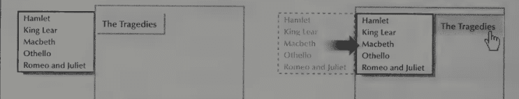

- 1) 页面上只有菜单标题是可见的。菜单内容被隐藏，要么在页面之外，要么在在另一个对象之后。
- 2) 点击菜单标题会导致菜单内容滑动到页面上完全可见的位置。

要创建一个滑动菜单，请使用对象的定位样式将其放置在部分遮挡的位置。要将对象放置在页面之外，请使用绝对定位并将 `left` 样式设置为负值。例如，以下样式声明：

```
position: absolute; top: -50px; left: -10px;
```

将把对象设置在可见浏览器窗口的上方 50 像素和左侧 10 像素处。要将你的滑动菜单放在另一个对象之后，请使用 `z-index` 样式将其设置在页面上另一个图像之下。
一旦滑动菜单被部分遮挡，你就可以使用教程 4 中使用的动画技术将菜单从其原始位置移动到更可见的地方。要隐藏菜请使用动画将其移回原始位置。

## 创建标签页菜单

在**标签页菜单**中，多个菜单堆叠在页面上，每个菜单的一个部分对用户是可见的。当你点击菜单的可见部分时，选中的菜单将移动到栈的最顶端，使其内容对用户可见（参见图 5-14）。

教程 使用特殊特效处理 JAVCRIPT IV 231

创建标签页菜单 图 5-14

| 浪漫剧 | 悲剧 | 历史剧 | 喜剧 |
| :--- | :--- | :--- | :--- |
| 辛赛伯林 | 珀里克利斯 | 暴风雨 | 冬日的故事 |

| 浪漫剧 | 悲剧 | 历史剧 | 喜剧 |
| :--- | :--- | :--- | :--- |
| 哈姆雷特 | 亨利四世 | 麦克白 | 奥赛罗 |
| 罗密欧与朱丽叶 | | | |

- 1) 菜单在页面上相互堆叠 |
- 2) 点击菜单标题将菜单内容带栈顶

创建一个标签页菜单，你需要确保每个菜单的部分始终可见，无论它位于栈的什么位置。要将项目移动到栈顶端，你可以简单地更改选中菜单的 `z-index` 样式值，将值设置为比当前位于栈顶菜单的 `z-index` 值大 1。如果示例 `menu3` 在栈顶端，而你想将 `menu5` 移动到顶端，你可以运行以下系列命令：

```
menu3 = document.getElementById("menu3");
menu5 = document.getElementById("menu5");
maxZ = menu3.zIndex;
menu5.style.zIndex = maxZ+1;
```

现在 `menu5` 将显示在 `menu3` 之上。
Clare 决定在剧本（Plays）页面使用弹出窗口作为菜单系统。设置菜单内容及其在页面上位置的大部分工作已经为你完成。剧本位于 `playtxt.htm` 文件中。现在打开此文件。

### 打开剧本 Web 页：

- 1. 使用你的文本编辑器打开 `tutorial.05/tutorial` 文件夹中的 `playtxt.htm`。在注释部分输入你的名字和日期，并将文件保存为 `plays.htm`。
- 2. 滚动文档代码以熟悉其内容。
- 3. 在 Web 浏览器中打开 `plays.htm`。图 5-15 显示了页面的当前外观。

## 剧本页菜单

| 首页 | 喜剧 | 历史剧 | 悲剧 | 浪漫剧 |
| :--- | :--- | :--- | :--- | :--- |
| 仲夜之梦 | 亨利四世第一部 | 安东尼与克莉奥帕拉 | 辛赛伯林 | |
| 事事皆圆 | 亨利四世第二部 | 卡奥兰索 | 珀里克利斯 | |
| 你喜欢它 | 亨利四世第三部 | 哈姆雷特 | 暴风雨 | |
| 迷失的情人 | 亨利六世第一部 | 朱利叶·凯撒 | 冬日的故事 | |
| 直尺测量 | 亨利六世第二部 | 麦克白 | | |
| 空欢节事 | 亨利六世第三部 | 罗密欧与朱丽叶 | | |
| 威尼斯商人 | 亨利六世第八部 | 提提·安德罗尼库 | | |
| 温德莎的贤妇们 | 理查二世 | 雅典的提门 | | | |
| 理查三世 | | | | |
| 维罗纳两个绅士 | | | | |
| 第十二夜 | | | | | |

真的吗？不同的浏览器显示 Web 页的方式可能不同。图 5-15 显示了页面在 Windows 版 Internet Explorer 6.0 浏览器中的外观。

菜单包含五个子菜单标题，使用 `<div>` 标签创建，并赋予 `id` 值 "Home" "Comedy" "History" "Tragedy" 和 "Romance"。喜剧、历史、悲剧和浪漫剧的内容被放在带有 `id` 为 "ComedyMenu"、"HistoryMenu"、"TragedyMenu" 和 "RomanceMenu" 的自己的 `div` 元素中。每个菜内是该类型所有剧目的列表，链接到每个剧页面。其余内容包含在一个名为 "main" 的元素中。页面目前，菜单框遮挡了大部分页面；所有菜单属于同一个类，名为 "Menu"，因此将使用 `visibility` 样式来隐藏这些元素。

### 隐藏菜单：

- 1. 返回文本编辑器中的 `plays.html` 文件。
- 2. 在 `</head>` 之前添加以下嵌入样式，如图 5-16 所示：
- 3. 保存更改到文件。
- 4. 在 Web 浏览器中刷新或重新打开 `plays.html`。如图 17 所示，菜单应该是隐藏的。

```
<style type="text/css">
.Menu { visibility: hidden }
</style>
```

```html
<title>shakespeare's plays</title>
<link href="styles.css" rel="stylesheet" type="text/css" />
<style type="text/css">
.Menu { visibility: hidden }
</style>
</head>
```

隐藏菜单

带有隐藏菜单的剧本页

| 首页 | 喜剧 | 历史剧 | 悲剧 | 浪漫剧 |
| :--- | :--- | :--- | :--- | :--- |


威廉·莎士比亚被誉为创作了从《亨利六世第一部》一直到《暴风雨》的各种类型的剧目。从经典的哈姆雷特、亨理王到温德莎的贤妇们，莎士比亚写了悲哀、怜悯和奇迹。要在线阅读这些作品，请从顶部的下拉菜单中选择剧本。

## 创建弹出菜单函数

讨论她希望菜单如何工作。Clare 概述如下：

- 每次只显示一个弹出菜单。
- 如果用户点击菜标题，应该显示相应的菜单，并隐藏其他菜单。
- 如果用户点击菜单下方的页面内容，任何激活的菜单都应该隐藏。

为了执行这些任务，你需要隐藏和显示页面上的函数。已经为你创建了 `hide(object)` 和 `show(object)` 两个函数并存储在 `scripts.js` 文件中。图 5-18 显示这两个函数的代码。

```
function hide(object) {
  object.style.visibility="hidden"
}
function show(object) {
  object.style.visibility="visible"
}
```

两个函数都有一个参数 "object"，代表你想隐藏或显示的对象。在 `plays.htm` 文件中链接这些函数。

### 链接 scripts.js 文件：

- 1. 返回文本编辑器中的 `plays.htm` 文件。
- 2. 在 `</head>` 直接上方添加以下外部脚本元素：`<script src="scripts.js" type="text/javascript"></script>`
- 3. 保存更改到文件。

为了创建 Clare 的弹出菜单，你需要一种方法来跟踪哪个菜单是可见的。你可以通过创建一个名为 `ActiveMenu` 的全局变量来存储当前菜单的对象。该变量的初始值为 null，因为浏览器最初加载页面时没有菜单是可见的。

### 创建 ActiveMenu 变量：

- 1. 在插入的外部脚本元素上方，添加以下嵌入脚本元素，如图 S-19 所示：

```html
<script type="text/javascript">
var ActiveMenu = null;
</script>
```

创建 ActiveMenu 变量


```html
<script type="text/javascript">
var ActiveMenu = null;
</script>
<script src="scripts.js" type="text/javascript"></script>
</head>
```

- 2. 保存更改到文件。

## 显示菜单内容

接下来，你需要创建两个函数：一个用于显示隐藏菜单，另一个用于隐藏可见的激活菜单。你创建的第一个函数将隐藏当前激活的菜单。`hideActive()` 函数的代码为：

```javascript
function hideActive() {
  if (ActiveMenu != null) {
    hideIt(ActiveMenu);
    ActiveMenu = null;
  }
}
```

第一个函数必须测试是否存在需要隐藏的激活菜单（以在没有时生成错误消息）。它通过测试 `ActiveMenu` 变量的值是否设置为 null 来实现。如果变量为 null，函数将调用 `scripts.js` 中的 `hideIt()` 函数隐藏激活菜单，并将 `ActiveMenu` 变量的值重置为 null，以指示现在没有菜单在 Web 页面上显示。

### 插入 hideActive() 函数：

- 1. 在创建 `ActiveMenu` 变量的声明下方插入 `hideActive` 代码，如图 S-20 所示：

```javascript
function hideActive() {
  if (ActiveMenu != null) {
    hide(ActiveMenu);
    ActiveMenu = null;
  }
}
```

## 插入 hideActive() 函数

```javascript
<script type="text/javascript">
var ActiveMenu = null;
function hideActive() {
  if (ActiveMenu != null) {
    hide(ActiveMenu);
    ActiveMenu = null;
  }
}
</script>
```

- 2. 将更改保存到文件中。

接下来，你将创建一个名为 `popMenu()` 的函数来显示菜单。该函数将执行三个操作：

- 1. 隐藏激活菜单
- 2. 将用户选择的菜单设置为新菜单
- 3. 显示用户选择的菜单

`popMenu()` 函数的代码如下：

```javascript
function popMenu(M) {
  hideActive();
  ActiveMenu = document.getElementById(M);
  showIt(ActiveMenu);
}
```

`popMenu()` 函数有一个参数 M，它是要在页面上显示的菜单的 id。函数的第一行调用 `hideActive()` 函数来隐藏之前的菜单。第二行将 `ActiveMenu` 变量设置为用户选择的菜单。函数的第三行使用 `scripts.js` 文件中的 `showIt()` 函数来显示新选择的菜单。例如，要显示 Comedy 菜单的内容，你可以使用以下命令：

```javascript
popMenu("ComedyMenu")
```

浏览器将隐藏当前激活的菜单（如果存在），然后显示 Comedy 菜单，使其成为新的激活菜单。现在将 `popMenu()` 函数添加到 `plays.html` 文件中。

要插入 `popMenu()` 函数：

- 1. 在 `hideActive()` 函数下方插入以下代码，如图 5-21 所示：

```javascript
function popMenu(M) {
  hideActive();
  ActiveMenu = document.getElementById(M);
  showIt(ActiveMenu);
}
```

## 插入 popMenu() 函数

```javascript
<script type="text/javascript">
var ActiveMenu = null;
function hideActive() {
  if (ActiveMenu !== null) {
    hideActiveMenu();
    ActiveMenu = null;
  }
}
function popMenu(M) {
  hideActive();
  ActiveMenu = document.getElementById(M);
  show(ActiveMenu);
}
</script>
```

- 2. 将更改保存到文件中。

## 当用户点击菜单标题之一时调用菜单函数。

你希望在用户点击一个菜单标题时运行 `popMenu()` 函数。每个菜单标题都封装在 `<a>` 标签中。例如，Comedy 标题的代码为：

```html
<div id="Comedy" class="MenuTitle">
  <a href="#">The Comedies</a>
</div>
```

链接指向 `"#"`，这会导致页面重新加载。你希望更改此，使得菜单标题在被点击时运行 `popMenu()` 函数。你可以通过将链接的目标更改为 JavaScript 函数来实现。修改后的 HTML 代码如下：

```html
<div id="Comedy" class="MenuTitle">
  <a href="javascript:popMenu('ComedyMenu')">The Comedies</a></a>
</div>
```

当用户点击菜单标题时，将显示 Comedy 菜单的内容。对 Comedy 菜单标题以及 Clare 页面上的其他菜单标题进行此更改。

要调用 `popMenu()` 函数：

- 1. 滚动 `plays.htm` 文件并找到 Comedy 元素的 `<div>` 标签。
- 2. 将链接的目标从 `"#"` 更改为 `"javascript:popMenu('ComedyMenu')"`。
- 3. 将 History 链接的目标从 `"#"` 更改为 `"javascript:popMenu('HistoryMenu')"`。
- 4. 将 Tragedy 链接的目标从 `"#"` 更改为 `"javascript:popMenu('TragedyMenu')"`。
- 5. 将 Romance 链接的目标从 `"#"` 更改为 `"javascript:popMenu('RomanceMenu')"`。

图 5-22 显示了修改后的菜单标题 HTML 代码。

## 调用 popMenu() 函数

```html
<div id="home" class="Menutitle">
  <a href="ws.html">Home page</a>
</div>
<div id="Comedy" class="Menutitle">
  <a href="javascript:popMenu('Comedy')">The Comedies</a>
</div>
<div id="History" class="Menutitle">
  <a href="javascript:popMenu('History')">The Histories</a>
</div>
<div id="Tragedy" class="Menutitle">
  <a href="javascript:popMenu('Tragedy')">The Tragedies</a>
</div>
<div id="romance" class="Menutitle">
  <a href="javascript:popMenu('romance')">The Romances</a>
</div>
```

如果用户点击网页的主体，你将隐藏激活的菜单。你可以通过为主页内容的 `<div>` 添加事件处理器来实现，并响应运行 `isActive()` 函数。

## 要隐藏 isActive() 函数：

- 1. 滚动到页面并找到主元素的 `<div>` 标签。
- 2. 在 `<div>` 标签上添加事件处理器 `onclick="isActive()"`，如图 5-23 所示。

## 调用 isActive() 函数

```html
<div id="main" onclick="isActive()">
  <p id="fallstaff"></p>
</div>
```

## 图 5-23 Internet 5.5 过滤器

| 文件名 | 参数 | 说明 |
| --- | --- | --- |
| Alpha | style=0, 1, 2<br>opacity=1--100<br>finishOpacity=1--100<br>startX=1--100<br>finishX=1--100<br>finishY=1--100 | 应用透明度过滤器。较低的 opacity 值使对象变透明，而高值则使对象不透明。style 参数用于指示透明效果的方向。其余参数控制透明效果应用在什么位置。 |
| BasicImage | rotation=0, 1, 2, 3<br>opacity=0--1<br>mirror=0, 1<br>invert=0, 1<br>xRay=0, 1<br>grayscale=0--1 | 修改对象的外观。rotation 参数旋转对象（0--0 度，1--90 度，2--180 度，3--270 度）。opacity 参数设置对象的透明度。其余参数如果其值设置为“1”，则会创建镜像、反转对象、应用“X射线”效果或去灰度。 |
| Blur | pixelRadius=value<br>makeShadow=true<br>shadowOpacity=0--1 | 模糊图像。pixelRadius 参数决定模糊的程度。makeShadow 和 shadowOpacity 参数为模糊效果添加阴影。 |
| Chroma | color=#rgbbb | 在透明对象中创建一种特殊颜色。 |
| DropShadow | color=#rgbbb<br>offX=value<br>offY=value | 创建指定颜色的投影投影，其中 offsetX 在 x 方向上偏移，offY 在 y 方向上偏移。 |
| Emboss | | 对对象应用浮雕效果。 |
| Engrave | | 对对象应用雕刻效果。 |
| Glow | color=#rgbbb<br>strength=1--255 | 在对象周围应用发光边框，发光的大小由 strength 参数决定，颜色由 color 参数决定。 |
| Gradient | gradientType=0--1<br>startColor=#rgbbb<br>endColor=#rgbbb | 对对象应用颜色渐变。gradientType 参数决定渐变的方向，垂直（0）或水平（1）。startColor 和 endColor 参数指示起始颜色和结束颜色。中间颜色由过滤器提供。 |
| MotionBlur | direction=angle<br>strength=1--255 | 应用运动模糊。direction 参数提供运动的角度，strength 参数指示运动线条的长度。 |
| Pixelate | maxSize=value | 将对象像素化，maxSize 是像素的大。 |
| Shadow | direction=angle<br>color=#rgbbb<br>strength=1--255 | 对对象应用简单的投影，阴影的角度由 direction 参数指定，颜色由 color 参数指定，阴影的大小由 strength 参数决定。 |
| Wave | freq=value<br>lightStrength=value<br>phase=value | 对对象应用正弦波畸变；波的外观由这四个参数决定。 |

例如，如果你在 Internet Explorer 5.5 或更高版本中添加投影过滤器，你将为元素添加以下过滤器样式：

```
filter: dropShadow=DXImageTransform.Microsoft;
dropShadow(color=#FF0000, offsetX=5, offsetY=10)
```

使用此样式，元素将显示为红色投影（因为 #FF0000 是红色的十六进制颜色值），偏移 5 像素并向下 10 像素。

Internet Explorer 5.5 支持比 4.0 版本更广泛过滤器效果。图 5-26 描述了 4.0 版本过滤器如何与 5.5 的形式对应。

## Internet Explorer 4.0 和 5.5 过滤器

| IE 4 过滤器 | IE 5.5 过滤器 |
| --- | --- |
| Alpha | progid:DXImageTransform.Microsoft.Alpha |
| Blur | progid:DXImageTransform.Microsoft.MotionBlur |
| Chroma | progid:DXImageTransform.Microsoft.Chroma |
| DropShadow | progid:DXImageTransform.Microsoft.dropShadow |
| FlipH | progid:DXImageTransform.Microsoft.BasicImage(rotation=2,mirror=1) |
| FlipV | progid:DXImageTransform.Microsoft.BasicImage(mirror=1) |
| Glow | progid:DXImageTransform.Microsoft.Glow |
| Gray | progid:DXImageTransform.Microsoft.BasicImage(grayscale=1) |
| Invert | progid:DXImageTransform.Microsoft.BasicImage(invert=1) |
| Light | progid:DXImageTransform.Microsoft.Light |
| Mask | progid:DXImageTransform.Microsoft.Mask |
| Shadow | progid:DXImageTransform.Microsoft.Shadow |
| Wave | progid:DXImageTransform.Microsoft.Wave |
| Xray | progid:DXImageTransform.Microsoft.BasicImage(xray=1) |

Internet Explorer 4.0 过滤器在 5.5 版本中受支持，因此你可能为了更好的兼容性而于使用它们。然而，兼容性不是问题，你应该利用 5.5 过滤器提供的强大功能和灵活性。如果不实际操作，很难理解和欣赏过滤器。为了更好地理解过滤器如何工作，这里有一个演示页面。如果你在 Internet Explorer 5.5 或更高版本中添加投影过滤器，你将为元素添加以下过滤器样式：

```
filter: dropShadow=DXImageTransform.Microsoft;
dropShadow(color=#FF0000, offsetX=5, offsetY=10)
```

使用此样式，元素将显示为红色投影（因为 #FF0000 是红色的十六进制颜色值），偏移 5 像素并向下 10 像素。

Internet Explorer 5.5 支持比 4.0 版本更广泛过滤器效果。图 5-26 描述了 4.0 版本过滤器如何与 5.5 的形式对应。

*(注：由于提供的原文中存在大量重复内容，译文已根据“确保不要重复输出原文”的原则进行了去重处理。*)

# JVS 244 JAVASCRIPT 处理特殊特效

其中 Internet Explorer 的 Alpha 过滤器是应用于文档中第一个内联图像的过滤器之一。使用 JavaScript 处理过滤器样式的目的之一是修改参数值。你可以使用以下语法引用每个过滤器中的特定参数：

```
filter.param
```

其中 filter 是对象集合中的特定过滤器，而 param 是与该过滤器关联的参数名称。例如，要更改第一个内联图像的 Alpha 过滤器透明度值，你可以运行表达式：
`document.images[0].filters["DIImageTransform.Microsoft.Alpha"].opacity=25;`

请注意，此命令仅在已为该内联图像定义了 Alpha 过滤器时才有效。

# 参考：在 JavaScript 中处理过滤器

- 要对对象应用过滤器，请使用 JavaScript 表达式 `object.style.filter = "filter text";`，其中 object 是 Web 文档中的一个对象，filter text 是过滤器名称（或多个名称）以及过滤器参数。
- 要访问与对象的特定过滤器，使用引用 `object.filters[idref]`，其中 object 是定义了一组过滤器的对象，idref 是集合中过滤器的索引号或名称。
- 要访问与过滤器关联的参数，使用语法 `filter.param`，其中 filter 是对象集合中的一个过滤器，param 是与该过滤器关联的参数之一。

> 如果用户的浏览器支持，你可以使用过滤器来创建与你在上一节中过的类似的鼠标悬效果（rollover effects）。与其创建同一图像的两个版本，你可以使用 JavaScript 在响应鼠标悬停（mouseover）事件时应用过滤器效果，然后在响应鼠标离开（mouseout）事件时将其移除。如果你想为文档中的内联图像添加投影投影，以下 `RollOut()` 和 `RollOver()` 函数看起来可能如下所示：

```javascript
function RollOver(i) {
  document.images[i].style.filter="progid:DIImageTransform.Microsoft.DropShadow(color=#DDDDDD,offX=10,offY=0)";
}
function RollOut(i) {
  document.images[i].style.filter="";
}
```

# 为 Plays 页面添加过滤器效果

你与 Clare 讨论了 Internet Explorer 的过滤器功能。她对这个想法感兴趣，并建议你在 Plays 页面添加一个过滤器。Clare 建议你为菜单添加阴影。要添加投影投影，你必须在嵌入式样式表中插入另一个声明。由于所有的菜单都位于 Menu 类之下，你可以使用以下声明应用投影：

```css
.menu {progid:DIImageTransform.Microsoft.DropShadow(color=#999999,offX=3,offY=3)}
```

此投影投影将以中灰色出现，位于每个菜单的右侧和下方偏移 3 像素处。将此过滤器样式添加到 Clare 的页面中。

# 为菜单项添加投影阴影过滤器样式：

- 在文本编辑器中打开 `plays.htm` 文件。
- 在嵌入式样式表中插入以下样式声明（见图 5-29）：

```css
.Menu(filter:progid:DXImageTransform.Microsoft.DropShadow(color=#999999, offsetx=3, offsety=3))
```

- 将你的更改保存到文件。
- 在 Internet Explorer 中打开 `plays.htm`。访问菜单并验证菜单现在是否带有灰色投影投影，且投影位于菜单框的右侧和下方。（见图 5-30。）

# 添加投影阴影过滤器样式

# 图 5-29

# 查看投影投影过滤器

# 图 5-30

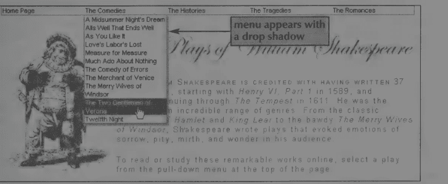

有问题？如果你运行的是 Internet Explorer 4.0 或更高版本的浏览器，你将看不到任何投影效果，但页面应该仍正常渲染。

# 使用光过滤器

另一种为你的 Web 页面增加视觉趣味的流行过滤器是光过滤器（Light filter），它创建一个光（或多个光）照亮对象的幻象。与投影类似，添加光源可以为页面元素提供 3D 效果。在 Internet Explorer 4.0 中创建光过滤器的样式为：

```css
filter: Light()
```

# JVS 246 JAVASCRIPT 教程：处理特殊特效

在 Internet Explorer 5.5 中，样式为：

```css
filter: progID:DIImageTransform.Microsoft.Light();
```

一旦创建了光过滤器，下一步是为对象定义光源。这不是通过样式声明实现的，而是通过 JavaScript 命令完成。创建光源有方法：`addAmbient()`、`addPoint()` 和 `addCone()`。`addAmbient()` 方法为对象应用整体光或环境光。该方法的语法为：

```javascript
object.filters.Light.addAmbient(red, green, blue, strength)
```

其中 object 是被照亮的对象；red、green、blue 是光的 RGB 值；strength 是光源的强度，表示为 0 到 100 之间的数字。例如，以下语句在文档的第一个内联图像上添加了一个高强度的红色光源：

```javascript
document.images[0].filters.Light.addAmbient(255, 0, 0, 100);
```

`addPoint()` 方法为对象应用点光源。该方法的语法为：

```javascript
object.filters.Light.addPoint(red, green, blue, strength)
```

`addCone()` 方法为对象应用锥形光。该方法的语法为：

```javascript
object.filters.Light.addCone(red, green, blue, strength)
```

# 处理过渡效果（Transitions）

Internet Explorer 支持的第二种特殊特效是过渡效果。过渡是在在一段时间内应用到对象上的视觉效果。例如，与其让弹出菜单立即消失，你可以应用一种过渡效果，使弹出菜单看起来逐渐融入背景直到消失。

# 应用过渡样式

使用过滤器样式，过渡取决于你尝试支持的 Internet Explorer 版本。Internet Explorer 4.0 支持两种过渡：混合（blend）和显示（reveal）。混合过渡是一个对象混合到另一个对象的过渡。创建混合过渡的样式为：

```css
filter:blendTrans(duration = value)
```

其中 value 是混合过渡发生的时间（秒）。不需要使用两个单独的对象。你可以通过使对象不可见（使用 visibility 样式）然后应用 blendTrans 来在单个对象上应用混合过渡。

显示过渡是一种更通用的过渡，在一个对象变为另一个对象时应用视觉效果。显示过渡的样式为：

```css
filter:revealTrans(duration = value, transition = type)
```

其中 `type` 是从 0 到 23 的数字，用于指定过渡效果。各种过渡效果及其对应的数值如图 5-31 所示。

## 图 5-31 Internet Explorer 4.0 revealTrans 类型

| 过渡效果 | 数值代码 | 过渡效果 | 数值代码 |
|---|---|---|---|
| 箱入 (Box In) | 0 | 随机溶解 (Random Dissolve) | 12 |
| 箱出 (Box Out) | 1 | 垂直分裂入 (Split Vertical In) | 13 |
| 圆形入 (Circle In) | 2 | 垂直分裂出 (Split Vertical Out) | 14 |
| 圆形出 (Circle Out) | 3 | 水平分裂入 (Split Horizontal In) | 15 |
| 向上扫 (Wipe Up) | 4 | 水平分裂出 (Split Horizontal Out) | 16 |
| 向下扫 (Wipe Down) | 5 | 左下斜条纹 (Strips Left Down) | 17 |
| 向右扫 (Wipe Right) | 6 | 左上斜条纹 (Strips Left Up) | 18 |
| 向左扫 (Wipe Left) | 7 | 右下斜条纹 (Strips Right Down) | 19 |
| 垂直百叶 (Vertical Blinds) | 8 | 右上斜条纹 (Strips Right Up) | 20 |
| 水平百叶 (Horizontal Blinds) | 9 | 随机竖条 (Random Bars Vertical) | 21 |
| 跨越棋盘 (Checkerboard Across) | 10 | 随机横条 (Random Bars Horizontal) | 22 |
| 棋棋棋盘 (Checkerboard Down) | 11 | 随机 (Random) | 23 |

在 Internet Explorer 5.5 中，`blendTrans()` 和 `revealTrans()` 过渡被整个过渡效果库所取代。其语法与 Internet Explorer 5.5 应用过滤器的方式类似：

```
filter: progid:DXImageTransform.Microsoft.transition(param)
```

其中 `transition` 是过渡效果的名称，`param` 是定义过渡运行方式的参数。图 5-32 描述了一些 Internet Explorer 5.5 的过渡效果及其参数。除了图 5-32 外，每个过渡效果还支持 `duration` 参数，表示过渡持续的秒数。

## Internet Explorer 5.5 过渡效果

| 参数 |  |
| :--- | :--- |
| Barn (谷门) | motion=out, in orientation=horizontal, vertical | 应用“谷门”过渡效果 |
| Blinds (百叶) | blinds=value direction=up, down, left, right | 应用“百叶帘”效果 |
| Chessboard (棋盘) | squaresX=value squaresY=value | 创建棋盘过渡。棋盘的大小由 `squaresX` 和 `squaresY` 参数决定，将一个对象叠加到另一个上。 |
| Fade (淡入) | overlap=0-1 | 将一个对象淡入另一个。`overlap` 参数控制淡入发生时的重叠程度。 |
| GradientWipe (渐变扫) | gradientSize=0-1 wipeStyle=0, 1 motion=forward, reverse | 将一个对象扫入另一个。`gradientSize` 参数控制模糊度。`wipeStyle` 参数表示是从左到右 (0) 还是从上到下 (1)。 |
| Iris (光圈) | irisStyle=multiple motion=out, in | 应用光圈开启过渡效果。光圈的样式由 `irisStyle` 参数决定。 |
| Pixelate (像素化) | maxSquare=value | 应用像素化过渡，`maxSquare` 是像素的大小。 |
| RadialWipe (径向扫) | wipeStyle=clock, wedge, radial | 应用径向扫过渡 |
| RandomBars (随机条纹) | orientation=horizontal, radial | 应用随机条纹过渡 |
| RandomDissolve (随机溶解) | duration=value | 将一个对象溶解到另一个。`duration` 参数表示溶解时间的秒数。 |
| Slide (滑动) | slide=hide, push, swap | 将一个对象滑过或滑入另一个 |
| Spiral (螺旋) | gridSizeX=value gridSizeY=value | 将一个对象螺旋进入另一个 |
| Stretch (拉伸) | stretchStyle=hide, push, spin | 将一个对象拉伸进入另一个 |
| Strips (斜条) | motion=left-up, left-down, right-up, right-down | 以对角线方向将一个对象覆盖另一个 |
| Wheel (旋转) | spokes=value | 应用轮旋转过渡 |
| ZigZag (之字形) | gridSizeX=value gridSizeY=value | 应用之字形过渡 |

## 参考窗口

## 创建过渡样式

- 在 Internet Explorer 4.0 中创建混合过渡 (blend transition)，请使用样式
`filter: blendTrans(duration = value)`
其中 `value` 是完成混合过程所需的时间（秒数）。
- 在 Internet Explorer 4.0 中创建显示过渡 (reveal transition)，请使用样式
`filter: revealTrans(duration = value, transition = type)`
其中 `type` 是从 0 到 23 的数字，用于指定过渡效果。
- 在 Internet Explorer 5.5 及以上版本中创建过渡，请使用样式
`filter: progid:ImageTransform.Microsoft.transition(param)`
其中 `transition` 是过渡的名称，`param` 是与之使用的参数。

图 5-33 显示了如何将 4.0 过渡转换为 5.5 版本的形式。

## Internet Explorer 4.0 和 5.5 过渡对比

| IE 4.0 过渡 | IE 5.5 过渡 |
|---|---|
| blendTrans() | DXImageTransform.Microsoft.Fade |
| reveal(0) | DXImageTransform.Microsoft.Iris(irisStyle="square", motion="in") |
| reveal(1) | DXImageTransform.Microsoft.Iris(irisStyle="square", motion="out") |
| reveal(2) | DXImageTransform.Microsoft.Iris(irisStyle="circle", motion="in") |
| reveal(3) | DXImageTransform.Microsoft.Iris(irisStyle="circle", motion="out") |
| reveal(4) | DXImageTransform.Microsoft.Blinds(direction="up", bands="1") |
| reveal(5) | DXImageTransform.Microsoft.Blinds(direction="down", bands="1") |
| reveal(6) | DXImageTransform.Microsoft.Blinds(direction="right", bands="1") |
| reveal(7) | DXImageTransform.Microsoft.Blinds(direction="left", bands="1") |
| reveal(8) | DXImageTransform.Microsoft.Blinds(direction="right") |
| reveal(9) | DXImageTransform.Microsoft.Blinds(direction="down") |
| reveal(10) | DXImageTransform.Microsoft.Checkerboard(direction="right") |
| reveal(11) | DXImageTransform.Microsoft.Checkerboard(direction="down") |
| reveal(12) | DXImageTransform.Microsoft.RandomDissolve |
| reveal(13) | DXImageTransform.Microsoft.Barriere(orientation="vertical", motion="in") |
| reveal(14) | DXImageTransform.Microsoft.Barriere(orientation="vertical", motion="out") |
| reveal(15) | DXImageTransform.Microsoft.Barriere(orientation="horizontal", motion="in") |
| reveal(16) | DXImageTransform.Microsoft.Barriere(orientation="horizontal", motion="out") |
| reveal(17) | DXImageTransform.Microsoft.Strips(motion="leftdown") |
| reveal(18) | DXImageTransform.Microsoft.Strips(motion="leftup") |
| reveal(19) | DXImageTransform.Microsoft.Strips(motion="rightdown") |
| reveal(20) | DXImageTransform.Microsoft.Strips(motion="rightup") |
| reveal(21) | DXImageTransform.Microsoft.RandomBars(orientation="horizontal") |
| reveal(22) | DXImageTransform.Microsoft.RandomBars(orientation="vertical") |

为了更好地理解这些过渡效果，我们为你准备了一个演示。现在打开它。

## 查看过渡效果：

1. 在 Internet Explorer 的 tutorial.05 文件夹中打开 `demo_transitions.htm` 文件。
2. 从 Transition Type 下拉框选择类型。
3. 从 Duration 下拉框选择持续时间。
4. 为所选过渡选择参数值。

更改过渡类型、持续时间和参数值时，右侧的对象会显示你输入的过渡效果。所选过渡的样式在页面底部。见图 5-34。

## 运行演示

| 过渡类型 | 条纹 |
|---|---|
| 持续时间（秒） | 2 |
| 运动 | 右下 |

```
filter: progid DXImageTransform Microsoft Trips(Motion=rightdown)
```

> 遇到问题？如果你运行的 Internet Explorer 4.0 或以上版本，将无法看到这些过渡效果。

5. 继续查看过渡效果列表和参数值。
6. 完成后关闭网页。

## 脚本过渡

脚本过渡的代码与你之前使用的过滤器语法相同。例如，对对象应用 `WipeStyle` 为 "clock" 的 RadialWipe 过渡的代码为：

```
object.style.filter = "progid DXImageTransform.Microsoft.RadialWipe(WipeStyle=clock)";
```

你也可以使用过滤器集合来修改所选过渡的参数值：

```
object.filters["DXImageTransform.Microsoft.RadialWipe"].WipeStyle="clock";
```

再次，如果你使用过滤器集合，必须在对象的样式表中定义过滤器。

## 运行过渡

如果你想看到过渡样式对对象的效果，必须使用一系列 JavaScript 命令来运行。运行过渡涉及四个步骤：

1. 设置对象的初始状态
2. 为对象应用过渡
3. 指定对象的最终状态
4. 播放过渡

对象的初始状态是过渡之前的状态。这包括对象的可见性属性、内联图像源或应用于对象的 HTML 代码。一旦确定了对象的初始状态，就可以使用 `apply()` 方法如下应用过渡：

```
object.filters[index].apply();
```

其中 `object` 是你想应用过渡的对象，`index` 是索引数字或过渡名称的文本。应用过渡并不会实际运行，因为对象的最终状态尚未确定。此时，它会将对象“冻结”在初始状态。过渡应用后，你可以编写代码修改对象的外观，由于对象是被冻结的，这些更改不会出现在网页上。

在定义对象的最终状态后，你使用 `play()` 方法“解冻”并运行过渡效果，将对象从初始状态移动到最终状态。播放过渡的语法为：

```
object.filters[index].play(duration);
```

其中 `duration` 是运行过渡所需的秒数。注意，对于 IE 4.0，过渡持续时间是作为过渡参数输入的。以下代码演示了如何在两个源之间创建过渡：

```
<style type="text/css">
<filter: progid:DXImageTransform.Microsoft.Slide(bandSize=push,Bands=1)>
</style>
<script type="text/javascript">
function newSlide() {
  document.getElementById("Img1").filters[0].apply();
  document.getElementById("Img1").src = "slide2.jpg";
  document.getElementById("Img1").filters[0].play(2);
}
</script>

```

要创建淡入（Fade-in）或淡出（Fade-out）过渡，你使用相同的基本结构，不同之处初始和结束状态基于对象的可见性。以下是一个应用于“万籁俱寂”（The Rest is Silence）的过渡示例：

```css
<style type="text/css">
#Hamlet [visibility: visible]
#Hamlet [filter: progid:DXImageTransform:Microsoft.Fade(opacity=1)]
*/
</style>
<script type="javascript">
function fadeOut() {
  Hamlet.filters[0].apply();
  Hamlet.style.visibility="hidden";
  Hamlet.filters[0].play();
}
</script>
<div id="Hamlet" onclick="fadeOut()">
  <h1>The Rest is Silence</h1>h1>
</div>
```

在此示例中，当用户点击文本时，文本将淡出，其状态从可见变为隐藏。如果你想确保跨浏览器兼容性，也可以使用 Internet Explorer 4.0 的 `blendTrans()` 方法。由于这是一个 `div` 元素，你必须在应用过渡之前定义一个绝对位置。`span` 元素也有类似的要求。

## 运行过渡

- 要播放过渡，首先设置对象的初始状态。
- 接下来，使用语法 `object.filters[idref].apply();` 将过渡效果应用到对象上，其中 `object` 是应用过渡的对象，而 `idref` 是对象样式表中定义的过渡的索引号或名称。
- 然后指定对象在过渡后的结束状态。
- 最后，使用语法 `object.filters[idref].play(duration);` 播放过渡，其中 `duration` 是以秒为单位的过渡时间。

## 在剧本页面添加过渡

你与 Clare 讨论了如何在 Internet Explorer 中使用过渡效果。Clare 奇奇当用户从页面选择菜单时，是否可以使用“向下刷”（Wipe Down）过渡。Clare 的想法是，当菜单显示时，将调用过渡，从而产生菜单正在展开的错觉。图 5-35 展示了 Clare 的想法。其他浏览器的用户将无法看到这种效果，但他们仍然可以像以前一样使用菜单。

## 图 5-35

对菜单应用过渡

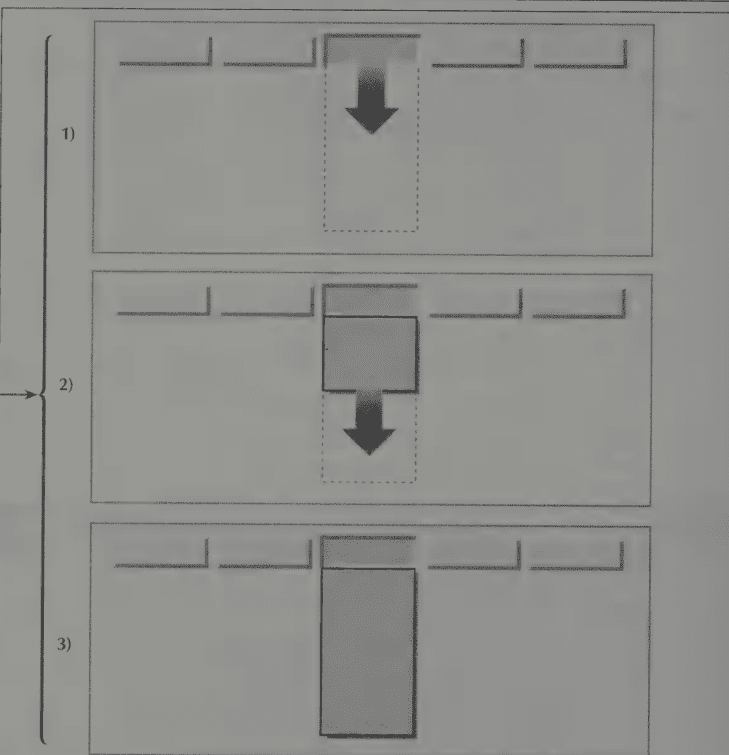

在菜单被选择后，应用“向下刷”过渡，产生菜单展开的错觉。

要创建这种效果，你可以使用 Internet Explorer 4.0 的过渡 `revealTrans(transition=5)` 或 Internet Explorer 5.5 的过渡 `progID:DXImageTransform.Microsoft.Blinds(direction=down, bands=1)`。

Claire 要求你使用 Internet Explorer 5.5 过渡。在 Clare 的 Web 页面菜单样式声明中添加此样式。

## 要添加过渡过滤器：

1. 回到文本编辑器中的 `plays.htm` 文件。
2. 在 `Menu` 类的样式声明中添加以下样式（参见图 5-36）：
progID:DXImageTransform.Microsoft.Blinds(direction=down, bands=1)

## 添加过渡过滤器样式

接下来，你必须在活动菜单上运行过渡。由于只有 Internet Explorer 支持该过渡，因此你必须在尝试运行它之前包含对象检测，以确定浏览器是否支持过渡。你需要在 `popMenu()` 函数中添加命令。修改后的 `popMenu()` 函数如下：

```javascript
function popMenu(M) {
  hide();
  ActiveMenu = document.getElementById(M);
  if (ActiveMenu.filters) ActiveMenu.filters[1].apply();
  show(ActiveMenu);
  if (ActiveMenu.filters) ActiveMenu.filters[1].play(0.5);
}
```

在修改后的函数中，将 `ActiveMenu` 设置为新菜单后，你对其应用过渡。注意，在尝试过渡之前，你验证了浏览器是否支持 `ActiveMenu.filters`。在下一步中，使用 `show()` 函数显示活动菜单的内容；然而，由于你已对该对象应用了过渡过滤器，在运行运行之前活动菜单不会显示。在下一步中，以 0.5 秒的持续时间运行过渡。要修改 `popMenu()` 函数：

1. 转到 `popMenu()` 函数，在函数的第二个步骤之后添加以下语句：
`if (ActiveMenu.filters) ActiveMenu.filters[1].apply();`
2. 在 `popMenu()` 函数的最后一行添加以下语句：
`if (ActiveMenu.filters) ActiveMenu.filters[1].play(0.5);`

图 5-37 显示了修改后的 `popMenu()` 函数。

3. 关闭 `plays.html` 文件，保存你的更改。
4. 在浏览器中重新打开或刷新 `plays.html` 文件。
5. 点击菜单并验证它们正在使用展开效果。遇到问题了吗？如果你使用的是 Internet Explorer 以外的浏览器，将看不到任何过渡效果。

## 使用页面间过渡

你也可以创建页面与页面之间的过渡。这些过渡被称为页面间过渡（interpage transitions），涉及在浏览器进入或退出页面时应用于页面的效果。页面间过渡是通过使用 HTML 文件 `head` 中的 `meta` 元素创建的。`meta` 元指定了过渡类型、持续时间以及是在进入还是退出页面时应用。有四种过渡分别在用户最初进入 Web 页面、退出页面时运行。四种不同页面间过渡的语法如下：

```html
<meta http-equiv="Page-Enter" content="type" />
<meta http-equiv="Page-Exit" content="type" />
<meta http-equiv="Site-Enter" content="type" />
<meta http-equiv="Site-Exit" content="type" />
```

其中 `type` 是 Internet Explorer 支持的过渡之一，`http-equiv` 属性指定了应何时应用过渡。页面间过渡的语法与页面内对象的语法相同。这些过渡仅在你从一个页面到另一个页面或从一个站点到另一个站点时出现。如果该页面是用户启动浏览器时打开的文件，则用户看不到 `Page-Enter` 过渡。

## 创建页面间过渡

要在进入或退出 Web 页面时创建页面间过渡，向文档头添加一个或多个以下 `meta` 元素：

```html
<meta http-equiv="Page-Enter" content="type" />
<meta http-equiv="Page-Exit" content="type" />
<meta http-equiv="Site-Enter" content="type" />
<meta http-equiv="Site-Exit" content="type" />
```

其中 `type` 是 Internet Explorer 支持的过渡之一。例如，为了在用户进入页面时显示持续时间为 3 秒的内嵌（inset）过渡，你需要应用以下 `meta` 元素：

```html
<meta http-equiv="Page-Enter" content="progid:DXImageTransform.Microsoft.Inset(duration=3)" />
```

若要在退出页面时应用 2 秒的轮转（Wheel）过渡，将使用 `meta` 元素：

```html
<meta http-equiv="Page-Exit" content="progid:DXImageTransform.Microsoft.Wheel(spokes=8, duration=2)" />
```

Clare 建议你修改 `ws.htm` 文件，以便每当用户退出页面时运行 3 秒的过渡。你将使用这种过渡的 Internet Explorer 4.0 版本。

## 要插入“向上刷”（Wipe Up）退出过渡：

1. 在文本编辑器中重新打开 `ws.htm` 文件。
2. 在标题（title）元素之后，插入以下 `meta` 元素，如图 5-33 所示：

```html
<meta http-equiv="Page-Exit" content="revealTrans(duration=3),transition=4)" />
```


## 创建页面间过渡

在浏览器退出页面时运行过渡

```html
<title>the world of shakespeare</title>
<meta http-equiv="Page-Exit" content="revealTrans(duration=3),transition=4)" />
<link rel="stylesheet" href="styles.css" type="text/css" />
```


过渡以 3 秒的间隔运行。

3. 关闭文件，保存你的更改。
4. 在浏览器中重新打开 `ws.htm`。
5. 点击 Plays 链接并验证当浏览器退出主页时播放“向上刷”过渡（参见图 5-39）。

## 运行页面间过渡


的温莎，莎士写的剧剧引起了观众悲伤、怜悯、快乐和惊讶的情感。要在在线阅读或研究这些卓越的作品，请从页面顶部的下拉菜单中选择剧本。

遇到问题了吗？如果你使用的是 Internet Explorer 以外的浏览器，将看不到页面间过渡效果。

6. 关闭你的浏览器。

你现在完成了对 Clare Web 的工作。Clare 对你为她创建的特效感到非常满意。她觉得这些效果为页面增添了许多视觉趣味。当她为网站添加更多页面时，她会找你寻求帮助。

## 使用特效的技巧

- 预加载所有用于鼠标悬停的图像以加速悬停效果
- 将悬停图像放在图像数组中，以便编写切换图像的程序
- 将长列表放入弹出或下拉菜中以节省空间
- 将过滤器过渡样式放在单独的样式声明中，以避免与旧版浏览器产生问题
- 如果你使用了过滤器或过渡样式，请在非 Internet Explorer 浏览器上测试你的 Web 站点，确保它们不会给这些浏览器带来问题。

## 第 5.3 节快速检查

1. 你会使用什么方法在垂直方向翻转内联图像？请分别给出 Internet Explorer 4.0 和 Internet Explorer 5.5 的答案。
2. 你输入什么 JavaScript 命令为名为 "Logo" 的对象应用浮雕滤（emboss）？给出 Internet Explorer 5.5 的答案。
3. 你输入什么 JavaScript 命令将名为 "Logo" 的对象的透明度级别存储在名为 "Olevel" 的变量中？假设该过滤器是应用于该对象的第一个也是唯一的过滤器。
4. 描述 Internet Explorer 4.0 支持的两种过渡效果（transitions）。
5. 在 Internet Explorer 5.5 中，你会使用什么过渡效果来复制 `blend(Trans)` 方法的效果？
6. 你输入什么 JavaScript 命令将 Logo 对象第一个过渡的持续时间存储在名为 "Dlevel" 的变量中？
7. 当浏览器打开 HTML 文件时，你会输入什么 HTML 标签来创建一个持续 2 秒的随机过渡效果？

## 教程总结

在本教程中，你学习了如何为网站添加特殊的视觉效果。第一节探索了如何通过操作图像对象和 `document.images` 集合创建图像悬停效果（rollovers）。在本节中，你学习了如何预加载图像以及如何将其放入图像数组中。本节以对文本悬停和 `hover` 类的简短讨论结束。第二节侧重于通过交替隐藏和显示页面上的对象来使用可见性的技术。第三节侧重于 Internet Explorer 支持的为 Web 文档视觉效果的样式。你学习了如何使用 `filter` 样式修改 Web 文档对象的外观，并看到了如何创建从一个对象到另一个对象的过渡效果。本节最后讨论了在浏览器切换页面运行时的页面间过渡（interpage transitions）。

## 核心术语

| 混合过渡 (blend transition) | 图像悬停 (image rollover) | 展现过渡 (reveal transition) |
| :--- | :--- | :--- |
| 过滤器 (filter) | 页面间过渡 (interpage transition) | 滑动菜单 (sliding menu) |
| 过滤器集合 (filter collection) | 弹出菜单 (pop-up menu) | 选项卡菜单 (tabbed menu) |
| 图像集合 (image collection) | 下拉菜单 (pull-down menu) | 过渡 (transition) |
| 图像对象 (image object) | | |

## 复习作业

此复习作业所需数据：bio_out.jpg, bio_over.jpg, caliban.gif, globe_out.jpg, globe_over.jpg, linktext.htm, menu1.jpg, menu2.jpg, plays.css, plays_out.jpg, pgs_over.jpg, scripts.js, son_out.jpg, son_over.jpg, strat_out.jpg, strat_over.jpg, tempest.jpg, tempest1.htm

Clare 对你在两部莎士比亚剧作上完成的工作非常满意。她现在希望你负责莎士比亚戏剧《暴风雨》（The Tempest）的开幕场景设计。在本页中，你将运用在 `ws.htm` 和 `plays.htm` 中使用的所有功能。

你的任务将包括以下内容：

- 为页面顶部的图形链接列表创建一个悬停效果，当用户将鼠标指针悬停在五个链接之一上时，会出现阴影。
- 为页面右侧的 Caliban 图形图像添加阴影。
- 创建独立的弹出菜单，当用户点击图形图像时显示：“剧本”（The Play）或“角色人物表”（Dramatis Persona）。当用户点击剧情描述的任何位置时，弹出菜单将消失。
- 当弹出菜单显示在页面上时，添加向右擦除（Wipe Right）过渡效果。
- 添加框出（Box Out）集成过渡效果，在用户进入页面时运行。

你创建的页面预览见图 5-40。

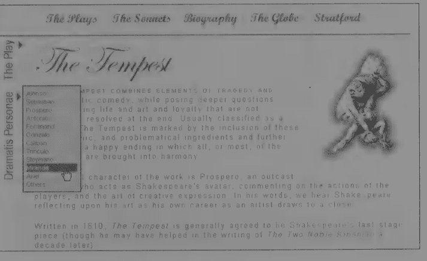

设置页面的大部分工作已为你完成。两个弹出菜单位于 ID 为 "ThePlay" 和 "Dramatis" 的 `div` 标签内。你将使用这些 ID 来识别显示哪个弹出菜单。HTML 文件包含一个指向外部 JavaScript 文件的链接。该文件包含 `hide(t)` 和 `show()` 函数，用于隐藏和显示弹出菜单。

为《暴风雨》创建 Web 页面：

- 使用文本编辑器打开 `tutorial.05/review` 文件夹中的 `tempest.txt` 文件。在注释部分输入你的名字和日期，并将文件保存为 `tempest.html`。
- 在文档的 `head` 部分添加一个嵌入 `script` 元素。在嵌入脚本中创建两个名为 `ImgOverlay` 和 `ImgOut` 的数组。向 `ImgOverlay` 数组填充以下图像：`plays_over.jpg, bio_over.jpg, globe_over.jpg, strat_over.jpg`。向 `ImgOut` 数组填充以下图像文件：`plays_out.jpg, son_out.jpg, bio_out.jpg, globe_out.jpg, strat_out.jpg`。使用教程第一节创建的数组作为模型。

3. 创建一个带有单一参数 "i" 的函数 `RollOver`。让函数测试浏览器是否支持 `document.images(i)` 集合，如果是则在 `ImgOver` 数组之间交换索引值为 `i` 的图像。创建一个类似的名为 `RollOut()` 的函数，在 `document.images(i)` 集合和 `ImgOut` 数组之间交换图像。

4. 为 `plays_out.jpg, son_out.jpg, bio_out.jpg, globe_out.jpg, 和 strat_out.jpg` 的 `document.images(i)` 集合添加 `mouseover` 和 `mouseout` 事件处理程序。使用教程第一节创建的数组作为模型。

# JVS 262 JAVASCRIPT 教程 5 使用特殊特效

幻灯片使用的照片存储在 12 个 JPEG 文件中，按连续顺序命名，从 slide00.jpg 开始到 slide11.jpg 结束。页面中显示的初始照片是 slide00.jpg。HTML 文件中内联图像分配的名称为 "Photo"。

此外，还使用了用于左右按钮的图形图像。图形文件 `down.gif` 和 `lup.gif` 分别在左箭头按钮按下和释放向上时显示左箭头按钮。同样，右箭头按钮的向下和向上位置存储在 `rdown.gif` 和 `rup.gif` 中。这两个内联图像在 HTML 文件中的名称分别为 LeftArrow 和 RightArrow。

当用户点击幻灯片中的中的左箭头时，页面应显示列表中的上一个图形图像。例如，如果用户正在查看 slide05.jpg，点击左箭头应显示 slide04.jpg。当到达列表开头时，幻灯片将跳转到列表末尾。点击右箭头将使用户在图像列表中向上移动。当用户到达幻灯片的末尾时，应显示第一张幻灯片。

当 Internet Explorer 用户点击左或右箭头按钮时，当页面切换图像文件时，应播放 Internet Explorer 5.5 GradientWipe 过渡效果。其他浏览器的用户将看不到这些过渡特效。

要创建幻灯片：

- 1. 使用文本编辑器打开 `tutorial.05/case1` 文件夹下的 `housextml.htm`。在注释中输入你的姓名和日期，并将文件保存为 `house.htm`。
- 2. 在文档的 `head` 部分添加一个嵌入的 `<script>` 元素。该脚本元素创建四个名为 RU、RD、LUp 和 Ldown 的图像对象。将这四个图像对象的源分别设置为图形文件 `rup.gif`、`rdown.gif`、`lup.gif` 和 `ldown.gif`。
- 3. 创建四个名为 `LIn()`、`LOut()`、`RIn()` 和 `ROut()` 的函数。这些函数的作用是更改左右箭头的图像。这些函数应执行以下操作：
   a. `LIn()` 函数应将 LeftArrow 内联图像的源设置为 Ldown 图像对象的源。
   b. `LOut()` 函数应将 LeftArrow 内联图像的源设置为 Lup 图像对象的源。
   c. `RIn()` 函数应将 RightArrow 内联图像的源设置为 Rdown 图像对象的源。
   d. `ROut()` 函数应将 RightArrow 内联图像的源设置为 Rup 图像对象的源。
- 4. 在包裹 LeftArrow 图像按钮的 `< >` 标签上添加事件处理器。当用户按下鼠标键时运行 `Lin()` 函数。当用户释放鼠标键时运行 `LOut()` 函数。对包裹 RightArrow 图像按钮的 `< >` 标签进行类似的更改。
- 5. 在文本编辑器中将更改保存到 `house.htm` 文件。在文档的 `head` 部分添加嵌入样式表。在样式表中，对 Photo 图像应用 Internet Explorer 5.5 GradientWipe 过渡滤镜。（提示：Photo 图像的 id 值为 "Photo"）。将 `gridSize` 参数设置为 0.5，`wipeStyle` 参数设置为 0，`motion` 参数设置为 `forward`。
- 6. 回到文本编辑器中的 `house.htm` 文件。验证在点击左右箭头时它们是否短暂出现。

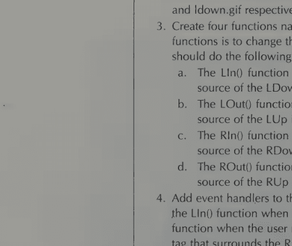

- 7. 在嵌入的脚本元素中，创建一个名为 "Slides" 的图像数组，其中包含 12 个幻灯片图形文件的每个图像对象。从索引值 0 开始数组，一直到索引值 11。
- 8. 创建一个名为 `SlideNum` 的变量。`SlideNum` 的作用是存储当前显示的幻灯片数量。将 `SlideNum` 的初始值设置为 0。
- 9. 创建一个名为 `SlideShow()` 的函数。该函数有一个参数 `direction`，用于指示幻灯片的方向（"forward" 或 "reverse"）。此函数的作用是通过通过交换幻灯片图像列表中正确的图像，使图像显示向前或向后移动。在 `SlideShow()` 中添加以下命令：
   a. 通过创建一个条件结构来设置 `SlideNum` 的值，测试 `direction` 参数的值是否等于 "forward" 或 "reverse"。如果 `direction` 参数的值为 "forward"，使用条件运算符测试 `SlideNum` 的当前值是否等于 11（列表中的最后一个幻灯片）。如果 `SlideNum` 为 11，则将其新值设置为 0（回到列表的第一张幻灯片）；否则将 `SlideNum` 的值加 1。如果 `direction` 参数为 "reverse"，使用条件运算符测试 `SlideNum` 是否等于 0（第一张幻灯片），在这种情况下将 `SlideNum` 的新值设置为 11（最后一个幻灯片）；否则将 `SlideNum` 的值减 1。
   b. 通过创建一个条件结构来测试用户的浏览器是否支持过渡，以确定是否对幻灯片应用 Internet Explorer 过渡。（提示：在条件语句中使用 `images["Photo"]` 作为对象进行对象检测）。如果用户浏览器不支持过渡，则将 Photo 图像的源设置为具有索引值等于 `SlideNum` 的图像数组项。如果用户浏览器支持过渡，则运行名为 `TransSlide()` 的函数，并将 `direction` 作为参数。
- 10. 创建名为 `TransSlide()` 的函数。此函数的作用为 Internet Explorer 用户运行幻灯片，使用 `direction` 变量作为参数。在 `TransSlide()` 中添加以下命令：
   a. 使用 `direction` 参数为 Photo 图像设置渐变消除滤镜。（提示：使用 `document.images["Photo"]` 引用对象）。
   b. 为 Photo 图像应用过渡。
   c. 将 Photo 图像的源设置为 `Slides` 数组中索引值等于 `SlideNum` 的图像。
   d. 执行 2 秒过渡。
- 11. 为幻灯片函数添加事件处理器。找到 LeftArrow 图像的 `<a>` 标签，更改其属性以在点击时运行 `SlideShow()` 函数。将 `SlideShow()` 函数的参数设置为 "reverse"。
- 12. 找到 RightArrow 图像的 `<a>` 标签，更改其属性以在点击时运行 `SlideShow()` 函数。将 `SlideShow()` 函数的参数设置为 "forward"。
- 13. 在文件中保存你的更改。

- 14. 在浏览器中重新打开 `house.htm`，验证点击左箭头按钮时浏览器向后滚动幻灯片。同样验证点击右箭头按钮时，浏览器向后移动幻灯片。
- 15. 如果你运行 Internet Explorer 5.5 或更高版本，验证在向前向后移动幻灯片时，应用了渐变消除滤镜。
- 16. 将完成的网站提交给老师。

# 案例问题 2

本案例所需文件：games.css, image1.jpg 到 image8.jpg, logo.jpg, tile.jpg, tiles.js, tiles1.txt

Games, Etc. 是一家专门经营游戏和谜题的公司。公司网站的一部分是客户在购物时可以玩的在线游戏。网站开发团队主管 Pete Berset 要求你创建一个记忆力游戏（Concentration）。在记忆力游戏中，玩家需要翻开匹配的图像，直到所有图像都翻开为止。Pete 已经设置了一个棋盘，采用四四网格布局。游戏的八张图像存储在名为 image1.jpg 到 image8.jpg 的 文件 中。另一个图像文件 `tile.jpg` 代表图像隐藏时的瓷片。此页预览如图 5-42 所示。

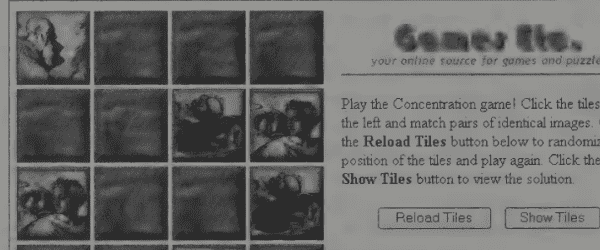

Pete 希望你编写此页面的部分。部分编程已经完成并存储在 `tiles.js` 文件中。`tiles.js` 文件包含创建一个名为 `Tiles` 的数组的代码，包含 16 个图像对象，代表 16 种可能的图像。数组中的第一个图像对象是 `Tiles[0]`，存储位于棋盘第一行第一列瓷片下方的图像。最后一个图像对象是 `Tiles[15]`，存储最后一行一列瓷片的图像。每个 16 个图像对象的源都是随机分配的，每次重新打开页面都会发生变化。

你的任务是编写游戏的操作逻辑。规则如下：

-   点击牌片图片可以翻转牌片。
-   如果玩家翻开了两个具有相同图片的牌片，牌片将保持朝上留在板上。
-   如果玩家翻开了不同图片的牌片，牌片将在 8/10 秒后翻回去。
-   玩家可以随时点击页面上的“Show All”（显示全部）按钮查看谜题的解决方案。
-   玩家可以通过点击“Reload Tiles”（重置牌片）按钮刷新页面并打乱牌片。

创建记忆游戏（Concentration game）：

1. 使用你的编辑器打开来自 tutorial.05/case2 文件夹的 `txtlist.html` 文件。在注释部分输入你的姓名和日期，并将文件保存为 `tiles.html`。
2. 在 HTML 文件的 `head` 区域中，创建一个指向 `tiles.js` 的外部脚本元素，该脚本将创建并填充 `Tiles` 数组。
3. 在外部脚本元素下方插入一个嵌入式脚本。在嵌入式脚本中创建三个全局变量 `FlipCount`、`Tile1` 和 `Tile2`。`FlipCount` 变量用于计算当前回合中之前已翻过的牌片数量（0 或 1）。将 `FlipCount` 变量的初始值设置为 0。`Tile1` 用于存储当前回合中翻过的第一张牌片的位置。`Tile2` 记录翻过的第二张牌片的位置。板上的位置由 0 到 15 的索引数字表示。为 `Tile1` 和 `Tile2` 变量设置初始值。
4. 创建名为 `ShowAll()` 的函数。`ShowAll()` 函数的目的是隐藏板上所有的牌片。为了完成此操作，添加一个索引数字 "i" 从 0 运行到 15 的 For 循环。变量 `i` 的值代表 `document.images` 集合和 `Tiles` 图片数组中 16 张图片中的每一张图片。对于 `i` 的每一个值，将 `document.images` 集合中图片的源与 `Tiles` 图片数组中对应图像对象的源交换。
5. 创建名为 `FlipBack()` 的函数，以重用翻开的两张牌片的图片。每当玩家翻开两个不同的图像时，`FlipBack()` 函数就会运行。该函数没有参数。在函数中添加以下命令：
   a. 将内联图片 `document.images[Tile1]` 的源设置为 `tile.jpg` 文件。这具有隐藏牌片下方图片的效果。
   b. 将内联 `document.images[Tile2]` 的源设置为 `tile.jpg` 文件。
   c. 将 `FlipCount` 变量的值改为 0，表示新回合即将开始。
6. 创建名为 `CheckTiles()` 的函数。`CheckTiles()` 函数的目的是检查翻开的两张牌片的图片是否相同。该函数没有参数。在函数中添加以下命令：
   a. 插入一个 if 条件，测试 `document.images[Tile1]` 内联图片的源是否与 `document.images[Tile2]` 图像的不同。
   b. 如果图片不同，在 0.8 秒后运行 `FlipBack()` 函数。（提示：使用上一个教程中讨论过的 `setTimeout()` 方法）。
   c. 如果图片相同，将 `FlipCount` 变量的值设置为 0。这实现了匹配牌片翻开的效果，并为用户的下一个回合做好了准备。
7. 创建名为 `Flip()` 的函数。`Flip()` 函数的目的是翻转牌片，显示下方的图片，然后检查用户是否翻了牌片。`Flip()` 函数有一个单独参数 "i"，代表要翻转牌片的位置。在 `Flip()` 函数中添加以下命令：
   a. 将 `document.images` 集合中第 i 张图片的源设置为 `Tiles` 图片数组中第 i 张图片的源（从而显示牌片下被隐藏的图片）。
   b. 创建一个 if 条件，测试 `FlipCount` 变量的当前值是否为 0。此测试指示当前回合中翻开的是第一张还是第二张牌片。
   c. 如果 `FlipCount` 等于 0（意味着第一张牌片已被翻开）：1) 将 `Tile1` 的值设置为 `i`（存储第一张翻开牌片的位置），2) 将 `FlipCount` 变量的值设置为 1（表示当前回合已翻开了 1 张牌片）。
   d. 否则：将 `Tile2` 的值设置为 `i`（存储第二张翻开牌片的位置），并运行你之前创建的 `CheckTiles()` 函数来测试翻开的两张牌片是否有相同的图像。对于围绕这些内联图片的每个 `` 标签，更改 `src` 属性，以便用户每次点击它时浏览器都会运行 `Flip()` 函数。`Flip()` 函数应该有一个参数值——`document.images` 集合中牌片的索引。（提示：第一张牌片的参数值为 0，第二张为 1，以此此类推）。
9. 找到 HTML 文件底部的“Reload Tiles”按钮。当点击此按钮时，浏览器将重新加载。（运行 `location.reload()` 方法。）
10. 找到“Show All”按钮。当点击此按钮时，浏览器运行 `ShowAll()`。
11. 关闭文件并保存更改。
12. 在你的 Web 浏览器中打开 `tiles.html`。玩游戏并测试不同牌片对是否在短时间间隔后自动翻回去。核实不同牌片对是否保持朝上状态。点击“Show Tiles”按钮并确认它显示了板上牌片的位置。
13. 将完成的网站提交给你的老师。

# JVS 266 JavaScript 教程：使用数组

## 特殊效果

## 探索使用 JavaScript 创建标签页和侧边菜单

### 案例 3

所需数据文件：`back.jpg`, `js.css`, `logo.jpg`, `main1.jpg` 到 `main6.jpg`、`main1_over.jpg` 到 `main6_over.jpg`、`mainmenu.jpg`、`printtxt`、`side1.jpg` 到 `side6.jpg`、`sidemen.jpg`

Tara Dawson 负责 Jackson Electronics（JE）网站的开发。公司开始重改网站设计。改造的一个目标是通过链接不同页面来改进网站导航。Tara 要求你处理主页的设计。产品页将显示两种菜单：页面顶部的标签页菜单将引导用户进入网站的主要部分。此菜单出现在网站的每个页面。位于页面左边距的侧边菜单将在用户点击链接时显示不同的 IE 产品。图 5-43 显示了用户点击链接后的页面菜单预览。

Tara 已经处理了产品页，并将文件交给了你。在 `html` 文件中，菜框已放置。在标签页菜单中，图片文件已堆叠。网站中的每个子菜单需要隐藏在主侧边菜单后面，创建一个侧边菜单。图 5-44 描述了网站中不同的图片文件。

| 文件 | 描述 |
| :--- | :--- |
| main1.jpg - main6.jpg | 标签页的标标题 |
| main1_over.jpg - main6_over.jpg | 鼠标悬停在标签页菜单上显示的图片 |
| mainmenu1.jpg - mainmenu6.jpg | 包含子菜单的标签页内容 |
| side1.jpg - side6.jpg | 主侧边菜单后面的子菜单 |

你的任务是编写标签页和侧边菜单的操作。为了创建侧边菜单效果，请使用以下函数：

- xCoord 返回活动侧边菜单的 x 坐标
- shiftMenu(dx, dy) 将活动侧边菜单向右移动 dx 像素，向下移动 dy 像素

# JVS 266 JavaScript 教程：使用数组

完成此作业：

1. 使用文本编辑器打开来自 tutorial.05/case3 的 `print.html`。在头部输入你的姓名和日期，并将文件保存为 `printer.html`。
2. 滚动到文档并找到 `mainMenu` 的 `div` 元素。在每个 `div` 元素中插入内联样式，将 `main1` 的 `z-index` 值设置为 6，`main2` 为 5，`main3` 为 4，`main4` 为 3，`main5` 为 2，`main6` 为 1。
3. 滚动到包含在 `div sideMenu` 元素中的侧边菜单。对于这些 `div` 元素，将 `left` 样式从 125px 改为 10px。这具有将子菜单移动到主侧边菜单后面的效果。
4. 返回文档的 `head` 区域并添加另一个脚本元素。在该脚本元素中，插入以下命令：
   a. 创建两个数组：名为 `image` 和名为 `image_over`。这些数组将用于存储标签页文件中使用的图片对象。
   b. 创建一个 For 循环，计数器从 1 到 6 步增为 1。每次循循环，将图片对象存储在 `image_over` 数组中。将 `image` 文件中 `main.jpg` 对象的源设置为 `image_over` 文件中 `main_over.jpg` 的源，其中 `i` 是 For 循环计数器的值。
   c. 创建一个名为 `maxZ` 的变量。该变量用于存储标签页系统中当前显示菜单的 `z-index`。该变量的初始值为 6。
   d. 创建一个名为 `activeMenu` 的变量。该变量用于存储侧边菜中当前显示的子菜单。其初始值为 `null`。
5. 创建名为 `swapIn()` 的函数。该函数的目的是为标签页菜单的标题创建滚动效果。该函数有一个单独参数 `num`，指示要交换内联图片和图像对象的索引。使用 `num` 参数的值将文档中内联图片的源与 `image_over` 数组中对应图像对象的源交换。
6. 创建名为 `swapOut()` 的函数。该函数的目的是恢复菜单标题的原始外观。像 `swapIn()` 一样，该函数有一个单独参数 `num`，代表要交换内联图片和图像对象的索引。使用 `num` 参数将内联图片的源与数组中相应的源交换。
7. 创建名为 `showMain()` 的函数。该函数的目的是将一个标签页菜单移动到堆的最顶部。该函数有一个单独参数 `num`，代表要显示的菜单数量。添加以下命令：
   a. 将 `maxZ` 变量的值加 1。
   b. 将 id 为 `mainMenu` 的元素的 `z-index` 值设置为 `maxZ` 的值，其中 `num` 是参数 `num` 的值。（提示：使用 `getElementById` 方法引用主元素）。
8. 创建名为 `hideActive()` 的函数。该函数的目的是将一个侧边子菜单隐藏在主侧边菜单后面。该函数没有参数。在函数内部，运行命令将 `activeMenu` 对象的 `left` 样式改为 "10px"。

9. 创建一个名为 `slideMenu()` 的函数。该函数的目的是让活动菜单在页面上滑动，直到其 x 坐标达到 126 像素。在此函数中添加以下命令：

-   a. 创建一个变量 `x`，其值等于于 `getCoord()` 返回的值。
-   b. 插入一个 `If` 条件，测试变量 `x` 的值是否小于 126。
    如果是，执行以下操作：1) 使用参数 2 和 0 调用 `shiftMenu()` 函数，将 `activeMenu` 向右移动 2 像素；2) 在延迟 10 毫秒后调用 `slideMenu()` 函数。

10. 创建一个名为 `startSlide()` 的函数。该函数的目的是先隐藏当前显示的子菜单，然后从侧边菜单后面开始滑动子菜单。该函数有一个参数 `num`，表示子菜单的数值。添加以下命令：

-   a. 插入一个 `If` 条件，测试变量 `activeMenu` 变量的值是否不等于 `null`。如果不等于 `null`，运行 `hideActive()` 函数来隐藏当前显示的子菜单。
-   b. 将 `activeMenu` 指向引用为 `sideMenu` 的对象，其中 `num` 是参数 `num` 的值。（提示：使用 `document.getElementById()` 方法引用 `sideMenu` 对象。）
-   c. 调用 `slideMenu()` 函数。

11. 滚动到文档和围绕内联图像 `main1.jpg` 的 `<a>` 标签。将此内联图像的 `href` 属性从 `"#"` 改为链接，该链接使用 `num` 作为参数值调用 `showMain` 函数。提示：参见教程 2，了解关于如何作为超链接运行 JavaScript 命令的讨论。

12. 为 `main1.jpg` 内联图像添加一个 `onmouseover` 处理程序以运行 `swapIn()` 函数。使用 `num` 作为参数值。然后为 `main2.jpg` 内联图像添加一个 `onmouseout` 事件处理程序，运行 `swapOut()` 函数。同样使用 `num` 作为参数值。

13. 对 `main2.jpg` 到 `main6.jpg` 的内联图像重复步骤 11 和 12，将 `showMain()`、`swapIn()` 和 `swapOut()` 函数中的参数值设置为 2 到 6。

14. 滚动到链接映射（linkmap image map）。在第一个 `area` 元素的热点（hotspot）中，将 `href` 属性从 `"#"` 改为链接，使用 `num` 作为参数值调用 `startSlide()` 函数。对剩余的 5 个热点重复此操作，参数值从 2 增加到 6。

15. 为 `main` div 元素添加一个 `onclick` 事件处理程序，调用 `hideActive()` 函数。

16. 将更改保存到文件。

17. 在 Web 浏览器中打开 `printer.htm` 并验证：选项中六个标签页菜单标题中的图像；点击侧边菜单中的六个菜单标题之一，会导致选项的子菜单滑出进入视野并隐藏之前显示的子菜单；以及点击文档的任意位置会隐藏活动子菜单。

18. 将完成的网站提交给你的教师。

# 案例分析 4

此案例分析所需的数据文件：`jackson.jpg`, `lp1.gif`, `lp2.gif`, `lp.txt`, `ps1.gif`, `ps2.gif`, `ps.txt`, `sm1.gif`, `sm2.gif`, `sm.txt`。

**Jackson Electronics** 你为 Jackson Electronics 的 Paul Reichman 工作。Paul 要求你更新一些描述公司三款产品的 Web 页面：ScanMaster、LaserPrint 5000 和 Print/Scan 5000。关于这三个产品的信息可以分别在 `sm.txt`、`lp.txt` 和 `ps.txt` 文件中找到。

Paul 希望你在这三个页面之间插入图形链接。他为你提供了三个名为 `sm1.gif`、`lp1.gif` 和 `ps1.gif` 的图形文件。他还为你提供了这些文件的“鼠标悬停”版本，即 `sm2.gif`、`lp2.gif` 和 `ps2.gif`。

为 Jackson Electronics 创建网站：

-   1. 创建三个名为 `scanner.html`、`printer.html` 和 `ps150.html` 的文件，包含关于 ScanMaster、LaserPrint 5000 和 Print/Scan 500 的信息。页面的布局和设计由你决定。你可以使用在本教程中找到的任何额外资源补充提供的材料以帮助网站。将这些文件保存存在 `tutorial/case/4` 文件夹。
-   2. 每个页面应有指向其他文件的图形链接，并带有悬停效果。
-   3. 为每个页面添加 Internet Explorer 5.5 界面过渡效果；每当用户离开网站时显示另一个 Internet Explorer 5.5 过渡。
-   4. 将完成的网站提交给你的教师。

# 快速检查答案

章节 5.1

```

1. document.images["Links"]

document.images[1]

document.images.Links

document.getElementById("Links")

document.Links

2. document.images["Links"].width = 150;

document.images["Links"].height = 200;

3. document.images["Links"].src = "links2.jpg";

4. LinksOver = new Image(75, 100);

5. LinksArray = new Array();

LinksArray[0] = new Image();

LinksArray[1] = new Image();

LinksArray[2] = new Image();

LinksArray[0].src = image1.jpg;

LinksArray[1].src = image2.jpg;

LinksArray[2].src = image3.jpg;

6. if (document.images)

```

# 章节 5.2

-   1. 在弹出菜中，用户点击页面上的某处，菜单出现。
-   2. 在下拉菜单中，当用户鼠标悬停在某处时，菜单的其他部分变为可见。
-   3. document.getElementById("main

# 章节 5.3

-   1. Internet Explorer 5.5: progid:ImageTransform.mirror(1)
-   2. document.getElementById("Logo").style.filter = "progid:ImageTransform.Emboss()";
-   3. document.getElementById("Logo").filters[0].opacity;
-   4. 混合过渡是一个对象融合到另一种。显示过渡是一种视觉效果，当一个对象变为另一种。
-   5. DXImageTransform.Fade()
-   6. document.getElementById("Logo").filters[0].duration;
-   7. <meta http-equiv="Page content="reveal (Transition=2)" />

## 目标

# 章节 6.1

-   学习窗口对象

# 章节 6.2

-   学习如何更改内容

# 章节 6.3

-   学习框架

# 窗口与框架

使用交互式窗口增强网站

### 案例

# i

Teresa 是一位音乐家兼大学教师，几年前建立了一个音乐网站来辅助她的课程。由于她和学生发现它很有帮助，Teresa 决定扩展该网站，为它起一个新名字并将其作为在线课程推广。上个月她开始将其放到大学服务器。由于这是一个新网站，她需要创建脚本将用户重定向到新 URL。除此之外，Teresa 希望对浏览器与网站之间的交互有更多控制。最后，由于使用了框架，她希望编写一些脚本来控制它们的显示。Teresa 希望你创建的解决方案是跨浏览器的。


## 在 Windows 和框架上工作 JAVCRIPT IVS 273

iMusicHistory 首页图 6.1


## 音乐史
一种交互式方法

欢迎来到 iMusicHistory，一种音乐史的交互式方法。

功能包括：

- 具有即时交互响应的学习测验。
- 网站各处的超文本音乐术语，通过不干扰、方便的弹出窗口来补充课程。

该资源基于 Donald Gray Jordan 和 Craig A. Harris 编写的广泛使用的教材《西方音乐史》（A History of Western Music），提供了一个充满启发性的交互式环境，用于探索、复习、聆听和学习音乐史。

点击此处查看示例：速度 (tempo)

如果您对我们的交互式音乐史课程有任何问题，请与我们联系。我们期待您的回信。

即将上线：
- 音乐术语表。

† 即将上线：
- 听力示例。
- 更多资源的链接。
- 公共和私人留言板。
- 整个网站将提供电子下载或通过 CD-ROM 提供。

回到顶部
首页 课程 测验 术语表
联系人：Teresa Jenner 博士，123 March Lane, San Rafael, CA 12345

**遇到问题？** 网页上的某些链接尚无法使用，因为您还没有创建所需的文件。

如首页上的链接所示，iMusicHistory 网站有四个主要页面：

- 首页，描述网站的用途和功能
- 课程页面，包含一门音乐史的交互式课程
- 测验页面，包含一门供学生复习的在线测验
- 术语表页面，包含音乐术语的定义

Teresa 想对她的网站进行的首次更改涉及出现在 Web 浏览器状态栏中的文本。Teresa 希望在网站首页加载时，出现一条欢迎访客访问网站的状态栏消息。她还希望当人们将鼠标指针悬停在导航链接上时，状态栏中会出现该导航链接的描述。

要创建 Teresa 想要的状态栏消息，您需要操作浏览器窗口的外观。JavaScript 考虑浏览器对象，并将其称为窗口对象（window object）。因此，浏览器窗口的许多功能（包括状态栏中的文本）都是窗口对象的属性。图 6-2 列出了窗口对象的其他属性。

## 图 6-2 窗口对象的属性

| 属性 |  |
| --- | --- |
| closed | 返回一个布尔值，指示窗口是否已关闭 |
| defaultStatus | 定义在状态栏中显示的默认消息 |
| document | 在窗口中显示的文档对象 |
| frames | 窗口内的框架集合 |
| history | 历史对象，包含在该窗口内访问过的 Web 站点列表 |
| innerHeight | 窗口的内部高度，不包括所有工具栏、滚动条和其他功能（仅限 Netscape） |
| innerWidth | 窗口的内部宽度，不包括所有工具栏、滚动条和其他功能（仅限 Netscape） |
| location | 包含当前 Web 文档 URL 的位置对象 |
| name | 窗口名称 |
| opener | 打开当前窗口的源浏览器窗口 |
| outerHeight | 窗口的外部高度，包括所有工具栏、滚动条和其他功能（仅限 Netscape） |
| outerWidth | 窗口的外部宽度，包括所有工具栏、滚动条和其他功能（仅限 Netscape） |
| scrollbars | 浏览器窗口中的滚动条对象 |
| status | 显示在状态栏中的临时或瞬时消息 |
| statusbar | 用于在浏览器窗口中显示消息的状态栏对象 |
| toolbar | 返回一个布尔值，指示窗口工具栏是否可见 |

```

设置窗口对象属性的语法为 "value"

windowObject.property = "value"

```

其中 window 是浏览器窗口，property 是窗口的属性，value 是我们赋值给它的值。请注意，在会话期间，您可以打开多个浏览器窗口，并可以使用 JavaScript 来处理这些不同窗口的属性和内容。我们将在本教程稍后的部分讨论如何处理多个窗口。如果您只处理当前浏览器窗口的属性，则不需要指定浏览器窗口 "window"，而是使用对象名称 "window"，或者在某些情况下完全省略窗口引用。例如，要将当前浏览器窗口的内部高度设置为 300 像素，您将使用命令：

```

window.innerHeight = "300";

```

如果窗口对象的属性本身也是一个对象，那么可以省弃对窗口对象的引用。因此，以下对象引用

```

window.location

```

引用位置栏，等同于
location

只要您正在查看当前浏览器窗口的属性和对象即可。如果您想引用另一个窗口的对象和属性，则您需要在命令中包含对该窗口对象的引用。

## 处理状态栏

浏览器窗口的边界，包括工具栏和滚动条等项目，统称为窗口的“外壳”（chrome）。外壳中所有浏览器共有的部分之一是状态栏，用于向用户显示有关窗口内发生的操作的消息。这些消息可以是永久的，也可以是瞬时的。让我们来看看状态栏。

### 设置默认状态消息

浏览器窗口的边界，包括工具栏和滚动条等项目，统称为窗口的“外壳”（chrome）。外壳中所有浏览器共有的部分是状态栏，用于向用户显示有关窗口内发生的操作的消息。这些消息可以是永久的，也可以是瞬时的。让我们来看看状态栏。

设置状态栏的语法为：

```

windowObject.status = "value";

```

其中 value 是将在状态栏中显示的消息。

### 创建瞬时状态栏消息

iMusicHistory 首页底部有几个链接。默认情况下，当用户悬停在链接上时，大多数浏览器会在状态栏中显示链接的 URL。然而，Teresa 希望当用户悬停在链接上时，状态栏中出现“Learn more about MusicHistory”。这种消息是瞬时状态栏消息的示例，因为它响应浏览器内发生的事件而临时出现。

要创建瞬时状态栏消息，您需要运行以下两行代码：

```

windowObject.status="text";

return true;

```

其中 text 是将作为瞬时消息显示的文本。第一行设置状态栏中的瞬时消息。布尔值 "true" 用于返回。

要更改 Home 链接的瞬时状态栏消息，您需要在链接上添加以下 onmouseover 事件处理器：

```

onmouseover = "window.status='Learn more about MusicHistory';

return true"

```

当用户离开链接时，您希望状态栏变为空。然而，默认情况下状态栏消息会一直保留，直到被其他事件替换。为了移除您的消息，您还需要添加一个 onmouseout 事件处理器，将瞬时消息更改为空字符串。执行此操作的事件处理器是


当浏览器遇到空瞬态消息时，它会将其理解为不显示消息的信号，或者如果存在永久性状态栏消息，则重绘它。

## 为 Home 链接添加状态栏消息：

- 回到文本编辑器中的 default.htm 文件。
- 滚动到文件底部并找到 Home 链接。
- 如图 6-5 所示，在链接中插入以下事件处理程序：
```html

onmouseover = "window.status='Learn more about iMusicHistory'; return true"

onmouseout = "window.status=''; return true"

```

```html

<!-- Begin navigation text cell -->

<tr>

<td valign="middle" id="_9cc99" align="center" class="nav">

<a class="nav" onmouseover="window.status='Learn more about iMusicHistory'; return true" href="home.html">Learn more&nbsp;&nbsp;</a>

<a class="nav" href="lessons.html">Lessons&nbsp;&nbsp;</a>

<a class="nav" href="music.html">Music&nbsp;&nbsp;</a>

<td>

</td>

</tr>

```

- 保存更改。
- 在 Web 浏览器中重新加载 default.htm，并将鼠标指针悬在页面上的 Home 铮上。验证文本“Learn more about iMusicHistory”出现在状态栏中（见图 6-6）。


查看瞬态状态栏消息


有问题？某些浏览器（如 Opera）不会覆盖瞬态状态栏消息，之前输入的永久消息将仍然显示。

## 设置状态栏消息

- 若要设置显示在浏览器状态栏中的永久消息，请使用 JavaScript 命令
```javascript

windowObject.defaultStatus="text";

```
其中 windowObject 是浏览器窗口，text 是新的默认消息。
- 若要创建瞬态状态栏消息，请使用命令
```javascript

windowObject.status="text";

return true;

```

参考窗口

最近，某些浏览器开发者开始禁用修改永久和瞬态状态消息的 JavaScript 程序，这是因为存在潜在的安全问题。修改状态消息可以被作创建伪造类似真实合法网站的整体过程的一部分。创建伪造网站有时是为了欺骗毫无防备的用户泄露个人信息，如联系方式、密码和信用卡号。由于用户的浏览器可能不会显示你自定义的状态消息，因此你绝不要在状态消息中放入任何重要信息。

你目前关于状态消息的工作已经完成。你将需要把所学的技巧应用到网站中的其他链接和页面。不过，现在 Teresa 让你你更多地与主浏览器窗口进行操作。

## 使用 History 和 Location 对象

此前，iMusic 网站存储在 Teresa 大学的服务器上，主页位于一个名为 index.htm 的文件中（而不是 default.htm）。Teresa 希望将 index.htm 页面包含在她的历史记录中，因为用户仍然会有指向它的链接或书签；她希望该页面能提醒用户变化，并提供指向 default.htm 的链接。Teresa 希望在旧页面上有一个链接，点击后可以带用户回到他们访问过的上一个页面。这将方便用户通知链接到 iMusic 网站的页面作者。如果用户不使用，Teresa 希望浏览器在短时间间隔后自动加载新站点。

浏览器在每个窗口内维护关于用户访问过的地方以及当前正在访问页面的信息。你可以通过 location 和 history 对象访问这些信息。location 对象包含当前在窗口中显示的页面信息。history 对象持有 Web 浏览器在到达窗口当前页面之前显示过的网站列表。

## 在历史列表中向前向后移动

在浏览器窗口中，你通常通过点击浏览器工具栏上的“后”和“前进”按钮来浏览历史列表。要使用 JavaScript 实现相同的操作，你使用 history 对象的以下方法：

```

history.back();

history.forward();

```

back() 方法导致窗口加载历史列表中当前页面之前的页面；换句话说，它将窗口中显示的页面更改为用户之前查看的页面。如果用户处于历史列表的开头，则没有页面可以返回，当前页面也不会被替换。forward() 方法加载历史列表中当前页面之后的下一个页面。如果你处于历史列表的末尾，则没有页面可以前往，当前页面将保持不变。注意，上述两个命令都是访问浏览器窗口内的 history 对象。如果你想在其他浏览器窗口中使用 history 对象，必须按照如下方式指定窗口对象：

```

windowObject.history.back();

```

其中 windowObject 是浏览器窗口的引用。你也可以使用以下方法导航到 history 对象中的特定页面：

```

history.go(integer);

```

其中 integer 可以是正、负数或零，代表浏览器应该在历史列表中移动的页数。例如，命令 history.go(-1) 将用户在历史列表中后退一页。history.go(1) 命令将用户移动到列表中的下一页，而 history.go(0) 命令让用户留在当前页面。

实现 back() 和 forward() 方法的常用方法是使用以下结构的链接：

```

<a href="javascript:history.back()">Back</a>

```

以及

```html

<a href="javascript:history.forward()">Forward</a>

```

你将在 Teresa 的旧主页中实现这些。index.htm 页面的大部分内容已为你创建并在 index.htm 文件中。你的第一个任务是为 index.htm 页面创建一个指向用户之前访问页面的链接。

## 创建指向之前访问页面的链接：

- 1. 在文本编辑器中打开 tutorial.06 文件夹下的 indext.htm。在注释部分输入你的名字和日期，并将文件保存为 index.htm。
- 2. 定位到正文第三段中的“return”单词，将其链接到之前访问的页面。
- 3. 保存更改。
- 4. 如果你的浏览器不支持 JavaScript，请使用如下（见图 6-7）。
- 5. 验证当你点击 return 时，浏览器会加载之前的页面（在此情况下为 default.htm）。

## 图 6-8 带有指向之前访问页面链接的索引页

## 课程已移动

将在 8 秒或更短时间内自动传输到那里。


要添加延迟，你可以通过 `setTimeout()` 方法运行此命令，设置延迟时间为 8000 毫秒（8 秒）：

```javascript

function redirect() {

  setTimeout("location.href='default.htm",8000);

}

```

为了确保与所有浏览器的最大兼容性，请在过时的 iMusicHistory 主页中同时使用这两种技术。

# 为 index.htm 页面添加自动重定向：

- 1. 在文本编辑器中返回 index.htm 文件。

- 2. 在文档的 `head` 部分添加以下 `meta` 元素：
<meta http-equiv="Refresh" content="8;URL=default.htm" />

- 3. 在 `head` 部分添加以下嵌入脚本：
<script type="text/javascript">
function redirect() {
  setTimeout("location.href='default.htm",8000);
}
</script>

- 4. 在 `body` 元素中添加以下事件处理程序，以便在页面加载时运行 `redirect()` 函数：
onload="redirect()"

图 6-9 显示了修改后的代码。

```html

<title>musichistory.has moved</title>

<meta http-equiv="Refresh" content="8;URL=default.htm" />

<script type="text/javascript">

function redirect() {

  setTimeout("location.href='default.htm",8000);

}

</script>

<style>

body { text-align: center; background-color: white; }

p { color:red; font-family:Arial, Helvetica, sans-serif; font-size:medium; }

</style>

<head>

<body onload="redirect()">

<h1>Teresa Jennerner</h1>

<p>Music History course</p>

<p>has moved</p>

</body>

</html>

```

- 5. 关闭文件并保存更改。

- 6. 在浏览器窗口中重新打开 index.htm 文件。验证 8 秒后窗口是否打开了 default.htm 文件。

# 窗口自动重定向网页

- 若要将访问者自动从一个页面重定向到另一个页面，请在文档的 `head` 中添加以下元素：
`<meta http-equiv="Refresh" content="sec;URL=url" />`
其中 `sec` 是打开新页面之前经过的秒数时间，`url` 是要加载的页面。
- 若要使用 JavaScript 重定向新页面，请运行命令：
`setTimeout("location.href='url', msec);`
其中 `msec` 是以毫秒为单位的延迟时间。

# 安全问题

在 Netscape 中，history 对象还支持用户历史列表中的 `current`、`next` 和 `previous` 页面属性，这些属性包含页面的 URL。然而，使用这些属性被限制为 Web 页面作者创建脚本来记录用户访问过哪些页面。大多数人认为这种跟踪是侵犯隐私的行为。

Netscape（4.0 及更高版本）使用签名脚本来请求访问如 `current`、`next` 和 `previous` 等属的权限。创建签名脚本的过程涉及对你作为合法开发者或组织的身份进行数字认证。数字认证可以来自 Web 上的多种来源，包括 www.thawe.com 和 www.verisign.com。Internet Explorer 不支持签名脚本，而在 Netscape 4 之前，无法通过脚本获取这些属性。

获取此信息的另一种方法是通过 `document.referrer`，它记录了访问当前页面的源页面 URL。以下代码使用 `document.referrer` 属性写入加载当前页面的源页面名称。请注意，`document.referrer` 属性仅在通过链接访问当前页面时有效，且某些浏览器出于安全考虑会禁用此属性。

```javascript

if (document.referrer) {

  document.write('You came from: ' + document.referrer);

}

```

Teresa 已完成工作检查，并对你为状态栏创建的消息感到满意，同时也对你将访问者从她的旧域名重定向到新域名的解决方案表示认可。在下次课程中，你将处理她的在线音乐历史术语表，这将需要使用 JavaScript 创建新窗口。

# 第 6.1 节快速检查

1. 解释永久状态栏和临时状态栏之间的区别。
2. 你使用什么 JavaScript 命令将用户在历史列表中后移动两个位置？
3. 你使用什么 JavaScript 命令将临时状态栏消息更改为“View News page”？

4. 描述至少两种方法（一种 JavaScript 方法和一种非 JavaScript 方法）将访问者从网站或 Web 页面重定向到其新位置。
5. `document.referrer` 属性用于什么？该属性有两个局限性？

# 第 6.2 节

## 创建新浏览器窗口

iMusicHistory 网站包含一个音乐术语表。当用者点击链接术语时，其术语表页面上的定义会被显示。见图 6-10。


Teresa 担心从一个页面跳转到另一个页面查看定义是不方便且分散注意力的。当用户在主窗口周围包含点击单词定义的窗口之间来回时，用户可以快速阅读定义而不丢失与主窗口的联系。图 6-11 显示了 Teresa 希望你创建的系统预览。


Teresa 希望你为她的网站添加弹出窗口。

# 使用 HTML 打开新窗口

默认情况下，用户打开每个新页面都会在主浏览器窗口中打开。如果你希望你的其中一个链接在新窗口中打开，你可以使用 `target` 属性指定名称。通用语法为：

```html

<a href="url" target="name">link text</a>

```

其中 `url` 是目标文档的 URL，`name` 是辅助窗口的名称。如果你打算对其他链接使用相同的名称，则 `target` 属性的值不需要仅跟踪这一个链接。例如，Teresa 的网页可以打开一个显示伟大作曲家传记的辅助窗口。该功能的 HTML 标签可能如下：

```html

<a href="Wagner.htm" target="Composer">View Wagner's biography</a>

<a href="Mozart.htm" target="Composer">View Mozart's biography</a>

```

点击任一链接都会打开一个目标名为 "Composer" 的辅助窗口。如果窗口已经打开，其内容将被新页面替换。

你可以为新窗口命名任何名称，但 HTML 为其他用途保留的名称除。例如，如果你的 Web 页面包含框架（frames），你不能使用分配给某个框架的名称，因为页面将出现在框架中而不是独立窗口中。

# 使用 JavaScript 打开新窗口

你也可以使用 JavaScript 创建新窗口。与 `target` 属性相比，JavaScript 创建新窗口提供了更多的控制和选项。例如，你可以控制创建的窗口的内容；窗口的大小（高度和宽度属性）；它在屏幕上的位置；以及新窗口是否有工具栏（以及哪些）；菜单栏和状态栏。相比之下，使用 `target` 属性创建的任何新窗口的外观（工具栏、菜单栏、滚动等）都源自主浏览器窗口的外观。

创建新浏览器的 JavaScript 命令是

```javascript

window.open("url", "name", "features")

```

其中 `url` 是窗口中显示的页面 URL，`name` 是分配给窗口的名称，`features` 是控制窗口外观和行为的逗号分隔特征列表。如果你不需要为新窗口指定目标名称，可以使用空字符串作为名称值。


你可以在 JavaScript 程序中将新窗口存储为一个对象。如果你的脚本以后将修改窗口的外观或内容，这种方法非常有用。要将新窗口存储为对象，你可以使用以下语法：

```

windowObject = window.open("url","name","features")

```

其中 `windowObject` 是代表你打开的新浏览器窗口的对象。

## 创建弹出窗口

- 要创建一个弹出窗口，请使用 JavaScript 命令
  `window.open("url","name","features")`
  其中 `url` 是要在窗口中显示的文档 URL，`name` 是分配给窗口的目标名称，`features` 是一个由逗号分隔的特性列表。
- 要将弹出窗口赋值给对象，请使用命令
  `windowObject = window.open("url","name","features")`
  其中 `windowObject` 是代表弹出窗口的窗口对象的名称。

在为 Teresa 的术表创建窗口之前，让我们详细检查特性列表。

## 设置弹出窗口的特性

特性列表遵循以下语法：

```

"feature1=value1,feature2=value2,\dotsfeatureN=valueN"

```

其中 `feature1`, `feature2`, \dots` 是不同窗口特性的名称，`value1`, `value2`, \dots` 是与这些特性关联的值。图6-12 描述了这些特性及其值。

## 特性列表值

| 特性 | 说明 | 值 |
|---|---|-- |
| alwaysLower | 将窗口位于所有其他窗口下方（仅 Netscape） | yes/no |
| alwaysRaised | 将窗口位于所有其他窗口上方（仅 Netscape） | yes/no |
| dependent | 窗口是创建它的父窗口的依赖窗口，并在父窗口关闭时之关闭（仅 Netscape） | yes/no |
| fullscreen | 以全屏模式显示窗口（仅 Internet Explorer） | yes/no |
| height | 窗口高度，以像素为单位 | integer |
| hotkeys | 禁用窗口中的键盘热键 | integer |
| innerHeight | 窗口内部高度，以像素为单位（仅 Netscape） | integer |
| innerWidth | 窗口内部宽度，以像素为单位（仅 Netscape） | integer |
| left | 设置窗口左边缘的屏幕坐标，以像素为单位（仅 Internet Explorer） | integer |
| location | 在窗口中显示位置栏 | yes/no |
| menubar | 在窗口中显示菜单栏 | yes/no |
| outerHeight | 窗口外部高度，以像素为单位（仅 Netscape） | integer |
| outerWidth | 窗口外部宽度，以像素为单位（仅 Netscape） | integer |
| resizable | 允用户调整窗口大小 | yes/no |
| screenX | 设置窗口左边缘的屏幕坐标，以像素为单位（仅 Netscape） | integer |
| screenY | 设置窗口顶边缘的屏幕坐标，以像素为单位（仅 Netscape） | integer |
| scrollbars | 在窗口中显示滚动条 | yes/no |
| status | 在窗口中显示状态栏 | yes/no |
| top | 设置窗口顶边缘的屏幕坐标，以像素为单位（仅 Internet Explorer） | integer |
| titlebar | 显示标题栏（仅 Netscape） | yes/no |
| toolbar | 显示窗口工具栏 | yes/no |
| width | 设置窗口宽度，以像素为单位 | integer |
| z-lock | 防止窗口浮在其他窗口之上（仅 Netscape） | yes/no |

例如，要创建一个可以调整大小但没有菜单栏、位置框和工具栏的浏览器窗口，你可以使用以下特性列表：

```

"resizable=yes,menubar=no,location=no,toolbar=no"

```

你可以在特性列表中用数字 "1" 代替 "yes"，用 "0" 代替 "no"；因此，你也可以输入以下特性列表：

```

"resizable=1,menubar=0,location=0,toolbar=0"

```

特性列表不是必须。如果你不指定特性列表，新窗口将采用创建它的浏览器窗口的特性。然而，一旦开始应用，新窗口将遵循这些规则：

- 如果你没有指定宽度或高度，将使用原始浏览器窗口的宽度或高度。
- 如果你不在列表中包含特定特性，该特性将不会出现在窗口中。

例如，特性列表显示为

```

"width=300,height=200,resizable=yes"

```

新窗口的宽度为 300 像素，高度为 200 像素，并且可以调整大小；但是，窗口的其他对象（工具栏、状态栏、滚动条等）也将如此。

默认情况下，弹出窗口将出现在屏幕的左上角；除却你在 `window.open()` 方法中使用不同的位置。Internet Explorer 和 Netscape 使用不同的特性来实现此。Internet Explorer 使用名为 `left` 和 `top` 的特性，而 Netscape 使用 `screenX` 和 `screenY`（Netscape 4.0 及以上版本支持 `left` 和 `top` 特性名称）。默认情况下，弹出窗口出现在屏幕左上角附近。

(200, 250)——距离左边缘 200 像素，向下 250 像素——你可以这样指定特性：

"left=200,top=250,screenX=200,screenY=250"

要查看弹出窗口是如何准备的：

- 1. 如果你没有指定宽度或高度，将使用原始浏览器窗口的宽度或高度。
- 2. 如果你不在列表中包含特定特性，该特性将不会出现在窗口中。
- 3. 默认情况下，弹出窗口将出现在屏幕的左上角；除非你在 `window.open()` 方法中使用不同的位置。
- 4. Internet Explorer 和 Netscape 使用不同的特性来实现此。Internet Explorer 使用名为 `left` 和 `top` 的特性，而 Netscape 使用 `screenX` 和 `screenY`（Netscape 4.0 及以上版本支持 `left` 和 `top` 特性名称）。
- 5. 默认情况下，弹出窗口出现在屏幕左上角附近。
- 6. (200, 250)——距离左边缘 200 像素，向下 250 像素——你可以这样指定特性：
- 7. 要查看弹出窗口是如何准备的：


如果 `popWin()` 函数返回布尔值 `true`，则链接代码将处理 `onclick` 事件，覆盖浏览器的默认操作，以防止响应鼠标点击时触发 `href` 属性。然而，如果 `popWin()` 函数返回值 `false`，它将取消点击事件，浏览器将通过 `href` 属性按通常打开链接——但不是作为弹出窗口。在任何情况下，用户都能看到弹出窗口的内容——一种是弹出窗口，另一种是在当前浏览器窗口中打开。请注意，`return` 关键字的作用与在创建瞬态状态时相同，它打破了 Web 浏览器的正常行为，并确保链的页面对用户可用。

如果弹出窗口是你网站的重要组成部分，你应该针对各种弹出拦截器和各种条件对你的代码进行测试。你需要确保无论用户使用什么种浏览器和弹出拦截器，都能访问你网站的内容。请记住，大多数弹出拦截器只会拦截自动弹出的窗口，而不会拦截由用户点击链接到弹出窗口的窗口。

## 在 iMusicHistory 站点中添加弹出窗口

Teresa 开始将音乐定义复制到她自己独立的 HTML 文件中，以便作弹出窗口使用。她已经为音乐术语协奏曲（concerto）、奏鸣曲（sonata）和交响曲（symphony）创建了三个 HTML 文件。这三个定义的链接存储在 lesson3.html 文件中。由于之后将修改这些文件的内容，请以不同的名称打开并保存它们。

打开并查看 Teresa 的文件：

- 1. 在文本编辑器中的 `concertotxt.html`、`sonatatxt.html`、`symphytxt.htm`、`lesson3txt.html` 文件的注释部分输入你的名字和日期。分别将文件保存为 `concerto.html`、`sonata.html`、`symphony.html` 和 `lesson3.html`。
- 2. 在 Web 浏览器中打开 `lesson3.html`。
- 3. 转到页面底部并点击 Concerto、Sonata 和 Symphony 链接，验证词表页面上相应的定义。

Teresa 希望定义的弹出窗口足够小，可能包含一个链接按钮或关闭按钮，并且除了滚动条外没有其他功能。为了避免为每个定义重复输入相同的命令，你将创建一个名为 `popWin()` 的函数，将每个 Web 页面作为弹出窗口显示：

```

function popWin(url) {

  defwin=window.open(url, "pop", "width=330,height=220,scrollbars=yes");

  testpop=(defwin==null || typeof defwin==="undefined") ? true: false;

  return testpop;

}

```

在此函数中，`url` 参数包含出现在弹出窗口中的文档的 URL。在窗口的不同功能中，只有滚动条会被显示。由于其他功能未包含在列表中，它们将不会应用到弹出窗口。正如之前讨论，此函数会检查弹出窗口是否被拦截，如果弹出窗口被拦截，则返回值 `true`。

## 为 lesson3 页面添加 popWin() 函数：

- 1. 返回文本编辑器中的 `lesson3.htm`。
- 2. 在文档的 `head` 中插入一个嵌入脚本，并添加如图 6-14 所示的函数：

```

function popWin(url) {

  defwin=window.open(url, "pop", "width=330,height=220,scrollbars=yes);

  testpop=(defwin==null || typeof(defwin)==undefined) ? true:

false;

  return testpop;

}

```

```html

<title>lesson 3, popWin()example</title>

<link href="main.css" rel="stylesheet" type="css" />

<script type="javascript">

  defwin=window.open(url, "pop", "width=330,height=220,scrollbars=yes);

  testpop=(defwin==null || typeof(defwin)==undefined) ? true:false;

  return testpop;

</script>

</head>

```

接下来，你通过 lesson3 页面上的三个链接调用该函数。

## 调用 popWin() 函数：

- 1. 滚动到 lesson3.htm 文件的关键术语（Key Terms）部分（位于文件中间位置附近）。
- 2. 在 Concerto 定义链接的代码中，添加事件处理程序
`onclick="return(popWin('concerto.htm'))";`
- 3. 在 sonata 定义链接中添加以下事件处理程序：
`onclick="return(popWin('sonata.htm'))";`
- 4. 最后在 symphony.htm 文件中添相同的事件处理程序：
`onclick="return(popWin('symphony.htm'))";`

图 6-15 显示了三个链接修改后的代码。

调用 popWin() 函数

```

<!-- Key Terms -->

<td colspan="2" bgcolor="white" class="body">

  <a href="concerto.html">-concerto</a>

  <a href="concerto_trames.html" onclick="return(popWin('concerto.htm'))">concerto</a>

  <a href="sonata_trames.html" onclick="return(popWin('sonata.htm'))">sonata</a>

  <a href="symphony_trames.html" onclick="return(popWin('symphony.htm'))">symphony</a>

</td

</td>

```

- 5. 保存你的更改并刷新。
- 6. 验证弹出窗口是否出现（见 6-16）。
- 7. 关闭定义窗口。


# 在窗口对象上应用方法

- 要赋予窗口焦点，请使用命令 `windowObject.focus()`，其中 `windowObject` 是接收焦点的窗口。
- 要移除窗口焦点，请使用命令 `windowObject.blur()` 
- 要关闭窗口，请使用命令 `windowObject.close()`
- 要移动窗口，可以使用 `windowObject.moveBy(dx, dy)` 或 `windowObject.moveTo(x, y)`，其中 `dx` 和 `dy` 分别为向右和向下移动的像素，而 `x` 和 `y` 是窗口左上角的屏幕坐标。
- 要调整窗口大小，可以使用 `windowObject.resizeBy(dx, dy)` 或 `windowObject.resizeTo(x, y)`，其中 `dx` 和 `dy` 分别为增加宽度和高度的像素数，而 `x` 和 `y` 是窗口的像素宽度和高度。

为了了解如何在 Web 页面中使用这些方法，我们准备了一个演示页面。在该页面中，你将使用 JavaScript 在桌面上弹出一个窗口，对其进行移动和调整大小，然后将其关闭。

# 运行弹窗演示：

1. 在 Web 浏览器中，打开数据磁盘上 `tutorial.06/tutorial` 文件夹下的 **demo_popup2.htm**。
2. 点击 **Show Pop-up Window**（显示弹窗）按钮显示弹窗。
3. 点击 **Move Window**（移动窗口）按钮在屏幕上移动弹窗。
4. 点击 **Resize Window**（调整窗口大小）按钮扩展或缩小弹窗的宽度和高度（见图 6-18）。

# 运行第二个弹窗演示


此演示展示了如何使用窗口对象的方法来控制弹窗的位置和大小。点击 Show Pop-up Window（显示弹窗）按钮。要移动窗口、调整窗口大小，点击相应的按钮。要关闭弹窗，点击 Close（关闭）按钮。每当你点击其中一个控制按钮，JavaScript 都会操作页面底部。

遇到问题？你无法将弹窗的宽度或高度缩小到100 像素以下。

遇到问题？当焦点在主浏览器窗口和弹窗之间切换时，你可能会发现在桌面上移动窗口时有一丝滞后。

5. 点击 Close Pop-up Window（关闭弹窗）按钮关闭弹窗。
6. 继续对演示页面进行实验，完成后关闭文件。

# self 和 opener 关键字

如果你的脚本打开了多个窗口，用户来说跟踪这些窗口可能会很混乱。有几种方法可以识别不同的窗口。一种方法是在创建每个窗口时通过对象名称为其赋值，如上面的 PopWin 示例。JavaScript 还提供了两个关键字：`self` 和 `opener`。

`self` 关键字指的是当前窗口。`self` 关键字与 `window` 关键字同义，但当 `self` 指代多个不同的窗口和框架时，可能会看到它用于提高清晰度。这意味着要关闭当前窗口，可以使用此命令

```

self.close();

```

或者

```

window.close();

```

# JVS 298 JavaScript 教程：处理窗口和框架

`opener` 关键字指的是使用 `window.open()` 方法打开当前窗口的窗口或框架。例如，当从另一个窗口派生二级窗口时，二级窗口可以使用以下命令关闭原始窗口

```

opener.close();

```

# 自动关闭定义窗口

你现在拥有了根据 Teresa 请求对弹窗进行更改的信息。当弹窗失去焦点时调用其关闭。你可以通过在每个弹窗定义窗口的 `body` 元素上添加以下 `onblur` 事件处理器来实现：

```

onblur="self.close()"

```

你必须对三个定义文件都进行此更改：

# 为弹窗定义添加 onblur 事件处理器：

1. 如果必要，在文本编辑器中重新打开 `concerto.htm`。
2. 如图 6-19 所示，在 `body` 元素中添加以下事件处理器。
   `onblur="self.close()"`
3. 将更改保存到文件并关闭它。
4. 回到文本编辑器中的 `sonata.htm`。在 `<body>` 标签中插入 `onblur="self.close()"`，然后关闭文件并保存更改。
5. 在 `symphony.htm` 文件的 `<body>` 标签中添加相同的 `onblur` 事件处理器，然后保存并关闭文件。
6. 返回 Web 浏览器并重新打开 `lesson3.htm` 文件。
7. 点击每个定义，并验证当你点击 Lesson3 页面上的任何地方时，弹窗是否会自动关闭。
*遇到问题？* 某些浏览器不支持 `body` 元素的 `onblur()` 事件处理器，因此你可能需要手动关闭弹窗。


# 创建对话框

对话框是创建带有自定文本窗口的简单方法。JavaScript 支持三种类型的对话框：`alert`、`prompt` 和 `confirm`。正如你在教程 1 中学到的，`alert` 对话框显示带有 OK 按钮的消息。`prompt` 对话框同时显示消息和文本框。`confirm` 框显示带有 OK 和 Cancel 按钒的消息。创建每种对话框的语法如下：

```

alert("message")

prompt("message", "default")

confirm("message")

```

其中 `message` 是在对话框中显示的文本，`default` 是文本输入框中默认文本。

# Alert、prompt 和对话框


除了显示消息外，`prompt` 和 `confirm` 对话框还会返回用户在对话框内执行的操作值。对于 `prompt` 对话框，返回的值输入到文本框的内容。对于 `confirm` 对话框，如果用户点击 OK 按钮，则返回布尔值 `true`；如果用户点击 Cancel 按钮，则返回值 `false`。


对于测试页面（Quiz page），你将使用一个提示框（alert box）来指示用户的回答是否正确。答案的文本如下：

```javascript

function answer(choice, guess) {

  if (guess) {

    alert(choice + " is correct!");

  } else {

    alert(choice + " is incorrect. Try again!");

  }

}

```

在该函数中，`guess` 参数包含指示用户回答是否正确的布尔值。如果 `guess` 为 `true`，函数将显示一个提示框，其中包含答案文本后跟“is correct!”。如果 `guess` 为 `false`，提示框将显示答案文本后跟“incorrect. Try again.”。请将此函数添加到 `quiz.htm` 页面并测试该测试。

# 创建并运行 answer() 函数：

- 1. 回文本编辑器中的 `quiz.htm`。
- 2. 在文档的 `head` 部分添加以下嵌入式脚本（见图 6-21）：
<script type="javascript">
function answer(choice, guess) {
  if (guess) {
    alert(choice + " is correct!");
  } else {
    alert(choice + " is incorrect. Try again!");
  }
}
</script>

使用 answer() 函数创建提示框

```html

<title>musicquiz</title>

<link href="main.css" rel="stylesheet" type="text/css" title="General" />

<script>

function answer(choice, guess) {

  if (guess) {

    alert(choice + " is correct!");

  } else {

    alert(choice + " is incorrect. Try again!");

  }

}

</script>


- 3. 保存对文件的更改。
- 4. 在网页浏览器中重新打开 `quiz.htm`。
- 5. 点击第一个问题之前的选项 a) Robert Minute。你的浏览器应该显示图 6-22 所示的第一个提示框。
- 6. 点击 OK 按钮，然后点击第一个问题下面的 c) Frederic Chopin。浏览器应该显示一个指示你的选择正确的提示（见图 6-22）。

# 来自 alert() 函数的提示框


- 7. 验证测试的其他部分是否按计划运行。正确答案是：1-c, 2-c, 3-c 和 4-b。

# 在窗口之间操作

你向 Teresa 展示测试页面的当前状态。虽然她为你创建的对话框感到满意，但她觉得它们在视觉上并不有趣。Teresa 想你是否可以添加图像和格式化文本。虽然你不能使用 `alert()` 方法，但你可以通过创建一个自定义的弹出窗口来实现。为了更改每个响应的消息，你需要为每种可能的响应创建一个单独的文件，或者直接将 HTML 代码写入弹出窗口中。对于 Teresa 的网站，你将采用后一种方法。

# 向窗口写入内容

要向弹出窗口写入内容，你使用 `document.write()` 方法，并指定将接收新内容的窗口。

```javascript
windowObject.document.write("Content");
windowObject.document.close();
```

其中 `windowObject` 是窗口对象，`Content` 是包含将放置在窗口中的 HTML 代码的文本字符串。`document.close()` 方法用于关闭到窗口的输入流。某些浏览器要求你在写入窗口内容之前关闭此输入流。当你向窗口中写入整个 HTML 代码时，你通常希望将 `Content` 字符串拆分为较小的文本块。你可以通过使用以下多个 `write` 命令来实现此点：

```javascript
windowObject.document.write("Content 1");
windowObject.document.write("Content 2");
windowObject.document.write("Content N");
windowObject.document.close();
```

或者，你可以创建一个包含文本字符串部分内容的单个变量，然后使用赋值运算符向其添加额外的文本字符串。

```javascript
textstring="String 1";
textstring += "String 2";
textstring += "String 3";
...
textstring += "String N";
windowObject.document.write(textstring);
windowObject.document.close();
```

在这种情况下，`textstring` 是一个变量，包含了从 "String 1" 到 "String N" 文本字符串中的所有文本。你采取哪种方法取决于个人偏好。

# 访问窗口内的对象

使用 `document.write()` 方法处理了与其它浏览器窗口内容操作的一个重要点。一旦指定了窗口对象，你就可以处理该窗口文档中包含的对象。例如，要根据其 `id` 值访问文档对象，可以使用对象引用：

```javascript
windowObject.document.getElementById(id)
```

其中 `id` 是文档的 id。因此，你可以在一个窗口中运行脚本，以操作另一个窗口中的对象和属性。这些对象也可以包括在其他窗口中定义的变量和函数，JavaScript 将它们视为该窗口内的对象。要访问另一个浏览器窗口中定义的变量，你可以使用对象引用：

```javascript
windowObject.variable
```

其中 `variable` 是 JavaScript 变量的名称。要从另一个浏览器窗口调用函数，你使用引用：

```javascript
windowObject.function()
```

其中 `function` 是在 `windowObject` 窗口中定义的函数名称。注意，必须在浏览器窗口中打开文档才能使用。`opener` 是一个特殊关键字，指向打开该文档的窗口。例如，如果 HTML 打开了弹出窗口，你可以通过 `opener` 访问名为 "showName" 的变量。

```javascript
opener.showName
```

# `answer()` 函数的修订代码如下：

```javascript
function answer(choice, guess) {
  ansWin=window.open("", "","width=250,height=100,left=250,screenX=250,top=250,screenY=250");
  popfailed = (ansWin == null || typeof ansWin == "undefined") ? true : false;
  if (popfailed) {
    if (guess) {
      alert(choice + " is correct!");
    } else {
      alert(choice + " is incorrect. Try again");
    }
  } else {
    writeContent(ansWin,choice, guess);
  }
}
```

`answer()` 函数首先创建了一个窗口对象 `ansWin`，其宽度为 250 像素，高度为 100 像素，并位于屏幕左上角右侧和下方 250 像素处。该窗口没有指定 URL 或目标名称，因为你将直接在内部写入 HTML。函数的下一行 `popfailed` 测试弹出窗口是否打开。如果弹出失败，你将运行之前创建的条件语句来显示相应的警告对话框；否则，`writeContent()` 函数将使用 `ansWin` 窗口作为窗口对象，并将 `choice` 和 `guess` 变量作为第二和第三参数值。

## 要修订并测试 answer() 函数：

- 1. 修订 `answer()` 函数，使函数代码读取如下（你可能希望对代码进行缩进以便阅读）：

```javascript
function answer(choice, guess) {
  ansWin=window.open("", "","width=250,height=100,left=250,screenX=250,top=250,screenY=250");
  popfailed = (ansWin == null || typeof ansWin == "undefined") ? true : false;
  if (popfailed) {
    if (guess) {
      alert(choice + " is correct!");
    } else {
      alert(choice + " is incorrect. Try again");
    }
  } else {
    writeContent(ansWin,choice, guess);
  }
}
```

图 6-25 显示了带有新插入的代码的 `answer()` 函数。

## 最终的 answer() 函数

```javascript
function answer(choice, guess) {
  popup=window.open("",width=250,height=100,left=50,screenX=250,top=250,screenY=250");
  if (popup == null || typeof(answin) == "undefined") {
    if (choice == guess) {
      alert(choice + " is correct!");
    } else {
      alert(choice + " is incorrect. Try again");
    }
  } else {
    writeContent(answer, choice, guess);
  }
}
```

- 2. 关闭文件并保存更改。
- 3. 在 Web 浏览器中重新打开 `quiz.htm`。
- 4. 点击 Web 表单中的各种答案，验证是否出现了格式化的弹出窗口。在回答表单中的另一个问题之前，点击 OK 按钮关闭每个弹出窗口。
- 5. 关闭任何打开的浏览器或编辑器窗口。

## 使用模态和非模态窗口

对话框和窗口可以是模态的也可以是非模态的。模态窗口是一种在窗口关闭之前，防止用户在任何其他窗口或对话框中运行的窗口。另一方面，非模态窗口允许用户在窗口保持打开的同时在其他对话框和窗口中工作。浏览器窗口中的警告框是模态窗口的一个示例，因为在关闭警告框之前，你无法在浏览器中进行任何其他工作。相比之下，弹出窗口是非模态的。通过向窗口的 `body` 元素添加以下事件处理程序，可以强制弹出窗口变为模态：

```html
onblur="self.focus()"
```

从 4.0 版本开始，Internet Explorer 引入了使用 JavaScript 创建模态和非模态窗口的新方法。Internet Explorer 4 引入了 `showModal()` 方法来创建模态窗口，Internet Explorer 5 增加了用于非模态窗口的 `showModelDialog()` 方法。`showModalDialog()` 方法的语法为

```javascript
windowObject.showModalDialog("url", "arguments", "features")
```

其中 `url` 是要在模态窗口中显示的文件的 URL；`arguments` 是可选参数，包含传递给窗口的值、变量、对象或值数组；`features` 是一个用逗号分隔的特性列表，用于控制窗口的外观。创建非模态对话框的语法类似：

```javascript
windowObject.showModelessDialog("url", "arguments", "features");
```

两种方法都允许你向调用它的浏览器窗口返回一个值。例如，你可以创建一个包含 Web 表单的模态或非模态对话框，并将那中的值返回给原始浏览器窗口。虽然 `showModalDialog()` 和 `showModelessDialog()` 都是创建特殊弹出和对话框的有用方法，但 Internet Explorer 以外的浏览器通常不支持它们。

## 使用特性列表

`showModalDialog()` 和 `showModelessDialog()` 方法的特性列表与 `window.open()` 方法使用的相似。图 6-26 描述了某些特性及其值。

## Internet Explorer 模态和非模态对话框的特性

| 特性 | 值 | 描述 |
| :--- | :--- | :--- |
| dialogHeight | | 设置窗口的高度，单位为 "em" |
| dialogLeft | | 指定窗口的左边缘 |
| dialogTop | | 指定窗口的顶边缘 |
| dialogWidth | | 设置窗口的宽度，单位为 "em" |
| center | | 指定窗口的中心 |
| dialogHide | | 指定是否隐藏窗口 |
| edge | | 指定窗口的边缘 |
| help | | 指定窗口中的帮助图标 |
| resizable | | 指定窗口是否可调整大小 |
| scroll | | 指定窗口是否有滚动条 |
| status | | 指定窗口是否有一个状态栏 |
| unorned | | 指定窗口是否具有浏览器外壳 |

例如，你可以使用以下特性创建一个模态窗口：
`showModalDialog("name.html","dialogHeight:150,dialogWidth:300,edge:yes,scroll:yes,status:no,unorned:no");`

这些值被 Internet Explorer 4.0 和 Internet Explorer 5 支持。

## 窗口之间的信息交换

`showDialog()` 和 `showModelessDialog()` 方法都不允许浏览器与弹出窗口之间直接交互。如果你需要发送信息，必须使用 `returnValue` 属性。由于 `arguments` 参数包含一个数组，你可以使用以下代码在变量中获取该数组：

```javascript
data = window.returnValue[0];
```

## JVS 310 JavaScript 教程 6 使用窗口框架

```html
<frame id="frameName" name="frameName" src="url" />
</frameset>
```

其中每个帧显示一个独立的 URL。单个窗口可以包含多个框架集，且框架集之间可以相互嵌套。示例中的每个 frame 元素都包含一个 id 值和一个 name 值。在创建目标设计为显示在特定帧中的链接时，会使用 `name` 属性。因此，链接到特定帧的语法为 `<a href="url" target="frameName"> 内容 </a>`

其中 frame 是浏览器窗口中特定帧的名称。但是，如果你想在 JavaScript 代码中引用特定的帧，则需要使用 `id` 属性而不是 `name` 属性。因此，目前的做法是同时使用 `name` 和 `id` 属性，并将它们设置为与如下 frame 元素相同的值：`<frame id="top" name="top" src="home.htm" />`

Teresa 必须编辑 iMusicHistory 术表页中的帧。框架集中显示的文件之一是 `nav.htm`。`nav.htm` 文件包含 iMusicHistory 标志以及你在编辑 Teresa 页面时用到的导航文本。现在打开此文件，然后使用 Web 浏览器打开术表页。

## 查看 iMusicHistory 术表：

- 1. 使用你的文本编辑器打开 `tutorial.06/tutorial` 文件夹下的 `nav.htm` 文件。在注释部分输入你的名字和日期，并将文件保存为 `nav.htm`。iMusicHistory 术表框架集存储在 `terms.htm` 文件中。打开术表。
- 2. 使用你的 Web 浏览器打开 `tutorial.06/tutorial` 文件夹下的 `terms.htm` 文件。图 6-27 显示术表框架集的内容。

## 自定义窗口


## 教程：使用窗口和帧 JavaScript JVS 311

术表框架集由三个帧组成。头部帧显示 `nav.htm` 文件的内容，提供按字母排序的术语语链接列表；主帧显示 `main.html` 文件的内容，列出术语表；页脚帧来自 `footer.html` 文件，显示链接到 iMusic Web 网站其他页面的导航栏链接。

以下是框架集的 HTML 代码：

```html
<frameset rows="160,*,64" frameborder="0" border="0">
<frame name="header" id="header" src="nav.htm" scrolling="no" />
<frame name="main" id="main" src="main.html" />
<frame name="footer" id="footer" src="footer.html" scrolling="no" />
</frameset>
```

帧的一个问题是它们占据了宝贵的屏幕空间。Teresa 希望为用户为主帧中显示的音乐术语列表分配更多空间。如图 6-28 所示，Teresa 设想使用头部帧中的链接来交替隐藏或显示页脚帧，从而为定义列表提供更多空间。

## 折叠和展开页脚帧


点击“隐藏导航栏”链接...
... 隐藏了页脚帧


点击“显示导航栏”链接...
... 展开了页脚帧

为了实现这种效果，你首先必须学习 JavaScript 如何处理帧。

## 操作帧和框架集对象

在文档对象模型中，框架集中的每个帧都是帧集合的一部分——它是浏览器窗口内所有帧的数组。帧集合使用以下引用语法：

```javascript
windowObject.frames[idref]
```

其中 `windowObject` 是包含帧的浏览器窗口，`idref` 是集合中帧的 id 或索引数字。例如，要引用当前浏览器窗口中的头部帧，你可以使用以下对象引用之一：

```javascript
window.frames[0]
window.frames["header"]
```

JavaScript 中没有 `frameset`。如果你需要引用框架集元素，必须为框架集提供一个 `id` 并使用 `getElementById()` 方法来引用该框架集元素。例如，要引用 `terms.htm` 文件中的术表框架集，你将使用对象引用：

```javascript
document.getElementById("Glossary")
```

## 引用帧和框架集

- 引用框架集中的特定帧：`windowObject.frames[idref]`，其中 `windowObject` 是包含帧的浏览器窗口，`idref` 是集合中帧的 id 或索引数字。例如，要引用当前浏览器窗口中的头部帧，你可以使用以下对象引用之一：`window.frames[0]` 或 `window.frames["header"]`。
- 如果你需要引用框架集元素，必须为框架集提供一个 `id` 并使用 `getElementById()` 方法来引用该框架集元素。例如，要引用 `terms.htm` 文件中的术表框架集，你将使用对象引用：`document.getElementById("Glossary")`。

## 折叠和展开框架

你已经拥有创建用于折叠和展开术语表页脚框架所需的信息。你将在 `nav.htm` 文件中添加两个函数，分别为 `collapse()` 和 `expand()`。`collapse()` 函数会缩小页脚框架的高度。`expand()` 函数将页脚框架的高度重置为原始的 64 像素。由于你将在 `nav.htm` 文件中运行这些函数，你需要向上对象层级移动以访问术语表框架的属性，以及 `collapse()` 和 `expand()` 函数的代码。

```javascript
function collapse() {
  parent.document.getElementById("Glossary").rows = "160,*";
}

function expand() {
  parent.document.getElementById("Glossary").rows = "160,*64";
}
```

注意，在 `expand()` 函数中，我们将页脚框架的高度设置为 1 像素而不是 0 像素。对于某些浏览器（如 Netscape），将高度设置为 0 会将框架完全从框架中移除。如果页脚框架被移除，你将无法以后再次显示它。为了解决这个问题，你可以将高度设置为 1 像素，这在布局中保留了页脚框架，但实际上对用户隐藏了它。你将从 `nav.htm` 文件中的链接调用 `collapse()` 和 `expand()` 函数。将这些函数添加到你的 `nav.htm` 文件中。

创建并运行 `collapse()` 和 `expand()` 函数：

- 1. 返回文本编辑器中的 `nav.htm`。
- 2. 在文档的头部部分添加以下嵌入脚本（见图 6-30）：

```html
<script type="text/javascript">
function collapse() {
  parent.document.getElementById("Glossary").rows = "160,*";
}
function expand() {
  parent.document.getElementById("Glossary").rows = "160,*64";
}
</script>
```


```html
<title>Glossary of Terms</title>
<link href="main.css" type="css" title="General" />
<script type="text/javascript">
function collapse() {
  parent.document.getElementById("Glossary").rows = "160,*1";
}
function expand() {
  parent.document.getElementById("Glossary").rows = "160,*64";
}
</script>
</head>
```

- 3. 滚动文档找到标签“隐藏导航栏”的 `<a>` 标签，并将 `href` 属性的值设置为：`href="javascript:collapse()"`
- 4. 将“显示导航栏”链接的 `href` 属性值设置为：`href="javascript:expand()"`

图 6-31 显示这两个链接的修改后的 HTML 代码。

## 调用 collapse() 和 expand() 函数

```html
<!-- 在此处放置显示/隐藏导航栏 -->
<tr>
<td width="100%" align="left">
<p><a href="javascript:collapse()">Hide Navigation Bar/</a></p>
</td>
<td bgcolor="white" class="body top" valign="center">
<a class="glossary" name="glossary">Glossary of Music Terms/</a>
</td>
<td width="100%" align="right">
<p><a href="javascript:expand()">0 Display Navigation Bar/</a></p>
</td>
</tr>
<!-- 导航栏结束 -->
```

- 5. 保存对“隐藏导航栏”和“显示导航栏”链接的更改，并在浏览器中重新打开 `terms.htm`。
- 6. 点击“隐藏导航栏”和“显示导航栏”链接，验证它们是否隐藏并重新部署页脚框架。

接下来，Teresa 希望你控制她的网站与 Web 上其他网站之间的交互。她特别关注框架的行为。

## 控制框架行为

许多用户不喜欢框架对他们查看的网站可能产生的影响。例如，某些网站设计者并没有意识到或没有添加代码来防止外部网站被捕获在他们的框架内。这可能会让外部网站看起来实际上是框架集的一部分，从而让观众困惑。此外，一个设计为仅在框架内查看的页面可能会被错误地在框架集之外打开。如果没有框架集提供的上下文，此类页面对于观众来说可能是毫无意义的、没有入口或令人厌烦的。

iMusicHistory 网站过去遇到过这两个问题。Teresa 注意到，有时她的网站会卡在另一个 iMusicHistory 网站的框架内，而且搜索引擎经常通过术语表框架中的某一个框架将访问者带到 iMusicHistory 网站。她希望你控制网站框架的行为，防止这两个问题的发生。

## 阻止意外框架

当 Teresa 的一个 Web 页面卡在另一个网站的框架内时，她的页面本质上变成了该浏览器窗口框架集的子级。已准备了一个演示页面供你查看这种效果。现在打开演示。

## 要查看框架阻止演示：

- 1. 在浏览器中打开 `tutorial.06/tutorial` 文件夹下的 `demo_frameblocker.htm` 文件。
- 2. 点击左侧框架中的 `default.htm` 链接。

如图 6-32 所示，`default.htm` 文件出现在右侧框架中。


- 2. 将以下命令添加到嵌入的 `<script>` 元素中，如图 6-34 所示：

```javascript
if (top.location.href == self.location.href) {
  top.location.href="terms.htm";
}
```

```javascript
<script type="text/javascript">
if (top.location.href == self.location.href) {
  top.location.href = "terms.htm";
}
function collapse() {
  parent.document.getElementById("Glossary").rows = "160,1";
}
function expand() {
  parent.document.getElementById("Glossary").rows = "160,64";
}
</script>
```

图 6-34 强制进入框架集

- 3. 关闭文件并保存更改。
- 4. 在 Web 浏览器中打开 `nav.htm`，验证浏览器是否打开了整个术语表框架集，而不仅仅是是导航栏。
- 5. 关闭你的 Web 浏览器。

# 阻塞和强制框架

- 为了防止文档出现在框架内，请在浏览器加载页面时运行以下命令：
```javascript
if (top.location.href != self.location.href) {
  top.location.href = self.location.href;
}
```
- 为了强制文档始终出现在框架集内，请在页面加载时运行以下命令：
```javascript
if (top.location.href == self.location.href) {
  top.location.href = "url";
}
```
- 其中 url 是框架集文档的 URL。

# 使用内联框架

在网站中使用框架的另一种方法是引入内联框架，它作为文档内的一个独立窗口出现。记住，内联框架是使用 HTML 标签创建的：

```html
<iframe src="url" id="text" name="text" width="value" height="value">
alternate content
</iframe>
```

其中 url 是内联框架中显示的文档 URL，id 和 name 属性用于标识框架，width 和 height 属性指定框架以像素为单位的大小，alternate content 则在不支持内联框架的浏览器中显示于文档窗口中。与其他 HTML 元素一样，你应该同时包含 name 和 id 属性以确保跨浏览器的最大兼容性，并将这些属性设置为相同的值。

JavaScript 允许你将内联框架视为当前文档中的一个对象，或框架集合中的一个框架。例如，如果你创建了内联框架：

```html
<iframe src="logo.htm" id="logo" name="logo" width="300" height="200">
</iframe>
```

你可以使用对象引用从当前文档窗口引用它：

```javascript
document.getElementById("logo")
```

或者使用 frames 引用将其视为框架：

```javascript
window.frames["logo"]
```

要更改内联框架显示的文档：

```javascript
document.getElementById("logo").src = "logo.htm";
```
或者
```javascript
window.frames["logo"].location.href = "logo.htm";
```

如果你想直接向内联框架中写入内容，你必须将其视为框架集合的一部分。要向 logo 内联框架写入内容，你可以按照如下所示使用 `document.write()` 方法：

```javascript
window.frames["logo"].document.write(content)
```

将内联框架视为框架对象的支持程度比将其视为文档对象更广泛。例如，Opera 6.0 将内联框架仅视为框架集合的一部分，而不是文档中的对象（尽管在较后发布的 Opera 版本中不再如此）。然而，如果你需要操作文档内内联框架的外观或位置，你可能会发现作为文档中的对象进行处理并更改其样式值更容易。例如，你可以通过简单更改 float 属性的值，将 logo 内联框架浮动在页面的左边距：

```javascript
document.getElementById("logo").style.float = "left";
```

最后，如何处理内联框架取决于你试图通过脚本完成的任务。幸运的是，JavaScript 和大多数浏览器都支持这两种方法。

由于 Teresa 没有选择在她的网站中包含内联框架，你在她项目上的工作已经完成。Teresa 对她在网站上取得的进展感到非常兴奋。稍后，她希望你将在这页面上完成的工作整合到 iMusicHistory 网站的其他部分。

# 窗口与框架的技巧

- 如果使用 JavaScript 编写瞬时状态消息，请确保在操作或事件结束时妥善清除消息，以免阻止浏览器可能想要显示的其他消息的显示。
- 由于在某些用户眼中不受欢迎，请尽量减少弹出窗口的数量，并在可能的情况下预先告知用户弹出窗口的存在。
- 包含代码以验证弹出窗口未被拦截；如果可能，当弹出窗口被拦截时提供显示相同内容的备选方法。
- 包含让用户易于关闭你的弹出窗口的代码，以防止这些窗口弄乱用户的桌面。
- 允许用户调整你的弹出窗口大小，以确保没有内容被隐藏。
- 如果弹出拦截器的存在是一个问题，考虑在弹出窗口中使用 alert、prompt 和 confirm 对话框。
- 如果担心框架，请在你的文档中添加额外的语句以防止它们出现在框架内。

## 会话 6.3 快速检查

- 如果使用 JavaScript 编写瞬时状态消息，请确保在操作或事件结束时妥善清除消息，以免阻止浏览器可能想要显示的其他消息的显示。
- 由于在某些用户眼中不受欢迎，请尽量减少弹出窗口的数量，并在可能的情况下预先告知用户弹出窗口的存在。
- 包含代码以验证弹出窗口未被拦截；如果可能，当弹出窗口被拦截时提供显示相同内容的备选方法。
- 包含让用户易于关闭你的弹出窗口的代码，以防止这些窗口弄乱用户的桌面。
- 允许用户调整你的弹出窗口大小，以确保没有内容被隐藏。
- 如果弹出拦截器的存在是一个问题，考虑在弹出窗口中使用 alert、prompt 和 confirm 对话框。
- 如果担心框架，请在你的文档中添加额外的语句以防止它们出现在框架内。

## 教程 6 窗口与框架的操作 JAVCRIPT JVS 323

- 防止 Quiz 2 网页在框架内显示。
- 编写代码以确保 `bottom.htm` 和 `main.htm` 文件的内容始终在 Glossary 框架的内容内显示。

确保你创建的任何弹出窗口在遇到弹出窗口拦截器时表现良好。图 6-35 显示了你将为新测验页面创建的弹出窗口预览。

图 6-35


要修订 iMusicHistory 网站：

1. 进入 `tutorial.06/review` 文件夹，使用你的文本编辑器编辑 `default.htm`、`htm`、`atemp`、`atempxt.htm`、`quiz2.htm` 和 `bottomtxt.htm` 文件。在每个文件中，在注释部分输入名称和日期，并将文件分别保存为 `default.htm`、`atempxt.htm`、`main.htm` 和 `bottomtxt.htm`。
2. 返回文本编辑器中的 `default.htm` 文件，并按照如下方式向文档添加瞬时状态消息：
    a. 进入文档底部附近的导航单元格文本，找到指向 `lesson3.htm` 文件的链接。为此链接添加一个 `onmouseover` 事件处理程序，显示消息“前往课程页面”。添加一个 `onmouseout` 事件处理程序，当鼠标离开链接时返回状态消息。
    b. 使用 `onmouseover` 事件处理程序将 `quiz2.htm` 链接的瞬时状态栏消息更改为“前往第一次在线测验”。确保使用鼠标离开（`mouseout`）处理程序移除此消息。
    c. 重复此过程，将 `terms.htm` 链接的瞬时状态栏消息更改为“查看音乐词汇”。

3. 在页面顶部的嵌入脚本中，插入一个名为 `showDef(event)` 的函数。
    该函数的目的是显示一个弹出窗口。该函数有一个名为 `source` 的单一参数，包含要显示的文档的 URL。在 `showDef(event)` 函数中添加以下命令：
    a. 使用 `window.open()` 方法打开一个窗口，显示的文档 URL 等于 `source` 参数的值。将目标名称（target name）留为空字符串。窗口应为 200 像素宽、100 像素高，显示在屏幕坐标 (100, 100) 。将窗口对象存储在名为 `defWin` 的变量中。
    b. 创建名为 `notPop` 的变量，测试 `defWin` 窗口对象是否被拦截。如果窗口被拦截，则 `notPop` 变量值为 "true"，否则为 "false"。
    c. 返回 `notPop` 变量的值。

4. 滚动到文档中心，找到 "tempo" 的 tempo 链接。添加一个锚点点击（anchor click）事件处理程序，该程序返回 `showDef(event)` 函数的值。（提示：使用教程中的音乐定义弹出窗口作为示例。）

5. 在文本编辑器中关闭 `def.html` 文件并保存你的更改。

6. 在文本编辑器中转到 `alempo.htm` 文件。为 `body` 元素添加一个 `onload` 事件处理程序，当窗口失去焦点时关闭它。关闭文件并保存你的更改。

7. 返回文本编辑器中的 `quiz2.htm` 文件。在文档的 `head` 部分添加一个嵌入脚本，并在脚本函数内部编写一个名为 `answer()` 的函数。`answer()` 函数的目的是编写一个弹出窗口，告诉学生她是否正确回答了测验问题。`answer()` 函数应该有一个名为 "correct" 的参数，用于存储指示学生回答是否正确的布尔值。`answer()` 函数的适当参数值已添加到表单中单选按钮的锚点事件处理程序。按如下方式完成 `answer()` 函数：
    a. 使用 `window.open()` 方法打开一个窗口，显示的文档 URL 等于 `source` 参数的值。将目标名称留为空字符串。窗口应为 200 像素宽、100 像素高，显示在屏幕坐标 (100, 100) 。
    b. 创建一个名为 `notPop` 的变量，测试 `defWin` 窗口对象是否被拦截。如果窗口被拦截，则 `notPop` 变量值为 "true"，否则为 "false"。
    c. 如果 `notPop` 的值为 false，使用一个条件语句判断 `correct` 的值为真还是假。
    d. 如果 `notPop` 的值为 true，向 `popWin` 写入以下 HTML：
```html
<html>
<head>
    <title>Answer</title>
    <link rel="stylesheet" href="style.css" type="text/css" />
</head>
<body>
    <p>Message here</p>
    <input type="button" value="OK" onclick='self.close()'>
</body>
</html>
```
如果 `correct` 为真，显示一个包含“正确！”的警告框。如果 `correct` 为假，显示一个带有“抱歉，”的警告框。

8. 在 `quiz2.htm` 中添加脚本，使弹出窗口能够关闭。
9. 在文本编辑器中打开 `bottom.htm` 和 `main.htm`。为这两个文件添加瞬时消息。
10. 在浏览器中打开 `default.htm`。验证：
    - 链接出现了状态栏。
    - 弹出窗口自动关闭。
11. 在浏览器中打开 `quiz2.htm`。验证它在失去焦点时关闭弹出窗口。
12. 提交你完成的网站给老师。

## 问题 1

《战争杂志》是 Terence White 的编辑——这是一本为对战争感兴趣的人提供的在线杂志。Terrence 希望页面上的链接能弹出一个小窗口。图 6-36 显示了你将创建的窗口预览。

图 6-36


## 哥提斯堡重演 大观众

每年的哥提斯堡战役重演（7月2日至4日）吸引了 50,000 到 100,000 名观众——还没有参与战斗的 5,000 人。“我们已经这样做三十年了，”来自佛蒙特州的 Brian Mifty 说，“这是我以来最大的聚集，”他提到 HBO 的《战争》增加了兴趣。

要创建弹出窗口：

1. 使用文本编辑器打开 `tutorial.org/case1/` 文件夹下的 `cwjxt.html`、`covertxt.html` 和 `formtxt.html` 文件。在每个文件中输入你的名称和日期，分别保存为 `cihtm`、`coverhtm` 和 `formhtm`。
2. 在文本编辑器中打开 `cwjxt.html` 文件。找到页面顶部的五个链接，并为它们创建以下瞬时状态消息：
    * 首页（Home Page）：前往首页首页”
    * 新闻（News）：查看当前事件
    * 特色（Features）：前往专题文章
    * 论坛（Forum）：前往战争论坛
    * 订阅（Subscriptions）：“立即订阅！”
3. 配置消息在鼠标悬停（mouseover）时出现。确保在鼠标离开（mouseout）时移除消息。
4. 在文档的 `head` 部分插入一个调用 `subscribe()` 函数的嵌入脚本。`subscribe()` 函数应该打开包含 `cover.htm` 文档的新浏览器窗口。为弹出窗口设置目标名称为 "popWin"。设置弹出窗口的宽度和高度为 125 像素和 240 像素。窗口在屏幕左上角下方 10 像素、右侧 10 像素处打开。此弹出窗口仅显示杂志广告，而非关键内容，Terrence 没有要求你检查是否存在弹出窗口拦截器。
5. 为 `body` 元素添加一个事件处理程序，在页面加载时运行 `subscribe()` 函数。
6. 关闭文件并保存你的更改。

## 探索

- 6. 回到文本编辑器中的 `cover.htm` 文件。在 `<head>` 部分，插入一个嵌入脚本字符串来调用 `showForm()` 函数。该函数的作用是在主浏览器窗口中显示 `form.htm` 文件的内容。让该函数执行以下操作：
  - a. 在之前打开 `cover.htm` 文件的窗口中显示 `form.htm` 文件（提示：使用 "opener" 关键字来引用主浏览器窗口，并使用 `location href` 属性指定要在窗口中显示的文档）。
  - b. 关闭当前窗口。
- 7. 在文档正文中找到链接文本，并更改 `href` 属性的值，使其在点击时运行 `showForm()` 函数。
- 8. 关闭文件并保存你的更改。
- 9. 回到文本编辑器中的 `form.htm` 文件，创建与为 `cwj.htm` 文件创建的相同的瞬时状态栏消息。关闭文件并保存你的更改。
- 10. 在 Web 浏览器中打开 `cwi.htm`。验证当鼠标指针悬停在页面顶部五个链接上时，状态栏消息是否随之变化，并验证屏幕上是否出现订阅弹出窗口。
- 11. 点击订阅弹出窗口中的链接。验证弹出窗口是否关闭，并且订阅弹出窗口现在是否出现在原始浏览器窗口中。
- 12. 将完成的网站提交给你的教师。

## 探索
探索如何向内联框架中写入内容。

## 案例问题 2

此案例所需的数据文件：`brain.css`, `brain.jpg`, `bintxt.html`, `frame.css`

Anatomy 101 的 Jacob Terrell 在 Thomas More College 教授解剖学 101 课程。他请求你帮助创建一个关于大脑的网页。该页面将显示一张显示人类大脑不同部分的内联图像。当学生将鼠标指针移动在某个区域上时，他希望有一个内联框架来显示该大脑区域的描述。图 6-37 显示了你想为他创建的页面预览。

图 6-37


内联框架的文本已经为你输入并存储在两个数组中。`Head` 数组存储了四个不同叶区的名称。`Summary` 数组包含每个叶区域的简要描述。你的任务是将这些数组的内容插入到内联框架中。

创建 Terrell 教授的网页：

- 1. 使用你的文本编辑器打开来自 `tutorial.06/case2` 文件夹的 `braint.htm`。在文件中输入你的名字和日期，并将其保存为 `brain.htm`。
- 2. 在文档 `<head>` 部分的嵌入脚本编辑器中，创建一个名为 `writeFrame(i)` 的函数，该函数包含一个名为 "i" 的参数。此函数的作用是写入显示在内联框架中的内容。参数 `i` 存储了 `Head` 和 `Summary` 数组中应出现在内联框架中的项索引。`writeFrame()` 函数应执行以下操作：
  - a. 创建一个名为 `frameWin` 的变量，它包含指向浏览器窗口中第一个框架的对象引用。
  - b. 向 `frameWin` 写入以下 HTML 代码：
```html
<html>
<head>
<title>Head</title>
<link rel="stylesheet" href="frame.css" type="text/css" />
</head>
<body>
<h2>Head</h2>
<p>Summary</p>
</body>
</html>
```
其中 `Head` 是 `Head` 数组中第 $i$ 个元素所包含的文本，`Summary` 是 `Summary` 数组中的第 $i$ 项。
- 3. 为额叶 `<area>` 标签添加一个 `onmouseover` 处理程序，以运行 `writeFrame()` 函数，参数值为 1。运行此函数会将内联框架的内容设置为描述关于大脑额叶的信息。
- 4. 为额叶 `<area>` 标签添加一个 `onmouseout` 处理程序，以运行 `writeFrame()` 函数，参数值为 0。运行 `outline()` 将移除框架中的文本内容，因为 `Head(0)` 和 `Summary(0)` 都是数组中的空元素。
- 5. 对剩余的 `<area>` 标签重复步骤 3 和 4。对顶叶使用参数值 2，对枕叶使用参数值 3，对颞叶使用参数值 4。对于所有的 `onmouseover` 事件处理程序使用参数值 0。
- 6. 关闭文件并保存你的更改。
- 7. 在 Web 浏览器中打开 `brain.htm`。验证当你的鼠标指针经过大脑的不同部分时，内联框架会描述被高亮的大脑部分。
- 8. 将完成的网站提交给你的教师。

## 探索
探索

## 案例问题 3

此案例所需的数据文件：`code.css`, `css.htm`, `css.txt`, `demo.gif`, `demo.htm`, `html.htm`, `html.txt`, `title.css`, `titlext.txt`

**Web 设计师** Andrew 教授 Web 设计课程。在课程的前几周，他教学生 HTML 标签和 CSS 样式表的基础知识。Andrew 认为学生如果有一个演示页面是有用的，可以在一组框架中直接输入 HTML 和 CSS 代码，然后在另一个框架中将代码渲染为 Web 页面。作为他的助教之一，你被要求为他创建一个演示页面。图 6-38 显示了你将创建的页面预览。

图 6-38


通过向演示窗口的左侧框架输入 HTML 代码来测试演示页面。在右侧框架中输入 CSS 样式。完成后点击 **Submit Code**（提交代码）按钮。底部框架显示渲染后页面的预览。

演示由四个文件组成。`demo.htm` 显示了一个名为 "demo" 的框架集，包含名为 `title.htm`、`htmlcode`、`csscode` 和 `preview` 的四个框架。`title` 框架包含 `title.htm` 文件的内容。你将在文件中创建运行演示所需的 JavaScript 文件。`html` 框架包含 `html.htm` 文件的内容。该文件包含一个 `id` 为 `inputhtml` 的 `textarea`，你将在其中输入想要显示的 HTML 代码。`css` 框架包含 `css.htm` 文件的内容。该文件还包含一个 `id` 为 `inputcss` 的 `textarea`。你将使用此文本区域输入要应用于页面的 CSS 样式。预览框架不包含任何内容。相反，你将通过将两个文本框的内容写入预览框架来创建内容。演示由四个文件组成。`demo.htm` 显示了一个名为 "demo" 的框架集，包含名为 `title.htm`、`htmlcode`、`csscode` 的四个框架。

教程 3 JavaScript 操作框架

创建演示页面：

- 1. 使用你的文本编辑器打开来自 `tutorial.06/case2` 文件夹的 `title.txt`。在文件中输入你的名字和日期，并将其保存为 `title.html`。
- 2. 在文档 `<head>` 部分的嵌入脚本编辑器中创建一个名为 `showPreview()` 的函数。该函数的作用是隐藏标题框架。
- 3. 创建名为 `showCode()` 的函数。该函数的作用是显示代码和预览。添加以下命令：
  - a. 将框架集的 `row` 属性值设置为 "100,*"
  - b. 将 `html.htm` 文档中文本框的高度改为 300 像素。（提示：你必须进入父级，然后进入集合中的第二个框架来引用 `html.htm` 文档的内容。然后你可以使用 `document.getElementById()` 方法来引用文本框，并使用 `style.height` 属性将高度设置为 300 像素。）
  - c. 将 `css.htm` 文档中文本框的高度改为 300 像素。`css.htm` 文件存储在集合的第三个框架中。
- 4. 创建名为 `showBoth()` 的函数。该函数的作用是在框架中显示代码和预览。添加以下命令：
  - a. 将 `row` 属性设置为 "100,210,*"
  - b. 将 `html.htm` 文档中文本框的高度改为 150 像素。
  - c. 将 `css.htm` 文档中文本框的高度改为 150 像素。
- 5. 创建名为 `sendCode()` 的函数。该函数的作用是提取两个文本框中的代码并将其写入预览框架。要完成此函数：
  - a. 创建名为 `previewFrame` 的变量，引用框架中的第四个框架。
  - b. 创建名为 `htmlCode` 的变量，其值等于 `html.htm` 文档中文本框的值。（提示：文本框的值可以使用 `object.value` 表达式中的属性提取，其中 `object` 是文本框的对象引用。为了引用文本框，你将再次遍历框架层级，然后深入到 `html.htm` 文档的内容。）
  - c. 创建名为 `cssCode` 的变量，其值等于 `css.htm` 文档中文本框的值。
  - d. 向 `previewFrame` 对象中的文档写入以下代码：
```html
<html>
<head>
  <title></title>
  <style type='text/css'>
styles
</style>
</head>
```
```html
<style>
</head>
<body>
  html code
</body>
</html>
```
其中 `styles` 是 `cssCode` 变量的值，`html code` 是 `htmlCode` 变量的值。

- 为 Submit 按钮添加一个点击事件处理器，以运行 `sendCode()` 函数。为 Web 表单中的其他三个按钮添加相似的点击事件处理器，以便在点击每个按钮时运行相应的函数。
- 关闭文件并保存更改。
- 在浏览器中打开 `demo.htm` 文件。从 `html.txt` 文件中复制 html 代码并粘贴到左侧框架的文本框中。从 `css.txt` 文件中复制 css 代码并粘贴到右侧框架的文本框中。点击 Submit 按钮，验证预览帧是否显示了两个代码帧中的元素和样式。
- 点击 Show Only Preview（仅显示预览）按钮。验证它是否隐藏了两个代码帧并增加了预览面板的大小。
- 点击 Show Only Code（仅显示代码）按钮。验证它是否隐藏了代码帧的高度以及文本框的内容。
- 点击 Show Code and Preview（显示代码和预览）按钮。验证它是否恢复了框架布局，显示所有四个框架，并将文本框恢复到原始高度。
- 将你完成的网站提交给你的教师。

## 案例问题 4

此案例问题所需的数据文件：allen-img.jpg, allen-log.gif, allenxt.html, birdcage-img.jpg, birdcage-log.gif, birtxt.html, boothill-img.jpg, boothill-log.gif, boothxt.html, corral-img.jpg, corral-log.gif, corrall.html, courthouse-img.jpg, courthouse-log.gif, courthouse.html, indexxt.html, logo.gif, map.jpg, schiel-img.jpg, schiel-log.gif, schielt.html, styles.css

图斯通商会。亚利桑那州图斯通商会在该镇主要的旅游景点区有一个小型办公室。网站的首页将有一张图斯通地图，并通过热点链接到不同的景点。当用户点击热点时，将显示一个描述该景点的页面。Tony 希望你帮助对网站进行以下更改：

- 将每个热点的临时状态栏消息更改为描述该旅游景点的文本。
- 每个热点都打开一个显示景点的弹出窗口。
- 如果弹出窗口失去焦点，让它自动关闭。
- 如果用户正在运行弹出窗口，指向区域景点的链接将出现在主浏览器窗口中，而不是作为弹出窗口。

通过修改旅游网站来测试你对弹出窗口的知识。


## JVS 332 JavaScript 教程 - 窗口与框架操作

完成此作业：

1. 使用编辑器打开 `tutorial.06` 文件夹中的 `alltxt.htm`, `birdtxt.htm`, `bootxt.htm`, `corallxt.htm`, `coursetxt.htm`, `indext.htm` 和 `schiefxt.htm` 文件。在每个文件的注释部分输入你的名字和日期。将文件分别保存为 `all.htm`、`bird.htm`、`boot.htm`、`corral.htm`、`courthouse.htm`、`index.htm` 和 `schief.htm`。
2. 打开 `indext.htm` 文件，为图像映射中的六个点创建临时状态消息。状态栏消息的文本由你决定，但它应该包含对旅游景点的简要描述。
3. 为图斯通页面创建一个永久状态栏消息。消息内容应向偶然访问的游客传达问候。
4. 创建一个生成弹出窗口的函数 `tourWin`。弹出窗口的特性由你决定。包含代码以验证弹出窗口是否已正确打开。如果没有，让浏览器在主浏览器窗口中打开目标文档。
5. 将 `tourWin()` 函数应用到六个链接上。
6. 在文本编辑器中打开六个目标文档。为每个文档添加事件处理器，以便当它们作为弹出窗口失去焦点时，浏览器会自动关闭它们。
7. 在 Web浏览器中打开 `index.htm` 并测试热点。验证 a) 你的每个链接都有自定义的状态消息，b) 首页有一个传达问候的永久状态栏消息，c) 每个热点链接都在自定义的弹出窗口中打开，d) 每个弹出窗口在失去焦点时自动关闭。
8. 将你完成的网站提交给你的教师。

## 快速检查答案

### 章节 6.1

1. 永久状态栏消息默认出现在状态栏中。临时状态栏消息仅在响应特定操作或事件时出现。
2. `history.go(-2)`
3. `window.status="View News page"; return true;`
4. 一种方法是使用 meta 元素：`<meta http-equiv="Refresh" content="sec:url" />`，其中 `sec` 是打开新页面之前经过的秒数，`url` 是要加载的新页面。另一种方法是结合 `setTimeout` 方法使用 `window.location.href` 属性。
5. `document.referrer` 属性记录访问当前页面的 URL。但是，该属性仅在通过链接访问页面时有效，某些浏览器出于安全原因会禁用它。

### 章节 6.2

1. `<a href="home.htm" target="_blank">`
2. `window.open("home.htm","width=300,height=150");`
3. `window.status="View News page"; return true;`
4. `<meta http-equiv="Refresh" content="sec:url" />`
5. `document.referrer` 属性记录访问当前页面的 URL。

### 章节 6.3

1. 永久状态栏消息默认出现在状态栏中。
2. `history.go(-2)`
3. `window.status="View News page"; return true;`
4. `<meta http-equiv="Refresh" content="sec:url" />`
5. `document.referrer` 属性记录访问当前页面的 URL。

## 教程 - 使用 JavaScript 处理表单和正则表达式

### 订单表单与元素名称

图 7-2


遇到问题了吗？你无法在日期字段或任何显示产品成本、税费或运费的字段中输入数据。Carol 已将这些字段设置为只读，它们的值只能通过 JavaScript 设置。

客户使用订单表单选择要购买的 GPS 设备产品，指定产品名称、数量和运输方式。客户有三种运输选择：标准运输，费用为 $4.95，六个工作日内送达；快递，费用为 $8.95，两天内送达；隔夜，费用为 $12.95。所有订单还需缴纳 5% 的销售税。Carol 希望此表单能自动计算所购商品的费用、加上运费、确定销售税，然后计算订单总费用。所有这些计算都应由浏览器自动完成。表单顶部有一个日期字段，应显示当前日期。Carol 希望这些信息也能由 Web 浏览器自动输入。

### 引用 Web 表单

要编写这样的 Web 表单，你必须处理表单对象及其包含元素的属性和方法。你在教程 2 中简要接触过 Web 表单，但现在是时候更正式地研究这个主题了。如图 7-3 所示，Web 表单及其元素是 Web 文档对象层次结构的一部分。

### 表单层次结构


由于 Web 页面可以包含多个 Web 表单，JavaScript 支持表单的对象集合。因此，你可以使用对象引用访问当前文档中的表单：

```javascript
document.forms[idref]
```

其中 `idref` 是表单的 id 或索引号。JavaScript 还允许你通过 name 属性引用表单，使用对象引用：

```javascript
document.fname
```

其中 `fname` 是分配给表单的 name 属性的值。此外，你始终可以使用 `document.getElementById()` 方法根据 id 属性的值来引用表单。Carol 将她的订单表单命名为 "form1"，它是 Web 页面第一个（也是唯一的）表单。根据这些信息，你可以使用以下任意对象引用访问表单：

```javascript
document.forms[0]
document.form1
```

### 引用表单元素

表单内的元素（包括所有输入字段、按钮和标签）组织成元素集合。你可以通过元素在集合中的位置或通过其 name 或 id 属性来引用表单元素。例如，Carol 订单中的第一个元素是数据输入框。引用此对象时使用：

```javascript
formObject.elements[0]
```
或
```javascript
formObject.date
```

其中 `formObject` 是使用上述两种方法之一引用订单表单。如果元素是选择列表，它包含一个由列表内选项组成的对象集合。同样，属于同一组的单选按钮具有独特的语法。你将在本节稍后检查如何处理选择列表和单选按钮。

图 7-4 列出了 Carol 订单表单中字段和按钮的对象引用。注意，对象引用源自元素名称，这些名称在之前的图 7-2 中已显示。

| 对象 | 引用 |
| --- | --- |
| 订单表单 | `document.form1` |
| 日期字段 | `document.form1.date` |
| 产品选择列表 | `document.form1.prod` |
| 数量选择列表 | `document.form1.qty` |
| 产品价格字段 | `document.form1.price` |
| 运输选项组 | `document.form1.shipType` |
| 运费字段 | `document.form1.ship` |
| 小计字段 | `document.form1.sub` |
| 税费字段 | `document.form1.tax` |
| 总计字段 | `document.form1.tot` |
| 取消按钮 | `document.form1.cancel` |
| 下一个按钮 | `document.form1.nextb` |

## 参考窗口

### 引用表单对象

- 要访问 Web 表单，使用对象引用 `document.forms[idref]`，其中 `idref` 是表单的 id 或索引号。你也可以使用 `document.fname`，其中 `fname` 是表单的名称。
- 要引用表单内的元素，使用对象引用 `formObject.elements[idref]`，其中 `formObject` 是表单的对象引用，`idref` 是表单元素的 id 或索引号。你也可以使用：`formObject.ename`，其中 `ename` 是表单元素的名称。

### 处理输入字段

Carol 列表上的第一项任务是在 Web 表单中显示当前日期。要更改日期字段的值，你需要处理输入字段的属性和方法。

### 设置字段值

要设置如输入框等字段包含的值，你可以使用 `value` 属性。通用语法为：

```javascript
formObject.element.value
```

其中 `formObject` 是表单的引用，`element` 是对象元素，`value` 是值。例如，为了让日期字段显示字符串 "6/23/2006"，你需要运行命令：

```javascript
document.form1.date.value = "6/23/2006";
```

`value` 属性是与字段相关的许多属性之一。

| 属性 | 说明 |
| --- | --- |
| defaultValue | 初始默认值 |
| form | 表单 |
| maxlength | 允许的最大字符数 |
| name | 表单的名称 |
| size | 输入的宽度 |
| type | 输入类型 (button, check box, file, hidden, image, password, radio, reset, submit, text) |
| value | 字段当前的值 |

| 方法 | 说明 |
| --- | --- |
| blur() | 移除焦点 |
| focus() | 给字段焦点 |
| select() | 选择字段 |

### 字段导航

Carol 还希望表单打开时高亮选择列表。字段支持 `focus` 和 `blur` 事件。`focus` 事件在用户离开字段时触发。因此，要将光标放在表单上的特定字段，你可以使用：

```javascript
formObject.focus();
```

要移除此焦点，可以使用：

```javascript
formObject.blur();
```

你现在有足够的信息来编写以 mm-dd-yyyy 格式返回日期的第一个函数。她将其存储外部脚本 `functions.js` 中。

### 创建并运行 startForm() 函数

1. 用文本编辑器打开 `form1.htm` 文件。
2. 在文档的 `</head>` 标签之前插入以下嵌入脚本：
```html
<script type="text/javascript">
function startForm() {
  document.form1.date.value = todayTxt();
  document.form1.prod.focus();
}
</script>
```
3. 如图 7-6 所示，为 `<body>` 元素添加处理程序 `onload="startForm()"`。


### 创建 startForm() 函数

```html
<title>产品订单</title>
<link href="order.css" rel="stylesheet" type="text/css" />
<script type="text/javascript" src="functions.js"></script>
<script type="text/javascript">
function startForm() {
  document.form1.date.value = todayTxt();
  document.form1.prod.focus();
}
</script>
<body onload="startForm()">
<form name="Form" id="Form1" method="post" action="form2.htm">
```

4. 保存文件的更改，然后在 Web 浏览器中重新打开或刷新 `form1.htm` 文件。

如图 7-7 所示，当前日期现在应该显示在日期字段中，产品选择列表应该被高亮，准备让客户选择产品。


## 使用选择列表

在表单的其余部分，你将创建函数来计算客户订单费用。这涉及：1) 确定等于产品价格的订单金额，2) 确定运费，3) 计算销售税，以及 4) 将所有这些费用相加得到总额。你将从创建一个计算订单价格的函数开始。

产品和数量都已放置在选择列表中。每个选择列表仅包含选定的产品和数量。然而，与输入框不同，整个选择列表没有 `value` 属性，只有列表中的每个 `option` 才有该属性。例如，选择列表包含以下选项和值：

```html
<select name="prod">
  <option value="0">Products from GPS-ware</option>
  <option value="19.95">GoMap 1.0 ($19.95)</option>
  <option value="29.95">Drive Planner 2.0 ($29.95)</option>
  <option value="29.95">Hiker 1.0 ($29.95)</option>
  <option value="149.50">Receiver I ($149.50)</option>
  <option value="199.50">SG-Receiver II ($199.50)</option>
  <option value="240.50">G-Receiver III ($240.50)</option>
</select>
```

JavaScript 将所有选项组织在选择列表对象包含的 `options` 集合中。引用集合中特定选项的语法为：

```javascript
element.options[index]
```

其中 `element` 是选择列表的引用，`index` 是选项的索引数字或 ID。选择列表中的每个 `option` 均支持 `text` 和 `value` 属性，用于指定与选项关联的文本和值。图 7-8 显示了产品选择列表中不同选项的 `text` 和 `value` 属性。

| object | object.text | object.value |
|---|---|---|
| `document.form1.prod.options[0]` | Products from GPS-ware | 0 |
| `document.form1.prod.options[1]` | GoMap 1.0 ($19.95) | 19.95 |
| `document.form1.prod.options[2]` | Drive Planner 2.0 ($29.95) | 29.95 |
| `document.form1.prod.options[3]` | Hiker 1.0 ($29.95) | 29.95 |
| `document.form1.prod.options[4]` | Receiver I ($149.50) | 149.50 |
| `document.form1.prod.options[5]` | SG-Receiver II ($199.50) | 199.50 |
| `document.form1.prod.options[6]` | G-Receiver III ($240.50) | 249.50 |

图 7-9 总结了选择列表对象和选择列表选项对象的属性。

## 选择列表对象和选项对象的属性

| selection list | Property | Description |
|---|---|---|
| length | 列表中选项的数量 |
| name | 选择列表的名称 |
| options | 列表中的选项集合 |
| selectedIndex | 列表中当前被选中选项的索引数字 |

| selection list option | Property | Description |
|---|---|---|
| default | 布尔值，表示该选项是否被选中 |
| index | 选项的索引值 |
| selected | 布尔值，表示该选项当前是否被选中 |
| text | 与选项关联的文本 |
| value | 与选项关联的值 |

由于整个选择列表没有 `value` 属性，因此要确定选中的产品，必须使用选择列表的 `selectedIndex` 属性。以下代码演示了如何通过 `selectedIndex` 来计算价格：

```javascript
price = document.form1.prod.options[document.form1.prod.selectedIndex].value;
```

在上述代码中，`price` 变量存储了选中的值。为了在用户选择新选项时计算总额，你需要使用 `change` 事件。以下代码所示：

```javascript
function calcPrice() {
  price = document.form1.prod.options[document.form1.prod.selectedIndex].value;
  // ... 其他计算逻辑
}
```

1. 创建 `calcPrice` 函数。
2. 在 `form1.html` 中为 `prod` 选择列表添加 `onchange` 事件处理器（见图 7-10）：

```html
<select name="prod" onchange="calcPrice()">
  <option value="0">Products from GPS-ware</option>
  <option value="19.95">GoMap 1.0 ($19.95)</option>
  <option value="29.95">Drive Planner 2.0 ($29.95)</option>
  <option value="29.95">Hiker 1.0 ($29.95)</option>
  <option value="149.50">Receiver I ($149.50)</option>
  <option value="199.50">SG-Receiver II ($199.50)</option>
  <option value="240.50">G-Receiver III ($240.50)</option>
</select>
```

3. 保存更改并在浏览器中重新打开 `form1.html`。
4. 为 `qty` 选择列表添加类似的 `onchange` 代码（见图 7-11）：

```html
<select name="qty" onchange="calcPrice()">
  <option value="1">1</option>
  <option value="2">2</option>
  <option value="3">3</option>
  <option value="4">4</option>
  <option value="5">5</option>
  <option value="6">6</option>
  <option value="7">7</option>
  <option value="8">8</option>
  <option value="9">9</option>
</select>
```

5. 从数量选择列表中选择 Hiker 1.0 ($29.95)。注意，当你选择这些选项时，价格字段会自动变化。

## 使用单选按钮和复选框

你的下一个任务是显示用户所选运输选项的费用。Carol 使用以下 HTML 标签将运输选项放置在一个组单选按钮中：

```html
<input type="radio" name="shipType" id="ship1" value="4.95" />
<input type="radio" name="shipType" id="ship2" value="8.95" />
<input type="radio" name="shipType" id="ship3" value="12.95" />
```

你需要为这些按钮中的每一个添加事件处理器，以便 `ship` 字段中的值能够反映所点击的任何选项按钮。

## 使用单选按钮

由于一组中的每个单选按钮共享一个相同的 `name` 值，JavaScript 将该组内的各个按钮放入一个数组中。单个单选按钮具有引用：

```javascript
element[idref]
```

其中 `element` 是单选按钮组的引用，`idref` 是组内单个单选按钮的索引数字或 id。在 Carol 的表单中，可以使用以下对象引用中的第一个 `shipType` 按钮：

```javascript
document.form1.shipType[0]
document.form1.shipType["ship1"]
```


如果已为按钮分配了 `id`，你也可以使用 `document.getElementById()` 方法引用单选按钮。图 7-13 描述了与单选按钮相关的属性。

## 单选按钮的属性

| 属性 | 描述 |
|---|---|
| checked | 布尔值，表示单选按钮当前是否被选中 |
| defaultChecked | 布尔值，表示单选按钮是否默认被选中 |
| name | 单选按钮的名称 |
| value | 与单选按钮关联的值 |

因此，要提取第一个 `shipType` 单选按钮的值，你将使用表达式：

```
document.form1.shipType[0].value
```

## 操作单选按钮组

- 要引用组内的特定单选按钮，使用对象引用 `element[id]`，其中 `element` 是单选按钮组的引用，`id` 是单选按钮的 `id` 或索引数字。
- 要确定单选按钮当前是否被选中，使用对象属性 `element[id].checked`，如果按钮被选中，它将返回布尔值。
- 要确定按钮组中哪个按钮被选中，创建一个 For 循环来检查每个单选按钮的 `checked` 属性，返回选中按钮的索引。

## 使用 "this" 关键字

为了计算运费，你想使用以下函数，它会在 `ship` 字段中显示所选运输选项的费用：

```
function calcShipping(shipOption) {
  document.form.ship.value = shipOption.value;
}
```

在这个函数中，`shipOption` 参数代表客户选择的运输选项。但你如何确定选择了哪个单选按钮呢？遗憾的是，单选按钮没有像选择列表那样的 `Index` 属性。然而，仍然可以使用其他方法来确定客户点击了哪个单选按钮。一种技术是遍历组中的所有单选按钮，并使用图 7-13 描述的 `checked` 属性来确定用户点击了哪个按钮。

另一种方法是使用 "this" 关键字。回想教程 4，"this" 关键字是一个 JavaScript 对象引用，指向当前被选中的对象，无论该对象是什么。当函数可能从几个不同的对象被调用，且你需要处理当前所处的对象时，该关键字特别有用。这就是在 `calcShipping()` 函数中使用 "this" 关键字的情况，即你为这三个单选按钮的标签添加了以下 `onclick` 事件处理器：

```
<input type="radio" name="shipType" id="ship1" value="4.95" onclick="calcShipping(this)"/>
<input type="radio" name="shipType" id="ship2" value="8.95" onclick="calcShipping(this)"/>
<input type="radio" name="shipType" id="ship3" value="12.95" onclick="calcShipping(this)"/>
```

当客户点击其中一个 `shipType` 单选按钮时，就会调用 `calcShipping()` 函数。由 "this" 关键字指示的对象被存储在 `shipOption` 参数中，然后用于确定所选运输选项的费用。

## 创建并运行 calcShipping() 函数

1. 返回文本编辑器中的 `form.html` 文件。
2. 如图 7-14 所示，向嵌入的脚本元素添加以下 `calcShipping()` 函数。

```javascript
function calcShipping(shipOption) {
  document.form1.ship.value = shipOption.value;
}
```

## 创建 calcShipping() 函数

```
Function calcShipping(shipOption)
document.form1.ship.value = shipOption.value;
<script>
</head>
```

3. 滚动文档并为每个 `shipType` 单选按钮添加事件处理器 `onclick="calcShipping(this)"`。（参见图 7-15）。

```
<td class="label">ship</td>
  <input type="radio" name="shipType" id="ship1" value="4.95"
  onclick="calcShipping(this)">
  <label for="ship1">Ground (4 business days): $4.95</label>
  <input type="radio" name="shipType" id="ship2" value="8.95"
  <label for="ship2">Express (2 days): $8.95</label>
  <input type="radio" name="shipType" id="ship3" value="12.95"
  <label for="ship3">Next day (1 day): $12.95</label>
</td>
```

## 调用 calcShipping() 函数

4. 保存文件更改并在 Web 浏览器中重新加载 `form1.htm`。验证点击三个运输选项之一时，费用是否出现在右边缘的 `ship` 字段中。

## 操作复选框

Carol 的复选框支持 `checked` 属性，表示复选框是否被选中。和单选按钮一样，它们的工作相同。但你不能使用 `value` 属性来相加，因为它返回的是字符串。

## 创建计算字段

为了完成 Carol 的 Web 表单，你需要计算小计（产品价格加运费）、销售税以及总费用（小计加税费）。如果你直接将输入字段相加，JavaScript 将拼接字符串，例如返回 "39.95"。为了获得数值，你必须先将它们转换。

将文本字符串转换为数值的方法是使用 `parseFloat()`。以下命令使用 `parseFloat` 对数值相加：

```javascript
priceVal = parseFloat(document.form1.price.value);
shipVal = parseFloat(document.form1.ship.value);
document.form1.sub.value = priceVal + shipVal;
```

你希望在客户在表单上做出选择、从选择列表中选取产品或数量或选择运输选项时运行 `calcTotal()` 函数。由于你已经为这些操作创建了运行 `calcPrice()` 和 `calcShipping()` 函数的事件处理器，只需在这些函数的末尾添加一行调用 `calcTotal`。

## 创建并运行 calcTotal() 函数

1. 返回文本编辑器中的 `form.html` 文件。
2. 向嵌入的脚本元素添加以下 `calcTotal()`：

```javascript
function calcTotal() {
  priceVal = parseFloat(document.form1.price.value);
  shipVal = parseFloat(document.form1.ship.value);
  taxVal = 0.05 * (priceVal + shipVal);
  document.form1.sub.value = priceVal + shipVal;
  document.form1.tax.value = taxVal;
  document.form1.tot.value = priceVal + shipVal + taxVal;
}
```

3. 转到 `calcPrice()` 和 `calcShipping()` 函数，并在每个函数的末尾添加一行调用 `calcTotal()` 函数。参见图 7-16。

### 创建 calcTotal() 函数

```javascript
function calcTotal() {
  var product = document.getElementById('form1.prod');
  var index = product.selectedIndex;
  var price = product.options[index].value;
  var quantity = document.getElementById('form1.qty').value;
  document.price.value = price * quantity_ordered;
  calcTotal();
}

function changeShip(shipoption) {
  document.getElementById('form1.ship').value = shipoption;
  calcTotal();
}

function calcTotal() {
  var total = 0;
  var product = document.getElementById('form1.prod');
  var index = product.selectedIndex;
  var price = product.options[index].value;
  var taxval = 0.05 * (price + shipval);
  document.sub.value = price + shipval;
  document.tax.value = taxval;
  document.tot.value = price + shipval + taxval;
}
```

4. 将更改保存到文件并在 Web 浏览器中重新加载 `form1.htm`。
5. 从产品选择列表中选择 Drive Planner 2.0 ($29.95)，从数量选择列表中选择 2，并点击标准 (4–6 个工作日): $4.95 按钮。
6. 当你选择这些选项中的每一个时，小计、税费和总值将在 Web 表单中自动更新。参见图 7-17。

# 订单表

| 选择产品 | 2007-06-23 |
|---|---|
| 产品 | Drive Planner 2.0 ($29.95) [v] | 59.9 |
| 运费 | 4.95 |
| [x] 标准 (4-6 个工作日) $4.95 | |
| [ ] 快递 (2 天) $8.95 | |
| [ ] 次日达 (1 天) $12.95 | |
| 小计 | 64.95 |
| 税费 (5%) | 3.2475 |
| 总计 | 68.1975 |

使用你选择的选项，表单会自动计算出小计值为 $64.85，税费值和订单总成本约为 $68.09。所有这些货币值都需要以美元和分的形式显示，并保留两位小数。我们的下一个任务是将这些数字四舍五入为货币格式。为了做到，我们可以使用 `toFixed()` 方法。正如之前在教程 2 中讨论过的样，`toFixed()` 方法将数字转换为文本字符串，按指定的位数显示该数值。

# 应用 toFixed() 方法

1. 回到文本编辑器中的 `form1.htm` 文件。

## 应用 toFixed() 方法

2. 进入 `calcPrice()` 函数，并将设置价格字段值的值语句改为以下内容：

```javascript
document.form1.price.value = (productPrice * quantity_ordered).toFixed(2);
```

3. 进入 `calcTotal()` 函数，并将设置 `sub`、`tax` 和 `tot` 字段值的语句改为以下内容：

```javascript
document.form1.sub.value = (priceVal + shipVal).toFixed(2);
document.form1.tax.value = taxVal.toFixed(2);
document.form1.tot.value = (priceVal + shipVal + taxVal).toFixed(2);
```

你不需要对 `calcShipping()` 函数进行任何更改，因为三个运费值已经存储在货币格式的选择列表中。图 7-18 显示了文档中修订后的代码。


```javascript
function calcPrice() {
  var form = document.form1;
  var product = form.product.options[form.product.selectedIndex];
  var productPrice = product.value;
  var quantity = form.quantity.options[form.quantity.selectedIndex];
  var quantity_ordered = parseInt(quantity.value);
  form.price.value = (productPrice * quantity_ordered).toFixed(2);
}

function calcShipping(shipoption) {
  document.form1.ship.value = ship.value;
}

function calcTotal() {
  var priceVal = parseFloat(form.price.value);
  var shipVal = parseFloat(form.ship.value);
  var taxVal = 0.05 * (priceVal + shipVal);
  form.tax.value = taxVal.toFixed(2);
  form.tot.value = (priceVal + shipVal + taxVal).toFixed(2);
}
```

4. 保存 `form1.htm` 文件。如果你计划在开始本节之前休息，也可以关闭该文件。
5. 在 Web 浏览器中重新打开 `form1.htm`，从产品选择列表中选择 G-Receiver I ($149.50)，从数量选择列表中选择，并点击次日达 (1 天): $12.95 运费选项。图 7-19 显示了订单中的结果值。


# 显示格式化后的值

# 订单表

| 选择产品 | 2007-06-23 |
|---|---|
| 产品 | G-Receiver I ($149.50) | 48.50 |
| 运费 | 标准 (4-6 个工作日) $4.95 | 8.95 |
| 快递 (2 天) $8.95 | 12.95 |
| 次日达 (1 天) $12.95 | |
| 小计 | 461.45 |
| 税费 (5%) | 23.07 |
| 总计 | 484.52 |

有问题吗？如果你使用的是旧浏览器，可能不支持 `fixed(value)` 方法。在这种情况下，可以使用 `fixed2(value)` 将值格式化为两位小数。你将学习如何使用 `fixed2()` 函数。

6. 继续尝试不同的选项以验证表单运行正常。当你完成自动计算和正确数值的工作后，关闭 Web 页面。Carol 将检查你的工作并在下一节中反馈。

# 处理旧版浏览器

在继续后续内容之前，请注意 `fixed()` 方法是在 JavaScript 1.5 中引入的，旧浏览器并不支持它。具体来说，Internet Explorer 5.5、Netscape 6.0 和 Opera 6.0 等旧版本不支持它。如果你需要支持这些浏览器，必须使用 JavaScript 程序格式化你的输出。让我们考虑限制输出到特定小数位的几个示例。内置的四舍五入函数有 `Math.floor()`、`Math.ceil()` 和 `Math.round()`，它们分别将数字向上、向下或向最近整数取整。如果你需要将数字四舍五入到指定的位数，可以使用以下函数：

```javascript
function roundValue(value, n) {
  return Math.round(value * Math.pow(10, n)) / Math.pow(10, n);
}
```

其中 `value` 参数是要四舍五入的数字，`n` 参数是要保留的位数。该参数必须是整数，正负均可。以下代码显示了如何使用 `roundValue()` 函数将同一个数字处理到不同的小数：

```javascript
roundValue(45.783, 2) // 返回 45.78
roundValue(45.783, 1) // 返回 45.8
roundValue(45.783, 0) // 返回 46
roundValue(45.783, -1) // 返回 50
```

`roundValue()` 函数返回的是数值，而不是像 `fixed()` 方法那样返回带有指定小数位的字符串。为了模拟用于两位小数的货币值的 `fixed()` 方法，你可以使用以下函数：

```javascript
function fixed2(value) {
  var n = Math.round(value * 100) / 100;
  if (n == Math.floor(n)) return n + ".00";
  else if (n * 10 == Math.round(n * 10)) return n + ".0";
  else return String(n);
}
```

以下是该函数对一组数值返回的字符串：

```javascript
fixed2(45.783) // 返回 "45.78"
fixed2(45.787) // 返回 "45.79"
fixed2(45.8) // 返回 "45.80"
fixed2(45) // 返回 "45.00"
```

这些函数和其他其他格式化函数已放在 `functions.js` 文件中，供你自己的网站使用。如果你使用的是旧浏览器，可以使用这些函数代替较新的 JavaScript 方法。例如，要使用 `toFixed()` 方法显示 `Carol.html` 文件中的销售税值，你可以输入以下命令：

```javascript
document.form1.tax.value = taxVal.toFixed(2);
```

使用 `toFixed()` 函数时，应该写为：

```javascript
document.form1.tax.value = fixed2(taxVal);
```

此时你已经完成了为 Carol 的 Web 表单创建计算字段的工作。在下一节中，你将探索如何确保 Web 表单填写正确。

# 节 7.1 快速检查

1. 指定文档中第二个 Web 表单的对象引用。
2. 指定名为 "register" 的 Web 表单中 `lastname` 输入字段的对象引用。
3. 什么命令可以将 `lastname` 字段的值改为 "Carol Campbell"？什么操作可以将光标移动到 `lastname` 字段？
4. 指定 `statename` 选择列表中第四个选项的对象引用。假设 Web 表单的名称为 "register"。
5. 什么表达式可以返回 `statename` 选择列表中被选中选项的索引数字？
6. 什么表达式可以指示 `register` 表单中的复选框字段是否被选中？
7. 你使用什么表达式将值 3.14159 转换为显示保留两位小数的文本字符串？旧浏览器使用此表达式可能会遇到什么问题？

# 节 7.2

# 表单验证工作

## 服务端与客户端验证

## Web 服务器


## 服务端验证

## 客户端验证

1. 用户将表单提交到 Web 服务器。
2. Web 服务器验证用户的响应，如有必要，将表单返回给用户进行修正。
3. 修正任何错误后，用户将表单重新提交到 Web 服务器进行再次验证。

1. 用户提交表单，并在用户的计算机上进行验证。
2. 修正任何错误后，用户将表单重新提交到 Web 服务器。

在实践中，服务端验证和客户端验证通常结合使用。客户端验证为用户提供即时反馈，并通过将部分验证任务分配给用户的计算机来减轻服务器的负载。然后，服务器的任务是在处理提交的数据之前对其进行最终检查。Carol 意识到，在良好的情况下，GPS-ware 的 Web 服务器每小时可能处理数百个订单，任何可以减轻服务器负载的操作都是帮助。Carol 希望在将表单提交到服务器之前，确保客户已执行以下操作：

1. 选择了一个 GPS-ware 产品
2. 选择了订购的产品数量
3. 选择了送货选项

如果未满足这些条件，Carol 希望用户的浏览器能提醒客户问题，并拒绝将表单提交到服务器。

## 提交表单

当用户完成表单并点击提交按钮时，表单会触发提交（submit）事件。默认情况下，浏览器会启动表单中 `action` 和 `method` 属性所指示的操作。你可能在处理 `form1.htm` 文件时已经发现，提交 Carol 的第一个订单会调用用户的浏览器打开她的三个 Web 表单中的第二个。提交按钮是 Web 表单上标记为“Next（下一页）”的按钮。

为了控制此提交过程，JavaScript 提供了可以添加到表单元素中的 `onsubmit` 事件处理器。使用 `onsubmit` 事件处理程序的语法为：

```
<form onsubmit="return function()"> ... </form>
```

其中 `function` 是返回布尔值 `true` 或 `false` 的函数。正如你在之前的教程中看到的，通过使用函数来弹出窗口和在响应事件时处理瞬时状态栏行为。在这种情况下，如果函数返回值为 `false`，则提交事件被取消；而值为 `true`，则允许提交事件继续进行。

对于 Carol 的第一个 Web 表单，你将调用一个名为 `checkForm1()` 的函数，该函数将测试所选的产品或数量列表是否为零（表示未选择产品或数量），或者运费是否等于“0.00”（表示未选择送货选项）。如果函数识别出这些任何一个问题，意味着表单未被正确完成。在这种情况下，函数将向用户显示一个警示框并说明问题，然后返回 `false` 值。如果函数没有识别出任何此类问题，返回 `true` 值则允许表单被提交。`checkForm1()` 的完整代码为：

```javascript
function checkForm1() {
  if (document.form.prod.selectedIndex == 0) {
    alert("You must select a GPS-ware product");
    return false;
  } else if (document.form.qty.selectedIndex == 0) {
    alert("You must select a quantity to order");
    return false;
  } else if (document.form.ship.value == "0.00") {
    alert("You must select a shipping option");
    return false;
  } else return true;
}
```

注意，`return` 关键字在其中一个条件满足时结束。因此，即使表单中存在多个错误，一次只会显示一个警示框。

## 创建并应用 checkForm1() 函数

1. 如必要，在你的文本编辑器中重新打开 `form1.htm` 文件。
2. 在文档的嵌入脚本 `<script>` 元素中添加以下函数：

```javascript
function checkForm1() {
  if (document.form.prod.selectedIndex == 0) {
    alert("You must select a GPS-ware product");
    return false;
  } else if (document.form.qty.selectedIndex == 0) {
    alert("You must select a quantity to order");
    return false;
  } else if (document.form.ship.value == "0.00") {
    alert("You must select a shipping option");
    return false;
  } else return true;
}
```

3. 滚动文件，在表单元素上添加以下事件处理器：`onsubmit = "return checkForm1()"`。图 7-20 显示了此代码。

### 创建 checkForm1 函数

```javascript
function checkForm1() {
  if (document.form.prod.selectedIndex == 0) {
    alert("You must select a product");
    return false;
  } else if (document.form.qty.selectedIndex == 0) {
    alert("You must select a quantity to order");
    return false;
  } else if (document.form.ship.value == "0.00") {
    alert("You must select a shipping option");
    return false;
  } else return true;
}
```

4. 保存文件的更改。
5. 在浏览器中重新打开 `form1.htm`。
6. 在不选择任何信息的情况下点击“Next”按钮。如图 7-21 所示，浏览器显示一个提示你未选择产品。
7. 点击 OK 关闭警示框，通过省略必需信息继续测试表单。验证浏览器拒绝接受表单。
8. 正确完成订单并点击“Next”按钮。验证浏览器已接受表单并显示第二个 Web 表单的内容。

## 重置表单

Web 表单的另一个事件是重置（reset）事件，它在点击表单内的重置按钮时发生。点击重置按钮的作用是将字段重置为默认值。你可以通过在表单元素上添加 `onreset` 事件处理器来控制如何处理重置事件。

在 Carol 的订单表单中，取消按钮希望修改表单重置时发生的情况。回该表单执行的第一个操作是在日期字段中插入当前日期。Carol 希望重置按钮既将字段重置为默认值，又能运行 `startform()` 函数。你可以通过在重置事件触发时让浏览器重新加载文档来实现这两个操作。当页面重新加载时，`startform()` 函数会自动运行，字段返回默认值。要重新加载页面，可以使用 `location` 对象的 `reload()` 方法。

## 应用 onreset 事件处理器

1. 返回到文本编辑器中的 `form1.htm` 文件。
2. 在表单元素上添加以下事件处理器，如图 7-23 所示：`onreset = "location.reload()"`

### 使用 onreset 事件处理器

```html
<body onload="startform()">
  <form name="form1" method="post" action="form2.htm"
        onsubmit="return checkForm()" onreset="location.reload()">
```

## 验证 Web 表单

- 在提交 Web 表单进行验证，请向表单元素添加以下事件处理器：`<form onsubmit="return function()"> ... </form>` 其中 function 是一个返回布尔值的函数。返回值为 `false` 会取消表单提交并重置表单；返回值为 `true` 则允许表单提交。
- 要控制表单的重置，请添加事件处理器：`<form onreset="function"> ... </form>` 其中 function 是一个在重置事件启动时运行的函数。

## 处理文本字符串

你已经完成了 Carol 的第一个 Web 表单的工作。第二个表单（如图 7-24 所示）包含了收集客户联系方式和送货信息的字段。


图 7-25 列出了表单中每个元素的对象引用。

| 字段 | 对象引用 |
|---|---|
| 名字字段 | `document.form2.fname` |
| 姓氏字段 | `document.form2.lname` |
| 街道文本区域 | `document.form2.street` |
| 城市字段 | `document.form2.city` |
| 州选择列表 | `document.form2.state` |
| 邮编码字段 | `document.form2.zip` |
| 上一个按钮 | `document.form2.prevb` |
| 下一个按钮 | `document.form2.nextb` |

## JS JAVASCRIPT 教程：处理表单与正则表达式

虽然此表单不需要计算，但 Carol 希望你在浏览器接受表单之前，实现以下验证检查：

1. 客户必须指定名（first名）、姓、街道地址和城市。
2. 如果输入了邮编码，它应该由五个数字组成，不包含非数字字符。

由于你需要对文本字符串应用这些验证检查，你将深入地查看字符串的属性和方法。

### 字符串对象

JavaScript 将每个字符串视为一个称为字符串对象的类型。创建字符串对象的最常用方法是将文本字符串赋值给变量。你也可以使用对象构造函数来创建字符串对象：

```
stringVariable = new String("text");
```

其中 `stringVariable` 是存储文本的变量，`text` 是字符串的文本。这种方法的优点是能够显式地标识变量包含文本，而不是让 JavaScript 根据变量的内容来创建字符串对象。

### 计算文本字符串的长度

字符串对象只与少数属性相关。我们最感兴趣的是 `length`（长度）属性，它返回文本中的字符数，包括所有的空白字符和不可打印字符。以下代码计算了 `stringVar` 变量中的字符数，并将值 `17` 存储在 `lengthValue` 变量中：

```
stringVar = "GPS-ware Products";
lengthValue = stringVar.length;
```

`length` 属性通常用于逐字符处理文本的函数，这些函数需要某种方式来判断何时停止。你也可以使用 `length` 属性来验证 Carol 送货表单中的输入。她的第一个要求是客户输入名、姓、街道地址和城市。因此，对于这些字段中的每一个，文本字符串的长度必须大于零。你将在送货表单的第一组验证检查中使用 `length` 属性来验证这些字段的条件，这些检查将存储在一个名为 `checkForm2()` 的函数中。与之前的 `checkForm1()` 函数一样，你会让浏览器在第一次遇到无效字段时显示适当的警告对话框。`checkForm2()` 的初始代码如下：

```
function checkForm2() {
  if (document.form2.fname.length == 0) {
    alert("You must enter a first name");
    return false;
  } else if (document.form2.lname.length == 0) {
    alert("You must enter a last name");
    return false;
  } else if (document.form2.street.length == 0) {
    alert("You must enter a street address");
    return false;
  } else if (document.form2.city.length == 0) {
    alert("You must enter a city name");
    return false;
  } else return true;
}
```

> **注意**
> 注意，由于 JavaScript 将字段值视为字符串（即字符串对象），你可以使用 `length` 属性来判断客户是否输入了值。你将不会检查这些值是否有意义，而仅仅验证客户是否输入了内容。这将影响 `form2.html` 文件，然后通过表单元素上的 `onsubmit` 处理器进行调用。

### 创建并应用 checkForm2() 函数

- 在你的编辑器中打开 `form2.html` 文件。花时间查看其内容以理解 HTML 代码。
- 在闭合的 `</head>` 标签正上方插入以下 `<script>` 元素和函数：

```
<script type="text/javascript">
if (document.form2.fname.value.length == 0) {
  alert("You must enter a first name");
  return false;
} else if (document.form2.lname.value.length == 0) {
  alert("You must enter a last name");
  return false;
} else if (document.form2.street.value.length == 0) {
  alert("You must enter a street address");
  return false;
} else if (document.form2.city.value.length == 0) {
  alert("You must enter a city name");
  return false;
} else return true;
}
</script>
```

JavaScript 支持允许你检查文本字符串中字符的方法。字符通过其在文本字符串中的位置来标识。在数组和对象集合中，第一个字符的索引值为 0，第二个字符的索引值为 1，依此类推。如果你想引用一个具有特定索引的字符，请使用以下方法：

```
string.charAt(i)
```

其中 `string` 是字符串对象，`i` 是字符的索引。例如，表达式：

```
"GPS-ware".charAt(2)
```

返回文本字符串中的第三个字符，在这种情况下，它是一个大写的 "S"。`charAt(2)` 方法只提取单个字符。要提取更长的字符串，请使用子字符串，使用 `slice()` 方法：

```
string.slice(start, end)
```

其中 `start` 是起始索引，`end` 是停止切片的索引。如果你不指定 `end` 值，子字符串将提取到文本字符串的末尾。例如，语句：

```
"GPS-ware Products For Sale".slice(9, 17)
```

返回子字符串 "Products"，因为它从索引 9 开始，在索引 17 之前结束。你可以根据长度提取子字符串，使用以下方法：

```
string.substr(start, length)
```

其中 `length` 是子字符串中字符的数量。如果你不指定 `length` 值，JavaScript 将提取子字符串到文本字符串的末尾。因此，要从上一个文本字符串中提取单词 "Products"，你可以使用：

```
"GPS-ware Products For Sale".substr(9, 8)
```

`slice()` 和 `substr()` 方法都有局限性，即它们只返回单个子字符串。在某些情况下，你可能需要将文本字符串拆分为多个子字符串。另一种常见方法是当客户在两个字符串中输入他们的名字和姓氏时，将字段分组。与其在同一个文本字符串上多次运行 `substr()` 或 `slice()`，你可以使用使用以下方法在单个表达式中创建一个子字符串数组：

```
strArray = string.split(str)
```

其中 `strArray` 是将存储子字符串的数组，`str` 是标记一个子字符串与另一个之间分隔的文本字符串，这被称为分隔符。例如，命令：

```
words = "GPS-ware Products For Sale".split(" ")
```

在每个空格出现处拆分文本，将子字符串存储在 `words` 数组中：

```
words[0] = "GPS-ware"
words[1] = "Products"
words[2] = "For"
words[3] = "Sale"
```

注意，分隔符中指定的字符不会被放在子字符串中。这是你可以用来从大文本字符串中删除字符字符串的技术之一。

其他字符串对象方法用于在较大的文本字符串中搜索特定子字符串的出现情况。最常用的方法是：

```
string.indexOf(str, start)
```

返回子字符串 `str` 在 `string` 中首次出现的索引值。`start` 参数是可选的，表示从哪个字符开始搜索。`start` 参数的默认值为 0，表示搜索应从第一个字符开始。例如，表达式：

```
"GPS-ware Products For Sale".indexOf("P", 4)
```

返回子字符串 `str` 在 `string` 中首次出现的索引值。

### 处理字符串对象的方法

- 确定大文本字符串中特定子字符串的出现。
- 字符串对象的 `string.indexOf(str, start)` 返回子字符串 `str` 在 `string` 中首次出现的索引值。`start` 参数是可选的，表示从哪个字符开始搜索。`start` 参数的默认值为 0，表示搜索应从第一个字符开始。

### 调用 checkZip() 函数

- 保存你对名字的修改，然后在浏览器中重新加载 `form2.htm`。
- 在名字、姓氏、街道和城市字段中输入文本，并点击 Next（下一步）按钮提交送货单。
- 你的浏览器应显示 Carol 的第三个 Web 表单的内容。
- 返回 `form2.htm` 页面。在 ZIP 字段中输入值 `ZIP1` 并点击 Next 按钮。对值 `123`、`1234a` 和 `12345` 重复此操作。你的浏览器应该显示一个警告框，并且除了 ZIP 代码值 `12345` 之外，都将无法接受表单。
- 如果你想在开始下一个会话之前休息一下，请关闭浏览器和编辑器。

# 格式化文本字符串

另一组 JavaScript 方法允许你格式化字符串的外观。例如，要将文本字符串显示为全大写字母，你会使用 `string.toUpperCase()` 方法，其中 `string` 是字符串对象。因此，要将字符串 "GPS-ware" 转换为全大写，你会使用 JavaScript 表达式 `"GPS-ware".toUpperCase()`。

图 7-31 列出了字符串对象的其他格式化方法以及对应的 HTML 标签。请注意，运行这些方法不会将 HTML 标签添加到对象中，而是实现了如果你将这些格式化标签应用于文本字符串时会获得相同的效果。

# 图 7-31 字符串格式化方法

| 方法 |  | HTML 等效 |
| :--- | :--- | :--- |
| `string.anchor(text)` | 创建一个带有锚点名称文本的锚点 | `<a name="text">string</a>` |
| `string.big()` | 将字符串尺寸变大 | `<big>string</big>` |
| `string.blink()` | 将字符串更改为闪烁 | `<blink>string</blink>` |
| `string.bold()` | 将字符串字重改为加粗 | `<b>string</b>` |
| `string.fixed()` | 将字符串字体改为等宽字体 | `<tt>string</tt>` |
| `string.fontcolor(color)` | 将字符串颜色更改为十六进制颜色值 | `<font color="color">string</font>` |
| `string.fontsize(value)` | 将字符串字体大小更改为 value | `<font size="value">string</font>` |
| `string.italics()` | 将字符串更改为斜体 | `<i>string</i>` |
| `string.link(url)` | 将字符串更改为指向 url 的链接 | `<a href="url">string</a>` |
| `string.small()` | 将字符串尺寸变小 | `<small>string</small>` |
| `string.strike()` | 给字符串添加删除线 | `<strike>string</strike>` |
| `string.sub()` | 将字符串更改为下标 | `<sub>string</sub>` |
| `string.sup()` | 将字符串更改为上标 | `<sup>string</sup>` |
| `string.toLowerCase()` | 将字符串更改为小写字母 | |
| `string.toUpperCase()` | 将字符串更改为大写字母 | |

你可能已经注意到，图 7-31 所示的许多 HTML 标签已经废弃，转而使用样式表。同样地，格式化方法通常也不经常优于使用样式对象格式化文本字符串。最常用的方法是 `toUpperCase()` 和 `toLowerCase()` 方法。此时，你不需要对 Carol 的 Web 表单进行任何文本格式化，但你将在未来的任务中记住这些方法。

# 会话 7.2 快速检查

1. 什么是服务器端验证？什么是客户端验证？
2. 你写了一个名为 `testForm()` 的函数来验证你的 Web 表单。你应该在表单元素上添加什么事件处理程序，以便在表单提交之前运行验证？
3. 什么表达式返回 `username` 字符串对象中的字符数？
4. 什么表达式返回 `username` 字符串的第一个字符？什么表达式返回字符串的最后一个字符？
5. 什么表达式返回 `username` 字符串的前五个字符？
6. 电子邮件地址通常以 `username@domain` 的格式编写。编写代码将一个电子邮件变量拆分为两个字符串：一个包含 `username`，另一个包含 `domain`。
7. 政府电子邮件地址通常以 "gov" 结尾。什么表达式可以测试邮箱字符串是否包含 "gov" 子字符串？
8. 什么表达式可以将 `username` 字符串对象转换为大写？

# 教程 7 使用表单和正则表达式 JAVASCRIPT IVS 369

# 会话 7.3

# 引入正则表达式

Carol 完成了对你送货单作业的检查。虽然她喜欢你创建的表单验证，但她担心验证 ZIP 代码的函数。国内 ZIP 代码通常是五位数（nnnnn），或者带连字符的五位数加四位数（nnnnn-nnnn）。近年来，后一种格式更加流行，她希望你的验证函数支持这种格式。

正则表达式是定义字符模式的字符串。正则表达式的一种是模式匹配，即测试文本是否匹配正则表达式定义的模式。在我们的 ZIP 代码示例中，你可能会创建一个匹配五位数加连字符再四位数字的正则表达式。模式匹配只是正则表达式的一种。它们还可以用于提取字符串、插入新文本或替换旧文本。正则表达式最大的优势是代码紧凑且强大，原本需要几行代码的操作一行就能完成。然而，由于这种强大，正则表达式的语法让学者感到敬畏，需要时间来掌握。

# 创建正则表达式

你在 JavaScript 中使用以下命令创建正则表达式：

```
re = /pattern/
```

其中 `pattern` 是正则表达式，`re` 是存储正则表达式的对象。这种创建正则表达式的语法有时被称为正则表达式字面量。正则表达式被 JavaScript 解释器视为具有一组可用属性和方法的对象。你将在后续的会话中探索这些属性和方法。现在你将学习正则表达式的语言。为了帮助你理解正则表达式，创建演示页面，可以在其中输入正则表达式并对示例文本应用模式匹配。打开此页面。

# JVS 370 JavaScript 教程 7 使用正则表达式

查看演示：

1. 在浏览器中打开 `tutorial.07` 文件夹下的 `demo_regexp.htm` 文件。演示页面左上角有一个文本框，你可以在其中输入示例文本。文本框下方，你可以输入预定义的正则表达式或输入你自己的。要将正则表达式与示例文本匹配，点击 Pattern Test（模式测试）按钮。
2. 在页面左上角的文本框中输入以下文本（见图 7-32）：

图 7-32 正则表达式演示页面


### 匹配子字符串

基本的正则表达式由你想在文本字符串中定位的子字符串组成。匹配子字符串首次出现的正则表达式是 `/chars/`，其中 `chars` 是子字符串的文本。正则表达式是大小写敏感的，因此 `chars` 必须与你搜索的子字符串的大小写字母匹配。要看到这如何应用于你在演示页面中输入的文本字符串，请创建正则表达式来定位子字符串 "are" 和 "Are" 的出现处。

# 教程 2：表单与正则表达式操作 JAVASCRIPT 37

## 匹配简单子字符串

1. 点击正则表达式的文本区域（位于下拉框正下方）并输入 `/are/`。
2. 点击 **Pattern Test**（模式测试）按钮。如图 7-33 所示，“are”子字符串的第一次出现被高亮，模式测试结果字段显示“match”，表示在测试字符串中找到了匹配的模式。


3. 将正则表达式更改为 `/Are/` 并点击测试字符串后续出现的 **Pattern Test** 按钮。该模式匹配单词 "Are"。

在继续之前，重要的一点是，在正则表达式模式中空格被视为字符。虽然 JavaScript 允许空白的使用具有一定的灵活性，但正则表达式并不是。`/ GPS /` 和 `/GPS/` 是两个完全不同的正则表达式：在前者中，子字符串 "GPS" 被空格包围；而在后者中，则没有。虽然你可能想通过插入空格来提高正则表达式的可读性，但添加空格会改变正则表达式。

# 设置正则表达式标志

默认情况下，模式匹配在发现第一个匹配后停止，且匹配是区分大小写的。你可以通过向正则表达式添加标志来覆盖这两种行为。要使正则表达式对大小写不敏感，使用正则表达式字面量：

```
/pattern/i
```

要对测试字符串中的所有匹配项进行全局搜索，使用正则表达式字面量：

```
/pattern/g
```

要同时应用这两者，只需对正则表达式应用两个标志即可：

```
/pattern/ig
```

现在在演示页面上尝试一下。

## 设置全局和不区分大小写标志

1. 将正则表达式更改为 `/are/ig`。
2. 点击 **Pattern Test** 按钮。如图 7-34 所示，无论大小写如何，“are”子字符串的所有示例都被高亮了。

# 使用 g 和 i 标志匹配子字符串


# 定义字符位置

到目前，你只使用正则表达式匹配简单的文本字符串，这与你在上一节中使用字符串对象方法所实现的并没有多少。正则表达式真正的威力（复杂性！）来自于特殊字符的引入，这些字符允许你根据字符在文本字符串中的类型、内容和位置来匹配文本。你将考虑的第一类此类字符是位置字符。四个位置字符如图 7-35 所示。

# 位置字符

| 字符 | 描述 | 示例 |
|---|---|---|
| `^` | 表示文本字符串的开头 | `/^GPS/` 匹配 "GPS-ware" 但不匹配 "Products from GPS-ware" |
| `$` | 表示文本字符串的结尾 | `/ware$/` 匹配 "GPS-ware" 但不匹配 "GPS-ware Products" |
| `\b` | 表示存在单词边界 | `/\bart/` 匹配 "art" 和 "artists" 但不匹配 "dart" |
| `\B` | 表示不存在单词边界 | `/\Bart/` 匹配 "dart" 但不匹配 "artist" |

正则表达式识别文本字符串的开头和结尾，分别由 `^` 和 `$` 字符指示。以下模式使用 `^` 字符标记文本字符串的开始：

```
/^GPS/
```

在此模式中，任何以子字符串 "GPS" 开头的文本字符串将被匹配；然而，表达式将不会匹配文本字符串其他地方出现的 GPS 子字符串。同样，文本字符串的结尾由 `$` 字符指示。因此，以下表达式匹配任何以字符 "ware" 结尾的文本字符串：

```
/ware$/
```

# 教程：表单与正则表达式操作 JAVASCRIPT JVS 373

`^` 和 `$` 字符经常用于定义整个文本字符串的模式。例如，模式：

```
/^GPS-ware$/
```

将只匹配包含 "GPS-ware" 文本的字符串，而不包含其他任何内容。

其他位置字符用于定位文本字符串中的单词。“word”一词在正则表达式中有特殊含义。单词由单词字符组成，单词字符是任何字母、数字或下划线。像 `*`、`&` 这样的符号不被视为单词字符，空格、句号或制表符也是。因此，字符串 "R02&C3IPO" 被视为两个单词，`&` 符号充当单词之间的边界。在正则表达式中，单词边界的存在由 `\b` 符号指示。因此，模式：

```
/\bart/
```

匹配任何以字符 "art" 开头的单词，但不匹配在其他位置找到 "art"。例如，此模式将匹配单词 "art"，但不会匹配单词 "dart"。`\b` 符号也可以指示单词结尾的单词边界。例如，模式：

```
/art\b/
```

匹配任何以 "art" 结尾的单词——例如 "dart" 或 "heart"——但不匹配 "artist"。在模式的开头和结尾使用 `\b` 符号，你可以定义一个完整的单词模式。

```
/\bart\b/
```

将匹配单词 "art"，但不会匹配单词 "dart"。

## 定义字符类型

除了位置字符，正则表达式还支持字符类型字符，允许你匹配特定类型的字符，而不必指定确切的字符。图 7-36 列出了这些字符。

# 字符类型字符

| 字符 | 描述 | 示例 |
|---|---|---|
| `.` | 匹配除换行符外的任意单个字符 | `/a.c/` 匹配 "abc"、"aXc" 等 |
| `\d` | 匹配任意数字字符 (0-9) | `/\d\d\d/` 匹配三位数字 |
| `\D` | 匹配任意非数字字符 | `/\D\D\D/` 匹配三个非数字字符 |
| `\w` | 匹配任意单词字符 (字母、数字、下划线) | `/\w\w\w/` 匹配三个单词字符 |
| `\W` | 匹配任意非单词字符 | `/\W\W\W/` 匹配三个非单词字符 |
| `\s` | 匹配任意空白字符 (空格、制表符、换行符) | `/\s\s\s/` 匹配三个空白字符 |
| `\S` | 匹配任意非空白字符 | `/\S\S\S/` 匹配三个非空白字符 |

使用这些字符类型，你可以创建更通用的模式。例如，要匹配 ZIP 代码（五位数字），你可以使用：

```
/^\d\d\d\d\d$/
```

或更紧凑的格式（使用重复字符，稍后讨论）：

```
/^\d{5}$/
```

要匹配扩展 ZIP 代码（五位数字、连字符、四位数字），你可以使用：

```
/^\d{5}-\d{4}$/
```

## 创建 ZIP 代码正则表达式

1. 将示例文本更改为 `12345`。
2. 将 Pattern（模式）输入框中的正则表达式改为 `/^\d{5}$/` 并点击 Pattern Test（模式测试）按钮。如图 7-37 所示，模式匹配五位数字字符串。


3. 继续测试该模式，尝试使用 `123` 和 `1234a` 等示例文本字符串。验证只有在你输入五位数字且不包含任何其他字符或数字时，才会收到有效匹配。

你现在通过单个正则表达式实现了在上一节课程中可能需要几行代码才能完成的功能。这应该让你对正则表达式在检测字符模式方面的威力有一个初步的认识。

对于更通用的字符匹配，你可以使用 `\w` 符号，它可以匹配任意单词字符。例如，模式 `/\w\w\w/` 匹配任何被单词字符围绕的三个字母单词。但请记住，单词字符可以是字母、数字或下划线。因此，此模式会匹配文本字符串 "car"，也会匹配 "123"。目前没有仅匹配字母的字符类型。不过，你可以指定一组被称为“字符类”（character class）的字符集合，将正则表达式限制为仅选择一组字符。定义字符类的语法是：

```
[chars]
```

其中 `chars` 是类中的字符。要创建一个匹配类中任何非类字符的否定字符类，你使用语法：

```
[^chars]
```

注意，否定字符类使用了与你用于标记文本字符串开头时相同的 `^` 符号。尽管符号相同，但在这种语境下它的意义完全不同。为了探索字符类的用法，你将为元音和辅音创建字符类。

## 创建字符类

1. 将示例文本更改为 `GPS Products For Sale`。
2. 将 Pattern（模式）输入框中的正则表达式改为 `/[aeiou]/gi` 并点击 Pattern Test（模式测试）按钮。如图 7-39 所示，示例文本字符串中的每个元音都被高亮了。

# 匹配字符集


## 教程 7 函数与正则表达式操作 JAVASCRIPT JVS 377

接下来，为所有辅音创建一个字符类。

3. 将 Pattern 输入框中的正则表达式改为 `/[^aeiou\s]/gi` 并再次点击 Pattern Test 按钮。通过在否定字符类中包含 `\s` 符号，你可以防止模式匹配如空格之类的空白字符。图 7-40 显示了修订后的模式应用于文本字符串的匹配结果。


对于较大的字符类，你可以通过连字符连接范围内的起始字符和结束字符来定义字符范围。由于字符是按顺序和字母顺序排列的，要为所有小写字母创建一个字符类，你会使用：

```
[a-z]
```

对于大写字母，你会使用：

```
[A-Z]
```

对于同时包含大写和小写字母，你会使用：

```
[a-zA-Z]
```

你可以继续向字符类添加字符范围。以下字符类仅匹配大写字母、小写字母和数字：

```
[0-9a-zA-Z]
```

图 7-41 总结了创建正则表达式字符类的语法。

# 字符类

| 字符 | 说明 | 示例 |
| --- | --- | --- |
| `[chars]` | 匹配列表 `chars` 中的任何字符 | `/[aeiou]/` 匹配任意元音 |
| `[^chars]` | 不匹配 `chars` 中的任何字符 | `/[^aeiou]/` 匹配任意非元音 |
| `[char1-charN]` | 匹配 `char1` 到 `charN` 范围内的字符 | `/[a-c]/` 匹配 a 到 c 的小写字母 |
| `[^char1-charN]` | 不匹配 `char1` 到 `charN` 范围内的字符 | `/[^a-c]/` 不匹配 a 到 c 的小写字母 |
| `[a-z]` | 匹配小写字母 | `/[a-z][a-z]/` 匹配任意两个连续的小写字母 |
| `[A-Z]` | 匹配大写字母 | `/[A-Z][A-Z]/` 匹配任意两个连续的大写字母 |
| `[a-zA-Z]` | 匹配字母 | `/[a-zA-Z][a-zA-Z]/` 匹配任意两个连续的字母 |
| `[0-9]` | 匹配数字 | `/[0-9][0-9]/` 匹配任意两位数字 |
| `[0-9a-zA-Z]` | 匹配数字和字母 | `/[0-9a-zA-Z][0-9a-zA-Z]/` 匹配任意两个连续的字母或数字 |

## 重复字符

到目前为止，我们的正则表达式符号都应用于单个字符。正则表达式还包括指示特定字符应重复次数的符号。要精确指定重复字符的次数，你可以在字符后附加符号：

```
{n}
```

其中 `n` 是字符重复的次数。例如，要指定一个包含仅包含五位数字的文本字符串（如邮政编码），你可以使用：

```
/\d\d\d\d\d/
```

或更紧凑的格式：

```
/\d{5}/
```


如果你不知道字符具体需要重复多少次，可以使用符号 `*`（表示 0 次或更多重复）、`+`（表示 1 次或更多重复）或 `?`（表示 0 或 1 次重复）。图 7-42 描述了这些字符。

## 重复字符

| 符号 | 说明 | 示例 |
| --- | --- | --- |
| `*` | 0 次或更多重复 | |
| `+` | 1 次或更多重复 | |
| `?` | 0 或 1 次重复 | |
| `{n}` | 精确重复 n 次 | |
| `{n,}` | 重复 n 次或更多 | |
| `{n,m}` | 重复 n 到 m 次 | |

## 使用这些符号

许多正则表达式符号是保留的，例如，`^` 和 `$` 用于标记边界。要将这些字符作为字面量使用，你必须在它们前面加上反斜杠 `\`。这告诉 JavaScript 解释器将后面的字符视为特殊字符。

图 7-44 提供了转义序列列表。

| 转义序列 | 代表 | 示例 |
| --- | --- | --- |
| `\/` | / 字符 | |
| `\\` | \ 字符 | |
| `\.` | . 字符 | |
| `\*` | * 字符 | |
| `\+` | + 字符 | |
| `\?` | ? 字符 | |
| `\b` | b 字符 | |
| `\(` | ( 字符 | |
| `\)` | ) 字符 | |
| `\^` | ^ 字符 | |
| `\$` | $ 字符 | |
| `\n` | 换行 | |
| `\r` | 回车符 | |
| `\t` | 制表符 | |

在演示页中输入转义序列，以为日期模式创建一个正则表达式。

### 要使用转义序列

1. 将示例文本更改为日期 `5/21/2007`。

你将为一个文本字符串创建一个正则表达式，该字符串以一个或两个数字开头，后面跟着正斜杠，然后是另一个或两个数字，后面又是正斜杠，最后是四个数字。

2. 将 Pattern（模式）输入中的正则表达式更改为 `/\d{1,2}\d{4}/` 并点击 Pattern Test（模式测试）按钮。如图 7-45 所示，你输入的测试日期匹配正则表达式模式。


3. 使用其他可能的日期对正则表达式进行测试，并验证它是否匹配 `mm/dd/yyyy` 格式的任何日期。

你用于日期格式的正则表达式也会匹配一些无效的日期模式，例如 `23/99/0007` 或 `0/00/0000`。它并不检查月份值是否在 1 到 12 之间或日期数值是否始终在 1 到 31 之间。你可以探索演示页选择列表中提供的日期表达式，以了解更多关于编写这些因素的表达式。

## 备模式与分组

你将检查正则表达式的最后两个是备模式和分组。在某些正则表达式中，你可能想为同一个文本字符串定义两种可能的模式。创建备模式的语法是使用选择字符 `|`，语法如下：

```
pattern1|pattern2
```

其中 `pattern1` 和 `pattern2` 是不同的模式。例如，表达式

```
^\d{5}|\s/
```

匹配仅包含五个数字或空的文本。通过在演示页创建一个匹配 `Mr.`、`Mrs.` 或 `Miss` 头衔的正则表达式，探索如何使用选择字符。

### 在备模式之间选择

1. 在正则表达式演示中，将示例文本更改为 `Mr.`。
2. 将正则表达式模式更改为 `/Mr|Mrs|Miss/` 并点击 **Pattern Test**（模式测试）按钮。模式测试结果显示匹配。
3. 将示例文本更改为 `Mrs.` 然后更改为 `Miss`，并验证在两种情况下文本字符串都匹配模式。

正则表达式中的另一个实用技术是对字符符号分组。一旦你创建了一个组，组内的符号就可以被视为单个单元。分组的语法为：

```
(pattern)
```

其中 `pattern` 是正则表达式模式。分组通常与选择字符一起使用，以创建匹配文本不同变体的正则表达式。例如，电话号码可能会带有区号，也可能不带。不带区号的电话号码模式匹配数字 `555-1234`，

```
/^\d{3}-\d{4}$/
```

如果格式 `800-555-1234` 中包含区号，则模式为

```
/^\d{3}-\?\d{4}$/
```

为了允许添加或不区号，你将其分组并使用应用于整个区号组的 `?` 重复字符。因此，正则表达式为：

```
/^(\d{3}-)?\d{4}$/
```

它匹配每个 `555-1234` 或 `800-555-1234`。现在在演示页中测试此。

### 创建模式组

1. 返回正则表达式演示并将文本字符串更改为 `555-1234`。
2. 将正则表达式模式更改为 `/(\d{3}-)?\d{4}$/` 并点击 **Pattern Test**（模式测试）按钮。模式测试结果显示匹配（见图 7-46）。


3. 将电话号码更改为 `800-555-1234` 并点击 **Pattern Test** 按钮，验证这种形式的电话号码也匹配正则表达式。

分组的另一个处是，捕获组可以在正则表达式内部作为独立的实体被引用。这被称为创建*反向引用*（back-reference）。分组使用表达式进行引用：

```
\group
```

其中 *group* 是正则表达式中组的数字。第一个组的反向引用为 `\1`，依此类推。例如，你可以使用反向引用创建一个搜索连续出现的相同单词的正则表达式（常见的拼写错误）。你首先创建一个正则表达式来匹配一个或多个字符的单个单词，并将该单词放入组中。模式将是

```
/(\b\w+\b)/
```

接下来，你会添加一个反向引用来匹配该组。由于你正在寻找由空格分隔的连续单词，你还会在模式中添加空格字符。正则表达式将是

```
/(\b\w+\b)\s\1/
```

记住 `\1` 符号是正则表达式中第一个组的反向引用，表示你正在寻找第一个组中字符的重复。现在在演示页中输入此表达式。

### 匹配单词的连续出现

1. 返回正则表达式演示并将文本字符串更改为 `GPS-ware`。
2. 将正则表达式模式更改为 `/(\b\w+\b)\s\1/` 并点击 **Pattern Test** 按钮。模式测试结果显示匹配（见图 7-47）。


3. 关闭演示页。

`()` 组是正则表达式中使用的分组类型。你可以创建不允许反引用的组（这减少了运行时间）。图 48 总结了

| 字符 | 说明 | 示例 |
|---|---|---|
| `pattern1\|pattern2` | 匹配 pattern1 或 pattern2 | `/color\|colour/` 匹配 "color" 或 "colour" |
| `(pattern)` | 将 pattern 视为单个组并允许引用捕获组 | `/(\s)?w+/` 匹配 " " 或 "Smith" |
| `\n` | 引用正则表达式中的组 n | |
| `(?pattern)` | 将 pattern 视为单个组，但不允许反引用 | |

## 正则表达式构造函数

你到为止使用的正则表达式字面量只是创建正则表达式的一种方法。另一种方法是使用以下对象创建正则表达式：

```
re = new RegExp(pattern, flags);
```

其中 `re` 是正则表达式，`pattern` 是正则表达式模式的文本字符串，`flags` 是正则表达式标志的文本字符串。以下两个命令在 JavaScript 中是等价的：

```javascript
var re = /GPS-ware/ig;
var re = new RegExp("GPS-ware", "ig");
```

虽然 JavaScript 处理这两个命令，但它们之间有一些重要的区别。第一，正则表达式字面量已经编译，这意味着它准备好执行模式匹配和其他正则表达式任务。相反，`RegExp` 对象在在使用之前必须编译。（你将在下一节学习如何编译正则表达式。）另一个重要的区别是，`new RegExp` 构造函数接受文本字符串作为参数值。尽管它们不是正则表达式，此类字符串也可以包含转义序列，用于插入制表符或回车等非文本字符。为了避免为文本字符串设计的转义序列与为正则表达式设计的转义序列之间的冲突，你必须为每个正则表达式转义序列插入额外的转义字符。因此，正则表达式字面量

```javascript
/\b\w*\b\\d(3)/
```

对应的 `RegExp` 构造函数写法为：

```javascript
new RegExp("\\b\\w*\\b\\\\d(3)");
```

大多数情况下你会在代码中使用正则表达式字面量形式。`RegExp` 运算符通常用于你的脚本需要从其他源（例如数据输入字段）检索正则表达式文本字符串时。

# 创建正则表达式

- 创建正则表达式字面量的语法为：
  `re = /pattern/flags`
  其中 `re` 是正则表达式对象，`pattern` 是表达式模式，`flags` 是分配给正则表达式的标志。
- 使用对象构造函数创建正则表达式的语法为：
  `re = new RegExp(pattern, flags)`
  其中 `pattern` 是正则表达式的文本字符串，`flags` 是正则表达式的文本字符串。

# 使用正则表达式

现在你已经了解了编写正则表达式所涉及的语法，就可以在 JavaScript 程序中使用正则表达式了。如之前提到的，正则表达式被视为一个对象，拥有自己的一组属性和方法。在为 Carol 的 Web 表单实现正则表达式之前，请熟悉一些与正则表达式相关的方法。

# 正则表达式方法

与正则表达式相关的一个方法是 `test(text)` 方法，用于判断文本字符串是否包含与正则表达式定义的模式匹配的子字符串。`test(text)` 方法的语法为：

```
re.test(text)
```

其中 `re` 是正则表达式对象，`text` 是你想要测试的文本字符串。如果找到匹配，`test(text)` 返回布尔值 `true`，否则返回 `false`。例如，以下代码测试文本字符串是否符合五位邮政编码：

```javascript
zipstring = "12345";
reg = /\d{5}/;
testvalue = reg.test(zipstring);
```

如果 `zipstring` 匹配正则表达式的模式，则 `testvalue` 的值为布尔值 `true`；否则，值为 `false`。

有时你需要知道在文本字符串的哪个位置找到了模式匹配。在这种情况下，你可以应用 `search(text)` 方法，其语法为：

```
re.search(text)
```

`search(text)` 方法返回 `text` 中第一个匹配子字符串的索引。如果没有找到匹配项，它将返回值 `-1`，这与上节节讨论的 `indexOf(text)` 方法相似。`search(text)` 方法从 `text` 的第一个字符开始并定位第一个匹配。与 `indexOf()` 方法不同，无法从文本字符串开头以外位置开始 `search(text)` 方法。

你可以使用从文本字符串中提取子字符串的正则表达式方法。`match(text)` 方法从文本字符串中创建一个与模式匹配的子字符串数组。`match(text)` 方法的语法为：

```
results = re.match(text)
```

以下命令从文本字符串中提取单个单词，并将每个单词放入 `words` 数组：

```javascript
re = /\b\w+\b/;
words = "GPS-ware Products For Sale".split(re);
```

注意，必须设置全局标志（global flag）才能匹配文本字符串中的所有项。如果忽略了 `g` 标志，则只返回第一个匹配。与 `match()` 方法类似的是 `split()` 方法，它在发现模式匹配时在每个位置分割文本。你在上一节将其应用于字符串对象时已经过如何使用 `split()` 方法。它同样可以用于正则表达式。以下代码显示了如何在每个单词边界后接空白字符处分割文本：

```javascript
re = /\b\s*/;
words = "GPS-ware Products For Sale".split(re);
```

在这个示例中，`words` 数组中的每个元素都包含较大文本字符串中的一个单词。

除了匹配和提取子字符串外，正则表达式还可以用于替换文本。`replace` 方法的语法为：

```
text.replace(re, newsubstr)
```

其中 `text` 是包含待替换文本的文本字符串，`re` 是定义要替换子字符串的正则表达式，而 `newSubstr` 是替换后的子字符串。以下代码显示了如何应用 `replace()` 方法更改文本字符串：

```javascript
oldtext = "<h1>GPS-ware Products</h1>";
reg = /h1/;
newtext = oldtext.replace(reg, "h2");
```

变量 `newtext` 现在包含了字符串 `"<h2>GPS-ware Products</h2>"`。
因此，这段代码将子字符串 "h1" 的所有出现处替换为子字符串 "h2"。利用正则表达式的程序在修改 HTML 代码时非常有用。注意，如果忽略了 "g" 标志，则只会替换子字符串的第一次出现。

# 使用正则表达式

- 测试字符串是否匹配正则表达式：使用方法 `re.test(text)`，其中 `re` 是正则表达式对象，`text` 是要测试的文本字符串。`test()` 返回一个布尔值。
- 搜索文本字符串：`re.search(text)`，`search` 返回文本字符串中第一个匹配子字符串的索引。
- 从文本字符串创建匹配子字符串数组：`re.match(text)`，其中 `results` 是一个包含每个匹配子字符串的数组。
- 将字符串分割为多个字符串：`results = text.split(re)`，其中 `results` 是包含原始文本字符串的数组，`re` 是指示文本字符串中分割点的正则表达式。
- 将子字符串替换为新子字符串：`text.replace(re, newsubstr)`，其中 `text` 是包含待替换文本的字符串，`re` 是待替换子字符串的正则表达式，`newsubstr` 是替换后的子字符串。

# 正则表达式方法

| 方法 | 描述 |
| :--- | :--- |
| `RegExp(pattern, flags)` | 编译正则表达式，其中 `pattern` 是文本字符串，`flags` 是标志。 |
| `test(text)` | 在 `text` 上执行正则表达式，如果找到匹配项则返回 `true`。 |
| `search(text)` | 在 `text` 中搜索匹配项并返回第一个匹配子字符串的索引。 |
| `match(text)` | 返回与模式匹配的子字符串数组。 |
| `replace(re, newsubstr)` | 用新子字符串替换子字符串。 |
| `split(re)` | 在发现模式匹配的每个位置分割文本。 |
| `exec(text)` | 返回一个包含匹配项和捕获组的数组。 |

# 验证邮政编码

现在你知道在文本字符串的哪个位置找到了模式匹配。在这种情况下，你可以应用 `search(text)` 方法...

*注：由于原始 OCR 文本存在大量重复和碎片化，已根据逻辑流进行了合并和修正。*

6. 在 ZIP 文件中输入 `12345-1234` 并点击下一步按钮。验证你的浏览器是否打开了 Carol 的 Web 表单，这表明交付表单通过了验证测试。
7. 回到 Web 浏览器中的 `form2.htm`，验证当在 ZIP 字段中输入正确的 ZIP 码（或不输入 ZIP 码）时，表单才会进行验证。

你已经完成了交付表单的验证检查。现在我们将查看 Carol 的最后一个表单。

## 验证财务信息

Carol 三个表单中的最后一个是支付表单，客户在其中输入信用卡信息以指示他们将如何支付订单。图 7-51 显示了支付表单的内容。


图 7-52 列出了支付表单中每个元素的对象引用。

| 对象 | 引用 |
|---|---|
| 美国运通单选按钮 | `document.form3.ccard[0]` |
| 大来富单选按钮 | `document.form3.ccard[1]` |
| 发现卡单选按钮 | `document.form3.ccard[2]` |
| 万事达单选按钮 | `document.form3.ccard[3]` |
| 卡单选按钮 | `document.form3.ccard[4]` |
| 信用卡名称字段 | `document.form3.cname` |
| 信用卡号字段 | `document.form3.cnumber` |
| 信用卡月份选择列表 | `document.form3.cmon` |
| 信用卡年份选择列表 | `document.form3.cyear` |
| 上一步按钮 | `document.form3.prevb` |
| 下一步按钮 | `document.form3.nextb` |

用户的信用卡数据最终将在 Web 服务器上根据存储有效信用卡号和客户名称的在线数据库进行验证；然而，你可以在客户端进行一些验证检查，以便在问题到达服务器之前将其过滤掉。一种验证检查是确保每个客户都选择了信用卡，并输入了卡片上的名称和号码。以下两个函数已经输入 `form3.html` 文件中以执行这些验证检查：

```javascript
function checkForm3() {
  if (selectedCard() == -1) {
    alert("you must select a credit card");
    return false;
  } else if (document.form3.cname.value.length == 0) {
    alert("you must enter the name on your credit card");
    return false;
  } else if (document.form3.cnumber.length == 0) {
    alert("you must enter the number on your credit card");
    return false;
  }
  return true;
}

function selectedCard() {
  var card = -1;
  for (var i = 0; i < 5; i++) {
    if (document.form3.ccard[i].checked) card = i;
  }
  return card;
}
```

第一个函数 `checkForm3()` 验证了：1) 客户输入了卡片上的名称，以及 2) 客户输入了卡片上的号码。虽然你无法知道这些名称和号码是否代表真实的信用卡账户，但你正在使用 `checkForm3()` 函数来验证每个客户是否在这些字段中输入了内容。`checkForm3()` 函数通过调用 `selectedCard()` 函数来测试支付表单上的五个信用卡按钮之一是否被选中。`selectedCard()` 函数会遍历卡片字段中的所有选项按钮，并返回被选中选项按钮的索引值（0 到 4）。如果没有选项按钮被选中（意味着客户没有从列表中选择卡片），则它将返回值 `-1`，且表单不会通过验证。通过尝试在不输入任何所需的财务信息的情况下提交表单，来验证这些函数是否工作正常。

### 测试支付表单

1. 在你的 Web 浏览器中打开 `form3.htm`。
2. 在不填写 Web 表单不同部分或不从表单中选择单选按钮的情况下点击“下一步”按钮。验证只有在你输入了所有财务信息时，浏览器才会接受该表单。

## 移除信用卡号中的空格

除了验证客户是否每个字段都输入了内容之外，你还可以检查用户是否输入了合法的信用卡号。信用卡号码在信用卡上通常以空格分隔的形式出现，以便持卡人阅读；在检查实际信用卡号码之前，你必须移除客户可能在信用卡号字段中输入的任何空格。你可以通过创建一个正则表达式来搜索信用卡号字段中任何出现的空白字符，然后应用 `replace()` 方法将每个出现的空白字符替换为空字符串。匹配文本字符串中所有空白字符的正则表达式是：

```javascript
var ware = /\s/g;
```

注意，你使用了 "g" 标志，以便正则表达式搜索整个文本字符串，而不是在第一个空白字符处停止。移除信用卡号中空格的命令是：

```javascript
var cnum = document.form3.cnumber.value.replace(ware, "");
```

现在，将这两项都添加到名为 `checkNumber()` 的函数中，并将构建该函数来验证客户的信用卡号。

### 插入 checkNumber() 函数

1. 在文本编辑器中打开 `form3.htm`。
2. 在脚本中插入以下函数：

```javascript
function checkNumber() {
  var ware = /\s/g;
  var cnum = document.form3.cnumber.value.replace(ware, "");
  // 后续验证逻辑
}
```

## 验证信用卡模式

| 信用卡 | 模式 | 正则表达式 |
|---|---|---|
| 美国运通 | 以 34 或 37 开头后接 13 位数字 | `/^[347]\d{13}$/` |
| 大来富 | 以 30-35 开头后接 11 位数字，或以 36-38 开头后接 12 位数字 | `/^[30-5]\d{11}\|[36-8]\d{12}$/` |
| 发现卡 | 以 6011 开头后接 12 位数字 | `/^6011\d{12}$/` |
| 万事达 | 以 51, 52, 53, 54 或 55 开头后接 14 位数字 | `/^[5-5]\d{14}$/` |
| Visa | 以 4 开头后接 12 或 15 位数字 | `/^4(\d{12}\|\d{15})$/` |

要验证客户的信用卡号，你可以结合图 7-54 所示的正则表达式 方法。回想之前的代码，`selectedCard()` 函数返回被选中选项的索引。以下 `switch` 语句根据用户在 Web 表单中选择的信用卡类型应用相应的正则表达式：

```javascript
switch (selectedCard()) {
  case 0: re = /^[347]\d{13}$/; break;
  case 1: re = /^[30-5]\d{11}\|[36-8]\d{12}$/; break;
  case 2: re = /^6011\d{12}$/; break;
  case 3: re = /^[5-5]\d{14}$/; break;
  case 4: re = /^4(\d{12}\|\d{15})$/; break;
}
pattern = re.test(cnum);
return pattern;
```

## 检查信用卡号模式

```javascript
function checknumber() {
  var count = /\d/g;
  count = document.form3.number.value.replace(/\s/g, '');
  switch (selectedCard) {
    case 1: re.test(/\d{3}/); break;
    case 2: re.test(/\d{5}-\d{6}/); break;
    case 3: re.test(/\d{4}-\d{8}/); break;
    case 4: re.test(/\d{4}-\d{12}/); break;
    pattern = re.test(count);
    return pattern;
  }
}
```

2. 将您的更改保存到文件中。

接下来，从 `checkForm3` 中调用此函数，将其添加到支付表单已有的验证检查列表中。

### 检查有效的信用卡号模式

1. 将以下命令添加到 `checkForm3` 函数中，如图 7-56 所示：

```javascript
else if (checknumber() == false) {
  alert('Your card number is not valid');
  return false;
}
```

## 最终的 checkForm30 函数

```javascript
function checkForm30() {
  if (!selected) {
    alert('You must select a credit card');
  } else if (document.form3.name.value.length == 0) {
    alert('You must enter the name on your credit card');
  } else if (document.form3.number.value.length == 0) {
    alert('You must enter the number on your credit card');
  } else if (checknumber() == false) {
    alert('Your card number is not valid');
    return false;
  }
  return true;
}
```

2. 将您的更改保存到文件中。
3. 在 Web 浏览器中重新打开 `form3.htm`。

现在测试表单，确认浏览器只有在输入有效的信用卡号时才接受填写后的表单。

4. 在姓名字段中输入示例文本，以免表单因缺少信用卡姓名而失效。
5. 点击每个信用卡选项按钮，并输入图 7-57 中显示的相应示例信用卡号。验证表单是否接受有效数字并拒绝无效数字。

| 信用卡类型 | 有效 | 无效 |
|---|---|---|
| 美国运 (American Express) | `34 12345 67890 123` | `35 12345 67890 123` |
| 大众广场 (Diners Club) | `303 12345 67890 1` | `310 12345 67890 1` |
| 发现卡 (Discover) | `6011 12345 67890 12` | `6012 12345 67890 12` |
| 万事达 (MasterCard) | `51 12345 67890 1234` | `59 12345 67890 1234` |
| Visa | `4 12345 67890 1235` | `8 12345 67890 1235` |

6. 继续测试其他信用卡号组合，以验证浏览器仅接受符合图 7-54 描述的卡模式的数字。

## Luhn 公式 (Luhn Formula)

您可以在客户端进行最后的一项测试，以验证客户在输入信用卡号时可能犯错误。所有信用卡号都必须满足 Luhn 公式（或 Mod10 算法），这是由数学家在 1960 年代开发的一种公式，通过相加数字中的各位数字对对号码进行快速验证检查。几乎所有机构（包括信用卡公司）都采用唯一的账户或识别码，这些数字都满足 Luhn 公式。使用以下步骤判断特定数字是否满足 Luhn 公式（见图 7-58）。

1. 从账号数字的倒数第二位开始，向左将每隔一个数字分成两组。
2. 将第一组（包含您选择的第一个数字所在的组）中每个数字的值翻倍。
3. 计算两组中数字（注意不是数字）的和。
4. 将两个和相加。
5. 如果总和能被 10 整除，则该数字满足 Luhn 公式。

- 1) 从倒数第二位开始，向右将数字分为交替组
- 2) 将第一组（包含您开始的数字）中的数字翻倍
- 3) 汇总两组数字的和
- 4) 将数字和相加
- 5) 如果总和能被 10 整除，则该数字有效


已创建一个计算 Luhn 公式的函数并存储在您的 `luhn.js` 文件中。`luhn()` 函数的代码如下：

```javascript
function luhn(num) {
  var luhnTotal = 0;
  for (i = num.length - 1; i >= 0; i--) {
    luhnTotal += parseInt(num.charAt(i));
    num2 = new String(num.charAt(i)) * 2;
    for (j = 0; j < num2.length; j++) {
      luhnTotal += parseInt(num2.charAt(j));
    }
  }
  return (luhnTotal % 10 == 0);
}
```

`luhn()` 函数有一个参数 `num`，包含要验证的账号字符串。该函数假设文本已删除了所有空格。该函数遍历文本中的每个数字并进行累加。每遇到一个需要翻倍的数字时，它会将名为 `num2` 的字符串中的翻倍数字累加到 `luhnTotal`。在添加最后一个数字后，函数使用 `%` 运算符测试 `luhnTotal` 除以 10 是否是否为 0。如果是，返回布尔值 `true`；否则返回 `false`。研究这个函数可能看起来很难，它完全由之前学过的字符串方法和属性组成。

您可以从 `checkNumber()` 函数调用 `luhn()` 函数。`checkNumber()` 函数将有两个测试：首先检查选定的卡匹配模式，然后检查数字是否符合 Luhn 公式。现在将 Luhn 公式的测试添加到您的代码中。

1. 在文本编辑器中打开 `form3.htm`。
2. 进入 `checkNumber()` 函数，在 `"return pattern"` 语句之前插入以下行：
   `LuhnCheck = luhn(num);`
3. 将 `"return pattern"` 改为 `(pattern && luhnCheck)`。图 7-59 显示了 `checkNumber()` 函数的代码。


## 最终的 checkNumber() 函数

```javascript
function checkNumber() {
  var sum = 0;
  for (var i = 0; i < selectedCard.length; i++) {
    var digit = parseInt(selectedCard.charAt(selectedCard.length - 1 - i));
    if (i % 2 == 0) {
      digit *= 2;
      if (digit > 9) digit -= 9;
    }
    sum += digit;
  }
  var pattern = luhn(sum);
  return (pattern && luhnCheck);
}
```

注意，`checkNumber()` 函数只有在 `pattern` 和 `luhnCheck` 变量均为 `true` 时才返回 `true`。否则，信用卡号必须匹配指定的模式并符合 Luhn 公式。

4. 关闭文件并保存更改。
5. 在 Web 浏览器中重新打开 `form3.htm`。
6. 点击信用卡列表中的 American Express。在 Name 字段输入姓名。
7. 在 Number 字段输入 `32345 67890 123` 并点击 Next。您的浏览器应该提示数字无效。
8. 将信用卡号改为 `12345 67890 127` 并点击 Next。此数字被接受并打开了一个页面表示订单提交成功。

此时，客户的订单可以发送到 Web 服务器进行进一步处理和验证。显然，服务器必须保护数据详情以验证信用卡信息代表真实的账户。但通过在客户端添加这些验证，您的程序可以过滤掉公司服务器需要处理的某些错误。

## 表单传值

为了简化 GPS-ware 站的表单验证，Carol 将她想要收集的数据拆分为三个独立的表单。当客户输入分布在多个表单时，您通常需要某种方法在客户从一个表单移动到另一个表单时传递收集的数据。在 JavaScript 中实现这一点的方法向 URL 添加数据。

## 向 URL 添加数据

可以通过在 Web 地址后添加 `?` 字符并通过文本将文本字符串添加到任何 URL。例如，链接

```html
<a href="form2.htm?GPS-ware=go to form2">Go to form2</a>
```

打开 `form2.htm` 文件，将字符串 "GPS-ware" 作为 URL 的一部分传递。当用户点击上面的链接时，`form2.htm` 在 Web 浏览器中打开并显示 URL

```
http://server/path/form2.htm?GPS-ware
```

其中 `server` 和 `path` 是 Web 地址名称。如何在 `form2.htm` 页面内部访问添加到 URL 数据？记得当前页面 URL 存储在 `location` 对象中。`location` 对象的一个属性是 `search`，它包含了添加到 URL 的任何数据的文本，包括 `?` 字符。因此，在 `form2.htm` 文件中运行以下命令：

```javascript
document.write("Products " + location.search);
```

会导致文档窗口中写入以下文本：

Products from GPS-ware

可以通过运行 `slice()` 或 `substring()` 方法（见图 7-28）来移除 `?` 字符，从第二个字符开始提取所有字符。仅显示 URL 数据部分的表达式是：

```javascript
document.write("Products " + location.search.slice(1));
```

这会在文档窗口中写入：

Products from GPS-ware

向 URL 添加数据的技术有若干局限性。首先，URL 有长度限制。例如，Internet Explorer 将 URL 字符串长度限制为 2048 个字符。因此，您无法向 URL 添加大量数据。此外，字母和数字以外的字符在不修改的情况下无法传递到 URL。例如， URL 不能包含空格，空格会被转换为字符代码 `%20`。因此，链接

```html
<a href="form2.htm?GPS-ware">Go to form2</a>
```

将导致 URL

```
http://server/path/form2.htm?GPS-ware=%20Products
```


像 `%20` 这样的字符代码可以通过对文本字符串运行 `unescape` 函数从字符串中移除，并替换为它们代表的字符（例如空格）。`unescape()` 函数的语法如下：

```
unescape(text)
```

其中 `text` 是包含字符代码的文本字符串。因此，命令 `unescape("GPS-ware%20Products*")` 返回文本字符串：

GPS-ware Products

JavaScript 还支持 `escape()` 函数，它可以向文本字符串中插入字符代码。当你需要将文本字符串转换为可以方便作为单个文本字符串传递的格式（无空格或不可打印字符）时，就会使用此函数。

## 附加和检索表单数据

你也可以使用 Web 表单将数据附加到 URL 的技术。你可以通过将表单的 `action` 设置为想要传递数据的页面 URL，并将表单的 `method` 设置为 "get"。例如，表单元素

```html
<form action="form2.html" method="get">
```

会导致在提交表单时打开 `form2.html` 文件。当浏览器打开 `form2.html` 文件时，它将拥有：

```
http://server/path/form2.html?field1=value1&field2=value2&
```

其中 `field1`、`field2` 等是 Web 表单中字段的名称，`value`、`value2` 等是这些字段中对应的值。例如，如果你的 Web 表单包含名为 "firstname" 和 "lastname" 的字段，值为 "Carol" 和 "Campbell"，那么当以下 URL 出现在浏览器中时，将被应用于 `form2.html`：

```
http://server/path/form2.html?firstname=Carol&lastname=Campbell
```

URL 不能包含空格；字段值中的任何空格都会转换为 `+` 符号。如果你的 Web 表单包含一个名为 "username" 的字段，其值为 "Carol Campbell"，则提交的表单的 URL 为：

```
http://server/path/form2.html?username=Carol+Campbell
```

与之前一样，你可以使用 `location.search` 属性配合 `slice` 方法来提取 URL 中仅包含字段名和字段值的部分。例如，表达式

```
location.search.slice(1)
```

返回文本字符串：

```
field1=value1&field2=value2& ...
```

一旦你有了这种格式的字段名和值，就可以利用你学过的字符串方法和正则表达式来提取信息。因此，从 URL 提取数据的四个步骤是：

1. 使用 `location.search` 属性和 `slice()` 方法提取仅包含字段名和值的文本字符串。
2. 使用 `unescape()` 函数移除文本字符串中的任何转义序列字符。
3. 将每个出现的 `+` 符号转换为空格。
4. 在每个 `=` 或 `&` 字符出现的地方分割文本，并将子字符串存储到数组。

以下代码显示了这些步骤在函数中的实现方式：

```javascript
function retrieveData() {
  searchString = location.search.slice(1);
  searchString = unescape(searchString);
  formString = searchString.replace(/\+/g, " ");
  data = formString.split(/[&=]/g);
}
```

注意，你使用正则表达式 `/\+/g` 来匹配文本字符串中所有出现的 `+` 符号，并使用正则表达式 `/[&=]/g` 来匹配所有出现的 `&` 字符。运行此函数后，`data` 数组包含每个字段名和字段值的独立条目。因此，`data[0]` 存储第一个字段的名称，`data[1]` 存储第一个字段的值，以此此类推。

为了查看数据从一个表单传输到另一个表单的实际工作原理，已创建一个演示页面。现在打开此页面。

### 查看演示表单

1. 在 Web 浏览器中打开来自 `tutorial.07/tutorial` 文件夹的 `demo_form1.htm`。
2. 在表单相应的字段中输入你的姓名、年龄和城市（见图 7-60）。

此页面显示了如何通过将数据附加到 URL 来从一个表单传递到另一个表单。填写下面的表单并点击 Submit 按钮以打开演示中的第二个表单。你在表单中输入的值将附加到第二个表单的 URL 中。运行在第二个表单中的脚本将提取字段名和值并将它们显示在页面上。

| | |
|---|---|
| 输入你的姓名 | Carol Campbell |
| 输入你的年龄 | |
| 输入你的城市 | |

3. 点击 Submit 按钮。

此页面显示了如何通过将数据附加到 URL 来从一个表单传递到另一个表单。填写下面的表单并点击 Submit 按钮以打开演示中的第二个表单。你在表单中输入的值将附加到第二个表单的 URL 中。运行在第二个表单中的脚本将提取字段名和值并将它们显示在页面上。

## 检索数据

一旦你有了这种格式的字段名和值，就可以利用你学过的字符串方法和正则表达式来提取信息。因此，从 URL 提取数据的四个步骤是：

1. 使用 `location.search` 属性和 `slice()` 方法提取仅包含字段名和值的文本字符串。
2. 使用 `unescape()` 函数移除文本字符串中的任何转义序列字符。
3. 将每个出现的 `+` 符号转换为空格。
4. 在每个 `=` 或 `&` 字符出现的地方分割文本，并将子字符串存储到数组。

以下代码显示了这些步骤在函数中的实现方式：

```javascript
function retrieveData() {
  searchString = location.search.slice(1);
  searchString = unescape(searchString);
  formString = searchString.replace(/\+/g, " ");
  data = formString.split(/[&=]/g);
}
```


注意，你使用正则表达式 `/\+/g` 来匹配文本字符串中所有出现的 `+` 符号，并使用正则表达式 `/[&=]/g` 来匹配所有出现的 `&` 字符。运行此函数后，`data` 数组包含每个字段名和字段值的独立条目。因此，`data[0]` 存储第一个字段的名称，`data[1]` 存储第一个字段的值，以此此类推。

为了查看数据从一个表单传输到另一个表单的实际工作原理，已创建一个演示页面。现在打开此页面。

查看演示表单：

- 1. 在 Web 浏览器中打开来自 tutorial.07/tutorial 文件夹的 `demo_form1.htm`。
- 2. 在表单相应的字段中输入你的姓名、年龄和城市（见图 7-60）。

此页面显示了如何通过将数据附加到 URL 来从一个表单传递到另一个表单。填写下面的表单并点击 Submit 按钮以打开演示中的第二个表单。你在表单中输入的值将附加到第二个表单的 URL 中。运行在第二个表单中的脚本将提取字段名和值并将它们显示在页面上。

### 验证表单的提示

- 使用选择列表、选项组和复选框。
- 注明哪些字段是必填的。
- 使用正则表达式同时验证邮政编码和信用卡数据。

## 复习作业

使用相同的场景练习教程中学习的技能。

此复习作业需要的数据文件：border.jpg, done.htm, functions.js, gps.js, gpspage, ordertxt.htm

在检查第一个表单后，Carol 想要进行几处更改：

Carol 不希望在选择列表中显示 GPS 产品，而是希望产品名称以独立的字段出现。这允许客户购买多个产品，而无需打开第二个表单。此外，Carol 不希望将数量显示在选择列表中，而是将数量值放置在输入字段中，以便客户可以在新订单中指定任何数量。图 7-62 显示了新订单的预览。


Carol 希望新表单包含以下功能：

- 当客户打开表单时，日期字段中应显示当前日期。
- 当客户在“数量”（Quantity）列中输入新数量时，订单费用应自动更新。
- 应防止客户在“数量”列中输入数字以外的任何内容。应通知客户错误，并将错误输入的数量值重置为 0。
- 当客户选择一种运输选项时，订单费用应自动更新以反映运费。
- 除非已选择运输选项，否则不应提交表单。

要完成此 Web 表单：
1. 使用你的文本编辑器打开 `tutorial.07/review` 文件夹下的 `ordertxt.htm` 文件。在注释部分输入你的姓名和日期，并将文件保存为 `order.htm`。输入文件内容以熟悉订单表单及其元素。

2. 外部脚本 `file.js` 包含一个名为 `todayTxt()` 的函数，该函数以 `mm/dd/yyyy` 格式返回当前日期。`order.htm` 文件中已放置该文件的链接。在该外部脚本的 script 元素下方，插入一个嵌入脚本字段。

3. 在嵌入脚本中，添加函数 `setState()`。该函数的作用是在日期字段中显示当前日期。该函数没有参数。在函数中添加以下命令：

   - a. 将日期字段的值更改为 `todayTxt()` 函数返回的值。
   - b. 将焦点移动到 `qty1` 字段。
   - c. 使用 `select()` 方法选择 `qty1` 字段的内容。

4. 在 `setState()` 函数之前，插入 `productCost()` 函数。`productCost()` 函数的作用是返回订单中六个 GPS 相关产品的总成本之和。项目的成本存储在名为 `cost1` 到 `cost6` 的字段中。让函数执行以下操作：

   - a. 创建变量名为 `pc1`，其值等于 `cost1` 字段的成本。使用 `parseFloat()` 函数将字段的值从文本转换为数字。
   - b. 使用相同的方法创建变量 `pc2` 到 `pc6`，它们的值等于 `cost2` 到 `cost6` 字段的数值。
   - c. 返回变量 `pc1` 到 `pc6` 的变量之和。

5. 创建一个名为 `shipExpense()` 的函数。`shipExpense()` 函数的作用是返回所选运输选项的费用。选项存储在名为 `shipping` 的选择列表中。让函数执行以下操作：

   - a. 创建变量 `index`，其值等于 `shipping` 选择列表中的选定索引。
   - b. 返回 `shipping` 选择列表中索引等于 `index` 变量的选项的数值。确保使用 `parseFloat()` 函数将值从文本转换为数字。

6. 创建一个名为 `calcTotal()` 的函数。`calcTotal()` 函数的作用是显示销售税费用以及订单的总成本。在函数中添加以下命令：

   - a. 创建变量 `ordercost`，其值等于 `productCost()` 函数返回的值。创建一个变量名为 `ordertotal`，其值等于 `ordercost` 的 5%。创建一个变量名为 `ordership`，其值等于 `shipExpense()` 函数返回的值。最后，创建一个变量名为 `ordertotal`，其值等于 `ordercost`、`ordertax` 和 `ordership` 变量之和。
   - b. 将 `ordertax` 变量的值存储在 `tax` 字段中。显示保留两位小数的值。（提示：如果你使用的是旧浏览器，请使用 `toFixed(2)` 方法，在函数 `js.file` 中可以找到 `toFixed(2)` 函数）。
   - c. 将 `ordertotal` 变量的值存储在 `total` 字段中。同样显示保留两位小数的值。

7. 创建一个名为 `calcShipping()` 的函数。`calcShipping()` 函数的作用是显示所选运输选项的费用并更新订单总成本。在函数中添加以下命令：

   - a. 将 `shipExpense()` 函数返回的值存储在 `shipcost` 字段中。
   - b. 运行 `calcTotal()` 函数。

8. 创建一个名为 `calcCost()` 的函数。`calcCost()` 函数的作用是显示客户订单的数量并更新总成本。此函数还将测试客户是否在数量字段中正确输入了整数。`calcCost()` 函数有一个单独参数 `item`。`item` 参数将存储一个 1 到 6 的整数，代表 GPS-ware 销售的六件商品之一。`item` 参数的作用是指示客户订单了哪种商品。注意，每个商品的价格存储在 item 为商品编号的字段中。每个商品的价格成本存储在 `costitem` 字段中，客户订单的数量存储在 `qitem` 字段中。要完成 `calcCost()` 函数，添加以下命令：

   - a. 创建变量名为 `price`，该变量引用 `price` 字段。（提示：使用 `document.elements` 配合字段名称来引用 `price` 字段。）
   - b. 创建变量名为 `qty`，该变量引用 `qitem` 字段。
   - c. 创建变量名为 `cost`，该变量引用 `costitem` 字段。
   - d. 创建正则表达式对象 `regex`，用于包含 1 或多个数字且无其他字符的文本字符串。
   - e. 仍在 `calcCost()` 函数中，测试 `qty` 对象的值是否匹配由 `regex` 定义的模式。如果匹配，则：
     1) 将 `cost` 对象的值设置为 `price` 对象乘以 `qty` 的结果并保留两位小数；
     2) 运行 `calcTotal()` 函数。如果模式不匹配（意味着客户没有输入整数数量）：
     1) 显示警报消息“请输入大于 0 或等于 0 的数字”；
     2) 将 `qty` 对象的值设置为 0；
     3) 将焦点移回 `qty` 对象并使用 `select()` 方法选择该对象的值；
     4) 使用 `item` 作为参数值重新运行 `calcCost()` 函数。

9. 创建一个名为 `validateForm()` 的函数。其目的是在提交表单之前确保表单已正确填写。在函数中添加以下命令：

   - a. 测试 `shipping` 字段中的选定索引是否等于 0。如果是（意味着客户没有选择运输方式），则：
     1) 显示警报消息“您必须选择运输选项”；
     2) 返回值 `false`。
   - b. 否则返回值 `true`。

10. 为表单元素添加事件处理程序，在提交表单时运行 `validateForm()` 函数。

11. 为 `qty1` 字段的输入元素添加事件处理程序。为该元素添加事件处理程序，在 `blur` 事件响应运行 `calcCost()` 函数。使用 1 作为 `item` 参数的值。

13. 以同样的方式，在 `qty2` 到 `qty6` 输入字段的 `blur` 事件响应运行 `calcCost()` 函数。将 `item` 参数的值设置为相应字段的商品编号。

14. 定位到运输选择列表。为 `select` 元素添加事件处理程序，当列表中的选定项目更改时运行 `calcShipping()` 函数。（提示：使用 `onchange` 事件处理程序。）

15. 关闭 order.htm 并保存你的更改。在 Web 浏览器中打开该文件，并在更改数量列中的值时验证它是否正确更新了订单总费用。同时验证表单不会接受整数以外的任何数量值。检查运费的变化是否反映了客户选择的配送方式，并且在未选择配送方式的情况下表单无法提交。验证点击重置按钮会重新加载 Web 页面。

16. 将完成的网站提交给你的教师。

## 案例分析 1

此案例分析所需文件：mpl.jpg, mplstyles.css, mpltxt.htm

**蒙罗伊公共图书馆**Denise Krusch 在蒙罗伊公共图书馆的网站工作。她的工作之一是为网站添加让图书馆读者感兴趣的内容。Denise 最新的任务是创建一个包含数百个政府网站链接的网页。她意识到一个长列表会填满页面，导致页面难以使用。相反，Denise 希望在链接放置于选择列表中时，实现“选择并跳转”的导航方式。当用户从列表中选择一个链接时，链接页面应该自动打开。Denise 已经设置好了选择列表，但她需要你帮助编写 JavaScript 程序。图 7-63 显示了该页面的预览。


创建选择并跳转导航列表：

- 1. 在文本编辑器中打开 tutorial/07/case1 文件夹中的 **mpltxt.htm** 文件。在注释部分输入**你的姓名**和**日期**，并将文件另存为 **mpl.htm**。
- 2. 在文档的 head 部分插入一个嵌入式 `<script>` 元素。

# JVS 406 手稿 教程：处理字符串和正则表达式

3. 选择列表中的每个选项都匹配一个名为 selectLink() 的函数，该函数的目的是打开由选项值指定的网站。selectLink() 函数有一个单一参数 siteList，它引用 Web 页面中的站点列表。在函数中添加以下命令：

- a. 创建一个变量 `index`，其值等于 siteList 中被选选项的索引号。
- b. 使用 `location.href` 属性打开 siteList 中被选选项 value 属性中的网站。

4. 找到第一个选择列表的元素。添加一个事件处理器，每当列表列表中的选项发生变化时运行 selectLink() 函数。在 siteList 参数中使用“this”关键字作为对象。

- 5. 对剩余的三个选择列表重复第 4 步。

- 6. 保存对文件的更改并在 Web 浏览器中打开 mpl.html。在浏览器中验证你从选择列表选项中选择的每个链接网站是否都能正常打开。

- 7. 将完成的网站提交给你的教师。


运用你学的技能创建一个在线差旅费用报告

## 案例分析 2

此案例分析的数据文件：back.jpg, done.htm, exp.css, exptxt.htm, functions.js, links.js, logo.jpg

**DelEnter** Kay Ramirez 是 DeL Enterprises（一家计算机公司制造商）的薪资经理。公司正忙于在公司内网上发布公司信息。Kay 正在领导一个将所有薪资相关的表单和报告上线的项目。她来寻求你的帮助，编写一个在线差旅费用表的程序。差旅费用表单要求员工列出各项费用，以确保所有必要数据都以正确的格式输入。如果必填字段留空或输入格式不正确，Kay 希望程序用黄色高亮该字段，并拒绝将表单提交到公司服务器。Kay 希望表单具有以下功能并提交：

- 员工必须输入其姓、社会安全号码、报销支票邮寄地址以及行程摘要。
- 员工必须以 ACddddd 格式输入账户 ID、Deptddddd 格式的部门 ID 以及 PROcccccc 格式的项目项目 ID。
- 对于员工记录费用的每一天，必须输入差旅日期。
- 当员工输入差旅、住宿或餐饮费用时，当天的费用小计和行程总费用应自动更新。
- 差旅费用必须以数字形式输入（带或不带两位小数），并显示两位小数。

图 7-64 显示了完成表单的预览（标记了几处错误输入）。

# 图：7-1


| 姓名 (列表*) | (名) | (中间名)账户 | ACT12345 |
| :--- | :--- | :--- | :--- |
| Larson | Debbie | M | 部门: DEPT123 |
| 社会安全号码* | 123-45-6789 | 项目: PRQ123456 |

| 差旅日期 | 差旅费用 | 类型 | 住宿 | 餐饮 | 总计 |
| :--- | :--- | :--- | :--- | :--- | :--- |
| 3/17/2007 | 125.17 | v | 115.21 | 59.79 | 400.16 |
| 3/17/2007 | 7.50 | v | 0.00 | 0.00 | 7.50 |
| | 0.00 | v | 115.21 | 38.25 | 153.46 |
| | 0.00 | v | 0.00 | 0.00 | |
| | | | | 总计 | 561.12 |

* 表示必填字段

提交报告

完成此作业：打开 tutorial.07/case2 文件夹中的 exptxt.htm 文件。

- 1. 使用文本编辑器打开 exptxt.htm 文件...在注释部分输入**你的姓名**和**日期**，并将文件另存为 **exp.htm**。注意该文件。
- 2. 在文档的 head 部分插入一个嵌入式 `<script>` 元素。该函数的目的是检查用户是否输入了任何文本。如果没有输入文本，函数应该高亮该字段并返回布尔值。
- 3. 选择列表中的每个选项都匹配一个名为 selectLink() 的函数，该函数的目的是打开由选项值指定的网站。selectLink() 函数有一个单一参数 siteList，它引用 Web 页面中的站点列表。在函数中添加以下命令：

    - a. 创建一个变量 `index`，其值等于 siteList 中被选选项的索引号。
    - b. 使用 `location.href` 属性打开 siteList 中被选选项 value 属性中的网站。
- 4. 找到第一个选择列表的元素。添加一个事件处理器，每当列表中的选项发生变化时运行 selectLink() 函数。在 siteList 参数中使用“this”关键字作为对象。
- 5. 对剩余的三个选择列表重复第 4 步。
- 6. 保存对文件的更改并在 Web 浏览器中打开 mpl.html。在浏览器中验证你从选择列表选项中选择的每个链接网站是否都能正常打开。
- 7. 将完成的网站提交给你的教师。

## 教程 7 表单与正则表达式的操作 JAVASCRIPT JVS 409

- c. 调用 `testPattern()` 函数，并将 `account` 字段对象作为 `field` 参数。对于 `reg` 参数，插入一个正则表达式字面量，匹配包含文本 "ACT" 后跟 6 位数字的文本字符串。如果 `testPattern()` 返回 `false`，则将 `valid` 参数的值设置为 `false`。
- d. 调用 `testPattern()` 函数，并将 `department` 字段作为 `field` 参数。`reg` 参数应包含一个正则表达字面量，匹配仅包含字符 "DEPT" 后跟 6 位数字的文本字符串。如果 `testPattern()` 函数的值为 `false`，则将 `valid` 参数的值设置为 `false`。
- e. 对 `project` 字段重复上述步骤，使用匹配包含字符 "PROJ" 后跟六位数字的文本字符串的正则表达式。
- f. 为 `sn` 字段调用 `testPattern()` 函数（包含员工的社会安全号码）。正则表达式应匹配九位数字或格式为 `ddd-dd-ddd` 的文本字符串。如果 `testPattern()` 函数返回 `false`，则将 `valid` 参数的值设置为 `false`。
- g. 调用 `testDates()` 函数。如果函数返回一个值，则将 `valid` 参数的值设置为 `false`。
- h. 插入一个条件语句，测试 `valid` 变量的值是否为 `false`。如果是 `false`：1) 显示以下警报消息：“请按正确格式填写所有必填字段。”
- i. 返回 `valid` 变量的值。
- 6. 返回表单元并添加一个事件处理程序，以便在每次提交表单时运行并返回 `validateForm()` 函数的值。
- 7. 回到嵌入脚本并添加一个名为 `calcRow()` 的函数。该函数的目的是返回差旅费用表中单行内开销的小计。该函数有一个名为 `row` 的单参数，该参数代表要计算的表格行数（从 1 到 4）。在函数中添加以下命令：
- a. 创建一个名为 `row` 的变量，其赋值为 `travel` 字段的数值，其中 `row` 是参数 `row` 的。（提示：使用对象引用 `document.elements("travel"+row).value`）务必使用 `parseFloat()` 函数将字段值转换为数字。在同一函数中，创建一个名为 `equal` 的变量，其值为 `lodger` 字段的数值，并创建一个名为 `equal` 的变量，其值为 `meadow` 字段的数值。
- b. 返回 `travel`、`lodge` 和 `row` 变量的和。
- 8. 创建一个名为 `calcTotal()` 的函数。该函数的目的是通过为表的每一行调用 `calcRow()` 函数，返回差旅费用表中所有费用的费用。该函数没有参数。在函数中添加以下命令：
- a. 创建一个名为 `totalexp` 的变量并将其初始值设置为 0。
- b. 插入一个计数从 1 到 4 的 `For` 循环。
- c. 在 `For` 循环内部，使用计数器的值作为 `row` 参数的值，通过 `calcRow()` 函数返回的值增加 `totalexp` 的值。
- d. 返回 `totalexp` 变量的值。

## IVS 410 JAVASCRIPT 教程 7 表单与正则表达式的操作

## 探索

- 9. 创建一个命名函数 `update()`，用于更新表格中显示的费用值，并验证员工是否输入了有效的金额。每当员工离开表格中的 12 个费用字段之一时，该函数就会被调用。该函数有一个名为 `expense` 的单参数，该参数代表调用该函数的字段对象。在函数中添加以下命令：
- a. 创建一个名为 `numReg` 的变量，其包含正则表达式字面量 `/\d+\.\d(2)?$/`。该模式匹配任何包含带或不带小数精度的数字文本字符串。
- b. 插入一个条件语句，测试 `expense` 参数的 `value` 属性是否匹配 `numReg` 模式。
- c. 如果满足条件（意味着员工输入了有效的金额），则运行以下命令：1) 将 `expense` 参数的 `value` 属性保留两位小数（提示：使用 `toFixed(2)` 方法；如果你的浏览器不支持此方法，请使用 `functions.js`）；2) 运行一个计数从 1 到 4 的 `For` 循环。在 `For` 循环内部，将子字段的 `value` 设置为 `calcRow` 函数返回的值，其中 `i` 是循环计数器的值。返回保留两位小数的值；以及3) 将 `total` 字段的值设置为 `calcTotal()` 返回的值。将 `total` 字段的值保留两位小数。
- d. 如果不满足条件（意味着员工输入了无效数字），1) 显示警告消息“Invalid currency value”；2) 将 `expense` 参数的值更改为“0.00”；3) 向 `expense` 对象返回 `false`。
- 10. 定位字段的 HTML 标标签。添加一个事件处理程序，响应 `blur` 事件并运行 `update()` 函数。使用 `expense` 参数的 "key"。为 `travel2`、`travel4` 字段、`ledge1` 到 `ledge4` 字段以及 `meal1` 到 `meal` 字段添加相同的事件处理程序。
- 11. 保存对文件的更改。在你的 Web 浏览器中打开 `exp.htm`。测试差旅费用表的操作，验证当你在表格中添加新值时，它会自动更新差旅费用。
- 12. 通过以下条件提交表单来测试表单验验证：1) 未填写所有必填字段；2) `account`、`department` 和社会安全字段的输入无效；3) 缺少相应的日期。表单应突出错误并提示你。
- 13. 将完成的站点提交给你的老师。

## 挑战

### 如何从 Web 表单传递数据

### 案例 3

Rammohan 是图形与图像处理（CGIP）年会的软件顾问。今年会议将在线发布所有文档。Rajiv 希望表单具有以下功能：
- 参与者必须输入姓名、电子邮件地址和电话号码。
- 电话号码必须遵循 `ddd-dd-ddd` 格式。

表单应计算总费用。每人参加宴会的费用为 145。CGIP 会员的费用可优惠 25。当成功提交表单时，Rajiv 希望显示一个汇总参与者信息和选择的页面。图 7-65 显示了表单和摘要的预览。

图 7-65


要完成此作业：
1. 使用文本编辑器打开教程中的 `confext.htm` 和 `sumtxt.htm` 文件。在 07/case3 文件夹的相应部分输入你的姓名和日期，分别保存为 `conf.htm` 和 `summary.htm`。
2. 在编辑器中打开 `conf.htm` 文件。检查表单的内容。注意表单有一个名为 `total` 的隐藏字段。你将在其中存储总费用。
3. 在文档头部插入一个 `script` 元素并创建一个名为 `calcCost()` 的函数。该函数的目的是计算总费用。该函数没有参数。在函数中添加以下命令：
a. 创建一个变量并将其初始值设置为 145（会议默认费用）。
b. 从选择列表中获取 `selectedIndex` 属性的值。该值表示邀请宴会的人数。将索引乘以 30 并加到费用变量中。
c. 如果第一个会员单选按钮被选中，则从费用变量中减去 25。
d. 将 `total` 字段的值设置为变量的值。
创建一个名为 `test()` 的函数。该函数的目的是测试用户是否在必填字段中输入了任何文本。该函数有一个单命名字段，代表要测试的字段对象。要完成该函数：
a. 插入一个条件表达式，测试字段值的长度是否等于 0。
b. 如果长度等于 0，则：1) 将字段对象的背景颜色更改为黄色， 2) 返回布尔值 `false`。否则：1) 将字段对象的背景颜色更改为白色，2) 返回布尔值 `true`。

## JVS 412ASCRIPT 教程 7 处理表单与正则表达式

5. 创建一个名为 `testPattern()` 的函数。该函数的目的是将字段的值与正则表达式模式进行比较。该函数有两个参数：代表要测试对象的字段参数 `field`，以及 `reg`，它是一个包含用于测试模式的正则表达式字面量。要完成 `testPattern()` 函数：

   - a. 插入一个条件语句，使用 `test()` 方法测试字段的值是否匹配 `reg` 参数中包含的正则表达式。
   - b. 如果 `test()` 方法返回 `false`，则：
      1) 将字段对象的背景颜色改为黄色；
      2) 将字段对象的颜色改为红色；并且
      3) 返回布尔值 `false`。
      否则：
      1) 将字段对象的背景颜色改为白色；
      2) 将字段对象的颜色改为黑色；并且
      3) 返回布尔值 `true`。

6. 创建一个名为 `submitForm()` 的函数。该函数的目的是验证表单并计算总注册费用。在函数中添加以下命令：

   - a. 创建名为 `valid` 的变量。将变量的初始值设置为 `false`。
   - b. 使用 `iname` 字段作为参数调用 `testLength()` 函数。如果函数返回值 `false`，将 `valid` 变量的值设置为 `false`。对 `In`、`address` 和 `email` 字段重复此操作。
   - c. 电话号码分为三个字段 `phone1`、`phone2` 和 `phone3`，代表区号、交换机和本地号码。`phone1` 和 `phone2` 字段都应包含三个数字。`phone3` 字段应包含四个数字。为每个字段使用相应的正则表达式字面量调用 `testPattern()` 函数。如果任何字段的 `testPattern()` 函数返回 `false`，则将 `valid` 变量的值设置为 `false`。
   - d. 插入一个条件语句，测试两个单选按钮都没有被选中。如果都没有被选中，则：
      1) 将每个单选按钮的背景颜色改为黄色；
      2) 将 `valid` 变量的值设置为 `false`。（提示：测试单选按钮是否被选中，使用条件：`((form.member[0] || form.member[1]) == false)`，其中 `form` 是注册表单的对象引用）。
   - e. 如果 `valid` 变量为 `false`，则显示警告消息“按正确的格式输入所有必需信息”；否则运行 `calcCost()` 函数。
   - f. 返回 `valid` 变量的值。

7. 为表单元素添加一个事件处理器，当表单提交时返回 `submitForm()` 函数的值。

8. 将你的更改保存到 `conf.html`。在 Web 浏览器中打开该文件，并验证在填写所有必填字段、电话号格式正确且用户已指明其是否为 CGIP 成员的情况下，否则表单无法提交。有效的表单应该打开 `summary.html`，并在 URL 后面追加字段名和值的列表。注意，不同的浏览器在更改单选按钮背景颜色的方式上有所不同。如果你运行 Internet Explorer，单选按钮的背景颜色将变为黄色。如果你运行 Netscape，单选按钮的背景颜色不会变为黄色。如果你运行 Opera，单选按钮的内部颜色会发生变化。

## 探索

9. 在文本编辑器中打开 **summary.htm** 文件。在文档的 head 部分添加一个嵌入式脚本元素。在脚本元素中添加以下命令：

   - a. 创建名为 `searchString` 的变量，其值等于位置搜索对象除第一个字符以外的所有内容。
   - b. 使用 `replace()` 方法将 `searchString` 变量中所有的 `+` 字符替换为空格。将修改后的文本存储为 `formString`。
   - c. 使用 `unescape()` 方法处理 `formString` 变量以移除字符串中的任何转义字符。将修改后的文本存储在名为 `dataString` 的变量中。
   - d. 使用 `split()` 方法在逗号出现的地方分割 `dataString`。将结果存储在名为 `data` 的数组中。

10. 向下滚动文件。注意嵌入式脚本元素已经放置在表格中。你的下一个任务是将 `data` 数组中的值写入表格中相应的位置。字段值存储在 `data[1]`、`data[3]`、`data[5]` 等。会议的总费用存储在 `data[1]` 中。在第一个脚本元素中，使用 `document.write()` 方法向文档写入 `data[1]` 的值，后跟一个 `$` 符号。参与者的姓和名存储在 `data[3]` 和 `data[5]` 中。在第二个脚本元素中，写入 `data[3]` 和 `data[5]` 值，并用空格分隔。

11. 表格中的行显示参与者的地址。该值存储在 `data[7]` 中。然而，该值来自一个包含多行文本的 textarea。每行必须转换为 `<br />` 标签以保留地址文本的外观。写入参与者的地址，请执行以下操作：

   - a. 创建一个名为该的正则表达式字面量，匹配每次换行符的出现。（提示：使用 `\n` 转义序列。）
   - b. 使用带有正则表达式对象的 `replace()` 方法将 `data[7]` 字符串中每次换行符出现替换为子字符串 `<br />`。将修改后的文本存储在名为 `data` 的变量中。
   - c. 将地址变量写入文档。

12. 将剩余的字段值写入剩余的表格单元格。使用 `data[9]` 电子邮件。使用 `data[11]`、`data[13]`、`data[15]` 等（注：原文此处逻辑略有重复，已按语意整合）。

13. 将你的更改保存到 `conf.html`。
14. 在 Web 浏览器中重新打开 `conf.html`。正确填写表单，包括多行地址。提交表单。
15. 验证摘要页显示了字段名和值的列表。

## 案例 4

此案例所需的数据文件：back.jpg,functions.js,info.txt,logo.jpg

**Wizard Works** 是美国领先的定制喷泉销售商。Roger Blaine 主负责 Web 开发团队。他要求你为公司的订单单工作。

   - 客户姓、名、地址和电话号码的字段。
   - 信用卡类型（Wizard Works 接受 Americaners Club、Discover、MasterCard 和 Visa）、信用卡号、有效期和安全码字段。
   - 客户可以选择订单的项目以及每个项目的数量的字段。
   - 客户可以选择运输选项（标准 4.95 美元、8.95 美元或 12.95 美元）。

 订单单的最终设计由你决定，但订单单需要执行以下任务：

   - 自动计算订单总费用，并保留两位小数。
   - 确认用户输入的项目数量为整数。
   - 确认电话号码遵循以下格式之一：(ddd) ddd-dddd、ddd-ddd-dddd 或 ddd dddd dddd dddd。
   - 确认客户是否为成员。

完成此作业：

1. 使用 tutorial.07/case4 文件夹中的材料，创建一个名为 `works.html` 的 Web 表单。表单应包含 Roger 指定的所有输入。
2. 设计表单，使其在成功提交到浏览器时打开名为 `done.html` 的文件。创建 `done.html` 文件，显示订单单已正确填写的消息。
3. 为网页添加脚本以执行所有必要的计算和验证任务。
4. 使用正则表达式测试信用卡号是否符合信用卡公司指定的模式。查看 info.txt 文件获取每种卡的适当模式信息。
5. 测试你的 Web 表单，验证所有计算和验证任务均执行正确。
6. 将完成的网站提交给你的教师。

## 快速检查答案

### 节次 7.1

- 1. document.forms[1]
2. document.forms["register"].elements["lastname"] or document.register.lastname
3. document.register.lastname = "Carol Campbell"; document.register.lastname.focus();
4. document.register.statename.option[3]
5. document.register.statename.selectedIndex
6. document.register.contactme.checked
7. 3.14159.toFixed(2)
此表达式可能不被其他浏览器支持。

### 节次 7.2

- 1. 客户端验证是在用户 Web 浏览器中进行的对数据输入表单的验证。服务器端验证则在 Web 服务器上进行。
2. onsubmit = "return testForm"
3. username.length
4. username.charAt(0) username.charAt(username.length-1)
5. username.slice(0,5)
6. words = email.split("@") words[0] 包含用户名；words[1] 包含域名
7. email.indexOf("gov")
8. username.toUpperCase()

### 节次 7.3

- 1. /GPS/gi
2. /bproducts/b/
3. /\d(9)/
4. /\d(9)$^\d(3)-\d(2)-\d(4)$/ or /\d(3)-?\d(2)??\d(4)$/
也有其他可能的解决方案。
5. /street|avenue|//ig
6. reuser.test(username)
7. date.split(//g)
8. Luhn 公式是由一组数学家在 20 世纪 60 年开发的公式，用于对数字字符串进行快速检查。它通过计算账户中数字之和来验该数字是否有效。
9. location.search

## 教程 8

## 目标

### 节次 8.1

- 学习应用事件处理程序的不同方法
- 学习 Internet Explorer 事件模型中的事件传播
- 理解 DOM 事件模型中的传播
- 创建解决事件模型之间差异的函数

### 节次 8.2

- 在两种模型下处理事件对象的属属性
- 识别触发事件的对象
- 确定鼠标事件的坐标
- 创建可以进行拖放的对象

### 节次 8.3

- 处理光标样式
- 创建响应双击事件的函数
- 确定用户点击了哪个鼠标按钮
- 处理键盘事件，确定用户按下了哪个键
- 理解如何处理修饰键

## 使用事件模型

创建一个拖放式购物车

## 案例等。

## 游戏等。

Games Etc. 一家销售拼图和游戏的公司，最近决定将其商品放到网上。你被聘请为公司的每月特价创建一个 Web 页面。你的主管 Pete Burdete 希望用户能够从项目列表中选择他们想要购买的物品。

由于公司的业务性质，Pete 还希望页面拥有一个包含各种棋类元素的界面。例如，与其点击方框来选择项目，Pete 希望看到用户点击并拖动物品到购物车中，就像棋子在棋盘上移动一样；因此，页面上的元素将不会固定在某处，而是用户可以移动它们。

为了在 Games Etc. Web 页面上添加此功能，你必须处理 Internet Explorer 和 W3C 的事件模型，学习如何让 Web 对用户发起的鼠标和键盘操作做出响应。由于 Mac 版 Internet Explorer 在处理 Internet Explorer 事件模型中的 `attachEvent` 和 `detachEvent` 方法方面的限制，你将无法在 Mac Internet Explorer 中运行本教程中的页面。

### 学生数据文件

| tutorial.08 | review folder | case1 folder |
| :--- | :--- | :--- |
| tutorial folder | puzzxt.txt | survxt.txt |
| gamesxt.txt | + 3 JavaScript Files | + 1 JavaScript file |
| shopxt.js | + 1 style sheet | + 1 style sheet |
| | + 3 graphic files | + 3 graphic files |
| | + 2 demo files | |

## JVS 418 JAVCRIPT 教程 8 使用事件模型

### 学生数据文件

tutorial.08 继续

- case2 folder: badgtxt.htm
- 1 JavaScript file
- 1 style sheet
- 15 graphic files
- case3 folder: crosstxt.htm
- 2 JavaScript files
- 1 style sheet
- 3 graphic files
- case4 folder: none

### 节次 8.1

## 处理事件

你和 Pete 会面讨论他关于购物车页面的想法。他已经设计好了页面布局。现在打开文件查看当前页面。

### 如何打开 Games Etc. Web 页面：

1. 在你的文本编辑器中，打开 tutorial.08/tutorial 文件夹下的 `gamestxt.htm` 文件。在注释部分输入你的名字和日期，并将文件保存为 `games.htm`。
2. 花些时间研究该文件的 HTML 代码，注意 `div` 元素及其 `id` 值。图 8-1 显示了页面的当前外观。
3. 在你的浏览器中打开 `games.htm`。

图 8-1：Games Etc。

Games Etc 页面显示每月特价：item1、item2、item3 和 item4。购物车就是购物框。

为了帮助你编写此页面，Pete 在 `shop.js` 中获取了几个函数。你需要这些函数。

| 函数 | 描述 |
| :--- | :--- |
| place(object, y) | 将对象放置在坐标处 |
| getXCoord(object) | 返回对象的 x 坐标 |
| getYCoord(object) | 返回对象的 y 坐标 |
| within(x, y) | 返回坐标是否在边界内的布尔值 |
| color(object) | 更改对象的字体 |

如何打开 shop.js 文件：

1. 在你的文本编辑器中，打开 tutorial.08/tutorial 文件夹下的 `gamestxt.htm` 文件。在注释部分输入你的名字和日期，并将文件保存为 `games.htm`。
2. 花些时间研究该文件的 HTML 代码，注意 `div` 元素及其 `id` 值。图 8-1 显示了页面的当前外观。
3. 在你的浏览器中打开 `games.htm`。

（注：由于原始文本存在大量重复和 OCR 错误，此处翻译已根据逻辑流进行了清理和整合。）

## 将物品拖入购物车

| 返回首页 | 游戏商店 | 结账 |
| :--- | :--- | :--- |
| | 您的游戏与谜题在线来源 | |

| 您的购物车包含 | | |
| Scribble: 针对美国南北战争按钮的反应 $12.95 | Scribble: 经典的文字与手写游戏：$9.95 | |
| Query: 通过此问答游戏测试您的逻辑：$9.95 | | |
| Dragon: 尝试这款出色的角色扮演游戏：$14.95 | | | |

首页 | 在线游戏 | 解决方案 | 商店 | 您的账户 | 联系我们

为了完成此任务的拖放部分，你的脚本必须能够执行以下操作：

- 当客户按下鼠标按钮时，选择页面上的销售商品。
- 当鼠指针在屏幕上移动时，随之移动销售商品。
- 当客户释放鼠标按钮时，将销售商品放置在其新位置。

要实现这一点，浏览器需要对按下鼠标按钮、移动鼠标指针以及最后释放鼠标按钮的动作做出反应。对于这些事件中的每一个，你都需要相应地修改页面布局。正如你在之前的教程中所看到的，响应事件的一种常用方法是使用以下语法在元素的标签上添加事件处理器属性：

```

<element onclick="script" ...> </element>

```

其中，`element` 是文档元素，`event` 是事件名称，而 `script` 是浏览器在 `element` 内部发生事件时运行的命令或命令块。图 8-5 列出了与鼠标事件关联的事件处理器。

## 鼠标事件处理器

| 事件处理器 | 描述 |
| :--- | :--- |
| oncontextmenu | 点击了右键（或次要键） |
| onclick | 鼠标按钮被点击 |
| ondblclick | 鼠标按钮被双击 |
| onmousedown | 鼠标按钮被按下 |
| onmousemove | 鼠标指针已移动 |
| onmouseout | 鼠标指针移出了元素 |
| onmouseover | 鼠标指针移动到了元素上 |
| onmouseup | 鼠标按钮被释放 |

## JAVASCRIPT 教程 4.2 使用事件模型

例如，如果你想在第一个销售商品内部发生 `mousemove` 事件时运行名为 `menuItem()` 的脚本，你可以向该物品的 HTML 标签中添加 `onmousemove` 事件处理器，如下：

```

<div id="item1" onmouseover="moveItem()">...</div>

```

大多数现代浏览器都可以将事件处理器应用于 Web 页面或浏览器中的任何事件。然而，旧版浏览器（如 Netscape 4.0 或 4.7）只能对特定的组元素应用事件处理器。（关于 Netscape 4 支持的元素，请参附录 E。）因此，如果你正在创建一个需要支持旧浏览器的网站，在编写事件脚本时必须考虑这些浏览器的局限性。

## 对象属性形式事件处理器

应用事件处理器的另一种方法将其视为对象属性。这种方法的语法为

```

object.onevent = function;

```

其中 `object` 是事件应用的对象，`onevent` 是事件处理器，而 `function` 是响应事件运行的 JavaScript 函数名。例如，每当 `item1` 元素内发生 `mousemove` 事件时运行 `menuItem` 函数，你可以运行以下 JavaScript 代码：

```javascript

document.getElementById("item1").onmousemove=moveItem;

```

注意，这种形式使用函数名作为属性值；它并没有调用该函数。

```

document.getElementById("item1").onmousemove=moveItem();

```

还要注意，事件处理器的名称必须全小写。例如，你可以指定 "onmouseover" 作为事件处理器，但将事件处理器作为对象属性为程序员在设计脚本时提供了更大的灵活性。例如，分配给事件的函数可以在一个或多个属性上更改。函数也可以作为变量传递。程序员可以编写一个脚本，使用函数作为处理器来响应特定事件。最后，在一个可能包含几十个需要事件处理器的 Web 页面中，程序员可以编写一个程序，将事件处理器分配给适当的对象，而无需通过为每个 HTML 标签添加事件处理器属性的过程。

将事件作为对象属性处理的主要缺点之一是无法在属性中包含函数的参数值。此外，你每次只能向特定对象和事件分配一个处理器——尽管你将看到的，有方法可以克服这一局限性。使用浏览器对象属性时的另一个重要考虑因素是，你必须在页面加载后插入事件处理器。你可以通过在文件底部运行 JavaScript 命令，或在页面加载后在函数中运行命令来实现。

## 脚本元素形式事件处理器

你也可以作为 `script` 元素的属性来调用事件处理器。通用语法为

```

<script type="text/javascript" for="id" event="onmouseover">

```

其中 `id` 是 Web 页面中元素的 id，`onevent` 是事件处理器。

## 教程 8 使用事件模型 JavaScript 4

例如，代码

```html

<script type="text/javascript" for="item1" onmouseover>

</script>

```

其中 `id` 是 Web 页面中元素的 id，`onevent` 是事件处理器。

## 分配事件处理器

对于你想要完成的任务，你需要控制鼠标作为多个对象的移动。虽然你可以为每个对象编写单独的事件处理器，但过程非常繁琐。相反，你将使用对象方法来调用事件处理器，这为编写脚本提供了更大的灵活性。你将通过创建事件处理器，每当客户按下购物车物品之一的鼠标按钮时运行名为 `grab()` 的函数来开始。

等待，`assignF()` 函数初始代码为：

```javascript

function assignF(object) {

  object.onmousedown=grab;

}

```

这里的 `object` 参数代表接收 `onmousedown` 事件处理器的对象。你将在 `setUp()` 函数中为每个购物车物品调用此函数。记得你将这些购物车物品放在了名为 `shop1` 到 `shop4` 的四个全局变量中。

## 创建 assignF() 函数：

- 1. 在文本器的 `games.htm` 文件中，在 `setUp()` 函数下方插入以下函数：
```javascript

function assignF(object) {

  object.onmousedown=grab;

}

```
- 2. 向 `setUp()` 函数添加以下命令。图 8-6 显示了修改后的代码。

```javascript

assignF(shop1);

assignF(shop2);

assignF(shop3);

assignF(shop4);

```

function setUp() {
  shop1 = document.getElementById("item1");
  shop2 = document.getElementById("item2");
  shop3 = document.getElementById("item3");
  shop4 = document.getElementById("item4");
  cart = document.getElementById("cartbox");

  assignF(shop1);
  assignF(shop2);
  assignF(shop3);
  assignF(shop4);
}

function assignF(object) {
  object.onmousedown=grab;
}
```

通过这段新代码，每个购物车项目现在当客户点击鼠标按钮时都将运行 `grabit()` 函数。`grabit()` 函数的目的是选择购物车项目，为将其拖越整个 Web 页面做准备。在创建 `grabit()` 函数之前，你需要了解浏览器是如何处理事件的。

## 介绍 Internet Explorer 事件模型

事件与 Web 页面中的其他对象一样，有自己的属性和方法。浏览器处理事件的方式被称为事件模型（event model）。当你在本教程及之前的教程中创建事件处理程序时，你正在使用的是事件模型的早期版本。通常，这种事件模型被认为是教程第 4 节中讨论的 DOM Level 0 标准的一部分。自从该模型创建以来，人们已经开发了更复杂的事件模型：针对 Internet Explorer 浏览器的 Internet Explorer 事件模型，以及由 W3C 为 DOM Level 2 及更高版本开发的 DOM 模型。DOM 事件模型由 Netscape 6 和 7、Firefox 以及其他 Mozilla 浏览器支持。还为 Netscape 4 和 Netscape 4.7 开发了第三种事件模型，但你在这里不需要考虑它。你可以在附录 E 中学习更多关于 Netscape 4 事件模型的信息。

最终所有浏览器都可能支持树结构中的 DOM 事件模型；但目前，你需要创建能够兼容这两种事件模型的代码。两者之间的区别在于它们如何捕获 Web 页面内的事件、如何引用事件，以及与这些事件相关的方法和属性。我们将从 Internet Explorer 事件模型开始。

## 事件冒泡（Event Bubbling）

对于 Internet Explorer 事件模型的首要检查的是事件是如何捕获并在浏览器中传播的。当用户执行操作（如点击 Web 页面上的元素）时，该事件源于给定的元素。如果元素上添加了事件处理程序，可能会运行一个函数来响应事件。然而，事件通常嵌套在其他元素中；此外，所有页面元素最终都嵌套在文档元素（document element）中，而文档又嵌套在浏览器窗口中。对于嵌套对象，浏览器如何确定哪个对象发起了事件？

在 Internet Explorer 事件模型中，事件从文档层次结构的底部启动并向树的顶部移动，尽管每个事件都会冒泡。事件会经过树中最低的对象，从而提供了响应事件的机会（见图 8-7）。

## IE 事件模型中的事件冒泡


为了看到事件冒泡在实际操作中的工作，为你准备了一个演示页面。现在在支持 Internet Explorer 事件模型的浏览器中打开此页面。

## 查看事件冒泡演示：

- 1. 使用 Internet Explorer 浏览器（或支持 Internet Explorer 事件模型的 Opera 等浏览器），打开教程 `08/tutorial` 文件夹中的 `demo_bubble.htm` 文件。

- 2. 点击 Web 页面上的 Level 1 框内部（见图 8-8）。

## 事件冒泡


当你点击 Level 1 框内部（该 Web 页面文档树的最低层级）时，`onclick` 事件会冒泡通过其他三个框和主文档对象。注意，传播速度被放慢了以便让你更清楚地看到。在实际操作中，事件的传播几乎是瞬间完成的。

事件冒泡的优势之一是，你可以设置不同的函数，在事件沿文档树向上传播时处理事件。当在嵌套对象中检测到事件时，可以运行一个函数，而当点击事件冒泡到文档对象本身时，可以运行另一个函数。

## 取消事件冒泡

在脚本中，你可能希望阻止事件传播整个文档树。如果你希望像 `onclick` 这样的事件只被嵌套对象注意到，而被该对象的所有父元素忽略，就会发生这种情况。为了防止事件冒泡的发生，当事件到达你想要停止的层级时，运行以下命令：

```
event.cancelBubble=true;
```

要重新开启事件冒泡，运行命令：

```
event.cancelBubble=false;
```

下面的命令集说明了这一过程：

```
document.getElementById("Level 3").onclick=clickMsg;
event.cancelBubble=true;
```

第一条命令在 Level 3 对象中遇到事件时运行 `clickMsg(i)`。第二条命令取消了事件，防止它向对象层次结构向上传播到下一个层级。因此，事件本质上对文档树上更高层级的对象隐藏了。返回演示页面查看此效果。

## 取消事件冒泡：

- 1. 在演示页面上点击 Level 3 选项按钮，取消从该层级开始的事件冒泡。

- 2. 再次点击网页上的 Level 1 框内部（见图 8-9）。


`onclick` 事件在演示页面中一直识别到 Level 3。之后，事件不会传播到对象层次结构的上层级，因此没有检测到 `onclick` 事件。

- 3. 关闭 `demo.bubble.htm`。

如果你想取消当前层级以及对象上方所有层级的事件，运行命令：

```
event.returnValue = false;
```

## JVS 428 JAVASCRIPT 教程与事件模型操作

这与访问一个返回布尔值 `false` 的函数相同，用于取消与事件关联的任何默认操作。注意 `returnValue` 属性仅在 Internet Explorer 事件模型中支持。

## 绑定与解绑事件

使用 `object.property` 方法向对象绑�事件处理程序的一个问题是，你只能为特定事件分配一个函数。Internet Explorer 事件模型通过 `attachEvent` 方法克服了这一限制。其语法为：

```
object.attachEvent(event, function);
```

其中 `object` 是接收事件的对象，`event` 是处理程序的文本字符串，`function` 是响应事件运行的函数。例如，以下命令在鼠标指针悬停在 `Logo` 对象上时会同时运行 `Rollover()` 和 `showColor()` 函数：

```
document.getElementById("Logo").attachEvent("mouseover", Rollover);
document.getElementById("Logo").attachEvent("mouseover", showColor);
```

如果你想从 `mouseover` 事件中解绑这些函数，将如下所示使用 `detachEvent` 方法：

```
document.getElementById("Logo").detachEvent("mouseover", showColor);
```

`addEventListener()` 方法类似于 `attachEvent()` 方法。要使用 `attachEvent()` 方法，你可以使用此方法为同一个事件附加多个函数。注意 `addEventListener()` 方法不使用 "on" 前缀来标识事件。因此，为了响应点击事件，你应该使用 "click" 而不是像在 Internet Explorer 事件模型中使用那样使用 "onclick"。

## 介绍 DOM 事件模型

DOM 事件模型使用不同的方法在树中传播事件。在 DOM 模型中，事件从顶部开始并向下移动直到到达目标；在该点，事件向层次结构向上冒泡（见图 8-10）。

## DOM 模型中的事件传播


在 DOM 模型中，事件被分为三个阶段：

- 1. 捕获阶段：事件沿对象结构向下移动

- 2. 目标阶段：事件到达其源头对象

- 3. 冒泡阶段：事件沿对象结构向上移动

DOM 事件 特别强大，因为它允许你在该过程的任何阶段运行响应事件的函数。要运行函数，你需要创建一个监听器来检测特定事件何时到达文档对象。创建监听器的语法为：

```
object.addEventListener(event, function, capture);
```

其中 `object` 是接收事件的对象，`event` 是描述事件的文本字符串，`function` 是响应事件运行的函数，`capture` 是一个告诉浏览器如何应用事件处理程序的布尔变量。如果 `capture` 为 `true`，则在事件沿对象层次结构向下时的捕获阶段执行函数。如果 `capture` 为 `false`，则在冒泡阶段执行函数。例如，要在冒泡阶段为 `Logo` 对象应用 `RolOver()` 函数，将使用以下命令：

```
document.getElementById("Logo").addEventListener("mouseover", RollOver, false);
```

要移除监听器，使用命令：

```
object.removeEventListener(event, function, capture);
```

# JS JavaScript 教程：处理事件模型

这三个参数含义与 `addEventListener()` 方法相同。最后，你可以使用该方法防止事件在对象层级结构中传播：

```
evt.stopPropagation();
```

其中 `evt` 是 DOM 事件模型中的事件对象。你将在下一节中学习关于事件对象。现在，重要的是理解 `stopPropagation()` 方法的作用与 Internet Explorer 事件模型中的 `cancelBubble()` 方法相同，不同之处在于它会阻止事件在对象层级结构中向下或向上移动。

要完全取消一个事件，请使用该方法：

```
evt.preventDefault();
```

其中 `evt` 是 DOM 事件模型中的事件对象。与 Internet Explorer 事件模型中的 `returnValue=false` 方法方法一样，运行此方法会取消浏览器解析器上与该事件相关的默认操作。

## 参考：窗口：处理事件传播

### Internet Explorer 事件模型

- 为了防止事件向文档树向上冒泡，请运行命令 `event.cancelBubble = true;`

- 为了允许事件继续向文档树向上冒泡，请运行 `event.cancelBubble = false;`

- 若要向对象绑函数，请运行 `object.attachEvent(onevent, function);`，其中 `object` 是接收函数的对象，`onevent` 是事件处理程序的文本字符串，`function` 是响应事件运行的函数。可以在同一个对象的同一个事件上绑定多个函数。

- 若要解绑函数，请运行 `object.detachEvent(onevent, function);`

- 若要取消事件，请运行 `event.returnValue=false;`

### DOM 事件模型

- 为了防止事件在对象层级结构中传播，请运行命令 `evt.stopPropagation();`，其中 `evt` 是到达对象的事件对象。

- 当事件到达对象时运行函数，请使用 `object.addEventListener(event, function, capture);`，其中 `object` 是接收事件的对象，`event` 是描述事件的文本字符串，`function` 是响应事件运行的函数，如果事件正在向下移动文档树则 `capture` 等于 `true`，如果事件正在向树向上冒泡则为 `false`。

- 若要停止监听事件，请运行 `object.removeEventListener(event, function, capture);`

- 若要取消与事件相关的默认操作，请运行 `evt.preventDefault();`

## 创建跨浏览器事件模型

由于存在两种事件模型，且方法和语法均不同，因此需要确定用户的浏览器支持哪种事件模型，然后运行适用于该模型的命令。回想教程 4，处理不同模型的方法之一是通过**对象检测**。在对象检测中，你找到一个特定模型独有的对象、属性或方法，并创建一个布尔变量，用指示当前浏览器是否支持该对象、属性或方法。对于 IE 和 DOM 事件模型，你可以将 `attachEvent` 和 `addEventListener` 作为对象检测的一部分。在这种情况下实现对象检测的代码如下：

```javascript
var IE = document.attachEvent ?true:false;
var DOM = document.addEventListener ?true:false;
```

如果用户的浏览器支持 IE 模型，变量 `IE` 的值为 `true`；否则为 `false`。同样地，支持 DOM 模型的浏览器对 `DOM` 变量返回 `true` 值，否则返回 `false`。如果你在本教程中进行了大量的检测，请将这两个变量作为全局变量添加到 `shop.js` 文件中。这样你可以在需要确定用户浏览器正在运行哪个事件时随时使用它们。

### 如何创建 IE 和 DOM 变量：

1. 在文本编辑器中打开 `shop.js` 文件。

2. 在 `placeIt()` 函数直接之前，插入以下全局变量，如图 8-11 所示：

```javascript
var IE = document.attachEvent ?true:false;
var DOM = document.addEventListener ?true:false;
```


由于你需要创建一个跨浏览器函数将事件应用到对象，且 Internet Explorer 事件模型使用 `attachEvent()` 方法而 DOM 事件模型使用 `addEventListener()` 方法，你必须使用创建的 `IE` 和 `DOM` 变量来确定应用哪种方法。该函数如下：

```javascript
function applyEvent(obj, ename, fname, capture) {
  if (IE) obj.attachEvent('on'+ename, fname);
  else if (DOM) obj.addEventListener(ename, fname, capture);
}
```

该函数有四个参数：`obj` 代表应用事件的对象，`ename` 是与事件关联的函数名称，`capture` 表示事件是沿层级结构向下移动还是向上冒泡。例如，如果你使用以下参数调用该函数：

`applyEvent(shop,"click",grabIt,false)`

对于支持 Internet Explorer 事件模型的浏览器，运行命令：

```javascript
shop1.attachEvent("onclick",grabit)
```

对于支持 DOM 事件模型的浏览器，运行：

```javascript
shop1.addEventListener("click",grabit,false)
```

从对象中移除事件函数的跨浏览器函数类似：

```javascript
function removeEvent(obj, ename, fname, capture) {
  if (IE) obj.detachEvent('on'+ename, fname);
  else if (DOM) obj.removeEventListener(ename, fname, capture);
}
```

## 图 1.1 IE 对象的属性

| 属性 | 说明 |

| --- | --- |

| event.altKey | 返回一个布尔值，表示在事件期间是否按下了 Alt、Ctrl 或 Shift 键 |

| event.ctrlKey | 返回一个布尔值 |

| event.shiftKey | 返回用户按下的按钮数字（1=左键，2=右键，4=中间键） |

| event.cancelBubble | 设置此属性以取消事件冒泡；设置为 false 继续事件冒泡 |

| event.clientX | 返回事件在浏览器窗口内的 x 和 y 坐标 |

| event.clientY | 返回 y 坐标 |

| event.fromElement | 对于 mouseover 和 mouseout 事件，返回鼠标指针正在移动的元素 |

| event.keyCode | 返回用户击键的 Unicode 字符编码 |

| event.offsetX | 返回事件发生对象相对于元素的 x 和 y 距离 |

| event.offsetY | 返回 y 距离 |

| event.returnDefault | 设置此属性以取消事件的默认操作；设置为 true 以执行默认操作 |

| event.screenWidth | 返回生成事件的计算机屏幕上的 x 和 y 坐标 |

| event.screenY | 返回 y 坐标 |

| event.srcElement | 返回事件发生的对象 |

| event.toElement | 对于 mouseover 和 mouseout 事件，返回鼠标指针正在移动的目标对象 |

| event.type | 返回指示事件类型的文本字符串 |

| event.X | 返回触发事件的元素的 x 和 y 位置 |

| event.Y | 返回 y 位置 |

最重要的属性之一是 `srcElement`，它返回触发事件的对象。`srcElement` 属性类似于上一个教程中讨论的 "this" 关键字，允许你确定页面上许多可能对象中的哪一个调用了响应事件的函数。在购物车示例中，你可以使用以下表达式将对象存储在 `dragitem` 变量中：

```
dragItem = event.srcElement;
```

其他令人感兴趣的属性是 `clientX` 和 `clientY`，它们返回事件在浏览器窗口内的 (x, y) 坐标。你将在以后使用这些属性来确定鼠标指针在跨 Web 页面移动时的位置。

## DOM 事件对象

DOM 事件模型在引用事件对象方面采用了不同的方法。在 DOM 事件模型中，事件对象被作为参数插入任何响应事件的函数。你可以为事件对象指定任何参数名称，但标准做法是将参数命名为 "e" 或 "evt"。例如，如果你想在用户在文档中按下鼠标键时运行 `grabIt` 函数，你可以插入 JavaScript 命令：

```javascript
document.onmousedown=grabIt;
function grabIt(e) {
  commands
}
```

`grabIt()` 函数中的 `e` 参数代表 mousedown 事件对象，并包含了描述它的信息。与 Internet Explorer 事件对象一样，由于函数是由特定事件调用的，因此不会混淆指的是哪个特定的事件对象。图 8-14 列出了与 DOM 事件对象相关的属性。

### DOM 事件对象的属性 图 8-14

| 属性 | 说明 |

|---|---|

| evt.altKey | 返回一个布尔值，表示在事件期间是否按下了 Alt、Ctrl、Shift 或任何元键 (meta key) |

| evt.ctrlKey | 返回一个布尔值 |

| evt.shiftKey | 返回一个布尔值 |

| evt.bubbles | 返回用户按下的按钮数字（0=左键，1=右键；在 Netscape 6 中：1=左键，2=中间键，3=右键） |

| evt.cancelable | 返回一个布尔值，表示 evt 的默认操作是否被取消 |

| evt.clientX | 返回事件在浏览器窗口内的 x 和 y 坐标 |

| evt.currentTarget | 返回当前处理事件的对象 |

| evt.eventPhase | 返回 evt 在事件传播中的阶段阶段（1=捕获，2=目标，3=冒泡） |

| evt.relatedTarget | 对于 mouseover，返回鼠标在移动到事件目标时离开的对象；对于 mouseout 事件，返回鼠标离开目标时离开的对象 |

| evt.screenX | 返回事件在计算机屏幕内的 x 和 y 坐标 |

| evt.target | 返回触发事件的对象 |

| evt.timeStamp | 返回事件启动的日期和时间 |

| evt.type | 返回指示事件类型的文本字符串 |

在 DOM 事件模型中，使用当前属性返回当前响应事件的对象。因此，要为 `dragItem` 变量设置对象引用，你可以使用命令：

```javascript
dragItem = evt.currentTarget;
```

其中 `evt` 是事件函数的参数。DOM 事件模型还支持 `target` 属性，它返回触发事件对象的引用。在 Internet Explorer 事件模型中没有对应的属性。最后，你可以像使用 Internet Explorer 事件模型一样使用 `clientX` 和 `clientY` 属性确定事件在浏览器窗口内的 (x, y) 坐标。为了让你了解事件对象（在任何模型下）可以返回的信息类型，为你准备了一个演示页面。

## 查看事件演示页面：

1. 使用 Web 浏览器打开 `tutorial.08/tutorial` 文件夹中的 `demo_events.htm` 文件。

2. 将鼠标移动到元素上。

3. 点击并按住鼠标键。

4. 关闭演示页面。

## 处理事件对象

### Internet Explorer 模型

在 Internet Explorer 模型中，使用 `srcElement` 属性返回当前响应事件的对象。要确定事件的坐标，使用事件的 `clientX` 和 `clientY`。

### DOM 事件模型

在 DOM 模型中，使用 `currentTarget` 属性返回当前响应事件的对象。要确定事件的坐标，使用事件的 `clientX` 和 `clientY`。

## 创建事件源

由于你有两种模型，你将创建跨浏览器函数来适应差异。例如，你将创建一个返回事件坐标的函数。

### eventSource(e) 函数

```javascript
function eventSource(e) {
  if (IE) {
    return event.srcElement;
  } else {
    return e.currentTarget;
  }
}
```

再次，你在 DOM 模型中使用使用了 "e" 作为事件参数。

## 要添加 eventPositionX() 和 eventPositionY() 函数：

- 1. 在文件末尾，插入以下函数（见图 8-17）。

```
function eventPositionX(e) {
  if (IE) return e.clientX;
  else if (DOM) return e.clientX;
}
function eventPositionY(e) {
  if (IE) return e.clientY;
  else if (DOM) return e.clientY;
}
```


```
function eventSource(e) {
  if (IE) return event.srcElement;
  else if (DOM) return e.currentTarget;
}
function eventPositionX(e) {
  if (IE) return event.clientX;
  else if (DOM) return e.clientX;
}
function eventPositionY(e) {
  if (IE) return event.clientY;
  else if (DOM) return e.clientY;
}
```

- 2. 保存对文件的更改。

现在，你可以返回 games.html 文件并开始使用你创建的所有跨浏览器函数了。系统已经为你创建了一个链接到 shop.js 文件的 `<script>` 元素，所以你不需要向文件中添加它。`grab(it)` 函数的初始代码为：

```
function grabIt(e) {
  dragItem = eventSource(e);
  mouseX = eventPositionX(e);
  mouseY = eventPositionY(e);
}
```

`grab(it)` 函数将 `eventSource()` 函数返回的对象赋值给上次会话中创建的 `dragItem` 变量。这是触发 `mousedown` 事件的对象。你还将该事件的 (x,y) 坐标存储在 `mouseX` 和 `mouseY` 变量中。此外，你必须在函数中包含一个事件参数以支持 DOM 事件模型。这允许将事件对象传递给 `shop.js` 文件中创建的跨浏览器函数。

## 要创建 grab(it) 函数：

- 1. 在文本编辑器中重新打开 games.html 文件。

## 2. 在 `assignF()` 函数下方插入以下代码，如图 8-18。

```
function grabIt(e) {
  dragItem=eventSource(e);
  mouseX=eventPositionX(e);
  mouseY=eventPositionY(e);
}
```


确定事件源和坐标

```
function grabIt(e) {
  dragItem=eventSource(e);
  mouseX=eventPositionX(e);
  mouseY=eventPositionY(e);
}
<script>
</head>
<body onload="setup()">
```

`grabIt()` 函数需要添加的下一个部分是计算鼠标指针和 `dragItem` 之间的距离。稍后你需要这些信息，以便在跨页面移动鼠标时，将 `dragItem` 拖到距离鼠标恒定的距离。

## 计算与指针的距离

对象的坐标通常相对于对象的左上角表示。这意味着你需要计算变量 `diffX` 和 `diffY` 的值，它们代表鼠标指针与对象左上角之间的水平距离和垂直距离（见图 8-19）。


`dragItem` 的坐标可以通过 `shop.js` 文件中的 `getXCoord()` 和 `getYCoord()` 函数来确定。因此，`diffX` 和 `diffY` 的值为：

```
diffX=mouseX-getXCoord(dragItem);
diffY=mouseY-getYCoord(dragItem);
```

## 创建 diffX 和 diffY 变量：

- 1. 在 `grabIt()` 函数中，在创建 `mouseY` 变量的语句下方插入两行：

diffX=mouseX-getXCoord(dragItem);

diffY=mouseY-getYCoord(dragItem);

- 2. 保存对文件的更改。

`grabIt()` 函数的最后一个任务是为 `dragitem` 赋值函数，这些函数将在用户移动鼠标指针或释放鼠标键时运行。当鼠标指针移动时，你将运行 `moveIt(t)` 函数，它将用于跨页面移动 `dragitem`。当释放鼠标键时，你将运行 `dropIt()` 函数，将 `dragitem` 落在页面的新位置。要调用这两个函数，你将使用上次会话中创建的 `applyEvent()` 函数。需要在 `grabIt()` 函数中添加的代码为：

```
applyEvent(dragItem, "mousemove", moveIt, false);
applyEvent(dragItem, "mouseup", dropIt, false);
```

记得你在上次会话中作为 `applyEvent()` 函数创建了它。


```javascript
function eventSource(e) {
  if (IE) return event.srcElement;
  else if (DOM) return e.currentTarget;
}
function eventPositionX(e) {
  if (IE) return e.clientX;
  else if (DOM) return e.clientX;
}
function eventPositionY(e) {
  if (IE) return e.clientY;
  else if (DOM) return e.clientY;
}
```

- 2. 保存对文件的更改。

现在，你可以返回 `games.html` 文件并开始使用你创建的所有跨浏览器函数了。系统已经为你创建了一个链接到 `shop.js` 文件的 `<script>` 元素，所以你不需要向文件中添加它。`grabIt()` 函数的初始代码为：

```javascript
function grabIt(e) {
  dragItem = eventSource(e);
  mouseX = eventPositionX(e);
  mouseY = eventPositionY(e);
}
```

`grabIt()` 函数将 `eventSource()` 函数返回的对象赋值给上次会话中创建的 `dragItem` 变量。这是触发 `mousedown` 事件的对象。你还将该事件的 (x,y) 坐标存储在 `mouseX` 和 `mouseY` 变量中。此外，你必须在函数中包含一个事件参数以支持 DOM 事件模型。这允许将事件对象传递给 `shop.js` 文件中创建的跨浏览器函数。

## 要创建 grabIt() 函数：

1. 在文本编辑器中重新打开 `games.html` 文件。

2. 在 `assignF()` 函数下方插入以下代码，如图 8-18。

```javascript
function grabIt(e) {
  dragItem=eventSource(e);
  mouseX=eventPositionX(e);
  mouseY=eventPositionY(e);
}
```


确定事件源和坐标

```javascript
function grabIt(e) {
  dragItem=eventSource(e);
  mouseX=eventPositionX(e);
  mouseY=eventPositionY(e);
}
<script>
</head>
<body onload="setup()">
```

`grabIt()` 函数需要添加的下一个部分是计算鼠标指针和 `dragItem` 之间的距离。稍后你需要这些信息，以便在跨页面移动鼠标时，将 `dragItem` 拖到距离鼠标恒定的距离。

## 计算与指针的距离

对象的坐标通常相对于对象的左上角表示。这意味着你需要计算变量 `diffX` 和 `diffY` 的值，它们代表鼠标指针与对象左上角之间的水平距离和垂直距离（见图 8-19）。


`dragItem` 的坐标可以通过 `shop.js` 文件中的 `getXCoord()` 和 `getYCoord()` 函数来确定。因此，`diffX` 和 `diffY` 的值为：

```javascript
diffX=mouseX-getXCoord(dragItem);
diffY=mouseY-getYCoord(dragItem);
```

## 创建 diffX 和 diffY 变量：

1. 在 `grabIt()` 函数中，在创建 `mouseY` 变量的语句下方插入两行：

```javascript
diffX=mouseX-getXCoord(dragItem);
diffY=mouseY-getYCoord(dragItem);
```

2. 保存对文件的更改。

`grabIt()` 函数的最后一个任务是为 `dragItem` 赋值函数，这些函数将在用户移动鼠标指针或释放鼠标键时运行。当鼠标指针移动时，你将运行 `moveIt()` 函数，它将用于跨页面移动 `dragItem`。当释放鼠标键时，你将运行 `dropIt()` 函数，将 `dragItem` 落在页面的新位置。要调用这两个函数，你将使用上次会话中创建的 `applyEvent()` 函数。需要在 `grabIt()` 函数中添加的代码为：

```javascript
applyEvent(dragItem, "mousemove", moveIt, false);
applyEvent(dragItem, "mouseup", dropIt, false);
```

记得你在上次会话中作为 `applyEvent()` 函数创建了它。（注意：OCR 文本在这里变得重复，我将根据提供的段落提供清理的流程）。

# 拖动第一个销售项目


遇到问题了吗？如果你点击销售项目框中的蓝色高亮字母，销售项目可能不会跨越页面移动。这是因为这些字母是嵌套在每个销售项目中的对象，并且没有设置为能够捕获鼠标事件。

# 改进拖放功能

你向 Pete 展示了 `games.htm` 页面。当 Pete 操作该页面时，他注意到在某些情况下，正在移动的对象会“消失”在页面上的其他对象后面（见图 8-25）。他希望你确保被拖动的项目始终位于最上方。

# 被页面上的另一个对象遮挡的拖动项目


# 让拖动的项目保持在顶层

为了实现这一点，你将创建一个名为 `maxZ` 的全局变量，该变量存储页面上 `z-index` 的最大值。每当你抓住一个项目时，`maxZ` 的值就会增加 1，然后应用到被抓住项目的 `z-index` 上。因此，当被抓住的项目跨页面移动时，它将具有页面上任何对象的最高 `z-index`，并始终显示在最顶。将 `maxZ` 变量的初始值设置为 1。

# 创建 maxZ 变量：

1. 返回文本编辑器中的 `games.htm` 文件。

2. 在 `setUp()` 函数正上方插入以下行：

```javascript
var maxZ=1;
```

3. 滚动到 `grabIt()` 函数并插入以下两行，如图 8-26 所示。

```javascript
maxZ++;
draggedItem.style.zIndex=maxZ;
```


```javascript
function grabIt(e) {
draggedItem.eventtouchend(e);
mouseevent.touchposition(e);
mousevent.touchposition(e);
diffx=mouser.clientX-getX(draggedItem);
diffy=mouser.clientY-getY(draggedItem);
maxZ++;
draggedItem.style.zIndex=maxZ;
applyEvent(draggedItem,"mousemove",move,false);
applyEvent(draggedItem,"mouseup",drope,false);
}
```

4. 保存对文件的更改并在 Web 浏览器中重新加载 `games.htm`。验证当销售项目跨页面移动时，它们仍然保持在顶层。

# 将拖动的项目返回到起始点

Pete 注意到的另一个问题是，用户可以从特价列表中拖动项目并将其释放到页面的任何位置——而不仅仅是在购物车中。这指出你将与页面配合使用的 CGI 脚本期望月度特价要么留在购物车框内，要么回到它们在页面上的起始点。因此，Pete 希望你向 `dropIt()` 函数添加以下任务：

1. 判断掉落的项目是否位于购物车的边界内。
2. 如果项目落在购物车边界内，则让它留在那里。
3. 如果项目落在边界之外，它应该弹回到在页面上的原始位置。

要确定 `dragItem` 是否落在购物车的边界内，Pete 建议你使用之前使用的 `within` 函数。你将向 `dropIt` 函数添加以下命令块：

```javascript
dropPosX=getXCoord(dragItem);
dropPosY=getYCoord(dragItem);
if (!within(dropPosX, dropPosY, cart)) snapBack();
```

这里 `dropPosX` 和 `dropPosY` 代表销售项目掉落在页面上的 x、y 坐标。“!” 符号是取反操作符，具有切换布尔变量值的作用。它在这里将 `within` 函数的值从 false 切换为 true，反之亦然。因此，如果表达式 `!within(dropPosX, dropPosY, cart)` 为真（也就是说坐标不在购物车内），则运行 `snapBack()` 函数。

你很快就会创建 `snapBack()` 函数。现在，向 `dropIt` 函数添加该命令块以判断它是否掉入了购物车。

# 测试项目是否已掉入购物车：

1. 返回文本编辑器中的 `games.htm` 文件。

2. 在 `dropIt()` 函数中添加以下命令，如图 8-27 所示：

```javascript
dropPosX=getXCoord(dragItem);
dropPosY=getYCoord(dragItem);
if (!within(dropPosX, dropPosY, cart)) snapBack();
```

# 修改后的 dropIt() 函数

```javascript
function dropIt(dragItem) {
  dropPosX=getXCoord(dragItem);
  dropPosY=getYCoord(dragItem);
  if (!within(dropPosX, dropPosY, cart)) snapBack();
  preventDefault(dragItem, "mousemove,false");
}
```

最后，你需要创建 `snapBack()` 函数，它应该将 `dragItem` 项目返回到它的原始位置。从 `games.htm` 文件中的 `<div>` 标签，你知道四个特价项目的原始坐标为：

- `shop1`: (10, 140)
- `shop2`: (10, 185)
- `shop3`: (10, 230)
- `shop4`: (10, 275)

```javascript
function snapBack() {
  // 待实现
}
```

# 创建并测试 snapBack() 函数：

1. 返回文本编辑器中的 `games.htm` 文件。

2. 在 `dropIt()` 函数中添加以下代码，如图 8-28 所示：

```javascript
function snapBack() {
  if (dragItem == shop1) { dragItem.style.left = "10px"; dragItem.style.top = "140px"; }
  else if (dragItem == shop2) { dragItem.style.left = "10px"; dragItem.style.top = "185px"; }
  else if (dragItem == shop3) { dragItem.style.left = "10px"; dragItem.style.top = "230px"; }
  else if (dragItem == shop4) { dragItem.style.left = "10px"; dragItem.style.top = "275px"; }
}
```

3. 保存文件的更改。

4. 在浏览器中加载 `games.htm`，验证销售项目跳回到原始位置。

# 取消选择事件

Pete 测试了页面的最新版本并发现了一个问题：当销售项目弹回时，文本被选中（见图 8-29）。

# 被 snapBack() 函数自动选中的内容


这是因为浏览器的默认操作是在按下并拖动鼠标时选择文本。在 Internet Explorer 中，文本选择是通过 `Select` 事件指示的。如果你取消此事件，就可以防止用户和浏览器选择文本。回顾上一节，可以通过创建一个返回布尔值 `false` 的函数来取消事件。你将为这个问题在文档中插入以下代码：

```javascript
document.onselectstart=stopSelect;
function stopSelect() {
  return false;
}
```

# 取消 selectStart：

1. 返回文本编辑器中的 `games.htm` 文件。

2. 在 `setUp()` 函数底部插入以下行：

```javascript
document.onselectstart=stopSelect;
```

3. 在 `setUp()` 函数下方插入以下函数。图 8-30 显示了修改后的代码：

```javascript
function setUp() {
  shop1 = document.getElementById("item1");
  shop2 = document.getElementById("item2");
  shop3 = document.getElementById("item3");
  shop4 = document.getElementById("item4");
  cart = document.getElementById("cartbox");

  assign(shop1);
  assign(shop2);
  assign(shop3);
  assign(shop4);
  document.onselectstart=stopSelect;
}

function stopSelect() {
  return false;
}
```


# 取消 Web文档内的文本选择

4. 关闭文件并保存更改。

5. 在 Internet Explorer 浏览器中重新加载 `games.htm`。验证当你的鼠标指针在页面文本上移动时，浏览器不会选择任何文本。遇到问题了吗？`Select` 事件仅由 Internet Explorer 文档对象模型支持。Netscape 4 或 W3C DOM 中没有类似的事件处理器。

你已经完成了增强 Games Etc. 页面拖放功能的工作。Pete 希望你再向页面上添加一些内容，我们将在下一节中查看。

## 第 8.2 节快速检查

1. 在 Internet Explorer 中事件对象的引用是什么？在 DOM 事件模型中的引用是什么？

2. 你会使用哪个属性来确定与事件对象关联的事件类型？

3. 你会使用哪些属性来确定事件的屏幕坐标？

4. 你会输入哪些属性来确定事件的窗口坐标？

5. 你可以使用什么技术来确保被拖动的项目在跨 Web 页面移动时始终位于最上方？

6. 与点击事件关联的函数名为 "stopClick()"。你应该在该函数中添加哪一行代码来调用与点击事件关联的默认操作？

## 复习

## 第 8.3 节

### 格式化拖动对象

Pete 查看了 Web 页面并为用户提供更多的视觉反馈。例如，当用户将指针悬停在某个可移动对象上时，Pete 希望指针形状改变，以指示该对象是可点击的。当对象跨页面移动时，他希望指针也随之改变。

### 设置光标样式

鼠标指针可以使用对象的样式属性来定义。语法为 `object.style.cursor=cursor;`。

其中 `object` 是文档中的一个对象，`cursor` 是标识要显示的指针类型的字符串。你也可以在 CSS 声明中使用以下语法定义指针样式：

```css
cursor:cursorType
```

图 8-31 显示了你通过 JavaScript 对象属性组合或样式声明可以显示的不同指针类型。除了图中列出的类型外，你还可以指定指针类型为 "auto" 类型，这允许用户的浏览器为你确定指针的外观。如果你想使用自定义光标，可以从 URL 加载，格式为 `cursor: url(url)`，其中 `url` 是光标图像的位置。光标存储在扩展名为 `.cur` 或 `.ani` 的文件中。许多浏览器不支持自定义光标，因此如果你需要 Web 页面具有跨浏览器兼容性，就不应该依赖它们。此外，许多浏览器支持图 8-31 未所示的扩展光标样式列表。

## JVS 450 教程 8 正在...

| 光标 | 样式 | 样式 |

| --- | --- | --- |

| + | cursor: crosshair | cursor: n-resize |

| ↗ | cursor: default | cursor: ne-resize |

| ❓ | cursor: help | cursor: e-resize |

| ✥ | cursor: move | cursor: se-resize |

| 👆 | cursor: pointer | cursor: s-resize |

| I | cursor: text | cursor: sw-resize |

| ⌛ | cursor: wait | cursor: w-resize |

| ↖ | cursor: url(uri) | cursor: nw-resize |

图 8-31 光标样式

### 设置光标样式

- 要更改鼠标指针的外观，使用光标样式 `object.style.cursor = cursorType;`，其中 `object` 是 Web 页面上的对象，`cursorType` 是 CSS 支持的光标样式之一的文本字符串。

- 要使用 CSS 更改指针，请为对象的样式声明添加以下样式：`cursor: cursorType;`

Pete 希望将每个销售项目的光标样式更改为 👆。当光标移动销售项目时，他希望光标在对象运动期间变为 ✨。当光标松开销售项目后，光标样式应恢复为 👆。为了实现这一点，你需要在 `assignFI()`、`grabIt()` 和 `dropIt()` 函数中添加命令，在页面加载时、mousedown 事件期间以及在 mouseup 事件期间销售项目被松开后设置光标样式。

### 要设置光标样式：

1. 在文本编辑器中重新打开 `games.htm` 文件。

2. 在 `assignFI()` 函数的末尾添加以下行：

```javascript
object.style.cursor="pointer";
```

记住，`assignFI()` 包含了设置每个销售项目样式的通用代码。

3. 在 `grabIt()` 函数中增加对象 z-index 值的命令后添加以下内容：

```javascript
dragItem.style.cursor="move";
```

4. 在 `dropIt()` 函数的开头添加以下行。图 8-32 高亮了插入的代码：

```javascript
dragItem.style.cursor="pointer";
```

### 更改光标样式

```javascript
function assign(object) {
  object.onmousedown=dragit;
  object.style.cursor="pointer";
}

function dragit(event) {
  dragitem=event.srcElement;
  mousevent=movePosition;
  onmouseup=dropit;

  diffx=event.clientX-getcoord(dragitem);
  diffy=event.clientY-getcoord(dragitem);

  max2=dragitem.style.zIndex;
  dragitem.style.cursor="move";

  applyEvent(dragitem,"mousemove",move);
  applyEvent(dragitem,"mouseup",dropit);
}

function move(event) {
  mousevent=movePosition;
  mousex=event.clientX-diffx,mousey=event.clientY;
  placeit(dragitem);
}

function dropit(event) {
  dragitem.style.cursor="pointer";
  dropX=event.clientX;
  dropY=event.clientY;
  if (within(dropit,dropY,cart)) snapBack(cart);
  removeEvent(dragitem,"mousemove");
}
```

5. 保存更改并在 Web 浏览器中重新加载 `games.htm`。验证每个销售项目的光标样式现在以及拖动对象时的光标样式（见图 8-33）。

遇到问题？如果你运行的是 Opera，将看到光标样式变为 "move"。Internet Explorer 不支持 "pointer" 光标，而是使用 "hand" 光标样式。

### 更改颜色

Pete 想要做的第二个改进是在物品放入购物车后更改它们的颜色。Pete 希望购物车中的所有项目显示为蓝色，而在购物车之外显示为红色。这为客户提供了视觉反馈，确认销售项目已正确放入购物车。文件中的函数之一是 `colorit` 函数，它允许你指定对象的文本框颜色（见图 8-2）。要更改 `dragItem` 对象的颜色，你需要使用命令 `colorit(dragItem,"blue");`。你把以下命令插入 `moveIt` 函数中，这样每当项目移动到购物车时，物品就会改变颜色：

```javascript
if (within(mouseX-diffX, mouseY,cart))
colorit(dragItem,"blue");
else colorit(dragItem,"red");
```

再次，`within` 函数判断对象的左上角坐标是否在购物车范围内。你通过从当前鼠标位置坐标中减去 `diffX` 和 `mouseY` 的值来确定这些坐标。因此，`dragItem` 的左上角位于坐标 (`mouseX-diffX`, `mouseY`)。（你可以参考图 8-21 获取说明。）

### 要设置拖动项目的颜色：

1. 返回文本编辑器中的 `games.htm` 文件。

2. 找到 `moveIt()` 函数并添加图 8-34 所示的内容：

```javascript
if (within(mouseX-diffX, mouseY,cart))
colorit(dragItem,"blue");
else colorit(dragItem,"red");
```

3. 保存更改并在 Web 浏览器中重新加载 `games.htm`。验证当将销售项目拖到购物车框时，它的框颜色和字体颜色变为蓝色。

### 更改对象颜色

```javascript
function moveit(e) {
  mouse.event(e);
  if (within(mouseX-diffX, mouseY,cart))
    colorit(dragItem,"blue");
  else colorit(dragItem,"red");
}
```

### 处理双击事件

Pete 意识到有些客户不喜欢拖放技术来操作对象，而是倾向于到位的方法。Pete 希望那些客户可以通过双击移动销售项目。他建议你在 Web 页面上添加一个双击事件处理器，这样客户双击销售项目时，它会被放入购物车；双击购物车中的物品应将其从中移除。为了完成这一点，你将创建一个 `snapIn()` 函数，它将类似于上一节结束时创建的 `snapBack()` 函数。与 `snapBack()` 不同，`snapIn()` 将每个销售项目放置在购物车内的适当位置。`snapIn()` 函数还将将物品颜色改为蓝色，以提供其位于购物车内的视觉指示。该函数的代码为：

```javascript
function snapIn() {
  if (dragItem==shop1) placeIt(dragItem, 300, 140);
  else if (dragItem==shop2) placeIt(dragItem, 300, 185);
  else if (dragItem==shop3) placeIt(dragItem, 300, 230);
  else if (dragItem==shop4) placeIt(dragItem, 300, 275);
  colorit(dragItem,"blue");
}
```

将此函数添加到 `games.html` 文件中。

## 添加 snapIn() 函数：

1. 返回文本编辑器中的 `games.htm` 文件。

2. 在 `snapBack()` 函数下方插入以下函数：

```javascript
function snapIn() {
  if (dragItem==shop1) placeIt(dragItem, 300, 140);
  else if (dragItem==shop2) placeIt(dragItem, 300, 185);
  else if (dragItem==shop3) placeIt(dragItem, 300, 230);
  else if (dragItem==shop4) placeIt(dragItem, 300, 275);
  colorit(dragItem,"blue");
}
```

你还需要修改 `snapBack()` 函数，以便将回到原始位置的对象颜色改为红色。

3. 在 `snapBack()` 函数的末尾添加以下行。图 8-35 显示了函数：

```javascript
colorit(dragItem,"red");
```

# `snapBack()` 和 `snapIn()` 函数

图 8-35

```javascript
function snapBack() {
  // ...
}

function snapIn() {
  // ...
}
```

# JVS 454 JavaScript 教程 8 使用事件模型

接下来，你将创建一个 `jumpIt()` 函数，用于确定销售商品的位置。

如果物品在购物车中，该函数将调用 `snapBack()` 函数将物品移回原始位置。如果物品不在购物车中，该函数将调用 `snapIn()` 函数将其放入购物车。`jumpIt()` 函数的代码如下：

```javascript
function jumpIt() {
  dragPosX=getXCoord(dragItem);
  dragPosY=getYCoord(dragItem);
  if (within(dragPosX, dragPosY, cart)) snapBack();
  else snapIn();
}
```

将此函数添加到 `games.html` 文件中。

# 创建 jumpIt() 函数：

1. 在 `assignIt()` 函数下方，插入以下代码：

```javascript
function jumpIt() {
  dragPosX=getXCoord(dragItem);
  dragPosY=getYCoord(dragItem);
  if (within(dragPosX, dragPosY, cart)) snapBack();
  else snapIn();
}
```

2. 保存对文件的更改。

最后，你需要创建一个事件处理程序来响应四个销售商品中任何一个双击事件。你将在 `assignIt()` 函数中添加以下行（回 `assignIt()` 函数是为四个销售商品分配事件处理程序和属性的通用函数）：

```javascript
object.ondblclick=mouseDouble;
```

由此事件处理程序调用的 `mouseDouble()` 函数的代码为：

```javascript
function mouseDouble(e) {
  dragItem = eventSource(e);
  jumpIt();
}
```

注意为了适应确定双击事件源时不同事件模型之间的差异。

# 完成并测试双击事件处理程序：

1. 在 `assignIt()` 函数的末尾添加以下命令：

```javascript
object.ondblclick=mouseDouble;
```

2. 在 `assignIt()` 函数下方，插入 `mouseDouble()` 函数，如图 8-36 所示。

```javascript
function mouseDouble(e) {
  dragItem = eventSource(e);
  jumpIt();
}
```

# 创建双击事件的事件处理程序

```javascript
function assignment(object) {
  object.onmousedown=grab;
  object.style.cursor="pointer";
  object.ondblclick=mousedouble;
}

function mousedouble(event) {
  datum = events.source;
  jumpit();
}

function lift() {
  drag0=event.clientX-pageX;
  drag0=event.clientY-pageY;
  if (within(dragross,cart)) snapBack();
  else elsepan();
}
```

3. 保存对文件的更改并在浏览器中重新加载 `games.html`。验证当你在双击四个销售商品中的每一个时，它们会交替地进入和离开购物车。

**遇到麻烦？** 在某些浏览器下，双击动作除了移动销售商品外，可能会显示浏览器的快捷菜单。如果你双击物品内的字母框，字母框将改变颜色，但销售商品不会移动。

# 使用鼠标按钮

在此案例中，到为止你假设用户按下左键（或主键）在页面上移动物品；然而，情况并不一定如此。用户也可以使用右键——甚至对于带有中键的鼠标使用中键来拖放物品。你需要确定用户按了哪个鼠标按钮。你可以使用 `button`，它会返回一个指示按钮的数值值。在 IE 事件模型中，这些值是 1=左，2=右。在 Netscape 事件模型中，这些值是 0=左，2=右，4=中。对于 Netscape 6，这些值为 1=左，2=中，3=右。因此，你可以编写一个结合鼠标按钮的脚本来调整这些差异。你可以使用上一节的 `demo_events.html` 文件来确定你的浏览器分配了哪些按钮值。

右键和中键通常关联有默认操作。例如，右键通常会为高亮物品显示快捷菜单。因此，你可能不想干预这些默认操作。

# 使用键盘事件

某些残障用户无法使用鼠标指针，必须完全通过键盘与 Web 页面交互。Pete 希望他的网站能够被广泛访问，因此他要求你在购物车页面添加一个键盘接口。他建议允许客户通过按下键盘上与物品对应的字母来选择或取消选择销售商品（见图 8-37）。

# 创建键盘事件的事件处理程序


按下 A 键将第一个物品移入购物车


再次按下 A 键将物品取出

# 捕获键盘事件

三个主要的键盘事件可以处理：

- `keydown`: 用户按下了键。
- `keyup`: 用户释放了键。
- `keypress`: 用户按下并释放了键。

对于此页面，你将处理 `keydown` 事件，每当用户按下 a、b、c 或 d 时，运行一个函数将销售商品移动购物车。由于用户不是在任何特定对象内按下，你将为整个文档添加一个事件处理程序。

## 为创建事件处理程序：

1. 返回文本编辑器中的 `games.htm` 文件。

2. 在 `setUp()` 函数中添加以下命令，如图 8-38 所示。

```javascript
document.onkeydown=keyDrag;
```

# 最终的 setUp() 函数

```javascript
function setUp(id) {
  shop1 = document.getElementById("item1");
  shop2 = document.getElementById("item2");
  shop3 = document.getElementById("item3");
  shop4 = document.getElementById("item4");
  cart = document.getElementById("cart");

  assign(shop1);
  assign(shop2);
  assign(shop3);
  assign(shop4);

  document.onclick=stopSelect;
  document.onkeydown=keyDrag;
}
```

# 检查键码

现在你已经为 `keydown` 事件创建了事件处理程序，下一个任务是确定用户按哪个键。两种事件模型都使用对象的 `keyCode` 属性来返回与按下的键相关的数值。虽然没有标准，但大多数键码在所有浏览器中都有共同含义。图 39 列出了某些键及其键值。例如，如果用户在键盘上按下字母 A，对应的键值为 65。

# 键和键值

图 39

| 键值 (Key Code Value(s)) | 键 (Keys(s)) | 键值 (Key Code Value(s)) |

| :--- | :--- | :--- |

| 0-9 | 48 - 57 | page up | 33 |

| a-z | 65 - 90 | page down | 34 |

| backspace | 8 | end | 35 |

| tab | 9 | home | 36 |

| enter | 13 | left arrow | 37 |

| shift | 16 | up arrow | 38 |

| ctrl | 17 | right arrow | 39 |

| alt | 18 | down arrow | 40 |

| pause/break | 19 | insert | 45 |

| caps lock | 20 | delete | 46 |

| esc | 23 | f1-f12 | 112 - 123 |

| space | 32 | |

为了测试这些键值是否与浏览器返回的代码匹配，你可以重新打开你在第二部分使用的 `demo_events.html` 文件，并按住不同的键。每个键对应的键值将显示在 Web 页面上。

如果你需要确定用户按了哪个键盘字母，你不需要遍历所有的 26 个键值。你可以通过 `String` 方法快速返回字母：

```javascript
String.fromCharCode(key)
```

# JVS 458 JavaScript 使用事件模型

其中 `key` 是键值。例如，表达式 `String.fromCharCode(65)` 返回字符 "A"，因为 65 是该字符的键值。

由于两种事件模型在引用对象方面存在差异，你决定创建一个名为 `getKeyCode()` 的跨浏览器函数来返回键值。将此函数添加到你的其他跨浏览器函数中。

# 创建 getKeyCode() 函数：

1. 如必要，在文本编辑器中重新打开 `shop.js` 文件。

2. 在文件底部插入以下函数（见图 8-40）：

```javascript
function getKeyCode(e) {
    if (IE) return event.keyCode;
    else if (DOM) return e.keyCode;
}
```


# getKeyCode() 函数

```javascript
function eventPosition(e) {
    if (IE) return event.clientY;
    else if (DOM) return e.clientY;
}
function getKeyCode(e) {
    if (IE) return event.keyCode;
    else if (DOM) return e.keyCode;
}
```

3. 关闭 `shop.js` 并保存更改。

# 创建 keyDrag() 函数

在所有其他函数就绪后，你现在可以编写 `keyDrag()` 函数。此函数与你为双击事件创建的 `mouseDouble()` 函数相似。不同在于，你不是将拖对象赋值为事件源，而是使用键值来确定移动哪个销售商品。`keyDrag()` 函数的代码为

```javascript
function keyDrag(e) {
    dragItem = null;
    key=getKeyCode(e);
    if (key==65) dragItem=shop1;
    else if (key==66) dragItem=shop2;
    else if (key==67) dragItem=shop3;
    else if (key==68) dragItem=shop4;
    jumpIt();
}
```

此脚本通过将 `dragItem` 设置为 `null` 值开始，确保该函数不会从任何移动过销售商品的其他事件函数继承 `dragItem` 设置。将此函数添加到 `games.htm` 文件中。

# 插入 keyDrag() 函数：

1. 在你的文本编辑器中返回 `games.htm`。

2. 在 `assignFn()` 函数下方，插入以下代码（见图 8-41）：

```javascript
function keyDrag(e) {
  dragItem = null;
  key=getKeyCode(e);
  if (key==65) dragItem=shop1;
  else if (key==66) dragItem=shop2;
  else if (key==67) dragItem=shop3;
  else if (key==68) dragItem=shop4;
  jumpIt();
}
```

3. 关闭文件并保存更改。

4. 在你的 Web 浏览器中重新打开 `games.htm`。验证当你按下 a、b、c 和 d 时，四个销售商品是否会交替添加到购物车并从购物车中移除。

有疑问吗？在某些浏览器中，a、b、c 或 d 键可能与浏览器命令关联。

# 修饰键

除了修饰字符外，键盘还包含修饰键。对于 PC 而言，修饰键是 Ctrl、Alt 和 Shift。在许多程序中，与字母键一起按下的修饰键被用作菜单命令的快捷键。例如，在许多浏览器中，按住 Ctrl 键并按下 p 会运行打印命令；你可以创建自己的按键组合从键盘运行自定义函数。然而，这样做时必须小心，不要干扰用户浏览器预留的按键组合；如果发生冲突，浏览器可能会忽略你的自定义快捷键。

两种事件模型都使用事件对象的以下属性来确定 Alt、Ctrl 和 Shift 键的状态：

- `altKey`
- `ctrlKey`
- `shiftKey`

这些属性中的每一个都返回一个布尔值，指示修饰键是否被按下。此外，DOM 事件模型还支持事件对象属性

- `metaKey`

Meta 键位于 UNIX 工作站上，通常等同于 PC 键盘上的 Alt 键或 Macintosh 键盘上的 Command 键。你可以将修饰键与用户浏览器内发生的其他事件一起使用。例如，你可以向 `grab()` 函数添加以下条件表达式，以便客户只有在按下 Shift 键时才能抓取项目进行拖动：

```javascript
function grab(e) {
  if (event.shiftKey || e.shiftKey) {
    commands
  }
}
```

Macintosh 和 PC 浏览器在处理按键输入方面的另一个区别是，Safari 浏览器将键盘上向上箭头、向下翻页或向上翻页键的出现视为两个独立的事件。要将其中任何一个事件视为单个按键，需要向与键盘事件关联的函数返回 `false`。

你已经完成了 Web 页面的工作，为几个不同的鼠标和键盘事件创建了代码，以实现 Pete 为 Games Etc. 页面所需的拖放移动购物车功能。他将查看你的工作和文档，并就任何进一步的想法或项目与你联系。你可以关闭文本编辑器或浏览器中任何已打开的文件。

# 处理事件的技巧

- 创建自定义的跨浏览器函数，解决不同事件模型之间的差异。
- 在运行拖放命令之前，使用内联样式对任何要拖放和放置的对象定位。
- 在拖放应用中，为用户提供额外的视觉反馈，指示对象正在移动，例如颜色变化和指针变化。
- 捕获键盘和鼠标事件，使你的 Web 页面对残障用户更加友好。

# 章节 8.3 快速检查

1. 你会使用什么样式声明来将沙钟显示为指针？实现此操作的等效 JavaScript 命令是什么？

2. 你会使用哪个属性来确定在事件期间按下了哪个鼠标键？描述不同的事件模型在解释该属性返回的值时有何不同。

3. 哪个事件对应于用户按下并保持键盘键？

4. 你会使用哪个事件对象属性来确定用户按下了哪个键？

5. 当用户按下空格键时会生成什么键码值？

6. 你会使用哪个事件对象属性来确定用户是否正在按下 Alt 键？

# 教程总结

在本教程中，你学习了如何使用 DOM 探测器事件模型来捕获和响应鼠标及键盘事件。第一节检查了将事件处理程序绑定到你的对象和脚本的不同方法。然后探索了两种主要的事件模型，检查了事件是如何通过文档树传播的。该节以创建跨浏览器函数的任务结束，这些用于捕获和释放附加到事件和对象的函数。第二节查看了事件的属性，并演示了如何确定事件的坐标以及触发事件的对象。使用这些属性，你创建了可以在 Web 页面上进行拖放的对象。第三节展示了如何处理双击事件，并检查了用户按下了哪个鼠标键。最后一节以键盘事件结束。你学习了如何捕获键盘动作、如何确定用户按下了哪个键，以及如何处理修饰键。

## 关键术语

- bubbling phase (冒泡阶段)
- capture phase (捕获阶段)
- DOM event model (DOM 事件模型)
- event bubbling (事件冒泡)
- event listener (事件监听器)
- event model (事件模型)
- event object (事件对象)
- Internet Explorer event (Internet Explorer 事件)
- model (模型)
- keydown (键按下)
- keypress (键按下)
- keyup (键抬起)
- modifier key (修饰键)
- target phase (目标阶段)

## 复习作业

此复习作业的数据文件：`events.js`, `functions.js`, `games.css`, `image1.jpg` 到 `image24.jpg`, `logo.jpg`, `makepuzzle.js`, `puzzle.jpg`, `puzztxt.html`

Pete 批准了你为 Games Etc. 设计的特效。他希望你完成他正在编写的 Web 页面，该页面显示一个滑益游戏。在滑动方块游戏中，拼图碎片排列在一个带有一个空格的网格中。Pete 希望这个游戏既可以用鼠标也可以用键盘。他需要你编写以下操作：

- 如果用户点击空格左侧、右侧、上方或下方的碎片，该碎片应与空格交换位置。
- 相邻空格的碎片显示指针光标，而所有其他碎片显示默认光标。
- 拼图中的一个碎片用红框高亮。用户可以通过键盘上的方向键突出不同的碎片。
- 如果高亮碎片与空格相邻，用户可以通过按下键盘上的空格键将高亮碎片与空格交换。

Pete 还提供了几个 JavaScript 函数，你可以在 Web 页面中使用这些函数。`puzzle.js` 文件包含创建和打乱拼图碎片的函数。`events.js` 文件包含解决处理事件对象时模型之间差异的函数。`functions.js` 文件包含处理 Web 页面属性的函数。图 8-43 总结了你将在本题中使用的函数。其中一些函数在你在本及之前的教程中已经熟悉了。

网格被分为 5x5，每个碎片宽 60 像素，高 60 像素。每个碎片都格式化为单独的 div 元素，并将图像设置为背景。从网格的左上角开始向右再向下，div 元素的 id 命名为 `piece01`、`piece02` 等以此类推。空格也是一个 div 元素，id 名为 "blank"。图 8-42 显示了拼图的预览。

## 教程 8 使用事件模型处理 JavaScript JS463

| 文件 | 函数 | 描述 |

|---|---|--|

| `makepuzzle.js` | `setUp()` | 设置拼图的初始布局 |

| | `scramble()` | 打乱棋盘布局 |

| | `colorPiece(object, z, color)` | 更改拼图块的边框颜色和 z-index 值，其中 `object` 是块，`z` 是新的 z-index 值，`color` 是新颜色。 |

| `events.js` | `applyEvent(obj,ename,cap)` | 为对象 `obj` 中发生的事件附加事件处理程序，并将函数名附加到它。 |

| | `removeEvent(obj,ename,cap)` | 从对象移除事件处理程序 |

| | `eventSource(e)` | 返回事件 `e` 的源 |

| | `getKeyCode(e)` | 返回键盘 `e` 的键码 |

| `functions.js` | `getDIV(x,y)` | 返回包含坐标 (x, y) 的 div 元素 |

| | `swapIt(object1, object2)` | 交换 `object1` 和 `object2` 的位置 |

| | `getCoord(object)` | 返回对象的 x 和 y 坐标 |

| | `getYCoord(object)` | |

要创建一个滑动方块拼图：

1. 使用你的文本编辑器打开 `tutorial_08/review` 下的 `puzzle.html` 文件。在注释部分输入你的名字和日期，并将文件保存为 `puzzle.html`。检查文件内容以熟悉其顺序及其元素。还要花些时间研究 `functions.js`、`events.js` 和 `makepuzzle.js` 文件的内容，以理解你将在作业中使用的自定义函数。

2. 如果必要，返回文本编辑器中的 `puzzle.html` 文件。在嵌入脚本元素中的 `init()` 函数中，添加以下命令：

   a. 创建四个名为 `pieceLeft`、`pieceTop`、`pieceRight` 和 `pieceBottom` 的变量。这些变量将引用相邻空白处的四个块。将 `pieceLeft` 变量的初始值设置为 id 为 "piece24" 的 div 元素。将 `pieceTop` 变量的初始值设置为 id 为 "piece20" 的 div 元素。将 `pieceRight` 和 `pieceBottom` 的初始值设置为 null。

   b. 创建一个代表拼图中空白区域的变量 `blankPiece`。将 `blankPiece` 变量的值设置为 id 为 "blank" 的 div 元素。

   c. 使用 `pieceLeft` 作为参数值调用 `watchPiece()` 函数。再次使用 `pieceTop` 作为参数值调用 `watchPiece()` 函数。

3. 在 `init()` 函数下方插入 `watchPiece()` 函数。该函数的目的是监听一个块的点击事件。该函数有一个参数 `object`。在函数中添加以下命令：

   a. 使用 `applyEvent()` 函数在对象内部发生点击事件时运行 `mouseSwap` 函数（你稍将创建 `mouseSwap()` 函数）。将捕获参数设置为 false。

   b. 将对象的光标样式设置为 "pointer"。

## JVS 464 JavaScript 教程：处理菲奥纳迷宫！

4. 创建另一个名为 `ignorePiece()` 的函数。该函数与 `watchPiece()` 类似，它也能检测来自块对象的点击事件。在函数中添加以下命令：

   a. 使用 `removeEventListener()` 在对象内部发生点击事件时忽略 `mouseSwap` 函数。将捕获参数设置为 false。

   b. 将对象的光标样式改为 "default"。

5. 添加 `mouseSwap()` 函数。该函数的作用是将拼图中被点击的块与空白区域交换位置。`mouseSwap()` 函数有一个参数 `e`，代表事件对象。在函数中添加以下命令：

   a. 创建一个名为 `pieceClicked` 的变量，其值等于事件的源。（提示：使用 `events.js` 文件中的 `eventSource()` 函数）。

   b. 使用 `swapIt()` 函数交换 `pieceClicked` 和 `blankPiece` 的位置。

   c. 调用 `resetPieces()` 函数。该函数的目的是移除先与空白处相邻的块的事件处理程序（现在空白处已经移动了，你必须确定相邻的块现在位于何处）。该函数没有参数。添加以下命令：

      a. 如果 `pieceLeft` 不等于 null，则使用 `pieceLeft` 作为参数值调用 `ignorePiece()` 函数。对 `pieceTop`、`pieceRight` 和 `pieceBottom` 变量重复此步骤。

      b. 调用 `findNewPieces()` 函数。该函数的目的是确定现在是哪四个块相邻空白处。该函数没有参数。添加以下命令：

         a. 使用 `getXCoord()` 和 `getYCoord()` 函数确定 `blankPiece` 的 x 和 y 坐标。将这些函数返回的值分别存储在变量 `x` 和 `y` 中。

         b. 使用 `getDIV()` 函数定位空白区域左侧的块。第一个参数值等于 `x - 30`。将 `getDIV()` 函数返回的对象存储在 `pieceLeft` 变量中。

         c. 如果 `pieceLeft` 不等于 null（表示空白区域左侧有一个块），使用 `pieceLeft` 作为参数值调用 `watchPiece()` 函数。

         d. 对 `pieceTop`、`pieceRight` 和 `pieceBottom` 变量重复步骤 b 和 c。`pieceTop` 的坐标应为 (`x + 30`, `y`)；`pieceRight` 为 (`x + 90`, `y`)；`pieceBottom` 为 (`x`, `y + 30`)。

6. 保存更改。在浏览器中打开 `puzzle.html`，验证点击空白处相邻的块是否会交换位置。

7. 返回文本编辑器中的 `puzzle.html`。接下来将创建 `keyPiece()` 函数。在 `init()` 函数中添加以下命令：

   a. 为文档添加运行 `keyPiece()` 函数的事件处理程序。

   b. 创建一个名为 `keyPiece` 的变量代表被高亮的块。将其初始值设置为 "piece24"。

   c. 使用 `setColor()` 将 `keyPiece` 的 z-index 设置为 2，颜色改为红色。

8. 插入 `keyPiece()` 函数。该函数的目的是移动块或与空白区域交换。该函数有一个参数 `e`，代表事件对象。在函数中添加以下命令：

   a. 使用 `getKeyCode()` 返回键码。将值存储在变量 `key` 中。

   b. 如果按下左键，使用参数 "left" 调用 `movePiece()` 函数。（提示：参考图 8-3 确定左键的键码）。

   c. 对向上、右向下重复上述步骤。对于向上键，使用参数 "up" 调用 `movePiece()` 函数；右键参数值为 "right"；向下键值为 "down"。

   d. 否则，如果 `key` 值表示按下空格键，运行 `swapPiece()` 函数。

9. 插入 `movePiece()` 函数。该函数的目的是移动一个块到另一个。该函数有一个名为 `direction` 的参数。添加以下命令：

   a. 创建一个名为 `nextPiece` 的变量。该变量代表拼图中下一个被高亮的块。将 `nextPiece` 的初始值设置为 null。

   b. 使用 `getXCoord()` 和 `getYCoord()` 函数获取 `keyPiece` 的 (x,y) 坐标。将这些值存储在变量 `x` 和 `y` 中。

   c. 如果 `direction` 等于 "left"，使用 `getDIV()` 确定下一个高亮块的位置。使用参数值 `x - 30` 和 `y - 30`。将 `getDIV()` 返回的对象存储在 `nextPiece` 中。

   d. 对 `direction` 值为 "up"、"right" 和 "down" 重复上述步骤。对于向上，下一个块的坐标为 (`x + 30`, `y - 30`)；向右为 (`x + 90`, `y + 30`)；向下为 (`x`, `y + 30`)。

   e. 如果 `nextPiece` 不等于 null（表示在指示的方向上当前块有一个相邻），则：

      (1) 调用 `setColor()` 函数将 `keyPiece` 的 z-index 设置为 1，边框颜色改为白色；

      (2) 调用 `setColor()` 函数将 `nextPiece` 的 z-index 设置为 2，颜色改为红色；

      (3) 将 `keyPiece` 的值改为 `nextPiece`。

# JVS 466 JAVA BIP1 教程：使用事件模型

12. 插入函数 `swapKeyPiece`，如果 `keyPiece` 与空白区域相邻。该函数没有参数。添加以下命令：

    a. 使用 `getXCoord()` 和 `getYCoord()` 函数获取 `keyPiece` 的 (x,y) 坐标。将这些值分别存储在变量 `x` 和 `y` 中。

    b. 使用参数 `x - 30` 和 `y + 30` 调用 `getDIV()`。如果该函数返回的对象等于 `blankPiece`，则调用 `swapIt()` 函数交换 `keyPiece` 和 `blankPiece` 的位置。

    c. 使用以下坐标重复步骤：(`x + 30`, `y - 30`), (`x + 90`, `y + 30`), 和 (`x + 30`, `y + 90`)。你必须在 `If...Else` 条件结构中放置 `if` 语句，以确保只发生一次交换。

    d. 调用 `resetFocus()`

13. 保存文件更改并在 Web 浏览器中重新打开 `puzzle.html`。验证：(a) 按方向键会将高亮显示从一个区块移动到另一个；以及 (b) 当高亮区块相邻空白区域时按空格键可以交换两者的位置。

14. 将完成的作业提交给你的教师。你可以尝试打乱拼图并解决它，但完成作业并不是必须的。

## 应用

使用你学到的技能创建一个可拖放的偏好列表

## 案例问题 1

此案例需要的数据文件：`bg.jpg`, `links.jpg`, `logo.jpg`, `styles.css`, `survey.js`, `survtxt.html`

在线市场调查：Derek Magnus 组织了在线市场调查，这是一个报告消费者偏好和意见的网站。Derek 要求你创建一个 Web 页面，让消费者可以在其中列出他们对计算机制造商的偏好。Derek 设想让网页将制造商列在独立的方框中。用户能够按照偏好顺序拖放这些方框，将最喜爱的计算机制造商放在顶部，最不喜爱的放在底部。图 8-44 显示了 Derek 页面的预览。

# 在线市场调查

| 计算机制造商 | 1) IBM |

|---|---|

| 按偏好顺序拖放并放置计算机制造商名称；从顶部的最喜爱到底部的最不喜爱。 | 2) Dell |

| | 3) Hewlett-Packard Acer America |

| | 4) |

| | 5) Compaq |

| 转到下一个问题

# 教程：使用 JavaScript 事件模型 #46

五个计算机制造商中的每一个都放置在一个独立的元素中，id 别为 `Store1` 到 `Store5`。Derek 还提供了一个名为 `survey.js` 的文件，其中包含一些供使用的函数。`place()` 函数将对象放在页面的特定坐标上。`getXCoord()` 和 `getYCoord()` 返回页面对象的 x 和 y 坐标。该文件的链接已添加到 Derek 的 Web 页面中。

要完成市场调查页面：

1. 使用你的文本编辑器打开来自 `tutorial.08/case1` 的 `surv.txt` 文件。在注释部分输入你的姓名和日期，并将文件保存为 `survey.html`。

2. 在嵌入的 `<script>` 元素中，插入以下全局变量：

    - `store`, `startX`, `startY`, `diffX`, `diffY`, `maxZ`。将 `maxZ` 的初始值设置为 2。

    - 添加两个全局变量：一个返回布尔值，指示用户的浏览器是否支持 Internet 事件模型；另一个返回布尔值，指示浏览器是否支持 DOM 事件模型。

3. 添加以下支持两种事件的跨浏览器函数：(a) 用于确定 Web 页面发生事件源的函数；(b) 用于确定事件 x 坐标的函数；(c) 用于确定事件 y 坐标的函数；(d) 用于绑定或监听对象内发生事件的函数； (e) 用于从对象中移除绑定事件的函数。

4. 创建函数 `setEvents()`。在此函数中，为 `Store1` 到 `Store5` 元素添加事件处理器，当用户在每个元素内按下鼠标按钮时运行 `select()` 函数。

5. 创建 `store()` 函数来获取存储元素，准备跨 Web 页面拖动它。该函数有一个参数 `e`。向函数中添加以下命令：

    - 将 `Store` 变量设置为事件源。设置 `startX` 等于事件的 x 坐标，`startY` 等于 `Store` 对象的 y 坐标。

    - 设置 `mouseX` 等于事件对象的 x 坐标，`mouseY` 等于事件的 y 坐标。从 `mouseX` 减去 `startX`并将差异存储在变量 `diffX` 中。从 `mouseY` 减去 `startY`并将差异存储在 `diffY` 中。

    - 通过将 `maxZ` 值加 1并将 `Store` 对象的 `z-index` 改为 `maxZ`，确保被拖动的商店始终位于顶部。

    - 将 `moveStore()` 函数绑定到 `Store` 对象并响应 `mousemove` 事件运行它。将 `dropStore()` 函数绑定到 `Store` 对象并响应 `mouseup` 事件运行它。两个函数都使用事件冒泡作为传播方法。

6. 创建 `moveStore()` 函数，使 `Store` 对象能够随鼠标指针跨页面移动。该函数有一个参数 `e`，代表事件对象。添加以下命令：

    - 将事件的 x 坐标存储在变量 `mouseX` 中。将事件的 y 坐标存储在 `mouseY` 中。

    - 使用 `place()` 函数将 `Store` 对象放置在 (`diffX`, `diffY`)。

7. 创建 `dropStore()` 函数以实现 `Store` 对象跨页面。该函数有一个参数 `e`，代表事件对象。添加以下命令：

    a. 响应 `mouseup` 从 `Store` 对象中分离 `moveStore()` 函数。

    b. 将事件当前的 x 坐标存储在变量 `x` 中。将事件的 y 坐标存储在 `y` 中。

    c. Derek 希望 `Store` 对象对齐空白框。因此，如果 `x` 落在 440-590 之间且 `y` 落在 100-130 之间，让 `place()` 函数将 `Store` 对象放置在 (440, 100)。对其他四个框重复此操作。如果 `x` 落在 140-170 之间，将 `Store` 移动到 (440, 140)。如果落在 180-210 之间，将 `Store` 移动到 (440, 180)。如果落在 220-250 之间，将 `Store` 移动到 (440, 220)。否则，什么都不做。

8. 创建函数 `cancelSelect()`，返回布尔值 `false`。在 `setEvents()` 函数中添加事件处理器，在文档内开始选择文本时运行 `cancelSelect()` 函数。

9. 为 `<body>` 元素添加事件处理器，在页面加载时运行 `setEvents()`。

10. 为 `Store1` 到 `Store5` 的内联样式添加一种样式，将光标的外观改为 `pointer`。

11. 保存文件更改并在 Web 浏览器中加载 `survey.htm`。验证你可以将五个制造商方框拖放到偏好列表框中，并且制造商名称在框内对齐。验证每个制造商方框都显示指针光标。

# 图：B-45


大部分布局工作已经为你完成了。你的任务是为幻灯片创建图像数组，并编写滚动条的操作。滚动按钮已作为一个 id 为 "button" 的 `div` 元素存储在网页中。一个名为 `functions.js` 的外部 JavaScript 文件包含两个你可以用于完成此网页的函数：`place()` 函数将对象放置在页面指定的坐标上，而 `getXCoord` 函数包含页面上对象的 x 坐标。你可能需要创建所需的任何其他函数。

要完成 恶鼬航空（Badger Aviation）幻灯片：

1. 使用你的编辑器打开教程中 `tutorial.08/case2` 文件夹下的 `badgtxt.htm`。在注释部分输入**你的姓名**和**日期**，并将文件另存为为 `badger.htm`。

2. 在文档头部 `<head>` 中添加一个嵌入的 `<script>` 元素。在脚本元素内执行以下操作：

   a. 创建一个名为 `image0` 的图像数组。用 10 张图片 `image0.jpg`、`image1.jpg`、…… 填充数组。

   b. 创建两个全局变量：一个用于指示浏览器是否支持 Internet Explorer 事件模型，另一个用于指示浏览器是否支持 DOM 事件模型。

3. 创建以下跨浏览器事件函数：(a) 一个用于在事件发生时将函数绑定到对象上；(b) 一个用于从对象中移除绑定的事件函数；(c) 一个用于返回事件的 x 坐标；以及 (d) 一个用于返回键盘事件的键码值。

4. 创建一个名为 `setup` 的命名函数，用于设置水平滚动条的操作。在函数中添加以下命令：

  - a. 创建一个名为 `scrollbutton` 的变量，引用 id 为 "button" 的元素。

  - b. 为 `scrollbutton` 对象应用 `mousedown` 事件处理器，运行 `grabit()` 函数。

  - c. 为 `document` 对象应用 `selectstart` 事件处理器，运行 `stopSelect()` 函数。

  - d. 为 `document` 应用 `keydown` 事件处理器，运行返回 `false` 值的 `keyShow()` 函数。

5. 创建 `stop()` 函数。

6. 创建 `grabit()` 函数，用于抓取滚动条按钮。该函数有一个参数 `e`；即事件对象。在函数中添加以下命令：

  - a. 将事件的 x 坐标存储在变量 `mouseX` 中。

  - b. 计算 `mouseX` 与 `scrollbutton` 对象 x 坐标之间的差值，并将该值存储在变量 `diffX` 中。

  - c. 在 `scrollbutton` 对象上绑定或监听 `mousemove` 事件，响应运行 `moveIt()` 函数。将 `capture` 参数设置为 "false"。

  - d. 在 `scrollbutton` 对象上绑定或监听 `mouseup` 事件，响应运行 `dropIt()` 函数。将 `capture` 参数设置为 "false"。

7. 创建 `moveIt()` 函数。该函数有一个参数：事件对象 `e`。添加以下命令：

  - a. 将事件的当前 x 坐标存储在 `mouseX` 变量中。

  - b. 从 `mouseX` 变量中减去 `diffX`，并将差值存在变量 `buttonposX` 中。这代表了滚动条按钮的当前水平位置。

  - c. 禁止滚动条按钮拖出滚动条。为了实现这一点，按钮的 x 坐标应始终在 20 到 299 之间。如果 `buttonposX` 的值小于 20，则将其设置为 20。如果 `buttonposX` 的值大于 299，则将其设置为 299。

  - d. 使用 `placeIt()` 函数放置 `scrollbutton` 对象。x 坐标应等于 `buttonposX`，y 坐标应等于 6。

  - e. 使用 `buttonposX` 作为参数值调用函数 `showImage()`。你稍后会创建这个函数。

8. 创建 `dropIt()` 函数。该函数应该从 `scrollbutton` 对象上发生的 `mousemove` 事件中移除 `moveIt()` 函数。

9. 创建 `keyShow()` 函数。该函数的目的是使用键盘上的左右箭头移动滚动条按钮。该函数有一个参数 `e`，等于事件对象。在函数中添加以下命令：

  - a. 将按下的键盘按钮键码值存储在变量 `key` 中。

  - b. 将 `scrollbutton` 对象的当前 x 坐标存储在 `buttonposX` 变量中。

  - c. 如果用户按下左箭头键，将 `buttonposX` 的值减 31。如果用户按下右箭头键，将 `buttonposX` 的值加 31。

  - d. 如果 `buttonposX` 的值小于 20，则将其设置为 20。如果 `buttonposX` 的值大于 299，则将其设置为 299。

  - e. 将 `scrollbutton` 对象放置在坐标 (`buttonposX`, 6)。

  - f. 使用 `buttonposX` 作为参数值调用函数 `showImage()`。

  - g. 从函数返回值 `false`，以便 Safari 浏览器将箭头键视为按键。

10. 创建 `showImage()` 函数。该函数的目的是根据滚动条的水平位置确定显示 10 张图片中的哪一张。水平坐标范围从 20 到 299。该函数有一个参数 `x`。在函数中添加以下命令：

  - a. 将 `x` 的值减 20 并除以 31。将结果向下取整并存储在变量 `i` 中。

  - b. 将图像源更改为 `image[i]`。

11. 为 `body` 添加一个在加载时运行 `setup()` 的处理器。

12. 为 "button" 元素添加样式，将光标设置为 "pointer"。

13. 将你的站点提交给老师。

14. 验证你可以使用鼠标或键盘导航字谜。

# 情况 3

此案例所需数据：`crosxt.html`、`down.gif`、`functions.js`、`style.css`

Kevin 的助手已经创建了字谜的 HTML 代码，还编写了生成网格及其答案的 JavaScript 代码。这些函数位于名为 `puzzle.js` 的外部文件中。此外，`writeText()` 将文本字符串插入页面对象。字谜的正确答案存储在一个名为 "words" 的数组中。

# 恶鼬公报

今日字谜

| 行 | 列 |

|---|---|

| 1. 个人仆人 | 内脏的 |

| 2. 家 | 降低 等级 |

| 3. 测量 | 钻石放大镜 |

| 4. 震动的树 | 成形状的 |

| 5. 英国城市 | 大于 12 岁的 |


字谜中的 25 个单元格存储在独立的 `div` 元素中，id 为 "gridxy"，其中 x 代表行，y 代表列。字谜第一个单元格 id 为 "grid00"，第一行第二列的 id 为 "grid01"，以此类推。字谜最后一个单元格 id 为 "grid44"。你需要使用这些信息将用户输入的字母放置在正确的单元格中。

Kevin 希望用户直接在字谜中输入答案。移动当前单元格。绿色区域表示答案正确；红色区域表示字母错误。空白单元格应显示为白色背景。

# 探索字谜

d. 定义名为 `currentCell` 的变量，用于指向拼字中高亮的单元格。创建一个名为 `currentColor` 的变量，存储当前单元格的颜色。将其初始值设置为 "white"。

e. 定义一个名为 `across` 的布尔变量，指示用户的输入方向（在拼字网格中横向或纵向）。将其初始值设置为 `true`，表示字母按轴线方向输入。

f. 定义一个名为 `keyNum` 的变量，用于存储按下按键的键码。不要为此变量设置初始值。

3. 在 `init()` 函数中，添加以下命令：

   a. 将 `currentCell` 变量设置为 id 为 "grid00" 的元素。将 `currentCell` 对象的背景颜色改为黄色。

   b. 为文档添加一个事件处理器，当用户按下按键时调用 `getKey()` 函数。

4. 添加 `getKey()` 函数。该函数的作用是捕获按下键的键码，然后调用相应的函数。该函数有一个参数，即事件对象 `e`。在函数中添加以下命令：

   a. 获取按下按键的键码值并将其存储在变量 `keyNum` 中。

   b. 如果用户按了空格键，运行 `toggleDirection()` 函数。

   c. 如果用户按了四个方向键之一，运行 `moveCursor()` 函数。

   d. 否则，运行 `writeGuess()` 函数。

   e. 从函数中返回 `false` 值，以便 Safari 浏览器将按键处理为普通的按键输入。

5. 在 `getKey()` 函数正下方，创建 `toggleDirection()` 函数。该函数的作用是允许用户按空格键来切换输入方向（横向到纵向，反之亦然）。同时切换页面上的手指手图像以匹配输入方向。完成此函数：

   a. 如果 `across` 变量的值为 `true`，则：(1) 将 `across` 的值改为 `false`；(2) 将文档中第二个图像的源更改为处理器数组中第二个图像的源。

   b. 如果 `across` 变量的值为 `false`，则：(1) 将 `across` 的值改为 `true`；(2) 将文档中第二个图像的源更改为处理器数组中第一个图像的源。

6. 在 `toggleDirection()` 函数下方，创建以下函数，用于在光标沿拼字网格移动时更新 `currentX` 和 `currentY` 变量的值：

   a. `moveLeft()` 在函数中，将 `currentX` 变量的值减 1。如果 `currentX` 小于 0，将其值改为 4。

   b. `moveRight()` 将 `currentY` 的值加 1。如果 `currentY` 大于 4，将其值改为 0。

   c. `moveUp()` -- 将 `currentY` 变量的值减 1。如果 `currentY` 小于 0，将其值改为 4。

   d. `moveDown()` -- 将 `currentY` 变量的值加 1。如果 `currentY` 大于 4，将其值改为 0。

7. 在这四个函数正下方，创建一个名为 `moveCursor()` 的函数。该函数的作用是响应用户按下键盘方向键来移动活动单元格。在函数中添加以下命令：

   a. 将 `currentCell` 的背景颜色设置为 `currentColor` 变量的值。

## JVS 474 SCRIPT 教程：处理事件对象

   b. 如果 `keyNum` 变量的值指示用户按了左键，调用 `moveLeft()` 函数。如果用户按了上箭头，调用 `moveUp()` 函数。如果用户按了右箭头，调用 `moveRight()` 函数。如果用户按了下箭头，调用 `moveDown()` 函数。

   c. 将 `currentCell` 更改为 id 为 "grid" 的元素，其中 `x` 是 `currentX` 的值，`y` 是 `currentY` 的值。

   d. 将 `currentCell` 的当前背景颜色存储在 `currentColor` 变量中。

   e. 将 `currentCell` 的背景颜色改为黄色。

   f. 创建名为 "writeGuess" 的函数。该函数的作用是将用户输入的字母写入当前单元格，然后更改该单元格的背景颜色，以指示用户输入的字母是否正确。字母写入后，当前单元格应根据输入方向向右或向下移动（该方向由 `across` 变量指示）。该函数应执行以下操作：

      a. 使用 `String.fromCharCode()` 方法提取与 `keyNum` 变量值对应的字母。将字母存储在变量 `outChar` 中。

      b. 使用字符串方法 `toUpperCase()` 将 `outChar` 变量转换为大写字母。

      c. 使用 `writeText()` 函数将 `outChar` 写入当前单元格。

      d. 如果 `outChar` 的值正确，将单元格背景颜色改为 "lightgreen"。提示：要测试 `outChar` 字母是否正确，将 `outChar` 的值与 `words` 数组项 `words[y*5+x]` 进行比较（其中 `y` 是当前列的值，`x` 是当前行的值）。如果值不正确，将单元格背景颜色改为粉色。

      e. 如果 `across` 变量的值为 `true`，使用 `moveRight()` 函数将当前单元格位置向右移动；否则调用 `moveDown()` 向下。

      f. 将 `currentCell` 指向 id 为 "grid" 的元素，其中 `x` 是 `currentX` 的值，`y` 是 `currentY` 的值。将 `currentCell` 的背景颜色存储在 `currentColor` 变量中。将 `currentCell` 的背景颜色改为黄色。

9. 为 `body` 元素添加事件处理器，当点击元素时运行 `showAns()` 函数（`showAns()` 函数是 `puzzle.js` 文件中用于显示拼字答案的函数）。为该元素添加内联样式，将光标样式改为 "pointer"。

10. 为列表添加事件处理器并在浏览器中加载 `correct.html` 文件。验证 (a) 在键盘上输入字母时，字母显示在拼字网格中；(b) 当前单元格以黄色背景显示；(c) 正确字母以浅绿色背景显示；(d) 错误字母以粉色背景显示；(e) 按方向键使当前单元格在拼字网格中移动；(f) 按空格键切换输入方向并交换手指手图像；(g) 点击 Reveal Answer（显示答案）显示拼字答案。（注意：Opera 浏览器将拦截 H 和 P 字母的按键并尝试

```javascript
evt.stopPropagation()
```

其中 `evt` 是事件对象。

## 第8.2 节

1. IE 事件模型：`event` 或 `windowObject.event`

   DOM 事件模型：事件函数的参数

2. `type`

3. `screenX` 和 `screenY`

4. `clientX` 和 `clientY`

5. 将对象的 `z-index` 增加为页面上的最大值。

6. `return false;`

## 第8.3 节

1. `cursor: wait`

   `object.style.cursor = "wait";`

2. `button`

   IE 事件模型使用 1=左键，2=中键，4=右键

   DOM 事件模型使用 0=左键，1=中键，2=右键

3. `keydown`

4. `keyCode`

5. 32

6. `altKey`

## 目标

## 第9.1 节

- 了解 cookies 的历史
- 了解使用 cookies 的优缺点
- 了解 cookie 的组成部分
- 为首次访问网站的访客创建一个 cookie

## 使用 Cookie

使用 JavaScript Cookie 在网站中管理数据

## 第9.2 节

- 管理对返回网站用户的个性化欢迎语显示
- 控制用于购物车的 cookie 构建过程
- 管理购物车中使用的 cookie 的删除

### 案例

### Patti 的杂烩 (Potpourri)

Patti 经营着名为 "Patti's Potpourri" 的小型家庭业务，销售收藏品和其他小物品。最近，她上线了自己建立的网站。该网站提供了有关她业务以及她销售的一些产品的基本信息。她还希望她的网站允许用户在线购买产品。然而，她发现自己在经营业务时没有时间为网站各项任务进行编程。Patti 聘请你来增强她的网站以实现在线购物，并有几个任务需要你为她完成。她希望老客户在打开网站时，能在首页收到温暖的欢迎。Patti 想确保她的网站允许客户在提交订单前查看他们的订单单。你将通过创建和操作 JavaScript cookie 为 Patti 的网站添加这些功能。

## 第9.3 节

- 使用 cookies 管理数据流
- 管理用于创建表单反馈页的 cookies
- 控制用于表单的 cookie 删除

### 学生数据文件

### tutorial.09

- review 文件夹
- case1 文件夹
  - `patti_account.txt`
  - `patti_account2.txt`
  - `mc_carverback.txt`
  - `patti_cart.txt`
  - `patti2.js`
  - `mc_carvert.txt`
  - `patti_checkout.txt`
  - 1 个样式表
  - `mc_carver.js`
  - `patti_confirm.txt`
  - 3 个图形文件
  - 1 个样式表
  - `patti_home.txt`
  - 1 个图形文件
  - `patti_trinket.txt`
  - `pattitext.js`
  - 11 个图形文件
  - 1 个样式表

### tutorial.09 延续

- case2 文件夹
  - `merchant_acct.htm`
  - `merchant_thank.htm`
  - `merchant.htm`
  - `merchant.js`
  - 1 个样式表
  - 1 个图形文件
- case3 文件夹
  - `mollietxt.htm`
  - `mollie_prod.htm`
  - `mollietxt.js`
  - 1 个样式表
  - 3 个图形文件
- case4 文件夹
  - `dan_cart.htm`
  - `dantxt.htm`
  - `dantxt.js`
  - 1 个样式表
  - 3 个图形文件

## JVS 478 JavaScript 教程：使用 Cookie

## 介绍 Cookie


# 与 Patti 会面讨论网站更新计划

你与 Patti 会面，讨论她更新网站的计划。当你们一起查看她的网站时，她描述了她为访问网站的客户构想的在线购物功能。现在打开 Patti 的主页查看 Patti 的现有网站：

1. 使用你的文本编辑器分别打开文件 `patti_account.htm`、`patti_cart.htm`、`patti_checkout.htm`、`patti_confirm.htm`、`patti_home.htm`、`patti_trinkets.htm` 和 `patti.js`，在每个文件的注释部分输入你的名字和日期；并保存这些文件。
2. 简要扫描每个文件的代码以熟悉它，然后关闭每个文件。
3. 在浏览器中打开 `patti_home.htm`（见图 9-1）。

遇到问题？某些工具栏链接指向尚未创建的页面，因此无法使用。Patti 希望所有用户都能自由地浏览她的产品列表并购买产品。她还希望允许用户创建账户以对网站的某些页面进行个性化，并在用户进行购买时自动输入某些信息。图 9 描述了 Patti 为每个页面规划的功能。

| 文件 | 描述 |
| :--- | :--- |
| `patti_account.htm` | 包含一个允许用户创建账户的表单 |
| `patti_cart.htm` | 显示用户选择购买的物品 |
| `patti_checkout.htm` | 显示订单摘要并允许用户输入发运和账单信息 |
| `patti_confirm.htm` | 汇总订单物品、发运信息，并允许用户进行更改或提交订单 |
| `patti_home.htm` | 首页，提供导航链接和网站概述 |
| `patti_trinkets.htm` | 产品照片和描述 |

Patti 想要添加到网站的功能通常被称为在线购物车，这是用户在线选择物品的电子手段。

## 开发购物车应用程序

大多数网站的购物车使用数据库作为其后端。网站的**后端**是在后台运行并帮助网站的机制，对用户是不可见的。配合数据库，购物车的后端将数据从客户端浏览器移动到永久存储设施（如服务器上的数据库）。

Patti 希望开发网站**前端**，即用户访问网站时看到并交互的部分。Patti 的网站是一个小型网站，交易量有限。她的后端范围也受限。

在开发购物车应用程序时，你可以从决定想要创建哪种购物车开始。一种方案是使用数据库或文本文件构建服务器端购物车。**服务器端购物车**是一种通过服务器控制的购物车应用程序。添加到购物车的所有物品（包括数量和价格）都存储在服务器的程序中。通常，服务器端购物车使用数据库进行管理。许多大型购物网站使用这种类型的应用程序。

另一种方案是使用 cookie 构建客户端购物车。**客户端购物车**是一种通过浏览器通过 JavaScript 控制的应用程序。虽然客户端购物车对于像 amazon.com 或 ebay 这样的大型 Web 业务不是一个选项，但在处理像 Patti 这样的小型网站时，它是一个极佳的选择。对于客户端购物车，支持购物车的所有过程都在客户端浏览器中完成，这意味着你没有浪费强大服务器的资源来处理它为设计的复杂任务。这释放了服务器来处理主要任务，例如电子商务交易。客户端购物车的另一个优势是它可以防止信息在用户进行交易时受到攻击。当用户将物品添加到购物车时，数据仅由应用程序处理。数据向服务器的传输仅在用户完成购物后发生。由于数据只传输一次，这减少了数据被黑客通过其他恶意手段拦截的概率。图 3-9 展示了客户端购物车和服务器端购物车应用程序之间数据流的差异。

构建一个服务器端购物车需要投入大量的时间和技术知识，因此是一项成本昂贵的工程。相比之下，客户端购物车是一个更具成本效益的替代方案。客户端应用程序不仅开发成本更低，而且还减少了构建和支持移动及永久存储购物车内容所需的服务器端应用程序的成本。考虑到 Patti 的预算限制以及她网站的简单性，Patti 同意开发客户端购物车应用程序是最合逻辑的方案。

要创建一个客户端购物车，你需要了解如何操作 JavaScript Cookie。

# 了解 Cookie

用户对 Web 页面的每次访问被称为一个会话（session）。默认情况下，即使用户是同一个人，一个会话之间也不会保留任何信息。在某些情况下，将信息从一个会话传递到另一个会话是非常重要的。在在线购物 Web 页面中，这通常包括用户的账户和购买历史信息。Cookie 是文本文件，用于存储用户与特定 Web 网站交互产生的数据。每个网站存储特定会话的 Cookie。Cookie 最初由 Netscape 设计并开发，作为 HTTP 协议不支持的功能的替代方案（HTTP 是大多数 Web 页面使用的协议）。HTTP 是无状态的，这意味着它无法跟踪用户从一个 Web 页面移动到另一个页面时可能提供的信息。Cookie 通过在用户硬盘上的简单文件中存储用户提供的信息来实现该功能。

Cookie 是持久的，这意味着它们在会话之间甚至在用户关闭它们后仍然保持激活状态。Cookie 的大小不能超过 4 KB，浏览器内存存储来自同一个 Web 网站的 Cookie 不超过 20 个。此外，浏览器最多存储来自各种 Web 网站的 300 个 Cookie。当浏览器 Cookie 超过此限制时，它会检查当前存储的 Cookie，并识别出存储时间最长的那个，然后用新 Cookie 替换它。

Cookie 用于存储许多类型的信息。Cookie 可以存储 Web 网站的用户名和密码。它可以记录用户上次访问网站时访问的 Web 页面。来自网站的表单数据也可以存储在 Cookie 中。

Cookie 可分为两类：客户端 Cookie 和服务器端 Cookie。客户端 Cookie 由来自 Web 服务器的页面启动，并在浏览器中创建。创建、存储和稍后调用 Cookie 的所有活动完全在浏览器中进行。相反，服务器端 Cookie 是使用 Perl、PHP、ASP.Net、C++ 和 Java 等服务器端脚本语言在服务器上创建并存储的。创建服务器端 Cookie 的代码存储在浏览器的内存中。创建服务器端 Cookie 需要了解服务器端脚本语言，这超出了本教程的范围。本教程将仅关注客户端 Cookie。

长期以来，Cookie 是 Web 开发者和用户之间争论的话题。有些人认为 Cookie 具有侵入性，并会导致计算机出现问题。例如运行在用户上的广告软件程序可能会减慢互联网浏览性能。另一个论点是，Cookie 会用不必要的信息填充用户的内存，这些信息会跟踪他们在互联网上的活动。某些用户会通过阻止所有 Cookie 来保护隐私。虽然 Cookie 由于其格式为文本文件，可以存储大量数据，但与可执行文件或图像等文件相比，它是很小的。此外，Cookie 只是一个文本文件，不能存储像蠕虫、病毒或木马那样的有害程序。此外，它不能用于连接你计算机上的访问数据。Cookie 也仅对创建它的 Web 网站开放；人们无法从另一个网站的 Cookie 中检索信息。

# JVS 482 JAVASCRIPT 教程 9 使用 Cookie

然而，对于 Web 设计师来说，Cookie 存在缺点，它们不能以数据库相同的方式存储数据。虽然数据库可以存储海量数据，但 Cookie 无法持有超过 4 KB 的数据。此外，浏览器对给定的 Web 网站最多存储 20 个 Cookie。因此，每个 Web 网站 Cookie 的最大存储容量为 80 KB。对于许多在线购物网站来说，不足以支持购物车涉及的交易。因此，Cookie 不能用于存储在线应用程序所需的大量数据。

用户还可以轻松删除 Cookie，此外，用户还有权限制其计算机接受的 Cookie 数量和类型。这使得在某些应用程序中使用 Cookie 是不妥的。如果你选择使用 Cookie，让用户知道他们的浏览器需要接受 Cookie 是重要的。在实现 Cookie 的网站上包含一份隐私声明也是一个好主意。**隐私声明**（privacy statement）可以帮助网站保护访问和提供信息的人的隐私。公司隐私政策中包含的信息通常包括公司如何收集有关你的信息，以及它将如何控制并与其他公司共享这些信息。隐私政策中的另一项规定可能显示你如何决定你的信息是否可以与他人共享。你可以通过搜索并阅读你经常访问的网站上的隐私声明，来了解该行业中不同公司的方法。Patti 目前正在为她的网站编写隐私声明，该声明将在以后添加。

## Cookie 的类型

Cookie 分为第一方 Cookie 或第三方 Cookie。**第一方 Cookie**（first-party cookie）是任何从你访问的网站创建的 Cookie。第一方 Cookie 通常用于存储信息，例如访问网站时的偏好。**第三方 Cookie**（third-party cookie）是任何在不同 Web 网站创建并发送到你正在访问的网站的 Cookie。这种类型的常见用途是出于广告或其他营销目的跟踪页面浏览。第三方 Cookie 可以是持久的，也可以是瞬时的。

## 在浏览器中设置 Cookie 选项

浏览器允许用户控制提供多少访问以及何时删除 Cookie。用户可以选择删除所有 Cookie 或单个 Cookie，并可以阻止某些网站。由于浏览器提供的选项不同，请遵循以下步骤。

### 在 Windows Internet Explorer 中查看 Cookie 选项

- 点击菜单栏上的“工具”，点击“Internet 选项”。
- 在 Internet 选项对话框中，点击“隐私”选项卡（见图 9-4）。

图 9-4 显示六项隐私设置。为了确保你能够操作创建的购物车，你的隐私设置不能高于“中”。

| 隐私级别滑动条 | 描述 |
|---|---|
| 站点 | 通过向上或向下滑动设置隐私级别。指定允许或拒绝 Cookie 的 Web 网站 URL，无论其隐私策略如何；在“阻止所有 Cookie”时有效 |
| 导入 | 指定从外部文件导入隐私偏好 |
| 高级 | 自定义第一方和第三方 Cookie 的处理，包括覆盖自动 Cookie 处理；在遇到第一方或第三方 Cookie 时接受、阻止或提示；以及允许所有会话 Cookie |
| 默认 | 恢复默认隐私设置 |
| 弹出阻止程序 | 阻止任何 Web 网站的弹出窗口；勾选时，点击“设置”按钮以指定免受弹出阻止的 Web 网站 |

- 如果你的隐私选项卡设置为“阻止所有 Cookie”、“高”或“中高”，请向下移动隐私设置滑动条，直到设置为“中”。
- 点击“确定”关闭 Internet 选项对话框。

### 在 Netscape 中检查 cookie 选项

1. 点击菜单栏上的 Edit（编辑），然后点击 Preferences（偏好）。
   **遇到问题？** 在 Macintosh 版 Netscape 中，点击菜单栏上的 Netscape，然后点击 Preferences（偏好）。
2. 在 Category（类别）窗格中，双击 Privacy & Security（隐私与安全），然后在打开的菜单中点击 Cookies（Cookie 饼）（见图 9-6）。

Netscape 中的 cookie 设置


如图 9-6 所示，Preferences 对话框中的 cookie 设置允许你指定浏览器处理 cookie 的方式。Cookie Acceptance Policy（Cookie 策略）的默认设置为“基于隐私设置启用 cookie（Enable cookies based on privacy settings）”。

3. 如果必要，点击 Enable cookies based on a privacy settings 选项按钮进行选择。
4. 点击 View（查看）按钮打开 Preferences Settings 对话框（见图 9-7）。

Netscape 中的隐私设置


Privacy Settings 对话框允许你为浏览器指定隐私级别。为了确保你能够使用创建的购物车，你的隐私设置级别不能高于“medium（中）”。

5. 如果对话框的 Level of Privacy（隐私级别）部分显示设置为“high（高）”或“custom（自定义）”，点击 **medium**（中）选项按钮。
6. 双击 **OK**（确定）以关闭 Privacy Settings 和 Preferences 对话框。

### 在 Firefox 中检查 cookie 选项

1. 点击菜单栏上的 **Tools**（工具），然后点击 **Options**（选项）。
   **遇到问题？** 对于 Macintosh 版，点击菜单栏上的 Firefox，然后点击 Preferences（偏好）。
2. 在 Options 对话框中，点击左侧窗格中的 **Privacy**（隐私）（见图 9-8）。


Firefox 中的 Privacy 选项允许你指定浏览器处理 cookie 的设置。默认设置为“允许网站设置 cookie（Allow sites to set cookies）”和“保留 Cookie 直到过期（Keep Cookies until they expire）”。

3. 如果必要，调整你的浏览器设置与图 9-8 中的设置一致。
4. 点击 **OK**（确定）关闭 Options 对话框。
   **遇到问题？** 如果你运行 Internet Explorer、Netscape 或 Firefox 以外浏览器，请使用浏览器的 Help（帮助）选项或搜索引擎学习如何更改浏览器的隐私设置。必要时更改设置以确保浏览器接受第一方 cookie。

**遇到问题？** 如果在完成教程期间的任何时候更换了计算机或浏览器，请完成上述步骤以确保浏览器的隐私选项设置正确。

# 创建 Cookie

现在你已经对如何创建和使用 cookie 有了基本的了解，你准备好为 Patti 的网站实现购物车功能了。你的第一个任务是从 Patti 网站的账户页面捕获用户的名字、姓氏、用户名和密码。为了实现这一点，你将添加代码创建四个 cookie，用于存储这四部分数据。cookie 中的这些值将用于为网站首页和购物车提供个性化内容。

Cookie 在购物车应用程序的功能中起着重要作用。cookie 在购物车中的主要功能是保存用户想要购买的产品信息。你使用 cookie 为 Patti 网站收集的信息包括产品名称、价格以及用户想要购买的数量。你的页面可以随时使用存储在 cookie 中的信息来总结用户选择购买的物品。你还可以使用代码删除与项目关联的 cookie 信息，允许用户删除已选择的项目。

每个 cookie 都有五个不同的部分。每个部分都会影响 cookie 的行为、存活时间以及它与 Web 服务器的通信方式。图 9-9 解释了 cookie 的每个部分。


| 属性 (Attribute) | 说明 (Description) |
| --- | --- |
| Name | 标识 cookie 的名称 |
| Value | 分配给 cookie 的值 |
| Expires | cookie 过期并应删除的日期 |
| Path | Web 服务器上可能访问该 cookie 的文件位置 |
| Domain | 可能访问该 cookie 的 Web 服务器或多个 Web 服务器 |
| Secure | 可选指示，表示 cookie 是安全的，应仅通过 HTTPS 协议传输数据 |

创建 cookie 的语法为：

```javascript
document.cookie = "name = value; expires = expiration; path = path; domain = domain; secure";
```

其中 `name` 是 cookie 的名称，`value` 是分配给它的值，`expiration` 是 cookie 过期的日期和时间，`path` 是路径，`domain` 是其域名。`name` 和 `value` 属性是创建 cookie 时必须显式赋值的唯一属性。所有其他属性如果未显式说明，则将分配默认值。

## name 和 value 属性

cookie 是 document 对象的子节点。每个 cookie 将存储一条信息作为其值，并在创建 cookie 时将该值与一个 name 配对。创建 cookie 的 JavaScript 语法为：

```javascript
document.cookie = "name = value";
```

其中 `name` 是分配给 cookie 的名称，`value` 是它的值。例如，如果你想创建一个名为 "username" 的 cookie 并为其赋值值 "John Doe"，代码将是：

```javascript
document.cookie = "username = John Doe";
```

你还可以创建代码动态生成 cookie 的参数。例如，以下代码创建一个值等于表单中 `uname` 字段的 `input1` cookie：

```javascript
username = document.form1.uname.value;
document.cookie = "input1 =" + username;
```

Patti 的网站使用 cookie 为用户个性化网站。这些 cookie 存储用户的名字、姓氏、用户名和密码。名字和姓氏允许你亲自欢迎客户。稍后当有人返回网站时，用户名和密码允许网站根据数据库验证用户身份。你需要一次性创建所有 cookie。`makeCookie()` 函数的初始代码为：

```javascript
function makeCookie(fn, ln, pswd) {
  document.cookie = "fn =" + fn;
  document.cookie = "ln =" + ln;
  document.cookie = "user =" + user;
  document.cookie = "pswd =" + pswd;
  window.location = "patti_home.htm";
}
```

函数将从表单调用，传递相应的名字、姓氏、用户名和密码信息。函数随后打开网站的主页。创建 cookie：

1. 在编辑器中打开 `patti.js` 文件。
2. 在注释 `/* Helper Functions */` 上方输入以下代码：

```javascript
function makeCookie(fn, ln, pswd) {
  document.cookie = "fn =" + fn;
  document.cookie = "ln =" + ln;
  document.cookie = "user =" + user;
  document.cookie = "pswd =" + pswd;
  window.location = "patti_home.htm";
}
```

图 9-10 显示了文件中的新代码。


```javascript
function makeCookie(fn, ln, pswd) {
  document.cookie = "fn =" + fn;
  document.cookie = "ln =" + ln;
  document.cookie = "user =" + user;
  document.cookie = "pswd =" + pswd;
  window.location = "patti_home.htm";
  /* Helper Functions */
}
```

3. 保存你的工作。

## expires 属性

除了名称和值之外，cookie 还可以分配一个过期日期。cookie 的这部分代表从浏览器内存中删除 cookie 的日期和时间。要分配过期日期，使用带有语法的 "expires" 属性：

```
expires = Day, DD-MMM-YY HH:MM:SS GMT
```

其中 `Day` 是星期，`DD` 是月份的两位，`MMM` 是月份的三字母缩写，`YY` 是年份的最后两位，`HH` 是小时（00-23），`MM` 是分钟，`SS` 是秒，`GMT` 表示时间为格林威治时间。例如，要设置 `username` cookie 在 GMT 时间 2010 年 10 月 30 日下午六点过期：

```javascript
document.cookie = "username = John Doe; expires = Saturday, 30-Oct-10 23:30:00 GMT";
```

过期值至少包含星期和日期。因此，你可以使用代码设置 `username` cookie 在 2010 年 10 月 30 日星期六过期：

```javascript
document.cookie = "username = John Doe; expires = Saturday, 30-Oct-10";
```

如果你没有包含 cookie 在指定日期过期的时间，cookie 将在过期日的 GMT 00:00:01 过期。网页不是硬编码日期，而是通过计算未来的时间长度自动设置过期日期。你可以使用 `Date()` 方法动态设置过期日期。例如，以下代码创建的 cookie 在创建七天后过期：

```javascript
var this = new Date();
var expdate = new Date(this.getTime() + 7 * 24 * 60 * 60 * 1000);
document.cookie = "username = John Doe; expires = " + expdate.toUTCString() + ";
```

这段代码将过期时间转换为毫秒，并将其添加到当前日期的值中。然后它将日期转换为格林威治时间，这是识别 cookie 过期日期时间的标准。

你可以创建类似的代码来设置 cookie 在不同时间范围内过期。例如，如果你想让 cookie 在几小时后过期，将从 `expdate` 值的计算中删除数字 7，并将 24 替换为你希望 cookie 过期的未来小时数。

如果创建 cookie 时没有过期日期，它的持续时间仅限于浏览器与网站通信的时间。会话 cookie（session cookie）仅在用户关闭浏览器或导航到新网站时过期。

你决定设置 Patti 网站生成的所有 cookie 在创建两周后过期。为了实现这一点，你将创建一个存储未来两周日期的变量，然后在 `makeCookie()` 函数中的每个 cookie 中添加 expires 属性。

### 控制 cookie 过期

1. 在 `patti.js` 文件中加入 `makeCookie()` 函数，输入以下代码：

```javascript
var now = new Date();
var expdate = new Date(now.getTime() + 14 * 24 * 60 * 60 * 1000);
```

2. 在 `makeCookie()` 函数中，在四个 `document.cookie` 语句的结束分号之前，各处输入以下代码：

```javascript
"; expires=" + toGMTString()
```

图 9-11 新代码动态设置了 cookie 过期时间

| 指定 cookie 创建后 14 天的过期日期 | `var newDate = new Date();` |
| :--- | :--- |
| | `var expire = new Date(Date.getTime() + 14 * 24 * 60 * 60 * 1000);` |
| | `function makeCookie(fn, tn, pwd) {` |
| | `document.cookie = "fn=" + fn + ";expires=" + toGMTString();` |
| | `document.cookie = "tn=" + tn + ";expires=" + toGMTString();` |
| | `document.cookie = "user=" + pwd + ";expires=" + toGMTString();` |
| | `window.location = pathname; }` |
| | `// 辅助函数` |

3. 保存你的工作。

## path 属性

默认情况下，cookie 仅对其源页面可用。然而，你可能希望让 cookie 对同一服务器上的其他页面可用。你可以使用 `path` 属性设置 cookie 可用的路径。例如，假设你正在开发一个在服务器上有三个目录的 Web 网站。如果你想让用户名 cookie 对位于 "history" 目录下的所有 Web 页面可用，请如下代码所示将 `path` 属性设置为 `/history/`：

```javascript
document.cookie = "username = John Doe; expires = Saturday; 30-Oct-10 23:30:00 GMT; path = /history";
```

如果省略了 `path`，则将使用值 "/"，cookie 对域名下的所有页面都可用。因为 Patti 的 Web 网站非常简单，这一点；默认路径已经足够，你不需要为正在创建的 cookie 特意指定此属性。

## domain 属性

在某些情况下，你可能希望让 cookie 对其源服务器以外的 Web 服务器可用。使用 `domain` 属性指定你希望让 cookie 可用的域名 URL。如果未为 `domain` 属性指定值，则其值将设置为源服务器。例如，如果你想让 cookie 名称对 `http://somewhere.com` 服务器可用，你将使用以下代码：

```javascript
document.cookie = "username = John Doe; expires = Saturday; 30-Oct-10 23:30:00 GMT; path = /history/; domain = http://www.somewhere.com";
```

当你结合使用 `path` 属性和 `domain` 属性时，`path` 指定了 cookie 在其源域名内应适用的文件夹和子文件夹。`domain` 属性指向除托管 Web 网站的服务器以外的服务器，该服务器也将识别该 cookie。有了 `path` 属性，Patti 简单 Web 网站的 cookie 目前不需要 `domain` 属性。

## JVS 490 JavaScript 教程 9 处理 Cookie

## secure 属性

你可以为 cookie 设置的最后一个属性是 "secure" 属性。该属性允许你指定 cookie 必须通过 HTTPS 协议传输，HTTPS 是一套规定以加密状态在万维网上传输信息的规则。HTTPS 是使用安全套层 (SSL) 对数据进行加密的 HTTP 协议，以保护数据在服务器之间的传输。要将 cookie 设置为安全 cookie，只需添加不带值的 "secure" 参数。如果你想设置用户名 cookie，将使用以下代码：

```javascript
document.cookie = "username = John Doe; expires = Saturday, 30-Oct-10 23:30:00 GMT; path = /history; domain = http://www.somewhere.com; secure";
```

对于你在 Patti Web 网站上的工作，你创建的所有 cookie 都将是不安全的。因此，你将不需要处理 `secure` 属性。

## 参考窗口 创建 Cookie

- 要创建 cookie，请使用语法：`document.cookie = "name = value; expires = expiration; path = domain =; secure";`，其中 `name` 是 cookie 的名称，`value` 是 cookie 过期的日期和时间（格林威治标准时间），`path` 是当前服务器上可以访问 cookie 的页面路径，`domain` 是可以访问 cookie 的非源域名；可选参数 "secure" 指定 cookie 必须使用 HTTPS 协议传输。

现在你已经熟悉了 cookie 的结构和内容以及如何创建它们，你将使用它们来获取 cookie 值以自定义 Patti 的 Web 网站。在下一节中，你将获取 cookie 值并在 Web 页面中显示这些值。

## 章节 9.1 快速检查

1. 写出客户端购物车和服务器端购物车的两个不同点。
2. 客户端 cookie 和服务器端 cookie 之间有什么区别？
3. 为什么 Web 网站包含隐私声明很重要？
4. 创建一个名为 `item`、值为 `chair`、过期日期为 2007 年 7 月 2 日周一格林威治标准时间下午 12:00 的 cookie 的语法是什么？
5. 哪些 Web 页面能够访问路径设置设置为 "/" 但没有域名的 cookie？
6. 会话期间的 cookie (per session cookie) 何时过期？
7. 如果为 cookie 分配了 2008 年 5 月 10 日周六的过期日期，它将在该日期的何一时间过期？

# 章节 9.2 处理 Cookie 值

Patti 的网站设计为首先检查用户输入。如果用户留空了任何字段，则会显示警告。如果密码不匹配，则提示他们重试。

## 要调用 `makeCookie()` 函数

1. 在编辑器中打开 `patti.js` 文件并滚动到 `checkForm()` 函数。
2. 将注释 `// pass input to makeCookie` 替换为以下代码：

图 9-12 显示了 `checkForm()` 的完整代码

```javascript
function checkForm() {
  var fn = document.fn.value;
  var ln = document.ln.value;
  var user = document.user.value;
  var pswd = document.pswd.value;
  if (fn == "" || ln == "" || user == "" || pswd == "") {
    alert("请填写所有字段.");
    return false;
  } else if (pswd != user) {
    alert("您的密码不匹配。请重试.");
    return false;
  } else {
    makeCookie(fn, ln);
  }
}
```

## 提取 Cookie 值

一旦你的网站在 cookie 中存储了信息，你就从这些 cookie 中提取值。你将使用以下函数 `findCookie(val)` 来提取 Patti 网站的 cookie：

```javascript
function findCookie(val) {
  var cookie = null;
  var findVal = val + "=";
  var dc = document.cookie;
  if (dc.length > 0) {
    var start = dc.indexOf(findVal);
    if (start >= 0) {
      start += findVal.length;
      var lastVal = dc.indexOf(":", start);
      if (lastVal == -1) {
        lastVal = dc.length;
      }
      cookie = (dc.substring(start, lastVal));
    } else {
      return cookie;
    }
  }
  return cookie;
}
```

要构建提取 cookie 值的函数，现在将 `findCookie()` 函数添加到 Web 网站。

1. 返回编辑器中的 `patti.js` 文件。
2. 在 `makeCookie()` 函数下方，输入以下代码：

图 9-13 显示了文件中的新代码。

```javascript
function makeCookie(fn, value) {
  document.cookie = "fn=" + fn + ";expires=" + toGMTString();
  document.cookie = "ln=" + ln + ";expires=" + toGMTString();
  document.cookie = "user=" + user + ";expires=" + toGMTString();
  document.cookie = "pwd=" + pwd + ";expires=" + toGMTString();
  window.location = "patti_home.html";
}

function findCookie(val) {
  var cookie = null;
  var find = "=";
  var dc = document.cookie;
  if (dc.indexOf(val) != -1) {
    var start = dc.indexOf(val);
    start += find.length;
    lastval = dc.indexOf("", start);
    if (lastval != -1) {
      cookie = dc.substring(start, lastval);
    } else {
      cookie = dc.substring(start);
    }
  }
  return cookie;
}

/* Helper Functions */
```

3. 保存你的工作。

接下来，你需要添加使用 `findCookie()` 函数的代码，将你将使用的 cookie 值赋值给变量。然后，你可以使用这些 cookie 值来对网站进行个性化。

### 将 cookie 值传递给变量

1. 回到编辑器中的 `patti.js` 文件。
2. 在 `findCookie()` 函数下方输入以下代码：

```javascript
fn = findCookie("fn");
ln = findCookie("ln");
user = findCookie("user");
pwd = findCookie("pwd");
```

图 9-14 显示了文件中的新 cookie。

## 基于 `findCookie()` 函数提取四个用户账户值的代码

```javascript
function findCookie(findval) {
  var cookie = null;
  var findval = "";
  var dc = document.cookie;
  if (dc.indexOf(findval) != -1) {
    var start = dc.indexOf(findval);
    start = findval.length;
    lastval = dc.indexOf(":", start);
    if (lastval == -1) {
      lastval = dc.length;
    }
    cookie = (dc.substring(start, lastval));
  } else {
    return cookie;
  }
  return cookie;
}

fn = findCookie("fn");
In = findCookie("in");
user = findCookie("user");
pswwd = findCookie("pwd");

/* Helper Functions */
```

3. 保存你的工作。

## 使用 Cookie 值填充表单字段

接下来，你将添加代码，将从此 cookie 中提取的用户名值填充到登录表单的用户名字段中。这将让返回用户更容易重新登录网站。首先，你将使用 `retrieveAccount()` 函数将 `user` 变量的值赋值给登录表单中的用户名字段：

```javascript
function retrieveAccount() {
  document.login.username.value = user;
}
```

接下来，你将在 `<body>` 标签上添加一个事件处理程序，在页面打开时运行此函数。虽然 Patti 最终想在所有页面上使用它，但她要求你先将其部署到页面 `patti_home.htm` 上，以便她在将其推向整个网站之前查看它的工作情况。现在向 `patti_home.htm` 文件添加此代码。

### 完成 `patti_home.htm` 文件的代码

1. 在编辑器中，打开 `patti_home.htm` 文件。
2. 在文档的 `<head>` 部分添加以下代码：

```html
<script type="text/javascript">
function retrieveAccount() {
  document.login.username.value = user;
}
</script>
```

3. 在起始的 `<body>` 标签添加添加事件处理程序：

```html
onload="retrieveAccount()"
```

图 9-15 显示了在 `patti_home.htm` 中输入的代码。

## `patti_home.html` 文件中显示用户名的代码

```html
<script type="text/javascript">
function retrieveAccount() {
  document.login.username = user;
}
</script>
<script type="text/javascript" src="patti.js"></script>
<link rel="stylesheet" type="text/css" href="patti.css" />
<title>Patti's Home Page</title>
</head>
<body onload="retrieveAccount()">


</body>
```

图 9-15

4. 保存你的工作。

## 使用 Cookie 值创建个性化问候

接下来，你将使用 cookie 值在网站主页上创建一个个性化的问候。该问候将包含用户的名和姓。如果用户在填写账户信息之前访问此页面，则该问候将不会是个性化的。个性化页面的代码为：

```html
<script type="text/javascript">if ((fn == "") && (ln == "")) {document.write("Hello, " + fn + " " + ln + ".");}</script>
```

### 在主页显示个性化问候

1. 在编辑器中，返回 `patti_home.htm` 文件。
2. 找到 `id="page_text"` 的元素，然后在起始的 `<script>` 标签后输入以下代码：

```html
<script type="text/javascript">if ((fn == "") && (ln == "")) {document.write("Hello, " + fn + " " + ln + ".");}</script>
```

图 9-16 显示了 `patti_home.htm` 的代码。

```html
<div id="page_text">
<script type="text/javascript">if ((fn == "") && (ln == "")) {document.write("Hello, " + fn + " " + ln + ".");}</script>
</div>
```

3. 保存你的工作。
4. 在编辑器中，打开 `patti_home.html` 文件。
5. 在文档的 `<head>` 部分添加以下代码：
6. 保存你的工作。

如上所述，数量限制是使用 cookie 的缺点之一。你可以通过 Patti 的购物车来绕过使用过多 cookie 的问题，即为放入购物车的每件物品创建一个单独的 cookie，每个 cookie 的值包含产品名称、产品编号、数量和价格。图 9-20 显示，这种方法将支持购物车所需的 cookie 数量从 16 个减少到 4 个。

当你使用包含多个值的 cookie 值时，可以使用数组来提取每个 cookie 中拥有的数据。虽然使用数组进行添加和提取数据比创建单独 cookie 需要更多的编程工作，但你决定将每个产品的所有信息都存储在单个 cookie 中，以支持 Patti 产品线的未来扩展。

首先，你将从 `patti_trinkets.htm` 文件调用 `placeOrder()` 函数。该函数（`placeOrder()` 函数）已经为你开发好了，它会验证数量是否不为 0，然后调用另一个函数来提交订单。

你将向此函数传递四个参数，分别对应产品编号、产品名称、价格和表单编号（出现在表单名称的末尾的数字）。例如，如果用户订购了烛台（Candlestick Holders），则将以下值作为参数传递给函数：

- `C892`
- `Candlestick Holders`
- `27.40`
- `2`

注意，订购数量并不是作为参数传递的。`placeOrder()` 函数而是通过表单值来访问订购数量。

## 添加事件处理器以传递参数给 `placeOrder()` 函数

1. 在编辑器中打开 `patti_trinkets.htm` 文件，在输入元素（input element）中添加以下事件处理器。
2. 在 id 为 `Order0` 的表单中，为“加入购物车”（Add to Cart）按钮的输入元素添加以下事件处理器：

```html
onclick="placeOrder('V212','Ornamental Green Vase','8.05',0)"
```

3. 为剩余字段的按钮输入框添加以下代码：

```html
order1: onclick="placeOrder('B122','Keep Sake Box','14.65',1)"
order2: onclick="placeOrder('C892','Candlestick Holders','27.40',2)"
order3: onclick="placeOrder('V456','Blue Vase','17.95',3)"
```

图 9-21 显示了包含这些事件处理器的页面完整代码。

## 创建包含每个产品数据 cookie 的代码

```html
<form>
<input type="button" value="Add to Cart"
onclick="placeOrder('V212','Ornamental Green vase','8.05',0)">
</form>
```

```html
<form>
<input type="button" value="Add to Cart"
onclick="placeOrder('B122','Keep Sake Box','14.65',1)">
</form>
```

```html
<form>
<input type="button" value="Add to Cart"
onclick="placeOrder('C892','Candlestick Holders','27.40',2)">
</form>
```

```html
<form>
<input type="button" value="Add to Cart"
onclick="placeOrder('V456','Blue Vase','17.95',3)">
</form>
```

4. 保存你的工作并关闭编辑器中的 `patti_trinkets.html`。

`placeOrder()` 函数已存在于 `patti.js` 文件中，它查找给定项目的订购数量并验证其大于 0。然后，该函数将订单参数传递给 `makeOrderCookie()` 函数。你现在将创建 `makeOrderCookie()` 函数。该函数的目的是构建单个 cookie，其值持有产品编号、产品名称、产品价格和订购数量。该函数的代码为：

```javascript
function makeOrderCookie(n, id, prod, pr, q) {
  document.cookie = "myitem=" + n + "" + id + "=";
}
```

例如，如果用户向购物车添加 2 个烛台，则调用函数时的参数为 `2, C892, Candlestick Holders, 27.40, 2`。创建的 cookie 将被命名为 `myitem2`，其值为 `"C892,Candlestick Holders,27,40,2"`。脚本在 cookie 值的产品编号、单元名称、价格和表单编号之间放置了逗号。这些逗号有助于提取 cookie 值的各个部分。现在在 Patti 网站的外部 JavaScript 文件中输入 `makeOrderCookie()` 函数的代码。

## 创建一个存储来自 `patti_trinkets.htm` 页面订单信息的 cookie

1. 在编辑器中，返回 `patti.js` 文件。
2. 在辅助函数（Helper Functions）上方，插入以下代码（见图 9-22）：

```javascript
function makeOrderCookie(n, id, prod, q) {
  document.cookie = "myitem=" + n + ""; id=" + id + ""; prod=" + prod + ""; pr=" + q;
}
```

3. 保存你的工作。
4. 在浏览器中打开 `patti_trinkets.html`。
5. 点击绿色花瓶（Ornamental Green Vase）的输入框。
6. 点击“加入购物车”按钮。图 9-22 显示你已向购物车添加了 2 个装饰绿色花瓶。
7. 点击首饰品盒（Keep Sake Box）的购物车按钮。
8. 点击烛台（Candlestick Holders）的购物车按钮。

## 显示购物车

为了完成购物车，你需要启用一个读取 cookie 并显示的脚本。为了实现这一点，请使用 `showOrder()` 函数，如图 9-24 所示。

```javascript
function showOrder() {
    var subtot = 0;
    var prod = new Array();
    if (prod[0] == null || prod[1] == null || prod[2] == null || prod[3] == null) {
        document.write("<tr>");
        document.write("<td>您的购物车是空的。</td>");
        document.write("</tr>");
    } else {
        for (var i = 0; i < prod.length; i++) {
            if (prod[i] != "") {
                document.write("<tr>");
                start = prod[i].indexOf(":name") + 7;
                end = prod[i].indexOf(",", start);
                document.write("<td>" + prod[i].substring(start, end) + "</td>");
                start = end + 1;
                end = prod[i].indexOf(":price", start);
                document.write("<td>$" + parseFloat(prod[i].substring(start, end)).toFixed(2) + "</td>");

                start = prod[i].indexOf(":price") + 7;
                end = prod[i].indexOf(":quant", start);
                document.write("<td>" + parseInt(prod[i].substring(start, end)) + "</td>");

                cost_row = parseInt(prod[i].substring(start, end)) * parseFloat(prod[i].substring(start, end));
                document.write("<td>$" + cost_row.toFixed(2) + "</td>");
                subtot += cost_row;
                document.write("<td><a href=\"javascript:removeItem(" + i + ")\">移除项目</a></td>");
                document.write("</tr>");
            }
        }
        document.write("<tr>");
        document.write("<td>您的订单总费用为</td><td>$" + subtot.toFixed(2) + "</td>");
        document.write("</tr>");
    }
}
```

## 完成 Patti 购物车的创建

1. 在编辑器中，打开 `patti_cart.htm` 文件。
2. 滚动到该文件中的第二个表格，找到 id 为 "mailing-info" 的 div 元素。
3. 找到注释 "<!-- showOrder() function -->" 并将其替换为以下代码（见图 9-25）：

```html
<script type="text/javascript">
showOrder()
</script>
```

```html
<div id="mailing-info">
  <form name="order" action="patti_checkout.htm" onsubmit="return confirmOrder()" method="post">
    <table border="1" cellpadding="0" cellspacing="0">
      <tr align="center" border="0" cellpadding="5" cellspacing="1">
        <th>产品编号</th>
        <th>产品名称</th>
        <th>价格</th>
        <th>数量</th>
        <th>成本</th>
      </tr>
      <tr>
        <td><script type="text/javascript">
showOrder()
</script></td></td>
      </tr>
    </table>
  </form>
</div>
```

4. 在编辑器中关闭 `patti_cart.htm` 并保存你的工作。
5. 在浏览器中打开 `patti_cart.htm` 文件。

图 9-26 显示了你之前添加的购物车物品。对于每个物品，产品编号、产品名称、价格、数量和成本都清晰可见。每行末尾都有一个“移除物品”（Remove Item）链接。在购物车物品列表旁边，页面显示了你的订单总费用。页面还会读取存储你的姓和名的 cookie，并将这些信息填充到“名”（First Name）和“姓”（Last Name）字段中，节省了订单过程的时间。

## Patti 的杂锦

| | 产品编号 | 产品 | 价格 | 数量 | 成本 | 操作 |
| :--- | :--- | :--- | :--- | :--- | :--- | :--- |
| 用户名 | V212 | 装饰绿花瓶 | $8.05 | 3 | $24.15 | 移除物品 |
| 密码 | B122 | 安全箱 | $14.65 | 1 | $14.65 | 移除物品 |

为购物车添加的每个物品显示动态表格

名和姓的值从 cookie 中填充

名

John

姓

Smith

地址：

州

邮政编码

你的订单总费用为 $38.80

支付方式

美国运通（American Express）万事达 Mastercard/Visa Discover 卡号

过期月份

过期年份

购物车中每个物品的“移除物品”链接目前尚不可用。该链接是购物车应用程序的重要部分，因为它为用户提供了从购物车中删除其不想购买的物品的机会。要完成购物车页面，你需要构建一个函数来完成此任务。每个“移除物品”链接已包含一个事件处理器，它会调用 `delProd()` 函数并传递一个参数，用于标识应从购物车中删除的产品。你将创建 `delProd()` 函数，其代码如下：

```javascript
function delProd(prod) {
  document.cookie = "myitem" + prod + ";expires=Thu, 01-Jan-70 00:00:01 GMT";
  location.reload();
}
```

该函数会使调用它的产品的 cookie 过期并刷新浏览器中的 Web 页面，更新购物车内容的显示。

## 在编辑器中向购物车添加删除物品的 `delProd()` 函数

1. 回到 `patti.js` 编辑器。
2. 在“辅助函数”（Helper Functions）注释上方添加以下代码（见图 9-27）：

```javascript
function delProd(prod) {
  document.cookie = "myitem" + prod + ";expires=Thu, 01-Jan-70 00:00:01 GMT";
  location.reload();
}
```

## `delProd()` 函数的代码

```javascript
function makeOrder(id, prod, pr, q) {
  document.cookie = "id=" + id + ",prod=" + prod + ",pr=" + pr + ",expires=" + cookieString();
  alert("added " + prod + " to your shopping cart.");
}

function delProd(prod) {
  document.cookie = "prod=" + prod + ";expires=Thu, 01-Jan-70 00:00:00 GMT;
  location.reload();
}

// Helper Functions /*
```

3. 保存你的工作，然后重启浏览器并刷新 `patti_cart.html`。
4. 点击购物车中“安全箱”（Keep Sake Box）产品的“移除物品”链接。

如图 9-28 所示，物品“安全箱”从购物车中移除，订单总费用也相应更新。

## 删除安全箱后的购物车页面


你向 Patti 展示了你的工作。她测试了购物车应用程序并对结果感到满意。她为自己的网站有一个运行良好的购物车感到非常高兴。在下一节中，你将通过添加简单验证来增强购物车的功能。

## 节 9.2 快速检查

1. 在 cookie 中存储多条信息的优势是什么？
2. 使用数组的一个缺点是什么？
3. 购物车中动态表格的作用是什么？
4. 为什么允许用户从购物车中移除物品很重要？

# 节 9.3：使用 Cookie 控制表单

Patti 对你目前完成的工作非常满意。你的下一个任务是创建 `makeCookie()` 函数，为每个输入创建一个 cookie。图 9-29 显示了反馈表单的预览


## 保留表单数据

为了确保满足 Patti 的需求，你决定目前使用 cookie。如果 Patti 以后决定扩大业务，除 cookie 以外的技术可能更合适。但目前，cookie 提供了一种实现该功能的简便方法。

设置反馈页面是一个两步过程。当用户点击购物车上的“提交”（Submit）按钮时，`confirmForm()` 脚本会验证没有字段为空，并将数据传递给 `makeCookie()` 函数。图 9-30 阐述了数据流

## 网站上保留数据的处理


```javascript
function makeCookie(fn, ln0, c1, c2, c3, c4, c5, c6, c7) {
  document.cookie = "fn=" + fn + "; expires=" + expdate.toGMTString();
  document.cookie = "ln=" + ln0 + "; expires=" + expdate.toGMTString();
  var form = new Array();
  form[0] = c1;
  form[1] = c2;
  form[2] = c3;
  form[3] = c4;
  form[4] = c5;
  form[5] = c6;
  form[6] = c7;
  form[7] = c8;
  for (i = 0; i < 8; i++) {
    document.cookie = "c" + i + "=" + form[i] + "; expires=" + expdate.toGMTString();
  }
}
```

# JSCRIPT 508 JavaScript 使用 Cookies

## 要创建一个用于保存数据的函数

1. 在你的编辑器中返回 `patti.js` 文件。
2. 在 `delProd()` 函数下方，输入以下代码：

```javascript
function makeFormCookie(ff, ln, c0, c1, c2, c3, c4, c5, c6, c7) {
  document.cookie = "fn=" + ff + "; expires=" + Date.toGMTString() + "";
  document.cookie = "ln=" + ln + "; expires=" + Date.toGMTString() + "";
  var form = new Array();
  form[0] = c0;
  form[1] = c1;
  form[2] = c2;
  form[3] = c3;
  form[4] = c4;
  form[5] = c5;
  form[6] = c6;
  form[7] = c7;
  for (i = 0; i < 9; i++) {
    document.cookie = "c" + [i] + "=" + form[i] + "; expires=" + Date.toGMTString() + "";
  }
}
```

3. 保存你的工作。

图 9-31 显示了 `patti.js` 文件中的 `makeFormCookie()` 函数。


```javascript
function delProd(prod) {
  document.cookie = "myten" + prod + " expires=Thu, 01-Jan-1970 00:00:00 GMT";
  location.reload();
}

function makeFormCookie(ff, ln, c0, c1, c2, c3, c4, c5, c6, c7) {
  document.cookie = "fn=" + ff + "; expires=" + Date.toGMTString() + "";
  document.cookie = "ln=" + ln + "; expires=" + Date.toGMTString() + "";
  var form = new Array();
  form[0] = c0;
  form[1] = c1;
  form[2] = c2;
  form[3] = c3;
  form[4] = c4;
  form[5] = c5;
  form[6] = c6;
  form[7] = c7;
  for (i = 0; i < 9; i++) {
    document.cookie = "c" + [i] + "=" + form[i] + "; expires=" + Date.toGMTString() + "";
  }
}

// Helper functions /
```

表单被保存后，你现在可以使用它来创建一个反馈页面。

# 创建表单反馈页面

你现在准备好创建 Patti 请求的表单反馈页面了，允许用户查看他们在表单中的输入并验证输入是否准确。Patti 已经创建了 `patti_checkout.htm` 页面用于此过程。她希望使用 JavaScript 在此页面显示刚刚创建的 cookie 的值。

在准备反馈页面之前，由 `makeCookie()` 函数创建的数组值需要进行最后的检查。如果任何值为 `null`，它们在 Web 页面上将被渲染为 "null"。这可能发生在本应持有某个表单输入的 cookie 由于某种原因没有捕获到内容，或者用户书签了结账页面并在稍后返回。为了提供更专业的外观，你希望确保反馈页面在这些情况下显示空白反馈。为了实现这一点，图 9-32 所示的代码已添加到 `patti.js` 文件中。该代码会检查每个数组变量是否为 `null`，并将任何值为 `null` 的变量更改为 `""`。

## 将 null 值更改为空字符串的代码

```javascript
if (c0 == null) { c0 = ""; }
if (c1 == null) { c1 = ""; }
if (c2 == null) { c2 = ""; }
if (c3 == null) { c3 = ""; }
if (c4 == null) { c4 = ""; }
if (c5 == null) { c5 = ""; }
if (c6 == null) { c6 = ""; }
if (c7 == null) { c7 = ""; }
```

接下来，你需要添加代码从由 `makeFormCookie()` 函数创建的 cookie 中提取表单值。你将使用 `findCookie()` 函数提取每个 cookie 值，并将该值赋值给与 cookie 同名的变量。现在添加此代码。

## 创建用于保存表单数据的 cookie

1. 返回到编辑器中的 `patti.js` 文件。
2. 在 `makeFormCookie()` 函数下方，输入以下代码：

```javascript
c0 = findCookie("c0");
c1 = findCookie("c1");
c2 = findCookie("c2");
c3 = findCookie("c3");
c4 = findCookie("c4");
c5 = findCookie("c5");
c6 = findCookie("c6");
c7 = findCookie("c7");
```

图 9-33 显示了用于购物车页面提取表单 cookie 值的完整代码。

# 获取 cookie 值并将其传递给单独变量的代码

```javascript
{
document.cookie = "c0=" + "form[1]." + ";expires=" + new Date().toUTCString();
c0 = findCookie("c0");
c1 = findCookie("c1");
c2 = findCookie("c2");
c3 = findCookie("c3");
c4 = findCookie("c4");
c5 = findCookie("c5");
c6 = findCookie("c6");
c7 = findCookie("c7");
/* Helper Functions **/
```

3. 保存你的工作。

按钮的代码已经编写了事件处理程序，允许按钮响应用户操作。如果用户点击 Back 按钮，事件处理器会将用户重回表单。Submit 按钮将打开页面 `patti_confirm.html`。大多数情况下，表单会将数据定向到 CGI 脚本，这是后端的一部分。由于 Patti 要求你专注于前端，目前不会将表单链接到 CGI 脚本。

你目前创建的代码可以在页面上显示购物车数据。你需要将这些值传输到反馈页面。你通过将刚刚创建的变量写入反馈页面上的表格来实现此。

## 将变量值放入反馈页面

1. 在编辑器中，打开 `patti_checkout.htm` 文件。
2. 在表格 First 之后的 `<td>` 标签之间插入以下代码（见图 9-34）：
3. 重复步骤 2，向剩余单元格添加以下代码：

```html
Name: <script type="javascript">document.write(ln)</script>
Address: <script type="javascript">document.write(c0)</script>
City: <script type="javascript">document.write(c1)</script>
State: <script type="javascript">document.write(c2)</script>
Zip Code: <script type="javascript">document.write(c3)</script>
Payment: <script type="javascript">document.write(c4)</script>
Month of Expiration: <script type="javascript">document.write(c6)</script>
Year of Expiration: <script type="javascript">document.write(c7)</script>
```

图 9-34 显示了表格的完整代码。

## 在 cookies 中写入数据的

```html
<table align="center" width="450">
  <tr>
    <td>FirstName:</td>
    <td class="class-bold-items">
      <script type="javascript">document.write(cookie.get("firstname"))</script>
    </td>
  </tr>
  <tr>
    <td>LastName:</td>
    <td class="class-bold-items">
      <script type="javascript">document.write(cookie.get("lastname"))</script>
    </td>
  </tr>
  <tr>
    <td>Address:</td>
    <td class="class-bold-items">
      <script type="javascript">document.write(cookie.get("address"))</script>
    </td>
  </tr>
  <tr>
    <td>City:</td>
    <td class="class-bold-items">
      <script type="javascript">document.write(cookie.get("city"))</script>
    </td>
  </tr>
  <tr>
    <td>State:</td>
    <td class="class-bold-items">
      <script type="javascript">document.write(cookie.get("state"))</script>
    </td>
  </tr>
  <tr>
    <td>ZipCode:</td>
    <td class="class-bold-items">
      <script type="javascript">document.write(cookie.get("zipcode"))</script>
    </td>
  </tr>
  <tr>
    <td>Payment:</td>
    <td class="class-bold-items">
      <script type="javascript">document.write(cookie.get("payment"))</script>
    </td>
  </tr>
  <tr>
    <td>CardNumber:</td>
    <td class="class-bold-items">
      <script type="javascript">document.write(cookie.get("cardnumber"))</script>
    </td>
  </tr>
  <tr>
    <td>Month of Expiration:</td>
    <td class="class-bold-items">
      <script type="javascript">document.write(cookie.get("expmonth"))</script>
    </td>
  </tr>
  <tr>
    <td>Year of Expiration:</td>
    <td class="class-bold-items">
      <script type="javascript">document.write(cookie.get("expyear"))</script>
    </td>
  </tr>
  <tr>
    <td><input type="submit" value="Send Data"></td>
    <td><input type="button" value="Back To Form" onclick="window.location='patti_cart.html" id="back"/></td>
  </tr>
</table>
```

4. 保存你的工作并关闭 `patti_checkout.htm`。

你输入的代码完成了一个表格，显示表单中的数据供用户验证。接下来，你需要测试反馈页面。

## 测试反馈页面

1. 返回浏览器并打开 `patti_cart.html` 文件。
2. 滚动到表单处并输入以下数据：
   - Address: 12 Main Street
   - City: Grand Isle
   - State: VT
   - Zip Code: 05458
   - Method of Payment: MastercardVisa
   - Credit Card Number: 14567231154926853
   - Month of Expiration: September
   - Year of Expiration: 2009
3. 点击表单底部的 Submit Order。
打开反馈页面，如图 9-35 所示。

# Patti 网站完成后的表单反馈页面


Patti 网站的用户现在拥有一种机制，可以在将订单信息提交到服务器之前，双重检查他们所输入的信息。

# 删除 Cookies

在向 Patti 展示你的成果之前，你想要完成最后的一项任务。虽然网站目前不需要与 CGI 脚本配合工作，但你想添加一些基础功能，这些功能在将来需要时是必须的。当表单设置好与 CGI 脚本配合时，你需要一个脚本来删除负责保留表单数据和 Patti's Potpourri 订购项的 cookie。

你可以通过两种方式控制 cookie 的删除。第一种方法设置 cookie 删除的日期和时间，让 cookie 在指定时间过期。这种方法的优点是，无论 cookie 何时创建的，你都确切知道它何时会过期。缺点是，如果 cookie 在其过期日期之后创建，它实际上将变成会话 cookie（session cookie），无法实现其预设的功能。例如，如果你在此之后创建了一个过期日期为 2005 年 5 月 7 日星期日 00:00:01 GMT 的 cookie，它实际上将变成一个会话 cookie。

删除 cookie 的另一种方法是开发一个函数，在 cookie 创建时通过将过期日期更改为它产生的日期来删除它。在进行此更改后，浏览器会读取该日期，发现它已过去，并立即删除 cookie。例如，以下代码通过将过期日期更改为 1970 年 1 月 1 日星期四午夜一秒（00:00:01）来删除 cookie "username"。

```javascript
document.cookie = "username = John Doe; expires = Thu, 01-Jan-70 00:00:01 GMT";
```

虽然程序员通常使用此日期来让 cookie 过期，但你可以使用任何过去的日期来删除 cookie。

为了让 Patti 网站上的 cookie 过期，你创建一个名为 `zapOrder()` 的函数，该函数将 `Thu, 01-Jan-70, 00:00:01 GMT` 的过期日期传递给一个变量。然后，该函数将为每个 cookie 独立设置其过期日期，其值为该变量的值。当用户从表单提交订单数据后，将打开 `zapOrder()` 确认页面，通知用户订单已提交。确认页面将显示文本告知用户订单已收到并正在处理。

该页面将使用创建账户时提供的名字和姓氏来个性化此条消息。由于这很重要，用户知道订购过程已经完成，不需要他们再进行任何其他操作。当页面加载数据时，将删除用户的名字、姓氏、用户名和密码的 cookie。这将允许用户返回网站并下另一个订单，而无需再次填写这些信息。

## 要输入一个删除表单和项目 cookie 的函数

1. 在你的编辑器中，返回 `patti.js` 文件。
2. 在 `Helper Functions`（辅助函数）注释上方，输入以下代码：

```javascript
function zapOrder() {
    deldate = "Thu, 01-Jan-70 00:00:01 GMT";
    for (i = 0; i < 4; i++) {
        document.cookie = "myitem" + [i] + "; expires=" + deldate + "";
    }
    for (i = 0; i < 10; i++) {
        document.cookie = "c" + [i] + "; expires=" + deldate + "";
    }
}
```

图 9-36 显示了 `zapOrder()` 函数完成的代码。


```javascript
c0 = findCookie("c0");
c1 = findCookie("c1");
c2 = findCookie("c2");
c3 = findCookie("c3");
c4 = findCookie("c4");
c5 = findCookie("c5");

function zapOrder() {
    deldate = "Thu, 01-Jan-70 00:00:01 GMT";
    for (i = 0; i < 4; i++) {
        document.cookie = "myitem" + [i] + "; expires=" + deldate + "";
    }
    for (i = 0; i < 10; i++) {
        document.cookie = "c" + [i] + "; expires=" + deldate + "";
    }
}
```

3. 保存你的工作并关闭 `patti.js`。

接下来，你需要在确认页面中添加一个事件处理器来调用 `zapOrder()`。

## 要输入调用 `zapOrder()` 函数的代码

1. 在你的编辑器中，打开 `patti_confirm.htm` 文件。
2. 在 `<body>` 标签中，添加事件处理器 `onload="zapOrder()"`.

# `patti_confirm.htm` 中删除 cookie 的代码

```html
<script type="text/javascript" src="patti.js"></script>
<link rel="stylesheet" type="text/css" href="patti.css" />
<title>Confirmation Page</title>
</head>
<body onload="zapOrder()">
```


# 实验指导：JavaScript 与 Cookie 应用

## 实验环境准备

1. 进入 `/path/to/xxx` 目录，找到 `xxx.json`。
2. 在页面左上角的 `Username`（用户名）字段中填入你的名字。
3. 在密码字段中填入密码 `123`。点击此表单下方的 `Log In`（登录）按钮。
4. 弹出一个提示框显示消息：“您的信息与我们的记录不符。如果您还没有账户，现在可以创建一个。”关闭提示框。

## 实验步骤

### 步骤 9：填写注册表单
按照以下内容填写表单字段：
- `First Name`（名）：你的名字
- `Last Name`（姓）：你的姓氏
- `User Name`（用户名）：你的名字
- `Password`（密码）：`123`
- `Confirm Password`（确认密码）：`123`

### 步骤 10：创建账户
点击 `Create Account`（创建账户）按钮。

### 步骤 11：登录验证
在页面左上角的 `Username`（用户名）字段中填入你的名字。在密码字段中填入密码 `123`。点击此表单下方的 `Log In`（登录）按钮。
弹出一个提示框，显示一条个性化的问候语。

### 步骤 12：关闭提示框
关闭提示框。

### 步骤 13：提交作业
将你的作业提交给讲师。

## 综合实践：慈善捐赠网站验证页面
使用你学到的技能，为一个慈善捐赠网站创建一个验证页面。

---

# 案例问题 1：McCarver 慈善基金会反馈页面

## 所需数据文件
`mc_carver.css`, `mc_carver.gif`, `mc_carverfeedback.htm`, `mc_carvertxt.htm`, `mc_carvertxt.js`

## 场景描述
**McCarver 慈善基金会** 是一家小型慈善机构，与路易斯安那州考德威尔区的三家当地慈善机构合作。该基金会的使命是向希望支持这些慈善团体的个人和组织募集资金。基金会通信总监 Reema Nast 请求你帮助创建一个反馈页面。当基金会网站的用户向其中一个支持的机构进行捐赠时，Reema 希望让用户在提交信息之前有机会验证所提供的信息。对于这项任务，你需要收集基金会捐赠页面上的表单数据，并将其显示在反馈页面，允许捐赠者确认输入的数据。图 9–40 显示了你将创建的确认页预览。

### McCarver 慈善捐赠页面预览
> 感谢 **John Smith** 向 **儿童临终关怀中心** 慷慨捐赠 **500 美元**。我们非常感谢您的慷慨。
>
> 儿童临终关怀中心收到您的捐赠后，我们将通过 `smith@hotmail.com` 与您联系。我们还将向 `10 Main Street New Orleans, LA 70112` 邮寄收据供您记录。
>
> 如果上述任何信息不正确，请点击下方的 `Return To Form`（返回表单）按钮。否则，点击 `Confirm Donation`（确认捐赠）按钮以授权您的礼物。

## 实验步骤

1.  在编辑器中，打开文件 `mc_carvertxt.htm`、`mc_carverback.htm` 和 `mc_carver.js`。在每个文件的注释部分输入你的名字和日期，并将文件分别保存为 `mc_carver.htm`、`mc_carverback.html` 和 `mc_carver.js`。
2.  检查 `mc_carver.js` 文件中已有的代码。该文件包含函数 `findCookie()` 和 `sendForm()`。`findCookie()` 函数根据 cookie 的名称获取 cookie 值。`sendForm()` 函数将所有表单输入传递给变量以便所需的 cookie。
3.  在 `mc_carver.js` 底部，插入一条命令使用 `Date()` 方法获取当前日期并将其传递给名为 `now` 的变量。在下方，创建一个名为 `expdate` 的变量，并将其设置为当前日期加两周。
4.  在变量 `expdate` 下方，添加一个名为 `createCookies()` 的函数。该函数接受五个参数，名称分别为 `d1`、`d2`、`d3`、`d4` 和 `d5`。
    a. 为函数添加代码创建五个 cookie，名称分别为 `d1`、`d2`、`d3`、`d4` 和 `d5`。
    b. 将每个 cookie 的值设置为对应变量的值（例如，cookie `d1` 的值应为变量 `d1` 的值）。将所有这些 cookie 设置为根据变量 `expdate` 转换为 GMT 的值过期。
    c. 使用代码重定向用户到 `mc_carverback.html` 页面以结束函数。
5.  在 `createCookies()` 函数下方，添加代码从名为 `d1` 的 cookie 中提取 cookie 值并将其传递给名为 `d1` 的变量。对 cookie `d2` 到 `d5` 重复此代码。
6.  保存你的工作并关闭 `mc_carver.js`。
7.  在 `mc_carverback.htm` 文件中，用 `document.write` 命令替换五个占位符注释，以设置每个注释中命名变量的值。确保在每个 `document.write` 命令周围包含 `script` 标签。在编辑器中保存工作并关闭 `mc_carverback.htm`。
8.  在浏览器中打开 `mc_carver.htm`。在表单的每个字段中输入值，然后点击 `Send Donation`（发送捐赠）按钮。在查看反馈页面中的数据后，关闭浏览器并将作业提交给讲师。

---

# 案例问题 2：Merchant's Market 注册页面

## 所需数据文件
`merchant.css`, `merchant_acctxt.txt`, `merchant_thankxt.txt`, `merchants.gif`, `merchants.htm`, `merchant_thankxt.js`

## 场景描述
**Merchant's Market**（商人市场）是一个由当地农民建立的非营利组织。市场允许购买新鲜水果和蔬菜。Merchant's Market 允许使用用户名和密码登录。一旦提交表单，它会将用户重定向到确认页面。图 9-41 显示了确认页面预览。

### Merchant's Market 验证页面预览

## 实验步骤

1.  在编辑器中，打开文件 `merchant_thankxt.htm`、`merchant.htm` 和 `merchant.js`。在每个文件的注释部分输入你的名字和日期，并分别保存这些文件。
2.  在 `merchant.js` 底部，使用 `Date()` 方法获取当前日期并将其传递给名为 `currDate` 的变量。
3.  使用 `currDate` 添加一个名为 `expdate` 的变量，为一年后。
4.  在 `expdate` 下方，创建一个名为 `createCookies()` 的函数，接受五个参数：`first`、`last`、`em`、`acct_num` 和 `r_num`。
    a. 为函数添加代码创建一个与参数同名的 cookie。
    b. 将每个 cookie 的值设置为参数的值。
    c. 将每个 cookie 的过期设置为转换为 GMT 的 `expdate` 值。
5.  在 `createCookies()` 函数下方，使用 `findCookie()` 将 cookie `first` 的值传递给变量 `first`。对其他变量重复此操作。
6.  在 `merchant.js` 中，判断 `first` 的 cookie 是否为空。如果是，则重定向用户到 `acct.htm`。
7.  在 `acct.htm` 文件中，用 JavaScript 替换注释 `<!-- first -->` 以写入变量 `first` 的值。确保将 JavaScript 封装在 `script` 元素中。
8.  在 `merchant_thankxt.htm` 文件中，用 JavaScript 替换注释 `<!-- em -->` 以写入变量 `em` 的值。
9.  在浏览器中打开 `merchant.htm`。填写以下字段：
    - `First Name`（名）：你的名字
    - `Last Name`（姓）：你的姓氏
    - `E-Mail Address`（电子邮件地址）：你的电子邮件地址
    - `Checking Account Number`（支票账户号码）：`987654321`
    - `Routing Number`（路由号码）：`00633699`
10. 点击表单底部的 `Process Request`（处理请求）按钮。
11. 保存工作，关闭文件并关闭编辑器。将完成的 Web 页面提交给讲师。

---

# 案例问题 3：Mollie's Barn 精品店登录页面

## 所需数据文件
`mollie.css`, `mollie_1.jpg`, `mollie.bb.jpg`, `mollie_prod.htm`, `mollie.htm`, `mollie.js`, `vase1.jpg`

## 场景描述
**Mollie's Barn 精品店** 由 Mollie Sheldon 在马萨诸塞州的洛厄尔经营。她销售各种古董和工艺品。她为自己的业务建立了一个网站，用户可以在那里查看库存并进行购买。Mollie 希望你添加一些功能，允许用户登录并根据响应个性化页面。你将为 Mollie's Barn Boutique 构建一个登录页面，并在用户登录后在主页整合来自 Mollie 的个性化问候。图 9-42 显示了个性化的预览。

### Mollie's Boutique 个性化欢迎语预览
> **欢迎 jmith123 来 Mollie's Boutique！**

## 实验步骤

1.  在编辑器中，打开文件 `mollietxt.js`。在相应部分输入你的姓名和日期，并将文件保存为 `mollie.js`。
2.  在文件底部，创建一个名为 `u` 的变量，并将其赋值为同名 cookie 的值。创建第二个名为 `p` 的变量，并将其赋值为同名 cookie 的值。
3.  创建一个名为 `UserUser()` 的函数。使用 `if` 语句检查变量 `u` 和 `p` 是否都等于 `null`。如果是，将 id 为 `id` 和 `first` 的对象的可见性设置为 `hidden`。此外，将 id 为 `button` 的对象的可见性设置为 `visible`。
4.  创建一个名为 `valUser()` 的函数。
    a. 使用 `if` 语句检查变量 `u` 和 `p` 是否都等于 `null`。如果是，则将用户重定向到名为 `mollie_prod.htm` 的页面。关闭 `if` 语句。
    b. 从 id 为 `enter` 的表单中，将 `user` 字段的值赋予同名变量。对 `pwd` 字段重复此操作。
    c. 使用 `if` 语句检查 `user` 和 `pwd` 是否为空。
        - 如果是，函数应返回 `false`。
        - 否则，创建一个名为 `today` 的变量包含当前日期，并创建一个名为 `expdate` 的变量，其值为当前日期加九天。它还应该创建一个名为 `u` 的 cookie，其值等于变量 `user` 的值，且过期日期等于变量 `expdate`。此外，创建一个名为 `p` 的 cookie，其值等于变量 `pwd` 的值，且过期日期等于变量 `expdate`。
5.  保存你的工作并关闭此文件。
6.  在浏览器中，打开文件 `mollie.htm`。
7.  使用以下条目填写表单字段：
    | 用户名 | 你的名字 |
    | :--- | :--- |
    | 密码 | `123` |
    | 确认密码 | `123` |
8.  点击表单底部的登录按钮。点击图片底部的进入按钮进入 Mollie's Boutique。
9.  点击 `返回 Mollie 主页` 链接。
10. 将你的工作提交给老师。

---

# 案例问题 4：Daniels 收藏品购物车

## 所需数据文件
`bowl0.jpg`, `bowl1.jpg`, `dan.css`, `dan.gif`, `dan_carttxt.htm`, `dantxt.htm`, `dantxt.js`

## 场景描述
**Daniels 收藏品** 由著名的木雕家 Daniel James 创立。多年来他一直制作屡获殊荣的木雕。他现在想让他的展厅在网络上可用。他想从一个仅使用几件物品的简单网站开始。你需要为他设置一个小前端购物车。图 9-43 显示了你将创建的购物车页面。

### Daniel James 收藏品的购物车页面预览
> **Daniel James 收藏品**
>
> 感谢您的购买。在继续之前请验证信息是否正确。
>
> | 项目名称 | 价格 | 数量 | 成本 | 操作 |
> | :--- | :--- | :--- | :--- | :--- |
> | 烟灰缸 | 16.95 | 2 | $33.90 | 删除项目 |
> | 手制碗 | 12.50 | 3 | $37.50 | 删除项目 |
> | **订单总费用为 $71.40** | | | | |

## 实验步骤

1.  在编辑器中，打开文件 `dan_carttxt.htm`、`dantxt.htm` 和 `dantxt.js`。在注释部分输入你的姓名和日期，并将它们分别保存为文件 `dan_cart.htm`、`dan.htm` 和 `dan.js`。关闭文件 `dan.htm`。
2.  在文件 `dan.js` 的末尾，创建一个名为 `makeTable()` 的函数。该函数应向网页写入表格起始标签和表格的第一行。表格宽度应为 500 像素。表格的第一行应包含四个表头单元，包含文本 `Item Name`、`Item Price`、`Quantity` 和 `Cost`。确保关闭表格。
3.  创建一个名为 `endTable()` 的函数，该函数写入表格结束标签。
4.  创建一个名为 `addCart()` 的函数，该函数接受三个参数：`item`、`p` 和 `v`。
    a. 使用 `if` 语句检查参数 `v` 是否等于 `0`。如果是，则将表单 `item1` 中输入字段 `bowl1` 的值传递给名为 `q` 的变量。
    b. 使用 `if` 语句检查参数 `v` 是否等于 `1`。如果是，则将表单 `item2` 中输入字段 `bowl2` 的值传递给名为 `q` 的变量。
    c. 使用 `if` 语句检查参数 `v` 是否为空。如果是，则创建一个警报框显示“请输入大于零的数量”。函数应返回 `false`。
    d. 创建一个名为 `currDate` 的变量，其值为当前日期。下方创建一个名为 `expDate` 的变量，其值为当前日期加六个月。
    e. 创建一个名为 `dan` + `v` 的 cookie（例如 `dan0`），其值为用逗号分隔的变量 `item`、`p` 和 `q` 的值。cookie 的过期日期应等于 `expDate` 转换为 GMT 的值。
    f. 生成一个警报框显示“感谢您的购买”。
5.  创建一个名为 `setCart(m)` 的函数。
    a. 创建变量 `addTot` 并将其设置为 `0`。
    b. 创建数组 `itm`。将 `dan0` 和 `dan1` 的值传递给数组。
    c. 使用 `if` 语句评估 `itm` 中的每个元素是否为 `null`。如果两个元素都为 `null`，则写入“您的购物车为空”并返回 `false`。否则，对 `itm` 中的所有项目调用 `makeTable()` 函数。对于每个项目，使用 `if` 语句确认元素不为 `null`。如果这些条件成立，执行：
        - 写入表格行标签和数据标签。
        - 在 `itm` 的第一个元素中找到逗号。将结果传递给变量 `stopnow`。从变量 `stopnow` 指定的起始处查找项目的值。写入变量 `start` 的值，后跟结束单元格和起始单元格。
        - 搜索数组中的逗号。在字符串中找到它的数字位置，在此值加 1 并将其传递给变量 `px`。从变量 `px` 持有的起始点查找另一个逗号。将结果传递给变量 `px`。
        - 从变量 `px` 持有的值处到变量 `px` 指定的结束处提取所有文本。解析小数。将此结果传递给变量 `tot_px`。将数值保留两位小数，并将 `tot_px` 的结果传递。
        - 现在提取数组中的最后一个值。取数组元素的整个长度并减 1。这是提取数量值的起始点。结束点是数组的整个长度。
        - 将变量 `quant` 和 `tot_px` 中的值相乘，并将结果传递给变量 `cost_raw`。将 `cost_raw` 的数值显示保留两位小数。将结果传递给变量 `cost`。解析 `cost` 的数值包括小数，并将此值传递给变量 `cost_tot`。将 `cost_tot` 的值加 `addTot` 的现有值。将 `addTot` 的值保留两位小数，并将结果传递给变量 `total`。
        - 在文档中写入美元符号，后跟变量 `cost` 的值，后跟结束单元格和指定右对齐的起始单元格。接下来写入文本链接 `删除项目`，其 `href` 为 `#`，`onclick` 处理程序调用带参数 `item` 的函数 `delitem()`。
        - 写入结束表格行标签。
    d. 该行应跨四列，并包含文本“您的订单总费用为”，后跟美元符号和变量 `total` 的值，格式为**加粗**。关闭语句，然后调用函数 `endTable()`。
6.  创建名为 `delitem()` 的函数，带有一个参数 `item`。
    a. 函数应创建一个名为 `dan` + `item` 的 cookie（例如 `dan0`）。设置 cookie 立即过期。
    b. 接下来，函数应在浏览器中刷新页面。
7.  保存你的工作和代码 `dan.js`。
8.  在 `dan_cart.html` 文件中，将注释 `<!-- -->` 替换为调用函数 `delitem()` 的脚本。保存你的工作 `dan_cart.html`。
9.  在浏览器中打开 `dan.html`。向购物车添加项目，然后点击页面顶部的 `查看购物车` 按钮。查看购物车内容。通过点击放入购物车的项目的 `删除项目` 链接测试移除项目的功能。
10. 将你的工作提交给老师。

---

# 复习：快速检查答案

1.  客户端购物车由浏览器控制，服务器端购物车由服务器控制。添加到服务器端购物车的所有项目都存储在服务器上的程序中，客户端购物车中的所有项目存储在用户的计算机上。
2.  服务器端 cookie 存储在服务器上，客户端 cookie 存储在浏览器内存中。
3.  隐私声明说明网站如何保护访问和提供信息者的隐私。
4.  `document.cookie = "item = chair; expires = Monday, 02-Jul-07 12:00:00 GMT"`
5.  该 cookie 可以被源服务器上的任何网页访问。
6.  会话级 cookie 在其生成的会话结束时过期。
7.  cookie 在 `00:00:01 GMT` 过期。

---

# 教程 10：处理动态内容和样式

## 学习目标

### 10.1 节
- 学习如何在 Internet Explorer DOM 下创建动态内容
- 理解节点和节点树的方法和属性
- 学习创建元素节点和文本节点
- 理解如何将节点附加到 Web 页面文档

### 10.2 节
- 应用节点属性和样式创建动态内容
- 使用属性节点的属性和方法
- 属性元素属性

### 10.3 节
- 隐藏和重新显示 Web 页面对象
- 理解如何创建递归函数来遍历节点树
- 学习使用样式对象的属性和方法

## 案例：中西部大学历史系

Norene Somiller 是中西部大学的一位历史教授。她最近的项目之一是将历史文档的文本放到网上，供学生学习和下载。她正在创建的网站将支持多种不同的文档格式，但 Somiller 教授还希望每个文档都能以 HTML 格式出现在单个 Web 页面上。这使得学生更容易打印完整的文本或文档，而无需浏览整个网站或安装文档软件，但如果放在单个页面上，管理起来将非常困难。

她认为，一个总结文档内不同部分并提供指向这些部分链接的目录将对学生提供极大帮助。Norene 没有时间为她在线库中的每个文档创建一个这样的目录。她希望有一个程序能自动生成这些目录，因此她寻求你的帮助开发这样的实用程序。

### 学生数据文件结构

```
tutorial.10
├── tutorial folder
│   ├── treatxt.htm
│   ├── ususcontxt.htm
│   ├── tloctxt.htm
│   ├── 3 style sheets
│   └── 3 graphic files
├── review folder
│   ├── fed10txt.htm
│   ├── keytxt.js
│   ├── 2 style sheets
│   └── 3 graphic files
├── case1 folder
│   ├── fr5txt.htm
│   ├── engfr5.js
│   ├── french5.js
│   └── 1 style sheet
├── case2 folder
│   ├── camtxt.htm
│   ├── filttxt.js
│   ├── 1 style sheet
│   └── 2 graphic files
├── case3 folder
│   ├── listtxt.htm
│   ├── newtxt.js
│   ├── data.js
│   ├── 1 style sheet
│   └── 1 graphic file
└── case4 folder
    ├── temptxt.htm
    ├── scenetxt.js
    ├── 1 style sheet
    └── 6 graphic files
```

## 10.1 节：将文档内容转换为目录

你和 Norene 需要见面讨论她关于目录实用程序的提议。她的想法是基于通常用于将长 HTML 文档划分为主题章节的标题元素来创建目录。例如，`h1` 标题通常标记文档中的主要章节，`h2` 标记二级标题，依此类推。图 10-1 显示了 Norene 绘制的关于目录脚本工作原理的草图。该实用程序将搜索页面中的标题元素，并将每个标题的文本复制到目录中。目录将组织为嵌套列表，较高层级的标题放在顶部。例如，所有的 `h1` 标题将置放在顶部，`h2` 标题将放在 `h1` 标题内部，依此类推。

### 目录生成原理图示

```html
<ul>
  <li>Main Head</li>
  <ul>
    <li>Subhead</li>
    <ul>
      <li>Sub-subhead</li>
    </ul>
  </ul>
</ul>
```

在开始制作目录之前，请先检查 Norene 提供的文件。生成目录的 JavaScript 将位于一个外部文件中。该文件包含了一些初始代码。打开此文件。

### 打开 JavaScript 文件

1.  在编辑器中，打开 `tutorial.10` 文件夹下的 `toc.js` 文件。在注释句中输入你的名字和日期并将文件保存为 `toc.js`。
2.  回到 `usconst.html` 文件并创建此 JavaScript 文件的链接，并带有一个在页面加载时运行 `makeTOC()` 函数的事件处理器。
3.  在文本编辑器中返回 `usconst.html` 文件。
4.  在闭合的 `</head>` 标签上方插入以下外部脚本元素：
    ```html
    <script src="toc.js" type="text/javascript"></script>
    ```
5.  为 `body` 元素添加以下事件处理器：`onload="makeTOC()"`。
6.  关闭文件，保存你的更改。

从现在开始，几乎所有的工作都将在 `toc.js` 文件中完成。

### 向元素插入 HTML 内容

生成目录涉及处理动态内容，这些内容是由运行在浏览器中的脚本操作决定的。而动态内容可以由用户的操作或网页或网站上其他元素的内容决定。

Norene 希望她的目录显示“Table of Contents（目录）”。虽然你可以在 `toc` 元素中嵌入脚本并使用 `document.write()` 方法来插入这些内容，但你可能希望创建一个自包含的应用程序，并且在每个文档中只需极少代码即可应用到任何文档。使用从外部 JavaScript 文件运行的函数向目录添加标题会更好。可以向元素中写入内容的属性之一是 `innerHTML` 属性。其语法为：

```javascript
object.innerHTML = content;
```

其中 `object` 是一个网页元素，`content` 是一个包含该对象 HTML 内容的字符串。要为 `toc` 元素添加一个 `h1` 标题，你需要运行以下命令：

```javascript
TOC = document.getElementById("toc");
TOC.innerHTML = "<h1>Table of Contents</h1>";
```

将这些命令添加到 `makeTOC()` 函数中。

#### 向 TOC 插入标题

1.  回到文本编辑器中的 `toc.js` 文件。
2.  进入文件底部的 `makeTOC()` 函数并插入以下命令：
    ```javascript
    TOC = document.getElementById("toc");
    TOC.innerHTML = "<h1>Table of Contents</h1>";
    ```
    ```javascript
    function makeTOC() {
      toc = document.getElementById("toc");
      toc.innerHTML = "<h1>Table of Contents</h1>";
    }
    ```
3.  保存对文件的更改。
4.  在浏览器中重新加载 `const.htm`。图 10-5 显示了带有新标题的目录。

### Internet Explorer 中的动态内容

`innerHTML` 属性并不是 W3C 文档对象模型官方规范的一部分。相反，它是 Internet Explorer 的 DOM。然而，它已被证明非常有价值且易于使用，并且受到所有浏览器的支持。Internet Explorer DOM 还支持其他属性和方法来帮助创建动态内容；但是，这些属性和方法并不像 `innerHTML` 属性那样普及。

`innerHTML` 属性定义了 HTML 元素内部的内容。如果你想同时更改内容和 HTML 元素本身，可以使用 `outerHTML` 属性。这两个属性的语法为：

```javascript
object.outerHTML = content;
```

其中 `object` 再次是网页对象，但 `content` 是包含该对象及其包含内容的 HTML 代码的文本字符串。例如，如果 Norene 的网页包含元素：

```html
<h1 id="title">History Online</h1>
```

那么执行命令：

```javascript
title = document.getElementById("title");
title.outerHTML = "<h2>Historic Documents</h2>";
```

将把元素更改为：

```html
<h2>Historic Documents</h2>
```

请注意，除了元素内容外更改标签可能会导致意外的错误。运行上述代码会将该元素从文档层次结构中删除，因为 `id` 不包含在新的 `h2` 元素中。脚本中任何后续引用该元素的部分将导致错误。因此，在使用 `outerHTML` 属性时应小心，以确保你更改元素的内容没有你预期的那么多。

与 `innerHTML` 和 `outerHTML` 属性相关的是 `innerText` 和 `outerText` 属性。这些属性用于更改元素的文本内容。你指定的任何文本都会被浏览器视为文本而非 HTML 代码。例如，命令：

```javascript
title.innerHTML = "<i>Historic Documents</i>";
```

结果是 title 元素显示为：*Historic Documents*。

相比之下，命令：

```javascript
title.innerText = "<i>Historic Documents</i>";
```

结果是 title 元素显示为：`<i>Historic Documents</i>`。

在这种情况下，`<i>` 标签被视为文本而非 HTML 元素。你可以使用 Internet Explorer DOM 中的方法在文档树的特定位置插入元素。方法的语法为：

```javascript
object.insertAdjacentHTML(position, content);
object.insertAdjacentText(position, content);
```

其中 `position` 是一个文本，指定了相对于 `object` 插入新 HTML 代码或文本的位置，`content` 是要插入的内容。`position` 参数有四个可能的值：

- `BeforeBegin`：在对象的起始标签之前插入内容
- `AfterBegin`：在对象的起始标签之后直接插入内容
- `BeforeEnd`：在对象的结束标签之前直接插入内容
- `AfterEnd`：在对象的结束标签之后插入内容

例如，要在元素的末尾插入 "Online" 单词，对于元素：

```html
<h1 id="title"><i>Historic Documents</i></h1>
```

你可以运行命令：

```javascript
title.insertAdjacentHTML("AfterEnd", "Online");
```

这将把代码更改为：

```html
<h1 id="title"><i>Historic Documents</i>Online</h1>
```

### IE 浏览器 DOM 中的动态内容总结

- 要更改网页对象的 HTML 内容，使用属性：`object.innerHTML = content;`
- 要更改对象本身的 HTML 内容，使用属性：`object.outerHTML = content;`
- 要更改网页对象的文本，使用属性：`object.innerText = content;`
- 要更改对象本身的文本，使用属性：`object.outerText = content;`
- 要相对于网页对象的特定位置插入 HTML 内容，使用方法：`object.insertAdjacentHTML(position, content);`

### 节点操作

节点被组织成一种称为节点树的层级结构，该结构指示了每个节点之间的关系。图 10-6 显示了一个简单 HTML 文档的节点树表示。注意，在节点树中，不仅元素被视为一个独立的节点，每个元素内的文本也被视为一个节点。

#### 文档节点树
*(此处原文包含图片引用：`img/fd8631858221713561a90d0841f23965_649_0.png`)*

节点树中的节点具有家族关系，因为每个节点都可以是其他节点的父节点、子节点和/或兄弟节点。根据与当前节点的关系引用节点的语法是 `node.relationship`，其中 `node` 是当前选定的节点或对象，`relationship` 是另一个节点相对于当前节点的关系。例如，表达式 `node.parentNode` 指向 `node` 的父节点。在图 10-6 所示的节点树中，`body` 节点的父节点是 `html` 节点，而文档中所有节点的父节点是 `root node`（根节点）。对于 HTML 文档，根节点是 `html` 元素。文档的根节点也可以通过对象 `document.documentElement` 来引用。根节点本身是文档节点的节点，代表了整个文档。

每个节点可以包含一个或多个子节点。要引用当前节点的第一个子节点，使用表达式 `node.firstChild`。在图 10-6 所示的节点树中，`h1` 节点是 `body` 节点的第一个孩子，而文本节点 "Dept. of History" 是它的第一个（也是唯一的）子节点。所有的子节点都组织在对象集合 `node.childNodes` 中。

要从该集合中引用特定对象，你需要指定项目的索引数字：`node.childNodes[i]`，其中 `i` 是子节点的索引数字。因此，要引用当前节点的第一个子节点，你也可以使用表达式：`node.childNodes[0]`。

对于 HTML 文件，子节点的顺序与文件中元素的顺序一致。要确定给定节点的子节点总数，你可以使用 `length` 属性：`node.childNodes.length`。

图 10-6 中段落元素的 `childNodes` 集合的长度为 3（两个文本节点和一个加粗元素）。图 10-7 总结了节点树中其余家族关系。

#### 节点关系 (图 10-7)

| 属性 | 说明 |
| :--- | :--- |
| `node.firstChild` | 返回节点的第一个子节点 |
| `node.lastChild` | 返回节点的最后一个子节点 |
| `node.childNodes` | 返回一个包含节点子节点的集合 |
| `node.previousSibling` | 返回节点之前的兄弟节点 |
| `node.nextSibling` | 返回节点之后的兄弟节点 |
| `node.ownerDocument` | 返回文档的根节点 |
| `node.parentNode` | 返回节点的父节点 |

### 窗口引用总结

- 要访问节点对象的父节点，使用引用 `node.parentNode`。
- 要引用节点的第一个和最后一个子节点，使用 `node.firstChild` 和 `node.lastChild`。
- 要引用所有子节点的集合，使用 `node.childNodes`。
- 要引用前一个和后一个兄弟节点，使用 `node.previousSibling` 和 `node.nextSibling`。

### 节点类型、名称和值

浏览器在处理 HTML 文件空白方面存在一些重要差异。W3C DOM 要求将空白出现的地方视为文本节点。因此，HTML 代码：

```html
<h1>Table of Contents</h1>
<h2>U.S. Constitution</h2>
```

包含了五个节点：1 个用于 `h1` 元素的节点，1 个用于 `h2` 元素的节点，2 个用于这两个元素内包含文本的节点，以及第 5 个用于分隔 `h1` 和 `h2` 元素的空白节点。虽然 Internet Explorer 5.0 及更高版本处理其文档模型中的节点，但它不将空白出现视为文本节点。Netscape、Opera 以及大多数浏览器会看到五个节点。这种差异影响了你编写涉及节点的程序，意味着你经常需要测试节点是文本节点、元素节点还是其他类型的节点。以下属性提供了有关节点类型、名称和值的信息：

- `node.nodeType`
- `node.nodeName`
- `node.nodeValue`

`nodeType` 是一个整数，表示节点指向元素、文本字符串、注释、属性等。`nodeName` 属性是文档中节点的名称。对于文档元素，`nodeName` 属性返回大写形式的元素名称。`nodeValue` 属性返回节点的值。图 10-8 总结了你在 HTML 文件中通常遇到的节点的这三个属性的值。

#### 节点类型对照表 (图 10-8)

| 节点 | `node.nodeType` | `node.nodeName` | `node.nodeValue` |
| :--- | :---: | :--- | :--- |
| Element | 1 | ELEMENT NAME | `null` |
| Attribute | 2 | attribute name | attribute value |
| Text | 3 | `#text` | text string |
| Comment | 8 | `#comment` | comment text |
| Document | 9 | `#document` | `null` |

### 创建节点

- 为元素创建节点，使用方法 `document.createElement(tagName)`，其中 `tagName` 是元素的名称。
- 为属性创建节点，使用方法 `document.createAttribute(name)`，其中 `name` 是属性的名称。
- 创建文本节点，使用方法 `document.createTextNode(text)`，其中 `text` 是该节点的文本字符串。
- 要复制一个已存在的节点，使用方法 `node.cloneNode(deep)`，其中 `node` 是已存在的节点，而 `deep` 是一个布尔值，表示是否复制节点的所有后代节点（`true`）或仅复制节点本身（`false`）。

一旦创建了节点，如果想让其成为文档树的一部分，就必须将其附加到文档树中的某个节点上。未附加的节点被称为**文档碎片**，它们仅存在于浏览器内存中。你仍然可以在脚本中访问并操作文档碎片，但它们不会显示在 Web 页面文档中。图 10-11 描述了将一个节点附加到另一个节点的几种方法。

#### 附加或移除节点的方法 (图 10-11)

| 方法 | 描述 |
| :--- | :--- |
| `node.appendChild(new)` | 将 `new` 节点附加到 `node` 之后，将其作为最后一个子节点附加 |
| `node.insertBefore(new, child)` | 将 `new` 子节点插入到 `node` 中，放置在 `child` 节点之前；如果没有指定 `child`，则将新子节点作为最后一个子节点添加 |
| `node.normalize()` | 遍历 `node` 的所有子节点；将任何相邻的文本节点合并成单个文本节点 |
| `node.removeChild(old)` | 从 `node` 中移除子节点 `old` |
| `node.replaceChild(new, old)` | 用子节点 `new` 替换子节点 `old` |

使用图 10-10 和 10-11 中描述的属性和方法，你可以构建由多个不同节点组成的节点树。图 10-12 描述了使用这些方法创建以下代码的过程：`<p><i>Historic</i> Documents</p>`。

#### 创建并附加节点示例 (图 10-12)

| 代码 | 节点树变化 |
| :--- | :--- |
| `newP = document.createElement("p")` | 创建 `<p>` 节点 |
| `newI = document.createElement("i")` | 创建 `<i>` 节点 |
| `text1 = document.createTextNode("Historic")` | 创建文本节点 "Historic" |
| `text2 = document.createTextNode(" Documents")` | 创建文本节点 " Documents" |
| `newP.appendChild(text2)` | `<p>` 添加子节点 " Documents" |
| `newI.appendChild(text1)` | `<i>` 添加子节点 "Historic" |
| `newP.insertBefore(newI, text2)` | 在 " Documents" 前插入 `<i>` |
| **最终文档碎片** | `<p><i>Historic</i> Documents</p>` |

图 10-12 所示的方法首先使用 `createElement` 和 `createTextNode` 方法创建四个节点：一个段落的元素节点、一个用于斜体文本的元素节点、一个包含字符串 "Historic" 的文本节点，以及一个包含文本 "Documents" 的文本节点。然后采用 `appendChild()` 方法将文本节点附加到元素节点上。最后一行代码使用 `insertBefore` 方法在第二个文本节点之前插入斜体文本。虽然乍看这种方法可能比简单使用 `innerHTML` 方法更繁琐，但操作节点的优势在于，你可以以极细节和灵活性对单个元素和文本字符串进行操作，这是其他方法无法实现的。

### 附加和移除节点总结

- 要将新节点作为已存在节点的子节点附加，使用方法 `node.appendChild(new)`。
- 要在子节点集合的特定位置插入新节点，使用方法 `node.insertBefore(new, child)`。
- 要移除子节点，使用方法 `node.removeChild(old)`。
- 要用一个子节点替换另一个，使用方法 `node.replaceChild(new, old)`。

现在你已经了解了如何创建和附加节点，你将为一个有序列表创建一个节点，并将其附加到 Norene Web 页面的目录中。目前，`toc` 元素的内容包含以下元素：

```html
<div id="toc">
  <h1>Table of Contents</h1>
</div>
```

你希望将其改为：

```html
<div id="toc">
  <h1>Table of Contents</h1>
  <ol></ol>
</div>
```

因此，创建 `ol` 列表元素并将其附加到目录的代码为：

```javascript
TOCList = document.createElement("ol");
TOC.appendChild(TOCList);
```

将此代码添加到 `makeTOC()` 函数中。

#### 将 ol 元素附加到 TOC

1.  回到文本编辑器中的 `toc.js` 文件。
2.  向 `makeTOC()` 函数中添加以下命令：
    ```javascript
    TOCList = document.createElement("ol");
    TOC.appendChild(TOCList);
    ```
3.  保存更改。

### 创建列表

下一个任务是为列表填充内容：
1.  检查文档的子节点
2.  对于每个节点，测试其是否为标题
3.  如果是标题，提取文本
4.  将文本附加到列表

为了简单起见，假设 `historyDoc` 是代表文档的变量。在宪法文档中，你需要仅使用 `h1` 到 `h3` 元素。初始代码如下：

```javascript
function createList(list) {
    for (var n = historyDoc.firstChild; n != null; n = n.nextSibling) {
    }
}
```

#### `levelNum()` 函数

`levelNum()` 函数使用 `nodeName` 属性来测试给定的节点是否匹配数组列出的元素之一。由于 `nodeName` 中的元素名称是以大写字母返回的，你将需要使用 `toUpperCase()` 方法将 `section` 数组中的元素名称转换为大写字母。该函数会遍历 `section` 中的每个项目，如果找到匹配项，该函数将返回数组索引。因此，`h1` 元素返回值 `0`（表示它代表 TOC 中的最高层级），`h2` 元素返回值 `1`，依此类推。如果节点对象不代表章节标题，函数将返回值 `-1`。

你将通过添加以下条件将 `levelNum()` 函数应用到 `createList()` 函数中：

```javascript
nodeLevel = levelNum(n);
if (nodeLevel != -1) {
  // 对代表章节标题的元素节点执行操作
}
```

将此代码添加到 `createList()` 函数中。

#### 创建 nodeLevel 变量

1.  在 `createList()` 函数的 `for` 循环内部，插入以下代码：
    ```javascript
    nodeLevel = levelNum(n);
    if (nodeLevel != -1) {
    }
    ```
2.  保存对文件的更改。

### 创建列表项元素

最后一个任务是根据标题元素的内容创建并添加一个列表项。你将使用 `innerHTML` 属性提取标题元素的内容，并将该内容应用到列表项上。然后，需要将该列表项作为新子节点添加到目录的列表中。创建并附加新列表项的代码为：

```javascript
listItem = document.createElement("li");
listItem.innerHTML = n.innerHTML;
list.appendChild(listItem);
```

一旦添加了这些命令，你可以使用 `TOCList` 对象作为参数值从 `makeTOC()` 函数调用 `createList()`。填充目录列表的命令为：

```javascript
createList(TOCList);
```

将这些命令添加到 `toc.js` 文件。

#### 创建列表对象

1.  在 `createList()` 函数的 `if` 语句块中添加以下命令：
    ```javascript
    listItem = document.createElement("li");
    listItem.innerHTML = n.innerHTML;
    list.appendChild(listItem);
    ```
2.  在 `makeTOC()` 函数中添加以下命令：
    ```javascript
    createList(TOCList);
    ```
    图 10-16 显示了添加到 `toc.js` 文件中的新代码。

    ```javascript
    function makeTOC() {
      toc = document.getElementById("toc");
      toc.innerHTML = "<h1>Table of Contents</h1>";
      TOCList = document.createElement("ol");
      toc.appendChild(TOCList);
      historyroot = document.getElementById("doc");
      createList(TOCList);
    }

    function createList(list) {
      for (var n = list.firstChild; n != null; n = n.nextSibling) {
        if (n.nodeType == 1) {
          listItem = document.createElement("li");
          listItem.innerHTML = n.innerHTML;
          TOCList.appendChild(listItem);
        }
      }
    }
    ```
3.  保存你的更改。
4.  在 Web 浏览器中重新加载 `const.htm`。目录现在应该填充了宪法文档 `h1`、`h2` 和 `h3` 元素的标题。

#### 初始目录预览

| 目录 | 美国宪法 |
| :--- | :--- |
| PREAMBLE | 序言 |
| ARTICLES OF THE CONSTITUTION | 宪法条款 |
| ARTICLE 1: THE LEGISLATIVE BRANCH | 第一条 - 立法机关 |
| SECTION 1: THE LEGISLATURE | 第一节：立法机关 |
| SECTION 2: THE HOUSE | 第二节：众议院 |
| SECTION 3: THE SENATE | 第三节：参议院 |
| ... | ... |

5.  保存你的更改。
下节课程中你将学习如何使用 `nodeLevel` 变量跟踪章节标题的层级。

### 10.1 快速检查
*(原文此处列出 7 个重复问题，疑为占位符，此处省略)*

---

## 10.2 节：创建嵌套列表

Norene 看了你上一节创建的初始目录；现在她希望你将目录嵌套，使得 `h1` 标题位于一层，`h2` 标题位于另一层，依此类推。图 10-18 显示了她想要的生成的 HTML：

```html
<ol>
  <li>序言</li>
  <li>宪法条款</li>
  <ol>
    <li>立法部门</li>
    <li>执法部门</li>
    <li>司法部门</li>
  </ol>
  </li>
  <li>修正案</li>
  <ol>
    <li>言论自由</li>
    <li>权利</li>
  </ol>
  </li>
</ol>
```

你对 `createList()` 函数进行修改的通用代码如下所示：

```javascript
function createList(list) {
  var prevLevel = 0;
  for (var n = historyDoc.firstChild; n != null; n = n.nextSibling) {
    nodeLevel = levelNum(n);
    if (nodeLevel != -1) {
      listItem = document.createElement("li");
      listItem.innerHTML = n.innerHTML;
      if (nodeLevel == prevLevel) {
        // 将列表项添加到列表
      } else if (nodeLevel > prevLevel) {
        // 将列表项添加到新列表
        // 改变 prevLevel 的值
      } else if (nodeLevel < prevLevel) {
        // 将列表项添加到该层级的列表中
        // 改变 prevLevel 的值
      }
    }
  }
}
```

你将 `prevLevel` 变量的初始值设置为 `0`。在每次循环中，代码都会比较当前节标题的级别与上一个节标题的级别，并针对三种可能性运行不同的命令：级别相等、当前标题高于上一个标题、或当前标题的级别低于上一个标题。你稍后将查看这些特定条件的具体代码；现在，将此通用结构添加到 `createList()` 函数中。

### 如何向 `createList()` 函数中插入条件

1.  如必要，在你的文本编辑器中重新打开 `toc.js`。
2.  找到 `createList()` 函数并将以下内容作为函数的第一行插入：
    `var prevLevel = 0;`
3.  删除行 `"list.appendChild(listItem);"` 并将其替换为以下命令：
    ```javascript
    if (nodeLevel == prevLevel) {
      // 将 listItem 添加到列表
    } else if (nodeLevel > prevLevel) {
      // 将 listItem 添加到新列表
      // 改变 prevLevel 的值
    } else if (nodeLevel < prevLevel) {
      // 将 listItem 添加到该层级的列表中
      // 改变 prevLevel 的值
    }
    ```
    确保对代码进行适当的缩进，以便阅读。
4.  保存你对文件的更改。

接下来输入每个条件的代码。如果 `nodeLevel` 等于 `prevLevel`，这意味着当前节点位于嵌套列表的同一层级，你只需要将列表项添加到当前列表。

#### 向列表添加列表项

```html
<ol>
  <li>h1 text</li>
  <li>h1 text</li>  → 新增 <li>h1 text</li>
</ol>
```

在 `createList()` 函数的第一个条件中添加插入列表项的命令。

##### 要添加 `appendChild()` 命令

1.  添加以下命令：
    `list.appendChild(listItem);`
2.  保存你对文件的更改。
3.  在浏览器中重新加载 `uconst.htm`。目录现在显示三个 `h1` 标题，因为 `prevLevel` 被设置为 `0`。

### 创建嵌套列表（向下层级）

在下一个条件中，当标题级别低于上一个标题时（例如 `h2` 紧随 `h1` 之后），你需要创建一个新的嵌套列表。

```html
<ol>
  <li>h1 text</li>
  <ol>
    <li>h2 text</li>
  </ol>
</ol>
```

#### 创建嵌套列表

1.  返回你文本编辑器中的 `toc.js`。
2.  在 `createList()` 函数的第二个条件中添加以下命令：
    ```javascript
    if (nodeLevel == prevLevel) {
      list.appendChild(listItem);
    } else if (nodeLevel > prevLevel) {
      newList = document.createElement("ol");
      newList.appendChild(listItem);
      list.appendChild(newList);
      list = newList;
      prevLevel = nodeLevel;
    } else if (nodeLevel < prevLevel) {
      // 将 listItem 添加到该层级的列表中
    }
    ```
3.  保存你对文件的更改并在浏览器中重新加载 `uconst.htm`。目录现在应该显示嵌套结构。

### 向更高层级的列表添加列表项（向上层级）

当当前标题的级别高于上一个标题时（例如 `h1` 标题紧随 `h3` 标题之后），会发生最后一个 `if` 条件。为了决定应该将新列表项追加到哪一个有序列表元素，你需要计算该项需要在节点树中向上移动多少级。这仅仅是上一个级别与新级别之间的差值。

例如，所有 `h1` 标题都在级别 `0`，所有 `h3` 标题都在级别 `2`。它们之间的差值是 `2`，每当 `h1` 标题紧随 `h3` 标题时，你就必须在 TOC 节点中向上移动两级。要向上移动节点树，使用 `parentNode` 从列表移动到其父节点。对于你想向上移动的每一级重复此过程。此操作的代码为：

```javascript
levelUp = prevLevel - nodeLevel;
for (var j = 1; j <= levelUp; j++) list = list.parentNode;
list.appendChild(listItem);
prevLevel = nodeLevel;
```

将这些命令添加到第三个条件中。

#### 完成嵌套列表

1.  在文本编辑器中返回 `toc.js`。
2.  在 `createList()` 函数的第三个 `if` 条件中添加以下命令：
    ```javascript
    levelUp = prevLevel - nodeLevel;
    for (var j = 1; j <= levelUp; j++) list = list.parentNode;
    list.appendChild(listItem);
    prevLevel = nodeLevel;
    ```
3.  保存更改并测试。完整的目录现在应正确显示所有层级的嵌套结构。


- 3. 保存更改到文件并在浏览器中重新加载 `const.html`。目录现在应该显示来自施工文档中所有标题的嵌套列表（图 10-28）。请注意，目录中显示的标题在嵌套列表中上下穿插，与施工文档中每个标题的级别相匹配。

| 目录 | 美国合国宪法 |
| :--- | :--- |
| PREAMBLE | 序言 |
| ARTICLES OF THE CONSTITUTION | We the People of the United States of America, in Order to form a more perfect Union, establish Justice, insure domestic Tranquility, provide for the common defence, promote the general Welfare, and secure the Blessings of Liberty to ourselves and our Posterity, do ordain and establish this Constitution for the United States of America. |
| Article I - The Legislative Branch | 宪法条款 |
| Section 1 - The legislature | 第一条 - 立法分支 |
| Section 2 - The Senate | 第二节 - 众院 |
| Section 3 - The House of Representatives | 第三节 - 议院 |
| Section 4 - Elections | 第四节 - 选举 |
| Section 5 - Membership | 第五节 - 成员资格 |
| Section 6 - Qualifications | 第六节 - 资格 |
| Section 7 - Legislative Process | 第七节 - 立法程序 |
| Section 8 - Congressional Powers | 第八节 - 国会权力 |
| Section 9 - Sessions Limits | 第九节 - 会期限制 |
| Section 10 - Quorum Requirement | 第十节 - 法定人数要求 |
| Section 11 - Vacancies | 第十一节 - 空缺 |
| Section 12 - Clause | 第十二节 - 条款 |
| Article II - The Executive Branch | 第二条 - 行政分支 |
| Section 1 - The Presidential Powers | 第一节 - 总统权力 |
| Section 2 - The Vice President | 第二节 - 副总统 |
| Section 3 - Succession | 第三节 - 继任顺位 |
| Section 4 - Impeachment | 第四节 - 弹劾 |
| Article III - The Judicial Branch | 第三条 - 司法分支 |
| Article IV - The States | 第四条 - 各州 |
| Section 1 - Full Faith and Credit | 第一节 - 充分信赖与承认 |
| Section 2 - Privilege and Immunities | 第二节 - 特权与豁免 |
| Section 3 - State Government | 第三节 - 州政府 |
| Article V - Amendment Process | 第五条 - 修正程序 |
| Article VI - The United States | 第六条 - 美国 |
| | |

## 操作属性

Elena 停下来检查进度。她对为文档生成的目录脚本感到兴奋。由于这是超文本文档，她想目录中的条目是否可以包含指向其代表的章节标题的链接。再次，写出她无法查看的标记标签是有用的，因为你无法在文档中查看那些标记标签。如图 10-29 所示，进行此更改涉及：

- 1. 添加指向其代表的章节标题的链接

| 目录 | 美国合国宪法 |
| :--- | :--- |
| PREAMBLE | 序言 |
| ARTICLES OF THE CONSTITUTION | We the People of the United States of America, in Order to form a more perfect Union, establish Justice, insure domestic Tranquility, provide for the common defence, promote the general Welfare, and secure the Blessings of Liberty to ourselves and our Posterity, do ordain and establish this Constitution for the United States of America. |
| Article I - The Legislative Branch | 宪法条款 |
| Section 1 - The legislature | 第一条 - 立法分支 |
| Section 2 - The Senate | 第二节 - 众院 |
| Section 3 - The House of Representatives | 第三节 - 议院 |
| Section 4 - Elections | 第四节 - 选举 |
| Section 5 - Membership | 第五节 - 成员资格 |
| Section 6 - Qualifications | 第六节 - 资格 |
| Section 7 - Legislative Process | 第七节 - 立法程序 |
| Section 8 - Congressional Powers | 第八节 - 国会权力 |
| Section 9 - Sessions Limits | 第九节 - 会期限制 |
| Section 10 - Quorum Requirement | 第十节 - 法定人数要求 |
| Section 11 - Vacancies | 第十一节 - 空缺 |
| Section 12 - Clause | 第十二节 - 条款 |
| Article II - The Executive Branch | 第二条 - 行政分支 |
| Section 1 - The Presidential Powers | 第一节 - 总统权力 |
| Section 2 - The Vice President | 第二节 - 副总统 |
| Section 3 - Succession | 第三节 - 继任顺位 |
| Section 4 - Impeachment | 第四节 - 弹劾 |
| Article III - The Judicial Branch | 第三条 - 司法分支 |
| Article IV - The States | 第四条 - 各州 |
| Section 1 - Full Faith and Credit | 第一节 - 充分信赖与承认 |
| Section 2 - Privilege and Immunities | 第二节 - 特权与豁免 |
| Section 3 - State Government | 第三节 - 州政府 |
| Article V - Amendment Process | 第五条 - 修正程序 |
| Article VI - The United States | 第六条 - 美国 |
| | |

Elena 停下来检查进度。她对为文档生成的目录脚本感到兴奋。由于这是超文本文档，她想目录中的条目是否可以包含指向其代表的章节标题的链接。再次，写出她无法查看的标记标签是有用的，因为你无法在文档中查看那些标记标签。如图 10-29 所示，进行此更改涉及：

- 1. 添加 `id` 属性（它还没有）
- 2. 修改每个标题的 `id` 值

| 目录链接 | |
| :--- | :--- |
| 序言 | |
| 宪法条款 | |
| 立法分支 | |
| 立法分支 | |
| 众院 | |
| 议院 | |
| 选举 | |
| 成员资格 | |
| 资格 | |
| 立法程序 | |
| 国会权力 | |
| 会期限制 | |
| 法定人数要求 | |
| 空缺 | |
| 条款 | |
| 行政分支 | |
| 总统权力 | |
| 副总统 | |
| 继任顺位 | |
| 弹劾 | |
| 司法分支 | |
| 各州 | |
| 充分信赖与承认 | |
| 特权与豁免 | |
| 州政府 | |
| 修正程序 | |
| 美国 | |

Elena 停下来检查进度。她对为文档生成的目录脚本感到兴奋。由于这是超文本文档，她想目录中的条目是否可以包含指向其代表的章节标题的链接。再次，写出她无法查看的标记标签是有用的，因为你无法在文档中查看那些标记标签。如图 10-29 所示，进行此更改涉及：

- 1. 添加 `id` 属性（它还没有）
- 2. 修改每个标题的 `id` 值

| 目录链接 | |
| :--- | :--- |
| 序言 | |
| 宪法条款 | |
| 立法分支 | |
| 立法分支 | |
| 众院 | |
| 议院 | |
| 选举 | |
| 成员资格 | |
| 资格 | |
| 立法程序 | |
| 国会权力 | |
| 会期限制 | |
| 法定人数要求 | |
| 空缺 | |
| 条款 | |
| 行政分支 | |
| 总统权力 | |
| 副总统 | |
| 继任顺位 | |
| 弹劾 | |
| 司法分支 | |
| 各州 | |
| 充分信赖与承认 | |
| 特权与豁免 | |
| 州政府 | |
| 修正程序 | |
| 美国 | |

## 完成嵌套列表

当当前标题的级别高于上一个标题时（例如一个 `h1` 标题紧随 `h3` 标题之后），会发生最后一个 `if` 条件。这种情况在节点树中应该如何表示？图 10-26 显示了一个嵌套列表，它通过有序列表元素（`OL`）作为其父节点的另一个有序列表元素来表示，直到到达最顶层。当你遇到更高级别的章节标题（例如 `h1` 标题）时，你必须将其作为节点树中上方另一个有序列表元素的子节点进行追加。

### 向更高层级的列表添加列表项

```html
<ol>
  <li>h1 text</li>
  <li>h1 text</li>
  <ol>
    <li>h2 text</li>
    <li>h2 text</li>
    <ol>
      <li>h3 text</li>
      <li>h3 text</li>
      <li>h3 text</li>
    </ol>
  </ol>
  </ol>
  <li>h1 text</li>
</ol>
```

为了决定应该将新列表项追加到哪一个有序列表元素，你需要计算该项需要在节点树中向上移动多少级。这仅仅是上一个级别与新级别之间的差值。例如，所有 `h1` 标题都在级别 0，所有 `h3` 标题都在级别 2。它们之间的差值是 2，每当 `h1` 标题紧随 `h3` 标题时，你就必须在 TOC 节点中向上移动两级。要向上移动节点树，使用 `parentNode` 从列表移动到其父节点。对于你想向上移动的每一级重复此过程。此操作的代码为：

```javascript
levelUp = prevLevel = nodeLevel;
for (j=1; j<=levelUp; j++) list=list.parentNode;
```

每次循环时，`for` 循环都会获取列表对象的父节点。当循环移动的层数达到了 `levelUp` 变量指定的正确层数时，循环停止。一旦到达正确的级别，你就需要将列表项追加到一个新子节点，并更改 `prevLevel` 的值，使其指向节点树中的新级别。完整的代码为：

```javascript
levelUp = prevLevel = nodeLevel;
for (j=1; j<=levelUp; j++) list=list.parentNode;
list.appendChild(listItem);
prevLevel = nodeLevel;
```

将这些命令添加到第三个条件中。

### 完成嵌套列表：

- 1. 在文本编辑器中返回 `toc.js`。
- 2. 在 `createList()` 函数的第三个 `if` 条件中添加以下命令，如图 10-27 所示：

```javascript
levelUp = prevLevel - nodeLevel;
for (j=1; j<nodeLevel; j++) list=list.parentNode;
list.append(listItem);
prevLevel = nodeLevel;
```

插入第三个条件的命令：

```javascript
if (nodeLevel == prevLevel) {
    // 将 listItem 追加到列表
    list.append(listItem);
} else if (nodeLevel > prevLevel) {
    // 将 listItem 追加到新级别
    newlist = document.createElement('ol');
    newlist.appendChild(listItem);
    list.appendChild(newlist);
    list = newlist;
}
prevLevel = nodeLevel;
if (nodeLevel < prevLevel) {
    // 将 listItem 追加到该级别的列表
    levelUp = prevLevel - nodeLevel;
    for (i=1; i<levelUp; i++) list=list.parentNode;
    list.appendChild(listItem);
    prevLevel = nodeLevel;
}
```

- 3. 保存更改到文件并在浏览器中重新加载 `const.html`。目录现在应该显示来自施工文档中所有标题的嵌套列表（图 10-28）。请注意，目录中显示的标题在嵌套列表中上下穿插，与施工文档中每个标题的级别相匹配。

| 目录 | 美国合国宪法 |
| :--- | :--- |
| PREAMBLE | 序言 |
| ARTICLES OF THE CONSTITUTION | We the People of the United States of America, in Order to form a more perfect Union, establish Justice, insure domestic Tranquility, provide for the common defence, promote the general Welfare, and secure the Blessings of Liberty to ourselves and our Posterity, do ordain and establish this Constitution for the United States of America. |
| Article I - The Legislative Branch | 宪法条款 |
| Section 1 - The legislature | 第一条 - 立法分支 |
| Section 2 - The Senate | 第二节 - 众院 |
| Section 3 - The House of Representatives | 第三节 - 议院 |
| Section 4 - Elections | 第四节 - 选举 |
| Section 5 - Membership | 第五节 - 成员资格 |
| Section 6 - Qualifications | 第六节 - 资格 |
| Section 7 - Legislative Process | 第七节 - 立法程序 |
| Section 8 - Congressional Powers | 第八节 - 国会权力 |
| Section 9 - Sessions Limits | 第九节 - 会期限制 |
| Section 10 - Quorum Requirement | 第十节 - 法定人数要求 |
| Section 11 - Vacancies | 第十一节 - 空缺 |
| Section 12 - Clause | 第十二节 - 条款 |
| Article II - The Executive Branch | 第二条 - 行政分支 |
| Section 1 - The Presidential Powers | 第一节 - 总统权力 |
| Section 2 - The Vice President | 第二节 - 副总统 |
| Section 3 - Succession | 第三节 - 继任顺位 |
| Section 4 - Impeachment | 第四节 - 弹劾 |
| Article III - The Judicial Branch | 第三条 - 司法分支 |
| Article IV - The States | 第四条 - 各州 |
| Section 1 - Full Faith and Credit | 第一节 - 充分信赖与承认 |
| Section 2 - Privilege and Immunities | 第二节 - 特权与豁免 |
| Section 3 - State Government | 第三节 - 州政府 |
| Article V - Amendment Process | 第五条 - 修正程序 |
| Article VI - The United States | 第六条 - 美国 |
| | |

## 操作属性

Elena 停下来检查进度。她对为文档生成的目录脚本感到兴奋。由于这是超文本文档，她想目录中的条目是否可以包含指向其代表的章节标题的链接。再次，写出她无法查看的标记标签是有用的，因为你无法在文档中查看那些标记标签。如图 10-29 所示，进行此更改涉及：

- 1. 添加 `id` 属性（它还没有）
- 2. 修改每个标题的 `id` 值

属性及其值被视为节点，并可以附加到元素节点。但是，它们并不是节点树的一部分。

要创建或为元素设置属性，使用 `setAttribute()` 方法将列表的 `id` 值设置为文本字符串 `"TOCHead1"`：

```javascript
listItem = document.createElement("li");
listItem.setAttribute("id","TOCHead1");
```

这两个命令的最终效果是创建了以下元素：

```html
<li id="TOCHead1">...</li>
```

在某些情况下，你需要确定元素是否具有特定属性，例如 `id` 属性。在这些情况下，你使用 `hasAttribute()` 方法，如果元素包含该属性，它将返回布尔值 `true`。例如，表达式 `listItem.hasAttribute("id");` 如果列表项有 `id`，它将返回值 `true`。

### 作为对象属性

对于 HTML 或 XML 文档中的元素节点，文档对象模型（DOM）还支持一种简便方法，将属性作为元素的属性应用。通用语法为：

`elem.att`

其中 `elem` 是元素节点，`att` 是该元素的一个属性。要用这种简便方法为列表项创建并设置 `id`，你需要输入以下命令：

```javascript
listItem = document.createElement("li");
listItem.id = "ToItemID";
```

与其使用 `hasAttribute()` 方法，你通过测试其属性值是否等于空字符串来测试属性是否存在。例如，要测试列表项是否具有 `id` 属性，你可以使用以下表达式：

`listItem.id != ""`

如果 `id` 属性存在，则布尔值为 `true`；如果它是空字符串或缺失，则为 `false`。使用这种简便方法更简单、更直观。

属性节点方法通常用于处理非 HTML 元素节点的属性，例如当你正在为 XML 文档编写脚本时的情况。

### 设置章节标题的 ID

现在你已经学会了如何处理属性，你将回到下一个任务，即向宪法文档中的所有章节标题插入 `id`。你将每个章节标题命名为：

`"head" + i`

其中 `i` 是一个变量，对于第一个章节标题等于 1，第二个标题等于 2，依此类推。参见图 10-29，了解前六个章节标题的 `id` 将如何需要的示例。你必须小心，不要覆盖任何先前的 `id`，因为 Noreline 可能已经在某些章节标题中放置了 `id`。你应该先测试元素是否已经存在 `id` 属性，只有在它尚没有 `id` 的情况下才插入 `id`。在你创建章节时，你将把每个 `id` 存储在变量 `sectionId` 中；你稍后将在代码中使用该变量为链接创建超文本引用。插入章节标题 `id` 的代码为：

```javascript
headNum++;
if (n.id == "") {
  sectionId = "head" + headNum;
  n.id = sectionId;
}
else sectionId = n.id;
```

在这里，`headNum` 是一个计数变量，每当代码遇到宪法文档中的一个章节元素时，它就会增加。如果该元素没有 `id`，则为它创建一个 `id`；否则，`sectionId` 变量将存储预存 `id` 的值。将这些命令添加到 `createList()` 函数中。

### 插入章节 ID：

- 1. 回到文本编辑器中的 `toc.js` 和 `createList()` 函数。首先，你必须将 `headNum` 变量的初始值设置为 0。
- 2. 在行 `"var prevLevel = 0"` 直接下方插入命令：

```javascript
var headNum = 0;
```

- 3. 在 `for` 循环的顶部，插入以下命令，如图 10-32 所示：

```javascript
// insert ids for the section headings
headNum++;
if (n.id == "") {
  sectionId = "head" + headNum;
  n.id = sectionId;
} else sectionId = n.id;
```

```javascript
function createList(list) {
  var prevLevel = 0;
  var headNum = 0;
  for (var n=history.toc.firstChild; n; n=n.nextSibling) {
    if (n.level != -1) {
      // insert ids for the section headings
      if (n.id == "") {
        sectionId = "head" + headNum;
        n.id = sectionId;
      } else sectionId = n.id;
    }
    listitem = document.createElement('li');
    listitem.innerHTML = n.innerHTML;
  }
}
```

- 4. 保存对文件的更改。

## 插入链接

现在你需要修改 TOC 节点树的结构以包含链接。每个链接的 `href` 值将是 `#sectionId`，其中 `sectionId` 是 `sectionId` 变量的值。你还将将每个列表元素的 `id` 设置为 `"TOCsectionId"`。这将允许你轻松地将 TOC 中的项目与文件中的章节标题匹配。你将在下节课的某些任务中需要这些信息。图 10-33 显示了带链接和不带链接的列表项节点结构。

### 将列表项转换为超文本链接

| HTML 元素 | 节点树 |
| --- | --- |
| `<li>heading content</li>` | LI<br>"heading content" |
| `<li id="TOCsectionId"><a href="#sectionId">heading content</a></li>` | id="TOCsectionId"<br>A href="#sectionId"<br>"heading content" |

为了创建新的节点结构，你将用以下命令替换创建列表项的旧命令：

```javascript
listItem = document.createElement("li");
listItem.id = "TOCsectionId";
linkItem = document.createElement("a");
linkItem.innerHTML = n.innerHTML;
linkItem.href="#sectionId";
listItem.appendChild(linkItem);
```

将这些命令插入 `createList()` 函数中并测试目录中的链接。

### 将列表项转换为链接：

- 1. 在 `createList()` 函数内部，删除行 `listItem.innerHTML = n.innerHTML;`。
- 2. 用以下内容替换被删除的行（见 10-33）：

```javascript
listItem.id = "TOCsectionId";
linkItem = document.createElement("a");
linkItem.innerHTML = n.innerHTML;
linkItem.href="#sectionId";
listItem.appendChild(linkItem);
```

### 插入链接

```javascript
// insert ids for the section headings
"head" + sectionid
if (level == null) {
  sectionid = document.createElement("li");
}
```

- 3. 保存你的更改。
- 4. 在浏览器中打开文件。
- 5. 如图 10-35 所示。
- 6. 如果你计划进行下节课，请关闭浏览器。

你已经完成了目录的工作。在下节课中，你将为目录添加更多功能，包括折叠和展开。

## 10.2 快速检查

- 1. 使用什么代码创建两个 `ul` 元素？使用 `top.list` 作为上列表，`bottom.list` 作为下列表。
- 2. 在上一个问题中，列表项的引用是什么？
- 3. 为什么属性不在节点树中？
- 4. 使用什么节点方法可以判断元素是否包含属性？
- 5. 使用什么命令创建一个变量为 `bbox` 且值为 `"checkbox"` 的 `input` 元素？使用属性方法。
- 6. 如果你使用属性而非属性创建 `type` 属性，在上一个问题中你会添加什么命令？
- 7. 在上一个问题中，使用什么属性来判断 `bbox` input 是否具有 `type`？

## 10.3 展开折叠文档

你和 Noreline 再次见面讨论了目录的进展。Noreline 很少看到通过点击加减号来隐藏或显示嵌套项目的列表。在加减号中，它表示有隐藏内容，点击盒子可以显示隐藏内容。当盒子显示 `--` 符号时，表示所有项目都已显示（参见图 10-36）。

### 带加减号的列表展开与收叠

| 目录 | 目录 |
|---|---|
| 序言 | 序言 |
| 宪法正文 | 宪法正文 |
| 第一章：立法分支 | 第一节：立法分支 |
| 第二章：行政分支 | 第二节：行政分支 |
| 第三章：司法分支 | 第三节：司法分支 |
| 第四章：各州 | 第四节：各州 |
| 第五章：成员 | 第五节：成员 |
| 第六章：权力 | 第六节：权力 |
| 第七章：限制 | 第七节：限制 |
| 第八章：批准 | 第八节：批准 |
| 第九章：修正程序 | 第九节：修正程序 |
| 修正案 | 修正案 |

Norene 询问是否可以为目录（TOC）添加此功能，使用户可以展开或收叠目录。她还希望文档的内容能够模仿目录的外观，当目录中的项目被隐藏时，文档中的项目也会隐藏。创建这种动态内容涉及你在过去几个教程中学习的几种工具和技术，包括处理事件对象和对象样式。

### 创建加/减号框

你向目录中添加的第一个内容是加/减号框。由于你希望将每个加/减号框视为单个对象，你将把加/减号框的文本放置在一个 `span` 元素中。初始状态，加/减号框将显示文本 `"-"`，因为目录打开时所有列表项都将向用户显示。创建加/减号框的命令是：

```javascript
plusMinusBox = document.createElement("span");
plusMinusBox.innerHTML = "-";
```

接下来，你必须确定在何处放置框以交替隐藏或显示嵌套列表，因此它们应该直接放置在包含这些项目的有序列表元素上方。图 10-37 显示了如果你直接编写 HTML 标签，你应该在何处放置加/减号框，以及它在网页上是如何渲染的。注意，`span` 元素的样式（背景颜色和边框）已经存放在 toc 的 css 文件中。这意味着你不需要担心为网页设置加/减号框的格式，而可以专注于插入内容。

| HTML 元素 | 渲染后的元素 |
| --- | --- |
| `<li id="TOChead34"><span><a href="#head34">Amendments</a></li><ul><li><li id="TOChead35"><a href="#head35">I. Freedom of Expression</a></li></li><li><li id="TOChead36"><a href="#head36">II. Right to bear Arms</a></li></li></ul>` | AMENDMENTS<br>I. Freedom of Expression<br>II. Right to bear Arms<br>III. Quartering of Soldiers<br>IV. Search and Seizure<br>V. Trial and Punishment<br>VI. Speedy Trials<br>VII. Trial by Jury<br>VIII. Punishment |

图 10-37 显示了这段 HTML 代码在节点树中的外观（图中未显示属性节点）。如图所示，用于加/减号框的 `span` 元素必须作为任何位于嵌套列表之前的列表项的第一个节点插入。

### 在节点树中添加加/减号框

为了将框放在正确的位置，你使用 `previousSibling` 属性为上一个列表项创建一个变量：

```javascript
prevListItem = list.previousSibling;
```

然后，你使用 `insertBefore()` 方法将加/减号框作为该上一个列表项的子插入。记住 `insertBefore()` 方法允许你在子节点集合的特定位置插入新的子节点。在这种情况下，你想要将加/减号框插入在上一个列表项的第一个子节点之前。因此，插入加/减号框的代码为：

```javascript
prevListItem.insertBefore(plusMinusBox, prevListItem.firstChild);
```

创建并插入加/减号框的完整代码：

```javascript
plusMinusBox = document.createElement("span");
plusMinusBox.innerHTML="--";
prevListItem = list.previousSibling;
prevListItem.insertBefore(plusMinusBox, prevListItem.firstChild);
```

将这些命令添加到创建嵌套列表项的命令块中的 `create(list)` 函数中。

### 创建并放置加/减号框：

- 1. 如必要，在文本编辑器中重新打开 `toc.js`。
- 2. 进入 `create(list)` 函数，在第二个 `if` 条件的末尾插入以下代码，如图 10-39 所示：

```javascript
// 创建并放置加/减号框
plusMinusBox = document.createElement("span");
plusMinusBox.innerHTML="--";
prevListItem = list.previousSibling;
prevListItem.insertBefore(plusMinusBox, prevListItem.firstChild);
```

```javascript
if (nodelevel == prevlevel) {
  // 将列表项添加到列表
  list.appendChild(listitem);
}
else if (nodelevel > prevlevel) {
  // 改变 prevlevel 值
  new_list = document.createElement('ol');
  new_list.appendChild(listitem);
  list.appendChild(new_list);
  prevlevel = nodelevel;
  // 创建并放置加/减号框
  plusminusbox = document.createElement('span');
  plusminusbox.innerHTML = "-";
  prevlistitem.insertBefore(plusminusbox, prevlistitem.firstChild);
} else if (nodelevel < prevlevel) {
  // 将列表项添加到该层级的列表
  levelup = prevlevel;
}
```

- 3. 保存你的更改。
- 4. 在浏览器中重新打开 `const.html`。如图 10-40 所示，加/减号框应插入到目录项之前。

| 序言 |
| --- |
| 宪法修正案 |
| 第一条：立法分支 |
| 第一节：参议院 |
| 第二节：众议院 |
| 第三节：成员资格 |
| 第四节：两院合议 |
| 第五节：议会权力 |
| 第六节：任期限制 |
| 第七节：弹劾程序 |
| 第二条：行政分支 |
| 第一节：总统 |
| 第二节：总统权力 |
| 第三节：任职资格 |

## 为加/减号框添加处理器

当加/减号框被点击时，浏览器应该：

- 1. 将加/减号框的文本在 `+` 和 `-` 之间切换。
- 2. 交替隐藏嵌套列表的内容。
- 3. 交替显示对应的内容。

### 第10 章：使用事件

你将这些操作放在一个名为 `expandCollapse(e)` 的函数中。该函数接收一个参数：事件对象（关于事件对象的回顾请参阅上一个教程）。在函数的第一行，使用 `eventSource(e)` 来确定是由哪个加/减号框产生的点击。如果该文本为 `-`，则将其变为 `+`；否则，将其变为 `-`。

### 插入 `expandCollapse(e)` 函数：

- 1. 返回 `toc.js` 文件。
- 2. 在文件末尾插入以下函数：

```javascript
function expandCollapse(e) {
  var plusMinusBox = eventSource(e);
  if (plusMinusBox.innerHTML == "-") plusMinusBox.innerHTML = "+";
  else plusMinusBox.innerHTML = "-";
}
```

你还必须为每个加/减号框添加事件处理器以运行 `expandCollapse` 函数。

- 3. 回到 `createList()` 函数，如图 10-41 所示插入以下命令：

```javascript
plusMinusBox.onclick = expandCollapse;
```

## 隐藏和显示对象

`expandCollapse` 函数的后续操作是交替隐藏或显示目录（TOC）中的嵌套项。在 Web页面上隐藏对象时，可以使用两种不同的样式：可见性样式（`visibility`）和显示样式（`display`）。虽然这两种样式都能隐藏页面元素，但它们对其他页面元素的影响有所不同。使用可见性样式时，隐藏的项目仍然占据它们在页面流中的位置。使用显示样式时，隐藏的项目将从页面中移除，其他元素将填充到隐藏项目之前占据的空间（见图 10-42）。

对于目录，你将使用显示样式，因为你希望目录在项目隐藏和重新显示时折叠和展开。要隐藏一个对象，使用以下命令：

```javascript
object.style.display = "none"
```

其中 `object` 是要隐藏的页面对象。要重新显示该对象，将显示样式设置为空文本字符串。这会移除对象上的显示样式，导致浏览器对对象应用默认的显示样式。命令是：

```javascript
object.style.display = "";
```

在目录中，你唯一需要隐藏和重新显示的元素是有序列表元素 (`ol`)。由于每个嵌套对象都会继承其父级元素的显示状态，隐藏一个 `ol` 元素也会隐藏任何作为列表项和嵌套列表的后代元素。要确定隐藏哪一个有序列表，你再次查看 `ol` 元素相对于加/减号框的位置；但在这种情况下，你创建了一个从加/减号框到该元素的引用。如图 10-43 所示，要从加/减号框移动到元素，你需要向上到父节点（在本例中为列表项元素），然后到下一个兄弟节点（即该元素）。

因此，从加/减号框移动到嵌套列表的对象引用为：

```javascript
var nestedList = plusMinusBox.parentNode.nextSibling;
```

接下来，就像你在切换加/减号框中文字在 `+` 和 `--` 之间切换的那样，你切换内容列表的显示状态。代码如下：

```javascript
if (nestedList.style.display==="") nestedList.style.display="none";
else nestedList.style.display="block";
```

将这些命令添加到 `expandCollapse()` 函数中。

### 展开和折叠目录中的嵌套列表：

1. 回到编辑器中的 `toc.js` 文件。
2. 在 `expandCollapse()` 函数中，添加以下代码，如图 10-44 所示：

```javascript
var nestedList = plusMinusBox.parentNode.nextSibling;
if (nestedList.style.display==="") nestedList.style.display="none";
else nestedList.style.display="block";
```

```javascript
function expandCollapse(e) {
  if (plusMinusBox=event.target.innerHTML=="-") plusMinusBox.innerHTML="+";
  else plusMinusBox.innerHTML="-";
  var nestedList = plusMinusBox.parent.parentNode.nextSibling;
  if (nestedList) { if (nestedList.style.display=="none") nestedList.style.display="block";
  else nestedList.style.display="none";
 }
}
```

3. 保存更改。
4. 在浏览器中重新加载 `const.htm`。当你点击目录中的加/减号框时，查看目录内的嵌套列表如何交替隐藏和重新显示。图 10-45 显示了具有隐藏和显示嵌套列表混合的目录。

## 展开和折叠文档

动态目录的最后一部分是展开和折叠文档本身，使其模仿目录的外观。然而，文档的结构与目录的结构有根本上的不同。在目录中，不同的章节相互嵌套。相比之下，在文档本身中，所有章节都是兄弟关系，只有标题指示章节的开始和结束，元素名称指示每个章节所代表的层级（见图 10-46）。这意味着在决定要隐藏和显示哪些元素时，你必须采取根本不同的方法。

### 目录和文档元素的结构

```html
<ol>
  <li>Main Head</li>
  <ol>
    <li>Subhead</li>
    <ol>
        <li>Minor Subhead</li>
        <li>Minor Subhead</li>
      </ol>
    <li>Subhead</li>
  </ol>
  <li>Main Head</li>
  <ol>
    <li>Subhead</li>
    <li>Minor Subhead</li>
    </ol>
    <li>Subhead</li>
  </ol>
</ol>
```

```html
<h1>Main Head</h1>
<p>Text</p>
<h2>Subhead</h2>
<p>Text</p>
<h3>Minor Subhead</h3>
<p>Text</p>
<h3>Minor Subhead</h3>
<p>Text</p>
<h2>Subhead</h2>
<p>Text</p>
<h1>Main Head</h1>
<p>Text</p>
<h2>Subhead</h2>
<p>Text</p>
<h3>Inner Subhead</h3>
<p>Text</p>
```

### 嵌套列表元素

我们的方法是通过逐个兄弟节点进行移动。每当你遇到一个标题元素时，确定它在目录中的条目是否处于显示状态。如果它是隐藏的，则隐藏该标题及其后续的所有列表项和嵌套列表，直到遇到下一个标题；反之则显示。代码结构如下：

```javascript
historyDoc = document.getElementById("doc");
for(var node=historyDoc.firstChild; node!=null; node=node.nextSibling) {
  if (node.level != -1) {
    // 隐藏元素
    }
    if (node.nodeType == 1) {
      // 显示该元素
    }
  }
}
```

在此代码中，我们使用 `levelNum` 函数遍历文档中的节点，从第一个子节点开始，直到没有更多兄弟节点。检查每个节点在目录中是否隐藏。如果 `nodeLevel` 返回的值不等于 -1（表示该节点是章节标题），则设置该标题的显示状态。如果 `nodeType` 等于 1（表示该节点是段落），则隐藏该元素。你需要将这些命令添加到名为 `expandCollapse()` 的函数。现在创建此函数。

现在，你需要确定目录（TOC）中对应的条目是隐藏的还是可见的。每个列表项的父节点都是有序列表元素，而该元素的父节点也是一个有序列表元素，一直延伸到 TOC 的顶部。如果这些有序列表元素的任何一个 `display` 样式被设置为 `"none"`，则该列表项在 TOC 中是隐藏的。要确定列表项是否隐藏，你需要查看它所有父元素的 `display`样式。以下代码提供了一个循环，从 `nodeLevel` 的当前值开始，每次循环减 1（随着你向 TOC 的更高层级移动）；当计数器的值小于 0 时，循环停止。

```javascript
for (let level=1; level >= 0; level--) {
  TOCItem = TOCItem.parentNode;
  if (TOCItem.style.display == "none") { displayStatus = "none"; break; }
}
```

每次循环时，你将 `TOCItem` 变量的引用更改为其父元素。如果 `TOCItem` 的 `display` 样式值为 `"none"`，你将 `displayStatus` 变量设置为 `"none"` 并跳出循环（因为一旦发现该列表位于一个隐藏列表中，就没有必要继续检查 TOC 中的更高层级了）。图 10-48 展示了此代码如何将节点树从一个嵌套列表移动到另一个列表。

### 测试隐藏列表

一旦确定了 `displayStatus` 变量的值，你就可以使用命令将其应用于宪法文档中的当前节点：

```javascript
n.style.display = displayStatus;
```

将这些命令添加到 `expandCollapseDoc()` 函数中。

### 完成 `expandCollapseDoc()` 函数

- 1. 在 `expandCollapseDoc()` 函数中，注释'set the display status for the heading'（设置标题的显示状态）下方，插入以下命令：

```javascript
displayStatus = "";
TOCItem = document.getElementById("TOC"+n.id);
for (i=nodelevel; i >= 1; i--) {
  TOCItem = TOCItem.parentNode;
  if (TOCItem.style.display == "none") displayStatus = "none";
  break;
}
```

- 2. 在注释'apply the display status to the element'（将显示状态应用于元素）下方，插入命令：
`n.style.display = displayStatus;` 显示以下 `expandCollapseDoc()` 函数的最终代码。

### 最终的 `expandCollapseDoc()` 函数

```javascript
function expandCollapseDoc(doc) {
  history = document.getElementById("doc");
  for (history.nextSibling; history != null; history = history.nextSibling) {
    nodelevel = level(history);
    if (nodelevel >= 1) {
      displayStatus = "";
      TOCItem = document.getElementById("TOC"+history.id);
      for (i=nodelevel; i >= 1; i--) {
        TOCItem = TOCItem.parentNode;
        if (TOCItem.style.display == "none") displayStatus = "none"; break;
      }
      //apply the display status to the element
      history.style.display = displayStatus;
    }
  }
}
```

接下来，调用 `expandCollapseDoc()` 函数。

- 3. 如图 10-50 所示，插入以下命令：
`expandCollapseDoc();`

### 最终的 `expandCollapseDoc()` 函数

```javascript
function expandCollapseDoc(e) {
  var p = plusMinBox.innerHTML;
  if (plusMinBox.innerHTML == "--") plusMinBox.innerHTML = "[+";
  else plusMinBox.innerHTML = "-";
  var nestedList = plusMinBox.parentNode.nextSibling;
  if (nestedList.style.display == "none") nestedList.style.display = "";
  expandCollapseDoc();
}
```

- 4. 关闭 `toc.js` 文件并保存更改。
- 5. 在浏览器中重新打开 `usconst.html` 文件。点击 TOC 中的加/减号框，验证文档中显示的内容是否模拟了 TOC。见图 10-51。

## 美国宪法

## 序言

我们合众国的人，为了建立一个更完美的联盟，建立正义，确保宁静，共同防御，促进普遍福利，并确保我们和后代享有自由，特此制定并建立本美利坚共和国宪法。

## 宪法条文

## 第一条 - 立法分支

## 第二条 - 行政分支

## 第三条 - 司法分支

## 第四条 - 各州

## 第五条 - 修正程序

## 第六条 - 美国

## 第七条 - 批准

## 修正案

国会两院三分之二多数认为必要对本宪法提出修正案，或经三分之二州立法机关的请求，应召开会议以提议修正案；在任何一种情况下，修正案经四分之三州立法机关或四分之三会议批准后，均对所有州有效。

## 测试动态 TOC

我们合众国的人，为了建立一个更完美的联盟，建立正义，确保宁静，共同防御，促进普遍福利，并确保我们和后代享有自由，特此制定并建立本美利坚共和国宪法。

## 完成 `expandCollapseDoc()` 函数

- 1. 在 `expandCollapseDoc()` 函数中，注释'set the display status for the heading'下方，插入以下命令：

```javascript
displayStatus = "";
TOCItem = document.getElementById("TOC"+n.id);
for (i=nodelevel; i >= 1; i--) {
  TOCItem = TOCItem.parentNode;
  if (TOCItem.style.display == "none") displayStatus = "none";
  break;
}
```

- 2. 在注释'apply the display status to the element'下方，插入命令：
`n.style.display = displayStatus;` 显示以下 `expandCollapseDoc()` 函数的最终代码。

## 递归函数

在这段代码中，只要不满足停止条件，函数 `fname` 就会运行。`if` 语句命令块中的一个部分是用来再次运行 `fname` 函数的命令。因此，你拥有了一系列嵌套的函数调用，它们创建了一个函数调用序列。在某一点，某个嵌套函数满足了停止条件，你就会回到序列中的上一个函数，并从该点继续执行。最终，你可能会回到序列的开头，整个过程就会停止。以下递归示例被用于一个计算给定节点内后代节点数量的函数：

```javascript
function countNodes(nodeObject) {
  for (var n=nodeObject.firstChild; n!= null; n=n.nextSibling) {
    count++;
    countNodes(n);
  }
  return count;
}
```

图 10-55 展示了该函数在小型节点树上的行为。`countNodes()` 函数使用 `for` 循环来检查节点对象的每个子节点。循环从节点对象的第一个子节点开始，每次通过循环时移动到下一个兄弟节点，并在没有更多兄弟节点时停止。每次循环时，`count` 变量的值都会增加 1，保持子节点数量的累计计数。同时，每次循环时，函数都会将 `countNodes()` 函数应用于当前子节点，以确定它包含多少子节点。循环完成后，返回 `count` 变量的最终值。

### 统计子节点的总数

需要记住的一个重要点：在此示例中，节点变量 `n` 必须输入为 `"n = nodeObject.firstChild"` 以用于 `for` 循环，而不是 `"n = nodeObject.firstChild"`。这是因为如果不是在每次调用递归函数时都用 `var` 语句对其进行重新初始化，那么 `n` 变量将被视为全局变量。

每个函数都需要一个起点，对于 `countNodes()` 函数来说，就是 `count` 变量的一个初始值。以下代码显示了你如何使用文档顶部（对于 HTML 文档则是 `html` 元素）作为起始节点来调用 `countNodes()` 函数，并将 `count` 变量的初始值设置为 0：

```javascript
function reportCount() {
  count = 0;
  return countNodes(document.documentElement);
}
```

图 10-56 显示了 `countNodes()` 函数在较大节点树上的递归操作。注意，该函数会向下“钻”节点树，直到到达树的最左侧部分的最低节点。从那里开始，它继续向右并向上移动，直到返回根节点。每当遇到一个节点时，它都会先计算该元素的子节点，然后再进入下一个兄弟节点。当它遍历节点树时，每遇到一个节点 `count` 变量的值都会增加 1，最终返回值为 10 的计数值。

### 节点计数器中的递归

你不需要在 Norene 的网站上使用递归；这种技术对于 Norene 未来可能为你开展的未来项目将有用。

## 使用样式表

Norene 对你为动态目录所做的所有工作非常满意。她向你提出了最后一个问题。Norene 希望为用户提供一个适合打印的历史文档版本。这种版本的布局将只包含历史文档，而不包含 Web 页面上的其他功能。例如，此类页面将不包含目录或历史部门的标志。进行此修订的一种方法是创建一个专门为打印输出设计的样式（关于打印样式的讨论请参见图 2）。然而，Norene 宁愿给用户提供选择打印哪个页面版本的选项。她询问你是否可以使用页面上的对象，让学生点击它可以从一个样式表切换到另一个样式表。

Norene 提供了两个图标，你可以让用户点击并在宪法页的 Web 版本和打印版本之间切换。你把这两个图标浮动在文档标题的右侧边上。现在将这些图标添加到 Web 页面。

### 要插入 Web 和打印图标：

- 1. 在文本编辑器中重新打开 `uconst.htm`。
- 2. 找到 `id` 为 `"dotitle"` 的 `div` 元素。在 `h1` 元素直接之前插入以下代码，如图 10-57 所示：

```html


```

- 3. 保存文件的更改。
- 4. 在 Web 浏览器中重新加载 `uconst.htm`。如图 10-58 所示，Web 和打印图标现在浮动在页面的右侧边缘。

### 插入 Web 和打印图标

```html
<body onload="makeIcons()">
<div id="logo"></div>
<div id="top">Department of History</div><div>Midwest university</div></div>
<div id="dotitle">


```

## 样式表集合

除了通过修改 `link` 元素来操作样式表外，你还可以将它们作为文档模型中的对象直接进行操作。DOM 使用以下形式将样式表组织成集合：

```javascript
document.styleSheets[i]
```

其中 `i` 是样式表的索引数字。浏览器遇到的第一个样式表索引值为 0，第二个索引值为 1，依此类推。

图 10-61 列出了样式表对象的属性。请注意，大多数属性是**只读**的，这意味着它们允许你提取有关样式表的信息，但不能更改它们，例如不能更改其 `href` 属性的值。

### 样式表的属性

| 属性 | 描述 |
|---|---|
| `style.cssText` | 样式表内声明的文本（Internet Explorer DOM） |
| `stylesheet.disabled` | 返回一个布尔值，指示该样式表是否已禁用（true）或启用（false）。 |
| `stylesheet.href` | 样式表的 url。对于嵌入式样式表，href 值为空文本字符串 [只读] |
| `stylesheet.media` | 包含包含与样式表相关的媒体类型列表的文本字符串 [只读] |
| `stylesheet.rules` | 返回样式表内的规则集合（Internet Explorer DOM） |
| `stylesheet.cssRules` | 返回样式表内的规则集合（W3C DOM） |
| `stylesheet.title` | 样式表的标题 [只读] |
| `stylesheet.type` | 样式表的 MIME 类型 [只读] |

你可以使用样式表对象的 `disabled` 属性来启用或禁用样式表。例如，要禁用第一个样式表，你可以使用命令：

```javascript
document.styleSheets[0].disabled = true;
```

要启用样式表，将 `disabled` 属性设置为 `false`：

```javascript
document.styleSheets[0].disabled = false;
```

大多数浏览器都支持 `stylesheetsCollection`，但某些不支持。Opera 是不支持样式表集合的浏览器之一。如果你需要支持这些浏览器，则需要修改 `link` 元素的属性，而不是操作样式表集合。对于更通用的方法，最好是操作样式表对象集合，因为它包含了外部样式表和嵌入样式表。

## 使用样式表规则

样式表对象还包含一个用于样式表中每条规则的对象集合。在 W3C DOM 中，规则集合的对象引用是：

```javascript
stylesheet.cssRules
```

其中 `stylesheet` 是一个样式对象。例如，如果一个 Web 页面中的第一个样式表包含以下声明：

```html
<style type="text/css">
h1 {color: red; }
h2 {color: blue; }
</style>
```

那么对象引用 `document.styleSheets[0].cssRules[0]` 指向样式表声明 `h1 {color: red}`。请注意，在 Internet Explorer DOM 中，样式表规则是通过对象集合引用的：

```javascript
stylesheet.rules
```

图 10-62 列出了你可以用于创建和编辑样式表内规则的方法。请注意，两个文档对象使用不同的方法来添加和删除样式表规则。

### 样式表规则的方法

| 方法 | 描述 |
|---|---|
| `styleSheet.addRule(selector, style, index)` | 向样式表对象添加一条新规则，其中 `selector` 是接收样式的选择器，`style` 是样式规则的文本，`index` 指定规则应插入的位置。默认索引值为 0，将规则置于样式表的开头。（Internet Explorer DOM） |
| `styleSheet.deleteRule(index)` | 从样式表中删除索引号为 `index` 的规则（W3C DOM） |
| `styleSheet.insertRule(rule, index)` | 在索引数字 `index` 处向样式表中插入一条新规则（W3C DOM） |
| `styleSheet.removeRule(index)` | 从样式表中删除索引号为 `index` 的规则（Internet Explorer DOM） |

Norene 说，她不需要你修改她文档中的任何样式表或规则的属性。你已经完成了她项目的工作。她将把你所做的修改应用于她库中的其他文档，并在未来的项目中与你联系。

## 处理动态内容和样式的技巧

- 使用 `innerHTML` 属性作为修改元素节点内容的快速简便方法。

# 美国宪法

# 序言

我们，美利坚合众国的人民，为了建立一个更完美的联盟，建立正义，确保国内治安，提供共同防御，增进普遍福利，并使我们及后代享有自由的福祉，特此制定并建立美利坚合众国宪法。

# 宪法条文

## 第一条 - 立法分支

### 第一节：立法机构

本文所有的立法权力均应授予美国国会，国会应由参议院和众议院组成。

### 第二节：众议院

众议院由各州的人民每年选出的成员组成，各州的选举人应具有选举该州立法机构中人数最多的分支的选举资格。

凡未满二十五岁、未成为美国公民满七年、且在选举时不是居住其所属选举州的人员，均不得担任众议员。

代表人数和税收应根据下列标准在包含在本联盟范围内的各州之间进行分配


# 样式表规则的方法

| 方法 | 描述 |
|---|---|
| `styleSheet.addRule(selector, style, index)` | 向样式表对象添加一条新规则，其中 `selector` 是接收样式的选择器，`style` 是样式规则的文本，`index` 指定规则应插入的位置。默认索引值为 0，将规则置于样式表的开头。（Internet Explorer DOM） |
| `styleSheet.deleteRule(index)` | 从样式表中删除索引号为 `index` 的规则（W3C DOM） |
| `styleSheet.insertRule(rule, index)` | 在索引数字 `index` 处向样式表中插入一条新规则（W3C DOM） |
| `styleSheet.removeRule(index)` | 从样式表中删除索引号为 `index` 的规则（Internet Explorer DOM） |

Norene 说，她不需要你修改她文档中的任何样式表或规则的属性。你已经完成了她项目的工作。她将把你所做的修改应用于她库中的其他文档，并在未来的项目中与你联系。

## 处理动态内容和样式的技巧

- 使用 `innerHTML` 属性作为修改元素节点内容的快速简便方法。

## 复习作业

此复习作业所需的数据文件：`fed10txt.htm`、`fedpaper.jpg`、`hlogo.jpg`、`keytxt.js`、`print.css`、`print.jpg`、`web.js`

Norene 有另一个应用需要你添加到她的历史文档库中。某些文档没有分章节，因此创建目录是不合适的。对于这些文档，Norene 希望网页能显示文档中排序后的关键词和短语列表。每个关键词或短语在文档中都用一个 `dfn`（定义）元素标记。关键词列表中的条目需要搜索当前历史文档是否存在这些 `dfn` 元素，并在关键词列表条目与文档中的关键词之间建立链接。Norene 还希望页面拥有 Web 版本和打印版本，并希望用户能够轻松在两者之间切换。

图 10-63 显示了为詹姆斯·麦迪逊于 1787 年撰写的第十篇《联邦党人文集》创建的页面预览。


Norene 已经提供了源文档以及外部样式表，用于格式化 Web 和打印版文档及关键词列表的外观。你的任务是编写创建关键词列表内容的应用程序。

### 创建关键词列表

1. 使用你的文本编辑器打开 `tutorial.10/review` 文件夹下的 `fed10txt.htm` 文件。在注释部分输入你的名字和日期，并将文件保存为 `fed10htm.htm`。花些时间研究文件内容，分配给文档中各种元素的 `id` 名称。
2. 插入一个指向 `keywords.js` 文件的外部脚本元素。在 `body` 中添加一个事件处理程序，在页面加载时运行 `keyWordBox()` 函数。关闭文件并保存更改。
3. 使用你的文本编辑器打开 `tutorial.10/review` 文件夹下的 `keytxt.js` 文件。在注释部分输入你的名字和日期，并将文件保存为 `keywords.js`。
4. 创建名为 `elemList()` 的函数。该函数的目的是返回一个具有相同名称元素的排序数组。你将使用此函数来创建文档中的关键词列表。该函数有一个名为 `elem` 的单一参数，包含标签名称的文本。在函数中添加以下命令：
   a. 将标签名称等于 `elem` 参数的元素集合存储在变量 `elemTextArr` 中。（提示：使用 `document.getElementsByTagName` 方法。）
   b. 创建一个名为 `elemText` 的新数组。
   c. 创建一个循环，遍历 `elemList` 集合中的每个对象。对于每个对象，将文本转换为小写字母，并将元素的内容存储在相应的 `elemText` 数组项中。（提示：使用 `toLowerCase()` 方法将对象的内容转换为小写字母。）
   d. 使用 `array.sort()` 方法（其中 `array` 是数组的名称）对 `elemTextArr` 中的条目进行排序。
   e. 返回 `elemTextArr`。
5. 创建名为 `setElem()` 的函数。该函数的目的是为匹配特定标签名称和元素内容的创建并返回 `id` 值。你稍后将使用此函数在关键词列表项与文档找到的关键词之间插入匹配的 `id` 值。该函数有两个参数：`elem` 包含标签名称的文本，`elemText` 包含元素内容的文本。在函数中添加以下命令：
   a. 将标签名称等于 `elem` 参数的元素集合存储在变量 `elemList` 中。
   b. 创建一个循环，遍历 `elemList` 对象集合中的每个对象。
   c. 在 `for` 循环内部，测试当前 `elemList` 对象的内容（转换为小写字母后）是否等于 `elem` 参数的值。如果是，测试对象的 `id` 是否为空字符串。如果 `id` 不存在，创建一个名为 `elemId` 的变量，其值为文本字符串 `"keyword" + i`（其中 i 是循环中计数变量的值），并将对象的 `id` 设置为 `elemId` 变量的值。如果 `id` 存在，将 `id` 的值设置为对象的 `dt` 属性。
   d. 在 `for` 循环运行后，返回变量 `elemId` 的值。

## 探索

6. 创建名为 `makeKeywordBox()` 的函数。该函数的目的是根据历史文档中的 `dfn` 元素创建一个关键词列表。该函数没有参数。添加以下命令：
   a. 创建一个名为 `historyDoc` 的变量，引用 `id` 为 `"doc"` 的元素。
   b. 创建名为 `keywordBox` 的 `div` 元素节点。将 `keywordBox` 的 `id` 设置为 `"keywords"`。创建另一个名为 `keywordBoxTitle` 的元素。将 `h1` 元素设置为 `"Keywords"`，并将 `keywordTitle` 作为子节点添加到 `keywordBox`。创建一个名为 `uList` 的元素节点来存储 `ul` 元素。将 `uList` 作为 `keywordBox` 节点的子节点。
   c. 使用文本字符串 `"dfn"` 作为参数值调用 `elemList()` 函数。将函数返回数组存储在命名变量 `keywords` 中。
   d. 接下来，创建并格式化关键词列表中的项。创建一个 `for` 循环遍历数组中的每个项：(1) 创建名为 `newList` 的元素节点，其中包含一个列表项元素（`li`）；(2) 创建名为 `newLink` 的元素节点，其中包含一个超链接元素（`a`）；(3) 将 `newLink` 的 `href` 设置为数组中当前项的值；(4) 创建名为 `elemId` 的变量，其值为文本字符串 `"keyword" + i`（其中 i 是循环中计数变量的值），并将对象的 `id` 设置为 `elemId` 变量的值；(5) 将 `newLink` 的文本内容设置为数组中当前项的值；(6) 将 `newLink` 添加到 `newList`。
7. 创建名为 `switchViews()` 的函数。该函数的目的是在 Web 版本和打印版本之间切换。该函数没有参数。添加以下命令：
   a. 创建一个名为 `historyDoc` 的变量，引用 `id` 为 `"doc"` 的元素。
   b. 创建名为 `printImg` 的 `img` 元素。打印源为 `print.jpg`。打印的 `alt` 属性为 `"Print Version"`，光标样式应为 `"pointer"`。当用户点击 `printImg` 时运行 `showPrintVer()`。
   c. 创建名为 `webImg` 的 `img` 元素。打印源为 `web.jpg`。打印的 `alt` 属性为 `"Web Version"`，光标样式应为 `"pointer"`。当用户点击 `webImg` 时运行 `showWebVer()`。
   d. 将 `printImg` 和 `webImg` 作为 `historyDoc` 的第一个子节点插入。
8. 创建名为 `showPrintVer()` 的函数，将浏览器切换到打印样式表。
9. 创建名为 `showWebVer()` 的函数，将浏览器切换到 Web 样式表。
10. 关闭文件并保存更改。

# 案例 1

此案例所需的数据文件：`engr5.js`、`fr5txt.html`、`styles.css`

## 法语 101

Granger 教授在一所学校教授法语 101。她正在制作一个包含学生需要复习的短语的网站。她请求你帮助创建网站。她希望点击网站上的法语短语时显示英语翻译。当松开鼠标时，法语短语将再次出现。图 10-64 显示了你将创建的页面预览。


### 每周短语：按下每个短语进行翻译

- 这酒店离埃菲尔铁塔不远
- 他什么时候到达？
- 我们等了半小时的公交车。
- 这顿饭很好吃。
- 将发生什么事？
- 我们离火车出发只有十分钟了！
- 在国外生活是一次很好的经历。
- 抱歉！我迟到了！
- 这非常重要吗？
- 走楼梯时小心。

Granger 教授已经创建了一个名为 `french5.js` 的脚本文件，包含两个数组。`french` 数组包含 10 个法语短语。`english` 数组包含这些短语的 10 个英语翻译。你将使用这些数组将法语短语及其翻译插入网页中。

### 完成此网站

1. 使用你的文本编辑器打开 `tutorial.10/case1` 文件夹下的 `fr5txt.html` 文件。
2. 在注释部分输入你的名字和日期，并将文件保存为 `french5.html`。
3. 插入链接 `french5.js` 和 `engr5.js` 文件的脚本元素。
4. 在 `body` 元素中插入一个事件处理程序，在页面加载时运行 `setUpTranslation()` 函数。
5. 使用你的文本编辑器打开 `tutorial.10/case1` 文件夹下的 `engfr.js` 文件。在注释部分输入你的姓名和日期，并保存为 `engfr.js`。
6. 创建一个名为 `setUpTranslation()` 的函数。该函数的目的是将法语短语放入文档中，并为 `mousedown`（鼠标按下）和 `mouseup`（鼠标释放）事件设置事件处理器。添加以下命令：
   a. 在 Granger 教授的文档中，短语被放置在段落中。短语放置在段落内第一个 `span` 元素中。短语放置在段落内第二个 `span` 元素中。创建一个名为 `phrases` 的变量，它包含 Granger 教授文档中所有短语元素的对象集合。（提示：使用 `document.getElementsByTagName()`）。
   b. 创建一个 `for` 循环，遍历 `phrases` 集合中的每个对象。对于集合中的每个对象执行以下操作：(1) 将对象的第二个子节点的内部内容更改为 `french[i]`，其中 `i` 是循环中变量的值；(2) 当在对象的第二个子节点内发生 `mousedown` 事件时，运行 `swapFE()`；(3) 当在对象的第二个子节点内发生 `mouseup` 事件时，运行 `swapFE2()`。
7. 创建一个名为 `swapFE()` 的函数。该函数的目的是将法语短语交换为英语翻译。该函数有一个参数，事件对象 `e`。向函数中添加以下命令：
   a. 将事件的源存储在名为 `phrase` 的变量中。该变量代表文档中被点击的短语。（注意：你可能需要创建一个跨浏览器函数，或者插入代码来确定事件的源）。
   b. 文档中有 10 个短语。通过从短语节点的前一个兄弟节点中提取整数值来确定短语的编号。（提示：对前一个兄弟节点的内部内容应用 `parseInt()` 函数）。将短语编号存储在变量 `phraseNum` 中。
   c. 英语数组和法语数组的索引值范围从 0 到 9。将短语节点的内部内容更改为数组项 `english[phraseNum-1]`，其中 `phraseNum` 是变量 `phraseNum` 的值。
   d. 将短语节点的字体样式更改为 `normal`。将短语节点的颜色更改为 `rgb(155, 102, 101)`。
8. 创建一个名为 `swapFE2()` 的函数。该函数的目的是将英语翻译交换为法语。在此函数中应用你在 `swapFE()` 中使用的相同命令，但短语节点应存储 `french[phraseNum-1]` 项的值，字体样式应为 `italic`，且颜色应为黑色。
9. 关闭文件并保存你的更改。
10. 在浏览器中打开 `french5.html`。验证每当你在每个短语上按下鼠标按钮时，英语翻译是否都会出现。当你松开按钮时，法语短语应该重新出现。
11. 将完成的网站提交给你的老师。

# 案例问题 2

使用你学到的技能创建一个数据表过滤器

此案例问题所需文件：`camtxt.html`、`filtxt.js`、`links.jpg`、`logo.jpg`、`styles.css`

MicroCity 的 David Forrest 就职于 MicroCity，一家计算机和电子产品的在线商店。他的工作之一是创建一个列出 MicroCity 销售的各种数码相机的表格。公司有数百种数码相机型号，David 认为数据表太长了，不便于查看。他希望赋予客户过滤数据表的能力，只显示符合特定标准的型号。客户应该能够从下拉列表框选择标准。图 10-65 显示了 David 希望你帮助创建的页面预览。

### 图 10-65

| 品牌 | 硬件 | 软件 | 网络 | 零件 | 服务 |
|---|---|---|---|---|---|
| MicroCity | | | | | |
| 过滤产品列表 | | | | | |
| 记录 | | | | | |
| 型号 | FreeView 250 | CamSense | 4.0 Mpix | 3.0 x | yes | yes |
| 制造商 | ProPixel 250 | Needless | 4.0 Mpix | 3.0 x | ed | yes |
| 分辨率 | 4.0 Mpix | Digital+ X | 4.0 Mpix | | nusc, ed | yes |
| 变焦 | 3.0 x | | | | | no | no |
| 媒体 | FP A340 | Fintel | 4.0 Mpix | 3.0 x | picture card | no |
| 视频 | PS-400 | Needless | 4.0 Mpix | 3.0 x | picture card | no |
| 麦克风 | Camera R-75 | Olive | 4.0 Mpix | 3.0 x | nusc, ed | yes |
| | DSC 125 | Samsung | 4.0 Mpix | 3.0 x | memory stick | yes |

数据表包含七列，表示每台数码相机的型号、制造商、分辨率、变焦能力、存储媒体、视频以及是否包含麦克风。左侧的下拉列表框包含表中每列的唯一值。如果客户从下拉列表框中选择“3.0 x”变焦值，则数据表中将只显示具有该变焦功能的数码相机。符合特定标准的数码相机应仅在数据表中显示。

### 要完成此网站

1. 编辑 `camtxt.html`。在 `head` 部分插入一个脚本元素，当页面加载时运行 `init()` 函数。在 `body` 元素上添加一个事件处理器来运行 `filter()` 函数。
2. 编辑 `filtxt.js`。创建一个名为 `resetTable()` 的函数。该函数的目的是通过显示所有行来重置数据表。向函数中添加以下命令：
   a. 使用 `getElementsByTagName()` 方法创建所有 `tr` 元素的集合。将集合存储在 `allRows` 中。
   b. 创建一个循环遍历 `allRows` 集合中的每个对象。将每个对象的显示样式设置为空字符串（从而显示表格行）。
3. 创建名为 `countRecords()` 的函数。该函数的目的是统计表头后的可见行。总数显示在 ID 为 `"records"` 的表格单元格中。向函数中添加以下命令：
   a. 创建一个名为 `headRow` 的对象指向 ID 为 `"title"` 的表格行。创建一个变量 `rowCount`，将其初始值设为 0。
   b. 从 `headRow` 的第一个兄弟节点开始，移动到下一个兄弟节点，直到没有兄弟节点为止。在循环中，测试当前节点的名称是否等于 `"TR"`。如果是，测试其显示值是否为空字符串。如果是，将 `rowCount` 的值加 1。
   c. 将 `"records"` 表格单元格的内容更改为 `rowCount`。
4. 创建一个 `checkCell()` 函数。该函数的目的是测试数据表中的单元格值是否等于过滤值的字符串。如果不相等，则隐藏该单元格所在的表格行。该函数有两个参数：`cell` 和 `filterText`。`cell` 参数指向表格单元格对象。`filterText` 参数包含过滤值的值。向函数中添加以下命令：
   a. 插入一个 if 条件，测试 `cell` 对象的内部内容不等于 `filterText` 参数的值。如果不等于，将 `cell` 对象的父节点样式更改为 `"none"`。
5. 创建 `findCell()` 函数。该函数的目的是确定在数据表行中的哪一个单元格应该运行 `checkCell()` 函数。该函数有三个参数：`row`、`cellNum` 和 `filterText`。`row` 参数包含当前行的对象。`cellNum` 要检查的单元格编号（从 1 到 7）。`filterText` 参数包含过滤值的字符串。向函数中添加以下命令：
   a. 创建一个名为 `cellCount` 的变量。设置其初始值为 0。
   b. 创建一个 for 循环，使用家族关系遍历当前行中的每个单元格，从表格行的第一个子节点开始并移动到下一个兄弟节点，直到没有兄弟节点为止。在循环中，测试当前节点的名称是否为 `"TD"`。如果是，将 `cellCount` 的值加 1，如果 `cellCount` 等于 `cellNum`，则使用当前单元格节点和 `filterText` 的值作为参数运行 `checkCell()` 函数。
6. 创建 `filterTable()` 函数。该函数的作用遍历数据表中的每一行，并运行 `findCell()` 函数。该函数有两个参数：`cellNum` 和 `filterText`。添加以下命令：
   a. 创建一个名为 `headRow` 的对象，指向 id 为 `"TitleRow"` 的文档对象。该对象代表数据表中的标题行。
   b. 创建一个循环，使用族关系引用遍历数据表中的每一行，从 `headRow` 的第一个兄弟节点开始，移动到下一个兄弟节点，直到没有更多兄弟节点为止。如果当前节点的名称等于 `"TR"`，则使用当前节点、`cellNum` 和 `filterText` 作为参数值调用 `findCell()` 函数。
7. 创建 `filter()` 函数。该函数的作用是从网页的选择列表中提取选定的值，然后为每个过滤值调用 `filterTable()` 函数。在函数中添加以下命令：
   a. 调用 `resetTable()` 函数，以重绘数据表中的所有行。
   b. 创建一个名为 `AllSelects` 的对象，包含文档中所有 `select` 元素的集合。
   c. 创建一个循环，遍历 `AllSelects` 集合中的每个对象。该循环应该有一个计数器变量，初始值为 0，只要它小于提取出的 select 集合的长度，就加 1。对于集合中的每个 select 对象，提取所选选项的文本并存储在 `filterText` 变量中，然后使用计数器值加 1 作为 `cellNum` 参数的值，并将 `filterText` 作为 `filterText` 参数的值调用 `filterTable()` 函数。
   d. 循环结束后，运行 `countRecords()` 函数以更新 `"records"` 表格单元格中的值。
8. 创建 `init()` 函数。该函数的作用为文档中的所有选择列表添加事件处理器，以便当客户更改列表中的选定值时，运行 `filter()` 函数。该函数还应该设置 `"records"` 单元格的初始值，显示数据表中的记录总数。添加以下命令：
   a. 创建一个名为 `AllSelects` 的对象，包含文档中的所有 `select` 元素。
   b. 对于 `AllSelects` 集合中的每个对象，为 `onchange` 事件添加一个运行 `filter()` 函数的事件处理器。
   c. 调用 `countRecords()` 函数。
9. 关闭文件并保存你的更改。
10. 在 Web 浏览器中打开 `cameras.html`。验证页面已打开，数据表中的摄像头总数（24）显示在左上角的表格单元格中。从制造商下拉列表框选择 "Kamtec"，并验证数据表中显示了五个摄像头型号。继续从其他下拉列表框选择过滤值，确认数据表已自动更新以反映所选的过滤条件。要取消过滤，请从相应的选择列表中选择空字符串。
11. 将完成的网站提交给你的老师。

## 案例问题 3

完成此案例问题所需的数据文件：`clistxt.html`、`data.js`、`lhouse.css`、`logo.jpg`、`newtxt.js`

Lighthouse Aaron Kitchen 是位于肯塔基州中部慈善机构 The Lighthouse 的筹款协调员。他的职责之一是维护捐赠者名单以及他们对机构贡献的金额。Aaron 想要创建一个交互式 Web 页面，其中包含一个贡献者表格，最近的捐赠者列在顶部。他希望包含一些工具，允许他向表格添加新的贡献者或从列表中删除旧的捐赠者。图 10-66 显示了该页面的预览。（注意：旧版浏览器，如 Macintosh 版 Internet Explorer 不支持 `splice()` 方法。要完成此案例问题，你必须使用当前的浏览器。）


| 移除 | 日期 | 姓名 | 地址 | 金额 |
|---|---|---|---|---|
| | 2007-09-02 | Rainey, Gary | 657 Davis Lane, Knoxville, KY 37873 | 50 |
| | 2007-09-02 | Berrilla, | | 411 Maple Lane, Austin, TX 78701 | 500 |
| | 2007-06-31 | Leve, Kim | 542 Silver Avenue, Dallas, TX 75201 | 100 |
| | 2007-08-31 | Mcintosh, Linda | 557 Ivy Avenue, Atlanta, GA 30303 | 50 |
| | 2007-08-30 | Patterson, Elena | 44 Sunset Street, Derby, KY 40264 | 250 |
| | 2007-06-30 | Ignacio, Samuel | 123 Elm Street, Detroit, MI 48201 | 500 |
| | 2007-08-28 | Warren, Hugh | 385 Lincoln Court, Miami, FL 33139 | 100 |
| | 2007-08-27 | Thomas, Tom | Rigol Avenue, Dallas, TX 75201 | 100 |
| | 2007-09-23 | White, Jane | Marshall, Dallas, TX 89211 | 150 |
| | 2007-08-23 | Stone, Steve | 900 Laurel Street, Houston, TX 77002 | 100 |

### JavaScript 教程 1：数组与样式

Aaron 已经创建了几个包含贡献者信息的 JavaScript 数组，并将它们存储在 `data.js` 文件中。有以下数组：
- `firstName`：贡献者的名字
- `lastName`：贡献者的姓氏
- `street`：贡献者的街道
- `city`：贡献者的城市
- `state`：贡献者的州
- `zip`：贡献者的邮政编码
- `amount`：贡献金额
- `date`：贡献日期

目前每个数组包含 10 个条目。你将使用这些数组中的信息来填充贡献者表格。当你向贡献者表格添加或删除条目时，也要从数组中添加或删除条目。要删除数组项，可以使用命令 `array.splice(start, deleteCount)`，其中 `start` 是要删除的数组起始索引，`deleteCount` 是要删除的数量。例如，命令：

```javascript
firstName.splice(5,1)
```

删除 `firstName` 数组中的第 6 个元素。更多信息请参见教程 3。

### 要完成此网站

1. 使用文本编辑器打开 `tutorial.10/case3` 文件夹下的 `clist.html` 文件。在注释部分输入你的名字和日期，并保存为 `clist.htm`。
2. 在 `<head>` 部分插入两个 `<script>` 元素，链接到 `data.js` 和 `newdata.js` 文件。
3. 为 `<body>` 元素添加一个事件处理器，在页面加载时运行 `makeTable()` 函数。找到“添加贡献者”按钮的输入元素。添加一个事件处理器，在点击时运行 `addRecord()`。找到“删除检查项”按钮的输入元素。添加一个事件处理器在点击时运行 `removeRecords()`。
4. 关闭 `clist.htm` 文件并保存你的更改。
5. 使用文本编辑器打开 `tutorial.10/case3` 文件夹下的 `newtxt.js`。在注释部分输入你的名字和日期，并保存为 `newdata.js`。
6. 创建 `updateTotals()` 函数。该函数的作用是在 id 为 `'totalCont'` 和 `'totalAmt'` 的表格单元格中显示贡献者的总数和总金额。在函数中添加以下命令：
   a. 在 `totalCont` 表格单元格中显示 `amount` 数组的长度。
   b. 创建变量 `totalContributions`，并将其初始值设置为 0。
   c. 创建一个 `for` 循环，遍历 `amount` 数组中的每个条目。每次循环通过 `amount` 数组中当前条目的金额来增加 `totalContributions` 变量的值。
   d. 在 `totalAmt` 表格单元格中显示 `totalContributions` 变量的值。
7. 创建 `makeTable()` 函数。该函数的目的是通过为八个数据数组中的每个数组添加新行来创建贡献者表。贡献者表最初包含一个空行，我们将克隆该行来创建包含贡献者数据的新表格行。在函数中添加以下命令：
   a. 创建一个名为 `headingRow` 的变量，引用 id 为 `"titleRow"` 的表格行。该行包含贡献者表中的标题。创建第二个名为 `blankRow` 的变量，引用 id 为 `"emptyRow"` 的表格行。
   b. 使用 `cloneNode()` 方法克隆 `blankRow` 节点。将 `deep` 参数的值设置为 `true` 以复制整个子树节点。将此文档片段存储在名为 `dataRow` 的变量中。
   c. 创建一个 `for` 循环，遍历 `amount` 数组中的条目。在每次循环中，使用计数器 `counter` 的值调用 `addRow()` 函数。
   d. 调用 `updateTotals()` 函数。
8. 创建 `addRow()` 函数。该函数的目的是从八个数据数组中提取信息并向贡献者表添加单行。该函数有一个单独参数 `index`，它是从中获取数据的数组索引。在函数中添加以下命令：
   a. 使用 `cloneNode()` 方法克隆在 `makeTable()` 函数中创建的文档片段。将 `deep` 参数的值设置为 `true`。将此文档片段存储在 `newRow` 中。
   b. 使用当前索引将 `newRow` 的第二个子节点的内容更改为 `date[index]` 数组的值。更改下一个子节点的内容为文本字符串 `"lastName, firstName"`，其中 `lastName` 和 `firstName` 分别是 `lastName` 数组和 `firstName` 数组的值。将 `newRow` 的第三个子节点的内容更改为文本字符串：`"street <br /> city, state zip"`，其中 `street`、`city`、`state`、`zip` 是 `street`、`city`、`state` 和 `zip` 数组的当前值。将 `newRow` 的第四个子节点的内容更改为 `amount[index]` 数组的值。
   c. 如果变量 `index` 的值等于 0（意味着这是添加到贡献者表的第一行），则使用 `replaceChild()` 方法将 `blankRow` 替换为 `newRow`。（提示：对 `blankRow.parentNode` 应用 `replaceChild()` 方法。）如果 `index` 不等于 0，则在 `headingRow` 的第一个兄弟节点之前插入 `newRow`。（提示：对 `headingRow.parentNode` 应用 `insertBefore()` 方法）。
9. 创建 `addRecord()` 函数。该函数的目的是根据用户在 Web 表单中输入的值创建新的贡献者记录。在函数中添加以下命令：
   a. 创建一个名为 `recordNum` 的变量，其值等于 `amount` 数组的长度。
   b. 将 `firstName[recordNum]` 的值设置为捐赠表单 `fname` 字段的值。将 `lastName[recordNum]` 的值设置为 `lname` 字段的值。将 `street` 数组项的值设置为 `street` 字段的值，将 `city` 数组项的值设置为 `city` 字段的值。确定用户选择了哪个州选项，并将所选选项的文本存储在 `state` 数组项中。将 `zip`、`amount` 和 `date` 数组项的值设置为捐赠 Web 表单中 `zip`、`amount` 和 `date` 字段的值。
   c. 使用 `recordNum` 变量作为参数值调用 `addRow()` 函数。
   d. 调用 `updateTotals()` 函数。
10. 创建 `removeRecord()` 函数。该函数的目的是从八个数组中的每个数组中删除一条记录。该函数有一个参数 `index` 指示要删除的数组项。在函数中添加以下命令：
    a. 使用 `splice()` 方法删除数组索引等于参数 `index` 值的项。仅删除一个数组项。
    b. 对 `lastName`、`firstName`、`street`、`city`、`state`、`zip`、`amount` 和 `date` 数组重复步骤 a。
11. 创建 `removeNode()` 函数。该函数的目的是从节点树中删除一个节点并返回该节点的前一个兄弟节点的引用。该函数有一个名为 `node` 的参数，表示要删除的节点。
    a. 创建一个名为 `prevNode` 的变量，引用节点的前一个兄弟节点。
    b. 使用 `removeChild()` 方法删除节点。（提示：对节点的父节点应用 `removeChild()` 方法）。
    c. 从函数返回 `prevNode` 变量。
12. 创建 `removeRecords()` 函数。该函数的目的是从贡献者表和八个数据数组删除记录，前提是该记录在贡献者表中已被勾选。在函数中添加以下命令：
    a. 创建一个变量 `headerRow` 引用 id 为 `"titleRow"` 的行。
    b. 创建一个名为 `recordNum` 的变量，其值等于 `amount` 数组的长度；变量 `n` 等于 `headerRow` 节点的第一个兄弟节点。
    c. 创建一个 `for` 循环，使用关系引用，从节点 `n` 开始，移动到下一个兄弟节点（下一个表格行），直到没有下一个兄弟节点为止。在循环内部，递减 `recordNum` 变量的值。然后插入一个 `if` 条件，测试节点名称是否为 `"TR"`（表格行）。如果是，插入第二个条件，测试该行第一个单元格内的复选框是否被选中。（提示：使用 `firstChild.firstChild` 引用复选框）。如果复选框已选中，则：(1) 使用 `recordNum` 作为参数值调用 `removeRecord()` 函数，并且 (2) 让节点 `n` 等于 `removeNode()` 函数返回的值。
    d. 在循环完成后，调用 `updateTotals()` 函数更新总计。
13. 关闭 `newdata.js` 并保存更改。
14. 在浏览器中打开 `clist.htm`。页面显示贡献者列表。验证你可以通过向表单插入数据添加新贡献者。验证你可以点击表格中的复选框移除贡献者。检查总计是否自动更新。
15. 将完成的网站提交给讲师。

## 案例问题 4

此案例所需的数据文件：`bio.jpg`、`globe.jpg`、`plays.css`、`scenext.js`、`son.jpg`、`text.htm`

### 莎士比亚的世界

Claire Daynes 是西部大学的文学教授，她正在维护她的莎士比亚网站，并希望为正在进行文本分析的学生提供所选角色的台词。她要求你创建一个工具，生成一个包含特定场景所有角色的按字母顺序排列的列表。当学生从列表中选择一个角色时，应只显示该角色的台词。图 10-7 显示了满足 Daynes 教授要求的 Web 页面预览。（注意：你需要一个支持本问题所示数组方法的现代浏览器。）

Daynes 教授已经创建了一个包含《暴风雨》最后一幕文本的 Web 页面。文本放置在 id 为 `"scenes"` 的 `div` 元素中。角色名称放置在 `h3` 标题中，台词紧随 `blockquote` 元素之后。她还创建了一个 id 为 `"characterList"` 的 `div` 元素，希望将下拉列表放在其中。她希望由你的工具自动生成列表。列表的 HTML 内容如下：

```html
<p>仅显示以下角色台词：</p>
<select id="cList">
  <option>显示所有角色台词</option>
  <option>角色 1</option>
  <option>角色 2</option>
</select>
```

其中 Character 1 是按字母顺序排列的字符的名字，Character 2 是第二个字符的名字，依此类推。对于该场景，已为你提供了以下函数：

```javascript
uniqueElemText(elemName)
```

该函数返回一个数组，其中包含名称为 `elemName` 的 HTML 标签中的唯一文本，并按顺序排序。例如，运行命令：

```javascript
characterNames = uniqueElemText("h3")
```

将创建一个名为 `characterNames` 的数组，其中包含 `h3` 标题元素中所有唯一的角色名称，并按字母顺序排序。

### 要完成此作业

1. 使用你的文本编辑器打开教程 `10/case4` 文件夹下的 `temptxt.htm` 文件。在注释部分输入你的名字和日期，并将文件保存为 `tempest.html`。在文件中创建一个指向名为 `scene.js` 的外部脚本的链接。
2. 用文本编辑器打开 `scene.js`，在注释部分输入你的名字和日期，并将文件保存为 `scene.js`。
3. 编写一个函数创建角色列表框的内容。当此页面由浏览器加载时运行该函数。
4. 为你生成的选择列表添加事件处理程序，当用户从列表中更改所选角色时，该程序运行一个函数来过滤场景的内容。
5. 编写函数以过滤剧本，使其仅显示所选角色的名字和后续行。其他角色的所有行都应该隐藏。如果用户选择“Show All Character Lines”（显示所有角色行），应显示整个场景。
6. 在浏览器中测试你的网页。验证网页上仅显示了所选角色的行，并且在选择“Show All Character Lines”时显示整个场景。
7. 将完成的网站提交给你的老师。

## 快速检查答案

### 第 10.1 节

1. `innerHTML`
2. 节点是文档对象模型的一部分，代表特定类型的内容。节点可以代表任何元素或对象，包括文本字符串、属性以及放置在文档头部或主体部分的 HTML 元素。
3. `parentNode`
4. `childNodes[2]`
5. `nodeType` 属性返回值 1。`nodeName` 返回 `"BLOCKQUOTE"`；`nodeValue` 返回 null 值。
6. `docText = document.createTextNode("U.S. Constitution"); mainTitle = document.createElement("h2");`
7. `mainTitle.appendChild(docText)`
8. 文档片段是一组未附加到文档而是存在于计算机内存中的节点。

### 第 10.2 节

1. `topList = document.createElement("ul"); bottomList = document.createElement("ul"); topList.appendChild(bottomList)`
2. `listItem.parentNode.parentNode;`
3. 因为它们未被视为应用该属性的节点的子节点。
4. `hasAttribute("type")`
5. `CBox = document.createElement("input"); CBox.setAttribute("type", "checkbox");`
6. `CBox.type = "checkbox"`
7. `CBox.type == ""`

### 第 10.3 节

1. `listNode.insertBefore(imgObj, listNode.firstChild);`
2. `imgObj.style.display = "none"`
3. 递归是一种编程技术，其中函数反复调用自身直到满足停止条件。
4. `document.getElementsByTagName("div")[0].getElementsByTagName("div")[1]`
5. `document.styleSheets[2]`
6. W3C DOM: `document.styleSheets[2].cssRules[1]`
7. IE DOM: `document.styleSheets[2].rules[1]`

# HTML 和 XHTML 元素与属性

本附录提供了 HTML 和 XHTML 主要元素和属性的描述。它还指示了三个主要浏览器 Windows 版本的支持情况：Internet Explorer (IE)、Netscape (NS) 和 Opera (OP)。浏览器支持情况在下述各项的右侧列中指示，例如，Internet Explorer 列中的值 4.0 表示该元素或属性受 Windows 版本的 Internet Explorer 4.0 及以上版本支持。带有星号*的版本号表示该浏览器支持未扩展到更高的浏览器版本。例如，Netscape 列中的“4.0*”项表示该功能仅在 Netscape 浏览器的 4.0 版本中支持，不支持任何其他版本。

请注意，浏览器在不断更新，因此你应该检查浏览器的文档以获取最新信息。此外，浏览器支持程度在不同操作系统之间可能有所不同。

本附录全文使用了以下数据类型：

- `char`：单个文本字符
- `code`：字符编码
- `color`：HTML 颜色名称或十六进制值
- `date`：格式为 yyyy-mm-dd hh:mm:ss 的日期和时间
- `integer`：整数
- `mime-type`：MIME 数据类型，例如 `"text/css"`、`"audio/wav"` 或 `"video/x-msvideo"`
- `mime-type list`：用逗号分隔的 MIME 类型列表
- `option1|option2...`：限于指定的选项列表。如果存在默认值，则以**粗体**显示。
- `script`：脚本或对脚本的引用
- `styles`：样式声明列表
- `text`：文本字符串
- `text list`：逗号分隔的文本列表
- `url`：文件的 URL
- `value`：数值
- `value list`：逗号分隔的数值列表

## 通用属性

许多属性适用于多种元素。与其重复，下表总结了适用于页面元素的属性，并被大多数浏览器支持。

### 核心属性

| 属性 | 描述 | HTML | XHTML | IE |
|---|---|---|---|---|
| `class="text"` | 指定所属的类 | | | |
| `id="text"` | 指定元素的唯一标识符 | | | |
| `style="styles"` | 为元素定义内联样式 | | | |
| `title="text"` | 提供元素的提示信息 | | | |

### 语言属性

Web 设计是通用的，适用于英语以外的语言。因此，另一组属性提供了语言支持。这组属性的支持程度不如核心属性。它们可以应用于页面元素。

| 属性 | 描述 | HTML | XHTML | NS |
|---|---|---|---|---|
| `dir="ltr|rtl"` | 与 lang 属性指示文本方向。ltr 表示从左到右，rtl 表示从右到左。 | 4.0 | | |
| `lang="text"` | 标识页面使用的语言 | 4.0 | | |

### 表单属性

以下属性适用于大多数表单元素或表单本身，但不适用于其他页面元素。

| 属性 | 描述 | HTML | XHTML | IE | NS | OP |
|---|---|---|---|---|---|---|
| `accesskey` | 指明配合快捷键可以访问表单元素的字符 | 4.0 | 1 | 4.0 | 6.0 | 7.0 |
| `disabled` | 禁用表单字段输入 | 4.0 | 1 | 4.0 | 6.0 | 7.0 |
| `tabindex` | 指定元素在文档制表顺序中的位置 | 4.0 | 1 | 4.0 | 6.0 | 7.0 |

### Internet Explorer 属性

IE 支持一组可以应用于几乎所有元素的属性。其他浏览器不支持这些属性，或仅对有限的元素支持。

| 属性 | 描述 | HTML | XHTML | IE | NS | OP |
|---|---|---|---|---|---|---|
| `accesskey` | 指明配合快捷键可以访问页面元素的字符 | | | 5.0 | | |
| `contenteditable` | 指定元素的内容是否可以被用户修改 | | | 5.5 | | |
| `disabled` | 禁用页面元素输入 | | | 5.0 | | |
| `hideFocus` | 控制元素是否提供获取聚焦的视觉指示 | | | 5.5 | | |
| `tabindex` | 指定元素在文档制表顺序中的位置 | | | 5.0 | | |
| `unselectable` | 指定元素是否可以被用户选中 | | | 5.5 | | |

## 事件属性

为了使网页具有动态性，HTML 和 XHTML 支持事件属性，这些属性用于标识在元素内发生事件时运行的脚本。例如，用鼠标点击主标题可以导致浏览器运行一个隐藏或展开目录表格的程序。每个事件属性的格式如下：

```
event = "script"
```


其中 `event` 是事件属性的名称，`script` 是浏览器响应元素内发生事件时运行的脚本或命令名称。

# 核心事件

通用事件属性是 HTML 和 XHTML 规范的一部分。它们适用于几乎所有的页面元素。

| 属性 | 描述 | HTML | XHTML | IE | NS | OP |
|---|---|---|---|---|---|---|
| `onclick` | 点击鼠标键。 | 4.0 | 1.0 | 3.0 | 2.0 | 3.0 |
| `ondclick` | 双击鼠标键。 | 4.0 | 1.0 | 4.0 | 6.0 | 7.0 |
| `onkeydown` | 按下键。 | 4.0 | 1.0 | 4.0 | 4.0 | 5.0 |
| `onkeypress` | 初始按下键。 | 4.0 | 1.0 | 4.0 | 4.0 | 5.0 |
| `onkeyup` | 释放键。 | 4.0 | 1.0 | 4.0 | 4.0 | 5.0 |
| `onmousedown` | 按下鼠标键。 | 4.0 | 1.0 | 4.0 | 5.0 | 5.0 |
| `onmousemove` | 鼠标指针在元素边界内移动。 | 4.0 | 1.0 | 4.0 | 6.0 | 5.0 |
| `onmouseout` | 鼠标指针移出元素边界。 | 4.0 | 1.0 | 4.0 | 3.0 | 3.0 |
| `onmouseover` | 鼠标指针悬停在元素上。 | 4.0 | 1.0 | 3.0 | 2.0 | 3.0 |
| `onmouseup` | 释放鼠标键。 | 4.0 | 1.0 | 4.0 | 4.0 | 5.0 |

# 文档事件

事件属性列表不适用于页面内的单个元素，而是适用于在浏览器窗口或框架中显示的整个文档。

| 属性 | 描述 | HTML | XHTML | IE | NS | OP |
|---|---|---|---|---|---|---|
| `onafterprint` | 文档已完成打印。 | | | 5.0 | | |
| `onbeforeprint` | 文档即将开始打印。 | | | 5.0 | | |
| `onload` | 页面加载完成。 | 4.0 | 1.0 | 3.0 | 2.0 | 3.0 |
| `onunload` | 文档已完成卸载。 | 4.0 | 1.0 | 3.0 | 2.0 | 3.0 |

# 表单事件

下面的事件属性列表适用于整个 Web 表单或表单内的字段。

| 属性 | 描述 | HTML | XHTML | IE | NS | OP |
| --- | --- | --- | --- | --- | --- | --- |
| `onblur` | 表单字段失去焦点。 | 4.0 | 1.0 | 3.0 | 2.0 | 3.0 |
| `onchange` | 表单字段的值已更改。 | 4.0 | 1.0 | 3.0 | 2.0 | 3.0 |
| `onfocus` | 表单字段获得焦点。 | 4.0 | 1.0 | 3.0 | 2.0 | 3.0 |
| `onreset` | 表单已重置。 | 4.0 | 1.0 | 4.0 | 3.0 | 3.0 |
| `onselect` | 表单字段中选择了文本内容。 | 4.0 | 1.0 | 4.0 | 6.0 | |
| `onsubmit` | 表单已提交处理。 | 4.0 | 1.0 | 3.0 | 2.0 | 3.0 |

# 数据事件

下面的事件属性列表适用于页面内能够进行数据绑定元素。注意，这些事件仅由 Internet Explorer 浏览器支持。

| 属性 | 描述 | HTML | XHTML | IE | NS | OP |
| --- | --- | --- | --- | --- | --- | --- |
| `oncellchange` | 数据源数据发生了变化。 | | | 5.0 | | |
| `onondataavailable` | 数据已从数据源到达。 | | | 4.0 | | |
| `onatasetchange` | 数据源中的数据已更改。 | | | 4.0 | | |
| `onatasetcomplete` | 来自数据源的所有数据已加载。 | | | 4.0 | | |
| `onrowenter` | 数据源中的当前行发生了变化。 | | | 5.0 | | |
| `onrowexit` | 数据源中的当前行即将发生变化。 | | | 5.0 | | |
| `onrowsdelete` | 数据源中删除了行。 | | | 5.0 | | |
| `onrowsinserted` | 行已插入数据源中。 | | | 5.0 | | |

# Internet Explorer 事件

Internet Explorer 浏览器支持大量的事件属性。另有说明，这些事件属性适用于页面元素，并未包含在 HTML 或 XHTML 规范中。

| 属性 | 描述 | HTML | XHTML | IE | NS | OP |
| --- | --- | --- | --- | --- | --- | --- |
| `onactive` | 元素被设置为“活动”状态。 | | | 5.5 | | |
| `onafterupdate` | 数据已从元素传输到数据源。 | | | 4.0 | | |
| `onbeforeactivate` | 元素即将设置为“活动”状态。 | | | 6.0 | | |
| `onbeforecopy` | 元素的内容即将复制到剪贴板。 | | | 5.0 | | |
| `onbeforecut` | 元素的内容即将剪切到剪贴板。 | | | 5.0 | | |
| `onbeforedeactivate` | 元素即将取消活动。 | | | 5.5 | | |
| `onbeforefocus` | 元素即将变为“活动”。 | | | 5.0 | | |
| `onbeforepaste` | 剪贴板的数据即将粘贴到元素中。 | | | 5.0 | | |
| `onbeforeunload` | 页面即将卸载。 | | | 4.0 | | |
| `onbeforeupdate` | 元素的数据即将更新。 | | | 5.0 | | |
| `onblur` | 元素失去焦点。 | | | 5.0 | | |
| `oncontextmenu` | 激活右鼠标键。 | | | 5.0 | 6.0 | |
| `oncontrolselect` | 使用修饰键（Windows 为 Ctrl，Mac 为 Command）在元素内选择。 | | | 5.5 | | |
| `oncopy` | 元素已复制到剪贴板。 | | | 5.0 | | |
| `oncut` | 元素已剪切到剪贴板。 | | | 5.0 | | |
| `ondrag` | 元素正在被拖拽。 | | | 5.0 | | |
| `ondragdrop` | 元素已掉入窗口或框架。 | | | 5.0 | | |
| `ondragend` | 元素不再被拖拽。 | | | 5.5 | | |
| `ondragenter` | 拖拽元素进入了目标区域。 | | | 5.0 | | |
| `ondragleave` | 拖拽元素移出了目标区域。 | | | 5.0 | | |
| `ondragover` | 拖拽元素位于目标区域上方。 | | | 5.0 | | |
| `ondragstart` | 元素开始被拖拽。 | | | 5.0 | | |
| `ondrop` | 拖拽元素已掉落。 | | | 5.0 | | |
| `onerrorupdate` | 到元素的数据传输已取消。 | | | 4.0 | | |
| `onfocus` | 元素获得了焦点。 | | | 5.0 | | |
| `onfocusin` | 元素是接收焦点的对象。 | | | 6.0 | | |
| `onfocusout` | 表单元素刚刚失去焦点。 | | | 6.0 | | |
| `onhelp` | 用户从浏览器中选择了在线帮助。 | | | 4.0 | | |
| `oninput` | 表单字段中刚刚输入了文本。 | | | 6.0 | | |
| `onlosecapture` | 元素被鼠标选择捕获。 | | | 5.0 | | |
| `onmouseover` | 鼠标指针进入元素边界。 | | | | 5.5 | |
| `onmouseleave` | 鼠标指针移出元素边界。 | | | | 5.5 | |
| `onmousewheel` | 鼠标轮已移动。 | | | 6.0 | | |
| `onmove` | 用户移动了浏览器窗口或元素。 | | | 5.5 | | |
| `onmoveend` | 元素的移动已结束。 | | | 5.5 | | |
| `onmovestart` | 元素开始移动。 | | | 5.5 | | |
| `onpaste` | 数据已从剪贴板粘贴到元素中。 | | | 5.0 | | |
| `onpropertychange` | 元素的一个或多个属性发生了变化。 | | | 5.0 | | |
| `onreadystatechange` | 元素改变了其就绪状态。 | | | 4.0 | | |
| `onresize` | 用户调整了浏览器窗口或元素的大小。 | | | 4.0 | | |
| `onscroll` | 元素内的滚动条位置已更改。 | | | 4.0 7.0 7.0 | |
| `onselectstart` | 元素内开始进行选择。 | | | 4.0 | | |
| `onstop` | 页面加载完成。 | | | 5.0 | | |

# HTML 和 XHTML 元素和属性

下表包含了 HTML、XHTML 和主流浏览器支持的元素和属性的字母列表。某些属性未列在此表中，而是位于本文附录的前节。

| 元素/属性 | 描述 | HTML | XHTML | IE | NS |
|---|---|---|---|---|---|
| `<!-- -->` | 向文档插入注释（注释不会在渲染的页面显示） | 2.0 | 1.0 | 1.0 | |
| `<doctype>` | 指定文档类型定义 | 2.0 | 1.0 | | |
| `<a href="url"></a>` | 标记链接的开始和结束 | 2.0 | 1.0 | 1.0 | |
| `accesskey="char"` | 指明配合修饰键激活链接的字符 | 4.0 | 1.0 | | |
| `charset="text"` | 指定链接文档的字符编码 | 4.0 | 1.0 | | |
| `coords="value list"` | 指定客户端图像地图热点的坐标；值取决于热点的形状：`shape="rect"` 或 `"left, right, top, bottom"` 或 `shape="circle"` 或 `"x_center, y_center, radius"` 或 `shape="poly"` 或 `"x1, y2, x3, y3"` | 4.0 | 1.0 | | |
| `href="url"` | 指定链接的 URL | 3.2 | 1.0 | | 1.0 | 2.0 |
| `hreflang="text"` | 指定链接文档的语言 | 4.0 | 1.0 | | |
| `name="text"` | 为包含的文本命名，作为链接目标 | 2.0 | 1.0 | 1.0 | | |
| `rel="text"` | 指定当前页面与 `href` 属性链接之间的关系 | 2.0 | 1.0 | | 6.0 | 7.0 |
| `rev="text"` | 指定当前页面与 `href` 属性链接之间的反向关系 | 2.0 | 1.0 | 3.0 | 6.0 | 7.0 |
| `shape="rect|circle|polygon"` | 指定热点的形状 | 4.0 | 1.0 | | 6.0 | 7.0 |
| `title="text"` | 指定链接的弹出文本 | 2.0 | 1.0 | 4.0 | 6.0 | 3.0 |
| `target="text"` | 指定链接的目标窗口或框架 | 4.0 | 1.0 | 3.0 | 1.0 | 2.1 |
| `type="mime-type"` | 指定链接文档的数据类型 | 4.0 | 1.0 | | | 7.0 |

# 元素/属性描述 HTML XHTML IE NS QM

| 元素/属性 |  | HTML | XHTML | IE | NS | QM |
|---|---|---|---|---|---|---|
| `<abbr> </abbr>` | 标记缩写文本 | 4.0 | 1.0 | | 6.0 | 4.0 |
| `<acronym> </acronym>` | 标记缩写文本 | 3.0 | 1.0 | 4.0 | 6.0 | |
| `<address> </address>` | 标记地址文本 | 2.0 | 1.0 | 1.0 | 2.1 | |
| `<applet> </applet>` | 将 applet 嵌入浏览器。已弃用 | 3.2 | 1.0* | 3.0 | 2.0 | 3.5 |
| `align="absmid|absbottom|baseline|bottom|left|right|toptop"` | 指定 applet 与周围文本的对齐方式 | 3.2 | 1.0* | 3.0 | 2.0 | 3.5 |
| `alt="text"` | 指定 applet 的备用文本。已弃用 | 3.2 | 1.0* | 3.0 | 2.0 | |
| `archive="url"` | 指定包含类及其他用于 applet 资源的归文件 URL。已弃用 | 4.0 | 1.0* | 4.0 | 3.0 | |
| `code="url"` | 指定 applet 代码/类文件的 URL。已弃用 | 3.2 | 1.0* | 3.0 | 2.0 | 3.5 |
| `codebase="url"` | 指定 applet 所有类文件的 URL。已弃用 | 3.2 | 1.0* | 3.0 | 2.0 | |
| `datafield="text"` | 指定为 applet 提供绑定数据的数据源 | 4.0 | | | 4.0 | |
| `datasrc="text"` | 指定 applet 数据源的 ID 或 URL | 4.0 | | | 4.0 | |
| `height="integer"` | 指定 applet 的高度（像素） | 3.2 | 1.0* | 3.0 | 2.0 | 3.5 |
| `hspace="integer"` | 指定 applet 周围水平空间（像素）。已弃用 | 3.2 | 1.0* | 3.0 | 2.0 | 4.0 |
| `myscript="myscript"` | 允许文档中嵌入的程序访问 applet | | | | 3.0 | |
| `name="text"` | 指定赋予 applet 的名称。已弃用 | 3.2 | 1.0* | 3.0 | 2.0 | 3.5 |
| `object="text"` | 指定包含 applet 序列化表示的资源名称。已弃用 | 4.0 | 1.0* | | | |
| `src="url"` | 指定 applet 的外部 URL 引用 | | | | 4.0 | 3.5 |
| `vspace="integer"` | 指定 applet 周围垂直空间（像素）。已弃用 | 3.2 | 1.0* | 3.0 | 2.0 | 4.0 |
| `width="integer"` | 指定 applet 的宽度（像素）。已弃用 | 3.2 | 1.0* | 3.0 | 2.0 | 3.5 |

# 元素/属性描述 HTML XHTML IE NS OP

| | 描述 | HTML | XHTML | IE | NS | OP |
|---|---|---|---|---|---|---|
| `<area />` | 标记图像映射热点 | 3.2 | 1.0 | 1.0 | 2.0 | 2.1 |
| `alt="text"` | 指定热点的备用文本 | 3.2 | 1.0 | | 4.0 | 3.0 | 2.1 |
| `coords="value list"` | 指定热点的坐标；值列表取决于热点的形状：`shape="rect"`\n`"left, right, top, bottom"`\n`shape="circle"`\n`"x, y, center, radius"`\n`shape="poly"`\n`"x1, y1, x2, y2, x3,..."` | 3.2 | 1.0 | | 1.0 | 2.0 | 2.1 |
| `href="url"` | 指定热点指向的文档 URL | 3.2 | 1.0 | | 1.0 | 2.0 | 2.1 |
| `nohref="noh"` | 指定热点不指向链接 | 3.2 | 1.0 | | 1.0 | 2.0 | 2.1 |
| `shape="rect[circle]" polygon` | 指定热点的形状 | 3.2 | 1.0 | | 1.0 | 2.0 | 2.1 |
| `target="text"` | 指定链接的 target窗口或框架 | 3.2 | 1.0* | | 1.0 | 2.0 | 2.1 |
| `<b />` | 标记为粗体 | 2.0 | 1.0 | | 1.0 | 2.0 | 2.1 |
| `<base />` | 指定文档的全局引用信息 | 2.0 | 1.0 | | 1.0 | 2.0 | 2.1 |
| `href="url"` | 指定文档中所有相对链接的基础 URL | 2.0 | 1.0 | | 1.0 | 2.0 | 2.1 |
| `target="text"` | 指定文档中链接的 target窗口或框架 | 2.0 | 1.0* | | 1.0 | 2.0 | 2.1 |
| `<basefont />` | 指定文本的字体设置。已弃用 | 3.2 | 1.0* | | 1.0 | 2.0 | 2.1 |
| `color="color"` | 指定颜色。已弃用 | 3.2 | 1.0* | | 1.0 | 2.0 | 2.1 |
| `face="text list"` | 指定应用于文本的字体列表。已弃用 | 3.2 | 1.0* | | 1.0 | 2.0 | 2.1 |
| `size="integer"` | 指定字体大小，范围从 1（最小）到 7（最大）。已弃用 | 3.2 | 1.0* | | 1.0 | 2.0 | 2.1 |
| `<body>` | 指明封装文本按 `dir` 属性指定的方向渲染 | 4.0 | 1.0 | 5.0 | 6.0 | 4.0 |
| `<bg />` | 打开页面时播放背景音 | | | | 2.0 | 2.1 |
| `balance="integer"` | 指定左右扬器之间的平衡，范围从 -10,000 到 10,000 | | | | 2.0 | 2.1 |
| `loop="integer"` | 指定音频播放次数（正整数或无限） | | | | 2.0 | 2.1 |
| `src="url"` | 指定音频的 URL | | | | 2.0 | 2.1 |
| `volume="integer"` | 指定音频音量，范围从 -10,000 到 0 | | | | 4.0 |

# 附录 元素和属性

| 元素/属性 | 描述 | HTML | XHTML | IE | NS | OP |
|---|---|---|---|---|---|---|
| `<b>` | 增加封装文本相对于默认字体的大小 | 3.0 | 1.0 | 3.0 | 1.0 | 2.1 |
| `<blink>` | 使封装文本闪烁 | | | 4.0 | 7.0 | |
| `<blockquote>` | 标记引用自源的内容 | 2.0 | 1.0 | 1.0 | 2.1 | |
| `align="left|right"` | 指定内容的水平对齐 | | | 4.0 | 4.0 | |
| `cite="url"` | 提供引用内容的 URL | 4.0 | 1.0 | | 6.0 | |
| `clear="none|left|right|all"` | 在指定的边距前阻止内容渲染 | | 3.0 | | 4.0 | |
| `<body>` | 由浏览器渲染页面内容 | 2.0 | 1.0 | 1.0 | 2.1 | |
| `alink="color"` | 指定激活链接的颜色。已弃用 | 3.2 | 1.0* | 1.1 | 7.1 | |
| `background="url"` | 指定页面背景文件。已弃用 | | 3.0* | 1.1 | 2.1 | |
| `bgcolor="color"` | 指定页面背景颜色。已弃用 | 3.2 | 1.0* | 1.1 | 2.1 | |
| `background="fixed"` | 在浏览器窗口固定背景图 | | | 2.0 | | |
| `bottommargin="integer"` | 指定底部边距（像素） | | | 2.0 | | 7.0 |
| `leftmargin="integer"` | 指定左侧边距（像素） | | | 2.0 | 6.2 | 7.0 |
| `link="color"` | 指定未访问链接的颜色。已弃用 | 3.2 | 1.0* | 1.1 | 2.1 | |
| `marginheight="integer"` | 指定页面上方的边距 | | | | 4.0 | |
| `marginwidth="integer"` | 指定页面左右两侧的边距 | | | | 4.0 | 4.0 |
| `nowrap="false|true"` | 指定内容是否使用常规 HTML 换行 | | | | 4.0 | |
| `rightmargin="integer"` | 指定右侧边距（像素） | | | | 4.0 | |
| `scroll="yes|no"` | 指定是否显示滚动条 | | | | 4.0 | |
| `text="color"` | 指定页面文本颜色。已弃用 | 3.2 | 1.0* | 1.1 | 2.1 | 2.1 |
| `topmargin="integer"` | 指定页面顶部边距（像素） | | | 2.0 | 6.2 | 7.0 |
| `vlink="color"` | 指定已访问链接的颜色。已弃用 | 3.2 | 1.0* | 1.0 | 2.1 | 2.1 |

# 元素/属性

| 描述 | HTML | XHTML | IE | NS | OP |
|---|---|---|---|---|---|
| `<br />` | 在页面中插入换行 | 2.0 | 1.0 | 1.0 | 1.0 | 2.1 |
| `clear="none|left|right|all"` | | | | | |

| 属性 | 描述 | HTML | XHTML | IE | NS |
|---|---|---|---|---|---|
| `<colgroup> </colgroup>` | 为一组列创建一个容器 | 4.0 | 1.0 | | | |
| `align="left|right center"` | 指定列组内容的对齐方式 | 4.0 | 1.0 | | 7.0 | |
| `bgcolor="color"` | 指定列组的背景颜色 | | | 4.0 | | |
| `char="char"` | 指定列中用于对齐组值的字符 | 4.0 | 1.0 | | | |
| `charoff="integer"` | 指定相对于 `char` 属性中指定字符的像素偏移量 | 4.0 | 1.0 | | 3.0 | 6.0 | 7.0 |
| `span="integer"` | 指定组中的列数 | 4.0 | 1.0 | | 3.0 | 6.0 | 7.0 |
| `valign="top|middle bottom|baseline"` | 指定列组内容的垂直对齐方式 | 4.0 | 1.0 | | | |
| `width="integer"` | 指定列的宽度 | 4.0 | 1.0 | | | |
| `<dd> </dd>` | 在定义列表中标记文本为定义 | 2.0 | 1.0 | | 1.0 | 2.1 |
| `<dl> </dl>` | 使用 `dd` 和 `dt` 元素封装定义列表 | 2.0 | 1.0 | | 1.0 | 1.0 | 2.1 |
| `cite="url"` | 提供关于删除内容的额外 URL | 3.0 | 1.0 | | 4.1 | 4.0 |
| `datetime="date"` | 指定删除的时间 | 3.0 | 1.0 | | 6.1 | 2.1 |
| `<dfn> </dfn>` | 标记术语实例 | 2.0 | 1.0 | | 1.0 | 1.0 | 2.1 |
| `<dir> </dir>` | 包含目录列表。已弃用 | 2.0 | 1.0* | | | |
| `compact="compact"` | 如果可用允许紧凑渲染。已弃用 | | | | | |
| `<div></div>` | 创建一个通用的块级元素 | 3.0 | 1.0 | | 3.0 | 2.0 | 2.1 |
| `align="left|center|justify"` | 指定内容的水平对齐。已弃用 | 3.0 | 1.0* | | 3.0 | 2.0 | 2.1 |
| `datafield="text"id="text"` | 指明数据源中提供块数据的列 | | | | 4.0 | | |
| `dataformats="html|plaintext=text"` | 指定绑定到块的数据源的数据格式 | | | | 4.0 | | |
| `datasrc="url"` | 提供绑定到块的数据源的 URL 或 ID | | | | 4.0 | | |
| `nowrap="false|true"` | 指定内容是否使用常规 HTML 换行规则 | | | | 4.0 | | |
| `<dl> </dl>` | 使用 `dd` 和 `dt` 元素封装定义列表 | 2.0 | 1.0 | | 1.0 | 1.0 | 2.1 |
| `compact="compact|compact"` | 如果可用允许紧凑渲染。已弃用 | 2.0 | 1.0* | | 4.0 | 1.0 | |
| `<dt> </dt>` | 在定义列表中标记定义术语 | 2.0 | 1.0 | | 1.0 | 1.0 | 2.1 |
| `nowrap="nowrap"` | 指定内容是否使用常规 HTML 换行规则 | | | | 4.0 | | |

# 参考 14 HTML5 和 CSS3 与属性

| 属性 | 说明 | HTML | XHTML | IE | NS | OP |
|---|---|---|---|---|---|---|
| `<embed> embed>` | 标记强调的文本 | 2.0 | 1.0 | 1.0 | 1.0 | 2.1 |
| `<embed> </embed>` | 将嵌入对象置页面中 | | | 3.0 | 3.0 | 3.5 |
| `align="bottom|right|top"` | 指定对象与周围内容的对齐方式 | | | 3.0 | 3.0 | 3.5 |
| `autostart="true|false"` | 在页面加载时自动启动嵌入对象 | | | 3.0 | 3.0 | 3.0 |
| `height="integer"` | 以像素（pixels）指定对象的高度 | | | 3.0 | 3.0 | 3.0 |
| `hidden="true|false"` | 在页面上隐藏对象 | | | 3.0 | 2.0 | 3.0 |
| `hspace="integer"` | 指定对象周围的水平空间 | | | 1.1 | 4.0 | |
| `name="text"` | 提供嵌入对象的名称 | | | 4.0 | 4.0 | |
| `pluginpage="url"` | 提供包含对象信息的页面 URL | | | 3.0 | 2.0 | 3.5 |
| `pluginurl="url"` | 提供直接安装对象的页面 URL | | | 4.0 | | |
| `src="url"` | 提供包含对象的文件位置 | | | 3.0 | 1.1 | 3.5 |
| `type="mime-type"` | 指定嵌入对象的 mime-type | | | 3.0 | 3.5 | |
| `units="text"` | 指定对象的测量单位 | | | 4.0 | 3.0 | |
| `vspace="integer"` | 指定对象周围的垂直空间 | | | 1.1 | 4.0 | |
| `width="integer"` | 以像素（pixels）指定对象的宽度 | | | 3.0 | 1.1 | 3.0 |
| `<fieldset> </fieldset>` | 将表单字段置于共同组 | 4.0 | 1.0 | 4.0 | 6.0 | 4.0 |
| `align="left|center"` | 指定字段组内容的对齐方式 | | | | 4.0 | |
| `datafield="text"` | 指明从数据源为字段组提供数据的列 | | | | 4.0 | |
| `dataformat="html|plaintext|text"` | 指定与字段组绑定的数据源的格式 | | | | 4.0 | |
| `datasrc="url"` | 提供与字段组绑定的数据源的 URL 或 ID | | | | 4.0 | |
| `<font> </font>` | 格式化包含的文本。已废用 | 3.2 | 1.0* | 2.0 | 2.0 | 2.1 |
| `color="color"` | 指定包含文本的颜色。已废用 | 3.2 | 1.0* | 2.0 | 2.0 | 2.1 |
| `face="text list"` | 指定包含文本的字体。已废用 | 3.2 | 1.0* | 2.0 | 3.0 | 3.0 |
| `size="integer"` | 指定包含文本的字体大小，范围从 1（最小）到 7（最大）。`+integer` 值相对于 `basefont` 元素中指定的字体大小增加字体大小。已废用 | 3.2 | 1.0* | 2.0 | 3.0 | 2.1 |

# 附录 A HTML 和 XHTML 元素与属性

| 属性 | 说明 | HTML | XHTML | IE | NS | OP |
|---|---|---|---|---|---|---|
| `<form> </form>` | 包 Web 表单的内容 | 2.0 | 1.0 | | | 2.1 |
| `accept="mime-type list"` | 列出服务器处理表单将处理的 mime-types | 4.0 | 1.0 | | | |
| `acceptcharset="char code"` | 指定服务器处理表单将处理的字符编码 | 4.0 | 1.0 | | | |
| `action="url"` | 提供表单值要发送到的 URL | 2.0 | 1.0 | 1.0 | 1.0 | 2.1 |
| `autocomplete="on|off"` | 在用户之前输入过数据的字段启用自动插入信息 | | | 5.0 | | |
| `enctype="mime-type"` | 指定发送到服务器处理的数据的 mime-type；默认为 `"application/x-www-form-urlencoded"` | 2.0 | 1.0 | 1.0 | 1.0 | 2.1 |
| `method="get|post"` | 指定访问 `action` 属性中指定 URL 的方法 | 2.0 | 1.0 | 1.0 | 1.0 | 2.1 |
| `name="text"` | 指定表单的名称 | 2.0 | 1.0 | 1.0 | 1.0 | 2.1 |
| `target="text"` | 指定输出出现的帧或窗口 | 4.0 | 1.0 | 3.0 | 2.1 |
| `<frame> </frame>` | 在一组帧中标记单个帧 | 4.0 | 1.0* | 3.0 | 2.0 | 2.1 |
| `border="integer"` | 指定帧边界的厚度 | | | | | |
| `border="color"` | 指定帧的颜色 | | | 4.0 | 3.5 | |
| `frameborder="1|0"` | 确定帧边界是否可见（1）或不可见（0）；Netscape 支持 yes 或 no | 4.0 | 1.0* | 3.0 | 3.5 | 7.0 |
| `longdesc="url"` | 提供帧描述的 URL | 4.0 | 1.0 | | | |
| `marginheight="integer"` | 指定帧对象和帧边界上下的空间（像素） | 4.0 | 1.0* | 3.0 | 2.0 | 2.1 |
| `marginwidth="integer"` | 指定帧对象和帧边界左右的空间（像素） | 4.0 | 1.0* | 3.0 | 2.0 | 2.1 |
| `name="text"` | 指定帧的名称 | 4.0 | 1.0* | 3.0 | 2.0 | 2.1 |
| `noresize="noresize"` | 防止用户调整帧大小 | 4.0 | 1.0* | 3.0 | 2.0 | 2.1 |
| `scrolling="auto|yes|no"` | 指定浏览器是否带滚动条显示帧 | 4.0 | 1.0* | 3.0 | 2.0 | 2.1 |
| `src="url"` | 提供在帧中显示的文档 URL | 4.0 | 1.0* | 3.0 | 2.0 | 2.1 |

| 元素/属性 | 说明 | HTML | XHTML | IE | NS | OP |
|---|---|---|---|---|---|
| `<frameset> </frameset>` | 创建帧集合 | 4.0 | | 3.0 | | 2.1 |
| `border="integer"` | 指定 frameset 中帧边界的厚度（像素） | | | 4.0 | 3.0 | 2.1 |
| `borderColor="color"` | 指定帧边界的颜色 | | | 4.0 | 3.0 | |
| `cols="value list"` | 按列排列帧，每列宽度以像素、百分比或使用星号（让浏览器选择宽度）表示 | 4.0 | 1.0* | 3.0 | 2.1 |
| `frameborder="1|0"` | 确定帧边界可见（1）或不可见（0）；Netscape 支持 yes 或 no | | | 3.0 | 3.5 | |
| `framesacing="integer"` | 指定帧之间的空间（像素） | | | 3.1 | | |
| `rows="value list"` | 按行排列帧，每行高度以像素、百分比或星号（让浏览器选择高度）表示 | 4.0 | 1.0* | 3.0 | 2.1 |
| `<h1>...</h1>` | 标记为标题，i 是 1（最大）到 6（最小）的整数 | 2.0 | 1.0 | 1.0 | 2.1 |
| `align="left|center|right|justify"` | 指定标题文本的对齐方式。已废用 | 3.0 | 1.0* | 1.0 | 2.1 |
| `<head> </head>` | 包含文档信息的文档头部 | 2.0 | 1.0 | 1.0 | | |
| `profile="url"` | 提供文档元数据的位置 | 4.0 | 1.0 | | | |
| `<hr />` | 在渲染页面中绘制水平线（规则） | 2.0 | 1.0 | 1.0 | 2.1 |
| `align="left|center|right"` | 指定线的水平对齐方式。已废用 | 3.2 | 1.0* | 1.0 | 2.1 |
| `color="color"` | 指定线的颜色 | | | 3.0 | | |
| `shade="noshade"` | 移除线的 3D 阴影。已废用 | 3.2 | 1.0* | 1.0 | 2.1 |
| `size="integer"` | 指定线的高度（像素）或包含元素高度的百分比。已废用 | 3.2 | 1.0* | 1.0 | 2.1 |
| `width="integer"` | 指定线的宽度（像素）或包含元素高度的百分比。已废用 | 3.2 | 1.0* | 1.0 | 2.1 |

| 元素/属性 | 说明 | HTML | XHTML | IE | NS | OP |
|---|---|---|---|---|---|
| `<html>...</html>` | 包含整个文档 | 2.0 | 1.0 | 1.0 | | |
| `version="text"` | 指定 HTML 版本 | | | | 1.0 | |
| `xmlns="text"` | 指定文档的命名空间缀 | | | | 1.0 | |
| `<i>...</i>` | 以斜体显示文本 | 2.0 | 1.0 | 1.0 | 1.0 | 2.1 |
| `<iframe>...</iframe>` | 创建内联帧以显示外部文档的内容 | 4.0 | 1.0* | 3.0 | 2.0 |
| `align="bottom|middle|right"` | 指定帧与周围内容的对齐方式。已废用 | | | | 4.0 | 3.0 | 6.0 |
| `datafield="text"` | 指明从数据源为字段组提供数据的列 | | | | 4.0 | |
| `dataformat="html|plaintext"` | 指定与字段组绑定的数据源的格式 | | | | 4.0 | |
| `datasrc="url"` | 提供与字段组绑定的数据源的 URL 或 ID | | | | 4.0 | |
| `frameborder="1|0"` | 确定绘制边界（1）或不绘制（0） | | 4.0* | 3.0 | 6.0 | |
| `height="integer"` | 指定帧的高度（像素） | | 4.0* | 3.0 | 6.0 | |
| `hspace="integer"` | 指定帧左右的空间（像素） | | 4.0* | 3.0 | 6.0 | |
| `longdesc="url"` | 指明包含帧描述的文档 | | | | | |
| `marginheight="integer"` | 指定帧对象和帧边界上下的空间（像素） | | 4.0* | 3.0 | 6.0 | |
| `marginwidth="integer"` | 指定帧对象和帧边界左右的空间（像素） | | 4.0* | 3.0 | 6.0 | |
| `name="text"` | 指定帧的名称 | | 4.0* | 3.0 | 6.0 | |
| `scrolling="auto|yes|no"` | 确定浏览器是否带滚动条显示帧 | | 4.0* | 3.0 | 6.0 | |
| `src="url"` | 指明帧内显示的文档 | | 4.0* | 3.0 | 6.0 | |
| `vspace="integer"` | 指定帧上下的的空间（像素） | | 4.0* | 3.0 | 6.0 | |
| `width="integer"` | 指定帧的宽度（像素） | | 4.0* | 3.0 | 6.0 | |
| `<layer> </layer>` | 创建内联层以显示外部文档的内容 | | | | | 4.0* |
| `above="text"` | 指定当前层上方的层名称 | | | | | 4.0* |
| `background="url"` | 提供包含背景文件的 URL | | | | | 4.0* |
| `below="text"` | 指定当前层下方的层名称 | | | | | 4.0* |

# 元素/属性附录 A：HTML5 元素与属性

| 属性 | 说明 | HTML | XHTML | IE | NS | OP |
|---|---|---|---|---|---|---|
| `bgcolor="color"` | 指定层的背景颜色 | | | 4.0* | | |
| `clip="top, left, bottom, right"` | 指定图层可视区域的坐标 | | | 4.0* | | |
| `height="integer"` | 指定图层的高度（像素） | | | 4.0* | | |
| `left="integer"` | 指定图层的水平偏移量（像素） | | | 4.0* | | |
| `pagex="integer"` | 指定图层的水平位置（像素） | | | 4.0* | | |
| `pagey="integer"` | 指定图层的垂直位置（像素） | | | 4.0* | | |
| `src="url"` | 提供层中显示内容的 URL | | | 4.0* | | |
| `top="integer"` | 指定图层的垂直偏移量（像素） | | | 4.0* | | |
| `visibility="hide"` | 指定层的可见性 | | | 4.0* | | |
| `width="integer"` | 指定图的宽度（像素） | | | 4.0* | | |
| `z-index="integer"` | 指定层的堆叠顺序 | | | 4.0* | | |
| | `` | 在文档中插入内联图像 | 2.0 | 1.0 | 1.0 | 1.0 | 2.1 |
| `align="left|top|middle|bottom"` | 指定图像与周围内容的对齐方式。**已弃用** | 2.0 | 1.0* | 1.0 | 1.0 | 2.1 |
| `alt="text"` | 指定替代图像时显示的替代文本 | 2.0 | 1.0 | 1.0 | 1.0 | 2.1 |
| `border="integer"` | 指定图像边框的宽度。**已弃用** | 3.2 | 1.0* | 1.0 | 1.0 | 2.1 |
| `controls="control"` | 对于视频图像，在图像下方显示播放控制按钮 | | | 2.0 | | |
| `datafield="text"` | 指定为图像提供绑定数据的数据源列名 | | | 4.0 | | |
| `dataformats="html|plaintext|text"` | 指定与图像绑定的数据源数据的格式 | | | 4.0 | | |
| `datasrc="url"` | 提供绑定图像的数据源的 URL 或 ID | | | 4.0 | | |
| `dynsrc="url"` | 提供视频或 VML 文件的 URL | | 2.0 | | 2.1 | | |
| `height="integer"` | 指定图像的高度（像素） | 3.0 | 1.0 | 1.0 | 2.1 | | |
| `hspace="integer"` | 指定图像周围的水平间隔（像素）。**已弃用** | 3.0* | 1.0 | 1.0 | 2.1 | | |
| `ismap="imap"` | 图像可以作为服务器端图像映射 | 2.0 | 1.0 | 1.0 | 2.1 | | |
| `longdesc="url"` | 提供包含图像详细描述文档的 URL | 4.0 | | | | 6.1 |
| `loop="integer"` | 指定视频播放的次数 | | | 2.0 | 2.1 | | |
| `lowscrc="url"` | 提供图像低分辨率版本的 URL | | | 4.1 | 1.0 | | | |
| `name="text"` | 指定图像名称 | 4.0* | 1.0 | 4.0 | 3.0 | | |
| `src="url"` | 指定图像源文件 | 2.0 | 1.0 | 1.0 | 2.1 | | | |
| `start="fileopen"` | 指定何时开始播放视频片段（文件打开时或鼠标悬停在图像上时） | | | 2.0 | 2.1 | | | |
| `suppress="true" false` | 当图像文件加载时，抑制替代文本和占位符的显示 | - | | | 4.0* | | |
| `usemap="url"` | 提供与图像关联的客户端图像位置（URL 指向外部文件时支持较差） | 3.2 | 1.0 | 2.0 | 2.1 | | | |
| `vspace="integer"` | 指定图像周围的垂直间隔（像素）。**已弃用** | 3.2* | 1.0 | 1.0 | 2.1 | | | |
| `width="integer"` | 指定图像的宽度（像素） | 3.0 | | 1.0 | 1.0 | 2.1 | | |
| | `<input>` | 在 Web 表单中标记输入字段 | 2.0 | 1.0 | 1.0 | 2.1 | | | |
| `align="left|right|top|top|middle|baseline|bottom"` | 指定输入字段与周围内容的对齐方式。**已弃用** | 2.0* | 1.0 | 1.0 | 2.1 | | |
| `alt="text"` | 指定按钮和输入字段的替代文本 | 4.0 | 1.0 | 4.0 | 4.0 | | |
| `checked="checked"` | 指定输入框或按钮是否被选中 | 2.0 | 1.0 | 1.0 | 2.1 | | |
| `datafield="text"` | 指定为输入字段提供数据的数据源列 | 4.0 | | | 4.0 | | |
| `dataformats="html|plaintext|text"` | 指定与输入字段绑定的数据源数据的格式 | 4.0 | | | 4.0 | | |
| `datasrc="url"` | 提供绑定输入字段的数据源 URL 或 ID | 4.0 | | | 4.0 | | | |
| `height="integer"` | 指定输入字段的高度（像素） | 4.0 | | | 4.0 | | |
| `hspace="integer"` | 指定输入字段周围的水平间隔（像素） | | 5.0 | | 4.0 | | | |
| `ismap="imap"` | 允许输入字段作为服务器端映射 | 4.0 | 1.1 | | 6.0 | | | |
| `maxlength="integer"` | 指定插入字段的最大字符数 | | 2.0 | 1.0 | 1.0 | 2.1 | | |
| `name="text"` | 指定输入字段的名称 | | 2.0 | 1.0 | 1.0 | 2.1 | | |
| `readonly="readonly"` | 防止修改输入字段的值 | | 2.0 | 1.0 | 1.0 | 2.1 | | |
| `size="integer"` | 指定字段中一次显示的字符数 | | 2.0 | 1.0 | 1.0 | 2.1 | | |
| `src="url"` | 输入字段的源文件 | | 2.0 | 1.0 | 1.0 | 2.1 | | |
| `type="button|checkbox|hidden|image|password|reset|submit|text"` | 指定输入字段的类型 | | 2.0 | 1.0 | 1.0 | 2.1 | | |
| `usemap="url"` | 指定与输入字段关联的客户端图像位置（URL 指向外部文件时支持较差） | | 4.0 | 1.0 | 2.0 | 2.1 | | |
| `value="text"` | 指定输入字段的默认值 | | 2.0 | 1.0 | 2.0 | 2.1 | | |
| `vspace="integer"` | 指定输入字段周围的垂直间隔（像素） | | | 5.0 | 4.0 | 4.0 | | |
| `width="integer"` | 指定输入字段的宽度（像素） | | 4.0 | 1.0 | 4.0 | | | |
| | `<ins>` | 标记插入文本 | | 3.0 | 1.0 | 4.0 | 6.0 | 4.0 |
| `cite="url"` | 提供有关插入文本额外信息的文档 URL | | 3.0 | 1.0 | 4.0 | 6.1 | 4.0 |
| `datetime="date"` | 指定文本插入的日期和时间 | | 3.0 | 1.0 | 6.1 | 4.0 | | |
| `<isindex />` | 在文档中插入用于搜索查询的输入字段。**已弃用** | | 2.0 | 1.0* | 1.0 | 2.1 | | |
| `action="url"` | 提供用于处理索引数据的脚本 URL | | | 1.0 | 4.0* | 2.1 | | |
| `prompt="text"` | 指定用于输入提示的文本。**已弃用** | | 3.0 | 1.0* | 1.0 | 2.1 | | |
| 元素/属性 | 说明 | HTML | XHTML | IE | NS | OP |
|---|---|---|---|---|---|---|
| | `<kbd> </kbd>` | 标记键盘样式文本 | 2.0 | 1.0 | 1.0 | 1.0 | 3.5 |
| | `<label> </label>` | 将包含的内容与表单字段关联 | 4.0 | 1.0 | 4.0 | 6.0 | 4.0 |
| `datafile="text"` | 指定为标签 提供数据的数据源列 | | | | | | |
| `dataformats="html|plaintext|text"` | 指定与标签绑定的数据源数据的格式 | | | 4.0 | | | |
| `datasrc="url"` | 提供绑定标签的数据源 URL 或 ID | | | 4.0 | | | |
| `for="url"` | 提供与标签关联的字段 ID | 4.0 | 1.0 | 4.0 | 6.0 | 4.0 |
| | `<layer> </layer>` | 创建一个层来显示外部文档的内容；与元素不同，层元素基本上位于页面中 | | | | | 4.0 |
| `above="text"` | 指定位于当前层上方的层名称 | | | | 4.0* | |
| `background="url"` | 提供背景图片的 URL | | | | 4.0* | |
| `below="text"` | 指定位于当前层下方的层名称 | | | | 4.0* | |
| `bgcolor="color"` | 指定层的背景颜色 | | | | 4.0* | |
| `clip="top, left, bottom, right"` | 指定图层可视区域的坐标 | | | | 4.0* | |
| `height="integer"` | 指定图层的高度（像素） | | | | 4.0* | |
| `left="integer"` | 指定图层的水平偏移量（像素） | | | | 4.0* | |
| `pagex="integer"` | 指定图层的水平位置（像素） | | | | 4.0* | |
| `pagey="integer"` | 指定图层的垂直位置（像素） | | | | 4.0* | |
| `src="url"` | 提供层中显示的文档 URL | | | | 4.0* | |
| `top="integer"` | 指定图层的垂直偏移量（像素） | | | | 4.0* | |
| `visibility="hide"` | 指定层的可见性；继承 [show] | | | | 4.0* | |
| `width="integer"` | 指定图的宽度（像素） | | | | 4.0* | |
| `z-index="integer"` | 指定层的堆叠顺序 | | | | 4.0* | |

# 22 JavaScript 录 A HTML 和 XML 元素与属性

| 属性 | 说明 | HTML | ANTL | IE | NS |
|---|---|---|---|---|---|
| `<legend>` | 将包围的文本标记为字段集 (fieldset) 的标题 | 4.0 | 1.0 | 4.0 | 6.0 | 7.0 |
| `align="` | 指定 legend 与 fieldset 的对齐方式；Internet Explorer 也支持 center 选项。**已弃用** | 4.0 | 1.0* | 4.0 | 6.0 | |
| `<li>` | 标记有序列表 (ol)、无序列表 (ul)、菜单列表 (menu) 或目录列表 (dir) 中的某项 | 2.0 | 1.0 | 1.0 | 1.0 | 2.1 |
| `type="` | 指定与列表项目相关的项目符号类型：`"1"` 是有序列表的默认值；`"disc"` 是无序列表的默认值。**已弃用** | 3.2 | 1.0* | 1.0 | 1.0 | 2.1 |
| `value="` | 设置有序列表中当前项目的值；列表项目将不再从该值开始编号。**已弃用** | 3.2 | 1.0* | 1.0 | 1.0 | 2.1 |
| `<a>` | 在文档头中创建一个元素，用于建立当前文档与外部元素或对象之间的关系 | 2.0 | 1.0 | 3.0 | 4.0 | 3.5 |
| `charset` | 指定外部文档的字符编码 | 4.0 | 1.0 | | | 7.0 |
| `href="` | 提供外部文档的 URL | 2.0 | 1.0 | 3.0 | 4.0 | 3.5 |
| `lang="` | 指定外部文档的语言 | 4.0 | 1.0 | | | |
| `media="` | 指定外部文档呈现的媒体类型 | 4.0 | 1.0 | 4.0 | 4.0 | 3.5 |
| `name="` | 指定链接的名称 | | | 4.0 | | |
| `rel="` | 指定当前页面与 `href` 属性指定的链接之间的关系 | 2.0 | 1.0 | 3.0 | 4.0 | 3.5 |
| `rev="` | 指定当前页面与 `href` 属性指定的链接之间的反向关系 | 2.0 | 1.0 | 3.0 | 4.0 | 3.5 |
| `target="` | 指定链接的目标窗口或框架 | 4.0 | 1.0* | | 4.0 | 7.0 |
| `title="` | 指定外部文档的标题 | 2.0 | 1.0 | | 6.0 | 7.0 |
| `type="` | 指定外部文档的 MIME 类型 | 4.0 | 1.0 | 3.0 | 4.0 | 3.5 |
| `<map>` | 创建一个包含客户端图像热点的元素 | 3.2 | 1.0 | 1.0 | 2.0 | 2.1 |
| `name="` | 指定图像映射 (image map) 的名称 | 3.2 | 1.0* | 1.0 | 2.0 | 2.1 |

# 录 A HTML 和 XHTML 元素与属性 JavaScript 引用

| 元素/属性 | 说明 | HTML | XHTML | TE | NS | OP |
|--- | --- | --- | --- | --- | --- | --- |
| `<marquee> </marquee>` | 将包围的文本作为滚动幕灯显示 | 2.0 | | 7.0 | 7.2 | |
| `behavior="alternate|scrollleft"` | 指定幕灯的移动方式 | 2.0 | | 7.0 | 7.2 | |
| `bgcolor="color"` | 指定幕灯的背景颜色 | 2.0 | | 7.2 | | |
| `datafield="text"` | 指明从数据源中为 marquee 提供绑定数据的列 | | 4.0 | | | |
| `dataformats="html|plaintext"` | 指定与 marquee 绑定的数据源中数据的格式 | | 4.0 | | | |
| `datasrc="url"` | 提供与 marquee 绑定的数据源的 URL 或 ID | | 4.0 | | | |
| `direction="down|left|up"` | 指定幕灯的方向 | | 2.0 | 7.0 | 7.2 | |
| `height="integer"` | 指定幕灯的高度（像素） | 2.0 | | 7.0 | 7.2 | |
| `hspace="integer"` | 指定幕灯周围的水平间隔（像素） | | 2.0 | | | |
| `loop="integer|infinite"` | 指定幕灯运动重复的次数 | | 2.0 | | 7.2 | |
| `scrollamount="integer"` | 指定幕灯文本连续绘制之间的间隔距离（像素） | | 2.0 | 7.0 | 7.2 | |
| `scrolldelay="integer"` | 指定幕灯动作之间的时间（毫秒） | | 2.0 | 7.0 | 7.2 | |
| `truespeed="trupeed"` | 指明 `scrolldelay` 值是否应设置为精确值；否则任何小于 60 毫秒的值将向上取入 | | 4.0 | | |
| `vspace="integer"` | 指定幕灯周围的垂直间隔（像素） | | 2.0 | | | |
| `width="integer"` | 指定幕灯的宽度（像素） | | 2.0 | 7.0 | 7.2 | |
| `<menu> </menu>` | 包含菜单列表。**已弃用** | 2.0 | 1.0* | 1.0 | 2.1 | |
| `compact="compact"` | 缩小菜单项目之间的空间。**已弃用** | 2.0 | 1.0* | | | |
| `start="integer"` | 指定列表中的起始值 | | 6.0 | 4.0 | | |
| `type="a|i|1|circle|none"` | 指定与列表项目相关的符号类型 | 3.2 | 1.0* | 1.0 | 2.1 | |

# JavaScript 录 & HTML 和 XHTML 属性

| 元素 | 说明 | HTML | XHTML | IE | NS | OP |
|---|---|---|---|---|---|
| `<meta>` | 在文档头部创建一个包含信息和特殊指令的元素 | 2.0 | 1.0 | 2.0 | 1.0 | 3.0 |
| `content="text"` | 与 `name` 或 `http-equiv` 关联的信息 | 2.0 | 1.0 | 2.0 | 1.0 | 3.0 |
| `http-equiv="text"` | 为浏览器执行不同操作的指令 | 2.0 | 1.0 | 2.0 | 1.0 | 3.0 |
| `name="text"` | 指定 `content` 属性中的类型 | 2.0 | 1.0 | 2.0 | 1.0 | 3.0 |
| `scheme="text"` | 提供解释内容的额外信息 | 4.0 | 1.0 | | | |
| `<br><br>` | 禁止包围内容的换行 | | | 1.0 | 1.0 | 2.1 |
| `<embed> </embed>` | 为不支持 embed 元素的浏览器提供内容 | | | 3.0 | 2.0 | 3.0 |
| `<noframes></noframes>` | 为不支持 frames 的浏览器提供内容 | 4.0 | 1.0* | 3.0 | 2.0 | 2.1 |
| `<nolayer></nolayer>` | 为不支持 layer 的浏览器提供内容 | | 4.0* | | | |
| `<script></script>` | 为不支持客户端脚本的浏览器提供内容 | 4.0 | 1.0 | 3.0 | 3.0 | 3.0 |
| `<object></object>` | 将嵌入对象（图像、applet、声音、视频片段等）放入页面 | 4.0 | 1.0 | 3.0 | 6.0 | 4.0 |
| `archive="url"` | 指定提供给对象的类的 URL | 4.0 | 1.0 | | | |
| `align="bottom|middle|left|right|top"` | 将对象与周围内容对齐。**已弃用** | 4.0 | 1.0* | 3.0 | 6.0 | 6.0 |
| `border="integer"` | 指定对象周围框的宽度。**已弃用** | 4.0 | 1.0* | 6.0 | 6.0 | 7.0 |
| `class="id"` | 提供对象的 URL | 4.0 | 1.0 | 3.0 | 6.0 | 4.0 |
| `codebase="url"` | 指定嵌入对象内的基础路径 | 4.0 | 1.0 | 3.0 | 6.0 | 4.0 |
| `codetype="mime-type"` | 指定嵌入对象的 MIME 类型 | 4.0 | 1.0 | 3.0 | 6.0 | 4.0 |

| 元素/属性 | 说明 | HTML | XHTML | IE | NS | OP |
|---|---|---|---|---|---|
| `data="url"` | 提供对象数据文件的 URL | 4.0 | 1.0 | 3.0 | 6 | 4.0 |
| `dataid="text"` | 指明从数据源中为嵌入对象提供绑定数据的列 | 4.0 | | | | |
| `dataformats="html|plaintext"` | 指定与嵌入对象绑定的数据源中数据的格式 | 4.0 | | | | |
| `datasrc="url"` | 提供与嵌入对象绑定的数据源的 URL 或 ID | 4.0 | | | | |
| `declare="declare"` | 声明对象但不将其嵌入页面 | 4.0 | 1.0 | | | |
| `height="integer"` | 指定对象的高度（像素） | 4.0 | 1.0 | 3.0 | 6 | 4.0 |
| `hspace="integer"` | 指定图像周围的水平间隔（像素） | 4.0 | 1.0 | 3.0 | 6 | 4.0 |
| `name="text"` | 指定嵌入对象的名称 | 4.0 | 1.0 | 3.0 | 6 | 4.0 |
| `standby="text"` | 加载嵌入对象时浏览器显示的消息 | 4.0 | 1.0 | 3.0 | 6 | 4.0 |
| `type="mime-type"` | 指定嵌入对象的 MIME 类型 | 4.0 | 1.0 | 3.0 | 6 | 4.0 |
| `vspace="integer"` | 指定对象周围的垂直间隔（像素） | 4.0 | 1.0 | 3.0 | 6 | 4.0 |
| `width="integer"` | 指定对象的宽度（像素） | 4.0 | 1.0 | 3.0 | 6 | 4.0 |
| `<ol> <compact="compact">` | 有序项目列表。**已弃用** | 2.0 | 1.0 | 1.0 | 1 | 2.1 |
| `start="integer"` | 指定列表中的起始值 | 3.2 | 1.0* | 1.0 | 1 | 2.1 |
| `type="A|r|i|l|"` | 指定与列表项目相关的符号类型。**已弃用** | 3.2 | 1.0* | 1.0 | 1 | 2.1 |
| `<optgroup></optgroup>` | 选择字段中包含一组选项元素 | 4.0 | 1.0 | 6.0 | 6 | 7.0 |
| `label="text"` | 指定选项组的标签 | 4.0 | 1.0 | 6.0 | 6 | 7.0 |
| `<option></option>` | 选择字段中的选项格式 | 2.0 | 1.0 | 1.0 | 1 | 2.1 |
| `label="text"` | 提供与选项相关的文本标签 | 4.0 | 1.0 | | | |
| `selected="selected"` | 默认选中选项 | 2.0 | 1.0 | 1.0 | 1 | 2.1 |
| `value="text"` | 指定与选项的值 | 2.0 | 1.0 | 1.0 | 1 | 2.1 |
| `<p> </p>` | 将包围的内容标记为段落 | 2.0 | 1.0 | 1.0 | 1 | 2.1 |
| `align="left|center|right" justify` | 水平对齐段落内容。**已弃用** | 3.0 | 1.0* | 1.0 | 1 | 2.1 |

# REG 26 JavaScript 附录 HTML 和 XHTML 元素

| 元素/属性 | 描述 | HTML | XHTML | IE | NS | 3.5 |
| --- | --- | --- | --- | --- | --- | --- |
| `<param> </param>` | 标记发送到对象元素或小程序的参数值 | 3.2 | 1.0 | 3.0 | 2.0 | 3.5 |
| `name="text"` | 指定参数名 | 3.2 | 1.0 | 3.0 | 2.0 | 3.5 |
| `type="mime-type"` | 指定 `value` 属性指示的资源的 mime 类型 | 4.0 | 1.0 | 6.0 | 6.0 | 6.0 |
| `value="text"` | 指定参数值 | 3.2 | 1.0 | 3.0 | 2.0 | 3.5 |
| `valuetype="data" ref="object"` | 指定 `value` 属性的数据类型 | 4.0 | 1.0 | 6.0 | 6.0 | 6.0 |
| `<plaintext> </plaintext>` | 标记包含的文本为纯文本 | | | 1.0 | 2.1 |
| `<pre> </pre>` | 标记包含的预格式文本，保留文档中的空白 | 2.0 | 1.0 | 1.0 | 2.1 |
| `width="integer"` | 指定预格式文本的宽度，以字符数为单位。已废弃 | 2.0 | 1.0* | | 6.0 | |
| `<q> </q>` | 标记包含的文本为引用 | 3.0 | 1.0 | 4.0 | 6.0 | 4.0 |
| `cite="url"` | 提供引用文本的源 URL | 4.0 | 1.0 | 4.0 | 6.0 | |
| `> 话` | 标记包含的文本为删除线。已废弃 | 3.0 | 1.0* | | 3.0 | 2.1 |
| `<samp> </samp>` | 标记包含的文本为字面字符序列 | 2.0 | 1.0 | 1.0 | 2.1 | 2.1 |
| `<script> </script>` | 在文档中包含客户端脚本；该元素可以放在 head 或 body 元素内，也可以引用外部脚本文件 | 3.2 | 1.0 | 3.0 | 2.0 | 3.0 |
| `charset="char code"` | 指定脚本的字符编码 | 4.0 | 1.0 | 3.0 | 7.0 | 7.0 |
| `defer="defer"` | 延迟执行脚本 | 4.0 | 1.0 | 4.0 | | |
| `event="text"` | 指定脚本应响应的事件 | 4.0 | | 4.0 | | |
| `for="text"` | 指明 `event` 属性所引用的元素名称或 ID | 4.0 | | 4.0 | | |
| `language="text"` | 指定脚本的语言。已废弃 | 4.0 | 1.0* | 3.0 | 2.0 | 3.0 |
| `src="url"` | 提供外部脚本文件的 URL | 4.0 | 1.0 | 3.0 | 3.0 | 3.0 |
| `type="mime-type"` | 指定脚本的 mime 类型 | 4.0 | 1.0 | 4.0 | 4.0 | | |
| `<select> </select>` | 在 Web 表单中创建选择字段（下拉列表） | 2.0 | 1.0 | 1.0 | 1.0 | 2.1 |
| `align="left|right" top="top" middle="middle" baseline="bottom" absbottom=""` | 指定选择字段与周围内容的对齐方式。已废弃 | 3.0* | | 4.0 | | |

# 附录 A HTML 和 XML 元素与属性 - 参考

| 元素/属性 | 描述 | HTML | XHTML | IE | NS | OP |
| --- | --- | --- | --- | --- | --- | --- |
| `datafield="text"` | 识别数据源中的列，为选择字段提供绑定数据 | 4.0 | | 4.0 | | |
| `dataformats="html|plaintext" text="text"` | 指定与选择字段绑定的源数据格式 | 4.0 | | 4.0 | | |
| `datasrc="url"` | 提供带有选择字段的数据源的 URL 或 ID | 4.0 | | 4.0 | | |
| `multiple="multiple"` | 允许字段中的多个部分 | 2.0 | 1.0 | 1.0 | 2.1 | |
| `name="text"` | 指定选择字段名 | 2.0 | 1.0 | 1.0 | 2.1 | |
| `size="integer"` | 指定选择列表中可见的项目数 | 2.0 | 1.0 | 1.0 | 2.1 | |
| `<small></small>` | 相对于默认字体减小包含文本的字体 | 3.0 | 1.0 | 3.0 | 2.1 | |
| `<span></span></span>` | 创建通用内联元素 | 3.0 | 1.0 | 3.0 | 2.0 | |
| `datafield="text"` | 识别数据源中的列，为内联元素提供绑定数据 | | | 4.0 | | |
| `dataformats="html|plaintext" text="text"` | 指定与内联元素绑定的源数据格式 | | | 4.0 | | |
| `datasrc="url"` | 提供与内联元素绑定的数据源的 URL 或 ID | | | 4.0 | | |
| `<strike></strike>` | 标记包含的文本为删除线。 | 3.0 | 1.0* | 1.0 | 2.1 | |
| `<strong></strong>` | 标记强调文本 | 2.0 | 1.0 | 1.0 | 2.1 | |
| `<style></style>` | 包含文档的全局样式 | 3.0 | 1.0 | 3.0 | 3.5 | |
| `media="aural|braille|handheld|print|tty|"` | 指定样式的媒体 | 4.0 | 1.0 | 4.0 | 3.5 | |
| `title="text"` | 指定样式 | 4.0 | 1.0 | | | |
| `type="mime-type"` | 指定样式的 mime 类型 | 4.0 | 1.0 | 3.0 | 4.0 | | |
| `<sub></sub>` | 标记包含的文本为下标 | 3.0 | 1.0 | 1.1 | 2.1 | | |
| `<sup></sup>` | 标记包含的文本为上标 | 3.0 | 1.0 | 1.1 | 2.1 | |

# 附录 A HTML 和 XHTML 元素与属性

| 元素/属性 | 描述 | HTML | XHTML | IE | NS | OP |
| --- | --- | --- | --- | --- | --- | --- |
| `<table></table>` | 包含 Web 表格 | 3.0 | 1.0 | 2.0 | 1.1 | 2.1 |
| `align="left|right"` | 将表格与周围内容对齐。已废弃 | 3.0 | 1.0* | 2.0 | 2.0 | 2.1 |
| `background="url"` | 提供表格的背景图像 | | | 3.0 | 4.0 | 5.0 |
| `bgcolor="color"` | 指定表格的背景颜色。已废弃 | | 4.0* | 3.0 | 2.0 | 3.1 |
| `border="integer"` | 指定表格宽度，以像素为单位 | 3.0 | 1.0 | 2.0 | 1.1 | 2.1 |
| `bordercolor="color"` | 指定表格框颜色 | | | | 2.0 | 4.0 |
| `borderColor="color"` | 指定表格框阴影边的颜色 | | | | 2.0 | |
| `bordercolorlight="color"` | 指定表格框未阴影边的颜色 | | 2.0 | | | |
| `cellpadding="integer"` | 指定表格数据与单元之间的间距 | 3.2 | 1.0 | | 1.1 | 2.1 |
| `cellspacing="integer"` | 指定表格单元之间的间距，以像素为单位 | 3.2 | 1.0 | | 1.1 | 2.1 |
| `cols="integer"` | 指定表格的列数 | | | 3.0 | 4.0 | | |
| `datafield="text"` | 识别数据源中的列，为表格提供绑定数据 | | | 4.0 | 4.0 | | |
| `dataformat="html|plaintext" text="text"` | 指定与表格绑定的源数据格式 | | | 4.0 | 4.0 | | |
| `datapagesize="integer"` | 设置表格内显示的记录数 | | | 1.1 | 4.0 | | |
| `datasrc="url"` | 提供与表格绑定的数据源的 URL 或 ID | | | 4.0 | 4.0 | | |
| `frame="above|below|border|box" hides="lhs|rhs" void=""` | 指定表格周围框的格式 | 4.0 | 1.0 | 3.0 | 6.0 | 7.1 |
| `height="integer"` | 指定表格高度，以像素为单位 | | | 2.0 | 1.1 | 2.1 |
| `hspace="integer"` | 指定表格周围的水平间距，以像素为单位 | | | | 2.0 | | |
| `rules="all|cols" groups="none|rows"` | 指定表格内部框或网格线的格式 | 4.0 | 1.0 | 3.0 | 7.0 | 7.1 |
| `summary="text"` | 提供表格内容的文本摘要 | 4.0 | 1.0 | | 6.1 | | |
| `vspace="integer"` | 指定表格周围的垂直间距，以像素为单位 | | | | 2.0 | | |
| `width="integer"` | 指定表格宽度，以像素为单位 | 3.0 | 1.0 | 2.0 | 1.1 | 2.1 |

| 元素/属性 | 描述 | HTML | XHTML | IE | OS |
| --- | --- | --- | --- | --- | --- |
| `<tbody></tbody>` | 包含 Web 表格的主体 | 3.0 | 1.0 | 3.0 | 6.0 |
| `align="left|right"` | 将表格主体与单元对齐 | 4.0 | 1.0 | 3.0 | 4.0 |
| `bgcolor="color"` | 指定表格主体的背景颜色 | | | | 4.0 |
| `char="color"` | 当 `align` 属性设置为 `"char"` 时，指定用于对齐表格主体的字符 | | | | 4.0 |
| `charoff="integer"` | 指定相对于表格主体字符的像素偏移 | 4.0 | 1.0 | | |
| `valign="top|middle"` | 指定表格主体内容的垂直对齐方式 | 3.0 | 1.0 | 2.0 | 1.1 | 2.1 |

# RET 10 附录 A HTML 和 XHTML元素与属性

| 元素/属性 | 描述 | HTML | XHTML | NS | DP |
|---|---|---|---|---|---|
| `<textarea> </textarea>` | 将包含文本标记为 Web 表单中的文本输入框 | 2.0 | 1.0 | 1.0 | 2.1 |
| `dataid="text"` | 指定数据源中为文本输入框提供绑定数据的列 | 4.0 | | 4.0 | |
| `dataformats="html|plaintext|text"` | 指定与文本输入框绑定的源中数据的格式 | 4.0 | | 4.0 | |
| `datasrc="url"` | 提供与文本输入框绑定的数据源的 URL 或 ID | 4.0 | | 4.0 | |
| `cols="integer"` | 指定文本框的宽度（字符数） | 2.0 | 1.0 | 1.0 | 2.1 |
| `name="text"` | 指定文本框名称 | 2.0 | 1.0 | 1.0 | 2.1 |
| `readonly="readonly"` | 指定文本框的值不可修改 | 4.0 | 1.0 | 4.0 | 5.0 |
| `rows="integer"` | 指定文本框中可见的行数 | 2.0 | 1.0 | 1.0 | 2.1 |
| `wrap="off|hard"` | 指定文本在文本框内的换行方式，以及如何将换行信息发送到服务器程序；在 Netscape Navigator 的早期版本中，默认值为 `"off"`，也接受 `"off"`、`"virtual"` 和 `"physical"` 值。 | | | 4.0 * | |
| `<tfoot>` | 包含 Web 表脚的内容 | 4.0 | 1.0 | 3.0 | 4.0 |
| `align="center|right|justify|char"` | 指定表脚单元格内内容的对齐方式 | 4.0 | 1.0 | 4.0 | 4.0 |
| `bgcolor="color"` | 指定表格主体的背景颜色 | | | 4.0 | |
| `char="char"` | 当 `align` 属性设置为 `"char"` 时，指定对齐表脚内容使用的字符 | 4.0 | 1.0 | | | |
| `charoff="integer"` | 指定相对于 `char` 属性中指定的对齐字符的像素偏移 | 4.0 | 1.0 | | | |
| `valign="baseline|bottom|top"` | 指定表脚单元格内内容的垂直对齐方式 | 4.0 | 1.0 | 4.0 | 6.0 | 4.0 |
| `<th>` | 包含表头单元格的数据 | 3.0 | | 2.0 | 1.1 | 2.1 |
| `abbr="text"` | 提供单元格内容的缩写版本 | 4.0 | | | | |
| `align="left|right"` | 指定表单元格数据的水平对齐方式 | 3.0 | 1.0 | 2.0 | 1.1 | 2.1 |
| `axis="text list"` | 提供可以映射到表格层级结构的表格分类列表 | 3.0 | 1.0 | | | |

# 附录 A HTML 元素与属性 JAVASCRIPT

| 元素/属性 | 描述 | HTML | XHTML | IE | NS | OP |
|---|---|---|---|---|---|---|
| `background="url"` | 提供背景图像文件的 URL | | 3.0 | 4.0 | 4.0 | |
| `bgcolor="color"` | 指定表单元格的背景颜色。 | 4.0 | 1.0* | 2.0 | 3.0 | |
| `bordercolor="color"` | 指定表单元格边界的颜色 | | | 2.0 | | |
| `bordercolordark="color"` | 指定表单元格边界阴影边缘的颜色 | | | 2.0 | | |
| `bordercolorlight="color"` | 指定表单元格边界无阴影边缘的颜色 | | | 2.0 | | |
| `char="char"` | 当 `align` 属性设置为 `"char"` 时，指定对齐表单元格使用的字符 | 4.0 | 1.0 | | | | |
| `charoff="integer"` | 指定相对于 `char` 属性中指定的对齐字符的像素偏移 | 4.0 | 1.0 | | | | |
| `colspan="integer"` | 指定表单元格的列数 | 3.0 | 1.0 | 2.0 | 1.1 | 2.1 |
| `headers="text"` | 与表单元格关联的表头以空格分隔的列表 | 4.0 | | | | | |
| `height="integer"` | 指定表单元格的高度（像素）。 | 3.2 | 1.2* | 2.0 | 2.1 | 2.1 |
| `rowspan="nowrap"` | **已废弃** 禁止表单元格内的换行。 | 3.0 | 1.0* | 2.0 | 1.1 | 2.1 |
| `rowspan="integer"` | **已废弃** 指定表单元格跨越行数 | 3.0 | 1.0 | 2.0 | 1.1 | 2.1 |
| `scope="col|colroup|row"` | 指定单元格提供数据的范围 | 4.0 | 1.0 | | | |
| `valign="top|bottom"` | 指定表单元格内容的垂直对齐方式 | 3.0 | 1.0 | 2.0 | 1.1 | 2.1 |
| `width="integer"` | **已废弃** 指定表单元格的宽度（像素）。 | 3.2 | 1.0* | 2.0 | 1.1 | 2.1 |
| `<head></head>` | 包含表头的内容 | 4.0 | 1.0 | 3.0 | 6.0 | 4.0 |
| `align="left|right|justify|char"` | 指定表头单元格内内容的对齐方式 | 4.0 | 1.0 | 4.0 | 6.0 | 4.0 |
| `bgcolor="char"` | 指定表的背景颜色 | | | 4.0 | 6.0 |
| `char="char"` | 当 属性设置为 `"char"` 时，用于对齐表头的字符 | 4.0 | 1.0 | | | |
| `charoff="integer"` | 指定相对于 `char` 属性中指定的对齐字符的像素偏移 | 4.0 | 1.0 | | | |
| `valign="baseline|bottom|top"` | 指定表头内容的垂直对齐方式 | 4.0 | 1.0 | 4.0 | 6.0 | 4.0 |
| `<title></title>` | 指定置于文档 head 部分的标题 | 2.0 | 1.0 | 1.0 | 2.0 | |

| 元素/属性 | 描述 | HTML | XHTML | IE | NS | DP |
|---|---|---|---|---|---|
| `<tr>` | | | | | |
| `align="left|right"` | 包含 Web 表格中的行 | 3.0 | 1.0 | 2.0 | 1.1 | 2.1 |
| `background="url"` | 指定单元格内数据的水平对齐方式 | 3.0 | 1.0 | 2.0 | 1.1 | 2.1 |
| | 提供行的背景图像 | 4.0 | | | |
| `bgcolor="color"` | 指定行的背景颜色。 | 4.0 | 1.0* | 2.0 | 3.0 | 2.1 |
| `bordercolor="color"` | 指定表的边界颜色 | | | 2.0 | | |
| `bordercolordark="color"` | 指定表边界阴影边缘的颜色 | | | | | |
| `bordercolorlight="color"` | 指定表边界无阴影边缘的颜色 | | | 2.0 | | |
| `char="char"` | 当属性设置为 `"char"` 时，用于对齐行的字符 | 4.0 | 1.0 | | | |
| `charoff="integer"` | 指定相对于 `char` 属性中指定的对齐字符的像素偏移 | 4.0 | 1.0 | | | |
| `height="integer"` | 指定行的高度 | 5.0 | 6.0 | 4.0 |
| `valign="baseline|top"` | 指定行的垂直对齐方式 | 3.0 | 1.0 | 2.0 | 1.1 | 2.1 |
| `<tt></tt>` | 将包含文本标记为等机字体或等宽字体 | 2.0 | 1.0 | 1.0 | 1.0 | 2.1 |
| `<u></u>` | 将包含的文本标记为带下划线。**已废弃** | 3.0 | 1.0* | 1.0 | 3.5 | 2.1 |
| `<ul></ul>` | 包含无序项目列表 | 2.0 | 1.0 | 1.0 | 1.0 | 2.1 |
| `compact="compact"` | 减少无序列表项目之间的间距。**已废弃** | 2.0 | 1.0* | | | |
| `type="disc|square"` | 指定与列表项目的符号类型。**已废弃** | 3.2 | 1.0* | 1.0 | 1.0 | 2.1 |
| `<var></var>` | 将包含的文本标记为变量名 | 2.0 | 1.0 | 1.0 | 1.0 | 2.1 |
| `<br />` | 在渲染页面中强制换行 | | | 1.0 | 1.0 | |
| `<xml></xml>` | 包含 XML 内容（也称为“数据岛”）或引用 XML 文档 | | | | 5.0 | |
| `ns="url"` | 提供 XML 内容所绑定的命名空间的 URL | | | | 5.0 | |
| `prefix="text"` | 指定 XML 内容的命名空间前缀 | | | | 5.0 | |
| `src="url"` | 提供外部 XML 文档的 URL | | | | 5.0 | |
| `<xmp></xmp>` | 将包含的文本标记为预格式文本，保留空格；**已废弃** | 2.0 | 1.0 | 1.0 | |

# 样式表

本附录描述了样式表 (CSS)、Internet Explorer (IE)、Netscape 和 Opera 支持的选择器、单位和属性。

选择器的通用形式为：

`selector [attribute1=value1; attribute2=value2; ...]`
其中 `selector` 是文档内目标元素的选择；`attribute1`, `attribute2` 等是样式属性。

| 匹配 | CSS | IE | NS | OP |
|---|---|---|---|---|
| 文档中的所有元素 | 2.0 | 5.0 | 6.0 | |
| 元素 `e1` | 1.0 | 3.0 | 4.0 | |
| 文档中的一组元素 `e1, e2, e3` | 1.0 | 3.0 | 4.0 | 2.1 | |
| 嵌套在父元素 `e1` 内的元素 `e2` | 1.0 | 4.0 | 3.5 | 3.5 |
| `e1` 的子元素 `e2` | 2.0 | 6.0 | 3.5 | 3.5 |
| 邻元素 `e1` 的元素 `e2` | 2.0 | 6.0 | 5.0 | 5.0 |
| 属于 class 的元素 `e1` | 1.0 | 3.0 | 4.0 | 3.5 |
| 任何属于 class 的元素 | 1.0 | 3.0 | 3.5 | 3.5 |
| id 值为 `id` 的元素 | 2.0 | 6.0 | 4.0 | 4.0 |
| 包含属性 `attribute` | 2.0 | 6.0 | 4.0 | 4.0 |
| 属性等于 `"val"` | 3.0 | 6.0 | | | |
| 属性值是空格分隔的“单词”列表，其中之一恰好为 `"val"` | 2.0 | 6.0 | | | |
| 属性以 `"val"` 开头 | 3.0 | 6.0 | | | |
| 属性以 `"val"` 结尾 | 3.0 | 6.0 | | | |
| 属性包含 `"val"` | 3.0 | 6.0 | | | |

关于 CSS 的更多信息可以访问万维联盟网站 www.w3.org。请务必检查不同的浏览器和版本以确保您的页面渲染正确。

# 伪元素与伪类

伪元素是 HTML 代码中不存在的元素，但可以通过 CSS 设置其属性。许多伪元素是在 CSS2 中引入的，且尚未被浏览器广泛支持。

| 伪元素 | 匹配项 | CSS | IE | NS |
|---|---|---|---|---|
| `:after (content: "text")` | 插入在元素末尾的文本内容、文本，例如 | 2.0 | 6.0 | 4.0 |
| `:before (content: "text")` | 插入在元素开头的文本内容、文本，例如 | 2.0 | 6.0 | 4.0 |
| `:first-letter` | 元素中的第一个字母，例如 | 1.0 | 5.5 | 6.0 |
| `:first-line` | 元素中的第一行，例如 | 1.0 | 5.5 | 3.5 |

伪类是 HTML 元素的类别，用于定义元素在 Web 页面上的条件或状态。许多伪类是在 CSS2 中引入的，且尚未被浏览器广泛支持。

| 伪类 | 匹配项 | CSS | IE | NS | OP |
|---|---|---|---|---|---|
| `:canvas` | 文档的渲染画布 | | 6.0 | | | |
| `:first` | 文档的第一页（仅用于使用子元素规则创建的打印样式） | 2.0 | | | | |
| `:last` | 文档的最后一页（仅用于使用子元素规则创建的打印样式） | 2.0 | | | | |
| `:left` | 双面打印的左侧（仅用于使用子元素规则创建的打印样式） | 2.0 | | | | |
| `:right` | 双面打印的右侧（仅用于使用子元素规则创建的打印样式） | 2.0 | | | | |
| `:root` | 文档的根元素（HTML 和 XML 文档中的 `html` 元素） | | 6.0 | | | |
| `:scrolled-content` | 在渲染视口中滚动的内容 | | 6.0 | | | |
| `:viewport` | 文档的渲染视口 | | 6.0 | | | |
| `:viewport-scroll` | 文档的渲染视口加上滚动条区域 | | 6.0 | | | |
| `:active` | 元素 `e` 正被用户激活（通常只适用于超链接） | 1.0 | 4.0 | 6.0 | 5.0 |
| `:empty` | 元素 `e` 没有内容 | | 6.0 | | | |
| `:first-child` | 元素 `e` 是其父元素的第一个子元素 | 2.0 | 6.0 | 7.0 | |
| `:first-node` | 元素 `e` 在文档树中的第一次出现 | | 6.0 | | | |
| `:focus` | 元素 `e` 接收了光标焦点（通常只适用于 Web 元素） | 2.0 | 6.0 | | | |
| `:hover` | 鼠标指针悬停在元素 `e` 上（通常只适用于超链接） | 2.0 | 4.0 | 6.0 | 4.0 |
| `:lang(lang)` | 与元素 `e` 关联的语言、文本，例如 | | 2.0 | | | |
| `:last-child` | 元素 `e` 是其父元素的最后一个子元素 | | 2.0 | 6.0 | 7.0 | |
| `:last-node` | 元素 `e` 在文档树中的最后一次出现 | | 6.0 | | | |
| `:link` | 元素 `e` 未被用户访问（仅适用于超链接） | 1.0 | 3.0 | 4.0 | 3.5 |
| `:not` | 否定元素 `e` 的选择器规则，将样式应用于所有不匹配选择器的 `e` 元素 | | 6.0 | | | |
| `:visited` | 元素 `e` 已被用户访问（仅适用于超链接） | 1.0 | 3.0 | 4.0 | 3.5 |

# @ 规则

CSS 支持用于在样式表中执行命令的“@ 规则”。这些命令可以用于导入其他样式、下载字体定义或定义打印输出的格式。

| 规则 | 描述 | CSS | IE | NS | OP |
|---|---|---|---|---|---|
| `@charset "encoding"` | 在样式表中定义字符集编码（这必须是样式表文档的第一行） | 2.0 | 5.5 | 6.0 | 3.5 |
| `@font-face (font-family: styles; src: url(url))` | 从外部文件下载字体定义，其中名称分配给字体，`font-styles` 是格式化字体的 CSS 样式，`url` 是外部文件的位置 | 2.0 | 4.0 | 6.0 | 3.5 |
| `@import url(url) media` | 将外部样式文档导入当前样式表，其中 `url` 是外部样式表的位置，`media` 是逗号分隔的媒体类型列表（可选） | 1.0 | 4.0 | 6.0 | 3.5 |
| `@media (style declaration)` | 在媒体声明中定义媒体样式，其中 `media` 是逗号分隔的媒体列表 | 2.0 | 4.0 | 6.0 | 3.5 |
| `@namespace prefix(url)` | 定义样式表使用的命名空间，其中 `prefix` 是命名空间空间（可选），`url` 是标识符；命名空间必须位于所有选择器之前 | | 6.0 | |
| `@page label-class (styles)` | 定义属性的，其中 `label` 是页面（可选），`class` 是打印页的 CSS 类，`styles` 是与页面相关的样式 | 2.0 | 5.5 | 6.0 | 4.0 |

# 杂语法

以下语法不属于上述类别，但在构建样式表中有用。

| 项目 | 描述 | CSS | IE | NS | OP |
|---|---|---|---|---|---|
| `!important` | 为前面的样式设置重要性，覆盖继承和级联规则 | 1.0 | 4.0 | 6.0 | 3.5 |
| `/* comment */` | 给样式表附加注释 | 1.0 | 3.0 | 4.0 | 3.5 |

# 单位

许多样式使用测量值。以下表格描述了 CSS 中使用的单位。

| 单位 | 描述 | CSS | IE | NS | OP |
|---|---|---|---|---|---|
| Color | 颜色名称；所有浏览器都识别 16 种基础颜色：aqua, blue, fuchsia, green, olive, red, and teal | | 3.0 | 4.0 | |
| `#rrggbb` | 十进制值，其中 `rr` 是绿色值，`bb` 是蓝色值 | 1.0 | 3.0 | 4.0 | 3.5 |
| `#rgb` | 压缩的十六进制值，其中 `r` 和 `b` 值翻倍，例如 `#A2F=#AA2FF` | 1.0 | 3.0 | 4.0 | 3.5 |
| `name` | 颜色名称；所有浏览器都识别 16 种基础颜色名称：aqua, blue, fuchsia, gray, lime, maroon, olive, purple, silver, teal, and yellow | | 3.0 | 4.0 | |
| `#rrggbbgb` | 十六进制值，其中 `rr` 是红色值，`gg` 是绿色值，`bb` 是蓝色值 | 1.0 | 3.0 | 4.0 | 3.5 |
| `#rgb` | 压缩的十六进制值，其中 `r` 和 `b` 值翻倍，例如 `#A2F=#AA2FF` | 1.0 | 3.0 | 4.0 | 3.5 |
| `rgb(red, green, blue)` | 十进制颜色值，其中 `red` 是红色值，`green` 是绿色值 | 1.0 | 3.0 | 4.0 | 3.5 |
| `rgb(red%, green%, blue%)` | 颜色百分比，其中 `red%` 是最大红色的百分比，`green%` 是最大绿色的百分比，`blue%` 是最大蓝色的百分比 | 1.0 | 3.0 | 4.0 | 3.5 |

# 长度

| | 描述 | CSS | IE | NS | OP |
|---|---|---|---|---|
| `auto` | 浏览器自动确定长度 | 1.0 | 3.0 | 4.0 | 3.5 |
| `em` | 表示默认字体大写字母 "M" 宽和高的相对单位 | 1.0 | 3.0 | 4.0 | 3.5 |
| `ex` | 表示默认字体小写字母 "x" 高的相对单位 | 1.0 | 3.0 | 4.0 | 3.5 |
| `px` | 像素，表示输出设备上的最小长度单位 | 1.0 | 3.0 | 4.0 | 3.5 |
| `in` | 英寸 | 1.0 | 3.0 | 4.0 | 3.5 |
| `cm` | 厘米 | 1.0 | 3.0 | 4.0 | 3.5 |
| `pt` | 磅，约 1/72 英 | 1.0 | 3.0 | 4.0 | 3.5 |
| `pc` | 间隔，约 1/12 英 | 1.0 | 3.0 | 4.0 | 3.5 |
| `%` | 父元素宽或高的百分比 | 1.0 | 3.0 | 4.0 | 3.5 |
| `xx-small` | 代表极小字体的关键字 | 1.0 | 3.0 | 4.0 | 3.5 |
| `x-small` | 代表非常小字体的关键字 | 1.0 | 3.0 | 4.0 | 3.5 |
| `small` | 代表小字体的关键字 | 1.0 | 3.0 | 4.0 | 3.5 |
| `medium` | 代表中等字体的关键字 | 1.0 | 3.0 | 4.0 | 3.5 |
| `large` | 代表大字体的关键字 | 1.0 | 3.0 | 4.0 | 3.5 |
| `x-large` | 代表非常大字体的关键字 | 1.0 | 3.0 | 4.0 | 3.5 |
| `xx-large` | 代表极大字体的关键字 | 1.0 | 3.0 | 4.0 | 3.5 |

# 属性与值

下表描述了不同类型元素的属性和值。属性按类别分组，以帮助你找到与你的特定设计任务相关的特征。

| 属性 | 描述 | CSS | IE | NS | OP |
| --- | --- | --- | --- | --- | --- |
| Aural | 听觉浏览器的样式 | | | | |
| `azimuth: location` | 定义声音的位置，其中 `location` 为左侧 (`left-side`)、极左 (`far-left`)、左中 (`center-left`)、中间 (`center`)、右中 (`center-right`)、极右 (`far-right`)、右侧 (`right-side`)、右向 (`rightward`) 或角度值 | 2.0 | | | | |
| `cue: url(url) url(url)` | 为元素添加声音：如果存在单个值，则在元素前后播放声音；如果存在两个值，第一个在之前播放，第二个在之后播放 | 2.0 | | | | |
| `cue-after: url(url)` | 指定在元素后立即播放的声音 | 2.0 | | | | |
| `cue-before: url(url)` | 指定在元素前立即播放的声音 | 2.0 | | | | |
| `elevation: location` | 定义声音的垂直位置，其中 `location` 为较低 (`lower`)、平齐 (`level`)、上方 (`above`)、较高 (`higher`) 或角度值 | 2.0 | | | | |
| `pause: time time` | 为元素添加暂停：如果存在单个值，暂停发生在元素的前后；如果存在两个值，第一个暂停发生在第二个暂停的之前 | 2.0 | | | | |
| `pause-after: time` | 在元素后添加暂停 | 2.0 | | | | |
| `pause-before: time` | 在元素前添加暂停 | 2.0 | | | | |
| `pitch: value` | 定义说话声音的音调，其中 `value` 为极低 (`x-low`)、中等 (`medium`)、极高 (`high-x`) 或频率值 | 2.0 | | | | |
| `pitch-range: value` | 定义说话声音的音调范围，其中 `value` 范围从 0 到 100；低音调在单调声音中范围，而高音调范围涵盖许多声音 | 2.0 | | | | |
| `play-during: url(url) mix` | 定义在元素后播放的声音，其中 `url` 是声音文件的 URL；`mix` 将声音与父元素的声音叠加；`repeat` 导致声音重复以填充可用时间；`auto` 自动仅播放一次；`nothing` 为无声音文件；`inherit` 继承 | 2.0 | | | | |
| `richness: value` | 指定说话声音的丰富度，其中 `value` 范围从 0 到 100；低值表示声音较柔和，高值表示声音较明亮 | 2.0 | | | | |
| `speak: type` | 定义元素如何朗读，其中 `type` 为 `normal`（用于普通标点符号）、`spell-out`（逐字母拼读，以抑制听觉渲染）或 `inherit`（继承） | 2.0 | | | | |
| `speak-numerical: type` | 定义数字如何朗读，其中 `type` 为 `digits`（一次读一个数字）、`continuous`（连续读出整个数字）或 `inherit`（继承） | 2.0 | | | | |
| `speak-punctuation: type` | 定义字符如何朗读，其中 `type` 为 `code`（按字面意思读出标点）、`none`（不读标点）或 `inherit`（继承） | 2.0 | | | | |
| `speech-rate: value` | 定义语速，其中 `value` 为极慢、慢、中等、快、极快、更快或每分钟单词数 | 2.0 | | | | |
| `stress: value` | 定义最大音调，其中 `value` 范围从 0 到 100；对于说话声音，值 50 是正常的的 | 2.0 | | | | |
| `voice-face: text` | 定义说话声音的名字，其中 `text` 为男 (`male`)、女 (`female`) 或童 (`child`)，表示特定的说话声 | 2.0 | | | | |
| `volume: value` | 定义声音的音量，其中 `value` 为极轻、柔和、中等、响、极响或从 0（最低）到 10（最高）的数字 | 2.0 | | | | |

# 参考 38 JavaScript 附录 B：级联样式

| 属性 | 描述 | CSS | IE | NS | OP |
| --- | --- | --- | --- | --- |
| Background | 应用到元素背景的样式 | | | | |
| `background: color url(url) repeat position` | 定义元素的背景，其中 `color` 是 CSS 颜色名称或值，`url` 是图像文件的位置，`repeat` 定义背景图像如何重复，`attachment` 定义背景图像如何附着，`position` 定义背景的位置 | 1.0 | 3.0 | 4.0 | 3.5 |
| `background-attachment: type` | 指定背景图像如何附着，其中 `type` 为 `inherit`（继承）、`scroll`（随页面内容移动图像）或 `fixed`（固定图像并滚动） | 1.0 | 4.0 | 4.0 | 3.5 |
| `background-color: color` | 定义背景颜色，其中 `color` 是 CSS 颜色名称或值；可以使用关键字“inherit”（继承）或“transparent”（透明）来显示父元素的颜色 | 1.0 | 4.0 | 4.0 | 3.5 |
| `background-image: url()` | 指定用于元素背景的图像文件，其中 `url` 是图像文件的 URL | 1.0 | 4.0 | 4.0 | 3.5 |
| `background-position: x y` | 设置背景图像的位置，其中 `x` 是像素值、父元素宽的百分比或关键字“left”、“center”、“right”；`y` 是像素值、父元素高度的百分比或关键字“top”、“center”、“bottom” | 1.0 | 4.0 | 4.0 | 3.5 |
| `background-repeat: type` | 定义背景图像重复的方法，其中 `type` 为 `no-repeat`（不重复）、`repeat`（平铺）、`repeat-x`（在水平方向平铺）、`repeat-y`（在垂直方向平铺） | 1.0 | 4.0 | 4.0 | 3.5 |

# 块级元素

| 属性 | 描述 | CSS | IE | NS | OP |
| --- | --- | --- | --- | --- |
| `border: length style color` | 定义元素的边框，其中 `length` 是宽度，`style` 是设计，`color` 是颜色 | 1.0 | 4.0 | 4.0 | 3.5 |
| `border-bottom: length style color` | 定义元素底边的样式 | 1.0 | 4.0 | 4.0 | 3.5 |
| `border-left: length style color` | 定义元素左边的样式 | 1.0 | 4.0 | 4.0 | 3.5 |
| `border-right: length style color` | 定义元素右边的样式 | 1.0 | 4.0 | 4.0 | 3.5 |
| `border-top: length style color` | 定义元素顶边的样式 | 1.0 | 4.0 | 4.0 | 3.5 |
| `border-color: color` | 应用到元素边框的颜色 | 1.0 | 4.0 | 4.0 | 3.5 |
| `border-bottom-color: color` | 应用到底边的颜色 | 1.0 | 4.0 | 4.0 | 3.5 |
| `border-left-color: color` | 应用到左边的颜色 | 1.0 | 4.0 | 4.0 | 3.5 |
| `border-right-color: color` | 应用到右边的颜色 | 1.0 | 4.0 | 4.0 | 3.5 |
| `border-top-color: color` | 应用到顶边的颜色 | 1.0 | 4.0 | 4.0 | 3.5 |
| `border-style: style` | 指定元素的边框样式（`dashed`, `double`, `groove`, `inset`, `none`, `ridge`） | 1.0 | 4.0 | 4.0 | 3.5 |
| `border-bottom-style: style` | 定义底边的样式 | 1.0 | 4.0 | 4.0 | 3.5 |
| `border-left-style: style` | 指定左边的样式 | 1.0 | 4.0 | 4.0 | 3.5 |
| `border-right-style: style` | 指定右边的样式 | 1.0 | 4.0 | 4.0 | 3.5 |
| `border-top-style: style` | 指定顶边的样式 | 1.0 | 4.0 | 4.0 | 3.5 |
| `border-width: length` | 定义元素边框的宽度，测量单位或关键字“thin”、“medium”、“thick” | 1.0 | 4.0 | 4.0 | 3.5 |
| `border-bottom-width: length` | 定义元素底边的宽度 | 1.0 | 4.0 | 4.0 | 3.5 |
| `border-left-width: length` | 定义元素左边的宽度 | 1.0 | 4.0 | 4.0 | 3.5 |
| `border-width: length` | 定义元素右边的宽度 | 1.0 | 4.0 | 3.5 |
| `border-top-width: length` | 定义元素顶边的宽度 | 1.0 | 4.0 | 3.5 |
| `margin: top bottom` | 定义顶、右、左边外边距的大小，使用 CSS 长度单位之一 | 1.0 | 4.0 | 3.5 |
| `margin-bottom: length` | 定义元素底部外边距 | 1.0 | 4.0 | 3.5 |
| `margin-left: length` | 定义元素左侧外边距 | 1.0 | 4.0 | 3.5 |
| `margin-right: length` | 定义元素右侧外边距 | 1.0 | 4.0 | 3.5 |
| `margin-top: length` | 定义元素顶部外边距 | 1.0 | 4.0 | 3.5 |
| `padding: top bottom` | 定义顶、右、左边内边距的大小，使用 CSS 长度单位 | 1.0 | 4.0 | 3.5 |
| `padding-bottom: length` | 定义元素底部内边距 | 1.0 | 4.0 | 3.5 |
| `padding-left: length` | 定义元素左侧内边距 | 1.0 | 4.0 | 3.5 |
| `padding-right: length` | 定义元素右侧内边距 | 1.0 | 4.0 | 3.5 |
| `padding-top: length` | 定义元素顶部内边距 | 1.0 | 4.0 | 3.5 |

# 内容

| 属性 | 描述 | CSS | IE | NS | OP |
| --- | --- | --- | --- | --- | --- |
| `content: text` | 生成附加到元素的字符串 | 2.0 | 4.0 | | |
| `content: attr(attr)` | 返回属性的值 | 2.0 | 6.0 | | |
| `content: close-quote` | 使用指定的样式附加闭合引号 | 2.0 | 4.0 | | |
| `content: counter(text)` | 使用文本生成计数器（用于列表项） | 2.0 | 4.0 | | |
| `content: counters(text)` | 使用逗号分隔的文本生成计数器（用于列表项） | | | | |
| `content: no-close-quote` | 防止附加闭合引号 | 2.0 | 6.0 | | |
| `content: no-open-quote` | 防止附加开启引号 | | | | |
| `content: open-quote` | 使用字符附加开启引号 | 2.0 | 6.0 | | |
| `content: url(url)` | 将外部文件的内容附加到元素 | 2.0 | 6.0 | | |
| `counter-increment: id identifier` | 定义自动增加的元素及其增量，其中 `id` 是元素标识符 | 2.0 | | | |
| `counter-reset: id integer` | 定义要重置计数器的元素及其重置值，其中 `id` 是元素标识符 | 2.0 | | | |

# 显示样式

| 属性 | 描述 | CSS | IE | NS | OP |
| --- | --- | --- | --- | --- | --- |
| `clip: rect(top, right, bottom, left)` | 定义显示内容的部分，其中 `top`, `right`, `bottom`, `left` 是相对于左上角的位置；使用 `offset` 值允许浏览器定义裁剪区域 | 2.0 | 4.0 | 7.0 | | |
| `display: type` | 指定元素的类型，其中 `type` 为以下之一：`block`、`inline`、`inline-block`、`inherit`、`list-item`、`none`、`run-in`、`table`、`inline-table`、`caption`、`table-cell`、`table-column-group`、`table-header-group`、`table-footer`、`table-row` 或 `table-row` | 1.0 | 4.0 | 3.5 | | |
| `height: length` | 使用 CSS 长度单位之一指定元素的高度 | 1.0 | 6.0 | | | |
| `min-height: length` | 指定元素的最小高度 | 2.0 | 6.0 | | | |
| `min-width: length` | 指定元素的最小宽度 | 2.0 | 6.0 | | | |
| `max-height: length` | 指定元素最大高度 | 2.0 | 6.0 | | | |

# RE40 手稿附录 B：CSS 样式表

| 属性 | 描述 | CSS | IE | NS | OP |
| --- | --- | --- | --- | --- | --- |
| `max-width: length` | 指定溢出内容的最大宽度 | 2.0 | 6.0 | 4.0 | |
| `overflow: type` | 指示浏览器如何处理超出元素尺寸的内容，`type` 为 `auto`, `inherit`, `invisible`, `hidden`, 或 `scroll` | 2.0 | 4.0 | 6.0 | |
| `overflow-x: type` | 指示浏览器如何处理超出元素宽度的内容，`type` 为 `auto`, `inherit`, `invisible`, `hidden`, 或 `scroll` | 5.0 | | | |
| `overflow-y: type` | 指示浏览器如何处理超出元素高度的内容，`type` 为 `auto`, `inherit`, `invisible`, `hidden`, 或 `scroll` | 5.0 | | | |
| `text-overflow: type` | 指示浏览器如何处理文本溢出，`type` 为 `clip`（隐藏溢出部分）或 `ellipsis`（显示文本省略号） | 6.0 | | | |
| `visibility: type` | 定义元素的可见性，`type` 为 `hidden`, `visible`, 或 `inherit` | 2.0 | 4.0 | 4.0 | 4.0 |
| `width: length` | 使用 CSS 单位之一指定元素的宽度 | 1.0 | 3.0 | 4.0 | |
| `color: color` | 指定元素前景的颜色（通常是字体颜色）颜色 | 1.0 | 3.0 | 4.0 | 3.5 |
| `font-style: variant size/line-height family` | 定义字体的外观，其中 `style` 是字体样式，`variant` 是字体变体，`weight` 是字体粗细，`size` 是字体大小，`line-height` 是行高，`family` 是字体族；仅要求的属性是 `size` 和 `family` | 1.0 | 3.0 | 4.0 | 3.5 |
| `font-family: family` | 指定用于显示文本的字体，`family` 为 `sans-serif`, `serif`, `monospace` 或已安装字体的名称 | 1.0 | 3.0 | 4.0 | 3.5 |
| `font-size: value` | 使用 CSS 单位之一指定字体大小 | 1.0 | 3.0 | 4.0 | 3.5 |
| `font-size-adjust: value` | 指定比例值（字体大小与字体 x 高的比例） | | | | |
| `text-stretch: type` | 伸展或收缩，`type` 为 `normal`, `wider`, `ultra-condensed`, `condensed`, `semi-condensed`, `normal`, `expanded`, `expanded`, 或 `ultra-expanded` | 2.0 | | | |
| `font-type: type` | 指定应用于字体的样式，`type` 为 `normal`, `italic`, 或 `oblique` | 1.0 | 3.0 | 4.0 | 3.5 |
| `font-variant: type` | 定义字体的变体，`variant` 为 `inherit`, `normal`, 或 `small-caps` | 1.0 | 4.0 | 6.0 | 3.5 |
| `font-weight: value` | 定义字体粗细，`value` 为 100, 200, 300, 400, 500, 600, 700, 800, 900, `normal`, `light`, `bolder`, 或 `bold` | 1.0 | 4.0 | 6.0 | 3.5 |
| `letter-spacing: value` | 指定字母之间的间距，`value` 为长度单位或关键字 `'normal'` | 1.0 | 4.0 | 6.0 | 3.5 |
| `line-height: value` | 指定行高，`value` 为长度单位或关键字 `'normal'` | 1.0 | 3.0 | 4.0 | 3.5 |
| `text-align: type` | 指定元素内文本的水平对齐方式，`type` 为 `inherit`, `left`, `center`, 或 `justify` | 1.0 | 3.0 | 4.0 | 3.5 |
| `text-decoration: type` | 指定应用于文本的装饰，`type` 为 `blank`, `line-through`, `none`, 或 `underline` | 1.0 | 3.0 | 4.0 | 3.5 |
| `text-indent: length` | 指定文本第一行的缩进量，`length` 为 CSS 长度单位 | 1.0 | 3.0 | 4.0 | 3.5 |
| `text-shadow: color x blur` | 为文本应用效果，`color` 是阴影颜色，`x` 是水平偏移（像素），`y` 是垂直偏移（像素），`blur` 是半径（可选）；可以使用逗号分隔的多个 `effect shadow` 添加多个阴影 | 2.0 | | | |
| `text-transform: type` | 定义应用于文本的转换，`type` 为 `capitalize`, `lowercase`, 或 `uppercase` | 1.0 | 4.0 | 4.0 | 3.5 |
| `vertical-align: type` | 指定文本如何与周围内容垂直对齐，`type` 为 `baseline`, `middle`, `top`, `text-top`, `text-bottom`, `sub` 或 CSS 长度单位之一 | 1.0 | 4.0 | 4.0 | 3.5 |

| 属性 | 描述 | CSS | IE | NS | OP |
| --- | --- | --- | --- | --- |
| `white-space: type` | 指定空白字符的处理（空格、制表符和换行），`type` 为 `inherit`, `normal`, `pre`（视为预格式），或 `nowrap`（不换行） | 1.0 | 5.5 | 6.0 | 4.0 |
| `word-spacing: length` | 指定单词之间的间距，`length` 为长度单位或关键字 `"normal"` | 1.0 | 4.0 | 6.0 | |
| Layout | 定义元素布局的样式 | | | | |
| `bottom: y` | 定义元素底部的垂直偏移，`y` 为长度单位或关键字 `"auto"` 或 `"inherit"` | 2.0 | 4.0 | 6.0 | 4.0 |
| `clear: type` | 将元素放置在指定的边距之后，`type` 为 `inherit`, `none`, `left`, `right`, `both` | 1.0 | 4.0 | 3.5 |
| `float: type` | 使元素在带有内容换行的指定边距上浮动，`type` 为 `inherit`, `none`, `left`, `right`, `both` | 1.0 | 4.0 | |
| `left: x` | 定义元素左侧的水平偏移，`x` 为长度单位或关键字 `"auto"` 或 `"inherit"` | 2.0 | 4.0 | 6.0 | |
| `position: type` | 定义元素相对于页面的定位，`type` 为 `relative`, `static`, 或 `absolute` | 1.0 | 4.0 | 6.0 | 3.5 |
| `right: x` | 定义元素右侧的水平偏移，`x` 为长度单位或关键字 `"auto"` 或 `"inherit"` | 2.0 | 4.0 | 6.0 | |
| `top: y` | 定义元素顶部的垂直偏移，`y` 为长度单位或关键字 `"auto"` 或 `"inherit"` | 2.0 | 4.0 | 6.0 | 3.5 |
| `z-index: value` | 定义重叠元素的堆叠方式，`value` 为数字或关键字 `"auto"` 让浏览器决定堆叠顺序 | 2.0 | 5.0 | 4.0 | |
| Lists | 格式化列表的样式 | | | |
| `list-style: type image position` | 定义列表项的外观，`type` 是标记类型，`image` 是标记文件的 URL，`position` 是标记位置 | 1.0 | 4.0 | 4.0 | 3.5 |
| `list-style: url(url)` | 定义列表标记的图像，`url` 是文件的位置 | 1.0 | 4.0 | 6.0 | 3.5 |
| `list-style-type: type` | 定义列表使用的标记，`type` 为 `circle`, `square`, `decimal`, `decimal-lower-zero`, `lower-upper`, `upper-alpha`, 或 `none` | 1.0 | 4.0 | 6.0 | 3.5 |
| `list-style-position: type margin-offset: length` | 定义标记的位置，`type` 为 `inside` 或 `outside`，`length` 为长度单位或关键字 `"auto"` 或 `"inherit"` | 1.0 | 4.0 | 6.0 | 3.5 |
| Outlines | 创建和格式化轮廓的样式 | | | | |
| `outline: color width` | 在元素周围创建轮廓，`color` 是轮廓颜色，`style` 是轮廓样式，`width` 是轮廓宽度 | 2.0 | | 7.0 | |
| `outline-color: color` | 定义轮廓的颜色 | 2.0 | | 7.0 | |
| `outline-style: type` | 定义轮廓样式，`type` 为 `dashed`, `dotted`, `double`, `groove`, `inset`, `none`, `outside`, `ridge`, 或 `inherit` | 2.0 | | 7.0 | |
| `outline-width: length` | 定义轮廓宽度，`length` 用 CSS 长度单位表示 | 2.0 | | 7.0 | |
| Printing | 输出输出的样式 | | | | |
| `page: label` | 指定应用的页面设计，`label` 是用 `page` 规则创建的页面设计 | 2.0 | | | T7 |

# JavaScript 附录 B：自定义样式

| | 描述 | DE | NS | OP |
| --- | --- | --- | --- | --- |
| `page-break-after: type` | 定义元素后分页的控制方式，`type` 为 `avoid`（避免分页），`left`（直到显示页面插入分页），`right`（直到显示右页面插入分页），`always`（始终插入分页），`auto`, 或 `inherit` | 2.0 | 4.0 | 7.5 |
| `page-break-before: type` | 定义元素前分页的控制方式，`type` 为 `avoid`, `left`, `auto`, 或 `inherit` | 2.0 | 4.0 | 7.0 | 3.5 |
| `page-break-inside: type` | 定义元素内部分页的控制方式，`type` 为 `avoid`, `left`, `auto`, 或 `inherit` | 2.0 | 4.0 | |
| `size: type` | 定义大小，`height` 为 CSS 长度单位或关键字 `"auto"` 或 `"inherit"` | 2.0 | 4.0 | | |
| `orphans: value` | 定义在页面前处理孤立行的数量 | 2.0 | 3.5 |
| `window: value` | 定义在页面后处理窗口文本的方式 | 2.0 | |
| Scrollbars and Cursors | 格式化滚动条和光标的样式 | | | |
| `cursor: type` | 定义光标，`type` 为 `re-size`, `ne-resize`, `se-resize`, `nw-resize`, `crosshair`, `pointer`, `wait`, `help`, `auto`, `default` 或 URL 图像 | 2.0 | 4.0 | 6.0 |
| `scrollbar-light-color: color` | 定义滚动条外部顶部和左侧的颜色 | 5.5 | 7.0 | |
| `scrollbar-arrow-color: color` | 定义滚动条箭头颜色 | 5.5 | 7.0 | |
| `scrollbar-base-color: color` | 定义滚动条按钮、箭头和滑块的颜色 | 5.5 | 7.0 | |
| `scrollbar-dark-color: color` | 定义滚动条外部底部和右侧的颜色 | 5.5 | 7.0 | |
| `scrollbar-face-color: color` | 定义滚动条颜色 | 5.5 | 7.0 | |
| `scrollbar-highlight-color: color` | 定义滚动条内部顶部和左侧的颜色 | 5.5 | 7.0 | |
| `scrollbar-shadow-color: color` | 定义滚动条内部底部和右侧的颜色 | 5.5 | 7.0 | |
| Special Effects | 创建视觉效果的样式 | | | |
| `filter: type parameters` | 对元素应用过渡和过滤效果，`type` 是过滤器类型，`parameters` 是特定过滤器的参数 | 4.0 | | |
| Tables | 格式化表格外观的样式 | | | |
| `border-collapse: type` | Determine表格单元格是分开还是合并为单个边框，`type` 为 `separate`, `collapse`, 或 `inherit` | 2.0 | 5.0 | 7.0 | 4.0 |
| `border-spacing: length` | 如果单元格分开，则定义边框之间的间距，`length` 为 CSS 长度单位或 `inherit` | 2.0 | 6.0 | 4.0 | |
| `caption-type: size` | 定义标题元素的位置，`type` 为 `bottom`, `left`, `right`, 或 `inherit` | 2.0 | 6.0 | 4.0 | |
| `empty-cells: type` | 如果单元格分开，则定义是否显示空单元格，`type` 为 `hide`, `show`, 或 `inherit` | 2.0 | | | |
| `speak-header: type` | 定义数据单元格中如何读读表头，`type` 为 `always`, `auto`, 或 `inherit` | 2.0 | | | |

# 附录 C

## JavaScript 属性、方法和事件处理器

本附录定义了一些重要的 JavaScript 对象、属性、方法和事件处理器，以及与 Internet Explorer (IE) 和 Netscape 浏览器的兼容性。

| JavaScript元素 | 描述 | IE | Netscape |
| --- | --- | --- | --- |
| Anchor | 文档中的锚点（使用锚点名称） | 4.0 | 4.0 |
| Properties | | | |
| `accessKey` | 赋予元素焦点的热键 | 4.0 | 6.0 |
| `charset` | 链接文档的字符集 | 6.0 | 6.0 |
| `coords` | 对象的坐标，配合 `shape` 属性使用 | 6.0 | 6.0 |
| `href` | 链接资源的语言代码 | 6.0 | 6.0 |
| `name` | 锚点的名称 | 4.0 | 4.0 |
| `nameProp` | 存储 `href` 文件名的字符串 | 5.0 | |
| `shape` | 定义对象形状的字符串 | 6.0 | 6.0 |
| `tabIndex` | 指示对象制表顺序的数值 | 4.0 | 6.0 |
| `text` | 锚点文本 | 4.0 | 4.0 |
| `type` | 以 MIME 类型形式指定链接目标的媒体类型 | 6.0 | 6.0 |
| Methods | | | |
| `blur()` | 移除元素的焦点 | 4.0 | 6.0 |
| `handleEvent(event)` | 导致对 Event 实例的处理 | 4.0 | 6.0 |
| `focus()` | 赋予元素焦点 | 4.0 | 6.0 |
| Applet | 文档中的 JavaScript Applet | | 3.0 |
| Properties | | | |
| `align` | 指定对齐方式，例如“left” | 4.0 | 6.0 |
| `alt` | 指定 applet 的替代文本 | 4.0 | 6.0 |
| `altHTML` | 指定 applet 的替代文本 | 4.0 | 6.0 |
| `archive` | URL 列表 | 4.0 | 6.0 |
| `code` | applet 类文件的 URL | 4.0 | 6.0 |
| `codeBase` | applet 的基础 URL | 4.0 | 6.0 |
| `height` | 对象的高度（像素） | 4.0 | 6.0 |
| `hspace` | applet 左右的水平边距 | 4.0 | 6.0 |
| `name` | applet 的名称 | 4.0 | 3.0 |
| `object` | 包含 applet 序列化表示的资源名称 | | 3.0 |
| `vspace` | applet 上下的垂直边距 | 4.0 | 6.0 |
| `width` | 对象的宽度（像素） | 4.0 | 6.0 |

## JavaScript 元素

| Area | 描述 | IE | Netscape |
| --- | --- | --- | --- |
| | 图像映射定义的区域 | 3.0 | 3.0 |
| Properties | | | |
| `accessKey` | 赋予元素焦点的热键 | 4.0 | 6.0 |
| `alt` | 图形的替代文本 | 4.0 | 6.0 |
| `cords` | 定义对象的坐标 | 6.0 | 6.0 |
| `hash` | URL 中的锚点名称 | 6.0 | 3.0 |
| `host` | URL 中的主机和域名 | 3.0 | 3.0 |
| `hostname` | URL 的主机名 | 3.0 | 3.0 |
| `href` | 整个 URL | 3.0 | 3.0 |
| `pathname` | URL 中的路径名 | 3.0 | 3.0 |
| `port` | URL 的端口号 | 3.0 | 3.0 |
| `protocol` | URL 的协议部分 | 3.0 | 3.0 |
| `search` | URL 的查询部分 | 3.0 | 3.0 |
| `shape` | 对象的形状，“default”、“rect”、“circle”或“poly” | 4.0 | 6.0 |
| `tabIndex` | 标识对象制表符的数值 | 4.0 | 6.0 |
| `target` | `<a>` 标签的 `target` 属性 | 3.0 | 3.0 |
| Methods | | | |
| `getSelection()` | 返回当前选择的值 | 3.0 | |
| Event Handlers | | | |
| `onClick(event)` | 当双击区域时运行 | 4.0 | 4.0 |
| `onMouseOut(event)` | 鼠标离开区域时运行 | 3.0 | 3.0 |
| `onMouseOver(event)` | 鼠标进入区域时运行 | 3.0 | 3.0 |
| Array | 数组对象 | 3.0 | |
| Properties | | | |
| `index` | 对于由正则表达式创建的数组，匹配项在字符串中从零开始的索引 | 5.5 | 4.0 |
| `input` | 反映正则表达式的字符串 | 5.5 | 4.0 |
| `length` | 数组中的元素数量 | 4.0 | 3.0 |
| `prototype` | 向对象添加属性的机制 | 3.0 | 3.0 |
| Methods | | | |
| `concat(array)` | 合并两个数组并返回结果 | 4.0 | 3.0 |
| `join(string)` | 将数组每个元素存储为字符串 | 4.0 | 3.0 |
| `pop()` | 移除并返回数组的最后一个元素 | 5.5 | 4.0 |
| `push(arg1, arg2, ...)` | 将元素推数组末尾并返回新长度 | 5.5 | 4.0 |
| `reverse()` | 反转数组顺序 | 3.0 | 3.0 |
| `shift()` | 移除数组的第一个元素并移动其他 | 4.0 | 3.0 |
| `slice(start, end)` | 从 `start` 开始提取数组的一部分 | 4.0 | 3.0 |
| `sort(function)` | 根据函数对数组排序 | 4.0 | 3.0 |
| `splice(start, deleteCount, item1, ...)` | 从数组删除并替换元素 | 5.5 | 4.0 |
| `toString()` | 返回数组的字符串 | 4.0 | 3.0 |
| `unshift(item1, item2, ...)` | 将元素插入数组开头并返回新长度 | 5.5 | 4.0 |

## JavaScript 属性、方法和事件处理器

| JavaScript元素 | 描述 | IE | Netscape |
| --- | --- | --- | --- |
| Button | HTML 表单中的按钮 | 3.0 | 3.0 |
| Properties | | | |
| `accessKey` | 赋予元素焦点的热键 | 4.0 | 6.0 |
| `align` | 指定对齐方式，例如“left” | 4.0 | 6.0 |
| `disabled` | 表示元素是否禁用的布尔值 | 4.0 | 6.0 |
| `enabled` | 表示元素是否启用 | 3.0 | 4.0 |
| `form` | 包含按钮的表单名称 | 3.0 | 4.0 |
| `height` | 对象的高度（像素） | 4.0 | 6.0 |
| `name` | 按钮的名称 | 4.0 | 3.0 |
| `size` | 对象的宽度（像素） | 4.0 | 6.0 |
| `tabIndex` | 指示对象制表顺序的数值 | 4.0 | 6.0 |
| `type` | `<button>` 的 `type` 属性 | 4.0 | 3.0 |
| `value` | 按钮的值 | 3.0 | 2.0 |
| Methods | | | |
| `blur()` | 移除元素的焦点 | 4.0 | 6.0 |
| `click()` | 模拟点击按钮 | 3.0 | 2.0 |
| `focus()` | 赋予元素焦点 | 4.0 | 6.0 |
| Event Handlers | 当按钮失去焦点时运行 | 4.0 | 3.0 |
| `onClick` | 当按钮点击时运行 | 4.0 | 2.0 |
| `onFocus` | 当按钮接收焦点时运行 | 4.0 | 4.0 |
| `onMouseDown` | 鼠标按下时运行 | 3.0 | 2.0 |
| `onMouseUp` | 鼠标释放时运行 | 3.0 | 2.0 |
| Checkbox | HTML 表单中的复选框 | 3.0 | 2.0 |
| Properties | | | |
| `accessKey` | 赋予元素焦点的热键 | 4.0 | 6.0 |
| `align` | 指定对齐方式，例如“left” | 4.0 | 6.0 |
| `checked` | 表示复选框是否被选中 | 3.0 | 2.0 |
| `defaultChecked` | 表示复选框是否默认勾选 | 3.0 | 2.0 |
| `disabled` | 表示元素是否禁用的布尔值 | 4.0 | 6.0 |
| `enabled` | 表示元素是否启用 | 3.0 | 4.0 |
| `form` | 包含复选框的表单名称 | 3.0 | 4.0 |
| `height` | 对象的高度（像素） | 4.0 | 6.0 |
| `name` | 复选框的名称 | 3.0 | 2.0 |
| `size` | 对象的宽度（像素） | 4.0 | 6.0 |
| `status` | 表示复选框当前是否选中的布尔值 | | |
| `tabIndex` | 指示对象制表顺序的数值 | 4.0 | 6.0 |
| `type` | `<input>` 的 `type` 属性 | 4.0 | 3.0 |
| `value` | 复选框的值 | 3.0 | 2.0 |
| `width` | 对象的宽度（像素） | 5.0 | |
| Methods | | | |
| `blur()` | 移除元素的焦点 | 3.0 | 3.0 |
| `click()` | 模拟点击复选框 | 3.0 | 2.0 |
| `focus()` | 赋予元素焦点 | 4.0 | 4.0 |
| Event Handlers | 当复选框失去焦点时运行 | 4.0 | 3.0 |
| `onClick` | 当复选框点击时运行 | 4.0 | 2.0 |
| `onFocus` | 当复选框接收焦点时运行 | 4.0 | 4.0 |
| Date | 包含特定日期或当前日期的对象；日期以本地坐标或 UTC（世界标准时间，又称格林威治标准时间）表示 | 3.0 | 2.0 |

# 46 附录 JavaScript 对象、属性、方法和事件处理器

| JavaScript元素 | 描述 | IE | Netscape |
|---|---|---|--|
| 方法 | | | |
| `getDate()` | 返回月份，范围从 1 到 31 | 3.0 | 2.0 |
| `getDay()` | 返回星期几，范围从 0 到 6 | 3.0 | 2.0 |
| | (星期日 = 0，星期一 = 1，此类推) | | |
| `getFullYear()` | 返回四位格式的年份 | 4.0 | 4.0 |
| `getHours()` | 返回24小时制的小时，范围从 0 到 23 | 3.0 | 2.0 |
| `getMilliseconds()` | 返回毫秒 | 4.0 | 4.0 |
| `getMinutes()` | 返回分钟，范围从 0 到 59 | 3.0 | 2.0 |
| `getMonth()` | 返回月份的值，范围从 0 到 11 | 3.0 | 2.0 |
| | (一月 = 0，二月 = 1，此类类推) | | |
| `getSeconds()` | 返回秒 | 3.0 | 2.0 |
| `getTime()` | 返回表示自1969年12月31日18:00:00以来的毫秒数的整数日期 | | |
| `getTimezoneOffset()` | 返回本地时间与格林尼治标准时间之间的差（单位：分钟） | 3.0 | 2.0 |
| `getYear()` | | | |
| | 已弃用。返回自1900年以来的年数；例如，1996年表示为“96”——此方法在1999年之后应用得不一致 | | |
| `getUTCDate()` | 返回UTC日期 | 4.0 | 4.0 |
| `getUTCDay()` | 返回UTC星期 | 4.0 | 4.0 |
| `getUTCFullYear()` | 返回UTC完整年份 | 4.0 | 4.0 |
| `getUTCHours()` | 返回UTC小时 | 4.0 | 4.0 |
| `getUTCMilliseconds()` | 返回UTC毫秒 | 4.0 | 4.0 |
| `getUTCMinutes()` | 返回UTC分钟 | 4.0 | 4.0 |
| `getUTCMonth()` | 返回UTC月份 | 4.0 | 4.0 |
| `getUTCSeconds()` | 返回UTC秒 | 4.0 | 4.0 |
| `getgetTime()` | 返回UTC时间 | 4.0 | 4.0 |
| `getUTCYear()` | 返回UTC年份 | 4.0 | 4.0 |
| `setDate(date)` | 将日期设置为 `date` 中的指定值 | 3.0 | 2.0 |
| `setFullYear(year)` | 将年份设置为 `year` 中指定的四位值 | 4.0 | 4.0 |
| `setHours(hour)` | 将小时设置为 `hour` 中的指定值 | 3.0 | 2.0 |
| `setMilliseconds(milliseconds)` | 将毫秒设置为 `milliseconds` | 4.0 | 4.0 |
| `setMinutes(minutes)` | 将分钟设置为 `minutes` 中的指定值 | 3.0 | 2.0 |
| `setMonth(month)` | 将月份设置为 `month` 中的指定值 | 3.0 | 2.0 |
| `setSeconds(seconds)` | 将秒设置为 `seconds` 中的指定值 | 3.0 | 2.0 |
| `setTime(time)` | 将时间设置为 `time`，其中 `time` 是包含自1969年12月31日18:00:00以来的毫秒数的变量 | 3.0 | 2.0 |
| `setYear(year)` | 将年份设置为 `year` 中的指定值 | 3.0 | 2.0 |
| `toDateString()` | 返回字符串格式的日期 | | 5.5 |
| `toLocaleString()` | 返回字符串格式的日期 | | 5.5 |
| `toString()` | 返回字符串格式的时间 | | 5.5 |
| `toGMTString()` | 将日期转换为格林尼治标准时间的字符串 | 3.0 | 2.0 |
| `toLocalString()` | 使用浏览器设置的日期格式将对象的日期转换为文本字符串 | 3.0 | 2.0 |
| `toSource()` | 表示对象源代码的字符串 | | 4.0 |
| `toJSON()` | Date 对象的字符串表示 | | 4.0 |
| `toUTCString()` | 将日期转换为 UTC格式 | 4.0 | 4.0 |
| `UTC()` | 以协调世界时间返回自1969年12月31日18:00:00以来的毫秒数形式 | 3.0 | 2.0 |
| `UTC(date)` | | | |
| `setUTCDateDate(date)` | 在 UTC 时间下应用 `setDate` 方法 | 4.0 | 4.0 |

# 附录：JavaScript 对象、属性和方法

| JavaScript元素 | 描述 | IE | Netscape |
|--- | --- | --- | --- |
| `setFullYear(year)` | 在 UTC 时间下应用 `setFullYear` 方法 | 4.0 | 4.0 |
| `setCHours(hour)` | 在 UTC 时间下应用 `setHours` 方法 | 4.0 | 4.0 |
| `setUTMilliseconds(milliseconds)` | 在 UTC 时间下应用 `setMilliseconds` 方法 | 4.0 | 4.0 |
| `setUTMinutes(minutes)` | 在 UTC 时间下应用 `setMinutes` 方法 | 4.0 | 4.0 |
| `setUTMonth(month)` | 在 UTC 时间下应用 `setMonth` 方法 | 4.0 | 4.0 |
| `setUTSeconds(seconds)` | 在 UTC 时间下应用 `setSeconds` 方法 | 4.0 | 4.0 |
| `setUTCFullYear(year)` | 在 UTC 时间下应用 `setFullYear` 方法 | 4.0 | 4.0 |
| `dir` | 文档中的目录元素 | | |
| `compact` | 表示元素是否应被压缩的布尔值 | | |
| `div` | 文档中的 `<div>`（块容器）元素 | | |
| `align` | 元素的对齐方式 | | |
| `document` | HTML 元素（Window 的子） | | |
| `linkColor` | 文档中活动链接的颜色 | | |
| `body` | 文档的背景颜色 | | |
| `charset` | 文档的字符集 | | |
| `childNodes` | 元素的子节点集合 | | |
| `class` | 元素的类名 | | |
| `designMode` | 指定设计模式是否开启的布尔值 | | |
| `doctype` | 文档中的文本 | | |
| `documentElement` | 文档层次结构的根节点 | | |
| `domain` | 文档的域 | | |
| `instance` | 表示可以向对象添加属性的布尔值 | | |
| `fgColor` | 文档使用的颜色 | | |
| `firstChild` | 元素的第一个子节点（如果存在） | | |
| `forms` | 文档中的表单（表单本身是一个对象） | | |
| `id` | 元素的 id | | |
| `implementation` | 返回浏览器是否支持该功能的布尔数组 | | |
| `lastChild` | 元素的最后一个子节点（如果存在） | | |
| `lastModified` | 文档最后修改的日期 | | |
| `layers` | 图层数组 | | |
| `linkColor` | 文档中超链接的颜色 | | |
| `anchors` | 文档中的锚点数组 | | |
| `tags` | 文档中的标签数组 | | |
| `collections` | 元素的集合集合 | | |
| `localName` | 对象的“本地”XML 名称的字符串 | | 6.0 |
| `location` | 文档的 URL | 3.0 | 2.0 |
| `media` | 文档旨在使用的媒体 | | 5.5 |
| `nextSibling` | 节点的下一个兄弟节点 | | 6.0 |
| `nodeName` | 节点对应的标签名称的字符串 | | 6.0 |
| `nodeValue` | 节点内值的字符串 | | 6.0 |
| `ownerDocument` | 元素所属的文档 | | 6.0 |
| `parentNode` | 对象的父节点 | | 6.0 |
| `parentWindow` | 包含文档的窗口 | | 6.0 |
| `previousSibling` | 节点的上一个兄弟节点 | | 6.0 |
| `protocol` | 获取文档协议全名的字符串 | | 4.0 |
| `referrer` | 用户访问当前文档时通过链接访问的文档 URL | 3.0 | 2.0 |
| `security` | 包含文档证书信息的字符串 | | 5.5 |
| `styleSheets` | 文档样式表集合 | 4.0 | 6.0 |
| `tags.tagName` | 与标签名关联的样式 | | |
| `title` | 文档的标题 | 3.0 | 2.0 |
| `URL` | 文档的 URL | 3.0 | 2.0 |
| `vlinkColor` | 超链接文本的颜色 | 3.0 | 2.0 |
| `XMLDocument` | 文档暴露的 DOM 顶层节点 | 5.0 | |
| `XSLDocument` | 文档暴露的 XSL DOM 顶层节点 | | 5.0 |

# 方法

| JavaScript元素 | 描述 | IE | Netscape |
|---|---|---|---|
| `addEventListener(event, handler, direction)` | 指示执行发生事件的类型的函数处理器；`direction` 是指定在哪个阶段触发的布尔值；使用 `true` 表示捕获，`false` 表示冒泡 | | 6.0 |
| `appendChild(newChild)` | 将子节点添加到节点的 `children[]` 列表末尾 | 5.0 | 6.0 |
| `attachEventWith(handler, string)` | 通过字符串将函数附加为处理器 | | 5.0 |
| `clear()` | 清空文档内容 | | 5.5 |
| `cloneNode(clone)` | 克隆节点并返回新副本 | 5.0 | 6.0 |
| `createAttribute(name)` | 返回由字符串提供的名称属性值 | 3.0 | 2.0 |
| `createComment(data)` | 返回一个带有 `data` 文字的新注释 | 6.0 | 6.0 |
| `createElement(tagName)` | 返回一个与 `tagName` 对应的新元素 | 4.0 | 6.0 |
| `createObject(event)` | 创建并返回一个新的 Event 实例传递给 `fireEvent()` | | 5.5 |
| `createStyleSheet(url)` | 根据字符串中的 URL 创建新的样式表，或按索引插入文档 | | 4.0 |
| `createTextNode(data)` | 返回一个带有 `data` 值的文本节点 | 5.0 | 6.0 |
| `detachEventHandler(theFunction)` | 指示对象停止将指定的函数作为处理器执行 | | |
| `dispatchEvent(event)` | 使事件由适当的处理器进行处理；用于重定向事件 | | 6.0 |
| `fireEvent(handler, event)` | 触发由 `handler` 指定的事件；赋予文档和焦点处理器焦点 | 5.5 | 5.5 |
| `getElementById(id)` | 返回 `id`（或名称）等于 `id` 的元素 | 5.0 | 6.0 |

# JavaScript 对象、方法与事件处理器

| 描述 | IE | Netscape |
|---|---|--|
| `getElementById(name)` | 获取 `id`（或 `name`）等于 `name` 的元素集合 | 5.0 | 6.0 |
| `getElementTagName(tagName)` | 获取与 `tagName` 对应的元素集合 | 5.0 | 6.0 |
| `getSelection()` | 返回文档中选中的文本 | 4.0 | |
| `hasAttributes()` | 如果节点定义了任何属性，则返回布尔值 | | 6.0 |
| `hasChildNodes()` | 返回显示节点是否有子节点的布尔值 | 5.0 | 6.0 |
| `insertNode(newChild, refChild)` | 在 `refChild` 的 `[childNodes]` 处插入新节点 | 5.0 | 6.0 |
| `refChild` | 返回 `refChild` 的父节点列表 | | |
| `isSupported(feature, version)` | 返回显示是否支持功能和版本识别的布尔值 | | 6.0 |
| `normalize()` | 合并以此元素为根的子树中的相邻文本节点 | | 6.0 |
| `open()` | 打开文档流 | 3.0 | 2.0 |
| `recalc(forceAll)` | 如果 `forceAll` 为 `true`，则重新评估所有动态属性 | | 5.0 |
| `removeChild(oldChild)` | 从节点的子元素中移除 `oldChild` | 5.0 | 6.0 |
| `removeEventListener(whichEvent, handler, direction)` | 返回被移除节点的引用。返回在布尔方向 状态下，针对 `whichEvent` 事件的函数处理器 | | |
| `replaceChild(newChild, oldChild)` | 用 `newChild` 替换子节点 `oldChild` | 5.0 | 6.0 |
| `setActive()` | 将当前元素设置为活动元素，但不对其获取焦点 | 5.5 | |
| `write()` | 写入文档窗口 | 3.0 | 2.0 |
| `write(n)` | 在文档窗口中写入单行（仅用于预格式化文本） | 3.0 | 2.0 |

# 事件处理器

- `onClick`: 当文档被点击时运行
- `onDoubleClick`: 当文档被双击时运行
- `onKeyDown`: 当按键按下时运行
- `onKeyPress`: 当按键最初按下时运行
- `onKeyUp`: 当按键释放时运行
- `onload`: 当文档最初加载时运行
- `onMouseDown`: 当鼠标按钮被按下时运行
- `onMouseUp`: 当鼠标按钮释放时运行
- `onUnload`: 当文档被卸载时运行

# 错误

| 描述 | IE | Netscape |
|---|---|--|
| `description`: 描述错误的性质 | 5.0 | 6.0 |
| `lineNumber`: 生成错误的行号 | | 6.0 |
| `number`: Microsoft 特有错误代码的数值值 | | 5.0 |

# 文件，文件上传

| 描述 | IE | Netscape |
|---|---|--|
| HTML 表单中的文件上传元素（使用 FileUpload 的名称） | 3.0 | 2.0 |

# 属性

- `accessKey`: 指明赋予元素焦点的热键
- `disabled`: 表示元素是否禁用的布尔值
- `form`: 包含 FileUpload 框的对象
- `name`: FileUpload 框的名称

# JavaScript 元素

| | 描述 | IE | Firefox |
| --- | --- | --- | --- |
| `size` | 像素宽度 | 4.0 | 6.0 |
| `tab` | FileUpload 框的数值值 | 4.0 | 6.0 |
| `type` | FileUpload 框的属性 | 3.0 | 2.0 |
| `value` | FileUpload 框中选中文件的路径 | 2.0 | 3.0 |
| `blur()` | 从 FileUpload 框中移除焦点 | 4.0 | 3.0 |
| `focus()` | 给 FileUpload 框焦点 | 4.0 | 3.0 |
| `handleEvent(event)` | 为指定的事件调用事件处理器 | 4.0 | 3.0 |
| `select()` | 选中 FileUpload 框的输入区域 | 3.0 | 2.0 |
| `onBlur` | 当焦点离开 FileUpload 框时运行 | 4.0 | 3.0 |
| `onChange` | 当 FileUpload 框中的值改变时运行 | 4.0 | 3.0 |
| `onFocus` | 当焦点赋予 FileUpload 框时运行 | 4.0 | 3.0 |
| `form` | 一个 HTML 表单（使用 frame 的名称） | 2.0 | 3.0 |
| `acceptChar` | 指定服务器处理表单接受输入数据的字符列表 | 5.0 | 6.0 |
| `action` | 接收表单的 CGI 脚本的位置 | 3.0 | 2.0 |
| `autocomplete` | 指定表单提交是开启还是关闭 | 3.0 | 2.0 |
| `elements()` | 表单内的元素数组 | 3.0 | 2.0 |
| `encoding` | 表单中使用的编码类型 | 3.0 | 2.0 |
| `enctype` | 指定提交数据的 MIME 类型 | 3.0 | 2.0 |
| `length` | 表单中元素的数量 | 3.0 | 2.0 |
| `method` | 提交表单的方法类型 | 3.0 | 2.0 |
| `name` | 表单名称 | 3.0 | 2.0 |
| `target` | 输出应该指向的窗口名称 | 3.0 | 2.0 |
| `handleEvent(event)` | 为指定的事件调用事件处理器 | 4.0 | 3.0 |
| `reset()` | 重置表单 | 3.0 | 2.0 |
| `submit()` | 将表单提交给 CGI 脚本 | 3.0 | 2.0 |
| `urn()` | 获取附加行为的元素集合 | 5.0 |

# 表单属性

| | 描述 | IE | Firefox |
| --- | --- | --- | --- |
| `document` | frame 中的文档 | 3.0 | 2.0 |
| `frames` | 窗口内的帧数组 | 3.0 | 2.0 |
| `length` | frame 的长度 | 3.0 | 2.0 |
| `name` | 包含 frame 的 frame 名称 | 3.0 | 2.0 |
| `parent` | 当前 frame 名称 | 3.0 | 2.0 |
| `self` | 当前 frame 名称 | 3.0 | 2.0 |
| `top` | frames 层级中的顶层窗口 | 3.0 | 2.0 |
| `window` | 当前 frame 名称 | 3.0 | 2.0 |

# 表方法

| `alert(message)` | 显示带有消息的警告框 | 3.0 | 2.0 |
| `blur()` | 从 frame 中移除焦点 | 4.0 | 3.0 |

# 附录 C: JavaScript 对象、属性、方法与事件处理器

| 描述 | IE | Netscape |
|---|---|--|
| `clearInterval(ID)` | 取消执行 ID | 4.0 | 4.0 |
| `clearTimeout(ID)` | 取消延迟执行 ID | 4.0 | 4.0 |
| `confirm(message)` | 显示文本框 | 3.0 | 2.0 |
| `open(URL, name, features)` | 打开带有名称和特性列表的 URL | 3.0 | 2.0 |
| `print()` | 打印 | 4.0 | 4.0 |
| `prompt(message, response)` | 显示消息和默认值的提示 | 3.0 | 2.0 |
| `setInterval(expression, time)` | 每隔毫秒运行一次表达式 | 4.0 | 4.0 |
| `setTimeout(expression, time)` | 每隔毫秒运行一次表达式 | 4.0 | 4.0 |
| `onBlur` | 当 frame 从 frame 中移除时运行 | 4.0 | 4.0 |
| `onFocus` | 当 frame 接收焦点时运行 | 4.0 | 4.0 |
| `onMove` | 当 frame 移动时运行 | 4.0 | 4.0 |
| `onResize` | 当 frame 大调整时运行 | 4.0 | 4.0 |

| `h1-h6` | 文档中的标题级元素 | 4.0 | 6.0 |
| `align` | 元素的对齐方式，例如“right” | 4.0 | 6.0 |
| `head` | 对应 `<head>` 元素 | 4.0 | 6.0 |
| `profile` | 数据属性和合法值的 URL 列表 | 6.0 | 6.0 |
| `hidden` | HTML 表单中的隐藏字段（使用隐藏字段名称） | 3.0 | 2.0 |
| `form` | 包含隐藏字段的字段名称 | 3.0 | 2.0 |
| `name` | 隐藏字段名称 | 3.0 | 2.0 |
| `type` | 隐藏字段类型 | 4.0 | 3.0 |
| `value` | 隐藏字段的值 | 3.0 | 2.0 |
| `history` | 包含浏览器历史列表信息的对象 | 3.0 | 2.0 |
| `current` | 历史列表中的当前 URL | 4.0 | 3.0 |
| `length` | 历史列表中的项目数量 | 3.0 | 2.0 |
| `next` | 历史列表中的下一项 | 4.0 | 3.0 |
| `previous` | 历史列表中的上一项 | 3.0 | 2.0 |
| `back()` | 回到历史列表中的上一个 | 3.0 | 2.0 |
| `forward()` | 前进历史列表中的下一项 | 3.0 | 2.0 |
| `go(location)` | 导航到由 `location` 值指定的历史列表项；`location` 可以是整数或网页名称 | 3.0 | 2.0 |
| `hr` | 文档中的水平规则元素 | 4.0 | 6.0 |
| `align` | 对象的对齐方式，例如“right” | 4.0 | 6.0 |
| `color` | 规则颜色 | 4.0 | 6.0 |
| `noShadow` | 表示规则不进行阴影的布尔值 | 4.0 | 6.0 |
| `size` | 规则的高度（以像素为单位） | 4.0 | 6.0 |
| `width` | 规则的宽度（以像素为单位） | 4.0 | 6.0 |

# JavaScript 元素描述 IE Netscape

| | 描述 | IE | Netscape |
| --- | --- | --- | --- |
| 属性 | 对应文档中的 `<html>` 元素 | 4.0 | 6.0 |
| `version` | 文档的 DTD | 6.0 | 6.0 |
| `iframe` | 文档中的内联框架元素 | 4.0 | 6.0 |
| 属性 | 对象的对齐方式，例如 "right" | 4.0 | 6.0 |
| `align allowTransparency` | 布尔值，指定帧背景是否可以透明 | 5.0 | |
| `border contentDocument` | 框的宽度 | 4.0 | |
| | 对应此帧内容的文档 | 6.0 | |
| `contentWindow` | 包裹此帧的窗口 | 6.0 | |
| `frameBorder` | 字符串 "0"（无边框）或 "1"（显示边框） | 4.0 | |
| `height` | 帧的高度（像素） | 6.0 | |
| `longdesc` | 帧的详细描述的 URL | 6.0 | |
| `marginHeight` | 垂直边距（像素） | 4.0 | |
| `marginWidth` | 水平边距（像素） | 4.0 | |
| `name` | 帧的 | 4.0 | |
| `width` | 帧的宽度（像素） | 4.0 | 6.0 |
| `image align` | 内联图像（使用分配给图片的名称） | 4.0 | 3.0 |
| 属性 | 指定对象的对齐方式，例如 "left", "right" 或 "center" | 4.0 | 6.0 |
| `alt` | 包含图像替代文本的字符串 | 4.0 | 6.0 |
| `border` | 图像宽度（像素） | 4.0 | 3.0 |
| `complete` | 布尔值，指示图像是否已被浏览器完全加载 | 4.0 | 3.0 |
| `height` | 图像的高度（像素） | 4.0 | 3.0 |
| `hspace` | 图像周围水平的空间（像素） | 4.0 | 3.0 |
| `isMap` | 布尔值，指示图像是否为服务器端图像 | 4.0 | 6.0 |
| `longDesc` | 图像详细描述的 URL | 6.0 | 6.0 |
| `loop` | 整数，表示激活时图像循环的次数 | 4.0 | 4.0 |
| `lowsrc` | 指定用于显示的的低分辨率图像的 URL | 6.0 | 6.0 |
| `lowsrc` | `` 标签 `lowsrc` 属性的值 | 4.0 | 3.0 |
| `name` | 图像的名称 | 4.0 | 3.0 |
| `nameProp` | 指示 `` 标签 `src` 属性中的文件名 | 5.0 | |
| `src` | 图像的 URL | 4.0 | 3.0 |
| `style` | 元素内联 Style 对象的引用 | 4.0 | 4.0 |
| `useMap` | 包含一个作为客户端映射图像的 URL | 4.0 | 4.0 |
| `vspace` | 图像周围垂直的空间（像素） | 4.0 | 3.0 |
| `width` | 图像的宽度（像素） | 4.0 | 3.0 |

方法 `handleEvent(event)` 调用指定事件的事件处理器

事件处理器

- `onAbort` 图像加载时运行 4.0 3.0
- `onError` 加载图像时发生错误时运行 4.0 3.0
- `onKeyDown` 按键被按下时运行 4.0 3.0
- `onkeypress` 按键被按下时运行 4.0 4.0
- `onKeyUp` 按键被释放时运行 4.0 4.0
- `onLoad` 图像加载完成时运行 4.0 3.0

# 附录 C JavaScript 对象、属性、方法和处理器 REF 53

| 元素 | 描述 | IE | Netscape |
|---|---|---|---||
| `implementation` | 有关浏览器所支持的 DOM 技术的信息（Document 的子节点） | 6.0 | 6.0 |
| 方法 | | | |
| `hasFeature(feature, version])` | 布尔值，指示浏览器是否支持该版本在 DOM 级别上的功能 | 6.0 | 6.0 |
| `label` | | | |
| | 文档中的表单字段标签 | 4.0 | 6.0 |
| 属性 | | | |
| `accessKey` | 指定赋予元素焦点的热键 | 4.0 | 6.0 |
| `form` | 包含该层的表单 | 4.0 | 6.0 |
| `layer` | 文档层（使用层名称）；已弃标准的 `<div>` 元素取代 | 4.0 | |
| 属性 | | | |
| `above` | 当前层上方的层 | 4.0 | |
| `background` | 层的背景图像 | 4.0 | |
| `below` | 当前层下方的层 | 4.0 | |
| `bgColor` | 层的背景颜色 | 4.0 | |
| `clip.bottom, clip.height,` | 裁剪区域的大小和位置 | 4.0 | |
| `clip.left, clip.right, clip.top, clip.width` | 包含层的文档 | 4.0 | |
| `name` | 层的名称或 id | 4.0 | |
| `left` | 层的 x 坐标 | 4.0 | |
| `pageX` | 相对于文档的 x 坐标 | 4.0 | |
| `pageY` | 相对于文档的 y 坐标 | 4.0 | |
| `parentLayer` | 父层 | 4.0 | |
| `siblingAbove` | z-index 中上方的层 | 4.0 | |
| `siblingBelow` | z-index 中下方的层 | 4.0 | |
| `src` | 层的 URL | 4.0 | |
| `top` | 层的 y 坐标 | 4.0 | |
| `visibility` | 层的可见性 | 4.0 | |
| `zIndex` | 层的 z-index 值 | 4.0 | |
| 方法 | | | |
| `handleEvent(event) load(source, width)` | 调用指定事件的处理器；将指定宽度的 URL 加载到 `source` | 4.0 | |
| `moveAbove(layer)` | 将层移动到上方 | 4.0 | |
| `moveBelow(layer)` | 将层移动到层下方 | 4.0 | |
| `moveBy(x, y)` | 在 x 方向移动 x 像素，在 y 方向移动 y 像素 | 4.0 | |
| `moveTo(x, y)` | 将层的左上角移动到页面内的 (x, y) | 4.0 | |
| `moveToAbsolute(x, y)` | 将层移动到指定的 (x, y) 坐标 | | |
| `resize(width, height)` | 按指定的宽度和高度调整层 | 4.0 | |
| `resizeTo(width, height)` | 将层调整为指定的宽度和高度 | 4.0 | |
| 事件处理器 | | | |
| `onBlur` | 焦点离开层时运行 | 4.0 | |
| `onFocus` | 层接收焦点时运行 | 4.0 | |
| `onLoad` | 层加载时运行 | 4.0 | |
| `onMouseOut` | 鼠标离开层时运行 | 4.0 | |
| `onMouseOver` | 鼠标悬停在层上时运行 | 4.0 | |

# JavaScript 元素描述 IE Netscape

| | 描述 | IE | Netscape |
|---|---|---|---|
| `legend` | 文档中的 `<legend>` (fieldset )元素 | 4.0 | 6.0 |
| 属性 | | | |
| `apiKey` | 热键 | 4.0 | 6.0 |
| `align` | 指定元素的对齐方式，例如 "right" | 4.0 | 6.0 |
| `form` | 包含该元素的表单 | 4.0 | 6.0 |
| `link` | HTML 文档中的链接（使用链接的名称） | 3.0 | 2.0 |
| 属性 | | | |
| `access` | 指定赋予元素焦点的热键 | 4.0 | 6.0 |
| `charset` | 链接文档的字符集 | 6.0 | 6.0 |
| `coords` | 定义对象的坐标 | 6.0 | 6.0 |
| `disabled` | 布尔值，指示元素是否被禁用 | 4.0 | 6.0 |
| `host` | 链接 URL 中的主机名 | 3.0 | 2.0 |
| `hostname` | 链接 URL 中的主机名 | 3.0 | 2.0 |
| `href` | 链接的 URL | 3.0 | 2.0 |
| `hreflang` | 指示链接资源的的语言 | 6.0 | 6.0 |
| `media` | 链接文档旨在用于媒体 | 6.0 | 6.0 |
| `nameProp` | 包含 *href* 中的 URL 部分 | | |
| `pathname` | 链接 URL 的路径部分 | 3.0 | 2.0 |
| `protocol` | 链接 URL 的端口号 | 3.0 | 2.0 |
| `search` | 链接 URL 使用的协议 | 3.0 | 2.0 |
| `target` | 链接 URL 的搜索端口 | 3.0 | 2.0 |
| `text` | 超链接的目标窗口 | 3.0 | 2.0 |
| `type` | 用于创建链接的文本 | 4.0 | 4.0 |
| | 以 MIME 类型形式指定指定的媒体类型 | 6.0 | 6.0 |

## 方法 `handleEvent(event)`

| | | IE | Netscape |
|---|---|---|---||
| 事件处理器 | | | 4.0 | 4.0 |
| `onClick` | 点击链接时运行 | 3.0 | 2.0 |
| `onDblClick` | 双击链接时运行 | 4.0 | 4.0 |
| `onKeyDown` | 按键被按下时运行 | 4.0 | 4.0 |
| `onKeyPress` | 按键初始按下时运行 | 4.0 | 4.0 |
| | 按键被释放时运行 | 4.0 | 4.0 |
| `onMouseDown` | 在链接上按下鼠标键时运行 | 4.0 | 4.0 |
| `onMouseOut` | 鼠标移出链接时运行 | 4.0 | 4.0 |
| `onMouseEnter` | 鼠标悬停在链接上时运行 | 4.0 | 4.0 |
| `onMouseUp` | 鼠标键释放时运行 | 4.0 | 4.0 |

## `location`

| | 描述 | IE | Netscape |
|---|---|---|---|
| 属性 | | | |
| `hash` | 锚点名称 | 3.0 | 2.0 |
| `host` | 主机名和端口号 | 3.0 | 2.0 |
| `href` | URL | 3.0 | 2.0 |
| `pathname` | URL 的路径部分 | 3.0 | 2.0 |
| `port` | 端口号 | 3.0 | 2.0 |
| `protocol` | URL 使用的协议 | 3.0 | 2.0 |

## 方法 `Assign(url)`

| | 描述 | IE | Netscape |
|---|---|---|---|
| | 将字符串 *url* 中的 URL 赋值给对象 | 3.0 | 2.0 |
| `reload()` | 重新加载位置 | 4.0 | 3.0 |
| `replace(url)` | 加载地址为 *url* 的新位置 | 4.0 | 3.0 |

# JavaScript 对象：属性、方法和事件处理程序CRIPT REF 55

| JavaScript 元素 | 描述 | IE | Netscape |
| --- | --- | --- | --- |
| `map` | 对应文档中的 `<map>`（客户端图像映射）元素 | 4.0 | 6.0 |
| 属性 | | | |
| `Areas` | 由对象包围的区域集合 | 4.0 | 6.0 |
| `Name` | 处理图像映射名称的字符串 | 4.0 | 6.0 |
| `Math` | 用于高级数学计算的对象 | 3.0 | 2.0 |
| 属性 | | | |
| `E` | 自然对数的底值 (2.718...) | 3.0 | 2.0 |
| `LN10` | 10 的自然对数值 | 3.0 | 2.0 |
| `LN2` | 2 的自然对数值 | 3.0 | 2.0 |
| `LOG10` | E 的以 10 为底的对数 | 3.0 | 2.0 |
| `LOG2` | E 的以 2 为底的对数 | 3.0 | 2.0 |
| `PI` | π 的值 (3.1416...) | 3.0 | 2.0 |
| `SQRT1` | 2 的平方根 | 3.0 | 2.0 |
| `SQRT2` | 2 的平方根 | 3.0 | 2.0 |
| 方法 | | | |
| `abs(number)` | 返回数字的弧度表示绝对值 | 3.0 | 2.0 |
| `acos(number)` | 返回数字的弧度表示反正余弦 | 3.0 | 2.0 |
| `asin(number)` | 返回数字的弧度表示反正正弦 | 3.0 | 2.0 |
| `atan(number)` | 返回数字的弧度表示反正正切 | 3.0 | 2.0 |
| `atan2(y,x)` | 返回其参数之商的反正正切 | 3.0 | 2.0 |
| `ceil(number)` | 将数字向上舍入到下一个最大的整数 | 3.0 | 2.0 |
| `cos(number)` | 返回数字的余弦，其中数字是弧度角 | 3.0 | 2.0 |
| `exp(number)` | 求 e (2.718...) 的 `number` 次方 | 3.0 | 2.0 |
| `floor(number)` | 将数字向下舍入到下一个最小的整数 | 3.0 | 2.0 |
| `log(number)` | 返回数字的自然对数 | 3.0 | 2.0 |
| `max(number1,number2)` | 返回 `number1` 和 `number2` 中较大的值 | 3.0 | 2.0 |
| `min(number1,number2)` | 返回 `number1` 和 `number2` 中较小的值 | 3.0 | 2.0 |
| `pow(number1,number2)` | 返回 `number1` 的 `number2` 次幂值 | 3.0 | 2.0 |
| `random(min,max)` | 返回 `min` 和 `max` 之间的随机数 | 3.0 | 2.0 |
| `round(number)` | 将数字舍入到最接近的整数 | 3.0 | 2.0 |
| `sin(number)` | 返回数字的正弦，其中数字是弧度角 | 3.0 | 2.0 |
| `sqrt(number)` | 返回数字的平方根 | 3.0 | 2.0 |
| `tan(number)` | 返回数字的正切，其中数字是弧度角 | 3.0 | 2.0 |
| `toString(number)` | 将数字转换为文本字符串 | 3.0 | 2.0 |
| `menu` | | | |
| `compact` | 文档中的一个 `<menu>` 列表元素 | 4.0 | 6.0 |
| `navigator` | 表示列表是否应该是紧凑的布尔值 | 6.0 | 6.0 |
| 属性 | | | |
| `appName` | 代表浏觅器的对象 | 3.0 | 2.0 |
| `appName` | 浏览器的名称 | 3.0 | 2.0 |
| `appVersion` | 浏览器的版本 | 3.0 | 2.0 |
| `cookieEnabled` | 是否启用了持久化 Cookie 的布尔值 | 4.0 | 6.0 |
| `language` | 浏览器的语言 | 4.0 | 4.0 |
| `mimeTypes` | 浏览器支持的 MIME 类型数组 | 4.0 | 6.0 |
| `ocpu` | 包含操作系统的字符串 | 4.0 | 6.0 |
| `platform` | 浏览器运行的平台 | 4.0 | 4.0 |

| JavaScript 元素 | 描述 | IE | Netscape |
| --- | --- | --- | --- |
| `plugins` | 安装在浏览器上的插件的数组 | 4.0 | 3.0 |
| `preference` | 允许签名脚本获取和设置 Navigator 偏好 | 4.0 | 4.0 |
| `userAgent` | 从客户端到 Web 服务器的代理代理文本字符串 | 3.0 | 2.0 |
| `javaEnabled()` | 表示浏览器是否支持 Java | 4.0 | 3.0 |
| `plugins.refresh()` | 检查新安装的插件 | 4.0 | 3.0 |
| `taintEnabled()` | 指定是否启用污染 | 5.5 | 3.0 |
| `Option` | 来自选择列表的选项（使用选项名称或索引值） | 3.0 | 2.0 |
| `defaultSelected` | 表示选项是否被选中的布尔值 | 4.0 | 3.0 |
| `disabled` | 表示元素是否禁用的布尔值 | 4.0 | 6.0 |
| `index` | 选项的索引 | 3.0 | 2.0 |
| `label` | `label` 中指定选项的替代文本 | | 6.0 |
| `selected` | 表示选项当前被选中的布尔值 | 3.0 | 2.0 |
| `text` | 选项在网页上的文本 | | 6.0 |
| `value` | 选项的值 | 3.0 | 2.0 |
| `param` | 对应文档中的 `<param>` 出现情况 | 4.0 | 6.0 |
| `name` | 参数的名称 | 4.0 | 6.0 |
| `type` | 当值为 "ref" 时的类型 | | 6.0 |
| `value` | 参数的值 | 3.0 | 6.0 |
| `valueType` | 提供关于解释值的信息；"data","ref" 或 "object" | | 6.0 |
| `Password` | HTML 表单中的密码字段（使用密码字段名称） | 3.0 | 2.0 |
| `defaultValue` | 默认密码 | 3.0 | 2.0 |
| `name` | 密码字段的名称 | 3.0 | 2.0 |
| `type` | 密码字段的类型 | 3.0 | 2.0 |
| `value` | 密码字段的值 | 3.0 | 2.0 |
| `focus()` | 给密码字段焦点 | 3.0 | 2.0 |
| `blur()` | 离开密码字段 | 3.0 | 2.0 |
| `select()` | 选择密码字段 | 3.0 | 2.0 |
| `onBlur` | 焦点离开密码字段时执行 | 3.0 | 2.0 |
| `onFocus` | 密码字段接收焦点时执行 | 3.0 | 2.0 |
| `plugin` | 网页中的插件对象 | 4.0 | 3.0 |
| `description` | 插件的描述 | 4.0 | 3.0 |
| `filename` | 插件的文件名 | 4.0 | 3.0 |
| `length` | 插件支持的 MIME 类型数 | 4.0 | 3.0 |
| `name` | 插件的名称 | 4.0 | 3.0 |
| `popup` | 使用 IE 中的 `createPopup()` 方法创建的弹出窗口 | | 5.5 |
| `document` | 窗口文档 | | 5.5 |
| `isOpen` | 窗口打开的布尔值 | | 5.5 |

| 属性 | 描述 | IE | Netscape |
| --- | --- | --- | --- |
| `Radio` | HTML 表单中的单选按钮（使用单选按钮名称） | 3.0 | 2.0 |
| `access` | 指定元素焦点的热键 | 4.0 | 6.0 |
| `align` | 指定元素对齐方式的字符串，例如 "right" | 4.0 | 6.0 |
| `alt` | 按钮的替代文本 | | 6.0 |
| `checked` | 单选按钮是否被选中的布尔值 | 3.0 | 2.0 |
| `defaultChecked` | 指定特定单选按钮默认选中的布尔值 | 3.0 | 2.0 |
| `defaultValue` | 按钮 `value` 属性的初始值 | | 3.0 | 6.0 |
| `disabled` | 表示元素是否禁用的布尔值 | 4.0 | 6.0 |
| `form` | 包含单选按钮的表单名称 | | 3.0 | 2.0 |
| `name` | 单选按钮的名称 | | 3.0 | 2.0 |
| `type` | 单选按钮的类型值 | | 4.0 | 3.0 |
| `value` | 单选按钮的值 | | 3.0 | 2.0 |

| 方法 | 描述 | IE | Netscape |
| --- | --- | --- | --- |
| `blur()` | 给单选按钮焦点 | 3.0 | 2.0 |
| `click()` | 点击单选按钮 | 3.0 | 2.0 |
| `focus()` | 给单选按钮焦点 | 3.0 | 2.0 |
| `handleEvent()` | 调用指定事件的事件处理器 | 4.0 | 4.0 |

| 事件处理器 | 描述 | IE | Netscape |
| --- | --- | --- | --- |
| `onBlur` | 焦点离开单选按钮时执行 | 3.0 | 2.0 |
| `onClick` | 单选按钮被点击时执行 | 3.0 | 2.0 |
| `onFocus` | 单选按钮接收焦点时执行 | 3.0 | 2.0 |

| 属性 | 描述 | IE | Netscape |
| --- | --- | --- | --- |
| `global` | 指定是否使用全局匹配 | 4.0 | 4.0 |
| `ignoreCase` | 指定搜索字符串是否忽略大小写 | 4.0 | 4.0 |
| `input` | 搜索字符串 | 4.0 | 4.0 |
| `lastIndex` | 指定从字符串开始开始搜索 | 4.0 | 4.0 |
| `lastMatch` | 上一次匹配的字符 | 4.0 | 4.0 |
| `lastaren` | 上一次括号子字符串匹配 | 4.0 | 4.0 |
| `leftContext` | 最近一次匹配前的子字符串 | 4.0 | 4.0 |
| `multiline` | 指定是否在多行中搜索 | 4.0 | 4.0 |
| `rightContext` | 最近一次匹配后的子字符串 | 4.0 | 4.0 |
| `source` | 字符串模式 | 4.0 | 4.0 |

| 方法 | 描述 | IE | Netscape |
| --- | --- | --- | --- |
| `compile()` | 编译正则表达式 | 4.0 | 4.0 |
| `exec(string)` | 执行字符串搜索 | 4.0 | 4.0 |
| `test(string)` | 测试匹配 | 4.0 | 4.0 |

| 属性 | 描述 | IE | Netscape |
| --- | --- | --- | --- |
| `accessKey` | 指定元素焦点的热键 | 4.0 | 6.0 |
| `align` | 指定元素对齐方式的字符串，例如 "right" | 4.0 | 6.0 |
| `alt` | 按钮的替代文本 | | 6.0 |
| `defaultValue` | 按钮 `value` 属性的初始值 | | 3.0 | 6.0 |
| `disabled` | 表示元素是否禁用的布尔值 | 4.0 | 6.0 |
| `form` | 包含重置按钮的表单名称 | | 3.0 | 2.0 |

# REF 58 附录：JavaScript 对象、属性和事件处理器

| JavaScript 元素 | 描述 | IE | Netscape |
|---|---|---|--|
| `name` | 重置按钮的名称 | 3.0 | 2.0 |
| `type` | 重置按钮的类型值 | 4.0 | 3.0 |
| `value` | 重置按钮的值 | 4.0 | 2.0 |
| 方法 | | | |
| `blur()` | 移除重置按钮的焦点 | 3.0 | 2.0 |
| `click()` | 点击重置按钮 | 3.0 | 2.0 |
| `focus()` | 给重置按钮焦点 | 3.0 | 2.0 |
| `handleEvent()` | 为指定的事件调用事件 | 4.0 | 4.0 |
| 事件处理器 | | | |
| `onBlur` | 焦点离开重置按钮时运行 | 3.0 | 2.0 |
| `onClick` | 点击重置按钮时运行 | 3.0 | 2.0 |
| `onFocus` | 重置按钮接收焦点时运行 | 3.0 | 2.0 |
| `screen` | 代表用户屏幕的对象 | 4.0 | 4.0 |
| 属性 | | | |
| `height` | 屏幕高度，减去工具栏或任何永久对象 | 4.0 | 4.0 |
| `width` | 屏幕宽度，减去工具栏或任何永久对象 | 4.0 | 4.0 |
| `colorDepth` | 屏幕的颜色深度 | 4.0 | 4.0 |
| `height` | 屏幕高度 | 4.0 | 4.0 |
| `pixelDepth` | 屏幕每个像素的位数 | 5.0 | 4.0 |
| `width` | 屏幕宽度 | 4.0 | 4.0 |
| `Script` | 对应文档中的 `<script>` 元素 | 6.0 | 6.0 |
| `charset` | 用于编码脚本的字符集 | 6.0 | 6.0 |
| `defer` | 表示脚本执行是否可以推后的布尔值 | 6.0 | 6.0 |
| `src` | 外部脚本的 URL | 6.0 | 6.0 |
| `text` | 脚本的内容 | 6.0 | 6.0 |
| `type` | `type` 属性的值 | 6.0 | 6.0 |
| `Select` | HTML 表单中的选择列表（使用选择列表的名称） | 3.0 | 2.0 |
| 属性 | | | |
| `disabled` | 表示选择是否禁用的布尔值 | 6.0 | 6.0 |
| `form` | 包含选择列表的表单名称 | 3.0 | 2.0 |
| `length` | 选择列表中的选项数量 | 3.0 | 2.0 |
| `multiple` | 表示可以选择多个选项的布尔值 | 6.0 | 6.0 |
| `name` | 选择列表的名称 | 3.0 | 2.0 |
| `options[]` | 选择列表内部项的数组；有关如何处理单个选择列表的信息请参阅 options | 3.0 | 2.0 |
| `selectedIndex` | 从选择列表中被选中选项的索引 | 3.0 | 2.0 |
| `size` | 一次可见的选项数量 | 4.0 | 6.0 |
| `tabIndex` | 表示对象 tab 顺序的数值值 | 4.0 | 6.0 |
| `type` | 选择列表的值 | 4.0 | 3.0 |
| `value` | 当前被选中选项的值 | 4.0 | 6.0 |
| 方法 | | | |
| `add(element, before)` | 将 `element` 引用的选项添加到列表中，位置在 `before` 引用的选项之前；如果 `before` 为 `null`，则加在末尾 | 5.5 | 6.0 |
| `blur()` | 移除选择列表的焦点 | 3.0 | 2.0 |

# JavaScript 对象：属性、方法和事件处理器

| JavaScript 元素 | 描述 | IE | Netscape |
| --- | --- | --- | --- |
| `focus()` | 给选择列表焦点 | 3.0 | 2.0 |
| `handleEvent(event)` | 为指定的事件调用事件处理器 | 4.0 | 4.0 |
| `remove(index)` | 从选项列表中移除索引 处的对象 | 5.5 | 6.0 |
| 事件处理器 | 焦点离开选择列表时运行 | 3.0 | 2.0 |
| `onBlur` | 焦点离开选择且选择列表的值改变时运行 | 3.0 | 2.0 |
| `onChange` | 选择项失去焦点时运行 | 3.0 | 2.0 |
| `String` | | | |
| 属性 | 代表文本字符串的对象 | 3.0 | 2.0 |
| `length` | 字符串中的字符数 | 3.0 | 2.0 |
| 方法 | | | |
| `anchor(name)` | 将字符串转换为带有 `name` 的超链接锚点 | 3.0 | 2.0 |
| `big()` | 使用 `<big>` 标签显示字符串 | 3.0 | 2.0 |
| `blink()` | 使用 `<blink>` 标签显示字符串 | 3.0 | 2.0 |
| `bold()` | 使用 `<b>` 标签显示字符串 | 3.0 | 2.0 |
| `charAt(index)` | 返回 `index` 指定位置的字符 | 5.5 | 4.0 |
| `concat(string)` | 返回 `index` 处的无符号整数 | 4.0 | 4.0 |
| `fixed()` | 将字符串与第二个字符串拼接 | 4.0 | 2.0 |
| `color(color)` | 使用 `<font>` 标签显示字符串 | 3.0 | 2.0 |
| `fontSize(size)` | 设置字符串的 `color` 属性 | 3.0 | 2.0 |
| `indexOf(string, start)` | 从 `start` 开始搜索，返回第一次出现的索引 | 3.0 | 2.0 |
| `italics()` | 使用 `<i>` 标签显示字符串 | 3.0 | 2.0 |
| `lastIndexOf(string, start)` | 从 `start` 开始搜索，返回最后一次出现的索引 | 3.0 | 2.0 |
| `link(href)` | 将字符串转换为指向 URL 的超链接 | 3.0 | 2.0 |
| `match(expression)` | 返回基于正则表达式的匹配数组 | 4.0 | 4.0 |
| `replace(expression, new)` | 根据正则表达式搜索并将文本替换为 `new` | 4.0 | 4.0 |
| `search(expression)` | 根据正则表达式搜索并返回索引 | 4.0 | 4.0 |
| `slice(begin, end)` | 返回 `begin` 和 `end` 之间的子字符串 | 3.0 | 2.0 |
| `small()` | 使用 `<small>` 标签显示字符串 | 3.0 | 2.0 |
| `split(separator)` | 在每个 `separator` 处将字符串分割为数组 | 3.0 | 2.0 |
| `strike()` | 使用 `<strike>` 标签显示字符串 | 3.0 | 2.0 |
| `sub()` | 使用 `<sub>` 标签显示字符串 | 3.0 | 2.0 |
| `substr(begin, length)` | 从 `begin`索引开始持续 `length` 的子字符串；`length` 参数可选 | 4.0 | 4.0 |
| `substring(begin, end)` | 返回 `begin` 和 `end` 值之间的子字符串；`end` 索引可选 | 3.0 | 2.0 |
| `sup()` | 使用 `sup` 标签显示字符串 | 3.0 | 2.0 |
| `toLowerCase()` | 将字符串转换为小写 | 3.0 | 2.0 |
| `toUpperCase()` | 将字符串转换为大写 | 3.0 | 2.0 |

# JavaScript 元素 - 属性、方法和处理器

| `style` | 描述 | IE | Netscape |
|---|---|---|--|
| 对应页面中的 `<style>` 实例 | 4.0 | 6.0 |
| 属性 | | | |
| `disabled` | 表示元素是否禁用的布尔值 | 4.0 | 6.0 |
| `sheet` | 对应的 StyleSheet 对象 | 4.0 | 6.0 |
| `stylesheet` | 对应的 StyleSheet 对象 | 4.0 | 6.0 |
| `type` | `style` 的 `type` 属性值 | 3.0 | 2.0 |
| `Submit` | HTML 表单中的提交按钮（使用按钮名称） | | |
| 属性 | | | |
| `accessKey` | 表示赋予元素焦点的热键字符串 | 4.0 | 6.0 |
| `defaultValue` | 按钮的备文本 | 3.0 | 6.0 |
| `disabled` | 表示元素是否禁用的布尔值 | 4.0 | 6.0 |
| `form` | 包含提交按钮的表单 | 3.0 | 2.0 |
| `name` | 提交按钮的名称 | 3.0 | 2.0 |
| `tabIndex` | 表示对象 tab 顺序的数值值 | 4.0 | 6.0 |
| `type` | 提交按钮的值 | 4.0 | 3.0 |
| `value` | 提交按钮的值 | 3.0 | 2.0 |
| 方法 | | | |
| `blur()` | 移除提交按钮的焦点 | 3.0 | 2.0 |
| `click()` | 点击提交按钮 | 3.0 | 2.0 |
| `focus()` | 给提交按钮焦点 | 3.0 | 2.0 |
| `handleEvent(event)` | 为指定的事件调用事件处理器 | 4.0 | 4.0 |
| 事件处理器 | | | |
| `onBlur` | 焦点离开提交按钮时运行 | 3.0 | 2.0 |
| `onClick` | 点击提交按钮时运行 | 3.0 | 2.0 |
| `onFocus` | 提交按钮接收焦点时运行 | 3.0 | 2.0 |
| `Text` | | | |
| HTML 表单中的输入框（使用输入框名称） | 3.0 | 2.0 |
| 属性 | | | |
| `accessKey` | 表示赋予元素焦点的热键字符串 | 4.0 | 6.0 |
| `defaultValue` | 输入框的默极值 | 3.0 | 6.0 |
| `disabled` | 表示元素是否禁用的布尔值 | 4.0 | 6.0 |
| `form` | 包含输入框的表单 | 4.0 | 6.0 |
| `maxLength` | 字段可以包含的最大字符数 | 3.0 | 2.0 |
| `name` | 输入框的名称 | 3.0 | 2.0 |
| `size` | 字段的字符宽度 | 4.0 | 6.0 |
| `tabIndex` | 表示对象 tab 顺序的数值值 | 4.0 | 6.0 |
| `type` | 输入框的值 | 4.0 | 3.0 |
| `value` | 输入框的值 | 3.0 | 2.0 |
| 方法 | | | |
| `blur()` | 移除输入框的焦点 | 3.0 | 2.0 |
| `focus()` | 给输入框焦点 | 3.0 | 2.0 |
| `handleEvent(event)` | 为指定的事件调用事件处理器 | 4.0 | 4.0 |
| `select()` | 选中输入框 | 3.0 | 2.0 |
| 事件处理器 | | | |
| `onBlur` | 焦点离开输入框时运行 | 3.0 | 2.0 |
| `onChange` | 焦点离开输入框且输入框的值改变时运行 | 3.0 | 2.0 |

# JavaScript 对象、方法与事件处理器

| JavaScript 元素 | 描述 | IE | Netscape |
| --- | --- | --- | --- |
| `onFocus` | 输入框接收焦点时执行 | 3.0 | 2.0 |
| `onSelect` | 当输入框中的部分文本被选中时执行 | 3.0 | 2.0 |
| `Textarea` | HTML 表单中的文本区域（使用文本区域的名称） | 3.0 | 2.0 |
| `accessKey` | 指明赋予元素焦点的热键 | 4.0 | 6.0 |
| `cols` | 输入区域的列数 | 4.0 | 6.0 |
| `defaultValue` | 文本区域的默认值 | 3.0 | 2.0 |
| `enabled` | 以布尔值表示文本区域字段是否已启用 | 3.0 | 3.0 |
| `form` | 包含文本区域的表单 | 3.0 | 2.0 |
| `name` | 文本区域的 | 3.0 | 2.0 |
| `rows` | 输入区域的行数 | 4.0 | 6.0 |
| `tabIndex` | 允许对象标签顺序的数值 | 4.0 | 6.0 |
| `value` | 文本区域框的类型 | 4.0 | 3.0 |
| `blur()` | 移除文本区域的焦点 | 3.0 | 2.0 |
| `focus()` | 给文本区域赋予焦点 | 3.0 | 2.0 |
| `handleEvent(event)` | 为指定事件调用事件处理器 | 4.0 | 4.0 |
| `onSelect` | 选中文本区域 | 3.0 | 2.0 |
| `onBlur` | 焦点离开文本区域时执行 | 3.0 | 2.0 |
| `onChange` | 当焦点离开文本区域且文本区域值改变时执行 | 3.0 | 2.0 |
| `onFocus` | 输入框接收焦点时执行 | 3.0 | 2.0 |
| `onKeyDown` | 按下键时执行 | 4.0 | 4.0 |
| `onKeyPress` | 按下键时执行 | 4.0 | 4.0 |
| `onKeyUp` | 松开键时执行 | 4.0 | 4.0 |
| `onSelect` | 当文本区域中的部分文本被选中时执行 | 3.0 | 2.0 |
| `clipboardData` | 访问系统的剪贴板 | 5.0 | 5.0 |
| `defaultStatus` | 窗口状态栏显示的默认消息 | 3.0 | 2.0 |
| `directories` | 指明 Netscape 6 "directories" 按钮是否 | 6.0 | 6.0 |
| `document` | 窗口中显示的文档 | 3.0 | 2.0 |
| `frameElement` | 窗口包含的帧 | 5.5 | 5.5 |
| `frames` | 窗口中的帧数组（查看应用于单个帧的属性和方法） | 3.0 | 2.0 |
| `history` | 访问列表 | 4.0 | 3.0 |
| `innerHeight` | 窗口显示区域的高度 | 4.0 | 4.0 |
| `innerWidth` | 窗口显示区域的宽度 | 4.0 | 4.0 |
| `length` | 窗口中的帧数量 | 3.0 | 2.0 |
| `location` | 加载的 URL | 3.0 | 2.0 |
| `locationBar` | 指明窗口位置栏可见性的布尔值 | 4.0 | 4.0 |
| `menubar` | 指明窗口菜单栏可见性的布尔值 | 4.0 | 4.0 |
| `name` | 窗口名称 | 3.0 | 2.0 |
| `opener` | 打开当前窗口的窗口 | 4.0 | 3.0 |
| `outerHeight` | 窗口外部区域的高度 | 4.0 | 4.0 |
| `outerWidth` | 窗口外部区域的宽度 | 4.0 | 4.0 |
| `pageOffsetX` | 窗口的 x 坐标 | 4.0 | 4.0 |

## JavaScript 元素

| | 描述 | IE | Netscape |
| --- | --- | --- | --- |
| `pageOffsetY` | 窗口的 y 坐标 | 4.0 | 4.0 |
| `parent` | 包含此窗口的窗口 | 3.0 | 2.0 |
| `personal.visible` | 指明窗口个人栏可见性的布尔值 | 4.0 | 4.0 |
| `screen` | 浏览器屏幕 | 4.0 | 6.0 |
| `scrollLeft` | 浏览器窗口客户区域左边缘的像素 x 坐标 | 5.0 | |
| `scrollTop` | 浏览器窗口客户区域顶部的像素 y 坐标 | 5.0 | |
| `scrollbars.visible` | 指明窗口滚动条可见性的布尔值 | 4.0 | 4.0 |
| `scrollX` | 窗口滚动距离 | 6.0 | 6.0 |
| `scrollY` | 窗口滚动距离 | 3.0 | 2.0 |
| `status` | 状态栏显示的消息 | 4.0 | 4.0 |
| `status.visible` | 指明窗口工具栏可见性的布尔值 | 4.0 | 4.0 |
| `toolbar.visible` | 窗口层级结构中顶部的窗口名称 | 3.0 | 2.0 |
| `top` | 当前窗口 | 3.0 | 2.0 |

## 方法

| | 描述 | IE | Netscape |
| --- | --- | --- | --- |
| `alert(message)` | 在对话框中显示 `message` 包含的内容 | 3.0 | 2.0 |
| `back()` | 加载窗口中的上一页 | 4.0 | 4.0 |
| `captureEvents()` | 移除窗口的焦点 | 4.0 | 3.0 |
| `clearInterval(ID)` | 设置窗口捕获指定类型的事件 | 4.0 | 4.0 |
| `clearTimeout(ID)` | 使用 `setInterval` 方法清除 ID 的间隔 | 3.0 | 2.0 |
| `close()` | 使用 `setTimeout` 方法关闭超时器 | 3.0 | 2.0 |
| `confirm(message)` | 显示带有文本的对话框 | 3.0 | 2.0 |
| `createPopup(arg)` | 创建弹窗窗口并返回新对象的引用 | 5.5 | |

| | 描述 | IE | Netscape |
| --- | --- | --- | --- |
| `disableExternalCapture` | 启用事件捕获 | 4.0 | 4.0 |
| `enableExternalCapture` | 启用事件捕获 | 4.0 | 4.0 |
| `find(string, direction)` | 显示对话框，其中 `string` 是窗口中要查找的文本，`direction` 是指明向后查找的布尔值（所有参数可选） | 4.0 | 4.0 |

| | 描述 | IE | Netscape |
| --- | --- | --- | --- |
| `focus()` | 给窗口中的下一页赋予焦点 | 4.0 | 3.0 |
| `forward()` | 加载窗口中的下一页 | 4.0 | 4.0 |
| `handleEvent(event)` | 调用指定事件的处理器 | 4.0 | 4.0 |
| `moveBy(horizontal, vertical)` | 按水平和垂直方向移动窗口 | 4.0 | 4.0 |
| `moveTo(x, y)` | 将窗口移动到 x 和 y 坐标 | 4.0 | 3.0 |
| `open()` | 打开窗口 | 3.0 | 2.0 |
| `print()` | 显示打印框 | 4.0 | 4.0 |
| `prompt(message, default_text)` | 显示带有 `message` 的提示框（默认消息为 `default_text`） | 4.0 | 2.0 |
| `releaseEvents(event)` | 捕获的事件 | 4.0 | 4.0 |
| `resize(horizontal, vertical)` | 按水平和垂直方向调整窗口大小 | 4.0 | 4.0 |
| `resize(width, height)` | 将窗口调整为指定的宽度高度 | 4.0 | 4.0 |
| `routeEvent(event)` | 原生传递事件 | 4.0 | 4.0 |
| `scroll(x, y)` | 将窗口滚动到 x, y 坐标 | 4.0 | 3.0 |

| 方法 | 描述 | IE | Netscape |
| --- | --- | --- | --- |
| `scrollBy(x, y)` | 在 x 方向滚动 x 像素，y 方向滚动 y 像素 | 4.0 | 4.0 |
| `scrollTo(x, y)` | 将窗口滚动到 x, y  | | 4.0 |
| `setActive()` | 设置窗口为激活状态但不赋予焦点 | 5.5 | |
| `setCursor(type)` | 将光标更改为 `type` | | 6.0 |
| `setInterval(expression, time)` | 每隔 `time` 毫秒执行一次表达式 | 4.0 | 4.0 |
| `setTimeout(expression, time)` | `time` 毫秒后执行表达式 | 3.0 | 2.0 |
| `resizeToContent(stop)` | 调整窗口大小使内容可见 | | 6.0 |

| 事件处理器 | | | |
| `onBlur` | 窗口失去焦点时执行 | 4.0 | 3.0 |
| `onDragDrop` | 用户将对象释放到窗口或窗口内时执行 | 4.0 | 4.0 |
| `onError` | 加载页面时发生错误时执行 | 4.0 | 3.0 |
| `onFocus` | 窗口接收焦点时执行 | 4.0 | 3.0 |
| `onLoad` | 窗口加载完成时执行 | 3.0 | 2.0 |
| `onMove` | 窗口移动时执行 | 4.0 | 4.0 |
| `onResize` | 窗口调整大小时执行 | 4.0 | 4.0 |
| `onUnload` | 窗口卸载时执行 | 3.0 | 2.0 |

## 附录 D

# JavaScript 运算符、关键字与元素

下表列了一些重要的运算符、关键字和语法元素。标识了它们与 Microsoft Explorer 和 Netscape 浏览器的兼容性。

| 运算符 | 描述 | IE | Netscape |
| --- | --- | --- | --- |
| 赋值 | 用于给变量赋值的运算符 | | |
| `=` | 将右侧的值赋给变量 (`x = y`) | 3.0 | 2.0 |
| `+=` | 将两个变量相加并将结果赋给左 (`x += y` 等于 `x + y`) | 3.0 | 2.0 |
| `-=` | 左侧变量减去右侧变量并将结果赋给左 (`x -= y` 等于 `x - y`) | | 2.0 |
| `*=` | 将两个变量相乘并将结果赋给左 (`x *= y` 等于 `x * y`) | 3.0 | 2.0 |
| `/=` | 左侧变量除以右侧变量并将结果赋给左 (`x /= y` 等于 `x / y`) | 3.0 | 2.0 |
| `&=` | 将两个表达式合并为一个单个表达式 (`x &= y` 等于 `x & y`) | 3.0 | 2.0 |
| `%=` | 左侧变量除以右侧变量并将余数赋给左 (`x %= y` 等于 `x % y`) | 3.0 | 2.0 |
| 算术 | 用于算术运算的运算符 | | |
| `+` | 将两个变量相加 (`x + y`) | 3.0 | 2.0 |
| `-` | 左侧变量减去右侧变量 (`x - y`) | 3.0 | 2.0 |
| `*` | 将两个变量相乘 (`x *`) | 3.0 | 2.0 |
| `/` | 左侧变量除以右侧变量 (`x / y`) | | |
| `%` | 计算左侧变量除以右侧变量后的余数 (`x % y`) | 3.0 | 2.0 |
| `++` | 变量值加 1 (`x++` 等于 `x = x + 1`) | 3.0 | 2.0 |
| `&` | 组合两个表达式 (`x & y`) | 3.0 | 2.0 |

# 参考 66 JavaScript 附录：运算符、关键字与语法元素

| 运算符 | 描述 | IE | Netscape |
| --- | --- | --- | --- |
| 算术 | 用于算术运算的运算符 | | |
| `--` | 将变量的值减 1 (`x --` 等于 `x - 1`) | 3.0 | 2.0 |
| `-` | 改变变量的符号 (`- x`) | 3.0 | 2.0 |
| 比较 | 用于比较表达式的运算符 | | |
| `==` | 当两个表达式相等时返回 true (`x == y`) | 3.0 | 2.0 |
| `!=` | 当两个表达式不相等时返回 true (`x != y`) | 3.0 | 2.0 |
| `>=` | 当两个表达式的值相等时返回 true (`x == y`)* | 5.0 | 2.0 |
| `>` | 当左侧表达式大于右侧表达式时返回 true (`x > y`) | 3.0 | 2.0 |
| `<` | 当左侧表达式小于右侧表达式时返回 true (`x < y`) | 3.0 | 2.0 |
| `>=` | 当左侧表达式大于或等于右侧时返回 true (`x >= y`) | 3.0 | 2.0 |
| `<=` | 当左侧表达式小于或等于右侧时返回 true (`x <= y`) | 3.0 | 2.0 |
| 条件 | 根据真或假值确定值的运算符 | | |
| `(condition) ?` | 如果条件为真，则该表达式求值为 `value1`，否则求值为 `value2` | | |
| 关键字 | JavaScript 关键字被 JavaScript 留用 | | |
| `infinity` | 表示正无穷（通常与比较运算符配合使用） | 5.0 | 4.0 |
| `this` | 指向当前对象 | 3.0 | 2.0 |
| `var` | 声明变量 | 3.0 | 2.0 |
| `with` | 允许声明对象的所有属性，而无需每次直接引用对象 | 3.0 | 2.0 |
| 逻辑 | 用于评估真假表达式的运算符 | | |
| `^` | 异或 (XOR) 运算符 | 3.0 | 2.0 |
| `!` | 反转表达式的布尔值 | 3.0 | 2.0 |
| `&&` | 仅当两个表达式都为真时返回 true（也称为与逻辑运算符） | 3.0 | 2.0 |
| `||` | 只要一个表达式为真就返回 true（也称为或逻辑运算符） | 3.0 | 2.0 |
| `!` | 如果表达式为假则返回 true，如果为真则返回 false（也称为非逻辑运算符） | 3.0 | 2.0 |
| 语法 | 语法元素 | | |
| `;` | 表示命令行的结束 | 3.0 | 2.0 |
| `/* comments */` | 用于在 JavaScript 命令中插入注释 | 3.0 | 2.0 |
| `// comments` | 用于创建行注释 | 3.0 | 2.0 |

# 使用 Netscape 4 创建动态 Web 页面

随着 JavaScript 和浏览器的演进，它们创建动态 Web 页的能力也随之演进。目前，大多数浏览器都力求匹配最新的 HTML、XHTML 和 JavaScript 语言标准。然而，早期的浏览器版本在这方面较不成功。因此，程序员必须决定 Web 页面代码与早期浏览器的兼容性。

浏览器里程碑式的发布之一是 Netscape 4.0 版本（以及随后的 4.7 版本）。在该版本中，Netscape 增加了对多种动态特的支持，包括处理事件和事件对象的首次模型、用于存储动态内容的元素，以及处理动态样式的方法。Netscape 4 的许多功能要么是当前 JavaScript 和 HTML 标准的一部分，要么在以后被采纳为工作标准。然而，该浏览器版本的某些功能并未被更广泛的浏览器社区采纳。这迫使 Netscape 决定是在其浏览器的 6.0 版本中继续支持 Netscape 4 特有的动态特性，还是放弃这些特性并仅支持当前标准。为了构建更高效、更紧凑的浏览器引擎，Netscape 6 及更高发行版不再支持 Netscape 4 的动态特性。

因此，尽管 Netscape 4 和较新版本的 Netscape 浏览器拥有相同的名称，但在创建动态 Web 页面和使用 JavaScript 时，我们需要将它们视为完全不同的浏览器。由于 Netscape 4 在首次发布时就被广泛使用，且在今天某些领域仍在使用，因此探索该版本的版本的特性是值得的。

# 使用层（Layers）

Netscape 4 的主要创新之一是引入了 `layer` 元素。`layer` 元素旨在将内容存储在一个通用的块级元素中，类似于 `div` 元素。`layer` 元素的通用语法为

```


<layer id="id" attributes>

content

</layer>

其中 `id` 是层的 id，`attributes` 是一个定义层的外观、行为和位置的 HTML 属性列表，`content` 是层中包含的内容。此内容可以包含文本、内联图像等。例如，以下 layer 元素包含了页面的：

```
<layer id="heading">
  <h1>Pixal Products</h1>
  <p>Quality and peripherals</p>
</layer>
```

# 设置层（Layer）的大小

图 1 描述了与 layer 元素关联的一些属性。

| 属性 | 描述 |
| --- | --- |
| clip="top, bottom, right" | 指定层的可视区域 |
| height="value" | 指定层的高度 |
| left="value" | 指定层的水平偏移 |
| x="value" | 指定层的水平位置 |
| y="value" | 指定层的垂直位置 |
| src="url" | 指定外部文档 |
| top="value" | 指定层的垂直偏移 |
| visibility="option (hide or show)" | 指定层是隐藏还是显示 |
| width="value" | 指定层的宽度 |
| z-index="value" | 指定层的层级 |

例如，以下代码放置了一个宽 200 像素、高 100 像素的层：

```
<layer width="200" height="100" clip="0,0,200,100">
  <h1>Pixal Products</h1>
  <p>Quality and peripherals</p>
</layer>
```

# 在层中显示外部文档

layer 元素与 div 元素的区别在于它可以显示外部文档的内容。从这个意义上说，layer 类似于内联框架。将层链接到外部文档的语法为：

```
<layer id="id" src="url"></layer>
```

其中 `url` 是外部文件的。例如，要在头部层中显示 heading.htm 文件的内容，可以使用以下代码：

```
<layer src="heading.htm">
  <h1>Pixal Products</h1>
  <p>Quality and peripherals</p>
</layer>
```

与内联框架一样，你可以指定层的大小。然而，如果外部文档的内容超过大小，层不会自动显示滚动条。要么让层的大小增大以匹配文件内容，要么层会被截断（如果你使用了 `clip` 属性）。

# 使用内联层与处理非层内容

当使用 Netscape 4 的浏览器遇到 layer 或 元素时，它们会忽略 `<layer>` 和 `</layer>` 标签，但会显示这些标签的内容。这意味着你可以将 layer 元素嵌套在其他更标准的元素中。例如，以下代码在 span 元素中需要一个 layer 元素。Netscape 4 浏览器识别 div 元素并忽略 span 元素的影响；其他浏览器忽略 `<layer>` 标签，但会显示 span 内容。

```
<span><layer id="heading">Pixal Products</layer></span>
```

对于外部文档，你可以如下所示在 layer 元素内放置内联框架：

```
<layer><frame src="heading.htm"></layer>
```

再次，Netscape 4 浏览器识别外部层 元素并忽略内联框架，而其他浏览器则忽略并显示内联框架。

处理非 Netscape 4 浏览器的另一种方法是将任何你不希望让 Netscape 4 处理的内容放置在 `nolayer` 元素中。`nolayer` 元素的语法如下：

```html
<nolayer>
  非 Netscape 4 内容
</nolayer>
```

Netscape 4 会忽略放置在 `<nolayer>` 标签内的任何内容，但其他浏览器会忽略 `<nolayer>` 标签并处理其中的内容。

# 使用 Netscape 4 对象

Netscape 4 的文档对象模型（DOM）在几个重要方面与 Internet Explorer 以及 W3C 的 DOM 有所不同。在大多数情况下，程序员必须编写单独的代码以便在 IE 和 W3C DOM 中执行相同的操作。因此，进行对象检测以确定用户是否正在运行 Netscape 4 浏览器是非常关键的。Netscape 4 将文档中的所有层组织在 `document.layers` 集合中。下述命令创建了布尔变量，用于判断用户的浏览器是否支持：

```javascript
var NS4DOM = document.layers ? true : false;
var IEDOM = document.all ? true : false;
var W3DOM = document.getElementById ? true : false;
```

如果活动浏览器是 Netscape 4，则 `NS4DOM` 变量具有布尔值 `true`；否则，它的值为 `false`。
接下来，你将探索 Netscape 4 文档对象模型与 IE 和 W3C DOM 有何不同。

# 引用页面对象

在 Netscape 4 DOM 中，可以使用表达式引用文档对象：

```javascript
document.id
```

其中 `id` 是对象的值。在 W3C 和 IE DOM 中，等价表达式为：

```javascript
document.getElementById(id)
```

你可以使用以下函数来解决这些跨浏览器差异：

```javascript
function getObject(id) {
  if (NS4DOM) return eval("document." + id);
  else return document.getElementById(id);
}
```

例如，要创建一个指向 Web 页面对象的变量：

```html
<div id="heading"> ... </div>
```

你可以运行命令：

```javascript
headingObj = getObject("heading");
```

该命令在三种 DOM 中均有效。

# 引用对象

`getObject` 函数有一种不起作用的情况：当对象嵌套在另一个页面对象内部（`body` 元素除外）。在这种情况下，Netscape 4 DOM 假设该对象是 `body` 元素的直接子。要引用此类对象，必须使用表达式：

```javascript
document.id1.id2.document.id3 ...
```

其中 `id1`、`id2`、`id3` 等是嵌套文档层级中的对象 ID。如果你有一系列长嵌套对象，引用层级底部元素的表达式可能会非常长且复杂。在 IE 和 W3C DOM 中，你不需要担心嵌套对象的位置；使用表达式：

```javascript
document.getElementById(id3)
```

无论该对象位于文档层级中的何处，都可以通过其 `id3` 引用。

# 通过标签名引用对象

最后，Netscape 4 DOM 有一种不同的对象方法来创建具有指定标签名的对象集合。在 Netscape 4 DOM 中，表达式为：

```javascript
document.tags(tagName)
```

而在 W3C DOM 中它为：

```javascript
document.getElementsByTagName(tagName)
```

因此，要创建文档中所有段落的数组，在 Netscape 4 中使用：

```javascript
document.tags("p")
```

在 Internet Explorer 和支持 W3C 对象模型的浏览器中使用：

```javascript
document.getElementsByTagName("p")
```

# 使用对象样式

Netscape 4 与 Internet Explorer 以及 W3C DOM 的不同之处在于它引用样式属性的方式。在某些情况下，它分配给属性的值不同，但在所有情况下，引用样式属性的语法都是不同的。在 Netscape 4 DOM 中，使用这种形式引用样式属性：

```javascript
object.attribute
```

其中 `object` 是文档中某个对象的引用，`attribute` 是样式属性。在 Internet Explorer 和 W3C DOM 中的等价表达式为：

```javascript
object.style.attribute
```

例如，要为 id 为 `heading` 的对象设置字体大小，你为 Netscape 4 浏览器运行以下命令：

```javascript
document.heading.fontSize = "14pt";
```

对于使用 DOM 的浏览器，你将运行命令：

```javascript
document.getElementById("heading").style.fontSize = "14pt";
```

以下函数演示了一个通用的字体函数，它可以适用于任何一种树对象模型：

```javascript
function setFontSize(object, size) {
  if (NS4DOM) object.fontSize = size;
  else object.style.fontSize = size;
}
```

因此，要设置 `heading` 元素内文本的字体大小，你可以运行以下命令：

```javascript
headObj = getObject("heading");
setFontSize(headObj, "14pt");
```

# 在网页上堆叠对象

所有 DOM 都支持 `z-index` 样式来确定网页页面上对象的堆叠顺序。在 Netscape 4 DOM 中，设置 `z-index` 值的表达式为：

```javascript
object.zIndex
```

而 W3C 和 Internet Explorer DOM 使用：

```javascript
object.style.zIndex
```

除了 `z-index` 样式属性外，Netscape 4 DOM 还支持两个名为 `above` 和 `below` 的额外属性，用于引用堆叠在上方和下方的对象。例如，如果子标题对象堆叠在标题下方，使用表达式：

```javascript
document.below
```

返回子标题对象。同样，如果标题对象堆叠在子标题上方，使用表达式：

```javascript
document.above
```

返回标题对象。

# 控制可见性

所有 DOM 都支持 `visibility` 样式来确定网页上对象的可见性。在 Netscape 4 DOM 中，设置可见性值的表达式为：

```javascript
object.visibility
```

而 W3C 和 Internet Explorer DOM 使用：

```javascript
object.style.visibility
```

# 溢出与裁剪

图 2 描述了用于设置宽度、高度、溢出和裁剪值的属性。

| DOM | 属性 | 描述（单位均为像素） |
| --- | --- | --- |
| Netscape 4 | clip.width | 宽度 |
| | clip.height | 对象的高度 |
| | clip.top | 裁剪区域边缘的位置 |
| | clip.right | 裁剪区域边缘的位置 |
| | clip.bottom | 裁剪区域边缘的位置 |
| | clip.left | 裁剪区域边缘的位置 |
| | clip.width | 裁剪区域的宽度 |
| | clip.height | 裁剪区域的高度 |
| Internet Explorer 和 W3C | style.width | 宽度 |
| | style.height | 对象的高度 |
| | style.overflow | 浏览器处理溢出的方式（“visible”、“hidden”、“scroll”或“auto”） |
| | style.clip | 指定裁剪区域尺寸的文本字符串 |

如你所示，文档模型之间存在重要差异，尤其是在构建裁剪区域方面。Netscape 4 DOM 将裁剪放在六个属性中：`clip.top`、`clip.right`、`clip.bottom`、`clip.left`、`clip.width`、`clip.height`。要设置裁剪的大小，你使用以下命令：

```javascript
object.clip.top = top;
object.clip.right = right;
object.clip.bottom = bottom;
object.clip.left = left;
```

其中 `top`、`right`、`bottom` 和 `left` 是裁剪边缘的坐标。要在 W3C 或 Internet Explorer DOM 中创建相同效果，你需要修改 `style.clip` 属性的字符串值。对应的等价表达式为：

```javascript
object.style.clip = "rect(" + top + ", " + right + ", " + bottom + ", " + left + ")";
```

当对对象应用裁剪时，可以在 W3C 和 Internet Explorer DOM 中使用 `style.overflow` 属性管理内容。Netscape 4 DOM 中没有等效属性来处理溢出。

# Netscape 4 层方法

除了不同的样式属性外，Netscape 4 DOM 还包含一些方法，用于更好地控制网页上对象的大小和位置。这些方法总结在图 E-3 中。

# Netscape 4 图层方法

| 方法 | 描述 |
| --- | --- |
| load(url, width) | 将层的源更改为 url 指定的 URL，并将层的宽度更改为 width |
| moveAbove(layer) | 将层移动到层对象上方 |
| moveBelow(layer) | 将层移动到层对象下方 |
| moveBy(dx, dy) | 将层向右移动 dx 像素，向下移动 dy 像素 |
| moveTo(x, y) | 将层移动到父级对象中的 (x, y) 坐标 |
| moveToAbsolute(x, y) | 将层移动到网页上的 (x, y) 坐标 |
| resizeBy(dx, dy) | 水平方向 dx 像素、垂直方向 dy 像素调整层大小 |
| resizeTo(width, height) | 按宽度 像素和高度 像素调整层大小 |

例如，该对象：

```
<div id="heading" style="position: absolute; left: 50px; top: 100px">
  Pixal Products
</div>
```

可以使用 Netscape 4 DOM 通过 JavaScript 命令移动到页面坐标 (200, 250)：

```javascript
document.heading.moveTo(200, 250);
```

默认情况下，`moveTo()` 假设像素是距离单位。

# 修改样式的限制

Netscape 4 的动态内容模型有若干局限。在页面加载后，你无法更改页面元素的外观。例如，你无法通过更改对象的显示样式来创建展开/折叠内容。在页面加载后，你也无法更改字体大小、颜色或字体族。此类修改只能在页面加载期间发生。

# 在 Netscape 4 DOM 中编写动态内容

Netscape 4 DOM 不支持文档节点或节点树。要创建动态内容，受限于 `document.write()` 方法。然而，Netscape 4 DOM 允许你将 HTML 代码写入任何可以引用的页面对象。该命令的通用形式为：

```javascript
object.document.write(content);
```

其中 `object` 是页面上的对象，`content` 是你放在对象中的 HTML 代码。Netscape 4 对 `document.write()` 方法的使用类似于 Internet Explorer DOM 采用的 `innerHTML` 属性。在 Netscape 4 DOM 下使用 `document.write()` 方法时，它会打开输出流。`document.write()` 方法会替换输出流中的任何内容，并添加额外的内容行。每当你使用 `document.write()` 方法打开输入流时，都必须关闭它。如果不关闭输入流，新内容将不会在浏览器窗口中显示。关闭输入流的命令是：

```javascript
object.document.close();
```

其中 `object` 是页面上的对象，`content` 是你放在对象中的 HTML 代码。例如，以下命令将内容写入 id 为 "heading" 的元素：

```javascript
document.heading.document.write("<i>Pixal Products</i>");
document.heading.document.close();
```

注意，在运行 `document.write()` 方法之后，必须包含 `document.close()` 方法。

# 更改层的源

如前所述，Netscape 4 图层还可以显示外部文档的内容。要将层的源更改为新文档，运行命令：

```javascript
object.src = "url";
```

其中 `object` 是网页中的图层对象，`url` 是要在图层中显示的文档 URL。如果你想将 id 为 "heading" 的图层元素的源更改为文件 newhead.htm，例如你可以运行以下命令：

```javascript
document.heading.src = "newhead.htm";
```

除了 `document.write()` 方法以及图层的属性和方法外，Netscape 4 DOM 下没有其他创建网页动态内容的方法。

# Netscape 4 中的文本滚动悬停（Text Rollovers）

由于 Netscape 4 不允许在网页加载后更改大多数页面对象的外观，文本悬停只能使用 `document.write()` 方法创建。例如，以下代码使用 `document.write()` 方法在鼠标悬停（mouseover）事件期间更改字体颜色：

```
<head>
  <script language="JavaScript">
    function Over() {
      document.heading.document.write("<font color='red'>Pixal Products</font>");
      document.heading.document.close();
    }
    function Out() {
      document.heading.document.write("Pixal Products");
      document.heading.document.close();
    }
  </script>
</head>
<body>
  <layer name="heading" onmouseover="Over()" onmouseout="Out()">
    Pixal Products
  </layer>
</body>
```

# 探索 Netscape 4 事件模型

与文档对象模型一样，Netscape 4 事件模型的语法和结构与 Internet Explorer 和 W3C 事件模型有很大不同。

# 事件处理器

在 W3C 和 Internet Explorer 事件模型下，几乎任何对象都可以作为事件源，并拥有事件处理器。在 Netscape 4 中，事件处理器只能添加到少数选定的元素中。图 E-4 列出了 Netscape 4 下支持事件处理器的 HTML 元素。

| 事件处理器 | HTML 元素 |
| --- | --- |
| onclick | <a> |
| ondblclick | <a> |
| onkeydown | <a> |
| onkeypress | <a> |
| onkeyup | <a> |
| onmousedown | <a> |
| onmouseup | <a> |
| onmouseout | <a> |
| onmouseover | <a> |
| onmousemove | <a> |
| onchange | <input> |
| onfocus | <input> |
| onblur | <input> |
| onload | <body> |
| onunload | <body> |
| onsubmit | <form> |
| onreset | <form> |
| onscroll | <body> |
| onresize | <body> |

# 捕获事件

在 Netscape 4 事件模型中，事件不会自动传播到事件处理器。相反，你必须显式地捕获事件。要捕获事件，请使用 `captureEvents()` 方法。语法为：

```javascript
object.captureEvents(Event.eventType);
```

其中 `object` 是要捕获事件的对象（通常是 `document` 或 `layer`），`eventType` 是要捕获的事件类型（如 `Event.CLICK`、`Event.MOUSEMOVE` 等）。

例如，要捕获整个文档中的双击事件：

```javascript
document.captureEvents(Event.DBLCLICK);
```

在这里，`window` 是对象，而 `DBLCLICK` 是事件。如果你只想捕获第一个 `<layer>` 标签中的双击事件，可以在对象层级结构中的不同级别捕获事件：

```javascript
document.layers[0].captureEvents(Event.DBLCLICK);
```

任何发生在此层之外的双击都将被此命令忽略。
最后，如果你想捕获鼠标指针跨越 Web 页面文档移动的事件，将使用以下命令：

```javascript
document.captureEvents(Event.MOUSEMOVE);
```

你可以通过使用 OR 运算符（由符号 `|` 表示）分隔事件来同时捕获多种类型的事件。以下 JavaScript 代码捕获发生在 Web 页面文档任何位置的 mousedown、move 和 mouseup 事件：

```javascript
document.captureEvents(Event.MOUSEDOWN | Event.MOUSEMOVE | Event.MOUSEUP);
```

## 为事件分配函数

在 Netscape 4 捕获到事件后，可以分配一个函数以便在响应该事件的发生时运行。例如，当用户在 Web 文档的任何位置按下鼠标指针时运行名为 `grab()` 的函数，你首先捕获 mousedown 事件，然后使用对象属性方法将 `grab()` 函数分配给该事件。JavaScript 代码如下：

```javascript
document.captureEvents(Event.MOUSEDOWN);
document.onmousedown = grabIt;
```

## 释放事件

你可以使用 `releaseEvents` 方法关闭 Netscape 4 中的事件捕获。例如，如果你希望浏览器最初捕获 mousemove 事件，但在脚本的稍后某个点你不再需要捕获该事件，可以使用以下命令关闭捕获：

```javascript
document.releaseEvents(Event.MOUSEMOVE);
```

事件可以在你的程序代码中多次被释放和重新捕获。

## 将事件路由到其目标

为了处理事件，Netscape 4 事件模型允许你将事件沿对象层级结构向下路由。例如，你可以为 Web 页面文档和该文档中的 layer 对象都创建一个 onclick 事件处理程序。当你点击 layer 对象时，点击事件从对象层级结构的顶端开始，并首先被文档的事件处理程序捕获。此时，会发生两件事：(1) 运行与事件处理程序相关的函数，(2) 点击事件停止沿对象层级结构向下传播，永远无法到达 layer 对象。

要强制 Netscape 4 浏览器继续将此类事件沿对象层级向下传播，你必须在函数的最后调用 `routeEvent()`。代码可能如下：

```javascript
document.captureEvents(Event.CLICK);
document.layers[0].captureEvents(Event.CLICK);
document.onclick = handleClick1;
document.layers[0].onclick = handleClick2;

function handleClick1(e) {
  document.routeEvent(e);
}
```

在此示例中，当用户点击文档中的任何位置时，Netscape 4 会运行 `handleClick1()` 函数。如果用户恰好点击第一个 layer 对象内的位置，浏览器首先运行 `handleClick1()` 函数，然后将事件向下路由到层级，运行 `handleClick2()` 函数。如果没有应用 `routeEvent()` 方法，这种情况将不会发生，事件传播将在文档级别停止。

## 重定向事件

Netscape 4 中另一种可以应用于事件的方法是 `handleEvent()` 方法。`routeEvent()` 方法将事件沿对象层级结构向下传递到预定目标，而 `handleEvent()` 方法将事件传递给指定的目标。例如，以下代码演示了如何将点击事件传递给文档中的第一个链接：

```javascript
document.captureEvents(Event.CLICK);
document.onclick = handleClickAllClicks;

function handleAllClicks(e) {
  document.links[0].handleEvent(e);
}
```

这种方法的效果是，无论用户点击文档的哪个位置，第一个链接都会激活。

## Netscape 4 事件对象

在 Netscape 4 和 W3C 事件模型中，事件对象都是分配给事件的函数的参数（与 Internet Explorer 事件模型不同，后者使用 `event` 或 `window.event` 对象）。例如，在以下代码中：

```javascript
function handleClick1(e) {
  document.routeEvent(e);
}
```

事件对象就是参数 `e`。Netscape 4 事件对象支持许多在 W3C 事件模型中找到相同属性，但在属性上存在一些差异。图 E-7 列出了 Netscape 4 事件对象的属性。

## Netscape 4 事件对象的属性

| 描述 | Netscape 4 事件属性 |
| --- | --- |
| 事件发生的元素 | target |
| 发生的事件类型 | type |
| 事件在整个计算机屏幕内的 (x, y) 坐标 | screenX, screenY |
| 事件在页面内的 (x, y) 坐标 | pageX, pageY |
| 事件在页面内对象内的 (x, y) 坐标 | layerX, layerY |
| 表示用户按下的修饰键（Alt, Ctrl, Shift）的整数 | modifiers |
| 导致事件的键盘键 | which |
| 导致事件的鼠标按钮 | which |

例如：

```javascript
evt.screenX;
evt.screenY;
```

其中 `evt` 是事件函数中的参数。
在 W3C 和 Internet Explorer 模型中，有一个非常有用的属性允许你确定是哪个对象发起的事件。在 W3C 模型中，这是 `target` 属性，而在 Internet Explorer 模型中，它是 `srcElement`。Netscape 4 模型不包含此类属性。`target` 属性是 Netscape 4 的一部分，但对于任何其他浏览器，它会导致错误。请使用 `modifiers` 属性。

## 键盘键和按钮

Netscape 4 事件模型在脚本确定用户按了哪个按钮或按键方面，也与 W3C 和 Internet Explorer 模型有所不同。例如，为了解决浏览器之间的差异，你可以使用以下函数：

```javascript
function getKey(e) {
  if (NS4DOM) return e.which;
  else if (IEDOM) return e.keyCode;
  else if (W3DOM) return e.keyCode;
}
```

注意此函数使用了变量 `NS4DOM`、`IEDOM` 和 `W3DOM`。匹配点击了哪个按钮的跨浏览器函数具有类似的结构：

```javascript
function getButton(e) {
  if (NS4DOM) return e.which;
  else if (IEDOM) return e.button;
  else if (W3DOM) return e.button;
}
```

Netscape 4 的按钮值与 W3C 和 Internet Explorer 不同。Netscape 4 事件模型不支持中间键，如图 E-8 所示，左键值为 1，右键值为 3。

## 三种模型的按钮值

| 事件模型 | 事件属性 | 左键 | 中间键 | 右键 |
| --- | --- | --- | --- | --- |
| Netscape 4 | e.which | 1 | n/a | 3 |
| Internet Explorer | e.button | 1 | 4 | 2 |
| W3C | e.button | 0 | 2 | 1 |

如果你需要获取是否按下了修饰键（如 Ctrl、Shift 或 Alt 键），你需要使用 Netscape 4 的 `modifiers` 属性。语法为：

```javascript
evt.modifiers;
```

图 E-9 显示了按下不同组合修饰键时 `modifiers` 属性的值。

| modifiers 值 | 按下的修饰键 |
| --- | --- |
| 0 | 无 |
| 1 | Alt |
| 2 | Ctrl |
| 3 | Alt+Ctrl |
| 4 | Shift |
| 5 | Alt+Shift |
| 6 | Ctrl+Shift |
| 7 | Alt+Ctrl+Shift |

例如，如果 `modifiers` 属性返回值为 5，你就知道用户按下了 Alt 和 Shift 键。

随着时间的推移，运行 Netscape 4 浏览器的用户越来越少。在本文写作时，使用的浏览器占总数的 0.2%。创建一个支持 Netscape 4 的跨浏览器页面可能是一个极其令人挫败的过程——特别是当你处理事件模型或动态内容时。然而，如果你是为通常使用旧版浏览器的群体设计网站（例如发展中国家或第三世界的用户），那么你的受众中 Netscape 4 用户可能会多得多。在这种情况下，你可能会认为确保你的 Web 页面支持 Netscape 4 及其所有功能是重要的。

# 调试你的 JavaScript 代码

## 理解编程错误

在编写 JavaScript 代码时，你不可避免会遇到代码无法正常运行或完全无法运行的情况。当这种情况发生时，你必须找到错误源并对其进行修正，这个过程被称为调试（debugging）。正如教程 1 中讨论的那样，编程错误通常有三种类型：

- **加载时错误 (Load-time errors)**：发生在浏览器最初加载代码时。
- **运行时错误 (Run-time errors)**：发生在浏览器执行代码时。
- **逻辑错误 (Logical errors)**：发生在代码成功运行但结果不正确时。

## 加载时错误

加载时错误是由于 JavaScript 命令或表达式的语法错误引起的。图 F-1 描述了一些可能潜入你 JavaScript 代码的常见语法错误。

| 错误 | 示例 | 描述 |
| --- | --- | --- |
| 括号或大括号不匹配 | `if (bname == "IE") { alert("IE Browser"); } else { alert("Other Browser");` | 第一个 If 之后缺少右大括号 `}` |
| 文本字符串周围缺少引号 | `alert(IE Browser);` | 文本字符串周围没有引号 |
| 引号不匹配 | `bname = "IE; alert("browser = bname");` | 文本字符串周围缺少右引号 |
| 拼接文本字符串时缺少 + 符号 | `bname = "IE"; alert("browser = " bname);` | 缺少用于连接文本字符串和变量名的 `+` |
| 使用 = 代替 == 作为条件运算符 | `if (bname = "IE")` | 在 if 语句中使用了赋值符号而非比较符号 |
| 使用 <> 代替 != 作为条件运算符 | `if (bname <> "IE")` | `<>` 在 JavaScript 中是无效的 |
| 对对象应用不支持的属性或方法 | `verNum = 1; alert(verNum.length);` | 数值类型不支持 `length` 属性 |
| 使用保留关键字 | `var case = 3;` | `case` 只能用于 switch/case 语句中 |

当发现加载时错误时，浏览器会停止加载，不再处理后续任何命令。根据浏览器的不同，可能还会出现错误消息，指明首次发现加载时错误的行号和字符数。这并不意味着错误发生在文档的该位置（问题根源可能在脚本中更早的地方）；它指示的是 JavaScript 解释器被迫取消加载脚本的位置。

## 运行时错误

运行时错误是指浏览器无法运行某行代码的错误，但这种错误发生在代码被浏览器加载并经过语法检查之后。运行时错误通常由于变量名或函数名拼写错误。图 F-2 列出了常见的运行时错误来源。

## 常见运行时错误

| 错误 | 示例 | 描述 |
| --- | --- | --- |
| 拼错变量名 | `var bName = "IE"; alert(bname);` | `bName` 变量的文本必须完全匹配大小写 |
| 拼错函数名 | `showbrowser(); function showBrowser() { alert(bName); }` | `showBrowser()` 函数名的文本必须完全匹配大小写 |
| 引用对象 | `document.webform.bfield.value = "";` | `webform` 中的字段在浏览器加载它之前尚未被加载 |

一种常见的运行时错误发生在脚本尝试访问尚未被浏览器加载的页面对象（例如表单元素）时。浏览器按照 HTML 文件中出现的顺序加载页面。将 JavaScript 放置在页面开头的 `head` 区域内是常见做法。如果代码尝试处理页面 `body` 区域内定义的元素，就会导致错误，因为在代码加载时这些元素尚未被处理。避免这种情况的一种方法是，对于任何希望在页面加载后处理的代码，使用 `onload` 事件处理程序，即在浏览器处理完所有页面元素后再执行。与加载时错误类似，运行时错误通常也会报告错误发生的行号和字符数。

## 逻辑错误

在脚本处理过程中没有任何运行时或加载时错误后，脚本将完成执行且浏览器不会报告任何错误消息。然而，代码可能仍然错误。错误可能存在于代码逻辑中，导致输出与预期不符。例如，日期值可能格式化错误，cookie 值可能无法被正确读取等。逻辑错误通常很难定位，因为没有内置的机制来跟踪 JavaScript 变量值的变化过程。

## 调试程序

你可以采用几种技术来快速定位逻辑错误的源。大多数技术都涉及在程序运行时报告变量的值。这可以通过 alert 框、状态栏消息以及编写代码到调试窗口来实现。

## 使用 alert 框

跟踪代码在浏览器中运行的最简单方法是在脚本的不同部分插入系列 alert 框。例如，以下代码使用 alert 框在 `getBrowser()` 设置 `bName` 变量后立即报告该变量的值：

```javascript
var bName = getBrowser();
alert(bName);
```

alert 框也可以用于指示浏览器是否运行了某部分代码。在以下代码中，使用 alert 框来指示 if 条件的两个可能结果满足了哪一个；这允许程序员跟踪脚本在浏览器中运行时的逻辑决策过程：

```javascript
if (bName == "IE") {
  alert("condition true");
} else {
  alert("condition false");
}
```

使用 alert 框跟踪逻辑错误源的一种有用技术是：在代码仍在正常运行的位置放置一个 alert 框，在代码已失败的位置放置第二个 alert 框。

## 使用状态栏

在某些脚本中，你可能不想使用 alert 框来报告变量或通知某部分代码已执行。一种非侵入性的技术是将调试信息写入状态栏。例如，为了写入上述 `bName` 的值，你可以运行以下代码：

```javascript
var bName = getBrowser();
window.status = bName;
```

注意在某些浏览器（如 Firefox）中，除非修改了浏览器的默认设置，否则无法向状态栏写入文本。

## 使用调试窗口

alert 框的局限性之一是它会减慢程序的运行速度，并且无法处理需要报告许多不同值的情况。例如，以下代码跟踪文档中每个图像的位置。在每次循环中，alert 框都会报告内联图像的源：

```javascript
for (i = 0; i < document.images.length; i++) {
  alert(document.images[i].src);
  // JavaScript commands
}
```

虽然这对包含少量图片的页面有效，但对于包含几百张图片的页面则并不有效。不如创建一个弹出窗口，包含消息、变量值以及来自脚本的其他文本。这种工具被称为调试窗口或日志窗口，提供了一种监控程序行为的快速且灵活的方法。与 alert 框不同，你可以使用调试窗口写入多个值。以下代码使用调试窗口代替了之前的系列 alert 框：

```javascript
debugWin = window.open("", "debugWin", "width=200,height=200,resize=yes,scrollbars=yes");
for (i = 0; i < document.images.length; i++) {
  debugWin.document.write(document.images[i].src);
  debugWin.document.write("<br />");
}
debugWin.document.close();
// JavaScript commands
```

注意，每次循环时内联图像的源都会写入调试窗口。窗口还会写入一个 `<br />` 标签，以便每条调试消息显示在单独行。代码还包含了以下命令：

```javascript
debugWin.document.close();
```

`close()` 方法将输入发送到调试窗口，强制将最新的文本写入窗口。如果 `for` 循环中发生错误，调试窗口允许你精确定位错误发生的具体点。注意，要使用调试窗口，必须配置弹出拦截器以允许其创建。

## 捕获错误

你可以通过编写代码在脚本运行的浏览器记录错误之前对其进行捕获，从而对浏览器的响应方式获得更进一步的控制。一种方法是使用 `onerror` 事件处理器。

## The onerror 事件处理器

`onerror` 事件是 `window` 对象的属性，它指定了当浏览器在浏览器窗口内遇到加载时错误或运行时错误时应该采取的操作。该事件处理器的语法为：

```javascript
window.onerror = function;
```

其中 `function` 是在浏览器窗口内发生错误时运行的函数名称。例如，以下代码会导致函数在响应错误事件时显示警报框“Error was Found”：

```javascript
window.onerror = showMsg;

function showMsg() {
  alert("Error was Found");
  return true;
}
```

注意，此函数返回布尔值。通过从 `onerror` 函数返回 `true` 值，由浏览器正常显示的错误对话框将被抑制。返回 `false` 值会导致浏览器在显示其通常显示的任何错误消息之外，还要执行 `onerror` 函数预期执行的任何操作。

由 `onerror` 事件处理器调用的函数还可以支持三个参数：错误消息、错误的 URL 以及发生错误所在的文档内部的行号。以下示例错误函数显示了这三个参数的值：

```javascript
window.onerror = showMsg;

function showMsg(msg, url, line) {
  alert("Error: " + msg);
  alert("From document: " + url);
  alert("At line: " + line);
}
```

`onerror` 事件处理器应该放置在脚本的开头，以便它可以拦截代码中随后的任何错误。

你可以通过向元素的 HTML 标签添加 `onerror="null"` 属性来抑制针对特定元素的错误消息。这通常用于捕获与将内联图像加载到页面相关的错误。例如，HTML 代码：

```html

```

这可以防止浏览器在无法加载内联图像图形 `largeLogo.jpg` 时显示错误消息。

## try...catch 结构

捕获错误的另一种方法是使用 `try...catch` 结构。`try...catch` 结构不仅寻找加载时或运行时错误，还会寻找程序员定义为异常的任何事件。此类事件被称为 **exceptions**（异常）。`try...catch` 结构的通用语法为：

```javascript
try {
  // 可能包含错误或异常的语句
}
catch(exception) {
  // 在发生错误或异常时运行的命令
}
```

以下是 `try...catch` 结构的一个简单用例示例：

```javascript
try {
  Document.write("<h1>Home</h1>");
}
catch(err) {
  alert("syntax error");
}
```

当浏览器运行 `try()` 语句中的命令时，它注意到的任何错误都会由最近的 `catch` 语句中的命令处理。此示例中的 `try` 语句包含一个故意的错误（输入的是 `Document.write` 而不是 `document.write`），这意味着它会触发浏览器显示一个包含文本“syntax error”的简单警报框。大多数浏览器会在它们自适应的错误对话框中显示 `catch` 警告。

`try...catch` 结构的优势之一是，在此结构中捕获运行时或加载时错误不会导致浏览器停止执行脚本。一旦浏览器运行了 `catch()` 语句中的命令，它就会继续执行程序中的剩余命令。

## error 对象

`catch()` 语句支持单个参数，该参数包含在 `try()` 语句中找到错误或异常的信息。该参数被称为 **error object**（错误对象）或 **exception object**（异常对象）。错误对象包含了浏览器捕获的错误或异常的有用信息。图 F-3 描述了与错误对象相关的属性和方法。

## 错误对象的属性和方法

| 属性 | 说明 |
| --- | --- |
| error.message | 与错误对象相关的消息 |
| error.name | 错误对象的名称 |
| error.number | 错误对象的 ID |
| error.description | 与错误对象相关的错误描述 |
| 方法 | 说明 |
| error.toString() | 返回与错误对象相关的错误字符串，显示错误名称后跟错误消息 |

“message”和“name”属性提供了关于错误或异常性质的有用信息。早期版本的 Internet Explorer 不支持这些属性，而是使用“description”和“number”属性来提供信息。以下代码显示了如何使用之前的示例访问这些属性：

```javascript
try {
  Document.Write("<h1>Home</h1>");
} catch(err) {
  alert(err.name + ": " + err.message);
}
```

在提供的 `name` 和 `message` 内容上略有不同。图 F-4 显示了 Internet Explorer 和 Netscape 生成的 alert 框。

## 抛出错误或异常

JavaScript 还允许程序员定义自己的错误。构造错误对象的命令是：

```javascript
new Error(message);
```

其中 `message` 是与错误相关的自定义消息。没有必要指定消息。以下代码演示了创建一个包含“Invalid input”消息的错误对象：

```javascript
new Error("Invalid input");
```

## 抛出错误或异常

自定义错误对象通常用于捕捉用户运行程序时犯错且脚本需要捕获的异常。为了捕获这类异常，你使用 `throw` 命令。为了帮助你记住捕获错误相关的不同元素，你可以将 `throw` 命令视为抛出错误或异常，并将 `catch(err)` 语句视为“捕捉”该错误并对其响应。`throw` 命令的语法为：

```javascript
throw expression;
```

`expression` 是数据值，如数字或文本字符串，或错误对象。`throw` 语句通常产生一个供浏览器显示的运行时错误。抛出错误在表单验证中非常有用。与其创建一个 `if...else` 语句，你可以整合一系列 `catch()` 语句来处理特定的无效输入示例。

在以下代码中，浏览器提示用户输入数字。如果用户没有输入数字，代码将抛出一个异常，捕获它，并显示相应的对话框提醒用户：

```javascript
number = prompt("Enter a number");

try {
  if (isNaN(number)) {
    throw new Error("invalid input");
  }
}
catch(err) {
  alert(err.message);
}
```

注意，此示例中的 `throw` 语句创建了一个自定义错误对象，然后该对象被用于 `catch(err)` 语句以生成错误消息。如果用户按照提示输入了数字，浏览器就不会捕获到异常，`catch(err)` 语句中的命令也不会执行。

`catch(err)` 语句可以用于多个错误或异常。在这种情况下，你通过 `throw` 语句指定不同的值来确定捕获了哪个错误或异常。例如，如果你提示用户输入订单数量，用户可能会犯两个错误：输入非数字，或输入负值。你可以使用以下代码捕获这两种错误：

```javascript
number = prompt("Enter a quantity to order");

try {
  if (isNaN(number)) {
    throw "That is not a number";
  } else if (number <= 0) {
    throw "You must enter a positive number";
  }
}
catch(err) {
  alert(err);
}
```

响应错误时，这段代码会导致浏览器显示警报对话框之一。请注意，在这种情况下 `throw` 语句中的表达式是警报框的文本，而不是自定义的错误对象。你可能会向此结构中添加更多语句，以捕获各种错误，包括非整数、大于特定值的数字等。

# finally 语句

`try...catch` 结构还允许使用 `finally` 语句，它定义了一个无论是否抛出或捕获错误都会执行的命令块。`try...catch...finally` 语句的通用语法如下：

```javascript
try {
  // 可能包含错误或异常的语句
}
catch(exception) {
  // 在发生错误或异常时执行的命令
}
finally {
  // 在每种情况下都会执行的命令
}
```

`finally` 部分是放置任何代码的好处，无论脚本的其他部分是否记录了任何错误或异常，浏览器都需要执行这些代码。`finally` 部分不能单独出现，必须位于 `try` 语句之后的某个地方。

虽然 JavaScript 没有其他编程语言所支持的同类型的调试工具，但你可以利用警报框、调试窗口和 `try...catch` 结构来快速调试你的程序，并向用户呈现无错误的代码。

# JAVASCRIPT 术表/索引

粗体条目包含定义。

- **空格**，从信用卡号中移除，JVS 391
- **混合过渡**，一个对象融合到另一个对象的过渡，JVS 247, 249
- **混合过渡**，JVS 249
- **<link> 标签**，REV 11
- **框架**，JVS 316-318
- **弹出窗口**，包含在页面某个部分（如标题或页脚）中的元素，JVS 28-2
- **块级元素**，包含在页面某个部分（如标题或页脚）中的元素，JVS 28-2
- **通用块**，REV 12
- **标题**，REV 8-9
- **列表**，REV 10-12
- **段落**，REV 9
- **<blockquote> 标签**，REV 11
- **模糊滤镜**，JVS 240, 241
- **<body> 标签**，REV 11
- **body 元素**，HTML 中包含要在 Web 页面上显示的内容的元素，JVS 97
- **布尔值**，可以为真或假的值，JVS 186
- **CSS**，REV 67-71
- **表格**，JVS 23
- **盒模型**，定义元素不同部分（容器、边框、内边距和外边距）的 CSS 模型，JVS 67-68
- **break 命令**，JVS 140
- **浏览器**，Web 浏览器
- **浏览器检测**，通过程序代码确定浏览器（有时是用户）的技术，JVS 173-174
- **浏览器窗口**，JVS 285-294
- **数组复制**，JVS 299
- **方法**，JVS 294-298
- **使用 JavaScript 打开**，JVS 286-287
- **次级（弹出）窗口**，参见弹出窗口，JVS 285-94
- **冒泡**，事件在对象层次结构中向上移动的阶段，JVS 429
- **枢**，元素，REV 18
- **按钮 false**，JVS 45
- **<button> 标签**，REV 12

# 特殊字符

- **+ - (反斜杠)**，JVS 380
- **> (大于符号)**，JVS 78, REV 66, REV 18
- **< (小于符号)**，JVS 77, JVS 78
- **< (小于符号)**，REV 66
- **> (大于符号)**，REV 18
- **( ) (括号)**，JVS 380
- **[ ] (部分括号)**，JVS 380
- **• (项目符号)**，REV 18
- **\ (转义)标签**，JVS 361
- **# (井号符号)**，REV 17
- **$ (美元符号)**，JVS 372, JVS 380
- **% (百分号符号)**，JVS 65, 66
- **& (安培符)**，JVS 78, 75, REV 66, REV 18
- *** (星号)**，JVS 325, JVS 380, JVS 65, 66
- **+ (加号)符号**，JVS 14, JVS 63, JVS 64, JVS 65, JVS 67
- **/ (斜杠)**，JVS 31, JVS 64, JVS 65, JVS 67
- **= (等号)符号**，JVS 64, JVS 65, REV 66
- **? (问号)**，JVS 379
- **^ (脱帽符号)**，JVS 372, JVS 380
- **| (管道)符号**，JVS 380
- **° (度数)符号**，REV 18
- **. (点)**，JVS 380
- **, (逗号)**，REV 10
- **<a> 标签**，REV 9
- **绝对定位**，定义在其父元素内坐标元素，JVS 72-73
- **粗体元素**，使用测量单位：毫米 (mm)、厘米 (cm)、英寸 (in)、磅 (pt) 或像素 (px) 定义的属性
- **键**，用户可以在菜单中按住或选择项目的快捷键，JVS 34
- **可访问性**，REV 13
- **<address> 标签**，REV 85-86
- **警报对话框**，显示消息和对象的 JavaScript 框，JVS 359
- **右对齐**，REV 61-62
- **数组过滤器**，JVS 245
- **安培符**，REV 18
- **算术运算符**，REV 65
- **赋值运算符**，JVS 65
- **循环运算符**，JVS 225-227
- **锚点元素**，链接到文档内位置的元素，REV 9
- **抽象对象**，JVS 178-199
- **网络布局修改器**，JVS 191
- **线性数组**，JVS 380
- **路径数组**，JVS 197-198
- **API**，应用接口 (API)，REV 9
- **构造函数**，在 JavaScript 环境运行的函数，JVS 272
- **星号元素**，REV 43
- **<app> 标签**，REV 9
- **应用接口 (API)**，通常用于解决浏览器差异的外部文件命令和函数，JVS 177
- **算术运算符**，用于执行数学计算的运算符，JVS 63-64, REV 66
- **APART**，REV 27
- **数组**，通过索引具有单个值的数据集合，JVS 106-110
- **提取和插入项目**，JVS 113-115
- **for 循环**，JVS 118-120
- **方法**，JVS 114-115
- **填充**，JVS 106-107
- **排序**，JVS 112
- **空格**，JVS 111-11
- **数组**，JVS 147
- **赋值运算符**，将值分配给项目或变量的运算符，JVS 65
- **赋值运算符**，JVS 65, 66
- **转义字符**，JVS 380
- **转义**，JVS 380
- **JavaScript 注释**，REV 66
- **乘运算符**，JVS 65
- **请求**，JVS 379
- **行计数**，REV 40-41
- **CSS**，REV 67-71
- **表单**，REV 37
- **编辑项目**，JVS 558-560
- **模型**，JVS 553-556
- **作为对象**，JVS 55
- **章节标题项目**，JVS 557-558
- **HTML 标签**，REV 32
- **属性选择器**，定义元素属性值的选择器，REV 80
- **后端**，从场景返回特定内容的方法，没有它用户将访问网站，JVS 480
- **反引用**，捕获 Web 反引用表达式中组的属性，JVS 64
- **反正则表达式**，JVS 363

# C

- **调用字段**，JVS 339-354
- **浏览器**，JVS 353-354
- **计算天数**，JVS 65-66
- **显示窗口大小**，JVS 195-197
- **数据**，拖放功能，JVS 440-441
- **小时、秒和剩余效果**，JVS 71-74
- **文本字符串长度**，JVS 360-362
- **使用运算符**，JVS 65-66
- **日历函数**，JVS 140-141, 131-139
- **高亮当前日期**，JVS 136-138
- **月初第一**，JVS 133-137
- **设置日历**，JVS 138-139
- **月初第一**，JVS 132-133
- **写入日历日期**，JVS 133-136
- **<back> 标签**，REV 9
- **<baseof> 标签**，REV 10
- **基本 DOM 模型**，JVS 240
- **BasicImage 滤镜**，JVS 240
- **Berkeley-Library**，REV 31
- **<background> 标签**，REV 10
- **<li> 标签**，REV 11
- **二进制运算符**，作用于两个项目的运算符，JVS 64
- **调用函数**，JVS 235
- **弹出菜单**，JVS 236-238
- **复选框元素**，JVS 245
- **事件**，事件处理器，JVS 223
- **事件冒泡**，JVS 427-428
- **选择文本**，JVS 447
- **标题**，JVS 277
- **捕获阶段**，事件移动处理器的阶段，JVS 249-250
- **当前**，JVS 197
- **转义序列**，JVS 380
- **逻辑运算符**，JVS 266
- **级联样式表 (CSS)**，最常用的 Web 设计语言，JVS 342-45
- **重叠**，JVS 49
- **属性值**，JVS 387-42
- **应用滤镜**，JVS 271
- **盒模型**，JVS 267-68
- **颜色方案**，JVS 625-63
- **CSS**，JVS 49-52
- **CSS2**，REV 50, 51
- **CSS3**，REV 50, 51
- **元素**，JVS 667-78
- **元素选择器**，JVS 54-55
- **内联样式表**，JVS 55-56
- **样式优先级**，JVS 55
- **样式优先级**，JVS 55
- **文本元素**，JVS 397
- **文本对齐**，JVS 336
- **case 语句**：当条件满足时执行的语句；
- **case 语句**：捕获错误的语句，JVS 236-338
- **条件语句**：当满足特定条件时运行的语句：JVS 122-129
- **命令语句**：JavaScript 代码中的语句
- **命令块**：用大括号包裹的命令集合；用于循环、条件语句和函数声明。JVS 286-290
- **时间间隔**，JVS 282-85
- **单元格**，表格：JVS 552
- **单元格内填充（padding）**：表格内的空间
- **单元格间距（spacing）**：表格中单元格之间的空间，JVS 23-24
- **客户端脚本**：从服务器启动并存储在浏览器内存中的脚本。JVS 510
- **客户端编程**：在客户端浏览器环境运行的代码，JVS 181-82
- **客户端购物**：通过 JavaScript 控制的购物车应用，JVS 480-53
- **客户端验证**：由 Web 服务器进行的验证，JVS 448-450
- **Cookie**：用于存储特定侧用户数据的方法。JVS 471-475
- **客户端**，JVS 481-485
- **客户端**，JVS 481-485
- **特性**，JVS 481-485
- **属性**，JVS 271
- **属性值**，JVS 387-42
- **属性选择器**，定义元素属性值的选择器，REV 80
- **自动**，JVS 298
- **结束标签**：双标签元素的结束标签，其元素名称所在处。JVS 5
- **<code>**，JVS 112
- **<col>**，JVS 123
- **集合**，JVS 109-110
- **文档**，JVS 515-517
- **框架**，JVS 316
- **颜色相关元素**，JVS 445-452
- **列组**：在 Web 表格中使用列元素创建的组。JVS 27-28
- **列**，JVS 40-41
- **终止的**，JVS 140
- **计数器变量**：用于跟踪程序循环中执行一组命令次数的变量。JVS 166
- **信用卡**
- **循环格式**，JVS 390-396
- **返回列表**，JVS 391
- **多行**，JVS 393-395
- **跨浏览器模型**：能够适应浏览器支持的各种 DOM 的元素。JVS 177

# 数据事件, HTML5, JavaScript

# 数据类型
存储在变量中的数据；javascript 属性数字、字符串、布尔和 null 类型，js 17-19

# 元素
ref 45-47

# 日期创建
ref 60-62

# date方法
从日期或对象中检索信息的方法，js 63-65

# 日期对象
一个包含特定日期和时间的对象，js 56-58

- 创建日期和时间变量，js 56-57
- 检索日期、月份和年份，js 57-58
- 设置日期变量，js 58-59
- 设置日期和时间变量，js 59-60
- 检索，js 57-58
- 设置，js 59-60

# <tag
ref 13

# date窗口
包含包含日期信息和输入字段的弹出窗口，js 60-62

# 元素从 DOM 中创建和移除的过程
js 33-38

# alert 警报
ref 85-

# 调试窗口
ref 86-88

# 调试错误报告
ref 88-90

# finally 语句
ref 91-92

# 定义一个变量，并可选地为该变量设置初始值
js 16-23

# 运算符 (-)
评估表达式值的运算符，js 24-30

# 定义列表
一组术语列表，每个术语都有一个定义描述；使用 dt 和 dd 元素，ref 48-50

# dwidth
ref 51

# 定义元素
js 52-54

# 分隔符
在字符串内部分隔一个值与另一个值的字符，js 36

# document
代表由网页浏览器加载的 html 的对象，js 31-32

# 检测对象
js 22-24

# <tag
ref 13

# diff xml
js 25

# document
js 29-30

# direction
ref 25

# dri-属性
ref 22

# <tag
ref 13

# dis 元素
ref 47

# display 样式
样式，evs 76-78

# display窗口，计算大小
js 193-197

# 错误
ref 84

# crtp 映射
ref 89

# 外部元素，在加载的
ref 69

# 弹出菜单
js 234-236

# <tag
ref 13

# div 元素 块级
attr 47，ref 11

# <tag
ref 13

# <tag
ref 45

# document 元素，HTML
ref 47-49

# document 元素，HTML
ref 47-49

# document fragment
一个在 body 中且不属于文档树的未匹配节点或节点树，js 539

# 对象模型 (DOM)
文档或 Web 浏览器中所有对象的系统化组织，js 163-166

# object 文档
js 166

# ie，定位
js 180-181

# netscape
ref 76-77

# object 树
js 166

# document-方法，write
js 111-115

# 转义序列
js 380

# 字符串树
js 332

# 对象模型 (DOM)
系统化组织

# 事件模型
由 W3C 创建的文档对象，js 425-430

# object事件
js 43-46

# domain Level 0
由 Netscape 和文档引入的第一个对象模型，js 45-52

# DOM Level 1
W3C 发布的第一个正式 DOM 规范，为 HTML 中包含的所有元素提供支持，并在网络浏览器之间提供近乎一致的行为，js 164-165

# DOM Level 2
提供事件模型的官方规范，其中可以创建和销毁事件。它还添加了用于访问 DOM 树的方法，允许程序员操作文档中的部分文本。当前浏览器支持它，但并非所有文档都支持，js 164-15

# DOM Level 3
提供处理文档和保存以及处理 XML 文档框架的规范。当前浏览器在不同的编写层面上支持 DOM Level 3 规范，js 164-165

# document 属性
js 489

# dt，元素，序列
js 533-535

# document 树
js 166

# 双链
js 101-102

# 拖放事件
js 441-442

# 计算距离...的
js 440-441

# 取消选择
js 440-441

# 计算坐标
js 440-441

# 确定事件源
js 438-439

# dropfunction
js 443-444

# 格式化项目
js 441-442

# mousemove 函数
js 443-445

# 将掉落的项目返回源点
js 445-447

# 动态内容
在浏览器中通过脚本操作生成的元素，js 527-538

# 属性
js 555-560

# 标题元素
标题元素

# 插入到元素中
js 533-535

# internet Explorer
js 553-555

# 动态 HTML
一种用于添加到 HTML 页面、样式表和 JavaScript 中的功能，js 160-162

# 动态超文本导航标记语言 (DHTML)
js 161-162

# 动态表格
一个包含内容且通过脚本生成标签的表格，js 502

# <tag
ref 13

# ECMA 欧洲标准协会 (ECMA)

# 一种由 ECMA 开发的语言
js 268

# 一个位于文档中的特定元素，如标题
js 45-52

# 属性
js 66-72

# 一个包含 HTML 属性的元素
js 23

# 插入到元素中
js 533-535

# input
js 553-555

# 一种用于添加到 HTML 页面、样式表和 JavaScript 中的功能
js 160-162

# 动态 HTML (DHTML)
js 161-162

# 动态表格脚本通过脚本生成内容的表格
js 502

# <tag
ref 13

# ECMA 欧洲标准 (ECMA)

# 当前浏览器在不同的编写层面上支持 DOM Level 3 规范
js 164-165

# document 属性
js 489

# dt，元素，序列
js 533-535

# document 树
js 166

# 双链
js 101-102

# 拖放事件
js 441-442

# 计算距离...的
js 440-441

# 取消选择
js 440-441

# 计算坐标
js 440-441

# 确定事件源
js 438-439

# dropfunction
js 443-444

# 格式化项目
js 441-442

# mousemove 函数
js 443-445

# 将掉落的项目返回源点
js 445-447

# 动态内容
在浏览器中通过脚本操作生成的元素，js 527-538

# 属性
js 555-560

# 标题元素
标题元素

# 插入到元素中
js 533-535

# internet Explorer
js 553-555

# 动态 HTML
一种用于添加到 HTML 页面、样式表和 JavaScript 中的功能，js 160-162

# 动态超文本导航标记语言 (DHTML)
js 161-162

# 动态表格脚本通过脚本生成内容的表格
js 502

# <tag
ref 13

# ECMA 欧洲标准 (ECMA)

# 一种由 ECMA 开发的语言
js 268

# 一个位于文档中的特定元素，如标题
js 45-52

# 属性
js 66-72

# 一个包含 HTML 属性的元素
js 23

# 插入到元素中
js 533-535

# input
js 553-555


# JavaScript 参考手册

## DOM 级别

### DOM Level 0
由 Netscape 和文档引入的第一个对象模型，参考页码：JS 45-52

### DOM Level 1
W3C 发布的第一个正式 DOM 规范，为 HTML 中包含的所有元素提供支持，并在网络浏览器之间提供近乎一致的行为，参考页码：JS 164-165

### DOM Level 2
提供事件模型的官方规范，其中可以创建和销毁事件。它还添加了用于访问 DOM 树的方法，允许程序员操作文档中的部分文本。当前浏览器支持它，但并非所有文档都支持，参考页码：JS 164-15

### DOM Level 3
提供处理文档和保存以及处理 XML 文档的规范。当前浏览器在不同的编写层面上支持 DOM Level 3 规范，参考页码：JS 164-165

## 核心概念与术语

### 文档与元素
- **document 属性**，参考页码：JS 489
- **dt 元素**，序列，参考页码：JS 533-535
- **document 树**，参考页码：JS 166
- **双链**，参考页码：JS 101-102
- **动态内容**：在浏览器中通过脚本操作生成的元素，参考页码：JS 527-538
- **属性**，参考页码：JS 555-560
- **标题元素**
- **插入到元素中**，参考页码：JS 533-535
- **Internet Explorer**，参考页码：JS 553-555

### 事件处理
- **拖放事件**，参考页码：JS 441-442
- **计算距离**，参考页码：JS 440-441
- **取消选择**，参考页码：JS 440-441
- **计算坐标**，参考页码：JS 440-441
- **确定事件源**，参考页码：JS 438-439
- **dropfunction**，参考页码：JS 443-444
- **格式化项目**，参考页码：JS 441-442
- **mousemove 函数**，参考页码：JS 443-445
- **将掉落的项目返回源点**，参考页码：JS 445-447

### 动态 HTML
- **动态 HTML (DHTML)**：一种用于添加到 HTML 页面、样式表和 JavaScript 中的功能，参考页码：JS 160-162
- **动态超文本导航标记语言 (DHTML)**，参考页码：JS 161-162
- **动态表格**：脚本通过脚本生成内容的表格，参考页码：JS 502

### ECMA 与 JavaScript 基础
- **ECMA**：欧洲标准协会 (ECMA)
- **JavaScript**：一种由 ECMA 开发的语言，参考页码：JS 268
- **元素**：一个位于文档中的特定元素，如标题，参考页码：JS 45-52
- **属性**，参考页码：JS 66-72
- **包含 HTML 属性的元素**，参考页码：JS 23

### 函数与作用域
- **函数 (function)**：执行并返回值的命名命令集合，参考页码：JS 20-05
- **为事件赋值**：Netscape，参考页码：REF 47
- **调用 (calling)**，参考页码：JS 21-25
- **弹出调用**，参考页码：JS 236-258
- **返回值 (return values)**，参考页码：JS 25-26
- **变量作用域 (variable scope)**
- **函数名**：分配函数的名称，参考页码：JS 20-21

### 通用概念
- **通用块 (generic block)**，参考页码：REF 12
- **通用字体 (generic font)**：通过其类型衬线、无衬线、等宽或字体、幻想识别的文本样式，参考页码：REF 56
- **获取 (get)**：从表单中检索数据的方法：通过传递属性名返回元素的属性
- **事件 (event)**
- **全局对象 (global object)**：包含可以通过值或数组中的任何元素访问的属性
- **全局变量 (global variable)**：具有全局作用域的变量，参考页码：JS 250
- **浮点值 (Float value)**，参考页码：JS 240
- **渐变值 (Gradient value)**，参考页码：JS 241
- **灰值 (Gray value)**，参考页码：JS 249

### 运算符与比较
- **大于 (>)**
- **比较运算符**，参考页码：JS 78, REF 66

### HTML 元素与结构
- **HTML 元素 (html element)**
- **分组块 (group block)**，参考页码：REF 18
- **#head**，参考页码：REF 16
- **head 元素 (head element)**：包含文档信息的 HTML 文件，例如其类型或关键字列表
- **href**
- **标题 (heading)**，参考页码：REF 19-2
- **标题元素 (heading element)**，参考页码：JS 541-546
- **创建列表元素**，参考页码：JS 544-546
- **使用 while 循环代码**，参考页码：JS 542-543
- **id 属性 (id attribute)**，参考页码：REF 55
- **#h1**，参考页码：REF 51
- **h1 元素**，参考页码：JS 551
- **隐藏 (hidden)**：一种对用户隐藏的字段类型，参考页码：JS 17
- **隐藏属性 (hidden, attribute)**，参考页码：REF 16
- **html**，参考页码：REF 77-78

### JavaScript 代码与对象
- **JavaScript 代码**，参考页码：JS 532-539
- **对象 (objects)**，参考页码：JS 556-568
- **历史元素 (history element)**，参考页码：JS 280-282
- **历史对象 (history object)**：一个包含网页显示列表的对象，在浏览器窗口中显示当前页面，参考页码：JS 280-282
- **水平线 (horizontal rule)**，参考页码：REF 17
- **hr 规则 (hr rule)**，参考页码：JS 579-575
- **#html**，参考页码：REF 16
- **HTML 超文本标记语言 (HTML)**
- **html 元素**，参考页码：REF 8-2
- **核心属性 (core attributes)**，参考页码：REF 6
- **文档事件 (document events)**，参考页码：REF 4
- **数据事件 (data events)**，参考页码：REF 5
- **表单属性 (form attributes)**，参考页码：REF 3-8
- **表单事件 (form events)**，参考页码：REF 5
- **IE 属性 (ie attributes)**，参考页码：REF 6
- **语言属性 (language attributes)**，参考页码：REF 2
- **href**，参考页码：REF 55
- **<a> 标签**，参考页码：REF 5
- **https**：加密站点中管理万维网信息的规则集，参考页码：JS 290
- **超文本标记语言 (HTML)**：一种描述用于页面更改中使用的结构和其他要素的语言，参考页码：REF 2-4
- **级块级元素 (level block-level element)**
- **类 (class)**，参考页码：15-16
- **创建链接**，参考页码：REF 26
- **图像元素 (image elements)**，参考页码：REF 6-7
- **图像属性 (image attributes)**，参考页码：REF 18
- **图像元素**，参考页码：JS 18-19
- **帧 (frame)**，参考页码：REF 6
- **帧集 (frame sets)**，参考页码：Frame
- **水平线**，参考页码：REF 17
- **id 属性**，参考页码：REF 15
- **图像 (images)**，参考页码：REF 16-17
- **图像元素**，参考页码：JS 13-15
- **打开窗口浏览器**，参考页码：JS 526-531
- **有序列表 (sorted list)**，参考页码：REF 57
- **表格 (table)**，参考页码：REF 17
- **表格元素**，参考页码：REF 55
- **版本 (versions)**，参考页码：REF 3
- **空格 (white space)**，参考页码：REF
- **#i**，参考页码：REF 16
- **id 属性**，参考页码：REF 55
- **ie**：Internet Explorer, IE 5
- **ie 元素**，参考页码：JS 518-522
- **嵌套 (nesting)**，参考页码：JS 124-125
- **iframe 切换**，参考页码：JS 528-534
- **多多个 (multiple)**，参考页码：127-128
- **iframe**，参考页码：REF 62
- **iframe 元素**，参考页码：REF 52
- **#iframe**，参考页码：REF 17
- **层元素 (layer element)**，参考页码：REF 69
- **异常非法操作 (illegal operation, natural)**，参考页码：JS 74-75
- **背景 (background)**，参考页码：JS 66-65
- **图像 (image)**，参考页码：REF 63
- **安全 (security)**
- **图像**，参考页码：REF 52
- **图像对象 (image object)**：一个包含图像的对象
- **创建 (creating)**，参考页码：JS 219
- **检测 (detect)**，参考页码：JS 221
- **属性 (properties)**，参考页码：JS 217-220
- **窗口 (window)**，参考页码：JS 221-224
- **运行 (running)**，参考页码：JS 222-225
- **交换对象 (swapping objects)**，参考页码：JS 224-226
- **测试 (testing)**，参考页码：JS 226
- **图像效果 (image effect)**：图像源从一个文件变为另一个文件，通常是对鼠标指针悬停在图像之上的响应，参考页码：JS 221-224
- **图像光 (image light)**，参考页码：REF 63-66
- **<link>**，参考页码：REF 18-19
- **递增运算符 (++)**：一个增加表达式值的运算符，参考页码：JS 64, REF 65
- **索引 (index)**：包含所选 JS 索引的数字名称，参考页码：JS 18, REF 13-15
- **行内元素 (inline element)**：块级元素内部的元素
- **行内帧 (inline frame)**：行内行内包含元素的帧，参考页码：JS 319-530
- **JS 319-530**，参考页码：REF 42-45
- **行内图像 (inline image)**：放在页面内的图形，参考页码：JS 217-218
- **行内行 (inline line)**，参考页码：REF 69
- **行内样式 (inline style)**：将样式添加到元素标记标签的样式，参考页码：REF 51
- **输入框 (input box)**，参考页码：REF 28
- **#input**，参考页码：REF 19
- **输入字段 (input field)**，参考页码：340-342
- **输入标签 (input tag)**，参考页码：JS 341-345
- **设置值 (setting values)**，参考页码：JS 341-346
- **<input>**，参考页码：REF 20
- **插入项目 (inserting items)**，参考页码：JS 113-115
- **插入文本 (insert text)**，参考页码：JS 249
- **互联网 (internet)**，参考页码：REF 98
- **Internet Explorer (IE)**，参考页码：JS 7, REF 2
- **动态交互 (dynamic)**，参考页码：JS 531-533
- **过滤器 (filters)**，参考页码：JS 572
- **Internet Explorer, IE, HTML and XML**，参考页码：REF 7
- **Internet Explorer 事件 (Internet Explorer event, HTML and XML)**：触发和离开的事件，参考页码：JS 424-428
- **取消事件 (canceling event)**，参考页码：JS 427
- **缓冲事件 (buffering event)**，参考页码：JS 425-436
- **Internet 切换 (Internet transition)**，参考页码：JS 333-334
- **Internet 切换 (Internet transition)**：从一个点到另一个点的效果，参考页码：JS 256-257
- **代码中的中断语言 (interrupted a language in the code), element**，参考页码：JS 217
- **爱尔兰语 (Irish)**，参考页码：JS 249-250
- **Java**：系统开发的脚本，参考页码：JS 1998
- **JavaScript**：用于与网页和浏览器工作的解释器，开发，参考页码：JS 7-8
- **关键字 (keyword)**，参考页码：REF 66
- **打开窗口 (opening window)**，参考页码：JS 286-287
- **运算符 (operators)**，syntax, and, elements，参考页码：REF 55-66
- **语法 (syntax)**，参考页码：REF 66
- **JavaScript 命令 (JavaScript command, as)**，参考页码：JS 55
- **JavaScript**：由浏览器支持的版本，参考页码：REF 98
- **<key> 标签**，参考页码：REF 21
- **事件内核空间 (kernel space after events)**，参考页码：REF 58
- **键码 (key code)**，参考页码：457-462
- **按下 (keydown)**：按下键盘键的事件，参考页码：REF 456
- **按键 (keypress)**：按下和释放键盘键的事件，参考页码：REF 456
- **按出 (keyup)**：释放键盘键的事件，参考页码：REF 59
- **<label> 标签**，参考页码：REF 21
- **label 元素 (label element)**，参考页码：REF 55
- **语言属性 (language attributes, HTML and XML)**，参考页码：REF 27
- **文档图 (legend of a document)**，参考页码：REF 52
- **层元素 (layer element)**，参考页码：REF 53
- **更改源 (changing source)**，参考页码：REF 75
- **显示外部元素 (displaying external elements)**，参考页码：REF 69
- **非内容层 (non-content layer)**，参考页码：67-70
- **层方法 (layer methods)**，参考页码：REF 53-74
- **设置 (setting son)**，参考页码：REF 68
- **<list> 标签**，参考页码：REF 82
- **图例元素 (legend element)**，参考页码：REF 54
- **小于等于 (<=)**，参考页码：REF 78
- **列表项目 (list item)**，参考页码：REF 55
- **比较选项 (comparative options)**，参考页码：REF 77, 69
- **线性动画 (linear animation)**：从一个点到另一个点的直线，参考页码：REF 197
- **链接 (link, creating, frames)**，参考页码：REF 644-646
- **运行 JavaScript 命令 (running JavaScript commands as)**，参考页码：JS, REF 55
- **<link> 标签**，参考页码：REF 22
- **链接元素 (link element)**，参考页码：579-581, REF 54
- **链接 (link)**，参考页码：REF 12
- **定义 (definition)**，参考页码：REF 121
- **标题元素 (heading elements)**。标题元素需要顺序，参考页码：REF 55
- **选择列表 (selection, list)**，参考页码：343-346, REF 28, REF 33-35
- **无序列表 (unordered, list)**，参考页码：REF 101
- **列表标签 (list tag)**，参考页码：REF 82
- **列表项目 (list item)**，参考页码：546-554
- **加载错误 (load-time error)**：首次尝试加载程序时发生的编程错误；系统错误的结果。参考页码：REF 133
- **局部作用域 (local scope)**：仅在窗口内可见的属性，参考页码：REF 254
- **局部变量 (local variable)**，参考页码：REF 55
- **位置元素 (location element)**，参考页码：REF 53
- **位置对象 (location object)**：包含窗口中当前显示的文档信息的元素，参考页码：REF 280
- **日志窗口 (log window)**：包含调试信息和表单的弹出窗口，参考页码：REF 86-87
- **逻辑元素 (logical element)**：描述封装内容的性质，但不描述应如何包含或呈现，参考页码：REF 55
- **逻辑错误 (logical error)**：由于语法和结构错误引起的编程错误，但会导致错误的结果。参考页码：REF 83, REF 85
- **逻辑运算符 (logical operator)**：连接组内多个运算符。布尔表达式 (Boolean expression)，参考页码：REF 58
- **长表单 (long Form)**：通过向对话框添加详细信息提供快速检查或账号的公式，参考页码：REF 394-396
- **<map> 标签**，参考页码：REF 22
- **map 元素 (map element)**，参考页码：REF 55
- **map, CSS**，参考页码：REF 68-69
- **标记语言 (markup language)**，参考页码：REF 92
- **map 标签 (map tag)**：标记语言中用于识别文档资源内实体的特征，参考页码：REF 2
- **<maxq> 标签**，参考页码：REF 22
- **map 过滤器 (map filter)**，参考页码：REF 254
- **数学常数 (Math constant)**，参考页码：69-71
- **数学元素 (Math element)**，参考页码：REF 55
- **数学对象 (Math Object)**：JavaScript 中用于执行数学变换和标准数学值的方法。参考页码：REF 96
- **媒体元素 (media element)**，参考页码：REF 55
- **媒体剪辑 (media clip)**：在 Web 中嵌入，参考页码：REF 18
- **自定义对象 (customized objects)**，参考页码：REF 200
- **动态内容 (dynamic content)**，参考页码：REF 74-75
- **不等于 (1)**；参考页码：JVS 78
- **使用过的空值**；当没有给变量赋值时使用。参考页码：JVS 18
- **数字，文本字符串之间的转换**，参考页码：JVS 75-77
- **格式**，参考页码：JVS 75
- **双**，参考页码：JVS 8
- **要转换为数字的数值数据类型**；整数，或科学计数法。参考页码：JVS 74
- **数字与文本字符串之间的相互转换**，参考页码：JVS 75-77
- **长对象**，参考页码：JVS 64-67
- **指定格式**，参考页码：JVS 75
- **变量**，参考页码：JVS 17
- **浏览器窗口内的对象项**。网页或列表可以包含属性和方法。参考页码：JVS-111-124
- **窗口内的映射**。参考页码：JVS 302-305
- **动画**。动画对象类，参考页码：JVS 160
- **集合**，参考页码：JVS 167-190
- **DOM**。文档对象模型 (DOM)
- **事件处理器**。参考页码：JVS 167-183
- **隐藏与显示**。参考页码：JVS 502
- **移动**。移动对象，重绘图像
- **实例**，参考页码：JVS 98
- **方法**，参考页码：JVS 162-173
- **名称**，参考页码：JVS 167
- **标记器**，参考页码：JVS 4
- **Tetra Ref**，参考页码：JVS 70
- **溢出与裁剪**。参考页码：JVS 23
- **属性**，参考页码：JVS 162-170
- **引用**，参考页码：JVS 170
- **网页上的堆叠**，参考页码：JVS 72
- **类型**，参考页码：JVS 179-181
- **驯化名称**，参考页码：JVS 71
- **顶部**，参考页码：JVS 45
- **可见性**，参考页码：JVS 72
- **共享共同方法和属性的组的对象类**。参考页码：JVS 198
- **浏览器窗口内相同类型的对象数组**。参考页码：JVS 167-170
- **引用**，参考页码：JVS 167-190
- **对象构造函数**，定义类属性的函数。参考页码：JVS 198
- **正则表达式**，参考页码：JVS 364-385
- **对象检测**，一种通过识别和查询查找对象的交叉引用技术。参考页码：JVS 174-175
- **<object> 目标**，参考页码：JVS 24
- **对象实例**，对象的特定实例。参考页码：JVS 198
- **对象名称或用于标识其与 DOM 关联的引用**。参考页码：JVS 167
- **对象属性异常**，参考页码：JVS 555
- **事件处理器**，参考页码：JVS 242
- **基于对象的语言**，一种通过修改对象属性或将其应用方法来列出对象的编程语言。参考页码：JVS 30
- **<list> 标签**，参考页码：JVS 25
- **active 属性（激活）**，参考页码：REF 8
- **nonactive 属性（非激活）**，参考页码：REF 8
- **opensprint 属性（开启打印）**，参考页码：REF 4
- **nonopensprint 属性（非开启打印）**，参考页码：REF 6
- **onboreflective 属性**，参考页码：REF 6
- **onoverdeafflective 属性**，参考页码：REF 6
- **onoverdeidifous 属性**，参考页码：REF 6
- **onoverbaseflective 属性**，参考页码：REF 4
- **onradflective 属性**，参考页码：REF 4
- **ononchange 属性**，参考页码：REF 5
- **onchange 属性**，参考页码：REF 5
- **onclclick 属性**，参考页码：REF 6
- **ontocontflective 属性**，参考页码：REF 6
- **onocpy 属性**，参考页码：REF 6
- **onoccut 属性**，参考页码：REF 5
- **ondistractable 属性**，参考页码：REF 5
- **ontasecomplete 属性**，参考页码：REF 5
- **dragging 属性（拖拽）**，参考页码：REF 6
- **ondragender 属性**，参考页码：REF 6
- **ondragter 属性**，参考页码：REF 7
- **dreliave 属性**，参考页码：REF 7
- **tugartant 属性**，参考页码：REF 7
- **drop 属性（投放）**，参考页码：REF 7
- **nerror 事件处理器**，参考页码：REF 87-88
- **单边标签**，一个不包含内容的容器，带有 `<li>`，其中 element 是元素的名称。参考页码：REF 5
- **事件处理**。参考页码：JVS 502-505
- **onoverventing 过程**，参考页码：REF 5
- **onofocussed 属性**，参考页码：REF 7
- **openhelp**，参考页码：REF 7
- **honkeydown 属性**，参考页码：REF 4
- **nonkeypress 属性**，参考页码：REF 4
- **openclick**，参考页码：REF 4
- **overmouse 属性**，参考页码：REF 7
- **overmouseselect 属性**，参考页码：REF 7
- **onovermouser 属性**，参考页码：REF 7
- **overmouseleave 属性**，参考页码：REF 7
- **onovermove 属性**，参考页码：REF 6
- **nonoveruse 属性**，参考页码：REF 4
- **onoverstart 属性**，参考页码：REF 7
- **overartstart 属性**，参考页码：REF 7
- **onpanaste 属性**，参考页码：REF 9
- **overpropertychange 属性**，参考页码：REF 6
- **onoverdeafflective 属性**，参考页码：REF 7
- **onresize 属性**，参考页码：REF 8
- **onoverwriter 属性**，参考页码：REF 5
- **onowxrefitt 属性**，参考页码：REF 5
- **onondereflective 属性**，参考页码：REF 5
- **oninitialized 属性**，参考页码：REF 5
- **ononclict 属性**，参考页码：REF 5
- **onoverselect 属性**，参考页码：REF 5
- **onoverstartclick 属性**，参考页码：REF 7
- **stop 属性（停止）**，参考页码：REF 7
- **onsubmit 属性**，参考页码：REF 5
- **nonselect 属性**，参考页码：REF 4
- **opener 键**：一个保留的 JavaScript 关键字，引用打开内容的浏览器窗口。参考页码：JVS 298
- **打开浏览器窗口 HTML**，参考页码：JVS 302
- **JavaScript**，参考页码：JVS 286-289
- **打开标签**，使用在 body 中的内联标签，其中 element 是元素的名称。参考页码：REF 5
- **运算符**，JavaScript 表达式中作用于对象的方法。参考页码：JVS 63-66
- **ascii 属性**，参考页码：JVS 63-66
- **assignment 属性（赋值）**，参考页码：REF 65
- **binary（二进制）**，参考页码：JVS 64
- **calculation（计算）**，参考页码：JVS 64-68
- **comparison（比较）**，参考页码：JVS 77-78
- **conditional（条件）**，参考页码：JVS 77
- **working with（操作）**，参考页码：JVS 87
- **unary（一元）**，参考页码：JVS 64
- **<opt> 标签**，参考页码：JVS 25
- **buttons（按钮）**，参考页码：JVS 346-348, REF 31-32
- **padding 属性（内边距）**，参考页码：REF 52
- **CSS**，参考页码：REF 71
- **cells（单元格）**，参考页码：JVS 24-25
- **named（命名的）**，参考页码：REF 78
- **size（尺寸）**，参考页码：REF 80
- **box-type**，用于定义输出的样式。DOM。参考页码：JVS 176
- **painting 属性**，一种绘制页面内容的技术。
- **page break（分页符）**，参考页码：JVS 281
- **page-name（页面名称）**，参考页码：REF 70
- **page-pseudo-class（页面伪类）**，参考页码：REF 87
- **paragraph（段落）**，参考页码：REF 9
- **parameter（参数）**：在层级结构的另一个对象内部使用的变量。参考页码：JVS 313
- **parentheses（括号）**，参考页码：JVS 502-505
- **present element（呈现元素）**，参考页码：REF 56
- **path animation（路径动画）**：坐标从一点移动到另点的元素。参考页码：JVS 197-198
- **path properties（路径属性）**，参考页码：JVS 469
- **pattern-matching（模式匹配）**：表示字符串是否匹配正则表达式的规则。参考页码：REF 369
- **session（会话）**：仅在连接网站时存在的类，直到用户关闭电脑时结束。参考页码：REF 488
- **percent（百分比）赋值运算符**，参考页码：REF 653
- **reassignment operator（重赋值运算符）**，参考页码：REF 656
- **property mask（属性掩码）**：当用户关闭浏览器时，选项在浏览器中启用的默认标志。
- **value of its content（其内容的值）**。参考页码：REF 15
- **property of memory（内存属性）**：管理活动会话，参考页码：REF 495
- **physical element（物理元素）**：持有端点的元素。参考页码：REF 58
- **pipe symbol（管道符号）**：运算符，参考页码：REF 59, 68
- **slateblue（石板蓝）**，参考页码：REF 214
- **placement（位置）**，参考页码：REF 635
- **<a> in-text（文本内链接）**，参考页码：REF 267
- **plugin element（插件元素）**，参考页码：REF 56
- **addition operator（加法运算符）**，参考页码：REF 653
- **increment operator（增量运算符）**，参考页码：REF 657
- **plus sign（加号）**：带有 x 或 a 的隐藏文本。参考页码：REF 565
- **adding event handlers（添加事件处理器）**，参考页码：REF 564
- **creating（创建）**，参考页码：REF 562
- **pop-up（弹出）**，参考页码：REF 562
- **pop-up menu（弹出菜单）**：用户点击页面上的部分内容时出现的标题。参考页码：REF 233
- **calling functions（调用函数）**，参考页码：REF 238
- **creating（创建）**，参考页码：REF 228-229
- **overlaying contents（覆盖内容）**，参考页码：REF 234-236
- **opening a new window by the browser window（通过浏览器窗口打开新窗口）**，参考页码：REF 285
- **adds to（添加到）**，参考页码：292-294
- **closing activity（关闭活动）**，参考页码：REF 295
- **pop-up block（弹出块）**，参考页码：REF 301
- **security elements（安全元素）**，参考页码：REF 394
- **forms with code values（带有代码值的表单）**，参考页码：REF 494-495
- **pop-up blocker（弹出拦截）**：阻止浏览器打开新窗口的块。参考页码：REF 291-292
- **pop-up element（弹出元素）**，参考页码：REF 56
- **pop-up menu（弹出菜单）**，参考页码：REF 233
- **fixed positioning（固定定位）**，参考页码：REF 401
- **elevating elements（提升元素）**，参考页码：REF 714
- **resting elements（静态元素）**，参考页码：REF 717
- **stacking elements（堆叠元素）**，参考页码：JVS 75
- **static positioning（静态定位）**，参考页码：REF 474
- **post method（POST 方法）**：通过在请求体中发送数据来发送表单的方法。这允许服务器查看输入“input”的内容。
- **pound symbol ($)**：代码数字，参考页码：REF 117
- **`pre` 标签**，参考页码：REF 26
- **precedence（优先级）**：样式，参考页码：REF 55
- **preserving data（保留数据）**：收集并保存数据以便在当前会话期间在网站中使用或在未来的日期之后使用的过程。参考页码：REF 506-508
- **first print（首次打印）**，参考页码：REF 297
- **printer-friendly（打印友好）**，参考页码：REF 298
- **privacy policy（隐私政策）**，参考页码：REF 467
- **privacy statement（隐私声明）**：解释网站如何使用用户数据并提供更多信息的声明。参考页码：REF 482
- **program loop（程序循环）**：执行直到满足特定运行的命令列表。参考页码：REF 121
- **jumping to label（跳转到标签）**，参考页码：REF 140-141
- **statement fields（语句字段）**，参考页码：REF 142
- **terminating（终止）**，参考页码：REF 140
- **tps**，参考页码：REF 142
- **property dialog（属性对话框）**：显示消息和用户输入任务的对话框。参考页码：REF 482
- **property of an object（对象属性）**：描述其外观、行为的元素，参考页码：REF 482
- **pseudo-class（伪类）**：元素或伪元素的一类。根据上下文中的状态选择的元素。参考页码：REF 82
- **pull-down menu（下拉菜单）**：用户点击菜单某部分时出现的菜单。参考页码：REF 229
- **read-only（只读）**：值可以读取但不能更改的属性。参考页码：REF 91
- **recursion（递归）**：直到满足停止条件为止递归调用自身的函数。参考页码：REF 575-577
- **releasing events（释放事件）**，参考页码：REF 79
- **regular expression（正则表达式）**：定义正则表达式模式的字符串。参考页码：REF 369
- **regular literal（正则字面量）**：在设备中输入字符串的语法。参考页码：REF 57

## JavaScript 参考手册 101

- **javascript 事件，取消**；参考页码：JVS 47-448
- **当前浏览器**。参考页码：JVS 297
- **self 关键字**：一个指向当前窗口的 JavaScript 关键字。参考页码：JVS 297
- **命令行**，参考页码：REV 55
- **对象**，参考页码：JVS 101
- **服务器**：存储文档和其他内容并供网络可访问的计算机。参考页码：REV 1
- **服务端 cookie**：使用如 PHP、ASP、C# 和 Java 等脚本语言在服务器上创建并存储的 cookie。参考页码：JVS 484
- **服务端程序**：在 Web 服务器上执行而非在客户端执行的程序。参考页码：JVS 4-65
- **服务端购物**：包含通过服务器处理的信息的购物车。参考页码：JVS 404
- **服务端验证**：由服务器执行的验证。参考页码：JVS 55
- **Session 事件**：一个由用户触发的事件。参考页码：JVS 481
- **屏蔽**，参考页码：JVS 240
- **单行注释**，参考页码：JVS 351
- **列，行**，参考页码：REV 40-1
- **显示窗口，取消**；参考页码：JVS 193-197
- **底层**，参考页码：REV 5
- **层元素**，参考页码：REV-68
- **页面**，参考页码：REV 88
- **行，帧**，参考页码：REV 40-1
- **使用 CSS 调整元素大小**，参考页码：REV 65-67
- **表格边框**，参考页码：REV 23
- **分隔符 (/)**
- **对齐**：对齐方式，参考页码：REV 65
- **布局事件**，参考页码：REV 65
- **分区事件**，参考页码：JVS 63
- **Javascript 注释**，参考页码：REV 66
- **幻灯切换**：一个部分隐藏在 Web 页面或页面另一个对象之外的元素：当用户点击菜单时，“菜单”展开为完全可见
- **<small>**，参考页码：REV 27
- **数组排序**，参考页码：JVS 412
- **表格数据，单元格**，参考页码：REV 23-24
- **文本**，参考页码：REV 58-59
- **span 事件**：在输入文本时触发的事件。参考页码：JVS 24
- **span 元素**：跨越两个空间的人。参考页码：JVS 25
- **span 单元格**：表格中跨越几列或几行的单元格。参考页码：JVS 21-23
- **特殊字符**，参考页码：REV 17-18
- **特定字体**：在样式表中通过名称定义的样式。参考页码：REV 56
- **span 切换**，参考页码：JVS 249
- **元素样式化**，参考页码：REV 75-76
- **无状态**：一种不提供在请求之间跟踪信息的协议，从一个 Web 页面跳转到另一个页面时提供。参考页码：JVS 481
- **语句**：在 JavaScript 程序中定义的语句行。参见选择，条件条件条件
- **条件**。参见条件语句
- **JavaScript**，参考页码：JVS 9-10
- **静态位置**：将元素放置在页面上的默认位置，参考页码：REV 74
- **状态栏**：浏览器中显示窗口内发生发生的消息的栏。参考页码：JVS 270-280
- **调试属性**，参考页码：JVS 277-278
- **传输消息**，参考页码：JVS 270-280
- **拉伸切换**，参考页码：JVS 249
- **<link> 标签**，参考页码：REV 27
- **String 元素**，参考页码：JVS 279
- **string 对象**：包含字符串的对象。参考页码：JVS 方法，参考页码：JVS 362-367
- **条纹切换**，参考页码：REV 249
- **样式表**，参考页码：REV 35-356
- **强类型语言**：JavaScript 脚本中的段必须显式定义变量类型。参考页码：JVS 178-179
- **样式**：级联样式表 (CSS) C3
- **style 元素**，参考页码：JVS 239-240
- **已发射**，参考页码：REV 51-53
- **过滤**，参考页码：JVS 242
- **style 属性**，参考页码：REV 27
- **设置**，参考页码：REV 179
- **<style> 标签**，参考页码：REV 27
- **样式继承**：元素采用与其父元素相关样式的影响。参考页码：REV 55-56
- **样式类型**，参考页码：JVS 178-179
- **属性**：描述文档内部的属性集合。参考页码：JVS 请求的结构 JVS 577-583, REV 49。参见级联样式表 (CSS) C36
- **substring**，参考页码：JVS 351
- **日历**，参考页码：JVS 104
- **单元格**，参考页码：JVS 581-582
- **link 元素**，参考页码：JVS 579-581
- **规则**，参考页码：JVS 582-583
- **标签卡**，参考页码：JVS 583
- **<unknown> 标签**，参考页码：REV 27
- **数组子集**，包含 (slice) 或 spice) 数组方法，参考页码：JVS 113
- **substring**：较长字符串的一部分
- **方法**，参考页码：JVS 370-371
- **<up> 标签**，参考页码：REV 27
- **switch 语句**，参考页码：JVS 128-129
- **语法**，JavaScript，参考页码：REV 66
- **语法规则**，参考页码：JVS 133-134
- **tab**：页面上嵌套的几个菜单的集合；一个标签卡将相应内容带到页面顶部。参考页码：JVS 230-233
- **tabindex 属性**，参考页码：REV 51
- **表格行**，参考页码：REV 19
- **边框行**，参考页码：REV 23
- **标题**，参考页码：JVS 221
- **单元格**，参考页码：JVS 24-25
- **单元格内边距**，参考页码：JVS 24-25
- **居中**，参考页码：REV 27-28
- **定义**，参考页码：REV 20
- **动态**，参考页码：JVS 502
- **帧**，参考页码：JVS 25-26
- **增长行**，参考页码：REV 25-26
- **规则**，参考页码：REV 26
- **调整**，参考页码：REV 23-25
- **跨越事件**，参考页码：REV 21-23
- **<table> 标签**，参考页码：REV 28
- **table 元素**：一种识别文档的 HTML 语言。参考页码：REV 4-6
- **关闭**，参考页码：REV 5
- **单侧服务器**，参考页码：REV 5
- **双侧服务器**，参考页码：REV 4-5
- **对象**，参考页码：REV 27
- **target**：事件到达发生对象的阶段。参考页码：JVS 42
- **<body> 标签**，参考页码：REV 27
- **<td> 标签**，参考页码：REV 28
- **测试**，参考页码：REV 226
- **text 区域**，参考页码：REV 28-30
- **text 元素**，参考页码：REV 66
- **text 渲染器**，参考页码：JVS 227
- **class 类**，参考页码：JVS 227
- **table 数据**：字符或字符串集合。参考页码：JVS 15, 359-360
- **计算长度**，参考页码：JVS 360
- **格式化**，参考页码：JVS 36-371
- **组合语言和**，参考页码：JVS 75-77
- **string 对象**，参考页码：JVS 360
- **string 方法**，参考页码：JVS 360-367
- **text 单元格**，参考页码：REV 55-56
- **对齐内容**，参考页码：REV 61
- **字体大小**，参考页码：REV 57-58
- **字体行**，参考页码：REV 5
- **缩进**，参考页码：REV 59
- **间距**，参考页码：REV 58-59
- **textarea 元素**，参考页码：REV 61
- **<tc> 标签**，参考页码：REV 30
- **title**：一个创建并发送到当前服务的服务器的代码。参考页码：JVS 482
- **this 关键字**：指向当前选择的 JavaScript 关键字。参考页码：JVS 197-199
- **comment**：一个由程序员创建的注释。参考页码：JVS 40
- **function，创建时间**：使用 `setTimeout()` 方法创建的，和 J 60-62
- **time-延迟**：在部分通过后运行的命令。参考页码：JVS 82
- **time-间隔**：使用 `setInterval()` 方法按时间间隔触发的命令。参考页码：JVS 82-84
- **状态栏**：响应窗口内发生事件而出现的消息。参考页码：JVS 278-281
- **视觉效果或在时间间隔内应用到对象的样式**。Internet Explorer 支持切换。
- **args**，参考页码：JS 235-253
- **bland**，参考页码：JS 247-248
- **创建**，参考页码：JS 247-251
- **interval**，参考页码：JS 256-257
- **移动**，参考页码：JS 258-259
- **运行**，参考页码：JS 252-253
- **scripting**，参考页码：JS 251-252
- **try catch**，参考页码：REV 88
- **<set> 标签**，参考页码：REV 32
- **<var> 标签**，参考页码：REV 4, 5
- **type 属性**，参考页码：REV 52
- **计数器**，参考页码：JS 116
- **数据类型**，参考页码：JS 117-19
- **声明**，参考页码：JS 16, 20
- **global**，参考页码：JS 217
- **local**，参考页码：JS 25
- **scope**，参考页码：JS 25
- **交换**，参考页码：JS 308-309
- **model**，参考页码：JS 307-309
- **times**，参考页码：JS 327
- **将帧视为**，参考页码：JS 313-314
- **写入内容**，参考页码：JS 302-307
- **window 元素**，参考页码：REV 61-83
- **window**，参考页码：JS 296
- **opener 关键字**，参考页码：JS 298
- **self 关键字**，参考页码：JS 297
- **存储属性**，参考页码：JS 171-172
- **写入 Web 文档**，参考页码：JS 19-20
- **variable**
- **赋值给**，参考页码：JS 17
- **写入 Web 文档**，参考页码：JS 19-20
- **<script>**：微软为 Internet 开发的语言
- **visibility**，参考页码：REV 72
- **window 对象**：代表浏览器
- **transient**，参考页码：REV 276
- **word character**：任何字母、数字或其他符号。参考页码：JS 373
- **World Wide Web**：通过 Web Services 与 Internet 交互的接口，参考页码：REV 1
- **World Wide Object Model (WDOM)**：提供与 Web 页面交互的标准。参考页码：REV 3
- **code，标签**，参考页码：JS 38
- **内容到窗口**，参考页码：JS 302-313
- **输出到 Web 文档**，参考页码：JS 19-10
- **变量值到**，参考页码：JS 19-20
- **water typed function**：变量未严格通过数据类型指定的编程语言。参考页码：JS 305
- **World Wide Object**：在客户端运行并从 Web 服务器检索数据的程序：参考页码：REV 2
- **cross-border**，Web 服务器跨界
- **frame-id**，参考页码：REV 44-46
- **html**，参考页码：JS 15
- **older，计算字段**，参考页码：JS 353-354
- **ordering**，参考页码：JS 355
- **supporting**，参考页码：REV 222
- **写入输出**，参考页码：JS 482-485
- **Web document**：超文本标记语言 (HTML)
- **Web form**，参考页码：REV 22
- **Web page**：全球维网上的文档：参考页码：REV 2
- **Web server**：托管 网站的 Internet 服务器：参考页码：REV 2
- **Web table**，参见
- **Wheel transition**，参考页码：JS 249
- **White top**，参考页码：JS 250-251
- **white space**：文本文件中的空白、制表符和换行符。参考页码：JS 14, 6
- **window 元素的最后几出现在打印页的顶部**，参考页码：REV 59

## 数据文件获取说明

本书中的某些练习要求你首先打开一个数据文件（Data File）。请按照以下程序之一获取所需的数据文件副本。

### 教师
- 数据文件副本位于教师资源光盘的“学生数据文件”（Data Files for Students）类别下，您可以将其复制到学校网络供学生使用。
- 按照以下说明通过万维网下载数据文件。
- 通过电子邮件 `reply@course.com` 与我们联系。
- 如果您没有 CD-ROM 驱动器，请致电 Thomson Course Technology 客户服务部门以快速高效地获取数据文件。

### 学生
- 请咨询您的导师确定获取数据文件副本的最佳方式。
- 按照以下说明通过万维网下载数据文件。

### 从万维网下载数据文件的说明
1. 启动浏览器并输入 URL `www.course.com`。
2. 当课程网站打开时，点击“学生下载”（Student Downloads），然后按标题或 ISBN 码搜索你的书籍。
3. 如必要，在打开的搜索页面中选择你正在使用的书籍标题。
4. 当下载页面打开时，点击“下载学生文件”（Download Student Files）链接，然后点击你想要下载的压缩文件链接。
5. 如果弹出下载对话框，确保选中了“保存到磁盘”（Save this to disk）选项按钮，然后点击“确定”按钮。（注意：如果打开了“另存为”对话框，请在硬盘上选择一个文件夹以下载文件。在“保存”框中输入文件名，并作为“文件名”框中列出的文件名）。
6. 压缩文件的文件名出现在“另存为”对话框中（例如，`3500-8.exe`，`0361-1d.exe`）。
7. 点击“确定”或“保存”按钮，取决于你的浏览器提供的选项。
8. 当对话框指示下载完成时，点击“确定”按钮（或“关闭”按钮，取决于你使用的操作系统）。关闭浏览器。
9. 打开 Windows 资源管理器并显示你下载文件的文件夹内容。双击 Windows 资源管理器右侧的下载文件名。
10. 在 WinZip 自解压程序窗口中，选择相应的驱动器和文件夹来解压文件。点击“解压”（Unwrap）。
11. 当 WinZip 自解压程序显示解压的文件数时，点击“确定”按钮。在 WinZip 自解压对话框中点击“关闭”按钮。关闭 Windows 资源管理器。
12. 参考书中的“开始前阅读”（Read Before You Begin）页面获取有关你书籍数据文件的更多信息。你现在已准备好获取所需的文件。

Macintosh 用户应使用程序扩展 WinZip 或 PKZIP 存档。学生可以向其教师或实验室管理员寻求协助。

## 关于本书

本书通过使用简单的文本编辑器教授 JavaScript，采用实用的循序渐进的方法创建基础网站。它涵盖了交互式功能，如文本菜单、图片轮播器、弹出菜单和拖放。

- 包含演示页面，为学生提供一种交互方式。
- 包含了对对象、表达式、数组和循环等基础概念的详细介绍。
- 教会学生如何使用 JavaScript 创建现实世界的应用程序。
- 包含关于 Web 表单的教程，涵盖了正则表达式和表单之间的数据传递。
- 包含了字符串对象的介绍，包括数字格式化和验证，以及信用卡处理。
- 涵盖了文档和节点树，应用这些概念创建动态目录。
- 包含一个关于基础 JavaScript 方法、错误捕获和代码调试的附录。
- 通过两个教程帮助学生复习基础的 HTML 和 CSS 概念。
- 包含一个带有材料的增强在线版。
- 访问 `Carey.com` 获取更多资源以及畅销 Carey 产品的最新信息。

## 关于新视角（New Perspectives）系列

我们的方法核心在于批判性思维和解决问题。没有了这些，计算机技能很快就会学会并遗忘。通过基于案例的教程、循序渐进的指导和教师资源，“新视角”系列十多年来一直挑战学生将所学知识应用于现实情况。

我们通过引入这些新增强改进了我们的成功历史：

- 改进的学生数据文件显示，可以一目看出哪些学生需要完成教程或练习。
- 新字体和放大的截图提高了可读性。
- 对教程结束练习进行了新的分类和组织，使教师能够识别出适合学生的正确练习。
- 新的“关键术语”（Key Terms）和合并的“词表/索引”提供了更完整的参考工具。

> 有关“新视角”系列提供的更多信息，请访问：`www.course.com/NewPerspectives`

### 关于封面

这件雕塑由数百个精确固定和悬挂的铸铜元件制成，点缀在纽约布鲁林新的 Leon M. Goldstein 高中入口处。它的形状像一只飞翔的大猫头鹰，数字、字母和符号拼成了科学和哲学领域著名人物的方程式和名字。Genius、Ralph Milch 和 Stuart Schubert 创作了这件鼓励游客思考自然与科学交汇的艺术品。我们邀请你从全新的视角（New Perspective）观察世界。


THOMSON TECHNOLOGY

Thomson Davis Technology 是 Thomson Learning 家族的一部分——致力于提供创新的学习方法。

欲了解更多关于“新视角”系列的信息，请访问 `www.course.com/NewPerspectives`。如有进一步的学习需求，请访问 `www.thomsonlearning.com`


