# ng-book - AngularJS 完整指南

## 在 Twitter 上分享这本书！

请通过在 Twitter 上宣传这本书来帮助 Ari Lerner 增加支持！

此书推荐的推文为：

> 我刚刚买了 #ngbook，一本 AngularJS 全方位指南！我准备好去构建先进、现代的 Web 应用了！

此书推荐的标签是 `#ngbook`。

点击此链接在 Twitter 上搜索该标签，了解其他人对这本书的评价：

<https://twitter.com/search?q=#ngbook>

## 序言

## 特别感谢

感谢爱的 Q 提供的持续动力和极具才华的编辑，以及我的共同创始人 Nate Murray。

## 导言

## 前言

对于不断发布的 JavaScript 库和框架，我已经变得有些麻木。能够从各种框架中进行选择是一件好事，但在应用程序中包含过多的脚本可能是坏事——至少在我看来如此。当我第一次听到 Angular 时，它立即引起了我的注意，因为它似乎提供了一个单一框架，用于构建各种动态的客户端应用程序。在进一步研究后，我的初步印象得到了证实，AngularJS 包含一套强大的功能，并提供了将代码拆分为模块的方法，这对于重用、维护和测试非常有益。有一个核心框架可以用来构建是很棒的，但也可能令人敬畏且充满挑战。当我深入研究 AngularJS 时，我被不同的主题所困扰，很快感到有些沮丧，并怀疑它是否适合我。什么是服务？它和工厂有什么区别？什么是指令？为什么要使用它？将碎片组合起来并看到整体视图是我必须克服的初始障碍。如果有一个简洁的资源来平滑学习曲线就好了。

### 致谢

首先，我想感谢在撰写这本书过程中一路上鼓励我的每一个人。任何说写一本书很容易的人，他或她还没有亲手写过一本。

我想个人地感谢 Q Kuhns 不辞辛劳的语法编辑和支持，感谢 Erik Trom 的耐心和对细节的关注，以及 Nate Murray 永无止境的乐观和清晰的思维。

非常感谢 `Hack Reactor` 及其员工以及 2013 届的学生，为我提供了一个空间，让我在正式环境中探索如何教授 AngularJS。

我还想感谢我的 30x500 校友：Sean Iams、Michael Fairchild、Bradley Green、Misko Hevery 以及 AirPair 团队。

最后，我要感谢在书籍公开预发布期间提供的所有帮助。我们从社区中获得了极大的帮助和支持。我们想向以下人士表示特别感谢：

- Philip Weston
- Saurabh Agrawal
- Dougal MacPherson

### 关于作者

Ari Lerner 是 `fullstack.io` 的联合创始人，位于加利福尼亚州旧金山。他在加利福尼亚州帕洛奥托的 AT&T 创新中心工作了五年，构建了大规模云基础设施，并帮助设计了前沿的开发者中心，包括设计面向公众的 API 和开发者工具集。

他和他的团队在 AT&T 2012 年年报中被表彰，他们在公司工作流和内部流程现代化方面的工作工作。

他离开了 AT&T 的工作去追求 `fullstack.io`，这是一个专注于从硬件到浏览器的全栈软件开发以及专注于该栈技术的公司。

他与亲爱的女友和可爱的狗住在旧金山。

### 关于本书

《ng-book: The Complete Book on AngularJS》包含了你成为 AngularJS 忍者所需的全部解决方案。AngularJS 是由 `Google` 团队发布的一种高级前端框架。它让你能够快速轻松地构建丰富的前端体验。

> * <http://www.hackreactor.com>
> * <http://fullstack.io>
> * <http://angularjs.org>
> * <http://google.com>

### 引言

《ng-book: The Complete Guide to AngularJS》为你提供了所需的尖端工具，让你能够快速上手 AngularJS 并迅速创建令人印象深刻的网络体验。它解决了各种挑战，并提供了你可以立即用于 Web 程序的真实技术。

在本书中，我们将涵盖能够让你构建完美运行的专业 Web 应用的主题。这些主题包括：

- 与 RESTful Web 服务交互
- 构建自定义可重用组件
- 测试
- 异步编程
- 构建服务
- 提供高级可视化
- 以及更多内容

本书的目标不仅是让你深入理解 AngularJS 的工作原理，还为了给你提供专业的代码片段，以便你可以构建和修改自己的应用程序。

有了这些工具和测试，你可以放心地使用 AngularJS 制作动态 Web 应用，并确信你的应用程序具有扩展性。

### 目标读者

我们为那些从未用 AngularJS 构建过 Web 应用，并且好奇如何开始使用一个优秀的 JavaScript 框架的人编写了这本书。我们假设你已经具备 HTML 和 CSS 的知识，并熟悉基础 JavaScript（可能以及其他 JavaScript 框架）。

### 本书的结构

本书涵盖了入门基础知识，旨在让你立即熟悉使用 AngularJS 编写动态 Web 应用。

然后，我们将查看 AngularJS 是如何工作的，以及它与其他流行的 JavaScript Web 框架有何不同。我们将深入探讨 AngularJS 应用流的底层原理细节。

最后，我们将利用所有的知识来构建一个规模较大的应用程序。

### 额外资源

我们将参考 AngularJS 网站上的官方文档。AngularJS 官方文档是一个极好的资源，我们将经常使用它。

我们建议你查看 AngularJS API 文档，因为它能让你直接访问编写 AngularJS 应用程序的推荐方法。当然，它还提供了可获得的最新文档。

在全书中，你将看到以下排版规范，它们表示不同类型的信息：

内联代码引用看起来像：`<code>hiHello</code>`。

代码块看起来像：

```javascript
var App = angular.module('App', []);
```

```javascript
function FirstController($scope) {
  $scope.data = "Hello";
}
```

命令行中的任何命令看起来像：

```bash
$ ls -la
```

开发者控制台中的任何命令看起来像：

```bash
$ ls -la
```

## AngularJS 基础

本章的目标是让你熟悉 AngularJS 的工作原理。我们将从一些术语开始，然后展示如何构建你的第一个应用程序。

### 网页是如何到达浏览器的

把互联网想象成一个邮局。当你想要给朋友寄信时，你首先在纸上写下你的信息。然后你在信封上写下朋友的地址，并将信放在里面。

当你把信投进邮局时，邮件分类员根据邮政编码和地址进行分类，并尝试寻找你朋友住的地方。如果她住在一个巨大的公寓群里，邮政会将邮件递送到你朋友的桌上。

互联网的工作原理类似。它不是由街道连接的房屋和公寓，而是由路由器和电线连接的计算机。每台计算机都有一个唯一的地址，告诉网络如何找到它。

```bash
$ dig google.com
```

如果你使用的是 Mac，可以打开名为 `Terminal` 的终端程序，它通常位于 `/Applications/Utilities` 中。如果你使用的是 Windows，可以通过点击“开始”按钮并在“运行”选项中输入 `cmd` 来找到你的终端。

一旦 DNS 服务器响应你正尝试访问的计算机的 IP 地址（即一旦它找到了 `google.com`），它还会向该 IP 地址的计算机发送一条消息，请求你所请求的网页。

网页的每个路径都是用它们自己的 HTML 编写的（少数例外除外）。例如，当你的浏览器请求 `http://google.com/` 时，如果它请求的是 `http://google.com/images`，它将收到不同的 HTML。

现在你的计算机已经获得了获取 `http://google.com` 所需的 IP 地址，它向 Google 服务器请求显示该页面所需的 HTML。

一旦远程服务器发回 HTML……

### 什么是浏览器？

如果我们直接进入对 Angular 的介绍，那么了解你的浏览器在渲染网页时正在做什么是非常重要的。

有许多不同的网络浏览器；今天最常见的浏览器包括 Chrome、Safari、Mozilla Firefox 和 Internet Explorer。从核心本质来说，它们基本上都在做相同的事情：获取网页并将其显示给用户。

你的浏览器获取页面的 HTML 文本，将其解析为对浏览器内部有意义的结构，布局页面内容，并在显示给你之前对内容进行样式处理。这一切都在后台发生。

我们作为 Web 开发人员的目标是构建网页的结构和内容，以便浏览器为我们的用户使其看起来非常完美。

通过 Angular，我们不仅在构建结构，还在构建用户与我们作为 Web 应用程序之间的交互。

> * <http://google.com>
> ¹ <http://google.com/images>

AngularJS 团队

### 什么是 AngularJS

官方的 AngularJS 介绍将 AngularJS 描述为：

- 一种完全用 JavaScript 编写的客户端技术。它与传统的 Web 技术（HTML、CSS 和 JavaScript）配合工作，使得 Web 应用的开发比以前更简单、更快速。

它是一个主要用于构建单页 Web 应用（SPA）的框架。AngularJS 通过提高开发者与常见 Web 开发任务之间的抽象层，使得开发现代 Web 应用变得简单。

AngularJS 团队将其描述为“用于动态 Web 应用的结构化框架”。

AngularJS 构建 Web 应用变得极其简单；它让构建复杂的应用程序变得容易。AngularJS 处理了用户在现代 Web 应用中已习惯的高级功能，例如：

- 应用逻辑、数据模型和视图的分离
- Ajax 服务
- 依赖注入
- 浏览器历史记录（使书签和后退/前进按钮像普通 Web 应用一样工作）
- 测试
- 以及更多

### 它有何不同？

在其他 JavaScript 框架中，我们被迫扩展自定义的 JavaScript 对象，并从外向内操作 DOM。例如，使用 `jQuery` 向 DOM 中添加一个按钮，我们必须知道要把元素放在哪里，并将其插入到合适的位置：

```javascript
var btn = $('<button>Hi!</button>');
btn.on('click', function(evt) { console.log("Clicked button"); });
$("#checkoutHolder").append(btn);
```

> ¹ <http://jquery.com/>

虽然这个过程并不复杂，但要求开发者具备整个 DOM 的知识，并强迫我们编写复杂的 JavaScript 代码去操作一个外部 DOM。

相反，AngularJS 增强了 HTML，赋予它原生的模型-视图-控制器（MVC）能力。事实证明，这种选择让构建令人深刻且表现丰富的客户端应用程序变得快速且愉快。

它允许你将你的页面的一部分封装为一个应用程序，而不是强迫页面成为一个 AngularJS 应用程序。如果你的工作流已经包含了另一个框架，或者你想让页面的部分变为动态，而其他部分作为静态页面运行或由另一个 JavaScript 框架控制，这种区别将特别有利。

此外，AngularJS 团队特意保持压缩后库的较小，这样就不会对使用它产生沉重的负担（在本文写作时，压缩后的版本小于 9KB）。这一特性使得 AngularJS 特别适用于新功能的原型设计。

### 许可证

AngularJS 的源代码在 Github 上以 MIT 许可证免费提供。这意味着你可以为源代码做出贡献，帮助 AngularJS 变得更好。

为了做出贡献，Angular 团队使该过程变得相对简单。任何重大更改都应该在 Angular 邮件列表上进行讨论，使潜在的更改可以修改，允许其他开发者加入讨论，并防止代码/工作的重复。

关于贡献的更多信息可以在 AngularJS 网站的贡献部分找到。

- ¹ <https://github.com>
- ² <https://groups.google.com/forum/?hl=en#forum/angular>
- ⁴ <https://docs.angularjs.org/misc/contribute>

### 数据绑定与你的第一个 AngularJS Web 应用

#### Hello World

开始编写 AngularJS 应用的经典起点是一个 hello world 应用。为了编写我们的 hello world 应用，我们将从我们能编写的最简单、最基础的 HTML 开始。在我们深入框架时，将更深入地研究 AngularJS。现在，让我们构建我们的世界应用。

```html
<!DOCTYPE html>
<html ng-app>
<head>
  <title>Simple app</title>
  <script src="https://ajax.googleapis.com/ajax/libs/angularjs/1.2.6/angular.js"></script>
</head>
<body>
  <input ng-model="name" type="text" placeholder="Your name">
  <h1>Hello {{ name }}</h1>
</body>
</html>
```


#### 数据绑定与 Web 应用

虽然这个演示并不非常有趣或兴奋，但它展示了 AngularJS 最基础且令人深刻的功能之一：数据绑定。

> 注意，在本章中，我们还没有使用最佳实践，因为我们正在引入第一个概念。这是书中唯一建议将代码段作为学习工具而非生产环境使用的代码。

#### 在 AngularJS 中引入数据绑定

在经典的 Web 框架（如 Rails）中，控制器结合模型的数据并与模板合并以交付视图。这种组合产生了单向视图。在构建任何 JavaScript 组件的情况下，视图只会反映渲染时的数据模型。

AngularJS 采取了不同的方法。它不是将数据合并到模板并替换 DOM 元素，而是随你创建模板。视图的各个组件是动态插值的。这一特征可能是 AngularJS 中最重要的特征，它允许我们在不写单行 JavaScript 的情况下编写刚刚写的 hello world。

这简单通过在 HTML 中引入 `angular.js` 并在 DOM 元素上显式设置 `ng-app` 属性来实现。`ng-app` 属性声明其内部的所有内容属于这个 Angular 应用；这就是我们可以在 Web 应用内部嵌套 Angular 应用的方法。受 Angular 影响的只有我们在 `ng-app` 内部声明的 DOM 元素。

> 视图在带有一个或多个变量替换评估时进行插值；结果是字符串中的变量被替换。
>
> 例如，如果有一个变量 `name` 且它等于 `"Ari"`，对视图 `"Hello {{ name }}"` 进行字符串插值将返回 `"Hello Ari"`。

自动数据绑定使我们能够将视图视为模型状态的投影。每当客户端模型发生变化时，视图都会反映这些变化，无需编写任何自定义代码。它就是运行良好。

#### 数据绑定与你的第一个 AngularJS 应用程序

MVC 是一种将表示层与用户交互分离的软件架构模式。通常，模型包含应用数据及其交互的函数，视图将这些数据呈现给用户；控制器在两者之间起到调解作用。

这种分离¹使得 Web 应用中的对象之间有了清晰的划分，视图不需要知道如何保存对象——它只需要知道如何显示它。同时，模型不需要与视图交互——它只需要包含数据以及操作视图的方法。控制器是我们放置用于绑定这两者的逻辑的地方。

深入研究源码（可在 AngularJS.org⁴ 获取）时，Angular 简单地记录模型在任何给定时刻包含的值（在我们的“你好世界”示例中，就是 `name` 的值）。

当 Angular 认为值可能会变化时，它会对该值调用 `$digest()` 来检查该值是否是“脏的”（dirty）。因此，当 Angular 运行时，它会查找该值上的潜在变化。

这个过程被称为脏检查。脏检查是检查模型变化的一种相对高效的方法。每当可能发生潜在变化时，Angular 都会在其事件循环中（下文将讨论）进行脏检查，以确保一切的一致性。

使用像 AngularJS 这样的框架时（它将函数作为更改监听器附加到更改事件上），过程会变得显著复杂且效率相对较低。处理变化合并、依赖跟踪以及大量的事件触发是非常复杂的，并且往往会导致性能问题。

尽管有更高效的方法，但脏检查在每个浏览器中都有效且是预测的。许多需要速度和效率的软件都使用了脏检查方法。

AngularJS 消除了在 JavaScript 中构建复杂新颖功能以便实现视图中伪自动同步的需求。

#### 简单数据绑定

回顾我们刚刚编写的代码，我们使用 `ng-model` 指令在包含的模型对象（`$scope`）中将 `"name"` 属性绑定到输入框上。

这意味着在输入框中放入任何值，都会反映在模型对象中。

> ¹ <http://martinfowler.com/eaaDev/uAiArchs.html>
> ⁴ <http://angular.org>

#### 数据绑定与你的第一个 AngularJS 应用程序

我们所指的模型对象是 `$scope` 对象。`$scope` 对象是一个 JavaScript 对象，它的属性对视图可见，且控制器可以与之交互。如果这个概念现在还不理解，不要担心：通过几个示例，你就会理解了。

在这种语境下，“双向”意味着如果值发生变化，模型通过脏检查观察到变化；如果模型更改了值，视图会随变化进行更新。

为了设置这种绑定，我们在输入框上使用了 `ng-model` 函数，如下：

```html
<input ng-model="person.name" type="text" placeholder="Your name">
<h1>Hello {{ name }} </h1>
```

现在我们已经设置好了绑定（是的，这很简单），可以看到视图是如何改变模型的。当输入框中的值变化时，`person.name` 将被更新，视图将反映这一变化。

现在我们看到纯粹在视图中设置了双向绑定。为了从反方向（后端到前端）说明双向绑定，我们必须深入控制器，我们很快就会介绍。

正如 `ng-app` 声明在其声明的 DOM 元素内部的所有元素都属于 Angular 应用一样，在 DOM 元素上声明 `ng-controller` 属性意味着它所属的所有元素都属于控制器。

为了在控制器内部声明我们的示例，我们将 HTML 修改为如下所示：

```html
<div ng-controller='MyController'>
<input ng-model="name" type="text" placeholder="Your name">
<h1>Hello {{ name }} </h1>
</div>
```

在这个示例中，我们将创建一个每秒跳动一次的时钟（正如通常所示），并更改 `clock` 变量的数据：

```javascript
function MyController($scope) {
  var updateClock = function() {
    $scope.clock = new Date();
  };
  setInterval(function() {
    $scope.$apply(updateClock);
  }, 1000);
  updateClock();
}
```

控制器接收一个参数，即 DOM 元素的 `$scope`。这个 `$scope` 对象在元素和控制器上都是可用的（所所示），它是控制器与视图通信的桥梁。

在这个示例中，当定时器触发时，它会调用 `updateClock` 函数，将 `$scope.clock` 变量设置为当前时间。

我们只需通过用 `{{ }}` 包围即可在视图中显示附加到 `$scope` 的 `clock` 变量：

```html
<div ng-controller="MyController">
  <h5>{{ clock }}</h5>
</div>
```

到此时，我们的示例 Web 应用看起来如下：

```html
<!doctype html>
<html ng-app>
<head>
  <script src="https://ajax.googleapis.com/ajax/angularjs/1.2.0-rc2/angular.js"></script>
</head>
<body>
  <div ng-controller="MyController">
    <h1>Hello {{ clock }}</h1>
  </div>
  <script type="text/javascript">
    function MyController($scope) {
      $scope.clock = new Date();
      var updateClock = function() {
```

*(注：原文文本中存在大量重复和 OCR 错误，已根据提供的逻辑内容进行了重构和清理。)*

这种方法被称为 Angular 模块的 setter 方法（设置方法）；它是我们定义模块的方式。

我们始终可以使用仅带一个参数的相同方法引用我们的模块。例如，我们可以这样引用 `createApp` 模块：

```javascript
// this method fetches the app
angular.module('myApp')
```

这种方法被称为 getter 方法（获取方法），通过它我们可以获取 Angular 模块以供后续引用。

从这里开始，我们可以在 `angular.module('myApp')` 变量之上创建应用程序。在编写大型应用时，我们将创建几个不同的模块来包含逻辑。为每个功能单元创建一个模块可以让我们获得隔离性优势，从而在其中编写和测试大型功能。有关如何为每个功能编写隔离的模块的更多信息，请查看架构章节。

#### 属性

Angular 模块具有我们可以用来检查模块的属性。

##### name (string)

模块上的 `name` 属性以字符串形式提供模块的名称。

##### requires (字符串数组)

`requires` 属性包含在模块本身加载之前由注入器加载的模块列表（字符串形式）。

### 作用域

作用域是任何 Angular 应用的**核心**基础。它们贯穿整个框架，因此了解它们及其工作原理至关重要。

应用程序的作用域指的是应用模型。作用域是表达式的执行上下文。`$scope` 对象是我们在定义应用程序业务功能、控制器中的方法以及视图中属性的地方。

作用域充当控制器和视图之间的**粘合剂**。在我们的应用将视图渲染给用户之前，视图模板会链接到作用域，应用会设置 DOM 以通知 Angular 属性的变化。这一特性使得处理承诺（如 XHR 调用）的处理变得简单。更多详情请参阅 [promises]() 章节。

作用域是应用状态的**真理来源**。由于这种*实时绑定*，我们可以依赖 `$scope` 在视图修改它时立即更新，也可以依赖视图在 `$scope` 变化时进行更新。

AngularJS 中的 `$scope` 按层次结构排列，该结构模拟了 DOM，因此它们是可以嵌套的：我们可以引用父作用域上的属性。

> 如果你熟悉 JavaScript，这种分级上下文并不陌生。当我们在 JavaScript 中创建一个新的执行上下文时，我们创建了一个新函数，这实际上创建了一个新的“本地”上下文。Angular 的 `$scopes` 相似之处在于，我们为子 DOM 元素创建一个新的作用域，我们是在为 DOM 的运行创建一个新的*执行上下文*。

作用域提供了观察模型变化的能力。它们允许开发者使用作用域上可用的 `$apply` 机制将模型变化传播到整个应用程序。我们在作用域的范围内定义并执行表达式；也可以从这里将事件传播到其他控制器和应用的部分。

将应用逻辑包含在控制器中，并将工作数据放在控制器的作用域上是理想的。

#### $scope 的世界观

当 Angular 开始运行并生成视图时，它将为根元素 `ng-app` 创建到 `$rootScope` 的绑定。这个 `$rootScope` 是所有 `$scope` 对象的最终父级。

#### 作用域

`$rootScope` 对象是 Angular 应用中最接近全局上下文的对象。在全局上下文附加过多的逻辑不是好主意，就像污染 JavaScript 全局作用域不是好主意一样。

这个 `$scope` 对象是一个普通的 JavaScript 对象（POJO）。我们可以根据需要在 `$scope` 对象上添加和更改属性。

这个 `$scope` 对象是 Angular 中的数据模型。与传统数据模型（作为数据的守门员并负责处理和操作数据）不同，`$scope` 对象仅仅是视图和 HTML 之间的连接。它是视图和控制器之间的粘合剂。

在 `$scope` 对象上找到的所有属性对视图都是可见的。

例如，假设我们有如下 HTML：

```html
<div ng-app="myApp">
<h1>Hello {{ name }}</h1>
</div>
```

我们可以预期 `{{ name }}` 变量是包含它的 `$scope` 的属性：

```javascript
angular.module('myApp', [])
.run(function($rootScope) {
  $rootScope.name = "World";
});
```

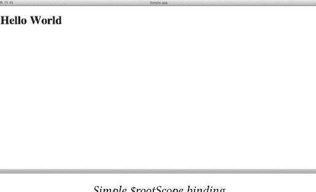

#### 它只是 HTML

我们的应用渲染 HTML 并将其交付给浏览器进行展示。这些 HTML 包含了所有的标准 HTML 元素，包括 Angular 特有的和非 Angular 特有的。不包含 Angular 特有声明的元素将保持原样。

#### 作用域

```html
<h2>Hello world</h2>
```

```html
<h3>Hello {{ name }}</h3>
```

在以前的示例中，Angular 不会监控 `<h2>` 元素，但它会根据任何作用域修改更新 `<h3>`。

通过 Angular，我们可以在模板中使用不同类型的标记。这些类型包括：

- 指令：将现有 DOM 元素增强为可重用 DOM 组件的属性或元素
- 值绑定：模板语法 `{{ }}` 将表达式绑定到视图
- 过滤器：在视图中可用的格式化函数
- 表单控件：用户输入验证控件

#### 作用域能做什么？

作用域具有以下基本功能：

- 它们提供了观察者来监控模型变化
- 它们允许开发者使用作用域上可用的 `$apply` 机制将模型变化传播到整个应用程序。
- 我们在作用域的范围内定义并执行表达式；也可以从这里将事件传播到其他控制器和应用的部分。
- 将应用逻辑包含在控制器中，并将工作数据放在控制器的作用域上是理想的。

(注：由于原文中存在大量重复段落，译文已按要求去重并进行规范翻译。)

# 控制器

AngularJS 中的控制器用于增强 AngularJS 应用程序的视图。正如我们在 Hello world 示例应用程序中所看到的，我们没有使用控制器，仅使用了隐式控制器。

AngularJS 中的控制器是一个函数，用于为视图的作用域添加额外功能。我们使用它来设置初始状态并向 scope 对象添加自定义行为。

当我们在页面上创建一个新控制器时，AngularJS 会为它传递一个新的 `$scope`。这个 `$scope` 就是我们可以设置控制器作用域初始状态的地方。由于 AngularJS 会为我们处理控制器的逻辑，我们只需要编写构造函数。

设置初始化控制器看起来如下：

```javascript
function FirstController($scope) {
  $scope.message = "hello";
}
```

> 将我们的控制器命名为 `[Name]Controller` 而不是 `[Name]Ctrl` 被认为是一种最佳实践。

正如我们所看到的，Angular 在创建作用域时会调用控制器方法。

观察者会注意到我们在全局作用域中创建了这个函数。这样做通常是不良的写法，因为我们不希望污染全局命名空间。为了更规范地创建，我们先创建一个模块，然后让控制器作用于我们的模块之上，例如：

```javascript
var app = angular.module('app', []);
app.controller('FirstController', function($scope) {
  $scope.message = "hello";
});
```

为了创建可以在视图中调用的自定义动作，我们可以简单地在控制器的 scope 上创建函数。幸运的是，AngularJS 允许我们的视图调用 `$scope` 上的函数，就像我们调用数据一样。

为了绑定按钮或链接（或任何 DOM 元素），我们将使用另一个内置指令 `ng-click`。`ng-click` 指令将鼠标释放点击事件绑定到方法处理器，该处理器会调用 DOM 元素上指定的方法（即当浏览器在 DOM 元素上触发点击事件时，该方法会被调用）。与我们之前的示例类似，绑定方式如下：

```html
<div ng-controller="FirstController">
  <h4>最简单的加法器</h4>
  <button ng-click="add(1)" class="button">添加</button>
  <a ng-click="subtract(1)" class="button alert">减去</a>
  <h4>当前计数：{{ counter }}</h4>
</div>
```

当按钮和链接被按下（点击）时，它们都绑定到包含它们的父级 scope 的动作上。Angular 调用该方法。请注意，当我们告诉 Angular 要调用哪个方法时，我们将其放在一个带括号的字符串中（`add(1)`）。

现在，让我们在 `FirstController` 上创建一个动作。

```javascript
app.controller('FirstController', function($scope) {
  $scope.counter = 0;
  $scope.add = function(amount) { $scope.counter += amount; }
  $scope.subtract = function(amount) { $scope.counter -= amount; }
});
```

以这种方式设置 `FirstController` 允许我们调用或减去定义在 `FirstController` 作用域或包含父级 scope 上的函数。

使用控制器允许我们将单个视图的逻辑封装在一个容器中。保持控制器的轻量是一个良好的做法。我们 AngularJS 开发者可以做到的一种方法是使用 AngularJS 的依赖注入功能来访问服务。

AngularJS 与其他 JavaScript 框架的一个主要区别是，控制器不是进行任何 DOM 操作、格式化、数据处理或持有模型数据的状态维护的场所。它仅仅是视图和 `$scope` 模型之间的胶水。

AngularJS 还允许在 `$scope` 上设置任何类型，包括对象并在视图中显示这些属性。

例如，我们将简单地在 `MyController` 控制器上创建一个具有单个属性 `name` 的 person 对象：

```javascript
app.controller('MyController', function($scope) {
  $scope.person = {
    name: "Ari Lerner"
  }
});
```

我们可以在编写了 `ng-controller='MyController'` 的 div 的任何子元素中访问此 `person` 对象，因为它位于 `$scope` 上。

例如，现在我们可以简单地在视图中引用 `person.name`。

```html
<div ng-app="MyApp">
  <div ng-controller="MyController">
    <h1>{{ person }}</h1>
    以及他们的名字：
    <h2>{{ person.name }}</h2>
  </div>
</div>
```

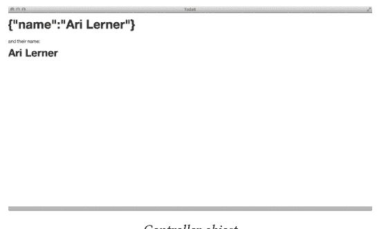

正如我们所看到的，`$scope` 对象是我们将所有信息从模型传递到视图的方式。这也是我们设置监听事件、与应用程序的其他部分交互以及创建特定特定逻辑的方式。

Angular 使用作用域来隔离视图、控制器和指令（我们将在书的后部分介绍这些内容），这使得为特定功能编写测试变得简单。

### 控制器层级（作用域中的作用域）

AngularJS 应用程序的每个部分都有一个父级作用域（正如我们看到的，在 `ng-app` 级别，此作用域被称为 `$rootScope`，无论它在何种上下文中渲染）。

> 没有例外：在指令内部创建的作用域是孤立作用域。

除了孤立作用域外，所有作用域都是通过原型继承创建的，这意味着它们可以访问父级作用域。如果我们熟悉面向对象编程，这种行为看起来应该很熟悉。

默认情况下，对于 AngularJS 在本地作用域上找不到的任何属性，它将向上父级作用域查找。如果在 `$scope` 上没有找到，它将继续移动直到到达 `$rootScope`。

为了观察这种行为，让我们创建一个包含对象的 `ParentController` 以及一个想要执行以下操作的 `ChildController`：

```javascript
app.controller('ParentController', function($scope) {
  $scope.person = {greeted: false};
});

app.controller('ChildController', function($scope) {
  $scope.sayHello = function() {
    $scope.person.name = "Ari Lerner";
    $scope.greeted = true;
  }
});
```

如果在视图中将 `ChildController` 绑定在 `ParentController` 下：

```html
<div ng-controller="ParentController">
  <div ng-controller="ChildController">
    <a ng-click="sayHello()">打招呼</a>
  </div>
  {{ person }}
</div>
```

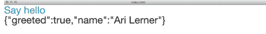

这种控制器的嵌套结构类似于 DOM 本。

正如我们看到的，一旦按下按钮，我们可以在 `ChildController` 中引用 `ParentController` 的 `$scope.person` 值，仿佛 `person` 是定义在 `ChildController` 中一样。

保持控制器尽可能简单是一个最佳实践。在控制器内部允许任何 DOM 交互或数据处理是不良的做法。

例如，这个臃壮控制器的示例包含了许多控制视图的逻辑并操作了 DOM：

**臃壮控制器**

```javascript
angular.module('MyController', function($scope) {
  $scope.shouldLogin = true;
  $scope.showLogin = function() {
    $scope.shouldLogin = !$scope.shouldLogin;
  }
  $scope.clickButton = function() {
    $("#btn span").html("Clicked");
  }
  $scope.onload = function(user) {
    $http({
      method: 'POST',
      url: '/login',
      data: {
        user: user
      }
    }).success(function(data) {
      // user
    })
  }
});
```

设计得更好的应用程序允许指令和服务来处理脏逻辑。我们可以通过指令和服务将我们的控制器转换为更轻量、更易于管理的控制器：

**轻量控制器**

```javascript
angular.module('MyController', function($scope, UserSrv) {
  // 内容可以通过
  // 指令控制
  $scope.onLogin = function(user) {
    UserSrv.runLogin(user);
  }
})
```

## 表达式

表达式广泛用于 AngularJS 应用中，因此深入理解什么是表达式以及 AngularJS 如何使用和评估它们至关重要。

我们已经见过 Angular 表达式的示例。用于显示绑定到 `$scope` 上的变量的 `{{ }}` 符号实际上就是一个表达式：`{{ expression }}`。在设置 `$watch` 时，我们使用一个 Angular 将评估的表达式（或函数）。

表达式大致类似于 `eval(javascript)` 的结果。Angular 会对它们进行处理；因此，它们具有以下重要属性：

- 所有的表达式都在作用域的上下文中执行，并可以访问本地 `$scope` 变量。
- 如果表达式的结果导致 `TypeError` 或 `ReferenceError`，它不会抛出错误。
- 它们不允许任何控制流函数（条件判断；例如，if/else）。
- 它们可以接受过滤器和/或过滤器链。

所有表达式都在调用它们所在的包含作用域内运行。这一事实使我们能够在表达式内部调用绑定到该作用域的变量，反过来又允许我们遍历变量（我们将在 `ng-repeat` 中看到这种循环）、调用函数或使用作用域中的变量。

### 解析 Angular 表达式

虽然你的 Angular 应用在运行 `$digest` 循环时会自动为你解析，但有时手动解析 Angular 表达式是有用的。

Angular 通过一个内部服务（称为 `$parse` 服务）评估表达式，该服务了解当前的作用域。这种机制让我们能够访问定义在 `$scope` 上的原始 JavaScript 数据和函数。

要手动解析表达式，我们可以将 `$parse` 服务注入到控制器中并调用该服务为我们进行解析。例如，如果我们页面上有一个绑定到 `expr` 变量的输入框，如下：

```html
<div ng-controller="MyController">
  <input ng-model="expr" type="text" placeholder="Enter an expression" />
  <h2>{{ parsedValue }}</h2>
</div>
```

在 `MyController` 中，我们可以设置一个 `$watch` 并解析表达式 `expr`。

```javascript
angular.module("App", [])
.controller('MyController',
function ($scope, $parse) {
  $scope.$watch('expr', function(newVal, oldVal, scope) {
    if (newVal !== oldVal) {
      // 让我们用表达式设置我们的 parseFun
      var parseFun = $parse(newVal);
      // 获取解析后表达式的值
      scope.parsedValue = parseFun(scope);
    }
  });
});
```

在此处查看效果 [18]: <http://jsbin.com/UWuALOF/1/edit?html.js.output>

### 字符串插值

虽然在 Angular 中并不常见需要插值字符串模板，但我们确实有手动运行模板编译的能力。插值允许我们根据作用域的条件实时更新文本字符串，例如。

为了在字符串模板上运行插值，我们需要在对象中注入 `$interpolate` 服务。在这个示例中，我们将将其注入到控制器中：

> [18]: <http://jsbin.com/UWuALOF/1/edit?html.js.output>

```javascript
angular.module('myApp', [])
.controller('MyController', 
function($scope, $interpolate) {
  // 我们可以访问 $scope
  // 和 $interpolate 服务
});
```

`$interpolate` 服务接受最多三个参数，其中只有一个函数是必须的。

- text (string) - 带有插值标记的文本。
- mustHaveExpression(boolean) - 如果将参数设置为 true，则当没有表达式时文本将返回 null。
- trustedContext(string) - Angular 通过 `$sce.getTrusted()` 方法发送插值上下文的结果，该方法提供了严格的上下文转义。

> 有关最后一个参数的更多信息，请参见 `$sce`。

`$interpolate` 服务返回一个插值函数，该函数接受一个上下文对象，并在对其评估表达式。

设置好这些参数后，我们现在可以在控制器内部运行插值。例如，假设我们想显示电子邮件正文的实时编辑。当文本更改时，我们可以运行插值以显示给输出。

```html
<div ng-controller="MyController">
  <input ng-model="to" type="email" placeholder="Recipient" />
  <textarea ng-model="emailBody"></textarea>
  <pre>{{ previewText }}</pre>
</div>
```

在我们的控制器中，我们设置了一个 `$watch` 来监控电子邮件正文的变化，并将 `emailBody` 插值到我们的 `previewText` 属性中。

```javascript
angular.module('myApp', [])
.controller('MyController', 
function($scope, $interpolate) {
  $scope.$watch('emailBody', function(newVal, oldVal) {
    if (newVal !== oldVal) {
      var fn = $interpolate(newVal);
      $scope.previewText = fn($scope);
    }
  });
});
```

## 过滤器

在 AngularJS 中，过滤器提供了一种格式化展示给用户的数据的方法。Angular 为我们提供了几个内置过滤器，还提供了创建自定义过滤器的简单方法。

我们在 HTML 模板绑定中使用 `|`（管道）字符来调用过滤器。例如，假设我们通过大写来格式化我们的字符串。我们可以将字符串中的所有字符转换为大写，或者使用过滤器：

```html
{{ name | uppercase }}
```

我们还可以在 JavaScript 中使用过滤器，例如：

```javascript
app.controller('DemoController', ['$scope', '$filter'],
function($scope, $filter) {
  $scope.name = $filter('lowercase')('TEST');
});
```

要在 HTML 形式中向过滤器传递参数，我们在过滤器名称后加上冒号，`number` 过滤器允许限制数字的小数位数：

```html
<!-- 显示: 123.46 -->
{{ 123.45689 | number:2 }}
```

我们可以同时使用多个过滤器。在构建自定义过滤器时，我们将看到这样的例子。AngularJS 开箱即带了这些过滤器。

### 货币

`currency` 过滤器格式化数字。例如，`123` 看起来像：`{{ 123 | currency }}`。`currency` 让我们提供了货币符号的选项；我们可以传递参数来显示。

### 日期

日期过滤器允许我们根据请求的格式样式对日期进行格式化。日期格式化提供了几个内置选项。如果没有传递日期格式……

以下是内置的可以本地化的格式：

```text
{{ today | date:'medium' }}  <!-- Aug 09, 2013 12:09:02 PM -->
{{ today | date:'short' }}   <!-- 8/9/13 12:09 PM -->
{{ today | date:'fullDate' }} <!-- Thursday, August 09, 2013 -->
{{ today | date:'longDate' }} <!-- August 09, 2013 -->
{{ today | date:'mediumDate' }} <!-- Aug 09, 2013 -->
{{ today | date:'shortDate' }} <!-- 8/9/13 -->
{{ today | date:'mediumTime' }} <!-- 12:09:02 PM -->
{{ today | date:'shortTime' }} <!-- 12:09 PM -->
```

日期格式化器允许我们按照自己的喜好自定义日期格式。我们可以组合并链这些格式选项来创建一个日期格式，例如：

#### 年份格式化

- 四位年份：`{{ today | date:'yyyy' }}` <!-- 2013 -->
- 两位补位年份：`{{ today | date:'yy' }}` <!-- 13 -->
- 一位年份：`{{ today | date:'y' }}` <!-- 3 -->

#### 月份格式化

- 年份中的月份：`{{ today | date:'MMMM' }}` <!-- August -->
- 年份中的简写月份：`{{ today | date:'MMM' }}` <!-- Aug -->
- 年份中的补位月份：`{{ today | date:'MM' }}` <!-- 08 -->
- 年份中的月份：`{{ today | date:'M' }}` <!-- 8 -->

#### 日格式化

- 月份中的补位日期：`{{ today | date:'dd' }}` <!-- 09 -->
- 月份中的日期：`{{ today | date:'d' }}` <!-- 9 -->
- 星期中的星期几：`{{ today | date:'EEEE' }}` <!-- Thursday -->
- 星期中的简写星期：`{{ today | date:'EEE' }}` <!-- Thu -->

#### 小时格式化

- 一天中的补位小时：`{{ today | date:'HH' }}` <!-- 00 -->
- 一天中的小时：`{{ today | date:'H' }}` <!-- 0 -->
- 上午/下午的补位小时：`{{ today | date:'hh' }}` <!-- 12 -->
- 上午/下午的小时：`{{ today | date:'h' }}` <!-- 12 -->

#### 分钟格式化

- 小时中的补位分钟：`{{ today | date:'mm' }}` <!-- 09 -->
- 小时中的分钟：`{{ today | date:'m' }}` <!-- 9 -->

#### 秒格式化

- 分钟中的补位秒数：`{{ today | date:'ss' }}` <!-- 02 -->
- 分钟中的秒：`{{ today | date:'s' }}` <!-- 2 -->
- 秒中的补位毫秒：`{{ today | date:'sss' }}` <!-- .995 -->

#### 字符串格式化

- am/pm 字符：`{{ today | date:'a' }}` <!-- AM -->
- 时间偏移量的 4 位表示法：`{{ today | date:'Z' }}` <!-- -0700 -->

自定义日期格式的示例：

```text
{{ today | date:'MMM d, y' }}     <!-- Aug 09, 2013 -->
{{ today | date:'EEEE, d, M' }}   <!-- Thursday, 8 -->
{{ today | date:'hh:mm:ss.sss' }} <!-- 12:09:02.995 -->
```

### filter（过滤器）

`filter` 方法从项数组中选择项的子集并返回一个新数组。`filter` 通常用作过滤掉用于显示的项的方法。例如，使用客户端搜索，我们可以立即从数组中过滤出项。

`filter` 方法接受一个字符串、对象或函数，它将运行该内容来选择或拒绝数组元素。

如果传递的第一个参数是：

#### 字符串

它将接受所有与字符串匹配的元素。如果我们想要所有不匹配字符串的元素，可以在字符串前面加一个 `!`。

#### object

它将比较具有匹配属性名的对象，就像当只传递字符串时进行简单的子串匹配一样。如果我们想匹配所有属性，可以使用 `$` 作为键。

#### function

它将在数组的每个元素上运行函数，并将结果为非假的元素返回到新数组中。

例如，选择所有包含字母 `e` 的单词，我们可以这样运行过滤器：

```text
{{ ['Ari', 'Lerner', 'Likes', 'To', 'Eat', 'Pizza'] | filter:'e' }}
<!-- ['Lerner', 'Likes'] -->
```

如果我们想对对象进行过滤，可以使用我们上面讨论的对象过滤器表示法。例如，如果我们有一个人的对象数组，其中包含他们喜爱的食物的列表，我们可以这样过滤它们：

```text
{{ [
  {'name': 'Ari', 'City': 'San Francisco', 'favorite food': 'Pizza'},
  {'name': 'Nate', 'City': 'San Francisco', 'favorite food': 'indian food'}
] | filter:{'favorite food': 'Pizza'} }}
<!-- [{"name":"Ari","City":"San Francisco","favorite food":"Pizza"}] -->
```

我们还可以根据我们在此（示例中，在对象上）定义的函数进行过滤：

```text
{{ ['Ari', 'likes', 'travel'], ... }}
```

### 自定义过滤器

创建自定义过滤器非常简单。我们只需要将过滤器函数注册到模块上。例如，创建一个首字母大写的过滤器：

```javascript
angular.module('myapp.filters', [])
.filter('capitalize', function() {
  return function(input) {
    // input will be the string we pass in
    if (input) {
      return input[0].toUpperCase() +
      input.slice(1);
    }
  }
});
```

现在，如果我们想将句子的首字母大写，可以先将整个字符串转换为小写，然后使用我们的过滤器将首字母大写：

```html
<!-- Ginger likes dog treats -->
{{ 'ginger loves dog treats' | lowercase | capitalize }}
```

## 表单验证

在从用户处获取输入时，为他们的输入提供视觉反馈是非常重要的。在人际关系中，表单验证与提供反馈以及获取“正确”的输入同样重要。

它不仅能为我们的用户提供正向反馈，还能某种程度上保护我们的 Web 应用程序免受错误或无效输入的影响。我们只能在 Web 前端尽可能地保护后端。

开箱即用，AngularJS 通过结合 HTML5 验证输入及其自身的验证指令来支持表单验证。

AngularJS 提供了许多表单验证。我们将讨论其中一些核心验证，然后介绍如何构建你的验证。

```html
<form name="form" novalidate>
  <label name="email">您的邮箱</label>
  <input type="email" name="email" ng-model="email" placeholder="邮箱地址" />
</form>
```

AngularJS 使得处理客户端表单验证变得非常简单，而不需要花费大量的额外精力。尽管我们不能依赖客户端验证来维护我们 Web 应用程序的安全，但它们提供了对表单状态的即时反馈。

要使用表单验证，我们必须首先确保表单关联了一个名称，如上面的示例所示。

所有输入字段都可以针对一些基础验证进行校验，例如最小长度、最大长度等。这些在表单的新 HTML5 属性中均可用。

在表单元素上使用 `novalidate` 标记通常是一个很棒的主意，它可以防止浏览器对表单进行原生验证。

让我们看看我们可以放在输入字段上的所有验证选项：

### 必填

要验证表单输入是否填写，我们只需在输入字段上添加 HTML5 标签 `required` 即可：

```html
<input type="text" required />
```

### 最小长度

要验证表单输入是否至少包含某些数字个字符，我们在输入字段上添加 Angular 指令 `ng-minlength="{number}"`：

```html
<input type="text" ng-minlength=5 />
```

### 最大长度

要验证表单输入是否等于或小于字符数量，我们可以添加 Angular 指令 `ng-maxlength="{number}"`：

```html
<input type="text" ng-maxlength=20 />
```

### 匹配模式

为了确保输入匹配正则表达式，我们可以使用 `ng-pattern="PATTERN/"`：

```html
<input type="text" ng-pattern="/a-zA-Z/" />
```

### 邮箱

要验证输入字段中的邮箱地址，我们只需将输入类型设置为 `email`，如下：

```html
<input type="email" name="email" ng-model="user.email" />
```

### 数字

要验证输入字段是否为数字，我们将输入类型设置为 `number`：

```html
<input type="number" name="age" ng-model="user.age" />
```

### URL

要验证输入代表一个 URL，我们将输入类型设置为 `url`：

```html
<input type="url" name="homepage" ng-model="user.facebook_url" />
```

### 自定义验证

通过使用指令，AngularJS 非常容易地添加我们自己的验证。例如，假设我们想验证用户名在数据库中可用。为了实现这一点，我们实现一个在表单变化时就使用 Ajax 请求的指令。

```javascript
angular.module('validationExample', [])
.directive('ensureUnique', function($http) {
  return {
    require: 'ngModel',
    link: function(scope, ele, attrs, c) {
      scope.$watch(attrs.ngModel, function() {
        $http({
          method: 'POST',
          url: '/api/check/' + attrs.ensureUnique,
          data: {'field': attrs.ensureUnique}
        }).success(function(data, status, headers, cfg) {
          c.$setValidity('unique', data.isUnique);
        }).error(function(data, status, headers, cfg) {
          c.$setValidity('unique', false);
        });
      });
    }
  }
});
```

## 表单控制变量

由于在 DOM 中设置了表单，AngularJS 使包含的 `$scope` 对象上的属性变得可用。这些属性允许我们实时对表单做出反应（就像 AngularJS 中的其他所有内容一样）。我们可以使用的属性（格式如下）：

```text
formName.inputFieldName.property
```

### 未修改的表单

该属性是一个布尔值，告诉我们用户是否修改了表单。如果用户没有碰过表单，则为 true；如果碰过了为 false：

```javascript
formName.inputFieldName.$pristine;
```

### 已修改的表单

该属性是一个布尔值，告诉我们用户是否修改了表单：

```javascript
formName.inputFieldName.$dirty;
```

### 有效的表单

该属性是一个布尔值，告诉我们表单是否有效：

```javascript
formName.inputFieldName.$valid
```

### 无效的表单

该属性是一个布尔值，告诉我们表单是否无效：

```javascript
formName.inputFieldName.$invalid
```

### 错误

`$error` 对象包含特定字段的所有验证错误。你可以这样访问它们：

```javascript
formName.inputFieldName.$error.required
```

## 样式与过滤器

AngularJS 根据其状态为表单元素添加类。你可以使用这些类来应用 CSS：

- `ng-pristine`
- `ng-dirty`
- `ng-valid`
- `ng-invalid`

对于自定义验证（例如检查数字是否在 0 到 9 之间），我们使用 `$parsers` 和 `$formatters` 数组：

```javascript
angular.module('myApp')
.directive('oneToOne', function() {
  return {
    require: '?ngModel',
    link: function(scope, ele, attrs, ngModel) {
      if (!ngModel) return;
      ngModel.$parsers.unshift(
        function(viewValue) {
          var i = parseInt(viewValue);
          if (i >= 0 && i < 10) {
            ngModel.$setValidity('oneToOne', true);
            return viewValue;
          } else {
            ngModel.$setValidity('oneToOne', false);
            return undefined;
          }
        }
      );
    }
  };
});
```

## 整合在一起

让我们来构建一个注册表单。这个注册表单将包含用户的姓名、电子邮箱以及所需的用户名。

让我们先看看表单完成后后长什么样：

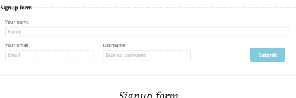

### 玩玩看²¹

让我们从定义表单开始：

```html
<form name="signup_form" novalidate ng-submit="signupForm()">
<fieldset>
  <legend>注册</legend>
  <button type="submit" class="button radius">提交</button>
</fieldset>
</form>
```

这个表单的名称是 `signup_form`，我们将在提交表单时调用 `signupForm()`。

现在，让我们添加用户的姓名字段：

```html
<div class="row">
  <div class="large-12 columns">
    <label>您的姓名</label>
    <input type="text"
      placeholder="Name"
      name="name"
      ng-model="signup.name"
      ng-minlength=3
      ng-maxlength=20 required />
  </div>
</div>
```

我们将在未来的章节中讨论样式，但在本章中我们会包含一些样式作为介绍。

在本章中，我们使用了 Foundation² 框架进行 CSS 布局。

我们添加了一个表单，其输入字段 `name` 绑定（`ng-model`）到 `$scope` 对象上的 `signup.name` 属性。

> 不要忘记为输入字段添加 `name`。为输入添加名称很重要：
>
> 因为只有这样在向用户显示验证消息时，我们才能引用该表单输入项。

我们还设置了几项验证。这些验证规定我们的姓名长度至少为三个字符。我们还施加了 20 个字符的最大限制（这意味着从此以后输入 21 个字符时，输入将是无效的）。最后，我们要求必须填写姓名，表单才有效。

让我们使用这些属性在表单有效时显示或隐藏错误列表。我们将使用 `$dirty` 属性来确保在用户还没有触碰该字段时，不会显示错误：

```html
<div class="row">
  <div class="large-12 columns">
    <label>您的姓名</label>
    <input type="text"
      placeholder="Name"
      name="name"
      ng-model="signup.name"
      ng-minlength=3
      ng-maxlength=20 required />
    <div class="error"
      ng-show="signup_form.name.$dirty && signup_form.name.$invalid">
      <small class="error"
        ng-show="signup_form.name.$error.required">
        您的姓名是必填。
      </small>
      <small class="error"
        ng-show="signup_form.name.$error.minlength">
        您的姓名至少需要 3 个字符
      </small>
      <small class="error"
        ng-show="signup_form.name.$error.maxlength">
        您的姓名不能超过 20 个字符
      </small>
    </div>
  </div>
</div>
```

来说，和之前一样，只有当表单无效且发生过更改时，我们才会显示错误。这一次，我们将检查每项验证，并且只有当特定的验证属性无效时，才显示特定的 DOM 元素。

让我们来看下一组验证，邮箱验证：

```html
<div class="row">
<div class="large-12 columns">
<label>您的电子邮箱</label>
<input type="email" placeholder="email"
name="email"
ng-model="signup.email"
ng-minlength=3 ng-maxlength=20 required />
<div class="error"
ng-show="signup_form.email.$dirty && signup_form.email.$invalid">
<small class="error"
ng-show="signup_form.email.$error.required">
您的邮箱是必填的。
</small>
<small class="error"
ng-show="signup_form.email.$error.minlength">
您的邮箱至少需要 3 个字符
</small>
<small class="error"
ng-show="signup_form.email.$error.email">
这不是有效的邮箱。请输入有效的邮箱。
</small>
<small class="error"
ng-show="signup_form.email.$error.maxlength">
您的邮箱不能超过 20 个字符
</small>
</div>
</div>
</div>
```

最后，让我们来看最后一个输入字段，用户名：

```html
<div class="large-12 columns">
<label>用户名</label>
<input type="text"
placeholder="Desired username"
name="username"
ng-model="signup.username"
ng-minlength=3
ng-maxlength=20 required ensure-unique />
<div class="error"
ng-show="signup_form.username.$invalid">
<small class="error"
ng-show="signup_form.username.$error.required">
请输入用户名
</small>
<small class="error"
ng-show="signup_form.username.$error.minlength">
您的用户名至少需要 3 个字符
</small>
<small class="error"
ng-show="signup_form.username.$error.maxlength">
您的用户名不能超过 20 个字符
</small>
<small class="error"
ng-show="signup_form.username.$error.unique">
该用户名已被占用，请尝试另一个
</small>
</div>
</div>
```

在我们的最后一个字段中，我们使用了所有的验证，只是添加了一个自定义验证。此自定义验证是通过指令定义的：

```javascript
app.directive('ensureUnique', function($http) {
  return {
    require: 'ngModel',
    link: function(scope, attrs, c) {
      scope.$watch(attrs.ngModel, function(n) {
        if (!n) return;
        $http({
          method: 'POST',
          url: '/check/' + attrs.ngModel,
          data: {'field': n}
        }).success(function(data) {
          c.$setValidity('unique', data.isUnique);
        }).error(function(data) {
          c.$setValidity('unique', false);
        });
      });
    }
  }
});
```

当表单有效时，这将会向 `/check` 发起 POST 请求以检查用户名是否可用。现在，对于按钮，我们可以根据表单的值使用 `ng-disabled` 来禁用或启用按钮：

```html
<button type="submit" ng-disabled="form.$invalid" class="button radius">提交</button>
```

## 到目前为止的示例

正如我们在上面所说的，用户在输入时看到实时验证会很烦。如果你在他们提交表单或离开输入框后显示验证，对用户会更友好。让我们来看看这两种方法。

> ² <http://js.com/ePom>

### 提交后显示验证

为了只在用户尝试提交表单后显示验证，你可以在作用域捕获一个 `submitted` 值并检查该值以显示错误。例如，让我们看看第一个示例，并仅在用户提交时显示错误：

```html
<form name="signup_form" novalidate
ng-submit="signupForm()"
ng-controller="signupController">
  <fieldset>
    <legend>注册</legend>
    <div class="row">
      <div class="large-12 columns">
        <label>您的姓名</label>
        <input type="text"
               placeholder="Name"
               name="name"
               ng-model="signup.name"
               ng-maxlength=20 required />
        <div class="error"
          ng-show="signup_form.name.$dirty && signup_form.name.$invalid && signup_form.submitted">
          <small class="error"
            ng-show="signup_form.name.$error.required">
            您的姓名是必填的。
          </small>
          <small class="error"
            ng-show="signup_form.name.$error.minlength">
            您的姓名至少需要 3 个字符
          </small>
          <small class="error"
            ng-show="signup_form.name.$error.maxlength">
            您的姓名不能超过 20 个字符
          </small>
        </div>
      </div>
    </div>
  </fieldset>
  <button type="submit">Submit</button>
</form>
```

```javascript
app.controller('signupController', 
function($scope) {
  $scope.signupForm = false;
  $scope.signupForm = function() { 
    if ($scope.signup_form.$valid) { 
      // 正常提交 
    } else { 
      $scope.signup_form.submitted = true; 
    } 
  }
});
```

如果用户在存在无效元素时尝试提交表单，我们现在可以捕获并向他们显示相应的错误。

尝试一下²

### 仅在失去焦点后显示验证

如果我们想保留错误输入的实时性，可以在用户从输入表单上失去焦点后（即当他们不再处于某个字段时）向他们显示错误。为了这样做，我们想添加一个小的指令，为表单附加一个新变量，例如：

我们使用的指令是 `ngFocus` 指令，它看起来如下：

```javascript
app.directive('ngFocus', [function() {
  var FOCUS_CLASS = "ng-focused";
  return {
    restrict: 'A',
    require: 'ngModel',
    link: function(scope, element, attrs, ctrl) {
      ctrl.$focused = false;
      element.bind('focus', function(evt) {
        element.addClass(FOCUS_CLASS);
        scope.$apply(function() {
          ctrl.$focused = true;
        });
      }).bind('blur', function(evt) {
        element.removeClass(FOCUS_CLASS);
        scope.$apply(function() {
          ctrl.$focused = false;
        });
      });
    }
  }
}]);
```

要实现 `ngFocus` 指令，我们可以简单将此指令附加到输入元素上，如下：

```html
<input ng-class="{
  error: signup_form.name.$dirty &&
  signup_form.name.$invalid}"
type="text"
placeholder="Name"
name="name"
ng-model="signup.name"
ng-minlength=3
ng-maxlength=20 required ng-focus />
```

`ngFocus` 指令在表单输入的 `blur` 和 `focus` 事件上附加了一个操作，添加了一个类（`ng-focused`），并将表单字段 `$focused` 设置为 `true`。然后，我们可以根据表单是否获得焦点来显示特定的错误消息。例如：

```html
<div class="error"
ng-show="signup_form.name.$dirty &&
signup_form.name.$invalid &&
!signup_form.name.$focused">
```

试用完整示例²

检查输入字段是否为空可能的，例如通过在 ng controller 上使用 `$isEmpty()` 方法。如果输入为空，该方法将返回 `true`；如果不为空则返回 `false`。

## 指令简介

作为 Web 开发人员，我们都熟悉 HTML。让我们花一点时间回顾并同步关于这种最基础 Web 技术的术语。

### HTML文档

HTML 文档是一个纯文本文档，它包含结构，并且可以通过 CSS 进行样式处理或通过 JavaScript 进行操作。

### HTML 节点

HTML 节点是嵌套在另一个元素中的元素或文本块。所有元素都是节点；然而，文本节点不是元素。

### HTML 元素

元素由一个起始标签和一个结束标签组成。

### HTML 标签

HTML 标签负责标记元素的开始和结束。标签本身使用尖角括号声明。

起始标签包含一个名称，该名称即为元素的名称。它还可以包含属性，这些属性用于装饰元素。

### 属性

为了提供关于元素的额外信息，HTML 元素可以包含属性。这些属性始终设置在起始标签中。我们可以以键值对的形式设置它们，例如 `key="value"`，或者只作为一个键。

让我们来看 `<a>` 超链接标签，它用于创建从一对到另一对的链接：某些标签（如超链接标签）具有特殊的属性，其作用非常类似于标签的参数。例如，链接标签的 `href` 属性启用了链接标签的行为，并且默认在所有浏览器中将起始标签和结束标签之间的文本节点设为蓝色。

#### 指令简介

```html
<a href="http://google.com">
点击我前往 Google
</a>
```

`<a>` 标签定义了我们网站内或外另一个页面之间的链接，这取决于 `href` 属性的内容，它定义了链接的目标地。


它与下面的 HTML 元素按钮（`button`）明显不同：

```html
<button href="http://google.com"
type="submit">点击我</button>
```

链接标签默认带有下划线且是蓝色的，而按钮默认在我们的浏览器中看起来像一个可点击的按钮。

链接知道，当提供指向 `http://google.com` 的 `href` 属性时，当用户点击链接时，它应该更改地址栏中的 URL 并加载 Google 主页。

相反，按钮在提供 `href` 属性时是完全无所当然的，不会执行相同的行为（该属性被忽略了）。

因此，更改地址栏中的 URL 并带你到一个新页面是链接预设行为的一部分，但不是按钮预设行为的一部分。

```javascript
app.controller('signupController', 
function($scope) {

  $scope.signupForm = false;
  $scope.signupForm = function() { 
    if ($scope.signup_form.$valid) { 
      // 正常提交 
    } else { 
      $scope.signup_form.$submitted = true; 
    } 
  }
));
```

如果用户在存在无效元素时尝试提交表单，我们现在可以捕获并向他们显示相应的错误。

尝试一下²

## 仅在失去焦点后显示验证

如果我们想保留错误输入的实时性，可以在用户从输入表单上失去焦点后（即当他们不再处于某个字段时）向他们显示错误。为了这样做，我们想添加一个小的指令，为表单附加一个新变量，例如：

我们使用的指令是 `ngFocus` 指令，它看起来如下：

```javascript
app.directive('ngFocus', [function() {
  var FOCUS_CLASS = "ng-focused";
  return {
    restrict: 'A',
    require: 'ngModel',
    link: function(scope, element, attrs, ctrl) {
      ctrl.$focused = false;
      element.bind('focus', function(evt) {
        element.addClass(FOCUS_CLASS);
        scope.$apply(function() {
          ctrl.$focused = true;
        });
      }).bind('blur', function(evt) {
        element.removeClass(FOCUS_CLASS);
        scope.$apply(function() {
          ctrl.$focused = false;
        });
      });
    }
  }
});
```

²http://jsbin.com/ePomUnl/6/edit

要实现 `ngFocus` 指令，我们可以简单将此指令附加到输入元素上，如下：

```html
<input ng-class="{
  error: signup_form.name.$dirty &&
  signup_form.name.$invalid}"
type="text"
placeholder="Name"
name="name"
ng-model="signup.name"
ng-minlength=3
ng-maxlen=20 required ng-focus />
```

`ngFocus` 指令在表单输入的 `blur` 和 `focus` 事件上附加了一个操作，添加了一个类（`ng-focused`），并将表单字段 `$focused` 设置为 `true`。然后，我们可以根据表单是否获得焦点来显示特定的错误消息。例如：

```html
<div class="error"
ng-show="signup_form.name.$dirty &&
signup_form.name.$invalid &&
!signup_form.name.$focused">
```

试用完整示例²

检查输入字段是否为空可能的，例如通过在 ng controller 上使用 `$isEmpty()` 方法。如果输入为空，该方法将返回 `true`；如果不为空则返回 `false`。

## 指令简介

作为 Web 开发人员，我们都熟悉 HTML。让我们花一点时间回顾并同步关于这种最基础 Web 技术的术语。

### HTML文档

HTML 文档是一个纯文本文档，它包含结构，并且可以通过 CSS 进行样式处理或通过 JavaScript 进行操作。

### HTML 节点

HTML 节点是嵌套在另一个元素中的元素或文本块。所有元素都是节点；然而，文本节点不是元素。

### HTML 元素

元素由一个起始标签和一个结束标签组成。

### HTML 标签

HTML 标签负责标记元素的开始和结束。标签本身使用尖角括号声明。

起始标签包含一个名称，该名称即为元素的名称。它还可以包含属性，这些属性用于装饰元素。

### 属性

为了提供关于元素的额外信息，HTML 元素可以包含属性。这些属性始终设置在起始标签中。我们可以以键值对的形式设置它们，例如 `key="value"`，或者只作为一个键。

让我们来看 `<a>` 超链接标签，它用于创建从一对到另一对的链接：某些标签（如超链接标签）具有特殊的属性，其作用非常类似于标签的参数。例如，链接标签的 `href` 属性启用了链接标签的行为，并且默认在所有浏览器中将起始标签和结束标签之间的文本节点设为蓝色。

```html
<a href="http://google.com">
点击我前往 Google
</a>
```

`<a>` 标签定义了我们网站内或外另一个页面之间的链接，这取决于 `href` 属性的内容，它定义了链接的目标。

它与下面的 HTML 元素按钮（`button`）明显不同：

```html
<button href="http://google.com"
type="submit">点击我</button>
```

链接标签默认带有下划线且是蓝色的，而按钮默认在我们的浏览器中看起来像一个可点击的按钮。

链接知道，当提供指向 `http://google.com` 的 `href` 属性时，当用户点击链接时，它应该更改地址栏中的 URL 并加载 Google 主页。

相反，按钮在提供 `href` 属性时是完全无所当然的，不会执行相同的行为（该属性被忽略了）。

因此，更改地址栏中的 URL 并带你到一个新页面是链接预设行为的一部分，但不是按钮预设行为的一部分。

## 指令简介

上面的 JavaScript 被称为*指令定义*（directive definition）。我们将在指令定义中查看定义指令的所有选项。

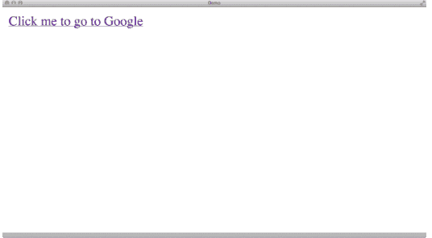

通过 Angular 模块 API 提供的 `.directive()` 方法，我们可以通过提供字符串名称和函数来注册新指令。指令的名称应该始终使用大驼峰命名法（PascalCased），我们应该返回的函数是一个对象。

驼峰命名法（Camel casing）是一种在编写复合词或短语时不加空格的写法，使得每个单词（通常第一个单词除外）都大写字母开头，并使短语变成一个单词。例如：*bumpy roads* 在驼峰命名法中将写作 `bumpyRoads`。

在我们的情况下，我们在 HTML 中使用 `my-directive` 声明指令，而指令定义 `must` 必须是 `myDirective`。

我们从 `.directive()` 方法返回的对象包含了我们用于定义和配置指令的方法和属性。

为了尝试掌握最简单的指令，我们只用两个选项定义了指令：限制（restrict）和模板（template）。

在*指令详解*（directives explained）中，我们将涵盖定义自定义指令时可以使用的所有可用方法和属性，但目前，让我们使用 Google Chrome 及其开发者工具查看输入 HTML 与输出 HTML 的对比。

首先，使用 Chrome 打开你的 HTML 文档。看到一个写着“点击这里”的蓝色链接。通过“查看 > 开发者工具 > 查看源代码”查看源代码。你应该看到下面的图片：

## 指令简介

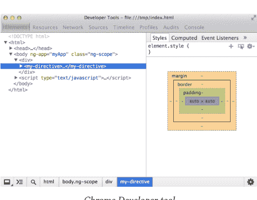

注意，它与你在文本编辑器中输入的源代码没有区别；同样注意屏幕上还没有输出 `link` 标签。显然这里应该有一个写着“点击这里”的链接。发生了什么？

为了进行调查，右键点击链接，在 Chrome 提供的下拉菜单中，左点击“检查”（Inspect Element）：

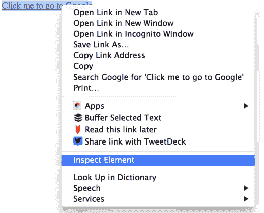

这样做将打开 Chrome 开发者工具，并为你提供生成的源代码，这是 Angular 在页面加载后以及 Angular 调用了我们的指令定义后提供给 Chrome 的。让我们来看看：

## 指令简介

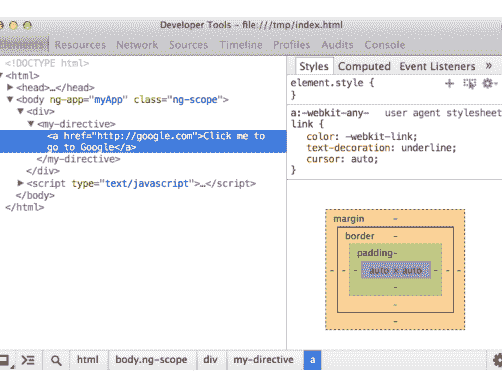

默认情况下，Angular 在生成的源代码中将我们的模板字符串提供的 HTML 嵌套在我们的自定义 HTML 标签 `<my-directive>` 内部。

为我们的指令定义再添加一个选项：我们可以完全从生成的 DOM 中移除我们的自定义元素（`<my-directive>`），并只输出我们在模板选项中提供的链接。要做到这一点，我们将 `replace` 选项设置为 `true`：

```javascript
angular.module('myApp', [])
.directive('myDirective', function() {
  return {
    restrict: 'E',
    replace: true,
    template: '<a href="http://google.com">Click me to go to Google</a>'
  }
}
)
```

再次查看生成的源代码。我们可以看到不再有对指令的原始调用，只有我们设置为模板的源码。这种*replace* 方法会替换自定义元素，而不是将其包裹在指令调用中。

## 指令简介

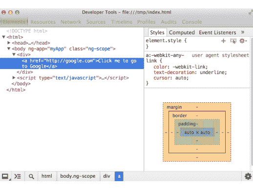

### 替换现有元素

从现在起，我们将这些自定义元素（使用 `directive()` 方法创建的）称为指令。事实上，声明指令是在 HTML 中放置元素、属性或注释的行为。

以下是用于声明指令的有效格式：

```html
<my-directive></my-directive>
<div my-directive></div>
<div class="my-directive"></div>
<!-- directive: my-directive -->
```

为了允许 Angular 调用我们的指令，我们需要在指令定义中设置限制（restrict）选项。该选项告诉 Angular 在编译 HTML 时查找哪些格式。例如，在我们构建的指令中，我们可以设置限制以指定为元素（E）、属性（A）或注释（M）：

```javascript
angular.module('myApp', [])
.directive('myDirective', function() {
  return {
    restrict: 'E',
    replace: true,
    template: '<a href="http://google.com">Click me to go to Google</a>'
  }
});
```

无论通过多少种方式声明指令，我们都会遵循这一约定，将 `replace` 选项设置为 `true`。

### 关于 Internet Explorer 的说明

从技术上讲，我们应该意识到 IE。一个实用的经验是始终在内置标签中声明指令。

### 表达式

既然我们现在已经知道可以带表达式来声明指令，让我们回顾声明表达式的方式。在表达式内部，我们为作用域（scope）设置了一个名为 `greeting` 的属性。在两种情况下，我们都在属性内评估表达式：

> http://jsbin.com/IJAs

### 使用表达式声明我们的指令

既然我们现在已经知道可以带表达式来声明指令，让我们回顾声明表达式的有效格式：

```html
<my-directive="someExpression"></my-directive>
<div my-directive="someExpression"></div>
<div class="my-directive"></div>
<!-- directive: my-directive expression -->
```

此时一个合理的问题是传递给指令的表达式在哪个环境中运行。我们将通过熟悉晦懂但重要的“当前作用域”（current scope）概念来找到答案。

### 当前作用域简介

让我们快速熟悉通过 `controller` 提供的 DOM 作用域。此指令的目的是 DOM 中创建一个新的作用域：

> ²⁷http://jsbin.com/idYO/2

## 指令简介

<p>我们可以访问：{{ rootProperty }}</p>

<div ng-controller="ParentController">

<p>我们可以访问：{{ rootProperty }} 和 {{ parentProperty }}</p>

<div ng-controller="ChildController">

<p>

我们可以访问：

{{ rootProperty }} 和

{{ parentProperty }} 以及

{{ childProperty }}

</p>

<p>{{ fullSentenceFromChild }}</p>

</div>

</div>

```javascript
angular.module('myApp', [])
.run(function($rootScope) {
  // 用来访问 $rootScope
  $rootScope.rootProperty = 'root scope';
})
.controller('ParentController', function($scope) {
  // 使用 .controller 访问 'ng-controller' 内部的属性
  // 在 DOM 中省略 scope，将根据当前控制器推断
  $scope.parentProperty = 'parent scope';
})
.controller('ChildController', function($scope) {
  $scope.childProperty = 'child scope';
  // 就像 DOM 一样，我们可以从当前 $scope 直接访问原型链中的任何属性
  $scope.fullSentenceFromChild
  = 'Same $scope: We can access: ' +
  $scope.rootProperty + ' and ' +
  $scope.parentProperty + ' and ' +
  $scope.childProperty;
});
```

为了学习目的带有彩色作用域的示例²⁸关于 ng-controller 本身的更详细信息可以在内置指令章节的 ng-controller 节中找到。

> ²⁸http://jsbin.com/URuyoG/1

# 指令介绍

请注意，还有其他内置指令，例如 `ng-include` 和 `ng-view`，它们创建一个新的子作用域（scope），这意味着它们在被调用时的行为与 `ng-controller` 相似。在构建自定义指令时，我们甚至可以创建一个新的子作用域。

## 向指令传递数据

让我们回顾一下指令的定义：

```javascript
angular.module('MyApp', [])
.directive('myDirective', function() {
  return {
    restrict: 'A',
    replace: true,
    template: '<a href="http://google.com">Click me to go to Google</a>'
  };
});
```

注意，在我们的模板中，我们硬编码了 URL 和链接的文本：

```
template: '<a href="http://google.com">\nClick me to go to Google
</a> '
```

在 Angular 中，我们并不限于在指令的模板中硬编码字符串。如果我们能完整指定 URL 和链接文本，就可以为使用我们指令的其他人提供更好的体验。我们的目标是关注指令的公共接口，就像我们在任何编程语言中做的那样。本质上，我们希望将上面的模板字符串转换为接收两个变量的字符串：一个用于 URL，另一个用于链接文本：

```
template: '<a href="{{myUrl}}">{{myLinkText}}</a>'
```

查看我们的主 HTML 文档，我们通过属性声明了指令，这些属性将成为 `myUrl` 和 `myLinkText` 属性，并设置在指令的内部作用域上：

```html
<div my-directive
  my-url="http://google.com"
  my-link-text="Click me to go to Google"
</div>
```

刷新页面，你会发现声明的指令已被其模板所替换，链接的 `href` 是空的，括号内部没有任何文本。

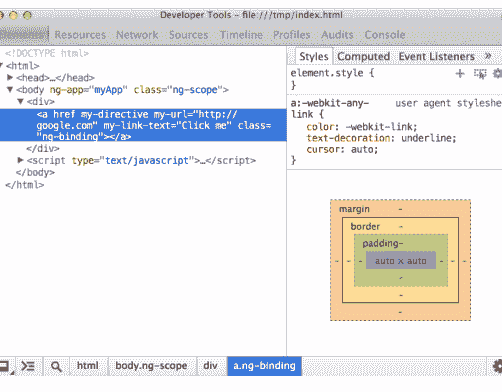

为了在指令的内部作用域上设置属性，我们有几种选择。最简单的选项是使用控制器（`ng-controller`）提供的现有作用域，而我们嵌套在其中。

然而，虽然这种方法简单，但共享状态会让我们变得脆弱。如果控制器被移除，或者之后在其作用域上定义了名为 `myUrl` 的属性，我们将被迫更改代码，这是非常昂贵且令人沮丧的。

为了解决这个常见问题，Angular 提供了创建新作用域或创建隔离作用域（isolate scope）的能力。

与之前在（当前作用域介绍）中讨论的继承作用域（子作用域）不同，隔离作用域与 DOM 的当前作用域完全分离。为了在这个新的对象上设置属性，我们需要显式地通过属性传递数据，类似于在 JavaScript 或 Ruby 中向方法传递参数。

当我们将指令的作用域设置为一个带有自身属性的干净对象时：

```javascript
scope: {
  someProperty: "needs to be set"
}
```

我们正在创建所谓的“隔离作用域”。本质上，这意味着指令拥有了自己的自己的作用域对象，我们只能在指令的其他方法或指令的模板字符串中使用它：

```javascript
template: '<div>\nwe have access to {{ someProperty }}\n</div>',
controller: function($scope) {
  // 指令可以有自己的控制器，
  // 在这种情况下我们可以这样做
  //=> ERROR!!!
  $scope.someProperty === "needs to be set"
}
```

错误？

到目前为止，我们忽略了一个微小的细节。在作用域对象内部，我们实际上不能像上面那样设置 `someProperty`。

```javascript
scope: {
  // 这将不起作用
  someProperty: "needs to be set"
}
```

相反，该值是在 DOM 中通过属性设置的，正如我们之前提到的，这种工作方式类似于向函数传递参数：

```html
<div my-directive some-property="someProperty with binding">
</div>
```

现在，在我们新的作用域对象内部，我们将 `someProperty` 的值设置为绑定策略 `@`。这种绑定策略告诉 Angular 将属性 `some-property` 提供的值从 DOM 复制到我们新作用域对象上的 `someProperty` 属性值上：

```javascript
scope: {
  someProperty: '@'
}
```

注意，默认情况下，`someProperty` 映射到 DOM 属性 `some-property`。如果我们想显式指定想要绑定的属性名称，可以这样做：

```javascript
scope: {
  someProperty: '@someAttr'
}
```

在这种情况下，HTML 属性将命名为 `some-attr` 而不是 `some-property`：

```html
<div my-directive some-attr="someProperty with @ binding">
</div>
```

现在，当我们尝试在指令内部访问 `someProperty` 时（例如在指令的模板或控制器中，如我们上面所做），我们将接收到从 DOM 属性复制的值：

```javascript
template: `<div>\nwe have access to {{ someProperty }}\n</div>`
```

```javascript
controller: function($scope) {
  // 指令可以有自己的控制器
  // 在这种情况下我们可以获取
  // $scope.someProperty 为
  // "someProperty with @ binding"
}
```

回到我们的示例：为了将数据从 DOM 复制到指令的隔离作用域，我们使用：

```html
<div my-directive
  my-url="http://google.com"
  my-link-text="Click me to go to Google"></div>
```

# 指令介绍

```javascript
angular.module('MyApp', []);
.directive('myDirective', function() {
  return {
    restrict: 'A',
    replace: true,
    scope: {
      myUrl: '@',
      myLinkText: '@'
    },
    template: '\
<div>\n  <label>My Url Field:</label>\n  <input type="text"\n  ng-model="myUrl"\n  <a href="{{myUrl}}">{{myLinkText}}</a>\n</div>\n'
  };
});
```

# 现场示例※

在 Chrome 开发者工具中，向每个文本框输入内容时，检查 `href` 的值。太棒了：

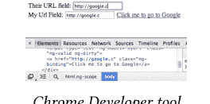

我们所做的唯一更改是将原始文本框添加回主 HTML 文档，并使用了 `=` 绑定策略而不是 `@`。（详细说明绑定策略）。

总而言之，这个示例解释了 Angular 核心卖点的魔力：双向数据绑定。

在处理内置指令工作时，了解其内部运行机制非常有帮助，这样在你将它们与自己的自定义指令连接时，可以考虑到它们的行为。

在下一章中，我们将查看 Angular 提供的更多内置指令，以便我们熟悉如何使用它们以及它们存在的原因。

一旦我们学习了内置指令，就可以准备好在[指令详解](directives explained) 中深入研究构建指令时可用的所有高级选项了。

> *http://jsbin.com/liteNita/1/edit

最后，我们将构建自己的高级指令，然后学习如何思考应用程序的架构设计，自定义指令和内置指令在这一主题中扮演着重要角色。

## 内置指令

Angular 提供了一套内置指令。某些指令会覆盖内置的 HTML 元素，例如 `<form>` 和 `<a>` 标签。当我们在 HTML 中使用标签时，可能无法立即察觉我们实际上正在使用一个指令。

例如，`<form>` 标签在底层增强了许多功能，例如我们通常在标准 HTML 表单中无法获得的验证行为。

其他内置指令通过其 `ng-` 命名空间前缀清晰可见。例如，下面将介绍的 `ng-href` 会防止链接在传递给 `ng-href="someExpression"` 的表达式经过求值并返回值之前变为激活状态。

最后，某些内置指令没有对应的 HTML 元素，例如 `ng-controller` 指令，它可以作为任何标签的属性使用，但通常出现在具有许多共享相同作用域子元素的元素上。

注意，所有带有 `ng` 命名空间前缀的指令都是 Angular 自带的内置指令库的一部分。因此，永远不要用这个命名空间为你制作的指令命名。

## 基础 ng 属性指令

我们的第一组指令具有命名相似的标准 HTML 标签，很容易记忆，因为我们只需为每个标签添加 `ng` 前缀即可：

- `ng-href`
- `ng-src`
- `ng-disabled`
- `ng-checked`
- `ng-readonly`
- `ng-selected`
- `ng-class`
- `ng-style`

## 布尔属性

以下 Angular 指令有助于让 HTML 布尔属性的操作变得简单。

根据 *HTML 规范* 定义，布尔属性是表示真/假值的属性。当该属性存在时，该属性的值被假设为真（无论其实际值是什么）。如果缺失，则该属性被假设为假。

在 Angular 中通过数据绑定处理动态数据时，我们不能简单地将属性值设置为 true 或 false，根据定义，Angular 提供了这些属性的 `ng-` 前缀版本，它将求值提供的表达式，以便在装饰的元素上插入或移除相应的布尔属性。

### ng-disabled

使用 `ng-disabled` 将 `disabled` 属性绑定到表单输入字段：

- `<input>` (text, checkbox, radio, number, url, email, submit)
- `<textarea>`
- `<select>`
- `<button>`

在编写普通的 HTML 输入字段时，输入字段上 `disabled` 属性的存在会使该字段禁用。要绑定此属性的禁用（或不禁用），请使用 `ng-disabled`。

例如，让我们在用户向文本框输入文本之前禁用按钮：

```html
<input type="text" ng-model="someProperty" placeholder="输入以启用">
<button ng-model="button" ng-disabled="!someProperty">一个按钮</button>
```

在下一个示例中，我们将使用 `$timeout` 让文本框禁用五秒钟，直到 `isDisabled` 属性变为 true：

```html
<textarea ng-disabled="isDisabled">等待 5 秒</textarea>
```

```javascript
angular.module('myApp', [])
.run(function($rootScope, $timeout) {
  $rootScope.isDisabled = true;
  $timeout(function() {
    $rootScope.isDisabled = false;
  }, 5000);
});
```

## 两个现场示例*²

¹http://www.w3.org/wg/drafts/html/master/infrastructure.html#boolean-attribute

²http://jsbin.com/HiYTu/1/edit

### ng-readonly

与其他属性类似，HTML 规范只查看属性的存在。为了允许一个表达式返回此属性的真或假值（或不返回），请使用 `ng-readonly`：

```html
<input type="text" ng-model="someProperty" placeholder="输入以启用"
```

在下一个示例中，我们将使用 `$timeout` 让文本框禁用五秒钟，直到 `isDisabled` 属性变为 true：

```html
<textarea ng-disabled="isDisabled">等待 5 秒</textarea>
```

```javascript
angular.module('myApp', [])
.run(function($rootScope, $timeout) {
  $rootScope.isDisabled = true;
  $timeout(function() {
    $rootScope.isDisabled = false;
  }, 5000);
});
```

### ng-checked

在编写普通的 HTML 输入字段时，输入字段上 `disabled` 属性的存在会使该字段禁用。要绑定此属性的禁用（或不禁用），请使用 `ng-disabled`。

例如，让我们在用户向文本框输入文本之前禁用按钮：

```html
<input type="text" ng-model="someProperty" placeholder="输入以启用">
<button ng-model="button" ng-disabled="!someProperty">一个按钮</button>
```

### ng-selected

与其他属性类似，HTML 规范只查看属性的存在。为了允许一个表达式返回此属性的真或假值（或不返回），请使用 `ng-readonly`：

```html
<input type="text" ng-model="someProperty" placeholder="输入以启用"
```

## 内置指令

`ng-app` 和 `ng-controller` 是特殊的指令，因为它们会修改嵌套在内部的指令的作用域（scope）。

`ng-app` 创建 Angular 应用程序的 `$rootScope`，而 `ng-controller` 创建子作用域，该作用域通常继承自 `$rootScope` 或另一个 `ng-controller` 的 `$scope`。

### ng-app

在任何 DOM 元素上放置 `ng-app` 会将该元素标记为 `$scope` 的开始。

`$rootScope` 是作用域链的起点，你 HTML 中嵌套在 `ng-app` 下的所有指令都继承自它。

在你的 JavaScript 代码中，你可以通过 `run` 方法访问 `$rootScope`：

```html
<html ng-app="myapp">
<body>
  {{someProperty}}
  <button ng-click="someAction()"></button>
</body>
</html>
```

```javascript
angular.module('myapp', [])
.run(function($rootScope) {
  $rootScope.someProperty = 'hello computer';
  $rootScope.someAction = function() {
    $rootScope.someProperty = 'hello human';
  }
});
```

## 示例示例 38

虽然出于演示目的，经常使用 `$rootScope` 就像使用全局作用域一样——请不要这样做。

我们每个文档只能使用一次 `ng-app`。如果我们想在一个页面中放置多个应用，我们需要手动启动（bootstrap）我们的应用程序。我们将在“底层”章节中讨论更多关于手动启动应用的内容。

### ng-controller

不要在 `$rootScope` 上定义动作和模型，而应该使用 `ng-controller`。它是一个内置指令，其目的是为嵌套内部的指令提供子作用域。我们将使用此指令在 DOM 元素上放置控制器。

`ng-controller` 接受一个单一参数：

> 38 http://jsbin.com/ICOzeFI2/edit

#### expression（必须的表达式）

表达式是一个 Angular 表达式。

子 `$scope` 是一个 JavaScript 对象，它通常继承自其父级 `$scope(s)` 方法和属性，包括应用程序的 `$rootScope`。

嵌套在 `ng-controller` 内部的指令可以访问这个新的子作用域，但请注意每个指令的作用域规则仍然适用。

回想，控制器内部的 `$scope` 对象应该负责 DOM 指令之间共享的动作和模型。

- 动作（action）指的是 `$scope` 对象上的传统 JavaScript 方法。
- 模型（model）指的是传统的 JavaScript 对象 `{}`，用于存储瞬态状态。持久化状态应该绑定到服务（service）上，由该服务负责处理模型的持久化。
- 出于技术和架构原因，不要直接在控制器的 `$scope` 上设置值对象（字符串、布尔值或数字）是非常重要的。DOM 中的数据应该始终使用点（`.`）。遵循这条规则可以让你避免很多麻烦。
- 控制器应该尽可能简单。虽然我们使用控制器来为功能编写原型，但使用服务和指令的应用架构来重构逻辑是一个好主意，更多信息请参阅应用架构。

通过控制器，我们可以通过将数据和动作放在子作用域上来修改之前的示例：

```html
<div ng-controller="SomeController">
  {{ someModel.someProperty }}
  <button ng-click="someAction()">Communicate</button>
</div>
```

## 内置指令

```javascript
angular.module('MyApp', [])
.controller('SomeController', function($scope) {
  // 创建一个模型
  $scope.someModel = {
    // 带有属性
    someProperty: 'hello computer'
  }
  // 在 $scope 本身设置动作
  $scope.someAction = function() {
    $scope.someModel.someProperty = 'hello human';
  };
});
```

## 示例*

在示例的这次迭代中，请注意与之前相比两处不同：

首先，我们正在使用 `$rootScope` 的子作用域，它提供了一个我们可以操作的干净对象。使用此作用域意味着在该作用域上使用的动作和模型将不会应用程序的任何地方可用；它们仅对此作用域或其子作用域内的指令可用。

其次，注意到我们显式地定义了数据模型，正如前面提到的，这极其重要。为了弄清楚为什么很重要，让我们看看这个示例的另一个迭代，它在现有的控制器内部嵌套了第二个控制器，并且没有在模型对象上设置属性：

```html
<div ng-controller="SomeController">
  {{ someBareValue }}
  <button ng-click="someAction()">Communicate to child</button>
  <div ng-controller="ChildController">
    {{ someBareValue }}
    <button ng-click="childAction()">Communicate to parent</button>
  </div>
</div>
```

> *http://jsbin.com/OYikipe/1/edit

```javascript
angular.module('myApp', [])
.controller('SomeController', function($scope) {
  // 反模式，裸露值
  $scope.someBareValue = 'hello computer';
  // 在 $scope 本身设置动作，这是可以的
  $scope.someAction = function() {
    // 在 SomeController 和 ChildController 内部设置 {{ someBareValue }}
    $scope.someBareValue = 'hello human, from parent';
  };
}
.controller('ChildController', function($scope) {
  $scope.childAction = function() {
    // 在 ChildController 内部设置 {{ someBareValue }}
    $scope.someBareValue = 'hello human, from child';
  };
});
```

## 示例¹

由于 JavaScript 中值对象原型继承的工作方式，更改 `someBareValue` 会导致某些问题。通过 `someBareValue` 作用在父级中会影响子作用域，反之亦然。

为了看到这个问题，让我们在属性上时查看另一个示例，它在现有的控制器内部嵌套了第二个控制器，并且没有在模型对象上设置属性：

```html
<div ng-controller="SomeController">
  {{ someBareValue }}
  <button ng-click="someAction()">Communicate to child</button>
  <div ng-controller="ChildController">
    {{ someBareValue }}
    <button ng-click="childAction()">Communicate to parent</button>
  </div>
</div>
```

> 这里

```：
* ng-include
*   --

*
-


  显示了子作用域的 `someBareValue`。

> httpjsjs..com/iki
/```

## 内置指令

在元素元素使用 `onload` 属性在模板加载时运行表达式。请记住，使用 `ng-include` 时， Angular 会创建一个新的子作用域。如果你想使用特定的作用域（例如 ControllerA 的作用域），你必须在 DOM 元素本身上调用 `ng-controller="ControllerA"`；它不会像通常那样从周围的作用域继承，因为在模板加载时会创建一个新的作用域。

让我们来看一个示例：

```html
<div ng-include="/myTemplateName.html"
  ng-controller="MyController"
  ng-init="name = 'World'">
  Hello {{ name }}
</div>
```

### ng-switch

此指令配合 `ng-switch-when` 和 `on="propertyName"` 使用，当属性变化时切换路由器中的指令。在示例中，当 `person.name` 为 'Ari' 时，文本下方的 div 显示，人将：

```html
<input type="text" ng-model="person.name" />
<div ng-switch on="person.name"></div>
<p ng-switch-default>获胜者是</p>
<h1 ng-switch-when="Ari">{{ person.name }} </h1>
```

注意我们使用了 `ng-switch-default` 在切换发生之前输出人的名字。

### ng-view

`ng-view` 指令设置了 HTML 中路由器用于管理和放置不同路由元素的位置。我们将在路由章节中深入讨论。更多信息请参阅路由章节。

### ng-if

使用 `ng-if` 根据表达式在 DOM 中完全删除或重新创建元素。如果赋值给 `ng-if` 的表达式评估为假值，则元素将从 DOM 中移除；否则，将元素的克隆重新插入到 DOM 中。

> *http://jsbin.com/AVibUd/2/

## 内置指令

`ng-if` 与 `ng-show` 和 `ng-hide` 的不同在于，它实际上是移除并重建 DOM 节点，而不是通过 CSS 显示和隐藏它们。

当元素使用 `ng-if` 从 DOM 中移除时，其关联的作用域（scope）会被销毁。此外，当它重新出现时，会创建一个新的作用域并通过原型继承继承其父作用域。

同样重要的是，`ng-if` 会使用其编译后的代码重建元素。如果 `ng-if` 内部的代码被加载、使用 jQuery 进行了操作（例如使用 `.addClass`），然后因为 `ng-if` 内部的表达式变为 false 而被移除，那么当表达式以后再次变为 true 时，DOM 元素及其子元素将以其原始状态重新插入 DOM 中，而不是它们离开 DOM 时的状态。这意味着使用 jQuery 的 `.addClass` 添加的任何类（class）将不再复存在。

```html
<div ng-if="2 + 2 === 5">
  不会看到这个 DOM 节点，甚至在源代码中也没有
</div>
```

```html
<div ng-if="2 + 2 === 4">
  嗨，我确实存在
</div>
```

Live示例⁴

### ng-repeat

`ng-repeat` 用于遍历集合，并为集合中的每个项目实例化一个新的模板。集合中的每个项目都有它自己的模板，因此也有它自己的作用域。此外，在每个模板实例的本地作用域上暴露了许多特殊属性：

- `$index`: 重复元素的迭代器偏移量 (0..length-1)
- `$first`: 如果重复元素是迭代器中的第一个，则为 true
- `$middle`: 如果重复元素在迭代器中的第一个和最后一个之间，则为 true
- `$last`: 如果重复元素是迭代器中的最后一个，则为 true
- `$even`: 如果迭代器位置 `$index` 为偶数，则为 true（否则为 false）
- `$odd`: 如果迭代器位置 `$index` 为奇数，则为 true（否则为 false）

我们在下面的示例中使用了 `$even` 和 `$odd` 来创建一个重复列表，其中偶数项为红色，奇数项为蓝色。记住在 JavaScript 数组中，是从 0 开始索引的；因此，我们使用 `!$even` 和 `!$odd` 来反转 `$even` 和 `$odd` 提供的布尔值。

> ⁴http://jsbin.com/ezEcamo/1/

## 内置指令

```html
<ul ng-controller="PeopleController">
  <li ng-repeat="person in people" ng-class="{even: !$even, odd: !$odd}">
    {{person.name}} lives in {{person.city}}
  </li>
</ul>
```

```css
.odd {
  background-color: blue;
}
.even {
  background-color: red;
}
```

```javascript
angular.module('MyApp', [])
  .controller('PeopleController', function($scope) {
  $scope.people = [
    {name: "Ari", city: "San Francisco"},
    {name: "Erik", city: "Seattle"}
  ];
});
```

## Live示例**⁴

### ng-init

当指令被调用时，使用 `ng-init` 在该指令的作用域内设置状态。

使用 `ng-init` 最常见的情况是为教学目的创建小型示例，例如本章中的示例。

对于任何具有实质性的内容，请创建一个控制器并在模型对象中设置状态。

```html
<div ng-init="greeting=Hello; person='World'">
  {{greeting}} {{person}}
</div>
```

## Live示例**⁵

## {{}}

> ⁴http://jsbin.com/akuYukey/1/edit

⁵http://jsbin.com/OZENultO/1/

## 内置指令

```html
<div>{{ name }}</div>
```

`{{ }}` 语法是 Angular 内置的模板语法。它创建了从包含的 `$scope` 到视图的绑定。每当 `$scope` 变化时，我们都会由于这种绑定自动更新。

尽管它看起来不像一个普通的指令，但它实际上是使用 `ng-bind` 的快捷方式，而无需创建元素；它最常用于内联文本。

请注意，在页面加载时，屏幕可见视口内的 `{{ }}` 可能会导致未渲染内容的短暂闪烁。为了防止这种情况，请使用 `ng-bind`。

```html
<body ng-init='Hello World'>{{ greeting }}</body>
```

Live示例⁴

### ng-bind

虽然我们可以在视图中使用 `{{ }}` 模板语法（Angular 会对这些内容进行插值），但我们可以使用 `ng-bind` 指令来模拟这种行为。

```html
<body ng-init='Hello World'>
  <p ng-bind='greeting'></p>
</body>
```

Live示例⁵

当我们使用 `{{ }}` 语法时，我们的 HTML 文档加载了该元素但没有立即渲染，导致“未渲染内容的闪烁”（简称 FOUC）。我们可以通过使用 `ng-bind` 并将我们的内容绑定到元素上来防止这种现象的出现。该内容将作为声明 `ng-bind` 的元素的子文本节点进行渲染。

### ng-cloak

使用 `ng-bind` 防止未渲染内容闪烁的替代方案是在包含 `{{ }}` 的元素上使用 `ng-cloak`：

> ⁴http://jsbin.com/ODUseho/1/edit

⁵http://jsbin.com/esuhUJ/1/edit

## 内置指令

```html
<body ng-init="greeting = 'Hello World'">{{ greeting }}</body>
```

Live示例***

### ng-template

与 `ng-bind` 指令类似，如果我们想绑定一个模板，可以使用 `ng-template`。

```html
<div>{{ message }}</div>
```

### ng-model

`ng-model` 指令将 input、select、textarea 或自定义控件绑定到属性。它处理验证，在元素上设置类，并与作用域注册事件。

我们应该配合其他指令使用 `ng-model`。例如：

```html
<input type="text" ng-model="someName" />
```

由于我们无法使用插值动态生成 input 的 name 属性，我们需要将每个 input 包装在 `ng-form` 指令中。

* http://jsbin.com/AJeLo

### ng-show/ng-hide

`ng-show` 和 `ng-hide` 根据表达式显示或隐藏 HTML 元素。当提供的表达式为 false 时，元素会被隐藏。同样，当提供给 `ng-hide` 的表达式为 true 时，它会被隐藏。

```html
<div ng-show="2 + 2 === 5">
  不显示
</div>
<div ng-show="2 + 2 === 4">
  显示
</div>
<div ng-hide="2 + 2 === 5">
  隐藏
</div>
<div ng-hide="2 + 2 === 4">
  显示
</div>
```

## Live示例⁶

此指令在输入更改时评估给定的表达式。由于我们在处理输入，必须配合 `ngModel` 使用此指令。

```html
<div ng-controller="PeopleController">
  <input type="text"
    ng-model="equation.x"
    ng-change="change()" />
  {{ equation.output }}
</div>
```

## 内置指令

```javascript
angular.module('myApp', [])
  .controller('PeopleController', function($scope) {
  $scope.equation = {};
  $scope.change = function() {
    $scope.equation.output = Number($scope.equation.x) + 2;
  };
});
```

## Live示例³⁰

在上面的示例中，每当通过文本框更改 `equation.x` 时，我们运行 `change()` 函数。

### ng-form

当我们需要嵌套表单时，使用 `ng-form`。普通的 HTML `<form>` 标签不允许我们嵌套表单，但 `ng-form` 可以。这意味着当所有子表单都有效时，外部表单也是有效的。这一事实在使用 `ng-repeat` 动态生成表单时特别有用。

根据表单的有效性，会自动设置以下 CSS 类：

- `ng-valid`：表单有效时
- `ng-invalid`：表单无效时
- `ng-pristine`：表单未被修改过（初始状态）
- `ng-dirty`：表单已修改过

除非表单指定了 action 属性，否则 Angular 不会将表单提交到服务器。

要指定在表单提交时调用哪个 JavaScript 方法，请使用以下两个指令之一：

- 在表单元素上使用 `ng-submit`
- 在第一个按钮或类型为输入字段 (input[type=submit])上使用 `ng-click`

## 内置指令

为了防止处理程序重复执行，请仅使用 `ng-submit` 或 `ng-click` 指令。

在接下来的示例中，我们想要根据服务器返回的 JSON 响应动态生成表单。我们将使用 `ng-repeat` 来遍历从服务器获取的字段。我们无法动态生成 `name` 属性，由于我们需要 `name` 属性来进行验证，我们将遍历字段并为每个字段创建一个新表单。

由于使用 `ng-form` 而不是 `form` 的 Angular 表单是可以嵌套的，而且在子表单有效之前父表单不是有效的，因此我们可以动态生成带有子表单和验证的表单。我们可以鱼和兼得。

让我们先查看硬编码的 JSON，它本应来自服务器：

```javascript
angular.module('myapp', [])
.controller('FormController', function($scope) {
$scope.fields = [
  {placeholder: 'Username', isRequired: true},
  {placeholder: 'Password', isRequired: true},
  {placeholder: 'Email (optional)', isRequired: false}
];

$scope.submitForm = function() {
  alert('it works!');
};
});
```

现在，让我们来看如何使用数据生成带有验证的动态表单：

```html
<form name="signup_form"
  ng-controller="FormController"
  ng-submit="submitForm()" novalidate>
  <div ng-repeat="field in fields">
    <ng-form name="signup_form_input">
      <input type="text"
        name="dynamic_input"
        ng-required="field.isRequired"
        ng-model="field.name"
        placeholder="{{field.placeholder}}" />
      <div>
        <span ng-show="signup_form_input.dynamic_input.$invalid && signup_form_input.dynamic_input.$error.required">
          <span class="error">
            该字段是必填项。
          </span>
        </span>
      </div>
    </ng-form>
  </div>
  <button type="submit"
  ng-disabled="signup_form.$invalid">
    提交全部
  </button>
</form>
```

```css
input.ng-invalid {
  border: 1px solid red;
}

input.ng-valid {
  border: 1px solid green;
}
```

Live Example¹¹

### ng-click

使用 `ng-click` 指定当元素被点击时在所属作用域（scope）运行的方法或表达式。

```html
<div ng-controller="CounterController">
  <button ng-click="count = count + 1"
    ng-init="count=0">
    加1
  </button>
  计数: {{count}}
  <button ng-click="decrement()">
    减1
  </button>
</div>
```

> ¹¹http://jsbin.com/UduNeCA/1/edit

```javascript
angular.module('MyApp', [])
.controller('CounterController', function($scope) {
  $scope.decrement = function() {
    $scope.count = $scope.count - 1;
  }
});
```

Live Example⁵²

### ng-select

使用 `ng-select` 指令将数据绑定到 HTML `<select>` 元素。该指令可以配合 `ng-model` 和 `ng-options` 使用，以提供复杂且高性能的动态表单。

`ng-options` 为其属性值接收一个计算表达式，这只是这种说法，表示它可以接收一个数组或对象并遍历其内容，以便在使用 `select` 标签时提供可用选项。它有以下形式：

- 针对数组数据源：
  - 数组中值的 label
  - 数组中值的 select as label
  - 数组中值按分组的 label group
  - 数组中值按分组的 select as group group trackxpr
- 针对对象数据源：
  - 对象中 (key, value) 的 label
  - 对象中 (key, value) 的 select as label
  - 对象中 (key, value) 按分组的 label group
  - 对象中 (key, value) 按分组的 select as label group

让我们来看一个使用 `ng-select` 的示例：

```html
<div ng-controller="CityController">
  <select ng-model="city">
    <option ng-repeat="city in cities" value="{{city.name}}">{{city.name}}</option>
  </select>
  最佳城市: {{ city.name }}
</div>
```

> ⁵²http://jsbin.com/uGipBUU/edit

```javascript
angular.module('myApp', [])
.controller('CityController', function($scope) {
  $scope.cities = [
    {name: 'Seattle'},
    {name: 'San Francisco'},
    {name: 'Chicago'},
    {name: 'New York'},
    {name: 'Boston'}
  ];
});
```

Live Example³

### ng-submit

我们使用 `ng-submit` 将表达式绑定到 `onSubmit` 事件。如果表单不包含 `action` 属性，该指令还会阻止默认行为（发送请求并重新加载页面）。

```html
<form ng-submit="submit()"
  ng-controller="FormController">
  <input type="text"
    ng-model="person.name">
    输入文本:
  <ul ng-repeat="person in people">
    <li>{{person}}</li>
  </ul>
</form>
```

> ³http://jsbin.com/i/edit

## 内置指令

```css
.red {
  background-color: red;
}
```

```javascript
angular.module('MyApp', [])
.controller('FormController', function($scope) {
  $scope.people = [];
  $scope.submit = function() {
    $scope.people.push($scope.person.name);
    $scope.person.name = '';
  }
})
```

### ng-class

`ng-class` 允许你根据表达式动态地向元素添加或移除类。当样式取决于应用状态时，这特别有用。

```html
<div ng-class="x > 5 ? 'red' : ''"
  ng-controller="LotteryController">
    你赢了！
  <button ng-click="generateNumber()"
    ng-init="x=0">
      抽取
    </button>
  <p>数字是: {{ x }}</p>
</div>
```

```javascript
angular.module('myApp', [])
.controller('LotteryController', function($scope) {
  $scope.generateNumber = function() {
    $scope.x = Math.floor(Math.random()*10)+1;
  }
})
```

> http://jsbin.com/iAC/edit

### ng-attr-

然而，某些浏览器对允许的属性非常挑剔。SVG 就是一个例子：

```html
<svg>
<circle cx="{{cx}}"></circle>
</svg>
```

运行上面的代码会报错，告诉我们属性无效。为了修复此，我们可以使用 `ng-attr-`。注意 cx 是我们想要定义的属性名称。在字符串中，我们可以编写一个表达式 `{{ }}` 并实现我们想要的结果。

```html
<svg>
  <circle ng-attr-cx="{{cx}}"></circle>
</svg>
```

> http://jsbin.com/jEvci/1

# 指令详解

本章的目标是明确列出构建客户端应用时指令提供的选项选项。

## 指令定义

理解指令的最简单方法是将其视为在特定 DOM 元素上运行的函数。该函数预期提供额外的功能。

例如，`ng-click` 指令提供了监听点击并在接收事件时运行 Angular 表达式的能力。指令是 Angular 框架如此强大的原因，而且正如我们所看到的，我们也可以创建它们。

指令是使用 `.directive()` 方法定义的，这是我们应用程序 Angular 模块提供的许多方法之一。

```javascript
angular.module('MyApp')
.directive('myDirective',
function($timeout, UserDefinedService) {
  // 指令定义写在这里
})
```

`directive()` 方法接收两个参数：

- name (string): 字符串形式的指令名称，我们在视图内部引用它。
- factory_function (function): `factory_function` 返回一个定义指令行为的对象。它预期返回一个包含选项的对象，告诉 `$compile` 服务指令在 DOM 中被调用时应该如何表现。

# 指令详解

```javascript
angular.module('myApp', [])
.directive('myDirective', function() {
  // 指令的定义对象
  return {
    // 指令定义是通过配置项定义的
    // 我们将在这里对其进行重写
  };
});
```

我们也可以返回一个函数而不是对象来处理此指令的定义，但最佳实践是像我们上面那样返回一个对象。当返回一个函数时，它通常被称为 postLink 函数，它允许我们为指令定义 link 函数。返回函数而不是对象会限制我们自定义指令的能力，因此它对于简单的指令来说是有益的。

当 Angular 启动（bootstraps）我们的应用程序时，它将通过第一个参数提供的字符串名称注册已注册的对象。Angular 在寻找这些指令时，会解析我们主 HTML 文档的 DOM，以寻找元素、属性、注释或类名。当它找到它认识的指令时，它将使用指令定义将指令放置在页面上。

```html
<div my-directive></div>
```

> 为了避免与未来的 HTML 标准冲突，请添加自定义命名空间。Angular 本身选择了 ng- 前缀，因此请使用该以外的其他内容。在接下来的示例中，我们将使用 my- 前缀（例如 my-directive）。

我们为指令定义的工厂只会被调用一次，即编译器第一次匹配到指令时调用。仅对于 `.controller` 函数，我们使用 `$injector.invoke` 调用指令的函数。

当 Angular 在 DOM 中命名该指令时，它将调用我们注册的指令定义，并使用该名称查找我们注册的对象。此时，指令的生命周期开始了，从 `$compile` 方法开始，到 `$link` 方法结束。我们将在本章稍后的部分详细介绍这一过程的细节。

让我们看看可以为指令定义提供的所有可用配置项。

> 一个 JavaScript 对象由键和值组成。当给定键的值设置为字符串、布尔值、数组或对象时，我们可以将该键称为属性。当我们将键设置为函数时，我们称其为方法。

可能的配置项下所示。每个键的值提供了方法的签名或我们可以将属性设置的种值类型：

```javascript
angular.module('myApp', [])
.directive('myDirective', function() {
  return {
    restrict: String,
    priority: Number,
    terminal: Boolean,
    template: String or Template Function:
    function(tElement, tAttrs) { ... },
    templateUrl: String,
    replace: Boolean or String,
    scope: Boolean or Object,
    transclude: Boolean,
    controller: String or
    function(scope, element, attrs, transclude, otherInjectables) { ... },
    controllerAs: String,
    require: String,
    link: function(scope, iElement, iAttrs) { ... },
    compile: return function(tElement, tAttrs, transclude) {
      return {
        pre: function(scope, iElement, iAttrs, controller) { ... },
        post: function(scope, iElement, iAttrs, controller) { ... }
      }
      // 或者
      return function postLink(...) { }
    }
  };
});
```

## Restrict (string)

`restrict` 是一个可选参数。它负责告诉 Angular 我们将以何种格式在 DOM 中声明指令。默认情况下，Angular 期望我们通过属性来声明自定义指令，并将 `restrict` 选项设置为 `A`。

可用选项如下：

- E（元素 element） `[lang="html"]`
- A（属性 attribute，默认） `[lang="html"]` `<div my-directive="expression"></div>`
- C（类 class） `[lang="html"]` `<div class="my-directive: expression;"></div>`
- M（注释 comment） `[lang="html"]` `<!-- directive: my-directive expression -->`

这些选项可以单独使用也可以组合使用：

```javascript
angular.module('myDirective', function() {
  return {
    restrict: 'EA' // 元素或属性
  };
});
```

在这种情况下，我们可以将指令声明为属性或元素：

```html
<!-- 属性 -->
<div my-directive></div>
<!-- 或者作为元素 -->
<my-directive></my-directive>
```

属性是指令默认且最常见的形式，因为它们可以在所有浏览器（包括旧版本的 Internet Explorer）中运行，而无需在文档头部注册新标签。关于此主题的更多信息，请参阅 Internet Explorer 章节。

> 避免使用注释来声明指令。这种格式最初是作为创建多个元素的方法引入的。这种方法特别有用，例如在 `<table>` 元素内部使用 `ng-repeat` 时；然而，从 Angular 1.2 开始，`ng-repeat` 提供了 `ng-repeat-start` 和 `ng-repeat-end` 作为此问题的更好解决方案，进一步减少了对注释形式指令的需求。尽管如此，如果你好奇，可以在使用 `ng-repeat` 时查看 Chrome 开发者工具的元素面板，查看底层是如何使用注释的。

## 元素还是属性？(Element or Attribute?)

在页面上创建一个封装了自包含功能单元时，请使用元素。例如，如果我们正在创建一个时钟（并且不在乎支持旧版本的 Internet Explorer），我们会创建一个时钟指令，并在 DOM 中如下所示声明它：

```html
<my-clock></my-clock>
```

这样做告诉用户我们正在指定一个完整的单元。虽然我们可以在这种情况下使用属性（Angular 并不关心），但我们选择了元素，因为它明确了我们的意图。

当为现有元素装饰数据时，请使用属性。使用我们的时钟示例，假设我们对模拟版本感兴趣：

```html
<my-clock clock-display="analog"></my-clock>
```

选择取决于定义的指令是页面组件的核心行为，还是装饰或增强可选的行为、状态或其他任何内容。

对于给定的指令，另一个重要的区别是它是创建、继承还是从其环境的作用域中隔离自己。这种父子关系在指令的组合和重用性中起着另一个关键作用，我们将在关于指令作用域的部分中花费更多时间讨论这个话题。

## Priority (number)

该选项可以设置为数字。大多数指令省略了此选项，在这种情况下默认认为 0；然而，在某些情况下设置高优先级是重要或必要的。例如，`ng-repeat` 将此选项设置为 1000，以便它总能在同一元素的其他指令之前被调用。

如果一个元素装饰了两个具有相同优先级的指令，则先声明的指令将被调用。如果其中一个指令的优先级高于另一个，那么无论先声明哪一个都一样。

> `ng-repeat` 是任何内置指令中优先级最高的。它总在同一元素的其他指令之前被调用。性能是一个关键因素。我们将在讨论 compile 选项时学习更多性能知识。

## Terminal (boolean)

`terminal` 是一个布尔选项；它可以设置为 `true` 或 `false`。

我们使用 `terminal` 选项告诉 Angular 停止处理该元素上任何具有更高优先级的指令。然而，所有相同优先级的指令都将被执行。

## 模板 (string| function)

`template` 是可选的。如果提供，它必须设置为以下之一：

- 一个 HTML 字符串
- 一个接收两个参数的函数 - `tElement` 和 `tAttrs`，并返回一个代表模板的字符串值。`tElement` 和 `tAttrs` 中的 `t` 代表模板（template），以区别于实例（instance）。当我们在介绍 link 编译选项时，我们将讨论模板元素/属性与实例元素/属性之间的区别。

Angular 处理模板字符串的方式与任何其他 HTML 无何不同。它具有一个可以通过双大括号标记 `{{ expression }}` 访问的范围。

当模板字符串包含多个 DOM 元素或仅包含单个文本节点时，它必须包裹在一个父元素中。换句话说，必须存在一个根 DOM 元素：

```javascript
template: \
<div>-- 单个根元素 --
<a href="http://google.com">点击我</a>
<h1>当使用两个元素时，将它们包裹在一个父元素中</h1>
</div>
```

此外，请注意每行末尾使用的反斜杠。我们包含这些反斜杠是为了让 Angular 可以解析多行字符串。在生产代码中，使用 `templateUrl` 可能是更好的选择，因为多行字符串的查看和维护是一场噩梦。

理解模板字符串或 `templateURL` 最重要的特性之一是它是如何获取范围的。在 `_directives`（指令）章节中，我们提到了范围是如何传递给指令的。

## templateUrl (string| function)

`templateUrl` 是可选的。如果提供，它必须设置为以下之一：

- 字符串格式的 HTML 文件路径
- 一个接收两个参数的函数：`tElement` 和 `tAttrs`。该函数必须返回一个字符串格式的 HTML 文件路径。

无论在何种情况下，模板 URL 都会通过 Angular 提供的内置安全层传递；特别是 `getTrustedResourceUrl`，它保护我们的模板不被从不受信任的资源中获取。

默认情况下，当指令被调用时，会通过 Ajax 按需请求 HTML 文件。我们应该记住两个重要的因素：

# 指令详解

- 在本地进行开发时，我们应该在后台运行一个服务器，以便从文件系统提供本地 HTML 模板。未能这样做将导致跨源资源脚本共享 (CORS) 错误。
- 模板加载是异步的，这意味着在模板加载之前，编译和链接将挂起。

等待大量模板通过 Ajax 异步加载确实会减慢客户端应用程序的速度。为了防止这种延迟，可以在部署应用程序之前缓存一个或多个 HTML 模板。在大多数情况下，缓存是更好的选择，Angular 不会发起 Ajax 请求，通过减少运行的请求次数提供更好的性能。有关缓存的更多信息，请查阅此处关于缓存的深度讨论。

在获取模板后，Angular 将其缓存在默认的 `$templateCache` 服务中。在生产环境中，我们可以将这些模板预缓存到一个定义了模板的 JavaScript 文件中，这样我们就不需要通过 XHR 获取模板。有关此调整如何工作的更多信息，请参见“下一步”章节。

## replace (boolean)

`replace` 是可选的。如果提供，它必须设置为 `true`。它默认设置为 `false`。这意味着指令的模板将作为子节点附加到调用指令的元素内：

```html
<div><some-directive></div>
```

```javascript
directive('someDirective', function() {
  return {
    template: '<div>这里有一些些东西</div>'
  }
});
```

当指令被调用时的结果将是（记住当 `replace` 为 `false` 时，此行为默认值）：

```html
<div some-directive>
  <div>这里有一些些东西</div>
</div>
```

如果我们将 `replace` 设置为 `true`：

# 指令详解

```javascript
directive('someDirective', function() {
  return {
    replace: true, // 已修改
    template: '<div>这里有一些些东西</div>'
  }
});
```

那么指令被调用时的结果将是：

```html
<div>这里有一些些东西</div>
```

## 指令范围

为了完全理解指令内部可用的剩余选项，我们需要了解范围是如何工作的。一个特殊的对象，被称为 `$rootScope`，它在我们在 DOM 中声明 `ng-app` 指令时初始创建：

```html
<div ng-app>
  ng-init="someProperty = '某些数据'"></div>
  <div ng-init="siblingProperty = '更多数据'">
    <div></div>
  </div>
</div>
```

在上面的示例中，`$rootScope` 包含了 `someProperty`、`siblingProperty` 和 `Div Two`。示例显示指令创建了自己的范围。此外，指令嵌套在另一个指令内部并不意味着它的范围发生了改变。

## 范围选项 (boolean | object)

`scope` 是可选的。它可以设置为 `true` 或一个对象。默认情况下，它设置为 `false`。

当 `scope` 设置为 `true` 时，创建一个从原型继承父级的新范围。如果元素上存在多个指令，就会创建一个范围。

让我们根据这些知识修改我们的示例：

```html
<div ng-app="MyApp">
  ng-init="someProperty = '某些数据'"></div>
  <div ng-init="siblingProperty = '更多数据'">
    内部 Div Two：{{ siblingProperty }}
    <div ng-init="aThirdProperty = '第三部分数据'"
      ng-controller="SomeController">
      内部 Div Three：{{ aThirdProperty }}
      <div ng-controller="SecondController">
        内部 Div Four：{{ aThirdProperty }}
      </div>
    </div>
  </div>
</div>
```

如果我们单独运行运行之前的代码，它会失败。这种失败是因为我们没有定义关联的控制器，所以让我们这样做：

```javascript
angular.module('MyApp', [])
  .controller('SomeController', function($scope) {
    // 可以留空，只需要定义即可
  })
```

如果我们重新加载页面，我们可以看到第二个 div 内部 `{{ aThirdProperty }}` 是未定义的，因此不输出任何内容。然而，在第三个 div 中，我们在继承范围内设置的值被显示了。为了进一步证明这种范围在继承过程中是向下流动而不是向上的，让我们创建另一个 JavaScript 范围并检查 `{{ aThirdProperty }}` 是否从其父级继承值。

```html
<div ng-app="MyApp">
  ng-init="someProperty = '某些数据'"></div>
  <div ng-init="siblingProperty = '更多数据'">
    内部 Div Two：{{ siblingProperty }}
    <div ng-init="aThirdProperty = '第三部分数据'"
      ng-controller="SomeController">
      内部 Div Three：{{ aThirdProperty }}
      <div ng-controller="SecondController">
        内部 Div Four：{{ aThirdProperty }}
      </div>
    </div>
  </div>
</div>
```

我们需要更新我们的 JavaScript，以便 `SecondController` 被定义：

```javascript
angular.module('MyApp', [])
  .controller('SomeController', function($scope) {
    // 可以留空，只需要定义即可
  })
  .controller('SecondController', function($scope) {
    // 也可以留空
  })
```

为了创建一个我们自己的、从原型继承外部世界的指令范围，将 `scope` 属性设置为 `true`：

# 指令详解

```javascript
angular.module('myApp', [])
.directive('myDirective', function() {
  return {
    restrict: 'A',
    scope: true
  }
})
```

现在，让我们使用我们的指令来改变 DOM 的作用域：


```html
<div ng-app="myApp" ng-init="someProperty"></div>
<div ng-init="siblingProperty = 'more data'">
  Inside Div Two: {{ aThirdProperty }}
  <div ng-init="aThirdProperty = 'data for 3rd property'" ng-controller="SomeController">
    Inside Div Three: {{ aThirdProperty }}
    <div ng-controller="SecondController">
      Inside Div Four: {{ aThirdProperty }}
      <br>
      Outside myDirective: {{ myProperty }}
      <div my-directive ng-init="myProperty = 'wow, this is cool'">
        InsideDirective: {{ myProperty }}
      </div>
    </div>
  </div>
</div>
</div>
```

Live JS Bin

既然我们已经理解了环绕作用域和继承作用域的工作原理，作用域的拼图中只剩下最后一块了：隔离作用域（isolate scope）。

## 隔离作用域

隔离作用域可能是在设置 `scope` 属性时提供的三个选项中最令人困惑的，但也是最强大的。隔离作用域基于面向对象编程中的思想。像 Small Talk 这样的语言和 SOLID 等设计原则通过使用隔离作用域的指令引入 Angular。

> [54 http://jsbin.com/tEBAF/1/edit](http://jsbin.com/tEBAF/1/edit)

# 指令详解

指令的主要用例是可重用的组件，这些组件可以在意想不到的上下文中共享和使用，而不会污染其周围的作用域，也不会导致其内部作用域被意外破坏。

要创建一个具有隔离作用域的指令，我们需要将指令的 `scope` 属性设置为一个空对象 `{}`。一旦我们这样做，指令的模板中就无法使用任何外部作用域了：

```html
<div ng-controller='MainController'>
  Outside myDirective: {{ myProperty }}
  <div my-directive ng-init="wow, this is cool">
    Inside myDirective: {{ myProperty }}
  </div>
</div>
```

```javascript
angular.module('myApp', [])
.controller('MainController', function($scope) {
})
.directive('myDirective', function() {
  return {
    restrict: 'A',
    scope: {},
    template: '<div>Inside myDirective {{ myProperty }}</div>'
  };
});
```

## Live JS Bin²

查看 JS Bin 可以发现，它似乎与将 `scope` 设置为 `true` 几乎完全相同。我们可以通过创建另一个具有继承作用域的指令并对比两者来看到区别：

```html
<div ng-init="myProperty = 'wow, this is cool'"></div>
Surrounding scope: {{ myProperty }}
<div my-inherit-scope-directive="SomeController">
  Inside an directive with inherited scope: {{ myProperty }}
</div>
<div my-directive>
  Inside myDirective, isolate scope: {{ myProperty }}
</div>
```

JavaScript 代码：

> [² http://jsbin.com/eguDEPa/1/edit](http://jsbin.com/eguDEPa/1/edit)

# 指令详解

```javascript
angular.module('myApp', [])
.directive('myDirective', function() {
  return {
    restrict: 'A',
    scope: {}
  };
})
.directive('myInheritScopeDirective', function() {
  return {
    restrict: 'A',
    scope: true
  };
});
```

## Live JS Bin^{ss}

在解决了最重要的与作用域相关的概念后，我们可以将隔离作用域上的属性与外部世界绑定，从而允许我们在这些隔离作用域上“打洞”。

## 双向数据绑定

双向数据绑定可能是 Angular 中最强大的功能之一，它允许我们将指令私有作用域内的属性值绑定到 DOM 中可用属性的值。我们在上一章关于指令的章节中看过的 `ng-model` 如何为外部世界以及我们创建的自定义指令提供双向数据绑定，这是一个很好的例子：这个例子在许多方面反映了 `ng-bind` 本身提供的行为。回顾该章节并练习示例，以更深入地理解这一重要概念。

## 内容包含 (Transclude)

内容包含（Transclude）是可选的。如果提供，它必须设置为 `true`。它默认设置为 `false`。内容包含有时被认为是一个高级主题，但一旦理解了它的意义，它就会完全符合我们学过的关于作用域的规则。我们还将看到它是我们工具箱中非常强大的补充，特别是在构建可以自定义的 HTML 部分时，这些部分可以与团队、项目之间以及 Angular 社区的其他部分共享。

内容包含最用于创建可重用的组件。一个很棒例子是模态框或导航栏。

内容包含允许我们向指令传递一个空模板，包括其作用域。这样做使我们有机会向指令传递任意内容和任意作用域。为了能够传递作用域，`scope` 选项必须是隔离的 `{}` 或设置为 `true`。如果未设置 `scope` 选项，则指令内部可用的作用域将应用于传递的模板上。

- 只有当你想创建一个封装任意内容的指令时，才使用 `transclude: true`。

内容包含允许你的指令的用户通过提供具有其自身状态和行为的自定义 HTML 模板，从而轻松地允许他们一次性自定义所有这些方面。

假设我们想创建一个接收标题和一些内容的侧边栏。例如，这段代码将产生具有一致样式的框：

```html
<div sidebar="Links">
  <ul>
    <li>First link</li>
    <li>Second link</li>
  </ul>
</div>
<div sidebar="TagCloud">
  <ul>
    <li>AngularJS</li>
    <li>D3</li>
    <li>Front-end</li>
    <li>Startup</li>
  </ul>
</div>
```

> [http://jsbin.com/OsAlek/1/edit](http://jsbin.com/OsAlek/1/edit)

```javascript
angular.module('myApp', [])
.directive('sidebar', function() {
  return {
    restrict: 'EA',
    scope: {
      title: '@'
    },
    transclude: true,
    template: `<div class="sidebar">
      <h2 class="header">{{ title }}</h2>
      <div class="content" ng-transclude></div>
    </div>`
  };
});
```

# 指令详解

这段代码告诉 Angular 编译器应该将它从 DOM 元素中捕获的内容放在哪里。我们可以使用内容包含来提供辅助元素，而无需担心样式和布局。

（此处应为图片说明）

如果我们使用内容包含，在指令内部监听模型属性的变化将无法正常工作。最佳实践始终建议在 `link` 函数中使用 `$watch` 服务。

## 控制器 (string|function)

`controller` 选项接受字符串或函数。当设置为字符串时，将使用字符串的名称在应用程序的其他地方查找控制器函数：

```javascript
angular.module('myApp', [])
.directive('myDirective', function() {
  return {
    restrict: 'A',
    controller: 'SomeController'
  };
});

// 在应用程序的其他地方
// 或者在同一个文件中或通过我们的 index.html 引入
angular.module('myApp')
.controller('SomeController', function($scope, $element, $attrs, $transclude) {
  // 控制器逻辑在这里
});
```

可以通过将控制器函数设置为匿名构造函数，在指令内联定义控制器：

```javascript
angular.module('myApp', [])
.directive('myDirective', function() {
  return {
    restrict: 'A',
    controller: function($scope, $element, $attrs, $transclude) {
      // 控制器逻辑在这里
    }
  };
});
```

如上面的示例所示，传递给控制器的参数有：

- `$scope`: 与指令元素关联当前的作用域。
- `$element`: 当前元素指令元素。
- `$attrs`: 当前元素的属性对象。例如，以下元素：

# 指令详解

```html
<div id="aDiv" class="box"></div>
```

具有属性对象：

```json
{
  "id": "aDiv",
  "class": "box"
}
```

## $transclude (嵌套包含)

一个预绑定到正确嵌套作用域（transclusion scope）的嵌套链接函数。

该嵌套链接函数是实际运行以创建元素克隆并操作 DOM 的函数。

> 在控制器（controller）内部操作 DOM 是符合 Angular 规范的，但通过链接函数（linking function）是可以实现的。在编译选项中只使用此 `transcludeFn` 是最佳实践。

例如，为了偷懒，假设我们想通过指令添加一个 `<a>` 标签。我们可以在控制器内部使用 `$transclude` 函数，如下：

```javascript
angular.module('MyApp')
.directive('link', function() {
  return {
    restrict: 'EA',
    transclude: true,
    controller: function(scope, element, $transclude) {
      $transclude(function(clone) {
        var a = angular.element('<a>');
        a.attr('href', clone.text());
        a.text(clone.text());
        element.append(a);
      });
    }
  };
});
```

指令的控制器通常可以与指令的链接函数交换使用。控制器的主要场景是当我们希望在指令之间提供可重用的行为。链接函数仅在当前指令内部可用，在其中定义的任何行为都是不可共享的。

链接函数提供了指令之间的隔离，而控制器定义了可共享的行为。

然而，由于一个指令可以要求另一个指令的控制器，因此控制器是放置我们可能在多个指令中使用的动作的好去处。

`controller` 选项将控制器附加到指令的模板上，作用就像当它是模板的父级作用域时的 `ngController` 一样。

当我们想要向其他指令暴露 API 时，使用 `controller` 选项是很好的；我们可以依赖 `link` 为指令元素提供本地功能。当我们在使用 `scope.$watch()` 或我们正在与 DOM 的实时作用域进行任何交互时，使用它更好。

从技术上讲，传递到控制器的 `$scope` 在 DOM 渲染到屏幕之前传递的。在某些情况下，例如处理 `include` 时，控制器内部的作用域可能反映出我们预期的不同作用域，并且在这种情况下 `$scope` 对象并不总是保证更新。

- 当预期与屏幕上的作用域实例进行交互时，请使用传递给链接函数的 `scope` 参数。

## controllerAs (string)

`controllerAs` 选项允许我们设置一个控制器别名，允许我们以此名称发布我们的控制器，并让作用域访问 `controllerAs` 名称。这一步允许我们从视图内部引用控制器，甚至允许我们不需要注入 `$scope`。例如，我们可以创建一个从不注入 `$scope` 的 `MainController`，所示：

```javascript
angular.module('MyApp')
.controller('MainController', function() {
  this.name = "Ari";
});
```

在我们的 HTML 中，我们可以直接使用这个 `MainController`，而完全不需要引用作用域。

```html
<div ng-app ng-controller="MainController as main">
  <input type="text" ng-model="main.name" />
  <span>{{ main.name }}</span>
</div>
```

# 指令详解

这个选项看起来可能微不足道，但它让我们在路由和指令中使用及创建匿名控制器方面拥有了巨大的力量。这种力量允许我们创建作为控制器的动态对象，这些对象是隔离且易测试的。

例如，我们可以在指令中创建一个匿名控制器，所示：

```javascript
angular.module('myApp')
.directive('myDirective', function() {
  return {
    restrict: 'A',
    template: '<h4>{{controller.msg}}</h4>',
    controllerAs: 'controller',
    controller: function() {
      this.msg = "Hello World";
    }
  };
});
```

## require(string|array)

`require` 选项可以设置为字符串或字符串数组。字符串包含另一个指令的名字。`require` 用于将所要求指令的控制器作为当前指令链接函数的第四个参数注入。

作用域或字符串（如果是数组）提供了存在于当前指令当前作用域的指令名称。

该设置将影响周围作用域的引用，无论它是孤立作用域（isolate scope）、独立作用域还是完全没有作用域。在所有情况下，Angular 编译器在查找子控制器时都会咨询当前指令的模板。

如果没有前缀，指令将仅查找其自身元素上的控制器。

```javascript
// ...
restrict: 'EA',
require: 'ngModel'
//...
```

此指令定义将会在指令的本地作用域中查找 `ng-model=""` 定义。

```html
<!-- 我们的指令将在本地作用域查找 ng-model -->
<div my-directive ng-model="object"></div>
```

传递给 `require` 选项的字符串可以选择带有以下前缀，以更改查找控制器的行为：

- `?`: 如果在提供的指令上没有找到所需的控制器，则向链接函数的第四个参数传递 `null`。
- `^`: 如果我们提供了前缀 `^`，则指令将在其父级链上向上查找 `require` 选项中的控制器。
- `*`: 如果我们提供了前缀 `*`，则指令将在任何子元素上查找控制器。

如果没有前缀，指令仅查找其自身元素上的控制器。

# AngularJS 生命周期

链接函数提供了指令之间的隔离，而控制器定义了可共享的行为。

由于一个指令可以要求另一个指令的控制器，因此控制器是放置我们可能在多个指令中使用的动作的好去处。

`controller` 选项将控制器附加到指令的模板上，作用就像当它是模板的父级作用域时的 `ngController` 一样。

当我们想要向其他指令暴露 API 时，使用 `controller` 选项是很好的；我们可以依赖 `link` 为指令元素提供本地功能。当我们在使用 `scope.$watch()` 或我们正在与 DOM 的实时作用域进行任何交互时，使用它更好。

从技术上讲，传递到控制器的 `$scope` 在 DOM 渲染到屏幕之前传递。在某些情况下，例如处理 `include` 时，控制器内部的作用域可能反映出我们预期的不同作用域，并且在这种情况下 `$scope` 对象并不总是保证更新。

- 当预期与屏幕上的作用域实例进行交互时，请使用传递给链接函数的 `scope` 参数。

## 编译阶段

第一个被称为编译阶段。在编译阶段，Angular 遍历初始 HTML 并开始处理指令。每个指令可能有一个包含指令的模板。

当指令及其子模板遍历或编译完成后，会为编译后的模板返回一个函数。然而，在返回指令模板函数之前，我们有机会操作 DOM。

此时 DOM 尚未绑定，我们拥有的是可以以极低或无成本操作的纯 HTML。在这一阶段，内置指令（如 `ng-repeat` 和 `ng-transclude`）利用这一事实，在绑定任何作用域数据之前操作 DOM。

例如，`ng-repeat` 遍历它接收到的数组或对象，在第一次数据绑定之前构建出 DOM 的完整表示。

如果我们使用 `ng-repeat` 构建无序列表，其中每个 `<li>` 都装饰了 `ng-click` 指令，这个过程为我们提供的性能比手动构建列表要快几个数量级，特别是当我们的列表接近 100 个元素时。

区别在于，我们不是在循环中克隆 `<li>`、链接它并重复这些操作，而是先构建无序列表，然后将新版本的 DOM（编译后的 DOM）传递给链接阶段，这是指令生命周期的下一个阶段。


# 指令详解

`started` 链返回所有子项的组合模板函数，但在树的任何地方，我们都可以通过 `compile` 函数访问该分支。

最后，模板函数被传递给 `link` 函数，在那里，作用域（由编译后 DOM 树中每个指令的指令规则决定）被一次性应用。这个编译-`link` 过程为我们的应用程序带来了极大的性能提升。

## Compile (object|function)

`compile` 选项可以返回一个对象或函数。

理解 `compile` 与 `link` 选项的区别是我们在 Angular 中遇到的较高级的话题之一，它为我们提供了关于 Angular 真实工作原理的大量背景。

`compile` 选项本身并不经常被显式使用；然而，`link` 函数被频繁使用。在底层，当我们设置 `link` 选项时，我们实际上是在创建一个函数，用于定义 `postChild()` `link` 函数，以便 `compile()` 函数可以定义 `link` 函数。

有时，当我们设置 `compile` 函数时，我们感兴趣在将实时数据应用到指令之前操作 DOM。在这里，是为了操作 HTML、添加和删除元素，

> `compile` 和 `link` 选项是互斥的。如果两者都设置，预期 `compile` 选项返回 `link` 函数，而 `link` 选项将简单被忽略。

```javascript
// ...
compile: function(tEle, tAttrs, transcludeFn) {
  var tEle1 = angular.element('<div>' + 
    '<h2></h2>' +
  '</div>');
  var h2 = tEle1.find('h2');
  h2.attr('type', tAttrs.type);
  h2.attr('ng-model', tAttrs.ngModel);
  h2.val("hello");
  tEle.replaceWith(tEle1);
  return function(scope, ele, attrs) {
    // The link function
  };
}//
```

如果模板已被克隆，则模板实例和 `link` 实例可能是不同的对象。因此，我们可以在 `compile` 函数中对所有克隆的 DOM 节点进行安全的 DOM 转换。不要在这里注册 DOM 监听器：那应该在 `link` 函数中完成。

# 指令详解

## compile 函数负责转换模板 DOM。

`link` 函数负责将作用域绑定到 DOM。在作用域绑定到 DOM 之前，我们可能会手动操作 DOM。在实践中，编写自定义指令时这种操作相当少见，但有几个内置指令利用了这一功能。理解这一过程将有助于我们理解 Angular 的实际工作原理。

## Link

我们使用 `link` 选项来创建一个操作 DOM 的指令。

`link` 函数是可选的。如果定义了 `compile` 函数，它会返回 `link` 函数；因此，当两者都定义时，`compile` 函数将覆盖 `link` 函数。如果我们的指令非常简单且不需要设置任何选项，我们可以从工厂函数（回调函数）返回一个函数而不是一个对象。这样做时，该函数将成为 `link` 函数。

这两种指令的定义方式在功能上是等同的：

```javascript
angular.module('MyApp', [])
.directive('myDirective', function() {
  return {
    compile: function(tElement, tAttrs, transclude) {
      return {
        pre: function(scope, element, attrs, controller) {
          // 在子元素绑定之前执行
          // 在此处进行 DOM 转换是不安全的，因为之后调用的 `link` 函数
          // 将无法找到用于绑定的元素
        },
        post: function(scope, element, iAttrs, controller) {
          // 在子元素绑定之后执行
          // 在此处进行 DOM 转换是安全的
          // 与 link 函数相同，如果在这里省略了 compile 选项的话
        }
      };
    }
  };
});
```

# 指令详解

```javascript
angular.module('MyApp', [])
.directive('myDirective', function() {
  return {
    link: function(scope, ele, attrs) {
      return {
        pre: function(tElement, attrs, transclude) {
          // 在子元素绑定之前执行
        },
        post: function(scope, element, iAttrs, controller) {
          // 在子元素绑定之后执行
        }
      };
    }
  };
});
```

# 指令详解

```javascript
angular.module('myApp')
.directive('myDirective', function() {
  return {
    require: '?ngModel',
    link: function(scope, ele, attrs, ngModel) {
      if (!ngModel) return;

      $(function() {
        ele.datepicker({
          onSelect: function(date) {
            // 设置视图并调用 apply
            scope.$apply(function() {
              ngModel.$setValue(date);
            });
          }
        });
      });
    }
  };
});
```

## 自定义渲染

通过在控制器上定义 `$render` 方法，可以定义视图实际的渲染方式。该方法会在 `$parser` 流水线完成后被应用。

我们应该谨慎地使用此方法，因为它可能会破坏 Angular 方式（Angular Way）：

```javascript
angular.module('myApp')
.directive('myDirective', function() {
  return {
    require: '?ngModel',
    link: function(scope, ele, attrs, ngModel) {
      if (!ngModel) return;

      ngModel.$render = function() {
        ele.html(ngModel.$viewValue() || 'None');
      };
    }
  };
});
```

## 属性

`ngModelController` 有几个可用属性，我们可以检查并甚至修改它们来更改视图。

### $viewValue

`$viewValue` 属性存储了视图中更新的实际字符串值。

### $modelValue

`$modelValue` 是模型所持的值。取决于 `$parser` 流水线，`$modelValue` 和 `$viewValue` 可能会不同。

### $parsers

`$parsers` 的值是一个函数数组，这些函数在流水线中执行。当 `ngModel` 控制器从 DOM 读取值时，该值将被传递给第一个 `$parser` 函数。执行完成后，返回值将传递给下一个 `$parser`，依此类推。

这些函数用于对值进行清理和修改。我们已经从基础层面上描述了验证流水线的工作原理。有关关于创建用于验证的 `$parser` 的更多信息，请参阅验证章节。

### $formatters

`$formatters` 的值是一个函数数组，当模型值改变时，它们作为流水线被执行。它在 `$parser` 流水线之外被调用，用于格式化并转换值以显示在绑定的控件中。

### $viewChangeListeners

`$viewChangeListeners` 的值是一个函数数组，当视图值改变时执行。使用 `$viewChangeListeners` 是移除对某个值的 `$watch`（监听器）但仍保留相似行为的方法。这些函数不需要返回值，因为它们会被忽略。

### $error

`$error` 的值持有一个错误对象，其中键是失败的验证名称，值是实际的错误消息。

### $pristine

`$pristine` 是一个布尔值，告诉我们用户是否已经对控件进行了任何更改。

### $dirty

`$dirty` 属性值是 `$pristine` 值的相反，告诉我们用户是否与控件进行了交互。

### $valid

`$valid` 值告诉我们控件上是否有错误。如果没有错误则它为 `true`，如果有错误则为 `false`。

### $invalid

`$invalid` 值告诉我们控件上至少存在一个错误，它是 `$valid` 值的相反。

## Angular 模块加载

Angular 模块本身有机会在模块实际引导（bootstrap）并开始运行之前对其进行自配置。我们可以在应用程序的引导阶段应用不同的逻辑集。

## 配置

Angular 在引导阶段的 provider 注册和配置阶段执行配置块。这是 Angular 流程中在应用启动之前可能被修改的部分。

```javascript
angular.module('MyApp', [])
  .config(function($provide) {
  });
```

在本书中，我们使用的方法是 `.config()` 函数的语法糖，这些方法在配置时间执行。例如，当我们在模块上创建工厂（factory）或指令（directive）时：

```javascript
angular.module('MyApp', [])
  .factory('myFactory', function() {
    var service = {};
    return service;
  })
  .directive('myDirective', function() {
    return {
      template: '<button>Click me</button>'
    };
  });
```

Angular 在编译时执行这些辅助函数。它们在功能上等同于：

```javascript
angular.module('MyApp', [])
.config(function($provide, $compileProvider) {
  $provide.factory('myFactory', function() {
    var service = {};
    return service;
  });
  $compileProvider.directive('myDirective', function() {
    return {
      template: '<button>Click me</button>'
    };
  });
});
```

特别需要注意的是，Angular 按照这些函数被编写和注册的顺序运行这些函数。这意味着我们不能注入一个尚未定义的 provider。

> 按照顺序定义规则的唯一例外是 `constant()` 方法。我们总是将这些方法放在所有配置块的开头。

在为模块编写配置时，重要的是，只有几种类型的对象可以注入到 `.config()` 函数中：providers 和 constants（常量）。如果我们在 `.config()` 函数中注入任何服务，那么我们可能会在实际配置它之前意外地实例化它。

这种对可配置服务的严格要求所带来的副作用是，我们只能注入使用 `provider()` 语法构建的服务，而不能注入其他服务。

## 多视图与路由

```javascript
angular.module('myApp', ['ngRoute']);
```

## 布局模板 (Layout Template)

为了创建一个布局模板，我们需要更改 HTML 以告诉 AngularJS 在何处渲染模板。通过结合路由器使用 `ng-view` 指令，我们可以精确指定希望在 DOM 的哪个位置放置当前路由的渲染模板。

例如，一个布局模板可能看起来如下：

```html
<header>
  <h1>Header</h1>
</header>
<div class="content">
  <div ng-view></div>
</div>
<footer>
  <h5>Footer</h5>
</footer>
```

在这种情况下，我们将所有渲染后的都放置在 `<div class="content">` 中，而在路由切换时，我们让 `<header>` 和 `<footer>` 元素保持不变。

`ng-view` 指令是一个包含在 `ngRoute` 模块中的特殊指令。它的具体职责是作为 `$route` 视图内容的占位符留存在。

它会创建自己的作用域（scope）并将模板嵌套在其中。

> `ng-view` 指令是一个优先级为 1000 的终端指令（terminal directive）。Angular 将不会在优先级更低的元素上运行任何指令（而大多数指令优先级较低，即 `<div ng-view></div>` 上的所有其他指令都是无效的）。

`ng-view` 指令定义了这些特定步骤：

- 每当触发 `$onRouteChangeSuccess` 事件时，视图将更新
- 如果与当前路由关联了模板：
  - 创建一个新的作用域
  - 移除上一个视图，这将清理上一个作用域
  - 链接新的作用域和新模板
  - 如果路由中指定，则将控制器（controller）链接到作用域
  - 触发 `$viewContentLoaded` 事件
  - 如果提供了，则运行 `onload` 属性函数

## 路由 (Routes)

我们使用两种方法之一在 AngularJS 中声明所有应用路由：`when` 方法和 `.otherwise` 方法。

要在特定模块或应用上创建路由，我们使用 `config` 函数。

```javascript
angular.module('myApp', []).
config(['$routeProvider', function($routeProvider) {
}]);
```

我们正在使用特殊的依赖注入语法。有关关于该语法的更多信息，请查看依赖注入章节。

现在，要添加特定路由，我们可以使用 `when` 方法。该方法接受两个参数（`when(path, route)`）。

此代码块展示了如何创建一个单个路由：

```javascript
angular.module('myApp', []).
config(['$routeProvider', function($routeProvider) {
  $routeProvider
  .when('/', {
    templateUrl: 'views/home.html',
    controller: 'HomeController'
  });
}]);
```

第一个参数是路由路径，它将与 `$location.path`（当前 URL 的路径）进行匹配。单斜杠或双斜杠仍然有效。我们可以通过以冒号开头名称来在 URL 中存储参数（例如：`:name`）。我们将讨论如何使用 `$routeParams` 来检索这些参数。

第二个参数是配置对象，它决定了当匹配到第一个参数中的路由时具体要执行什么操作。我们可以设置的配置对象属性有：`controller`、`template`、`templateUrl`、`resolve`、`redirectTo`、`reloadOnSearch`。

更复杂的路由场景需要多个路由和一个重定向到路由的兜底路由（catch-all）。

## 多视图与路由

```javascript
angular.module('MyApp', []).
config(['$routeProvider', function($routeProvider) {
  $routeProvider
  .when('/', {
    templateUrl: 'views/home.html',
    controller: 'HomeController'
  })
  .when('/login', {
    templateUrl: 'views/login.html',
    controller: 'LoginController'
  })
  .when('/dashboard', {
    templateUrl: 'views/dashboard.html',
    controller: 'DashboardController',
    resolve: {
      user: function(SessionService) {
        return SessionService.getCurrentUser();
      }
    }
  })
  .otherwise({
    redirectTo: '/'
  });
});
```

### controller (控制器)

```javascript
controller: 'MyController'
// 或
controller: function($scope) {
```

如果我们在配置对象上设置了 `controller` 属性，该控制器将与路由的新作用域关联。如果我们传递一个字符串，它会将模块上注册的控制器与新路由关联。如果我们传递一个函数，它将与模板关联，作为 DOM 元素的控制器。

## template (模板)

```javascript
template: '<div><h2>Route</h2></div>'
```

如果我们在配置对象中设置了 `template` 属性，Angular 将在 `ng-view` DOM 元素中渲染该 HTML 模板。

## templateUrl (模板路径)

```javascript
templateUrl: 'views/template_name.html'
```

如果设置了 `templateUrl` 属性，你的应用将尝试使用 XHR（利用 `$templateCache`）获取视图。如果它找到了模板并可以加载它，Angular 将在 `ng-view` DOM 中渲染模板的内容。

## resolve (解析器)

```javascript
'data': ['$http', function($http) {
  return $http.get('/api').then(
    function success(resp) { return resp.data; },
    function error(reason) { return false; }
  );
})]
```

如果我们设置了 `resolve` 属性，Angular 将把映射中的元素注入到控制器中。如果这些依赖项被合并，它们将在控制器执行之前被解析并设为值。该映射对象可以是：

- key，其值为字符串
- factory，其值为函数
- service，其值会被注入控制器
- promise，将被解析

## redirectTo (重定向)

```javascript
redirectTo: '/'
// 或
redirectTo: function(route, search)
```

如果 `redirectTo` 属性设置为字符串，则该值将更改路径。如果 `redirectTo` 属性设置为函数，Angular 将调用它，并传入以下参数：

- 1: 从路径提取的路由参数
- 2: 当前路径
- 3: 当前搜索

## reloadOnSearch (搜索重载)

如果 `reloadOnSearch` 选项设置为 `true`（默认值），当 `$location.search()` 变化时将重新路由。如果你将此选项设置为 `false`，当 URL 的搜索部分变化时页面不会刷新。这对于嵌套路由或分页非常有用。

现在我们可以使用 `when` 函数设置路由。

在示例中，我们将设置两个路由：首页路由和邮箱路由。我们将首页路由设置为默认路由。

```javascript
angular.module('MyApp', []).
config(['$routeProvider', function($routeProvider) {
  $routeProvider
    .when('/', {
      controller: 'HomeController',
      templateUrl: 'views/home.html'
    })
    .when('/in/:name', {
      controller: 'InboxController',
      templateUrl: 'views/inbox.html'
    })
    .otherwise({redirectTo: '/'});
});
```

上方，我们使用 `when` 方法设置了这三个路由。如果没有路由匹配，则将调用 `otherwise` 方法。通过 `otherwise` 方法，我们设置了 `'/'` 作为默认路由。

当浏览器加载 Angular 应用时，它将默认指向设置为默认路由的 URL。除非我们使用不同的 URL 加载浏览器，否则默认是 `'/'` 路由。

## $routeParams

如前，如果我们以冒号（`:`）开头路由参数，AngularJS 将解析它并传递给 `$routeParams`。例如，如果我们设置了如下路由：

```javascript
$routeProvider
  .when('/inbox/:name', {
    controller: 'InboxController',
    templateUrl: 'views/inbox.html'
  })
```

那么 Angular 将使用 `:name` 键填充 `$routeParams`，而键的值将根据加载的 URL 值进行填充。

如果浏览器加载 URL `/inbox/all`，那么 `$routeParams` 对象看起来如下：

```json
{
  "name": "all"
}
```

## 多重视图与路由

```json
{ "name": "all" }
```

提醒一下，为了在控制器中访问这些变量，我们需要在控制器中注入 `$routeParams`：

```javascript
app.controller('InboxController', function($scope, $routeParams) {
  // 我们现在这里可以访问 $routeParams 了
});
```

## $location 服务

AngularJS 提供了一项服务，用于解析地址栏中的 URL，并让你能够访问应用程序的当前路径。它还让你具备更改路径和处理各种类型导航的能力。

`$location` 服务为 `window.location` JavaScript 对象提供了一个更友好的接口，并与你的 AngularJS 应用直接集成。

每当我们需要在应用内部提供重定向时，我们都会使用 `$location` 服务，例如在用户注册、更改设置或登录后进行重定向。

`$location` 服务不提供刷新整个页面的访问。如果我们需要刷新整个页面，需要使用 `$window.location` 对象（`window.location` 的接口）。

## path()

要获取当前路径，我们可以运行 `path()` 方法：

```javascript
$location.path(); // 返回当前路径
```

要更改当前路径并重定向到应用中的另一个 URL：

```javascript
$location.path('/'); // 将路径更改为 '/' 路由
```

`path` 方法直接与 HTML5 history API 交互，因此用户将能够点击返回按钮回到上一个页面。

## replace()

如果你想完全重定向，而不赋予用户使用返回按钮返回的能力（这在重定向后再次重定向时非常有用，例如登录后的重定向），AngularJS 提供了 `replace()` 方法：

```javascript
$location.path('/home');
$location.replace();
// 或者
$location.path('/home').replace();
```

## absUrl()

如果你想获取所有段编码后的完整 URL 表示，请使用 `absUrl()` 方法：

```javascript
$location.absUrl();
```

## hash()

要获取 URL 中的哈希片段，我们可以使用 `hash()` 方法：

```javascript
$location.hash(); // 返回当前的哈希段
```

要更改当前的哈希段，我们可以向方法传递一个字符串参数。这样做会返回 location 对象。

```javascript
$location.hash('movies'); // 返回 $location
```

## host()

我们可以通过使用 `host()` 方法获取当前 URL 的主机：

```javascript
$location.host(); // 当前 url 的 host
```

## port()

当前 URL 的端口可以通过 `port()` 方法获取：

```javascript
$location.port(); // 当前 url 的 port
```

## protocol()

当前 URL 的协议可以通过 `protocol()` 方法获取：

```javascript
$location.protocol(); // 当前 url 的 protocol
```

## search()

要获取当前 URL 的搜索部分，我们可以使用 `search()` 函数：

```javascript
$location.search();
```

我们可以传入新的搜索参数，从而修改 URL 的搜索部分：

```javascript
// 使用对象设置 search
$location.search({name: 'Ari', username: 'ouser'});
// 使用字符串设置 search
$location.search('name=Ari&username=ouser');
```

`search()` 方法接受两个参数：

- `search`（可选字符串或对象）：搜索参数代表新的搜索参数。一个哈希对象可能也包含一个值的数组。
- `paramValue`（可选字符串）：如果搜索是一个字符串，则 `paramValue` 将覆盖单个搜索参数。如果值为 `null`，则该参数将被移除。

## url()

要获取当前页面的 URL，我们可以使用 `url()` 方法：

```javascript
$location.url(); // url 的字符串
```

我们可以使用带参数的 `url()` 方法设置和更改 URL。此更改会修改路径、搜索部分，并在带参数调用时返回 `$location`。

```javascript
// 设置新 url
$location.url("/home?name=Ari#hasthing");
```

`url()` 可以接受两个参数：

- `url`（可选字符串）：这是不带基础前缀的新 URL。
- `replace`（可选字符串）：该参数是我们要更改的路径。

## 路由模式

路由模式特指浏览器地址栏中 URL 的格式。`$location` 服务的默认行为是使用哈希（hashbang）模式进行路由。

路由模式决定了你的网站 URL 的外观。

## 哈希（Hashbang）模式

哈希模式是 Angular 使用的一种技巧，为你的 Angular 应用提供深度链接功能。在哈希模式下（html5 模式的后备方案）中，URL 路径会带有一个 `#` 字符。它们不会重写 `<a href="/"></a>` 标签，并且不需要任何服务器端的支持。如果没有说明，哈希模式是 Angular 使用的默认模式。

哈希 URL 看起来像：

```
http://site.com/#/inbox/all
```

要启用并配置哈希模式，需要在应用模块的 `config` 函数中进行配置。

```javascript
angular.module('myApp', ['ngRoute'])
  .config(['$locationProvider', function($locationProvider) {
    $locationProvider.html5Mode(false);
  }]);
```

我们还可以配置 `hashPrefix`，在哈希模式下，它是 `!` 前缀。该前缀是 Angular 使用的后备机制的一部分。

```javascript
angular.module('myApp', ['ngRoute'])
  .config(['$locationProvider', function($locationProvider) {
    $locationProvider.html5Mode(false);
    $locationProvider.hashPrefix('!');
  }]);
```

## HTML5 模式

路由模式特指浏览器地址栏中 URL 的格式。`$location` 服务的默认行为是使用哈希模式进行路由。在 HTML5 模式下，URL 路径没有 `#` 字符。这需要服务器支持来重写 URL。

## 路由事件

`$route` 服务在路由流的不同阶段触发事件。可以为这些不同的路由事件设置监听器并做出反应。

## $routeStart

Angular 在路由更改之前广播 `$routeStart`。这一步是路由服务开始解析路由更改发生所需的所有依赖，并解析模板和解析（resolve）键的地方。

## $routeUpdate

如果 `reloadOnSearch` 属性被设置为 `false` 且我们正在重用同一个控制器实例，Angular 将广播 `$routeUpdate` 事件。

## 关于索引的说明

传统的爬虫通常难以处理重量级的客户端 JavaScript 应用。为了支持运行在应用内部的爬虫，我们需要在 `head` 中添加一个 meta 标签。这个 meta 标签会让爬虫尊重带有空片段参数的链接，以便后端返回 HTML 片段。

```html
<meta name="fragment" content="!" />
```

## 其他高级路由主题

## 页面刷新

`$location` 服务不会重新加载整个页面；它仅仅是更改 URL。如果我们需要触发全页面刷新，必须使用 `$window` 服务来设置位置：

```javascript
$window.location.href = "/reload/page";
```

## 异步位置变化

如果我们需要在作用域周期之外使用 `$location` 服务，就必须使用 `$apply` 函数将更改传播到整个应用。这是因为 `$location` 服务使用 `$digest` 阶段作为启动浏览器路由变化的动力，这正是路由事件的工作机制。

# 依赖注入

通常情况下，对象只有三种方式获取其依赖项：

1. 可以在被依赖项内部创建它。
2. 可以查找它或作为全局变量引用它。
3. 可以在需要的地方将其传递进来。

通过依赖注入，我们正在解决第三种方式（另外两种方式存在其他困难挑战，例如污染全局作用域和几乎无法实现隔离）。依赖注入是一种设计模式，允许移除硬编码依赖，使得在运行时移除或更改它们成为可能。

这种在运行时修改依赖的能力允许我们创建理想的测试隔离环境。我们可以将生产环境中的*真实*对象替换为测试环境的模拟（mocked）对象。

在功能上，该模式在需要时将依赖的资源*注入*到目标位置，其原理是提前查找依赖项并为该依赖提供目标位置。

当我们编写依赖于其他对象或库的组件时，我们会描述它的依赖项。在运行时，*注入器*（injector）将创建依赖项的实例并将它们传递给*被依赖消费者*（dependent consumer）。

```javascript
// Angular 文档中的优秀示例
function SomeClass(greeter) {
  this.greeter = greeter;
}
SomeClass.prototype.greetName = function(name) {
  this.greeter.greet(name);
};
```

> 注意：在全局作用域上创建控制器（如我们在上面的示例代码中所做）永远不是一个好主意。我们这样做仅仅为了简单。

在运行时，`SomeClass` 不关心它是如何获取 `greeter` 依赖的，只要获取到即可。为了将 `greeter` 实例放入 `SomeClass`，`SomeClass` 的创建者负责在创建时将其传递到 `SomeClass` 的依赖中。

# 依赖注入

Angular 使用 `$injector` 来管理依赖的查找和实例化。事实上，`$injector` 负责处理我们所有 Angular 组件的实例化，包括我们的应用模块、指令、控制器等。

当我们的任何模块在运行时启动时，注入器负责实际实例化对象实例，并传递其任何必需的依赖项。

对于这个实例，这个简单的应用声明了一个模块和一个控制器，如下所示：

```javascript
angular.module('MyApp', [])
.factory('greeter', function() {
  return {
    greet: function(msg) { alert(msg); }
  };
})
.controller('MyController', function($scope, greeter) {
  $scope.sayHello = function() {
    greeter.greet("Hello!");
  };
});
```

在运行时，当 Angular 实例化我们的模块实例时，它会查找 `greeter` 并自然地将其传递进来：

```html
<div ng-app="MyApp">
  <div ng-controller="MyController">
    <button ng-click="sayHello()">Hello</button>
  </div>
</div>
```

在后台，Angular 的处理过程如下：

```javascript
// 使用 injector['ng', 'MyApp'] 加载应用
var injector = angular.injector(['ng', 'MyApp']);
// 使用 injector 加载 $controller 服务
var controller = injector.get('$controller');
var scope = injector.get('$rootScope').$new();
// 加载控制器，传递一个 scope
// 这就是 angular 在运行时这样做的
var MyController = $controller('MyController', {$scope: scope});
```

# 依赖注入

在上面的示例中，我们没有任何地方描述过如何找到 `greeter`；它就是能工作，注入器为我们负责查找并加载它。

AngularJS 使用 `annotate` 函数在实例化期间从传入的数组中提取属性。你可以通过调整 Chrome 开发者工具中的以下内容来查看此函数：

```javascript
> injector.annotate(function($q, greeter) {
  // 返回 ["$q", "greeter"]
});
```

在每个 Angular 应用中，无论我们是否知道，`$injector` 都在工作。如果一个控制器没有使用 `[]` 括号符号或没有通过显式设置它们，`$injector` 将根据参数的名称推断依赖项。

## 由推断注解

除非另有指定，Angular 假设函数参数名称为依赖项的名称。因此，它会对函数调用 `toString()`，解析函数参数，然后使用 `$injector` 注入这些参数。

注入过程看起来如下：

```javascript
injector.invoke(function($http, greeter) {});
```

注意，此过程仅适用于未压缩、未混淆的代码，因为 Angular 需要保持参数完整。

通过这种推断，顺序并不重要：Angular 会识别它们并按“正确的顺序”注入属性。

JavaScript 压缩器通常会将函数更改为最少字符（同时更改空格、注释等）以减小文件大小。如果我们不显式描述参数，Angular 将无法注入它们。

## 显式注解

Angular 提供了一种方法让我们显式定义函数所需的依赖项。这种方法允许压缩器重命名参数并仍然能够注入属性。

注入过程使用 `$inject` 属性来注解函数。函数的 `$inject` 属性是注入的服务名称数组。

要使用 `$inject` 属性方法，我们可以在函数名上设置它。

# 依赖注入

```javascript
var aControllerFactory =
  function aController($scope, greeter) {
    console.log("LOADED controller", greeter);
    // ... Controller
  };
aControllerFactory.$inject = ['$scope', 'greeter'];

// Greeter 服务
var greetersService = function() {
  console.log("greeter service");
};

// 应用控制器
angular.module('myApp', [])
  .controller('MyController', aControllerFactory)
  .factory('greeter', greetersService);

// 获取注入器并创建新作用域
var injector = angular.injector(['ng', 'myApp']),
    controller = injector.get('$controller'),
    rootScope = injector.get('$rootScope'),
    newScope = rootScope.$new();
// 调用控制器
controller('MyController', {$scope: newScope});
```

## 内联注解

Angular 开箱提供的最后一种注解方法是内联注解。这种语法糖与上面的 `$inject` 注解方法原理相同，但它允许我们在函数定义中内联参数。此外，它还提供了在定义中未使用临时变量的能力。

内联注解允许我们在定义 Angular 对象时传递一个参数数组而不是函数。此数组内部的元素是可注入依赖项列表，最后一个参数是对象的函数。

例如：

# 依赖注入

```javascript
angular.module('MyApp')
  .controller('MyController', [
    '$scope', 'greeter',
    function($scope, greeter) {
    }
  ]);
```

内联注解方法可以与压缩器协同工作，因为我们传递的是字符串列表。我们通常将这种方法称为括号或数组表示法 `[]`。

## $inject API

虽然我们直接操作 `$injector` 的情况相对少见，但了解该 API 将让我们对它的具体工作原理有深入的见解。

## annotate()

`annotate()` 函数返回一个服务名称数组，这些名称将在函数实例化时被注入到函数中。注入器使用 `annotate()` 函数来确定在调用时哪些服务将注入到函数中。

`annotate()` 函数接受一个参数：

- `fn` (函数或数组)

`fn` 参数要么是一个函数，或者是函数定义中括号表示法中的数组。

`annotate()` 方法返回一个单一数组，其中包含在调用时将注入到函数的服务名称。

```javascript
var injector = angular.injector(['ng', 'MyApp']);
injector.annotate(function($q, greeter) {
// 返回 ['$q', 'greeter']
});
```

在你的 Chrome 调试器中尝试一下它。

## get()

`get()` 方法返回服务的实例，并接受一个参数。

- `name` (string)

`name` 参数是我们想要获取的实例的名称。

`get()` 通过名称返回服务的实例。

## has()

如果注入器知道其注册表中存在某个服务，则 `has()` 方法返回 `true`；如果不存在则返回 `false`。它接受一个参数：

- `name` (string)

该字符串是我们要想要在注入器的注册表中查找的服务名称。

## instantiate()

`instantiate()` 方法创建一个 JavaScript 类型的新实例。它接收一个构造函数，并带上所有指定的参数调用 `new` 操作符。它接受两个参数：

- `Type` (function)

此函数是需要调用的注解的构造函数。

- `locals` (object – 可选)

此可选参数提供了一种在调用函数时将参数名称传递到函数的另一种方法。

`instantiate()` 方法返回 `Type` 的新实例。

## invoke()

`invoke()` 方法调用该方法并从 `$injector` 添加方法参数。`invoke()` 方法接受三个参数：

- `fn` (function)

这是要调用的函数。函数的参数通过函数注解进行设置。

- `self` (object – 可选)

`self` 参数允许我们为 `invoke` 方法设置此参数。

- `locals` (object – 可选)

此可选参数提供了一种在调用函数时将参数名称传递到函数的另一种方法。

`invoke()` 方法返回 `fn` 函数返回的值。

## ngMin

通过上述三种定义注解的方法，需要注意的是，这些选项在定义函数时都是有效的。然而，在生产环境中，显式地关注参数顺序和代码膨胀通常是不太方便的。

`ngMin` 工具允许我们减轻显式定义依赖的责任。`ngMin` 是一个针对 Angular 应用的预压缩工具。它会遍历 Angular 应用并为我们设置依赖注入。

例如，我们将把这段代码：

```javascript
angular.module('myApp', [])
  .directive('myDirective', function($http) {
  })
  .controller('IndexController', function($scope, $q) {
  });
```

转换为以下内容：

```javascript
angular.module('myApp', [])
  .directive('myDirective', [
    '$http',
    function ($http) {
    }
  ])
  .controller('IndexController', [
    '$scope',
    '$q',
    function ($scope, $q) {
    }
  ]);
```

`ngMin` 为我们节省了大量的输入时间并显著清理了我们的源文件。

## 安装

要安装 `ngMin`，我们将使用 npm 包管理器：

```bash
npm install ngmin
```

## 使用 ngMin

```bash
ngmin input.js output.js
```

## 如何工作

在核心上，`ngMin` 使用抽象语法树 (AST) 来遍历 Angular 应用。借助 AST 框架，它会构建必要的注解并重构源码。

## 服务

到为止，我们只关注了在应用生命周期内的数据。为了内存和性能，服务在需要时被实例化，在不需要时被销毁。例如，`$http` 就是一个 Angular 服务。

Angular 提供了几个内置服务供我们交互。对于任何复杂的应用程序，创建我们自己的服务也是非常有用的：

```javascript
// 应用生命周期内的示例服务
angular.module('myApp', [])
.factory('User', function($http) {
  var current_user;

  return {
    getCurrentUser: function() {
      return current_user;
    },
    setCurrentUser: function(user) {
      current_user = user;
    }
  };
});
```

## 注册服务

有几种方法可以使用 `$injector` 创建并注册服务；我们将在后面的章节中探讨它们。

创建服务的最常用且灵活的方法是 `angular.module` 工厂：

```javascript
angular.module('MyApp.services', [])
  .factory('githubService', function() {
    var serviceInstance = {};
    // 我们的服务
    return serviceInstance;
  });
```

尽管这个 `githubService` 没什么有趣的，但它已经注册到 Angular 应用中，名称为 `githubService`。

此服务函数负责生成一个成为该服务的对象或函数，它将在应用生命周期内存在。当我们的 Angular 加载服务时，将执行此函数并将返回值作为单例服务对象。

服务工厂函数可以是函数，也可以是数组，就像我们创建控制器的方式：

```javascript
// 通过括号表示法创建工厂
angular.module('MyApp.services', [])
  .factory('githubService', ['$http', function($http) {
  }]);
```

例如，这个 `githubService` 需要访问 `$http` 服务，因此我们将 `$http` 服务列为依赖以便 Angular 将其注入函数中。

```javascript
angular.module('MyApp.services', [])
  .factory('githubService', function($http) {
    // 我们的 serviceInstance 现在可以访问
    // 函数定义中的 $http 服务
    var serviceInstance = {};
    return serviceInstance;
  });
```

## 服务

现在，无论在何时我们需要访问 GitHub API，我们再也不需要通过 `$http` 来它了。我们可以调用 `githubService`，并让它来处理处理远程服务的复杂性。

GitHub API 暴露了 GitHub 上用户的活动流（该流简单来说就是用户登录 GitHub 时最近事件的列表）。在我们的服务中，我们可以创建一个方法来访问此 API，并将结果集暴露给我们的 API。

要在我们的服务上暴露一个方法，我们可以将其作为属性放置在服务对象上。

```javascript
angular.module('myapp.services', [])
.factory('githubService', function($http) {
  var githubUrl = 'https://api.github.com';
  var runUserRequest = function(username, path) {
    // 返回来自 $http 服务的 promise
    // 使用 JSONP 调用 GitHub API
    return $http({
      method: 'JSONP',
      url: githubUrl + '/users/' +
        username + '/' +
        path + '?callback=JSON_CALLBACK'
    });
  };
  // 返回一个包含单个函数的服务对象
  // events
  return {
    events: function(username) {
      return runUserRequest(username, 'events');
    }
  };
});
```

`githubService` 包含一个应用程序中的组件可以调用的方法。

## 使用服务

要使用服务，我们需要将其标识为使用它的组件的依赖项：控制器（controller）、指令（directive）、过滤器（filter）或另一个服务。在运行时，Angular 将像往常负责实例化和解析依赖。

要在控制器中注入服务，我们将名称作为参数传递给控制器函数。通过在控制器中列出依赖项，我们可以执行在服务对象上定义的任何任何方法。

```javascript
angular.module('myApp', ['myApp.services'])
.controller('ServiceController', function($scope, githubService) {
  // 我们可以调用对象上的
  // events 函数
  $scope.events.bind('user');
});
```

随着新的 `githubService` 注入到我们的 `ServiceController`，它现在可以像任何其他服务一样被使用了。

让我们设置示例流程，根据我们在视图中定义的 GitHub 用户名调用 GitHub API。正如我们在数据绑定中看到的那样，我们将 `username` 属性绑定到视图。

```html
<div ng-controller="ServiceController">
  <label for="username">
    输入 GitHub
  </label>
  <input type="text"
         ng-model="username"
         placeholder="输入 GitHub 用户名" />
  <ul>
    <li ng-repeat="event in events">
      <!--
      event.actor 和 event.repo 是由
      github API 返回的。要查看原始
      API，请取消下一行的注释：
      -->
      <!-- {{ event | json }} {{ event.actor.login }} {{ event.repo.name }}
    </li>
  </ul>
</div>
```

现在我们可以观察 `$scope.username` 属性，并根据我们的双向数据绑定，对我们所做的视图做出反应。

```javascript
.controller('ServiceController', function($scope, githubService) {
  // 监听 username 属性的变化
  // 如果发生变化，执行函数
  $scope.$watch('username', function(newUsername) {
    // 使用 $http 服务调用
    // GitHub API 并返回结果 promise
    githubService.events(newUsername)
      .success(function(data, status, headers) {
        // success 函数将响应
        // 封装在 data 中
        // 所以我们需要调用 data.data
        // 获取原始数据
        $scope.events = data.data;
      });
  });
});
```

由于我们返回了 `$http` promise，我们可以在返回值上调用 `.success` 方法，就像我们直接调用 `$http` 一样。

不建议像上面那样在控制器中使用 `$watch`。我们使用这个示例仅是为了简单。在生产环境中，我们将此功能封装到指令中并设置 `$watch` 函数。

在这个示例中，你会注意到输入字段变化之前有一个延迟。如果不包含这个延迟，我们会在输入中插入每个按键时调用一次 GitHub API，这显然不是我们想要的。

为了引入这种延迟，我们使用了内置的 `$timeout` 服务。要使用 `$timeout` 服务，我们像将 `githubService` 注入控制器一样将其注入控制器：

```javascript
app.controller('ServiceController', function($scope, $timeout, githubService) {
});
```

在注入我们自定义服务之前注入 Angular 服务是惯例做法。

现在我们可以在控制器中使用 `$timeout` 服务。在这种情况下，`$timeout` 服务会取消任何其他正在运行的网络请求，并在输入字段的变化之间为我们提供 350 毫秒的延迟。换句话说，如果键盘输入之间有 350 毫秒的延迟，我们将假设用户正在输入，并可以开始 GitHub 请求：

## 服务

```javascript
app.controller('ServiceController', function($scope, $timeout, githubService) {
  // 与上面的示例相同，加上
  // timeout
  var timeout;
  $scope.$watch('username', function(newUsername) {
    if (timeout) {
      $timeout.cancel(timeout);
    }
    timeout = $timeout(function() {
      githubService.events(newUsername)
        .success(function(data, status, headers) {
          $scope.events = data.data;
        });
    }, 350);
  });
});
```

## service()

如果我们想使用构造函数来注册一个服务的实例，可以使用 `service()`，它允许我们为服务对象注册一个构造函数。

`service()` 方法接收两个参数：

- `name` (string)

此参数接收我们想要注册的实例实例的名称。

- `constructor` (function)

这是我们将调用以实例化实例的构造函数。

在创建实例时，`service()` 函数将使用 `new` 关键字来实例化该实例。

```javascript
var Person = function($http) {
  this.getName = function() {
    return {
      method: 'GET',
      url: '/api/user'
    };
  };
};
angular.module('myApp').service('personService', Person);
```

## provider

这些工厂都是通过 `$provide` 服务创建的，它负责在运行时实例化这些 provider。

provider 是一个带有 `$get()` 方法的对象。`$injector` 调用 `$get()` 方法来创建服务的新实例。`$provide` 暴露了几个不同的 API 方法来创建服务，每个方法都有不同的预期用途。

所有创建服务的方法的根节点是 provider 方法。`provider()` 方法负责在 `$providerCache` 中注册服务。

从技术上讲，`factory()` 函数是通过 `provider()` 方法创建服务的简写，其中我们假设 `$get()` 函数就是传入的函数。

这两个方法调用在功能上是等价的，并将创建相同的服务。

```javascript
angular.module('myApp')
.factory('myService', function() {
  return {
    'username': 'auser'
  };
})
// 这等同于
// 上述 factory用法
.provider('myService', {
  $get: function() {
    return {
      'username': 'auser'
    };
  }
});
```

既然我们可以直接使用 `.factory()` 方法，为什么还需要需要使用 `.provider()` 方法呢？

答案在于我们是否需要使用 Angular 的 `.config()` 函数从外部配置 `.provider()` 方法返回的服务。与创建服务的其他方法不同，我们可以向 `config()` 方法注入一个特殊的属性。

假设我们想在应用程序启动之前预先为我们的 `githubService` 配置我们的 URL：

```javascript
// 使用 .provider 注册服务
angular.module('myApp', [])
.provider('githubService', function($http) {
  // 默认的私有状态
  var githubUrl = 'https://github.com';

  this.setGithubUrl = function(url) {
    // 通过 .config 修改默认值
    if (url) { githubUrl = url; }
  };

  this.method = 'JSONP'; // 如果你想可以覆盖我

  this.$get = function($http) {
    var self = this;
    return $http({
      method: self.method,
      url: githubUrl + '/events'
    });
  };
});
```

## Services

这里的思想是，通过使用 `.provider()` 方法，我们在一个应用中使用服务、共享我们的服务应用程序或与社区共享时，具有更大的灵活性。

通过上面的示例，`provider()` 方法创建了一个后面附加了 'Provider' 字符串的额外 provider，它可以可以被注入到 `config()` 函数中。

```javascript
angular.module('myapp', [])
.config(function(githubServiceProvider) {
  githubServiceProvider.setGithubUrl("git@github.com");
});
```

如果我们能够在 `config()` 函数中配置服务，我们必须使用 provider 来定义我们的服务。

`provider()` 方法为服务注册一个 provider。它接收两个参数：

- `name` (string)

`name` 参数是用于用作 `providerCache` 中键的字符串。此参数使用 `name + 'Provider'` 作为该服务的 provider。该名称将用作服务实例的名称。

例如，如果我们将服务定义为 `githubService`，那么 provider 将作为 `githubServiceProvider` 可用。

- `aProvider` (object/function/array)

`aProvider` 参数可以接受几种不同的形式：

- 如果 `aProvider` 参数是一个函数，则该函数通过依赖注入调用，并负责返回一个带有 `$get` 方法的对象。
- 如果 `aProvider` 参数是一个数组，则它被处理为带有内联依赖注入注解的函数。它期望最后一个参数是一个返回带有 `$get` 方法对象的函数。
- 如果 `aProvider` 参数是一个对象，则期望它拥有一个 `$get` 方法。

`provider()` 函数返回一个已注册的 provider 实例对象。

创建服务最原始的方法是直接使用 `provider()` API：


```javascript
// 直接在 module 对象上
// 创建 provider 的示例。
angular.module('MyApp', [])
.provider('UserService', {
  favoriteColor: null,
  setFavoriteColor: function(newColor) {
    this.favoriteColor = newColor;
  },
  // $get 函数可以接收注入项
  $get: function($http) {
    return {
      'name': 'Ari',
      getFavoriteColor: function() {
        return this.favoriteColor || 'unknown';
      }
    }
  }
});
```

以这种方式创建服务时，必须返回一个定义了 `$get()` 函数的对象；否则，会导致错误。

我们可以使用 injector 实例化服务（尽管我们可能会直接实例化它，Angular 应用会自行处理——请查看底层原理）：

```javascript
// 获取 injector
var injector = angular.module('MyApp').injector();
// 使用服务
injector.invoke(['UserService', function(UserService) {
  {
    'name': 'Ari',
    getFavoriteColor: function() {}
  }
}]);
```

使用 `provider()` 非常强大，并让我们能够跨应用使用服务。

在创建服务时，对我们来说 `constant()` 和 `value()` 方法很重要。

## constant()

可以将一个值作为 constant 注册为服务，以便我们能够在 `config()` 函数中配置它。例如，假设我们要为服务设置一个 constant。`constant()` 函数接收两个参数：

- name (string)

name 参数是用于注册该 constant 的字符串。

- value (constant value)

此参数是作为 constant 注册的值。

`constant()` 方法返回一个已注册的服务实例。

```javascript
angular.module('myApp')
.constant('apiKey', '12323')
```

我们现在可以像其他服务一样将此值注入到配置函数：

```javascript
angular.module('myApp')
.controller('MyController', function(scope, apiKey) {
  // 使用上面设置的 constant 12323
  $scope.apiKey = apiKey;
});
```

constant 不会被装饰器拦截。

## value()

如果我们服务的 `$get` 方法的返回值是一个 constant，那么我们不需要定义一个更复杂的服务。我们可以直接使用 `value()` 函数注册服务。

`value()` 方法接受两个参数：

- name (string)

再次，此参数是我们想要注册该值的名称。

- value (value)

我们将返回此值作为可注入实例。

```javascript
angular.module('myApp')
.value('apiKey', '12323');
```

## 何时使用 Value 或 Constant

`value()` 方法和 `constant()` 方法之间的主要区别在于你可以将 constant 注入到 config 函数，而不能注入 value。相反，对于常量，我们无法将服务对象或函数作为值。

通常，一个好的原则是我们应该使用 `value()` 来注册服务对象或函数，而应该使用 `constant()` 来配置数据。

```javascript
angular.module('myApp', [])
.constant('apiKey', '123223')
.config(function(apiKey) {
  // 这里的 apiKey 将解析为 123223
  // 正如上面设置
})
.value('FBid', '232123')
.config(function(FBid) {
  // 这将会报错，提示
  // Unknown provider: FBid
  // 因为 value 是不可用的
})
```

## decorator()

$service 为我们提供了一种拦截服务实例创建的方法。通过装饰我们的服务，我们能够扩展服务，或者将它们完全替换为其他内容。

装饰器（Decorators）本身非常强大，因为我们不仅可以为服务提供装饰，还可以拦截、中断甚至替换核心 Angular 服务中的功能。事实上，许多核心测试功能都是使用 `$provide.decorator()` 构建的。

装饰服务的用例可能包括：装饰服务以将外部数据请求缓存到 `localStorage` 中，或者为了开发目的，将服务封装在调试或追踪包装器中。

例如，假设我们想为之前定义的 `github` 提供日志调用。与其修改原始服务，不如我们使用 `decorator()` 函数对其进行装饰。

`decorator()` 函数接受两个参数：

- name (string)

在这里，我们传递要装饰的服务的名称。

- decoratorFn (function)

我们提供一个在服务实例化时将调用的函数。该函数通过 `injector.invoke` 调用，这允许我们向其中注入服务。

为了装饰一个服务，我们需要注入 `$delegate`，它是我们可以装饰的原始服务实例。

例如，为了给自定义的 `githubService` 添加一个装饰器函数为每次调用添加时间戳，我们可以向以下内容添加装饰器函数：

```javascript
var githubDecorator = function($delegate, $log) {
  var events = function(path) {
    var startedAt = new Date();
    var events = $delegate.events(path);
    var result = $delegate.locate();
    // Events is a promise
    events.always(function() {
      $log.info("Fetching events " +
        "took " +
        (new Date() - startedAt) + "ms");
    });
  };
  return result;
}
```

```javascript
return {
  events: events
};

angular.module('myApp')
.config(function($provide) {
  $provide.decorator('githubService',
    githubDecorator);
});
```

## 与外部世界通信：XHR 和服务端通信

AngularJS Web 应用是完全的客户端应用程序。正如我们所看到的，我们可以在不集成后端的情况下编写 AngularJS ，并且仍然拥有一个动态、响应式的 Web 应用。

如果没有后端，我们仅限于显示加载时已有的信息。如果我们想将 AngularJS 应用与来自远程服务器的信息集成，Angular 为我们提供了几种方法。

### 使用 $http

我们可以直接使用内置的 `$http` 服务进行调用。`$http` 服务仅仅是浏览器原生 `XMLHttpRequest` 对象的封装。

`$http` 服务是一个接受单个参数的函数：一个用于生成 HTTP 请求的配置对象。该函数返回一个带有两个辅助方法的 promise：`success` 和 `error`。

- 请参阅本章的 `$http` 配置对象章节以获取可用选项的详情。

该方法最基本的用法如下：

```javascript
$http({
  method: 'GET',
  url: '/api/users.json'
}).success(function(data, status, headers, config) {
  // 当响应
  // 就绪时被调用
}).error(function(data, status, headers, config) {
  // 当响应
  // 带有错误状态返回时被调用
});
```

注意，`$http` 对象看起来像是我们传入了一个回调方法，在响应返回时调用。这种观察是不准确的。该方法实际上返回一个 promise。

当返回这个 promise 时，我们可以将 `$http` 方法作为一个变量返回，并在上方链式其他 promise，以便在 HTTP 解析时解析它们。

我们在构建服务时会经常使用这种技术，以便它们可以返回 promise 而不是需要回调。

```javascript
var promise = $http({
  method: 'GET',
  url: '/api/users.json'
});
```

由于 `$http` 方法返回一个 promise，我们可以使用 `then` 方法来在响应就绪时处理回调。如果我们使用 `then` 方法，我们将获得一个特殊的参数，代表成功和错误时的响应对象。`then` 可选地接收 2 个函数作为参数。否则，我们可以使用 `success` 和 `error` 回调。

```javascript
promise.then(function(resp) {
  // resp 是一个响应对象
}, function(resp) {
  // 带有错误的 resp
  }
});
// 或者我们可以使用 success/error 方法
promise.success(function(data, status, headers, config) {
  // 处理成功的响应
});
.error(function(data, status, headers, config) {
  // 处理非成功的响应
});
```

如果响应状态码在 200 到 299 之间，则响应被认为是成功的，并将调用 `success` 回调。否则，将调用 `error` 回调。

> 注意，如果响应处于重定向，XMLHttpRequest 将遵循它，并且不会调用错误的回调。

注意，我们有能力在 `HttpPromise` 上使用 `then()` 方法或 `success()` 和 `error()` 方法。使用 `then()` 方法和便利辅助方法的区别在于，`success()` 和 `error()` 函数包含了响应对象的解构表示，而 `then()` 方法接收的是这种表示。

## 快捷方法

$http 服务提供了方便的方法，缩短了比需要 URL 和方法更复杂的调用。

```javascript
$http
.get('/api/users.json');
```

## get()

该方法是 GET 请求的快捷方法。

`get()` 函数接受两个参数：

- url (string)

一个相对或绝对 URL，指定请求的目标地。

- config (optional object)

这个对象是一个可选的配置。

`get()` 方法返回一个 HttpPromise。

## delete()

该方法是 DELETE 请求的快捷方法。

`delete()` 函数接受两个参数：

- url (string)

一个相对或绝对 URL，指定请求的目标地。

- config (optional object)

这个对象是一个可选的配置。

`delete()` 方法返回一个 HttpPromise。

## head()

该方法是 HEAD 请求的快捷方法。

`head()` 函数接受两个参数：

- url (string)

一个相对或绝对 URL，指定请求的目标地。

- config (optional object)

这个对象是一个可选的配置。

`head()` 方法返回一个 HttpPromise。

## jsonp()

该方法是 JSONP 请求的快捷方法。

`jsonp()` 函数接受两个参数：

- url (string)

一个相对或绝对 URL，指定请求的目标地。为了发送 JSONP 请求，它必须包含字符串 JSON_CALLBACK。例如：

```javascript
$http
.jsonp("/api/users.json?callback=JSON_CALLBACK");
```

- config (optional object)

这个对象是一个可选的配置。

`jsonp()` 方法返回一个 HttpStatusPromise。

## post()

该方法是 POST 请求的快捷方法。

`post()` 函数接受三个参数：

- url (string)

一个相对或绝对 URL，指定请求的目标地。

- data (object or string)

这个对象包含请求的数据内容。

- config (optional object)

这个对象是一个可选的配置。

`post()` 方法返回一个 HttpStatusPromise 对象。

## put()

该方法是 PUT 请求的快捷方法。

`put()` 函数接受三个参数：

- url (string)

一个相对或绝对 URL，指定请求的目标地。

- data (object or string)

这个对象包含请求的数据内容。

- config (optional object)

这个对象是一个可选的配置。

`put()` 方法返回一个 HttpStatusPromise 对象。

## 配置对象

当我们作为方法调用 $http 服务时，我们会向它传递一个配置对象，该对象用于描述如何构建 XMLHttpRequest 请求。

它可以包含以下键：

### method (string)

此键是用于用于发送请求的 HTTP 方法。它应该是以下值之一：'GET', 'DELETE', 'HEAD', 'JSON', 'POST', 'PUT'。

### url (string)

该字符串是所请求资源的绝对 URL 或相对 URL。

### params (map of strings/objects)

此键是字符串或对象的映射，它们将在 URL 之后转换为查询字符串。如果值不是字符串，它将被转换为 JSON 格式。

```javascript
// 将 params 转换为 ?name=ari
$http{
  params: {"name": "ari"}
}
```

### data (string/object)

此对象包含将作为消息数据发送的数据。

### headers (object)

此对象是函数映射，这些函数返回代表 HTTP 请求头的字符串。如果函数的返回值为 null，则不会发送该请求头。

### xsrfHeaderName (string)

该字符串是用于填充 XSRF 的 HTTP 请求头名称。

### xsrfCookieName (string)

该字符串包含持有 XSRF 令牌的 cookie 名称。

### transformRequest (function/array of functions)

此函数或函数数组接收 HTTP 请求体和头部，并返回它们的转换版本。我们通常用它在数据发送到服务器之前进行序列化。

函数格式如下：

```
function(data, headers)
```

### transformResponse (function/array of functions)

此函数或函数数组接收 HTTP 响应体和头部，并返回它们的转换版本。我们通常用它在接收返回数据后进行反序列化。

函数格式如下：

```
function(data, headers) {}
```

### cache (boolean/Cache)

如果此布尔值为 true，默认的 $http cache 将缓存 GET 请求。如果是使用 $cacheFactory 构建的缓存对象，Angular 将使用此新缓存来缓存响应。

### timeout (number/promise)

这是一个以毫秒为单位的超时，或者在 promise 解析时中止请求的 promise。

### withCredentials (boolean)

如果此布尔值为 true，则 XHR 请求对象上的 withCredentials 标志将被设置为 true。默认情况下，CORS 请求不会设置任何 cookie。withCredentials 标志设置了一个名为 Access-Control-Allow-Credentials 的自定义头部，这使得请求带有来自远程域的任何 cookie。

### responseType (string)

responseType 选项设置请求上的 XMLHttpRequest.responseType 属性。它可以设置为不同的可用 HTTP 响应类型之一：

- "string" – 默认
- "arraybuffer" (ArrayBuffer)
- "blob" (blob 对象)
- "document" (HTTP 文档)
- "json" (从 JSON 字符串解析的 JSON 对象)
- "text" (string)
- "moz-blob" (Firefox 用于接收进度事件)
- "moz-chunked-text" (流式文本)
- "moz-chunked-arraybuffer" (流式 ArrayBuffer)

## 响应对象

Angular 传递给 then() 方法的响应对象包含四个属性：

- data (string/object)

此数据代表转换后的响应体（如果有定义转换）。

- status (number)

此数字是响应的 HTTP 状态码。

- headers (function)

此函数是头部获取函数，接受单个参数来获取特定头部名称的头部。例如，为了获取 X-Auth-ID 的头部，我们可以调用该函数，如下：

```javascript
$http{
  method: 'GET',
  url: '/api/users.json'
).then(resp) {
  // 获取 X-Auth-ID
  resp.headers('X-Auth-ID');
}
```

- config (object)

此对象是用于生成原始请求的完整生成的配置对象。

## 缓存 HTTP 请求

默认情况下，$http 服务不会在本地缓存中缓存请求。我们可以通过在 $http 请求中传递布尔值或缓存实例来启用请求缓存。

```javascript
$http.get('/api/users.json', { cache: true })
.success(function(data) {})
.error(function(data) {});
```

当我们第一次发送此 $http 请求时，$http 服务将向 /api/users.json 发送 GET 请求。当我们下次发送此 GET 请求时，它将不会发出 HTTP 请求，而是从缓存中提取请求。

通过传递 true，对于这个特定的请求，Angular 将使用使用 $cacheFactory 创建的默认缓存，这是 Angular 在启动时为我们创建的。

- 有关直接操作 Angular 缓存的更多信息，请查看缓存章节。

对于 Angular 使用的缓存的大多数自定义控制，我们可以在请求中传递自定义缓存而不是 true。

例如，对于一个最久未使用（LRU）缓存，我们这样传递缓存：

```javascript
var lru = $cacheFactory('lru', {
capacity: 20
});
// $http request
$http.get('/api/users.json', { cache: lru })
.success(function(data) {})
.error(function(data) {});
```

## 拦截器 (Interceptors)

拦截器虽然听起来很吓人，但它们基本上是 $http 服务的*中间件*，允许我们将逻辑注入到流程中。Angular 提供了一种使用拦截器处理全局性功能的方法。

拦截器的核心是工厂（更多信息请参见 services），我们通过将它们添加到 interceptors 数组中通过 $httpProvider 注册它们。

有四种类型的拦截器——两个成功拦截器和两个拒绝拦截器：

- request

Angular 带有 HTTP 配置对象调用请求拦截器。它可以修改配置或创建一个新的，并负责返回更新后的配置或 promise。

- response

Angular 带有 HTTP 响应对象调用响应拦截器。它可以修改响应或创建一个新的，并负责返回响应或 promise。

- requestError

当之前的请求拦截器抛出错误或通过拒绝（reject）解决时，Angular 调用此拦截器。

- responseError

当之前的响应拦截器抛出错误或通过拒绝（reject）解决时，我们接收此错误。

要创建一个拦截器，我们在模块上使用 .factory() 方法并将四个方法中的一个或多个方法添加到我们的服务中：

```javascript
angular.module('MyApp')
.factory('myInterceptor',
  function($q) {
    var interceptor = {
      'request': function(request) {
        // 成功的请求方法
        return config; // 或 $q.when(config);
      },
      'response': function(response) {
        // 成功的响应
        return response; // 或 $q.when(config);
      },
      'requestError': function(rejection) {
        // 请求发生错误
        // 如果我们能从错误中恢复
        // 我们可以返回一个新的请求
        // 或 promise
        return response; // 或 new promise
        // 否则，我们可以通过返回拒绝
        // 来拒绝下一个
        return $q.reject(rejection);
      },
      'responseError': function(rejection) {
        // 请求发生错误
        // 如果我们能从错误中恢复
        // 我们可以返回一个新的响应
        // 或 promise
        return rejection; // 或 new promise
        // 否则，我们可以通过返回拒绝
        // 来拒绝下一个
        return $q.reject(rejection);
      }
    };
    return interceptor;
  });
```

然后我们需要在 .config() 函数中通过 $httpProvider 注册拦截器：

```javascript
angular.module('myApp')
.config(function($httpProvider) {
  $httpProvider.interceptors.push('myInterceptor');
});
```

## 配置 $httpProvider

使用 `.config()` 选项，我们可以为每个请求添加特定的 HTTP 标头，这在我们向每个请求同时发送身份验证标头或设置响应类型等情况下非常有用。

为每个请求发送的默认标头存储在 `$httpProvider.defaults.headers.common` 对象中。默认标头如下：

Accept: application/json, text/plain, */*

我们可以使用 `.config()` 函数为每个请求更改或增强这些标头，如下：

```javascript
angular.module('myApp')
.config(function($httpProvider) {
  $httpProvider.defaults.headers.common['X-Requested-By'] = 'MyAngularApp';
});
```

我们还可以在运行时使用 `$http` 对象的 `defaults` 属性来操作这些默认值。例如，为了为动态标头添加属性，我们可以像这样设置标头：

```javascript
$http.defaults.common['X-Auth'] = "RandomString";
```

> 此功能可以通过使用请求转换器（request transformer），或者对于单个请求，通过在 `$http` 请求中设置 `headers` 选项来实现。

还可以对发送的每个 POST 或 PUT 请求进行处理。发送所有 POST 请求的默认标头为：

Content-Type: application/json

我们可以在 `config()` 函数中更改或增强 POST 标头，如下：

```javascript
angular.module('myApp')
.config(function($httpProvider) {
  $httpProvider.defaults.headers.post['X-Posted-By'] = 'MyApp';
});
```

对所有的 PUT 请求也可以相同的操作。PUT 请求的默认标头为：

Content-Type: application/json

我们可以在 `config()` 函数中更改或增强 PUT 标头，如下：

```javascript
angular.module('myApp')
.config(function($httpProvider) {
  $httpProvider.defaults.headers.put['X-Posted-By'] = 'MyApp';
});
```

## 使用 $resource

Angular 自带了另一个非常有用的可选服务，称为 `$resource` 服务。它创建了一个资源对象，允许我们智能地与 RESTful 服务器端数据源进行交互；在处理原生支持 RESTful 数据模型的后端时，它变得非常有用。

> 表述性状态转移（Representational state transfer，简称 REST）是一种从后端 Web 服务中智能提供数据的方法。有关 REST 的更多信息，请查看其相关的维基百科条目。

`$resource` 服务非常有用，它将抽象掉与后端服务器建立意义交互时的许多复杂性，并提供了 RESTful 数据模型。

`$resource` 服务允许我们将 http 请求转换为诸如 `save` 或 `update` 类的简单方法。它不需要我们进行重复性工作或编写冗长的代码，可以使用 `$resource` 方法来为我们处理。

http://en.wikipedia.org/wiki/Representational_State_Transfer

## 安装

`ngResource` 模块是一个 Angular 模块，它添加了与 RESTful 后端数据源交互的支持。由于 `ngResource` 模块默认没有内置在 Angular 中，我们需要安装它并在我们的应用内部引用它。

我们可以从 code.angular.org 下载它，并将其保存到可以在 HTML 中引用的地方，例如 `js/angular-resource.js`。

我们还可以使用 Bower 安装它，它将其放置在我们常用的 Bower 目录中。有关 Bower 的更多信息，请参见 bower 章节。

```bash
$ bower install --save angular-resource
```

在引用 Angular 之后，我们需要在 HTML 中引用此模块。

```html
<script src="js/vendor/angular.js"></script>
<script src="js/vendor/angular-resource.js"></script>
```

最后，我们需要在应用模块中将 `ngResource` 模块作为依赖引入：

```javascript
angular.module('MyApp', ['ngResource']);
```

现在我们准备好使用 `$resource` 服务了。

## 使用 $resource

`$resource` 服务本身是一个创建资源对象的工厂。返回的 `$resource` 对象拥有若干方法，提供了一个与后端服务器交互的高层级 API。

```javascript
var User = $resource('/api/users/:userId.json',
{
  userId: '@id'
});
```

`$resource` 返回一个包含几个默认操作方法的的类对象。我们可以将 `User` 对象看为指向我们 RESTful 后端服务的接口。

该资源类本身包含了一些方法，允许我们间接地与后端服务进行交互。

默认情况下，此对象生成五个方法，允许我们与资源集合进行交互或生成资源对象的实例。它创建了两个基于 HTTP GET 的方法和三个非 GET 方法。

> http://code.angular.org/

## HTTP GET 方法

它期望的两个 HTTP GET 方法包含三个参数：

- params (object)

  这些是随请求发送的参数。它们可以是 URL 中的命名参数，也可以是查询参数。

- successFn (function)

  此函数是在 HTTP 响应成功后将被调用的回调函数。

- errorFn (function)

  此回调函数在 HTTP 响应不成功时被调用。

### get(params, successFn, errorFn)

`get` 方法发送 GET 请求并期望一个 JSON 响应。在没有像上面那样指定命名参数的情况下，`get()` 方法将向以下发送请求：

```javascript
// 发起请求到：
// GET /api/users
User.get(function(resp) {
  // 处理响应
}, function(err) {
  // 处理错误
});
```

如果传递了命名参数（例如上面的 id），那么 `get()` 方法将向以下发送请求：

```javascript
// 发起请求到：
// GET /api/users/123
User.get({
  id: '123'
}, function(resp) {
  // 处理响应
}, function(err) {
  // 处理错误
});
```

### query(params, successFn, errorFn)

`query` 方法发送 GET 请求并期望一个资源对象的 JSON 数组。

```javascript
// 发起请求到：
// GET /api/users
User.query(function(users) {
  // 集合中的第一个用户
  var user = users[0];
});
```

`query()` 方法与 `get()` 方法的主要区别在于 Angular 期望 `query()` 方法返回一个数组。

## HTTP 非 GET 方法

三个非 GET 方法创建了四个参数：

- params (object)

  这些是随请求发送的参数。它们可以是 URL 中的命名参数，也可以是查询参数。

- postData (object)

  此对象是随请求发送的负载。

- successFn (function)

  此回调函数是在 HTTP 响应成功后将被调用的。

- errorFn (function)

  此回调函数在 HTTP 响应不成功时被调用。

### save(params, payload, successFn, errorFn)

`save` 方法向 URL 发送 POST 请求并使用负载生成主体。`save()` 方法用于在服务器上创建新资源。

```javascript
// 发起请求到：
// POST /api/users
// 带有主体 {name: 'Ari'}
User.save({
  name: 'Ari'
}, function(response) {
  // 处理响应
}, function(response) {
  // 处理错误
});
```

### delete(params, payload, successFn, errorFn)

`delete` 方法向 URL 发送 DELETE 请求并可以使用负载生成主体。它用于从服务器上删除实例。

```javascript
// 发起请求到：
// DELETE /api/users
User.delete({
  id: '123'
}, function(response) {
  // 处理删除响应
}, function(response) {
  // 处理删除错误
});
```

### remove(params, payload, successFn, errorFn)

`remove` 方法与 `delete()` 方法同义，它的存在主要是是因为 `delete` 是 JavaScript 的保留字，在 Internet Explorer 中使用时可能会引起问题。

```javascript
// 向以下地址发送请求：
// DELETE /api/users
User.remove({
  id: '123'
}, function(response) {
  // 处理成功的删除响应
}, function(response) {
  // 处理失败的删除响应
});
```

## 资源实例

当上述方法返回数据时，它们会将响应封装在一个原型类中，该类在实例上添加了便利方法。

在实例对象上可用的三个实例方法有：

- $save()
- $remove()
- $delete()

这些方法与资源对应的方法相同，区别在于它们是在单个资源上调用的，而不是在集合（collection）上。

这三个方法可以直接在实例本身上调用。例如：

```javascript
// 使用 $save() 实例方法
User.get({id: '123'}, function(user) {
  user.name = 'Ari';
  user.$save(); // 保存用户
});
// 这等同于集合级别的
// 资源调用
User.save({id: '123'},name: 'Ari'});
```

## 资源实例是异步的

在使用所有这些方法时，需要注意的是，当它们被调用时，$resource 对象会立即返回一个数据的空引用。此数据是一个空引用，而不是实际数据，因为所有这些方法都是异步执行的。

因此，获取实例的调用看起来像是同步的，但实际上并不是。事实上，它只是指向数据的引用，Angular 将在数据从服务器返回时自动填充该数据。

```javascript
// $scope.user 将为空
$scope.user = User.get({id: '123'});
```

我们可以使用这些方法提供的回调方法，按照预期等待数据的返回：

```javascript
User.get({id: '123'}, function(user) {
  $scope.user = user;
});
```

## 附加属性

$resource 集合和实例有五个特殊属性，使能够与底层资源定义进行交互。

- $promise (promise)

$promise 属性是为 $resource 创建的原始 promise。该属性在与 $routeProvider.when() 的 resolve 属性配合使用时特别有用。如果请求成功，promise 将带有资源实例或集合对象被解析。如果请求失败，则 promise 将带有 HTTP 响应对象解析，但不包含 resource 属性。

- $resolved (boolean)

$resolved 属性是一个布尔值，在第一次服务器交互后（无论成功与否）会变为 true。

## 自定义 $resource 方法

尽管 $resource 服务提供了五个方法，但它的扩展性足够让我们向资源对象上添加我们自定义的自定义方法。

要在我们的 $resource 类对象上创建自定义方法，我们可以向资源类传递第三个参数，该参数包含一个包含修改后的 $http 配置对象的对象作为方法。

在该对象中，key 是方法名，value 是 $http 配置对象。

```javascript
var User = $resource('/api/users/:userId.json',
{
  userId: '@id',

  sendEmail: {
    method: 'POST'
  },
  allInboxes: {
    method: 'JSONP',
    isArray: true
  }
});
```

通过此 User 资源，方法 sendEmail() 和 update() 现在可以在集合（User 资源对象）上可用，单个实例同样可用（通过 user.$sendEmail() 和 user.$update()）。

## resourceConfiguration 对象

$resource 配置对象与 $http 配置对象非常相似（有少量变化）。

对象的值即 action（动作），是资源对象上的方法名。它可以包含以下键：

### method (string)

method 指的是我们想要用于发送请求的 HTTP 方法。它应该是以下内容之一：'GET', 'DELETE', 'JSONP', 'POST', 'PUT'。

### url (string)

一个 url，用于覆盖针对此方法的特定路由的配置 url。

### params (map of string/array)

此键包含该操作的可选的预绑定参数集。如果任何值是函数，则每当我们需要为请求获取一个参数值时，都会执行它们。

### isArray (boolean)

如果此 isArray 键被设置为 true，那么该操作的返回对象将以数组的形式返回。

### transformRequest (function/array of functions)

此函数或函数数组是一个转换函数，它接收 HTTP 请求体和头部并返回它们转换后的版本。它通常用于序列化。

```javascript
var User = $resource('/api/users/:id', {
  id: '@',
},
send: {
  method: 'PUT',
  transformRequest: function(data, headerFn) {
    //返回用于请求修改的数据
    return JSON.stringify(data);
  }
}
});
```

### transformResponse (function/array of functions)

此函数或函数数组是一个转换函数，它接收 HTTP 请求体和头部并返回它们转换后的版本。它通常用于反序列化。

```javascript
var User = $resource('/api/users/:id', {
  id: '@',
},
send: {
  method: 'PUT',
  transformResponse: function(data, headerFn) {
    //返回用于请求修改的数据
    return JSON.parse(data);
  }
}
});
```

### cache (boolean)

如果 cache 属性设置为 true，Angular 将使用默认缓存。如果此属性设置为 false，则不应用缓存。

### timeout (number)

如果 timeout 设置为数字，它将以该毫秒为单位。

### withCredentials (boolean)

如果此布尔值为 true，XHR 将发送任何 cookie。默认情况下，CORS 请求不设置。

### responseType (string)

responseType 设置 XMLHttpRequestResponseType。我们可以将其设置为以下可用类型之一：

- "" (默认)
- arraybuffer
- blob
- document
- json
- text
- moz-blob
- moz-chunked-text
- moz-chunked-arraybuffer

### interceptor (object)

interceptor 有两个可选方法：response 或 responseError。这些拦截器接收 $http 响应，就像 $http 拦截器一样。

## $resource 服务

我们将 $resource 服务作为自定义服务的构建。构建自定义服务让我们与远程服务通信的职责从控制器和视图中抽象出来。

最后，我们强烈建议在自定义服务内部使用 $resource。这不仅使能够将此逻辑从控制器中抽象出来，保持其简洁。此外，它允许我们无需担心如何获取数据。

这种与 Angular 对象的解耦有助于测试变得轻而易举，因为我们可以模拟和模拟后端调用，而无需实际向后端调用。

要创建一个封装 $resource 的器，我们需要将 $resource 服务注入到我们的服务对象中并像正常一样调用方法。

例如：

```javascript
angular.module('MyApp', ['ngResource'])
  factory('UserService', [
    $resource, function($resource) {
      return $resource('/api/users/:id', {
        id: '@',
        update: {
          method: 'PUT'
        }
      });
    }
  ]);
```

## $resource API

$resource 服务通过使用 $resource() 方法可用。该方法本身最多接受三个参数：

- url (string)

在这里，我们给出一个参数化的 URL 字符串模板，包含了我们用于识别资源所需的所有参数（以 : 字符为缀）。对于我们在 URL 中传递的任何参数，我们可以发送命名参数作为其值：

```javascript
$resource('/api/users/:id.format', {
  format: json,
  id: '123'
})
```

注意，如果后缀之前的参数为空（例如在上面的示例中的 :id），则 URL 将合并为单个 . 字符。

如果我们使用一个在 URL 中包含端口的服务器 - 例如：http://localhost:3000 - 我们必须使用 \. 来转义 URL 模式。该后端服务器的 URL 模式看起来类似于 `$resource('http://localhost\:3000/api/users/:id.json')`。

- paramDefaults（可选对象）

第二个参数包含每个请求时将设置的 URL 参数的默认值。对象中的键与命名参数相匹配。如果我们传递的键没有被设置为命名参数，则它将作为普通的查询参数传递。

例如，如果 URL 字符串的签名为 `/api/users/:id` 且我们设置参数为 `(id: '123', name: 'Ari')`，那么生成的 URL 将变为 `/api/users/123?name=Ari`。

我们可以在这里放置一个静态值（就像我们在上面通过在默认参数中硬编码的那样），或者我们可以将其设置为从数据对象中提取动态参数。

要设置动态参数，我们只需要在值的前面加上一个 `@` 字符即可。

- actions（可选对象）

actions 是自定义动作哈希的名称，可以扩展默认的资源动作集，而 Http 配置对象将被替换到 URL 中。

例如，我们在资源上这样定义一个新的更新 动作：

```javascript
$resource('/api/users/:id.format', {
  format: ':json',
  id: '123',
  update: {
    method: 'PUT'
  }
})
```

## 使用 Restangular

虽然 Angular 本身已经足够构建独立的应用程序（在这些程序中我们将所有重要数据封装在程序内部），但这样做我们将错过该框架最出色的特性之一：它与外部世界通信的能力。

在本节中，我们将专门讨论一个非常完善且经过深思的库：Restangular。

## 什么是以及为什么

Restangular 是一个专门设计的 Angular 服务，用于从世界其他地方获取数据。

为什么不使用 $http 或 $resource 呢？虽然 $http 和 $resource 是内置在框架中的，但它们带有局限性。Restangular 对 XHR 采取了完全不同的方法，并使其成为一种愉快的体验。

使用 Restangular 的完整优势列表可以在 Restangular README 上找到，但我们在这里将涵盖几个优势：

### Promises

使用 promises 让 Restangular 感觉更像 Angular 风格，因为它使用并解析于 promises。这使得我们能够链式调用响应，就像我们正在使用原始的 $http 方法一样。

### Promise 拆包（Promise Unwrapping）

你可以像使用 $resource 一样使用 Restangular，同时非常方便的方式处理 Promises 和对象。

### 显式化（Explicit）

Restangular 库包含或几乎没有“魔法”。我们不需要猜测它是如何工作的，也不需要钻研文档来了解如何使用它。

### 所有 HTTP 方法

支持所有的 HTTP 方法。

### 忘记 URL

虽然 $resource 要求我们指定想要获取的 URL，但 Restangular 不需要预先知道 URL，我们也不需要提前指定所有 URL（基础 URL 除外）。

### 嵌套资源（Nested resources）

如果我们需要嵌套资源，就不需要创建另一个 Restangular 实例；Restangular 会为我们处理它。

> ⁶https://github.com/mgonto/restangular

## 一个资源，而非多个

与 $resource 不同，我们只需要创建一个 Restangular 资源对象的实例。

而且还有很多很多细节。

## 安装

安装 Restangular 非常简单 - 我们有多种选择。我们可以手动下载文件（从 Github^6）并将其引入本地。如果我们将文件下载到 js/vendor 目录，可以将其包含在 HTML 中，如下：

```html
<script type="text/javascript" src="js/vendor/restangular.min.js"></script>
```

我们可以在页面中包含托管在 jsDelivr⁷ 的 JavaScript 库：

```html
<script type="text/javascript"
src="http://cdn.jsdelivr.net/restangular/latest/restangular.js"></script>
<script type="text/javascript"
src="http://cdn.jsdelivr.net/restangular/latest/restangular.min.js"></script>
```

或者，如果我们在项目中使用 npm，可以使用 npm 来安装 Restangular：

```bash
$ npm install restangular
```

如果我们为项目设置了 Bower，我们也可以选择使用 Bower 安装 Restangular。

```bash
$ bower install restangular
```

注意：Restangular 依赖于 Lo-Dash 或 Underscore，因此为了支持 Restangular，我们需要确保包含了其中之一。

如果我们使用 bower，Lodash 将自动为我们下载。

否则，我们可以使用 jsDelivr⁷ 来包含 lodash：

```html
<script type="text/javascript"
src="cdn.jsdelivr.net/lodash/2.1.0/lodash.min.js">
</script>
```

或者，我们可以在这里下载 Lo-Dash 或使用 Bower 安装它。

```bash
bower install --save lodash
```

我们还需要将其作为脚本引入页面：

```html
<script type="text/javascript"
src="js/vendor/restangular.min.js"></script>
```

就像其他库一样，我们需要将 Restangular 注入到我们的模块中：

```javascript
angular.module('myApp', ['restangular']);
```

一旦我们完成了这些操作，就可以访问 Restangular 了：

```javascript
angular.module('myApp')
.factory('UserService', function(Restangular) {
    // 现在我们可以访问 Restangular
});
```

## Restangular 简介

使用 Restangular 有两种方式：

```javascript
var messages = Restangular.all('messages');
```

通过这个对象，我们可以使用 getList() 方法获取消息列表。getList() 返回一个包含许多方法的集合：

```javascript
// allMessages 是一个 promise，它将解析为消息列表
var allMessages = messages.getList();
```

我们还可以使用 Restangular 对象来创建消息。要创建一个对象，我们将使用 post() 方法。

post 方法接收单个对象并向我们指定的 URL 发送（一个）POST 请求。我们还可以此请求添加查询参数和头部。

```javascript
// POST 到 /messages
var newMessage = {
  body: "Hello world"
};
messages.post(newMessage);
 或者我们可以在元素上调用它
// 创建嵌套资源
var message = Restangular.one('messages', 'abc23');
message.post('replies', newMessage);
```

因为 Restangular 返回 promises，我们可以在返回的数据上调用它们，以便在 promise 完成后运行函数。Restangular 返回增强型 promises，除了可以调用 then 之外，还可以调用其他特殊方法如 $object。$object 返回一个空数组（或对象），在服务器返回信息后，该数组将填充新信息。这对于例如我们在更新集合并希望在作用域中获取该集合时非常有用：

```javascript
// 在 promise 中调用 then
messages.post(newMessage).then(function(newMsg) {
  // 将 messages 设置为空数组
  // 然后在 getList 完成后填充它
$scope.messages = messages.getList().$object;
}, function error(reason) {
  // 发生了错误
});
```

```javascript
var message = messages.get(123);
message.remove(); // 向 /messages 发送 DELETE 请求
```

更新和保存对象是我们经常需要的操作。传统上，这种操作是通过 HTTP 方法 PUT 完成的。Restangular 通过 `put()` 方法原生支持此功能。

要更新一个对象，我们需要查询该对象，在实例上设置新属性，并对对象调用 `put()` 以将更新后的属性保存到后端。

> 在修改对象之前，良好的做法是先复制它，并在保存前进行修改。Restangular 有它自己的 `copy` 版本，它不会在绑定的函数中进行重新绑定。在更新对象时，使用 Restangular.copy() 是一个良好的做法。

既然我们已经有了处理集合（collection）实例的经验，让我们深入研究嵌套组件。嵌套组件是指位于其他组件之下的组件。例如，某个作者的所有书籍。

Restangular 默认支持嵌套资源。事实上，我们可以从集合中为这些资源查询特定的实例。

```javascript
var author = Restangular.one('authors', 'abc123');
// 构建一个到 /authors/abc123/books 的 GET 请求
var books = author.getList('books');
```

Restangular 的另一个酷功能是，我们不仅可以从 Restangular 创建的单个及所有对象调用这些方法（post, put, get, getList 等），还可以从服务器返回的对象中调用它们。例如，我们可以先获取一个作者显示在代码的一个部分，然后从该处获取书籍列表：

```javascript
Restangular.one('authors', 'abc123').then(function(author) {
  $scope.author = author;
});
```

```javascript
// 代码稍后的部分
// 构建一个到 /authors/abc123/authors 的 GET 请求
// 使用 $scope.author，它是服务器返回的真实对象
$scope.author.getList('books');
```

## 那我的 HTTP 方法呢？

Restangular 原生支持所有 HTTP 方法。它可以支持调用 GET, PUT, POST, DELETE, HEAD, TRACE, OPTIONS 和 PATCH。

```javascript
author.get(); // GET /authors/abc123
author.getList('books'); // GET /authors/abc123/books
author.put(); // PUT /authors/abc123
author.post(); // POST /authors/abc123
author.remove(); // DELETE /authors/abc123
author.head(); // HEAD /authors/abc123
author.trace(); // TRACE /authors/abc123
author.options(); // OPTIONS /authors/abc123
author.patch(); // PATCH /authors/abc123
```

Restangular 还可以创建自定义 HTTP 方法，以防我们的后端服务器映射资源的方式与我们的预期不同。

如果我们想使用 `METHOD()`（不是 REST 资源），我们可以通过 `customMethod()` 函数设置 URL（其中您的 METHOD 被替换为以下任意内容：GET, LIST, DELETE, POST, HEAD, OPTIONS, TRACE）。

```javascript
// 映射到 GET /users/abc123/biography
author.customGET('biography');
// 或者带有新 bio 对象的 customPOST
// 如 (body: "Ari's bio")
// 中间的两个空字段是
// params 字段和任何自定义标头
author.customPOST({body: "Ari's Bio", // post 请求体
  "biography", // 路由
  {}, // 自定义参数
  {{}}); // 自定义标头
```

## 自定义查询参数和标头

我们可以使用这些方法方法发送自定义查询参数或自定义标头。

要添加自定义查询参数，我们需要将一个 JavaScript 对象作为方法调用的第二个参数。我们还可以将第二个 JavaScript 对象作为第三个参数。我们可以在元素上调用的大多数独立方法都接受这两个参数作为可选参数。

使用自定义查询参数，post 方法可能像这样：

```javascript
var queryParamObj = { role: 'admin' },
headerObj = { 'x-user': 'admin' };
```

Restangular 使用起来非常简单，而且它不会干涉我们的工作，让我们专注于构建应用程序，而不是与 API 斗争。

## 配置 Restangular

Restangular 是高度可配置的，并期望我们为应用程序对其进行配置。它为每个属性都提供了默认值，所以如果不需要，我们就不必配置。

有几个不同的地方可以配置 Restangular 服务。我们可以全局配置它，也可以使用自定义服务配置。

为了配置所有的 Restangular 使用场景，无论它在何处被使用，我们可以在 `config()` 函数中注入 `RestangularProvider`，或者在 `run()` 函数中注入 Restangular。

> 确定我们在何处配置 Restangular 实例的一个经验是：如果我们在配置 Restangular 时需要使用任何其他服务，那么我们应该在 `config()` 方法中配置它，否则我们将保留在 `config()` 方法中。

## 设置 baseUrl

为了对后端API 的所有调用设置 baseUrl，我们可以使用 `setBaseUrl()` 方法。例如，如果我们的 API 位于 `/api/v1`，而不是服务器根目录。

```javascript
angular_module.config(function(RestangularProvider) {
  RestangularProvider.setBaseUrl('/api/v1');
});
```

## 添加转换

我们可以在 Restangular 加载后为其添加任何转换。通过使用这些转换，我们可以修改从服务器获取的数据。

例如，以下配置将为 getList 返回一个数组，如果响应是一个与路由同名的属性。

```javascript
angular_module.config(function(RestangularProvider) {
  RestangularProvider.addElement('authors', function(element) {
    element.fullName = element.firstName + ' ' + element.lastName;
  });
});
```

## 设置响应拦截器

Restangular 可以设置响应拦截器。响应拦截器在我们想要翻译从服务器获取的响应时非常有用。

**注意**：确保 getList 方法始终返回数组很重要，如果响应是一个带有元数据的对象，我们应该使用响应拦截器将其提取。

```javascript
angular_module.config(function(RestangularProvider) {
  RestangularProvider.setResponseInterceptor(function(data, operation, what) {
    if (operation == 'getList') {
      var list = data[what];
      list.metadata = data.metadata;
      return list;
    }
    return data;
  });
});
```

## 使用请求拦截器

Restangular 也支持操作的另一侧：在我们向服务器发送任何数据之前，我们可以对进入服务器的数据进行处理。

请求拦截器在我们需要在发送服务器对象之前对其进行处理时非常有用。例如，我们直接调用 MongoDB 时带有 _id 字段，因此如果我们在 PUT 操作中，需要在发送到后端之前将其移除。

> **提示**：我们可以结合使用请求拦截器和响应拦截器来实现全范围加载。在每次请求开始时启动加载，并在每次接收响应时停止加载。

要设置请求拦截器，我们可以使用 `requestInterceptor()` 方法。该方法（`setRequestInterceptor()`）带有以下参数调用：

```javascript
angular.module('myApp')
.config(function(RestangularProvider) {
  RestangularProvider.setRequestInterceptor(
  function(elem, operation, what) {
    if (operation === 'put') {
      elem._id = undefined;
      return elem;
    }
    return elem;
  });
});
```

## 自定义字段

Restangular 还支持设置自定义 Restangular 字段，这在我们连接到后端服务器或后端数据库（如 MongoDB）时非常重要，因为在 MongoDB 中 id 字段并不映射到 `id`。在连接 MongoDB 时，`id` 字段实际上映射到 *_id.$oid*。

```javascript
angular.module('myApp')
.config(function(RestangularProvider) {
  RestangularProvider.setRestangularFields({
    id: '_id.$oid'
  });
});
```


## 使用 `errorInterceptors` 捕获错误

当我们想要从 Restangular 内部捕获错误时，也可以设置 `errorInterceptors`。使用 `errorInterceptor` 可以阻止错误向下传递到我们的应用程序。

如果我们从 `errorInterceptor` 返回 `false`，Promise 的流就会结束，我们的应用程序将永远不需要处理错误处理逻辑。

此时是处理身份验证失败的好时机。如果任何请求返回 401 状态，我们可以使用 `errorInterceptor` 捕获它并处理重定向用户到登录页面。

## 与外部通信：XHR 和服务器端通信

```javascript
angular.module('myApp')
.config(function(RestangularProvider) {
  RestangularProvider.setErrorInterceptor(
    function(resp) {
      displayError();
      return false; // 停止 Promise 链
    }
  );
});
```

## 设置无父级

如果我们获取的资源不是嵌套在其他嵌套资源之下，我们可以使用 `setParentless` 配置属性告诉 Restangular 不要构建嵌套的 URL 结构。

```javascript
angular.module('myApp')
.config(function(RestangularProvider) {
  RestangularProvider.setParentless([
    'cars'
  ]);
});
```

`setParentless()` 配置函数可以接受两种不同类型的参数：

### boolean

如果此参数设置为 `true`，所有资源都将被视为“无父级”，且不会产生嵌套 URL。

### array

只有由此数组中的字符串标识的资源才会被视为无父级。

## 使用超媒体工作

一种非常好的做法是只设置一个访问后端服务器的点（主 URL），然后让你的每个模型通过链接指向其相关资源。

Restangular 通过 `selfLink`、`oneUrl` 和 `allUrl` 支持这种非常实用的做法。

我们需要做的第一件事是配置 `selfLink` 字段。与配置 ID 类似，`selfLink` 的核心思想是将模型中指向其自身的链接属性设置为路径。这将允许我们在需要时知道需要对哪个 URL 执行 PUT 或 GET 请求。

```javascript
angular.module('myApp')
.config(function(RestangularProvider) {
  RestangularProvider.setRestangularFields({
    selfLink: 'link.href'
  });
});
```

配置完成后，我们就可以开始使用这个非常实用的功能了。
让我们先获取所有作者的列表，这是我们应用程序的主路由。

```javascript
$scope.authors = Restangular.all('authors').getList().$object;
```

这些作者中的每一个在我们在指定的路径中都有一个指向自己的链接，并且有一个指向其书籍列表的 URL。我们可以这样使用这些属性：

```javascript
var firstAuthor = authors[0];

firstAuthor.name = "John";

// 对 /authors/1988-author-1 发起 PUT
// 那是 firstAuthor.link.href 中的 url
firstAuthor.put();

// 对 /books/for-author/1988-author-1 发起 GET
var books = Restangular.allUrl('books', firstAuthor.books.href).getList().$object;
```

## 自定义 Restangular 服务

最后，我们强烈建议在自定义服务对象内部使用 Restangular。这样做特别有用，因为我们可以在每个服务级别通过自定义服务来配置 Restangular。编写服务将有助于将 Angular 对象内部与后端通信的逻辑解耦，使我们的服务能够处理与它们通信的负载。

这种与 Angular 对象内部的解耦也有让测试变得简单，因为我们可以存根并模拟后端调用，而无需担心在测试期间实际向后端发送调用。

要创建一个封装 Restangular 的服务，我们只需要将 Restangular 服务注入到我们的工厂中并像往常一样调用方法。在工厂内部，我们可以使用 `withConfig()` 函数创建自定义配置。

例如：

```javascript
angular.module('MyApp', ['restangular'])
.factory('MessagesService', [
  'Restangular', function(Restangular) {
    var restAngular = Restangular.withConfig(function(Configurer) {
      Configurer.setBaseUrl('/api/v2/messages');
    });

    var _messageService = restAngular.all('messages');

    return {
      getMessages: function() {
        return _messageService.getList();
      }
    };
  }
]);
```

## XHR 实践

### 跨域与同源策略

Web 浏览器普遍阻止脚本从不同源获取数据。同源策略识别页面的协议、主机名和端口。

跨源资源共享（CORS）在我们尝试从外部源获取数据时通常是一个头疼的问题。幸运的是有几种方法：

- JSONP
- CORS

### JSONP

JSONP 是绕过浏览器安全问题的方法。为了与 JSONP 工作，服务器必须支持该方法。JSONP 通过使用 `<script>` 标签而不是 XHR 来发布 GET 请求。JSONP 技术创建一个 `<script>` 标签并将其放入 DOM 中。当它出现在 DOM 中时，浏览器接管并执行脚本。

Angular 使用 `$http` 服务为 JSONP 提供了帮助。`$http` 的 `jsonp` 方法如下：

```javascript
$http.jsonp("https://api.github.com?callback=JSON_CALLBACK")
.success(function(data) {
  // 数据
});
```

当我们调用此方法时，Angular 在 DOM 中放置一个类似下面的 `<script>` 标签：

```html
<script src="https://api.github.com?callback=angular.callbacks._0" type="text/javascript"></script>
```

注意 Angular 将 `JSON_CALLBACK` 替换为它为此请求创建的自定义回调。当数据从启用 JSONP 的服务器返回时，它被封装在 Angular 生成的匿名函数中。在这种情况下，GitHub 服务器将返回封装在回调中的 JSON，其响应可能如下：

```javascript
angular.callbacks._0({
  "meta": {
    "X-Rate-Limit": "60",
    "status": 200,
  },
  "data": {
    "current_user_url": "https://api.github.com/user"
  }
});
```

当 Angular 调用该特殊函数时，它解析 `$http` Promise。当我们编写自己的支持 JSONP 的后端服务器时，我们需要确保在响应时，将数据封装在回调请求的函数内部。

使用 JSONP 时，我们需要意识到潜在的安全风险。首先，我们正在开放自己的服务器，允许后端服务器调用我们应用程序中的任何 JavaScript。我们不受控制的第三方网站可以随时更改脚本（或者恶意攻击者可以），从而使我们的网站面临漏洞风险。服务器或中间人可能会向我们的页面发送额外的 JavaScript 逻辑，从而暴露隐私用户数据。

我们只能使用 JSONP 来发送 GET 请求，因为我们是在 `<script>` 标签中设置 GET 请求的。此外，在 `<script>` 标签上处理错误非常困难。我们应该只在受信任且控制的服务器上稀疏使用 JSONP。

### 使用 CORS

近年来，W3C 创建了 CORS 规范，即跨源资源共享策略，用以标准的方式替换 JSONP 这种黑客手段。

CORS 规范仅仅是 `XMLHttpRequest` 对象的扩展，允许 JavaScript 发起跨域 XHR 调用。它通过向服务器发送一个预检请求来有效地获取发送请求的权限。

这种预检让接收服务器能够接受或拒绝来自所有服务器、特定服务器或一组服务器的任何请求。这意味着客户端应用和服务器都需要协作以向客户端/服务器提供数据。

W3C 编写 CORS 规范的意图是从客户端开发者中抽象许多细节，使得请求就像与同源请求一样一样。

#### 配置

在 Angular 中使用 CORS，我们需要告诉 Angular 我们正在使用 CORS。我们在 Angular 应用模块上使用 `.config()` 方法来设置两个选项。

首先，我们需要告诉 Angular 使用 `XDomain`，并且我们必须从所有请求中移除 `X-Requested-With` 头。

> `X-Requested-With` 头已从常用头部默认中移除，确保它被移除是一个好主意。

```javascript
angular.module('MyApp')
.config(function($httpProvider) {
  $httpProvider.defaults.useXDomain = true;
  delete $httpProvider.defaults.headers.common['X-Requested-With'];
});
```

现在我们准备好发起 CORS 请求了。

#### 服务器 CORS 要求

虽然我们在本章中不会深入探讨服务器端的设置（我们在服务器通信章节会讨论），但我们正在使用的服务器支持 CORS 是重要的。
支持 CORS 的服务器必须使用服务器访问控制头部响应请求：

- `Access-Control-Allow-Origin`

该头部的值必须是回显源头，或者为 `*` 以允许来自任何源的任何请求。

- `Access-Control-Credentials`（可选）

默认情况下，CORS 请求不会带 Cookie。如果服务器包含此头部，那么我们就可以通过将 `withCredentials` 选项设置为 `true` 来在请求时发送 Cookie。
如果我们在 HTTP 请求中设置了 `withCredentials` 选项，但服务器没有响应此头部，则请求将失败，反之亦然。
后端服务器必须能够处理 `OPTIONS` 请求方法。
CORS 请求有两种类型：简单和非简单请求。

#### 简单请求

如果请求匹配以下 HTTP 方法之一，则为简单请求：

- HEAD
- GET
- POST

并且它们使用以下一个或多个 HTTP 头部发送，且没有其他头部：

- Accept
- Accept-Language
- Content-Language
- Last-Event-ID
- Content-Type
  - application/x-www-form-urlencoded
  - multipart/form-data
  - text/plain

我们将这些分类为简单请求，因为浏览器可以在不使用 CORS 的情况下发出这类请求。简单请求**不需要**服务器和客户端之间任何特殊类型的通信。
使用 `$http` 服务发起的简单 CORS 请求看起来和其他任何请求无异：

```javascript
$http.get("https://api.github.com")
.success(function(data) {
  // Data
});
```

#### 非简单请求

非简单请求是那些违反简单请求要求的请求。如果我们想要支持 `PUT` 或 `DELETE` 方法，或者我们想要在请求中设置特定的 `Content-Type` 类型，那么我们将调用非简单请求。

尽管作为客户端开发者，这种请求对我们来说看起来并没有不同，但浏览器处理请求的方式不同。

浏览器实际上发送了两个请求：预检请求和实际请求。首先，浏览器发出预检请求，由服务器请求执行请求的权限。如果权限已授予，浏览器就可以发出实际请求。

浏览器会透明地处理 CORS 请求。

与简单请求类似，浏览器会在两个请求（预检请求和实际请求）中添加 `Origin` 头部。

#### 预检请求

浏览器以 `OPTIONS` 请求的形式发出预检请求。请求中包含以下几个头部：

- `Access-Control-Request-Method`

该头部是实际请求的 HTTP 方法。它始终包含在请求中。

- `Access-Control-Request-Headers`（可选）

该头部是包含在请求中的非简单头部的列表，用逗号分隔。
服务器应该接受该请求，然后我们必须检查 HTTP 方法和头部是否有效。如果是，服务器应该响应以下头部：

- `Access-Control-Allow-Origin`

该头部的值必须是回显源请求头部，或者为 `*` 以允许来自任何源的任何请求。

- `Access-Control-Allow-Methods`

允许的 HTTP 方法列表很有帮助，因为我们在客户端中缓存了请求，在未来的请求中就不必不断请求预检。

- `Access-Control-Allow-Headers`

如果设置了 `Access-Control-Request-Headers` 头部，则服务器应该响应此头部。

我们期望服务器响应此头部。

> `X-Requested-With` 头已从常用头部默认中移除，确保它被移除是一个好主意。

```javascript
angular.module('MyApp')
.config(function($httpProvider) {
  $httpProvider.defaults.useXDomain = true;
  delete $httpProvider.defaults.headers.common['X-Requested-With'];
});
```

现在我们准备好发起 CORS 请求了。

## 使用 JSON

JSON（或 JavaScript 对象表示）是一种数据交换格式，非常像 JavaScript 对象。事实上，JavaScript 在加载它时会解析，Angular 也会将任何响应 JSON 的请求解析为相应的对象。
例如，如果服务器返回以下 JSON：

```json
[
  {"msg": "This is the first msg", "state": 1},
  {"msg": "This is the second msg", "state": 2},
  {"msg": "This is the third msg", "state": 1},
  {"msg": "This is the fourth msg", "state": 3}
]
```

当我们的 Angular 应用从 `$http` 接收这些数据时，我们可以简单地作为 JavaScript 对象引用它们：

```javascript
$http.get('/v1/messages.json')
.success(function(data, status) {
  $scope.first_msg = data[0].msg;
  $scope.first_state = data[0].state;
});
```

## 使用 XML

尽管 Angular 透明处理返回的 JSON 对象，我们也可以处理其他数据类型。

例如，如果我们的服务器使用 XML 而不是 JSON，我们需要将数据转换为 JavaScript 对象。

幸运的是，有一些优秀的开源库可用，还有内置的浏览器解析器为我们解析 XML 为 JavaScript 对象。
目前，我们将使用 X2JS 库，这是一个可以在这里获得的优秀开源库。

首先，我们需要确保安装了 X2JS 库。让我们使用 Bower 为我们安装库：

```bash
$ bower install x2js
```

然后从 googlecode.com 或我们的 Bower 组件中引用该库：

> https://code.google.com/p/x2js/

```html
<script type="text/javascript" src="https://x2js.googlecode.com/hg/xml2json.js"></script>
<!-- OR -->
<script type="text/javascript" src="bower_components/xml2json.js"></script>
```

从我们的轻量级 XML 解析器开始，我们创建一个工厂，它只需为我们解析 DOM 中的 XML。

```javascript
angular.module('myApp')
.factory('xmlParser', function() {
  var x2Js = new X2JS();
  return {
    xml2json: x2Js.xml2json,
    json2xml: x2Js.json2xml_str
  };
});
```

通过这个轻量级工厂，我们可以创建一个 `transformResponse` 来在 `$http` 请求中解析我们的 XML，如下：

```javascript
angular.module('myApp')
.factory('Data', ['$http', 'xmlParser', function($http, xmlParser) {
  return $http.get('/api/msgs.xml', {
    transformResponse: function(data) {
      return xmlParser.xml2json(data);
    }
  });
}]);
```

现在，我们的响应将以 JSON 对象的形式返回，我们可以像服务器返回 JSON 一样使用该响应。

## 使用 AngularJS 进行身份验证

在大多数复杂的 Web 应用中，通常会有一些受保护的资源，我们希望这些资源对公众保密，并只允许我们认识并信任的经过身份验证的用户访问。这些资源可以是从付费材料到管理权限的任何内容。

无论我们要保护的是什么，我们可以用来保护资源的方法是相似的。

描述如何实现服务端身份验证出了本节的讨论范围；相反，我们将重点关注描述我们的服务端后端为了支持前端视图需要做些什么。

然后，我们将直接讨论如何提供客户端身份验证保护，并讨论该过程可能潜在的边缘情况。

### 服务端需求

首先，我们必须花时间保护我们的服务端 API。由于我们处理的是来自潜在不可信源发送的未编译代码，我们不能寄希望于所有用户都是真实的。

通常有两种方法可以处理我们客户端应用的安全性：

#### 服务端渲染视图

如果我们通过一个控制所有 HTML 的后端服务器提供网站服务，可以使用传统的身份验证方法，并仅发送客户端需要的且经过服务器验证的 HTML。

#### 纯客户端身份验证

我们希望单独构建客户端和服务端，并允许这些组件的部署在生产环境中自然分离。因此，我们需要使用服务端 API 来保护我们的客户端身份验证，但不依赖它的身份验证功能。

我们将通过令牌身份验证来实现客户端身份验证。我们的服务器需要能够为我们的客户端应用提供身份验证令牌。

令牌本身应该是一个随机的数字和字母字符串，服务端可以将其与特定的用户会话关联。

> UUID 库通常是生成令牌的良好选择。

也就是说，当用户登录我们的网站时，我们的服务端不是发送 ID 或使用任何可识别的信息，而是生成一个随机令牌，并在会话与此令牌之间建立关联。

我们预计在每一个客户端请求中发送令牌，以便我们可以在每次请求中通过这个随机字符字符串查找用户。

然后我们的服务器需要针对返回的特定事件发送适当的状态码，无论它们是否有效，以便我们的客户端做出反应。

例如，对于所有未身份验证的请求，我们希望服务端返回 401 状态码。

下表是我们在本节中将处理的响应状态码简列表：

| Code | 含义 |
| :--- | :--- |
| 200 | 一切正常 |
| 401 | 未身份验证的请求 |
| 403 | 禁止访问 |
| 404 | 未找到页面 |
| 500 | 服务端错误 |

当我们遇到这些状态码时，我们的应用会做出相应的反应。
数据流如下：

1. 未身份验证的用户访问我们的网站。
2. 用户尝试访问受保护的资源并被重定向到登录页面。2a. 用户手动访问登录页面。
3. 用户输入其登录 ID（用户名或电子邮件）和密码，我们的 Angular 应用携带用户数据向服务器发送 POST 请求。
4. 我们的服务器检查登录 ID 和密码并判断它们是否匹配。
5. 如果登录 ID 与密码匹配，服务器生成一个唯一的令牌，并随请求和 200 响应码一起返回。如果登录 ID 与密码不匹配，服务器用 401 状态码响应请求。

对于已身份验证的用户（通过上述 5a 路径的人）：

1. 用户请求受保护的资源路径（例如其自己的账户页面）。
2. 如果用户未登录，我们的应用将用户重定向到登录页面。2a. 如果用户已登录，我们的应用使用该会话的唯一令牌发起请求。
3. 服务器验证此令牌并根据请求返回适当的数据。

### 客户端身份验证

在上一节中，我们概述了我们的身份验证方案需要处理的几种行为：

- 在未授权的页面请求时进行重定向
- 捕获非 200 响应并在任何 XHR 请求上采取相应行动
- 在整个页面会话期间跟踪用户

为了处理未授权页面请求的重定向（例如未授权的用户尝试访问受保护的资源），我们需要定义如何处理。

有几种方法可以将路由视为非公共。

#### 来自 API 的受保护资源

如果我们保护的是需要执行 API 调用的路由（即调用受保护资源，服务器可以返回 401 响应）以加载页面，那么我们可以简单地依赖 `$http` 拦截器来处理工作。

要创建一个负责响应未身份验证请求的 `$http` 拦截器，我们需要创建一个处理它们的拦截器。

让我们在应用的 `.config()` 块中设置我们的 `$http` 响应拦截器，并在其中注入 `$httpProvider`：

```javascript
angular.module('myApp', [])
.config(function($httpProvider) {
  // 构建我们的拦截器
  var interceptor = function($q, $rootScope, Auth) {
    return {
      'response': function(res) {
        if (res.config.url == '/api/login') {
          // 假设服务端响应以下数据：
          // { token: "AUTH_TOKEN" }
          Auth.setToken(res.data.token);
        }
      },
      'responseError': function(rejection) {
        // 处理错误
        switch(rejection.status) {
        case 401:
          if (rejection.config.url != '/api/login')
            // 如果我们不在登录页面
            $rootScope.$broadcast('auth:loginRequired');
          break;
        case 403:
          $rootScope.$broadcast('auth:forbidden');
          break;
        case 404:
          $rootScope.$broadcast('page:notFound');
          break;
        case 500:
          $rootScope.$broadcast('server:error');
          break;
        }
        return $q.reject(rejection);
      }
    };
  };

  // 将拦截器集成到 $http 的请求/响应链中
  $httpProvider.interceptors.push(interceptor);
});
```

此身份拦截器处理了我们可能从服务端收到的任何给定请求的某些服务端状态码。当响应拦截器获取 401 响应时，从 `$rootScope` 向应用广播事件，以便任何子作用域（所有作用域）都能处理该事件。

此外，此拦截器还会为指向 `/api/login` 路由的任何成功的 200 请求保存令牌。

有关 `$http` 拦截器的更多信息，请参阅 HTTP 拦截器章节。

#### 通过路由定义保护资源

如果我们想始终保护所有的路径，和/或者如果我们没有进行能够保护路由的 API 调用，那么我们需要监控路由，并确保对于我们感兴趣的路由，我们有一个已登录的用户。

为了监控路由，我们必须在 `$routeChangeStart` 事件上设置一个监听器。该事件在路由开始解析时触发，但在我们实际更改路由之前。

结合拦截器使用，这种方法更加安全。如果我们不检查状态码，用户可能仍然能够发起未受保护的请求。

让我们设置监听器关注此事件，并检查路由本身是否定义为暴露给当前用户。

首先，我们必须为应用程序定义一些访问角色。我们可以通过在应用中设置一个常量来实现，这样我们就可以在每个路由上检查这些角色。

```javascript
angular.module('myapp', ['ngRoute'])
.constant('ACCESS_LEVELS', {
  pub: 1,
  user: 2
});
```

通过将 `ACCESS_LEVELS` 设置为常量，我们可以将其注入到 `.config()` 和 `.run()` 块中，并在整个应用程序中使用它。

现在，让我们使用这些常量为定义的每个路由定义访问级别：

```javascript
angular.module('myApp', ['ngRoute'])
.config(function($routeProvider, ACCESS_LEVELS) {
  $routeProvider
  .when('/', {
    controller: 'MainController',
    templateUrl: 'views/main.html',
    access_level: ACCESS_LEVELS.pub
  })
  .when('/account', {
    controller: 'AccountController',
    templateUrl: 'views/account.html',
    access_level: ACCESS_LEVELS.user
  })
  .otherwise({
    redirectTo: '/'
  });
});
```

上述每个路由都定义了自己的 `access_level`，我们可以通过检查它来确认当前用户是否已授权（如有必要），并且是否具有访问该路由的适当用户级别。此时，用户将处于以下两种状态之一：

- 未验证身份的匿名用户
- 已验证身份的已知用户

为了验证用户身份，我们需要创建一个持有现有用户级别的服务。我们还必须让服务与本地浏览器 Cookie 存储配合，因此我们期望在登录时，只要会话有效，我们的用户就会保持登录状态。这个小服务仅在用户对象之上了一些辅助函数：

```javascript
angular.module('myApp.services', [])
.factory('Auth', function($cookieStore, ACCESS_LEVELS) {
  var _user = $cookieStore.get('user');

  var setUser = function(user) {
    if (!user.role || user.role < 0) {
      user.role = ACCESS_LEVELS.pub;
    }
    _user = user;
    $cookieStore.put('user', _user);
  };

  return {
    isAuthorized: function(lvl) {
      return _user.role >= lvl;
    },
    setUser: setUser,
    isLoggedIn: function() {
      return _user ? true : false;
    },
    getUser: function() {
      return _user;
    },
    getId: function() {
      return _user ? _user.id : null;
    },
    getToken: function() {
      return _user ? _user.token : '';
    },
    logout: function() {
      $cookieStore.remove('user');
      _user = null;
    }
  };
});
```

现在，如果你的用户已验证身份并登录，我们可以在 `$routeChangeStart` 事件上检查。

```javascript
angular.module('MyApp')
.run(function($rootScope, $location, Auth) {
  // 对 $routeChangeStart 设置一个监听
  $rootScope.$on('$routeChangeStart', function(evt, next, curr) {
    if (!Auth.isAuthorized(next.access_level)) {
      if (Auth.isLoggedIn()) {
        // 用户已登录，但没有权限查看该视图
        $location.path('/');
      } else {
        $location.path('/login');
      }
    }
  });
});
```

## 与 MongoDB 通信

如果我们没有自定义后端，也可以直接与暴露 RESTful 接口的数据库通信。

与其构建后端，我们可以直接与 Mongo 通信。

- 在此示例中，我们正在使用 MongoDBLab，这是一个提供托管 MongoDB 实例的 SAAS 服务。

为了与 MongoDB 通信，我们需要为我们的 Restangular 对象设置自定义配置。

- 注意，以下配置将更改全局的 Restangular 对象。如果我们想为单个数据库嵌套此配置，我们需要创建一个工厂来嵌套我们自定义的 Restangular 对象。

首先，让我们设置 API 密钥。此密钥在整个应用程序中不会改变，我们将将其创建为常量。

```javascript
angular.module('MyApp', ['restangular'])
.constant('apiKey', 'YOUR_API_KEY');
```

我们现在可以将此 API 密钥注入到应用程序的其他部分。

## Promises

这种回调金字塔已经失控了，而且我们还没有包含任何健壮的错误处理代码。此外，我们还需要在回调内部知道参数调用的顺序。

基于 Promise 的版本可能看起来类似于：

```javascript
User.get(fromId)
  .then(function(user) {
    return user.friends.find();
  }, function(err) {
    // 找不到用户
  })
  .then(function(friend) {
    return user.sendMessage(friend);
  }, function(err) {
    // 用户导致了错误
  })
  .then(function(success) {
    // 用户发送了消息
  }, function(err) {
    // 发生了错误
  });
```

这段代码不仅更具可读性，而且更容易理解。我们可以保证回调将解析为单个值，而无需处理接口。请注意，在第一个示例中，我们处理错误的方式与处理非错误的方式不同。在使用回调时，我们需要确保检查签名中是否定义了错误（通常是 `(err, data)`）。在第二个示例中，我们以相同的方式处理成功和错误。我们的结果对象将以通常的方式接收错误。Promise API 规定了解析或拒绝 Promise，因此我们不需要担心方法。

### 为什么使用 Promises？

逃离回调地狱只是使用 Promise 的产物之一。Promise 的真正意义是让异步函数看起来更像同步函数。在同步函数中，我们可以如预期那样捕获值和异常。我们可以在任何点捕获错误，并跳过依赖于该过程的代码。因此，使用 Promise 的点是在保持代码异步运行能力的同时，恢复进行函数组合的能力。

Promise 是一等对象，并带有几项保证：

- 只会调用一次 `resolve` 或 `reject`
- `resolve` 被调用时带有一个完成值
- `reject` 被调用时带有一个拒绝原因
- 如果 Promise 已经被解析或拒绝，依赖它们的处理器仍会被调用
- 处理器将始终被异步调用

此外，我们可以链式调用 Promise，并允许代码像正常运行一样进行处理。来自一个 Promise 的异常会冒泡到整个链。Promise 总是异步执行的；我们可以使用它们而不必担心它们会阻塞应用程序的其他部分。

### Angular 中的 Promises

Angular 的事件循环赋予了 Angular 在其 `$digest` 阶段解析 Promise 的独特能力（有关循环的更多细节请查看底层实现）。Promise 将保持静止状态，直到 digest 完成。这允许 Angular 在不进行任何额外工作的情况下将 Promise 的结果转换为视图。它允许我们直接将 XHR 的结果赋值给 Scope 对象上的属性，而无须顾虑。让我们构建一个示例，从 GitHub 返回适用于 AngularJS 的拉取请求列表。

```html
<h1>Angular 的开放请求</h1>
<ul ng-controller="DashboardController">
  <li ng-repeat="pr in pullRequests">
    {{ pr.title }}
  </li>
</ul>
```

如果我们有一个在深处返回 Promise 的服务（在服务章节中介绍），我们可以直接将 Promise 放在视图中，并期望 Angular 为我们解析它：

```javascript
angular.module('myApp', [])
.controller('DashboardController', [
  '$scope', 'UserService',
  function($scope, UserService) {
    // UserService.getFriends() 方法返回一个 Promise
    UserService.getFriends(123)
    .then(function(data) {
      $scope.friends = data.data;
    });
  }
]);
```

注意，Angular 的默认设置不再自动解包 Promise。如果我们真的需要，可以通过在 `.config()` 函数中将选项设置为 `true` 来重新启用这种表单：

```javascript
.config(function($parseProvider) {
  $parseProvider.unwrapPromises(true);
});
```

当获取 `pullRequests` 的异步调用返回时，`$scope.pullRequests` 值将自动更新视图。

### 如何创建一个 Promise

为了在 Angular 中创建 Promise，我们可以使用内置的 `$q` 服务。`$q` 服务在其延迟 API 中提供了几个方法。首先，我们需要将 `$q` 服务注入到想要使用它的对象中。

```javascript
angular.module('myApp', [])
.factory('GithubService', ['$q', function($q) {
  // 现在我们可以访问 $q 库了
}]);
```

要创建一个延迟对象，我们调用 `defer()` 方法：

```javascript
var deferred = $q.defer();
```

延迟对象暴露了三个方法和一个 `promise` 属性，我们可以利用它们来处理 Promise。

#### `resolve(value)`

`resolve` 函数用该值解析延迟的 Promise。

```javascript
deferred.resolve({name: "Ari", username: "@ouser"});
```

#### `reject(reason)`

该方法用原因拒绝延迟的 Promise。这等同于用拒绝来解析 Promise。

```javascript
deferred.reject("Can't update user");
// 等同于
deferred.resolve($q.reject("Can't update user"));
```

#### `notify(value)`

该方法对 Promise 的执行状态做出响应。例如，如果我们想从 Promise 返回一个状态，可以使用 `notify()` 函数来传递它。我们可以说：

```javascript
.factory('GithubService', ['$q', '$http', function($q, $http) {
  var getPullRequests = function(repos) {
    var d = $q.defer();
    var output = [];
    var progressComplete = 0;
    for (var i = 0; i < repos.length; i++) {
      $http.get('https://api.github.com/repos/' + repos[i] + '/pulls')
        .success(function(data) {
          output.push(data);
          progressComplete++;
          if (progressComplete === repos.length) {
            d.resolve(output);
          }
        })
        .error(function(reason) {
          d.reject(reason);
        });
    }
    return d.promise;
  };
  return {
    pullRequests: getPullRequests
  };
}]);
```

现在我们可以使用 Promise API 与 `getPullRequests()` Promise 交互。对于上述服务，我们可以通过两种不同的方式与 Promise 交互：

- `then(successFn, errFn, notifyFn)`
无论 Promise 成功还是失败，`then` 都会在结果可用时异步调用 `successFn` 或 `errFn`。该方法始终带有一个参数调用回调：结果或拒绝原因。它可以在 Promise 解析或拒绝之前多次调用 `notifyFn` 以定义一个状态指示。`then()` 方法返回一个新的 Promise，该 Promise 通过 `successFn` 或 `errFn` 的返回值被解析或被拒绝。它还通过 `notifyFn` 服务通知。

- `catch(errFn)`
此方法仅仅是一个辅助函数，允许我们将 `err` 回调替换为 `.catch(function(reason) {})`

```javascript
$http.get('/user/' + id + '/friends/')
.catch(function(reason) {
  deferred.reject(reason);
});
```

- `finally(callback)`
`finally` 方法允许我们观察 Promise 的完成或拒绝，而不修改结果的值。当我们无论 Promise 成功还是失败都需要释放资源或运行某些清理工作时，该方法非常有用。

```javascript
promise.finally(function () {});
```

Angular 的 `$q` 延迟对象是可链的，因为即使那样也会返回一个 Promise。一旦 Promise 解决，返回的 Promise 就会被解决或拒绝。

这些 Promise 链是 Angular 支持 `$http` 拦截器的方式。

`$q` 服务与原始的 Kris Kowal 写的 Q 库类似：

1. `$q` 与 Angular 的 `$rootScope` 模型集成，解决方案和拒绝操作会在 Angular 内部快速发生。
2. `$q` Promises 与 Angular 的模板引擎集成，这意味着视图中发现的任何 Promise 都会在视图中被解决或拒绝。
3. `$q` 非常小，且不包含 Q 库的完整功能。

### 链式请求

`then` 方法在初始 Promise 解决后会返回一个新的派生的 Promise。这给了我们一种独特的能力，可以在初始 `then` 方法的结果上再次附加另一个 `then`。

```javascript
// A service that responds with a promise
GithubService.then(function(data) {
  var events = [];
  for (var i = 0; i < data.length; i++) {
    events.push(data[i].events);
  }
  return events;
}).then(function(events) {
  $scope.events = events;
});
```

在这个示例中，我们可以创建一个执行链，允许我们根据更多的功能中断应用程序的流程，我们可以将这些功能附加到不同的结果上。

这种中断允许我们在执行链的任何时间点暂停或推迟 Promise 的解决。

这种中断也是 `$http` 服务实现请求和响应拦截器的方式。

`$q` 库带有几个不同的有用方法：

#### `all(promises)`

如果我们有多个想要合并为单个 Promise 的 Promise，可以使用 `$q.all(promises)` 方法将它们全部合并为一个单个 Promise。这个单一方法接收一个参数：

- `promises` (Promise 的数组或对象)

##### 数组或哈希表形式的 Promises

`$q.all()` 方法返回一个 Promise，该 Promise 将以一个值数组或哈希表的形式被解决。每个值将对应于 Promises 哈希表中具有相同索引或键的 Promise。如果任何一个 Promise 以拒绝的形式解决的，那么生成的 Promise 也会被拒绝。

#### `defer()`

`defer()` 创建一个延迟对象。它不接受任何参数，并返回一个单一延迟对象的新实例。

#### `reject(reason)`

此方法创建一个以特定原因的拒绝形式解决的 Promise。它专门设计用于在 Promise 链中转发拒绝操作，这类似于 JavaScript 中的 `throw`。正如我们可以在 JavaScript 中捕获异常并转发拒绝操作一样，我们需要重新抛出错误。我们可以通过 `$q.reject(reason)` 做到这一点。

此方法接受一个参数：

- `reason` (常量、字符串、异常、对象)

##### 拒绝的原因

`reject()` 方法返回一个已经以拒绝的形式被解决的 Promise，并包含了该次拒绝的原因。

#### `when(value)`

`when()` 将一个可能是 "then-able"（具有 `then` 方法的）Promise 对象封装成一个 `$q` Promise。这样做允许我们处理一个可能是 Promise 也可能不是 Promise 的对象。
`when()` 函数接收一个参数：

- `value`

##### 值或 Promise

`when()` 函数返回一个 Promise，我们可以像使用任何其他 Promise 一样使用它。

## 服务器通信

Angular 最强大的组件之一是它与服务器后端通信的能力。无论我们正在使用哪种后端，Angular 都可能通过 API 与其通信。
在本章中，我们将关注两种类型的后端：我们将开发的自定义服务器端后端，以及使用“后端即服务”的无服务器后端。

### 自定义服务器端

在本节中，我们将关注在 Node.js 中构建自定义服务器端应用程序的过程。尽管我们将专注于在 Node 中构建此应用，但我们可以在任何支持 HTTP API 路由的服务器端语言中构建后端。

> 如果你是一个 Ruby on Rails 开发者，我们专门写了一本书演示如何使用 Rails。请查看《Riding Rails with AngularJS》。
> 要启动我们基于 Node 的应用程序，我们需要安装 Node.js。

#### 安装 Node.js

Node.js 是一个基于 Chrome JavaScript 运行时的服务器平台。它是一个事件驱动、非阻塞、轻量级的 JavaScript 运行时，允许我们在服务器上编写 JavaScript。

要安装 Node.js，我们可以前往 nodejs.org 并点击 Install 按钮。它将检测并下载适用于我们平台的相应安装程序。

> 如果出于某种原因下载了错误的包，没关系——我们可以点击 Downloads 按钮并手动选择相应的包。

我们可以运行安装程序并让它运行一次。完成后，我们在命令行中可以使用这两个包：

- `node`
- `npm`

`node` 是我们将调用来运行 Node 应用的 Node 二进制文件，而 `npm` 是 Node 软件包管理器，我们将用它来安装 Node 库。

#### 安装 Express

我们将使用一个名为 Express 的 Web 应用程序框架，它将为处理 HTTP 提供一些语法糖。它允许我们仅专注于 Web 应用程序的功能。

```javascript
// app.js
var express = require('express');
var app = express();

app.configure(function() {
  app.use(express.static(__dirname + '/public'));
  app.use(express.logger('dev'));
  app.use(express.bodyParser());
  app.use(express.methodOverride());
  app.use(app.router);
});

app.listen(3000);
console.log('Listening on port 3000...');
```

#### 服务通信

```javascript
// app.js
// ...
// app.get('/', routes.index); // 移除此行
app.get('/users', users.list);
// ...
```

现在我们可以像往常一样在 `public` 目录中创建我们的 Angular 应用了。

#### 调用 API

我们的本地 Node 服务器为我们的应用提供服务，因此我们可以调用自己的 API，这些 API 将在我们的 Express 服务器内部开发。

例如，让我们开发一个应用程序，返回用户点击特定按钮的次数。我们需要编写两个路由：

- `GET /hits`：这返回按钮点击总次数的列表。
- `POST /hit`：这返回按钮的新的点击记录，并向我们返回最新的点击总数。

首先，让我们构建应用 `index.html` 页面的基础视图。我们将将其放置在 Node 应用的 `public/` 目录中，这样如果请求的路由是 `/` 或 `/index.html`，Express 将提供此文件作为我们的路由服务：

```html
<!doctype html>
<html lang="en" ng-app="MyApp">
<head>
  <title>Node app</title>
  <link rel="stylesheet" href="stylesheets/style.css">
  <script src="bower_components/angular/angular.min.js"></script>
</head>
<body>
  <div ng-controller="HomeController">
    <h3>Hits: {{ hits }}</h3>
    <button ng-click="registerHit()">HIT ME, if you dare</button>
  </div>
  <script src="javascript/services.js"></script>
  <script src="javascript/app.js"></script>
</body>
</html>
```

在我们的 `public/javascript/app.js` 文件中，我们将在 Angular 模块之上添加一个控制器：

```javascript
angular.module('myApp', [
  'ngRoute',
  'myApp.services'
])
.controller('HomeController', function($scope, HitService) {
  HitService.count()
  .then(function(data) {
    $scope.hits = data;
  });

  $scope.registerHit = function() {
    HitService.registerHit()
    .then(function(data) {
      $scope.hits = data;
    });
  };
});
```

我们将构建一个 Angular 服务，负责调用这些路由，正如我们在上面的控制器中所示：

```javascript
angular.module('myApp.services', [])
.factory('HitService', function($q, $http) {
  var service = {
    count: function() {
      var d = $q.defer();
      $http.get('/hits')
        .success(function(data, status) {
          d.resolve(data.hits);
        }).error(function(data, status) {
          d.reject(data);
        });
      return d.promise;
    },
    registerHit: function() {
      var d = $q.defer();
      $http.post('/hit', {})
        .success(function(data, status) {
          d.resolve(data.hits);
        }).error(function(data, status) {
          d.reject(data);
        });
      return d.promise;
    }
  };
  return service;
});
```

有关服务的更多信息，请查看服务章节。
该服务暴露了两个方法，用于调用我们上面定义的路由：

- `count`
- `registerHit`

在我们的 Node 应用的 `app.js` 文件中，我们需要注册两个新路由，并创建为我们定义路由的功能。
这两个新路由匹配我们上面调用的服务路由：

```javascript
// app.js
var hits = require('./routes/hits');
// ...
app.get('/hits', hits.count);
app.post('/hit', hits.registerNew);
// ...
```

剩下的唯一组件就是构建实际的后端服务器逻辑，用于注册点击计数。
在 Node 中，每个引入的模块都通过方法导出暴露方法。为了暴露上面的 `count` 和 `registerNew` 两个方法，我们需要将它们附加到 `routes/hits.js` 文件中的 `exports` 对象上。
在我们的 `routes/hits.js` 文件中，我们创建了一个点击存储，在内存中存储点击次数，这样如果我们重启服务器，点击次数也将被重置。

```javascript
/*
* HIT service
*/
var hits = 0;

exports.count = function(req, res) {
  res.send(200, {
    hits: hits
  });
};

exports.registerNew = function(req, res) {
  hits += 1;
  res.send(200, {
    hits: hits
  });
};
```

现在，如果我们启动 Node 应用并访问路由 `http://localhost:3000`，我们将看到已经按照预期为我们的 Angular 应用添加了功能。

构建单页应用（SPA）的最大优势之一是能够关注前端而不是后端。

### 开始

让我们从一个标准的 `index.html` 开始：

```html
<!doctype html>
<html>
<head>
  <script src="https://ajax.googleapis.com/ajax/libs/angularjs/1.2.6/angular.min.js"></script>
  <script src="http://code.angular.org/1.2.6/angular-route.min.js"></script>
  <link rel="stylesheet" href="styles/bootstrap.min.css">
</head>
<body>
  <div ng-view></div>
  <script src="scripts/app.js"></script>
  <script src="scripts/controllers.js"></script>
  <script src="scripts/services.js"></script>
  <script src="scripts/directives.js"></script>
</body>
</html>
```

在这个 Angular 模板中，我们没有加载任何复杂的内容。我们加载了 Angular 库，以及 `ngRoute` 和自定义应用程序代码。

我们的应用程序代码也是标准的。我们的 `scripts/app.js` 文件简单地定义了一个具有单个路由 `/` 的 Angular 模块。

```javascript
angular.module('myApp', [
  'ngRoute',
  'MyApp.services',
  'MyApp.directives'
])
.config(function($routeProvider) {
  $routeProvider
  .when('/', {
    controller: 'MainController',
    templateUrl: 'templates/main.html',
  })
  .otherwise({
    redirectTo: '/'
  });
});
```

```javascript
angular.module('myApp')
.controller('MainController', function($scope) {
});
```

我们的 `scripts/services.js` 和 `scripts/directives.js` 文件非常简单，如下：

```javascript
// scripts/services.js
angular.module('MyApp.services', []);
```

```javascript
// scripts/directives.js
angular.module('MyApp.directives', []);
```

## 引言

AWS 生态系统庞大，在全球范围内广泛应用于各种场景。Amazon 提供的有用服务数量之惊人，使其成为一个强大的平台，可以在其之上构建我们的应用程序。

从历史角度来看，API 并不总是易于使用和理解，因此我们希望在这里解决其中的一些困惑：

传统情况下，我们会使用签名请求，并利用 `client_id` 或 `secret access key` 模型来运行应用程序。由于我们是在浏览器中运行，将 `client_id` 和 `client_secret` 嵌入浏览器中并不是一个好主意，因为任何人都可以看到。（实际上，如果以明文形式嵌入，它也算不上什么秘密，对吧？）

幸运的是，AWS 团队为我们提供了一种另一种识别和验证我们网站的方法，以访问 AWS 资源。

### 服务器通信

创建一个基于 AWS 的 Angular 应用程序的第一步是设置这一复杂的身份验证和授权，我们将在整个过程中使用它。

目前（在编写本文期间），AWS JS 库与三个身份提供商无缝集成：

- Facebook
- Google Plus
- Amazon 登录

在本节中，我们将专注于与 Google+ API 集成以托管我们的登录，但对于另外两个身份提供者的过程非常相似。

#### 安装

首先，我们需要在 `index.html` 中安装这些文件。在 `index.html` 内部，我们需要包含 AWS-SDK 库和 Google API 库。

我们将修改 `index.html` 以包含这些库：

```html
<!doctype html>
<html>
<head>
  <script src="http://code.angularjs.org/1.2.6/angular.min.js"></script>
  <script src="http://code.angularjs.org/1.2.6/angular-route.min.js"></script>
  <script src="https://sdk.amazonaws.com/js/aws-sdk-2.0.0-rc4.min.js"></script>
  <link rel="stylesheet" href="styles/bootstrap.min.css">
</head>
<body>
  <div ng-view></div>
  <script src="scripts/app.js"></script>
  <script src="scripts/controllers.js"></script>
  <script src="scripts/services.js"></script>
  <script src="scripts/directives.js"></script>
  <script type="text/javascript">
    (function() {
      var po = document.createElement('script'); po.type = 'text/javascript';
      po.async = true;
      po.src = 'https://apis.google.com/js/client:plusone.js?onload=onLoadCallback';
      var s = document.getElementsByTagName('script')[0];
      s.parentNode.insertBefore(po, s);
    })();
  </script>
</body>
</html>
```

现在，注意我们为 Google JavaScript 库添加了一个 `onload` 回调，并且我们**没有**使用 `ng-app` 来引导我们的应用程序启动。如果我们让 Angular 引导我们的应用程序，将会遇到竞态条件，即在应用程序启动时 Google API 可能尚未加载。

应用程序的非确定性本质将导致体验不可用，相反，我们将在 `onloadCallback` 函数中手动引导我们的应用。

为了手动引导 Angular，我们向 `window` 服务添加了 `onloadCallback` 函数。在引导 Angular 之前，我们需要确保 Google 登录客户端已加载。
Google API 客户端（或 `gapi.client`）在运行时包含包含，并默认设置为懒加载服务。通过调用 `gapi.client` 在启动应用程序之前预加载 `oauth2` 库，我们可以避免因 `oauth2` 库不可用而导致的任何潜在意外。

```javascript
// in scripts/app.js
window.onloadCallback = function() {
  // 当文档就绪时
  angular.element(document).ready(function() {
    // 引导 oauth2 库
    gapi.client.load('oauth2', 'v2', function() {
      // 最后，引导我们的 angular 应用程序
      angular.bootstrap(document, ['MyApp']);
    });
  });
};
```

在必要的库就绪且我们的应用程序准备好被引导后，我们就可以设置应用程序的授权模式。

#### 运行

由于我们使用的服务依赖于预期的 URL，因此我们需要运行一个服务器，而不是简单地在浏览器中加载 HTML。

我们建议使用极其简单的 Python `SimpleHTTPServer` 来提供文件目录：

```bash
$ python -m SimpleHTTPServer 9000
```

现在我们可以在浏览器中加载 URL `http://localhost:9000/` 了。

#### 用户授权/身份验证

首先，我们需要从 Google 获取 `client_id` 和 `client_secret`，这样我们才能实际与 Google Plus 登录系统进行交互。

要获取应用程序，请前往 Google 控制台创建一个项目。

创建一个 Google Plus 项目。

点击名称打开项目，并点击 APIs 按钮。从这里，我们需要启用 Google+ API。

设置好后，我们需要创建一个注册的应用程序并使用其 ID 进行身份验证调用。

注册应用程序。

设置完成后，进入应用程序详情页。选择 OAuth 2.0 下拉菜单并注意 Client ID。我们将在几分钟后使用此 ID。最后，将 localhost 添加到源中：https://developers.google.com/console

接下来，我们需要创建一个 Google 登录指令。这个 Angular 指令将允许我们通过单个元素为我们的应用添加自定义的登录按钮。有关指令的更多详细信息，请查阅该章节。我们将为 Google 登录附加两个功能：一个元素和一个附加到 Google 登录上的函数。

```javascript
// scripts/directives.js
angular.module('MyApp.directives', [])
.directive('googleSignin', function() {
  return {
    restrict: 'A',
    template: '<span id="signin"></span>',
    replace: true,
    scope: {
      afterSignIn: '&'
    },
    link: function(scope, ele, attrs) {
      // 设置标准类
      attrs.$set('class', 'google-signin');
      // 设置 clientid
      attrs.$set('clientid', attrs.clientId + 'googleusercontent.com');
      // 构建范围
      var scopes = attrs.scopes || [
        'auth/login',
        'auth/userinfo.email'
      ];
      var scopeUrls = [];
      for (var i = 0; i < scopes.length; i++) {
        scopeUrls.push('https://www.googleapis.com/' + scopes[i]);
      }
      // 创建回调
      var callbackId = "googleSigninCallback",
      directiveScope = scope;
      window[callbackId] = function() {
        var oauth = arguments[0];
        directiveScope.afterSignIn({oauth: oauth});
      };
      // 设置标准按钮设置
      attrs.$set('data-callback', callbackId);
      attrs.$set('data-cookiepolicy', 'single_origin');
      attrs.$set('data-requestactions', 'http://schemas.google.com/AddActivity');
      attrs.$set('data-scope', scopeUrls.join(' '));
      // 最后，加载客户端库以在浏览器中渲染
      (function() {
        var po = document.createElement('script'); po.type = 'text/javascript';
        po.async = true;
        po.src = 'https://apis.google.com/js/client:plusone.js';
        var s = document.getElementsByTagName('script')[0];
        s.parentNode.insertBefore(po, s);
      })();
    }
  };
});
```

虽然这个指令很长，但它非常直观。我们正在分配 Google 按钮类 `google-signin`，附加 Client ID，构建范围等。

该指令的一个部分是我们在 `window` 对象上创建了一个自定义回调。实际上，这个对象允许我们在调用函数时伪造回调方法，从而实际上调用本地的 `afterSignin`。
清理全局对象，我们对 AngularJS 中的全局状态非常敏感。

在库就绪且应用程序准备好被引导后，我们可以在视图中使用该指令。

我们将像这样在视图中使用该指令，替换 `client-id` 和 `after-signin` 属性为我们自己的：

> 确保包含 `oauth` 参数与 `after-signup` 属性中的拼写完全一致。

```html
<h2>登录到 ngroad</h2>
<div google-signin client-id="CLIENT_ID" after-signin="signedIn(oauth)"></div>
<pre>{{ user | json }}</pre>
```

示例中的用户数据是用于我们登录返回的 `access_token`。它没有保存在我们的服务器上，它不是敏感数据，并且在我们离开页面时它将会消失。

最后，我们需要我们的按钮实际产生操作，因此我们需要在控制器中定义 `after-signin` 方法 `signedIn(oauth)`。
此 `signedIn()` 方法在我们的真实应用程序中结束了身份验证页面。注意：此方法是重定向到新路由的理想位置（例如，针对授权用户的 `/dashboard` 路由）。

```javascript
angular.module('myApp')
.controller('MainController', function($scope) {
  $scope.signedIn = function(oauth) {
    $scope.user = oauth;
  };
});
```

### UserService

在我们深入探讨 AWS 方面之前，让我们先创建一个 `UserService`，它负责持有我们的新用户。`UserService` 将处理与 AWS 后端交互的大部分工作，并保留一份当前用户的副本。

虽然我们还没有完全准备好接入后端，但我们可以开始构建它来处理持有用户实例的持久化副本。

在我们的 `scripts/services.js` 中，我们创建 `UserService` 的原型：

```javascript
angular.module('myApp.services', [])
.factory('UserService', function($q, $http) {
  var service = {
    _user: null,
    setCurrentUser: function(u) {
      if (u && !!u.error) {
        service._user = u;
        return service.currentUser();
      } else {
        var d = $q.defer();
        d.reject(u.error);
        return d.promise;
      }
    },
    currentUser: function() {
      var d = $q.defer();
      d.resolve(service._user);
      return d.promise;
    }
  };
  return service;
});
```

虽然这种设置目前看起来有些牵强，但我们希望将 `currentUser` 设置为服务中的永久固定项。

> 记住，服务是可以在整个应用程序生命周期内都存在的单例对象。

现在，我们不再简单地在 `isSignedIn()` 函数的返回设置用户，而是将用户设置到 `UserService`：

```javascript
angular.module('MyApp')
.controller('MainController', function($scope, UserService) {
  $scope.signedIn = function(oauth) {
    UserService.setCurrentUser(oauth)
    .then(function(user) {
      $scope.user = user;
    });
  };
});
```

为了让我们的应用程序正常工作，我们需要持有实际的用户邮箱，以便提供更好的与用户交互的方法，并为每个用户持有持久的唯一数据。

我们使用 `gapi.client.oauth2.userinfo.get()` 方法来获取用户的电子邮件地址，而不是持有用户的 `access_token`（以及其他各种访问详情）。

在我们的 `UserService` 中，我们需要更新 `currentUser()` 方法以包含此功能：

```javascript
// ...
currentUser: function() {
  var d = $q.defer();
  if (service._user) {
    d.resolve(service._user);
  } else {
    gapi.client.oauth2.userinfo.get()
    .execute(function(e) {
      service._user = e;
      d.resolve(service._user);
    });
  }
  return d.promise;
}
// ...
```

### 开启 AWS 之旅

现在，正如我们刚开始这段旅程时所说，我们需要为 AWS 服务设置授权。

如果你还没有 AWS 账户，请前往 aws.amazon.com 并获取一个账户。它是免费且快速的。

首先是：让我们创建一个 IAM 角色。IAM（即 AWS 的身份和访问管理服务）是 AWS 服务如此强大的原因之一。通过 IAM，我们可以对我们的系统和数据创建细粒度的访问控制。

遗憾的是，IAM 的灵活性和强大也使其变得有些复杂，因此我们将逐步讲解创建过程，并尽可能使其清晰。

让我们前往 IAM 控制台并点击“角色”导航栏来创建 IAM 角色。我们必须点击“创建角色”按钮来获取新角色名称。我们将其命名为 `google-web-role`。

#### 设置角色类型

记得我们上面为 Google 创建的 `CLIENT ID` 吗？在下一个屏幕中，从下拉菜单中选择 Google，并将 `CLIENT ID` 粘贴到受众框中。

这一步将我们的 IAM 角色和 Google 应用连接起来，这样我们的应用程序就可以使用身份验证的用户调用 AWS 服务。

#### Google 认证

我们然后点击“验证信任”（下一个屏幕将显示 AWS 服务的原始配置）并为我们的应用程序创建策略。

策略生成器是快速运行并构建策略的最简单方法。在此处，我们设置用户可以执行和不能执行的操作。

我们将努力对用户可能执行的操作做到非常具体：

##### S3

在特定的存储桶（在示例中为 `ng-newsletter-example`），我们将允许用户执行以下操作：

- `GetObject`
- `ListBucket`
- `PutObject`

我们 S3 存储桶的 Amazon 资源 (ARN) 为：

```
arn:aws:s3:::ng-newsletter-example/*
```


# DynamoDB

对于特定的表资源，我们将允许以下操作：

- GetItem
- PutItem
- Query

DynamoDB 表的 Amazon 资源名称 (ARN) 为：

```
arn:aws:dynamodb:us-east-1:<ACCOUNT_ID>:table/Users
arn:aws:dynamodb:us-east-1:<ACCOUNT_ID>:table/Items
```

我们的策略最终版本可以在此处找到。

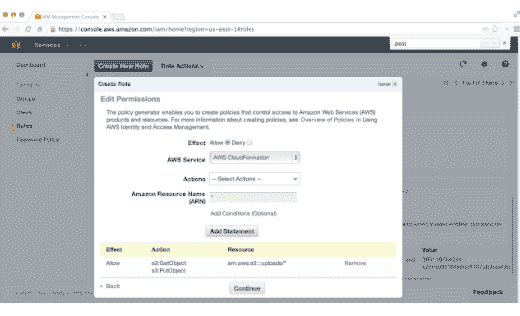

# Role ARN

有关这些配置数字的更多信息，请查阅相关文档。我们需要持有的一个信息是 Role ARN。我们可以在 IAM 控制台的摘要标签页上找到此 Role ARN。注意此字符串——稍后我们会设置它。

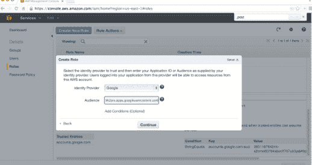

# AWSService

现在，正如我们之前所说，我们需要为 AWS 服务设置授权。

如果你还没有 AWS 账户，请前往 `aws.amazon.com` 并获取一个账户。
它是免费且快速的。

首先是：让我们创建一个 IAM 角色。IAM（即 AWS 的身份和访问管理服务）是 AWS 服务如此强大的原因之一。通过 IAM，我们可以对我们的系统和数据创建细粒度的访问控制。

遗憾的是，IAM 的灵活性和强大也使其变得有些复杂，因此我们将逐步讲解创建过程，并尽可能使其清晰。

让我们前往 IAM 控制台 并点击“角色”导航栏来创建 IAM 角色。我们必须点击“创建角色”按钮来获取新角色名称。我们将其命名为 `google-web-role`。

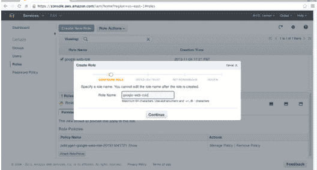

创建新角色

接下来，我们需要将 IAM 角色配置为“Web Identity Provider”（身份身份提供者）类型，这样我们就可以管理新角色对 AWS 服务的访问。

> http://aws.amazon.com/
> https://console.aws.amazon.com/iam/home?region=us-east-1#roles

# 服务器通信

# 设置角色类型

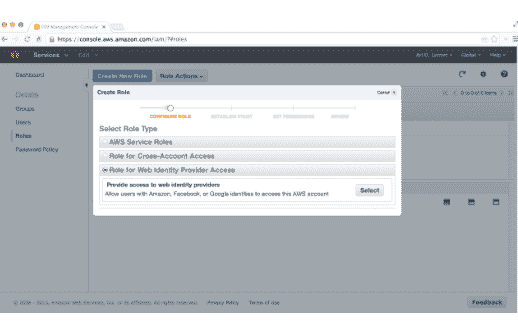

记得我们上面为 Google 创建的 `CLIENT ID` 吗？在下一个屏幕中，从下拉菜单中选择 Google，并将 `CLIENT ID` 粘贴到受众（Audience）框中。

这一步将我们的 IAM 角色和 Google 应用连接起来，这样我们的应用程序就可以使用身份验证的用户调用 AWS 服务。


# Google 认证

我们然后点击“验证信任”（下一个屏幕将显示 AWS 服务的原始配置）并为我们的应用程序创建策略。

策略生成器是快速运行并构建策略的最简单方法。在此处，我们设置用户可以执行和不能执行的操作。

我们将努力对用户可能执行的操作做到非常具体：

# S3

在特定的存储桶（在示例中为 `ng-newsletter-example`），我们将允许用户执行以下操作：

- GetObject
- ListBucket
- PutObject

我们 S3 存储桶的 Amazon 资源 (ARN) 为：

```
arn:aws:s3:::ng-newsletter-example/*
```

# DynamoDB

对于特定的表资源，我们将允许以下操作：

- GetItem
- PutItem
- Query

DynamoDB 表的 Amazon 资源名称 (ARN) 为：

```
arn:aws:dynamodb:us-east-1:<ACCOUNT_ID>:table/Users
arn:aws:dynamodb:us-east-1:<ACCOUNT_ID>:table/Items
```

我们的策略最终版本可以在此处找到。


# Role ARN

有关这些配置数字的更多信息，请查阅相关文档。我们需要持有的一个信息是 Role ARN。我们可以在 IAM 控制台的摘要标签页上找到此 Role ARN。注意此字符串——稍后我们会设置它。


# AWSService

现在，正如我们之前所说，我们需要为 AWS 服务设置授权。

如果你还没有 AWS 账户，请前往 `aws.amazon.com` 并获取一个账户。
它是免费且快速的。

首先是：让我们创建一个 IAM 角色。IAM（即 AWS 的身份和访问管理服务）是 AWS 服务如此强大的原因之一。通过 IAM，我们可以对我们的系统和数据创建细粒度的访问控制。

遗憾的是，IAM 的灵活性和强大也使其变得有些复杂，因此我们将逐步讲解创建过程，并尽可能使其清晰。

让我们前往 IAM 控制台 并点击“角色”导航栏来创建 IAM 角色。我们必须点击“创建角色”按钮来获取新角色名称。我们将其命名为 `google-web-role`。


创建新角色

接下来，我们需要将 IAM 角色配置为“Web Identity Provider”（身份身份提供者）类型，这样我们就可以管理新角色对 AWS 服务的访问。

> http://aws.amazon.com/
> https://console.aws.amazon.com/iam/home?region=us-east-1#roles

# 服务器通信

# 设置角色类型


记得我们上面为 Google 创建的 `CLIENT ID` 吗？在下一个屏幕中，从下拉菜单中选择 Google，并将 `CLIENT ID` 粘贴到受众（Audience）框中。

这一步将我们的 IAM 角色和 Google 应用连接起来，这样我们的应用程序就可以使用身份验证的用户调用 AWS 服务。


# Google 认证

我们然后点击“验证信任”（下一个屏幕将显示 AWS 服务的原始配置）并为我们的应用程序创建策略。

策略生成器是快速运行并构建策略的最简单方法。在此处，我们设置用户可以执行和不能执行的操作。

我们将努力对用户可能执行的操作做到非常具体：

# S3

在特定的存储桶（在示例中为 `ng-newsletter-example`），我们将允许用户执行以下操作：

- GetObject
- ListBucket
- PutObject

我们 S3 存储桶的 Amazon 资源 (ARN) 为：

```
arn:aws:s3:::ng-newsletter-example/*
```

# DynamoDB

对于特定的表资源，我们将允许以下操作：

- GetItem
- PutItem
- Query

DynamoDB 表的 Amazon 资源名称 (ARN) 为：

```
arn:aws:dynamodb:us-east-1:<ACCOUNT_ID>:table/Users
arn:aws:dynamodb:us-east-1:<ACCOUNT_ID>:table/Items
```

我们的策略最终版本可以在此处找到。


# Role ARN

有关这些配置数字的更多信息，请查阅相关文档。我们需要持有的一个信息是 Role ARN。我们可以在 IAM 控制台的摘要标签页上找到此 Role ARN。注意此字符串——稍后我们会设置它。


```javascript
return d.promise;
}
// ...
```

## 开始使用 Dynamo

在我们的应用程序中，我们希望将用户上传的任何图像与该用户关联。为了创建这种关联，我们将创建一个 Dynamo 表来存储我们的用户，创建另一个表来存储用户与用户上传的文件之间的关联。

要开始与 Dynamo 交互，我们首先需要实例化 Dynamo 对象。我们在 `AWSService` 对象内部进行此操作，如下：

```javascript
// ...
setToken: function(token, providerId) {
// ...
ndynamo: function(params) {
  var d = $q.defer();
  credentialsPromise.then(function() {
    var table = new AWS.DynamoDB(params);
    d.resolve(table);
  });
  return d.promise;
}
// ...
```

正如我们之前讨论的，通过在我们的服务对象中使用 promises，我们只需要使用 `.then()` API 方法即可确保在我们开始使用凭据时凭据已设置。

你可能会问为什么我们在我们的 dynamo 函数中要设置 `params`。有时，我们希望使用不同的配置和默认设置与 DynamoDB 交互。对于这种交互，我们可能需要重新创建已经在页面中用过的对象。

与其在我们的不同的 AWS 对象中存在这种重复，我们可以使用内置的 Angular `$cacheFactory` 服务来缓存这些对象。

## $cacheFactory

`$cacheFactory` 服务允许我们在需要时创建对象，或者在过去需要过该对象时对其进行回收和重用。

要开始缓存，我们创建一个 `dynamoCache` 对象，在其中我们将存储我们缓存的 Dynamo 对象：

```javascript
// ...
```

```javascript
self.$get = function($q, $cacheFactory) {
  var dynamoCache = $cacheFactory('dynamo'),
  credentialsDefer = $q.defer(),
  credentialsPromise = credentialsDefer.promise;
  return {
// ...n
}
```

回到我们的 `dynamo` 方法，如果对象存在于内部，我们可以从缓存中提取，或者设置它在需要时创建对象：

```javascript
// /
dynamo: function(params) {
  var d = $q.defer();
  credentialsPromise.then(function() {
    var table = dynamoCache.get(JSON.stringify(params));
    if (!table) {
      var table = new AWS.DynamoDB(params);
      dynamoCache.put(JSON.stringify(params), table);
    }
    d.resolve(table);
  });
  return d.promise;
},
// /
```

## 保存我们的 currentUser

用户登录并我们获取其电子邮件的时刻，是我们将用户添加到用户数据库中的好时机。

要创建一个 Dynamo 对象，我们需要再次使用 promise API 方法 `.then()`，这次是在服务外部。我们创建了一个对象，使我们能够与在 Dynamo API 控制台中创建的 `User` 表进行交互。

在我们第一次运行程序时，我们需要手动创建 Dynamo 表，因为赋予 Web 用户创建 Dynamo 表的能力是不安全的。

要创建一个一个 Dynamo 表，让我们前往 Dynamo 控制台 并找到“Create Table”（创建表）按钮。

> https://console.aws.amazon.com/dynamodb/home

我们想创建一个名为 `Users` 的表，主键类型为 `Hash`。Hash 属性名称（Hash Attribute Name）将是用来用于在表中获取和存入对象的主键。在此演示中，我们将使用字符串：`User email`。

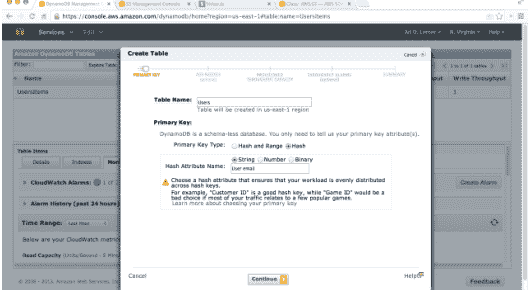

创建 Users Dynamo 表

当我们点击后续屏幕时，我们将通过输入电子邮件来设置基础告警。虽然这一步不是 100% 必要的，但很容易忘记我们的表已经开启了；如果没有提醒，我们可能永远遗留下它们。

一旦我们点击了最后的确认屏幕并点击创建，我们就拥有一个全新的 Dynamo 表，在其中我们将存储我们的用户。

在我们操作控制台时，我们需要创建连接表。此表连接了用户和用户上传的项目。

我们必须返回再次找到“Create Table”按钮，以创建一个名为 `UsersItems` 的表，主键类型为 `Hash` 和 `Range`。对于此表，Hash 属性名称也将是 `User email`，Range 属性名称（Range Attribute Name）将是 `ItemId`。

这样设置我们的表允许我们根据电子邮件查询任何创建过项目的用户。

后续屏幕上提供的其他选项都是可选的，我们可以点击剩余部分。

到此时，我们有两个可用的 dynamo 表。

回到我们的 `UserService`，我们首先查询表以查看用户是否已保存到我们的数据库；如果没有，我们必须在我们的 Dynamo 数据库中创建一个条目。

```javascript
var service = {
  _user: null,
  UsersTable: "Users",
  UserItemsTable: "UserItems",
  // ...
  currentUser: function() {
    var d = $q.defer();
    if (service._user) {
      d.resolve(service._user);
    } else {
      // 在我们加载凭据后
      AWSService.credentials.then(function() {
        gapi.client.oauth2.userinfo.get()
        .execute(function(e) {
          var email = e.email;
          AWSService.dynamo({ TableName: "Users", Key: { 'User email': email } })
            .then(function(data) {
              if (data) {
                service._user = data;
                d.resolve(service._user);
              } else {
                var item = { 'User email': email };
                AWSService.dynamo({ TableName: "Users", Item: item })
                  .then(function(table) {
                    service._user = table;
                    d.resolve(service._user);
                  });
              }
            });
        });
      });
    }
  }
}
```

```javascript
return d.promise;
}
// ...
```

你可能会问为什么我们在我们的 dynamo 函数中要设置 `params`。有时，我们希望使用不同的配置和默认设置与 DynamoDB 交互。对于这种交互，我们可能需要重新创建已经在页面中用过的对象。

与其在我们的不同的 AWS 对象中存在这种重复，我们可以使用内置的 Angular `$cacheFactory` 服务来缓存这些对象。

## $cacheFactory

`$cacheFactory` 服务允许我们在需要时创建对象，或者在过去需要过该对象时对其进行回收和重用。

要开始缓存，我们创建一个 `dynamoCache` 对象，在其中我们将存储缓存的 Dynamo 对象：

```javascript
// ...
```

```javascript
self.$get = function($q, $cacheFactory) {
  var dynamoCache = $cacheFactory('dynamo'),
  credentialsDefer = $q.defer(),
  credentialsPromise = credentialsDefer.promise;
  return {
// ...n
}
```

回到我们的 `dynamo` 方法，如果对象存在于内部，我们可以从缓存中提取，或者设置它在需要时创建对象：

```javascript
// /
dynamo: function(params) {
  var d = $q.defer();
  credentialsPromise.then(function() {
    var table = dynamoCache.get(JSON.stringify(params));
    if (!table) {
      var table = new AWS.DynamoDB(params);
      dynamoCache.put(JSON.stringify(params), table);
    }
    d.resolve(table);
  });
  return d.promise;
},
// /
```

## 保存我们的 currentUser

用户登录并我们获取其电子邮件的时刻，是我们将用户添加到用户数据库中的好时机。

要创建一个 Dynamo 对象，我们需要再次使用 promise API 方法 `.then()`，这次是在服务外部。我们创建了一个对象，使我们能够与在 Dynamo API 控制台中创建的 `User` 表进行交互。

在我们第一次运行程序时，我们需要手动创建 Dynamo 表，因为赋予 Web 用户创建 Dynamo 表的能力是不安全的。

要创建一个 Dynamo 表，让我们前往 Dynamo 控制台 并找到“Create Table”（创建表）按钮。

> https://console.aws.amazon.com/dynamodb/home

我们想创建一个名为 `Users` 的表，主键类型为 `Hash`。Hash 属性名称（Hash Attribute Name）将是用来用于在表中获取和存入对象的主键。在此演示中，我们将使用字符串：`User email`。


创建 Users Dynamo 表

当我们点击后续屏幕时，我们将通过输入电子邮件来设置基础告警。虽然这一步不是 100% 必要的，但很容易忘记我们的表已经开启了；如果没有提醒，我们可能永远遗留下它们。

一旦我们点击了最后的确认屏幕并点击创建，我们就拥有一个全新的 Dynamo 表，在其中我们将存储我们的用户。

在我们操作控制台时，我们需要创建连接表。此表连接了用户和用户上传的项目。

我们必须返回再次找到“Create Table”按钮，以创建一个名为 `UsersItems` 的表，主键类型为 `Hash` 和 `Range`。对于此表，Hash 属性名称也将是 `User email`，Range 属性名称（Range Attribute Name）将是 `ItemId`。

这样设置我们的表允许我们根据电子邮件查询任何创建过项目的用户。

后续屏幕上提供的其他选项都是可选的，我们可以点击剩余部分。

到此时，我们有两个可用的 dynamo 表。

回到我们的 `UserService`，我们首先查询表以查看用户是否已保存到我们的数据库；如果没有，我们必须在我们的 Dynamo 数据库中创建一个条目。

```javascript
var service = {
  _user: null,
  UsersTable: "Users",
  UserItemsTable: "UserItems",
  // ...
  currentUser: function() {
    var d = $q.defer();
    if (service._user) {
      d.resolve(service._user);
    } else {
      // 在我们加载凭据后
      AWSService.credentials.then(function() {
        gapi.client.oauth2.userinfo.get()
        .execute(function(e) {
          var email = e.email;
          AWSService.dynamo({ TableName: "Users", Key: { 'User email': email } })
            .then(function(data) {
              if (data) {
                service._user = data;
                d.resolve(service._user);
              } else {
                var item = { 'User email': email };
                AWSService.dynamo({ TableName: "Users", Item: item })
                  .then(function(table) {
                    service._user = table;
                    d.resolve(service._user);
                  });
              }
            });
        });
      });
    }
  }
}
```

```javascript
if (file) scope.fileUpload({files: file});
}}
}
}
```

我们可以在视图中像这样使用该指令：

```html
<!-- -->
<div class="row">
  <div class="col-md-12">
    <div file-upload="onFile(files)"></div>
  </div>
</div>
```

现在，当完成文件选择后，它会调用我们当前作用域中的 `onFile(files)` 方法。

> 尽管我们在这里创建了文件指令，但我们建议查看 `ngUpload` 库来处理文件上传。https://github.com/twson63/ngUpload

在 `on(files)` 方法内部，我们想要处理将文件上传到 S3，并将记录保存到我们的 Dynamo 数据库表中。我们不想将此函数放在控制器中，而是想记得做一个良好的 Angular 开发者，将其放置在我们的 `UserService` 服务中。

首先，我们需要确保我们有能力获取 S3 JavaScript 对象，就像我们之前让 dynamo 可用那样。

```javascript
//
var dynamoCache = $cacheFactory('dynamo');
var s3Cache = $cacheFactory('s3Cache');
return {
//
  s3: function(params) {
    var d = $q.defer();
    credentialsPromise.then(function() {
      var s3obj = s3Cache.get(JSON.stringify(params));
      if (!s3obj) {
        var s3obj = new AWS.S3(params);
        s3Cache.put(JSON.stringify(params), s3obj);
      }
      d.resolve(s3obj);
    });
    return d.promise;
  },
// ...
}
```

该方法的工作方式与我们创建 Dynamo 对象的方式相同，它让我们直接访问 S3 实例对象，正如我们稍后将看到的。

## 处理文件上传

为了处理文件上传，我们需要在 `UserService` 中创建一个名为 `uploadItemForSale()` 的方法。为了方便规划，从功能角度来说，我们希望：

- 将文件上传到 S3
- 获取文件的签名 URL (signedUrl)
- 将此信息保存到我们的数据库

我们在整个过程中将使用当前用户，因此我们必须从确保我们拥有用户和实例开始：

```javascript
// in scripts/services.js
//
Bucket: 'ng-newsletter-example',
uploadItemForSale: function(items) {
  var d = $q.defer();
  service.currentUser().then(function(user) {
    // 处理上传
    AWSService.s3({
      params: {
        Bucket: service.Bucket
      }
    }).then(function(s3) {
      // 我们有一个 s3 bucket 的句柄
      // 在 s3 对象中
    });
  });
  return d.promise;
},
// ...
```

### 服务器通信

S3 bucket 的句柄让我们能够创建一个用于上传的文件。AWS 在上传到 S3 时需要三个参数：

- Key - 文件对象的键
- Body - 文件二进制对象 (blob) 本身
- ContentType - 文件类型

幸运的是，当我们从浏览器获取文件对象时，所有这些这些信息都是可用的。

```javascript
// ...
// 处理上传
AWSService.s3({
  params: {
    Bucket: service.Bucket
  }
}).then(function(s3) {
  // 我们有一个 s3 对象的句柄
  // 在 s3 对象中
  var file = items[0]; // 获取第一个文件
  var params = {
    Key: file.name,
    Body: file,
    ContentType: file.type
  }
  s3.putObject(params, function(err, data) {
    // 文件已上传
    // 或者在上传过程中发生了错误
  });
});
// ...
```

默认情况下，S3 以保护的形式上传文件。它防止了我们在不进行一些工作的情况下上传并使文件公开可用。此功能确保了我们上传到 S3 的所有内容都将受到保护，并迫使我们对哪些文件是公开的、哪些不是做出有意识的选择。

考虑到这一点，让我们创建一个在给定时间后过期的临时 URL。在我们的 ngroad 市场中，此 URL 将为每个待售物品提供时间限制。

无论如何，要创建一个临时 URL，我们获取一个签名 URL 并将其存储在我们的“用户-物品”连接表表中：

```javascript
// ...
s3.putObject(params, function(err, data) {
  if (!err) {
    var params = {
      Bucket: service.name,
      Key: file.name,
      Expires: 900*4 // 1 小时
    };
    s3.getSignedUrl('getObject', params,
      function(err, url) {
        // 现在我们有了一个 url
      }
    );
  }
}
// ...
```

最后，我们将我们的用户对象以及他们上传的文件保存到我们的连接表中：

```javascript
// ...
s3.getSignedUrl('getObject', params,
  function(err, url) {
    // 现在我们有了一个 url
    AWSService.dynamo({
      params: {TableName: service.UserItemsTable}
    }).then(function(table) {
      var itemParams = {
        Item: {
          'ItemId': {S: file.name},
        }
      };
      table.putItem(itemParams, function(err, data) {
        // 成功
      });
    });
  }
```

最后，我们可以将用户对象连同他们上传的文件保存到我们的连接表中：

```javascript
// ...
s3.getSignedUrl('getObject', params,
  function(err, url) {
    // 现在我们有了一个 url
    AWSService.dynamo({
      params: {TableName: service.UserItemsTable}
    }).then(function(table) {
      var itemParams = {
        Item: {
          'ItemId': {S: file.name},
          'FileUrl': {S: url}
        }
      };
      table.putItem(itemParams, function(err, data) {
        // 成功
      });
    });
  }
```

该方法的方式与我们创建 Dynamo 对象的方式相同，它让我们直接访问 S3 实例对象，正如我们稍后将看到的。

## 处理文件上传

为了处理文件上传，我们需要在 `UserService` 中创建一个名为 `uploadItemForSale()` 的方法。为了方便规划，从功能角度来说，我们希望：

- 将文件上传到 S3
- 获取文件的签名 URL (signedUrl)
- 将此信息保存到我们的数据库

我们在整个过程中将使用当前用户，因此我们必须从确保我们拥有用户和实例开始：

```javascript
// in scripts/services.js
//
Bucket: 'ng-newsletter-example',
uploadItemForSale: function(items) {
  var d = $q.defer();
  service.currentUser().then(function(user) {
    // 处理上传
    AWSService.s3({
      params: {
        Bucket: service.Bucket
      }
    }).then(function(s3) {
      // 我们有一个 s3 bucket 的句柄
      // 在 s3 对象中
    });
  });
  return d.promise;
},
// ...
```

### 服务器通信

S3 bucket 的句柄让我们能够创建一个用于上传的文件。AWS 在上传到 S3 时需要三个参数：

- Key - 文件对象的键
- Body - 文件二进制对象 (blob) 本身
- ContentType - 文件类型

幸运的是，当我们从浏览器获取文件对象时，所有这些信息都是可用的。

```javascript
// ...
// 处理上传
AWSService.s3({
  params: {
    Bucket: service.Bucket
  }
}).then(function(s3) {
  // 我们有一个 s3 对象的句柄
  // 在 s3 对象中
  var file = items[0]; // 获取第一个文件
  var params = {
    Key: file.name,
    Body: file,
    ContentType: file.type
  }
  s3.putObject(params, function(err, data) {
    // 文件已上传
    // 或者在上传过程中发生了错误
  });
});
// ...
```

默认情况下，S3 以保护的形式上传文件。它防止了我们在不进行一些工作的情况下上传并使文件公开可用。此功能确保了我们上传到 S3 的所有内容都将受到保护，并迫使我们对哪些文件是公开的、哪些不是做出有意识的选择。

考虑到这一点，让我们创建一个在给定时间后过期的临时 URL。在我们的 ngroad 市场中，此 URL 将为每个待售物品提供时间限制。

无论如何，要创建一个临时 URL，我们获取一个签名 URL 并将其存储在我们的“用户-物品”连接表中：

```javascript
// ...
s3.putObject(params, function(err, data) {
  if (!err) {
    var params = {
      Bucket: service.name,
      Key: file.name,
      Expires: 900*4 // 1 小时
    };
    s3.getSignedUrl('getObject', params,
      function(err, url) {
        // 现在我们有了一个 url
      }
    );
  }
}
// ...
```

最后，我们将我们的用户对象连同他们上传的文件保存到我们的连接表中：

```javascript
// ...
s3.getSignedUrl('getObject', params,
  function(err, url) {
    // 现在我们有了一个 url
    AWSService.dynamo({
      params: {TableName: service.UserItemsTable}
    }).then(function(table) {
      var itemParams = {
        Item: {
          'ItemId': {S: file.name},
          'FileUrl': {S: url}
        }
      };
      table.putItem(itemParams, function(err, data) {
        // 成功
      });
    });
  }
```

该方法的方式与我们创建 Dynamo 对象的方式相同，它让我们直接访问 S3 实例对象，正如我们稍后将看到的。

## 服务通信

如果你还没有 Stripe 账户，请在 `stripe.com` 注册一个。Stripe 是一个对开发者极其友好的支付处理网关，这非常适合我们用于构建 ngroid 市场。

一旦我们有了账户，我们需要找到“账户设置”（Account Settings）页面并定位“API Keys”页面。我们的首要任务是找到可发布密钥（测试版，不会产生实际费用，或者生产环境版本）并记录下来。

在我们的 `scripts/app.js` 文件中，我们只需添加以下行，并将 'pk_test_YOUR_KEY' 可发布密钥替换为我们自己的。

```javascript
// ...
.config(function(StripeServiceProvider) {
  StripeServiceProvider
    .setPublishableKey('pk_test_YOUR_KEY');
}
```

## 使用 Stripe

当用户点击他喜欢的图片时，我们会在浏览器中打开一个填写信用卡信息的表单。我们希望将表单提交到控制器中名为 `submitPayment()` 的操作。

注意上面，我们在图片缩略图的地方包含了一个点击图片时调用的操作，该操作带有带图片的 `sellImage()` 操作。

在 `MainController` 中实现 `sellImage()` 函数看起来如下：

```javascript
// ...
$scope.sellImage = function(image) {
  $scope.showCC = true;
  $scope.currentItem = image;
}
// ...
```

当图片被点击时，`showCC` 属性将变为 `true`，我们就可以显示信用卡表单。在这里包含了一个极其简单的表单：

http://stripe.com

```html
<div ng-show="showCC">
<form ng-submit="submitPayment()">
  <span ng-bind="errors"></span>
  <span>Card Number </span>
  <input type="text"
        ng-minlength="16"
        ng-maxlen="20"
        size="20"
        data-stripe="number"
        ng-model="charge.number" />
  <span></span>
  <input type="text"
        ng-minlength="3"
        ng-maxlen="4"
        data-stripe="cvc"
        ng-model="charge.cvc" />
  <span>Expiration (MM/YYYY)</span>
  <input type="text"
        ng-minlength="2"
        ng-maxlen="2"
        size="4"
        data-stripe="exp_month"
        ng-model="charge.exp_month" />
  <span> </span>
  <input type="text"
        ng-minlength="4"
        ng-maxlen="4"
        size="4"
        data-stripe="exp-year"
        ng-model="charge.exp_year" />
  <input type="hidden"
        name="email"
        value="user.email" />
  <button type="submit">Submit Payment</button>
</form>
</div>
```

我们将表单几乎完全绑定到 scope 上的 `charge` 对象，我们在进行扣费时将使用它。

表单本身提交到控制器 scope 上的 `submitPayment()` 函数。`submitPayment()` 函数看起来如下：

## 服务通信

```javascript
// ...
$scope.submitPayment = function() {
  UserService
  .createPayment($scope.currentItem, $scope.charge)
  .then(function(data) {
    $scope.showCC = false;
  });
}
// ...
```

为了能够接受付款，我们必须做的最后一件事是在 `UserService` 上实现 `createPayment()` 方法。

现在，由于我们是在客户端处理支付，从技术上讲我们无法直接处理支付；我们只能接收 `stripeToken`。我们可以设置一个后台进程来管理将 Stripe 令牌转换为实际付款。

在 `createPayment()` 函数内部，我们需要调用 `StripeService` 来生成 `stripeToken`。然后我们将支付信息添加到 Amazon SQS 队列中，以便我们的后台进程可以进行扣费。

首先，我们使用 `AWSService` 来访问我们的 SQS 队列。

与其他服务不同，SQS 服务需要更多的集成才能工作，该服务要求我们拥有一个 URL 来其进行交互。在我们的 `AWSService` 服务对象中，我们需要缓存正在使用的 URL，并且每次都使用生成的服务对象创建一个新对象。然而，工作流背后的原理是相同的。

```javascript
// ...
self.get = function($q, cacheFactory) {
  var dynamoCache = cacheFactory('dynamo');
  s3Cache = cacheFactory('s3Cache');
  sqsCache = $cacheFactory('sqs');
}
sqs = function(params) {
  var d = $sq.defer();
  credentialsPromise.then(function() {
    var url = sqsCache.get(JSON.stringify(params));
    queued = $q.defer();
    if (!url) {
      var sqs = new AWS.SQS();
      sqs.createQueue(params,
        function(err, data) {
          if (data) {
            url = data.QueueUrl;
sqsCache.put(JSON.stringify(params), url);
queued.resolve(url);
} else {
  queued.reject(err);
}
}
}
} else {
  queued.resolve(url);
}
}
```

## 服务器通信

284

当我们在三个地方（视图、模型或 Firebase）中的任何一个更新数据时，更改将实时传播到*所有*客户端的另外两个地方。

## 开始使用 AngularFire

益于官方 Angular 库 AngularFire，我们可以使用 Firebase 和 Angular 轻松创建实时 Web 应用。Firebase 团队专门构建了 AngularFire 绑定，用于与 Angular 应用集成，正如我们将会看到的。

使用 AngularFire 将我们的 Angular 应用接入 Firebase 仅需*四个*步骤：

## 1 注册并创建 Firebase

在我们实际从 Firebase 保存或检索数据之前，我们需要一个账户。创建账户是免费的，让我们去注册吧。

首先，前往 `firebase.com` 并点击 *Sign up*（注册）按钮（如果你已有账户，请点击登录）：

> http://firebase.com

## 服务器通信

285

现在我们已经注册了账户，可以创建第一个 Firebase。我们选择的名称将成为引用 Firebase 数据的 URL 的一部分。

例如，当我们创建一个名为 ng-newsletter 的 Firebase 时，我们的 Firebase URL 将是 `https://ng-newsletter.firebaseio.com`。

AngularFire 绑定允许我们将 Firebase URL 与一个模型或模型集合关联。这些模型代表了 AngularFire 在当前所有使用我们应用的客户端中透明地保持同步的数据。

Angular 的双向数据绑定保持 DOM 与内存中的 JavaScript 变量同步；Firebase 则存储这些更改并将它们实时发送给所有监听客户端。

> 我们在**不改变**构建 Angular 应用方式的情况下创建了这种数据同步。
太酷了！

## 2 引入 Firebase 和 AngularFire 库

使用 Firebase 只需要在我们的 HTML 文件中包含两个 JavaScript 文件即可简单：一个用于 Firebase，另一个用于 AngularFire。

我们需要使用 Firebase 的 CDN，因此在我们的 index.html 文件的顶部添加以下行：

```html
<script src="https://cdn.firebase.com/v0/firebase.js"></script>
<script src="https://cdn.firebase.com/libs/angularfire/0.5.0-rc1/angularfire.js"></script>
```

## 3 将 Firebase 添加为依赖项

与任何应用程序库一样，我们需要将 Firebase 库设置为我们模块的依赖项。这告诉应用程序的其他部分，我们可以在应用中使用 Firebase 绑定：

```javascript
angular.module("myapp", ["firebase"]);
```

## 4 将模型绑定到 Firebase URL

通过声明 Firebase 为依赖项，我们现在可以访问 $firebase 服务，它允许我们作为依赖项注入到我们的控制器和服务中。

```javascript
angular.module('myapp', ['firebase'])
.controller('MyController', ['$scope', "$firebase"],
  function($scope, $firebase) {
    // 此处编写控制器定义
  }
);
```

$firebase 服务接收单个参数：Firebase 引用。

### FirebaseRef (Firebase Reference)

Firebase 引用告诉 $firebase 数据存储在哪里以及如何连接。$firebase 服务处理与 Angular 的同步，以及我们在哪里调用方法来保存更改。该对象有几个我们用于与远程数据交互的方法。这些方法都带有 $ 符号前缀（例如，$add(), $save()），并且在该对象上可用。

请注意，对对象的任何更改都不会导致远程数据的更改。

要将本地模型同步到远程 Firebase 引用，我们使用服务方法并向其传递 Firebase 对象的实例。例如，要将 $scope.items 模型同步到我们的 ng-newsletter items，我们运行以下方法：

## 服务器通信

298

```javascript
angular.module('myApp')
.controller('MyController', function($scope, $firebase) {
  // Firebase URL
  var URL = "https://ng-newsletter.firebase.com";
  // 同步我们 $scope 上的 items
  $scope.items = $firebase(new Firebase(URL + '/items'));
});
```

现在，我们可以简单地与 $scope.items 对象交互，将我们的 Angular 模型与 Firebase 同。

## 数据同步

我们可以使用 $firebase 对象提供的以下方法将数据同步回 Firebase。

### $add(value)

$add 方法接收一个任何类型的单个参数。它将此值作为按时间顺序列表的成员追加。我们可以认为这好比在 Firebase 引用数组上调用了 .push(value)。

> 注意，Firebase 引用对象并不是真正的数组，但我们可以像对待数组那样操作。

例如，我们可以向位于 /foo 终点的 Firebase 引用添加字符串 "bar"：

```javascript
$scope.items.add({foo: "bar"});
```

### $remove(key)

$remove() 方法删除子节点。它接收一个可选参数：

key（可选字符串）如果提供了提供了 key，$remove() 方法将删除整个对象。

```javascript
$scope.items.remove("foo");
```

## 服务器通信

299

### $save(key)

$save 方法同步模型的所有所有更改。它接收一个单个参数：

key（可选字符串）如果提供了 key，$save() 方法将更新远程数据。

```javascript
$scope.items.save("foo");
```

### $child(key)

$child() 方法创建一个由 key 引用的新子节点。它接收一个单个参数：

key（string）key 用于引用新建的子节点。

```javascript
var child = $scope.items.child("foo");
```

### $set(value)

$set() 方法覆盖此对象的远程值。它接收一个单个参数：

value（string）value 是对象的新值。

```javascript
$scope.items.set({bar: "baz"});
```

## AngularFire 中的排序

300

## 服务器通信

如果我们对远程对象进行排序，而不是简单地使用 Angular 过滤器进行本地排序，我们可以在调用 $save() 之前设置 $priority 字段。

```javascript
$scope.items.foo.$priority = 2;
$scope.items.save("foo");
```

默认情况下，$firebase 服务返回一个简单的 JavaScript 对象。我们可以通过使用 orderByPriority 过滤器将此对象转换为遵循顺序的数组。

该过滤器将 $firebase 服务的对象转换为数组并根据 Firebase 定义的优先级进行排序。AngularFire 会在其每个对象上设置 $id 属性，引用对象的键名。

```html
<ul ng-repeat="item | orderByPriority">
  <li>
    <input type="text" id="{{item.id}}" ng-model="item.$priority">
    {{item.name}}
  </li>
</ul>
```

## Firebase 事件

Firebase 触发两种事件，我们可以在应用程序内部处理这些逻辑。我们可以使用 $on() 方法为这两种事件类型附加事件处理器：

### loaded

Firebase 在通过连接接收初始数据时触发 loaded 事件。它触发一次且仅触发一次。

```javascript
$scope.items.on('loaded', function() {
  console.log("加载加载");
});
```

### change

当本地对象的数据发生远程更改时，Firebase 触发 change 事件。例如，如果另一个用户向我们的任务列表添加了新任务。

```javascript
$scope.items.on('change', function() {
  console.log("发生了变化");
});
```

## 隐式同步

要对 $scope 变量添加自动的、隐式的同步，我们可以在 $firebase 服务返回的对象上调用 $bind() 方法。

$bind() 方法会自动建立三向绑定，因此我们不再需要使用 $add() 或 $save() 方法显式将数据保存到 Firebase。

```javascript
$scope.items.bind($scope, "remoteItems");
$scope.remoteItems.bar = "foo"; // new Firebase(URL + "bar") 现在是 "foo"
```

$bind() 方法返回一个 promise，该 promise 在从服务器接收到初始数据后解析。该 promise 将以一个 unbind 函数的形式解析，调用该函数时将解绑三向绑定。

```javascript
$scope.items.bind($scope, "remote")
  .then(function(unbind) {
    unbind();
    $scope.remoteItems.bar = "foo"; // 远程数据未发生任何更改。
  });
```

$bind() 方法返回一个 promise，当 AngularJS 接收到来自服务器的初始数据时。该 promise 将以一个 unbind 函数的形式解析，调用该函数时将解绑三向绑定。这种解绑对于优化我们的网站和移除不必要的监听（watches）非常有用。

## AngularFire 身份验证

Firebase 开箱提供了一种简单的客户端身份验证策略。

使用 Firebase 的简单登录（Simple Login）或自定义登录（Custom Login）方法，我们可以使用 AngularFire 轻松地为应用程序添加用户身份验证。

如果我们有自己的服务器来控制身份验证，或者想要将现有的身份验证与 Firebase 集成，那么自定义登录最为合适。

如果我们想使用 Firebase 管理所有的身份验证，可以使用简单登录，它支持 Facebook、Twitter、GitHub、Persona 以及电子邮件/密码身份验证。

通过在应用的模块中将 Firebase 定义为依赖项，我们就可以在控制器和服务中使用 $firebaseAuth 服务。

## 服务器通信

```javascript
angular.module('myApp')
  .controller("MyAuthController", function($scope, $firebaseAuth) {
    // 在此处定义我们的控制器
  });
```

$firebaseAuth 服务接收两个参数：一个 Firebase 引用和一个包含选项的可选对象。该对象可以包含以下属性，以自定义身份验证与 Firebase 工作的方式：

- simple - 默认情况下，$firebaseAuth 需要包含 firebase-simple-login.js 文件。将此简单值设置为 false 即可取消此要求，但仅会启用自定义功能，且我们可以简单身份验证。
- callback - 当身份验证状态发生变化时，Firebase 会调用此。我们可以使用此回调作为 $rootScope 上事件的替代方案，这是处理身份验证变化的推荐方式。
- path - 如果在 $routeProvider 中设置了 authRequired 属性且用户未登录，则用户将将被重定向到此路径。

```javascript
angular.module('myApp')
  .controller("MyAuthController", function($scope, $firebaseAuth) {
    var ref = new Firebase(URL);
    $scope.auth = $firebaseAuth(ref);
    // 在用户登录之前，$scope.user 为 null。
  });
```

$firebaseAuth() 返回的对象包含一个单一的正确命名的 user。如果用户注销，user.user 被设置为 null；一旦他或她登录后，它将更改为包含用户详情的对象。我们涵盖了登录检测的内容。

> 用户详情的内容取决于所使用的身份验证机制，但至少包含用户 ID（user id）和提供者名称（provider name）。

## 身份验证事件

通过 AngularFire，我们可以访问多个方法来更改用户的身份验证状态；这些方法是 $login()、logout() 和 $createUser()。

AngularFire 中的身份验证状态被认为是全局的，所有的 scope 均继承自 $rootScope。由于几乎所有的操作都会在 $rootScope 上广播，我们可以从任何控制器中调用 $scope.on(...)。

全局身份验证意味着我们不能让多个用户同时登录到同一个应用程序实例中。例如，全局身份验证防止两个用户在同一个浏览器实例中同时登录 Gmail。

**$firebaseAuth:login** 当他或她成功登录时触发此事件。它带有两个参数触发：一个事件对象和一个用户对象。

```javascript
rootScope.on("$firebaseAuth:login", function(evt, user) {
  console.log("用户 " + user.id + " 登录成功！");
});
```

**$firebaseAuth:logout** 用户在他或她注销时触发注销。该事件带有一个事件参数触发。

```javascript
rootScope.on("$firebaseAuth:logout", function(evt) {
  console.log("用户已注销!");
});
```

**$firebaseAuth:error** 当在调用 $login() 或 $logout() 期间发生错误时，触发错误事件。此事件带有单个参数触发：错误。

$login(token, [options])
我们使用 login() 方法来登录用户。我们通常在用户点击登录按钮时使用它，如下：

```html
<a href="#" ng-hide="auth.user" ng-click="auth.login('persona')">Login</a>
```

login() 函数接收两个参数：

**tokenOrProvider(string/JWT token)** 如果我们使用 Firebase 简单登录，我们可以简单地传递提供者名称，例如 'facebook' 或 'persona'。如果我们想使用自定义登录流，我们需要传递一个有效的 JWT 令牌。

**options (object)** 我们仅在简单登录时使用 options 参数，提供的 options 将在不经修改的情况下传递给 simple 方法。

对于 "password" 密码（password），用户详情的内容取决于所使用的身份验证机制，但至少包含用户 ID（user id）和提供者名称（provider name）。

## 开始测试

开始测试的主要障碍之一是设置一个可以在我们的代码上运行测试的测试运行器（test runner）。JavaScript 测试也稍微困难一些，因为它要求我们构建针对浏览器的自动化工具。

构建一个开发测试套件已经足够困难，但如何支持持续集成（continuous integration）呢？这样新的部署就可以实现自动化，并且我们可以在发布新版本之前对代码质量充满信心。

在软件工程中，持续集成是指每天多次合并共享主干的开发分支副本，并在更新后运行测试套件的实践。

*Karma* 是一个从底层开始构建的测试工具，旨在消除设置测试的负担，让我们能够专注于构建核心的应用逻辑。

Karma 会启动一个浏览器实例（或多个浏览器实例），并在不同的浏览器实例上运行测试，以查看测试在不同浏览器环境下是否能够通过。Karma 通过 socket.io 与浏览器通信，这使得 Karma 能够保持连接。Karma 提供关于正在运行测试的实时反馈，并给我们我们人类可读的输出，告诉我们哪些测试通过了，哪些失败了或超时。

Karma 能够原生与不同的浏览器通信，消除了我们要在不同浏览器中手动测试代码的需求。例如，它可以在 Chrome、IE 和 Firefox 中运行测试，并将结果输出到控制台。我们甚至可以连接到自己的原生设备（如 iPhone 或 iPad）来测试我们的代码。

## AngularJS 测试类型

有多种方法可以测试我们的 Angular 应用，取决于我们想要关注的粒度以及想要针对的功能。

## 单元测试 (Unit Testing)

我们可以专注于构建测试来隔离代码中特定的、独立的组件。这种方法被称为“单元测试”，即在不同阶段和不同条件条件下，对特定代码单元的各种不同输入进行测试。

单元测试专门针对小小的、独立的代码单元、单个函数或小型且相互包含的函数交互。它不是为了测试大型功能集。

单元测试中棘手的部分是设置一段逻辑的隔离，以便我们对其进行测试。我们将在本章后面的部分讨论实现这种隔离的策略。

> http://karma-runner.github.io/0.10/index.html

## 什么时候选择单元测试是正确的选择？

当我们编写功能性代码时，我们会创建很小的功能组件。例如，在构建一个处理列表实时过滤元素的应用程序时，我们会构建过滤功能。

这个过滤器的功能是一个功能“单元”，是我们想要使用单元测试进行测试的理想案例。为了确保此过滤功能已实现并按预期工作，我们需要隔离组件并针对不同的输入对其进行测试。

> 想象我们正在建造一艘火箭。我们想要测试火箭的每一个单独部分（例如：推进器、操纵杆控制、氧气系统），以验证火箭的运行方式是否符合我们的预期。

## 端到端测试 (E2E Testing)

另一方面，我们可以对应用程序进行黑盒测试（即执行端到端测试）。在端到端（E2E）测试中，我们从终端用户的角度测试应用程序，对系统的底层组件一无所知。这种方法非常适合测试应用程序的大型功能。

E2E 测试适用于测试用户与页面的交互，而不需要强制我们手动刷新页面并在浏览器中测试。

这种测试并不新鲜，有很多很棒工具可以让我们使用自动化浏览器测试。我们可以使用 PhantomJS 或 CasperJS 进行无头浏览器测试（即不打开浏览器），或者使用像 Karma 这样的工具，它可以打开真实的浏览器并在 iframe 中执行所有测试。

## 什么时候选择端到端测试是正确的选择？

当我们编写用例功能测试时，编写遵循用户路径的测试总是一个好主意。端到端测试非常棒，因为它映射了我们使用应用程序时用户的真实体验。

例如，在构建用户登录流时，我们测试用户是否已登录并重定向到他或她的主页。我们不担心用户是如何登录的，只需要他们已经登录并被引导到正确的地方。

> 想象你正在建造一艘火箭。端到端测试不关心发动机或起落架，它关心的是火箭是否起飞并将你的宇航员送往太空。

Karma 测试运行器原生支持单元测试和 E2E 测试。

注意，编写单元测试代替 E2E 测试将允许我们的测试运行得极快。
将我们的测试设置为同步运行并使用模拟（mocking）库将极大加快我们的测试速度。

## 开始

为了运行我们的测试，我们需要安装 Karma 测试运行器。在书的目前阶段，你可能已经有了 *Node.js* 和 npm；如果没有，请确保安装了它们。
一旦安装完成，我们将使用 npm 命令安装 Karma 工具：

```bash
$ npm install -g karma
```

要安装 npm，我们将依赖项保存在列出依赖项的 `package.json` 文件中。要在安装了 npm 的情况下设置 `package.json`，只需运行 `npm init` 并按照向导操作即可。

为了开始测试我们的应用程程序，我们需要为应用程序代码和测试代码设置一个合理的结构。

我们建议按以下格式存储应用程序文件：

- app/
- index.html
- js/
- app.js
- controllers.js
- directives.js
- services.js
- filters.js
- views/
- home.html
- dashboard.html
- calendar.html
- test/
- karma-e2e.js
- karma.conf.js
- lib/
- angular-mocks.js

> http://nodejs.org

## 测试

app/ 布局是标准的，我们在其中划分代码。test/ 目录将测试嵌套在相应的目录：unit/ 或 e2e/。

test/ 目录下有两个 Karma 配置文件。这些文件分别包含特定类型的测试。在我们遍历每种测试时，将讨论 Karma 的外观如何以及如何对其自定义。

运行 Karma 测试很简单：`karma start path/to/config.js`。

使用 Chrome 运行 Karma

默认情况下，如果没有其他指定，Karma 会监控配置中列出的所有文件。任何文件发生变化，Karma 都会运行相应的测试。

## 初始化 Karma 配置文件

Karma 提供了一个生成器来帮助构建配置文件。该生成器会询问关于我们如何设置配置的一些问题。每个问题都建议了一个默认值，因此可以只需接受默认值，我们稍后会这样做。

## karma init

设置单元测试和 E2E 测试的过程大相同。我们将使用 `karma init` 生成器创建 `karma.conf.js` 配置文件。

## 设置单元测试

首先，带测试文件的路径运行 `karma init` 命令。在这种情况下，我们将 Karma 配置构建在测试目录中：

```bash
$ karma init test/karma.conf.js
```

对于单元测试，我们需要运行测试的所有依赖项都是可用的。在使用 Karma 生成器构建单元测试时，重要的是我们的单元测试包含对代码的引用：

- 一个测试框架（选择一个）：
  - Jasmine（默认）
  - Mocha
  - QUnit
- 自定义测试配置（使用 Mocha 需要）
- 任何厂商所需的代码
- 我们的应用程序代码
- 我们的测试代码
- 用于模拟的 angular-mocks.js 库

单元测试需要引用所有我们将测试的应用程序代码以及我们编写编写的所有测试。

例如，示例单元测试 Karma 配置文件可能如下所示（为了简化已删除注释）：

```javascript
module.exports = function(config) {
  config.set({
    basePath: '..',
    frameworks: ['jasmine'],
    files: [
      'lib/angular.js',
      'lib/angular-route.js',
      'test/lib/angular-mocks.js',
      'js/**.js',
      'test/unit/**.js'
    ],
    exclude: [],
    port: 8080,
    logLevel: config.LOG_INFO,
    autoWatch: true,
    browsers: ['Safari'],
    singleRun: false
  });
};
```

此配置文件与我们即将生成的那个相似。
一旦设置好此文件，我们就可以如下运行运行单元测试：

```bash
$ karma run test/karma.conf.js
```

或者，如果我们希望在代码发生变化时都运行测试（如果我们将###### 设置为 true）：

```bash
$ karma start test/karma.conf.js
```

# 设置 E2E 测试

要设置端到端测试（E2E），我们将带有我们的 E2E Karma 配置文件的路径运行 Karma 生成器。

```bash
$ karma init test/karma-e2e.conf.js
```

E2E 测试将使用 ng-scenario 框架。与单元测试不同，我们不需要引用所有的库代码。这些 E2E 测试是针对我们的服务器运行的。ng-scenario 框架只需要在浏览器中加载所有测试文件。

一个 E2E 测试的 Karma 配置示例可能如下：

# 测试

```javascript
module.exports = function(config) {
  config.set({
    basePath: './',
    frameworks: ['ng-scenario'],
    files: [
      'test/e2e/**.js'
    ],
    exclude: [],
    port: 8080,
    logLevel: config.LOG_INFO,
    autoWatch: false,
    browsers: ['Chrome'],
    singleRun: false,
    urlRoot: '/karma/',
    proxies: {
      '/': 'http://localhost:9000/'
    }
  });
};
```

一旦我们设置了此配置，就可以如下运行我们的单元测试：

```bash
$ karma run test/karma-e2e.conf.js
```

或者，如果我们希望在代码发生变化时都运行测试（如果我们将###### 设置为 true）：

```bash
$ karma start test/karma-e2e.conf.js
```

# 配置选项

通过 Karma，我们可以选择许多配置选项并按照我们喜意的方式自定义测试。

# 框架

生成器会询问我们想要使用哪种测试框架进行测试。Jasmine 是默认的测试框架，但生成器默认也支持 Mocha、QUnit、Jasmine 等其他。

这些测试框架都要求安装额外的 npm 库。例如，如果使用 Jasmine 框架，我们需要安装 Jasmine 插件。

# 测试

```bash
$ npm install --save-dev karma-jasmine
```

使用 `--save-dev` 标记会将依赖项写入 `package.json` 文件并将其置于 `devDependencies` 下。

在配置文件中，这接收一个数组，允许我们使用多个框架。通常我们只使用一个，因此此选项通常会被设置为 `['jasmine']` 或 `['mocha']`。例如：

```javascript
frameworks: ['jasmine'],
```

# RequireJS

如果项目在使用 RequireJS 库，那么在询问是否包含 RequireJS 的问题上选择“yes”。如果项目确实包含它，那么我们不需要在 Karma 配置中列出所有文件（我们稍后会看到），而是要包含我们的单个测试文件，该文件将负责加载特定的模块。

RequireJS 是一种专门为浏览器设计的 JavaScript 文件和模块加载器。它允许我们编写导出库的 JavaScript ，并使用模块名称设置依赖预期，即当我们的模块加载时它是可用的。

主要优势是：

- 它建立了一个导入过程
- 它可以加载嵌套依赖
- 它能够轻松打包依赖

实际上，RequireJS 允许我们通过模块定义 JavaScript 并在 JavaScript 中引入这些模块。例如：

```javascript
define(['jquery', 'underscore'],
function($, _) {
  // $ 引用 jQuery
  // _ 引用 underscore
});
```

有关如何设置的更多信息，请参见 RequireJS。

> *http://requirejs.org/*

# 浏览器捕获

Karma 生成器会询问您想要自动启动哪些浏览器来捕获它们的结果。在测试运行器终止时，Karma 也会关闭这些浏览器。我们也可以通过打开 Karma 服务器监听的 URL（默认为 http://localhost:9876）来测试任何浏览器，如果你想通过本地网络从另一台机器（虚拟机）测试 Internet Explorer，这一点值得记住。

每个浏览器都需要额外的插件来安装并使用 Karma 运行这些浏览器。我们可以使用 npm 安装这些插件。例如，为了让 Karma 控制 Chrome，我们需要安装 Chrome 启动器插件：

```bash
$ npm install --save-dev karma-chrome-launcher
```

如果我们想使用 Safari，我们需要安装 Safari 启动器；对于 Firefox，需要 firefox 启动器，依此类推。

```javascript
browsers: ['Chrome', 'Safari'],
```

# 源文件和测试文件

Karma 生成器会询问源文件和测试文件的位置。此数组可以包含字符串和/或对象。

字符串可以是模式和/或对象。

字符串可以是模式（例如 `app/**/*.js`）或对象（例如 `{pattern: 'app/**/*.js', watched: true, included: false}`）。

```javascript
files: [
  // 字符串
  // 我们可以针对单个文件
  // 'js/angular.js',
  // 或者我们可以针对一组文件
  // 'app/**/*.js',
  // 对象
  // 当 index.html 变化时，我们不会
  {pattern: 'public/index.html', watched: false},
  // 我们可以设置该文件不被包含
  // 但仍然被监听
  {pattern: 'public/index.html', included: false}
]
```

# 测试

hostname: '127.0.0.1',

# logLevel

当 Karma 出现错误或意外情况时，查看 Karma 提供的详细信息是有帮助的。我们可以通过设置 `logLevel` 属性来设置详细输出的级别。在运行持续集成服务器时，我们可能想要完全禁用日志输出。

可能的日志值有：

- config.LOG_DISABLE
- config.LOG_ERROR
- config.LOG_WARN
- config.LOG_DEBUG

logLevel: config.LOG_INFO,

# port

Karma Web 服务器启动并监听的默认端口为 9876。可以在配置文件中设置以自定义端口。

port: 9875,

# preprocessors

可以告诉 Karma 在运行任何测试之前对文件进行预处理。在用如 Coffeescript 等语言编写测试时，预处理非常有用；它消除了手动处理这些文件的需要。

Coffeescript 预处理器默认内置在 Karma 中，但其他预处理器需要通过 npm 安装额外的插件来运行。

Karma 可用的预处理器包括：

- Coffeescript
- html2js

其他可以通过插件包含的作为预处理器的插件有：

- coverage
- ng-html2js
- ember

要包含其中一个或多个，我们使用 npm 命令安装它们：

```bash
$ npm install karma-coverage --save-dev
```

要配置使用哪些预处理器，我们在配置文件的映射中设置它们。默认情况下，文件映射设置为 `{'**/*.coffee': 'coffee'}`。

```javascript
preprocessors: {
  '**/*.coffee': ['coffee']
}
```

也可以配置一些预处理器。配置取决于我们使用的插件。例如，配置 CoffeeScript：

```javascript
coffeePreprocessor: {
  options: { bare: true }
}
```

我们还可以使用 `customPreprocessor` 属性来自定义预处理器：

```javascript
customPreprocessor: {
  mini_coffee: {
    base: 'coffee',
    options: { bare: true }
  }
}
```

# proxies

Karma 将为我们设置 HTTP 代理，这样当我们的测试获取路由时，它们可以从远程服务器获取。这对于 e2e 测试（使用服务器的测试）是有用且必须的。

此对象将是一个键值对列表，从路径指向远程服务器。

```javascript
proxies: {
  '/': 'http://localhost:9000'
}
```

# reporters

Karma 的报告也是可自定义的：我们可以设置报告器，根据测试状态在终端中显示各种有用输出。

默认情况下，此选项设置为 `['progress']`，它将以人类可读的形式报告测试进度。Karma 的默认报告器包含了 progress（进度）和 dots（点点）。

我们可以通过 npm 插件包含其他报告器，例如 growl 和 coverage。我们使用 npm 安装这些插件：

```bash
$ npm install karma-[plugin-name] --save-dev
```


# singleRun

如果此布尔值设置为 `true`，Karma 将为所有配置的浏览器运行一次测试；如果所有测试都通过，退出码为 0；如果任何测试失败，退出码为 1。

此指示在持续集成服务器上运行测试时特别有用。

# urlRoot

该 URL 是 Karma 运行的基 URL。我们在 Karma 使用的任何 URL 前加上 `urlRoot` 参数前缀。在使用代理时，使用此选项是一个好主意，这样测试的调用就不会与服务器上现有的函数冲突。

# 使用 RequireJS

要在 Karma 中使用 RequireJS，我们需要在 `karma.conf.js` 配置之后额外添加文件：`test-main.js` 文件。

- `karma.conf.js` - 负责配置 Karma（如我们所见）
- `test-main.js` - 负责为测试配置 RequireJS

# karma.conf.js

我们将像往常使用 Karma 配置生成器配置 karma：

```bash
$ karma init test/karma.conf.js
```

当提示使用 RequireJS 时，选择 yes。
当生成器询问你想要默认加载的文件时，我们需要选择所有 RequireJS 未加载的文件。包含 `test/main.js` 文件是安全的，我们稍后会创建它。
当我们列出源文件和测试文件时，列出所有想要用 RequireJS 加载的文件。这包含了所有外部库、我们的代码以及所有的测试。
我们需要用配置对象配置这些文件，并设置它们默认不包含。
此时，我们的 `karma.conf.js` 应该是：

```javascript
module.exports = function(config) {

  config.set({

    basePath: '..',

    frameworks: ['jasmine', 'requirejs'],

    files: [

      {pattern: 'app/lib/angular.js', included: false},

      {pattern: 'app/lib/angular-route.js', included: false},

      {pattern: 'app/lib/angular-mocks.js', included: false},

      {pattern: 'app/js/**/*.js', included: false},

      {pattern: 'test/**/*.js', included: false},

      {pattern: 'test/test-main.js', included: false}

    ],

    exclude: [

      'js/main.js'

    ],

    reporters: ['progress'],

    port: 9876,

    colors: true,

    logLevel: config.LOG_INFO,

    autoWatch: true,

    browsers: ['Chrome'],

    captureTimeout: 60000,

    singleRun: false

  });

};
```

注意我们正在排除我们的 `main.js` 文件，即启动应用程序的文件。

由于 Karma 在 `app/js` 目录下提供服务，我们为使用相对路径加载的模块配置 Karma 文件服务器的起始上下文。由于我们希望测试的 `baseUrl` 与源文件在同一个文件夹中，我们将 `basePath` 配置为本地目录 (`.`)。

# test/test-main.js

我们的 `test-main.js` 文件将作为主应用程序的替代。

```javascript
/* Reference http://coffeescript.org */

require.config({

  paths: {

    'angular': 'node_modules/angular/angular.min',

    'angular-route': 'node_modules/angular-route/angular-route.min',

    'angular-mocks': 'node_modules/angular-mocks/angular-mocks.min',

    'coverage': 'node_modules/karma-coverage/coverage.min',

    'ng-html2js': 'node_modules/karma-html2js/karma-html2js.min',

    'ember': 'node_modules/karma-ember/karma-ember.min'

  }

});

require(['angular',

  'angular-route',

  'angular-mocks',

  'ng-html2js',

  'ember'

], function (angular, angularRoute, angularMocks, ngHtml2js, ember) {

  // 在此处设置测试

});
```

## 测试 314

我们使用 `expect()` 函数来设置期望。`expect()` 函数接收一个值参数。这个参数被称为实际值（actual value）。

为了设置一个期望，我们需要一个接收单个值参数的匹配器函数（matcher function）。这个参数就是期望值（expected value）。

这些匹配器实现了实际值和期望值之间的布尔比较。我们可以通过在调用匹配器之前调用 `not` 来创建一个反向测试的测试用例。

```javascript
describe('A spec suite', function() {

  it('contains a passing spec', function() {

    expect(true).toBe(true);

  });

  it('contains another passing spec', function() {

    expect(false).not.toBe(true);

  });

});
```

Jasmine 自带了一系列内置的匹配器，我们将在测试应用程序的过程中一直使用它们。此外，编写自定义匹配器也变得异常简单。

## 内置的匹配器

### toBe

`toBe()` 匹配器使用 JavaScript 运算符 `===` 来比较值。

```javascript
describe('A spec suite', function() {

  it('contains passing specs', function() {

    var value = 10,
        another_value = value;

    expect(value).toBe(another_value);
    expect(value).not.toBe(null);

  });

});
```

### toEqual

`toEqual()` 匹配器比较值，并适用于简单的字面量和变量：

## 测试 315

```javascript
describe('A spec suite', function() {

  it('contains a passing spec', function() {

    var value = 10;

    expect(value).toEqual(10);

  });

});
```

### toMatch

`toMatch()` 匹配器使用正则表达式匹配字符串：

```javascript
describe('A spec suite', function() {

  it('contains a passing spec', function() {

    var value = "<h2>Header element: welcome</h2>";

    expect(value).toMatch(/welcome/);
    expect(value).toMatch('welcome');
    expect(value).not.toMatch('goodbye');

  });

});
```

### toBeDefined

`toBeDefined()` 匹配器将值与 `undefined` 进行比较：

```javascript
describe('A spec suite', function() {

  it('contains a passing spec', function() {

    var value = 10,
        undefined_value = undefined;

    expect(value).toBeDefined();
    expect(undefined_value).not.toBeDefined();

  });

});
```

### toBeUndefined

`toBeUndefined()` 匹配器的作用与 `toBeDefined()` 匹配器相反：

## 测试 327

```javascript
describe('A spec suite', function() {

  it('contains a passing spec', function() {

    var value = 10,
        undefined_value = undefined;

    expect(undefined_value).toBeUndefined();
    expect(value).not.toBeUndefined();

  });

});
```

### toBeNull

`toBeNull()` 匹配器将值与 `null` 值进行比较：

```javascript
describe('A spec suite', function() {

  it('contains a passing spec', function() {

    var value = null,
        not_null_value = 10;

    expect(value).toBeNull();
    expect(not_null_value).not.toBeNull();

  });

});
```

### toBeTruthy

`toBeTruthy()` 匹配器比较值转换为真值（truthy value）时的布尔结果：

```javascript
describe('A spec suite', function() {

  it('contains a passing spec', function() {

    var value = 10,
        undefined_value;

    expect(value).toBeTruthy();
    expect(undefined_value).not.toBeTruthy();

  });

});
```

### toBeFalsy

`toBeFalsy()` 匹配器比较值转换为假值（falsy value）时的布尔结果：

## 测试 328

```javascript
describe('A spec suite', function() {

  it('contains a passing spec', function() {

    var value = 10,
        undefined_value;

    expect(undefined_value).toBeFalsy();
    expect(value).not.toBeFalsy();

  }

});
```

### toContain

`toContain()` 匹配器在数组中查找某项：

```javascript
describe('A spec suite', function() {

  it('contains a passing spec', function() {

    var arr = [1,2,3,4];

    expect(arr).toContain(4);
    expect(arr).not.toContain(12);

  }

});
```

### toBeLessThan

`toBeLessThan()` 匹配器设置一个期望，比较数值是否小于期望值：

```javascript
describe('A spec suite', function() {

  it('contains a passing spec', function() {

    var value = 10;

    expect(value).toBeLessThan(20);
    expect(value).not.toBeLessThan(5);

  }

});
```

### toBeGreaterThan

`toBeGreaterThan()` 匹配器设置一个期望，比较数值是否大于期望值：

## 测试 329

```javascript
describe('A spec suite', function() {

  it('contains a passing spec', function() {

    var value = 30;

    expect(value).toBeGreaterThan(40);
    expect(value).not.toBeGreaterThan(20);

  })

});
```

### toBeCloseTo

`toBeCloseTo()` 匹配一个值使其在指定的精度水平内接近另一个值：

```javascript
describe('A spec suite', function() {

  it('contains a passing spec', function() {

    var value = 0.1 + 0.2;

    expect(value).toBeCloseTo(0.3, 5);

  });

});
```

### toThrow

`toThrow()` 匹配器测试函数是否抛出了异常：

```javascript
describe('A spec suite', function() {

  it('contains a passing spec', function() {

    expect(function() {

      throw new Error('error');

    }).toThrow();

    expect(function() {

      // no error thrown

    }).not.toThrow();

  });

});
```

## 创建自定义匹配器

Jasmine 允许你在 `describe` 块中通过 `addMatchers` 方法创建自定义匹配器。自定义匹配器返回一个包含 `compare` 函数的对象，该函数接收实际值和期望值参数。

## 测试 330

```javascript
describe('A spec suite', function() {

  this.addMatchers({

    toBeLessThan: function() {

      return {

        compare: function(actual, expected) {

          var result = {};

          if (actual < expected) {

            result.pass = true;
            result.message = "expected " + actual + " to be less than " + expected;

          } else {

            result.pass = false;
            result.message = "expected " + actual + " not to be less than " + expected;

          }

          return result;

        }

      };

    }

  });

  it('contains a passing spec', function() {

    expect(10).toBeLessThan(20);
    expect(10).not.toBeLessThan(5);

  });

});
```

## 端到端测试简介

在端到端（E2E）测试中，我们将使用运行器。场景运行器模拟用户交互，以便更准确地评估应用程序的状态。

当我们编写场景测试时，将像单元测试一样使用 Jasmine 来设置期望。我们将直接与运行器 API 工作以控制浏览器，包括在输入框中输入数据、选择元素、导航浏览器。

运行器的工作原理是打开一个带有 iframe 的浏览器窗口。这个 iframe 是 Karma 运行测试并跟踪测试成功或失败的地方。

## 设置与清理

`beforeEach` 和 `afterEach` 方法嵌套在 `describe` 块内部，用于设置测试环境。

```javascript
describe('A spec suite', function() {

  beforeEach(function() {

    message = "hello";

  });

  afterEach(function() {

    message = null;

  });

  it('checks the message', function() {

    expect(message).toBe("hello");

  });

});
```

`browser().location().url()`

我们可以通过以下方式获取测试框架中当前加载页面的 `$location.path()`：

`browser().location().path()`

同样，也可以这样获取当前页面的 `$location.search()`：

`browser().location().search()`

最后，我们还可以获取当前页面的 hash：

`browser().location().hash()`

# 设置期望

为了实际验证我们的应用程序确实按照我们预期的方式运行，我们需要设置期望来断言某种状态。我们可以通过 E2E 和 scenario API 的组合来实现这一点。

使用 `expect()`，我们断言一个给定的未来对象（future object）的值匹配匹配器。scenario API 返回的任何内容都是场景运行器（scenario runner）将解析的未来对象，我们正在验证最终结果是否符合预期。

```javascript
expect(browser().location().path())
.toBe('/')

// 或者使用 not() 否定断言
expect(browser().location().path())
.not().toBe('/home')
```

# 与内容交互

端到端测试非常强大，因为我们实际上加载了用户看到的页面，所以我们可以窥视他们看到的结果，并确保它看起来正确且按照我们的预期工作。

我们可以选择元素、向输入框输入值、点击按钮、验证内容是否在应所在、运行重复器（repeaters）等。

要选择页面上的元素，我们使用 `element()` API 方法。该方法接受两个参数：

- selector - jQuery HTML 元素选择器
- label - 用于在浏览器或终端输出的文本字符串

`element("form", "the signup form")`

选中该元素后，我们可以执行方法来查询它在页面上的状态。
要检查匹配特定 jQuery 选择器的元素数量：

```javascript
element("input", "input elements").count()
```

要点击元素（例如点击提交按钮），我们可以调用：

```javascript
element("button", "submit button").click()
```

我们可以使用 `query()` 函数在某个 jQuery 选择器上运行函数。

```javascript
// 选择页面上所有的链接
element("a", "all links").query(
// 所有的链接将作为元素
// 传递给函数
function(elements, done) {

  // 对每个元素执行我们想要的操作
  angular.forEach(elements, function(ele) {

    expect(ele.attr('ng-click'))
    .toBeDefined();

  });

  done(); // 场景运行器我们已完成
}
)
```

我们可以查看每个元素并对 jQuery 属性设置不同的期望。
我们可以获取或设置元素的值：

```javascript
element("button", "submit button").val()
// 或设置
element("button", "submit button").val("Enter")
```

我们可以获取或设置文本：

```javascript
// 一个 html 块的文本
element("h1", "header").text()
// 或设置
element("h1", "header").text("Header text")
```

我们可以获取或设置元素的 HTML：

```javascript
// html 的 HTML
element("h1", "header").html()
// 或设置
element("h1", "header").html("<h2>New header </h2>")
```

要设置或获取高度：

```javascript
// 元素的高度
element("div", "signup box").height()
// 设置
element("div", "signup box").height('200px')
```

要设置或获取内高度：

```javascript
// 元素的 innerHeight
element("div", "signup box").innerHeight()
// 设置
element("div", "signup box").innerHeight('190px')
```

要设置或获取外高度：

```javascript
// 元素的 outerHeight
element("div", "signup box").outerHeight()
// 设置
element("div", "signup box").outerHeight('210px')
```

要设置或获取宽度：

```javascript
// 元素的 width
element("div", "signup box").width()
// 设置
element("div", "signup box").width('300px')
```

要设置或获取内宽度：

```javascript
// 元素的 innerWidth
element("div", "signup form").innerWidth()
// 设置
element("div", "signup form").innerWidth('200px')
```

要设置或获取外宽度：

```javascript
// 元素的 outerWidth
element("div", "signup form").outerWidth()
// 设置
element("div", "signup form").outerWidth('305px')
```

要设置或获取元素的位置：

```javascript
// 元素的位置
element(".logo", "our logo").position()
// 或者
element(".logo", "our logo").position("absolute")
```

要获取元素的 scrollLeft 值：

```javascript
// 元素的 scrollLeft 值
element("#signup-form", "signup form").scrollLeft()
// 设置
element("#signup-form", "signup form").scrollLeft(0)
```

要获取或设置 scrollTop 值，你可以强制浏览器滚动到特定元素：

```javascript
// 元素的 scrollTop 值
element("#signup-form", "signup form").scrollTop()
// 设置
element("#signup-form", "signup form").scrollTop(0)
```

要获取或设置偏移量（offset）：

```javascript
// 元素的 offset 值
element("#signup-form", "signup form").offset()
// 设置
element("#signup-form", "signup form").offset(0)
```

## 测试

```javascript
select('color')
```

`select()` 方法返回一个包含方法的对象，我们可以使用该方法从 select 输入框中选择单个选项。它赋予了我们为多选框选择多个输入的能力。

### option()
`option()` 方法允许我们从列表中选择单个值。

```javascript
select('color').option('red');
```

`option()` 方法接收一个参数：

- value（字符串）

value 参数是一个单一字符串，用于选择具有给定值的输入项。

### options()
`options()` 方法允许我们从多选选项（option）中选择多个值。

```javascript
select('color').options('Ghostbusters', 'Titanic');
```

`options()` 方法接受任意数量的参数，以根据需要从 option 字段中选择值：

- values（字符串列表）

这些是我们要从多选中选择的值。

## 重复元素

Angular 通过 `ng-repeat` 指令让为列表构建 DOM 元素变得极其简单，而 Angular 场景允许我们能够轻松地测试这些重复的指令。

`repeater()` 函数返回一个包含多个方法的对象，我们可以使用这些方法来查询视图中的元素列表。它接受最多两个参数：

- selector（字符串）

jQuery 选择器指向我们感兴趣的元素选择器。

- label（可选字符串）

label 是一个用于测试输出的字符串。

我们可以对 `repeater` 返回的元素列表调用的可用方法列如下。对于这些测试中的每一个，我们将使用以下 HTML 作为示例 HTML：

```html
<table id="phonebook">
  <tr ng-repeat="person in people">
    <td>{{ person.name }}</td>
    <td>{{ person.email }}</td>
  </tr>
</table>
```

方法如下：

### count()
`count()` 方法返回 repeater 中与 DOM 里的 jQuery 选择器匹配的行数。

```javascript
repeater('#phonebook tr').count();
```

`count` 方法不接受任何参数，并简单地返回一个整数。

### column()
`column()` 方法返回一个数组，该数组包含 repeater 中具有给定绑定（binding）且该绑定与 DOM 里的 jQuery 选择器匹配的列中的值。

```javascript
repeater('#phonebook tr')
.column('person.name');
```

`column()` 方法接收一个参数：

- binding（字符串）

此绑定用于 repeater 的特定元素。它是渲染在元素中的绑定的名称。

### row()
`row()` 方法返回一个数组，该数组包含 repeater 中具有给定绑定且该绑定与 DOM 里的 jQuery 选择器匹配的行中的值。

```javascript
repeater('#phonebook tr').row();
```

`row()` 方法接收一个参数：

- index（整数）

index 是从哪一行返回给定绑定的编号。

## Mock 与测试辅助函数

在我们开始编写测试之前，我们需要理解测试的一个核心特性：mock（模拟）。测试中的 mock 是一个旧概念，它允许我们定义模拟对象，在受控的情况下模拟真实对象的行为。

Angular 提供了自己的名为 `angular-mocks` 的 mock 库：它通过 `angular-mocks.js` 文件提供。mock 对象专门设计用于用于单元测试。

要在单元测试中设置 mock 对象，我们需要确保在 karma 配置中包含了 `angular-mocks.js` 文件。

我们必须确保我们的 `test/karma.conf.js` 文件在 `files` 数组中包含了 `angular-mocks.js`。一旦包含了依赖项，我们就可以创建 Angular 模块的 mock 引用。

例如，在这一常见的单元测试中，我们将创建一个 `describe` 执行上下文，并在我们的 `describe` 上下文中每次运行之前调用 `angular.mock.module`：

```javascript
describe('MyApp', function() {

  // Mock 我们的 'MyApp' angular 模块
  beforeEach(angular.mock.module('MyApp'));

  it('...')

});
```

> 注意我们也可以调用 `module`，因为 `angular.mock.module` 函数发布在 `window` 接口上以便全局访问。

在设置好 mock Angular 模块后，我们可以将连接到该模块的任何服务注入到我们的测试代码中。

在测试中，我们需要像 Angular 运行时那样注入依赖项。在我们的单元测试中，这一步是必要的，因为隔离我们想要测试的功能是非常重要的。

要注入依赖项，我们在 `beforeEach` 调用中使用 `angular.mock.inject` 方法，类似于我们上面做的那样。

```javascript
describe('myApp', function() {

  var scope;

  // Mock 我们的 'myApp' angular 模块
  beforeEach(angular.mock.module('myApp'));

  beforeEach(angular.mock.inject(function($scope) {

    scope = $scope.$new();

  }));

  it('...')

});
```

与 `module` 函数类似，`inject` 函数也发布在 `window` 对象上以便全局访问，所以我们只需要调用 `inject`。

在这个测试中，与我们几乎所有的单元测试一样，我们需要保存正在操作的对象实例的引用（在示例中，我们保存了 `scope`）。这样我们可以在所有的 `it()` 子句中使用该对象的引用。

通常我们希望存储引用的名称与注入到测试中的名称相同。例如，如果我们正在测试一个服务，我们可以注入该服务并使用稍不同的名称存储它的引用。

```javascript
describe('myApp', function() {

  var myService;

  // Mock 我们的 'myApp' angular 模块
  beforeEach(module('myApp'));

  beforeEach(inject(function(_myService_) {

    myService = _myService_;

  }));

  it('...')

});
```

## Mock $httpBackend

Angular 还带了 `$httpBackend` 库，以便我们在测试中 mock 任何外部请求。

`$httpBackend` 服务是一个伪后端实现，允许我们隔离并指定外部服务器的状态。

## 测试

使用 `$httpBackend`，我们可以验证请求是否被发出、stub 响应、stub 调用，并设置我们期望应用根据服务器响应行为的断言。我们将仅在单元测试中使用 `$httpBackend`。

> 可以在端到端测试中使用 `$httpBackend` 服务，但这样做通常无法充分测试，因为我们不再使用真实的服务器。

## 刷新 HTTP 请求

在生产环境中，`$httpBackend` 以异步方式响应请求；这在测试环境中设置非常困难。因此，我们需要在测试结束时手动刷新任何挂起的请求，以便清理执行环境，同时保持 `$httpBackend` 的异步行为。

`$httpBackend` 包含两个用于设置 mock 后端系统处理 HTTP 响应的方法；这两个方法分别是 `expect` 和 `when`，它们有不同的使用场景。

通常，在单元测试中，我们希望确保每个测试结束时所有设置期望都已执行，否则抛出异常。此外，我们希望确保每个测试结束时没有挂起的请求。

我们可以通过 `afterEach` 块中的两个方法来处理这两个情况：

```javascript
// ...
afterEach(function() {

  $httpBackend.verifyNoOutstandingExpectation();
  $httpBackend.verifyNoOutstandingRequest();

});
```

在某些情况下，我们需要重置所有设置过的请求期望。这些情况发生在我们想要多阶段测试中复用同一个 `$httpBackend` 实例时。

我们可以使用 `resetExpectations()` 方法来重置它们。

```javascript
// ...
it('should be a multiple-phase test', function() {

  // ...
  $httpBackend.resetExpectations();
  // ...
});
```

## expect

`expect` 方法设置一个请求期望，用于对应用程序发出的请求进行断言，并为它们定义响应。如果请求未发送或发送方式错误，测试将失败。这些请求期望用于建立请求已发送的断言。

`expect` 方法接受两个必用参数和两个额外的可选参数：

- **method**: HTTP 方法字符串，例如 'GET' 或 'POST'。
- **url**: 我们期望调用的 HTTP URL。
- **data (可选)**: HTTP 请求正体或函数，该函数接收数据字符串，并在数据符合预期时返回 `true`（或者一个以 JSON 格式发送正体的 JavaScript 对象）。
- **headers (可选)**: HTTP 请求头或函数，该函数将请求头对象并在请求头匹配期望时返回 `true`。

`expect` 方法返回一个带有 `respond` 方法的对象，该方法控制在测试内部如何处理匹配的请求。

## Testing

```javascript
describe('Remote tests', function() {

  var $httpBackend, $rootScope, myService,

  beforeEach(inject(function($httpBackend, $rootScope, $myService) {

    $httpBackend = $httpBackend;
    $rootScope = $rootScope;
    // myService 是一个为我们执行 HTTP 调用的服务
    myService = $myService;

  }));

});
```

```javascript
it('should make a request to the backend', function() {

  // 期望 myService 将
  // 向路由 /v1/api/current_user 发送 GET 请求
  $httpBackend.expect('GET', '/v1/api/current_user')
    .respond(200, {userId: 123});

  myService.getCurrentUser();

  // 重要的是刷新请求 (flush)
  $httpBackend.flush();

});
```

`$httpBackend.expect` 方法有几个辅助函数，允许我们更详细地描述所设置的期望：
`expectGET()` 为 GET 方法创建一个新的期望。`expectGET()` 接受两个参数：

- **url**: 一个 HTTP URL
- **headers**: (可选) HTTP 请求头

```javascript
// ...
$httpBackend.expectGET("/v1/api/current_user")
```

`expectHEAD()` 为 HEAD 方法创建一个新的期望。它接受两个参数：

- **url**: 一个 HTTP URL
- **headers**: (可选) HTTP 请求头

```javascript
// ...
$httpBackend.expectHEAD("/v1/api/current_user")
```

`expectJSONP()` 为 JSONP 请求创建一个新的请求期望。它接受一个参数：

- **url**: 一个 HTTP URL

```javascript
// ...
$httpBackend.expectJSONP("/v1/api/current_user")
```

`expectPATCH()` 为 PATCH 请求创建一个新的请求期望。它接受三个参数：

- **url**: 一个 HTTP URL
- **data (可选)**: 一个 HTTP 请求正体或函数，该函数接收数据字符串并在返回的数据符合预期时返回 `true`。或者如果请求正体是 JSON 格式，则返回一个对象。
- **headers (可选)**: HTTP 请求头

```javascript
// ...
$httpBackend.expectPATCH("/v1/api/current_user")
```

`expectPOST()` 为 POST 请求创建一个新的请求期望。它接受三个参数：

- **url**: 一个 HTTP URL
- **data (可选)**: 一个 HTTP 请求正体或函数，该函数接收数据字符串并在返回的数据符合预期时返回 `true`。或者如果请求正体是 JSON 格式，则返回一个对象。
- **headers (可选)**: HTTP 请求头

```javascript
// ...
$httpBackend.expectPOST("/v1/api/sign_up", {'userId': 1234});
```

`expectPUT()` 为 PUT 请求创建一个新的请求期望。它接受三个参数：

- **url**: 一个 HTTP URL
- **data (可选)**: 一个 HTTP 请求正体或函数，该函数接收数据字符串并在返回的数据符合预期时返回 `true`。或者如果请求正体是 JSON 格式，则返回一个对象。
- **headers (可选)**: HTTP 请求头

```javascript
// ...
$httpBackend.expectPUT("/v1/api/user/1234", {'name': 'Ari'});
```

`expectDELETE()` 为 DELETE 请求创建一个新的期望。它接受两个参数：

- **url**: 一个 HTTP URL
- **headers (可选)**: HTTP 请求头

```javascript
// ...
$httpBackend.expectDELETE("/v1/api/user/123")
```

## requestHandler

所有的 `expect()` 方法都返回一个 `requestHandler` 对象，该对象有一个函数：`respond`。`respond` 方法使我们能够为模拟的 HTTP 请求设置响应。
`RequestHandler` 函数是一个可以采用两种形式的函数：
第一种形式允许我们设置响应码、响应数据、响应头或三者。

```javascript
// ...
$httpBackend.expectGET("/v1/api/current_user")
// 使用 200 状态码和正体 "success" 响应
.respond(200, 'Success');
// 或者仅返回数据
.respond("Fail");
// 或者仅返回响应头
.respond('X-RESPONSE', 'Failure');
```

第二种形式允许我们设置一个请求处理函数，该函数将在请求成功执行后执行。而不是返回数据，

- 服务与工厂 (Services and Factories)
- 过滤器 (Filters)
- 模板与视图 (Templates and views)
- 指令 (Directives)
- 资源 (Resources)

对于每一个组件，我们将查看测试选项，然后介绍如何使用可用方法对其进行测试。

对于大多数测试，我们开始的基础代码看起来如下：

```javascript
describe('NAME', function() {

});
```

## 测试路由

当我们测试路由时，我们希望设置一个测试，以确保应用程序正确地将请求路由到我们感兴趣的路由。我们需要检查路由是否正常工作，以及它是被找到还是返回了 404。我们将检查路由事件是否触发，以及预期的模板是否已加载。

我们可以使用单元测试或端到端测试来测试路由。由于我们的路由会更改页面位置（URL）和页面内容，我们需要检查路由是否加载、页面是否找到，以及中间的过程。

为了列出这些内容，假设我们设置了以下简单的路由代码：

```javascript
angular.module('MyApp', ['ngRoute'])
.config(function($routeProvider) {
  $routeProvider
  .when('/', {
    templateUrl: 'views/main.html',
    controller: 'HomeController'
  })
  .when('/login', {
    templateUrl: 'views/login.html',
    controller: 'LoginController'
  })
  .otherwise({redirectTo: '/'});
});
```

## 单元测试路由

为了设置单元测试以便能够测试我们的路由代码，我们需要做以下几点：

- 注入 `$route`、`$location` 和 `$rootScope`
- 设置一个模拟后端来处理 XHR 获取模板代码
- 设置位置并运行 `$digest` 生命周期

我们希望在测试中存储一份将用到的三个服务（location, route 和 rootScope）的副本，以便稍后在测试中引用这些服务。

```javascript
describe('Routes test', function() {

// 在测试中对我们的模块进行模拟
beforeEach(module('myapp'));

var location, route, rootScope;

beforeEach(inject(function($location_, $route_, $rootScope_) {

  location = $location_;
  route = $route_;
  rootScope = $rootScope_;

}));

// 我们的测试代码将在这里

});
```

现在我们已经将服务注入到控制器中，我们设置了一个模拟后端来处理从 templateUrl 获取模板。我们可以使用 httpBackend 创建一个断言，确定特定的模板将被获取：

```javascript
describe('Routes test', function() {

// 在测试中对我们的模块进行模拟
beforeEach(module('myapp'));

var location, route, rootScope;

beforeEach(inject(function($location_, $route_, $rootScope_) {

  location = $location_;
  route = $route_;
  rootScope = $rootScope_;

}));

describe('index route', function() {

```

## 测试

```javascript
beforeEach(inject(
  function($httpBackend) {
    $httpBackend.expectGET('views/home.html')
    .respond(200, 'main HTML');
  }
));
// 我们的测试代码将在这里
```

我们的测试代码已经就绪——现在我们可以开始编写测试了！

要用单元测试路由器，我们需要模拟路由器在生产环境中的工作方式。
路由器通过 digest 生命周期工作，其中在设置位置后，它需要单次 digest 循环周期来处理路由、转换内容页面并完成路由。知道这一点，我们需要在测试中考虑路径的变化。

在测试内部，我们将测试应用程序在索引路由中的两种状态：

- 当用户导航到索引页时，他们将看到带有正确控制器的索引页
- 当用户导航到未知路由时，他们将被带到由 `otherwise` 函数定义的索引页。

我们可以通过设置 `$location` 服务传递路径来测试这些条件。为了触发位置请求，我们将运行一个 digest 周期（在 `$rootScope` 上）并检查控制器是否为（在此例中为 'HomeController'）。

```javascript
it('should load the index page on successful load of /',
function() {
  location.path('/');
  $rootScope.$digest(); // 调用 digest 周期
  expect(route.current.controller)
  .toBe('HomeController')
});

it('should redirect to the index path on non-existent route',
function() {
  location.path('/def/not/a/_route');
  $rootScope.$digest();
  expect(route.current.controller)
  .toBe('HomeController')
});
```

要运行这些测试，我们需要确保我们的 Grunt 服务器正在运行：

```bash
$ cd myApp
$ grunt karma.conf.js
```

如果我们在应用文件中运行 `karma start`，我们将在终端中看到立即输出。

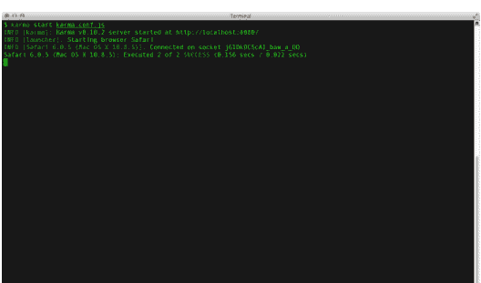

## 单元测试路由

我们为设置路由测试做了大量工作，但只测试了一个路由位置。由于我们正在测试用户功能的变化，可以将这部分工作交给应用程序，并在端到端测试中更严谨地进行测试。

## 端到端路由测试

在端到端测试中，我们希望测试用户如何与应用程序交互。我们将使用浏览器模拟用户操作并检查路由是否正常工作。

要用单元测试路由器，我们需要模拟路由器在生产环境中的工作方式。
路由器通过 digest 生命周期工作，其中在设置位置后，它需要单次 digest 循环周期来处理路由、转换内容页面并完成路由。知道这一点，我们需要在测试中考虑路径的变化。
在测试内部，我们将测试应用程序在索引路由中的两种状态：

- 当用户导航到索引页时，他们将看到带有正确控制器的索引页
- 当用户导航到未知路由时，他们将被带到由 `otherwise` 函数定义的索引页。

## 测试控制器

我们的控制器包含了应用程序的业务逻辑。控制器是 `$scope` 将控制器与视图结合在一起的地方。由于我们将在控制器中完成更新应用程序视图的大部分工作，因此我们希望建立测试以确保它们的行为符合预期。

## 单元测试控制器

当我们对控制器进行单元测试时，需要设置测试来模拟 Angular 的行为。在设置单元测试时，我们需要确保：

- 设置测试以模拟（mock）该模块
- 将控制器的实例与已知 scope 的实例一起存储
- 针对 scope 测试你的预期（expectations）

要实例化一个新的控制器实例，我们需要使用 `$new()` 方法从 `$rootScope` 创建一个 scope 的新实例。这个新实例将设置 Angular 在运行时使用的 scope 继承关系。

通过这个 scope，我们可以实例化一个新的控制器，并将 scope 作为控制器的 `$scope` 传递进去。

```javascript
describe('Unit controllers:', function() {

  // 模拟 MyApp 模块
  beforeEach(module('MyApp'));

  describe('FrameController', function() {

    // 本地变量
    var FrameController, scope;

    beforeEach(inject(
      function($controller, $rootScope) {
        // 创建一个新的子作用域
        scope = $rootScope.$new();
        // 创建 FrameController 的新实例
        FrameController = $controller('FrameController',
          {$scope: scope});
      }
    ));

    // 我们的测试在这里
  });

});
```

通过我们的测试设置，我们既拥有 FrameController 的实例，也拥有控制器的 scope。现在我们可以使用该 scope 来测试 FrameController 上的 scope。

在我们的 FrameController 中，我们有一个时钟，它在应用顶部随当前时间跳动。我们还可以访问一个用户和她的时区。

控制器代码的相关部分如下：

```javascript
angular.module('MyApp.controllers', [])
.controller('FrameController',
function($scope, $timeout) {
  $scope.time = {
    today: new Date()
  };
  $scope.user = {
    timezone: 'US/Pacific'
  }
  var updateClock = function() {
    $scope.time.today = new Date();
  }
  var tick = function() {
    $timeout(function() {
      $scope.$apply(updateClock);
      tick();
    }, 1000);
  }
  tick();
}));
```

我们的 FrameController 为了专注于测试而特意进行了简化。要查看示例应用程序的完整测试套件，请查看随此本书的代码。

我们将测试控制器的两个功能：

- 时间已定义
- 用户已定义并有一个时区

```javascript
// 测试 FrameController 的值
it('should have today set', function() {
  expect(scope.time.today).toBeDefined();
});
```

```javascript
it('should have a user set', function() {
  expect(scope.user).toBeDefined();
});
```

## 端到端测试控制器

对控制器进行端到端测试的结果将与测试页面内容渲染符合预期的测试非常相似：我们正在测试控制器中的所有函数是否实际被触发。

要测试页面是否已渲染，我们可以在浏览器中加载相关页面，并测试内容是否在视图中渲染。

我们端到端测试的模板代码如下：

```javascript
describe('E2E controllers: ', function() {
  // 我们的测试在这里
});
```

通过我们的测试设置，我们可以添加规格说明（specs）。我们将测试日期（或至少是它的部分内容）是否存在于页面上，以及时区。

## 测试

```javascript
beforeEach(function() {
  browser().navigateTo('/#/');
});
```

```javascript
it('should have the date in the browser', function() {
  var d = new Date();
  expect(
    element("*time h1").html()
  ).toMatch(d.getFullYear());
});
```

```javascript
it('should have the user timezone in the header', function() {
  expect(
    element('#header').html()
  ).toMatch('US/Pacific');
});
```

知道我们的超时函数是否在控制器内部被调用是非常方便的。我们可以确认确实正在使用 Jasmine 辅助函数 `createSpy` 来设置超时调用。

如果我们修改了 `beforeEach` 函数（见上文），我们就可以在控制器中包含 `$timeout` 服务。

```javascript
var FrameController, scope, timeout;
beforeEach(inject(
function($controller, $rootScope) {
  scope = $rootScope.$new();
  timeout = jasmine.createSpy('timeout');
  FrameController = $controller('FrameController', {
    $scope: scope,
    $timeout: timeout
  });
}));
```

现在，在我们的测试中，我们可以预期该服务实际上被调用了：

```javascript
it('should set the clock a foot', function() {
  expect(timeout).toHaveBeenCalled();
});
```

## 测试服务和工厂

服务很容易测试：它们是提供局部功能的孤立对象。由于它们是单例对象，我们可以孤立地创建这些对象并测试它们的行为。

## 单元测试服务

单元测试服务非常简单，因为我们只需要注入（inject）。从简单的示例开始，假设我们有一个提供以下的服务：

```javascript
angular.module('MyApp.services', [])
  .value('version', '0.1');
```

在这种情况下，服务提供了版本。该测试的模板代码如下：

```javascript
describe('Unit services', function() {
  // 我们的测试在这里
});
```

我们也可以通过名称注入上述服务，`inject()` 函数使用与 `$injector` 相同的语法。

注意：使用 `andCallThrough()` 方法，我们的测试将等待 `gapi` 对象在窗口中出现。我们可以通过不同的方法和 `andCallFake()` 来存根这些请求。

```javascript
var q;
beforeEach(inject(function($injector) {
  // 从服务获取定义的 googleApi
  googleApi = $injector.get('googleApi');
  // 获取 $q 对象
  q = $injector.get('$q');
  // 为 gapi 函数创建一个间谍
  // 并模拟实际响应
  spyOn(googleApi, 'gapi')
    .andCallFake(function() {
    var d = q.defer(); // 模拟延迟函数
    setTimeout(function() {
    }
```

## 测试

```javascript
resolvedValue = {
  clientId: '12345'
}
}, 100);
return d.promise;
});
// 使用实际函数的 resolve 来
// 设置解析后的值
googleApi.gapi().then(function(keys) {
  resolvedValue = keys;
});
});
```

现在，我们可以使用我们的间谍（spy）来确定函数是否真的被调用过。

我们在 `describe()` 块中的第一个测试仅仅是测试该方法是否存在并是否是一个函数。如果我们仍在开发 API 并更改了方法或签名，那么这个测试将非常有用。

为了设置等待 promise 解决（resolve）的测试，我们使用 Jasmine 辅助函数 `waitsFor()`。它接受一个参数：一个在方法可以继续执行时返回 true 或 false 响应的函数。我们将它设置为最多等待 0.5 秒：

```javascript
describe('googleApi', function() {
  beforeEach(function() {
  // 在我们等待时，暂停用例
  // 最多半秒
    waitsFor(function() {
      return resolvedValue !== undefined;
    }, 500);
  });
});
```

```javascript
it('should have a gapi function', function() {
  expect(
    typeof(googleApi.gapi)
  ).toEqual('function');
});
```

现在，我们可以为服务的返回值设置期望，并断言它们与我们的假设相等：

## 测试

```javascript
it('should call gapi', function() {
  expect(googleApi.gapi.callCount)
  .toEqual(1);
});
```

```javascript
it('should resolve with the browser keys', function() {
  expect(resolvedValue.clientId)
  .toBeDefined();
});
```

# 端到端测试服务

由于服务与我们的前端交互，因此专门通过端到端测试来测试服务是无效的。然而，我们可以测试服务是否解析了它们的 promise，以及结果是否填充了视图。

例如，我们可以测试服务是否填充了视图中的事件列表。在 `/events` 页面中，当我们显示事件列表时，我们可以断言我们实际上列出的事件数量符合我们预期的细节信息：

```javascript
beforeEach(function() {
  browser().navigateTo('/events');
});
```

```javascript
it('should show 10 events', function() {
  expect(
    repeater('.event_listing li').count()
  ).toBe(10);
});
```

# 测试过滤器

过滤器也很好测试：它们是孤立的功能。过滤器的工作专门是限制或处理输出，因此我们将对过滤函数的输出设置断言。

# 单元测试过滤器

单元测试过滤器非常简单。首先，我们需要获取过滤器的访问权限，这可以通过简单地向测试中注入 `$filter` 服务来实现。这将使我们能够在处理过程中查找过滤器。

## 测试

```javascript
describe('Unit: Filter tests', function() {
var filter;

// 在测试中 mock 我们的模块
beforeEach(module('myApp'));

beforeEach(inject(function($filter) {
  filter = $filter;
}}));
```

有了这个测试过滤器的入口，只需对过滤器的输出设置期望即可。

```javascript
it('should give us two decimal points',
function() {
  expect(filter('number')(123, 2)).toEqual('123.00');
});
```

# 端到端测试过滤器

我们也可以使用端到端测试在视图中测试过滤器的输出。端到端测试与使用单元测试测试我们的代码略有不同，因为我们关注的是终端用户看到的内容，而不是专门的过滤函数的输出。

为了设置过滤器测试，我们将让浏览器加载我们测试过滤器的页面，并与过滤器本身进行交互。

例如，在给有一个带有 `ng-repeat` 的实时搜索的情况下：

```html
<input ng-model="search" type="text" placeholder="Search filter" />
<table id="emailTable">
<tbody>
<tr ng-repeat="email in emails | filter:search">
  <td>{{ $index + 1 }}</td>
  <td>{{ email.from }}</td>
  <td>{{ email.subject | capitalize }}</td>
</tr>
</tbody>
</table>
```

其中我们的 `emails` 数据看起来像所示：

```javascript
[{
  from: 'ari@fullstack.io',
  subject: 'ngbook and things'
},
{
  from: 'ari@fullstack.io',
  subject: 'Other things about angular'
},
{
  from: 'ted@google.com',
  subject: 'Conference speaking'
}]
```

我们将测试两个过滤器：实时搜索（我们对 `ng-repeat` 和主题行设置了期望，以确保其首字母大写）。

为了确保实时搜索工作正常，我们需要在输入框中输入入一个值，并确保该字段变为我们预期的内容。

```javascript
it('should filter on search', function() {
  expect(repeater('#emailTable tr').count())
  .toBe(3);
  // things 出现在我们的 emails 中
  input('things');
  expect(repeater('#emailTable tr').count())
  .toBe(2);
});
```

我们可以看到我们为搜索有一个不同的输入。字段从 3 变为 2。

我们还可以测试我们的过滤器（capitalize 过滤器）以确保它工作符合预期：

```javascript
it('should capitalize the subject line', function() {
  expect(
    repeater('#emailTable tr:first').subject()
  ).toEqual("ngbook and things");
});
```

# 测试模板

当我们测试模板时，我们是在确保正确的内容被加载，并且模板内部正确的数据显示在视图中。

# 单元测试

由于我们的模板直接与视图绑定，在视图内部进行单元测试没有意义：我们是在组件完成构建视图时对其进行断言。

我们可以断言模板已正确加载。为了实现这一点，我们需要设置测试以期望对主模板的请求，并执行视图更改以测试它是否确实已加载。

```javascript
describe('Unit: Templates', function() {
  var $httpBackend,
    location,
    route,
    rootScope;

  beforeEach(module('MyApp'));

  beforeEach(inject(function($httpBackend, $location, $route, $rootScope) {
    $httpBackend = $httpBackend;
    location = $location;
    route = $route;
    rootScope = $rootScope;
  }));

  // ... (省略部分逻辑以保持结构一致)
});
```

## 测试

```javascript
replace: true,
link: function(scope, ele, attrs) {
  scope.$watch('message', function(n, o) {
    if (n) {
      $timeout(function() {
        ele.addClass("ng-hide");
      }, 2000);
    }
  }
});
```

为了测试单元指令（directives），我们需要将它们暴露给视图。这与测试控制器（controllers）的方式类似，我们需要手动将指令放置在一个创建的元素中（其方式类似于 Angular 初始放置指令的方式）。

```javascript
describe('Unit: Directives', function() {
  var ele, scope;
  // 加载我们的应用
  beforeEach(module('myApp'));
  // 我们的测试将写在这里
});
```

现在，为了将指令加载到视图，我们需要编译 HTML 内容以及 Angular 在生产环境中经常运行的绑定。

```javascript
describe('Unit: Directives', function() {
  var ele, scope;
  // 加载我们的应用
  beforeEach(module('myApp'));
  beforeEach(inject(function($compile, $rootScope) {
    scope = $rootScope;
    ele = angular.element(
      '<div notification message="note"></div>'
    );
    $compile(ele);
    scope.$apply();
  }));
// 我们的测试将写在这里
});
```

注意，我们正在创建一个调用指令的元素，就像我们将其放入 DOM 中时一样。然后，我们需要编译该元素并运行 digest 循环（digest loop），以便将元素有效地放置在我们的虚拟 DOM 中。

## 测试

测试指令要做的只是像它存在于我们的 DOM 中一样对其进行交互。为了对指令中的任何绑定进行更改，我们需要强制运行一次 digest 循环。

在我们的指令中，我们绑定了 scope 的 `message` 属性，所以当我们更改它时，需要在 `$apply()` 内部进行操作。

```javascript
// 测试设置
it('应该显示欢迎文本', function() {
  scope.$apply(function() {
    scope.note = "Notification message";
  });
  expect(
    ele.html()
  ).toContain("Notification message");
});
```

## 端到端测试指令

当对指令进行 E2E 测试时，我们主要关注不是指令的功能——我们测试的是用户在整个视图中所看到的和操作。

由于我们只是在测试视图，指令的端到端测试与测试模板相似。

```javascript
describe('E2E: directives', function() {
  beforeEach(function() {
    browser().navigateTo('/');
  });
  it('应该有欢迎消息', function() {
    expect(
      element('.notification', 'Notification').html()
  ).toContain("Notification message");
  });
});
```

## 测试事件

当我们在应用中使用事件时，特别是那些会导致 DOM 交互的事件时，我们希望设置测试来确保实际事件被触发，并且获得了预期的事件数据。我们还希望设置测试，对在浏览器中捕获事件时发生的情况设定预期。我们想看到我们对事件的反应是否按照我们预期的方式运行。

## 单元测试事件

当我们对触发的事件进行单元测试时，我们感兴趣的是它们是否真的被调用，以及是否调用了正确的事件。其次，我们主要感兴趣的是处理器是否拥有它们所需的数据。

使用 Jasmine 辅助 `spyOn()` 设置单元测试非常简单。

假设我们正在测试一个触发 `$emit` 函数的控制器。通过此函数，我们可以设定预期，即我们的事件被触发，并且它是带有我们感兴趣的任何参数被调用的。

首先，我们需要设置测试，以便能够访问控制器的 scope：

```javascript
describe('MyApp', function() {
  var scope;
  beforeEach(angular.mock.module('MyApp'));
  beforeEach(angular.mock.inject(function($rootScope) {
    scope = $rootScope.$new();
  }));
});
```

设置完成后，我们可以简单地在 scope 上的 `$emit` 或 `$broadcast` 事件上设置 `spyOn()` 调用。

```javascript
...
it('应该被调用了 emit', function() {
  spyOn(scope, "$emit");
  scope.closePanel(); // 例如
                      // 或任何导致
                      // emit 被
                      // 用的事件
  expect(scope.$emit)
    .toHaveBeenCalledWith("panel:closed",
      panel.id);
});
```

我们还可以测试那些我们设置了 `$on()` 监听器的事件，这些监听器在事件触发后会被调用。要执行 `$broadcast` 方法，我们只需在 scope 上调用 `$broadcast`，并对事件引起的 scope 变化设定预期。

## 测试

```javascript
// ...
it('应该将面板设置为关闭状态',
function() {
  scope.$broadcast("panel:closed", 1);
  expect(scope.panel.state).toEqual("closed");
});
```

## 端到端测试事件

端到端测试事件的调用相当容易：我们只需测试功能事件用例是否按照我们预期的方式触发即可。

## Angular 的持续集成

Angular 的 Karma 与持续集成服务配合得完美。

## Protractor

名为 Protractor 的新端到端测试框架最终将取代当前的框架。

Protractor 构建于 WebDriver，它拥有 IE、Chrome、Firefox 等扩展。

Protractor 包含了多个选项，允许我们配置如何使用特定文件运行 Protractor。

Protractor 本身带有一个简化 Selenium 安装的工具。

## 安装

通过 npm 安装 Protractor：

```bash
$ npm install protractor
```

为了访问脚本，我们需要在想要测试的 Angular 应用根目录下本地安装 Protractor：

```bash
$ npm install protractor
```

然后我们可以运行 `node_modules` 中的 Selenium 安装脚本：

```bash
$ ./node_modules/protractor/install
```

该脚本将下载运行 Selenium 需要的文件，并构建一个启动脚本和一个包含这些文件的目录。


当脚本完成后，我们可以执行启动脚本来启动带有 Chrome 驱动程序的独立版本 Selenium：

```bash
$ ./selenium/start
```

## 测试

```
seleniumServer
May 9, 2013 5:08:58 PM org.openqa.grid.selenium.GridLauncher main
INFO: launching a standalone server...
```

## 安装 Selenium

如果在 Selenium 安装时遇到问题，尝试下载最新版本来更新 ChromeDriver。

现在我们使用 Protractor 连接到后台运行的 Selenium 服务器。

## 配置

Protractor 与 Karma 一样需要一个运行脚本来告诉 Protractor 运行器如何连接 Selenium。

创建配置最简单的方法是从 Protractor 安装目录拷贝参考配置：

```bash
$ cp ./node_modules/protractor/referenceConf.js protractor_conf.js
```

该参考文件包含了运行 Protractor 的所有可用选项。

## 配置选项

### seleniumServerJar (string)

通过将 `seleniumServerJar` 设置为独立 Selenium 服务器的路径，我们可以告诉 Protractor 在运行测试时启动 Selenium 服务器。

这在我们运行持续集成 (CI) 测试时非常有用，但 Selenium 的启动时间很慢，因此对于开发时间来说效率相当较低。

### seleniumPort (integer)

如果 Protractor 需要启动服务器，则为启动 Selenium 服务器的端口。

### chromeDriver (string)

在启动 Selenium 服务器时，作为 `webdriver.chrome.driver` 启动的 ChromeDriver 路径。如果此项为空，Protractor 将尝试使用 `PATH` 环境变量查找 ChromeDriver。

### seleniumArgs (array)

数组中的字符串是我们在启动时可以手动传递给 Selenium 服务器的额外参数。

### sauceUser / sauceKey (string)

如果设置了 `sauceUser` 和 `sauceKey`，Selenium 服务器将不会启动，测试将使用 SauceLabs（一种云测试服务）进行远程运行。

### seleniumAddress (string)

如果我们正在运行自己的 Selenium 服务器，则此字符串为正在运行的 Selenium 服务器的地址。例如，我们使用包含的脚本启动 Selenium 服务器，此字符串将设置为：`http://localhost:4444/wd/hub`。

### allScriptsTimeout (integer)

此整数是浏览器中每个脚本运行的超时时间。也就是说，如果一个脚本完成所需的时间超过了此时间，它将被强制杀死并报告为失败。

### specs (array)

此字符串数组是待运行的规范（specs）的位置。这些可以是相对路径、绝对文件路径或匹配模式。

```javascript
specs: [
  'spec/*_spec.js',
]
```

### capabilities (object)

此对象包含传递给 webdriver 实例的能力的键值对。

```javascript
capabilities: {
  'browserName': 'chrome'
}
```

### baseUrl (string)

此字符串是我们的应用程序的基础 URL。如果我们的测试使用相对路径，这些路径将附加到此字符串之后。

```javascript
baseUrl: 'http://localhost:9000'
```


# rootElement (string)

此字符串是托管 Angular 应用的元素选择器。它默认是 `body`，但如果我们将 Angular 应用作为 `<body>` 元素的后代包含，那么我们需要包含此选项。

# onPrepare (string/function)

此函数在 Protractor 启动并准备就绪后运行，在执行所有规范之前运行。它也可以是一个包含以便在执行规范前运行的代码的文件。

`onPrepare` 选项用于设置 Jasmine 或 Protractor，例如：

```javascript
onPrepare: function() {
  // 例如，添加一个 Jasmine 报告器：
  jasmine.getEnv()
    .addReporter(new jasmine.JUnitXmlReporter(
      'outputdir/', true, true
    ));
};
```

# params (object)

`params` 对象将直接传递给 Protractor 实例，我们可以在测试内部访问此对象。我们可以在 `params` 对象中放入任何任意值。

# jasmineNodeOpts (object)

`jasmineNodeOpts` 指定了传递给 Jasmine Node 实例的选项。`jasmineNodeOpts` 的完整选项列表可以在 https://github.com/julierm/minijasminenode 找到。

# Writing Tests

Protractor 默认使用 Jasmine，因此我们编写的测试与使用 karma 编写的测试非常相似，只有几个关键区别。

Protractor 暴露了一些我们可以在测试中使用的全局变量：

## browser

此变量是 `webdriver` 实例的封装。我们将用它来进行导航和页面信息。

## element

`element` 函数帮助我们找到并与正在测试的页面元素进行交互。记住：`element` 的返回值不是 DOM 元素；它是 `ElementFinder` 的实例，是一个作用于 `webdriver` 的对象。我们可以使用此对象通过 `sendKeys` 和 `click` 等方法与页面上的对象进行交互。

完整的 API 是详尽的；更多文档可以在 Github 上的文档页面找到。

https://github.com/angular/protractor/blob/master/docs/api.md

## by

此选项是元素定位策略的集合。可以使用它通过 CSS 选择器、ID 甚至通过 `ng-model` 绑定的属性来查找元素。

- `by.binding`: 此选项允许我们搜索通过 `ng-bind` 或模板语法 `{{ }}` 绑定的元素。
- `by.model`: 我们可以使用 `by.model` 搜索通过 `ng-model` 绑定的输入元素。
- `by.repeater`: 我们可以搜索包含 `ng-repeat` 指令的元素。
- `by.id`: 这允许我们通过 CSS ID 搜索元素。
- `by.css`: 我们可以通过 CSS 选择器 `by.css` 搜索元素。由于我们会经常使用 `by` 选择器，Protractor 为了方便起见，将全局变量 `$` 绑定到了函数 `element.by.css`。

## protractor

此选项是封装了 `webdriver` 命名空间的 Protractor 命名空间。它包含了静态变量和类。

结合这些全局变量，我们可以编写高效的端到端测试。

注意：Protractor 假设我们正在测试 Angular 应用并期望页面存在 Angular。如果找不到，它将抛出错误。

我们通过使用 `browser.driver` 对象进入底层的 webdriver 实例来加载非 Angular 页面。

例如，假设我们想测试 AngularJS 首页上的基本示例：

```javascript
describe('angular homepage', function() {
  it('should greet the named user', function() {
    // 加载 AngularJS 首页。
    browser.get('http://angularjs.org');
    expect(element.binding('greeting')).toEqual('Hello World!');
  });
});
```

# Page Objects

为了让我们的测试更具可读性，我们可以使用页面对象（Page Objects）的概念。页面对象基本上是封装了特定功能的类。例如，我们可以封装：

```javascript
var AngularHomepage = function() {
  this.nameInput = element.model('name');
  this.greeting = element.binding('greeting');
};

AngularHomepage.prototype.get = function() {
  browser.get('http://angularjs.org');
};

AngularHomepage.prototype.setName = function(name) {
  this.nameInput.sendKeys(name);
};
```

现在我们可以这样清理我们的测试：

```javascript
describe('angularjs homepage', function() {
  it('should greet the named user', function() {
    var angularHomepage = new AngularHomepage();
    angularHomepage.get();
    angularHomepage.setName('Julie');
    expect(angularHomepage.greeting.getText()).toEqual('Hello Julie!');
  });
});
```

# Events

在应用程序组件松散连接的情况下（例如当我们需要用户身份验证并处理授权时），并不总是可以在不耦合组件的情况下处理通信。

例如，如果我们的后端对请求返回状态码 401（表示未授权的请求），我们预计应用将不会允许用户留在当前视图。在这种情况下，我们希望应用将用户重定向到登录或注册页面。

基于这种逻辑，我们无法从外部告诉控制器设置新位置。我们需要另一种通信方式。

## 什么是事件

就像浏览器响应浏览器层面的事件（如鼠标点击或页面滚动）一样，我们的 Angular 应用也可以响应 Angular 事件。这一事实带给我们的优势是，可以在不考虑其他组件的嵌套组件中跨应用程序进行通信。

> 注意，Angular 事件系统与浏览器事件系统共享，这意味着根据设计，我们只能监听 Angular 事件，而不是作用域上的 DOM 事件。

我们可以将事件看作跨应用程序传播的信息片段，这些信息通常（可选）包含关于应用程序内部正在发生的情况的信息。

## 事件传播

由于作用域是层级结构，我们可以沿着作用域链向上或向下传递事件。

选择我们将要使用的事件传递方法时，一个通用的经验是观察我们触发事件的作用域（scope）。如果我们想通知整个事件系统（从而允许任何作用域处理该事件），我们将希望向下广播（broadcast）。

另一方面，如果我们想提醒一个全局模块（如果可以这么说），我们最终需要提醒更高层级的作用域（例如 `$rootScope`），并且我们需要向上传递事件。

限制发送到全局层面的通知数量是一个好主意，特别是因为事件虽然强大，但它们会为我们的应用引入复杂性。

例如，当我们进行路由（routing）时，“全局”应用状态需要知道应用当前处于哪个页面；另一方面，如果我们在标签页指令（tab directive）与其子面板指令（child pane directives）之间进行通信，则我们需要向下发送事件。

### 使用 $emit 冒泡事件

要分发一个沿作用域链传播的事件（从子作用域到父作用域），我们将使用 `$emit()` 函数。

```javascript
// 发送用户已登录的事件
// 使用当前用户
scope.$emit('user:logged_in', scope.user);
```

通过调用 `$emit()` 函数，事件会从子作用域冒泡到父作用域。所有触发该事件的作用域都会接收到关于该事件的通知。

当我们想要从应用内部将状态更改通知应用程序的其他部分时，我们使用 `$emit()`。如果我们想与 `$rootScope` 通信，那么我们需要使用 `$emit()` 事件。

`$emit()` 方法接受两个参数：

#### name (string)
要发射的事件名称。

#### args (set)
一组以对象形式传递给事件监听器的参数。

`$emit()` 方法返回一个事件对象（有关事件对象的详情请参阅事件对象章节）。从任何监听器抛出的任何异常都会传递给 `$ExceptionHandlerHandler`。

### 使用 $broadcast 向下发送事件

要将事件向下传递（从父作用域到子作用域），我们使用 `$broadcast()` 函数。

```javascript
// 等等，购物车正在结账
// 所以下面所有的指令在购物车结账期间
// 应该禁用自身
scope.$broadcast('cart:checking_out', scope.cart);
```

在 `$broadcast()` 方法上，每一个注册了监听器的子项都会接收到此消息。事件会传播到当前作用域的所有指令和间接作用域，并一直向下调用每一个监听器。

我们无法使用 `$broadcast()` 方法取消事件。

`$broadcast()` 方法本身接受两个参数：

#### name (string)
要发射的事件名称。

#### args (set)
一组以对象形式传递给事件监听器的参数。

`$broadcast()` 方法返回一个事件对象（有关事件对象的详情请参阅事件对象章节）。从任何监听器抛出的任何异常都会传递给 `$exceptionHandler` 服务。

## 事件

### 监听

要监听一个事件，我们可以使用 `$on()` 方法。该方法为带有特定名称的事件注册一个监听器。事件名称仅为 Angular 中触发的事件类型。例如，我们可以监听触发路由更改过程触发的事件：

```javascript
scope.$on('$routeChangeStart',
  function(evt, next, current) {
    // 触发了新路由
  });
```

每当事件 `$routeChangeStart`（当路由即将发生变化时广播的事件）触发时，监听器（函数）就会被调用。

Angular 将 `evt` 对象作为第一个参数传递给我们正在监听的任何事件，无论是我们自定义的事件还是内建的 Angular 服务。

## 事件对象

事件对象具有以下属性：

#### targetScope (scope object)
该属性是发射或广播事件的作用域。

#### currentScope (scope object)
该对象包含处理该事件的当前作用域。

#### name (string)
该字符串是已触发且我们正在处理的事件名称。

#### stopPropagation (function)
`stopPropagation()` 函数会取消通过 `$emit` 触发的事件的任何后续传播。

#### preventDefault (function)
`preventDefault` 将 `defaultPrevented` 标志设置为 `true`。虽然我们无法停止事件的传播，但我们可以告诉子作用域我们不需要处理该事件（即我们可以安全地忽略它们）。

#### defaultPrevented (boolean)
调用 `preventDefault()` 会将 `defaultPrevented` 设置为 `true`。

`$on()` 函数返回一个注销函数，我们可以调用它来取消监听器。

## 运行于事件上的核心服务

Angular 核心框架会发送我们监听并可以据此采取行动的事件。我们将使用这些事件为我们的自定义 Angular 对象提供在不同全局状态级别上与我们的应用交互的能力。

有几个事件是我们通过 `$emit()` 用的，将它们的事件向上发送，还有几个是我们作为 `$broadcast()` 事件调用的。

## 核心系统发射的事件

以下事件是从指令向上到包含指令调用的作用域发射的。我们可以使用 `$on()` 在该链之上的任何作用域中监听这些方法：

```javascript
$scope.on('$includeContentLoaded',
  function(evt) {
  });
```

### IncludeContentLoaded
当 `ngInclude` 内容重新加载时，`ngInclude` 指令触发 `includeContentLoaded` 事件。

### IncludeContentRequested
`includeContentRequested` 事件在调用 `ngInclude` 的作用域上发射。每当请求 `ngInclude` 内容时，都会发射此事件。

### viewContentLoaded
`viewContentLoaded` 事件每次都会在当前的 `ngView` 上发射。

## 核心系统广播的事件

### locationChangeStart
当浏览器 URL 变化时，触发 `locationChangeStart` 事件。

### locationChangeSuccess
当位置成功更新时，广播 `locationChangeSuccess` 事件。

### locationChangeError
当位置更改失败时，触发 `locationChangeError` 事件。

### routeChangeStart
当路由即将更改时，触发 `routeChangeStart` 事件。

### routeChangeSuccess
当路由成功更改后，广播 `routeChangeSuccess` 事件。

### routeChangeError
当路由更改失败时，触发 `routeChangeError` 事件。

### routeUpdate
当路由搜索更新时，广播 `routeUpdate` 事件。

### destroy
在作用域销毁之前广播 `destroy` 事件。这给了子作用域一个清理的机会。

```javascript
angular.module('myApp')
  .controller('MainController', function($scope, $timeout) {
    var timer;
    var updateTime = function() {
      $scope.date = new Date();
      timer = $timeout(updateTime, 1000);
    }
    // 开始更新时间
    timer = $timeout(updateTime, 1000);
    // 在杀死这个之前清理定时器
    $scope.on('destroy', function() {
      if (timer) { $timeout.cancel(timer); }
    });
  });
```

# 架构

学习 Angular 时，我们需要做的调整之一是学习如何思考应用程序。虽然我们无法规定结构（因为选择结构是开发者的权利），但我们可以分享我们有效的方法。

## 目录结构

AngularJS 充斥了大量选项，随着时间的推移，确定如何构建 Web 应用可能变得困难。控制器放在哪里最符合逻辑？我们应该将所有的服务逻辑放在一个文件中还是将其拆分？

在构建任何规模的 Angular 应用时，我们最好通过考虑构建应用时将使用的工具以及项目的当前规模来做出结构选择。我们应该预期项目将会增长。

我们建议为应用程序创建如下目录结构，将应用程序文件放在 `src/` 目录中，按其功能类型分离，并有一个主 `app.js` 文件。

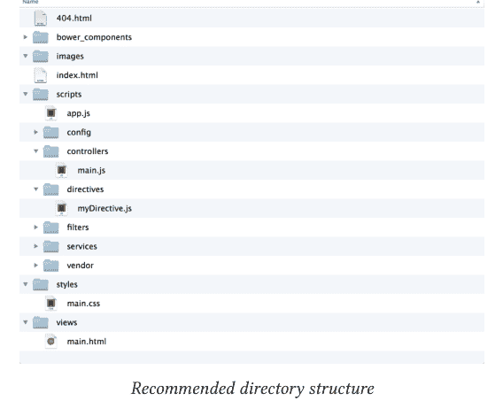

我们还建议使用 Grunt 等工具在生产环境中将我们的文件合并成单个文件。

每个 Angular 对象都应该有自己的文件，并根据其功能进行适当命名。例如，ViewController 对象的逻辑位置应该在 `scripts/controllers/main.js` 文件中。Filter 对象应该属于 `scripts/filters/myFilter.js`。

采用这种结构是有益的，因为每个文件都足够小，并且充分聚焦于其功能，这使得多个开发者能够高效地协作开发应用。

此外，当我们为应用程序编写测试时，我们建议将 `scripts` 目录合并到根目录下的 `test/` 文件夹中，如下：

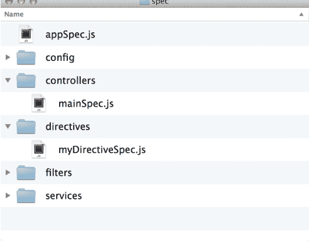

在构建单模块应用时，我们建议使用这种结构。在构建由多个模块组成的应用时，我们会包含一个 `modules/` 目录，其结构与顶层结构相似。

## 模块

模块（Module）是 Angular 应用的功能核心。模块包含了为特定应用编写的所有代码，因此会以单体的方式变得非常巨大。虽然这种趋势并不是坏事（模块是减少全局作用域噪音的极佳方法），但我们可以划分我们的模块。

关于何时创建模块以及在全局模块中何处嵌套功能，存在几种不同的意见。以下两种方法都是通过模块拆分功能的有效方式：

### 按功能模块化

通过模块拆分应用的最明显的方法是按类型划分模块。

我们需要将模块作为依赖注入到主应用中，这使得为每种模块类型设置测试变得容易，同时也隔离并细分了我们在编写规范（specs）时需要考虑的功能。

例如，我们可以为每个 Angular 对象类型创建一个模块：

```javascript
angular.module('MyApp.directives', []);
angular.module('MyApp.services', []);
angular.module('MyApp.filters', []);
// 通常我们希望在控制器
// 内部使用我们的服务，所以我们将
// 它们注入到 'MyApp.controllers'
angular.module('MyApp.controllers', [
  'MyApp.services',
]);
angular.module('MyApp', [
  'MyApp.directives',
  'MyApp.controllers',
  'MyApp.filters',
  'MyApp.services'
]);
```

这种方法的一个问题是，它有时会给我们留下一堆非常小的模块。这种结果不会影响性能，但开发起来可能会很繁琐。

### 按路由模块化

我们可以使用的另一种拆分应用的方法是按路由划分模块。这种拆分方式允许我们编写隔离的测试，专注于每个路由的功能。取决于项目，按路由模块化可能更有意义；当我们在处理大量独立路由时，它允许我们高效地划分功能。

例如：

```javascript
angular.module('MyApp.home', []);
angular.module('MyApp.login', []);
angular.module('MyApp.account', []);
angular.module('MyApp', [
  'MyApp.home',
  'MyApp.login',
  'MyApp.account'
]);
```

这种模块化特别适用于我们处理大量路由和/或当我们没有太多交叉路由时。

## 控制器 (Controllers)

在命名控制器时，惯例是使用控制器的名称——以大字母开头——并加上 Controller。例如：

```javascript
angular.module('myApp')
  .controller('someController', function($scope) {
    // 这不符合惯例
  })
  .controller('SomeController', function($scope) {
    // 这是编写控制器的惯例方法
  });
```

作用域渗透（Scope creep）可能是 Angular 框架中最令人困惑的方面之一，我们在控制器的 `$scope` 上定义了大量功能。在我们编写 Web 应用时，有时会发现控制器的规模变得完全失控了。

我们可以通过将处理 DOM 和方法的责任从控制器中转移开来减小控制器的规模。将功能移动到自定义指令（directives）中极大地减少了创建判断是否需要暴露特定视图或格式化值的函数的需求。

由于我们在视图内部的 `$scope` 上绑定了值，因此控制器不需要负责保留我们特定 DOM 对象所需的值状态。

例如，我们可以移除控制器中处理显示值的方法。

假设我们有一个单一登录页面，根据用户选择的状态显示登录表单或注册表单。我们可以将页面命名为 `showLoginForm`：

```javascript
angular.module('myApp')
  .controller('LoginController', function($scope) {
    // 如果为 true 则显示登录表单
    // 如果为 false 则显示注册表单
    $scope.showLoginForm = true;
    $scope.sendLogin = function() {}
    $scope.sendRegister = function() {}
  });
```

在我们的 HTML 中，我们可能按照以下格式设置 LoginController 的功能：

```html
<div ng-show="showLoginForm">
  <form ng-submit="runLogin()"></form>
</div>
<div ng-show="!showLoginForm">
  <form ng-submit="runRegister()"></form>
</div>
```

虽然这个示例特别简单（我们会在 `$scope` 中只多了一个变量），但随着我们的视图变得越来越复杂，这些值的数量可能会呈指数级增长。

我们可以使用指令来移除该值。例如：

```javascript
angular.module('myApp')
  .directive('loginForm', function() {
    return {
      scope: {
        onLogin: '&',
        onRegister: '&'
      },
      templateUrl: '/templates/loginForms.html',
      link: function(scope, ele, attrs) {
        scope.showLoginForm = true;
        scope.submitLogin = function() {
          scope.onLogin({user});
        }
        scope.submitRegister = function() {
          scope.onRegister({user});
        }
      }
    };
  })
  .controller('LoginController', function($scope) {
    $scope.sendLogin = function() {}
    $scope.sendRegister = function() {}
  });
```

我们可以像使用任何指令一样在视图中使用此指令：

```html
<div login-form></div>
```

由于视图安全地封装在指令中，我们不再需要在控制器中持有视图逻辑。保持控制器轻量是一个最佳实践；使用指令允许我们这样做。

此外，将路由隔离在指令中也使得测试它们的功能变得很容易。

## 控制器之间共享数据

在 Angular 中，我们可以通过几种方式在控制器之间共享数据。我们可以将控制器嵌套在同一个父控制器下，允许它们独立地修改父作用域的值，或者我们可以在服务内部共享值。

在服务内部持有数据是首选，但更有效的方法取决于情况。例如，在对话框内部，由父控制器来持有对话框显示的数据是合理的。

## 指令 (Directives)

知道何时编写指令与知道何时不写指令同样重要。通常情况下，编写指令是一个好主意。

正如我们上面所示，使用指令减少了控制器内部的杂乱。

测试指令也比测试控制器更简单。

将它们留到开发过程的后期。不仅如此，端到端测试的运行速度通常比单元测试慢得多，因此先编写单元测试允许我们以与开发过程相同的势头专注于功能上。

我们鼓励为应用的**所有**部分编写测试。有关测试的更多信息，请查看详尽的测试章节。

# Angular 动画

Angular 团队创建了 ngAnimate 模块，为我们的 Angular 应用提供了挂接 CSS 和 JavaScript。

在 Angular 应用中制作动画有几种方法：

- 使用 CSS3 动画
- 使用 JavaScript 动画
- 使用 CSS3 过渡

在本章中，我们旨在讨论这三种动画方法，并对如何实现自己的自定义动画有坚实的理解。

## 安装

从 1.2.0.rc1 开始，动画不再是 Angular 核心的一部分；它们存在于自己的模块中。为了在我们的 Angular 应用中包含动画，我们需要安装并在应用中引用此模块。

我们可以从 code.angularjs.org 下载它，并将其保存到可以在 HTML 中引用的地方，例如 `js/vendor/angular-animate.js`。

我们也可以使用 Bower 安装它，它将其放在我们通常的 Bower 目录。有关 Bower 的更多信息，请查看 Bower 章节。

```bash
$ bower install --save angular-animate
```

在引用 Angular 之后，我们需要在 HTML 中引用此库。

```html
<script src="js/vendor/angular.js"></script>
<script src="js/vendor/angular-animate.js"></script>
```

最后，我们需要在应用模块中将 ngAnimate 模块作为依赖引用。

```javascript
angular.module('myApp', ['ngAnimate']);
```

我们准备好使用 AngularJS 处理动画了。

## 工作原理

`$animate` 服务本身默认会为每个动画事件向被动画元素应用两个 CSS 类（见下文）。

`$animate` 服务支持几个内置的 Angular 指令，这些指令在不需要任何额外配置的情况下自动支持动画。它也足够灵活，允许我们为自己的指令构建自定义动画。

所有支持动画的现有指令都是通过监控这些指令上提供的事件来实现。例如，当一个新的 `ngView` 进入并为浏览器带来新内容时，当 `ngHide` 准备显示一个元素时，会触发 `remove` 事件。

以下是指令以及在不同状态下触发的事件列表。我们将使用这些事件来定义我们的动画在每个状态下如何工作。

| 指令 | 事件 |
| --- | --- |
| ngRepeat | enter, move |
| ngView | enter, leave |
| ngInclude | enter, leave |
| ngSwitch | enter, leave |
| ngIf | enter, leave |
| ngClass or class="..." | add, remove |
| ngShow | add, remove (.ng-class) |
| ngHide | enter, remove |

`$animate` 服务根据指令发射的事件绑定特定的类。对于结构性动画（如 `enter`, `move`），以 `ng-[EVENT]` 和 `ng-[EVENT]-active` 的形式应用 CSS 类。

对于基于类的动画（如 `ngClass`），动画类的格式为 `[CLASS]-add`、`[CLASS]-add-active`、`[CLASS]-remove`、`[CLASS]-remove-active`。

最后，对于 `ngShow` 和 `ngHide`，只添加或移除 `.ng-hide` 类，其格式与 `ngClass` 相同：`.ng-hide-add`、`.ng-hide-add-active`、`.ng-hide-remove`、`.ng-hide-remove-active`。

## 自动添加类

当 DOM 更新时，接收 `enter` 事件的指令接收 `.ng-enter` 类。Angular 添加 `ng-enter-active` 类，从而触发动画。ngAnimate 会自动检测 CSS 代码以确定动画何时完成。

当触发 `leave` 事件时，Angular 会从 DOM 元素中移除两个类，允许我们为 DOM 元素定义可动画的属性。

如果浏览器不支持 CSS 过渡或动画，则动画将立即开始并结束，DOM 将处于最终状态，且不会应用 CSS 过渡或动画类。

相同的约定适用于所有支持的结构性动画事件：`enter`、`leave` 和 `move`。基于类的动画事件格式略有不同（如上述）。

## 使用 CSS3 过渡

使用 CSS3 过渡是在应用中包含动画最简单的方法，它适用于 IE9 及更早版本以外的所有浏览器。

不支持 CSS3 过渡的浏览器将优雅地回退到非动画版本的应用。

要进行任何 CSS 动画，我们需要确保将要处理的类包含到感兴趣的动画化 DOM 元素中。

例如，在下面的演示中，我们将查看对此元素的动画：

```html
<div class="fade-in"></div>
```

CSS3 过渡是完全基于类的，这意味着只要我们在 HTML 中有定义动画的类，动画就会在浏览器中运行。

为了能够通过类实现动画，我们需要遵循 Angular 的 CSS 命名规范来定义我们的 CSS 过渡。

CSS 过渡是让元素从一种样式逐渐变为另一种样式的效果。要定义动画，我们必须指定想要添加动画的属性，并指定效果的持续时间。

例如，此代码为带有 `.fade-in` 类的 DOM 元素的所有属性添加了过渡效果，持续时间为两秒。

```css
.fade-in {
  transition: 2s linear all;
  -webkit-transition: 2s linear all;
}
```

通过这种过渡设置，我们可以在不同状态下定义属性。

```css
.fade-in:hover {
  width: 300px;
  height: 300px;
}
```

ngAnimate 通过为每个动画事件添加两个类来启动动画：初始的 `ng-[EVENT]` 类以及随后的 `ng-[EVENT]-active` 类。

为了通过类自动添加的类，我们需要修改上面的示例以包含初始状态：

```css
.fade-in.ng-enter {
  opacity: 0;
}
```

```css
.fade-in.ng-enter.ng-enter-active {
  opacity: 1;
}
```

为了实际运行动画，我们需要包含定义。在定义中，我们需要包含持续时间以及我们要使用的属性。

```css
.fade-in.ng-enter { transition: 2s linear all; -webkit-transition: 2s linear all; }
```

我们也可以将过渡属性放在基类（`.fade-in`）上，而不是为每个动画指定。

```css
.fade-in {
  -webkit-transition: 2s linear all;
  transition: 2s linear all;
}
```

```css
.fade-in.ng-enter {
  opacity: 0;
}
```

```css
.fade-in.ng-enter.ng-enter-active {
  opacity: 1;
}
```

```css
.fade-in.ng-leave {
  opacity: 1;
}
```

```css
.fade-in.ng-leave.ng-leave-active {
  opacity: 0;
}
```

## 使用 CSS3 动画

CSS3 动画比 CSS3 过渡更广泛、更复杂。它们支持除 IE 及其早期版本以外的所有主流浏览器。使用相同的初始类 `ng-[EVENT]`，但不需要在 `ng-[EVENT]-active` 状态中定义动画状态，因为我们的 `@keyframes` 规则将处理剩余部分。

我们在 `@keyframes` 规则中创建动画。在定义 `@keyframes` 规则的 CSS 元素内部，我们定义想要操作的 CSS 样式。

当我们对 DOM 元素进行动画时，使用 `animation:` 属性绑定 `@keyframes` 属性，将动画应用于 CSS 元素。

为了创建我们的 `@keyframes` 规则，我们需要为关键帧命名，并设置属性在整个动画期间所在的时间段。

```css
@keyframes firstAnimation {
  0% {
    color: yellow;
  }
  100% {
    color: black;
  }
}

/* Chrome 和 Safari */
@-webkit-keyframes firstAnimation {
  /* from 等同于 0% */
  from {
    color: yellow;
  }
  /* to 等同于 100% */
  to {
    color: black;
  }
}
```

> 使用关键字 `from` 等同于将百分比设置为 0%。使用关键字 `to` 等同于将百分比设置为 100%。

我们的百分比并不局限于 0% 和 100%：我们可以分步提供动画，例如在 10%、15% 等处。

要将此 `@keyframes` 属性分配给想要动画的类，请使用 `animation` 关键字，它会将动画应用到 CSS 选择器目标元素上。

```css
.fade-in:hover {
  -webkit-animation: 2s firstAnimation;
  animation: 2s firstAnimation;
}
```

通过 ngAnimate，我们将 `firstAnimation` 值绑定到所有带有 `.fade-in` 类的元素。Angular 会自动为我们应用和移除 `.ng-enter` 类，因此我们只需要将事件挂到 `.fade-in.ng-enter` 类上即可：

```css
.fade-in.ng-enter {
  -webkit-animation: 2s firstAnimation;
  animation: 2s firstAnimation;
}
```

## 交错 CSS 过渡 / 动画

ngAnimate 自带了一个额外功能，可以通过指定的延迟来错开同时触发的动画。这意味着如果有 10 个项目进入 `ngRepeat` 列表，那么每个项目将在上一个项目 X 毫秒后插入。这种产生的效果被称为交错效果（stagger effect），ngAnimate 开箱即支持 CSS 过渡和动画的这种处理。

### 交错 CSS 过渡

遵循为 `ng-enter` 和 `ng-enter-active` 构建 CSS 过渡代码的格式，也可以放置额外的 CSS 类来提供交错延迟。通过下面的 CSS 代码，我们可以使用 CSS 过渡为我们的 `.fade-in` 类添加交错效果。

```css
.fade-in.ng-enter-stagger {
  -webkit-transition-delay: 200ms;
  transition-delay: 200ms;
  /* 防止意外的 CSS 继承的保护措施 */
  -webkit-transition-duration: 0;
  transition-duration: 0;
}
```

下面的代码将在每个连续动画化的项目之间执行 200 毫秒的暂停。然而，还有另一个 CSS 属性可以指定持续时间并设置为零。为什么呢？在这里作为保护措施是为了防止从基础 CSS 类发生意外的 CSS 继承。否则，如果没有这个保护，交错效果可能会被静默忽略。

这对我们的 `.fade-repeat` 类意味着什么呢？假设我们正在使用一个恰好执行该操作的 `.fade-in` `ngRepeat` 元素。

```html
<div ng-repeat="item in items" class="fade-in">
  Item: #1 -- {{ item }}
</div>
```

每当有一系列项目插入到列表时，交错延迟就会生效。项目 #1 将立即插入，#2 将在 200ms 后进入，#3 在 400ms 后进入，依此类推。

### 交错 CSS 动画

同样支持 CSS 动画，并遵循与上述 CSS 过渡完全相同的 CSS 命名规范。唯一的区别是不再使用 `transition-delay`，而是使用 `animation-delay`（显而易见）。如果使用 CSS 动画来实现交错效果，`.fade-in` 类将像如下所示：

```css
.fade-in.ng-enter-stagger {
  -webkit-animation-delay: 200ms;
  animation-delay: 200ms;
  /* css 交错动画也需要在这里 */
  -webkit-animation-duration: 0;
  animation-duration: 0;
}
```

由于 CSS 关键帧动画在发生重流（reflow，即浏览器重绘屏幕时）之前不会发生，因此可能会出现轻微的闪烁，或者元素本身在交错开始之前可能不会进行动画处理。这是因为关键帧动画尚未触发，所以从 0% 开始动画尚未开始。为了解决这个问题，在分配关键帧动画的 CSS 类中放置了额外的 CSS 样式。

```css
.fade-in.ng-enter {
  /* 重流前样式 */
  opacity: 0;
  -webkit-animation: 2s firstAnimation;
  animation: 2s firstAnimation;
}
```

```css
.fade-in.ng-enter-stagger { ... }

@keyframes firstAnimation { ... }

@-webkit-keyframes firstAnimation { ... }
```

## 哪些指令支持交错动画？

很简单。所有指令都支持，它们只有在同一个父容器内同时触发了两个或多个相同的动画事件时才可用。当有 10 个项目插入到 `ngRepeat` 列表时，就会发生交错效果。这意味着如果将 `ngClass` 放置在 `ngRepeat` 元素上，并且列表中的每个项的 `ngClass` 值发生变化，那么就会为类名更改的动画渲染出交错效果。

交错动画也可以在自定义指令内部触发。只需连续调用几次 `$animate` 服务，即可获得交错动画。确保每个动画的父元素相同，且 `className` 值也相同。

### 使用 JavaScript 动画

JavaScript 动画与之前的方法不同在于，我们直接操作元素。在这里，不是使用 CSS 动画，而是使用 JavaScript 更新。

ngAnimate 模块添加了我们可以构建的 `animation` 方法。该 `animation()` 方法接收两个参数：

- `className` (string): 此类名将匹配元素的类。在我们之前的示例中，动画应该是 `.fade-in`。
- `animateFun` (function): 动画函数预期返回一个包含指令触发的不同事件的函数的对象。详细文档请参 Animate API。

```javascript
angular.module('MyApp', ['ngAnimate'])
  .animation('.fade-in', function() {
    return {
      enter: function(element, done) {
        // 执行动画
        // 动画完成后调用 done
        return function(cancelled) {
          // 取消回调
        }
      }
    }
  });
```

`$animate` 服务为指定的元素调用这些函数。在函数内部，我们可以对元素进行任何操作。唯一的要求是我们在完成动画或动画取消时调用回调函数 `done()`。

当动画触发时，`$animate` 会查找匹配事件的动画函数。如果找到了匹配的函数，就会执行它，否则将跳过动画。

## 动画微调

根据应用的复杂程度，ngAnimate 和底层的动画代码可能需要调整。

### 过滤 CSS 类

默认情况下，ngAnimate 会自动尝试动画通过 `$animate` 服务的元素。但不用担心，只有注册了 CSS 或 JavaScript 动画的包含这些类的元素才会执行动画。

尽管该系统可以工作，检查每个可能的 CSS 类在低性能设备上可能会降低速度。因此，从 angular.js 1.2.6 版本开始，ngAnimate 为 `$animate` provider 提供了一个配置设置，用于过滤掉不包含给定正则表达式匹配 CSS 类的元素的动画操作。

```javascript
myModule.config(function($animateProvider) {
  // 正则表达式是唯一的有效参数
  $animateProvider.classNameFilter(/animate/);
});
```

现在通过提供的正则表达式 `/animate/`，只有以 animate 开头的 CSS 类才会被处理动画。结果是，`fade-in` 动画将不再工作，它需要重命名为 `.animate-fade-in` 才能实际动画。

## 内置指令动画

### ngRepeat 动画

`ngRepeat` 指令触发事件：

| 动作 | 事件名称 |
| :--- | :--- |
| 项目被插入到列表中 | enter |
| 项目被从列表中移除 | leave |
| 项目被移动到列表中 | move |

对于这三个示例，我们使用的 HTML 结构如下：

```html
<div ng-controller="HomeController">
  <ul>
    <li class="fade-in" ng-repeat="r in roommates">
      {{ r }}
    </li>
  </ul>
</div>
```

假设 HomeController 的定义如下：

```javascript
angular.module('MyApp', ['ngAnimate'])
  .controller('HomeController', function($scope) {
    $scope.roommates = [
      'Ari', 'Q', 'Sean', 'Anand'
    ];
    setTimeout(function() {
      $scope.roommates.push('Ginger');
      $scope.$apply(); // 触发 digest
    });
    setTimeout(function() {
      $scope.roommates.shift();
      $scope.$apply(); // 触发 digest
    }, 2000);
  });
```

在这些示例中，我们有一个包含四个元素的室友列表。一秒后，我们添加第五个。两秒后，我们移除了第一个元素。

#### CSS3 过渡

为了对 `ngRepeat` 列表中的项目执行动画，我们需要确保添加呈现元素初始状态的 CSS 类，以及定义这两种状态（enter 和 leave）最终状态的类。

我们可以从在初始类上定义动画属性开始：

```css
.fade-in.ng-enter,
.fade-in.ng-leave {
  transition: 2s linear all;
  -webkit-transition: 2s linear all;
}
```

现在，我们可以简单地在动画中定义初始和最终 CSS 属性的阶段。在这里，我们将元素以绿色文字淡入，并在 enter 动画的最终阶段将文字变为黑色。在 leave（项目移除）动画中，我们反转了属性：

```css
.fade-in.ng-enter {
  opacity: 0;
  color: green;
}

.fade-in.ng-enter.ng-enter-active {
  opacity: 1;
  color: black;
}

.fade-in.ng-leave {
  opacity: 1;
}

.fade-in.ng-leave.ng-leave-active {
  opacity: 0;
}
```

#### CSS3 关键帧动画

使用关键帧动画时，我们不需要定义开始和结束类；相反，我们只需要定义一个包含动画 CSS 关键帧的选择器。

我们可以从定义关键帧的动画属性开始：

```css
@keyframes animateView-enter {
  from {opacity: 0};
  to {opacity: 1};
}

@-webkit-keyframes animateView-enter {
  from {opacity: 0};
  to {opacity: 1};
}

@keyframes animateView-leave {
  from {opacity: 1};
  to {opacity: 0};
}

@-webkit-keyframes animateView-leave {
  from {opacity: 1};
  to {opacity: 0};
}
```

设置关键帧后，我们可以简单将动画附加到 ngAnimate 添加的 CSS 类上：

```css
.fade-in.ng-enter {
  -webkit-animation: 2s fade-in-enter-animation;
  animation: 2s fade-in-enter-animation;
}

.fade-in.ng-leave {
  -webkit-animation: 2s fade-in-leave-animation;
  animation: 2s fade-in-leave-animation;
}
```

#### JavaScript 动画

用 JavaScript 执行动画时，我们需要在动画描述对象上定义 `enter` 和 `leave` 属性。

```javascript
angular.module('MyApp')
  .animation('.fade-in', function() {
    return {
      enter: function(element, done) {
        // 不使用 jQuery 的原生动画
        // 使用 jQuery 会要简单得多
        var op = 0, timeout,
        animateFn = function() {
          op += 10;
          element.css('opacity', op/100);
          if (op >= 100) {
            clearInterval(timeout);
            done();
          }
        };
        // 设置初始透明度为 0
        element.css('opacity', 0);
        timeout = setInterval(animateFn, 100);
      },
      leave: function(element, done) {
        var op = 100,
        timeout,
        animateFn = function() {
          op-=10;
          element.css('opacity', op/100);
          if (op <= 0) {
            clearInterval(timeout);
            done();
          }
        };
        element.css('opacity', 100);
        timeout = setInterval(animateFn, 100);
      }
    }
  });
```

### 为 ngView 执行动画

`ngView` 指令触发事件：

| 动作 | 事件名称 |
| :--- | :--- |
| 新内容准备好显示在视图中 | enter |
| 现有内容准备好隐藏 | leave |

对于这些示例，我们使用的 HTML 结构如下：

```html
<a href="#">首页</a>
<a href="#two">第二个视图</a>
<a href="#three">第三个视图</a>
<div ng-view></div>
```

#### CSS3 过渡

为了对 `ngView` 中的项目执行动画，我们需要添加定义元素初始状态的 CSS 类，以及定义这两种状态（enter 和 leave）最终状态的类。

```css
.animateView.ng-enter,
.animateView.ng-leave {
  transition: 2s linear all;
  -webkit-transition: 2s linear all;
}
```

现在，我们可以简单地定义动画中初始和最终 CSS 属性的阶段。在这里，我们将元素以绿色文字渐变入，并在 enter 动画的最后一个阶段将文字变为黑色。在 leave（项目移除）动画中，我们反转了属性：

```css
.animateView.ng-enter {
  opacity: 0;
  color: green;
}

.animateView.ng-enter.ng-enter-active {
  opacity: 1;
  color: black;
}

.animateView.ng-leave {
  opacity: 1;
}

.animateView.ng-leave.ng-leave-active {
  opacity: 0;
}
```

#### CSS3 动画

我们首先定义用于在 CSS 中定义动画的 `@keyframes`：

```css
@keyframes animateView-enter {
  from {opacity: 0};
  to {opacity: 1; color: green}
}

@-webkit-keyframes animateView-enter {
  from {opacity: 0};
  to {opacity: 1; color: green}
}

@keyframes animateView-leave {
  from {opacity: 1};
  to {opacity: 0; color: black}
}

@-webkit-keyframes animateView-leave {
  from {opacity: 1};
  to {opacity: 0; color: black}
}
```

要应用动画，我们只需要在类上包含动画 CSS 样式：

```css
.animateView.ng-enter {
  -webkit-animation: 2s animateView-enter;
  animation: 2s animateView-enter;
}

.animateView.ng-leave {
  -webkit-animation: 2s animateView-leave;
  animation: 2s animateView-leave;
}
```

#### JavaScript 动画

当使用 JavaScript 进行动画时，我们需要在动画描述对象上定义 `enter` 和 `leave` 属性。

```javascript
angular.module('MyApp')
  .animation('.animateView', function() {
    return {
      enter: function(element, done) {
        // 示例显示如何使用 jQuery
        // 进行动画。注意，这需要
        // 在 HTML 中引入 jQuery
        $(element).css({
          opacity: 0
        });
        $(element).animate({
          opacity: 1
        }, done);
      },
      leave: function(element, done) {
        done();
      }
    };
  });
```

### Animating ngInclude

`ngInclude` 指令触发事件：

| 动作 | 事件名称 |
| --- | --- |
| 新内容准备好显示在视图 | enter |
| 现有内容准备好隐藏 | leave |

对于这些示例，我们使用的 HTML 结构如下：

```html
<div ng-include="'template.html'" class="animateInclude"></div>
```

#### CSS3 过渡

为了对 `ngInclude` 中的项目进行动画处理，我们需要添加定义元素初始状态的 CSS 类，以及定义这两种状态（enter 和 leave）的最终状态的类。

```css
.animateInclude.ng-enter,
.animateInclude.ng-leave {
  transition: 2s linear all;
  -webkit-transition: 2s linear all;
}
```

现在，我们可以简单地定义动画中初始和最终 CSS 属性的阶段。在这里，我们将元素以绿色文字渐变入，并在 enter 动画的最后一个阶段将文字变为黑色。在 leave（项目移除）动画中，我们反转了属性：

```css
.animateInclude.ng-enter {
  opacity: 0;
  color: green;
}

.animateInclude.ng-enter.ng-enter-active {
  opacity: 1;
  color: black;
}

.animateInclude.ng-leave {
  opacity: 1;
}

.animateInclude.ng-leave.ng-leave-active {
  opacity: 0;
}
```

#### CSS3 动画

我们首先定义用于在 CSS 中定义动画的 `@keyframes`：

```css
@keyframes animateInclude-enter {
  from {opacity: 0};
  to {opacity: 1; color: green}
}

@-webkit-keyframes animateInclude-enter {
  from {opacity: 0};
  to {opacity: 1; color: green}
}

@keyframes animateInclude-leave {
  from {opacity: 1};
  to {opacity: 0; color: black}
}

@-webkit-keyframes animateInclude-leave {
  from {opacity: 1};
  to {opacity: 0; color: black}
}
```

要应用动画，我们只需要在类上包含动画 CSS 样式：

```css
.animateInclude.ng-enter {
  -webkit-animation: 2s animateInclude-enter;
  animation: 2s animateInclude-enter;
}

.animateInclude.ng-leave {
  -webkit-animation: 2s animateInclude-leave;
  animation: 2s animateInclude-leave;
}
```

#### JavaScript 动画

当使用 JavaScript 进行动画时，我们需要在动画描述对象上定义 `enter` 和 `leave` 属性。

```javascript
angular.module('MyApp')
  .animation('.animateInclude', function() {
    return {
      enter: function(element, done) {
        // 示例显示如何使用 jQuery
        // 进行动画。注意，这需要
        // 在 HTML 中引入 jQuery
        $(element).css({
          opacity: 0
        });
        $(element).animate({
          opacity: 1
        }, done);
      },
      leave: function(element, done) {
        done();
      }
    };
  });
```

### Animating ngSwitch

`ngSwitch` 指令会触发以下事件：

| 操作 | 事件名称 |
| --- | --- |
| 新内容准备好显示在视图 | enter |
| 现有内容准备好隐藏 | leave |

`ngSwitch` 指令与我们之前的示例类似。对于这些示例，我们处理以下使用 `ng-switch` 指令的 HTML：

```html
<div ng-switch on="selection">
  <div ng-switch-when="first" class="animateSwitch">First</div>
  <div ng-switch-when="second" class="animateSwitch">Second</div>
  <div ng-switch-default class="animateSwitch">Default</div>
</div>
```

#### CSS3 过渡

为了对 `ngSwitch` 中的项目进行动画处理，我们需要添加定义元素初始状态的 CSS 类，以及定义这两种状态（enter 和 leave）的最终状态的类。

```css
.animateSwitch.ng-enter,
.animateSwitch.ng-leave {
  transition: 2s linear all;
  -webkit-transition: 2s linear all;
}
```

现在，我们可以简单地定义动画中初始和最终 CSS 属性的阶段。在这里，我们将元素以绿色文字渐变入，并在 enter 动画的最后一个阶段将文字变为黑色。在 leave（项目移除）动画中，我们反转了属性：

```css
.animateSwitch.ng-enter {
  opacity: 0;
  color: green;
}

.animateSwitch.ng-enter.ng-enter-active {
  opacity: 1;
  color: black;
}

.animateSwitch.ng-leave {
  opacity: 1;
}

.animateSwitch.ng-leave.ng-leave-active {
  opacity: 0;
}
```

#### CSS3 动画

让我们从添加我们将为动画定义的 `@keyframes` 动画开始：

```css
@keyframes animateSwitch-enter {
  from {opacity:0};
  to {opacity:1; color: green}
}

@-webkit-keyframes animateSwitch-enter {
  from {opacity:0};
  to {opacity:1; color: green}
}

@keyframes animateSwitch-leave {
  from {opacity: 1};
  to {opacity: 0; color: black}
}

@-webkit-keyframes animateSwitch-leave {
  from {opacity: 1};
  to {opacity: 0; color: black}
}
```

要应用该功能，我们只需要在类上包含动画 CSS 样式：

```css
.animateSwitch.ng-enter {
  -webkit-animation: 2s animateSwitch-enter;
  animation: 2s animateSwitch-enter;
}

.animateSwitch.ng-leave {
  -webkit-animation: 2s animateSwitch-leave;
  animation: 2s animateSwitch-leave;
}
```

#### JavaScript 动画

```javascript
angular.module('MyApp')
  .animation('.animateSwitch', function() {
    return {
      enter: function(element, done) {
        // 示例显示如何使用 jQuery
        // 进行动画。注意，这需要
        // 在 HTML 中引入 jQuery
        $(element).css({
          opacity: 0
        });
        $(element).animate({
          opacity: 1
        }, done);
      },
      leave: function(element, done) {
        done();
      }
    };
  });
```

### Animating ngIf

`ngIf` 指令触发以下事件：

| 操作 | 事件名称 |
| --- | --- |
| 元素被注入后 | enter |
| 元素被移除前 | leave |

#### CSS3 过渡

为了对 `ngIf` 中的项目进行动画处理，我们需要添加定义元素初始状态的 CSS 类，以及定义这两种状态（enter 和 leave）的最终状态的类。

```css
.animateIf.ng-enter,
.animateIf.ng-leave {
  transition: 2s linear all;
  -webkit-transition: 2s linear all;
}
```

现在，我们可以简单地定义动画中初始和最终 CSS 属性的阶段。在这里，我们将元素以绿色文字渐变入，并在 enter 动画的最后一个阶段将文字变为黑色。在 leave（项目移除）动画中，我们反转了属性：

```css
.animateIf.ng-enter {
  opacity: 0;
  color: green;
}

.animateIf.ng-enter.ng-enter-active {
  opacity: 1;
  color: black;
}

.animateIf.ng-leave {
  opacity: 1;
}

.animateIf.ng-leave.ng-leave-active {
  opacity: 0;
}
```

#### CSS3 动画

让我们从添加我们将为动画定义的 `@keyframes` 动画开始：

```css
@keyframes animateIf-enter {
  from {opacity:0};
  to {opacity:1; color: green}
}

@-webkit-keyframes animateIf-enter {
  from {opacity:0};
  to {opacity:1; color: green}
}

@keyframes animateIf-leave {
  from {opacity: 1};
  to {opacity: 0; color: black}
}

@-webkit-keyframes animateIf-leave {
  from {opacity: 1};
  to {opacity: 0; color: black}
}
```

要应用该功能，我们只需要在类上包含动画 CSS 样式：

```css
.animateIf.ng-enter {
  -webkit-animation: 2s animateIf-enter;
  animation: 2s animateIf-enter;
}

.animateIf.ng-leave {
  -webkit-animation: 2s animateIf-leave;
  animation: 2s animateIf-leave;
}
```

#### JavaScript 动画

```javascript
angular.module('MyApp')
  .animation('.animateIf', function() {
    return {
      enter: function(element, done) {
        // 示例显示如何使用 jQuery
        // 进行动画。注意，这需要
        // 在 HTML 中引入 jQuery
        $(element).css({
          opacity: 0
        });
        $(element).animate({
          opacity: 1
        }, done);
      },
      leave: function(element, done) {
        done();
      }
    };
  });
```

### Animating ngClass

可以根据视图中类发生的变化来进行动画处理。当 CSS 类发生变化时（例如在 `ngShow` 和 `ngHide` 指令中），`$animate` 会感知并触发类添加或移除时的动画。

我们没有使用进入的命名约定，而是为 `ngClass` 使用了新的命名约定，即在类后添加后缀 `[CLASSNAME]-add` 和 `[CLASSNAME]-remove`。

与上面的事件类似，`[CLASS]-add-active` 和 `[CLASS]-remove-active` 会在适当时间由 ngAnimate 添加。

当我们对这些类进行动画处理时，动画会先触发，只有在动画完成后才会添加最终类。当类被移除时，该类将留在元素上直到动画完成。

`ngClass` 指令触发以下事件：

| 操作 | 事件名称 |
| --- | --- |
| ngClass 评估为真值且类已添加 | add |
| 在类被移除之前触发 | remove |

#### CSS3 过渡

为了对 `ngClass` 中的项目进行动画处理，我们需要添加定义元素初始状态的 CSS 类，以及定义这两种状态（add 和 remove）的最终状态的类。

```css
.animateMe.grown-add,
.animateMe.grown-remove {
  transition: 2s linear all;
  -webkit-transition: 2s linear all;
}
```

现在，我们可以简单地定义动画中初始和最终 CSS 属性的阶段。在这里，我们将元素以绿色文字渐变入，并在 add 动画的最后一个阶段将文字变为黑色。在 remove（类移除）动画中，我们反转了属性：

```css
.animateMe.grown-add {
  opacity: 0;
  color: green;
}

.animateMe.grown-add.grown-add-active {
  opacity: 1;
  color: black;
}

.animateMe.grown-remove {
  opacity: 1;
}

.animateMe.grown-remove.grown-remove-active {
  opacity: 0;
}
```

#### CSS3 动画

让我们从添加我们为动画定义的 `@keyframes` 动画开始。在这里，我们添加了背景颜色来突出文本。我们还定义了移除动画，用于从文本中取消高亮：

```css
@keyframes animateMe-add {
  from {font-size: 16px};
  to {font-size: 50px};
}

@-webkit-keyframes animateMe-add {
  from {font-size: 16px};
  to {font-size: 50px};
}

@keyframes animateMe-remove {
  to {font-size: 50px};
  from {font-size: 16px};
}

@-webkit-keyframes animateMe-remove {
  to {font-size: 50px};
  from {font-size: 16px};
}
```

我们要应用该动画，只需要在我们的类名上包含动画 CSS 样式：

```css
.animateMe.grown-add {
  -webkit-animation: 2s animateMe-add;
  animation: 2s animateMe-add;
}

.animateMe.grown-remove {
  -webkit-animation: 2s animateMe-remove;
  animation: 2s animateMe-remove;
}
```

#### JavaScript 动画

当使用 JavaScript 进行动画时，我们需要在我们的动画描述对象上定义 `addClass` 和 `removeClass` 属性。

```javascript
angular.module('MyApp')
  .animation('.animateMe', function() {
    return {
      addClass: function(ele, clsName, done) {
        // 示例展示如何使用 jQuery
        // 进行动画。注意，这要求
        // HTML 中已包含 jQuery
        if (clsName === 'grown') {
          $(ele).animate({
            'font-size': '50px'
          }, 2000, done);
        } else { done(); }
      },
      removeClass: function(ele, clsName, done) {
        if (clsName === 'grown') {
          $(ele).animate({
            'font-size': '16px'
          }, 2000, done);
        } else { done(); }
      }
    };
  });
```

### 动画化 ngShow/ngHide

`ngShow` 和 `ngHide` 指令在显示或隐藏元素时使用 `.ng-hide` 类。我们可以在 DOM 元素显示和隐藏的时间之间添加动画。

当我们对这些类进行动画处理时，动画会先触发，只有当动画完成后，最终的 `.ng-hide` 才会添加到 DOM 元素上。

因为当我们移除 `ng-hide` 类时，`ng-hide` 指令仍然应用于 DOM 元素，所以在动画完成之前我们永远无法获得动画效果。因此，我们需要告诉 CSS 显示我们的类而不是进行级联。

`ngShow` 和 `ngHide` 指令会触发以下事件：

| 操作 | 事件名称 |
|---|---|
| 在 ngClass 评估为真值之后，在类被添加之前 | add |
| 在类移除之前触发 | remove |

对于接下来的 `ngHide` 示例，我们将使用此 HTML：

```html
<div ng-hide="hidden" class="animateMe">Content</div>
```

#### CSS3 过渡

要在 `ngShow`/`ngHide` 中对项目进行动画处理，我们需要添加定义元素初始状态的 CSS 类以及定义两种状态（添加和移除）最终状态的类：

```css
.animateMe.ng-hide-add,
.animateMe.ng-hide-remove {
  transition: 2s linear all;
  -webkit-transition: 2s linear all;
  display: block !important;
}
```

注意此 CSS 块中的最后一行：它告诉 CSS 渲染此类，并且不要对显示属性使用任何其他备用属性。如果没有这个，元素将不会显示。

现在，我们可以简单地在动画中定义初始和最终 CSS 属性的阶段。

```css
.animateMe.ng-hide-add {
  opacity: 1;
}

.animateMe.ng-hide-add.ng-hide-add-active {
  opacity: 0;
}

.animateMe.ng-hide-remove {
  opacity: 0;
}

.animateMe.ng-hide-remove.ng-hide-remove-active {
  opacity: 1;
}
```

#### CSS3 动画

让我们从添加我们为动画定义的 `@keyframes` 动画开始。在这里，我们添加了背景颜色来突出文本。我们还定义了移除动画，用于从文本中取消高亮：

```css
@keyframes animateMe-add {
  from { opacity: 1; }
  to { opacity: 0; }
}

@-webkit-keyframes animateMe-add {
  from { opacity: 1; }
  to { opacity: 0; }
}

@keyframes animateMe-remove {
  from { opacity: 0; }
  to { opacity: 1; }
}

@-webkit-keyframes animateMe-remove {
  from { opacity: 0; }
  to { opacity: 1; }
}
```

我们要应用该动画，只需要在我们的类名上包含动画 CSS 样式：

```css
.animateMe.ng-hide-add {
  -webkit-animation: 2s animateMe-add;
  animation: 2s animateMe-add;
}

.animateMe.ng-hide-remove {
  -webkit-animation: 2s animateMe-remove;
  animation: 2s animateMe-remove;
}
```

#### JavaScript 动画

当使用 JavaScript 进行动画时，我们需要在我们的动画描述对象上定义 `addClass` 和 `removeClass` 属性。

```javascript
angular.module('MyApp')
  .animation('.animateMe', function() {
    return {
      addClass: function(ele, clsName, done) {
        // 示例展示如何使用 jQuery
        // 进行动画。注意，这要求
        // HTML 中已包含 jQuery
        if (clsName === 'ng-hide') {
          $(ele).animate({
            opacity: 0
          }, 2000, done);
        } else { done(); }
      },
      removeClass: function(ele, clsName, done) {
        if (clsName === 'ng-hide') {
          $(ele).animate({
            opacity: 1
          }, 2000, done);
        } else { done(); }
      }
    };
  });
```

## 构建自定义动画

`$animate` 服务提供了实现自定义动画的钩子。为了开始动画，我们需要注入 `$animate` 服务。

```javascript
angular.module('App', ['ngAnimate'])
  .directive('myDirective', function($animate) {
    return {
      template: '<div class="myDirective"></div>',
      link: function(scope, ele, attrs) {
        // 在此处添加动画
        $animate.addClass(ele, 'greenlight');
      }
    }
  });
```

现在，我们可以为指令绑定事件并开始动画。在设置好我们的指令后，我们可以创建一个与 `$animate` 函数对应的动画。

## $animate 服务

`$animate` 服务暴露了多个方法，为内置指令的动画事件提供了钩子。作为 `$animate` 服务暴露的事件包括：

- `enter` (进入)
- `leave` (离开)
- `move` (移动)
- `addClass` (添加类)
- `removeClass` (移除类)

### addClass()

`addClass()` 方法根据 `className` 变量触发动画事件，并将 `className` 值作为 CSS 类附加到元素。当向 DOM 元素添加类时，`$animate` 服务会为 `className` 添加一个 `-add` 后缀，以便我们设置动画。

**注意：** 如果 CSS 选择器 (`[className]-add`) 上没有定义任何过渡或关键帧动画，ngAnimate 将触发动画，只会添加类。

`addClass()` 方法接收三个参数：

- `element` (jQuery/jqLite element): 我们正在动画化的元素
- `className` (string): 我们正在动画并附加到元素的 CSS 类
- `done` (function): 动画完成后的回调函数

调用 `addClass()` 方法执行以下步骤：

1. 在元素上运行任何 JavaScript 定义的动画
2. 将 `[className]-add` 类添加到元素
3. `$animate` 扫描 CSS 样式以查找过渡/动画时间和延迟属性
4. 将 `[className]-add-active` 类添加到元素的类名中（触发 CSS 动画）
5. `$animate` 等待定义的持续时间完成
6. 动画结束，`$animate` 移除已添加的两个类 `[className]-add` 和 `[className]-add-active`
7. `className` 类被添加到元素上
8. 触发 `done()` 回调函数（如果已定义）

### removeClass()

`removeClass()` 方法根据 `className` 触发一个自定义动画事件，并移除由 `className` 值提供的 CSS 类。在从 DOM 元素上移除类时，`$animate` 服务会为 `className` 增加一个带有 `-remove` 的后缀，以便我们设置动画。

注意：如果在 CSS 选择器 `[className]-remove` 上没有定义任何 CSS 过渡或关键帧动画，ngAnimate 将不会触发动画，它只会添加该类。

`removeClass()` 方法接受三个参数：

- `element` (jQuery/jqLite element): 我们正在进行动画的元素
- `className` (string): 我们正在进行动画并从元素中移除的 CSS 类
- `done` (function): 动画完成时调用的回调函数

```javascript
angular.module('MyApp', ['ngAnimate'])
  .directive('myDirective', function($animate) {
    return {
      template: '<div class="myDirective"></div>',
      link: function(scope, ele, attrs) {
        ele.bind('click', function() {
          $animate.addClass(ele, 'greenlight');
        });
      }
    };
  });
```

调用 `removeClass()` 动画函数将启动以下步骤：

1. 在元素上运行任何用 JavaScript 定义的动画
2. 将 `[className]-remove` 类添加到元素上
3. `$animate` 方法扫描 CSS 样式以查找过渡/动画持续时间和延迟属性
4. 将 `[className]-remove-active` 类添加到元素的 classList 中（触发 CSS 动画）
5. `$animate` 等待定义的持续时间完成
6. 动画结束，`$animate` 移除三个类 `[className]`、`[className]-add` 和 `[className]-add-active`
7. 触发 `done()` 回调函数（如果已定义）

### enter()

`enter()` 方法将元素追加到其 DOM 中的父元素中并运行进入动画。当动画开始时，`$animate` 服务会添加类 `ng-enter` 和 `ng-enter-active`，允许指令设置动画。

`enter()` 方法最多接受四个参数：

- `element` (jQuery/jqLite element): 我们正在进行动画的元素。
- `parent` (jQuery/jqLite element): 我们进入动画焦点元素的父元素。
- `after` (jQuery/jqLite element): 这是作为进入动画焦点元素的兄弟元素。
- `done` (function): 动画完成时调用的回调函数（如果已定义）。

```javascript
angular.module('myApp', ['ngAnimate'])
  .directive('myDirective', function($animate) {
    return {
      template: '<div class="myDirective">' + 
        '<h2>Hi</h2></div>',
      link: function(scope, ele, attrs) {
        ele.bind('click', function() {
          $animate.enter(ele, ele.parent());
        });
      }
    };
  });
```


# 调用 `enter()` 动画函数将启动以下步骤：

1. 将元素插入到父元素中或 `after` 元素旁
2. `$animate` 在元素上运行任何用 JavaScript 定义的动画
3. 将 `.ng-enter` 类添加到元素的类中
4. `$animate` 扫描 CSS 样式以查找过渡/动画持续时间和延迟属性
5. 将 `.ng-enter-active` 类添加到元素的类中（触发动画）
6. `$animate` 等待定义的持续时间完成
7. 动画结束，`$animate` 从元素中移除 `.ng-enter` 和 `.ng-enter-active` 两个类
8. 触发 `done()` 回调函数（如果已定义）

## leave()

`leave()` 方法运行离开动画。当它运行时，会将元素从 DOM 中移除。当动画开始时，它会向元素上添加 `.ng-leave` 和 `.ng-leave-active` 类。

`leave()` 接受两个参数：

- `element` (jQuery/jqLite Element): 我们正在进行动画的元素
- `done` (function): 动画完成时调用的回调函数（如果已定义）

```javascript
angular.module('myApp', ['ngAnimate'])
.directive('myDirective', function($animate) {
  return {
    template: `<div class="myDirective">
      <h2></h2>
    </div>`,
    link: function(scope, ele, attrs) {
      ele.bind('click', function() {
        $animate.leave(ele);
      });
    }
  };
});
```

调用 `leave()` 动画函数将启动以下步骤：

1. `$animate` 在元素上运行任何用 JavaScript 定义的动画
2. 将 `.ng-leave` 类添加到元素的类中
3. `$animate` 扫描 CSS 样式以查找过渡/动画持续时间和延迟属性
4. 将 `.ng-leave-active` 类添加到元素的类中（触发动画）
5. `$animate` 等待定义的持续时间完成
6. 动画结束，`$animate` 从元素中移除 `.ng-leave` 和 `.ng-leave-active` 两个类
7. 触发 `done()` 回调函数（如果已定义）

## move()

`move()` 方法将元素追加到其 DOM 中的父元素中并运行进入动画。当动画开始时，`$animation` 服务会添加类 `ng-enter` 和 `ng-enter-active`，允许指令设置动画。

`move()` 方法接受四个参数：

- `element` (jQuery/jqLite element): 我们正在进行动画的元素
- `parent` (jQuery/jqLite element): 我们进入动画焦点元素的父元素
- `after` (jQuery/jqLite element): 这是作为进入动画焦点元素的兄弟元素
- `done` (function): 动画完成时调用的回调函数（如果已定义）

```javascript
angular.module('MyApp', ['ngAnimate'])
.directive('myDirective', function($animate) {
  return {
    template: `<div class="myDirective"></div>`,
    link: function(scope, ele, attrs) {
      ele.bind('click', function() {
        $animate.enter(ele, ele.parent());
      });
    }
  };
});
```

调用 `move()` 动画函数将启动以下步骤：

1. 将元素插入到父元素中或 `after` 元素旁
2. `$animate` 在元素上运行任何用 JavaScript 定义的动画
3. 将 `.ng-enter` 类添加到元素的类中
4. `$animate` 扫描 CSS 样式以查找过渡/动画持续时间和延迟属性
5. 将 `.ng-enter-active` 类添加到元素的类中（触发动画）
6. `$animate` 等待定义的持续时间完成
7. 动画结束，`$animate` 从元素中移除 `.ng-enter` 和 `.ng-enter-active` 两个类
8. 触发 `done()` 回调函数（如果已定义）

```javascript
angular.module('myApp', ['ngAnimate'])
.animation('scrollAside', function($window) {
  return {
    enter: function(element, done) {
      TweenMax.set(element, {
        position: 'relative'
      });
      TweenMax.to(element, 1, {
        opacity: 0,
        width: 0
      });
      $window.setTimeout(done, 2000);
    }
  };
});
```

# Digest 循环（消化循环）与 $apply

让我们来看看 Angular 在底层是如何工作的。我们如何仅通过几行代码就实现这种神奇的数据绑定？理解 `$digest` 循环的工作原理以及如何使用 `$apply()` 方法至关重要。

在正常的浏览器流中，当事件发生时（例如点击链接），浏览器会执行注册在事件上的回调函数。

事件会在页面加载时、$http 请求返回时、鼠标移动或按钮被点击等情况下触发。

当事件被触发时，JavaScript 会创建一个事件对象，并执行任何监听特定事件的函数。该回调方法在 JavaScript 函数内部运行，然后返回给浏览器，并可能更新 DOM。

> 事件不会同时运行。浏览器会等待上一个事件完成，然后才会调用下一个处理程序。

在非 Angular 的 JavaScript 中，我们可以为 div 的点击事件挂载一个函数回调。每当元素上触发点击事件时，该函数回调就会执行：

```javascript
var div = document.getElementById("clickDiv");
div.addEventListener("click", function(evt) {
  console.log("evt", evt);
});
```

> 打开 Chrome 开发者工具，将之前的代码复制并粘贴到任何网页中，然后在页面上点击。

每当浏览器检测到点击时，它都会调用在 document 上通过 `addEventListener` 注册的函数。

当我们将 Angular 引入工作流时，它会扩展这种正常的浏览器流，以创建一个 Angular 上下文。Angular 上下文特指运行在 Angular 事件循环（`$digest` 循环）中的代码。要理解 Angular 上下文，我们需要查看其内部到底发生了什么。`$digest` 循环有两个主要组件：

- `$watch` 列表（监听列表）
- `$evalAsync` 列表

## $watch 列表

当我们在视图中跟踪每一个事件时，我们都在注册一个回调函数，并期望在页面发生事件时调用它。回想我们的第一个例子：

```html
<!DOCTYPE html>
<html ng-app>
<head>
  <title>Simple app</title>
  <script src="https://ajax.googleapis.com/ajax/libs/angularjs/1.2.6/angular.js"></script>
</head>
<body>
  <input ng-model="name" type="text" placeholder="Your name">
  <h1>Hello {{ name }}</h1>
</body>
</html>
```

每当用户更新输入字段时，UI 中的 `{{ name }}` 就会发生变化。这种变化发生是因为我们将 UI 中的输入字段绑定到了 `$scope.name` 属性上。为了更新视图，Angular 需要跟踪这种变化。它通过向 `$watch` 列表添加一个视视函数（watch function）来实现这一点。

`$scope` 对象上的属性只有在它们被视图中使用时才会被绑定。在上面的例子中，我们向 `$watch` 列表添加了一个单一函数。

记住：对于所有绑定到 `$scope` 对象的元素，`$watch` 列表中都会添加一个 `$watch`。

## 脏检查（Dirty Checking）

这些 `$watch` 列表在 `$digest` 循环中通过被称为“脏检查”的过程来解析。

脏检查是一个简单的过程，核心概念非常基础：它检查是否有值尚未同步到应用程序。

> 脏检查策略广泛应用于 Angular 之外许多不同的应用程序。游戏引擎、数据库引擎和对象关系映射 (ORM) 都是此类系统的示例。

我们的 Angular 应用程序跟踪当前监听器的值（对于好奇的人，这些值存储在 watch 对象中）。Angular 遍历 `$watch` 列表，如果更新后的值与旧值相比没有变化，它将继续遍历列表。如果值发生了变化，应用程序会记录新值并继续向下遍历 `$watch` 列表。

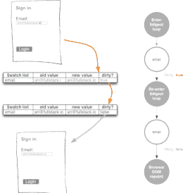

## Digest 循环

一旦 Angular 运行完整个 `$watch` 列表，如果任何值发生了变化，应用程序将回退到 `$watch` 循环，直到检测到没有值变化为止。

为什么要重新运行循环呢？如果我们更新了 `$watch` 列表中的某个值，而该值又更新了另一个值，除非我们重新运行循环，否则 Angular 将检测不到该更新。

如果循环运行十次或更多，我们的 Angular 会抛出一个异常，应用程序就会崩溃。如果 Angular 没有捕获到此异常，应用程序可能会进入无限循环，导致严重后果。

**注意：** 在未来的 Angular 版本中，框架将使用原生的浏览器规范 `Object.observe()`，这将显著加快脏检查过程。

## $watch

`$scope` 对象上的 `$watch` 方法会在 Angular 事件循环内部的每次 `$digest` 调用中，对对每次调用设置一次脏检查。如果 Angular 检测到表达式发生了变化，Angular `$digest` 循环将始终返回。

`$watch` 函数本身接受两个必选参数和一个第三个可选参数：

- `watchExpression`

`watchExpression` 可以是字符串也可以是函数。如果是字符串，Angular 会对其求值；如果是函数，它将带有当前作用域调用，并预期它返回要监听的值。

- `listener/callback`

当发生变化时，监听器函数会被调用。

- `objectEquality` (可选)

`objectEquality` 参数是一个布尔值，告诉 Angular 检查严格相等性。

## $watchCollection

`$watchCollection` 方法用于监听集合（数组或对象）的变化。它接受两个参数：

- `obj` (字符串/函数): 要监听的集合表达式
- `listener` (函数): 当集合发生变化时，此回调函数会被触发。类似于 `$watch` 函数，该函数的调用将传入来自 `$watch` 的新集合、旧集合（上一个集合的副本）以及执行它的作用域（scope）。

`$watchCollection()` 返回一个注销函数，调用该函数时将取消我们对该集合的 `$watch`。

```javascript
$scope.$watchCollection('names', function(newNames, oldNames, scope) {
  // names 集合发生了变化
});
```

## 页面中的 Digest 循环

让我们来看看网页内部的 `$digest` 循环过程。首先，我们假设有一个有一个（非常不安全的）登录页面功能，该功能包含一个单一名称字段，允许通过单个表单验证即可登录。

> 我们不建议使用这种不安全的身份验证形式。

```html
<h2>登录</h2>
<input type="text" placeholder="您的姓名" ng-model="name" ng-minlength='3' />
<input type="submit" ng-click="login()" value="登录" />
```

通过 `ng-model` 指令在视图中绑定名称，Angular 会设置一个隐式监听器（watcher），将输入字段的值绑定到当前 `$scope`。

当用户在表单中输入一个字符时，Angular 上文会启动并开始遍历 `$$watchers`（`$watch` 列表）。

在这种情况下，`$watch` 列表包含一个元素：`$scope.name`。由于用户通过一个字符更改了输入字段，监听函数将在 `$scope.name` 绑定上执行。此操作会触发在退出 `$digest` 循环之前对值运行验证器（validations）和格式化器（formatters）（这是因为 `ng-model` 绑定）。

由于 digest 循环中的值发生了变化，Angular 需要重新运行循环，以确认它没有更改作用域上的任何其他值。

> 为什么 digest 循环要运行一遍又一遍？如果我们有一个名为 `$scope.full_name` 的值，它由 `$scope.first_name + $scope.last_name` 组成，那么这两个值中的任何一个发生的变化都会改变 `$scope.full_name`，循环需要运行以确保没有其他地方发生变化。

由于更改 `$scope.name` 属性不会改变 `$scope` 中的任何属性，`$digest` 循环将退出，浏览器重绘 DOM 从而刷新视图。

当用户在输入字段中输入姓名并点击提交按钮后，会导致发生略有不同的流程：

`ng-click` 将浏览器的原生点击事件绑定到 DOM 元素。当该 DOM 元素接收到点击时，`ng-click` 指令调用 `$scope.$apply()`，我们进入了 `$digest` 循环。

## $evalAsync

`$evalAsync()` 方法是一种在未来的某个时间点在当前作用域上调度表达式的方法。`$digest` 循环运行的第二个操作是执行 `$$asyncQueue`。我们可以通过 `$evalAsync()` 方法访问此工作。

在整个 `$digest` 循环过程中，队列在每次脏检查（dirty checking）生命周期循环之间都会清空，这意味着对于任何使用 `$evalAsync` 调用的函数都有两点：

- 函数将在调用它的函数操作 DOM 之后的某个时间执行
- 在表达式执行后，至少会执行一次 `$digest` 循环。

`$evalAsync()` 方法接收一个参数：

- `expression` (字符串/函数)

该表达式就是我们想要在当前作用域上执行的内容。如果传递的是字符串，`$evalAsync()` 将首先在作用域上调用该表达式。如果传递的是函数，它将在传递给它的 `$scope` 上执行。

```javascript
$scope.$evalAsync('attribute', function(scope) {
  scope.foo = "已执行";
});
```

使用 `$evalAsync` 时需要考虑的一些细节：

- 如果指令直接调用 `$evalAsync()`，它将在 Angular 操作 DOM 之后、但浏览器渲染之前运行
- 如果控制器（controller）调用 `$evalAsync()`，它将在 Angular 操作 DOM 之前以及浏览器渲染之前运行（我们永远不希望发生这种事件顺序）。

每当我们希望某个操作在 Angular 中执行时，我们都可能想要使用 `$evalAsync()` 函数。我们可能会用它来代替 `setTimeout()`。

## $apply

`$apply()` 函数执行一个来自 Angular 框架的表达式。如果我们实现了 `setTimeout()` 或正在使用第三方库，并且希望事件在 Angular 上文中运行，我们就必须使用 `$apply()`。

`$apply()` 函数接收一个可选参数：

- `expression` (字符串/函数)

表达式参数可选地接收一个字符串或函数，并在当前作用域内执行它。如果传递的是字符串，那么 `$apply()` 将首先对该字符串调用 `$eval()`，强制 Angular 在本地作用域上消化该字符串。如果传递的是函数，则将执行该函数。`$exceptionHandler` 服务将捕获并处理 `$apply()` 抛出的任何异常。最后，`$apply()` 方法直接调用 digest 循环。

```javascript
// 调用 apply 的方式
// 使用待求的字符串
$scope.$apply('message = "Hello World"');

// 使用传入 scope 的函数
$scope.$apply(function(scope) {
  // 使用 scope 执行此函数
  scope.message = "Hello World";
});

// 使用忽略 scope 的函数
$scope.$apply(function() {
  scope.message = "Hello World";
});

// 或者通过在操作结束时调用它，强制 digest 循环运行
$scope.$apply();
```

简单来说，使用 `$scope.$apply()` 是从 Angular 外部获取 Angular 上文的方法。如果我们调用 `$apply()`，就会触发 digest 循环。

## 何时使用 $apply()

我们通常可以依赖 Angular 提供的任何在视图中可用指令调用 `$apply()`。事件指令（如 `ng-click`, `keypress` 等）都会调用 `$apply()`。

我们还可以依赖许多内置的 Angular 服务为我们调用 `$digest()`。`$http` 服务在 XHR 请求（promise）后也会调用 `$apply()`。

每当我们手动处理事件、使用第三方框架（例如 jQuery、Facebook API 或 `setTimeout()`）时，我们都想要使用 `$apply` 函数来告诉 Angular 返回循环。

> 我们通常建议不要在控制器中使用 `$apply`，因为这会让测试变得困难；如果我们在控制器中必须使用 `$apply()` 或 `$digest`，可能是我们将问题变得复杂了。

当集成 jQuery 与 Angular（通常被认为是脏的操作）时，我们需要使用 `$apply()`，因为 Angular 无法感知作用域之外的事件。例如，使用 jQuery 插件（如 datepicker），我们需要使用 `$apply` 将值传递到我们的 Angular 应用中。

在这里，我们可以构建一个简单的指令（我们将在指令章节深入讨论这些），并在元素上使用 datepicker jQuery 插件函数。

datepicker 插件暴露了一个 `onSelect` 事件，用户选择日期时触发。为了在 Angular 应用内部获取用户选择的日期，我们需要在 `$apply()` 运行 datepicker 回调。

> `datepicker()` 函数是 jQuery datepicker 插件在 DOM 元素上的属性。为了让它工作，我们需要确保在页面上包含了 jQuery 和 jQuery datepicker 插件。

> 当在 DOM 元素上使用 `ng-model` 时，`ctrl.$setValue()` 函数会提供给指令。有关更多信息，请参阅控制器章节。

```javascript
app.directive('myDatePicker', function() {
  return function(scope, ele, attrs, ctrl) {
    ele.datepicker({
      dateFormat: 'mm/dd/yy',
      onSelect: function(date) {
        scope.$apply(function() {
          ctrl.$setValue(date);
        });
      }
    });
  };
});
```

# 揭秘 Angular 的本质

从核心上讲，AngularJS Web 应用在浏览器中的加载方式与非 AngularJS 应用相同；然而，它们的运行方式略有不同。浏览器在构建 DOM 的同时加载 AngularJS 库（就像通常加载任何其他 JavaScript 库一样）。

当 `ng-app` 触发 `DOMContentLoaded` 事件时，Angular 开始工作。它首先开始寻找 `ng-app` 指令（有关 `ng-app` 指令的更多信息，请参阅“指令”章节）。

> 如果 `document.readyState` 被设置为 `complete`，AngularJS 会开始初始化加载的 angular.js 脚本。如果我们需要动态链接 AngularJS 脚本，这个特性非常有用。

如果浏览器在 DOM 中找到了 `ng-app` 指令，应用将自动为你启动（bootstrap）。如果没有找到该指令，Angular 则期望由我们启动应用。

要手动启动 AngularJS 应用，我们可以使用 Angular 的 `bootstrap()`。在某些相对罕见的情况下，手动启动应用是有意义的。例如，我们想在其他库代码运行之后运行 AngularJS 应用，或者我们正在动态创建一个元素。

要手动启动应用，我们可以这样启动它：

```javascript
var newElement = document.createElement("div");
angular.bootstrap(newElement, ['MyApp']);
```

> 如果 DOM 中没有找到 `ng-app` 指令且我们手动启动了应用，AngularJS 将不会运行。忘记写 `ng-app` 绝对会导致一些严重的问题。

如果在 `ng-app` 属性中没有指定应用，Angular 将加载没有特定模块的应用。如果指定了模块，Angular 将加载与指令相关的模块。

在不指定模块的情况下使用 `ng-app`：

```html
<html ng-app>
</html>
```

带有指定模块的 `ng-app`：

```html
<html ng-app="moduleName">
</html>
```

Angular 使用 `ng-app` 指令的值来配置 `$injector` 服务（我们将在依赖注入章节中深入介绍该服务）。

一旦应用加载，`$injector` 会连同应用的 `rootScope` 一起创建 `$compile` 服务。

在创建 `$rootScope` 后，`$compile` 服务接管。它将 `$rootScope` 链接到现有的 DOM，并开始从设置 `ng-app` 指令为根节点开始编译 DOM。

## 视图的工作原理

浏览器通过正常的 Web 流程获取 HTML，接收 HTML 并将其解析为 DOM 树。DOM 树中的每个元素（称为 DOM 元素）都构建了一组节点。浏览器负责布局 DOM 树结构。

当浏览器从 `<script>` 标签获取脚本时，它会暂停解析并等待脚本被检索（可以修改此行为，但这是默认行为）。

当获取到 `angular.js` 脚本后，它会被执行，并设置一个事件监听器来监听 `DOMContentLoaded` 事件。

> 当 HTML 文档加载并解析完成后，会触发 `DOMContentLoaded` 事件。

当检测到该事件时，Angular 寻找 `ng-app` 指令并创建它运行所需的几个必要组件（即 `$injector`、`$compile` 服务和 `$rootScope`），然后它开始解析 DOM 树。

### 编译阶段

`$compile` 服务遍历 DOM 并收集它找到的所有指令。它将所有的链接函数（linking functions）合并成一个链接函数。

随后，该链接函数用于将编译后的模板链接到 `$rootScope`（附加到 `ng-app` DOM 元素上的作用域）。

它通过查找属性、注释、类和 DOM 元素名称在 DOM 中寻找指令。

```html
<span my-directive></span>
<span class="my-directive"></span>
<my-directive></my-directive>
<!-- directive: my-directive -->
```

有关指令的深度介绍，请查看“指令”章节。

`$compile` 服务在 DOM 树中遍历，寻找在其声明了指令的 DOM 元素。当它遇到一个或多个指令时，它会对指令进行排序（基于它们的优先级），然后使用 `$injector` 服务找到并收集指令的 `$compile` 函数并执行它。

`compile` 函数是在执行任何 DOM 变换或内联模板的最佳时机，它创建了模板的副本。

```javascript
// 返回一个链接函数
var linkFunction = $compile(appElement);
// 调用链接函数，将 $rootScope 附加到 domElement
linkFunction($rootScope);
```

在 `compile` 方法运行后，`$compile` 服务调用链接函数。链接函数为绑定到闭包作用域的指令设置监听器（watches）。此操作创建了实时视图（live-view）。

最后，在 `$compile` 服务完成后，AngularJS 运行时就准备就绪了。

## 运行阶段

在普通的浏览器中，事件循环等待事件（如鼠标移动、点击、按键等）。当这些事件发生时，它们被放入浏览器的事件队列中。如果设置了任何处理函数来响应事件，它们将以事件作为参数被调用。

```javascript
ele.addEventListener('click', function(event) {});
```

Angular 对事件循环进行了一些增强，因为 Angular 提供了自己的事件循环。指令在事件触发时注册事件监听器，指令函数在 AngularJS 的 `$digest` 循环中运行。

> Angular 事件循环被称为 `$digest` 循环。`$digest` 循环由两个小循环组成：`evalAsync` 循环和 `$watch` 列表。

当事件触发时，它会在指令的上下文中调用，而在 AngularJS 的上下文中。从功能上讲，AngularJS 在所在作用域的 `$apply()` 方法中调用指令。当数字循环开始时，它会在浏览器渲染之前等待 `evalAsync` 队列清空。

此外，`$digest` 循环会等待 `$watch` 列表，即在上一次迭代中可能变化的表达式数组。如果检测到变化，将再次运行 `$watch` 列表。

> 注意，对于检测到的任何变化，Angular 会再次运行。

一旦 `$digest` 循环稳定且没有检测到潜在变化，执行将离开 Angular 环境并返回浏览器。

整个流程发生在浏览器事件之间，这就是为什么 Angular 如此强大。也可以将浏览器事件注入 AngularJS 流。

# AngularJS 扩展

最受欢迎且支持最好的 AngularJS 插件之一是 AngularUI 框架。

## AngularUI

AngularJS 本身充满了开箱即用的功能，我们可以此构建不依赖其他库的应用；然而，非常活跃的 AngularJS 社区开发了一些很棒的库，我们可以利用它们来增强应用程序。

在本节中，我们将介绍 AngularUI 库的几个不同的常用组件。

AngularUI 库被拆分为几个模块，这样我们就不需要包含整个套件，而是可以选择我们感兴趣的组件。

### 安装

要安装 ui-router 库，我们可以下载 release 112 版本，或者使用 Bower 安装该库。

请确保你已经全局安装了 Bower：

```bash
$ npm install bower -g
```

使用 Bower 安装 angular-ui 库：

```bash
$ bower install angular-ui-router --save
```

我们需要确保将库链接到我们的视图中：

```html
<script type="text/javascript" src="app/bower_components/angular-ui-router/release/angular-ui-router.js"></script>
```

并且，我们需要在应用中将 ui-router 注入为依赖项：

```javascript
angular.module('myApp', ['ui.router']);
```

现在，与内置的 ngRoute 不同，ui-router 是基于状态（states）工作的，因此它可以嵌套视图，而不是使用 URL。

我们不会像使用 ngRoute 服务那样使用 `ng-view` 指令，而是在 ngRoute 中使用 `ui-view` 指令。

在 ui-router 内部处理路由和状态时，我们主要关注 Web 应用当前处于哪个状态和哪个路由。

```html
<div ng-controller="DemoController">
  <div ui-view></div>
</div>
```

就像 ngRoute 一样，我们在任何状态下定义的模板都会被放在 `<div ui-view>` 元素内部。这些模板中的每一个也可以包含它们自己的 ui-view。这一特性允许我们在路由内部嵌套视图。

要定义路由，我们使用 `.config` 方法，就像平时一样，但我们不是在 `$routeProvider` 上设置路由，而是在 `$stateProvider` 上设置状态。

> http://angular-ui.github.io/ui-router/release/angular-ui-router.js

```javascript
.config(function($stateProvider, $urlRouterProvider) {
  $stateProvider
    .state('start', {
      url: '/start',
      templateUrl: 'partials/start.html'
    });
});
```

这会将一个命名的状态分配给状态配置对象。状态配置对象（或 `stateConfig`）与路由配置对象具有类似的选项，赋予了我们配置应用状态的能力。

### template, templateUrl, templateProvider

这是在每个视图上设置模板的三种方式：

- `template` - HTML 内容字符串或返回 HTML 的函数
- `templateUrl` - 模板的字符串 URL 路径或返回 URL 路径字符串的函数
- `templateProvider` - 返回 HTML 字符串的函数

例如：

```javascript
$stateProvider.state('home', {
  template: '<h1>Hello {{ name }}</h1>'
});
```

### controller

就像在 ngRoute 中一样，我们可以将已注册的控制器与 URL 关联（通过字符串），或者创建一个作为状态控制器的函数。如果没有定义模板（在之前的选项之一中），将不会创建控制器。

### resolve

我们可以使用 `resolve` 功能解析一组依赖项，并将其注入到控制器中。在 ngRoute 中，`resolve` 选项允许我们在路由实际渲染之前解析承诺（promises）。在 angular-route 内部，我们对使用该选项有更多的自由。

`resolve` 选项接收一个对象，其键是注入到控制器的依赖项名称，值是要解析的工厂（factories）。如果传递的是字符串，`angular-route` 会尝试匹配任何已注册的服务。如果传递的是函数，则该函数会被注入，函数的返回值即为依赖项。如果函数返回一个承诺，它将在控制器实例化之前被解析，并且该值（与 ngRoute 一样）会被注入到控制器中。

```javascript
$stateProvider.state('home', {
  resolve: {
    // 这会立即返回，因为结果不是承诺
    person: function() {
      return {
        name: "Ari",
        email: "ari@fullstack.io"
      };
    },
    // 此函数返回一个承诺，因此它将在控制器实例化之前解析
    currentDetails: function($http) {
      return $http({
        method: 'JSONP',
        url: '/current_details'
      });
    },
    // 我们可以在另一个解析选项中使用生成的承诺
    facebookId: function($http, currentDetails) {
      return $http({
        method: 'GET',
        url: 'http://facebook.com/api/user',
        params: {
          email: currentDetails.data[0]
        }
      });
    }
  },
  controller: function($scope, person, facebookId) {
    $scope.person = person;
  }
});
```

### url

`url` 选项为状态分配一个唯一的 URL。`url` 选项允许我们通过状态而非仅通过 URL 在应用中使用深度链接功能。这类似于 ngRoute，但是一项重大升级。

基础路由可以这样指定：

```javascript
$stateProvider.state('inbox', {
  url: '/inbox',
  template: '<h1>Welcome to your inbox</h1>'
});
```

当用户导航到 `/inbox` 时，应用切换到 `inbox` 状态，并用内容填充 `ui-view`（`<h1>Welcome to your inbox</h1>`）。

URL 可以接受多个选项，我们可以像 ngRoute 一样设置参数：

```javascript
$stateProvider.state('inbox', {
  url: '/inbox/:inboxId',
  template: '<h1>Welcome to your inbox</h1>',
  controller: function($scope, $stateParams) {
    $scope.inboxId = $stateParams.inboxId;
  }
});
```

应用捕捉 URL 中的第二个部分作为 `inboxId`。例如，如果用户切换到 `/inbox/1`，`$stateParams` 将变为 `{inboxId: 1}`。

如果你喜欢，也可以使用不同的语法：

```javascript
url: '/inbox/{inboxId}'
```

必须精确匹配 URL。与 ngRoute 不同，如果用户导航到 `/inbox/`，上述路径将有效；但导航到 `/inbox` 时状态将不会激活。

路径还允许我们在参数中使用正则表达式，以便设置一个规则来匹配路由。例如：

```javascript
// 匹配包含 6 位十六进制数字的 inbox ID
url: '/inbox:[0-9a-f-F]{6}'
// 或者
// 匹配 '/inbox' 结尾的所有 URL inboxId（通配符）
url: '/inbox.*'
```

注意，我们无法在路由内部重用捕获组：路由解析器可能会解析。

我们可以在路由中指定查询参数：

```javascript
// 将匹配如 inbox?sort=ascending 的路由
url: '/inbox/sort'
```

### 嵌套路由

我们可以使用 `url` 参数附加路由以提供嵌套路由。此选项允许我们在页面和模板内部支持多个视图。例如，我们可以在 `/inbox` 路由内部嵌套单个路由。

```javascript
$stateProvider.state('inbox', {
  url: '/inbox/inbox',
  template: '<div><h1>Welcome to your inbox</h1><a ui-sref="inbox.priority">Show priority</a><div ui-view></div></div>',
  controller: function($scope, $stateParams) {
    $scope.inbox = $stateParams.inboxId;
  }
});

$stateProvider.state('inbox.priority', {
  url: '/priority',
  template: '<h2>Your priority inbox</h2>'
});
```

我们的第一个路由如预期匹配（见上文）。我们现在有了第二个路由，即匹配父路由下的子路由（因为我们使用点符号语法将其指定为子路由）。

- `/inbox/1` 匹配第一个状态
- `/inbox/1/priority` 匹配第二个状态

通过这种语法，我们可以在父路由内部支持嵌套 URL。父视图中的 ui-view 解析为优先级 inbox。

### params

`params` 选项是参数名称或正则表达式的数组。我们无法将此选项与 `url` 选项组合。当状态激活时，这些参数将由 `$stateParams` 服务填充。

### views

我们在状态内部设置多个命名视图的能力是 ui-router 的一个特别强大的功能。在单个视图内部，我们可以定义多个并在单个模板中引用它们。

> 如果我们设置了 `views` 参数，状态的模板将被忽略。如果我们想在路由中包含父模板，我们需要创建一个包含子模板的抽象模板。

假设我们有一个像这样的视图：

```javascript
$stateProvider
.state('inbox', {
  views: {
    'filters': {
      template: '<h4>Filter inbox</h4>',
      controller: function($scope) {}
    },
    'mailbox': {
      templateUrl: 'partials/mailbox.html'
    },
    'priority': {
      template: '<h4>Priority inbox</h4>',
      resolve: {
        facebook: function() {
          return FB.messages();
        }
      }
    }
  }
});
```

### 摘要

抽象模板永远无法被直接激活，但可以设置被激活的后代状态。

我们可以使用抽象模板为多个命名视图提供模板封装器，或者将 `$scope` 对象传递给后代子节点。我们可以使用它们来传递解析后的依赖项或自定义数据，或者简单地将多个路由嵌套在同一个 'url' 下（例如，让所有路由都在 /admin 视图下）。设置抽象模板与设置普通状态一样，区别在于我们设置了 abstract 属性：

```javascript
$stateProvider
.state('admin', {
  abstract: true,
  url: '/admin',
  template: '<div ui-view></div>'
})
.state('admin.index', {
  url: '/index',
  template: '<h3>Admin index</h3>'
})
.state('admin.users', {
  url: '/users',
  template: '<ul>...</ul>'
});
```

### onEnter, onExit

当我们进入或退出视图时（分别），Angular 会调用这些回调函数。对于这两种选项，我们都可以设置想要调用的函数。这些函数可以访问解析后的数据。

这些回调允许我们能够在新视图上触发操作，或者在离开另一个状态之前执行操作。使用它们是启动“你确定吗？”模态视图或在用户进入此状态之前要求其登录的好方法。

### data

我们可以为状态配置对象 Object 挂载任意数据。此选项与 resolve 属性类似，区别在于这些数据不会被注入到控制器中，承诺（promises）也不会被解析。当从父状态向子状态传递数据时，此选项可能特别有用。

### 事件！

与 ngRoute 服务一样，angular-route 服务会在生命周期内的不同时间触发事件。

我们可以在应用程序内部通过监听 `$scope` 来向这些事件挂载函数。以下所有事件都会在 `$rootScope` 上触发，因此我们可以在任何 `$scope` 对象上监听这些事件。

#### 状态变更事件

我们可以按照如下方式监听事件：

```javascript
$scope.$on('$stateChangeStart', function(evt, toState, toParams, fromState, fromParams) {
  // 我们可以阻止此状态完成
  evt.preventDefault();
});
```

可能会触发的事件如下：

- `$stateChangeStart` 当从一个状态切换到另一个状态开始时触发此事件。
- `$stateChangeSuccess` 当从一个状态到下一个状态的切换完成时触发此事件。
- `$stateChangeError` 当切换过程中发生错误时触发此事件。它通常是由无法解析的模板或承诺（promise）解析失败引起的。

#### 视图加载事件

ui-router 在视图加载阶段提供事件。

- `$viewContentLoading` 当视图开始加载并在 DOM 渲染之前触发此事件。

我们可以像下面所示监听此事件：

```javascript
$scope.$on('$viewContentLoading', function(event, viewConfig) {
  // 访问所有的视图配置属性。
  // 以及一个特殊属性 'targetView'
  viewConfig.targetView;
});
```

- `$viewContentLoaded` 此事件在视图加载完成且 DOM 渲染后触发。

### StateParams

在上面中，我们使用 `$stateParams` 从 URL 参数中提取不同的参数。该服务是用来处理来自 URL 不同组件数据的方式。例如，如果我们在收件箱状态中有一个如下所示的 URL：

```
url: '/inbox/:inboxId/messages/{sorted}?from&'
```

并且我们的用户找到了路由：

```
/inbox/123/messages/ascending?from=10&to=20
```

那么我们的 `$stateParams` 对象结果为：

```javascript
{inboxId: '123', sorted: 'ascending', from: 10, to: 20}
```

### $urlRouterProvider

就像 ngRoute 一样，我们可以访问一个路由提供程序，通过它我们可以构建当特定 URL 被激活时发生情况的规则。我们创建的状态负责处理激活状态。`$urlRouterProvider` 并不是用于管理激活和加载状态。当我们想要管理发生在状态范围之外的事件（例如重定向或身份验证）时，它会非常有用。

我们可以在模块的 config 函数中使用 `$urlRouterProvider`。

#### when()

该函数接受两个参数：我们想要匹配的输入路径以及我们想要重定向到的路径（或在路径匹配时时调用的函数）。要设置重定向，我们需要让该方法接收一个字符串。例如，如果我们想将空路由重定向到我们的 /inbox 路由：

```javascript
.config(function($urlRouterProvider) {
  $urlRouterProvider.when('', '/inbox');
});
```

如果我们传递一个函数，它将在路径匹配时被调用。处理器可以返回三个值之一：

- 假值（falsy） - 此值告诉 `$urlRouter` 规则未匹配，它应该尝试寻找匹配的状态。如果我们想确保用户对 URL 有有效的访问权限，这非常有用。
- 字符串 - `$urlRouter` 将字符串值视为重定向 URL。
- true 或 undefined - 此值让 `$urlRouter` 知道我们已经处理了该 URL。

#### otherwise()

就像 ngRoute 中的 `otherwise()` 方法一样，这里的 `otherwise()` 方法用于设置默认路由。该函数接受一个参数：我们想要重定向到的路径（或在路径匹配时调用的函数）。要设置重定向，我们需要让方法接收一个字符串。例如，如果我们想将空路由重定向到我们的 /inbox 路由：

```javascript
.config(function($urlRouterProvider) {
  $urlRouterProvider.otherwise(function($injector, $location) {
    return '/';
  });
});
```

### 创建

使用比内置的 ngRoute 更强大的路由器，这有什么意义？

使用 ui-router，我们可以为用户创建一个注册流程。首先，我们需要为应用创建一个视图：

```html
<div ng-controller="PickerController">
  <h2>Signup</h2>
  <div ui-view></div>
</div>
```

在这个内部，我们存放视图。接下来，在我们的注册向导中，我们需要三个阶段：

- **start** - 在此阶段，我们获取用户名并引导用户进入注册向导。
- **email** - 在这里我们接受用户的电子邮件。
- **finish** - 在此时，finish 完成我们的注册流程并向他们显示完成页面。

在实际应用程序中，finish 阶段可能会将注册数据发回服务器。在这里没有后端，我们将向你显示视图。

我们的注册流程依赖于 wizardapp 模块，我们将在其中编写控制器：

```javascript
angular.module('wizardApp', [
  'ui.router',
  'wizardapp.controllers'
]);
```

我们的 `WizardSignupController` 仅存放 `$scope.user` 对象（我们在整个注册过程中携带它）以及注册动作。

```javascript
angular.module('wizardapp.controllers', [])
.controller('WizardSignupController', function($scope, $state) {
  $scope.user = {};
  $scope.signup = function() {};
});
```

流程逻辑包含了大部分工作。我们希望在应用的 config() 函数中设置此逻辑：

```javascript
angular.module('wizardApp', [
  'ui.router', 'wizardapp.controllers'
])
.config(function($stateProvider, $urlRouterProvider) {
  $stateProvider
    .state('start', {
      url: '/step_1',
      templateUrl: 'partials/wizard/step_1.html'
    })
    .state('email', {
      url: '/step_2',
      templateUrl: 'partials/wizard/step_2.html'
    })
    .state('finish', {
      url: '/finish',
      templateUrl: 'partials/wizard/step_3.html'
    });
  $urlRouterProvider.otherwise(function($injector, $location) {
    return '/';
  });
});
```

设置好这些选项后我们就完成了基础流程。现在，如果用户导航到路由 /step_1，他们将被引导到流程的开始。虽然让整个流程发生在根 URL（即 /step_1）上可能是合理的，但我们可能希望将其放置在子位置中（例如 /wizard/step_1）。

为了做到这一点，我们设置了一个抽象状态来存放我们剩余的步骤。

```javascript
.config(function($stateProvider, $urlRouterProvider) {
  $stateProvider
    .state('wizard', {
      abstract: true,
      url: '/wizard',
      template: '<div><div ui-view></div></div>'
    })
    .state('wizard.start', {
      url: '/step_1',
      templateUrl: 'partials/wizard/step_1.html'
    })
    .state('wizard.email', {
      url: '/step_2',
      templateUrl: 'partials/wizard/step_2.html'
    })
    .state('wizard.finish', {
      url: '/finish',
      templateUrl: 'partials/wizard/step_3.html'
    });
});
```

现在，我们不再将路由放在顶层，而是可以将它们安全地嵌套在 `/wizard` URL 内部。我们还想在注册流程结束时挂载一个事件，调用父控制器 `SignupController` 中的 `signup` 函数。我们将在向导流程的最后一步设置一个控制器，调用 `$scope` 上的函数。由于我们的整个向导最终过程都封装在 `WizardSignupController` 中，我们将能够像往常一样使用嵌套作用域属性。

```javascript
.state('wizard.finish', {
  url: '/finish',
  templateUrl: 'partials/wizard/step_3.html',
  controller: function($scope) {}
});
```

## ui-utils

UI Utils 库是一个强大的工具包，它可以为你的项目提供许多自定义扩展，而无需重复造轮子。

下面，我们展示了 ui-utils 库带来的一些显著特性：

### 安装

```bash
$ bower install --save angular-ui-utils
```

我们需要确保在 HTML 模板中包含该库。ui-utils 库的每个组件都是作为独立的模块构建的，因此我们需要独立地包含每一个模块。

### mask（掩码）

当我们验证信用卡或电话号码（或任何需要特定格式的输入）时，我们可以提供一个整洁的 UI，告诉用户他们提供的是规范的输入。我们需要在 HTML 中包含 `mask.js` 库：

```html
<script type="text/javascript" src="app/bower_components/angular-ui-utils/modules/mask/mask.js"></script>
```

并将 `ui.mask` 设置为应用的依赖：

```javascript
angular.module('MyApp', ['ui.mask']);
```

现在，我们可以使用 `ui-mask` 指令来指定输入掩码。`ui-mask` 指令接收遵循以下格式规则的单个字符串：

- `a` 任意字母
- `9` 任意数字
- `*` 任意字母数字

例如，为了在输入框中格式化信用卡号，我们可能会将 `ui-mask` 指令设置为：

```html
<input name="ccnum" ui-mask="9999 9999 9999 9999" ng-model="user.cc" placeholder="Credit card number" />
```

> ui-mask 的工作方式类似于 Angular，即在所有验证都满足之前，不会认为输入是有效的。注意，此输入仅支持输入掩码匹配 9999-9999-9999-9999 的信用卡。通过进一步的工作，我们可以支持其他类型的卡片。

同样，我们可以使用字符或任何字母数字字符来格式化输入字段。

### ui-event（事件）

与其它模块一样，我们需要在 HTML 中包含 `event.js` 库：

```html
<script type="text/javascript" src="app/bower_components/angular-ui-utils/modules/event/event.js"></script>
```

并且我们需要将 `ui.event` 包含应用的依赖：

```javascript
angular.module('MyApp', ['ui.event']);
```

当我们想要处理 AngularJS 原生不支持的事件时，`ui-event` 模块非常好用。例如，如果我们想让用户点击某个元素或处理失去焦点（blur）事件，我们需要为原生浏览器双击事件编写一个包装器。`ui-event` 模块简单来说就是原生事件的封装，因此可以使用它来响应浏览器在任何元素上触发的任何事件。

例如，假设我们要在用户双击另一张图片后显示一张图片。我们只需将 `ui-event` 设置为一个键值对，包含事件名称以及元素捕获到事件时执行的操作。

例如，在我们的 HTML 中，可以设置一个双击 `dblclick` 事件来调用控制器上的 `showImage()` 函数：

```html

```

并在控制器中，我们可以像这样在 scope 上编写方法：

```javascript
.controller('DemoController', function($scope) {
  $scope.showImage = function() {
    $scope.shouldShowImage = !$scope.shouldShowImage;
  };
});
```

`ui-event` 指令仅仅是原生浏览器事件的封装，可以使用它在任何元素上模拟任何浏览器事件。

例如，如果我们想获取元素上的失去焦点（blur）或聚焦（focus）事件，可以使用 `ui-event` 指令为我们捕获。

假设我们想为填写表单提供一些实用的提示。我们可以在聚焦和失去焦点事件上设置显示/隐藏。

```html
<form>
  <input type="text" name="name" placeholder="Name" ui-event="focus:showTips; blur:hideTips">
  <div ng-show="showTips">Please enter your name.</div>
  <input type="text" name="email" placeholder="Email" ui-event="focus:showTips; blur:hideTips">
  <div ng-show="showTips">Please enter your email.</div>
</form>
```

# 移动应用

## ngTouch

### 安装

我们可以通过多种方式之一安装 ngTouch。最简单的方法是从 angularjs.org 下载源代码来安装 ngTouch 模块。

在下载部分找到额外内容（extras），然后我们就可以下载并将 `ng-touch.js` 文件存储到应用中一个可以访问的位置。

或者，我们可以使用 Bower 来安装 `angular-touch`：

```bash
$ bower install angular-touch --save
```

无论采用哪种方式，我们都需要在 `index.html` 中以脚本的形式引用该库：

```html
<script src="bower_components/angular-touch/angular-touch.js"></script>
```

最后，我们需要将 ngTouch 作为依赖项包含在应用中：

```javascript
angular.module('App', ['ngTouch']);
```

现在，我们已经准备好利用 ngTouch 库了。

### ngTouch 指令

移动浏览器在处理点击事件时的工作方式与桌面浏览器略有不同。移动浏览器检测到点击（tap）事件后，会等待大约 300 毫秒来检测任何其他点击（即：它们在等待确认我们是否在双击设备）。在此延迟之后，浏览器会触发点击事件。

这种延迟会导致我们的应用感觉非常不灵敏。与其处理点击事件，我们可以检测触摸事件。

ngTouch 库通过 `ng-click` 指令为我们无缝地处理了这一功能，并负责为调用正确的事件。这将调用所谓的“快速点击”（fast click）事件。

> 在调用快速点击后，浏览器的延迟点击会次之触发，从而导致“双重”动作。ngTouch 负责在 `ng-click` 事件上移除这种延迟。

在移动设备上使用 `ng-click` 指令在移动浏览器上的工作方式与桌面浏览器上完全相同：

```html
<button ng-click="save()">Save</button>
```

ngTouch 引入了两个新指令：滑动指令（swipe directives）。这些滑动指令允许我们捕捉用户在屏幕上向左或向右的滑动。这些对于我们希望用户能够浏览相册或滑动到应用的其他部分的情况非常有用。

`ngSwipeLeft` 检测元素何时从右向左滑过，而 `ngSwipeRight` 检测元素何时从左向右滑过。

`ngSwipe*` 指令带给我们的优秀特性之一是，它们同时适用于基于触摸的设备以及鼠标点击和拖拽。

使用 `ngSwipe*` 指令非常简单。例如，假设我们有一个邮件列表，并想要为每封邮件显示操作，就像流行的移动客户端 MailboxApp 那样。

我们可以轻松地在元素列表上使用这些滑动指令实现功能。当我们在显示邮件列表时，我们在一个方向上启用滑动，以显示对该特定项目可以执行的操作。

当我们在显示邮件项的操作时，我们在另一个方向上启用滑动，以隐藏我们可以执行的操作。

```html
<ul>
  <li ng-repeat="mail in emails">
    <div ng-show="mail.showActions" ng-swipe-left="mail.showActions=true">
      <div class="from">
        From:<span>{{ mail.from }}</span>
      </div>
      <div class="body">
        {{ mail.body }}
      </div>
    </div>
    <div ng-show="!mail.showActions" ng-swipe-right="mail.showActions=false">
      <ul class="actions">
        <li><button>Archive</button></li>
        <li><button>Trash</button></li>
      </ul>
    </div>
  </li>
</ul>
```

## angular-gestures 和多点触控手势

`angular-gestures` 是一个 Angular 模块，赋予我们在应用中处理多点触控操作的能力。它基于非常流行且经过测试的 Hammer.js 库。

Hammer.js 库为我们提供了许多触摸屏通用的事件：

- Tap
- DoubleTap
- Swipe
- Drag
- Pinch
- Rotate

`angular-gestures` 库允许我们使用 Angular 指令使用这些事件。例如，以下指令对我们可用：

- `hmDoubleTap`: 'doubletap'
- `hmDragStart`: 'dragstart'
- `hmDrag`: 'drag'
- `hmDragUp`: 'dragup'
- `hmDragDown`: 'dragdown'
- `hmDragLeft`: 'dragleft'
- `hmDragRight`: 'dragright'
- `hmDragEnd`: 'dragend'
- `hmHold`: 'hold'
- `hmPinch`: 'pinch'
- `hmPinchIn`: 'pinchin'
- `hmPinchOut`: 'pinchout'
- `hmRelease`: 'release'
- `hmRotate`: 'rotate'
- `hmSwipe`: 'swipe'
- `hmSwipeUp`: 'swipeup'
- `hmSwipeDown`: 'swipedown'
- `hmSwipeLeft`: 'swipeleft'
- `hmSwipeRight`: 'swiperight'
- `hmTap`: 'tap'
- `hmTouch`: 'touch'
- `hmTransformStart`: 'transformstart'
- `hmTransform`: 'transform'
- `hmTransformEnd`: 'transformend'

### angular-gestures 安装

要在我们的应用中安装 angular-gestures 库，我们需要在页面中引入 `gestures.js`（或 `gestures.min.js`）库。

我们可以直接从 GitHub 页面 下载 `gestures.js` 文件，也可以使用 Bower 来安装。

要使用 Bower 安装 angular-gestures，可以运行以下命令：

```bash
$ bower install --save angular-gestures
```

最后，我们需要将 angular-gestures 设置为 Angular 应用的依赖项：

```javascript
angular.module('MyApp', ['angular-gestures']);
```

### 使用 angular-gestures

从这里开始，使用手势变得非常简单。手势本质就是 Angular 指令（directives），因此我们像在应用中使用其他指令一样使用它们。

假设我们想允许用户在相册中旋转、捏合和缩放照片。我们可以使用 Hammer.js 库来帮助处理这些功能。

在这个示例中，我们将仅为双击元素设置一个随机位移。为了实现这一点，我们需要使用 `hm-tap` 指令来设置 HTML。

```html
<div id="photowrapper">
  <div class="cardProps">
    <div hm-tap="tapped($event)">
      <div class="tradingcard">
        
        <span>Ari</span>
      </div>
      <div class="tradingcard">
        
        <span>Nate</span>
      </div>
    </div>
  </div>
</div>
```

这段 HTML 并没有什么特别特别之处，唯一的不同之处在于我们有了一个名为 `hm-tap` 的指令。这个 `angular-gestures` 指令处理了当有人点击图像时发生的情况。

Hammer.js 指令可以接收 Angular 表达式——这意味着我们可以在内部运行操作中调用函数（例如 `ng-click`）以及 Hammer.js 选项。

在示例中，我们调用了在 `$scope` 上定义的函数 `tapped()`。我们对该函数的定义如下：

```javascript
$scope.tapped = function($event) {
  var ele = $event.target;
  var x = Math.floor(Math.random() * 200) + 1,
      y = Math.floor(Math.random() * 100) + 1,
      z = Math.floor(Math.random() * 6) + 1,
      rot = Math.floor(Math.random() * 360) + 1;
  $(ele).css({
    'transform': "translate3d(" + x + "px," + y + "px," + z + "px) rotate(" + rot + "deg)"
  });
};
```

`angular-gestures` 库允许我们通过特殊的参数 `$event` 访问事件。我们将使用事件目标确定用户点击了哪个元素，然后就可以对元素执行各种酷炫的技巧。

## 使用 Cordova 开发原生应用

Cordova 是一个免费的开源框架，允许我们使用标准的 Web API 而不是原生代码来创建移动应用。它使我们能够使用 HTML、JavaScript、CSS 和 AngularJS 编写移动应用，而无需编写 Objective-C 或 Java（分别对应 iOS 或 Android）。

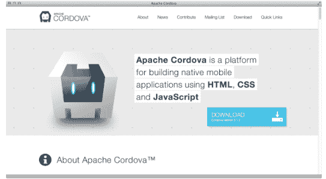

Cordova 通过 JavaScript API 暴露原生设备访问能力，允许我们运行特定设备的操作，例如获取原生位置或使用摄像头。Cordova 原生设计采用插件架构，因此我们可以利用社区构建的插件，例如原生音频访问或条形码扫描插件。

Cordova 的优势之一是我们可以重用 Angular 应用代码来支持移动环境。当然，我们需要处理一些问题，例如性能和原生组件访问。

### 安装

Cordova 本身作为 npm 包分发，因此我们确实使用 npm 来安装它。

- 如果你没有安装 npm，请先确保安装了 node。关于安装 NodeJS 的信息，请参阅“下一步”章节。

```bash
$ npm install -g cordova
```

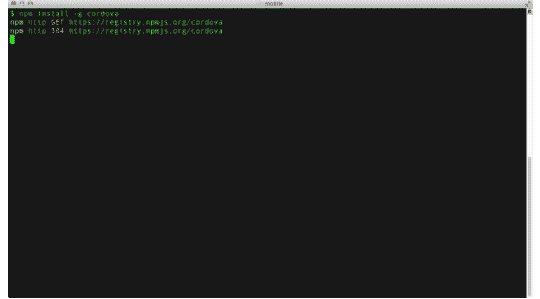

Cordova 包包含一个生成器，它会创建我们的应用并使其准备好用于 Cordova 环境。

### 开始使用 Cordova

开始使用 Cordova 非常简单。我们使用生成器创建 Cordova 应用的起点。我们将该应用命名为 `GapApp`。

生成器最多接受三个参数：

- `project-directory`（必选）：我们将创建应用的目录
- `package-id`：项目 ID（反向域名格式的包名）
- `name`：包名（应用程序名称）

```bash
$ cordova create gapapp io.fullstack.gapapp "GapApp"
```

这一行创建了一个名为 `gapapp` 的目录（由第一个参数指定），其包 ID 为 `io.fullstack.gapapp`。

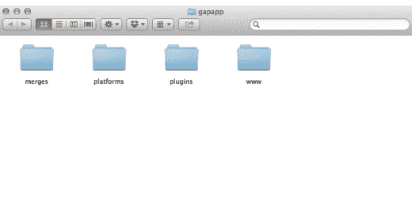

### 添加平台

要添加平台，我们使用 `platform add` 命令：

```bash
$ cordova platform add ios
$ cordova platform add android
```

### 构建应用

构建命令确保了设置了必要的平台特定代码，以便我们的应用可以编译。实际上，我们执行的操作与调用 `cordova prepare && cordova compile` 是相同的。

```bash
$ cordova build ios
$ cordova build android
```

### 模拟与运行

Cordova 还允许运行模拟器来模拟在设备上运行应用。当然，这只有在我们的本地开发环境中安装并设置了模拟器的情况下才可行。

假设我们的模拟器已经在开发环境中设置好，我们可以告诉 Cordova 在模拟器中启动并安装应用：

```bash
$ cordova emulate ios
```

对于 iOS，如果机器上没有设置模拟器环境，我们可能需要使用 Xcode 构建项目（如我们上面所做）。

我们也可以通过 `run` 命令在特定设备上运行应用程序。`run` 命令会在设备上启动应用程序，如果没有找到可用的设备，则会在模拟器上启动。

```bash
$ cordova run ios
```

### 在开发过程中

修改应用的一个部分然后重新编译应用以查看更改结果可能是繁琐的。为了加速应用 Web 部分开发，我们可以使用 `serve` 命令向浏览器提供 `www/` 文件夹的本地版本。

```bash
$ cordova serve ios
静态文件运行于 => http://0.0.0.0:8000/
CTRL + C 关闭
```

现在，我们可以使用浏览器并导航到 URL：http://localhost:8000/ios/www/index.html。

我们应用的 `www/` 文件夹正在通过 HTTP 提供服务，因此我们可以构建它并在我们修改应用时观察它的变化。

当我们进行更改时，需要确保重新构建应用：

```bash
$ cordova build ios
```

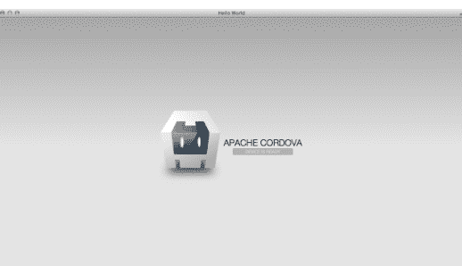

### Angular Cordova 服务

当我们的 Cordova 应用准备就绪、设备已连接且一切准备就绪时，Cordova 会触发一个名为 `deviceready` 的浏览器事件。

使用 Angular，我们可以在该事件触发后引导（bootstrap）应用，或者使用承诺在 `deviceready` 事件触发后处理我们的逻辑。

要在接收到 `deviceready` 事件后引导应用，我们需要为该事件设置事件监听器，然后在应用上调用 `bootstrap`：

```javascript
angular.module('myApp', []);
var onDeviceReady = function() {
    angular.bootstrap(document, ['myApp']);
};
document.addEventListener('deviceready', onDeviceReady);
```

我们倾向于使用另一种方法来监听 `deviceready` 事件，该方法使用承诺（promises）在 `deviceready` 事件触发后设置执行绑定。

我们设置了一个监听 `deviceready` 事件的 Angular 模块。我们也可以使用监听 `deviceready` 事件的服务，并根据事件是否触发来解析我们的承诺。

```javascript
angular.module('fsCordova', [])
.service('CordovaService', ['$document', '$q', function($document, $q) {
  var d = $q.defer(),
      resolved = false;
  var self = this;
  this.ready = d.promise;

  document.addEventListener('deviceready', function() {
    resolved = true;
    d.resolve(window.cordova);
  });

  // 检查确保我们没有漏掉事件（以万一）
  setTimeout(function() {
    if (!resolved) {
      if (window.cordova) d.resolve(window.cordova);
    }
  }, 3000);
}]);
```

现在，我们将 `fsCordova` 设置为模块的依赖项：

```javascript
angular.module('MyApp', ['fsCordova']);
// ...
```

我们可以使用 `CordovaService` 来判断 Cordova 是否实际上已经就绪，并设置我们的逻辑依赖于服务的就绪：

```javascript
angular.module('MyApp', ['fsCordova'])
.controller('MyController', function($scope, CordovaService) {
  CordovaService.ready.then(function() {
    // Cordova 已就绪
  });
});
```

### 引入 Angular

在原生 Cordova 应用中，我们只有一个简单的 JavaScript 应用，它在 `js/index.js` 中隐藏和显示 JavaScript 视图。

我们可以非常简单地将 Angular 引入工作流。由于我们正在构建原生应用，从 CDN 引入 Angular 并不是理想的；相反，我们将必要的组件直接包含在应用中。

我们可以使用一些复杂的设置，但目前，我们将保持简单。

为了让我们的 Angular 运行起来，我们需要从 angular.org 下载 Angular 并将其存储在 `index.html` 可以访问的目录中。我们推荐 `/js/vendor/angular.js`。

一旦设置完成，就可以开始构建 Angular 应用的内容。我们需要在 `index.html` 中包含该 JavaScript 文件。

```html
<script type="text/javascript" src="js/vendor/angular.js"></script>
```

现在我们可以用 Angular 替换 `js/index.js` 文件的所有内容。

### 开发工作流

构建应用时，我们将使用以下工作流：

- 启动服务器
- 编辑代码
- 重新构建应用

### 使用 Yeoman 构建

Yeoman 是一个脚本集合，用于生成应用的生产就绪版本。安装 Yeoman 生成器：

```bash
$ npm install -g yo
$ npm install -g generator-angular
$ npm install -g cordova
```

### 修改 Yeoman 以适配 Cordova

Yeoman 默认假设不同的结构，它将应用程序构建到 `dist/` 文件夹。我们将修改此构建目录，将其构建到 `www/` 目录。

```javascript
// ...
copy: {
  dist: {
    files: [{
      expand: true,
      dot: true,
      cwd: '<%= yeoman.app %>',
      dest: '<%= yeoman.dist %>',
      src: [
        '*.{ico,png,txt,xml}', // ~ 添加 xml
        '.htaccess'
      ]
    }]
  }
}
// ...
```

在配置好这两个命令后，我们现在可以使用 Yeoman 构建我们的应用，它将在 `app/` 目录和 `www/` 目录内同时构建我们的应用程序。

```bash
$ grunt build
```

此命令设置了我们的基础应用以与 Yeoman 配合，但无法与我们想要用于实际构建移动应用的任何开发工具配合。

### 修复 Yeoman 构建

请注意，当我们开发应用程序时，我们无法从 CDN 获取远程资源。默认的 Yeoman 构建会将我们的脚本设置为从 Google CDN 加载。因此，我们必须稍微微调 `index.html` 模板，通过用 `usemin` 构建脚本包裹 script 标签，这样我们就不会从 CDN 加载 jquery 和 angular，如下所示：

```html
<!-- build:js scripts/vendor.js -->
<script src="bower_components/jquery/jquery.js"></script>
<script src="bower_components/angular/angular.js"></script>
<!-- endbuild -->
```


在 `script` 标签之后添加以下行和 `endbuild` 行：

```html
<!-- build:js scripts/library.js -->
<script src="bower_components/jquery/jquery.js"></script>
<script src="bower_components/angular/angular.js"></script>
<!-- endbuild -->
```

# 构建移动部分

为了使用 Yeoman 工具构建我们的移动应用，我们可以向 Grunt 中添加几个任务定义，使得构建、测试和部署到设备的过程变得轻而易举。

Cordova 有两个不同的二进制文件来构建我们的应用：位于 `platforms/` 目录下的本地构建器（用于实际编译原生应用程序）和一个全局二进制文件（用于从 Cordova 命令创建的根目录构建我们的应用程序）。

要正常构建我们的应用程序，我们只需从根目录运行 `cordova build` 命令即可。Cordova 会处理将 `www/` 目录复制到不同平台的相应位置。

```bash
$ cordova build
```

我们可以创建一个任务来为我们完成相同的工作，只需像往常一样运行 `grunt` 即可。为了支持这一点，我们需要安装一个名为 `grunt-shell` 的 Grunt 库。我们可以使用 npm 来帮我们安装这个库：

```bash
$ npm install --save-dev grunt-shell
```

接下来，我们需要为 shell 命令定义配置。我们将创建两个命令：一个在计算机的移动设备模拟器上模拟我们的应用，另一个用于部署到我们的实际设备。

```javascript
uglify: {
  // ...
  shell: {
    build: {
      command: 'cordova build'
    },
    emulate: {
      command: 'cordova build'
    }
  }
}
// ...
```

这两个命令现在非常相似，因为在这两个命令中我们都想告诉 Cordova 先构建应用程序。

接下来，我们需要使用本地 Cordova 命令来模拟或运行我们的应用程序。本地 Cordova 命令可以在我们每种平台的本地 `platforms` 路径下找到。

## 移动应用

例如，我们在 iOS 目录中有一个本地的 `emulate` 命令，因为我们在 `platforms/ios/cordova/` 中添加了 iOS 平台；如果我们添加 Android 平台，我们将在 `platforms/android/cordova/emulate` 的 Android 目录下找到 Cordova 命令。

我们想要构建一个辅助函数来查找这些本地的 Cordova 命令。在 `Gruntfile` 的顶部，让我们添加以下命令：

```javascript
module.exports = function (grunt) {
  var path = require('path'),
      cordova = require('cordova');

  var cordova_cmd = function(cmd) {
    var target = grunt.option('target') || "ios";
    return path.join(
      __dirname, "platforms",
      target, "cordova", cmd
    );
  };
};
```

现在我们可以使用本地 Cordova 命令来模拟或运行我们的应用程序。通过 `cordova_cmd()` 找到这些本地 Cordova 命令，我们可以配置 shell 任务：

```javascript
shell: {
  build: {
    command: 'cordova build'
  },
  emulate: {
    command: 'cordova build'
  }
}
```

```bash
$ bower install angular-translate
```

或者，我们也可以从 GitHub 下载 `angular-translate` 的压缩版版本。

一旦安装了最新稳定版本的 `angular-translate`，就可以简单地将其嵌入到我们的 HTML 文档中。只需确保它嵌入在 `angular` 之后，因为它依赖于 `angular` 核心库。

```html
<script src="path/to/angular.js"></script>
<script src="path/to/angular-translate.js"></script>
```

最后但同样重要的是，我们将 `angular-translate` 作为加载依赖项引入我们的应用中：

```javascript
var app = angular.module('MyApp', ['pascalprecht.translate']);
```

太棒了！现在我们准备好使用 `angular-translate` 的组件来翻译我们的应用了。

# 为你的应用教授新语言

我们的应用依赖于已安装的 `angular-translate`，并且我们的应用将其声明为依赖项，我们可以使用它来翻译应用的内容。

首先，我们需要提供翻译材料，以便我们的应用能够真正说一种新语言。这一步骤涉及通过我们新的 `$translateProvider` 服务来配置 `$translate` 服务。

训练我们的应用使用新语言非常简单。通过在应用上使用 `config` 函数，我们提供了翻译所需的各种语言（例如英语、德语、希伯来语等）。首先，我们在 `config` 函数中注入我们的 `$translateProvider`，如下：

```javascript
angular.module('angularApp', ['pascalprecht.translate'])
.config(['$translateProvider', function($translateProvider) {
  // 我们的翻译将放在这里
}]);
```

要添加一种语言，我们必须让 `$translateProvider` 感知一个翻译表，翻译表是一个包含消息（键）的 JSON 对象，我们将这些键翻译为值。使用翻译表使我们能够将翻译写为简单的 JSON，以便进行远程加载或在编译时设置，如下：

```json
{
  'MESSAGE': 'Hello world'
}
```

在翻译表中，键（key）代表翻译 ID，而值（value）代表特定语言的具体翻译。现在我们为应用添加一个翻译表。`$translateProvider` 提供了一个名为 `translations()` 的方法来处理它。

```javascript
app.config(function [$translateProvider] ($translateProvider) {
  $translateProvider.translations({
    HEADLINE: 'Hello there, This is my awesome app!',
    INTRO_TEXT: 'And it has i18n support!'
  });
});
```

有了这个翻译表，我们的应用就可以使用 `angular-translate` 了。由于我们是在配置阶段添加翻译表的，`angular-translate` 的组件在实例化后就能访问它。

让我们切换到应用模板。在视图层中添加翻译只需要将键绑定到我们的视图即可非常简单。使用 `translate` 过滤器，我们不需要介入控制器或服务，也不必担心视图层：我们能够将翻译逻辑与任何控制器或服务解耦，并且在不触动业务逻辑代码的情况下替换我们的视图。

基本上，`translate` 过滤器的原理如下：

```html
<h2>{{ 'TRANSLATION_ID' | translate }}</h2>
```

为了更新我们的示例应用，我们使用了 `translate` 过滤器：

```html
<h2>{{ 'HEADLINE' | translate }}</h2>
<p>{{ 'INTRO_TEXT' | translate }}</p>
```

太棒了！我们现在可以在视图层内翻译内容，而不会用翻译逻辑污染控制器的逻辑；然而，即使不使用 `angular-translate` 也可以实现相同的结果，因为我们的应用只知道一种语言。

让我们看看 `angular-translate` 的真实威力，并学习如何教我们的应用学习一种语言。

# 多语言支持

我们已经通过 `translations()` 方法为应用添加了翻译表。

`$translateProvider` 知道一种语言，因为我们通过 `translations()` 方法设置了它。现在，我们可以以同样的方式通过提供第二个翻译表添加额外的语言。

当我们设置第一张翻译表时，可以提供一个键（语言键）来指定我们正在翻译的语言。我们只需添加另一个带有另一个语言键的翻译表。

让我们更新应用以包含第二种语言：

```javascript
app.config(function ['$translateProvider'] ($translateProvider) {
  $translateProvider.translations('en_US', {
    HEADLINE: 'Hello there, This is my awesome app!',
    INTRO_TEXT: 'And it has i18n support!'
  });
});
```

为了为另一种语言（比如德语）添加第二个翻译表，我们只需要用不同的语言键执行相同的操作：

```javascript
app.config(function ['$translateProvider'] ($translateProvider) {
  $translateProvider.translations('en', {
    HEADLINE: 'Hello there, This is my awesome app!',
    INTRO_TEXT: 'And it has i18n support!'
  });

  $translateProvider.translations('de', {
    HEADLINE: 'Hey, das ist meine großartige App!',
    INTRO_TEXT: 'Und sie unter übersetzt mehrere Sprachen!'
  });
});
```

现在我们的应用知道两种不同的语言。我们可以根据需要添加任意数量的语言——没有限制；但由于现在有两种语言可用，我们的应用如何知道使用哪种语言呢？在你告诉它之前，`angular-translate` 不倾向任何语言。

要设置首选语言，我们可以使用 `$translateProvider.preferredLanguage()` 方法。该方法告诉 `angular-translate` 注册的语言中哪一种是应用默认使用的语言。它期望一个值为语言键的参数。

## 在运行时切换语言

要在运行时切换语言，我们必须使用 `$translate` 服务。它有一个 `uses()` 方法，可以返回当前使用的语言，或者当传入语言键作为参数时，告诉 `angular-translate` 使用该语言。现在，让我们设置默认语言：

```javascript
app.config(function [$translateProvider] ($translateProvider) {
  $translateProvider.translations('en', {
    HEADLINE: 'Hello there, This is my awesome app!',
    INTRO_TEXT: 'And it has i18n support!'
  });

  $translateProvider.translations('de', {
    HEADLINE: 'Hey, das ist meine großartige App!',
    INTRO_TEXT: 'Und sie unter übersetzt mehrere Sprachen!'
  });

  $translateProvider.preferredLanguage('en');
});
```

接下来，我们在控制器上实现一个使用 `$translate` 服务的函数。为此，我们在应用的控制器中注入 `$translate` 服务并在 `$scope` 上添加一个函数：

```javascript
app.controller('TranslateController', function($translate, $scope) {
  $scope.changeLanguage = function (langKey) {
    $translate.uses(langKey);
  };
});
```

现在，让我们通过为每种语言添加按钮在 HTML 模板中反映这一变化。我们还需要在每个按钮上设置 `ng-click` 指令以调用更改语言的函数：

```html
<div ng-controller="TranslateController">
  <button ng-click="changeLanguage('de')" translate="BUTTON_TEXT_DE"></button>
  <button ng-click="changeLanguage('en')" translate="BUTTON_TEXT_EN"></button>
</div>
```

大搞定！我们现在有一个支持多语言的应用了！

# 加载语言

如果我们静态设置语言会怎样？得益于 Angular 的 `$http` 服务，我们可以动态加载语言，通过 `$translateProvider` 的 `registerLoader` 函数。

首先，我们需要通过设置 `loader-url` 服务来安装 `angular-translate-loader-url` 扩展，它期望后端服务器通过处理 `lang` 参数来返回 JSON。如果你确实有一个处理路由中 `lang` 参数的后端，请通过 Bower 安装 loader-url 服务：

```bash
bower install angular-translate-loader-url
```

如果你更倾向于使用加载静态文件的服务，我们可以使用 `static-files` 加载器，从语言文件的路径加载 JSON 文件。由于这个路由器更简单，我们将直接通过 Bower 安装此服务：

```bash
bower install angular-translate-loader-static
```

```html
<script src="js/angular-translate-loader.min.js"></script>
```

要配置我们的服务以使用静态文件加载器，我们需要告诉 `$translateProvider` 使用带有配置对象的加载器。该配置对象接受两个参数：

- `prefix` - 指定文件前缀（包括文件路径）
- `suffix` - 指定文件后缀（通常是文件扩展名）

文件加载器从以下 URL 路径获取文件：`[prefix]/[lang][suffix]`。例如，我们将配置对象设置为：

```javascript
$translateProvider.useStaticFilesLoader({
  prefix: '/languages/',
  suffix: '.json'
});
```

`angular-translate` 尝试从 `/languages/en_US.json` 加载 `en_US` 语言。像这样使用 `StaticLoader` 可以为我们带来懒性加载的额外好处。`$translate` 只会在运行时拉取它需要的语言文件。

当然，使用异步加载会导致应用加载时出现未翻译内容的闪烁。我们可以通过设置一个随应用一起打包的默认语言来规避这一副作用。

一个很酷的功能：我们可以使用本地存储来存储我们的语言文件。`angular-translate` 允许我们使用本地存储，因为可以通过一个函数启用此功能：

```javascript
$translateProvider.useLocalStorage();
```

我们已经涵盖了如何使用 `$translateProvider.translations()` 和 `translate` 过滤器通过 `angular-translate` 为你的 Angular 应用引入 i18n 支持。我们还展示了如何使用 `$translate` 服务及其 `uses()` 方法在运行时更改语言。

尝试一下 `angular-translate` 吧。它有很多非常棒的内置功能，例如处理复数、自定义加载器以及通过服务进行设置。文档非常出色；我们建议你在此处查看¹²¹。

网站上有很多你可以直接运行的示例！这里还有一个 API 参考¹²²，它显示了所有可用的组件和我们可以用它们构建支持国际化的极佳应用程序的接口。

> ¹²¹http://pascalprecht.github.io/angular-translate
> ¹²²http://pascalprecht.github.io/angular-translate/#api

# angular-gettext

与 `angular-translate` 类似，`angular-gettext` 也提供了一种完全不同的翻译方法。它不依赖于我们把想要翻译的字符串嵌入应用中，而是抽象出特定的字符串并让我们的库来处理它们。

Gettext 是一个由 GNU 项目赞助的国际化和本地化系统，于 1995 年发布。它是用于封装新语言支持的流行系统，因为它封装了可以被翻译的字符串以支持新语言。

`angular-gettext` 库的工作方式相同，通过为想要翻译的字符串提供字符串封装。

## 安装

要使用 `angular-gettext`，我们需要加载 `angular-gettext` 库。我们可以通过多种方式安装它，但我们更倾向于使用 Bower。

### 使用 Bower

我们可以这样使用 Bower 安装 `angular-gettext`：

```bash
$ bower install --save angular-gettext
```

或者，我们可以从 GitHub 下载 `angular-gettext` 的精简版本。一旦安装了 `angular-gettext` 的最新稳定版本，我们可以简单地将其嵌入到 HTML 文档中。我们只需要确保它在 Angular 本身之后嵌入，因为它依赖于核心 `angular` 库以及 `jquery`（因为 `jquery` 是 `angular-gettext` 的依赖项）。

```html
<script src="path/to/jquery.js"></script>
<script src="path/to/angular.js"></script>
<script src="path/to/angular-gettext.js"></script>
```

最后，我们的应用必须声明 `angular-gettext` 为依赖项：

```javascript
var app = angular.module('MyApp', ['gettext']);
```

现在我们已经准备好使用 `angular-gettext` 的组件来翻译我们的应用了！

## 使用

`angular-gettext` 库包含了 `translate` 指令，它只是一个放置在任何 DOM 元素上的指令，在这些元素上，我们希望字符串被替换为翻译后的对应项。

```html
<h1 translate>Hello!</h1>
```

我们的内容将使用几分钟后定义的翻译字符串进行自动翻译。

需要翻译的字符串不需要像普通字符串那样进行特殊处理，这赋予了我们从应用内部实现完全插值支持的能力。

```html
<h1 translate>{{ name }}</h1>
```

我们也可以支持翻译复数表示法。例如，假设我们想将 `apple` 翻译为它的复数形式 `apples`。

```html
<h1 translate>One apple</h1>
```

我们可以在我们的 `<h1>` 元素上添加两个指令，表示当前计数和最终要翻译的字符串。

```html
<h1 translate
  translate-n="count"
  translate-plural="{{ count }} apples">
  One apple
</h1>
```

如果 `translate-n` 表达式的结果大于 1，则 `translate` 将使用 `translate-plural` 字符串；否则，它使用 `<h1>` DOM 元素的值。

`translate-n` 指令接受任何 Angular 表达式，包括函数。有关表达式的更多信息，请查看表达式章节。

`translate-plural` 指令是一个简单的字符串，它会替换调用它时所在的 DOM 元素的内部值。

最后，我们还可以在应用内部使用 `translate` 过滤器。有时我们无法使用指令，例如：

```html
<input type="text" placeholder="Username" />
```

我们可以使用 `translate` 过滤器替换 `placeholder` 中的 `Username` 值：

```html
<input type="text" placeholder="{{ 'Username' | translate }}" />
```

### 字符串提取

现在我们已经准备好了 `.pot` 文件，可以开始翻译了。

由于我们已经准备好了 `.pot` 文件，可以开始翻译。

## 本地化

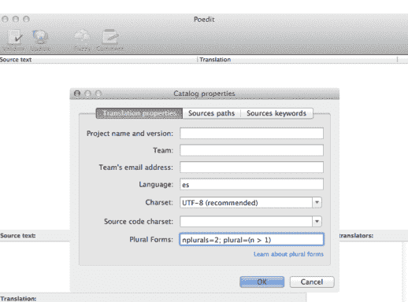

### 设置复数形式

选择“确定”，我们应该进入一个显示待翻译字符串的屏幕。我们需要为特定语言填充这些字符串。

例如，如果我们想将应用翻译成西班牙语，我们应该使用 `es` 语言。我们将该文件保存为 `es.po`，并与我们的 `templates.pot` 文件放在同一目录下。这是 gettext 的惯用法。

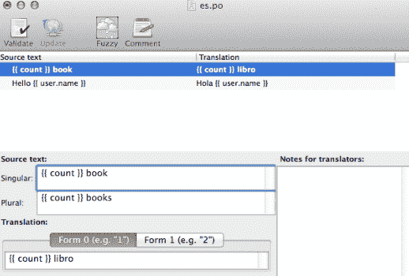

### 翻译我们的应用

编辑完成后，我们可以保存此文件并继续开发我们的应用。注意：如果对应用进行了更改，我们只需要重新运行 Gradle 并在 Poedit 中点击“从 POT 文件更新...”。此步骤会更新我们的新字符串，移除旧字符串，并对已更改的字符串提供建议。

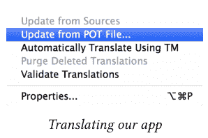

### 编译我们的新语言

最后，我们可以使用新编译的语言格式生成新的 `translation.js` 文件。我们将再次使用 Grunt 将新的 `.po` 文件编译为我们在运行时使用的 `translations.js` 文件。

我们需要添加一个新任务：`ngettext_compile` 任务，它获取我们的 `.po` 文件并将其封装成我们应用中使用的语言。

基本的配置任务如下：

```javascript
grunt.initConfig({
  ngettext_compile: {
    all: {
      files: {
        'app/scripts/translations.js': ['po/*.po']
      }
    }
  }
});
```

此配置根据所有的 `po/*.po` 文件生成 `app/scripts/translations.js` 文件。我们也可以指定想要将翻译定义的在特定模块，例如：

```javascript
grunt.initConfig({
  ngettext_compile: {
    all: {
      options: {
        module: 'MyApp.translations'
      },
      files: {
        'app/scripts/translations.js': ['po/*.po']
      }
    }
  }
});
```

我们建议设置一个 Grunt 任务来调用两个 `ngettext_*` 函数，例如 `grunt.registerTask('default', ['ngettext_extract', 'ngettext_compile']);`。


现在，当我们运行 Grunt 任务时，它会为我们生成 `translations.js` 文件。我们只需要将其包含在运行时的 HTML 文件中，我们的应用就可以准备好翻译。

## 更改语言

我们准备好设置语言并使用翻译来支持不同的语言了。

`gettext` 模块提供了一个名为 `gettextCatalog` 的服务，我们可以将其注入应用中以设置当前语言。要设置语言，我们只需调用：

```javascript
angular.module('MyApp')
.run(function(gettextCatalog) {
  gettextCatalog.currentLanguage = 'es';
});
```

上述代码将应用程序当前的语言加载为我们的西班牙语翻译。

注意，我们可以动态执行相同的操作，只需将 `gettextCatalog` 注入到我们的 Angular 对象中，例如：

```javascript
.controller('HomeController',
function($scope, gettextCatalog) {
  $scope.user = { name: "Ari" }
  $scope.count = 1;
  $scope.changeLanguage = function() {
    gettextCatalog.currentLanguage = 'es';
  }
})
```

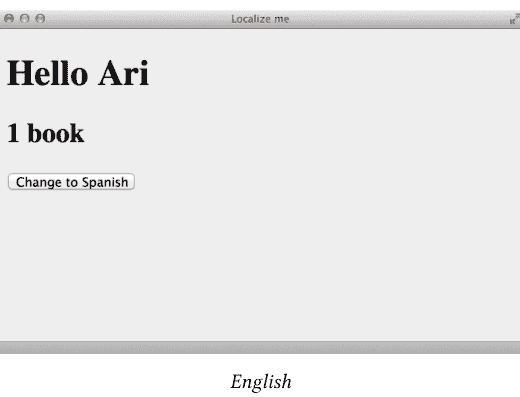

在西班牙语中，在我们更改语言后：

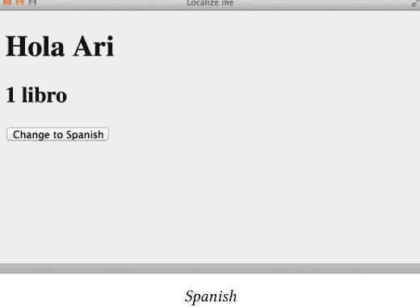

## 缓存

在大规模互联网 Web 应用中，从客户端限制 API 调用的能力使能够创建可扩展的 Web 应用。

这不仅让前端看起来更快、更迅速，而且通过减少后端需要执行的工作量来保护我们的后端。这样，我们的后端就可以为更多的客户端提供服务。

### 什么是缓存？

缓存（Cache）是一个透明地存储数据的组件，以便未来的请求可以更快地提供服务。缓存不需要经常重新计算的数据是安全的，而获取新数据会导致数据重复。

从缓存中提供的请求越多，我们整个系统的性能就提升越高。

传统上，缓存服务器（如 Memcache）可以运行在向客户端提供内容的同一系统中，也可以运行在远程系统中。在选项之间进行选择取决于服务器规模和流量。

根据内容的波动性，我们可以将精力放在将缓存内容存储在长期存储中（例如，长期存储）。

### Angular 的 $cacheFactory

Angular 提供了一个名为 `$cacheFactory` 的服务，我们可以用它来创建我们自己的缓存。`$cacheFactory` 服务创建一个缓存对象，我们可以用它来存储键值对。

```javascript
var myCache = $cacheFactory('myCache');
```

有了缓存对象，我们可以执行标准的缓存操作，如 `put`、`get`、`remove` 和 `removeAll`。

```javascript
myCache.put('key', 'value');
var value = myCache.get('key');
myCache.remove('key');
myCache.removeAll();
```

### 默认缓存

Angular 的 `$http` 服务默认使用 `$cacheFactory` 创建的缓存。我们可以通过 `$cacheFactory.get('$http')` 获取这个默认缓存。

```javascript
var cache = $cacheFactory.get('$http');
```

有了缓存后，我们可以对它执行所有需要和想要进行的常规操作，例如检索缓存响应、从缓存中清除项，或删除所有缓存引用：

```javascript
// 获取上一个请求的缓存
var usersCache = cache.get('http://example.com/api/users.json');

// 删除上一个请求的缓存条目
cache.remove('http://example.com/api/users.json');

// 重置并移除整个缓存
cache.removeAll();
```

虽然我们可以引用默认缓存，但有时对缓存进行更多控制并创建关于缓存行为的规则会更有用。我们需要创建一个新的缓存来供我们的请求使用。

## 自定义缓存

让我们的 http 请求通过自己的自定义缓存进行请求是简单的。我们不需要向请求传递布尔值 `true`，而是传递缓存的实例：

```javascript
var myCache = $cacheFactory('myCache');

$http({
  method: 'GET',
  url: '/api/users.json',
  cache: myCache
});

// 或者，使用 .get 助手
$http.get('/api/users.json', {
  cache: myCache
});
```

现在，http 将不再使用默认缓存，而是使用我们的自定义缓存。

## 为 $http 设置默认缓存

虽然这很容易，但每次想发送 http 请求时都传递缓存实例是不方便的，特别是当我们对每个请求都使用同一个缓存时。

我们可以通过模块上 `.config()` 方法中的 `$httpProvider` 来设置 `$http` 默认使用的缓存对象。

```javascript
angular.module('myApp')
.config(function($httpProvider) {
  $httpProvider.defaults.cache =
    $cacheFactory('myCache', {capacity: 20});
});
```

`$http` 服务将不再使用它为我们创建的默认缓存；它将使用我们自己的缓存，该缓存现在实际上是一个最近最少使用 (LRU) 缓存。

- LRU 缓存根据缓存容量只保留最新数量的缓存。也就是说，在我们容量为 20 的缓存中，前 20 个请求会被缓存，但当第 21 个请求进来时，最久未被请求的项将从缓存中删除。缓存本身会负责维护需要保留和移除的详细信息。

## 安全

对于任何客户端应用，在构建时考虑安全性始终是一个好主意。此外，在任何情况下都要提供 100% 的保护都是相当困难的，当客户端可以看到整个代码时，这变得更加困难。

在本章中，我们将介绍一些保持应用程序安全的技巧。我们将学习如何掌握 `$sce` 服务，通过用令牌封装授权的请求（在与受保护的后端通信时）来保护我们的文本输入。

### 严格上下文转义：$sce 服务

严格上下文转义模式（在 Angular 1.2 及更高版本中默认可用）告诉我们的应用，它需要在上下文中返回一个被标记为在上下文内部安全的值。

例如，当我们想使用 `ng-bind-html` 将原始 HTML 绑定到元素上时，我们希望 Angular 用 HTML 渲染元素，而不是转义后的文本。

```html
<textarea ng-model="htmlBody"></textarea>
<div ng-bind-html="htmlBody"></div>
```

`$sce` 是一个极佳的服务，允许我们默认编写白名单、安全代码，并在防止 XSS 和其他漏洞方面提供极大帮助。鉴于这种功能，理解我们正在做什么以便明智地使用它非常重要。

在上面的示例中，`<textarea>` 绑定到了 `htmlBody` 模型。在这个 `textarea` 中，用户可以输入任何想要在 `div` 中渲染的任意代码。例如，它可能是编写博客文章或注释的实时预览。

如果用户向文本框中注入任何任意文本，我们本质上就让自己暴露在了巨大的安全漏洞中。

为了防止恶意用户，将我们的不安全文本通过过滤器（sanitizer）是一个好主意。

`$sce` 服务默认为我们处理所有的插值表达式。没有任何常量字面量是不可信的。例如，这个值始终是安全的，因为该值是一个字符串。

```html
<div ng-bind-html="'<h1>Trusted</h1>'"></div>
```

基本上，从 1.2 版本开始，在嵌入指令的根部，`$sce` 的值不直接绑定到绑定值，而是绑定到 `$sce.getTrusted()` 方法的结果。

指令使用新的 `$sce.parseAs()` 方法而不是 `$parse` 服务来监听属性绑定。`$sce.parseAs()` 方法对所有非内容字面量调用 `$sce.getTrusted()`。

实际上，`ng-bind-html` 指令在后台调用 `$sce.parseAsHtml()` 并值绑定到 DOM 元素。`ng-include` 指令运行相同的行为以及指令上定义的 `templateUrl`。

当启用时，所有内置指令都会自动调用 `$sce`。我们可以在自己的指令和其他自定义组件中使用相同的行为。

### 配置 $sceDelegateProvider

```javascript
angular.module('myApp', [])
  .config(['$sceDelegateProvider', function($sceDelegateProvider) {
    // 设置一个新的白名单
    $sceDelegateProvider.resourceUrlWhitelist(['self']);
  }]);
```

要设置新的白名单，我们使用 `resourceUrlWhitelist()` 方法。该函数接受一个可选参数。

- `whitelist` (数组 array)

如果没有传递参数，则该函数将作为 getter（get）使用，并返回当前的白名单数组。

如果传递了白名单参数，则该数组将用新数组替换 `resourceUrlWhitelist`。

数组中的每个元素必须是正则表达式（regex）或字符串 `'self'`。当设置为 `'self'` 时，Angular 确保所有 URL 都与应用程序具有相同的域名 URL 匹配。当使用正则表达式时，Angular 会与我们正在测试的资源的绝对 URL 进行匹配。

如果数组为空，`$sce` 将阻止**所有**（ALL）URL 的访问。

> 使用 `'self'` 允许从 HTML 文档中加载资源。

要启用每一个 URL，我们为自己的域名添加白名单：

```javascript
angular.module('myApp', [])
  .config(['$sceDelegateProvider', function($sceDelegateProvider) {
    // 设置一个新的白名单
    $sceDelegateProvider.resourceUrlWhitelist(['**']);
  }]);
```

默认情况下，白名单设置为 `['self']`。

### URL 黑名单

也可以使用黑名单而不是白名单。虽然可以使用白名单，但我们可以结合使用。将受信任的域名加入白名单，并将我们域名的开放重定向加入黑名单是有用的。

要设置新的黑名单，我们使用 `resourceUrlBlacklist()` 方法。该方法接受一个可选参数。

- `blacklist` (数组 array)

如果没有传递参数，函数返回当前设置的黑名单数组。

如果传递了黑名单参数，新数组将替换黑名单。

数组中的每个元素必须是正则表达式或字符串 `'self'`尽管在黑名单的情况下这没有用。当使用正则表达式时，它将与被测试的资源的绝对 URL 进行匹配。

黑名单对于信任内容的哪些可接受、哪些不可接受具有最终决定权。

默认情况下，黑名单设置为空数组 `[]`。

### $sce API

`$sce` 库包含了我们将用到的两个主要函数，以及几个辅助函数。

#### getTrusted

要获取特定类型值的信任版本，我们可以调用 `getTrusted()` 方法。`getTrusted()` 方法接受两个参数：

- `type` (字符串 string)

此字符串是值将要使用的上下文类型。请查看 sce types 以获取可用类型。

- `maybeTrusted`

此值是来自 `$sce.trustAs` 的返回值。如果它无效，则会抛出异常。

`$sce` 库为 `getTrusted()` 方法提供了几个辅助方法。以下方法在功能上是等同的：

| 方法 | 等同于 |
| :--- | :--- |
| `getTrustedCss(value)` | `getTrusted($sce.CSS, value)` |
| `getTrustedHtml(value)` | `getTrusted($sce.HTML, value)` |
| `getTrustedJs(value)` | `getTrusted($sce.JS, value)` |
| `getTrustedResourceUrl(value)` | `getTrusted($sce.RESOURCE_URL, value)` |
| `getTrustedUrl(value)` | `getTrusted($sce.URL, value)` |

#### parse

与 `$parse` 服务类似，`parse` 方法将 Angular 表达式转换为函数。如果表达式是字面量常量，它会调用 `$parse` 服务；否则，它会调用 `$sce.getTrusted()` 服务。

`parse()` 方法接受两个参数：

- `type` (字符串 string)

我们将使用该值的 `$sce` 上下文类型。请查看 `$sce` types 以获取可用类型。

- `expression` (字符串 string)

要编译的 Angular 表达式

`parse()` 方法返回一个如下形式的函数：`function(context, locals)`，其中：

- `context` (对象 object)

应在该对象上评估表达式。这通常是一个 `$scope`。

- `locals` (对象 object)

这些是局部变量，主要用于覆盖上下文中的值。

`$sce` 库为 `parse()` 方法提供了几个辅助方法。以下方法在功能上是等同的：

| 方法 | 等同于 |
| :--- | :--- |
| `parseAsCss(expr)` | `parseAs($sce.CSS, expr)` |
| `parseAsHtml(expr)` | `parseAs($sce.HTML, expr)` |
| `parseAsJs(expr)` | `parseAs($sce.JS, expr)` |
| `parseAsResourceUrl(expr)` | `parseAs($sce.RESOURCE_URL, expr)` |
| `parseAsUrl(expr)` | `parseAs($sce.URL, expr)` |

#### trustAs

`trustAs()` 方法返回一个 Angular 信任并用于特定上下文转义环境的对象。绑定（如 `ng-bind-html` 和 `ng-include`）使用提供的值。

`trustAs()` 方法接受两个参数：

- `type` (字符串 string)

值对我们是安全的 `$sce` 上下文类型。请查看 `sce types` 以获取可用类型。

- `value`

我们可以用它代表提供的值。

`trustAs()` 方法返回一个值，用于 Angular 期望 `$sce.trustAs()` 返回值的地方。`$sce` 库为 `trustAs()` 方法提供了几个辅助方法。以下方法调用在功能上是等同的：

```javascript
trustAsHtml(value)             trustAs($sce.HTML, value)
trustAsJs(value)               trustAs($sce.JS, value)
trustAsResourceUrl(value)      trustAs($sce.RESOURCE_URL, value)
trustAsUrl(value)              trustAs($sce.URL, value)
```

#### isEnabled

`isEnabled()` 方法不接受参数，返回 `$sce` 是否启用的布尔值。

#### 配置 sce

如果我们要禁用 `$sce`，我们可以在 `config` 中设置：

```javascript
angular.module('myApp', [])
  .config(['$sceProvider', function($sceProvider) {
    $sceProvider.enabled(false);
  }]);
```

### Trusted Types

`$sce` 默认支持的五个内置类型：

| 上下文 | 描述 |
| :--- | :--- |
| `$sce.HTML` | 信任 HTML |
| `$sce.CSS` | 信任 CSS |
| `$sce.URL` | 信任 URL |
| `$sce.RESOURCE_URL` | 信任 RESOURCE_URL |
| `$sce.JS` | 信任 JS |

## AngularJS 与 Internet Explorer

AngularJS 与现代浏览器完美工作。Safari、Google Chrome 和 Firefox 效果良好。Internet Explorer 早期版本可能会出现问题。更多信息，请阅读关于 IE 的文档：http://docs.angularjs.org/guide/ie

Internet Explorer 不喜欢带有前缀的元素，除非它们有相应的命名空间声明：

```html
<!doctype html>
<html xmlns:ng="http://angularjs.org">
```

如果我们计划为 Internet Explorer 8 发布应用程序，我们需要注意一些。如果我们使用非标准标签，我们需要在 head 中创建它们，如下：

```html
<!doctype html>
<html xmlns:ng="http://angularjs.org">
<head>
  <!--[if IE 8]>
  <script>
    document.createElement('ng-view');
  </script>
  <![endif]-->
</head>
<body></body>
```

为了让 IE7 及早期版本支持 AngularJS，我们需要对 JSON 进行填充。可以使用 JSON3²⁵ 或 JSON2²⁶ 实现。在我们的浏览器中，我们需要条件地包含此文件。我们必须下载该文件将其存储在相对于应用程序根的位置，并在 head 中引用它，如下：

```html
<!doctype html>
<html xmlns:ng="http://angularjs.org">
<head>
  <!--[if lt IE 8]>
  <script src="lib/json2.js"></script>
  <![endif]-->
</head>
<body></body>
```

为了在 IE 中使用 `ng-app` 指令，我们也将元素设置为 `ng-app`：

```html
<body id="ng-app" ng-app="MyApp">
</body>
```

我们可以利用 `angular-ui` 库的 `ie-shim` 模块帮助我们在 DOM 中提供自定义元素。为了使用 `ui-utils` `ie-shim` 库，我们需要确保已经安装了 `angular-ui` 库。如果下载 `ui-utils` 库并包含该模块是非常简单的。我们可以在 GitHub 上找到 `ui-utils` 库：https://github.com/angular-ui/ui-utils²⁷。

让我们确保已将 `ui-utils` 模块包含在应用程序可访问的位置，并像这样包含该文件：

```html
<div data-ng-view></div>
```

> ²⁵http://bestjes.github.io/json3/
> ²⁶https://github.com/douglasford/JSON-js
> ²⁷https://github.com/angular-ui/ui-utils

```html
<!--[if lte IE 8]>
<script type="text/javascript">
// 定义我们的自定义指令
</script>
<script src="lib/angular-ui-ieshiv.js"></script>
<![endif]-->
```

通过在此处处理，我们只在 Internet Explorer 8 及更早版本中激活 `ie-shiv`。该 `shiv` 允许我们将自定义指令添加到它的全局对象中，从而为 IE 创建适当的声明。

`shiv` 库会查找 `window.myCustomTags`。如果 `window.myCustomTags` 已定义，该库将在加载时将这些标签与其他的 Angular 库指令一起包含进来：

```html
<!--[if lte IE 8]>
<script type="text/javascript">
// 定义我们的自定义指令
window.myCustomTags = ['myDirective'];
</script>
<script src="lib/angular-ui-ieshiv.js"></script>
<![endif]-->
```

### Ajax 缓存

IE 是唯一会缓存 XHR 请求的主流浏览器。避免这种糟糕行为的一种有效方法是为每个请求设置 HTTP `Cache-Control` 头为 `no-cache`。

这种行为是现代浏览器的默认行为，有助于为 IE 用户提供更好的体验。

我们可以像下面这样更改每个单独请求的默认头：

```javascript
config(function($httpProvider) {
  $httpProvider.defaults.headers.common['Cache-Control'] = 'no-cache';
});
```

## 使用 AngularJS 进行 SEO

搜索引擎（如 Google 和 Bing）的设计初衷是爬取静态网页，而不是深度依赖 JavaScript 的客户端应用。爬虫机器人通常设计得快速且高效，因此大多数机器在爬取页面时不会渲染 JavaScript。

这是因为我们深度依赖 JavaScript 的应用需要一个 JavaScript 引擎来运行，例如 PhantomJS 或 v8。网络爬虫通常在不使用 JavaScript 解释器的情况下加载网页。

搜索引擎不在其爬虫程序中包含 JS 解释器是有原因的：
- 它们不需要这样做，而且这样做会减慢它们的速度，并降低爬取网页的效率。

### 让 Angular 应用被索引

我们有几种不同的方法告诉 Google 如何处理我们应用的索引。第一种更常见的方法是使用后端来提供我们的 Angular 应用。这种方法的优点是实现简单，不需要太多的代码重复。

另一种方法是在我们的 JavaScript 中的一个 `<script>` 标签内渲染由 Angular 应用交付的所有内容。我们将简要介绍这个主题，`<script>` 标签的实现在很大程度上取决于我们如何分发应用。例如，当我们在服务器端渲染页面时，可以使用 `<script>` 标签。

#### 服务端

Google 和其他高级搜索引擎支持 `hashbang`（井号）URL 格式，我们用它来识别在特定 URL 下访问的当前页面。这些搜索引擎会将此 URL 转换为自定义 URL 格式，使其被服务器访问。

搜索引擎访问该 URL 并期望获得我们的浏览器将收到的 HTML（带有完全渲染的 HTML 内容）。例如，Google 将把 `hashbang` URL 从：

```
http://www.ng-newsletter.com/#!/signup/page
```

转换为 URL：

```
http://www.ng-newsletter.com/?_escaped_fragment_=/signup/page
```

在我们的 Angular 应用中，我们需要根据我们处理的样式告诉 Google 稍微不同地处理我们的站点。

#### Hashbang 语法

Google 的 Ajax 爬取规范的编写和初衷是为了通过 `hashbang` 语法交付 URL，这是为 JS 应用创建永久链接（permalinks）的一种原始方法。

我们需要配置应用以我们的路由中使用 `hashPrefix`（默认值）：

```javascript
angular.module('MyApp', [])
.config(['$locationProvider', function($locationProvider) {
  $locationProvider.hashPrefix('!');
}]);
```

#### HTML5 路由模式

新的 HTML5 `pushState` 工作方式不同：它修改浏览器的 URL 和历史记录。为了让 Angular 应用“欺骗”搜索爬虫，我们可以在头部中添加简单的内容：

```html
<meta name="fragment" content="!">
```

此元素告诉 Google 爬虫使用新的爬取规范来爬取我们的站点。当它遇到此标签时，它不会正常地爬取我们的站点，而是会使用 `?_escaped_fragment=` 标签重新访问站点。

假设我们配合 `$location` 服务使用 HTML5 模式，我们可以这样设置页面使用 `html5Mode`：

```javascript
angular.module('MyApp', [])
.config(['$locationProvider', function($locationProvider) {
  $locationProvider.html5Mode(true);
}]);
```

通过查询字符串中的 `_escaped_fragment_`，我们可以使用后端服务器来提供静态 HTML，而不是我们的客户端应用。

现在，我们的后端可以检测请求中是否包含 `_escaped_fragment_`，如果是，我们可以返回静态 HTML 而不是我们的纯正 Angular 应用。

> 我们可以使用代理（如 Apache 或 Nginx）或我们的后端服务来实现这一结果。设置这些内容超出了本书的范畴；然而，我们将讨论如何配合 Node.js 应用来设置它们。

### 从服务端处理 SEO 的选项

我们有很多可用选项来让我们的站点对 SEO 友好。我们将介绍不同的交付方式：
- 使用 Node/Express
- 使用 Apache 进行重写
- 使用 Nginx 进行代理

#### 使用 Node/Express

注意：虽然我们在此示例中使用了 NodeJS，但我们必须添加一些中间件来查找 `_escaped_fragment_`：

```javascript
app.use(function(req, res, next) {
  var fragment = req.query._escaped_fragment_;
  if (!fragment) {
    return next();
  }
  // 如果 fragment 不是以 / 开头
  if (fragment.charAt(0) !== '/') {
    fragment = '/' + fragment;
  }
  // 如果 fragment 不以 .html 结尾
  if (fragment.indexOf('.html') === -1) {
    fragment += ".html";
  }
  // 提供静态文件
  try {
    var file = __dirname + "/snapshots" + fragment;
    res.sendFile(file);
  } catch (err) {
    res.send(404);
  }
});
```

此中间件期望我们的 `snapshots` 目录存在并根据请求路径提供文件。例如，它将为 `/` 渲染 `index.html`，而为 `/about` 渲染 snapshots 目录下的 `about.html`。

#### 使用 Apache 重写

如果我们使用 Apache 服务器交付 Angular 应用，我们可以在配置中添加一些行，使用 snapshots 而不是我们的 JavaScript 应用。

我们可以使用 `mod_rewrite` 方法检测请求是否包含 `_escaped_fragment_` 查询参数。如果是，我们将重写点指向 snapshots 目录中的静态版本。

为了设置重写，我们需要启用相应的模块：

```bash
$ a2enmod proxy
$ a2enmod proxy_http
```

然后我们需要加载 Apache 配置：

```bash
$ sudo /etc/init.d/apache2 reload
```

我们可以在站点的虚拟主机配置或位于服务器根目录的 `.htaccess` 文件中设置重写规则：

```
RewriteEngine On
Options +FollowSymLinks
RewriteCond %{REQUEST_URI} ^/
RewriteCond %{QUERY_STRING} ^_escaped_fragment?(.*)$
RewriteRule ^(.*)$ /snapshots/?$1 [NC,L]
```

#### 使用 Nginx 代理 URL

如果我们使用 Nginx 服务我们的 Angular 应用，我们可以添加一些配置，当查询字符串中存在 `_escaped_fragment_` 参数时提供应用的 snapshots。

与 Apache 不同，Nginx 不需要我们启用模块，因此我们只需更新配置用查询替换路径。

在我们的 Nginx 配置（例如 `/etc/nginx/nginx.conf`）中，我们需要确保我们的配置如下：

```nginx
server {
  listen 80;
  server_name example;

  if ($args ~ "_escaped_fragment_=/?/(.+)") {
    set $path $1;
    rewrite ^ /snapshots/$path last;
  }

  location / {
    root /web/example/current/;
    # 如果使用 hash url 则注释
    if (!-e $request_filename) {
      rewrite ^(.*)$ /index.html break;
    }
    index index.html;
  }
}
```

完成这一步骤后，我们就可以重新加载配置了：

```bash
sudo /etc/init.d/nginx reload
```

### 获取快照 (Snapshots)

我们可以对 HTML 应用进行快照以交付我们的后端应用，使用诸如 PhantomJS¹³⁰ 或 zombie.js¹³¹ 之类的工具来渲染页面。当 Google 请求带有 `_escaped_fragment_` 参数的页面时，我们可以简单地返回并渲染此页面。

我们将讨论两种获取快照的方法：ZombieJS 和授权工具（Grant Tool）。我们不会介绍如何使用出色的 PhantomJS¹³² 工具，因为有很多优秀的资源演示了它。

> ¹³⁰ http://phantomjs.org/
> ¹³¹ http://zombie.labnotes.org/
> ¹³² http://phantomjs.org/

#### 使用 Zombie.js 获取 HTML 快照

要设置 Zombie.js¹³³，我们需要安装 npm 包 `zombie`：

> ¹³³ http://zombie.labnotes.org/

```bash
$ npm install zombie
```

现在，我们可以使用 NodeJS 和 `zombie` 保存文件。首先，是我们在过程中将用到的一些辅助方法：

```javascript
var Browser = require('zombie');
var url = require('url');
var fs = require('fs');
var saveDir = __dirname + '/snapshots';
```

```javascript
var scriptTagRegex = /<script\b[^>]*?(?:\/script>[^<]*)*<\/script>/gi;
var stripScriptTags = function(html) {
  return html.replace(scriptTagRegex, '');
};
```

```javascript
var browserOpts = {
  waitFor: 2000,
  loadCSS: false,
  runScripts: true
};
```

```javascript
var saveSnapshot = function(uri, body) {
  var lastIdx = uri.indexOf('#');
  if (lastIdx < 0) {
    // 如果我们使用 htmlmode
    path = url.parse(uri).pathname;
  } else {
    // 如果我们使用 hashbang
    path = uri.substring(lastIdx + 1, uri.length);
  }
  if (path === '/') path = "index.html";
  if (path.indexOf('.html') === -1) {
    path += ".html";
  }

  var filename = saveDir + path;
  fs.open(filename, 'w', function(e, fd) {
    if (e) return;
    fs.write(fd, body);
  });
};
```

现在我们需要做的是遍历我们的页面，将每个链接从相对链接转换为绝对链接（这样爬虫就可以跟随它们了），并保存生成的 HTML。

我们在上面的浏览器选项中设置了相对较高的 `waitFor`。此选项将涵盖我们关心的 90% 的情况。如果我们想精确控制何时以及何时获取快照，而不是等待两秒钟，我们需要修改 Angular 应用以触发一个事件，并在我们的 Zombie 浏览器中监听该事件。

由于我们喜欢尽可能自动化且不希望过多担心 Angular 代码，我们更倾向于设置一个较高的超时时间，以尝试让代码稳定下来。

我们的 `crawlPage()` 函数：

```javascript
var crawlPage = function(idx, arr) {
  // location = window.location
  if (idx < arr.length) {
    var uri = arr[idx];
    var browser = new Browser(browserOpts);
    var promise = browser.visit(uri)
    .then(function() {
      // 将链接转换为绝对链接
      // 并保存，如果我们需要
      // 并且我们还没有爬取它们
      var links = browser.querySelectorAll('a');
      links.forEach(function(link) {
        var href = link.getAttribute('href');
        var absUrl = url.resolve(uri, href);
        link.setAttribute('href', absUrl);
        if (arr.indexOf(absUrl) < 0) arr.push(absUrl);
      });
      // 保存
      saveSnapshot(uri, browser.html());
      // 在下次迭代中调用
      crawlPage(idx + 1, arr);
    });
  }
};
```

现在我们只需在第一个页面上调用该方法：

```javascript
crawlPage(0, ["http://localhost:9000"]);
```

#### 使用 grunt-html-snapshot

我们获取快照的方法是使用 Grunt 工具 `grunt-html-snapshot`。由于我们使用 Yeoman¹⁴，Grunt 已经在我们的构建过程中，我们在发布应用后设置此任务。

> ¹⁴ http://yeoman.io

要安装 `grunt-html-snapshot`，我们可以像这样使用 npm：

```bash
npm install grunt-html-snapshot --save-dev
```

如果我们没有使用 Yeoman¹⁴，我们需要在 `Gruntfile.js` 中包含此任务：

```javascript
grunt.loadNpmTasks('grunt-html-snapshot');
```

一旦设置了该任务，我们将为站点设置一些配置。为了设置配置，我们在 `Gruntfile.js` 中创建一个新的块，如下：

```javascript
htmlSnapshot: {
  debug: {
    options: {}
  },
  prod: {
    options: {}
  }
}
```

现在我们为不同阶段添加我们的首选选项：

```javascript
htmlSnapshot: {
  debug: {
    options: {
      snapshotPath: 'snapshots/',
      sitePath: 'http://127.0.0.1:9000/',
      msWaitFor: 1000,
      urls: [
        '/',
        '/about'
      ]
    }
  },
  prod: {
    options: {}
  }
}
```

要查看可用选项列表，请查看 https://github.com/colorburg/grunt-html-snapshot¹⁶

> ¹⁶ https://github.com/colorburg/grunt-html-snapshot

#### Prerender.io

或者，我们可以使用开源工具，例如 Prerender.io¹⁷，它包含一个实时渲染我们站点的 Node 服务器和一个与后端通信以实时渲染的 Express 中间件。

> ¹⁷ http://prerender.io/

本质上，prerender.io 获取一个 URL 并返回带有脚本标签的 HTML。基本上，我们部署的 prerender 服务器是从应用中调用的：

```bash
GET http://prerender.com/localhost:9000/#about
```

这获取了 `/page` 的渲染内容。设置一个 prerender 集实际上非常简单。我们将向你展示如何将自己的 prerender 服务器集成到你的 Node 应用中，因为 prerender.io 也适用于 Ruby on Rails（通过 gem `prerender_rails`），但我们不会涵盖介绍如何设置它。

设置我们自己的服务器非常简单。我们只需运行 `npm install` 安装依赖，并通过 Foreman 运行命令：

```bash
$ npm install
$ node index.js
# 或者通过 foreman
$ foreman start
```

prerender 库在 heroku 上运行也很方便：

```bash
$ git clone https://github.com/collectiveip/prerender.git
$ heroku create
$ git push heroku
```

我们将渲染的 HTML 存储在 S3 中，因此我们建议使用内置的 S3 缓存¹⁸。

> ¹⁸ https://github.com/collectiveip/prerender#s3-cache

服务器运行后，我们只需要通过应用对其进行集成。在 Express 中，使用 Node 库 `prerender-node` 进行集成非常简单。

要安装 `prerender-node`，我们再次使用 npm：

```bash
$ npm install --save prerender-node
```

安装此库后，我们可以告诉 Express 应用使用此中间件：

```javascript
var prerender = require('prerender-node')
  .set('prerenderServiceUrl', 'http://prerender.com/');
app.use(prerender);
```

这就！这告诉我们的 Express 应用，如果我们有爬虫（通过具有 `_escaped_fragment_` 或用户代理字符串定义），它应该向适当 URL 处的 prerender 服务发送 GET 请求并获取页面的渲染 HTML。

#### `<noscript>` 方法

我们也使用 `<noscript>` 标签来渲染页面，而不需要诉诸后端。不幸的是，这种方法对于我们所有的页面来说都是复杂的，我们需要将 `<noscript>` 标签之外的所有页面元素复制到该标签中。

这样做可能会变得繁琐，并且保持两者同步需要大量工作，因此在没有构建工具协助的情况下，我们不推荐这种方法。

# 构建 Chrome 应用

Chrome¹⁹ 浏览器是 Google 的自定义浏览器。它不仅极快且处于网络开发的前沿，而且处于提供线上和线下网络体验的前沿。

> ¹⁹ http://www.google.com/chrome/

Chrome 应用是嵌入在网络浏览器中的应用，但旨在提供原生应用的感觉。由于它们运行在 Chrome 内部，因此使用 HTML5、JavaScript 和 CSS3 编写，并且可以访问真正的应用程序无法拥有的原生功能。

Chrome 应用可以访问 Chrome API 和服务，并为用户提供集成的桌面级体验。

Chrome 应用与 Web 应用之间的另一个有趣的区别是它们始终从本地加载，因此立即显示，而不是等待网络完全下载组件。此功能极大提升了应用的性能和用户运行应用的体验。

## 理解 Chrome 应用

让我们深入了解 Chrome 应用是如何工作的以及我们如何开始构建自己的。每个 Chrome 应用都有三个核心文件：

### manifest.json

此 `manifest.json` 文件描述应用程序的元数据，例如名称、描述、版本以及如何启动应用程序。

### 后台脚本

此后台脚本设置我们的应用程序响应系统级事件，例如用户安装或启动我们的应用。

### 视图

大多数 Chrome 应用都有视图。该组件是可选的，但最通用用于我们的应用程序。

## 构建我们的 Chrome 应用

在本节中，我们将介绍如何使用 Angular 创建一个高级 Chrome 应用程序。我们将创建一个由 Rainfall¹⁰ 团队开发的优秀的 Chrome Web 应用 Currently 的克隆。

> ¹⁰ http://blog.rainfalldesign.com/

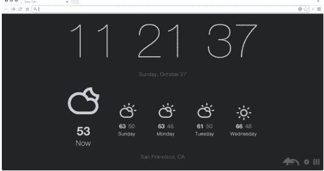

**Currently**

我们将构建一个名为 Presently 的克隆版本。

### 设计架构

在构建 Presently 时，我们需要考虑应用程序的架构。这样做可以让我们在编写代码之前，对如何构建该应用有一个清晰的思路。

与 Currently 类似，Presently 将是一个“新标签页（newtab）”应用，这意味着每当我们打开新标签页时，它都会启动。

Presently 有两个主界面：

- **首页** - 该界面显示当前的时间和天气。天气图标旁边还有几个图标。
- **设置页面** - 该界面允许用户在应用内更改他们的位置。

为了支持首页，我们需要能够显示格式化正确的日期和时间，并从远程 API 服务中获取天气信息。

为了支持设置页面，我们必须与远程 API 服务集成，为输入框自动建议潜在的位置。

最后，我们将使用基础本地存储（会话存储）来跨应用持久化我们的设置。

### 构建 Chrome 应用

构建应用时，我们将设置如下所示的文件结构：

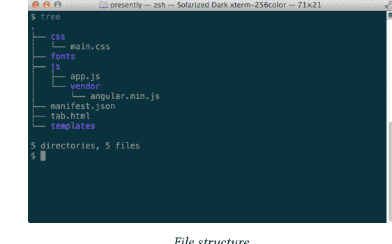

我们将把 CSS 文件放在 `css/` 目录下，将自定义字体放在 `fonts/` 目录下，将 JavaScript 文件放在 `js/` 目录下。我们将主 JavaScript 文件设置为 `js/app.js`，并将应用的 HTML 文件放在根目录下的 `tab.html`。

> 有很棒工具可以帮助引导 Chrome 扩展，例如 Yeoman¹⁴³。

在制作 Chrome 扩展之前，我们需要获取一些依赖项。

我们将从 angularjs.org¹⁴⁴ 获取最新版本的 `angular.min.js`¹⁴² (1.2.6) 以及 `angular-route.min.js`¹⁴³，并将它们保存到 `js/vendor/` 目录。

最后，我们将使用 Twitter 的 Bootstrap 3 框架为应用设置样式，因此我们需要从 getbootstrap.com¹⁴⁵ 获取 `bootstrap.min.css` 并将其保存到 `css` 目录。

> 在生产环境中，当多个开发者协作时，使用像 Bower¹⁴⁶ 这样的工具管理依赖项更高效。由于我们构建的是新标签页应用，保持应用轻量化以便快速启动是非常重要的。

> ¹⁴³ http://yeoman.io
> ¹⁴² http://code.angularjs.org/1.2.6/angular.min.js
> ¹⁴³ http://code.angularjs.org/1.2.6/angular-route.min.js
> ¹⁴⁴ http://angularjs.org/
> ¹⁴⁵ http://getbootstrap.com/
> ¹⁴⁶ http://bower.io/

### manifest.json

对于编写的每一个 Chrome 应用，我们需要设置一个 `manifest.json`。该清单告诉 Chrome 应用程序应该如何运行、使用哪些文件、拥有哪些权限等。

我们的 `manifest.json` 需要将应用描述为新标签页应用，并描述 `content_security_policy`（描述我们的应用可以做什么和不能做什么的策略）以及 Chrome 需要的后台脚本。

```json
{
  "manifest_version": 2,
  "name": "Presently",
  "description": "A currently clone",
  "version": "0.1",
  "permissions": [],
  "background": {
    "scripts": ["js/vendor/angular.min.js"]
  },
  "content_security_policy": "script-src 'self'; object-src 'self'",
  "chrome_url_overrides": {
    "newtab": "tab.html"
  }
}
```

`manifest.json` 中的键相对直观，允许我们设置名称、`manifest_version`、`version` 等。为了告诉 Chrome 以新标签页应用启动我们的应用，我们将设置应用覆盖新标签页页。

### tab.html

应用程序的主 HTML 文件是 `tab.html` 文件。当我们在 Chrome 中打开新标签页时，该文件会被加载。

我们将在 `tab.html` 内部设置基础的 Angular 应用：

```html
<!doctype html>
<html data-ng-app="myApp" data-ng-csp="">
<head>
  <meta charset="UTF-8">
  <title>Presently</title>
  <link rel="stylesheet" href="css/bootstrap.min.css">
  <link rel="stylesheet" href="css/main.css">
</head>
<body>
  <div class="container">
  </div>
  <script src="./js/angular.min.js"></script>
  <script src="./js/angular-route.min.js"></script>
  <script src="./js/app.js"></script>
</body>
</html>
```

这个 Angular 应用的这种基础结构与任何 Angular 应用几乎完全相同，唯一的区别是：`data-ng-csp`。

### 构建 Angular Chrome 应用

```html
<div class="container">
  <div ng-controller="MainController">
    {{ date.raw }}
  </div>
</div>
```

当我们回到浏览器并刷新页面时，我们应该在视图中看到一个未格式化的日期对象在不断跳动。

目前，该日期在浏览器中显示非常难看。我们可以利用 Angular 内置过滤器以更优雅的方式格式化我们的日期。

让我们格式化日期的方式类似于 Wunderground 在主屏幕上的显示方式。为了更新视图，我们需要将日期移动到它自己的嵌套 `div` 中，并添加格式来显示日期：

```html
<div class="container">
  <div ng-controller="MainController">
    <div id="datetime">
      <h1>{{ date.raw | date:'hh:mm:ss' }}</h1>
    </div>
  </div>
</div>
```

通过少量的 CSS 和 Bootstrap 的帮助，我们的日期将以一种更符合人类习惯的格式显示在屏幕上。

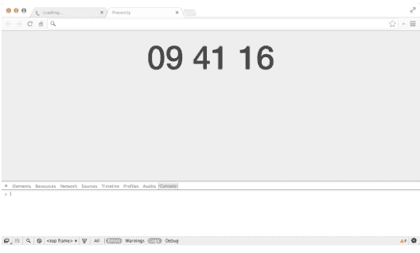

**第一个屏幕**

我们正在使用 CSS 规则将日期和时间对齐到屏幕中心，并增大字体以便在屏幕上突出显示。

```css
#datetime {
  text-align: center;
}
#datetime h1 {
  font-size: 6.1em;
}
```

我们可以在视图中添加第二个日期，仅用于显示符合人类习惯的显示方式的日期。这样做只需要添加第二个格式化的日期即可：

```html
<!-- ... -->
<div id="datetime">
  <h1>{{ date.raw | date:'hh:mm:ss' }}</h1>
```


<h2>{{ date.raw | date:'EEEE, MMMM yyyy' }}</h2>

</div>

<!-- ... -->

我们为 `#datetime h2` 标签编写的 CSS 仅仅是增加了 `<h2>` 标签的大小：

```css
#datetime h2 {
  font-size: 1.0em;
}
```

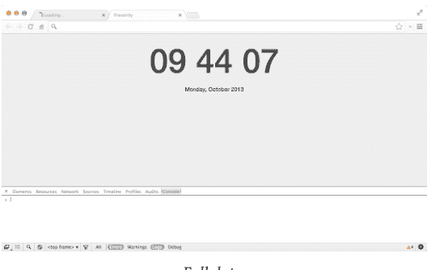

## 注册 Wunderground 天气 API

我们的应用需要连接外部源，以获取我们感兴趣位置的当前天气。在这个应用程序中，我们正在使用 Wunderground API。

> 149th http://www.wunderground.com/

为了使用 Wunderground API，我们需要获取一个访问 API 密钥（key）。

### 获取访问 API 密钥

一旦我们在以下页面找到了相关细节，就可以一直点击直到显示我们 API 密钥的详情页。

一旦准备就绪，就可以找到并保存 Wunderground API 密钥。我们很快就会使用它。

### 构建 Angular 服务

我们不会把获取天气的逻辑放在控制器（`Controller`）中，因为这样做既低效（当我们导航到另一个页面时，控制器会被销毁，且每次加载控制器时我们都需要重新调用 API），而且将业务逻辑与实现细节混合在一起也是糟糕的设计。

相反，我们将使用服务（`Service`）。服务在应用程序的生命周期内跨控制器存在，是我们将业务逻辑隐藏在控制器之外的合适位置。

我们需要在应用启动时配置它，因此需要使用 `.provider()` 方法创建我们的服务。这是唯一可以注入到 `.config()` 函数中的服务创建方法。

要构建该服务，我们将使用 `.provider()` API 方法，它接收服务的名称以及一个定义实际 provider 的函数。

```javascript
angular.module('myApp', [])
.provider('Weather', function() {
})
```

在这个方法内部，我们需要定义一个 `$get()` 函数，返回该服务可用的方法。为了配置此服务，我们需要允许在配置时设置 API 密钥的方法。这些方法位于 `$get()` 函数的作用范围之外。

```javascript
.provider('Weather', function() {
  var apiKey = "";
  this.setApiKey = function(key) {
    if (key) this.apiKey = key;
  };
  this.$get = function($http) {
    return {
      // Service object
    }
  }
})
```

通过极少的代码，我们现在就可以将 `Weather` 服务注入到我们的 `.config()` 函数中，并使用 Underground API 密钥配置该服务。

当 Angular 遇到使用 `.provider()` API 方法创建的 provider 时，它会创建一个 `WeatherProvider` 可注入对象。这个对象就是我们要注入到配置函数中的：

```javascript
// provider('Weather', function() {
// ...
// });
.config(function(WeatherProvider) {
  WeatherProvider.setApiKey('YOUR_API_KEY');
})
// controller('MainController', function($scope, timeout) {
// ...
```

Underground API 要求我们在请求中按顺序传递 API 密钥。为了在每个请求中传递 API 密钥，我们需要创建一个生成 URL 的函数。

```javascript
var apiKey = "";
// ...
this.getUrl = function(type, ext) {
  return "http://api.underground.com/" + apiKey + "/" + type + "." + ext;
}
```

现在，我们可以将 `Weather` 服务注入到我们的控制器中并调用 `getWeather()` 方法。

```javascript
$get = function($q, $http) {
  var self = this;
  return {
    getWeather: function(city) {
      var d = $q.defer();
      $http({
        method: 'GET',
        url: "http://api.underground.com/" + apiKey + "/forecast/" + city + ".json"
      }).then(function(data) {
        d.resolve(data);
      }).catch(function(err) {
        d.reject(err);
      });
      return d.promise;
    }
  };
}
```

```javascript
.controller('MainController', function($scope, timeout, Weather) {
  $scope.weather = {};
  Weather.getWeather("San Francisco").then(function(data) {
    $scope.weather = data;
  });
});
```

为了在视图中查看 API 调用的结果，我们需要更新 `tab.html`。为了调试目的，我们使用了 `<pre>` 标签：

```html
<div id="forecast">
  <pre>{{ weather | json }}</pre>
</div>
```

我们可以看到视图已更新了最新的天气，现在我们可以创建一个更精美的视图了。

```html
<div id="forecast">
  <ul class="row-unstyled">
    <li ng-repeat="day in weather.forecastday" class="col-md-3">
      <div ng-class="today:$index == 0">
        
        <h3>{{ day.high.fahrenheit }}</h3>
        <h4 ng-if="$index == 0">Now</h4>
        <h4 ng-if="$index != 0">{{ day.date.weekday }}</h4>
      </div>
    </li>
  </ul>
</div>
```

我们在视图中设置的样式是：

```css
#forecast ul li {
  font-size: 4.5em;
  text-align: center;
}
#forecast ul li h3 {
  font-size: 1.4em;
}
#forecast ul li .today h3 {
  font-size: 1.8em;
}
```

## 设置屏幕

目前，我们的应用只有一个视图，并且为每个浏览器获取一个硬编码的城市。虽然这种设置对我们在旧金山的这里的人都有效，但对其他人并不适用。

为了让用户能够自定义他们对目前应用的体验，我们需要添加第二个屏幕：设置屏幕。

为了引入第二个屏幕（以及多个视图），我们需要将 `ngRoute` 模块作为应用模块的依赖。

```javascript
angular.module('MyApp', ['ngRoute'])
```

现在我们可以定义单独的视图和路由，并将主屏幕视图从主 `tab.html` 视图中提取出来。

在定义路由时，注意我们需要两个：对应我们应用程序中两个不同屏幕各一个。

# 构建 Angular Chrome 应用

```javascript
// angular.module(...)
// ...
.config(function($routeProvider) {
  $routeProvider
  .when('/', {
    templateUrl: 'templates/home.html',
    controller: 'MainController'
  })
  .when('/settings', {
    templateUrl: 'templates/settings.html',
    controller: 'SettingsController'
  })
  .otherwise(redirectTo('/'));
});
```

现在我们可以将 `.container` div 之间的整个 `tab.html` HTML 内容移动到 `templates/home.html` 中，并用 `<div ng-view></div>` 替换它。

```html
<div class="container">
  <div ng-view></div>
</div>
```

当我们刷新页面时，会发现似乎没有任何变化，但我们的 HTML 是从 `templates/home.html` 模板加载的，而不是在 `tab.html` 内部。

目前，我们没有办法在两个屏幕之间导航。我们可以添加一些基于底部的导航，允许用户在页面之间跳转。我们只需要在页面底部添加两个链接来实现页面间的跳转，例如：

```html
<div id="actionbar">
  <ul class="list-inline">
    <li><a class="glyphicon glyphicon-home" href="#"></a></li>
    <li><a class="glyphicon glyphicon-cog" href="#/settings"></a></li>
  </ul>
</div>
```

为了将它们添加到屏幕的右下角，我们必须应用一些 CSS 来进行绝对定位：

```css
#actionbar {
  position: absolute;
  bottom: 0.5em;
  right: 1.0em;
}
#actionbar a {
  font-size: 2.2rem;
  color: #000;
}
```

现在，如果我们点击齿轮按钮导航到设置页面，会发现没有任何内容被渲染。我们需要定义 `SettingsController`，以便我们可以开始操作视图并与用户交互。

```javascript
// ...
.controller('SettingsController',
function($scope) {
  // 我们的控制器将在这里
}
```

设置屏幕本身包含一个表单，负责允许用户更改他们感兴趣的城市。HTML 本身看起来类似于以下代码（带有我们需要实现的一些功能）：

```html
<h2>Settings</h2>
<form ng-submit="save()">
  <input type="text"
    ng-model="user.location"
    placeholder="Enter a location" />
  <input class="btn btn-primary"
    type="submit" value="Save" />
</form>
```

# 实现用户服务 (UserService)

由于我们隐藏 Wunderground API 复杂性的原因相同，我们也想隐藏自己的 API。这样做允许我们使用本地存储，并在应用的任何部分通过用户设置在控制器之间进行通信。

`UserService` 本身非常简单，不需要在应用中配置。如果不使用本地存储，我们的 `UserService` 将如下：

```javascript
// ...
.factory('UserService', function() {
  var defaults = {
    location: 'autoip'
  };
  var service = {
    user: defaults
  };
  return service;
})
```

该服务在应用程序的生命周期内持有我们的用户对象。这意味着只要浏览器窗口打开，应用程序的设置将保持与用户的设置一致；然而，如果用户在 Chrome 中打开一个新标签页，这些设置就会消失，这并不理想。

我们可以使用 Chrome 的 `sessionStorage` 能力来持久化我们的设置。幸运的是，这个 API 直观且简单。

我们只需要向 `UserService` 中添加两个函数：

- save
- restore

```javascript
// ...
.factory('UserService', function() {
  var defaults = {
    location: 'autoip'
  };
  var service = {
    user: {},
    save: function() {
      sessionStorage.presently =
      angular.toJson(service.user);
    },
    restore: function() {
      // 从 sessionStorage 中提取
      service.user =
      angular.fromJson(sessionStorage.presently) || defaults
    }
  };
  return service.user;
}
// 立即从会话调用 restore
// 这样我们可以立即获取用户数据
service.restore();
return service;
})
// ...
```

我们可以在整个 Chrome 应用中注入此 `UserService` 并访问相同的用户数据。回到 `SettingsController`，我们现在可以使用新服务设置用户对象来定义设置：

```javascript
.controller('SettingsController',
function($scope, UserService) {
  $scope.user = UserService.user;
});
```

如果我们刷新浏览器，可以看到用户有一组默认设置为了 'autoip'，这是 `UserService` 定义中的默认设置。

我们只需要一种方法让用户将数据保存到他们的会话存储中，以便我们可以在整个应用中使用它。在 `templates/settings.html` 中，我们定义的表单具有 `ng-submit="save()"` ；因此，当用户提交表单时，就会调用 `save()` 函数。

在 `SettingsController` 中，我们需要实现 `save()` 函数：

```javascript
.controller('SettingsController',
function($scope, UserService) {
  $scope.save = function() {
    UserService.save();
  };
});
```

# 构建 Chrome 应用

## 自动补全 (Autocomplete)

为了简单起见，我们将创建一个自动补全而不是使用库（如 `typeahead.js`）。为此，我们将在元素上创建一个指令，以附加一个 `<ul>` 元素。

```javascript
.directive('autoFill', function($timeout) {
  return {
    restrict: 'EA',
    scope: {
      autoFill: '&',
      ngModel: '='
    },
    compile: function(tEle, tAttrs) {
      // 我们的编译函数
      return function(scope, ele, attrs, ctrl) {
        // 我们的链接函数
      }
    }
  }
})
```

## 构建 Angular Chrome 应用

```javascript
getWeatherForecast: function(city) {
  //
}
getCityDetails: function(query) {
  var d = $q.defer();
  $http({
    method: 'GET',
    url: "http://autocomplete.wunderground.com/" + 
      "?query=" + query
  }).success(function(data) {
    d.resolve(data.RESULTS);
  }).error(function(err) {
    d.reject(err);
  });
  return d.promise;
}
```

回到我们的 `SettingsController`，我们可以简单地引用该函数作为获取建议值列表的函数。记住，我们需要在控制器中注入 `Weather` 服务以便引用它。

```javascript
.controller('SettingsController',
function($scope, UserService, Weather) {
  //
  $scope.fetchCities = Weather.getCityDetails;
}
```

在指令（directive）中，我们现在可以调用函数来引用我们在修改时想要触发的动作。

```javascript
//
ele.replaceWith(tplEl, ele, attrs, ctrl) {
  var minCount = attrs.minKeyCount || 3,
  timer,
  input = ele.find('input');
```

```javascript
input.bind('keyup', function(e) {
  val = ele.val();
  if (val.length < minCount) {
    if (timer) $timeout.cancel(timer);
    scope.relist = null;
    return;
  } else {
    if (timer) $timeout.cancel(timer);
    timer = $timeout(function() {
      scope.autoFill()(val)
      .then(function(data) {
        if (data && data.length > 0) {
          scope.relist = data;
          scope.ngModel = data[0].zmw;
        }
      });
    }, 300);
  }
}
// 失去时隐藏 relist
input.bind('blur', function(e) {
  scope.relist = null;
  scope.$digest();
});
```

我们使用超时（timeout）是为了只在完成输入后调用该函数。使用超时是一种简单的方法，可以防止函数在输入期间被重复调用，而我们实际上只需要建议 API 的第一次调用。

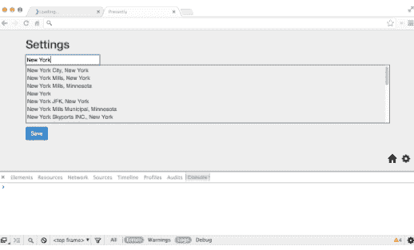

## 引入时区支持

最后，我们还希望时钟能够更新并反映用户在设置中选择的新位置。更新时钟以包含时区支持是简单的：我们已经通过自动补全 API 证明了最困难的部分。

## 构建 Angular Chrome 应用

首先，我们必须在指令使用处添加一个名为 `timezone` 的属性：

```html
<input type="text"
  ng-model="user.location"
  timezone="user.timezone"
  auto-fill="fetchCities"
  autocomplete="off"
  placeholder="Location" />
```

接下来，我们需要在指令编译函数（compile function）中为生成的 `<input>` 字段添加 `timezone` 属性：

```javascript
//
input.attr('type', tAttrs.type);
input.attr('ng-model', tAttrs.ngModel);
input.attr('timezone', tAttrs.timezone);
tEl.replaceWith(tEl);
// ...
```

最后但同样重要的是，当我们在补全链接函数（link function）中保存用户位置的最顶部值时，保存用户的时区：

```javascript
// ...
scope.reslist = data;
scope.ngModel = data[0].mwz;
scope.timezone = data[0].tz;
// ...
```

回到浏览器，我们输入城市，同时也与城市的新值一起保存时区：

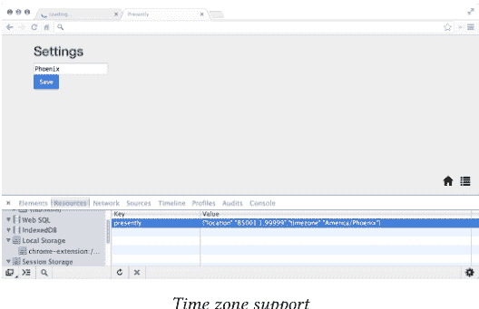

## 构建 Angular Chrome 应用

我们需要更新 `MainController` 中的时间和日期，以考虑到新的时区。

以前，将时区名称与它们的 GMT 偏移量匹配是一项困难的任务。Mozilla 和 Chrome 团队已经实现了带有新时间参数的 `toLocaleString`，这允许我们根据时区重新映射日期。由于我们正在编写一个 Chrome 应用，此函数可以在我们的应用中使用。

回到 `MainController`，我们直接根据保存的时区创建一个新日期：

```javascript
.controller('MainController',
function($scope, timeout, UserService) {
  $scope.date = {};
  var getDateTime = function() {
    $scope.date.tz = new Date(new Date()).toLocaleString(
      "en-US", {timezone: $scope.user.timezone}
    );
  });
  timeout(updateTime, 1000);
}
```

现在，我们不再在视图中使用 `$scope.date.raw`，而是切换到使用 `$scope.date.tz`。时间随着时区的修改而改变。

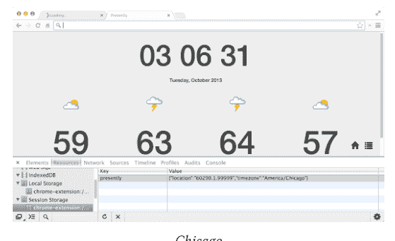

## 构建 Angular Chrome 应用

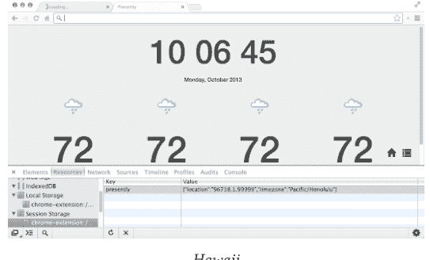

## 构建 Angular Chrome 应用


## 构建 Angular Chrome 应用

## 优化应用

这段代码的主要问题是每次事件触发时都会运行 `$apply()`，这会导致每秒产生大量的 `$digest` 循环。

限制每秒 `$digest` 循环的数量是提升应用性能的一种极方法。我们可以将事件限制为每秒希望发生的次数。

## 构建 Angular Chrome 应用

```javascript
// throttle 函数
var throttle = function(fn, atMost, ctx) {
  ctx = ctx || this;
  atMost = atMost || 250; // 毫秒
  var last, defer, result;
  return function() {
    var now = new Date(),
    args = arguments;
    if (last && now < last + atMost) {
      // 后执行
      clearTimeout(defer);
      defer = setTimeout(function() {
        last = now;
        fn.apply(ctx, args);
      });
    } else {
      result = fn.apply(ctx, args);
    }
    return result;
  }
}
```

这个相对笨拙的 `throttle()` 函数在每个 `atMost` 周期内最多触发函数一次。

Underscore.js 库提供了此代码更好的生产级、经过测试的版本。

要使用 `throttle` 函数设置我们的 `$digest` 循环，我们只需在事件循环中调用它：

```javascript
app.factory('poller', function($rootScope, $http) {
  var service = {
    handlers: {
      on: function(evt, callback) {
        if (!service.handlers[evt])
          service.handlers[evt] = [];
        service.handlers[evt].push(callback);
      }
    }
  }
  var pollEvent = function(timeout) {
    $http.get('/events'
      .success(function(data) {
        var events = data;
        for (var i = 0; i < events.length; i++) {
          var event = events[i];
          if (service.handlers[event]) {
            for (handler in service.handlers[event]) {
              throttle(function() {
                $scope.apply(function() {
                  handler.apply(event);
                });
              }, 500);
            }
          }
        }
      });
    // 设置下一次超时
    setTimeout(pollEvent, timeout);
  };
  // 每半秒轮询一次
  setTimeout(function() { pollEvent(500); });
  return service;
});
```

157 http://underscorejs.org/

## 优化 Angular 应用

## 优化 ng-repeat

Angular 中延迟的主要来源之一是 `ng-repeat` 指令。对于 `ng-repeat` 放置的每一个元素，列表中的每一项至少会产生一个数据绑定，而且这一事实还没有计算我们在列表元素内部创建的任何绑定。

让我们来看由 `ng-repeat` 生成的以下列表的性能：

```html
<ul>
  <li ng-repeat="email in emails">
    <a ng-href="/from/{{ email.sender }}">
      {{ email.sender }}
    </a>
    <a ng-href="/email/{{ email.id }}">
      {{ email.subject }}
    </a>
  </li>
</ul>
```

对于我们列表中的每一封电子邮件，我们至少会拥有一个由 `ng-repeat` 指令生成的监听器（watch）(该监听器会监控列表的变化）。由于 Angular 会为每一个 `ng` 指令创建一个 `$watch`，上述列表每封邮件将有 `4 + 1` 个监听器。对于一个包含 100 封邮件的列表，这种用法已经创建了 500 个监听器，而且这个示例列表对于整个页面来说甚至都不复杂。

对于较短的列表，显而易见，在任何较大的应用中，性能都会大大降低。我们有一些相对简单的方法可以加速我们的应用程序。

## 优化 $digest 缓存

我们通常可以确定在更改变量时，运行 `$digest` 循环何时以及会影响哪些作用域（scopes）。在这种情况下，我们不需要使用 `$scope.apply()` 在 `$rootScope` 上调用整个 `$digest` 循环（这会导致每个子 `$scope` 在 `$digest` 循环中运行）。相反，我们可以直接调用 `$scope.digest()`。

调用 `$scope.digest()` 只会在调用 `$digest()` 的特定作用域及其所有子作用域上运行数字循环。

## 优化 $watch 函数

由于 `$watch` 列表表达式每个 `$digest` 循环都会执行，因此保持功能精简非常重要。`$watch` 表达式越小、越集中，我们的应用程序性能就越高。

## 优化 Angular 应用

在我们的 `$watch()` 函数中避免深度比较、复杂逻辑和任何循环将有助于加速您的应用程序。

例如，我们可以设置一个监控对象的监听器。假设我们有一个 `Account` 对象：

```javascript
$scope.account = {
  active: true,
  userId: 123,
  balance: 1000 // 单位：分
}
```

据推，我们希望监控余额的变化，并在余额达到零时将账户设置为非活动状态。我们可以设置一个 `$watch` 函数来监控 `account` 对象，并在余额变化时更新账户：

```javascript
$scope.watch('user', function(newAccount) {
  if (newAccount.balance <= 0) {
    $scope.account.active = false
  }
}, true);
```

`$watch()` 函数中的第三个参数告诉 Angular 使用深度比较来监控对象，使用 `angular.equals()` 函数检查每个属性。

这将导致糟糕的性能。Angular 不仅会创建对象的副本，而且在需要存储和保存它时，它必须遍历每一个属性以检查其中任何一个是否发生了变化。

构建我们的 `$watch` 函数的小技巧：使用它们来跟踪明显影响视图的变量。任何不影响视图的内容都不需要 `$watch` 函数。

有时，移除监听器是有意义的，特别是当 `$watch` 函数变得不再相关时，因为数据是静态的，我们只是想在第一次在视图中显示它。

我们可以轻松地从视图中移除自定义监听器：`$watch` 函数本身返回一个函数，允许我们移除该 `$watch` 函数。

例如，假设我们有一个自定义指令正在等待变量名的解析：

```html
<div data-my-directive name="customerName"></div>
```

由于 `customerName` 在设置后可能不会更改，我们可以看到通过移除我们设置的 `$watch` 函数可以优化该指令的使用：

```javascript
.directive('myDirective', function($q) {
  return {
    // ...
    scope: {
      name: '='
    },
    link: function(scope, ele, attrs, ctrl) {
      var unWatch = scope.$watch(attrs.name, function(n, o) {
        if (n != o) {
          // 对解析结果做一些处理
          unWatch();
          // 名字并移除监听器
        }
      });
    }
  }
});
```

通过移除应用程序中所有不必要的监听器，我们可以获得性能提升。这种过程在尝试移除应用程序中的每一个监听器时特别有用，尤其是当我们尝试移除 Angular 设置的默认监听器时。

我们可以编写自己的指令来管理监听器，而不是使用 Angular 提供的内置指令。坦率地说，我们不需要自己编写这些指令，因为它们已经在一个名为 `bindonce` 的库中为我们写好了。

## Bindonce

`bindonce` 是一个可以在我们的应用程序使用的即插用模块，它包含了仅挂载一次监听的指令；它赋予了我们传入异步数据的能力。

该库的工作原理是创建新的指令并将其附加到我们不需要更新的 DOM 元素上。这些指令监控值的填充和验证。一旦数据可用，就会进行渲染。

### `bo-value="value"`

此指令会渲染该值并将其设置为元素的 `value` 属性。

### `bo-attr attr-foo="hello"`

此指令将文本 'foo' 渲染为 DOM 中的一个自定义属性。

Bindonce 是优化任何使用 `ng-repeat` 处理大部分静态数据页面的绝佳起点。

## $watch 函数的自动优化

最新版本的 Angular 会自动移除它发现的具有常量值的 `$watch` 函数（例如，如果表达式解析为布尔值或静态整数）。

```javascript
// watchers 将被自动移除
// Angular 识别到这些是
// 常量值
$scope.$watch('true', function() {});
$scope.$watch('2 + 2', function() {});
```

## 优化过滤器 (Filters)

由于过滤器的特性，放置在视图中的每个过滤器至少会被调用两次。我们越能保持这些过滤器轻量化并经过优化，我们的应用程序运行得越快。

## 不变的数据

因此，分析我们在视图中何时以及为何使用过滤器通常是一个好主意。通常，一个良好的经验是：任何在视图中需要转换的过滤器都可以从视图中移出。

换句话说，与其在视图中使用货币过滤器，我们不如在获取数据时对模型进行转换。这样，我们就不需要在会在运行两次的视图中显示它了。

也就是说，我们不是在视图中使用过滤器，如下所示：

```html
<!-- 使用过滤器 -->
<div>{{ receipt.total_cost | currency }}</div>
```

而是通过使用 `$filter` 服务在我们的控制器（或服务）中转换 `receipt.total_cost`：

## 优化 Angular 应用程序

```javascript
.controller('ReceiptController', function($scope, $filter) {
  $scope.receipt.total_sum = 12345;
  $scope.receipt.total_cost =
  $filter('currency')($scope.receipt.total_sum);
});
```

## 过滤数据

我们还有其他过滤器，例如实时搜索过滤器，它们限制了通过 `ng-repeat` 重复集合中的数据，以及通过排序过滤器 `orderBy`。在这些情况下，数据没有变化，但它们在屏幕上的呈现方式发生了变化。

与其每次 `$digest` 循环都调用这些过滤器，我们可以缓存排序/过滤后的结果，这样只在需要时才计算排序和顺序。这种变量缓存被称为记忆化（memoizing）。


> 记忆化是一种优化技术，用于那些之前调用过且结果在给定输入下预计不会改变的函数。

为了使用过滤器的记忆化，我们需要实现自己的 `memoize()` 函数，或者使用库中的函数，例如 *Underscore.js* 或 **Lo-Dash**，它们内部有自己的实现。由于该函数本身非常微小，我们包含了来自 Lo-Dash 库内部的简单函数定义。

```javascript
function memoize(fn, resolver) {
  var memoized = {};
  var cache = memoized.cache;
  var key = resolver ? resolver.apply(this, arguments) : new Date() + '' + arguments[0];
  return hasOwnProperty.call(cache, key) ?
    cache[key] :
    (cache[key] = fn.apply(this, arguments));
  memoized.cache = {};
  return memoized;
}
```

本质上，函数本身接受两个参数：一个要缓存的函数，以及一个可选的解析器函数（resolver function），用于确定存储结果的缓存键。该函数返回该函数的记忆化版本。

* http://underscore.org/
** http://lodash.com/

## 优化 Angular 应用程序

当我们使用它时，我们将 `memoize` 函数设置为 `scope` 对象上的一个函数调用，这样我们就可以从视图中调用它。

```javascript
angular.module('MyApp', [])
.controller('MainController', function($scope, $filter) {
  $scope.getNames = memoize(function() {
    return $filter('orderBy')(
      $scope.names,
      $scope.orderBy, $scope.reverseList
    );
  });
  function nameResolver() {
    // 解析器函数返回一个表示
    // 缓存键的字符串
    return $scope.orderBy + '-' + $scope.reverseList;
  }
});
```

当我们在视图中调用 `getNames()` 时，`$orderBy` 过滤器第一次运行。第二次调用过滤器时，它将不会运行，缓存将包含排序键。

有时，我们可能想要手动清除缓存（例如：添加或删除更新）。由于缓存保留在函数对象上，我们可以通过简单地将其值设置为一个新的 `{}` 对象来清除缓存。

```javascript
$scope.getNames.cache = {};
```

## 优化页面加载的技巧

我们还可以优化客户端浏览器渲染我们页面所需的时间。当然，对于为客户端加载页面的最佳机制并没有万灵药，因为很大程度上取决于服务器端组件、位置和托管问题。

### 代码压缩 (Minification)

压缩代码是优化感知页面加载时间最简单的方法。

压缩是指从源代码中移除所有不必要的字符的过程，将变量的大小减小到尽可能小，剥离注释和块分隔符等。

这减少了变量的大小。

（注：由于提供的原始文本存在大量重复和 OCR 错误，以上翻译已针对核心逻辑进行了整合和修正。）

## 调试器 (Debugger)

Google 的 Chrome 拥有自己的调试器工具，可以在我们的代码中创建断点。`debugger` 语句会导致浏览器在执行期间暂停，允许我们从实际应用程序内部以及浏览器内部的执行点检查运行的代码。

要使用调试器，我们可以直接在应用程序代码上下文中添加它：

```javascript
angular.module('myApp')
.factory('SessionService', function($sq, $http) {
  var service = {
    user_id: null,
    getCurrentUser: function() {
      debugger; // 在此处设置调试器
      // this function
      return service.user_id;
    }
  }
  return service;
});
```

在这个服务中，我们将调用调试器方法，这有效地冻结了应用程序。
由于浏览器中打开了 Chrome 开发工具，我们可以在应用程序代码执行的地方使用 `console.log()` 和其他 JavaScript 命令。
当我们完成应用程序代码的调试后，需要确保删除这一行，因为即使在生产环境中它也会导致浏览器。

## Angular Batarang

Angular Batarang 是由 Google Angular 团队开发的一个 Chrome 扩展程序，它可以很好地作为 Angular 应用的调试工具集成。

## 安装 Batarang

要安装 Batarang，我们只需要从应用商店或 GitHub 仓库下载该程序：https://github.com/angular/angularjs-batarang。

一旦安装完成，我们可以导航到开发者工具并点击 *enable*（启用）来启动扩展，让 Batarang 开始收集有关页面的调试信息。

Batarang 允许我们查看 Angular 应用中的作用域（scopes）、性能、依赖和其他关键指标。

## 检查模型 (Models)

启动 Batarang 后，页面将重新加载，我们会注意到有一个面板可以允许我们选择页面中不同的作用域。

我们可以通过点击 `+` 按钮、找到感兴趣的元素并点击它来选择作用域。

一旦我们使用检查器选择了作用域，就可以查看该作用域元素上的所有不同属性及其当前值。

¹¹⁵ https://github.com/angular/angularjs-batarang

## 检查性能 (Performance)

我们还可以通过 Batarang 的性能部分来查看应用程序的性能。

在这个面板中，我们可以洞察到应用程序在不同作用域下的监听列表（watch list），以及每个表达式消耗的时间，包括绝对时间和占应用程序总运行时间的百分比。

## 检查依赖图 (Dependency Graph)

Batarang 工具的一个非常棒的功能是它能够内联可视化依赖图。我们可以查看应用程序的依赖关系，并查看应用程序的不同库，以了解它们依赖于什么，并跟踪完全不是应用程序依赖的库。

## 调试 AngularJS

## 可视化应用

Batarang 允许我们从页面本身上深入查看应用程序。使用选项（Options）面板，我们可以查看：

- 应用程序 (Applications)：单个页面上的不同应用程序（`ngApp` 指令所使用的）
- 绑定 (Bindings)：在视图中设置的绑定，我们使用 `ng-bind` 或 `{{ }}` 元素
- 作用域 (Scopes)：我们可以目标并更深入检查的视图中的作用域

选项面板还允许我们查看应用的 Angular 版本，以及我们正在使用或未从 CDN 使用的内容。

总而言之，在深入研究我们的 Angular 应用如何实时运行时，Batarang 工具为我们提供了巨大的帮助。

## 下一步 (Next Steps)

现在我们已经熟悉了 Angular，让我们深入研究可用于我们在生产环境中进行开发的专业工具。

## jqLite 和 jQuery

尽管 Angular 鼓励减少对 jQuery 库的依赖，但如果我们在应用中需要，可以使用它，只需确保在 `ContentLoaded` 事件触发之前加载它，或者手动引导（bootstrap）我们的应用。

Angular 本身包含一个名为 jqLite 的兼容库。

我们在书中使用的 `element()` 方法返回一个 jqLite 对象，它是 jQuery 库的子集，允许 Angular 以跨浏览器兼容的方式操作 DOM。

jqLite 库并没有尝试涵盖整个 jQuery 库中的所有方法，因为它旨在设计为轻量级，仅涵盖 Angular 需要的方法。

该库本身涵盖了以下 jQuery 方法：

- addClass：为元素添加指定的类（类）
- after()：在元素之后插入内容
- append()：在元素末尾插入内容
- attr()：获取或设置元素的属性值
- bind() / on()：为所选元素的一个或多个事件附加事件处理函数
- children()：获取子元素
- clone()：创建深拷贝
- eq()：获取索引元素
- find()：获取后代
- hasClass()：判断是否
- html()：获取或设置 HTML
- next()：获取相邻兄弟元素
- off()：取消绑定
- parent()：获取父元素
- prepend()：在开头插入内容
- prop()：获取或设置属性
- ready()：在 DOM 完全加载时执行
- text()：获取或设置文本
- toggleClass()：添加或移除类
- trigger()：执行事件
- val()：获取或设置值
- wrap()：包装元素

## 下一步 (Next Steps)

## 需要了解的必备工具

Angular 社区非常棒，已经写了一些。

## Grunt

Grunt 是一个纯任务运行器。它将为你开发过程中节省大量时间。

## 安装 (Installation)

首先，确保你已经安装了 Node。NodeJS 是构建在...平台；它允许你使用 JavaScript。

要安装 Grunt，可以使用内置的 npm：

```bash
npm install -g grunt-cli
```

传递 `-g` 标志使得 `grunt` 命令在任何目录下都可用。

## 下一步 (Next Steps)

安装 Grunt 后，我们还需要在应用旁边有一个 Gruntfile 来配置如何以及做什么。为了使用 Grunt 进行任何操作，让我们创建一个 `Gruntfile.js`。
首先，我们创建一个 `package.json` 文件，告诉 Node 安装依赖。

正如 Angular 处理依赖一样，NodeJS 有一种巧妙的管理方法。`package.json` 文件将成为你的伙伴。

要创建默认的 `package.json` 文件，你可以运行生成：

```bash
npm init
```

此命令完成后，将创建一个 `package.json` 文件，看起来如下：

```json
{
  "name": "myapp",
  "version": "0.0.0",
  "description": "Your app description",
  "main": "index.js",
  "scripts": {
    "test": "echo \"Error: no test specified\" && exit 1"
  },
  "author": "Your name",
  "license": "MIT"
}
```

此命令会询问一系列问题，例如我们新应用的名称、版本以及更多。你可以使用它设置的所有默认值，但为你的应用命名可能是一个好主意。

我们可以再次使用 npm 命令在 `package.json` 文件中安装基础 grunt：

```bash
npm install grunt --save-dev
```

> `--save-dev` 标志将 grunt 保存为开发依赖项。如果你想为运行时保存依赖项，可以使用 `--save` 标志。

Grunt 的常见用途之一是压缩你的 JavaScript 文件，以便我们向浏览器发送尽可能小的文件。这一过程对于我们的应用尽可能快地加载特别有用，特别是在移动设备上。

我们安装 Uglify 插件来帮助我们处理。

## 下一步

```bash
$ npm install grunt-uglify --save-dev
```

太棒了！现在我们可以使用 `Gruntfile` 来配置 Grunt 了。要配置 Grunt，我们在文本编辑器中加载 `Gruntfile.js` 并添加以下内容：

```javascript
module.exports = function(grunt) {
  // 配置
  grunt.initConfig({
    pkg: grunt.file.readJSON('package.json')
  });
  // 加载插件
  // 默认任务(s);
}
```

为了设置配置，我们需要告诉 Grunt 加载我们想要使用的插件的 npm 任务。由于我们要加载 uglify 任务，我们需要告诉 Grunt 加载 `grunt-contrib-uglify` 插件任务：

```javascript
grunt.loadNpmTasks('grunt-contrib-uglify');
```

为了 Uglify，我们可以在 `initConfig` 对象中放置一个键名为 `uglify` 的配置块。在这种情况下，我们可以对配置进行最小更新，只需设置 `src` 和 `dest` 路径。

```javascript
grunt.initConfig({
  pkg: grunt.file.readJSON('package.json'),
  uglify: {
    build: {
      src: '<src/<%= pkg.name %>.js',
      dest: 'build/<%= pkg.name %>.min.js'
    }
  }
});
```

`grunt-contrib-uglify` 模块配置块的所有可用选项可以在项目的 README 中找到（[此处可用](¹⁶³)）。

> 注意：在使用 Grunt 模块时，配置文档通常位于项目的 README 文件中，或者 README 可能会指向可用的配置选项。

¹³ https://github.com/gruntjs/grunt-contrib-uglify

## 下一步

设置完成后，Grunt 会在 `src/` 目录中根据我们在 `package.json` 中指定的任何名称查找 JavaScript 文件。它在该文件上运行 Uglify 任务。

要实际告诉 Grunt 运行该任务，我们只需运行 `uglify` 任务：

```bash
$ grunt uglify
```

我们还可以通过声明一个包含多个任务的任务来配置 Grunt 一次运行多个任务：

```javascript
grunt.initConfig({
  // config
});
grunt.registerTask('default', ['uglify']);
```

现在你可以运行 `grunt default`，我们在数组中定义的所有任务都会运行。`default` 任务在 Grunt 中有特殊含义。通过配置 `default` 任务，我们只需运行 `grunt` 命令，所有这些任务都会运行。

你可能会想为什么这个功能很重要。在这个例子中，我们只设置了一个任务来运行，但如果你正在使用 CoffeeScript、想要将所有的 Angular 模板打包成单个文件、打包我们的 Less CSS 文件，Grunt 都可以为你处理。

最后，Grunt 最实用的功能之一是它可以监控文件系统的文件更改并在文件变化时执行命令。

要设置 `watch`，请按照我们之前的步骤操作。

首先，我们安装 `grunt-contrib-watch` npm 包：

```bash
$ npm install grunt-contrib-watch --save-dev
```

接下来，我们在 `initConfig` 对象中设置一个配置块：

```javascript
grunt.initConfig({
  pkg: grunt.file.readJSON('package.json'),
  //
  watch: {
    js: {
      files: 'src/**/*.js',
      tasks: ['uglify']
    }
  }
});
```

现在我们可以运行 `grunt watch`，Grunt 将开始监控 `src/` 目录下的所有 JavaScript 文件。当其中任何文件发生变化时，它都会运行 uglify 任务。

## 下一步工作

# grunt-angular-templates

默认情况下，当 Angular 在本地的 `$templateCache` 中找不到模板时，它通过 XHR 获取模板。如果 XHR 请求缓慢或我们的模板很大，会严重影响用户的用户体验。

我们避免这种延迟的一种方法是“伪造” `$templateCache` 让它认为已经填充完毕，这样 Angular 就不必从远程加载模板。我们可以像这样在 JavaScript 中手动操作：

```javascript
angular.module('MyApp', [])
.run(function($templateCache) {
  $templateCache.put('home.html',
  'This is the home template');
});
```

现在，Angular 获取名为 'home.html' 的模板时，它会在 `$templateCache` 中找到，而无需从服务器获取。

如果我们想为我们的应用进行打包，手动执行这一步是非常繁琐的。

## 下一步工作

## 使用

grunt-angular-templates 的作者为我们提供了许多使用该任务的选择。

## concat

使用该任务最简单的方法是在 `concat` 任务内部使用。它将任务位置的责任交给了经过压缩的 `concat` 任务。

```js
concat: {
  app: {
    src: ['*.js','% ngtemplates.app.dest %>'],
    dest: ['app.js']
  }
}
```

现在，我们的模板将附加到 `app.js` 文件的末尾。

## usemin

Grunt-usemin 是一个用于压缩和合并 JavaScript 内联请求文件的任务，它使我们具备了在生产环境中压缩并合并源文件，并在开发环境中列出未压缩的依赖项的能力。例如：

```html
<!--build: module.js --
<script src="scripts/app.js"></script>
<script src="scripts/controllers.js"></script>
<!-- endbuild -->
```

需要被压缩的文件是 `module.js`。我们可以使用此文件作为目标来附加我们的模板。

```javascript
ngtemplates: {
  app: {
    src: 'templates/*.html',
    dest: 'template.js',
    options: {
      concat: 'module.js'
    }
  }
}
```

## dest

最后，我们通常可以通过指定目标来生成 `templates.js` 文件，而不是通过简单地将 `dest` 键赋值为路径将其附加到另一个文件中。

```javascript
ngtemplates: {
  app: {
    src: 'templates/*.html',
    dest: 'template.js'
  }
}
```

## Lineman

Lineman 工具是一种允许我们专注于构建胖客户端（或客户端）Web 应用的工具。它融合了极其丰富的功能，让客户端 Web 应用开发变得有趣而简单。

Lineman 由社区构建和维护，以确保以可维护、可管理的方式保持前端 Web 应用开发的高效。

在本书的大部分内容里，我们都在单个 `index.html` 文件中开发我们的客户端应用程序，并在浏览器中加载它。Lineman 采取了不同的方法，通过本地服务器提供应用程序服务。

通过本地服务器提供文件，Lineman 可以提供我们无法通过静态文件获得的独特功能：

- 在保存文件时将 CoffeeScript 文件编译并作为 JavaScript 服务
- 运行 Less 和 Sass 预处理器并提供生成的 CSS
- 提供后端存桩（stubbing）工具，以便我们可以在没有后端服务器的情况下开发 AngularJS 应用
- 预编译我们的 JavaScript 模板
- 将 XHR 请求代理到我们的后端服务器
- 让测试变得极其简单且有趣

Lineman 不处理任何后端 Web 服务器（尽管它确实提供了一种让我们存桩回调的方法，正如我们将要的那样）。它的重点是构建可以被编译、压缩并部署为静态 Web 应用的 Angular。

要使用 Lineman，我们需要确保已经安装了 NodeJs；它随 `npm` 工具预先包装。要安装 Lineman 本身，我们可以使用 `npm` 并进行全局安装。

```bash
$ npm install -g lineman
```

虽然我们正在使用 Lineman 本身来运行项目，但我们不会使用包装的生成器。相反，我们将使用由 David Mosher 创建的 AngularJS 模板。

> 164 http://coffeescript.org/
> 165 http://less.css/
> 166 http://sass-lang.com/
> 167 http://nodejs.org

```bash
$ git clone https://github.com/davemo/lineman-angular-template-my-app
```

一旦我们克隆了这个模板（使用 Git），我们就可以再次使用 `npm` 安装 Lineman 运行所需的依赖项：

```bash
$ cd my-app && npm install -d
```

安装依赖项后，我们就可以开始开发应用了。我们在运行测试和服务器的同时编辑我们的应用。

要运行应用，我们需要在 `my-app` 目录下启动 Lineman 工具。

```bash
$ lineman run
```

现在，我们的应用程序已经在浏览器的 `http://localhost:8000` 运行了。

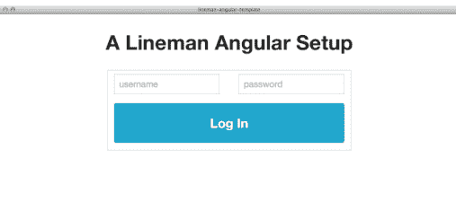

如我们看到的，Angular 模板由我们的应用生成的几个模板。我们还可以看到目录结构包含了一系列目录：

- app 包含应用文件
- css - 我们的 CSS 文件（Less 或 CSS 文件）
- img - 我们的图片文件
- js - 我们的 Angular 应用
- pages - 要编译的 HTML 模板
- templates - Angular 模板
- config - Lineman 特有的配置文件
- doc - 应用文档的目录
- dist - 用于构建生产环境应用的生成目录
- generated - 为 lineman run 运行应用的生成目录
- spec - 所有非端到端测试的规范

## 下一步工作

- spec-e2e - 我们的 protractor 规范在这里
- tasks - 任何自定义的 Lineman 任务都应该放在这里
- vendor - 包含任何第三方 CSS、JavaScript、图片文件
- Gruntfile.js - 驱动 lime 的 Gruntfile
- package.json - 应用自定义，定义了依赖项和其他元数据

Lineman 提供了一个高效的结构，可以快速且自信地编辑 Web 应用。

## Bower

Bower 是一个用于前端文件的包管理器。类似于 `npm` 是包管理器，Bower 管理前端依赖。

## 安装

安装非常简单：我们只需使用 `npm` 工具。

```bash
$ npm install -g bower
```

从这里，我们可以通过输入命令验证它是否正常工作：

```bash
$ bower help
```

如果屏幕上显示了输出，那么我们就可以准备好了。

## 下一步工作

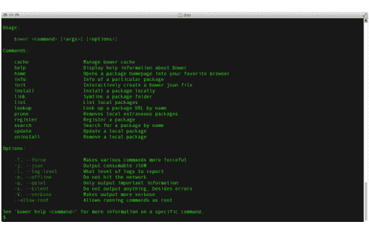

## Bower 概述

虽然我们只进行简单的概述，但我们鼓励在 Bower 官网进行更多探索。

在我们的应用中，我们使用 `bower.json` 文件来存储依赖。要开始使用 `bower.json`，我们使用 `init` 命令：

```bash
$ bower init
```

该命令启动一个设置向导，询问我们关于新项目的问题。它会在我们的目录下生成 `bower.json` 文件。

## 配置 Bower

Bower 有合理的默认值，但它是高度可配置的。我们可以配置安装目录以及使用的注册表。

要配置 Bower，我们可以编辑 `.bowerrc` 文件、传递参数或设置环境变量。我们可以将 `.bowerrc` 文件放在多个位置：

- 项目当前工作目录
- 目录树中的任何子文件夹
- 用户主目录
- Global Bower 文件夹

`.bowerrc` 文件包含一个用于配置的 JSON 对象。例如，要更改颜色配置，`.bowerrc` 文件将包含：

```json
{
  "color": false
}
```

`cwd` 配置变量是 Bower 运行的目录。所有其他路径都应相对于此目录。

```json
{
  "cwd": "app"
}
```

`directory` 配置变量是保存已安装组件的路径。默认是 `bower_components`。根据我们创建应用的方式，我们可以将其改为不同的目录结构：

```json
{
  "directory": "app/components"
}
```

## 搜索软件包

为了找到用于安装的包，Bower 包含一个搜索命令，用于在其注册表的索引中进行搜索：

## 下一步工作

## 搜索 bootstrap-sass

```bash
$ bower search bootstrap-sass
```

## 安装包

安装包同样简单。如果我们已经有一个现有的 `bower.json` 文件，只需运行 `install` 命令即可。它会下载并安装到 Bower 目录下的前端依赖项。

```bash
$ bower install
```

我们可以通过显式调用对文件的 `install` 方法在本地安装包。我们可以安装包的特定版本，甚至为该包的安装设置别名。

- 安装包的本地或默认远程版本
`$ bower install <package>`
- 安装包的特定版本
`$ bower install <package>="<version>"`
- 为包设置别名并安装
`$ bower install name=<package>="<version>"`
- 例如
`$ bower install bootstrap-bootstrap-sass`

`bower.json` 文件存储了多种类型的依赖项：运行时需要的依赖项（如 Angular 或 jQuery）或开发过程中需要的依赖项（如 Karma 或 Bootstrap-sass）。

- 安装运行时依赖项
`$ bower install angular-route --save`
- 安装开发依赖项
`$ bower install bootstrap-sass --dev`

如果我们打印出 `bower.json` 的内容，将看到它已经根据我们的新依赖项进行了更新：

## 下一步工作

```json
$ cat bower.json
{
  "name": "myapp",
  "version": "0.1",
  "authors": [
    "Ari Lerner <ari@fullstack.io>"
  ],
  "license": "MIT",
  "dependencies": {
    "angular-route": "~1.2.2"
  },
  "devDependencies": {
    "bootstrap-sass": "~3.0.0"
  }
}
```

## 使用包

现在我们已经安装了包，可以通过 HTML 源码中使用 `<script>` 标签，像包含本地目录中的其他脚本一样包含它们。

```html
<script src="bower-components/angular/angular.js"></script>
```

## 移除包

也可以通过 Bower 移除包。我们可以手动删除 Bower 目录中的文件，也可以运行 `uninstall` 命令。

`uninstall` 命令允许我们使用 `--save` 和 `--save-dev` 标志来反映 `bower.json` 文件中的更改。

```bash
# 移除依赖项
$ bower uninstall --save-dev angular-route
# 移除开发依赖项
$ bower uninstall --save-dev bootstrap-sass
```

## Yeoman

Yeoman¹⁷⁰ 是我们在本章中讨论过的工具的集合：

> ¹⁷⁰ http://yeoman.io/

- Yeoman
- Grunt
- Bower

Yeoman 本身是一个脚手架工具，通过设置我们的 Grunt 配置、构建应用程序工作空间以及管理工作流，帮助我们构建新应用程序，无论我们正在构建的是什么类型的应用程序。

截至本文编写，已有 300 个社区编写的生成器可用，我们设置了各种类型的项目，从 Angular¹⁷¹ 网站、Backbone.js¹⁷² 甚至到 Python flask¹⁷³ 项目。

Grunt 被设置为构建工具；Bower 被用于处理依赖管理。

## 安装

安装 Yeoman 非常简单。首先，我们需要确保已经安装了 Node.js¹⁷⁴ 和 Git¹⁷³。某些生成器还需要安装 Ruby¹⁷⁶ 和 Compass¹⁷⁷。

一旦准备好依赖项，我们可以使用 npm 安装 Yeoman：

```bash
$ npm install -g yo
```

安装 Yeoman 会自动安装 Grunt 和 Bower。
接下来，为了使用它，我们需要安装一个生成器（没有生成器，Yeoman 就没用）。

让我们安装 Angular 生成器：

```bash
$ npm install -g yo-generator-angular
```

## 配置 Angular 生成器

通过之前的任何一个生成器（包括主生成器），我们都可以传递选项来以自定义的方式配置我们的脚本。

## CoffeeScript

如果我们想生成 CoffeeScript 文件而不是 JavaScript 文件，可以通过传递 `--coffee` 选项轻松实现：

```
$ yo angular:controller user --coffee
```

## 压缩混淆安全 (Minification Safe)

虽然不是绝对必要的（我们的 Yeoman 生成器包含了 ngMin），但我们可以使用 `--minsafe` 标记告诉生成器在生成的文件中添加依赖注入注解：

```
$ yo angular:controller user --minsafe
```

## 跳过索引页

默认情况下，之前所有的生成器都会在 `index.html` 中添加相应的加载文件。我们可以告诉生成器不要在 `index.html` 中包含这些脚本。

> 我们想要跳过向索引页添加文件，因为我们可能正在构建一个第三方插件。

```
$ yo angular:factory session --skip-add
```

## 测试我们的应用

Yeoman Angular 生成器最棒的功能之一是，它允许我们在开发过程中无缝地测试应用程序。

生成器自带了一个测试命令，每当我们保存应用中的文件时，该命令就会运行。这种封装使得测试过程可以轻松地融入我们的工作流中。

要在不监控文件的情况下运行测试（即运行一次），我们可以使用命令：

## 下一步

```
$ grunt test
```

该命令运行一次后就会退出。我们建议对工作流进行两处更改，以便在应用引入自动化测试。

首先，打开应用根目录下的 `Gruntfile.js` 并找到 `karma` 任务。然后，我们需要将 `singleRun: true` 选项改为 `false`：

```
// ...
karma: {
  unit:
  configFile: 'karma.conf.js',
  singleRun: false // 将此改为 FALSE
}
cdnify:
//
```

其次，打开 `karma.conf.js` 文件并将 `autoWatch` 选项从 `false` 改为 `true`。

现在，当我们运行 `grunt test` 时，任务将不会运行一次就退出，而是保持开启并监控我们的文件。一旦我们修改并保存文件，测试就会重新运行。

## 打包我们的应用

在构建应用程序之后，我们希望为应用设置一个发布版本（distribution）。创建应用的发布版本包括压缩所有的 JavaScript 和 HTML、打包视图、预处理 CSS 等。

要运行构建任务，我们只需运行 `grunt build` 命令：

```
$ grunt build
```

运行整个生成器需要几分钟时间。完成后，我们在应用根目录下将有一个 `dist/` 文件夹。该文件夹将包含所有适用于生产部署的文件。

我们可以原样将此文件夹上传到服务器，或者将其与服务器一起一起部署，让我们的应用程序推向大众。

## 下一步

## 打包我们的模板

我们可以使用的一种让应用看起来极快、且不依赖服务器交付模板的方法，是将模板文件转换为 JavaScript 文件。

使用 Angular 的 `templateCache`，我们将模板包含在一个 JavaScript 文件中。例如，与其告诉 Angular 使用 XHR 获取 HTML 并作为 HTML：

```html
<div class="hero-unit">
  <h1>!Allo, !Allo!</h1>
  <p>You now have</p>
  <ul>
    <li ng-repeat="thing in awesomeThings">{{thing}}</li
  </ul>
  <p>installed.</p>
  <h3>Enjoy coding! - Yeoman</h3>
</div>
```

我们可以将它们打包成一个 JavaScript 文件并让 JavaScript 独立运行，如下所示：

```javascript
angular.module('MyApp')
.run([$templateCache], function($templateCache) {
  $templateCache.put('views/main.html',
" " +
    "<div class=\"hero-unit\">\n" +
    "  <h1>!Allo, !Allo!</h1>\n" +
    "  <p>You now have</p>\n" +
    "  <ul>\n" +
    "    <li ng-repeat=\"thing in awesomeThings\">{{thing}}</li>\n" +
    "  </ul>\n" +
    "  <p>installed.</p>\n" +
    "  <h3>Enjoy coding! - Yeoman</h3>\n" +
    "</</div>>\n" +
  });
}]);
```

要设置此项，我们需要修改 `Gruntfile.js`，使用 npm 包 `grunt-angular-templates` 包含一个新的任务定义。

首先，我们安装该包：

```
$ npm install --save-dev grunt-angular-templates
```

接下来，我们将修改 `Gruntfile.js` 以包含 `ngtemplates` 任务。

## 下一步

```
// ...
}
ngtemplateApp: {
  cwd: '<%= yeoman.app %>',
```


```javascript
  src: 'views/**.html',
  dest: '<%= yeoman.app %/scripts/templates.js'
}
// 其他任务中未处理的文件
copy:
// ...
```

此修改仅会在你的应用目录中创建一个新文件，其中将包含作为 JavaScript 加载的模板文件。

我们需要确保该任务运行，以便方便地向构建过程中添加任务。我们只需找到行：`grunt.registerTask('build', [`，并确保我们在`concat`任务之后将`ngtemplates`添加到任务数组中：

```javascript
grunt.registerTask('build',
// ...
'concat',
// ...
'cssmin',
'ngtemplates',
'uglify',
'rev',
'usemin'
];
```

最后，我们需要确保在`app/index.html`文件中包含`scripts/app.js`之后引入`templates.js`文件：

```html
<!-- build:js({tmp.app}) scripts/scripts.js -->
<script src="scripts/app.js</script>
<script src="scripts/controllers/main.js</script>
<script src="scripts/templates.js</script>
<!-- endbuild -->
```

现在，当我们构建应用时，我们的模板将与应用程序的其他部分一起打包。

## 下一步

注意，当我们开发应用程序时，如果缓存中没有找到模板，它会自动从服务器加载，因此在我们的开发过程的某个时刻，我们可以安全地删除`app/scripts/template.js`文件。

如果此文件存在，那么它缓存的视图将不会重新加载；它会`认为`模板是可用的。
