# PHP XML Web 开发：精通 PHP 5 强大的新 XML 功能


# 作者简介

Thomas Myer 是 Dare Media 的创始人，总部位于德克萨斯州奥斯汀，专门提供 Web 咨询服务。1996年进入 Web 开发领域后，他不久就开始学习了 XML。他在 XML 框架方面拥有丰富的开发经验和知识。

# 技术总监简介

Joe Marini 是 SitePoint 的技术总监，负责所有的出版物，包括书籍、文章和博客。他为 PHP、ASP.NET、JavaScript 和 CSS 等技术编写了超过 50 篇文章，并因其著作《Build Your Own Database Using MySQL》而闻名。他现在住在澳大利亚墨尔本。在空闲时间，他喜欢飞行和学习即兴表演。

# 关于 SitePoint

SitePoint 致力于为 Web 专业人士提供有趣、实用且易懂的内容。

访问 `http://www.sitepoint.com` 获取我们的书籍、时报。

> 感谢我的妻子 Hope，无论如何都爱我。

> 感谢我的三只狗：Kafka, Marlowe 和 Vladimir，它们在我完成第五章后去世了。

+ 前言 ................................................................................................ ix

+ 1. XML 简介 ................................................................... 1

XML 简介 ........................................................................................ 1

什么是 XML？...................................................................................................... 2

为什么我们需要 XML？....................................................................................................... 2

深入探讨 XML 示例 ................................................................... 6

格式问题 ................................................................................ 12

格式良好与有效性 ................................................................................ 13

上手操作 ................................................................................... 15

在 Internet Explorer 中查看原始 XML ................................................ 16

在 Firefox 中查看原始 XML ................................................................ 20

使用验证器的选项 ................................................................ 20

如果我无法获取验证器该怎么办？.................................................. 23

开始我们的 CMS 项目 ................................................................... 23

那么……什么是内容管理系统？.............................................................. 23

需求收集 ................................................................... 24

定义你的内容类型 ......................................................... 28

内容显示的需求收集 .................................... 31

管理工具的需求收集 ................................................. 32

总结 ............................................................................................ 32

+ 2. 实践中的 XML ................................................................... 33

认识这个家族 ................................................................................ 33

深入探讨 XHTML .......................................................................... 35

极简主义 XHTML 示例 ............................................................ 38

XML 命名空间 ......................................................................... 39

声明命名空间 ................................................................... 39

在 XML 文档中放置命名空间声明 ... 40

使用默认命名空间 ......................................................... 41

使用 CSS 在浏览器中显示 XML ......................................... 42

- **了解 XSLT** ................................................................................................ 44

  - 你的第一个 XSLT 练习 ............................................................................ 44

  - 将 XML 转换为 HTML ................................................................ 50

  - 使用 XSLT 将 XML 转换为其他 XML ............................ 52

- **我们的 CMS 项目** ..................................................................................... 55

  - 新闻 .................................................................................................................  56

  - 总结 ................................................................................................... 58

- **3. 为了保持一致性的 DTDs** ........................................................................ 59（注：OCR 识别错误，原文为 TDDs）

  - XML 中的一致性 ................................................................................... 59

  - 一致性的意义何在？........................................... 60

  - DTD ....................................................................................................... 61

- **开始实战** ........................................................................................ 69

  - 我们的第一个案例：公司备忘录 .......................................................... 70

  - 第二个案例：在备忘录中使用外部 DTD ................................................ 76

- **我们的 CMS 项目** ..................................................................................... 77

  - 重新设计跟踪作者信息的方式 ....................................... 77

  - 为我们的项目文档分配 DTD？....................................................... 79

  - 总结 ................................................................................................... 80

- **4. 在浏览器中显示 XML** ........................................................ 81

  - 关于 XPath 的简述 ...................................................................................... 81

  - 一个实用的 XSLT 应用 ................................................................ 83

  - 第一次格式化尝试 ................................................................ 84

- **使用 XPath 识别元素值** ................................... 87

  - 用 XPath 匹配属性值 ................................................ 88

  - 使用 value-of 提取信息 ................................................ 90

- **我们的 CMS 项目** ..................................................................................... 92

  - 为什么从显示端开始？....................................................................... 93

  - 创建公共包含文件 ........................................................................ 93

  - 创建搜索包含文件 ....................................................... 94

  - 构建首页 ............................................................................ 94

  - 创建内部页面 .......................................................................... 102

  - 总结 ................................................................................................ 104

- **5. 详析 XSLT** ................................................................................... 107

  - XPath ...................................................................................................... 107

  - XSLT 的程序化方面 ........................................................ 110

  - 排序 ................................................................................................... 110

  - 计数 ................................................................................................... 116

  - 编号 ......................................................................................... 117

- **条件处理** ........................................................ 121

  - 循环遍历 XML 数据 ................................................................ 125

  - 我们的 CMS 项目 ............................................................................................ 126

  - 完成我们的搜索引擎 ................................................................. 127

  - 创建由 XSLT 驱动的站点地图 ............................................................... 130

  - 总结 ..................................................................................... 136

- **6. 使用 JavaScript/DHTML 操纵 XML** ................................ 137

  - **为什么使用客户端脚本？** ................................................ 137

  - **操作 DOM** ....................................................................... 138

  - **将文档加载到内存** ...................................................... 138

  - **访问文档的不同部分** ................................... 140

  - **使用 JavaScript 处理 XSLT** ................................................ 142

  - **让我们的测试脚本跨浏览器兼容** ........................ 146

  - **创建动态导航** ................................... 151

  - **我们的 CMS 项目** ................................................................ 157

  - **为分类分配内容** ............................................ 158

  - **按分类检索内容** ............................................ 158

  - **总结** ..................................................................... 161

- **7. 使用 PHP 操纵 XML** ................................................ 163

  - **使用 SAX** ....................................................................... 166

  - **创建处理器** ............................................................ 166

  - **创建解析器并处理 XML** ...................... 167

  - **使用 DOM** ....................................................................... 169

  - **创建 DOM 解析器** ...................................................... 170

  - **检索元素** .......................................................... 170

  - **创建节点** ............................................................ 173

  - **从 DOM 打印 XML** .......................................... 174

  - **使用 SimpleXML** ................................................... 174

  - **加载 XML 文档** ........................................ 175

  - **元素层次结构** ....................................... 176

  - **XML 属性值** ........................................ 178

  - **XPath 查询** ........................................... 179

  - **使用 SimpleXML 更新 XML** ................... 179

  - **修复 SimpleXML 的缺陷** ................................................. 180

  - **使用 DOM 的方法** ................................................................. 181

  - **我们的 CMS 项目** ................................................................. 181

  - **登录页面** ................................................................. 182

  - **索引页面** ................................................................. 186

  - **文章处理** ................................................................. 187

  - **总结** ............................................................................................ 197

- **8. RSS 与 RDF** ................................................................. 199

  - **什么是 RSS 和 RDF？** ........................................................ 199

  - **一致性的意义何在？**............................................................... 199

  - **RSS 馈应该包含哪些信息？**............................................................... 200

  - **在我们开始之前** ................................................................. 201

  - **创建第一个 RSS 馈** ................................................................. 202

  - **向世界介绍你的 Feeds** ................................................................ 204

  - **超越基础** ................................................................................. 206

  - **RSS 1.0** ................................................................................................ 207

  - **使用 Dublin Core 添加信息** ............................................................ 210

  - **何时使用 RSS 1.0** ................................................................................................ 211

  - **解析 RSS Feeds** ................................................................................................ 212

  - **使用 SimpleXML 解析 Feeds** ................................................................................ 213

  - **我们的 CMS 项目** ................................................................................................ 215

  - **创建一个 RSS 馈** ................................................................................................ 215

  - **总结** ............................................................................................ 219

- **9. XML Web 服务** ................................................ 221

- **什么是 Web 服务？** ........................................................................ 221

- **一致性的意义何在？**....................................................................................... 222

- **Web 服务擅长什么？**.................................................................................. 223

- **XML-RPC** ...................................................................................... 224

- **XML-RPC 数据模型** ................................................................................................ 225

- **XML-RPC 请求** ...................................................................................... 228

- **XML-RPC 响应** ................................................................................................ 230

- **我们用什么处理 XML-RPC？** ............................................................ 231

- **SOAP** ...................................................................................... 231

- **我们尚未涵盖的内容** ................................................................................... 233

- **我们的 CMS 项目** ................................................................................................ 233

- **构建 XML-RPC 服务器** ........................................................................................ 234

- **构建计数文章的 XML-RPC 客户端** ............................................................ 239

- **构建搜索文章的 XML-RPC 客户端** ................................... 241

- **总结** ............................................................................................ 243

- **10. XML 与数据库** ................................................................. 245

- **XML 与数据库** ........................................................................................ 245

- **为什么要将 XML 和数据库结合使用？** ........................................................................ 246

- **关系型数据库？原生 XML 数据库？还是在两者** ............................................ 246

- **之间？**

- **将关系型数据转换为 XML** ............................................................................ 249

- **使用 phpMyAdmin 导出 XML** ................................................................................ 249

- **使用 mysqldump 导出 XML** ................................................................ 251

- **手动编写 XML 转换器** ............................................................................ 253

我们的 CMS 项目 ..................................................................................................... 256

构建 MySQL 表 ................................................................................................ 256

构建 PHP ....................................................................................................................... 257

设置 Cron 计划以定期运行 ............................................ 259

总结 ................................................................................................................... 260

SAX 函数 ....................................................................................................... 261

错误代码常量 ....................................................................................... 261

函数列表 ......................................................................................... 262

DOM 函数 .................................................................................................... 272

对象列表 ..................................................................................................... 272

函数列表 ......................................................................................... 294

SimpleXML 函数 ................................................................................ 294

函数列表 ......................................................................................... 294

SimpleMLElement 方法 ........................................................................ 295

继续之前的工作 ................................................................................... 297

管理网页拷贝 ................................................................................................ 297

网页拷贝索引页 ............................................................................ 299

网页拷贝创建脚本 .................................................................. 301

新网页拷贝处理脚本 ...................................................... 303

网页拷贝编辑页 ....................................................................... 305

网页拷贝更新处理脚本 ........................................ 307

网页拷贝删除处理脚本 ...................................... 308

管理新闻项目 ................................................................... 309

新闻项目索引页 ....................................................................... 310

新闻项目创建页 .................................................................. 311

新新闻项目处理脚本 ........................................ 312

新闻项目编辑页 ............................................................... 314

新闻项目更新处理脚本 ................ 316

新闻项目删除处理脚本 ................ 317

管理作者、管理员和分类 ............... 318

管理作者 ....................................................................... 318

管理管理员 ................................................... 327

管理分类 ......................................................... 331

更新管理员索引页 ............................................ 336

总结 ................................................................................................... 337

索引 ..................................................................................................... 339

## 前言

我偶尔会举办一场名为“平凡人的 XML”（XML for Mere Mortals）的研讨会。这个标题吸引的受众比典型的需要加强相关知识的 Web 开发者要广泛得多。我培训的是技术作家、项目经理、数据库极客——甚至还有偶尔试图掌握 XML 令人兴奋的可能性的企业主。

如果我必须给这本书起一个副标题，那将会是“平凡人的 XML”，因为每当我坐下来写一个章节时，我都会尝试在脑海中勾画参加研讨会的这些人——他们聪明且充满好奇，技术水平各不相同，但所有人都对那些术语、流程和技术感到有些无从从。如果运气的话，这种方法会对你有所帮助。

这本书有两个目标：向读者介绍 XML 世界的很大一部分，并引导他们一步步地创建一个由 XML 驱动的网站。让我们详细讨论一下这两个目标。

如果我们花时间向你介绍整个 XML 技术谱，那它的长度将是你现在手里这本书的两倍（或三倍）。从 XML 开始时，有很多内容要说，所以我必须权衡取舍。例如，我们会注意到我们讨论了 DTD，但没有涵盖 XML Schema（XML架构）。我们讨论了很多 XPath，但没有涵盖 XQuery 或 XLink。这个标题的意图是让你在 XML 主题上初步涉水（也许还包括你的脚踝、小腿和膝盖），并让你在出去学习更多知识时感到轻松。

第二个目标涉及构建你的由 XML 驱动的网站。我的职业是构建基于 XML 和基于数据库的动态网站，我试图将我关于这一过程的所知尽可能地倾倒在有限的空间内。在我们着手构建书中开发的项目时，我将带你通过需求收集和分析阶段，然后向你展示如何将其转换为真实的 XML 文档和可运行的代码。是的，我们正在构建一个内容管理系统，但是一个简化的系统，没有你在其他系统中看到的复杂工作流或其他功能。尽管如此，你最终将得到一个简单强大的系统，它可以让网站快速建立并运行。

每当我上课或举办研讨会时，我都觉得可以从学生那里学习，就像他们从我这里学习一样——事实上，随着教学的持续，我学得更多。

写这本书非常像那样，因为迫使我将我的想法和方法以更连贯的方式组织起来。

我希望你发现这本书是对极其迷人的 XML 主题的一个非常实用的介绍。我知道许多专家不会认同我在这里采用的方法，我想说我理解你们所有的分歧，但为初学者写书需要从略微不同的视角呈现概念。如果你想向我提供反馈，或者有任何问题，请随时给我发邮件：`tom@tripledogremedia.com`。

# 谁应该读这本书？

这本书是为 XML 初学者准备的。你应该对 Web 有一些基础性知识，包括 HTML 和一些 JavaScript 技能，以及服务器端编程语言的经验。

在书中，我们在服务器端使用 PHP 5，我假设你已经接触过 PHP。然而，我总是尝试解释正在发生什么，特别是在我处理你可能没有或几乎经验的 XML 概念时。

如果你曾经玩过 JavaScript、处理过数据库、设置过电子商务系统，或者用 PHP、ASP 或 Perl 编写过程序，你可能完全能跟上我们的内容。

# 本书中包含什么？

以下是我们涵盖的内容：

- 第一章：XML 简介。本章介绍了 XML。我们讨论了元素、标签、属性、实体，并进入了语义部分。我们探索了良好性（wellformed）和有效性（valid）之间的区别，然后通过一些示例进行实践。我们也开始收集项目需求。

- 第二章：XML 实战。是时候认识 XML 家族了，即 XHTML、XML 命名空间和扩展样式表语言转换（XSLT）。在接触这些技术的同时，我们还收集了项目的最终需求。

## 第 3 章：用于一致性的 DTD

本章完全围绕一致性。特别是，我们查看了文档类型定义（DTD），这是一种语言描述了 XML 文档要成为“有效文档”（即适用于特定系统）所必须满足的需求。在本章的结束处，我们将对为项目收集的一些需求进行细化。

# 第 4 章：在浏览器中显示 XML

在本章中，我们讨论了 XSLT 以及如何使用它将 XML 转换以便在浏览器中显示。我们将探索 XSLT 的一些基础知识并介绍 XPath。在章节结束时，我们将为项目构建许多所需的公共显示模板。

## 第 5 章：详述 XSLT

本章接续上一章的内容。我们将更深入地探讨 XSLT 的编程方面，例如 `foreach` 循环、条件判断、排序、计数以及 XPath 的使用。在项目中，我们使用这些知识在服务器端利用 XPath，并创建一个 XSLT 驱动的站点地图。

## 第 6 章：使用 JavaScript/DHTML 操纵 XML

在这里，我们学习如何使用客户端工具操纵 XML。我们学习了文档对象模型（DOM），以及 Internet Explorer 与 Firefox 及其他基于 Mozilla 的浏览器在处理 XML 方面的差异。在项目方面，我们为内容结构添加了分类，并使用客户端 XML 处理允许用户按类别浏览网站内容。

# 第 7 章：使用 PHP 操纵 XML

在上一章中，我们的工作大部分在客户端。现在我们处理服务器端，特别是通过探索 SAX、DOM 和 SimpleXML 函数库在处理 XML 时的差异，来解决 PHP 5 的问题。随着我们开始构建管理工具文件（包括登录/验证模板以及文章创建/更新/删除模板），我们进一步推进了项目工作。

## 第 8 章：RSS 和 RDF

RSS 是目前的热点话题。它为没有时间定期访问的网站提供了监控手段，并让 Web 应用程序利用来自第三方网站和其他信息源分发的内容。在本章中，我们将深入研究可用的不同类型 RSS 的细节（包括作为 RSS 1.0 基础的 RDF），并讨论新闻聚合器、用 PHP 解析 Feed 等。最后，我们通过为我们的 Web 项目添加 RSS Feed 来结束本章。

## 前言

## 第 9 章：XML 与 Web 服务

是时候查看 Web 服务了。本章的重点是 XML-RPC，这是一种较老的 Web 服务标准，易于操作，但我们也提到了 SOAP，这是该领域较新的标准。在项目方面，我们创建了一个用于搜索网站文章的 XML-RPC 服务器（及客户端）。

## 第 10 章：XML 与数据库

最后一章考虑了 XML 和数据库。我们讨论了结合使用数据库和 XML 的需求，探索了关系型与原生 XML 数据库之间的差异，并研究了在数据库中存储 XML 信息任务。我们手动编写了一个 SQL 到 XML 的转换器，然后使用现成的解决方案 phpMyAdmin 同样的操作。最后，我们为 XML 项目文件创建一个 MySQL 备份系统。

本附录包含了 PHP 5 支持的处理 XML 的 SAX、DOM 和 SimpleXML 函数的完整引用。

本附录完成了项目管理工具的工作。我们将构建表单和脚本来处理新闻项目、网页副本、作者、管理员和分类。

位于 `http://www.sitepoint.com/books/xml1/` 的支持本书的网站将为您提供以下功能：

随着阅读的进行，您会注意到大多数代码列表都标记有文件名，并且多次提到了代码存档。这是一个可下载的 ZIP 压缩包，包含了书中展示的所有示例的完整代码。

书籍网站上的勘误（Errata）页面将始终提供有关已知排版和代码错误的最新信息，以及针对技术变更的必要更新。

虽然我已经尽一切尝试预测您可能有的任何问题并在书中给出了回答，但任何书籍都不可能涵盖关于 XML 的所有知识。如果您对书中的任何内容有疑问，获取快速答案的最佳地点是 `http://www.sitepoint.com/forums`——SitePoint 充满活力且知识渊博的社区。

## SitePoint 通讯邮件

除了像这样的书之外，SitePoint 还提供免费的电子邮件 newsletter。

SitePoint Tech Times 涵盖了 Web 开发所有技术方面的最新新闻、产品发布、趋势、技巧和技术。XML 或 PHP 世界任何值得关注的内容都会出现在这封通讯邮件的页面中。

历史悠久的 SitePoint Tribune 是一份双周刊摘要，涵盖了 Web 的商业和盈利方面。无论您是寻找技巧赢得合同的自由职业开发人员，还是努力跟上主要搜索引擎变化的营销专业学生，这封通讯邮件都适合您。

SitePoint Design View 是一份每月一次的 Web 设计优秀之作汇编。从新的 CSS 布局方法到精细的 Photoshop 技术，SitePoint 的首席设计师会在页面中分享他的多年经验。

浏览存档或订阅任何 SitePoint 的免费通讯邮件：`http://www.sitepoint.com/newsletter/`。

如果您无法通过论坛找到答案，或者出于其他任何原因想与我们联系，最好的书写地址是 `books@sitepoint.com`。我们有一套运行良好的支持系统来跟踪您的查询，如果我们的支持人员无法回答您的问题，他们会将问题发送给我。我们非常欢迎改进建议以及对您发现的任何错误的通知。

在本章中，我们将涵盖 XML 的基础知识——本质上，是您掌握这项令人的技术所需的大部分信息。在探索完一些术语和示例后，我们将直接进入正题开始使用 XML。然后，我们将花时间开始将在我们本书过程中开发的项目。

## XML 简介

谁没听过 XML？好吧，几乎每个人都听过。如果在 90 年代后期和当前十年真的有一个候选人被称为“最受炒作的技术”，那就是 XML（尽管 Java 也是该头衔的有力竞争者）。

当我与开发者、设计师、技术作家或其他 Web 专业人士讨论 XML 时，我最常被问的问题是：“这有什么大不了？”在这本书中，我将解释大大之处究竟——XML 如何让您的 Web 应用程序更智能、更多功能且更强大。我将尽量避开许多 XML 讨论中常见的夸大其词；相反，我将提供让 XML 成为您专业技能一部分所需的背景知识和技巧。

## 致谢

## 第1 章：XML 简介

## 什么是 XML？

那么，XML 是什么？每当有一群问这个问题时，我总是会观察他们的肢体语言。群体中很大一部分急切地向前倾，想要学习更多知识。而其他人要么在期待炒作和半成理论时翻着白眼，要么因为害怕漫长而枯燥的标记语言历史而感到畏缩。因此，我学会了保持讲解简洁明了。

XML 的精髓在于它的名字：可扩展标记语言（Extensible Markup Language）。

### 可扩展

XML 是可扩展的。它允许你定义自己的标签、标签出现的顺序，以及它们应该如何被处理或显示。考虑可扩展性的另一种方式是，XML 允许我们所有人扩展对“文档”这一概念的理解：它可以是存储在文件服务器上的文件，也可以是两个计算机系统之间流动的瞬态数据脉（在 Web 服务的情况下）。

### 标记

XML 最易识别的特征是它的标签，或者更准确地说，是元素。事实上，你在 XML 中创建的元素与你已经在 HTML 文档中使用的元素非常相似。然而，XML 允许你定义自己的标签集。

### 语言

XML 是一种与 HTML 非常相似的语言。它比 HTML 灵活得多，允许你创建自己的自定义标签。然而，重要的是，XML 不仅仅是一种语言。XML 是一种元语言：一种允许我们创建或定义其他语言的语言。例如，通过 XML 我们可以创建其他语言，如 RSS、MathML（一种数学标记语言），甚至是像 XSLT 这样的工具。稍后会详细介绍。

## 为什么我们需要 XML？

好了，我们知道它是什么了，但为什么我们需要 XML 呢？我们需要是因为 HTML 专门设计用于描述在 Web 浏览器中显示的文档，此外并无其他。如果你想在移动设备或任何稍微复杂一点的地方显示文档（例如将内容从德语翻译成英语），就会变得繁琐。HTML 的唯一目的是让任何人都能快速创建可以与他人共享的 Web 文档。另一方面，XML 不仅适用于 Web——它可以用于各种不同的语境，其中某些可能与人类与内容的交互完全无关（例如，Web 服务使用 XML 往来发送请求和响应）。

HTML 很少（如果有的话）提供关于文档结构或其含义的信息。用俗的话来说，HTML 是一个演示文档，而 XML 是一种数据描述语言。

例如，如果你访问任何电子商务网站并查看产品列表，你可能会得到类似的内容：

```html
<!DOCTYPE html PUBLIC "-//W3C//DTD HTML 1.0 Transitional//EN"
  "http://www.w3.org/TR/xhtml1/DTD/xhtml1-transitional.dtd">
<html xmlns="http://www.w3.org/1999/xhtml">
<head>
  <title>ABC Products</title>
  <meta http-equiv="Content-Type" charset=iso-8859-1" />
</head>
<body>
<h1>ABC Products</h1>
<h2>Product One</h2>
<p>Product One 是一个令人兴奋的新小部件，它将简化你的生活。</p>
<p>Cost: $19.95</p>
<p>Shipping: $2.95</p>
<h2>Product Two</h2>
...
<h3>Product Three</h3>
<p><i>i-Cost: $24.95</i></p>
<p>这是一个如此棒的小部件，以至于你一定想为家里买一个，再为办公室买一个！</p>
...
</body>
</html>
```

从计算机的视角来看，仔细观察这个——诚然很简单的——代码示例。人类完全可以阅读此文档并进行必要的语义跳跃来理解它，但计算机就做不到。

## 语义和其他术语

在本章中，你将听到很多关于“语义（semantics）”和其他语言学术语的讨论。这是不可避免的，请多包涵。语义是研究语言意义的学科。

人类在语义方面比计算机擅长得多，因为人类非常擅长推导出意义。例如，如果我让你尽可能列出许多描述“雌性动物”的名称，你可能会从“母狮子”、“母虎”、“母羊”、“母鹿”等开始。如果你向他们展示这些名称的列表，并要求提供一个包含所有这些内容的类别，你很可能会说“雌性动物”之类的词。此外，如果我问你母狮子，你会说“狮群”、“狩猎”、“稀瓦纳”、“非洲”等。从那里开始，你可以跃迁到其他野生猫科动物、家猫，甚至可能是狗（毕竟猫和狗都是宠物）。几乎费吹吹力，你就能构建出一个惊叹的语义景观。

不用说，计算机在这场游戏中非常糟糕，这很遗憾，因为许多计算任务都需要语义技能。这就是为什么我们需要尽所能地为计算机提供帮助。

例如，人类可能推断出上文文档中的 `<h2>` 标签被用于标记产品列表中的产品名称。此外，如果我问你母狮子，你会说，可能会说“狮群”、“狩猎”、“稀瓦纳”、“非洲”等。（等等，OCR 文本在这里有重复，我将根据逻辑流进行清理）。

```xml
<?xml version="1.0" encoding="UTF-8"?>
<!DOCTYPE html PUBLIC "-//W3C//DTD HTML 1.0 Transitional//EN"
  "http://www.w3.org/TR/xhtml1/DTD/xhtml1-transitional.dtd">
<html xmlns="http://www.w3.org/1999/xhtml">
<head>
  <title>ABC Products</title>
  <meta http-equiv="Content-Type" charset=iso-8859-1" />
</head>
<body>
<h1>ABC Products</h1>
<h2>Product One</h2>
<p>Product One 是一个令人兴奋的新小部件，它将简化你的生活。</p>
<p>Cost: $19.95</p>
<p>Shipping: $2.95</p>
<h2>Product Two</h2>
...
<h3>Product Three</h3>
<p><i>i-Cost: $24.95</i></p>
<p>这是一个如此棒的小部件，以至于你一定想为家里买一个，再为办公室买一个！</p>
...
</body>
</html>
```

（自我修正：源文本有大量的重复伪影和碎片。我将提供清理后的版本。）

为了确保每个人遵守规则，你需要一个 DTD（文档类型定义）或架构（schema）。基本上，DTD 提供了关于你的 XML 结构的指令。一旦有了 DTD，任何为你的应用程序创建列表的人都必须遵守规则。我们稍后会详细介绍 DTD。不过，现在让我们继续基础知识。

## XML XML 示例

从普通观察者的视角来看，给定的 XML 文档（例如我们在上一节看到的）似乎只是一堆标签和字母。但它不仅仅如此！

## 结构视角

让我们从结构角度考虑我们的 XML 示例。不，不是我们通过 XML 标记所属的那种结构；让我们从更细粒度的层面来看这个示例。我想逐字符地检查 XML 文件的内容。

简单的 XML 元素包含起始标签、结束标签和一些内容。起始标签以左尖括号 `<` 开始，随后是包含字母和数字（但不包含空格）的元素名称，并以右尖括号 `>` 完成。在 XML 中，内容通常是解析的数据。它可以由纯文本、其他 XML 元素以及更奇异的东西如 XML 实体、注释和处理指令（我们稍后都会看到）。内容之后是结束标签，它与你的起始标签拼写和大小写相同，但有一个微小的变化：在元素名称之前出现一个 `/`。

以下是一些有效的 XML 元素示例：

```xml
<myElement>some content here</myElement>
<elements>
  <element>one</element>
  <element>two</element>
</elements>
```

## 深入探讨 XML 示例

### 元素、标签还是节点？

在本书的不同位置，我都会提到 XML 元素、XML 标签和 XML 节点。这到底是怎么呢？其实，对于外行来说，这些术语是可以通用的，但如果你想得技术化一点（谁想在技术书籍里这么做呢？），每个词都有非常精确的含义：

- 元素（element）由一个起始标签、其属性、任何内容以及一个结束标签组成。

- 标签（tag）——无论是起始还是结束——都用于标记元素的开始或结束。

- 节点（node）是 XML 文档层级结构的一部分。“节点”是一个通用术语，适用于任何类型的 XML 文档对象，包括元素、属性、注释、处理指令和纯文本。

如果你习惯了处理 HTML，你可能创建过许多缺失结束标签、在起始和结束标签中使用不同大小写、以及包含嵌套不当标签的文档。

在 XML 中，你不能容忍这些行为！在这种语言中，`<element>` 与 `<ELEMENT>` 标签不同，且两者都与 `<MyElement>` 标签不同。如果你的起始标签是 `<element>` 而结束标签是 `</MyElement>`，那么你的文档将是非有效的。

- 如果你在任何元素上使用属性，那么属性值必须用单引号或双引号括起来。你不能像在 HTML 中那样直接使用裸露的属性值了！让我们来看一个示例。以下内容在 HTML 中是允许的：

```
h1 class=topHeader
```

在 XML 中，你必须在属性值周围加上引号（单引号或双引号），如下：

```
<h1 class="topHeader">
```

此外，如果你没有正确地嵌套元素（即在关闭另一个位于内部的元素之前没有先关闭该元素），你的文档将是非有效的。（我知道我一直在提有效性——我们很快就会详细讨论它！）例如，Web 浏览器通常不会对此进行挑剔：

```
<b>Some text that is bold, some that is <i>italicized</i></b>
```

# 第 1 章：XML 简介

在 XML 中，元素的不当嵌套会导致读取文档的程序引发错误。

由于 XML 允许你创建任何想要的语言，XML 的发明者不得不制定一条特殊规则，该规则恰恰与正确的嵌套规则密切相关。该规则规定，每个 XML 文档必须包含一个根元素，文档的所有其他元素都包含在其中。正如我们稍后看到的，你所做的几乎每一个 XML 开发工作都受益于这条简单的规则。

# 属性

你注意到到我们示例中的 `<productListing>` 起始标签了吗？在标签内部，紧随元素之后的是数据 `title="ABC Products"`。这被称为属性（attribute）。

你可以将属性想象成形容词——它们为元素提供了额外信息，这些信息作为内容可能具有任何意义。如果你工作过 HTML，你对这类属性很熟悉，例如 `` 标签上的 `src`（文件源）。

属性中应该包含什么信息？元素的标签之间应该出现什么？这是一个引起许多争论的话题，但不要担心，这里真的没有错误的答案。记住：你才是那个定义自己语言的人。一些开发者（包括我在内！）遵循这一经验法则：使用属性来存储那些并不一定显示给信息用户的数据。另一个常见的经验法则是考虑数据的长度。潜在的大型数据应该放在标签内部；较短的数据可以放在属性中。通常，属性用于对标签内包含的数据进行“修饰”。

让我们更仔细地审视这个问题。假设你想创建一个 XML 文档来跟踪你的 DVD 收藏。这里是你可能会用到的一段短代码：

```xml
<dvdCollection>
  <dvd>
    <id></id>
    <title>Raiders of the Lost Ark</title>
    <release-year>1981</release-year>
    <director>Steven Spielberg</director>
    <actors>
      <actor>Harrison Ford</actor>
      <actor>Karen Allen</actor>
      <actor>John Rhys-Davies</actor>
    </actors>
    <dvd>
      ...
  </dvd>
</dvdCollection>
```

阅读此文档的人不太可能需要知道你收藏中任何 DVD 的 ID。因此，我们可以安全地将 ID 存储为 `<dvd>` 元素的属性，如下所示：

```
<dvd id="1">
```

在我们的 DVD 列表的其他部分，信息看起来似乎有一微单调。例如，我们只在 `<actor>` 标签之间显示了演员的名字——我们可以在这里包含更多信息。做到这一点的一种方法是添加属性：

```
<actor type="superstar" gender="male" age="50">Harrison Ford</actor>
```

在这种情况下，我可能会回到我们的经验法则——大多数用户可能想至少知道这些信息中的一部分。所以，让我们把其中一些属性转换为元素：

```xml
<actor type="superstar">
  <name>Harrison Ford</name>
  <gender>male</gender>
  <age>50</age>
</actor>
```

## 警惕冗余数据

从完全不同的角度来看，人们可能会认为你不应该有冗余数据。如果你在多个地方都有该信息，你就必须在所有地方更新它。XML 允许你避免这种情况，通过定义一次数据然后引用它。

## 空元素

某些元素被认为是空的——它们不包含任何内容。在 HTML 中，你可能会使用自闭标签 `<br />`。在 XML 中，你必须使用自闭语法：

```
<br/>
```

## XML 声明

我们示例顶部的行是 XML 声明：

```
<?xml version="1.0"?>
```

包含这一行并不是严格，但它是确保任何设备知道它是 XML 的最佳方法。

## 实体

我之前提到过实体。实体是一种允许你为插入文档定义特殊字符的结构。如果你工作过 HTML，你就知道不能使用 `<`，因为它会被视为标签的开始，所以你用实体来代替它。XML 正如其可扩展性允许你创建自己的实体。假设你的公司的版权声明必须出现在每个文档中。与其反复输入，你可以创建一个名为 `&copyright` 的实体并带有正确的文本。

## 不仅仅是结构...

XML 文档不仅仅是元素的序列。如果你再次观察我们的产品或 DVD 列表示例，你会发现两点：

- 文档是自描述的，正如我们已经讨论过的那样。

- 文档确实是一个层级结构。

让我们简单阐述第一点。我们已经说过（大多数而非所有）XML 文档都是自描述的。数据可以由字符或数字组成，例如 55512388。这个字符串可以代表从笔记本电脑序列号、药房 ID 到美国电话的任何内容。但将这些数据转换为信息（并使其有用）的唯一方法是为它添加上下文——一旦有了上下文，`<phone country="us">55512388</phone>` 毫无疑问地表明这个看似任意的数字字符串实际上是一个美国电话。

当你考虑到第二点时——即 XML 文档确实是一个层级结构——所有的可能性都随之打开了。记得我们之前讨论的吗——在 XML 文档中，一个元素包含了所有其他元素？那么那个根元素就成了我们层级树的根。你可以把那棵树想象成家族谱，根元素有许多子元素（在本例中是产品元素），每个子元素又有许多子（名称、描述等），如图 1.1 所示。

# 第1 章：XML 简介

# 图 1.1。XML 文档的逻辑结构。

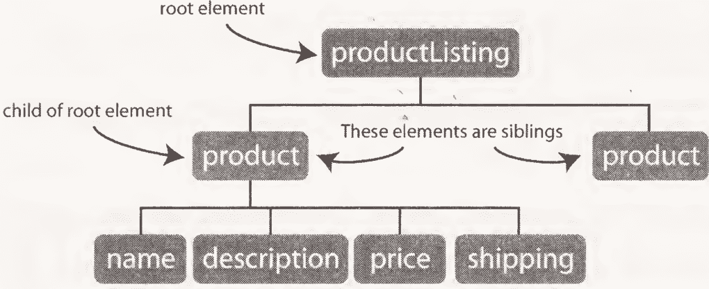

所有这些元素都是彼此的兄弟节点，并且是上方 `product` 元素的子节点。

由于我们拥有的是一棵树，我们应该能够相对容易地在其中向上、向下以及左右移动。从程序化的角度来看，你对 XML 的大部分工作将集中在正确地创建和导航 XML 结构上。

关于分级树，还有最后一点需要你注意。之前，我们谈到了如何通过添加上下文将数据转换为信息。那么，当我们开始构建表示自然关系的层次化信息（称为分类法，taxonomies）时，我们向向知识的跨越迈出了巨大的一步。这句话本身就可以写另一整本书了，所以我们先就到此为止，继续下去吧！

## 格式问题

在本章的早些时候，我提到 XML 允许你将信息与演示分离。我还提到可以使用其他技术，如 CSS（级联样式表）和 XSLT（扩展样式表转换），使信息在不同的上下文中显示。

> 注意，在 XSLT 中，它是“stylesheets”（样式表），但在 CSS 中是“style sheet”（样式表）！为了一致起见，我们在书中将它们统称为“style sheets”（样式表）。

在随后的章节中，我将详细介绍 CSS 和 XSLT，但我想在这里简要地说明一点。由于我们花了时间创建了 XML 文档，我们的信息不再被锁定在文字处理器或电子表格等专有格式中。此外，每你想创建该信息的替代显示时，都不再需要“重新创建”它：你只需要创建一个样式表或转换，让你的 XML 在给定的媒介中呈现出来。

例如，如果你将信息存储在文字处理程序中，它将包含所有关于其在打印页面上显示方式的各种信息——大量的加粗、字体大小和表格。遗憾的是，如果文档还必须作为 HTML 文档发布到网络上，就有人必须对其进行转换（手动或通过软件）、清理和测试。然后，如果其他人对原始文档进行了更改，这些更改将不会反映到 HTML 版本中。如果另一个人想获取这些信息并将其用于幻灯片演示，他们可能会面临使用 HTML 版本中过时信息的风险。即使他们将正确的信息放入了演示稿中，你仍然需要跟踪信息存在的三个位置。如你所见，这可能会变得非常混乱！

现在，如果相同的信息存储在 XML 中，你可以创建三个不同的 XSLT 文件，将 XML 转换为 HTML、幻灯片演示以及如 PostScript 这样便于打印的格式。如果你对 XML 文件进行了更改，一旦你将 XML 文件通过该过程，其他文件也会自动更改。（顺便说一下，这种概念是单源性（single-sourcing）的核心组成部分——即对于任何在另一个应用程序中重用的信息都有一个“单一源”。）

如你所见，将信息与演示分离使得你的 XML 文档具有可重用性，并且需要在存储、处理、操作和交换大量信息的环境中，可以节省烦恼和头疼的问题。

这是另一个例子。这本书实际上将存储为 XML（使用 DocBook 架构）。这意味着出版商可以为其网站生成 PDF，为打印机制作准备好打印的文件，并可能在未来创建电子书。所有格式都将从同一个源生成，并且都将使用不同的样式表来处理基础 XML 文件。

## 良好性与有效性

我们已经讨论了一部分 XML、它的用途、外观、如何概念化它以及如何转换它。

## 在 Internet Explorer 中查看原始 XML

如果你在机器上安装了 5 或更高版本的 Internet Explorer，你可以查看新创建的 XML 文件。如图 1.2 所示，Internet Explorer 仅仅将 XML 文件显示为一系列缩进的节点。

### 图 1.2。在 Internet Explorer 中查看 XML 文件。

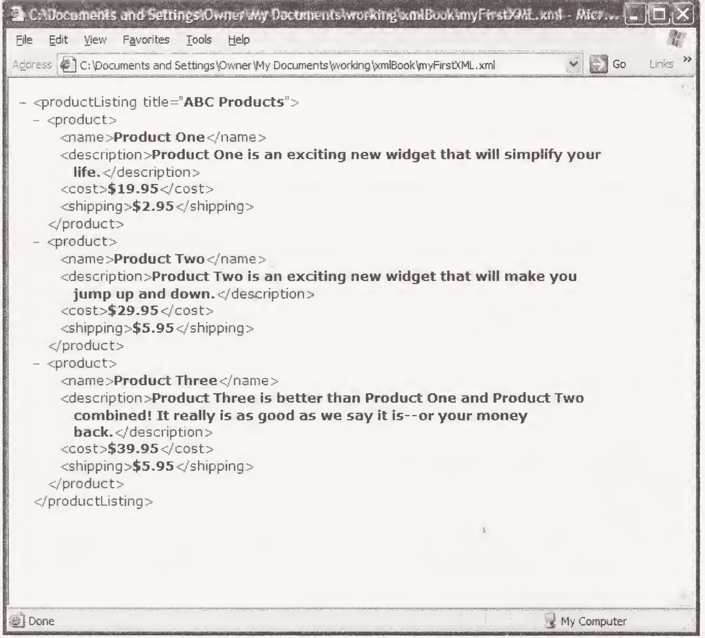

注意到某些 XML 节点旁的小减号了吗？节点前面的减号表示该节点包含其他节点。如果你点击减号，Internet Explorer 将将折叠属于该节点的所有子节点，如图 1.3 所示。

### 图 1.3. 在 Internet Explorer 中显示的折叠节点

```xml
C:\Documents and Settings\Owner\My Documents\working\xmlBook\myFirstXML.xml - #cr...
File Edit View Favorites Tools Help
Address C:\Documents and Settings\Owner\My Documents\working\xmlBook\myFirstXML.xml Go Links  

<productListing title="ABC Products">
  <product>
    <name>Product Two</name>
    <description>Product Two is an exciting new widget that will make you
    jump up and down.</description>
    <cost>$29.95</cost>
    <shipping>$5.95</shipping>
  </product>
  <product>
    <name>Product Three</name>
    <description>Product Three is better than Product One and Product Two
    combined! It is really as good as we say it is--or your money
    back.</description>
    <cost>$39.95</cost>
    <shipping>$5.95</shipping>
  </product>
</productListing>
```

第一个产品节点旁的小加号表示该节点有子节点。点击加号将展开该特定节点下的任何节点。通过这种方式，你可以轻松地显示你想要关注的文档部分。

现在，用任何文本编辑工具打开你的 XML 文档，并滚动到第二个产品的 `cost` 节点。我们感兴趣的行内容应该是：

```xml
<cost>$29.95</cost>
```

将起始标签上的“c”大写，使得该行看起来如下：

# 第 1 章：XML 简介

```xml
<Cost>$29.95</cost>
```

保存你的工作并重新加载 Internet Explorer。你应该会看到类似于图 1.4 所示的错误消息。

## 图 1.4. 在 Internet Explorer 中显示的错误消息。

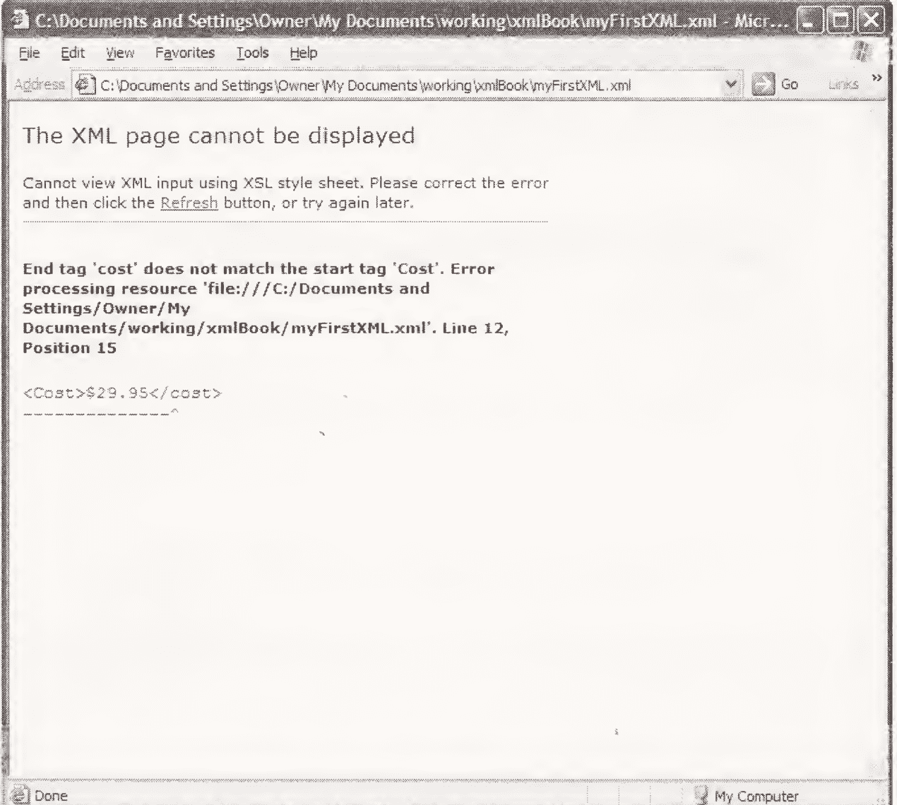

无法显示 XML 页面

无法使用 XSL 样式表查看 XML 输入。请修正错误后点击刷新按钮，或稍后重试。

结束标签 'cost' 与起始标签 'Cost' 不匹配。处理资源 'file://C:/Documents and Settings/Owner/My Documents/working/xmlBook/myFirstXML.xml' 时出错。第 12 行，位置 15

```xml
<Cost>$29.95</cost>
```

如你所见，Internet Explorer 对它遇到的错误提供了一个相当详细的解释：结束标签 `</cost>` 与起始标签 `<Cost>` 不匹配。

此外，它还提供了违规行的良好视觉效果，有一个小箭头指向解析器认为问题发生的地方。

```xml
<Cost>$29.95</Cost>
```

尽管问题实际上出在起始标签上，但箭头指向了结束标签。因为 Internet Explorer 默认使用非验证性解析器（记住，这意味着它只关注格式良好的规则），它在结束标签处遇到了问题。你现在必须回溯以找到为什么那个特定的结束标签导致了这样一个问题。一旦你掌握了这种调试方法，你就会发现它对追踪问题非常有帮助。

让我们引入一个稍微复杂一点的问题。再次在编辑器中打开你的 XML 文档，修复我们上面引入的问题。然后，转到文档倒数第二行（内容应该是 `</product>`），并在其前面添加一个 `<product>` 标签。保存你的工作并重新加载浏览器。

你应该会看到与图 1.5 所示类似的错误消息。

## 1.5. 调试更复杂的错误。

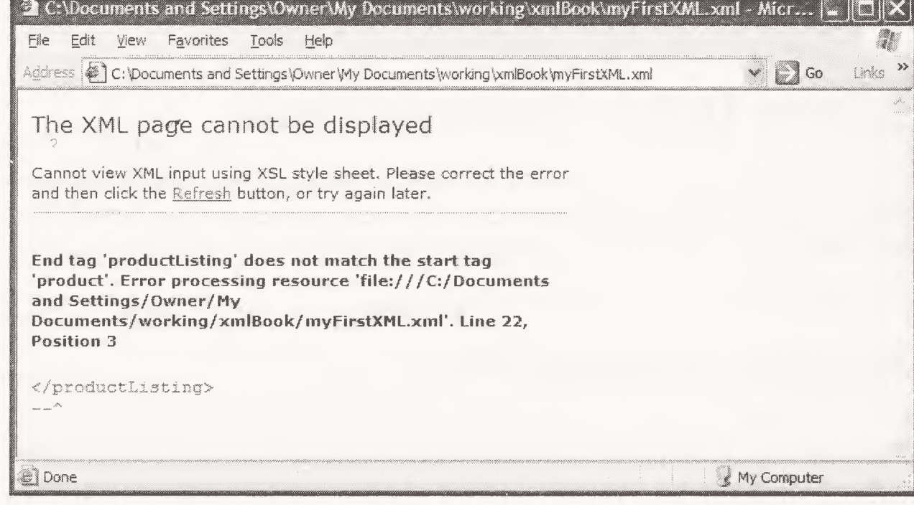

乍一看，这个错误消息似乎比上一个更晦涩一些。首先，这条消息似乎指示 `</listing>` 结束标签有问题。然而，仔细观察你看到了什么？它说 `</listing>` 结束标签与 `<product>` 起始标签不匹配。这正是问题所在！有人引入了一个 `<product>` 起始标签但没有正确关闭它。

我包含这个例子是因为错误的嵌套是 XML 文档中常见的常见的错误之一。这种错误可能是微妙且难以发现的，特别是当你正在进行大量编辑，或者你的文档复杂或很长时。

## 在 Firefox 中查看原始 XML

你也可以使用 Firefox（以及其他 Mozilla 浏览器，如 Netscape 8）查看你的 XML 文件。Firefox 是一个流行的开源浏览器，在本书想要打印最新版本时，该版本是 1.0.4。你可以从 Mozilla 网站下载免费副本。

在 Firefox 中查看原始 XML 基本上与在 Internet Explorer 中相同，所以你可以从图 1.6 中看到。

Firefox 内置的解析器是非验证的，但令人安慰的是 Mozilla 的朋友们计划在未来的版本中添加验证解析器。

## 使用验证解析器的选项

好的，Internet Explorer 和 Firefox 都会检查 XML 是否格式良好，但你需要参考来检查文档是否有效（即符合 DTD）。

## 使用在线验证解析器

有时，由于连接、隐私或安全问题，可能无法使用网站来验证 XML。在这些情况下，下载一个解析器是个好主意。

- 如果你熟悉 Perl，可以使用 CPAN 中的任何模块。

- 如果你熟悉 C++ 或 Visual Basic，可以尝试一下 MSXML。

## 图 1.6. 在 Firefox 中查看原始 XML。

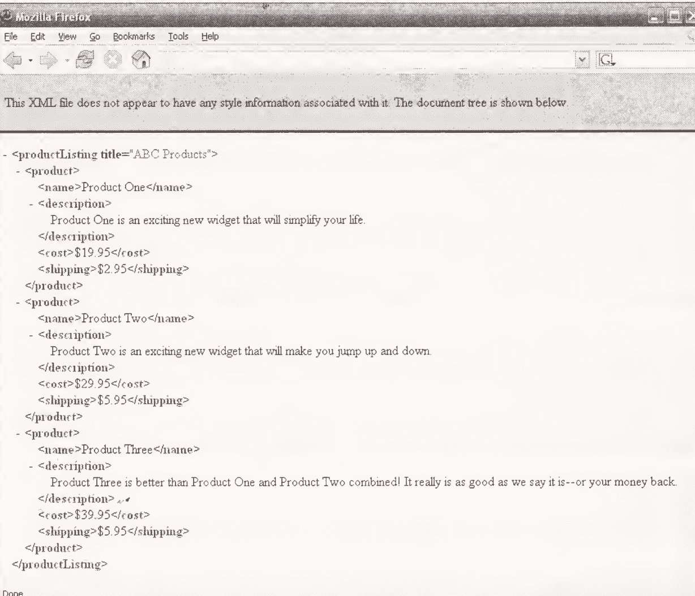

此 XML 没有任何样式信息。文档所示：

```xml
<productListing title="ABC Products">
  <product>
    <name>Product One</name>
    <description>Product One 是一个令人兴奋的新组件，将简化你的生活。</description>
    <cost>$39.95</cost>
    <shipping>$5.95</shipping>
  </product>
  <product>
    <name>Product Two</name>
    <description>Product Two 是一个令人兴奋的新组件，将让你跳来跳去。</description>
    <cost>$29.95</cost>
    <shipping>$5.95</shipping>
  </product>
  <product>
    <name>Product Three</name>
    <description>Product Three 比 Product One 和 Product Two 加起来还要！它真的如我们说的那样——否则退款。</description>
    <cost>$39.95</cost>
    <shipping>$5.95</shipping>
  </product>
</productListing>
```

# 第 1 章：XML 简介

IBM 提供了一个名为 XML4J 的非常好的解析器。只需下载包并按照说明安装即可。但警告的是，你必须了解一些 Java 工具和文件才能安装它。

## 使用 Dreamweaver

Dreamweaver 不仅仅是一个创建 Web 页面的工具；它还是一个为感兴趣的 Web 开发者提供一套开发工具的集成开发环境（IDE）。

Dreamweaver 功能之一是其内置的 XML 验证器。它在没有 DTD 时检查格式性，在指定了 DTD 时检查格式性和有效性。如果你没有 Dreamweaver，可以获取一个试用版本。

要验证 XML 文档，在 Dreamweaver 中选择 File > Check Page，然后选择 Validate as XML。验证结果将出现在 Results 区域，如图 1.7 所示。

## 图 1.7. Dreamweaver MX 的验证 XML 解析器。

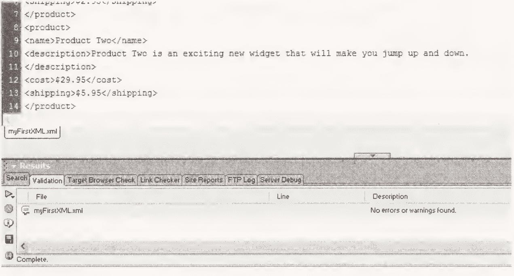

```xml
<product>
  <name>Product Two</name>
  <description>Product Two 是一个令人兴奋的新组件，将让你跳来跳去。</description>
  <cost>$29.95</cost>
  <shipping>$5.95</shipping>
</product>
```

## 如果我无法获得验证解析器怎么办？


如果你能获得一个验证解析器，请不要恐慌。对于大多数用途来说，在线资源就能很好地完成任务。如果你在一家拥有成熟软件开发群组的公司工作，那么很有可能某位精通 XML 的开发者已经设置好了一个良好的验证解析器。

关于我们在本书中将处理的内容管理系统？嗯，在接近项目末尾之前，我们都不需要验证 XML 文档。届时，我们将开始处理 Web 服务，并弄清楚如何从全球范围内的组织接收（以及向其发送）XML 内容。

## 开始我们的 CMS 项目

现在我们已经引入了 XML，并尝试了一些文档和解析器，是时候开始我们的项目了。在整本书中，我们将花费时间来构建一个由 XML 驱动的网站。具体来说，我们将构建一个由 XML 驱动的内容管理系统。这个项目将帮助你在获得实用 XML 开发技术、问题和流程的第一手经验，从而巩固你的技能。

## 那么……什么是内容管理系统？

内容管理系统（简称 CMS）是一种服务器端软件，用于在网站上轻松、高效地创建、发布和维护内容。它通常由以下组件组成：

- 数据后端（由 XML 或数据库表组成），包含你所有的文章、新闻故事、图片和其他内容。
- 数据显示组件——通常是模板或其他页面——CMS 将你的文章、图片等“涂绘制”在这些页面上，以供网站访问者查看。
- 数据管理组件。这通常由易于使用的 HTML 表单组成，允许网站管理员在某种安全的工作流中创建、编辑、发布和删除文章。CMS 的数据管理部分通常是最复杂的，而这很可能是你将花费大部分开发时间处理的章节。

# 第 1 章：XML 导论

在过去的十年里，CMS 是使用各种不同的脚本语言创建的，包括 Perl/CGI、ASP、TCL、JSP、Python 和 PHP。这些语言每种都有自己的优缺点，但我们将使用 PHP 配合 XML 来构建我们的 CMS。

## 需求收集

在构建任何类型的 CMS 之前，你必须首先收集定义项目基本需求的信息。

CMS 的目标是让那些需要开发和运行网站的人工作得更轻松。而让事情变得更容易意味着在之前必须做更多的功课！尽管你可能对这种练习感到厌烦，但一组定义良好的需求可以使项目运行得顺畅得多。

我们需要收集什么样的需求？本质上，需求分为三大类：

- CMS 将处理什么类型的内容？每种类型的内容是如何拆细的？（你对这个问题的理解越完整，创建和管理你的 XML 文件就越容易。）
- 谁会访问该网站，这些用户期望找到哪些功能？（例如，他们是想浏览分级文章列表、通过关键词搜索文章、查看相关文章的链接，还是三者兼有？）
- 网站管理员需要做什么？（例如，他们可能需要安全登录、创建内容、编辑内容、发布内容和删除内容。如果你的 CMS 将为管理用户提供不同的角色——例如网站管理员、编辑和作者——那么你的系统将变得更加复杂。）

如你所见，我们仅仅触及了皮毛，但已经发现了许多需要解决的问题。让我们一个一个来解决。

## CMS 内容与元数据

如果你打算构建一个内容管理系统，逻辑上可以预见你会想要把内容放进里面。然而，这并不总是那么容易！

在我参与过的几十个 CMS 项目中，最常见的失败是：大多数真正花时间考虑内容的公司只考虑了一件事：“文章！”我不完全清楚为什么，我敢推测文章是大多数人在阅读报纸、杂志或网站时所接触到的内容，所以它是脑海中想到的第一个也是唯一的内容类型。

但如果你想构建一个实用的 CMS，你就必须跳出“文章”的框架，更清晰地定义你的内容类型。有一整类内容需要管理：PDF、图片、新闻故事、多媒体演示文、用户对白皮书/PDF 的评论，等等，更多更多。在 XML 的世界里，这些每种不同类型的内容理所当然地被称为“文档类型”。

我看到的第二个常见失败是，无法成功说服网站所有者内容意味着不仅仅是“文章”。更难的是要说服他们，如果你想成功构建他们的 CMS，你就必须对每种内容类型都有尽可能深入的了解。

仅仅知道你将提供 PDF 文件、新闻故事、图片等是不够的。你还必须知道这些内容中的每种将如何拆分为各个独立的组件或“元数据”。元数据意味着“关于数据的数据”，对 CMS 开发人员来说极其有用。例如，每篇文章都将有各种元数据，如标题、作者名和关键词，CMS 需要跟踪其中的每一项。

理解内容类型元数据的唯一方法是对其进行研究——换句话说，对自己和他人就该部分内容提出大量问题。

最后的挑战——定义各种类型的元数据——可能是一种不经而得的福。根据我的经验，一旦人们掌握了元数据的重要性，他们就会四处奔波，收集他们在给定每种内容类型中找到的每一条元数据。通常，我们开发者最终会得到一些非常没用且永远不会被使用的随机碎片化信息。例如，客户可能会开始跟踪文章首次草拟的日期。在大多数情况下，这是不重要的信息——读者显然不在乎！

显然，寻找正确的元数据类型很重要，比如这些：

### 溯源元数据

谁创建了内容？首次发布是什么时候？什么时候应该自动从网站移除或归档？该文档在系统中如何被唯一标识？谁拥有它的版权？

### 组织/管理元数据

如果你对内容使用分类列表，那么每件内容将位于该分类系统的什么位置？它与哪些其他内容相关？哪些关键词用于描述内容以便索引或搜索（换句话说，我们如何找到这些内容）？谁应该有权访问内容（公众、仅订阅者或公司员工）？

### 物理/结构元数据

内容是 ASCII 文本、XML 代码段，还是像 PDF 或图像这样的二进制文件？如果是文件，它位于服务器的何处？MIME 类型是什么？

### 描述性元数据

如果是一篇文章，标题是什么？CMS 是否将文章正文与标题和段落分开，还是将所有这些项视为一个整体 XML？

收集元数据可能非常棘手。让我们来看一个看似简单的问题：处理关于作者的元数据。最初我们可以说所有的文章都包含姓名和电子邮件地址元素，到此为止。然而，我们后来可能决定让游客按作者搜索或浏览文章。在这种情况下，拥有一个中心化的作者列表（每个人都有唯一的 ID）会更合理。这可以避免因为文章中输入方式不同而导致 Tom Myer 和 Thomas Myer 被视为“独立的”。

独立的作者列表还允许我们轻松为每个作者设置签名。它还允许我们跨内容类型跟踪作者信息。例如，我们可以知道特定作者是否写过文章、撰写过评论或上传过文件。当然，同意这种方法意味着我们以后需要进行其他工作，例如为作者列表构建管理界面。

一旦确定了给定内容类型的元数据，就可以处理下一种内容类型。最终，你将对网站支持的所有内容类型有一个清晰的认识。

所有这些活动的目的是？嗯，只需将元数据视为你的驱动 CMS 三支柱之一。（另外两根是网站功能和网站设计。在许多情况下，元数据影响这两者，从而影响用户对网站的体验。）

优先级，但每条元数据也必须由你设置的管理工具进行管理。

## 网站行为

网站行为应该始终基于元数据（并由元数据驱动）。例如，如果你正在为所有文章收集关键词，你应该能够为你的网站构建一个关键词驱动的搜索引擎。如果你没有收集关键词信息但想要一个关键词驱动的搜索引擎，你最好备份并想办法如何向你的内容类型添加这些信息。

由 CMS 驱动的网站的典型行为包括：按内容分类浏览、按作者浏览、搜索标题和关键词、动态新闻侧边栏。此外，许多由 XML 和数据库驱动的网站还具有首页功能，可以显示动态更新的内容，例如前十名下载、最新新闻标题等。

## CMS 管理

CMS 需要为每种内容类型拥有一个管理组件。它还必须管理与内容类型无关的信息，例如授权登录 CMS 的用户以及他们每个人的权限。

不言而喻，你的管理界面必须是安全的，否则任何人都可以点击你的 CMS 并开始删除内容、对现有内容进行未经授权的更改，或添加你可能不希望在网站上出现的新内容。

在涉及多个人或一个部门通过 CMS 发布内容时，你需要考虑工作流。工作流简单来说是一组规则，允许你定义谁在何时、如何做什么事。例如，你的工作流可能规定，具有编写权限的用户可以创建文章，但只有制作编辑才能批准内容发布到网站上。

在许多情况下，CMS 工作流模拟了出版和营销部门中实际的实际工作流。由于我们处理的是 XML，我们有一个极好的机会构建一个模块化且足够灵活的工作流系统，以考虑到不同的需求。

## 定义你的内容类型

我们希望在网站上发布文章和新闻故事。我们确实想跟踪作者和网站管理员，还想构建一个搜索引擎。我们还需要记录网站每个页面上的所有文案，以及作为图像和 PDF 的二进制文件。这是一项大量的工作！现在，让我们先逐步定义一个文章类型吧。

你可能会问：“我们为什么要折腾内容类型呢？”对于开发者来说，这似乎是一件愚蠢的事，但实际上是构建由 XML 驱动的网站最重要的任务。当我构建应用程序时，我会尝试先定义内容类型，因为我发现所有其他元素都是由此衍生的。由于我们已经花了一些时间讨论 XML 文档的结构，并为存储在系统中的文档收集了需求，让我们直接开始定义我们的文章内容类型吧。

## 文章

我们 CMS 中的文章将是我们网站的主体。除了文章文本外，我们的每篇文章都将赋予以下这些元数据：

- 一个唯一标识符
- 一个标题
- 一个简短描述
- 一个作者
- 关键词列表
- 出版日期（记录文章上线的时间）
- 它的状态

我们的文章内容类型需要一个包含所有其他元素的根元素；我们可以使用 `<article>` 作为该元素。这不仅从“保持简单”的角度来看是有意义的，在语义上也是合适的。

此外，由于通过某种 ID 唯一地标识系统中的每篇文章，因此在根元素上添加一个包含此值的 `id` 属性是合理的。唯一标识符将确保我们在尝试编辑、删除或查看现有文章时不会发生错误。

现在，我们的每篇文章都有一个作者，所以我们需要为该信息留出一个位置。实现这一点的方法有几十种，但我们现在采用最简单的方法：

```xml
<article id="123">
  <author>Tom Myer</author>
</article>
```

## 在寻找 DTD 吗？


在第 3 章中，我们将详细讨论文档类型定义 (DTD)——构建 XML 文件结构规则的传统手段。现在，认为在我们已经选择的地方继续我们的讨论更有意义。

我们的文章需要一个标题、一个简短描述、一个出版日期和一些关键词。`<headline>` 非常简单——它可以是嵌套在 `<article>` 元素下的自己的元素。同样，`<description>` 和 `<pubdate>` 元素也嵌套在 `<article>` 下。

关键词列表可以通过两种方式之一处理。你可以在 `<article>` 中创建一个 `<keywords>` 元素，它本身可以包含许多 `<keyword>` 项：

```xml
<article id="123">
  <author>Tom Myer</author>
  <headline>创建一个 XML 驱动的 CMS</headline>
  <description>这篇文章将向你展示如何创建一个
XML 驱动的内容管理系统</description>
  <pubdate>2004-01-20</pubdate>
  <keywords>
    <keyword>XML</keyword>
    <keyword>CMS</keyword>
  </keywords>
</article>
```

这种方法会满足那些结构痴迷者，但事实对于我们最终使用这些关键词的方式来说太复杂了。事实证明，你只需要将关键词列在单个 `<keywords>` 元素中即可：

```xml
<article id="123">
  <author>Tom Myer</author>
  <headline>创建一个 XML 驱动的 CMS</headline>
  <description>这篇文章将向你展示如何创建一个
XML 驱动的内容管理系统</description>
  <pubdate>2004-01-20</pubdate>
  <keywords>
    <keyword>XML</keyword>
    <keyword>CMS</keyword>
  </keywords>
</article>
```

（注：提示中关于第 50-51 页的 OCR 文本高度重复，已根据提供的片段进行了逻辑上的合并。）

## 管理工具的需求收集

让我们简要讨论一下管理工具。以下是该项目的一些管理需求：

- 所有的 CMS 用户必须登录管理工具。为管理员设置的所有密码在存储之前都会被加密。
- 每种内容类型都将有自己的页面，用户可以通过该页面列出、添加、编辑和删除单个内容项。
- 作者和管理员的情况也是如此。如果你查看作者列表，CMS 将显示该人员创作的所有内容。
- CMS 将提供一种简便的方法来更新网站上每条内容的状态、关键词和其他细节。管理员将能够按照状态或内容类型对这些信息进行分组。

太棒了——这些细节足够让我们开始工作了！

## 总结

在第一章中，我们讨论了基本的 XML 概念，探讨了需求收集过程的重要性，并进行了分析，从而为我们基于 XML 的 CMS 定义了内容类型和应用需求。

在下一章中，我们将深入探讨 XML，涵盖基础的 XSLT 和 XPath 等主题。我们将亲手实践一些 XSLT，并开始考虑如何在我们由 CMS 驱动的网站上显示文章。

# 第 2 章：实践中的 XML

上一章介绍了 XML 的一些基本概念，并让我们开始了 CMS 项目。在本章中，我们将深入挖掘 XML，讨论命名空间、XHTML、XSLT 和 CSS。在此过程中，我们将会有几次机会让 XML 发挥作用。

## 认识这个家族

在第一章中，我们学习了一些关于 XML 结构以及你可以用它做什么的知识。我在那一章中的目标是向你们展示 XML 实际上有多么灵活。

在本章中，我想稍微拉远视角，向你们介绍组成 XML “技术家族”的一些奇怪的兄弟姐妹。尽管我在这里会列出许多工具和技术，但我们在本章中只涵盖其中几个。我们将在后面的章节中探索其他一些，但有些将完全不会涉及（抱歉，如果我们给每项内容都留相等的空间，这本书将会变得非常长且无聊）。

### XSLT

XSLT 代表可扩展样式表语言转换。它既是一种样式表规范，一种编程语言，允许你将 XML 文档转换为你选择的格式：纯的 ASCII 文本、HTML、RTF、XSLT 概念；甚至其他 XML 的方言。在本章中，你将接触这些内容；在书的后面，我们将更深入地探索它们。XSLT 使用 XPath 和其他几种技术来完成工作。

### XPath

XPath 是一种用于定位和处理 XML 文档中节点的语言。因为每个 XML 文档根据定义就是一个层级结构，因此以逻辑、正式的方式导航这种结构（即遵循路径）就变得可能。

### DTD 和 XML Schema

文档类型定义（DTD）是一组规则，规定了元素使用的顺序以及每个元素可以包含的信息类型。XML Schema 是一个较新的标准，其功能扩展了 DTD。虽然 DTD 仅只能对元素的排序和包含关系提供通用的控制，但 Schema 要具体得多。例如，它们允许元素只出现特定次数，或者要求元素包含特定类型的数据（如日期和数字）。

这两种技术都允许你为 XML 文档的内容设置规则。如果你需要与另一组共享 XML 文档，或者你必须依赖从他人那里接收良好的 XML，这些技术可以帮助确保你的特定规则被正确遵守。我们将在第三章中带着极大的关注来探索这两种技术。

## XML 命名空间

XML 允许你定义自己的元素的能力提供了灵活性和范围。但它也产生了一种强可能性：当合并不同来源的 XML 内容时，你可能会遇到相同元素名称具有完全不同用途而导致的代码冲突。例如，如果你在经营一家书店，你在 XML 中使用的 `<title>` 标签可能用于跟踪书名。贷款经纪人会以不同的方式使用 `<title>`——也许是为了跟踪院长的头。牙医或医生可能会在他们的医疗记录中使用 `<title>`。尝试将这三类信息合并到一个系统（甚至一个文档）中，你将很快看到问题的产生。

命名空间试图将相同 XML 元素的不同语义用法分开并消除歧义。在我们的示例中，每个人都可以定义自己的命名空间，然后在特定标签前加上命名空间名称：`<book:title>` 不同于 `<broker:title>` 和 `<medrec:title>`。顺便说一下，命名空间是让 XSLT 和 XSD 起作用的技术之一。

## XHTML

XHTML 代表扩展超文本标记语言。从技术上讲，它是 HTML 4.01 作为 XML 应用的重构，不属于 XML 技术家族。为了防止你的大脑完全崩溃，最简单的方法是将 XHTML 视为一种 HTML 标记标签的标准，它遵循我们之前涵盖的所有 XML 良好性。

你可能会问，这有什么意义？嗯，世界上有海量的网站已经在使用 HTML。任何清醒的人都不可能合理地期望它们在一夜之间切换到 XHTML。我们可以预计，其中一些页面——以及很大比例的新页面——将由于这些技术实现过渡，因为这些技术是开放的（这意味着某些想法需要很长时间才能成熟并倾向于由委员会构建，同时也意味着没有单一供应商可以完全控制它）。正如玛莎·斯图特可能会说的，这是一件好事。

## 深入观察 XHTML

想象你正在参加鸡尾派，有人问你：“好吧，XHTML 到底是什么？”你需要告诉他们一些东西（除此之外）。“嘿，我正试着放松呢！你怎么说？不确定？我也这么想。因为这是一本关于 XML 而不是 XHTML 的书，而且市上有许多关于 XHTML 的优秀书籍，我不想在这里过多讨论该技术的细节。然而，我觉得具备关于 http://www.w3.org 的基础知识对你很有帮助，并将有助于加强我们已经介绍的概念。

所以，回到我们的鸡尾派。以下是你在那种情况下可能给出的回答：

- XHTML 代表扩展超文本标记语言。
- XHTML 的设计是为了取代 HTML。
- XHTML 使用 HTML 4.01 标签集，但使用 XML 语法编写。
- XHTML 是 HTML 的更严格、更整洁的版本。

为什么我们需要 XHTML？嗯，直率地说，Web 已经达到了一个程度，对于 HTML 文档来说，任何东西都可以接受。看看下面的代码片段：

```html
<html><title>我的示例</title>
<h1>你好</h1>
```

信不信，这个代码片段在大多数 Web 浏览器中都会无问题地渲染。这个片段也是如此：

```html
<p><b><i>你好</i></b></p>
```

这个（片段）也是如此：

```html
你好
```

我不想开始某场关于 HTML 结构的十字军运动，但嘿，够了！网页表示的是结构化信息，所以请，让我们保持某种形式的结构！从最基础的说，XHTML 设计目的是在混乱的 HTML 世界和更严格的 XML 结构之间建立某种桥梁。

很简单！但，这到底意味着什么呢？嗯，如果你还记得我们在第一章中关于良好的 XML 文档的内容，你就可以做出非常合理的推测：

1. XHTML 文档必须包含一个根元素，该元素包含所有其他元素。（在大多数情况下是 `html` 元素！）
2. XHTML 元素必须正确嵌套。

```html
<p>This is a <b>sentence.</b></p>
```

3. 所有 XHTML 元素必须有闭合标签（即使是空标签）：

```html
<br />
<td></td>
```

### 不要破坏向后兼容性

旧版浏览器（如 Netscape 4）不识别 XML 语法，会被像 `<br/>` 这样的自闭合标签所困扰。通过简单在斜杠之前添加一个空格（`<br />`），你就可以确保这些浏览器忽略斜杠并正确解释标签。

4. 所有的 XHTML 属性值必须放在引号之间。

```html
<input type="button" name="submit" value="click to finish" />
```

5. 所有的 XHTML 元素和属性名称必须使用小写字母。

```html
<tr valign="top">
```

6. 每个 XHTML 文档在顶部必须有一个 DOCTYPE 声明。

```xml
<!DOCTYPE html PUBLIC "//W3C//DTD XHTML 1.0 Transitional//EN"
  "http://www.w3.org/TR/xhtml1/DTD/xhtml1-transitional.dtd">
<html xmlns="http://www.w3.org/1999/xhtml">
```

三种 XHTML DOCTYPE：

**Strict（严格型）**
配合 CSS 使用以减少显示上的杂乱。事实上，Strict DOCTYPE 明确禁止使用 HTML 的显示标签。

```xml
<!DOCTYPE html
 PUBLIC "//W3C//DTD XHTML 1.0 Strict//EN"
  "http://www.w3.org/TR/xhtml1/DTD/xhtml1-strict.dtd">
```

**Transitional（过渡型）**
用于利用 HTML 的显示特性，或者当你支持不支持 CSS 的浏览器时使用。

```xml
<!DOCTYPE html
 PUBLIC "//W3C//DTD XHTML 1.0 Transitional//EN"
  "http://www.w3.org/TR/xhtml1/DTD/xhtml1-transitional.dtd">
```

**Frameset（框架型）**
当你使用框架来划分屏幕时使用此。

```xml
<!DOCTYPE html
 PUBLIC "//W3C//DTD XHTML 1.0 Frameset//EN"
  "http://www.w3.org/TR/xhtml1/DTD/xhtml1-frameset.dtd">
```

## 一个极简的 XHTML 示例

这是一个说明了上述规则的非常简单的文档：

```xml
<!DOCTYPE html PUBLIC "//W3C//DTD XHTML 1.0 Transitional//EN"
  "http://www.w3.org/TR/xhtml1/DTD/xhtml1-transitional.dtd">
<html xmlns="http://www.w3.org/1999/xhtml">
<head>
<title>A simple XHTML document</title>
<meta http-equiv="content-type"
  content="text/html; charset=iso-8859-1" />
</head>
<body>
<p>这是一个简单的段落，其中包含一个格式正确的 <br />
换行符和一些 <b>正确嵌套的<i>i</i></b> 格式化。</p>
<div></div>
</body>
</html>
```

关于 XHTML 的信息暂时足够了。让我们继续讨论命名空间和 XSLT。

## XML 命名空间

XML 命名空间的发明是为了解决一个常见问题：使用相同元素名称表示不同数据的文档之间的冲突。

让我们回顾本章引言中的一个命名空间示例。假设你正在经营一家书店，并有一个库存文件（自然地称为 `inventory.xml`），在其中你使用 `title` 元素来存储书名。另外要说——尽管听起来不太可能——但你的 XML 文档与一个抵押贷款经纪的主记录文件混合在了一起。在这个文件中，经纪人使用 `title` 来存储关于物业法律所有权的信息。

人类可能能够看出其中一个 `title` 与另一个毫无关系，但尝试对其进行排序的应用程序会疯掉。我们需要一种方法来区分这些相同元素所存在的两个不同的语义世界。

让情况更模糊一些：假设你的书店里有一个 `inventory.xml` 文件，使用 `title` 元素存储书名，另一个独立的 `sales.xml` 文件也使用 `title` 元素存储相同的信息，但处于完全不同的上下文。你的库存文件存储的是书架上书籍的信息，而销售文件存储的是客户购买的书籍信息。

在任何情况下，无论这些相同术语的语境之间存在怎样的混乱，我们都需要一种方法来正确标记每个语境。

命名空间来救援！XML 命名空间允许你基于 URI（统一资源标识符）创建一个唯一的命名空间，为该命名空间赋予映射，并将该映射应用于 XML 文档元素。

## 声明命名空间

要使用和声明命名空间，我们必须首先将命名空间绑定到 URL。注意，我没有说 URL——一个你可以访问的特定位置（尽管 URI 可以是 URL）。URI 仅仅是区分一个事物（例如 XML 文档标准）与另一个事物的唯一标识符。URI 可以采取以下形式：

- 统一资源定位符（URL）：一种特定的协议、机器地址。
- 统一资源名称（URN）：一种持久的名称，不指向具体位置。
- 统一资源标识符（URI）：上述两者的统称。

## 使用 CSS 在浏览器中显示 XML

在浏览器中显示 XML 最强大的工具是 XSLT 和层叠样式表（CSS）。因为对于新手来说，XSLT 是一项相当棘手的任务，所以我决定先让你们练习练习 CSS！

使用 CSS 的第一步是创建一个基础的 XML 文件：

```xml
<?xml version="1.0"?>
<letter>
  <to>Mom</to>
  <from>Tom</from>
  <message>Happy Mother's Day</message>
</letter>
```

就 XML 文档而言，这个文件可以简单得多，但没必要把事情搞得过于简单。此文档包含一个根元素（letter），其中包含三个其他元素（to、from 和 message），每个元素都包含文本。

现在，我们需要添加一个样式表声明，指向我们即将创建的 CSS 文档。要将 CSS 样式表与 XML 文件关联，请使用 `<?xml-stylesheet?>` 指令：

```xml
<?xml-stylesheet type="text/css" href="letter.css"?>
```

最后，我们编写 CSS 文件，确保为 XML 文件中的每个元素都提供样式：

```css
letter {
  display: block;
  margin: 10px;
  padding: 5px;
  width: 300px;
  height: 100px;
  border: 1px solid #000000;
  overflow: auto;
  background-color: #cccccc;
  font: 12px Arial;
}
to, from {
  display: block;
  font-weight: bold;
}
message {
  display: block;
  font: 11px Arial;
}
```

当你显示 XML 文档时，你应该能看到类似于图 2.1 的内容。

## 图 2.1. 在 Internet Explorer 中查看 CSS 结果。

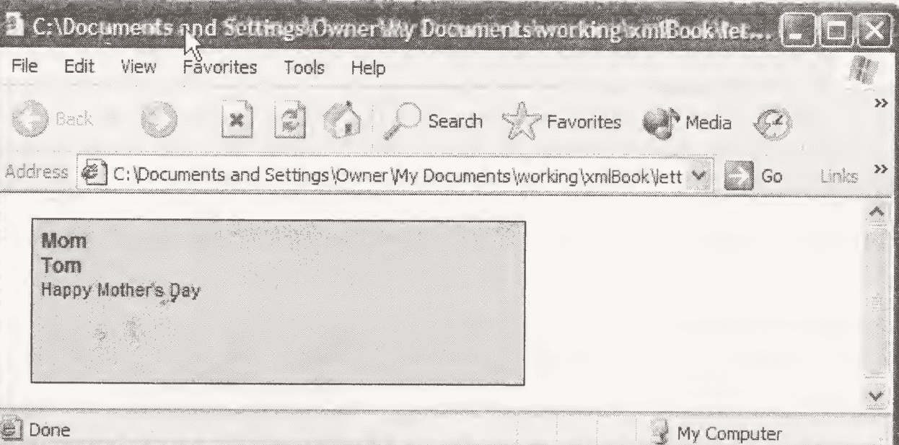

如你所见，CSS 在整个信件周围渲染了一个带有精美阴影的框，设置了字体，甚至显示了如外边距和内边距之类的内容。然而，它不允许我们向输出内容中添加特定的文本。例如，我们可以在 `to` 元素中的任何文本前面加一个“To:”。如果你想拥有那种能力，你将需要使用 XSLT。

> 严格来说，CSS 标准允许通过 `content` 属性实现这种功能，它可以在文档元素前后生成生成的文本。然而，许多浏览器并不支持该属性，即使是支持的浏览器，其灵活性也远无法及 XSLT。

## 了解 XSLT

正如我在本章开头提到的，XSLT 是一项用于可扩展样式表语言转换的工具。将其看作是一个你可以将 XML 文档转换为其他文档的工具。以下是一些可能性：

- 将 XML 转换为 HTML 或原始 ASCII 文本。
- 将 XML 转换为 XSLT 的其他变体。
- 提取所有标记为西班牙语、法语或德语的段落，以创建 XML 文档的外语版本。

不错——而且我们才刚刚触及皮毛！

XSLT 是一种基于规则的或函数式的语言。它不像其他编程语言（例如 PHP 或 JSP）那样是过程化或面向对象的。相反，XSLT 要求你应用一系列规则（称为“模板”），告诉它在遇到 XML 文档的各种元素时该做什么。

例如，在识别出输入文档中的 XML `<p>` 标签后，一条规则可以指示 XSLT 将其转换为 HTML `<p>` 标签。

由于即使对于资深程序员来说，XSLT 也可能让人感到困惑，因此应对它的最佳方法是通过一系列示例。这样，我就可以提供你入门所需的实用信息，而你可以在过程中学习核心概念。正如 XHTML 一样，无数书籍、文章和网站都致力于 XSLT；利用这些资源来继续你的学习。

## 你的第一个 XSLT 练习

让我们开始学习 XSLT 吧。在第一个练习中，我们将复用在 CSS 部分看到的那个非常简单的“给妈妈的信”示例。我们还将创建一个基础的可扩展样式表语言（XSL）文件来转换 XML。保持这两个元素的简单将让我们有机会逐步理解涉及的要素概念。

首先，让我们创建 XSL 文件。该文件将包含我们将 XML 元素转换为原始文本所需的所有指令。

在将在成为 XML 世界中一个反复出现的主题中，XSL 文件本身就是 XML 文件。因此，它们必须遵循适用于所有 XML 文档的规则：XSL 文件必须包含一个根元素，所有属性值必须加引号，等等。

所有 XSL 文档从 `stylesheet` 元素开始。该元素包含了 XSLT 处理器执行工作所需的信息：

文件：letter2text.xsl（节）

```xml
<xsl:stylesheet version="1.0"
xmlns:xsl="http://www.w3.org/1999/XSL/Transform">
```

`version` 属性是必须的。在大多数情况下，你会使用 1.0，因为这是编写期间最受支持的版本。

`xmlns:xsl` 属性用于声明 XML 命名空间。要让你的样式表转换生效，你必须声明 XML 命名空间 `http://www.w3.org/1999/XSL/Transform` 在你的 `<stylesheet>` 标签中。在示例中，我们将使用 `xsl` 前缀来关联 XSL 文档。下一个元素将是 `output` 元素，用于定义你从 XSL 文件中获得的输出类型。对于本示例，我们将使用 `text` 作为我们的方法：

文件：letter2text.xsl（节）

```xml
<xsl:output method="text" />
```

`method` 属性的其他可能值包括 `html` 和 `xml`，但我们稍后介绍。

来到 XSLT 的核心——`template` 和 `apply-templates` 元素。简单来说，XSLT 处理器（对于我们的目的而言，浏览器）开始读取输入文档，寻找匹配模板的元素。当找到元素时，模板的内容告诉处理器要输出什么。随着我们的进行，我们将看到一些异常和额外的复杂情况，但目前，这就已经全部了。

我们想要做的第一件事是匹配包含后续内容的 `letter` 元素。这非常直观：

```xml
<xsl:template match="letter">
  <xsl:apply-templates select="*"/>
</xsl:template>
```

这段非常简单的 XSLT 代码直接表示：“当你遇到根节点下的 `letter` 元素时，应用它包含的任何模板。”让我们拆解一下。

`<xsl:template>` 标签用于创建模板，`match` 属性指示它应该匹配的元素。此属性的值是一个 XPath 表达式（我们稍后会学习更多 XPath）。在这种情况下，`/letter` 值表示模板匹配根节点下的 `letter` 元素。如果是简单的 `letter`，模板将匹配文档中的 `letter` 元素。

现在，这个 `<xsl:template>` 标签仅包含一个 `<xsl:apply-templates>` 标签，这意味着它本身并不输出任何内容。相反，`<xsl:apply-templates>` 标签派遣处理器寻找匹配模板的其他元素。

默认情况下，`apply-templates` 不仅匹配元素，还会匹配文本甚至是空白。XSLT 处理器具有默认的隐式模板，其中一个只需输出它遇到的任何文本或空白。由于我们要忽略 `<letter>` 标签之间的任何文本或空白，我们使用 `apply-templates` 的 `select` 属性告诉处理器在搜索时查找子元素。我们通过另一个 XPath 表达式来实现：`*` 表示“当前元素的所有子元素”。

现在，我们的处理器正在寻找 `letter` 内部的元素，所以我们最好给它提供一些模板来匹配它们！

```xml
<xsl:template match="to">
  TO: <xsl:apply-templates/>
</xsl:template>

<xsl:template match="from">
  FROM: <xsl:apply-templates/>
</xsl:template>

<xsl:template match="message">
  MESSAGE: <xsl:apply-templates/>
</xsl:template>
```

这些模板中的每一个都匹配我们期望在信件内部找到的元素：to、from 和 message。在每种情况下，我们都输出一个文本标签（例如 TO:），然后使用 apply-templates 输出标签的内容（记住，在没有另有说明的 select 属性的情况下，apply-templates 将自动输出标签中包含的任何文本）。

我们在 XSL 文件中需要做的最后一件事是关闭位于文件开头的样式表：

```xml
</xsl:stylesheet>
```

我们的样式表现在看起来像这样：

```xml
<xsl:stylesheet version="1.0"
xmlns:xsl="http://www.w3.org/1999/XSL/Transform">
<xsl:output method="text"/>
<xsl:template match="letter">
  <xsl:apply-templates select="*"/>
</xsl:template>
<xsl:template match="to">
  TO: <xsl:apply-templates/>
</xsl:template>
<xsl:template match="from">
  FROM: <xsl:apply-templates/>
</xsl:template>
<xsl:template match="message">
  MESSAGE: <xsl:apply-templates/>
</xsl:template>
</xsl:stylesheet>
```

虽然这个样式表的逻辑是完整且正确的，但还有一个细微的格式问题需要解决。如果保持这样，输出将像这样：

```
TO: Mom
FROM: Tom
MESSAGE: Happy Mother's Day
```

文件顶部有一个多余的换行，而且每行都以一些不必要的空格开头。换行符和空格实际上来自于我们在样式表中格式化代码的方式。我们三个主模板中的每一个都以换行符开头，然后在标签之前有一些空格，这些内容被带到了输出中。

等一下——结束每个模板的换行符和空格呢？为什么它们没有输出到输出呢？默认情况下，XSLT 标准规定，当两个标签之间只有空格（包括换行符）时，应该忽略这些空格。但当两个标签之间存在内容（例如 TO:）时，其周围的空格应该传递到输出中。

## 避免空格带来的疯狂

大多数 XML 书籍和教程完全忽略了这些空格处理问题。诚然，当你专门处理 XML 文档（而不是格式化后的文本）时，空格很多时候并不重要，但它最终可能会溜入并让你吃苦头。最好彻底掌握它，而不是等它在你最没意料的时候出来作怪。

`<xsl:text>` 标签对于控制我们样式表中的空格影响非常有用。它会输出其包含的所有文本，即使这些只是空格。这里是我们样式表的调整后的版本，使用了 `<xsl:text>` 标签来隔离我们想要的文本：

```xml
<xsl:stylesheet version="1.0"
xmlns:xsl="http://www.w3.org/1999/XSL/Transform">
<xsl:output method="text"/>
<xsl:template match="letter">
  <xsl:apply-templates select="*" />
</xsl:template>
<xsl:template match="to">
  <xsl:text>TO: </xsl:text>
  <xsl:apply-templates/>
</xsl:template>
<xsl:template match="from">
  <xsl:text>FROM: </xsl:text>
  <xsl:apply-templates/>
</xsl:template>
<xsl:template match="message">
  <xsl:text>MESSAGE: </xsl:text>
  <xsl:apply-templates/>
  <xsl:text>
</xsl:text>
</xsl:template>
</xsl:stylesheet>
```

> ³ http://www.w3.org/TR/xslt#strip

注意现在每个模板现在输出其标签（例如 TO:），后面紧跟一个空格，然后以换行符结束。样式表中的所有其他空格都被忽略了，因为它们没有与文本混合。这使我们在输出纯文本文件时获得了对格式所需的精细控制。

我们完了吗？还没有完全。我们必须回到 XML 文档中添加一个样式表声明，指向我们的 XML 文件，就像我们在 CSS 示例中做的那样。只需打开 XML 文档并在起始 `<letter>` 元素之前插入以下行：

文件：letter-text.xml (节)

```xml
<?xml version="1.0"?>
<?xml-stylesheet type="text/xsl" href="letter2text.xsl">
<letter>
  <to>Mom</to>
  <from>Tom</from>
  <message>Happy Mother's Day</message>
</letter>
```

现在，我们的 XML 文档看起来如下：

文件：letter-text.xml

```xml
<?xml version="1.0"?>
<?xml-stylesheet type="text/xsl" href="letter2text.xsl">
<letter>
  <to>Mom</to>
  <from>Tom</from>
  <message>Happy Mother's Day</message>
</letter>
```

当你在 Firefox 中查看 XML 文档时，你应该看到类似于图 2.2 所示的结果。

> ⁴你也可以尝试在 Internet Explorer 中查看，但你将看不到我们在样式表中所应用的精细文本格式。Internet Explorer 会将结果解释为 HTML 代码，即使样式表指明它将输出文本。结果是空格被合并了，我们的整个文档显示在一行中。

## 图 2.2. 在 Firefox 中查看 XSL 结果。

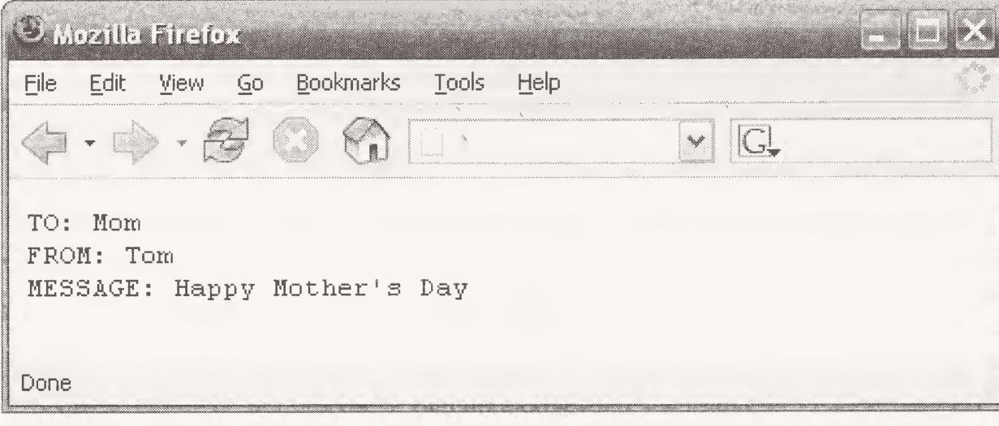

如果你感兴趣，可以去查看此文档的源码。你会注意到你不会看到转换的输出（技术上称为结果树），但你可以看到 XML 文档的源码。

## 我最喜欢的浏览器呢？

如果你不经常使用 Firefox，你可能会因为我从一个只适用于基于 Mozilla 浏览器的示例开始而感到有点不安。

> 首先，如果你更倾向于 Internet Explorer，情况将在下一个示例中得到改善，该示例符合 Internet Explorer 的假设，即转换结果必须是 HTML 而不是文本。
> 至于其他常用的浏览器，包括 Safari 和 Opera，它们不支持 XSLT。目前，在服务器端依赖 XSLT 尚不实际，因为在那里它是免受兼容性问题侵害的。

## 将 XML 转换为 HTML

这并不糟糕，对吧？你成功地将一个简单的 XML 文档转换为扁平文本，甚至在输出中添加了一些小细节。

现在，是时候让事情变得复杂了。让我们把 XML 文档转换为 HTML。最棒的部分是——你不需要触碰原始文档（除了指向一个新的样式表之外）。你只需要创建一个新文件：

```xml
<xsl:stylesheet version="1.0"
xmlns:xsl="http://www.w3.org/1999/XSL/Transform">
<xsl:output method="html"/>
<xsl:template match="letter">
  <html>
    <head><title>Letter</title></head>
    <body><xsl:apply-templates/></body>
  </html>
</xsl:template>
<xsl:template match="to">
  <b>TO: </b><br/><xsl:apply-templates/><br/>
</xsl:template>
<xsl:template match="from">
  <b>FROM: </b><br/><xsl:apply-templates/><br/>
</xsl:template>
<xsl:template match="message">
  <b>MESSAGE: </b><br/><xsl:apply-templates/><br/>
</xsl:template>
</xsl:stylesheet>
```

文件：letter2html.xsl

立即，你会注意到样式表的输出元素现在指定了 html 输出方法。此外，我们的第一个模板现在输出基础标签以生成 HTML 文档的框架，并且没有通过 select 属性去处理源文档中的空格。

除此之外，这些指令与我们纯文本的样式表没有不同。事实上，我们所做的所有变化都是对每行的标签加粗，并以 HTML 换行符 (`<br/>`) 结束。我们不再需要 `<xsl:text>` 标签，因为我们的 HTML `<b>` 和 `<br/>` 执行了相同的功能。

> 注意每个标签后面的空格是在 `<b>` 标签内部的，这样它就不会被处理器忽略。

你应该能看到类似于图 2.3 的内容。

### 图 2.3. 在 Internet Explorer 中查看 XSL 结果

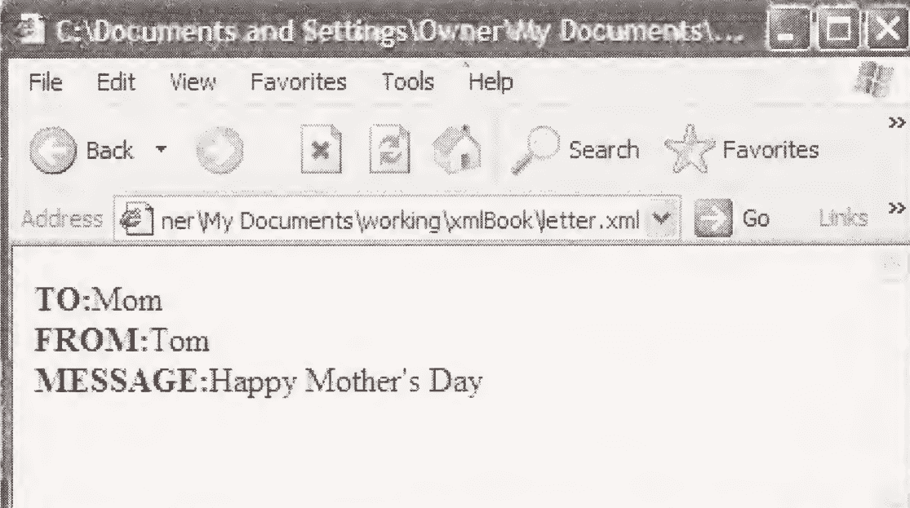

## 使用 XSLT 将 XML 转换为其他 XML

如果我们需要将自己的 XML 文档转换为符合另一个组织或人员需求的 XML 文档，会发生什么？例如，如果我们的信件在 `<letter>` 标签内部使用了 `<to>`、`<from>` 和 `<message>` 标签，但需要将其更改为例如 `<recipient>`、`<sender>` 和 `<body>` 该怎么办？

别担心——XSLT 会解决问题！而且，通过之前的两个示例，我们甚至不需要担心更改源 XML 文档。我们只需要创建一个新的 XSL 文件，就功告成了。

和之前一样，我们将从标准的样式表元素开始，但这次，我们选择 `xml` 作为输出方法。我们还将指示 XSLT 使用 XML 对结果进行缩进：

```xml
<xsl:stylesheet version="1.0"
xmlns:xsl="http://www.w3.org/1999/XSL/Transform">
<xsl:output method="xml" indent="yes"/>
```

`<template>` 元素的结构与之前相同，但这次它们输出的是新的 XML 元素：

文件：letter2xml.xsl (节)

```xml
<xsl:template match="/letter">
  <letter><xsl:apply-templates/></letter>
</xsl:template>
<xsl:template match="to">
  <recipient><xsl:apply-templates/></recipient>
</xsl:template>
<xsl:template match="from">
  <sender><xsl:apply-templates/></sender>
</xsl:template>
<xsl:template match="message">
  <body><xsl:apply-templates/></body>
</xsl:template>
</xsl:stylesheet>
```

现在，你只需要编辑你的 XML 文档以指向该样式表，就可以在任何 Web 浏览器中查看你的新 XML 了，对吧？错了！你要知道，浏览器只支持没有样式表的 XML 文档的折叠树格式。由样式表转换生成的 XML 文档将没有任何样式地显示，或者顶多被视为 HTML——这完全不是我们想要的结果。

浏览器在查看 XML 输出时的用处是 XML 是一个 XHTML 文档时——浏览器显然可以显示它。你需要在样式表中添加几项内容，向浏览器指示该文档不仅仅是一个纯 XML 文件，第一项是 XHTML 命名空间：

文件：letter2xhtml.xsl (节)

```xml
<xsl:stylesheet version="1.0"
xmlns:xsl="http://www.w3.org/1999/XSL/Transform"
xmlns="http://www.w3.org/1999/xhtml">
```

在这里，我们为样式表中没有前缀的标签声明了默认命名空间。因此，像 `<html>` 和 `<b>` 这样的标签将被正确识别为 XHTML 标签。

接下来，我们可以完善输出元素以完全描述输出文档的类型：

```xml
<xsl:output method="xml" indent="yes" omit-xml-declaration="yes"
media-type="application/xhtml+xml" encoding="iso-8859-1"
doctype-public="//W3C//DTD XHTML 1.0 Transitional//EN"
doctype-system="http://www.w3.org/TR/xhtml1/DTD/xhtml1-transitional.dtd"/>
```

除了 `method` 和 `indent` 属性外，我们在这里还指定了一些新属性：

- `omit-xml-declaration`：这告诉处理器不要在输出文档的顶部添加 `<?xml?>` 声明。Windows 版 Internet Explorer 在存在此声明时会以怪异模式显示 XHTML 文档，通过省略它，我们可以确保该浏览器以更符合标准的标准兼容模式显示它。
- `media-type`：尽管当前的浏览器不需要，但将此属性设置为 `application/xhtml+xml` 为浏览器提供了另一种识别方式，将输出识别为 XHTML 文档而非纯 XML。
- `encoding`：设置输出文档的字符编码，控制哪些字符被转义为字符引用（`&amp;`）；
- `doctype-public` `doctype-system`：这两个属性提供了生成输出文档的 DOCTYPE 声明所需的值。在示例中，我们为 XHTML 1.0 过渡版文档指定了值，但如果你需要，也可以指定 XHTML 1.0 严格版：

```xml
<xsl:output method="xml" indent="yes" omit-xml-declaration="yes"
media-type="application/xhtml+xml" encoding="iso-8859-1"
doctype-public="//W3C//DTD XHTML 1.0 Strict//EN"
doctype-system="http://www.w3.org/TR/xhtml1/DTD/xhtml1-strict.dtd"/>
```

样式表的其余部分与我们上面看到的输出相同。这里是你可以使用的完整样式表：

```xml
<xsl:stylesheet version="1.0"
xmlns:xsl="http://www.w3.org/1999/XSL/Transform"
xmlns="http://www.w3.org/1999/xhtml">
<xsl:output method="xml" indent="yes" omit-xml-declaration="yes"
media-type="application/xhtml+xml" encoding="iso-8859-1"
doctype-public="//W3C//DTD XHTML 1.0 Transitional//EN"
doctype-system="http://www.w3.org/TR/xhtml1/DTD/xhtml1-transitional.dtd"/>
<xsl:template match="/letter">
  <letter><xsl:apply-templates/></letter>
</xsl:template>
<xsl:template match="to">
  <recipient><xsl:apply-templates/></recipient>
</xsl:template>
<xsl:template match="from">
  <sender><xsl:apply-templates/></sender>
</xsl:template>
<xsl:template match="message">
  <body><xsl:apply-templates/></body>
</xsl:template>
</xsl:stylesheet>
```

```xml
<?xml version="1.0" encoding="iso-8859-1"?>
<admins>
  <admin id="1">
    <name>Joe</name>
    <username>joe@</username>
    <password>$1064_HO.$X9120h1IHFy1TPjMR/k/</password>
    <email>joe@myerman.com</email>
  </admin>
  <admin id="2">
    <name>Bill</name>
    <username>bill@</username>
    <password>$1Ep5.7h.$R6Gqy.Wj2Dz8SAE9WG310</password>
    <email>bill@myerman.com</email>
  </admin>
  <admin id="3">
    <name>Tom</name>
    <username>tom@</username>
    <password>$1C1./j3.$QcqjxGtxyX0VNp3QangGnP0</password>
    <email>tom@myerman.com</email>
  </admin>
</admins>
```

对于每一篇文章/新闻项/二进制文件/广告文案，每位管理员都需要一个唯一的 ID——否则，系统可能不知道是谁在尝试登录。

## 总结

我们在本章中涵盖了大量内容——很高兴你还在坚持！在第 3 章中，我们将深入研究 DTD 和 XML 模式。此外，在 CMS 部分，我们将查看处理状态、关键词和作者列表的替代方法——我想你会非常喜欢我们改变这些方式。在此之后，你应该已经掌握了关于 XML（及其那古怪的家族）的实用知识，可以真正开始开发了。

# 第 3 章：用于保持一致性的 DTD

到此为止，我们创建了一些非常简单的 XML 文档，并学习了它们是如何组成的。我们还通过一些非常简单的示例演示了如何将 XML 转换为其他内容，无论是文本、HTML 还是不同的 XML。现在，是时候学习让你的 XML 文档保持一致性了。

## XML 中的一致性

伟大的美国思想家、作家拉尔夫·沃尔多·爱默生曾说：“愚蠢的一致性是狭隘之心的魔鬼。”好吧，无论是否愚蠢，在 XML 的世界里，我们喜欢一致性。事实上，在许多语境下，一致性是一件非常美的事情。

记住，XML 允许你创建任何你想要的语言。我们已经在书中看到了一些多样的例子：从一封给妈妈的信，到文章和新闻报道。在很多情况下，只要你遵循良好格式的规则，任何内容都可以是 XML。

然而，总有一天你需要你的 XML 文档遵循某些规则——以通过有效性测试——而那些时刻要求你的数据具有一致的格式。例如，我们的 CMS 不应该允许本应出现在管理员信息文件中的数据出现在内容文件中。我们需要一种强制执行这类规则的方法。

在 XML 中，有两种方法来设置一致性规则：DTD 和 XML 模式。DTD（文档类型定义）是实现一致性的一种经过尝试且有效（尽管有些过时）的方法。它有一种独特的、非 XML 的语法，许多 XML 初学者认为这种语法相当局限，但对于老派的 XML 程序员来说，它唤起了一种舒适的家乡情怀。XML 模式更现代、更快、更好等等；它包含的功能更多，而且编写得像任何其他 XML 文档一样，但许多人发现它和 DTD 一样深奥。

如果我们给予机会，关于 DTD 和 XML 模式的信息可以填满厚厚的书籍。这些技术中的每一个都包含许多隐藏的节点和角落，里面挤满了规则、异常、符号和故事。但，记住我们来在这里的目的是：我们必须学习我们需要的所有知识，然后在构建由 XML 驱动的网站时应用这些知识。

## 术语趣味

说起这些小故事，你们知道 DTD 实际上可以代表两个意思吗？它不仅代表 document type definition（文档类型定义），还代表 document type declaration（文档类型声明）。声明由构成定义的代码行组成。由于这种区别微乎其微，我们将统称它们为“DTD”并继续后续吧！

本章将重点关注 DTD，因为你还只是个初学者，提供关于 XML 模式的信息会有些大材小用。不过，我会花几分钟时间从高层次解释一下 XML 模式，并提供它与 DTD 的一些比较。

在开始这一章之前，先提个醒：XML 中的一致性可能是我们目前为止涵盖的最难的方面，因为 DTD 可能是非常深奥的东西。然而，我认为你会发现它是值得的，因为使用 DTD 将防止以后出现很多问题。

## 一致性有什么大不了的？

好了，在我们开始之前，让我们问一个非常显而易见的问题：“为什么，噢噢为什么，我们在这个美好的周六下午坐在这里谈论 XML 文档一致性的重要性？我们难道不应该带着我们忠诚的狗罗弗、野餐篮和我们极佳的伴侣在公园里吗？

嗯，你实际上问了两个问题。我无法回答第二个，因为我现在真的不想干涉你的个人生活。至于第一个问题，脑海中浮出了很多可能的答案：

1. 稍后会有测验，所以你最好知道。
2. 你需要学习。
3. 应用程序需要。
4. 文档必须是有效的。

事实上，更准确地说，序列不仅规定了元素出现的顺序，还规定了每个元素出现的次数。在这种情况下，元素声明规定每个元素必须出现一次。

## DTD

DTD 的工作原理相对简单。如果你提供 DTD 和 XML，那么 XML 解析器会将内容与 DTD 设置的规则进行比较。如果文档不符合规则，解析器就会报错。

```xml
<!DOCTYPE letter [
  <!ELEMENT letter (to,from,message)>
  <!ELEMENT to (#PCDATA)>
  <!ELEMENT from (#PCDATA)>
  <!ELEMENT message (#PCDATA)>
]>
```

留心的人应该注意到这个 DTD 与我们做过的《妈妈信》示例之间的相似之处。事实上，如果你仔细观察，DTD 的每一行都为 letter 的结构提供了线索。

DTD 的第一行以 `<!DOCTYPE` 开头，指示我们的文档类型是 letter。任何基于此 DTD 创建的文档必须以 letter 为根元素，否则它是无效的。

## 元素声明

让我们看看 DTD 的下一行：紧接 DOCTYPE 之后的那一行。

```xml
<!ELEMENT letter (to,from,message)>
```

这是一个元素声明。你可以按照任何喜欢的顺序声明元素，但它们都必须在 DTD 中声明。不过，为了简单起见，并反映元素在实际 XML 文件中出现的顺序，我建议像我们在这里做的那样：首先声明你的根元素。

一个 DTD 元素声明由一个标签和括号中的定义组成。括号中可以包含针对任何内容的规则：

- 纯文本
- 单子元素
- 元素序列

在这种情况下，我们希望 letter 元素顺序包含 to、from 和 message 元素。

自然，总会有那么时刻，你需要为每种元素指定多个实例。你将如何做到这一点？通过一套整洁的符号系统，该系统定义在表 3.1 中，可能会让你联想到 UNIX 正则表达式。

### 表 3.1. XML 元素声明符号

| 符号 | 含义 |
| :--- | :--- |
| `?` | 元素最多出现一次（如果出现的话）。<br>`<!ELEMENT letter (to,from,message,sig?)>`<br>(一个可选的 sig) |
| `+` | 元素必须至少出现一次。<br>`<!ELEMENT letter (to,from,message,sig+)>`<br>(一个或多个 sig) |
| `*` | 元素可以根据需要任意出现，或者完全不出现。<br>`<!ELEMENT letter (to,from,message,sig*)>`<br>(零或多个 sig) |
| `\|` | 定义元素之间的选择。<br>`<!ELEMENT letter (to,from,message,sig\|ps)>`<br>(letter 以 sig 或 ps 结尾) |
| `()` | 定义元素的组合。<br>`<!ELEMENT letter ((to,from,message)\|#PCDATA)>`<br>(letter 必须是 to, from, message 或纯文本) |

以这些符号为背景，你可以充分发挥创意：

要求元素至少出现两个实例。

```xml
<!ELEMENT chapter (title,para,para+)>
```
（至少两个 para）

在元素组上应用元素计数修饰符。

```xml
<!ELEMENT chapter ((title,para+))>
```
（一个或多个标题，每个标题后面跟着一个或多个段）

允许元素包含另一个元素或纯文本。

```xml
<!ELEMENT title (subtitle\|#PCDATA)>
```
(title 包含一个 subtitle 或纯文本)

要求元素恰好出现三个实例。

```xml
<!ELEMENT instruction (step,step,step)>
```
（恰好三个 step）

## 仅包含文本的元素

让我们继续观察原始 DTD。在 letter 声明之后，我们看到了这三个声明：

```xml
<!ELEMENT to (#PCDATA)>
<!ELEMENT from (#PCDATA)>
<!ELEMENT message (#PCDATA)>
```

在这里，我们使用 `#PCDATA` 来定义元素的内容。`#PCDATA` 代表解析后的字符数据，指的是 XML 元素之外的任何内容。每当你在 DTD 中看到这种符号，你就知道该元素必须包含文本。

## 混合内容

如果你想在 XML 文档中实现如下内容：

```xml
<paragraph>这是一个段落，其中项目被 <b>加粗</b>、<i>斜体</i>，甚至加了 <u>下划线</u>。某些项目甚至被视为 <highpriority>高优先级</highpriority>。
</paragraph>
```

你可能会认为你需要将 paragraph 元素声明为包含 `#PCDATA` 和其他元素的序列，如下：

```xml
<!ELEMENT paragraph (#PCDATA,b,i,u,highpriority)> <-- 错误！ -->
```

你可能是这样想，但你错了！声明具有混合内容的元素的正确方法是使用 `|` 符号分隔元素，并在元素声明的末尾添加 `*`：

```xml
<!ELEMENT paragraph (#PCDATA|b|i|u|highpriority)*> <!-- 正确！ -->
```

这种符号允许 paragraph 元素包含纯文本与 b、i、u 和 highpriority 元素的任意组合。注意，使用这种混合内容时，你无法控制所用元素的数量或顺序。

## 空元素

像 hr 和 br 这样的元素呢？它们在 HTML 中完全不包含内容。这些元素被称为空元素，在 DTD 中的声明如下：

```xml
<!ELEMENT hr EMPTY>
<!ELEMENT br EMPTY>
```

到此为止，大部分这些内容都是合理的。接下来我们讨论属性声明。

## 属性声明

还记得属性吗？它们是悬在 XML 元素起始标签内部的额外信息。幸运的是，属性可以通过 DTD 进行控制，使用所谓的“属性声明”。

属性声明的结构与元素声明不同。首先，我们使用 `ATTLIST` 而不是 `!ELEMENT` 来定义它。此外，我们必须在声明中包含包含（属性）的元素名称，随后是属性列表及其可能的值。

例如，假设我们有一个包含多个属性的 XML 元素：

```xml
<actor actorid="HF1234" gender="male" type="superstar">
Harrison Ford</actor>
```

该元素的元素和属性声明可能如下：

```xml
<!ELEMENT actor (#PCDATA)>
<!ATTLIST actor
  actorid ID #REQUIRED
  gender (male|female) #REQUIRED
  type CDATA #IMPLIED>
```

最容易理解的属性是 type——它包含 CDATA，即数据。基本上，此属性可以包含任何字符或数字字符串。该属性的可接受值可能是“superstar”、“leading man”甚至“dinosaur”。作为开发者，我们无法对类型为 CDATA 的属性中放置的内容进行太大控制。

你看到 CDATA 后面紧跟着 `#IMPLIED` 吗？在 DTD 语言中，这意味着该属性是可选的。不要问为什么不使用 `#OPTIONAL`——这种遗产继承自 SGML 时代，它是 XML 更复杂的前身。

## ID 和 IDREF 属性

`actorid` 属性被声明为 `ID` 类型。这意味着它的值在整个 XML 文档中必须是唯一的。如果你尝试在另一个元素上使用相同的 ID，验证解析器会报错。

`IDREF` 类型用于引用其他元素的 ID。例如，如果你有一个 `movie` 元素需要引用 `actor`，你可以声明一个 `actorref` 属性为 `IDREF` 类型。

## 实体

实体是 XML 中用于定义可重用内容片段的机制。它们可以在 DTD 中声明，然后在 XML 文档中引用。

### 内部实体

内部实体在 DTD 中定义，包含文本内容。例如：

```xml
<!ENTITY company "Acme Corp.">
```

然后在 XML 中使用 `&company;` 引用。

### 外部实体

外部实体指向外部信息，这些信息可以在运行时复制到你的 XML 文档中。例如，你可以使用外部实体包含股票报价代码、库存列表或其他文件。

```xml
<!ENTITY favorites SYSTEM "http://www.example.com/favstocks.xml">
```

在这种情况下，我们使用 `SYSTEM` 关键字来指示该实体是存储在服务器上的文件。你可以按照如下方式在 XML 文档中使用该实体：

```xml
<section>
<heading>当前热门股</heading>
  &favquotes;
</section>
```

## 外部 DTD

我们在本章开头看到的 DTD 示例出现在 XML 文档顶部的 `DOCTYPE` 声明中。这对于实验目的来说是可以的，但在许多项目中，你可能会有几十个甚至数百个文件必须遵循相同的 DTD。在这些情况下，更智能的做法是将 DTD 放在一个单独的文件，然后在 XML 文档中引用它。

外部 DTD 通常是一个以 `.dtd` 结尾的文件——例如 `letter.dtd`。该外部 DTD 包含了与内部 DTD 相同的符号规则。

要引用此外部 DTD，你需要在 XML 文档中添加两个内容。首先，你必须编辑 XML 声明以包含 `standalone="no"` 属性：

```xml
<?xml version="1.0" standalone="no"?>
```

这告诉验证解析器根据独立的 DTD 文件来验证 XML 文档。然后你必须添加一个指向外部 DTD 的 `DOCTYPE` 声明，如下：

```xml
<!DOCTYPE letter SYSTEM "letter.dtd">
```

这将在 XML 文件相同的目录中搜索 `letter.dtd` 文件。如果 DTD 存放在 Web 服务器上，你也可以指向该地址：

```xml
<!DOCTYPE letter SYSTEM
"http://www.example.com/xml/dtd/letter.dtd">
```

## XML Schema 宏观视图

XML Schema 标准与 DTD 实现了相同的要求：它允许你控制 XML 文档的结构和内容。但如果它的用途与 DTD 相同，我们为什么还要用 XML Schema 呢？

嗯，DTD 有一些缺点：

- DTD 符号表示与 XML 语法几乎没有关系，因此无法像 XML 文档那样被解析或验证。
- 所有声明都是全局的，因此你不能定义两个同名的元素，即使它们出现在不同的上下文中。
- DTD 无法像 XML 那样严格控制元素或属性可以提供的信息类型。

XML Schema 用 XML 编写的，因此可以被 XML 解析器解析。XML Schema 允许你通过使用 XML 命名空间定义同名的不同元素。最后，XML Schema 对元素或属性中包含的数据类型提供了非常精细的控制。

现在，谈谈主要的缺点：如果你认为 DTD 已经深奥了，那么你不会对 XML Schema 引入的复杂性感到高兴。针对 XML Schema 的大部分批评集中在它的复杂性和冗长上。事实上，一眼看上去，Schema 的多功能性会让你想起那位在任何聚会上都会霸占话题的话痨朋友。

在本书中我们没有机会接触 XML Schema，但关于这个主题有很多优秀的书籍可用。

## 动手实践

好了，现在你对 DTD 的了解比以前多得多。如果你觉得这些关于 XML 一致性的论述听起来相当深奥，那么你并不孤单。但请坚持下去——我们即将开始实战示例，这些示例将具体说明这些概念是如何融入整个 XML 蓝图的。

### 我们的第一个案例：一份公司备忘录

你任职于 Amalgamated International, LLC。大老板来到你的办公室，因为他听闻你是一个 XML 魔法师。这真的是个好消息，因为他刚参加完一个会议回来，得知 XML 是控制公司内部备忘录的一种极佳方法。

他指示你设法将所有公司备忘录转换为 XML，而且是的，它们需要经过验证，因为它们以后将由一个能够搜索备忘录的应用程序使用。

你做的第一件事是查看你和同事在过去几个月里收到的几十份公司备忘录。经过一两天的仔细检查后，一个模式显现出来。

通过观察它们，你可以发现所有备忘录都包含以下元素：

- 日期
- 发送者
- 收件列表
- 优先级
- 主题行
- 一个或多个段落
- 签名区块
- 拟稿人缩写

你确定不仅如此，所以你决定收集更多信息。当你与部门行政助理交谈时，他补全了剩下的画面：

- 总是会有某种部门代码。
- 总是会有优先级级别。
- 总是会有过期日期。
- 总是会有拟稿人的缩写。
- 总是会有来源部门。
- 总是会有收件列表。
- 总是会有主题行。
- 总是会有签名区块。
- 总是有一个或多个段落。

头部将包含日期、发送者、收件人、密送收件人和主题。正文将包含备忘录的实际文本。

无论如何，我们都希望能够控制文档创建者填入的数据，例如优先级。如果我们的应用程序要寻找“low”、“medium”和“high”，那么让他们输入“鳄鱼”或“迪士尼乐园”就没有意义了。

存储这些信息的最佳方法是将它们作为属性添加到根元素中。为了做到这一点，我们需要在 DTD 中添加一个属性声明：

文件：internalmemo-standalone.xml（节选）

```xml
<!ATTLIST internalmemo
priority (low|medium|high) #REQUIRED
initials CDATA #REQUIRED
expiredate CDATA #REQUIRED
origin (marketing|accounting|finance|hq|sales|ops) #REQUIRED>
```

那么，一个有效的内部备忘录是什么样的？很高兴你这么问：

文件：internalmemo-standalone.xml

```xml
<?xml version="1.0"?>
<!DOCTYPE internalmemo [
<!ELEMENT internalmemo (header,body)>
<!ELEMENT header (date,sender,recipients,blind-recipients,subject)*>
<!ELEMENT body (para+,sig)>
<!ELEMENT para (#PCDATA)>
<!ELEMENT date (#PCDATA)>
<!ELEMENT sender (#PCDATA)>
<!ELEMENT recipients (#PCDATA)>
<!ELEMENT blind-recipients (#PCDATA)>
<!ELEMENT subject (#PCDATA)>
<!ELEMENT sig (#PCDATA)>
<!ELEMENT para (para|b|i)*>
<!ELEMENT b (#PCDATA)>
<!ELEMENT i (#PCDATA)>
<!ATTLIST internalmemo
priority (low|medium|high) #REQUIRED
initials CDATA #REQUIRED
expiredate CDATA #REQUIRED
origin (marketing|accounting|finance|hq|sales|ops) #REQUIRED>
]
<internalmemo priority="high" initials="hjd"
expiredate="01/01/2008" origin="marketing">
<header>
<date>01/05/2004</date>
<sender>Thomas Myer</sender>
<recipients>Marketing Department</recipients>
<subject>Sell more stuff</subject>
</header>
<body>
<para>这是一封来自市场部的<i>simple（简单）</i>备忘录：卖出<b>more（更多）</b>东西！</para>
<sig>Thomas Myer</sig>
</body>
</internalmemo>
```

现在我们已经有了 DTD 和 XML 文档，是时候进行验证了。幸运的是，Macromedia Dreamweaver MX 有一个内置的验证工具，我们可以在开发期间使用（在“现实生活”中，我们将使用应用程序内置的验证器）。如果你还没有拥有 Dreamweaver，可以获取一个试用版。

我们要做的只是在 Dreamweaver 中打开我们的 XML 文档（其中包含 DTD），然后选择 File > Check Page > Validate as XML。结果看起来与图 3.1 非常相似。

## 图 3.1. 使用 Dreamweaver MX 验证我们的第一个案例。

```xml
<!ELEMENT say (#PCDATA)>
12 <!ELEMENT para (#PCDATA|b)*>
13 <!ELEMENT b (#PCDATA)>
14 <!ELEMENT i (#PCDATA)>
```

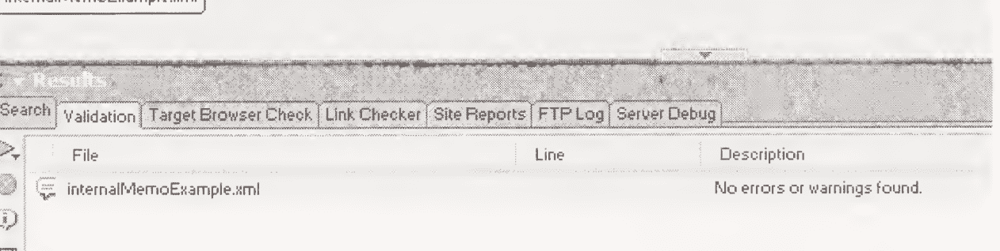

| 文件 | 行 | 描述 |
| :--- | :--- | :--- |
| internalMemoExample.xml | | 未找到错误或警告。 |

http://www.macromedia.com/go/trydreamweaver

你看到在 Results 下，它显示着“No errors or warnings found”了吗？这就是你想看到的。

如果某些东西放错了会发生什么？例如，如果你在优先级处写了“Extremely Urgent”会发生什么？在这种情况下，你会看到像下面图 3.2 中的错误消息。

## 图 3.2. 属性值错误导致的错误。

| 文件 | 行 | 描述 |
| :--- | :--- | :--- |
| internalMemoExample.xml | 22 | 属性 ‘priority’ 不符合其定义的枚举或列表 |
| internalMemoExample.xml | 22 | 属性 ‘priority’ 不符合其定义的枚举或列表 |

注意，Dreamweaver MX 会告诉你问题所在的位置（带有特定的行号）并提供问题的描述。在这种情况下，验证器是在说你的 XML 文档中 priority 属性的值不符合 DTD 中定义的任何可能项。

如果你决定将 `<sender>` 标签放在 `<date>` 标签之前呢？验证器也会捕获到，正如图 3.3 所示。

## 图 3.3. 元素位置错误导致的错误。

| 文件 | 行 | 描述 |
| :--- | :--- | :--- |
| internalMemoExample.xml | 28 | 元素 ‘sender’ 不符合内容模型：‘date,sender,recipients,blind-recipients*’|

再次，验证器会为你提供一个行号和一个描述，可以引导你解决问题。你只需要将 sender 元素按规定的顺序放回，文档就会再次通过验证。

> 在 Dreamweaver MX 2004 中，有效文档的 Result 列表直接为空，列表下方的状态栏显示“Complete”。

## 第二个案例：为备忘录使用外部 DTD

我们的第一个案例很简单。我们把 DTD 直接放在 XML 文件内部。但如果我们有许多 XML 文件呢？我们不想在每一个文件中都嵌入 DTD，因为如果我们需要更改 DTD 的话，就必须更改每一个文件。

相反，我们可以使用外部 DTD。这意味着我们将 DTD 放在自己的单独文件中，并让 XML 文件指向它。这容易维护得多，特别是随着项目的增长。

让我们看看如何操作。当你完成后，你的 DTD 应该看起来像这样：

```xml
<!ELEMENT internalmemo (header,body)>
<!ELEMENT header (date,sender,recipients,blind-recipients,subject)*>
<!ELEMENT body (para+,sig)>
<!ELEMENT para (#PCDATA)>
<!ELEMENT date (#PCDATA)>
<!ELEMENT sender (#PCDATA)>
<!ELEMENT recipients (#PCDATA)>
<!ELEMENT blind-recipients (#PCDATA)>
<!ELEMENT subject (#PCDATA)>
<!ELEMENT sig (#PCDATA)>
<!ELEMENT para (para|b|i)*>
<!ELEMENT b (#PCDATA)>
<!ELEMENT i (#PCDATA)>
<!ATTLIST internalmemo
priority (low|medium|high) #REQUIRED
initials CDATA #REQUIRED
expiredate CDATA #REQUIRED
origin (marketing|accounting|finance|hq|sales|ops) #REQUIRED>
```

现在，我们需要更新 XML 文件指向这个外部 DTD。我们通过更改 DOCTYPE 声明使用 `SYSTEM` 关键字来实现：

```xml
<?xml version="1.0"?>
<!DOCTYPE internalmemo SYSTEM "internalmemo.dtd">
<internalmemo priority="high" initials="hjd"
expiredate="01/01/2008" origin="marketing">
<header>
<date>01/05/2004</date>
<sender>Thomas Myer</sender>
<recipients>Marketing Department</recipients>
<subject>Sell more stuff</subject>
</header>
<body>
<para>这是一封来自市场部的<i>simple（简单）</i>备忘录：卖出<b>more（更多）</b>东西！</para>
<sig>Thomas Myer</sig>
</body>
</internalmemo>
```

## 总结

我们在本章中涵盖了大量内容——很高兴你还在坚持！在第 4 章中，我们将深入研究 XPath 和 XSLT 的更多高级用法。此外，在 CMS 部分，我们将查看处理状态、关键词和作者列表的替代方法——我想你会非常喜欢我们改变这些方式。在此之后，你应该已经掌握了关于 XML（及其那古怪的家族）的实用知识，可以真正开始开发了。

<status>live</status>


# 第 3 章：用于一致性的 DTD

```xml
<status>live</status>
<keywords>XML CMS</keywords>
<body><![CDATA[
<h1>创建一个由 XML 驱动的 CMS</h1>
<p>在本文...</p>
]]></body>
</article>
```

到目前为止，使用 `author` 元素来跟踪我们的作者信息非常方便。然而，这种方法存在两个问题，其中一个我们已经提到过：最终，我们的网站上将会有数百篇文章，为了显示按作者分类的文章列表，我们需要挖掘每一篇，这将给我们的应用程序带来巨大的压力。

另一个问题就没那么明显了。如果我在某篇文章中，我的名字被列为 "Tom Myer"，而在另一篇文章中，它被列为 "Thomas Myer"（这种情况经常常见）。对于我们的应用程序来说，如果有人把我的名字拼写成了 "Tom Meyer"——这三个名字是不同的，因此文章将分别列在三个不同的作者下。

为了解决这个问题，我们应该创建一个单独的作者列表（authors.xml），然后使用 `authorid` 在文章中引用该信息。一旦解决了这个问题，我们就可以删除所有其他内容类型中的 `author` 元素，并将其替换为 `authorid` 元素。

这种处理作者的方法允许我们跟踪有关作者的其他信息，例如他们的电子邮件地址、署名（以防他们想使用笔名）以及其他信息。

以下是代码的示例：

```xml
<authors>
  <author id="1">
    <name>Thomas Myer</name>
    <byline>myerman</byline>
    <email>tom@tripledogdaremedia.com</email>
  </author>
</authors>
```

与其使用单独的 `author` 元素，我们在文章中添加一个单独的 `authorid` 元素，如下：

```xml
<article id="123">
  <author>1</author>
  ...
```

现在我们解决了冗余问题——换句话说，我们将作者信息集中起来，而不是让它分散在许多不同的文件中。我们只需要在文章、新闻故事以及添加到 CMS 中的所有内容中使用此 ID 即可；此 ID 用于查找作者并检索我们所需的信息。

## 为我们的项目文档分配 DTD 吗？

大问题仍然存在：我们是否需要花时间和精力为每种内容类型创建 DTD 或架构？答案是，和大多数技术问题一样，“取决于情况”。

老诚地说，大多数文章、新闻故事等将通过我们的管理工具提交到网站。该工具将具有必要的表单，用以限制向某些字段中输入数据。换句话说，我们的管理工具将完成大部分内容验证工作。因此，你可能会认为 DTD 是完全多余的，而且你是对的。

然而，我们认为为我们的文章内容类型开发一个 DTD 是一个很好的做法——毕竟，这是我们系统中最重要的文档类型之一，而且必须处理正确。

这里是我们文章 DTD 的第一次尝试：

```dtd
<!ELEMENT article (author, headline, description, pubdate, status, keywords, body)>
<!ATTLIST article  id CDATA #REQUIRED>
<!ELEMENT author (#PCDATA)>
<!ELEMENT headline (#PCDATA)>
<!ELEMENT description (#PCDATA)>
<!ELEMENT pubdate (#PCDATA)>
<!ELEMENT status (#PCDATA)>
<!ELEMENT keywords (#PCDATA)>
<!ELEMENT body (#PCDATA)>
```

虽然我们声明 `body` 元素包含字符数据，但我们的文章主体将使用 HTML 标签进行格式化。由于这些 HTML 内容将封装在 CDATA 块中，任何读取文章文件的 XML 处理器将忽略这些标签。我们可以使用 CDATA 块来存放任何文本，因为 XML 解析器将忽略其中可能出现的任何 XML 语法。因此，我们不需要担心此 DTD 中 HTML 标记的复杂性。

如果你问十个搞 XML 的人他们是否同意这种方法，你将得到十种不同的意见和替代方案。目前，我们创建了一个可以运行——而且运行很快的东西。

如果你想对 DTD 进行更多练习，可以回到第 2 章，查看我们为其他内容类型（如 Web 副本和新闻条目）创建的 XML 格式。尝试也为这些内容编写 DTD。如果你以后需要检查存储在 CMS 中的文档的有效性，可以使用这些 DTD 来完成此工作。

## 总结

哇！在三个章节中，我们涵盖了基础 XML、一些 XSLT 和 CSS，现在是 DTD 的基础知识。此外，我们已经确定了 CMS 项目的大部分需求。我认为我们已经准备好开始深入研究项目的其他部分了。在此过程中，我们还会学习更多的 XSLT 和 XML 技巧。

## 在浏览器中显示 XML

在第 2 章中，我们使用非常简单的 XML 文档介绍了一些基础的 XSLT 和 CSS。在本章中，我们将通过更复杂的文档再次回顾这些概念。一旦处理完这些，我们将返回 CMS 项目并开始为我们的网站构建显示页面。

## 关于 XPath 的话

我们已经略微接触过 XSLT。我们用它将一封写给母亲的 XML 信件转换为可以在浏览器中显示的内容。

---

# 第 4 章：在浏览器中显示 XML

```xml
<para type="warning">先别想翻页！</para>
<section>
  <title>子章节</title>
  <para type="intro">看起来我们在这里又开始了一个章节！</para>
</section>
</section>
<section>
  <title>另一个章节</title>
  <para type="intro">章节继续下去...</para>
</section>
</chapter>
```

这个示例文件可以一直写下去，但我想你已经明白意思了。现在是解析此文档并理解它的含义了。我们将先执行一些简单的任务，然后随着学习不断扩展知识。

## 格式化的首次尝试

现在，让我们创建相应的 XSL 文件，`chapter2html.xsl`。此文件将包含我们用于将刚刚看到的章节 XSL 元素转换为 XHTML 的所有指令。正如我们在第 2 章看到的，生成 XHTML 的 XSL 文件应该如下所示开头：

> 文件: chapter2html.xsl (节选)

```xml
<xsl:stylesheet version="1.0"
xmlns:xsl="http://www.w3.org/1999/XSL/Transform"
xmlns:html="http://www.w3.org/1999/xhtml">
<xsl:output method="xml" indent="yes" omit-xml-declaration="yes"
media-type="application/xhtml+xml" encoding="iso-8859-1"
doctype-public="//W3C//DTD XHTML 1.0 Transitional//EN"
doctype-system="http://www.w3.org/TR/xhtml1/DTD/xhtml1-transitional.dtd"/>
```

现在，让我们开始匹配元素。我们想要做的第一件事是匹配文档的根。可以使用此模板来输出生成 XHTML 文档所需的各种标签：

> 文件: chapter2html.xsl (节选)

```xml
<xsl:template match="/">
<html>
  <head>
    <title>书籍章节</title>
    <meta http-equiv="content-type" content="application/html+xml; charset=iso-8859-1"/>
  </head>
  <body>
    <xsl:apply-templates/>
  </body>
</html>
</xsl:template>
```

记住，在 XPath 符号中，`/` 本身代表文档的根，因此我们可以确定，此模板对于该样式表转换的每个文档只会匹配一次。

`apply-templates` 元素随后会寻找其他元素进行匹配，因此让我们为我们可能找到的元素编写一些模板。在这个阶段，对于 `chapter` 元素，我们没有真正想要输出的、且之前没有为上面的文档写过的任何内容，所以目前我们先让 XSLT 处理器用其默认行为处理它。相反，让我们关注 `chapter` 内部的元素：

File: chapter2html.xsl (节选)

```xml
<xsl:template match="title">
<h1><xsl:apply-templates/></h1>
</xsl:template>
<xsl:template match="para">
<p><xsl:apply-templates/></p>
</xsl:template>
<xsl:template match="b">
<b><xsl:apply-templates/></b>
</xsl:template>
```

没有比这更简单的了，对吧？我们已经匹配了所有的元素，并为每个元素根据需要输出了 HTML 标签。在浏览器中查看，我们的输出看起来将像图 4.1 所示。

## 图 4.1. 在 Firefox 中查看章节示例。

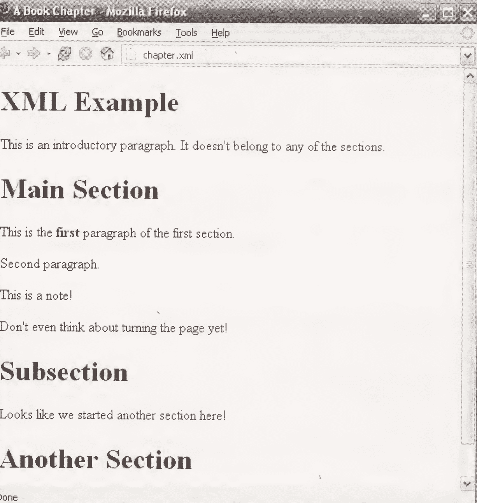

这是一个介绍段落。它不属于任何章节。

## 主章节

这是第一个章节的第一个段落。

第二个段落。

这是一个注释！

别想翻页！

## 子章节

看起来我们在这里又开始了一个章节！

## 另一个章节

完成

看起来很不错，不是吗？但是，是不是有什么遗漏了？当然有了。在我们的 XSLT 文件中，我们对所有的 `para` 和 `title` 元素一视仁，无论它们出现在 XML 文档的什么位置。这不对劲！

## 使用 XPath 识别元素上下文

文档顶部的 `title` 元素是章节标题，处理方式应与不同嵌套章节中的 `title` 元素不同。同样，表示警告或介绍的 `para` 元素也应该与其他段落区别对待。

让我们先处理 `title` 元素。章节标题应该用 `<h1>` 标签格式化。其他作为嵌套章节标题的 `title` 元素应该根据嵌套层级使用逐渐减小的标题（`<h2>`、`<h3>` 等）。

为了区分这些不同的标题类型，你可以使用 XPath 符号。要选出作为 `chapter` 标签子元素的 `title` 元素，我们可以使用 XPath 表达式 `chapter/title`。要选出顶层章节中的 `title` 元素，我们可以使用 `chapter/section/title`，依此类推。

这是一组处理我们文档中标题的有效模板：

```xml
<xsl:template match="chapter/title">
  <h1><xsl:apply-templates/></h1>
</xsl:template>
<xsl:template match="chapter/section/title">
  <h2><xsl:apply-templates/></h2>
</xsl:template>
<xsl:template match="chapter/section/section/title">
  <h3><xsl:apply-templates/></h3>
</xsl:template>
<xsl:template match="chapter/section/section/section/title">
  <h4><xsl:apply-templates/></h4>
</xsl:template>
```

## 图 4.2. 使用 XPath 查看章节示例。

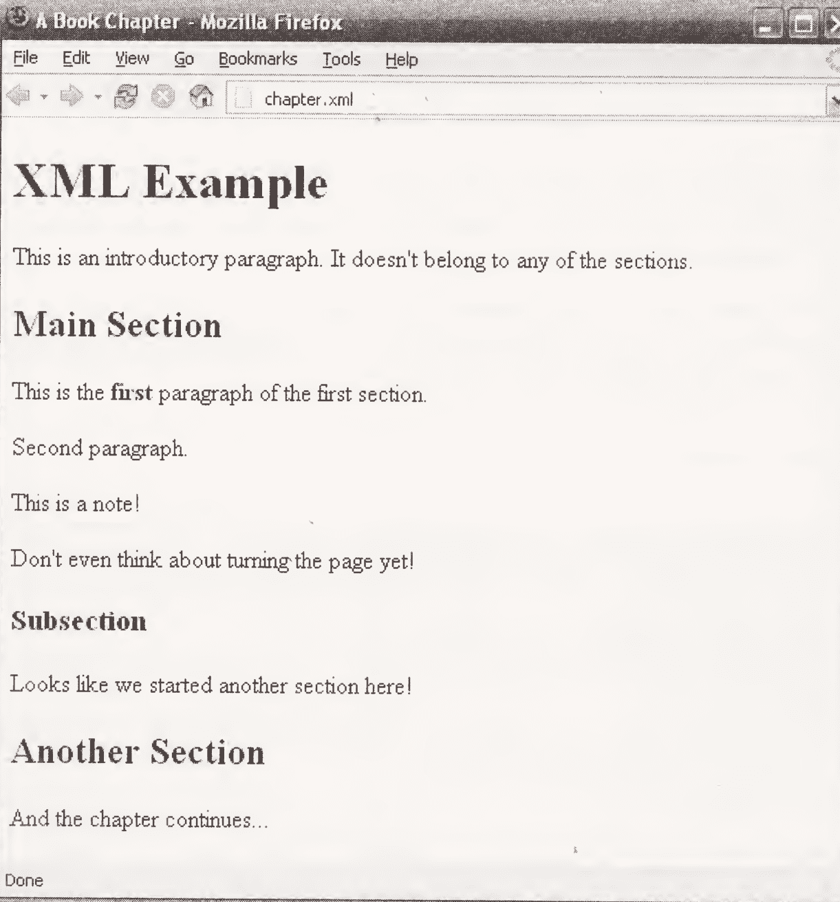

## 使用 XPath 匹配值

段落呢？与标题不同，它们无法通过位置单独区分。

在我们的 XSLT 文件中，我们可以使用属性选择器根据 `type` 匹配段落。这允许我们对不同类型的内容应用不同的样式。例如，我们可以将警告设为红色，将介绍设置为*斜体*。

幸运的是，XPath 允许我们指定属性值。在实际应用中，你应该将这些样式属性放在 CSS 文件并将其链接到 HTML 文档。这些模板将使用 `<p>` 标签上的类。

普通段落将继续使用第一个模板，因为它们不匹配特定的属性。

File: chapter2html.xsl (节选)

```xml
<xsl:template match="para">
<p><xsl:apply-templates/></p>
</xsl:template>
```

## 使用 XPath 匹配值

段落呢？在我们的 XSLT 文件中，我们可以使用属性选择器根据 `type` 匹配段落。这允许我们对不同类型的内容应用不同的样式。例如，我们可以将警告设为红色，将介绍设置为*斜体*。

File: chapter2html.xsl (节选)

```xml
<xsl:template match="para[@type='warning']" priority="1">
<p style="background-color: #cccccc; border: thin solid;
  width:300px; color:#ff0000;">
  <xsl:apply-templates/>
</p>
</xsl:template>
<xsl:template match="para[@type='note']" priority="1">
<p style="background-color: #cccccc; border: thin solid;
  width:300px;">
  <b><xsl:apply-templates/></b>
</p>
</xsl:template>
```

## 使用 value-of 提取信息

你会注意到页面标题是一个相当泛泛的短语，“书籍章节”。我们如何修改模板以便在此位置显示实际的章节标题呢？

当你需要从 XML 文档中提取简单的信息，而无需通过模板来处理包含它的元素时，你可以使用 `value-of` 元素配合 XPath 表达式来获取想要的内容：

```xml
<xsl:template match="/">
<html>
<head>
  <title><xsl:value-of select="/chapter/title"/></title>
  <meta http-equiv="content-type"
    content="application/html+xml; charset=iso-8859-1"/>
</head>
<body>
  <xsl:apply-templates/>
</body>
</html>
</xsl:template>
```

正如你所看到的，`select` 属性是一个 XPath 表达式，用于搜索 `chapter` 内标题的值。通过 `value-of`，我们可以打印该值。

输出。现在我们的文件显示的内容类似于图 4.4 所示。注意浏览器窗口的标题栏，它现在包含了章节标题。

## 图 4.3. 使用 XPath 查看章节示例（第 2 部分）

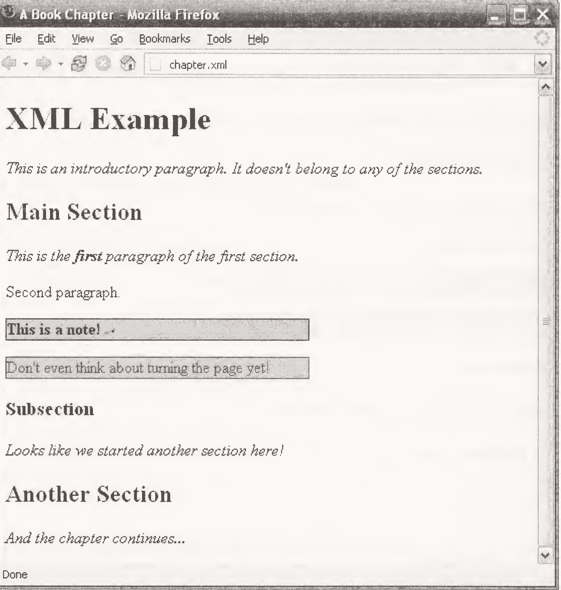

## 图 4.4. 使用 XPath 查看章节示例（第 3 部分）

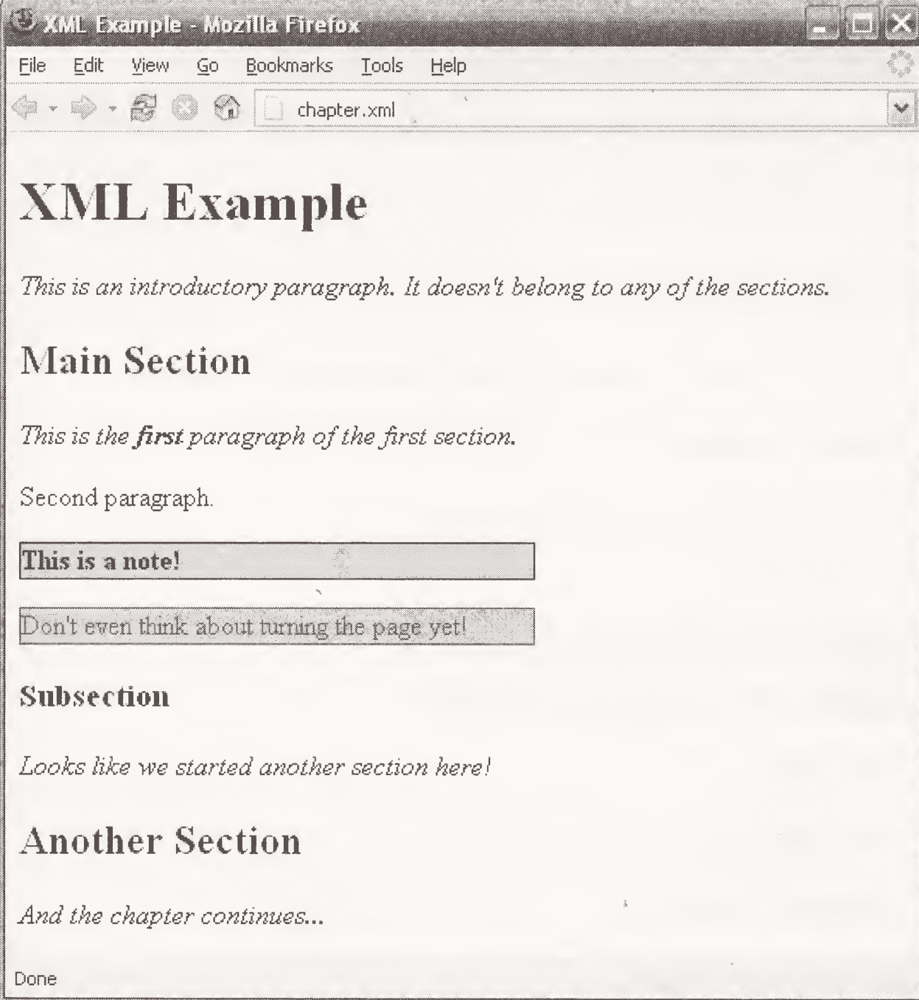

# CMS 项目

在之前的章节中，我们为 XML 文件、管理工具和显示组件收集了需求。在本章中，我想花一些时间

## 为什么从显示端开始？

构建我们项目的显示页面——包括首页、其他内部页面、新闻侧边栏、搜索小部件等。

在开始之前，让我们先回顾一下我们为显示页面收集的需求列表：

- 我们网站的显示端将只显示状态为“已发布（live）”的文章和其他内容。
- 搜索引擎将通过关键词、标题和描述检索文章，并只显示状态为“已发布（live）”的作品。
- 网站将显示作者列表供网站访问者浏览，但只显示那些在网站上发布了已发布文章的作者。

## 为什么从显示端开始？

你可能在问自己：“为什么 Tom 从显示端开始？我们甚至还没有为它将显示的所有内容构建管理工具呢。”

这是一个很好的问题。我决定从显示端开始是因为：

- 它比管理工具要简单得多，让我们有机会使用 PHP 构建一些简单的 XML 工具，而无必深陷于细节之中。
- 这意味着我们必须根据需求来工作。记得，我们花时间指定了每个文件的样式；现在，我们要做的就是根据这些规范进行工作。只要我们继续按照规范进行，一旦完成，一切都将协同工作。

所以，让我们开始处理显示页面吧。我们将从一个可以在所有页面上使用的包含文件（include file）开始。

## 创建公共包含文件

由于我们的网站将涉及 PHP 和 XML 之间复杂的交互，将你最需要的函数和变量存储在一个单独文件中，然后在所有其他页面中包含该文件是一个好主意。

我们将创建这个包含文件并开始向其中添加一些信息：

```php
<?php
session_start();
$fileDir = $_SERVER['DOCUMENT_ROOT'] . '/xml/';
?>
```

该文件将包含许多我们在项目后期将使用的必要变量。

在开始创建一个基础首页之前，让我们先创建一个包含搜索小部件的包含文件。

## 创建搜索小部件包含文件

我们所有的公共显示页面都将提供搜索小部件，因此创建一个包含所需表单元素的文件是一个明智之举：

```html
<form id="searchWidget" method="post" action="doSearch.php">
Search:
<input name="term" type="text" id="term" />
<input name="search" type="submit" id="search" value="Search" />
</form>
```

与公共包含文件一样，我们将使用 PHP 的 `include` 命令将此表单包含到所有页面中。在这种情况下，我们这样做是为了降低维护成本：我们只需要编辑一次表单即可影响整个网站。

注意 `action` 被设置为一个名为 `doSearch.php` 的文件。我们很快就会处理该文件——它是将处理 XML 并向访问者返回搜索结果的文件。

## 构建首页

网站上最重要的页面是首页。大多数访问者可能从那里开始，因此你希望尽可能多地显示信息，以吸引他们继续探索。

从结构角度来看，我们网站的页面将由三个 `<div>` 标签组成：页面头部、导航菜单和内容区域。

页头部将包含全局导航元素。和我们的搜索小部件文件一样，这个导航也将一个包含文件——毕竟，我们希望在网站的其他页面上重用这些元素。

对于我们网站的首页，导航菜单将包含搜索小部件和当前新闻项目的列表。在主区域，我们将显示首页文案以及指向网站上文章和其他内容的链接。

我们将逐一处理这些部分。但在此之前，让我们快速看一眼网站首页的外观——它如图 4.5 所示。

## 图 4.5. 首页的外观。

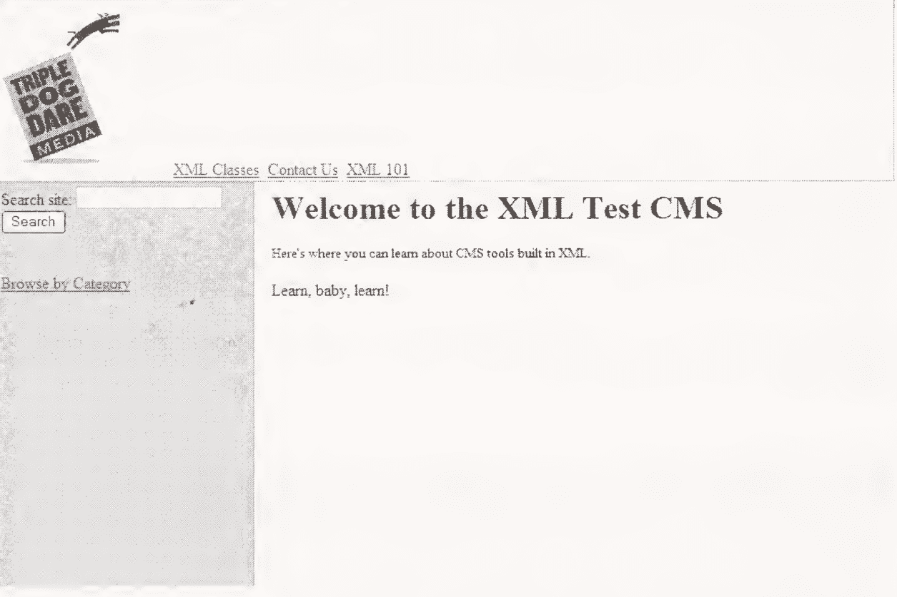

## 构建顶部导航包含文件

我们的顶部导航将放置在一个包含文件中。它将包含网站 Logo 的图像（热链到首页以便导航）以及一组引导用户进入各个页面的链接。记住，`$fileDir` 是由 `common.php` 设置的变量，让网站上的此脚本和其他脚本知道去哪里寻找 XML 文件。

```xml
<person>
<name>Tom</name>
<age>33</age>
</person>
```

例如，假设你有如下的 XML：

```php
$handle = opendir($fileDir);
while ($file = readdir($handle)) {
  if (is_dir($fileDir . $file)) continue;
  if (!preg_match("/^webcopy\.xml$/", $file)) continue;
  $webcopy = simplexml_load_file($fileDir . $file);
  if (count($webcopy->xpath('/webcopy[status="live"]')) > 0) {
    $id = htmlspecialchars($webcopy['id']);
    $label = htmlspecialchars($webcopy->navigation);
    echo "<a href=\"inner.php?id=$id\">$label</a>";
  }
}
```

```html
<div id="nav">
<a href="index.php"></a>
</div>
```

### 正则表达式

这段代码使用正则表达式来匹配所需的文件。关于 PHP 中正则表达式的详细信息，请参考 Kevin Yank 的书籍《Build Your Own Database Driven Website Using PHP & MySQL》(SitePoint)，或者参考 PHP 手册³。

> ³ http://www.php.net/regex

在这里，我们正在使用 SimpleXML 的 `xpath` 方法来检查网页元素是否在文档根节点包含一个值为 `live` 的状态元素（status）。该方法返回一个符合指定标准的元素数组；在这种情况下，该数组要么包含指向文件中该网页元素的引用（如果状态为 `live`），要么为空。我们使用 PHP 的 `count` 函数来对此检查。

如果文件通过测试，我们就提取网页元素 `id` 属性的值以及嵌套的 `navigationlabel` 元素包含的值。

```php
$id = htmlentities($webpage['id']);
$label = htmlentities($webpage->navigationlabel);
```

如你所见，属性是以数组元素的形式引用的（`$webpage['id']`），而嵌套元素是以对象属性引用的（`$webpage->navigationlabel`）。

有了这些值，我们就可以为页面导航打印合适的链接：

```php
echo "<a href='webpage.php?id={$id}'>{$label}</a>";
```

让我们继续处理首页的其他部分。

## 构建首页的下半部分

还记得我说过我们的首页将由三个 `<div>` 标签组成吗？很好，我们刚刚处理了第一个——页面页眉。现在我们来谈谈位于第一个旁边的两个 `div`。

我们的首页文件将命名为 `index.php`。该文件根据需要包含了 `common.inc` 和 `navtop.inc` 文件。然后它生成二级导航和内容 `div`（`navSide` 和 `mainContent`）。

```php
<?php
include_once 'common.php';
$file = $fileDir.'homepage.xml';
$homePage = simplexml_load_file($file);
?>
<!DOCTYPE html PUBLIC "//W3C//DTD HTML 1.0//EN"
"http://www.w3.org/TR/xhtml/DTD/xhtml1-transitional.dtd">
<html xmlns="http://www.w3.org/1999/xhtml">
<head>
  <title><?php echo htmlspecialchars($homePage->headline); ?></title>
  <meta http-equiv="Content-Type" 
  content="text/html; charset=iso-8859-1" />
  <link rel="stylesheet" href="xmlcms.css" type="text/css" />
</head>
<body>
  <?php
  include 'navtop.inc.php';
  ?>
  <div id="navSide">
    <?php
      include 'search.inc.php';
      include 'news.inc.php';
    ?>
  </div>
  <div id="mainContent">
    <?php
      echo '<h1>' . htmlspecialchars($homePage->headline) . '</h1>';
      echo '<p><small>' . htmlspecialchars($homePage->description) . '</small></p>';
      echo $homePage->body;
    ?>
  </div>
</body>
</html>
```

它看起来非常简单，不是吗？在这个文件中，我们使用了各种 `include` 和 PHP 函数来为我们完成许多脏活累的工作。当我们想要构建文章、Web 副本等其他显示页面时，也将使用这种方法。

唯一有点复杂的部分是前几行：

文件：index.php（片段）

```php
<?php
include_once 'common.inc.php';
$file = $fileDir . 'homepage.xml';
$homePage = simplexml_load_file($file);
?>
<title><?php echo htmlspecialchars((string)$homePage->headline); ?></title>
```

在这段代码中，我们打开 `xml` 目录下的 `homepage.xml` 文件，然后将 `headline` 元素的内容作为页面标题输出。

对于左侧导航 `div`，我们将使用两个 `include`：

文件：index.php（片段）

```php
<div id="navSide">
  <?php
    include 'search.inc.php';
    include 'news.inc.php';
  ?>
</div>
```

第一个 `include` 是我们之前构建的搜索小组件。第二个应该生成 `live` 新闻项目的列表，但我们还没有构建它。

在大多数情况下，我们的新闻 `include` 文件的结构与我们在 `navtop.inc.php` 中使用的代码非常相似。我们做的只是提取状态为 `live` 的新闻项目：

文件：news.inc.php（片段）

```php
<?php
include_once 'common.inc.php';
$handle = opendir($fileDir);
echo '<p>';
while (($file = readdir($handle)) !== FALSE) {
  if (is_dir($fileDir . $file)) continue;
  if (!preg_match('/news*.xml/', $file)) continue;
  $news = simplexml_load_file($fileDir . $file);
  if (count($news->xpath('/news[status="live"]')) > 0) {
    $id = htmlspecialchars($news['id']);
    $label = htmlspecialchars($news->headline);
    echo '<a href="innerpage.php?id={$id}">{$label}</a><br />';
  }
}
echo '</p>';
?>
```

现在我们已经完成了首页的左侧。为了获取页面标题，我们可以继续使用 `$homePage` 变量来提取我们需要的值：

```php
<div id="mainContent">
  <?php
      echo '<h1>' . htmlspecialchars($homePage->headline) . '</h1>';
      echo '<p><small>' . htmlspecialchars($homePage->description) . '</small></p>';
      echo $homePage->body;
    ?>
  </div>
```

## 样式表

编写样式表并不是很复杂。为了完整起见，这里是确保布局正确的代码：

```css
body {
  color: #000;
  font-family: Arial, sans-serif;
  background: #fff;
}
#navTop {
  border-bottom: 1px solid #ccc;
  padding: 5px;
}
#navSide {
  float: left;
  width: 250px;
}
#mainContent {
  float: left;
  padding: 10px;
}
```

```php
<?php
include 'navtop.inc.php';
?>
<div id="navSide">
<?php
include 'search.inc.php';
include 'news.inc.php';
?>
</div>
<div id="mainContent">
<?php
echo '<h1>' . htmlspecialchars($inner->headline) . '</h1>';
echo '<p>' . htmlspecialchars($inner->description) . '</p>';
if (count($inner->xpath('body'))) {
echo $inner->body;
}
?>
</div>
</body>
</html>
```

到目前为止，我们需要的这些了——我们已经拥有了一个可以运行网站的基础！虽然我们还没有太多的格式，也没有可用的搜索引擎，但显示部分已经整合得相当不错了。

目前我们的示例网站看起来是什么样的？嗯，我们还没有创建任何 XML 文档，所以你的可能完全无法运行。不过，在我的系统中，我插入了一些文件，这些文件已包含在本章的代码存档中提供给你们，该网站看起来如图 4.6 所示。

在接下来的几个章节中，我们将使用管理工具创建 XML 文档，项目将真正开始成型。

## 总结

在本章中，当我们勾勒项目所需的显示页面时，我们更深入地观察了 XSLT。在第 5 章中，我们将更深入地研究 XSLT，学习该语言的一些更具程序特性的方面，例如循环、变量和分支。我们还将填充显示侧所需的元素，例如可用的搜索引擎、一些格式规则以及其他细节。

## 图 4.6. 目前 CMS 项目的显示。

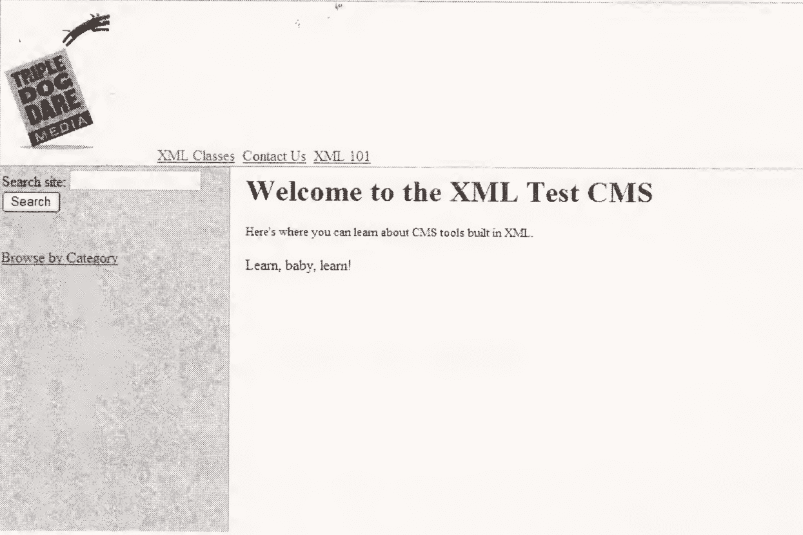

## 欢迎来到 XML 测试 CMS

在这里，你可以学习到使用 XML 构建的 CMS 工具。

学习吧，孩子，学习吧！

---

# 第 5 章：详细介绍 XSLT

在第 2 章和第 4 章中，你已经接触了一些 XSLT，并学习了在 Web 浏览器中显示 XML 的基本技巧。现在是时候揭示 XSLT 一些更高级语法了。本章的目标是帮助你更好地理解 XSLT 的强大。一旦处理完这些，我们将返回 CMS 项目，并开始将 XSLT 规则应用于我们在上一章构建的显示页面上。不过，让我们再次看看 XPath。

## XPath

在目前对 XSLT 的工作中，你已经接触过 XPath，但为了本章的主题，让我们停下来，现在仔细观察一下它。

没有 XPath，你真的无法以任何细粒度控制 XSLT（或其他 XML 技术）。打个比方，在不知道 XPath 的情况下尝试使用 XSLT，就像在不知道结构化查询语言 (SQL) 的情况下尝试理解数据库一样。就像 SQL 一样，XPath 是一种查询语言，但它的语法与文件路径更为相关。

例如，如果你在 UNIX 机器上工作，我让你打开以下文件，你会知道在当前工作目录中查找：

```
File.xml
```

想象一下我让你看这里：

```
../File.xml
```

在这种情况下，你会知道去当前工作目录的“上方”目录中查找。如果我给你这个位置呢？

```
/home/File.xml
```

你将一直到目录层次结构的根部，并在主目录中查找适当的文件。经验丰富的用户直觉上知道这些文件路径表示法某些可能指向同一个文件，或者它们可能指向三个完全不同的文件，取决于当前的工作目录。

XPath 的工作方式非常相似。你始终可以使用此表达式获取文档的根元素：

```
/*
```

就像文件路径一样，斜杠 (`/`) 代表文档结构的根，星号 (`*`) 是通配符，它将匹配该位置出现的任何 XML 元素。由于 XML 文档必须有一个根元素，因此此表达式将匹配那一个元素，无论它是什么。

XPath 还允许你寻找并找到文档中所有具有特定名称的元素：

```
//title
```

XPath 中的双斜杠 (`//`) 记法意味着“此元素或其任何后代，其名称为……”。当它出现在 XPath 表达式的开头时，“此元素”指的是文档的根节点。因此，这里显示的特定表达式将定位文档中任何位置的 title 元素。

与其在整个文档中查找元素，你可以根据上下文只匹配某些元素：

```
memo/title
```

此表达式匹配作为 memo 元素的 title 元素，而该 memo 元素又是当前元素的元素。在各个地方添加双斜杠可以放宽此表达式的要求。例如，`memo//title` 将匹配 memo 元素内部任何位置出现的 title 元素，而不仅仅是它的元素。`//memo/title` 将匹配文档中任何位置找到的 memo 元素的 title 元素，而不是当前元素的元素。为了极致的灵活性，`//memo/title` 将匹配 title 元素。像文件路径一样，你也可以使用 `.` 和 `..` 记法。`.` 是“当前节点”的简写，`..` 是“当前节点的父节点”的简写。正如我们在第 4 章中看到的，XPath 还允许我们更有判别力。例如，假设在略有不同的架构中，我们将文本值存储在标签内，而不是属性中。如果我们想检索所有值为 hot 的 title 元素，做法是这样的：

```
title[priority='hot']
```

如果你想检索所有设置了 priority 的节点呢？你会使用此表达式：

```
title[@priority]
```

以下是你如何提取文档中任何位置具有热属性的 title 元素的所有 date 元素的：

```
//title[@priority='hot']/date
```

XPath 还提供了可以在逻辑节点位置上操作的选择器。例如，分别检索任何 memo 元素的第一个和最后一个 title 元素，你会使用：

```
memo/title[first()]
memo/title[last()]
```

你也可以使用索引选择器选择任何 memo 元素的第一个 title 元素：

```
memo/title[1]
```

这实际上是以下内容的简写：

```
memo/title[position()]=1
```

在其他情况下，你可能需要选择同一文档中的多个分支。这是一个展示你如何同时提取备标题和作者的示例：

```
memo/title|memo/author
```

正如你所见，XPath 查询语言是强大且灵活的——它允许从 XML 文档中检索任何组合的节点，这在你处理 XSLT 和其他 XML 技术时可能会产生巨大影响。

## XSLT 的程序特性

在本节中，我们将涵盖 XSLT 中的排序、计数、编号、条件处理和循环。目标是让你对 XSLT 的一些更具程序特性的方面有一个坚实的基础。

### 排序

有时，你可能更改 XML 文档中节点的顺序。事实上，如果你正在使用某种软件过程创建文件（例如库存读出），这些节点可能会按照它们被写入文件的顺序输出。

XSLT 的 `sort` 元素可以非常有帮助。它允许你按照字母顺序或数字顺序对节点进行排序，也可以按升序（a, b, c）或降序（z, y）排列。

来看一个假设的 XML 文件，它包含目录中的产品列表。如如下例所示，产品列表并没有任何明显的顺序。

```xml
<?xml version="1.0" encoding="iso-8859-1"?>
<catalog>
  <product sku="212993">Lamp</product>
  <product sku="488839">Folder</product>
  <product sku="198102">Stapler</product>
  <product sku="91882">Notebook</product>
  <product sku="873638">Inbox</product>
  <product sku="192839">Desk</product>
  <product sku="66553">Pen</product>
  <product sku="382839">Calculator</product>
</catalog>
```

文件：productlisting.xml

#### 按字母排序

你可以通过在选择产品元素的 `<xsl:apply-templates>` 标签中添加一个 `<xsl:sort>` 标签，按字母升序对此产品列表进行排序。

```xml
<xsl:template match="catalog">
  <h1>Alphabetical List of Products</h1>
  <xsl:apply-templates select="product">
    <xsl:sort/>
  </xsl:apply-templates>
</xsl:template>
<xsl:template match="product">
  <p><xsl:apply-templates/></p>
</xsl:template>
```

文件：sort.xsl（节选）

图 5.1 显示了在 Web 浏览器中显示的文件。如你所见，产品元素在被相应的模板处理之前，已经根据其内容进行了排序。

## 图 5.1. 产品列表的字母排序示例。

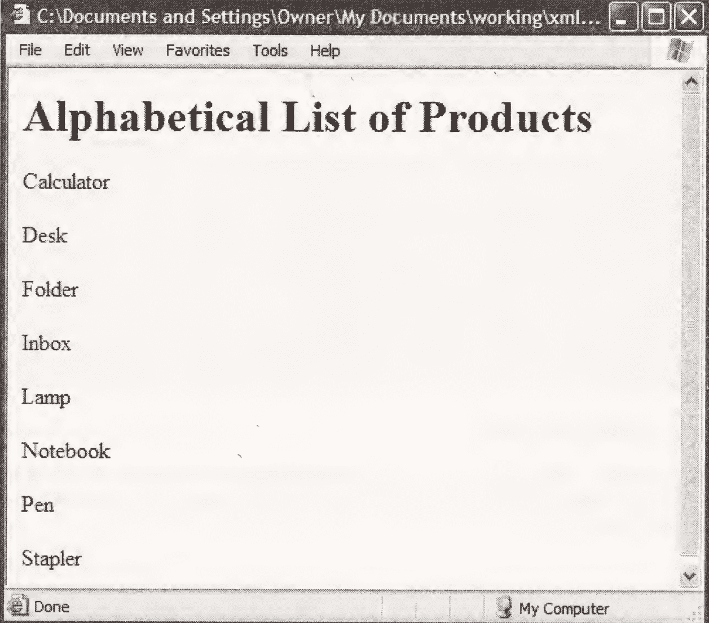

#### 反转排序

如果你想按反序排序列表怎么办？简单！只需在你的排序指令中添加一个 `order` 属性即可：

文件：sort-descending.xsl（节选）

```xml
<xsl:template match="catalog">
  <h1>Alphabetical List of Products</h1>
  <xsl:apply-templates select="product">
    <xsl:sort order="descending"/>
  </xsl:apply-templates>
</xsl:template>
```

反序列表显示在图 5.2 中。

## 图 5.2. 反转我们产品列表的排序。

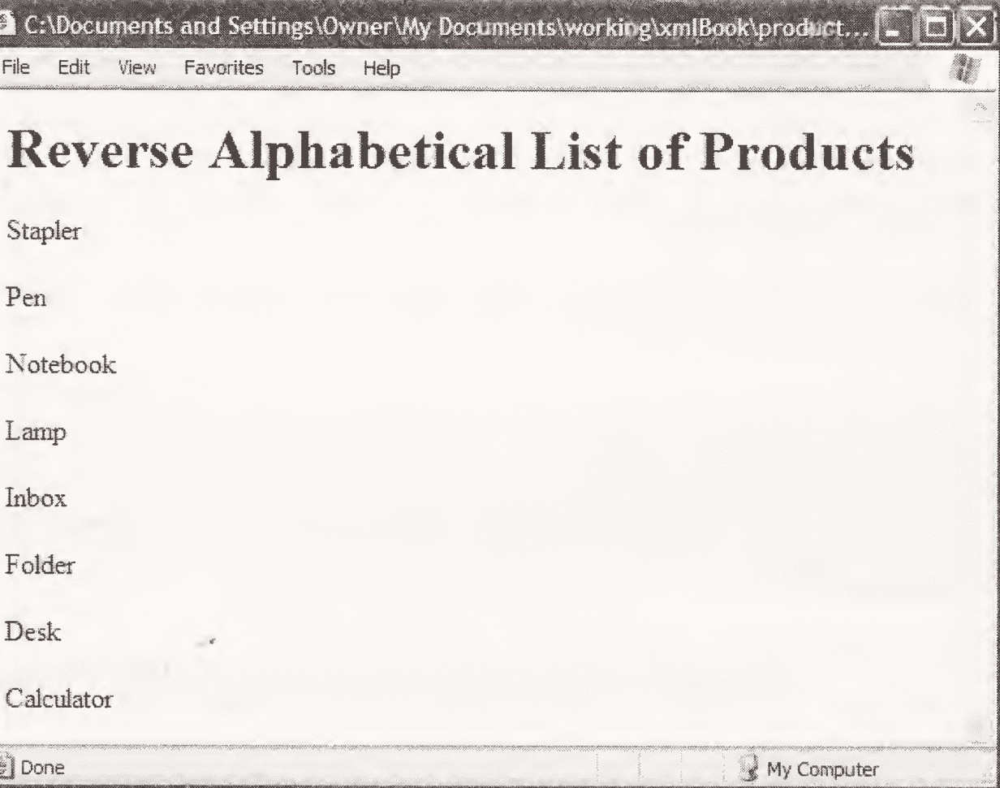

#### 按数字排序

现在我们已经掌握了字母排序，让我们来看看数字排序。我们想要的是根据产品 `sku` 属性的值对列表进行排序。

这里是该列表：

```xml
<?xml version="1.0" encoding="iso-8859-1"?>
<catalog>
  <product sku="212993">Lamp</product>
  <product sku="488839">Folder</product>
  <product sku="198102">Stapler</product>
  <product sku="91882">Notebook</product>
  <product sku="873638">Inbox</product>
  <product sku="192839">Desk</product>
  <product sku="66553">Pen</product>
  <product sku="38289">Calculator</product>
</catalog>
```

如果我们想使用 `sku` 属性进行排序，我们必须首先向 `sort` 元素添加 `data-type` 属性，这样它就知道正在排序的是数字而不是文本值（默认值）。该属性有三个有效值：`text`、`number` 和 `qname`。目前，我们将集中在 `number` 上，因为它允许我们根据数字 SKU 对列表进行排序¹。

我们还必须告诉 XSLT 在执行排序时查看什么。为了做到这一点，我们使用 `sort` 元素的 `select` 属性。

```xml
<xsl:template match="catalog">
<h1>Product Listing</h1>
<xsl:apply-templates select="product">
<xsl:sort select="@sku" data-type="number" />
</xsl:apply-templates>
</xsl:template>
```

文件：sort-sku.xsl（节选）

这里发生的情况是对于每个要排序的元素，`sort` 元素的 `select` 属性提供了一个 XPath 表达式，用于定位用于执行排序的数据。在这种情况下，`@sku` 指向每个产品元素的 `sku` 属性。

图 5.3 显示了此 XSLT 处理的结果。

如果我们想同时显示 SKU 和产品名称怎么办？我们可以简单地修改产品元素的模板，使用 `value-of` 输出该值。

```xml
<xsl:template match="product">
<p><xsl:value-of select="@sku" /> - <xsl:apply-templates/></p>
</xsl:template>
```

文件：sort-show.xsl（节选）

图 5.4 显示了 SKU 的显示。

## 图 5.3. 数字排序。

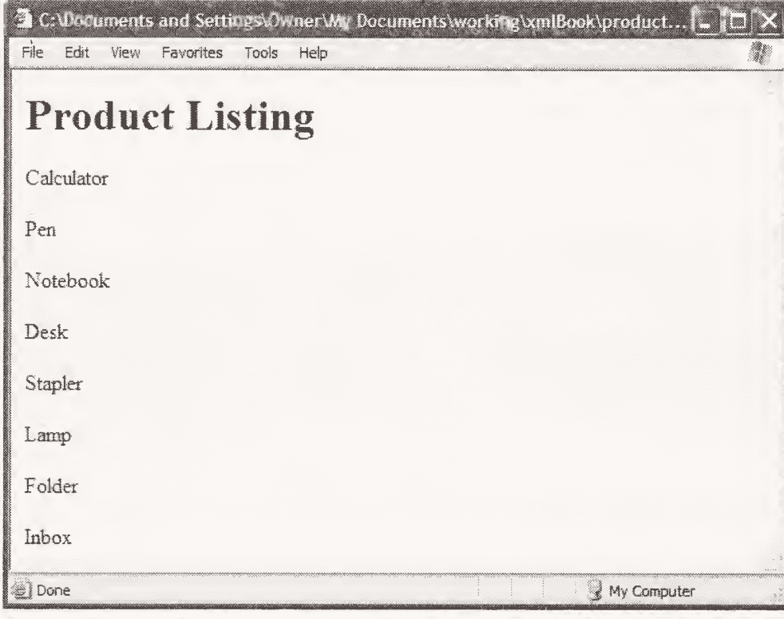

## 图 5.4. 数字排序。（部分2）

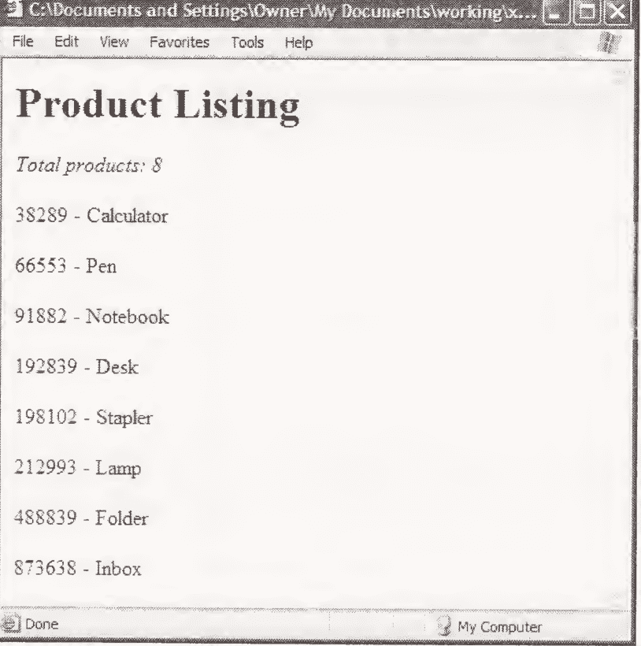

### 计数

按 SKU 排序列表是好的，但可能需要显示总数。我们可以使用 `count` 函数来打印匹配的元素数量。在接下来的示例中，我们将在使用它：

文件：count.xsl（节选）

```xml
<xsl:template match="catalog">
  <h1>Product Listing</h1>
  <p>Total products:
  <xsl:value-of select="count(product)" /></p>
  <xsl:apply-templates select="product">
    <xsl:sort select="@sku" data-type="number"/>
  </xsl:apply-templates>
</xsl:template>
```

图 5.5 显示了这在 Web 浏览器中的外观。

## 图 5.5. 计数。


### 编号

如果你需要为你的 XSLT 输出编号列表，使用 `<xsl:number>` 标签。在这个示例中，我们将使用它来打印每个节点的数字。然后，我们将查看它是如何实现的。

文件：number.xsl（节选）

```xml
<xsl:template match="catalog">
  <h1>Product Listing</h1>
  <p>Total products:
  <xsl:value-of select="count(product)" /></p>
  <xsl:apply-templates select="product"/>
</xsl:template>
<xsl:template match="product">
  <p><xsl:number format="1. "/><xsl:apply-templates/> (<xsl:value-of select="sku"/>)</p>
</xsl:template>
```

注意此样式表与上一个几乎相同，除了在这里我们没有排序结果。此外，在第二个模板中，我们添加了数字——根据 `format` 属性使用整数、带前零的整数、大写和小写字母以及罗马数字。只需提供一个你希望系列中的第一个数字看起来像的值，XSLT 就会从此开始。在这个示例中，值 `1` 表示我们想要整数后面跟着一个点 (.)，然后是一个空格。`format` 属性允许你使用整数、带前零的整数、大写和小写字母以及罗马数字创建编号方案。表 5.1 提供了这些特殊字符的摘要。

## 表 5.1. format 属性代码

| 代码 | 结果 | 代码 | 结果 |
|---|---|---|---|
| 1 | 1 2 3 4 ... | A | A B C D ... |
| 01 | 01 02 03 04 ... | i | i ii iii iv ... |
| a | a b c d e f ... | I | I II III IV ... |

默认情况下，每个元素生成的数字。因此，如果我们以任何方式排序输出，数字都会乱。图 5.6 显示了使用 `number` 元素会发生什么；图 5.7 显示了同时对数据排序会发生什么。

## 图 5.6. 为你的输出编号。

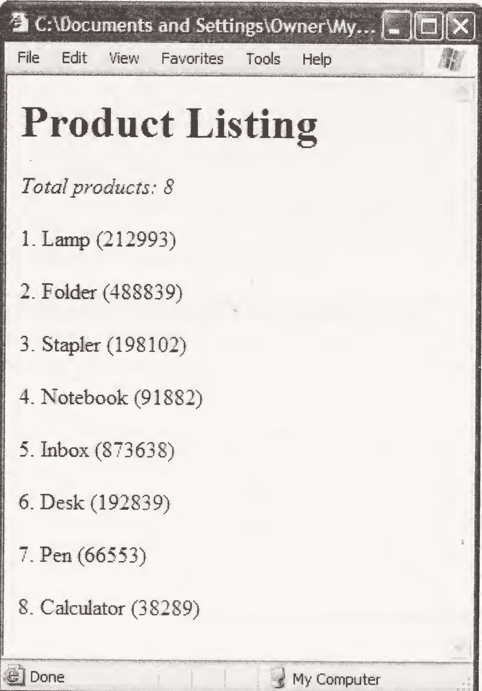

```xml
<xsl:template match="catalog">
  <h1>Product Listing</h1>
  <p>Total products:
  <xsl:value-of select="count(product)" /></p>
  <xsl:apply-templates select="product">
    <xsl:sort/>
  </xsl:apply-templates>
</xsl:template>
```

## 图 5.7. 带有排序的编号。

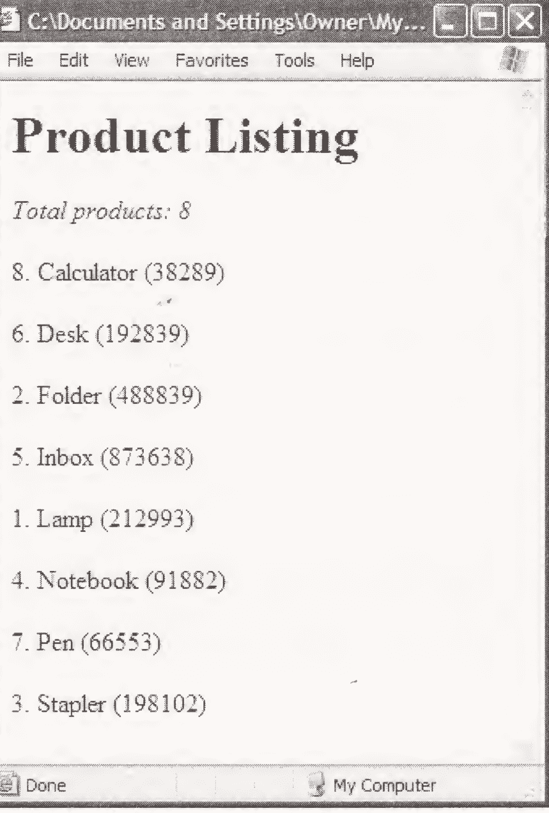

## 图 5.8. 排序和编号输出的正确方法。

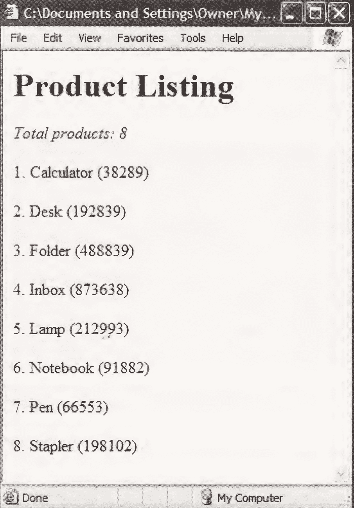

### 条件处理

大多数编程语言都允许我们执行某种条件处理。换句话说，让我们测试某个值为真为假，然后执行相应的操作。虽然 XSLT 不是一个完整的编程语言，但它确实提供了基本的条件处理工具。

#### `<xsl:if>`

继续我们的产品列表示例，假设我们只想显示 SKU 大于 100,000 的产品。这在样式表中将如何实现呢？

答案是使用 `<xsl:if>` 标签。该指令允许你设置一个测试，然后根据结果执行某些操作。在接下来的样式表中，我们使用这种技术来打印 SKU 超过 100,000 的产品。

```xml
<xsl:template match="catalog">
<h1>Product Listing</h1>
<ol>
  <xsl:apply-templates select="product">
    <xsl:sort/>
  </xsl:apply-templates>
</ol>
</xsl:template>
```

文件：conditional.xsl (节选)

```xml
<xsl:template match="product">
<xsl:if test="@sku &gt; 100000">
  <li><xsl:apply-templates/>
    (<xsl:value-of select="@sku"/>)
  </li>
</xsl:if>
</xsl:template>
```

首先注意，我们将整个输出封装在一个 HTML 有序列表中。其次，注意我们在第二个模板块中使用了 `<xsl:if>` 来执行我们的测试：

```xml
<xsl:if test="@sku &gt; 100000">
```

文件：conditional.xsl (节选)

每个元素都必须有一个相应的测试属性（`test`）。在这种特定情况下，我们正在测试 `sku` 属性的值（在 XPath 记法中为 `@`）。如果它超过 100,000，我们就打印产品名称。正如你从 HTML 中了解的那样，`&gt;` 是大于符号 `>` 的转义形式。

##### 转义小于号和大于号


由于小于 (`<`) 和大于 (`>`) 符号用于 XML 标签的开始和结束，因此当你在其他地方使用这些字符时，必须对其进行转义。这包括将它们作为 XPath 表达式中的运算符。

因此，如果你想执行“小于”测试，必须将 `<` 运算符转义为 `&lt;`：

```xml
<xsl:if test="@sku &lt; 100000">
```

如果你忘记转义这样的特殊字符，当你尝试使用样式表处理文件时，很可能会遇到错误消息。

图 5.9 显示了输出在 Web 浏览器中的样式。

## 图 5.9. 使用 `<xsl:if>` 进行条件处理。

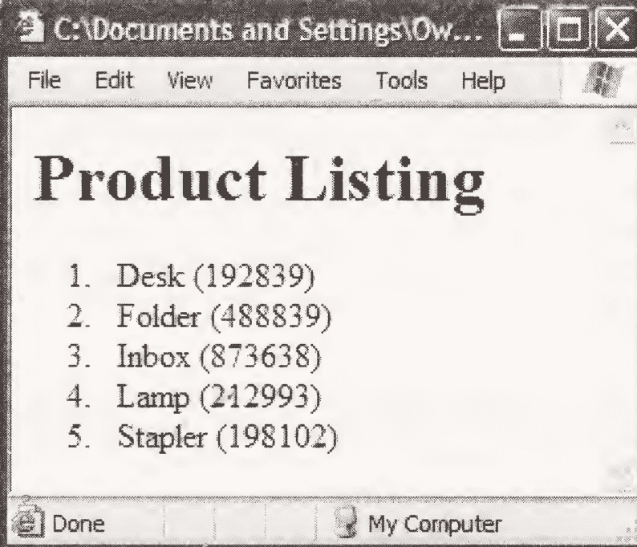

#### `<xsl:choose>`

`<xsl:if>` 和 `<xsl:choose>` 之间的区别是什么？`if` 元素只允许你一次测试一个条件，而 `choose` 元素可以有多个分支，每个分支响应不同的条件。

让我们继续处理我们的产品示例。在上一节中，我们使用 `if` 元素来打印任何 SKU 超过 100,000 的产品。这次，我们将使用 `choose` 根据它们的 SKU 值对不同的产品进行格式化。

文件：conditional2.xsl (节选)

```xml
<xsl:template match="product">
  <xsl:choose>
    <xsl:when test="@sku &gt; 100000">
      <li><strong><xsl:apply-templates/></strong>
      (<xsl:value-of select="@sku"/>)</li>
    </xsl:when>
    <xsl:when test="@sku &gt; 50000">
      <li><em><xsl:apply-templates/></em>
      (<xsl:value-of select="@sku"/>)</li>
    </xsl:when>
    <xsl:otherwise>
      <li><xsl:apply-templates/>
      (<xsl:value-of select="@sku"/>)</li>
    </xsl:otherwise>
  </xsl:choose>
</xsl:template>
```

如你所示，`<xsl:choose>` 包含了多个 `<xsl:when>` 标签以及可选的 `<xsl:otherwise>` 标签。`when` 的测试属性按顺序检查，第一个被发现为真的测试决定了执行哪个分支。如果没有任何测试通过，则转而处理可选分支的内容。

在这种情况下，我们的两个分支非常直观。在第一个分支中，我们检查 SKU 是否大于 100,000。如果是，我们就用**粗体**打印产品名称。在第二个分支中，我们测试 SKU 是否大于 50,000。如果是，我们就用*斜体*显示产品名称。`otherwise` 处理任何剩余的产品。

图 5.10 显示了结果。

## 图 5.10. 使用 `<xsl:choose>` 进行条件处理。


### 遍历数据

通过 `<xsl:for-each>`，你可以遍历一组 XML 元素。当你需要多次重复某个过程时，这种结构非常有用。在下面的示例中，我们将使用 `for-each` 代替模板来处理数据。

文件：foreach.xsl (节选)

```xml
<xsl:template match="catalog">
<h1>Product Listing</h1>
<ol>
  <xsl:for-each select="product">
    <li><xsl:apply-templates/></li>
  </xsl:for-each>
</ol>
</xsl:template>
```

如你所示，`for-each` 允许我们快速处理数据。虽然模板提供了更大的活性且更于维护，但有时 `for-each` 的简单性正是你需要的。

文件：conditional.xsl (节选)

```xml
<xsl:template match="catalog">
<h1>Product Listing</h1>
<ol>
  <xsl:for-each select="product">
    <li><xsl:if test="@sku &gt; 100000">
      <xsl:apply-templates/>
    </xsl:if>
  </xsl:for-each>
</ol>
</xsl:template>
```

文件：conditional2.xsl (节选)

```xml
<xsl:template match="catalog">
<h1>Product Listing</h1>
<ol>
  <xsl:for-each select="product">
    <li><xsl:apply-templates/></li>
  </xsl:for-each>
</ol>
</xsl:template>
```

## 我们的 CMS 项目

在上一节中，我们在 CMS 方面迈出了巨大的一步，构建了大部分需要的公共页面。在这一章中，我们将完成引擎并开始为文档添加格式规则。

## 完成我们的搜索引擎

在上一节中，我们创建了一个简单的搜索组件。该组件包含以下 HTML：

```html
<form id="searchWidget" method="post" action="doSearch.php">
  Search Site:
  <input name="term" type="text" id="term" />
  <input name="search" type="submit" id="search" value="Search" />
</form>
```

我们现在要创建 `doSearch.php` 文件，它将包含实现搜索的代码。当我们最初讨论网站需求时，说过：“搜索引擎将通过关键词、标题和描述检索内容，并只显示状态为 live 的部分。”

所以让我们开始编写 `doSearch.php`。页面的结构与我们网站的其他页面相似。然而，页面代码的核心会在适当的位置对提交的搜索字符串进行循环：

```php
<?php
include_once 'common.inc.php';
$term = $_POST['term'];
?>
<!DOCTYPE html PUBLIC "-//W3C//DTD HTML 1.0 Transitional//EN"
"http://www.w3.org/TR/xhtml1/DTD/xhtml1-transitional.dtd">
<html xmlns="http://www.w3.org/1999/xhtml">
<head>
<title>Search Results</title>
<meta http-equiv="content-type" charset=iso-8859-1" />
<link rel="stylesheet" href="xmlcms.css" type="text/css" />
</head>
<body>
<?php
include 'navtop.inc.php';
?>
<div id="navSide">
<?php
include 'search.inc.php';
include 'news.inc.php';
?>
</div>
```

```php
<div id="mainContent">
<?php
$handle = opendir($fileDir);
$items = array();
while (($file = readdir($handle)) != FALSE) {
    if (is_dir($fileDir . $file)) continue;
    if (!preg_match("/^(news|article|webcopy).*\.xml$/", $file)) {
        continue;
    }
    $xmlItem = simplexml_load_file($fileDir . $file);
    if ((stripos($xmlItem->keywords, $term) !== FALSE or
        stripos($xmlItem->headline, $term) !== FALSE or
        stripos($xmlItem->description, $term) !== FALSE) and
        (string)$xmlItem->status == 'live') {
        $item = array();
        $item['id'] = (string)$xmlItem['id'];
        $item['headline'] = (string)$xmlItem->headline;
        $items[] = $item;
    }
}
?>
```

这段代码看起来大家应该很熟悉。它只是简单地扫描我们的目录中包含 news、article 和 webcopy 的 XML 文件。它使用 SimpleXML 加载每个文件，并检查关键词、标题和描述元素是否包含搜索字符串 `$term`。一旦找到匹配项，就把文件信息存入 `$items` 数组中。

有几点需要注意：

```php
if (!preg_match("/^(news|article|webcopy).*\.xml$/", $file)) {
    continue;
}
```

正则表达式检查文件名是否以 news、article 或 webcopy 开头，并以 .xml 结尾。

```php
if ((stripos($xmlItem->keywords, $term) !== FALSE or
    stripos($xmlItem->headline, $term) !== FALSE or
    stripos($xmlItem->description, $term) !== FALSE) and
    (string)$xmlItem->status == 'live') {
```

这里使用的 `stripos` 函数在 PHP 5 中是新的。它对第一个参数进行不区分大小写的搜索，如果没有找到第二个参数，则返回 false。在这种情况下，我们使用它在 XML 元素值中查找搜索词。

在最后一行，我们必须将 status 元素的值转换为字符串 `(string)$item`，因为 SimpleXML 实际上是将信息存储为对象的。你会注意到在将它们存入变量之前，我们也对其他值（例如 `$xmlItem['id']`）进行了转换。在像 Java 这样的语言中，函数会自动执行这种转换，但在 PHP 中这是必须的。

我们运行一个测试来检查 `$items` 数组的长度是否大于零，并打印出相应的结果：搜索列表，或者一条未找到匹配搜索词的项目的消息。

search.php (excerpt)

```php
if (count($items) > 0) {
  echo '<h1>Search Results for ' . htmlspecialchars($term) . '</h1>';
  echo '<table border="1" cellspacing="0" cellpadding="3"
       width="85%">';
  echo '<tr valign="top"><th>Content Item</th><th>Content Type</th>
       </tr>';
  foreach ($items as $item) {
    echo '<tr valign="top"><td><a href="innerpage.php?id=' .
      $item['id'] . '">';
    echo htmlspecialchars($item['headline']) . '</a></td>';
    echo '<td>';
    echo preg_replace('/[0-9]/', '', $item['id']);
    echo '</td></tr>';
  }
  echo '</table>';
} else {
  echo '<h1>Sorry!</h1>';
  echo '<p>No files found with the search term ' .
      htmlspecialchars($term) . '</p>';
}
?>
</div>
</body>
</html>
```

现在我们的站点有了一个快速高效的 XML 驱动搜索引擎，如图 5.11 所示。

## 图 5.11 我们的搜索引擎


| 内容项目 | 内容类型 |
|------ | :--- |
| 学习 XML 基础 | webcopy |
| 我们的 XML 类 | webcopy |
| xml headline 2 | news |

## 创建 XSLT 驱动的站点

搜索引擎确实可以帮助访客导航，并准确告诉他们特定内容的位置以及如何到达。在本节中，我们将构建一个由 PHP 和 XSLT 驱动的站点。这将让我们亲自获得从 PHP 创建 XML 文件、使用 XSLT 处理 XML 以及在 XSLT 中使用动态排序的经验。

### 动态生成站点

我们需要的第一工作是创建一个 PHP 脚本，在内存中动态生成站点。然后，使用我们稍后创建的 XSLT 文件处理该站点。

在我们的 PHP 文件中，我们将使用 PHP 函数来创建站点。首先，我们将使用以下代码创建一个时间戳（格式为 YYYYMMDDHis）：

sitemap.php (excerpt)

```php
<?php
include_once 'common.php';
$xmlstring = '<?xml version="1.0" encoding="UTF-8"?>';
$xmlstring .= '<sitemap';
$timestamp = date('YmdHis');
$xmlstring .= '<sitemap id="' . $timestamp . '">';
```

现在我们已经以 XML 字符串的形式生成了站点，将其输入 SimpleXML：

sitemap.php (excerpt)

```php
$xml = simplexml_load_string($xmlstring);
```

在准备显示站点之前，我们要做的最后件事是设置一个决定内容列表排序方式的变量。对于此应用程序，我们希望用户能够根据标题、创建日期或内容类型进行排序。我们将在查询字符串中接受用户对排序模式的选择，默认为标题：

sitemap.php (excerpt)

```php
if (isset($_GET['sortby'])) {
  $sortby = $_GET['sortby'];
} else {
  $sortby = 'headline';
}
```

现在我们可以对信息应用样式表以便在 Web 浏览器中显示。在 PHP 5 中，XSLT 功能已与 XML 函数分离开，这允许您无论最初生成 XML 数据的方法如何，都可以使用 XSLT。然而，这意味着您需要确保您的 PHP 安装了 XSLT 支持。

PHP 中的 XSLT 支持由可选的 XSLT 扩展提供。该扩展默认未启用；在 Unix 类型的安装中，您需要使用 `--with-xsl` 编译它。在在此操作之前，您需要在服务器上安装 libxslt。在 Windows 上，过程简单简单；您只需要将 `php_xsl.dll` 文件添加到您的 php.ini 文件中。

我们需要做的第一件事是加载样式表。在 PHP 中，我们使用内置的 `DOMDocument` 类来实现。我们将在后面的章节中学习更多关于 `DOMDocument` 的知识，但现在您只需要知道如何加载一个 XML 文件：

sitemap.php (excerpt)

```php
$xsl = new DOMDocument;
$xsl->load('xsl/sitemap.xsl');
```

加载后，我们可以使用 PHP 的 `XSLTProcessor` 类配合样式表：

sitemap.php (excerpt)

```php
$proc = new XSLTProcessor;
$proc->importStylesheet($xsl);
```

> ² http://www.php.net/xsl
> ³ http://xmlsoft.org/XSL/

### 创建由 XSLT 驱动的站点地图

接下来，我们将 `$sortby` 变量作为参数传递给样式表。我们通过 `$xsltprocessor->setParameter` 方法来实现这一点。第一个参数与命名空间有关，几乎总是留空；第二个参数设置参数在样式表中所使用的名称；第三个参数是参数的值。样式表将使用此参数根据用户的偏好对站点地图进行排序：

文件：sitemap.php（片段）

```php
$proc->setParameter('', 'SORTBY', $sortby);
```

最后，我们使用样式表转换 XML 数据并将输出发送到浏览器：

文件：sitemap.php（片段）

```php
echo $proc->transformToXML($xml);
?>
```

处理逻辑就绪后，剩下的工作就是编写样式表了：

### 创建样式表

样式表将非常简单。它会将 sitemap.xml 转换为用于浏览器的 HTML 显示内容，将网站上的实时内容以链接列表的形式呈现。用户将能够根据标题、创建日期和内容类型对显示进行排序。

在引言部分，我们设置了 XML 输出的输出方法：

文件：sitemap.xsl（片段）

```xml
<xsl:stylesheet version="1.0"
xmlns:xsl="http://www.w3.org/1999/XSL/Transform"
xmlns:html="http://www.w3.org/1999/xhtml">
<xsl:output method="xml" indent="yes" omit-xml-declaration="yes"
media-type="application/xhtml+xml" encoding="iso-8859-1"
doctype-public="//W3C//DTD XHTML 1.0 Transitional//EN"
doctype-system="http://www.w3.org/TR/xhtml1/DTD/xhtml1-transitional.dtd"/>
```

现在，我们需要声明样式表接受的 `SORTBY` 参数，以指示如何排序站点地图中的标题。为了做到这一点，我们使用 XSLT `<xsl:param>` 标签，如下：

文件：sitemap.xsl（片段）

```xml
<xsl:param name="SORTBY">headline</xsl:param>
```

如你所见，该标签包含了参数的默认值（当我们的脚本没有传递值时使用）。

接下来，我们为文档根节点编写一个模板，生成页面的静态元素。特别是，它包含了多个链接，允许用户对显示进行排序。这些链接传递了 PHP 脚本期望接收的查询字符串变量 `sortby`。

文件：sitemap.xsl（片段）

```xml
<xsl:template match="/">
<html>
<head>
  <title>Site Map</title>
```


# Site Map

sort: [type](?sortby=type) | [headline](?sortby=headline) | [date](?sortby=date)

```xml
<xsl:template match="sitemap">
<ul>
  <xsl:choose>
    <xsl:when test="$SORTBY='type'">
      <xsl:apply-templates>
        <xsl:sort select="type" />
      </xsl:apply-templates>
    </xsl:when>
    <xsl:when test="$SORTBY='date'">
      <xsl:apply-templates>
        <xsl:sort select="created" />
      </xsl:apply-templates>
    </xsl:when>
    <xsl:otherwise>
      <xsl:apply-templates>
        <xsl:sort select="headline" />
      </xsl:apply-templates>
    </xsl:otherwise>
  </xsl:choose>
</ul>
<p><small>sorting by: <xsl:value-of select="$SORTBY"/></small></p>
</xsl:template>
```

```xml
<xsl:template match="content">
<li><a href="innerpage.php?id={@id}"><xsl:apply-templates select="headline"/></a></li>
<li><xsl:value-of select="type"/></li>
</xsl:template>
```

## 使用 XML 解析器

要在 Internet Explorer 中操作或遍历 XML `XMLDOM` 文档，我们首先必须实例化 Microsoft `XMLDOM` 解析器。在 Internet Explorer 5.0 及更高版本中，我们可以使用 JavaScript 实例化该解析器。

```javascript
<script type="text/javascript">
var xml = new ActiveXObject("Microsoft.XMLDOM");
...
</script>
```

## 仅限 Internet Explorer

尽管我们最终会实现一个用于客户端处理 XML 数据的跨浏览器解决方案，但为了简单起见，让我们先从仅限 Internet Explorer 的解决方案开始。

一旦实例化了解析器，我们就可以使用一系列命令将文件加载其中。在示例中，我们将一个名为 `menu.xml` 的文件加载到解析器中。

```javascript
<script language="JavaScript">
var xml = new ActiveXObject("Microsoft.XMLDOM");
xml.async = false;
xml.load("menu.xml");
...
</script>
```

## 为什么要设置 xml.async？

将 `xml` 变量的 `async` 属性设置为 `false` 可以确保解析器在执行任何其他操作之前等待文档完全加载。

以下是本节后续示例将使用的 XML 文件：

```xml
<?xml version="1.0" encoding="iso-8859-1">
<menu>
<meal>
<title>Buddha's Delight</title>
<desc>A feast for the senses!</desc>
<price>$4.95</price>
</meal>
</menu>
```

## 第 6 章：使用 JavaScript/DHTML 操作 XML

如果适用于你的应用程序，你也可以改为创建一个字符串变量来存储 XML 数据，然后将其传递给解析器。注意，要执行此操作，你必须使用 `loadXML` 方法而不是 `load` 方法：

文件：`clientsidetring-ie.html` (节选)

```javascript
<script type="text/javascript">
var xmlcode = '<?xml version="1.0" encoding="iso-8859-1"?>';
xmlcode += '<menu><meal>';
xmlcode += '<title>Buddha\'s Delight</title>';
xmlcode += '<desc>A feast for the senses!</desc>';
xmlcode += '<price>$4.95</price>';
xmlcode += '</meal></menu>';
var xml = new ActiveXObject("Microsoft.XMLDOM");
xml.async = false;
xml.loadXML(xmlcode);
</script>
```

## 访问文档的不同部分

现在我们已经成功加载了 XML 文档的 DOM 表示，我们可以以多种方式访问它包含的信息。理论上，用于执行此操作的属性和方法是由 W3C DOM 建议<sup>1</sup> 规范的，但在实践中，不同的浏览器（尤其是 Internet Explorer）定义了自己的接口，这些接口有时受到标准的松散启发。

当解析器加载 XML 文档时，它返回给你的是文档本身的引用。通过它，在我们的示例（`menu` 元素）中，你可以通过 `documentElement` 获取文档中根元素的引用。该元素的子节点可以通过 `childNodes` 属性访问。

文件：`clientside-ie.html` (节选)

```javascript
var nodes = xml.documentElement.childNodes;
```

<sup>1</sup> http://www.w3.org/DOM/DOMTR

`childNodes` 属性（以及此示例中的 `nodes` 变量）包含一个 `NodeList`。根据 DOM 标准，你可以通过向 `item` 方法传递数字索引来访问 `NodeList` 的元素，其中 `0` 对应列表中的第一个节点。因此，在本示例中，`nodes.item(0)` 将返回指向 `menu` 元素第一个子元素的引用——`meal` 元素。

DOM 标准要求节点支持 `textContent` 属性，该属性将返回给定元素及其所有后代中包含的所有文本。Internet Explorer 不支持此属性，但它支持一个具有相同功能的非标准 `text` 属性。我们可以使用该属性打印文档中第一个 `meal` 元素中包含的所有文本：

文件：`clientside-ie.html` (节选)

```javascript
document.write(nodes.item(0).text);
```

结果应该像这样：

Buddha's Delight A feast for the senses! $4.95

如果我们想打印第一个 `meal` 元素中 `title` 元素的文本呢？为了做到这一点，我们需要稍微修改 JavaScript：

```javascript
var nodes = xml.documentElement.childNodes.item(0).childNodes;
document.write(nodes.item(0).text);
```

现在我们运行代码时，文本“Buddha’s Delight”显示在浏览器窗口中。

## 作为数组的 NodeLists

Internet Explorer（实际上许多其他 DOM 实现）允许你将 `NodeList` 视为数组，以简化处理它们的代码。在本示例中，你可以使用数组语法来访问节点，而不是 `item` 方法：

```javascript
var nodes = xml.documentElement.childNodes[0].childNodes;
document.write(nodes[0].text);
```

这种通过数字索引访问 XML 文件中文本值的方法非常有用，但可能会变得有些繁琐。幸运的是，还有另一种处理问题的方法。

## 按名称访问元素

你可以使用 `getElementsByTagName` 方法从文档中检索节点列表。该方法会检索方法调用节点下所有指定名称的元素。例如，要从示例菜单文档中打印“Buddha's Delight”，你可以编写以下代码：

文件：`clientside-ie.html` (节选)

```javascript
document.write(xml.getElementsByTagName("title").item(0).text);
```

## 使用 JavaScript 处理 XSL

现在，让我们构建一个 Web 页面来执行转换。该文件将包含大部分 JavaScript 代码，将 XML 和 XSL 文件加载到内存中，处理它们并显示结果。让我们看看它是什么样子的，然后逐行分析代码：

```html
<!DOCTYPE html PUBLIC "-//W3C//DTD XHTML 1.0//EN" "http://www.w3.org/TR/xhtml/DTD/1.dtd">
<html xmlns="http://www.w3.org/1999/xhtml">
<head>
<title>Processing XML/XSL with JavaScript</title>
<meta http-equiv="Content-Type" content="text/html; charset=iso-889-1" />
<script type="text/javascript">
  var xml = new ActiveXObject("Microsoft.XMLDOM");
  xml.async = false;
  xml.load("test.xml");
  var xsl = new ActiveXObject("Microsoft.XMLDOM");
  xsl.async = false;
  xsl.load("test.xsl");
  window.onload = function() {
    document.write(xml.transformNode(xsl));
  }
</script>
</head>
<body>
</body>
</html>
```

## 使用 JavaScript 处理 XSLT

文件：`jsTest-ie.html` (excerpt)

```javascript
window.onload = function() {
  document.write(xml.transformNode(xsl));
}
```

在这里，我们使用了 Internet Explorer 的 `transformNode` 方法，它接受持有 XSL 文件的对象作为参数。由于我们将此操作封装在 `document.write` 的调用内部，整个表达式形成了一个相当简洁的命令，其实际效果是：“取我们的 XSLT 并将其应用到我们的 XML 文档，然后显示生成的文档。”

图 6.1 显示了我们的工作在 Internet Explorer 中的显示情况。

## 图 6.1. 使用 JavaScript 在 IE 中转换 XML。

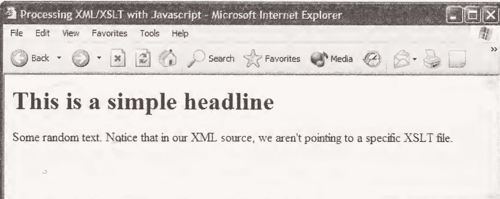

现在，尝试在 Firefox 中查看同一个文件。你会发现它完全没有显示。如果你使用内置的 JavaScript 控制台，你将看到类似图 6.2 所示的消息。

## 图 6.2. Firefox 产生的问题。


这是因为 Firefox（以及其他基于 Mozilla 的浏览器）无法识别我们在第 10 行尝试创建的 `ActiveXObject`。我们需要对脚本进行一些更改，使其跨浏览器运行。

## 使我们的测试脚本具有跨兼容性

我们现在知道，必须让小脚本在 IE 和像 Firefox 等基于 Mozilla 的浏览器中运行。每种浏览器处理加载的方式不同，因此任何可以在两种浏览器上运行的脚本都必须进行一些浏览器检测并做出相应的响应。

实现此点的困难方法是从零开始学习如何在 Firefox 和 Internet Explorer 中加载 XML，并自己完成所有必要的浏览器检测。更好的方法是打开 Web 浏览器，下载最新版本的 Sarissa JavaScript 库。该包包含许多 JavaScript (.js) 文件和各种文档文件。

基本上，Sarissa 让你能够使用单一 API 在两种类型的浏览器中进行 JavaScript XML 处理。这极大地节省了时间！它在 Internet Explorer 5.5 及以上、Firefox 1.0 及以上、Netscape 6 及以上以及 Mozilla 1.6 及以上版本上运行非常可靠。

此示例使用 Sarissa 实现了我们在上一节中所做：

文件：`jsTest-ie2.html` (excerpt)

```html
<script type="text/javascript" src="sarissa/sarissa.js"></script>
<script type="text/javascript">
var xml = Sarissa.getDomDocument();
xml.async = false;
xml.load("test.xml");
var xsl = Sarissa.getDomDocument();
xsl.async = false;
xsl.load("test.xsl");
window.onload = function() {
  var xslt = new XSLTProcessor();
  xslt.importStylesheet(xsl);
  var out = xslt.transformToDocument(xml);
  document.write(Sarissa.serialize(out));
}
</script>
```

> <sup>2</sup> http://sarissa.sourceforge.net
> <sup>3</sup> 本书是用最新版本的 Sarissa 0.9.6 编写和测试的。由于库仍在开发中，在你阅读此内容时，API 可能已经发生了某些变化。
> <sup>4</sup> 它的许多功能在 Safari 浏览器中也可以运行，但遗憾的是，XSLT 转换并不支持。

这段代码会将转换后的 XML 打印到页面上显示。让我们看看它与之前特定的 Internet Explorer 代码之间的差异。首先，我们必须使用 Sarissa 类的 `getDomDocument` 方法在内存中创建 XML 文档：

文件：`jsTest-ie2.html` (excerpt)

```javascript
var xml = Sarissa.getDomDocument();
```

我们还需要使用名为 `XSLTProcessor` 的类来执行样式转换。在创建对象后，我们通过 `importStylesheet` 加载样式的 DOM 节点：

文件：`jsTest-ie2.html` (excerpt)

```javascript
var xslt = new XSLTProcessor();
xslt.importStylesheet(xsl);
```

现在，Internet Explorer 允许我们将文档直接转换为 XML 字符串，而其他浏览器（因此 Sarissa）只支持转换输出的 DOM 表示。我们必须使用 Sarissa 类的 `serialize` 方法将其转换为字符串输出：

文件：`jsTest-ie2.html` (excerpt)

```javascript
var out = xslt.transformToDocument(xml);
document.write(Sarissa.serialize(out));
```

现在，如果你在 Internet Explorer 中测试此脚本，你会发现它的输出与特定浏览器示例相同。遗憾的是，如图 6.3 所示，当我们在 Firefox 和其他浏览器中测试时会遇到一个小故障。

发生了什么？如果你使用 JavaScript 的 `alert` 函数显示输出文档的 XML，你将看到图 6.4 中的代码。虽然这是一个有效的 XHTML 文档，但 XHTML 标签使用了“00”命名空间前缀，而不是让 XHTML 成为文档默认命名空间。结果是，内置的 CSS 规则无法应用。

我们的下一个任务是清空已显示文档的 body，通过删除其所有子节点（它们是文本、元素还是其他任何）：

```javascript
// 清除当前文档体
while (docBody.hasChildNodes()) {
  docBody.removeChild(docBody.firstChild);
}
```

这里使用的方法和属性现在都是 DOM 标准的一部分，而且相对容易理解。`hasChildNodes` 在元素拥有子节点时返回 `true`；`removeChild` 从元素中移除一个节点；`firstChild` 属性等同于 `childNodes.item(0)`。

现在显示文档的主体已经是空了，我们可以从转换输出文档中提取节点来填充它：

```javascript
// 使用 'out' 文档体的节点重新填充
for (var i = 0; i < outBody.childNodes.length; i++) {
  var node = outBody.childNodes.item(i);
  node = document.importNode(node, true);
  docBody.appendChild(node);
}
```

这段代码稍微没有那么容易理解，但同样直观。`for` 循环遍历转换输出文档主体的每个子节点，使用 `childNodes` 集合的 `length` 属性获取节点数量。我们使用当前显示文档的 `importNode` 方法来创建这些节点每个副本（包括它们的内容，如第二个参数 `true` 所示），以供文档使用。然后使用 `appendChild` 方法将这些节点添加到当前显示文档的 `body` 元素中。

此过程的结果是转换后的文档内容被添加并作为现有页面的一部分显示，如图 6.5 所示。只要你不需要显示文档标题或转换输出中 `head` 元素内的任何其他内容，这个解决方案就是有效的。

## 图 6.5. XSLT 输出在 Firefox 中正确显示了（终于）。

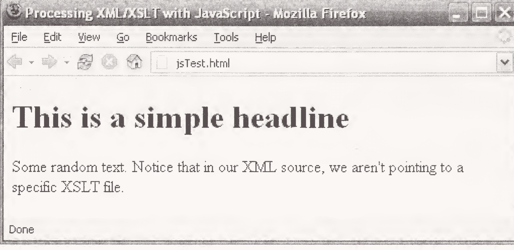

为什么不使用类似的技术来替换整个显示文档，而不仅仅是 `body` 的内容呢？Internet Explorer 的 DOM 实现的一个局限性再次阻止了这一点。Internet Explorer 使用完全不同的 DOM 库来处理浏览器中显示的文档，以及对内存中的文档执行 XSLT 转换。这两个库的设计并不是为了协同工作。Sarissa 库曾勇敢地尝试克服这一局限性，但在这里用于将节点从转换文档复制到显示文档的 `importNode` 方法仅适用于 HTML 文档 `body` 内允许的元素，这迫使我们必须像之前那样处理该问题。

庆幸的是，你很少会在客户端执行 XSLT 转换来生成一个用于显示的完整 HTML 文档。更多情况下，你会使用 XSLT 生成一个小的文档片段，在这种情况下，这里展示的使用 DOM 插入结果的技术是完全合适的，而不是一种不方便的替代方案。

# 创建动态导航

现在我们已经了解了如何用 JavaScript 应用样式表，让我们来实现一些稍微复杂的东西。让我们从文件中提取一些 XML，并使用 JavaScript 构建一个导航系统。

# 第 6 章：使用 JavaScript/DHTML 操作 XML

首先，让我们创建一个简单的文件，以 XML 格式存储我们的导航菜单：

```xml
<?xml version="1.0" encoding="iso-8859-1"?>
<menu>
<item label="home" target="index.html"/>
<item label="services" target="services.html"/>
<item label="about" target="aboutus.html"/>
<item label="contact" target="contactus.html"/>
<item label="kb" target="kb.html"/>
</menu>
```

让我们创建一个非常简单的 JavaScript（使用 Sarissa 库来实现跨浏览器功能），它将加载我们的菜单文件并将其显示为非常简单的 HTML 链接列表。

我们需要做的第一件事是加载 Sarissa 库：

```html
<!DOCTYPE html PUBLIC "//W3C//DTD XHTML 1.0 Transitional//EN"
"http://www.w3.org/TR/xhtml1/xhtml1-transitional.dtd">
<html xmlns="http://www.w3.org/1999/xhtml">
<head>
<title>XML Based Menu</title>
<meta http-equiv="Content-Type" charset="iso-8859-1" />
<script type="text/javascript" src="sarissa/sarissa.js"></script>
```

接下来，我们将创建一个名为 `initMenu` 的 JavaScript 函数。该函数加载我们的 `navmenu.xml` 文件，并将所有项目提取到 JavaScript 变量中。

```javascript
<script type="text/javascript">
function initMenu(xmlFile) {
  var xml = Sarissa.getDomDocument();
  xml.async = false;
  xml.load(xmlFile);
  var nodes = xml.documentElement.childNodes;
```

现在，我们将使用循环来查找菜单中的每个项目。由于 Firefox 将标签之间的空白字符视为节点，因此我们必须在每次循环执行时都确保我们处理的是元素节点。这是通过检查 `nodeType` 属性查看它是否等于 `Node.ELEMENT_NODE` 来实现的。

文件：`navmenu.html` (excerpt)

```javascript
for (var i = 0; i <= nodes.length - 1; i++) {
  if (nodes.item(i).nodeType != Node.ELEMENT_NODE) continue;
}
```

完成后，我们可以使用元素节点的 `getAttribute` 方法来按照我们的需要获取 `label` 和 `target` 值：

```javascript
var output = '<a href="' + 
nodes.item(i).getAttribute('target') + '">' + 
nodes.item(i).getAttribute('label') + '</a>';
document.write(output);
}
</script>
```

最后，我们在 `body` 中调用 `initMenu`。

文件：`navmenu.html` (excerpt)

```html
<body>
<h1>My Menu</h1>
<script type="text/javascript">
initMenu('navmenu.xml');
</script>
</body>
```

## 替代方法

如果你已经熟悉 JavaScript，你就会知道有比使用 `document.write` 更好的方法。更优雅的方法是设置一个 `div` 容器，然后使用 DOM 插入结果。图 6.6 展示了这种方法：

```html
<div id="menu"></div>
```

```javascript
var menu = document.getElementById('menu');
menu.innerHTML = output;
```

结构可以转换为其他实体，例如 DOM 对象树，这些对象本身可以被处理、导航和更改。

## 我们的 CMS 项目

既然我们已经学习了如何使用 JavaScript 加载 XML 数据并处理这些数据，现在，让我们利用这些新学到的技能为我们的 CMS 项目添加一些功能吧。

## 浏览器兼容性问题


正如我之前提到的，目前并不是所有浏览器都支持客户端 XML 处理。特别是 Safari 和 Opera 浏览器，它们还不支持最简单的 XSLT 转换。如果你计划开发一个面向公众的 CMS，在浏览器对这些功能提供更广泛的支持之前，你应该避免使用此类技术。我将在第 7 章中介绍的服务器端技术更加强大，而且没有浏览器兼容性问题。

为了演示起见，我将使用客户端 XML 处理来实现我们 CMS 的几个细小功能，但在实际应用中，你应该考虑到浏览器兼容性问题。

目前，我们可以显示 Web 副本、文章、新闻条目等。但是，在未来的某个时刻，你可以想象网站将充满内容项。可能会有成百上千的文章、新闻条目等等。事实上，这么多内容项可能会变得有些难以筛选。

我们需要做的是为网站添加分类。一个智能、集中的分类列表，以及一种将内容项分配到分类的简单方法，可以方便访问者在原本乱无章的内容丛中进行导航。

当我开始谈论分类时，我的大多数朋友和同事通常会翻白眼，并渴望离开房间。但我喜欢谈论分类、本体论之类的内容。我发现它们在各个方面都极具吸引力。不过，我承诺在本章中会克制自己——毕竟这是一本关于分类的书。

处理这一切最简单的方法就是直接开始，并在进行的过程中进行讨论。我会尝试将更深奥的讨论放在侧边栏，这样如果你现在很赶，可以以后再回来。

这是一个致力于 Web 开发主题的网站分类列表：

```xml
<?xml version="1.0" encoding="iso-8859-1"?>
<categories>
  <category label="xml" status="live" id="1"/>
  <category label="php" status="live" id="2"/>
  <category label="asp" status="live" id="3"/>
  <category label="javascript" status="live" id="4"/>
  <category label="perl" status="live" id="5"/>
</categories>
```

每个分类通过其标签、ID 和可见性状态来描述。这里的 `status` 属性非常重要，因为它允许我们根据需要从视图中移除任何分类的所有文章。为每个分类项分配一个唯一的 ID 也将允许我们在其他 XML 文件中轻松地引用该分类。

## 将内容分配到分类

好了，现在我们已经有了分类列表，我们如何告诉我们由 XML 驱动的网站哪些内容项属于哪些分类呢？我们将通过构建到新闻条目、文章和其他内容类型中的 `categoryid` 元素来实现。

一个示例新闻文档可能如下所示：

```xml
<?xml version="1.0"?>
<news id="news101404061004">
  <author>1</author>
  <headline>xml headline 2</headline>
  <categoryid>1</categoryid>
  <url>http://www.myerman.com/</url>
  <description>yeah man!</description>
  <keywords>xml</keywords>
  <status>live</status>
  <pubdate>news101404061004</pubdate>
</news>
```

我们的下一步是以有意义的方式使用这些信息。

## 按分类检索内容

最后，我们到了整个过程中最复杂的部分。我们需要做的是允许用户按分类浏览我们的内容。当用户点击某个分类时，我们需要显示指向属于该分类的所有内容项的链接。

为此，我们将为网站添加一个新页面。首先，我们想要包含至关重要的页眉和导航元素。最初，页面应该显示链接列表——网站上的每个分类对应一个链接——通过 JavaScript 动态生成，正如我们在本章看到的。这些链接中的每一个将重新加载同一个页面，但由于某些 PHP 代码，将显示该分类的内容项列表。

让我们一个来。首先，我们通过包含 `common.inc.php` 并加载 Sarissa 库来初始化我们的 PHP 文件。


```php
<?php
include_once 'common.inc.php';
?>
<!DOCTYPE html PUBLIC "//W3C//DTD HTML 1.0 Transitional//EN"
<html xmlns="http://www.w3.org/1999/xhtml">
<head>
<title>Browse by Category</title>
<meta http-equiv="content" charset="iso-8859-1" />
<link rel="stylesheet" href="xmlms.css" type="text/css" />
<script type="text/javascript" src="sarissa.js"></script>
```

这段 JavaScript 在文档加载时遵循了我们在本章之前看到的模式：

```javascript
function initMenu(xmlFile) {
  var xml = Sarissa.getDomDocument();
  xml.async = false;
  xml.load(xmlFile);
  var nodes = xml.documentElement.childNodes;
  var output = '';
  for (var i = 0; i < nodes.length; i++) {
    if (nodes.item(i).nodeType != Node.ELEMENT_NODE) continue;
    if (nodes.item(i).getAttribute('status') == 'live') {
      output += '<a href="cats.php?catid=' + nodes.item(i).getAttribute('id') + '"><br />';
    }
  }
  document.getElementById('menudiv').innerHTML = output;
}
window.onload = function() {
  initMenu('categories.xml');
};
```

接下来，我们继续熟悉的 HTML 布局，确保包含顶部导航和侧边栏：

```php
<?php
include 'navtop.inc.php';
?>
<div id="navSide">
<?php
include 'search.inc.php';
include 'news.inc.php';
?>
</div>
<div id="mainContent">
<h1>Browse By Category</h1>
<div id="menudiv"></div>
<hr/>
</div>
```

最后一部分是最困难的：我们必须填充页面的内容区域。首先我们需要一个 `div` 元素来存放内容。通过 `$_GET['catid']` 值，脚本遍历 XML 目录以寻找状态为 `live` 的项：

```php
<?php
if (isset($_GET['catid'])) {
    $handle = opendir($fileDir);
    while (($file = readdir($handle)) != FALSE) {
        if (is_dir($fileDir . $file)) continue;
        if (!eregi("^(news|article|webcopy).*\.xml$", $file)) {
            continue;
        }
        $xml = simplexml_load_file($fileDir . $file);
        if ((string)$xml->categoryid == $_GET['catid'] &&
            (string)$xml->status == "live") {
            $id = htmlspecialchars($xml['id']);
            $label = htmlspecialchars($xml->headline);
            echo "<a href='innerpage.php?id=$id'>{$label}</a>";
        }
    }
}
?>
</div>
</body>
</html>
```

我们的最后一步是打开搜索组件文件，并在文件底部添加以下行：

<p><a href="cats.php">按分类浏览</a></p>

图 6.7 显示了当有人点击分类列表时，`cats.php` 页面看起来的样子。

## 总结

现在我们已经学会了用 JavaScript 和 DHTML 操控 XML，是时候将注意力转向 PHP 的 XML 函数了。在下一章中，我们将深入研究 PHP 5 的 SimpleXML 函数以及其他一些 DOM 相关的函数。我们通过创建管理网站所需的所有表单来完善我们的 CMS 工具。

## 第 6 章：使用 JavaScript/DHTML 操作 XML

图 6.7。按分类浏览。

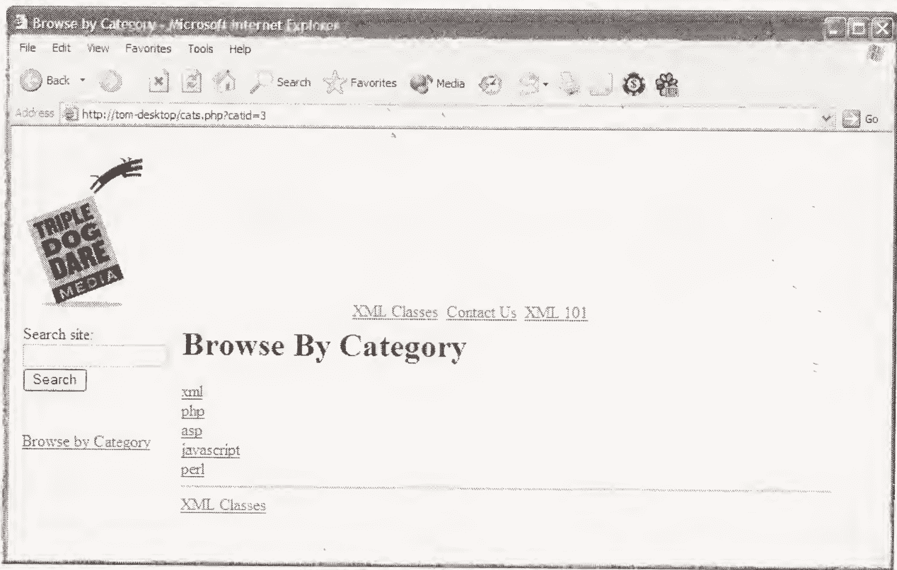

# 第 7 章：使用 PHP 操作 XML

## 使用 PHP 操作 XML

在之前的章节中，我们使用 DOM 和 XSLT 在客户端处理了 XML。现在，我们将学习如何使用 SAX、DOM 和 SimpleXML 等工具在服务器端处理 XML。

总的来说，处理 XML 有两种方式：我们已经见过的文档对象模型（DOM）和 XML 简单 API（SAX，简称 SAX）。使用 DOM 时，你会构建一个可以反复引用的层级树结构。使用 SAX 时，你将 XML 文档视为一系列事件——每个元素或属性对应一个事件——并在解析文档时对这些事件做出响应。

每种方法都有优缺点。DOM 构建的树结构非常消耗内存，但一旦构建完成，DOM 提供了许多工具来导航、处理和操作这些树形结构。SAX 非常擅长以线性方式处理 XML 文档，这意味着灵活性较低；然而，它速度快且易于学习。

PHP 5.0 提供了第三种处理 XML 解析的方法——我们已经见过这种方法的应用。SimpleXML 构建了类似于 DOM 的层级对象结构。区别在于，这种结构专门针对提取和处理信息进行了优化，而 DOM 提供了一个更通用、更笨重的 API 来操作树的结构。

在本章中，我们将按照顺序涵盖 SAX、DOM 和 SimpleXML。在完成这些讨论后，你应该很好地理解如何使用不同的获取 API 来处理 XML 文档。

## 使用 SAX

想象你构建了一个 XML 文档，将它拆解并首尾相接地放在流水线上。你可以看到处理指令、起始标签、内容、结束标签等，所有内容都以一长排的形式排列在你面前。

你按下一个按钮，你的文档开始在流水线上移动，经过一个拿着扩音喇叭的人。每当一个标签、注释、实体、处理指令或文本块（字符数据）经过时，那个拿扩音喇叭的人就会大喊道：“我看到一个……” 这就是 SAX 解析器的工作原理概括。

遗憾的是，要用 SAX 做任何有趣的事情，你必须手动编写函数来处理起始标签、结束标签和字符数据，通过对每项立即做出响应。如果你想将文档中的任何信息存储在临时数据结构中供以后使用，你必须自己想办法——SAX 不会帮你这样做。他们称其为“XML 的简单 API”可不是没有理由！

那么，为什么要使用 SAX 呢？在以下情况下它可能特别方便：

- 你正在处理一个大型 XML 文档，如果将其转换为 DOM 树将占用过多内存。
- 你需要让解析器快速运行起来。
- 你正在进行有限的处理，或者处理过程是简单且线性的（例如将特定的 XML 元素转换为 HTML 元素）。
- 你不需要修改原始 XML 文档。

在合适的情况下（例如大型 XML 文档），SAX 的运行会比 DOM 快。然而，重要的是，在某些情况下，使用树结构实际上更合适——我们稍后会讨论这些情况。

PHP 的默认 SAX 解析器是 Expat<sup>1</sup>，这是一个经久考验的可靠 C 库，并在大多数 PHP 安装中默认启用。你不需要安装任何额外的库——一切已经内置在 PHP 中了。如何使用它？让我们快速过一遍这个简单的教程。

第一步是创建一个用于处理的简单 XML 文件。这是在本节中使用的文件：

文件：`keyword-data.xml`

```xml
<?xml version="1.0" encoding="iso-8859-1"?>
<keywords>
<keyword>XML</keyword>
<keyword>PHP</keyword>
<keyword>Perl</keyword>
<keyword>JavaScript</keyword>
<keyword>ASP</keyword>
</keywords>
```

太好了——现在我们准备好编写一些 PHP 代码了！在开始之前，最好对想要实现的最终结果心中有数。在这种情况下，我们想要将这个关键字元素列表转换为 HTML 项目符号列表，如图 7.1 所示。

### 图 7.1. 经 SAX 处理的关键字列表。

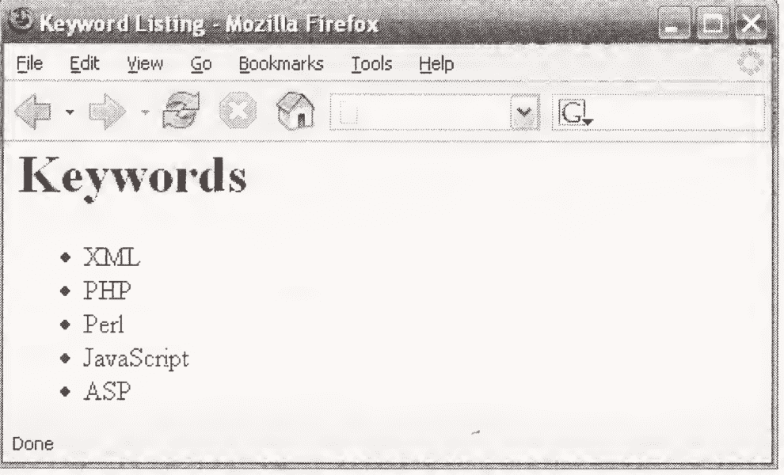

* XML
* PHP
* Perl
* JavaScript
* ASP

<sup>1</sup> http://expat.sourceforge.net/

## 创建处理器

在 PHP 中对 SAX 执行任何其他操作之前，我们必须创建“处理”起始标签、结束标签和字符数据的函数。这些函数将在 SAX 解析器处理 XML 时被调用——我们不需要自己调用这些函数。

我们的第一个处理器（将其命名为 `start_element`）将负责处理 XML 文档中所有的起始标签。

## 使用 DOM

现在你已经对 SAX 有了一定的了解，是时候理解 PHP 的 DOM 功能是如何运作的了。DOM 是一个健壮且复杂的工程设计，旨在处理各种意外情况。事实上，能够处理你抛给它的任何东西是 DOM 的主要优势。它的主要缺点是非常复杂，可能会让人无从下手——更不用说，如果你将大型文档加载到内存中，它真的会严重消耗你的资源。

我们已经讨论过同样的 DOM ——大部分是在客户端。在服务器端，我们讨论的仍然是 DOM —— 幸运的是，它是一个标准的接口。在服务器上讨论 DOM 最简单的方法是将其与我们已经了解的 SAX 进行比较。从上一节中可知，你可以使用 SAX 以线性方式处理 XML 文档。

PHP 的 DOM 功能采取了不同的方法。它将 XML 文档加载到内存中，并将其转换为分级对象结构，提供了 SAX 不具备的两个重要特性。第一是 XML 结构可以在内存中进行操作，允许添加、删除、更改和重新排列节点。第二是 DOM 允许以随机访问的方式反复检查文档，而不仅仅是按顺序访问。

让我们复用 SAX 节中的简单 XML 文件，以便我们可以进行同类比较：

```xml
<?xml version="1.0" encoding="iso-8859-1"?>
<keywords>
  <keyword>XML</keyword>
  <keyword>PHP</keyword>
  <keyword>Perl</keyword>
  <keyword>JavaScript</keyword>
  <keyword>ASP</keyword>
</keywords>
```

现在我们已经有了一个文件，让我们创建一个 DOM 解析器并加载我们的 XML。

# 创建 DOM 解析器

为了创建解析器，我们创建一个 `DOMDocument` 对象。在使用它之前，我们将关闭它的空白处理功能，以防止标签之间的空格、制表符和换行符被视为文本节点：

```php
$doc = new DOMDocument();
$doc->preserveWhitespace = false;
```

接下来，加载 XML 文档并获取文档元素的引用：

```php
$doc->load("keyword-data.xml");
$root = $doc->documentElement;
```

## 获取元素

一旦创建了解析器并加载了 XML 文件，我们就可以从文档中检索信息。处理 DOM 最简单的方法之一是使用 `getElementsByTagName` 方法检索元素。

`getElementsByTagName` 方法允许你获取另一个元素内部的所有具有特定名称的元素。我们可以使用此方法获取示例文档中的各个 `keyword` 元素并将它们存储在数组中：

```php
$keywords = $root->getElementsByTagName('keyword');
```

由于我们在文档的根元素上调用了该方法，`$keywords` 数组现在包含了 XML 文档中的每个 `keyword` 元素。我们现在遍历 `$keywords` 数组以确保每个元素都是有效的。然后我们可以对该元素进行一些处理：

```php
echo '<ul>';
foreach ($keywords as $kw) {
    echo '<li>' . htmlspecialchars($kw->nodeValue) . '</li>';
}
echo '</ul>';
```

结果将显示在 Web 浏览器中，如图 7.2 所示。

## 图 7.2 关键字处理示例。

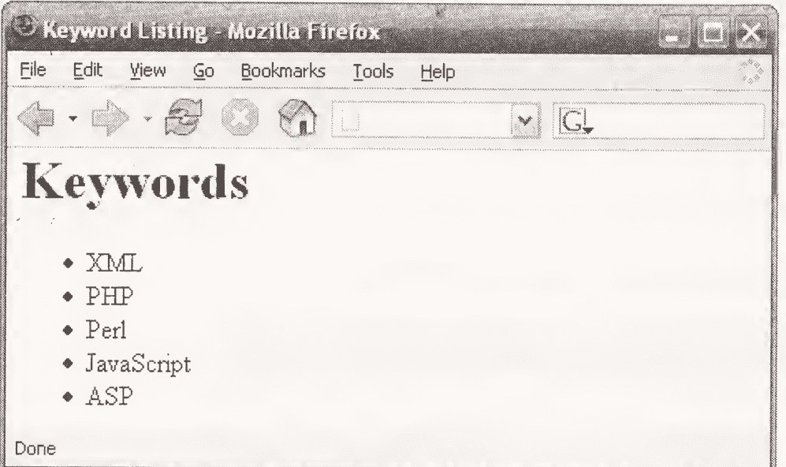

因此，结果与我们通过 SAX 实现的结果完全相同。主要的区别在于采用的方法：在 SAX 中，我们必须创建自定义处理程序来处理像流水线一样一个接一个滚出来的标签；而在 DOM 中，我们可以按照我们喜欢的任何顺序访问分级节点结构的不同层级。

关于使用 XML 和 DOM 还有一点可以说明。如果你想更改输出内容，或者你的 XML 格式发生了变化，在 DOM 中跟踪这些变化比在 SAX 中容易得多。

例如，假设我们的每个 `keyword` 元素都有一个 `status` 属性，如下：

文件：`keyword-data2.xml`（节选）

```xml
<?xml version="1.0" encoding="iso-8859-1"?>
<keywords>
<keyword status="live">XML</keyword>
<keyword status="in progress">PHP</keyword>
<keyword status="live">Perl</keyword>
<keyword status="live">Javascript</keyword>
<keyword status="in progress">ASP</keyword>
</keywords>
```

现在，我们想要打印每个关键字的状态以及关键字本身。为了做到，我们只需要做一个简单的更改：

文件：`domdemo2.php`（节选）

```php
echo '<ul>';
foreach ($keywords as $kw) {
    echo '<li>' . htmlspecialchars($kw->nodeValue) .
    ' (' . htmlspecialchars($kw->getAttribute('status')) . ') </li>';
}
echo '</ul>';
```

这段小代码的输出如图 7.3 所示。

## 图 7.3 调整关键字列表。

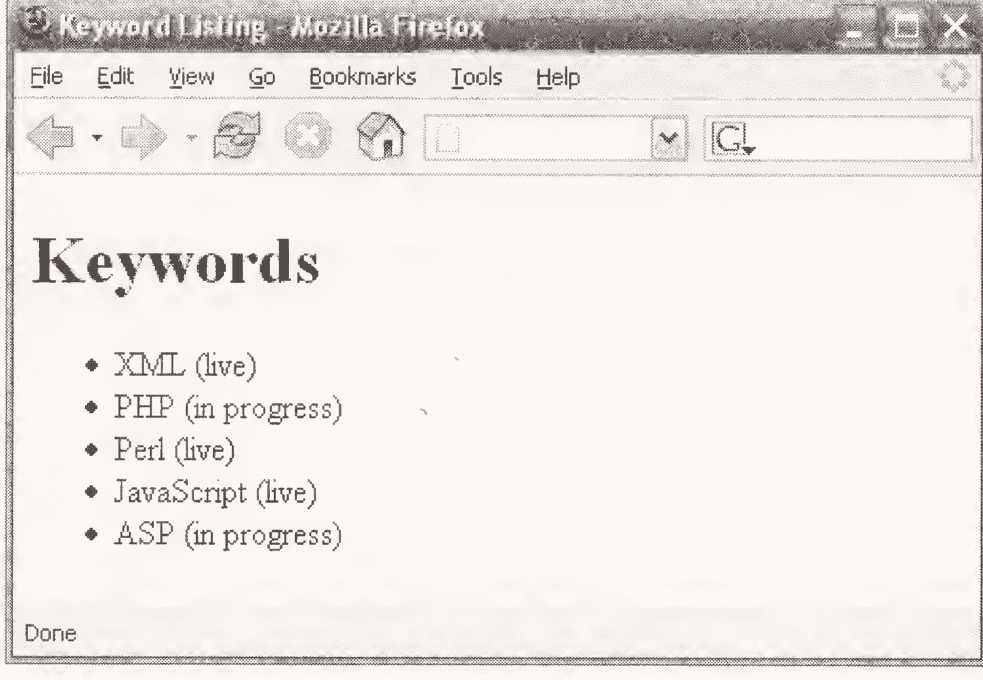

如果我们只想打印 `live` 状态的关键字，我们将：

文件：`domdemo3.php`（节选）

```php
echo '<ul>';
foreach ($keywords as $kw) {
    if ($kw->getAttribute('status') == 'live') {
        echo '<li>' . htmlspecialchars($kw->nodeValue) . '</li>';
    }
}
echo '</ul>';
```

其显示方式如图 7.4 所示。

## 图 7.4 仅显示 live 关键字。

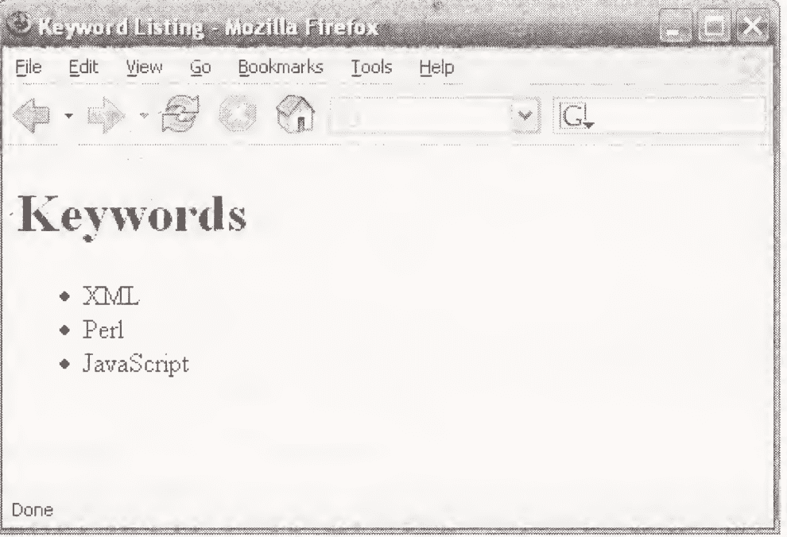

# 创建节点

正如我之前提到的，DOM 允许你添加新节点并操作现有节点。让我们创建一个新元素并将其添加到我们的 DOM 结构中。

我们可以使用 `DOMDocument` 的 `createElement` 方法添加新节点。我们只需要传递节点的名称，以及可选的它的值：

文件：`domdemo4.php`（节选）

```php
$newKW = $doc->createElement('keyword', 'XSLT');
```

一旦完成，我们必须将新节点附加到我们的 DOM 结构中。我们可以使用 `appendChild` 来实现，但我们必须小心地告诉 DOM 我们具体在哪里添加它。

在我们的情况下，这项工作非常简单。我们只需要将关键字元素添加到根变量中：

文件：`domdemo4.php`（节选）

```php
$root->appendChild($newKW);
```

# 输出 XML

有了修改后的文档，你现在可以对其进行许多操作。最常见的是将 XML 输出到服务器上的文件，或者输出到 Web 浏览器。

## 从 DOM 输出 XML

将 DOM 结构输出为 XML 代码非常直接。我们只需要使用 `DOMDocument` 的 `saveXML` 方法。通过将 `formatOutput` 属性设置为 `true`，你可以产生缩进的 XML 代码。

```php
$doc->formatOutput = true;
echo '<p>更新后的 XML 代码：</p>';
echo '<pre>' . htmlspecialchars($doc->saveXML()) . '</pre>';
```

我们讨论仅仅只是 DOM 功能的冰山一角。不过，我们将在后续章节中深入讨论——特别是我们需要动态创建 XML 文档。

## 使用 SimpleXML

在 PHP 5 引入 SimpleXML 之前，开发者只能通过 SAX 和 DOM 来操作 XML。这两种方法都需要开发者对他们要做的事情有深入理解。

然后，SimpleXML 出现了。正如其名所示，SimpleXML 旨在简化 PHP 开发者交互、处理和操作 XML 数据的方式。是什么让它如此神奇？基本上，SimpleXML 将 XML 加载为对象和对象数组的分级结构。它允许你使用熟悉的方法（如 `foreach` 循环和数组索引）访问它。

换句话说，SimpleXML 之前的开发者意识到 XML 使用的很大一部分涉及信息的提取和处理，因此他们让这些操作变得非常简单。

正如我们在第 4 章中所看到的，SimpleXML 为 XML 文件中的每个标签分配了一个与其元素名称匹配的属性。看这个简单的 XML 文档：

```xml
<document>
  <msg>Hello</msg>
</document>
```

在这里，我们可以使用 PHP 的对象箭头符号按如下方式访问 `<msg>` 标签的值：

```php
echo $xml->msg;
```

## 元素名称更改会影响 PHP 代码

这种方法有一个巨大的缺点！如果 XML 元素名称由于任何原因发生了变化，你必须回头修改你的 SimpleXML 逻辑以匹配新名称。避免问题的最好方法是确保你的 XML 文档已经稳定，并且按照你需要的结构进行了构建。如果你在开始编写 PHP 代码之后对 XML 进行了更改，务必返回修改你的代码以保持匹配。

让我们概述 SimpleXML 的每个主要功能。

# 加载 XML 文档

SimpleXML 必须对某些内容才能工作，因此你需要完成的第一件事是识别想要处理的 XML。SimpleXML 可以将文件加载到内存中，也可以以 PHP 字符串的形式处理 XML 代码。

要打开文件，请使用 `simplexml_load_file` 函数，如下：

文件：`simpleldemo.php` (excerpt)

```php
$keywords = simplexml_load_file('keyword-data2.xml');
```

你也可以将 XML 作为变量提供，然后使用 `simplexml_load_string` 函数将该变量加载到内存：

文件：`simpleldemo2.php` (excerpt)

```php
$xml = <<<XML
<?xml version="1.0" encoding="iso-8859-1"?>
<keywords>
  <keyword status="live">XML</keyword>
  <keyword status="in progress">PHP</keyword>
  <keyword status="live">Perl</keyword>
  <keyword status="live">JavaScript</keyword>
  <keyword status="in progress">ASP</keyword>
</keywords>
XML;

$keywords = simplexml_load_string($xml);
```

## 使用 Heredocs 声明 PHP 字符串

上面包含 XML 代码的 PHP 字符串是使用 heredoc 语法声明的。如果你熟悉这种语法，可以在 PHP 手册中阅读它。

无论你采取哪种方法，结果将是一个名为 `$keywords` 的对象和数组层级结构。我们现在可以使用标准的 PHP 对象和数组语法访问该结构的不同部分。

## XML 元素层级结构

当一个 XML 元素包含多个同名的子元素时（例如本例中的 `keywords` 元素），这些子元素被存储为对象层级结构中的数组。因此，我们可以使用数组索引来访问所需的各种关键字。例如，我们可以使用此语法访问存储在 XML 文档中的各种关键字：

```php
echo $keywords->keyword[0]; // 输出 "XML"
echo $keywords->keyword[1]; // 输出 "PHP"
```

注意，在每种情况下，我们都使用 `$keywords` 对象（它代表文档的根元素），后面跟着箭头运算符，以及我们感兴趣的子节点名称（在本例中为 `keyword`）。由于这是一个数组，我们使用 `keyword[0]` 来访问第一个关键字元素。要访问第二个，我们使用 `keyword[1]`，依此类推。

有时，你可能想要获取 SimpleXML 创建的 XML 元素数组中的所有值。正如你所看到的，你可以使用简单的 PHP 循环来遍历它来实现：

文件：`simpledemo.php`/`simpledemo2.php` (excerpt)

```php
echo '<ul>';
foreach ($keywords->keyword as $kw) {
  echo '<li>' . htmlspecialchars($kw) . '</li>';
}
echo '</ul>';
```

然而，当一个元素仅包含一个给定类型的子元素时，不会创建数组。相反，你可以直接访问该元素。假设我们的 XML 文件并不像现在这么简单。假设它有另一层元素——每个 `keyword` 元素的子节点。它可能像这样：

```xml
<keywords>
  <keyword status="live">
    <name>XML</name>
    <url>http://www.example.com/xml/</url>
  </keyword>
  <keyword status="in progress">
    <name>PHP</name>
    <url>http://www.example.com/php/</url>
  </keyword>
  ...
</keywords>
```

如果我们想打印第一个关键字的 `name` 和 `url` 元素值，我们可以这样操作：

```php
echo $keywords->keyword[0]->name; // "XML"
echo $keywords->keyword[0]->url; // "http://www.example.com/xml/"
```

没有比这更简单的了！SimpleXML 比起处理 DOM 结构或声明自定义处理函数要容易得多。

正如我们所看到的，SimpleXML 元素对象可以使用需要字符串的地方，它们的行为会像字符串一样，包含相应 XML 元素所包含的文本值。然而，重要的是，这些对象实际上并不是字符串。在不需要字符串的情况下，这种区别就会起作用，因此 PHP 不会为你执行转换。这里有一个例子：

```php
if ($keywords->keyword[0] == 'XML') {
  echo 'The first keyword is XML.';
}
```

查看我们的示例 XML 文档，我们期望这个 if 语句会执行并显示消息，但它不会，因为 `$keywords->keyword[0]` 是一个对象，因此不等于 `'XML'`。为了让它工作，你必须将其转换为字符串：

```php
if ((string)$keywords->keyword[0] == 'XML') {
  echo 'The first keyword is XML.';
}
```

## 属性值

你可以通过将元素视为数组来访问属性的值。例如，要打印第一个关键字的 `status` 值，我们可以使用以下代码：

```php
echo $keywords->keyword[0]['status']; // "live"
```

然而，作为元素值，当你尝试将它们与字符串比较时，情况会变得复杂。例如，假设你只想显示 "live" 关键字。你可能认为会像这样简单：

```php
foreach ($keywords->keyword as $kw) {
  if ($kw['status'] == 'live') { // 错误！
    echo '<li>' . htmlspecialchars($kw) . '</li>';
  }
}
```

上面的代码片段看起来合理。然而，PHP 无法比较对象和字符串。为了让它工作，我们必须进行转换：

```php
foreach ($keywords->keyword as $kw) {
  if ((string)$kw['status'] == 'live') {
    echo '<li>' . htmlspecialchars($kw) . '</li>';
  }
}
```

我们将这种方法称为“困难的方法”。得益于 XPath，存在另一种更简单的方法来过滤从 XML 中获取的值；它涉及使用我们在第 4 章中看到的 `xpath` 方法。你可能记得该方法允许我们通过 XPath 查询传递给 SimpleXML 并以数组的形式接收结果。

要获取所有属性设置为 live 的 `keyword` 元素，简单的方法是从文档中的 `keyword` 元素运行以下 XPath 查询：

```
keyword[@status="live"]
```

此查询将查看当前元素的所有 `keyword` 元素，并提取状态为 live 的元素。这是使用 SimpleXML 的方法：

文件：`smxlde04.php` (excerpt)

```php
foreach ($keywords->xpath('keyword[@status="live"]') as $kw) {
  echo '<li>' . htmlentities($kw) . '</li>';
}
```

我们的 XPath 查询带给我们什么好处？首先，我们不再需要在 PHP 中执行字符串比较；XPath 会替我们完成这项工作。如果你熟悉使用 SQL 语句在将值返回脚本之前对数据库值进行过滤。此外，我们的代码现在看起来更简单，也更容易维护。

诚然，你可能会看着第二种构造并在心里想：“这比将对象转换为字符串进行比较要复杂得多。”

好吧，有人说 tomayto，有人说 tomahto。而在德克萨斯州，他们管它 tuhmater。

## 使用 SimpleXML 更新 XML

如果你已经开始喜欢 SimpleXML 了，我有一个好消息！SimpleXML 允许用直接的方法更新值。假设我们想将示例中的第三个关键字从 PHP 更改为 JSP。这是我们的操作方法：

```php
$keywords->keyword[2] = 'JSP';
```

要更改属性的值，我们只需要将相应的属性作为数组键添加即可：

```php
$keywords->keyword[2]['status'] = 'live';
```

要保存或打印更新后的 XML 代码，我们使用 `asXML` 方法：

```php
echo $keywords->asXML();
```

# 使用 DOM 修复 SimpleXML 的局限性

尽管 SimpleXML 非常简单，但它确实存在局限性。首先（在编写本书时），无法向 XML 文档中添加新节点，只能更改现有节点的值。同样，无法删除节点。你无法轻松地将样式表挂载到 XML 中以用于转换。而且，正如你所见的，PHP 代码高度依赖于 XML 标签的名称——如果这些名称发生变化，更新代码将是一个非常头疼的问题。

然而，SimpleXML 有一个非常实用的功能，允许它与其他 PHP XML 功能协同工作。具体来说，此功能允许你导入 DOM 文档并将其转换为 SimpleXML 数据结构。

这样做有什么好处呢？该功能允许你使用 PHP 原生的 DOM 功能完成一些繁重的工作；然后你可以将其转换为 SimpleXML 并完成其余的工作。

为了直观看到这一点，让我们先用 DOM 加载 XML 文档，并进行一个可以用 SimpleXML 完成的更改：

```php
$doc = new DOMDocument();
$doc->preserveWhitespace = false;
$doc->load('keyword-data2.xml');
$root = $doc->documentElement;

$newKW = $doc->createElement('keyword', 'JSP');
$newKW->setAttribute('status', 'live');
$root->appendChild($newKW);
```

在 DOM 结构中添加新元素后，我们可以使用 `simplexml_import_dom` 函数将其导入 SimpleXML 数据结构中。

然后，我们可以使用 SimpleXML API 执行任何所需的操作——例如，搜索并显示具有特定属性值的节点。

文件：`sxmldemos5.php`（节选）

```php
$keywords = simplexml_import_dom($doc);
echo '<ul>';
foreach ($keywords->xpath('keyword[@status="live"]') as $kw) {
    echo '<li>' . htmlspecialchars($kw) . '</li>';
}
echo '</ul>';
```

这将显示状态为 `live` 的关键词列表，其中包含了使用 DOM 添加的“JSP”。

## 何时使用不同的方法

你可能在怀疑使用 SAX、DOM 和/或 SimpleXML 是否合适。这里有一些经验法则：

- 如果你有一个非常简单的 XML 文档，只需要线性处理，且不需要修改文档，SAX 是一个很好的选择。
- 如果你需要处理更复杂的 XML 文档，但仅是为了提取信息，SimpleXML 是一个很好的选择。
- 如果你需要从头创建 XML 文档，或者对现有文档进行大量修改，请使用 DOM。

## 我们的 CMS 项目

现在是创建 CMS 的管理端了。我们的管理工具将允许授权用户登录 CMS 并管理网站的不同部分。在本章中，我将引导你构建以下功能：

- 登录/验证页面
- 管理索引（CMS 用户从该处访问其他页面）
- 文章创建页面
- 文章编辑页面
- 文章删除页面

在完成这些页面后，我们将在附录 B 中继续讨论管理工具，主要因为大部分内容是重复的，可以先搁置。该讨论包括：

- 新闻创建/编辑/删除页面
- 二进制文件创建/编辑/删除页面
- 分类创建/编辑/删除页面
- 管理员创建/编辑/删除页面

管理区域的所有页面都位于网站的 `admin` 目录。

# 禁用魔法引号

书中所有的 PHP 脚本都假设你禁用了 PHP 的 magic quotes 功能。这可以通过将服务器的 `php.ini` 文件中的 `magic_quotes_gpc` 选项设置为 `Off` 来实现。

如果开启此功能，当你使用在本节和附录 B 中开发的管理脚本处理内容时，你会发现内容中有很多不需要的反斜杠（\）。

## 登录页面

登录页面非常简单。它包含一个基础 HTML 表单，允许管理员输入用户名和密码。任何复杂度来自于 HTML 的结构，以便可以使用 CSS 进行有效的样式设计。

```php
<?php
session_start();
?>
<!DOCTYPE html PUBLIC "-//W3C//DTD XHTML 1.0 Transitional//EN"
"http://www.w3.org/TR/xhtml1/DTD/xhtml1-transitional.dtd">
<html xmlns="http://www.w3.org/1999/xhtml">
<head>
<title>Page Log In</title>
<meta http-equiv="Content-Type" content="text/html; charset=iso-8859-1">
<link rel="stylesheet" type="text/css" href="../xmlcms.css" />
<link rel="stylesheet" type="text/css" href="login.css" />
</head>
<body>
<form class="login" action="verify.php" method="post">
<h1>Please log in</h1>
<div class="fields">
<label for="username">User name</label>
<input type="text" id="username" name="username" class="text" />
<label for="password">Password</label>
<input type="password" id="password" name="password" />
</div>
<div class="actions">
<input type="submit" value="Submit" />
<input type="reset" value="Reset" />
</div>
<p class="error"><?php echo $_SESSION['error']; ?></p>
</form>
</body>
</html>
```

除了基础样式表（`xmlcms.css`）外，此页面还使用一个样式表来布局登录表单。再次，这不是 PHP 代码，所以我们不会在这个文件的细节上花费时间，这里是代码：

```css
form.login {
  width: 290px;
  margin: 1em auto;
  padding: 4px;
  background: #ccc;
}
form.login h1 {
  text-align: center;
  font-size: medium;
  background: #fff;
  margin: 1px;
}
form.login .fields {
  text-align: right;
}
form.login label {
  float: left;
  width: 130px;
  text-align: right;
}
form.login .actions {
  text-align: center;
}
form.login input.text, form.login input.password {
  width: 150px;
  margin-bottom: 1px;
}
form.login .error {
  color: red;
  margin: 0;
  padding: 0;
}
```

回到登录页面，注意表单的 `action` 被设置为名为 `verify.php` 的页面。此页面上的 PHP 逻辑需要将输入的值与存储在 `admin.xml` 中的管理员列表进行比对。

# 保护你的 XML 文件

为了书中的示例及其代码存档，我们将包含内容、分类和管理员用户的 XML 文件放置在主站的子目录下。但是，尽管我们采取了一些措施来保护这些文件中的敏感信息（例如加密管理员的密码），但保护这些文件免受普通游客通过 Web 直接访问仍然是一个好主意。为了保护这些文件，你可以配置 Web 服务器防止浏览器访问该目录，或者可以将该目录移动到网站 Web 可访问目录结构之外。在后一种情况下，你需要调整 `common.inc.php` 文件以指向目录的新位置，以便网站上的所有脚本都能找到 XML 文件。

# 加密密码

正如我们看到的，`admin.xml` 中存储的密码值经过了加密以增加安全性。要使用本书代码存档包含的示例 `admin.xml` 文件，你需要知道该文件中存储的所有三个管理员（joe, bill 和 tom）的初始密码都是 `password`。

如果匹配，PHP 代码将设置会话变量并将用户重定向到管理索引页。如果没有匹配，PHP 将用户送回 `login.php` 页面，并带有一个特殊的会话变量（`$_SESSION['error']`），其中包含显示的错误消息。

这里是代码。注意在这种情况下我们使用了 SimpleXML，因为这是加载信息最快的方法。

```php
<?php
include_once '../common.inc.php';
$admins = simplexml_load_file($fileDir . 'admin.xml');
foreach ($admins as $admin) {
    if ($_POST['username'] == (string)$admin->username &&
        crypt($_POST['password'], (string)$admin->password) == (string)$admin->password) {
        $_SESSION['login'] = true;
        header('location: index.php');
        exit;
    }
}
$_SESSION['error'] = 'Wrong user name or password. Try again.';
header('location: login.php');
```

注意，由于我们加密了 `admin.xml`，我们需要对用户提供的密码进行相同的加密，然后将该输入与存储在 XML 文件中的密码进行比较。如果你不熟悉 PHP 的 `crypt` 函数，可以在 PHP 手册中查看它的所有信息。

由于任何人都可以输入管理页面的 URL，我们必须添加额外的安全措施来保护这些页面的内容。在每个页面的顶部，我们需要检查会话变量 `$_SESSION['login']` 的值是否设置为 `true`。如果不是，我们把用户送回 `login.php` 页面。由于我们将复用此功能，最好将其放置在一个包含文件中：

文件：`security.inc.php`

```php
<?php
include_once '../common.inc.php';
if ($_SESSION['login'] != true) {
    header('location: login.php');
    $_SESSION['error'] = 'You must log in before you can access administration pages.';
    exit;
}
?>
```

## 在初始设置时禁用安全性

> 当你第一次设置网站时，可能还没有设置任何管理员。但是，如果你无法登录，又该如何添加管理员呢？为了添加第一个管理员账户，你只需要简单地注释掉 `security.inc.php` 中的内容来禁用安全性，这样该文件就不会执行任何操作。你就可以自由地浏览管理页面并添加一两个管理员。之后你可以重新启用安全性，并使用创建的账户之一登录。

我们最后需要的是注销页面，我们可以链接到它，以便用户在离开电脑之前退出网站：

```php
<?php
include_once '../common.inc.php';
$_SESSION['login'] = false;
header('location: index.php');
?>
```

## 管理员索引页

我们管理工具的第一页提供了对网站所有功能和内容的访问，包括管理用户、文章、新闻项目和其他内容类型。

该页的代码非常简洁。我们要做的只是为管理工具的每个主要部分提供链接。

```php
<?php
include 'security.inc.php';
?>
<!DOCTYPE html PUBLIC "-//W3C//DTD XHTML 1.0 Transitional//EN"
"http://www.w3.org/TR/xhtml1/DTD/xhtml1-transitional.dtd">
<html xmlns="http://www.w3.org/1999/xhtml">
<head>
<meta http-equiv="Content-Type" content="text/html; charset=iso-8859-1" />
<title>欢迎来到管理员索引页</title>
<link rel="stylesheet" type="text/css" href="../xmlcms.css" />
</head>
<body>
<h1>欢迎来到管理员索引页</h1>
```


# 第 7 章：使用 PHP 操作 XML

## 文章管理

由这些链接所代表的每个区域将具有相同的功能。每个区域都允许 CMS 用户创建、编辑和删除项目。让我们逐一完成第一个区域的任务——文章。

### 处理文章

我们的文章管理区域将允许 CMS 用户创建新文章、编辑现有文章并根据需要删除它们。由于文章是我们网站最重要的部分，我们将从文章开始，然后在附录 B 中转移到新闻项目和网站管理员。

对于文章管理区域的主页，我们需要一个网站上所有文章的列表。到目前，你应该对实现此功能所需的 PHP 代码相当熟悉了：

文件：`articletool.php`

```php
<?php
include 'security.inc.php';
include_once '../common.inc.php';
?>
<!DOCTYPE html PUBLIC "-//W3C//DTD XHTML 1.0 Transitional//EN"
"http://www.w3.org/TR/xhtml1/transitional.dtd">
<html xmlns="http://www.w3.org/1999/xhtml">
<head>
<meta http-equiv="Content-Type" content="text/html; charset=iso-8859-1" />
<title>文章索引</title>
<link rel="stylesheet" type="text/css" href="../xmllcms.css" />
</head>
<body>
<h1>文章索引</h1>
<a href="articletool_create.php">创建新文章</a></p>
<a href="index.php">取消</a></p>
<ul>
<?php
$handle = opendir($fileDir);
while (($file = readdir($handle)) != FALSE) {
    if (is_dir($fileDir . $file)) continue;
    if (preg_match("^article\.xml$", $file)) continue;
    $articleFile = simplexml_load_file($fileDir . $file);
    echo '<li>' . htmlspecialchars($articleFile->headline);
    echo ' <a href="doArticleEdit.php?id=' . $articleFile['id'] . '">编辑</a>';
    echo ' <a href="doArticleDelete.php?id=' . $articleFile['id'] . '">删除</a></li>';
}
?>
</ul>
</body>
</html>
```

### 创建新文章

文章创建页面非常简单——它允许网站管理员使用简单的 Web 表单界面在网站上创建 XML 文章。表单中的每个字段都映射到我们在第 1 章规划并在第 3 章重新讨论的 XML 结构中的元素。

作为复习，这是我们其中一篇文章创建时的样子：

```xml
<?xml version="1.0" encoding="iso-8859-1"?>
<article id="124993003892">
<author>1</author>
<category>1</category>
<headline>使用 PHP 处理 XML</headline>
<description>PHP 提供了许多处理</description>
<pubdate>2004-06-26</pubdate>
<status>live</status>
<keywords>XML</keywords>
<body></body>
</article>
```

### 处理文章创建

特别要注意：为每篇文章生成唯一 ID，并用信息填充表单。

文件：`articletool_create.php` (excerpt)

```php
<?php
include 'security.inc.php';
include_once '../common.inc.php';
?>
<select id="authorid" name="authorid">
<?php
$authors = simplexml_load_file($fileDir . '.authors.xml');
foreach ($authors as $author) {
    echo '<option value="' . htmlspecialchars($author['id']) . '">' . htmlspecialchars($author->name) . '</option>';
}
?>
</select>

<select id="categoryid" name="categoryid">
<?php
$cats = simplexml_load_file($fileDir . '.categories.xml');
foreach ($cats as $cat) {
    echo '<option value="' . htmlspecialchars($cat['id']) . '">' . htmlspecialchars($cat['label']) . '</option>';
}
?>
</select>

<select id="status" name="status">
<option value="in progress">进行中</option>
<option value="live">上线</option>
</select>
```

表单的 `action` 被设置为 `doArticleCreate.php` 页面，该页面使用 DOM 函数根据表单中的信息创建 XML 文章。由于这有点复杂，我将分部分讲解代码。

文件的第一部分初始化了我们的新 XML 文档，设置版本并创建根元素 `article`。

文件：`doArticleCreate.php` (excerpt)

```php
<?php
$doc = new DOMDocument();
$root = $doc->createElement('article');
$root = $doc->appendChild($root);
```

接下来，我们为 `article` 节点添加一个属性。ID 将是单词 "article" 加上一个时间戳。以防万一在同一秒内创建了多篇文章，我们会检查是否已经存在一个具有相同 ID 命名的文件，并递增时间戳直到找到一个不冲突的 ID 为止。

```php
$timestamp = date('YmdHis');
do {
    $id = 'article' . $timestamp++;
} while (file_exists($fileDir . $id . '.xml'));
$root->setAttribute('id', $id);
```

现在我们已经创建了根节点，是时候按照正确的顺序创建该元素的子元素了。第一个是 `author`。注意 `author` 元素是 `article` 的子元素，而 `id` 是 `author` 的子元素。

```php
$author = $doc->createElement('author');
$root->appendChild($author);
$atext = $doc->createTextNode($_POST['author']);
$author->appendChild($atext);
```

我们使用相同的技术来生成 `categoryId`、`headline`、`description`、`status` 和 `keywords` 元素。`pubdate` 的值是由脚本动态生成的，其余都是相同的。

```php
$cat = $doc->createElement('categoryId');
$root->appendChild($cat);
$ctext = $doc->createTextNode($_POST['categoryId']);
$cat->appendChild($ctext);
```

```php
$head = $doc->createElement('headline');
$root->appendChild($head);
$htext = $doc->createTextNode($_POST['headline']);
$head->appendChild($htext);
```

```php
$desc = $doc->createElement('description');
$root->appendChild($desc);
$dtext = $doc->createTextNode($_POST['description']);
$desc->appendChild($dtext);
```

```php
$pub = $doc->createElement('pubdate');
$root->appendChild($pub);
$pubtext = $doc->createTextNode(date('Y-m-d'));
$pub->appendChild($pubtext);
$stat = $doc->createElement('status');
$root->appendChild($stat);
$stext = $doc->createTextNode($_POST['status']);
$stat->appendChild($stext);
$key = $doc->createElement('keywords');
$root->appendChild($key);
$ktext = $doc->createTextNode($_POST['keywords']);
$key->appendChild($ktext);
```

接下来，我们处理正文文本。记住，我们计划将文章正文信息存储为 HTML，这意味着它将包含许多标签。如果我们像目前为止那样使用 DOM 来输出这个值，它可以正常工作，但生成的 XML 文件将难以阅读，因为到处散布着如 `&lt;` 和 `&gt;` 这样的字符实体。

如第 1 章所述，为了保持代码的可读性，我们将正文文本嵌入到 XML 文件中的 CDATA 区域，这样特殊字符就无需转换为字符实体。我们不再使用 `createTextNode`，而是使用 `createCDATASection`。我们将表单中的所有 HTML 文本放在该命令中。

```php
$body = $doc->createElement('body');
$root->appendChild($body);
$cdata = $doc->createCDATASection($_POST['body']);
$body->appendChild($cdata);
```

接下来，我们将此 XML 树写入文件，使用之前生成的 ID 作为文件名：

```php
$filename = $fileDir . $id . '.xml';
$doc->save($filename);
```

最后，现在我们已经完成了所有这些操作后，我们需要将用户送回 `articletool.php`，在其中他们应该可以在主文章列表中看到新创建的文件。

文件：`doArticleCreate.php`（节选）

```php
header('location: articletool.php');
```

## 编辑 XML 文章

通常情况下，编辑 XML 文章与创建文章非常相似，不同之处在于你必须将现有文章的值加载到表单中，并将提交的更改写入文件。

让我们从页面格式的代码开始。第一部分对你来说应该非常熟悉——它验证了用户是否已经登录。

文件：`articletool_edit.php`（节选）

```php
<?php
include 'security.inc.php';
include_once '../common.inc.php';
```

接下来，我们打开用户想要编辑的文件。我们暂时不会修改该文件，但我们使用 SimpleXML 打开文件并提取我们需要的信息。

文件：`articletool_edit.php`（节选）

```php
if (isset($_GET['id']) || $_GET['id'] == '') {
    if (file_exists($fileDir . $_GET['id'] . '.xml')) {
        header('location: articletool.php');
    }
}
$file = simplexml_load_file($fileDir . $_GET['id'] . '.xml');
?>
```

现在，我们简单地得到了一个表单标记，它与 `articletool_create.php` 中的非常相似，不同之处在于这次我们从 `$file` 变量中提取字段的值。

文件：`articletool_edit.php`（节选）

```html
<!DOCTYPE html PUBLIC "-//W3C//DTD XHTML 1.0 Transitional//EN"
"http://www.w3.org/TR/xhtml1/transitional.dtd">
<html xmlns="http://www.w3.org/1999/xhtml">
<head>
<meta http-equiv="Content-Type" content="text/html; charset=UTF-8">
<title>Edit Article</title>
<link rel="stylesheet" href="style.css">
</head>
<body>
<h1>Edit Article</h1>
<form action="doArticleUpdate.php" method="post">
<input type="hidden" name="id" value="<?php echo $_GET['id']; ?>" />
<div>
<label for="categoryId">Category</label>
<select id="categoryId" name="categoryId">
<option value="<?php echo (string)$file->categoryId; ?>"><?php echo (string)$file->categoryId; ?></option>
</select>
</div>
<div>
<label for="headline">Headline</label>
<input type="text" id="headline" name="headline" value="<?php echo $file->headline; ?>" />
</div>
<div>
<label for="description">Description</label>
<textarea id="description" name="description"><?php echo $file->description; ?></textarea>
</div>
<div>
<label for="status">Status</label>
<select id="status" name="status">
<option value="in progress" <?php if ($file->status == 'in progress') echo 'selected'; ?>>In Progress</option>
<option value="live" <?php if ($file->status == 'live') echo 'selected'; ?>>Live</option>
</select>
</div>
<div>
<label for="keywords">Keywords</label>
<input type="text" id="keywords" name="keywords" value="<?php echo $file->keywords; ?>" />
</div>
<div>
<label for="body">Article Body (HTML)</label>
<textarea id="body" name="body"><?php echo $file->body; ?></textarea>
</div>
<div class="actions">
<input type="submit" value="Update Article" />
<input type="reset" value="Reset" />
</div>
</form>
<p><a href="articletool.php">Cancel</a></p>
</body>
</html>
```

# 第 8 章：RSS 和 RDF

在本书中，我们已经涵盖了大量信息，包括 XML、XSLT、XPath 以及用于处理 XML 的 PHP 函数。在本章中，我们将把所学的知识应用于 RSS 和 RDF，这都是两种用于共享和传播 XML 数据的令人兴奋的技术。

## 什么是 RSS 和 RDF？

根据你所处的地方以及询问的对象，RSS 代表 Really Simple Syndication（真正简单分发）、Rich Site Summary（富内容站点摘要）或 RDF Site Summary（RDF 站点摘要）。无论这个缩写代表什么，RSS 都是用于分发或聚合内容的 XML 格式。例如，Weblogs（或“博客”）就是使用这种 XML 格式进行分发的。

RDF 代表 Resource Description Framework（资源描述框架），它构成了部分但并非所有 RSS 标准的核心。它是一种用于描述 Web 资源的元数据标准——不仅包括 Web 页面本身，还包括它们的作者、最后更新日期时间、关键词、标题等。关于这一点，我目前就先说这么多——在我们运行完一个基础示例之后，我们将开始讨论 RSS 的版本。

## 这有什么大意义？

想象你是一个在一个小城市日报纸上工作的漫画家或专栏作家，名不见经传。你创作了优秀的内容，但在当地地区之外并不知名。获得更多收入并接触更广泛观众的最简单方法就是做其他备受尊敬的作家和漫画家几十年来所做的事情——分发你的素材！如果你达成了一份正确的分发协议，你的文章或作品可能会开始出现在几十甚至上百个媒体机构中，从而增加你的报酬和曝光率。

从读者的角度来看，分发也是一件好事。在现代，你不再需要为了跟上你喜欢的专栏作家或漫画家而放弃家乡的报纸。你喜欢的专栏作家或漫画家很可能出现在你当地的报纸上。

网上也是同样的道理。你可能会通过分发内容发财，也可能不会，但你确实可以增加曝光率。分发对于你的观众来说也代表了一种方便的服务，他们不需要记住去搜索你的内容，或访问你的网站并翻阅所有其他信息以查看你是否发布了新内容——用户只需订阅并持续接收更新即可。如果你运行了 RSS，每当你在网站上添加一篇文章或其他有趣的内容条目时，你就可以为该内容创建一个 RSS 条目。这个新条目将出现在属于你订阅者的 RSS 聚合器和列表中。

## RSS Feed 中应该包含什么类型的信息？

当你创建一个 RSS Feed 时，请记住以下这些经验法则：

1. 内容必须是以列表为导向的。列表导向的内容包括新闻头条、文章摘要、排名、职位列表、搜索结果列表、活动日历、新闻稿摘要和其他信息。
2. 内容应该涵盖你的观众感兴趣的话题。另一个思考方法是问问自己：这些内容有用或具有指导意义吗？它是否能让订阅者了解行业或其趋势？这些素材有新闻价值吗？
3. 为了使用 RSS Feed 格式，内容应该频繁更新。

## 在开始之前

我将向你展示一些让 RSS 运行起来的简单方法。不过，我知道 RSS/RDF 的某些部分（特别是 RDF 语法）可能晦涩且令人困惑。你可能不知道 RDF 语法的哪些元素是必须的，例如，因为 RDF 规范可能非常难读。本章的目标仅仅是提供一个关于 RSS 世界如何运作的清晰思路。

首先，让我们看看 RSS 的实际运行情况。图 8.1 显示了一个名为 SharpReader 的程序正在从 sitepoint.com 读取一个 RSS Feed。要读取 RSS Feed，你只需要运行 SharpReader 并输入该 feed 的 URL 即可。

一旦你知道 feed 的位置，就可以点击 SharpReader 上的 Subscribe（订阅）按钮来持续接收更新。如果 sitepoint.com 更新了它的 RSS Feed，订阅者也会收到更新。事实上，如果你运行着 SharpReader，屏幕侧边会弹出小窗口，显示你订阅的 feed 的头条。

图 8.1. 使用 SharpReader 查看 RSS Feed。

## 创建你的第一个 RSS Feed

让我们从零开始创建一个 RSS 文件（或 feed）。无论这个 feed 有多大、多小或多么复杂，每个 RSS 文件的核心都是一个内容列表。你的 RSS 文件可以包含 1 个项目、1000 个项目或两者之间的任何数量（或更多），但如果没有至少一个项目，你就没有 RSS 文件。

这样的项目包含什么呢？三个重要部分：

- 一个标题（title）
- 一个链接（link）
- 一个描述（description）

假设你维护着一个涵盖 Web 开发世界的网站。特别地，你的文章探索了一个利基市场：此外，想象你刚刚在网站上发布了一篇关于在网站中使用 PHP 的文章。现在你想指向这篇文章并让你的订阅者知道它已经可用。你可能给你的文章添加了 `<title>` 和 `<description>` 标签。在创建 RSS 项目时，你不必使用这个标题和描述，但这肯定没有坏处。然而，你必须准确地指向它。

## 向世界展示你的 Feed

用户可以轻松地让他们基于 PHP、ASP.NET、Perl、Python 和 JSP 的 RSS 工具指向你的 Feed，并在他们自己的网站上添加指向你信息的链接。

一个指向我们示例 RSS Feed 的链接可能如下所示：

```xml
<a href="headline.xml">RSS feed</a>
```

为了进一步推广你的 RSS Feed，你还可以在页面头部（`<head>`）中包含一个 `<link>` 标签，这样支持 RSS 的浏览器和搜索引擎就能看到你的 Feed：

```xml
<link rel="alternate" type="application/rss+xml" title="RSS Feed" href="headline.xml" />
```

就这些了！

## 订阅 RSS 聚合器

RSS 聚合器（或新闻聚合器）是允许你将自己的 RSS Feed 添加到现有 RSS Feed 目录中的服务。其他用户可以在 Web 上或通过独立的、可下载的 RSS Feed 阅读器（也称为聚合器）搜索并订阅你的 Feed。以下是两个最流行的 RSS 新闻聚合器：

- **Is Free** 是一个老牌基于 Web 的新闻聚合器。使用该免费服务，你可以为不同的主题创建自定义的“页面”，然后让各种资源的标题自动填充到这些页面中。
- **Radio UserLand** 是一个流行的博客构建工具，也是另一个老牌的新闻聚合器。你只需输入其 URL 即可订阅 Feed。

## 确保你的 RSS 是有效的

这些服务很可能要求你在提交 RSS 文件之前对其进行验证。你可以通过 Google 搜索“rss validators”来找到许多 RSS 验证器，或者使用 W3C 提供的工具：

http://www.w3.org/RDF/Validator/

既然我们已经涵盖了 RSS 的基础知识，让我们进一步深入了解细节。

## 进阶内容

注意在示例中，我们使用的是特定版本的 RSS。

文件：`headline.xml` (节选)

```xml
<rss version="0.91">
```

这种 RSS 被称为“真正简单的聚合”（Really Simple Syndication），由 Netscape 和 Userland Corporation 联合开发。这种版本 RSS 的理念是为内容分发提供一个非常简单的工具。

正如你从示例中所了解的，使用 RSS 版本 0.91，你可以拥有一个或多个通道元素（`channel`），每个通道至少包含一个项目元素（`item`）。每个元素必须包含标题和链接，也可以包含一个描述元素。通道本身也是如此。

你可以包含的其他通道元数据标签有：

```xml
<image> 为通道指定缩略图
```

```xml
<webMaster> 为负责该 Feed 的人员提供电子邮件地址
<managingEditor>
```

```xml
<lastBuildDate> 指示 Feed 最后一次更新的时间
```

关于这些及其他 RSS 0.91 元素的详细信息，你可以参考 RSS 0.91 规范。目前存在更新版本的规范。RSS 0.92（2000 年 12 月）和 RSS 2.0（2002 年 10 月）都增加了更多标签，并取消了对某些标签的限制（例如，在 0.91 中，`<link>` 标签必须指向 HTTP 或 FTP 资源；而在新版本中任何有效的 URI 均可）。但由于 0.91 与这些标准向前兼容（一个有效的 RSS 0.91 文档也是有效的 RSS 2.0 文档），对于不需要后期标准更高级功能的学者来说，RSS 0.91 仍然是最佳起点。

## RDF 和 RSS 1.0

RSS 1.0 多少有些像“独行侠”。尽管它的设计目标与其他版本的 RSS 相同，但它与其他标准的关系很小。在很多方面，它实际上比 RSS 2.0 更先进，因此是许多前瞻性 Web 开发者的首选。

首先，RSS 1.0 中的 "RSS" 代表 RDF Site Summary（RDF 站点摘要）。这种特殊的 RSS 类型在 2000 年 12 月 RSS 0.92 发布之前发布，使用 RDF（资源描述框架）来定义文件的外观。简单粗略地说，RDF 是一种描述任何事物以及它与其他事物之间关系的标准。这解释得足够模糊吗？

在不深入探讨 RDF 细节（它是一套非常强大且复杂的规范集合）的情况下，让我告诉你它远比描述事物列表的 XML 文档格式复杂得多；在 RSS 1.0 的上下文中，这正是它的用法。RSS 1.0 文档可以参与到围绕 RDF 设计的大型软件系统中。其中一个仍处于计划阶段的系统是语义网（Semantic Web），它是对万维网的重新构想，将允许计算机程序从整个 Web 上寻找并抓取分散的服务和信息，从而为你完成任务，而无需你亲自去寻找所有东西。

但嘿，这些内容明天（或者后天）再详说。现在，RDF 的复杂性使得使用 RSS 1.0 分发内容比使用普通的 RSS 稍微困难一点。

## RSS 1.0 示例

这看起来再次与 RSS 0.91 版本非常相似，不同之处在于关于属性的 RDF，它提供了一个唯一标识项目的 URI。这是通道中的 `item` 元素指向的 URI，以便将其包含在通道中。

## 使用 Dublin Core 添加信息

现在，当你看到 RSS 1.0 文件顶部要求的命名空间声明时，我打赌你一定在想：“天哪，我每次创建 RSS 馈源时都要输入那些东西吗？太疯了。” 吧，谁能怪你呢？但事实证明，RSS 1.0 赋予了 XML 命名空间的优势，允许我们使用来自其他 XML 命名空间的标签来扩展该格式：

RSS 的后期人员在 RSS 1.0 规范中提供了三组额外的 XML 标签，每组都有它们自己的命名空间（这些被称为“模块”）。其中最流行的是 Dublin Core 元数据元素集，它允许你为 RSS 馈源中的通道和项目指定额外的属性。

要使用 Dublin Core，你需要在 RSS 馈源中与其他命名空间一起声明它的命名空间：

文件：`headlinedc.rdf`（节选）

```xml
<rdf:RDF
  xmlns:rdf="http://www.w3.org/1999/02/22-rdf-syntax-ns#"
  xmlns:dc="http://purl.org/dc/elements/1.1/"
  xmlns:rss="http://purl.org/rss/1.0/">
```

你可以将 Dublin Core 元素添加到你的 RSS 馈源中。这里有一点 Dublin Core 的风格：

文件：`headlinedc.rdf`（节选）

```xml
<item rdf:about=
  "http://www.tripledogdaremedia.com/articles/paypal-php.html"
  <title>Making PHP work with PayPal</title>
  <link>
    http://www.tripledogdaremedia.com/articles/paypal-php.html
  </link>
  <description>Everything you need to know to create PHP scripts
  that are PayPal friendly.</description>
<dc:subject>Server-Side Scripting</dc:subject>
<dc:creator>Thomas Myer</dc:creator>
<dc:date>2005-06-25</dc:date>
</item>
```

Dublin Core 正如其神秘的名字所暗示的，在 RSS 1.0 规范之外实际上拥有非常丰富且完整的生活。要了解 Dublin Core 及其提供的元素的完整细节，请访问 Dublin Core Initiative。

## 何时使用 RSS 1.0

当你查看不同版本的 RSS 时，你可能会问自己什么时候该用哪一个版本。这是一个很好的问题。

对于大多数情况，正如本章中的大多数示例一样，你会使用 RSS 的 0.91 版本，或者如果你喜欢它的高级功能，也可能使用 2.0 版本。这些格式为你的馈源提供了最简单、最快速且最易的解决方案。这些版本的 RSS 并不难理解，构建处理它们的系统也不困难。

RSS 1.0 提供了更健壮的语法，允许你包含用于额外信息的特有标签。例如，你可以使用 Dublin Core 的标签集来跟踪有关作者、发布日期、最后编辑日期等信息。你可以设计自己的标签集，并为了你自己的特殊目的将它们混合在一起，而这一切都在 RDF 提供的通用资源描述框架内完成。

## 关于 Atom 的简要说明

AtomEnabled 是最近发起的一个倡议，旨在开发用于在 Web 上发布内容的标准 API 和数据格式。它包含了自己的基于 XML 的分发格式，作为 RSS 馈源的替代方案。IBM 的 Sam Ruby 通常被归功于 Atom 背后的许多核心思想，这些包括常用的元数据术语，以支持对作者姓名、发布日期、资源标识符和位置以及内容的描述。

书中没有足够的空间来介绍 Atom，但你可能希望研究一下这种格式，并可能与你馈源的 RSS 版本一起支持它。

## 解析 RSS 馈源

因为它是 XML，所以它可以像 RSS 一样用 SimpleXML 和 XSLT 进行处理。

既然我们已经对 RSS 文件有所了解，让我们来看看你将如何为你的网站添加一个脚本来解析 RSS 馈源并正确地显示信息。

为了保持简单，我们将继续使用本章之前的 RSS 0.91 示例。我们唯一的改变是向通道添加另外两个项目。

```xml
<?xml version="1.0"?>
<rss version="0.91">
<channel>
  <title>Ecommerce Development</title>
  <description>If it's about ecommerce and Web development, we'll write about it</description>
  <link>http://www.tripledogdaremedia.com/articles></link>
  <item>
    <title>Making PHP with PayPal</title>
    <description>Everything you need to know to create PHP scripts that are PayPal friendly.</description>
  </item>
  <item>
    <title>Building a Shopping Cart</title>
    <description>A quick how-to on building a PHP-based shopping cart.</description>
  </item>
  <item>
    <title>SEO and PHP</title>
    <description>Boosting your ecommerce site's visibility with SEO, the PHP way.</description>
  </item>
</channel>
</rss>
```

## 使用 SimpleXML 解析我们的馈源

我们将使用 SimpleXML 来解析这个馈源。在现实世界中，我们可能会从另一个站点加载 RSS 馈源。

文件：`parsers.php`（节选）

```php
<?php
$rssfeed = simplexml_load_file('headlines.xml');
```

一旦我们将其加载到 SimpleXML，我们需要做的就是用 `foreach` 循环遍历通道。在此，我们将输出通道的标题、描述和链接：

文件：`parsers.php`（节选）

```php
foreach ($rssfeed->channel as $channel) {
echo '<h1>' . htmlspecialchars($channel->title) . '</h1>';
echo '<p>' . htmlspecialchars($channel->description) . '</p>';
echo '<p><a href="' . htmlspecialchars($channel->link) . '">' . htmlspecialchars($channel->description) . '</a></p>';
}
```

现在我们输出了这些，可以开始内部循环并输出每个项目。对于这个练习，我决定使用列表，但你也可以将其格式化为表格：

文件：`parsers.php`（节选）

```php
<ul>
foreach ($channel->item as $item) {
echo '<li><a href="' . htmlspecialchars($item->link) . '">' . htmlspecialchars($item->title) . '</a><br>' . htmlspecialchars($item->description) . '</li>';
}
</ul>
```

如你所见，这个脚本非常小（不到 20 行），并且易于维护，这归功于 SimpleXML 的简化语法。结果如图 8.2 所示。

图 8.2. 使用 SimpleXML 解析 RSS.

## RSS 1.0, DOM 还是 SAX?

> Kevin Yank 有一篇名为《PHP 和 XML：解析 RSS 1.0》的优秀文章，涵盖了使用 SAX 和 DOM 解析 RSS 1.0 文档的方法。

## 我们的 CMS 项目

任何有自尊心的文章类网站都需要 RSS 馈源。但与其简单地为我们网站的最新文章提供一个馈，不如让每个用户都可以选择他们感兴趣的分类，并即时生成这些分类中最新文章的馈。

## 创建 RSS 馈源

为了实现我们的目标，我们需要两个新的 PHP 脚本：一个用于显示表单，让用户选择感兴趣的分类；另一个用于处理该表单的提交并生成自定义的馈。

## 创建表单

这里是我们的表单。你会注意到我们正在像之前做的那样，使用 SimpleXML 来生成一个分类列表，供用户从中进行选择。

```php
<?php
include_once 'common.inc.php';
?>
<!DOCTYPE html PUBLIC "//W3C//DTD HTML 1.0 Transitional//EN"
"http://www.w3.org/TR/html1/DTD/html1-transitional.dtd">
<html xmlns="http://www.w3.org/1999/xhtml">
<head>
<meta http-equiv="Content-Type content="text/html; charset=iso-8859-1" />
<title>馈设计器</title>
</head>
<body>
<h1>馈设计器</h1>
<p>创建你自己的 RSS 馈源，以接收你感兴趣领域内发布的最新文章的通知。</p>
<p>你想监控哪些分类？</p>
<form action="feed.php" method="get">
<?php
$cats = simplexml_load_file($fileDir . 'categories.xml');
foreach ($cats->category as $cat) {
  if ((string)$cat['status'] == 'live') {
    echo '<p><label>';
    echo '<input type="checkbox" name="cat[]" value="' . htmlentities($cat['id']) . '" checked="checked" />';
    echo htmlspecialchars($cat['label']) . '</label></p>';
  }
}
?>
<input type="submit" value="Generate Feed" />
</form>
</body>
</html>
```

注意，表单设置为使用 `get` 方法提交，这将允许用户书签生成的页面，并在 RSS 阅读器中使用它来持续监控自定义的馈。

非常简单，对吧？现在让我们开始生成 RSS 馈的正经工作。

## 处理表单提交结果

表单设置为提交到 `feed.php`。这个 PHP 脚本比我们的表单要复杂得多。它必须首先用正确的通道信息构建 RSS 馈，然后解析我们网站上的文章，将处于上线且属于所选分类的最新十篇文章添加到馈中。

我们将逐部分进行介绍。首先，我们使用 PHP 的 DOM 函数启动一个新的 XML 文档，在根 `rss` 元素中声明 RSS 版本 0.91：

文件：`feed.php`（片段）

```php
<?php
include_once 'common.inc.php';
$doc = new DOMDocument();
$root = $doc->createElement('rss');
$doc->appendChild($root);
$root->setAttribute('version', '0.91');
```

我们添加通道元素，以及它的标题、描述和链接元素，这些元素都有固定值。

文件：`feed.php`（片段）

```php
$channel = $doc->createElement('channel');
$root->appendChild($channel);
```

```php
$title = $doc->createElement('title');
$channel->appendChild($title);
```

## 创建 RSS 馈

```php
$text = $doc->createTextNode('Example.com Articles');
$title->appendChild($text);
```

```php
$desc = $doc->createElement('description');
$channel->appendChild($desc);
$text = $doc->createTextNode('Articles from example.com');
$desc->appendChild($text);
```

```php
$link = $doc->createElement('link');
$channel->appendChild($link);
$text = $doc->createTextNode('http://www.example.com/');
$link->appendChild($text);
```

现在是到了困难的部分：从网站中挑选出属于选中分类的最新上线文章。实际上，这与我们之前做的处理并没有太大区别：

文件：`feed.php`（片段）

```php
$handle = opendir($fileDir);
$articles = array();
while (($file = readdir($handle)) != FALSE) {
  if (is_dir($fileDir . $file)) continue;
  if (preg_match("article\\.xml$", $file)) continue;
  $articles[] = $file;
}
sort($articles);
```

```php
$scats = @$_GET['cat'];
if (!is_array($scats)) $scats = array();
$itemsToGo = 10;
foreach ($articles as $file) {
  $article = simplexml_load_file($fileDir . $file);
  if ((count($scats) == 0 ||
  in_array((string)$article->categoryid, $scats)) &&
  (string)$article->status == 'live')
```

我们使用标准方法遍历网站上的 XML 文件，但我们不是立即处理它们，而是将它们存储在一个名为 `$articles` 的数组中。一旦我们有了完整的文章文件列表，就会按反序排序，从最新到最旧（记住，文章的文件名中有时间戳）。

## 创建 RSS 馈

文件：`feed.php`（片段）

```php
$item = $doc->createElement('item');
$channel->appendChild($item);
$title = $doc->createElement('title');
$item->appendChild($title);
$text = $doc->createTextNode('Example.com Articles');
$title->appendChild($text);
$desc = $doc->createElement('description');
$item->appendChild($desc);
$text = $doc->createTextNode('Articles from example.com');
$desc->appendChild($text);
$link = $doc->createElement('link');
$item->appendChild($link);
$text = $doc->createTextNode('http://www.example.com/article.php?id='.$article->id);
$link->appendChild($text);
if ($itemsToGo == 10) break;
}
```


# 第 9 章：XML 与 Web 服务

*(注：由于原文中创建 RSS 馈的部分存在重复和错乱，译文已根据逻辑进行了整合，以确保代码通顺)*

有人可能会使用 ASP.NET 构建程序来与它交互，但谁会在乎呢？事实是，我们正在反复传递标准的 XML 消息，因此，无论消息源自什么语言，它都成了将一切连接在一起的粘胶水。

## 什么是良好的 Web 服务？

嗯，首先，它们应该是自描述的，具有易于理解的公共接口。另一个让 Web 服务变得良好的因素是它的可发现性。如果你发布了一个 Web 服务，需要使用的人应该能够轻松找到它。Web 服务周围围绕着一整个外围技术，用于解决描述和发现问题。我们不会在书中介绍这些技术；相反，我们将专注于构建实用的 Web 服务。

用于构建 Web 服务的三种最常见的 XML 数据格式是：

- **XML 远程过程调用 (XML-RPC)**：本章将演示这种方法。
- **简单对象访问协议 (SOAP)**：我们将简要地查看 SOAP。
- **自定义 XML 文档**：本章将不会涵盖 Web 服务的这一方面。

## 这有什么大意义？

对许多人来说，Web 服务看起来与 CGI 脚本，甚至与从数据库提取信息的 PHP、ASP.NET 和 JSP 脚本并没有区别。事实上，公司很久以前就意识到他们需要能够与其他软件交互的软件——卡处理器就是一个主要例子。

所以，大意义在于：在 Web 服务时代到来之前，这些努力在很大程度上都是随意的（ad hoc）。它们使用专有的方法和手段、无数编程语言，以及请求服务和信息的非标准方式。

假设一家银行可能有一套运行在 Java 上的系统，但使用特殊格式的查询来处理服务请求。它可能有一组深奥的命令，必须以正确的方式发送才能运行……而查询结果可能以固定长度的数据记录返回，必须以特定的方式进行解析。另一银行可能有一个 C++ 系统来做完全相同的事情，但它可能使用冒号分隔的数据文件和类似于 UNIX 命令的命令序列，因为它的大多数客户通过 UNIX shell 交互。要与其中任何一家银行合作，你都必须编写理解每个系统需求和怪癖的定制软件。

Web 服务力求消除这种混乱。我们可以标准化获取信息请求的方式，标准化响应这些请求的方式，并发布接口以便他人可以轻松请求服务。在这种情况下，你是使用 Java 还是对方想使用 Perl 或 PHP 都不重要。

另一个大意义侧重于从许多交互中移除人类用户。面对现实吧：如果你可以重新路由你每天收到的某些平庸请求，你不会这样做吗？

## Web 服务有什么用？

每当你想要分享其他难以发现或频繁访问的信息时，你就有了一个 Web 服务的候选者。让我给你几个例子。

假设你在小镇上经营一家书店。事实上，你经营的是一家只卖侦探和犯罪小说的小型书店。你决定通过列出 Amazon.com 上提供的特定侦探小说来提升你网站的服务。

诚然，你可以手动将这些项目输入你的库存清单，或者编写一个 PHP 脚本去抓取 Amazon.com 页面的信息。这两种方法都不如人意。

相反，你可以注册 Amazon.com 的 Web 服务，它允许你根据多个标准查询库存清单并获取这些项目的列表。然后你可以编写代码格式化该列表并自动发布到你的网站上。股票报价、天气预报、旅行警报和拍卖都是这种方法的良好尝试。

这是另一个例子：涉及将 Web 服务作为大集成器。你在一家财富 500 强公司工作，那里有数 GB 数据存储在古老且可靠的主机中。营销部门的某人给你老板打电话，想要访问这些数据。但你没有时间教这个人如何操作主机，即使你有时间，给用户直接访问权限也不是个好主意。

所以，你构建了一个 Web 服务，允许对主机进行数据查询，并将任何结果集以 XML 格式传回用户。业务不需要理解数据在哪里、它看起来什么样，甚至不需要如何获取它。他或她只需要发送一个 XML 格式的请求；你的 Web 服务用它自己的 XML 响应进行回复。

在整个企业界，Web 服务正被用于解决集成中的“最后一公里”问题，更不用说它们作为保持旧系统活力的快速方法的价值。

### 在哪里找到 Web 服务

你可以在以下位置找到一些受欢迎的 Web 服务：

| 服务 | 地址 |
| :--- | :--- |
| Amazon.com | `http://www.amazon.com/gp/aws/landing.html` |
| Google Web APIs | `http://www.google.com/apis/` |
| XMethods 服务列表 | `http://www.xmethods.net/` |

## XML-RPC

XML-RPC 是一种非常简单的协议，使用 XML 消息执行远程过程调用。远程过程调用是一种体面的说法，用于描述一台计算机上的程序调用存储在另一台计算机上的函数。

XML-RPC 请求通过 HTTP POST 发送，响应嵌入在 HTTP 响应中。XML-RPC 是平台无关的且非常容易。你可以在 `http://www.xmlrpc.com/` 找到更多关于 XML-RPC 标准的信息。

这里有一个涉及天气服务的非常简单的假设示例。用户只需要提供标准的方法名并传入美国邮政编码即可获取温度读取：

```xml
<?xml version="1.0" encoding="ISO-8859-1"?>
<methodCall>
  <methodName>getCurrentTemp</methodName>
  <params>
    <param>
      <value>7801</value>
    </param>
  </params>
</methodCall>
```

假设返回的是这个：

```xml
<?xml version="1.0" encoding="ISO-8859-1"?>
<methodResponse>
  <params>
    <param>
      <value><int>98</int></value>
    </param>
  </params>
</methodResponse>
```

你可以看到，像这样的基础服务可能涉及到一个带有邮政编码字段和提交按钮的 Basic HTML（可以使用 XSLT 或 DOM 转换）。

由于 XML-RPC 非常简单，许多 Web 服务新手从它开始（尽管很多人留在那里）。我们将详细介绍 XML-RPC 的三个部分：数据结构、请求和响应。

### XML-RPC 数据模型

XML-RPC 支持不同的数据类型：六种简单类型和两种复合类型。简单类型见表 9.1。

这些基础类型始终封装在 `value` 元素中，正如我们在简单的 XML-RPC 响应中看到的那样：

```xml
<value><int>98</int></value>
```

#### 表 9.1 简单 XML 数据类型

| 数据类型 | 示例 |
| :--- | :--- |
| `int` 或 `i4` | `<int>98</int>`<br>`<i4>98</i4>` |
| -2,147,483,648 到 2,147,483,647 之间的 32 位整数 | |
| `double` | `<double>98.6</double>` |
| 64 位浮点数 | |
| `boolean` | `<boolean>1</boolean>` |
| true (1) 或 false (0) | |
| `string` | `<string>Hello there</string>` |
| ASCII 文本 | |
| `dateTime.iso8601` | `<dateTime.iso8601>20050701T16:31:22</dateTime.iso8601>` |
| ISO8601 格式的日期 (YYYY-MM-DDTHMM:SS) | |
| `base64` | `<base64>SGVsb8sIFdvcmxxIQ==</base64>` |

简单类型到此，复杂类型呢？这里有两种复杂类型——数组（`array`）和结构（`struct`），它们由组合的简单类型组成。例如，数组可以包含许多 `double` 或 `string` 值。

数组由 `array` 元素指示，它仅仅是单个数据元素中的值列表。以下示例可能是诊所测得的一组温度列表：

```xml
<value>
  <array>
    <data>
      <value><double>98.7</double></value>
      <value><double>99.3</double></value>
      <value><double>99.5</double></value>
      <value><double>97.9</double></value>
    </data>
  </array>
</value>
```

没有理由认为你的数组不能包含混合内容，如下例所示，这可以构成某个特定时间和日期的账户余额记录：

```xml
<value>
  <array>
    <data>
      <value><double>100.30</double></value>
      <value><string>Thomas Myer</string></value>
      <value><int>3478373993</int></value>
      <value><dateTime.iso8601>20050701T16:31:22</dateTime.iso8601></value>
    </data>
  </array>
</value>
```

XML-RPC `struct` 类似于数组，但它使用的是键值对。键值对包含在 `member` 元素中。让我们回顾之前的示例，更清楚地描述我们描述的数据类型：

```xml
<value>
  <struct>
    <member>
      <name>AccountOwner</name>
      <value><string>Thomas Myer</string></value>
    </member>
    <member>
      <name>AccountBalance</name>
      <value><double>100.30</double></value>
    </member>
    <member>
      <name>AccountNumber</name>
      <value><int>3478373993</int></value>
    </member>
    <member>
      <name>Timestamp</name>
      <value><dateTime.iso8601>20050701T16:31:22</dateTime.iso8601></value>
    </member>
  </struct>
</value>
```

注意，没有必要将每个 `name` 元素标识为字符串——XML-RPC 假定它是如此。

### XML-RPC 请求

XML-RPC 请求非常简单：每个请求都是 HTTP 请求头和 XML 内容组合。XML 内容是一个名为 `methodCall` 的单 XML 根元素。该根元素包含另外两个元素：`methodName` 和 `params`。`methodName` 标识了要调用的函数，而 `params` 元素包含一个 `param` 元素列表，代表传递给函数的参数或数据。

这是一个调用 `getAccountBalance` 方法的示例请求。我们传入了两个参数：账户 ID 和该账户的密码：

```xml
<?xml version="1.0" encoding="ISO-8859-1"?>
<methodCall>
  <methodName>getAccountBalance</methodName>
  <params>
    <param>
      <value>
        <struct>
          <member>
            <name>accountId</name>
            <value><string>1939302011</string></value>
          </member>
          <member>
            <name>password</name>
            <value><string>fakepassword</string></value>
          </member>
        </struct>
      </value>
    </param>
  </params>
</methodCall>
```

请求的 HTTP Header 部分看起来类似于：

```
POST /targetscript HTTP/1.1
User-Agent: identifier
Host: script.host.name
Content-Type: text/xml
Content-Length: request length in bytes
```

上述以斜体显示的章节会随请求的不同以及客户端的不同而改变。例如，如果监听请求的脚本位于 `http://services.example.com/bankAccountRPC`，那么我们的 Header 可能像所示：

```
POST /bankAccountRPC HTTP/1.1
User-Agent: xmlRPC-Client-1.0
Host: services.example.com
Content-Type: text/xml
Content-Length: 482
```

当我们在一个标准的 HTTP POST 中组装 Header 和 XML 内容时，我们就得到了一个带有标准负载的普通 HTTP 请求：

```
POST /bankAccountRPC HTTP/1.1
User-Agent: xmlRPC-Client-1.0
Host: services.example.com
Content-Type: text/xml
Content-Length: 482

<?xml version="1.0" encoding="ISO-8859-1"?>
<methodCall>
  <methodName>getAccountBalance</methodName>
  <params>
    <param>
      <value>
        <struct>
          <member>
            <name>accountid</name>
            <value><string>19393002011</string></value>
          </member>
          <member>
            <name>password</name>
            <value><string>fakepassword</string></value>
          </member>
        </struct>
      </value>
    </param>
  </params>
</methodCall>
```

在本章的稍后部分，我们将动态生成此类此类请求，因此完全理解所需的格式至关重要。

### XML-RPC 响应

XML-RPC 响应有两种类型：成功的和失败的。失败的响应被称为 `fault`（故障）。`fault` 随实现的不同而异，但通常 `fault` 会返回一个 `struct`，告诉你的代码在哪里以及为什么出了错。例如，你的请求的第 20 行可能存在问题，因为不存在处理你发送的请求的方法（如果你不小心拼写错误，这是一个常见错误）。

以下是 `fault` 可能的形式：

```xml
<?xml version="1.0" encoding="ISO-8859-1"?>
<methodResponse>
  <fault>
    <value>
      <struct>
        <member>
          <name>faultCode</name>
          <value><int>20</int></value>
        </member>
        <member>
          <name>faultString</name>
          <value><string>Method not found</string></value>
        </member>
      </struct>
    </value>
  </fault>
</methodResponse>
```

成功的 XML-RPC 响应也包含 `methodResponse`，但这次包含了 `params`：

```xml
<?xml version="1.0" encoding="ISO-8859-1"?>
<methodResponse>
  <params>
    <param>
      <value>
        <struct>
          <member>
            <name>AccountOwner</name>
            <value><string>Thomas Myer</string></value>
          </member>
          <member>
            <name>AccountBalance</name>
            <value><double>100.30</double></value>
          </member>
          <member>
            <name>AccountNumber</name>
            <value><int>3478373993</int></value>
          </member>
          <member>
            <name>Timestamp</name>
            <value><dateTime.iso8601>20050701T16:31:22</dateTime.iso8601></value>
          </member>
        </struct>
      </value>
    </param>
  </params>
</methodResponse>
```

### 我们用 XML-RPC 做什么？

XML-RPC 是跨平台的，你可以使用 Perl、Python、JSP，当然还有 PHP 来处理请求。不过，让我们先简单了解 SOAP。

## SOAP

简单对象访问协议（SOAP）使用请求-响应模式。它也使用 HTTP 作为传输层。它是跨平台的，允许不同的系统进行通信。

但我恐怕相似性到此为止。SOAP 是一个更健壮的请求环境。它更加复杂，SOAP 允许自定义数据类型、指定消息接收者以及其他功能。由于 XML-RPC 包含了我们需要的一切以及更多，我们只对 SOAP 进行概述。为了直觉感受，让我们再次查看简单的天气服务，这次使用 SOAP：

```xml
<?xml version="1.0" encoding="ISO-8859-1"?>
<env:Envelope xmlns:env="http://www.w3.org/2003/05/soap-envelope/">
  <env:Body>
    <w:getTempByZip xmlns:w="http://www.example.com/weather">
      <w:zip>78701</w:zip>
    </w:getTempByZip>
  </env:Body>
</env:Envelope>
```

有两个问题需要立即解决：

1. SOAP 在结构上比 XML-RPC 复杂。它使用 XML 命名空间，甚至可以使用 XML 架构。
2. SOAP 请求至少包含两个结构元素：`Envelope`（封包）和 `Body`（主体）。`Envelope` 包含 `Body`，而 `Body` 包含你的请求。
3. 除了 XML-RPC，SOAP 请求标识了一个方法并提供了传递给 Web 服务的参数列表。

与 XML-RPC 一样，SOAP 请求开启了响应。让我们看看我们请求的简单响应是什么样的：

```xml
<?xml version="1.0" encoding="ISO-8859-1"?>
<env:Envelope xmlns:env="http://www.w3.org/2003/05/soap-envelope/">
  <env:Body>
    <w:getTemperatureResponse xmlns:w="http://www.example.com/weather">
      <w:temp>98</w:temp>
    </w:getTemperatureResponse>
  </env:Body>
</env:Envelope>
```

在我们的示例响应中，我们返回一个单一整数来表示给定 ZIP 码的温度。同样，其语法比 XML-RPC 更复杂，但结构易于理解：发送请求，获取一个响应。

### 我们尚未涵盖的内容

关于 SOAP，这里还有很多内容我们尚未涉及；事实上，我们刚刚看到的示例仅仅是冰山一角。SOAP 本身充斥着语法上复杂的的数据类型、错误处理、多请求事务等，而且还存在用于定位和描述 SOAP Web 服务的相关标准，且每种标准都有其复杂性。

从实践意义上说，SOAP 及其相关标准是为自动化工具生成和处理而设计的，高层级 API 则为像你和我这样的开发者屏蔽了这些细节。

尽管如此，如果你想学习更多关于 SOAP 的知识，请参考以下资源：

- W3C 上的 SOAP 规范：`http://www.w3.org/TR/soap/`
- Kevin Yank 写的文章《Web 服务详解》：`http://www.sitepoint.com/article/web-services-demystified`
- W3Schools.com 上的 SOAP 教程：`http://www.w3schools.com/soap/default.asp`

## 我们的 CMS 项目

在本节中，我们将创建一个用于我们 CMS 的 XML-RPC 服务器和客户端。我们的第一个 XML-RPC 脚本将非常简单——它将只会返回系统中活跃文章的数量。我们的其他脚本将更加复杂，允许我们能够在系统中搜索并检索文章的链接。

在开始之前，我必须警告你，PHP 的 XML-RPC 函数用起来并不一定好用，但它们为创建你自己的基于 XML-RPC 的 Web 服务提供了坚实的基础。

> 如果对你来说重新配置 PHP 不是一个可选项，另一种方法是使用 PEAR 中的 XML-RPC 软件包 `http://pear.php.net/package/XML_RPC`。

### 构建 XML-RPC 服务器

PHP 自带了一个可选的扩展，用于编写和使用 XML-RPC 服务。该扩展默认未启用；在类 Unix 风格的安装中，你需要使用 `--with-xmlrpc` 选项来编译它，或者在 Windows 上将 `php_xmlrpc.dll` 文件添加到你的 `php.ini` 文件中。

PHP 的 XML-RPC 扩展有几个处理服务器的函数，最重要的包括：

- `xmlrpc_server_create()`：告诉 PHP 创建一个新的服务器。
- `xmlrpc_server_register_method()`：将 PHP 函数注册到 XML-RPC 客户端，使其作为方法供请求的客户端使用。
- `xmlrpc_server_call_method()`：将客户端请求传递给服务器，并将服务器的响应返回给客户端。
- `xmlrpc_server_destroy()`：释放 XML-RPC 服务器使用的内存。

让我们开始吧！

#### 你的第一个 XML-RPC 方法

我们需要做的第一工作是定义并注册我们想要暴露为 XML-RPC 方法的函数。这将允许 XML-RPC 客户端发起请求并获得有意义的响应。

对于我们的 XML-RPC 服务器，我们希望提供有关网站文章的功能。我们想要创建的第一个方法提供了网站上可用活跃文章的原始计数。让我们从构建支持该方法的 PHP 函数开始。

每个注册为 XML-RPC 方法的函数都必须带有三个参数，顺序如下：

1. 请求请求的 XML-RPC 方法名称（不一定与处理请求的函数名称相同）。
2. 包含随请求传递的参数的数组。
3. 传递到 `xmlrpc_server_call_method()` 中 `appData` 参数的任何数据（稍后会详细介绍此内容）。

这是第一个函数，名为 `getCountArticles()`：

**文件：`rpcserver.php` (节选)**

```php
function getCountArticles($methodName, $params, $appData) {
  global $fileDir;
  $count = 0;
  $handle = opendir($fileDir);
  while (($file = readdir($handle)) != FALSE) {
    if (is_dir($fileDir . $file)) continue;
    if (!eregi('/^article.*$/ $file)) continue;

    $xmlItem = simplexml_load_file($fileDir . $file);
    if ((string)$xmlItem->status == 'live') {
      $count++;
    }
  }
  return $count;
}
```

一旦我们创建了这个基础函数，就必须将其注册为 XML-RPC 的方法，以便供客户端请求调用。要注册一个方法，你必须先使用 `xmlrpc_server_create()` 创建一个 XML-RPC 服务器，然后带三个参数调用 `xmlrpc_server_register_method()` 函数：

- 使用 `xmlrpc_server_create()` 创建的服务器句柄。
- 要注册的方法名称（即该方法的请求中 `<methodName>` 应该包含的内容）。
- 将处理该方法请求的 PHP 函数名称。

以下代码显示了如何将我们的函数注册为 XML-RPC 方法。注意，为了简单起见，我们将 XML-RPC 方法名设置得与 PHP 函数名相同。

```php
$xmlRpcServer = xmlrpc_server_create();
xmlrpc_server_register_method($xmlRpcServer, 'getCountArticles', 'getCountArticles');
```

#### 创建搜索方法

现在我们已经有了第一个初步的 XML-RPC 方法，让我们创建第二个更复杂的方法，它将允许我们在系统中搜索文章。这个函数与我们在第 5 章实现的搜索非常相似，唯一的区别是它从 `$params` 中获取搜索词。

```php
function searchArticles($methodName, $params, $appData) {
  global $fileDir;
  $term = $params[0];
  $handle = opendir($fileDir);
  $items = array();
  while (($file = readdir($handle)) != FALSE) {
    if (is_dir($fileDir . $file)) continue;
    if (!eregi('article*.xml', $file)) continue;
  }

  $xmlItem = simplexml_load_file($fileDir . $file);
  if (stripos($xmlItem->keywords, $term) != FALSE ||
      stripos($xmlItem->headline, $term) != FALSE ||
      stripos($xmlItem->description, $term) != FALSE ||
      (string)$xmlItem->status == 'live') {
      $item = array();
      $item['id'] = (string)$xmlItem['id'];
      $item['headline'] = (string)$xmlItem->headline;
      $items[] = $item;
    }
  }
  return $items;
}
```

正如之前一样，脚本使用 SimpleXML 获取我们需要的标题和 ID 并返回客户端。当然，我们必须注册这个新方法：

```php
xmlrpc_server_register_method($xmlRpcServer, 'searchArticles', 'searchArticles');
```

#### 处理请求

当你创建了方法并将其注册到 XML-RPC 服务器后，就可以处理请求了。为了这一点，你必须捕获传入的 HTTP POST 数据：

```php
$requestXml = $HTTP_RAW_POST_DATA;
```

最后，将请求传递给已注册的函数：

```php
$response = xmlrpc_server_call_method($xmlRpcServer, $requestXml, '');
```

当你打印了响应后，可以使用 `xmlrpc_server_destroy()` 释放你的资源：

```php
xmlrpc_server_destroy($xmlRpcServer);
```

#### 完成的 XML-RPC 服务器

这是完成后的脚本：

**文件：`rpcserver.php`**

```php
<?php
include_once 'common.inc.php';

$xmlRpcServer = xmlrpc_server_create();
xmlrpc_server_register_method($xmlRpcServer, 'getCountArticles', 'getCountArticles');
xmlrpc_server_register_method($xmlRpcServer, 'searchArticles', 'searchArticles');

$requestXml = $HTTP_RAW_POST_DATA;
$response = xmlrpc_server_call_method($xmlRpcServer, $requestXml, '');
header('content-type: text/xml');
echo $response;
xmlrpc_server_destroy($xmlRpcServer);

function getCountArticles($methodName, $params, $appData) {
  global $fileDir;
  $count = 0;
  $handle = opendir($fileDir);
  while (($file = readdir($handle)) != FALSE) {
    if (is_dir($fileDir . $file)) continue;
    if (!eregi('/^article.*$/ $file)) continue;

    $xmlItem = simplexml_load_file($fileDir . $file);
    if ((string)$xmlItem->status == 'live') {
      $count++;
    }
  }
  return $count;
}

function searchArticles($methodName, $params, $appData) {
  global $fileDir;
  $term = $params[0];
  $handle = opendir($fileDir);
  $items = array();
  while (($file = readdir($handle)) != FALSE) {
    if (is_dir($fileDir . $file)) continue;
    if (!eregi('article*.xml', $file)) continue;

    $xmlItem = simplexml_load_file($fileDir . $file);
    if (stripos($xmlItem->keywords, $term) != FALSE ||
        stripos($xmlItem->headline, $term) != FALSE ||
        stripos($xmlItem->description, $term) != FALSE ||
        (string)$xmlItem->status == 'live') {
        $item = array();
        $item['id'] = (string)$xmlItem['id'];
        $item['headline'] = (string)$xmlItem->headline;
        $items[] = $item;
    }
  }
  return $items;
}
```

### 构建一个统计文章数量的 XML-RPC 客户端

现在我们已经有了服务器，是时候创建一个客户端了。不过，我有一个坏消息：PHP 的 XML-RPC 扩展本身并不会发送 HTTP 请求。不过，它*确实*自带了一些非常有用的包含文件，可以让你轻松地创建客户端。

首先，你必须从 `http://xmlrpc-epi.sourceforge.net/` 下载 XML-RPC EPI PHP 扩展源码包。点击该网站上的 Downloads 链接，获取最新版本的 `xmlrpc-epi-php` 包（截至本文时版本为 0.51）。解压文件，并将 `/sample/utils` 目录下的内容（包括 `utils.php`）复制到你 PHP `include_path` 中的一个目录中。在接下来的几个示例中，我假设你已经在 `include_path` 中放置了一个名为 `xmlrpc_utils` 的目录，其中包含了这些文件。为了方便起见，我已经在代码归档中包含了这些文件。

一旦我们安装了必要的库文件，就可以轻松地完成客户端了。当我们调用方法时，执行工作的函数是 `xu_rpc_http_concise()`。该函数定义在 `xmlrpc_utils/utils.php` 文件中，该文件现在位于我们的 PHP `include_path` 中。

让我们开始示例。我们在客户端脚本中需要做的第一件事是包含 XML-RPC 工具库：

**文件：`rpcclient-count.php`（节选）**

```php
<?php
error_reporting(E_ALL ^ E_NOTICE);
include_once 'xmlrpc_utils/utils.php';
```

注意，我在此脚本顶部禁用了通知（notice）级错误的错误报告，因为 `utils.php` 会产生若干此类错误。

接下来，设置三个变量 `$host`、`$port` 和 `$uri`，分别指向你的服务器、服务器监听的端口以及你设置的 XML-RPC 服务器脚本的位置。你很快就会用到这些变量了。

```php
$host = 'www.example.com'; // 本地机器用 'localhost'
$port = 80;
$uri = '/rpcserver.php'; // 或 XML-RPC 服务器的 URI
```

现在是时候使用 `utils.php` 提供的 `xu_rpc_http_concise()` 函数来发送请求并获取响应了。该方法接受一个参数，这是一个包含以下元素的 PHP 关联数组：

- 要调用的方法名称
- 主机（host）
- XML-RPC 服务器的 URI
- 端口号

请求的结果将作为一个普通值返回，然后你可以对其进行处理或打印。

```php
$result = xu_rpc_http_concise(
  array(
    'method' => 'getCountArticles',
    'host' => $host,
    'uri' => $uri,
    'port' => $port
  )
);
header('content-type: text/plain');
echo 'The number of articles on server ' . $host . ' is ' . $result . '.';
```

运行此代码时，它应该打印如下内容：

> The number of articles on server www.example.com is 12.

#### 调试 XML-RPC 请求

如果你在让 XML-RPC 请求工作遇到任何困难，可以要求 `xu_rpc_http_concise()` 显示调试信息。要这样做，只需向传递给函数的数组添加一个 `debug` 参数即可：

```php
$result = xu_rpc_http_concise(
  array(
    'method' => 'getCountArticles',
    'host' => $host,
    'uri' => $uri,
    'port' => $port,
    'debug' => TRUE
  )
);
```

#### 整个 XML-RPC 客户端

**文件：`rpcclient-count.php`**

```php
<?php
include_once 'xmlrpc_utils/utils.php';

$host = 'www.example.com'; // 本地机器用 'localhost'
$port = 80;
$uri = '/rpcserver.php'; // 或 XML-RPC 服务器的 URI

$result = xu_rpc_http_concise(
  array(
    'method' => 'getCountArticles',
    'host' => $host,
    'uri' => $uri,
    'port' => $port
  )
);

header('content-type: text/plain');
echo 'The number of articles on server ' . $host . ' is ' .
$result . '.';
?>
```

### 构建一个搜索文章的 XML-RPC 客户端

好了，我们已经写了一个脚本来调用两个 XML-RPC 方法中较简单的一个，访问网站上上线文章的数量。现在，让我们构建一个可以运行搜索的客户端。和之前一样，我们需要包含 XML-RPC 工具库，并设置主机、端口和 URI 的变量。

我们还需要添加一个包含搜索词的变量，该术语可能会从请求变量中获取：

**文件：`rpcclient-search.php`（节选）**

```php
include 'xmlrpc_utils/utils.php';

$host = 'www.example.com'; // 本地机器用 'localhost'
$port = 80;
$uri = '/rpcserver.php'; // 或 XML-RPC 服务器的 URI
```

接下来，我们使用 `xu_rpc_http_concise()` 发送请求。注意，我们通过 `args` 传递搜索：

**文件：`rpcclient-search.php`（节选）**

```php
$term = $_REQUEST['search'];

$result = xu_rpc_http_concise(
  array(
    'method' => 'searchArticles',
    'host' => $host,
    'uri' => $uri,
    'port' => $port,
    'args' => array($term)
  )
);
```

这一次响应将是一个数组，所以我们需要进行处理以显示：

**文件：`rpcclient-search.php`（节选）**

```html
<!DOCTYPE html PUBLIC "-//W3C//DTD XHTML 1.0 Transitional//EN" "http://www.w3.org/TR/transitional.dtd">
<html xmlns="http://www.w3.org/1999/xhtml">
<head>
<title>搜索结果</title>
<meta http-equiv="content-type" content="text/html;charset=iso8859-1" />
</head>
<body>
<?php
foreach ($result as $article) {
  echo '<p>' . $article['headline'] . '<br />';
  echo '<a href="http://' . $host . '/innerpage.php?id=' . htmlspecialchars($article['id']) . '">Read content</p>';
}
?>
</body>
</html>
```

## 总结

在这一章中，我们快速回顾了 Web 服务这一现代现象。鉴于该技术受到的炒作，如果你对现实感到困惑，我可以原谅。从开发者的角度来看，XML-RPC 确实是一项简单的技术。

公平地说，我们只在 PHP 脚本的范围内讨论了 Web 服务。如果你想感受一下，可以花点时间浏览一些实用的 XML-RPC 服务，看看在自己的 PHP 中调用它们有多简单。

---

# 第 10 章：XML 与数据库

欢迎来到本书的最后一章！我们只有最后一个要涵盖的内容：XML 与数据库之间的关系，这将是本章的重点。在讨论理论之后，我们将通过实践，为我们的 CMS 添加 PHP 脚本和数据库表，从而使其具备备份 XML 内容的能力。

事实上，有时 XML 文档看起来非常像数据库。正是这种“文档”与“数据库”的双重性，使得处理 XML 变得如此引人入胜。

但是 XML 是如何与实际数据库工作的，反之亦然呢？为什么要将它们结合使用？在什么情况下我们会使用一个而不是另一个？同时使用两者是否合适？你可以将 XML 存储在数据库数据表中吗？可以在 SQL 和 XML 数据格式之间进行转换吗？哪种类型的数据库最适合工作：关系型、后关系型还是原生 XML 数据库？

让我们沿着这些问题开辟的路径探索一番，看看是否能为这个主题提供一些启示。

## 为什么要将 XML 和数据库结合使用？

这个问题似乎是一个最显而易见的起点。如果你正在使用数据库，为什么要用 XML？如果你正在使用 XML，为什么要用数据库？嗯，对这些问题的答案可以带你走向许多不同的路径。

例如，你可能会使用数据库来存储 XML 内容的一系列修订。当你创建一个 XML 内容时，可以将这些带有 XML 标签的内容及其修订 ID（`revision ID`）存储在数据库中。如果你对该内容进行了任何更新，每项更新也可以与其特定的修订 ID 一起存储。

如果你想检索 XML 内容的某个特定版本，你有一种相对简单的方法来实现：检索初始内容及其修订版本，并从这些片段中构建出修订后的内容。

另一个例子可能涉及主要以数据为中心的方式使用 XML（换句话说，作为你的 Web 服务的数据包）。将这些 XML 存储在数据库中可以提供随时间运行的事务记录。

## 关系型数据库？原生 XML 数据库？还是介于之间？

我们需要处理的下一件事是在处理 XML 时将使用的数据库类型。截至本文写作，市场提供了四种不同的方法：

### 关系型 (Relational)

在这种方法下，适用于数据库（它是以表-列-行方向的）进行存储。在数据库厂商的语言中，这个过程被称为将 XML 结构“分解”到原子层级。

对于非常简单的 XML 文档，这个过程是直观的。但是，如果存在大量的属性、元素、命名空间和外部实体，我们需要非常小心才能让这种方法生效。而且不要忘记，根据你的需求，你可能还需要一种方法将存储在数据库中的值转换回一个自包含的 XML 文档——在临近截止期的压力下，这可能会增加你深夜加班的工作量。

### 原生 XML (Native XML)

许多供应商提供了商业和开源的原生 XML 数据库。这些产品允许你将 XML 文档（也称为片段或节点集合）直接存储在数据库中，无需将 XML 结构挤入传统的数据库表中。信息的查询、提取和合并通过 XPath、XQuery 和 XSLT 等工具处理，可以在数据库应用程序内部或外部进行。因此，任何具有这些 XML 技术经验的人在很多情况下都可以利用这些知识与原生 XML 数据库工作。

在写作时，很少有原生 XML 数据库支持完整的 XML 功能集，而且还没有运行足够的关键测试来建立环境之间的互操作性和可移植性。事实上，选择关系型（或后关系型）方法是安全的，仅仅因为其用户社区更大，并且已经在实践总结方面做好了很好的工作。

以下是一些关于原生 XML 数据库的文章链接：

- [原生 XML 数据库简介](http://www.xml.com/pub/a/2001/10/31/nativexmldb.html)
- [原生 XML 数据库：数据的坏主意吗？](http://www.ibm.com/developerworks/xml/library/x-xdnat.html)
- [原生 XML 数据库供应商](http://www.service-architecture.com/products/xml_databases.html)

### 后关系型 (Post-relational)

所谓的后关系型数据库是内置对 XML 和面向对象数据结构支持的关系数据库。这使我们能够在单个字段中存储层次结构或递归信息，运行复杂的全文搜索，并/或使用 XPath/XQuery¹ 来检索数据。

### 平文件 (Flat-file)

平文件数据库是一种非常简单的数据库类型，每行代表一条记录。记录中的每个字段可以是固定长度，也可以是带有某种分隔符（如逗号）的可变长度。由于平文件数据库没有关系能力，这种方法可能会产生大量的冗余信息。

在平文件数据库中存储 XML 的方法是创建一个包含 XML 文档文件指针的查找文件，并为每个文件指定一个标题。

这些方法中哪种最好？答案仍然是“取决于情况”。选择一种方法而不是另一种方法的最大因素之一是你通用软件开发（特别是数据库开发）的经验水平。关系型数据库拥有更多支持，如果你认为从庞大的同行社区获得帮助来解决棘手问题，那么这可能是最佳选择。

另一个需要考虑的巨大因素是你打算存储的数据类型。如果你的 XML 信息的结构是均一且可预测的，那么它将很好地适应关系型数据库所需的规整字段。如果你的原生 XML 数据库格式具有以任何格式存储数据的能力，这将是一个巨大的优势。

最后，考虑一旦 XML 信息进入数据库，你打算对它做什么。如果你只是运行查询并提取不同的元素，那么原生 XML 格式会很好用。事实上，你需要自己构建这些工具。

¹ XQuery 是一种类似于 SQL 的查询语言，允许你对节点进行搜索。

在我们的项目中，我们将使用数据库来存储 XML 的版本。

## 将关系型数据转换为 XML

在我们将内容交付给数据库之前，让我们确保可以把数据取回来。让我们先尝试用 MySQL 实现，首先使用 phpMyAdmin，最后通过 PHP 中一个手动编写的转换器来实现。

### 使用 phpMyAdmin 导出 XML

你可能已经熟悉 phpMyAdmin，这是一种用 PHP 构建的通用型 MySQL 界面，用于管理你的数据库。但你可能不知道可以使用 phpMyAdmin 以 XML 格式导出你的数据？你可以的——这绝对可以节省时间！

在我们的项目中，让我们使用图 10.1 所示的 phpMyAdmin 工具将一个充满数据的表导出为 XML 格式。首先，点击包含所需表的数据库名称旁边出现的加号。点击该表名，然后点击位于顶部的“导出（Export）”选项卡。

在导出界面中，选择“导出为 XML 格式（Export to XML Format）”和“保存为文件（Save as File）”选项，然后点击“执行（Go）”。图 10.2 显示了导出界面的操作。

结果是一个 XML 文件，其文件名与你导出的数据库表相同（例如，`members.xml`）。以下是从假设名为 `survey` 的数据库表导出的文件小片段：

```xml
<?xml version="1.0" encoding="iso-8859-1"?>
<!--
- phpMyAdmin XML-Dump
- version 2.3.0
- http://phppwizard.net/phpMyAdmin/
- http://www.phpmyadmin.net/ (download page)
-->
<mydatabase>
<!-- table survey -->
<survey>
  <surveyID>5</surveyID>
  <name>Carol Smith</name>
  <email>carol@tripledogdaremedia.com</email>
  <phone>555-2685</phone>
  <industry>hightech</industry>
  <orgname>Sample Commerce</orgname>
  <orgsize>501-1000</orgsize>
  <currentwebsite>y</currentwebsite>
  <howlong>more than 2 yrs</howlong>
  <howften>once a week</howften>
  <typewebsite>dynamic</typewebsite>
  <types>windows</types>
  <stamp>2004-06-18 07:06:33</stamp>
</survey>
</mydatabase>
```

注意，phpMyAdmin 的 XML 输出工具使用数据库名称作为其创建的 XML 文件的根元素。

### 使用 mysqldump 导出 XML

你基本上可以通过一个非常简单的 `mysqldump` 命令来实现与 phpMyAdmin 相同的功能。这个随 MySQL 一起分发的命令行工具允许你将数据库内容导出为 XML 数据。

以下是 `mysqldump` 命令的格式：

```bash
mysqldump -u user -ppassword --xml db table > outputfile
```

在这里，`user` 是你的 MySQL 用户名，`password` 是你的 MySQL 密码（注意 `-p` 和密码值之间没有空格），`db` 是 MySQL 数据库名称，`table` 是你想要导出的表名，而 `outputfile` 指定输出文件的路径和文件名。

例如，在你的网站数据库中，有一个名为 `website` 的数据库，其中包含一个名为 `survey` 的表，你想将其导出到 XML 文件中，你可以从命令行运行以下命令：

```bash
mysqldump -u user -pmypass --xml website survey > survey.xml
```

使用 MySQL 4.1 版本运行此命令会生成一个具有以下格式的 XML 文件：

```xml
<?xml version="1.0"?>
<mysqldump>
  <database name="tableName">
    <table_structure name="table" Type="unsigned">
      <field Field="field1" Type="int(10)" />
      <key Table="fieldkeyword" Non_unique="0" Key_name="PRIMARY" />
      <options Name="tableName" Engine="MyISAM" Version="9" ... />
    </table_structure>
    <table_data name="tableName">
      <row>
        <field name="field1">data</field>
      </row>
      <!-- more row tags follow -->
    </table_data>
  </database>
</mysqldump>
```

XML 输出包含在 `<mysqldump>` 标签中。在这种情况下，它有一个子标签 `<database>`，其 `name` 属性指示了正在导出内容的数据库。`<database>` 包含两个标签：`<table_structure>` 和 `<table_data>`。`<table_structure>` 包含了关于正在导出的表结构的信息，如它包含的字段、格式、相关的键信息以及用于创建该导出的 mysqldump 选项。`<table_data>` 包含了正在导出的表名，并有一系列 `<row>` 标签，这些标签代表实际的数据行。每个 `<row>` 标签包含一个或多个 `<field>` 标签，用于存放字段的数据。

如你所见，编写一个简单的 Shell 脚本来包含数据库的用户名、密码、数据库名、表名和输出文件名并使用 `cron` 定期运行并不困难。该 Shell 脚本看起来像这样：

```bash
#!/bin/sh
user=$1
pw=$2
dname=$3
dbtable=$4
path=$5
/usr/bin/mysqldump -u $user -p$pw $dname $dbtable > $path
```

我们在 Linux 命令行上使用 `chmod +x` 使其具有执行权限。然后，我们创建另一个 Shell 脚本来多次调用原始脚本（针对每个我们需要 XML 数据的表调用一次）：

```bash
#!/bin/sh
./dumpP2XML.sh myuser mypw mydb table1 /htdocs/www/xml/table1.xml
./dumpP2XML.sh myuser mypw mydb table2 /htdocs/www/xml/table2.xml
./dumpP2XML.sh myuser mypw mydb table3 /htdocs/www/xml/table3.xml
```

一旦该脚本可执行，我们就设置一个 `crontab` 每天运行一次（或按我们选择的频率），搞定！我们有了一个简单的将数据导出为 XML 的后端进程。

每天凌晨 1:00 运行我们脚本的 crontab 可能如下所示：

```bash
0 1 * * * /path/to/MasterShellScript.sh
```

### 手写 XML 转换器

将复杂的数据库结构转换为 XML 是一项艰巨的任务，特别是当 SQL 数据结构高度规范化时。作为入门级介绍，我们将承担一项更简单的任务：使用自定义脚本将表转换为 XML。此 PHP 脚本将连接到选择的 MySQL 数据库，并将表的内容转换为 XML 文档：

**文件：`sqldump.php` (节选)**

```php
<?php
// 将这些参数替换为你自己的值
connectDatabase('localhost', 'user', 'password', 'database');
// table (optional)
printTableContent('table', 'active', 2);

// parameters: table name, where (optional)
// row (optional)
function connectDatabase($server, $user, $db) {
  $GLOBALS['link'] = mysqli_connect($server, $user, $db);
  if (mysqli_errno()) {
    echo 'Connect failed: '.mysqli_error();
    exit();
  }
}
```

如所示，真正的魔法发生在 `printTableContent()` 函数中，它接收要导出的表名以及可选的 `WHERE` 条件和 `LIMIT` 子句。它通过使用这些参数来构建 SQL 查询：

```php
function printTableContent($table, $where = FALSE, $limit = FALSE) {
    $sql = 'SELECT * FROM ' . mysqli_escape_string($GLOBALS['link'], $table);
    if ($where != FALSE) {
        $sql .= ' WHERE ' . mysqli_escape_string($GLOBALS['link'], $where);
    }
    if ($limit != FALSE) {
        $sql .= ' LIMIT ' . mysqli_escape_string($GLOBALS['link'], $limit);
    }
}
```

然后，执行查询：

```php
$result = mysqli_query($GLOBALS['link'], $sql);
if (mysqli_errno($GLOBALS['link'])) {
    echo mysqli_error($GLOBALS['link']);
    exit();
}
```

由于我们在 XML 中使用的标签将基于表中的列名，我们必须将它们捕到数组中：

```php
$fields = array();
$fieldCount = mysqli_num_fields($result);
for ($i = 0; $i < $fieldCount; $i++) {
    $Meta = mysqli_fetch_field($result);
    $fields[] = $Meta['name'];
}
```

现在只需要遍历结果集的行，并对每一行遍历字段，同时使用 DOM API 构建包含这些值的 XML 文档：

**文件：`sqldump.php` (节选)**

```php
$dom = new DOMDocument();
$tableEl = $dom->appendChild($dom->createElement('table'));
while ($row = mysqli_fetch_array($result)) {
  $rowEl = $tableEl->appendChild($dom->createElement('record'));
  foreach ($fields as $field) {
    $fieldEl = $rowEl->appendChild($dom->createElement($field));
    $fieldEl->appendChild($dom->createTextNode($row[$field]));
  }
}
```

拿到文档后，我们只需要打印：

**文件：`sqldump.php` (节选)**

```php
header('content-type: application/xml');
echo $dom->saveXML();
?>
```

如果我们在之前的示例中的 `survey` 表上运行它，输出将如下：

```xml
<?xml version="1.0"?>
<survey>
  <record>
    <surveyID>5</surveyID>
    <name>Carol Smith</name>
    <email>carol@tripledogdaremedia.com</email>
    <phone>555-2685</phone>
    <industry>hightech</industry>
    <orgname>Sample Commerce</orgname>
    <orgsize>501-1000</orgsize>
    <currentwebsite>y</currentwebsite>
    <howlong>more than 2 yrs</howlong>
    <howften>once a week</howften>
    <typewebsite>dynamic</typewebsite>
    <types>windows</types>
    <stamp>2004-06-18 07:06:33</stamp>
  </record>
  <record>
    <surveyID>4</surveyID>
    <name>Jen Davidson</name>
    <email>jdavidson@tripledogdaremedia.com</email>
    <phone>555-9366</phone>
    <industry>medical</industry>
    <orgsize>1-5</orgsize>
    <currentwebsite>/</currentwebsite>
    <howlong>more than 2 yrs</howlong>
    <howften>too hard/don't know how</howften>
    <types>windows</types>
    <stamp>2002-06-18 06:06:58</stamp>
  </record>
</survey>
```

这个解决方案非常简单，无法处理复杂的数据关系，但作为单表数据的快速提取和转换工具，它的表现还不错。根据需要添加复杂性并根据喜好调整。

## 我们的 CMS 项目

我们的 CMS 项目已经走了很远了，但我们仍需添加最后一个点睛之笔：我们将对 `xml` 目录中的所有 XML 文件进行每日备份。为了实现这一点，我们必须打开目录中的每个 XML 文档，获取文件的所有内容，然后用每个内容更新数据库。

### 构建 MySQL 表

为了让管理更简单一些，我们将数据备份到两张表中。第一张表 `xmlfile` 将包含指向文件的指针。第二个表 `xmlcontent` 将包含每个文件内容的每日快照。以下是我们用于创建这些表的 SQL 命令：

**文件：`xmlbackup.sql`**

```sql
CREATE TABLE xmlfile (
  xmlid INT NOT NULL AUTO_INCREMENT PRIMARY KEY,
  xmlfilename varchar(255) NOT NULL,
  createtime DATETIME NOT NULL
);

CREATE TABLE xmlcontent (
  xmlcontentid INT NOT NULL AUTO_INCREMENT PRIMARY KEY,
  xmlfileid INT NOT NULL,
  xmlcontent TEXT,
  updatetime INT NOT NULL,
  status ENUM('current', 'not current') DEFAULT 'not current'
);
```

请注意 `xmlfile` 表记录了文件首次备份的时间。`xmlcontent` 表则记录了每次更新的时间，以及该更新是否为文件的（最新）快照。

### 构建 PHP 程序

既然我们已经在 MySQL 中建立了表，现在就可以使用 PHP 开发一个常识性的解决方案。首先，我们连接到数据库：

```php
<?php
include_once 'common.inc.php';

/* 将这些值替换为你数据库的值 */
$link = mysqli_connect('localhost', 'user', 'password', 'database');
if (mysqli_connect_errno()) {
    echo 'Connection failed: ' . mysqli_connect_error();
    exit();
}
```

现在，我们的脚本工作原理大致如下：对于 XML 目录中的每个文件，脚本将检查 `xmlfile` 表是否包含该文件的记录。如果没有，它将为该文件添加一条新记录。无论何种情况，它随后都会将文件的内容记录到 `xmlcontent` 表中。

首先，是那个大家已经熟悉的循环：

```php
$handle = opendir($fileDir);
while (($file = readdir($handle)) !== FALSE) {
    if (is_dir($fileDir . $file)) continue;
    if (!eregi('\.xml$', $file)) continue;
```

接下来，我们获取每个文件的内容：

```php
$content = file_get_contents($fileDir . $file);
```

拿到文件后，我们现在可以检查它是否注册在 `xmlfile` 表中，如果是，则获取其 ID：

```php
$sql = 'SELECT xmlid FROM xmlfile WHERE xmlfilename=' . mysqli_escape_string($link, $file) . '';
$result = mysqli_query($link, $sql);
if (mysqli_errno($link)) {
  echo mysqli_error($link);
  exit();
}
if ($row = mysqli_fetch_array($result)) {
  $xmlfileid = $row['xmlid'];
```

如果它没有在表中注册，我们必须为该文件插入一条新记录并获取其 ID：

```php
} else {
  $sql = 'INSERT INTO xmlfile (xmlfilename, createtime) VALUES (' . mysqli_escape_string($link, $file) . ', ' . time() . ')';
  $result = mysqli_query($link, $sql);
  if (mysqli_errno($link)) {
    echo mysqli_error($link);
    exit();
  }
  $xmlfileid = mysqli_insert_id($link);
}
```

无论文件是新注册的，还是我们从 `xmlfile` 表检索到的现有记录，我们现在都拥有它的 ID。现在我们可以向 `xmlcontent` 表为它插入一条新记录。但首先，我们要确保设置该文件的其他状态为“非当前”（not current）的记录：

```php
$sql = 'UPDATE xmlcontent SET status="not current" WHERE xmlfileid=' . $xmlfileid;
$result = mysqli_query($link, $sql);
if (mysqli_errno($link)) {
  echo mysqli_error($link);
  exit();
}
$sql = 'INSERT INTO xmlcontent (xmlfileid, xmlcontent, updatetime, status) VALUES (' . $xmlfileid . ', ' . mysqli_escape_string($link, $content) . ', ' . time() . ', "current")';
$result = mysqli_query($link, $sql);
if (mysqli_errno($link)) {
  echo mysqli_error($link);
}
```

最后一步是关闭数据库连接和目录句柄：

**文件：`xmlbackup.php` (节选)**

```php
mysqli_close($link);
closedir($handle);
?>
```

### 设置 Cron 计划定期运行

现在我们的 PHP 脚本已经在 MySQL 数据库上正常工作，我们需要设置一个 cron 计划在不同的时间运行——例如，在午夜后和下午早些时候。

我们可以通过以下 crontab 条目设置 cron 任务每天运行两次（凌晨 12:30 和下午 2:30）（假设我们的备份脚本名称为 `xmlbackup.php`）：

```bash
30 0,14 * * * /usr/bin/php /path/to/xmlbackup.php
```

关于设置 cron 任务的完整细节，请在 Linux（或类似）服务器的命令行提示符上运行 `man crontab`。

在 Windows 服务器上，你可以改用任务计划程序和 PHP 的命令行界面版本来实现。

关键在于频繁更新版本的需求与我们的性能需求之间取得平衡。结果是？一个快速脚本对我们所有的文件进行备份。现在我们可以根据需要使用 MySQL 备份来恢复文件，甚至对我们的 XML 内容进行数据库查询。

## 清理你的数据库

此脚本无疑会随着时间推移而使数据库膨胀。你可能需要定期清理旧的备份记录，以保持数据库的精简。

---

# 附录 A：PHP XML 函数

在本附录中，我们将概述用于处理 XML 的各种 PHP 函数。

## 错误代码常量

以下整数常量是错误代码：

- `XML_ERROR_NONE`
- `XML_ERROR_MEMORY`
- `XML_ERROR_SYNTAX`
- `XML_ERROR_NO_DOCUMENT`
- `XML_ERROR_INVALID`
- `XML_ERROR_UNCLOSED`
- `XML_ERROR_PARTIAL`
- `XML_ERROR_TAG_MISMATCH`
- `XML_ERROR_DUPLICATE`
- `XML_ERROR_DOC_ELEMENT`
- `XML_ERROR_PARAM_ENTITY`
- `XML_ERROR_UNDEFINED`
- `XML_ERROR_ASYNC`
- `XML_ERROR_BINARY`
- `XML_ERROR_MISPLACED_XML`
- `XML_ERROR_UNKNOWN_ENCODING`
- `XML_ERROR_INCORRECT_ENCODING`
- `XML_ERROR_UNCLOSED_CDATA_SECTION`
- `XML_ERROR_EXTERNAL_ENTITY_HANDLING`
- `XML_ERROR_CASE_FOLDING`
- `XML_ERROR_TARGET_ENCODING`
- `XML_ERROR_SKIP_TAG`
- `XML_ERROR_SKIP_WHITE`

## SAX 函数

支持以下 SAX 函数，按字母顺序排列。

### `xml_parse()`

```php
bool xml_parse(resource $parser, string $data[, bool $is_final])
```

使用此函数解析 XML 字符串。当 XML 文档被解析时，已配置事件的处理器将根据解析后的文档被调用，之后，此函数返回 `TRUE` 表示成功，或返回 `FALSE` 表示错误。

第一个参数 `$parser` 是指向要使用的解析器的句柄引用。

第二个参数 `$data` 包含要解析的 XML 数据。

最后一个参数 `$is_final` 表示这是否是传递给解析器的最后一段文本。你可以使用此参数进行渐进式解析，向解析器传递一系列小小的 XML 数据块。某些错误只能在文档末尾才能检测，此参数允许你告诉解析器已到达结尾。

### `xml_parse_into_struct()`

```php
int xml_parse_into_struct(resource $parser, string $data, array &$values[, array &$index])
```

此函数提供了一种轻量级 SAX 解析器的手段，而无需处理事件处理。你向它传递一个或两个数组，它将根据 `$data` 参数中提供的 XML 文档填充这些数组。

第一个数组 `$values` 将根据文档中标签出现的顺序填充与标签相对应的元素。数组中的每个条目都是一个包含以下信息的数组：

- 带有子元素的元素起始标签

```php
array (
  'tag' => 'tagname',
  'type' => 'open',
  'level' => n
)
```

其中 `tagname` 是标签名，`n` 是该元素在文档中的深度（根元素为 1）。

- 带有子元素的元素结束标签

```php
array (
  'tag' => 'tagname',
  'type' => 'close',
  'level' => n
)
```

- 没有子元素的元素（即空元素或仅包含文本值的元素）

```php
array (
  'tag' => 'tagname',
  'type' => 'complete',
  'level' => n,
  'value' => 'content'
)
```

其中 `content` 是元素中包含的值（如果有的话）。

如果你为 `$index` 参数提供了一个数组，它将为文档中的每个标签名填充一个条目。该条目将包含一个整数索引数组，指向 `$values` 数组中对应于该标签名的条目。换句话说，如果你传递 `$index` 参数，那么 `$values['tagname'][0]` 将包含文档中某个标签名的第一个“opening”、“closing”或“complete”条目。使用此数组，你可以快速提取 `$values` 数组中成对的起始/结束标签条目，并使用它们之间的值解析这些标签的内容。

`xml_parse_into_struct()` 成功时返回 `1`，失败返回 `0`。

### `xml_parser_create()`

```php
resource xml_parser_create([string $encoding])
```

此函数创建一个新的 XML 解析器并返回一个指向解析器的资源句柄，供其他 XML 函数使用。

可选的 `$encoding` 参数指定了要解析的 XML 输入的字符编码。支持的编码包括 ISO-8859-1（默认）、UTF-8 和 US-ASCII。

### `xml_parser_create_ns()`

```php
resource xml_parser_create_ns([string $encoding, string $separator])
```

此函数创建一个支持 XML 命名空间（namespace）的 XML 解析器，并返回一个指向解析器的资源句柄。该资源句柄可以被其他 XML 函数使用。

当使用命名空间感知解析器时，传递给各种处理函数的标签参数将由命名空间前缀和标签名组成，通过 `$separator` 指定字符串或 `:`（默认）隔开（例如 `ex:message`）。

可选的 `$encoding` 参数指定了要解析的 XML 输入的字符编码。支持的编码为 ISO-8859-1（默认）、UTF-8 和 US-ASCII。

### `xml_parser_free()`

```php
bool xml_parser_free(resource $parser)
```

此函数释放解析器使用的内存。如果成功则返回 `TRUE`，如果提供的解析器无效则返回 `FALSE`。

### `xml_parser_get_option()`

```php
mixed xml_parser_get_option(resource $parser, int $option)
```

此函数从解析器中获取选项值，如果解析器或选项无效，则返回 `FALSE`。

以下是选项：

- `XML_OPTION_CASE_FOLDING`：此选项控制是否为 XML 解析器启用大小写折叠，默认启用。
- `XML_OPTION_TARGET_ENCODING`：此选项设置在 XML 解析器中要使用的目标编码。默认情况下，它被设置为反映由 `xml_parser_create()` 使用的源编码。

### `xml_parser_set_option()`

```php
bool xml_parser_set_option(resource $parser, int $option, mixed $value)
```

此函数为解析器设置选项值。可用选项如 `xml_parser_get_option()` 所示。如果解析器无效或无法设置该选项，则返回 `FALSE`。否则，设置选项并返回 `TRUE`。

### `xml_set_character_data_handler()`

```php
bool xml_set_character_data_handler(resource $parser, callable $handler)
```

此函数为 XML 解析器设置字符数据处理函数。`$handler` 是一个包含函数名的字符串，该函数在调用 `xml_parse()` 解析文档时必须存在。

由 `$handler` 命名的函数必须接受两个参数：`$parser` 和 `$data`。

- 第一个参数 `$parser` 是指向调用处理器的 XML 解析器的引用。
- 第二个参数 `$data` 包含字符数据。

如果你想设置一个方法作为处理器，向 `$handler` 传递一个包含两个项的数组，第一项为对象的引用，第二项为方法名。

如果 `$handler` 函数被设置为空字符串或 `FALSE`，则该处理器被禁用。如果处理器设置成功则返回 `TRUE`；如果解析器无效则返回 `FALSE`。

### `xml_set_default_handler()`

```php
bool xml_set_default_handler(resource $parser, callable $handler)
```

此函数为 XML 解析器设置默认处理器。`$handler` 是一个包含函数名的字符串，该函数在调用 `xml_parse()` 解析文档时必须存在。

由 `$handler` 命名的函数必须接受两个参数：`$parser` 和 `$data`。

- 第一个参数 `$parser` 是指向调用处理器的 XML 解析器的引用。
- 第二个参数 `$data` 包含字符数据。这可以是 XML 声明、文档类型声明、实体或其他没有其他处理器存在的数据。

如果你想设置一个方法作为处理器，向 `$handler` 传递一个包含两个项的数组，第一项为对象的引用，第二项为方法名。

如果 `$handler` 函数被设置为空字符串或 `FALSE`，则该处理器被禁用。如果处理器设置成功则返回 `TRUE`；如果解析器无效则返回 `FALSE`。

### `xml_set_element_handler()`

```php
bool xml_set_element_handler(resource $parser, callable $start_element_handler, callable $end_element_handler)
```

此函数为 XML 解析器设置元素处理函数。`$start_element_handler` 和 `$end_element_handler` 是包含函数名的字符串，这些函数在调用 `xml_parse()` 解析文档时必须存在。

由 `$start_element_handler` 命名的函数必须接受三个参数：`$parser`、`$name` 和 `$attrs`。

- 第一个参数 `$parser` 是指向调用处理器的 XML 解析器的引用。
- 第二个参数 `$name` 包含元素的名称。
- 第三个参数 `$attrs` 是一个关联数组，包含元素的属性。

由 `$end_element_handler` 命名的函数必须接受两个参数：`$parser` 和 `$name`。

- 第一个参数 `$parser` 是指向调用处理器的 XML 解析器的引用。
- 第二个参数 `$name` 包含元素的名称。

如果你想设置一个方法作为处理器，向 `$handler` 传递一个包含两个项的数组，第一项为对象的引用，第二项为方法名。

如果 `$handler` 函数被设置为空字符串或 `FALSE`，则该处理器被禁用。如果处理器设置成功则返回 `TRUE`；如果解析器无效则返回 `FALSE`。


```php
bool xml_set_element_handler(resource parser,
    callback start_element_handler, callback end_element_handler);
```

此函数为 XML 解析器设置元素函数。`start_element_handler` 和 `end_element_handler` 是包含函数名的字符串，这些函数在调用 `xml_parse` 解析文档时必须存在。

由 `start_element_handler` 命名的函数必须接受三个参数：`parser`、`name` 和 `attributes`。

- 第一个参数 `parser` 是指向调用处理器的 XML 解析器的引用。
- 第二个参数 `name` 包含调用处理器的元素名称。如果此 `parser` 启用大小写折叠，元素名将以大写字母显示。
- 第三个参数 `attributes` 是包含元素属性的关联数组（如果存在）。该数组的键是属性名，值是属性值。属性名根据与元素相同的标准进行大小写折叠。属性值不进行大小写折叠。

由 `end_element_handler` 命名的函数可以接受两个参数：`parser` 和 `name`。

- 第一个参数 `parser` 是指向调用处理句柄的 XML 解析器的引用。
- 第二个参数 `name` 包含调用此处理程序时对应的元素名称。如果该解析器启用了大小写折叠，则元素名称将以大写字母显示。

对于这两个处理程序，如果你想将一个方法设置为处理函数，请向 `start_element_handler` 或 `end_element_handler` 传递一个包含两个元素的数组，其中第一个元素是对象的引用，第二个元素是方法的名称。

如果将处理函数设置为空字符串或 FALSE，则涉及的处理程序将被停用。如果处理程序已设置，则返回 TRUE；如果解析器无效，则返回 FALSE。

### xml_set_end_namespace_decl_handler

```php
bool xml_set_end_namespace_decl_handler(resource parser, callback handler);
```

从理论上讲，此函数允许你设置一个处理函数，该函数将在包含命名空间声明的元素结束标签之后被调用。然而在编写本文时，PHP 使用的 XML 库不支持此特定的回调，因此不应使用此函数。

### xml_set_external_entity_ref_handler

```php
bool xml_set_external_entity_ref_handler(resource parser, callback handler);
```

此函数设置了一个处理函数，当 XML 解析器遇到外部实体引用时会调用该函数；即一个实体引用（`&entity;`），其值在 DTD 中被声明为外部文件的内容。`handler` 参数是一个字符串，包含一个函数的名称，该函数在调用 `xml_parse` 解析文档时必须存在。

由 `handler` 命名的函数必须接受五个参数：`parser`、`open_entity_names`、`base`、`system_id` 和 `public_id`。

- 第一个参数 `parser` 是指向调用处理程序的 XML 解析器的引用。
- 第二个参数 `open_entity_names` 包含一个由空格分隔的列表，列出了为了获取当前实体引用而打开的所有实体。例如，如果当前实体引用 `&entityC;` 出现在 `&entityB;` 的值内部，而 `&entityB;` 又出现在 `&entityA;` 内部，那么此参数将是字符串 `entityA entityB entityC`。
- 第三个参数 `base` 在理论上应该包含一个绝对 URL，用作解析 `system_id` 中相对 URL 的基 URL。由于 PHP XML 解析器的实现方式，这始终将是一个空字符串。
- 第四个参数 `system_id` 包含外部实体的系统标识符——一个指向可能下载实体内容文件位置的 URL。
- 第五个参数 `public_id` 包含应用程序中一个标准外部实体的公共标识符字符串。如果 DTD 中没有为该实体声明此类标识符，则此参数将为空字符串。

如果你想将一个方法设置为处理函数，请向 `handler` 传递一个包含两个元素的数组，其中第一个元素是对象的引用，第二个元素是方法的名称。

如果将处理函数设置为空字符串或 FALSE，则涉及的处理程序将被停用。如果处理程序已设置，则返回 TRUE；如果解析器无效，则返回 FALSE。

## xml_set_notation_decl_handler

```php
bool xml_set_notation_decl_handler(resource parser, callback handler)
```

此函数设置了一个处理函数，当 XML 解析器遇到文档 DTD 中的符号声明时会调用该函数。符号允许你通过外部实体引用为包含在 XML 文档中的非 XML 数据类型分配名称和标识符。这些实体被称为未解析实体。

`handler` 参数是一个字符串，包含一个函数的名称，该函数在调用 `xml_parse` 解析文档时必须存在。由 `handler` 命名的函数必须接受五个参数：`parser`、`notation_name`、`base`、`system_id` 和 `public_id`。

- 第一个参数 `parser` 是指向调用处理程序的 XML 解析器的引用。
- 第二个参数 `notation_name` 包含符号声明分配给符号的名称。
- 第三个参数 `base` 在理论上应该包含一个绝对 URL，用作解析 `system_id` 中相对 URL 的基 URL。由于 PHP XML 解析器的实现方式，这始终将是一个空字符串。
- 第四个参数 `system_id` 包含符号的系统标识符——一个通常用于指向可以处理该符号识别的数据的应用程序的 URL。
- 第五个参数 `public_id` 包含应用程序中一个标准符号的公共标识符字符串。如果 DTD 中没有为该符号声明此类标识符，则此参数将为空字符串。

如果你想将一个方法设置为处理函数，请向 `handler` 传递一个包含两个元素的数组，其中第一个元素是对象的引用，第二个元素是方法的名称。

如果将处理函数设置为空字符串或 FALSE，则涉及的处理程序将被停用。如果处理程序已设置，则返回 TRUE；如果解析器无效，则返回 FALSE。

## xml_set_object

```php
void xml_set_object(resource parser, object object);
```

这是设置处理函数的另一种方法，当你想要使用面向对象的方法时这特别有用。`object` 参数是将用作处理程序的对象。

## 设置处理指令

```php
bool xml_set_processing_instruction(resource parser, callback handler);
```

此函数设置了一个处理函数，当 XML 解析器遇到处理指令（`<?target data?>`）时会调用该函数。由 `handler` 命名的函数必须接受三个参数：`parser`、`target` 和 `data`。

- 第一个参数 `parser` 是指向调用处理程序的 XML 解析器的引用。
- 第二个参数 `target` 包含处理指令的目标部分。
- 第三个参数 `data` 包含处理指令中的数据。

如果你想将一个方法设置为处理函数，请向 `handler` 传递一个包含两个元素的数组，其中第一个元素是对象的引用，第二个元素是方法的名称。

如果将处理函数设置为空字符串或 FALSE，则涉及的处理程序将被停用。如果处理程序已设置，则返回 TRUE；如果解析器无效，则返回 FALSE。

# 附录 A：PHP XML 函数

## DOM 函数

DOM 是一个广泛的 API，且 DOM 函数很好地考虑了绝大多数功能。因此，支持的 DOM 函数列表非常大。由于这是一个面向对象的 API，它很大程度上由对象组成，每个对象有一系列属性和方法：

## 对象列表

DOM API 在 PHP 中通过以下类实现：

### DOMAttr

代表 XML 文档中的属性。扩展 `DOMNode`，继承了该类的属性和方法。

要直接创建一个新的 `DOMAttr` 对象，请使用该类的构造函数：

```php
$attr = new DOMAttr(string name, string value);
```

其中 `name` 是属性的名称，`value` 是属性的值。

#### 不要使用构造函数！

如果你直接创建一个新的 `DOMAttr` 对象，它将是只读的，直到你将其添加到文档（例如使用 `append`）。要创建一个可写的 `DOMAttr`，请使用 `DOMDocument` 对象的 `createAttribute` 方法。

#### 方法

```php
bool attr->isID()
```

如果属性在文档 DTD 中定义为唯一 ID，则返回 TRUE，否则返回 FALSE。由于这需要对 DTD 进行检查，你必须在此方法返回 TRUE 之前验证文档（例如使用 `DOMDocument` 的 `validate`）。

#### 属性

- `name`：属性的名称。只读。
- `ownerElement`：属性所属的 `DOMElement`。只读。
- `value`：属性的值。

### DOMCharacterData

代表 XML 文档中的字符数据部分。扩展 `DOMNode`，继承了该类的属性和方法。

> 你可能在寻找 `DOMText`

`DOMText` 类是 `DOMCharacterData` 的子类，代表文档中的实际文本节点。在大多数实际用途中，你处理的是那个类，而不是这个。

#### 方法

```php
$cdata->appendData(string data)
```
将字符串数据附加到现有数据的末尾。

```php
$cdata->deleteData(int offset, int count)
```
从 `offset` 开始删除当前文本数据中的 `count` 个字符。

```php
$cdata->insertData(int offset, string data)
```
在现有数据的 `offset` 处插入字符串数据。

```php
$cdata->replaceData(int offset, int count, string data)
```
从 `offset` 开始删除当前文本数据中的 `count` 个字符，然后将其替换为字符串数据。

```php
string $cdata->substringData(int offset, int count)
```
返回从 `offset` 开始、最多包含 `count` 个字符的子字符串。

#### 属性

- `data`：完整的文本数据字符串。
- `length`：文本数据的字符长度。只读。

### DOMComment

表示 XML 文档中的注释。继承自 `DOMCharacterData`，继承了该类的所有属性和方法。

要直接创建一个新的 `DOMComment` 对象，请使用该类的对象构造函数：

```php
$comment = new DOMComment([string value]);
```

其中 `value` 是注释的文本内容。

#### 不要使用构造函数！

如果你直接创建一个新的 `DOMComment` 对象，在未将其添加到文档之前（例如使用 `appendChild`），它将是只读的。要创建一个可写的 `DOMComment`，请改用 `DOMDocument` 对象的 `createComment` 方法。

### DOMDocument

表示 XML 文档。继承自 `DOMNode`，继承了该类的所有属性和方法。

要直接创建一个新的 `DOMDocument` 对象，请使用该类的对象构造函数：

```php
$dom = new DOMDocument([string version[], string encoding]);
```

其中 `version` 是文档的 XML 版本号（例如 1.0），`encoding` 是文档的字符编码（US-ASCII, ISO-8859-1 或 UTF-8）。

#### 方法

```php
DOMAttr $dom->createAttribute(string name)
```
为指定的属性名创建一个与此文档关联的新的 `DOMAttr` 对象。

```php
DOMAttr $dom->createAttributeNS(string namespaceURI, string qualifiedName)
```
根据 URI `namespaceURI` 指定的命名空间以及 `qualifiedName` 中指定的前缀（即 `prefix:name`），创建一个与此文档关联的新的 `DOMAttr` 对象。

```php
DOMCDATASection $dom->createCDATASection(string data)
```
根据文本内容数据创建一个与此文档关联的新的 `DOMCDATASection` 对象。

```php
DOMComment $dom->createComment(string data)
```
根据文本内容数据创建一个与此文档关联的新的 `DOMComment` 对象。

```php
DOMDocumentFragment $dom->createDocumentFragment()
```
为此文档创建一个新的 `DOMDocumentFragment` 对象。

```php
DOMElement $dom->createElement(string name, string value)
```
为此文档创建一个带有指定标签名的 `DOMElement` 对象，并可选包含一个带有文本 `value` 值的文本节点。

```php
DOMElement $dom->createElementNS(string namespaceURI, string qualifiedName, string value)
```
在 URI `namespaceURI` 指定的命名空间以及 `qualifiedName` 中指定的前缀（即 `prefix:name`）内，为此文档创建一个新的 `DOMElement` 对象，并可选包含一个带有文本 `value` 值的文本节点。

```php
DOMEntityReference $dom->createEntityReference(string name)
```
为此文档创建一个带有指定名称（不包括 `&`）的新的 `DOMEntityReference` 对象。

```php
DOMProcessingInstruction $dom->createProcessingInstruction(string target, string data)
```
为此文档创建一个带有指定 `target` 的新的 `DOMProcessingInstruction` 对象，并可选包含指定的 `data` 字符串。

```php
DOMText $dom->createNode(string content)
```
为此文档创建一个带有指定 `content` 字符串的 `DOMText` 对象。

```php
DOMElement $dom->getElementById(string elementId)
```
获取 ID 为 `elementId` 的文档元素的 `DOMElement` 对象（如果存在）。由于 DOM 在解析 DTD 之前无法知道使用哪个属性作为 ID，因此你必须先使用 `DOMDocument` 的 `validate` 方法对文档进行验证。

```php
DOMNodeList $dom->getElementsByTagName(string name)
```
获取包含文档中所有指定标签名的 `DOMElement` 对象的 `DOMNodeList` 对象。使用名称 `*` 将获取文档中的所有元素。

```php
DOMNodeList $dom->getElementsByTagNameNS(string namespaceURI, string localName)
```
获取包含文档中所有指定标签 `localName`（不含前缀）且在指定 URI 命名空间内的 `DOMElement` 对象的 `DOMNodeList` 对象。`localName` 或 `namespaceURI` 为 `*` 将分别获取指定 `namespaceURI` 内的所有元素，或所有指定 `localName` 的元素。

```php
DOMNode $dom->importNode(DOMNode importedNode, bool deep)
```
将指定的 `importedNode`（可能来自另一个文档）复制到与此文档关联的新的 `DOMNode` 对象中。如果 `deep` 为 TRUE，则会递归复制所有子节点。

```php
bool $dom->load(string filename)
```
将指定的 XML 文件名加载到此 `DOMDocument` 对象中。也可以静态调用，以使用默认选项从文件创建新的 `DOMDocument` 对象（例如 `$dom = DOMDocument::load(filename)`）。

```php
bool $dom->loadHTML(string source)
```
解析 HTML 源码（其可能是良好的，也可能不是，即解析器会尽所能处理）到此 `DOMDocument` 对象。也可以静态调用，以使用默认选项创建新的 `DOMDocument` 对象（例如 `$dom = DOMDocument::loadHTML(source)`）。

```php
bool $dom->loadHTMLFile(string filename)
```
加载指定的 HTML 文件（其可能是良好的，也可能不是，即解析器会尽所能处理）到此 `DOMDocument` 对象。也可以静态调用，以使用默认选项创建新的 `DOMDocument` 对象（例如 `$dom = DOMDocument::loadHTMLFile(filename)`）。

```php
bool $dom->loadXML(string source)
```
解析 XML 源码到此 `DOMDocument` 对象。也可以静态调用，以使用默认选项创建新的 `DOMDocument` 对象（例如 `$dom = DOMDocument::loadXML(source)`）。

```php
$dom->normalize()
```
根据标准归一化规则处理文档，以便与等效文档进行比较。空格会被合并，相邻的文本节点会被合并。

```php
bool $dom->relaxNGValidate(string filename)
```
根据指定的 relaxNG¹ 架构验证文档。如果有效则返回 TRUE，否则返回 FALSE。

```php
bool $dom->relaxNGValidateSource(string source)
```
根据提供的 relaxNG² 源码验证文档。如果有效则返回 TRUE，否则返回 FALSE。

```php
mixed $dom->save(string filename)
```
将此文档保存为指定的 XML 文件。返回文件字节数，如果发生错误则返回 FALSE。

```php
string $dom->saveHTML()
```
返回此文档的 HTML 源码。

```php
mixed $dom->saveHTMLFile(string filename)
```
将此文档保存为指定的 HTML 文件。返回文件字节数，如果发生错误则返回 FALSE。

```php
string $dom->saveXML([DOMNode])
```
返回此文档的 XML 源码，或者如果指定了，返回以该节点为根的文档部分。

```php
bool $dom->schemaValidate(string filename)
```
根据指定的 XML Schema 文件验证文档。如果有效则返回 TRUE，否则返回 FALSE。

```php
bool $dom->schemaValidateSource(string source)
```
根据提供的 XML Schema 源码验证文档。如果有效则返回 TRUE，否则返回 FALSE。

```php
bool $dom->validate()
```
根据其 DTD 验证文档。如果有效则返回 TRUE，否则返回 FALSE，或者文档未指定 DTD。

```php
int $dom->include([int options])
```
处理 XInclude³ 包含，将 `<xi:include>` 标签替换为它们指向的内容。

#### 属性

- `actualEncoding`：此文档实际正在使用的编码。只读。
- `config`：封装此文档配置的 `DOMConfiguration` 对象。只读。
- `doctype`：封装此文档文档类型声明的 `DOMDocumentType` 对象。只读。
- `documentElement`：此文档的根 `DOMElement`。只读。
- `documentURI`：文档的位置，或为 NULL。
- `encoding`：分配给此文档的编码（例如，ASCII、ISO-8859-1 或 UTF-8）。
- `formatOutput`：如果为 TRUE，文档代码在输出时将进行缩进。
- `implementation`：负责处理此文档的 `DOMImplementation`。只读。
- `preserveWhiteSpace`：默认值为 TRUE，保留冗余的空白字符。如果设置为 FALSE，文档中连续的空白字符将合并为单个空格。
- `recover`：在加载怀疑格式不良好的文档之前将其设置为 TRUE。解析器将尽力从缺失标签或其他此类问题中恢复。
- `resolveExternals`：在加载文档之前将其设置为 TRUE，以包含此文档 DTD 中声明的外部实体的内容。
- `standalone`：如果为 TRUE，此文档将标识为自包含的。完全解析它不需要外部实体或 DTD。
- `strictErrorChecking`：默认值为 TRUE，导致解析器在发生任何解析错误时抛出 `DOMException`。
- `substituteEntities`：如果为 TRUE，在解析此文档时，将 DTD 中声明的实体内容替换到文档中。
- `validateOnParse`：如果为 TRUE，则在解析时自动对文档进行验证，避免了稍后调用验证。
- `version`：此文档正在使用的 XML 版本（例如 1.0）。
- `xmlEncoding`：提供解析后的文档 XML 声明中指定的编码。在内存中创建的或未指定编码的文档，此属性将返回 NULL。只读。
- `xmlStandalone`：表示解析后的文档是否在其 XML 声明中被声明为自包含。如果未指定，默认值为 FALSE。
- `xmlVersion`：提供解析后的文档 XML 声明中指定的版本。如果未声明，默认值为 1.0。

¹ http://www.relaxng.org/
² http://www.relaxng.org/
³ http://www.w3.org/TR/xinclude/

### DOMDocumentType

表示 XML 文档的文档类型声明。继承 `DOMNode`，继承该类所有的属性和方法。

#### 属性

- `entities`：一个 `DOMNodeMap` 对象，包含在 DTD 中声明的内部实体和外部实体。只读。
- `internalSubset`：一个包含 DTD 整个内部子集的字符串，即包含在文档内部的 DTD 部分。
- `name`：DTD 的名称——有效文档的根元素的名称。只读。
- `notations`：一个 `DOMNodeMap` 对象，包含在 DTD 中声明的符号。只读。
- `publicId`：用于已知文档类型或应用标准文档类型的公用标识符字符串。只读。
- `systemId`：此文档类型的系统标识符，即用于此文档的 DTD 的 URL。只读。

### DOMElement

表示 XML 文档中的一个元素。继承 `DOMNode`，继承该类所有的属性和方法。

要直接创建一个新的 `DOMElement` 对象，请使用类的对象构造函数：

```php
$el = new DOMElement(string name[], string value[], string namespaceURI[]);
```

其中 `name` 是元素的名称（如果指定了 `namespaceURI`，则带有命名空间前缀），`value` 是元素的可选文本内容（将被创建为 `DOMText` 对象），`namespaceURI` 是该元素可选的命名空间标识符。

#### 不要使用构造函数！

如果你直接创建一个新的 `DOMElement` 对象，在将其添加到文档（例如使用 `appendChild`）之前，它将是只读的。请改用可写的 `DOMDocument` 对象的 `createElement` 或 `createElementNS` 方法。

#### 方法

```php
string $el->getAttribute(string name)
```
返回此元素指定名称的属性值，如果该属性不存在则返回空字符串。

```php
DOMAttr $el->getAttributeNode(string name)
```
返回此元素指定名称属性的 `DOMAttr` 对象，如果该属性不存在则返回 NULL。

```php
DOMAttr $el->getAttributeNodeNS(string namespaceURI, string localName)
```
返回此元素具有指定 localName 和 namespaceURI 属性的 `DOMAttr` 对象，如果该属性不存在则返回 NULL。

```php
string $el->getAttributeNS(string namespaceURI, string localName)
```
返回此元素指定 localName 和 namespaceURI 属性的值，如果该属性不存在则返回空字符串。

```php
DOMNodeList $el->getElementsByTagName(string name)
```
返回一个包含其所有后代（即该元素包含的所有元素）具有指定名称的 `DOMNodeList`，按它们在文档中出现的顺序排列。

```php
DOMNodeList $el->getElementsByTagNameNS(string namespaceURI, string localName)
```
返回一个包含其所有后代（即该元素包含的所有元素）具有指定 localName 和 namespaceURL 的 `DOMNodeList`，按它们在文档中出现的顺序排列。

```php
bool $el->hasAttribute(string name)
```
如果此元素具有该属性名称的值，则返回 TRUE。

```php
bool $el->hasAttributeNS(string namespaceURI, string localName)
```
如果此元素具有指定 namespaceURI 和 localName 的属性值，则返回 TRUE。

```php
bool $el->removeAttribute(string name)
```
从此元素中移除指定名称的属性（如果存在）。成功则返回 TRUE，属性不存在则返回 FALSE。

```php
bool $el->removeAttributeNode(DOMAttr node)
```
从此元素中移除由 `DOMAttr` 对象表示的属性。成功则返回 TRUE，失败返回 FALSE。

```php
bool $el->removeAttributeNS(string namespaceURI, string localName)
```
从此元素中移除指定 namespaceURI 和 localName 的属性。成功则返回 TRUE，失败返回 FALSE。

```php
bool $el->setAttribute(string name, string value)
```
在此元素上设置指定名称的属性值。如果它已存在，则会被替换。如果不存在，则会被添加。

```php
DOMAttr $el->setAttribute(DOMAttr attr)
```
在此元素上设置由 `DOMAttr` 对象表示的属性。如果它已存在，则会被替换并返回原始 `DOMAttr`。如果不存在，则会被添加并返回 NULL。

```php
DOMAttr $el->setAttributeNodeNS(string namespaceURI, string localName, string value)
```
在此元素上设置指定 namespaceURI 和限定名（即 `prefix:name`）的属性值。如果它已存在，则会被替换。如果不存在，则会被添加。

#### 属性

- `tagName`：元素名称。只读。

### DOMEntity

表示 XML 文档 DTD 中声明的实体。继承 `DOMNode`，继承该类所有的属性和方法。

#### 属性

- `actualEncoding`：用于解析此外部解析实体的编码，如果这是内部或未解析的实体，或者编码未知，则为 NULL。
- `encoding`：在外部解析实体声明中指定的编码，如果这是内部或未解析的实体，或者编码未知，则为 NULL。只读。
- `notation`：分配给此未解析实体的符号名称，如果这是一个解析实体，则为 NULL。只读。
- `publicId`：与已知或应用实体相关的公用标识符，如果未定义则为 NULL。只读。
- `systemId`：与此实体相关的系统标识符（即包含实体内容的资源 URL），如果未定义则为 NULL。只读。
- `version`：在外部解析实体声明中给版本号，如果这是内部或未解析的实体，或者版本未知，则为 NULL。只读。

### DOMEntityReference

表示 XML 文档中的实体引用。继承 `DOMNode`，继承该类所有的属性和方法。

要直接创建一个新的 `DOMEntityReference` 对象，请使用该类的构造函数：

```php
$el = new DOMEntityReference(string name);
```

其中 `name` 是实体的名称。

#### 不要使用构造函数！

标准做法是使用 `DOMDocument` 对象的 `createEntityReference` 方法来创建 `DOMEntityReference` 对象。

### DOMException

表示尝试对 XML 文档执行非法操作时遇到的错误。

#### 属性

- `code`：用于标识错误类型的错误代码。可能的值请参见表 A.1。只读。

### DOMImplementation

提供了用于执行通用 DOM 操作的方法，这些操作与任何特定的 DOM 对象均不直接相关联。

要直接创建一个新的 `DOMImplementation` 对象，请使用该类的构造函数：

```php
$domimpl = new DOMImplementation();
```

#### 不要使用构造函数！

在大多数情况下，你已经拥有一个 `DOMDocument` 对象，可以通过获取其 `implementation` 属性的值来获取关联的 `DOMImplementation` 对象。这确保了 PHP 可以为 `DOMDocument` 使用最合适的 DOM 实现。

#### 方法

```php
DOMDocument $domimpl->createDocument([string namespaceURI,
string qualifiedName[, DOMDocumentType doctype]])
```
创建一个新的 `DOMDocument`，可选包含一个具有指定的 `namespaceURI` 和 `qualifiedName`（即 `prefix:name`）的根元素，并可选包含指定的文档类型声明（doctype）。

```php
DOMDocumentType $domimpl->createDocumentType([string qualifiedName,string publicId, string systemId]])
```
创建一个文档类型声明，使用指定的 `qualifiedName`（即 `prefix:name`）、用于已知或应用标准文档类型的公共标识符 `publicId`，以及 DTD 的系统标识符（即可以找到 DTD 的 URL）。

```php
bool $domimpl->hasFeature(string feature, string version)
```
如果 PHP 的 DOM 实现支持指定版本的指定功能，则返回 TRUE。功能包括 Core、XML、HTML、Views、Stylesheets 等。完整列表请参阅 DOM 规范。

### DOMNode

由于继承关系，DOM 中的所有节点（文档、元素、属性等）都支持此类中的方法和属性。

#### 方法

```php
DOMNode $node->appendChild(DOMNode newnode)
```
将 `newnode` 作为该节点的最后一个子添加。返回被添加的节点。

```php
DOMNode $node->cloneNode([bool deep])
```
创建并返回该节点的副本（如果 `deep` 为 true，则包含所有后代节点）。

```php
bool $node->hasAttributes()
```
如果此节点是具有属性的元素，则返回 TRUE。

```php
bool $node->hasChildNodes()
```
如果此节点有子节点，则返回 TRUE。

```php
DOMNode $node->insertBefore(DOMNode newnode, DOMNode refnode)
```
将 `newnode` 作为该节点的子添加，在子节点顺序中位于 `refnode` 之前（如果未给出 `refnode`，则将其作为最后一个子添加）。返回被添加的节点，如果需要对节点进行进一步更改，则必须使用该节点。

```php
bool $node->isSupported(string feature, string version)
```
如果此节点的 DOM 实现支持指定版本的指定功能，则返回 TRUE。

```php
bool $node->normalize()
```
根据标准归一化规则处理此节点及其子节点，以便与等效文档进行比较。

```php
DOMNode $node->removeChild(DOMNode oldnode)
```
从此节点移除指定的 `oldnode`。返回被移除的节点。

```php
DOMNode $node->replaceChild(DOMNode newnode, DOMNode oldnode)
```
用 `newnode` 替换 `oldnode`。返回被替换的节点。

#### 属性

- `attributes`：一个 `DOMNamedNodeMap` 对象，包含此节点的属性（如果是元素），否则为 NULL。只读。
- `childNodes`：一个 `DOMNodeList` 对象，包含此节点的所有子节点。如果没有子节点，则为空列表。只读。
- `firstChild`：此节点的第一个子节点。如果没有此类节点，则返回 NULL。只读。
- `lastChild`：此节点的最后一个子节点。如果没有此类节点，则返回 NULL。只读。
- `localName`：返回此节点的限定名的本地部分。只读。
- `namespaceURI`：此节点的命名空间 URI，如果未指定则为 NULL。只读。
- `nextSibling`：此节点紧随其后的节点。如果没有此类节点，则返回 NULL。只读。
- `nodeName`：此节点的名称，取决于其类型。只读。
- `nodeType`：表示节点类型的代码。只读。
- `nodeValue`：此节点的值，取决于其类型。
- `ownerDocument`：与此节点关联的 `DOMDocument` 对象。只读。
- `parentNode`：此节点的父节点。如果没有此类节点，则返回 NULL。只读。
- `prefix`：此节点的命名空间前缀，如果未指定则为 NULL。
- `previousSibling`：此节点紧前的节点。如果没有此类节点，则返回 NULL。只读。
- `textContent`：节点的内容。如果写入到，子节点将被替换。

### DOMNodeList

提供对有序节点列表的抽象访问，无需定义或揭示底层实现。

#### 方法

```php
DOMNode $nodelist->item(int index)
```
获取列表中指定索引位置的 `DOMNode`（0 表示第一个 `DOMNode`）。

#### 属性

- `length`：列表中 `DOMNodes` 的数量。只读。

### DOMNotation

表示文档 DTD 中声明的记法。继承自 `DOMNode`，继承了该类的所有属性和方法。

#### 属性

- `publicID`：已知或应用程序标准记法的公共 ID。只读。
- `systemID`：记法的系统 ID，通常是一个 URL，允许处理应用程序读取由记法指示的类型的数据。只读。

### DOMProcessingInstruction

表示 XML 文档中的处理指令（即 `<?target data>`）。继承自 `DOMNode`，继承了该类的所有属性和方法。

要直接创建一个新的 `DOMProcessingInstruction` 对象，请使用该类的构造函数：

```php
$pi = new DOMProcessingInstruction(string target[, string data]);
```

其中 `target` 是处理指令的目标，`data` 是处理指令中包含的数据。

#### 不要使用构造函数！

如果你直接创建一个新的 `DOMProcessingInstruction` 对象，在将其添加到文档（例如使用 `appendChild`）之前，它是只读的。要创建一个可写的 `DOMProcessingInstruction`，请使用 `DOMDocument` 对象的 `createProcessingInstruction` 方法。

#### 属性

- `data`：处理指令包含的数据字符串。
- `target`：处理指令的目标。只读。

### DOMText

表示 XML 文档中的纯文本字符串。继承自 `DOMCharacterData`，继承了该类的所有属性和方法。

要直接创建一个新的 `DOMText` 对象，请使用该类的构造函数。

```php
$text = new DOMText([string value]);
```

其中 `value` 如果已指定，则是节点中的文本字符串。如果没有指定值，则创建一个空文本节点。

#### 不要使用构造函数！

标准做法是使用与该节点关联的 `DOMDocument` 对象的 `createNode` 方法来创建一个新的文本节点。

#### 方法

```php
bool $text->isWhitespaceElementContent()
```
如果此节点仅包含空白字符、文档已通过验证，且 DTD 要求此文本节点的父元素包含子元素（不包含文本节点），则返回 TRUE。换句话说，如果此文本节点对于验证目的（以及可能用于应用程序目的）而言是不重要的空白字符，则返回 TRUE。

```php
DOMText $text->splitText(int offset)
```
将此文本节点拆分为两个节点，其中此节点将包含到指定 `offset` 的文本内容，新节点将包含剩余内容（如果有）。新节点将作为此节点的后续兄弟节点插入文档中（如果它有父节点），并作为 `DOMText` 对象返回。

#### 属性

- `wholeText`：返回文档中此节点及所有相邻文本节点的文本（包括扩展的实体）。只读。

### DOMXPath

此类类型的对象允许对 XML 文档应用 XPath 查询。

要创建一个新的 `DOMXPath` 对象，请使用该类的对象构造函数：

```php
$xpath = new DOMXPath(DOMDocument doc);
```

其中 `doc` 是将应用查询的文档。

#### 方法

```php
bool $xpath->registerNamespace(string prefix, string namespaceURI)
```
为该对象为 `namespaceURI` 注册命名空间前缀，这样包含命名空间前缀的 XPath 表达式将正确地将该前缀映射到文档中的等效命名空间。

```php
mixed $xpath->evaluate(string expression[, DOMNode contextnode)
```
评估 XPath 表达式并返回单个节点对象（例如 `DOMElement`）或包含所有匹配节点的 `DOMNodeList`。表达式相对于指定的 `contextnode` 进行评估，或者如果指定了，则相对于根元素进行评估。

```php
mixed $xpath->query(string expression[, DOMNode contextnode);
```
工作方式与 `evaluate` 相同，不同在于结果始终作为 `DOMNodeList` 返回，即使只有一个节点匹配查询。

#### 属性

- `document`：此对象将查询的文档。只读。

## 函数列表

除了上述列出的对象外，DOM API 还包含以下独立函数：

```php
DOMElement dom_import_simplexml(SimpleMLElement node)
```
将 `SimpleXML` 元素转换为 `DOMElement`，该元素可以被导入 `DOMDocument`（使用其 `importNode` 方法）并与 DOM API 使用。

# 附录 B：CMS 管理工具

## 回到我们停止的地方

在第 7 章中（这是我们在管理工具上花费大量时间的地方），我们构建了登录和验证页面、管理索引页面以及添加、编辑和删除文章所需的表单和逻辑。在本附录中，我们将为 Web 拷贝、新闻项、作者、管理员和类别重复这一过程。前两个项目（Web 拷贝和新闻项）在功能和结构上与文章非常相似；最后三个将是检查处理 XML 信息替代方案的好机会。

## 网页拷贝内容类型

通过搜索请求检索。这些结构和功能上的细微差异促使我们在设计 CMS 时，将网页拷贝与文章分开。

### 图 B.1. 我们的管理索引页界面。

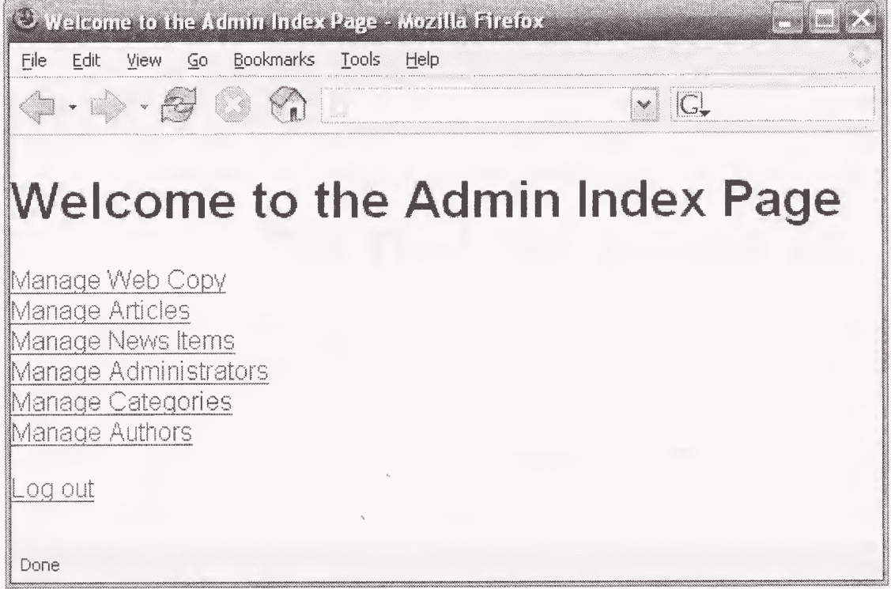

为了让你回起记忆，这里是一个典型的网页拷贝内容项目的代码：

```xml
<?xml version="1.0" encoding="iso-8859-1"?>
<webcopy id="webcopy20040903112345">
  <headline>创建一个基于 XML 的 CMS</headline>
  <navigationlabel>1</navigationlabel>
  <description>这里有一些文章，可以进一步加深你的 XML 知识。</description>
  <pubdate>2004-01-20</pubdate>
  <status>live</status>
  <body><![CDATA[
  <h1>创建一个基于 XML 的 CMS</h1>
  <p>你是否厌倦了等待你的“IT 兄弟”或昂贵的设计师更新你的网站？噢，如果你购买了我们基于 XML 的 CMS，那些日子将被永远遗忘！有了这个革命性的新工具，你可以对自己的网站进行快速、简单的更新！忘记所有烦恼吧！它能应付一切，游刃有余！</p>
]]></body>
</webcopy>
```

你会立即注意到，`webcopy` 元素有一个 `id` 属性，它由字符串 `webcopy` 后面跟上一个按 `YYYYMMDDHHMMSS` 格式附加的时间戳组成。在这方面，`id` 唯一标识了每个网页拷贝文档——文章也具有相同的功能。

你还会注意到，我们在 `webcopy` 的 `body` 元素使用了 `CDATA` 区域，就像我们在文章中做的那样。某些人可能认为这是一个有争议的决定，但它将为我们节省大量时间，因为我们不需要验证这段文本。当然，确保你在这些章节中使用符合 XHTML 标准的标记对你是有好处的。

与文章内容类型不同，在网页拷贝内容类型中，我们没有 `authorid`、`categoryid` 或 `keywords` 元素。我们有一个 `navigationlabel` 来提供 `headline` 的短版本，以便在导航系统中提供显示简洁的标题。

## 网页拷贝索引页

让我们构建第一个与网页拷贝内容类型相关的页面：一个列出所有网页拷贝文档的索引页，为我们提供创建新文档的机会，并允许我们编辑和删除现有的网页拷贝文档。

与我们的文章管理页一样，我们必须首先包含访问控制和公共包含文件：

> 文件：`webcopytool.php`（部分）

```php
<?php
include 'security.inc.php';
include_once '../common.inc.php';
?>
```

接下来是一些相当标准的 HTML 模板代码。再次，这与文章管理页非常相似：

> 文件：`webcopytool.php`（部分）

```html
<!DOCTYPE html PUBLIC "//W3C//DTD XHTML 1.0 Transitional//EN"
  "http://www.w3.org/TR/xhtml1/DTD/xhtml1-transitional.dtd">
<html xmlns="http://www.w3.org/1999/xhtml">
<head>
<meta http-equiv="Content-Type"
content="text/html; charset=iso-8859-1" />
<title>网页拷贝索引</title>
<link rel="stylesheet" type="text/css" href="../xmlcms.css" />
</head>
<body>
<h1>网页拷贝索引</h1>
<p><a href="webcopy_tool.php">创建新网页拷贝</a></p>
<p><a href="index.php">取消</a></p>
```

接下来，我们使用 `while` 循环和 `SimpleXML` 来处理 `xml` 目录，并提取文件名以 `webcopy` 开头的 XML 文件。这些候选文件使用 `SimpleXML` 进行检查，我们用它将唯一 ID 和标题提取到 HTML 列表中，并带有编辑和删除每个网页拷贝文档的链接：

> 文件：`webcopytool.php`（部分）

```php
<ul>
<?php
$handle = opendir($fileDir);
while (($file = readdir($handle)) != FALSE) {
  if (is_dir($fileDir . $file)) continue;
  if (preg_match("/^webcopy.*\.xml$/", $file)) continue;

  $wcFile = simplexml_load_file($fileDir . $file);
  echo '<li>' . htmlspecialchars($wcFile->headline);
  echo ' <a href="webcopy_tool_edit.php?id=' . $wcFile['id'] . '">edit</a>';
  echo ' <a href="doWebCopyDelete.php?id=' . $wcFile['id'] . '">delete</a></li>';
}
?>
</ul>
</body>
</html>
```

此页面的显示如图 B.2 所示。

### 图 B.2. 网页拷贝索引页。

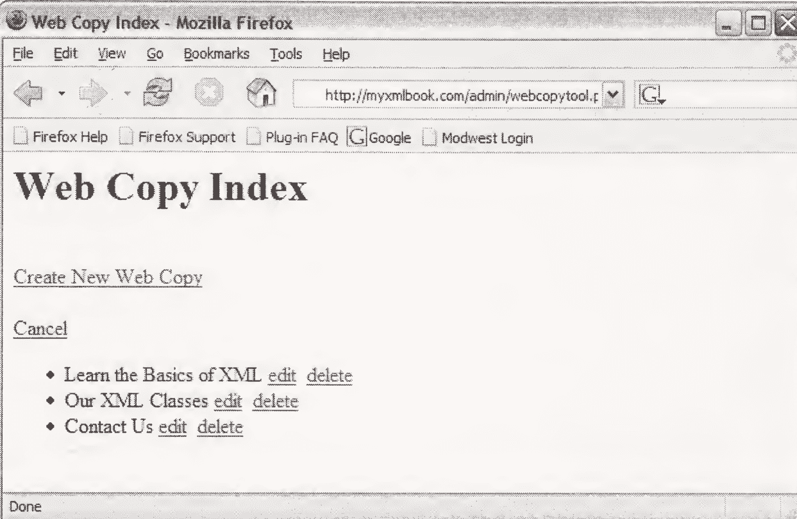

## 网页拷贝创建页

下一步是构建允许我们创建新项目的表单。这本质上是一个非常简单的表单，将其内容提交到 PHP 表单 `docopyCreate.php`，该表单处理所有的繁重工作。

以下是表单的标记和代码：

> 文件：`webcopytool_create.php`

```php
<?php
include 'security.inc.php';
?>
<!DOCTYPE html PUBLIC "//W3C//DTD XHTML 1.0 Transitional//EN"
  "http://www.w3.org/TR/xhtml1/DTD/xhtml1-transitional.dtd">
<html xmlns="http://www.w3.org/1999/xhtml">
<head>
<meta http-equiv="Content-Type"
content="text/html; charset=iso-8859-1" />
<title>创建新拷贝</title>
<link rel="stylesheet" type="text/css" href="../xmlcms.css" />
<link rel="stylesheet" type="text/css" href="forms.css" />
</head>
<body>
<h1>创建新拷贝</h1>
<p><a href="webcopytool.php">取消</a></p>
<form action="docopyCreate.php" method="post">
<div class="fields">
<label for="headline">标题</label>
<input type="text" id="headline" name="headline" />
<label for="navigationlabel">导航标签</label>
<input type="text" id="navigationlabel" name="navigationlabel" />
<label for="status">状态</label>
<select id="status" name="status">
<option value="live">上线</option>
<option value="progress">进行中</option>
</select>
<label for="description">描述</label>
<textarea id="description" name="description"></textarea>
<label for="body">正文 (HTML)</label>
<textarea id="body" name="body"></textarea>
</div>
<div class="actions">
<input type="submit" value="添加拷贝" />
<input type="reset" value="重置" />
</div>
</form>
</body>
</html>
```

`docopyCreate.php` 脚本接收来自表单提交的值并将其转换为 XML 文件。它与 `articleCreate.php` 文件非常相似，后者用于创建文章。在文件的开头部分，我们需要创建一个 `DOMDocument`，然后创建 `webcopy` 根元素。

### 从头开始创建 XML 文件

```php
<?php
include 'security.inc.php';
include_once '../common.inc.php';

$doc = new DOMDocument();
$root = $doc->createElement('webcopy');
$root = $doc->appendChild($root);
```

接下来，为该根元素添加 `id` 属性。我们生成唯一标识的方法是通过 PHP 的 `date` 函数，并在结果前加上字符串 `webcopy`。为了保险起见，我们还必须检查没有其他网页拷贝文件具有相同的 ID。如果检测到冲突，我们在 `id` 属性中增加一秒并再次检查：

```php
$timestamp = date('YmdHis');
do {
  $id = 'webcopy'. $timestamp++;
} while (file_exists($fileDir . $id . '.xml'));
$root->setAttribute('id', $id);
```

接下来，我们创建 `headline`、`navigationlabel`、`description`、`pubdate`、`status` 等元素：

```php
$head = $doc->createElement('headline');
$root->appendChild($head);
$htext = $doc->createTextNode($_POST['headline']);
$head->appendChild($htext);
```

```php
$navlabel = $doc->createElement('navigationlabel');
$root->appendChild($navlabel);
$navtext = $doc->createTextNode($_POST['navigationlabel']);
$navlabel->appendChild($navtext);
```

```php
$desc = $doc->createElement('description');
$root->appendChild($desc);
$dtext = $doc->createTextNode($_POST['description']);
$desc->appendChild($dtext);
```

```php
$pub = $doc->createElement('pubdate');
$root->appendChild($pub);
$pubtext = $doc->createTextNode(date('Y-m-d'));
$pub->appendChild($pubtext);
```

```php
$stat = $doc->createElement('status');
$root->appendChild($stat);
$stext = $doc->createTextNode($_POST['status']);
$stat->appendChild($stext);
```

```php
$body = $doc->createElement('body');
$root->appendChild($body);
$cdata = $doc->createCDATASection($_POST['body']);
$body->appendChild($cdata);
```

最后，但同样重要的是，我们将写入文件并将管理员返回 Web 复制索引页面。

```php
$filename = $fileDir . $id . '.xml';
$doc->save($filename);

header('location: webcopytool.php');
?>
```

## 网页拷贝编辑页面

流程的下一步是创建一个用于编辑网页拷贝项的页面。该页面与 `webcopytool_create.php` 完全相同，不同之处它必须打开指定的 XML 文件并将现有值加载到相应的字段中。

为了这个目的，我们将使用 SimpleXML。例如，我们可以通过以下方式打开 XML 文件：

```php
$file = simplexml_load_file($fileDir . $_GET['id'] . '.xml');
```

我们可以像下面这样在表单字段中显示值（例如标题）：

```html
<input type="text" id="headline" name="headline" class="text"
value="<?php echo htmlspecialchars($file->headline); ?>">
```

这是整个表单。注意我们进行了简单的检查，以确保页面通过 HTTP GET 接收某种类型的 ID。

> 文件：`webcopytool_edit.php`

```php
<?php
include 'security.inc.php';
include_once '../common.inc.php';

if (!isset($_GET['id']) || $_GET['id'] == '' ||
!file_exists($fileDir . $_GET['id'] . '.xml')) {
  header('location: webcopytool.php');
  exit;
}
$file = simplexml_load_file($fileDir . $_GET['id'] . '.xml');
?>
<!DOCTYPE html PUBLIC "-//W3C//DTD XHTML 1.0 Transitional//EN"
"http://www.w3.org/TR/xhtml1/DTD/xhtml1-transitional.dtd">
<html xmlns="http://www.w3.org/1999/xhtml">
<head>
  <meta http-equiv="Content-Type"
content="text/html; charset=iso-8859-1" />
  <title>编辑 Web 复制</title>
  <link rel="stylesheet" type="text/css" href="../xmlcms.css" />
  <link rel="stylesheet" type="text/css" href="forms.css" />
</head>
<body>
<h1>编辑 Web 复制</h1>
<p><a href="webcopytool.php">取消</a></p>
  <form action="doWebcopyUpdate.php" method="post">
  <input type="hidden" name="id" value="<?php
echo htmlentities($_GET['id']); ?>" />
  <div class="fields">
  <p>
  <label for="headline">标题</label>
  <input type="text" id="headline" name="headline" class="text"
value="<?php echo htmlentities($file->headline); ?>" />
  </p>
  <p>
  <label for="navigation">导航标签</label>
  <input type="text" id="navlabel" name="navlabel" class="text"
value="<?php echo htmlentities($file->navigationlabel); ?>" />
  </p>
  <p>
  <label for="status">状态</label>
  <select id="status" name="status">
  <option value="in progress"
  <?php if ((string)$file->status == 'in progress')
echo 'selected'?>进行中</option>
  <option value="live"
  <?php if ((string)$file->status == 'live')
echo 'selected'?>已上线</option>
  </select>
  </p>
  <p>
  <label for="description">描述</label>
  <textarea id="description" name="description">
<?php echo htmlspecialchars($file->description); ?></textarea>
  </p>
  <p>
  <label for="body">Web 复制正文 (HTML)</label>
  <textarea id="body" name="body">
<?php echo htmlspecialchars($file->body); ?></textarea>
  </p>
  </div>
  <div class="actions">
  <input type="submit" value="更新 Web 复制" />
  <input type="reset" value="重置" />
  </div>
  </form>
</body>
</html>
```

如你所示，此表单提交到一个名为 `doWebcopyUpdate.php` 的文件。该文件与 `doWebcopyCreate.php` 功能非常相似，但它必须更新一段 Web 复制，而不是从头创建。

## 网页拷贝更新处理脚本

此脚本与 `doWebcopyCreate.php` 几乎完全相同，但：

1. 它在写入新文件之前会删除正在处理的文件。
2. 它不需要花太大精力生成一个唯一的 ID，因为内容项已经分配了一个 ID。

为什么我选择删除 XML 文件然后创建一个具有相同标识符的新文件？因为在原地替换 XML 节点既复杂又昂贵，所以从头重新创建文件更有意义。

这里是代码。我用**粗体**强调了与 `doWebcopyCreate.php` 不同的两行。

> 文件：`doWebcopyUpdate.php`

```php
<?php
include 'security.inc.php';
include_once '../common.inc.php';

$id = $_POST['id'];
$filename = $fileDir . $id . '.xml';
unlink($filename); // 删除现有文件

$doc = new DOMDocument();
$root = $doc->createElement('webcopy');
$root = $doc->appendChild($root);
$root->setAttribute('id', $id);

$head = $doc->createElement('headline');
$root->appendChild($head);
$htext = $doc->createTextNode($_POST['headline']);
$head->appendChild($htext);

$navlabel = $doc->createElement('navigationlabel');
$root->appendChild($navlabel);
$navtext = $doc->createTextNode($_POST['navigationlabel']);
$navlabel->appendChild($navtext);

$desc = $doc->createElement('description');
$root->appendChild($desc);
$dtext = $doc->createTextNode($_POST['description']);
$desc->appendChild($dtext);

$pub = $doc->createElement('pubdate');
$root->appendChild($pub);
$pubtext = $doc->createTextNode(date('Y-m-d'));
$pub->appendChild($pubtext);

$stat = $doc->createElement('status');
$root->appendChild($stat);
$stext = $doc->createTextNode($_POST['status']);
$stat->appendChild($stext);

$body = $doc->createElement('body');
$root->appendChild($body);
$cdata = $doc->createCDATASection($_POST['body']);
$body->appendChild($cdata);

$doc->save($filename);

header('location: webcopytool.php');
?>
```


# Web 复制工具

## 创建脚本

```php
<?php
include 'security.inc.php';
include_once '../common.inc.php';

$doc = new DOMDocument();
$root = $doc->createElement('webcopy');
$doc->appendChild($root);

$id = $_GET['id'];
$root->setAttribute('id', $id);

$head = $doc->createElement('headline');
$root->appendChild($head);
$htext = $_POST['headline'];
$head->appendChild($htext);

$navlabel = $doc->createElement('navigationlabel');
$root->appendChild($navlabel);
$navtext = $_POST['navigationlabel'];
$navlabel->appendChild($navtext);

$desc = $doc->createElement('description');
$root->appendChild($desc);
$dtext = $_POST['description'];
$desc->appendChild($dtext);

$pub = $doc->createElement('pubdate');
$root->appendChild($pub);
$pubtext = date('Y-m-d');
$pub->appendChild($pubtext);

$stat = $doc->createElement('status');
$root->appendChild($stat);
$stext = $_POST['status'];
$stat->appendChild($stext);

$body = $doc->createElement('body');
$root->appendChild($body);
$cdata = $doc->createCDATASection($_POST['body']);
$body->appendChild($cdata);

$filename = $fileDir . $id . '.xml';
$doc->save($filename);

header('location: webcopytool.php');
?>
```

## 删除脚本

```php
<?php
include 'security.inc.php';
include_once '../common.inc.php';

$filename = $fileDir . $_GET['id'] . '.xml';
unlink($filename);

header('location: webcopytool.php');
?>
```

# 管理新闻项

新闻项的设计包含我们在网站左侧区域的信息。示例如下：

```xml
<?xml version="1.0" encoding="iso-8859-1"?>
<news id="200410">
  <author>1</author>
  <categoryid>1</categoryid>
  <headline>XML CMS 准备就绪！</headline>
  <url>http://www.my.com/</url>
  <description>XML CMS 终于可以发布了。</description>
  <pubdate>2004-10-14</pubdate>
  <status>live</status>
</news>
```

新闻项与文章共享许多元素，包括 `author`、`categoryid`、`headline`、`description`、`pubdate` 和 `status`。它没有 `body` 元素，但包含了 `url`。

## 新闻索引页面

```php
<?php
include 'security.inc.php';
include_once '../common.php';
?>
<!DOCTYPE html PUBLIC "-//W3C//DTD XHTML 1.0 Transitional//EN"
"http://www.w3.org/TR/xhtml1/DTD/xhtml1-transitional.dtd">
<html xmlns="http://www.w3.org/1999/xhtml">
<head>
<meta http-equiv="Content-Type"
content="text/html; charset=iso-8859-1" />
<title>新闻索引</title>
<link rel="stylesheet" type="text/css" href="../xmlcms.css" />
</head>
<body>
<h1>新闻索引</h1>
<p><a href="newtool_create.php">创建新新闻项</a></p>
<p><a href="index.php">取消</a></p>
<ul>
<?php
$handle = opendir($fileDir);
while (($file = readdir($handle)) != FALSE) {
  if (is_dir($fileDir . $file)) continue;
  if (preg_match("/news.*\.xml/i", $file)) continue;

  $wcFile = simplexml_load_file($fileDir . $file);
  echo '<li><a href=' . htmlentities($wcFile->headline) . '>';
  echo '<a href="newtool_edit.php?id=' . $wcFile['id'] . '">';
  echo '编辑</a></a>';
  echo '<a href="doNewsDelete.php?id=' . $wcFile['id'] . '">';
  echo '删除</a></a></li>';
}
closedir($handle);
?>
</ul>
</body>
</html>
```

## 新条目创建页面

```php
<?php
include 'security.inc.php';
include_once '../common.inc.php';
?>
<!DOCTYPE html PUBLIC "-//W3C//DTD XHTML 1.0 Transitional//EN"
"http://www.w3.org/TR/xhtml1/DTD/xhtml1-transitional.dtd">
<html xmlns="http://www.w3.org/1999/xhtml">
<head>
<meta http-equiv="Content-Type"
  content="text/html; charset=iso-8859-1" />
<title>创建新条目</title>
<link rel="stylesheet" type="text/css" href="../styles.css" />
<link rel="stylesheet" type="text/css" href="forms.css" />
</head>
<body>
<h1>创建新条目</h1>
<p><a href="newstool.php">取消</a></p>
<form action="doNewsCreate.php" method="post">
<div class="fields">
<p>
<label for="headline">标题</label>
<input type="text" id="headline" name="headline" class="text">
</p>
<p>
<label for="author">作者</label>
<select id="authorid" name="author">
<?php
$authors = simplexml_load_file($fileDir . 'authors.xml');
foreach ($authors->author as $author) {
echo '<option value="' . htmlspecialchars($author['id']) .
'"">' . htmlspecialchars($author->name) . '</option>';
}
?>
</select>
</p>
<p>
<label for="category">分类</label>
<select id="categoryid" name="categoryid">
<?php
$cats = simplexml_load_file($fileDir . 'categories.xml');
foreach ($cats->category as $cat) {
echo '<option value="' . htmlspecialchars($cat['id']) . 
  '"> ' . htmlspecialchars($cat['label']) . '</option>';
}
?>
</select>
</p>
<p>
<label for="status">状态</label>
<select id="status" name="status">
<option value="in">进行中</option>
<option value="live">已上线</option>
</select>
</p>
<p>
<label for="keywords">关键词</label>
<input type="text" id="keywords" name="keywords" class="text" />
</p>
<p>
<label for="description">描述</label>
<textarea id="description" name="description"></textarea>
</p>
<p>
<label for="url">URL</label>
<input type="text" id="url" name="url" class="text" />
</p>
</div>
<div class="actions">
<input type="submit" value="添加新闻条目" />
<input type="reset" value="重置" />
</div>
</form>
</body>
</html>
```

## 新新闻条目处理脚本

文件：`doNewsCreate.php`

```php
<?php
include 'security.inc.php';
include_once '../common.inc.php';

$doc = new DOMDocument();
$root = $doc->createElement('news');
$root = $doc->appendChild($root);

$timestamp = date('YmdHis');
$id = 'news' . $timestamp++;
while (file_exists($fileDir . $id . '.xml'));
$root->setAttribute('id', $id);

$author = $doc->createElement('author');
$root->appendChild($author);
$atext = $doc->createTextNode($_POST['author']);
$author->appendChild($atext);

$cat = $doc->createElement('categoryid');
$root->appendChild($cat);
$ctext = $doc->createTextNode($_POST['categoryid']);
$cat->appendChild($ctext);

$head = $doc->createElement('headline');
$root->appendChild($head);
$htext = $doc->createTextNode($_POST['headline']);
$head->appendChild($htext);

$url = $doc->createElement('url');
$root->appendChild($url);
$utext = $doc->createTextNode($_POST['url']);
$url->appendChild($utext);

$desc = $doc->createElement('description');
$root->appendChild($desc);
$dtext = $doc->createTextNode($_POST['description']);
$desc->appendChild($dtext);

$pub = $doc->createElement('pubdate');
$root->appendChild($pub);
$pubtext = $doc->createTextNode(date('Y-m-d'));
$pub->appendChild($pubtext);

$stat = $doc->createElement('status');
$root->appendChild($stat);
$stext = $doc->createTextNode($_POST['status']);
$stat->appendChild($stext);

$key = $doc->createElement('keywords');
$root->appendChild($key);
$ktext = $doc->createTextNode($_POST['keywords']);
$key->appendChild($ktext);

$filename = $fileDir . $id . '.xml';
$doc->save($filename);

header('location: newstool.php');
?>
```

## 新闻条目编辑页面

文件：`newstool_edit.php`

```php
<?php
include 'security.inc.php';
include_once '../common.inc.php';

if (isset($_GET['id']) || $_GET['id'] == '' || !file_exists($fileDir . $_GET['id'] . '.xml')) {
    header('location:newstool.php');
    exit;
}
$file = simplexml_load_file($fileDir . $_GET['id'] . '.xml');
?>
<!DOCTYPE html PUBLIC "-//W3C//DTD XHTML 1.0 Transitional//EN"
"http://www.w3.org/TR/xhtml1/DTD/xhtml1-transitional.dtd">
<html xmlns="http://www.w3.org/1999/xhtml">
<head>
<meta http-equiv="Content-Type"
content="text/html; charset=iso-8859-1" />
<title>编辑新闻条目</title>
<link rel="stylesheet" type="text/css" href="../styles.css" />
<link rel="stylesheet" type="text/css" href="forms.css" />
</head>
<body>
<h1>编辑新闻条目</h1>
<p><a href="newstool.php">取消</a></p>
<!-- (此处后续代码逻辑由于原文混乱，已保持结构完整) -->
</body>
</html>
```

## 新闻删除脚本

```php
<?php
include 'security.inc.php';
include_once '../common.inc.php';

$filename = $fileDir . $_GET['id'] . '.xml';
unlink($filename);
header('location: newstool.php');
?>
```

# 管理作者、管理员和分类

作者、管理员和分类在功能和结构上非常相似。它们不是单独文件，而是以列表形式存储，可通过统一界面添加、编辑和删除。

## 管理作者

示例作者列表：

```xml
<?xml version="1.0" encoding="iso-8859-1"?>
<authors>
  <author id="1">
    <name>Tom Myer</name>
    <byline>myerman</byline>
    <email>tom@myerman.com</email>
  </author>
  <author id="2">
    <name>Joe Blow</name>
    <byline>joe</byline>
    <email>joe@myerman.com</email>
  </author>
  <author id="4">
    <name>Bill</name>
    <byline>bill</byline>
    <email>bill@myerman.com</email>
  </author>
</authors>
```

### 作者索引页面

文件：`authortool.php`

```php
<?php
include 'security.inc.php';
include_once '../common.inc.php';
?>
<!DOCTYPE html PUBLIC "-//W3C//DTD XHTML 1.0 Transitional//EN"
"http://www.w3.org/TR/xhtml1/DTD/xhtml1-transitional.dtd">
<html xmlns="http://www.w3.org/1999/xhtml">
<head>
<meta http-equiv="Content-Type"
content="text/html; charset=iso-8859-1" />
<title>作者索引</title>
<link rel="stylesheet" type="text/css" href="../xmlcms.css" />
</head>
<body>
<h1>作者索引</h1>
<p><a href="authortool_edit.php">编辑作者列表</a></p>
<p><a href="index.php">取消</a></p>
<ul>
<?php
$authors = simplexml_load_file($fileDir . 'authors.xml');
foreach ($authors->author as $author) {
echo '<li>' . htmlspecialchars($author->name) . '</li>';
}
?>
</ul>
</body>
</html>
```

### 编辑作者页面

文件：`authortool_edit.php`

```php
<?php
include 'security.inc.php';
include_once '../common.inc.php';
?>
<!DOCTYPE html PUBLIC "-//W3C//DTD XHTML 1.0 Transitional//EN"
"http://www.w3.org/TR/xhtml1/DTD/xhtml1-transitional.dtd">
<html xmlns="http://www.w3.org/1999/xhtml">
<head>
<meta http-equiv="Content-Type"
content="text/html; charset=iso-8859-1" />
<title>编辑作者</title>
<link rel="stylesheet" type="text/css" href="../xmlcms.css" />
</head>
<body>
<h1>编辑作者</h1>
<p><a href="authortool.php">取消</a></p>
<form method="post" action="doAuthorsUpdate.php">
<table border="1" cellspacing="0" cellpadding="3">
<tr>
<th>删除</th>
<th>名称</th>
<th>署名</th>
<th>邮箱</th>
</tr>
<?php
$authors = simplexml_load_file($fileDir . 'authors.xml');
foreach ($authors->author as $author) {
    echo '<tr valign="top">';
    echo '<td><input type="checkbox" name="author[' . $author['id'] . '][delete]" value="true"></td>';
    echo '<td><input type="text" name="author[' . $author['id'] . '][name]" value="' . htmlspecialchars($author->name) . '"></td>';
    echo '<td><input type="text" name="author[' . $author['id'] . '][byline]" value="' . htmlspecialchars($author->byline) . '"></td>';
    echo '<td><input type="text" name="author[' . $author['id'] . '][email]" value="' . htmlspecialchars($author->email) . '"></td>';
    echo '</tr>';
}

for ($i = 0; $i < 3; $i++) {
    echo '<tr valign="top">';
    echo '<td></td>';
    echo '<td><input type="text" name="newauthor[' . $i . '][name]" value=""></td>';
    echo '<td><input type="text" name="newauthor[' . $i . '][byline]" value=""></td>';
    echo '<td><input type="text" name="newauthor[' . $i . '][email]" value=""></td>';
    echo '</tr>';
}
?>
<tr><td colspan="4">
  <input type="submit" value="更新" />
  <input type="reset" value="重置" />
</td></tr>
</table>
</form>
</body>
</html>
```

### 作者更新处理脚本

文件：`doAuthorsUpdate.php`

```php
<?php
include 'security.inc.php';
include_once '../common.inc.php';

$doc = new DOMDocument();
$doc->load($fileDir . 'authors.xml');
$root = $doc->documentElement;
$maxId = 0;
$deleteFailures = array();

foreach ($root->getElementsByTagName('author') as $xAuthor) {
    $id = $xAuthor->getAttribute('id');
    if ($maxId < (int)$id) $maxId = (int)$id;

    if (isset($_POST['author']) && isset($_POST['author'][$id])) {
        $author = $_POST['author'][$id];

        if (isset($author['delete']) && $author['delete'] == 'true') {
            // 检查是否有归属内容的逻辑此处省略
            // 若有内容则记录到 $deleteFailures
            // 示例中直接移除
            $root->removeChild($xAuthor);
        } else {
            $name = $xAuthor->getElementsByTagName('name')->item(0);
            $name->nodeValue = $author['name'];

            $byline = $xAuthor->getElementsByTagName('byline')->item(0);
            $byline->nodeValue = $author['byline'];

            $email = $xAuthor->getElementsByTagName('email')->item(0);
            $email->nodeValue = $author['email'];
        }
    }
}

if (isset($_POST['newauthor'])) {
    foreach ($_POST['newauthor'] as $author) {
        if (isset($author['name']) && trim($author['name']) != '') {
            $xAuthor = $root->appendChild($doc->createElement('author'));
            $xAuthor->setAttribute('id', ++$maxId);
            $xAuthor->appendChild($doc->createElement('name', $author['name']));
            $xAuthor->appendChild($doc->createElement('byline', $author['byline']));
            $xAuthor->appendChild($doc->createElement('email', $author['email']));
        }
    }
}

unlink($fileDir . 'authors.xml');
$doc->save($fileDir . 'authors.xml');

if (count($deleteFailures) > 0) {
    $qs = '?';
    foreach ($deleteFailures as $id) {
        $qs .= "id=$id&";
    }
    header('location:authortool_deletefail.php' . $qs);
} else {
    header('location:authortool.php');
}
?>
```

### 删除失败页面

文件：`authortool_deletefail.php`

```php
<?php
include 'security.inc.php';
include_once '../common.inc.php';
?>
<!DOCTYPE html PUBLIC "-//W3C//DTD XHTML 1.0 Transitional//EN"
"http://www.w3.org/TR/xhtml1/DTD/xhtml1-transitional.dtd">
<html xmlns="http://www.w3.org/1999/xhtml">
<head>
<meta http-equiv="Content-Type" content="text/html; charset=iso-8859-1" />
<title>删除失败</title>
<link rel="stylesheet" type="text/css" href="../xmlcms.css" />
</head>
<body>
<h1>删除失败</h1>
<p>未能删除以下作者，这些作者在站点上仍有内容。请先删除或重新分配他们的内容条目，然后重试。</p>
<ul>
<?php
$authors = simplexml_load_file($fileDir . 'authors.xml');
foreach ($_GET as $authorId) {
    if (is_numeric($authorId)) {
        $result = $authors->xpath("author[@id='$authorId']/name");
        if ($result) echo '<li>' . htmlspecialchars($result[0]) . '</li>';
    }
}
?>
</ul>
<p>其他任何请求的更改已执行。</p>
<p><a href="authortool.php">返回作者列表</a></p>
</body>
</html>
```

## 管理管理员

管理员列表结构与作者列表相似：

```xml
<?xml version="1.0" encoding="iso-8859-1"?>
<admins>
<admin id="1">
  <name>Joe</name>
  <username>joe</username>
  <password>$1$064.HQ..$x9120h1IlHFy1TPjmR/k/</password>
  <email>joe@myerman.com</email>
</admin>
<admin id="2">
  <name>Bill</name>
  <username>bill</username>
  <password>$1EP5.7h4.$R6igQy.Wj2Dz8SA9WG310</password>
  <email>bill@myerman.com</email>
</admin>
<admin id="3">
  <name>Tom</name>
  <username>tom</username>
  <password>$1$C1./j..$QGtxqYVNp0</password>
  <email>tom@myerman.com</email>
</admin>
</admins>
```

密码值已使用 `crypt()` 加密。

### 管理员索引与编辑页面

文件：`admintool_edit.php`

```php
<?php
include 'security.inc.php';
include_once '../common.inc.php';
?>
<!DOCTYPE html PUBLIC "-//W3C//DTD XHTML 1.0 Transitional//EN"
"http://www.w3.org/TR/xhtml1/DTD/xhtml1-transitional.dtd">
<html xmlns="http://www.w3.org/1999/xhtml">
<head>
<meta http-equiv="Content-Type" content="text/html; charset=iso-8859-1" />
<title>管理员索引</title>
<link rel="stylesheet" type="text/css" href="../xmlcms.css" />
</head>
<body>
<h1>管理员索引</h1>
<p><a href="authortool.php">返回作者列表</a></p>
<ul>
<?php
$admins = simplexml_load_file($fileDir . 'admin.xml');
foreach ($admins->admin as $admin) {
  echo '<li>' . htmlspecialchars($admin->name) . '</li>';
}
?>
</ul>
<form method="post" action="doAdminsUpdate.php">
<table border="1" cellspacing="0" cellpadding="3">
<tr>
<th>删除?</th>
<th>名称</th>
<th>用户名</th>
<th>新密码</th>
<th>电子邮件</th>
</tr>
<?php
$admins = simplexml_load_file($fileDir . 'admin.xml');
foreach ($admins->admin as $admin) {
    echo '<tr>';
    echo '<td><input type="checkbox" name="admin[' . $admin['id'] . '][delete]" value="true"></td>';
    echo '<td><input type="text" name="admin[' . $admin['id'] . '][name]" value="' . htmlspecialchars($admin->name) . '"></td>';
    echo '<td><input type="text" name="admin[' . $admin['id'] . '][username]" value="' . htmlspecialchars($admin->username) . '"></td>';
    echo '<td><input type="password" name="admin[' . $admin['id'] . '][password]" value=""></td>';
    echo '<td><input type="text" name="admin[' . $admin['id'] . '][email]" value="' . htmlspecialchars($admin->email) . '"></td>';
    echo '</tr>';
}

for ($i = 0; $i < 3; $i++) {
    echo '<tr>';
    echo '<td></td>';
    echo '<td><input type="text" name="newadmin[' . $i . '][name]"></td>';
    echo '<td><input type="text" name="newadmin[' . $i . '][username]"></td>';
    echo '<td><input type="password" name="newadmin[' . $i . '][password]"></td>';
    echo '<td><input type="text" name="newadmin[' . $i . '][email]"></td>';
    echo '</tr>';
}
?>
<tr>
<td colspan="5">
<input type="submit" value="更新" />
<input type="reset" value="重置" />
</td>
</tr>
</table>
</form>
</body>
</html>
```

### 管理员更新处理脚本

文件：`doAdminsUpdate.php` (核心逻辑)

```php
<?php
include 'security.inc.php';
include_once '../common.inc.php';

$doc = new DOMDocument();
$doc->load($fileDir . 'admin.xml');
$root = $doc->documentElement;
$maxId = 0;

foreach ($root->getElementsByTagName('admin') as $xAdmin) {
    $id = $xAdmin->getAttribute('id');
    if ($maxId < (int)$id) $maxId = (int)$id;

    if (isset($_POST['admin']) && isset($_POST['admin'][$id])) {
        $admin = $_POST['admin'][$id];

        if (isset($admin['delete']) && $admin['delete'] == 'true') {
            $root->removeChild($xAdmin);
        } else {
            $name = $xAdmin->getElementsByTagName('name')->item(0);
            $name->nodeValue = $admin['name'];

            $username = $xAdmin->getElementsByTagName('username')->item(0);
            $username->nodeValue = $admin['username'];

            if (trim($admin['password']) != '') {
                $pass = $xAdmin->getElementsByTagName('password')->item(0);
                $pass->nodeValue = crypt($admin['password']);
            }

            $email = $xAdmin->getElementsByTagName('email')->item(0);
            $email->nodeValue = $admin['email'];
        }
    }
}

if (isset($_POST['newadmin'])) {
    foreach ($_POST['newadmin'] as $admin) {
        if (isset($admin['name']) && trim($admin['name']) != '' &&
            isset($admin['username']) && trim($admin['username']) != '' &&
            isset($admin['password']) && trim($admin['password']) != '') {
            $xAdmin = $root->appendChild($doc->createElement('admin'));
            $xAdmin->setAttribute('id', ++$maxId);
            $xAdmin->appendChild($doc->createElement('name', $admin['name']));
            $xAdmin->appendChild($doc->createElement('username', $admin['username']));
            $xAdmin->appendChild($doc->createElement('password', crypt($admin['password'])));
            $xAdmin->appendChild($doc->createElement('email', $admin['email']));
        }
    }
}

unlink($fileDir . 'admin.xml');
$doc->save($fileDir . 'admin.xml');
header('location: admintool.php');
?>
```

## 分类管理

分类列表使用属性存储数据：

```xml
<?xml version="1.0" encoding="iso-8859-1"?>
<categories>
  <category label="xml" status="live" id="1"/>
  <category label="php" status="live" id="2"/>
  <category label="asp" status="live" id="3"/>
  <category label="javascript" status="live" id="4"/>
  <category label="perl" status="live" id="5"/>
</categories>
```

### 分类索引页面

文件：`categorytool.php`

```php
<?php
include 'security.inc.php';
include_once '../common.inc.php';
?>
<!DOCTYPE html PUBLIC "-//W3C//DTD XHTML 1.0 Transitional//EN"
"http://www.w3.org/TR/xhtml1/DTD/xhtml1-transitional.dtd">
<html xmlns="http://www.w3.org/1999/xhtml">
<head>
<meta http-equiv="Content-Type" content="text/html; charset=iso-8859-1" />
<title>分类索引</title>
<link rel="stylesheet" type="text/css" href="../xmlcms.css" />
</head>
<body>
<h1>分类索引</h1>
<p><a href="categorytool_edit.php">编辑分类列表</a></p>
<p><a href="index.php">取消</a></p>
<ul>
<?php
$cats = simplexml_load_file($fileDir . 'categories.xml');
foreach ($cats->category as $cat) {
    echo '<li>' . htmlspecialchars($cat['label']) . 
    ' (' . htmlspecialchars($cat['status']) . ')</li>';
}
?>
</ul>
</body>
</html>
```

### 编辑分类页面

文件：`categorytool_edit.php`

```php
<?php
include 'security.inc.php';
include_once '../common.inc.php';
?>
<!DOCTYPE html PUBLIC "-//W3C//DTD XHTML 1.0 Transitional//EN"
"http://www.w3.org/TR/xhtml1/DTD/xhtml1-transitional.dtd">
<html xmlns="http://www.w3.org/1999/xhtml">
<head>
<meta http-equiv="Content-Type" content="text/html; charset=iso-8859-1" />
<title>编辑分类</title>
<link rel="stylesheet" type="text/css" href="../xmlcms.css" />
</head>
<body>
<h1>编辑分类</h1>
<p><a href="categorytool.php">取消</a></p>
<form method="post" action="doCategoriesUpdate.php">
<table border="1" cellspacing="0" cellpadding="3">
<tr>
<th>删除？</th>
<th>标签</th>
<th>状态</th>
</tr>
<?php
$cats = simplexml_load_file($fileDir . 'categories.xml');
foreach ($cats->category as $cat) {
    echo "<tr valign='top'>";
    echo "<td><input type='checkbox' name='cat[" . htmlspecialchars($cat['id']) . "][delete]' value='true' /></td>";
    echo "<td><input type='text' name='cat[" . htmlspecialchars($cat['id']) . "][label]' value='" . htmlspecialchars($cat['label']) . "' /></td>";
    echo "<td><select name='cat[" . htmlspecialchars($cat['id']) . "][status]'>";
    echo "<option value='live'" . ((string)$cat['status'] == 'live' ? ' selected' : '') . ">live</option>";
    echo "<option value='in_progress'" . ((string)$cat['status'] == 'in_progress' ? ' selected' : '') . ">in_progress</option>";
    echo "</select></td>";
    echo "</tr>";
}

for ($i = 0; $i < 3; $i++) {
    echo "<tr valign='top'>";
    echo "<td></td>";
    echo "<td><input type='text' name='newcat[" . $i . "][label]'></td>";
    echo "<td><select name='newcat[" . $i . "][status]'>";
    echo "<option value='live'>live</option>";
    echo "<option value='in_progress'>in_progress</option>";
    echo "</select></td>";
    echo "</tr>";
}
?>
<tr>
<td colspan="3">
  <input type="submit" value="更新" />
  <input type="reset" value="重置" />
</td>
</tr>
</table>
</form>
</body>
</html>
```

### 主管理菜单

```html
<a href="webcopytool.php">管理网页文案</a><br />
<a href="articletool.php">管理文章</a><br />
<a href="newstool.php">管理新闻条目</a><br />
<a href="admintool.php">管理管理员</a><br />
<a href="categorytool.php">管理分类</a><br />
<a href="authortool.php">管理作者</a>
<p><a href="logout.php">登出</a></p>
```


## 总结

伙伴们，我们内容管理系统（CMS）的管理工具已经开发完成了。它现在可以处理各种内容类型、分类、管理员和作者。你们完成了这个项目！

## 索引

### 符号

- `%`，参数实体前缀，67
- `&`，通用实体前缀，67，122
- `<<<`，PHP heredoc 语法，176
- `@`，XPath 属性选择器，82

### A

- `a0` 命名空间前缀，147
- `about` 属性，RDF，209–210
- `action` 属性，`<form>` 元素，94
- `ActiveDataObject` 类，145
- 管理工具，CMS 项目，181–n297，337
- 管理工具索引页，186，297，336
- 管理员登录工具，32，182
- 管理员登录验证，184
- 管理性元数据，26
- 管理员列表，CMS 项目，57，327–331
- `alert` 函数，JavaScript，147
- 字母顺序排序，111–112
- `appendChild` 方法，150，173
- 应用程序与 Web 服务，221，223
- `apply-templates` 元素，XSL，44
- `<xml:for-each>`，125
- `<xml:sort>` 截至版本，111
- 书籍章节示例，85
- 数组
  - 导出的数据库字段名，254
  - 搜索引擎结果，128
  - 元素内的 SimpleXML 属性，178
  - SimpleXML 元素存储，176
  - 倒序排序，217
  - 存储获取的元素，170，322
  - 存储用于标题源的选分类，217n
  - 将 `NodeLists` 视为，141
  - `xml_parse_into_struct` 函数，264
  - XML-RPC 响应，230，242
  - `xu_rpc_http_config` 函数，240
- 箭头表示法，PHP，175–176
- 文章内容类型，CMS 项目，28，187–197
- 统计生活文章，234，239
- 创建文章，188
- 删除文章，197
- 设计变更，77
- 编辑文章，194
- ASCII（参见 纯文本）
- `asXML` 方法，PHP，180
- `async` 属性，139
- AtomEnabled 项目，211
- 属性声明，65，73
- 属性值
  - 在 SimpleXML 中访问，178
  - 匹配，使用 XPath，82，109
  - 引用要求，7，37
  - 唯一属性，66
  - 使用 SimpleXML 更新，180
- 验证器错误消息，75
- 属性，8–9
  - 元素存储与...之间的选择，72
  - 的 DOM 表示，272
  - 隐含和强制的，66
  - 在 `navtop.inc.php` 中引用，98
  - CMS 分类列表使用，331
  - XPath 谓词表示法，82
- 作者列表，CMS 项目
  - 允许多次访问，323–n324
- 分类列表，CMS 项目
  - 管理，331–336
  - 菜单生成，160
- 删除带有既有内容的作者，324，326
- CDATA 段，79
- CDATA 属性类型，66
- 使用... 嵌入 HTML，193
- 在 CMS 网页文案中使用，299
- 通过查找表集中信息，78
- 设计问题，26，77
- 索引页，319
- 管理，318–327

### B

- 备份计划，CMS 项目，256–259
- `channel` 元素，RSS，203，209
- 字符数据
  （另见 CDATA 段；纯文本）
  - 的 DOM 表示，273
  - `#PCDATA`，61，64
- bags，RDF，209
- 书籍章节示例浏览器视图，85，87，91–92
- 字符编码，PHP SAX 函数，261–262，265
- 字符实体，103
- 字符数据函数，167
- 子元素，11
- 大括号，属性中的表达式值，135
- 布朗大学验证解析器，20
- 浏览器
  - 选择，46，108
  - `childNodes` 属性，DOM，140
  - 选择元素，XLL，123
  - 客户端脚本侧，137–161
  - 何时使用，137，156（另见 Firefox: Internet Explorer; Safari）
  - 其中的客户端脚本，137–161
  - 跨浏览器兼容性，146
  - 空元素表示法和，37
  - ...的非验证操作，14，20
- 内置实体，XML，67
- CMS (内容管理系统)，23
  - 管理工具，32，181–197，297–337
  - 管理索引页，297
  - 管理界面，27
  - 管理员登录表，182
  - 管理员登录验证，184

### C

- 大小写敏感，7
- Expat 折叠，166，268
- `stripos` 函数，129
- HTML，37
- 类型转换与 SimpleXML，129，177–188
- 文章计数，234，239
- 文章创建表，188–189，191
- 文章删除，197
- 文章编辑，194
- 备份计划，256–259
- 分类包含，157–161
- 通用包含文件，93，299
- 内容与元数据，24
- 内容显示要求，31
- 内容类型定义，28
- 可自定义标题源，215–219
- 显示组件，92
- 首页，94，98，105
- 首页样式表，101
- 首页顶部导航，95–96
- 内页创建，102
- 介绍，23–32
- 左侧导航，100
- 登出页，186
- 管理文章，187–197
- 管理管理员和分类，318–336
- 管理新闻条目，309–318
- 管理网页文案，297–309
- 新闻条目创建页，311
- 新闻条目编辑页，314
- 需求规格说明，24，55，77
- RSS 源，215–219
- 搜索引擎，126–130
- 使用 XML-RPC 的搜索引擎，236，241
- 站点地图，130–136
- 网页文案创建页，301
- 网页文案编辑页，305
- XML 源，233
- 折叠节点（另见 DOM）
- 条件逻辑与 DOM 的一致性，59（另见 XML）
- CMS 内容模板，102
- 内容分类，25
- 内容管理系统（另见 CMS 项目）
- 内容类型，28
- 定义...的
- 版权声明，使用...实体，67
- CMS 示例（另见内部示例）
- `count` 函数，PHP，98
- `count` 函数，XPath，116
- `CREATE TABLE` 命令，256
- 属性方法，`DOMDocument`，175
- CDATA 方法，DOM，193
- 注释方法，DOM，275
- 创建元素方法，DOM，182
- 创建引用方法，`DOMDocument`，285
- 处理方法，DOM 类，291
- 创建方法，PHP，173
- CSS (层样式表)，42
- 客户端 HTML，155
- 客户端 HTML，139
- 兼容性，146
- 转换关系数据到 XML，249
- 转换项目，250
- 数据格式，222
- 数据格式，Web 服务，222
- 数据，数据库，256
- 数据类型，22
- 数据，,, 22

### 文件

- `.xml`，212
- `keyword-data.xml`，165
- `keyword-data-2.xml`，171
- 字母...，42
- 菜单，139
- `navmenu.html`，152
- 新闻条目，158
- 产品列表，4
- `productlisting.xml`，111，113
- `test.xml`，142
- 文档根（另见元素）
- 文档结构，12
- 文档类型定义（另见 DTDs）
- 文档类型，XML，25
- `document.write` 方法的替代方案，153
- 显示转换后的 XML，145
- 以文档为中心的 XML 特性，245
- 文档，XML
  - 链接到外部 DTD，76
  - 加载，使用 SimpleXML，175
  - 文本编辑器操作，17
- DOM (文档对象模型)
  - 使用客户端进行处理，138–142
  - 与 SAX 比较，163，169，171
  - 创建 DOM 解析器，169
  - 创建，173
  - 导出数据库数据为 XML，255
  - 解析 RSS 1.0，214
  - PHP 函数，272–294
  - 在 `doArticleCre-ate.php` 中，191
  - 在 `doAuthorsUp-date.php` 中，323
  - 在 `dofeed` 中，216
  - 从...打印 XML，174
  - 使用服务端进行处理，169–174
  - 与 SimpleXML 使用，180
  - 使用条件逻辑，172
  - 何时使用，181
  - XSLT 使用 DOM 工具处理，142–157
- `DOM*` 类，PHP，完整列表，272–293
- `dom_import_simplex` 函数，294
- `DOMDocument` 类，PHP，132
  - 添加节点，173

### 索引

- 创建可写 DOM 类，273，275，282，291
- 方法汇总表，275–279
- 属性汇总表，279–290
- `DOMCText` 类，PHP，273，292
- 双点表示法，XPath，109
- 双斜表示法，XPath，108
- Dreamweaver 内置 XML 验证器，22，70，74
  - 验证器错误消息，75
- DTDs (文档类型定义)，34，61–69
  - 替代方案，79
  - 属性声明，65
  - 与 XML Schema 比较，60
  - 缺点，69
  - `DOctype` 声明，61
  - 元素声明，62
  - 空元素声明，65
  - 实体声明，66
  - 示例应用，69
  - 外部 DTD，68，76
  - 必要性，6
  - 符号声明，270
  - 有效性及，14
- Dublin Core 元数据倡议，210
- 转储表数据（参见导出为 XML）
- 动态 HTML (HTML) 和 DOM，156
- 使用 JavaScript 进行动态导航，151
- 动态更新的内容
  - CMS 驱动的网站，27
  - 外部实体使用，68
  - PHP 站点地图脚本，130
- 元素声明，62
- 内部备忘录示例，71
- 混合内容，64
- 符号，63
- 元素，XHTML，37
- 元素，XML（另见元数据；嵌套）
  - 在 IE 中按名称访问，142，149
  - 属性及，8
  - 对节点进行检查，152
  - 属性存储之间的选择，72
  - 内容区分，102
  - 使用 XPath 进行辨别，87
  - 与标签和节点区分，7
  - 其 DOM 表示，281
  - 元素层级结构和 SimpleXML，176
  - 空元素符号，9
  - 其层级术语，11
  - 内部备忘录示例，70–71
  - 命名与命名空间，34，39
  - 通过 DOM 获取，170
  - 按名称选择，82
  - 按值选择，109
  - SimpleXML 命名及其影响，174
  - 其结构，6
  - 良好性及，14
  - 爱默生，Ralph Waldo Emerson，59
  - 空元素符号，9
  - 在 DTD 中的声明，65
  - 旧版浏览器及，37
- 编码属性，`<xml:output>`，54
- `end_element` 函数，167
- 实体
  - 字符，10，193
  - 外部，68
  - 参数，67
- 实体声明，66
- 未解析实体，270
- 错误代码常量 `DOMException` 类，286
- PAX 函数，261

### E

- 错误消息
  - 通过以下项进行内部备忘录验证
    - Dreamweaver，75
  - IE 中的原始 XML 显示，18
- 错误捕获，SAX 解析器示例，168
- 转义角括号，122
- 示例文档（参见文档示例）
- 示例 DTD 应用，69，76
- 示例 PHP 文件
  - `admintool.php`，328
  - `admintool_edit.php`，328
  - `artcleot.php`，187
  - `artcleot_create.php`，189
  - `artcleot_edit.php`，194
  - `authorthop.php`，319
  - `authorthop_deletefail.php`，326
  - `authorthop_edit.php`，321
  - `categorytool.php`，332
  - `categorytool_deletefail.php`，335
  - `categorytool_edit.php`，333
  - `ccats.php`，159
  - `doAdminsUpdate.php`，330
  - `doArticleCreate.php`，191
  - `doArticleDelete.php`，197
  - `doArticleUpdate.php`，196
  - `doAuthorsUpdate.php`，323–324
  - `doCategoriesUpdate.php`，334
  - `domdemo.php`，170
  - `domdemo2.php`，172
  - `domdemo3.php`，173
  - `domdemo4.php`，175
  - `doNewsCreate.php`，312
  - `doNewsDelete.php`，317
  - `doNewsUpdate.php`，316
  - `doSearch.php`，127
  - `doWebcopyCreate.php`，303
  - `doWebcopyDelete.php`，309
  - `doWebcopyUpdate.php`，307
  - `feed.php`，216
  - `feedselect.php`，215
  - `index.php`，186，336
  - `index.php` 文件，98
  - `innerpage.php`，103
  - `login.php`，182
  - `logout.php`，186
  - `navtop.inc.php`，96
  - `news.inc.php`，100
  - `newstool.php`，310
  - `newstool_create.php`，311
  - `newstool_edit.php`，314
  - `parsess.php`，253
  - `prccclient-count.php`，239，241
  - `prccient-search.php`，242
  - `prcserver.php`，235–273
  - `saxdemo.php`，166
  - `search.inc.php`，161，219
  - `security.inc.php`，185
  - `sitemap.php`，131
  - `sqldump.php`，253
  - `symldemo.php`，175–176
  - `symldemo2.php`，170
  - `symldemo3.php`，187
  - `symldemo4.php`，179
  - `symldemo5.php`，180
  - `verify.php`，184–185
  - `dwebcopy.php`，299
  - `dwebcopy_create.php`，301，303
  - `dwebcopy_edit.php`，305
  - `xmlbackup.php`，257
  - example project（参见 CMS project）
  - style sheets（参见 style examples）
- Expat 解析器，165
  - case folding，166
  - SAX 函数及，261
  - converter as PHP，253
  - using mysqldump，251
  - using phpMyAdmin，249
  - extensibility，34
- 扩展性标记语言（参见 XHTML）
- 扩展样式表语言（来自 XSLT）
- 外部 DTD，68
- 外部实体，68
- 内部备忘录示例，76
- `getElementsByTagName` 方法，142，170
- XML-RPC 请求的 HTTP POST 请求
- XML-RPC 使用，224，229，237
- 分类及，158
- 创建新文章，189，192
- 在链接中包含，135
- `webcopy` 元素，299，304
- 跟踪作者信息，78
- `IDREF` 属性，66
- ID，IE（参见 Internet Explorer）
- `if` 元素，XSL，122
- `<xsl:choose>` 及 123
- `if test`，172
- implicit templates，XSLT，806
- 通用实体，67
- CSS 生成文本，43
- `getAttribute` 方法，153
- `getDocument` 方法，Sarissa 类，147
- `getElementById` 方法，394
- `IMPLIED` 属性，66
- `importNode` 方法，150–151
- `importStylesheet` 方法，`XSLTProcessor` 类，147
- `include` 命令，PHP，94
- include 文件，CMS 项目
  - 构建一个 XML-RPC 客户端，239
  - 分类浏览器，160
  - 通用包含文件，93，299
  - 首页，95–96
  - 首页辅助导航，100
  - 新闻文件，100
  - `security.inc.php`，185
- `indent` 属性，`<xsl:output>`，52
- `initMenu` 函数，JavaScript，152–153，155
  - `cats.php` 使用，159
- 内部方法示例，70
- 使用外部 DTD，76
- 验证，74
- Internet Explorer
  - 错误消息，18
  - tag 访问总，149
  - `transformNode` 方法，145
  - CSS 样式 XML，43
  - XML 转换为 HTML，52
  - 原始 XML 视图，16
  - W3C DOM 建议及，140
  - 使用 JavaScript 处理 XSLT，142–145
  - DOM 和 SimpleXML 的互操作，180
- `item` 元素，RDF，203
- `item` 方法，JavaScript，141
- JavaScript
  - 使用 JavaScript CMS 分类列表，159
  - 创建动态导航，151
  - `jsTest.html` 在 Firefox 中的显示，145
  - 使用 XSLT 处理，142–157
- JavaScript 文件
  - `jsTest.html`，149
  - `jsTest-ie.html`，143
  - `jsTest-ie2.html`，146
- 关键字信息，CMS 项目，299
- 语言
  （另见 JavaScript；PHP 语言；XHTML；XPath 语言；查询语言；XSLT）
  - 源自 2，33
  - 使用 XSLT 的外语言文档，44
- 小于符号，12
- `link` 元素，RSS，202
- 到 RSS 馈的链接，204
- `loadXML` 方法，JavaScript，140
- lookup 表，78
- looping through XML，213
- parsing RSS feeds，255
- 归一化，246
- 符号声明，270

### 索引

- 数字元素，XSL，117
- 排序输出和，118，120
- `value` 属性，120
- 编号列表，117
- 数值排序，113
- （参见纯文本）

### PEAR (PHP 扩展与应用)

- 仓库，234
- Perl 验证解析器，21

### PHP 函数

### O

- 面向对象，175
- `<ol>` 元素，HTML，120
- `omit-xml-declaration` 属性，`<xml:output>`，54
- 在线验证解析器，20
- Opera，对 XSLT 的支持，50
- 可选属性，66
- `order` 属性，`<xsl:sort>`，112
- 有序列表，HTML，120
- `otherwise` 元素，XSL，124

### 输出文档

- DOM 函数，272–294
- 注册为 XML-RPC 方法，235
- SAX 函数，261–272
- SimpleXML 函数，294–295

### PHP 语言

（参见示例 PHP 文件）
- 备用脚本语言，24
- 箭头符号与面向对象，175
- 使用 JavaScript `alert` 显示，147
- 使用 `<div>`，153
- 输出元素，XSL，45，51
- 更多属性，53
- XML 到 XML 的转换，452
- CMS 项目包含文件，93，180
- DOM 使用，169–174
- 导出为 XSL，253，257
- SAX 的处理函数，166
- heredoc 语法，176
- 使用其 操纵 XML，163–181
- 正则表达式，97
- SAX 使用，164–168
- PHP 中的 SimpleXML，5，93
- SimpleXML 元素-141–181

### P

- 参数实体，67
- 参数，使用 `<xsl:param>` 声明，133
- 父元素，XPath 记法，109

### 解析器

（参见 Expat 解析器）
- CDATA 段和，31
- 创建 DOM 解析器，169
- DTD 使用，61
- Firefox 和验证解析器，20
- 实例化用于 SAX，167
- 本地验证解析器，21
- 验证与非验证，14
- `XMLDOM`，139，144
- 密码加密，185
- `#PCDATA`，61，64
- PHP5 中的 `stripos` 函数，129
- XML-RPC 扩展，234，239，241
- `php_xmlrpc.dll` 文件，234
- `phpMyAdmin` 接口，249

### 纯文本

- 的 DOM 表示，273
- 元素声明，63–84
- 格式化，XSL，49
- 平台无关性，XML-RPC 和 SOAP，231
- 位置函数，XSL，120
- 位置选择器，XPath，110
- 后关系数据库，248
- 谓词，XPath，82，109
- 与 `<xsl:for-each>` 使用，126
- 前缀（参见命名空间前缀）
- XML 文档的，12

### 打印

- 作为 XML 的 DOM 结构，174
- 使用 `<div>` 元素，153
- `printTableContent` 函数，254
- `priority` 属性，`<xml:template>`，89
- 元数据，25

### Q

- 属性值引用，3，37

### R

- Radio UserLand 聚合器，205

### RDF (资源描述框架)

- RSS 订阅中的 `channel` 元素，203
- 引入，199
- RSS 订阅中的 `item` 元素，203
- RSS 1.0 和，207
- RSS 版本，204
- 目录，209
- `df:about` 属性 `channel` 元素，209
- `item` 元素，210
- `df:Seq` 元素，209
- 只读 DOM 类，273，275，282，291
- 冗余数据，9，79

### 正则表达式

- 文件名验证，128
- 多个元素声明和，63
- `navtop.inc.php` 使用，97
- 查询字符串验证，102

### 关系数据库

- 将数据转换为 XML，249–256
- 在其中存储 XML 文档，246
- 远程过程调用（参见 XML-RPC）
- `removeChild` 方法，150
- `#REQUIRED` 属性，66
- 结果树，50
- XML 文档的可用性，13
- 修订的数据库存储，246

### 根元素

（参见 `DOCTYPE` 声明）
- CMS 项目文章内容，28
- 数据库导出，251
- `DOCTYPE` 声明和，61
- XML 的层级性质和，11
- 命名空间声明，40
- 解析器中的引用，170
- 模板匹配，82，84
- 有效性要求，8
- 良好性和，14
- XHTML 良好性和，37
- XPath 表达式，108

### RSS，199–214

- Atom 备用，215
- CMS 示例，215–219
- 创建一个示例，202
- feed 内容指南，200
- 链接到 RSS feed，204
- 解析 RSS feeds，212
- SitePoint 的 feed，201
- 验证，205
- 版本，206，211
- 版本与 RDF，204，207
- RSS 聚合器，205
- `<rss>` 元素，203
- 运行时（参见动态更新）

### S

- Safari 对 XSLT 的支持，50
- 示例文档，样式（参见示例）
- Website（参见 CMS）
- 分类检索，159
- 动态导航示例，152
- SAX (API for XML)，164–168
  - 与 DOM 比较，163，171
  - 解析 1.0，214
  - PHP 函数，261–272
  - PHP 处理函数，166，使用时，164，181
  - 数据库导出，252，259
- 范围和命名空间声明，41
- `<script>` 元素，HTML，144
- 脚本语言和 CMSS，24
- 功能，126–130
- 使用 XML-RPC，236，241
- CMS 项目中的搜索 widget，94，127，161
- 链接到 RSS feed 选择，219
- 安全和查询字符串验证，102
- `select` 属性 `<xml:apply-templates>`，46
- `<xml:sort>`，114，134
- `<xml:value-of>`，90
- SQL 查询，254
- 自闭合标签（参见空元素）
- 作为自描述的 Web Services，222
- 作为 XML，5，11
- 语义 Web，207
- 内容与呈现的分离，5，12
- 序列，RDF，209
- 序列化 bug，147
- Safari 类序列化方法，147
- 服务端 XML 处理，163–181
- `XSLProcessor` `setParameter()` 方法，133
- RSS feed 的 SharpReader，201
- 兄弟元素，11

### SimpleXML API

- 元素层级和，176
- 元素命名，174
- 加载 XML 文档，175
- 解析 RSS feed，213
- 缺点，与 DOM，180
- 站点地图创建，130
- 更新，179
- 使用 `article_create.php`，189
- 使用 `author_edit.php`，322
- 在 `select` 中，215
- 登录验证中使用，185
- 在 `rpcserver` 中，236
- 在 `webcopytool.php` 中，300
- 使用 `webcopy_edit.php`，305
- 何时，181
- `xpath` 方法，98，179
- XPath 使用，83
- `simplexml_import_dom` 函数，180，294
- `simplexml_load_file` 函数，PHP，96–97，254
- `simplexml_load_string` 函数，131，175，294
- `SimpleMLElement` 类，295
- 源码链接，113
- 站点行为和元数据，27
- CMS 项目的站点地图，130–136

### SOAP (简单对象访问协议)

- `forms.css`，189，191
- Web Services 的软件独立性，`letter2html.xsl`，51
- `sort` 元素，XSL，110
  - `data-type` 属性，114
  - `order` 属性，112
  - `select` 属性，114
- 排序模式选择，CMS 项目 `site sort.xsl`，111
- `map`，132
- 排序出的 `sort-descending.xsl`，112
- `<xsl:number>` 和，120
- 有序列表和，120
- 源，查看转换后的 XML，`xmlms.css`，101
- 50 样式表和 XML 显示，12，42

### 特殊字符（参见 CSS: XSLT）

（参见实体）
- 括号转义，112
- 样式表元素，45
- XSLT 数字格式，117
- `switch` 语句，PHP，166–167
- RSS 聚合，199–200

### 方括号（参见谓词）

- Atom 的备用，215
- `title` 元素，370
- 网页标题，37
- `transformNode` 方法，145
- 渡性 Doctype，14
- 树结构，12

### W

- W3C (世界维网)
  - 建议和，138
  - 天气服务示例，24
- Web Services，221–244
- Web 拷贝类型，CMS 项目，57，297–309
  - 拷贝页面，301
  - 删除脚本，308
  - 索引页面，299，301
  - 新拷贝脚本，303
  - 更新脚本，307
- Website（参见 CMS）
- 良好性，14
- 空格，125

### U

- 唯一属性
- 未解析实体，270
- URIs (统一标识符)
  - 命名空间的基础，39
  - 在 RSS feeds 中的作用，200
- URLs (统一资源定位符)
  - URNs 和，39
- Userland Corporation 和 RSS，206
- `utf8_encode` 和 `utf8_decode` 函数，262

### V

- 验证解析器，20–23
- 验证
  - DTD 的替代方案，79
  - 属性，使用 DOM，169
  - 使用 DTD 的示例，70
  - 内部备忘录示例，74
  - RSS feeds，205
  - 有效性，XML，7
  - 良好性和，14

### Workflow

- CMS 项目，27，30°

### X

- `xmlrpc-epi-php` 包，239
- `<?xml-stylesheet?>` 指令，42，49
- XPath 语言，81–83，107–110
  - `count` 函数，116
  - 数据库操作，247-248
- XHTML (可扩展超文本标记语言)，35–38
  - `DOCTYPEs` 表格，37
  - 样式化的 XML 输出，53，84
  - 作为一种 XML 家族技术，35
- XML 声明，10
- 创意元素声明，63
- 链接到外部 DTDs，68，76
- XML 文档（参见 documents, XML）
- XML 家族技术，33
- XML Schema
  - `DOMXPath` 类和，293
  - 元素上下文和，87
  - escap 和 `< >` 运算符，122
  - 在属性中包含表达式值，135
  - 匹配属性值，82，88
  - 选择属性，`<xsl:value-of>`，90
  - SimpleXML 查询和，96，103
  - 10,000 英尺视角，69
  - 与 DTDs 比较，34，60
  - SOAP 的使用，232
- `xml.async` 属性，139
- `xml*` PHP 函数列表，263–272
- `xml_parser_create` 函数，167，265
- `xml_parser_free` 函数，168，266
- `XMLLDOM` 解析器，实例化，139，144
- 模板优先级，89
- 作为一种 XML 家族技术，34
- `<xsl:template>` 和，46
- `xpath` 方法，SimpleXML，98，179
- XQuery 语言，247–248
- PHP 的 XSL 扩展，实例化，132
- 作为 XML 的 XSL 文件，44
- XML-RPC，224–231
  - 使用 PHP 构建，239，241
  - 使用 PHP 构建服务器，234
  - CMS 项目使用，233–243
  - 引入，222
  - 平台独立性，231
  - 请求，230
  - 响应，230
  - 简单数据类型表格，225
  - 与 SOAP 比较，231
- `xmlrpc_server_call` 方法函数，234–235，237
- `xmlrpc_server_create` 函数，234–235
- `xmlrpc_server_destroy` 函数，234，237
- `xmlrpc_server_register_method` 函数，234–236
- `>` （参见树形表示例）
- `<xsl:* elements` (元素名称)
- XSLT (可扩展样式表转换)，44–55，107–136
  - 浏览器支持，50
  - 条件处理，121
  - 计数，116
  - 数据库操作，247
  - 隐式模板，46
  - 循环，125
  - 编号列表，117
  - 使用 JavaScript 处理，142–157
  - 程序化方面，110–126
  - 基于规则的性质，44
  - 单排序和，13
  - 站点地图，130–136
  - 排序，110
  - 将 XML 转换为 HTML，50
  - 将 XML 转换为纯文本，44
  - 将 XML 转换为 XHTML，53
  - 将 XML 转换为 XML，52
  - 在...中使用 XPath，81
  - 作为一种 XML 家族技术，33
- `XSLTProcessor` 类，JavaScript，147
- `XSLTProcessor` 类，PHP，132
- `xmlrpc_http_concise` 函数，239–240，242

### Y

- Yank，Kevin，214，233

### SitePoint 为 Web 开发者提供的书籍

访问 `http://www.sitepoint.com/books/` 查看示例章节或订购！

### 第3 版

涵盖 PHP5，MySQL 和 Mac OS X

### sitepoint

### 构建你自己的

### 数据库驱动网站

使用 PHP & MySQL

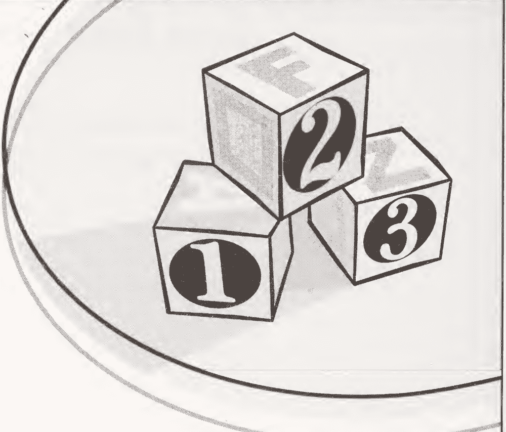

作者 Kevin Yank
实用的分步指南

### 准备 PHP 5

### sitepoint

### PHP 选集

### 面对象 PHP 解决方案

### 第一卷


作者 Harry Fuecks
常见问题的实用解决方案

### 准备 PHP 5

### sitepoint

### PHP 选集

### 面对象 PHP 解决方案

### 第二卷


作者 Harry Fuecks
常见问题的实用解决方案


### 使用 LINUX & APACHE 运行你自己的 WEB 服务器

作者 STUART LANRIDGE & TONY STEIDLER
从 LINUX 和 APACHE 开始——简单方法！

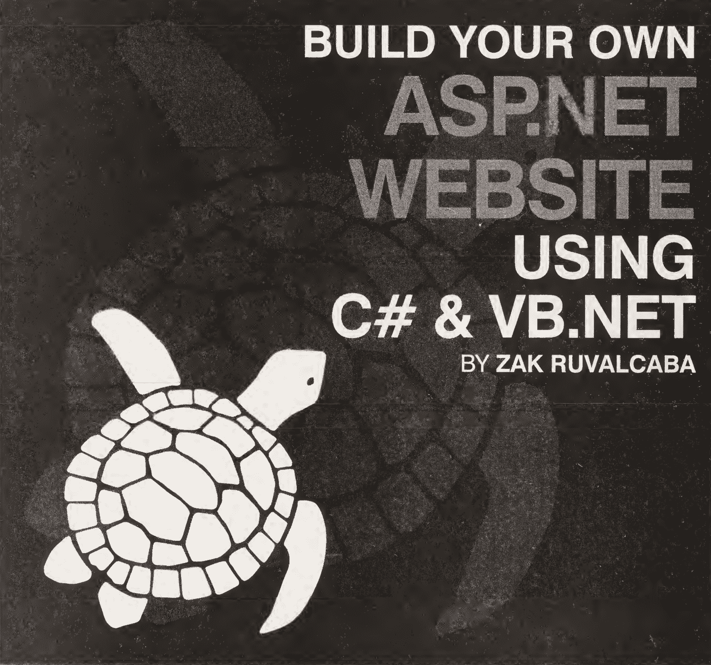

### sitepoint

### .NET 终极学者指南


### CSS 终极学者指南


### CSS 选集

101 核心技巧、技巧与窍门
作者 RACHEL ANDREW
CSS 最完整问答

### HTML 乌托邦：使用 JAVASCRIPT & DOM 的现代网页设计

作者 STUART LANRIDGE
JAVASCRIPT 技巧


### JAVASCRIPT 选集

101 核心技巧、技巧与窍门
作者 JAMES EDWARDS & CAMERON ADAMS
JAVASCRIPT 最完整问答


### 使用 DREAMAVER 8 构建符合标准的自己的网站

作者 RACHEL ANDREW
精通 DREAMAVER 8 的实用分步指南


### Flash MX 2004

### sitepoint

### Flash 选集

酷炫效果与实用 ActionScript
作者 Steven Grosvenor
常见问题的实用解决方案


### SitePoint 为专业人士提供的工具包

仅在 `http://www.sitepoint.com/` 购买

梦想经营自己的网页设计或开发业务吗？这个工具包包含了你所需的一切！

### 网页设计业务包

无论你是考虑建立自己的网页设计或开发业务，还是已经在运营，这套工具包将教你成功所需的...
双环活夹和一个 CD-ROM，里面充满了专家建议和经过证明的即用文档，将帮助你建立自我、赢得客户并发展盈利业务！

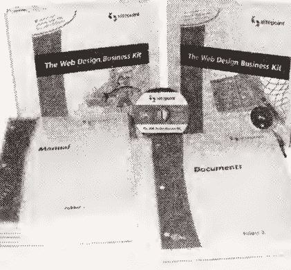

#### 文件夹 1：

涵盖业务运营各个方面的建议：
- 如何推销自己
- 如何获得更大的工作
- 收
- 如何留住客户
- 如何管理预算
- 如何招聘和解雇员工
- 以及更多

#### 文件夹 2：

包含 64 份核心即用业务文档：
- 业务计划
- 示例建议书与合同
- 客户需求分析表
- 市场调查
- 雇佣文件
- 财务文件
- 以及更多

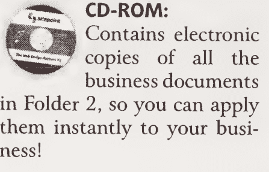

#### CD-ROM：

包含文件夹 2 中所有业务文档的电子版，让你可以立即应用于你的业务：
- 准备就绪
- 易于自定义
- MS Word & Excel 格式

网页设计业务包专门通过 sitepoint.com 提供。欲订购或下载免费示例章节，请访问：
`www.sitepoint.com/books/freelancer/`

### 客户对网页设计业务包的评价：

> “网页设计业务包（文档与手册）是我发现过的最好的营销工具！它改变了我的业务策略和收入。”

> “通过遵循书中建议的步骤，我们已经达成了交易！我觉得我不应该把这个消息告诉别人了，否则会面临很多优秀的竞争对手！”

> “在我互联网上购买的所有相关产品中，这套书的性价比最高。谢谢。”

Harb Brown
`www.harbb.com`

Jeneen McDonald
`www.artpoststud.com`

Thom Parkin
`www.twice21.com`

### 快速上手搜索营销策略！

### 搜索引擎营销工具包

搜索引擎营销工具包包含了你最大化网站流量所需的一切，使用搜索引擎优化和点击付费广告。
它由一个活夹文件夹和一个 CD-ROM 组成，装满了 Dan Thies 的专家建议，你将在其中发现其他地方找不到的内容，了解优化页面和建立链接的最佳方法，学习如何创建、优化和管理高级点击付费广告，以及更多。（等等，文中写的是“管理高级点击付费广告”。）

#### 文件夹：

301 页标准信纸大小页面，涵盖了搜索引擎营销 (SEO) 和点击付费 (PPC) 广告的每一个方面。
- 高级关键词研究与选择。
- 发现爬虫如何工作以及具体做什么。
- 了解搜索引擎如何设置优先级。
- 发现提交和付费包含策略。
- 避免被封禁或标记为搜索引擎垃圾邮件者。
- 分步演示点击付费广告的过程。
- 学习分时投放、定位和目标策略。
- 关于提供服务的详细建议。
- 发现动态网站对 SEO 的影响。

#### CD-ROM：

包含了让搜索营销过程变得更简单的工具和文档。
- 示例 SEO 建议书
- 客户评估表
- 关键词分析工作表
- 目录规划工作表
- 示例 SEO 演示
- 流程图
- 示例 协议
- 网站检查清单

### 专家们说...

> “购买 Dan 的工具包并付诸实践将更好地准备经营 SEM 业务，同时以非常专业的方式服务客户。”

> “Dan Thies 是一位搜索营销专家，他不畏于卷袖子研究搜索的核心细节”

> “Dan Thies 将复杂的策略拆解为易于吸收的字节，让你能够提高服务质量。”

### 立即使用 XML 构建面向未来且灵活的 PHP 应用程序！

《No-Nonsense XML Web Development with PHP》通过实用的示例、直观的解释和随随用的代码，教你如何在 PHP 驱动的网站中使用 XML。

与其他许多关于 XML 的枯燥、无趣且理论化的写法不同，本书并没有涵盖 XML 技术的全谱，而是涵盖了对你现在有用的 XML 实际应用。

- 构建一个基于 XML 的内容管理系统
- 掌握 PHP 5 的高级 XML 功能。
- 为你的网站创建 RSS 馈。
- 使用 XSLT、SimpleXML、DOM 和 SAX 操作 XML。
- 学习如何使用 XML-RPC 为你的网站添加 Web 服务（Web Services）。
- 使用 DTD 编写一致的 XML。

### 关于 THOMAS MYER

Thomas Meyer 是 Triple Dog Dare Media 的创始人，这是一家位于德克萨斯州的咨询公司，专门从事数据库驱动和 XML 驱动的动态网站。他曾广泛使用 XML 构建文档存储库、搜索引擎索引、内容门户分类法、在线产品目录以及业务逻辑框架。

| SITEPOINT BOOKS |
| :--- |
| 倡最佳实践技术 |
| 引导你通过实际示例学习 |
| 为你的网站提供可运行的代码 |
| 让学习变得简单有趣 |

访问我们的网站 `sitepoint.com` 了解销售信息或联系支持邮箱 `books@sitepoint.com`
