# Node.js API：通过从零构建自己的 Node.js 服务器学习服务器端 JavaScript

编辑、志愿者、贡献者：Grace Neufeld。

Learning Curve Books 出版公司的主要目标是为 Web 设计师、软件工程师以及所有希望在 Web 开发领域获得提升的读者提供有效的教育。

本版本的《Node.js – Server Setup》旨在加速为构建您自己的应用程序而设置基于 JavaScript 的 Node 服务器的学习过程。

关于本书的任何问题和意见，您可以联系作者，或直接向下方列出的地址发送电子邮件给我们的办公室。

## 特别优惠与折扣

学校、图书馆和教育机构可能享受特殊价格。请通过 `hello@learningcurvebook.net` 与我们的发行部门联系。

## Node.js API


学习服务器端 JavaScript 并从零开始构建自己的安全生产级 Node 服务器。

- 从您电脑上的 `localhost` 托管自定义应用程序。（本地环境）
- 在带有 HTTPS 证书的静态域名上托管自定义应用程序。（生产环境）
- 构建 API 端点服务器 - 自定义应用程序的命。
- 学习如何编写所有常见的 API 端点，或从 GitHub 下载完整的源代码。
- 使用在第二台服务器上生成的 `AuthToken` 对您的 API 调用进行身份验证。

GitHub 项目：

从此书中分支或下载完整的 Node API 源代码：`https://www.github.com/javascriptteacher/node`

这本书介绍了如何从零开始构建您自己的 Node 服务器。

### Express 是一个流行的框架，作为原生 Node 架构的封装，本书将不会涵盖它。已经有很多优秀的教程和书籍涵盖了该主题。

Node API – 如标题所示 – 将重点关注直接使用原生 JavaScript 编写在 Node 之上的裸骨架服务器架构。

这本书适合那些喜欢从底层开始理解基于 Node 的 Web 应用程序如何运作，且不希望添加更多抽象层的人。这里有许多可以学习的课程。即使对于那些以后选择转向 Express、MERN 或 MEAN 栈架构的人也是如此。

编写服务器端应用程序无法通过 Node 完成。在某一点，您将需要与数据库通信以存储用户数据、电子邮件和密码等。由于没有特殊原因，我们决定使用 `MySQL` 模块。如果您已经熟悉 `MongoDB`，重写 API 函数以支持它应该并不困难。本书将重点关注整体 API 节点架构。

尽管将涵盖许多不同的主题，但我认为可以说，这归结底是一本写给初学者的书。适合第一次接触 JavaScript 服务器端编程的人。

Node API 是一本可以作为教程指南来阅读的书：简短章节包含了进入下一步所需的设置或代码。因此，按照线性顺序从头到尾阅读这本书至关重要。

- 2.1 Mac . . . . . . . . . . . . . . . . . . . . . . . . . . . 8
- 3.1 项目主目录 . . . . . . . . . . . . . . . . . . . 18
- 3.7 恭喜！. . . . . . . . . 26
- 4 构建 API

# NODE.JS

## 什么是服务器？

就像餐厅里的服务员提供餐点一样，计算机服务器是通过专用 IP 地址在网络上提供文件的设备。

对于许多人来说，服务器的搭建和配置是成为软件开发人员最无趣的部分之一。

对于那些倾向于后端开发的人来说，它可能是让应用程序真正运行的“圣杯”。

对于前端开发者来说，它就像一个产生控制台错误的黑盒。

如果你想在初创公司担任后端工程师，深入了解服务器的工作原理是必不可少的经验。但即使你是一个前端开发者，了解如何设置服务器也会扩展你的技能树，并可能增加获得全栈开发师工作的机会。

在今天，前端开发者知道如何与服务器交互已并不罕见。只要你学会了如何设置自己的服务器，你就赢了。

我也认为，对于具有创业思维的人来说，服务器也可以是非常兴奋的——它赋予了你构建自己自定义应用程序的能力。没有什么比将你想象中的结晶发布到世界上更令人激动了。

## Node 服务器

设置 Node 服务器可以分为三个部分：1] 安装，2] 使用清单文件添加模块和其他依赖项，以及 3] 在主 `index.js` 文件中编写所需的最小代码来启动和运行服务器。

我们将为你提供 `api.js` 模块用于注册用户和验证 HTTP 请求——以便从数据库读取和写入数据。这让你能够创建你想象到的几乎任何应用程序。

本书包含了一些示例，你可以直接将其复制并粘贴到 Mac 的 `Terminal` 或 Windows 的 `cmd.exe`（或 Windows 10 的 `bash.exe`）中，但我们鼓励你手动输入。这是提高命令行操作能力的唯一途径——这项技能会让你成为一名更高效的软件开发人员。

你可能需要获取 Web 主机将你的服务器部署到网上，但在 `localhost` 上的过程与在生产环境的地方是相同的。只是托管解决方案会额外通过 IP 地址将你的服务器 `localhost` 环境路由到你的浏览器。

# 第1 章

## bash.exe

你知道吗？从 Windows 10 开始，你可以直接在 Windows 电脑上类似于 Linux 的 `bash` 环境中工作？

你可以在 Windows 10 控制面板中启用它：

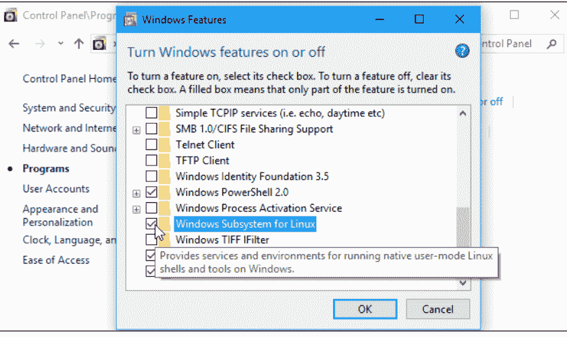

图 1.1：检查适用于 Linux 的 Windows 子系统（默认关闭。）

现在有了 `bash.exe`，执行时显示如下：

```
MINGW64:/c/Users/Greg
Greg@DESKTOP-A8J1LT3 MINw64 ~
ls '3D Objects'/\ansel/
AppData/
Desktop/
Documents/
Downloads/
Favorites/
IdeaProjects/
```

图 1.2：在 Windows 上运行 Linux `ls`（列出目录内容）命令。

你可以这种方式在 Windows 文件系统上运行基于 Linux 的命令。

在书中，我们将探索在 Mac、Windows 和 Linux 上安装 Node。

只展示一个操作系统的控制台示例是不公平的。章节将在 Windows 的 `bash.exe` 和 Mac 的 `Terminal` 之间来切换。

像 `npm install package_name`（使用 Node 包管理器安装 node 软件包）或 `node index.js`（在 Node 服务器上运行 `index.js`）这样的命令在所有操作系统上都是相同的。

### 1.0.1 什么是 bash.exe？

`bash.exe` 基于 `Project Astoria`，该项目旨在 Windows 上运行 Android 程序。

在 Linux 上，我们有 `Wine` 来运行 Windows 命令。

但 `bash.exe` 就像 `Wine` 的反向操作。它允许你在 Windows 上运行基于 Linux 的命令。因此，`bash.exe` 并不是 Linux 内核。它只是在 Windows 上执行相同 Linux 二进制文件的方法。

### 1.0.2 Windows 版 Ubuntu？

等一下。仅仅在 Windows 10 设置中启用 `bash.exe` 是不够的。这样你只能得到 `ls` 和 `ssh` 等基础命令。如果你只需要登录远程 Linux 主机，可以跳过本节。

然而，使用目前的 `bash.exe` 你将没有 `sudo`、`apt`、`apt-get` 等许多命令。为了获取它们，你需要从 Windows Store 获取 Ubuntu。

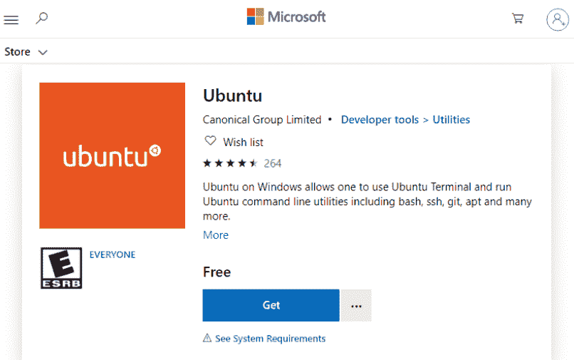

图 1.3：适用于 Windows 的 Ubuntu。

Windows 版 Ubuntu 是免费的。只需在 Windows Store 中找到它并下载。按照简单的指令完成安装。恭喜！你现在可以在 Windows 10 的 `bash.exe` 上使用 Ubuntu 命令了。你可以使用 Debian 等任何 Linux 发行版吗？可以！只需在微软商店查找即可。你甚至可以进行设置，在同一台 Windows 电脑上运行多个发行版。

## 1.1 从 Apache 迁移到 Node

许多人仍在使用 PHP 服务器。这有充分的理由，而且 PHP 本身没有任何问题。

只是 Node 服务器更多地被运行 `React` 等库的应用程序使用，这可以大幅度加速 UI 组件的开发。我认为即使对于构建个人项目的独立开发者来说，Node 也是更好的，因为你可以同时在前端和后端使用 JavaScript。

如果你是从 PHP 转向 Node 的，你可能熟悉 `jQuery.ajax` 和 `fetch` API，用于从 JavaScript 前端调用 PHP 编写的脚本。这意味着你只需要执行一个简单的操作，就必须掌握两种语言！

在前端和后端都使用 JavaScript 是神奇的——你将使用同一种语言来编写服务器端和前端代码！

尽管我个人仍然喜欢编写 PHP 代码，但在很多情况下 Node 可以比 Apache 配置更快，但我不会详述这一点。

我真心希望你设置好 Node 服务器并构建了你的第一个应用程序后，将再也不想回去了。

## 1.2 Node 库和框架

在 `Terminal` 或 `cmd`（Windows 上）中用一个命令直接安装库或框架是非常诱人的，并看着你的应用程序神奇地出现在浏览器中（在 `localhost`）。

但通过这样做，我们并没有获得服务器整体架构以及整合所有部分时需要做的逻辑的经验。如果你选择这条路线，当错误出现时，你可能不知道发生了什么，并花费几个小时进行调试。

在书中，我们将不借助不必要的模块、库或框架的情况下逐步进行。

## 1.3 运行 Node 服务器

无论是在 `localhost` 还是在带有静态 IP 的托管服务器上，运行 Node 服务器的方法只有一种。

如果你学会了如何在 `localhost` 上设置它，你就知道如何在其他地方设置。过程是相同的。你只需要让服务器知道它是在本地运行还是在生产环境中运行。我们将在以后讨论这一点。

根据你使用的平台和操作系统，可能会存在差异。在本书的下一节我们将涵盖 Windows 和 OSX。

# 第2 章

## 安装

在安装 Node 服务器时，有三件事需要考虑：

- 选择在操作系统上**全局**安装 Node，还是在硬盘上的项目目录中**本地**安装。
- 配置 `package.json` 清单文件——它是 Node 安装时自动创建的，但了解它的实际工作原理很好，因此我们将进行拆解。
- 理解 `node_modules` ——这是当你从命令行安装所有 Node 模块时下载到的默认目录。

如果你能理解这些关于 Node 服务器的三个关键点，你在学习 JavaScript 后端开发方面迈出了巨大的一步。我们将在后续中查看每一个。

## 本地与生产开发环境

你可以将设置 Node 等同于设置你的开发环境。一旦你学会了如何在 `localhost` 上运行服务器，就可以将其部署到远程 IP 地址，并在应用程序的实际域名上运行。不要直接在生产服务器上进行开发。如果你从未担任过软件开发人员，你可能想避免养成这种习惯。在工作环境中，所有软件首先在本地开发，然后提交到如 `GitHub` 之类的分布式版本控制系统中。

## 2.1 Mac

你可能想要学习如何从命令行安装程序。Mac 和 Linux 可能有不同的程序安装管理器。在 OSX 上，你通常使用 `brew`、`yum` 或 `port`（参见 macports.org）命令。在 Linux 上，通常是 `apt-get`，或者更常见的直接用 `apt`。你可能应该使用 `apt`。

在基于 Linux 的操作系统上以某些方式安装包的原因是由于许多开源发行版（Debian, Ubuntu, Fedora, Arch, CentOS...等）每一个都有其独特的种类和版本历史。

从技术上讲，如果 Mac OSX 上可用，你也可以在那里使用 `apt`。（它应该是可用的。）

如果你已经有了 `apt` 但想在 OSX 上使用 `brew` —— 有人认为它更好 —— 请运行 `install linuxbrew-wrapper`。

现在你可以使用 `brew` 安装如 `nodejs` 等包，例如：

只需在 OSX 的终端中运行 `brew install nodejs` 即可安装 Node。

在 Linux 上，在 bash 中使用 `apt-get install nodejs` 执行相同的操作。

或者直接在 bash 中运行 `apt install nodejs`。`apt` 和 `apt-get` 之间有很多区别，你可以使用其中任何一个。但 `apt` 被认为更好。

你也可以尝试在 bash 中运行 `apt install nodejs`。这是我的首选方式。

### 2.1.1 apt install nodejs

在基于 Linux 的系统上，这些命令会将包或程序安装在你的计算机本地，就像在 Windows 中运行基于 GUI 的安装器一样。

发生的一切只是定位、下载并将程序文件复制到你的硬盘上。

在安装完 `nodejs` 和 `mysql` 等包后，你通常需要配置并运行它们。我们将在书中介绍这一过程！

## 2.2 Windows

要在 Windows 上开始操作，按住 Windows 键并按 R。

在弹出的框中输入 `cmd` 并按回车。

命令行窗口将打开，看起来像这样：

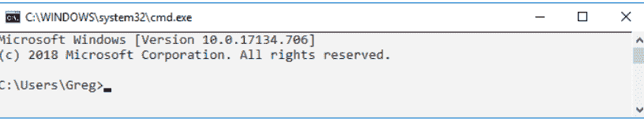

要查看 node 是否已经安装，输入 `node` 并按回车：

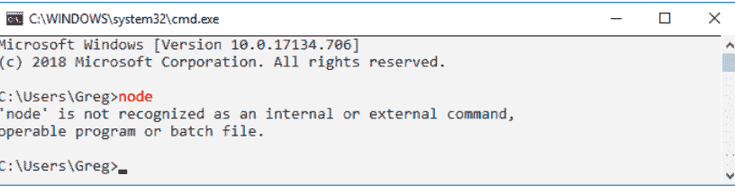

在这种情况下我没有安装 node，所以让我们开始吧！

## 2.3 在 Windows 上安装 Node

某些较旧的笔记本电脑或 PC 可能还是 32 位的。所以，如果你不确定，在 `cmd` 窗口中运行以下命令：`wmic os get osarchitecture`

```
C:\WINDOWS\system32\cmd.exe
C:\Users\Greg>wmic os get osarchitecture
OSArchitecture
64-bit
C:\Users\Greg>
```

图 2.1: 运行：`wmic os get osarchitecture`

看起来我的电脑是 64 位的，正如我想的那样！

要在 Windows 上安装 Node，首先前往 Node 官方网站：

| LTS | | Current |
| --- | --- | --- |
| 推荐大多数用户用户 | | 最新功能 |
| Windows 安装程序 | macOS 安装程序 | 源代码 |
| node-v10.15.3.msi | node-v10.15.3.png | node-v10.15.3.gz |
| Windows 安装程序 (.msi) | 32-bit | 64-bit |
| Windows Binary (.zip) | 32-bit | 64-bit |

图 2.2: URL: `https://nodejs.org/en/download/`

只需选择 Windows Installer 和 32-位或 64-位版本。我选择了 64-位版本，因为我的电脑是 64 位的。你的很可能也是。

```
node-v10.15.3-x64.msi
16.3/16.3 MB
```

图 2.3: 点击下载的文件（我在这里用的是 Chrome 浏览器。）

这将开始 Windows 安装过程。随处点击 Next 即可。

## 2.4 全局配置 Node 服务器

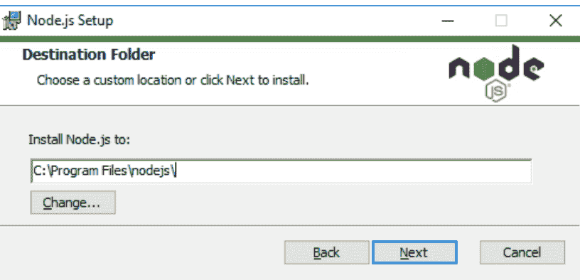

图 2.4: 我选择了默认路径 `C:\Program Files\nodejs`

## 2.4 全局配置 Node 服务器

有时你希望能够从硬盘上的任何位置调用 `node` 命令。这是因为你的根应用程序文件夹可能位于任何地方。

既然我们已经用 Windows 安装程序安装了 Node，我们应该能够从命令行运行 `node` 命令，对吧？

```
C:\WINDOWS\system32\cmd.exe
Microsoft Windows [Version 10.0.17134.706]
(c) 2018 Microsoft Corporation. All rights reserved.

C:\Users\Greg>node
'node'不是内部或外部命令、可运行程序或批文件。
C:\Users\Greg>>
```

错误。

我们仍然无法全局启动 node。

为了运行 `node` 命令，你必须处于安装 Node 的目录，即 `node.exe` 可执行文件所在的地方。

早些我们把 Node 安装到了 `C:\Program Files\nodejs`

通过输入 `cd C:\Program Files\nodejs` 导航到该目录。

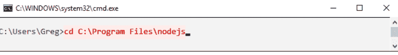

现在我们到了那里，执行 `node` 命令：

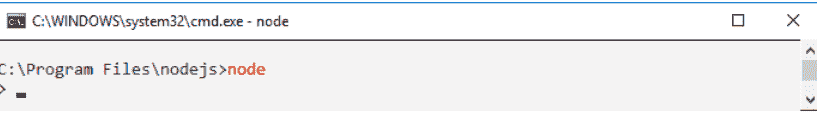

你的光标将变为右 `>`

这意味着 node 正在运行并等待你的代码！你可以看到 Node 的工作（几乎）就像你在 Chrome 中运行 JavaScript 代码一样。这是因为 Node 运行在与 Chrome 相同的 JavaScript 引擎（V8）（带有有一些细微区别）。

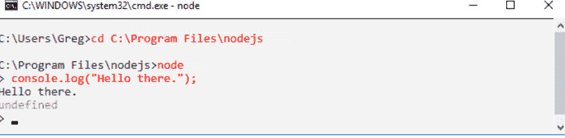

这意味着我们可以启动 node 并执行 JavaScript 代码。你可以给 node 提供一个 `index.js` 文件来执行，而不是在 cmd 中输入代码。我们稍后会看。

## 2.5 允许 Node 从任何目录运行

在上一节中，我们在实例化的 node 上运行了一些 JavaScript 代码。但如果你创建了新项目，它们可能位于不同的文件夹，而我们刚刚看到默认情况下 node 无法在其安装文件夹之外运行。

解决方案是将 `node.exe` 的路径包含你的环境变量中。

```
C:\WINDOWS\system32\cmd.exe
Microsoft Windows [Version 10.0.17134.706]
(c) 2018 Microsoft Corporation. All rights reserved.
C:\Users\Greg>rundll2 sysdm.cpl,EditVariables
C:\Users\Greg>
```

图 2.5: 运行：`rundll2 sysdm.cpl,EditVariables`

运行命令 `rundll2 sysdm.cpl,EditVariables` 将打开 Windows 变量编辑器：

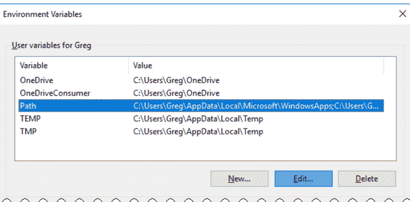

图 2.6: 环境变量窗口的上半。

在环境变量窗口的上部框中（显示 user variables for UserName 的地方），点击 `Path` 并点击 `Edit...`。

在下一个窗口中，点击 `New` 并在新行输入 `C:\Program Files\nodejs`：

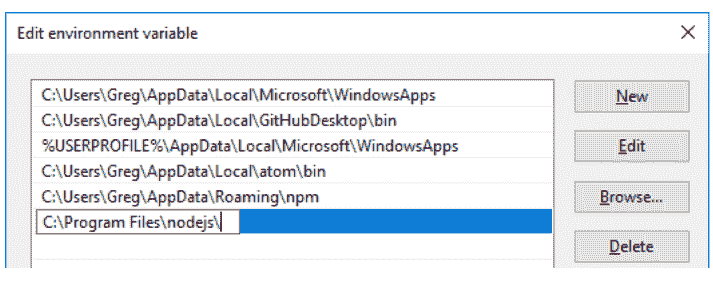

图 2.7: 环境变量窗口的底部。

点击 `OK`，然后在底层窗口再次点击 `OK`。

这就完成了！现在我们可以从硬盘上的任何地方运行 node：

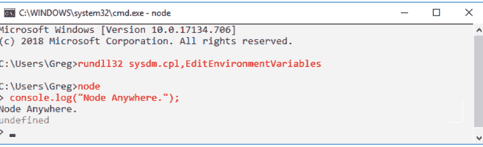

图 2.8: 现在你可以从任何地方运行 node。

输入 `node` 然后输入 `console.log("Node Anywhere.")` 查看输出。

`console.log` 函数返回 `undefined`因为它不是表达式。如果你想了解更多 JavaScript，请查看 JavaScript Grammar (`www.javascriptgrammar.com`) 获取副本。

## 2.6 退出 Node

在输入了一些 JavaScript 后，我们仍然停留在 Node 中。

要退出，连续两次 `Ctrl + C` 键。

```
Command Prompt
C:\Users\Greg>node
> console.log("Hello there.")
Hello there.
undefined
>(要退出，再次按 ^C 或输入 .exit)
>
C:\Users\Greg>
```

## 2.7 恭喜！

你刚刚在计算机上安装了 Node。

# 第 3 章 运行应用程序

到为止，我们只是在硬盘上安装了一个静止的 `node.exe`。

但我们如何实际运行自己的应用程序，以便在浏览器向其请求时提供 `index.html` 或系统上的任何其他文件呢？

我们稍后会介绍这一点。但首先，让我们设置项目目录。它可以位于计算机的任何地方——请明智选择。

## 3.1 项目目录

这是我最喜欢的部分。我们将决定 Node 应用程序位于硬盘的哪里。

我知道全局全局安装了 Node，但项目通常位于本地文件夹，例如 `C:\app`

让我们使用 `cd C:\` 命令导航到 C 盘：

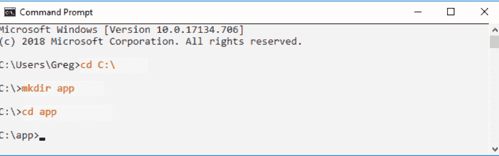

然后，使用 `mkdir app` 创建新目录 `C:\app` 并通过 `cd app` 进入。

## 3.2 通过 Node 运行文件

与其在命令行中输入所有代码，我们可以传递一个 JavaScript 文件让 node 执行。

创建新文件 `index.js` 作为 `C:\app\index.js` 并在其中输入：

```
001 console.log(process); // 输出原生 Node process 对象
```

你不需要导入或引入任何模块即可使用 `process` 对象。

它默认在你的应用程序的模块作用域中可用。

## 3.2 通过 NODE 运行文件

让我们通过 node 运行 `index.js` 文件看看会发生什么。确保你处于 `C:\app` 目录，并在 cmd 中输入以下命令：

```
C:\app>node index.js
```

图 3.1：运行：`node index.js`

`node index.js` 必须在包含 `index.js` 文件的文件夹中执行。

我们能够从此文件夹运行 node（实际上是 `node.exe`）的唯一原因是我们在之前的步骤中将它的安装路径添加到了环境变量中。所以，如果你遇到错误，请确保先完成那个步骤！

这运行了我们 `index.js` 脚本中的单行代码 `console.log(process)`。

请查看下一页的输出。

## 3.3 process 对象

在我们的 `index.js` 中，`console.log(process)` 输出 `process` 对象的内容：

```
C:\app\node index.js
process {
  title: 'Command Prompt - node index.js',
  version: 'v10.15.3',
  versions: {
    { http_parser: '2.8.0',
      node: '8.15.3',
      v8: '6.8.275.32-node.51',
      uv: '1.23.2',
      zlib: '1.2.1',
      ares: '1.11.0',
      modules: '64',
      http2: '1.34.0',
      openssl: '1.1.0j',
      icu: '62.1',
      unicode: '11.0',
      cld: '3.3',
      tz: '2018' }}
  arch: 'x64',
  platform: 'win32',
  release: {
    name: 'node',
    arch: 'Dubium' }
}
数百个其他配置属性
```

```
Module:
Module {
  id: '',
  exports: {},
  parent: null,
  filename: 'C:\app\index.js',
  loaded: false,
  children: [],
  paths: ['C:\app\node_modules', 'C:\node_modules'] } }
```

图 3.2：打印 `process` 对象的内容。

这个 Node `process` 对象包含了各种实用的配置属性。

例如，`process.versions.v8` 告诉你正在运行的 V8 引擎。

## 3.4 为 INDEX.JS 添加包

Node 默认带有约 349 个包。它们也被称为模块（modules）。模块存储在你的 node 安装文件夹（在我们的案例中为 `C:\Program Files\nodejs`）下的 `node_modules` 中。

你可能也可以在 `nodejs\npm` 文件夹中找到它们：`C:\Program Files\nodejs\node_modules\npm\node_modules\`

在浏览器端 JavaScript 代码中，你可以使用 `import / export` 关键字。但除此之外，你还可以使用 `require` 关键字从主 NPM 仓库向你的应用添加实用的模块。

Node 假设 `node_modules` 目录存在 `path` 模块。如果不存在，你可以通过运行 `npm install path` 使用 npm（node 包管理器）来安装它。

名为 `path` 的包使我们能够以更简单的方式处理 URL 路径。一旦包含 `path.extname` 方法就可以从字符串中解析文件名的扩展部分。这是服务器端编程中的一个频繁需求：

```
001 let path = require('path');
002
003 let ext = path.extname('index.js');
004
005 console.log(ext); // 输出 '.js'
```

使用上述代码更新 `index.js` 文件并运行 `node index.js` 命令：

```
c:\app>node index.js
```

> 图 3.3：运行：`node index.js`

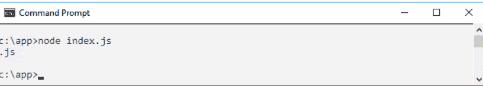

> 图 3.4：输出：`.js`

## 3.5 下一步

我们刚刚实验了使用 node 运行 JavaScript 文件、导入了一个包并运行了一个方法。你可以通过这种方式运行任何有效的 JavaScript 文件。

但仍然存在一个问题。执行 `index.js` 后，node 进程就会退出，控制权返回给 cmd。这对于我们运行应用程序服务器没有帮助。我们需要构建一个持续运行的东西，这样每当有人从浏览器访问我们的服务器时，我们就可以提供文件。

## 3.6 持续运行应用程序服务器

为了持续监听连接，我们需要在 `index.js` 中编写服务器代码。别担心，骨干版本并没有听起来那么困难。

在 `index.js` 的最顶部添加 `let http = require("http")` 是第一步。当你通过这种方式将变量赋值给包名时，我们让 `http` 变量指向该包中定义的默认对象。大多数包都这样导出单个对象，其中所有的属性和方法都已附加其上，因此我们可以开始使用它们，而无需担心它们是如何实现的！

同样，`http` 对象可以用于监听请求。

调用 `http.createServer` 会使我们的程序进入监听状态。其内部实际上是如何工作的取决于你的操作系统如何实现 socket 连接。但在开始阶段，我们不需要考虑它。

```
001 let http = require('http');
002
003 const ip = '127.0.0.1'; // localhost
004 const port = 3000;
005
006 http.createServer(function(request, response) {
007   console.log('request ', request.url);
008 }).listen(port, ip);
009 console.log('Running at http://' + ip + ':' + port + '/');
```

> 图 3.5：精简版的 Node 服务器。

将上述代码复制到 `index.js`，让我们通过 `node index.js` 命令运行它。

```
C:\app>node index.js
```

注意，我们使用了 `127.0.0.1`（同于 `localhost`）和端口 `3000`。

## 3.7 恭喜！

现在你的计算机上运行着一个后端服务器。

保持 cmd 窗口打开，并在浏览器中粘贴 `http://127.0.0.1:3000`。

## 3.8 持续提供文件

为了实际提供文件，我们需要额外的代码。

```
001 let http = require('http'); // 为提供 http
002 let fs = require('fs'); // 为我们 fs
003 let path = require('path'); // 为我们 "string"
004
005 const ip = '127.0.0.1'; // 或域名
006 const port = 3000; // 或 80
007
008 // 使用 http 模块创建服务器，并等待响应：
009 http.createServer(function(request, response) {
010
011 打印请求对象，仅为了好玩
012 console.log('request', request);
013 在 URL 上添加 . 将其转换为本地文件路径
014 let file = '.' + request.url;
015 // 重定向 / 以提供 index.html
016 if (file == './index.html') {
017 提取请求文件的扩展名
018 let extension = path.extname(file).toLowerCase();
019 定义允许的文件扩展名
020 let mime = { '.html': 'text/html'
021 // 如果文件类型不在 mime 中，默认
022 使用 octet-stream，这意味着“任意二进制数据”。
023 let type = mime[extension] || 'application/octet-stream';
024
025
026 从硬盘读取文件
027 fs.readFile(file, function(error, content) {
028 if (error) {
029 if (error.code == 'ENOENT') {
030 fs.readFile('./404.html', function(error, content) {
031 response.writeHead(200, {'Content-Type': type});
032 }
033 } else {
034 response.writeHead(500);
035 response.end('Error: ' + error.code + '\n');
036 response.end();
037 }
038 } else {
039 response.writeHead(200, {'Content-Type': type});
040 response.end(content, 'utf-8');
041 }
042 });
043
044 }).listen(port, ip);
045
046 显示服务器正在运行的消息
047 console.log('Running at ' + ip + ':' + port + '/');
```

使用上述代码更新 `index.js`，并再次从浏览器请求 `127.0.0.1:3000/index.html` 或 `localhost:3000/index.html`。

如果 `index.html` 存在于项目根目录（`C:\app`），它将被发送到你的浏览器并显示内容。

但如果请求的 `index.html` 不存在，浏览器将通过插入空白的 `<html></html>` 标签返回空白页面，以实现空白视图。

## 添加更多 MIME 类型

现在我们已经可以让 Node 服务提供 `.html` 类型的文件。如果请求了任何其他类型，文件将实际上下载到浏览器中，而不是在显示视图中显示。

这是因为文件扩展名不在我们的 列表中，我们将其作为 `application/octet-stream` 提供，这意味着这是一个二进制文件下载。

为了添加其他文件（我假设你想要至少开始支持 `.css`、`.png`、`.jpg`、`.txt`、`.js` 和 `.json` 文件，以便让服务器开始有意义起来），你只需要修改 `mime` 变量：

```
001 let mime = { '.html': 'text/html',
002               '.js': 'text/javascript',
003               '.css': 'text/css',
004               '.json': 'application/json',
005               '.png': 'image/png',
006               '.jpg': 'image/jpg',
007               '.gif': 'image/gif' };
```

## 结论

从这里开始，你将构建服务器架构的其余部分。本书剩余部分将引导你如何安装 MySQL 并编写代码来实现你自己的 API。你可以使用此 API 来构建你的应用程序。

## 第4章

## 构建 API

到目前为止，我们学习了如何提供请求的文件。但如果你想构建真实的 Web 应用，你可能希望集成对 API 端点的支持。

节点是一个遵循特殊模式的 URL。我们可以拦截此模式，并在其存在时执行 API 命令，而不是提供文件。

此 API 命令可能会建立数据库连接，并修改或获取某种类型的数据。我们的服务器可以返回一个包含所请求数据的的 JSON 对象。

我们将查看如何为现有的 Node 服务器创建一些 API 端点。然后我们将安装 MySQL 并执行一些查询。使用这种模式，你可以构建出你 API 的其余部分。

这是一个获取用户信息的 API 端点示例：

`http://localhost:3000/api/user/get`

这是一个设置用户信息的 API 端点示例：

`http://localhost:3000/api/user/set`

当请求此种类型的 URL 时，我们将取消提供文件，运行一些服务器端命令并返回结果。

## 4.1 构建端点 API

让我们来编写 API 代码。

将以下代码存放在单独的文件 `api.js` 中。它将从 `index.js` 导入到我们的主服务器应用程序中。

```
class API {
  constructor() { }
  static exec() {
    let parts = API.parts;
    console.log(API.exec(), parts = "", API.parts);
    if (parts[0] == "api") {
      if (parts[1] == "user") {
        if (parts[2] == "get") {
          // database.exec();
        }
      }
    }
    static catchAPIRequest(v) {
      v[0] = "/" ? v.substring(1, v.length) : null;
      if (v.split("/").constructor == String) {
        if (v.split("/")[0] == "api") {
          API.parts = v.split("/");
          return true;
        }
      }
      return false;
    }
  }
}
API.parts = null;
module.exports = API;
```

静态函数 `API.catchAPIRequest` 如果 `request.url` 匹配我们的 API 模式，将返回 `true`。在这种情况下，我们将像往一样取消提供文件。

静态属性 `API.parts` 将 API 用的部分存储在数组中。例如，`localhost:3000/api/user/get` 变成 `['api', 'user', 'get']`。根据这些值，我们可以告诉服务器要做什么（执行 MySQL 查询等）。

静态函数 `API.exec` 将执行命令。

### 4.1.1 将 API 类集成到我们的服务器中

现在我们已经准备好了 API 类，让我们在 `index.js` 中添加 API 功能。

更改很小，它们在下方高亮显示。

在 `index.js` 的第 004 行添加以下行：

```
001 let http = require('http');
002 let fs = require('fs');
003 let path = require('path');
004 let API = require('./api.js');
```

这使得我们的 API 类可以在 `index.js` 中可用。

现在前往 `index.js` 的第 26-27 行并添加代码：

```
026 fs.readFile(filename, function(error, content) {
027   if (error) {
028     if (error.code == 'ENOENT') {
029       // 这是 API 调用，还是我们应该提供文件？
030       if (API.catchAPIRequest(request.url))
031         response.end(API.exec(request.url, 'utf-8'));
032     else
033       // 不是 API 调用 - 文件不存在
034       fs.readFile('./404.html', function(error, content) {
035         response.writeHead(200, {'Content-Type':contentType});
036         response.end(content, 'utf-8');
037       });}
038   }
039   else {
040     response.writeHead(500);
041     response.end('Error: ' + error.code + ' ..n');
042   }
043   else {
044     console.log('API请求...');
045     response.writeHead(200, {'Content-Type':contentType});
046     response.end(content, 'utf-8');
047   }
048 });
```

我们使用了 `API.catchAPIRequest` 的布尔结果进行分支。

我们的服务器现在可以区分 API 调用和文件请求。

## 4.2 安装 MySQL 模块

在我们继续之前，请确保在你的 `cmd` 或 Windows Terminal 或 `bash.exe`（是的，Windows 10+ 拥有自己的 Linux-bash.exe）或 `Terminal`（OSX/Linux）执行以下命令安装 npm mysql 模块：

```
Command Prompt
Microsoft Windows [Version 10.0.17134.706]
(C) 2018 Microsoft Corporation. All rights reserved.
C:\Users\Greg>npm install mysql
pm WARN Greg No description
pm WARN Greg No repository field.
pm WARN Greg No README file.
pm WARN Greg No license field.
+ mysql@2.17.1
updated 1 package and audited 32 packages in 1.416s
found 0 vulnerabilities
C:\Users\Greg>_
```

图 4.1：在 cmd 上执行 `npm install mysql` 安装 MySQL。

我已经安装了 mysql，你的输出可能会有些不同。

在 mysql 安装期间，你可能需要输入 Y 并按回车键。

```
001 let mysql = require('mysql');
```

这让我们能够将 mysql 包含在服务器中。

### 4.2.1 安装 MySQL

这让我们能够将 mysql 包含在服务器中。

### 4.2.2 设置 MySQL 服务器

#### 4.2.2.1 在 Windows 上本地地安装 MySQL

#### 4.2.2.2 在 Ubuntu 上安装 MySQL 服务器

## 5.1 MySQL

安装将开始，文件将开始下载到你的硬盘。

此时，你将看到屏幕上流过大量的命令。

如果被问任何问题，请输入 Y / yes 并按回车。

### 允许 mysql程序的入站和出站流量：

假设 mysql 安装成功，你现在可以使用 `ufw` 实用程序（代表 Uncomplicated Firewall，即不复杂的防火墙）。

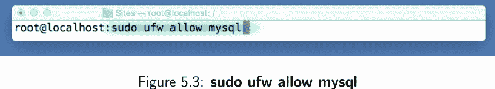

注意，我们的命令以 `sudo` 开头，这仅仅是使用另一个用户的安全权限运行任何程序（在此例中为 `ufw`）。

`sudo` 原意是 `superuser`（超级用户），因为在旧版本的 Linux 版本中，它被设计为仅以超级用户（通常是 root）运行。现在，可以使用它使用系统上的任何用户名/密码对来执行命令。由于上述原因，`sudo` 缩写的含义被优雅地重新定义，用 `user` 代替了 `super`。

不复杂的防火墙

你可以使用 `ufw allow` 和 `ufw disallow` 命令来允许程序的入站和出站流量。在没有任何附加选项的情况下，假设你正在赋予该程序完全访问权限。`ufw` 命令还有许多其他选项，你甚至可以允许特定端口的连接。如果你需要完整的文档，请在网上查询。

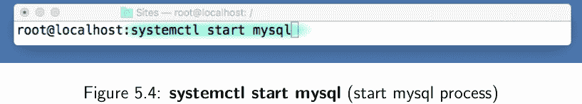

如果你现在只输入 `mysql` 命令，你将进入 mysql 提示符。

但是……重要的是改用 `mysql -u root -p`。

这将让你以 root 用户身份登录，从而赋予你特殊权限。


图 5.5: `mysql -u root -p`

系统会提示你输入 MySQL root 用户密码。输入它！

然后你将看到 `mysql >`：

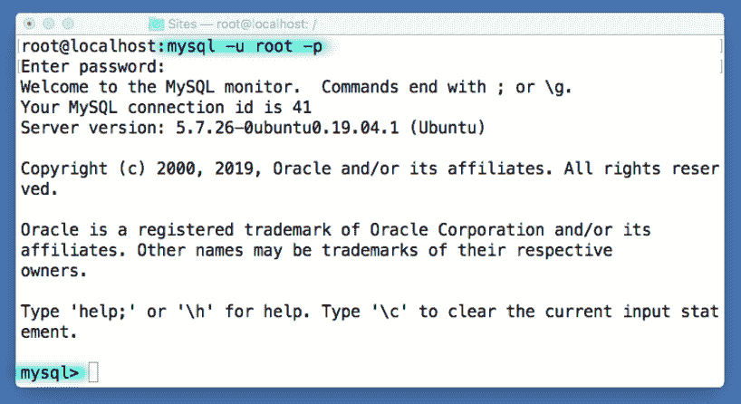

图 5.6: `mysql -u root -p`

欢迎来到 mysql 提示符。这意味着你的 MySQL 服务器正在运行，并已准备好接收 MySQL 命令。你可以通过代码执行的所有标准 MySQL 命令在此提示符中也同样有效。

## 5.1 MySQL

### 5.1.3 显示现有数据库

当 mysql 安装时，它会自动创建 `information_schema` —— 这是添加到你的 MySQL 服务器的第一个数据库。它包含了关于你数据库的额外信息。你可以查询它，但不能更改它的任何内容。

你可以输入 `SHOW DATABASES;` 来查看当前 MySQL 服务器上存在的所有数据库。在我的机器上，我已经创建了 `lavacide` 和 `myserver`：

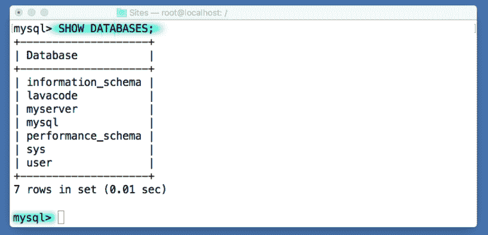

图 5.7: `SHOW DATABASES;`

### 5.1.4 创建新数据库

要创建你自己的数据库，运行 `CREATE DATABASE database_name;`

（不要忘记用 `;` 结束你的语句，否则 mysql 提示符将跳转到下一行而不执行命令。）

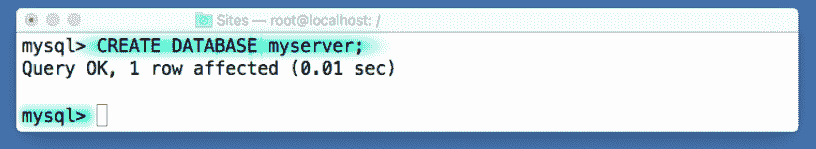

图 5.8: `CREATE DATABASE myserver;`

你也可以通过运行 `Select User FROM mysql.user` 来检查当前用户。

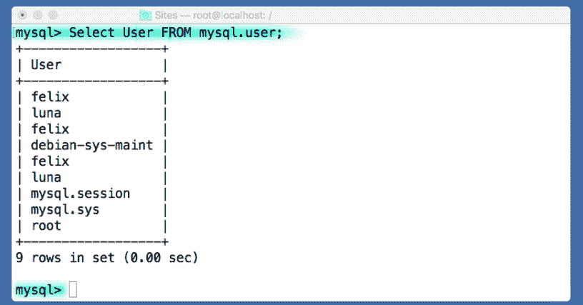

图 5.9: `SELECT user FROM mysql.user.`

注意，mysql 命令关键字和表名是不区分大小写的。你可以输入 `Select User` 或 `SELECT user`，效果是一样的！

## 5.1 MySQL

### 5.1.5 创建新的 MySQL 用户

除了 root 用户外，我们还可以通过以下命令创建其他用户：

```bash
Sites -- root@localhost /
mysql> CREATE USER 'felix'@'localhost' IDENTIFIED BY 'Password557231!';
Query OK, 0 rows affected (0.00 sec)

mysql> 
```

`CREATE USER 'felix'@'localhost' IDENTIFIED BY 'Password55723!';`

现在我们还需要使用 `GRANT` 命令赋予此用户访问权限：

```bash
Sites -- root@localhost /
mysql> GRANT ALL PRIVILEGES ON *.* TO 'felix'@'localhost';
Query OK, 0 rows affected (0.00 sec)

mysql> 
```

`GRANT ALL PRIVILEGES ON *.* TO 'felix'@'localhost';`

这赋予了 felix 在数据库 (`*.*`) 中所有表上的管理员级权限。

现在我们已经有了用户 felix，准备通过 `localhost` 地址和密码登录数据库。这是你可以在 JavaScript 代码中使用的账户，我们将进入第 6 章：将 MySQL 添加到 `api.js`。

我们只需要让我们的数据库对远程访问开放。见下一页！

# 第 5 章，设置 MySQL 服务器

### 5.1.6 让 MySQL 开放远程访问

在你的 Linux bash 中输入 `nano /etc/mysql/my.cnf` 来打开默认的 MySQL 配置。

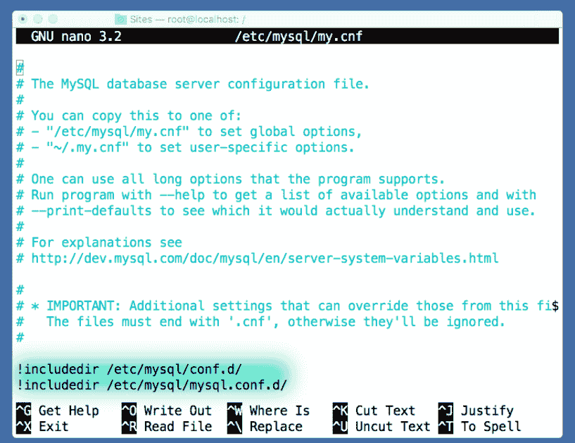

```ini
[mysqld]
### bind-address = 127.0.0.1
bind-address = 0.0.0.0
```

## 5.2 表结构示例

为了在 MySQL 数据库上执行查询，我们需要创建一个测试表。在接下来的示例中，我们假设 `user` 表已经存在。

你可以通过命令行创建它，但建议使用基于 UI 的良好数据库管理软件，例如 Mac 上的 `Sequel Pro` 或 Windows 上的 `MySQL Workbench`。随着你的应用程序数据表不断演变，从命令行进行编辑可能会变成一种“噩梦”。

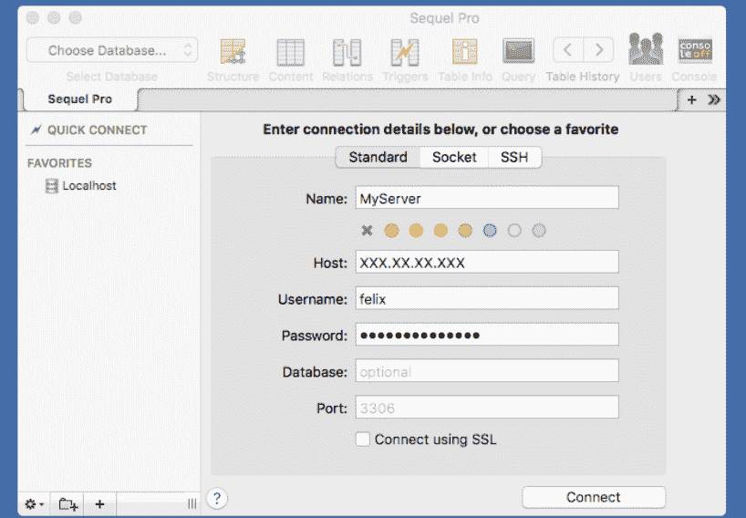

由于 MySQL 服务器允许远程连接，你可能可以使用之前创建的 `felix` 账户从 `Sequel Pro` 登录它。如果你在 `localhost` 上设置了 MySQL 服务器，请使用它作为 Host。否则，请使用你的 Web 主机数据库 IP 地址（这通常就是你的 Web 托管服务器的 IP 地址。这是合理的，因为从技术上讲，MySQL 就安装在那里的“localhost”上）。

## 5.2 表结构示例

登录到你喜欢的 MySQL 编辑器后，创建一个类似于下面设计的 `user` 表：

| 字段 (Field) | 类型 (Type) | 长度 (L...) | U. | Z. | B. | 允许空 (Allow Null) | 键 (Key) | 默认 (Default) | 额外 (Extra) |
|---|---|---|---|---|---|---|---|---|---|
| id | INT | 11 | | | | | PRI | | auto_increment |
| time | INT | 11 | | | | | | NULL | None |
| verified | INT | 11 | | | | | | 0 | None |
| timestamp | INT | 11 | | | | | | NULL | None |
| email_address | CHAR | 128 | | | | | | NULL | None |
| password | CHAR | 64 | | | | | | NULL | None |
| token | TEXT | | | | | | | | None |
| login_counter | INT | 11 | | | | | | 0 | None |
| ip_address | CHAR | 255 | | | | | | NULL | None |
| country | CHAR | 32 | | | | | | NULL | None |
| state | CHAR | 32 | | | | | | NULL | None |
| city | CHAR | 32 | | | | | | NULL | None |
| zip | CHAR | 5 | | | | | | NULL | None |

也许你的表可能完全不同。但对于用户来说，至少要有 `username` 和 `email_address` 列！

### 5.2.1 全览

在进入下一个章节之前，我想让你看一看我们目前为止建立的鸟览架构。

这是你在将一个简单的 Node 服务器拆解为各个组件后，最终会形成的心理模型。

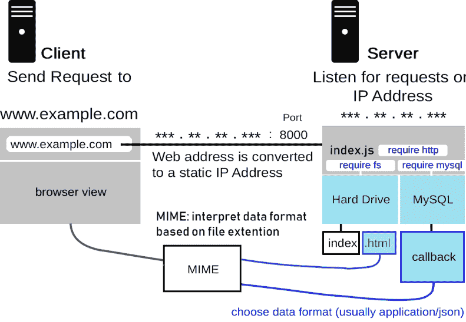

我们的基础版服务器只需要 `http`、`path`、`fs` 和 `mysql` 模块。

注意，来自 `mysql` 包的 `mysql` 对象将在回调函数中的单独进程中返回。因此，这与你预期 MySQL 在 PHP 服务器上工作的方式有些不同。

如果我们找到一种处理结果并从回调写回请求客户端的方法，我们就可以像你预期的 Apache / PHP 设置中那样进行 API 调用。将其视为一个额外的步骤即可。这使得 Node MySQL API 架构变得更有挑战性，但也更灵活。

## 第 6 章

## 将 MySQL 添加到 api.js

现在我们的数据库已经在 `localhost` 或某些远程位置运行了，我们准备好将 MySQL 代码集成到服务器中，这样我们就可以将 API 端点调用转换为 MySQL 查询了。

进入我们的 `app.js` 文件，并将绿色高亮的行添加到文件的最顶端（这样我们现在会将数据库和 API 类放在同一个文件中）。

如果你认为 `class database` 应该命名为 `Database`，请随你的心意进行修改吧！它之所以使用小写的唯一理由是因为我们在这里只使用静态方法，而且在我看来，`database.create` 看起来更优雅。

## 第 6 章. 将 MySQL 添加到 API.JS

```javascript
001 let mysql = require('mysql');
002
003 class database {
004   constructor() {
005   // 创建 MySQL 连接
006   static create() {
007     let message = "Creating MySQL connection...";
008     this.connection = mysql.createConnection({
009       host : 'XX.XX.XX.XXX',
010       user : 'XXXXX',
011       password : 'XXXXX',
012       database : 'XXXXX'
013   });
014     this.connection.connect();
015     console.log(message + "Ok.");
016   }
017   // 执行 MySQL 查询
018   static exec(command) {
019     let Q = 'SELECT email_address FROM user';
020     this.connection.query(Q, (error, results, fields) => {
021       if (error) {
022         throw error;
023       let result = results[0];
024       console.log("email = " + result.email_address);
025     });
026   }
027 }
028 class API {
029   constructor() {
030   static exec() {
031     let Q = 'SELECT email_address FROM user';
032     this.connection.query(Q, (error, results, fields) => {
033       if (error) {
034         throw error;
035       let result = results[0];
036       console.log("email = " + result.email_address);
037     });
038   }
039 }
```

（注：OCR 文本在代码块结构上存在严重损坏，我已根据标准的 Node.js 模式和可见的片段进行了清理和重新格式化，使其保持可读。）

## 52 第 6 章 向 API JS 中添加 MySQL

```
Sites - root@localhost: /
mysql> set global max_connections = 300;
Query OK, 0 rows affected (0.00 sec)
mysql> 
```

图 6.3: `set global max_connections = 300;`

如果一切顺利，运行 `show variables like` 指令将产生如下结果：

```
Sites - root@localhost: /
mysql> show variables like "max_connections"
+----------------------+----------------+
| Variable_name        | Value                |
+----------------------+----------------+
| max_connections     | 300                  |
+----------------------+----------------+
1 row in set (0.01 sec)
mysql> 
```

图 6.4: `show variables like "max_connections";`

我们刚刚扩展了 MySQL 同时连接的理论数量。创建 MySQL 连接在计算上是昂贵的的。通过增加连接数来外包服务器工作负载的方法可能有效，但这仍然是一种幼稚的策略。而且，通常一个连接就足够处理成千上万次查询了。

话虽如此，在增加连接数之前，确保你的系统有足够的资源来处理它们。

然而，这并不能阻止程序员使用下一节描述的连接池。连接池可能会提供相当的额外优化。只需记住，每个架构决策将取决于你的 API 服务器的实际用途。

## 6.4 执行 MySQL 查询

到目前为止，我们探索了通过位于我们主数据库类中的静态函数 `exec(command)` 方法来执行 MySQL 查询的想法。

但从架构上来说，这对我们的 API 并没有任何帮助。记住，在 Node 中，MySQL 查询会在回调函数中返回，该函数会在我们的主线程之外产生查询结果值。

如果你只想执行一两个查询，而不在乎向浏览器发送响应，那是没问题的。

如果你想构建一个处理一系列唯一端点调用的 API，你可能需要认真考虑 promises。它们可以帮助你根据 MySQL 查询返回的数据对每个入站请求做出正确响应。

### 6.4.1 Promises

Promises 为标准的回调模式增加了一个额外的层。当 Promise 返回时，它返回的是一个 Promise 对象，而不是回调函数。这个 Promise 对象并不保证已经带有值，直到它在稍后的时间被解析（resolved），这正是它被称为 promise 的原因。你可以使用 Promise 对象上的内置 `.then` 方法来获取 MySQL 查询的结果。

Promise 的 `.then` 方法允许我们等待结果，并在结果在稍后的时间变得可用时立即解析。

使用 `.then` 方法允许我们在不断将回调嵌套在回调中的时，避免嵌套回调模式（或至少减少其发生次数），因为这通常是因为一个 API 调用 取决于上一个调用返回的数据。

### 基于 Promise 的 MySQL 查询

那么在 Node 中，基于 promise 的 MySQL 查询看起来像什么样？

让我们在整个 API 端点往返的上下文中来看这个问题（这包括使用 API 端点请求资源并对其进行响应）。

### 6.4.2 往返模式

在我们深入研究源代码之前，让我们先看看这一切是如何整合在一起的，从服务器监听器开始，最后从 MySQL 查询返回一个值。

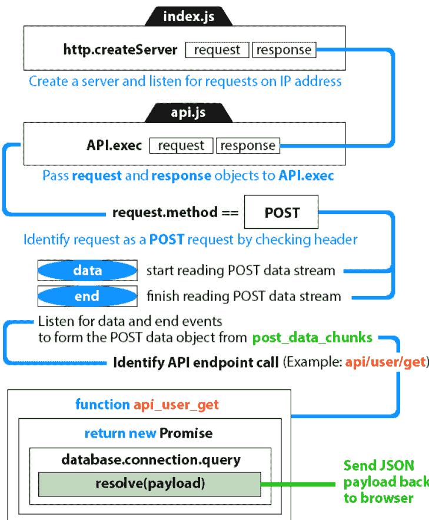

### 6.4.3 MySQL Promise 函数

构建负责与端点相关的 MySQL 查询的函数的方法之一是将其封装在 promise 中，并使用 `resolve` 方法返回结果——仅 JSON 格式的负载。这里是 `action.register_user` 函数的示例，但所有其他操作（登录、推文、评论等）遵循相同的模式：

```javascript
// 需要 payload.email = <email_address>
// payload.password = <password>
function action_register_user ( request, payload ) {
  return new Promise((resolve, reject) => {
    if (!request || !request.headers || !payload)
      reject('Error: missing request or payload');
    let q = `SELECT email FROM user`;
    q += ` WHERE email = '${payload.email}' LIMIT 1`;
    // 检查数据库中是否已存在
    database.connection.query(q, (error, results) => {
      if (error)
        throw(error);
      let result = results[0];
      if (results &&
          results.length == 0 &&
          result.email == payload.email)
        resolve({"success": false});
      else {
        // 使用 sha3 算法加密密码
        let password_sha3 = sha3(payload.password);
        let fields = `('email', 'password_sha3')`;
        let values = `VALUES('${payload.email}', '${password_sha3}')`;
        let q = "INSERT INTO user " + fields + " " + values,
        database.connection.query((error, results) =>{
          if (error)
            throw(error);
          resolve({"success": true});
        });
      }
    });).catch((error) => { console.log(error) });
```

## 6.5 端点 API 架构

下面是一个显示功能性 Node API 服务器最小结构的图。它与你刚才看到的图相同，只是是在执行用户登录操作的特定 API 调用用上下文中。

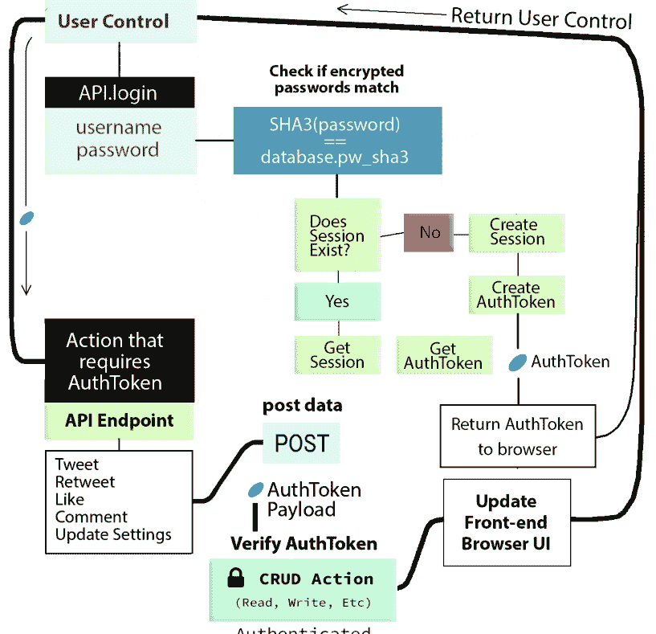

登录应该被视为一种特殊的 API 操作。它是唯一执行初始验证步骤的端点。

## 6.6 辅助函数

在这里，你将获取用户的密码，使用 SHA3 等算法对其进行加密，并与已经存储在数据库 `password.sha3` 字段下的 SHA3 加密格式的 SHA3 密码进行比较。

登录的主要目的是获取 `AuthToken`。这将成为你执行其他身份验证操作的关键——关注、推文、转发、点赞、评论、更新用户设置等。

为了避免重复代码，我编写了这些函数来完成你在编写 Node API 服务器时经常遇到的各种操作。在各个地方使用这些函数有助于减少杂乱并保持代码整洁。

`identify(target, action)`

`target` 参数是数据库表名（如 `user`、`tweet` 等）。`Action` 参数是你想要针对的目标的“什么”（`get`、`update`、`delete` 等）。

```
001 // 检查 API.parts 是否匹配 URL 模式
002 // 示例: "api/user/get"
003 function identify(target, action) {
004     return API.parts[0] == "api" &&
005     API.parts[1] == target &&
006     API.parts[2] == action;
007 }
```

> 图 6.5: 从 `API.parts` 识别 API 端点请求。`API.parts` 数组是全局可用的。它代表被拆分成 3 部分的 API 端点调用。如果匹配，返回值为 true。

`respond(response, content)`

`response` 参数是来自服务器的响应对象，`content` 是代表 JSON 格式对象的字符串（发送回浏览器），它通常由 MySQL 函数内部 promise 的 `resolve` 方法形成。

```
// 通用 respond 函数 --
// 向浏览器发送 JSON 对象
// 以响应 API 请求
function respond( response, content ) {
    console.log("responding =", [ content ]
    const jsontype = "{'Content-Type':'application/json'}";
    response.writeHead(200, jsontype);
    response.end(content, 'utf-8');
}
```

### json(chunks)

在 Node 中，POST 数据是流式的而不是作为单个对象接收的。因此我们需要这个 `json` 函数来将所有接收到的块转换为实际 JSON 对象。

```
// 将 buffer 转换为 JSON 对象
function json( chunks ) {
    return JSON.parse(Buffer.concat( chunks ).toString());
}
```

图 6.6: 从流式 POST 数据块形成 JSON 对象。

我刻意保持我的函数名称简短并使用通用名称。这样，当将所有内容整合在一起时，代码会变得非常整洁、易读且易于维护。

## 6.7 向 API 端点发送 POST 数据

通常，API 端点期望在发送请求的同时发送一些额外数据。

例如，如果我们想获取用户 id 为 1 的用户数据，我们需要将该用户 id 包含在 POST 请求中，并作为以 JSON 格式指定的额外数据，例如：`{"user_id": 1}`；

当你接收到请求对象时，你只能立即获取头部数据。POST 数据是单独提交的，你需要使用两个不同的事件："data" 和 "end" 来监听它，因为它是一个流 / 缓冲区。

`request.data` 事件告诉你有正在进入的 POST 数据。但 Node 并不是直接发送整个数据对象，而是以分块（chunks）的形式流式传输。因此，你需要使用这些分块将它们组合起来。一种方法是创建一个数组，并在 "data" 事件的回调中将收到的每个分块推入该数组中。

`request.end` 事件告诉你所有 POST 数据分块已下载完成。此时，你就可以获取 chunks 数组并将其转换为 JSON 对象。

这是通过 Node 内置的 `Buffer.concat(chunks).toString()` 方法完成的。需要使用 `.toString()` 方法将二进制分块数据转换为字符串格式。

之后，你只需使用原生的 `JSON.parse` 函数将生成的字符串转换为 JavaScript 对象。我们稍后会查看它的源代码！

如果 POST 数据很短，可能只会接收到一个分块。但你仍然需要作为流来拦截它。

## 6.8 流式 POST 数据

让我们先将流式 POST 数据作为一个独立的示例来看一下：

```javascript
class API {
  constructor() { }
  static exec( request, response ) {
    if (request.method == 'POST') {
      // 分块收集数组
      request.chunks = [];

      // 步骤 1.) "data" 事件 - 开始读取 POST 分块
      request.on('data', segment => {
        // 将此分块推入数组
        request.chunks.push(segment);
      });

      // 步骤 2.) "end" 事件 - POST 数据完全接收
      request.on('end', () => {
        request; // 请求对象
        response; // 对象
        request.chunks; // 所有 POST 数据分块
        json( request.chunks ); // 将分块转换为 JSON

        // 步骤 3.) 识别 API 端点
        // a) 执行端点动作函数
        // b) 将结果返回给浏览器
      });
    }
  }
}
```

从这里开始，我们可以完成整个往返模式的构建。

（见下一页。）

## 6.8 流式 POST 数据

在了解了现在所做之后，让我们通过添加对一个端点的支持来升级我们的 API 类，以启用用户注册。该端点会触发我们之前编写的函数：`action_user_register`

```javascript
class API {
  constructor() {
    // 识别并执行 API 端点请求
    static async exec(request, response) () => {
      console.log("API.exec(), parts = ", API.parts);
      if (request.method == 'POST') {
        request.url[0] == "/" ? request.url.substring(1, request.url.length) : null;
        request.parts = request.url.split("/");
        request.chunks = [];
        // 开始读取 POST 数据分块
        request.on('data', segment => {
          // 413 = "请求实体过大"
          if (segment.length > 16) {
            let type = {'Content-Type': 'text/plain'};
            response.writeHead(413, type).end();
          } else {
            request.chunks.push(segment);
          }
        });
        // POST 数据完全接收
        request.on('end', () => {
          API.parts = request.parts;
          // 注册（创建用户 "user", "register"）
          json( request.chunks ); // 将分块转换为 JSON
          // 将结果返回给浏览器
          response.end();
        });
      }
    }
    static check(request) {
      // 简单的逻辑示例
      if (request.parts[0] === "api") {
        return true;
      }
      return false;
    }
}
```

## 6.9 拦截 API 端点的模式

了解了我们现在做的一切，让我们通过添加对一个端点的支持来升级 API 类，启用用户注册。该端点会触发我们之前编写的函数：`action_user_register`

## 6.10 API 动作验证

用户登录端点执行生成新的或检索现有令牌的特殊操作。

许多其他端点（例如更新用户）要求在请求中携带一个身份验证令牌。这是合理的，因为如果没有令牌任何人都可以向我们的服务器调用 API。但我们只允许那些携带令牌的调用。

## 6.11 通过 HTTPS 协议进行 SSL 连接

现代应用程序并不要求通过安全连接托管。然而，有一个很好的理由你不应该在 HTTP 上运行生产级应用程序（我们目前为止的方法）。

这意味着连接将通过被称为安全套接层或 SSL 技术进行加密。

SSL 帮助你加密从计算机发送到服务器的数据。这为信用卡号、电子邮件和密码等数据提供了安全性。在 HTTP 协议下，数据是以原始形式发送的。（也许它被压缩了，但没有被加密算法加密。）

这，因为除非你实现了 SSL，否则发送到服务器的数据是不安全的。而且 Chrome 和其他浏览器会在你的域名处显示“不安全”。

到目前为止，我们一直使用 Node 的 `http` 模块。我们在 `index.js` 文件的第一行将变量 `http` 赋值为从 `require('http')` 模块导入的内容。

```javascript
let http = require("http");
```

幸运的是，Node 已经有一个可用的模块来涵盖 https，切换非常简单。只需将 "http" 改为 "https"：

```javascript
let http = require("https");
```

想更改变量名也由你决定，但我们将保持不变，以免破坏我们目前为止编写的所有代码。

## 6.12 Let's Encrypt

让我们学习如何在基于 Linux 的操作系统上设置免费的 SSL 证书。

这是大多数主机提供商的首选操作系统。然而，本节中描述的命令在 Windows 的 Terminal 和 `bash.exe` 中是相同的。

要使用 Let's Encrypt，我们必须更新软件包、安装 git（如果你还没有安装的话）、克隆并安装 letsencrypt 存储库，并在 Windows 10 的 Terminal 或 `bash` 中运行几个命令。

由于没有特殊原因，我将在 Windows 10 上使用 `bash.exe`，但你也可以在 OSX 上使用 `Terminal`。

首先，我将从“开始”菜单使用 `bash.exe`。命令行窗口打开了：

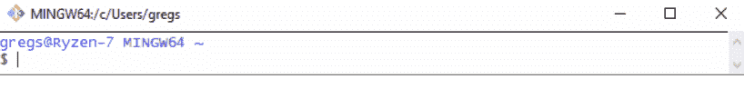

让我们使用 `ssh` 命令以 root 身份登录你的 Web主机。只需将 `XX.XXX.XX.XXX` 替换为你托管网站的静态 IP 地址即可。

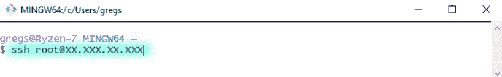

系统会要求你输入 root 用户密码：

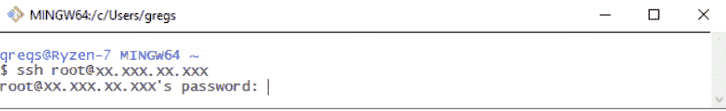

我们现在应该登录到 Web 主机（见下一页的服务器日志）。

## 6.12 Let's Encrypt

```
root@localhost: ~~
$ ssh root@XX.XX.XX.XX
root@XX.XX.XX.XX's password:
welcome to Ubuntu 18.04.3 (GNU/Linux 4.15.0-generic x86_64)

* Documentation: https://ubuntu.com
* Management: https://landscape.canonical.com
* Support: https://ubuntu.com/advantage

System information as of Feb 6 15:56:36 PST 2020

System load: 0.0               109
usage of /: 17.5% of 24.06GB   Users logged in: 0
Memory usage: 35%             IP address for eth0: XX.XX.XX.XX
Swap usage: 36%

* Multipass 1.0 is out! Get Ubuntu VM on demand on your Linux, Windows or
Mac. Supports cloud-init for fast, local, cloud devops.
https://ubuntu.com/multipass-run/
* canonical Livepatch is available for installation.
- Reduce system reboots and improve kernel security. Activate at:
https://ubuntu.com/livepatch
54 packages can be updated.
35 updates are security updates.

*** restart required ***
Last login: Tue Feb 4 13:32:32 2020 from XX.XX.XX.XX
root@localhost:-#
```

你将看到一个类似这样的屏幕（我运行的是 Ubuntu 18）。

要安装 certbot，我们需要先更新软件包。这是因为 certbot 开发者持续不断改进，你的 Ubuntu 服务器在初始安装时可能没有最新版本。

运行 `sudo add-apt-repository ppa:certbot/certbot` 命令将 certbot 存储库添加到你的 Ubuntu 服务器中：

```
root@localhost:-~
# sudo add-apt-repository ppa:certbot/certbot
This is the PPA for packages prepared by Debian Let's Encrypt Team and backported
for Ubuntu.
Note: Packages are only provided for currently supported ubuntu releases.
More info: https://launchpad.net/~certbot/+archive/ubuntu/certbot
按 [ENTER] 继续或按 ctrl-c 取消添加。
```

只需按回车键，最新的软件包将被添加到镜像文件中，镜像文件是指向软件包最新版本的链接列表。

现在运行 `sudo apt-get update` 来实际下载更新后的软件包：

```
root@localhost:~
Fetched 7,248 kb in 2s (3,070 kB/s)
Reading package lists... Done
root@localhost:~# sudo apt-get update
```

这一步非常重要——它会将你的 certbot 软件包更新到最新版本。

如果你发现你在 CentOS 或 Debian 上，可以按照以下方法操作：


在 CentOS 上运行 `sudo yum update && sudo yum upgrade`

在 Debian 上运行 `sudo apt update && sudo apt upgrade`

这里的 `&&` 符号会导致软件包先更新，然后进行升级，而无需单独执行每个命令。

## 6.12 Let's Encrypt

### 6.12.1 安装 certbot

运行 `apt-get install certbot` 安装 certbot 软件包。我们已经以 root 身份登录，因此不需要使用 `sudo` 命令（如果需要，请在前面加上 `sudo`）。

```
root@localhost:~# apt-get install certbot
Reading package lists... Done
Building dependency tree... Done
Reading state information... Done
The following packages were automatically installed and are no longer required:
linux-headers-4.15.0-45-generic
linux-image-4.15.0-45-generic linux-modules-4.15.0-45-generic
linux-modules-extra-4.15.0-45-generic
use 'autoremove' to remove
The following additional packages will be installed:
python3-acme python3-certbot python3-configargparse python3-future python3-icu
python3-josepy python3-mock-python3-mock-ng
```

### 6.12.2 获取证书

重点部分已高亮：

```
root@localhost:~/opt/letsencrypt# sudo -H ./letsencrypt-auto certonly --standalone \
-d example.com -d www.example.com
Debug log to /var/log/letsencrypt/letsencrypt.log
Plugins selected: Authenticator standalone, Installer None
Obtaining a new certificate
Performing the following challenges:
http-01 challenge for example.com
http-01 challenge for www.example.com
Waiting for verification...
Cleaning up challenges

重要注意事项：
- 恭喜！您的证书和证书链已保存于：
  /etc/letsencrypt/live/example.com/fullchain.pem
- 您的私钥文件已保存于：
  /etc/letsencrypt/live/example.com/privkey.pem
- 您的证书将于 2020-05-11 过期。将来如需获取新的或调整后的证书版本，只需运行
  letsencrypt-auto renew
- 如果您使用 Certbot，请考虑通过以下方式支持我们的工作：
  向 ISRG / Let's Encrypt 捐款：https://letsencrypt.org/donate
  向 EFF 捐款：https://eff.org/donate-le

root@localhost:~/opt/letsencrypt#
```

Let's Encrypt 创建并验证了 HTTP 挑战（这是为了验证域名所有权所需的，在本例中，它是自动完成的）。

接下来……它还为我们的 example.com 域名生成了两个 PEM 密钥。

恭喜！到此时，您的域名已启用了 HTTPS。

但还有一件事。让我们检查文件所在的位置，并熟悉生成密钥的目录：

```
root@localhost:~# cd /etc/letsencrypt/live
root@localhost:/etc/letsencrypt/live#
```

图 6.12：证书文件在 `/etc/letsencrypt/live` 目录中创建。

让我们输出 live 目录的内容。Let's Encrypt 将服务器上所有域名的证书密钥都存储在各自命名的文件夹下。

```
root@localhost:/etc/letsencrypt/live# ls
example.com README
root@localhost:/etc/letsencrypt/live#
```

图 6.13：运行 `ls` 命令列出目录内容。

在 example.com 目录中，你会发现由 Let's Encrypt 生成的几个 PEM 文件。我们只需要 `cert.pem` 和 `privkey.pem`。

我们已经准备好开始使用证书了。我们只需要向现有的 `index.js` 文件中添加一些新代码。

你可以跳过下一节，直接跳转到“添加 PEM 文件以运行 HTTPS 服务器”章节。

### 6.12.3 ACME 挑战

如果你在上一节中完成了安装 SSL 证书的步骤，则就不需要执行下一步。但在某些情况下，ACME 挑战允许你验证自己是域名的所有者。

我重复一遍，跳过它！我提供它仅供参考。

运行 `certbot certonly --manual`（注意：这里实际上是双横杠 `--manual`，而不是单横杠）。

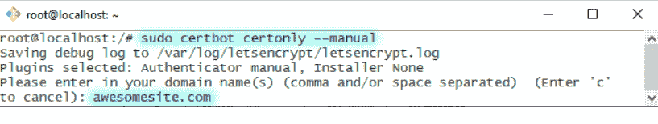

如果你托管了多个域名，可以使用同一个证书，只需指定你需要的多个域名，并用空格或逗号隔开。在这种情况下，我们简单地添加站点 awomesite.com。

输入你的域名（不带 www.）并按回车。

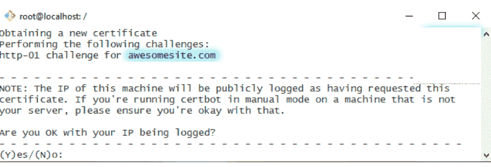

输入 Y 并按回车同意并继续。

为了验证我们的域名，我们需要手动创建一个名为 `afBX9EvXvQqquzFooe02-22EFJ5TzcniFwCvqlaMXCA` 的文件——只需截图中黄色高亮的点（.）之前的部分。

将此文件放置在你服务器上的 `.well-known/acme-challenge` 目录下（你网站的根目录）。你可能需要先创建这些文件夹。

现在，通过将 certbot 生成的长字符串粘贴到该文件中来编辑其内容。在我们的案例中，它是长文本 `afBX9EvXvQqquzFooe02-22EFJ5TzcniFw7CvqlaMXCA.rX9ThTxJ4y47ALEr7xgEWoCm4v7Jr5kJete4PLA98-0`。

记住，此文件每次运行 certbot 时都会生成。如果你之前运行过此命令，它应该再次发生变化。

按回车继续。

此时，certbot 将验证该文件是否存在。再次，如果你使用了本节中不带 ACME 挑战的第一种方法，那么你就可以正常运行。

### 6.12.4 添加 PEM 文件以运行 HTTPS 服务器

导航到 `/etc/letsencrypt/live/site.com/` 目录，验证上一节步骤确实生成了 PEM 文件。

现在我们已经生成了 `privkey.pem` 和 `cert.pem`，我们需要使用 options 对象将它们传递给我们的 Node 服务器配置。

将此添加到现有的服务器代码中：

```javascript
let http = require('https'); // 提供 https 功能
let fs = require('fs'); // 提供 fs 功能
let path = require('path'); // 提供 path 功能
const ip = 'XXX.X.X.XX'; // 你的静态域名 IP
const port = 443; // 443
const key = '/etc/letsencrypt/live/site.com/privkey.pem';
const cert = '/etc/letsencrypt/live/site.com/cert.pem';

const options = {
  key: fs.readFileSync(key),
  cert: fs.readFileSync(cert)
};

// 使用 http 模块创建服务器
http.createServer(options, function (request, response) {
  /* 其他代码 */
}).listen(port);

// 显示服务器运行
console.log('Running at ' + ip + ':' + port);
```

将 `site.com` 替换为你的实际域名。

对于 HTTPS 连接，使用端口 443。

你可能还需要在系统中开启端口 443 以便工作。然而，这是必须的——任何端口号仍然有效。

更新 `index.js` 文件。导航到应用程序目录并运行 `node index`。信不信，如果一切顺利，此时你的服务器将通过 HTTPS 协议访问，Chrome（以及其他浏览器）中的“不安全”消息将会消失。

## 整合一切

现在我们正在运行 HTTPS 服务器，可以完成 API 的构建。

在之前的章节中，我们开发了一种模式，可以在不修改主服务器代码的情况下添加更多端点。

在现实环境中，你可能会使用另一个库（如 React）或 Angular 框架。许多软件公司选择 Express 作为封装。

### API 代码

为了保持 API 的整洁，最好每个端点都遵循相同的模式。

POST 数据在产生 "end" 事件之前是不可用的。这就是使用辅助函数将块组合成实际 JSON 对象的地方。

要支持更多端点只需遵循相同的模式。将它们放在 `request.on('end')` 回调中，以确保 POST 数据传输完成。

```javascript
// 完成读取数据块
request.on('end', () => {
  API.parts = request.parts;

  if (identify("user", "register")) // 注册（创建）用户
    action_register_user(request, json(request.chunks))
      .then(content => respond(response, content));

  if (identify("user", "login")) // 登录
    action_login(request, json(request.chunks))
      .then(content => respond(response, content));

  if (identify("user", "logout")) // 注销
    action_logout(request, json(request.chunks))
      .then(content => respond(response, content));

  if (identify("user", "delete")) // 删除用户
    action_delete_user(request, json(request.chunks))
      .then(content => respond(response, content));

  if (identify("user", "get")) // 获取用户数据
    action_get_user(request, json(request.chunks))
      .then(content => respond(response, content));

  if (identify("user", "update")) // 更新用户
    action_update_user(request, json(request.chunks))
      .then(content => respond(response, content));

  if (identify("session", "create")) // 创建会话
    action_create_session(request, json(request.chunks))
      .then(content => respond(response, content));

  if (identify("user", "authenticate")) // 验证用户身份
    action_authenticate_user(request, json(request.chunks))
      .then(content => respond(response, content));
});
```

`request` 和 `response` 对象从 `index.js` 中的初始调用 `http.createServer(function(request, response)...)` 一直传递而来。换句话说，在 Node 中，它们是由 `createServer` 函数自动创建的。

## 6.13 完整源代码

要查看我们目前为止构建的 Node 服务器的完整源代码，你可以从本书的公共 GitHub 仓库进行派生（fork）：

```
https://github.com/javascriptteacher/node
```

**注意：** 在你的本地上运行此应用（`cmd > node index.js`）之前，请确保你已经有一个运行中的 MySQL 服务器且其中包含表，并在 `api.js` 中包含了 MySQL 凭据（IP、用户名、密码和数据库名称）。

**注意：** 这不是一个完整的应用程序，但它提供了足够的脚手架让你快速上手。用户 API 对于大多数 Web 应用都是至关重要的。其他的端点将取决于你的应用程序。

**注意：** 如果你需要提高用户密码的安全性，应该将 `md5` 替换为 `sha3`。使用 `npm install sha3` 安装 SHA3 模块，该模块也包含了 Keccak。

运行 `node index.js` 后，你应该能看到 `index.html` 打开 `http://localhost:3000`。

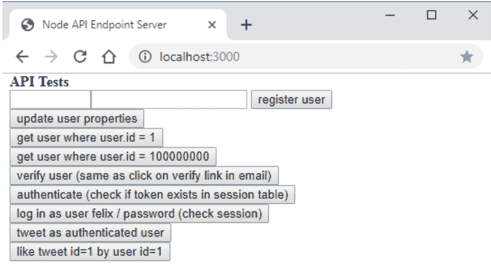

点击 API 端点测试按钮并观察控制台。记住我们的每个端点都会返回一个 JSON 对象。该对象有一个 "success" 属性，其值可以是 `true` 也可以 `false`。"message" 属性将包含关于发生内容的详细信息。

例如：

```
{success: false, message: "user with this ID does not exist."}
{success: true, message: "user (felix) was successfully registered!"}
```

根据 `success` 值，你可以更新前端。

这些端点已准备好集成到你自己的前端 UI/UX 中。你可以通过 `onclick` 属性或 JavaScript 代码中的其他地方调用它们。

### 如何运行服务器

我建议从零开始手动重写书中的示例。不过，为了快速演示，你可以从你的 GitHub 仓库复制文件，并在几分钟内运行你自己的 Node 服务器！

- 将 GitHub 文件导入你的项目，或将它们复制到一个文件夹中。
- 从命令行导航到该文件夹。
- 输入 `node index.js`，你应该可以通过浏览器通过 `http://localhost:3000` 访问 `index.html`。

从这里开始，取决于你想要构建前端的其余部分以及想要添加哪些 API 端点。这完全取决于你的应用程序用途。

例如，如果你的应用程序需要图片上传，你可以创建一个新的端点并创建一个名为 `action_image_upload` 的函数。

```javascript
if (identify("image", "upload")) // Upload image
  action_upload_image(request, json(request.chunks))
    .then(content => respond(response, content));
```

Multer 是一个有助于从 HTML 表单上传文件的优秀模块。要获取它，只需在 Terminal 或 cmd.exe/bash.exe 中运行 `npm install multer` 命令。

## 6.14 构建可扩展的应用程序

到此为止，我们学习了如何构建一个使用 MySQL 执行存储和经典 CRUD 数据操作的 API Node 服务器。

MySQL、MariaDB、MongoDB 以及其他软件在应用程序的早期阶段运行在单台服务器上可能运行良好。

根据可用 RAM 的量、SSD 驱动器的 IO 速率以及你服务器代码的优化程度，你能够托管 1K - 10K 用户（甚至更多）。微调你的服务器并编写针对性能优化的代码，对于增加单个服务器实例可以提供的用户数来说将是神奇的。

但一旦你服务器的最大带宽耗尽，如果有更多用户加入并开始使用你的应用程序，它将开始变得缓慢。

在过去，运行《暗黑之魂 I》和《星际争霸 I》的 Battle.net 曾在一个单服务器上运行，同时连接着数十万用户。这是资源限制如何鼓励高效代码的示例。

如今的 Web 应用是实时的并不罕见。如果你想构建为数十万甚至数百万同时用户服务的大规模应用程序，必须应用额外的思考和工程手段。

### 6.14.1 迁移到 RAM

没有任何现代实时应用（例如 Twitter）使用 SQL 数据库来为用户提供主要功能。原因非常简单。当对一切都使用 SQL 时，意味着每当有人发出请求时都会有硬盘操作！这可能是过度的，因为你正在将系统中最慢的部分外包来服务应用程序的关键功能。

解决方案是切换到 SSD 服务器（诚实地说，按照今天的标准，大多数已经是那样的）。但如果我们将所有数据存储在 RAM 中呢？这样我们就可以完全避免接触硬盘（通过在对象中缓存频繁访问的数据）。

当然，原始数据仍然会存储在硬盘上。区别在于，当你启动 Node 服务器时，它会被复制到 JavaScript 对象中。

当客户端请求特定资源时，我们可以直接从该对象提供服务。它将包含原始客户端请求特定资源的副本。

## 6.15 JavaScript 语法

如果你喜欢 Node API，请关注 Learning Curve Books 出版的其他书籍。

> Learning Curve Books


在 Amazon 上搜索《JavaScript Grammar》（封面设计可能有所不同）。

# 索引

- 添加程序包, 21
- Apache, 4
- API, 48, 56, 62, 65
- API 动作函数, 56
- API 类, 31, 62, 65
- API 端点往返, 54
- API 端点, 30, 34, 80
- api.js, 47, 62, 65
- apt-get update, 34
- 架构, 46, 54, 56
- 身份令牌 (auth token), 56
- AuthToken, 56
- bash.exe, letsencrypt, 66
- bash.exe, letsencrypt, certbot, 66
- bash.exe, 1
- 绑定地址, 41, 42
- 构建 API, 29
- certbot, 68
- 客户端, 46
- 连接数据库, 34
- 配置, 11
- CREATE DATABASE database_name, 38
- 'localhost', 39
- CREATE USER, 39
- CRUD, 43
- Ctrl + C, 15
- 数据库, 48
- 端点 (endpoint), 56, 80
- 端点往返, 54
- 执行 mysql 查询, 78
- 退出 Node, 15
- 退出服务器进程, 86
- 框架, 4
- 授权 (grant), 39
- 授予所有权限, 39
- 主目录, 18
- HTTPS, SSL, 65
- HTTPS, SSL, pem, keys
- 安全 (secure), 77
- IDENTIFIED BY 'Password', 39
- identify(), 57
- 安装, 7
- 安装 mysql npm, 32
- 安装 mysql server, 32
- 在 Ubuntu 上安装 mysql server, 34
- 在 Windows 上安装 mysql server, 33
- nano control-W, 41
- nano search, 41
- node index.js, 19
- 在 Mac 上安装 node, 8
- 在 Windows 上安装, 9
- 在 Mac 上, 8
- 在 Windows 上, 9
- JavaScript 语法, 88
- json(), 58
- PHP, 4
- POST, 59, 60
- process 对象, 20
- promise, 56
- 启动服务器, 19
- letsencrypt, certbot, 66, 67
- 库, 4
- localhost, 44
- 远程访问, 40
- 请求 (request), 62, 65
- require mysql, 48
- resolve(), 56
- respond(), 58
- 响应 (response), 62, 65
- 从任何目录运行, 13
- 从 node 运行 js 文件, 18
- 运行应用程序, 17
- 持续运行服务器, 23
- 运行服务器, 19
- Mac, 8
- max_connections, 31
- mime, 28
- mime types, 28
- 多个端点, 80
- my.cnf, 40
- MySQL, 47
- mysql -u root -p, 36
- mysql API, 48
- mysql 配置文件, 40, 41
- mysql 连接, 48
- mysql grant, 39
- mysql grant all privileges, 39
- MySQL promise, 56
- MySQL query, 48
- mysql 远程访问, 40
- mysql 表示例, 45
- mysql user password, 39
- MySQL 表, 45
- mysql user table, 45
- MySQL Workbench, 34
- mysqld.cnf, 41
- 保存 mysql .cnf 文件, 42
- SELECT user FROM mysql, 38
- Sequel Pro, 44
- 服务器, 46
- 服务器架构, 54
- 服务器退出事件, 86
- 提供文件, 26, 46
- 设置 mysql server, 33
- 设置 mysql user password, 39
- SHOW DATABASES, 37
- SIGINT, 86, 88
- sudo apt-get install mysql-server, 34
- sudo apt-get update, 34
- nano control-O, 42
- sudo ufw allow mysql, 35
- systemctl start mysql, 35
- ufw allow mysql, 35
- 简单的防火墙 (uncomplicated firewall), 35
- 用户, 45
- 用户登录, 56
- 表 (table), 44
- ufw, 35
- Windows, 9
