# Node.js 入门指南：中级开发者解锁服务器端 JavaScript 力量终极指南

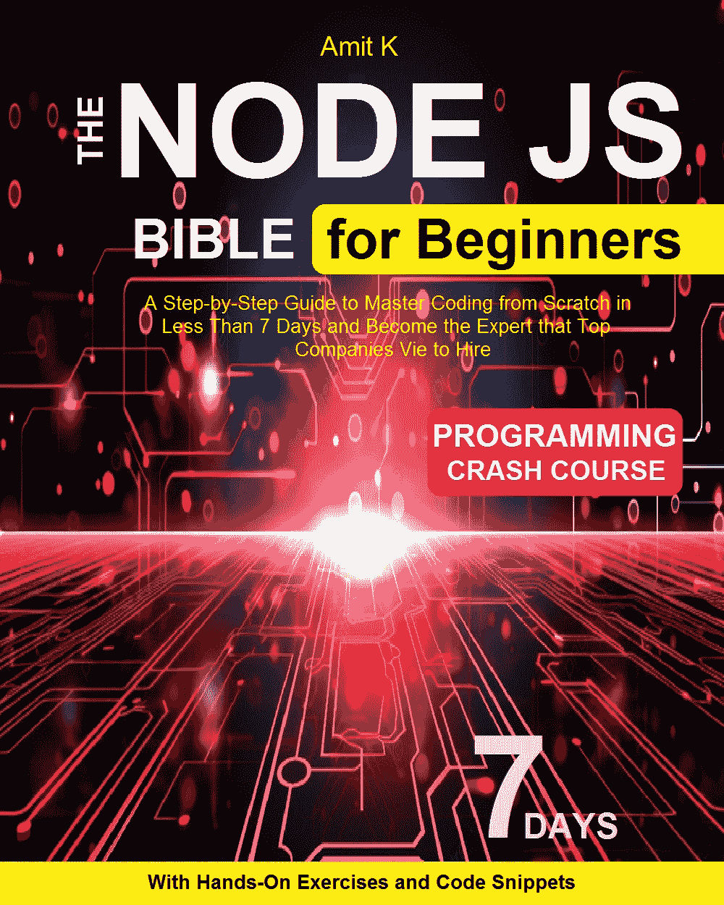

在本书中，你将学习带有图解的说明和实操练习，通过成功执行练习获得带有输出的现成解决方案，以及逐步解释。AMIT K

## 序言

循步学习 Node Js。

初学者 Node Js：中级开发者释放服务器端 Javascript 力的终极指南

通过《精通 Node.js：中级开发者释放服务器端 JavaScript 力的终极指南》，解锁 `Node.js` 的全部潜力，并彻底改变你的 Web 和服务器端开发技能。

`Node.js` 因其速度、可扩展性和丰富的生态系统席卷了 Web 开发领域。在这本全面的电子书中，我们将带你开启一段从中级到高级 `Node.js` 开发者的旅程，为你提供应对复杂项目和构建高性能应用程序的知识和技能。

探索 `Node.js` 的核心概念，从异步编程、事件驱动架构到使用 `npm` 和 `Yarn` 管理依赖。通过 `Express.js` 深入 Web 应用的世界，并探索用于创建 RESTful API 的专用框架，无论是构建单页应用程序还是高流量服务。

学习使用 `WebSockets` 进行实时通信的艺术，它非常适合构建交互式应用程序并提供实时数据更新。探索与 `MySQL` 数据库的集成。

## 第 1 章：NodeJs 简介

### 什么是 NodeJs

在直接回答“什么是 NodeJS?”之前，我将先向你介绍 `NodeJS` 的诞生背景，这有助于你更容易理解相关问题。

### Chrome 与 V8 Javascript 引擎

人知道 `Chrome` 是一个著名的免费 Google 浏览器，第一个版本于 2008 年 12 月发布，其中 `V8 JavaScript Engine` 是一个用 `C++` 编写的程序，代码开源，用于 Google `Chrome` 以高性能地解析和执行 Javascript 代码。它解析 Javascript 语法并将其解释为计算机代码以执行。

| 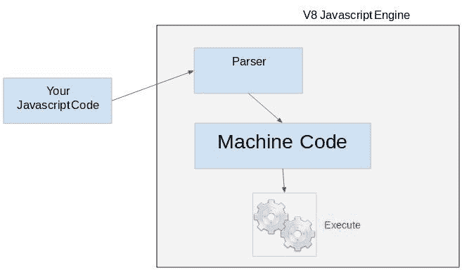 |

注意：除 `Chrome` 之外的浏览器可能使用其他的 Javascript 引擎。

| 浏览器 | Javascript 引擎 |
| :--- | :--- |
| Chrome | V8 JS Engine |
| Firefox | SpiderMonkey |
| IE, Edge | Chakra |

### NodeJS

你可以使用“Javascript 语法”编写代码片段来连接数据库。`V8 JS Engine` 会解析你的 Javascript 代码并将其解释为计算机代码以执行。当然，这种代码片段不是用于客户端，而是用于服务器端的。因此，一种能力被开启了，你可以使用“Javascript 语法”编写服务器端 Web 应用，而不是使用 `PHP` 或 `Java`。

```javascript
const mysql = require('mysql');
const connection = mysql.createConnection({
  host: 'localhost',
  user: 'user',
  password: 'password',
  database: 'database name'
});
connection.connect((err) => {
  if (err) throw err;
  console.log('Connected!');
});
```

`NodeJS` 诞生了。`V8 Javascript Engine` 是 `NodeJS` 的组件之一。下面是 `NodeJS` 的架构图：

### NodeJs Javascript 库

| 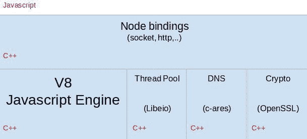 |

简而言之，`NodeJS` 可以替换 `PHP`、`Java` 来构建服务器端 Web 应用。你不再通过 `PHP`、`Java` 编写代码，而是使用 Javascript 语法。

### 所以，什么是 NodeJS

`NodeJS` 是浏览器外的 JavaScript 运行时环境。`NodeJS` 还包含其他组件和库，因此它可以像 Web 应用服务器一样运行。

重要提示：`NodeJS` 不是 Javascript 的扩展语言。

## 第 2 章：安装 Atom 编辑器

### 什么是 Atom 软件

Atom 是一个免费的文本（及源代码）编辑器。其开源代码支持 `Linux`、`Mac OS`、`Windows` 等操作系统。它支持通过 `NodeJS` 插件并嵌入由 `GitHub` 开发的 `Git-Control`。

`Atom` 被评估为文本编辑（及源代码）软件，与类似的软件相比，它具有现代、易于使用的界面和卓越的特性。

`Atom` 支持以下语言：

C/C++, C#, Clojure, CSS, CoffeeScript, `GitHub Flavored Markdown`, Go, Git, HTML, JavaScript, Java, JSON, Julia, Less, Make, Mustache, Objective-C, PHP, Perl, Property List (Apple), Python, Ruby on Rails, Sass, Shell script, Scala, SQL, TOML, XML, YAML

| 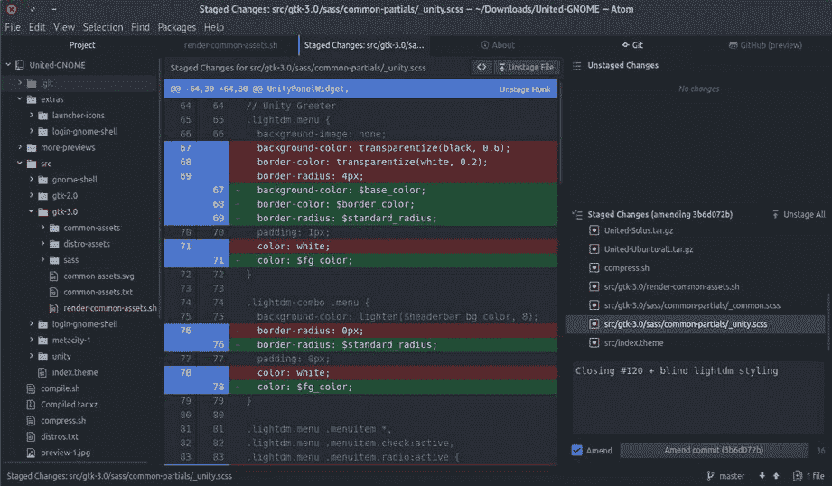 |

### 下载 Atom

要下载 `Atom`，请访问其主页。请注意，`Atom` 支持各种操作系统。如果你使用 `Windows`，请确保你的操作系统是 `Windows 7` 64 位或更高版本。

* https://atom.io/

| 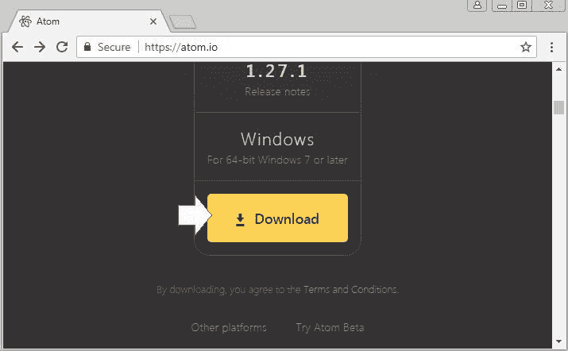 |

成功下载后，你将获得一个文件。

| 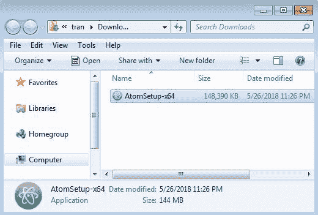 |

好的，在完成下载并安装 `Atom` 后，这是 `Atom` 的界面：

| 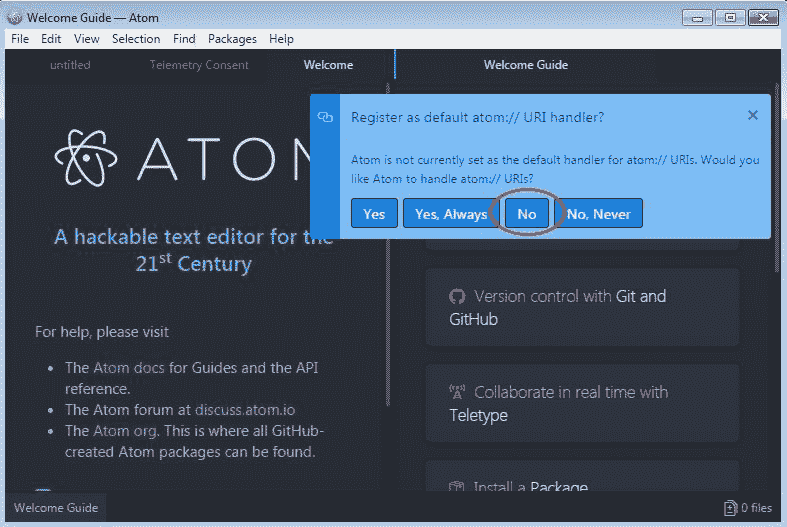 |

## 第 3 章：在 Windows 上安装 NodeJS

### 下载 NodeJS

要下载 `NodeJS`，你需要访问以下地址：

* https://nodejs.org/download/

| 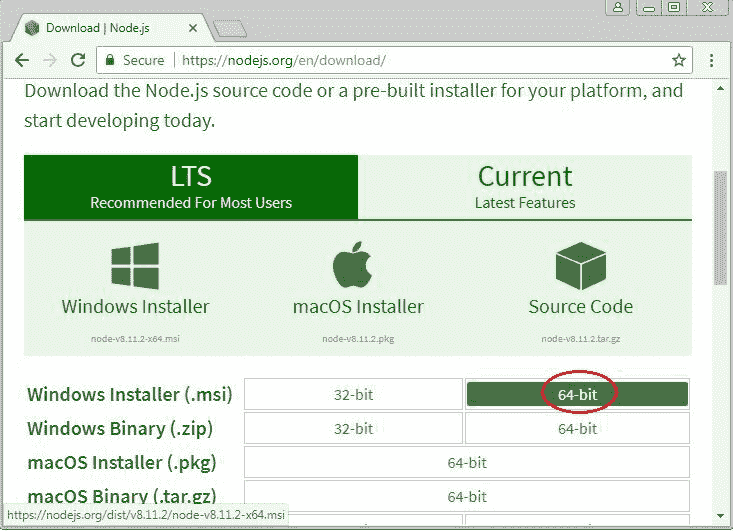 |

成功下载后，你将获得一个文件。

| 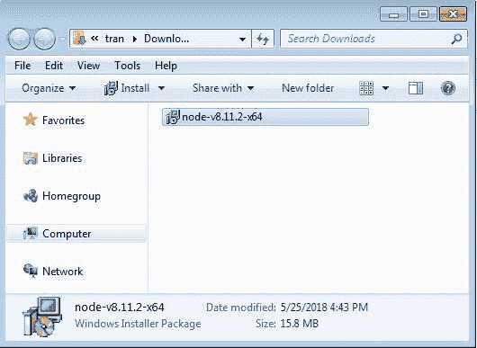 |

### 安装 NodeJS

在 `Windows` 上安装 `NodeJS` 非常简单。接受默认选项并一直“Next”直到最后一步。

| 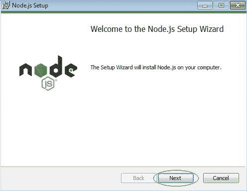 |
| 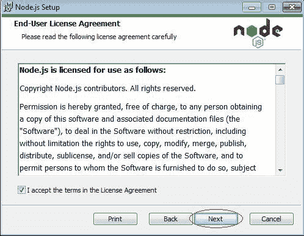 |
| 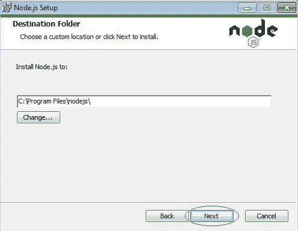 |

默认情况下，`NPM` 软件也安装在你的系统中。这是一个管理 Javascript 库的软件。

| 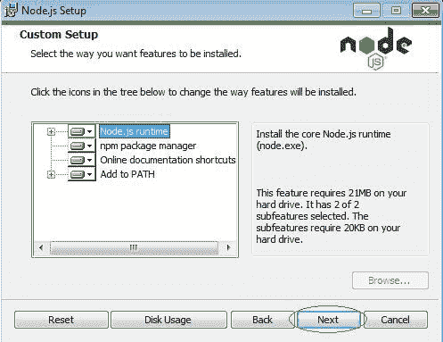 |
| 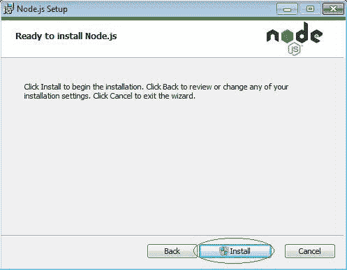 |
| 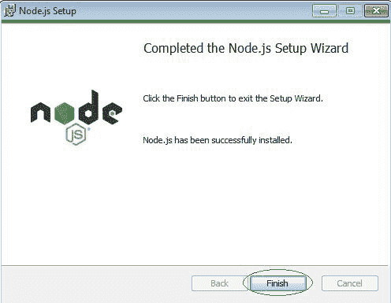 |

### 检查并配置

好的，在上面的步骤中，我们成功下载并安装了 `NodeJS`。现在，你需要检查安装结果并配置 `NodeJS`。

打开 `CMD` 窗口并执行以下命令来检查 `NodeJS` 和 `NPM` 的版本：

```bash
node -v
npm -v
```

| 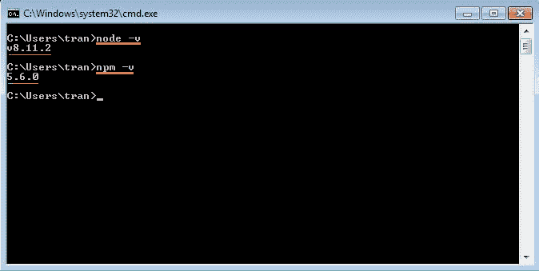 |

## 第 4 章：什么是 NPM

### 什么是 NPM

`NPM` 代表 Node Package Manager（Node 包管理器），是一个用于 `Node.js` Javascript 编程库的（程序）工具。这个工具对于开源世界实际上是必要的。在 Javascript 社区中，开发者共享成千上万的代码片段，帮助新项目避免重写基础组件、编程库甚至框架。每个代码片段可能依赖许多许多开源代码。

`NPM` 基本上与 `Maven` 相似。区别在于 `NPM` 管理 Javascript 库，而 `Maven` 管理 Java 库。

一个与 NPM 类似的软件是 `Yarn`，由 Facebook 开发，其卓越的特性使其成为 NPM 的替代方案。在相同的情况下，Java 库管理软件是 `Gradle`，凭借其卓越的特性，逐渐取代 Maven。

### NPM 的特性

要运行 NPM 软件，你的系统需要安装 `NodeJS`。NPM 软件内置在 `NodeJS` 安装程序中，因此，当你完成 `NodeJS` 的安装后，你将同时拥有它们。

在你的电脑上安装好 NPM 后，你可以检查它的版本：

```bash
npm -v
```

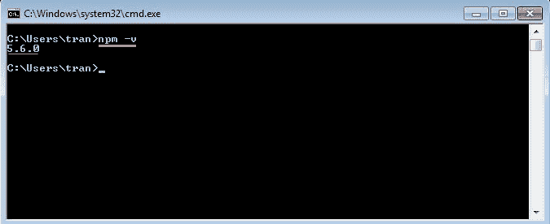

因为 NPM 是安装在你的电脑上的一个软件，你可以用它从互联网安装 Javascript 库。要安装一个库，只需要打开 `CMD` 窗口并执行以下命令：

```bash
npm install <package name>
```

```bash
npm install vue
```

你可以在你的 Javascript 代码中使用 `Vue.js`：

```javascript
var Vue = require('vue');
```

## 第 5 章：NodeJS

### 创建一个 NodeJS 项目

首先，你需要创建一个名为 `MyProject` 的目录，或者你喜欢的任何名称。

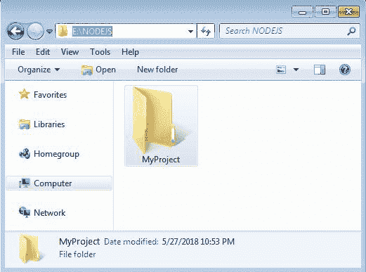

打开 `CMD` 和 `CD` 窗口进入你刚刚创建的目录。之后运行以下命令，让 NPM 为你创建项目。

```bash
npm init
```

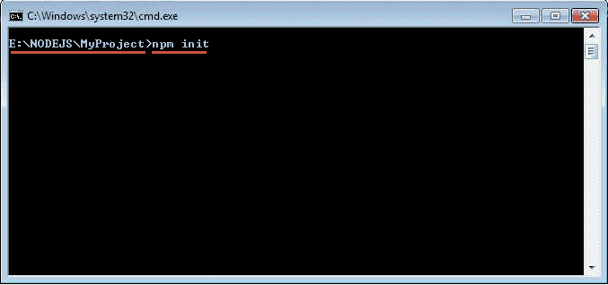

接受默认选项并按“回车”直到完成。

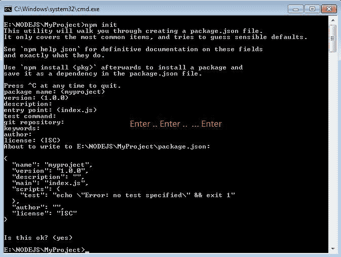

在你的项目中创建了一个名为 `package.json` 的文件。

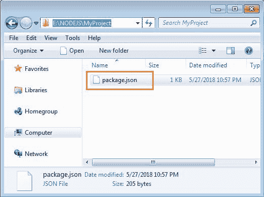

你的项目需要一些库包，你需要在 NPM 的支持下安装它们：

#### Express

`Express.js`（或简单称为 `Express`）是一个用于 `NodeJS` 的 Web 应用框架。它为 Web 和移动应用提供了一系列强大的功能。

#### Ejs

`EJS` 代表“嵌入式 JavaScript 模板”（Embedded JavaScript templating），这是一个库，用于解析 `ejs` 文件并创建 HTML 返回给客户端（浏览器）。

```bash
npm install express ejs
```

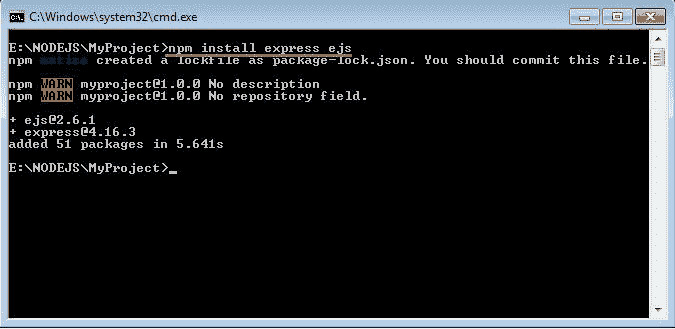

安装完成后，你可以看到项目发生了变化：

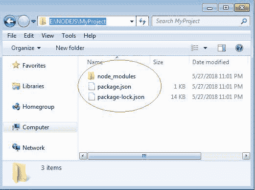

### 创建项目结构

在上面的步骤中，我们通过命令创建了项目。现在我们将使用一个更可视化的工具打开这个项目。在这里，我使用 `Atom` 编辑器（我在上面的步骤建议你安装的软件）。

*   `File/Add Project Folder`

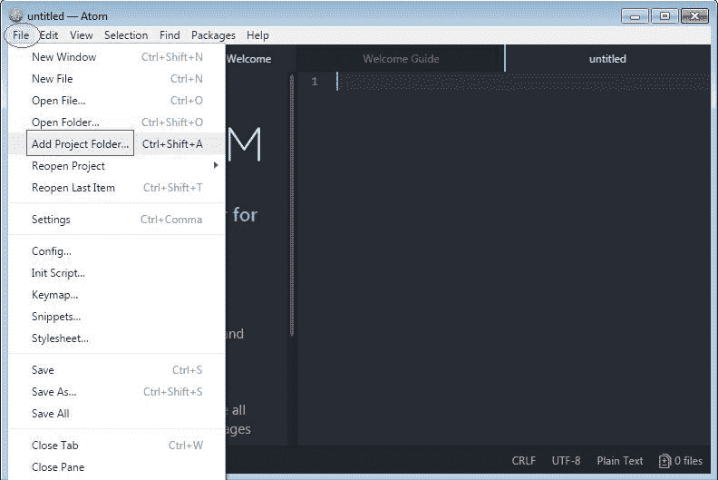

好的，项目已在 `Atom` 中打开：

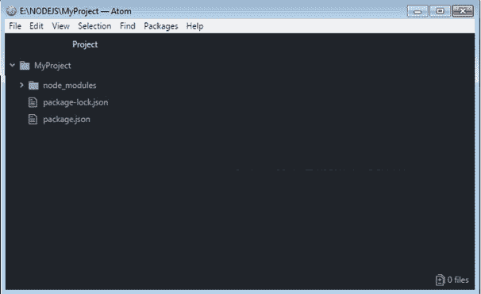

项目中创建两个子目录：`public` 和 `views`：

*   `public`：一个包含用户可以访问的所有文件的目录，例如图片、视频等...

*   `views`：你的网站将有很多页面，例如首页、登录页...此目录是存放你所有页面的地方。

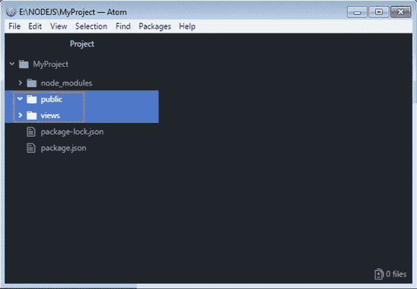

在 `views` 目录中，我们创建了 两个文件：

*   `homePage.ejs`
*   `testPage.ejs`

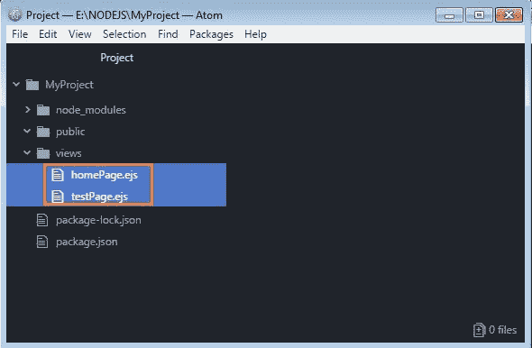

**homePage.ejs**

```html
<!DOCTYPE html>
<html lang="en" dir="ltr">
<head>
  <meta charset="utf-8">
  <title>Home</title>
</head>
<body>
  <h1>This is Home Page</h1>
</body>
</html>
```

**testPage.ejs**

```html
<!DOCTYPE html>
<html lang="en" dir="ltr">
<head>
  <meta charset="utf-8">
  <title>Test</title>
</head>
<body>
  <h1>This is Test Page</h1>
</body>
</html>
```

接下来，创建一个名为 `index.js` 的文件，并输入该文件的内容。这是你项目的配置文件：

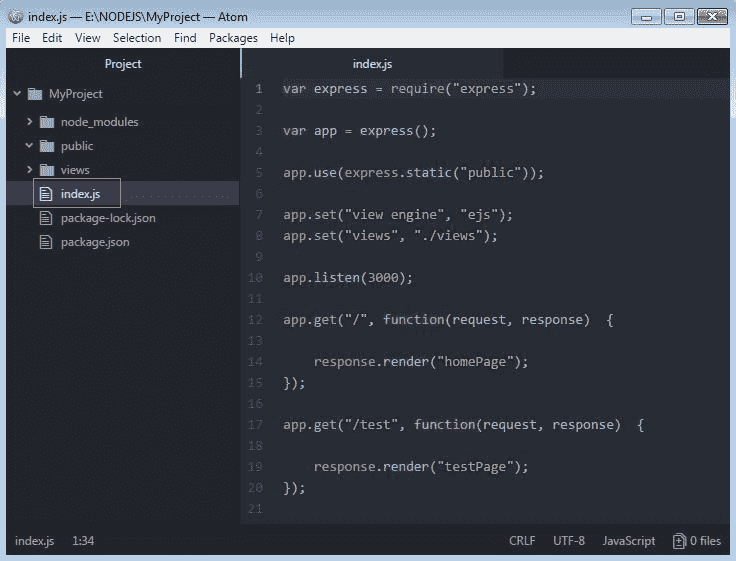

**index.js**

```javascript
var express = require("express");
var app = express();
app.use(express.static("public"));
app.set("view engine", "ejs");
app.set("views", "./views");
app.listen(3000);
app.get("/", function(request, response) {
  response.render("homePage");
});
app.get("/test", function(request, response) {
  response.render("testPage");
});
```

好的，现在是解释上面 `index.js` 文件的内容了。

| 代码 | 说明 |
| :--- | :--- |
| `var express = require("express");` | `ExpressJS` 是一个 Web 应用框架。这行代码表示你想使用它。 |
| `var app = express();` | 创建一个 `Express` 对象。 |
| `app.use(express.static("public"));` | 这行代码告诉应用程序服务器你想使用 `public` 目录来存放静态数据，用户可以访问该目录下的文件。 |
| `app.set("view engine", "ejs");` | 这行代码告诉应用程序服务器你想使用 `EJS` 库。它是处理你页面的机制。`EJS` 将创建 HTML 返回给用户的浏览器。 |
| `app.set("views", "./views");` | 这行代码向应用程序服务器显示目录的路径。 |
| `app.listen(3000);` | 应用程序在 3000 端口上监听。 |
| `app.get("/", function(request, response) {response.render("homePage");});` | 定义根路由。 |
| `app.get("/test", function(request, response) {response.render("testPage");});` | 定义 /test 路由。 |

### 运行应用程序

打开 `CMD` 窗口进入你刚刚创建的目录。

```bash
node index.js
```

| Module | Description |
| :--- | :--- |
| dgram | 提供 UDP 数据报套接字的实现 |
| dns | 用于 DNS 查询和域名解析函数 |
| events | 用于处理事件 |
| fs | 处理文件系统 |
| http | 让 Node.js 充当 HTTP 服务器 |
| https | 让 Node.js 充当 HTTPS 服务器 |
| net | 创建服务器和客户端 |
| os | 提供有关操作系统的信息 |
| path | 处理文件路径 |
| querystring | 处理 URL 查询字符串 |
| readline | 逐行处理可读流 |
| stream | 处理流式数据 |
| string_decoder | 将 buffer 对象解码为字符串 |
| timers | 在指定的毫秒数后执行函数 |
| tls | 实现 TLS 和 SSL 协议 |
| tty | 提供供文本终端使用的类 |
| url | 解析 URL 字符串 |
| util | 访问实用函数 |

要使用模块，请使用 `require(moduleName)` 函数。例如，`http` 是一个让 NodeJS 运行得像 HTTP 服务器的模块。

在你的 NodeJS 项目中，创建一个 `module-examples` 目录来包含你在在本课程中练习的 Javascript 文件。

| 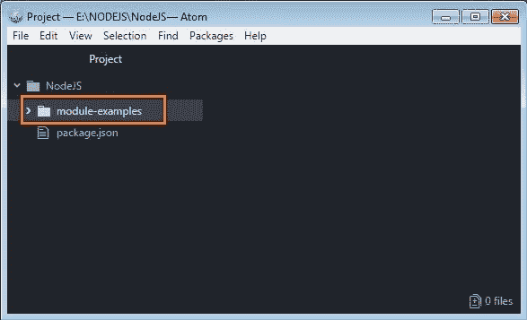 |

在 `module-examples` 目录下创建一个名为 `http-example.js` 的文件。

| 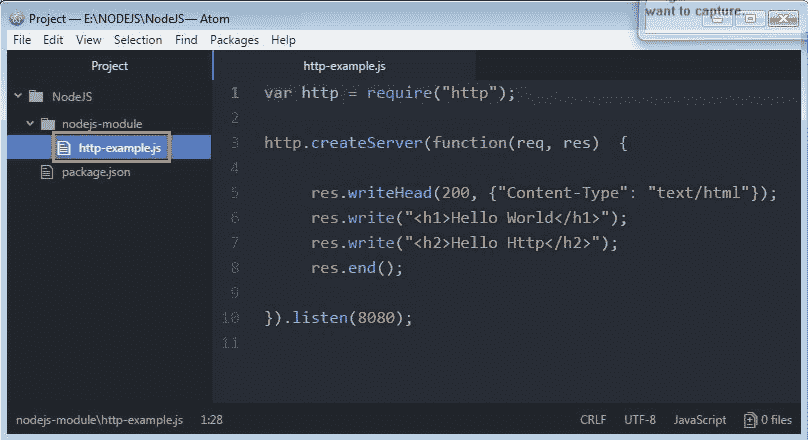 |

`http-example.js`

```javascript
var http = require("http");
http.createServer(function(req, res) {
  res.writeHead(200, {"Content-Type": "text/html"});
  res.write("<h1>Hello World</h1>");
  res.write("<h2>Hello Http</h2>");
  res.end();
}).listen(8080)
```

打开 CMD 窗口进入进入项目目录，使用 NodeJS 运行 `http-example.js` 文件：

```bash
node ./module-examples/http-example.js
```

打开浏览器并访问路径：

* http://localhost:8080/

| 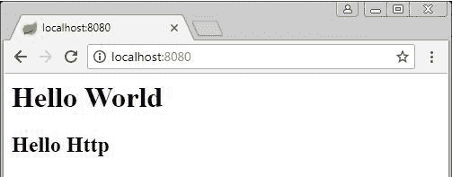 |

## 创建你的模块

在 NodeJS 中，你可以创建一个自定义模块。模块是一个 Javascript 文件。请注意该文件的位置，因为它会影响你使用它的方式。你有 2 种选择该文件位置的方法：

1. 将模块文件放在名为 `node_modules` 的目录中（项目的子目录）。这是推荐的位置。
2. 将模块文件放在你的其中一个目录中，而不是 `node_modules` 中。

| 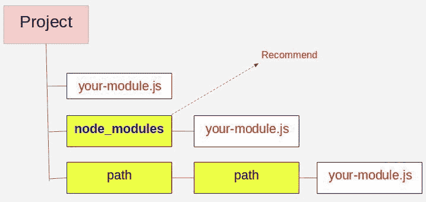 |

NodeJS 建议你将你的模块文件放在项目的 `node_modules` 目录中。请等一分钟，我将解释为什么你的模块应该放在这个目录中。

### 在你的 Javascript 文件中导出内容的语法。

```javascript
exports = something;
// 或者：
module.exports = something;
```

`my-first-module.js`

首先，在 `node_modules` 目录下创建一个 `my-first-module.js` 文件，在另一个目录下创建一个 `test-my-first-module.js` 文件。

| 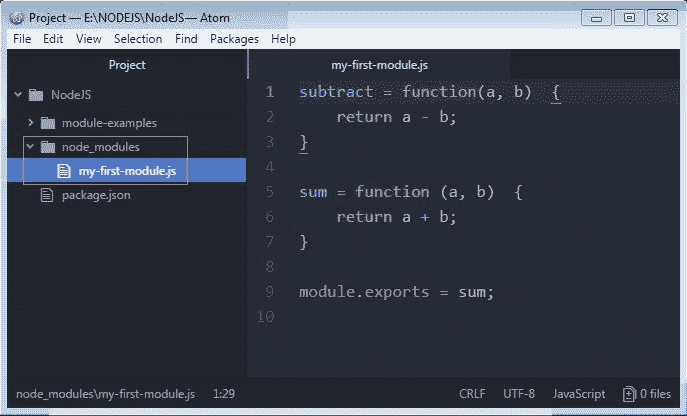 |

在例例中，`my-first-module.js` 文件有很多函数，但我只导出了 "sum" 函数。

`node_modules/my-first-module.js`

```javascript
subtract = function(a, b) {return a - b;}
sum = function (a, b) {return a + b;}
module.exports = sum;
```

| 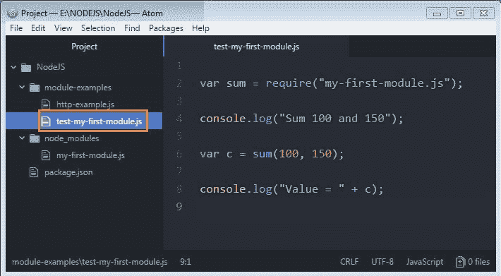 |

`module-examples/test-my-first-module.js`

```javascript
var sum = require("my-first-module.js");
console.log("Sum 100 and 150");
var c = sum(100, 150);
console.log("Value = " + c);
```

运行上面的示例：

```bash
node ./module-examples/test-my-first-module.js
```

## 第 8 章：NodeJS 中的回调 (Callback) 概念

### 什么是回调 (Callback)

为了解释什么是回调，让我们来看以下情况：

你去一家商店买你喜欢的东西。店员告诉你该商品现在缺货了。你留下了电话号码，并他们在到货后立即给你回电。然后你就可以出去或工作，不需要再担心这家商店，直到你接到商店的电话通知你请求的商品已到。

| 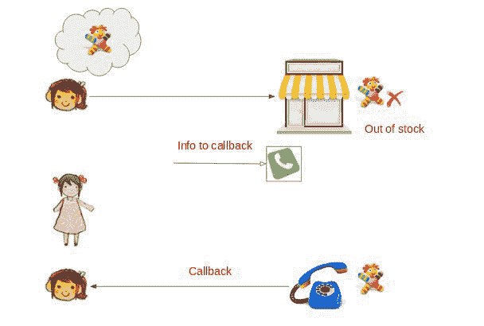 |

NodeJS 服务器可以接收来自许多用户的许多请求。因此，为了提高可用性，NodeJS 的所有 API 都设计为支持回调。“回调”是一个在 NodeJs 完成特定任务时被调用的函数。

### NodeJS 回调

在 NodeJS 中，API 被设计为支持回调。假设你正在编写一个读取 2 个文件的程序。为了实现这一点，你使用了 `fs` 模块，它提供了两个函数如 `readFile` 和 `readFileSync` 来读取文件。我们将学习这两个函数之间的区别。

#### 阻塞 (Blocking)

`readFileSync` 是一个同步读取文件的函数。因此，当该函数执行时，它会阻塞程序执行后续代码行。

`blocking-example.js`

```javascript
var fs = require("fs");
// -----> 读取文件 1:
console.log("\n");
console.log("Read File 1");
var data1 = fs.readFileSync('C:\\test\\file1.txt');
console.log("- Data of file 1: ");
console.log(data1.toString());
// -----> 读取文件 2:
console.log("\n");
console.log("Read File 2");
var data2 = fs.readFileSync('C:\\test\\file2.txt');
console.log("- Data of file 2: ");
console.log(data2.toString());
console.log("\n");
console.log("Program Ended");
```

打开 CMD 窗口并执行 `blocking-example.js` 文件：

```bash
node callback-examples/blocking-example.js
```

#### 非阻塞 (Non Blocking)

你应该使用 `readFile` 函数来为程序获得更好的性能。该函数异步读取文件。它不会阻塞程序执行后续代码行。换句话说，程序不会等待函数完成。但当该函数完成它的任务时，它会调用回调函数。

```javascript
// 异步读取文件。
fs.readFile('C:\\test\\file1.txt', aCallbackFunction );
```

查看完整示例：

`non-blocking-example.js`

```javascript
var fs = require("fs");
// 一个回调函数！
function readFinishedFile1(err, data) {
  if (err) console.log(err);
  console.log("- Data of file 1: ");
  console.log(data.toString());
}
// 一个回调函数！
function readFinishedFile2(err, data) {
  if (err) console.log(err);
  console.log("- Data of file 2: ");
  console.log(data.toString());
}
// -----> 读取文件 1:
console.log("\n");
console.log("Read File 1");
fs.readFile('C:\\test\\file1.txt', readFinishedFile1);
// -----> 读取文件 2:
console.log("\n");
console.log("Read File 2");
fs.readFile('C:\\test\\file2.txt', readFinishedFile2);
console.log("\n");
console.log("Program Ended");
```

打开 CMD 窗口并运行 `non-blocking-example.js`：

```bash
node callback-examples/non-blocking-example.js
```

## 第 9 章：理解 NodeJS 中的事件循环 (Event Loop)

### 事件循环概述

NodeJS 是一个单线程应用程序，运行在由 C++ 编写的平台上。该平台使用多线程来同时执行任务。

下图说明了从用户侧发送到 NodeJS 的请求。

| 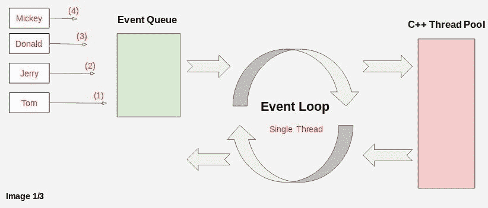 |

来自用户的每个请求被 NodeJS 视为一个事件。它们被放置在事件队列中。NodeJS 使用先入先出 (FIFO) 原则，这意味着先请求将先处理。

### 事件循环 (Event Loop)

作为一个无限循环，它将请求传递给线程池，每个请求注册了一个回调函数。当请求处理完成后，相应的回调函数将被调用并执行。

### 线程池 (Thread Pool)

由于是 C++ 语言编写，它支持多线程。因此，这里会在不同的线程上处理。NodeJS 也支持多进程。这意味着它们可以在不同的核心上执行。

| 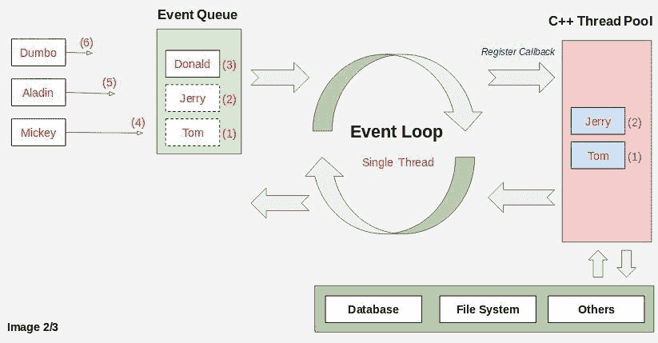 |

当请求处理完成后。NodeJS 将调用为该请求注册的回调函数来执行它。

| 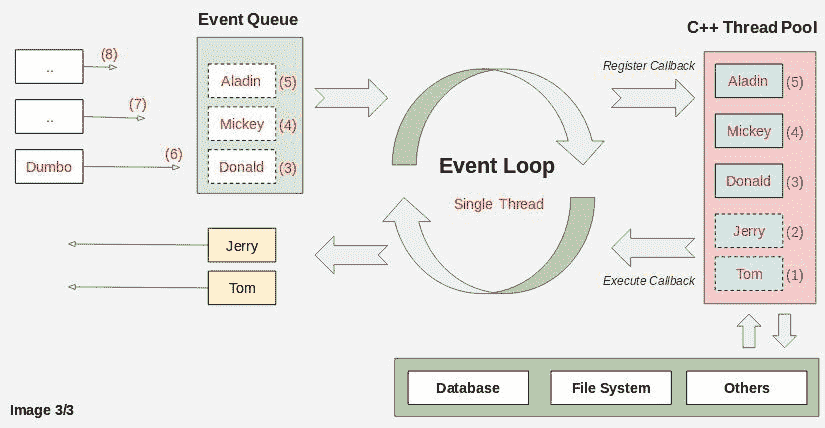 |

## 结论

第一个基本结论：如果每个连接都打开一个线程。这将消耗大量的内存。当你比较 Apache 和 Nginx（两个部署 PHP 程序的 Web 服务器）时，这一点得到了证明。

NodeJS 与 Nginx 的相似之处在于，它们都只使用单个线程接收来自用户的连接，并将用户的每个请求视为一个事件。

第二个基本结论：I/O 活动消耗了系统大量的资源，因此 NodeJS 严格管理着 I/O 活动的使用。所以，在执行与 I/O 相关的任务时，你只需要使用 `Callback`。

# 第 10 章：NodeJS EventEmitter

NodeJS 非常完美地支持应用程序中的事件。计算机上的每一个动作都是一个事件。例如，当你从硬盘上读取文件时。这意味着你在完成读取后必须执行“打开文件”和“关闭文件”这两个动作，因此这里有两个“Open”（打开）和“Close”（关闭）事件。基于事件，你可以插入代码执行某些操作。

```javascript
var fs = require('fs'); // 创建一个流来读取文件
var rs = fs.createReadStream('C:/test/demo.txt'); // 'open' 事件：
rs.on('open', function() {console.log('File opened!');});
```

模块事件为你提供了一个 `EventEmitter` 类，它是 NodeJS 中的一个核心类，辅助定义事件、注册该事件的监听器（Listeners）以及发射（emit）事件。

### 监听器 (Listener)

在 NodeJS 中，监听器是一个函数。当事件发生时，它会被调用并执行。可能某个此类事件绑定了 0、1 或多个监听器。

为了简单起见，请看下面的插图：一只老鼠和一个捕鼠夹。一个事件准备发生。当事件发生时（蛋糕被偷了），捕鼠夹将执行它的任务。这里的捕鼠夹就是“监听器”，它会在事件发生时工作。

### EventEmitter 示例

导入 `events` 模块并声明一个 `EventEmitter` 对象：

```javascript
// 导入 events 模块
var events = require('events');
// 创建一个 EventEmitter 对象
var eventEmitter = new events.EventEmitter();
```

注册监听器（当事件发生时，这些函数将被调用执行）。

```javascript
// 添加事件监听器
eventEmitter.addListener('bellRing', bellRingHandler1);
// 添加事件监听器
eventEmitter.addListener('bellRing', bellRingHandler2);
```

发射事件：

```javascript
// 触发 bellRing 事件!!
eventEmitter.emit('bellRing', 'Jerry');
```

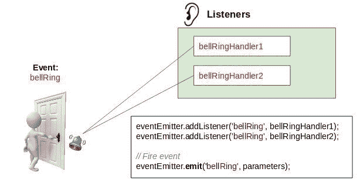

**first-example.js**

```javascript
// 导入 events 模块
var events = require('events');
// 创建一个 eventEmitter 对象
var eventEmitter = new events.EventEmitter();
// 一个监听器
var bellRingHandler1 = function bellRingHandler1(who) {
    console.log("\n");
    console.log('The Bell Ringing..... (Handler 1)');
    console.log(" " + who + " was standing behind the door!");
    if(who == 'Jerry') {
        console.log(' Tom, help me!!');
        return;
    }
    console.log(" Welcome " + who);
}
// 一个监听器
var bellRingHandler2 = function bellRingHandler2(who) {
    console.log("\n");
    console.log('The Bell Ringing..... (Handler 2)');
    eventEmitter.emit("nobodyIsAtHome");
}
// 一个监听器
var nobodyIsAtHomeHandler = function nobodyIsAtHomeHandler() {
    console.log("\n");
    console.log(" Sorry, Nobody is at home now, Please leave your message!")
}
// 添加事件监听器
eventEmitter.addListener('bellRing', bellRingHandler1);
eventEmitter.addListener('bellRing', bellRingHandler2);
eventEmitter.addListener('nobodyIsAtHome', nobodyIsAtHomeHandler);
// ----- 测试 ------
// 触发 bellRing 事件!!
eventEmitter.emit('bellRing', 'Jerry');
```

运行示例：

```bash
node eventemitter-examples/first-example.js
```

# 第 11 章：软件安装

1. 简介
2. Eclipse 安装
3. Jdk1.6 安装并配置到 Eclipse
4. Tomcat1.6 安装并配置到 Eclipse
5. MySql5.0 安装
6. Eclipse 字体大小增大

## 1. 简介

- 第一 → 我们将看到 → 软件安装与配置
- 第二 → 我们将看到 → 带插图的不同主题的详细解释

## 2. Eclipse 安装


第 1 步：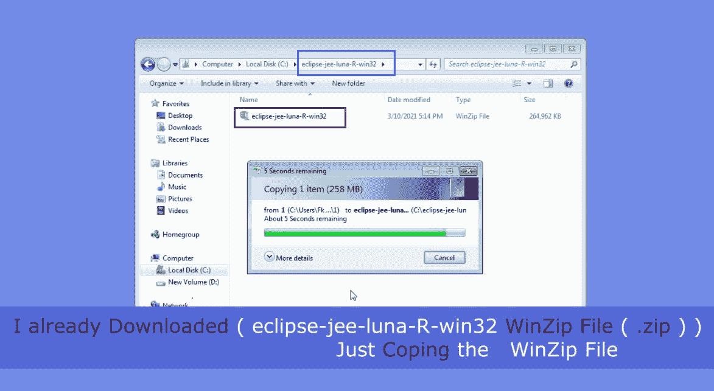

第 2 步：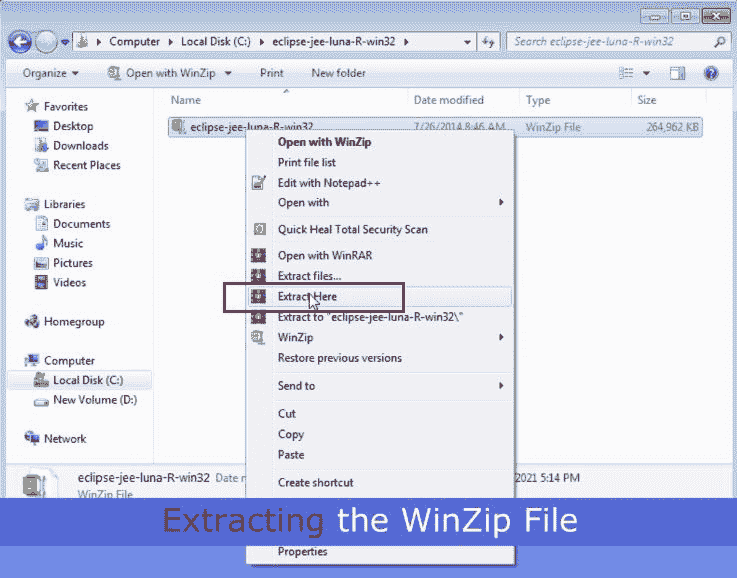

第 3 步：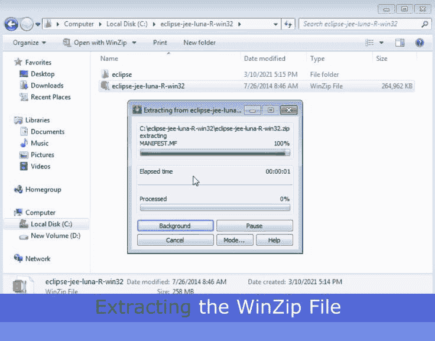

第 4 步：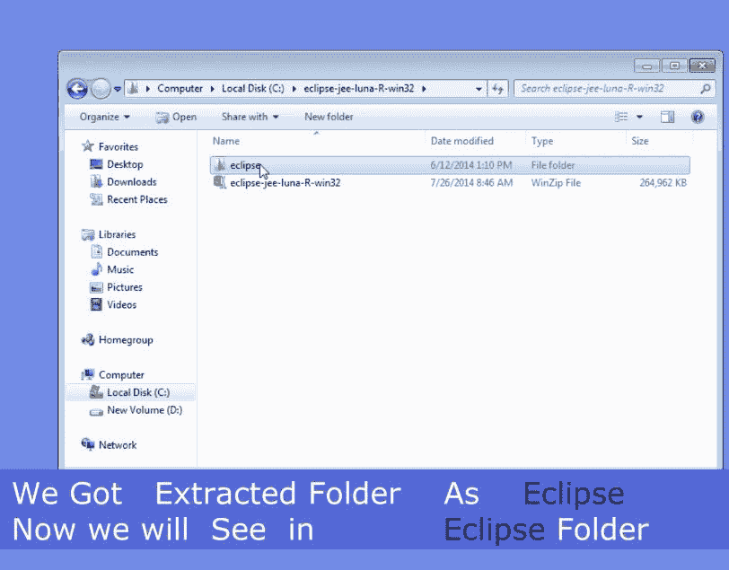

第 5 步：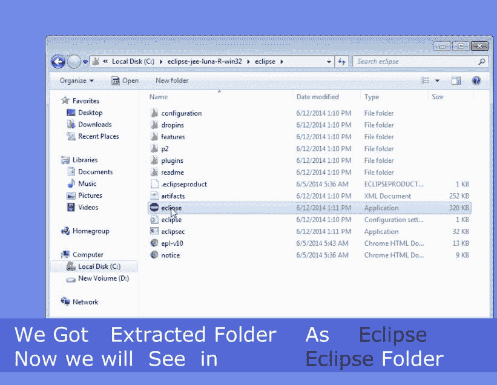

第 6 步：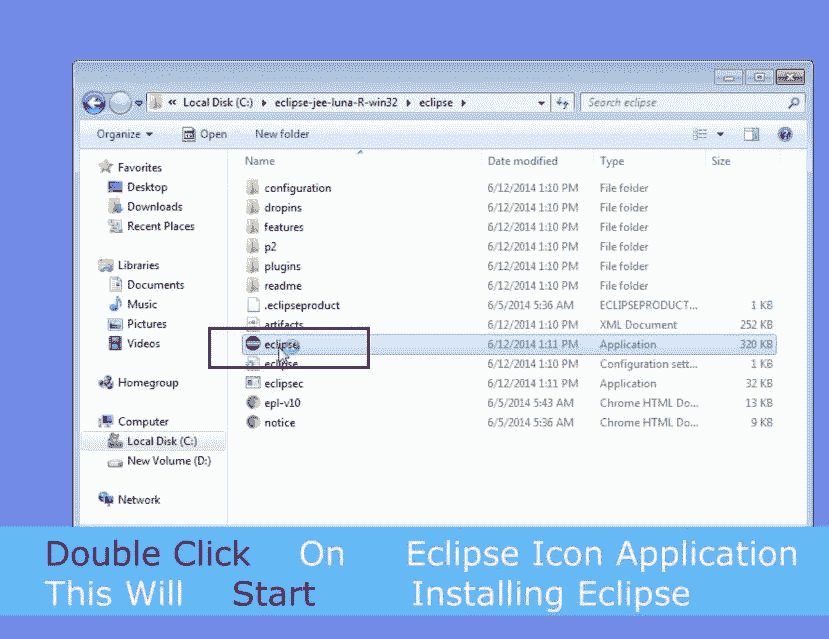

第 7 步：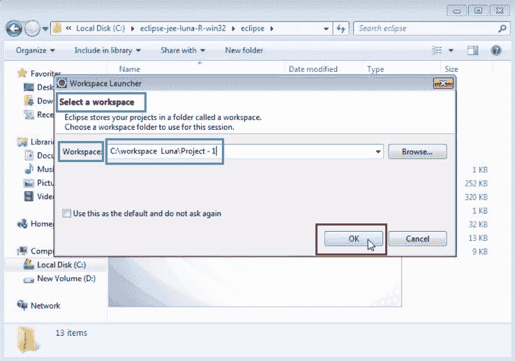

第 8 步：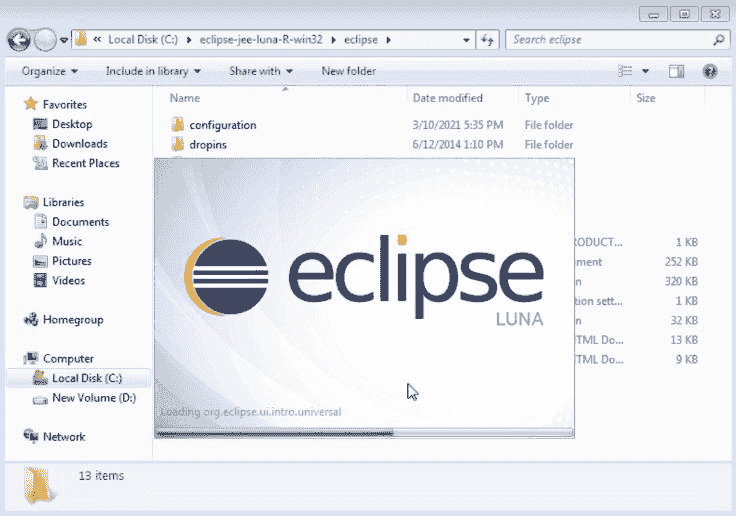

第 9 步：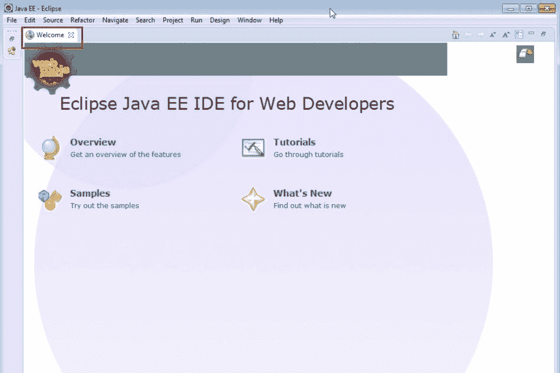

第 10 步：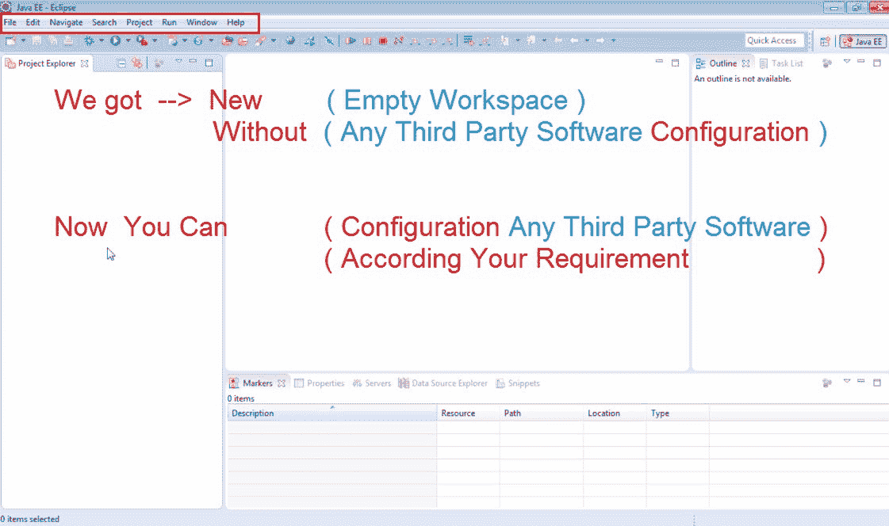

## 3. Jdk1.6 安装并配置到 Eclipse

第 1 步：

第 2 步：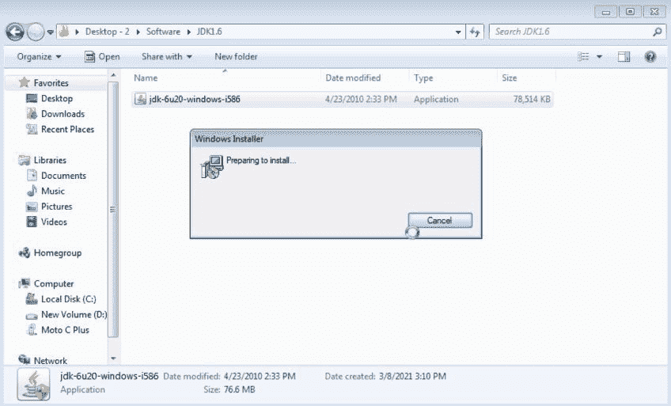

第 3 步：

第 4 步：

第 5 步：

第 6 步：

第 7 步：

第 8 步：

第 9 步：

第 10 步：

第 11 步：

第 12 步：

第 13 步：

第 14 步：

## 4. Tomcat1.6 安装并配置到 Eclipse

第 1 步：

第 2 步：

第 3 步：

第 4 步：

第 5 步：

第 6 步：

第 7 步：

第 8 步：

第 9 步：

第 10 步：

第 11 步：

第 12 步：

第 13 步：

第 14 步：

第 15 步：

第 16 步：

第 17 步：

第 18 步：

第 19 步：

第 20 步：

## 5. MySql5.0 安装

我们将学习安装步骤。

第 1 步：

第 2 步：

第 3 步：

第 4 步：

第 5 步：

第 6 步：

第 7 步：

第 8 步：

第 9 步：

第 10 步：

第 11 步：

第 12 步：

第 13 步：

第 14 步：

## 6. Eclipse 字体大小增大

第 1 步：

第 2 步：

第 3 步：

第 4 步：

第 5 步：

第 6 步：
