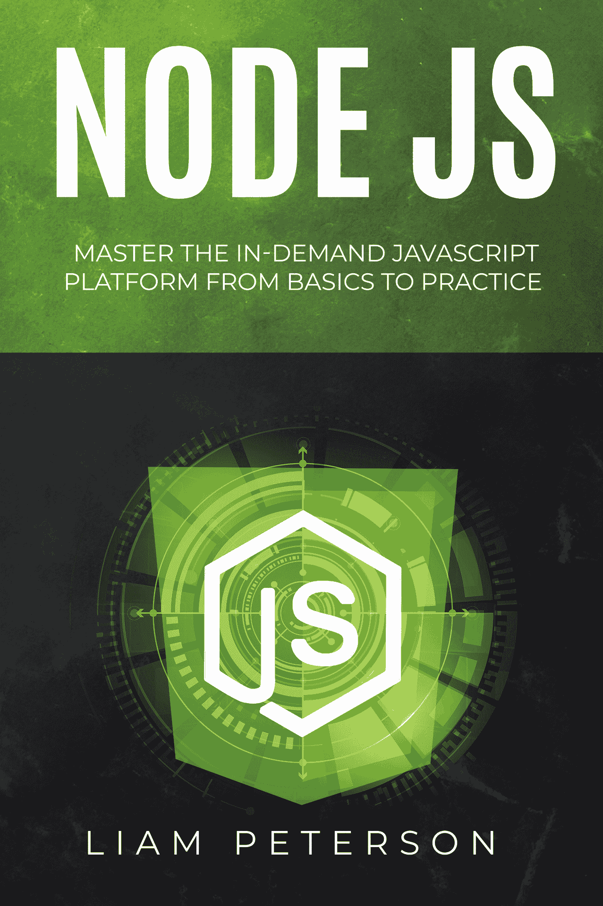

# Node JS：从基础到实践精通 JavaScript 平台





© Copyright 2024 - 版权所有。

未经出版商或作者书面许可，除美国版权法允许外，不得以任何形式复制本书的任何部分。

## 法律声明
本书受版权保护。本书仅供个人使用。未经作者同意，您不得修改、分发、销售、使用、引用或转述本书的任何部分或内容。

## 免责声明
本出版物旨在就其涵盖的主题提供准确且权威的信息。本书的销售基于一种共识：即作者和出版商均未提供法律、投资、会计或其他专业服务。虽然出版商和作者在准备本书时尽了最大努力，但他们对本书内容的准确性或完整性不作任何陈述或保证，并特别否认任何关于商品性或适用于特定用途的暗示保证。在适当的情况下，您咨询专业人士。

## 目录
- 引言与第一步
- 核心概念与基础
- 使用 Express.js
- 数据管理
- 身份验证与安全
- 高级特性
- 前端集成
- API 交互
- 真实世界应用与最佳实践
- 构建全栈应用的原理
- 持续实践

# 引言与第一步
Node.js 代表了 Web 开发的一次重大转变，其标志是非阻塞、事件驱动的架构，这使得开发者能够构建可扩展且高效的网络应用程序。它是一个用于服务器端执行 JavaScript 代码的开源、跨平台运行时环境，这一概念区别于仅在浏览器中运行 JavaScript 的传统方法。本章将深入探讨 Node.js 的本质、其核心哲学以及它如何与传统的 Web 服务器技术区分来。

从核心上说，Node.js 设计用于构建可扩展的网络应用程序。Node.js 的基本原理之一是使用了 `V8` JavaScript 引擎（与 Google Chrome 使用的运行时相同），使其能够利用现代 JavaScript 的性能和动态特性。Node.js 通过扩展 JavaScript 的功能，使其能够与文件系统交互、发送 HTTP 请求并管理进程——这些任务通常是服务器端语言预留的。

Node.js 的核心哲学围绕非阻塞、事件驱动架构展开。这意味着操作（特别是 I/O 操作）不会停止 Node.js 程序的执行。相反，这些操作是异步执行的，其结果通过回调函数、承诺（promises）或 `async/await` 语法处理。这种模型对于构建快速、可扩展的网络应用程序非常高效，因为它允许单个服务器在不需要多线程的情况下同时处理数千个连接。

Node.js 哲学的另一个关键方面是简单和极简主义。Node.js 核心保持小巧且轻量化，通过 Node 包管理器 (`NPM`) 提供了丰富的模块生态系统，允许开发者根据需要使用库和工具扩展功能。

## 与传统 Web 服务器技术的区别
传统的 Web 服务器技术（如 Apache HTTP Server 或微软的 Internet Information Services (`IIS`)）运行在多线程、阻塞模型上。每个客户端请求都会在服务器上产生一个新的线程或进程，消耗大量的内存和处理资源，特别是在并发连接数较高时。由于每个线程在继续之前都需要等待 I/O 操作完成，这种模型可能会导致效率低下和可扩展性问题。

相比之下，Node.js 引入了事件循环机制作为运行时结构，而不是依赖操作系统的基于线程的扩展。事件循环使 Node.js 能够执行非阻塞 I/O 操作——尽管 JavaScript 是单线程的——这是通过通过卸载通常会阻塞线程的操作（例如从网络读取数据或访问文件系统），并在操作完成后运行回调函数来实现。这种方法允许 Node.js 以很小的资源占用服务于大量连接，解决了传统 Web 服务器固有的可扩展性问题。

此外，Node.js 为客户端和服务器端脚本提供了统一的编程语言（JavaScript），这简化了开发，允许共享代码库，并在开发者之间进行快速的语境切换。这种凝聚的生态系统营造了一个环境，在这一环境中，应用程序可以更快速、更高效地开发，而无需在客户端和服务器端的不同语言之间进行逻辑转换。

## 事件驱动架构
事件驱动架构是支撑 Node.js 设计和运行的基础范式，使其与传统的同步编程模型区别开来。

从核心上说，事件驱动架构围绕“事件”的概念构建。在这种语境下，事件可以是任何对应用程序有意义的事项，例如文件读取操作的完成、收到新的网络请求或定时器过期。在事件驱动系统中，应用程序结构是围绕监听这些事件并使用事件处理程序或回调函数对其做出响应构建的。

Node.js 通过事件循环利用这种架构，事件循环是一种设计模式，用于等待和分发程序中的事件或消息。事件循环持续运行以检查事件，并通过执行与每个事件关联的回调函数来处理它们。

### 对 I/O 操作的优势
事件驱动模型为 I/O 操作提供了多种优势，这对于 Web 服务器和网络应用程序的至关重要：

*   **非阻塞 I/O**：在传统的阻塞 I/O 模型中，线程可能会空闲地等待 I/O 操作完成才能继续。相比之下，Node.js 的事件驱动、非阻塞 I/O 模型允许事件循环在等待 I/O 操作完成的同时继续执行其他任务。这是通过尽可能将操作卸载到系统内核，并在这些操作完成后注册回调来实现的，从而阻塞主线程。
*   **可扩展性**：由于其非阻塞本质，事件驱动模型在本质上比传统的线程模型更具可扩展性。它允许单个服务器进程同时处理大量连接，有效地利用了系统资源。这对于需要高并发和高吞吐量的应用程序（例如实时应用和 API）特别有利。
*   **简化的编程模型**：通过使用事件和回调，Node.js 应用程序处理异步操作方面有一个一致且简化的编程模型。这减少了直接管理线程的复杂性，并防止了常见的死锁和竞态条件问题。
*   **高效的资源利用**：Node.js 应用程序通常比传统的线程应用程序消耗更资源，因为消除了线程间切换的开销。这种资源的有效利用使得 I/O 密集型应用程序具有更低的延迟和更高的吞吐量。

## 事件循环实战


事件循环是 Node.js 事件驱动架构的核心。它循环遍历一系列阶段，每个阶段负责不同类型的事件。例如，它会检查计时器以查看是否有任何计划的回调需要执行，处理待处理的 I/O 事件，并处理异步 I/O 回调。这个循环确保了应用程序的响应性，因为它可以在任务之间快速切换，而不会被阻塞操作所困扰。

# 设置你的环境

设置一个合适的开发环境是开启 Node.js 之之旅的关键第一步。它确保你拥有所有必要的工具和配置，以便高效地开始构建应用程序。

## 第 1 步：安装 Node.js

1.1. 下载 Node.js：访问 Node.js 官方网站下载安装程序。你会发现有两个版本供下载：长期支持（LTS）版本，由于其稳定性和扩展支持，推荐大多数用户使用；以及当前（Current）版本，它包含了最新功能。

1.2. 运行安装程序：下载完成后，运行安装程序。按照安装提示操作，它们将引导你完成在系统上设置 Node.js 的。这包括同意许可协议、选择安装文件夹以及选择要安装的组件（通常使用提供的默认设置是安全的）。

1.3. 验证安装：为了确保 Node.js 安装正确，打开你的终端（Windows 上的命令提示符，macOS 和 Linux 终端）并输入：

```
node -v
```

此命令将显示已安装的 Node.js 版本，确认 Node.js 已准备就绪。

## 第 2 步：配置 Node 包管理器 (NPM)

NPM 是 Node.js 的默认包管理器，允许为你项目安装和管理库以及依赖项。

2.1. 验证 NPM 安装：NPM 随 Node.js 自动安装。要验证其安装，请在终端中输入以下命令：

```bash
npm -v
```

这将显示已安装的 `NPM` 版本，表示它已准备可用。

2.2. 设置 NPM：虽然 `NPM` 开箱即用，但你可能需要根据项目需求配置某些设置（如默认目录、代理设置）。对于大多数用户来说，默认配置已足够开始。

## 第 3 步：安装代码编辑器

一个良好的代码编辑器可以显著提高你的编码效率。目前有多种优秀的编辑器非常适合 Node.js 开发。

3.1. 选择代码编辑器：流行的选择包括 Visual Studio Code (VS Code)、Atom 和 Sublime Text。特别是 VS Code，它为 Node.js 开发提供了强大的支持，具有如 IntelliSense、调试和直接访问终端等功能。

3.2. 安装扩展：选择好编辑器后，考虑安装有助于 Node.js 开发的扩展或插件。对于 VS Code，像 "Node.js Extensions Pack" 这样的扩展会非常有帮助。

## 第 4 步：设置版本控制

版本控制对于管理代码库的更改、与他人协作以及维护项目开发历史至关重要。

4.1. 安装 Git：访问 Git 官方网站（`[git-scm.com](https://git-scm.com/)`）下载并安装 `Git`。在安装过程中，你可以接受默认设置，这些设置适用于大多数用户。

4.2. 配置 Git：打开终端并使用以下命令设置你的用户名和邮箱地址：

```bash
git config --global user.name "Your Name"
git config --global user.email "youremail@example.com"
```

这些设置对于 `Git` 跟踪谁做了哪些更改至关重要。

## 第 5 步：测试你的设置

现在你已经安装了 Node.js、NPM、代码编辑器和 Git，是时候通过创建一个简单的 Node.js 应用程序来测试你的设置了。

5.1. 创建测试文件：在你的代码编辑器中，创建一个名为 `app.js` 的新文件。添加以下代码：

```javascript
console.log('Hello, Node.js!');
```

5.2. 运行你的应用程序：打开终端，导航到包含 `app.js` 的目录，并运行：

```bash
node app.js
```

如果你看到控制台打印 "Hello, Node.js!"，恭喜你！你成功建立了 Node.js 开发环境，并准备好开始构建应用程序了。

# 你的第一个 Node.js 代码

Node.js 开发之旅从构建和运行你的第一个应用程序开始。这段经历不仅巩固了你的设置，还让你了解了 Node.js 创建服务器端应用程序的简单与强大。

## 第 1 步：创建你的项目目录

1.1. 首先，在你的计算机上创建一个新目录用于存储你的 Node.js 项目。你可以随心所欲地命名这个目录，例如 `node_projects`。

1.2. 打开终端或命令提示符，导航到新创建的目录，并为第一个项目创建一个子目录。让我们把项目命名为 `hello_node`：

```bash
mkdir hello_node
cd hello_node
```

## 第 2 步：初始化你的 Node.js 项目

2.1. 在 `hello_node` 目录内，运行以下命令初始化一个新的 Node.js 项目：

```bash
npm init -y
```

此命令会在项目目录中创建一个带有默认值的 `package.json` 文件。`package.json` 文件至关重要，因为它包含了关于项目的元数据并列出了它的依赖项。

## 第 3 步：编写你的第一个 Node.js 应用程序

3.1. 使用你喜欢的代码编辑器，在 `hello_node` 目录中创建一个名为 `app.js` 的新文件。

3.2. 打开 `app.js` 并添加以下代码，这将创建一个访问时响应 "Hello, Node.js!" 的服务器：

```javascript
const http = require('http');
const server = http.createServer((req, res) => {
  res.statusCode = 200;
  res.setHeader('Content-Type', 'text/plain');
  res.end('Hello, Node.js!');
});

const port = 3000;
const hostname = '127.0.0.1';
server.listen(port, hostname, () => {
  console.log(`Server running at http://${hostname}:${port}/`);
});
```

这段代码执行了：

* 导入了 `http` 模块，它是 Node.js 内置的允许你创建 HTTP 服务器。
* 使用 `http.createServer()` 方法创建一个监听请求的新型服务器。
* 指定了 `port` 和 `hostname`。在此情况下，服务器运行在你本地的 `127.0.0.1:3000` 上。
* 调用 `server.listen()` 启动服务器并监听连接。

## 第 4 步：运行你的应用程序

4.1. 返回终端，确保你仍处于 `hello_node` 项目目录下，并运行以下命令启动应用程序：

```bash
node app.js
```

4.2. 你应该终端中看到一条消息：Server running at http://127.0.0.1:3000/。这表示你的服务器正在运行并准备好接受请求。

## 第 5 步：访问你的应用程序

5.1. 打开浏览器并导航到 `http://127.0.0.1:3000/`。你应该能在浏览器中看到 "Hello, Node.js!"。这个响应直接来自你的 Node.js 应用程序。

5.2. 恭喜你！你成功创建并运行了第一个 Node.js 应用程序。这个简单的服务器只是开始，但它说明了创建项目、编写服务器端代码以及为客户端响应的基本原理。

# 核心概念与基础

全局对象与 Node.js 模块

在 Node.js 领域，理解全局对象和模块化架构是开发者构建高效可扩展应用程序的基础。

Node.js 中的全局对象

与浏览器的 JavaScript 环境中的 window 对象类似，Node.js 有一个作为顶层命名空间的全局对象。该对象提供了 Node.js 应用中所有模块均可使用的全局变量和函数。

全局对象的主要特性：


- **全局可访问**：全局对象的属性可以从 Node.js 应用程序任何部分访问，使其成为存储全局变量和工具函数的方便位置。
- **预定义全局对象**：Node.js 在 `global` 对象中预填充了几个内置对象和函数，例如 `Buffer`、`console` 和 `setTimeout`，这些对于各种应用程序功能至关重要。

### 使用示例：

```javascript
// 定义一个全局变量
global.myGlobalVar = 'This is a global variable';

// 在另一个模块中访问全局变量
console.log(myGlobalVar); // 输出: This is a global variable
```

然而，过度使用 `global` 对象可能会导致潜在的冲突和维护问题。通常建议节制使用它，优先使用局部作用域或模块导出来共享变量和函数。

## Node.js 中的模块化架构

Node.js 采用模块化架构，允许开发者将代码组织成可重用的部分，称为模块。Node.js 中的模块可以是一个文件，也可以是一个脚本目录，它们封装了特定的功能，使得代码的维护和共享变得简单。

### 核心概念：

- **核心模块**：Node.js 提供了内置模块，涵盖了从文件系统操作（`fs`）到网络（`http` 和 `net`）各种功能。
- **自定义模块**：开发者可以创建自己的模块来封装并结构化应用程序逻辑。

### 创建和使用自定义模块：

定义模块：创建一个名为 `myModule.js` 的文件，定义一个函数并使用 `module.exports` 导出它。

```javascript
// myModule.js
function sayHello(name) {
  console.log(`Hello, ${name}!`);
}

module.exports = sayHello;
```

导入并使用模块：在另一个文件中，使用 `require` 函数导入 `myModule.js` 并使用导出的函数。

```javascript
// app.js
const sayHello = require('./myModule');
sayHello('Node.js User'); // 输出: Hello, Node.js User!
```

### 模块化架构的优势：

- **扩展性**：通过将应用程序分成更小的、相互依赖的模块，开发者可以轻松扩展和管理复杂的应用程序。
- **可重用性**：模块可以在应用程序的不同部分甚至其他应用程序中重用，减少冗余。
- **封装性**：Node.js 中的每个模块都可以有自己的依赖项，并与全局作用域封装，这有助于避免命名冲突并提高代码清晰度。

## 处理数据流

Node.js 中的流（Streams）是其功能的核心部分，能够对数据流进行高效的处理和操作。这一概念对于处理海量数据或处理随时间分分块到达的数据（例如文件、网络请求或任何其他 I/O 操作）至关重要。

本质上，Node.js 中的流是允许你以连续方式从源读取数据或向目标写入数据的对象。在 Node.js 中，流是 `EventEmitter` 的实例，允许它们在流生命期的关键点触发事件，例如当新数据到达或流被完全消费完毕时。

### 流的类型

1. **可读流 (Readable Streams)**：这些可以从中读取数据的流。示例源包括从文件系统读取文件或从 HTTP 响应中读取数据。
2. **可写流 (Writable Streams)**：这些流允许将数据写入其中。示例包括将数据写入文件或作为 HTTP 请求发送数据。
3. **双工流 (Duplex Streams)**：双工流既是可读的也是写的。TCP socket 就是一个示例，因为它允许数据同时被读取和被写入。
4. **变换流 (Transform Streams)**：这是双工流的一种，输出是从输入计算得出的。示例包括压缩流（`gzip`）或加密流。

### 使用流的优势：

- **效率**：流允许在数据到达时进行处理，这意味着你不需要等待所有数据就绪即可开始处理。这对于海量数据特别有用。
- **资源友好**：由于流不需要将大量数据加载到内存中，它们有助于构建内存密集较低的应用程序。
- **组合性**：流可以 `piped` 连接在一起，允许一个流的输出作为另一个流的输入，从而便于数据处理流水线的创建。

## 使用流处理数据

### 使用可读流读取数据：

以下示例演示了如何从可读流读取数据，特别是从文件系统读取文件：

```javascript
const fs = require('fs');
const readStream = fs.createReadStream('./largefile.txt', 'utf8');

readStream.on('data', (chunk) => {
  console.log(chunk);
});

readStream.on('end', () => {
  console.log('Finished reading the file.');
});
```

### 使用可写流写入数据：

这里是如何使用可写流向文件写入数据：

```javascript
const fs = require('fs');
const writeStream = fs.createWriteStream('./output.txt');

writeStream.write('Hello, this is a sample text.', 'UTF8');
writeStream.end();

writeStream.on('finish', () => {
  console.log('Finished writing to the file.');
});
```

### 管道流 (Piping Streams)：

管道是一种将一个流的输出直接连接到另一个流的输入的机制。它通常用于数据转换：

```javascript
const 贯贯 = require('fs');
const zlib = require('zlib');
const readStream = fs.createReadStream('./largefile.txt');
const gzip = zlib.createGzip();
const writeStream = fs.createWriteStream('./largefile.txt.gz');

readStream.pipe(gzip).pipe(writeStream);
```


对于处理大文件或实时数据处理，Node.js 流（streams）提供了一种更高效的方法来读取和写入文件。流允许分块处理数据，而无需将整个文件加载到内存中。

### 使用流读取文件

```javascript
const fs = require('fs');
const readStream = fs.createReadStream('largefile.txt', 'utf8');

readStream.on('data', (chunk) => {
  console.log('New chunk received:');
  console.log(chunk);
});
```

### 使用流写入文件

```javascript
const fs = require('fs');
const writeStream = fs.createWriteStream('output.txt');

writeStream.write('Hello, ');
writeStream.write('World!');
writeStream.end();
```

这些示例展示了如何使用流分块读取和写入文件，这对于大文件或在与其他源之间传输流式数据特别有用。

# Node.js 应用的故障排除与调试最佳实践

错误处理和调试是开发健壮的 Node.js 应用的关键环节。在这些领域采取有效策略不仅有助于更高效地识别和纠正错误，还能增强应用的复原性和可靠性。

## 理解 Node.js 中的错误处理

Node.js 应用可能会遇到两类错误：运行时错误（operational errors）和程序员错误（programmer errors）。运行时错误是正常运行的一部分（例如连接数据库失败），而程序员错误是代码中需要修复的 Bug（例如尝试读取 `undefined` 的属性）。

### 错误处理最佳实践

### 对同步代码使用 try-catch
将可能抛出异常的同步代码块封装在 `try-catch` 语句中，以便优雅地处理异常。

```javascript
try {
  const data = JSON.parse(someInput);
} catch (e) {
  console.error('Failed to parse input:', e);
}
```

### 利用回调函数处理异步错误
Node.js 遵循错误优先回调模式（error-first callback pattern）来处理异步操作中的错误，回调函数的第一个参数留给错误对象。

```javascript
fs.readFile('somefile.txt', 'utf8', (err, data) => {
  if (err) {
    return console.error('Error reading file:', err);
  }
  console.log(data);
});
```

### Promises 和 Async/Await
使用配合 promise 的 `catch` 块或配合 `async/await` 的 `try-catch` 来更简洁地处理异步错误。

```javascript
async function readFileAsync() {
  try {
    const data = await fs.promises.readFile('somefile.txt', 'utf8');
    console.log(data);
  } catch (e) {
    console.error('Error reading file:', e);
  }
}
```

### 中心化错误处理
实现中心化的错误处理机制（例如 Express 应用中的中间件），以便在单处管理错误。

## 调试 Node.js 应用

调试是识别应用问题根源的必备技能。Node.js 提供了多种调试工具和技术。

### 调试技术

1. **日志记录 (Logging)**：使用 `console.log()`、`console.error()` 以及其他控制方法向终端输出调试信息。使用 `Winston` 或 `Bunyan` 等库进行结构化日志可以提供更多的控制和灵活性。
2. **Node.js 调试器**：Node.js 自带一个调试器，可以通过运行 `node inspect script.js` 从 Node.js CLI 访问。调试器允许你设置断点、单步执行并检查变量。
3. **Visual Studio Code 调试器**：Visual Studio Code (`VSCode`) 为 Node.js 提供了集成式调试器，为设置断点、检查变量和导航调用堆栈提供了强大的界面。
4. **Chrome DevTools**：通过带有 `--inspect` 标志运行 Node.js 应用（例如 `node --inspect script.js`），你可以将 Chrome DevTools 挂载到 Node.js 进程上，提供一个熟悉且强大的调试界面。
5. **使用 debug 模块**：`debug` 模块允许你在不重启进程的情况下，切换应用不同部分的调试日志。

```javascript
const debug = require('debug')('app:startup');
//可以通过设置 DEBUG 环境变量来启用调试输出
// 例如：DEBUG=app:startup node app.js
debug('Starting the application...');
```

# 使用 Express.js

Express.js 是一个极简且灵活的 Node.js Web 应用框架，提供了一套健壮的功能，用于高效开发 Web 和移动应用。它简化了服务器的创建过程，而这一过程在原生 Node.js 中是复杂且繁琐的。

Express.js 的设计旨在便于 Web 应用和 API 的快速开发。它将 Node.js 的核心 HTTP 功能封装在更易用、灵活的 API 中，允许开发者专注于编写应用代码，而不是深究处理 HTTP 请求和响应的底层细节。

## Express.js 的核心特性

* **简单性 (Simplicity)**：Express.js 简化了使用 Node.js 构建服务端应用的过程。
* **中间件支持 (Middleware Support)**：它提供了一个强大的中间件框架，通过函数序列处理请求，实现解析请求体、处理 Cookie 和管理 Session 等任务。
* **路由 (Routing)**：Express.js 提供了健壮的路由 API，允许为不同 URL 路径下的各种 HTTP 方法定义路由处理器，支持简单和复杂的路由。
* **性能 (Performance)**：作为一个极简的框架，Express.js 是为性能而设计的。

## 开始使用 Express.js

要开始使用 Express.js 开发，你首先需要设置一个 Node.js 项目并安装 Express.js。

### 安装

1. **初始化 Node.js 项目**：首先设置一个 Node.js 项目并安装 Express.js。
2. **安装 Express.js**：在项目目录下运行 `npm install express`。

### 创建基础的 Express.js 服务器

### 创建基础的 Express.js 服务器

以下是如何创建一个响应 HTTP 请求的简单 Express.js 服务器：

```javascript
const express = require('express');
const app = express();
const port = 3000;

app.get('/', (req, res) => {
  res.send('Hello, Express.js!');
});

app.listen(port, () => {
  console.log(`示例应用运行在 http://localhost:${port}`);
});
```

此代码段演示了使用 Express.js 创建基础服务器的简单性。`app.get` 方法为根路径 (`/`) 的 GET 请求定义了一个路由处理器，向客户端发送响应。

## Web 开发中的 Express.js

得益于简单性、灵性和丰富的生态系统，Express.js 是许多 Web 应用和 API 的核心。它与其他 Node.js 库和工具无缝集成，是开发者构建健壮且可扩展 Web 应用的热选。

### Web 开发中的主要优势

* **快速开发**：使用 Express.js，开发者设置服务器和 API 比使用原生 Node.js 快得多。
* **可扩展性**：Express.js 应用可以轻松地进行垂直和水平扩展，以适应增长的流量。
* **社区与生态系统**：庞大的活跃社区支持 Express.js，提供了大量的资源、中间件和工具来扩展其功能。

## 使用 Express.js 创建基础 Web 服务器

创建一个基础 Web 服务器是 Web 开发的一项基础技能，而作为 Node.js 框架的 Express.js 显著简化了这一过程。Express.js 抽象了设置服务器所需的大部分模板代码，让开发者专注于实现 Web 应用的具体功能。

### 第 1 步：初始化 Node.js 项目

在深入学习 Express.js 之前，你需要设置一个 Node.js 项目环境。首先为项目创建一个新目录并使用 Node.js 进行初始化：


# 第一步：初始化项目

1. `mkdir myExpressApp`
2. `cd myExpressApp`
3. `npm init -y`

这一系列命令会创建一个新目录，进入该目录，并使用 `-y` 标志跳过问答，初始化一个带有默认 `package.json` 文件的新 Node.js 项目。

# 第二步：安装 Express.js

在初始化你的 Node.js 项目后，下一步是安装 Express.js。在你的项目目录中执行以下命令：

1. `npm install express`

此命令将 Express.js 添加到你的项目依赖中，使其可以在你的应用程序中使用。

# 第三步：创建服务器文件

现在，在你的项目目录中创建一个名为 `server.js` 的文件（或你喜欢的任何其他名称）。该文件将包含设置 Express.js 服务器的代码。

# 第四步：设置基础 Web 服务器

在文本编辑器中打开 `server.js`，并开始引入 Express.js 模块。然后，使用它创建一个 Express 应用程序。最后，定义一个路由并在特定端口启动服务器：

```javascript
const express = require('express');
const app = express();
const port = 3000;

// 为根 URL 定义路由
app.get('/', (req, res) => {
  res.send('Hello, World!');
});

// 启动服务器
app.listen(port, () => {
  console.log(`Server running at http://localhost:${port}`);
});
```

### 代码解释：

- `const express = require('express');`: 这一行导入了 Express.js 模块。
- `const app = express();`: 创建一个 Express 应用程序的实例。
- `app.get('/', ...`: 为对根 URL (`/`) 的 GET 请求定义路由处理程序。当访问此路由时，服务器将响应 "Hello, World!"。
- `app.listen(port, ...`: 启动服务器并在指定的端口监听连接，在服务器运行后向控制台打印一条消息。

# 第五步：运行你的服务器

要运行你的服务器，请打开终端，导航到你的项目目录，并执行以下命令：

1. `node server.js`

你的服务器将启动，你应该能在控制台看到看到“Server running at http://localhost:3000”的消息。现在你可以打开 浏览器并导航到 `http://localhost:3000` 来查看你的服务器响应“Hello, World!”。

# 路由与中间件

路由和中间件是 Express.js Web 开发中两个基本的概念。它们协同工作，将传入的请求引导到适当的处理器，并对请求和响应应用处理步骤。本章将深入探讨 Express.js 的路由机制，并探索如何使用中间件来增强请求处理。

## 理解 Express.js 中的路由

路由是指应用程序如何响应客户端对特定端点的请求，该端点是一个 URI（或路径）和一个特定的 HTTP 请求方法（GET、POST 等）。每个路由可以有一个一个或多个处理函数，这些函数会在路由匹配时被执行。

### 基础路由

Express.js 中的路由非常直观。使用应用程序实例 (`app`) 来定义路由。这里有一个简单的示例：

```javascript
const express = require('express');
const app = express();
const port = 3000;

// 响应对根路由的 GET 请求
app.get('/', (req, res) => {
  res.send('Home Page');
});

// 响应对 /about 路由的 GET 请求
app.get('/about', (req, res) => {
  res.send('About Page');
});

app.listen(port, () => console.log(`Server running on port ${port}`));
```

此代码设置了一个 Express.js 服务器，它对根路由 (`/`) 和 `/about` 路由的 GET 请求响应简单的文本消息。

## Express.js 中的中间件

中间件函数是能够访问请求对象 (`req`)、响应对象 (`res`) 以及应用程序请求-响应周期中下一个中间件函数的函数。这些函数可以执行任何代码、修改请求和响应对象、结束请求-响应周期或调用下一个中间件函数。

中间件用于广泛的用途，从记录日志、解析请求体到身份验证用户。

### 使用中间件

```javascript
const express = require('express');
const app = express();

// 简单的日志中间件
app.use((req, res, next) => {
  console.log(`${req.method} request for ${req.url}`);
  next(); // 调用下一个中间件或路由处理程序
});

app.get('/', (req, res) => {
  res.send('Home Page');
});

app.get('/about', (req, res) => {
  res.send('About Page');
});

app.listen(3000, () => console.log('Server running on port 3000'));
```

在这个示例中，`app.use()` 被用于注册一个中间件函数，记录每个请求的 HTTP 方法和 URL。中间件中的 `next()` 调用至关重要，因为它将控制权传递给栈中的下一个中间件函数。

### Express.js 中的中间件类型

有几种类型的中间件可以使用：

- **应用级中间件**：通过 `app.use()` 或特定路由注册。
- **路由级中间件**：类似于应用级中间件，但绑定到 `express.Router()` 实例上。
- **错误处理中间件**：用四个参数定义。
- **内置中间件**：Express 自带了一些中间件，如用于提供静态文件的 `express.static`。
- **第三方中间件**：通过 `npm` 安装并在应用中引入它们。

# 使用 Node.js 和 Express 创建 RESTful 服务

构建 RESTful API 是现代 Web 开发中的一项关键技能。Node.js 配合 Express.js 为构建此类 API 提供了一个强大且高效的平台。RESTful API 遵循某些原则，使其简单直观：

- **无状态**：客户端向服务器的每个请求必须包含理解和满足请求所需的信息。服务器不会存储客户端的任何状态。
- **统一接口**：API 为资源提供统一接口，通常以 URI 的形式存在。使用 HTTP 方法（GET、POST、PUT、DELETE）操作这些资源。
- **基于资源**：在 REST 中，数据和功能被视为资源并通过 URI 访问。

## 设置你的项目

在编写代码之前，初始化一个新的 Node.js 项目并安装 Express.js：

1. `mkdir myApi`
2. `cd myApi`
3. `npm init -y`
4. `npm install express`

## 使用 Express.js 创建简单的 RESTful API

下面的示例演示了如何为简单资源（例如用户）设置具有 CRUD（创建、读取、更新、删除）操作的基础 RESTful API。

### 初始化你的 Express 应用程序

创建一个名为 `app.js` 的文件并设置基础 Express 应用程序：

```javascript
const express = require('express');
const app = express();
const port = 3000;

app.use(express.json()); // 解析 JSON 体的中间件

app.listen(port, () => {
  console.log(`RESTful API server started on: http://localhost:${port}`);
});
```

### 为 CRUD 操作定义路由

为了简单起见，此示例使用内存数组来存储用户。在真实世界的场景中，你可能会使用数据库。

```javascript
let users = [{ id: 1, name: 'John Doe' }]; // 示例用户

// GET: 获取所有用户
app.get('/users', (req, res) => {
  res.json(users);
});

// POST: 创建新用户
app.post('/users', (req, res) => {
```


```javascript
10. const newUser = { id: users.length + 1, name: req.body.name };

11. users.push(newUser);

12. res.status(201).json(newUser);

13. });

15. PUT: 更新现有用户

16. app.put('/users/:id', (req, res) => {
17. let user = users.find(u => u.id === parseInt(req.params.id));
18. if (!user) return res.status(404).send('User not found.');
19. user.name = req.body.name;
20. res.json(user);
21. });

23. DELETE: 删除用户

24. app.delete('/users/:id', (req, res) => {
25. users = users.filter(u => u.id !== parseInt(req.params.id));
26. res.status(204).send();
27. });
```

这段代码段演示了如何通过处理不同的 HTTP 方法来对用户资源执行 CRUD 操作。注意使用 `req.params` 来访问 URL 参数，并使用 `req.body` 来访问请求体。

### 测试你的 API

你可以使用 Postman 或 cURL 等工具来测试你的 API。以下是使用 cURL 调用 API 的示例：

### GET /users:

1. `curl http://localhost:3000/users`

### POST /users (创建新用户):

1. `curl -X POST -H "Content-Type: application/json" -d '{"name":"Jane Doe"}' http://localhost:3000/users`

### PUT /users/1 (更新 ID 为 1 的用户):

1. `curl -X PUT -H "Content-Type: application/json" -d '{"name":"John Smith"}' http://localhost:3000/users/1`

### DELETE /users/1 (删除 ID 为 1 的用户):

1. `curl -X DELETE http://localhost:3000/users/1`

# 数据管理

将数据库集成到 Node.js 应用中是开发功能全 Web 应用的关键步骤。Node.js 提供非阻塞、事件驱动的架构，使其特别适用于高性能应用中的数据库交互。让我们探索将数据库集成到 Node.js 应用的不同选项，包括 SQL 和 NoSQL 数据库，并学习为你的应用选择合适数据库的指南。

## SQL 数据库

SQL 数据库（如 PostgreSQL、MySQL 和 SQLite）使用结构化查询语言 (SQL) 来定义和操作数据。这些数据库的特点是使用表存储数据，使其成为需要复杂查询和事务的应用良好选择。

### 将 PostgreSQL 集成到 Node.js:

要从 Node.js 应用连接到 PostgreSQL 数据库，可以使用 `pg` 模块。这是一个简单的示例：

### 安装 pg 模块:

1. `npm install pg`

### 使用 pg 连接到 PostgreSQL:

```javascript
const { Pool } = require('pg');
const pool = new Pool({
  user: 'yourUsername',
  host: 'localhost',
  database: 'mydatabase',
  password: 'yourPassword',
  port: 5432,
});

pool.query('SELECT NOW()', (err, res) => {
  console.log(err, res);
  pool.end();
});
```

这段代码创建了一个到 PostgreSQL 数据库的连接池，并执行简单的查询从数据库中检索当前时间。

## NoSQL 数据库

NoSQL 数据库（如 MongoDB 和 Redis）提供了比传统 SQL 数据库更灵活的模式。它们通常因为其扩展性以及处理海量数据或不适合表格的数据时的性能而被选中。

### 将 MongoDB 集成到 Node.js:

MongoDB 是现代 Web 应用流行的 NoSQL 数据库。`mongoose` 模块简化了在 Node.js 中与 MongoDB 操作。

### 安装 Mongoose:

1. `npm install mongoose`

### 连接 MongoDB 并定义模型:

```javascript
const mongoose = require('mongoose');
mongoose.connect('mongodb://localhost/mydatabase', { useNewUrlParser: true, useUnifiedTopology: true });

const User = mongoose.model('User', new mongoose.Schema({
  name: String,
  age: Number,
}));

// 使用 User 模型与数据库交互
const user = new User({ name: 'John Doe', age: 30 });
user.save().then(() => console.log('User saved'));
```

此示例连接到 MongoDB 数据库并定义了一个 `User` 模型来表示应用中的用户。然后它创建并保存了一个新用户到数据库中。

### 选择合适的数据库

为你的 Node.js 应用选择合适的数据库取决于几个因素：

- **数据结构**：如果你的数据是高度结构化的且需要复杂的查询，SQL 数据库可能更合适。对于更灵活的模式或水平扩展的需求，请考虑 NoSQL 选项。
- **可扩展性**：考虑你的数据将如何增长，并选择可以相应扩展的数据库，无论是通过垂直升级还是水平扩展。
- **社区与支持**：寻找具有强力社区支持和活跃开发的数据库，因为这对于解决问题和寻找资源是无价的。

## CRUD 操作：在 Node.js 应用中实现创建、读取、更新和删除操作

CRUD 代表创建（Create）、读取（Read）、更新（Update）和删除（Delete），是构成大多数 Web 应用骨石的基础操作。实现 CRUD 操作允许应用与数据库交互，以存储、检索、修改和删除数据。现在我们将关注如何在 Node.js 应用中实现这些操作。

### 设置项目

在执行 CRUD 操作之前，我们需要设置项目环境。

1. 创建项目目录并进入：`mkdir my-app && cd my-app`
2. 初始化项目：`npm init -y`
3. 安装依赖：`npm install express mongoose`

### 配置服务器

在 `server.js` 中配置基础 Express 服务器和 MongoDB 连接。

```javascript
const express = require('express');
const mongoose = require('mongoose');
const app = express();
const port = 3000;

app.use(express.json());

mongoose.connect('mongodb://localhost/mydatabase', {
  useNewUrlParser: true,
  useUnifiedTopology: true
}).then(() => console.log('Connected to MongoDB'))
 .catch(err => console.error('Could not connect to MongoDB', err));
```

### 创建 (C)

实现创建操作涉及向数据库中添加新文档。

```javascript
app.post('/users', async (req, res) => {
  const user = new User({
    name: req.body.name,
    age: req.body.age,
    email: req.body.email,
  });
  await user.save();
  res.send(user);
});
```

### 读取 (R)

读取操作可以分为获取所有文档和根据 ID 获取单个文档。

### 获取所有用户：

```javascript
app.get('/users', async (req, res) => {
  const users = await User.find();
  res.send(users);
});
```

### 根据 ID 获取用户：

```javascript
app.get('/users/:id', async (req, res) => {
  const user = await User.findById(req.params.id);
  if (!user) return res.status(404).send('User not found');
  res.send(user);
});
```

### 更新 (U)

更新文档需要识别要更新的文档并指定新值。

```javascript
app.put('/users/:id', async (req, res) => {
  const user = await User.findByIdAndUpdate(req.params.id, {
    name: req.body.name,
    age: req.body.age,
    email: req.body.email,
  }, { new: true }); // 返回更新后的文档

  if (!user) return res.status(404).send('User not found');
  res.send(user);
});
```

### 删除 (D)

删除操作涉及根据 ID 从数据库中移除文档。

```javascript
app.delete('/users/:id', async (req, res) => {
  const user = await User.findByIdAndRemove(req.params.id);
  if (!user) return res.status(404).send('User not found');
  res.send(user);
});
```


在 Web 开发领域，数据库技术的选择对 Web 应用的架构和性能起着至关重要的作用。NoSQL 数据库凭借其无模式（schema-less）的特性提供了灵活性和扩展性，使其成为许多现代应用的选择。MongoDB 作为领先的 NoSQL 数据库，其 Node.js 应用的易用性被广泛认可。现在我想讨论如何将 MongoDB 集成到 Node.js 应用中，并提供一份关于利用这对黄金组合特性的实用指南。

## MongoDB 简介

MongoDB 是一种面向文档的 NoSQL 数据库，旨在存储海量数据并轻松管理复杂的层级结构。它以灵活的类 JSON 文档存储数据，这意味着数据结构可以在不同文档之间变化，数据模型也可以随时间发生改变。这种模型为开发者提供了灵活性，可以在不受固定模式的情况下进化应用程序。

在将 MongoDB 与 Node.js 集成之前，请确保系统中已安装并运行了 MongoDB。MongoDB 提供了针对不同操作系统的多种安装选项，可以在其官方网站上找到。

## 将 MongoDB 集成到 Node.js

在 Node.js 应用中集成 MongoDB 通常涉及使用 Mongoose 库，它提供了一个简单、基于模式的解决方案来为你的应用数据建模。

### 1. 安装 Mongoose

首先在你的 Node.js 项目中安装 Mongoose：

```bash
npm install mongoose
```

### 2. 连接到 MongoDB

在你的 Node.js 应用中，引入 Mongoose 并连接到你的 MongoDB 数据库：

```javascript
const mongoose = require('mongoose');

mongoose.connect('mongodb://localhost/myapp', { useNewUrlParser: true, useUnifiedTopology: true })
  .then(() => console.log('Connected to MongoDB...'))
  .catch(err => console.error('Could not connect to MongoDB...', err));
```

### 3. 定义模型

使用 Mongoose，你可以使用 Schema 定义应用数据模型。这里有一个定义简单的 User（用户）模型的示例：

```javascript
const userSchema = new mongoose.Schema({
  name: { type: String, required: true },
  email: String,
  age: Number,
  createdAt: { type: Date, default: Date.now }
});

const User = mongoose.model('User', userSchema);
```

### 4. 执行 CRUD 操作

模型完成后，你可以执行 CRUD 操作。以下是每种操作的示例：

**创建：**

```javascript
async function createUser() {
  const user = new User({
    name: 'John Doe',
    email: 'john@example.com',
    age: 30
  });
  const result = await user.save();
  console.log(result);
}
```

**读取：**
```javascript
async function getUsers() {
  const users = await User.find();
  console.log(users);
}
```

**更新：**
```javascript
async function updateUser(id) {
  const user = await User.findByIdAndUpdate(id, {
    $set: { name: 'John Doe Jr.' }
  }, { new: true });
  console.log(user);
}
```

**删除：**
```javascript
async function deleteUser(id) {
  const result = await User.findByIdAndRemove(id);
  console.log(result);
}
```

## 数据验证与清洗

数据验证和清洗是开发安全可靠的 Web 应用的关键组成部分。它们确保了应用处理的数据的完整性和安全性，防止恶意输入破坏系统或导致非预期结果。我们将介绍数据验证和清洗的概念、其重要性以及它们在 Node.js 应用中的实现，并特别关注 Express.js 和流行中间件的使用。

### 理解数据验证与清洗

数据验证（Data Validation）是在处理输入数据之前，确保其符合预期格式和值的过程。这一步防止了格式错误的数据进入系统，这些数据可能会导致错误或引发安全漏洞。

数据清洗（Data Sanitization）更进一步，通过修改输入数据来确保其处理时是干净且安全的。这涉及剔除潜在有害的内容，例如脚本或 SQL 命令，这些内容可能被用于注入攻击。

### 在 Node.js 中实现数据验证与清洗

在 Node.js 应用中，特别是使用 Express.js 构建的应用，可以使用 `express-validator` 等中间件库来实现数据验证和清洗。

### 1. 安装 express-validator

首先将 `express-validator` 添加到你的项目中：

```bash
npm install express-validator
```

### 2. 使用 express-validator 进行验证和清洗

将 `express-validator` 整合到路由处理程序中以验证和清洗输入数据。这里是一个示例：

```javascript
const express = require('express');
const { body, validationResult } = require('express-validator');
const app = express();
app.use(express.json());

app.post('/register',
  // 验证并清洗 name 字段
  body('name').trim().isLength({ min: 2 }).escape(),
  // 验证 email 字段
  body('email').isEmail().normalizeEmail(),
  // 验证 age 字段
  body('age').isInt({ min: 0 }),
  (req, res) => {
    const errors = validationResult(req);
    if (!errors.isEmpty()) {
      return res.status(400).json({ errors: errors.array() });
    }
    // 处理经过验证和清洗的数据
    res.send('User registration successful');
  });
```

### 数据验证与清洗的最佳实践

- **验证并清洗所有输入**：确保用户或外部来源提供的每条数据都经过验证和清洗，包括查询参数、URL 参数。
- **使用白名单而非黑名单**：定义什么是允许的，而不是尝试阻止已知的模式，后者可能会被绕过。
- **提供清晰的错误信息**：当验证失败时，为用户提供清晰、简洁的错误信息，帮助他们修正输入，而不暴露过多底层逻辑。
- **保持验证逻辑一致**：在客户端和服务器端应用相同的验证规则。但永远不要只信任客户端验证，因为它可以被绕过。

# 身份验证与安全

在 Node.js 应用中实现身份验证是为了识别用户并对应用资源提供访问控制。身份验证策略决定了用户在交互应用之前如何通过验证。

基础身份验证（Basic authentication）是内置在 HTTP 协议中的简单验证方案。它将用户名和密码结合并 Base64 编码，并在每个请求的 Authorization Header 中发送。

虽然可以手动实现，但通常建议使用 `express-basic-auth` 等中间件来简化并提高安全性。

### 安装 express-basic-auth

```bash
npm install express-basic-auth
```

### 在应用中使用 express-basic-auth

```javascript
const express = require('express');
const basicAuth = require('express-basic-auth');

const app = express();

app.use(basicAuth({
  users: { 'admin': 'supersecret' }
}));

app.get('/protected', (req, res) => {
  res.send('You accessed a protected route!');
});

app.listen(3000, () => console.log('Server running on port 3000'));
```

在此示例中，使用 `express-basic-auth` 中间件来保护路由，需要提供用户名和密码。只有提供正确的凭据才能访问 `/protected` 路由。

基于令牌的身份验证 (JWT)


基于令牌的身份验证（特别是使用 JSON Web Tokens (JWT））是一种更安全、更灵活的用户身份验证方式。用户登录后，服务器会生成一个客户端可以在后续请求中使用的令牌。

### 实现 JWT 身份验证

安装 `jsonwebtoken`:

```bash
npm install jsonwebtoken
```

### 生成并验证令牌

```javascript
const express = require('express');
const jwt = require('jsonwebtoken');

const app = express();
app.use(express.json());

const users = [
  { id: 1, username: 'admin', password: 'admin' } // 示例用户
];

app.post('/login', (req, res) => {
  const username = req.body.username;
  const password = req.body.password;
  const user = users.find(u => u.username === username && u.password === password);
  if (user) {
    const token = jwt.sign({ id: user.id }, 'secretKey', { expiresIn: '1h' });
    res.json({ token });
  } else {
    res.status(401).send('Username or password incorrect');
  }
});

app.get('/protected', (req, res) => {
  const token = req.headers.authorization.split(' ')[1]; // Bearer <token>
  jwt.verify(token, 'secretKey', (err, decoded) => {
    if (err) return res.status(403).send('Failed to authenticate token.');
    res.send('You accessed a protected route!');
  });
});

app.listen(3000, () => console.log('Server running on port 3000'));
```

在此实现中，`/login` 路由为通过身份验证的用户生成 JWT，该令牌必须在 `Authorization` 头部提供才能访问 `/protected` 等受保护的路由。

### OAuth 与社交登录集成：启用社交媒体账户登录

OAuth 是一种标准的授权协议，允许第三方服务代表用户交换 Web 资源。社交登录是利用社交网络服务的现有信息的一种单点登录形式，它利用 OAuth 简化终端用户的登录，并为提供者保护流程安全。

OAuth 通过在 HTTPS 上访问令牌（access tokens），提供对用户数据的授权访问，而无需暴露其登录凭据。此机制支持适用于不同类型应用的各种授权流，包括 Web 应用、浏览器端应用和移动应用。

### 在 Node.js 中集成社交登录

在 Node.js 中实现 OAuth 和社交登录的一种流行方式是通过 Passport.js，它是一个灵活的身份验证中间件，支持多种策略，包括 Google、Facebook 和 Twitter 等社交登录。

### 为社交登录配置 Passport.js

1. 安装 Passport 和策略（Strategy）：

例如，要添加 Google OAuth 2.0 登录，你需要 `passport` 和 `passport-google-oauth20`：

```bash
npm install passport passport-google-oauth20
```

### 使用 Google 策略配置 Passport：

首先，你必须在 Google 开发者（Google Developers Console）创建一个项目，启用 Google+ API，并获取你的 `client ID` 和 `client secret`。

然后，配置 Passport 使用 Google OAuth 2.0 策略：

```javascript
const passport = require('passport');
const GoogleStrategy = require('passport-google-oauth20').Strategy;

passport.use(new GoogleStrategy({
    clientID: 'YOUR_CLIENT_ID',
  clientSecret: 'YOUR_CLIENT_SECRET',
  callbackURL: "http://yourdomain.com/auth/google/callback"
  },
  function(accessToken, refreshToken, profile, cb) {
    User.findOrCreate({ googleId: profile.id }, function (err, user) {
      return cb(err, user);
    });
  }
));
```

### 添加身份验证和回调的路由：

```javascript
const express = require('express');
const app = express();

app.get('/auth/google',
  passport.authenticate('google', { scope: ['profile'] }));

app.get('/auth/google/callback',
  passport.authenticate('google', { failureRedirect: '/login' }),
  function(req, res) {
    // 身份验证成功，重定向到首页。
    res.redirect('/');
  });

app.listen(3000, () => console.log('App listening on port 3000'));
```

在此示例中，访问 `/auth/google` 会启动 OAuth 流程，将用户重定向到 Google 的同意屏幕。用户同意后，Google 会重定向到 `/auth/google/callback`，随后 Passport 的中间件会处理代码到访问令牌的交换，并带有用户的用户信息调用验证回调。

### 安全最佳实践

保护 Web 应用的安全对于保护敏感数据和确保用户信任至关重要。随着 Web 技术的演进，恶意攻击者采用策略也在不断进化。

### 安全通信：HTTPS

使用 HTTPS 加密传输过程中的数据，防止中间人攻击。对于 Node.js 应用，可以通过获取 SSL/TLS 证书来实现 HTTPS。

```javascript
const https = require('https');
const fs = require('fs');

const options = {
  key: fs.readFileSync('path/to/key.pem'),
  cert: fs.readFileSync('path/to/cert.pem')
};

https.createServer(options, (req, res) => {
  res.writeHead(200);
  res.end('hello world');
}).listen(443);
```

### 验证与清理

始终对输入进行验证和清理，以防止 SQL 注入、XSS（跨站脚本）和其他攻击。使用如 `express-validator` 等库。

使用 `express-validator` 的示例：
```javascript
const { body, validationResult } = require('express-validator');

app.post('/user',
  body('username').isEmail(),
  body('password').isLength({ min: 5 }),
  (req, res) => {
    const errors = validationResult(req);
    if (!errors.isEmpty()) {
      return res.status(400).json({ errors: errors.array() });
    }
    // 继续处理安全数据
  });
```

### 依赖管理

定期更新你的依赖项以缓解第三方包中的漏洞。像 `npm audit` 这样的工具可以识别并修复不安全的依赖。

```bash
npm audit
npm audit fix
```

### 身份验证与会话管理

实现安全的身份验证机制。使用 `JWT (JSON Web Tokens)` 进行无状态身份验证，并确保使用 `bcrypt` 对密码进行哈希。

使用 `bcrypt` 对密码哈希：

```javascript
const bcrypt = require('bcrypt');

async function hashPassword(password) {
  const salt = await bcrypt.genSalt(10);
  const hashedPassword = await bcrypt.hash(password, salt);
  console.log(hashedPassword);
}
```

### 使用安全头部

通过设置 HTTP 头部保护你的应用程序免受常见攻击。在 Express 应用中使用 `helmet` 中间件设置各种安全头部。

```javascript
const helmet = require('helmet');
app.use(helmet());
```

### 速率限制（Rate Limiting）

通过限制用户在给定时间内对你的 API 发出的请求次数来防止暴力攻击。

使用 `express-rate-limit` 的示例：
```javascript
const rateLimit = require('express-rate-limit');

const limiter = rateLimit({
  windowMs: 15 * 60 * 1000, // 15 分钟
  max: 100 // 每个 IP 在窗口期内限制 100 次请求
});

app.use(limiter);
```

### 监控与日志

实现日志和监控以尽早发现可疑活动。使用 `winston` 进行日志记录，使用 `morgan` 进行 HTTP 请求日志。

设置 `morgan`：
```javascript
const morgan = require('morgan');
app.use(morgan('combined'));
```

### 处理密码：安全管理敏感信息

安全地处理密码和敏感数据是 Web 应用安全的基石。此类泄露会导致严重的隐私侵犯并损害组织的声誉。


`bcrypt` 是 Node.js 应用中广泛使用的库，用于对密码进行哈希处理，因为它能够有效抵御暴力破解攻击。

### 安装 bcrypt

```bash
npm install bcrypt
```

### 使用 bcrypt 对密码哈希

```javascript
const bcrypt = require('bcrypt');

async function hashPassword(password) {
  try {
    const saltRounds = 10;
    const hashedPassword = await bcrypt.hash(password, saltRounds);
    console.log(hashedPassword);
    // 将 hashedPassword 存储在数据库中
  } catch (error) {
    console.error(error);
  }
}
```

### 密码

当用户登录时，使用 `bcrypt` 的比较函数将提交的密码与存储的哈希进行比较，该函数会安全地处理哈希比较。

```javascript
async function comparePasswords(submittedPassword, storedHash) {
  try {
    const isMatch = await bcrypt.compare(submittedPassword, storedHash);
    if (isMatch) {
      console.log('认证成功。');
      // 继续登录
    } else {
      console.log('认证失败。');
      // 处理登录失败
    }
  } catch (error) {
    console.error(error);
  }
}
```

### 敏感数据的加密

对于其他类型的敏感数据（例如个人信息、支付详情），加密是必要的。Node.js 内置的 `crypto` 模块可用于此目的。

### 使用 crypto 加密和解密

### 为 AES 加密生成密钥和初始化向量 (IV):

```javascript
const crypto = require('crypto');
const algorithm = 'aes-256-cbc'; // AES-256 加密算法
const password = 'password used to generate key';
const key = crypto.scryptSync(password, 'salt', 32);
const iv = crypto.randomBytes(16);
```

### 加密数据:

```javascript
function encrypt(text) {
  let cipher = crypto.createCipheriv(algorithm, key, iv);
  let encrypted = cipher.update(text, 'utf8', 'hex');
  encrypted += cipher.final('hex');
  return { iv: iv.toString('hex'), encryptedData: encrypted };
}
```

### 解密数据:

```javascript
function decrypt(text) {
  let iv = Buffer.from(text.iv, 'hex');
  let encryptedText = Buffer.from(text.encryptedData, 'hex');
  let decipher = crypto.createDecipheriv(algorithm, key, iv);
  let decrypted = decipher.update(encryptedText, 'hex', 'utf8');
  decrypted += decipher.final('utf8');
  return decrypted;
}
```

### 安全管理 API 密钥和密钥

使用环境变量或专门的密钥管理服务安全地存储 API 密钥和其他密钥。永远将它们硬编码在应用程序源代码中。

### 使用 dotenv 管理环境变量

### 安装 dotenv:

```bash
npm install dotenv
```

### 创建 .env 文件:

```text
DB_CONNECTION_STRING=mongodb://localhost/myapp
API_KEY=some-api-key
```

### 使用 dotenv 加载环境变量:

```javascript
require('dotenv').config();
console.log(process.env.DB_CONNECTION_STRING);
```

# 高级特性

### 处理 Buffer 和流 (Streams)

处理二进制数据和流操作的高级技术。在 Node.js 中处理 Buffer 和流可以高效地处理和操作二进制数据，并以极小的内存占用流式传输大量数据。Node.js 中的 Buffer 用于处理二进制数据。每个 Buffer 对应于 V8 JavaScript 引擎之外的原始内存分配。在处理文件 I/O 操作、与数据库交互或处理网络请求时，Buffer 特别有用。

### 创建和操作 Buffer:

```javascript
const buffer = Buffer.from('Hello, World!', 'utf-8');
// 打印 buffer 内容
console.log(buffer);
// 输出: <Buffer 48 65 6c 6c 6f 2c 20 57 6f 72 6c 64 21>
// 将 buffer 转换为 JSON
console.log(buffer.toJSON());
// 输出: { type: 'Buffer', data: [ 72, 101, 108, 108, 111, 44, 32, 87, 111, 114, 108, 100, 33 ] }
// 将 buffer 解码回字符串
console.log(buffer.toString());
// 输出: Hello, World!
```

### 流基础

流是允许你以连续方式从源读取数据或向目标写入数据的对象。在 Node.js 中有四种流：`Readable`、`Writable`、`Duplex` 和 `Transform` 流。

### 从流中读取:

```javascript
const fs = require('fs');
const readableStream = fs.createReadStream('file.txt', 'utf8');
readableStream.on('data', function(chunk) {
  console.log(chunk);
});
readableStream.on('end', function() {
  console.log('没有更多数据');
});
```

### 向流中写入:

```javascript
const fs = require('fs');
const writeableStream = fs.createWriteStream('output.txt');
writeableStream.write('Hello, World!\n');
writeableStream.on('finish', function() {
  console.log('写入完成');
});
```

### 高级流技术

### 管道 (Piping) 流:

是一种将一个流的输出连接到另一个流的的机制。对于压缩等操作特别有用。

```javascript
const fs = require('fs');
const zlib = require('zlib');
fs.createReadStream('file.txt').pipe(zlib.createGzip()).pipe(fs.createWriteStream('file.gz'));
```

### 使用 Transform 流:

Transform 流是双工流的一种，可以在写入和读取时修改数据。创建自定义转换流需要扩展 `Transform` 类。

```javascript
const { Transform } = require('stream');
const uppercaseTransform = new Transform({
  transform(chunk, encoding, callback) {
    this.push(chunk.toString().toUpperCase());
    callback();
  }
});
```

### 处理背压

当输入速率超过系统处理能力时，就会发生背压。正确管理背压对于确保数据丢失至关重要。

### 在 Node.js 中管理背压:

流事件和如 `pause()`、`resume()` 方法可用于控制数据流。

```javascript
const readableStream = fs.createReadStream('large-file.txt');
const writableStream = fs.createWriteStream('output.txt');
readableStream.on('data', function(chunk) {
  if (!writableStream.write(chunk)) {
    readableStream.pause();
  }
});
writableStream.on('drain', function() {
  readableStream.resume();
});
readableStream.on('end', function() {
  writableStream.end();
});
```

### 子进程：利用 Node.js 运行计算密集型子进程

Node.js 的单线程非阻塞架构使其处理 I/O 密集型任务非常高效。然而，对于计算密集型操作，这种模型会导致效率低下，因为事件循环可能会阻塞，影响影响处理 I/O 密集请求的能力。为了缓解这一点并利用多核系统，Node.js 提供了创建子进程的方法。

Node.js 使用 `child_process` 模块运行子进程，该模块提供了在应用程序 内部执行 shell 命令或外部应用程序及脚本的能力。这些子进程可以异步运行，并可以使用 IPC（进程间通信）与父 Node.js 进程进行通信。

### 产生子进程

`child_process` 模块提供了几种创建子进程的方法，但最常用的是 `spawn`，因为它具有多功能性和对大量数据流传输的支持。

示例：使用 `spawn` 执行 Shell 命令：

```javascript
const { spawn } = require('child_process');
// 产生子进程来运行 'ls' 命令
const child = spawn('ls', ['-lh', '/usr']);
child.stdout.on('data', (data) => {
  console.log(data);
});
```


```javascript
7.  console.log(`stdout: ${data}`);

8.  });

10.  child.stderr.on('data', (data) => {

11.  console.error(`stderr: ${data}`);

12.  });

14.  child.on('close', (code) => {

15.  console.log(`child process exited with code ${code}`);

16.  });
```

在这个示例中，使用 `spawn` 执行 `ls` 命令来列出 `/usr` 目录的内容。命令输出通过 `stdout` 流捕获，而任何错误通过 `stderr` 捕获。

## 将计算卸载到子进程

对于 CPU 密集型任务（例如数据处理或生成复杂的计算），你可以将工作卸载到子进程以避免阻塞主事件循环。

### 示例：卸载计算密集型任务

```javascript
1.  const { fork } = require('child_process');

3.  // Fork 一个独立的 Node.js 进程

4.  const child = fork('compute.js');

6.  child.on('message', (message) => {

7.  console.log('Result from child:', message.result);

8.  });

10.  child.send({ startComputing: true });
```

**compute.js:**

```javascript
1.  process.on('message', (message) => {

2.  if (message.startComputing) {

3.  const result = performComplexCalculation();

4.  process.send({ result });

5.  }

6.  });

8.  function performComplexCalculation() {

9.  // 模拟一个 CPU 密集型任务

10.  let result = 0;

11.  for (let i = 0; i < 1e9; i++) {

12.  result += i;

13.  }

14.  return result;

15.  }
```

在这个示例中，使用 `fork` 方法创建一个运行 `compute.js` 的独立 Node.js 进程。该子进程执行 CPU 密集型计算并使用 IPC 将结果传回父进程。

## 使用子进程的最佳实践

- **安全性考虑**：在执行 shell 命令或外部应用程序时要小心，特别是当涉及用户输入时，以防止命令注入漏洞。
- **管理子进程**：跟踪已派生的子进程，并确保它们在任务完成或父进程退出时被正确终止。
- **错误处理**：为执行失败或非零退出码实现错误处理，以确保你的应用程序能够优雅地响应失败。

## 集群与负载均衡

扩展 Node.js 应用以高效处理高大量流量涉及实现集群和负载均衡。这些技术允许应用程序将负载分布在多个 CPU 核心甚至跨不同的机器上，从而最大限度地利用可用资源。

Node.js 默认在单线程中运行，这在 CPU 密集型任务或高流量环境中可能会成为瓶颈。`cluster` 模块允许你创建同时运行并共享相同服务器端口的子进程（工作）。

### 实现集群

以下是如何使用 `cluster` 模块为系统中的每个 CPU 核心 fork 一个工作进程示例：

```javascript
1.  const cluster = require('cluster');

2.  const http = require('http');

3.  const numCPUs = require('os').cpus().length;

5.  if (cluster.isMaster) {

6.  console.log(`Master ${process.pid} is running`);

8.  // Fork workers.

9.  for (let i = 0; i < numCPUs; i++) {

10.  cluster.fork();

11.  }

13.  cluster.on('exit', (worker, code, signal) => {

14.  console.log(`worker ${worker.process.pid} died`);

15.  });

16.} else {

17.  // Workers 可以共享任何 TCP 连接

18.  // 在这种情况下，这是一个 HTTP 服务器

19.  http.createServer((req, res) => {

20.  res.writeHead(200);

21.  res.end('Hello World\n');

22.  }).listen(8000);

24.  console.log(`Worker ${process.pid} started`);

25.  }
```

这段代码段检查当前脚本是否作为主进程或工作进程运行。主进程为每个 CPU 核心 fork 一个新的工作进程，通过在所有可用核心上并行处理工作来增强应用程序处理请求的能力。

## 负载均衡

虽然 `cluster` 模块可以有效地在单机核心之间分配工作，但负载均衡对于将流量分发到多个机器或应用程序实例是必要的。

### 负载均衡策略

- **轮询 (Round-robin)**：Node.js `cluster` 模块中的默认调度策略，每个新连接都以轮询方式分配给不同的工作。
- **使用反向代理**：反向代理（如 `Nginx`）可以根据各种算法（例如最少连接、IP 哈希）将请求分发到多个 Node.js 实例。

### 示例：配置 Nginx 作为反向代理

```nginx
1.  upstream app_cluster {

2.  server 127.0.0.1:8000;

3.  server 127.0.0.1:8001;

4.  server 127.0.0.1:8002;

5.  }

7.  server {

8.  listen 80;

9.  location / {

10.  proxy_pass http://app_cluster;

11.  }

12. }
```

此 Nginx 配置设置了一个简单的反向代理，对三个实例进行负载均衡。

## Node.js 应用的最佳实践

- **无状态性**：确保你的应用程序不存储状态。
- **监控与自动伸缩**：实现监控以跟踪应用程序性能和资源利用率。
- **数据库扩展**：根据负载动态调整实例数量。


在通过测试后，检查代码是否有任何重构的机会。在这个简单的示例中，重构可能不是必要的，但在现实场景中，这一步可能涉及优化实现、提高代码可读性或在不改变行为的情况下降低复杂性。

### TDD 的优势

- **提高代码质量**：先编写测试有助于确保代码执行完全符合其预期功能。
- **更好的设计**：TDD 鼓励开发者从一开始就考虑代码的设计和结构。
- **更易于重构**：有了全面的测试套件，开发者可以放心地进行代码重构，因为知道测试会捕获任何回归问题。

# 前端集成

## 托管静态文件和内容：配置 Express.js 提供前端资源

提供如图像、CSS 和 JavaScript 等静态文件是 Web 应用程序的基本需求。在 Node.js 中，`Express.js` 框架通过内置的中间件简化了这项任务，允许直接从应用程序中的目录提供静态资源。

静态文件是服务器在不经过任何处理的情况下发送给客户端的文件。它们对于 Web 应用程序中创建丰富的客户端体验至关重要。`Express.js` 通过 `express.static` 中间件处理静态文件，该中间件可以提供目录及其子目录中的所有文件。

### 配置 Express.js 提供静态文件

要使用 `Express.js` 提供静态文件，你需要使用 `express.static` 中间件函数。该函数指定了提供静态资源的根目录。

### 提供静态文件的基础设置：

创建静态目录：首先，在你的项目中创建一个名为 `public` 的目录（或你喜欢的任何名称）。该目录将包含你所有的静态文件，如 HTML、CSS、JavaScript 和图像。

配置 Express 使用 express.static：

```javascript
const express = require('express');
const app = express();
const port = 3000;

// 从 "public" 目录提供静态文件
app.use(express.static('public'));

app.listen(port, () => {
  console.log(`Example app listening at http://localhost:${port}`);
});
```

通过此配置，如果你在 `public/index.html` 有一个文件，它将可以通过 `http://localhost:3000/index.html` 。`Express` 会在指定的目录查找请求的文件，如果找到则提供服务。

### 托管多个静态目录

你也可以从多个目录提供静态文件。`Express` 按照定义的顺序评估中间件，因此如果你定义了多个静态目录，如果它们具有相同的文件，则第一个目录中的文件将优先于后续目录中的文件。

```javascript
app.use(express.static('public'));
app.use(express.static('assets'));
```

在此设置中，`Express` 首先在 `public` 中查找文件。如果没有找到匹配的文件，它将随后搜索 `assets` 目录。

### 自定义路径前缀

要从路径前缀（例如 `/static`）提供静态文件，你可以为静态目录指定虚拟路径。

```javascript
app.use('/static', express.static('public'));
```

现在，文件将在 `/static` 路径前缀下提供。例如，`public/css/style.css` 将可以通过 `http://localhost:3000/static/css/style.css` 访问。

### 提供静态文件的最佳实践

- **缓存**：利用静态文件的 HTTP 缓存来提高性能。你可以设置传递给 `express.static` 的选项对象设置 `maxAge` 属性来控制缓存持续时间。
- **安全**：留意你放置在静态目录中的文件。避免无意中暴露敏感文件或目录。
- **组织**：为你的静态文件保持整洁且组织良好的目录结构。将不同类型的资源分离到子目录（例如 `css`、`js`、`img`）可以让管理资源变得更容易。

## 与前端框架集成

将 Node.js 与 `Angular`、`React` 或 `Vue` 等前端框架集成是构建全栈应用程序的常见做法。这种集成允许开发者利用服务器端 Node.js 的优势以及客户端现代 JavaScript 框架的动态能力。

### 结构化应用程序

**关注点分离**：保持服务器（Node.js）与客户端（`Angular`、`React`、`Vue`）代码之间的清晰分离。可以通过将应用程序组织到不同的目录来实现，例如：

```text
my-app/
|-- server/  # Node.js 服务器代码
|-- client/  # 前端框架代码
```

### API 设计

- **RESTful API**：在服务器端设计用于数据操作的 RESTful API。这为前端与服务器之间的通信提供了标准方式。
- **JSON**：使用 JSON 进行服务器与客户端之间的数据交换。它是 JavaScript 原生支持的，并与三个框架良好集成。

### 开发环境

**并发开发**：使用 `concurrently` 或 `npm-run-all` 等工具同时运行服务器和客户端开发服务器。这简化了开发过程。

例如，在 `package.json` 中：

```json
  "scripts": {
    "start": "concurrently \"npm run server\" \"npm run client\"",
    "server": "cd server && node index.js",
    "client": "cd client && npm start"
  }
```

### 跨源资源共享 (CORS)

当你的 Node.js 服务器和前端应用程序在开发期间运行在不同的端口时，你会遇到 `CORS` 策略阻止来自你客户端应用程序的请求。

#### 在 Node.js 中处理 CORS：

在你的 Node.js 应用程序中使用 `cors` 中间件：


```javascript
12. // 向客户端发送消息
13. socket.send('Hello from the server!');
14. });
```

在此示例中，创建了一个监听在 `3000` 端口的 WebSocket 服务器。该服务器监听连接，并在建立连接后，会记录一条消息，监听来自客户端的入消息，并向客户端发送一条问候消息。

## 从客户端建立 WebSocket 连接

要从客户端（例如网页浏览器）建立 WebSocket 连接，你可以使用现代浏览器中提供的原生 `WebSocket` API：

```html
<!DOCTYPE html>
<html>
<body>
<script>
  const socket = new WebSocket('ws://localhost:3000');

  // 连接建立
  socket.addEventListener('open', function (event) {
    socket.send('Hello from the client!');
  });

  // 监听消息
  socket.addEventListener('message', function (event) {
    console.log('Message from server:', event.data);
  });
</script>
</body>
</html>
```

此 HTML 文件包含一个脚本，用于创建一个连接到 `ws://localhost:3000` 的 WebSocket 客户端。它在打开连接时向服务器发送消息，并监听来自服务器的消息，将它们打印到控制台。

## 处理断开连接和错误

在实际应用中，优雅地处理断开连接和错误对于确保流畅的用户体验至关重要。客户端和服务器都根据需要实现重连逻辑和错误处理。

### 服务器端示例：

```javascript
server.on('connection', socket => {
  socket.on('close', () => {
    console.log('A client disconnected.');
  });
  socket.on('error', error => {
    console.error(`WebSocket error: ${error}`);
  });
});
```

### 客户端示例：

```javascript
socket.addEventListener('close', function (event) {
  console.log('Disconnected from server.');
});
socket.addEventListener('error', function (error) {
  console.error('WebSocket error:', error);
});
```

## SEO 考虑：确保你的 Node.js 应用符合搜索引擎优化

创建一个对搜索引擎友好的应用程序对于确保你的 Node.js 应用在搜索结果中获得良好的排名至关重要，从而增加可见性和流量。虽然 Node.js 在构建快速且可扩展的服务端应用程序方面表现出色，但必须采取特殊考虑措施来针对搜索引擎优化这些应用程序。

## 渲染策略

Node.js（或任何深度依赖 JavaScript 的应用程序）的主要挑战之一，确保确保在客户端渲染的内容也能被搜索引擎爬虫访问。

### 服务器端渲染 (SSR)：

SSR 涉及在将页面发送到客户端之前在服务器上进行渲染。这种方法确保搜索引擎爬虫在接收到 HTML 后即可看到页面的完整内容，而无需执行 JavaScript。

`Next.js`（用于 React）和 `Nuxt.js`（用于 Vue）等框架简化了 SSR 的实现：

```javascript
// Next.js 示例
function HomePage() {
  return <div>Welcome to our website!</div>;
}
export default HomePage;
```

### 动态渲染：

动态渲染为传统的爬虫提供服务器端渲染的页面版本，而普通用户则接收包含大量 JavaScript 的客户端版本。这可以使用服务器上的无头浏览器来实现。

### 结构化数据

结构化数据有助于搜索引擎理解你网站的内容并提供丰富的结果。使用 `JSON-LD` 对你的内容进行注释。

示例：添加 Schema.org 标记：

```html
<script type="application/ld+json">
{
  "@context": "http://schema.org/",
  "@type": "Organization",
  "name": "Example Company",
  "url": "https://www.example.com/",
  "logo": "https://www.example.com/logo.png"
}
</script>
```

### 洁洁 URL

整洁、描述性的 URL 更于用户和搜索引擎理解。使用反映页面内容的 URL 别名（slug）。

Express 路由示例：

```javascript
app.get('/products/:productName', (req, res) => {
  const productName = req.params.productName;
});
```

### Meta 标签和链接元素

Meta 标签提供了有关 HTML 文档的元数据，搜索引擎可以利用这些数据对页面排名。根据内容动态插入 Meta 标签可以显著提高 SEO。

Express.js 中的动态 Meta 标签：

```javascript
app.get('/article/:id', async (req, res) => {
  const article = await getArticleById(req.id);
  res.render('article', {
    title: article.title,
    description: article.summary,
    keywords: article.keywords.join(', '),
  });
});
```

### 优化网站速度

网站速度是一个排名因素。优化你的 Node.js 应用的响应时间和静态资源交付。使用压缩中间件和高效的文件服务可以缩短加载时间。

使用压缩中间件：

```javascript
const compression = require('compression');
app.use(compression());
```

### 移动端友好

确保你的网站是响应式的且对移动端友好，因为这是另一个排名因素。使用响应式设计技术并在各种设备和屏幕尺寸上测试你的网站。

### HTTPS

使用 HTTPS 保护你的网站。这不仅是一个排名信号，还能保护用户信息。

```javascript
const https = require('https');
const fs = require('fs');
const options = {
  key: fs.readFileSync('key.pem'),
  cert: fs.readFileSync('cert.pem')
};
https.createServer(options, app).listen(443);
```

# 与 API 交互

构建自定义 API（应用程序接口）是后端开发的基础技能，它允许应用程序进行通信和数据共享。Node.js 凭借其非阻塞 I/O 模型和庞大的生态系统，是开发高效可扩展 API 的极佳平台。以下是使用 Node.js 构建自己的 API 的指南，从初始设置到定义路由、处理请求以及连接数据库：

## 初始化设置

### 初始化新的 Node.js 项目：

为你的项目创建一个新目录并使用 `npm` 初始化它以创建 `package.json` 文件，该文件将跟踪你的项目依赖。

```bash
mkdir myapi
cd myapi
npm init -y
```

### 安装 Express.js：

`Express.js` 是一个极简且灵活的 Node.js Web 框架，为 Web 和移动应用提供了一套强大的功能，使其成为构建 API 的理想选择。

```bash
npm install express
```

### 设置 Express 服务器

在你的项目根目录下创建一个 `index.js` 文件。该文件将作为应用程序的入口点。

```javascript
const express = require('express');
const app = express();
const port = 3000;

app.listen(port, () => {
  console.log(`API running on http://localhost:${port}`);
});
```

## 创建路由

API 路由定义了可以执行请求的端点以执行各种操作（CRUD 操作：增、查、改、删）。

示例：定义简单的 GET 路由：

```javascript
app.get('/api/messages', (req, res) => {
  res.json({ message: "Welcome to the API" });
});
```

## 处理请求和响应

利用 `Express` 中间件处理 JSON 负载、URL 参数和查询字符串。

JSON 负载的中间件：

```javascript
app.use(express.json());
```

示例：创建一个接收数据的 POST 路由：

```javascript
app.post('/api/messages', (req, res) => {
  const message = req.body.message;
  // 将消息保存到数据库或执行其他操作
  res.status(201).json({ message: "Message received", yourMessage: message });
});
```

## 连接数据库

在本指南中，我们将配合 Mongoose 使用 `MongoDB`，这是一个流行的 ODM（对象文档映射）库，简化了 Node.js 应用中对 `MongoDB` 的操作。

安装 Mongoose：

```bash
npm install mongoose
```

连接 MongoDB：

```javascript
const mongoose = require('mongoose');
```


```javascript
mongoose.connect('mongodb://localhost/myapidb', { useNewUrlParser: true, useUnifiedTopology: true })
  .then(() => console.log('Connected to MongoDB...'))
  .catch(err => console.error('Could not connect to MongoDB...', err));
```

# 定义模型

定义 Mongoose schemas 以为应用数据建模。Schemas 映射到 MongoDB 集合，并定义这些集合中文档的结构。

### 示例：定义用户模型：

```javascript
const userSchema = new mongoose.Schema({
  name: String,
  email: { type: String, required: true },
  password: { type: String, required: true }
});

const User = mongoose.model('User', userSchema);
```

# 实现 CRUD 操作

使用模型与数据库交互，根据 API 请求执行 CRUD 操作。

### 示例：添加新用户（创建操作）：

```javascript
app.post('/api/users', async (req, res) => {
  let user = new User({
    name: req.body.name,
    email: req.body.email,
    password: req.body.password // 在实际应用中，你应该对密码进行哈希！
  });
  user = await user.save();
  res.status(201).send(user);
});
```

# 调用第三方 API：将外部 API 集成到应用程序的技术

将第三方 API 集成到你的应用程序可以利用外部服务处理如发送电子邮件、处理支付或添加地图功能，从而扩展其功能。

## 在 Node.js 中发送 HTTP 请求

为了调用第三方 API，你通常需要向 API 的端点发送 HTTP 请求。Node.js 提供了多种发送这些请求的方法，包括内置的 `http` 模块，但像 `axios` 或 `node-fetch` 等库提供了更高的灵活性和便利。

### 使用 Axios：

`axios` 是一个基于 promise 的 HTTP ，可以在浏览器和 Node.js 中工作。

#### 安装 Axios：
```bash
npm install axios
```

#### 发送 GET 请求：

```javascript
const axios = require('axios');

async function fetchUserData() {
  try {
    const response = await axios.get('https://api.example.com/users/1');
    console.log(response.data);
  } catch (error) {
    console.error('Error fetching data:', error);
  }
}

fetchUserData();
```

此函数从示例 API 获取用户数据并将其记录。`axios` 会自动解析 JSON 响应，使得数据易于处理。

### 处理响应

处理 API 请求的响应涉及检查状态码、解析正文以及妥善管理请求过程中可能出现的错误。

```javascript
async function fetchUserData() {
  const response = await axios.get('https://api.example.com/users/1');
  if (response.status === 200) {
    return response.data;
  } else {
    throw new Error(`API request failed with status ${response.status}`);
  }
}
```

## 身份验证

许多第三方 API 需要身份验证，通常通过 API 密钥或 OAuth 令牌。确保安全地存储和使用这些凭据。

### 示例：使用 API 密钥：

```javascript
const API_KEY = 'YOUR_API_KEY'; // 安全存储此密钥，不要硬编码

async function fetchWeatherData(city) {
  const url = `https://api.weatherapi.com/v1/current.json?key=${API_KEY}&q=${city}`;
  const response = await axios.get(url);
  return response.data;
}
```

## 频率限制与缓存

注意第三方 API 实施的频率限制以避免服务中断。为 API 响应实现缓存可以减少请求次数，帮助保持在频率限制内并提高响应速度。

## 调用 API 的最佳实践

-   **错误处理**：为失败的请求、解析错误和 API 特定错误实现全面的错误处理。
-   **环境变量**：将 API 密钥等敏感信息存储在环境变量中，而不是代码库中。
-   **超时**：设置请求超时时间，以避免挂起请求，这些挂起请求可能会降低你应用程序的性能。
-   **User-Agent 请求头**：某些 API 要求或建议设置 `User-Agent` 请求头。自定义此头部以提供有关应用程序的信息。

# GraphQL 简介以及如何使用它替代 REST

GraphQL 是一种用于 API 的查询语言，以及通过为数据定义类型系统来执行这些查询的运行时。与依赖端点固定结构的 REST 不同，GraphQL 允许客户端精确请求它们需要的数据，而不再多。这种灵活性可以带来更高效的网络请求。

GraphQL 相比 REST 的主要优势在于它能够通过单个查询从多个源聚合数据。它允许客户端定义响应的结构，减少数据的过度获取和获取不足。这对于复杂系统和微服务架构特别有用，在这些架构中数据跨越许多服务。

## 使用 Node.js 设置 GraphQL 服务器

使用 Node.js 使用 GraphQL 的常用方法是通过 `express-graphql` 库，它允许你向 Express 应用程序添加 GraphQL HTTP 服务器中间件。

### 安装所需的包：
```bash
npm install express express-graphql graphql
```

### 定义你的 Schema：

GraphQL schema 描述了你的数据模型，它并使用 GraphQL Schema 定义语言 (SDL) 编写。它定义了类型以及类型之间的关系。

```javascript
const { buildSchema } = require('graphql');
const schema = buildSchema(`
  type Query {
    hello: String
  }
`);
```

这个简单的 schema 定义了一个带有单个字段 `hello` 的 `Query` 类型，该字段返回一个 `String`。

### 实现解析器 (Resolvers)：

解析器是用于解析 schema 中每个类型和字段数据的函数。对于上面的 schema，你需要为 `hello` 字段实现解析器。

```javascript
const root = {
  hello: () => {
    return 'Hello, world!';
  },
};
```

### 创建带有 GraphQL 中间件的 Express 应用：

```javascript
const express = require('express');
const { graphqlHTTP } = require('express-graphql');
const app = express();

app.use('/graphql', graphqlHTTP({
  schema: schema,
  rootValue: root,
  graphiql: true, // 启用 GraphiQL IDE
}));

app.listen(4000, () => console.log('GraphQL server running on http://localhost:4000/graphql'));
```

这段代码设置了一个 Express 服务器，它在 `/graphql` 监听 GraphQL 请求。`graphiql: true` 启用了交互式 IDE GraphiQL，它可以让你轻松探索你的 API。


# 使用 `https` 模块在 Node.js 中创建 HTTPS 服务器的示例

```javascript
const https = require('https');
const fs = require('fs');

const options = {
  key: fs.readFileSync('path/to/private.key'),
  cert: fs.readFileSync('path/to/certificate.crt')
};

https.createServer(options, (req, res) => {
  res.writeHead(200);
  res.end('hello world\n');
}).listen(443);
```

身份验证与授权：实现健壮的身份验证和授权机制来控制对 API 的访问。JSON Web Tokens (JWT) 是管理用户会话和权限的热门选择。

```javascript
const jwt = require('jsonwebtoken');
// 验证 JWT 
function verifyToken(req, res, next) {
  const token = req.headers['authorization'];
  if (!token) return res.status(403).send({ error: 'No token provided.' });
  jwt.verify(token, 'YOUR_SECRET_KEY', (err, decoded) => {
    if (err) return res.status(500).send({ error: 'Failed to authenticate token.' });
    // Token 有效
    next();
  });
}
```

输入验证：始终对用户输入进行验证和清理，以防止 SQL 注入、XSS 和其他注入攻击。

```javascript
const express = require('express');
const { body, validationResult } = require('express-validator');
const app = express();

app.post('/api/data', [
  body('email').isEmail(),
  body('password').isLength({ min: 5 })
], (req, res) => {
  const errors = validationResult(req);
  if (!errors.isEmpty()) {
    return res.status(400).json({ errors: errors.array() });
  }
  // 处理请求...
});
```

## 实现频率限制

频率限制控制了用户在特定时间内向你的 API 发出的请求次数，保护你的 API 免受过度使用和滥用。

### 使用 `express-rate-limit`:

```javascript
const rateLimit = require('express-rate-limit');
// 对所有请求应用频率限制
const limiter = rateLimit({
  windowMs: 15 * 60 * 1000, // 15 分钟
  max: 100 // 每个 IP 在每个 windowMs 内允许 100 次请求
});
app.use(limiter);
```

# 实际应用与最佳实践

好了，是时候练习了。现在我们将构建一些简单的应用程序，并发现 Node.JS 的最佳实践。

## 构建聊天应用程序：分步指南

创建一个实时聊天应用程序是学习 WebSockets、实时数据传输和事件驱动编程极棒方式。

### 第 1 步：设置项目

#### 初始化 Node.js 项目：

为你的项目创建一个新目录并使用 `npm` 初始化：

```bash
mkdir chat-app
cd chat-app
npm init -y
```

#### 安装依赖：

安装 `Express` 和 `Socket.IO`，这是该项目的两个主要依赖项：

```bash
npm install express socket.io
```

### 第 2 步：创建服务器

创建一个 `index.js` 文件来设置你的服务器：

```javascript
const express = require('express');
const http = require('http');
const socketIo = require('socket.io');
const app = express();
const server = http.createServer(app);
const io = socketIo(server);

app.get('/', (req, res) => {
  res.sendFile(__dirname + '/index.html');
});

server.listen(3000, () => {
  console.log('listening on *:3000');
});
```

### 第 3 步：设置客户端

在项目根目录下创建一个 `index.html` 文件。这将作为你聊天应用程序的客户端界面：

```html
<!DOCTYPE html>
<html>
<head>
  <title>Chat App</title>
  <style>
    /* 在此处添加你的样式 */
  </style>
</head>
<body>
  <ul id="messages"></ul>
  <form id="form" action="">
    <input id="input" autocomplete="off" /><button>Send</button>
  </form>
  <script src="/socket.io/socket.io.js"></script>
  <script>
    var socket = io();
    var form = document.getElementById('form');
    var input = document.getElementById('input');
    form.addEventListener('submit', function(e) {
      e.preventDefault();
      socket.emit('chat message', input.value);
      input.value = '';
    });
    socket.on('chat message', function(msg) {
      var item = document.createElement('li');
      item.textContent = msg;
      document.getElementById('messages').appendChild(item);
    });
  </script>
</body>
</html>
```

### 第 4 步：实现 WebSocket 通信

回到 `index.js`，设置 `SocketIO` 来监听消息：

```javascript
io.on('connection', (socket) => {
  console.log('a user connected');

  socket.on('chat message', (msg) => {
    io.emit('chat message', msg);
  });

  socket.on('disconnect', () => {
    console.log('user disconnected');
  });
});
```

### 第 5 步：测试你的应用程序

使用 `node index.js` 启动服务器，并打开多个标签页或浏览器来模拟用户。

## 电商后端开发

开发电子商务平台的后端涉及：

### 设置 Node.js 环境

通过设置 Node.js 项目并安装必要的库：

```bash
mkdir ecommerce-backend
cd ecommerce-backend
npm init -y
npm install express mongoose dotenv jsonwebtoken bcryptjs stripe
```

- `express`: 构建 Web 应用的框架。
- `mongoose`: MongoDB 建模工具。
- `dotenv`: 从 `.env` 文件加载环境变量。
- `jsonwebtoken`: 实现身份验证令牌。
- `bcryptjs`: 哈希密码。
- `stripe`: 处理支付（或替换为支付网关）。

### 设计 RESTful API

你的 API 将作为前端应用程序与数据库之间的接口。这里有一个路由示例：

#### 设置 Express：

```javascript
const express = require('express');
const app = express();
app.use(express.json()); // 解析 JSON 体的中间件

const port = process.env.PORT || 3000;
app.listen(port, () => console.log(`Listening on port ${port}`));
```

#### 示例路由：

```javascript
const productsRouter = require('./routes/products');
app.use('/api/products', productsRouter);
```

在 `routes/products.js` 中：

```javascript
const express = require('express');
const router = express.Router();
const { Product } = require('../models/product');

// 获取所有产品
router.get('/', async (req, res) => {
  const products = await Product.find().sort('name');
  res.send(products);
});

// 创建新产品
router.post('/', async (req, res) => {
  let product = new Product({
    name: req.body.name,
    price: req.body.price,
    // 其他产品字段
  });
  product = await product.save();
  res.send(product);
});

module.exports = router;
```

## 管理用户身份验证与授权

使用 JSON Web Tokens (JWT) 和用于密码哈希的 `bcryptjs` 实现用户身份验证。

#### 用户模型：

在 `models/user.js` 中：

```javascript
const mongoose = require('mongoose');
const jwt = require('jsonwebtoken');
const bcrypt = require('bcryptjs');

const userSchema = new mongoose.Schema({
  username: { type: String, required: true, unique: true },
  password: { type: String, required: true },
  // 其他字段
});

userSchema.methods.generateAuthToken = function() {
```


```javascript
const token = jwt.sign({ _id: this._id }, process.env.JWT_SECRET);

return token;

};

userSchema.statics.authenticate = async function(username, password) {
  const user = await this.findOne({ username });
  if (user && await bcrypt.compare(password, user.password)) {
    return user;
  } else {
    return null;
  }
};

const User = mongoose.model('User', userSchema);

module.exports = User;
```

# 集成支付网关

与 `Stripe` 等支付网关集成可以让你的电子商务平台安全地处理支付。

### Stripe 支付路由

```javascript
const stripe = require('stripe')(process.env.STRIPE_SECRET_KEY);

router.post('/payment', async (req, res) => {
  const { amount, token } = req.body;
  const charge = await stripe.charges.create({
    amount,
    currency: 'usd',
    source: token,
    description: 'E-commerce payment',
  });

  if (!charge) return res.status(400).send('Payment failed');
  res.send('Payment successful');
});
```

# IoT 与 Node.js：探索 Node.js 在物联网应用中的用途

物联网（IoT）是一个互联设备的网络，这些设备收集并交换数据，使得物理对象引入软件应用领域成为可能。`Node.js` 以其事件驱动架构和非阻塞 I/O 模型，非常适合开发 IoT 应用，因为这些应用通常需要处理大量的并发连接并实时处理数据流。

## 为什么 IoT IoT 选择 Node.js？

`Node.js` 为 `IoT` 开发提供了许多优势：

- **事件驱动和非阻塞**：非常适合需要处理大量异步请求的 `IoT` 应用，例如传感器数据采集或设备状态更新。
- **可扩展性**：能够高效地管理许多设备和连接，这对于大规模 `IoT` 部署至关重要。
- **NPM 生态系统**：可以访问庞库库，包括专门为 `IoT` 应用设计的库，例如 `MQTT` 客户端、`WebSocket` 库和硬件交互包。

## 使用 Node.js 构建 IoT 系统

一个 `IoT` 系统通常涉及设备（传感器和执行器）、通信协议、后端服务器和前端界面。以下是 `Node.js` 如何融入该架构：

### 1. 设备通信

设备使用适用于 `IoT` 的轻量级协议（如 `MQTT` 或 `CoAP`）与服务器通信。`Node.js` 可以有效地处理这些协议。

#### 示例：Node.js 使用 MQTT

首先，安装 `MQTT` 客户端库：

```bash
npm install mqtt
```

然后，创建一个订阅主题消息的脚本：

```javascript
const mqtt = require('mqtt');
const client = mqtt.connect('mqtt://broker.hivemq.com');

client.on('connect', () => {
  client.subscribe('myhome/temperature', () => {
    console.log('Subscribed to the topic!');
  });
});

client.on('message', (topic, message) => {
  console.log(`Received message: ${message.toString()} on topic: ${topic}`);
});
```

### 2. 后端服务器

后端服务器处理来自设备的数据，将其存储以便分析并做出决策（例如，根据传感器数据发送指令来执行设备）。

#### 示例：用于 IoT 的 Express.js 服务器

```javascript
const express = require('express');
const bodyParser = require('body-parser');
const app = express();
const port = 3000;

app.use(bodyParser.json());

app.post('/update-device', (req, res) => {
  const { deviceId, status } = req.body;
  console.log(`Device ${deviceId} status updated to ${status}`);
  // 更新数据库中的设备状态
  res.send('Device status updated');
});

app.listen(port, () => console.log(`Server listening on port ${port}`));
```

### 3. 实时数据处理

`Node.js` 可以使用 `WebSockets` 或 `Socket.IO` 等库处理实时数据流，促进设备与服务器之间、或服务器与 Web 仪表板之间的实时通信。

#### 示例：使用 Socket.IO 进行实时通信

```javascript
const server = require('http').createServer();
const io = require('socket.io')(server);

io.on('connection', socket => {
  console.log('A device connected');
  socket.on('sensor-data', data => {
    console.log('Received sensor data:', data);
    // 处理并转发数据到连接客户端
  });
});

server.listen(3001, () => console.log('Socket.IO server running on port 3001'));
```

## 安全考虑

`IoT` 系统经常处理敏感数据，因此安全性至关重要。请实现安全协议（`TLS`/`SSL`）。

# Node.js 微服务

微服务架构将大型应用程序拆分为一组模块化服务，每个服务独立运行。

## 关键考虑因素

- **解耦**：服务之间应该是松耦合的，以便它们可以独立开发、部署和扩展。
- **数据隔离**：每个微服务应该管理自己的数据，以确保独立性和一致性。
- **通信**：微服务之间通常使用 `HTTP/REST` 或消息队列进行相互通信。

## 设计微服务

在 `Node.js` 中设计微服务时，关注每个服务的领域和功能至关重要。

### 1. 定义服务边界

根据业务能力识别每个服务的边界。

### 2. 选择合适的协议

对于同步通信，`Restful` API 是一个常见选择。对于服务之间的异步通信，请考虑消息代理如 `RabbitMQ` 或 `Kafka`。

## 使用 Node.js 构建简单的微服务

让我们创建一个处理用户信息的简单“用户”微服务。

### 设置项目

```bash
mkdir user-service
cd user-service
npm init -y
npm install express mongoose body-parser
```

### 实现微服务

创建 `server.js`：

```javascript
const express = require('express');
const mongoose = require('mongoose');
const bodyParser = require('body-parser');

const app = express();
app.use(bodyParser.json());

mongoose.connect('mongodb://localhost/user-service', { useNewUrlParser: true, useUnifiedTopology: true });

const UserSchema = new mongoose.Schema({
  name: String,
  email: String
});

const User = mongoose.model('User', UserSchema);

app.post('/users', async (req, res) => {
  const user = new User(req.body);
  await user.save();
  res.json(user);
});

app.get('/users', async (req, res) => {
  const users = await User.find();
  res.json(users);
});

const port = process.env.PORT || 3000;
app.listen(port, () => console.log(`User service listening on port ${port}`));
```

## 部署微服务

部署涉及管理多个服务、确保服务发现以及维护系统整体状况的考虑因素。


*   **容器化**: 使用 `Docker` 对你的微服务进行容器化，以便于部署和扩展。
*   **编排**: `Kubernetes` 或 `Docker Swarm` 可以管理你的容器，处理部署、扩展和网络问题。

### 监控与日志

监控和日志记录对于观察微服务的状态和诊断问题至关重要。

*   使用 `ELK` (`Elasticsearch`, `Logstash`, `Kibana`) 堆栈等工具实现集中日志记录。
*   使用 `Prometheus` 和 `Grafana` 等监控工具监控服务的健康状况和性能。

# 构建全栈应用的原则

## 应用程序的结构

组织一个全栈 Node.js 应用需要仔细的规划并遵循最佳实践，以确保项目具有可维护性、可扩展性，并且便于开发者导航。结构良好的应用程序有助于更容易更新、调试和协作。

### 模块化设计

**原则**: 将你的应用程序划分为逻辑模块或组件，每个模块负责特定的功能部分。这种方法遵循单一职责原则 (`SRP`)，并使代码更具重用性、可测试性和可管理性。

示例结构：

1. `/my-app`
2. `/node_modules`
3. `/public`
4. `/images`
5. `/stylesheets`
6. `/javascripts`
7. `/src`
8. `/config`
9. `/controllers`
10. `/models`
11. `/routes`
12. `/services`
13. `/views`
14. `/tests`
15. `app.js`
16. `package.json`

### 关注分离

将应用程序划分为不同的层，通常包括：

*   **表示层** (`/views`): 管理用户界面和用户交互，通常使用 `EJS` 或 `Pug` 等模板引擎，或与 `React`、`Vue` 或 `Angular` 等前端框架集成。
*   **业务逻辑层** (`/services`): 包含应用的业务逻辑，处理命令、做出决策和评估并执行计算。
*   **数据访问层** (`/models`): 处理数据操作和数据库操作，通常使用 ORM/ODM 库，如用于 `MongoDB` 的 `Mongoose` 或用于 SQL 数据库的 `Sequelize`。
*   **路由层** (`/routes`): 定义 URL 路由及其对应的逻辑，将其委托给相应的 `controllers`。

基于 基于特征的结构

围绕功能而非角色来组织代码。这种方法将定义某个功能的所有相关项聚集在一起，使其更容易理解和修改。

1. `/src`
2. `/user`
3. `user.controller.js`
4. `user.model.js`
5. `user.routes.js`
6. `user.service.js`
7. `/product`
8. `product.controller.js`
9. `product.model.js`
10. `product.routes.js`
11. `product.service.js`

### 核心应用文件

`app.js` (或 `server.js`) 文件是应用程序的入口，用于设置服务器、中间件、路由、错误处理并连接数据库。

```javascript
const express = require('express');
const mongoose = require('mongoose');
const routes = require('./src/routes');

const app = express();
app.use(express.json());
mongoose.connect('mongodb://localhost/myapp', { useNewUrlParser: true });

// 初始化路由
app.use('/api', routes);

const port = process.env.PORT || 3000;
app.listen(port, () => console.log(`Server running on port ${port}`));
```

## 管理配置与密钥

使用环境变量来存储配置设置和密钥。`dotenv` 包可以从 `.env` 文件加载环境变量到 `process.env` 中。

```bash
# .env 文件
DB_CONNECTION_STRING=mongodb://localhost/myapp
PORT=3000
JWT_SECRET=your_secret_key
```

以及

```javascript
// 加载环境变量
require('dotenv').config();
```

## 错误处理

集中处理你的错误处理逻辑以保持代码整洁且易维护。`Express` 允许你定义错误处理中间件。

```javascript
app.use((err, req, res, next) => {
  console.error(err.stack);
  res.status(500).send('Something broke!');
});
```

## 端到端测试：同时测试前端和后端的策略

端到端 (E2E) 测试是一种用于测试应用程序流程是否从头到尾按照设计执行的方法。与单元测试（验证代码的各个部分）或集成测试（关注应用程序不同部分之间交互的点）不同，E2E 测试评估的是系统的整体功能和用户体验。这种测试对于确保全栈应用的所有组件（包括前端和后端）在尽可能模拟真实世界使用场景的情况下协同工作具有特别价值。

### E2E 策略

1. **定义清晰的测试场景**: 识别应用程序中对你的业务和用户体验至关重要的关键用户旅程和交互。这些场景将构成你 E2E 测试的基础。
2. **使用正确的工具**: 选择最适合你的应用技术栈和测试需求的 E2E 测试框架和工具。流行的选择包括用于 Web 应用程序的 `Cypress`、用于移动应用的 `Appium` 以及适用于两者的 `Selenium`。
3. **尽可能自动化**: 自动化你的 E2E 测试以确保它们是可重复的，并包含在持续集成 (`CI`) 流中。
4. **模拟真实使用**: E2E 测试应该尽可能模拟真实用户行为，包括与所有组件的协作。
5. **在生产环境中测试**: 在尽可能接近生产的环境中运行你的 E2E 测试。

### 使用 Cypress 实现端到端测试

`Cypress` 是一个用于 Web 应用测试的现代 JavaScript 测试框架。它提供了模拟交互、验证应用状态和处理异步操作的丰富功能。

安装：

```bash
npm install cypress --save-dev
```

示例测试：

假设你有一个登录页面。E2E 测试可能会模拟用户输入凭据、登录并验证他们被重定向到仪表板。

在 `cypress/integration` 中创建测试文件 `login.spec.js`：

```javascript
describe('登录测试', () => {
  it('访问登录页面并登录', () => {
    cy.visit('/login');
    cy.get('input[name=username]').type('user@test.com');
    cy.get('input[name=password]').type('password123{enter}');
    // 断言加载了仪表板页面
    cy.url().should('include', '/dashboard');
  });
});
```

运行测试：

打开 Cypress 测试器：

```bash
npx cypress open
```

选择 `login.spec.js` 测试文件来运行测试并观察其执行过程。

### E2E 测试最佳实践

*   **限制范围**: 虽然很想覆盖所有可能的交互，但请关注直接影响用户体验和业务目标的最关键路径。
*   **清理测试数据**: 确保每次测试运行都从一个干净的状态开始，根据需要设置和拆毁测试数据。
*   **并行执行**: 利用并行测试执行来缩短运行 E2E 测试套件的时间，特别是当套件规模扩大时。
*   **监控与报告**: 实现监控和报告机制以跟踪 E2E 测试的结果，从而更容易识别和调试失败情况。

## 部署你的应用程序

部署 Node.js 应用涉及将应用程序从开发环境传输到生产环境，使其终端可以使用。此过程会根据应用程序的复杂度、部署环境以及项目的特定需求而有很大差异。

Node.js 应用有多种部署方案，每种方案都有其优势和考虑因素：


# 托管选项

1. **平台即服务 (PaaS)**：如 `Heroku`、`AWS Elastic Beanstalk` 和 `Microsoft Azure App Service` 等 PaaS 供应商提供了简化的托管解决方案。它们会自动处理大部分部署过程，包括服务器配置、扩展和管理。
2. **容器**：如 `Docker` 等容器化技术允许你将应用程序及其依赖项项封装到容器中，并将其部署到任何支持 `Docker` 的系统上，确保跨环境的一致性。`Kubernetes` 或 `Docker Swarm` 可以编排容器的部署、扩展和管理。
3. **虚拟服务器 (VPS)**：如 `DigitalOcean`、`Linode` 和 `AWS EC2` 等供应商提供你对虚拟服务器的控制权。此选项需要更多的设置和管理，但提供了更大的灵活性控制力。

# 部署准备

在部署你的 Node.js 应用程序之前，应该采取以下步骤为生产环境做好准备：

1. **环境变量**：使用环境变量来存储配置设置和密钥，确保敏感信息不会硬编码在应用程序中。
2. **数据库配置**：如果你的应用程序使用数据库，请确保它从生产环境中是可以访问的。你可能需要将数据库迁移到托管数据库服务，或配置防火墙规则以允许访问。
3. **优化**：针对生产环境实施优化，例如压缩 JavaScript 和 CSS 文件、优化图像以及启用 gzip 压缩。
4. **安全性**：应用安全最佳实践，例如启用 `HTTPS`、保护 `HTTP` 头部并确保依赖项是最新的，以防止漏洞。

# 部署到 PaaS（以 Heroku 为例）

得益于平台的自动化和内置工具，将 Node.js 应用程序部署到如 `Heroku` 等 PaaS 平台非常简单。

### 1. 安装 Heroku CLI
按照 `Heroku` 文档说明为你的操作系统安装 `Heroku` 命令行界面 (`CLI`)。

### 2. 准备你的应用程序
确保你的应用程序通过 `PORT` 环境变量监听 `Heroku` 提供的端口：

```javascript
const port = process.env.PORT || 3000;

app.listen(port, () => console.log(`Listening on port ${port}...`));
```

此外，确保你的 `package.json` 文件包含一个 `start` 脚本：

```json
"scripts": {
  "start": "node index.js"
}
```

### 3. 部署你的应用程序

```bash
heroku login
heroku create
git push heroku master
```

这一系列操作会将你登录 `Heroku`，创建一个新应用，并通过将代码推送到 `Heroku` 远程 Git 仓库来部署你的应用程序。

部署后，监控应用程序性能问题、错误和安全漏洞至关重要。PaS 供应商通常提供监控解决方案，你也可以使用第三方工具。定期更新应用程序及其依赖项以维护安全性能。

# 性能优化

优化 Node.js 应用程序的性能对于确保它能够高效处理高负载、对用户请求提供快速响应并有效扩展至关重要。

在深入优化之前，识别性能瓶颈很重要。分析工具如内置的 Node.js 分析器 `node --inspect`，以及 `New Relic` 或 `Dynatrace` 等第三方解决方案，可以帮助监控你的应用程序并确定需要改进的领域。

### 基础 Node.js 分析
```bash
node --prof app.js
```
此命令在启用分析的情况下运行你的应用程序，生成一个日志文件，可以通过分析该文件来找到性能瓶颈。

# 代码级优化

### 异步编程
利用 Node.js 的非阻塞 I/O 模型，对文件系统操作、数据库查询和网络调用使用异步版本的函数。

```javascript
const fs = require('fs').promises;

async function readFileAsync() {
  try {
    const data = await fs.readFile('file.txt', 'utf8');
    console.log(data);
  } catch (error) {
    console.error(`读取文件时出错: ${error.message}`);
  }
}
```

### 优化 Express 中间件的使用
仅对处理的请求应用必要的中间件。使用特定路由的中间件来避免不处理。

```javascript
app.get('/path', specificMiddleware, (req, res) => {
  // 处理代码
});
```

### 避免阻塞事件循环
在子进程或工作线程中执行 CPU 密集型任务，以防止阻塞主事件循环。

```javascript
const { Worker } = require('worker_threads');

function runService(workerData) {
  return new Promise((resolve, reject) => {
    const worker = new Worker('./service.js', { workerData });
    worker.on('message', resolve);
    worker.on('error', reject);
    worker.on('exit', (code) => {
      if (code !== 0) {
        reject(new Error(`Worker 以退出代码 ${code} 停止`));
      }
    });
  });
}
```

# 系统级优化

### 聚类 (Clustering)
通过 `cluster` 模块运行多个 Node.js 应用程序实例来利用多核系统，允许你的应用程序通过将负载分布到各个工作进程来处理更多流量。

```javascript
const cluster = require('cluster');
const http = require('http');
const numCPUs = require('os').cpus().length;

if (cluster.isMaster) {
  for (let i = 0; i < numCPUs; i++) {
    cluster.fork();
  }
} else {
  http.createServer((req, res) => {
    res.writeHead(200);
    res.end('Hello World\n');
  }).listen(8000);
}
```

### 缓存
实施缓存策略，如使用 `Redis` 或类似的工具进行内存缓存，存储并快速检索频繁访问的数据，减少对数据库查询等昂贵操作的需求。

```javascript
const redis = require('redis');
const client = redis.createClient();

client.on('error', (err) => console.log('Redis 客户端错误', err));

async function cacheMiddleware(req, res, next) {
  const { id } = req.params;
  const data = await client.get(id);

  if (data != null) {
    return res.json(JSON.parse(data));
  } else {
    next();
  }
}
```

确保优化你的数据库查询并使用索引加速数据检索。定期检查并优化你的数据库性能。

# 持续练习

现在你已经学习了基础知识，你需要经常练习来提高 Node.js 技能。参与团队项目开发或自由职业来应用你所学的，探索新领域并成为专业人士！

顺致商祺

Liam Peterson.

