# Node.js：从新手到忍者


# 关于 Craig Buckler

Craig 是一位位于英国的自由职业全栈 Web 开发人员、作家和演讲师，对标准和性能充满热情。

他从 20 世纪 80 年代开始编程，并在 1995 年 JavaScript 发布时开始从事客户端开发，当时 HTML、间距 GIF 和跑马灯被认为是尖端技术。你可能在 SitePoint 看过他的作品，他在那里编写了超过 1,200 篇教程以及书籍，包括 [Jump Start Web Performance](#)、[Browser DevTool Secrets](#) 和 [Docker for Web Developers](#)。

Craig 从一开始就开始使用 Node.js，并希望这本书能成为你服务器端 JavaScript 之旅的良好起步。你可以通过 Twitter @craigbuckler 或访问 craigbuckler.com 与他联系。

# 关于 SitePoint

SitePoint 专门为 Web 专业人士出版有趣、实用且易于理解的内容。访问 [https://www.sitepoint.com/](#) 获取我们的博客、书籍、时通讯、文章和社区论坛。你将在那里找到关于 JavaScript、PHP、Ruby、移动开发、设计等方面的丰富信息。

## 目录

- 前言
- 并行 Promises
- Process
- OS
- Util
- URL
- File System（文件系统）
- Events（事件）
- Streams（流）
- Worker Threads（工作线程）
- Child Processes（子进程）
- Clusters（集群）
- Exercises（练习）
- Summary（总结）
- Quiz（测验）
- 源代码
- 问答快速上手
- 总结
- 为什么要使用多个服务器进行开发？
- 1. 一个 PostgreSQL 数据库服务器
- 2. 两个 Express HTTP Web 服务器
- 3. 三个 WebSocket 服务器
- 4. 一个流量负载均衡器
- 5. Adminer 数据库客户端
- Docker 开发环境
- Docker 生产环境
- 总结
- 数据库库
- 问题数据库初始化
- 开始一个新游戏
- 加入游戏
- 问答页面
- 总结
- 启动 WebSocket 连接
- WebSocket 消息格式
- PostgreSQL 发布/订阅
- 游戏逻辑
- 加入游戏
- 开始游戏
- 回答问题
- 离开游戏
- 练习
- 总结
- 开发工具
- 测试
- 日志
- 全栈框架
- 服务端框架
- Web 发布、内容管理系统和博客
- 无头内容管理系统
- 静态站点生成器
- 数据库驱动程序
- 模板
- 命令行
- 文件系统
- 网络
- WebSockets
- 电子邮件
- 安全与身份验证
- 总结
- 页面 vs 应用程序
- Node.js 应用准备
- 专用服务器托管
- HTTP 和 HTTPS 注意事项
- 进程管理
- 使用反向代理
- 静态站点托管 (Jamstack)
- 无服务器/Lambda 函数
- 容器托管
- 总结
- Node.js 适合你吗？
- Deno 更好吗？
- 感谢阅读！

## 附录 A 测验答案

## 前言

本课程将帮助你以最短的时间开始学习 Node.js。

在一天或两天内，你应该就能拥有足够的知识来编写简单的应用程序。

## 先决条件

本课程是为迈出 Node.js 第一步的 Web 开发者准备的。理想情况下，你应该理解 Web 开发概念和技术：

- Web 浏览器（客户端 HTML、CSS 和 JavaScript）
- Web 服务器（用于提供网页和 API 的代码）

如果你已经熟悉一些 JavaScript（可能是通过编写客户端脚本），那么学习将会有帮助。本书解释了与 Node.js 相关的 JavaScript 方面，但你不会发现对变量、循环、函数、对象等内容的深度探讨。

了解一点命令行、Git 以及如 `VS Code` 等代码编辑器也会很有用。

## 代码示例

书中的代码使用等宽字体显示，例如：

```html
<h1>一个完美的夏日</h1>
<p>这是一个适合在公园散步的好天气。
鸟儿在歌唱，孩子们都回学校上学了。</p>
```

当需要上下文来显示现有代码而不是重复所有代码时，它将显示为：

```javascript
function animate() {
  new_variable = "Hello";
}
```

某些代码行应该写在一行内，但由于页面限制，我们不得不对其进行换行处理。`↩` 表示仅为了格式目的而存在的换行，应该被忽略：

```
URL.open("https://www.sitepoint.com/responsive-web-design-real-user-testing/?responsive1");
```

## 提示、注意与警告

嘿，你！

**提示（Tips）** 提供实用的小建议。

咳咳，打扰一下…………

**注意（Notes）** 是与当前主题相关但并非关键的补充说明。将它们视为额外的信息小贴士。

请确保你总是……

……注意这些重要的点。

当心！

**警告（Warnings）** 强调了在过程中可能会让你碰脚的任何“陷阱”。

## 什么是 Node.js？

Node.js 是一个 JavaScript 运行时环境，意味着它可以运行用 JavaScript 编写的程序。大多数开发者使用它来创建命令行工具或 Web 服务器应用程序。

### 想跳过？

> 这就是你了解 Node.js 所需的全部内容。如果你急于开始编程，请直接跳到第 2 章。尽管如此，以后回顾这一章以学习 Node 的优势和核心特性是值得的。

### JavaScript, JavaScript, ECMAScript, ES6, ES2015？

为了让初学者的学习更加混乱，JavaScript 有许多名字。它诞生于 1994 年，最初被称为“Live Script”。在与 Sun Microsystems 进行了一项草率交易后，Netscape 将其重新命名为“JavaScript”，尽管它与 Java 或轻量级脚本几乎没有相似。微软无法使用该名称，因此它在 Internet Explorer 中变成了“JScript”。

2005 年，Mozilla（源自 Netscape）加入了 ECMA 国际组织，并将该语言标准化为“ECMAScript”。第 1 到第 3 版本记录了直到 1999 年的 JavaScript 演变。第 4 版本被遗弃，ECMAScript 5 在 2009 年成为大多数浏览器支持的标准。

ECMAScript 6——“ES6”的开发开始。最终规范于 2015 年获得批准，这导致了另一个名称：“ES2015”。新规范每年都会到来。

无论对错，本课程全程统称为“JavaScript”。只有当特定版本（如 ES9/ES2018）影响到你需要使用的 Node.js 版本时，才会引用这些版本。

Node.js 最初由 Ryan Dahl 开发。他从 Google 的 Chrome 浏览器中提取 V8 JavaScript 引擎，添加了一些 API，将其封装在 ECMA 事件循环中，并于 2009 年作为开源产品发布在 Linux 和 macOS 上。Windows 版本于 2011 年问世。

Node 包管理器（`npm`）于 2010 年引入。它允许开发者在自己的项目中使用他人发布的代码模块。当时还没有官方的 ECMAScript 模块标准，因此 Node.js 和 `npm` 采用了 `CommonJS`。

Node.js 的第一个（非测试）版本于 2015 年发布，承诺每六个月更新一次。

Node.js 并不是第一个 JavaScript 运行时，但与 Rhino 和 SpiderMonkey 等其他选项不同，它的人气呈指数级增长。编写 PHP、Python、Ruby 或 Java 等语言的开发者经常使用 Node.js 工具来补充他们的开发流程。

JavaScript 是 GitHub 上最常用的语言，并被开发者评价很高。包括 Netflix、Uber、Trello、PayPal、LinkedIn、eBay、NASA 和 Media 在内的公司已采用 Node.js，大多数专业开发者都会遇到过 Node.js 工具。

下面，我们将看看你应该考虑使用 Node.js 的一些原因。

## 它是 JavaScript

JavaScript 用于数万亿网页，在其中拥有浏览器垄断地位。每位专业的 Web 开发者都需要 JavaScript 知识来编写客户端应用程序。

服务端语言更加多样化。从历史上看，开发者可以选择 PHP、Ruby、Python、C# (ASP.NET)、Perl 或 Java，但这些语言具有不同的语法和概念。切换上下文可能会困难，因此较大的项目团队通常会分为前端和后端开发者。

Node.js 允许拥有前端 JavaScript 知识的开发者在后端利用他们的技能。它不会让你一夜之间变成全栈开发者，但概念是类似的，而且在格式化 JSON、处理字符集、使用 WebSockets 等时的繁琐工作会更少。

> **JavaScript 替代方案**
>
> 一些开发者倾向于使用 TypeScript、PureScript、CoffeeScript、Reason 和 Dart 等语言，这些语言可以编译为 JavaScript 并在浏览器或 Node.js 中运行。最终，它仍然产生 JavaScript 代码。

## 它是快速的

大多数服务端语言都足够快，但很少有比得上 Node.js 的速度。`V8` 引擎非常快，并且进化迅速，背后有 Google 和 Chrome 的开发支持。Node.js 还具有非阻塞的、事件驱动的 I/O。

让我们用更少的术语再过一遍。大多数语言使用同步阻塞执行。当你发布一个命令（例如从数据库获取信息）时，该命令将停止后续处理，并等待运行时进展到下一个语句。为了确保多个用户可以同时访问，像 Apache 这样的 Web 服务器为每个请求创建一个新的处理线程。这是一个昂贵的操作，Apache 的默认限制为 150 个并发连接。繁忙的服务器可能会过载。

Node.js 代码（以及浏览器 JavaScript）运行在单个处理线程上。像数据库查询等长时间任务是异步处理的，这不会停止执行。任务在后台运行，不会停止执行。当任务完成时，回调函数会处理数据。

异步编程具有挑战，但 Node.js 能够很好地扩展。

## 实时性

WebSocket 和服务器发送事件等实时功能允许即时更新、在线聊天、多人游戏等。这些在传统的服务端语言中实现可能很困难。

## 轻量级

Node.js 运行时很小且跨平台。除了 Web，你还会发现它用于嵌入式系统，甚至是 SpaceX 火箭。

## 模块化

Node 提供了一个功能良好的标准库。它包含了错误处理、文件系统访问、网络操作和日志记录的基本函数。

## 可扩展

Node.js 拥有世界上最大的包生态系统，拥有数百万模块。你会发现任务运行器、日志器、数据库连接器、图像处理器、编译器、Web 服务器、API 管理器甚至是客户端库。

`npm` 命令行随 Node.js 提供，便于安装、更新和删除模块。你还可以使用它安装全局模块，以便 Node.js 脚本可以在任何地方作为命令运行。

Node.js 是开源项目。运行时免费使用，没有任何商业限制。大多数模块也是免费的，因为它们是由社区提交给其他开发者的。

本课程专注于 Web 应用程序，但你可以使用 Node.js 创建无服务器函数、部署脚本、跨平台命令行工具，甚至是复杂的图形应用，如 `VS Code`、`Slack` 和 `Skype`——它们都使用了 `Electron` 框架。

作为开发者，你几乎会遇到 Node.js，即使它不是你技术栈的核心。了解一点 Node.js 对你的项目和职业有所帮助。你将对现代 Web 应用程序的可能性有更好的见解。

Node.js 是一个跨平台的、基于 `V8` 的 JavaScript 运行时，由 Ryan Dahl 于 2009 年发布。

Deno 是一个跨平台的、基于 `V8` 的 JavaScript 运行时，由 Ryan Dahl 于 2020 年发布。

Deno 解决了 Node.js 的一些缺陷和不一致之处，并带有十年经验的回顾。它直接支持 TypeScript 而无需编译器，使用 ES6 模块而非 `CommonJS`，复制了许多浏览器 API（`window.addEventListener`、`Fetch`、`Web Workers` 等），并提供了用于 `lint`、测试和绑定的内置工具。

Deno 非常棒——它是新的，还没有达到 Node 的几分之一人气。框架是相似的：如果你熟悉一个，很容易切换到另一个。

在本章中，你学习了 Node.js 是一个流行的 JavaScript 运行时，它非常适合 Web 开发。我在本章的视频中对其进行了总结。第 2 章将介绍如何在你选择的平台上安装 Node.js。

本课程的许多章节都以快速测验结束，以确保你已经掌握了这些概念。注意！有些问题的设计目的是难住你，请确保你一直在专注意力！答案可以在书末的附录中找到。

1.  a. JavaScript 运行时。
    b. 用于创建命令行、GUI 和 Web 应用程序的工具。
    c. 跨平台编程框架。
    d. 以上所有。

2.  a. JavaScript 是 Java 的精简版。
    b. JavaScript 是 Java 的跨平台版本。
    c. JavaScript 是在浏览器中运行的 Java。
    d. JavaScript 是一个营销名称。

3.  a. ECMAScript
    b. TypeScript
    c. JavaScript
    d. ES2015

4.  a. 在单独的处理线程中运行的代码。
    b. 同步运行的代码；下一个命令在当前命令完成后才运行。
    c. 异步运行的代码；下一个命令可以在当前命令完成之前运行。
    d. 与其它进程并行运行的代码。

5.  a. Node Package Manager（Node 包管理器）
    b. Node Program Maintenance（Node 程序维护）
    c. Node Parsing Methods（Node 解析方法）
    d. Node.js Perfect Manual（Node.js 完美手册）

# 安装 Node.js

如果不先安装运行时，你的 Node.js 之旅将无法走远！

你有三个主要选择：

- 在运行 Linux、macOS 或 Windows 的本地开发机器上安装 Node.js。这是最简单的选择，也是最好的入门方式——这也是在这里采用的选项。
- 通过运行在 VMware、VirtualBox、Parallels 或 Hyper-V 等虚拟机管理程序上的虚拟机（通常是 Linux）安装 Node.js。这不会影响你的主操作系统，因此你可以无风险地尝试。Windows 用户还应该考虑 Windows 的 Linux 子系统 (`WSL2`)，它提供了一个高度集成的 Linux 环境。请相应遵循 Linux 指南（见下文“如何在 Linux（或 Windows WSL2）上安装 Node.js”部分）。
- 容器化软件，如 `Docker`。`Docker` 为应用程序提供了一个名为“容器”的封装器。你将在随后的章节中使用 `Docker` 安装此类软件如数据库），但你也可以以类似的方式开发、调试和部署 Node.js 应用程序。配置好的容器在每个操作系统上的运行方式都是相同的，因此在成员拥有不同设备的团队工作时，它是理想的选择。

Node.js 应用程序可以跨平台运行，但在文件系统和支持软件方面存在差异。Web 应用通常部署在 Linux 服务器上，因此在 Linux 操作系统、虚拟机或 `Docker` 容器上开发有助于避免兼容性问题。

`Node Version Manager (nvm)` 是一个允许在多个 Linux、macOS 或 Windows `WSL` 系统上安装多个版本 Node.js 的工具。如果你正在使用不同版本的 Node.js 开发两个或多个项目，这将非常实用。

除非你正在支持具有特定要求的旧版应用程序，否则请安装最新版本的 Node.js。

偶数版本的 Node.js（如 16、18 和 20）侧重于稳定性和安全性，具有长期支持 (`LTS`)。它们提供至少两年的更新，我建议将其用于实时生产服务器。你应该在开发机器上安装相同的版本。

奇数版本（如 15、17、19）处于活跃开发中，并可能包含实验性功能。如果你正在学习、实验或频繁升级，这些版本也是没问题的。

Node.js 16 用于开发本课程中的示例代码。然而，Node.js 通常具有良好的向后兼容性，在框架早期版本中编写的应用程序通常可以在更高版本中运行。

## 如何在 Linux（或 Windows WSL2）上安装 Node.js

在浏览器中打开 `nodejs.org` 首页，它将引导你下载适用于你操作系统的安装包。然而，最实用的方法是通过操作系统内置的包管理器。`NodeSource` 提供 Ubuntu 和 Debian 的二进制文件，以版本 16.x 为例，你可以这样在 Ubuntu `bash` 终端安装 Node.js：

```bash
curl -fsSL https://deb.nodesource.com/setup_16.x | sudo -E bash -
sudo apt-get install -y nodejs
```

通过在终端运行以下命令查看版本号，验证 Node.js 和 `npm` 是否正确安装：

```bash
node -v
npm -v
```

`Node Package Manager` 命令行工具随 Node.js 一起提供，并便于安装、更新和删除。

```bash
$ node
> 'Hello World'
> 
```

最后，按下 `Ctrl|Cmd + D` 退出 `REPL` 控制台。

你可能不会每天都使用 `REPL` 环境，但在将简单表达式添加到脚本之前对它们进行评估，它是非常有用的。

在本章中，你学习了如何在各种设备上安装 Node.js 并在 `REPL` 控制台中运行 JavaScript 命令。我已在本章的配套视频中对其进行了总结。在下一章中，你将编写你的第一个由 JavaScript 驱动的控制台和网络应用程序。

1.  a. 大多数 Linux 发行版
    b. macOS
    c. Microsoft Windows
    d. 以上所有

2.  a. 它是标准 `npm` 的替代方案。
    b. 它可以在一台设备上安装和管理不同版本的 Node.js。
    c. 它是一个模块搜索系统。
    d. 它是一个专门为 JavaScript 应用设计的文本编辑器。

3.  a. read-evaluate-print loop（读取-评估-打印循环）
    b. read-execute-print loop（读取-执行-打印循环）
    c. run-evaluate-print loop（运行-评估-打印循环）
    d. read-execute-primary loop（读取-执行-主循环）

# 你的第一个 Node.js 应用

在本章中，你将编写、运行和调试你的第一个 Node.js 程序。为了保持简单，你不需要任何第三方模块或 `npm`。它们是自包含的脚本，你使用 Node.js 提供的标准库。

## 你的第一个控制台应用

命令行控制应用程序适用于自动化任务、数据格式化、文件操作或任何适合计算机处理的繁琐工作。

为你的项目创建一个目录，例如 `console`：

```bash
mkdir console
cd console
```

然后添加一个名为 `hello.js` 的文件，内容如下：

```javascript
#!/usr/bin/env node

// 输出消息
console.log('Hello World!');
```

从命令行保存并运行它：

```bash
node hello.js
```

你现在应该能看到 `Hello World!`。


**3-1. 控制台中的 Hello World!**

`hello.js` 中的第一行 — `hashbang` — `#!/usr/bin/env node` 被称为 **shebang**。它是完全可选的，并且在你运行 `node hello.js` 时会被忽略，因为你正在将脚本传递给执行代码的 Node.js 运行时。

然而，shebang 在 Linux 和 macOS 中是有用的，因为它指定了要使用哪种运行时——在这种情况下，是 `node`。你可以单独通过运行 `./hello.js` 来执行脚本，但在你执行该操作之前，你必须在终端中输入以下操作系统命令来允许直接执行：

```bash
chmod +x ./hello.js
```

然后你就可以这样从命令行运行脚本了：

```bash
./hello.js
```

操作系统会分析 shebang 并使用 Node.js 运行代码。无需输入完整的 `node hello.js` 命令，尽管该命令仍然有效。

这超出了 Node.js 的范围，我们不会再次使用它，因为 `npm` 提供了一些跨平台选项。当你需要它时，它就在那里。

为了让脚本更有用，你可以在命令行上传递一个名称。标准库中的 `process.argv` 属性返回一个包含命令行参数的数组：

- 第一个元素（索引 0）是 `node` 命令本身
- 第二个元素（索引 1）是你运行的脚本（`hello.js`）
- 第三个元素（索引 2）是传递的第一个参数

编辑 `hello.js` 脚本以提取第二个参数并在 `console.log()` 语句中输出它：

```javascript
#!/usr/bin/env node

// 从命令行获取名称，或回退到默认值
const nameArg = (process.argv[2] || 'world');

// 输出消息
console.log(`Hello ${nameArg}`);
```

保存此文件，然后运行 `node hello.js Craig` 看到 Hello Craig!

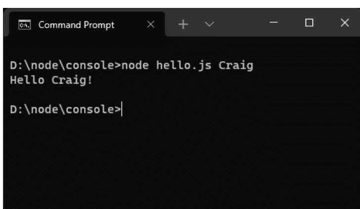

**3-2. 控制台中的 Hello Craig!**

如果你省略了参数（`node hello.js`），应用将回退到 Hello world。

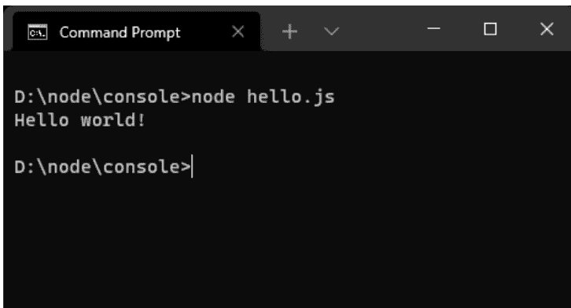

**3-3. 控制台中显示 Hello world!**

“world”这个回退文本有点无聊，所以你可以获取存储在操作系统环境变量中的用户名称。`process.env` 属性返回一个包含环境变量名/值对的对象。尝试在 `REPL` 中输入 `process.env`。（请参见第 2 章中的“在 Node.js REPL 中运行 JavaScript 命令”部分。）

Linux 和 macOS 定义了 `USER` 变量，而 Windows 设置了 `USERNAME`。在声明 `nameArg` 时检查两者以确保你的脚本是跨平台的：

```javascript
// 从命令行参数、环境或回退值获取名称
const nameArg = process.argv[2] || process.env.USER || process.env.USERNAME || 'world';

console.log(`Hello ${nameArg}`);
```

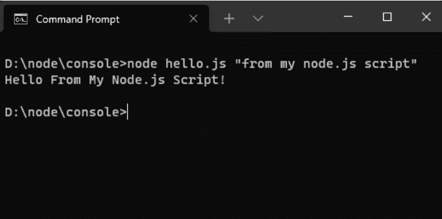

**3-4. 控制台中的响应**

## 你的第一个 Web 服务器

Web 应用需要 Web 服务器来返回 HTML 页面。Apache 和 NGINX 等专用 Web 服务器常用于此。

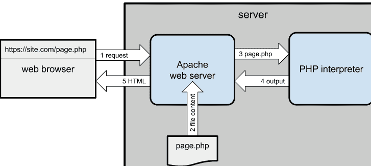

**3-5. JavaScript 服务器**

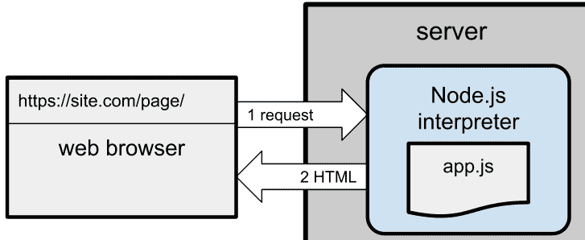

**3-6. Node.js 服务器**

为你的项目创建一个目录，例如 `server`：

```bash
mkdir server
cd server
```

然后添加一个名为 `webhello.js` 的文件，内容如下：

```javascript
#!/usr/bin/env node
const port = (process.argv[2] || process.env.PORT || 3000);
const http = require('http');

http.createServer((req, res) => {
  console.log(req.url);

  res.statusCode = 200;
  res.setHeader('Content-Type', 'text/html');
  res.end('<p>Hello World!</p>');
}).listen(port);

console.log(`Server running at http://localhost:${port}/`);
```

运行 `node webhello.js`，你会看到 `Server running at http://localhost:3000/` 或类似的地址。在浏览器中打开该地址以查看带有“Hello World!”段落的网页。

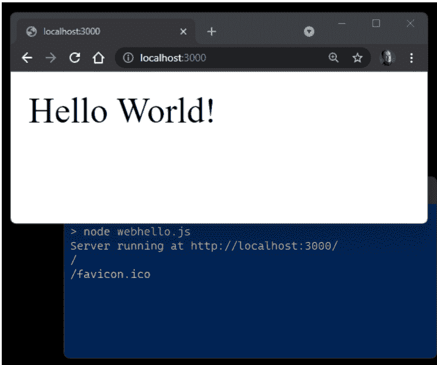

代码执行了以下操作：

- 定义了服务器端口 `port` 变量。这可以通过命令行传递、`PORT` 环境变量提供，或者回退到 `3000`。
- 使用 `http.createServer` 库创建一个在 `port` 上监听的 Web 服务器。当其回调函数接收到请求时，它可以检查 `req` 对象中的详细信息并使用 `res` 对象返回响应。

### 端口 3000？

Web 服务器在 80 端口监听 HTTP 请求，在 443 端口监听 HTTPS 请求。你可以设置不同的端口，但必须在 URL 中指定它。

使用标准端口有缺点：

- 它们可能被其他软件占用，例如其他 Web 服务器或 Skype。
- Linux 和 macOS 会阻止监听 1000 以下端口的程序，除非它们是由超级用户启动的。这赋予了你的脚本权限，它据此执行任何操作，如擦除你的操作系统或将密码发布到 Twitter。记住，你不仅在运行自己的代码，还隐藏在 Node.js 以及你安装的任何模块中。

在较高的端口上以严格权限运行 Web 应用更安全。生产环境服务器可以使用 NGINX 等 Web 服务器将请求转发给 Node.js。

让我们通过对 URL 传递的字符串说“hello”来改进应用程序。URL 存储在 `req.url` 中，因此你可以像以前一样删除任何非单词字符并将首字母大写。更新此脚本：

```javascript
#!/usr/bin/env node
const port = (process.argv[2] || process.env.PORT || 3000),
const http = require('http');

http.createServer((req, res) => {
  console.log(req.url);
  const nameArg = capitalize(req.url.replace(/[^\w.-]+/g, ' ').replace(/\s+/g, ' ').trim() || 'world');

  res.statusCode = 200;
  res.setHeader('Content-Type', 'text/html');
  res.end(`<p>Hello ${nameArg}!</p>`);
}).listen(port);

console.log(`Server running at http://localhost:${port}/`);

// 大写所有单词的首字母
function capitalize(str) {
  return str
    .trim()
    .toLowerCase()
    .split(' ')
    .map(word => word.charAt(0).toUpperCase() + word.slice(1))
    .join(' ');
}
```

现在在浏览器中打开 `http://localhost:3000/Node.js`。你很有可能会看到“Hello World!”，因为你之前的应用程序实例仍在运行！

切换到终端并按 `Ctrl | Cmd + C` 停止应用程序。使用 `node webhello.js` 重启它，返回浏览器并刷新页面看到“Hello From Node.js!”。

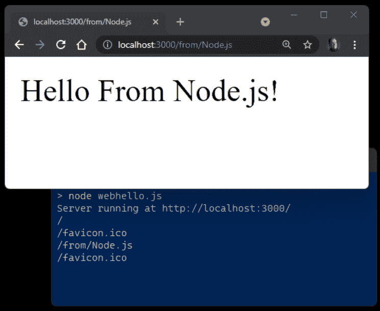

尝试不同的 URL 路径并分析 `nameArg` 声明以理解它是如何工作的。

在尝试几个 URL 后，切换回 Node.js 终端。它正在记录每个请求，你会看到类似的内容：

```bash
$ node webhello.js
Server running at http://localhost:3000/
/from/Node.js
/favicon.ico
/craig
/favicon.ico
```

那些意外的 `/favicon.ico` 请求是什么？你将在下一章进一步调查并调试。

每次做出更改都必须重启 Node.js 应用程序。按下 `Ctrl + Cmd + C` 并再次启动会很快变得疲惫。

`Nodemon` 是一个工具，它可以监控源文件的更改并自动重启应用程序。使用 `npm` 全局安装：

```bash
npm install -g nodemon
```

你可以用 `nodemon` 代替 `node` 来启动任何 Node.js 应用程序。例如：

```bash
nodemon webhello.js
```

（你可以像以前一样传递任何参数。）

当你保存代码更改时，`Nodemon` 会重启应用程序，你会在终端中看到一条日志记录：

```bash
[nodemon] restarting due to changes...
[nodemon] starting `node webhello.js`
```

如果不起作用，尝试使用 `--legacy-watch / -L` 参数运行 `nodemon`：

```bash
nodemon -L webhello.js
```

更多选项请参阅 `Nodemon` 文档。

在默认情况下，Windows Powershell 不允许你作为 `nodemon` 执行第三方脚本。在 PowerShell 窗口中输入此命令以允许脚本执行：

```powershell
Set-ExecutionPolicy RemoteSigned -Scope CurrentUser
```

你可以在此处找到 Web 应用运行的视频演示。

> **注意**
>
> 本节涵盖了一些高级主题。如果现在不理解请不要担心。我们稍后会重新回到实现。

这个轻量级脚本实现了一个功能性的 Web 服务器，令人惊叹。应用程序是永久开启的，无论其状态如何，都可以保留自己的状态。

1.  不行。一次只能启动一个 Node.js 应用程序实例。
2.  是的，但每个实例必须位于独立的物理服务器或虚拟服务器上。
3.  是的，但如 `Docker` 等容器化软件是必不可少的。
4.  是的，但应用程序应该是无状态的，并通过负载均衡器或 Web 服务器接收请求。

## 如何调试 Node.js 脚本

教程通常在最后的章节介绍调试。如果你在编码之旅之初就遇到问题，这可能会让你感到很沮丧——而你确实会遇到这种情况。软件开发是复杂的。

如果你足够幸运，你的代码会崩溃并显示一条明显的错误信息。如果你运气不好，你的应用程序会继续运行，但不会生成你预期的结果。如果你非常倒霉，一切都会运行良好，直到第一个用户发现了一个灾难性的擦除磁盘的 Bug。

> **想跳过？**
>
> 这是一个很长的章节，描述了多种调试选项。如果你想立即开始，可以跳过到“练习：调试 webhello.js”部分（位于章节末尾）。尽管如此，现在学一点可以以后节省好几个小时的努力！

### 什么是调试？

调试是修复软件缺陷的“黑艺术”。修复一个 Bug 往往很容易；修改一个字符或增加一行代码就能解决问题。但找到那个 Bug 是另一回事，开发者可能会花费许多令人沮丧的时间来定位问题根源。幸运的是，Node.js 有一些非常棒的工具来追踪问题。

你通常可以在测试应用程序之前防止 Bug 的产生。让我们看看某些方法。

### 使用良好的代码编辑器

一个良好的代码编辑器提供以下功能：

- 行号：用于定位错误发生的位置
- 类型检查——例如，确保数字变量不能被赋值字符串
- 颜色编码：以捕获语法问题，如无效语句或缺失引号
- 变量名、函数名、属性等的自动补全
- 括号匹配：高亮嵌套结构中的问题
- 自动缩进：确保使用正确的 Tab 或空格字符
- 跨文件和项目的变量重命名
- 代码片段的保存与重用
- 函数、属性和方法的参数提示
- 函数导航：跳转到声明处
- 不可达代码检测
- 重构工具：用于整理杂乱的代码

Node.js 开发者有很多很好的选择，诸如 `VS Code`、`Atom` 和 `Sublime Text` 等编辑器。

### 使用代码检查工具（Linter）

`Linter` 会在你保存和测试代码之前报告各种类错误，如语法错误、缩进不当、未声明变量、括号不匹配以及你个人的偏好（分号、引号使用等）。JavaScript 和 Node.js 的流行选项包括 `ESLint`、`JSLint` 和 `JSHint`。

这些可以作为全局 Node.js 模块安装。例如，这里是如何使用 `npm` 全局安装 `ESLint` 的：

```bash
npm install eslint -g
```

然后你可以从命令行检查文件：

```bash
eslint myscript.js
```

```bash
cig@craigdev:~$ more myscript.js
const counter = 10;

for (i = 0; i < contr; i++) {
  console.log(i)
}
cig@craigdev:~$ eslint myscript.js
/home/craig/myscript.js
1:7 error 'counter' is assigned a value but never used no-unused-vars
3:6 error 'i' is not defined no-undef
3:13 error 'i' is not defined no-undef
3:17 error 'counter' is not defined no-undef
3:25 error 'i' is not defined no-undef
4:17 error Missing semicolon semi

* 7 problems (7 warnings)
1 error and 0 warnings potentially fixable with the '--fix' option.
cig@craigdev:~$
```

**4-1. 使用 ESLint**

**4-2. 在 VS Code 中使用 ESLint**

### 使用版本控制

版本控制系统 `Git` 可以帮助保护代码并管理修订。`GitHub` 和 `Bitbucket` 等在线仓库提供了这些功能。

### 采用问题跟踪系统

问题跟踪系统可以用于报告 Bug、确定严重程度、分配任务。对于较大的团队和项目，`Jira`、`FogBugz` 或 `Bugzilla` 等解决方案可能是合适的。

### 使用测试驱动开发

**测试驱动开发（TDD）** 是一种鼓励开发者在编写代码之前通过测试来确保函数正常运行的过程。*当然，你的测试也可能有 Bug。*

更多资源：

- [维基百科上的 TDD 概览](https://en.wikipedia.org/wiki/Test-driven_development)
- [什么是测试驱动开发](#)
- [在 Node.js 中掌握测试驱动开发](#)

### Node.js 调试环境变量

在操作系统中设置的环境变量控制 Node.js 设置。最常见的是 `NODE_ENV`，调试时通常设置为 `development`，在生产环境中设置为 `production`。

在 Linux/macOS 上可以这样设置：

```bash
NODE_ENV=development
```

这是 Windows 命令行：

```bash
set NODE_ENV=development
```

这是 Windows PowerShell：

```bash
$env:NODE_ENV="development"
```

在内部，你的应用程序可以检测该设置并在时启用调试消息。例如：

```javascript
// 以开发模式运行？
const DEVMODE = (process.env.NODE_ENV !== 'production');

if (DEVMODE) {
  console.log('应用程序以开发模式启动');
}
```

### Node.js 命令行选项

可以传递给 `node` 的各种命令行选项。最有用之一是 `--trace-warnings`：

```bash
node --trace-warnings index.js
```

其他选项包括：

- `--enable-source-maps`：在使用转换器时启用源 map
- `--throw-deprecation`：在使用弃用功能时抛出错误
- `--inspect`：激活 V8 调试器（参见“Node.js 调试器”章节）

### 控制台调试

最简单的方法之一是将值输出到控制台：

```javascript
console.log( myVariable );
```

### 永远不要使用 console.log()！

有些开发者声称你不应该使用 `console.log()`，因为你在更改代码，而且有更好的调试选项。确实——*每个人都这么做！*

使用任何能让你高效的工具。控制台日志是一个快速且实用的选项。找到 Bug 比使用什么方法更重要。很少开发者会深入探索标准的 `console.log()` 之外，但他们错过了许多可能性。

### console.dir()

为你提供的辛苦工作：

```javascript
console.dir(obj, { depth: null, color: true });
```

### Node.js util.debuglog

Node.js `util` 模块提供了一个内置的 `debuglog` 方法，可以有条件地将日志消息写入 `STDERR`：

```javascript
const util = require('util');
const debuglog = util.debuglog('myapp');
debuglog('myapp message [%d]', 123);
```

当环境变量 `NODE_DEBUG` 设置为 `myapp`（或通配符 `*` 或 `my*`）时，调试消息将显示在控制台中：

> MYAPP 9876: myapp debug message [123]

(9876 是 Node.js 进程 ID。)

### 使用日志模块进行调试

如果你需要对消息级别、详细程度、排序、文件输出、性能分析、报告等更高级的选项，可以使用第三方日志模块。流行的解决方案包括：

- `cabin`
- `loglevel`
- `morgan`
- `pino`
- `signale`
- `storyboard`
- `tracer`
- `winston`

### Node.js V8 Inspector

后续章节将使用上一章开发的 `webhello.js` 脚本来阐明调试概念。

Node.js 是 `V8` JavaScript 引擎的封装。它包含了自身的检查器和调试客户端。使用 `inspect` 参数启动应用程序（不要与 `--inspect` 标志混淆——后者将在下面的“使用 Chrome 调试 Node.js 应用”章节中介绍）：

```bash
node inspect webhello.js
```

调试器会在第一行暂停并显示 `debug` 提示符：

```bash
$ node inspect webhello.js
< Debugger listening on ws://127.0.0.1:9229/8bf7669c-b3b4-43e6-9f96-3b40abbcb49
< For help, see: https://nodejs.org/docs/inspector
<
connecting to 127.0.0.1:9229 ... ok
< Debugger attached.
Break on start in webhello.js:4
2
3 count
> 4 port = (process.argv[2] || process.env.PORT || 3000),
5 http = require('http');
6
```

输入 `help` 查看命令列表。你可以通过这些选项逐行执行应用程序：

- `cont` 或 `c`：继续执行
- `next` 或 `n`：执行下一条命令
- `step` 或 `s`：进入被调用的函数
- `out` 或 `o`：跳出函数并返回到调用命令
- `pause` 或 `p`：暂停运行中的代码

其他选项还包括：

- 使用 `watch('myvar')` 监控变量值
- 使用 `setBreakpoint() / sb()` 命令设置断点（尽管在代码中插入 `debugger;` 语句更简单）
- 重启脚本
- 退出调试器（需要初始的 `.`）

如果这听起来非常笨拙，那它确实如此。只有在完全没有其他选择或者你感到受虐倾向时，才使用内置的调试客户端。

### 使用 Chrome 调试 Node.js 应用

使用 `--inspect` 标志启动 Node.js V8 检查器：

```bash
node --inspect webhello.js
```

（如有必要，可以使用 `nodemon` 代替 `node`。）

这将启动调试器监听 `127.0.0.1:9229`，任何本地调试客户端都可以连接到它：

> Debugger listening on ws://127.0.0.1:9229/20ac75ae-90c5-4db6-af6b-d9d74592572f

如果你在另一个设备或 `Docker` 容器上运行 Node.js ，请确保端口 `9229` 可用，并使用以下命令授予远程访问：

```bash
node --inspect=0.0.0.0:9229 webhello.js
```

或者，使用 `--inspect-brk` 停止第一语句的处理，以便你可以逐行执行应用程序。

打开 Chrome 浏览器并在地址栏中输入 `chrome://inspect`。

**4-3. 使用 Chrome inspect**

> **没有使用 Chrome？**
>
> Chromium、Edge、Opera、Vivaldi 和 Brave 都具有与 Chrome 相同的调试器。`chrome://inspect` 地址完全相同。

> **远程目标**
>
> 如果 Node.js 应用未作为远程目标出现，请确保勾选了“发现网络目标”，然后点击“配置”添加运行应用程序设备的 IP 地址和端口。

点击目标的 **inspect** 链接启动 DevTools。你会感到非常熟悉。

- 标准断点（breakpoint）。
- 条件断点（conditional breakpoint），当满足特定标准时停止程序——例如 `count > 3`。
- 日志点（logpoint）。这实际上是无需编写代码的 `console.log()`！输入任何带有大括号内求值表达式的字符串。例如：`URL: { req.url }` 会输出 `req.url` 的值。

```javascript
console.log(req.url);
const nameArg = capitalize(req.url);
res.statusCode = 200;
Log Message: URL: {req.url}
res.setHeader('Content-Type', 'text/html');
res.end('<p>Hello ${nameArg}</p>');
```

**4-10. VS Code 日志点**

当刷新网页时，调试控制台（DEBUG CONSOLE）会显示日志点的数值。

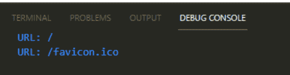

**4-11. VS Code 日志点输出**

更多信息，请参阅“在 Visual Studio Code 中调试”。

## 高级调试配置

当你在另一个设备、虚拟机上调试代码，或者想要使用不同的启动选项时，需要进行 `VS Code` 配置。`VS Code` 将启动配置存储在项目内 `.vscode` 文件夹下的 `launch.json` 文件中。要生成该文件，请点击“运行和调试”面板顶部的“创建 launch.json 文件”链接，并选择 Node.js 环境。

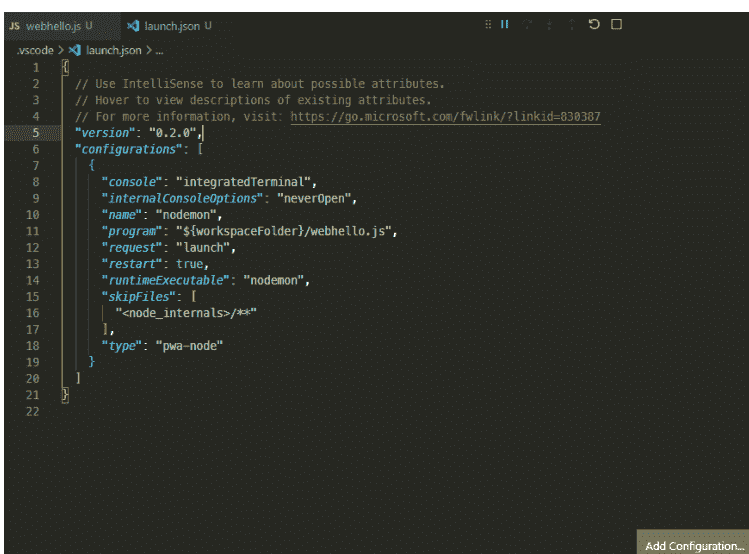

**4-12. VS Code 启动配置**

你可以向 `"configurations": []` 数组中添加任意数量的配置设置对象。点击**添加配置（Add Configuration）**按钮来添加合适的选项。`VS Code` 可以：

- **启动（Launch）**：使用 Node.js 本身启动一个进程
- **附加（Attach）**：到 Node.js 调试器进程，该进程可能运行在远程机器或 `Docker` 容器上

上面的截图显示了一个 `nodemon` 启动配置。**添加配置**提供了 `nodemon` 选项；你只需要编辑 `"program"` 属性指向 `$(workspaceFolder)/webhello.js` 即可。

保存 `launch.json`，从**运行和调试**面板顶部的列表中选择 `nodemon`，然后点击**绿色**运行图标。

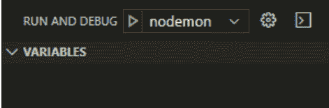

**4-13. VS Code 启动调试**

`nodemon` 将启动你的应用程序。你可以像以前一样编辑代码并设置断点或日志点。

有关更多信息，请参阅 `VS Code` 启动配置。

`VS Code` 可以调试任何 Node.js ，但以下扩展可以让生活更轻松：

- `Remote - Containers`：连接到在 `Docker` 容器中运行的应用
- `Remote - WSL`：连接到在 Windows 的 `WSL` 中运行的 Linux 应用

## 其他 Node.js 调试工具

Node.js 调试指南为其他 IDE 和编辑器提供了建议，包括 `Visual Studio`、`JetBrains`、`WebStorm`、`Gitpod` 和 `Eclipse`。此外还有 `node-debug` 扩展。

`ndb` 提供了改进的调试体验，具有强大的功能，如附加到子进程和黑盒（blackboxing），以便只显示特定文件夹中的代码。

用于 Node.js 的 IBM `report-toolkit` 通过分析 `node` 在带有 `--experimental-report` 选项运行时的数据输出来工作。

最后，如 `LogRocket` 和 `Sentry.io` 等商业服务可以与你在客户端和服务器上的实时 Web 应用程序集成，在真实用户遇到错误时进行记录。

## 练习：调试 webhello.js

`webhello.js` 代码有一个奇怪的 bug，会记录一个意外的 `/favicon.ico` 请求。要检查发生了什么，请启动 `VS Code` 并打开 `webhello.js` 文件夹。然后：

1.  切换到“运行和调试”面板。
2.  创建 `launch.json` 文件并选择 Node.js 环境。
3.  在 `"configurations"` 数组中添加一个配置项。
4.  修改 `"program"` 属性指向 `$(workspaceFolder)/webhello.js`。
5.  保存 `launch.json`，从**运行和调试**面板顶部的列表中选择 `nodemon`，然后点击**绿色**运行图标。
6.  `nodemon` 将启动你的应用程序。你可以像以前一样编辑代码并设置断点或日志点。
7.  刷新浏览器，调试控制台会显示日志点的数值。
8.  查看输出。
9.  为了完成调试，点击调试工具栏上的红色图标。
10. 尝试在左侧添加断点。

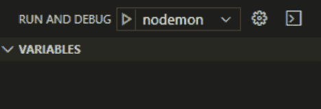

**4-14. VS Code 调试点**

当刷新网页时，调试控制台会显示日志点的数值。

## 调试术语

调试有自己的套晦涩术语。我们在本章节中涵盖了大部分内容，但你可能会遇到下面的术语。

| 术语 | 解释 |
| :--- | :--- |
| breakpoint | 调试器停止程序运行的行，以便检查其状态。 |
| conditional breakpoint | 由特定条件触发的断点，例如变量值达到 100。也称为监视点。 |
| debugger | 提供调试功能的工具，如逐行运行代码以检查变量状态。 |
| duplication | 已经报告过的 bug——可能以不同的方式报告。 |
| feature | 正如所言，“这不是 bug，而是功能”。你会发现自己也这么说。 |
| frequency | bug 发生的频率。 |
| heisenbug | 最常见但最难捉摸的 bug。 |
| logpoint | 在执行期间显示表达式值的调试指令。 |
| logging | 将运行时信息输出到控制台或文件。 |
| logic error | 程序可以运行但行为不符合预期。 |
| priority | bug 在计划更新列表中的位置。 |
| race condition | 取决于不可控事件的顺序或时机的难以追踪的 bug。 |
| refactoring | 为了可读性和维护性而重写代码。 |
| regression | 由于其他更新，以前修复的 bug 重新出现。 |
| related | bug 与另一个相似或相关。 |
| reproduce | 引起错误所需的步骤。 |
| step into | 在调试器中逐行执行代码时，进入被调用的函数。 |
| step out | 在逐行执行代码时，完成当前函数的执行并返回到调用代码。 |
| step over | 在逐行执行代码时，完成命令的执行而不进入被调用的函数。 |
| severity | Bug 对系统的影响。例如，数据丢失通常被认为比单像素 UI 对齐问题严重，除非发生频率非常低。 |
| stack trace | 错误发生之前调用的所有函数的历史列表。 |
| syntax error | 语法错误，例如缺少括号。 |
| user error | 由用户而非应用程序引起的错误。取决于引起问题的人的资历，这可能仍需要更新！ |
| watch | 调试执行期间输出的变量或表达式。 |

## 练习

1.  你可以通过以下方式调试 Node.js 应用：
    a. 使用命令行 V8 检查器
    b. 使用 Chrome DevTools 附加到进程
    c. 使用如 `VS Code` 等合适的编辑器
    d. 以上所有

2.  哪种命令适用于输出 JavaScript 对象包含的值？
    a. `console.log('%j', obj)`
    b. `console.table(obj)`
    c. `console.dir(obj, { depth: null, color: true })`
    d. 以上任一即可

3.  断点 (breakpoint) 是：
    a. 由 `console.log()` 触发的
    b. 执行过程中停止处理的点
    c. 停止程序的语句，例如 `exit`
    d. 开发者选择停止工作的时刻

4.  日志点 (logpoint) 是：
    a. 用于在执行期间显示表达式的值的值
    b. 断点的另一种名称
    c. 对 `console.log()` 语句的引用
    d. 输出日志中的特定某行

5.  `console.log()` :
    a. 永远不应该使用
    b. 只有在没有其他选择时才使用
    c. 如果有助于定位 Bug 则应该使用
    d. 对于调试来说是不实用的

# 第 5 章

## 开始使用 Express

在本章中，你将创建一个构建并返回简单网页的 Web 服务器应用程序。它将帮助你更熟悉以下内容：

- `npm` (Node 软件包管理器)
- ES6 模块
- `Express` 框架
- URL 路由
- HTML 模板引擎

### 为什么使用 Express？

你在第 3 章中创建了一个小型 Web 应用。它快速且运行良好，但复杂的 Web 应用程序需要 URL 路由、查询字符串解析、发布数据解码、HTML 模板、图像服务等功能。你可以自己编写这些，但很多工作已经在 `Express` 中实现了。

`Express` 是一个 Node.js Web 框架，它自称为“快速、无主见且极简的”。它允许你专注于应用程序的业务逻辑，而无需过多担心 URL 路由、解析数据、设置 HTTP Header 等 Web 服务器技术。

Node.js 生态系统中存在各种 Web 框架，包括 `Fastify`、`Koa`、`Hapi`。这些可能更近期、维护更频繁、速度更快，并且更适合你的应用程序。然而，`Express` 是最早的框架之一，影响了后续的所有框架。它稳定、易用并保持流行，每周有 1800 万下载。你遇到 `Express` 的概率比遇到其他框架更高。

> **Express 版本**
>
> 在编写时，`Express 4` 是活跃的推荐版本，`Express 5` 处于 alpha 阶段。所有示例在两个版本中都可以运行，但如果你遇到问题请切换到版本 4。

### 创建一个新的 Node.js 项目

为你的新应用程序创建并访问项目目录。使用类似 `express` 的名称即可：

```bash
mkdir express
cd express
```

> **创建一个新的 Git 仓库**
>
> 对于真实项目，我建议创建一个新的 Git 仓库并相应地克隆。这比以后尝试对部分编写的项目进行 Git 化要简单得多。

运行 `npm init` 初始化一个新的 Node.js 项目。`npm` 会提示你输入某些值，但你可以按 `Enter` 接受默认值。

```bash
craig@craigdev:~/apps$ mkdir directory
craig@craigdev:~/apps$ cd express
craig@craigdev:~/express$ npm init
This will walk you through creating a package.json file.
it only covers the most common items, and tries to guess sensible defaults.

See npm help init for definitive documentation on these fields
exactly what they do.

Use npm install <pkg> afterwards to install a package and
save as a dependency in the package.json file.

Press C at any time to quit.
package name: (express)
version: (1.0.0)
description: Example Express.js app
entry point: (index.js)
test command:
git repository:
keywords:
author: Craig Buckler
License: (ISC) MIT
About to write to /home/craig/apps/express/package.json:
{
  "name": "express",
  "version": "1.0.0",
  "description": "Example Express.js app",
  "main": "index.js",
  "scripts": {
    "test": "echo \"Error: no test specified\" && exit 1"
  },
  "author": "Craig Buckler",
  "license": "MIT"
}
Is this OK? (yes)
craig@craigdev:~/apps/express$ |
```


## 初始化一个新的 Node.js 项目

完成后，你的 `package.json` 文件将有一个新的 "dependencies" 对象，其中列出了项目运行时所需的模块。它包含了对 "express" 及其最新版本号的引用（前面的 `^` 表示 Express 可以升级到兼容版本，如 4.17.2 或 4.18.0，而不是 5.0.0）：

```json
{
  "name": "express",
  "version": "1.0.0",
  "description": "Example Express app",
  "type": "module",
  "main": "index.js",
  "scripts": {
    "test": "echo \"Error: no test specified\" && exit 1"
  },
  "author": "Craig Buckler",
  "license": "MIT",
  "dependencies": {
    "express": "4.17.1"
  }
}
```

## 语义化版本

大多数 Node.js 项目使用语义化版本，格式为 MAJOR.MINOR.PATCH。当发生变化时，你增加相应的数字：

- MAJOR：适用于不兼容 API 的重大更新
- MINOR：适用于不影响兼容的新功能
- PATCH：适用于修复 Bug

## 切换到 ES6 模块

通过在根目录 `package.json` 中添加 `"type": "module"` 来确保你的项目使用 ES6 模块：

```json
{
  "name": "express",
  "version": "1.0.0",
  "description": "Example Express app",
}
```

ES6 模块与浏览器使用的模块相同。Node.js 默认使用 CommonJS，ES6 支持在版本 13 中引入。ES6 模块正逐渐成为主流，因此我们在整个课程中将使用 ES6。

Node 可以使用 ES6 语法导入 CommonJS 模块。如果存在潜在问题或冲突，它也会提供建议。然而，你可能会在使用 CommonJS 编写的模块时遇到问题。

```
craig@craigdev:~/apps/express$ |
```

## 安装 Express

在你的项目目录中使用 npm 安装 Express：

```
craig@craigdev:~/apps/express$ npm install express
added 50 packages, and audited 51 packages in 2s
found 0 vulnerabilities
craig@craigdev:~/apps/express$ ls
node_modules package-lock.json package.json
craig@craigdev:~/apps/express$ |
```

# 运行时依赖与开发依赖

你的应用程序运行需要像 Express 这样的模块。它是一个依赖。

你也可以安装开发依赖，这些通常是只在你的开发电脑上才需要的构建工具。例如如 Rollup 等 JavaScript 包装器、如 Sass 等 CSS 预处理器以及如 Browsersync 等实时重载系统。

`npm install` 安装的模块是运行时依赖，除非你在安装时添加了 `--save-dev` 选项：

```
npm install browser-sync --save-dev
```

这会安装 Browsersync，但在 `package.json` 的 "devDependencies" 对象中引用了它。在 `NODE_ENV` 环境变量设置为 `production` 的生产服务器上运行 `npm install` 将不会安装 Browsersync。

依赖项与开发依赖之间的区别并不总是显而易见的。例如，你可能在生产服务器上运行 Rollup 来创建压缩后的 JavaScript 文件。

# 创建 Express 入口脚本

你现在可以编写使用 Express 创建 Web 应用程序的代码。在项目目录中添加一个新的 `index.js` 文件并写入以下代码：

```javascript
// Express application
import express from 'express';

// configuration
const cfg = {
  port: process.env.PORT || 3000
};

// Express initiation
const app = express();

// home page route
app.get('/', (req, res) => {
  res.send('Hello World!');
});

// start server
app.listen(cfg.port, () => {
  console.log(`Example app listening at http://localhost:${cfg.port}`);
});
```

为了让启动此应用变得简单一点，编辑 `package.json` 并将 "scripts" 对象更改为：

```json
"scripts": {
  "start": "nodemon index.js"
}
```

如果你没有安装 `nodemon`，可以通过 `npm install nodemon -g` 全局安装它。如果你更倾向于直接使用 `node`，请使用 `node index.js` 作为你的 "start" 脚本（但你每次想测试测试更改时都必须停止并重启应用）。

使用 `npm start` 启动应用程序并访问 http://localhost:3000。

# Node.js：从新手到大师

## 3. Express 启动

该脚本导入了 `express` 模块并创建了一个名为 `app` 的实例。定义了一个路由函数来处理对根路径 `/` 的 HTTP 请求：

```javascript
// home page route
app.get('/', (req, res) => {
  res.send('Hello World!');
});
```

## 什么是路由？

**路由** 决定了当接收到特定 URL（如 `/` 或 `/path`）的请求时执行哪些函数。因此，你的路由函数的顺序至关重要：如果前面的函数完成了请求，则后面的函数将不会运行。路由函数接收以下两个对象：

- 一个 Express HTTP 请求对象 (`req`)，包含了浏览器请求的详细信息。
- 一个 Express HTTP 响应对象 (`res`)，提供了用于向浏览器返回响应的方法。

尝试在下方添加另一个路由函数来处理对 `/hello/` 的 HTTP 请求：

```javascript
// another route
app.get('/hello/', (req, res) => {
  res.send('Hello again!');
});
```

一旦应用程序启动，在浏览器中打开 http://localhost:3000/hello/ 即可看到“Hello again!”消息。没有定义其他路由。路由是 Express 的核心部分，该框架提供了解析和响应不同 URL 的选项。脚本末尾有 `app.listen()` 调用，用于启动在定义端口上监听的 Express 服务器。到为止创建的代码。

## 你应该切换到 HTTPS 吗？

可能不需要。本课程中的所有 Node.js 示例默认都在端口 3000 上响应 HTTP 请求。

```javascript
HTTPS 需要一个安全套接层 (SSL) 证书。这些是由证书机构为特定域名颁发的，用于加密浏览器和服务器之间防篡改的数据。对于本地测试，开发者通常会创建自己的自签名证书。
```

## 定义工作目录

上面使用了硬编码的 `static` 目录。对于 Express 来说没问题，但如果另一个模块需要定位同一个目录来读取或写入文件呢？

我们可以在 `cfg` 配置对象中定义所有工作目录的完全限定引用。这在 CommonJS 中很容易（关于此主题的更多信息请参阅第 8 章），因为 Node 提供了一个 `__dirname` 常量，包含当前模块的完整目录路径。在 ES6 模块中情况更为复杂，因为它们是通过文件 URL 引用的。当前模块的 URL 可以通过 `import.meta.url` 获取，因此可以使用标准的 Node.js 将其解析为文件路径：

```javascript
import { fileURLToPath } from 'url';
import { dirname, sep } from 'path';

const __dirname = dirname(fileURLToPath(import.meta.url)) + sep;
```

`path` 模块提供了 `fileURLToPath()` 函数，它可以将 `file://` URL 转换为完全限定的文件路径。

`path` 模块提供了 `dirname()` 函数来从路径中提取目录，以及一个 `sep` 常量，包含特定平台的分隔符（POSIX 上为 `/`，Windows 上为 `\`）。

相应地更新 `index.js` 顶部：

```javascript
// Express application
import express from 'express';

import { fileURLToPath } from 'url';
import { dirname, sep } from 'path';

// configuration
```

## 83 Node.js: 忍者

```javascript
__dirname = dirname(fileURLToPath(import.meta.url)) + sep,
cfg = {
  port: process.env.PORT || 3000,
  dir: {
    root: __dirname,
    static: __dirname + 'static' + sep
  }
}
console.dir(cfg, { depth: null, color: true });

// Express initiation
// ...其余代码
```

然后更改对硬编码静态目录的引用：

```javascript
// serve static assets
app.use(express.static(cfg.dir.static));
```

该应用程序在启动时会显示配置设置，但 http://localhost:3000/page.html 的静态页面应该像以前一样正常工作。

## 开始使用 Express

```bash
craig@craigdev:~/apps/express$ npm start

> express@1.0.0 start
> nodemon index.js

[nodemon] 2.0.15
[nodemon] to restart at any time, enter 'rs'
[nodemon] watching path(s): *.*
[nodemon] watching extensions: js,mjs,json
[nodemon] starting node index.js

port: 3000,
{
  root: '/home/craig/apps/express/',
  static: '/home/craig/apps/express/static/'
}
Example app listening at http://localhost:3000
```

### 5. 我们的 Express 配置

除非你 `export` 它，否则其他模块无法访问 `cfg` 对象。`app` 对象也很有用，因此在 `index.js` 的末添加以下代码：

```javascript
// export defaults
export { cfg, app };
```

## 压缩 HTTP 响应

为了提高 Web 应用程序的性能，你应该在资源返回浏览器之前对其进行压缩。`compression` 中间件模块可以为你完成这项工作。停止应用，然后安装该模块：

```bash
npm install compression
```

你的 `package.json` 文件的依赖部分会相应更新：

```json
"dependencies": {
  "compression": "^1.7.4",
  "express": "^4.17.1"
}
```

在 `index.js` 顶部加载模块：

```javascript
// Express application
import express from 'express';
import compression from 'compression';
```

然后将其作为中间件函数之一添加（在路由器和静态文件处理器之前）：

```javascript
// HTTP compression
app.use(compression());
```

这在这里对性能产生显著影响，但在项目开始时考虑性能将让你比大多数团队领先一步！

## 禁用 Express 标识

默认情况下，Express 设置以下 HTTP 响应头，但你也可以在 `index.js` 中通过 `app.disable()` 禁用它：

```javascript
// Express initiation
const app = express();

// do not identify Express
app.disable('x-powered-by');
```

这将每个 HTTP 请求节省几个字节，并减少黑客获取关于你 Node.js 技术栈的信息。

## 处理 404 未找到错误

添加以下代码作为最后一个中间件，在无法找到页面或资源时优雅地处理错误：

```javascript
// 404 error
app.use((req, res) => {
  res.status(404).send('Not found');
});
```

这将返回一个带有 404 HTTP 头的“Not Found”消息，但你也可以采取以下操作：

- 重定向到适当页面
- 向用户显示建议的页面
- 将错误的请求记录到文件中以便进一步分析

## 添加 HTML 模板引擎

Node.js 拥有广泛的 HTML 模板引擎，用于创建输出 HTML 页面或片段。典型的引擎会获取一个 HTML 模板并：

- 将变量替换为实际值
- 允许包含部分，如页眉、页脚等
- 允许基本功能，如条件和循环

## 模板性能

理想情况下，你的 HTML 模板在运行时执行的操作越少越好。你可能预渲染模板的部分，例如包含其他文件（部分），这样你的应用程序工作量就会更少。

模板选项包括 Pug、Nunjucks 和 EJS，我们在这里使用 EJS，因为它是最简单、最快且最流行的选项之一。许多 HTML 模板引擎都可以与 Express 配合，但在没有直接支持的情况下会提供更多说明。

在这个示例中，你将创建一个 `message.ejs` 模板，用于在 `<h1>` 标签中显示如“Hello World!”之类的单个消息。停止服务器并运行 `npm install ejs`。

你的 `package.json` 文件的依赖部分会相应更新：

```json
{
  "compression": "^1.7.4",
  "ejs": "^3.1.6",
  "express": "^4.17.1"
}
```

现在在项目中创建一个 `views` 子目录。向其中添加一个名为 `message.ejs` 的文件，代码用于输出标题变量：

```html
<%- include('partials/_header'); %>

<h1><%= title %></h1>

<%- include('partials/_footer'); %>
```

此模板包含部分，因此在 `views` 中创建一个 `partials` 子目录并添加 `_header.ejs` 文件：

## 开始使用 Express

```html
<!DOCTYPE html>
<html lang="en">
<head>
<meta charset="UTF-8">
<title><%= title %></title>
<meta name="viewport" content="width=device-width,initial-scale=1" />
</head>
<body>
```

以及创建一个 `_footer.ejs` 文件：

```html
</body>
</html>
```

打开 Express 入口 `index.js` 文件并添加一个新的 `cfg.dir.views` 属性，指向视图目录：

```javascript
// configuration
const __dirname = dirname(fileURLToPath(import.meta.url)) + sep,
cfg = {
  port: process.env.PORT || 3000,
  dir: {
    root: __dirname,
    static: __dirname + 'static' + sep,
    views: __dirname + 'views' + sep
  }
};
```

在任何路由和中间件之前添加此代码：

```javascript
// use EJS templates
app.set('view engine', 'ejs');
app.set('views', cfg.dir.views);
```

这将 EJS 设置为 Express 视图引擎，文件位于视图目录。在路由函数中使用 Express 的 `render()` 方法调用 EJS。

## 89 Node.js: 从新手到忍者

更新 `/`、`/hello/` 函数和 404 处理器：

```javascript
// home page route
app.get('/', (req, res) => {
  res.render('message', { title: 'Hello World!' });
});

// another route
app.get('/hello/', (req, res) => {
  res.render('message', { title: 'Hello again!' });
});

// serve static assets
app.use(express.static(cfg.dir.static));

// 404 errors
app.use((req, res) => {
  res.status(404).render('message', { title: 'Not found' });
});
```

render 方法传递了模板名称 'message' — .ejs 扩展名可以省略，以及一个包含键值对的对象。在此示例中设置了标题。

使用 npm start 启动你的 Express 服务器，然后在浏览器中打开 http://localhost:3000/。

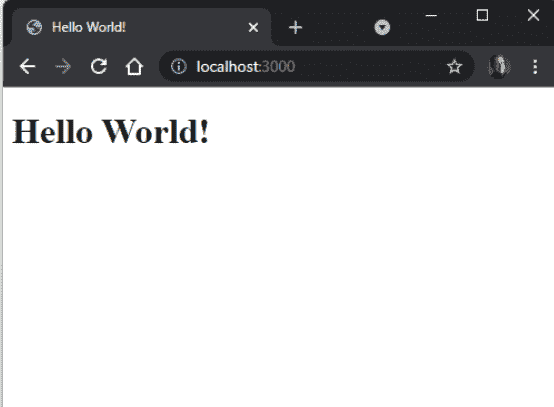

### 5-6. Express EJS 渲染

结果可能没有显著差异，但它是带有 `<h1>` 标题的完整 HTML 页面。（查看源码，卢克。）

# 高级路由

URL 路由是 Express 处理的核心。你已经开发了简单的路由，来为特定的匹配 URL 运行函数，但还有更多选项：

- 路径表达式：用一个函数处理多个路由
- 路径参数：解析路由以提取值
- HTTP 方法：使用 GET、POST、DELETE、PUT 等
- 路由处理器：将相关的处理器函数分组在一个文件中

## 路由路径表达式

简单的 URL 路由在上面的示例中已经定义。例如：

```javascript
// another route
app.get('/hello/', (req, res) => {
  res.send('Hello again!');
});
```

该路由处理发往 /hello/ 的 HTTP GET 请求，尽管 Express 会执行以下操作：

- 忽略大小写。路径 /Hello/ 和 /HELLO/ 将匹配 /hello/ 路由，除非你在 `index.js` 中添加了 `app.set('case sensitive routing', true)`。
- 忽略斜杠。路径 /hello/ 和 /hello 均匹配到相同的路由，除非你在 `index.js` 中添加了 `app.set('strict routing', true)`。

除了精确路由外，你还可以定义正则表达式模式来匹配范围内的 URL。例如：

* `?` 表示前面的字符是可选的。路由 /ab?cd/ 匹配 URL 路径 /abcd/ 和 /acd/。
* `+` 表示前面的字符必须出现一次或多次。路由 /ab+cd/ 匹配 URL 路径 /abcd/、/abbcd/、/abbbbcd/ 等。
* `*` 表示任意数量的字符。路由 /*cd/ 匹配 URL 路径 /abcd/、/ab123cd/、/ab-node.js-cd/ 等。
* 更复杂的路由 /.Script$ 匹配 URL 路径 /JavaScript/ 和 /ECMAScript/，但不匹配 /Scripting。

Express 使用 Path-to-RegExp 模块解析路径。Express Route Tester 工具可以帮助构建并调试更复杂的 URL。

## 路由路径参数

路由参数是命名的路径段，前面带有冒号 (`:`) 以标识 URL 中的变量。例如，路由 /user/:id 匹配任何以 /user/ 开头且仅有一个段的 URL 路径——例如 /user/123 或 /user/abc。

捕获的值可以在 `Request params` 对象中可用，因此在上面的示例中，`req.params.id` 将设置为 123 或 abc。

可以定义任意数量的 URL 参数。以下路由函数将在路径 /author/Craig-Buckler/book/Node.js 上运行：

```javascript
// return a value for a user
app.get('/author/:name/:bookName', (req, res, next) => {

  console.log('author: ${req.params.name}'); // "Craig-Buckler"
  console.log('book: ${req.params.bookName}'); // "Node.js"

  next();

});
```

# HTTP 方法

上面的示例通过定义 `app.get()` 函数处理 HTTP GET 请求。Express 支持所有其他 HTTP 方法，包括：

- 使用 `app.post()` 的 HTTP POST
- 使用 `app.put()` 的 HTTP PUT
- 使用 `app.delete()` 的 HTTP DELETE

`app.all()` 处理特定路由的所有 HTTP 方法。该函数可以检查 `req.method` 属性来确定使用了哪种 HTTP 方法。

## 创建路由处理器

随着应用程序的增长，在 index.js 中定义路由处理器变得不切实际。更好的选项是在单独的文件创建具有相关功能的路由处理。以下示例更新了 Express 代码，使得任何以 /hello/ 开头的 URL 都在单个路由器中处理。实现了两个 GET 请求：

- /hello/:name 返回一个显示按名字问候的页面。例如，/hello/craig 显示 "Hello!"
- /hello/:lang/:name 返回一个用特定语言按名字问候的页面。例如，/hello/fr/craig 切换到法语并显示 "Bonjour!"

在此之前，为通用模块创建一个 `lib` 子目录。在 `lib/locale.js` 中添加一个新文件并包含以下代码：

```javascript
// international greetings
export const hello = {
  au: 'day',
  cn: 'hao',
  en: 'Hello',
  de: 'Hallo',
  es: 'Hola',
  fr: 'Bonjour',
  jp: 'Konichiwa'
};
```

然后添加 `lib/string.js` 并包含以下代码：

```javascript
// string functions

// 将所有单词的首字母大写
export function capitalize(str) {

  return str
    .trim()
    .toLowerCase()
    .split(' ')
    .map(word => word.charAt(0).toUpperCase() + word.slice(1))
    .join(' ');

}
```

接下来，在项目文件夹中创建一个新的 `routes` 子目录。在 `routes/hello.js` 中添加一个新文件，编写定义两个路由的代码：

```javascript
// hello/ route
import { Router } from 'express'
import { hello } from '../lib/locale.js'
import { capitalize } from '../lib/string.js'

export const helloRouter = Router();

// 用英语问候
helloRouter.get('/:name', (req, res, next) => {

  res.render(
    'message',
    { title: `${hello.en} ${capitalize(req.params.name)}!` }
  );
});

// 用特定语言问候
helloRouter.get('/:lang/:name', (req, res, next) => {

  res.render(
    'message',
    { title: `${hello[req.params.lang] || hello.en} ${capitalize(req.params.name)}!` }
  );
});
```

这定义了一个名为 `helloRouter` 的 Express Router。

路由器是微型应用，可以执行路由。

第一个路由定义了参数化路径 /name。它渲染消息，标题使用了 Hello。

第二个路由定义了参数化路径 /lang/:name。它渲染消息，使用了本地化的 Hello。

要使用你的路由器，打开 index.js 并删除这些行：

```javascript
// another route
app.get('/hello/', (req, res) => {
  res.send('Hello again!');
});
```

将它们替换为以下代码：

```javascript
// /hello/ route
import { helloRouter } from './routes/hello.js';
app.use('/hello', helloRouter);
```

如有，重启 Express 应用并在浏览器中访问 http://localhost:3000/hello/craig 来查看 “Hello!”

5-7. 我们的路由

访问 http://localhost:3000/hello/au/craig 切换澳大利亚。

## 练习

尝试以下更新以改进你的 Express 体验：

- 改进 message 模板以添加样式表。（提示：CSS 可以静态文件。）
- 创建并使用新模板输出当前 URL。（提示：作为 req 的 Request 对象可以帮助。）
- 创建一个新的路由器以类似于 Hello 的方式说 “Goodbye”。

# 总结

本章介绍了用于服务器端的 Express 框架。其他 Node.js 服务器框架遵循类似的约定，并且与 Express 中间件兼容。

这只是开始。在后续章节中，我们将查看处理表单、实现 REST API 以及在应用程序中操作数据库的方法。

# Quiz

1. Express 是：

- a. 类似于 Apache 或 Nginx 但可以使用 JavaScript 代码编程
- b. 一个 Node.js 服务器端框架
- c. 多个 Node.js 服务器框架之一
- d. 以上所有

2. Express 通常作为以下项安装在项目中：

- a. 全局模块
- b. 开发依赖
- c. 依赖
- d. 单静态 JavaScript 文件

3. package.json 文件用于：

- a. 存储 Node.js 应用程序的配置信息
- b. 存储应用程序运行时数据
- c. 配置 npm
- d. 以上所有

4. Express 中间件函数：

- a. 是 Express 内部模块
- b. 在 Express 应用启动时运行
- c. 可以处理或操作 HTTP 请求和响应
- d. 在 Express 应用关闭时运行

5. 中间件函数按顺序传递以下参数：

- a. next 函数、Request 对象、Response 对象
- b. Request 对象、Response 对象、next 函数
- c. next 函数、Response 对象、Request 对象
- d. Response 对象、Request 对象、next 函数

# 第 6 章

## 使用 Express 处理表单数据

除非你正在创建一个静态网站，否则处理从 HTML 表单提交的用户数据是所有 Web 应用的核心。在本章中，你将学习 Express 如何：

- 解析通常发送在 HTTP GET 请求中的查询字符串数据（参见“处理 HTTP 查询字符串”部分）
- 解析通常发送在 HTTP POST 请求中的正文数据（参见“处理 HTTP POST 正文数据”部分）
- 接收通常通过 multipart/form-data HTTP POST 发送的上传文件（参见“处理上传的文件”部分）

## 代码示例

下面提供的 Express 示例特意遗漏了上一节中推荐的一些选项。舍弃压缩、路由中间件和 404 页面等功能可以使代码更加简洁——但请务必不要在你的项目中忘记它们！

## 净化用户输入

数据处理俱乐部的规则：

- 永远不要信任用户数据。
- 参见 #1。

用户数据必须在服务器上进行清洗。你可能拥有健壮的 HTML 和 JavaScript 验证，但无法保证请求一定来自浏览器或按你预期的方式运行。在将数据用于其他地方之前务必进行检查——*尤其是当它输出到 HTML 页面时*。（注意 EJS 会转义 HTML。）

传入的数据将是字符串，因此你可以使用正则表达式来检查格式，或将其解析为类型以检查错误。`express-validator` 模块提供系列验证和清洗函数。

为了简洁起见，下面的示例没有检查传入的数据，因此请勿在生产服务器上使用它们！

## 处理 HTTP GET 查询字符串

数据可以通过由 `?` 指定的 URL 查询字符串以及一系列由 `&` 分隔的 `name=value` 键对传递——例如 `http://localhost:3000/?a=1&b=2&c=3`。查询字符串通常被添加到 HTTP GET 请求中，尽管它们可以通过任何方法。

Express 会自动解析查询字符串并在 `Request.query` 属性中返回一个名称/值对象。上面的示例 URL 返回了一个对象：

```
{
  a: 1,
  b: 2,
  c: 3
}
```

## 使用 Express 处理数据

`code/ch06/express-get` 中的示例代码提供了一个简单的例子。模板 `views/form.ejs` 实现了一个 HTML `<form>`。它通过将 `method` 设置为 "get" 来提交到自身。顶部的表格显示了传递到数据对象的所有名称/值键对：

```html
<%- include('partials/_htmlhead'); -%>

<h1><%= title %></h1>

<% if (data) { %>
<p>上一次请求收到的数据:</p>
<table>
<% for (const name in data) { %>
<tr>
<th><%= name %>:</th>
<td><%= data[name] %></td>
</tr>
<% } %>
</table>

<% } %>
```

<p>提交表单：</p>

```html
<form action="/" method="get">
<div>
<label for="name">name</label>
<input type="text" id="name" name="name" value="<%= data.name %>" />
</div>
<div>
<label for="job">job</label>
<input type="text" id="job" name="job" value="<%= data.job %>" />
</div>
<div>
<label for="nodejs">like Node.js</label>
<input type="checkbox" id="nodejs" name="nodejs" value="yes" <% if (data.nodejs) { %>checked<% } %> />
</div>
<input type="hidden" name="date" value="<%= new Date();%>" />
<button>submit</button>
</form>
```

```html
<%- include('partials/_htmlhead.ejs'); --%>
```

注意 `views/partials/_htmlhead.ejs` 提供了一点内联 CSS 样式。

`index.js` 入口脚本设置了 EJS 模板引擎，并在根 / URL 发起 GET 请求时渲染表单模板。模板传递了一个包含以下内容的对象：

- 页面标题
- 设置为 `req.query` 的 data 属性

```javascript
// Express 应用
import express from 'express';

// 配置
const cfg = { port: process.env.PORT || 3000 };

// Express 初始化
const app = express();

// 使用 EJS 模板
app.set('view engine', 'ejs');
app.set('views', 'views');

// 渲染表单
app.get('/', (req, res) => {
  res.render('form', {
    title: 'Parse HTTP GET data',
    data: req.query
  });
});

// 启动服务器
app.listen(cfg.port, () => {
  console.log(`Example app listening at http://localhost:${cfg.port}`);
});
```

执行 `npm install` 安装 Express 和 EJS 依赖后，使用 `npm start` 启动服务器并在浏览器中导航到 http://localhost:3000/。

6-1. 示例格式

输入一些数据并点击 **submit**。URL 查询字符串发生变化，所有的名称/值键对都显示出来（注意日期是以隐藏输入值的形式传递的）。上一次请求收到的数据：

- name: Craig
- job: developer
- nodejs: yes
- date: Nov 25 2021 15:47:00 GMT (Greenwich Time)

提交表单：

6-2. 使用示例接收到的数据

查看课程 `code/ch06/express-get` 目录和相关视频以运行此代码。

## 处理 HTTP POST 数据

通过 `method` 设置为 "post" 的 HTML `<form>` 传递的 HTTP 请求会将数据填充到 `Request.body`。Express 默认不解析正文，需要 `express.urlencoded()` 中间件如：

**body-parser 模块**

旧版本的 Express 不包含正文解析功能，你可能在教程中看到 `body-parser` 的引用。使用 Express 处理数据

`views/form.ejs` 与“处理 HTTP 查询字符串”中的示例相同，但 `method` 设置为 "post"。`index.js` 入口脚本使用 `app.all()` 作为单一函数来处理包含名称/值键对的对象：

```javascript
// Express 应用
import express from 'express';

// 配置
const cfg = { port: process.env.PORT || 3000 };

// Express 初始化
const app = express();

// 使用 EJS 模板
app.set('view engine', 'ejs');
app.set('views', 'views');

// 正文解析
app.use(express.urlencoded({ extended: true }));

// 渲染表单
// 处理初始的 GET 和 POST
app.all('/', (req, res, next) => {
  if (req.method === 'GET' || req.method === 'POST') {
    res.render('form', {
      title: 'Parse HTTP data',
      data: req.body
    });
  } else {
    next();
  }
});

// 启动服务器
app.listen(cfg.port, () => {
  console.log(`Example app listening at http://localhost:${cfg.port}`);
});
```

执行 `npm install` 安装 Express 和 EJS 依赖后，使用 `npm start` 启动服务器并在浏览器中导航到 http://localhost:3000/。

6-3. 示例表单

输入一些数据并点击 submit。数据被提交，所有的名称/值键对都显示出来（注意日期是以隐藏输入值传递的）。上一次请求收到的数据：

| | Craig |

|---|---|

| job | developer |

like Node.js? [ ] submit

6-4. 带有 POST 数据的示例表单

查看课程 `code/ch06/express-post` 目录和相关视频以运行此代码

## 处理上传的文件

与某些语言相比，在 Express 中接收文件上传是极其简单的。然而，它需要第三方模块 `formidable` 来将传入的流数据解析为一个或多个文件。

`code/ch06/express-file` 中的示例代码有一个 `package.json` 文件，其中 Express、EJS 和 Formidable 被声明为项目依赖：

```json
{
  "dependencies": {
    "ejs": "^3.1.6",
    "express": "^4.17.1",
    "formidable": "^2.0.1"
  }
}
```

## 使用 Express 处理数据

模板 `views/form.ejs` 定义了一个 `<form>`，其方法设置为 "post"，`entype`设置为 "multipart/form-data"。还添加了一个允许上传图片的字段：

```html
<input type="file" id="image" name="image" accept="image/*" />
```

接收到的数据 `<table>` 还会检查数据对象中是否存在 `imageURL` 属性，如果找到，则使用 `` 标签显示它：

```html
<table>
<% for (const name in data) { %>
<tr>
<th><%= name %></th>
<td>
<% if data[name] %>
<% if (name === 'imageURL') { %>
" alt="uploaded image" />
<% } %>
<% } %>
</td>
</tr>
<% }% %>
</table>
```

`index.js` 入口脚本定义了 `uploads` 子目录，上传的文件将存储在此处：

```javascript
// Express application
import express from 'express';
import formidable from 'formidable';

import { fileURLToPath } from 'url';
import { dirname, parse, sep } from 'path';

// configuration
const
  __dirname = dirname(fileURLToPath(import.meta.url)) + sep,
cfg = {
port: process.env.PORT || 3000,
dir: {
```

# Node.js：从新手到大师

```javascript
root: __dirname,
upload: __dirname + 'uploads' + sep
};
```

（在你的项目中创建 `uploads` 子目录。位于主目录内的项目应该已经具有写入权限，但如有必要请运行 `chmod 666 uploads`。）

脚本随后初始化 Express 并将 `uploads` 设置为静态目录。为了本示例的目的，这可以轻松地显示上传的图片，但通常你会将有效文件移动到更安全的位置——也许是在项目目录之外——确保它不会被删除或覆盖。（请参下方的“练习”部分以获取提示。）

```javascript
// Express initiation
const app = express();

// use EJS templates
app.set('view engine', 'ejs');
app.set('views', 'views');

// static assets
app.use(express.static(cfg.dir.uploads));
```

注意，`express.urlencoded()` 中间件不再需要，因为 `formidable` 也会解析表单字段。

`app.all()` 路由使用单个函数处理 HTTP 方法。当此路由运行时：

- 它初始化一个新的 `formidable` 对象，带有上传目录和一个保留文件扩展名的设置。
- 调用了 `parse()` 方法，并传入 Express 请求对象 (`req`) 和一个回调函数，该函数会在上传完成后运行。回调函数接收一个错误消息 (`err`)、（非文件的）数据字段以及 `files` 对象。

## 使用 Express 处理数据

如果 `files` 中存在单个非空图片属性，`data` 对象将补充有关图片的信息。Formidable 将其放置在 `uploads` 目录中并带有唯一的 GUID 文件名，以确保它不会与之前的上传冲突。

`data.imageUrl` 属性通过从文件路径中提取文件名并在前面加上斜杠 `/` 来定义，从而解析到静态目录的 URL。

```javascript
// render form
// use .all to handle initial GET and POST
app.all('/', (req, res, next) => {
  if (req.method === 'GET' || req.method === 'POST') {
    // parse uploaded uploaded data
    const form = {
      uploadDir: cfg.uploads,
      keepExtensions: true
    };

    form.parse(req, (err, data, files) => {
      if (err) {
        next(err);
        return;
      }

      if (files && files.image && files.image.size > 0) {
        data.filename = files.image.originalFilename;
        data.filetype = files.image.mimetype;
        data.fileize = Math.ceil(files.image.size / 1024) + ' KB';
        data.uploadto = files.image.filepath;
        data.imageUrl = '/' + parse(files.image.filepath).base;
      }

      res.render('form', { title: 'Parse HTTP POST data', data: data });
    });
  } else {
    next();
  }
});
// start server
app.listen(cfg.port, () => {
  console.log(`Example app listening at http://localhost:${cfg.port}`);
});
```

## 回调函数

传递给 `form.parse()` 的回调函数是我们使用的第一个回调。该函数是异步调用的：Node.js 运行时可以在等待数据时执行其他任务。理解 JavaScript 回调、Promise 和 `async/await` 对于 Node.js 开发至关重要。它们将在第9章进一步讨论。

运行 `npm install` 安装 Express、EJS 和 Formidable 依赖后，使用 `npm start` 启动服务器并导航到 `http://localhost:3000/`。

## 使用 Express 处理表单数据

示例表单

输入一些数据，选择一个文件并点击**提交**。数据被提交，所有的键值对都显示在  标签中。

## 解析 HTTP POST 数据

在上一个请求中接收的数据：

- **name**: Craig
- **job**: developer
- **nodejs**: yes
- **date**: Nov 25 2021 17:56:25 GMT+0000
- **filename**: nodejs.svg
- **file**: image/xml
- **filesize**: 7 KB
- **uploadto**: /home/craig/apps/express-file/uploads/1c9e30dedd96c85f09a01.svg
- **imageurl**: /1c9e30dedd96c85f09a01.svg

提交表单：

6-6. 数据随示例表单显示查看 `code/ch06/express-file` 目录和视频以运行此代码。

## 练习

修改任何示例以满足：

- 在 HTML 表单中添加新的邮箱字段
- 接收路由仅允许 HTML 表单中的预期数据
- 用户值经过验证（基础正则表达式即可）
- 调整 EJS 模板以显示错误

作为额外奖励，编写代码删除 `uploads` 目录中的文件——可能是24 小时前上传的。你需要使用 Node.js 文件系统方法，如 `readdir()` 读取目录、`stat()` 获取文件信息以及 `unlink()` 删除文件。

# 总结

本章基于你的 Express 知识，说明了如何接收和处理上传到服务器的数据。这对任何 Web 应用程序都是重要的，而 Express 让开发者的生活变得更容易。

# 验

- 1. 通过 URL 查询字符串传递的数据：
  - a. Express 默认不解析
  - b. 可用 `Request.query` 属性返回的对象
  - c. 可用 `Request.querystring` 属性返回的对象
  - d. 可用 `Request.body` 属性返回的对象

- 2. HTTP 请求中的 Body 数据：
  - a. Express 默认不解析
  - b. 可用 `Request.query` 属性返回的对象
  - c. 可用 `Request.querystring` 属性返回的对象
  - d. 可用 `Request.body` 属性返回的对象

- 3. HTTP 请求中的文件上传：
  - a. Express 默认不解析
  - b. 需要第三方模块来处理传入的数据
  - c. 应在 Node.js 中异步处理
  - d. 以上所有

# 第 7 章

## 如何使用 npm 包管理器

# Node.js：从新手到大师

你可以将 Node 的大部分成功——以及挫败感——归功于 npm。Node 包管理器提供了查找、安装、更新、管理、发布和删除 Node.js 包的方法。一个包可以是从简单的单行 JavaScript 模块到完整程序的任何内容。

7-1. npm 图标

npm 是世界最大的注册表。几乎有150万个包已发布在 registry.npmjs.org，且大多数包是可以免费地包含在你自己的项目中的。你可以通过一个命令发布自己的包，每天都有近 1000 名开发者在这样做。

课程较早的章节介绍了一些 npm 概念，但接下来的部分解释了你每天使用的选项（以及一些较少使用的选项）。这些信息很重要，尽管你可以快速略过并使用本章作为参考。

> npm 替代方案

> npm 不是唯一的 Node.js 包管理器，你可以尝试如 Yarn 和 npm 等替代方案。然而，npm 是 Node.js 一起安装的，对于大多数开发者来说已经足够。

## 全局包与本地包

默认情况下，npm 将包安装在本地项目目录，以便可以

# 如何使用 npm 节点管理器

在应用程序中使用。

你也可以全局安装包，这样它们在你的整个系统中都可用。这对于可以从任何目录随时使用的命令行应用程序和实用程序来说是最实。

例如，要全局安装 ESLint JavaScript 验证器，请运行 `npm install eslint --global`。

然后，你可以从任何目录运行 `eslint <file.js>` 来验证 JavaScript 文件。

但是，如果你想确保所有团队成员都拥有该模块，并在将代码提交到项目之前修复他们的错误，你也可以在项目目录中安装 `eslint`。

## npm link

> npm Link 会为当前项目目录创建符号链接，使其像全局包一样工作。这样就可以从任何其他目录运行该脚本。当你开发一个你打算在全局范围内使用的包时，这非常有用。你不需要在每次进行更改时都将其发布并安装为全局包。

```
npm uninstall <name> --global 会移除符号链接。
```

如果现在还不清楚，请不要担心。在你开始与其他开发者协作模块之前，你可能不会用到这个功能。

## npm 帮助

npm 文档可以在 docs.npmjs.com 找到，但也可以通过命令行获取帮助：`npm help`。要获取更多详情，请输入 `npm help npm`，或请求有关特定 npm 命令的帮助。例如：

## npm 配置

你很少需要更改 npm 配置，但可以使用 `npm config list` 查看默认设置，或者可以使用 `npm config list -L` 查看完整的设置列表。

可以查看单个设置。例如，显示默认作者名称：

```
npm config get init-author-name
```

也可以更改设置：

```
npm config set init-author-name="Craig Buckler"
```

从现在起，npm 在初始化任何项目时将不再提示输入作者名称。

可以使用 `npm config delete init-author-name` 取消（或删除）设置。

## 项目初始化

要启动一个新项目，你应该创建一个新目录，进入该目录并运行 `npm init`。

这会提示你输入有关项目的信息——例如它的名称、描述、Git 仓库等。使用 `npm init --yes` 可以在不经提示的情况下接受所有默认值。

npm init 会创建一个名为 `package.json` 的配置文件。你可以从另一个项目调整它，或者根据喜好进行手动编辑。该文件包含有关你的项目及其依赖的信息。例如：

```json
{
  "name": "express",
  "version": "1.0.0",
  "description": "Example Express app",
  "type": "module",
  "main": "index.js",
  "scripts": {
    "start": "nodemon index.js"
  },
  "author": "Craig Buckler",
  "license": "MIT",
  "dependencies": {
    "compression": "^1.7.4",
    "ejs": "^3.1.6",
    "express": "^4.17.1"
  }
}
```

然后你可以使用 `npm install` 在另一个设备上安装你的项目，这将下载应用程序所需的所有依赖。

常见的 package.json 值包括：

| name | 描述 |
| --- | --- |
| name | 项目名称——如果你想在 npm 注册表上发布，该名称必须是唯一的（参见下方的“发布包”部分） |
| version | 语义版本号（参见下方的“语义版本控制”部分） |
| description | 项目的短描述 |
| type | "module"（用于 ES6 模块）或 "commonjs"默认值） |
| keywords | 字符串数组，帮助他人发现该项目 |
| repository | 代码仓库，通常在 GitHub 上 |
| homepage | 项目主页 URL（通常是 GitHub 的 README.md 文件） |
| bugs | 项目问题跟踪器 URL（通常是 GitHub Issues 面板） |
| licence | 使用限制的许可协议（如果有）——如果你不共享项目，请设置为“private” |
| main | 主入口/启动脚本 |
| scripts | 脚本命令（参见下方的“使用 npm 脚本”部分），通常用于构建、测试、启动或部署项目 |
| dependencies | 运行时所需的项目依赖（参见下方的“项目依赖项”部分） |
| devDependencies | 开发期间需要的开发依赖项（参见下方的“开发依赖项”部分） |

较少使用的值包括：

| name | 描述 |
|--- | --- |
| config | 应用程序运行时配置参数，如端口 |
| publishConfig | 发布时使用的配置参数 |
| engines | 的 Node.js 版本——例如 "node>=14.0.0" |
| os | 兼容的操作系统数组——例如 ["linux", "darwin", "win32"] |
| cpu | 兼容的 CPU 架构数组——例如 ["x64"] |
| browser | 对于通过 npm 安装的客户端 JavaScript 包，主入口/启动脚本（替代 main） |
| funding | 资助页面 URL |
| files | 文件模式数组，指定当该包作为依赖安装时要包含的文件 |
| bin | 要安装到 PATH 中的一个或多个可执行文件列表 |
| man | 一个或多个手册页文件 |
| peerDependencies | 你的包与另一个包的兼容性 |
| bundledDependencies | 与包一起绑的其他包 |
| optionalDependencies | 包即使没有它也能运行的可选依赖 |
| private | 设置为 "true"，npm 将永远不会发布该包 |

## 语义版本控制

始终为你的项目使用 MAJOR.MINOR.PATCH 语义版本，用点 (.) 分隔。当发生变化时，你应该增加相应的数字。假设当前版本为：

- 漏洞修复将增加 PATCH 号到 1.2.3
- 不破坏兼容的新功能将增加 MINOR 号到 1.3.0
- 带有不兼容变化的重大更新将增加 MAJOR 号到 2.0.0

并不是所有开发者都遵循此约定，请仔细阅读文档！

## 项目依赖

像 Express 这样的包通常在运行时需要。它是应用程序的依赖；没有它应用无法运行。

项目依赖列在 package.json 的 dependencies 部分。当你的项目部署到其他机器（如生产服务器）时，运行 npm install 会安装所有。

## 开发依赖

像 Browsersync 重载服务器或 ESLint JavaScript 验证器的包通常在开发期间使用。应用程序运行时不需要它们，因此在生产服务器上不需要。

开发依赖项列在 package.json 的 devDependencies 部分。当 NODE_ENV 环境变量设置为 production 时，运行 npm install 不会它们。这可以在 Linux 或 macOS 上设置：

```
NODE_ENV=production
```

这是 Windows 命令行提示符：

```cmd
set NODE_ENV=production
```

以及这是 Windows PowerShell：

```powershell
env:NODE_ENV="production"
```

# Node.js：从新手到大师

驱动程序或图像压缩器本身就是完整的项目。利用他人许多小时的开发和真实世界测试成果是有意义的。

在这些极端情况之间存在无限可能的情况。你只能做出判断，但随着你 Node.js 和 JavaScript 知识的增长，你可能会发现自己使用的包会越来越少。

## 开发依赖的限制？

开发工具（位于 `devDependencies` 中）对你的应用程序没有没有影响。但是，使用大量的包会增加安装时间，需要持续维护，并可能让新成员感到困惑。

也许可以从浏览精选的 Node.js 软件包列表开始：

- github.com/sindresorus/awesome-nodejs
- nodejs.libhunt.com

或者，你可以在命令行中使用 `npm search <term>` 搜索包。要查找 MongoDB 数据库驱动程序，输入 `npm search mongodb`。

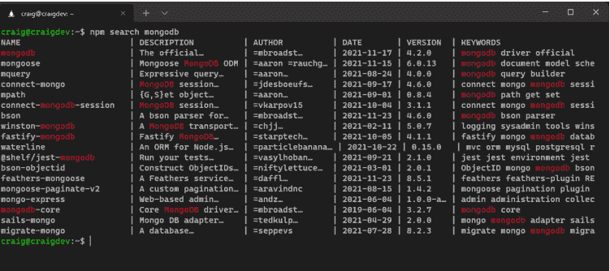

7-2. npm 搜索

## 如何使用 npm Node 包管理器

更实用的方法是使用在线搜索引擎：

- npmjs.com：官方仓库
- npms：一个按质量对包进行排序的快速搜索
- snyk.io/advisor/：根据健康百分比对包进行排序

有工具可以比较两个或多个包：

- npmcompare.com
- moiva.io

或者用于提取包信息的工具：

- anvaka.com：依赖关系可视化
- npm-stat.com：下载和使用统计数据

硬核程序员甚至可以解析 registry.npmjs.org 中 npm 使用的 JSON 数据！将包名添加到 URL 中——例如 registry.npmjs.org/express。

如果你在纠结如何选择，请选择一个受欢迎的、使用非限制性许可的、更新频繁且定期、体积较小、依赖项最少且没有重大未解决问题的包。

## 安装包

要安装开发依赖，运行 `npm install`，然后跟随一个或多个用空格分隔的包名。例如：

```bash
npm install express mongodb
```

要将包作为开发依赖安装，请在命令中添加 `--save-dev`：

```bash
npm install browser-sync --save-dev
```

# Node.js：从新手到大师

这些选项将最新的包安装到 `node_modules` 目录，并在 `package.json` 中更新包名和当前版本号。

## .gitignore node_modules

没有必要将 `node_modules` 目录添加到你的 Git（或其他）仓库中，因为 `npm install` 可以重新创建依赖树。

如果你需要特定的或早期版本的包，请在包名后添加 `@` 和版本号。例如：

```bash
npm install ejs@2.7.4
```

要全局安装一个包以便在任何目录中都可用，请在命令中添加 `--global`：

```bash
npm install eslint --global
```

## 快捷别名

大多数 npm 命令和切换器都有更短的别名。可以使用 `i` 或 `add` 代替 `install`，用 `-g` 代替 `--global`。例如：

```bash
npm i eslint -g
```

## 语义化约束

`package.json` 使用特殊代码通过 `MAJOR.MINOR.PATCH` 语义化版本来指示在洁净机器上安装哪个版本的包（参见上文“语义化版本”章节）：

## 如何使用 npm Node 包管理器

- `1.2.33` 安装精确版本
- `>1.2.33` 安装大于 1.2.3 的版本（允许 0）
- `>=1.2.33` 安装大于或等于 1.2.33 的版本
- `<1.2.33` 安装小于 1.2.33 的版本
- `<=1.2.33` 安装小于或等于 1.2.33 的版本
- `^1.2.33` 安装任何与主版本（MAJOR）兼容且大于或相等的版本——例如 1.3.0 但不是 2.0.0（这是默认设置）
- `~1.2.33` 类似于 ^ 但不会超过下一个次版本（MINOR）数字——即最大为 1.3.0
- `*`（或空字符串）：安装任何版本

版本可以组合——例如 `<2.0.0 || >=3.0.0>`，以跳过 2.x.x。

每个包（以及子包）的安装都记录在 `package-Lock.json` 中。这确保了无论是否有可用更新，后续的安装都是相同的。该文件可以添加到你的代码仓库中，尽管如果应用程序在不同的操作系统上安装，可能会遇到问题。我个人更倾向于在 `package.json` 中设置精确版本，从 Git 仓库中移除 `package-Lock.json`，并在每次有新包可用时手动更新和测试。（参见下文“查找过时的包”章节。）

## “无安装”执行

`npx` 命令允许你在不本地安装包的情况下运行包命令。例如，尝试运行 `cowsay` 说话牛包：

```bash
npx cowsay "I love Node.js!"
```

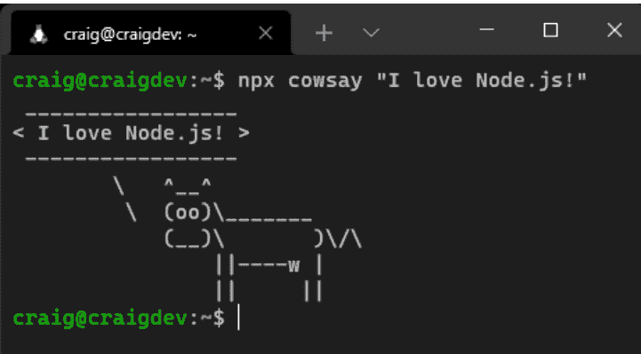

7-3. cowsay 包

第一次运行此命令时，将提示你同意下载。从以后，将使用 npm 缓存中的版本。

## npx 本地执行

当 eslint 或 rollup 等包在本地安装时，无法直接从命令行运行。如果本地安装了 ESLint，以下命令将失败：

```bash
eslint file.js
```

与其全局安装，不如通过定义 npm 脚本（参见下文“使用 npm Scripts”章节）或使用 npx 来运行本地包。此命令有效：

```bash
npx eslint file.js
```

## 列出包

要列出项目中安装的所有包，输入 `npm list`（或使用别名 Ls, La, 或 LL 代替 list）。

```bash
craig@cradev:~/apps/express-file$ npm list
express@1.0.0 /home/craig/apps/express-file
ejs@3.1.6
  express@4.17.1
  formidable@2.0.1
craig@cradev:~/apps/express-file$ 
```

7-4. npm list

旧版本的 npm 显示所有包和子包。添加 `--depth=0` 仅查看顶层安装：

```bash
npm list --depth=0
```

`--depth` 参数可以查看特定层级的依赖树。例如，`npm list --depth=1` 显示安装的包及其依赖，但不会更深。

# Node.js：从新手到大师

```bash
craig@cradev:~/apps/express-file$ npm list
express@1.0.0 /home/craig/apps/express-file
ejs@3.1.6
  express@4.17.1
  formidable@2.0.1
craig@cradev:~/apps/express-file$ 
```

（注：此处原文中似乎存在部分字符的重复或乱码，已根据逻辑进行了翻译并过滤了无效的重复字符）

## 如何使用 npm Node 包管理器

```bash
craig@craigdev:~/apps/express-file$ npm list
express@1.0.0 /home/craig/apps/express-file
- ejs@3.1.6
  └ express@4.17.1
  └ formidable@2.0.1

craig@craigdev:~/apps/express-file$ npm uninstall ejs
removed 15 packages, and audited 58 packages in 481ms

2 packages are looking for funding
run `npm fund` for details

found 0 vulnerabilities
craig@craigdev:~/apps/express-file$ npm list
express@1.0.0 /home/craig/apps/express-file
- express@4.17.1
  └ formidable@2.0.1

craig@craigdev:~/apps/express-file$ |
```

## 7-8. npm uninstall

`package.json` 会被更新，包将从 `dependencies` 或 `devDependencies` 部分中移除。不需要指定类型。

全局包可以使用 `--global` 标志移除。例如：

```bash
npm uninstall eslint --global
```

## 使用 npm 脚本

`package.json` 中的 "scripts" 部分列出了你可以在开发、测试、构建、部署等期间运行的有用别名。当你发现自己不断地重复输入相同的命令时，脚本就变得非常有用。

以 JavaScript 绑器 Rollup 为例，它可以从多个源文件构建一个单一的优化的客户端 JavaScript 文件。编译开发版本构建的命令很长。例如：

```
npx rollup --config --environment NODE_ENV:development --sourcemap --watch
  --no-watch.clearScreen
```

因此，它可以被定义为 `package.json` 中的一个脚本。例如：

```json
"scripts": {
  "rollup": "rollup --config --environment NODE_ENV:development --sourcemap\n  --watch --no-watch.clearScreen"
}
```

注意，命令中并不需要 npx，因为 npm 可以执行本地安装的包。

你现在可以使用 `npm run rollup` 来启动 rollup 命令了。

可以向 `package.json` 中添加任意数量的脚本，但每个脚本必须有一个唯一的名称。

## 特殊脚本

在适当的情况下可以定义以下脚本名称：

- "start": : 启动你的应用程序。你在之前的章节中用过它来启动 `nodemon index.js`。
- "test": : 使用 Mocha、Jest 或 AVA 等测试运行器在你的应用程序代码上运行测试。
- "stop": : 停止你的应用程序。只有当你的应用程序在后台运行时这可能才是必要的。我从未用过它！

不需要 `run` 命令，因此你可以通过 npm 启动这些脚本：`npm start`、`npm test` 和 `npm stop`。

## 前置后脚本 (Pre and Post Scripts)

任何脚本都可以具有以下一个或两个：

- 一个 "pre<name>" 脚本，在 "<name>" 之前自动运行
- 一个 "post<name>" 脚本，在 "<name>" 之后自动运行

例如：

```json
"scripts": {
  "prebuild": "rm -rf build",
  "build": "rollup --config",
  "postbuild": "echo build complete"
}
```

运行 `npm run build` 会按照上述顺序运行三个脚本。

## 生命周期脚本

npm 允许生命周期脚本，它们会在包发布期间（见下文“发布包”部分）或安装期间自动执行。保留的脚本名称有 `prepare`、`publish`、`prepublishOnly`、`prepack` 和 `postpack`。

你不太可能在自己的项目中使用这些，但请避免将这些名称用于其他用途。

## 高级脚本编写

npm 脚本简单但强大。开发者经常使用它们来代替 Grunt 和 Gulp 等专用的 JavaScript 任务运行器。

考虑以下脚本，用于清理构建目录然后使用（想象的）Node.js 工具生成 HTML、CSS 和 JavaScript：

```json
"scripts": {
  "clean": "rm -rf build",
  "build:html" : "sitegen /src/content/ ./build/ --compress",
  "build:css" : "cssgen /src/css/main.css --out ./build/css/",
  "build:js" : "jsgen /src/js/main.js ./build/js/main.js --minify"
}
```

单个构建脚本可以运行 `clean` 脚本，然后并行运行所有构建工具：

```json
"build" : "build && (build:html & build:css & js)"
```

执行 `npm build` 会在 bash shell 中执行所有任务。然而，它在 Windows 或不支持 `& &&` 命令链的的 shell 中将无法工作。

可以使用任务包如 `yall-scripts`、`concurrently` 或 `npm-run-all` 创建跨平台脚本。`rimraf` 包也可以替换 `rm` 命令。

你可以安装跨平台模块：

```bash
npm install yall-scripts rimraf --save-dev
```

然后更新 `package.json` 以使用它们：

```json
"scripts": {
  "clean": "rimraf build",
  "build:html" : "sitegen /src/content/ ./build/ --compress",
  "build:css" : "cssgen /src/css/main.css --out ./build/css/",
  "build:js" : "jsgen /src/js/main.js ./build/js/main.js --minify",
  "buildcode" : "yall --parallel build:*",
  "build" : "yall --sequential build*"
}
```

- 将你选择的包安装到项目中。
- 创建一个小型命令行应用程序，接收一个字符串和一个颜色参数。以该颜色输出该字符串。
- （可选地）将代码发布到 npm，然后将其作为全局包安装，以便你可以在从任何地方运行它。

本章的视频描述了在示例代码、npm 注册表和 GitHub 中提供的可用解决方案。

# 总结

本章扩展了你对 npm 的知识，使你能够在任何项目中查找、安装、更新、管理、发布和删除 Node.js 包。

下一章将介绍在 Node.js 应用中使用这些包以及自定义模块的选项。

# 测验

1. npm \14 help 可以通过以下方式获取：

- a. 在线文档
- b. npm help 命令
- c. 使用 `npm help <command>`
- d. 以上任意一项

2. Node.js 的 `package.json` 文件可以通过以下命令初始化：

- a. npm new
- b. npm init
- c. npm start
- d. 以上任意一项

## 如何使用 npm Node 包管理器

3. 你的项目 `package.json` 中的 "version" 目前是 "1.2.33"，你正在添加一个新功能（不会破坏向后兼容性）。新版本号应该是：

- a. 2.0.0
- b. 1.3.0
- c. 1.3.1
- d. 1.2.34

4. 如何安装一个包供你的项目使用？

- a. npm add <name> --local
- b. npm require <name>
- c. npm install <name>
- d. 以上任意一项

5. 如何列出项目中安装的所有包，而不查看任何子依赖项？

- a. npm List
- b. npm ll
- c. npm ls --depth=0
- d. 以上任意一项

6. 如何找到本地项目中有更新更新的包？

- a. npm outdated
- b. npm old
- c. npm newer
- d. npm update

# 第 8 章

## 使用 ES2015 和 CommonJS 模块

上一章解释了如何使用 npm 在多个 JavaScript 文件（或模块）之间查找并安装包。在本章中，我们将检查模块在 Node.js 中是如何被使用的。

> 先跳过？

> 本章的信息很重要，因为你可能会遇到与旧版 Node.js 包有关的问题。然而，本课程引用的所有包都经过了兼容性测试，所以你可以先跳过，并在最终遇到问题时返回！

模块提供了一种在一个文件中定义功能并在另一个文件中使用的方法。开发者通常会创建封装的代码库来处理相关任务。其益处包括：

- 代码可以拆分为具有自包含功能的小文件
- 相同的模块可以在任意数量的应用之间共享和复用
- 一旦模块被证明有效，就不再需要他人检查或更新
- 引用模块的代码了解它是一个必需的依赖项
- 模块防止命名冲突：`module1.js` 中的函数 `x()` 不会与 `module2.js` 中的函数 `x()` 冲突

奇怪的是，JavaScript 在其最初几年里并没有模块的概念。你不能直接在另一个文件中引用或包含一个 JavaScript 文件。客户端开发者通常会：

- 在 HTML 页面中添加多个 `<script>` 标签
- 将脚本合并成单个文件，可能使用如 `webpack` 这样的打包器或如 `Grunt` 和 `Gulp` 这样的任务运行器
- 使用如 `RequireJS` 或 `SystemJS` 等模块加载库——这些库都采用了如 `CommonJS`、`AMD` 或 `UMD` 等语法

当 Node.js 在 2009 年发布时，不支持模块将是不可想象的。CommonJS 语法被选为 Node.js 的模块标准，并为 npm 添加了支持。

## CommonJS

CommonJS 模块使用 `module.exports` 将函数或值公开可用。例如：

```javascript
// lib.js
const PI = 3.1415926;

// 相加值
function sum(...args) {
  log('sum', args);
  return args.reduce((num, tot) => tot + num);
}

// 乘法值
function mult(...args) {
  log('mult', args);
  return args.reduce((num, tot) => tot * num);
}

// 私有日志函数
function log(...msg) {
  console.log(...msg);
}

module.exports = { PI, sum, mult };
```

`require` 语句通过引用以下内容来包含模块：

- 它的相对文件路径（`./Lib.js`, `../Lib.js`）
- 完整文件路径（`/path/Lib.js`）
- 安装后的 npm 名称（`express`, `chalk` 等）

模块在脚本执行期间被引用的点被包含。

你可以 `require` 特定的命名导出项：

```javascript
const { sum, mult } = require('./lib.js');

console.log(sum(1,2,3,4)); // 10

console.log(mult(1,2,3,4)); // 24
```

或者你可以将所有导出项作为一个对象引入：

```javascript
const lib = require('./lib.js');

console.log(lib.PI); // 3.1415926

console.log(lib.sum(1,2,3,4)); // 10

console.log(lib.mult(1,2,3,4)); // 24
```

你也可以在引入时对项进行解构：

```javascript
const { sum, mult } = require('./lib.js');
```


console.log(`sum(1,2,3,4)`); // 10

console.log(`mult(1,2,3,4)`); // 24

# 使用 ES2015 和 CommonJS 模块

```javascript
// moduleWithDefault.js
export default function() { ... };
```

或者：

```javascript
// moduleWithDefault.js
function x() { ... };
export default x;
```

默认导出导入时不需要大括号，并且可以使用任何名称。例如：

```javascript
import myDefault from './moduleWithDefault.js';
```

这在实际上等同于：

```javascript
import { default as myDefault } from './moduleWithDefault.js';
```

使用 `import()` 函数可以动态加载模块（可能是从生成的值加载），该函数返回一个 promise。例如：

```javascript
const script = `./script${Math.round(Math.random() * 3)}.js`;
randomImport = await import(script);
```

这会影响性能，因为它使得代码验证变得困难。只有在没有其他选择时才使用 `import()` 函数——例如在应用程序启动后创建了导入的脚本。

Node.js 17 及以上版本还支持使用 `import()` 函数进行 JSON 加载和解析：

```javascript
import data from './data.json' assert { type: 'json' };
```

最后，ESM 支持顶层 `await`。例如：

```javascript
function waitOneSec() {
  return new Promise(
    (resolve) => setTimeout(resolve, 1000)
  );
}
await waitOneSec();
```

# CommonJS 和 ES2015 模块的比较

CommonJS 和 ES2015 模块语法表面上相似，但它们的工作方式不同：

- 每个 CommonJS `require` 引用一个文件，该文件在执行时按需加载。
- ESM `import` 引用一个 URL，该 URL 会提升并预解析以解析进一步的导入。这发生在你的代码执行之前。不直接支持或推荐动态导入模块。

考虑这个 ES2015 模块：

```javascript
// ESM two.mjs
console.log('running two');
export const hello = 'Hello from two';
```

它被以下脚本导入：

```javascript
// ESM one.mjs
console.log('running one');
import { hello } from './two.mjs';
console.log(hello);
```

这是运行 `node one.mjs` 的输出：

```
running two
running one
hello from two
```

现在考虑这个 CommonJS 模块：

```javascript
// CommonJS two.cjs
console.log('running two');
module.exports = 'Hello from two';
```

它被以下脚本引入：

```javascript
// CommonJS one.cjs
console.log('running one');
const hello = require('./two.cjs');
console.log(hello);
```

这是运行 `node one.cjs` 的输出：

```
running one
running two
hello from two
```

执行顺序在某些应用程序中至关重要——如果将 ES2015 和 CommonJS 模块混合在同一个文件中会发生什么？

ESM 在 Node.js 中支持花费多年。采用了以下方法来解决潜在的兼容性问题：

- CommonJS 是默认的（或在 `package.json` 中设置 `type="commonjs"`）。
- 任何带有 `.cjs` 扩展的文件都会被解析为 CommonJS。
- 任何带有 `.mjs` 扩展的文件都会被解析为 ESM。
- 运行 `node --input-type=module index.js` 会将入口脚本解析为 ESM。
- 在 `package.json` 中设置 `type="module"` 会将入口脚本解析为 ESM。

## 在 ES2015 中导入 CommonJS 模块

Node.js 可以将 CommonJS 模块导入 ESM 文件中。例如：

```javascript
import lib from './lib.cjs';
```

这通常运行良好，当出现问题时 Node.js 会提供语法建议。

## 在 CommonJS 中引入 ES2015 模块

你不能在 CommonJS 文件中引入 ESM 模块。ESM 模块异步加载，因此它们与 CommonJS 中的同步加载和执行不兼容。

解决此问题的方法之一是动态 `import()` 函数，它可以按需加载模块：

```javascript
// CommonJS script
(async () => {
  const lib = await import('./lib.mjs');
  // ... 使用 lib ...
})()
```

或者，`esm` 包提供了在 CommonJS 中导入 ESM 代码的方法。

本章的视频演示了如何交替使用 CommonJS 和 ESM 模块。

## 在浏览器中使用 ES2015 模块

此部分并非 Node.js 特有，但如果你正在开发一种同时在客户端和服务器端运行的 JavaScript 库（同构），则可能会有用。

浏览器异步加载 ES 模块并并在 DOM 准备好后延迟执行。它们按照每个 `<script>` 标签指定的顺序运行：

```html
<script type="module" src="./runfirst.js"></script>
<script type="module" src="./runsecond.js"></script>
```

或者按照内联导入指定的顺序：

```html
<script type="module">
import { something } from './somewhere.js';
// ...
</script>
```

不支持 ESM 的浏览器不会加载带有 `type="module"` 属性的脚本。支持 ESM 的浏览器不会加载带有 `nomodule` 属性的脚本：

```html
<script type="module" src="runs-when-ESM-supported.js"></script>
<script nomodule src="runs-when-ESM-not-supported.js"></script>
```

# Node.js: 从新手到大师

## 9-1. 单厨师餐厅

为了让你的餐厅更高效，请聘佣三位厨师：一个负责和面团，一个负责加配料，一个负责烘烤。厨师在不同的厨房里，无法互相交流，但当他们完成特定任务时，他们会向你汇报。

## 9-2. 多厨师餐厅

制作一个披萨仍然需要一小时（尽管三位厨师合作每小时可以准备好三个披萨）。重要的是，你不再需要参与烹饪过程。你只需向厨师传递指令，并在他们完成工作时接收警报。你可以随时在客户到达时接待他们的订单。

## Node.js 中的异步编程

JavaScript 和 Node.js 都是单线程的；运行时一次只能执行一件事。这就像一家只有一个主厨师的餐厅，不同的是 JavaScript 将输入/输出操作交给了操作系统内核（在并行运行的其它“厨师”）。Node.js 应用会启动一个文件写入、数据库读取或 HTTP 请求，但它不会等待该操作完成。相反，它请求在操作完成并可用成功或错误数据时运行回调函数。

## 9-3. Node.js I/O

## 回调的实践

考虑这段将文本写入文件的 PHP 代码：

```php
<?php
echo 'saving file';
$err = file_put_contents('file.txt', 'Hello from PHP');
if ($err != false) echo 'file saved';
echo 'processing complete';
?>
```

该程序输出如下：

```
saving file
file saved
processing complete
```

PHP 解释器处理 `file_put_contents()` 语句，并等待文件完全写入后才继续执行下一个命令。

这是 Node.js 中的等效代码：

```javascript
import { writeFile } from 'fs';
console.log('saving file');
writeFile('file.txt', 'Hello Node.js', 'utf8', err => {
  if (err) console.log('file saved');
});
console.log('processing complete');
```

该程序输出如下：

- saving file
- processing complete
- file saved

处理在文件保存*之前*就完成了！

传递给 `writeFile()` 的第四个参数是一个带有单个 `err` 参数的匿名 ES6 回调函数。当文件保存后（或保存失败并在 `err` 中抛出错误），回调就会运行。保存文件可能需要几毫秒，但它在后台运行，因此 `processingComplete` 会立即执行。

异步回调是所有客户端和服务端 JavaScript 应用的核心。

标准做法是处理错误，并将错误对象或字符串消息作为回调函数的*第一个*参数（如上面的 `err`）。当没有发生错误时，回调的第一个参数应该是 `null`、`undefined` 或任何其他假值。

## 事件循环

为什么上面的 Node.js 程序在最后一行代码执行后仍在继续运行？

所有的 Node.js 应用都会初始化一个事件循环。一旦最后一条语句完成执行，Node.js 就会循环并检查是否有任何待处理的：

- 计时器（如 `setTimeout`）
- 待处理的回调
- 轮询数据连接

这些任务按照接收到的顺序执行（称为“先进先出”，FIFO）。

如果一个看似空闲的应用正在等待某些操作完成，或者未来某个点可能发生某些事情（例如服务器在特定端口上*监听*），它将不会结束。

# 避免阻塞事件循环

> 运行时间很长的 JavaScript 计算或进程会阻塞事件循环，并延迟对传入请求的处理。计算密集型任务应该被：
- 结合计时器拆分为更小的子任务
- 使用 `worker thread` 或 `child process` 在后台运行（这些选项在第 12 章中进行了讨论）。

# 回调困境

在异步函数中使用回调并不总是容易的。你的代码可能看起来正确且运行无误，但最终会导致 Node.js 运行时崩溃。两个严重问题是：

- 回调后未终止异步函数
- 无意中使异步函数变成了同步函数
- 当 ms 不是数字、小于 1 或大于 3000 时发生错误
- 等待的 ms 值

这些问题通过示例来解释最好。考虑这个等待毫秒的简单异步函数：

```javascript
function wait(ms, callback) {
  setTimeout(callback, ms);
}
// 等待一秒
wait(1000, () => {
  console.log('waited 1000ms');
});
```

让我们通过向回调返回以下参数来改进该函数。我们的初始实现：

```javascript
function wait(ms, callback) {
  ms = parseFloat(ms);
  // 无效的 ms 值
  if (!ms || ms < 1 || ms > 3000) {
    const err = new Error('Invalid ms value');
    callback(err);
  }
  // 回调前等待
  setTimeout(callback, ms);
}
```

```javascript
setTimeout(callback, null, ms);
// 调用 wait
wait(500, (err, ms) => {
  if (err) console.log(err);
  else console.log('waited ms');
});
```

执行返回预期的等待 500ms 结果。然而，当我们传递一个无效的 ms 值时会发生什么？

我们得到了预期的错误，但 `setTimeout` 也运行了，我们看到了 waited ms。回调函数执行是因为函数在发生错误时没有终止。我们可以通过在错误发生时终止来解决这个问题：

```javascript
function wait(ms, callback) {
  ms = parseFloat(ms);
  // 无效的 ms 值
  if (!ms || ms < 1 || ms > 3000) {
    const err = new Error('Invalid ms value');
    callback(err);
    return;
  }
  // 回调前等待
  setTimeout(callback, ms);
}
```

异步回调是所有客户端和服务端 JavaScript 应用的核心。

标准做法是处理错误，并将错误对象或字符串消息作为回调函数的*第一个*参数（如上面的 `err`）。当没有发生错误时，回调的第一个参数应该是 `null`、`undefined` 或任何其他假值。

还有一个微妙的问题：*回调在错误发生时立即运行。*在那个点，函数不再是异步的——而是同步的。这不会引起明显的问题，但在较大的 Node.js 应用中会导致内存泄漏。你的应用最终会导致“内存溢出”错误。

> 回调必须是 100% 同步或 100% 异步
解决此问题的简单方法是 `setImmediate()`。它在事件循环的下一次迭代中调用函数：

```javascript
function wait(ms, callback) {
  ms = parseFloat(ms);
  // 无效的 ms 值
  if (!ms || ms < 1 || ms > 3000) {
    const err = new RangeError('Invalid ms value');
    setImmediate(callback, err);
    return;
  }
  // 回调前等待
  setTimeout(callback, null, ms);
}
```

## process.nextTick()

你可能会在某些应用中使用 `process.nextTick(callback)`。这与 `setImmediate()` 类似，但回调在当前事件循环结束之前运行。如果递归调用 `nextTick()`，可能会导致事件循环永远重启。

# 回调地狱

在复杂的 Node.js 应用中，你通常会进行一系列异步函数调用——例如从数据库获取内容、调用 API、加载文件等。回调可能只在一个地方使用，因此声明一个内联匿名函数是合理的。这会迅速陷入深度嵌套的回调地狱：

```javascript
wait(100, (err) => {
  console.log('wait 1');
  wait(200, (err) => {
    console.log('wait 2');
    wait(300, (err) => {
      console.log('wait 3');
    });
  });
});
```

有语法方法可以扁平这种结构，通常是通过命名每个函数并确保每个按顺序调用。幸运的是，JavaScript 神通过 Promise 解决了这个问题。

## Promise

Promise 对象代表异步操作的最终完成或失败及其结果值。Promise 提供了更清晰的语法，更容易链式执行顺序执行的异步调用。开发者还可以避免之前章节中提出的回调问题。

Promise 在 ES6/2015 中引入，它们是语法糖；底层仍在使用回调。要使函数变为异步，必须立即返回一个 Promise 对象。Promise 构造函数接收两个回调函数作为参数：

- resolve : 处理成功完成时运行的函数
- reject : 发生错误时运行的函数

```javascript
function pWait(ms) {
  ms = parseFloat(ms);
  return new Promise((resolve, reject) => {
    if (!ms || ms < 1 || ms > 3000) {
      reject(new RangeError('Invalid ms value'));
    } else {
      setTimeout(resolve, ms, ms);
    }
  });
}
```

## util.promisify()

`util.promisify()` 将任何以第一个参数为错误的回调函数转换为 promise。你不需要重写 `wait()`，而是可以创建一个名为 `pWait()` 的 promise 替代方案：

```javascript
import { promisify } from 'util';
const pWait = promisify(wait);
```

任何返回 promise 的对象都可以拥有：

- 一个 `then()` 方法，它接收的函数接收上一个 `resolve()` 传递的结果
- 一个 `catch()` 方法，它接收的函数会在任何 `reject()` 返回错误时运行
- 一个 `finally()` 方法，无论结果如何最后都会被调用

```javascript
pWait(100)
  .then(ms => console.log(`waited ${ms}`))
  .catch(err => console.log(`err`))
  .finally(() => console.log(`all done`));
```

每个 `.then()` 函数都可以返回一个值或另一个 promise，以便顺序的异步函数调用可以链式执行。例如：

```javascript
pWait(100)
  .then(ms => {
    console.log(`waited ${ms}`);
    return pWait(ms + 100);
  })
  .then(ms => {
    console.log(`waited ${ms}`);
    return pWait(ms + 100);
  })
  .then(ms => {
    console.log(`waited ${ms}`);
  })
  .catch(err => {
    console.log(err);
  });
```

### 9-6. Promise 调用链

## then() 函数被 promise 化了

代码中的最后一个 `then()` 运行一个同步函数，但 JavaScript 会自动将其转换为基于 promise 的异步函数，因此你可以在需要时追加更多的 `then()` 方法。

## 并行 Promise

上面的示例按顺序执行每个异步函数调用。只有当上一个函数的结果需要作为下一个函数的输入时，这种顺序才是必要的。

你经常会遇到需要多个异步函数但它们之间互不相关的情况。例如，给定一个书籍 ID（如 ISBN），你想：

- 从本地数据库检索书籍信息，如标题、作者等（`getBook(ID)`）
- 调用库存控制系统 API 来确定有多少本书（`getStock(ID)`）
- 从出版社获取最新的建议零售价（`getPrice(ID)`）

假设每个函数返回一个 promise，其中 `resolve()` 返回一个信息对象。

下面的 promise 链可以工作，但效率很低，因为每个操作都是顺序执行的：

```javascript
// 书籍数据对象
const bookData = { id: 123 };
getBook(bookData.id)
  .then(book => {
    bookData.title = book.title;
    bookData.author = book.author;
    bookData.description = book.description;
    getStock(bookData.id);
  })
  .then(stock => {
    bookData.stock = stock;
    getPrice(bookData.id);
  })
  .then(price => {
    bookData.price = price;
  })
  .catch(err => {
    console.log(err);
  });
```

更好的选项是 `Promise.all()`，它接收一个 promise 数组，并行运行每个 promise，并返回一个新的外部 promise，其中 `resolve()` 返回一个顺序相同的输出值数组。它的速度与最慢的函数一样：

```javascript
// 书籍数据对象
const bookData = { id: 123 };
Promise.all([
  getBook(bookData.id),
  getStock(bookData.id),
  getPrice(bookData.id)
])
  .then(result => {
    bookData.title = result[0].title;
    bookData.author = result[0].author;
    bookData.description = result[0].description;
    bookData.stock = result[1];
    bookData.price = result[2];
  })
  .catch(err => {
    console.log(err);
  });
```

当任何一个 promise `reject()` 运行时，`.catch()` 就会被触发，因此任何挂起的 promise 都会被终止。

类似的选项包括：

- `Promise.allSettled()`
  运行数组中的所有 promise，并等待每一个 promise 都已 resolve 或 reject。返回数组中的每个项都是一个具有 `.status` 属性（为 'fulfilled' 或 'rejected'）和带有返回值的 `.value` 属性的对象。

- `Promise.any()`
  运行数组中的所有 promise，但一旦第一个 promise resolve 就会立即 resolve。返回一个单一值。

- `Promise.race()`
  运行数组中的所有 promise，但一旦第一个 promise resolve 或 reject 就会立即 resolve 或 reject。返回一个单一值。

## Promise 的问题

Promise 有助于防止回调地狱，但我起初觉得它们很困惑，而且很容易弄乱 `.then() / .catch()` 链语法。你还应该注意整个 promise 链是……

## async/await

ES2017 引入了 `async` 和 `await` 关键字，使得能够以更简洁的方式编写异步行为。这是否会导致更具读性的代码是另一回事。

一个难以阅读的 promise 链：

```javascript
pWait(100)
  .then(ms => {
    console.log(`waited ${ms}`);
    return pWait(ms + 100);
  })
  .then(ms => {
    console.log(`waited ${ms}`);
    return pWait(ms + 100);
  })
  .then(ms => {
    console.log(`waited ${ms}`);
  })
  .catch(err => {
    console.log(err);
  });
```

使用 `async/await` 的等效写法：

```javascript
(async () => {
  try {
    const p1 = await pWait(100);
    console.log(`waited ${p1} ms`);
    const p2 = await pWait(p1 + 100);
    console.log(`waited ${p2} ms`);
    const p3 = await pWait(p2 + 100);
    console.log(`waited ${p3} ms`);
  } catch (err) {
    console.log(err);
  }
})();
```

## Node.js 中的异步编程

上面的代码在模块中有效，但在 CommonJS 中，你必须将其封装在立即执行函数表达式（IIFE）中：

```javascript
(async () => {
  try {
    const p1 = await pWait(100);
    console.log(`waited ${p1} ms`);
    const p2 = await pWait(p1 + 100);
    console.log(`waited ${p2} ms`);
    const p3 = await pWait(p2 + 100);
    console.log(`waited ${p3} ms`);
  } catch (err) {
    console.log(err);
  }
})();
```

## 同步循环中的异步 await

注意在 forEach 等循环方法中使用 `await`……

```javascript
const ms = [100, 200, 300];
let totalWait = 0;
ms.forEach(async i => {
  console.log(i);
  const w = await pWait(i);
  console.log(`waited ${w} ms`);
  totalWait += w;
});
console.log(`total wait time: ${totalWait}ms`);
```

你可能期望看到以下输出：

```
100
waited 100ms
200
waited 200ms
300
waited 300ms
total wait time: 600ms
```

实际结果是令人惊讶的，如下图所示。

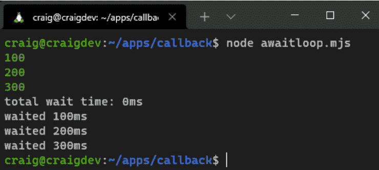

### 9-7. await 循环的输出

循环的每次迭代都会 `await` 直到完成为止。如果下一次调用需要上一个 `await` 的结果，这将成为一个问题。

可能需要标准的 `for()`、`while()` 和 `async` 迭代器循环。上面的代码可以通过以下方式修复：

```javascript
const ms = [100, 200, 300];
let totalWait = 0;
for (let i = 0; i < ms.length; i++) {
  console.log(ms[i]);
  const w = await pWait(ms[i]);
  console.log(`waited ${w} ms`);
  totalWait += w;
}
```

结果如下图所示。

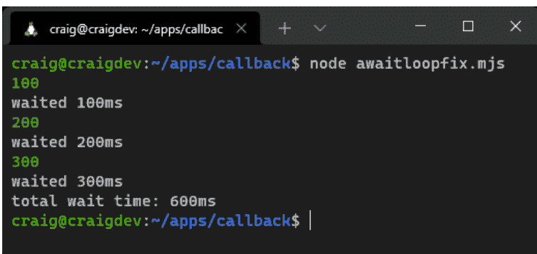

### 9-8. await 循环的修复

## 练习

编写一个小型应用程序，使用以下 REST URL 请求从 Open Trivia Database 获取三个随机问题：

- 常识：
  https://opentdb.com/api.php?type=multiple&amount=1&category=9

- 计算机：
  https://opentdb.com/api.php?type=multiple&amount=1&category=18

- 小道具：
  https://opentdb.com/api.php?type=multiple&amount=1&category=30

> HTTP 请求
> 除非你使用 Node.js 18 或更高版本（它提供了原生的 Fetch() API），否则你需要一个第三方 HTTP 请求模块，例如 node-fetch。

将问题数据格式化为单个数组，并以 JSON 格式输出到名为 `questions.json` 的文件中。

为了加分，请通过并行运行所有 URL 请求来让你的应用程序更高效。

本章视频演示了解决方案。

# 总结

异步编程需要一些时间来理解，并且会让你出错。以下提示将帮助你编写更健壮的 Node.js 应用程序。

- 确保 JavaScript 函数运行快速且不阻塞事件循环。
- 将回调函数传递给异步函数，以便在操作完成时调用它们。
- 回调函数的第一个参数必须是一个错误对象或字符串消息。
- 始终确保某个函数在回调运行之后发生。
- 异步函数必须是 100% 异步的：不应有任何路径会导致立即回调。如有必要，将回调传递给 `setImmediate()` 以在事件循环的下次迭代中运行它。
- 学习如何创建自己的函数，或者使用 `util.promisify()` 从基于回调的函数创建它们。
- 你可以在 `async` 函数内部 `await` 等待 promise 完成。在可能的情况下，使用 `Promise.all()` 或 `Promise.allSettled()` 等选项并行运行 promise。

有用链接：

- Node.js 事件循环
- 不要阻塞事件循环（或工作池）
- MDN promise 文档
- MDN `async` 和 `await`
- *JavaScript: Novice to Ninja* 第 11 章的“Promises”和“Async functions”部分
- *JavaScript: The New Toys* 第 8 章和第 9 章

# 测验

1. 回调函数：
   - a. 在操作开始前运行
   - b. 调用异步函数
   - c. 在异步操作完成后被调用
   - d. 以上都是

2. 异步函数：
   - a. 在稍后的时间完成
   - b. 允许后续的 JavaScript 命令执行
   - c. 可以通过回调、promise 或 `async` 实现
   - d. 以上都是

3. Node.js 事件循环：
   - a. 在存在未完成的计时器或回调时重新运行
   - b. 运行异步函数
   - c. 是回调的另一个名称
   - d. 以上都不是

4. Promise 对象通过运行以下项来完成：
   - a. 一个 resolve 或 reject 函数
   - b. 一个 fulfilled 或 error 函数
   - c. 一个 resolve 或 error 函数
   - d. 一个 fulfilled 或 reject 函数

5. 异步函数（async）：
   - a. 可以使用 await 调用基于 promise 的函数
   - b. 返回一个 promise
   - c. 使用 try / catch 块处理错误
   - d. 以上都是

# 第 10 章
## 数据库存储

之前的章节解释了影响所有 Node.js 应用程序的编程实践。本章将这些基础应用于使用 MongoDB 和 MySQL 等数据库解决方案进行数据存储特定挑战。

Web 应用程序通常需要在页面加载和应用程序重启之间持久数据。考虑像 WordPress 这样的内容管理系统：它存储文章、元数据、媒体、用户配置、评论、设置、插件配置等。多个用户可以随时登录查看并更新内容。

数据持久化的最常用解决方案是 MongoDB、MySQL 或 PostgreSQL 等数据库。所有数据库系统都有相同的目的：*提供快速且频繁的数据。*

> 跳过？
> 数据库可能不是最有趣的话题，但它是前端和后端工程之间最显著的区别之一。你可以跳过关于特定系统的章节，但如果没有某些数据库知识，后面的章节将难以理解。

# 数据库驱动的 Web 应用程序示例

下面的章节解释了如何创建一个页面访问计数服务。你的祖父母会告诉你它们在 90 年代有多流行。

# 使用数据库存储

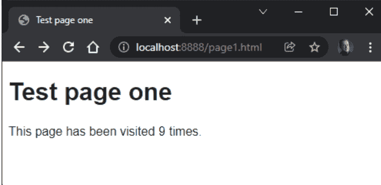

### 10-1. 网页页面访问计数器

使用访问计数器的页面包含此：

```html

```

注意图像是由浏览器请求的。服务器接收请求，增加数据库中的计数并返回带有当前计数的图像。这是一种在不需要复杂的客户端逻辑的情况下跟踪的简单方法（文本似乎在下一页继续）。

服务器端代码应该：
- 提取请求信息。
- 增加数据库中的计数。
- 返回带有更新计数的图像。

# Node.js: 从新手到忍者

```json
{
  "work": "2-01234567890",
  "iPhone": "3-01234567890",
  "Android phone": "4-01234567890",
  "Test phone": "5-01234567890"
}
```

# 启动 MongoDB

要使用此基于 MongoDB 的应用程序，请进入 `pagehit-mongodb` 目录并使用 `docker-compose up` 启动 MongoDB 和 Adminer 客户端。

- 你自己的 MongoDB 安装：

数据库配置参数定义在项目的 `.env` 文件中。它配置了 Docker，Node.js 应用通过 `dotenv` 模块读取这些配置。

如果你使用的是自己安装的 MongoDB，请编辑 `.env` 文件并相应地更改配置参数。在大多数情况下，只需要更改根用户的密码（`MONGO_INITDB_ROOT_PASSWORD`）。

在另一个终端中，安装 `package.json` 中引 Node.js express、mongodb 和 dotenv 依赖项：

```bash
npm install
```

然后启动 page hit 应用：

```bash
npm start
```

最后，在另一个终端启动 Web 服务器，以便对页面进行负载测试：

```bash
npx small-static-server 8888 ./test
```

你现在已经运行了四个服务：

- 位于 `http://localhost:27017` 的 MongoDB 数据库
- 位于 `http://localhost:8080/` 的 Adminer 数据库客户端
- 位于 `http://localhost:8001/` 的 page hit 服务
- 位于 `http://localhost:8888/` 的测试页面 Web 服务器

如果有冲突，可以在 `.env` 文件中定义不同的端口。

访问 `http://localhost:8888/page1.html` `http://localhost:8888/page2.html` 查看页面计数。刷新并观察计数器的增加。

你可以使用 `http://localhost:8080/` 的 Adminer 面板检查数据库数据。使用 `.env` 中指定的凭据登录：

- 系统：MongoDB
- 服务器：host.docker.internal（如果未使用使用 Desktop，则使用你的网络 IP 地址）
- 用户名：root
- 密码：rootopoprw
- 数据库：pagehitmongo

## 10-2. Adminer 登录

点击 *hit* 集合，然后点击 **Select data.**。

# 使用数据库存储

## 10-3. Adminer 数据

观看本章视频以查看代码运行情况。

# MongoDB 功能

`Lib/pagehit.js` 处理所有的 MongoDB 功能。它加载所需的模块并使用 `dotenv` 模块从 `.env` 文件中提取配置参数：

```javascript
import dotenv from 'dotenv';
import { MongoClient } from 'mongodb';
import httpReferrer from './httpreferrer.js';
// 加载 .env 配置
dotenv.config();
```

你需要一个 Node.js 包来与数据库通信。这些通常被称为数据库客户端、连接器或驱动程序，这里使用了 MongoDB 原生驱动。它提供了低级方法来构建和执行任何 MongoDB 命令。

连接字符串被传递给 `MongoClient` 驱动构造函数，它设置了数据库的名称、密码、主机和端口。调用异步的 `.connect()` 方法来建立连接：

```javascript
// 连接到 MongoDB
const client = new MongoClient(`mongodb://${process.env.MONGO_INITDB_ROOT_USER}:${process.env.MONGO_INITDB_ROOT_PASSWORD}@${process.env.MONGO_INITDB_HOST}:${process.env.MONGO_INITDB_PORT}/`,
  {useNewUrl: true, useUnifiedTopology: true}
);
await client.connect();
```

代码连接到特定的数据库（pagehitmongo）并引用了 `hit` 集合供以后使用（集合是一组类似 JSON 的类似文档）：

```javascript
const db = client.db(process.env.MONGO_INITDB_DATABASE);
const hit = db.collection('hit');
```

MongoDB 允许你向集合中的文档任意添加数据，而无需预先描述这些数据（尽管可以定义模式以便从数据验证中受益）。但是，你应该定期查询值以使搜索更快、更高效。

# 什么是数据库索引？

索引是一个或多个字段中按特定顺序的数据列表——就像书的索引一样。例如，你可以在每人注册时创建一个 `user` 记录。当有人登录时，你必须通过其电子邮件地址定位用户的记录：

- 如果没有索引，数据库必须逐个搜索每个 `user` 记录，直到找到正确的电子邮件。
- 如果 `email` 字段上有按字母升序排列的索引，数据库可以更快地定位匹配的记录。

索引应该使用在你经常查询的字段上。在每个字段上创建索引很有诱惑力，但添加的索引越多，写入新记录和更新所有索引的时间就越长。

`hit` 集合在 URL `hash` 和 `time` 上创建了一个索引。这在每次应用程序启动时都会运行，但在第一次尝试后就会被忽略：

```javascript
// 添加集合索引
await hit.createIndex({hash: 1, time: 1});
```

`Lib/page.js` 导出一个单一默认异步函数。它从引用页的 URL 生成 `hash`，但在未找到引用页（referrer）时返回 `null`：

```javascript
// 计数处理程序
export default async function(req) {
  // 引用 URL 的哈希
  const hash = httpReferrer(req);
  // 没有引用页？
```

以下是 Publisher 表：

| id | name | country |
| :--- | :--- | :--- |
| 1 | SitePoint | AU |

你可以在 book 表引用这些 ID：

| id | title | author_id | publisher_id |
| :--- | :--- | :--- | :--- |
| 1 | Introduction to Node.js | 2 | 1 |
| 2 | Jump Start Web Performance | 2 | 1 |
| 3 | DevTool Secrets | 2 | 1 |
| 4 | Learn to Code with JavaScript | 3 | 1 |

如果出版社更改了名称或地址，你可以更新 publisher 表中的数据，而不影响相关的书籍记录。

SQL 简要概述：

- 在存储数据之前，必须定义数据库表结构。
- SQL 提供了简单的声明式 CRUD 操作，如 INSERT、SELECT、UPDATE 和 DELETE，但它也足够处理复杂操作。
- 查询通过 JOIN 表可以在单条命令中检查相关数据。
- 可以强制数据完整性和关系。例如，如果作者拥有一本或多本书，则无法删除该作者。
- 大多数系统可以将多次更新封装在单个事务中。如果某个操作失败，数据将回滚到第一次更新之前的状态。
- SQL 是一个相当松散的标准。不同的关系型数据库管理系统实现了类似的语法，但功能和语法可能有所不同。
- SQL 最初设计于 20 世纪 70 年代，因此软件、文档和资源丰富。

其他流行的 SQL 数据库包括 MariaDB、PostgreSQL、SQLite、Microsoft SQL Server 和 Oracle。

# 启动 MySQL

要使用基于 MySQL 的应用程序，导航到 `pagehit-mysql` 并使用 `docker-compose up` 启动 MySQL 和 Adminer 客户端。

> ### 你自己的 MySQL 安装！

与之前，数据库配置参数定义在项目的 `.env` 文件中，如果你使用的是自己的 MySQL 安装，可以编辑它。

Docker 会自动运行 `mysql/init.sql` 脚本来初始化数据库表和索引。你必须在启动 Node.js 之前手动运行它，可以在 MySQL 客户端中运行它，也可以使用终端命令：

```bash
mysql -h localhost -u pageuser pagehitmysql < mysql/init.sql
```
（根据需要更改主机、用户或数据库名称。）

在另一个终端中，安装 `package.json` 中引用的 Node.js `express`、`mysql2` 和 `dotenv` 依赖：

```bash
npm install
```

然后启动 page hit 应用：

```bash
npm start
```

最后，在另一个终端启动 Web 服务器以便加载页面进行测试：

```bash
npx small-static-server 8888 ./test
```

你现在有四个服务正在运行：

- 位于 http://localhost:3306 的 MySQL 数据库
- 位于 http://localhost:8080/ 的 Adminer 数据库客户端
- 位于 http://localhost:8001/ 的 page hit 服务
- 位于 http://localhost:8888/ 的测试页面 Web 服务器

如果有冲突，可以在 .env 文件中定义不同的端口。

访问 http://localhost:8888/page1.html http://localhost:8888/page2.html 查看页面计数。刷新并观察计数增加。

你可以使用 http://localhost:8080/ 的 Adminer 面板检查数据库数据。使用 .env 中指定的凭据登录：

- 系统 (System): MySQL
- 服务器 (Server): host.docker.internal (如果没有使用 Docker Desktop，则使用网络 IP 地址)
- 用户名 (Username): pagehituser
- 密码 (Password): pagehitpw
- 数据库 (Database): pagehitmysql

# Node.js: 从入门到忍者

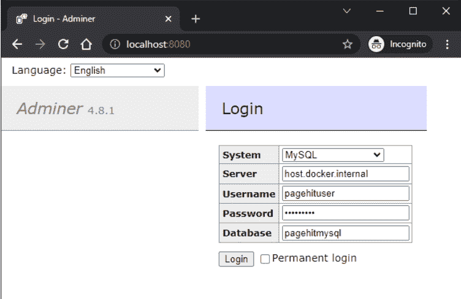

## 10-4. Adminer 登录

然后点击 hit 表旁边的 select。

# 使用数据库存储

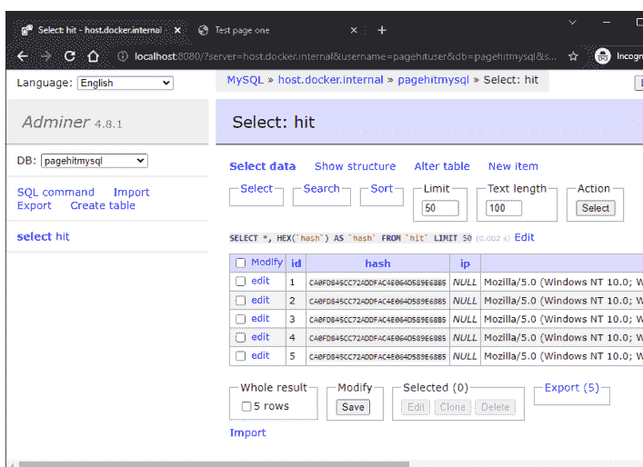

## 10-5. MySQL 功能

在定义数据结构（架构）之前，你无法在 SQL RDBMS 中存储数据。MySQL 数据库架构定义在 `mysql/init.sql` 中，它在使用 Docker 时会自动运行。

```sql
-- MySQL 数据库初始化
USE pagemysql;
CREATE TABLE IF NOT EXISTS hits (
  id bigint unsigned NOT NULL AUTO_INCREMENT COMMENT 'record ID',
  hash binary(20) NOT NULL COMMENT 'URL hash',
  ip int(4) unsigned DEFAULT NULL COMMENT 'client IP address',
  ua varchar(200) DEFAULT NULL COMMENT 'client useragent string',
  time timestamp NOT NULL DEFAULT CURRENT_TIMESTAMP COMMENT 'hit time',
  PRIMARY KEY (id),
  KEY hash_time (hash, time)
) ENGINE=InnoDB CHARSET=utf8 COMMENT='page hits';
```

# 205 Node.js: 从入门到忍者

`lib/pagehit.js` 文件处理所有的 MySQL 功能。它加载所需的模块并使用 `dotenv` 模块从 `.env` 文件中提取配置参数：

```javascript
import dotenv from 'dotenv';
import mysqlPromise from 'mysql2/promise';
import httpReferrer from './referrer.js';
// 加载 .env 配置
dotenv.process();
```

选择了 mysql2 驱动用于 MySQL 通信。基于 promise 的低级方法用于构建和执行：

```javascript
const db = mysqlPromise.createPool({
  host: process.env.MYSQL_HOST,
  user: process.env.MYSQL_USER,
  password: process.env.MYSQL_PASSWORD,
  database: process.env.MYSQL_DATABASE,
  waitForConnections: true,
  connectionLimit: 10,
});
```

从数据库的表示中保存并恢复。

sequelize 是一个流行的 Node.js ORM，支持 MySQL、MariaDB、PostgreSQL、SQLite、SQL Server 以及其他 SQL 数据库。它仍然需要原生数据库驱动程序（如 mysql），但不需要编写 SQL 语句。

# 启动 Sequelize ORM

要使用基于 ORM 的应用程序，请导航到 pagehit-orm 目录并使用 `docker-compose up` 启动 MySQL 和 Adminer 客户端。

> ### 你有自己的 MySQL 安装？
与之前一样，数据库配置参数定义在项目的 .env 文件中，如果你使用的是自己的 MySQL 安装，可以编辑它。在这种情况下，没有初始化脚本，它由 Node.js 代码处理。

在另一个终端中，安装 `package.json` 中引用的 Node.js express、sequelize、mysql2 和 dotenv 依赖：

```
npm install
```

然后启动 page hit 应用程序：

```
npm start
```

最后，在另一个终端中启动 Web 服务器，以便你对页面进行负载测试：

```
npx small-static-server 8888 ./test
```

你现在有四个正在运行的服务：

# 使用数据库存储

位于 http://localhost:3306 的 MySQL 数据库

位于 http://localhost:8080/ 的 Adminer 数据库客户端

位于 http://localhost:8001/ 的 page hit 服务

位于 http://localhost:8888/ 的测试页面 Web 服务器

如果发生冲突，可以在 .env 文件中定义不同的端口。

访问 http://localhost:8888/page1.html 或 http://localhost:8888/page2.html 查看页面计数器。刷新并观察计数器的增加。

你可以使用 http://localhost:8080/ 的 Adminer 面板检查数据库。使用 .env 中的凭据登录：

- 系统：MySQL
- 服务器：host.docker.internal（如果没有使用 Docker Desktop，则使用你的网络 IP 地址）
- 用户：pagehituser
- 密码：pagehitpw
- 数据库：pagehitorm

然后点击 hits 表旁的 select。

# Sequelize ORM 功能

Lib/pagehit.js 文件处理所有的 Sequelize 功能。它加载了所需的模块，并使用 `dotenv` 模块从 .env 文件中提取配置参数：

```javascript
import dotenv from 'dotenv'
import Sequelize from 'sequelize';
import HTTPRefer from './httpreferrer.js'
// 加载 .env 配置
dotenv.config();
```

(不需要导入 mysql2 模块，因为 Sequelize 会加载它。)

# 211 Node.js：从新手到忍者

数据库名称、用户和密码连接参数被传递给 Sequelize 对象构造函数。第四个选项对象定义了数据库类型、主机和端口：

```javascript
// 初始化 ORM 连接
const sequelize = new Sequelize(
  process.env.MYSQL_DATABASE,
  process.env.MYSQL_USER,
  process.env.MYSQL_PASSWORD,
  {
    host: process.env.MYSQL_HOST,
    port: process.env.MYSQL_PORT,
    dialect: 'mysql'
  }
);
```

与其定义一个表，不如从 Sequelize.Model 类创建一个 JavaScript 类。静态方法 `init()` 定义了属性类型和索引（注意，每个模型都有默认的 id、createdAt 和 updatedAt 日期）：

```javascript
// 定义 Hit 类
class Hit extends Sequelize.Model
Hit.init({
  hash: {
    type: Sequelize.STRING(32),
    allowNull: false
  },
  ip: {
    type: Sequelize.STRING(15),
    allowNull: true
  },
  ua: {
    type: Sequelize.STRING(200),
    allowNull: true
  }
}, {
  indexes: [
    { fields: ['hash', 'createdAt'] }
  ],
  sequelize,
  modelName: 'hit'
}
);
```

异步 `sync()` 方法将所有数据模型与数据库同步。在这种情况下，根据 Hit 模型定义了一个 hits 表：

```javascript
// 将模型与数据库同步
await sequelize.sync();
```

与之前一样，Lib/pagehit.js 导出一个单一默认异步函数。它从引用页的 URL 生成哈希，在未找到引用页时返回，并确定浏览器的 IP 地址 (ip) 和用户代理 (ua)：

```javascript
// 计数处理器
export default async function(req) {
  // 引用 URL 的哈希
  const hash = httpReferrer(req);
  // 没有引用页？
  if (!hash) return null;
  // 获取浏览器 IP 地址和用户代理
  const ipRe = req.ip.match(/(?:\d{1,3}\.){3}\d{1,3}/),
  ip = ipRe?.[0] || null,
  ua = req.get('User-Agent') || null;
```

使用数据创建一个新的 Hit 记录：

```javascript
try {
  // 存储页面访问
  await Hit.create(
    { hash, ip, ua }
  );
```

返回所有具有相同 *hash* 的项的计数：

```javascript
// 获取页面访问计数
const res = await Hit.findAndCount({
  where: { hash }
});
return res?.count;
```

如果任何操作失败，则会抛出异常：

```javascript
}
catch (err) {
  throw new Error('DB error', { cause: err });
}
```

与之前一样，主文件 *index.js*。

## 如何选择数据库

当需求定义明确时（例如银行、电子商务和分析），SQL 数据库是最佳选择。

NoSQL 数据库对于灵活性重要的项目可能是理想选择（例如内容管理、社交网络和搜索）。

## 原生 vs ORM

将 ORM 视为一个抽象框架。其优点包括：

- 它们可能比特定的 SQL 或 NoSQL 方言更容易学习。
- 开发时间缩短了，因为良好的 ORM 会管理安全性和数据完整性。
- 你可以在应用程序中创建数据模型。不需要直接创建或更改表。
- ORM 跟踪更改并根据需要进行迁移。
- ORM 支持多个数据库，如果你正在发布网络软件，这可能很重要。

ORM 的缺点：

- 它们可能仍然很难学习。Sequelize 手册令人望而生畏，而且这些知识在其他地方并不适用。
- ORM 无法防止你糟糕的数据决策。
- 复杂的查询将难以表达。
- ORM 速度较慢，查询不一定经过优化。
- 你将无法使用特定数据库提供的高级选项。
- 与数据库相关的 bug 可能难以调试。

ORM 对于原型和小型项目可能是理想的。对于数据需求更关键的大型项目，使用经过优化的手工查询的原生驱动更好。

## 练习

修改任何页面访问计数器项目，使不同的路由能够返回：

- 24 小时内的页面访问量。
- 来自当前 IP 地址的页面访问。
- 来自同一浏览器（Chrome、Edge、Safari、Firefox 等）。这很棘！浏览器用户字符串会故意模糊信息！

# 总结

数据库是 Web 应用程序的核心技术。如果你的数据库运行良好，无论你使用什么来编写业务逻辑并不重要。

## 使用数据库存储

Node.js, PHP, Python, Ruby 或 .NET。

你需要从某个处开始，因此请选择一个数据库并创建示例项目。选择带有原生驱动程序的 SQL 数据库会有陡峭的学习曲线，但*这会让你成为一名更出色的开发者*。

SQL 和 NoSQL 资源：

- * Simply SQL
- “SQL vs NoSQL：区别”
- “SQL vs NoSQL：如何选择”

MongoDB 资源：

- * MongoDB 官网、文档、下载和 Docker 镜像
- “MongoDB 简介”
- mongo-express (Docker 镜像), Mongoku (Docker 镜像) 以及 Robo 3T 客户端
- mongod 和 mongoose Node.js 数据库驱动程序

MySQL 资源：

- * MySQL 官网、文档、下载和 Docker 镜像
- “如何安装 MySQL”
- phpMyAdmin (Docker 镜像) MySQL 客户端
- mysql, mysql2 和 sequelize ORM Node.js 数据库驱动程序
- “使用 Node.js 和 mysql JavaScript 使用 MySQL”

你也可以使用兼容 MySQL 的 MariaDB 数据库系统：文档、下载、Docker 镜像以及 mariadb Node.js 模块。

PostgreSQL 资源：

- * PostgreSQL 官网、文档、下载和 Docker 镜像
- Adminer (Docker 镜像) 以及其他 PostgreSQL 客户端
- node-postgres, postgres 和 Sequelize ORM Node.js 数据库驱动程序

SQLite 是一个小型、免费、基于文件的 SQL 数据库引擎。它不适用于繁忙的网站，但可以是演示项目、系统、桌面和移动应用的理想选择。

- SQLite 官网、文档和下载
- better-sqlite3, sqlite, sqlite 和 Sequelize ORM Node.js 数据库驱动程序

## 测验

1. SQL 的全称是：

- a. Simple Query Language（简单查询语言）
- b. Structured Query Language（结构化查询语言）
- c. Statistical Query Language（统计查询语言）
- d. Small & Quick Language（小型快速语言）

2. MySQL 数据库表可以存储：

- a. 表数据
- b. JSON 数据
- c. XML 数据
- d. 以上所有

3. MongoDB 数据库可以：

- a. 在没有数据架构的情况下
- b. 在有数据架构的情况下
- c. 连接两个集合中的数据
- d. 以上所有

4. ORM 的全称是：

- a. object-relational mapping（对象关系映射）
- b. object-reference model（对象引用模型）
- c. ordered-reference map（有序引用映射）
- d. ordered-results management（有序结果管理）

5. 数据库索引：

- a. 按特定顺序定义数据
- b. 在需要时自动使用
- c. 应让查询更快
- d. 以上所有

## 第 11 章：使用 WebSocket

## 使用 WebSocket

本章将演示如何使用 WebSocket——这种技术允许在浏览器和服务器之间建立双向交互通信通道。在过去，这很难实现，且通常需要第三方服务。Node.js 使得这一切变得简单，尽管我们将深入探讨。

## 跳过？

即使不触碰 WebSocket，你也可以成为备受尊敬的高级开发者！你可以跳过这一章，但这项技术开启了你可能没有考虑过的。

## 什么是 WebSocket？

Web 是请求-响应式的平台。你的浏览器请求一个网页并从服务器接收 HTML 作为响应。页面可能会引用图像、字体、CSS 和 JavaScript；浏览器会为每个资源发起额外的请求。

浏览器发起所有请求。服务器无法任意向用户推送数据。它必须被请求。

Ajax 技术可以通过每几秒发起一次请求来让 Web 应用看起来是实时更新的，可以检查服务器的新数据并根据需要更新 DOM。

大多数应用程序不需要超出这种请求-响应模型，因为数据变化并不频繁。但对于股票价格仪表板、聊天应用和多人游戏等真正的实时应用，这并不是理想的。某些时候效率低下，某些时候太慢。服务器也很难判断轮询间隔之间发生了什么：每个浏览器可能都在请求不同的数据。

WebSocket 为实时应用提供了解决方案。浏览器发起初始 WebSocket 请求，打开通信通道。从那时起，浏览器或服务器都可以发送消息，触发另一端设备上的事件。

## Web 服务器

### 11-2. WebSocket 双向通信

需要注意的两个点：

- 浏览器只能向 WebSocket 服务器发送消息。WebSocket 服务器可以向其任何连接的客户端发送消息。
- 一个浏览器不能直接向另一个浏览器发送消息。它只能向中央 WebSocket 服务器发送消息，并希望按需要转发。

## WebSocket 示例聊天应用程序

下面的章节解释了如何使用 WebSocket 创建简单的实时聊天应用。聊天应用是 WebSocket 演示的“Hello, World!”，因此对我的缺乏创意表示歉——但我展示了概念而不使用过多的代码。

要开始，[missing text context]。

## 11-3. 聊天窗口

## WebSocket 详解

该应用程序通过启动 [missing text context] 来工作。

```javascript
// handle WebSocket communication
function wsInit(wsServer) {
  const ws = new WebSocket(wsServer);
  // connect to server
  ws.addEventListener('open', () => {
    sendMessage('entered the chat room');
  });
}
```

`sendMessage()` 会从 HTML 表单中获取用户名和消息，尽管消息可以通过传递的 `setMsg` 参数进行覆盖。这些值被转换为一个 JSON 对象，并通过 WebSocket 通道使用 `ws.send()` 方法发送出去：

```javascript
// send message
function sendMessage(setMsg) {
  let
  name = dom.name.value.trim();
  msg = setMsg || dom.message.value.trim();
  name && msg && ws.send(JSON.stringify({ name, msg }));
}
```

消息由服务器的 "message" 处理器接收，并广播到每个连接的客户端——包括发送消息的客户端。这会触发每个客户端上的 "message" 事件，该事件的 `data` 属性为原始 JSON。处理器函数会将将其解析回 JavaScript 对象并更新聊天窗口：

```javascript
// receive message
ws.addEventListener('message', e => {
  try {
    const
    chat = JSON.parse(e.data),
    name = document.createElement('div'),
    msg = document.createElement('div');
    name.className = 'name';
    name.textContent = (chat.name || 'unknown');
    dom.chat.appendChild(name);
    msg.className = 'msg';
    msg.textContent = (chat.msg || 'said nothing');
    dom.chat.appendChild(msg).scrollIntoView({ behavior: 'smooth' });
  } catch(err) {
    console.log('invalid JSON', err);
  }
});
```

## 使用 WebSockets

最后，每当表单的 "submit" 处理器被触发时，都会使用 `sendMessage()` 发送新消息：

```javascript
// form submit
dom.form.addEventListener('submit', e => {
  e.preventDefault();
  sendMessage();
  dom.message.value = '';
  dom.message.focus();
}, false);
```

本章的视频也解释了聊天应用程序功能的基础知识。

## 高级 WebSocket 考虑因素

在 Node.js 中使用 WebSocket 技术非常简单：一个设备使用 `send()` 方法发送消息，这将触发另一个设备上的 "message" 事件。每个设备如何创建和响应消息则更具挑战性。

考虑一个在线多人游戏。该游戏可以有很多个运行独立游戏实例的宇宙——例如 universeA、universeB 和 universeC。每个玩家可以连接到一个单一宇宙：

- universeA：由 player1、player2 和 player3 接入
- universeB：由 player99 接入

你可以采取以下措施之一：

- 为每个游戏宇宙使用独立的 WebSocket 服务器。

### 11-4. 使用多个 WebSocket 服务器

这将使得用户管理变得简单：universeA 中的玩家操作将永远不会被 universeB 中的用户看到。然而，启动和管理独立的服务器实例可能会很困难。你会因为 universeC 没有玩家了而停止它吗，还是会继续为该资源付费呢？

- 为所有游戏宇宙使用单个 WebSocket 服务器。

## WebSocket 服务器

### 11-5. 使用单个 WebSocket 服务器

这将消耗更少的资源且更容易管理，但 WebSocket 服务器必须记录玩家玩家了哪个宇宙。当 *player1* 执行操作时，它应该只广播给 *player2* 和 *player3*——而不是 *player99*。

你随后必须考虑游戏机制和消息效率。例如：

- 你如何跨所有客户端设备同步玩家的操作？
- 如果 player1 目前无法被 player2 看到（因为他们在另一个房间里），player2 有必要接收关于其操作的消息吗？
- 你如何应对网络延迟——或通信滞后？拥有更快机器和连接的人是否会有不公平的优势？

快速动作游戏必须做出妥协。本质上，你是在本地设备上玩游戏，但某些对象会受到他人活动的影响。与其始终发送每个对象的精确位置，游戏可以发送更简单、频率更低的消息。例如：

- objectX 已出现在 pointX
- objectY 有新的方向和速度
- objectZ 已被毁

以此此类推。

每个客户端游戏都会填补这些隙。当 objectX 爆炸时，爆炸在每个设备上看起来是否相同并不重要。

这都解释了为什么在你最喜爱的游戏中会被一个看似隐形的玩家不公平地击败！

## 多个 WebSocket 服务器

示例聊天应用程序可以处理数十个并发用户，但随着人气高涨，它在某一点会崩溃。更多的内存会有帮助，但它是有限的。你需要另一台服务器。

每个 WebSocket 服务器只能管理其连接的客户端。从用户发送到 `serverA` 的消息不会广播到连接到 `serverB` 的客户端。可能需要实现后端发布-订阅消息系统，如 Kafka、Redis 或 RabbitMQ。

## 什么是 Pub–sub？

发布者-订阅服务提供实时服务。发布者可以向所有客户端发布（publish）消息。订阅者可以接收该消息。

## 练习

调整聊天应用程序将消息存储在数据库中。作为额外加分，尝试不同类型的消息。

通过。

其他有用的属性和方法包括：

- `process.env`：返回一个包含环境变量键值对的对象——例如 `process.env.NODE_ENV`。
- `process.cwd()` 返回当前工作目录。
- `process.platform` 返回一个标识操作系统的字符串：'aix','darwin' (macOS),'freebsd','linux','openbsd','sunos' 或 'win32' (Windows)。
- `process.uptime()` 返回 Node.js 进程运行的秒数。
- `process.cpuUsage()` 返回当前进程的用户和系统 CPU 使用情况——例如 `{ user: 12345, system: 9876 }`。将该对象传回给方法可以获取相对读数。
- `process.memoryUsage()` 返回一个以字节为单位描述内存使用情况的对象。
- `process.version` 返回 Node.js 版本字符串——例如 18.0.0。
- `process.report` 生成诊断报告。
- `process.exit(code)` 退出当前应用程序。使用退出代码 0 表示成功，在必要时使用适当的错误代码。

process 还是一个事件发射器（参见“Events”部分）：你可以将事件处理函数附加到如 'beforeExit' 等事件，以便在进程终止前进行清理。例如：

```javascript
// 在 Node.js 进程终止前清理
process.on('beforeExit', code => {
  // ...
});
```

## exit Events

你也可以定义一个退出处理函数。然而，它不能运行异步函数（例如断开数据库连接或输出日志文件），因为 Node.js 事件循环将在当前迭代时结束，程序将终止。

## OS

os API 与 process 有相似之处（参见上文“Process”部分），但它还可以返回以下内容：

- `os.cpus()`：返回一个包含每个逻辑 CPU 核心信息的对象数组。下方的“Clusters”部分引用了 `os.cpus()` 来派生进程（fork）。在 16 核 CPU 上，你将会有 16 个运行的 Node.js 应用程序实例来提高性能。
- `os.hostname()`：OS 主机名。
- `os.version()`：返回一个标识 OS 内核版本的字符串。
- `os.homedir()`：用户主目录的完整路径。
- `os.tmpdir()`：操作系统默认临时目录的完整路径。
- `os.uptime()`：OS 运行的秒数。

## Util

util 模块提供了各种实用的 JavaScript 方法。最实用的之一是 `util.promisify(function)`，它接收一个错误优先回调风格函数并返回一个基于 promise 的函数。（演示参见第 9 章中的代码。）

更多方法包括：

- `util.callbackify(function)`：接收一个返回 promise 的函数，并返回一个基于回调的函数。
- `util.isDeepStrictEqual(object1, object2)`：当两个对象之间存在深度相等时返回 true（所有子属性必须匹配）。
- `util.format(format, [args])`：返回一个使用类似 printf 格式输出的字符串。
- `util.inspect(object, options)`：返回一个用于调试的对象的字符串表示。这类似于使用 `console.dir(object, { depth: null, color: true });`。
- `util.stripVTControlCharacters(str)`：从字符串中移除 ANSI 码。

`util.types` 提供了对常见 JavaScript 和 Node.js 值的检查。例如：

```javascript
import util from 'util';
util.types.isDate(new Date()); // true
util.types.isMap(new Map()); // true
util.types.isRegExp(/abc/); // true
util.types.isAsyncFunction(async () => {}); // true
```

## URL

URL 是另一个全局对象，允许安全地创建、解析和修改 Web URL。例如：

```javascript
const myURL = new URL('https://example.org:8000/path/?abc=123#target');
console.dir(myURL, { depth: null, color: true });
```

上述代码输出如下：

```javascript
{
href: 'https://example.org:8000/path/?abc=123#target',
origin: 'https://example.org:8000',
protocol: 'https:',
username: '',
password: '',
host: 'example.org:8000',
hostname: 'example.org',
port: '8000',
pathname: '/path/',
search: '?abc=123',
searchParams: URLSearchParams { 'abc' => '123' },
hash: '#target'
}
```

你可以查看并更改任何属性。例如：

```javascript
myURL.port = 8001;
console.log(myURL.href);
// https://example.org:8001/path/?abc=123#target
```

你可以使用 URLSearchParams API 来修改查询字符串的值。例如：

```javascript
myURL.searchParams.delete('abc');
myURL.searchParams.append('xyz', '987');
console.log(myURL.search);
// ?xyz=987
```

## 有用的 Node.js API 244

```bash
node filecompress.js ./test/example.html ./test/output.html
craig@craig:~/apps/filecompress$ node filecompress.js ./test/example.html ./test/output.html
processing /home/craig/apps/filecompress/test/example.html
file size $
outputting /home/craig/apps/filecompress/test/output.html
file size 507 - saved 299
craig@craig:~/apps/filecompress$ |
```

### 12-1 filecompress.js 输出

查看演示视频以查看代码运行情况。

## 事件

当某些事情发生时，你需要执行多个函数。例如，用户在你的应用上注册，代码必须将他们的详细信息添加到数据库，启动新的登录会话并发送欢迎邮件：

```javascript
// 示例伪代码
async function userRegister(name, email, password) {
  try {
    await dbAddUser(name, email, password);
    await new UserSession(email);
    await emailRegister(name, email);
  } catch (e) {
    // 处理错误
  }
}
```

这一系列函数调用与用户注册紧密耦合。进一步的活动会导致进一步的函数调用。例如：

```javascript
// 更新后的伪代码
try {
  await dbAddUser(name, email, password);
  await new UserSession(email);
  await emailRegister(name, email);
  await cmRegister(name, email); // 在客户系统中注册
  await cmSales(name, email); // 通知销售团队
```

你可能在这个不断增长的单个代码块中管理几十次调用。

Node.js 事件 API 提供了一种使用发布-订阅模式（publish–subscribe pattern）组织代码的替代方案。`userRegister()` 函数可以在创建数据库记录后触发一个事件——可能命名为 `newer`。

任意数量的事件处理器函数都可以订阅并响应 `newer` 事件；无需更改 `userRegister()` 函数。每个处理器都独立于其他处理器运行，因此它们可以任何顺序执行。

## 客户端 JavaScript 中的事件

事件和处理器函数在客户端 JavaScript 中被频繁使用——例如，当用户点击元素时运行一个函数：

```javascript
// 客户端 JS 点击处理器
```


# 示例实时多人测验：WebSocket 代码

## 建立 WebSocket 连接

位于 `web/static/js/main.js` 的客户端 JavaScript 发起 WebSocket 连接。注意 `ws/index.js` 中的服务器端脚本初始化了 WebSocket 服务器并监听新连接：

```javascript
// 服务器
const ws = new WebSocketServer({ port: cfg.port });

// 连接
ws.on('connection', (socket) => {
  // 处理...
});
```

## 消息格式

测验应用程序客户端或服务器发送的所有 WebSocket 消息使用相同的格式。标识字符串 `type` 后跟着冒号和 JSON 格式的 `data`：

```json
gameInit:{"gameId": "a23", "playerName": "Craig"}
```

例如，上述 `gameInit` 消息将游戏 ID 和用户名传递给服务器。当收到玩家的消息时，WebSocket 服务器可能会执行操作。然而，大多数消息会被转发到连接到游戏的 WebSocket 服务器。每个 WebSocket 服务器（包括最初接收消息的服务器）随后处理消息，并在大多数情况下将其传回连接的客户端以更新游戏状态。

## PostgreSQL Pub/Sub

消息使用 PostgreSQL 的发布/订阅功能广播到所有 WebSocket 服务器。`pubsub` 表具有以下字段：

- `id`：自增整数
- `game_id`：未编码的游戏 ID（`game_id` 的外键）
- `type`：快速 JSONB 格式的消息负载
- `queued`：当前时间戳

当单个 WebSocket 服务器想要共享一个事件时，它使用 `lib/shared/quizdb.js` 中的 `broadcast()` 函数向 `pubsub` 表插入一条新记录：

```javascript
// 广播事件
export async function broadcast(game_id, type, data) {
  return await dbInsert({
    table: 'pubsub',
    values: { game_id, type, data },
    return: 'id'
  });
}
```

当向 `pubsub` 表插入记录时，数据库触发器 `pubsub_insert_trigger` 会调用 `sub_insert_notify()` 函数。这执行 PostgreSQL 的 `pg_notify()` 命令，将记录发送给所有订阅者：

```sql
CREATE OR REPLACE FUNCTION pubsub_insert_notify()
RETURNS trigger AS
$BODY$
BEGIN
  PERFORM pg_notify('pubsub_insert', row_to_json(NEW)::text);
  RETURN NULL;
END;
$BODY$
LANGUAGE plpgsql VOLATILE
COST 100;
```

```sql
CREATE TRIGGER "pubsub_insert_trigger"
AFTER INSERT ON public.pubsub FOR EACH ROW
EXECUTE FUNCTION pubsub.pubsub_insert_notify();
```

`PubSub` 对象扩展了 Node.js 的 `EventEmitter` 类，定义在 `lib/shared/quizdb.js` 中：

```javascript
// pubsub event emitter
class PubSub extends EventEmitter {
  constructor(delay) {
    super();
  }

  async listen() {
    if (this.listening) return;
    this.listening = true;
    const client = await pool.connect();
    client.on('notification', event => {
      try {
        const payload = JSON.parse(event.payload);
        if (payload) {
          this.emit(
            `event:${payload.game_id}`,
            {
              gameId: payload.game_id,
              type: payload.type,
              data: payload.data
            }
          );
        }
      } catch (e) {
        // 忽略错误
      }
    });
    await client.query('LISTEN pubsub_insert');
  }
}
```

实例化并导出一个名为 `pubsub` 的单例。调用 `listen()` 方法，该方法会连接到数据库并在发生通知事件时定义一个处理函数。这会触发一个 Node.js 事件 `event:<gameId>`，其负载对象包含 `gameId`、`type` 字符串和 `data` 对象：

```javascript
export const pubsub = new PubSub();
await pubsub.listen();
```

每个服务器上的游戏实例使用 `pubsub.on` 方法订阅 `event:<gameId>` 事件：

```javascript
import * as db from '../lib/shared/quizdb.js';

// 缩略代码
class Game {
  #handlerFunction = async e => await this.#eventHandler(e);

  // 初始化游戏
  async create(gameId) {
    this.gameId = gameId;
    // 监控监听/传入的事件
    db.pubsub.on(`event:${this.gameId}`, this.#handlerFunction);
  }
}
```

当事件发生时，会调用私有函数 `#eventHandler`。它接收传入的数据并据此做出反应：

```javascript
// 发送到所有游戏服务器的传入事件
async #eventHandler({ gameId, type, data }) {
  console.log('Shared server event', type, data);
  // ...
  // 处理服务器事件（所有服务器上）
  switch (type) {
    //...
  }
}
```

## 游戏逻辑

本节提供了游戏从加入、开始、进行到完成测验的逻辑概述。请注意以下几点：

- `web/static/js/main.js` 处的客户端 JavaScript 在事件发生时（例如回答问题）会从客户端向 WebSocket 服务器发送消息。
- `ws/index.js` 处的 WebSocket 服务器端 JavaScript 接收来自客户端的消息并执行相应的功能。在大多数情况下，消息会广播到所有运行该游戏的 WebSocket 服务器上。它们接收数据并将其回传给该游戏的所有已连接客户端。
- `web/static/js/main.js` 处的客户端 JavaScript 接收传入的消息，并据此更新 DOM 或游戏状态。

HTML 的 `<body>` 类名被设置为传入消息的 `type`。这可以触发 CSS，根据游戏状态显示或隐藏特定元素。

在某些情况下，客户端上发生的动作在传输到所有 WebSocket 服务器及其连接的客户端并从服务器收到*回执*之前，是不会产生任何作用的！

## 加入游戏

当玩家通过 URL `/game/<gameCode>/<playerName>` 访问有效游戏时（例如 `/game/a23/Craig`），客户端会与单个服务器建立 WebSocket 连接并发送一个 `gameInit` 消息。例如：

```json
gameInit:{"gameId": "a23", "playerName": "Craig"}
```

这会触发 WebSocket 服务器上的消息事件处理函数，该函数会初始化游戏（if 块）：

```javascript
// 从客户端接收到的消息
socket.on('message', async (msg) => {
    // 解析消息
    msg = parseMessage(msg);
    // 初始化玩家和游戏
    if (!player && msg.type === 'gameInit' && msg.data) {
        player = new Player();
        const pId = await player.create(msg.data.gameId, msg.data.playerName, socket);
        if (!pId) player = null;
    }
    // 将消息传递给游戏对象
    msg.data = msg.data || {};
    msg.data.playerId = player.id;
    await player.game.clientMessage(msg);
});
```

使用 `ws/lib/player.js` 中定义的类创建一个新的 `Player` 对象。运行其 `create(gameId, playerName, socket)` 方法：

```javascript
// 初始化新玩家
async create(gameId, playerName, socket) {
  // 玩家属性
  this.name = playerName;
  this.#socket = socket;
  // 初始化游戏
  this.gameId = gameId;
  this.game = await GameFactory(gameId);
  if (!this.game) return null;
  // 将现有玩家发送给新玩家
  this.send('player', this.game.playerAll())
  // 创建玩家
  this.id = await db.playerCreate(this.gameId, playerName);
  if (!this.id) return null;
  // 将玩家加入游戏
  this.game.playerAdd(this);
  return this.id;
}
```

### 为什么要运行 create()

`Player` 对象负责游戏状态。当玩家加入 WebSocket 服务器时，`GameFactory()` 函数会创建并返回游戏对象。`web/static/js/player.js` 将每个玩家加入 `<table>` 并将其存储在 Map 中。

```javascript
// 客户端代码
const pList = document.getElementById('player');
const pnum = document.getElementById('pnum');
const player = new Map();

// 添加玩家
export function init(pAll, score = false) {
  pList.innerHTML = '';
  player.clear();
  pAll.forEach(p => add(p, score));
}

// 添加新玩家
export function add(p, score = false) {
  if (!p.id || player.has(p.id)) return;
  const item = document.createElement('tr');
  item.appendChild(document.createElement('th')).textContent = p.name;
  const info = item.appendChild(document.createElement('td'));
  info.textContent = score ? p.score || 0 : 'joined';
  const pObj = {
    name: p.name,
    node: item
  };
  pObj.info = pObj.node.querySelector('td');
  player.set(p.id, pObj);
  pnum.textContent = player.size;
  return pObj;
}
```

```javascript
// ws/game.js 中的 GameFactory 函数
export async function GameFactory(gameId) {
  const gameActive = new Map();
  if (!gameActive.has(gameId)) {
    const game = new Game(gameId);
    if (game) {
      gameActive.set(gameId, game);
    }
  }
  return gameActive.get(gameId) || null;
}
```

通过调用 `lib/shared/quizdb.js` 中的 `playerCreate()` 函数，将玩家添加到数据库的玩家表中：

```javascript
// 创建新玩家
export async function playerCreate(game_id, name) {
  return await dbInsert({
    table: 'player',
    values: { game_id, name },
    return: 'id'
  });
}
```

假设玩家可以插入数据库，则将 `Player` 对象 (`this`) 传递给游戏对象的 `playerAdd()` 方法：

```javascript
// 将玩家加入游戏
async playerAdd(player, broadcast = true) {
  // 将玩家添加到此服务器
  this.player.set(player.id, player);
  // 广播事件
  if (broadcast) {
    await db.broadcast(
      this.gameId,
      'playerAdd',
      { id: player.id, game_id: this.gameId, name: player.name }
    );
  }
}
```

这会向所有 WebSocket 服务器广播一个包含新玩家 ID、游戏 ID 和名称的 `playerAdd` 消息。这些服务器会将消息发送给同一游戏的所有连接客户端（包括新加入的玩家）。当接收到消息时，客户端 `web/static/js/player.js` 脚本中的 `add()` 函数会将新玩家添加到同一个 HTML `<table>` 中。

## 启动游戏

加入后，任何玩家都可以点击 `START QUIZ`（开始测验）按钮。这会向一个 WebSocket 服务器发送一个开始消息，由其将其广播到所有服务器并返回所有客户端。每个客户端都会调用 `web/static/js/player.js` 脚本中的 `start()` 函数，显示玩家已开始游戏，并使用 `web/static/js/timer.js` 中的 `startTimer()` 函数初始化一个五秒倒计时器：

```javascript
// 客户端 JavaScript
// started
export function start(pId) {
  if (!player.has(pId)) return;
  player.get(pId).info.textContent = 'started game';
  startTimer();
}
```

WebSocket 服务器 (`ws/lib/game.js`) 上的 `Game` 对象接收到开始消息并调用私有方法 `#questionNext()`：

```javascript
// incoming client event
async clientMessage({ type, data }) {
  console.log('Data from client', type, data);
  // handle client event (on single server)
  switch (type) {
    case 'start':
      // fetch first question
      this.#state.current = type;
      // 未找到问题吗？
      if (!await this.#questionNext(timerDefault)) {
        await db.broadcast(this.gameId, 'gameover');
      }
      break;
  }
}
```

`#questionNext()` 方法决定是否可以继续提问，从数据库中获取下一个问题，并在延迟五秒后使用 `questionactive` 消息类型将其广播到所有 WebSocket 服务器：

```javascript
// fetch and broadcast next question
async #questionNext(delay) {
    // 还可以提问下一个问题吗？
    if (this.#state.question >= this.cfg.questions_asked) return;
    // 获取下一个问题和答案集
    const qSet = await db.questionFetch(this.#state.question + this.cfg.question_offset);
    if (!qSet) return;
    qSet.num = this.#state.question + 1;
    this.#setTimer(async () => {
        await db.broadcast(this.gameId, 'questionactive', qSet);
    }, delay || 1);
    return qSet.num;
}
```

定义在 `lib/shared/quizdb.js` 中的 `questionFetch()` 函数返回一个包含问题文本和答案对象数组的对象，其中一个答案的 `correct` 属性被设置为 `true`：

```javascript
// fetch next question and answer set
export async function questionFetch(qNum) {
  // fetch question
  const qCount = await questionCount();
  const question = await dbSelect('SELECT * FROM question ORDER BY id LIMIT 1 OFFSET $1', [qNum % qCount]);
  if (question.length !== 1) return null;
  // fetch answer
  const answer = await dbSelect('SELECT * FROM answer WHERE question_id=$1 ORDER BY id;', [question[0].id]);
  if (!answer.length) return null;
  return {
    text: question[0].text,
    answer: answer.map(a => ({ text: a.text, correct: a.correct }))
  };
}
```

注意，PostgreSQL 的 `OFFSET` 子句会根据当前游戏定义的随机 `question_offset` 获取下一个问题。

## 回答问题

当每个客户端接收到 `questionactive` 消息时，它会运行客户端 `web/static/js/question.js` 脚本中的 `show()` 函数来显示问题和可能的答案按钮：

```javascript
// 客户端 JavaScript
// show question
export function show(q) {
  currentQuestion = q;
  currentQuestion.answered = null;
  question.innerHTML = '';
  answers.innerHTML = '';
  answers.classList.remove(answeredClass);
  qnum.textContent = q.num;
  question.innerHTML = q.text;
  currentQuestion.answerNode = [];
  q.answer.forEach((ans, idx) => {
    const button = document.createElement('button');
    button.value = idx;
    button.innerHTML = `<span>${idx+1}</span><span>${ans}</span>`;
    currentQuestion.answerNode[idx] = answers.appendChild(button);
  });
}
```

当玩家回答问题时——通过点击按钮或在键盘上按下相应的数字（1 到 4），客户端 `web/static/js/question.js` 脚本中的 `questionAnswered()` 函数会验证其有效性，高亮按钮并触发一个名为 `answered` 的自定义事件：

```javascript
// 客户端 JavaScript
// answer event handlers
answers.addEventListener('click', questionAnswered);
window.addEventListener('keydown', questionAnswered);

// user answers a question
function questionAnswered(e) {
  // 已经回答过？
  if (!currentQuestion || currentQuestion.answered !== null) return;
  let ans = null;
  if (e.type === 'click') {
    // 点击按钮
    ans = e.target && e.target.nodeName === 'BUTTON' ? parseInt(e.target.value, 10) : null;
    if (ans >= currentQuestion.answer.length) ans = null;
  } else {
    // 按键按下
    ans = e.key >= '1' && e.key <= '4' ? parseInt(e.key, 10) - 1 : null;
  }
  if (ans === null) return;
  currentQuestion.answered = ans;
  currentQuestion.answerNode[ans].classList.add('selected');
  // 发送答案到服务器
  ws.send(`answered:${JSON.stringify({ answer: ans })}`);
}
```

服务器接收 `answered` 消息，验证答案，计算分数，并广播 `questioncomplete` 消息。客户端接收后，运行 `correctAnswer()` 函数高亮正确答案：

```javascript
// 客户端 JavaScript
// receive message
ws.addEventListener('message', e => {
  const { type, data } = parseMessage(e.data);
  if (!type || !data) return;
  console.log('Data from server:', type, data);
  switch (type) {
    case 'questioncomplete':
      question.correctAnswer(data.correct);
      break;
    case 'questiontimeout':
      startTimer(data.timeout);
      break;
  }
});
```

服务器上会启动一个相同的计时器。在计时结束后，它会广播一个带有正确答案的 `questioncomplete` 消息。接收后，每个客户端都会运行客户端 `web/static/js/question.js` 脚本中的 `correctAnswer()` 函数来高亮相应的按钮。

五秒钟后，服务器向每台服务器广播一个 `scoreboard` 消息。接收后，每台服务器会将计算出的玩家总分附加到消息中，并通过 `Game#eventHandler()` 方法 (`lib/game.js`) 发送到连接的客户端。


## 实时多人测试示例：WebSocket 代码

```javascript
// incoming event sent to all game servers
async #eventHandler({ gameId, type, data }) {

console.log('Shared server event', type, data);

if (gameId !== this.gameId || !type) return;

// handle server event (on all servers)
switch (type) {

  // show scoreboard:
  case 'scoreboard':
    if (this.#state.current == 'questioncomplete') return;
    this.#state.current = type;
    this.playerAll.forEach(p => p.scoreTotal += p.scoreQuestion);
    data = this.playerAll();
    break;

}

// send to all clients
if (type) this.#clientSend(type, data);
}
```

接收后，每个客户端执行 `web/js/player.js` 中的 `score()` 函数来更新玩家总分。这将重新生成带有更新分数的玩家表格，并将得分最高的玩家置于顶部：

```javascript
// CLIENT-SIDE JAVASCRIPT
// update scores
export function score(pALL) {
  init(pALL.sort((a, b) => b.score - a.score), true);
}
```

服务器调用 `Game` 对象的 `#questionNext()` 方法来获取下一题。该问题将在五秒后作为新的 `active` 消息发送，并重启过程。当问题数量达到上限时，该方法返回 `undefined`。当发生这种情况时，服务器向所有服务器广播一个 `gameover` 消息，该消息由 `ws/lib/game.js` 中的 `#eventHandler()` 方法处理：

```javascript
// incoming event sent to all game servers
async eventHandler({ gameId, type, data }) {

console.log('Shared server event', type, data);

if (gameId !== this.gameId || !type) return;

// handle server event on all servers
switch (type) {

  // game over
  case 'gameover':
    this.state.current = type;
    data = {};
    break;
}

// send to all clients
if (type) this.#clientSend(type, data);

// clean up game
if (this.state.current === 'gameover') {
  db.pubsub.off(`event:${gameId}`);
  await gameComplete(gameId);
}
```

每台服务器运行 `gameComplete()` 函数来删除 `Game` 对象以及数据库表中的关联记录（只有第一个操作会成功）。这将导致该游戏玩家表和 pubsub 表的级联删除：

```javascript
// remove active game
async function gameComplete(gameId) {

  if (!gameActive.has(gameId)) return;

  await db.gameRemove(gameId);
  gameActive.delete(gameId);

  console.log(`Game ${gameId} removed - active games on this server`);
}
```

相同的 `gameOver` 消息会被发送到所有连接的客户端。接收后，每个客户端都会链接到以开始或加入新游戏。如果用户关闭或刷新了浏览器，服务器上的 `ws/index.js` 将触发一个 WebSocket 关闭事件：

```javascript
// client closed
socket.on('close', async () => {
  if (player) {
    await player.gameRemove();
  }
  console.log(`disconnection from ${req.socket.remoteAddress}`);
});
```

它调用 `ws/lib/game.js` 中 `Game` 对象的 `playerRemove()` 方法：

```javascript
// remove player from game
async playerRemove(player) {

  await db.playerRemove(player.id);

  // broadcast event
  await db.broadcast(
    this.gameId,
    'playerRemove',
    { id: player.id }
  );
}
```

这使用 `shared/quizdb.js` 中的 `playerRemove()` 函数从数据库表中删除该玩家：

```javascript
// remove a player
export async function playerRemove(playerId) {

  return await db.delete({
    table: 'player',
    values: { id: playerId }
  });
}
```

它向所有 WebSocket 服务器广播 `playerRemove` 消息。该消息会被它们的 `Game#eventHandler()` 接收，并删除游戏引用：

```javascript
// incoming event sent to all game servers
async #eventHandler({ gameId, type, data }) {

console.log('Shared server event', type, data);

if (gameId !== this.gameId || !type) return;

// handle server event (on all servers)
switch (type) {

// remove player
  case 'playerRemove':
    if (this.player.has(data.id)) {
      this.player.delete(data.id);
    }
    break;
}
```

最后，相同的 `playerRemove` 消息会被发送到所有客户端。接收后，每个客户端执行 `web/static/js/player.js` 中的 `remove()` 函数，从内存和 DOM 中删除玩家：

```javascript
// remove existing player
export function remove(p) {

  if (!p.id || !player.has(p.id)) return;

  pList.removeChild(player.get(p.id).node);
  player.delete(p.id);
}
```

## 练习

尝试使用第 4 章提供的说明调试此测试应用程序。这不像之前那么简单，因为单个用户可以与任何 HTTP 或 WebSocket 服务器通信。坦白说，每个玩家一次只能连接到一个服务器。当你启动或加入游戏时，检查 Docker 日志：

```
ws_1 | connection from :ffff:172.18.0
```

在这种情况下，用户连接到第一个 WebSocket 服务器 `ws_1`。在另一个终端运行以下命令列出活跃的 Docker 容器：

```bash
docker container ls
```

# Node.js：从入门到忍者

注意 `NAMES` 和 `PORTS` 映射：

|   | NAMES |
| :--- | :--- |
| 0.0.0.0:5961->8001/tcp, 0.0.0.0:5962->9229/tcp | nodequiz_ws_1 |
| 0.0.0.0:5956->8001/tcp, 0.0.0.0:5957->9229/tcp | nodequiz_ws_2 |
| 0.0.0.0:5958->8001/tcp, 0.0.0.0:5959->9229/tcp | nodequiz_ws_3 |
| 0.0.0.0:5952->8001/tcp, 0.0.0.0:5953->9229/tcp | nodequiz_web_1 |
| 0.0.0.0:5954->8001/tcp, 0.0.0.0:5955->9229/tcp | nodequiz_web_2 |
| 0.0.0.0:5432->5432/tcp | dserver |
| 0.0.0.0:5951->8080/tcp | nodequiz_admin_1 |
| 0.0.0.0:80->80/tcp, 0.0.0.0:8080->8080/tcp | nodequiz_reverse-proxy-1 |

# 第 17 章

## Node.js 工具与资源

我希望你已经有足够的信心来编写 Node.js 程序并在必要时找到合适的包。这个运行环境的成功也有副作用：你面临着选择太多的问题！有 150 万个包可供选择，范围从全应用开发套件到简单的单功能模块不等。这可能会导致选择困难症，而且当你选定了一个包时，更好的选择不可避免地会出现。


### 17-1. npm

本章提供了一个适用于各种情况的流行且经过验证的 npm 包列表。它们可以为你提供一个起点，但请不要认为你必须使用它们。只有你才能判断一个包对你的项目是否有用。

我还将重申本书中反复提到的一个观点：仅在绝对必要时使用第三方模块。利用框架、数据库驱动程序、图像优化器等经过多年开发和真实世界测试的成果是有意义的。你可以自己编写较小的模块——例如字符串或日期处理函数。起初可能需要更长时间，但从长远来看可以为你节省时间，因为不需要搜索合适的包、管理更新、评估安全问题或切换到替代方案。

## 完美包的追求

以下网站提供了精选的 npm 包列表：

- github.com/sindresorhus/awesome-nodejs
- nodejs.libhunt.com

你可以从命令行搜索 npm 包。例如：

```bash
$ npm search mysql
```

| 名称 |  | 作者 | 日期 | 版本 |
|---|---|---|---|---|
| mysql | A node.js dri... | | felixe... | 2020-01-23 | 2.18.1 |
| knex | A... | | tg려서... | 2022-03-13 | 1.0.4 |
| sequelize | Sequelize i... | | janaameer... | 2022-02-25 | 6.1.0 |
| mysql2 | fast mysql driv... | | sidoras... | 2021-11-14 | 2.3 |
| sails-mysql | MySQL adapter | | particleban... | 2021-10-15 | 2.0 |
| waterline | An ORM for Node... | | particleban... | 2022-10-22 | 0.15 |
| egg-mysql | MySQL plugin fo... | | jtyovy99999... | 2022-02-11 | 3.0 |
| tunnel-ssh | Easily extendable | | agebrock | 2021-10-03 | 4.1 |
| @mysql/devapi | MySQL... | | ltangvald... | 2022-01-18 | 8.0.28 |
| hapi-plugin-mysql | Hapi Plugin | | adrivanhovout | 2021-01-03 | 7.2.6 |
| mysql-abstraction | Abstraction la... | | rwky | 2022-02-22 | 5.1 |
| mysqlconnector | MySQL connector | | ptypeyssre | 2021-10-26 | 1.0.21 |
| anytv-node-mysql | Our version... | | freedom_sherw... | 2022-01-19 | 1.0 |
| sql-template-strings | ES6 tagged temp... | | felixbecker | 2016-09-17 | 2.2 |
| @keyvmysql | MySQL/Mari... | | jaredward... | 2022-01-25 | 1.3 |
| aws-xray-sdk-mysql | AWS X-Ray Patc... | | aws-sdk-team... | 2021-11-11 | 3.4 |
| winston-mysql | MySQL transp... | | charles-zh | 2021-09-22 | 1.1 |
| data-explorer-mysql | Flexible util... | | kaasude... | 2021-09-29 | 4.0 |

在线搜索引擎提供了更好的界面：

- npm.com: 官方仓库
- npm: 快速搜索，按质量对包排名
- snyk.io/advisor/: 根据流行度、维护情况、安全问题和贡献者社区对包进行健康百分比排名

还有一些用于比较两个或多个包的工具：

- npmcompare.com
- moiva.io

或者用于提取包信息：

- anvaka.com: 依赖关系可视化
- npm-stat.com: 下载和使用统计

如果你纠结选择，请选择符合以下条件的包：

- 流行的
- 具有非限制性的使用许可
- 接收近期且定期更新
- 体积小
- 依赖最少
- 没有重大待解决问题

下面讨论的大多数包都符合这些标准。

## 开发工具

以下包是辅助开发的工具，而不是你 Node.js 项目的一部分。你通常使用 `npm install <package> -g` 将它们全局安装，或者在项目文件夹中作为 `devDependency` 添加它们：`npm install <package> --save-dev`：

- nvm: 版本管理器
- ESLint: 查找并修复 JavaScript 问题
- TypeScript: 为语言添加其他功能
- Rollup: 模块打包器
- esbuild: 极快的模块打包器
- PostCSS: CSS 转换
- JSDoc: 从注释生成 API 文档
- small-static-server: 一个微型静态服务器
- nodemon: 在源文件更改时重启应用
- Browsersync: 浏览器自动刷新 HTML、CSS 或 JavaScript 更新

### 17-2. Nodemon

`nodemon` 在书中一直被使用。当脚本或其任何模块更改时使用它来运行 `node`：

```bash
$ nodemon index.js
```

`Browsersync` 是浏览器自动刷新 HTML、CSS 或 JavaScript 更新。最后，你可能需要良好的调试器，如 VS Code、Atom 或 Sublime。

## 测试

为你的应用程序编写测试可以确保功能。以下提供了测试设施：

- Jest
- Mocha
- AVA
- Tap
- uvu

此示例使用了 `uvu`：

```javascript
import { test } from 'uvu'
import assert from 'uvu/assert';

test('main', () => {
  assert.is(1 + 1, 2);
});
```

以下通过无头浏览器自动化点击按钮和填充表单：

- Puppeteer
- Playwright
- Cypress

## 日志

如果你更倾向于输出 `console()`，第三方模块提供了更详细的日志级别、详细度和报告。流行的选项包括：

- cabin: Node.js 和中间件
- logLevel: 浏览器
- signale: 高度可配置
- pino: 快速且流行
- winston: 配置全面
- morgan: Express 中间件
- storyboard: 可以输出到 Chrome DevTools
- tracer: 简单

## 全栈框架

以下框架可用于创建应用程序，通常允许在服务器、客户端或根据情况混合渲染。它们可能提供水合（hydration），即在服务器上生成初始内容，然后由客户端组件接管交互。

### 17-3. Next.js

- Next.js: 基于 React
- Nuxt.js: 基于 Vue 组件

## 服务端框架

如果你更喜欢控制客户端和服务器开发，以下框架主要处理 HTML 的服务器端渲染和/或 JSON 等格式的 Ajax 响应：

- Express: 较早且最流行的之一
- Koa: 由 Express 团队设计的现代框架
- Fastify: 声称是最快的框架之一
- Hapi: 专注于简单、安全和扩展性
- NestJS: 类似于 Angular 客户端框架的概念
- Adonis: Node.js 版 PHP Laravel
- Feathers: 适用于实时应用和 REST API 的轻量级框架
- restify: 为 REST Web 服务进行了优化

## Web 发布、内容管理系统和博客

以下平台提供了管理面板，内容编辑可以在其中编写内容，当访问者访问网站时，这些内容会被提取到网站主题模板中。这些实际上是基于 PHP 的 WordPress 的 Node.js 替代方案。

### Ghost

#### 欢迎使用 Ghost

- 你应该了解的几点

1. Ghost 专为有抱负的专业出版者设计，他们希望围绕自己的内容积极构建业务。它的工作原理如下：
2. 整个平台可以根据你的需求进行修改和自定义。它非常强大，但对于初学者或只想建立简单个人博客的人来说，需要一些技巧。
3. 你可以通过数百种集成与你喜爱的所有工具和应用程序协同工作，以加速工作流、连接邮件列表、构建等等。

开源 CMS：伟大的网站创建工具 - 免费

正在寻找免费且开源的网站创建器吗？我们创建了 17 多个开源 CMS，你可以将其用于各种类型……


#### 幕后故事

Ghost 由一个名为 Ghost Foundation 的独立非营利组织开发。我们通过 GhostPro 的收入实现 100% 自筹资金，赚取的每一分钱都会重新投入到进一步的资金中。

> **17-Ghost CMS**
>
> Ghost: 在 ghost.org 提供商业化托管服务。

Hexo: 更接近 SSG（参见下文的“静态网站生成器”部分），但可以通过插件添加管理面板。

## 无头内容管理系统 (Headless Content Management Systems)

以下包提供了编辑面板并通过 API 提供内容。文章和其他数据可以提取到你的应用程序或静态网站生成器中，输出到网页、App、电子书、PDF 或其他地方：

- Strapi
- Keystone
- Apostrophe

## 静态网站生成器

静态网站生成器 (SSGs) 获取内容（通常来自 Markdown 文件或无头 CMS）并在构建时将其放入模板中。结果是包含预渲染 HTML 文件的完整网站，可以托管在任何网络服务器上，无需担心语言运行时、安全或性能影响。你可能会看到这被称为 Jamstack，它最初是指 JavaScript、API 和 Markup，现在被用于更广泛的语境中：

- Eleventy: Markdown 转 HTML，支持许多模板引擎
- MetalSmith: 一个简单的可插式 SSG
- Gatsby: 基于 React 组件
- VuePress: 基于 Vue 组件
- Gridsome: 基于 Vue 组件

## 数据库驱动程序

数据库驱动程序——也称为连接器或客户端——提供了 API，允许你连接、查询和更新数据库数据。以下包是原生驱动程序：它们支持单一系统，复制标准命令，并且通常有数据库开发者的官方支持：

- mysql: 用于 MySQL
- mysql2: 更快的 MySQL 替代方案
- mariadb: 用于 MariaDB
- pg: 用于 PostgreSQL
- mongodb: 用于 MongoDB
- mssql: 用于 Microsoft SQL Server
- oracledb: 用于 Oracle
- couchbase: 用于 Couchbase
- redis: 用于 Redis
- sqlite: 用于 SQLite
- sqlite3: 异步的 SQLite 替代方案
- sqlite-async: 基于 promise 的 sqlite3 版本

对象关系映射 (ORM) 模块可以在代码和数据库之间提供一个抽象层。代码不是直接运行命令，而是操作数据对象，这些对象从数据库的表示中保存和恢复。这允许你在系统之间切换，但你还需要安装原生驱动程序，并且可能无法使用数据库功能。示例包括：

- mongoose: 用于 MongoDB
- sequelize: 用于 MySQL, MariaDB, PostgreSQL, SQLite, DB2 和 Microsoft SQL Server
- typeorm: 用于 MySQL, MariaDB, PostgreSQL, SQLite, Oracle 和 Microsoft SQL

参考第 10 章获取数据库使用示例。

## 模板

大多数模板系统通过将值插入适当的块来生成 HTML。提供一些编程结构（如文件包含、循环和条件）以优化开发。流行的选项包括：

- EJS
- nunjucks
- Handlebars
- Pug

`Pug` 与其他工具的区别在于，你使用简洁的缩进式文档，而不是 HTML 标签。例如，假设在以下 Pug 模板中 `title` 的值设置为“My Site”：

```
doctype html
head
  title #{title}
body
  h1 #{title}
  p#intro Welcome to my site.
```

生成的 HTML 是：

```html
<!DOCTYPE html>
<html>
<head>
  <title>My Site</title>
</head>
<body>
  <h1>My Site</h1>
  <p id="intro">Welcome to my site</p>
</body>
</html>
```

你通常会在像 `Express` 这样的服务器端框架中使用模板系统。本书的第 5 章、第 6 章和第 15 章使用了 `EJS`。例如，在部分组件（partials）的头部和页脚之间渲染一个 `<h1>` 标题：

```html
<%- include('partials/_htmlhead'); -%>

<h1><%= title %></h1>

<%--
<%- include('partials/_htmlfoot'); -%>
```

## 命令行 (Command Line)

在使用 Node.js 创建命令行应用时，以下包非常有用：

- commander: 解析命令行参数
- clify: 实现交互式 CLI
- chalk: 输出彩色控制台消息
- terminal-link: 输出可点击的超链接
- boxen: 输出边框
- progress: 一个简单的进度条

```
progress [=====     ] 29%
```

## 文件系统

标准的 Node.js 库提供了广泛的文件系统 API，用于创建、修改、读取和删除文件及目录。这些是相当底层的函数，因此以下包提供了更容易的文件操作选项：

- fs-extra: 提供方法
- globby: 匹配
- chokidar: 文件监听
- del: 删除
- rimraf: 目录

## 网络

以下包提供了从网络请求和获取数据的 API：

- axios: HTTP Fetch
- got: HTTP Fetch
- node-fetch: HTTP Fetch
- request: HTTP Fetch

## WebSockets

WebSockets 建立双向通信通道。以下包提供了服务器和客户端：

- ws: 轻量级服务器
- socket.io: 完整的客户端

## 图片

Node.js 应用可以创建、检查和修改大多数流行格式（JPG, GIF, PNG 等）的图片。包通常提供缩放、裁剪、翻转和旋转，或应用锐化、模糊、灰度和透明度等过滤器。流行的选项包括：

- jimp: 缩放、翻转、过滤
- image-js: 像素处理
- sharp: 快速转换

以下示例使用 `jimp` 加载图片，将其转换为灰度，将宽高缩小 50%，并输出修改后的版本：

```javascript
import Jimp from 'jimp';

Jimp.read('one.png').then(image => {
  image.greyscale()
  .scale(0.5)
  .write('one-bw.png');
});
```

## 电子邮件

发送电子邮件最流行的 Node.js 包是 `Nodemailer`。以下代码通过 SMTP 账户发送单封邮件：

```javascript
const nodemailer = require('nodemailer');

const transport = nodemailer.createTransport({
  host: 'smtp.example.com',
  port: 587,
  secure: false,
  auth: {
    user: 'username',
    pass: 'password',
  }
});

await transport.sendMail({
  from: 'Sender <me@sender.com>',
  to: 'you@recipient.com',
  subject: 'new email',
  text: 'Hello world!', // 纯文本主体
  html: '<p>Hello world!</p>', // HTML 主体
});
```

另一种方案是 `node-email`，它提供了开源 `Sendmail` 程序的封装。对于用户注册或密码重置确认等即时邮件，任一方案都可以。

批量邮件推送——如新闻通讯——最好使用专用服务，如 Mailgun、SendGrid、MailerSend 或 Mailchimp。这些服务通常提供 Node.js API 来高效地管理邮件传输。

最后，`imap-simple` 提供了一种连接并读取 IMAP 收件箱的方法，以便在你需要提供自动邮件回复时。

## 安全与身份验证

`Passport` 是 Node.js 中最流行的 `Express` 兼容身份验证包之一。它支持超过 500 种策略（插件），范围从基础的用户名和密码到无密码和单点登录。

适用于 Google、GitHub、Facebook、Twitter 和 LinkedIn 的 OAuth 选项。

另一种可选方案是 `grant`，它支持超过 200 个 OAuth 提供者。

## 总结

Node.js 生态系统极其庞大且呈指数级增长。第三方包通常设计用于处理某个特定的任务，因此你会发现对于每种情况都能找到一系列合适的选项。其缺点是：

- 在花费精力评估程序包时，很容易感到无所适从并产生“选择恐惧症”。
- 你可能会越来越依赖第三方解决方案。你的开发生涯可能会沦为编写枯燥的代码来将各个包“粘合”在一起。
- 使用的第三方包越多，维护和更新该软件所需的时间就越长。随着 API 的演进，你通常需要更新自己的代码。

世界上并不存在完美的 Node.js 包，我不为重复我的格言而感到抱歉：只使用绝对必要的第三方模块。把大部分时间花在编写代码上，而不是选择工具和资源！

我希望你现在已经准备好了几个简单的 Web 项目来向世界展示。下一章将深入探讨部署。

# 第 18 章

## Node.js 应用部署

你最终会想要将 Node.js Web 应用发布到世界上。

自 2009 年运行时发布以来，部署选项呈指数级增长。本章描述了生产环境托管的通用类型，并提供了相关公司的链接，但服务的范围和价格每天都在变化。

## 页面 vs 应用

本书的许多读者会熟悉 PHP——世界上最广泛使用的 Web 编程语言。仅 WordPress 一个就运行了几乎一半的网站。

PHP 应用由 `.php` 文件组成，当通过 Apache 等服务器访问它们时，PHP 运行时会对它们进行解释。然后，HTML 或数据将返回给用户的浏览器。

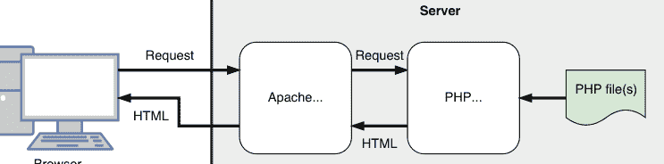

### 18-1. PHP 渲染

需要注意以下几点：

- 每次页面加载都是无状态的。它不了解应用的状态，因此如果用户已登录，则在每次页面请求期间必须从令牌或数据库记录中检索其状态。
- 更改 `.php` 文件会立即更新应用，因为代码会在用户请求该资源时执行。
- 导致错误的 `.php` 文件不太可能在其他页面上引起问题。当然，该 `.php` 文件可能提供多个页面共享的函数，但服务器和应用的其他部分通常会保持活动。

Node.js Web 项目是一个处理 Web 请求的完整应用。它（不一定）需要 Apache 这样的服务器，并在代码从 `.js` 文件加载后持续运行。

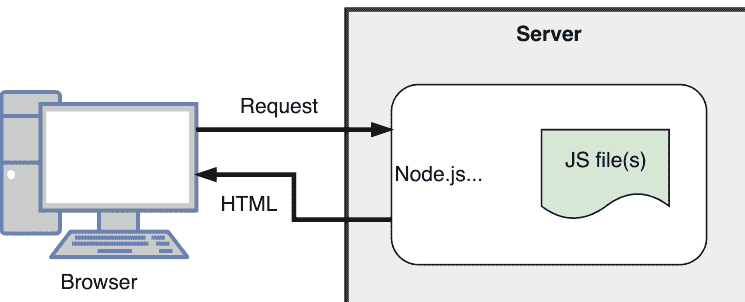

### 18-2. Node.js 渲染

因此：

- 状态可以保留。如果有必要，服务器应用可以为每个登录用户存储 JavaScript 对象。（我建议你编写无状态应用，但这并非强制）
- 更改 `.js` 文件对运行中的应用没有影响。它只会在 `node` 进程停止并重启后被加载。
- 如果应用的任何部分导致崩溃，它将永远停止！没有任何用户能够访问系统的任何部分，并且它将丢失任何保留在内存中的状态。

Node.js 模型相比 PHP 有优点也有缺点，但将应用部署到生产服务器更具挑战性。

大多数共享服务器主机支持 PHP，因为可以通过向服务器目录上传 `.php` 文件来运行。提供 Node.js 的主机要少得多，因为你需要操作系统级别的访问权限来启动应用，因为它在持续运行时可能会占用资源。

有些主机通过 cPanel 等系统提供 Node.js 功能，可以在其中定义应用的启动命令和配置。然而，这些功能通常会实施运行时限制，例如 CPU 限制或无法访问 npm。

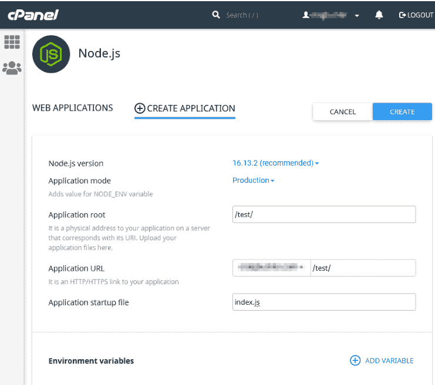

### 18-3. cPanel Node.js 托管

## Node.js 应用准备

你的开发和部署环境会有所不同。至少，线上服务器应该将 `NODE_ENV` 环境变量设置为 `production`：

```
NODE_ENV=production
```

设置后，`Express` 框架将禁用详细日志并启用模板缓存以提高性能。其他模块可能提供类似的优化，请检查它们的 README 文件和文档。

在内部，你的应用可以检测 `NODE_ENV` 值并禁用终端调试信息，或进行其他更改，例如记录到文件中。例如：

```javascript
// 正在开发模式运行吗？
const DEVMODE = (process.env.NODE_ENV !== 'production');

if (DEVMODE) {
    console.log('application started in development mode');
} else {
    writeToLog('application started in production mode');
}
```

可能需要其他环境变量来定义应用配置或数据库连接。

最后，生产服务器通常应该使用 `node` 运行时命令启动应用，而不是 `nodemon` 或类似的工具。不应使用如 `--inspect` 和 `--enable-source-maps` 等命令行选项。

## 专用服务器托管

在 Node.js 早期，几乎没有选择来启动真实或虚拟服务器。这可能仍然是最常用的应用部署方法，并需要 DevOps 人员执行：

- 配置适当的 CPU、内存和磁盘空间
- 安装合适的 Node.js 运行时版本
- 从仓库拉取应用
- `npm install` 所有项目和全局依赖项
- 根据需要使用 `node app.js` 启动应用

步骤 3 到 5 每次更新都需要重复，尽管持续集成和部署解决方案可以自动化这一过程。

许多主机提供虚拟服务器，包括 DigitalOcean Droplets、Amazon EC2、Google Compute Engine 和 Azure 虚拟机。

> **不要**使用 `sudo` 以管理员权限运行 Node.js 应用。应用或任何模块都可以执行任何操作——例如删除文件。

## HTTP 和 HTTPS 考虑

第 5 章介绍了如何在 `Express` 中配置 SSL 证书。在生产服务器上不建议这样做，因为必须使用 `sudo` 来使用 1000 以下的端口（HTTPS 为 443）。

更好的选项是非标准端口（例如 3000）上启动应用，然后使用反向代理（参见“使用反向代理”章节）来转发流量。

书中的示例在不安全的 HTTP 连接上运行。对于测试是可以的，但在代码中引用内部 URL 时必须小心。

某些开发者为开发服务器创建伪自签名证书，这会导致引入不一致的 HTTP/HTTPS URL。浏览器会抛出错误，但你可以选择忽略。我不建议这种做法：浏览器在遇到伪证书时表现不同。例如它们会禁用缓存，这会导致线上服务器出现奇怪的 Bug。

我建议你采取任一方法：

- 在开发期间使用 HTTP，但在引用生产服务器上的内部 URL 时要小心。
- 使用 `mkcert` 生成真实的本地信任的 SSL 证书。这些证书可以在你自己的开发 PC 上使用，但你无法与其他成员共享（因此他们需要生成自己的证书）。

## 进程管理

Node.js 应用运行在单处理线程上。换句话说，你的 64 核服务器上有 63 个核心是空闲的。

你可以实现自己的集群并在所有可用 CPU 核心上运行应用，但这可能困难（参见第 12 章以及 Node.js 文档）。更好的解决方案是使用进程管理器，它通过以下方式让你的应用更高效：

- 在不同核心上运行多个实例
- 如果（当）某个实例崩溃时重启它

为了这项工作，你的应用必须是无状态的。避免将应用用户状态存储在变量或本地文件中，因为这些在实例之间可能不同。


### 18-4. PM2

`PM2` 是 Node.js 进程管理的主要竞争者。通过全局安装，你可以跨所有可用 CPU 核心启动集群模式启动 Node.js 应用程序：

```bash
pm2 start app.js -i max
```

> ### PM2 端口冲突
>
> `PM2` 会神奇地管理端口。如果你的 `Express` 应用程序有十六个实例都监听 3000 端口，`PM2` 会确保它们不会发生冲突。发送到 3000 端口的单个请求会被转发到一个应用程序实例。下一个请求可能会发送到另一个。
>
> 请注意，如果你使用 npm 脚本启动应用程序，`PM2` 的端口管理可能会失效。

可以使用 `pm2 status` 监控运行进程。

## 使用反向代理

反向代理将传入的请求传递给你的 Node.js Web 应用程序。大多数 Web 服务器都可以配置为反向代理——包括 `NGINX`。


这有几个优势：

- 在同一台服务器上可以配置任意数量的域名和应用程序。
- 你的 Node.js 应用程序可以集群化并在无需使用 `sudo` 的情况下启动。
- HTTPS 的 SSL 证书可以由 Web 服务器管理。
- Web 服务器可以配置为提供静态资源——例如客户端图像、CSS 和 JavaScript。这比将请求传递给 `Express` 效率更高，因为大多数 Web 服务器都是多线程的。

位于 `/etc/nginx/sites-available/default` 的 `NGINX` 配置文件可以定义入站端口、SSL 证书、查找静态文件的路径，并在未找到静态文件时将请求解析到 Node.js 应用程序：

```
server {
  listen 80;
  listen 443 ssl;

  # 线上域名
  server_name myapp.com;

  # HTTPS 证书
  ssl_certificate /etc/nginx/ssl/server.crt;
  ssl_certificate_key /etc/nginx/ssl/server.key;

  # 静态文件？
  location / {
    root /home/node/myapp/static;
    index index.html;
    try_files $uri $uri/ @nodejs;
  }

  # Node.js 反向代理
  location @nodejs {
    proxy_pass http://localhost:3000;
    proxy_http_version 1.1;
    proxy_set_header Upgrade $http_upgrade;
    proxy_set_header Connection 'upgrade';
    proxy_set_header Host $host;
    proxy_cache_bypass $http_upgrade;
  }
}
```

`NGINXConfig` 配置工具可以帮助创建适用于你要求的设置。

## 静态站点托管 (Jamstack)

如果你的应用程序主要使用客户端 HTML、CSS 和 JavaScript，那么可能不需要部署 Node.js 应用程序或使用任何服务端运行时。静态站点生成器 (SSG) 使用内容（通常是 Markdown）和模板构建基于目录的 HTML 文件。市上有许多 SSG，但 `Eleventy` 是较受欢迎的 Node.js 选项之一。

生成的构建文件可以上传到任何 Web 服务器。这些页面提供了：

- 卓越的性能：它们只是没有服务端处理的文件
- 稳健的安全性：没有数据库或运行时可供攻击利用
- 可移植性：你可以在任何地方托管，而无供应商锁定
- 最低成本部署：通常是免费的

这种更简单的 Web 开发方法在过去几年中变得越来越流行。Amazon S3 托管等设施已被平台即服务 (PaaS) 托管商取代，如 GitHub Pages、CloudFlare Pages、Heroku、Vercel 和 Netlify。

某些服务器提供简单的命令行部署工具，而另一些要求你将分支推送到 Git 仓库。

> 使用 Node.js 构建驱动的静态站点
>
> 我经常对小型网站使用 Node.js SSG。有时它们需要基本的服务端功能，例如重定向旧 URL 或解析内容表单。与其部署 Node.js 服务器，我会输出几个 `.php` 文件，这样站点就可以部署到任何 PHP 托管主机。

## Serverless/Lambda 函数

如果你的应用需要更全面的服务端处理（例如数据库存储），你可以考虑 serverless 函数。尽管名字如此，serverless 函数仍然运行在服务器上，但你不需要管理操作系统、运行时或使用像 `Express` 这样的框架。

Serverless 函数通常在网络端点处响应。例如，发布到 `https://myapp.com/store-contact/` 的数据会将 HTTP 请求传递给在 `store-contact.js` 中定义的函数，该函数存储信息并返回结果。位于 `functions/hello.js` 的以下 Netlify serverless 函数返回请求 `/hello/` 端点的消息：

```javascript
exports.handler = async (event, context) => {
  return (
    statusCode: 200,
    body: 'Hello World'
  );
};
```

你可以选择将单体 Web 应用程序编写为一系列小型无状态函数。这些函数按需启动，但它们通常在繁忙的服务器上保持活跃，并根据流量增长进行扩展。如果 serverless 函数失败，它将在下次请求时重启，并且通常不会影响或冲突其他函数。

大多数云托管商都提供 Node.js serverless 函数，包括 AWS、Azure、Google、Cloudflare、Heroku、Vercel 和 Netlify。

## AWS 无处不在

许多 serverless 托管商（包括 Netlify 和 Vercel）都部署 serverless 函数。

- 使用限制：serverless 函数可以……
- 启动延迟：但 Node.js 可以……
- 供应商锁定：serverless 函数可以是……
- 不可估量的成本：Node.js 是 de……
- 关闭：如果 serverless 函数是……

## 容器托管

许多 serverless 托管商（包括 Netlify 和 Vercel）都部署 serverless 函数。Node.js 已从一个小众的引擎演变为不可或缺的开发者运行时。即使使用其他语言的人也会安装 Node.js，因为它们提供了许多在其他地方可能找不到的工具。

原因：JavaScript。Web 开发已成为平台应用程序的主要媒介，因此很难避免基于浏览器的代码。在前端和后端使用相同的语言可以减少认知负担。Node.js 将不会……

## 总结

Node.js 托管方案多种多样，拥有丰富的生态系统，价格从免费到昂贵不等。我个人喜欢编写与服务无关的应用程序并且可以……我们已经到了你应该考虑 AWS 的点。

# Node.js：从新手到忍者

当然，Node.js 并非没有批评之处：

- **1** 有些程序员非常憎恶 JavaScript。

没有一种语言是完美的，但 JavaScript 是在十天内开发的，它的发明者 Brendan Eich 很可能从未考虑过它会被用于全规模的企业级应用。某些问题已经通过 ES6 以及像 TypeScript 这样的 JavaScript 编译器中的类型得到了解决。

就个人而言，我热爱 JavaScript——尽管它有各种缺点。那些抱怨得最厉害的人通常是在与他们最喜欢的语言进行比较，并且被 JavaScript 的奇特性（如原型继承）所坑过。如果它不符合你的胃口，永远不要坚持，或者考虑许多服务器端替代方案之一。

- **2** npm 显得很繁琐。

`npm` 对 Node.js 的成功有部分功劳。它可以轻松安装、更新和删除 150 万个包中的任何一个。可以理解，并不是每个包都是好的，有些甚至非常危险——充斥着恶意软件和加密矿代码。`npm` 解决了许多问题，但其他问题仍会发生。

尽管最近进行了优化，你的 `node_modules` 目录仍然会增长到几兆字节，`npm` 仍然可以在不同项目中下载相同的包。从长远来看，软件包维护可能会变得越来越费力。

记住，`npm` 只是一个工具。只安装你需要的包，就能最大限度地减少第三方代码的影响。

- **3** CommonJS 与 ES6 模块的混乱。

Node.js 正在向 ES6 模块迁移，但这个过程是痛苦的，某些遗留包可能永远不会支持它。不过，情况正在改善，我在写这本书期间遇到的问题之少令我感到非常惊喜。

- **4** 异步编程是一项挑战。

你在其他语言中并不一定会遇到异步编程，而且很容易犯导致应用不稳定的错误。我将整个第 9 章都给了这个主题，因为它在 Node.js 程序中非常重要。

对于 JavaScript 初学者来说，理解回调可能是困难的，但避免客户端或服务器上的事件处理是不可能的。`Promises` 和 `async / await` 有帮助，尽管我最初在理解这些概念时很挣扎。

尽管如此，异步编程使得实时 Web 应用成为可能。在 Node.js 中，实时更新的仪表板、在线聊天和多人游戏要容易得多。

- **5** Node.js 没有像 runtimeX 那样好/快/流行/稳定/安全。

总会有替代方案能以更好的方式处理应用程序编程的某些方面。但对于 Web 应用和命令行工具的开发，Node.js 在大多数方面已经足够优秀了。

引用 C++ 设计者 Bjarne Stroustrup 的话：“语言只有两种：一种人们抱怨的语言，和没人使用的语言。”

## Deno 更好吗？

Ryan Dahl 在 2020 年发布了 Deno，它解决了他对 Node.js 的许多遗憾，Deno 提供了：

- 更好的安全性。当应用程序需要访问环境变量、文件系统、网络和其他资源时，必须授予其特定的权限。
- 原生 TypeScript 支持。你可以使用 JavaScript 或 TypeScript 编写应用程序，而无需额外的第三方编译器。
- 仅限 ES6 模块。模块从 URL 加载：没有等同于 npm 的，包可以缓存，因此在你的系统中所有项目中都只有一个实例。
- 内置工具。代码检查、格式化、测试、基准测试、打包、文档生成、任务运行等都可以由 `deno` 运行时提供。
- 复制的浏览器 API。诸如 `window`、`addEventListener`、`Fetch` 和 web workers 等功能在 Deno 中可用。
- 复制的 Node.js API。Deno 在 Node.js 兼容模式下运行时支持诸如 `fs`、`events`、`http`、`os`、`process`、`stream`、`url`、`util` 和 CommonJS。

Deno 是一个很好的选择，但它很新，不像 Node.js 那样流行或受到良好支持。也许十年后我们都会使用 Deno，而 Node.js 将被载入历史书籍。但现在结论还为时过早。用 Deno 写几个小工具或示例应用并无大碍……但当你很难找到超过几个月经验的程序员时，你应该将其用于长期的、关键任务的应用吗？

Deno 与 Node.js 足够相似，因此在运行时之间切换很容易。今天学习 Node.js，明天考虑 Deno。

# 感谢阅读！

我希望你喜欢这本书，并准备好开启编程生涯的下一个阶段。查看本课程最后一个视频中的技巧。

如果你有任何反馈或建议，请直接在 Twitter 上联系 @craigbuckler 我，或向 SitePoint 发送你的信息。

祝你好运！

# 附录 A：测试答案

以下是测试的答案。

## 第 1 章

- 1. d.
- 2. 除了一些浅表的语法相似之处，JavaScript 与 Java 没有任何技术关系！
- 3. b. TypeScript 可以编译为 JavaScript，但它是 JavaScript 语法的超集，所以它本身不是 JavaScript！
- 4. c.
- 5. a.

## 第 2 章

- 1. d.
- 2. b.
- 3. a.

## 第 3 章

- 1. c.
- 2. d. ... 虽然 c. 有些极端！
- 3. b.
- 4. a.
- 5. d. 如果你知道 Docker 不是必须的，可以加分，尽管它可以让 Node.js 部署变得更容易！

## 第 4 章

- 1. d.
- 2. d.
- 3. b.
- 4. a.
- 5. 嗯，我要说 c。这很有主见，但我不相信有从不使用 `console.log()` 的开发者。

## 第 5 章

- 1. d.
- 2. c.
- 3. a.
- 4. c.
- 5. b.

## 第 6 章

- 1. b.
- 2. a. 但如果你定义了解析中间件函数，d 可能是正确的。

## 第 7 章

- 1. d.
- 2. b.
- 3. b.
- 4. c.
- 5. d. 如果你意识到 a. 和 b. 在旧版本的 npm 中会列出所有依赖，可以加分。
- 6. a.

## 第 8 章

- 1. a.
- 2. c.
- 3. a.
- 4. b.
- 5. d.

## 第 9 章

- 1. c.
- 2. d.
- 3. a.
- 4. a.
- 5. d.

## 第 10 章

- 1. b.
- 2. d.
- 3. d.
- 4. a.
- 5. d.

## 第 11 章

- 1. d.
- 2. a.
- 3. d.
- 4. b.
- 5. b.

## 第 12 章

- 1. b.
- 2. d.
- 3. d.
- 4. a.
- 5. b.
