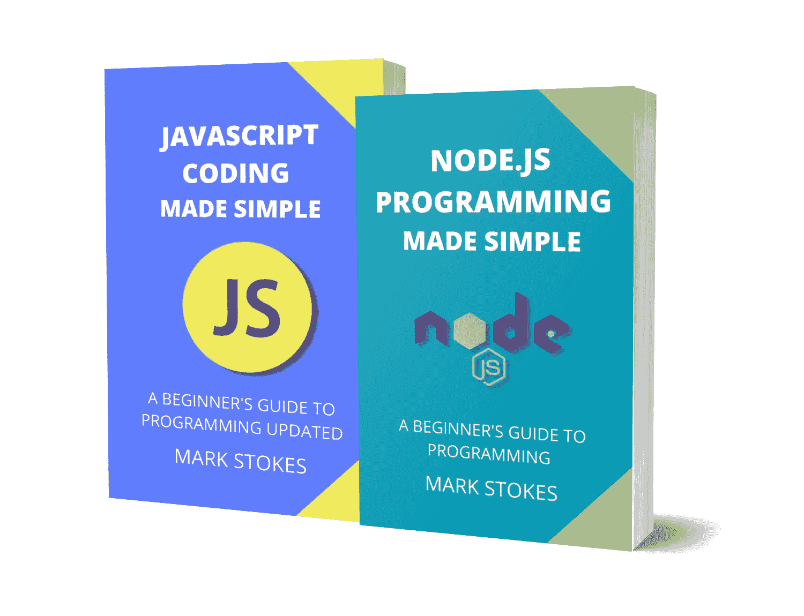

# Node.js 与 Javascript 编程简明：编程初学者指南 - 2 合 1





## 目录
- 书籍介绍：NODE.JS
- 第 1 章：Node.js 简介
- 第 2 章：搭建 Node.js 项目与探索 JavaScript 基础
- 第 3 章：Node.js 模块与 Node 包管理器 (NPM
- 第 4 章：使用 Node.js 构建博客应用
- 第 5 章：实现增删改查（CRUD）功能
- 第 6 章：增强用户界面
- 第 7 章：添加评论功能
- 第 8 章：在我们的博客应用中实现搜索功能
- 第 9 章：实现用户认证与授权
- 第 10 章：增强用户体验
- 第 11 章：启用评论
- 第 12 章：增强安全性
- 第 13 章：性能优化
- 第 14 章：部署
- 第 15 章：结论

# JAVASCRIPT
- 第 1 章：JavaScript 简介
- 第 2 章：JavaScript 语法、运算符与表达式
- 第 3 章：JavaScript 控制流语句
- 第 4 章：JavaScript 函数
- 第 5 章：JavaScript 数组
- 第 6 章：JavaScript 对象
- 第 7 章：JavaScript 事件与事件处理
- 第 8 章：JavaScript AJAX 与 Fetch API
- 第 9 章：高级 JavaScript 概念
- 第 10 章：JavaScript 模块与模块化开发
- 第 11 章：JavaScript 中的面向对象编程
- 第 13 章：在 JavaScript 中使用 API
- 第 14 章：JavaScript 框架与库
- 第 15 章：移动应用开发中的 JavaScript

## 书籍介绍：NODE.JS

欢迎阅读《Node.js 编程从易到精——编程入门指南》。本全面的书籍旨在帮助初学者学习并掌握使用 `Node.js` 编程的艺术。无论你之前是否有编程经验，还是完全进入编码世界的新手，本书都将为你提供坚实的基础，帮助你构建技能并使用 `Node.js` 开发健壮的应用程序。

在书中，我们将探索 `Node.js` 的基本概念，并引导你完成设置 `Node.js` 环境的过程。我们将涵盖对于理解 `Node.js` 开发至关重要的 JavaScript 概念。你将学习如何处理 `Node.js` 模块，并利用庞大的 `NPM`（Node 包管理器）生态系统来增强你的应用程序。

随着学习的深入，我们将探讨实操方面，例如处理文件系统和流、使用 `Node.js` 构建 Web 应用，以及利用流行的 `Express.js` 框架进行 Web 开发。数据库集成是现代应用的一个关键方面，我们将探索如何将 `Node.js` 与各种数据库连接。

`Node.js` 的核心特征之一是它的异步特性，我们将深入研究异步编程技术，以充分发挥 `Node.js` 的威力。你将获得有效调试和测试 `Node.js` 应用的见解。

构建 RESTful API 是当今 Web 开发领域中的常见需求，我们将引导你通过 `Node.js` 创建健壮的 API。此外，我们还将涵盖认证与授权、使用 `Socket.IO` 进行实时通信、部署 `Node.js` 应用以及开发 `Node.js` 应用时应遵循的最佳实践。

在书中，我们将提供示例和代码片段来阐述讨论的概念，使你更容易理解材料并将其应用于真实场景中。读完本书后，你将在 `Node.js` 编程方面拥有坚实的基础，并准备好自信地应对自己的项目。

现在，让我们进入章节，探索 `Node.js` 的精彩世界吧！

# 第 1 章：Node.js 简介

在本章中，我们将开启探索 `Node.js` 奇妙世界的旅程。我们将首先了解什么是 `Node.js` 以及它是如何改变 Web 开发格局的。所以，请系好安全带，准备进入 `Node.js` 编程领域吧！

## 1.1 什么是 Node.js?

`Node.js` 是一个开源的服务器端 JavaScript 运行时环境。它利用事件驱动、非阻塞 I/O 模型，能够高效地处理并发请求，使其适用于构建可扩展和高性能的应用程序。

## 1.2 为什么选择 Node.js?

有许多理由要在你的项目中使用 `Node.js`：

### 1.2.1 JavaScript 无处可见
`Node.js` 的显著优势之一是使用 JavaScript 作为主要语言。这意味着开发者可以使用相同的语言编写客户端和服务端代码，促进了代码复用。

### 1.2.2 可扩展性与性能
`Node.js` 构建在 Google 开发的 `V8` JavaScript 引擎之上，可以将 JavaScript 代码直接编译为机器码。这种编译过程产生了高性能的应用。

### 1.2.3 非阻塞 I/O
`Node.js` 采用事件驱动的非阻塞 I/O 模型，这意味着它不会阻塞其他操作。这种架构非常适合构建实时服务器等应用。

### 1.2.4 庞大的包生态系统
`Node.js` 拥有活跃丰富的包生态系统，被称为 Node 包管理器 (`NPM`)。`NPM` 为开发者提供了大量集成的预构建模块，节省了时间和精力。

## 1.3 开始使用 Node.js

在进入 `Node.js` 开发世界之前，你需要设置开发环境。请按照以下步骤开始：

### 1.3.1 安装 Node.js
要安装 `Node.js`，请访问官方 `Node.js` 网站 (https://nodejs.org) 下载适用于你操作系统的安装程序。下载完成后，运行安装程序并按照引导操作。

### 1.3.2 验证安装
安装 `Node.js` 后，打开命令提示符或终端并输入以下命令检查 `Node.js` 是否安装正确：

```
node -v
```

如果 `Node.js` 安装正常，该命令将显示已的 `Node.js` 版本。

### 1.3.3 使用 Node.js REPL
`Node.js` 自带了一个交互式读取-执行-打印循环 (REPL)，允许你实验 JavaScript 代码并实时执行。要启动 `Node.js` REPL，打开命令提示符或终端并输入以下命令：

```
node
```

你将看到 `Node.js` 提示符 (`">`)，表示你现在处于 REPL 环境中。你可以开始输入 JavaScript 代码并查看结果。

## 1.4 总结

在本章中，我们介绍了 `Node.js` 并探索了它的独特特性和优势。我们讨论了为什么 `Node.js` 是 Web 开发的热门选择，得益于它基于 JavaScript 的方法、可扩展性、非阻塞 I/O 以及庞大的包生态系统。


我们还通过安装 Node.js 并验证安装，学习了设置开发环境的过程。此外，我们还简要提到了 Node.js `REPL`，它提供了一个交互式环境来实验 JavaScript 代码。

现在你已经对基础知识有了坚固的理解，是时候卷起袖子，在接下来的章节中开始探索 Node.js 的威力了。

请关注第 2 章，在那里我们将深入探讨 Node.js 项目的设置以及 JavaScript 基础知识！

# 第 2 章：设置 Node.js 项目和探索 JavaScript 基础

在本章中，我们将通过设置 Node.js 项目和深入学习 JavaScript 基础，在 Node.js 旅程中迈下一步。在本章结束时，你将为开始构建自己的 Node.js 应用程序奠坚实的基础。

## 2.1 初始化 Node.js 项目

要开始一个新的 Node.js 项目，我们将使用一个名为 `npm`（Node 包管理器）的包管理器，它是随 Node.js 一起的。按照以下步骤初始化一个新的 Node.js 项目：

### 2.1.1 创建项目目录

首先，为你的项目创建一个新目录。打开你的命令提示符或终端，导航到你想要创建项目目录的位置。使用以下命令创建一个新目录：

```
mkdir my-node-project
```

此命令将在你当前的位置创建一个名为 `"my-node-project"` 的目录。

### 2.1.2 进入项目目录

接下来，使用以下命令进入项目目录：

```
cd my-node-project
```

你现在已经进入了 `"my-node-project"` 目录内部。

### 2.1.3 初始化项目

要初始化项目并创建一个 `"package.json"` 文件（该文件将存储项目特定的元数据和依赖项），请运行以下命令：

```
npm init
```

系统将提示你提供有关项目的信息，例如项目名称、版本、描述、入口点等。你可以填写详细信息，也可以按回车键以接受每个提示的默认值。

一旦你提供了必要的信息，`npm` 将在你的项目目录中生成 `"package.json"` 文件。

## 2.2 探索 JavaScript 基础

由于 Node.js 是基于 JavaScript 构建的，因此坚实地理解 JavaScript 基础至关重要。在本节中，我们将涵盖一些帮助你起手的核心概念。

### 2.2.1 变量和数据类型

在 JavaScript 中，你可以使用 `"var"`、`"let"` 或 `"const"` 关键字声明变量。JavaScript 支持多种数据类型，包括数字、字符串、布尔值、对象、数组等。这是一个示例：

```javascript
let name = "John";
const age = 25;
let isStudent = true;
```

### 2.2.2 控制流和循环

JavaScript 提供了 `if-else` 和 `switch` 等控制流语句来根据条件做出决策。你还可以使用 `for` 和 `while` 等循环结构来重复代码块。这是一个示例：

```javascript
let score = 85;

if (score >= 90) {
  console.log("Excellent!");
} else if (score >= 80) {
  console.log("Good job!");
} else {
  console.log("Keep practicing!");
}

for (let i = 0; i < 5; i++) {
  console.log(i);
}
```

### 2.2.3 函数和模块

JavaScript 中的函数允许你封装可重用的代码块。你可以使用 `"function"` 关键字定义函数并根据需要调用它们。此外，你可以通过将函数组织到单独的文件并将其导出为模块来实现代码模块化。这是一个示例：

```javascript
// math.js
function add(a, b) {
  return a + b;
}

function subtract(a, b) {
  return a - b;
}

module.exports = {
  add,
  subtract
};

// app.js
const math = require("./math.js");
console.log(math.add(5, 3));
console.log(math.subtract(10, 7));
```

## 2.3 总结

在本章中，我们学习了如何使用 `npm` 设置一个新的 Node.js 项目并初始化 `"package.json"` 文件。我们还探索了 JavaScript 的一些基础概念，如变量、数据类型、控制流、循环、函数和模块。

到目前，你应该对如何启动 Node.js 项目以及处理 JavaScript 基础有了坚固的理解。在下一章中，我们将深入研究 Node.js 模块和 Node 包管理器 (NPM)，这将会扩展你构建 Node.js 应用程序的能力。

# 第 3 章：Node.js 模块和 Node 包管理器 (NPM)

在本章中，我们将深入探索 Node.js 模块的世界，并探索 Node 包管理器 (NPM) 的强大功能。理解模块并利用庞大的 NPM 包生态系统将增强你构建健壮高效的 Node.js 应用程序的能力。

## 3.1 Node.js 模块简介

Node.js 模块允许你将代码组织并封装为可重用的单元。每个模块可以包含函数、变量或对象，这些可以被应用程序的部分访问。通过将代码拆分为模块，你可以实现更好的代码组织、重用性和可维护性。

### 3.1.1 创建模块

在 Node.js 中创建模块，你可以在单独的文件定义代码并使用 `module.exports` 导出它们。让我们来看示例：

```javascript
// math.js
function add(a, b) {
  return a + b;
}

function subtract(a, b) {
  return a - b;
}

module.exports = {
  add,
  subtract
};
```

在此示例中，我们定义了一个名为 `"math.js"` 的模块，它导出了 `add` 和 `subtract`。

### 3.1.2 使用模块

要在文件中使用模块，你需要通过 `require` 导入它。让我们看看如何使用 `"math.js"`：

```javascript
// app.js
const math = require("./math.js");
console.log(math.add(5, 3)); // 输出: 8
console.log(math.subtract(10, 7)); // 输出: 3
```

在此示例中，我们通过 math 对象访问导出函数。

## 3.2 Node 包管理器 (NPM)

NPM 是一个随 Node.js 一带的强大包管理器。它提供了一个庞大的开源包生态系统。它可以简化包的安装、依赖管理和版本控制，使其成为 Node.js 开发者的基础工具。

### 3.2.1 使用 NPM 初始化项目

我们已经在第 2 章中看到过如何使用 NPM 初始化项目。通过在项目目录中运行 `npm init`，你会创建一个 `"package.json"` 文件，该文件记录了项目的元数据和依赖项。

### 3.2.2 安装包

要从 NPM 仓库安装包，你可以使用 `npm install` 命令加上包名。例如，要安装 Express.js 框架，运行以下命令：

```
npm install express
```

NPM 将指定的包以及它所需的任何依赖下载并安装到项目内的 `"node_modules"` 目录中。

### 3.2.3 使用 package.json 管理依赖

`"package.json"` 文件维护了项目的依赖列表。当你使用 `npm install` 安装包时，`npm` 会自动将它们添加到 `"package.json"` 文件的 `"dependencies"` 部分。这允许你轻松地与他人共享项目的依赖项。

### 3.2.4 使用已安装的包

一旦安装了包，你就可以像使用其他模块一样通过引入并在应用程序中使用它。这是一个使用 Express.js 包的示例：

```javascript
const express = require('express');
const app = express();

// 你的 Express.js 代码在这里

app.listen(3000, () => {
  console.log('Server is running on port 3000');
});
```

## 3.3 总结


在本章中，我们探索了 Node.js 模块的概念以及它们如何帮助组织和封装代码。我们学习了如何创建和使用模块，从而在应用程序中实现代码的可重用性和可维护性。

我们还介绍了 Node 包管理器 (`NPM`) 及其在管理依赖和将外部包集成到项目中起的作用。我们了解了如何初始化项目、安装包，并利用巨大的 `NPM` 生态系统来增强我们的 Node.js 应用程序。

在下一章中，我们将专注于使用 Node.js 构建一个实用的示例，应用对模块和 `NPM` 的知识来开发一个真实世界的应用程序。

# 第 4 章：使用 Node.js 构建博客应用程序

在本章中，我们将通过构建一个博客应用程序，将 Node.js 模块和 Node 包管理器 (`NPM`) 的知识付诸实践。我们将创建一个简单但功能齐全的应用程序，允许用户创建、读取、更新和删除博客文章。让我们进入使用 Node.js 构建 Web 应用的精彩世界吧！

## 4.1 设置项目

首先，确保你的系统中已安装了 Node.js。安装完成后，请按照以下步骤设置项目：

### 4.1.1 初始化项目

打开你的命令提示符或终端，导航到你想创建项目目录的位置。使用以下命令创建一个新目录：

```bash
mkdir blogging-app
```

进入新创建的目录：

```bash
cd blogging-app
```

使用以下命令初始化项目：

```bash
npm init -y
```

### 4.1.2 安装所需的包

对于我们的博客应用程序，我们将使用 `Express.js` 作为 Web 框架，使用 `MongoDB` 作为数据库。运行以下命令安装这些包：

```bash
npm install express mongodb
```

### 4.1.3 创建项目文件

在你的项目目录中，创建以下文件：

- `app.js`: 该文件将作为应用程序的主入口点。
- `routes.js`: 该文件将处理路由逻辑。
- `views` 目录：创建一个名为 `views` 的目录来存储应用程序的视图。

## 4.2 设置 Express 服务器

在 `app.js` 文件中，设置 Express 服务器并配置必要的中间件。这是一个帮助你入门的示例：

```javascript
const express = require('express');
const app = express();

// 中间件
app.use(express.urlencoded({ extended: true }));
app.use(express.json());

// 路由
const routes = require('./routes');
app.use('/', routes);

// 启动服务器
const port = 3000;
app.listen(port, () => {
  console.log(`Server is running on port ${port}`);
});
```

## 4.3 定义路由

在 `routes.js` 文件中为我们的博客应用程序定义路由。这里有一个说明基本结构的示例：

```javascript
const express = require('express');
const router = express.Router();

// 首页路由
router.get('/', (req, res) => {
  // 获取并显示所有博客文章的逻辑
});

// 创建路由
router.post('/create', (req, res) => {
  // 创建新博客文章的逻辑
});

// 更新路由
router.put('/update/:id', (req, res) => {
  // 更新博客文章的逻辑
});

// 删除路由
router.delete('/delete/:id', (req, res) => {
  // 删除博客文章的逻辑
});

module.exports = router;
```

## 4.4 创建视图

在 `views` 目录内部，为应用程序的不同视图创建必要的 HTML 文件。当访问相应的路由时，服务器将渲染这些文件。

例如，你可以创建一个 `index.html` 文件来显示所有博客文章，创建一个 `create.html` 文件来创建新博客文章，创建一个 `update.html` 文件来更新博客文章，依此类推。

## 4.5 连接 MongoDB

要连接到 `MongoDB` 数据库，请确保系统中已安装了 `MongoDB`。然后，在 `app.js` 文件启动服务器之前添加以下代码：

```javascript
const mongoose = require('mongoose');

// 连接到 MongoDB
mongoose.connect('mongodb://localhost/blog', {
  useNewUrlParser: true,
  useUnifiedTopology: true
})
.then(() => {
  console.log('Connected to MongoDB');
})
.catch((error) => {
  console.error('Error connecting to MongoDB:', error);
});
```

## 4.6 总结

在本章中，我们通过设置项目、配置 Express 服务器、定义路由和创建视图，为博客应用程序奠定了基础。我们还学习了如何使用 `Mongoose` 连接到 `MongoDB` 数据库。

在下一章中，我们将深入研究每个路由的逻辑，实现创建、读取、更新和删除博客文章的功能。我们将博客应用程序从一个骨架转变为功能完整的 Web 应用程序。

# 第 5 章：实现 CRUD 功能

在本章中，我们将通过实现管理博客文章的 CRUD（创建、读取、更新、删除）功能，将博客应用程序推向新高度。我们将深入每个路由的逻辑，并利用 `MongoDB` 存储和检索数据。让我们开始吧！

## 5.1 创建博客文章

在 `routes.js` 文件中，让我们实现创建新博客文章的逻辑。更新 `/create` 路由如下：

```javascript
// 创建路由
router.post('/create', (req, res) => {
  const { title, content } = req.body;

  // 验证
  if (!title || !content) {
    return res.status(400).json({ error: 'Please provide title and content for the post' });
  }

  // 创建一个新的博客文章实例
  const newPost = new Post({ title, content });

  // 保存博客文章到数据库
  newPost.save()
  .then(() => {
    res.status(201).json({ message: 'Post created successfully' });
  })
  .catch((error) => {
    res.status(500).json({ error: 'Error occurred while creating the post' });
  });
});
```

在上述代码中，我们首先从请求体中提取 `title` 和 `content`。然后验证这两个字段是否已提供。如果没有，我们返回 400 状态码和错误消息。

接下来，我们创建一个 `Post` 模型实例（假设你已经定义了该模型）。传入 `title` 和 `content` 参数。

最后，使用 `save()` 方法保存博客文章。如果保存操作成功，我们返回 201 状态码。否则，我们返回 500 状态码。

## 5.2 取出博客文章

现在，让我们实现获取所有博客文章的逻辑。更新 `routes.js` 中的首页路由 (`/`) 如下：

```javascript
// 首页路由
router.get('/', (req, res) => {
  // 从数据库中获取博客文章
  Post.find()
  .then((posts) => {
    res.status(200).json(posts);
  })
  .catch((error) => {
    res.status(500).json({ error: 'Error occurred while fetching posts' });
  });
});
```

在上述代码中，我们使用 `find()` 方法从数据库中获取所有博客文章。如果获取成功，我们返回 200 状态码以及文章数组。如果发生错误，我们返回 500 状态码和错误消息。

## 5.3 更新博客文章

让我们实现更新博客文章的逻辑。更新 `routes.js` 中的 `/update/:id` 路由如下：

```javascript
// 更新路由
router.put('/update/:id', (req, res) => {
  const { title, content } = req.body;
  const postId = req.params.id;

  // 验证输入字段
  if (!title || !content) {
    return res.status(400).json({ error: 'Please provide title and content for the post' });
  }

  // 根据 ID 查找博客文章并更新标题和内容
  Post.findByIdAndUpdate(postId, { title, content })
  .then(() => {
    res.status(200).json({ message: 'Post updated successfully' });
  })
  .catch((error) => {
    res.status(500).json({ error: 'Error occurred while updating the post' });
  });
});
```

在上述代码中，我们从请求体中提取 `title` 和 `content`，从参数中提取 `postId`。我们验证这些字段是否已提供。如果没有，我们返回 400 状态码和错误消息。

然后，我们通过 `postId` 查找博客文章并更新其标题和内容。如果更新成功，我们返回 200 状态码和成功消息。如果发生错误，我们返回 500 状态码。


在这段代码中，我们首先从请求体中提取 `title` 和 `content`，并从 URL 参数中提取 `postId`。我们验证这两个字段是否已提供，如果缺失，则返回 400 状态码和错误消息。

接下来，我们使用 `findByIdAndUpdate` 方法根据 ID 查找博客文章并更新其 `title` 和 `content`。如果更新成功，我们返回 200 状态码和成功消息。如果发生错误，我们返回 500 状态码和错误消息。

## 5.4 删除博客文章

最后，让我们实现删除博客文章的逻辑。按照如下方式更新 `routes.js` 文件中的 `/delete/:id` 路由：

```javascript
// Delete route
router.delete('/delete/:id', (req, res) => {
  const postId = req.params.id;
  // Find the blog post by ID and delete it
  Post.findByIdAndDelete(postId)
    .then(() => {
      res.status(200).json({ message: 'Blog post deleted successfully' });
    })
    .catch((error) => {
      res.status(500).json({ error: 'An error occurred while deleting the blog post' });
    });
});
```

在这段代码中，我们从 URL 参数中获取 `postId`。然后，我们使用 `findByIdAndDelete` 方法根据 ID 查找博客文章并从数据库中删除。如果删除成功，我们返回 200 状态码和成功消息。如果发生错误，我们返回 500 状态码和错误消息。

## 5.5 总结

在本章中，我们为博客应用程序实现了 CRUD 功能。我们创建了新的博客文章、获取了所有博客文章、更新了博客文章并删除了博客文章。我们利用 MongoDB 和 Mongoose 来从数据库中存储和检索数据。

我们的博客应用程序现在已功能完备，允许用户对博客文章执行所有必要的操作。在下一章中，我们将专注于增强用户界面并添加更多功能，使我们的应用程序更加健壮。

# 第 6 章：增强用户界面

在本章中，我们将增强博客应用程序的用户界面，以提供更具吸引力易于使用的体验。我们将引入额外的功能并改进设计，使我们的应用程序脱颖而出。让我们开始吧！

## 6.1 使用 CSS 添加样式

为了提高博客应用程序的视觉吸引力，让我们添加一些 CSS 样式。在项目的 `public` 目录中创建一个名为 `style.css` 的新文件。然后，按照如下方式在 `index.html` 文件中链接 CSS 文件：

```html
<!DOCTYPE html>
<html>
<head>
  <meta charset="UTF-8">
  <title>My Blogging Application</title>
  <link rel="stylesheet" href="/style.css">
</head>
<body>
  <!-- Your HTML code here -->
</body>
</html>
```

在 `style.css` 文件中，你可以定义自定义样式来增强应用程序的外观。例如，你可以设置背景颜色、字体样式、内边距（padding）、外边距（margins）等，创建一个具有视觉吸引力的布局。

## 6.2 实现用户身份验证

为了增加额外的安全保护并启用个性化功能，让我们在博客应用程序中实现用户身份验证。我们将使用流行的 `passport` 库进行身份验证。按照以下步骤开始：

### 6.2.1 安装所需的包

在项目目录中运行以下命令来安装必要的包：

```bash
npm install passport passport-local express-session bcrypt
```

### 6.2.2 配置 Passport

在 `app.js` 文件中添加以下代码来配置 Passport：

```javascript
const passport = require('passport');
const LocalStrategy = require('passport-local').Strategy;

// Configure Passport
app.use(passport.initialize());
app.use(passport.session());

// Configure the LocalStrategy for username/password authentication
passport.use(new LocalStrategy(
  (username, password, done) => {
    // Logic to authenticate the user
  }
));

//  序列化和反序列化用户对象
passport.serializeUser((user, done) => {
  done(null, user.id);
});
passport.deserializeUser((id, done) => {
  // Logic to retrieve user object by ID
});
```

在这段代码中，我们从所需的包中导入了 `passport` 和 `LocalStrategy`。然后，我们通过初始化并在应用程序中使用它来配置 Passport。

我们还定义了用于用户名/密码身份验证的 `LocalStrategy`。在策略回调函数内部，你可以实现验证用户的逻辑，通过与数据库或任何其他身份验证机制检查其凭据。

最后，我们序列化和反序列化用户对象以维护用户会话。你需要提供通过 ID 获取用户对象的逻辑并将用户 ID 存储在会话中。

### 6.2.3 保护路由

为了保护某些路由并仅允许经过验证的用户访问，请向需要身份验证的路由添加以下中间件：

```javascript
const ensureAuthenticated = (req, res, next) => {
  if (req.isAuthenticated()) {
    return next();
  }
  res.redirect('/login');
};

// Example usage: Protect the create route
router.post('/create', ensureAuthenticated, (req, res) => {
  // Logic to create a new blog post
});
```

在这段代码中，我们定义了一个名为 `ensureAuthenticated` 的中间件函数，用于检查用户是否通过身份验证。如果已验证，则调用 `next()`。否则，将用户重定向到 `/login`。

你可以将此 `ensureAuthenticated` 中间件用于任何需要身份验证的路由。

## 6.3 为博客文章添加分页

随着我们的博客应用程序的增长，对博客文章进行分页是至关重要的。让我们使用 `mongoose-paginate2` 包来实现分页。按照以下步骤操作：

### 6.3.1 安装包

在项目目录中运行以下命令来安装 `mongoose-paginate2` 包：

```bash
npm install mongoose-paginate2
```

### 6.3.2 实现分页

在定义 `Post` schema 的文件中，添加以下代码以启用分页：

```javascript
const mongoose = require('mongoose');
const mongoosePaginate = require('mongoose-paginate2');

const postSchema = new mongoose.Schema({
  // Your schema definition
});

// Add the paginate plugin to the schema
postSchema.plugin(mongoosePaginate);

const Post = mongoose.model('Post', postSchema);
```

通过向 schema 添加插件，我们可以使用分页功能。

### 6.3.3 实现分页逻辑

在获取博客文章的路由中，按照如下方式更新代码以实现分页：

```javascript
router.get('/posts', (req, res) => {
  const page = parseInt(req.query.page) || 1;
  const perPage = 10; // 每页文章数

  Post.paginate({}, { page, limit: perPage })
    .then((result) => {
      res.status(200).json(result);
    })
    .catch((error) => {
      res.status(500).json({ error: 'An error occurred while retrieving blog posts' });
    });
});
```

在这段代码中，我们从查询字符串中获取 `page` 参数（例如 `?page=2`），如果没有指定页面，则默认为 1。我们还定义了 `perPage` 变量来指定每页的文章数。

使用 `mongoose-paginate2` 插件提供的 `paginate` 方法，我们传递一个空对象来获取所有博客文章。我们还提供了 `page` 和 `limit` 选项来指定当前页码和每页的文章数。

分页结果将返回有关当前页、总页数和博客文章数组的信息。

## 6.4 总结

在本章中，我们专注于增强博客应用程序的用户界面。我们添加了 CSS 样式以提高视觉吸引力，使用 Passport 用户身份验证以增加安全性，并引入了分页以高效地处理大量的博客文章。


我们的应用程序现在提供了更具参与感且用户友好的体验，允许用户浏览博客文章、注册、登录并访问受保护的路由。

# 第 7 章：添加评论功能

在本章中，我们将通过添加用户对博客文章发表评论的功能来增强我们的博客应用程序。评论为用户提供了与内容互动以及分享想法的途径。让我们深入实现评论功能的实现吧！

## 7.1 创建评论模型

首先，让我们创建一个名为 `Comment` 的新模型来表示博客文章的评论。在 `models/comment.js` 文件中，添加以下代码：

```javascript
const mongoose = require('mongoose');

const commentSchema = new mongoose.Schema({
content: {
  type: String,
  required: true,
},
postId: {
  type: mongoose.Schema.Types.ObjectId,
  ref: 'Post',
  required: true,
},
createdAt: {
  type: Date,
  default: Date.now,
},
});

const Comment = mongoose.model('Comment', commentSchema);

module.exports = Comment;
```

在这段代码中，我们定义了带有 `content` 字段的 `Comment` 模式用于存储评论内容，`postId` 字段用于与相应的博客文章建立关系，`createdAt` 字段用于存储评论的创建日期。我们导出了 `Comment` 模型供应用程序的其他部分使用。

## 7.2 添加创建评论路由

接下来，让我们添加一个处理创建评论的路由。在 `routes/comments.js` 文件中，添加以下代码：

```javascript
const express = require('express');
const router = express.Router();
const Comment = require('../models/comment');

// 创建评论路由
router.post('/create', (req, res) => {
const { content, postId } = req.body;
// 验证输入字段
if (!content || !postId) {
  return res.status(400).json({ error: 'Please provide comment content and associated post ID' });
}
// 创建新评论
const newComment = new Comment({ content, postId });
// 将评论保存到数据库
newComment.save()
.then(() => {
  res.status(201).json({ message: 'Comment created successfully' });
})
.catch((error) => {
  res.status(500).json({ error: 'An error occurred while creating the comment' });
});
});

module.exports = router;
```

在这段代码中，我们定义了一个处理创建评论的路由。我们从请求体中提取 `content` 和 `postId` 并验证这两个字段是否都已提供。如果没有提供，我们将返回一个带有错误信息的 400 状态码。

我们使用提取的数据创建 `Comment` 模型的一个新实例，并使用 `save` 方法将其保存到数据库。如果保存操作成功，我们将返回一个带有成功消息的 201 状态码。否则，我们将返回一个带有错误信息的 500 状态码。

## 7.3 获取特定文章的评论

为了获取特定博客文章的所有评论，我们将添加一个以 post ID 为参数的路由。在 `routes/comments.js` 文件中，添加以下代码：

```javascript
// 根据 post ID 获取评论的路由
router.get('/post/:postId', (req, res) => {
const postId = req.params.postId;
// 通过 post ID 查找评论
Comment.find({ postId })
.then((comments) => {
  res.status(200).json(comments);
})
.catch((error) => {
  res.status(500).json({ error: 'An error occurred while retrieving comments' });
});
});

module.exports = router;
```

在这段代码中，我们定义了一个接受 `postId` 作为参数的路由。我们使用 `Comment` 模型的 `find` 方法检索与指定 post ID 关联的所有评论。如果检索成功，我们将返回带有评论数组的 200 状态码。如果有错误，我们将返回一个带有错误信息的 500 状态码。

## 7.4 在前端显示评论

为了在前端的博客文章页面显示评论，请更新您的博客文章模板（例如 `views/post.ejs`）以包含以下代码：

```html
<!-- 此处为您现有的博客文章内容 -->
<!-- 评论部分 -->
<h2>评论</h2>
<div id="comments-container">
<% comments.forEach((comment) => { %>
<div class="comment">
<p><%= comment.content %></p>
<p>Posted on <%= comment.createdAt.toDateString() %></p>
</div>
<% }) %>
</div>
<!-- 评论表单 -->
<form id="comment-form" action="/comments/create" method="POST">
<input type="hidden" name="postId" value="<%= post._id %>">
<textarea name="content" placeholder="Enter your comment"></textarea>
<button type="submit">Submit</button>
</form>
```

在这段代码中，我们遍历了从服务器传递的 `comments` 数组，并显示每条评论的内容和创建日期。我们还提供了一个评论表单，其中包含一个用于 post ID 的隐藏字段和一个用于输入评论内容的文本区域。

## 7.5 增强用户体验

为了提高用户体验，我们可以添加一些 JavaScript 功能，允许通过 AJAX 提交评论并动态更新评论部分。将以下代码添加到您的 JavaScript 文件中（例如 `public/js/main.js`）：

```javascript
const commentForm = document.getElementById('comment-form');
const commentsContainer = document.getElementById('comments-container');
commentForm.addEventListener('submit', (event) => {
  event.preventDefault();
  const formData = new FormData(commentForm);
  const content = formData.get('content');
  const postId = formData.get('postId');
  const comment = { content, postId };
  fetch('/comments/create', {
    method: 'POST',
    headers: {
      'Content-Type': 'application/json',
    },
    body: JSON.stringify(comment),
  })
  .then((response) => response.json())
  .then(() => {
    // 重置表单
    commentForm.reset();
    // 获取并更新评论
    fetch(`/comments/post/${postId}`)
      .then((response) => response.json())
      .then((comments) => {
        updateComments(comments);
      })
      .catch((error) => {
        console.error('An error occurred while retrieving comments:', error);
      });
  })
  .catch((error) => {
    console.error('An error occurred while submitting the comment:', error);
  });
});

function updateComments(comments) {
  commentsContainer.innerHTML = '';
  comments.forEach((comment) => {
    const commentElement = document.createElement('div');
    commentElement.classList.add('comment');
    const contentElement = document.createElement('p');
    contentElement.textContent = comment.content;
    const dateElement = document.createElement('p');
    dateElement.textContent = `Posted on ${new Date(comment.createdAt).toDateString()}`;
    commentElement.appendChild(contentElement);
    commentElement.appendChild(dateElement);
    commentsContainer.appendChild(commentElement);
  });
}
```

## 7.6 总结

恭喜！在本章中，我们成功地为博客应用程序实现了评论功能。用户现在可以对博客文章发表评论，并且评论存储在数据库中。我们还通过动态更新评论部分而无需刷新页面，增强了用户体验。

# 第 8 章：在我们的博客应用程序中实现搜索

在本章中，我们将通过添加搜索功能来增强博客应用程序，允许用户根据关键词搜索特定的博客文章。实现搜索将提高用户体验，并让用户更容易相关内容。让我们开始吧！

## 8.1 设置搜索索引

为了启用搜索功能，我们将使用强大的搜索引擎 Elasticsearch。请按照以下步骤在应用程序中设置 Elasticsearch：


### 8.1.1 安装 Elasticsearch

首先，你需要在系统上安装 Elasticsearch。访问 Elasticsearch 官方网站（https://www.elastic.co/downloads/elasticsearch）并下载适用于你操作系统的相应版本。按照 Elasticsearch 提供的安装说明完成安装过程。

### 8.1.2 创建 Elasticsearch 索引

安装好 Elasticsearch 后，你需要创建一个索引（index）来存储你的博客文章。索引类似于数据库表，用于组织和存储你的数据。在终端（terminal）中运行以下命令来创建一个名为 "blog_posts" 的索引：

```shell
curl -XPUT http://localhost:9200/blog_posts
```

### 8.1.3 安装 Elasticsearch 客户端库

为了在我们的 Node.js 应用中与 Elasticsearch 交互，我们将使用名为 "elasticsearch" 的官方 Elasticsearch JavaScript 客户端库。在你的项目目录中运行以下命令进行安装：

```shell
npm install elasticsearch
```

设置好 Elasticsearch 并安装客户端库后，我们就可以开始实现搜索功能了。

## 8.2 实现搜索路由

让我们从创建一个新路由来处理搜索请求。在 `routes/search.js` 文件中，添加以下代码：

```javascript
const express = require('express');

const router = express.Router();

const { Client } = require('elasticsearch');

// 创建 Elasticsearch client

const client = new Client({ node: 'http://localhost:9200' });

// 搜索路由
router.get('/', (req, res) => {

const { query } = req.query;

// 执行搜索查询
client
.search({
index: 'blog_posts',
body: {
query: {
match: {
content: query,
},
},
},
})
.then((response) => {

const hits = response.body.hits.hits.map((hit) => hit._source);
res.status(200).json(hits);
})
.catch((error) => {
res.status(500).json({ error: 'An error occurred while performing the search' });
});

});

module.exports = router;
```

在这段代码中，我们创建了一个新路由来处理对 `/search` 端点的 `GET` 请求。我们从请求查询参数（query parameters）中提取搜索查询语句。

使用 `Elastic` 客户端，我们在 "blog_posts" 索引上执行搜索查询。我们使用 `match` 查询在博客文章的 "content" 字段中搜索提供的查询词。搜索结果以 `hits` 的形式返回，我们对其进行映射（map）以提取源数据（博客文章数据）。

如果搜索成功，我们返回状态码 `200` 以及 JSON 格式的 `hits`。如果发生错误，我们返回状态码 `500` 并附带错误信息。

## 8.3 更新博客文章创建路由

为了保持搜索索引的更新，我们需要更新创建新博客的路由。在 `routes/posts.js` 文件中，按如下更新创建路由：

```javascript
const express = require('express');

const router = express.Router();

const Post = require('../models/post');

const { Client } = require('elasticsearch');

// 创建 Elasticsearch client

const client
= new Client({ node: 'http://localhost:9200' });

// 创建文章路由
router.post('/create', (req, res) => {

const { title, content } = req.body;

// 验证输入字段
if (!title || !content) {
return res.status(400).json({ error: 'Please provide a title and content for the post' });
}

// 创建新文章
const newPost = new Post({ title, content });

// 保存文章到数据库
newPost.save()
.then(() => {

// 在 Elasticsearch 中索引新文章
client.index({
index: 'blog_posts',
body: {
title,
content,
},
});
res.status(201).json({ message: 'Post created successfully' });
})
.catch((error) => {
res.status(500).json({ error: 'An error occurred while creating the post' });
});

});

module.exports = router;
```

在这段代码中，在将新文章保存到数据库后，我们使用客户端的 `index()` 方法在 Elasticsearch 中对该文章进行建立索引。我们指定索引为 "blog_posts"，并将文章的标题和内容作为索引请求的主体。

这确保了新创建的文章被添加到搜索索引中，使其可以被搜索。

## 8.4 在前端添加搜索表单

为了允许用户执行搜索，我们将在前端添加一个搜索表单。使用以下代码更新你的博客首页模板（例如 `views/home.ejs`）：

```html
<!-- 此处保留你原有的首页内容 -->
<!-- 搜索表单 -->
<form id="search-form" action="/search" method="GET">
<input type="text" name="query" placeholder="Search...">
<button type="submit">Search</button>
</form>
```

这段代码添加了一个简单的搜索表单，包含一个用于搜索查询的输入框和一个提交按钮。表单的 action 设置为 `/search` 端点，这是我们在后端定义的。

## 8.5 显示搜索结果

为了在专用的搜索结果页面上显示搜索结果，请在 `views` 目录下创建一个名为 `search_results.ejs` 的新模板文件。在文件中添加以下代码：

```html
<!-- 此处保留你原有的页面结构和头部 -->
<!-- 搜索结果 -->
<h2>Search Results</h2>
<div id="search-results-container">
<% if (results.length === 0) { %>
<p>No results found.</p>
<% } else { %>
<% results.forEach((result) => { %>
<div class="search-result">
<h3><%= result.title %></h3>
<p><%= result.content %></p>
</div>
<% }) %>
<% } %>
</div>
<!-- 此处保留你原有的页脚和脚本 -->
```

在这段代码中，我们遍历了从服务器传过的 `results` 数组，并显示了每个搜索结果的标题和内容。如果没有找到结果，我们将显示一条提示未找到结果的消息。

## 8.6 总结

恭喜！在本章中，我们使用 Elasticsearch 在博客应用程序中实现了搜索功能。用户现在可以根据关键词搜索特定的博客文章，提升了整体用户体验。

我们设置了 `Elastic`，创建了搜索路由，更新了博客文章创建路由以索引文章，在前端添加了搜索表单，并在专用页面上显示了搜索结果。

# 第 9 章：实现用户身份验证与授权

在本章中，我们将专注于实现用户身份验证（Authentication）和授权（Authorization），以保护博客应用程序的安全。用户身份验证确保只有注册用户才能访问某些功能，而授权则控制授予每个用户的访问级别和权限。让我们开始吧！

## 9.1 用户模型与注册

首先，让我们更新用户模型以包含与身份验证相关的字段。在 `models/user.js` 文件中，按如下修改代码：

```javascript
const mongoose = require('mongoose');

const userSchema = new mongoose.Schema({
username: { type: String, required: true, unique: true },
email: { type: String, required: true, unique: true },
password: { type: String, required: true },
});

const User = mongoose.model('User', userSchema);

module.exports = User;
```

在这里，我们在用户 schema 中添加了 `username`、`email` 和 `password` 字段。`username` 和 `email` 字段被标记为 `required`（必）和 `unique`（唯一），确保每个用户都有唯一的用户名和邮箱。`password` 字段将存储哈希后的密码以确保安全。

为了启用用户注册，我们将在 `routes/users.js` 文件中创建一个注册路由。添加以下代码：


```javascript
const express = require('express');

const router = express.Router();

const bcrypt = require('bcrypt');

const User = require('../models/user');

// User registration route
router.post('/register', async (req, res) => {
  const { username, email, password } = req.body;
  try {
    // Check if the username or email already exists
    const existingUser = await User.findOne({ $or: [{ username }, { email }] });
    if (existingUser) {
      return res.status(409).json({ error: 'Username or email already exists' });
    }
    // Hash the password
    const hashedPassword = await bcrypt.hash(password, 10);
    // Create a new user
    const newUser = new User({ username, email, password: hashedPassword });
    await newUser.save();
    res.status(201).json({ message: 'User registered successfully' });
  } catch (error) {
    res.status(500).json({ error: 'An error occurred while registering the user' });
  }
});

module.exports = router;
```

在此代码中，我们处理了对 `/register` 终点的 `POST` 请求。首先，我们检查提供的用户名或邮箱是否已存在于数据库中。如果找到了相同用户名或邮箱的用户，我们将返回带有错误消息的 409 状态码。

如果用户名和邮箱是唯一的，我们将使用 `bcrypt` 对密码进行哈希处理，成本因子为 10 以确保安全性。然后，我们创建一个带有哈希密码的新用户实例并将其保存到数据库中。

## 9.2 用户登录与验证

接下来，让我们实现用户登录功能。更新 `routes/users.js` 文件并添加代码：

```javascript
const express = require('express');

const router = express.Router();

const bcrypt = require('bcrypt');

const jwt = require('jsonwebtoken');

const User = require('../models/user');

// User login route
router.post('/login', async (req, res) => {
  const { username, password } = req.body;
  try {
    // Check if the user exists
    const user = await User.findOne({ username });
    if (!user) {
      return res.status(401).json({ error: 'Invalid username or password' });
    }
    // Compare the provided password with the stored hashed password
    const passwordMatch = await bcrypt.compare(password, user.password);
    if (!passwordMatch) {
      return res.status(401).json({ error: 'Invalid username or password' });
    }
    // Generate a JWT token
    const token = jwt.sign({ username: user.username }, 'your-secret-key');
    res.status(200).json({ token });
  } catch (error) {
    res.status(500).json({ error: 'An error occurred while logging in' });
  }
});

module.exports = router;
```

在此代码中，我们处理了对 `/login` 终点的 `POST` 请求。首先，我们检查数据库中是否存在具有提供用户名的用户。如果不存在，我们将返回带有错误消息的 401 状态码。

如果找到了用户，我们将使用 `bcrypt` 将提供的密码与存储的哈希密码进行比较。如果密码匹配，我们将使用 `jsonwebtoken` 库生成一个 JSON Web Token (JWT)。该 JWT 将用于身份验证和授权目的。

随后，令牌将作为响应返回给客户端。

## 9.3 使用身份验证中间件保护路由

为了保护某些路由并仅允许经过身份验证的用户访问，我们将创建一个身份验证中间件。在 `middleware/auth.js` 文件中，添加以下代码：

```javascript
const jwt = require('jsonwebtoken');

// Authentication middleware
const authenticate = (req, res, next) => {
  const token = req.headers.authorization;
  if (!token) {
    return res.status(401).json({ error: 'Unauthorized' });
  }
  try {
    const decoded = jwt.verify(token, 'your-secret-key');
    req.user = decoded.username;
    next();
  } catch (error) {
    res.status(401).json({ error: 'Invalid token' });
  }
};

module.exports = authenticate;
```

在此代码中，我们定义了一个名为 `authenticate` 的身份验证中间件函数。该中间件会检查请求的 `Authorization` 头中是否存在 JWT 令牌。如果未找到令牌，我们将返回带有“Unauthorized”错误消息的 401 状态码。

如果存在令牌，我们将使用与生成令牌时相同的密钥对其进行验证。如果令牌有效，我们将从解码的令牌中提取用户名，并将其设置在 `req.user` 属性中供后续使用。

## 9.4 保护路由与实现授权

现在我们已经有了身份验证中间件，可以保护路由并实现授权了。在 `routes/posts.js` 文件中，如下更新代码：

```javascript
const express = require('express');

const router = express.Router();

const Post = require('../models/post');

const authenticate = require('../middleware/auth');

// Create post route (protected)
router.post('/create', authenticate, (req, res) => {
  // Rest of the code
});

// Update post route (protected)
router.put('/update/:postId', authenticate, (req, res) => {
  // Rest of the code
});

// Delete post route (protected)
router.delete('/delete/:postId', authenticate, (req, res) => {
  // Rest of the code
});

module.exports = router;
```

在此代码中，我们将 `authenticate` 中间件应用到 `/create`、`/update` 和 `/delete` 路由。这确保了只有经过身份验证的用户才能访问这些路由。包含验证用户用户名的 `req.user` 属性可授权逻辑。

现在，只有经过身份验证的用户才能创建、更新或删除博客文章。

## 9.5 总结

做得好！在本章中，我们在博客应用程序中实现了用户身份验证和授权。我们为用户创建了用于注册的注册路由、用于用户身份验证的登录路由，并保护了某些路由以确保只有经过身份验证的用户才能访问。

我们还通过使用从 JWT 令牌中提取的用户名实现了简单的授权机制。这为未来构建更细粒度的访问控制和权限系统奠定了基础。

# 第 10 章：增强用户体验

在本章中，我们将专注于通过实现用户资料和文章点赞等功能来增强博客应用程序的用户体验。这些功能将允许用户个性化他们的账户并以互动的方式与文章交互。让我们开始吧！

## 10.1 用户资料

为了给用户提供个性化个人资料，我们将更新用户模型并创建用户资料路由。让我们从修改 `models/user.js` 文件开始：

```javascript
const mongoose = require('mongoose');

const userSchema = new mongoose.Schema({
  username: { type: String, required: true, unique: true },
  email: { type: String, required: true, unique: true },
  password: { type: String, required: true },
  bio: { type: String, default: '' },
  avatar: { type: String, default: '' },
});

const User = mongoose.model('User', userSchema);

module.exports = User;
```

在此代码中，为用户模型添加了两个新字段：`bio` 和 `avatar`。`bio` 字段将存储用户的短简介，而 `avatar` 字段将持有用户头像的 URL。

接下来，在 `routes/users.js` 文件中创建用户资料路由：

```javascript
const express = require('express');

const router = express.Router();

const User = require('../models/user');

const authenticate = require('../middleware/auth');

// User profile route (protected)
router.get('/profile', authenticate, async (req, res) => {
  try {
    const user = await User.findOne({ username: req.user }, { password: 0 });
    if (!user) {
      return res.status(404).json({ error: 'User not found' });
    }
    res.status(200).json(user);
  } catch (error) {
    res.status(500).json({ error: 'An error occurred while fetching the user profile' });
  }
});

module.exports = router;
```

在此代码中，我们创建了一个用于获取用户资料的 `GET` 路由。我们使用 `authenticate` 中间件来确保只有经过身份验证的用户才能访问此路由。`req.user` 属性包含了经过验证的用户用户名。


在路由处理程序中，我们使用 `findOne` 根据用户名查找用户。为了安全起见，我们从获取的用户对象中排除了 `password` 字段。如果找到了用户，我们将该用户对象作为响应发送。

## 10.2 帖子点赞

为了允许用户点赞帖子并与内容互动，我们将更新 Post 模型并创建一个点赞路由。让我们从修改 `models/post.js` 文件开始：

```javascript
const mongoose = require('mongoose');

const postSchema = new mongoose.Schema({
title: { type: String, required: true },
content: { type: String, required: true },
likes: { type: Number, default: 0 },
});

const Post = mongoose.model('Post', postSchema);

module.exports = Post;
```

在此代码中，我们为帖子 schema 添加了一个 `likes` 字段，它将存储帖子收到的点赞数。

接下来，让我们在 `routes/posts.js` 文件中创建一个点赞路由：

```javascript
const express = require('express');

const router = express.Router();

const Post = require('../models/post');

const authenticate = require('../middleware/auth');

// Like post route (protected)
router.put('/like/:postId', authenticate, async (req, res) => {
try {
const postId = req.params.postId;
const post = await Post.findById(postId);
if (!post) {
return res.status(404).json({ error: 'Post not found' });
}
// 用户是否已经点赞过帖子
const hasLiked = post.likes.includes(req.user);
if (hasLiked) {
return res.status(400).json({ error: 'You have already liked this post' });
}
// 增加点赞数并将用户添加到 likes 数组
post.likes.push(req.user);
post.likesCount++;
await post.save();
res.status(200).json({ message: 'Post liked successfully' });
} catch (error) {
res.status(500).json({ error: 'An error occurred while liking the post' });
}
});

module.exports = router;
```

在此代码中，我们创建了一个用于点赞帖子的 `PUT` 路由。`authenticate` 中间件确保只有经过验证的用户才能访问此路由。我们从请求参数中提取了 `postId`。

在路由处理程序内部，我们首先根据 `postId` 查找帖子。如果未找到帖子，我们将返回 404 状态码和错误消息。

接下来，我们通过检查用户名是否存在于帖子的 `likes` 数组中，来判断用户是否已经点赞过该帖子。如果他们已经点赞过，我们将返回 400 状态码和错误消息。

如果用户尚未点赞帖子，我们会增加 `likesCount` 字段的值并将用户的用户名添加到 `likes` 数组中。然后我们保存更新后的帖子并发送成功消息作为响应。

## 10.3 总结

恭喜你！在本章中，我们实现了用户个人资料和帖子点赞功能，以增强我们博客应用程序的用户体验。用户现在可以通过简介和头像来个性化他们的个人资料，并通过点赞来与帖子进行互动。

这些功能增加了一层个性化和参与度，让应用程序对用户更有趣。

# 第 11 章：启用评论功能

在本章中，我们将实现用户在博客帖子上发表评论的功能。启用评论功能将鼓励我们博客应用程序内的讨论和互动。让我们深入学习添加这个令人兴奋的功能吧！

## 11.1 评论模型

为了支持评论，我们需要创建一个 Comment 模型。打开 `models/comment.js` 文件并添加以下代码：

```javascript
const mongoose = require('mongoose');

const commentSchema = new mongoose.Schema({
postId: { type: mongoose.Schema.Types.ObjectId, ref: 'Post', required: true },
content: { type: String, required: true },
author: { type: mongoose.Schema.Types.ObjectId, ref: 'User', required: true },
createdAt: { type: Date, default: Date.now },
});

const Comment = mongoose.model('Comment', commentSchema);

module.exports = Comment;
```

在此代码中，我们使用 Mongoose 的 Schema 定义了评论的结构。评论属于特定的帖子（`postId`）并与作者（`author`）关联。`content` 字段保存实际评论文本，`createdAt` 存储创建评论的时间戳。

## 11.2 评论路由

现在，让我们在 `routes/comments.js` 文件中创建处理评论的路由：

```javascript
const express = require('express');

const router = express.Router();

const Comment = require('../models/comment');

const Post = require('../models/post');

const authenticate = require('../middleware/auth');

// Create comment route (protected)
router.post('/create', authenticate, async (req, res) => {
try {
const { postId, content } = req.body;
const post = await Post.findById(postId);
if (!post) {
return res.status(404).json({ error: 'Post not found' });
}
const comment = new Comment({
postId,
content,
author: req.user,
});
await comment.save();
res.status(201).json({ message: 'Comment created successfully' });
} catch (error) {
res.status(500).json({ error: 'An error occurred while creating the comment' });
}
});

// Get comments for a post route
router.get('/post/:postId', async (req, res) => {
try {
const postId = req.params.postId;
const comments = await Comment.find({ postId }).populate('author', 'username');
res.status(200).json(comments);
} catch (error) {
res.status(500).json({ error: 'An error occurred while fetching the comments' });
}
});

module.exports = router;
```

在代码中，我们定义了两个路由。第一个路由（/create）处理创建新评论。它需要身份验证（`authenticate` 中间件），以确保只有登录用户可以评论。我们从请求体中提取 `postId` 和 `content`。然后检查关联的帖子是否存在。如果找到了帖子，创建一个评论实例，设置相应的值并将其保存。

第二个路由（/post/:postId）获取特定帖子的所有评论。我们从请求参数中提取 `postId` 并使用它查找评论。`populate()` 方法用于将作者 ID 替换为真实的用户名。

## 11.3 更新 Post 模型

为了无缝获取帖子的评论，我们将更新 Post 模型。打开 `models/post.js` 文件并进行如下修改：

```javascript
const mongoose = require('mongoose');

const postSchema = new mongoose.Schema({
title: { type: String, required: true },
content: { type: String, required: true },
likes: { type: Number, default: 0 },
comments: [{ type: mongoose.Schema.Types.ObjectId, ref: 'Comment' }],
});

const Post = mongoose.model('Post', postSchema);

module.exports = Post;
```

在此更新的代码中，我们为帖子 schema 添加了 `comments` 字段。它是一个评论 ID 数组，引用 Comment 模型。

## 11.4 更新 Post 路由

为了将评论与帖子关联，我们需要修改 Post 路由。打开 `routes/posts.js` 文件并进行以下更改：


```javascript
const express = require('express');

const router = express.Router();

const Post = require('../models/post');

const Comment = require('../models/comment');

const authenticate = require('../middleware/auth');

// Get single post route
router.get('/:postId', async (req, res) => {
  try {
    const postId = req.params.postId;
    const post = await Post.findById(postId).populate('comments');
    if (!post) {
      return res.status(404).json({ error: 'Post not found' });
    }
    res.status(200).json(post);
  } catch (error) {
    res.status(500).json({ error: 'An error occurred while fetching the post' });
  }
});

// Update post route (protected)
router.put('/:postId', authenticate, async (req, res) => {
  try {
    const postId = req.params.postId;
    const { title, content } = req.body;
    const post = await Post.findByIdAndUpdate(
      postId,
      { title, content },
      { new: true }
    );
    if (!post) {
      return res.status(404).json({ error: 'Post not found' });
    }
    res.status(200).json(post);
  } catch (error) {
    res.status(500).json({ error: 'An error occurred while updating the post' });
  }
});

module.exports = router;
```

在第一个路由 (`/:postId`) 中，我们添加了 `populate('comments')` 方法来获取与文章相关的评论。这确保了当我们在获取单个文章时，也能获取它的评论。

第二个路由 (`/:postId`) 处理文章的更新。我们从请求体中提取 `postId`、`title` 和 `content`。我们使用 `findByIdAndUpdate` 根据 ID 查找文章并更新其标题和内容。`{ new: true }` 选项确保返回更新后的文章作为响应内容。

## 11.5 总结

干得好！在本章中，我们在博客应用程序中实现了评论功能。用户现在可以在文章下发表评论，促进讨论和互动。我们创建了 `Comment` 模型，添加了创建和获取评论的路由，并将评论与文章关联起来。

发表评论的功能为我们的应用程序添加了互动元素，使其对用户来说更具动态且更有吸引力。

# 第 12 章：增强安全性

在本章中，我们将重点关注通过实现输入验证和错误处理来提高博客应用程序的安全性。通过验证用户输入并有效处理错误，我们可以防止常见的安全漏洞并提供更好的用户体验。让我们深入研究并增强应用程序的安全性吧！

## 12.1 输入验证

输入验证是防止恶意攻击和确保数据完整性的重要步骤。通过验证用户输入，我们可以保护应用程序免受 SQL 注入和跨站脚本（XSS）攻击等常见漏洞的影响。

### 12.1.1 Express Validator

为了简化输入验证，我们将使用 `express-validator` 库。首先 npm npm 安装：

```bash
npm install express-validator
```

安装完成后，我们可以在路由中使用它为请求体参数定义验证规则。

### 12.1.2 验证用户注册

让我们从实现用户注册的输入验证开始。打开 `routes/users.js` 文件并按照如下方式修改注册路由：

```javascript
const { body, validationResult } = require('express-validator');

// 用户注册路由
router.post(
  '/register',
  // 输入验证规则
  body('username').notEmpty().withMessage('Username is required'),
  body('email').isEmail().withMessage('Invalid email address'),
  body('password').isLength({ min: 8 }).withMessage('Password must be at least 8 characters long'),
  async (req, res) => {
    // 检查验证错误
    const errors = validationResult(req);
    if (!errors.isEmpty()) {
      return res.status(400).json({ errors: errors.array() });
    }
    // 注册逻辑
    // ...
  }
);
```

在上面的代码中，我们从 `express-validator` 导入必要的函数。然后，我们使用 `body()` 函数为每个参数定义验证规则。例如，我们使用 `notEmpty()` 确保 `username` 字段为空，使用 `isEmail()` 验证 `email` 字段是否为邮箱地址，并使用 `isLength()` 指定 `password` 字段的最小长度。

定义验证规则后，我们使用 `validationResult(req)` 检查验证错误。如果有任何错误，我们将返回 400 状态码以及错误消息数组。

现在，你可以将输入验证应用到其他路由（如登录、创建文章和创建评论），以确保收到的数据是有效且安全的。

## 12.2 错误处理

有效的错误处理对于安全用户体验都至关重要。通过正确处理错误，我们可以防止敏感信息泄露给潜在攻击者，并为用户提供有用的反馈。

### 12.2.1 集中错误处理中间件

为了在应用程序中集中处理错误，让我们创建一个能够处理错误并提供一致响应的中间件。创建一个名为 `middleware/errorHandler.js` 的新文件并添加以下代码：

```javascript
const errorHandler = (err, req, res, next) => {
  console.error(err);
  // 处理特定类型的错误
  if (err.name === 'ValidationError') {
    return res.status(400).json({ error: 'Validation error' });
  }
  // 处理其他错误
  return res.status(500).json({ error: 'Internal server error' });
};

module.exports = errorHandler;
```

在这段代码中，我们定义了一个 `errorHandler` 中间件函数，它接收四个参数：`err`、`req`、`res` 和 `next`。它首先将错误打印到控制台以便调试。

接下来，我们处理特定类型的错误。例如，如果错误是 `ValidationError`（由输入验证引起），返回 400 状态码和适当的错误消息。对于其他类型的错误，我们返回通用的 500 状态码和错误消息。

### 12.2.2 使用错误处理中间件

要使用错误处理中间件，我们需要将其添加到应用程序的中间件栈中。打开 `app.js` 文件并进行如下修改：

```javascript
const errorHandler = require('./middleware/errorHandler');
// ...
// 错误处理中间件
app.use(errorHandler);
```

通过添加 `app.use(errorHandler)`，我们确保任何传递给 `next()` 的错误都会被我们的集中错误处理中间件捕获。

## 12.3 总结

恭喜！在本章中，我们通过实现输入验证和错误处理增强了博客应用程序的安全性。我们利用 `express-validator` 库来验证用户输入并防止常见的安全漏洞。此外，我们创建了一个集中错误处理中间件来以一致的方式处理和响应错误。

通过实施这些安全措施，我们在保护应用程序和用户数据方面迈出了重要一步。

# 第 13 章：性能优化

在本章中，我们将专注于优化博客应用程序的性能，以确保无缝的用户体验。通过提高代码的速度和效率，我们可以减少加载时间并有效处理增加的流量。让我们开始优化应用程序的性能吧！

## 13.1 数据库索引

性能优化的关键领域之一是数据库。通过对频繁查询的字段添加索引，我们可以加快数据库查询并提高应用程序整体性能。

### 13.1.1 为 Post 模型添加索引

让我们从为 `models/post.js` 文件中的 `Post` 模型添加索引开始：

```javascript
const mongoose = require('mongoose');

const postSchema = new mongoose.Schema({
  title: { type: String, required: true, index: true },
  content: { type: String, required: true },
  likes: { type: Number, default: 0 },
  comments: [{ type: mongoose.Schema.Types.ObjectId, ref: 'Comment' },
});

const Post = mongoose.model('Post', postSchema);

module.exports = Post;
```


在上面的代码中，我们向 `title` 字段添加了 `index: true` 选项。这指示 MongoDB 在 `title` 字段上创建索引，这将优化涉及根据标题搜索或排序文章的查询。

通过在模型中其他频繁查询的字段（例如 `createdAt` 或 `author`）上添加适当的索引，你可以进一步增强应用程序的性能。

## 13.2 缓存

缓存是另一种提高性能的重要技术，通过在内存中存储频繁访问的数据。通过减少数据库查询次数，我们可以显著加快应用程序的速度。

### 13.2.1 使用 Redis 实现缓存

要实现缓存，我们将使用 Redis，这是一种内存数据存储。首先使用 npm 安装 `redis` 包：

```bash
npm install redis
```

接下来，在项目根目录下创建一个名为 `cache.js` 的文件并添加以下代码：

```javascript
const redis = require('redis');

// Create Redis client
const client = redis.createClient();

// Set up error handling
client.on('error', (err) => {
  console.error('Redis error:', err);
});

// Set cache value
const setCache = (key, value) => {
  client.set(key, value);
};

// Get cache value
const getCache = (key, callback) => {
  client.get(key, (err, reply) => {
    if (err) {
      console.error('Redis error:', err);
      return callback(null);
    }
    callback(reply);
  });
};

module.exports = { setCache, getCache };
```

在此段代码中，我们创建了一个 Redis 客户端并为任何可能的 Redis 错误设置了错误处理。`setCache` 函数用于设置缓存值，而 `getCache` 函数从缓存中检索值。

要使用缓存，你可以将频繁访问的数据（如文章或用户配置）存储在 Redis 中，并在执行数据库查询之前检查缓存。如果在缓存中找到数据，可以快速检索而无需访问数据库。

## 13.3 负载均衡

随着应用程序的增长，负载均衡对于将入流量分到多个服务器或实例变得至关重要。这有助于提高性能、处理更高的负载并确保高可用性。

### 13.3.1 使用负载均衡器

要实现负载均衡，你可以使用如 Nginx 等负载均衡器或如 AWS Elastic Load Balancer 等云负载均衡服务。负载均衡器将入请求分发到多个服务器实例上，优化资源利用并确保没有单个服务器会被过载。

通过在你的基础设施中添加负载均衡，你可以有效地处理增加的流量，即使在高峰期间也能提供更好的用户体验。

## 13.4 总结

做得好！在本章中，我们专注于优化博客应用程序的性能。我们在数据库中频繁查询的字段上添加了索引以加快查询，实现了使用 Redis 的缓存以减少数据库负负载，并探索了负载均衡的概念以处理增加的流量。

通过对应用程序进行性能优化，即使在应用程序增长，我们也能提供快速且响应迅速的用户体验。

# 第 14 章：部署

在本章中，我们将探索将博客应用程序部署到生产环境的过程。将应用程序部署到服务器或云平台将使其让全球用户能够访问。我们将涵盖确保顺利部署的必要步骤，并为维护和扩展应用程序提供建议。让我们开始吧！

## 14.1 部署准备工作

在部署应用程序之前，需要采取几个基本步骤以确保部署成功：

### 14.1.1 环境配置

检查你的环境配置，确保其适用于生产环境。这包括数据库连接设置、环境变量以及为了适应你将使用的服务器或云平台所需的任何必要调整。

### 14.1.2 安全考虑

双检应用程序中实施的安全措施。这包括使用安全的身份和令牌、启用 HTTPS 以及实施适当的访问控制。在部署到生产环境之前，解决安全问题至关重要。

### 14.1.3 性能优化

确保你已经实现了第 13 章中讨论的性能优化技术。这包括数据库索引、缓存和负载均衡。优化性能将帮助你的应用程序处理增加的流量并提供流畅的用户体验。

### 14.1.4 测试

在部署之前充分测试你的应用程序，以识别任何问题或错误。这包括功能测试、集成测试和压力测试，以模拟真实的使用场景。

## 14.2 选择部署选项

根据你的需求和偏好，有多种部署选项。让我们探索一些常见选项：

### 14.2.1 自托管服务器

如果你拥有必要的基础和专业知识，可以将应用程序部署到自托管服务器上。此选项提供了完全的控制和灵活性，但需要手动设置服务器、维护和监控。

### 14.2.2 云平台

AWS、Google Cloud 或 Microsoft Azure 等云平台提供了可扩展的托管基础设施服务。它们提供了简单的部署选项、自动扩展以及内置的监控和管理工具。选择一个最适合你需求的云平台，并按照他们的文档部署你的应用程序。

### 14.2.3 平台服务 (PaaS)

Heroku 或 Netlify 等 PaaS 解决方案提供了精简的部署体验。它们抽象了大部分基础设施管理，让你能够专注于快速部署应用程序。这些平台通常提供自动扩展和与 CI/CD 流水线轻松集成等附加功能。

选择与你的资源、专业知识和扩展性需求一致的部署选项。

## 14.3 持续集成与部署 (CI/CD)

实施 CI/CD 流水线有助于自动化部署过程并确保部署的一持续可靠。CI/CD 流水线涉及在更改代码时对应用程序进行自动测试、构建和部署。

设置 CI/CD 流水线可以带来诸如减少手动错误、更快的部署周期以及轻松回滚更改等好处。

有许多 CI/CD 工具可用，如 Jenkins、Travis CI 或 CircleCI。选择一个与你的部署选项集成良好的工具，并按照文档配置你的 CI/CD 流水线。

## 14.4 监控与维护

应用程序部署后，监控其性能和可用性至关重要。利用监控工具跟踪响应时间、错误率和资源利用率等指标。这有助于你及时发现并解决问题。

定期维护对于保持应用程序的安全和更新也同样重要。安排检查安全补丁、软件更新和数据库备份。

## 14.5 扩展与增长

随着应用程序变得流行，你可能需要扩展它以处理增加的流量和用户需求。根据你的部署选项，可以通过增加服务器实例、调整资源分配或利用云平台提供的自动扩展功能来实现扩展。

定期评估应用程序的性能和可扩展性需求，以确保随着用户群的增长提供无缝体验。

## 14.6 总结


恭喜你！在本章中，我们探索了将博客应用程序部署到生产环境的过程。我们涵盖了为部署准备的必要步骤，讨论了不同的部署方案，并强调了持续集成与部署（CI/CD）的重要性。我们还涉及了监控、维护、扩展以及为未来的增长做准备。

通过遵循这些指南，你可以成功部署你的应用程序，并为用户提供一个可靠且可扩展的平台。

# 第 15 章：结

恭喜你！我们已经到达构建博客应用程序旅程的终点。在本书中，我们涵盖了 Web 开发的各个方面，从搭建开发环境到将应用程序部署到生产环境。让我们花一点时间回顾一下我们的成就，并展望未来的改进。

## 15.1 回顾

在本书中，我们从理解 `Node.js` 和 `Express.js` 的基础开始。我们学习了如何设置项目、创建路由以及处理 HTTP 请求和响应。然后，我们探索了与 `MongoDB` 的数据库集成，允许我们为博客应用程序存储和检索数据。

我们深入研究了用户身份验证和授权，使用 `JSON Web Tokens` (`JWT`) 实现了一个安全的登录系统。这使我们能够保护敏感路由并管理用户对应用程序的访问。

我们通过实现创建、更新和删除博客文章等功能，增强了应用程序的功能。我们还添加了点赞文章、评论以及显示用户个人资料的功能。

为了确保应用程序的安全性，我们实现了输入验证和错误处理，以防止常见的安全漏洞。我们还关注通过添加数据库索引、实现缓存和探索负载均衡技术来优化应用程序的性能。

最后，我们讨论了将应用程序部署到生产环境的过程。我们探索了不同的部署方案，设置了 `CI/CD` 流水线，并强调了监控、维护和可扩展性的重要。

## 15.2 展望

正如任何软件项目一样，总有改进和未来增强的空间。以下是进一步开发时可以考虑的几个领域：

### 15.2.1 用户友好型界面

增强应用程序的用户界面，以提高用户体验和参与度。考虑结合现代设计原则、响应式布局和直观的导航。

### 15.2.2 社交分享与集成

允许用户在社交媒体平台上分享博客文章，并开启与热门社交网络的集成。这有助于增加你应用程序的覆盖范围和可见性。

### 15.2.3 高级搜索与过滤

实现高级搜索和过滤功能，让用户根据关键词、类别或其他标准更容易地找到特定的博客文章。

### 15.2.4 分析与洞察

集成分析工具以收集有关用户行为、热门文章和其他指标的数据。这些信息可以帮助你对内容创作和应用程序改进做出明智决策。

### 15.2.5 移动应用程序

考虑为 `iOS` 和 `Android` 平台开发移动应用程序，以扩展你的博客应用程序的应用范围。

## 15.3 感谢！

感谢你加入我们使用 `Node.js` 构建博客应用程序之旅。我们希望这本书为你的 Web 开发事业提供了宝贵的见解和实践知识。

请记住继续探索、学习和完善你的技能。Web 开发的世界不断演变，总有新事物等待发现。

祝你未来的项目顺利，编码愉快！

JAVASCRIPT 编码

让编程变简单
初学者编程指南
MARK STOKES

# JAVASCRIPT

# 第 1 章：JavaScript 简介

欢迎来到精彩的 `JavaScript` 世界！在本章中，我们将开启一段探索 `JavaScript` 编程基础的旅程。我们将涵盖 `JavaScript` 是什么的基础、它在 Web 开发中的作用，以及它如何与 `HTML` 和 `CSS` 交互。

## 1.1 什么是 JavaScript?

`JavaScript` 是一种高级的解释型编程语言，主要用于为网站添加交互性。与关注网页结构和呈现的 `HTML` 和 `CSS` 不同，`JavaScript` 实现了动态和响应式的行为。它允许你创建交互元素、处理用户输入、操作页面上的内容以及更多功能。

`JavaScript` 是一种多功能的语言，在多年来不断演变，获得了广泛采用，并成为现代 Web 开发不可或缺的一部分。它受所有主流 器的的支持，可以用于各种用途，从简单的网站增强到复杂的 Web 应用程序。

## 1.2 JavaScript 简史

为了更好地理解 `JavaScript`，让我们简要回顾一下它的历史。`JavaScript` 由 `Brendan Eich` 在 1995 年于 `Netscape Communications` 工作期间创建。它最初被名为 "LiveScript"，后来为了利用当时 `Java` 的流行而被更名为 `JavaScript`。该语言的设计目的是为网页提供添加交互性的方法，并为浏览器带来编程能力。

多年来，`JavaScript` 经历了巨大的进展。定义语言规范的 `ECMAScript` 标准已经出了几个版本，每个版本都引入了新功能和改进。现代 `JavaScript`（也称为 `ECMAScript 6` (`ES6`) 及更高版本）提供了强大的功能，使开发变得更高效、愉快。

## 1.3 JavaScript 与 Web 开发

`JavaScript` 在现代 Web 开发中起着至关重要的作用。它主要用于客户端，这意味着它直接运行在 Web 浏览器中。这允许 `JavaScript` 与文档对象模型 (`DOM`)（即网页结构的表示）进行交互，并实时操作其元素。通过利用 `JavaScript`，Web 开发人员可以创建响应用户操作的动态、交互式网站。

除了客户端脚本外，`JavaScript` 的范围已扩展到 Web 开发的其他领域。随着 `Node.js` 的引入，`JavaScript` 现在也可以用于服务器端。这使得开发者能够使用单一编程语言构建全栈应用程序，简化了开发过程并提高了代码的可重用性。

## 1.4 设置你的开发环境

在深入编写 `JavaScript` 代码之前，设置一个合适的开发环境是必须的。拥有正确的工具和舒适的设置可以极大提高你作为开发者的效率。让我们来看看设置 `JavaScript` 开发环境的步骤。

首先，你需要一个文本编辑器来编写代码。有很多可用选择，从轻量级编辑器到功能丰富的集成开发环境 (`IDEs`)。开发者中流行的选择包括 `Visual Studio Code`、`Sublime Text`、`Atom` 和 `WebStorm`。根据你对功能、易用性和自定义选项的偏好选择适合的一个。

一旦有了文本编辑器，你需要一个 Web 浏览器来运行和测试你的 `JavaScript` 代码。所有现代浏览器（如 `Chrome`、`Firefox`、`Safari` 和 `Edge`）都内置了可以执行代码的 `JavaScript` 引擎。在多个浏览器上测试代码以确保兼容性是一个良好的做法。

除了文本编辑器和浏览器外，你可能会发现浏览器提供的开发者工具非常有帮助。这些工具提供了一系列用于调试、检查元素、监控网络请求等的功能。大多数浏览器都有自己的套可以通过快捷键或菜单选项访问的开发者工具。


最后，你可能想要考虑使用版本控制软件（例如 `Git`）来管理你的代码并与其他协作。`Git` 允许你跟踪代码库的更改，为功能开发创建分支，并轻松与其他开发者协作。像 `GitHub`、`GitLab` 和 `Bitbucket` 等平台为 Git 仓库提供托管服务，方便你共享代码并与团队工作。

## 1.5 运行 JavaScript 代码

现在开发环境已经准备就，让我们来探索如何运行 JavaScript 代码。JavaScript 代码可以通过两种方式执行：在 HTML 文件中内联，或者在外部 JavaScript 文件中。虽然内联 JavaScript 有其用例，但通常建议将 JavaScript 代码放在外部文件中并使用 `<script>` 标签链接到 HTML 文件。这种关注点分离有助于保持整洁且组织的代码结构。

要包含外部 JavaScript 文件，你可以在 HTML 文件中使用以下语法：

```html
<!DOCTYPE html>
<html>
<head>
<title>My JavaScript Page</title>
<script src="path/to/your/script.js"></script>
</head>
<body>
<!-- 在此处放置你的 HTML 内容 -->
</body>
</html>
```

在这个示例中，我们通过使用 `<script>` 标签并指定 `src` 属性指向 JavaScript 文件的路径来包含外部 JavaScript 文件。浏览器在遇到此标签时将加载并执行 JavaScript 代码，允许你将 HTML 和 JavaScript 代码分离，以便更好的组织性和可维护性。

# 1.6 你的第一个 JavaScript 程序

让我们直接进入编码阶段！在 JavaScript 中，传统的“Hello, World!”程序可以写写如下：

```javascript
console.log("Hello, World!");
```

在这里，我们使用 `console.log()` 函数在浏览器控制台中显示“Hello, World!”消息。控制台是开发过程中调试和打印输出的有用工具。通过使用 `console.log()`，你可以检查变量、跟踪代码流并解决可能出现的任何问题。

控制台不是与 JavaScript 代码交互的唯一方式。你也可以通过操作 DOM 直接在网页本身上显示输出。例如，你可以使用 `document.getElementById()` 函数选择页面上的元素并动态修改其内容。

```html
<!DOCTYPE html>
<html>
<head>
<title>My JavaScript Page</title>
</head>
<body>
<h1 id="output">Hello, World!</h1>
<script>
var outputElement = document.getElementById("output");
outputElement.textContent = "Hello, JavaScript!";
</script>
</body>
</html>
```

在这个示例中，我们选择了带有 `id` 属性 "output" 的 `<h1>` 元素，并使用 `textContent` 属性更新其内容。当页面加载时，JavaScript 代码将执行，文本 "Hello, JavaScript!" 将替换 `<h1>` 元素内初始的 "Hello, World!"。

## 1.7 变量和数据类型

变量是任何编程语言的基础构建块。它们允许你存储和操作数据。在 JavaScript 中，你可以使用 `var`、`let` 或 `const` 关键字声明变量。让我们探索这些关键字及其特性。

`var` 关键字在历史上用于在 JavaScript 中声明变量。它具有函数级作用域，这意味着用 `var` 声明的变量在定义它的函数内部是可以的。然而，如果它没有在函数内部显式声明，也可以在函数外部访问。

随着 ES6 的引入，`let` 和 `const` 关键字被引入以解决 `var` 的某些缺点并提供块级作用域。用 `let` 声明的变量是块级作用的。它们的范围限制在定义它们的块中，例如循环或 if 语句内部。这有助于防止变量名冲突并促进更好的代码组织。

另一方面，用 `const` 关键字声明的变量也是块级作用域的，但它们有一个额外的特性：它们是常量。一旦给常量分配了值，就无法再次重新赋值或修改。当你有在整个代码执行过程中应该保持不变的值时，常量非常有用。

在声明变量时，考虑它们将持有的值的数据类型是非常重要的。JavaScript 有几种内置数据类型，包括：

-   字符串（Strings）：用于表示文本，并用单引号或双引号括。例如，`"Hello, World!"` 或 `'JavaScript'`。
-   数字（Numbers）：用于表示数值，包括整数和浮点数。例如，`42` 或 `3.14`。
-   布尔值（Booleans）：用于表示逻辑值，即 `true` 或 `false`。布尔值通常用于条件语句和比较。
-   数组（Arrays）：用于在单个变量中存储多个值。数组可以包含任何数据类型的元素，并用方括号表示。例如，`["apple", "banana", "orange"]`。
-   对象（Objects）：用于存储键值对集合。对象用大括号表示，并可以包含属性和方法。例如，`{ name: "John", age: 30 }`。

JavaScript 是一种动态类型语言，这意味着在声明变量时不需要显式指定数据类型。变量的类型根据分配给它的值自动确定。这种灵活性允许你在整个代码过程中在同一个变量中处理不同的数据类型。

你可以对变量执行各种操作，例如数学计算、字符串拼接和逻辑比较。JavaScript 提供了广泛的运算符，包括算术运算符（`+`、`-`、`*`、`/`）、字符串运算符（`+`）、比较运算符（>`, `<`, `===`）和逻辑运算符（`&&`、`||`、`!`）。

理解变量和数据类型至关重要，因为它们是 JavaScript 编程的基础。有了这些知识，你可以开始编写更复杂的程序，动态操作数据并构建交互式 Web 应用。以上就是《JavaScript 世界：Web 开发初学者指南》第一章的内容。在本章中，我们提供了 JavaScript 的概述、它的历史以及它在 Web 开发中的重要性。我们还设置了开发环境并编写了第一个 JavaScript 程序。最后，我们引入了变量和数据类型。

在下一章中，我们将深入探讨 JavaScript 语法、运算符和表达式。准备好提升你的 JavaScript 技能，向成为精通的 Web 开发者迈出一步！

# 第二章：JavaScript 语法、运算符和表达式

在第一章中，我们了解了 JavaScript 的基础，包括它的历史、在 Web 开发中的作用以及如何设置开发环境。现在，让我们深入探讨 JavaScript 语法、运算符和表达式。这些基础概念将为编写更复杂交互性的 JavaScript 代码铺平道路。

# 2.1 JavaScript 语法

语法指的是在编程语言中编写代码的规则集。正确的语法确保代码结构正确，并且可以被人类和机器理解。让我们探索 JavaScript 语法的一些基本方面。

## 2.1.1 语句和分号

在 JavaScript 中，语句是代码的构建块。语句是执行特定操作的指令。JavaScript 中的每个语句都以分号（`;`）结束，表示语句的完成。虽然分号在 JavaScript 中并非强制，但一致使用它们被认为是一种良好的习惯，以避免潜在问题。

例如，以下语句为变量赋值：

```javascript
var name = "John";
var age = 25;
```

### 2.1.2 注释


注释用于在代码中添加解释性说明。JavaScript 引擎会忽略注释，其目的是为开发者提供上下文并使代码更具读性。JavaScript 中有两种类型的注释：

- 单行注释：用两个正斜杠（`//`）表示。`//` 后任何内容都被视为注释，且不会被浏览器执行。

```javascript
// 这是一个单行注释
```

- 多行注释：包含在 `/*` 和 `*/` 之间。多行注释可以跨多行，适用于提供较长的解释或注释掉部分代码。

```javascript
/*
这是一个多行注释。
它可以跨越多行。
*/
```

# 2.2 JavaScript 运算符

JavaScript 中的运算符是用于对操作数（值或变量）执行操作的符号。它们允许我们进行数学计算、比较值、赋值值等。让我们探索一下 JavaScript 中一些常用的运算符。

### 2.2.1 算术运算符

算术运算符用于执行数学计算。JavaScript 包含以下算术运算符：

- 加法 (`+`)：相两个数字或拼接两个字符串。
- 减法 (`-`)：从一个数字中减去另一个数字。
- 乘法 (`*`)：两个数字相乘。
- 除法 (`/`)：将一个数字除以另一个数字。
- 取模 (`%`)：返回除法后的余数。
- 递增 (`++`)：将值加 1。
- 递减 (`--`)：将值减 1。这里这里有一个演示算术运算符使用的示例：

```javascript
var x = 5;
var y = 2;
var sum = x + y;      // 7
var difference = x - y; // 3
var product = x * y;    // 10
var quotient = x / y;   // 2.5
var remainder = x % y;  // 1
x++; // x 现在是 6
y--; // y 现在是 1
```

### 2.2.2 赋值运算符

赋值运算符用于给变量赋值。它们将赋值运算符 (`=`) 与其他算术或逻辑运算符结合。最常见的赋值运算符有：

- `=`：给变量赋值。
- `+=`：将变量的当前值加上一个值，并将结果赋值。
- `-=`：从变量的当前值中减去一个值，并将结果赋值。
- `*=`：将变量的当前值乘以一个值，并将结果赋值。
- `/=`：将变量的当前值除以一个值，并将结果赋值。

这里有一个说明赋值运算符使用的示例：

```javascript
var x = 5;
var y = 2;
x += y; // 等于 x = x + y; (x 现在是 7)
y -= 1; // 等于 y = y - 1; (y 现在是 1)
```

### 2.2.3 比较运算符

比较运算符用于比较值并返回布尔结果（true 或 false）。它们通常用于用于条件语句和循环中。以下是 JavaScript 中的一些比较运算符：

- `==`：检查两个值是否相等。
- `!=`：检查两个值是否不等。
- `>`：检查左侧的值是否大于右侧的值。
- `<`：检查左侧的值是否小于右侧的值。
- `>=`：检查左侧的值是否大于或等于右侧的值。
- `<=`：检查左侧的值是否小于或等于右侧的值。
- `===`：检查两个值是否严格相等（同时检查值和类型）。

这里有一个演示比较运算符使用的示例：

```javascript
var x = 5;
var y = 2;
console.log(x == y);    // false
console.log(x > y);      // true
console.log(x <= 5);    // true
console.log(x === "5"); // false
```

# 2.3 JavaScript 表达式

表达式是值、变量和运算符的组合，用于产生结果。它们可以是简单的单个值，也可以是复杂的多个运算符和变量的组合。理解表达式对于编写动态交互的 JavaScript 代码至关重要。

### 2.3.1 算术表达式

算术表达式涉及使用算术运算符进行数学计算。这是一个算术表达式的示例：

```javascript
var x = 5;
var y = 2;
var result = (x + y) * 3;
console.log(result); // 21
```

在这个示例中，表达式 `(x + y) * 3` 执行加法和乘法以产生结果 21。

### 2.3.2 字符串拼接

在 JavaScript 中，`+` 运算符也用于字符串拼接。它允许你将两个或多个字符串合并为一个字符串。这是一个示例：

```javascript
var firstName = "John";
var lastName = "Doe";
var fullName = firstName + " " + lastName;
console.log(fullName); // "John Doe"
```

在这种情况下，`+` 运算符拼接了 `firstName` 的值、一个空格字符和 `lastName` 以形成全名。

### 2.3.3 逻辑表达式

逻辑表达式涉及使用逻辑运算符（`&&`, `||`, `!`）执行逻辑操作。它们通常用于条件语句以评估多个条件。这是一个示例：

```javascript
var x = 5;
var y = 10;
var result = (x > 3) && (y < 15);
console.log(result); // true
```

在这个示例中，逻辑表达式 `(x > 3) && (y < 15)` 评估两个条件是否为真并返回 `true`。

## 2.4 总结

在本章中，我们深入探讨了 JavaScript 语法、运算符和表达式。我们学习了语句、分号和注释，这些有助于结构化和记录代码。我们探索了各种类型的运算符，包括算术、赋值和比较运算符，以及它们如何在 JavaScript 代码中使用。最后，我们研究了表达式以及它们如何用于执行数学计算、拼接字符串和评估逻辑条件。

理解 JavaScript 语法、运算符和表达式对于编写有效且意义的代码至关重要。有了这些基础概念，你将能够应对更复杂的编程任务并构建交互应用程序。

在下一章中，我们将探索 JavaScript 控制流语句，例如条件语句和循环。这些控制流语句使我们能够做出并重复操作。


```javascript
var age = 16;

if (age >= 18) {
  console.log("You are eligible to vote.");
} else {
  console.log("You are not eligible to vote yet.");
}
```

在这种情况下，如果 `age` 变量小于 18，将显示消息 "You are not eligible to vote yet"。

### 3.1.3 switch 语句

`switch` 语句用于根据不同的条件执行不同的操作。它评估一个表达式并执行与表达式值匹配的相应 `case`。以下是其语法：

```javascript
switch (expression) {
case value1:
// 如果表达式匹配 value1，则执行的代码
  break;
case value2:
// 如果表达式匹配 value2，则执行的代码
  break;
default:
// 如果表达式不匹配任何 case，则执行代码
  break;
}
```

让我们来看一个例子：

```javascript
var day = "Monday";

switch (day) {
case "Monday":
console.log("It's the first day of the week.");
  break;
case "Tuesday":
console.log("It's the second day of the week.");
  break;
// ... more cases ...
default:
console.log("It's an unknown day.");
  break;
}
```

在这个示例中，如果 `day` 变量的值为 "Monday"，将显示消息 "It's the first day of the week"。如果值为 "Tuesday"，则将显示 "It's the second day of the week"。如果该值不匹配任何 `case`，则将显示默认消息 "It's an unknown day"。

### 3.2 循环语句

循环语句允许我们多次执行某块代码。当我们想要重复执行某任务或遍历数据集合时，这些语句非常有用。JavaScript 提供了几种循环语句，包括 `for` 循环、`while` 循环和 `do...while` 循环。

### 3.2.1 for 循环

当我们提前知道迭代次数时，通常使用 `for` 循环。它由三部分组成：初始化、条件和更新。以下是其语法：

```javascript
for (initialization; condition; update) {
// 每次迭代中执行的代码
}
```

让我们来看一个 `for` 循环的示例：

```javascript
for (var i = 1; i <= 5; i++) {
  console.log(i);
}
```

在这个示例中，循环将迭代五次，并显示数字 1 到 5。

### 3.2.2 while 循环

当我们提前不知道具体的迭代次数时，使用 `while` 循环。只要指定的条件为真，它就会继续执行某块代码。以下是其语法：

```javascript
while (condition) {
// 每次迭代中执行的代码
}
```

让我们来看一个 `while` 循环的示例：

```javascript
var i = 1;

while (i <= 5) {
  console.log(i);
  i++;
}
```

在这个示例中，循环将迭代五次，与之前的 `for` 循环示例类似。

### 3.2.3 do...while 循环

`do...while` 循环类似于 `while` 循环，但它保证在检查条件之前至少执行一次代码块代码。以下是其语法：

```javascript
do {
// 每次迭代中执行的代码
} while (condition);
```

让我们来看一个 `do...while` 循环的示例：

```javascript
var i = 1;

do {
  console.log(i);
  i++;
} while (i <= 5);
```

在这个示例中，循环将迭代五次，与之前的示例相同。

## 3.3 总结

在本章中，我们探索了 JavaScript 控制流语句，包括条件语句和循环语句。我们学习了如何使用 `if` 和 `switch` 语句进行决策，以及如何使用 `for`、`while` 和 `do...while` 循环来重复代码。理解控制流对于创建动态且交互式的 JavaScript 程序至关重要。

在下一章中，我们将深入 JavaScript 函数，函数允许我们将代码组织成可重用的块并执行特定任务。准备好学习如何编写高效且模块化的 JavaScript 代码吧！

# 第 4 章：JavaScript 函数

在第 3 章中，我们探索了 JavaScript 中的控制流语句，这允许我们做出决策并重复代码块。现在，让我们深入 JavaScript 函数，它是构建模块化和可重用代码的重要部分。

### 4.1 函数简介

JavaScript 中的函数是一个执行特定任务或计算值的代码块。函数允许我们将代码组织成逻辑化且可重用的单元。它们有助于提高代码的可读性，促进代码的重用性，并使我们的程序更于管理。

### 4.2 函数声明

在 JavaScript 中，我们可以使用 `function` 关键字声明函数，后面紧跟函数名、参数列表（可选）以及用大括号括起来的代码块。以下是函数声明的基本语法：

```javascript
function functionName(parameter1, parameter2, ...) {
// 要执行的代码
}
```

让我们定义一个计算数字平方的简单函数：

```javascript
function square(number) {
  var result = number * number;
  return result;
}
```

在这个示例中，我们定义了一个 `square` 函数，它接收一个参数 `number`。在函数内部，通过将其乘以自身来计算 `number` 的平方。

### 4.3 函数调用

要执行函数并获取所需的结果，我们需要调用函数，即使用其函数名并加上括号 `()`。这里是调用 `square` 函数的示例：

```javascript
var number = 5;
var squaredNumber = square(number);
console.log(squaredNumber); // 输出: 25
```

在这个示例中，我们将值 5 赋值给变量 `number`。

### 4.4 函数参数和参数

函数可以接受参数，参数是在调用时传递给函数的占位符。参数允许函数变得灵活并处理不同的值。当我们调用函数时，传入参数，这些是替换函数参数的实际值。让我们修改 `square` 函数以利用参数：

```javascript
function square(number) {
  var result = number * number;
  return result;
}

var number = 5;
var squaredNumber = square(number);
console.log(squaredNumber); // 输出: 25
```

在本示例中，函数声明中的 `number` 参数是调用函数时传递的值（此处为 5）的占位符。

### 4.5 return 语句

函数中的 `return` 语句用于指定函数返回的值。它标记函数执行并将指定的值发送给调用者。让我们修改 `square` 函数以包含一个 `return` 语句：

```javascript
function square(number) {
  return number * number;
}

var number = 5;
var squaredNumber = square(number);
console.log(squaredNumber); // 输出: 25
```

在这个更新版本中，`return` 语句直接返回计算结果，而无需中间变量。

### 4.6 函数作用域

JavaScript 中的函数有自己的作用域。在函数内部定义的变量具有局部作用域，这意味着只能在函数内部访问。相反，在任何函数之外定义的变量具有全局作用域，可以在代码的任何地方访问。让我们通过示例检查函数作用域的概念：

```javascript
var globalVariable = "I'm a global variable";

function myFunction() {
  var localVariable = "I'm a local variable";
  console.log(localVariable); // 输出: I'm a local variable
  console.log(globalVariable); // 输出: I'm a global variable
}

myFunction();
console.log(localVariable); // 错误: localVariable 未定义
```


```javascript
console.log(globalVariable); // Output: I'm a global variable
```

在这个示例中，我们有一个名为 `globalVariable` 的全局变量，它可以在代码的任何地方访问。在 `myFunction` 函数内部，我们声明了一个名为 `localVariable` 的局部变量，它只在函数内部可访问。当我们调用 `myFunction` 时，它会正确地打印 `localVariable` 和 `globalVariable` 的值。然而，如果我们尝试在函数外部访问 `localVariable`，就会发生错误，因为它在全局作用范围内没有定义。

## 4.7 函数表达式

除了函数声明外，JavaScript 还支持函数表达式。函数表达式涉及将函数赋值给变量，使其成为一个可以传递和调用的对象。这里有一个函数表达式示例：

```javascript
var greet = function(name) {
  console.log("Hello, " + name + "!");
};

greet("John"); // Output: Hello, John!
```

在这个示例中，我们通过将匿名函数赋值给变量 `greet` 来创建一个函数表达式。该函数接收一个 `name` 参数并在控制台上打印问候语。然后我们可以通过调用 `greet` 并传递一个参数来执行该函数。

## 4.8 箭头函数

ES6 引入了箭头函数，为编写函数提供了简洁的语法。箭头函数对于编写更短、更易读的代码特别有用。这里有一个箭头函数的示例：

```javascript
var double = (number) => number * 2;

console.log(double(5)); // Output: 10
```

在这个示例中，我们定义了一个名为 `double` 的箭头函数，它接收一个 `number` 参数并返回该数字的两倍。箭头函数的语法 `(number) => number * 2` 代表了编写函数的紧凑方式。

## 4.9 总结

在本章中，我们探索了 JavaScript 函数，它允许我们将代码组织成可重用的代码块并执行特定任务。我们学习了函数声明、调用、参数、返回语句、函数作用域、函数表达式和箭头函数。函数是 JavaScript 编程的基础性构建块，使我们能够编写模块化、可重用且高效的代码。

在下一章中，我们将深入研究 JavaScript 数组，这是一种强大的数据结构允许我们存储和操作元素集合。准备好探索数组的世界并释放它们的全部潜力吧！

# 第 5 章：JavaScript 数组

在第 4 章中，我们探索了 JavaScript 函数，它允许我们将代码组织成可重用的代码块。现在，让我们进入 JavaScript 数组，这是一种允许我们存储和操作元素集合的强大数据结构。

## 5.1 数组简介

JavaScript 是一种允许我们在单个变量中存储多个值的数据结构。数组是有序的索引集合，每个值都分配了一个从 0 开始的唯一索引。数组可以包含任何数据类型的元素，例如数字、字符串、对象甚至其他数组。它们提供了各种方法和属性，以便高效对存储的数据执行操作。

## 5.2 创建数组

在 JavaScript 中创建数组有两种常用方法：使用数组字面量和 `Array` 构造函数。

### 5.2.1 数组字面量

数组字面量是创建数组最简单且常用的方法。它们涉及将逗号分隔的值列表放在方括号 `[]` 中。这里有一个示例：

```javascript
var fruits = ['apple', 'banana', 'orange'];
```

在这个示例中，我们创建了一个名为 `fruits` 的数组，包含三个元素：`'apple'`、`'banana'` 和 `'orange'`。

### 5.2.2 使用 Array 构造函数

JavaScript 还提供了 `Array` 构造函数来创建数组。我们可以使用 `new` 关键字后跟 `Array()` 来创建一个空数组，或者在括号内传递值用特定元素初始化数组。这里有一些示例：

```javascript
var emptyArray = new Array();
var numbers = new Array(1, 2, 3, 4, 5);
```

在第一个示例中，我们创建了一个名为 `emptyArray` 的空数组。在第二个示例中，我们创建了一个名为 `numbers` 的数组，包含五个元素：`1`、`2`、`3`、`4` 和 `5`。

## 5.3 访问数组元素

我们可以通过索引访问数组中的单个元素。索引从第一个元素的 `0` 开始，每个后续元素递增 1。我们使用方括号 `[]` 并在其中指定索引。这里有一个示例：

```javascript
var fruits = ['apple', 'banana', 'orange'];

console.log(fruits[0]); // Output: 'apple'
console.log(fruits[1]); // Output: 'banana'
console.log(fruits[2]); // Output: 'orange'
```

在这个示例中，我们通过各自的索引访问并打印 `fruits` 数组的元素。

## 5.4 修改数组元素

JavaScript 中的数组是可变的，这意味着可以在创建后修改它们的元素。我们可以使用赋值运算符 `=` 为特定索引分配新值。这里有一个示例：

```javascript
var fruits = ['apple', 'banana', 'orange'];

fruits[1] = 'grape';

console.log(fruits); // Output: ['apple', 'grape', 'orange']
```

在这个示例中，我们修改了 `fruits` 数组索引为 `1` 的元素，将其从 `'banana'` 改为 `'grape'`。

## 5.5 数组长度

数组的 `length` 属性允许我们确定它包含的元素数量。我们可以使用点符号（`array.length`）访问此属性。这里有一个示例：

```javascript
var fruits = ['apple', 'banana', 'orange'];

console.log(fruits.length); // Output: 3
```

在这个示例中，我们获取并打印了 `fruits` 数组的长度，为 `3`。

## 5.6 数组方法

JavaScript 提供了系列数组方法，允许我们高效地对数组执行操作。让我们探索常用的数组方法：

### 5.6.1 `push()` 和 `pop()`

`push()` 方法向数组末尾添加一个或多个元素，而 `pop()` 方法从数组中移除最后一个元素并返回。这里有一个示例：

```javascript
var fruits = ['apple', 'banana', 'orange'];

fruits.push('grape');

console.log(fruits); // Output: ['apple', 'banana', 'orange', 'grape']

var removedFruit = fruits.pop();

console.log(fruits); // Output: ['apple', 'banana', 'orange']
console.log(removedFruit); // Output: 'grape'
```

在这个示例中，我们使用 `push()` 向 `fruits` 数组末尾添加元素 `'grape'`。然后，我们使用 `pop()` 移除最后一个元素 `'grape'` 并将其存储在变量 `removedFruit` 中。

### 5.6.2 `shift()` 和 `unshift()`

`shift()` 方法从数组中移除第一个元素并返回它，而 `unshift()` 方法向数组开头添加一个或多个元素。这里有一个示例：

```javascript
var fruits = ['apple', 'banana', 'orange'];

fruits.shift();

console.log(fruits); // Output: ['banana', 'orange']

fruits.unshift('grape', 'kiwi');

console.log(fruits); // Output: ['grape', 'kiwi', 'banana', 'orange']
```

在这个示例中，我们使用 `shift()` 移除 `fruits` 数组的第一个元素 `'apple'`。然后，我们使用 `unshift()` 在数组开头添加元素 `'grape'` 和 `'kiwi'`。

### 5.6.3 `slice()`

`slice()` 方法提取数组的一部分并返回一个包含所选元素的新数组。它接收两个参数：起始索引（包含）和结束索引（不包含）。这里有一个示例：

```javascript
var fruits = ['apple', 'banana', 'orange', 'grape', 'kiwi'];

var slicedFruits = fruits.slice(1, 4);

console.log(slicedFruits); // Output: ['banana', 'orange', 'grape']
```


在本示例中，我们使用 `slice(1, 4)` 从 `fruits` 数组提取从索引 `1`（包含）到索引 `4`（不包含）的元素。

## 5.6.4 `concat()`

`concat()` 方法合并两个或多个数组并返回一个新数组。它不会修改原始数组。这是一个示例：

```javascript
var fruits = ['apple', 'banana'];
var moreFruits = ['orange', 'grape', 'kiwi'];
var combinedFruits = fruits.concat(moreFruits);
console.log(combinedFruits);  // Output: ['apple', 'banana', 'orange', 'grape', 'kiwi']
```

在这个示例中，我们使用 `concat()` 将 `fruits` 数组与 `moreFruits` 数组合并，并将结果存储在 `combinedFruits` 变量中。

## 5.7 结论

在本章中，我们探索了 JavaScript 数组，这是一种强大的数据结构，允许我们存储和操作元素集合。我们学习了如何使用数组字面量和 `Array` 构造函数创建数组、访问和修改数组元素、获取数组长度，以及使用各种数组方法如 `push()`、`pop` 和 `slice()`。数组为 JavaScript 中处理数据集合提供了一种灵活且高效的方法。

在下一章中，我们将深入研究 JavaScript 对象，这是语言中的另一个重要概念。对象允许我们表示复杂的数据结构并将相关数据组织成键值对。准备好探索 JavaScript 对象的世界并释放它们的潜力吧！

# 第 6 章：JavaScript 对象

在第 5 章中，我们探索了 JavaScript 数组，它允许我们存储和操作元素集合。现在，让我们深入研究 JavaScript 对象，这是语言中的另一个基本概念。对象允许我们表示复杂的数据结构并将相关数据组织成键值对。

## 6.1 对象简介

在 JavaScript 中，对象是一种复合数据类型，允许我们以结构化的方式存储和操作数据。对象是属性的集合，每个属性由一个键（key）和一个值（value）组成。键作为访问对应值的标识符。对象通常用于表示现实世界的实体，例如人、汽车或书。

## 6.2 创建对象

在 JavaScript 中有多种创建的方法。一种常见的方法是使用对象字面量，我们在大括号 `{}` 中定义属性及其值。这是一个示例：

```javascript
var person = {
  name: "John Doe",
  age: 30,
  profession: "Web Developer"
};
```

在这个示例中，我们创建了一个名为 `person` 的对象，包含三个属性：`name`、`age` 和 `profession`。属性名被指定为键，后跟着冒号 `:`，以及它们对应的值。

另一种创建对象的方法是使用 `new` 关键字和 `Object()` 构造函数。这是一个示例：

```javascript
var car = new Object();
car.make = "Toyota";
car.model = "Camry";
car.year = 2022;
```

在这个示例中，我们使用 `Object()` 构造函数创建了一个名为 `car` 的对象，并使用点表示法为其分配属性。

## 6.3 访问对象属性

我们可以使用点表示法或括号表示法访问对象的属性。点表示法涉及使用对象名后跟一个点 `.` 和属性名。这是一个示例：

```javascript
console.log(person.name);      // Output: "John Doe"
console.log(car.make);         // Output: "Toyota"
```

在这个示例中，我们使用点表示法访问 `person` 对象的 `name` 属性和 `car` 对象的 `make` 属性。

括号表示法涉及使用方括号 `[]` 并指定字符串属性名。这是一个示例：

```javascript
console.log(person['age']);    // Output: 30
console.log(car['year']);      // Output: 2022
```

在这个示例中，我们使用括号表示法访问 `person` 对象的 `age` 属性和 `car` 对象的 `year` 属性。

## 6.4 修改对象属性

JavaScript 中的对象是可变的，这意味着我们可以在创建后修改它们的属性。我们可以使用点表示法或括号表示法重新分配属性的值。这是一个示例：

```javascript
person.age = 35;
car['year'] = 2023;
```

在这个示例中，我们修改了 `person` 对象的 `age` 属性和 `car` 对象的 `year` 属性。

## 6.5 添加和删除对象属性

我们可以通过简单地向之前不存在的属性赋值来向对象添加新属性。同样，我们可以使用 `delete` 关键字删除属性。这是一个示例：

```javascript
person.gender = "Male";
delete car.model;
```

在这个示例中，我们向 `person` 对象添加了 `gender` 属性，并从 `car` 对象中删除了 `model` 属性。

## 6.6 对象方法

除了属性，JavaScript 对象还可以包含方法。方法是与对象关联的函数，可以使用点表示法调用。

JavaScript 中的方法是与对象关联的函数，可以使用对象的属性执行操作或计算。让我们来看一个示例：

```javascript
var calculator = {
  add: function (a, b) {
    return a + b;
  },
  subtract: function (a, b) {
    return a - b;
  }
};
console.log(calculator.add(5, 3));      // Output: 8
console.log(calculator.subtract(10, 4)); // Output: 6
```

在这个示例中，我们创建了一个名为 `calculator` 的对象，包含两个方法：`add` 和 `subtract`。这些方法可以使用点表示法调用，后跟括号 `()`，并传递所需的参数。

## 6.7 对象迭代

我们可以使用各种技术迭代对象的属性。一种常见的方法是使用 `for...in` 循环，它允许我们迭代对象的可枚举属性。这是一个示例：

```javascript
for (var key in person) {
  console.log(key + ": " + person[key]);
}
```


```
在这个示例中，我们遍历了 `person` 对象的属性，并记录了属性名（`key`）及其对应的值（`person[key]`）。
```

# 6.8 对象原型与继承

JavaScript 是一种基于原型的语言，这意味着对象可以从其他对象继承属性和方法。这个概念被称为继承。对象可以有一个原型对象，该对象作为其所继承的属性和方法的蓝图。

在 JavaScript 中，继承是通过原型链实现的。对象具有一个内部的 `[[Prototype]]` 属性，引用了它们的原型对象。如果在对象中没有找到某个属性或方法，JavaScript 将会在该对象的原型中查找。这种链会一直持续，直到找到该属性或方法，或者到达原型链的末尾。

# 6.9 总结

在本章中，我们探索了 JavaScript 对象，这是该语言中的一个核心概念。对象允许我们表示复杂的数据结构，使用键值对组织相关数据，并定义对数据执行操作的方法。我们学习了如何使用对象字面量和 `Object()` 构造函数创建对象，如何使用点符号和中括号符号访问和修改对象属性，如何添加和删除属性、定义对象方法，以及使用 `for...in` 循环遍历对象属性。

在下一章中，我们将深入 JavaScript 事件和事件处理的世界，了解如何响应用户交互并创建动态交互的 Web 应用程序。准备好增强你的 JavaScript 程序的交互性吧！

# 第 7 章：JavaScript 事件与事件处理

在第 6 章中，我们探索了 JavaScript 对象及其属性和方法。现在，让我们进入 JavaScript 事件和事件处理的精彩世界吧。事件允许我们响应用户交互，并创建动态交互的 Web 应用程序。

# 7.1 事件简介

在 Web 开发中，事件是浏览器中发生的动作或情况。这些事件可以由用户交互触发，例如点击按钮、悬停在元素上或提交表单。JavaScript 提供了一种强大的机制来捕获和处理这些事件。

# 7.2 事件处理器

事件处理器是在特定事件响应执行的函数。我们可以将事件处理器附加到 HTML 元素上，以定义事件发生时应该发生什么。这是一个示例：

```javascript
var button = document.getElementById("myButton");

button.onclick = function() {
  alert("Button clicked!");
};
```

在这个示例中，我们使用 `document.getElementById()` 选择了 id 为 "myButton" 的 HTML 按钮元素。然后我们将一个匿名函数赋值给按钮的 `onclick` 事件处理器。当按钮被点击时，该函数会被执行，并显示“Button clicked!”的警告消息。

# 7.3 事件监听器

除了事件处理器，我们还可以使用事件监听器来处理事件。事件监听器提供了一种更灵活的方式来为元素附加多个事件处理器。这是一个示例：

```javascript
var button = document.getElementById("myButton");

button.addEventListener("click", function() {
  alert("Button clicked!");
});
```

在这个示例中，我们使用 `addEventListener()` 方法为按钮元素附加了一个 "click" 事件监听器。该监听器被定义为一个匿名函数，当按钮被点击时会显示 alert 消息。

# 7.4 事件对象

当事件发生时，JavaScript 会创建一个包含该事件信息的事件对象。可以在事件处理器或监听器函数内部访问此对象，以便根据事件详情执行特定的操作。这是一个示例：

```javascript
var button = document.getElementById("myButton");

button.addEventListener("click", function(event) {
  console.log("Button clicked at coordinates:", event.clientX, event.clientY);
});
```

在这个示例中，我们访问事件对象的 `clientX` 和 `clientY` 属性，以记录在按钮上点击鼠标的坐标。

# 7.5 事件传播

事件传播是指在嵌套元素上发生事件时，处理事件的顺序。有两种类型的事件传播：冒泡和捕获。

在冒泡阶段，事件首先由最内层的元素处理，然后沿着 DOM 树向上传播到它的父元素。这是大多数事件的默认行为。

在捕获阶段，事件首先由最外层的祖先元素处理，然后沿着 DOM 树向下传播到最内层的元素。

# 7.6 事件委托

事件委托是一种技术，我们在父元素上附加单个事件处理器，并处理来自其子元素的事件。这在动态添加或删除子元素时非常有用，因为我们不需要为每个元素单独附加事件处理器。事件从子元素传播到父元素，我们可以使用事件委托来识别事件的具体目标。

## 7.7 总结

在本章中，我们探索了 JavaScript 事件和事件处理，这允许我们创建动态交互的 Web 应用程序。我们学习了事件处理器和事件监听器、如何将它们附加到 HTML 元素以及如何响应特定事件。我们还发现了事件对象，它提供了有关事件的信息。此外，我们讨论了事件传播（包括冒泡和捕获）以及事件委托的概念。

# 第 8 章：JavaScript AJAX 与 Fetch API

在第 7 章中，我们深入了 JavaScript 事件和事件处理，这让我们能够创建动态交互的 Web 应用程序。现在，让我们探索 AJAX（异步 JavaScript 和 XML）和 Fetch API，这些工具允许我们与服务器通信并检索数据，而无需刷新整个网页。

# 8.1 AJAX 简介

AJAX 是一种允许 Web 应用程序在后台异步发送和接收数据的技术。通过 AJAX，我们可以在不需要完全刷新网页的情况下更新网页的一部分，从而获得更流畅、响应迅速的用户体验。AJAX 允许我们使用 JavaScript 与服务器交互并检索数据。

# 8.2 XMLHttpRequest 对象

XMLHttpRequest 对象是 AJAX 的核心组件。它提供了向服务器发送 HTTP 请求并处理响应的方法和属性。让我们来看一个示例：

```javascript
var xhr = new XMLHttpRequest();

xhr.open("GET", "https://api.example.com/data", true);

xhr.onreadystatechange = function() {
  if (xhr.readyState === 4 && xhr.status === 200) {
    var response = JSON.parse(xhr.responseText);
    console.log(response);
  }
};

xhr.send();
```

在这个示例中，我们使用 `new XMLHttpRequest()` 构造函数创建了一个 XMLHttpRequest 对象。然后我们使用 `open()` 方法指定 HTTP 方法（在此例为 GET）和我们要获取数据的服务器 URL。第三个参数 `true` 表示请求应是异步的。

我们将一个匿名函数赋值给 `onreadystatechange` 事件处理器。该函数会在请求状态改变时执行。在函数内部，我们检查 `readyState` 属性是否等于 `4`（表示请求已完成）以及 `status` 属性是否等于 `200`（表示响应成功）。如果满足条件，我们将 `responseText` 解析为 JSON 并打印到控制台。

最后，我们调用 `send()` 方法向服务器发送请求。

# 8.3 Fetch API

Fetch API 是用于发送 HTTP 请求的 XMLHttpRequest 对象的现代替代方案。它为发送和处理请求提供了一个更精简、更直观的接口。这是一个示例：

```javascript
fetch("https://api.example.com/data")
.then(function(response) {
  if (response.ok) {
    return response.json();
  } else {
```


```javascript
throw new Error("Error: " + response.status);

}

})

.then(function(data) {

console.log(data);

})
.catch(function(error) {

console.log(error);

});
```

在这个示例中，我们使用 `fetch()` 函数向指定的 URL 发送 GET 请求。`fetch()` 函数返回一个 `Promise`，该 Promise 会在服务器返回响应时解析。

我们使用 `then()` 方法对 `Promise` 进行链式调用。在第一个 `then()` 回调函数中，我们检查响应是否成功（`response.ok`）。如果成功，我们调用响应对象上的 `json()` 方法将响应数据解析为 JSON。如果发生错误，我们抛抛出一个带有相应状态码的新 `Error` 对象。

在第二个 `then()` 回调函数中，我们接收解析后的数据并打印到控制台。

`catch()` 方法用于处理 Promise 链执行过程中可能发生的任何错误。

# 8.4 处理响应数据

一旦我们从服务器获取了数据，就可以在 JavaScript 代码中对其进行处理。这可能涉及对数据进行操作、更新网页或根据获取到的信息执行其他操作。

# 8.5 跨源资源共享 (CORS)

在向不同域发送 AJAX 请求时，我们可能会遇到 CORS 限制。

跨源资源共享（CORS）是 浏览器实现的一种安全机制，用于限制从一个域到另一个域的 AJAX 请求。默认情况下， 浏览器执行同源策略，防止 JavaScript 代码向不同域发送请求。CORS 允许服务器指定哪些域允许访问其资源。

启用 CORS，服务器需要在其 HTTP 响应中返回适当的 CORS Header。这些头部包含了允许的源、允许的方法和允许的请求头等信息。

如果你在发送 AJAX 请求时遇到 CORS 限制，有几种可能的解决方案：

1. 服务器上的 `CORS 配置`：如果你对服务器有控制权，可以配置它在响应中包含必要的 CORS Header。这允许特定域访问服务器的资源。
2. `代理服务器 (Proxy Server)`：你可以在你的域名上设置一个代理服务器，作为 JavaScript 代码和远程服务器之间的中间节点。代理服务器可以代表你的代码发送请求，绕过 CORS 限制。
3. `JSONP (JSON with Padding)`：JSONP 是一种利用包含不同域脚本的能力来允许跨域请求的技术。它涉及将响应数据封装在函数调用中，并作为脚本加载到浏览器中。

需要注意的是，CORS 限制是由浏览器强制执行的，其目的是保护用户的安全和隐私。通常建议配置服务器允许必要的 CORS 请求，而不是依赖代理或 JSONP 等通宜方案。

# 8.6 处理 AJAX 错误

在发送 AJAX 请求时，妥善地处理错误对于提供流畅的用户体验至关重要。错误可能由于多种原因，例如网络问题、服务器错误或无效请求。

要处理 AJAX 错误，你可以利用 `XMLHttpRequest` 对象或 `Fetch API` 的错误处理能力。例如，使用 `XMLHttpRequest` 对象，你可以监听 `onerror` 事件并在相应的事件处理器中处理错误。

这里是一个使用 `Fetch API` 的示例：

```javascript
fetch("https://api.example.com/data")
.then(function(response) {
  if (response.ok) {
    return response.json();
  } else {
    throw new Error("Error: " + response.status);
  }
})
.then(function(data) {
  console.log(data);
})
.catch(function(error) {
  console.log("An error occurred:", error);
});
```

在这个示例中，`catch()` 方法用于捕获 Promise 链执行过程中发生的任何错误。错误对象会被打印到控制台以供调试。

通过妥善处理 AJAX 错误，你可以向用户提供反馈，并优雅地处理数据检索过程中可能出现的任何问题。

# 8.7 总结

在本章中，我们探索了 AJAX（异步 JavaScript 和 XML）和 `Fetch API`，它们是与服务器通信和异步获取数据的强大工具。我们学习了 `XMLHttpRequest` 对象及其发送 HTTP 请求的方法和属性。我们还探索了 `Fetch API`，它提供了一种更现代、更简洁的处理 AJAX 请求的方法。此外，我们讨论了 CORS（跨源资源共享）以及处理 AJAX 错误的各种技术。

通过 AJAX 和 `Fetch API`，你可以创建动态且交互式的 Web 应用程序，在后台从服务器获取数据，提供无缝的用户体验。在下一章中，我们将深入研究 JavaScript 的高级概念，包括 Promises、async/await 和错误处理技术。准备好将你的 JavaScript 技能提升新的高度吧！

# 第 9 章：高级 JavaScript 概念

在之前的章节中，我们涵盖了 JavaScript 的基础，包括变量、数据类型、函数、对象、事件和 AJAX。现在，是时候探索让你的技能更上一层楼的高级 JavaScript 概念了。在本章中，我们将深入研究 Promises、async/await、错误处理技术等。

# 9.1 Promises

`Promises` 是 JavaScript 中处理异步操作的强大工具。与回调相比，它们提供了一种更更直观的方式来管理异步代码。一个 `Promise` 代表异步操作的最终完成或失败，并允许我们将多个异步操作链联在一起。

`Promise` 的基本结构如下：

```javascript
const myPromise = new Promise((resolve, reject) => {
  // 异步操作
  // 如果成功，调用 resolve(value)
  // 如果发生错误，调用 reject(error)
});

myPromise
.then((value) => {
  // 处理解析后的值
})
.catch((error) => {
  // 处理错误
});
```

在这个示例中，我们使用 `new Promise()` 构造函数创建一个新的 `Promise`，并传递一个带有 `resolve` 和 `reject` 参数的回调函数。在回调函数内部，我们执行异步操作。如果操作成功，我们调用带有期望值的 `resolve(value)`。如果发生错误，我们调用带有相应错误的 `reject(error)`。

我们可以链式 `then()` 方法来处理解析后的值，并使用 `catch()` 方法处理 Promise 链期间发生的任何错误。

# 9.2 Async/Await

`async/await` 是 JavaScript 较新的特性，它是 `Promises` 之上的语法糖。它允许我们以更同步、更易读的方式编写异步代码。`async/await` 让处理 `Promises` 更加直观，并减少了对显式 Promise 链的需求。

要使用 `async/await`，我们需要用 `async` 关键字声明函数。在函数内部，我们可以使用 `await` 关键字暂停执行并等待 `Promise` 解析或拒绝。这是一个示例：

```javascript
async function fetchData() {
  try {
    const response = await fetch('https://api.example.com/data');
    const data = await response.json();
    console.log(data);
  } catch (error) {
    console.log(error);
  }
}
fetchData();
```


在本示例中，`fetchData()` 函数使用 `async` 关键字声明。在函数内部，我们使用 `await` 关键字来暂停执行，并等待 `fetch()` Promise 解析完成。一旦 Promise 解析完成，我们将响应赋值给 `response` 变量。

然后，我们再次使用 `await` 暂停执行，等待 `response.json()` Promise 解析完成。一旦 Promise 解析完成，我们将解析后的数据赋值给 `data` 变量并将其打印到控制台。

如果在 Promise 链执行过程中发生任何错误，它将在 `catch` 块中被捕获。

# 9.3 错误处理

在任何 JavaScript 应用中，适当的错误处理都是关重要的。在处理异步代码时，有效地处理错误对于确保流畅的用户体验和提供有意义的反馈至关重要。

在之前示例的 `try/catch` 块，我们还可以使用 Promise 的 `catch()` 方法或通过抛出自定义错误来处理错误。这是一个示例：

```javascript
fetch('https://api.example.com/data')
  .then((response) => {
    if (!response.ok) {
      throw new Error('Error: ' + response.status);
    }
    return response.json();
  })
  .then((data) => {
    console.log(data);
  });
```

在之前的示例中，我们演示了如何在 Promise 链中使用 `catch()` 方法进行错误处理。发送 `fetch()` 请求后，我们检查响应是否正常（`!response.ok`）。如果不正常，我们将抛出一个包含响应状态的自定义错误信息的新 `Error` 对象。

在 Promise 链中抛出错误允许我们在后续的 `catch()` 块中处理该错误。这样，我们可以优雅地处理错误并向用户提供适当的反馈。

此外，你还可以使用 `throw` 语句抛出自定义错误。例如：

```javascript
function divide(a, b) {
  if (b === 0) {
    throw new Error('Division by zero is not allowed');
  }
  return a / b;
}

try {
  const result = divide(10, 0);
  console.log('Result:', result);
} catch (error) {
  console.log('An error occurred:', error.message);
}
```

在这个示例中，`divide()` 函数检查除数 `b` 是否等于零。如果是，我们将抛出一个带有自定义错误信息的新 `Error` 对象。随后，该错误在 `catch` 块中被捕获，错误信息被打印到控制台。

通过利用适当的错误处理技术，你可以确保你的 JavaScript 代码能够优雅地处理错误并在出错时向用户提供有意义的反馈。

# 9.4 生成器

生成器是 ECMAScript 2015 (ES6) 引入的一种独特特性，允许函数暂停和恢复其执行。它们使用 `function*` 语法定义，并使用 `yield` 关键字暂停执行并返回一个值。

在处理迭代算法或涉及复杂控制流的异步操作时，生成器特别有用。它们为编写涉及迭代或异步任务的代码提供了一种更灵活、更具表现力的方式。

这里有一个演示生成器基本用简单示例：

```javascript
function* countUpTo(n) {
  for (let i = 0; i <= n; i++) {
    yield i;
  }
}

const generator = countUpTo(5);
console.log(generator.next().value); // 输出: 0
console.log(generator.next().value); // 输出: 1
console.log(generator.next().value); // 输出: 2
console.log(generator.next().value); // 输出: 3
console.log(generator.next().value); // 输出: 4
console.log(generator.next().value); // 输出: 5
```

在这个示例中，我们定义了 `countUpTo()` 生成器函数，它可以生成从 0 到 `n` 的数字。在函数内部，我们使用 `yield` 关键字暂停执行并返回 `i` 的当前值。

我们使用 `countUpTo(5)` 创建了生成器的实例。通过在生成器上调用 `next()` 方法，我们可以恢复执行并获取序列中的下一个值。

生成器提供了一种控制执行流的强大机制，可以用于各种场景以简化复杂逻辑。

## 9.5 总结

在本章中，我们探索了增强你编程技能的高级 JavaScript 概念。我们学习了 Promises 以及它们如何提供了一种更简洁、更直观的方式来处理异步操作。我们还深入研究了 `async/await`，这是一种简化 Promise 操作并使异步代码更具可读性的现代方法。

此外，我们讨论了错误处理技术，以确保流畅的错误恢复和有效的反馈。我们涉及了抛出自定义错误、在 Promise 链中捕获错误以及使用 `try/catch` 块。

最后，我们引入了生成器，这是一个允许函数暂停和恢复执行的强大特性。生成器为处理迭代算法和异步任务提供了一种灵活且具表现力的方式。

在下一章中，我们将探索更多高级的 JavaScript 主题，包括模块、类和面向对象原则。这些概念将进一步扩展你作为 JavaScript 开发人员的能力，并让你能够构建更具扩展性和维护性的应用程序。准备好深入探索 JavaScript 世界吧！

注意：本章提供的示例旨在说明这些概念，可能没有涵盖所有的用例或最佳实践。建议咨询官方文档和额外资源以更全面地理解这些高级 JavaScript 概念。

# 第 10 章：JavaScript 模块与模块化开发

在本章中，我们将探索 JavaScript 模块和模块化开发。模块允许我们将代码组织成可重用和封装的单元，使代码库更具维护性和扩展性。我们将涵盖模块的基础、模块语法、导出和导入，以及模块开发的一些最佳实践。

# 10.1 JavaScript 模块简介

JavaScript 模块是自包含的代码单元，可以导出并导入到应用程序的其他部分。它们提供了封装功能、变量和类的方法，防止污染全局命名空间并促进代码重用。

在 JavaScript 引入原生模块之前，开发者使用各种模块系统（如 CommonJS 和 AMD）来实现模块化开发。然而，随着 ECMAScript 2015 (ES6) 的发布，引入了原生模块支持，使得无需第三方库或框架即可处理模块。

# 10.2 模块语法：导出与导入

在 ES6 模块中使用 `export` 和 `import` 关键字来定义模块哪些部分对外部可见，并在其他模块中导入这些实体。

要从模块导出实体，我们使用 `export` 关键字。我们可以导出变量、函数、类，甚至是默认导出。这是一个示例：

```javascript
// module.js
export const PI = 3.14;

export function double(number) {
  return number * 2;
}

export default function greet(name) {
  return `Hello, ${name}!`;
}
```

在这个示例中，我们导出了常量 `PI`、函数 `double()`，以及一个默认导出函数 `greet()`。默认导出通过使用 `export default` 语法来标识。

要从模块导入实体，我们使用 `import` 关键字。我们可以导入特定的实体、将所有实体作为命名空间，或导入默认导出。以下是如何从 `module.js` 模块导入实体：

```javascript
// main.js
import { PI, double } from './module.js';

console.log(PI); // 输出: 3.14
console.log(double(5)); // 输出: 10
```

在这个示例中，我们从 `module.js` 模块导入了 `PI` 常量和 `double()` 函数。然后我们可以在 `main.js` 模块中使用这些被导入的实体。

# 10.3 模块最佳实践


在处理 JavaScript 模块时，遵循一些最佳实践对于确保代码的整洁和可维护性非常重要：

- 保持模块聚焦：每个模块应该具有单一职责或专注于某个特定功能。这有助于保持代码库的整洁，并使其更容易理解和维护。
- 使用显式导出：与其依赖默认导出（default export），建议显式导出你想要从模块中暴露的实体。这可以清楚地表明哪些实体旨在供其他模块使用。
- 谨慎使用默认导出：默认导出在某些场景下有用，但应该节节使用。使用命名导出（named exports）可以更容易理解从模块中导入了什么内容。
- 最小化模块依赖：避免创建对其他模块有过度依赖的模块。这可以减少循环依赖的风险，并简化重构或移除模块的过程。
- 注意模块大小：虽然模块促进了代码组织，但平衡关系并避免创建过大的模块也很重要。如果一个模块变得太大或太复杂，请考虑将其重构为更小、更聚焦的模块。

通过遵循这些最佳实践，你可以确保你的模块化 JavaScript 代码是可维护、可重用且易于理解的。

# 10.4 模块环境与工具

JavaScript 模块可以在不同的环境中运行，例如 Web 浏览器和 Node.js。然而，支持的具体模块语法和功能可能取决于具体的环境。

在 Web 浏览器中，现代浏览器支持原生模块系统。但是，如果你需要支持旧浏览器或有更复杂的需求，你可能需要使用如 `webpack` 或 `Rollup` 这样的打包工具将你的模块转换并打包成兼容旧浏览器的单个 JavaScript 文件。

在 Node.js 中，传统上使用 CommonJS 模块系统。但从 Node.js 版本 12 开始，增加了对 ECMAScript 模块 (ESM) 的支持，允许你在 Node.js 应用中使用原生模块语法。

在处理模块时，还有各种工具和框架提供额外的功能和优化。一些流行的工具包括 `TypeScript`、`Babel` 和 `Parcel`。这些工具可以增强你的开发工作流，并让你利用高级模块能力。

## 10.5 总结

JavaScript 模块在现代 JavaScript 开发中起着至关重要的作用。它们允许我们编写模块化、可重用的代码，并防止全局命名空间污染。通过利用 `export` 和 `import` 关键字，我们可以定义模块中应供其他模块访问的部分，并根据需要轻松导入它们。

在本章中，我们涵盖了 JavaScript 模块的基础知识，包括模块语法、实体的导出和导入以及模块化开发的最佳实践。我们还讨论了模块环境以及在不同场景下支持模块开发的可用工具。

通过采用模块化开发实践并利用 JavaScript 模块的力量，你可以创建更具维护性、可扩展性且组织良好的代码库。在下一章中，我们将深入探索 JavaScript 中的类和面向对象编程，将我们的代码组织和重用推向新的高度。

# 第 11 章：JavaScript 中的面向对象编程

在本章中，我们将探索 JavaScript 中的面向对象编程 (OOP)。面向对象编程是一种强大的范式，允许我们将现实世界的实体建模为对象，将数据和行为封装在对象内部，并在它们之间进行交互。JavaScript 通过基于原型的继承系统支持 OOP 原则。

# 11.1 面向对象编程简介

面向对象编程是以对象为中心核心概念的编程范式。对象是类的实例，类作为蓝图定义了属于该类的对象的属性和行为。

面向对象编程的核心原则是：

- 封装：封装允许我们将相关的数据（属性）和功能（方法）封装在对象内部，防止外部直接访问，并通过定义的接口提供受控的访问。
- 继承：继承允许对象从其他对象中继承属性和方法。它促进了代码复用和类之间的层级关系。
- 多态：多态允许不同类的对象被视为公共父类的对象。它允许根据它们共享的行为对对象进行灵活且可交换的使用。

# 11.2 在 JavaScript 中创建对象

在 JavaScript 中，可以使用对象字面量或构造函数创建对象。

对象字面量是一种通过直接定义属性和方法创建对象的方便方法。这是一个示例：

```javascript
const person = {
  name: 'John',
  age: 30,
  greet() {
    console.log(`Hello, my name is ${this.name} and I'm ${this.age} years old.`);
  }
};

person.greet(); // 输出: Hello, my name is John and I'm 30 years old.
```

构造函数提供了一种使用 `new` 关键字根据蓝图（类）创建对象的方法。这是一个示例：

```javascript
function Person(name, age) {
  this.name = name;
  this.age = age;
}

Person.prototype.greet = function() {
  console.log(`Hello, my name is ${this.name} and I'm ${this.age} years old.`);
};

const person = new Person('John', 30);
person.greet(); // 输出: Hello, my name is John and I'm 30 years old.
```

在这个示例中，我们定义了一个 `Person` 构造函数，它接受 `name` 和 `age` 作为参数。我们使用 `this` 关键字将这些值赋值给对象。`greet()` 方法被添加到 `Person` 构造函数的原型上，以便所有实例共享该功能。

# 11.3 JavaScript 中的继承与原型

JavaScript 使用原型链来实现对象之间的继承。每个对象都有一个名为 `[[Prototype]]` 的内部属性，指向它的原型对象。原型被用于从其他对象继承属性和方法。

我们可以使用 `Object.create()` 方法或 ECMAScript 2015 (ES6) 引入的 `class` 语法在对象之间创建继承关系。

这是一个使用 `Object.create()` 的示例：

```javascript
const personPrototype = {
  greet() {
    console.log(`Hello, my name is ${this.name} and I'm ${this.age} years old.`);
  }
};

const person = Object.create(personPrototype);
person.name = 'John';
person.age = 30;
person.greet(); // 输出: Hello, my name is John and I'm 30 years old.
```

在这个示例中，我们创建了一个 `personPrototype` 对象，作为 `person` 对象的原型。`person` 对象从 `personPrototype` 对象继承了 `greet()` 方法。

或者，我们可以使用 `class` 语法来定义类并创建继承关系。这是一个示例：

```javascript
class Person {
  constructor(name, age) {
    this.name = name;
    this.age = age;
  }
  greet() {
    console.log(`Hello, my name is ${this.name} and I'm ${this.age} years old.`);
  }
}

class Student extends Person {
  constructor(name, age, grade) {
    super(name, age);
    this.grade = grade;
  }
  study() {
    console.log(`${this.name} is studying hard for the ${this.grade} grade.`);
  }
}

const student = new Student('John', 15, 9);
student.greet(); // 输出: Hello, my name is John and I'm 15 years old.
student.study(); // 输出: John is studying hard for the 9th grade.
```


在这个示例中，我们定义了一个 `Person` 类，它包含一个构造函数和一个 `greet()` 方法。然后，我们使用 `extends` 关键字创建了一个继承自 `Person` 类的 `Student` 类。`Student` 类有自己的构造函数，通过调用 `super()` 方法来执行父类的构造函数。它还有一个专门针对学生的 `study()` 方法。

通过利用继承，我们可以创建一个对象的层次结构，这些对象共享共同的属性和行为，同时根据特定目的对它们进行扩展和定制。

# 11.4 JavaScript 中的多态

多态允许不同类的对象被视为同一个公共父类的对象。在 JavaScript 中，可以通过在不同类中定义同名的方法来实现多态。

这是一个示例：

```javascript
class Shape {
  constructor() {
    this.name = 'Shape';
  }
  draw() {
    console.log('Drawing a shape.');
  }
}

class Circle extends Shape {
  constructor() {
    super();
    this.name = 'Circle';
  }
  draw() {
    console.log('Drawing a circle.');
  }
}

class Square extends Shape {
  constructor() {
    super();
    this.name = 'Square';
  }
  draw() {
    console.log('Drawing a square.');
  }
}

const shape = new Shape();
const circle = new Circle();
const square = new Square();
shape.draw(); // Output: Drawing a shape.
circle.draw(); // Output: Drawing a circle.
square.draw(); // Output: Drawing a square.
```

在这个示例中，我们定义了一个带有 `draw()` 方法的 `Shape` 类。然后我们创建了继承 `Shape` 类的 `Circle` 和 `Square` 类，并用它们自己的实现覆盖了 `draw()` 方法。尽管调用了相同的方法名，每个对象根据其特定的类表现出不同的行为。

多态允许我们编写可以相互处理不同类对象的代码，从而提高了灵活性和扩展性。

## 11.5 总结

JavaScript 中的面向对象编程通过利用对象、封装、继承和多态，提供了一种构建和组织代码的强大方式。通过理解 OOP 的原则和技术，我们可以创建更模块化、可重用且易维护的 JavaScript 应用程序。

在本章中，我们探索了 JavaScript 面向对象编程的基础，包括创建对象、继承和多态。我们还讨论了如何使用 ES6 的构造函数和 `class` 语法。

在下一章中，我们将深入 JavaScript 编程另一个另一个方面：错误处理和调试技术。理解如何处理错误以及有效地调试代码将极大增强我们的开发流程，并帮助我们构建健壮的 JavaScript 应用程序。

# 第 12 章：JavaScript 中的错误处理与调试

在本章中，我们将探索 JavaScript 中的错误处理和调试技术。作为开发者，遇到错误和 bug 是开发过程中的常见部分。能够有效地处理错误并调试代码对于构建健壮可靠的 JavaScript 应用程序至关重要。

## 12.1 理解 JavaScript 中的错误

JavaScript 中的错误可能由于多种原因引起，例如语法错误、逻辑错误或运行时异常。当代码执行过程中发生错误时，可能会中断正常流程并可能导致应用程序崩溃。

JavaScript 提供了内置的错误对象，如 `SyntaxError`、`TypeError` 和 `ReferenceError` 来表示不同类型的错误。这些错误对象包含了有用信息，包括错误消息和帮助识别错误来源的堆栈跟踪（stack trace）。

## 12.2 使用 try...catch 处理错误

`try...catch` 语句用于处理 JavaScript 中的错误。它允许我们将一段代码封装在 `try` 块中，并指定一个 `catch` 块，如果在 `try` 块内发生错误，则执行该块。

这是一个示例：

```javascript
try {
  // 可能会抛出错误的代码
  const result = someFunction();
  console.log(result);
} catch (error) {
  // 处理错误的代码
  console.log('An error occurred:', error.message);
}
```

在这个示例中，`try` 块包含了可能抛错误的代码。如果发生错误，它将会被 `catch` 块捕获，我们可以进行相应的处理。`catch` 块中的 `error` 参数代表错误对象。

通过使用 `try...catch`，我们可以优雅地处理错误并防止它们导致应用程序崩溃。我们还可以提供回退行为或向用户显示有意义的错误消息。

## 12.3 抛出自定义错误

除了内置错误对象，JavaScript 还允许我们使用 `throw` 语句创建自定义错误对象。自定义错误可以提供关于错误性质的更具体信息，并有助于调试。

这是一个抛出自定义错误的示例：

```javascript
function divide(a, b) {
  if (b === 0) {
    throw new Error('Division by zero is not allowed.');
  }
  return a / b;
}

try {
  const result = divide(10, 0);
  console.log(result);
} catch (error) {
  console.log('An error occurred:', error.message);
}
```

在这个示例中，`divide` 函数检查除数 (`b`) 是否为零。如果是，则会抛出一个带有描述性错误消息的自定义 `Error` 对象。随后该错误会在 `catch` 块中被捕获并处理。

通过抛出自定义错误，我们可以为异常情况提供更有意义的信息并引导调试过程。

## 12.4 调试技术

调试是识别和修复代码中 bug 的过程。JavaScript 提供了多种工具和技术来辅助调试过程。常用技术包括：

- `console.log`：在代码的策略位置放置 `console.log` 语句，允许我们在运行时向控制台输出值或消息。
- 断点（Bookmarks）：现代浏览器提供了带有调试器的开发者工具。通过在特定代码行设置断点，我们可以暂停执行并检查变量状态、单步执行以及分析执行流。
- 调试工具：开发者工具还提供了一系列调试功能，例如检查调用栈、监控网络请求、分析内存使用以及进行性能分析。
- 错误消息：关注控制台中显示的错误消息可以为错误原因提供价值见解。错误消息通常包含错误类型、发生错误的特定代码行以及有助于定位问题的额外细节。
- 代码审查（Code Review）：邀请同事或同行评审我们的代码，可以提供新的视角，并识别我们可能忽略的潜在问题。
- 小鸭子调试（Rubber Duck Debugging）：向一个无物体（如小鸭子）解释我们的代码和正尝试解决的问题可以帮助我们发现逻辑错误或找到替代方案。口头化问题的往往会带来新的见解和发现。

通过利用这些调试技术，我们可以有效地识别并解决 JavaScript 代码中的 bug，从而构建更可靠稳定的应用程序。

## 12.5 处理异步错误

JavaScript 经常涉及异步操作，如发送网络请求或访问数据库数据。处理异步代码中的错误需要不同的方法。

一种常见方法是使用 Promise 和 `catch` 方法来处理错误：

```javascript
async function fetchData() {
  try {
    const response = await fetch('https://api.example.com/data');
    const data = await response.json();
    // 处理数据
  } catch (error) {
    console.log('An error occurred:', error.message);
  }
}
fetchData();
```


在这个示例中，我们定义了一个 `async` 函数 `fetchData`，它使用 `fetch` API 发起一个异步网络请求。我们使用 `await` 等待响应和解析后的数据。如果在请求或解析过程中发生错误，它将在 `catch` 块中捕获。

通过利用 promise（承诺）和 `catch` 方法，我们可以处理异步操作中的错误，并确保代码能够优雅地处理任何潜在问题。

## 12.6 结论

错误处理和调试是 JavaScript 开发者必备的技能。通过理解如何使用 `try...catch` 处理错误、抛出自定义错误以及采用有效的调试技术，我们可以更高效地诊断并修复代码中的错误。

在本章中，我们探索了使用 `try...catch` 进行错误处理、抛出自定义错误，以及各种调试技术，如控制台日志、断点和利用开发者工具。我们还讨论了如何使用 promise 和 `catch` 方法处理异步代码中的错误。

通过掌握错误处理和调试，我们可以创建更健壮的 JavaScript 应用程序，减少错误的发生，并为用户提供更好的体验。

# 第 13 章：在 JavaScript 中与 API 交互

在当今互联的世界中，应用程序接口（API）在实现不同软件系统之间的通信方面起着至关重要的作用。JavaScript 提供了处理 API 的强大工具和技术，允许我们检索数据、发送请求并与外部服务交互。在本章中，我们将探索在 JavaScript 中处理 API 的基础。

## 13.1 API 简介

API 是一组规则和协议，定义了不同软件组件之间如何相互作用。API 允许应用程序访问和使用其他系统的功能，例如从服务器检索数据、与社交媒体平台集成或与云服务交互。

API 可以暴露代表特定功能的各种端点（endpoints）。这些端点接受请求并以标准格式（如 JSON 或 XML）提供响应。在 JavaScript 中处理 API 时，我们使用内置的 `fetch` 函数或如 `Axios` 或 `jQuery` 等专用库。

## 13.2 使用 Fetch 发送 HTTP 请求

`fetch` 函数是一个内置的 JavaScript 函数，允许我们向 API 端点发送 HTTP 请求。它返回一个 `Promise`，该 promise 将解析为来自服务器的响应。

这里是一个使用 `fetch` 向 API 端点发送 GET 请求的示例：

```javascript
fetch('https://api.example.com/data')
.then(response => response.json())
.then(data => {
  // 处理数据
  console.log(data);
})
.catch(error => {
  console.log('发生了一个错误:', error.message);
});
```

在此示例中，我们使用 `fetch` 向 URL `'https://api.example.com/data'` 发送 GET 请求。我们链式调用 `then` 方法将响应解析为 JSON。最后，我们使用 `catch` 方法处理数据或处理任何潜在错误。

## 13.3 使用 POST 请求发送数据

除了 GET 请求外，API 往往还支持 POST、`PUT` 或 `DELETE` 等其他 HTTP 方法，用于发送数据或修改资源。要使用 POST 请求发送数据，我们需要为 `fetch` 函数提供额外的选项。

这里是一个使用 POST 请求发送数据的示例：

```javascript
const userData = {
  name: 'John Doe',
  email: 'john@example.com',
};
fetch('https://api.example.com/users', {
  method: 'POST',
  headers: {
    'Content-Type': 'application/json',
  },
  body: JSON.stringify(userData),
})
.then(response => response.json())
.then(data => {
  // 处理响应
  console.log(data);
})
.catch(error => {
  console.log('发生了一个错误:', error.message);
});
```

在此示例中，我们在 `fetch` 请求中提供了额外的 `method: 'POST'` 选项，并将 `'Content-Type'` 头部指定为 `'application/json'`。我们还通过 `JSON.stringify()` 将 `userData` 对象转换为 JSON，并作为请求体传递。

## 13.4 身份验证与授权

许多 API 要求进行身份验证或授权以确保安全访问其资源。这通常涉及在请求中提供 API 密钥、令牌（token）或证书。

这里是一个在请求头中包含 API 密钥的示例：

```javascript
fetch('https://api.example.com/data', {
  headers: {
    Authorization: 'Bearer <API_KEY>',
  },
})
.then(response => response.json())
.then(data => {
  // 处理数据
  console.log(data);
})
.catch(error => {
  console.log('发生了一个错误:', error.message);
});
```

在此示例中，我们使用 Bearer 令牌方案在 `Authorization` 头部中包含 API 密钥。

遵循 API 提供者提供的文档以理解所需的特定身份验证或授权机制执行。

## 13.5 处理 API 响应

API 响应的结构和内容各异，因此妥善处理它们非常重要。通常，API 以 JSON 格式响应数据，但它们也可能返回 XML、纯文本或其他格式。

为了处理不同的响应类型，我们可以使用条件语句或专门为解析和操作数据设计的库，如 `JSON.parse()` 或 XML 解析库。

这里是一个处理 JSON 响应的示例：

```javascript
fetch('https://api.example.com/data')
.then(response => {
  if (response.ok) {
    return response.json();
  } else {
    throw new Error('API 请求失败');
  }
})
.then(data => {
  // 处理数据
  console.log(data);
})
.catch(error => {
  console.log('发生了一个错误:', error.message);
});
```

在此示例中，我们通过 `ok` 属性检查响应是否成功。如果是，我们通过 `response.json()` 解析 JSON。如果不成功，我们则抛出一个错误。

## 13.6 API 速率限制与分页

API 通常会实施速率限制以防止滥用并确保公平使用。速率限制限制了客户端在特定时间内可以发送的请求次数。了解 API 实施的速率限制并相应设计我们的应用程序很重要。

此外，在处理大数据集时，API 可能会实现分页来获取数据。分页涉及使用 `page` 或 `offset` 等参数请求多个页的数据。

为了处理速率限制和分页，我们可以跟踪请求并在 JavaScript 代码中实现分页逻辑。

## 13.7 测试与文档

对与 API 交互的代码进行测试对于确保其可靠性和正确性至关重要。我们可以编写单元测试或集成测试来验证 API 调用返回了预期结果并处理了各种情况。

此外，API 提供者通常提供文档，描述可用端点、请求/响应格式、身份验证方法以及任何特定的指南或限制。参考 API 文档对于理解如何有效地与 API 交互并利用其功能很重要。

## 13.8 结论

在 JavaScript 中处理 API 允许我们将应用程序与外部服务集成、检索数据并执行各种操作。在本中，我们涵盖了使用 `fetch` 发送 HTTP 请求、使用 POST 请求发送数据、处理身份验证与授权以及处理 API 响应的基础。

通过理解并掌握这些概念，我们可以利用 API 的力量创建动态、互联且功能丰富的 JavaScript 应用程序。

# 第 14 章：JavaScript 框架与库


在 Web 开发领域，JavaScript 框架和库彻底改变了我们构建动态和交互式应用。这些强大的工具提供了基础以及的一套预定义的结构和功能，简化并加速了开发过程。在本章中，我们将探索一些流行的 JavaScript 框架和 库，并讨论它们的优势和用例。

# 14.1 JavaScript 框架和库简介

JavaScript 框架和库是预先编写的代码集合，为开发者提供了一种结构化的应用程序构建方法。它们提供了一系列功能，包括 DOM 操作、数据绑定、路由、状态管理等。这些工具抽象了许多低级细节，让开发者能够专注于构建应用程序逻辑和用户界面。

# 14.2 React.js

React.js 是由 Facebook 开发的广受欢迎的 JavaScript 库。它用于构建用户界面，特别是单页应用程序。`React.js` 引入了可复 UI 组件的概念，这允许开发者创建模块化且易于维护的代码。`React` 使用虚拟 DOM（文档对象模型）高效地更新和渲染 UI 组件，从而实现最佳性能。

`React.js` 的核心特性之一是它的声明式语法。`React` 允许开发者定义每个状态下 UI 应该什么样，而不是手动操作 DOM，并高效地处理更新。`React` 通常与其他库和工具结合使用，例如处理路由的 `React Router` 和管理应用状态的 `Redux`。

# 14.3 Angular

`Angular` 是由 Google 开发和维护的全面 JavaScript 框架。它为构建大型 Web 应用提供了完整的解决方案。`Angular` 遵循模型-视图-控制器（MVC）架构模式，并强调关注点分离。

`Angular` 提供了一套强大的功能，包括双向数据绑定、依赖注入和健壮的模板系统。它还提供了构建表单、处理路由、执行 HTTP 请求以及通过 `Angular` 内置的名为 `RxJS` 的状态管理系统管理状态的工具。

凭借 `Angular`，开发者可以轻松构建复杂的应用程序，这归于于详尽文档、强大的社区支持以及丰富的第三方库生态系统。

# 14.4 Vue.js

`Vue.js` 是一个专注于构建用户界面的渐进式 JavaScript 框架。它以简单易于与现有项目集成而闻名。`Vue.js` 允许开发者增量地采用其功能并根据需要扩展应用程序。

`Vue.js` 提供了与 `React` 类似的虚拟 DOM、响应式系统和基于组件的架构。它还提供了计算属性、指令以及无缝结合 HTML 和 JavaScript 的灵活模板语法等功能。`Vue.js` 的学习曲线非常平缓，使得不同专业水平的开发者都能上手。

凭借其多功能性和灵活性，`Vue.js` 是构建现代、交互且高性能 Web 应用的极佳选择。

# 14.5 jQuery

`jQuery` 是一个轻量级的 JavaScript 库，简化了 DOM 操作和事件处理。多年来被广泛使用，对 Web 开发的进步做出了巨大贡献。

`jQuery` 为选择和操作 DOM 中的元素提供了简洁且直观的语法，使得执行常见任务（如遍历 DOM、处理事件和发送 AJAX 请求）变得更加容易。它还提供了许多插件来扩展其功能。

虽然像 `React`、`Angular` 和 `Vue.js` 等较新的框架已经流行，但 `jQuery` 在小型项目、遗留代码库或简单性和兼容性至上的场景中仍然具有重要性。

# 14.6 其他框架和库

除了上述框架和库之外，还有许多其他 JavaScript 工具可以满足特定的用例和领域。其中一些显著的包括：

- `Ember.js`: 一个用于构建宏大 Web 应用的框架，强调“约定优于配置”。
- `D3.js`: 一个用于使用 HTML、CSS 和 SVG 创建数据可视化的强大库。`D3.js` 提供了广泛的数据可视化技术，并允许自定义和交互。
- `Express.js`: 一个用于 `Node.js` 的最小且灵活的 Web 框架。它通过提供一组健壮的功能和中间件，简化了构建服务端应用和 API 的过程。
- `Redux`: 用于 JavaScript 应用程序的可预测状态容器。`Redux` 帮助以集中的方式管理应用的状态，使得跨组件的数据跟踪和更新变得更加容易。
- `Lodash`: 一个工具库，提供了处理数组、对象和其他数据结构的有用函数。`Lodash` 为迭代、过滤、排序和处理数据等任务提供了多种方法。
- `Axios`: 一个用于从 JavaScript 发送 HTTP 请求的流行库。`Axios` 简化了发送请求、处理响应和处理错误的过程，为内置的 `fetch` 函数提供了一个更方便的替代方案。

# 14.7 选择正确的框架或库

在为项目选择 JavaScript 框架或库时，考虑几个因素是非常重要的。这些包括项目需求、学习曲线、社区支持、性能考虑以及与其他工具和库的兼容性。

考虑应用程序的复杂性、团队的大小以及你所需的特定功能。评估该框架或库所提供的文档、资源和社区支持，以确保顺利的开发体验。

值得注意的是，框架和库会随着时间演进，因此保持与最新版本、最佳实践和社区趋势同步是必要的。

## 14.8 结论

JavaScript 框架和库改变了我们开发 Web 应用的方式，为构建交互式用户界面、管理状态、发送 HTTP 请求和处理复杂的应用逻辑提供了高效且结构化的方法。

在本章中，我们探索了一些流行的 JavaScript 框架和库，包括 `React.js`、`Angular`、`Vue.js` 和 `jQuery`。我们还提到了其他显著的工具，如 `Ember.js`、`D3.js`、`Express.js`、`Redux`、`Lodash` 和 `Axios`。

记住，框架或库的选择取决于你的项目需求、团队专业知识以及应用程序的特定需求。通过利用正确的工具，你可以提高生产力，维护代码质量并交付稳健且吸引人的 Web 应用。

# 第 15 章：移动应用开发中的 JavaScript

近年来，随着移动设备继续主导数字领域，移动应用开发变得越来越重要。JavaScript 凭借其多功能性和广泛采用，已成为构建跨平台移动应用的强大语言。在本章中，我们将探索 JavaScript 在移动应用开发中的作用，并讨论各种实现基于 JavaScript 的移动应用开发的框架和工具。

# 15.1 JavaScript 移动应用开发简介

基于 JavaScript 的移动应用开发允许开发者利用现有的 JavaScript 技能来构建可以在多个平台（包括 iOS 和 Android）上运行的移动应用程序。这种方法消除了学习 `Swift` 或 `Java` 等特定平台语言的需求，让 Web 开发者更容易进入移动应用开发领域。

# 15.2 React Native


React Native 由 Facebook 开发，是一个使用 JavaScript 构建原生移动应用程序的流行框架。它允许开发者使用 JavaScript 编写代码，并创建在 iOS 和 Android 平台上都具有原生外观和体验的移动应用。

React Native 通过在 JavaScript 和每个平台的原生组件之间提供一个桥梁（bridge）来实现这一目标。开发者可以使用单一代码库来构建移动应用，从而实现更快的开发周期和跨平台的代码复用。React Native 还提供了对原生 API 和设备功能的访问，允许开发者构建功能丰富的移动应用。

## 15.3 Flutter

Flutter 由 Google 开发，是另一个利用 JavaScript 的跨平台移动应用开发框架。Flutter 使用 Dart（一种可以编译为 JavaScript 的语言）来构建具有类原生性能的移动应用。

通过 Flutter，开发者可以编写在 iOS 和 Android 平台上均运行的代码，并且它提供了一系列丰富的预设计 widgets 和组件，用于创建精美的用户界面。Flutter 应用被编译为原生代码，从而具有卓越的性能和快速的执行速度。

## 15.4 Ionic

Ionic 是一个使用 JavaScript、HTML 和 CSS 构建混合移动应用的流行框架。它利用了 Web 技术并将其封装在类原生容器中，允许应用运行在多个平台上。

Ionic 提供了一个预构建的 UI 组件库，以及一套用于构建和部署移动应用的健壮工具和服务集。它还提供与 `Angular` 和 `React` 等流行的 JavaScript 框架无缝集成，使开发者能够利用现有的知识。

## 15.5 NativeScript

NativeScript 是一个使用 JavaScript、TypeScript 或 `Angular` 构建原生移动应用的开源框架。它提供了一个原生运行时（native runtime），允许 JavaScript 代码直接访问原生 API 和 UI 组件。

通过 NativeScript，开发者可以构建高性能的原生移动应用，这些应用可以访问特定平台的特性和功能。NativeScript 同时支持 iOS 和 Android 平台，并提供了丰富的插件和扩展生态系统来增强应用开发。

## 15.6 Capacitor

Capacitor 是一个基于 JavaScript 的运行时和桥梁，允许开发者使用 HTML、CSS 和 JavaScript 等 Web 技术构建移动应用。它允许开发者创建在 iOS、Android 和网页上原生运行的应用。

Capacitor 提供了跨平台的一致 API，使得访问原生功能和插件变得简单。它还提供了应用打包、部署和应用商店分发的工具。

## 15.7 选择正确的框架

在为移动应用开发选择 JavaScript 框架时，应该考虑几个因素。这些包括项目需求、所需的平台支持、性能要求、开发者对框架的熟悉程度，以及社区支持和资源的可用性。

本章提到的每个框架都有其自身的优势和考虑因素，因此根据你的特定需求和偏好对它们进行评估至关重要。

## 15.8 结论

JavaScript 已成为移动应用开发的一种强大语言，允许开发者轻松地构建跨平台移动应用程序。在本章中，我们探索了几个框架和工具，包括 `React Native`、`Flutter`、`Ionic`、`NativeScript` 和 `Capacitor`，它们促进了基于 JavaScript 的移动应用开发。

我们讨论了 `React Native`，这是一个允许使用 JavaScript 构建原生移动应用并在 JavaScript 和原生组件之间提供桥梁的框架。`React Native` 提供了代码复用性和特定平台功能的访问。

`Flutter` 是另一个跨平台移动应用开发框架，它通过将 `Dart` 代码编译为 JavaScript 来利用 JavaScript。`Flutter` 提供了丰富的预设计 widgets 并交付类原生的性能。

`Ionic` 是一个流行的框架，能够使用 JavaScript、HTML 和 CSS 创建混合移动应用。它利用了 Web 技术并提供了预构建 UI 组件库，以及与 `Angular` 和 `React` 的集成。

`NativeScript` 是一个开源框架，允许开发者使用 JavaScript、`TypeScript` 或 `Angular` 构建原生移动应用。它提供了对原生 API 和 UI 组件的访问，允许高性能的应用开发。

`Capacitor` 是一个基于 JavaScript 的运行时和桥梁，促进了使用 Web 技术进行移动应用开发。它提供了跨平台的一致 API 并提供了应用打包和发行工具。

在为移动应用开发选择框架时，考虑项目需求、平台支持、性能需求、开发者熟悉程度以及可用社区支持等因素是关重要的。每个框架都有独特的优势和考虑因素，因此根据特定需求进行评估至关重要。

基于 JavaScript 的移动应用开发使开发者能够利用现有的 JavaScript 技能高效地创建跨平台应用。通过本章讨论的框架，开发者可以构建在多个平台上无缝运行的类原生移动应用，提供良好的用户体验并最大化代码复用。

随着移动应用格局不断演变，基于 JavaScript 的框架将在简化和加速移动应用开发方面发挥重要作用，让更广泛的开发者能够触及。通过利用 JavaScript 的力量，开发者可以释放他们的创造力并构建创新且成功的移动应用程序。

