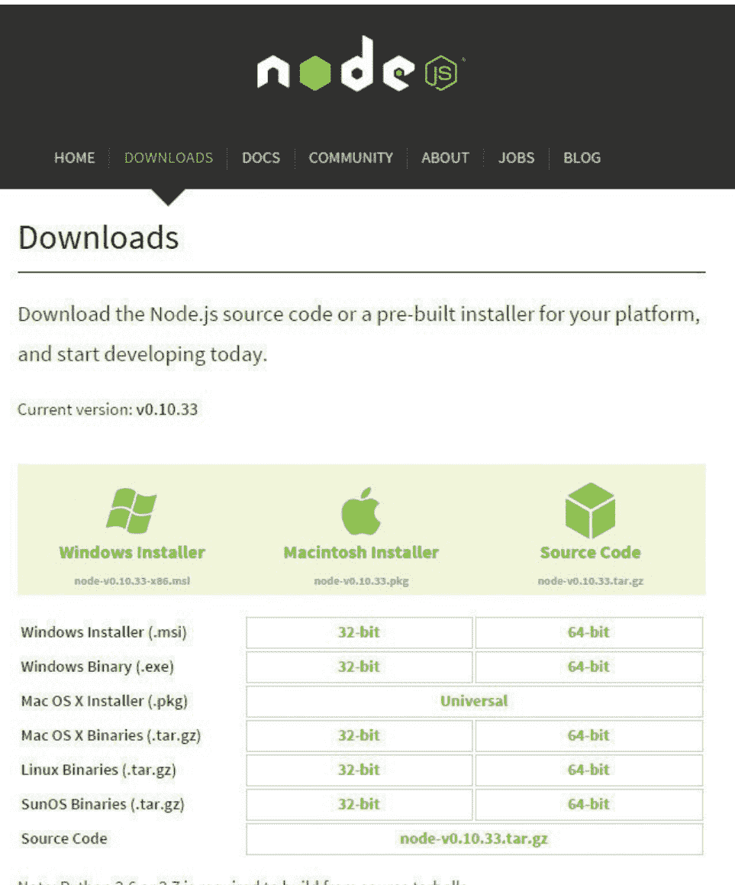
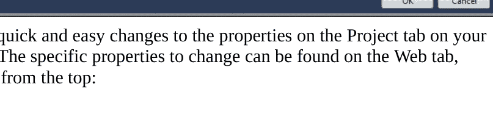
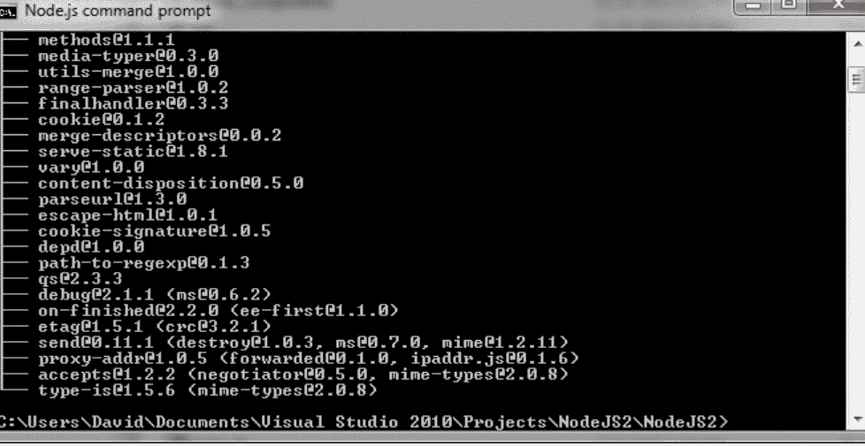
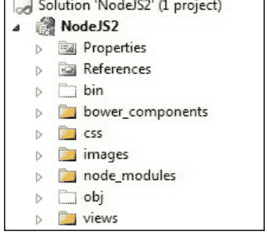
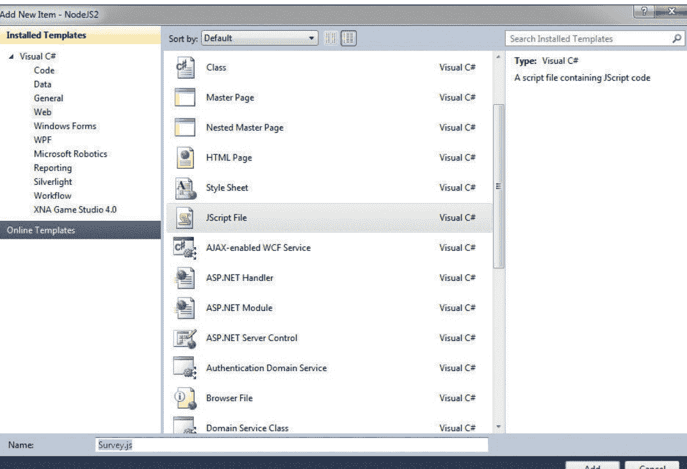

# .NET 开发者的 Node.js (开发者参考)


# 您对这本书如何？我们想听听您的意见

微软希望听取您的反馈，以便我们不断改进为您提供的书籍和学习资源。要参与简短的在线调查，请访问：

microsoft.com/learning/booksurvey

# 前言

Node.js 是一个基于 JavaScript、高度可扩展的开源工具集，用于复杂的 Web 开发。通过将您选择的一组 npm 模块在 Node.js 范式下交织在一起，您可以构建任何想象类型的网站，从电子商务到具有多个并发用户的用户的交互式游戏。在某些类型的 Web 应用中，Node.js 为其他具有挑战性的技术问题提供了解决方案。

Node.js 最理想的场景是需要高量、低数据密集型请求处理的实时 Web 应用，或者希望使用 socket 连接采用推送技术的应用程序。如今，绝大多数 Web 应用依赖于无状态响应范式。在这种范式中，只有客户端可以发起通信或数据传输。凭借 Node.js 技能，您可以快速构建具有实时双向连接的应用，客户端和服务器都可以发起通信。

Node.js 网站是使用 HTML、CSS 和 JavaScript 组成的标准 Web 栈构建的。它允许将常用的样式库添加到您选择的 npm 处理模块集合中。了解 Node.js 如何成为某些具有独特高要求的类型 Web 开发的首选平台。

# 谁应该读这本书

本书的编写目的是帮助当前的 .NET Web 开发者学习 Node.js Web 开发的基础知识。

# 假设

本书假设您至少对 .NET 开发和面向对象的编程概念有基本的了解。由于本书侧重于 Web 开发，因此还假设您对 ASP.NET 有基本的了解，包括 ASP.NET 中包含的 Web 开发核心概念，如客户端和服务器、HTML、CSS、JavaScript 以及 HTTP post/get。本书还假设您有一个 IDE 可以工作，具体来说是较新版本的 Visual Studio。

# 如果符合以下情况，这本书可能不适合您……

如果您没有 Web 编程经验，或者您对 Web 编程的兴趣主要是设计优雅的用户界面，那么这本书可能不适合您。

# 本书的结构

本书分为九章，旨在引导您完成进行 node.js 开发所需的每个方面。前几章涵盖了 node.js 开发的设置和编码基础。中间部分专注于特定的 node.js 技术。最后几章将所有内容整合在一起。

# 本书规范与特征

本书使用了易于阅读和遵循的规范。书中包含了为了让生活更简单的

# 系统要求

您将需要以下硬件和软件来完成本书：

- 互联网连接以下载软件或章节示例
- 根据您的 Windows 配置，您可能需要本地管理员权限来安装或配置
- 如果运行在虚拟机中
- 1.6GHz 或更快的处理器
- 磁盘驱动器...
- Microsoft Press 产品

# 下载：代码示例

setup.exe 创建的文件夹包含两类文件：

- JavaScript 文件 包含运行应用程序的代码
- EJS 文件 用于替代 HTML 文件渲染页面。虽然它们包含所有 HTML，但也包含了允许文件与其相关的 JavaScript 交互的特殊语法

# 使用代码示例

本书中的大多数章节都包含您可以尝试学习内容的练习。完整的示例可以在此处找到：

http://aka.ms/nodejsfiles

# 致谢

我想感谢以下人员：Devon Musgrave 和 Marc Young 帮助我们完善项目并出版，Devon 的特殊努力，以及我的妻子 Samantha 无尽的支持。

# 错误、更新与书籍支持

我们尽力确保本书及其配套内容的准确性。您可以通过以下地址获取本书的更新——形式为提交的错误列表及其相关的修正：

http://aka.ms/nodejs/errata

如果您发现尚未列出的错误，请通过同一页面向我们提交。

如果您需要额外支持，请发送电子邮件至 mspinput@microsoft.com 联系 Microsoft Press 图书支持。

请注意，之前的地址不再提供微软软件和硬件的支持。如需获得微软软件和硬件的帮助，请访问 http://support.microsoft.com。


# 保持联系

让我们保持交流吧！我们的 Twitter 地址是：http://twitter.com/MicrosoftPress

# 第 1 章. 设置

首先，访问 NodeJS.org，或者直接点击安装（Install），也可以导航到网站下载页面，你将看到以下内容：



当你运行选择安装的 .msi 文件时，你会看到以下内容：

```
method@1.1.1
media-types@0.3.0
utils-merge@1.0.0
qs-parser@1.0.2
finalhandler@0.3.3
cookie@1.1.2
mime-descriptors@0.2.2
serve-static@1.8.1
var@0.1.4
content-disposition@0.5.0
parser@3.0.0
extype-html@0.1.1
cookie-signature@0.1.5
decache@0.4.4
path-to-regex@0.1.3
dpe@2.1
ndify@2.1
on-finished@2.0.1
readable@2.2.1
send@1.1.1
destroy@0.3.0
body@0.6.0
ipaddr@1.2.2
accepts@1.2
type@1.5.6
```

C:\Users\David\Documents\Visual Studio 2010\Projects\NodeJS\NodeJS2>

```

如果运行正常，你将在指定的任何目录（C:\Program Files (x86)\nodejs）中看到以下内容：

| 名称 | 文件夹 | 修改日期 | 类型 |
| :--- | :--- | :--- | :--- |
| node_modules | | 11/11/2014 9:27 PM | 文件夹 |
| nodew_provider.man | | 10/23/2014 6:02 PM | 文件 |
| nodectr_provider.man | | 11/07/2014 8:13 AM | 文件 |
| nodevars | | 11/07/2014 8:13 AM | 批 |
| npm | | 11/07/2014 8:13 AM | 文件 |
| npm | | 11/23/2014 4:21 PM | 配置 |

完成后，你应该可以在开始菜单中找到 Node.js 命令行提示符。如果你点击并启动它，你将看到这个：

```
Node.js command prompt Your environment has been set up using Node.js 10.33 (ia32) and npm.
C:\Users\David>
```

注意此控制台条目提到了 npm。这是你需要配置的关键包管理应用程序，它将允许你安装所需的所有额外包以快速构建你的 Node.js 应用。你将从命令行提示符进行操作，而不仅仅是这个特定的命令行提示符。这是因为你不想那样做。npm 程序会将必要的包下载到命令行提示符的当前目录，而不是其他地方。我假定显示的位置并不是你 Visual Studio 项目通常所在的地方，而且由于你正准备将 Node.js 连接到 Visual Studio，你将希望 npm 将包安装到你实际使用的目录。将 Node.js 连接到你的 Visual Studio 2010 实例并不困难，只需更改项目的属性。

### 提示

如果你正在使用 Visual Studio 2012 或更高版本，现在微软提供了一个插件来创建 Express 版本的 Node.js 项目。它让创建 Node.js 项目或任何其他 JavaScript 项目变得像使用此处显示的标准菜单创建任何其他类型的项目一样简单。然而，我在没有插件的情况下演示了这种操作。我只是将我的项目配置为从一个空的 ASP.NET Web 开始，如下：

## 新项目

最近模板
- Visual Basic
- Visual C#
- Windows Web
- Office Cloud
- Microsoft Robotics
- 报告
- SharePoint
- Silverlight
- Windows Phone 版 Silverlight
- WCF
- 工作流
- XML Studio 4.0
- Telerik
- MonoTouch
- 其他项目类型
- 数据库
- 测试项目

已安装的模板

名称：
位置：
解决方案：
解决方案名称：

| .NET Framework 4 | 排序依据：默认 | 搜索已安装的模板 |
| :--- | :--- | :--- |
| ASP.NET Web应用程序 | 类型：Visual C# | 用于创建具有 Web 用户界面应用程序的空项目 |
| ASP.NET MVC 2 Web应用程序 | Visual C# | |
| ASP.NET MVC 3 Web应用程序 | Visual C# | |
| Telerik Web应用程序 | Visual C# | |
| Telerik MVC Web应用程序 | Visual C# | |
| ASP.NET 空 Web应用程序 | Visual C# | |
| ASP.NET MVC 2 空 Web应用程序 | Visual C# | |
| ASP.NET Dynamic Data Entities Web应用程序 | Visual C# | |
| ASP.NET Dynamic Data Link to SQL Web应用程序 | Visual C# | |
| ASP.NET AJAX 服务器控件 | Visual C# | |
| ASP.NET AJAX 服务器控件扩展程序 | Visual C# | |



然后，我对你在顶部导航菜单上“项目（Project）”选项卡上的属性进行了一些快速且简单的更改。要更改的特定属性可以在“**Web**”选项卡中找到，它是从上往下数的第三个：

## 重要的部分在这里：

它遵循四个快速步骤：

- 告诉 Visual Studio 在启动时运行外部应用程序，而不是像通常那样仅运行应用程序内的页面。
- 指定应用程序，包括其位置和任何命令行参数。在这里你引用 Node.js 的安装位置。
- 按照所示的内容准确指示参数和程序调用。
- 指定你想要安装 Node.js 包的目录。

刚刚显示的位置并不是你 Visual Studio 项目通常所在的地方，而且由于你正准备将 Node.js 连接到 Visual Studio，你将希望 npm 将包安装到你实际使用的目录。

以下是上表中关键项的摘要：

- **Express**：Node.js 核心的支持框架。它让路由和发送响应等操作变得非常简单。
- **Body-parser**：一个特定的工具，让你快速方便访问通过 Post 提交的值。
- **Memory-cache**：一个特定的工具，作为可管理的集合允许页面间（视图间）的状态管理。
- **Tedious**：这相当于 Node.js 为微软 SQL Server 提供的驱动程序。之所以在这个项目中选择它，是因为目前如果你在用 .NET，你更有可能连接到 SQL Server。
- **EJS**：一种嵌入 JavaScript 的渲染引擎，它要求修改创建的任何 HTML 页面以使用 .ejs 文件扩展进行页面生成。
- **Bootstrap (以及 Bower)**：Bootstrap 是 UI 的样式引擎。Bower 与 npm 本身类似，在下载其他包之前必须下载它。
- **Passport**：是用于身份验证的包，它支持典型的用户名和密码，以及 Facebook、Twitter 等。

我们将安装书中应用程序所需的每个包。从命令行安装非常简单。
```


确保你的实际命令行位置与你输入的项目根目录位置匹配，因为 npm 将把包安装到该位置。

### 提示

为了快速到达那里，请在文件管理器中打开站点根目录，右键点击顶部的文件位置并选择“复制为文本”。然后在命令行窗口中输入 `cd` 命令后再次右键粘贴该路径。

在文件系统的该正确位置，只需输入：

`npm install express`

或者你也可以直接在命令行中输入：

`npm i express`

你应该能看到某些事情开始发生，如下所示：



控制台会有一些细微但有趣的视觉变化。完成后，控制台将充满下载完成的高亮显示，这意味着你已经准备好了 express 包。

每个包的流程都是相同的——只需更改要下载的包名称即可。如你所见，这个过程非常快。

通常，到这一点你就可以开始在编写代码时逐个接入组件了。然而，既然你已经规划好了应用程序所需的每个包，让我们现在就把后续将用到的其他包也获取了。所以当你的命令行窗口仍然开启时，依次输入以下每个命令并让其运行：

- `npm body-parser`
- `npm memory-cache`
- `npm tedious`
- `npm i eject`

```
npm i passport
npm -g bower
bower i bootstrap
```

只要你在尝试安装 Bootstrap 之前执行了高亮显示的 Bower 安装，你可以按任何顺序执行这些。如你所见，Bower 包的安装与 npm 安装包几乎相同。

唯一需要注意的一行是高亮获取 Bower 本身的那行，其中命令中添加的 `-g` 告诉 npm 命令在全局查找资源，而不仅仅是在自己的标准库列表中查找。

### 注意

Bower 网站有如下说明：“Bower 依赖于 Node.js 和 npm。此外，请确保已安装 git，因为某些包需要通过它来获取和安装。”

如果你的系统中尚未安装 GIT，请访问以下网站：

http://git-scm.com/downloads

从那里，根据建议下载适用于你系统的版本。

这在多程度上完成了你开始构建 Node.js 应用程序的设置过程。与 .NET 直接相比，这真的是对 Node.js 世界的完美介绍。使用 Visual Studio 时，你下载、开启、编码，就搞定了。但使用开源工具，你通常需要自己完成一切。

在这种编码模型下，你需要做额外的工作，但权衡是你拥有了所有的控制权。此外，正如我提到的，由于有大量类似的包可用，即使在其内部功能的深处，你也可以根据特定偏好定制你的应用程序。

设置完成后，让我们开始查看代码。

# 第 2 章. JavaScript 和异步代码

如果你进入 Node.js 的主页而不仅仅是下载页面，你可能不需要滚动就能找到一个类似这样的代码示例：

点击此处查看代码图像

```
var http = require('http');
http.createServer((req, res) => {
  res.writeHead(200, {'Content-Type': 'text/plain'});
  res.end('Hello world!\n');
}).listen(1234, '127.0.0.1');
console.log('Server running at http://127.0.0.1:1234/');
```

该示例之后是一个包含如下内容的章节：

点击此处查看代码图像

“要运行服务器，将代码放入文件 `example.js` 中，并在命令行中通过 `node` 程序执行它：”
% node example.js`

这会在控制台中产生如下内容的输出：

点击此处查看代码图像

Server running at http://127.0.0.1:1234/

请务必在正确的文件位置命令行提示符中尝试。（在这种情况下，它无论在你最初安装 Node.js 的地方，还是在你设置了 Microsoft Visual Studio 路径以运行 Node.js 项目的地方都能运行。）从那里开始，你可能会得到承诺中的输出。

如果是的话，你就可以启动浏览器访问你指定的 IP。（你最初指定的端口完全由你决定，只要是位数字即可。）你将在页面上看到你的“Hello World”。虽然你不会使用这段代码，但你将通过几行代码来说明你对 JavaScript 以及 Node.js 期望你使用的方式所需的许多知识——这并不是意味着如果你真的用六行 JavaScript 创建了一个服务器，它也能工作。这比安装 Internet 信息服务（IIS！）要简单得多。（当然，这个服务器目前还没有做什么，但也不太坏）

## 使用 JavaScript

我假设你至少在这方面有一些经验。我将从头开始，并将……


中间的部分是 `http.createServer(function (req, res) { });`；

是的，这确实是一个接受函数作为参数的函数。在 JavaScript 中，甚至函数也是一个对象。在 .NET 世界中，最接近的比较是委托（delegate），它是对函数的对象封装器。

# Note

我实际上是把顺序说反了。事实是，JavaScript 中的每个对象都声明为函数。我很快就会讲到这一点。我意识到，如果你到目前所做的只是用 JQuery 显示和隐藏一些 `div`，那么这些内容是非常开眼脑的。我会尽可能保持内容的简单，并在你准备好后让你继续学习剩余部分。

让我们回到那行代码：

点击此处查看代码图片

```javascript
http.createServer(function (req, res) {
res.writeHead(200, {'Content-Type': 'text/plain'});
res.end('Hello world\n');
}).listen('127.0.0.1',);
```

JavaScript 以及将函数传递给函数（例如将 A 作为参数传递给函数 B）的特殊之处在于，它实际上并没有使用该函数本身或任何操作。相反，它将函数布线为回调（callback）。

回调函数基本上与你当地公司的回调是一样的。如果你拨打电话公司（如果是现代电话公司），当客户服务忙碌时，你会得到一个留下号码的选项，公司会在他们准备好服务时回电或“回拨”给你。换句话说，当他们处理完在联系你之前正在做的其他事情后，他们会给你回电。回调函数接收函数 B 的结果，然后可以对结果进行操作。

这种在 JavaScript 中采取的每个操作都使用回调函数的概念，是 Node.js 编程的本质。它创建了所谓的代码异步模型。

如果某个总是按顺序运行（先是 B 然后是 C），那么它就是同步的。如果 B 是回调函数，意味着只有当函数 A 有了最终结果可以开始工作时它才开始运行，C 可以在 A 完成之后但在 B 运行之前运行，使得代码变成异步的：

点击此处查看代码图片

```javascript
obj.myFunctionA(functionB (x) {});obj.myFunctionC();
```

仅仅传递一个 JavaScript 认为与其他任何东西一样对象的参数（！）并不会阻止它的运行。JavaScript 处理器（如果不是的话，它本身就可以单独写一本书了）只要大括号里的内容运行完毕，就认为函数 A 已经完成。它完全不在乎函数 B 在函数 C 继续离开起跑线之前尚未完成它需要做的事。

尽管这给代码和数据逻辑引入了各种复杂性，但它包含了巨大的潜能。在最基础的层面，如果 A 是一个网络请求而函数 C 也是一个请求，那么 C 无需等待 A 的结果（即 B）完成处理或渲染即可开始运行。只要 B（它现在运行在它自己的小宇宙中）没有触碰 C 通用的任何资源，通过遵循这种模型，你可以构思出一种方法，启动大量正在运行的请求，所有请求都在自己的空间内处理它们的请求。它们完全独立于任何其他资源，并以绝对速度为每个请求提供网页。

所有这些都有助于解释我在在书开头提到的轶事证据，并解释了我们起初为什么要使用 Node.js。回调模型的广泛使用创建了网络请求的异步处理，这会对性能产生巨大影响。其实就此而已。之后，你所做的一切都是适应这个模型。当然，与没有预构建从控制器到数据库连接的一切相比，这样做在日常业务中实际上是不可能的。因此，你看到包的数量爆炸式增长，以使开发与其他方法保持一致，从而形成了目前 Node.js 的现状。

一旦你接受了我在最后几页中提到的所有概念，你就可以开始分析正在发生的事情：

点击此处查看代码图片

```javascript
http.createServer(function (req, res) {
  res.writeHead(200, {'Content-Type': 'text/plain'});
  res.end('Hello World!');
})
```

`create` 函数除了回调对象外没有接受任何参数。在 Node.js 骨干某处存在这个对象。它是做什么的呢？它期望你提供一个具有完全相同签名的函数，并在将在完成后调用它。该回调函数期望传递由骨干生成的两个参数。正如名称所暗示的，这些参数将是你熟悉的 HTTP 世界的对象：请求对象和响应对象。

> Note
> 如我之前谈到的，在 JavaScript 世界中，如果不亲身尝试并参考你自己的代码或亲手操作，就没有办法知道什么是对象。这些是为什么这本书适用于至少具有一些真实世界开发经验的人的原因之一。对于初学者来说，没有它，Node.js 将完全令人费解。你可以看到响应对象包含了你可以使用的属性和函数：`writeHead` 函数和 `end` 函数，后者至少有一个重载可以接受某些纯文本并写入响应。在这种情况下，我们正在写入 Hello World。需要注意的一个重点是：按照写法，此服务器将为它收到的每个网络请求返回 Hello World。这并不实用。如何路由以及以后进行路由。你可以使用 Express 包中的功能作为该功能的骨干，而不是 Node.js 本身。但你可以深入研究 HTTP 对象和这个回调函数，如果你选择，你可以这样做。

最后，需要注意这行代码的作用是：

```javascript
.listen(1234, '127.0.0.1');
```

从 `createServer` 函数返回的任何对象必须将回调作为其属性之一，以激活底层代码。该函数需要一个 IP 地址和一个端口来监听请求。为了清晰起见，代码可以如下：

点击此处查看代码图片

```javascript
var server = http.createServer(function(req, res) {
  res.writeHead(200, {'Content-Type': 'text/plain'});
  res.end('Hello World');
});
server.listen(1234, '127.0.0.1');
```

然而，JavaScript 处理器显然由于自己的原因更偏于“链式”版本。你可以在可以使用时使用它。

# Note

优化的 JavaScript 可能会导致地球上一些最不可读的代码。如果那种性能水平对你真的很重要，这仅仅是你为了性能而必须做的一种权衡——取决于情况，它可能很重要。

这一行代码写得怎么样？欢迎来到 JavaScript 世界的核心和灵魂——它的城市，Node.js。

支持这座城市的设施（在刚才显示的一行代码中被提到了至少四次）是面向对象的 JavaScript (OOJS)。前面的代码中的某些对象是被创建的；另一些是通过推断引用的，还有一些是使用属性或方法直接引用的。正如王国基石的任何重要事物都可以被稳固地设计一样，在不对该主题进行过于啰嗦的情况下，让我们花几分钟谈谈 OOJS 的最佳实践：

## 面向对象的 JavaScript

正如我之前提到的，JavaScript 中的每个对象都声明为函数：

```javascript
function Person() {}
```

反过来，正如你从整个回调结构中看到的那样，每个函数也充当对象。在 JavaScript 中，有些人使用 `function` 指代对象（相关代码的集合），使用 `function` 指代方法（执行单个特定动作的代码）。除了所有语法上的相似之处外，我将坚持标准的引用法。

让我们从一个你实际上会构建并在后续过程中使用的对象开始。你将设计一个简单的调查 Web 应用程序，它将生成几个问题并在 UI 中允许用户交互并生成响应。你需要一些我称为类（对象）的东西——例如，一些玩家和问题。从开始，这些对象包括一个 Player 对象和一个 Question 对象。

Player 是一个 Person，所以让我们从之前的代码行开始，以及一些所有人共有的东西：

```javascript
function Person() {
  this.lastName = "";
  this.firstName = "";
}
```

如果你在好奇你在哪里声明了 `lastName` 和 `firstName` 属性或字段，“你刚刚就声明了。” `function` 关键字动态创建了这些属性的引用。是的，这并不是 Node.js 特有的。所以让我们像完全没有问题一样继续下去。JavaScript 的生活每天都是这样。你通过在代码实践中极其谨慎来做到。接下来，缩小你需要的人的类型，那就是玩家。首先，玩家是一个人。当你创建 Player 对象时，首先通过像这样使用原型属性告诉它它是 Person：

点击此处查看代码图片

```javascript
function Player () {
  this.prototype = Person;
  this.sport = "Football";
  this.displayName = function(){
    return(this.lastName + ', ' + this.firstName);
  }
}
```

正如你所见，要将一个属性变为方法，只需将其声明为函数。现在，你声明的任何 Player 对象都拥有 Person 的所有属性，这段代码将弹出一个显示玩家合并名称的消息框：

```javascript
var oPlayer = new Player();
oPlayer.firstName = "Walter";
oPlayer.lastName = "Payton";
alert(oPlayer.displayName());
```

你可以通过这种方式从子类中覆盖原型中的函数。尝试这种模式，就就像使用原型来帮助封装你的代码并在可能的地方消除冗余一样。


```javascript
this.displayName = function(){
  this.lastName += ', ' + this.firstName;
}
```

这和其他任何属性没有区别。你只需要将值设置为一个新内容——在这种情况下，是一个新函数。因此，你可以让 `BaseballPlayer` 对象的代码看起来像这样：

点击此处查看代码图片

```javascript
var oPlayer = new Player();

oPlayer.firstName = "Babe";
oPlayer.lastName = "Ruth";
oPlayer.position = "Pitcher"; // 是的他最初是从投手开始的
this.displayName = function() {
  this.lastName += ', ' + this.firstName + ": " + this.position;
}
alert(oPlayer.displayName());
```

它产生的输出与之前相似，但代码更整洁。
再次，你可以随意向你的子类添加新的属性和函数（无论是故意的还是无意的）。你不需要在 `.NET` 对象和接口的绿色继承的 so-object 树的任何级别实现任何内容。推荐这些 OOJS（面向对象的 JavaScript）实践是为了代码的一致性、可维护性以及为了你的利益。如果这意味着你倾向于将你的 `Player` 函数命名为 `showAloMe`，请尽管去做。JavaScript 完全不在乎。

点击此处查看代码图片

```javascript
var oPlayer = new Player();
noPlayer.firstName = "Walter";
oPlayer.lastName = "Payton";
this.showAloMe = function() {
  this.lastName += ', ' + this.firstName + ": " + this.sport;
}
alert(oPlayer.showAloMe());
```

然而，如果你打算重写原型基类的每个函数，那么如果它增加的只是便利性，那么子类/原型集的设置就没什么意义了。

现在你拥有了 `Player` 对象，它可以帮助你组装体育调查问题。你需要一个问题列表，然后你需要的下一个对象是 `Question` 对象：

点击此处查看代码图片

```javascript
function Question(oQuestion, oAllAnswers, oCorrectAnswer) {
  this.questionText = oQuestion;
  this.answersList = oAllAnswers;
  this.correctAnswer = oCorrectAnswer;
}
```

如你所见，创建一个 `Question` 对象所需的比 `Player` 函数创建一个 `Player` 对象要更多。这个对象显然需要一些外部数据才能正确组装。注意这种弱类型。例如，下面的内容显然是某种列表或数组。之所以明显，仅仅是因为它的名字暗示了它必须是一个列表才能按照你逻辑需要的方式工作

```javascript
this.answers = oAllAnswers;
```

接下来的一行同样显然只持有一个值，最可能只是文本。（对于任何单独的问题，只有一种可能的文本内容）。

点击此处查看代码图片

```javascript
this.questionText = oQuestion;
```

这一行也显然将持有一个你选择的任何有效单个值。然而，基于此，你不知道它是与你某处的 `AnswerId` 匹配的数字或 GUID 行 ID，还是与当前显示的答案匹配的文本值。

点击此处查看代码图片

```javascript
this.correctAnswer = oCorrectAnswer;
```

在编写代码时尝试养成良好的习惯，这样你就能随时知道代码中发生了什么。这会让你的生活变得轻松得多。在你开发代码时，我稍后会完善“类”。

正如我所说，我这里的意图只是触及 OOJS 的表面，向你介绍为了一致性和可维护性的最佳实践。如果你有需要和兴趣，可以从广泛的资源中深入探索各种原型设计和派生各种对象的各种细节。对于你目前的用途，OOJS 的基础知识以及它在现有包中的用法足够你理解了。这些基础知识还涵盖了你应该如何使用 OOJS 在你的 Node.js 项目中传递和管理信息以及行为。

你已经看到 Node.js 如何通过单个（尽管有点复杂）的函数调用创建一个服务器。你研究了 OOJS，以对 JavaScript 世界中的良好模式和功能有一个良好的感觉。你将这些结合起来分析那单行 JavaScript 代码，帮助你理解该代码实际上在做什么。此外，检查该代码向你展示了如何最好使用 Node.js 在构建网站时遵循最有效的模式。

我确信你已经准备好开始创建一个可以运行的东西——一个从 Node.js 生成的实际网站。你已经拥有有效完成此的所有背景知识。让我们现在开始。

# 第 3 章 编写 Node.js

在编写任何实际代码之前，在 Microsoft Visual Studio 内部，让我们完成项目的设置。如果你看一眼，你会发现有两个文件夹，名为 `node_modules` 和 `bower_components`，它们是你命令行安装的结果。



在此基础上，正如你看到的，你只需要添加几个文件夹。这不会花费多长时间。我的项目叫做 `NodeJS2`；你的看起来应该也完全一样。如果不是，在你完成接下来的几个步骤后很快就会变成。

## 使用 MVVM 模式

如果你有任何模型-视图-控制器（MVC）背景，那么在尝试理解如何构建你的文件树时这将是一个很大的加分项。如果你工作过 MVVM，那将是一个更大的加分项。

你看到 Node.js 核心通过单个（尽管有点复杂）的函数调用创建一个服务器。你研究了 OOJS，以对 JavaScript 世界中的良好模式和功能有一个良好的感觉。你将这些结合起来分析那单行 JavaScript 代码，帮助你理解该代码实际上在做什么。此外，检查该代码向你展示了如何最好使用 Node.js 在构建网站时遵循最有效的模式。

我确信你已经准备好开始创建一个可以运行的东西——一个从 Node.js 生成的实际网站。你已经拥有有效完成此的所有背景知识。让我们现在开始。

## 编写代码

创建一个名为 `app.js` 的文件并将其添加到根目录。具体的名称是什么？

实际上，你可能已经指定了它是什么。检查项目属性中你之前设置时输入的 Web/命令行参数，并验证那就是你提供的启动文件的确切名称。无论是或否，你都可以给文件命名。只需确保两个名称匹配：你给它的名称和你在启动时使用的名称。

在文件中，通过健康检查开始编码：

```javascript
use strict;
```

作为文件的第一行使用它可以避免意外声明不存在变量（通常由于拼写错误）引起的潜在调试烦恼。

接下来是做某些事情的实际代码：

点击此处查看代码图片

```javascript
var express = require('express');
```

这应该是你在这里做的：添加第一个 npm 包引用。Express 包取代了你原本使用 Node.js 核心要完成的工作，让你想要做的很多事情变得更容易。

接下来，添加这两行：

点击此处查看代码图片

```javascript
var server = express();
server.listen(1234, function () {
```


```javascript
console.log("ready on 1234");
```

这些代码也应该是自而易懂的。你从 express 调用中获取了一个服务器对象，并且你通过告诉服务器监听请求来启动它。运行程序，你将看到这条消息，并确认它是正确的。你的服务器运行在本地 (127.0.0.1) 的 1234 端口（或任何你喜欢的四位数字）。地址 http://127.0.0.1:1234 将带你到达那里，尽管你在那里什么也看不到。请注意，你不会收到“404 页面未找到”错误，所以你已经成功了。你使用 Node.js 以两种略有不同的方式构建了服务器。

只要 node.js 运行你的服务器文件，你的服务器就会运行。在这种情况下，它运行是因为你开启了 Visual Studio。而且你弹出的控制台会告诉你正在发生什么。在现实世界中，你很可能会有某种服务器后台定期检查 node 是否了一直运行。

请注意，以下代码如果链式调用将是相同的，并且应该能为你生成一个工作正常的服务器：

点击此处查看代码图像

```javascript
express().listen(1234, function () {
  console.log("ready on 1234");
});
```

只需确保你先引用了 Express 包即可。在这种情况下，请采用第一种非链式方法，原因你很快就会看到。

我们免费获得了这些，尽管代码不同。现在，让我们把它带到现实世界中。

我们的整体开发计划是创建一个体育调查网站，该网站提供包含多个问题，并将球员名称作为答案。从你最终想要的蓝图开始总是好的。在我的脑海中，它最终看起来会像这样：

- 以下哪些球员参加过棒球队？
  1. Walter Payton
  2. Babe Ruth
  3. Wayne Gretzky
  4. Tiger Woods
- 哪个球员曾效力于芝加熊队？
  1. Tiger Woods
  2. Walter Payton
  3. Babe Ruth
- 历史上的冰球得分王。
  1. Wayne Gretzky
  2. Walter Payton
  3. Bobby Orr

显然，它需要一些样式、一些图片，可能还需要一个登录才能访问页面。然而，在开始时，我的脑海并不太在意这些，所以这些已经足够开展了。

首先，你需要一个 View（视图）来存放你计划显示的 HTML，并且像往常一样，它将带有一个同名的 .js 文件。只需使用 Visual Studio 以通常方式添加文件即可。

## 添加新项 - NodeJs



让我们它们命名为 Survey.htm 和 Survey.js。将 Survey.htm 放在 Views 文件夹中，将 Survey.js 留在根目录下。

此时，你需要告诉 Node.js 如何找到你的文件。在你的 app.js 文件中找到以下行：

点击此处查看代码图像

```javascript
var server = express();
server.listen(1234, function () {
  console.log("ready on 1234");
});
```

在它们之后，插入此行：

点击此处查看代码图像

```javascript
server.set('views', path.join(__dirname, 'views'));
```

这里有两个核心思想。一个思想是 Node.js 有一个你可以随意设置的配置，第二个思想是 `__dirname` 值，它是 Node.js 用来映射到本地系统根目录的常量。这不仅很方便；另一方面，知道 Node.js 似乎具有某些文件 I/O 能力也是好的。（稍后我会详细说明这一点。）现在，既然你在这里，对你的图片文件夹执行同样的操作，如下：

点击此处查看代码图像

```javascript
server.set('images', path.join(__dirname, 'images'));
```

现在你已经为需要它们时做好了准备。（不，你不能对 CSS 这样做。你必须以不同的方式获取这些文件，因为它们是 UI 文件。）

此时，你可以明白为什么你没有对原始服务器设置使用链式调用。你希望能够访问 express 函数返回的对象，而你并不需要这样做。

与设置你的 Views 路径相关，你必须在构建每个视图时逐个为 Node.js 指明它们。在我们的特定情况下，为了通知处理器你创建的第一个视图，你需要在设置 Views 路径后添加此行：

点击此处查看代码图像

```javascript
server.use(require('./survey'));
```

请确保注意这一行中使用的是相对文件路径，而不是标准的包引用。如果你想使用的引用不在 Node.js 核心中，处理器期望标准的相对网站路径。在这种情况下，你告诉它在根目录查找 survey，它假设 Node.js 中的所有内容都是 JavaScript 文件。因此，在 `require` 引用中不需要实际的 .js 后缀。

现在你可以把注意力重新回到新创建的 survey 上了。从开始，能够获取该页面是有意义的。让我们设置一个路由（route）。路由是你用来识别入站请求的模式，以便你知道向浏览器渲染哪个页面。

为你的调查页面创建一个路由将需要几个步骤。首先，在 survey.js 中添加这这两行代码：

点击此处查看代码图像

```javascript
var express = require('express');
router = express.Router();
```

首先你获取了 Express 包的访问权限，然后通过调用 Router 方法返回一个对象。我们决定给这个对象命名，而这个对象最重要的方面就是你用来将请求重定向到适当 View 的函数。

`get` 函数看起来如下：

点击此处查看代码图像

```javascript
router.get('/:className', function (req, res) { });
```

这是 Node.js 中的标准内容，带有异步签名。接收 `req` 对象和 `res` 对象作为参数的回调函数是你响应匹配模式的入站 URL 执行渲染或任何你需要操作的地方。

在我们的特定情况下，函数看起来如下：

点击此处查看代码图像

```javascript
router.get('/survey', function (req, res) {
  res.send('this is the survey page');
});
```

目前，你只需要利用响应对象的 `send` 方法。对于这个页面，你已经准备就绪了。最后一步是在文件底部添加此行：

```javascript
module.exports = router;
```

这一行告诉 Node.js 通过模块的属性使 router 全局可用。

如果你从浏览器访问 127.0.0.1:1234/survey，你将看到“this is the survey page”。这就是使用 Node.js 执行网站导航的所有内容。


一旦你完成授权，就会挂载你的应用程序。在发送响应时，你感兴趣的主要选择如下：

- 正如之前的代码示例所示，这用于发送基础回复。变体包括：
  - res.send('ok');
  - res.send('<b>really ok</b>');
  - res.send(new Buffer('buffered simple ok'));
  - res.send({ really: 'ok' });
  - res.status(404).send('Oops, page not found.');
  - res.status(500).send({ Oops: 'something erred' }});
  - res.json()

虽然可以使用该方法，但此特定方法会将内容打包为 JSON 代码（如刚才所示的第四个示例），某些内容并非有效的 JSON，例如 `null` 和臭名昭著的 `undefined`。

- redirect() 导航到指定的路径。
- end() 比什么都不做要好。
- render() 我们将在稍后详细介绍这一部分。

无论你创建了多少路径，请确保为每个路径选择一个响应。从某些示例可以看出，响应对象（response object）包含了你响应传入请求所需的所有内容。上面的列表并非详尽；它只代表了功能的子集。稍后我将介绍响应对象更有用的方面——例如 `sendFile` 和 `cookie`——它们不仅仅是匹配入站请求的答案。

现在你已经充分利用了 Node.js 的能力。你创建了一个服务器，它能处理 URL。你渲染了一个回复（尽管是一个简单的对象）。现在所有构建块都已就绪，可以添加更多路径、更多处理用户状态的对象，以及处理外观和数据内容的样式和扩展连接。你只需要进行一些单独的连接，就可以开始运行了。

由于你准备好进入这些具体的路径，让我们停下来，对你的应用程序及其配置进行最后的整体查看。

你已经在代码中看到并使用了 Express 的 `server.listen`、`server.use` 和 `server.set`。`server.set` 方法有一个对应的方法 `server.get`。正如你可能记得的，服务器名称是我们的 `app`。它位于 `app.js` 文件中，这是因为它是从 `createServer` 调用返回的 Express Application 对象。

`Application` 是一个键/值对的字典。它包含了大约十个预定义的含义，如下：

- 区分大小写的路由开启/关闭（Case-sensitive routing）：路径 '/Survey' 与 '/survey' 是否相同。
- 严格路由开启/关闭（Strict routing）：路径 '/Survey/' 与 '/Survey' 是否相同。
- 信任代理（Trust proxy）：可能可以信任 `X-Forwarded-*` header 来确定连接和客户端的 IP 地址（这有很多注意事项）；
- 视图（views）：你已经设置了此值，指向你的视图文件路径。
- 视图引擎（views engine）：当你切换到使用 EJS 进行渲染时，将设置此项，它是项目设置期间下载的 npm 包之一。

此外，就像 ASP.NET Application 对象一样，Express Application 对象也可以存储你的自定义键/值对并允许你检索它们：

点击此处查看代码图片

```
server.set('appName', 'NodeJSDemo');

alert(server.get('appName'));
```

这样做可以为你提供一个可配置设置的全局字典。记住，在 JavaScript 中，“全局”意味着“仅限于你当前所在的页面或文件”。这些并不是真正的全局值。对于这一点，你需要 `Memory-Cache` 包（或类似的包），我将在稍后谈论状态管理时会介绍它。

无论如何，对于 `Application` 对象，如果你需要知道集合中某个内容的启用状态，下面这行代码将告诉你你需要的信息：

点击此处查看代码图片

```
server.disabled("trust proxy");
```

（现在如果你在应用程序中尝试这一行，它将输出 `true`。）

`Application` 对象中的设置项并不多，但它们非常有用。始终记住，JavaScript 是按文件中代码的顺序执行的。因此，为了让你的代码按预期运行，`requires` 语句和配置信息通常构成 `.js` 文件中的第一个条目。

# 第 4 章 渲染 Node.js

现在我们已经涵盖了路由和向网络请求发送基础响应，让我们开始将你的 Node.js 应用程序引入现实世界。在本章中，你将添加一些真实的网页，允许用户与数据驱动的 UI 进行交互。

## 在开始之前

在开始之前，你还有几个 npm 包需要连接。


我的观点仅仅是 Node.js 只是处理事情的另一种方式。某些方面会更好，但某些方面并非如此。在某些情况下和某些情况下，它可能优于 ASP.NET，但这一事实并不意味着 Web Forms 不是一项持续了十年的稳健技术。在许多方面，对于许多企业和客户来说，Node.js 在构建简单用户界面上额外要求的额外工作并不具有成本效益。这项技能只是为你和你的公司为构建解决方案提供了新选择。

如果你喜欢 MVC 开发，那么这些额外的努力对你来说不是问题，你很快就会适应这些要求和模式。但如果你来自快乐幸运的 OOP 世界——在那里你只需要从工具箱中拖放组件，就能神奇地让所有控制属性都触手可及并随心所欲——那么习惯这些事情将花费一段时间。（如果你在那个曾经欢认为认为条条代码随着千禧年漏洞而消失的时代需要编写 ASP 的话，那么“新 Web”正再次充斥着这种代码。Node.js 是一个重新接触这些代码的好地方！）

这种编码风格被称为使用模板。考虑以下两段产品列表的代码：

点击此处查看代码图片

```javascript
var html = "h1"+data.title+"h1"
html += "<ul>"
for(var i=0;i<data.products.length; i++) {
html += "<li><a href='products/" + data.products[i] + ">"
html += data.products[i] + "</a></li>"
}
```

与之相比：

点击此处查看代码图片

```html
<h1><%= type %></h1>
<<ul>
<%(var i=0;i<products.length; i++) { %>
<li>
<a href='products/%= products[i] %>'>
<%= products[i] %>
</a>
</li>
<% } %> <!-- 等等，下面是修正后的语法 -->
</</ul>
```

它们看起来相似，但在几个关键方面有所不同。

第一个例子是纯 JavaScript。要按照所写的方式渲染此列表，你需要添加的行仅仅是将结果字符串赋值给 div、字面量或任何适合你的控件。在此之外，如果你还想对结果进行样式处理，例如），你需要将所有这些内容整合到你的 JavaScript 代码中。因此，可能会迅速变得非常复杂，而你实际上只是想向用户展示一条记录。

第二个例子是模板。HTML 标签是固定的，并提供了呈现结构，位于 `<% %>` 括号中的代码将向其中填充数据。正如我提到的，对于任何做过 ASP 或 MVC 的人来说，这一切看起来都会很熟悉。你还会注意到 JavaScript 数据对象不存在，而是被这种 `<%=` 语法取代，EJS 将其识别为它应该从同名的 .js 文件中获取的属性/变量值。

这就是与后置代码（code-behind）任何相似之处的地方。JavaScript 对属性、引用等一无所知。如果你希望页面在渲染时处理数据，你必须在告诉页面显示时显式提供该数据。因此，对于上一个示例，你在请求进来时的 get 函数期间提供产品：

点击此处查看代码图片

```javascript
res.render('products', {
  products: theArrayYouBuild
});
```

然后你提供标题以及 EJS 需要的任何其他参数。确保提供的每个参数都用逗号分隔：

点击此处查看代码图片

```javascript
res.render('products', {
  products: theArrayYouBuild,
  title: "My Products"
});
```

标题，例如，在这里使用了：

```html
<h1><%= title %></h1>
```

现在，假设你在 `ArrayYouBuild` 中有一些数据，页面将渲染你的产品以及列表的标题。

## 使用真实数据

让我们开始使用真实数据，即使我们会在最终版本中不会这样渲染它。首先，你将显示一个简单的玩家列表，它最终将成为你的多选题题集之一。

首先，准备 .ejs 文件。它将与之前所示模板示例类似。将此代码放入你的 `survey.ejs` 文件中：

点击此处查看代码图片

```html
<ul>
  <% for(var i=0; i< players.length; i++) { %>
  <li>
    <a href='details/<%= players[i].id%'>
      <%= players[i].name%>
    </a>
  </li>
  <% } %>
</ul>
```

如你所见，这是一个预期填充某种数组的 `for` 循环。让我们提供一个数组吧。在你的 `survey.js` 文件中，创建以下数组：

点击此处查看代码图片

```javascript
var thePlayers = [
  { id: 1, name: 'Walter Payton', sport: 'Football' },
  { id: 1, name: 'Babe Ruth', sport: 'Baseball' },
  { id: 2, name: 'Wayne Gretzky', sport: 'Hockey' },
  { id: 3, name: 'Tiger Woods', sport: 'Golf' },
  { id: 4, name: 'Bobby Orr', sport: 'Hockey' }
];
```

这是该数组的原始数据。

像你之前那样更改你的渲染代码，你应该看到你的玩家列表：

```javascript
res.render('survey', {
  players:thePlayers
});
```

现在，如果你浏览到调查页面，像之前一样显示名称。如果你将鼠标悬停在名称上，你应该会在状态窗口看到一个带有玩家 ID 的链接。它导航到一个你尚未构建的页面，所以如果你点击该链接，将收到 "Cannot GET" 响应。

所以你成功连接了你的 .js 和 .ejs 文件来显示你在路由期间构建的页面。在你进行主要步骤之前，返回并清理你所做的，使其变为面向对象，正如我所讨论的样。

将此原始数组从 JSON 转换为 OOJS 格式：

点击此处查看代码图片

```javascript
var thePlayers = [
  { id: 1, name: 'Walter Payton', sport: 'Football' },
  { id: 2, name: 'Babe Ruth', sport: 'Baseball' },
  { id: 3, name: 'wayne Gretzky', sport: 'Hockey' },
  { id: 4, name: 'Tiger Woods', sport: 'Golf' },
  { id: 5, name: 'Bobby Orr', sport: 'Hockey' }
];
```

这是使用之前的 `Person` 和 `Player` 对象的 OOJS 方法：

点击此处查看代码图片

```javascript
function Person(id, name) {
  this.id = id;
  this.name = name;
}

function Player(id, name, sport) {
  Person.call(this, id, name);
  this.sport = sport;
}

Player.prototype = Object.create(Person.prototype);
Player.prototype.constructor = Player;

Player.prototype.displayName = function() {
  return this.name + ' ' + this.sport;
};

var thePlayers = [
  new Player(1, 'Walter Payton', 'Football'),
  new Player(2, 'Babe Ruth', 'Baseball'),
  new Player(3, 'Wayne Gretzky', 'Hockey'),
  new Player(4, 'Tiger Woods', 'Golf'),
  new Player(5, 'Bobby Orr', 'Hockey')
];
```
（注：OOJS 实现的文本在源码中被截断了；我根据课程的上下文重构了它以确保输出完整。）

等一下，查看提供的 OCR，我发现我偏离了最终块中的原始文本。让我严格基于提供的文本并在修复 OCR 错误的情况下提供一个版本。


只需通过 `class` 属性将类挂载到此处的任何标签上。即使是像我们简单的无序列表，只需像处理典型的 .class 文件那样引用 Bootstrap，就能获得两秒钟的视觉升级。

在这种情况下，你只需要先找到它。查看

`bower_components\bootstrap\dist\css`

你会看到

`bootstrap.css`

因此，按照通常的方式在你的 .ejs 页面的 `<head>` 部分添加对它的链接：

```
<link href="bower_components/bootstrap/dist/css/bootstrap.css"
rel="stylesheet"
type="text/css" />
```

然后，你只需要在一个带有 Bootstrap .css 类引用的 HTML 表格中开始你的 .ejs 代码，如下所示：

```
<table class="table">
<tr>
<td valign="top" align="center">
<ul>
<% for(var i=0; i < players.length; i++) { %>
<li>
<a href="details/<%=%= players[i].id%>">
<%= players[i].displayName()%>
</a>
</li>
<% } %>
</ul>
</td>
</tr>
</table>
```

现在，当你浏览到调查页面时，你会看到一个改进得多的整体外观。就这样。

诚然，刚开始没什么，但话说回来，到目前为止你做得非常少。正如我提到的，我稍后还会介绍更多的 Bootstrap 功能，但它绝对是你想要玩玩以观察效果的库。例如，在你的图像标签中放入此属性：

```

```

你将开始理解我对 Bootstrap 的意思。试着用用它，你会发现它可以在不费什么精力的情况下让网页在某些专业方面变得非常干练。引用库中的 .css 类，你基本上就搞定了。

所以，你已经编写了服务器并构建了你的第一个基础路由。你已经渲染了带有数据、图像和样式的正确页面。你还结合 Node.js 使用了面向对象的 JavaScript。你的基础工具已在你的工具箱中。现在，我们将通过连接到外部数据源、允许用户交互并提供登录安全性，将应用程序引入真实的软件世界。

# 第 5 章。在 Node.js 中处理站点数据

数据有许多形状和大小。它可以来自应用程序运行时的内部，来自用户，或来自外部数据存储。对于 Node.js 的其他部分，有一个 npm 包可以单独处理可能提供给你的应用程序的无数种数据。

通常情况下，这些数据可以分为三大类，每种类都有数据可能进入你处的几种主要方式：

- 来自 URL 的数据
  - 路由/路径
  - 查询字符串 (QueryString)
- 来自用户的数据
  - 表单提交 (Form posts)
  - 字段输入
- 来自外部源的数据
  - 数据库（涵盖第 6 章，“在 Node.js 中处理外部数据”）
  - 文件系统（涵盖第 7 章，“在 Node.js 中处理文件数据”）

我们将遍历这些内容并将它们整合到你的 Node.js 应用程序中。

## 来自 URL 的数据

你在应用程序中处理数据的第一种方法与来自 URL 的数据有关。即使我们渲染未连接到任何内容的数组的示例代码，也包含了我们将深入研究某个项目细节的想法。在这种情况下，如所示，我们选择了看起来这样的路径：

```
href='details/<%=%= players[i].id%>'
```

该路径会产生以下结果或类似的 URL：

```
'details/5'
```

你可以继续在后面添加你喜欢的任何参数。当你声明路径时，每个参数都被赋予一个名称，如下：

```
router.get('/details/:id')
```

或者通过对其进行添加，如下：

```
router.get('/details/:id/:name')
```

那么，在代码中，通过 Express 提供的集合访问这些参数：`req.params.id`。你的 get 函数看起来如下：

```javascript
router.get('/details/:id', function (req, res) {
  res.render('details', {
    playerID: req.params.id
  });
});
```

当你创建玩家并设置详情视图时，你将有一个可以直接显示的 `playerID` 参数，以确保你拥有正确的数据。始终记住，正如我之前提到的，你必须对代码进行排序，从最具体的到最不具体的，因为引擎将渲染它找到的第一个匹配模式。这是作为 Web 请求进的 URL：http://127.0.0.1:1234/details/1&Name=Payton

这将匹配以下路由：

```
router.get('/details/:id')
```

它也会匹配此路由：

```
router.get('/details/:id/:name')
```

以及此路由：

```
router.get('/details/:name')
```

如果这些在你的代码中的顺序错误，第二个和第三个路由永远无法到达。为了正确完成，这些路由条目需要与此处显示的完全一致。

从结构化路由路径提取参数是从 URL 传递数据的方法之一。作为替代，你可以使用查询字符串。在现实世界中，这可能是你用于内部构建 URL 以传递数据的模式。你使用查询集合通过索引或名称来访问 URL 的键值对。正如你看到的，它识别问号 (?) 作为集合的开始，并将和号 (&) 作为参数分隔符。要实现访问查询字符串，只需引用其集合而不是 params 集合：

```
req.query
```

在这种情况下，处理此 URL：http://127.0.0.1:1234/details?ID=1&Name=Payton 的 get 函数如下：

```javascript
router.get('/details', function (req, res) {
  res.render('details', {
    playerID: req.query.ID,
    name: req.query.Name
  });
});
```

正如你可以看到的，你只需按名称拆分参数以获取它们包含的值。通过这种方式传递整个对象到组合的详情页链接中：

```
href='details/<%= players[i].id%&Name/<%=%= players[i].lastName%>'
```

根据需要继续深入探讨。在现实世界中，这种方法很少用于向你自己的 .js 文件发送信息。这是因为正如你看到的，你可以通过这种方式传递整个对象甚至是集合：

```javascript
res.render('survey', {
  players: arrPlayers
});
```

对于连接外部资源并组装查询字符串或路由，对于通过传入查询或路由接入你的资源，直接在 URL 处理数据通常是你移动数据的唯一选择。

## 来自用户的数据

如果你的背景是经典的 ASP 或 MVC，另一种技术应该很熟悉。这种方法假设有一个屏幕用户在其中输入一个或多个字段，并且这些值的整个集合需要快速方便地传输到 URL。要实现表单提交，与其使用 .js 文件的 get 函数，你需要使用 post：

```javascript
router.post('/survey', function (req, res) { });
```

正如你可以看到的，post 的签名与 get 几乎相同。在我们深入研究之前，简单接触一下 post 作为 get 的替代方案的主题，让我们回溯一下在 HTTP 网络连接上通用的 post 操作：

- Get: 典型的 Web 请求
- Post: 通常用于发送待处理的数据集合
- Put: 通常用于更新单条记录
- Delete: 正如你预期的，通常用于删除单条记录

包含路由信息的文件通常至少包含每一个的


刚刚定义的四种方法如下：

[点击此处查看代码图像]

```
router.get('/survey', function (req, res) { });
router.post('/survey', function (req, res) { });
router.put('/survey', function (req, res) { });
router.delete('/survey', function (req, res) { });
```

正如你所见，此集合中通常存在多个 get 函数。在 `post` 方法中将包含从入站集合中获取键值对的代码。再次强调，这里的关键在于安装了正确的 npm 包。在这种情况下，它是 `body-parser`。因此，在你的 `app.js` 文件中，请确保有这一行：

[点击此处查看代码图像]

```
var bodyParser = require('body-parser');
```

你需要这个变量，是因为你还需要在所示 `bodyParser` 声明后的同一个文件中放置此行代码，以正确格式化入站输入：

[点击此处查看代码图像]

```
server.use(bodyParser.urlencoded({ extended: true }));
```

这些部分就绪后，通过你的 `post` 函数，你可以通过以下操作访问入站请求的 body 属性，以获取你所需的值：

[点击此处查看代码图像]

```
var sInput = req.body.txtInbound;
```

在这种情况下，你需要在你的 HTML/JS 文件中添加一些内容来激活表单提交（form post）。让我们从一个按钮和一个文本框开始。为了进行此演示，请在页面上最后一个控制控件下方的单独行中放置两个输入控件：

[点击此处查看代码图像]

```
<table class="table">
  <tr>
    <td valign="top" align="center">
      ...
    </td>
  </tr>
  <tr>
    <td>
      <form action="/survey" method="post">
        <input id="txtInbound" name="txtInbound" type="text" />
        <input type="submit" />
      </form>
    </td>
  </tr>
</table>
```

注意你如何将输入控件封装在 `form` （表单）标签中，并指定了两个重要的属性——`method='post'` 和 `action='/survey'`——来告诉表单你希望它如何运行。当你提交它时，你希望表单将其信息发布到 `action` 指向的路径——在这种情况下，即到你的调查页面。

一切就绪后，让我们回到 `survey.js` 文件中实际的 `post` 函数，以响应你成功的表单提交。再次，我们稍后会对此进行更多操作。为了看到它的运行效果，让我们让它将任何输入写入到：

[点击此处查看代码图像]

```
router.post('/survey', function (req, res) {
  var sInput = req.body.txtInbound;
  console.log(sInput);
  res.send('posted');
});
```

此时，你可以在浏览器中打开页面。你应该能看到你的按钮控件和文本框。输入任何值并点击提交。你应该在控制台窗口看到你输入的值。不要忘记响应某些内容；否则，即使代码按预期工作，你的应用程序也会停止响应。

通常情况下，这是你与数据库等外部源进行 CRUD（创建、更新、删除）交互的地方。当你下一章回到这段代码时，你将提取并插入到 Microsoft SQL Server 数据库中。

现在，你已经了解了 Node.js 版本的标准 get 和 post 操作。

然而，除了这些在别处移动少量数据的基础老式技术外，在你的 Node.js 应用程序内部你还有其他选择。其中最好的之一就是缓存（cache）。

在 Node.js 中使用缓存，你只需要正确的 npm 包。你会在设置应用程序时已经安装了 `memory-cache`，现在你只需要按照惯常操作来启用它：

[点击此处查看代码图像]

```
var cache = require('memory-cache');
```

该组件的工作方式正如你所希望的那样，类似于 .NET 缓存，但缺少了某些功能。要将值放入缓存中，你只需这样做：

[点击此处查看代码图像]

```
cache.put('players', arrPlayers);
```

而要检索该值，只需要这样做：

```
cache.get('players');
```

这种缓存还有一个过期时间参数，以毫秒为单位：

[点击此处查看代码图像]

```
cache.put('players', arrPlayers, 5000);
```

在时间流逝后（在本例中为五秒），如果未更新，该项将从缓存中移除。

这里需要注意的最重要点之一是，我存储内容到缓存的示例不仅仅是一个对象或对象数组。缓存可以持有你可以在 JavaScript 中构造的任何内容，这个想法开启了面向对象 JavaScript JavaScript (OOJS) 的真正威力，以及商业应用程序所需的复杂状态管理的大门。这是 .NET 中常用的一种模式，用以充分利用编程模型的全部威力。

Node.js 对 JavaScript 对象的缓存就像 .NET 缓存对业务层对象所做的那样——使它们随处可用。缓存中通常存储两类对象：查找对象（lookup objects）和用户对象（user objects）。

查找对象通常是一组很少（如果从不）改变的值集合——例如美国州名或美国总统姓名。数据库中的商店列表只需要获取一次，然后就可以留在内存中，以便应用程序快速访问。这种方式运行快速且简单，因为不需要担心数据会不同步——换句话说，不必担心数据输入数据库后，缓存中的数据版本会过时。对于像美国州这样永不改变的数据，这个问题就不是问题。一个每隔四年或八年重新创建一次的例程序也不是什么大问题。

当然，这种设计也适用于经常更改的查找数据。你只需要在内存和数据库中同时考虑这些变化——例如，在允许更新数据库的同一个按钮上，更新内存中的集合。这是极大提高应用程序性能的一种方法。

通常情况下，应该避免与数据库的交互，除非是无法避免的情况，例如 CRUD 操作。人们在数据库中执行的其他绝大多数功能（如过滤和连接）都可以通过服务器内存更快速地完成。

将一个软件应用程序想象成旧金山市，想象跨跨湾区的唯一四座桥代表数据库。无论你用多么有创意的方式到达其中一座桥，你都会被流量堵死。


# 第 6 章. 在 Node.js 中处理外部数据

渲染静态或模拟数据是一回事，但将你的 UI 连接到实时数据则是另一回事了。如果你想让你的应用程序处理现实世界，你就需要它跟踪并吸收后端数据存储器提供的数据，无论这些存储器是什么。

在我们的案例中，我们将从数据库开始——具体来说，是 Microsoft SQL Server。原因有两个。

首先，你很有可能正在探索 Node.js 作为 .NET Web 应用程序某种补充或替代。在大多数情况下，.NET 的后端数据库是 SQL Server。其次，SQL Server 内部包含存储过程（存储在数据库中的预建 SQL 代码段，你可以在代码中通过名称调用它们）。对于 MySQL，我想介绍这一功能并展示如何在 Node.js 中使用它们。

话虽如此，如果你正尝试通过第一次 Node.js 开发开始工作，并使用 SQL Express 作为你的数据库，事实是，我无法让 SQL Server 的两个主要 npm 包（包括我们那个繁琐的）在我的机器上配合 SQL Express 运行。当我调整连接设置时，许多连接 localhost 的努力最终只留下了 `ECONREFUSED` 和 `ENOTFOUND` 错误。

这在某些层面上显然是令人沮丧的，连接到新安装的 MySQL 的过程非常简单且完全没有烦恼地发生的话。这清楚地告诉你问题与权限有关。在微软产品领域，这是一个具有挑战性的领域，并且书中没有涵盖。所以，以防你正尝试在本地工作，目前你也将安装 MySQL，因为我可以轻松地在你的机器上获取它。

MySQL 是一个关系型数据库系统，与 SQL Server 操作几乎相同，只是缺少存储过程。在我们通过 CRUD（创建、更新、删除）操作时，我会包含几行关于如何使用它的内容，以免遗漏任何内容。我们还会提前获取 MySQL npm 包，这样如果你想，就可以同时操作两个数据库。（在我们开始时你已经安装了 SQL Server npm 包）。在命令行提示符正确的位置输入以下内容通常就是获取 MySQL 所需的所有操作：

```
npm install mysql
```

安装 MySQL 并不是本书的主题，但如果你想获取它，请前往此站点：

http://dev.mysql.com/downloads/windows/

你会发现安装过程非常快速且简单。默认情况下，你不会拥有像使用 SQL Server Management Studio 作为视觉工具进入你的 SQL Server 那样的用户界面。然而，你不需要它，因为你将直接从代码执行你需要执行的操作。

为了与你选择的 SQL Server 交互，你需要在文件顶部添加几个语句，并返回你进行该交互所需的对象：

点击此处查看代码图片

```
var Connection = require('tedious').connection;
var Request = require('tedious').Request;
```

现在你可以回到你的后置操作了：

点击此处查看代码图片

```
router.post('/survey', function (req, res) {
var config = {
    userName: 'fromCache',
    password: 'fromCache',
    server: '123.45.67.89',
    options:
    {
        database: "Test"
    }
};
var sInput = req.body.txtInbound;
console.log(sInput);
```

注意你已经插入了连接配置信息。为了暂时保持简单，你可以简单地将硬编码的凭据插入到代码中。你已经从示例中看到使用缓存存储应用程序范围数据的潜在威力和便利性。

在此时，在配置之后，你只需尝试启动它，如果没成功，还要提供一些错误处理：

点击此处查看代码图片

```
var connection = new Connection(config);
connection.on('connect', function (err) {
// 如果没有错误，就可以运行了...
// 在这里执行一些 SQL；
});
connection.on('debug', function (text) {
console.log(text);
}
```

假设你没有错误（如果你有错误，就会在这里遇到它们），那么你就可以开始使用数据库了。

正如你在这里看到的，连接到本地版本 MySQL 的代码几乎相同，假设你已经对它进行了类似的 npm 引用：

点击此处查看代码图片

```
var connection = mysql.createConnection(
{
    host: 'localhost',
    user: 'fromCache',
    password: 'fromCache',
    database: 'test'
});
connection.connect();
```

代码中指示的数据库测试已经在 MySQL 中存在，它有几个带有少量字段的表，你可以它们开始开发。

接下来，你需要执行一些 SQL。即使在 post 插入或 put 编辑中，有时你可能想取回你刚刚插入的数据，如果如果在插入期间为记录提供了默认值的话。通常，获取数据是在 get 操作期间进行的，这在这里包含两者。因此，你既需要一种执行插入的方法，还需要一种接收连接按行循环的方法。

显然，你不能向不存在的表发布任何数据或从表中提取任何数据。所以，要么在你的 SQL Server 数据库中，要么在 MySQL 中创建一个：

- 1. id
- 2. firstName
- 3. lastName
- 4. sport

然后用以下内容填充它：

```
var TYPES = require('tedious').types;
var sql = 'insert into players (id, firstName, lastName, sport) '
sql += 'values (@id, @firstName, @lastName, @sport)';
var request = new Request(sql, function (err) {
  var sFirst = req.body.txtFirst;
  var sLast = req.body.txtLast;
  var sSport = req.body.txtSport;
  var iID = req.body.txtID;
  request.add('id', TYPES.Int, iID);
  request.add('firstName', TYPES.VarChar, sFirst);
  request.add('lastName', TYPES.VarChar, sLast);
  request.add('sport', TYPES.VarChar, sSport);
  connection.exec(request);
  res.send(iID.toString() + ' entered ok');
});
```

有了这个 post 操作接收器后，你只需要为你的用户界面处理几个字段。为了保持整洁，只需在你的项目中快速添加一个新视图，用于插入玩家数据。创建 playerAdmin.js 和 playerAdmin.ejs，并像往一样将它们添加到你的项目中。

我们将从 playerAdmin.js 开始。像这样包裹在表单中添加四个输入字段和按钮：

点击此处查看代码图片

```
<form action="/playerAdmin" method="post">
<h3>
nEnter values for db
</h3>
ID: <input id="txtID" name="txtID" type="text" />br />
First Name: <input id="txtFirst" name="txtFirst" type="text" />br />
Last Name: <input id="txtLast" name="txtLast" type="text" />br />
Sport: <input id="txtSport" name="txtSport" type="text" />br />
<input type="submit" />
</form>
```


注意我们在新的新的 `player.js` 文件中打算对路由执行的特定操作。让我们关注该路由。首先，确保你添加了所需的引用：

[点击此处查看代码图片]

```
var express = require('express');
var router = express.Router();
var Connection = require('tedious').Connection;
var Request = require('tedious').Request;
```

接下来，创建一个后处理器，其功能与你之前创建的完全相同。如果你知道所示的路径，直接复制并粘贴即可。此外，注意你在顶层 `Request` 函数的回调函数内部渲染结果，因为只有在那里你才能确保所有的内部 `Request` 函数都已运行完毕，并填充了你渲染视图所需的对象集合。

[点击此处查看代码图片]

```
router.post('/playerAdmin', function (req, res) {
  var config = {
    userName: 'FromCache',
    password: 'FromCache',
    server: '123.45.67.89',
    options: {
      database: 'Test'
    }
};
var connection = new Connection(config);
connection.on('connect', function (err) {
  var TYPES = require('tedious').TYPES;
  var sql = ' insert into tblPlayers (id, firstName, lastName, sport)';
  sql += ' values (@id, @first, @last, @sport)';
  var request = new Request('select * from tblPlayers', function (err,
  rowCount) {
    if (err) {
      console.log(err);
    } else {
      res.redirect('/survey');
      res.render('/survey', {
        players: cache.get("PlayerList")
      });
    }
  });

  connection.close();
  var sFirst = req.body.txtFirst;
  var sLast = req.body.txtLast;
  var sSport = req.body.txtSport;
  var iID = req.body.IntID;
  request.addParameter('first', TYPES.VarChar, sFirst);
  request.addParameter('last', TYPES.VarChar, sLast);
  request.addParameter('sport', TYPES.VarChar, sSport);
  connection.executeSQL(request);
});

connection.on('debug', function (text) {
  console.log(text);
});
});
```

虽然你现在可以对其发送 post 请求，但如果你尝试直接访问该页面，将会得到以下错误：

GET playerAdmin

HTTP 网络请求的默认操作是 GET，而你实际上还没有为它创建一个函数。你首先需要一个简单的 get 方法以及一个 post 方法来渲染你的视图：

[点击此处查看代码图片]

```
router.get('/playerAdmin', function (req, res) {
  res.render('playerAdmin');
});
module.exports = router;
```

该函数在文件中的位置相对于 post 函数的位置并不重要。不要忘记通过最后一行将路由和路由全局化。现在你只需要像这样将静态引用添加到你的 `app.js` 文件中即可了：

[点击此处查看代码图片]

```
server.use(require('./playerAdmin'));
```

你现在应该准备好访问该页面了。当页面打开时，你应该能看到输入框。输入以下值：

- 5, Orr, Bobby, Hockey

点击 Submit（提交）按钮，你应该能看到成功的指示。现在，让我们通过连接到更多 SQL 函数的面向对象 JavaScript (OOJS) 获取所有行并显示该简单的玩家列表来验证这一点。要选择和迭代行需要几行代码。为了保持代码整洁，让我们创建一个名为 `fetchPlayers` 的函数并将此代码放入其中：

[点击此处查看代码图片]

```
function fetchPlayers() {
  var config = {
    userName: 'fromCache',
    password: 'fromCache',
    server: '123.45.67.89',
    options: {
      database: "Test"
    }
};
var connection = new Connection(config);
connection.on('connect', function (err) {
  request = new Request("select * from tblPlayers", function (err, rowCount) {
    if (err) {
      console.log(err);
    } else {
      console.log(rowCount + ' rows');
    }
  });
  connection.close();

  request.on('row', function (columns) {
    columns.forEach(function (column) {
      if (column.value === null) {
        console.log('NULL');
      } else {
        console.log(column.value);
      }
    });
  });

  request.on('done', function (rowCount, more) {
    console.log(rowCount + ' rows returned');
  });

  connection.execSql(request);
}
```

现在你可以在插入操作后调用此函数，以轻松确认你的数据交互完全成功：

```
...
connection.execSql();
fetchPlayers();
```

正如从代码中所看到的，你目前只是将结果写到了控制台，但你可以清楚地看到需要填充用于显示的 Player 对象集合的代码所在。你需要将 `resultSet` 拆分为单独单独的列，并在 `request.on` 函数的 `foreach` 循环中将每个 `Player` 对象的属性设置为关联的值：

[点击此处查看代码列]

```
request.on('row', function (columns) {
  var oPlayer = new Player();
  columns.forEach(function (column) {
    if (column.value === null) {
      console.log('NULL');
    } else {
      switch (column.name) {
        case "firstName":
          oPlayer.firstName = column.value;
          break;
        case "lastName":
          oPlayer.lastName = column.value;
          break;
        case "sport":
          oPlayer.sport = column.value;
          break;
        case "id":
          oPlayer.id = column.value;
          break;
      }
    }
  });
});
```


要查看使用典型的浏览按钮传输文件需要什么，你要做的第一件事是在某处创建一个按钮：

[点击此处查看代码图片](#)

```
Please specify a file or a set of files:<br>
<form method='post' action='upload' enctype='multipart/form-data'>
<input type='file' name='fileUpload'>
<input type='submit'>
</form>
```

为了尽可能简单，你可以使用基础的 HTML 工具并以特定的方式进行。具体来说，你可以将你的上传按钮放在表单（form）中，然后指定一个 post 动作和一个名为 `upload` 的路由：

[点击此处查看代码图片](#)

```
<input type='file' name='fileUpload'>
```

由于这种功能可能在多个地方需要，而将其放在特定页面的文件中可能会难以追踪，在这种情况下，你将在 `app.js` 级别添加一个路由来处理所有上传：

[点击此处查看代码图片](#)

```
server.route('/upload')
  .post(function (req, res, next) {
    req.pipe(req.busboy);
    req.busboy.on('file', function (fieldName, oFile, fileName) {
      console.log("Uploading: " + fileName);
      //图片将要上传的路径
      var fsStream = fs.createWriteStream(__dirname + '/images/' + fileName);
      oFile.pipe(fsStream);
      fsStream.on('close', function () {
        console.log("Upload Finished of " + fileName);
        res.redirect('back'); //下一步去哪里
      });
    });
  });
```

是的，使用这种技术对整个应用程序进行路由是可能的。思考一下，就会发现为什么它会迅速导致像 `app.js` 这样长得离谱的 .js 文件。将每个页面及其功能分离是保持代码易于维护的关键之一——无论对你还是对下一个人都是如此。

注意在处理代码示例中，你正在使用 `busboy` npm 包，并包含了 Express 的 `fs` 功能。

有几行代码需要关注。首先看这一行：

[点击此处查看代码图片](#)

```
var fsStream = fs.createWriteStream(__dirname + '/images/' + fileName);
```

在这里，你只需从 `fs` 对象调用 `createWriteStream` 来为发送你的文件创建必要的参数。

你可以轻松地进行测试以查看它是否有效，以及你是否可以从 Web 获取你数据列表中某个球员的非版权图片。然后为该球员进行相应的命名，并将其上传到 `images` 文件夹以便稍后检索。

当选中球员时，你可以查看他或她的详细信息。

然而，以下几行代码为你分离了 Node.js 的一个特定且有用的功能——即 `pipe` 函数：

```
req.pipe(req.busboy);
file.pipe(stream);
```

在这种情况下，你使用它来发送你的文件信息。但该函数具有更大的价值。

你会发现，在处理流数据时，使用 `pipe` 是非常有用的，因为它可以手动处理数据的缓冲和背压。在这种情况下，`pipe` 会自动处理这些复杂性，确保数据高效传输。

如果不手动使用 `pipe`，你可能需要处理 `data`、`error` 事件以及 `end` 事件，这会非常复杂且容易出错。使用 `pipe` 可以极大地简化代码逻辑。

在 Node.js 中，流（Stream）是处理大数据的强大工具，它允许你分块处理数据而不需要一次性将整个文件加载到内存中。这对于处理大文件或网络请求至关重要。


```javascript
router.post('/login', function (req, res) {
    var sLogin = req.body.txtLogin;
    var sPassword = req.body.txtPassword;
});

module.exports = router;
```

你已经通过渲染刚刚创建的视图确保了首先可以访问该页面，并提供了 POST 操作的基础。顶部的引用要求你以后某处使用数据库，但我将让你自己添加那部分代码。

然后，通过向 `app.js` 文件中添加以下内容，确保你可以浏览到该页面：

[点击此处查看代码图片]

```javascript
server.use(require('./login'));
```

现在你准备好从站点代码中接入 Passport 了。

首先，像往常一样，你需要在同一个 `app.js` 文件中添加对相应 npm 包的引用：

[点击此处查看代码图片]

```javascript
var passport = require('passport');
```

现在回到你的登录 post 函数。它的具体签名将取决于你选择的身份验证机制。由于典型的登录和验证是显而易见的起点，因此展示的第一个示例将接受这些参数的 Local（本地）策略。在开始之前，你需要安装 `passport-local`：

```bash
npm install passport-local
```

在你的 `login.js` 文件中，你需要添加以下引用：

[点击此处查看代码图片]

```javascript
var LocalStrategy = require('passport-local').Strategy;
```

现在你可以配置该策略了。身份验证请求只需调用 `passport.authenticate` 并指定要使用哪种策略。你将在登录中添加一个路由来指定要使用的这种机制：

[点击此处查看代码图片]

```javascript
router.post('/login/local', passport.authenticate('local', function (req, res) {
    passport.use(new LocalStrategy({
        usernameField: 'username',
        passwordField: 'password'
    }, function (sLogin, sPassword, done) {
        findByUsername(sLogin);
    }));
    res.redirect('/survey');
}));
```

这里有几点需要注意。没有进入正体进行字段。Passport 中的所有策略都需要一个验证函数，该函数接受凭据（在此情况下为用户名和密码）并调用一个带有用户对象的回调函数。通常，此函数会查询数据库或某些内部访问控制（ACL），但在本示例中，你将使用简单的用户数组和 `findUsername` 函数来遍历数组进行匹配：

[点击此处查看代码图片]

```javascript
var arrUsers = [
  { id: 1, username: 'walter', password: 'four', email: 'emailaddress' },
  { id: 2, username: 'babe', password: 'homer', email: 'emailaddress' }
];
findUsername(username, password, done) {
  var user;
  if (err) return done(err);
  if (!user) return done(null, false, { message: 'Unknown user ' + username });
  if (user.password === password) return done(null, false, { message: 'Invalid password' });
  return done(null, user);
});
```

因此，你自己创建的这个匹配你自身规范的函数预期你在用户集中“找到”一个与你传递的用户名匹配的用户。如果你找到了，那么再检查该对象内部的密码是否也匹配。注意代码如何说明了你对传递给 `done` 函数的内容的细粒度控制，以返回提供系统访问所需的任何信息，或同时提供给用户。务必对每个路由中的每个登录路径调用 `done`。

现在你已经有了 Local 身份验证的配方，让我们看看 Google 和 Facebook 等远程身份验证的几种策略。Google 有它自己的 Passport 版本，你将需要安装：

```bash
npm install passport-google
```

在 `login.js` 的顶部，你需要创建相应的引用：

```javascript
var GoogleStrategy = require('passport-google').Strategy;
```

在这种情况下，验证函数接受 OpenID 标识符和个人资料，并调用一个带有用户对象的回调函数。在使用它之前，你必须按照以下方式配置策略，并指定一个 URL，让成功登录的用户自动返回到你的应用程序：

[点击此处查看代码图片]

```javascript
passport.use(new GoogleStrategy({
  callbackURL: 'http://localhost:1234/auth/google/return',
  realm: 'http://localhost:1234/'
}),
function(identifier, profile, done) {
    profile.identifier = identifier;
    return done(null, profile);
}));
```

在前面的代码中，你将创建用于查找你自己的 User 定义，包含了 Google 身份验证的验证回调，它接受 `identifier`、`profile` 和 `done` 参数。如果登录成功，将返回一个包含 Google 提供的用户信息的 profile。Passport 为你将这些信息汇总到 profile 对象的一些易于访问的属性中，包括下表列出的项：

| provider (String) | 用户进行身份验证的提供者（Facebook、Twitter 或其他此类提供者） |
| :--- | :--- |
| id (String) | 由服务商生成的用户唯一标识符 |
| displayName (String) | 此用户的名称，适用于显示 |
| name (Object) | familyName (String) givenName (String) middleName (String) |
| emails (Array) [n] | value (String) 实际邮箱地址 |
| | type (String) 邮箱地址的类型（家庭、工作或其他） |
| | value (String) 图片的 URL |

如你所见，profile 信息可以非常详尽，并在需要时包含多个项目的数组。如果你需要聚合自定义内容，这就是你获取内容的地方。邮箱数组可能提供用于匹配你的数据库和站点其他用户信息，从而实现单点登录（SSO），这实际上发生在 Google 登录处。

单点登录发生在那里，在完成所有设置后，Google 身份验证的第一步是将用户重定向到 google.com。再次，之前一样，为了实现此功能，你只需使用 `passport.authenticate` 并设置特定的 `GoogleStrategy`。在身份验证用户后，Google 将通过 `login/google/return` 的返回 URL 回到你的 Node.js。

[点击此处查看代码图片]

```javascript
router.get('/login/google', passport.authenticate('google', {
    failureRedirect: '/login'
}),
function (req, res) {
    res.redirect('/survey');
}));
```


```javascript
passport.authenticate('facebook'),
function(req, res) {
}}
router.get('/login/facebook/callback',
  passport.authenticate('facebook', { failureRedirect: '/login' },
  function(req, res) {
    res.redirect('/');
  });
```

再次，你看到在第一个 get 函数中，回调是空的，因为它永远不会被调用，因为在所示过程中身份验证会失败，用户将会被重定向到登录页面。否则，这里将调用指定的路由，再次将你的用户重定向到调查页面。

在我们的最后一个示例中，我们将查看最近替换 OAuth 的 OAuth 2.0 规范。Dropbox、Reddit、PayPal 以及许多使用这种身份验证形式的云资源都有其特定的 npm 实现。在这里，我将只介绍通用版本。这种身份验证形式强调令牌（tokens）。对于绝大多数网站来说，这意味着持有者令牌（bearer tokens），因此这将是我们的重点。

再次，从安装正确的 npm 包开始：


npm install passport-http-bearer

然后在登录中引用必要的模块依赖：


```javascript
var BearerStrategy = require('passport-http-bearer').Strategy;
```

接下来，就像所有其他策略一样，你必须配置 OAuth 2.0 策略：


```javascript
passport.use(new BearerStrategy({}),
function(token, done) {
  User.findOneByToken({ token: token }, function (err, user) {
    if (err) return done(err);
    if (!user) return done(null, false);
    return done(null, user, { scope: 'read' });
  });
});
```

如你所示，OAuth 2.0 策略验证回调接受令牌作为参数。通常情况下，当你完成内部的“用户匹配”过程（在前面的代码示例中称为 User.findOneByToken）时，它应该在提供用户的情况下调用该方法。如果没有找到用户，则通过 **done 调用**。

可以传递可选信息以指示令牌的范围，以便进行你的内部访问控制检查。在这里，你传递了：'read' 作为 JSON 数组。这些信息由 Passport 在 **req.authInfo** 属性中找到。

现在，要使用该策略，请确保你安装了 OAuth2 npm 以及 bearer-，然后**如下所示**将其挂载到你的页面：


```javascript
router.get('/login/oauth',
  passport.authenticate('oauth2'));
router.get('/login/callback',
  { failureRedirect: '/login' },
  function(req, res) {
    // 身份验证成功，重定向
    res.redirect('/survey');
  });
```

使用一个或多个身份验证策略应该使你能够处理 Node.js 中遇到的绝大多数登录情况。

此时，我们已经涵盖了构建商业 Node.js 应用的所有基本方面。现在，让我们把所有部分组合成一个使用你新工具箱中所有工具的运行网站，走向终点。

# 第 9 章.在 Node.js 中整合一切

你现在拥有了创建运动调查（Sports Survey）网站所需的一切。用户可以登录以访问调查，调查将由 Question 对象填充，并包含 Player 对象作为答案。该结构将显示在视图（view）上，答案将在内存中跟踪，以便你可以显示结果。

许多部分已经就绪。你已经有了登录视图，如果用户成功登录，它会重定向到调查视图。你已经有了获取 Player 对象集合的代码。你只需要缓存该集合并暂时不显示它。你最终将只显示它的一小部分，作为你提问的每个调查问题的备选答案。

你已经准备好了你的对象：

[点击此处查看代码图像]

```javascript
function Question(squestion, oAllAnswers, oCorrectAnswer) {
  this.questionText = squestion;
  this.answersList = oAllAnswers;
  this.correctAnswer = oCorrectAnswer;
}

function Player() {
  this.prototype = Person;
  this.sport = "Football";
  this.displayName = function(){
    return(this.lastName + ', ' + this.firstName);
  }
}
```

现在让我们开始把它们整合在一起。观察 Question 对象的属性，答案似乎是一个数组，所以让我们向其中放入一些玩家看看会发生什么。你的第一个问题是：“这些球员中哪些曾是棒球运动员？”

确保你的列表中有一个（且仅有一个）棒球运动员。在这种情况下，你不需要指定该球员或其他问题，因为这个问题非常通用。为了实现此逻辑，请在 app.js 的一个函数中编写一些代码，在应用程序运行时将玩家列表加载到缓存内存中：

[点击此处查看代码图像]

```javascript
function fetchPlayers() {
  try {
    var arrPlayers = [];
    var config = {
      username: 'fromCache',
      password: 'fromCache',
      server: '123.45.67.89',
      database: "Dev"
    }
    var connection = new Connection(config);
    connection.on('connect', function (err) {
      // ... 逻辑实现 ...
    });
  } catch (err) {
    console.log(err);
  }
}
```

*(注：由于原文中存在大量 OCR 识别错误和重复片段，译文已根据上下文进行了逻辑修复和整合，以确保内容通顺。)*


arr.unshift(oPlayer);

要在数组中搜索某个值，请使用 `indexOf` 或 `lastIndexOf`，这取决于你想从数组的开头还是末尾开始搜索。请记住，当你执行此操作时，比较使用的是最严格的运算符 (===)，因此当使用数字字符串搜索数组时，它会产生如下所示的“未找到”示例：

点击查看代码图片

```
var arr = ["1", "2", "3"];
// 搜索键值数组
console.log(arr.indexOf(2)); // 返回 -1
```

在我们的特定情况下，你可能想要使用 JavaScript 数组类型中方便的 `filter` 函数，来识别所有从事“足球”（Football）运动的玩家，如下所示

点击查看代码图片

```javascript
arrPlayers = arrPlayers.filter(function(player){
  return (player.sport.toString().toUpperCase() == "FOOTBALL");
});
```

当然，也可以执行相同的操作来过滤出正确答案（例如名称），这样你就可以将该特定玩家插入数组，并将该玩家记录为正确答案 `correctAnswer`。对于任何对对象集合进行过 LINQ 过滤的人来说，上面的代码看起来非常熟悉。事实上，如果你将 `filter` 替换为 `FindAll`并将单词 `function` 替换为你的委托（delegate），你就得到了过滤 `List<T>` 的 C# 语法。

你还有 `foreach` 语法，它对于遍历对象的属性非常有用，就像你可能对 `Player` 对象所做的那样：

点击查看代码图片

```javascript
var arrKeys = Object.keys(arrPlayers);
arrKeys.forEach(function(Player) {
  var arr = Object.keys(arrPlayers[Player]);
  arr.forEach(function(prop) {
    var value = arrPlayers[Player][prop];
    console.log(Player + ': ' + prop + ' = ' + value);
  });
});
```

上面的代码并不是 Node.js 特有的，它只是 JavaScript 数组的一个概述。数组非常有用，当与面向对象的编程和缓存结合时，它们构成了许多应用程序的核心。在 Node.js 中，数组是不可缺的。

你还会注意到，在这里以及在生产代码示例中都使用了 `toUpperCase` 进行字符串比较，这显然是因为你希望值能够匹配。例如，“FooBall”即使有细微问题也应该是匹配的。显然，在某些地方应该避免这种做法——例如登录和密码，在这些地方，值除非以每种想象得到方式完全匹配，否则极少匹配。然而，所展示的方法是规则而非例外，多年来为了追踪那些“匹配了但又不匹配”的数据而抓狂头发的经历促使我在这些领域使用一些纪律。

所以，你已经有了根据你的问题内容过滤出的答案。让我们像接下来所示，使用我们的问题“构造”函数以这种方式将它们整合。此函数期望一个文本答案、答案数组以及正确答案（在这种情况下，我们将其作为集合中的第一个答案提供）：

点击查看代码图片

```javascript
var sText = "Which of these players was on a baseball team?";
var oQuestion = new Question(sText, arrAnswers, arrAnswers[0]);
```

现在，你必须使用 `Question` 对象的数据来渲染页面。这需要对你的 `render` 方法以及视图本身进行一些更改。让我们从这里开始：

```javascript
res.render('survey', {
  Question: oQuestion
});
```

然后，页面需要匹配 `Question` 对象的父/子结构才能正确显示其数据。因为你期望获得用户提供的跟踪答案，你需要提交一个表单和一个使用相同页面的 post 操作：

点击查看代码图片

```html
<form action="survey" method="post">
<%= Question.questionText %>
<ul>
  <% for (var i=0; i < Question.answersList.length; i++) { %>
  <li><a href="details/<%= Question.answersList[i].id%'">
    <%= Question.answersList[i].displayName() %>
  </a>
  </li>
  <% } %>
</ul>
<input type="submit" />
</form>
```

现在浏览到你的调查页面，你将看到你付出的劳动成果。添加一些 Bootstrap 样式，你就迈向商业化 Node.js 应用程序的道路了。

到此，你有几种方案来记录用户输入。实现这一点的最明显的方法是从表单 post 操作中获取选定的答案，这正是你设置的。识别视图中的所有内容，然后使用你的 `body-parser` 从答案列表中提取用户的选择。

假设你将 `Question` 对象放在缓存中，通过使用你决定在内存中保留的任何管理和跟踪过程，结合此或你喜欢的任何自定义对象组合，你可以快速轻松地比较用户答案与缓存的 `Question` 中包含的 `correctAnswer`。

当然，这都只是一个演示程序，你可以根据自己的意愿对其进一步开发。重要的是，你现在拥有了所有工具，可以将任何 Node.js 应用程序变成你想要的任何样子。

## Sockets（套接字）

Node.js 有最后一个在开发 Web 应用程序时非常有用的功能。它与你之前做的工作没有相关，但我想确保我涵盖了这个主题，让你真正拥有了所有 Node.js 的能力。那个功能就是 sockets。

Sockets 允许客户端和服务器之间进行实时的双向通信。此功能对于聊天室、多人游戏等应用程序至关重要。在你的 Node.js 应用中启用 sockets 最快、最简单的方法是使用 `socket.io`

```javascript
var socketio = require('socket.io');
```

这里有几点需要注意。你正在使用 `http` 模块来创建服务器，而不是 `Express` 模块。在你创建服务器的函数内部，是消息进入时你想要渲染的页面。而且你监听的是 1235 端口而不是你的 Express 端口。要启用你的 socket 服务器，在 `app.js` 中添加此代码：

```javascript
var http = require('http');
var fs = require('fs');

var server2 = http.createServer(function (req, res) {
  res.writeHead(200, {'Content-Type': 'text/html'});
  res.end(fs.readFileSync(__dirname + '/views/chat.html')));
}).listen(1235, function () {

  console.log('Listening at: http://localhost:1235');
});

socketio.listen(server2).on('connection', function (socket) {
  socket.on('message', function (msg) {
    console.log('Message Received ', msg);
    socket.broadcast.emit('message', msg);
  });
});
```

看到这个操作就像构建你的 `chat.html` 一样简单。在 `socket.on` 函数中将接收的消息捕捉到一个消息数组，然后使用你选择的任何技术来渲染该数组。你可以像以前一样通过 EJS，也可以使用你使用的任何其他数据渲染引擎，例如 Angular.js。因为 sockets 应用实际上运行在它自己的世界中，对于你如何选择实现它的任何方面，你有许多选择，而不必考虑你之前的做法。

## 总结

你已经了解了 Node.js 回调异步结构、如何使用 Node.js 技术进行路由、如何渲染内容，以及如何将这一切结合面向对象的 JavaScript，以优化代码管理和性能。你捕捉了用户输入；从表单 post、查询字符串和缓存中提取数据；成功连接到外部数据库；并使用文件和流访问信息。在此基础上，你还学习了如何为一系列添加图像、样式甚至是身份验证。

正如你所见，Node.js 的世界初看起来看起来与 .NET 的 Web 开发世界非常不同。你确实需要 Web 技能和 Web 开发领域的经验来掌握它。然而，Node.js 具有许多共同元素，一旦你习惯了新风格，你就会发现许多标准的 .NET 最佳实践仍然适用。

所以，带着信心带着你的工具，去享受你的奇新世界吧！


# 附录.Node.js 中的常见错误

在 Node.js 中你偶尔会遇到一些典型的错误。以下是你可能会遇到的一些常见错误简短列表及其解决方案。

| 错误 | 原因/解决方案 |
| --- | --- |
| ERRINUSE | 你的服务器已经在运行，而你又尝试在 Microsoft Visual Studio 中再次启动它。为了确保获取所有代码更改，在不确定时建议重启。 |
| Cannot find Xxx | 未安装相应的 npm 包。 |
| Cannot GET Xxx | app.js 中没有静态条目。 |
| App requires middleware | 没有文件的全局映射。换句话说，你需要在指示的代码文件中需要等等的内容：`module.exports = whatever;` |
| Xxx is undefined | 如果使用了 "use strict"，此错误信息意味着你没有声明指定的变量。它也可能意味着你预期的作用域内变量不存在，你需要检查你的代码结构。 |
| Cannot access Xxx property of null | 你预期的对象不存在。请记住，你使用的是异步处理模型，有时你认为在某个时间点应该发生的事情（例如当你尝试渲染页面时）实际上还没有发生。 |
| GENERAL: App hangs | 未从路由中返回响应。 |

# 索引

? (问号), 41
& (和符号), 13, 41

## A

- 和符号 (&), 13, 41
- app.js 文件, 23
- body-parser, 挂载, 42
- 缓存引用, 54
- 类函数, 54
- 类引用, 73
- 启用 Embedded JavaScript 包, 31
- 文件位置, 25
- 将对象加载到缓存内存, 72–73
- 登录页面, 引用, 64
- Passport 包, 启用, 64
- socket 服务器, 77
- 静态引用, 52
- 上传路由, 58–59
- Application 对象, 29
- 应用程序 (applications)
    - 代码层, 22
    - 组件, 22
    - 登录, 63–69
- 数组 (arrays)
    - 创建, 35
    - 声明, 36–37
    - 显示, 73–74
    - 过滤, 74–75
    - 操控, 74–75
    - arr.pop 函数, 74
    - arr.shift 函数, 74
    - arr.unshift 函数, 74
- ASP.NET, 32–33
- 代码的异步模型, 15, 73
- 身份验证 (authentication), 63
    - 配置, 64–65
    - Facebook 认证, 67–68
    - Google 认证, 66–67
    - OAuth 2.0, 68–69

## B

- 后端数据库, 47
- body-parser 包, 6, 42
- Bootstrap (以及 Bower) 包, 7–9
    - 链接到页面, 37
    - 位置, 37
    - 表格类引用, 38
- bower_components 文件夹, 21
- busboy 包, 58–59
- 按钮, 创建, 58

## C

- 缓存 (cache), 43–44
- 应用程序范围数据, 48
    - 过期参数, 44
    - GUIDs, 45
    - 加载对象到, 72–73
    - 查找对象, 24
    - 管理, 45
    - 引用, 54
    - 对象的通用访问, 44
    - 用户对象, 44–45
    - 值, 输入和检索, 44
- 回调函数 (callback functions), 14–16
- Cannot Get 错误, 52
- 级联样式表 (CSS), 22
- chat.htm 页面, 77
- 子类, 添加函数和属性, 19
- 子类/原型设置, 18–19
- 类函数, 54
- 类引用, 73
- 代码 (code)
    - 异步模型, 15, 73
    - 文档, 16
    - 层, 22
    - MVVM 模式, 21–22
    - 顺序, 40
    - 使用模板, 33–34
- 代码封装, 27
- 代码结构, 22
- 集合 (collections)
    - 遍历, 49
    - 为显示填充, 54
    - 接收, 49, 51
    - 更新, 44
- 字符串拼接 (concatenation), 12–13
- 核心错误, 63
- createStream 方法, 60
- createServer 函数, 16
- createWriteStream 方法, 59–60
- 凭据,检查, 65. 另见登录
- CRUD (创建、更新、删除) 交互, 43, 45

## D

- 数据 (data)
    - 来自自外部源, 39. 另见数据库
    - 获取, 49
    - 文件数据, 57–61
    - 序列化, 46
    - 站点数据, 39–46
    - 来自 URL, 39–41
    - 来自用户, 39, 42–46
    - 数据库, 39, 47–55
        - 后端, 47
        - 行访问, 55
        - 表格, 创建, 49
        - 更新, 44–45
    - 数据传输, 暂停，恢复, 59
    - 数据版本, 60
    - 声明, 13
    - 删除函数, 42
    - __dirname 值, 25
    - 显示数据, 58
    - done 函数, 65

## E

- EJS 引擎, 关联, 31
    - .ejs 文件, 31
    - 连接到 .js 文件, 35
    - 表单提交, 激活, 43
    - 输入字段, 添加, 51
    - 同名的 .js 文件, 31–32
    - 渲染列表数据, 35
- EJS 包, 7
- Embedded JavaScript 包, 31
    - 封装, 27
    - end 函数, 16, 28, 60
- 错误处理, 48
- Cannot Get 错误, 52
- 核心错误, 63
    - 名称不匹配, 32
    - 故障, 32
- exports 项目, 27
- Express Node.js 项目, 3
- Express 包, 6
    - 骨干, 16
- fs 对象, 57, 59–61
- 身份验证, 63–69
- 外部数据, 47–55
    - 将数据序列化, 46
    - 从获取数据, 39

## F

- Facebook 身份验证, 67–68
- Facebook 开发者, 67
- 获取
    - 数据, 49, 73
    - 行, 53
    - 字段输入, 39
- 文件复制操作, 60
- 文件数据, 57–61
    - 显示, 58
    - 元数据, 60–61
    - 读取, 58
    - 字符串, 清理, 61
    - 总大小, 60–61
- 传输, 58
- 写入文件, 57
- 文件系统, 39
- 文件传输, 管理, 59–60
- 文件上传, 57
- 过滤数组, 74–75
- findByUsername 函数, 65
- forEach 函数, 75
- 表单提交, 39, 76
    - 激活, 43
    - 实现, 42
- f 对象
    - createReadStream 方法, 60
    - createWriteStream 方法, 59
    - readFile 方法, 57
    - statSync 函数, 61
    - writeFile 方法, 57
- 函数声明, 13
- 函数, 14, 17
    - 添加, 19
    - 回调, 14–16
    - 覆盖, 18

## G

- / 参数, 61
- get 函数, 26, 42
    - 创建, 52
    - 获取数据, 49
    - 带路径参数, 40–41
    - 渲染代码, 35
- render 方法, 32
- GIT, 9
- 全局唯一标识符 (GUIDs), 45
- Google
    - 身份验证, 66–67
    - Passport 包, 66

## H

- HTML, 创建按钮, 58
- HTML 文件
    - 表单提交, 激活, 43
    - , 22
    - 模板中的 HTML 标签, 34
    - http.createServer(); 函数调用, 14
    - HTTP 网络连接, 42
- 匈牙利命名法 (Hungarian notation), 13

## I

- 图像 (images)
    - 添加到页面, 37
    - 路径, 设置, 25–26
    - 样式, 25
- indexOf 函数, 74
- 输入字段, 添加, 51 (重复)
- 插入操作, 49

## J

- JavaScript, 12–17. 另见面向对象
- 数组, 操控, 74
- 位运算运算符, 13
- 类, 27
    - 声明, 13
- 字符串拼接, 12–13
- 声明, 13
- done 函数, 65
- 函数, 14, 17
    - 添加, 19
    - 回调, 14–16
    - 覆盖, 18
- JSON 代码, 转换为, 36–37

## L

- length 方法, 60
- listen 函数, 26
- 本地文件系统, 25
- 本地策略, 64–65
- 查找对象, 24

## M

- match 函数, 61
- 内存缓存 (memory-cache), 6, 29
- Microsoft SQL Server, 47. 另见 SQL
- 中间件, 63
- 模型 (Models), 21–22
- 模块对象, 26
- 外部数据存储, 47–55
    - 将数据序列化, 46
    - 从获取数据, 39
- MySQL 包, 47–48

## N

- 名称不匹配, 32
- node_modules 文件夹, 21
- 非强类型, 13–14
- npm 命令, 7–8
- npm 包管理应用, 3


## P

- 参数, 提供, 34
- 数据, 提供, 34
- 图像, 添加, 37
- 路由到, 26
- 分离功能, 59
- 样式, 37–38
- 参数集合, 40
- passport.authenticate 函数, 65, 67
- passport-http-bearer 扩展, 68
- passport-local 扩展, 64
- Passport 包, 7, 63
- Google 风格, 66
- req.authInfo 属性, 69
- 策略, 63, 65
- 路径参数, 39–40
- 路径识别树, 27
- 路径, 响应, 28
- 性能
    - 异步处理与, 15
    - 优化的 JavaScript 和 17
    - pipe 函数, 59
- 回调, 33
- post 函数, 42–43
- 请求体属性, 访问, 42
- 连接配置, 48
- 硬编码凭据, 48
- 登录的, 64
- 接收, 51
- post 处理程序, 51
- 项目
    - Express 版本, 3
    - npm 包引用, 添加, 23
    - 服务端, 构建, 23
    - 设置, 31
    - 使用 strict 声明, 23
- 属性
    - 添加, 19
    - 声明, 18
    - 作为方法, 18
    - 对象的, 13
    - 属性/变量值, 34
- 协议边界, 跨越, 45
- 原型 (prototype)
    - 基类, 18–19
    - 子类/原型设置, 18–19
    - push 函数, 添加到数组, 74
    - put 函数, 42

## Q

- QueryString 集合, 39
- 来自的参数, 40–41
- GUID GUIDs, 45
- 问号 (?), 41

## R

- readFile 方法, 57
- 读取数据, 58–60
- 重定向方法, 28
- 重定向, 28, 55
- 正则表达式模式, 61
- 关系数据库系统, 47
- 相对 Web 文件路径, 26
- 渲染, 31–38
    - 参数, 34
    - 数据, 34 结合面向对象的 JavaScript, 36–37
    - 页面, 75–76
    - 标题, 34
    - 视图, 26–27, 64
    - render 方法, 27–28
- req.authInfo 属性, 69
- req 对象, 26

## Request 函数

- 重定向, 55
- 渲染结果, 51
- 请求对象, 16
- require 函数调用, 14
- require 引用, 26
- res 对象, 17
- 响应对象, 16, 27–28
- 结果集 分分为列, 54
- 路由条目顺序, 40
- 路由/路径模式, 39
- Router 方法, 26
- 路由, 16
    - 可用的动作方法, 42
    - 路由器和路由全局化, 52
    - 登录, 65
    - post 处理程序, 添加, 51
    - 引用, 添加, 51
    - 返回对象, 28
    - 上传路由, 58–59
    - 行, 选择和迭代, 53

## S

- 使用 match 函数搜索, 61
- 发送数据, 59
- send 方法, 27–28
- 序列化与反序列化, 46
- server:get 方法, 29
- server:listen 方法, 23, 25, 29
- 服务器故障, 32
- 服务器内存, 在更新数据, 44–45
- 服务器, 构建 (链式和链式), 23–24
- server:set 方法, 25, 29
- server:use 方法, 26, 29
- 单点登录, 63, 66–67
- 站点数据, 39–46
- 站点登录, 63. 另见登录
- 站点导航, 25–27
- 站点用户, 45
- Socket.io npm 包, 76
- socket.on 函数, 77
- sockets, 76–77
- split 函数, 61
- SQL Express, 47
- SQL Server, 47
- 交互, 48
- 参数, 49
- 行, 选择和迭代, 53
- 开始菜单, Node.js 命令提示符, 3
- 状态管理, 45
- statSync 函数, 61
- 存储存储过程, 47
- 策略, 63
    - Facebook 身份验证, 67–68
    - 本地身份验证, 64–65
    - OAuth 2.0, 69
- 验证函数, 65
- 流式文件, 59–60
- stream-pipe 函数, 59
- 字符串, 清理, 61
- 结构化路由路径, 来自的参数, 40–41
- 样式
    - 图像, 38
    - 页面, 37
    - substring 函数, 61
    - 同步数据传输, 59

## T

- 表, 创建, 49
- tedious 包, 7
    - 启用, 47–48
    - 引用, 73
- 需要, 50
- 模板, 33–34
- 用于渲染, 35
- 语法, 34
- this 关键字, 18
- toLowerCase 函数, 61
- toUpperCase 函数, 75
- 传输文件数据, 58
- trim 函数, 61
- 类型, 13

## U

- 上传按钮, 创建, 58
- 上传路由, 58–59
- URL, 来自自数据, 39–41
- 用户数据, 39–46
- 用户输入, 记录, 76
- 用户界面, 字段, 51
- 用户对象, 44–45
- 用户配置, 66
- use strict 语句, 13
- 使用模板, 33–34

## V

- var 声明, 12
- 视图 (Views), 21–22
- 路径, 设置, 25–26
- 渲染, 26–27
- require 引用, 26
- Visual Studio
    - CSS 文件夹, 22
    - 图像文件夹, 22
    - .js 文件, 创建, 25
    - 项目设置, 21
    - View, 创建, 25
    - 文件夹, 22
    - Visual Studio 2010, 3–5
    - Visual Studio 2012, 3

## W

- 弱类型, 19
- Web 目录, 5
- Web Forms, 32–33
- Web 请求, 异步处理, 15
- writeFile 方法, 57
- writeHeader 函数, 16
- 写入文件, 57

# 关于作者

David 拥有近 20 年的开发者、架构师和顾问经验，工作横跨整个软件生命周期。他花了十多年时间为客户使用 .NET。


```javascript
var oPlayer = new Player();

oPlayer.firstName = "Babe";
oPlayer.lastName = "Ruth";
oPlayer.position = "Pitcher"; // 是的，他最初是一名投手！
this.displayName = function(){
  return this.lastName + ',' + this.firstName + ":" + this.position;
}
alert(oPlayer.displayName());
```

```javascript
var oPlayer = new Player();
oPlayer.firstName = "Walter";
oPlayer.lastName = "Payton";
this.showAllOfMe = function(){
  return this.lastName + ', ' + this.firstName + ":" + this.sport;
}
alert(oPlayer.showAllOfMe());
```

```javascript
function Question(oQuestion, oAllAnswers, oCorrectAnswer) {
  this.questionText = oQuestion;
  this.answersList = oAllAnswers;
  this.correctAnswer = oCorrectAnswer;
}
```

```javascript
this.questionText = oQuestion;
```

```javascript
this.correctAnswer = oCorrectAnswer;
```

```javascript
var express = require('express');
```

```javascript
var server = express();
server.listen(1234, function () {
  console.log("ready on 1234");
});
```

```javascript
express().listen(1234, function () {
  console.log("ready on 1234");
});
```

```javascript
var server = express();
server.listen(1234, function () {
  console.log("ready on 1234");
});
```

```javascript
server.set('views', path.join(__dirname__, 'views'));
```

```javascript
server.set('images', path.join(__dirname__, 'images'));
```

```javascript
server.use(require('./survey'));
```

```javascript
var express = require('express');
var router = express.Router();
```

```javascript
router.get('/classname', function (req, res) {
});
```

```javascript
router.get('/survey', function (req, res) {
  res.send('this is the survey page');
});
```

```javascript
var express = require('express');
var router = express.Router();
router.get('/', function (req, res) {
  res.send('matches all pages');
});
router.get('/survey', function (req, res) {
  res.send('this is the survey page');
});

module.exports = router;
```

```javascript
server.set('appName', 'NodeJSDemo');
alert(server.get('appName'));
```

```javascript
server.disable("trust proxy");
```

```javascript
server.set('view engine', 'ejs');
```

```javascript
router.get('/survey', function (req, res) {
  res.render('survey');
});
```

```javascript
var html = "<h1>"+data.title+"</h1>";
html += "<ul>";
for(var i=0; i<data.products.length; i++) {
    html += "<li><a href='products/" + data.products[i] + "'>";
    html += data.products[i] + "</a></li>";
}
html += "</ul>";
```

```html
<h1><%= title %></h1>

<ul>
<% for(var i=0; i < products.length; i++) { %>
<li><a href='products/<%= products[i]%'><%=%= products[i] %></a></li>
<% } %>
</ul>
```

```javascript
res.render('products', {
  products: products
});
```

```javascript
res.render('products', {
  products: products,
  title: "My Products"
});
```

```html
<ul>
  <% for(var i=0; i < players.length; i++) { %>
  <li>
    <a href='details/<%= players[i].id%'><%=%= players[i].name %></a>
  </li>
  <% } %>
</ul>
```

```javascript
var players = [
  { id: 0, name: "Walter Payton", sport: "Football" },
  { id: 1, name: "Babe Ruth", sport: "Baseball" },
  { id: 2, name: "Wayne Gretzky", sport: "Hockey" },
  { id: 3, name: "Tiger Woods", sport: "Golf" },
  { id: 4, name: "Bobby Orr", sport: "Hockey" }
];
```

```javascript
var players = [
  { id: 1, name: "Walter Payton", sport: "Football" },
  { id: 2, name: "Babe Ruth", sport: "Baseball" },
  { id: 3, name: "Wayne Gretzky", sport: "Hockey" },
  { id: 4, name: "Tiger Woods", sport: "Golf" },
  { id: 5, name: "Bobby Orr", sport: "Hockey" }
];
```

```javascript
function Person(){
  this.id = 0;
  this.lastName = "";
  this.firstName = "";
}

function Player () {
  this.prototype = Person;
  this.sport = "";
  this.displayName = function(){
    return (this.lastName + ', ' + this.firstName);
  }
}
```

```javascript
var arrPlayers = [];
```

```javascript
var oPlayer = new Player();
oPlayer.firstName = "Walter";
oPlayer.lastName = "Payton";
oPlayer.sport = "Football";
oPlayer.id = 1;
arrPlayers.push(oPlayer);
```

```javascript
var oPlayer = new Player();
oPlayer.firstName = "Bobby";
oPlayer.lastName = "Orr";
oPlayer.sport = "Hockey";
oPlayer.id = 5;
arrPlayers.push(oPlayer);
```

```javascript
var oPlayer = new Player();
oPlayer.firstName = "Wayne";
oPlayer.lastName = "Gretzky";
oPlayer.sport = "Hockey";
oPlayer.id = 3;
arrPlayers.push(oPlayer);
```

```javascript
var oPlayer = new Player();
oPlayer.firstName = "Babe";
oPlayer.lastName = "Ruth";
oPlayer.sport = "Baseball";
oPlayer.id = 2;
arrPlayers.push(oPlayer);
```

```javascript
var oPlayer = new Player();
oPlayer.firstName = "Tiger";
oPlayer.lastName = "Woods";
oPlayer.sport = "Golf";
oPlayer.id = 4;
arrPlayers.push(oPlayer);
```


```javascript
cache.put('players', arrPlayers, 5000);
```

```javascript
cache.put('leagues', arrLeagues);
```

```javascript
cache.put(GUID + 'User', myUserObj);
```

```javascript
var sGUID = req.query.GUID;
var myObj = cache.get(sGUID + 'User');
```

```javascript
var Connection = require('tedious').Connection;
var Request = require('tedious').Request;
```

```javascript
router.post('/survey', function (req, res) {
  var config = {
    username: 'fromCache',
    password: 'fromCache',
    server: '123.45.67.89',
    options: {
      database: "Test"
    }
  };

  var sInput = req.body.txtInbound;
  console.log(sInput);
});
```

```javascript
var connection = new Connection(config);
connection.on('connect', function (err) {
  // 如果没有错误，则可以就了...
  // 在此处执行一些 SQL 操作;
});
connection.on('debug', function (text) {
  console.log(text);
});
```

```javascript
var connection = mysql.createConnection({
  host: 'localhost',
  user: 'fromCache',
  password: 'fromCache',
  database: 'test'
});

connection.connect();
```

```javascript
var TYPES = require('tedious').TYPES;
var sql = 'insert into tblPlayers (id, lastName, sport)';
sql += ' values (@id, @last, @sport)';
var request = new Request(sql, function(err) {
  var sFirst = req.body.txtFirst;
  var sLast = req.body.txtLast;
  var sSport = req.body.txtSport;
  var iID = req.body.txtID;

  request.add('id', TYPES.Int, iID);
  request.setParameter('first', TYPES.Varchar, sFirst);
  request.setParameter('last', TYPES.Varchar, sLast);
  request.setParameter('sport', TYPES.Varchar, sSport);
  connection.execSql(request);
});
```

```javascript
router.post('/survey', function (req, res) {
  var config = {
    username: 'fromCache',
    password: 'fromCache',
    server: '123.45.67.89',
    options: {
      database: "Test"
    }
  };

  var connection = new Connection(config);
  connection.on('connect', function (err) {
    var TYPES = require('tedious').TYPES;
    var sql = 'insert into tblPlayers(id, lastName, sport)';
    sql += ' values (@id, @last, @sport)';
    var request = new Request(sql, function (err) {
      var sFirst = req.body.txtFirst;
      var sLast = req.body.txtLast;
      var sSport = req.body.txtSport;
      var iID = req.body.txtID;
      request.addParameter('id', TYPES.Int, iID);
      request.addParameter('first', TYPES.VarChar, sFirst);
      request.addParameter('last', TYPES.VarChar, sLast);
      request.addParameter('sport', TYPES.VarChar, sSport);
      connection.execSql(request);
      res.send(iid.toString() + ' 输入成功');
    });

    connection.on('debug', function (text) {
      console.log(text);
    }
  }); // 结束 post 函数和回调
```

```html
<form action="/playerAdmin" method="post">
  <h3>为数据库输入值</h3>
  ID: <input id="txtID" name="txtID" type="text" /><br />
  名: <input id="txtFirst" name="txtFirst" type="text" /><br />
  姓: <input id="txtLast" name="txtLast" type="text" /><br />
  运动项目: <input id="txtSport" name="txtSport" type="text" /><br />
  <input type="submit" />
</form>
```

```javascript
var express = require('express');
var router = express.Router();
var Connection = require('tedious').Connection;
var Request = require('tedious').Request;
```

```javascript
router.post('/playerAdmin', function (req, res) {
  var config = {
    username: 'fromCache',
    password: 'fromCache',
    server: '123.45.67.89',
    options: {
      database: "Test"
    }
  };
  var connection = new Connection(config);
  connection.on('connect', function (err) {
    var TYPES = require('tedious').TYPES;
    var sql = 'insert into tblPlayers(id, lastName, sport)';
    sql += 'values (@id, @last, @sport)';
    var request = new Request("select * from tblPlayers", function (err, rowCount) {
      if (err) {
        console.log(err);
      } else {
        res.redirect('/survey');
        res.render('survey', {
          players: cache.get("PlayerList")
        });
      }
    });
  });
  connection.close();
  var sFirst = req.body.txtFirst;
  var sLast = req.body.txtLast;
  var sSport = req.body.txtSport;
  var iID = req.body.txtID;
  request.addParameter('id', TYPES.Int, iID);
  request.addParameter('first', TYPES.VarChar, sFirst);
  request.addParameter('last', TYPES.VarChar, sLast);
  request.addParameter('sport', TYPES.VarChar, sSport);
  connection.execSql(request);
});
```

```javascript
function fetchPlayers(){
  var config = {
    username: 'fromCache',
    password: 'fromCache',
    server: '123.45.67.89',
    options: {
      database: "Test"
    }
  };
  var connection = new Connection(config);
  connection.on('connect', function (err) {
    var request = new Request("select * from tblPlayers", function (err, rowCount) {
      if (err) {
        console.log(err);
      } else {
        res.redirect('/survey');
        res.render('survey', {
          players: cache.get("PlayerList")
        });
      }
    });
    request.on('result', function (row) {
      // 在此处执行所有行处理
      // 填充数组中对象的属性
      // 以便进行缓存
      request.on('row', function (columns) {
        var oPlayer = new Player();
        columns.forEach(function (column) {
          if (column.value === null) {
            console.log('NULL');
          } else {
            // console.log(column.metadata);
            switch (column.metadata.colName) {
              case "firstName":
                oPlayer.firstName = column.value;
                break;
              case "lastName":
                oPlayer.lastName = column.value;
                break;
              case "sport":
                oPlayer.sport = column.value;
                break;
              case "id":
                oPlayer.id = column.value;
                break;
            }
          }
        }); // 遍历每一列
        arrPlayers.push(oPlayer);
      }); // 遍历每一行
      cache.put("PlayerList", arrPlayers);
    });
  });
}
```

```javascript
var query = connection.query('SELECT * FROM tblPlayers');

query.on('error', function(err) {
  throw err;
});

query.on('fields', function(fields) {
  console.log(fields);
});

query.on('result', function (row) {
  // 在此处执行所有行处理
});

connection.end();
```

```javascript
var sFileName = 'helloworldcool.txt'
var sMsg = 'Yo this is cool'
fs.writeFile(sFileName, sMsg, function (err) {
  if (err) return console.log(err);
  // 成功后执行操作
});
```

```javascript
var sFileName = 'helloworld.txt' // 与上一个文件名相同
fs.readFile(sFileName, function (err, fileData) {
  if (err) {
    throw err;
  }
  if (fileData) {
    console.log(fileData.toString('utf8'));
  }
});
```

```html
请指定一个文件或一组文件：<br>
<form method='post' action='upload' enctype="multipart/form-data">
<input type='file' name='fileUpload'>n<input type='submit'>
</form>
```


```html
<input type='file' name='fileUpload'>
```

```javascript
server.route('/upload')
.post(function (req, res, next) {
  req.pipe(req.busboy);
  req.busboy.on('file', function (fieldName, oFile, fileName) {
    console.log("Uploading: " + fileName);
    // 图片将上传的路径
    var fStream = fs.createWriteStream(__dirname + '/images/' + fileName);
    ofile.pipe(fStream);

    fStream.on('close', function () {
      console.log("Upload Finished of " + fileName);
      res.redirect('back'); // 下一步去哪里
    });
  });
});
```

```javascript
var fStream = fs.createWriteStream(__dirname + '/images/' + fileName);
```

```javascript
fs.readFile(sFileName, function (err, fileData) {
```

```javascript
var oStream = fs.createReadStream('existingFile');
var dataLength = 0;
oStream
  .on('data', function (chunk) {
    dataLength += chunk.length;
  })
  .on('end', function () { // 完成
    console.log('The length was:', dataLength);
  });
```

```javascript
fs.createReadStream("input/" + fileName )
 // 写文件
.pipe(fs.createWriteStream("output/" + fileName));
```

```javascript
var stats = fs.statSync("myfile.txt")
var fileSizeInBytes = stats["size"]
```

```javascript
var sName = "Michael Jeffery Jordan!";
var arrName = sName.split(" ");
console.log(arrName); // 输出 { Michael, Jeffery, Jordan! }
```

```javascript
var sSub = sName.substring(1, 6);
console.log(sSub); // 输出 "ichae"
```

```javascript
var sName = "Jeff Jeffery Jefferson";
var res1 = sName.match(/Jeff/); // 输出 { Jeff }
var resAll = sName.match(/Jeff/g); // 输出 { Jeff, Jeff, Jeff }
```

```html
<form action="/login" method="post">
  <h3>输入用户名和密码</h3>
  用户名:
  <input id="txtUsername" name="txtUsername" type="text" /><br />
  密码:
  <input id="txtPassword" name="txtPassword" type="text" /><br />
  <input type="submit" />
</form>
```

```javascript
var express = require('express');
var router = express.Router();
var Connection = require('tedious').Connection;
var Request = require('tedious').Request;
// 路由
router.get('/login', function (req, res) {
  res.render('login');
});
router.post('/login', function (req, res) {
  var sLogin = req.body.txtLogin;
  var sPassword = req.body.txtPassword;
});

module.exports = router;
```

```javascript
server.use(require('./login'));
```

```javascript
var passport = require('passport');
```

```javascript
var LocalStrategy = require('passport-local').Strategy;
```

```javascript
router.post('/login/local', passport.authenticate('local', function (req, res) {
  passport.use(new LocalStrategy({
    usernameField: 'username',
    passwordField: 'password',
  },
  function (sLogin, sPassword, done) {
    findByUsername(sLogin);
  })
));
  res.redirect('/survey');
}));
```

```javascript
var arrUsers = [
  { id: 1, username: 'walter', password: 'thirtyfour', email: 'emailaddress' },
  { id: 2, username: 'babe', password: 'homerun', email: 'emailaddress' }
];

findByUsername(username, function(err, user) {
  var user;

  // 以任意方式从数组中匹配用户名/密码
  if (err) { return done(err); }
  if (!user) { return done(null, false, { message: 'Unknown user' }); }
  if (user.password != password) { return done(null, false, { message: 'Invalid password' }); }
  return done(null, user);
});
```

```javascript
var GoogleStrategy = require('passport-google').Strategy;
```

```javascript
passport.use(new GoogleStrategy({
  clientID: FACEBOOK_APP_ID,
  clientSecret: FACEBOOK_APP_SECRET,
  callbackURL: "http://localhost:1234/auth/google/callback",
},
function(accessToken, refreshToken, profile, done) {
  profile.identifier = identifier;
  return done(null, profile);
}}));
```

```javascript
router.get('/login/google', passport.authenticate('google', { failureRedirect: '/login' },
function (req, res) {
  // 永远不会调用
});

router.get('/login/google/callback',
passport.authenticate('google', { failureRedirect: '/login' },
function (req, res) {
  res.redirect('/survey');
});
```

```bash
npm install passport-http-bearer
```

```javascript
var BearerStrategy = require('passport-http-bearer').Strategy;
```

```javascript
passport.use(new BearerStrategy(
  function(token, done) {
    User.findByToken({ token: token }, function (err, user) {
      if (err) { return done(err); }
      if (!user) { return done(null, false); }
      return done(null, user);
    });
  })
));
```

```javascript
router.get('/login/oauth', passport.authenticate('oauth2'));
router.get('/login/oauth/callback',
passport.authenticate('oauth2', { failureRedirect: '/login' },
function(req, res) {
  // 身份验证成功，重定向
  res.redirect('/survey');
});
```

```javascript
function Question(sQuestion, oAnswers, oCorrectAnswer) {
    this.questionText = sQuestion;
    this.answersList = oAnswers;
    this.correctAnswer = oCorrectAnswer;
}

function Player () {
    this.prototype = Person;
    this.sport = "Football";
    this.displayName = function(){
        return(this.lastName + ', ' + this.firstName);
    }
}
```

```javascript
function fetchPlayers() {
try {
    var arrPlayers = [];
    var config = {
        username: 'fromCache',
        password: 'fromCache',
        server: '123.45.67.89',
        options: {
            database: "Dev"
        }
    };
    var connection = new Connection(config);
    connection.on('connect', function (err) {
        var request = new Request('select * from tblPlayers', function (err, rowCount) {
            if (err) {
                console.log(err);
            } else {
                console.log(arrPlayers.length);
            }
            connection.close();
        });
    });
    request.on('row', function (columns) {
        var oPlayer = new Player();
        columns.forEach(function (column) {
            if (column.value === null) {
                console.log('NULL');
            }
            // console.log(column.metadata.colName);
            switch (column.metadata.colName) {
              case "firstName":
                oPlayer.firstName = column.value;
                break;
              case "lastName":
                oPlayer.lastName = column.value;
                break;
              case "sport":
                oPlayer.sport = column.value;
                break;
              case "id":
                oPlayer.id = column.value;
                break;
            }
        });
        arrPlayers.push(oPlayer);
    });

  cache.put("PlayerList", arrPlayers);
  request.on('done', function (rowCount, more) {
    ;
    connection.execSql(request);
  });
} catch (Error) {
  console.log(Error);
}
}
```


```javascript
server.listen(1234, function () {
  fetchPlayers();
  console.log("ready on 1234");
})
```

```javascript
var arrAnswers = [];
var arrBaseball = [];
var arrNonBaseball = [];
for (var i = 0; i < cache.get('PlayerList').length; i++) {
  var oPlayer = cache.get('PlayerList')[i];
  if (oPlayer.sport.toString().toUpperCase() == "BASEBALL") {
    arrBaseball.push(oPlayer);
  }
  else {
    if (arrNonBaseball.length < 4) {
      arrNonBaseball.push(oPlayer);
    }
  }
}
for (var i = 0; i < arrBaseball.length; i++) {
  arrAnswers.push(arrBaseball[i]);
}
for (var i = 0; i < arrNonBaseball.length; i++) {
  arrAnswers.push(arrNonBaseball[i]);
}
```

```javascript
var arr = ["1", "2", "3"];
// 搜索键数组
console.log(arr.indexOf(2)); // 返回 -1
```

```javascript
arrPlayers = arrPlayers.filter(function(player){
  return (player.sport.toString().toUpperCase() == "FOOTBALL");
});
```

```javascript
var arrKeys = Object.keys(arrPlayers);
arrKeys.forEach(function(Player) {
  var arr = Object.keys(arrPlayers[Player]);
  arr.forEach(function(prop) {
    var value = arrPlayers[Player][prop];
    console.log(Player + ': ' + prop + ' = ' + value);
  });
});
```

```javascript
var sText = "这些球员中哪一个参加过棒球球队？";
var oQuestion = new Question(sText, arrAnswers, arrAnswers[0]);
```

```html
<form action="survey" method="post">
<%= Question.questionText %>
<ul>
  <% for(var i=0; i < Question.answersList.length; i++) { %>
    <li><a href='details/<%=%= Question.answersList[i].id%'><%= Question.answersList[i].displayName() %></a>
  <% } %>
  <input type="submit" />
</ul>
</form>
```

```javascript
var socketio = require('socket.io');
```

```javascript
var server2 = http.createServer(function (req, res) {
  res.writeHead(200, { 'Content-type': 'text/html' });
  res.end(fs.readFileSync(__dirname + '/views/chat.htm'));
}).listen(1235, function () {

  console.log('Listening in at: http://localhost:1235');
});

socketio.listen(server2).on('connection', function (socket) {
  socket.on('message', function (msg) {
    console.log('收到消息: ', msg);
    socket.broadcast.emit('message', msg);
  });
});
```

