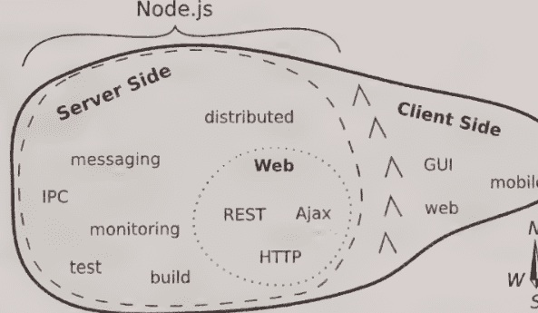
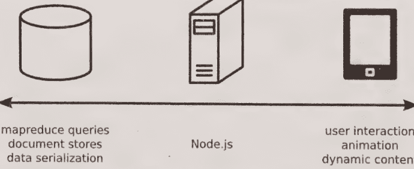
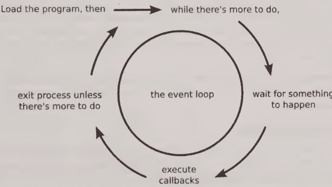
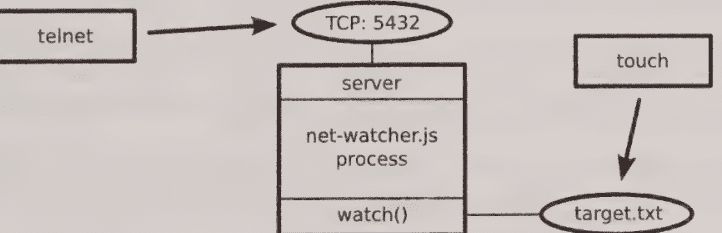
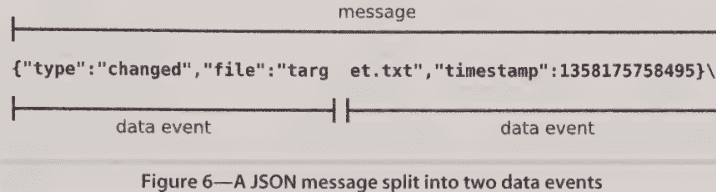
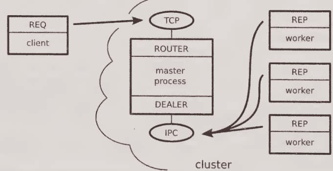
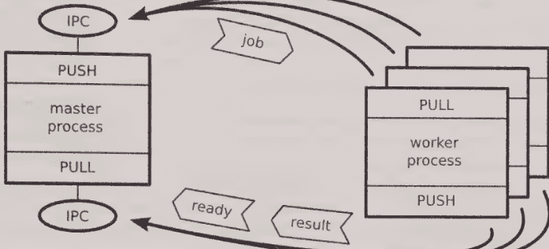

# Node.js 正确之道：可扩展的服务器端 JavaScript 实践

Jacquelyn Carter 编

# 对 Node.js the Right Way 的早期赞誉

《Node.js the Right Way》确实是上手现代服务器端 JavaScript 编程的正确方式。它远超 JavaScript 和 Node 的基础机制，展示了开发一个高质量服务器端应用程序真正需要什么。

- Allen Wirfs-Brock

ECMAScript 语言规范项目编辑

如果你才刚开始学习 Node，请跳过其他所有内容——这是你唯一需要的书。

- Rick Waldron

Bocoup, LLC 软件工程师

终于，有一本书告诉我们 Node.js 远不止是一个为文青人准备的简陋 Web 级应用服务器了。

- Eric Redmond

《七周七数据库》合著者

《Node.js the Right Way》是一本非常棒的读物，快速展示了 Node 的灵活性和强大。对于任何对探索服务器基础设施世界的 JavaScript 开发者来说，它都是完美的。

- Xavi Ramirez

Baydin, Inc.

《Node.js the Right Way》是一本好读的书，迅速演示了 Node 的灵活性和威力。通过跳过“Hello World”而采用实用示例，Wilson 提供了一个详尽且引人入胜的介绍。

- Daniel Renfro

Vistaprint 首席软件工程师

这本书是解释 Node 的绝佳方式。我甚至在个人项目使用了 Jim 的一些示例代码（特别是第 7 章）。

- Mitchell Foley

Google 软件工程师

- 制作本书的团队包括：

Jacquelyn Carter（编辑）

Candace Cunningham（校对）

David J Kelly（排字）

Janet Furlow（制作）

Juliet Benda（版权）

Ellie Callahan（支持）

- 致谢 ... vii

- 前言 ... ix

Node 的利基市场 2

Node 应用如何工作 3

Node.js 开发的各个方面 5

获取 Node.js 7

为 Node.js 事件循环编程 10

针对 Node.js 事件循环编程 11

创建子进程 13

捕获数据 15

异步处理文件 17

结语

监听 24

实现协议 28

创建客户端 31

扩展类 32

处理.js 35

ZeroMQ 的优势 42

使用 npm 模块 44

发布消息 48

订阅 52

处理请求 54

推送与拉取消息 59

CouchDB 的优势 66

创建单页应用 67

使用 Passport 进行身份验证 70

授权 API 73

使用生成器处理数据 75

Reduce 81

Express 的优势 88

使用 Express 88

处理 RESTful API 94

使用生成器进行流控制 99

使用 Promise 101

在 Redis 中存储会话 108

使用 Session 身份验证 110

使用中间件 113

客户端 116

MVC 模式 120

结语 125

# 健壮的消息传递

随后，在第 4 章*健壮的消息服务*（Robust Messaging Services）第 41 页，我们将离开 Node 核心进入第三方库领域。你将使用 `npm` 来导入和构建 ØMQ（读作 "Zero-M-Q"）——这是一个用于开发网络应用程序的高效、低延迟库。通过 ØMQ，我们将使用几种重要的模式来开发程序，例如发布/订阅和请求/响应。我们将创建一组协同工作的程序套件，你将学习使用集群工具来管理它们。

## 访问数据库

第 5 章*访问数据库*（Access Databases）第 65 页介绍了数据库以及如何在 Node 中异步地与它们进行交互。特别是，我们将使用 CouchDB——一个基于 RESTful 的 JSON 文档数据库。你将学习解析 XML 文档、使用工作队列限制 Node 的频率，以及开发和运行单元测试。我们在本章中创建的数据库将是你后续章节中开发的 RESTful API 的基础。

# 可扩展 Web 服务

Node 对编写 HTTP 服务器有极佳的支持，在第 6 章*可扩展的 Web 服务*（Scalable Web Services）第 87 页，我们恰好就会这样做。你将使用 Express，一个流行的用于路由请求的 Node.js 框架。我们将深入研究 REST 语义，你将使用所谓的 promises 来管理异步代码流。你还将学习 ECMAScript 生成器函数（generator functions）的一个前沿特性，以及它们如何以有趣的方式与 promises 结合。

## Web 应用

最后，在第 7 章*Web 应用程序*（Web Apps）第 107 页，我们将为我们的 Web 服务构建前端。我们将使用一个名为 Passport 的 Node 模块来实现使用 Google 账户凭据的身份验证 API。我们将在 Redis 中序列化会话数据——这是一种非常快的键值对存储器。你将学习编写使用 RESTful API 的静态页面 Web 应用的基础知识，包括如何使用名为 Bower 的前端包管理器拉取依赖项。

# 本书不包含的内容

在你决定阅读这本书之前，你应该了解它不涵盖的内容。

# 关于写作的切

在编写此书时，`npm` 拥有超过 43,000 个模块，平均增长率每天新增 100 多个新模块。由于 Node.js 周围的生态系统和社区增长和变化如此迅速，本书并不尝试涵盖所有内容。相反，这本短书将教你上手并开始编码所需的精要知识。

本书也紧贴 Node.js 主题。你将学习很多关于 Node 进程集群以及如何编写可扩展 Web 服务的知识，但对于 HTML、CSS 和浏览器 JavaScript 等前端关注点将涉及较少。

# JavaScript 初学者指南

JavaScript 语言是当今广泛使用的语言中最被误解的语言之一。虽然本书会经常讨论语言语法（特别是当它是全新的时），但这并不是一份 JavaScript 的初学者指南。

# 给 Windows 用户的说明

书中的示例假设你正在使用类 Unix 操作系统。我们将利用标准输入和输出流，并在进程之间进行数据管道传输。shell 会话示例已通过 Bash 测试，但其他 shell 可能同样有效。

如果你运行 Windows，我建议安装 Cygwin。这将使你获得成功运行示例代码的最佳机会，或者你可以运行一个 Linux 虚拟机。

# 代码示例与约定

书中的示例包含 JavaScript、shell 会话以及少量 HTML/XML 摘录。在大多数情况下，代码列表是完整的——你可以随心意欲地运行。

示例和片段根据语言规则进行语法高亮。shell 命令以 `$` 为前缀。

当你编写 Node.js 代码时，你应该始终处理错误和异常，即使你只是将它们重新抛出。你将在全书中学习如何这样做。然而，某些代码示例缺乏错误处理。这仅仅是为了提高可读性和节省空间——你应该始终处理自己的错误。

1. http://www.modulecounts.com/

2. http://cygwin.com/

# 在线资源

Pragmatic Bookshelf 为本书提供的页面是一个极佳的资源。你将找到书中展示的所有源代码的下载，以及反馈工具，包括社区论坛和勘误提交表。

感谢选择这本书来向你展示如何正确地使用 Node.js。

Jim R. Wilson (jimbojw, hexlib)

2013年11月

3. http://prprog.com/book/jnode/node-js-the-right-way

# 第 1 章

## 入门

关于 Node.js 的很多热度都集中在 Web 上。事实上，Node 具有着人们经常忽略的更大意义。让我们通过绘制地图，来看看 Node 在更宏大的蓝图中处于什么位置。

想象所有可能的程序的宇宙是一片巨大的海洋。目的相似的程序彼此靠近，而不同的程序则相距较远。记住这个画面，看看下面的图。它展示了这片海中一个特定突出部的特写：I/O 密集型程序岛。



图 1—I/O 密集型程序岛的地图

I/O 密集型程序受限于数据访问。对于这些程序，增加更多的处理能力或 RAM 往往区别不大。

在山脉以东，我们发现了客户端程序。这些包括 GUI 工具、移动端应用和 Web 应用。山脉以西是服务端程序。这片广阔的土地就是 Node.js。

在服务端区域的深处是 Web——那些 HTTP、REST 和 JSON 的老兵。由于我们花费了大量精力思考 Web，所以我们过度强调了 Node 在开发应用程序中的用途。人们问：“Node 在制作应用方面好在哪里？”或者“我如何用 Node 制作 REST？”这些都是好问题，但它们错过了重点。Node 在更广泛的领域都很出色。

## Node 的利基

自 JavaScript 在 1995 年首次出现以来，它一直在前端/后端的整个光谱上解决问题。下面的图展示了这一光谱以及 Node.js 在其中的位置。



图 2—Node 在光谱中的位置

在右侧的网页浏览器中，大部分脚本涉及等待用户交互。点击这里，拖动那里，选择一个文件等。JavaScript 在这个领域取得了巨大的成功。

## Node 应用是如何工作的

在左侧，后端数据库正大量投资于面向 JavaScript 的数据库，如 MongoDB 和 CouchDB 广泛使用 JavaScript——从修改请求到即席查询和 mapreduce 任务。其他存储器如 Neo4j 和 Elasticsearch 以 JavaScript 对象表示 (JSON) 呈现数据。如今，你甚至可以使用插件在 Postgres 中用 JavaScript 写 SQL 函数。

许多中间件任务是 I/O 密集型的，例如客户端脚本和数据库。这些服务端程序通常需要等待数据库结果、第三方 Web 服务反馈或入站连接。Node.js 正是为了这类应用程序而设计的。

## Node 应用是如何工作的

Node.js 将 JavaScript 与事件循环相结合，以便在事件发生时快速调度操作。许多 JavaScript 环境都使用事件循环，但它是 Node.js 的核心特性。

Node 的哲学是给你对事件循环和系统资源的底层访问。或者用核心贡献者 Felix Geisendörfer 的话，在 Node 中“除了你的代码外，一切都是并行运行的”。如果这让你听起来有点反常，别担心。下面的图展示了事件循环是如何工作的。



图 3—Node.js 事件循环

只要还有任务未完成，Node 的事件循环就会持续旋转。每当事件发生时，Node 就会调用任何正在监听该事件的 `回调函数`（事件处理器）。

作为一名 Node 开发者，你的工作就是创建在响应事件时执行的 `回调函数`。任何数量的 `回调函数` 都可以响应任何事件，但在任何时间，只会有一个 `回调函数` 在执行。

你的程序可能可能执行的所有其他操作——例如等待来自文件的数据或传入的 HTTP 请求——都由 Node 在后台以并行方式处理。你的应用程序代码永远不会与任何其他内容同时执行。在运行期间，它将始终获得 Node JavaScript 引擎的全部关注。

## 单线程与高并发

其他系统试图通过同时运行大量代码来获得并行性，通常是通过创建许多线程来实现。但 Node.js 不一样。对于 JavaScript 来说，Node 是一个单线程环境。在任何时刻，你的代码中最多只有一行在执行。

Node 通过使用非阻塞技术处理绝大多数 I/O 任务来解决这一问题。你不需要逐行等待操作完成，而是创建一个 `回调函数`，当操作最终成功或失败时，该函数就会被调用。

你的代码应该完成它需要的工作，然后迅速将控制权交回事件循环，以便 Node 可以处理其他事情。我们将在书中开发这些方面的实用示例，从第 9 页的第 2 章“处理文件系统”开始。

如果你觉得 Node 通过一次只运行一段代码来实现并行性似乎很奇怪，那是因为它确实如此。这是我所称的“反向主义”（backwardism）的例子。

## Node.js 中的反向主义

“反向主义”是一个如此奇特的概念，以至于初看之下似乎完全是反向的。在学习编程时，你可能经历过很多反向主义现象，无论你是否注意到。

以变量的概念为例。在代数中，看到诸像“7x + 3 = 24”这样的方程很常见。在这里，x 被称为变量；它恰好有一个值，你的工作就是找出这个值是多少。

然后当你开始学习如何编程时，你会很快遇到像“x = x + 7”这样的语句。现在 x 仍然被称为变量，但它可以拥有你分配给它的任何值。它甚至在不同的时间拥有不同的值。

从代数的角度来看，这是一种反向行为。方程“x = x + 7”完全没有意义。编程中变量的概念不仅仅是略有不同——它完全是 100% 反向的。但一旦你理解了赋值的概念，编程变量就完全合乎逻辑了。

Node 的单线程事件循环也是如此。从多线程的角度来看，一次只运行一段代码似乎很愚蠢。但一旦你理解了事件驱动的编程——配合非阻塞 API——一切就变得显而易见了。

编程中充满了这类反向主义，Node.js 也不例外。在刚开始时，你经常会遇到看起来应该以某种方式工作，但实际上执行的是完全不同操作的代码。

这没关系！通过这本书，你将通过编写以有用方式交互的紧凑程序来学习 Node。当我们遇到更多 Node 的反向主义时，我们将深入研究并探索它们。

## Node.js 开发的各个方面

Node.js 是一个大奇的话题，所以让我们把它拆解为不同的方面。我们可能会讨论的 Node.js 开发有许多方面，从基础的 JavaScript 语法到版本控制不一。本书特别关注以下五个方面：

- 实用编程

- 架构与核心

- 模式

- JavaScript 特性（JavaScriptisms）

- 支持代码

让我们简要探索其中的每一个。

## 实用编程

实用编程的核心在于产生具有有用用途的实际代码。与文件系统交互、建立 socket 连接或提供 Web 应用程序都是实用编程的示例。

其余每个章节将涵盖这些内容。每个章节中，我们都会讨论 Node 的某些特性。

## 为 Node.js 事件循环编写程序

让我们从开发几个简单的程序开始，用于监控文件变化并从命令行读取参数。尽管这些程序很短，但它们能让我们对 Node 基于事件的架构有深入的了解。

## 监控文件变化

监控文件变化是一个非常方便的切手问题，因为它要求异步编码，同时展示了 Node 的重要概念。每当文件发生变化时采取行动，在从自动化部署到运行单元测试的许多情况下都是非常实用的。

打开终端开始。在命令行中，导航 true一个空目录。你将在该目录中使用本章中的所有的代码示例。到达那里后，使用 `touch` 命令创建一个名为 `target.txt` 的文件。

```bash
$ touch target.txt
```

该文件将作为我们监控程序的 target。现在打开文件编辑器并输入以下内容：

```javascript
file-system.js
const fs = require('fs');
fs.watch('target.txt', function() {
  console.log("File target.txt just changed!");
});
console.log("Now watching target.txt for changes...");
```

将此文件保存为 `watcher.js`，并放在 `target.txt` 相同的目录下。让我们看看这个程序是如何工作的。

首先，注意顶部的 `const` 关键字。这段 JavaScript（ECMAScript Harmony 的一部分）设置了一个具有常量值的变量。`require()` 函数引入一个模块并返回它。在我们的情况下，我们正在调用 `require('fs')` 来引入 Node 内置的文件系统模块¹。

在 Node.js 中，模块是一个自包含的 JavaScript 代码段，提供了可在其他地方使用的的功能。`require()` 的输出通常是一个普通的 JavaScript 对象。除了模块提供的功能外，它并没有特别特殊之处。

Node 的模块实现基于 CommonJS 模块规范²。模块可以依赖于模块，就像其他编程环境中的库一样，这些库导入或 #include 其他库。在第 3 章“使用 Sockets 网络”第 23 页，你将学习如何创建自己的模块。

接下来，我们调用 `fs` 模块的 `watch()` 方法，它会轮询目标文件的变化，并在发生变化时调用提供的 `回调函数`。

在 JavaScript 中，函数是一等公民。这意味着它们可以赋值给变量，并作为参数传递给其他函数。我们的 `回调函数` 是一个 `anonymous`（匿名）函数；它没有名字。

`回调函数` 在文件每次变化时调用 `console.log()` 向标准输出打印消息。让我们试一下。

回到命令行并使用 `node` 启动监控程序，如下所示：

```bash
$ node --harmony watcher.js
Watching target.txt for changes...
```

`--harmony` 参数告诉 Node 使用可用的最新 ECMAScript Harmony 特性。ECMAScript Harmony 是 ECMAScript 下版本的代号（JavaScript 语言背后的标准）。并不是所有的 Harmony 特性都已准备就，但我们在书中将使用的那些是没问题的（另有说明除）。

程序启动后，Node 将耐心地等待，直到目标文件发生变化。要触发变化，请打开另一个终端进入同一个目录并再次 `touch` 文件：

```bash
$ touch target.txt
```

运行 `watcher.js` 的终端将输出字符串 'target.txt just changed!'，然后程序将恢复等待状态。

## 可视化事件循环

我们在上一节中编写的程序是 Node 事件循环运行的良好示例。回 *Node Applications Work* 第 3 页的事件循环图。我们简单的文件监控程序导致 Node 逐一通过这些步骤中的每一个。

要运行程序，Node 执行了以下操作：

- 它加载脚本，一直运行到最后一行，在控制台中产生 *Now watching* 消息。

- 由于调用了 `watch()`，它看到还有更多工作要做。

- 它 等待某事的发生，即 `fs` 模块观察到文件的变化。

- 当检测到变化时，它执行 `回调函数`。

- 它判断程序尚未结束，并恢复等待。

Node.js 程序会经历这些步骤；事件循环不断旋转，直到没有可做的事或程序通过其他方式退出。例如，如果抛出异常且未被捕获，进程将退出。接下来我们将看到它是如何工作的。

## 读取命令行参数

现在，让我们通过将要监控的文件作为命令行参数，让我们的程序变得更有用。这将引入 `process` 全局对象以及 Node 处理异常的方式。

打开编辑器并输入以下内容：

```javascript
file-system/watcher-argv.js
const fs = require('fs');
filename = process.argv[2];
if (!filename) {
  throw Error("A file to watch must be specified!");
}
fs.watch(filename, function() {
  console.log("File " + filename + " just changed!");
});
console.log("Now watching " + filename + " for changes...");
```

将文件保存为 `watcher-argv.js`。你可以这样运行它（注意结尾的 `target.txt` 参数）：

```bash
$ node --harmony watcher-argv.js target.txt
Now watching target.txt for changes...
```

你应该能看到与第一个 `watcher.js` 程序相同的输出和行为。在输出 `Now watching target.txt for changes...` 后，脚本将勤恳地等待目标文件。

此程序使用 `process.argv` 来访问传入的命令行参数。`argv` 代表 "argument vector"（参数向量）；它是一个包含传递给 Node 进程的命令行参数的数组。第一个元素是 Node 可执行文件的路径，第二个是脚本路径，后续元素是参数。

## 产生子进程

让我们通过产生子进程来进一步增强我们的程序。我们将使用 `child_process` 模块及其 `spawn()` 方法。

打开编辑器并输入以下内容：

```javascript
file-system/watcher-argv.js
"use strict";
const fs = require('fs');
spawn = require('child_process').spawn;
filename = process.argv[2];

if (!filename) {
  throw Error("A file to watch must be specified!");
}

fs.watch(filename, function() {
  let ls = spawn('ls', ['lh', filename]);
  ls.stdout.pipe(process.stdout);
});
console.log("Now watching " + filename + " for changes...");
```

将文件保存为 `watcher-spawn.js` 并像之前一样运行它：

```bash
$ node --harmony watcher-spawn.js target.txt
Watching target.txt for changes...
```

如果你在另一个控制台 touch 文件，Node 将产生类似下面的内容：

```
-rw-r--r-- jimbo staff 0B Dec 19 22:45 target.txt
```

用户名、组等方面与之前的输出不同，但格式应该是相同的。

我们刚刚的程序顶部使用了 "use strict" 字符串。严格模式引入自 ECMAScript 5——它用了某些语言特性并让其他特性抛出异常。通常来说，使用严格模式是一个好主意。

严格模式也是使用 Harmony 特性的必要条件，例如 `let` 关键字。像 `const` 一样，`let` 声明了一个变量，但用 `let` 声明的变量可以赋值多次。

记住，使用 Harmony 特性（如 `let`），你的代码需要 `--harmony` 标志。例如，`const` 不需要该标志，但 `let` 需要。

接下来，注意我们在开头添加了一个新的 `require()`。调用 `require('child_process')` 返回子进程模块。我们只对 `spawn()` 方法感兴趣，因此将其赋值给一个同名的常量并忽略模块的其他部分。

```javascript
spawn = require('child_process').spawn,
```

记住，函数在 JavaScript 中是一等公民，所以我们可以像这里这样将它们赋值给变量。

接下来，查看给 `fs.watch()` 的 `回调函数`。

```javascript
function() {
  let ls = spawn('ls', ['lh', filename]);
  ls.stdout.pipe(process.stdout);
}
```

`spawn()` 的第一个参数是要执行的程序名称；在我们的例子中是 `ls`。第二个参数是命令行参数数组。

`spawn()` 返回的对象是一个 `ChildProcess`³其 `stdin`、`stdout` 和 `stderr` 属性是用于读取或写入数据的流（Streams）。我们想要

+ 1. http://nodejs.org/api/fs.html

2. http://wiki.creativecommons.org/wiki/Modules/1.1

3. http://nodejs.org/api/child_process.html

将子进程的标准输出直接重定向到我们自己的标准输出流中。这就是 `pipe()` 方法所的作用。

有时候，你需要从流中捕获数据，而不仅仅是将其向前传递。让我们来看看如何实现。

## 从 EventEmitter 捕获数据

`EventEmitter` 是 Node.⁴ 中一个非常重要的类。它提供了一个用于分发事件和通知监听器的通道。你在 Node 中会遇到的很多对象都继承自 `EventEmitter`，就像我们在上一节中看到的 Streams（流）一样。

现在，让我们修改之前的程序，通过通过监听流上的事件来捕获子进程的输出。打开前一节中的 `watcher-spawn.js` 文件（即 `spawn-js`），找到对 `fs.watch()` 的调用。将其替换为：

```javascript
file-system/watcher-spawn.js
fs.watch(filename, function() {
  let ls = spawn('ls', ['-lh', filename]),
  output = '';
  ls.stdout.on('data', function(chunk){
    output += chunk.toString();
  });

  ls.on('close', function() {
    let parts = output.split(/\s+/);
    console.dir([parts[0], parts[4], parts[8]]);
  });
});
```

将此文件保存为 `watcher-spawn-parse.js`。照常运行它，在另一个终端中 `touch` 目标文件。你应该看到类似这样的输出：

```
$ node --harmony watcher-spawn-parse.js target.txt
Now watching target.txt for changes...
[ '-rw-r--r-', '0B', 'target.txt' ]
```

新的 `回调函数` 开头与之前相同，创建一个子进程并将其赋值给一个变量。它还创建了一个 `output` 变量，用于缓冲来自子进程的输出。

接下来，我们添加事件监听器。事件监听器是一个 `回调函数`，当指定类型的事件被分发时就会会被调用。由于 Stream 类继承自 `EventEmitter`，因此我们可以监听子进程标准输出流的事件。

> ⁴ http://nodejs.org/api/events.html

```javascript
ls.stdout.on('data', function(chunk) {
  output += chunk.toString();
});
```

`on()` 方法为指定的事件类型添加监听器。我们监听 `data` 事件，是因为我们对流中输出的数据感兴趣。

事件可以随带额外信息，这些信息以参数的形式传递给 `回调函数`。特别是 `data` 事件会传递一个 `buffer` 对象。每当我们获得一个数据块时，就会将其追加到我们的 `output` 中。

`Buffer` 是 Node 表示二进制数据的方式。它指向由 Node 原生核心分配的一块内存，位于 JavaScript 引擎之外。`Bufffer` 可以调整大小，并且需要通过编码和解码来与 JavaScript 字符串进行转换。

显式调用 `toString()` 会使用 Node 的默认编码（UTF-8）将缓冲区的内容转换为 JavaScript 字符串。这意味着将内容复制到 Node 的堆内存中，从相对意义上说这是一个较慢的操作。如果可以，直接处理 `bufffer` 会更好，但字符串更方便。

`Stream` 类和 `ChildProcess` 类都继承自 `EventEmitter`，因此我们也可以为它们添加监听器。

```javascript
ls.on('close', function() {
  let parts = output.split(/\s+/);
  console.dir([parts[0], parts[4], parts[8]]);
});
```

当子进程退出且其所有流都已刷新（flush）后，它会触发一个 `close` 事件。当这里的 `回调函数` 被调用时，我们通过分割一个或多个空白字符序列（使用正则表达式 `/\s+/`）来解析输出数据。最后，我们使用 `console.dir()` 来报告第一、第五和第九字段（索引为 0、4 和 8），它们分别对应于权限、大小和文件名。

在文件监控这个很小的问题空间内，我们已经看到了 Node 的许多功能。你现在已经知道了如何使用 Node 类，包括 `EventEmitter`、`Stream`、`ChildProcess` 和 `Buffer`。你还拥有编写异步 `回调函数` 和为事件循环编写代码的亲身经验。

让我们在文件系统之旅的下一阶段扩展这些概念：读取和写入文件。

5. http://nodejs.org/api/buffer.html

## 异步读写文件

在本章早的早些时候，我们编写了一系列可以监控文件变化的 Node 程序。现在，让我们探索 Node 读写文件的方法。在此，我们将看到 Node 中两种常见的错误处理模式：`EventEmitter` 上的 `error` 事件和 `err` `回调函数`。

在 Node 中读写文件有几种方法。最简单的方法是一次读取或写入整个文件。这种技术对于小文件效果良好。其他方法通过创建 `Streams` 或在 `buffer` 中分阶段内容来读写。这里是一个一次性处理整个文件方法的示例：

```javascript
file-system/read-simple.js
const fs = require('fs');
fs.readFile('target.txt', function (err, data) {
  if (err) {
    throw err;
  }
```

这些函数依赖于我们在本章中使用相同类型的 `回调函数` 参数。它们默认都是异步的，但许多函数都提供了对等的 *Sync*（同步）版本。

## Node 程序的两个阶段

考虑到阻塞对 Node 事件循环造成的代价，你可能会认为使用同步文件访问方法总是坏的。为了理解这一点，你可以将 Node 程序 分为两个阶段。

在初始化阶段，程序正在进行设置，包括引入库、读取配置参数以及执行其他对至关重要的任务。如果在这个早期阶段出现问题，还有很多可以处理的空间，而且最好的做法是快速失败（fail fast）。你唯一应该考虑同步文件访问的时刻是在程序的初始化阶段。

第二个阶段是运行阶段，此时程序在事件循环中不断运转。由于许多 Node 程序是网络化的，这意味着要接受连接、发送请求并等待其他类型的 I/O。在这个阶段，你*永远不*应该使用同步文件访问方法。

`require()` 函数就是这一原理运的实例——它会同步地评估模块代码并返回模块对象。要么模块成功加载，要么程序会立即失败。

作为一个经验法则，如果你的程序如果没有该文件就绝不可能成功，那么使用同步文件访问是可以的。如果你的程序理论上可以继续运行业务，那么采取安全的路线并坚持使用异步 I/O 会更好。

## 总结

在本章中，我们使用 Node 按照 Node 的事件、异步、以 `回调函数` 为导向的方式执行文件操作。你学习了如何监控文件变化，以及读取和写入文件。你还学习了如何创建子进程以及访问命令行参数。

在此过程中，我们涵盖了 `EventEmitter` 类。我们使用 `on()` 方法来监听事件并在 `回调函数` 中处理它们。我们使用了 `Streams`——这是一种特殊的 `EventEmitter`——来以缓冲块的形式处理数据，或将其直接管道（pipe）到其他流中。

哦，我们不要忘记错误。你学习了 Node 向 `回调函数` 传递 `err` 参数的约定，以及如何从 `EventEmitter` 捕获错误事件。

在继续阅读本书时，请记住这些模式。第三方库可能有不同的风格，但你在这里学到的概念会在整个 Node 生态系统中反复出现。

在下一章中，我们将深入另一种形式的服务器端 I/O：网络连接。将在此处开发的概念和实践的基础上，探索网络服务的领域。

这里是一些额外问题，供你尝试运用新学到的知识。

## 强化代码安全

我们在本章中开发的各种示例程序缺少许多安全检查。考虑以下问题，以及你将如何更改代码来解决它们：

- 在文件监控示例中，如果目标文件不存在会怎样？

 如果 如果被监控的文件被删除了会怎样？

## 扩展功能

在我们文件监控器程序的早期示例中，我们从 `process.argv` 获取了要监控的文件名。考虑以下问题：

- 相反，你如何从 `process.argv` 获取要启动的进程？

- 如何从 `process.argv` 向启动的进程传递任意数量的额外参数（例如 `node --harmony watcher-hw.js -l -h`）？

# 第 3 章

## 使用 Sockets 进行网络连接

Node.js 是为了网络编程而生的。在本章中，我们将探索 Node 对底层 socket 连接的内置支持。TCP socket 成了现代网络应用程序的骨干，理解它们对于我们在书的其余部分进行更复杂的网络操作将大有裨益。

当你开发基于 socket 的服务器和客户端时，你将学习到以下 Node.js 方面。

## 架构与核心

我们在上一章中探索的异步编程技术在这里将更加重要。你将学习如何扩展如 `EventEmitter` 等 Node.js 类。你将创建自定义模块来存放可复代码。

## 模式

网络连接有两个端点。一种常见的模式是一个端点充当服务器，而另一个充当客户端。我们将在本章中开发两种端点，以及一种基于 JavaScript 对象表示（JSON）的客户端/服务器通信协议。

## JavaScript

JavaScript 语言拥有一种有趣的继承模型。你将学习 Node 用于在对象之间创建类关系的工具。

## 支持代码

测试对于确保我们的程序按照我们预期的方式运行至关重要。在本章中，我们将开发一个故意表现糟糕的测试服务器，以探测我们协议的边缘情况。

首先，我们将开发一个简单且完整的 TCP 服务器程序。然后，随着我们解决健壮性、模块化和可测试性等问题，我们将迭代地改进服务器。

## 监听 Socket 连接

网络服务的存在是为了两件事：连接端点并在它们之间传输信息。无论传输什么种信息，必须首先建立连接。

在本节中，你将学习如何使用 Node.js 创建基于 socket 的服务。我们将开发一个向连接的客户端发送数据的示例应用程序，然后使用标准命令行工具连接到此服务。最后，你将对 Node 如何实现客户端/服务器模式有一个良好的理解。

## 将服务器绑定到 TCP 端口

TCP socket 连接由两个端点组成。一个端点绑定到一个编号端口，而另一个端点连接到它。这非常像电话系统。一部手机长时间绑定一个号码。另一部手机拨打电话——与之连接。一旦电话接通，信息（声音）就可以双向传输。

在 Node.js 中，绑定和连接操作由 `net` 模块提供。绑定端口监听连接如下：

```javascript
"use strict"
const net = require('net');
server = net.createServer(function(connection) {
  // 使用 connection 对象处理
});
server.listen(5432);
```

`net.createServer()` 接收一个 `回调函数` 并返回一个 `Server` 对象。当另一个端点连接时，Node.js 会调用该 `回调函数`。`connection` 参数是一个用于发送或接收数据的 `Socket` 对象。

调用 `server.listen()` 会绑定指定的端口。在这种情况下，我们绑定 TCP 端口 5432。图 4 Node.js 服务器绑定 TCP socket 监听在第 25 页显示了这种基础设置。图中显示了我们的 Node.js 进程绑定了一个 TCP 端口。数量的客户端（可以是 Node 进程）都可以连接到该端口。

我们的服务器程序尚未对连接执行任何操作。让我们通过向客户端发送一些有用信息来修复。

## 向 Socket 写入数据

在第 2 章 操作系统文件操作第 9 页，我们开发了一些当目标文件变化时采取行动的简单工具。让我们复用文件变化作为示例网络服务的源源。这将为深入研究 Node.js 开发的方面提供代码对象。

打开你喜欢的文本编辑器并输入以下内容：

```javascript
networking/net-watcher.js
'use strict';
const fs = require('fs');
const net = require('net');
const filename = process.argv[2];
server = net.createServer(function(connection) {
  // 报告
  console.log('订阅者已连接。');
  connection.write('正在监控 ' + filename + ' 的变化...\n');
  // 监听设置
  let watcher = fs.watch(filename, function() {
    connection.write("文件 '" + filename + ' 变化: " + Date.now() + "\n");
  });
});
```

```javascript
// cleanup
connection.on('close', function() {
  console.log('Subscriber disconnected.');
  watcher.close();
});

});
```

```javascript
if (!filename) {
  throw Error('No target filename was specified.');
}

server.listen(5432, function() {
  console.log('Listening for subscribers...');
});
```

将该文件保存为 `net-watcher.js`。这里的大部分代码都取自书中之前的示例，但它们看起来应该非常熟悉。`net-watcher` 程序的新颖部分位于 `createServer()` `回调函数` 内部。该 `回调函数` 做了三件事：

- 它报告连接已建立（通过 `connection.write` 向客户端报告，同时也向控制台报告）。

- 它开始监听目标文件，并保存返回的 watcher 对象。此 `回调函数` 使用 `connection.write` 向客户端发送更改信息。

- 它监听连接的关闭事件，以便报告订阅者已断开连接并使用 `watcher.close()` 停止监控文件。

最后，注意最后传递给 `server.listen()` 的 `回调函数`。Node 在成功绑定端口 5432 并准备好接收连接后会调用此函数。

## 使用 Telnet 连接到 TCP Socket 服务器

现在，让我们运行 `net-watcher` 程序并确认它的行为符合我们的预期。这需要一些终端操作。

要运行并测试 `net-watcher` 程序，你需要三个终端会话：一个用于服务器本身，一个用于客户端，另一个用于触发被监控文件的更改。在第一个终端中，运行 `net-watcher` 程序：

```bash
$ node --harmony net-watcher.js target.txt
Listening for subscribers...
```

该程序创建了一个监听 TCP 端口 5432 的服务。要连接到它，打开第二个终端并使用 `telnet` 程序，如下：

```bash
$ telnet localhost 5432
Trying 127.0.0.1...
Connected to localhost.
Escape character is '^]'.
 watching target.txt for changes...
```

回到第一个终端，你应该能看到：

Subscriber connected.

最后，要触发被监控文件的更改，打开第三个终端并 `touch` file.txt`：

```bash
# $ touch target.txt
```

在 telnet 终端中，片刻后你应该能看到类似下面的一行：

File 'target.txt' changed: Sat Jan 12 2013 12:35:52 GMT-0500 (EST)

你可以通过输入 `Ctrl-]` 然后 `Ctrl-C` 来杀死 telnet 会话。如果你这样做，你将在第一个终端中看到这一行：

Subscriber disconnected.

要终止 `net-watcher` 服务，在其终端中输入 `Ctrl-C`。

下图概述了我们刚刚创建的设置。`net-watcher` 进程（框）绑定了一个 TCP 端口并监控一个文件——这两个资源都用椭圆表示。



图 5—监控文件并向连接的 TCP 客户端报告变化的 Node.js 程序

多个订阅者可以同时连接并接收更新。如果你打开额外的终端并使用 `telnet` 连接到端口 5432，当你 touch 目标文件时，它们都将收到更新。

TCP sockets 用于网络计算机之间的通信。但如果你需要同一台计算机上的进程进行通信，Unix sockets 提供了一种更高效的替代方案。`net` 模块也可以创建这种 socket，我们接下来将介绍。

## 监听 UnixSockets

为了查看 `net` 模块如何使用 Unix sockets，让我们修改 `net-watcher` 程序使用这种通信通道。请注意，Unix sockets 仅在 Unix 类环境中工作。

打开 `net-watcher.js` 程序，将 `server.listen()` 部分修改为：

```javascript
server.listen('/tmp/watcher.sock', function() {
  console.log('Listening for subscribers...');
});
```

将文件保存为 `net-watcher-unix.js`，然后像之前一样运行程序：

```bash
$ node --harmony net-watcher-unix.js target.txt
Listening for subscribers...
```

要连接客户端，现在需要 `nc` 而不是 `telnet`。`nc` 是 `netcat` 的缩写，一个支持 Unix sockets 的 TCP/UDP socket 实用程序。

```bash
$ nc -U /tmp/watcher.sock

watching target.txt for changes...
```

Unix sockets 比 TCP sockets 快，因为它们不需要调用网络硬件。然而，它们是本地机器的。

这结束了 Node 中创建网络 socket 服务器的基础知识。我们已经了如何创建 socket 服务器并使用 `telnet` 和 `nc` 等常用客户端实用程序连接它们。该框架将为本章节剩余示例提供背景。

接下来，我们将通过将数据转换为可解析格式来增强我们的服务。这将让我们能够开发自定义应用程序。

## 实现消息协议

我们刚刚探索了如何在 Node 中创建监听入站连接的 socket 服务器。到目前为止，我们的程序发送的是人类可读的文本消息。在本部分，我们将设计并实现一种更好的协议。

协议是定义系统中端点如何通信的规则集。每你在 Node 中开发网络应用程序时，都会使用一个或多个协议。在这里，我们将创建一个基于在 TCP 上传递 JSON 编码消息的协议。JSON 在 Node.js 中非常流行，我们将广泛使用它。

### 使用 JSON 序列化消息

让我们使用 JSON 开发协议。这将提供代码重构为重用模块的机会。

在 JavaScript 中编写 JSON 要容易得多。例如，你可以使用 `Date.now()` 获取这种格式的当前时间。

消息如下：

- 当连接建立时，客户端接收到：Now watching target.txt for changes...

- 每当目标文件更改时，客户端接收到：File 'target.txt' changed: Sat Jan 12 2013 12:35:52 GMT-0500 (EST)

`type` 字段指示指定的文件现在正被监控。`timestamp` 字段包含一个代表自1970 年 1 月 1 日午夜以来毫秒数的整数值。这是一个易于处理的格式。

## 到 JSON 消息

现在我们已经定义了一个改进的、计算机可的协议，让我们修改 `net-watcher` 服务使用它。我们将创建接收并解释这些消息的客户端程序。

我们的任务是使用 `JSON.stringify()` 编码消息对象并通过 `connection.write()` 发送它们。打开你的 `net-watcher.js` 程序。找到以下行：

```javascript
connection.write("Now watching '" + filename + ' for changes...\n");
```

将其替换为：

```javascript
connection.write(JSON.stringify({
  type: 'watching',
  file: filename
}) + '\n');
```

接下来，找到 watcher 内部的 `connection.write()` 调用：

```javascript
connection.write("File '" + filename + ' changed: " + Date.now() + "\n");
```

将其替换为：

```javascript
connection.write(JSON.stringify({
  type: 'changed',
  file: filename,
  timestamp: Date.now()
}) + '\n');
```

将此更新后的文件保存为 `net-watcher-json-service.js`。使用 `node --harmony` 运行新程序，记得指定目标文件。然后从第二个终端使用 `telnet` 连接：

```bash
$ telnet localhost 5432
Trying 127.0.0.1...
Connected to localhost.
Escape character is '^'
{"type":"watching","file":"target.txt"}
```

当你 touch target.txt 文件时，你将从客户端看到这样的输出：

```json
{"type":"changed","file":"target.txt","timestamp":13670387203255}
```

现在我们准备好处理这些消息的客户端程序了。

## 创建 Socket 客户端连接

在本章目前为止，我们已经探索了 Node socket 的服务端。在这里，我们将编写一个 Node 客户端程序，用于接收来自我们的 `net-watcher-json-service` 程序的 JSON 消息。我们将从一个简单的实现开始，并在本章后续章节中对其进行改进。

打开编辑器并插入以下内容：

```javascript
net-watcher-json-client.js
"use strict";
const net = require('net');
const client = net.connect({port: 5432});
client.on('data', function(data) {
  let message = JSON.parse(data);
  if (message.type === 'watching') {
    console.log("Now watching: " + message.file);
  } else if (message.type === 'changed') {
    let date = new Date(message.timestamp);
    console.log("File '" + message.file + " changed at '" + date);
  } else {
    throw Error("Unrecognized message type: " + message.type);
  }
});
```

将此程序保存为 `net-watcher-json-client.js`。

此短程序使用 `net.connect()` 创建到 localhost 端口 5432 的客户端连接，然后等待数据。`client` 对象是一个 `Socket`，就像我们在服务端看到的入站连接一样。

每当发生 `data` 事件时，我们的 `回调函数` 就会获取接收到的 buffer 对象，解析 JSON 消息，然后向控制台打印适当的消息。

要运行该程序，请确保 `net-watcher-json-service` 正在运行。在另一个终端中，运行客户端：

```bash
$ node --harmony net-watcher-json-client.js
Now watching: target.txt
```

如果你触碰目标文件，你将看到如下的输出：

File 'target.txt' changed at Mon Jan 14 2013 19:35:14 GMT-0500 (EST)

成功！这个程序可以工作，但它远非完美。考虑一下连接结束或最初连接失败时会发生什么。这个程序只监听 `data` 事件，而不监听 `end` 事件或 `error` 事件。我们可以监听这些事件，并在它们发生时采取适当行动。

但我们的代码中实际上潜着一个更深的问题——这是由我们对消息边界的假设引起的。在下一节中，我们将开发一个测试来暴露这个 bug，以便我们修复它。

## 测试网络应用程序功能

功能测试确保我们的代码按照我们预期的方式运行。在本节中，我们将为我们的网络文件监视服务器和客户端程序开发一个测试。我们将创建一个符合 LDJ 协议的模拟服务器，同时暴露客户端的缺陷。

在编写测试之后，我们将修复客户端代码使其通过测试。这将引入许多 Node 概念，包括扩展核心类、创建和使用自定义模块，以及在 `EventEmitter` 之上进行开发。但在之前，我们需要理解当前编写的客户端/服务端程序中潜伏的一个问题。

## 理解消息边界问题

当你在 Node 中开发网络程序时，你通常会通过传递消息进行通信。在最理想的情况下，消息会一次性到达。但有时消息会分片到达，被拆分成多个不同的 `data` 事件。要开发网络应用程序，你需要在这些拆分发生时处理这些拆分。

我们之前开发的 LDJ 协议使用换行符分隔消息。每个换行符都是两条消息之间的边界。这里是一系列消息的示例，特别标出了换行符：

```
{"type":"watching", "file":"target.txt"}\n{"type":"changed", "file":"target.txt", "timestamp":1358175758495}\n{"type":"changed", "file":"target.txt", "timestamp":1358175779621}
```

回想我们在本章目前开发的服务。每当发生变化时，它都会编码并向连接发送消息，包括尾的换行符。输出的每一行对应连接客户端中的单个 `data` 事件。或者换句话说，`data` 事件边界与消息边界完全匹配。

我们的客户端目前依赖这种行为。它通过将数据 buffer 的内容直接发送 `JSON.parse()` 来解析每条消息：

```javascript
client.on('data', function(data) {
  let message = JSON.parse(data);
  //...
});
```

## 测试网络应用程序功能

但考虑一下如果消息从中间拆分并作为两个独立的 `data` 事件到达，会发生什么。这种拆分在现实中很容易发生，特别是对于大消息。下图显示了拆分消息的示例。



让我们创建一个发送此类拆分消息的测试服务，并看看客户端如何响应。

## 实现测试服务

编写健壮的 Node 应用意味着优雅地处理网络问题，如拆分输入、连接中断和坏数据。在这里，我们将实现一个故意将消息拆分成多个块的服务。

打开编辑器并输入以下内容：

```javascript
networking/net-watcher-json-test-service.js
"use strict";
const net = require('net');

server = net.createServer(function(connection) {
  console.log('Subscriber connected');

  // 立即发送第一个块
  connection.write(
    '{"type":"changed","file":"targ'
  );
  // 延迟一秒后发送另一个块
  let timer = setTimeout(function(){
    connection.write('et.txt","timestamp":1358175758495}\n");
  }, 1000);

  // 当连接结束时清除定时器
  connection.on('end', function() {
    clearTimeout(timer);
    console.log('Subscriber disconnected');
  });
});

server.listen(5432);
```

将此文件保存为 `net-watcher-json-test-service.js` 并运行：

```bash
$ node --harmony net-watcher-json-test-service.js
Test server listening...
```

这个测试服务与我们之前的 `net-watcher-json-service` 有几点不同。在这里，我们只是返回了第一个块。然后我们设置了一个定时器，在一秒钟后发送第二个块。最后，当连接结束时，我们使用 `clearTimeout`。让我们看看连接客户端会发生什么：

- $ node --harmony net-watcher-json-client.js

```
undefined:1
{"type":"changed","file":targ
SyntaxError: Unexpected end of input
at Object.parse (native)
at Socket.<anonymous> (./net-watcher-json-client.js:10:20)
at EventEmitter.emit (events.js:96)
```

`Unexpected end of input` 告诉我们消息是不完整且有效的 JSON。在此处，我们成功模拟了消息拆分的情况。现在让我们修复客户端使其工作。

## 在自定义模块中扩展核心类

我们在上一节中制作 Node 程序暴露了代码中的一个缺陷；它没有对输入进行缓冲。任何作为多个 `data` 事件到达的消息都会导致它崩溃。

所以客户端程序有两个任务。一个是将输入数据缓冲为消息。另一个是在消息到达时处理它。

与其将这两个任务都挤在一个 Node 程序中，正确的方法是将其中至少一个转换为模块。我们将创建一个处理输入缓冲的模块，以便主程序能够可靠地获取完整消息。在此过程中，我们需要讨论自定义模块和 Node 中核心类的扩展。

## 扩展 EventEmitter

为了让客户端免受拆分 JSON 消息的危险，我们将实现一个 LDJ 缓冲模块。然后我们将其整合到网络监视客户端中。

## Node 中的继承

首先，让我们看看 Node 是如何处理的。以下代码设置 `LDJClient` 继承自 `EventEmitter`：

```javascript
networking/ldj.js
const events = require('events'),
util = require('util');
// 客户端构造函数
LDJClient = function(stream) {
  events.EventEmitter.call(this);
}
util.inherits(LDJClient, events.EventEmitter);
```

`LDJClient` 是一个构造函数，这意味着其他代码应该调用 `new LDJClient(stream)` 来获取实例。`stream` 参数是一个发射 `data` 事件的对象，例如 Socket 连接。

在构造函数内部，我们在 *this* 上调用 `EventEmitter` 构造函数。该行代码相当于在具有经典继承的语言中调用 *super()*。

最后，我们使用 `util.inherits` 让 `LDJClient` 的原型父对象成为 `EventEmitter` 的原型。如果这听起来很晦懂，别担心。它就像在具有经典继承的语言中说“class LDJClient inherits from EventEmitter”一样。

## 第 3 章. 使用 Sockets 进行网络连接 • 36

模型。这意味着如果你在 `LDClient` 上查找某个属性但它并不存在，那么 `EventEmitter` 就是下一个查找的地方。

JavaScript 中有其他实现继承的方法，但这是 Node.js 模块自身的结构组织方式。我们将在后面的章节中研究一些替代方案。但现在，让我们遵循 Node.js 核心库的风格。

使用 `LDClient` 的代码如下：

```javascript
const client = new LDClient(networkStream);
client.on('message', function(message) {
  // 对此消息执行操作
});
```

尽管客户端对象没有直接拥有 `on(event)` 方法，但它的原型祖父 `EventEmitter` 拥有该方法。

继承框架已经就绪，但我们还没有实现任何触发事件的代码。让我们来看这个问题，并讨论在 Node.js 中缓冲数据事件。

## 缓冲数据事件

现在是时候使用 `LDClient` 中的 `stream` 参数来检索和缓冲输入了。目标是从流中获取传入的原始数据，并将其转换为包含解析后消息对象的消息事件。

查看以下更新后的构造函数。它将传入的数据块追加到一个不断运行的缓冲区字符串中，并扫描行结束符（这应该是 JSON 消息的边界）。

```javascript
networking/ld.js
LDClient = function(stream) {
  events.EventEmitter.call(this);
  let
    self = this,
    buffer = '';
    stream.on('data', function(data) {
      buffer += data;
      let boundary = buffer.indexOf('\n');
      while (boundary !== -1) {
        let input = buffer.substr(0, boundary);
        buffer = buffer.substr(boundary + 1);
        self.emit('message', JSON.parse(input));
        boundary = buffer.indexOf('\n');
      }
    });
};
```

## 在自定义模块中扩展核心类 • 37

构造函数首先像之前一样调用 `EventEmitter` 构造函数。然后我们设置了局部变量 `self` 来捕获它。

在 JavaScript 中，`this` 的值是在每个函数被调用运行时赋值的。`this` 的值不像经典语言那样紧密绑定到任何特定对象，它更像是一个特殊的变量。

设置一个相同值的独立变量（`self`）可以确保我们在数据处理器内部引用的是正确的对象。在 JavaScript 中你必须注意这一点，特别是当涉及嵌套函数时。

在数据处理器内部，我们将原始数据追加到缓冲区末尾，然后从头部提取完整的消息。每条消息字符串都会通过 `JSON.parse()` 处理，并通过 `self.emit(this)` 由 `LDJClient` 作为消息事件触发。此时，我们开始开始的问题（消息拆分）已得到有效解决。无论是在单个数据事件中接收了十条消息，还是只有其中一条的一半，它们都会在 `LDJClient` 实例上产生消息事件。

接下来，我们需要将此类放入 Node 模块中，以便我们的上游客户端可以使用它。

## 在模块中导出功能

让我们之前的代码示例整合起来并将 `LDJClient` 导出为模块。打开文本编辑器并插入以下内容：

```javascript
networking/ldj.js
"use strict";
const
    events = require('events'),
    util = require('util'),
    // client构造函数
LDJClient = function(stream) {
    events.EventEmitter.call(this);
    let
        self = this,
        buffer = '';
    stream.on('data', function(data) {
        buffer += data;
        let boundary = buffer.indexOf('\n');
        while (boundary !== -1) {
            let input = buffer.substr(0, boundary);
            buffer = buffer.substr(boundary + 1);
            self.emit('message', JSON.parse(input));
            boundary = buffer.indexOf('\n');
        }
    });
});
```

## 第 3 章. 使用 Sockets 进行网络连接 • 38

util.inherits(LDJClient, events.EventEmitter);

```javascript
// 导出模块方法
exports.LDJClient = LDJClient;
exports.connect = function(stream) {
  return new LDJClient(stream);
};
```

将文件保存为 `ldj.js`。该模块的代码是之前示例的结合，加上最后新的导出部分。

在 Node 模块中，`exports` 对象是模块代码与外部世界之间的桥梁。你在 `exports` 上设置的任何属性对引入该模块的代码可见。

在我们的案例中，我们导出了 `LDJClient` 构造函数和一个名为 `connect()` 的便利方法。该方法让上游代码创建 `LDJClient` 实例变得更加容易。

使用 `LDJ` 模块的代码如下：

```javascript
const
ldj = require('./ldj.js'),
client = ldj.connect(networkStream);

client.on('message', function(message) {
  // 对此消息执行操作
});
```

注意，这里 `require()` 函数取的是实际路径部分，而不是我们之前看到的简写模块名（如 `fs`、`net` 和 `util`）。当向 `require()` 提供路径时，它将尝试相对于当前文件解析路径。

我们的模块完成了！最后，让我们增强网络监控客户端以使用该模块，将这一切整合在一起。

## 导入自定义 Node 模块

是时候使用我们的自定义模块了。让我们修改客户端来使用它。

（此处省略了原文中重复出现的代码块，逻辑已在上方整合）

# 第 4 章

## 健壮的消息服务

当你编写 Node.js 程序时，你通常使用的不仅仅是核心库。Node.js 的包管理器 `npm` 提供了丰富的社区开发模块集合可供你使用。在本章中，你将学习如何充分利用第三方模块。

特别地，我们将探索如何在 Node 中编写健壮的消息服务。在上一上章节中，我们已经接触了网络化应用开发的开端，现在是时候将其提升到新的高度了。创建这些消息应用程序将让你接触到 Node.js 开发的以下方面。

## 架构与核心

Node.js 是单线程的，但你仍然可以通过运行更多进程来利用多核心或多处理器。在本章中，你将使用 Node 的 `cluster` 模块来创建和管理 Node.js 工作进程池。

## 模式

网络应用的端点可以承担许多角色，并以多种方式进行通信。我们将探索强大的消息模式，如发布/订阅（publish/subscribe）、请求/响应（request/response）以及推送/拉取（push/pull）。这些模式经常出现在网络应用设计中；了解何时以及如何应用它们将让你成为一名更出色的程序员。

## JavaScript 特性（JavaScriptisms）

JavaScript 中的函数是变长的（variadic）。这意味着它们可以用任意数量的参数进行调用，无论你是否计划接收这些参数。我们将使用的消息库利用了这一特性向你的 `回调函数` 发送消息数据。

## 支持代码

`npm` 是 Node 生态系统中不可或缺的一部分。你将学习如何使用和管理通过 `npm` 提供的模块。有时模块具有 `npm` 之外的依赖；你也将学习如何构建这些依赖。

为了创建我们健壮的消息服务，我们将使用一个名为 ØMQ 的跨平台库（读作 "Zero-M-Q"）。MQ 代表消息队列。ØMQ 提供了高扩展性和低延迟的消息传递。凭借其基于事件循环的模型，ØMQ 与 Node.js 的配合就像花生酱配配果酱一样恰当。

在对 ØMQ 进行简要概述后，我们将通过改进在之前章节中开发的一些应用程序的版本来对其进行尝试。然后，我们将快速进入新的消息模式。让我们开始吧！

## ØMQ 的优势

问为什么我们使用 ØMQ 进行消息传递而不是自己编写一切是合理的。答案是 Node 社区信了 Unix 哲学：“只做好一件事”。提交者保持 Node 核心精小且紧凑，将其他一切留给通过 `npm` 发布模块的更广泛的开发者。

尽管 Node.js 核心对绑定和连接套接字提供了极好的底层支持，但它忽略了更高级的消息模式。ØMQ 的目的是暴露高级别的消息模式，并为你处理许多底层网络问题。参考以下示例：

- 如果 ØMQ 端点由于任何原因断开连接（例如网络抖动或进程重启），它们会自动重新连接。

- ØMQ 只投递消息，因此你不需要创建缓冲区来处理分块数据。

- ØMQ 的低开销协议处理了许多路由细节，例如将响应发送回正确的客户端。

使用 ØMQ 就像使用任何良好的库一样，你的应用程序可以专注于真正重要的事情。现在，让我们用 `npm` 设置好一切，这样我们就可以使用 ØMQ 在 Node 中快速构建健壮的消息应用程序。

## 使用 npm 导入外部模块

`npm` 是你通往日益增长的开源 Node 模块池的门户。它们涵盖了从流解析、连接池到会话管理的所有功能。你很少编写一个不使用 `npm` 至少一个模块的 Node 应用。我们将在本书中使用许多外部模块，`zmq`（ØMQ 的 Node 绑定）就是第一个。

由 `npm` 管理的模块可以是纯 JavaScript，也可以是 JavaScript 与原生插件代码的结合.¹ 插件是动态链接的共享对象——它们为与 C 或 C++ 编写的原生库协同工作提供了胶水。

绝大多数模块仅通过 `npm` 命令行工具即可安装，即使它们包含插件。但少数模块（如 `zmq` 模块）也有额外的要求。要在 Node 中使用 ØMQ，你必须先安装 ØMQ 基础库；然后你可以通过 `npm` 引入 `zmq` 模块。

## 安装 ØMQ 基础库

在大多数平台上，安装 ØMQ 库非常简单。从项目下载页面可以获取二进制和源码包。²

如果你使用带有 Homebrew 的 Mac OS，你可以从命令行快速安装 ØMQ ³。

```bash
$ brew install zmq
== Downloading http://download.zeromq.org/zermq-3.2.3.tar.gz
###################################################### 100.0%
== Patching
patching file tests/test_disconnect_inproc.cpp
== ./configure --prefix=/usr/local/cellular/zeromq/3.2.3
== make
== make install
..
```

```bash
== Summary
/usr/local/Cellar/zeromq/3.2.3: 54 files, 2.3M, built in 31 seconds
```

要测试 ØMQ 是否安装成功，你可以尝试用 `zmq` 加载其主页面。

## 安装 zmq Node 模块

一旦你安装了 ØMQ 基础库，就可以使用 `npm` 下载 `zmq` Node 模块。

创建一个名为 `messaging` 的目录并在命令行中导航到该目录。然后安装 `zmq`：

1. http://nodejs.org/api/addons.html

2. http://www.zeromq.org/intro-get-the-software

3. http://brew.sh

```bash
$ npm install zmq
npm http GET https://registry.npmjs.org/zmq
npm http 200 https://registry.npmjs.org/zmq
```

```bash
> zmq@2.4.0 install ./node_modules
> node-gyp rebuild
CXX(target) Release/obj.o
SOLINK_MODULE(target) Release/binding.node
SOLINK_MODULE(target) Release/zmq.node
added 1 package, zmq@2.4.0 in 5s
```

如果构建过程中出现任何问题，输出会告诉你。

现在库和 Node 模块已经安装，我们就可以开始使用 ØMQ 编程了！

## 在 TCP 上发布消息

首先，让我们使用 `zmq` 模块实现发布/订阅对的发布端。打开编辑器并输入以下内容：

```javascript
messaging/zmq-watcher-pub.js
'use strict';
const fs = require('fs'),
zmq = require('zmq'),

// 创建端点
publisher = zmq.socket('pub'),

filename = process.argv[2];

fs.watch(filename, function(){

// 向任何订阅者发送消息
publisher.send(JSON.stringify({
type: 'changed',
file: filename,
testamp: Date.now()
}));
});

// 监听 TCP 端口 5432
publisher.bind('tcp://*:5432', function(err) {
console.log('Listening for zmq subscribers...');
});
```

将文件保存为 `zmq-watcher-pub.js`。该程序与我们在之前章节中开发的程序相似，但有几点不同。

首先，我们不再引入 `net` 模块，而是引入 `zmq`。我们使用它来创建一个发布端点。

重要的是，我们只调用一次 `fs.watch()`。我们在上一章节的服务器会为每个连接的客户端调用一次 `watch()`。这里我们只有一个文件系统监听器，它调用发布者的 `send()` 方法。

ØMQ 通过处理缓冲区和重连等许多底层细节，让一切变得更简单。让我们看看使用 ØMQ 代替原始 TCP 实现一个监听器会变得简单多少。

## 第 4 章 健壮的消息传递服务 • 46

注意，我们发送给 `publisher.send()` 的字符串是 `JSON.stringify()` 的输出。ZeroMQ 本身不会对消息进行任何格式化——它只负责将字节推下游。我们的工作是对通过 ZeroMQ 发出的任何消息进行序列化和反序列化。

最后，我们调用 `publisher.bind('tcp://*:5432')` 告诉 ZeroMQ 监听 TCP 端口 5432 以等待订阅者。

让我们运行发布者：

```
$ node --harmony zmq-watcher-pub.js target.txt
Listening for zmq subscribers...
```

尽管此服务使用了 TCP，但我们不能简单地使用 `telnet` 从从中获取任何内容。由于其高性能二进制协议，ZeroMQ 服务器需要一个 ZeroMQ 客户端。

现在让我们来实现订阅端。

## 订阅发布者

实现 ZeroMQ PUB/SUB 对中的 SUB 部分所需的代码比发布者还要少。打开编辑器并输入以下内容：

```javascript
messaging/zmq-watcher-sub.js
"use strict";
const
  zmq = require('zmq');

// 创建订阅端点
  subscriber = zmq.socket('sub');

// 订阅所有消息
  subscriber.subscribe("");

// 处理来自发布者的消息
subscriber.on("message", function(data) {
  let
    message = JSON.parse(data);
    date = new Date(message.timestamp);
    console.log("File ' + message.file + ' changed at " + date);
});

// 连接到发布者
  subscriber.connect("tcp://localhost:5432");
```

将此文件保存为 `zmq-watcher-sub.js`。它使用 `zmq.socket('sub')` 创建一个订阅端点。

消息发布与订阅 • 4

调用 `subscriber.subscribe("")` 告诉 ZeroMQ 我们想要接收所有消息。如果你只想接收某些消息，可以提供一个作为前缀过滤的字符串。你必须在代码的某个地方调用 `subscribe()`——在调用之前，你将接收不到任何消息。

`subscriber` 对象继承自 `EventEmitter`。每当它从发布者接收到消息时，它就会触发消息事件，因此我们使用 `subscriber.on()` 来监听它们。

最后，我们使用 `subscriber.connect()` 建立连接的客户端。

让我们看看这些部分是如何组合在一起的。在第一个终端中保持 PUB 程序运行的同时，在第二个终端中启动 `zmq-watcher-sub`：

```
$ node --harmony zmq-watcher-sub.js
```

然后，在第三个终端中，触碰目标文件：

```
$ touch target.txt
```

在订阅者终端中，你应该看到类似这样的输出：

File 'target.txt' changed at Wed May 22 2013 21:34:10 GMT-0400 (EDT)

到目前为止，一切看起来非常棒。发布者和订阅者程序能够成功与 PUB/SUB 套接对进行通信。

但还可以更棒。保持这些服务运行；接下来我们将介绍 ZeroMQ 如何处理网络中断。

## 自动重连端点

让我们看看当一个端点意外断开时会发生什么。尝试在它的终端中通过 Ctrl-C 杀死发布者。

之后，切换到订阅者终端。你可能会注意到发生了一些奇怪——什么都没发生。尽管发布者已经掉线，订阅者仍在等待消息，仿佛什么都没发生过。

在第一个终端中重新启动发布者，然后触碰目标文件。订阅者应该会在控制台上记录一条 `File changed` 消息。就像它们一直连接着一样。

从 ZeroMQ 的角度来看，哪个端点先启动并不重要。当一个端点重新上线时，它会自动重新建立连接。这些特性共同构成了一个健壮的平台，无需你付出大量工作即可提供稳定性。

在我们之前的示例中，PUB 和 SUB 端点都是通过 `zmq.socket()` 创建的。这意味着它们都具有了执行 `bind()` 或 `connect()` 的能力。

## 第 4 章 健壮的消息传递服务 • 48

我们的代码让发布者绑定了 TCP 套接字（作为服务器），并让订阅者连接（作为客户端），但 ZeroMQ 并不强制你这样做。我们可以将它们反过来，让订阅者绑定一个套接字，然后让发布者连接到该套接字。

当你设计网络化应用程序时，你通常会让架构中稳定的部分进行 `bind`，并让瞬态部分 `connect` 到它们。使用 ZeroMQ，你可以决定系统的哪些部分是稳定的，并决定哪种消息模式最适合你的需求。但你不需要同时决定它们，以后改变主意也很容易。ZeroMQ 提供了灵活的、持久的管道来构建分布式应用程序。

对于 Node.js 来说，ZeroMQ 并没有开箱即的数据中心扩展策略。两者都为你提供了实现该目标的构建块。

接下来，我们将查看一种不同的消息模式：请求/响应（request/response）。然后，我们将其与 Node 的集群支持相结合，以管理工作进程池。

## 响应请求

REQ/REP（请求/响应）模式在网络编程中非常常见，特别是在 Node 中。我们将在接下来的几个章节中频繁使用这种模式，且 ZeroMQ 对此有很好的支持。你稍后就会看到，ZeroMQ 中的 "Q" 何何所在。

在 ZeroMQ 中，一个 REQ/REP 对是同步步通信的。一个请求进来，然后发送一个回复。额外的传入请求会被排队，并在稍后由 ZeroMQ 分发。然而，你的应用程序一次只能感知到一个请求。

## 实现响应者

REQ/REP 对是同步步通信的。一个请求进来，然后发送一个回复。额外的传入请求会被排队，并在稍后由 ZeroMQ 分发。然而，你的应用程序一次只能感知到一个请求。

让我们看看它是如何工作的。打开编辑器并输入以下内容：


```javascript
messaging/zmq-rep.js
"use strict";
const
  fs = require('fs'),
  zmq = require('zmq');

// 创建响应者端点
responder = zmq.socket('rep');

// 监听 TCP 端口 5433
responder.bind('tcp://*:5433');

// 处理传入的请求
responder.on("message", function(data) {
  let request = JSON.parse(data);
  console.log("Received request: " + request.path);

  // 读取文件
  fs.readFile(request.path, function(err, content) {
    responder.send(JSON.stringify({
      content: content.toString(),
      timestamp: Date.now(),
      pid: process.pid
    }));
  });
});

// 关闭响应者
process.on('SIGINT', function () {
  console.log('Shutting down...');
  responder.close();
});
```

将此文件保存为 `zmq-rep.js`。响应者绑定到 TCP 端口 5433 并等待传入的请求。

## 第 4 章 健壮的消息传递服务

按照常例在终端中使用 `--harmony` 启动程序：

```
$ node --harmony zmq-rep.js
Listening for requests...
```

看起来我们的响应者准备好了！但为了连接它，我们需要开发一个客户端，让我们编写一个。

### 发起请求

创建一个与响应者工作的请求者非常短。打开编辑器并输入以下内容：

```javascript
messaging/zmq-req.js
"use strict";
const
  zmq = require('zmq'),
  filename = process.argv[2],
// 创建请求端点
  requester = zmq.socket('req');

// 处理来自响应者的回复
requester.on("message", function(data) {
  let response = JSON.parse(data);
  console.log("Received response: " + response);
});

requester.connect("tcp://localhost:5433");
// 发送内容请求
console.log("Sending request for " + filename);
requester.send(JSON.stringify({
  path: filename
}));
```

将文件保存为 `zmq-req.js`。该程序首先创建一个用于传入消息事件（回复）的 ZeroMQ REQ Socket。

让我们看看这些 REQ 和 REP 套接字是如何协同工作的。在第一个终端中保持 `zmq-rep` 程序运行的同时，在另一个终端运行它：

```
$ node --harmony zmq-req.js target.txt
Sending request for target
Received response: { content: '', timestamp: 1370271311810, pid: 32730 }
```

成功！REP 端点接收了请求，处理了它，并返回了回复。

### 大规模交易同步

在 Node 中使用 ZeroMQ REP/REQ 套接对时存在一个限制。应用程序的每个端点一次只能处理一个请求或一个响应。不存在并行性。

我们可以通过对请求端程序进行微小修改来观察这一点。打开上节中的 `zmq-filer-req.js` 文件。找到发送请求的代码并将其封装在如下循环中：

```javascript
for (let i=1; i<=3; i++) {
  console.log('Sending request ' + i + ' for ' + filename);
  requester.send(JSON.stringify({
    path: filename
  }));
}
```

将此文件保存为 `zmq-filer-req-loop.js`。在响应端仍在运行时：

```
$ node --harmony zmq-filer-req-loop.js target.txt
Sending request 1 for target.txt
Sending request 2 for target.txt
Sending request 3 for target.txt
Received response: { content: '', timestamp: 13703018661442, pid: 35925 }
Received response: { content: '', timestamp: 13703018661444, pid: 35925 }
Received response: { content: '', timestamp: 13703018661447, pid: 35925 }
```

我们看到循环队列了三个请求，并且我们收到了三个响应。这并不令人意外，但让我们看看响应端的窗口：

```
$ node --harmony zmq-filer-req.js
Listening for zmq requesters...
Received request to get: target.txt
Sending response content
Received request to get: target.txt
Sending response content
Received request to get: target.txt
Sending response content
```

响应端程序在甚至没有意识到下一个队列中的请求之前，就向每个请求发送了响应。这意味着在处理每个请求的 `fs.readFile()` 期间，Node 的事件循环一直处于旋转状态。

出于这个原因，简单的 REQ/REP 对可能无法满足你对高性能 Node.js 的需求。接下来我们将使用更高级的 ZeroMQ 套接类型构建一个 Node 进程集群，以扩展我们的吞吐量。

### 路由与处理消息

我们探索的 REQ/REP 对通过顺序操作使得请求/响应逻辑易于编码。给定的请求端或响应端一次只会感知一条消息。ZeroMQ 包含了更高级的套接字类型 ROUTER 和 DEALER。让我们探索这些；然后我们就可以准备好构建我们的 Node.js 集群了。

#### 路由消息

你可以将 `ROUTER` 套接字认为是一个并行的 `REP` 套接字。`ROUTER` 套接字不是一次只回复一个消息，而是可以同时处理许多请求。它记得每个请求来自哪个连接，并据此路由消息。

回想《实现消息协议》第 28 页，每当你进行网络编程时，你都在与一个或多个协议打交道。ZeroMQ 使用 ZeroMQ 消息传输协议交换消息。该协议使用一系列低开销的`frames`（帧）来组成消息。`ROUTER` 套接字使用这些帧将响应消息路由回到发布请求的连接。

大多数时候，你的 Node 程序可以忽略 ZeroMQ 帧的底层细节，因为较简单的套接字类型每个消息只需要帧。但 `ROUTER` 套接字类型使用了多个帧。

这是一个如何在 Node 中创建 `ROUTER` 套接字的示例，带有一个处理所有入站消息的处理器。

```javascript
const zmq = require('zmq');
router = zmq.socket('router');
router.on('message', function() {
  let frames = Array.prototype.slice.call(arguments);
// ...
});
```

之前，我们的消息处理器会接收一个数据参数，但注意这个处理函数没有接收任何参数。`zmq` 模块实际上将消息的所有帧作为处理函数的参数传递给处理函数。它可以这样做是因为 JavaScript 函数是变长的——它们在被调用时可以接收任意数量的参数。

函数内部的 `arguments` 对象是一个类数组对象，包含了所有传入的参数。使用 `Array.prototype.slice.call(null, arguments)` 返回一个具有相同内容的真实 JavaScript `Array` 实例。

现在我们可以获取所有的帧了，让我们看看 `DEALER` 套接字类型。

#### 处理消息

如果说 `ROUTER` 套接字是并行的 `REP` 套接字，那么 `DEALER` 就是并行的 `REQ`。`DEALER` 套接字可以并行发送多个请求。

让我们看看 `dealer` 和 `router` 在 Node 中是如何协同工作的。看看这段代码示例：

```javascript
const zmq = require('zmq'),
router = zmq.socket('router'),
dealer = zmq.socket('dealer');

router.on('message', function() {
  let frames = Array.prototype.slice.call(arguments);
  dealer.send(frames);
});
dealer.on('message', function() {
  let frames = Array.prototype.slice.call(arguments);
  router.send(frames);
});
```

在这里我们同时创建了 `ROUTER` 套接字和 `DEALER` 套接字。无论哪一个接收到消息，它都会提取帧并发送到另一个套接字。

这意味着进入 `router` 的入站请求将传递给 `dealer` 发送到它的连接中。同样，进入 `dealer` 的入站响应将转发回 `router`，`router` 将每个响应引导回请求它的连接。

代码示例没有包含任何对 `bind()` 或 `connect()` 的调用，所以它还不是一个功能性示例。尽管如此，你可以在图 7 中看到我们追求的基本结构：一个同时使用 `ROUTER` 和 `DEALER` ZMQ 套接字的 Node.js 程序。

图中中间的方框是 Node 程序。一个入站 `REQ` 套接字连接到 `ROUTER`。当它发出请求消息时，`ROUTER` 将其传递给 `DEALER`。`DEALER` 选择连接到它的 `REP` 套接字之一转发请求。


图 7——一个使用 `ROUTER` 和 `DEALER` ZeroMQ 套接字的 Node.js 程序

当 `REP` 连接产生响应时，它遵循相反的路由。`DEALER` 接收响应并将其抛回 `ROUTER`。`ROUTER` 查看消息的帧以确定其来源，并将响应发回发送它的 `REQ`。从 `REQ` 的角度来看，什么都没有改变。现在是时候使用这些新类型了。

#### Clustering.js 进程

在多线程系统中，并行执行更多工作是常见的。但 Node.js 使用单线程事件循环，因此为了利用多个核心或处理器，你需要启动更多的进程。这被称为集群，是 Node 内置 `cluster` 模块的功能。

为了探索 `cluster` 模块的工作方式我们将构建一个管理工作池的程序。

##### 在集群中派生工作进程

回想《生成子进程》第 13 页，我们使用 `child_process` 模块的 `spawn()` 函数来启动进程。这对于从 Node 程序执行非 Node 非常有效，但对于启动相同 Node 程序的副本，派生（fork）是更好的选择。

每次当你调用 `cluster` 模块的 `fork()` 方法，它都会创建一个运行相同脚本进程。为了理解我的意思，请看下面的代码片段。它展示了集群应用程序的基本框架。

```javascript
const cluster = require('cluster');

if (cluster.isMaster) {
  // 派生一些工作进程
  for (let i = 0; i < 10; i++) {
    cluster.fork();
  }
} else {
  // 这是一个工作进程，执行工作
}
```

首先，我们检查当前进程是否为主进程。如果是，我们使用 `cluster.fork()` 创建额外的进程。`fork` 方法启动运行相同脚本的新 Node 进程，但该进程的 `cluster.isMaster` 为 `false`。

派生的进程被称为工作进程。它们通过各种事件与主进程进行通信。

例如，主进程可以通过如下代码监听工作者的上线：

```javascript
cluster.on('online', function(worker) {
  console.log('Worker ' + worker.process.pid + ' is online.');
});
```

当 `cluster` 模块发出 `online` 事件时，会传递一个 `worker` 参数。该对象的属性之一是 `process`——即在任何 Node 程序中都能找到的那种进程。

同样，主进程可以监听进程的退出：

```javascript
cluster.on('exit', function(worker, code, signal) {
  console.log('Worker ' + worker.process.pid + ' exited with code ' + code);
});
```

与 `online` 事件类似，`exit` 事件也包含一个 `worker` 对象。该事件还包含了进程的退出状态码，以及用于停止进程的操作系统信号（如 `SIGINT` 或 `SIGTERM`）。

##### 构建 Cluster

现在是时候将所有内容整合在一起了，利用 Node 集群功能以及我们一直讨论的 ØMQ 消息模式。我们将构建一个将请求分到工作进程池的程序。

我们的主 Node 进程将创建 `ROUTER` 和 `DEALER` 套字并启动 workers。每个 worker 将创建一个连接回 `DEALER` 的 `REP` 套字。

下面的图展示了所有这些组件是如何组合在一起的。在之前的图中，矩形代表 Node.js 进程。椭圆表示由 ØMQ 套字绑定的资源，箭头显示哪些套字连接到哪些端点。



图 8——将请求路由到工作进程池的 Node.js 集群

主进程是架构中最稳定的部分（它管理 workers），因此它负责绑定工作。集群的 worker 进程和服务的客户端都连接到由主进程绑定的端点。记住，消息的流是由套字类型决定的，而不是由哪个套字恰好发生了绑定或连接。

现在让我们来看代码。打开你最喜欢的编辑器并输入以下内容。

```javascript
messaging/zmq-filer-rep-cluster.js
'use strict';
const
  cluster = require('cluster'),
  fs = require('fs'),
  zmq = require('zmq');

if (cluster.isMaster) {
  // 主进程 - 创建 ROUTER 和 DEALER 套字，绑定端点
  let
    router = zmq.socket('router').bind('tcp://127.0.0.1:54333'),
    dealer = zmq.socket('dealer').bind('ipc://filer-dealer.ipc');

  // 在 router 和 dealer 之间转发消息
  router.on('message', function() {
    let frames = Array.prototype.slice.call(arguments);
    dealer.send(frames);
  });

  dealer.on('message', function() {
    let frames = Array.prototype.slice.call(arguments);
    router.send(frames);
  });

  // 监听 workers上线
  cluster.on('online', function(worker) {
    console.log('Worker ' + worker.process.pid + ' is online.');
  });

  // 分叉三个 worker 进程
  for (let i = 0; i < 3; i++) {
    cluster.fork();
  }
} else {
  // worker 进程 - 创建 REP 套字，连接到 DEALER
  let responder = zmq.socket('rep').connect('ipc://filer-dealer.ipc');

  responder.on('message', function(data) {

    // 解析传入消息
    let request = JSON.parse(data);
    console.log(process.pid + ' received request for: ' + request.path);

    // 读取文件并回复内容
    fs.readFile(request.path, function(err, data) {
      console.log(process.pid + ' sending response');
      responder.send(JSON.stringify({
        pid: process.pid,
        data: data.toString(),
        timestamp: Date.now()
      }));
    });
  });
}
```

将此文件保存为 `zmq-filer-rep-cluster.js`。这个程序比我们之前的 Node 程序稍微长一点，但对你来说应该很熟悉，因为它完全基于我们已经讨论过的片段。

注意 `ROUTER` 在第 11 行监听端口 54333 上的传入 TCP 连接。这使得集群可以作为我们之前开发的 `zmq-filer-rep-js` 程序的替换。

在第 12 行，`DEALER` 套字绑定了一个进程间连接 (IPC) 端点。这由我们在第 28 页“监听 Unix 套字”中使用的 Unix 套字支持。

按照惯例，ØMQ IPC 文件应该以 `.ipc` 扩展名结尾。在这种情况下，`filer-dealer-ipc` 文件将在启动集群的当前工作目录下创建（如果它不存在）。

让我们运行集群看看它是如何工作的：

```bash
$ node --harmony zmq-filer-rep-cluster.js
Worker 37174 is online.
Worker 37172 is online.
Worker 37173 is online.
```

到目前为止良好——主进程启动了 workers，它们都已报告上线。在第二个终端中，启动我们的 REQ 循环程序 (`zmq-filer-loop.js`)：

```bash
$ node --harmony zmq-filer-req-loop.js
Sending request 1 for target.txt
Sending request 2 for target.txt
Sending request 3 for target.txt
Received response: { pid: 37174, data: '', timestamp: 1371652913066 }
Received response: { pid: 37172, data: '', timestamp: 1371652913066 }
Received response: { pid: 37173, data: '', timestamp: 1371652913066 }
```

### 消息推送与拉取



图 9——一个向工人池推送任务的 Node.js 集群

在之前的图表中，矩形表示 Node 进程，椭圆表示资源，粗箭头指向连接建立的方向。任务（job）、就绪（ready）和结果（result）消息显示为指向发送方向的浅箭头框。

在图的上半部分，我们主通信通道——主进程的 `PUSH` 字字连接到工作进程的 `PULL` 字字。这就是任务发送到工作进程的方式。

在图的下半部分，我们有一个反向通道。这次主进程有一个 `PULL` 字字连接到每个工作进程的 `PUSH` 字字。工作进程可以将就绪状态或任务结果等消息 `PUSH` 回传给主进程。

主进程是架构中稳定的部分，因此它进行绑定。由于所有进程都本地于同一台机器，因此使用 IPC（进程间通信）进行传输是合理的。

第 63 页“双向消息”中的额外挑战将要求你实现前面描述的 `PUSH/PULL` 集群。但注意，这只是解决“第一个加入者问题”的一种解决方案。你可以选择为反向通道使用不同的消息模式，例如请求/响应（request/reply）。

### 资源限制问题

另一个常见的陷阱是资源限制问题。在可以访问的资源数量方面，Node.js 完全受操作系统的限制。在 Unix 术语中，这些被称为文件描述符（file descriptors）。

每当你的 Node 程序打开文件或 TCP 连接时，它都会使用其可用的文件描述符之一。当没有可用描述符时，Node 在被请求连接时将开始连接失败。对于 Node.js 开发者来说这是一个非常常见的问题。我还没有遇到过没有在时候挣扎过资源限制问题的 Node 开发者。

严格来说，这个问题并不局限于 `PUSH/PULL` 场景，但它在那里极有可能发生，原因如下：由于 Node.js 是异步的，拉取进程可以同时开始处理许多任务。每当一个消息事件进入时，Node 进程就会调用处理器并开始处理任务。如果这些任务需要访问系统资源——它们几乎肯定会需要——就可能会耗尽可用文件描述符池。然后任务将迅速开始失败。

我们将在第 65 页“访问数据库”中详细探讨这个主题及其解决方案，届时我们将通过称为“连接池”（connection pooling）的技术来限制并发数据库连接的数量。

### 总结

本章带我们离开了 Node.js 核心，进入了更大的 npm 世界。我们讨论了如何安装和使用带有二进制组件的第三方模块。特别是，我们涵盖了如何使用 ZeroMQ。

ZeroMQ 支持多种消息传递模式；我们了解了其中几种。我们看到了 ZeroMQ 如何实现发布/订阅模式、请求/响应模式以及 `PUSH/PULL` 模式。这些模式现在可以用于你设计 Node.js 网络应用程序了，即使你选择不使用 ZeroMQ 库本身。

我们还探索了 Node 的集群能力。利用 Node `cluster` 模块的特性，我们启动了许多工作进程并将请求分配给它们。我们将在第 87 页“可扩展的 Web 服务”中再次使用这些能力。

以下额外问题要求你利用在本章中学到的知识来修改和创建新的 Node.js 和 ZeroMQ 程序。

在下一章中，我们将涵盖如何使用 Node 与多个流行的数据库进行异步交互。

### 错误处理

我们创建的 `zmq-filer-rep.js` 程序使用 `fs.readFile()` 来提供文件内容。然而，它没有处理错误情况。

- 如果发生错误，程序应该做什么？
- 你如何更改协议以支持向请求者发送错误？

在同一个程序的后面，我们监听 Unix 信号 `SIGINT` 以检测用户在终端中按下的 `Ctrl-C`。

- 如果程序以其他方式结束（例如 `SIGTERM`，终止信号），会发生什么？
- 如果存在未处理的 Node.js 异常，会发生什么？

> **提示：** 你可以在 `process` 对象上监听 `uncaughtException` 事件。

### 健壮性

在第 56 页的“构建集群”中，我们创建了一个启动三个工作进程的 Node.js 集群。在主进程中，我们监听了在线事件并在工作进程启动时记录了消息。但我们没有指定当工作进程结束时应该发生什么。

- 当从命令行杀死一个工作进程时会发生什么？

> **提示：** 从命令行使用 `kill [pid]`，其中 `[pid]` 是工作进程的 ID。

- 你如何更改 `zmq-filer-rep-cluster.js` 程序，以便每当有一个工人死去时就派一个新的？

### 双向消息

对于这个项目，你需要使用 ZeroMQ `PUSH/PULL` 字字以及在本章中学到的 Node.js 集群技术。你的集群程序将启动一个包含三个工作进程的池并在它们之间分配三十个任务。尽管看起来要做很多，但整个程序应该少于 100 行代码。

创建一个使用 `cluster` 和 `zmq` 模块的 Node.js 程序并执行以下操作。

- 主进程应该：
    - 创建一个 `PUSH` 字字并绑定到 IPC 端——该字字将用于向工作进程发送任务。
    - 创建一个 `PULL` 字字并绑定到不同的 IPC 端——该字字将接收工作进程的消息。
    - 保持就绪工作进程的计数（初始化为 0）。
    - 在 `PULL` 字字上监听消息并：
        - 如果消息是就绪消息，增加就绪计数器，或
        - 如果消息是结果消息，将其输出到控制台。
    - 启动三个工作进程。
    - 当就绪计数器达到 3 时，通过 `PUSH` 字字发送三十条任务消息。

- 每个工作进程应该：
    - 创建 `PULL` 字字并连接到主进程的 `PUSH` 端。
    - 创建 `PUSH` 字字并连接到主进程的 `PULL` 端。
    - 在 `PULL` 字字上监听消息并：
        - 将此视为任务并通过向 `PUSH` 字字发送结果消息来响应。
    - 向 `PUSH` 字字发送就绪消息。

结果消息应该包含工作进程的进程 ID。这样你就可以检查控制台输出并确认负载在工作进程之间是平衡。

如果你遇到困难，请参考下载代码中的工作示例。你可以可以的。祝运！

# 第 5 章 访问数据库

我们将使用 CouchDB 配合 Node 来探索数据库。CouchDB 的所有操作都使用 REST，从创建数据库、报告系统状态到执行映射还原（map-reduce）查询。使用 CouchDB 学习 Node 中的异步数据库访问有许多优势。

## CouchDB 的优势

与 CouchDB 交互的核心在于适当的 HTTP 请求。这将为我们提供讨论 HTTP 和 RESTful 实践的机会——这些信息在第 87 页的第 6 章《可扩展的 Web 服务》中将非常有用，届时我们将实现自己的 RESTful Web 服务。而且你在这里使用的技术也适用于其他 RESTful API，例如 Amazon 和 Google 发布的 API。

作为一个额外奖励，CouchDB 使用的是 JavaScript 语言。每当你向 CouchDB 存储数据时，都将使用 JavaScript 对象表示法（JSON）文档。文档是一个 JSON 对象，带有几个特殊属性，我们稍后会看到。对 CouchDB 进行索引和查询是通过 JavaScript 中的 map-reduce 视图完成的，也可以通过 REST 访问。

最后，npm 本身广泛使用了 CouchDB。npm 中模块的元数据存储在 CouchDB 中并进行查询。Node.js 核心开发者群体与 CouchDB 社区之间存在显著重叠。

让我们 CouchDB 运行起来。我们将构建一个用于操作它的工具包。CouchDB 在许多平台上都易于安装。你可以从项目网站获取二进制文件，或者使用包管理器。如果你正在使用带有 Homebrew 的 Mac OS X，可以使用命令 `brew install couchdb` 安装 CouchDB。

一旦安装了 CouchDB，就可以从命令行通过 `couchdb` 命令来启动它。

```bash
$ couchdb
Apache CouchDB 1.2.1 (LogLevel=info) is starting.
Apache CouchDB has started. Time to relax.
[info] [<3.1.0>] Apache CouchDB has started on http://127.0.0.1:5984/
```

CouchDB 的具体版本对我们的目的并不重要。我们将专注于使用基础的 RESTful 操作，这些操作在不同版本之间没有变化。

在整个章节中，你将开发许多 Node 脚本和模块。你首先需要做的是为它们留出空间，从一个包描述符开始。

### 创建包

在你的机器某处创建一个名为 `databases` 的目录。我们将使用该目录存放本章节的所有程序、数据文件和示例。接下来，打开编辑器并输入以下：

```json
databases/package.json
{
  "name": "book-tools",
  "version": "0.1.0",
  "description": "Tools for creating an ebook database.",
  "author": "Your Name <@yite.com> (http://yoursite.com/path)"
}
```

将此文件保存在项目目录下的 `package.json`。

在 Node.js 项目中，`package.json` 文件描述了项目及其依赖的许多方面。这个简短的示例只包含了基础内容：项目名称、版本、简短描述和作者。对于你自己的项目，与其手动创建 `package.json` 文件，可以使用 `npm init`。这将提示你输入所有重要信息。

当你通过 npm 安装模块时，你可以选择将其保存为 `package.json` 中的依赖项。通过 `--save` 标志来实现此。在项目目录中运行以下命令：

```bash
$ npm install --save request
```

这将安装该模块并将其记录为 `package.json` 中的依赖项。如果你再次查看 `package.json` 文件，你会看到一个如下所示的 `dependencies` 部分：

```json
"dependencies": {
  "request": "~2.26.0"
}
```

当你在 `package.json` 文件中描述依赖项时，npm 可以为你安装所有它们。这在你分发模块或协作者在同一代码库上工作时最有用。要安装当前项目的所有依赖项，只需运行不带额外参数的 `npm install`。

接下来，让我们使用新安装的 `request` 模块开始向 CouchDB 发起 REST 请求。

### 发起 RESTful 请求

REST 的核心是建立在 HTTP 之上的原则。通过 REST，每个 URL 路径指向一个特定的*资源*。换句话说，URL 是东西。这与许多服务器形成对比，在那些服务器中，给定路径会调用执行某些操作的脚本（URL 是动作）。

HTTP 本身是一种请求/响应协议，每个请求都是向具有特定*方法*的 URL 发出的。传入请求的 HTTP 方法决定了服务器对 URL 中指定的资源应该采取什么种操作。

你使用的任何数据库都至少提供四种基本操作：创建、读取、更新和删除（CRUD）。像 CouchDB 这样的 RESTful 数据存储器为每个操作使用不同的 HTTP 方法（或*动词*）。你使用 `POST` 创建，使用 `GET` 读取，使用 `PUT` 更新，以及使用 `DELETE`（你猜对了）删除记录。

#### 从命令行使用 REST

Node 内置的 `http` 模块具有发送 HTTP 请求的函数，而 `request` 模块让它变得简单得多。为了学习如何使用 `request` 模块，我们首先为操作 CouchDB 编写一个命令行界面 (CLI) 工具。我们将最初使用 CLI 设置 CouchDB 数据库并尝试一些 REST 语义。

打开你的编辑器并输入这些：

```javascript
databases/dbcli.js
#!/usr/bin/env node --harmony
const
  request = require('request'),
  options = {
    method: process.argv[2] || 'GET',
    url: 'http://localhost:5984/' + (process.argv[3] || '')
  };
request(options, function(err, res, body) {
  if (err) {
    throw Error(err);
  } else {
    console.log(res.statusCode, JSON.parse(body));
  }
});
```

将此文件保存为 `dbcli.js`。尽管如此，这个程序让你对你的 CouchDB 服务器做很多事情。首先，该脚本使用了 `request` 模块。与我们目前看到的 JavaScript 对象模块不同，`request` 模块对象实际上是一个函数。你使用该模块的主要方法是通过调用它。

`request()` 函数接收两个参数：一个选项对象和一个回调函数。要设置的最重要选项是 HTTP 方法和你计划访问的 URL。在我们的情况下，我们从命令行参数中获取方法和路径信息，并带有合理的默认值。

### 解析 Project Gutenberg 数据

我们将使用 Project Gutenberg 的 RDF 数据来填充我们的数据库。你可以从 Gutenberg 网站下载 RDF 文件。以下命令将下载并解压缩 RDF 文件到 `cache` 目录：

```bash
$ mkdir -p cache && cd cache && \
  wget http://www.gutenberg.org/cache/epub/feeds/rdf-files.tar.bz2 && \
  tar xjf rdf-files.tar.bz2
```

这将创建一个包含所有 RDF 文件的缓存目录。每个 RDF 文件都根据其 Gutenberg ID 命名，包含关于一本书的元数据。例如，编号 132 的书籍是 Lionel Giles 1910 年翻译的孙子《兵法》。

以下是 `cache/epub/132/pg132.rdf` 的精简片段，仅显示了我们关心的字段。

```xml
<rdf:RDF>
<pgterms:ebook rdf:about="ebooks/132">
<dcterms:subject>
<rdf:Description>
<dcam:memberOf resource="http://purl.org/dc/terms/LCSH"/>
<rdf:value>Military art and science -- Early works to 1800</rdf:value>
<rdf:value>War -- Early works to 1800</rdf:value>
</rdf:Description>
</dcterms:subject>
<dcterms:title>The Art of War</dcterms:title>
<pgterms:agent rdf:about="2009/agents/4349">
<pgterms:name>Sunzi (6th cent. BC)</pgterms:name>
</pgterms:agent>
<pgterms:agent rdf:about="2009/agents/5101">
<pgterms:name>Giles, Lionel</pgterms:name>
</pgterms:agent>
</rdf:RDF>
```

我们想要提取的最重要信息如下：

- Gutenberg ID
- 书名
- 作者列表（代理）
- 主题列表

理想情况下，我们希望将所有这些信息格式化为适合传递给 CouchDB 的 JSON 文档。但为了获得良好的 JSON 表示，我们必须解析 RDF 文件。

### 使用 Node 解析 XML 数据

为了解析 XML 文件，我们将使用 `cheerio`，这是一个用于 Node 中处理 XML 文档的类 jQuery 库。

首先，通过 npm 安装 `cheerio` 并保存依赖项：

```bash
$ npm install --save cheerio
```

接下来，在你的数据库项目中创建一个 `lib` 目录。我们将我们的 RDF 解析工具作为一个模块创建。

然后，打开编辑器并输入以下内容：

```javascript
// databases/lib/rdf-parser.js
'use strict';
const
  fs = require('fs'),
  cheerio = require('cheerio');

module.exports = function(filename, callback) {
  fs.readFile(filename, function(err, data) {
    if (err) { return callback(err); }
    let
      $ = cheerio.load(data.toString()),
      collect = function(index, elem) {
        return $(elem).text();
      };

    callback(null, {
      _id: $('<pgterms:ebook>').attr('rdf:about').replace('ebooks/', ''),
      title: $('<dcterms:title>').text(),
      authors: $('<pgterms:agent pgterms:name>').map(collect),
      subjects: $('[rdf:resource$="LCSH"] ~ rdf:value').map(collect)
    });
  });
}
```

将文件保存为 `lib/rdf-parser.js`。

与我们之前使用的 `request` 模块一样，该模块将其导出设置为一个函数。该模块的用户将调用此函数，传递文件路径和一个用于调用提取数据的回调函数。

主模块函数异步读取指定的文件，然后将数据加载到 `cheerio` 中。`cheerio` 返回一个对象，我们将其赋值给变量 `$`。该对象的工作方式非常像 jQuery 全局函数 `$`，它提供了查询和修改元素的方法。

`collect()` 函数是一个实用方法，用于从一组元素节点中提取文本节点数组。该模块的大部分逻辑封装在 `callback()` 用的四行代码中：

- 首先，在第 16 行，我们查找 `<pgterms:ebook>` 标签，读取其 `rdf:about` 属性，并提取出数字部分。
- 在第 17 行，我们获取 `<dcterms:title>` 标签的文本内容。
- 在第 18 行，我们找到 `<pgterms:agent>` 下的所有 `<pgterms:name>` 元素，并将文本内容收集到一个数组中。
- 最后，在第 19 行，我们使用兄弟运算符 `(~)` 寻找任何 `rdf:resource` 属性以 `LCSH` 结尾的元素的兄弟节点 `<rdf:value>` 元素，并收集它们的文本内容。

LCSH 代表美国国会图书馆主题。它们是用于书目记录的索引术集合。稍后我们将使用它们来查找特定主题的书籍。

这段代码有点密集，但幸运的是它没有副作用。也就是说，这段代码从复杂的架构中选择数据并将其重新格式化为简单的 JavaScript 对象。

好了，我们如何知道它是否生效了？一种方法是写一行代码并看它是否输出了我们预期的内容：

```bash
$ node --harmony -e \
  'require("./lib/rdf-parser.js")("cache/epub/132/pg132.rdf", console.log)'
null {
  id: 132,
  title: 'The Art of War',
  authors: [ 'Sunzi (6th cent.)', 'Giles, Lionel' ],
  subjects:
    [ 'Military art and science -- Early works to 1800', 'War -- Early works to 1800' ]
}
```

对于第一次尝试这很好，但我们可以做得更好。让我们看看创建单元测试。

### 使用 Node 进行单元测试

有很多单元测试框架可用。流行的几个是 `mocha`、`vows` 和 `nodeunit`。我们将使用 `nodeunit`，因为它相对简单。要全局安装 `nodeunit`，使用：

```bash
$ npm install -g nodeunit
```

### Node.js 节流

```javascript
databases/list-books.js
'use strict';
const file = require('file');
const rdfParser = require('./lib/rdf-parser.js');

console.log('beginning directory walk');

file.walk(__dirname + '/cache', function(err, dirPath, dirs, files) {
  files.forEach(function(path) {
    rdfParser(path, function(err, doc) {
      if (err) {
        throw err;
      } else {
        console.log(doc);
      }
    });
  });
});
```

将该文件保存为 `list-books.js` 到你的 `databases` 项目中。这个简短的程序会遍历缓存目录，并将找到的每个 RDF 文件传递给 RDF 解析器。如果没有错误，解析器的回调函数将把 JSON 输出打印到控制台。

运行该程序，看看它输出了什么：

```
$ node --harmony list-books.js
beginning directory walk

./list-books.js:12
  throw err;
  ^
Error: EMFILE, open './cache/epub/1229/pg12292.rdf'
```

失败了！这里的问题被看似无害的 `Error: EMFILE` 掩盖了。这种错误发生在你耗尽了系统可用的文件描述符数量（通常略高于 10,000 个）时。

解决这个问题有两种方法。一种方法是增加操作系统中文件描述符的最大数量。然而，这只是一个临时方案，直到你遇到更大的文件集。

另一种方法是修改 `rdf-parser` 模块，使其在接收到 `EMFILE` 错误时进行重试。例如，名为 `graceful-fs` 的第三方模块就可以做到。

但你不能总是依赖你的依赖模块在处理文件时表现得体面，因此我们将使用另一种方法：工作队列。我们不会立即将每个文件路径发送到 RDF 解析器，而是将它们队列为待处理的任务，并让队列来限制并发运行的任务数量。

#### 使用队列限制进行中的工作

为此，我们将使用 `async` 模块。现在就安装它吧。

```bash
$ npm install --save async
```

`async` 提供了低开销机制来管理异步代码。例如，它提供了按顺序或并行执行一系列异步任务的方法，并在所有任务完成后调用回调函数。

我们需要运行大量任务的能力，但要限制时刻运行的数量。为此我们需要 `async.queue()`。

打开你的编辑器并输入以下内容：

```javascript
databases/list-books-queued.js
'use strict';
const async = require('async'),
const file = require('file'),
const rdfParser = require('./lib/rdf-parser.js'),
const work = async.queue(function(path, done) {
  rdfParser(path, function(err, doc) {
    console.log(doc);
    done();
  });
}, 1000);

console.log('beginning directory walk');
file.walk(__dirname + '/cache', function(err, dirPath, dirs, files) {
  files.forEach(function(path) {
    work.push(path);
  });
});
```

将此文件保存为 `list-books-queued.js`。注意，我们通过向 `async.queue()` 传递一个工作函数和 1,000 的并发限制来创建一个工作对象。该对象有一个 `push()` 方法，我们用它来添加更多待处理的路径。

我们用于创建队列的工作函数接收两个参数：`path` 和 `done`。`path` 参数是通过遍历目录树发现的 RDF 文件路径，`done` 是一个回调函数，我们的工作函数必须调用它，以信号工作队列可以从队列中取出下一个路径。

在 Node.js 中，回调函数的最后一个参数通常为 `done` 或 `next` 函数是很常见的。从技术上讲，你可以将此参数命名为任何名称（毕竟这是你的函数）。但将其命名为 `done` 或 `next` 表示这是一个不接受任何参数的回调函数，并且在你完成正在做的任何工作后应该恰好调用一次。相比之下，命名为 `callback` 的回调函数会接受一个或多个参数，并以 `err` 消息开头。

现在让我们尝试一下这个程序，看看它是否运行得更好。在你启动程序到看到任何变化之间，可能会有很长的停顿——这是符合预期的。

```
$ node --harmony list-books-queued
{_id: 0, title: '', authors: [], subjects: [] }
{_id: 10, title: 'The Bible, Old and New Testaments, King James Version', authors: [], subjects: ['Religion'] }
{_id: 1, title: 'United States Declaration of Independence', authors: ['United States'], subjects: ['United States -- History -- Revolution, 1775-1783 -- Sources'] }
{_id: 1000, title: 'La Divina Commedia di Dante', authors: ['Dante Alighieri'], subjects: ['Poetry'] }
...
```

太棒了！如果你让它运行，这个程序会运行一段时间。现在，用 `Ctrl-C` 杀掉它。

现在进入最后一步：将这些记录推入数据库。

#### 将所有内容整合

有了工作的解析器和节流队列，我们准备好将记录放入数据库。

打开编辑器，再次查看 `list-books-queued.js` 文件。首先，在文件顶部添加 `request` 模块。然后，将 `rdfParser()` 的回调替换为：

```javascript
databases/import-books.js
rdfParser(path, function(err, doc) {
  request({
    method: 'PUT',
    url: 'http://localhost:5984/books/' + doc._id,
    json: doc
  }, function(err, res, body) {
    if (err) {
      throw err;
    }
    console.log(res.statusCode, body);
  });
```

将此新文件保存为 `import-books.js`。不再将响应打印到控制台，现在将其推入数据库。运行程序并看看它输出了什么：

```bash
$ node --harmony import-books.js
beginning directory walk

./import-books.js:12
  throw err;
  ^
Error: EMFILE, open './cache/epub/1229/pg12292.rdf'
```

失败了！这里的问题被看似无害的 `Error: EMFILE` 掩盖了。这种错误发生在你耗尽了系统可用的文件描述符数量（通常略高于 10,000 个）时。

解决这个问题有两种方法。一种方法是增加操作系统中文件描述符的最大数量。然而，这只是一个临时方案，直到你遇到更大的文件集。

另一种方法是修改 `rdf-parser` 模块，使其在接收到 `EMFILE` 错误时进行重试。例如，名为 `graceful-fs` 的第三方模块就可以做到。

#### 处理更新冲突

在移动到查询之前还有一件事。第一个条目有点奇怪——让我们看看 0 号书：

```
$ dbcli.js GET books/0
200 { _id: '0',
_rev: '1-453265aaa7aa714d46bd72f6232618',
title: '',
authors: [],
subjects: [] }
```

id 为 0 的书没有标题、作者和主题。事实证明这条记录只是一个模板；产生此文档的 RDF 文件几乎是空的。

我们不需要这个文档，删除它。尝试用 `DELETE` 移除：

```
$ dbcli.js DELETE books/0
409 { error: 'conflict', reason: 'Document update conflict.' }
```

CouchDB 返回了 409 状态码。这实际上是好事——CouchDB 通过要求更新现有文档的修订 ID 来防止冲突和竞态条件。由于我们的请求完全没有包含 `_rev` 参数，它无法匹配我们尝试删除的文档。

所以，为了删除或放入一个文档，你需要提供修订版本：

```
$ dbcli.js DELETE books/0?rev=1-453265aaa7aa714d46bd72f62326186
200 { ok: true, id: '0', rev: '2-lab42137771c4fbf4c48e11c246e8a6fc' }
```

不同的数据库和 RESTful 服务处理冲突的方式各不相同。依赖 `rev` 参数是 CouchDB 特有的特性。

处理完那个额外的文档后，是时候开始查询数据了。不同的数据库提供不同的数据查询方式，但大多数都包含某些索引的概念。当你对数据库建立索引时，就可以根据数据的某些字段或属性进行快速检索。

在 CouchDB 中，你编写 mapreduce 函数，这些函数会生成视图（views）。视图是一种索引，它将值映射回文档。通过视图，你可以查询具有特定属性或字段的文档——例如，通过作者查找书籍。

我们将为 Gutenberg 数据集创建两个视图：一个用于根据作者查找书籍，另一个用于根据给定主题查找书籍。由于 CouchDB 视图由 JavaScript 代码组成，我们将它们保存在一个 Node.js 模块（`views.js`）中，并编写一个小型工具程序将它们加载到 CouchDB 中。

### 使用 Mapreduce 视图查询数据

### 使用 Node 进行跨环境脚本

大多数时候，当你编写 JavaScript 代码时，你是希望这段代码在编写它的同一个环境中执行的。例如，如果你在一个 Node 模块中写了一个方法，你可能期望未来的某个 Node 进程会运行该函数。

然而，有时你编写的 JavaScript 代码可能指向另一个环境。我将其称为“跨环境脚本”——在一个环境中编写 JavaScript，但在另一个环境中执行它。在我们的案例中，我们将在 Node 中编写函数，并打算在 CouchDB 中运行。

让我们编写视图代码。打开文本编辑器并输入以下 `lib/views.js`：

```javascript
databases/lib/views.js
module.exports = {
  by_author: {
    map: function(doc) {
      if ('authors' in doc) {
        doc.authors.forEach(emit);
      }
    }.toString(),
    reduce: '_count'
  },

  by_subject: {
    map: function(doc) {
      if ('subjects' in doc) {
        doc.subjects.forEach(function(subject) {
          emit(subject, subject);
        });
        subject.split(/\s+|--|\s+/).forEach(function(part) {
          emit(part, subject);
        });
      }
    }.toString(),
    reduce: '_count'
  }
};
```

将此文件保存在项目的 `lib` 目录下，名为 `views.js`。

第一个视图是 `by_author` 视图——它让我们能够根据特定作者查找书籍。它的 `map()` 函数为每个包含 `authors` 数组的文档（即我们导入的每本书）的每个作者发射一个键。我们必须检查文档是否包含 `authors` 键，以防数据库中存在不是书籍的文档。

第二个视图是 `by_subject`。对于 `subjects` 数组中的每个主题，我们都会发射整个主题以及主题的每个部分（由两个破折号分隔）。例如，假设一本书的主题是 "Assassins – Drama"。`by_subject` 映射器将发射 "Assassins – Drama"、"Assassins" 和 "Drama"。这让我们能够通过完整主题或部分主题查找书籍。

这两个视图的 `map` 函数都已编码为字符串，这样我们就可以将它们放入 CouchDB，因为 CouchDB 仅允许 JSON 文档（而 JSON 不允许包含真正的函数）。这两个视图的 `reduce` 函数都是 CouchDB 内置的 `_count` 函数。这将让我们查出特定作者或特定主题下有多少书籍。

现在，让我们将这些视图放入数据库。

### 使用 async.waterfall 回调链

CouchDB 将视图存储在特殊的设计文档（design documents）中。你使用普通的 REST 命令来添加和删除设计文档，就像使用任何其他文档一样。因此，我们需要在 CouchDB 中 `PUT` 一个包含我们视图的设计文档。

让我们写一个脚本来创建或更新用于存放这些视图的设计文档。再次打开编辑器并输入：

```javascript
databases/make-views.js
#!/usr/bin/env node --harmony
'use strict';

const async = require('async'),
const request = require('request'),
const views = require('./lib/views.js');

async.waterfall(
  // 获取设计文档（如果存在）
  function(next) {
    request.get('http://localhost:5984/books/_design/books', next);
  },

  // 创建新的设计文档或使用已有的
  function(res, body, next) {
    if (res.statusCode === 200) {
      next(null, JSON.parse(body));
    } else if (res.statusCode === 404) {
      next(null, { views: {} });
    }
  },

  // 将视图添加到文档并提交
  function(doc, next) {
    Object.keys(views).forEach(function(name) {
      doc.views[name] = views[name];
    });
    request({
      method: 'PUT',
      url: 'http://localhost:5984/books/_design/books',
      json: doc
    }, next);
  },

  function(err, res, body) {
    if (err) throw err;
    console.log(body);
  }
);
```

使用 `chmod +x` 将该文件保存在项目目录并命名为 `make-views.js`。此程序使用 `async` 模块的 `waterfall()` 方法来执行一系列异步函数。`waterfall` 方法清理了原本因嵌套回调而导致高度缩进的代码。`waterfall` 接收两个参数：一个要执行的函数数组以及一个在所有操作完成后调用的总结函数。数组中的每个函数接收若干参数，并最终通过一个 `next` 回调向前传递结果。

我们的第一个函数启动了对 `_design/books` 设计文档的请求，使用 `next` 函数作为其回调。如果这是第一次运行此程序，那么还没有 `_design/books` 文档，请求将返回 `404 Not Found` 状态码。第二个函数检查我们得到的是 `404 Not Found` 还是 `200 OK`。对于 `200 OK`，我们只需要解析响应体返回的 JSON 并将其传递。对于 `404 Not Found`，我们必须创建一个骨架文档传递给下一个函数。第三个函数将我们在 `views.js` 中放入视图复制到设计文档中。然后它向数据库发出 `PUT` 请求以保存新创建或更新的文档。与我们之前的请求一样，我们使用 `next` 函数作为回调。最后，总结函数返回上一次请求的状态码和响应体。让我们试一下吧！打开终端并运行 `make-views.js`：

```bash
$ ./make-views.js
{ ok: true, id: '_design/books', rev: '7e273ae8166072a' }
```

# 第 6 章 可扩展的 Web 服务

关于 Node.js 的很多讨论都集中在使用它来编写可扩展的网站、应用程序和服务上。在本章中，我们将开发健壮的、基于 RESTful 和 JavaScript 对象表示法（JSON）的 Web 服务。创建 Web 服务将是我们深入研究 Node 开发这些方面的背景：

## 架构与核心

你将学习如何使用 Node 的内置模块创建一个基础的 HTTP 服务器。

## 模式

某些 Node 模块有自己的插件生态系统，可以提供额外功能。我们将使用 Express 的插件，并学习它的中间件模式如何为额外功能提供钩子（hooks）。我们还将使用 promises，这是一种编写异步代码的强大抽象。

## Javascript

ECMAScript Harmony 引入了迭代器（iterators）和生成器（generators）等新概念。你将学习如何创建和使用生成器，以及它们如何与 promises 结合来简化异步编程。

## 支持代码

对于我们的项目，我们将使用更多 npm 的功能，例如指定启动项目的脚本。我们还将会使用 `nodemon` 来监控我们的 Node 程序，并在源代码更改时自动重启它们。

Node.js 原生支持使用 `http` 模块构建低开销的 HTTP 服务器。但直接针对低级 `http` 模块编写服务会非常耗时。我们将使用 Express 来开发我们的 Web 服务。

由于代码示例变得越来越复杂，你应该获取书中随附的代码，而不是尝试手动输入。在 `web-services` 目录中，你会找到包含本章所有代码的文件。如果你还没有它，现在就开始使用 Express 吧。

### Express 的优势

Express 是一个为 Node 设计的 Web 框架，模仿了 Sinatra。它提供了许多你可能需要自己编写的底层代码。为了了解这一点，让我们看看仅使用 `http` 模块创建一个基础 Node.js 服务器。

```javascript
web-services/server.js
const http = require('http'),
server = http.createServer(function(req, res) {
  res.writeHead(200, {'Content-Type': 'text/plain'});
  res.end('Hello World!');
});
server.listen(3000, function(){
  console.log('ready captain!');
});
```

这与使用 `net` 模块创建一个基础 TCP 服务器非常相似。首先引入 `http` 模块，调用其 `createServer()` 方法并传入回调，最后使用 `server.listen()` 绑定 TCP 端口。回调函数使用来自 HTTP 请求 (`req`) 信息来发送适当的响应。

这个示例的独特不在于它做了什么，而在于它没有做什么。典型的 Web 服务器需要处理许多该代码没有涉及的任务：

- 基于 URL 路径的路由
- 通过 cookie 管理会话
- 解析请求（如表单数据或 JSON）
- 拒绝格式错误的请求

Express 框架可以帮助处理这些。

### 使用 Express 提供 API

对于所有 Node 模块，要使用 Express 你必须通过 npm 安装它。如果你在创建项目，只需运行 `npm install --save express` 来下载最新的 Express 并将其记录在你的 `package.json` 文件中。让我们看看它是如何工作的。在终端中，到 `hello` 子目录，扩展这个骨架来创建我们自己的 RESTful API。这里是 `server.js` 文件的内容：

```javascript
web-services/hello/server.js
#!/usr/bin/env node --harmony
'use strict';
const
  express = require('express'),
  app = express();
app.use(express.logger('dev'));
app.get('/api/:name', function(req, res) {
  res.json(200, {"hello": req.params.name });
});
app.listen(3000, function() {
  console.log('ready captain.');
});
```

首先，此程序引入 `express` 模块并创建一个 `app`。就像我们在上章使用的 `request` 模块一样，`express` 模块本身就是一个函数。当你调用此函数时，Express 会为你创建一个应用程序。按照惯例，我们将此变量命名为 `app`。

Express 功能通过称为中间件的东西提供，这些是操作请求和响应对象的异步函数。为你的应用指定中间件，你需要调用 `app.use()` 并传入中间件。在我们的情况下，我们使用 `logger` 中间件设置 `dev` 模式，这将记录所有进入的请求。

接下来我们使用 `app.get()` 告诉 Express 我们如何处理 `GET /api/:name`。路径中的 `name` 是一个路由参数。当访问 API 时，Express 会抓取 URL 的该部分并使其在 `req.params` 中可用。


除了 `get()`，Express 还有 `put()`、`post()` 和 `del()` 分别注册 PUT、POST 和 DELETE 的处理程序。在我们的情况下，此程序监听端口 3000 的请求。最后，当服务器准备就绪，让我们看看它做了什么。

## 使用 npm 运行服务器

这次我们使用 npm 而不是直接用 node 启动服务器。打开 hello 目录并运行：

```bash
$ npm start
```

输出应该如下：

```
> hello@0.1.0 start
node server.js

ready captain.
```

npm 知道如何运行它，因为 `package.json` 中有脚本。如果你打开 `package.json`，你会发现一个这样的部分：

```json
"scripts": {
  "start": "node server.js"
}
```

## 使用 curl 测试端点

服务器运行时，让我们尝试一下。在另一个控制台中，使用 curl 请求 `/api/` 路径：

```bash
$ curl -i http://localhost:3000/api/world
```

你应该看到：

```
HTTP/1.1 200 OK
X-Powered-By: Express
Content-Type: application/json
Content-Length: 18
Date: Tue, 10 Sep 2013 14:41:22 GMT
Connection: keep-alive

{
  "hello": "world"
}
```

`-i` 标志告诉 curl 在 JSON 体之外输出 HTTP 头部。curl 是一个向服务器发布 HTTP 请求的实用命令行工具。

要创建 b4 数据库，确保 CouchDB 正在运行，然后使用 curl 命令行：

```bash
$ curl -X PUT http://localhost:5984/b4
```

```json
{"ok":true}
```

## 编写模块化的 Express 服务

在本章的剩余部分中，我们将使用 Express 构建一个 RESTful 服务来创建和管理书单。这些书单本质上是命名的阅读列表。我们的应用将被称为 Better Builder（简称为 b4）。

我们将广泛使用第 5 章“访问数据库”（第65页）中设置的 books 数据库，以及一个新的数据库 b4。我们的应用程序工作大致如下：

- 它与两个数据库通信：books 数据库和 b4 数据库。
- 对于 b4 而言，books 数据库是只读的（我们不会在其中添加或删除任何文档）。
- b4 数据库将存储用户数据，包括用户制作的书单。

## 将服务器代码分离到模块

与我们的 Hello World 示例一样，b4 服务的程序入口是 `server.js`。但现在不是直接为 `app.get()` 分配处理程序，而是指定了一些配置参数并引入 API 模块：

这里是 `b4/server.js` 与 Hello World 版本不同的部分：

```javascript
const config = {
  bookdb: 'http://localhost:5984/books/',
  b4db: 'http://localhost:5984/b4'
};

require('./lib/book-search.js')(config, app);
require('./lib/field-search.js')(config, app);
require('./lib/bundle.js')(config, app);
```

三个 API 模块中的每一个都是一个接收两个参数的函数：我们的配置哈希和要添加到路由的 Express 实例。

让我们运行服务器，然后深入研究 API 模块。这次，我们不再使用 npm，而是使用 nodemon。nodemon 是 "Node Monitor" 的缩写，它会运行一个 Node.js 程序，并在源代码发生变化时自动重启它。

要获取 nodemon，请通过 npm 全局安装它：

```bash
$ npm install -g nodemon
```

现在使用 nodemon 启动 b4 服务。

```bash
$ nodemon --harmony server.js
16 Sep 19:05:50 - [nodemon] v0.7.8
16 Sep 19:05:50 - [nodemon] to restart at any time, ever `rs`
16 Sep 19:05:50 - [nodemon] watching: ./web-services/b4
16 Sep 19:05:50 - [nodemon] starting 'node --harmony server.js'
ready captain.
```

现在让我们深入研究搜索 API。

## 实现搜索 API

为了构建书包（book bundle），用户必须能够发现要添加的书籍。我们的模块化 Web 服务将有两个搜索 API：字段搜索（用于发现作者和主题）和书籍搜索（通过给定的作者或主题查找书籍）。

这两个 API 的 Node.js 代码非常相似——因此我们在这里重点关注字段搜索，将书籍搜索留到最后的总结问题中。

字段搜索 API 帮助用户根据起始字符串查找作者或主题。例如，要获取以 "Croc" 开头的主题列表，你可以发送如下请求：

```bash
$ curl http://localhost:3000/api/search/subject?q=Croc
[
  "Crocheting",
  "Crocheting -- Patterns",
  "Crockett, Davy, 1786-1836",
  "Crocodiles",
  "Crocodiles -- Juvenile fiction"
]
```

这个 API 可以用于用户界面，例如，当用户开始输入主题时，建议会自动弹出。

让我们看看在代码中是如何实现这一点的。以下是你的 b4 项目中 `lib/field-search.js` 文件的内容：

```javascript
// web-services/b4/lib/field-search.js
'use strict';
const request = require('request');
module.exports = function(config, app) {
  app.get('/api/search/:view', function(req, res) {
    request({
      method: 'GET',
      url: config.bookdb + '/design/books/view/by_' + req.params.view,
      qs: {
        startkey: JSON.stringify(req.query.q),
        endkey: JSON.stringify(req.query.q + "|\uffff$"),
      },
      group: true
    }, function(err, couchRes, body) {
      // 无法连接 CouchDB
      if (err) {
        res.json(502, { error: "bad_gateway", reason: err.code });
        return;
      }

      // CouchDB 无法处理我们的请求
      if (couchRes.statusCode != 200) {
        res.json(couchRes.statusCode, JSON.parse(body));
        return;
      }

      // 只返回我们从 CouchDB 获取的键
      res.json(JSON.parse(body).rows.map(function (elem) {
        return elem.key;
      }));
    });
  });
};
```

这个程序包含很多内容，很难一次性消化。让我们逐部分进行分析。

首先，在第 3 行，我们将 `module.exports` 设置为一个函数。这是我们创建一个本身是函数的模块的方法（类似于 `request` 和 `express`）。编写只做一件事的模块时，这是一个方便的模式。

接下来，我们在第 4 行调用 `app.get()` 向 Express 注册一个路由。一旦路由函数开始，它会立即在第 5 行向 CouchDB 发起请求。为了构建 URL，我们使用了从 Express 提取的 `req.params.view`。

例如，当有人请求 `/api/search/subject` 时，这将触发对 CouchDB 视图 `_design/books/view/by_subject` 的请求。注意我们没有检查 `req.params.view` 是否是我们预期的值——这留到了章节末尾作为练习。

为了限制 CouchDB 返回的结果，我们在第 9 行指定了查询字符串参数 `q`。当请求包含 `q=Croc` 时，`req.query.q` 将是 `"Croc"`（不带引号）。

在接收值时，CouchDB 使用 `startkey` 和 `endkey` 参数。在我们案例中，我们使用 `req.query.q + "|\uffff$"` 来获取所有以我们的查询字符串开头的键并将 `group` 设置为 `true`。

最后，从第 13 行开始，当 CouchDB 请求返回时我们的处理函数。我们需要考虑三种结果：

- 错误情况：CouchDB 没有响应，我们向请求者发送 502 Bad Gateway。
- 非成功情况：CouchDB 响应了，但不是预期的 200 OK 结果，将其返回。
- 成功情况：CouchDB 返回了数据，我们解析并提取键返回。

这个示例演示了你将面临的一些挑战。REST 的好处处是它为 API 提供了一个良好的基础。对于各种情况，HTTP 规定了特定的状态码。然而，处理各种成功和非成功情况是有挑战性的，因为 JavaScript 有许多处理任何事情的方法，你可以选择你喜欢的。这在管理异步代码方面尤为真实。

## 带有 Promise 的 RESTful API

我们已经看到了处理异步代码的许多方法。早期我们使用了普通的 Node.js 回调，然后讨论了 EventEmitter 和流（streams）。我们也探索了 async 模块及其工具函数。现在让我们使用 RESTful API 来编辑书包。在这里我们将讨论 promise——另一种管理代码的方法。

### 使用 Promise 创建资源

我们的 API 需要的第一件事是有一种创建它们的方法。为此，我们将创建一个处理 POST 请求的 Express 路由。一旦普通的 JavaScript 函数开始，它将以两种方式结束：执行完成或抛出异常。对于同步代码，这足够了；对于异步代码，我们需要更多。Node.js 回调使用参数（例如 `function(err, data)`），而 EventEmitter 使用不同的类型。

Promise 是封装操作结果的对象。一旦操作完成，promise 将被解析（成功情况）或被拒绝（错误情况）。你使用 `then()` 方法为 promise 附加成功和错误处理器。让我们通过使用来自 CouchDB 服务器的 `request()` 结果 promise 来看看它是如何工作的。通过 npm 有许多 promise 库可用——我们将使用 Q 模块。Q 是一个具有许多管理方法的全功能 promise 库。

打开 `lib/bundle.js` 文件查看。在顶部，你会看到我们引入了 `request` 和 `Q` 模块。然后，在 `module.exports` 函数内部，你会找到创建包的代码：

```javascript
// web-services/b4/lib/bundle.js
app.post('/api/bundle', function(req, res) {
  let deferred = Q.defer();
  request.post({
    url: config.bookdb,
    json: { type: 'bundle', name: req.query.name, books: {} }
  }, function(err, couchRes, body) {
    if (err) {
      deferred.reject(err);
    } else {
      deferred.resolve([couchRes, body]);
    }
  });

  deferred.promise.then(function(args) {
    let couchRes = args[0], body = args[1];
    res.json(couchRes.statusCode, body);
  }, function(err) {
    res.json(502, { error: "bad_gateway", reason: err.code });
  });
});
```

> 5. https://npmjs.org/package/q

这段代码使用 `app.post()` 添加了一个路由，向 CouchDB 发送 POST 并返回其结果。你可以用 curl 尝试：

```bash
curl -X POST http://localhost:3000/api/bundle/
{
  "ok": true,
  "id": "0912f028cd8683df0813b0fc69c000377",
  "rev": "1-7ef08d5d3996cba0b162e09434406f"
}
```

### 通过 GET 和 ncall() 获取资源

仍然在 `lib/bundle.js` 中，让我们查看获取包的 GET 路由。与我们刚刚查看的 POST 处理器一样，这个实现对 CouchDB 请求使用了 promise，但它没有显式地创建 Deferred 对象。

```javascript
app.get('/api/bundle/:id', function(req, res) {
  Q.ncall(request.get, config.b4db + '/' + req.params.id)
    .then(function(args) {
      let couchRes = args[0], bundle = JSON.parse(args[1]);
      res.json(couchRes.statusCode, bundle);
    }, function(err) {
      res.json(502, { error: "bad_gateway", reason: err.code });
    })
    .done();
});
```

你可以通过向 curl 传递之前创建的 bundle ID 来调用此 API。

```bash
$ curl http://localhost:3000/api/bundle/9122b028c8683df01813b0fc69000377
```

```json
{
  "id": "9122b028c8683df01813b0fc69000377",
  "rev": "1-7ef00d8d5399c6ba0b162e09434406f",
  "type": "bundle",
  "books": {}
}
```

在第 1 行，我们使用 `app.get()` 为 `/api/bundle/:id` 创建了一个 Express 路由。但在第 2 行，我们没有直接调用 `request.get()`，而是调用了 `Q.ncall(request.get...`。

Q 的 `ncall()` 方法用于“Node 函数调用”（Node Function Call）。它接收一个期望常规 Node.js 回调作为最后一个参数的函数（例如 `request()`），调用该函数并返回一个 promise。实际上，它自动完成了我们在 POST 处理器中通过创建 Deferred 显式完成的工作。

此之后，我们可以像以前一样调用 promise 的 `then()` 方法，并传入成功和失败的处理程序。最后，我们在 promise 链上调用 `done()` 来强制让任何未处理的拒绝 promise 抛出异常。

在 Node.js 中，promise 有一种吞掉错误的习惯。在 promise 链上调用 `done()` 是 Q 的黄金法则——每当你创建一个 promise 时，你要么返回它以便让其他人处理，要么调用 `done`。

当你仅仅只有一个 promise 时，还不清楚这种抽象是如何帮助管理异步代码的。当你拥有一链需要管理的异步操作链时，其优势就会开始变得明显。

### 通过 PUT 结合链式 Promise 更新资源

我们已经查看了几个 GET 路由和一个 POST 路由。在这里，我们将检查使用 HTTP PUT 更新 bundle `name` 属性的代码。

这段代码使用 promise 来管理异步行为，其程度比我们见过的 API 还要深。以下是用于设置 bundle 名称的 PUT 路由代码：

```javascript
// web-services/b4/lib/bundle.js
app.put('/api/bundle/:id/name/:name', function(req, res) {
  Q.ncall(request.get, config.b4db + '/' + req.params.id)
    .then(function(args) {
      let couchRes = args[0], bundle = JSON.parse(args[1]);
      if (couchRes.statusCode !== 200) {
        return [couchRes, bundle];
      }
      bundle.name = req.params.name;
      return Q.ncall(request.put, {
        url: config.b4db + '/' + req.params.id,
        json: bundle
      });
    }).then(function(args) {
      let couchRes = args[0], body = args[1];
      res.json(couchRes.statusCode, body);
    })
    .catch(function(err) {
      res.json(502, { error: "bad_gateway", reason: err.code });
    })
    .done();
});
```

该端点的起始与 GET bundle API 类似。它通过 `Q.ncall()` 调用 `request.get` 来创建一个 promise，并继续使用 `then()` 方法处理响应。到目前为止一切良好。

现在，关于 `then()` 需要理解的一个重要点是：它返回一个新的 promise，该 promise 的完成或拒绝状态取决于 `then` 的成功和失败回调中发生的情况。换句话说，当你对一个 promise 调用 `then()` 时，你建立了一个依赖于前一个 promise 的 promise 链。

这个 REST 处理器有两个 `then()` 的调用——分别在第 3 行和第 15 行。第二个 `then` 的处理程序将根据第一个处理程序的执行情况被调用。

让我们看看第一个的回调。一旦我们从 `args` 数组中提取出 `couchRes` 和 `bundle`，我们就会检查是否获得了我们期望的 200 OK 状态。如果没有，在第 6 行，我们返回一个包含 `couchRes` 和 `bundle` 的数组。Q 将此 `return` 语句解释为 promise 的成功解析，并调用第二个处理程序函数。

如果我们获得了所追求的 200 OK 状态，那么 promise 将继续覆盖 bundle 的 `name` 字段。我们再次执行 `Q.ncall()` 将 bundle 文档 PUT 回到 CouchDB，并在第 10 行返回由此产生的 promise。Q 等待这个子 promise 完成，然后使用它的值来……。

## 使用 Generators 交出控制权

由于 generators 可以暂停其执行，它们提供了一种处理异步代码的巧妙方法。倒计时示例没有展示这一点，但在你的 generator 函数内部，你可以通过 `yield` 获取传入的值。

### 使用 Generators 计数

让我们看看它是如何工作的。打开编辑器输入：

```javascript
// countdown.js
'use strict';
const countdown = function*(count) {
  while (count > 0) {
    yield count;
    count -= 1;
  }
};

const counter = countdown(5);

const callback = function() {
  let item = counter.next();
  if (!item.done) {
    console.log(item.value);
    setTimeout(callback, 1000);
  }
};
callback();
```

保存文件后运行：

```bash
$ node countdown.js
```

### 与 Promise 使用 Generators

让我们回到处理书籍 bundle 的 Express APIs。到目前为止，我们有了创建和检索 bundle 的方法，以及更新 bundle 名称属性的方法。

现在我们将实现一个使用 PUT HTTP 动词向 bundle 添加书籍的 API。这段代码必须进行多次异步调用：一个用于获取现有 bundle，一个用于获取书籍详情，一个用于将 bundle 数据放回。为了完成所有这些，我们将使用 promise 和 generators 来扁平化并简化操作链。

## 使用 PUT 书籍 API

在进入代码之前，让我们先来看看这个 API 是如何工作的。这样，当我们深入研究代码时，就能更清晰理解它在做什么。

要使用 PUT 书籍 API，我们需要一个包（bundle），因此请通过 curl 使用 POST API 创建一个：

```bash
$ curl -X POST http://localhost:3000/api/bundle/?name=War%20Books
{
  "ok": true,
  "id": "d476e5d513555f2e8dd0eaac7c000984",
  "rev": "1-d90a92a28880d9f26fa4515702d50"
}
```

使用 GET 请求该包以查看目前的内容（你的包 ID 可能会不同）：

```bash
$ curl http://localhost:3000/api/bundle/d476e5d513555f2e8dd0eaac7c000984
{
  "_id": "d476e5d513555f2e8dd0eaac7c000984",
  "_rev": "1-d90a92a28880d9f26fa4515702d50",
  "type": "bundle",
  "name": "War Books",
  "books": {}
}
```

然后，让我们添加孙子的《兵法》（Project Gutenberg 132）：

```bash
$ curl -X PUT http://localhost:3000/api/bundle/d476e5d513555f2e8dd0eaac7c000984/book/132
{
  "ok": true,
  "id": "d476e5d513555f2e8dd0eaac7c000984",
  "rev": "2-537b36e10212810fa3d081a9afc64282"
}
```

最后，让我们看看包中添加了什么：

```bash
$ curl http://localhost:3000/api/bundle/d476e5d513555f2e8dd0eaac7c000984
{
  "_id": "d476e5d513555f2e8dd0eaac7c000984",
  "_rev": "2-537b36e10212810fa3d081a9afc64282",
  "type": "bundle",
  "name": "War Books",
  "books": {
    "132": "The Art of War"
  }
}
```

成功了！“战争书籍”包现在包含了《兵法》。

让我们来看看实现这一操作的 PUT 处理器。这将是本章中检查的最后一个代码块，但它也是最复杂的一个。

### 使用 Q.async 产生 Promise

以下是 `lib/bundle.js` 中实现通过 PUT 向包中添加书籍的代码部分：

```javascript
// web-services/b4/bundle.js
app.put('/api/bundle/:id/book/:pgid', function(req, res) {
  let
    get = Q.denodeify(request.get),
    put = Q.denodeify(request.put);
  Q.async(function () {
    let args, couchRes, bundle, book;
    // 从 b4 数据库中获取包
    args = yield get(config.b4db + req.params.id);
    couchRes = args[0];
    bundle = JSON.parse(args[1]);
    // 如果无法获取包，则快速失败
    if (couchRes.statusCode != 200) {
      res.json(couchRes.statusCode, bundle);
      return;
    }
    // 根据 Project Gutenberg ID 查找书籍
    args = yield get(config.bookdb + req.params.pgid);
    couchRes = args[0];
    book = JSON.parse(args[1]);
    // 如果无法获取书籍，则快速失败
    if (couchRes.statusCode != 200) {
      res.json(couchRes.statusCode, book);
      return;
    }
    // 将书籍添加到包中并回 CouchDB
    bundle.books[book.id] = book.title;
    args = yield put({url:config.b4db + bundle.id, json: bundle});
    res.json(args[0].statusCode, args[1]);
  })()
  .catch(function(err) {
    res.json(502, { error: "bad_gateway", reason: err });
  });
});
```

首先注意到的是第 4 行，我们对 `request.get` 和 `request.put` 调用了 `Q.denodeify`。`denodeify` 方法接收一个 Node 风格的函数（期望回调的函数），并返回一个产生 promise 的新函数。使用 `denodeify` 是一种避免随处调用回调的方便方法。相反，我们只需要对计划使用的函数进行 `denodeify`，稍后调用它们时就能知道它们会产生 promise。

紧接着在第 7 行，我们使用生成器函数调用了 `Q.async()`。Q 的 `async` 方法返回一个新产生的函数，它在你调用它时会启动生成器。我们在第 37 行立即调用了该函数。

在生成器内部，每当 `yield` 一个 promise 时，Q 都会等待该 promise 解析，然后使用解析后的值继续执行。例如，在第 11 行，我们 `yield` 了一个对 CouchDB 进行 `get` 用的 promise。当 promise 解析并 Q 返回值时，我们将其赋值给 `args`。这与我们之前看到的 `function(args)` 调用非常相似，但采用了更线性的编写风格。

如果来自 CouchDB 的 HTTP 状态码不是我们期望的 200 OK，将其返回给请求者并提前返回。否则，我们移动到第 22 行的第二次调用。同样，我们 `yield` 了一个对 CouchDB 进行 `get` 用的 promise，并再次在返回时检查一切是否正常。

最后，在第 33 行，我们将书籍添加到包中并进行 `yield`——这次是在等待 `put` 操作。

# 第 7 章 Web 应用

到此时，你已经掌握了处理异步 JavaScript 代码的多种方法。你知道如何使用和编写 RESTful Web 服务。你理解消息模式，以及如何使用 Express。

拥有了这些知识和经验，我们现在有能力开发 Web 应用了。这将带领我们学习以下 Node.js 的方面：

## 架构与核心

在这一阶段，从很多方面你已经超越了 Node.js 核心。Node 是让你能够更深层次开发的底层技术。

## 模式

你将深入研究 Express 中间件，使用它来实现自定义身份验证处理程序。我们将使用 passport——一个 Express 插件——以便我们应用程序的用户可以使用他们的 Google 账户登录。客户端代码使用模型-视图-控制器（MVC）来分离关注点。

## JavaScript

虽然书中的 Node 代码利用了最新的 ECMAScript Harmony 特性，但这些特性在许多网络浏览器中并不可用。在我们为浏览器编写 JavaScript 时，你将学习 ECMAScript 5 和 ECMAScript 6 之间的区别。你还将使用 jQuery 来执行各种客户端操作。

## 支持代码

就像 npm 轻松引入 Node 模块一样，Bower 被用于管理客户端依赖。我们将使用 Bower 引入 jQuery、Bootstrap、Handlebars 等。我们还将使用 Redis（一种快速的键值存储）来管理会话数据。

开发 Web 应用是一个巨大的课题。你可以用满一图书馆的书来介绍掌握它所需要了解的无数概念。我已经在这个领域工作了十多年，而且每天都在学习。

所以，我们不会尝试探索所有可以了解的内容，而是专注于 Node.js 特有的内容。随书附的代码下载包含一个 `web-app` 目录，其中包含了本章的所有代码以及更多。如果你还没有获取，我鼓励你去下载一下，因为我们不会涵盖其中所有的内容。

应用程序 `b4` 构建在上一章开发的 Web 服务之上。这意味着你需要运行 CouchDB，以及来自第 65 页第 5 章“访问数据库”中的数据。

一旦你准备好了这些前提条件，让我们开始吧！

## 在 Redis 中存储 Express 会话

每当你有一个面向用户的 Web 应用时，你几乎总是会用到会话。会话是附加到特定用户的数据。当用户浏览网站上的页面或使用 Web 应用时，服务器通过会话 cookie 跟踪用户。在每次请求中，服务器读取 cookie，检索会话数据，然后在生成响应时使用它。

让我们看看如何在 Express 中启用会话，以及如何使用 Redis 存储会话数据。

### 在 Express 中启用会话

要启用会话，向你的应用添加 `cookieParser` 和 `session` 中间件：

```javascript
app.use(express.cookieParser());
app.use(express.session({secret: 'unguessable'}));
```

`cookieParser` 中间件负责解析来自客户端的 cookie，`session` 中间件存储附加到 cookie 的会话数据。`secret` 参数对于防止 cookie 篡改和伪造——将其设置为你应用程序唯一的字符串。Express 会话 cookie 使用此密钥字符串进行签名。

### 使用 Redis 存储会话数据

Redis 是一个极其快速的键值存储，具有可调的持久性。这意味着你可以保持它的快速，但面临着服务器崩溃时丢失数据的风险；或者你可以牺牲一些速度来获得更大的持久性保证。

默认情况下，Redis 将数据保留在内存中，然后定期将其写入磁盘。这使其速度极快，但也容易发生故障；因为进程崩溃意味着数据丢失。

它的速度使得 Redis 成为存储会话数据的理想数据库。如果服务器崩溃，会话可能会丢失，但最坏的情况下这意味着你的用户必须重新登录。

要在你的 Node/Express 应用中使用 Redis，你首先必须安装它。Redis 的安装方法因平台而异，但一旦安装完成，启动它只需要一个命令：

```bash
$ redis-server
```

```
[8344] 10 Sep 20:38:41.564 # Server started, Redis version 2.6.13
```

在 Express 中使用 Redis 需要几个 npm 模块：`redis` 和 `connect-redis`。运行 `npm install --save` 来获取它们并将它们添加到你的 `package.json` 中。

为了作为一个实验，让我们修改上一章“Hello World”应用的 `server.js` 文件，使用 Redis 进行会话存储。打开 `server.js` 文件，并在顶部的变量声明处添加以下内容：

```javascript
// web-app/hello/server.js
redisClient = require('redis').createClient(),
RedisStore = require('connect-redis')(express),
```

第一行连接到 Redis 数据库的客户端。这会立即向你的 Redis 服务器打开一个 TCP 套接字。第二行产生一个类，你可以用它实例化基于 Redis 的会话后端存储。

最后，在 `server.js` 文件的中间件部分，如下所示配合 Redis 使用 cookie 和 session 中间件：

```javascript
// web-app/hello/server.js
app.use(express.cookieParser());
app.use(express.session({
  secret: 'unguessable',
  store: new RedisStore({
    client: redisClient
  })
}));

app.get('/api/:name', function(req, res) {
  res.json(200, { "hello": req.params.name });
});

app.listen(3000, function() {
  console.log("Server is now running.");
});
```

完成这些更改后，启动服务器：

```bash
$ node server.js
```

要测试它，可以使用 `curl` 请求 API：

```bash
$ curl -i http://localhost:3000/api/John
```

你应该看到像这样的响应：

```
HTTP/1.1 200 OK
X-Powered-By: Express
Content-Type: application/json; charset=utf-8
Content-Length: 15
Date: Fri, 27 Sep 2023 12:03:52 GMT
Connection: keep-alive

{"hello":"John"}
```

## 创建单页应用

单页应用由 HTML 页面、用于样式的 CSS 以及执行逻辑的 JavaScript 组成。这些都可以作为静态文件交付，不需要处理。

### 使用 Express 提供静态内容

Express 提供了一种提供静态文件的方便方法。你只需要使用 `static` 中间件并提供一个目录。例如，这些行出现在 `b4` 中：

```javascript
// web-app/b4/server.js
app.use(express.static(__dirname + '/static/'));
app.use(express.static(__dirname + '/bower_components/'));
```

这两行告诉 Express 从项目的 `static/` 和 `bower_components/` 目录提供静态内容。这意味着如果 Express 找不到特定的路由，它将回到静态内容，依次检查这些目录。

静态中间件在这方面是特殊的。通常情况下，中间件在请求处理的中间起作用，但静态中间件将其影响添加到链的末尾（甚至在路由处理程序之后）。

例如，项目的 `static/` 目录包含三个文件：`index.html`、`app.css` 和 `app.js`。它们分别包含 `b4` 应用的 HTML、CSS 和客户端 JavaScript。

服务器运行时，当你请求 `http://localhost:3000/index.html` 时，Express 将提供 `static/index.html`，因为我们没有为它设置式路由。

### 安装 Bower 组件

Bower 是前端代码（如 JavaScript 库）的包管理器。你以安装 npm 模块的方式安装 Bower 组件。

这是 `b4` 应用的 `bower.json` 文件：

```json
// web-app/b4/bower.json
{
  "name": "b4",
  "version": "0.0.1",
  "dependencies": {
    "jquery": "~2.0.3",
    "bootstrap": "~3.0.0",
    "typeahead.js": "~0.9.3",
    "typeahead.bootstrap.css": "*",
    "handlebars": "~1.0.0"
  }
}
```

就像 `package.json` 文件一样，它包含了一个依赖列表。我们的应用依赖于这些前端包：

- jquery——极其流行的用于 Ajax 和 DOM 操作的 JavaScript 库
- bootstrap——用于 Web 应用的精美 CSS 样式
- typeahead.js——用于文本框自动完成的 JavaScript 库
- typeahead.js-bootstrap.css——与 typeahead.js 兼容的 Bootstrap CSS
- handlebars——HTML 模板库

要安装这些包，请先通过 npm 安装 Bower（如果你还没有安装的话）：

```bash
$ npm install -g bower
```

然后安装 Bower 组件：

```bash
$ bower install
```

现在你应该拥有一个包含上述所有内容的 `bower_components/` 目录。

### 构建单页应用

在服务器准备好提供静态内容，且 Bower 组件已就绪后，我们可以组装单页应用的主入口点：`index.html` 文件。以下是该文件的头部：

```html
<!-- web-app/b4/static/index.html -->
<!doctype html>
<html>
<head>
<meta charset="utf-8">
<title>b4b - 更好的书籍束构建器</title>
<meta name="viewport" content="width=device-width, initial-scale=1.0">
<link rel="stylesheet" href="bootstrap/dist/bootstrap.min.css">
<link rel="stylesheet" href="bootstrap/dist/bootstrap-theme.min.css">
<link rel="stylesheet" href="typeahead.js-bootstrap.css/typeahead.js-bootstrap.css">
<link rel="stylesheet" href="app.css">
</head>
<body class="container">
```

第一行 `<!doctype html>` 告诉浏览器这是一个 HTML5 文档。然后我们进入文档的 `<head>` 部分，它包含标题、一些 `<meta>` 标签以及许多样式表。

`viewport` `<meta>` 标签告诉移动设备页面宽度要与设备宽度（例如 iPhone 上的 320px）匹配，而不是默认的可能大得多的值。它还告诉设备从 1.0 的缩放比例开始，即不缩放。

样式表对应于我们的依赖项；首先是 Bootstrap 核心和主题，最后是我们自己的 `app.css` 文件。`app.css` 文件放在最后，这样我们就可以轻松覆盖之前出现的任何样式。

`<body>` 元素上的 `container` 类是 Bootstrap 的特性。它告诉 Bootstrap 自动扩展或收缩 `body` 的宽度，使其在各种屏幕上看起来都很良好。

接下来，让我们来看 `index.html` 的底部：

```html
<script src="jquery/jquery.js"></script>
<script src="bootstrap/dist/bootstrap.min.js"></script>
<script src="typeahead.js/dist/typeahead.min.js"></script>
<script src="handlebars/handlebars.js"></script>
<script src="app.js"></script>
</html>
```

与 `<head>` 部分一样，这里引入了大量的依赖项和我们的代码。`app.js` 放在最后，以便我们可以在应用程序逻辑中使用所有其他库。

`index.html` 文件的中间大部分包含了应用程序的视觉内容，作为渲染视图的模板。我们将会介绍这一点，但在那之前，我们还需要几个 API。

具体来说，我们需要用于执行用户特定操作的认证端点。我们接下来开发这些内容，然后返回客户端将它们全部整合在一起。

## 使用 Passport 进行身份验证

Passport 是一个 Express 插件，为各种第三方登录提供了中间件支持。使用 Passport，你可以无缝地添加对 Twitter、Facebook 等服务的登录支持。

我们将使用 Passport 来支持使用 Google 凭据进行身份验证。如果你还没有这些模块，请从 npm 安装 `passport` 和 `passport-google` 模块（`npm install --save passport-google`）。

要添加 passport，首先在 `server.js` 文件的顶部的 `const` 声明添加以下内容：

```javascript
// web-app/b4/server.js
passport = require('passport'),
GoogleStrategy = require('passport-google').Strategy;
```

然后你需要初始化 passport 中间件。在 `app.use(express.session...);` 之后添加此内容：

```javascript
// web-app/b4/server.js
app.use(passport.initialize());
app.use(passport.session());
```

Passport 不同的身份验证机制被称为“策略”。上述代码的第二行引入了 Google 身份验证策略。

### 配置 Passport 策略

Passport 本身以及策略都需要一些配置才能发挥作用。这里是如何使用 Google 策略配置 passport 的简短示例。

```javascript
// web-app/b4/serialize
passport.serializeUser(function(user, done) {
  done(null, user.identifier);
});
passport.deserializeUser(function(id, done) {
  done(null, { identifier: id });
});
```

这段代码设置了 passport 的序列化和反序列化函数，并告诉 passport 使用我们之前引入的 Google 策略。

使用 `serializeUser()` 方法指定哪些信息应该存储在 session 中。你可以在其他地方保留数据，但这些数据与 session cookie 关联。

通常，`deserializeUser()` 方法是将 session 数据转换回对象。这对于应用程序识别是哪个用户在发送后续请求是必要的。

### 使用自定义中间件授权 API

我们正在为 `ready` 事件添加处理程序，该事件每当 Redis 连接成功并等待命令时就会触发；而 `error` 事件则防止 Node 抛出异常（请记住，EventEmitter 上的未处理的错误事件会抛出异常）。要查看它是如何运行的，请启动你的 b4 服务器，然后在另一个终端中杀死 `redis-server` 进程。你会看到类似如下的输出：

```bash
$ npm start
```

```
> b4@0.1.0 start ./b4
> node --harmony /server.js
```

```
ready captain.
info REDIS ready
ERR! REDIS Redis connection to 127.0.0.1:6379 failed - connect ECONNREFUSED
ERR! REDIS Redis connection to 127.0.1:6379 failed - connect ECONNREFUSED
```

`redisClient` 对象包含一个布尔属性 `ready`，我们可以在中间件中检查它。让我们接下来来实现这一操作。

### 实现自定义中间件

你已经学习了如何在 Express 中实现路由处理程序；现在让我们来看看如何创建自定义中间件。中间件和路由处理程序的区别在于，中间件旨在作为链中的一环，而路由处理程序则旨在位于链的最末端。中间件函数接受三个参数：请求对象 (`req`)、响应对象 (`res`) 以及一个在中间件执行完成后调用的函数 (`next`)。

让我们创建一个中间件函数来强制执行我们的 passport 会话检查。如果一切按计划进行，它将调用 `next` 函数；如果发生任何错误，它将给出一个适当的 RESTful 响应。

```javascript
// web-app/server.js
const authed = function(req, res, next) {
  if (req.isAuthenticated()) {
    return next();
  } else if (redisClient.ready) {
    res.json(403, {
      error: "forbidden",
      reason: "not_authenticated"
    });
  } else {
    res.json(503, {
      error: "service_unavailable",
      reason: "authentication_unavailable"
    });
  }
}
```

首先，我们检查 `req.isAuthenticated()`。这是 passport 添加的一个方法，只有当传入的会话 cookie 已知会话时才会返回 `true`。如果用户已通过身份验证，我们立即调用 `next()` 继续执行中间件链。

否则，检查 `redisClient.ready` 是否为 `true`。如果是，则用户未通过身份验证（不是系统错误），正确的状态码是 `403 Forbidden`。我们不能使用 `401 Unauthorized`，因为那需要 `WWW-Authenticate` 头部，该头部会告诉浏览器可用的验证机制（而我们没有提供基于 cookie 的会话机制）。

最后，如果 `redisClient.ready` 为 `false`，则没有用户可以进行身份验证。适当的响应是 `503 Service Unavailable`，因为在 Redis 返回之前，任何经过验证的 API 都无法进行有意义的操作。

好了，现在我们已经有了自定义中间件，让我们将其应用到一些经过验证的 API 上。

### 创建身份验证 API

我们需要创建新的、特定用户的 API，并希望它们使用我们的 `authed()` 中间件。但我们并不希望所有其他路由（例如我们的静态文件服务）都经过验证。这些路由仍然需要在没有任何身份验证的情况下提供服务。因此，我们不能像使用其他中间件那样直接调用 `use()`。

在 Express 中指定路由时，你可以包含仅应用于该路由的中间件。我们将对 `/api/user` 路由使用此项功能：

```javascript
// web-app/b4/server.js
app.get('/api/user', authed, function(req, res) {
  res.json(req.user);
});
```

得益于我们已经创建的 `authed()` 函数，这个简短的路由处理程序就是我们需要的。当路由处理程序被调用时，中间件已经执行完毕。

## 基于哈希的视图

当 Web 应用只包含单个页面时，你需要某种方法来标识正在显示不同的内容。实现这一点的一种方法是使用 URL 哈希——URL 中 # 符号后面的内容。

例如，考虑 URL `http://localhost:3000/#list-bundles`。我们希望它能响应显示用户包的视图。

打开 b4 项目中的 `static/index.html` 文件。在其中你会发现类似这样的 `<div>`：

```html
<div id="welcome-view" class="view">
  <h2>Welcome</h2>
  ...
</div>
<div id="list-bundles-view" class="view">
  <h2>Your Bundles</h2>
  ...
</div>
```

我们希望同一时间只有这些视图中的一个是可见的，为此我们需要编写少量的客户端 JavaScript。以下是来自 `static/app.js` 的 `showView()` 函数：

```javascript
// web-app/b4/static/app.js
showView = function (selected) {
  window.location.hash = '#' + selected;
  $('.view').filter('#' + selected + '-view').show();
}
```

该函数接收一个 `selected` 参数，即我们想要显示的视图名称。首先，我们将 `window.location.hash` 设置为匹配指定的视图。例如，如果调用 `showView('list-bundles')`，它将更新页面的 URL 以 #list-bundles 结尾。

接下来的部分非常简洁，得益于 jQuery。我们找到页面上所有类名为 `view` 的 `<div>`，将它们隐藏，然后找到 ID 与我们选定的视图匹配的那一个，并显示它。

`showView()` 函数在我们需要通过程序化设置视图时效果非常好，但我们也应该响应 URL 的直接变化。为了做到这一点，我们监听 `window` 上的 `hashchange` 事件：

```javascript
// web-app/b4/static/app.js
$(window).on('hashchange', function(event) {
  var view = (window.location.hash || '').replace(/^#/, '');
  if ($('#' + view + '-view').length) {
    showView(view);
  }
});
```

这段代码首先获取 `window.location.hash` 并将其保存在名为 `view` 的变量中。`var` 是一个旧的 JavaScript 关键字。它和 `let` 相似，但它的作用域是最近的函数 `function() {}`，而不是最近的一对大括号 `{}`。

在本文写作时，并不是所有浏览器都支持 `let`，因此在客户端代码中使用 `var` 要安全得多。

接下来，该函数检查页面上是否存在匹配视图 ID 的元素，如果是，则调用 `show()`。

现在只有一个视图导航任务需要处理：页面首次加载时该做什么。在启动时，页面应该确定用户是否已通过身份验证。如果是，用户显示 `list-bundles` 视图；否则，将他们发送到 `welcome` 视图，那里将有一个登录的链接。

以下是启动视图的代码：

```javascript
// web-app/b4/static/app.js
$.ajax({
  url: '/api/user',
  accepts: 'application/json'
})
.then(function(data, status, xhr) {
  getBundles();
}, function(xhr, status, err) {
  showView('welcome');
});
```

首先，我们使用 jQuery 的 `.ajax()` 发起一个异步请求 `/api/user`。这种方法类似于产生 promise 的 `request()`。

我们调用 `then()` 并传入了两个处理程序，一个用于成功，一个用于失败。如果请求成功，我们继续执行 `getBundles()`；否则我们显示 `welcome` 视图。

接下来，让我们看看更多的客户端请求代码。

## 与 REST API 同步模型

在我们的单页 Web 应用中，用户一旦登录，就会看到 `list-bundles` 视图。在我们渲染它之前，我们需要知道用户已经创建了哪些包。

b4 项目中的 `static/app.js` 文件包含一个名为 `bundles` 的变量。这是存储在服务器上的实际用户包的本地副本。为了开始，Web 应用需要下载远程副本——这就是 `getBundles()` 的作用：

```javascript
// web-app/b4/static/app.js
getBundles = function() {
  $.ajax({
    url: '/api/user/bundles'
  }).then(function(data, status, xhr) {
    bundles = data;
    showBundles();
  }, function(xhr, status, err) {
    if (xhr.status >= 500) {
      showErr(xhr, status, err);
    }
    bundles = {};
    showBundles();
  });
});
```

在这里我们使用 `$.ajax` 函数来下载 `/api/user/bundles`。如果请求成功，我们使用返回的值；否则，我们从一个空对象 `{}` 开始。如果请求以 500 范围内的状态码（例如 502 Bad Gateway）失败，则我们使用 `showErr()` 函数显示错误。无论哪种，我们都继续执行 `showBundles()`。

相反，我们有一个 `saveBundles` 函数，它可以在服务器上保存包：

```javascript
// web-app/b4/static/app.js
saveBundles = function(bundles, callback) {
  $.ajax({
    type: 'POST',
    url: '/api/user/bundles',
    data: JSON.stringify(bundles),
    contentType: 'application/json; charset=utf-8',
    accepts: 'application/json'
  }).then(function(data, status, xhr) {
    callback(data);
  }, function(xhr, status, err) {
    callback(err);
  });
}
```

## 使用 Handlebars 生成 HTML

Handlebars 是一个简单但强大的模板引擎。它允许你编写带有占位符的 HTML 模板，这些占位符稍后会被填充。在本章中，我们将使用 Handlebars 来渲染包列表。

以下是包列表的模板：

```html
<table>
  <thead>
    <tr>
      <th>Bundle Name</th>
      <th>Actions</th>
    </tr>
  </thead>
  <tbody>
    {{#each bundles}}
    <tr data-id="{{@key}}">
      <td>{{name}}</td>
      <td>
        <button class="btn edit">
          <i class="glyphicon glyphicon-pencil"></i>
        </button>
        <button class="btn delete">
          <i class="glyphicon glyphicon-trash"></i>
        </button>
      </td>
    </tr>
    {{/each}}
  </tbody>
</table>
```

`{{#each}}` 助手用于遍历包数组。对于每个项目，`{{this}}` 上下文指的是当前的包，而 `{{@key}}` 指索引。

`{{name}}` 占位符被替换为包的名称。为了渲染模板，我们使用 `Handlebars.compile()` 函数：

```javascript
var template = Handlebars.compile(templateString);
var html = template(bundles);
document.getElementById('list-bundles-view').innerHTML = html;
```

Handlebars 允许我们在模板中使用逻辑，例如条件判断和循环。例如，我们可以使用 `{{#if}}` 在没有包时显示消息：

```html
{{#if bundles}}
  <!-- ... table code ... -->
{{else}}
  <p>No bundles found.</p>
{{/if}}
```

通过使用 Handlebars，我们可以保持 HTML 与 JavaScript 逻辑分离。这使得我们的代码更容易于维护和理解。

## 结语

到此时，你已经学习了许多关于使用 Node 进行 Web 和非 Web 服务端 JavaScript 项目的知识。Node.js 本质上是异步的——虽然这起初对你来说可能陌生，但你已经学习了多种管理异步 JavaScript 代码的技巧。

你已经使用 Node.js 实现了执行各种任务的中间件应用程序，从为数据库填充信息到向工作进程集群分发任务。你开发了自定义协议，并与 HTTP 等熟悉的协议一起工作。你不仅制作了 RESTful Web 服务，还制作了使用其他通信模式（如推/拉和发布/订阅）的服务。

在这一过程中，你学习了如何使用许多实用的 npm 模块。你使用 Express 简化 REST 端点的开发，并使用 nodeunit 对你的数据处理代码运行单元测试。`request` 模块对于发送 HTTP 请求非常有用，而 `async` 和 `Q` 则让管理异步代码流变得更容易（它们各有自己的优势）。

Node.js 的世界仍在迅速扩张。解决任何特定问题都有很多方法，总有人在尝试新的方法。当你继续前进并形成自己的风格时，请保持敏锐，关注新的方法和技术。成为一名 Node 开发者是一个令人兴奋的时代。

祝你好运，编码愉快！

## 现代 Web

跟上最新的 HTML、CSS 和 JavaScript 技术。

### HTML5 和 CSS3（第2版）

HTML5 和 CSS3 不仅仅是术语——它们是今天 Web 应用的基础。本书将让你熟悉当前项目中可以直接使用的 HTML5 元素和 CSS3 特性，并提供后兼容的解决方案，确保你不会遗留旧版浏览器的用户。新版涵盖了更多新功能，包括 CSS 动画、IndexedDB 和客户端验证。

Brian P. Hogan

(300 页) ISBN: 9781937785598. $38

http://prag.com/book/bhh52e

### 异步 JavaScript

随着 HTML5、前端 MVC 和 Node.js 的出现，JavaScript 已无处不在——但仍然混乱。这本书将为你提供一个坚实的基础，在不深陷回调地狱的情况下管理异步任务。这是一本关于处理异步行为最核心技巧的快速指南，包括 PubSub、事件模型和 Promises。掌握了这些技巧，你将更好地准备应对大型 Web 应用的复杂性并交付响应式代码。

Trevor Burnham

(104 页) ISBN: 9781937785277. $17

http://prag.com/book/tbjsj

### 让函数式编程更有趣

Elixir 在 Erlang 健壮、经过实战检验的工业级环境之上，为函数式编程带回了“乐趣”。

### Elixir 编程

你想探索函数式编程，但被其学术气息劝退了（别再跟我提一遍 monad 了）。你知道你需要并发应用，但也知道这些应用几乎不可能做好。认识一下 Elixir，这是一种构建在稳如石的 Erlang 虚拟机上的函数式并发语言。Elixir 务实的语法和对元编程内置支持将提高你的生产力，并让你保持长期兴趣。本书是经验丰富的程序员的 Elixir 入门教程。

Dave Thomas

(240 页) ISBN: 9781937785581. $36

http://pragprog.com/book/elixir

### 编程 Erlang（第2版）

多用户游戏、网站、云应用或网络数据库可以有成千上万的用户同时交互。你需要一个强大的、工业级的工具来处理并行并发环境中真正棘手的问题。你需要 Erlang。在这部畅销书《编程 Erlang》的第二版中，你将学习如何在大规模系统上轻松编写程序。

Joe Armstrong

(548 页) ISBN: 978193778536. $42

http://pragprog.com/book/erlang2

### 编程的乐趣与健康

#### 健康数学

数学是美的——而且有趣的。*Good Math* 将带你了解数学中一些迷人的话题，从埃及数字到图灵机；如果你曾好奇过初中几何之外还有什么，或者困惑于计算机的极限在哪里，那么这本书就是适合你的。

Mark C. Carroll

(282 页) ISBN: 9781937785338. $34

http://prag.com/book/mc

#### 健康程序员

为了保持健康和敏锐。

Joe Kutner

(254 页) ISBN: 9781937785314. $36

http://prag.com/book/jk

#### 纯数据

Tony Hill

(200 页) ISBN: 9781937785666. $36

http://prag.com/book/th

#### 使用 Corona 开发移动游戏

使用 Lua 语言通过 Corona 开发跨移动游戏！本书将让你熟悉 SDK 以及必须的功能：菜单、精灵、移动、音效、关卡、加载与保存以及物理，适用于 iPhone、iPad、Kindle Fire、Nook Color 和所有的 Android 手机。

Silvia Domenech

(200 页) ISBN: 9781937785574. $36

http://prag.com/book/sd

## 命令行万岁！

### tmux

你的鼠标拖慢了速度。你在编辑器和终端之间切换上下文的时间消耗了你的生产力。使用 tmux 来控制你的环境，这是一个可以根据工作流定制的终端复用器。学习如何利用 tmux 的独特能力，让手指留在键盘主位。

Brian P. Hogan

(104 页) ISBN: 9781934356968. $16.25

http://prag.com/book/bh

### 实用 Vim

Vim 是一种快速高效的文本编辑器，能让你成为更快速更高效的开发者。它适用于几乎所有的操作系统——如果你掌握了书中的技巧，你将再也不需要其他编辑器。通过 100 多个 Vim 技巧，你将快速学会编辑器的核心功能并应对最棘手的编辑和写作任务。

Drew Nell

(346 页) ISBN: 9781934356982. $29

http://prag.com/book/dn

# Pragmatic Bookshelf

Pragmatic Bookshelf 专注于由开发者为开发者编写的书籍。这些著作延续了著名的《实战程序员》系列风格，并持续获得奖项和赞誉。随着开发变得越来越困难，实战程序员们将持续提供更多书目和产品，帮助你保持领先水平。

# 在线访问我们

### 本书主页

http://pragprog.com/book/jncode

本书的源代码、勘误以及其他资源。也欢迎向我们提供反馈！

### 注册更新

http://pragprog.com/updates

当有更新和新书发布时，您将收到通知。

### 加入社区

http://pragprog.com/community

阅读我们的博客，加入在线讨论，参与我们的邮件列表，与我们的 wiki 互动，并从其他实战程序员的经验中获益。

### 新动态与值得关注

http://pragprog.com/news

查看最新的实用派进展、新书和其他产品。

# 节省电子书费用

购买本书的电子书版本。拥有这本书的纸质版即可享受超低折扣购买电子版。

PDF 非常适合在笔记本电脑上携带——它们带有超链接、彩色且支持全文检索。大多数书目也适用于 iPhone、iPod touch、Amazon Kindle 以及其他流行的电子书阅读器。

立即前往购买：http://pragprog.com/coupon

# 联系我们

- 在线订单：http://pragprog.com/catalog
- 客户服务：support@pragprog.com
- 国际版权：translations@pragprog.com
- 学术用途：academic@pragprog.com
- 为我们撰稿：http://pragprog.com/write-for-us
- 或拨打：+1 800-699-7764

CPSIA 信息可在 www.ICGtesting.com 获取

印于美国

BVOW09s17161602216

436912BV00005B/17/P

# Pragmatic exPress

Pragmatic exPress 系列书籍短小精悍，且直击主题。它们基于教程，因此在学习完成工作所需的知识时，你将全程亲手实践。你将节省时间，快速进入状态，从而投入到项目和新技能的学习中。

http://pragprog.com
