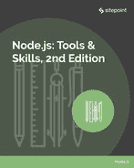
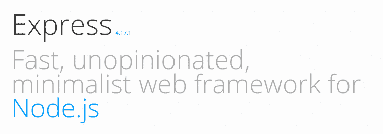
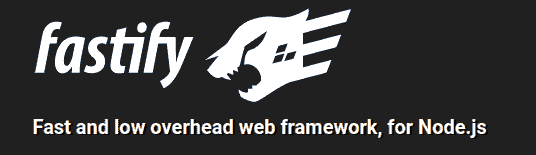
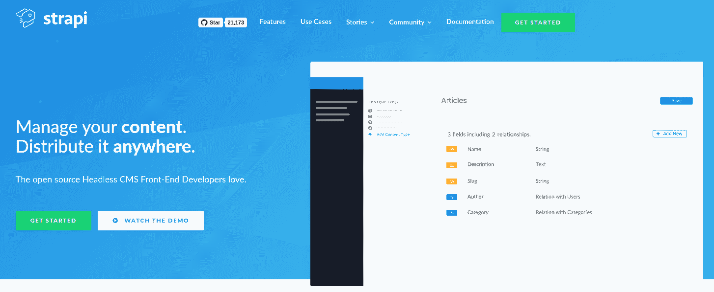
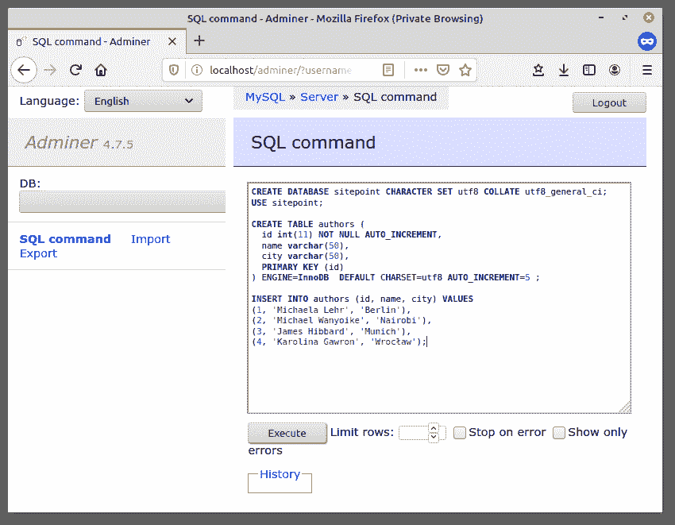
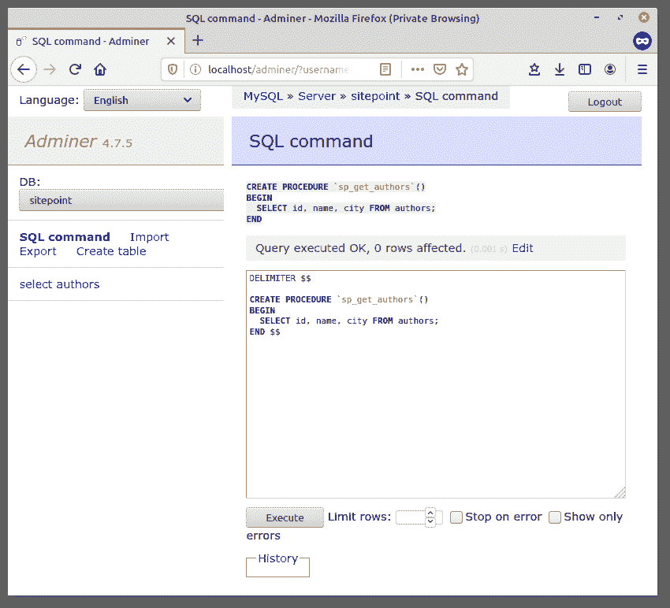
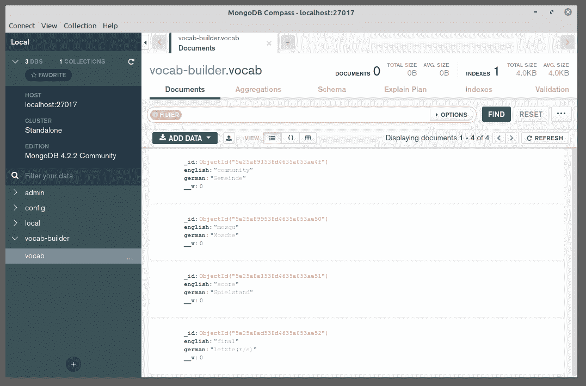

# Node.js：工具与技能



Copyright © 2020 SitePoint Pty. Ltd.

电子书 ISBN: 978-1-925836-39-4

* **产品经理：** Simon Mackie
* **项目编辑：** James Hibbard
* **英语编辑：** Ralph Mason
* **封面设计：** Alex Walker

## 权利声明

本书保留所有权利。未经出版者事先书面许可，不得以任何形式或通过任何手段复制、存储在检索系统中或传输本书的任何部分，但评论性文章或评论中的短幅引用除外。

## 免责声明

作者和出版商已尽一切努力确保书中信息的准确性。然而，本书包含的信息按现状销售，不提供任何明示或暗示的保证。作者、SitePoint Pty. Ltd. 及其经销商或分销商对于因使用书中的说明或书中此处描述的软件或硬件产品而直接或间接造成的任何损害均不承担责任。

## 商标声明

本书并未将每个商标名称都标记出来，而是以编辑的方式使用这些名称，为了商标所有者的利益，无侵犯商标的意图。


SitePoint Pty. Ltd. 出版

Level 1, 110 Johnston St, Fitzroy

VIC Australia 3065

网址: [`www.sitepoint.com`](http://www.sitepoint.com/)

邮箱: books@sitepoint.com

## 关于 SitePoint

SitePoint 专门为网络专业人士出版有趣、实用且易于理解的内容。访问 [`www.sitepoint.com/`](http://www.sitepoint.com/) 获取我们的博客、书籍、时通讯、文章和社区论坛。你可以在那里找到关于 JavaScript、PHP、设计等大量信息。

## 关于 Craig Buckler

[Craig](https://craigbuckler.com/) 是一位自由开发者、作者和演讲师，他对 Web 的话题永无止境。

他从 20 世纪 80 年代开始编程，那时应用程序必须挤进几 KB 的内存中。他对 Web 的热情燃于 20 世纪 90 年代中期，那时 28K 调制解调器是常见配置，100KB 的页面被认为是奢侈品。

在过去的十年里，随着 Web 标准的演进，Craig 为 SitePoint 编写了 1200 篇教程。尽管在一个技术奇妙的未来生活中，但他从未忘记用有限的资源可以成就什么。

# 前言

尽管已有许多尝试让 JavaScript 作为一种服务端语言运行，但 Node.js（通常简称为 Node）是第一个获得任何关注的环境。它现在被 Netflix、Uber 和 Paypal 等公司用于支持它们的 Web 应用程序。Node 允许极快的性能；得益于它的事件循环模型，网络连接和数据库 I/O 等常见任务执行得确实非常快。

在书中，我们将查看一些相关的工具和技能，它们将让你成为一个更高效的 Node 开发者。

## 谁应该读这本书？

本书适用于任何想要开始学习 Node.js 服务端开发的人。我们假设读者熟悉 JavaScript，但我们并不假设他们有任何先前的后端开发经验。

## 使用的规范

### 代码示例

书中的代码使用等宽字体显示，如下：

```html
<h1>一个完美的夏日</h1>
<p>这是一个在公园散步的好日子。
鸟儿在歌唱，孩子们都回学校上课了。</p>
```

当上下文中需要现有代码而不是重复所有代码时，将显示 `⋮`：

```javascript
function animate() {
   ⋮
new_variable = "Hello";
}
```

某些代码行应该在一行内输入，但由于页面限制，我们不得不对其进行了折行。`➥` 表示仅出于格式目的而存在的换行，应该被忽略：

```javascript
URL.open("http://www.sitepoint.com/responsive-web-
➥design-real-user-testing/?responsive1");
```

你会注意到，我们在整本书中使用某些布局样式来表示不同类型的信息。请关注以下项目。

#### 提示、备注与警告

#### 嘿，你！

提示（Tips）提供有用的小贴士。

#### 额咳，打扰一下……

备注（Notes）是与当前主题相关但并非至关重要的补充说明。将它们视为额外的额外小知识即可。

#### 确保你总是……

……注意这些重要要点。

#### 注意！

警告（Warnings）突出了在过程中可能会让你绊脚的坑。

## 补充材料

* [`www.sitepoint.com/community/`](https://www.sitepoint.com/community/) 是 SitePoint 的论坛，用于解决任何棘手问题提供帮助。
* **books@sitepoint.com** 是我们的邮箱地址，如果你需要联系我们报告问题或其他出于其他原因，请使用。

# 第 1 章：使用 nvm 安装多个版本的 Node.js

### 由 Michael Wanyoike 和 James Hibbard 编写

在使用 Node.js 时，你可能会遇到需要安装多个运行时版本的情况。

例如，也许你的机器上已经安装了最新版本的 Node，但你准备开始的项目需要较旧的版本。

如果没有好工具，这意味着要花费大量手动卸载和重新安装 Node 版本。幸运的是，有一种更好的方法！

## 介绍 nvm

[nvm](https://github.com/creationix/nvm) 代表 Node 版本管理器（Node Version Manager）。顾名思义，它可以帮助你通过单一命令在不同的 Node 版本之间切换。

## 操作系统支持

nvm 支持 Linux 和 macOS，但并不意味着 Windows 用户必须错失。有一个名为 [nvm-windows](https://github.com/coreybutler/nvm-windows) 的项目，为 Windows 用户提供了轻松管理环境的选择。尽管名称相同，nvm-windows 不是 nvm 的克隆，与之无关。然而，下面列出的基本命令（用于安装、列出和切换版本）对 nvm 和 nvm-windows 都有效。

## 安装

让我们首先涵盖 Windows、macOS 和 Linux 的安装。

### Windows

首先，我们需要做一些准备：

* 卸载任何现有的 Node.js 版本
* 删除任何现有的 Node.js 安装目录（例如 `C:\Program Files\nodejs`）
* 删除现 npm 安装位置（例如 `C:\Users\<user>\AppData\npm`）

之后，下载并运行[最新稳定安装程序](https://github.com/coreybutler/nvm-windows/releases)，就可以了！

### macOS/Linux

与 Windows 不同，在 macOS 和 Linux 中删除之前的 Node 和 npm 安装是可选的。如果你想这样做，网上有很多很好的资源。例如，这里介绍了如何在 [macOS](http://stackoverflow.com/q/11177954/113687) 上移除 Node 以及如何在 [Linux](http://stackoverflow.com/q/5650169/113687) 上移除。这里介绍了如何移除你可能拥有[之前的 npm 安装](https://docs.npmjs.com/misc/removing-npm)。

你可以使用 cURL 或 Wget 安装 nvm。在你的终端中运行以下命令：

使用 [cURL](https://curl.haxx.se/)：

```bash
curl -o- https://raw.github.com/creationix/nvm/v0.35.2/install.sh | bash
```

或使用 [Wget](https://www.gnu.org/software/wget/)：

```bash
wget -qO- https://raw.github.com/creationix/nvm/v0.35.2/install.sh | bash
```

注意版本号（`v0.35.2`）会随着项目的开发而变化，因此最好检查[项目主页的相关部分](https://github.com/creationix/nvm#install-script) 以找到最新版本。

这会将 nvm 仓库克隆到 `~/.nvm`，并对你的 bash 配置文件进行必要的更改，以便你可以在终端的任何地方使用 `nvm`。

就是这些！重新加载（或重启）你的终端，nvm 即可开始使用。

## 使用 nvm

如果安装正确，`nvm` 命令可以在你终端的任何地方可用。让我们看看如何使用它来管理 Node.js 版本。

### 安装多个版本的 Node.js

nvm 最重要的部分之一当然是安装不同版本的 Node.js。为此，nvm 提供了 `nvm install` 命令。你可以通过运行此命令并跟上你想要版本来安装特定版本。例如：

```bash
nvm install 12.14.1
```

在终端中运行上述命令，nvm 将安装 Node.js 版本 `12.14.1`。

#### 运行 `nvm use`

nvm-windows 用户在安装后必须运行 `nvm use 12.14.1`。

nvm 遵循 [SemVer](http://semver.org/)，所以如果你想安装最新的 `12.14` 补丁，可以通过运行以下命令来实现：

```bash
nvm install 12.14
```

nvm 将会安装 Node.js 版本 `12.14.X`，其中 `X` 是可用的最高版本。在编写时，它是 1，因此你的系统上将安装了 `12.14.1` 版本。

你可以通过运行以下命令查看可用版本的完整列表：

```bash
nvm ls-remote
```

对于 nvm-windows，命令是：

```bash
nvm ls available
```

#### 减少输出

列出所有可用的 Node 版本产生大量输出。Linux 用户可能喜欢将其传递给 `less` 或使用 `grep` 过滤他们需要的版本。例如，`nvm ls-remote | less` 或 `nvm ls-remote | grep v12`。

### npm

在安装 Node.js 实例时，nvm 还会安装一个兼容的 [npm](http://www.sitepoint.com/beginners-guide-node-package-manager/) 版本。每个 Node 版本可能会带来不同的 npm 版本，你可以运行 `npm -v` 来检查当前正在使用哪一个。全局安装的 npm 包不会在不同的 Node.js 版本之间共享，因为这可能会导致不兼容。相反，它们与当前 Node 版本一起安装在 `~/.nvm/versions/node/<version>/lib/node_modules` 中。这有一个额外的优点，用户安装全局包不需要 `sudo` 权限。

幸运的是，在安装新的 Node.js 版本时，你可以从特定版本重新安装 npm 全局包。例如：

```bash
nvm install v12.14.1 --reinstall-packages-from=10.18.1
```

运行上述命令，nvm 将安装 Node.js 版本 `12.14.1`、相应的 npm 版本，并重新安装你之前为 `10.18.1` 版本安装的全局 npm 包。

如果你不确定最新版本，可以使用 `node` 别名：

```bash
nvm install node
```

这目前会拉取 `13.6.0` 版本。

或者你可以安装最新的 [LTS 发布](https://en.wikipedia.org/wiki/Long-term_support)，使用：

```bash
nvm install --lts
```

这目前会拉取 `12.14.1` 版本。

你也可以通过运行以下命令卸载任何你认为不再需要的实例：

```bash
nvm uninstall 13.6.0
```

### 切换版本

目前我们看到了如何安装不同的 Node 版本。现在让我们如何在它们之间切换。我首先说明一下，当安装新版本时，它会自动启用。所以如果你安装了最新的 Node.js 版本并立即运行 `node -v`，你将看到最新版本的输出。

要切换已安装的版本，nvm 提供了 `nvm use` 命令。它的工作原理与 install 命令类似。因此，你需要跟上版本号或别名。

切换到 Node.js 版本 `13.6.0`：

```bash
nvm use 13.6.0
```

切换到 Node.js 版本 `12.14.1`：

```bash
nvm use 12.14.1
```

切换到最新的 Node.js 版本：

```bash
nvm use node
```

切换到最新的 LTS 版本：

```bash
nvm use --lts
```

当切换到不同版本时，nvm 会将你终端中的 `node` 实例链接到正确的 Node.js 实例。

### 自定义别名

你还可以创建 nvm 自带别名之外的自定义别名。例如，通过运行：

```bash
nvm alias awesome-version 13.6.0
```

你正在为 Node.js 版本 `13.6.0` 设置一个名为“awesome-version”的别名。所以如果你现在运行：

```bash
nvm use awesome-version
```

# 第 2 章：npm 入门指南——Node 包管理器

### 作者 Michael Wanyoike 和 James Hibbard

Node.js 允许你在服务器上使用 JavaScript 编写应用程序。基于 [V8 JavaScript 运行时](https://v8.dev/) 并用 C++ 编写——因此速度很快。最初，它被设计为应用程序的服务器环境，但开发者开始使用它来创建工具，协助本地任务自动化。从那时起，全新的基于 Node 的工具生态系统（例如 [Grunt](http://gruntjs.com/)、[Gulp](http://gulpjs.com/) 和 [webpack](https://webpack.js.org)）演变出来，改变了前端开发的面貌。

要在 Node.js 中利用这些工具（或包），我们需要能够以有效的方式安装和管理它们。这就是 `npm`（Node 包管理器）大显用场。它可以安装你想要使用的包，并提供了一个与这些包交互的实用接口。

在本指南中，我们将介绍使用 `npm` 的基础知识。我们将向你展示如何在本地和全局模式下安装包，以及如何删除、更新和安装特定版本的包。我们还将展示如何通过 `package.json` 来管理项目的依赖项。如果你更喜欢看视频，为什么不注册 SitePoint Premium 并观看我们的免费视频教程：[什么是 npm 以及我如何使用它？](https://www.sitepoint.com/premium/screencasts/what-is-npm-and-how-can-i-use-it?utm_source=blog&utm_medium=articles)

但在开始使用 `npm` 之前，我们必须先在系统中安装 Node.js。让我们现在就开始吧。

## 安装 Node.js

前往 Node.js [下载页面](https://nodejs.org/en/download/) 获取你需要的版本。这里有 Windows 和 Mac 的安装程序，以及预编译的 Linux 二进制文件和源码。对于 Linux，你也可以通过包管理器安装 Node，如[此处所示](https://nodejs.org/en/download/package-manager/)。

对于本教程，我们将使用 `v12.15.0`。在撰写本文时，这是当前的 [Node 长期支持 (LTS) 版本](https://github.com/nodejs/Release#release-schedule)。

### 使用版本管理器

你也可以考虑[使用版本管理器安装 Node](http://sitepoint.com/quick-tip-multiple-versions-node-nvm)。这可以避免下一节中提到的权限问题。

让我们看看 node 的安装位置并检查版本：

```bash
$ which node
/usr/bin/node
$ node --version
v12.15.0
```

为了验证安装是否成功，让我们尝试一下 Node 的 REPL：

```bash
$ node
> console.log('Node is running');
Node is running
> .help
.break    有时候你卡住了，用这个命令可以跳出来
.clear    .break 的别名
.editor   进入编辑器模式
.exit     退出 repl
.help     打印此帮助信息
.load     将文件中的 JS 加载到 REPL 会话中
.save     将此 REPL 会话中所有已评估的命令保存到文件中

按 ^C 取消当前表达式，按 ^D 退出 repl
```

Node.js 安装成功了，现在我们可以将注意力放在包含在安装包中的 `npm` 上：

```bash
$ which npm
/usr/bin/npm
$ npm --version
6.13.7
```

## 更新 npm

`npm` 原代表 Node Package Manager，它是 Node.js 的一个独立项目。它的更新频率通常更高。你可以在此[页面](https://www.npmjs.com/package/npm) 查看最新的可用 npm 版本。如果你发现自己使用的是旧版本，可以按照如下方式更新。

对于 Linux 和 Mac 用户，请使用以下命令：

```bash
npm install -g npm@latest
```

对于 Windows 用户，过程可能会稍微复杂。这是[项目主页](https://github.com/npm/cli/#windows-install-or-upgrade)上的说明：

> npm 3 为 Windows 用户进行了许多改进——如果你运行较新版本的 npm，将获得更好的体验。要进行升级，可以使用[微软的升级工具](https://github.com/felixrieseberg/npm-windows-upgrade)、[下载新版本的 Node](https://nodejs.org/en/download/)，或者遵循[安装/升级 npm](https://npm.community/t/installing-upgrading-npm/251/2) 帖子中的 Windows 升级说明。

对于大多数用户来说，升级工具是最佳选择。要使用它，你需要以管理员身份打开 PowerShell 并执行以下命令：

```powershell
Set-ExecutionPolicy Unrestricted -Scope CurrentUser -Force
```

这将确保你可以在系统上执行脚本。接下来，你需要安装 `npm-windows-upgrade` 工具（https://www.npmjs.com/package/npm-windows-upgrade）。安装工具后，你需要运行它以便它为你更新 `npm`。请在提升的 PowerShell 控制台中完成所有操作：

```powershell
npm install --global --production npm-windows-upgrade
npm-windows-upgrade --npm-version latest
```

## Node 包

`npm` 可以在本地或全局模式下安装包。在本地模式下，会将包安装在父工作目录的 `node_modules` 文件夹中。

### 更改全局包的位置

目前我们只全局安装了一个包——`npm` 包本身。所以让我们改变一下，并安装 [UglifyJS](https://www.npmjs.com/package/uglify-js)（一个 JavaScript 压缩工具）。我们使用 `--global` 标志，但可以缩写为 `-g`：

```bash
$ npm install uglify-js --global
/home/sitepoint/.node_modules_global/bin/uglifyjs -> /home/sitepoint/.node_modules_global/lib/node_modules/uglify-js/bin/uglifyjs
+ uglify-js@3.7.7
added 3 packages from 38 contributors in 0.259s
```

正如你从输出所示，安装了额外的包。这些是 UglifyJS 的依赖。

## 列出全局包

我们可以使用 `npm list` 命令列出已安装的全局包：

```bash
$ npm list --global
home/sitepoint/.node_modules_global/lib
├─┬ npm@6.9.0
│ ├── abbrev@1.1.1
│ ├── ansicolors@0.3.2
│ ├── ansistyles@0.1.3
│ ├── aproba@2.0.0
│ ├── archy@1.0.0
....................
└─┬ uglify-js@3.5.3
  ├── commander@2.19.0
  └── source-map@0.6.1
```

然而，输出非常冗长。我们可以通过 `--depth=0` 选项来改变这一点：

```bash
$ npm list -g --depth=0
/home/sitepoint/.node_modules_global/lib
├── npm@6.13.7
└── uglify-js@3.7.7
```

这样好多了；现在我们只看到自己安装的包以及它们版本号。

任何全局安装的包都可以在命令行中使用。例如，这里展示了如何使用 Uglify 包将 `example.js` 压缩为 `example.min.js`：

```bash
$ uglifyjs example.js -o example.min.js
```

## 在本地模式下安装包

当你本地安装包时，通常会使用 `package.json` 文件。让我们先创建一个：

```bash
$ mkdir project && cd project
$ npm init
package name: (project)
version: (1.0.0)
description: Demo of package.json
entry point: (index.js)
test command:
git repository:
keywords:
author:
license: (ISC)
```

按下 `Return` 接受默认值，然后再次按下确认你的选择。这将在项目根目录下创建一个 `package.json` 文件：

```json
{
  "name": "project",
  "version": "1.0.0",
  "description": "",
  "main": "index.js",
  "scripts": {
    "test": "echo \"Error: no test specified\" && exit 1"
  },
  "author": "",
  "license": "ISC"
}
```

### 更快的方法

如果你想用更快的方法生成 `package.json` 文件，请使用 `npm init --y`。

这些字段应该是自言易懂的，除了 `main` 和 `scripts` 之外。`main` 字段是程序的主入口，而 `scripts` 字段允许你指定在包生命周期各个阶段运行的脚本命令。我们暂时可以保持现状，但如果你想了解更多，请查看 npm 上的 `package.json` 文档以及这篇关于使用 npm 作为构建工具的文章。

现在让我们尝试安装 `underscore`：

```bash
$ npm install underscore
npm notice created a lockfile as package-lock.json. You should commit this file.
npm WARN project@1.0.0 No repository field.
+ underscore@1.9.2
added 1 package and audited 1 package.
found 0 vulnerabilities
```

### 锁文件 (Lockfile)

注意创建了一个锁文件。我们稍后会回到这里。

现在，如果我们查看 `package.json`，会发现添加了 `dependencies` 字段：

```json
{
  "dependencies": {
    "underscore": "^1.9.2"
  }
}
```

## 使用 package.json 管理依赖

如你所见，安装了 underscore v1.9.2。版本号前的脱字符符号（`^`）表示在安装时，npm 将拉取它可以找到的包的最高版本，只需主版本号匹配（除非存在 `package-lock.json` 文件）。在我们的情况下，这将是任何低于 v2.0.0 的版本。这种依赖版本方法（主版本.次版本.补丁）被称为语义化版本（semantic versioning）。你可以阅读更多关于它的信息。

此外注意 underscore 被保存为 `dependencies` 字段的一个属性。这已成为 npm 最新版本的默认设置，并用于应用程序所需的包（如 underscore）。你也可以通过指定 `--save-dev` 标志来将包保存为 `devDependencies`。`devDependencies` 是用于开发目的的包——例如用于运行测试或编译代码。

### 发布与警告

你还可以在 `package.json` 中添加 `private: true` 以防止意外发布私有包，并在运行 `npm install` 时抑制任何警告。

使用 `package.json` 指定项目依赖的最重要原因是可移植性。例如，当你克隆别人的代码时，你只需要在项目根目录下运行 `npm i`，npm 就会为你解析并获取运行所需的所有包。我们稍后会详细介绍这一点。

现在让我们尝试运行一个测试文件：

```javascript
const _ = require("underscore");
console.log(_.range(5));
```

你应该看到 `[0, 1, 2, 3, 4]`。

## 卸载本地包

npm 是一个包管理器，所以它能够卸载包。假设当前的包出现某些问题。让我们卸载它：

```bash
$ npm uninstall underscore
removed 1 package in 386s
$ npm list
project@1.0.0 /home/sitepoint
└── (empty)
```

## 安装特定版本的包

现在我们可以安装指定版本的 underscore 包。通过在版本号后使用 `@` 符号来实现：

```bash
$ npm install underscore@1.9.1
+ underscore@1.9.1
added 1 package in 574s
$ npm list
project@1.0.0 /home/sitepoint
└── underscore@1.9.1
```

## 更新包

让我们检查 underscore 包是否有更新：

```bash
$ npm outdated
Package     Current  Wanted  Latest  Location
underscore    1.9.1   1.9.2  1.9.2  project
```

`Current` 列显示本地安装的版本。`Latest` 列告诉我们最新版本。`Wanted` 列告诉我们我们在不破坏现有代码的情况下可以升级的版本。

还记得之前的 `package-lock.json` 文件吗？在 npm v5 中引入，该文件的目的是确保在所有安装项目的机器上依赖项完全一致。对于任何修改 `node_modules` 文件夹或 `package.json` 文件的操作，它都会自动生成。

如果你喜欢可以尝试一下。删除 `node_modules` 文件夹，然后重新运行 `npm i`（这是 `npm install` 的缩写）。npm 将重新安装 underscore v1.9.1，尽管我们刚刚看到 v1.9.2 可用。这是因为我们在 `package-lock.json` 文件中指定了版本 1.9.1。

```json
{
  "name": "project",
  "version": "1.0.0",
  "lockfileVersion": 1,
  "requires": true,
  "dependencies": {
    "underscore": {
      "version": "1.9.1",
      "resolved": "https://registry.npmjs.org/underscore/-/underscore-1.9.1.tgz",
      "integrity": "sha512-5/4etnCkd9c8gowi5/om/mYO5ajCaOgdzj/oW+0eQV9WxKBDZw5+ycmKmeaTXjInS/W0BGLo2xR2aBwZdg=="
    }
  }
}
```

现在，假设 underscore 的最新版本修复了我们早期的错误，我们想将包更新到该版本：

```bash
$ npm update underscore
+ underscore@1.9.2
updated 1 package in 0.236s
$ npm list
project@1.0.0 /home/sitepoint
└── underscore@1.9.2
```

要使此操作生效，Underscore 必须列在 `package.json` 的依赖项中。如果我们有很多想要更新的过期模块，也可以执行 `npm update`。

## 搜索包

在教程中我们已经使用了几次 `mkdir` 命令。是否存在具有此功能的 Node 包？让我们使用 `npm search` 试试看：

```bash
$ npm search mkdir
NAME                      | DESCRIPTION          | AUTHOR          | DATE
mkdir                     | Directory creation…  | =joehewitt      | 2012-04-17
fs-extra                  | fs-extra contains…   | =jprichardson…  | 2019-06-28
mkdirp                    | Recursively mkdir,…  | =isaacs…        | 2020-01-24
make-dir                  | Make a directory…    | =sindresorhus   | 2019-04-01
...
```

有一个 ([mkdirp](https://www.npmjs.com/package/mkdirp))。让我们来安装它：

```bash
$ npm install mkdirp
+ mkdirp@1.0.3
added 1 package and audited 2 packages in 0.384s
```

现在创建一个 `mkdir.js` 文件并复制粘贴这段代码：

```javascript
const mkdirp = require('mkdirp');
const made = mkdirp.sync('/tmp/foo/bar/baz');
console.log(`made directories, starting with ${made}`);
```

接下来，从终端运行它：

```bash
$ node mkdir.js
made directories, starting with /tmp/foo
```

## 重新安装项目依赖

让我们先再安装一个包：

```bash
$ npm install request
+ request@2.88.0
added 48 packages from 59 contributors and audited 65 packages in 2.73s
found 0 vulnerabilities
```

检查 `package.json`：

```json
"dependencies": {
  "mkdirp": "^1.0.3",
  "request": "^2.88.0",
  "underscore": "^1.9.2"
},
```

注意依赖项列表已自动更新。如果你想安装一个包而不将其保存到 `package.json` 中，只需使用 `--no-save` 参数。

假设你已经将项目源代码克隆到了另一台机器，我们想要安装依赖项。先删除 `node_modules` 文件夹，然后执行 `npm install`：

```bash
$ rm -R node_modules
$ npm list --depth=0
project@1.0.0 /home/sitepoint/project
├── UNMET DEPENDENCY mkdirp@1.0.3
├─┬ UNMET DEPENDENCY request@2.88.0
  ...
└── UNMET DEPENDENCY underscore@1.9.2
npm ERR! missing: mkdirp@1.0.3, required by project@1.0.0
npm ERR! missing: request@2.88.0, required by project@1.0.0
npm ERR! missing: underscore@1.9.2, required by project@1.0.0
...
$ npm install
added 50 packages from 60 contributors and audited 65 packages in 1.051s
found 0 vulnerabilities
```

如果你查看 `node_modules` 文件夹，你会发现它再次被创建了。通过这种方式，你可以轻松地与其他共享代码，而不会让依赖项导致项目和源码仓库膨胀。

## 管理缓存

当 npm 安装一个包时，它会保留副本，这样下次你想安装该包时，就不需要访问网络了。副本缓存在用户路径下的 `.npm` 目录中：

```bash
$ ls ~/.npm
anonymous-cli-metrics.json  _cacache  index-v5  _locks  _logs  node-sass
```

随着时间的推移，这个目录会充满旧包，因此偶尔清理一下是很有用的：

```bash
$ npm cache clean --force
```

如果你系统中有多个 node 项目想要清理，也可以从工作空间删除所有的 `node_module` 文件夹：

```bash
find . -name "node_modules" -type d -exec rm -rf '{}' +
```

## 审计

你有没有注意到散落在 CLI 输出中的那些 `found 0 vulnerabilities` 提示？这是因为 npm 引入了一个新功能，允许开发者扫描依赖项中已知的安全漏洞。

让我们通过安装旧版本的 `express` 来尝试此功能：

```bash
$ npm install express@4.8.0
express@4.8.0
added 36 packages from 24 contributors and audited 123 packages in 2.224s
found 21 vulnerabilities (8 low, 9 moderate, 4 high)
  run `npm audit fix` to fix them, or `npm audit` for details
```

一旦完成安装，我们就会得到一个快速报告，显示发现了多个漏洞。你可以运行命令 `npm audit` 查看更多详情：

```bash
$ npm audit
=== npm audit security report ===
# Run  npm install express@4.17.1  to resolve 21 vulnerabilities
┌───────────────┬──────────────────────────────────────────────────────────────┐
│ High          │ Regular Expression Denial of Service                         │
├───────────────┼──────────────────────────────────────────────────────────────┤
│ Package       │ negotiator                                                   │
├───────────────┼──────────────────────────────────────────────────────────────┤
│ Package       │ negotiator                                                   │
├───────────────┼──────────────────────────────────────────────────────────────┤
│ Dependency of │ express                                                      │
├───────────────┼──────────────────────────────────────────────────────────────┤
│ Path          │ express > negotiator                                         │
├───────────────┼──────────────────────────────────────────────────────────────┤
│ More info     │ https://nodesecurity.io/advisories/106                       │
└───────────────┴────────────────────────────────────────┘
┌───────────────┬──────────────────────────────────────────────────────────────┐
│ Moderate      │ Timing Attack                                                │
├───────────────┼──────────────────────────────────────────────────────────────┤
│ Package       │ cookie-signature                                             │
├───────────────┼──────────────────────────────────────────────────────────────┤
│ Dependency of │ express                                                      │
├───────────────┼──────────────────────────────────────────────────────────────┤
│ Path          │ express > cookie-signature                                   │
├───────────────┼──────────────────────────────────────────────────────────────┤
│ More info     │ https://nodesecurity.io/advisories/134                       │
└───────────────┴────────────────────────────────────────┘
```

你会得到一个漏洞的详细列表。如果你查看 `Path` 字段，它显示了依赖路径。例如，`express > accepts` Express 依赖 `accepts` 包。`accepts` 包依赖 `negotiator` 包，而后者包含漏洞。

有两种方法修复这些问题。我们可以执行建议的命令 `npm install express@4.17.1`，或者运行 `npm audit fix`。让我们尝试后者：

```bash
$ npm audit fix
+ express@4.17.1
added 20 packages from 14 contributors, removed 7 packages and updated 29 packages in 1.382s
fixed 21 of 21 vulnerabilities in 122 scanned packages
```

`npm audit fix` 命令会自动安装兼容的更新。虽然这看起来像魔法，但请注意漏洞并不总是可以修复的。如果你使用的包发生了重大变化，更新可能会破坏你的当前项目，出现这种情况。在这种情况下，你需要审查代码并手动修复。

如果你不介意升级具有破坏性的包，也可以运行 `npm audit fix --force`。在执行命令后，运行 `npm audit` 以确保所有漏洞都已解决。

## 别名

正如你可能注意到的，运行 npm 命令有多种方法。这里是一些常用 npm 别名的简单列表：

* `npm i <package>`：安装本地包
* `npm i -g <package>`：安装全局包
* `npm un <package>`：卸载本地包
* `npm up`：更新包
* `npm t`：运行测试
* `npm ls`：列出已安装模块
* `npm ll` 或 `npm la`：列出模块时打印额外的包信息

你也可以这样一次安装多个包：

```bash
$ npm i express moment lodash mongoose body-parser webpack
```

如果你想查看所有常用的 npm 命令，只需执行 `npm help` 即可查看列表。你也可以在我们的文章[让你成为 npm 高手的 10 个技巧和技巧](https://www.sitepoint.com/10-npm-tips-and-tricks/) 中学习更多。

## npx

在学习过程中你可能也会听到 `npx`。不要把它和 `npm` 混淆。正如我们所学的，`npm` 是一个用于*管理*包的工具，而 `npx` 是一个用于*执行*包的工具。它随着 `npm` 5.2+ 版本一起发布。

`npx` 的典型用于执行一次性命令。例如，假设你想启动一个简单的 HTTP 服务器。你*可以*在系统上全局安装 [http-server 包](https://www.npmjs.com/package/http-server)，如果你经常使用 `http-server`，那么这样做很棒。但如果你只是想测试该包，或者想让全局安装的模块尽可能少，你可以切换到你想运行它的目录，然后执行以下命令：

```bash
npx http-server
```

这将启动服务器，而无需全局安装任何内容。

你可以[在此处阅读更多关于 npx 的信息](https://blog.npmjs.org/post/162869356040/introducing-npx-an-npm-package-runner)。

## 结论

在本教程中，我们涵盖了使用 `npm` 的基础知识。我们演示了如何从项目的下载页面安装 Node.js，如何更改全局包的位置（以避免使用 `sudo`），以及如何在本地和全局模式下安装包。我们还涵盖了删除、更新和安装特定版本的包，以及管理项目的依赖。

随着每一次新发布，`npm` 在前端开发领域正迈出巨大的步伐。[根据其联合创始人的话](http://frontendhappyhour.com/episodes/npm-install-beer-save-in-mouth/)，它的用户群正在发生，大多数使用它的人根本并不是用它来编写 Node。相反，它正成为人们在前端组合 JavaScript 的工具（真的，你可以用它安装几乎任何东西），并且正成为编写现代 JavaScript 的不可或缺的一部分。

你会在项目中使用 `npm` 吗？如果没有，现在可能是一个开始的好时机。

# 第 3 章：使用 Express Generator 在几分钟内创建新的 Express.js 应用

### 作者 Paul Suave 和 Nilson Jacques

[Express.js](https://expressjs.com/) 是一个 Node.js 框架，因其简单性而广受欢迎。它具有易于使用的路由和对视图引擎的简单支持，使其远超基础的 Node HTTP 服务器。

然而，启动一个新的 Express 应用需要一定量的模板代码：启动新的服务器实例、配置视图引擎以及设置错误处理。

尽管有各种启动项目和模板可用，但 Express 有它自己的命令行工具，可以轻松地启动新应用，称为 [express-generator](https://expressjs.com/en/starter/generator.html)。

## 什么是 Express？

Express 内置了许多功能，你还可以从其他无缝集成的包获取更多功能，但它开箱即用为你做了三件大事：

1. **路由**。这是 `/home`、`/blog` 和 `/about` 如何提供不同页面的方式。Express 通过允许你将不同的路由放在不同的文件中，让你能够轻松地将这些代码模块化。
2. **中间件**。如果你对这个术语陌生，中间件基本上是“软件胶水”。它在路由获取请求之前访问请求，允许它们处理诸如 cookie 解析、文件上传、错误等难以完成的任务。
3. **视图**。视图是使用自定义内容渲染 HTML 页面的方式。你传递想要渲染的数据，Express 将使用你给定的视图引擎对其进行渲染。

## 入门

你首先需要在你的机器上安装 Node 和 `npm`。要做到这一点，可以前往 [Node 官方下载页面](https://nodejs.org/en/download/) 并获取适用于你系统的正确二进制文件，或者使用版本管理器（如 `nvm`）。我们在快速贴士“[使用 nvm 安装多个版本的 Node.js](https://www.sitepoint.com/quick-tip-multiple-versions-node-nvm/)”中涵盖了使用版本管理器安装 Node 的方法。

使用 Express generator 启动新项目只需运行几个命令：

```bash
npm install express-generator -g
```

这会将 Express generator 作为全局包安装，允许你在终端中运行 `express` 命令：

```bash
express myapp
```

这会创建一个名为 `myapp` 的新 Express 项目，然后将其放在 `myapp` 目录中：

```bash
cd myapp
```

如果你不熟悉终端命令，这一个会将你带入 `myapp` 目录：

```bash
npm install
```

如果你不熟悉 `npm`，它是[默认 Node.js 包管理器](https://www.sitepoint.com/beginners-guide-node-package-manager/)。运行 `npm install` 会安装项目的所有依赖。默认情况下，`express-generator` 包含了几个与 Express 服务器配合使用的包。

### 选项

生成器 CLI 接受六个[参数](https://expressjs.com/en/starter/generator.html)，但最实用的两个是：

* `ejs|hbs|jade|pug|twig`
* `less|stylus|compass|sass`

现在我们已经好了项目，可以通过运行以下命令启动服务器：

```bash
npm start
```

然后并在浏览器中访问 [`localhost:3000`](http://localhost:3000)。

## 应用结构

生成的 Express 应用最初从四个文件夹开始。

### `bin`

`bin` 文件夹包含启动你的应用的可执行文件。它启动服务器（如果没有提供替代方案，则在端口 3000 上运行）并设置基础处理。你不需要真正需要担心这个文件，因为 `npm start` 会为你运行它。

### `public`

`public` 文件夹是重要的文件夹之一：此文件夹中的*所有内容*对所有人都可见。在这个文件夹中，你将放置 JavaScript、CSS、图像以及人们加载你的网站时需要的其他资源。

### `routes`

`routes` 文件夹是你放置路由文件的地方。生成器创建了两个文件，`index.js` 和 `users.js`，它们作为如何分离应用程序路由配置的示例。通常，你会在网站的每个主要路由在这里创建一个不同的文件。因此，在该文件夹中你可能有名为 `blog.js`、`home.js` 和/或 `about.js` 的文件。

### `views`

`views` 文件夹是你存放模板引擎所用文件的地方。生成器将配置 Express 在你调用 `render` 方法时，在此处查找匹配的视图。

## `app.js`

在这些文件夹之外，有一个你应该熟悉的文件。`app.js` 文件非常特殊，因为它设置了你的 Express 应用并将所有不同部分连接在一起。让我们看看它做了什么。该文件这样开始：

```javascript
var createError = require('http-errors');
var express = require('express');
var path = require('path');
var cookieParser = require('cookie-parser');
var logger = require('morgan');
```

该文件的前六行是必须的。

```javascript
var indexRouter = require('./routes/index');
var usersRouter = require('./routes/users');
```

接下来两行代码 `require` 引入了 Express 生成器默认设置的两个路由文件：`routes` 和 `users`。

```javascript
var app = express();
```

之后，我们通过调用 `express()` 创建了一个新应用。`app` 变量包含了应用程序的所有设置和路由。这个对象将你的应用程序胶在一起。

```javascript
app.set('views', path.join(__dirname, 'views'));
app.set('view engine', 'jade');
```

一旦创建了 `app` 实例，就会设置好模板引擎来渲染视图。如果有必要，你可以在这里更改视图文件的路径。

之后，你将看到 Express 正在配置使用中间件。生成器安装了几个你可能在 Web 应用程序中常用的常用中间件：

```javascript
app.use(logger('dev'));
app.use(express.json());
app.use(express.urlencoded({ extended: false }));
app.use(cookieParser());
app.use(express.static(path.join(__dirname, 'public')));
```

* `logger`。当你运行应用时，你可能会注意到所有被请求的路由都记录在了控制台中。如果你想禁用此功能，只需注释掉该中间件。
* `express.json`。你可能会注意到有两行用于解析传入的 HTTP 请求体。第一行处理通过 `POST` 请求发送 JSON 的情况，并将这些数据放入 `request.body` 中。
* `express.urlencoded`。第二行解析 URL 中的查询字符串数据（例如 `/profile?id=5`）并将其放入 `request.query` 中。
* `cookieParser`。它获取客户端发送的所有 Cookie 并将其放入 `request.cookies` 中。它还允许你在将它们发送回客户端之前通过更改 `response.cookies` 来进行修改。
* `express.static`。该中间件从你的 `public` 文件夹提供静态资源。如果你想重命名或移动 `public` 文件夹，可以在这里更改路径。

接下来是路由：

```javascript
app.use('/', indexRouter);
app.use('/users', usersRouter);
```

在这里，之前引入的示例路由文件被挂载到了 `app` 上。如果你需要添加额外的路由，可以在这里进行。

此后的所有代码都用于错误处理。除非你想更改 Express 处理错误的方式，否则通常不需要修改这些代码。默认情况下，它被设置为在开发模式下显示在路由中发生的错误。

## 启动新项目

让我们应用目前为止学到的知识来启动一个基础的 Express.js 应用程序。

假设你已经作为全局模块安装了 `express-generator`，运行以下命令创建一个新的骨架项目：

```bash
express -v hbs signup-form
```

正如我之前提到的，选择默认（Jade）之外的模板库是一个好主意。在这里我选择了 [Handlebars.js](https://handlebarsjs.com/)，因为我发现这种类似 mustache 的语法易于阅读和操作。

一旦生成器运行，切换到新创建的文件夹并安装依赖：

```bash
cd signup-form
npm i
```

此时，你可能会注意到几条关于包漏洞的警告。让我们更新 Handlebars.js 的版本来修复这些问题：

```bash
npm install hbs@4.1.0
```

现在项目依赖已经安装并更新，让我们对一些样板视图模板进行自定义。

生成器创建了一个布局模板，用于渲染在所有视图之间共享的 HTML 标记。打开 `views/layout.hbs` 并将内容替换为以下内容：

```html
<!doctype html>
<html lang="en">
<head>
  <meta charset="utf-8">
  <meta name="viewport" content="width=device-width, initial-scale=1, shrink-to-fit=no">
  <meta name="description" content="">
  <meta name="author" content="">
  <title>{{title}}</title>
  <!-- Bootstrap core CSS -->
  <link rel="stylesheet" href="https://stackpath.bootstrapcdn.com/bootstrap/4.1.3/css/bootstrap.min.css"
    integrity="sha384-MCw98/SFnGE8fJT3GXwEOngsV7Zt27NXFoaoApmYm81iuXoPkFOJwJ8ERdknLPMO" crossorigin="anonymous">
  <!-- Custom styles for this template -->
  <link href="/stylesheets/style.css" rel="stylesheet">
</head>
<body>
  {{{body}}}
</body>
</html>
```

这里的标记改编自 [Bootstrap 网站](https://getbootstrap.com/) 上展示的一个[示例](https://getbootstrap.com/docs/4.1/examples/sign-in/)。我们还需要添加一些自定义样式，因此打开 `public/stylesheets/style.css` 并粘贴以下内容：

```css
html,
body {
  height: 100%;
}
body {
  display: -ms-flexbox;
  display: flex;
  -ms-flex-align: center;
  align-items: center;
  padding-top: 40px;
  padding-bottom: 40px;
  background-color: #f5f5f5;
}
.full-width {
  width: 100%;
}
```

希望你现在已经清楚地了解了 `express-generator` 工具在启动新的 Express 项目时，它是如何为你节省编写重复样板代码的时间的。

通过提供合理的默认文件结构，并安装和连接常用的中间件，该生成器只需几条命令即可为新应用程序建立坚实的基础。

# 第 4 章：AdonisJs 简介——一个类 Laravel 的 Node.js 框架

### 作者 Nilson Jacques

想要构建 Node.js Web 应用的开发者通常会早早遇到 `Express`。虽然 `Express` 无疑是 Node 最流行的 HTTP 应用框架之一，但它是非常精简的，需要开发者自己从第三方包中组合出他们所需的功能。

[AdonisJs](https://adonisjs.com/) 是一个用于 Node 的 MVC 框架，旨在提供构建现代 Web 应用所需的所有主要功能。它深受 [Laravel PHP 框架](https://laravel.com/) 的启发，借鉴了其大量的语法和布局。

本指南旨在对 Adonis 提供的功能进行高级概述，帮助你判断它是否适合你。在整个指南中，我将把其功能与 Laravel 提供的功能进行对比，以便 PHP 开发者有一个良好的参考点。

### Adonis 版本

在编写时，Adonis `v5` 处于预览阶段但尚未完成，因此本文将介绍 `v4`。

## 基础知识

让我们先来看看 Adonis 提供的创建和维护项目的工具。

### CLI 工具

AdonisJs CLI 是一个广泛等同于 Laravel `artisan` 命令的工具。它作为全局 Node 模块安装：

```bash
npm i -g @adonisjs/cli
```

CLI 可以轻松创建新项目：

```bash
adonis new my-new-project
```

它也能轻松地启动项目：

```bash
adonis serve
## 或者，使用文件监听模式
adonis serve --dev
```

像 `artisan` 一样，在 Adonis 项目目录内运行时，它可以用于创建和运行数据库迁移、脚手架模型和控制器，以及运行自定义命令行任务。

### REPL

你也可以使用 CLI 工具进入一个类似于 [tinker](https://laravel.com/docs/6.x/artisan#tinker) 的命令行环境。在这个环境中，你可以访问应用程序代码以及所有的框架库和辅助函数。

```bash
adonis repl
```

[repl](https://adonisjs.com/docs/4.0/database-basics#_what_is_repl)（读取-评估-打印循环）对于调试和维护任务非常有用——例如，在开发过程中创建新用户或重置密码。

### 文件结构

[新 AdonisJs 项目的文件结构](https://adonisjs.com/docs/4.1/folder-structure) 与 Laravel 项目相比有许多相似之处：

```text
├── ace
├── app
│   ├── Controllers
│   │   └── Http
│   ├── Middleware
│   └── Models
│       └── Traits
├── config
├── database
│   └── migrations
├── public
├── resources
│   └── views
├── server.js
└── start
    ├── app.js
    ├── kernel.js
    └── routes.js
```

你会发现一个 `app` 文件夹，将控制器（按类型）、模型和中间件分在一起；一个 `config` 文件夹包含通用应用程序配置、认证、会话和数据库配置的文件；`database` 文件夹用于迁移、工厂（factories）和种子器（seeders）；以及 `resource` 文件夹用于你的视图模板。

与熟悉结构的一个重要不同点是 `start` 文件夹，在 Adonis 中，该文件夹持有负责配置服务提供、中间件和路由的文件。

## HTTP

### 定义路由

任何 Web 应用框架的核心组件都是路由，Adonis 开发者选择紧密镜像 Laravel 的语法来指定 HTTP 路由。

[应用程序的路由](https://adonisjs.com/docs/4.1/routing) 在 `start/routes.js` 中定义，对于任何有 Laravel 背景的人来说都会非常熟悉：

```javascript
Route.get('posts', () => {...});
Route.post('posts', () => {...});
Route.put('posts/:id', () => {...});
Route.delete('posts/:id', () => {...});
```

从最后两个路由可以看出，定义带参数的路由非常简单：

```javascript
Route.get('posts/:id', ({ params }) => {
  return `Post ${params.id}`
});
```

像 Laravel 一样，AdonisJs 还提供了一个方便的快捷方式来为资源定义一组 CRUD 路由（即 RESTful 路由）：

```javascript
Route.resource('posts', 'PostController');
```

### 中间件

Adonis 处理中间件的方式 Laravel 开发者也应该觉得非常熟悉。[中间件](https://adonisjs.com/docs/4.1/middleware) 在 `start/kernel.js` 文件中注册，通过三种不同方式之一完成。

**服务器中间件：**

```javascript
const serverMiddleware = [
  'Adonis/Middleware/Static',
  'Adonis/Middleware/Cors',
]
```

服务器中间件会在每个传入的请求上运行，无论是否匹配路由。

**全局中间件：**

```javascript
const globalMiddleware = [
  'Adonis/Middleware/BodyParser',
]
```

全局中间件会在每个匹配应用程序中定义路由的请求上运行。

**命名中间件：**

```javascript
const namedMiddleware = {
  auth: 'Adonis/Middleware/Auth',
}
```

一旦注册，命名中间件可以附加到路由上：

```javascript
Route.get('admin', 'AdminController.index').middleware(['auth'])
```

### 控制器

使用 CLI 在 Adonis 中创建控制器非常简单。有一个指定类型的选项来创建 HTTP 或 WebSocket 控制器：

```bash
adonis make:controller Posts --type http
```

还有一个创建资源控制器（resourceful controller）的选项，它包含 CRUD 操作方法。

## 数据库

Adonis 支持 MySQL/MariaDB、MSSQL、Oracle、PostgreSQL 和 SQLite3。驱动程序和连接设置从环境变量或本地的 `.env` 文件读取。

### 查询构建器

框架带有一个[查询构建器](https://adonisjs.com/docs/4.1/query-builder)，其工作方式与 Laravel 类似。它提供了一个直观的 API 来构建复杂的查询，而无需编写任何 SQL：

```javascript
const adults = await Database
  .from('users')
  .where('age', '>', 18)
  .first();
```

Adonis（或者说是底层使用的 [Knex.js](https://knexjs.org/)）将其转换为数据库引擎的正确 SQL 方言。

### Lucid ORM

即使有查询构建器，为应用程序编写获取和更新数据的代码也会很快变得冗长且重复。坦率地说，AdonisJs 提供了 [Lucid ORM]（对象关系映射，object-relational mapper）来让我们的工作更轻松。

Lucid 像 Laravel 的 Eloquent 一样基于活动记录模式（active record pattern），Adonis 团队显然付出了大量努力来实现这两个库之间的功能对等。

* **关系**：你可以使用内置方法轻松地定义 `hasOne`、`hasMany`、`belongsTo`、`belongsToMany` 和 `manyThrough` 关系。
* **Trait（Traits）**：你可以定义“trait”在不同模型之间共享功能而无需重复代码。
* **钩子（Hooks）**：你可以为模型生命周期事件（如 `beforeCreate` 和 `beforeSave`）附加回调以便修改记录。
* **修改器（Mutators）**：你可以为模型属性定义 getter 和 setter 以改变它们的值。

如前提到的，可以使用 CLI 创建新模型：

```bash
adonis make:model Post
```

这将生成以下文件：

**app/Models/Post.js:**

```javascript
'use strict'
const Model = use('Model')
class Post extends Model {
}
module.exports = Post
```

向命令传递 `--migration` 标志还将生成一个迁移文件，用于创建模型对应的数据库表。

让我们通过一些代码示例来熟悉一下语法。

## 创建新记录：

```javascript
const post = new Post();
post.name = 'My first blog post';
post.content = 'Blah blah blah...';
await post.save();
```

还有一种从数据对象创建并返回新模型的便捷方法：

```javascript
const post = await Post.create({
  name: 'My first blog post',
  content: 'Blah blah blah...'
});
```

还有其他常用的 Eloquent 便捷方法可用，例如 `findOrFail` 和 `findOrCreate`。

## 获取记录：

```javascript
// 返回所有记录
const posts = Post.all();
// 通过 ID 查找
const post = Post.find(1);
```

## 在模型中使用查询构造器：

```javascript
const adults = await User
  .query()
  .where('age', '>', 18)
  .fetch();
```

### 迁移 (Migrations)

Laravel 数据库功能另一个核心部分是迁移系统。如果你不熟悉它，`migration`（迁移）是一组在代码中定义的架构更改。迁移可以在应用程序的不同环境（如开发、测试和生产环境）中运行，确保在代码部署时所有数据库副本都已更新。

Adonis 的处理方式对 Laravel 开发者来说会非常熟悉。[迁移](https://adonisjs.com/docs/4.1/migrations) 通过 CLI 创建：

```bash
adonis make:migration posts
# ✔ create  database/migrations/1502691651527_posts_schema.js
```

它们也可以从那里运行：

```bash
adonis migration:run
## migrate: 1502691651527_posts_schema.js
## Database migrated successfully in 117 ms
```

除了运行迁移外，还有命令可以回滚最后一组，或者完全回滚并从头重新应用所有迁移，[等等](https://adonisjs.com/docs/4.1/migrations#_migration_commands)。

让我们来看看迁移是如何定义的：

```javascript
// database/migrations/1502691651527_posts_schema.js
'use strict'
const Schema = use('Schema')
class PostsSchema extends Schema {
  up () {
    this.create('users', (table) => {
      table.increments()
      table.string('title').notNullable().unique()
      table.text('content').notNullable()
      table.integer('comment_count').notNullable()
      table.timestamps()
    })
  }
  down () {
    this.drop('posts')
  }
}
module.exports = PostsSchema
```

每个迁移都有一个 `up()` 和 `down()` 方法，分别在 migrate 和 rollback 时运行。在 `up()` 方法中，通过链式方法调用来定义/修改列，从而声明表架构的更改。

## 视图 (Views)

除了创建 REST API 外，Adonis 还旨在让服务器渲染的应用程序变得轻松。为此，它包含了 [Edge 模板引擎](https://edge.adonisjs.com/)。

### Edge 模板

模板是扩展名为 `.edge`的文件，可以包含 HTML、CSS 和 JavaScript 的混合。语法与 Blade 非常相似，例如：

```html
// resources/views/list.edge
@layout('main')
@section('content')
<div>
  <ul>
    @each(item in list)
      <li>
        <a href="{{ item.url }}">{{ item.text }}</a>
      </li>
    @endeach
  </ul>
</div>
@endsection
```

模板也用于帮助视图。这里是一些常用标签：

* `@layout`：指定将渲染布局
* `@section`：指定将内容插入到布局中
* `@each`：指定该块将重复
* `@include`：允许包含部分组件

# 第 5 章：用于构建 API 的 5 个 Node.js 框架

### 作者 Michael Wanyoike

过去，我们习惯于构建单体应用，在单个代码库中处理视图、业务逻辑和数据管理。这种架构产生了许多影响应用程序稳定性、性能和可维护性的问题。

如今，许多 Web 应用更倾向于使用模块化的方法。这通常涉及创建一个面向 API 的服务，暴露与应用程序数据交互的端点（endpoints）。在本指南中，我们将快速查看什么是 API，以及我们可以用于在 Node.js 构建 API 的五个对开发者友好的框架。

## 什么是 API？

简单来说，API（Application Programming Interface，即应用程序编程接口）是一种服务器应用程序，用于响应来自浏览器和移动应用等客户端应用程序的请求。如果你曾需要从互联网上的其他源（如 Twitter 或 GitHub）获取数据，那么你可能已经使用过它了。

这种方法的一个大优势是你只需要构建一次后端服务器 API，就可以将其连接到不同类型的客户端界面——例如桌面端、Web、移动或控制台应用。拥有 API 可以确保为某个机构构建的所有前端应用中的数据是一致的。

API 提供了重要的后端功能，例如：

* CRUD 操作（增删改查）
* 数据验证与转换
* 身份验证
* 访问控制
* 业务逻辑
* 事务性邮件
* 任务调度
* 事件处理

在 Node 中构建 API 服务器非常简单。如果你需要快速设置一个来测试你的前端代码，可以安装 [JSON server](https://www.npmjs.com/package/json-server#getting-started) 来快速对后端进行原型设计。如果你已经开始构建自己的 API 但尚还没有前端，可以使用以下工具来测试你的端点：

* [Postman](https://www.getpostman.com/)
* [Insomnia](https://insomnia.rest/)

这些工具允许你执行 REST 和 GraphQL 查询。我们稍后会详细介绍它们。

要构建自己的 API，你需要一个框架，它将为你提供创建后端服务器所需的库和工具。我根据框架的易用性对以下列表进行了排序。最后一个在技术使用上要求最低。

## 1. Express



如果你是 Node.js 初学者，这是你应该开始使用的框架。你可以使用命令 `npm install express` 将 [安装 Express](https://expressjs.com/en/starter/installing.html) 作为包依赖进行安装。或者，你可以使用 [express-generator](https://expressjs.com/en/starter/generator.html) 命令行工具快速启动一个 Express 起步项目。我们还有一个关于[如何使用此库的教程](https://www.sitepoint.com/create-new-express-js-apps-with-express-generator/)。

让我们来看看在 Express 中管理用户的简单 REST API 可能长什么样。

首先，创建一个新项目并安装 Express：

```bash
mkdir express-api
cd express-api
npm init -y
npm i express
```

接下来，创建一个 `server.js` 文件并添加以下内容：

```javascript
let data = [
  { id: 1, firstName: 'Michael', lastName: 'Wanyoike' },
  { id: 2, firstName: 'James', lastName: 'Hibbard' },
];
const express = require('express');
const bodyParser = require('body-parser');
const app = express().use(bodyParser.json());
// 获取所有用户
app.get('/users', (req, res) => { res.json(data); });
// 获取单个用户
app.get('/users/:id', (req, res) => {
  const id = Number(req.params.id);
  const user = data.find(user => user.id === id);
  res.json(user ? user : { message: 'Not found' });
});
// 添加用户
app.post('/users', (req, res) => {
  const user = req.body;
  data.push(user);
  res.json(data);
});
// 更新用户
app.put('/users/:id', (req, res) => {
  const id = Number(req.params.id);
  const updatedUser = req.body;
  data = data.map(user => user.id === id ? updatedUser : user);
  res.json(data);
});
// 删除用户
app.delete('/users/:id', (req, res) => {
  const id = Number(req.params.id);
  data = data.filter(user => user.id !== id);
  res.json(data);
});
app.listen(3000, () => { console.log('Server listening at port 3000'); });
```


保存此代码，然后使用 `node server.js` 启动服务器。它现在运行在 `http://localhost:3000`。

### 使用 Postman 与 API 交互

我们可以使用 [Postman](https://www.getpostman.com/)（一个 API 测试环境）来测试我们的 API 是否符合预期。下载适用于你系统的正确版本，然后按照[说明进行安装](https://learning.getpostman.com/docs/postman/launching-postman/installation-and-updates/)。

我们可以从向 `http://localhost:3000/users` 发送 GET 请求开始，列出所有用户。你应该看到以下内容：

```json
[
  {"id": 1, "firstName": "Michael", "lastName": "Wanyoike"},
  {"id": 2, "firstName": "James", "lastName": "Hibbard"}
]
```

### 进一步探索

使用 Express，你可以通过安装[适配器](https://expressjs.com/database-integration) 来连接数据库，它将处理路由、日志和错误处理。

遗憾的是，它缺乏内置的身份验证和授权支持。你需要使用第三方库（如 `Passport`）来实现。

### Express 链接

在我们继续之前，这里是基于 Express 或受其影响的类似框架：

*   [Koa](https://koajs.com/)
*   [Hapi](https://hapi.dev/)
*   [Restify](http://restify.com/)
*   [NestJS](https://nestjs.com/)

## 2. Fastify



Fastify 是一个受 Hapi 和 Express 启发的 Node.js 框架。它旨在尽可能地处理大量请求。根据他们的[基准测试](https://www.fastify.io/benchmarks/)，Fastify 的速度是 Express 的两倍：

| 框架 | 版本 | 路由？ | 每秒请求数 |
| --- | --- | --- | --- |
| hapi | 18.1.0 | ✓ | 29998 |
| Express | 4.16.4 | ✓ | 38510 |
| Restify | 8.0.0 | ✓ | 39331 |
| Koa | 2.7.0 | ✗ | 50933 |
| **Fastify** | **2.0.0** | **✓** | **76835** |
| - | | | |
| `http.Server` | 10.15.2 | ✗ | 71768 |

要开始使用，你可以作为包依赖安装到你的项目中。只需执行以下命令：

```bash
mkdir fastify-app
cd fastify-app
npm init -y
npm install fastify
touch server.js
```

将以下代码拷贝到 `server.js`：

```javascript
const fastify = require('fastify')({ logger: true })

fastify.get('/', async (request, reply) => {
  return { hello: 'world' }
})

const start = async () => {
  try {
    await fastify.listen({ port: 3000 })
  } catch (err) {
    fastify.log.error(err)
    process.exit(1)
  }
}

start()
```

```javascript
const fastify = require('fastify')({ logger: true })

fastify.route({
  method: 'GET',
  url: '/',
  schema: {
    // 请求需要包含带有 `name` 参数的查询字符串
    querystring: {
      name: { type: 'string' }
    },
    // 响应需要是一个包含类型为 'string' 的 `hello` 属性的对象
    response: {
      200: {
        type: 'object',
        properties: {
          hello: { type: 'string' }
        }
      }
    }
  },
  // 在执行处理器之前针对每次请求执行
  preHandler: async (request, reply) => {
    // 例如：检查身份验证
  },
  handler: async (request, reply) => {
    return { hello: 'world' }
  }
})

const start = async () => {
  try {
    await fastify.listen(3000)
    fastify.log.info(`server listening on ${fastify.server.address().port}`)
  } catch (err) {
    fastify.log.error(err)
    process.exit(1)
  }
}

start()
```

要启动并测试服务器，你可以按照以下操作：

```bash
$ node server.js
{"level":30,"time":1579520918815,"pid":23484,"hostname":"linux-msi","msg":"Server listening at http://127.0.0.1:3000","v":1}
{"level":30,"time":1579520918815,"pid":23484,"hostname":"linux-msi","msg":"server listening on 3000","v":1}

## 在另一个终端中运行以下命令
$ curl http://localhost:3000
{"hello":"world"}
```

这是一个稍微高级的示例，我们在其中重点展示了 Fastify 的[定义 JSON Schema 来验证请求和响应](https://www.fastify.io/docs/latest/Validation-and-Serialization/) 特性。你可能注意到的其他点是，Fastify 代码能够开箱处理 JSON 数据。除了更好的性能外，Fastify 还为开发者提供了新功能，如表达式编码风格、钩子（hooks）和装饰器（decorators）。让我们详细介绍这些功能的含义。

### 表达式风格

在 Fastify 中，你写的代码比在 Express 中少。例如，在 Express 中，你需要导入额外的包来处理 JSON 请求和响应。在 Fastify 中，你只需要与对象字面量工作，JSON 部分由框架自动处理。

### 钩子 (Hooks)

钩子是由事件触发的特殊函数。它们允许你与 Fastify 的生命周期交互，包括：

* `onRequest`
* `preParsing`
* `preValidation`
* `preHandler`
* `preSerialization`
* `onError`
* `onSend`
* `onResponse`

钩子允许你执行如转换数据、执行验证或处理错误等函数。你可以在[Fastify 文档中阅读更多关于钩子的内容](https://www.fastify.io/docs/latest/Hooks/)。

### 装饰器 (Decorators)

装饰器是一种允许你向 Fastify 实例添加功能和新属性的功能。你可以在[Fastify 文档中阅读更多关于装饰器的内容](https://www.fastify.io/docs/latest/Decorators/)。

Fastify 还拥有一个丰富的[插件生态系统](https://www.fastify.io/ecosystem/)。这些插件允许你连接到特定的数据库系统、执行身份验证并访问 Google Cloud Storage 等第三方服务。其中大约一半是官方插件，其余由社区创建。

### Fastify 链接

* [首页](https://www.fastify.io/)

```bash
## 确保 Mongo 正在运行
sudo service mongod start

## 启动 Keystone 项目
cd my-app
npm run dev
```

ℹ 命令: `keystone dev`
✔ 已验证项目入口文件 `./index.js`
✔ Keystone 服务器正在监听端口 3000
✔ 已初始化 Keystone 实例
✔ 已连接到数据库
✔ Keystone 实例已就绪：`http://localhost:3000` 🚀
🔗 Keystone 管理界面: `http://localhost:3000/admin`
🔗 GraphQL Playground: `http://localhost:3000/admin/graphiql`
🔗 GraphQL API: `http://localhost:3000/admin/api`

接下来，你可以访问 `http://localhost:3000/admin`，在那里你可以使用 UI 创建新的 `Todos`。你也可以访问 GraphQL API `http://localhost:3000/admin/api` 并执行一些查询。例如，要列出所有的 `todos`，你可以使用查询：

```graphql
query {
  allTodos {
    id
    name
  }
}
```

当你按下播放按钮时，它应该显示结果：

```json
{
  "data": {
    "allTodos": [
      {
        "id": "5e257020db53a03f48782463",
        "name": "Write Articles"
      },
      {
        "id": "5e257033db53a03f48782464",
        "name": "Eat lunch"
      }
    ]
  }
}
```

GraphQL 相比 REST 的主要优势在于你可以轻松提取任何需要的数据，而无需定义新的 API 路由。在 REST API 中，如果你想访问通过关系键链接到其他记录的记录，后端人员需要创建一个可以处理连接操作的新 API 端。而在 GraphQL 中，此类查询是在前端应用中定义的。这让后端开发人员无需添加更多的 API 端，这些端点随着时间的推移可能会变得难以维护。

如果你是 GraphQL 新手，应该查看我们的[教程](https://www.sitepoint.com/tag/graphql/)。要快速确认你的 `todos` 已保存到 Mongo 数据库，只需执行以下操作：

```bash
## 打开 mongo 客户端 shell
mongo
## 列出所有数据库
show databases
## 切换到数据库
use keystone-app
## 显示 todos
db.todos.find()
{ "_id" : ObjectId("5e257020db53a03f48782463"), "name" : "Write Articles", "__v" : 0 }
{ "_id" : ObjectId("5e257033db53a03f48782464"), "name" : "Eat lunch", "__v" : 0 }
```

### Keystone 链接

*   [首页](http://keystonejs.com/)
*   [文档](https://www.keystonejs.com/quick-start/)
*   [GitHub](https://github.com/keystonejs/keystone)
*   [npm](https://www.npmjs.com/package/keystone)

## 5. Strapi



Strapi 是目前 Node.js 生态系统中极其强大的框架，你可以用它以所有列出的框架中最少的精力构建 REST API。Strapi 基于 [Koa](https://koajs.com/)，这是一个由 Express 团队设计的 框架。Koa 被描述为更现代、模块化且轻量级的 Express 框架版本。我之前展示的基准测试显示 Koa 的性能明显优于 Express。

通过 Strapi，你一个设计良好的网页界面，允许你：

*   连接到任何数据库
*   根据需要设置尽可能多的集合（表）和复杂关系
*   定义字段验证规则
*   设置不同类型的身份验证方法（邮箱、GitHub、Facebook 等）
*   实现基于角色的访问控制

所有这一切都无需手动编写代码完成。Strapi 主要作为一个开源的无头 CMS（内容管理系统）而闻名，它的设计有利于最可能成为你项目终端用户的非技术人员。

Strapi 的主要优势是终端用户可以在不涉及开发人员的情况下更改他们的 API。他们从项目早期就可以获得一个管理仪表板，用于上传和修改后端数据。这节省了开发人员从一开始创建后端用户界面的工作。如果有 Strapi 无法提供的特定功能，通常可以通过其[市场](https://pipi.io/marketplace)中的插件轻松实现。此外，你可能会发现其他前端框架通过它们自己的插件支持 Strapi。例如，你可以使用 [gatsby-source-plugin](https://www.npmjs.com/package/gatsby-source-strapi) 将 Gatsby 连接到 Strapi 后端。

在编写时，Strapi 目前处于测试阶段。根据你的网络速度和机器配置，安装过程可能需要十分十分。我的建议是安装并使用 [Yarn](https://yarnpkg.com/lang/en/)，因为它快一点。希望未来的版本将需要更短的时间。要立即开始使用 Strapi，只需执行以下命令：

```bash
## 基于快速启动模板创建一个新的 strapi 项目
yarn create strapi-project quickstart
## 启动 Strapi 服务器
yarn dev
```

接下来，你可以访问 `http://localhost:3000/admin`，可以使用 UI 创建新的 `Todos`。你也可以访问 GraphQL API `http://localhost:3000/admin/api` 并执行一些查询。例如，要列出所有 `todos`，你可以使用此查询：

```graphql
query {
  allTodos {
    id
    name
  }
}
```

当你按下播放按钮时，它应该显示结果：

```json
{
  "data": {
    "allTodos": [
      {
        "id": "5e257020db53a03f48782463",
        "name": "Write Articles"
      },
      {
        "id": "5e257033db53a03f48782464",
        "name": "Eat lunch"
      }
    ]
  }
}
```

GraphQL 相比 REST 的主要优势在于你可以轻松提取任何需要的数据，而无需定义新的 API 路由。在 REST API 中，如果你想访问通过关系键链接到其他记录的记录，后端人员需要创建一个可以处理连接操作的新 API 端。而在 GraphQL 中，此类查询是在前端应用中定义的。这让后端开发人员无需添加更多的 API 端，这些端点随着时间的推移可能会变得难以维护。

如果你是 GraphQL 新手，应该查看我们的[教程](https://www.sitepoint.com/tag/graphql/)。要快速确认你的 `todos` 已保存到 Mongo 数据库，只需执行以下操作：

```bash
## 打开 mongo 客户端 shell
mongo
## 列出所有数据库
show databases
## 切换到数据库
use keystone-app
## 显示 todos
db.todos.find()
{ "_id" : ObjectId("5e257020db53a03f48782463"), "name" : "Write Articles", "__v" : 0 }
{ "_id" : ObjectId("5e257033db53a03f48782464"), "name" : "Eat lunch", "__v" : 0 }
```

### Keystone 链接

*   [首页](http://keystonejs.com/)
*   [文档](https://www.keystonejs.com/quick-start/)
*   [GitHub](https://github.com/keystonejs/keystone)
*   [npm](https://www.npmjs.com/package/keystone)

# 第 6 章：在 Node.js 中使用 MySQL

NoSQL 数据库在 Node 开发者中非常流行，其中 MongoDB（MEAN 栈中的“M”）处于领先地位。然而，在启动一个新的 Node 项目时，你不应该仅仅将 Mongo 视为默认选择。相反，你选择的数据库类型应该取决于你的项目需求。例如，如果你需要动态创建表或实时插入，那么 NoSQL 解决方案是你的之选。另一方面，如果你的项目处理复杂的查询和事务，那么 SQL 数据库会合理得多。

在本教程中，我们将介绍如何开始使用 [mysql 模块](https://github.com/felixge/node-mysql)——这是一个用 JavaScript 编写的 Node.js MySQL 客户端。我们将解释如何使用该模块连接 MySQL 数据库并执行常见的 CRUD 操作，然后查看存储过程和用户输入转义。

## 快速上手：如何在 Node 中使用 MySQL

如果你来到这里是为了寻找一种快速在 Node 中运行 MySQL 的方法，那么我们已经为你准备好了！

以下是五个简单步骤在 Node 中使用 MySQL 方法：

1. 创建新项目：`mkdir mysql-test && cd mysql-test`。
2. 创建 `package.json` 文件：`npm init -y`。
3. 安装 `mysql` 模块：`npm install mysql`。
4. 创建 `app.js` 文件并复制下面的代码段（根据需要修改占位符）。
5. 运行文件：`node app.js`。观察到“Connected!”消息。

```javascript
const mysql = require('mysql');

const connection = mysql.createConnection({
  host: 'localhost',
  user: 'user',
  password: 'password',
  database: 'database name'
});

connection.connect((err) => {
  if (err) throw err;
  console.log('Connected!');
});
```

## 安装 mysql 模块

现在，让我们仔细观察这些每一个步骤。

```bash
mkdir mysql-test
cd mysql-test
npm init -y
npm install mysql
```

首先，我们使用命令行创建一个新目录并进入该目录。然后，我们使用命令 `npm init -y` 创建一个 `package.json` 文件。`-y` 标志意味着 npm 将使用默认值，而不通过交互式过程。

这一步还假设你的系统中已经安装了 `Node` 和 `npm`。如果不是如此，请查看这篇 SitePoint 文章以了解如何操作：[使用 nvm 安装多个版本的 Node.js](https://www.sitepoint.com/quick-tip-multiple-versions-node-nvm/)。

之后，我们从 npm 安装 [mysql 模块](https://www.npmjs.com/package/mysql) 并将其保存为项目依赖。项目依赖（与 `devDependencies` 相对）是运行应用程序所需的包。你可以在[此处阅读更多关于两者之间区别的内容](https://stackoverflow.com/q/22891211)。

如果你在使用 `npm` 时需要进一步帮助，请务必查看[此指南](http://www.sitepoint.com/beginners-guide-node-package-manager/)，或在[我们的论坛](http://community.sitepoint.com/c/javascript)中提问。

## 开始准备

在连接数据库之前，确保你的机器上安装并配置了 MySQL 是重要的。如果不是这样，请参考[官方主页上的安装说明](https://dev.mysql.com/doc/refman/8.0/en/installing.html)。

我们接下来需要做的是创建一个数据库和一个数据库表来工作。你可以使用图形化界面（如 [Adminer](https://www.adminer.org/)）或使用命令行。对于本指南，我们将使用名为 `sitepoint` 的数据库和名为 `authors` 的表。这里是数据库的转储，以便如果你想跟随操作，可以快速启动：

```sql
CREATE DATABASE sitepoint CHARACTER SET utf8 COLLATE utf8_general_ci;
USE sitepoint;
CREATE TABLE authors (
  id int(11) NOT NULL AUTO_INCREMENT,
  name varchar(50),
  city varchar(50),
  PRIMARY KEY (id)
) ENGINE=InnoDB  DEFAULT CHARSET=utf8 AUTO_INCREMENT=5 ;
INSERT INTO authors (id, name, city) VALUES
(1, 'Michaela Lehr', 'Berlin'),
(2, 'Michael Wanyoike', 'Nairobi'),
(3, 'James Hibbard', 'Munich'),
(4, 'Karolina Gawron', 'Wrocław');
```



## 连接数据库

现在，我们在 `mysql-test` 目录中创建一个名为 `app.js` 的文件，看看如何从 Node.js 连接到 MySQL：

```javascript
const mysql = require('mysql');

// 首先你需要创建一个到数据库的连接
// 请确保将 'user' 和 'password' 替换为正确的值
const con = mysql.createConnection({
  host: 'localhost',
  user: 'user',
  password: 'password',
});

con.connect((err) => {
  if(err){
    console.log('Error connecting to Db');
    return;
  }
  console.log('Connection established');
});

con.end((err) => {
  // 连接终止
});
```

当你运行 `app.js`（无论是使用 nodemon 直接在终端中输入 `node app.js`）时，你应该能够看到“Connection established”消息。

注意我们如何使用 `connect` 方法来建立连接以及使用 `end` 方法来关闭它。

如果你遇到错误，`err` 对象将包含细节，我们在回调函数中处理它。

### 使用 nodemon 监听更改

我们可以使用 [nodemon](https://www.npmjs.com/package/) 在我们做出更改时自动重启应用程序。这比手动运行命令要方便得多。

```bash
npm install --save-dev nodemon
npx nodemon app.js
```

## 执行查询

### 读取

现在你已经知道如何从 Node.js 连接到 MySQL，让我们看看如何执行查询。我们首先在 `createConnection` 中指定数据库名称 (`thepoint`)：

```javascript
const con = mysql.createConnection({
  host: 'localhost',
  user: 'user',
  password: 'password',
  database: 'point'
});
```

连接建立后，我们将使用 `con` 变量对 `authors` 表执行查询：

```javascript
con.query('SELECT * FROM authors', (err,rows) => {
  if(err) throw err;
  console.log('Data received from Db:');
  console.log(rows);
});
```

当你运行 `app.js` 时，你应该能从数据库返回的数据打印到终端：

```
[ RowDataPacket { id: 1, name: 'Michaela Lehr', city: 'Berlin' },
  RowDataPacket { id: 2, name: 'Michael Wanyoike', city: 'Nairobi' },
  RowDataPacket { id: 3, name: 'James Hibbard', city: 'Munich' },
  RowDataPacket { id: 4, name: 'Karolina Gawron', city: 'Wrocław' } ]
```

从 MySQL 数据库返回的数据可以通过遍历 `rows` 对象来解析：

```javascript
rows.forEach( (row) => {
  console.log(`${row.name} lives in ${row.city}`);
});
```

这将给你：

```
Michaela Lehr lives in Berlin
Michael Wanyoike lives in Nairobi
James Hibbard lives in Munich
Karolina Gawron lives in Wrocław
```

### 创建

你可以对数据库执行插入查询，如下：

```javascript
const author = { name: 'Craig Buckler', city: 'Exmouth' };
con.query('INSERT INTO authors SET ?', author, (err, res) => {
  if(err) throw err;
  console.log('Last insert ID:', res.insertId);
});
```

注意我们如何通过回调参数获取获取插入记录的 ID。

### 更新

同样，当执行更新查询时，可以使用 `result.affectedRows` 获取受影响的行数：

```javascript
con.query(
  'UPDATE authors SET city = ? Where ID = ?',
  ['Leipzig', 3],
  (err, result) => {
    if (err) throw err;
    console.log(`Changed ${result.changedRows} row(s)`);
  }
);
```

### 删除操作

删除查询也是如此：

```javascript
con.query(
  'DELETE FROM authors WHERE id = ?', [5], (err, result) => {
    if (err) throw err;
    console.log(`Deleted ${result.affectedRows} row(s)`);
  }
);
```

## 高级用法

我们最后将看看 `mysql` 模块如何处理存储过程以及用户输入的转义处理。

### 存储过程

简单来说，存储过程是你可以保存到数据库的预备 SQL 代码，以便可以方便地重用。如果你需要复习存储过程，可以查看[此教程](https://code.tutsplus.com/articles/an-introduction-to-stored-procedures-in-mysql-5--net-17843)。

让我们为我们的 `sitepoint` 数据库创建一个获取所有作者详情的存储过程。将其命名为 `sp_get_authors`。要实现这一点，你需要某种与数据库的接口。我们正在使用 [Adminer](https://www.adminer.org/)。在 `sitepoint` 数据库上运行以下查询，确保你的用户在 MySQL 服务器上拥有管理员权限：

```sql
DELIMITER $$
CREATE PROCEDURE `sp_get_authors`()
BEGIN
  SELECT id, name, city FROM authors;
END $$
```

将在 `information_schema` 数据库的 `ROUTINES` 表中创建并存储该过程。



### 理解分隔符语法

如果你觉得分隔符语法看起来很奇怪，可以在[这里](http://www.mysqltutorial.org/mysql-stored-procedure/mysql-delimiter/)找到解释。

接下来，建立连接并使用连接对象如所示调用存储过程：

```javascript
con.query('CALL sp_get_authors()',function(err, rows){
  if (err) throw err;
  console.log('Data received from Db:');
  console.log(rows);
});
```

保存更改并运行文件。一旦执行，你应该能够查看从数据库返回的数据：

```javascript
[ [ RowDataPacket { id: 1, name: 'Michaela Lehr', city: 'Berlin' },
    RowDataPacket { id: 2, name: 'Michael Wanyoike', city: 'Nairobi' },
    RowDataPacket { id: 3, name: 'James Hibbard', city: 'Leipzig' },
    RowDataPacket { id: 4, name: 'Karolina Gawron', city: 'Wrocław' },
  OkPacket {
    fieldCount: 0,
    affectedRows: 0,
    insertId: 0,
    serverStatus: 34,
    warningCount: 0,
    message: '',
    protocol41: true,
    changedRows: 0 } ]
```

除了数据外，它还会返回一些额外信息，例如受影响的行数、`insertId` 等。你需要遍历返回数据的第 0 索引以获取与其余信息分离的员工详情：

```javascript
rows[0].forEach( (row) => {
  console.log(`${row.name} lives in ${row.city}`);
});
```

这将为你提供以下内容：

```
Michaela Lehr lives in Berlin
Michael Wanyoike lives in Nairobi
James Hibbard lives in Leipzig
Karolina Gawron lives in Wrocław
```

```javascript
const sequelize = new Sequelize('sitepoint', 'user', 'password', {
  host: 'localhost',
  dialect: 'mysql'
});

const Author = sequelize.define('author', {
  name: {
    type: Sequelize.STRING,
  },
  city: {
    type: Sequelize.STRING
  },
}, {
  timestamps: false
});

Author.findAll().then(authors => {
  console.log("All authors:", JSON.stringify(authors, null, 4));
});
```

使用 ORM 对你来说是否有意义，很大程度上取决于你正在处理的内容以及与谁合作。一方面，ORM 往往能提高开发者的效率，部分原因在于它抽象了大部分 `SQL` 代码，使得团队中的并非每个人都需要知道如何编写极其高效的特定数据库的查询。此外，切换到不同的数据库软件也很容易，因为你是在针对一个抽象层进行开发。

然而，由于不了解 ORM 的工作原理，可能会写出一些非常混乱且低效的 `SQL`。性能也是一个问题，因为优化不需要经过 ORM 的查询要容易得多。

无论你选择哪条路径都取决于你个人，但如果你正在考虑做这一决定，请查看这个 Stack Overflow 贴子：[为什么你应该使用 ORM？](https://stackoverflow.com/q/448684/1136887)。同时请查看 SitePoint 这篇文章：[你可能不知道的 3 个 JavaScript ORM](https://www.sitepoint.com/3-javascript-orms-you-might-not-know/)。

## 结论

在本教程中，我们为 Node.js 安装了 [mysql 客户端](https://github.com/mysqljs/mysql) 并配置了它连接数据库。我们还学习了如何执行 CRUD 操作、使用预处理语句以及转义用户输入以缓解 `SQL` 注入攻击。尽管如此，我们仅仅接触了 `mysql` 客户端提供的功能的冰山一角。如需更详细的信息，我们建议阅读[官方文档](https://github.com/mysqljs/mysql)。

请记住，`mysql` 模块并不是唯一的选择。还有其他选项，例如流行的 [node-mysql2](https://github.com/sidorares/node-mysql2)。

# 第 7 章：MongoDB 简介

### 作者 Manjunath M. 和 James Hibbard

MongoDB 是一个跨平台、开源的 NoSQL 数据库，被许多现代 Node 基础应用程序用于持久化数据。

在这个适合初学者的教程中，我将演示如何安装 Mongo，然后开始使用它来存储和查询数据。我还将查看如何在 Node 程序内部与 Mongo 数据库交互，并在此强调 Mongo 与传统关系型数据库（如 `MySQL`）之间区别。

## 术语和基础概念

MongoDB 是一个面向文档的数据库。这意味着它不使用表和行来存储数据，而是使用类似 JSON 的 `documents` 集合（`collections`）。这些 `documents` 支持嵌入字段，因此相关数据可以存储在其中。

MongoDB 也是一个无模式（schema-less）数据库，因此我们在插入数据之前不需要指定列的数量或类型。

以下是一个 MongoDB 文档的示例：

```json
{
  _id: ObjectId(3da252d3902a),
  type: "Tutorial",
  title: "An Introduction to MongoDB",
  author: "Manjunath M",
  tags: [ "mongodb", "compass", "crud" ],
  categories: [
    {
      name: "javascript",
      description: "Tutorialss on client-side and server-side JavaScript programming"
    },
    {
      name: "databases",
      description: "Tutorialss on different kinds of databases and their management"
    },
  ],
  content: "MongoDB is a cross-platform, open-source, NoSQL database..."
}
```

你可以看到，文档有许多 `fields`（`type`、`title` 等），它们存储了 `values`（“Tutorial”、“An Introduction to MongoDB”等）。这些 `values` 可以包含字符串、数字、数组、子文档数组（例如 `categories` 字段）、地理坐标等。

`_id` 字段名预留作主键使用。它的值在集合中必须是唯一的，它是不可变的，并且可以是数组以外的任何类型。

### 类 JSON？

对于那些好奇“类 JSON”意味着什么的人，Mongo 内部使用一种名为 [BSON](http://bsonspec.org/) 的东西（二进制 JSON 的缩写）。在实践中，当你使用 MongoDB 时，你并不需要了解太多 BSON 的知识。

正如你可能猜到的，NoSQL 数据库中的 `document` 对应 SQL 数据库中的 `row`。一组文档合称为 `collection`（集合），大致等同于关系型数据库中的 `table`（表）。

下面是总结不同术语的表格：

| SQL Server | MongoDB |
| --- | --- |
| Database | Database |
| Table | Collection |
| Row | Document |
| Column | Field |
| Index | Index |

如果你正在启动新项目，并且不确定选择 Mongo 还是像 `MySQL` 这样的关系型数据库，现在可能是阅读我们 [SQL vs NoSQL：如何选择](https://www.sitepoint.com/sql-vs-nosql-how-choose/)教程的好时机。

如此，让我们开始安装 MongoDB。

## 安装 MongoDB

### 在线沙箱

如果你只想在不在 PC 上安装软件的情况下跟随教程，有一些在线服务可以使用。例如 [Mongo playground](https://mongoplayground.net/) 是一个测试和共享查询的简单沙盒。

MongoDB 有多个版本。我们感兴趣的是社区版。

项目主页提供了关于安装 Mongo 的优秀文档，我在这里不再重复。相反，我为你提供各个操作系统的链接：

* [在 Windows 上安装 MongoDB](https://docs.mongodb.com/manual/tutorial/install-mongodb-windows/)
* [在 macOS 上安装 MongoDB](https://docs.mongodb.com/manual/tutorial/install-mongodb-os-x/)
* [在 Ubuntu 上安装 MongoDB](https://docs.mongodb.com/manual/tutorial/install-mongodb-ubuntu/)

如果你使用的是非 Ubuntu 版本的 Linux，可以查看[此页面](https://docs.mongodb.com/manual/installation-tutorials)安装说明。MongoDB 通常通过官方渠道获取。

### 安装后配置

在系统中安装 MongoDB 后，你可能会遇到此错误：

```
dbpath (/data/db) does not exist. Create this directory or give existing directory in --dbpath. See http://dochub.mongodb.org/core/startingmongo
```

这意味着 Mongo 无法找到或访问存储数据库的目录。这很容易解决：

```bash
sudo mkdir -p /data/db
sudo chown -R `id -un` /data/db
```

第一个命令创建 `data/db` 目录。第二个命令为该目录设置权限以便 Mongo 写入。

### 安装 Compass GUI

我们在教程中将命令行，但 MongoDB 还提供了一个名为 Compass 的工具，通过图形界面连接并管理数据库。

如果你在 Windows 上，Compass 可以作为 MongoDB 主程序的一部分安装（只需在向导中选择相应选项）。否则，你可以[在此下载适用于相应系统的 Compass](https://docs.mongodb.com/compass/install/)。

它是这样的：



### Mongo Shell

我们可以通过打开 Mongo Shell 来测试安装。你可以通过打开终端窗口并输入 `mongo` 来实现。

### 检查路径

这假设 `<mongodb installation dir>/bin` 在你的路径中。如果由于某种原因并非如此，请进入 `<mongodb installation dir>/bin` 目录并重新运行命令。

如果你遇到 `Error: couldn't connect to server` 错误，你需要在另一个终端窗口中使用 `mongod` 命令启动 Mongo 服务。

一旦进入了 Mongo shell，输入 `db.version()` 即可查看正在运行的 MongoDB 版本。在本文编写时，输出应为 `4.2.2`。

请注意，你可以随时通过运行 `quit()` 退出 Mongo shell，通过按下 `Ctrl` + `C` 退出 Mongo 守护进程。

现在让我们熟悉一些 MongoDB 的基础知识。

## 基础数据库操作

如果你还没有进入 Mongo shell，请先进入（在终端中输入 `mongo`）：

```
[mj@localhost ~]$ mongo
MongoDB shell version v4.2.2
connecting to: mongodb://127.0.0.1:27017/?compressors=disabled&gssapiServiceName=mongodb
Implicit session: session { "id" : UUID("08a624a0-b330-4233-b56b-1d5b15a48fea") }
MongoDB server version: 4.2.2
```

让我们从创建一个数据库来开始操作开始。要创建数据库，MongoDB 使用 `use DATABASE_NAME` 命令：

```
> use exampledb
switched to db exampledb
```

要显示所有现有数据库，尝试 `show dbs`：

```
> show dbs
admin          0.000GB
config         0.000GB
local          0.000GB
```

`exampledb` 不在列表中，是因为我们需要向数据库中插入至少一个文档。要插入文档，你可以使用 `db.COLLECTION_NAME.insertOne({"key":"value"})`。这里是一个示例：

```
> db.users.insertOne({name: "Bob"})
{
   "acknowledged" : true,
   "insertedId" : ObjectId("5a52c53b223039ee9c2daaec")
}
```

MongoDB 会自动创建一个新的 `users` 集合并插入一个具有键值对 `'name':'Bob'` 的文档。返回的 `ObjectId` 是插入文档的 ID。MongoDB 在创建每个文档时都会为其创建一个唯一的 `ObjectId`，它将成为 `_id` 字段的默认值。

现在我们应该能看到我们的数据库了：

```
>show dbs
admin          0.000GB
config         0.000GB
exampledb      0.000GB
local          0.000GB
```

同样，你可以使用 `show collections` 命令确认集合是否已创建：

```
> show collections
users
```

我们已经创建了一个数据库，添加了一个名为 `users` 的集合并在其中插入了一个文档。现在让我们尝试删除它。要删除现有数据库，请使用 `dropDatabase()` 命令，如下所示：

```
>db.dropDatabase()
{ "dropped" : "exampledb", "ok" : 1 }
```

`show dbs` 确认数据库确实已被删除：

```
> show dbs
admin          0.000GB
config         0.000GB
local          0.000GB
```

有关更多数据库操作，请参考 MongoDB 的[数据库命令](https://docs.mongodb.com/manual/reference/command/) 参考页面。

## 用户管理

此时，你可能已经注意到 MongoDB 不带任何访问控制。虽然在开发过程中不需要提供用户名和密码很方便，但在生产环境中，你应该使用 Mongo 更改这一点。以下是创建一个具有完全读写权限的数据库用户的步骤：

*   确保你在没有开启任何访问控制的情况下启动了服务器（通常通过输入 `mongod`）。
*   通过输入 `mongo` 打开 shell。
*   从 shell 中，为 `exampledb` 数据库添加一个具有 `readWrite` 角色的用户。这将提示你输入密码。显然，将 “manjunath” 替换为所需的用户名：

```javascript
use exampledb
db.createUser(
  user: "manjunath",
  pwd: password(),
  roles: [ "readWrite" ]
)
```

*   退出 Mongo shell。
*   使用 `mongod --auth` 关闭并重启服务器。连接到此实例的客户端现在必须身份验证。
*   重新打开 shell：`mongo --authentication "exampledb" -u "manjunath" -p`。现在会提示你输入密码。

更多信息请参阅[访问控制文档](https://docs.mongodb.com/manual/authentication/)

## MongoDB 操作

你可能已经知道 CRUD 代表 `create`（创建）、`read`（读取）、`update`（更新）和 `delete`（删除）。这些是在构建应用程序时所需的四种基础数据库操作。例如，任何现代应用程序都将具有在 MongoDB 创建新用户、读取用户数据并在需要时删除账户的能力。

### 创建操作

创建与向集合[插入文档](https://docs.mongodb.com/manual/tutorial/insert-documents/) 是相同的。在上节中，我们使用 `db.collection.insertOne()` 语法插入了单个文档。另一个方法是 `db.collection.insertMany()`，它可以一次性插入多个文档。其语法如下：

```
> db.collection.insertMany([ <document 1>, <document 2>, ... ])
```

让我们创建一个 `users` 集合并填充一些实际的用户：

```javascript
> use exampledb
> db.users.insertMany([
   { name: "Tom", age:15, email: "tom@example.com" },
   { name: "Bob", age:35, email:"bob@example.com" },
   { name: "Kate", age:27, email:"kate@example.com" },
   { name: "Katherine", age:65, email:"katherine@example.com"}
])
{
   "acknowledged" : true,
   "insertedIds" : [
      ObjectId("5e25bb58ba0cf1647aa56ff"),
      ObjectId("5e25bb58ba0cf1647aa700"),
      ObjectId("5e25bb58ba0cf1647aa701"),
      ObjectId("5e25bb58ba0cf1647aa702")
   ]
}
```

`insertMany` 方法接收对象数组，并返回 `ObjectId` 数组。

### 读取操作

读取操作用于从集合中[检索单个文档或多个文档](https://docs.mongodb.com/manual/tutorial/query-documents/)。读取操作的语法如下：

```
> db.collection.find(query, projection)
```

要检索所有用户文档，你可以这样做：

```javascript
> db.users.find().pretty()
{
  "_id" : ObjectId("5e25bb58ba0cf1647aa56ff"),
  "name" : "Tom",
  "age" : 15,
  "email" : "tom@example.com"
}
{
  "_id" : ObjectId("5e25bb58ba0cf1647aa700"),
  "name" : "Bob",
  "age" : 35,
  "email" : "bob@example.com"
}
{
  "_id" : ObjectId("5e25bb58ba0cf1647aa701"),
  "name" : "Kate",
  "age" : 27,
  "email" : "kate@example.com"
}
{
  "_id" : ObjectId("5e25bb58ba0cf1647aa702"),
  "name" : "Katherine",
  "age" : 65,
  "email" : "katherine@example.com"
}
```

这对应于 SQL 数据库的 `SELECT * FROM USERS` 查询。

`pretty` 方法是一个[游标方法](https://docs.mongodb.com/manual/reference/method/js-cursor/)，还有许多其他方法。你可以链用这些方法来修改你的查询以及查询返回的文档。

你可能需要过滤查询以返回集合的子集——例如找到所有低于 30 岁的用户。你可以这样修改查询：

```javascript
> db.users.find({ age: { $lt: 30 })
{
  "_id" : ObjectId("5e25bb58ba0cf1647aa56ff"),
  "name" : "Tom",
  "age" : 15,
  "email" : "tom@example.com"
}
{
  "_id" : ObjectId("5e25bb58ba0cf1647aa701"),
  "name" : "Kate",
  "age" : 27,
  "email" : "kate@example.com"
}
```

在此例中，`$lt` 是一个查询过滤器运算符，用于选择 `age` 字段值小于 30 的文档。有许多可用的比较和逻辑查询过滤器。

### 更新操作

[更新操作](https://docs.mongodb.com/manual/tutorial/update-documents/) 修改集合中的文档。与创建操作类似，MongoDB 提供了多种更新文档的方法。例如：

1.  `db.collection.updateOne(<filter>, <update>, <options>)`
2.  `db.collection.updateMany(<filter>, <update>, <options>)`

如果你需要为集合中的所有现有文档添加一个额外的字段——例如 `registration`——你可以执行如下操作：

```
> db.users.updateMany({}, {$set: { registration: "incomplete"}})
{ "acknowledged" : true, "matchedCount" : 4, "modifiedCount" : 4 }
```

第一个参数是一个空对象，因为我们想要更新集合中的所有文档。`$set` 是一个更新操作符，用于将字段设置为指定的值。你可以使用 `db.users.find()` 来验证是否已添加了额外字段。

要更新符合特定标准的文档值，`updateMany()` 接受一个过滤对象作为第一个参数。例如，你可能想将所有 18 岁及以上用户的 `registration` 值重写为 `complete`。你可以这样操作：

```
> db.users.updateMany(
  {age:{ $gt: 18} },
  {$set: { registration: "complete"}}
)
{ "acknowledged" : true, "matchedCount" : 3, "modifiedCount" : 3 }
```

要更新单个用户的注册详情，你可以这样做：

```
> db.users.updateOne(
 {email: "tom@example.com" },
 {$set: { registration: "complete"}}
)
{ "acknowledged" : true, "matchedCount" : 1, "modifiedCount" : 1 }
```

### 删除操作

[删除操作](https://docs.mongodb.com/manual/tutorial/remove-documents/) 会从集合中移除一个文档。要删除文档，你可以使用 `db.collection.deleteOne(<filter>, <options>)` 方法；要删除多个文档，可以使用 `db.collection.deleteMany(<filter>, <options>)` 方法。

要根据某些标准删除文档，可以使用我们在读取和更新操作中使用的过滤操作符：

```
> db.users.updateOne(
 {email: "tom@example.com" },
 {$set: { status: "dormant"}}
)
{ "acknowledged" : true, "matchedCount" : 1, "modifiedCount" : 1 }
> db.users.deleteMany( { status: { $in: [ "dormant", "inactive" ] } } )
{ "acknowledged" : true, "deletedCount" : 1 }
```

这会删除所有状态为“dormant”（休眠）或“inactive”（不活跃）的文档。

## Schema 验证

在教程早些时候，我说 Mongo 是一个无模式（schema-less）的数据库时，我的说法在某种程度上过于简化。

它是无模式的，体现在我们不需要插入数据之前指定列的数量或类型。然而，我们也可以定义一个 JSON schema 并使用它来对我们的数据执行验证规则。

让我们创建一个 `validatedUsers` 集合，其中我们可以使用 `validator` 构建来指定 `name` 是必填的，并且 `email` 字段匹配特定模式：

```
> db.createCollection("validatedUsers", {
  validator: {
    $jsonSchema: {
      required: [ "name", "email" ],
      properties: {
        name: {
          bsonType: "string",
          description: "必须是字符串且为必填"
        },
        email: {
          bsonType: "string",
          pattern: "^.+\@.+$",
          description: "必须是有效的邮箱且为必填"
        }
      }
    }
  }
})
{ "ok" : 1 }
```

现在，如果我们尝试插入错误的数据，将会收到验证错误：

```
> db.validatedUsers.insertOne({ name: "Jim", email: "not-an-email" })
2020-01-22T09:56:56.918+0100 E  QUERY    [js] uncaught exception: WriteError({
  "index" : 0,
  "code" : 121,
  "errmsg" : "Document failed validation",
  "op" : {
    "_id" : ObjectId("5e280e5847eb18010666530c"),
    "name" : "Jim",
    "email" : "not-an-email"
  }
}) :
WriteError({
  "index" : 0,
  "code" : 121,
  "errmsg" : "Document failed validation",
  "op" : {
    "_id" : ObjectId("5e280e5847eb18010666530c"),
    "name" : "Jim",
    "email" : "not-an-email"
  }
})
WriteError@src/mongo/shell/bulk_api.js:458:48
mergeBatchResults@src/mongo/shell/bulk_api.js:855:49
executeBatch@src/mongo/shell/bulk_api.js:919:13
Bulk/this.execute@src/mongo/shell/bulk_api.js:1163:21
DBCollection.prototype.insertOne@src/mongo/shell/crud_api.js:264:9
@(shell):1:1
```

你可以从项目文档中阅读[更多关于 schema 验证的信息](https://docs.mongodb.com/manual/schema-validation/)。

## 驱动概览

如果你查看 [MongoDB 文档](https://docs.mongodb.com/node/)，你会发现 API 与我们在 shell 中使用的相似。

### Node.js 驱动

MongoDB 的 Node.js 驱动是 `MongoClient`。要与数据库交互，你需要该驱动。你可以这样安装：

```bash
npm install mongodb
```

下面的示例演示了如何使用它：

```javascript
const { MongoClient } = require('mongodb');
const url = 'mongodb://localhost:27017';
(async () => {
  let client;
  try {
    client = await MongoClient.connect(url, {
      useNewUrlParser: true,
      useUnifiedTopology: true
    });
    const db = client.db('exampledb');
    const collection = db.collection('users');
    const users = await collection.find().toArray();
    console.log(users);
  } catch (err) {
    console.log(err.stack);
  }
  if (client) {
    await client.close();
  }
})();
```

### Mongoose 驱动

另一个流行的 MongoDB Node.js 驱动是 [Mongoose](https://mongoosejs.com/index.html)。Mongoose 构建在驱动之上。当 Mongoose 发布时，它拥有许多原生驱动不具备的功能。一个显著的功能是可以定义映射到数据库的 schema 结构。然而，最新版本的 MongoDB 已经以 JSON schema 和 验证的形式吸收了这些功能。

你可以这样安装 Mongoose：

```bash
npm install mongoose
```

这是之前示例的 Mongoose 等效实现：

```javascript
const mongoose = require('mongoose');
async function run() {
  await mongoose.connect('mongodb://localhost:27017/exampledb', {
    useNewUrlParser: true,
    useUnifiedTopology: true
  });
  const userSchema = new mongoose.Schema({ name: String, age: String, email: String });
  const User = mongoose.model('User', userSchema);
  const users = await User.find();
  console.log(users);
  mongoose.connection.close();
}
run().catch(error => console.log(error.stack));
```

## 结论

在 Mongoose 中，一切都始于 [Schema](https://mongoosejs.com/docs/guide.html)。每个 schema 映射到一个 MongoDB 集合，并定义该集合内文档的形状。

MongoDB 是一种流行的 NoSQL 数据库解决方案，适用于现代开发需求。在本教程中，我们涵盖了 `MongoDB` 的基础知识、`Mongo shell` 以及一些常用的驱动程序。我们还探索了 `Mongo shell` 中常见的数据库操作和 CRUD 动作。现在是你时候去尝试我们在这里介绍的内容以及更多内容了。如果你想学习更多知识，我建议使用 `MongoDB` 和 `Node` 创建一个 REST API，以熟悉常见的数据库操作和方法。
