# 养老院：家庭的旅程


# 概述

- 1 JavaScript 对程序员来说是什么？................................................................6

欢迎来到 JavaScript................................................................................................7

基于对象的技术...............................................................................................8

面向对象编程......................................................................................................10

JavaScript 的面向对象...............................................................................16

对象访问...........................................................................................................16

模块化编程................................................................................................17

安全性.......................................................................................................................18

采取了哪些安全措施？...........................................................................18

数据污染..................................................................................................................20

签名脚本..................................................................................................................21

JavaScript 的优势...............................................................................................23

平台独立性..................................................................................................24

客户端与服务端的多功能性......................................................................24

何时使用 JavaScript...............................................................................................25

网页增强..................................................................................................26

交互式电子邮件.......................................................................................................26

基于 Web 的应用程序...............................................................................27

Windows 脚本编写.....................................................................................................27

JavaScript 资源...............................................................................................28

常规信息..................................................................................................28

参考资料..................................................................................................................29

新闻组..................................................................................................................30

后续..................................................................................................................30

- 2 语言细节..................................................................................31

关于 JavaScript 语法需要了解的.......................................................31

分号...............................................................................................................31

使用 `<script>` 标签..................................................................................32

注释......................................................................................................................33

数据类型与变量...............................................................................................33

数字......................................................................................................................34

字符串.......................................................................................................................35

其他数据类型.......................................................................................................36

关于变量的知识...............................................................................36

数组................................................................................................................................39

运算符......................................................................................................45

- 算术运算符....................................................................................................45

- 字符串运算符................................................................................................49

- 赋值运算符......................................................................................................50

- 逻辑运算符....................................................................................................54

- 比较运算符................................................................................................55

- 条件运算符.............................................................................................59

- 位运算符................................................................................................61

- 优先级.............................................................................................................62

- 循环与条件...............................................................................................62

- 条件...........................................................................................................62

- 循环.........................................................................................................65

- 函数..................................................................................................76

- 语法......................................................................................................77

- 值传递与引用传递..............................................................................77

- 返回值.....................................................................................................79

- 作为对象的函数...............................................................................80

- 后续............................................................................................................81

# 第二部分 在 JavaScript 中编程

- 3 编程技术..................................................................85

模式匹配.......................................................................................85

定义 `RegExp` 对象.........................................................................86

定义模式.......................................................................................86

测试模式匹配.......................................................................................88

事件与事件处理器...........................................................................89

事件...................................................................................90

事件处理器.......................................................................................92

定时器...................................................................................95

异常.............................................................................................97

`throw`.....................................................................................97

`try...catch`...........................................................................................97

运行时错误.......................................................................................99

`finally`..................................................................................100

调试.........................................................................................101

微软脚本调试器.....................................................102

`alert()` 方法..................................................................................103

后续.........................................................................................106

- 4 客户端脚本......................................................107

支持的浏览器及其问题.......................................................108

Netscape Navigator..................................................................110

Internet Explorer..................................................................111

Opera....................................................................................114

HotJava ...............................................................................115

## 扩展浏览器功能 ................................................................. 115

- 控制内置函数....................................................................... 116

- LiveConnect.................................................................................................................. 120

- 表单处理........................................................................................................... 124

- 表单数组............................................................................................................... 125

- 信息的访问与写入............................................................................... 128

- 表单示例............................................................................................................... 131

- Cookie 处理........................................................................................................... 136

- 读取 Cookie........................................................................................................... 138

- 写入 Cookie........................................................................................................... 139

- 窗口实例...................................................................................................... 139

- 父子关系..................................................................................... 139

- 创建窗口........................................................................................................... 141

- 局限性.................................................................................................................. 142

- 窗口示例........................................................................................................... 142

- 动态文档....................................................................................................... 145

- 旧方法.................................................................................................................... 146

- 新方法................................................................................................................... 148

- 跨浏览器 HTML............................................................... 151

- 基于 XML 的用户界面语言 (XUL)................................................................ 154

- 什么是 XUL？............................................................................................................... 154

- 文件结构与语法............................................................................................... 155

- XUL 与 JavaScript..................................................................... 155

- XUL 示例................................................................................................................ 155

- 继续后续................................................................................................................ 156

- 服务器端与.................................................................. 158 客户端有何不同？................................................................................................................ 158

- 服务器环境............................................................................... 158

- 编程差异............................................................................... 159

- Netscape 的服务器端 JavaScript............................................................... 159

- 服务器支持........................................................................................................... 160

- 编译你的脚本..................................................................................... 160

- 服务器端 JavaScript 应用程序管理器........................................................... 161

- Microsoft 的 ASP 环境....................................................................................... 167

- 服务器支持...................................................................................................... 168

- 使用 JavaScript 语言..................................................................... 168

- 检查你的环境....................................................................... 169

- 服务器端 JavaScript 的用途.................................................. 169

- 在企业级服务器内部.......................................................................................... 170

- 在 IIS 内部...................................................................................................... 176

- 继续后续................................................................................................................ 178

## 7 核心语言 ............................................................................ 193

- `@alpha` ............................................................................................ 194

- `@jscript` ........................................................................................ 194

- `@jscript_build` .......................................................................... 194

- `@jscript_version` ................................................................ 195

- `@mac` ............................................................................................ 196

- `@mc680x()` ...................................................................... 197

- `@PowerPC` ........................................................................ 197

- `@win16` ........................................................................ 198

- `@win32` ........................................................................ 198

- `@x86` ................................................................................... 199

- `@cc_on` ........................................................................ 200

- `@if` ................................................................................ 200

- `@set` .............................................................................. 201

- `-` (减法) ............................................................ 202

- `~` (一元取反) ....................................................... 203

- `--` (递减) ........................................................ 204

- `!` (逻辑非) ................................................... 205

- `!=` (不等于) ................................................... 206

- `==` (非恒等相等) ................................................ 207

- `%` (取模) ........................................................ 208

- `%=` (取模赋值) ................................... 209

- `&` (位与) ........................................ 210

- `&&` (逻辑与) ........................................ 211

- `&=` (位与赋值) ................................ 212

- `*` (乘法) ....................................... 213

- `*=` (乘法赋值) ................... 213

- `,` (逗号) ........................................................ 214

- `/` (除法) ...................................................... 215

- `/* */` (多行注释) ........................... 216

- `//` (注释) ................................................................................216

- `/=` (除法赋值) ...................................................................217

- `?` (条件运算符) ................................................................................218

- `^` (位异或) ...................................................................219

- `^=` (位异或赋值) .................................................................220

- `|` (位或) ................................................................................221

- `||` (逻辑或) ...............................................................................222

- `|=` (位或赋值) ................................................................223

- `~` (位非/按码按位取反) ...............................................................................224

- `+` (加法) ...................................................................................225

- `++` (自增) ...............................................................................226

- `+=` (加法赋值) ................................................................227

- `<` (小于) ................................................................................228

- `<<` (左移) ...............................................................................229

- `<<=` (左移赋值) ................................................................230

- `<=` (小于或等于) ......................................................................231

- `=` (赋值) ............................................................................232

- `-=` (减法赋值) .......................................................232

- `==` (等于) ................................................................................233

- `===` (全等) ................................................................................234

- `>` (大于) ............................................................................235

- `>=` (大于或等于) .......................................................236

- `>>` (符号位右移) ......................................................237

- `>>=` (符号位右移赋值) .................................238

- `>>>` (零符号右移) ................................................239

- `>>>=` (零符号右移赋值) ................................240

- `abstract` (抽象) ......................................................................................241

- `ActiveObject` (活动对象) ................................................................................241

- `Arguments` (参数对象) ................................................................................243

- `Arguments.callee` (参数调用者) .......................................................................244

- `Arguments.caller` (参数调用者) .......................................................................246

- `Arguments.length` (参数长度) ................................................................247

- `Array` (数组) ................................................................................249

- `Array.concat()` (合并) ..............................................................251

- `Array.constructor` (数组构造函数) .............................................................253

- `Array.index` (数组索引) ................................................................................253

- `Array.input` (数组输入) ................................................................................254

- `Array.join()` (连接) ................................................................................254

- `Array.lastIndex` (数组最后索引) ...............................................................255

- `Array.length` (数组长度) ................................................................256

- `Array.pop()` (弹出最后一个元素) ................................................................................257

- `Array.prototype()` (数组原型) ............................................................258

- `Array.push()` (推入元素) .................................................................259

- `Array.reverse()` (反转) ..............................................................260

- `Array.shift()` (移除第一个元素) ................................................................................261

- `Array.slice()` (切片) ................................................................................ 262

- `Array.sort()` (排序) ................................................................... 263

- `Array.splice()` (插入/删除/替换) ................................................................................ 265

- `Array.toSource()` (转换为源码) ............................................................... 267

- `Array.toString()` (转换为字符串) ............................................................... 268

- `Array.unshift()` (在头部插入) ............................................................... 269

- `Array.unwatch()` (取消监听) ............................................................... 270

- `Array.valueOf()` (获取值) ............................................................... 271

- `Array.watch()` (监听) ................................................................................ 271

- `Automation` (自动化) ................................................................ 272

- `boolean` (布尔类型) ........................................................................ 272

- `Boolean` (布尔对象) ....................................................................... 273

- `Boolean.constructor` (布尔构造函数) ............................................................ 275

- `Boolean.prototype` (布尔原型) ............................................................ 275

- `Boolean.toSource()` (转换为源码) ............................................................... 276

- `Boolean.toString()` (转换为字符串) ............................................................ 277

- `Boolean.unwatch()` (取消监听) ............................................................ 278

- `Boolean.valueOf()` (获取值) ............................................................ 279

- `Boolean.watch()` (监听) ............................................................... 279

- `break` (退出) ........................................................................ 280

- `byte` (字节类型) ........................................................................ 281

- `case` (分支) ........................................................................ 282

- `char` (字符类型) ........................................................................ 282

- `class` (类) ........................................................................ 282

- `const` (常量) ....................................................................... 283

- `continue` (继续本次循环) .................................................................... 283

- `Date` (日期) ........................................................................ 285

- `Date.constructor` (日期构造函数) ............................................................ 289

- `Date.getDate()` (获取日期) ............................................................... 289

- `Date.getDay()` (获取星期) ............................................................... 290

- `Date.getFullYear()` (获取年份) ............................................................ 291

- `Date.getHours()` (获取小时) ............................................................. 292

- `Date.getMillis()` (获取毫秒) ............................................................ 292

- `Date.getMinutes()` (获取分钟) ............................................................ 293

- `Date.getMonth()` (获取月份) ............................................................ 294

- `Date.getSeconds()` (获取秒) .......................................................... 295

- `Date.getTime()` (获取时间戳) ............................................................... 296

- `Date.getTimezoneOffset()` (获取时区偏移) ................................................ 297

- `Date.getUTCDate()` (获取UTC日期) ............................................................ 298

- `Date.getUTDay()` (获取UTC星期) ............................................................ 298

- `Date.getUTYear()` (获取UTC年份) ............................................................ 300

- `Date.getUTCHours()` (获取UTC小时) ............................................................... 300

- `Date.getUTCMillis()` (获取UTC毫秒) ................................................................ 301

- `Date.getUTCMinutes()` (获取UTC分钟) ................................................................ 301

- `Date.getUTCMonth()` (获取UTC月份) ................................................................ 302

- `Date.getUTCSeconds()` (获取UTC秒) ................................................................. 303

- `Date()` (日期) ................................................................................ 304

- `Date.getUTCVar()` (获取UTC变量) ................................................................................ 304

- `Date.getUTCYear()` (获取UTC年份) ................................................................. 305

- `Date.parse()` (解析日期) ................................................................. 306

- `Date.prototype` (日期原型) ................................................................. 307

- `Date.setDate()` (设置日期) ................................................................. 308

- `Date.setFullYear()` (设置年份) ................................................................. 309

- `Date.setHours()` (设置小时) ................................................................. 310

- `Date.setMilliseconds()` (设置毫秒) ................................................................ 310

- `Date.setMinutes()` (设置分钟) ................................................................. 311

- `Date.setMonth()` (设置月份) ................................................................. 312

- `Date.setSeconds()` (设置秒) ................................................................. 313

- `Date.getTime()` (获取时间戳) ................................................................. 314

- `Date.setUTCDate()` (设置UTC日期) ................................................................. 314

- `Date.setUTCFullYear()` (设置UTC年份) ........................................................ 315

- `Date.setUTCHours()` (设置UTC小时) ............................................................... 316

- `Date.setUTCMillis()` (设置UTC毫秒) ................................................................ 317

- `Date.setUTCMinutes()` (设置UTC分钟) ................................................................ 318

- `Date.setUTCMonth()` (设置UTC月份) ................................................................ 318

- `Date.setUTCSeconds()` (设置UTC秒) ................................................................. 319

- `Date.setUTCYear()` (设置UTC年份) ................................................................. 320

- `Date.toGMTString()` (转换为GMT字符串) ............................................................ 321

- `Date.toLocaleString()` (转换为本地化字符串) ....................................................... 322

- `Date.toSource()` (转换为源码) ................................................................ 322

- `Date.toString()` (转换为字符串) ................................................................................ 323

- `Date.toUTCString()` (转换为UTC字符串) ............................................................ 324

- `Date.unwatch()` (取消监听) ................................................................................ 325

- `Date.UTC()` (UTC方法) .................................................................... 326

- `Date.valueOf()` (获取值) .................................................................... 327

- `Date.watch()` (监听) ................................................................... 328

- `debugger` (调试) ........................................................................ 328

- `codeURI()` (代码URI) .................................................................... 329

- `codeURIComponent()` (代码组件) ................................................... 330

- `default` (默认) ........................................................................ 331

- `delete` (删除) .......................................................................... 331

- `do` (执行) ................................................................................... 332

- `do...while` (do-while循环) .................................................................... 332

- `double` (双精度浮点数) ....................................................................... 333

- `else` (否则) ................................................................................... 334

- `encodeURI()` (编码URI) ................................................................ 334

- `encodeURIComponent()` (编码组件) ......................................................... 335

- `enum` (枚举) ........................................................................ 336

- `enumerator` (枚举器) ................................................................. 336

- `enumerator.atEnd()` (判断是否结束) ................................................................ 337

- `enumerator.item()` (获取项) ............................................................... 338

- `Enumerator.moveFirst()`............................................................................... 339

- `Enumerator.moveNext()`............................................................... 340

- `Error`...................................................................................... 341

- `Error.description`..................................................................... 342

- `Error.message`.............................................................................. 343

- `Error.name`................................................................................ 343

- `Error.number`.............................................................................. 344

- `escape()`................................................................................ 345

- `eval()`................................................................................... 346

- `export`..................................................................................... 347

- `extends`............................................................................... 348

- `false`...................................................................................... 349

- `final`...................................................................................... 349

- `float`...................................................................................... 349

- `for`....................................................................................... 350

- `for...in`............................................................................... 351

- `function`............................................................................... 352

- `Function()`.............................................................................. 352

- `Function.apply()`..................................................................... 353

- `Function.arguments`............................................................... 354

- `Function.arity`........................................................................... 355

- `Function.call()`....................................................................... 356

- `Function.callee()`................................................................... 357

- `Function.caller`....................................................................... 358

- `Function.constructor`................................................................ 359

- `Function.length`...................................................................... 360

- `Function.prototype`................................................................ 360

- `Function.toSource()`............................................................... 361

- `Function.toString()`............................................................... 362

- `Function.valueOf()`.................................................................... 363

- `GetObject()`............................................................................. 364

- `Global`...................................................................................... 365

- `Global.decodeURI()`................................................................ 366

- `Global.decodeURIComponent()`........................................... 367

- `Global.encodeURI()`............................................................... 368

- `Global.encodeURIComponent()`.................................. 369

- `Global.escape()`....................................................... 370

- `Global.eval()`......................................................... 371

- `Global.Infinity()`..................................................... 373

- `Global.isFinite()`..................................................... 374

- `Global.isNaN()`................................................................. 375

- `Global.NaN()`........................................................... 376

- `Global.Number()`...................................................... 376

- `Global.parseFloat()`.................................................. 377

- `Global.parseInt()`..................................................... 378

- `Global.String()`.................................................................... 379

- `Global.unescape()`.................................................................. 380

- `Global.undefined`.................................................................. 380

- `goto`................................................................................................................ 381

- `if`.................................................................................................................. 381

- `if...else`............................................................................................... 382

- `implements`.............................................................................................. 383

- `import`...................................................................................................... 383

- `in`.................................................................................................................. 384

- `Infinity`................................................................................................... 385

- `instanceof`........................................................................................... 386

- `int`.................................................................................................................. 387

- `interface`.................................................................................................. 387

- `isFinite()`............................................................................................. 387

- `isNaN()`.................................................................................................................. 388

- `java`............................................................................................................... 389

- `javaArray`.............................................................................................. 390

- `javaArray.length`............................................................................... 391

- `javaArray.toString()`............................................................................ 392

- `javaClass`............................................................................................... 392

- `javaObject`.............................................................................................. 393

- `javaPackage`........................................................................................... 394

- `JSEException`........................................................................................... 395

- `JSEException.getWrappedException()`............................................... 396

- `JSONObject`........................................................................................ 396

- `JSONObject.call()`................................................................................... 398

- `JSONObject.equals()`.............................................................................. 399

- `JSONObject.eval()`.................................................................................. 400

- `JSONObject.getMember()`............................................................. 401


- `JSONObject.getSlot()` .................................................................... 403
- `JSONObject.getWindow()` .............................................................. 403
- `JSONObject.removeMember()` .................................................... 404
- `JSONObject.setMember()` ........................................................ 405
- `JSONObject.setSlot()` .................................................................... 405
- `JSONObject.toString()` .................................................................... 406
- `label` .................................................................................................... 406
- `long` .................................................................................................... 407
- `Math()` ................................................................................................. 408
- `Math.abs()` ........................................................................................... 409
- `Math.acos()` ................................................................................. 410
- `Math.asin()` ........................................................................................................ 411
- `Math.atan()` ................................................................................. 412
- `Math.atan2()` ................................................................................. 413
- `Math.ceil()` ........................................................................................ 414
- `Math.cos()` ......................................................................................... 415
- `Math.E` ............................................................................................................ 416
- `Math.exp()` ............................................................................................... 417
- `Math.floor()` ............................................................................... 418
- `Math.LN10` ................................................................................ 419
- `Math.LN2` .................................................................................... 420
- `Math.log()` ................................................................................... 420
- `Math.LOG10E` ............................................................................... 421
- `Math.LOG2E` ................................................................................ 422
- `Math.max()` ....................................................................................... 423
- `Math.min()` ................................................................................ 424
- `Math.PI` ....................................................................................... 425
- `Math.pow()` ................................................................................ 426
- `Math.random()` ............................................................................ 427
- `Math.round()` ............................................................................ 428
- `Math.sin()` ................................................................................... 429
- `Math.sqrt()` ................................................................................ 430
- `Math.SQRT1_2` ............................................................................... 431
- `Math.SQRT2` ............................................................................... 432
- `Math.tan()` ................................................................................... 432
- `Math.toSource()` ...................................................................... 433
- `Math.toString()` ....................................................................... 434
- `Math.unwatch()` ........................................................................ 435
- `Math.watch()` ............................................................................ 435
- `NaN` .......................................................................................... 436
- `native` ....................................................................................... 436
- `netscape` ................................................................................... 437
- `new` ........................................................................................ 437
- `null` ........................................................................................ 438
- `Number()` ................................................................................ 438
- `Number()` ................................................................................ 439
- `Number.constructor` ................................................................... 440
- `Number.MAX_VALUE` ................................................................ 441
- `Number.MIN_VALUE` ................................................................ 442
- `Number.NaN` ............................................................................ 443
- `Number.NEGATIVE_INFINITY` ................................................ 443
- `Number.POSITIVE_INFINITY` ............................................ 444
- `Number.prototype` ...................................................... 445
- `Number.toExponential()` ................................................... 446
- `Number.toFixed()` ....................................................... 447
- `Number.toLocaleString()` ............................................... 447
- `Number.toPrecision()` ................................................... 448
- `Number.toSource()` ....................................................... 448
- `Number.toString()` ...................................................... 449
- `Number.unwatch()` ........................................................ 449
- `Number.valueOf()` ............................................................... 450
- `Number.watch()` ................................................................................. 451
- `Object()` .................................................................................... 452
- `Object.constructor` ................................................................. 453
- `Object.eval()` ...................................................................... 454
- `Object.prototype()` ................................................................ 455
- `Object.toSource()` ................................................................. 455
- `Object.toString()` ................................................................. 456
- `Object.unwatch()` ................................................................. 457
- `Object.valueOf()` ................................................................ 458
- `Object.watch()` .................................................................... 458
- `package` ............................................................................. 459
- `Packages` ............................................................................. 460
- `Packages.className()` ........................................................... 461
- `Packages.java()` ................................................................. 461
- `Packages.netscape()` ........................................................... 462
- `Packages.sun` ..................................................................... 463
- `parseFloat()` .................................................................. 464
- `parseInt()` ..................................................................... 465
- `private` ......................................................................... 465
- `protected` ....................................................................... 466
- `public` ......................................................................... 466
- `RegExp()` ....................................................................... 466
- `RegExp.*` ........................................................................ 469
- `RegExp.$&` .................................................................... 470
- `RegExp._$` ..................................................................... 470
- `RegExp.$` ....................................................................... 472
- `RegExp.+` ...................................................................... 473
- `RegExp.$1,$2,$9` ................................................................ 474
- `RegExp.constructor()` .......................................................... 475
- `RegExp.compile()` ............................................................... 476
- `RegExp.exec()` ................................................................................. 477
- `RegExp.global()` ................................................................ 478
- `RegExp.ignoreCase()` ......................................................... 479
- `RegExp.input()` ................................................................ 480
- `RegExp.lastIndex` .............................................................. 481
- `RegExp.lastMatch` ............................................................. 481
- `RegExp.lastParen()` ........................................................... 482
- `RegExp.leftContext()` ........................................................ 483
- `RegExp.multiline()` ........................................................... 484
- `RegExp.prototype` ............................................................. 485
- `RegExp.rightContext()` ....................................................... 486
- `RegExp.source()` ................................................................ 487
- `RegExp.test()` ................................................................................. 487
- `RegExp.toSource()` ................................................................. 488
- `RegExp.toString()` ............................................................ 489
- `RegExp.unwatch()` ............................................................ 490
- `RegExp.valueOf()` ................................................................ 491
- `RegExp.watch()` ................................................................ 492
- `return` ....................................................................... 493
- `ScriptEngine` ................................................................. 494
- `ScriptEngineBuildVersion` ................................................. 494
- `ScriptEngineMajorVersion` ................................................ 495
- `ScriptEngineMinorVersion` ................................................ 495
- `short` ........................................................................ 496
- `static` ....................................................................... 496
- `String (Function)` .............................................................. 497
- `String (Object)` ................................................................ 497
- `String.anchor()` ................................................................. 501
- `String.big()` ................................................................. 502
- `String.blink()` ................................................................. 503
- `String.bold()` ................................................................. 503
- `String.charAt()` ................................................................. 504
- `String.charCodeAt()` ...................................................... 505
- `String.concat()` .............................................................. 507
- `String.constructor()` ........................................................ 507
- `String.fixed()` ................................................................. 508
- `String.fontcolor()` .......................................................... 509
- `String.fontsize()` .............................................................. 509
- `String.fromCharCode()` ................................................................. 510
- `String.indexOf()` ............................................................ 511
- `String.italics()` ............................................................ 512
- `String.lastIndexOf()` ....................................................... 513
- `String.length` ............................................................................... 514
- `String.link()` ................................................................. 515
- `String.localeCompare()` ................................................ 515
- `String.match()` ................................................................. 516
- `String.prototype` .......................................................... 519
- `String.replace()` .......................................................... 520
- `String.search()` ............................................................ 520
- `String.slice()` ................................................................. 521
- `String.small()` ............................................................ 522
- `String.split()` .............................................................. 522
- `String.strike()` ............................................................ 524
- `String.sub()` ................................................................. 525
- `String.substr()` ....................................................... 526
- `String.substring()` ...................................................... 527
- `String.up()` ................................................................. 528
- `String.toLocaleLowerCase()` ......................................... 528
- `String.toLocaleUpperCase()` ........................................... 529
- `String.toLowerCase()` ...................................................................... 530
- `String.toSource()` ................................................................................. 531
- `String.toString()` ................................................................................. 532
- `String.toUpperCase()` ................................................................ 533
- `String.unwatch()` ................................................................................. 533
- `String.valueOf()` ................................................................................. 534
- `String.watch()` .................................................................................. 535
- `sun` .................................................................................................. 536
- `super` ............................................................................................... 537
- `switch` ............................................................................................. 537
- `synchronized` ................................................................................. 539
- `this` ................................................................................................. 539
- `throw` ............................................................................................... 541
- `throws` ............................................................................................. 543
- `transient` ......................................................................................... 543
- `true` ................................................................................................. 544
- `try...catch...finally` ....................................................................... 544
- `typeof` ............................................................................................. 546
- `undefined` ................................................................................. 548
- `unescape()` ...................................................................................... 548
- `var` ................................................................................................. 549
- `VBAArray` ........................................................................................ 551
- `VBAArray.dimensions()` ......................................................... 552
- `VBAArray.getItem()` .............................................................. 553
- `VBAArray.lbound()` ................................................................ 555
- `VBAArray.toArray()` .............................................................. 556
- `VBAArray.ubound()` ................................................................ 557
- `void` ................................................................................................. 559
- `volatile` ......................................................................................... 559
- `while` ............................................................................................. 560
- `with` ............................................................................................... 561

# 8 客户端 ............................................................ 563

- `Anchor` ......................................................................................... 564
- `Anchor.name` ................................................................................. 566
- `Anchor.text` .................................................................................... 567
- `Anchor.unwatch()` ................................................................ 568
- `Anchor.watch()` ................................................................ 569
- `Anchor.x` ......................................................................................... 570
- `Anchor.y` ......................................................................................... 571
- `Applet` ....................................................................................... 572
- `Area` ................................................................................................. 573
- `Area.handleEvent()` ............................................................. 576
- `Area.hash` .................................................................................... 578
- `Area.host` ....................................................................................... 580
- `Area.hostname` ................................................................................. 582
- `Area.href` ....................................................................................... 583
- `Area.dblClick` ................................................................................ 584
- `Area.onOut` ................................................................................ 585
- `Area.onOver` ............................................................................... 586
- `Area.pathname` ................................................................................. 587
- `Area.port` ....................................................................................... 588
- `Area.protocol` ................................................................................ 589
- `Area.search` .................................................................................... 590
- `Area.target` .................................................................................... 591
- `Area.unwatch()` ................................................................ 594
- `Area.watch()` ................................................................................ 596
- `Button` ......................................................................................... 597
- `Button.blur()` ................................................................................ 599
- `Button.click()` ................................................................................ 600
- `Button.focus()` ................................................................................ 601
- `Button.form` ................................................................................ 602
- `Button.handleEvent()` ......................................................... 603
- `Button.name` .................................................................................. 605
- `Button.onBlur` ................................................................................ 606
- `Button.onClick()` ........................................................... 606
- `Button.onFocus` ................................................................................ 607
- `Button.onMouseDown` ......................................................... 608
- `Button.onMouseUp` ............................................................................. 608
- `Button.type` ................................................................................. 609
- `Button.unwatch()` ................................................................................ 610
- `Button.value` ................................................................................. 612
- `Button.watch()` ................................................................................ 613
- `Checkbox` ..................................................................... 614
- `Checkbox.blur()` ................................................................................ 617
- `Checkbox.checked` ............................................................................. 618
- `Checkbox.click()` ............................................................................... 620
- `Checkbox.defaultChecked` .................................................................... 621
- `Checkbox.focus()` ............................................................................... 622
- `Checkbox.form` ................................................................................ 623
- `Checkbox.handleEvent()` ..................................................... 624
- `Checkbox.name` .................................................................................. 626
- `Checkbox.onBlur` ................................................................................ 627
- `Checkbox.onClick()` .......................................................... 628
- `Checkbox.onFocus` ................................................................................ 630
- `Checkbox.type` ................................................................................ 631
- `Checkbox.unwatch()` ............................................................................ 632
- `Checkbox.value` ................................................................................ 634
- `Checkbox.watch()` ................................................................................ 635
- `Document` .................................................................................... 636
- `document.alinkColor` ................................................................................ 637
- `document.all` ..................................................................................... 638
- `document.all.item()` ............................................................................... 639
- `document.all.tags()` ................................................................................ 640
- `document.anchors` ................................................................................. 641
- `document.anchors.length` ....................................................... 642
- `document.applets` ................................................................................ 643
- `document.applets.length` ........................................................ 644
- `document.bgColor` ........................................................................... 645
- `document.captureEvents()` ............................................................ 646
- `document.classes` ................................................................................. 648
- `document.close()` .............................................................................. 651
- `document.contextual()` .............................................................. 652
- `document.cookie` ................................................................................. 652
- `document.domain` ................................................................................ 653
- `document.embeds` ................................................................................ 654
- `document.embeds.length` ....................................................... 655
- `document.fgColor` ......................................................................... 655
- `document.formName` ................................................................... 656
- `document.forms` ................................................................................ 657
- `document.forms.length` ........................................................ 658
- `document.getSelection()` ....................................................... 659
- `document.handleEvent()` ........................................................ 660
- `document.ids` ................................................................................. 661
- `document.images` ................................................................ 664
- `document.images.length` ........................................................ 665
- `document.lastModified` ............................................................ 666
- `document.layers` ................................................................................ 667
- `document.layers.length` ........................................................ 668
- `document.linkColor` ................................................................... 669
- `document.links` ................................................................................ 670
- `document.links.length` ........................................................ 671
- `document.onClick` ................................................................ 672
- `document.onDblClick` ........................................................ 673
- `document.onKeyDown` ............................................................. 674
- `document.onKeyPress` ............................................................ 675
- `document.onKeyUp` .................................................................. 676
- `document.onLoad` ................................................................ 677
- `document.onMouseDown` ................................................................ 677
- `document.onMouseUp` ............................................................ 678
- `document.onUnload` ............................................................... 679
- `document.open()` ................................................................ 680
- `document.plugins` ............................................................... 681
- `document.plugins.length` ........................................ 682
- `document.referrer` ............................................................... 682
- `document.releaseEvents()` ............................................................................ 683
- `document.routeEvent()` ............................................................................. 685
- `document.tags` ....................................................................................... 687
- `document.title` ....................................................................................... 690
- `document.unwatch()` ................................................................................ 690
- `document.URL` ....................................................................................... 692
- `document.vlinkColor` ............................................................................... 692
- `document.watch()` ................................................................................. 693
- `document.write()` ................................................................................. 694
- `document.writeln()` ................................................................................. 695
- 嵌入元素 ................................................................................ 697
- 事件 ................................................................................................ 698
- `event.data` ............................................................................................ 701
- `event.height` ........................................................................................ 702
- `event.layerX` ...................................................................................... 703
- `event.layerY` ...................................................................................... 704
- `event.modifiers` ................................................................................ 705
- `event.pageX` ...................................................................................... 707
- `event.pageY` ...................................................................................... 708
- `event.screenX` .................................................................... 709
- `event.screenY` .................................................................... 711
- `event.target` ...................................................................................... 712
- `event.type` ...................................................................................... 713
- `event.unwatch()` .................................................................... 715
- `event.watch()` ................................................................... 716
- `event.which` ...................................................................................... 718
- `event.width` ...................................................................... 718
- `Event.ABORT` ................................................................................ 720
- `Event.BLUR` ........................................................................ 721
- `Event.CHANGE` .................................................................... 722
- `Event.CLICK` ...................................................................... 723
- `Event.DBLCLICK` ................................................................ 724
- `Event.DRAGDROP` ................................................................ 725
- `Event.ERROR` .................................................................... 726
- `Event.FOCUS` ...................................................................... 728
- `Event.KEYDOWN` ................................................................ 729
- `Event.KEYPRESS` ............................................................... 730
- `Event.KEYUP` .................................................................... 731
- `Event.LOAD` ...................................................................... 732
- `Event.MOUSEDOWN` ............................................................... 733
- `Event.MOUSEMOVE` ............................................................... 734
- `Event.MOUSEOUT` ................................................................ 735
- `Event.MOUSEOVER` ............................................................... 736
- `Event.MOUSEUP` ................................................................. 737
- `Event.MOVE` ...................................................................... 738
- `Event.RESET` ....................................................................................... 739
- `Event.RESIZE` ................................................................................................ 741
- `Event.SELECT` ................................................................................................ 742
- `Event.SUBMIT` ................................................................................................ 743
- `Event.UNLOAD` ................................................................................................ 744
- `FileUpload` ................................................................................................. 745
- `FileUpload.blur()` ................................................................................. 747
- `FileUpload.focus()` ................................................................................. 748
- `FileUpload.form` ................................................................................. 749
- `FileUpload.handleEvent()` ................................................................. 750
- `FileUpload.name` ................................................................................................ 752
- `FileUpload.onBlur` ................................................................................ 753
- `FileUpload.onChange` ................................................................................ 754
- `FileUpload.focus()` ................................................................................ 755
- `FileUpload.type` ................................................................................ 756
- `FileUpload.unwatch()` ................................................................. 758
- `FileUpload.value` ................................................................................................ 759
- `FileUpload.watch()` ................................................................................ 760
- `Form` ................................................................................................. 761
- `Form.action` ................................................................................................ 763
- `Form.elements` ................................................................................ 764
- `Form.elements.length` ....................................................................... 765
- `Form.encoding` ................................................................................ 766
- `Form.handleEvent()` ................................................................. 767
- `Form.length` ................................................................................................ 768
- `Form.method` ................................................................................................ 769
- `Form.name` ................................................................................................ 770
- `Form.onReset` ................................................................................. 771
- `Form.onSubmit` ................................................................................. 772
- `Form.reset()` ................................................................................. 773
- `Form.submit()` ................................................................................. 774
- `Form.target` ................................................................................................ 775
- `Form.unwatch()` ................................................................. 776
- `Form.watch()` ................................................................................. 777
- `Frame` ................................................................................................ 778
- `Frame.blur()` ................................................................................. 779
- `Frame.clearInterval()` ................................................................. 780
- `Frame.clearTimeout()` ................................................................. 781
- `Frame.document` ................................................................................ 781
- `Frame.focus()` ................................................................................. 782
- `Frame.frames` ................................................................................ 782
- `Frame.length` ................................................................................ 783
- `Frame.name` ................................................................................................ 784
- `Frame.onBlur` ................................................................................ 784


# 目录

## Frame
- `Frame.onFocus`
- `Frame.onMove`
- `Frame.onResize`
- `Frame.parent`
- `Frame.print()`
- `Frame.self`
- `Frame.setInterval()`
- `Frame.setTimeout()`
- `Frame.top()`
- `Frame.unwatch()`
- `Frame.watch()`
- `Frame.window`

## Hidden
- `Hidden`
- `Hidden.form`
- `Hidden.name`
- `Hidden.type`
- `Hidden.unwatch()`
- `Hidden.value`
- `Hidden.watch()`

## History
- `History`
- `History.back()`
- `History.current`
- `History.forward()`
- `History.go()`
- `History.length`
- `History.next`
- `History.previous`
- `History.unwatch()`
- `History.watch()`

## Image
- `Image`
- `Image.border`
- `Image.complete`
- `Image.handleEvent()`
- `Image.height`
- `Image.hpace`
- `Image.lowsrc`
- `Image.name`
- `Image.onAbort`
- `Image.onError`
- `Image.onKeyDown`
- `Image.onKeyPress`
- `Image.onKeyUp`
- `Image.onLoad`
- `Image.src`
- `Image.unwatch()`
- `Image.vspace`
- `Image.watch()`
- `Image.width`

## Layer
- `Layer`
- `Layer.above`
- `Layer.background`
- `Layer.below`
- `Layer.bgColor`
- `Layer.captureEvents()`
- `Layer.clip.bottom`
- `Layer.clip.height`
- `Layer.clip.left`
- `Layer.clip.right`
- `Layer.clip.top`
- `Layer.clip.width`
- `Layer.document`
- `Layer.handleEvent()`
- `Layer.left`
- `Layer.load()`
- `Layer.moveAbove()`
- `Layer.moveBelow()`
- `Layer.moveTo()`
- `Layer.moveToAbsolute()`
- `Layer.name`
- `Layer.onBlur`
- `Layer.onFocus`
- `Layer.onLoad`
- `Layer.onMouseOut`
- `Layer.onMouseOver`
- `Layer.pageX`
- `Layer.pageY`
- `Layer.parentLayer`
- `Layer.releaseEvents()`
- `Layer.resizeTo()`
- `Layer.routeEvent()`
- `Layer.siblingAbove`
- `Layer.siblingBelow`
- `Layer.src`
- `Layer.top`
- `Layer.unwatch()`
- `Layer.visibility`
- `Layer.watch()`
- `Layer.zIndex`

## Link
- `Link`
- `Link.handleEvent()`
- `Link.hash`
- `Link.host`
- `Link.href`
- `Link.onClick`
- `Link.onDblClick`
- `Link.onKeyDown`
- `Link.onKeyPress`
- `Link.onKeyUp`
- `Link.onMouseDown`
- `Link.onMouseOut`
- `Link.onMouse`
- `Link.onMouseUp`
- `Link.pathname`
- `Link.port`
- `Link.protocol`
- `Link.search`
- `Link.target`
- `Link.text`
- `Link.unwatch()`
- `Link.watch()`

## Location
- `Location`
- `Location.hash`
- `Location.host`
- `Location.hostname`
- `Location.href`
- `Location.pathname`
- `Location.port`
- `Location.protocol`
- `Location.reload()`
- `Location.replace()`
- `Location.search`
- `Location.unwatch()`
- `Location.watch()`

## MimeType
- `MimeType`
- `MimeType.description`
- `MimeType.enabledPlugin`
- `MimeType.suffixes`
- `MimeType.type`
- `MimeType.unwatch()`
- `MimeType.watch()`

## navigator
- `navigator`
- `navigator.appCode`
- `navigator.appName`
- `navigator.appVersion`
- `navigator.javaEnabled()`
- `navigator.language`
- `navigator.mimeTypes`
- `navigator.platform`
- `navigator.plugins`
- `navigator.plugins.refresh()`
- `navigator.preference()`
- `navigator.taintEnabled()`
- `navigator.userAgent`
- `navigator.unwatch()`
- `navigator.watch()`

## Option
- `Option`
- `Option.defaultSelected`
- `Option.selected`
- `Option.text`
- `Option.unwatch()`
- `Option.value`
- `Option.watch()`

## Password
- `Password`
- `Password.blur()`
- `Password.defaultValue`
- `Password.focus()`
- `Password.form`
- `Password.handleEvent()`
- `Password.name`
- `Password.onBlur`
- `Password.onFocus()`
- `Password.select()`
- `Password.type`
- `Password.unwatch()`
- `Password.value`
- `Password.watch()`

## Plugin
- `Plugin`
- `Plugin.description`
- `Plugin.filename`
- `Plugin.length`
- `Plugin.name`
- `Plugin.unwatch()`
- `Plugin.watch()`

## Radio
- `Radio`
- `Radio.blur()`
- `Radio.checked`
- `Radio.click()`
- `Radio.defaultChecked`
- `Radio.focus()`
- `Radio.form`
- `Radio.handleEvent()`
- `Radio.name`
- `Radio.onBlur`
- `Radio.onClick()`
- `Radio.onFocus()`
- `Radio.type`
- `Radio.unwatch()`
- `Radio.value`
- `Radio.watch()`

## Reset
- `Reset`
- `Reset.blur()`
- `Reset.click()`
- `Reset.focus()`
- `Reset.form`
- `Reset.handleEvent()`
- `Reset.name`
- `Reset.onBlur`
- `Reset.onClick()`
- `Reset.onFocus`
- `Reset.type`
- `Reset.unwatch()`
- `Reset.value`
- `Reset.watch()`

## screen
- `screen`
- `screen.availHeight`
- `screen.availLeft`
- `screen.availTop`
- `screen.availWidth`
- `screen.colorDepth`
- `screen.height`
- `screen.pixelDepth`
- `screen.unwatch()`
- `screen.watch()`
- `screen.width`

## Select
- `Select`
- `Select.blur()`
- `Select.focus()`
- `Select.form`
- `Select.handleEvent()`
- `Select.length`
- `Select.name`
- `Select.onBlur`
- `Select.onChange`
- `Select.onFocus`
- `Select.options`
- `Select.options.length`
- `Select.options.selectedIndex`
- `Select.options.value`
- `Select.selectedIndex`
- `Select.type`
- `Select.unwatch()`
- `Select.watch()`

## Style
- `Style`
- `Style.align`
- `Style.backgroundColor`
- `Style.backgroundImage`
- `Style.borderBottomWidth`
- `Style.borderColor`
- `Style.borderLeftWidth`
- `Style.borderRightWidth`
- `Style.borderStyle`
- `Style.borderTopWidth`
- `Style.borderWidths()`
- `Style.clear`
- `Style.color`
- `Style.display`
- `Style.fontFamily`
- `Style.fontSize`
- `Style.fontStyle`
- `Style.fontWeight`
- `Style.lineHeight`
- `Style.listStyle`
- `Style.marginBottom`
- `Style.marginLeft`
- `Style.marginRight`
- `Style.margins()`
- `Style.marginTop`
- `Style.paddingBottom`
- `Style.paddingLeft`
- `Style.paddingRight`
- `Style.paddings()`
- `Style.paddingTop`
- `Style.textAlign`
- `Style.textDecoration`
- `Style.textIndent`
- `Style.textTransform`
- `Style.unwatch()`
- `Style.watch()`
- `Style.whiteSpace`
- `Style.width`

## Submit
- `Submit`
- `Submit.blur()`
- `Submit.click()`
- `Submit.focus()`
- `Submit.form`
- `Submit.handleEvent()`
- `Submit.name`
- `Submit.onBlur`
- `Submit.onClick()`
- `Submit.onFocus`
- `Submit.type`
- `Submit.unwatch()`
- `Submit.value`
- `Submit.watch()`

## Text
- `Text`
- `Text.blur()`
- `Text.defaultValue`
- `Text.focus()`
- `Text.form`
- `Text.handleEvent()`
- `Text.name`
- `Text.onBlur`
- `Text.onChange`
- `Text.onFocus`
- `Text.onSelect`
- `Text.select()`
- `Text.type`
- `Text.unwatch()`
- `Text.value`
- `Text.watch()`

## Textarea
- `Textarea`
- `Textarea.blur()`
- `Textarea.defaultValue`
- `Textarea.focus()`
- `Textarea.form`
- `Textarea.handleEvent()`
- `Textarea.name`
- `Textarea.onBlur`
- `Textarea.onChange`
- `Textarea.onFocus`
- `Textarea.onKeyDown`
- `Textarea.onKeyPress`
- `Textarea.onKeyUp`
- `Textarea.onSelect`
- `Textarea.select()`
- `Textarea.type`
- `Textarea.unwatch()`
- `Textarea.value`
- `Textarea.watch()`

## untain()
- `untain()`

## Window
- `Window`
- `window.alert()`
- `window.atob()`
- `window.back()`
- `window.blur()`
- `window.btoa()`
- `window.captureEvents()`
- `window.clearInterval()`
- `window.clearTimeout()`
- `window.close()`
- `window.closed`
- `window.crypto`
- `window.crypto.random()`
- `window.crypto.signText()`
- `window.defaultStatus`
- `window.disableExternalCapture()`
- `window.document`
- `window.enableExternalCapture()`
- `window.find()`
- `window.focus()`
- `window.forward()`
- `window.frames`
- `window.frames.length`
- `window.handleEvent()`
- `window.history`
- `window.home()`
- `window.innerHeight`
- `window.innerWidth`
- `window.length`
- `window.location`
- `window.locationbar`
- `window.locationbar.visible`
- `window.menubar`
- `window.menubar.visible`
- `window.moveBy()`
- `window.moveTo()`
- `window.name`
- `window.offscreenBuffering`
- `window.onBlur`
- `window.onDragDrop`
- `window.onError`
- `window.onFocus`
- `window.onLoad`
- `window.onMove`
- `window.onResize`
- `window.onUnload`
- `window.open()`
- `window.opener`
- `window.outerHeight`
- `window.outerWidth`
- `window.pageXOffset`
- `window.pageYOffset`
- `window.parent`
- `window.personalbar`
- `window.personalbar.visible`
- `window.print()`
- `window.prompt()`
- `window.releaseEvents()`
- `window.resizeBy()`
- `window.resizeTo()`
- `window.routeEvent()`
- `window.screenX`
- `window.screenY`
- `window.scroll()`


# 目录

## Window 对象

- `window.scrollbars`
- `window.scrollbars.visible`
- `window.scrollBy()`
- `window.scrollTo()`
- `window.self`
- `window.setHotKeys()`
- `window.setInterval()`
- `window.setResizable()`
- `window.setTimeout()`
- `window.setZOptions()`
- `window.status`
- `window.statusbar`
- `window.statusbar.visible`
- `window.stop()`
- `window.toolbar`
- `window.toolbar.visible`
- `window.top`
- `window.unwatch()`
- `window.watch()`
- `window.window`

# 9 服务端

## 函数与方法

- `addClient()`
- `addResponseHeader()`
- `deleteResponseHeader()`
- `flush()`
- `getOptionValue()`
- `getOptionValueCount()`
- `registerCFunction()`
- `callC()`
- `debug()`
- `ssjs_generateClientID()`
- `ssjs_getCGIVariable()`
- `ssjs_getClientID()`
- `write()`

## Application 对象

- `Application`
- `Application.Application_OnEnd`
- `Application.Application_OnStart`
- `Application.Contents`
- `Application.Contents.Remove()`
- `Application.Contents.RemoveAll()`
- `Application.Lock()`
- `Application.StaticObjects`
- `Application.Unlock()`

## ASPERError 对象

- `ASPERError`
- `ASPERError.ASPCode`
- `ASPERError.ASPDescription`
- `ASPERError.Category`
- `ASPERError.Column`
- `ASPERError.Description`
- `ASPERError.File`
- `ASPERError.Line`
- `ASPERError.Number`
- `ASPERError.Source`

## Blob 对象

- `blob(Function)`
- `blob(Object)`
- `blob.blobImage()`
- `blob.blobLink()`

## Client 对象

- `client`
- `client.destroy()`
- `client.expiration()`
- `client.property`
- `client.unwatch()`
- `client.watch()`

## Connection 对象

- `Connection`
- `Connection.beginTransaction()`
- `Connection.commitTransaction()`
- `Connection.connected()`
- `Connection.cursor()`
- `Connection.execute()`
- `Connection.majorErrorCode()`
- `Connection.majorErrorMessage()`
- `Connection.minorErrorCode()`
- `Connection.minorErrorMessage()`
- `Connection.prototype`
- `Connection.release()`
- `Connection.rollbackTransaction()`
- `Connection.SQLTable()`
- `Connection.storedProc()`
- `Connection.toString()`
- `Connection.unwatch()`
- `Connection.watch()`

## Cursor 对象

- `Cursor`
- `Cursor.close()`
- `Cursor.columnName`
- `Cursor.columnName()`
- `Cursor.columns()`
- `Cursor.deleteRow()`
- `Cursor.insertRow()`
- `Cursor.next()`
- `Cursor.prototype`
- `Cursor.unwatch()`
- `Cursor.updateRow()`
- `Cursor.watch()`

## Database 对象

- `database`
- `database.beginTransaction()`
- `database.commitTransaction()`
- `database.connect()`
- `database.connected()`
- `database.cursor()`
- `database.disconnect()`
- `database.execute()`
- `database.majorErrorCode()`
- `database.majorErrorMessage()`
- `database.minorErrorCode()`
- `database.minorErrorMessage()`
- `database.prototype`
- `database.rollbackTransaction()`
- `database.SQLTable()`
- `database.storedProc()`
- `database.storedProcArgs()`
- `database.toString()`
- `database.unwatch()`
- `database.watch()`

## DbPool 对象

- `DbPool`
- `DbPool.connect()`
- `DbPool.connected()`
- `DbPool.connection()`
- `DbPool.DbPool()`
- `DbPool.disconnect()`
- `DbPool.majorErrorCode()`
- `DbPool.majorErrorMessage()`
- `DbPool.minorErrorCode()`
- `DbPool.minorErrorMessage()`
- `DbPool.prototype`
- `DbPool.storedProcArgs()`
- `DbPool.toString()`
- `DBPOOL.unwatch()`
- `DBPOOL.watch()`

## File 对象

- `File()`
- `File.byteToString()`
- `File.clearError()`
- `File.close()`
- `File.constructor()`
- `File.eof()`
- `File.error()`
- `File.exists()`
- `File.flush()`
- `File.getLength()`
- `File.getPosition()`
- `File.open()`
- `File.prototype()`
- `File.read()`
- `File.readByte()`
- `File.readLine()`
- `File.setPosition()`
- `File.stringToByte()`
- `File.unwatch()`
- `File.watch()`
- `File.write()`
- `File.writeByte()`
- `File.writer()`

## Lock 对象

- `Lock()`
- `Lock.constructor()`
- `Lock.isValid()`
- `Lock.lock()`
- `Lock.prototype`
- `Lock.unlock()`
- `Lock.unwatch()`
- `Lock.watch()`

## ObjectContext 对象

- `ObjectContext`
- `ObjectContext.OnTransactionAbort`
- `ObjectContext.OnTransactionCommit`
- `ObjectContext.SetAbort()`
- `ObjectContext.SetComplete()`

## Project 对象

- `project`
- `project.lock()`
- `project.unlock()`
- `project.unwatch()`
- `project.watch()`

## Request 对象 (服务端 ASP)

- `Request`
- `Request.BinaryRead()`
- `Request.ClientCertificate`
- `Request.Cookies`
- `Request.Form()`
- `Request.Form.Form.Count`
- `Request.QueryString`
- `Request.QueryString.Count`
- `Request.ServerVariables`
- `Request.TotalBytes`

## Request 对象 (客户端/JS)

- `request`
- `request.agent`
- `request.formKey`
- `request.imageX`
- `request.imageY`
- `request.ip`
- `request.method()`
- `request.protocol()`
- `request.unwatch()`
- `request.watch()`

## Response 对象

- `Response`
- `Response.AddHeader()`
- `Response.AppendToLog()`
- `Response.BinaryWrite()`
- `Response.Buffer`
- `Response.CacheControl`
- `Response.Charset`
- `Response.Clear()`
- `Response.ContentType`
- `Response.Cookies`
- `Response.End()`
- `Response.Expires`
- `Response.ExpiresAbsolute`
- `Response.Flush()`
- `Response.IsClientConnected`
- `Response.PICS`
- `Response.Redirect()`
- `Response.Status`
- `Response.Write()`

## Resultset 对象

- `Resultset`
- `Resultset.close()`
- `Resultset.columnName()`
- `Resultset.columns()`
- `Resultset.next()`
- `Resultset.prototype()`
- `Resultset.unwatch()`
- `Resultset.watch()`

## ScriptingContext 对象

- `ScriptingContext`

## SendMail 对象

- `SendMail`
- `SendMail.Bcc`
- `SendMail.Body`
- `SendMail.Cc`
- `SendMail.constructor()`
- `SendMail.errorCode()`
- `SendMail.errorMessage()`
- `SendMail.Errorsto`
- `SendMail.From`
- `SendMail.Organization`
- `SendMail.prototype()`
- `SendMail.Replyto()`
- `SendMail.send()`
- `SendMail.Smtpserver`
- `SendMail.Subject`
- `SendMail.To`
- `SendMail.unwatch()`
- `SendMail.watch()`

## Server 对象 (ASP)

- `Server`
- `Server.CreateObject()`
- `Server.Execute()`
- `Server.GetLastError()`
- `Server.HTMLError()`
- `Server.MapPath()`
- `Server.ScriptTimeout`
- `Server.Transfer()`
- `Server.URLEcode()`

## Server 对象 (JS)

- `server`
- `server.host`
- `server.hostname`
- `server.lock()`
- `server.port`
- `server.protocol`
- `server.unlock()`
- `server.unwatch()`
- `server.watch()`

## Session 对象

- `Session`
- `Session.Abandon()`
- `Session.CodePage`
- `Session.Contents`
- `Session.Contents.Remove()`
- `Session.Contents.RemoveAll()`
- `Session.LCID()`
- `Session.SessionID`
- `Session.Session_End`
- `Session.Session_Start`
- `Session.StaticObjects`
- `Session.Timeout`

## Stproc 对象

- `Stproc`
- `Stproc.close()`
- `Stproc.outParamCount()`
- `Stproc.outParameters()`
- `Stproc.prototype()`
- `Stproc.resultSet()`
- `Stproc.returnValue()`
- `Stproc.unwatch()`
- `Stproc.watch()`

# CD-ROM ONLY CHAPTERS

## 10 DOM Core (CD-ROM)

- `Attr`
- `Attr.Name`
- `Attr.specified`
- `Attr.value`
- `Attr.ownerElement`
- `CDATASection`
- `CharacterData`
- `CharacterData.data`
- `CharacterData.length`
- `CharacterData.substringData()`
- `CharacterData.appendData()`
- `CharacterData.insertData()`
- `CharacterData.deleteData()`
- `CharacterData.replaceData()`
- `Comment`
- `Document`
- `Document.createAttribute()`
- `Document.createAttributeNS()`
- `Document.createCDATASection()`
- `Document.createComment()`
- `Document.createDocumentFragment()`
- `Document.createElement()`
- `Document.createElementNS()`
- `Document.createEntityReference()`
- `Document.createProcessingInstruction()`
- `Document.createTextNode()`
- `Document.doctype`
- `Document.documentElement()`
- `Document.getElementById()`
- `Document.getElementsByTagName()`
- `Document.getElementsByTagNameNS()`
- `Document.implementation`
- `Document.importNode()`
- `DocumentFragment`
- `DocumentType`
- `DocumentType.entities`
- `DocumentType.internalSubset`
- `DocumentType.name`
- `DocumentType.notations`
- `DocumentType.publicId`
- `DocumentType.systemId`
- `DOMException`
- `DOMException.code`
- `DOMIMplementation`
- `DOMIMplementation.createDocument()`
- `DOMIMplementation.createDocumentType()`
- `DOMIMplementation.hasFeature()`
- `Element`
- `Element.getAttribute()`
- `Element.getAttributeNode()`
- `Element.getAttributeNodeNS()`
- `Element.getAttributeNS()`
- `Element.getElementsByTagName()`
- `Element.getElementsByTagNameNS()`
- `Element.hasAttribute()`
- `Element.hasAttributeNS()`
- `Element.removeAttribute()`
- `Element.removeAttributeNode()`
- `Element.removeAttributeNS()`
- `Element.setAttribute()`
- `Element.setAttributeNode()`
- `Element.setAttributeNodeNS()`
- `Element.setAttributeNS()`
- `Element.tagName()`
- `Entity()`
- `Entity.notationName()`
- `Entity.publicId()`
- `Entity.systemId()`
- `Entity.Reference()`
- `NamedMap()`
- `NamedMap.getNamedItem()`
- `NamedMap.getNamedItemNS()`
- `NamedMap.item()`
- `NamedMap.length()`
- `NamedMap.removeNamedItem()`
- `NamedMap.removeNamedItemNS()`
- `NamedMap.setNamedItem()`
- `NamedMap.setNamedItemNS()`
- `Node()`
- `Node.attributes()`
- `Node.appendChild()`
- `Node.childNodes()`
- `Node.cloneNode()`
- `Node.firstChild()`
- `Node.hasAttributes()`
- `Node.hasChildNodes()`
- `Node.insertBefore()`
- `Node.isSupported()`
- `Node.lastChild()`
- `Node.localName()`
- `Node.namespaceURI()`
- `Node.nextSibling()`
- `Node.nodeName()`
- `Node.nodeType()`
- `Node.nodeValue()`
- `Node.normalize()`
- `Node.ownerDocument`
- `Node.parentNode`
- `Node.prefix`
- `Node.previousSibling`
- `Node.removeChild()`
- `Node.replaceChild()`
- `Notation`
- `Notation.publicId`
- `Notation.systemId`
- `ProcessingInstruction`
- `ProcessingInstruction.data`
- `ProcessingInstruction.target`
- `Text`
- `Text.splitText()`

## 11 DOM HTML (CD-ROM)

- `HTMLAnchorElement`
- `HTMLAnchorElement.accessKey`
- `HTMLAnchorElement.blur()`
- `HTMLAnchorElement.charset`
- `HTMLAnchorElement.coords`
- `HTMLAnchorElement.focus()`
- `HTMLAnchorElement.href`
- `HTMLAnchorElement.hrefl.lang`
- `HTMLAnchorElement.name`
- `HTMLAnchorElement.rel`
- `HTMLAnchorElement.rev`
- `HTMLAnchorElement.shape`
- `HTMLAnchorElement.tabIndex`
- `HTMLAnchorElement.target`
- `HTMLAnchorElement.type`
- `HTMLAppletElement`
- `HTMLAppletElement.align`
- `HTMLAppletElement.alt`
- `HTMLAppletElement.archive`


# HTML DOM API 参考

## HTMLAppletElement

- `HTMLAppletElement.code` ........................................ CD:1492
- `HTMLAppletElement.codeBase` .................................... CD:1493
- `HTMLAppletElement.height` ....................................... CD:1493
- `HTMLAppletElement.hspace` ....................................... CD:1494
- `HTMLAppletElement.name` ......................................... CD:1495
- `HTMLAppletElement.object` .................................... CD:1495
- `HTMLAppletElement.vspace` ....................................... CD:1496
- `HTMLAppletElement.width` ......................................... CD:1496

## HTMLAreaElement

- `HTMLAreaElement` .................................................... CD:1497
- `HTMLAreaElement.accessKey` ............................................................................... CD:1498
- `HTMLAreaElement.alt` ...................................................................................... CD:1498
- `HTMLAreaElement.coords` .................................................................................... CD:1499
- `HTMLAreaElement.href` ...................................................................................... CD:1500
- `HTMLAreaElement.noHref` ................................................................................. CD:1500
- `HTMLAreaElement.shape` .................................................................................. CD:1501
- `HTMLAreaElement.tabIndex` ................................................................. CD:1501
- `HTMLAreaElement.target` .................................................................... CD:1502

## HTMLBaseElement

- `HTMLBaseElement` .................................................................................. CD:1503
- `HTMLBaseElement.href` .................................................................................. CD:1503
- `HTMLBaseElement.target` ................................................................................. CD:1504

## HTMLBaseFontElement

- `HTMLBaseFontElement` ..................................................................... CD:1505
- `HTMLBaseFontElement.color` ........................................................... CD:1505
- `HTMLBaseFontElement.face` ............................................................... CD:1506
- `HTMLBaseFontElement.size` ................................................................ CD:1507

## HTMLBodyElement

- `HTMLBodyElement` ........................................................................... CD:1507
- `HTMLBodyElement.aLink` ................................................................. CD:1508
- `HTMLBodyElement.background` ......................................................... CD:1509
- `HTMLBodyElement.bgColor` .................................................. CD:1510
- `HTMLBodyElement.link` .................................................... CD:1511
- `HTMLBodyElement.text` ............................................................. CD:1511
- `HTMLBodyElement.vLink` ......................................................... CD:1512

## HTMLBRElement

- `HTMLBRElement` .................................................................... CD:1512
- `HTMLBRElement.clear` .................................................... CD:1513

## HTMLButtonElement

- `HTMLButtonElement` ......................................................... CD:1514
- `HTMLButtonElement.accessKey` ......................................... CD:1514
- `HTMLButtonElement.disabled` ......................................... CD:1515
- `HTMLButtonElement.form` ............................................. CD:1516
- `HTMLButtonElement.name` ................................................... CD:1516
- `HTMLButtonElement.tabIndex` ........................................ CD:1517
- `HTMLButtonElement.type` ................................................. CD:1517
- `HTMLButtonElement.value` ............................................. CD:1518

## HTMLCollection

- `HTMLCollection` ......................................................... CD:1519
- `HTMLCollection.item()` ......................................... CD:1520
- `HTMLCollection.length` ............................................. CD:1520
- `HTMLCollection.namedItem()` .................................. CD:1521

## HTMLDirectoryElement

- `HTMLDirectoryElement` ................................................................. CD:1522
- `HTMLDirectoryElement.compact` ................................................. CD:1522

## HTMLDivElement

- `HTMLDivElement` ........................................................ CD:1523
- `HTMLDivElement.align` ................................................. CD:1524
- `HTMLDivElement.compact` ................................................. CD:1524

## HTMLDocument

- `HTMLDocument` ....................................................... CD:1525
- `HTMLDocument.anchors` .................................................. CD:1526
- `HTMLDocument.applets` .................................................. CD:1527
- `HTMLDocument.body` ................................................................. CD:1528
- `HTMLDocument.close()` ................................................. CD:1528
- `HTMLDocument.cookie` .................................................. CD:1529
- `HTMLDocument.domain` .................................................. CD:1530
- `HTMLDocument.forms` ................................................................. CD:1530
- `HTMLDocument.getElementsByName()` .................................. CD:1531
- `HTMLDocument.images` .................................................. CD:1532
- `HTMLDocument.links` .................................................. CD:1533
- `HTMLDocument.open()` ................................................. CD:1533
- `HTMLDocument.referrer` ................................................................. CD:1534
- `HTMLDocument.title` ................................................................. CD:1535
- `HTMLDocument.URL` ................................................................. CD:1535
- `HTMLDocument.write()` ................................................. CD:1536
- `HTMLDocument.writeln()` ................................................ CD:1537

## HTMLDOMImplementation

- `HTMLDOMImplementation.createHTMLDocument()` .................................. CD:1538

## HTMLElement

- `HTMLElement` ............................................................ CD:1539
- `HTMLElement.className` ............................................ CD:1540
- `HTMLElement.dir` ................................................. CD:1540
- `HTMLElement.id` ................................................. CD:1541
- `HTMLElement.lang` ................................................. CD:1541
- `HTMLElement.title` ................................... CD:1542

## HTMLFieldSetElement

- `HTMLFieldSetElement` .......................................................... CD:1543
- `HTMLFieldSetElement.form` ......................................... CD:1543

## HTMLFontElement

- `HTMLFontElement` ...................................................... CD:1544
- `HTMLFontElement.color` ............................................................. CD:1545
- `HTMLFontElement.face` .............................................................. CD:1545
- `HTMLFontElement.size` ............................................................. CD:1546

## HTMLFormElement

- `HTMLFormElement` ...................................................... CD:1546
- `HTMLFormElement.acceptCharset` .................................. CD:1547
- `HTMLFormElement.action` .............................................. CD:1548
- `HTMLFormElement.elements` ......................................... CD:1549
- `HTMLFormElement.enctype` ............................................. CD:1549
- `HTMLFormElement.length` ............................................. CD:1550
- `HTMLFormElement.method` ............................................. CD:1551
- `HTMLFormElement.name` .............................................. CD:1551
- `HTMLFormElement.reset()` ............................................ CD:1552
- `HTMLFormElement.submit()` .................................. CD:1553
- `HTMLFormElement.target` ............................................. CD:1553

## HTMLFrameElement

- `HTMLFrameElement` .................................................... CD:1554
- `HTMLFrameElement.contentDocument` .................... CD:1555
- `HTMLFrameElement.frameBorder` .................................... CD:1555
- `HTMLFrameElement.longDesc` ........................................ CD:1556
- `HTMLFrameElement.marginHeight` ........................ CD:1557
- `HTMLFrameElement.marginWidth` ......................... CD:1557
- `HTMLFrameElement.name` ................................................................. CD:1558
- `HTMLFrameElement.noResize` .............................................................. CD:1558
- `HTMLFrameElement.scrolling` .............................................................. CD:1559
- `HTMLFrameElement.src` ................................................................. CD:1560

## HTMLFrameSetElement

- `HTMLFrameSetElement` .................................................................. CD:1560
- `HTMLFrameSetElement.cols` ................................................................ CD:1561
- `HTMLFrameSetElement.rows` ................................................................ CD:1562

## HTMLHeadElement

- `HTMLHeadElement` .................................................................. CD:1562
- `HTMLHeadElement.profile` ................................................................ CD:1563

## HTMLHeadingElement

- `HTMLHeadingElement` .................................................................. CD:1564
- `HTMLHeadingElement.align` .............................................................. CD:1564

## HTMLHRElement

- `HTMLHRElement` ......................................................................... CD:1565
- `HTMLHRElement.align` .................................................................... CD:1566
- `HTMLHRElement.noShade` ................................................................. CD:1567
- `HTMLHRElement.size` ..................................................................... CD:1567
- `HTMLHRElement.width` .................................................................... CD:1567

## HTMLHtmlElement

- `HTMLHtmlElement` ..................................................................... CD:1568
- `HTMLHtmlElement.version` ............................................................. CD:1569

## HTMLIFrameElement

- `HTMLIFrameElement` .................................................................. CD:1569
- `HTMLIFrameElement.align` .............................................................. CD:1570
- `HTMLIFrameElement.contentDocument` ................................................. CD:1571
- `HTMLIFrameElement.frameBorder` ........................................................ CD:1571
- `HTMLIFrameElement.height` .............................................................. CD:1572
- `HTMLIFrameElement.longDesc` ............................................................ CD:1573
- `HTMLIFrameElement.marginHeight` ........................................................ CD:1573
- `HTMLIFrameElement.marginWidth` ......................................................... CD:1574
- `HTMLIFrameElement.name` ................................................................. CD:1574
- `HTMLIFrameElement.scrolling` .............................................................. CD:1575
- `HTMLIFrameElement.src` ................................................................. CD:1576
- `HTMLIFrameElement.width` .............................................................. CD:1576

## HTMLImageElement

- `HTMLImageElement` .................................................................. CD:1577
- `HTMLImageElement.align` .............................................................. CD:1578
- `HTMLImageElement.alt` ................................................................. CD:1578
- `HTMLImageElement.border` .............................................................. CD:1579
- `HTMLImageElement.height` ............................................................ CD:1580
- `HTMLImageElement.hpace` .............................................................. CD:1580
- `HTMLImageElement.isMap` .............................................................. CD:1581
- `HTMLImageElement.longDesc` ............................................................ CD:1582
- `HTMLImageElement.lowSrc` ............................................................. CD:1582
- `HTMLImageElement.src` ................................................................. CD:1583
- `HTMLImageElement.useMap` ............................................................. CD:1583
- `HTMLImageElement.vspace` ............................................................. CD:1584
- `HTMLImageElement.width` .............................................................. CD:1584

## HTMLInputElement

- `HTMLInputElement` .................................................................. CD:1585
- `HTMLInputElement.accept` ............................................................. CD:1587
- `HTMLInputElement.accessKey` ................................. CD:1587
- `HTMLInputElement.align` ................................................ CD:1588
- `HTMLInputElement.alt` .................................................. CD:1588
- `HTMLInputElement.blur()` .................................. CD:1589
- `HTMLInputElement.checked` ................................. CD:1589
- `HTMLInputElement.click()` ................................. CD:1590
- `HTMLInputElement.defaultChecked` .................. CD:1591
- `HTMLInputElement.defaultValue` .................. CD:1591
- `HTMLInputElement.disabled` ................................. CD:1592
- `HTMLInputElement.focus()` .................................. CD:1593
- `HTMLInputElement.form` .................................. CD:1593
- `HTMLInputElement.maxLength` ................................. CD:1594
- `HTMLInputElement.name` .................................... CD:1594
- `HTMLInputElement.readonlyOnly` ......................... CD:1595
- `HTMLInputElement.select()` ............................... CD:1596
- `HTMLInputElement.size` .................................... CD:1596
- `HTMLInputElement.src` .................................... CD:1597
- `HTMLInputElement.tabIndex` ................................. CD:1597
- `HTMLInputElement.type` .................................... CD:1598
- `HTMLInputElement.useMap` ................................. CD:1599
- `HTMLInputElement.value` .................................. CD:1599

## HTMLIsIndexElement

- `HTMLIsIndexElement` .................................. CD:1600
- `HTMLIsIndexElement.form` ................................ CD:1601
- `HTMLIsIndexElement.prompt` ......................... CD:1601

## HTMLLabelElement

- `HTMLLabelElement` .................................. CD:1602
- `HTMLLabelElement.accessKey` .................. CD:1603
- `HTMLLabelElement.form` ................................. CD:1603
- `HTMLLabelElement.htmlFor` .............................. CD:1604

## HTMLLegendElement

- `HTMLLegendElement` .................................. CD:1604
- `HTMLLegendElement.accessKey` .................. CD:1605
- `HTMLLegendElement.align` ................................. CD:1606
- `HTMLLegendElement.form` ................................. CD:1606

## HTMLLIElement

- `HTMLLIElement` .................................... CD:1607
- `HTMLLIElement.type` ................................. CD:1608
- `HTMLLIElement.value` .................................. CD:1608

## HTMLLinkElement

- `HTMLLinkElement` .................................. CD:1609
- `HTMLLinkElement.charset` .................. CD:1610
- `HTMLLinkElement.disabled` ................................................. CD:1610
- `HTMLLinkElement.href` .................................. CD:1611
- `HTMLLinkElement.media` .................................................. CD:1612
- `HTMLLinkElement.rel` ................................................. CD:1612
- `HTMLLinkElement.rev` .................................................. CD:1613
- `HTMLLinkElement.target` ................................................ CD:1614
- `HTMLLinkElement.type` ................................................. CD:1615

## HTMLMapElement

- `HTMLMapElement` .................................................. CD:1615
- `HTMLMapElement.areas` ................................................. CD:1616
- `HTMLMapElement.name` .................................................... CD:1616

## HTMLMenuElement

- `HTMLMenuElement` ...................................................... CD:1617
- `HTMLMenuElement.compact` .................................................. CD:1618

## HTMLMetaElement

- `HTMLMetaElement` .................................................. CD:1618
- `HTMLMetaElement.httpEquiv` ................................. CD:1619
- `HTMLMetaElement.name` .................................................... CD:1620
- `HTMLMetaElement.scheme` .................................................. CD:1621

## HTMLModElement

- `HTMLModElement` .................................................................. CD:1622
- `HTMLModElement.cite` .................................................................. CD:1622
- `HTMLModElement.dateTime` ......................................................... CD:1623

## HTMLObjectElement

- `HTMLObjectElement` .................................................................. CD:1624
- `HTMLObjectElement.align` ................................................. CD:1625
- `HTMLObjectElement.archive` ......................................................... CD:1625
- `HTMLObjectElement.border` .............................................................. CD:1626
- `HTMLObjectElement.code` ................................................................. CD:1627
- `HTMLObjectElement.codeBase` ...................................................... CD:1628
- `HTMLObjectElement.contentType` ........................................... CD:1628
- `HTMLObjectElement.contentDocument` ................................................. CD:1628
- `HTMLObjectElement.data` ......................................................... CD:1629
- `HTMLObjectElement.declare` .................................................... CD:1630
- `HTMLObjectElement.form` ......................................................... CD:1630
- `HTMLObjectElement.height` .............................................................. CD:1631
- `HTMLObjectElement.hspace` ....................................................... CD:1631
- `HTMLObjectElement.name` .................................................................... CD:1632
- `HTMLObjectElement.standby` ....................................................... CD:1633
- `HTMLObjectElement.tabIndex` ........................................................ CD:1633
- `HTMLObjectElement.type` ......................................................... CD:1634
- `HTMLObjectElement.useMap` ................................................................. CD:1634
- `HTMLObjectElement.vspace` ....................................................... CD:1635
- `HTMLObjectElement.width` .......................................................... CD:1636

## HTMLOListElement

- `HTMLOListElement` .................................................................. CD:1636
- `HTMLOListElement.compact` ............................................................... CD:1637
- `HTMLOListElement.start` ................................................ CD:1637
- `HTMLOListElement.type` ................................................. CD:1638

## HTMLOptionElement

- `HTMLOptionElement` .................................................................. CD:1638
- `HTMLOptionElement.label` ................................................................. CD:1645
- `HTMLOptionElement.selected` ................................................ CD:1645
- `HTMLOptionElement.text` ........................................................ CD:1646
- `HTMLOptionElement.value` ...................................................... CD:1647

## HTMLParagraphElement

- `HTMLParagraphElement` ........................................................ CD:1648
- `HTMLParagraphElement.align` ................................................. CD:1647

## HTMLParamElement

- `HTMLParamElement` ............................................................. CD:1649
- `HTMLParamElement.name` ....................................................... CD:1649
- `HTMLParamElement.type` ........................................................ CD:1650
- `HTMLParamElement.value` ...................................................... CD:1651
- `HTMLParamElement.valueType` ................................................. CD:1651

## HTMLPreElement

- `HTMLPreElement` ............................................................. CD:1652
- `HTMLPreElement.width` ....................................................... CD:1653

## HTMLQuoteElement

- `HTMLQuoteElement` ........................................................... CD:1653
- `HTMLQuoteElement.cite` ....................................................... CD:1654

## HTMLScriptElement

- `HTMLScriptElement` ......................................................... CD:1654
- `HTMLScriptElement.charset` ................................................. CD:1655
- `HTMLScriptElement.defer` .................................................... CD:1656
- `HTMLScriptElement.event` .................................................... CD:1657
- `HTMLScriptElement.htmlFor` ................................................. CD:1657
- `HTMLScriptElement.src` ....................................................... CD:1657
- `HTMLScriptElement.text` ..................................................... CD:1658
- `HTMLScriptElement.type` ..................................................... CD:1658

## HTMLSelectElement

- `HTMLSelectElement` ......................................................... CD:1659
- `HTMLSelectElement.add()` .................................................. CD:1660
- `HTMLSelectElement.blur()` .................................................. CD:1661
- `HTMLSelectElement.disabled` ............................................... CD:1661
- `HTMLSelectElement.focus()` ................................................ CD:1662
- `HTMLSelectElement.form` ..................................................... CD:1663
- `HTMLSelectElement.length` ................................................. CD:1663
- `HTMLSelectElement.multiple` ................................................ CD:1664
- `HTMLSelectElement.name` .................................................... CD:1665
- `HTMLSelectElement.options` ................................................. CD:1665
- `HTMLSelectElement.remove()` ................................................ CD:1666
- `HTMLSelectElement.selectedIndex` ......................................... CD:1667
- `HTMLSelectElement.size` ..................................................... CD:1667
- `HTMLSelectElement.tabIndex` ................................................ CD:1668
- `HTMLSelectElement.type` ........................................................... CD:1669
- `HTMLSelectElement.value` .................................................. CD:1669

## HTMLStyleElement

- `HTMLStyleElement` .................................................. CD:1670
- `HTMLStyleElement.disabled` ............................................... CD:1671
- `HTMLStyleElement.media` .................................................. CD:1671
- `HTMLStyleElement.type` .................................................. CD:1672

## HTMLTableCaptionElement

- `HTMLTableCaptionElement` ................................................. CD:1673
- `HTMLTableCaptionElement.align` ............................................. CD:1673

## HTMLTableCellElement

- `HTMLTableCellElement` ................................................................. CD:1674
- `HTMLTableCellElement.abbr` ............................................................... CD:1675
- `HTMLTableCellElement.align` .............................................................. CD:1676
- `HTMLTableCellElement.axis` ................................................................. CD:1676
- `HTMLTableCellElement.bgColor` ............................................................. CD:1677
- `HTMLTableCellElement.cellIndex` ................................................. CD:1677
- `HTMLTableCellElement.ch` .................................................................. CD:1678
- `HTMLTableCellElement.chOff` ................................................................ CD:1678
- `HTMLTableCellElement.colSpan` ................................................................ CD:1679
- `HTMLTableCellElement.headers` ............................................................. CD:1680
- `HTMLTableCellElement.height` ................................................................ CD:1680
- `HTMLTableCellElement.rowWrap` ................................................................ CD:1681
- `HTMLTableCellElement.rowSpan` ............................................................. CD:1681
- `HTMLTableCellElement.scope` ................................................................. CD:1682
- `HTMLTableCellElement.vAlign` ................................................................ CD:1682
- `HTMLTableCellElement.width` ................................................................ CD:1683

## HTMLTableColElement

- `HTMLTableColElement` ........................................................................ CD:1683
- `HTMLTableColElement.align` ................................................................. CD:1684
- `HTMLTableColElement.ch` ...................................................................... CD:1685
- `HTMLTableColElement.chOff` .................................................................. CD:1686
- `HTMLTableColElement.span` .................................................................. CD:1686
- `HTMLTableColElement.vAlign` ................................................................. CD:1687
- `HTMLTableColElement.width` .................................................................. CD:1687

## HTMLTableElement

- `HTMLTableElement` ......................................................................... CD:1688
- `HTMLTableElement.align` .................................................................... CD:1689
- `HTMLTableElement.bgColor` .................................................................... CD:1690
- `HTMLTableElement.border` .................................................................... CD:1690
- `HTMLTableElement.caption` .................................................................... CD:1691
- `HTMLTableElement.cellPadding` .............................................................. CD:1692
- `HTMLTableElement.cellSpacing` ................................................................ CD:1692
- `HTMLTableElement.createCaption()` ........................................................ CD:1693
- `HTMLTableElement.createTFoot()` ................................................ CD:1693
- `HTMLTableElement.createHead()` ............................................................. CD:1694
- `HTMLTableElement.deleteCaption()` ........................................................ CD:1695
- `HTMLTableElement.deleteTFoot()` .................................................. CD:1696
- `HTMLTableElement.deleteHead()` .................................................. CD:1697
- `HTMLTableElement.insertCaption()` .................................................. CD:1698
- `HTMLTableElement.insertRow()` .................................................. CD:1699
- `HTMLTableElement.insertTFoot()` .................................................. CD:1700
- `HTMLTableElement.insertHead()` .................................................. CD:1701
- `HTMLTableElement.rows` .................................................................. CD:1702
- `HTMLTableElement.rules` .................................................................. CD:1703
- `HTMLTableElement.summary` .................................................................. CD:1704
- `HTMLTableElement.tBodies` .................................................................. CD:1705
- `HTMLTableElement.tFoot` .................................................................. CD:1706
- `HTMLTableElement.tHead` .................................................................. CD:1707
- `HTMLTableElement.width` .................................................................. CD:1708

## HTMLTableRowElement

- `HTMLTableRowElement` ......................................................................... CD:1702
- `HTMLTableRowElement.align` .................................................................... CD:1703
- `HTMLTableRowElement.bgColor` .................................................................... CD:1704
- `HTMLTableRowElement.cells` .................................................................... CD:1705
- `HTMLTableRowElement.ch` ...................................................................... CD:1706
- `HTMLTableRowElement.chOff` .................................................................. CD:1707
- `HTMLTableRowElement.deleteCell()` ........................................................ CD:1708
- `HTMLTableRowElement.insertCell()` ............................................................. CD:1709
- `HTMLTableRowElement.rowIndex` .................................................................. CD:1710
- `HTMLTableRowElement.sectionRowIndex` .............................................................. CD:1711
- `HTMLTableRowElement.vAlign` ................................................................ CD:1712


## DOM Events (CD-ROM) 1734

- `Event.type` ................................................................................ CD:1734
- `Event.bubbles` ................................................................ CD:1734
- `Event.cancelable` ................................................................. CD:1735
- `Event.currentTarget` ............................................................ CD:1736
- `Event.eventPhase` ............................................................ CD:1736
- `Event.initEvent()` ....................................................... CD:1737
- `Event.preventDefault()` ............................................. CD:1738
- `Event.stopPropagation()` ................................................ CD:1739
- `Event.target` ................................................................ CD:1739
- `Event.timeStamp` ....................................................... CD:1740
- `EventException` ........................................................ CD:1741
- `EventException.code` ........................................ CD:1742
- `EventListener` ................................................ CD:1743
- `EventTarget` ................................................... CD:1744
- `EventTarget.addEventListener()` ................................ CD:1745
- `EventTarget.dispatchEvent()` ................................... CD:1746
- `EventTarget.removeEventListener()` ............... CD:1747
- `MouseEvent` ................................................ CD:1748
- `MouseEvent.altKey` ....................................... CD:1749
- `MouseEvent.button` ....................................... CD:1749
- `MouseEvent.clientX` ....................................... CD:1750
- `MouseEvent.clientY` ....................................... CD:1751
- `MouseEvent.ctrlKey` ....................................... CD:1751
- `MouseEvent.initMouseEvent()` ................ CD:1752
- `MouseEvent.metaKey` ......................... CD:1753
- `MouseEvent.relatedTarget` ................... CD:1753
- `MouseEvent.screenX` ........................ CD:1754
- `MouseEvent.screenY` ........................ CD:1754
- `MouseEvent.shiftKey` ...................... CD:1755
- `MutationEvent` ................................................ CD:1756
- `MutationEvent.relatedTarget` ............... CD:1757
- `MutationEvent.attrChange` ................ CD:1758
- `MutationEvent.attrName` ................ CD:1758
- `MutationEvent.initMutationEvent()` ..CD:1759
- `MutationEvent.newValue` ................... CD:1760
- `MutationEvent.prevValue` ................ CD:1760
- `UIEvent` ................................. CD:1761
- `UIEvent.detail` ............................ CD:1762
- `UIEvent.initUIEvent()` ................ CD:1762
- `UIEvent.view` ............................ CD:1763

## 13 DOM CSS (CD-ROM) 1767

- `Counter` ................................... CD:1767
- `Counter.identifier` ................ CD:1768
- `Counter.listStyle` ................ CD:1768
- `Counter.separator` ............................................................... CD:1769
- `CSSCharsetRule` ................................................ CD:1770
- `CSSCharsetRule.encoding` ............................................ CD:1770
- `CSSFontFaceRule` .................................................. CD:1771
- `CSSFontFaceRule.style` ............................................ CD:1771
- `CSSImportRule` .................................................... CD:1772
- `CSSImportRule.href` ............................................... CD:1773
- `CSSImportRule.media` .............................................. CD:1773
- `CSSImportRule.styleSheet` .............................. CD:1774
- `CSSMediaRule` .................................................... CD:1774
- `CSSMediaRule.cssRules` ............................................ CD:1775
- `CSSMediaRule.deleteRule()` ......................... CD:1776
- `CSSMediaRule.insertRule()` ......................... CD:1776
- `CSSMediaRule.media` ............................................. CD:1777
- `CSSPageRule.selectorText` ....................................... CD:1778
- `CSSPageRule.style` ............................................. CD:1779
- `CSSPrimitiveValue` ............................................. CD:1779
- `CSSPrimitiveValue.getCounterValue()` ............ CD:1782
- `CSSPrimitiveValue.getFloatValue()` ................ CD:1782
- `CSSPrimitiveValue.getRectValue()` .................. CD:1783
- `CSSPrimitiveValue.getRGBColorValue()` ............ CD:1783
- `CSSPrimitiveValue.getStringValue()` ............ CD:1784
- `CSSPrimitiveValue.primitiveType` .................... CD:1785
- `CSSPrimitiveValue.setFloatValue()` ................ CD:1785
- `CSSPrimitiveValue.setStringValue()` ........ CD:1786
- `CSSRule` ....................................................... CD:1786
- `CSSRule.cssText` .................................... CD:1787
- `CSSRule.parentRule` ................................ CD:1788
- `CSSRule.parentStyleSheet` ......................... CD:1789
- `CSSRule.type` .......................................... CD:1789
- `CSSRuleList` .......................................... CD:1790
- `CSSRuleList.item()` ................................ CD:1791
- `CSSRuleList.length` ................................ CD:1791
- `CSSStyleDeclaration` ............................... CD:1792
- `CSSStyleDeclaration.cssText` ........................ CD:1793
- `CSSStyleDeclaration.getPropertyCSSValue()` ... CD:1794
- `CSSStyleDeclaration.getPropertyPriority()` ... CD:1794
- `CSSStyleDeclaration.getPropertyValue()` ... CD:1795
- `CSSStyleDeclaration.item()` .................... CD:1796
- `CSSStyleDeclaration.length` .................... CD:1796
- `CSSStyleDeclaration.parentRule` .................... CD:1797
- `CSSStyleDeclaration.removeProperty()` ... CD:1797
- `CSSStyleDeclaration.setProperty()` ... CD:1798
- `CSSRule` ................................................................ CD:1799
- `CSSRule.selectorText` ................................................ CD:1799
- `CSSRule.style` .................................................. CD:1800
- `CSSStyle` ................................................................ CD:1800
- `CSSStyle.cssRules` ................................................. CD:1801
- `CSSStyle.deleteRule()` .............................................. CD:1802
- `CSSStyle.insertRule()` .............................................. CD:1802
- `CSSStyle.ownerRule` ................................................. CD:1803
- `CSSUnknownRule` ................................................................ CD:1804
- `CSSValue` ................................................................ CD:1804
- `CSSValue.cssText` ................................................................ CD:1805
- `CSSValue.cssType` ................................................................ CD:1806
- `CSSValueList` ................................................................ CD:1806
- `CSSValueList.item()` ............................................................... CD:1807
- `CSSValueList.length()` .............................................................. CD:1808
- `DocumentCSS` ................................................................ CD:1809
- `DocumentCSS.getOverrideStyle()` .................................................. CD:1809
- `DOMImplementationCSS` ................................................................ CD:1810
- `DOMImplementationCSS.createCSSStyle()` ........................................... CD:1810
- `ElementCSSInlineStyle` ................................................................ CD:1811
- `ElementCSSInlineStyle.style` ................................................................ CD:1812
- `Rect` ................................................................................ CD:1812
- `Rect.bottom` ................................................................................ CD:1813
- `Rect.left` ................................................................................ CD:1814
- `Rect.right` ................................................................................ CD:1814
- `Rect.top` ................................................................................ CD:1815
- `RGBColor` ................................................................................ CD:1815
- `RGBColor.blue` ................................................................................ CD:1816
- `RGBColor.green` ................................................................................ CD:1817
- `RGBColor.red` ................................................................................ CD:1817
- `ViewCSS` ................................................................................ CD:1818
- `ViewCSS.getComputedStyle()` ................................................................ CD:1818

## 14 JScript Runtime (CD-ROM) 1823

- `Dictionary` ................................................................................ CD:1824
- `Dictionary.Add()` ................................................................................ CD:1825
- `Dictionary.Count()` ................................................................................ CD:1826
- `Dictionary.Exists()` ................................................................................ CD:1826
- `Dictionary.Item()` ................................................................................ CD:1827
- `Dictionary.Items()` ................................................................................ CD:1828
- `Dictionary.Key()` ................................................................................ CD:1829
- `Dictionary.Keys()` ................................................................................ CD:1830
- `Dictionary.Remove()` ................................................................................ CD:1831
- `Dictionary.RemoveAll()` ................................................................................ CD:1832
- `Drive` ................................................................................. CD:1832
- `Drive.AvailableSpace` ............................................................................... CD:1834
- `Drive.DriveLetter` ............................................................................... CD:1834
- `Drive.DriveType` ............................................................................... CD:1835
- `Drive.FileSystem` .............................................................................. CD:1836
- `Drive.FreeSpace` .............................................................................. CD:1837
- `Drive.IsReady` ............................................................................ CD:1838
- `Drive.Path` ............................................................................ CD:1838
- `Drive.RootFolder` ....................................................................... CD:1839
- `Drive.SerialNumber` ...................................................................... CD:1840
- `Drive.ShareName` ........................................................................ CD:1840
- `Drive.TotalSize` ......................................................................... CD:1841
- `Drive.VolumeName` .................................................................... CD:1842
- `Drives` ........................................................................... CD:1842
- `Drives.Count` .................................................................. CD:1843
- `Drives.Item()` ................................................................. CD:1844
- `File` ........................................................................... CD:1845
- `File.Attributes` ................................................................ CD:1846
- `File.Copy()` .................................................................. CD:1847
- `File.DateCreated` ............................................................... CD:1848
- `File.DateLastAccessed` ......................................................... CD:1849
- `File.DateLastModified` ........................................................ CD:1850
- `File.Delete()` .................................................................. CD:1851
- `File.Drive` .................................................................. CD:1852
- `File.Move()` ................................................................. CD:1853
- `File.Name` .................................................................. CD:1854
- `File.OpenAsTextStream()` .................................................... CD:1854
- `File.ParentFolder` ........................................................... CD:1856
- `File.Path` .................................................................. CD:1857
- `File.ShortName` ............................................................... CD:1857
- `File.ShortPath` ................................................................ CD:1858
- `File.Size` .................................................................. CD:1859
- `File.Type` .................................................................. CD:1860
- `Files` ........................................................................ CD:1861
- `Files.Count` .................................................................. CD:1862
- `Files.Item` .................................................................... CD:1863
- `FileSystemObject` ........................................................... CD:1864
- `FileSystemObject.BuildPath()` .................................... CD:1865
- `FileSystemObject.CopyFile()` .................................... CD:1866
- `FileSystemObject.CopyFolder()` .................................... CD:1867
- `FileSystemObject.CreateFolder()` .................................... CD:1869
- `FileSystemObject.CreateTextFile()` ................................ CD:1869
- `FileSystemObject.DeleteFile()` .................................... CD:1871
- `FileSystemObject.DeleteFolder()` ................................ CD:1872
- `FileSystemObject.DriveExists()` ................................ CD:1873
- `FileSystemObject.Drives` .................................................... CD:1874
- `FileSystemObject.FileExists()` ........................................ CD:1874
- `FileSystemObject.FolderExists()` ................................................. CD:1876
- `FileSystemObject.GetAbsolutePathName()` .................................... CD:1877
- `FileSystemObject.GetBaseName()` ......................................... CD:1878
- `FileSystemObject.GetDrive()` ................................................. CD:1879
- `FileSystemObject.GetDriveName()` ........................................ CD:1879
- `FileSystemObject.GetExtensionName()` ................................ CD:1880
- `FileSystemObject.GetFile()` ................................................. CD:1882
- `FileSystemObject.GetFileName()` ........................................ CD:1882
- `FileSystemObject.GetFolder()` ............................................. CD:1883
- `FileSystemObject.GetParentFolderName()` .................. CD:1885
- `FileSystemObject.GetSpecialFolder()` .......................... CD:1885
- `FileSystemObject.GetTempName()` ......................................... CD:1886
- `FileSystemObject.MoveFile()` ................................................. CD:1887
- `FileSystemObject.MoveFolder()` ......................................... CD:1888
- `FileSystemObject.OpenTextFile()` ........................................ CD:1889
- `Folder` .................................................................... CD:1891
- `Folder.Attributes()` ................................................. CD:1892


# 文件夹对象

| 成员 | 说明 |
| :--- | :--- |
| `文件夹.复制()` | CD:1893 |
| `文件夹.创建日期()` | CD:1894 |
| `文件夹.最后访问日期()` | CD:1895 |
| `文件夹.最后修改日期()` | CD:1896 |
| `文件夹.删除()` | CD:1897 |
| `文件夹.所在驱动器()` | CD:1898 |
| `文件夹.文件` | CD:1899 |
| `文件夹.是否为根文件夹()` | CD:1899 |
| `文件夹.移动()` | CD:1900 |
| `文件夹.名称()` | CD:1901 |
| `文件夹.父文件夹()` | CD:1902 |
| `文件夹.路径` | CD:1903 |
| `文件夹.短名称()` | CD:1903 |
| `文件夹.短路径` | CD:1904 |
| `文件夹.大小()` | CD:1905 |
| `文件夹.子文件夹()` | CD:1906 |
| `文件夹.类型()` | CD:1907 |
| `文件夹` | CD:1908 |
| `文件夹.添加()` | CD:1909 |
| `文件夹.计数` | CD:1910 |
| `文件夹.项目` | CD:1911 |

# 文本流对象

| 成员 | 说明 |
| :--- | :--- |
| `文本流` | CD:1912 |
| `文本流.末尾行()` | CD:1913 |
| `文本流.末尾流()` | CD:1914 |
| `文本流.关闭()` | CD:1915 |
| `文本流.列` | CD:1915 |
| `文本流.行` | CD:1916 |
| `文本流.读取()` | CD:1917 |
| `文本流.全部读取()` | CD:1918 |
| `文本流.读取行()` | CD:1919 |
| `文本流.跳过()` | CD:1920 |
| `文本流.跳过行()` | CD:1921 |
| `文本流.写入()` | CD:1922 |
| `文本流.空行` | CD:1923 |
| `文本流.写入行()` | CD:1924 |

# 脚本宿主

## 脚本对象

| 成员 | 说明 |
| :--- | :--- |
| `脚本.签名者` | CD:1927 |
| `脚本` | CD:1927 |
| `脚本.参数` | CD:1930 |
| `脚本.连接对象()` | CD:1931 |
| `脚本.创建对象()` | CD:1932 |
| `脚本.断开对象()` | CD:1933 |
| `脚本.回显()` | CD:1933 |
| `脚本.全路径` | CD:1934 |
| `脚本.获取对象()` | CD:1934 |
| `脚本.交互式` | CD:1935 |
| `脚本.名称` | CD:1936 |
| `脚本.路径` | CD:1937 |
| `脚本.退出()` | CD:1937 |
| `脚本.脚本全路径()` | CD:1938 |
| `脚本.脚本名()` | CD:1938 |
| `脚本.睡眠()` | CD:1939 |
| `脚本.标准错误()` | CD:1939 |
| `脚本.标准输入()` | CD:1940 |
| `脚本.标准输出()` | CD:1941 |
| `脚本.版本` | CD:1942 |
| `脚本.WshArguments` | CD:1942 |
| `脚本.WshController` | CD:1943 |
| `脚本.WshNetwork` | CD:1943 |
| `脚本.WshShell` | CD:1944 |

## Wsh参数对象

| 成员 | 说明 |
| :--- | :--- |
| `Wsh参数` | CD:1944 |
| `Wsh参数.计数()` | CD:1945 |
| `Wsh参数.计数()` | CD:1946 |
| `Wsh参数.项目()` | CD:1946 |
| `Wsh参数.length` | CD:1947 |
| `Wsh参数.命名` | CD:1948 |
| `Wsh参数.显示用法()` | CD:1949 |
| `Wsh参数.未命名` | CD:1950 |
| `Wsh参数.Wsh命名` | CD:1951 |
| `Wsh参数.Wsh未命名` | CD:1952 |

## Wsh控制器对象

| 成员 | 说明 |
| :--- | :--- |
| `wsh控制器` | CD:1952 |
| `wsh控制器.创建脚本()` | CD:1953 |

## 相关对象速查

| 对象 | 说明 |
| :--- | :--- |
| `WshController.WshRemote` | CD:1954 |
| `WshEnvironment` | CD:1954 |
| `WshEnvironment.Count()` | CD:1956 |
| `WshEnvironment.Item()` | CD:1957 |
| `WshEnvironment.length` | CD:1957 |
| `WshEnvironment.Remove()` | CD:1958 |
| `WshNamed` | CD:1960 |
| `WshNamed.Count()` | CD:1961 |
| `WshNamed.Exists()` | CD:1961 |
| `WshNamed.Item` | CD:1962 |
| `WshNamed.length()` | CD:1963 |
| `WshNetwork` | CD:1963 |
| `WshNetwork.AddPrinterConnection()` | CD:1964 |
| `WshNetwork.AddWindowsPrinterConnection()` | CD:1965 |
| `WshNetwork.ComputerName()` | CD:1966 |
| `WshNetwork.EnumNetworkDrives()` | CD:1967 |
| `WshNetwork.EnumPrinterConnection()` | CD:1967 |
| `WshNetwork.MapNetworkDrive()` | CD:1968 |
| `WshNetwork.RemoveNetworkDrive()` | CD:1969 |
| `WshNetwork.SetDefaultPrinter()` | CD:1970 |
| `WshNetwork.UserDomain` | CD:1971 |
| `WshNetwork.UserName` | CD:1971 |
| `WshRemote` | CD:1972 |
| `WshRemote.End` | CD:1973 |
| `WshRemote.Error (Event)` | CD:1974 |
| `WshRemote.Error (Property)` | CD:1974 |
| `WshRemote.Execute()` | CD:1975 |
| `WshRemote.WshRemoteError` | CD:1976 |
| `WshRemote.Start` | CD:1976 |
| `WshRemote.Status` | CD:1977 |
| `WshRemote.Terminate()` | CD:1978 |
| `WshRemoteError` | CD:1979 |
| `WshRemoteError.Character` | CD:1980 |
| `WshRemoteError.Description` | CD:1980 |
| `WshRemoteError.Line` | CD:1981 |
| `WshRemoteError.Number` | CD:1982 |
| `WshRemoteError.Source` | CD:1983 |
| `WshRemoteError.SourceText` | CD:1984 |
| `WshScriptExec` | CD:1985 |
| `WshScriptExec.Status()` | CD:1985 |
| `WshScriptExec.StdErr` | CD:1986 |
| `WshScriptExec.StdIn` | CD:1987 |
| `WshScriptExec.StdOut` | CD:1988 |
| `WshScriptExec.Terminate()` | CD:1989 |
| `WshShell` | CD:1990 |
| `WshShell.AppActivate()` | CD:1991 |
| `WshShell.CreateShortcut()` | CD:1991 |
| `WshShell.CurrentDirectory` | CD:1992 |
| `WshShell.Environment` | CD:1993 |
| `WshShell.Exec()` | CD:1993 |
| `WshShell.ExpandEnvironmentStrings()` | CD:1994 |
| `WshShell.LogEvent()` | CD:1995 |
| `WshShell.Popup()` | CD:1996 |
| `WshShell.RegDelete()` | CD:1997 |
| `WshShell.RegRead()` | CD:1998 |
| `WshShell.RegWrite()` | CD:1998 |
| `WshShell.Run()` | CD:1999 |
| `WshShell.SendKeys()` | CD:2000 |
| `WshShell.SpecialFolders()` | CD:2002 |
| `WshShell.WshShortcut` | CD:2003 |
| `WshShell.WshUrlShortcut` | CD:2003 |
| `WshShell.WshEnvironment` | CD:2004 |
| `WshShell.WshSpecialFolders()` | CD:2004 |
| `WshShell.WshScriptExec` | CD:2004 |
| `WshShortcut` | CD:2005 |
| `WshShortcut.Arguments` | CD:2005 |
| `WshShortcut.Description` | CD:2006 |
| `WshShortcut.FullName()` | CD:2007 |
| `WshShortcut.Hotkey` | CD:2007 |
| `WshShortcut.IconLocation` | CD:2008 |
| `WshShortcut.Save()` | CD:2009 |
| `WshShortcut.TargetPath` | CD:2010 |
| `WshShortcut.WindowStyle` | CD:2010 |
| `WshShell.SpecialFolders` | CD:2011 |
| `WshShell.SpecialFolders` | CD:2012 |
| `WshSpecialFolders.Count()` | CD:2013 |
| `WshSpecialFolders.Item()` | CD:2014 |
| `WshSpecialFolders.length` | CD:2015 |
| `WshUnnamed` | CD:2015 |
| `WshUnnamed.Count()` | CD:2017 |
| `WshUnnamed.Item()` | CD:2018 |
| `WshUnnamed.length()` | CD:2019 |
| `WshUrlShortcut` | CD:2019 |
| `WshUrlShortcut.FullName()` | CD:2020 |
| `WshUrlShortcut.Save()` | CD:2021 |
| `WshUrlShortcut.TargetPath` | CD:2022 |

# 作者简介

**R. Allen Wyke**，来自北卡罗来纳州，是电子营销解决方案公司 Engage 的研发总裁。他与产品经理、产品市场部以及工程部门合作，确保他们的产品在在线和线下世界具有正确的愿景和方向。他还曾为一家领先的电信公司开发网页，并维护过多个网站。Wyke 是多本互联网技术的书籍作者，涵盖 Perl、JavaScript 和 PHP。过去，他曾在 *SunWorld* 撰写每月管理员专栏，并在 *ITworld* 撰写文章《集成 Windows 与 Unix》。

**Jason D. Gilliam** 是 ichat 的软件开发者。在 ichat，他使用 C++ 等开发基于 Web 的聊天和讨论组软件。除了在 ichat 工作外，他还为一家领先的电信公司开发过网页和 C++ 应用程序，并为其他组织维护过网站。Gilliam 还是《JavaScript Unleashed, 第三 Edition》的作者。他的妻子住在北卡罗来纳州。

**Charton Ting**，来自弗吉尼亚州维尔尼亚，是 KOZ Inc 的软件工程师，从 JavaScript 的第一个测试版本开始就开始编写程序。在 Lucent Technologies 开发互联网电话解决方案期间，他广泛使用了多种互联网技术。他的编程经验涵盖多种语言，如 Java、C++、Smalltalk、Perl、HTML、XML 和 Pascal。Ting 拥有北卡州立大学计算机工程和电气工程学位。

**Sean Michaels** 是 Acesair, Inc. 的软件工程师，负责设计和实现下一代移动应用程序。自1994年以来他深耕互联网领域，在开发高容错应用程序方面拥有丰富经验。多年来，他广泛使用 Java、C++ 和 XML。此前，他曾合著了 Netscape Press 出版的《Official Netscape ONE》和《Official Netscape Technologies Developer Guide》。Michaels 拥有 Millsaps 学院的拉丁学位和密西西比学院的计算机科学学位。

# 献辞

这一部分献给我的姐妹：Sandra、Valerie 和 Evelyn。她们确实是我生活中的灵感源泉，拓宽了我的视野，并提供了远超我想象的支持。我非常爱你们中的每一个人。

—R. Allen Wyke

我将这本书献给我那出色的妻子 Deena，她是最棒的！你不断的鼓励、爱和支持支撑我完成了这本书的写作。我爱你！

—Jason D. Gilliam

这本书献给我的家人：John、Alice、Angela、Melissa、Olivia 和 Tilly。感谢你们对我生命中所所做的一切事所给予的爱与支持。我非常爱你们每一个人。

—Charlotte Ting

我想将这本书献给我的妻子 April 和我的两个孩子 Noah 和 Anna，并纪念我的父亲 Alan Michaels，如果没有他的影响，今天就不会有今天的我。

—Sean Michaels

# 致谢

## R. Allen Wyke

在出版方面，我要感谢 TIPS Publishing 的 Bob Kern 以及我的合著者 Jason 和 Chuck，感谢他们在提议和编写这本书过程中所付出的专业精神、辛勤工作和全面支持。我还要感谢 Shelley Johnston-Markandy，她是一位极其出色的策划编辑；以及 Jon Steever，他负责了书的开发并让我们保持专注。此外，还要感谢 Sams 公司所有参与这本书工作并帮助确保其达到最佳状态的同仁。

我感谢 Dan Jaye 在 Engage 允许我追求的专业机会，也感谢他给予我进一步突破极限的压力。最后，我要感谢我生命中那位出色的女性 J，以及其他的“浣熊一族（Raccoons）”成员。在你们身边，永远没有无聊的时刻。

## Jason D. Gilliam

我要感谢 TIPS Publishing 的 Bob Kern 以及我的合著者 Allen 和 Chuck，感谢他们在开发和编写这本书方面付出的努力。我还要感谢我们的策划编辑 Shelley Johnston-Markandy 和开发编辑 Jon Steever 的辛勤工作，以及 Sams 公司所有帮助这本书取得成功的同仁。

我还要感谢那些“午餐伙伴们”，感谢他们的倾听和给出的鼓励。

## Charlton Ting

我要感谢 TIPS Publishing 的 Bob Kern，感谢他为这本书的诞生所付出的所有努力。还要感谢我的合著者 Allen 和 Jason，感谢他们付出的所有努力、奉献和鼓励，汇聚成了这本书并取得了如此巨大的成功。与你们合作真的是是我的荣幸。此外，我要感谢 Shelley Johnston-Markandy、Scott Meyers、Jon Steever 以及 Sams 公司所有为这本书的成功而努力工作的人们。

我还要感谢所有在我需要时一直在我身边的朋友：Mike、Carolyn、Monty、Theresa、Mitch、Sabrina、John O、“Z 文档”Cherukuri、Blanke、Cosima、Nairn、Airmer Roberts 以及任何我可能忘记提到的人。你们是任何人能拥有的最好的朋友。

## Sean Michaels

我要感谢 TIPS Publishing 的 Bob Kern 在我创作期间忍受我的各种作怪。还要感谢合著者：Allen、Chuck 和 Jason，他们为我提供了工作的坚实基础，并让这本书的第一取得了成功。我还要感谢 Sams 出版公司的同事：Shelley Johnston-Markandy、Scott Meyers 和 Jon Steever，感谢他们引导了整个创作流程。

# 告诉我们你的想法！

作为这本书的读者，你们是最重要的评论家和反馈者。我们非常重视你的意见，并想知道我们做得好的地方、哪些可以做得更好、你希望我们出版哪些领域，以及任何其他愿意分享给我们的智慧建议。

你可以通过电子邮件或直接写信告诉我你对这本书喜欢或不喜欢的地方——以及我们可以做什么、如何做才能让我们的书更加强大。

请注意，我无法帮助你解决与本书主题相关的技术问题，由于我收到的邮件量很大，我可能无法回复每一条信息。

写信时，请务必写上书名和作者，以及你的姓名和电话或传真号码。我会仔细审核你的意见，并将其与参与编写这本书的作者和编辑分享。

传真：317-581-4770

电子邮件：webdev@sampublishing.com

邮寄：Mark Taber

副主编

Sams Publishing

201 West 103rd Street

Indianapolis, IN 46290 USA

# 引言

欢迎阅读《纯正 JavaScript（Pure JavaScript）》第二版！这本书由 JavaScript 程序员为 JavaScript 程序员编写，并已更新，以涵盖该语言的最新版本。它是你在页面和网站上开发、测试和部署 JavaScript 解决方案的完整参考书。

《纯正 JavaScript》并不是为了教人如何编程，而是为了提供 JavaScript 语言的细节和语义，以便程序员能够根据自己的需要对其进行利用。JavaScript 在过去几年中不断演进并进入了新的领域，特别是在最新的浏览器和服务器端环境中，其中大部分内容在书中都有涉及。书本身分为三个部分，包括关于概念、技术和语法的参考。每一部分代表了学习和使用该语言的宝贵的一步。

**第一部分**“程序员视角下的 JavaScript”为目前正在使用其他语言编程的程序员架起了桥梁。它涵盖了一些编程技巧，例如正则表达式的使用、事件处理和异常处理。许多程序员不想买关于 JavaScript 的书，是因为他们不需要学习编程，而是需要关于该语言的细节。掌握了这些细节，语法就变得简单了。这一部分为迁移提供了必要的信息。

**第二部分** “JavaScript 编程”展示了 JavaScript 的优势和长处。它讨论了在客户端、服务器端甚至 Windows Script Host 环境中使用该语言的优缺点。程序员将学习如何在现实实例中使用 JavaScript。这引导你进入最后一部分。

**第三部分** “JavaScript 参考”占据了书的大部分，并包含了当前 JavaScript 程序员最有用的信息——按对象组织的材料。每个属性、方法和事件都会在其相关的对象下进行详细讨论；你将看到其使用的示例。每个条目还会显示相应的语言版本和环境（浏览器、服务器等）支持。

该部分本身分为九章。第一章涵盖核心 JavaScript 对象和语法。下一章涵盖了特定的客户端对象，这是 JavaScript 真正的根源所在。第三、四、五、六章概述了 JavaScript 中对文档对象模型（DOM）的各种支持。第七章涵盖了 Netscape 和 Planet Enterprise 的服务器端 JavaScript 对象，以及存在 Microsoft IIS Web 服务器中的活动服务器页（ASP）环境。该部分的最后一章涵盖了 JavaScript 运行时对象，而最后一章涵盖了 Windows Script Host。

以上就是全部！对于新的 JavaScript 程序员，欢迎来到 JavaScript 世界。对于那些在编程方面需要一本良好、可靠的参考书的人来说，我们希望这本书能成为今天书架上最丰富且实时的著作！

# 第一部分：程序员视角下的 JavaScript

## 第1章：JavaScript 对程序员来说意味着什么？

起初，只有汇编语言和编译语言。后来出现了如 sed、awk、Perl 等脚本语言，许多程序员使用它们来执行各种任务。随后，在 20 世纪 80 年末和 90 年初，互联网爆发了一场技术革命，让任何拥有调制解调器的人都能与全球通信并检索信息。随着互联网用户数量的增加，浏览器及其渲染的数据需要更强大的功能。

HTML 尽管具有其优势，但在创建 Web 页面和应用程序时，仍无法提供许多开发者所要求的控制力。这促使了服务器端程序（通常称为脚本）的使用，以处理网站所需的某些页面动态效果。

这些程序帮助了 Web 开发者，允许他们增加网站的功能，并处理用户提交的信息。然而，当用户发送错误或不完整的信息时，CGI（通用网关接口）脚本必须生成并返回响应。这导致了浏览器和服务器之间不必要的数据往返传输。但总而言之，对于功能来说，这种代价是很小的。

随着时间的推移和流量的增加，变得越来越明显，需要客户端智能来分担部分 CGI 功能。需要某些东西来执行这些错误检查，并减少用户连接到服务器验证数据的时间，同时让网站能够将其部分处理负载卸载到浏览器机器上，这意味着网站整体性能的提升。

正是由于这种客户端功能和效率的缺失，催生了一种新的脚本语言——一种可以在浏览器环境中执行而非在服务器上执行的语言。这种语言可以用于执行客户端任务，如表单验证和动态页面内容创建——它将编程引入了 HTML 发布。欢迎来到 JavaScript 的诞生。

### 欢迎来到 JavaScript

1995 年 12 月 4 日，Netscape 和太阳公司共同向世界引入了 JavaScript 1.0（最初称为 Script）。这种语言与其服务器端的先驱不同，它可以在当时的 Netscape Navigator 2 浏览器中进行解释。作为一种解释型语言，JavaScript 被定位为 Java 的补充，允许 Web 开发者在整个企业和互联网上创建并部署应用程序。JavaScript 赋予了 Web 开发者编程的能力，而不仅仅是用 HTML 格式化数据。

除了开发者所渴望的客户端控制外，Netscape 还实现了服务器端 JavaScript。这允许开发者在服务器上使用与浏览器页面相同的编程语言。该语言还增加了数据库连接增强（称为 LiveWire），允许开发者直接从数据库提取信息，并为购物车等常见功能维护用户会话。JavaScript 真正弥合了 HTML 的简单世界与服务器上更复杂的 CGI 程序之间的鸿沟。它为 Web 开发者提供了一种通用语言，用于在他们的网络中设计、实现和部署解决方案，并分配其任务的整体处理。

JavaScript 接受的下一个阶段是微软在其 Internet Explorer 3 浏览器中对该语言的实现——该实现被称为 JScript。与 Netscape 类似，微软在其 ASP（活动服务器页）环境中也在服务器端实现了该语言（JScript 2.0）。它还允许开发者在客户端和服务器端使用通用语言的灵活性，同时提供了类似编译语言中的许多健壮功能，例如对象的调用和使用。

### JavaScript 与 JScript，以及什么是 ECMAScript？

JScript 1.0 基于 Netscape 发布的文档，本质上与 JavaScript 1.0 是同一物。然而，Netscape 并没有发布某些“特性”，微软也没有正确重现某些功能。其结果是 JScript 1.0 和 JavaScript 1.0 之间存在一些差异。

自这些初始浏览器发布以来，JavaScript 和 JScript 都被提交给 ECMA（欧洲计算机厂商协会）标准化机构，并成为被称为 ECMAScript (ECMA-262) 的标准。由于这种标准化，现在认为 JavaScript 是 Netscape 对 ECMAScript 的实现，而 JScript 是微软对它的实现。

ECMAScript 第一版的采纳发生在 1997 年 6 月，随后在国际标准化组织和国际电工委员会于 1998 年 4 月进行采纳（ISO/IEC 16262）。ECMA 于 1998 年 6 月批准了该标准的第二版，第三版于 1999 年被采纳。

> **注意**
>
> 由于 Netscape 的 JavaScript 是这一切的基础，除非需要进行区分，否则书中将 JavaScript、JScript 和 ECMAScript 统称为 JavaScript。

那么，JavaScript 对程序员来说意味着什么？嗯，在最纯粹的形式，它是一种基于对象的、跨平台的、松散类型的、多语言，允许程序员向许多客户端部署许多类型的解决方案。它不仅为浏览器内渲染的 Web 页面增加了功能，还为 Netscape 和微软 Web 服务器提供了服务器端处理。

JavaScript 还包含在微软的 Windows 脚本主机 (WSH) 中，允许程序员编写在操作系统本身上执行的脚本，最近，它被用于创建服务器端应用程序。

## 面向对象编程

这里的基本流程是创建一个车辆对象的实例，然后为其分配特征值。正是这些值使其成为该对象的唯一实例，而我们已将其指定为一辆卡车。

车辆对象本身的存在允许我们轻松地创建具有不同特征的车辆。在编程时，这种“易用性”意味着更少的代码——所有程序员都喜欢听的话。

既然这个对象已经定义好了，就可以创建继承其特征的新实例，而无需重新定义这些特征。通过这种方法，你可以利用对象之间任何特征的重叠。这种思想是创建一个通用对象，让你能够派生出子实例，从而提供你所需的所有功能和特征。

我们可以更进一步，创建继承父类特征的新对象——实例。通过允许我们从子对象派生进一步的子对象，我们决定（让子对象）将继承某些特征。我们可以定义一个子对象，使其仅向它的任何子实例传递父对象的颜色特征。正是这种面向对象的概念，允许你执行这种模块化的编程。

接下来的伪代码示例展示了我们如何基于之前的车辆对象创建一个飞机对象：

```javascript
// 创建继承自 vehicle 的对象
object airplane({

// 继承 vehicle 对象
this = new vehicle();

// 定义 doors 属性，然后将其赋值给飞机的 size
// 属性，这是最符合逻辑的
this.doors = "747";
this.size = this.doors;

// 分配飞机的颜色和类型
this.color = "silver";
this.type = "American Airlines";

// 定义飞机的“状态”
this.move(up);

// 现在对象已带有值创建，返回该
// 对象。
return this;
}
```

并不是所有语言都支持这一概念，也有其他语言仅基于其概念构建的。这个概念无疑为语言带来了优势，但编写良好、高效、模块化的代码并非必须的。JavaScript 是一个完美的例子，说明了一种语言如何应用了这些概念，但并非完全面向对象（OO）。它通过基于对象来实现这一点。

> **注意**
>
> 详细讨论 OOP 超出了一本 JavaScript 书的关注范围，但如果你是一个真正的编程爱好者，它值得深入研究。请查看当地书店的关于该主题的书籍。你也可以访问网络上的 Object Central (http://www.objectcentral.com) 获取参考和 OOP 信息的链接。

基于对象的编程符合这个方程式吗？它与 OO 非常相似，不同在于它不具备所有的功能或特征。在基于对象的语言中，你可以执行的继承、作用域和功能是有限的。这不应该被视为对 JavaScript 的否定，因为它使得语言对开发者来说更容易学习和维护。OOP 并不容易对付，在正确实现之前，它会带来很多头疼的问题。

JavaScript 还通过允许你创建类对象的元素，以及通过定义属性扩展语言中的核心组件，弥补了它的许多 OO 局限性。要了解这是如何实现的，请查看 JavaScript 面向对象。

### JavaScript 的面向对象

在我们深入讨论 JavaScript 面向对象的细节之前，让我们概述一下服务端对象和客户端对象之间核心组件的细节。这两组对象都特定于它们的运行时环境，因为默认对象的初始化和创建发生在不同的时间。由于这一特性，你将从几个部分来看这种语言：

- 核心
- 客户端
- 服务端
- JavaScript 特有
- Windows Script Host

#### 核心

首先，对你来说，知道并理解 JavaScript 语言中的核心对象非常重要。这些对象通常在所有实现中都有，并在 ECMAScript 标准中定义。这些对象为共享功能奠定了基础，例如与数学、数组或日期相关的功能，这些功能用于几乎所有的脚本。图 1.1 显示了这些核心对象的列表。

你可以看到，核心对象是 `Array`、`Boolean`、`Date`、`Function`、`Global`、`Math`、`Number`、`Object`、`RegExp`、`Error` 和 `String`。除了这些对象之外，Netscape 和微软都创建了特定于其核心实现的对象。这些对象并不特定于任何环境，因此从一致性的意义上说它们是核心对象。图 1.2 显示了这些对象。

| 厂商 | 对象 |
| :--- | :--- |
| Netscape | `JavaArray` |
| | `JavaClass` |
| | `JavaObject` |
| | `JavaPackage` |
| | `JSException` |
| | `JSObject` |
| | `Packages` |
| Microsoft | `ActiveX` |
| | `Automation` |
| | `Enumerator` |
| | `Array` |

#### 客户端

客户端 JavaScript 在其最低层次是一组在浏览器中加载页面时创建的对象。此外，还有围绕浏览器加载页面的其他对象，以及当页面上包含某些标签时创建的其它派生对象。这些派生对象继承了其父对象的某些各种特征，并对 HTML 标签属性的脚本访问。

如果你计划进行任何深度编程，理解 JavaScript 对象的层级结构至关重要。你将更好地理解父子对象如何相互作用以及它们是如何被引用的。为了帮助这种理解，图 1.3 给出了基本客户端 JavaScript 层级结构的图形表示。

如图所示，所有客户端对象都派生自 `Window` 或 `navigator` 对象。考虑到这是一种基于对象的语言，这种结构完全合理。给定页面上的所有对象都是在浏览器内构造的，因此这些对象都是 `Window` 的后代。

`navigator` 对象属于浏览器本身的元素。它特指已安装的插件以及与浏览器关联的 MIME（多媒体互联网扩展）类型。使用 `navigator` 对象允许检查已安装的插件以及系统中注册的类型。

除了这些客户端对象外，从 Internet Explorer 5 和 Netscape 6 开始的浏览器实现了支持文档对象模型（DOM）的功能。DOM 是文档被引用的方法。我们将在第 4 章“客户端脚本”中详细讨论 DOM，但想包含图 1.4 向你展示组成该模型的对象。

#### 服务端

与客户端类似，服务端 JavaScript 也有几个其他对象派生自这些对象。根对象是 `DbPool` 和 `database` 对象（适用于 Netscape 和 iPlanet 实现），通过这些对象你可以创建数据库连接，并访问游标、存储过程以及你生成的结果集。在微软 ASP 环境中，你可以访问其他几个对象，如 `Response`、`Session` 和 `Request`。图 1.5 显示了服务端对象层级结构。

> **注意**
>
> 熟悉 Java 的程序员会发现这与 Java 语言非常相似。JavaScript 语言中的对象/类没有那么多，但结构和访问它们的方式是相似的。

#### JScript 运行时

与微软处理过的其他任何语言一样，其 JScript 实现包含了特定于其运行环境的特定对象。由于其 JScript 引擎被用在多个应用程序中，并且是其 .NET 计划中非常重要的一部分，你会发现如果你曾经工作过 COM，那么许多额外的对象将会是熟悉的。图 1.6 展示了 JScript 实现特有的对象。

#### Windows Script Host

除了 JScript 特有的对象外，微软还实现了其 Windows Script Host 环境的一部分对象。这些对象以及相关代码通常被管理员用来执行以前用批处理文件完成的日常任务。然而，Windows Script Host 比昨天的批处理文件强大得多，在你的管理任务中应该认真考虑它。图 1.7 概述了 Windows Script Host 对象的层级结构。

### 对象访问

由于这种对象层级结构，访问页面上的各种对象和元素是通过使用层级本身完成的。如果你想访问页面上某个字段中的特定文本，可以使用以下语法：

`window.document.formName.txtName.value`

在 JavaScript 中，程序员有能力创建自己的对象或扩展语言定义的内核对象。关于如何创建自己的对象的解释——以及一些示例——在第2章“语言细节”的函数章节中介绍。如果你想了解更多关于扩展现有对象的功能，请在本书的参考资料部分查找具有 `prototype` 属性的对象。

由于 JavaScript 是基于对象的，它自动为你使用模块化方法进行编程提供了许多优势。通过创建自己的对象和方法，你能够更好地维护你正在工作的代码。你将创建出可以在其他程序、位置和实例中重用的代码。既然你可以创建一次并传递区分它与其它相似对象的特征，为什么要把几乎相同的代码写两次（或多次）呢？

### 模块化编程

在 JavaScript 中以模块化方式编程实际上涉及三个关键点。在编程中使用这些项目将允许你创建可以在项目与项目之间重用的代码。这些是：

- 创建你自己的对象
- 定义通用函数来处理常见任务
- 将可重用的代码放在外部 JavaScript 源文件中（通常为 `*.js` 文件）

和任何语言一样，记住代码中良好的注释和文档通常是编程中最有益的方面。

由于创建你自己的对象将在第2章中讨论，让我们来看看如何定义函数来处理常见任务。与其他编程语言一样，在某些情况下你必须重复执行过程。很多时候，这可能涉及传递了不同的参数值，但你经历的过程是相同的。

例如，考虑验证一个用户输入的日期。用户应该在一个表单中输入月份、日期和年份，该表单将提交到你的 Web 服务器进行进一步处理。程序员考虑的问题之一是，他需要 MM/DD/YYYY 格式的日期，其中月份和日期需要两个字符，而年份应该是四位。

为了完成此任务，你可以创建一个单一函数，在传递的任何单个数字前面加上一个 0。这个函数可以简单地检查传递的值是否小于数字 10，如果是，就进行前加。通过在函数中定义此过程，程序员将能够对月份和日期验证使用同一个函数。这避免了为每个任务都编写一个函数的麻烦。尽管这是一个简单的例子，但它说明了函数和代码重用的用处。

程序员还可以通过将代码包含在外部 JavaScript 源文件中来实现其编程技术的模块化。这允许他们编写一次代码，放在单个位置，并通过引用源文件的位置将其包含在许多页面上。如果函数需要更改，他们只需要在一个文件中进行更改，而不是使用它的每个文件中进行更改。这些简单的事情节省了数小时甚至几天的工作。

> **提示**
>
> 你会在你的网站上投放广告吗？如果是的话，你可能想考虑将你的广告标签放在外部 JavaScript 源文件中。这在旧版本的浏览器上可能会出现一些问题。

### 安全

今天面临的最大问题之一是安全。由于 JavaScript 在浏览器中被解释执行，它容易受到恶意代码的影响。用户面临的安全问题实际上是双方面的。

一个看似棘手的问题之一出现在使用框架（frames）时。由于框架加载独立的文档，可以从多个领域加载文档来组成内容。这仅仅是一个开始。

为了帮助用户解决框架问题，Navigator 2、Internet Explorer 3 和 Opera 3 实现了同源策略（Same Origin Policy）。这有效地防止了从一个服务器发送的代码访问另一个服务器的属性，或向原始服务器返回信息。

显然，该策略并不影响文档的所有元素，但它包含一个核心集合。在本书当时，必须通过此检查的文档属性见表 1.1。

| 对象 | 属性/方法 |
| :--- | :--- |
| `document` | 读取/写入：`anchors`、`applets`、`cookie`、`domain`、`elements`、`forms`、`lastModified`、`length`、`links`、`referrer`、`title`、`URL`，每个实例，通过 LiveConnect 可用于 JavaScript 的类：所有其他 |
| `image` | `lowsrc`、`src` |
| `layer` | `src` |
| `location` | 除 `location.X` 和 `location.Y` 外的所有 |
| `window` | `find` |

脚本可能需要访问位于同一域内从另一个服务器提供的页面上的变量，这种安全模型有一个例外。根据定义，将无法从从 `http://myscripts.purejavascript.com` 交付的框架中，访问并上传从 `http://mydocs.purejavascript.com` 交付的框架的文档属性。尽管域名相同，但完整的 URL 并不。

为了解决这种微小的情况，程序员可以使用 `document.domain` 属性来满足当前域名。这将允许他们访问从其所在域内其他服务器提供的页面上的 JavaScript 属性。遵循最后一段中的示例，在代码中使用以下行可以启用此功能：`document.domain = "purejavascript.com";`

设置此属性将允许你访问你所在域内的其他子域。

### 数据污染 (Data Tainting)

当 JavaScript 1.1 在 Navigator 3.0 中发布时，Netscape 通过所谓的“数据污染”（data tainting）进一步增强了安全实现。除了第一代 JavaScript 浏览器的安全模型外，数据污染允许用户和程序员指定是否希望脚本访问来自其他服务器的文档属性。在未启用数据污染的情况下（默认设置），用户将收到一条消息，说明不允许从其他服务器访问文档属性。

数据污染仅在 JavaScript 1.1 中实现，由于现在大多数用户使用的浏览器语言版本高于此版本，因此建议不要使用这种安全方法。然而，本节对于理解 JavaScript 安全的一些历史仍然相对重要，并为任何必须为 Navigator 3 浏览器编写代码的人解答一些问题。

如果用户希望页面上的脚本能够全局访问其他脚本和文档属性，他们可以开启污染。这是一种安全风险，但在已采取其他安全措施的企业级环境中可能是必须的。要启用数据污染，必须为运行脚本的浏览器设置环境变量。表 1.2 显示了如何在不同的操作系统上实现这一操作。

| 操作系统 | 环境变量 | 注释 |
| :--- | :--- | :--- |
| Windows | `NS_ENABLE_TAINT=1` | 在所有 Windows 系统的 `autoexec.bat` 中设置此。 |
| UNIX | `NS_ENABLE_TAINT=1` | 根据你使用的 shell，你将使用某种形式的 `set` 或 `env` 来设置此变量。 |
| Macintosh | 删除 `NS_ENABLE_TAINT` 之前的两个 ASCII 斜杠 (`/`) 注释 | 这可以通过编辑 Navigator 应用程序本身类型为 `env` 编号为 128 的资源找到。它应该位于末尾附近。 |
| OS/2 | `NS_ENABLE_TAINT=1` | 在 `config.sys` 中设置此。 |

设置此变量后，许多文档属性受到影响。表 1.3 列出了默认被污染的文档对象列表。

| 对象 | 被污染的属性 |
| :--- | :--- |
| `document` | `cookie`、`domain`、`forms`、`lastModified`、`links`、`referrer`、`title`、`URL` |
| `Form` | `action`、`name` |
| 每个 `Form` 实例 | `checked`、`defaultChecked`、`defaultValue`、`name`、`selected`、`selectedIndex`、`text`、`to`、`value` |
| `history` | `current`、`next`、`previous` |
| `image` | `name` |
| `Link` | `hash`、`host`、`hostname`、`href`、`pathname`、`port`、`protocol`、`search`、`toString` |
| `location` | `hash`、`host`、`hostname`、`href`、`pathname`、`port`、`protocol`、`search`、`toString` |
| `Option` | `defaultSelected`、`selected`、`text`、`value` |
| `Plugin` | `name` |
| `window` | `defaultStatus`、`name`、`status` |

> **提示**
>
> 作为程序员，你可以使用 `navigator.tainEnabled()` 方法来测试 Navigator 3 用户是否开启了污染。请参阅第 8 章“客户端”中的此条目以获取该方法的示例。

除了用户能够指定其希望如何处理污染之外，程序员还可以指定（或污染）在未经用户许可的情况下无法从一个脚本传递到另一个脚本的对象或信息。当发生这种情况时，浏览器将弹出一个对话框，允许用户决定是否传递该信息。

> **注意**
>
> 有更多关于数据污染的信息，请参阅 Netscape DevEdge (http://developer.netscape.com) 上的客户端 JavaScript 指南。在“JavaScript 安全”章节中有一个整个章节（“在 JavaScript 1.1 中使用数据污染”）专门安全和数据污染的概念。

由于数据污染没有提供 JavaScript 所需要的真正安全模型，Netscape 在 JavaScript 1.2 中弃用了该功能，并用“签名脚本”（Signed Scripts）代替。这是目前已实现的最完整模型，JavaScript 开发者未来应该使用它。

### 签名脚本 (Signed Scripts)

签名脚本允许程序员在用户授权后获得受限信息的访问。该模型基于 Java 中的签名对象，使用 LiveConnect 和 Java Capabilities API 来执行其功能。使用该模型为程序员对他们在用户机器上可以做什么和不能做什么提供了非常明确的控制。

> **提示**
>
> 有关 Java Capabilities API 的更多信息可以在 Netscape 上找到。

除了用户能够指定其希望如何处理污染之外，程序员还可以指定（或污染）在未经用户许可的情况下无法从一个脚本传递到另一个脚本的对象或信息。当发生这种情况时，浏览器将弹出一个对话框，允许用户决定是否传递该信息。

### 平台独立性

平台独立性可能是你在应用程序中使用 JavaScript 的首要原因。诚然，该语言的某些解释器在处理上是相同的。代码是经过解释执行的，因此你可以编写一次代码，然后让执行环境来解释它。

这是一个简单的概念，但在决定如何实现解决方案时，可能是一个巨大的因素。作为一名程序员，你不需要修改代码就能运行在不同的操作系统上，也不需要为不同的微处理器进行重新编译。你希望写一次代码就万事大吉。你希望能够轻松、快速地进行更改，而不需要重新编译 10 或 15 次。面对现实吧；你需要 JavaScript。

### 客户端与服务器端的多功能性

到目前为止的大部分讨论集中在客户端使用 JavaScript。即使在最初发布时，JavaScript 也已经在 Netscape/Planet 和微软 Web 服务器中得到了实现。这些服务器端代码包含了许多与客户端相同的对象和方法，但它也有特定于服务器环境的对象——即你连接到数据库、查询数据库并从中获取结果的对象。所有这些信息在服务器将页面发送给请求浏览器之前都已经被收集和处理了。

通过在服务器上提供这种脚本功能，程序员现在可以使用该语言根据其包含的服务器端脚本的执行来动态构建页面。服务器端 JavaScript 还可以用于在用户浏览网站时维护其用户状态。这种状态的维护在商业网站上通常实现为购物车。对于在特定网站上购物的用户，可以使用服务器端 JavaScript 来跟踪他们并将选中的物品保留在他们的购物车中。

微软在它的 Internet 信息服务 (IIS) 中也实现了一种服务器端 JavaScript。它的实现实现在 Active Pages (ASP) 中，其中 ASP 过滤器会在页面发送给请求浏览器之前对网站页面进行解析。JavaScript 也是微软 .NET 计划中一种非常重要的语言，开发者可以使用该语言创建 Web 服务，这些服务的运行方式更像 COM 对象，但是是跨越互联网的。与 Netscape 的实现一样，它允许 Web 开发者在页面发送给浏览器之前动态构建页面的内容。

> **注意**
>
> 记住 JScript 是微软对应的 JavaScript 实现。

### 何时使用 JavaScript

由于这些页面的功能，ASP 赋予了开发者使用 JScript 调用服务器端组件（如 `ActiveX`）、传递必要的参数并将结果写入屏幕的能力。该网站通过单独的组件将构建页面的所有功能模块化，每个组件负责其特定的任务。JavaScript 用于处理来自这些模块的请求和结果，并将结果写入页面。

关于 JavaScript，需要知道的最重要的事情之一就是何时该使用它。尽管它在许多场景下提供了所需的功能，但通常并不需要。原因之一是，JavaScript 并不总是以相同或正确的方式被解释——这是一个需要记住的重要点。

作为一名程序员，你应该能够写出无论简单还是复杂都能被正确执行的代码。然而，某些浏览器存在 Bug，导致 JavaScript 无法按照预期方式工作。在用 JavaScript 编程之前，你应该先尝试理解任何现有文档。这样做从长远来看可以节省你大量的调试时间。你通常可以在网上找到这些错误列表，所以请查看本章末尾的资源部分作为开始。

尝试判断你是否真的需要在特定页面上使用 JavaScript。问问自己，你是要给页面添加功能，还是仅仅为了让它的外观更好。JavaScript 可以为 Web 页面做很多漂亮的事情，但如果它导致你的页面在某些浏览器中崩溃，你就应该避免使用它。在所获得的功能和所暴露的问题之间存在着一条微妙的界限，因此务必在尽可能多的浏览器和平台上测试你的代码。

根据程序员使用 JavaScript 的目标，他们可能会施加浏览器限制。如果他们声明他们的页面仅在 Netscape 6 和 Internet Explorer 5 之后的浏览器中运行，那么对于他们来说，使用 JavaScript 1.3 或低版本用于脚本需求是安全的。这立即消除了他们支持旧浏览器的需要，可以节省很多行代码。开发者可能无法在网站上施加这些限制，但在基于 Web 的应用程序上很可能是可以的。

总的来说，程序员应该明智地使用这种语言。要学会评估他们的目标是什么以及受众是谁。当这些需求被定义后，他们就可以对项目进行反向工程，以确定他们需要编写的代码。从一个想法开始并尝试让它在所有情况下运行，这种方法通常要简单得多。

现在，你已经快速浏览了在学习 JavaScript 之前需要分析的一些通用问题，现在来看看你可以用它做什么。以下章节包含了该语言的一些常见用途，以及一些更复杂、具体的用途。

### Web 页面增强

Web 页面增强是 JavaScript 的第一个实际应用。如果你们有人自 Netscape Navigator 2 发布以来就开始接触互联网，可能还记得浏览器窗口状态栏中那些烦人的滚动消息。这是使用 JavaScript 实现的最早期增强之一。尽管它后来变得很烦人，但它确实吸引了用户的注意力。

JavaScript 的另一个用途是在页面上编写当前日期和时间。有些网站编写文档最后修改的时间，而另一些则编写当前时间。这在与新闻相关的网站上被广泛使用。

> **提示**
>
> 页面日期时间是一个完美的模块化项目。如果代码被写成函数，它可以轻松地包含在所有页面中并在需要时调用。如果你在服务器端使用某种浏览器智能，可以根据请求页面的浏览器包含此函数。如果它可以解释 JavaScript，就将其作为页面的一部分；如果不能，就不要包含。

JavaScript 增强 Web 页面的最后一个例子是产生悬停按钮。这通常发生在当用户鼠标悬停在图像上时图像会发生变化的页面上。还可以程序化用户点击并按住图像时的状态。尽管这是一个简单的增强，但它让页面看起来和感觉更专业。这种效果让网站能够为用户提供与他们喜爱的应用程序相同的体验，无论是 Web 浏览器、文字处理器还是财务软件。

这些增强 Web 页面的 JavaScript 实现非常简单，但绝不是其功能的极限。许多网站已将 JavaScript 用于广告、弹出导航窗口、页面重定向和表单验证。由于该语言在浏览器环境中执行，并通常用于辅助 HTML 发布，因此其应用范围几乎没有限制。

### 交互式电子邮件

交互式电子邮件是电子邮件应用程序中出现的一种现象。在不久前，许多此类程序只能读取文本电子邮件。现在，这些程序已经具备了在界面中渲染 HTML 电子邮件的能力，这扩展了用户可以利用的格式选项。这不仅改进了电子邮件的外观和感受，还提升了它的可读性。如果用户想让某些内容以*斜体*显示，你可以将其设置为斜体。

由于 HTML 电子邮件在互联网社区中已广泛使用，越来越多的电子邮件应用程序开始支持它。除了 HTML 之外，Netscape 和微软最新的电子邮件应用程序还支持在邮件正文中使用 JavaScript（假设用户已启用该功能）。这使得用户能够发送包含 JavaScript 的 HTML 电子邮件，而这些代码会在收件人阅读消息时被解释。

作为一名程序员，你需要记住电子邮件应用程序并不是浏览器。用户对他们在邮件中获得的体验非常在意，过度使用 JavaScript 可能会让收件者感到厌烦。在电子邮件中应节制使用 JavaScript。它应该仅留用于简单的页面增强，例如图像和悬停效果（rollovers）或消息中的广告调用任何超出此范围的内容可能会在应用程序解释你的脚本时引发问题。

### Web 应用程序

Web 应用程序可能是 JavaScript 最实用的实例。它们允许程序员设定用户需求，这反过来决定了他们可以使用的 JavaScript 版本。这还导致了对浏览器漏洞的接触，因为程序员可以定义他们支持的端口。

JavaScript 在 Web 应用程序中最常见的用途之一似乎是控制页面上的表单。这可以是从在提交前检查用户的值，到根据用户选择的数据动态调整值的任何操作。通过在这一层实现 JavaScript，程序员能够减少提交表单时的用户错误。不再会有信用卡号数字过多的错误，不再会有用户名和密码以电子邮件地址形式提交的情况，也不再有不完整的表单。

JavaScript 也用于功能完整的 Web 应用程序。这些应用程序并不一定是为了普通的互联网体验，而是公司可能购买的企业级应用程序的接口。一些较常用的应用程序被用于报告、交付和管理。由于应用程序页面上的内容是动态且不断变化的，开发者通常会将应用程序与数据库或系统过程连接，以按需构建页面。使用 JavaScript 允许开发者在发出请求之前验证项目，并为应用程序添加引人的视觉效果和感受。

### Windows 脚本

微软的 Windows Script Host 随 Windows 98 发布（包括 Windows 2000），并安装在 Windows 95 和 NT 4 系统中。这种脚本语言在 Windows 32 位系统上的 ActiveX 脚本是独立的。语言无关意味着可以使用多种编程语言与主机配合使用。在书中提到它的原因是因为它原生支持 JavaScript——微软对 ECMAScript 的实现。

> **注意**
>
> 除了 JavaScript 语言外，此脚本主机还支持 Visual Basic Script (VBScript) 以及 Perl、REXX、TCL 和 Python 等其他第三方语言。

在脚本主机中使用 JavaScript 允许管理员或用户创建在操作系统上执行各种任务的脚本。这可以是简单的日志脚本，也可以用于调用 `ActiveX` 控制执行更复杂的任务。如果你在 Microsoft Windows 环境下工作，你会发现这种 JavaScript 的实现会非常有帮助。

> **提示**
>
> 有关 Windows Script Host 的更多信息，请访问微软开发者网络站点：http://msdn.microsoft.com/scripting 并点击 Windows Script Host 链接。

### JavaScript 资源

当你使用某种特定语言编写大量程序时（尤其是与互联网相关的语言），你会遇到很多资源。此外，当你使用某种特定语言编写大量程序时，你确实需要很多资源。为了结束这个介绍性章节，我们为你包含了一些资源。从通用信息到核心文档以及新闻组引用，应有尽有——全部关于 JavaScript 语言且全部在线。

#### 通用信息

在任何特定语言中，最重要的资源类型之一就是通用资源。即使一本书对某个主题进行了全面覆盖，它也可能没有以你理解的形式传达主题内容。出于这个原因，你可能想从另一个人的视角学习同一个主题。表 1.4 列出了你可能感兴趣的资源。

| 资源 | URL |
| :--- | :--- |
| About.com 聚焦 JavaScript | http://javascript.about.com/compute/javascript/mbody.htm |
| DevEdge Online | http://developer.netscape.com/tech/javascript/index.html |
| Danny Goodman 的 JavaScript 页面 | http://www.dannyg.com/javascript |
| JavaScript.com | http://www.javascript.com |
| Developer.com | http://developer.earthweb.com/dlink/index-jhtml.72.1313..0.jhtml |
| Doc JavaScript | http://www.webreference.com/js |
| The JavaScript Workshop | http://www.starlingtech.com/books/javascript |
| JavaScript World | http://www.jsworld.com |
| Java/JavaScript Resources on the Internet | http://www.dezines.com/dezines/javalinks.html |
| Microsoft Developer's Network | http://msdn.microsoft.com/scripting |
| Timothy's JavaScript Examples | http://www.exsex1.com/people/timothy/js-index.htm |
| Using JavaScript and Graphics | http://www.javaworld.com |
| Using JavaScript's Built-In Objects | |
| Voodoo's Introduction to JavaScript | |

#### 参考

| 资源 | URL |
| :--- | :--- |
| Ecma-262 (ECMAScript) | http://www.ecma-international.org/publications/standards/Ecma-262.htm |
| Microsoft Scripting (JavaScript) | http://msdn.microsoft.com/scripting/default.htm?scripting/jsdocs |
| Mozilla.Org | http://www.mozilla.org/ |
| Netscape 的 Core JavaScript 1.4 参考 | http://developer.netscape.com/docs/manuals/js/core/index.html |
| Netscape 的 Server-Side JavaScript 1.2 参考 | http://developer.netscape.com/docs/manuals/js/server/index.html |
| Netscape 的 Client-Side JavaScript 1.3 参考 | http://developer.netscape.com/docs/manuals/js/client/index.html |

#### 新组资源

| 服务器 | 新组 |
| :--- | :--- |
| secnews.netscape.com | netscape.public.mozilla.jseng |
| secnews.netscape.com (安全) | netscape.dev.js-debugger, netscape.dev.jsref, netscape.dev.livewire, netscape.dev.livewire.dbconfig, netscape.dev.livewire.programming, netscape.dev.visual-javascript, netscape.devs-livescript |
| 公共新闻组 | comp.lang.javascript |

### 继续

本章涵盖了 JavaScript 语言概述。正如你所看到的，JavaScript 实际上是一种非常强大的脚本语言，具有许多优势。安全机制已经到位，该语言的其他实现使得它值得程序员花费时间去学习。

在下一章中，你将查看语言的细节。这些细节将让你作为程序员理解该语言如何处理运算符、数据类型、变量、循环、条件，以及如何在 HTML 文档正文中正确实现 JavaScript。

# 第2章：语言细节

对于经验丰富的程序员来说，为了快速上手一种新语言，他们会寻找新语言与其他使用过的语言之间的核心相似之处。这些相似之处通常包括使程序运行的运算符、提供内存的变量，以及对各种项目应用相同操作的能力。如果你想开始学习 JavaScript 编程，理解如何使用这些语言的核心部分至关重要。

如果你已经编程了很久，可能会想跳过这一章。由于 JavaScript 仍然是一门年轻的脚本语言，还有一些需要解决的瑕疵，但出于后兼容性的考虑，理解这些情况是一个好主意。花一点时间确保核心元素的执行结果符合你的预期，将在未来节省大量的编程时间。

## 关于 JavaScript 语法需要了解的知识

在深入研究语言的核心元素之前，程序员应该了解关于 JavaScript 语法的几点。理解这些点将让你更快上手，并更及时地进行编程。

### 分号

如果你在 C、C++ 或 Java 中进行过任何编程，即使是简单的 Hello World 程序，你已经知道了关于 JavaScript 分号 (`;`) 的 75% 的内容。这里和 C 以及 C++ 类似，分号放在 JavaScript 语句的末尾，表示在移动到下一部分代码之前，应该执行从行首到分号之间的代码。如果你在 C++ 的行尾忘记写分号，你会得到编译错误，但 JavaScript 是一门弱类型语言，忘记分号会告诉 JavaScript 假设你打算在行尾出现一个分号，并会正确地执行你的代码。这并不意味着你不应该使用分号！在代码行尾始终包含分号是一种良好的编程习惯，但在处理 `for`、`while` 和 `if` 等语句时除外。

尽管每行只有一个功能性代码段是良好的编程习惯，但有时将两个独立的代码段放在同一行上是有益的。当出现这种情况时，你必须使用分号来分隔这些代码段。在列表 2.1 中，使用分号来分隔放在同一行的两个独立的变量声明。请注意，尽管 JavaScript 会自动处理，但在每行的末尾都放置了分号。执行代码的结果是在浏览器中显示短语：“5 的销售税是 $3。”。

#### 列表 2.1 使用分号

```javascript
<script type="text/javascript">
// 在同一行声明两个数字变量
fiveDollars = 5; salesTax = 0.06;

// 计算 5 美元的销售税并使用
document.write("The sales tax on $");
document.write(fiveDollars);
document.write(" is $");
document.write(fiveDollars * salesTax);
</script>
```

### 使用 `<script>` 标签

程序员第一次使用新语言时，他会想知道开始编程所需的关键语法部分。在 JavaScript 中，HTML `<script>` 标签就是那个关键部分。`<script>` 标签告诉浏览器 `<script>` 和 `</script>` 之间的所有内容都应该由 `type` 属性指定的解释器解释。`<script>` 标签的数量没有限制，因为它们是成对使用的。

注意，浏览器根据 `type` 属性解释 `<script>` 标签之间的代码。由于 `type` 属性没有默认值，因此每次在使用 `<script>` 标签时设置 `type` 属性是非常重要的。要将内容设置为浏览器支持的最新版本的 JavaScript，请使用格式 `type="text/javascript"`。也可以强制解释器使用旧版本的 JavaScript（例如 `<script type="text/javascript-1.2">`）以及其他语言（如 Microsoft 的 `type="text/vbscript"`）。

> **注意**
>
> 在 HTML 4 之前，`<script>` 标签的 `language` 属性是设置脚本语言的唯一方法。但从 HTML 4 开始，`language` 属性被弃用，取而代之的是上面讨论的类型属性。为了确保后兼容性，书中所有代码示例的 `<script>` 标签中都指定了这两个属性。

### 注释

JavaScript 对注释非常慷慨，提供了 C 语言的 `/* */` 注释、C++ 的 `//` 注释标签以及 HTML 的 `<!-- -->` 标签。与在 C 和 C++ 中一样，`/* */` 允许在两个标签之间放置内容来实现跨行注释。`//` 注释标签允许将注释放在 `//` 和行尾之间。正如前面提到的，JavaScript 还提供了其他你可能不熟悉的注释标签，即 HTML 的 `<!--`。JavaScript 对此注释的解释方式与其解释 `//` 的相同。你可能在想：“为什么要用两个功能相同的不同注释标签？”不理解 `<script>` 标签的旧浏览器会将 `<script>` 标签之间的所有代码显示为标准 HTML 文本。为了防止不支持 JavaScript 的浏览器出现这种情况，`<!--` 被放置在 `<script>` 标签正下方的行，而 `//` 被放置在结束标签 `</script>` 的上方。这使得不支持 JavaScript 的浏览器将标签之间的代码视为 HTML 注释，但允许带有 JavaScript 解释器的浏览器执行代码。这种风格的注释可以在书中的示例中看到。

> **注意**
>
> `//` 注释字符必须放在 HTML `-->` 注释结束之前，因为 JavaScript 会将 `-->` 误认为预减运算符。

### 数据类型和变量

在讨论运算符、条件和循环之前，应该理解数据类型和变量。这些是以后重要的基石。幸运的是，JavaScript 保持了其数据类型实现的简单易用，与其他语言不同。变量更容易处理，对存储的类型没有限制。

#### 数字

JavaScript 处理数字的方法与其他语言不同，因为每个数字都被视为浮点数。JavaScript 支持整数、八进制和十六进制。接下来的章节将讨论数字的不同格式。

##### 整数

整数是不包含小数部分的数字，可以是正或负，并且可以在 JavaScript 中格式化为十进制、八进制或十六进制。由于整数实际上是浮点数，数字可能很大。

- 十进制整数，也称为基 10，可能是程序员在代码中最常用的数值。这种类型的整数由 0 到 9 组成，不能以导零开头。
- 八进制整数，也称为基 8，与十进制整数的区别在于它们必须以导零开头。导零后的每个数字可以是 0 到 7。
- 十六进制整数，也称为基 16，必须以 `0x` 或 `0X` 开头。导零后的每个数字可以是 0 到 15，但 10 到 15 用字母 a (或 A) 到 f (F) 表示。

##### 浮点数

与整数不同，浮点数可以包含小数并使用指数计数法来增加精度。浮点数由十进制整数、小数点 (`.`) 和数字的小数部分组成。

指数计数法可以通过在浮点数尾添加 `e` 或 `E`，后面跟着一个不超过三位的十进制整数来实现。这告诉 JavaScript 将浮点数乘以 10 的后面数字的幂次方。

##### 内置值

由于计算机程序经常用于解决科学问题，程序必须了解数学和科学中使用的许多数值常数。为了让编程对你变得更容易，JavaScript 在 `Math` 对象中包含了一些常用的数值常数，如表 2.1 所示。

| Math 常数 | 描述 |
| :--- | :--- |
| `Math.E` | 自然对数的底 |
| `Math.LN2` | 2 的自然对数 |
| `Math.LN10` | 10 的自然对数 |
| `Math.LOG2E` | e 的以 2 为底的对数 |
| `Math.LOG10E` | e 的底数为 10 的对数 |
| `Math.PI` | 周长比 |
| `Math.SQRT1_2` | 1/2 的平方根 |
| `Math.SQRT2` | 2 的平方根 |

##### 特殊值

JavaScript 还提供了一些在数学世界很常见但在计算机世界并不常见的特殊值。这些特殊值可以通过 `Number` 对象获取，如表 2.2 所示。

| Number 常量 | 描述 |
| :--- | :--- |
| `Number.MAX_VALUE` | 最大可表示数字 |
| `Number.MIN_VALUE` | 最小可表示数字 |
| `Number.NaN` | 非数字 (Not a number) |
| `Number.POSITIVE_INFINITY` | 正无穷 |
| `Number.NEGATIVE_INFINITY` | 负无穷 |

#### 字符串

字符串为程序提供了通信的“声音”。创建一个不使用字符串的编程语言是不可想象的，因为它们太重要了。

##### JavaScript 字符串

在 C 和 C++ 世界中，处理字符串就像必须去糖果店一样——令人厌恶！在 JavaScript 中处理字符串就像去一家大号糖果店。字符串由任意数量的字符或空字符组成。字符串通过一对双引号（`""`）或单引号（`''`）之间的字符来声明。如果字符串包含双引号或单引号怎么办？没问题。如果单引号位于一对双引号内部，JavaScript 会将单引号解释为字符串的一部分。同样地，如果双引号出现在单引号对之间，则它们被视为字符串的一部分。如果你选择使用单引号来声明包含单引号的字符串，或者必须使用双引号来声明包含双引号的字符串，你将需要使用转义序列（参见下一节“特殊字符”）。

##### 特殊字符

与 C 和 C++ 一样，通过反斜杠字符（`\`）标记的转义序列允许声明通常无法存储在字符串中的特殊字符。表 2.3 列出了所有可能的转义字符。

| 转义序列 | 字符 |
| :--- | :--- |
| `\b` | 退格 (Backspace) |
| `\f` | 分页 (Form feed) |
| `\n` | 换行 (New line) |
| `\r` | 回车 (Carriage return) |
| `\t` | 制表符 (Tab) |
| `\'` | 单引号 |
| `\"` | 双引号 |
| `\\` | 反斜杠 |
| `\XXX` | 由三个八进制数字（000 到 377）表示的字符 |
| `\xXX` | 由两个十六进制数字（00 到 FF）表示的字符 |
| `\uXXXX` | 由四个十六进制数字（0000 到 FFFF）表示的 Unicode 字符 |

#### 其他数据类型

在计算机世界之外，我们每天都会遇到不确定性和无法定义的值。编写计算机程序模拟我们生存的世界时，它们必须处理不确定性和没有定义的值。JavaScript 提供了一些特殊数据类型来处理这些情况。

##### 布尔

布尔数据类型比任何其他数据类型都简单得多，因为它只有两个可能的值：`true`（真）和 `false`（假）。在处理使用布尔数据类型的表达式时，将 `true` 视为“开”或“1”，将 `false` 视为“关”或“0”有时更容易。在 JavaScript 中，`true` 和 `false` 经常用 ⊤（真）和 Ø（假）表示。

##### null

JavaScript 提供了关键字 `null` 来表示没有值的情况。在某些语言中，`null` 和 `undefined` 被认为是相同的值，但 JavaScript 将 `null` 和 `undefined` 视为完全不同的值。

##### 未定义值

到这里，你可能认为 `undefined` 和 `null` 本质上是相同的，但事实并非如此。事实上，`undefined` 是一个概念，而不是像 `null` 值这样的关键字。对于数字，`undefined` 等于 `NaN`；对于字符串，等于 `undefined`；在处理布尔值时等于 `false`。

#### 关于变量的知识

如果没有某种临时内存，计算机程序将做不了什么。变量为程序执行期间的数据存储提供了一种方式。某些语言（如 C 和 C++）对变量的使用施加了许多限制，但 JavaScript 保持了变量简单易用。

##### 变量命名


# 变量命名

编写优秀代码的关键之一是使用变量名，帮助你以及修改你代码的程序员记住变量中存储了什么数据。在开始思考优秀的变量名之前，请记住 JavaScript 对变量名施加的以下指南：

- 名称的第一个字符必须是字母或下划线（`_`）。
- 第一个字符之后的所有字符可以是字母、下划线或数字。
- 字母可以是大写也可以是小写。JavaScript 区分这两种情况。例如，变量 `jobTitle` 与名为 `jobtitle` 的变量不同。

## 赋值

当声明了完美的变量后，是时候声明该变量并为其赋值了。要声明一个变量，使用关键字 `var` 后接变量名。某些程序员倾向于使用同一语句声明多个变量以保持代码紧凑。在这种情况下，变量名用逗号分隔。此时，变量是未定义的（`undefined`），因为还没有给它分配值。

现在变量已经声明，可以使用赋值运算符（`=`）给它赋值。在许多情况下，声明和赋值步骤是一步完成的。如果给一个没有使用关键字声明的变量赋值，JavaScript 将自动创建它。

## 数据类型与变量

### 表 2.3 转义序列及其关联字符

| 转义序列 | 字符 |
| :--- | :--- |
| `\b` | 退格 |
| `\f` | 分页 |
| `\n` | 换行 |
| `\r` | 回车 |
| `\t` | 制表符 |
| `\'` | 单引号 |
| `\"` | 双引号 |
| `\\` | 反斜杠 |
| `\XXX` | 由三个八进制数字（000 到 377）表示的字符 |
| `\xXX` | 由两个十六进制数字（00 到 FF）表示的字符 |
| `\uXXXX` | 由四个十六进制数字（0000 到 FFFF）表示的 Unicode 字符 |

### 其他数据类型

在计算机世界之外，我们每天都会遇到不确定性和无法定义的值。编写计算机程序模拟我们生存的世界时，它们必须处理不确定性和没有定义的值。JavaScript 提供了一些特殊数据类型处理这些情况。

#### 布尔

布尔数据类型比任何其他数据类型都简单得多，因为它只有两个可能的值：`true` 和 `false`。在处理使用布尔数据类型的表达式时，将 `true` 视为“开”，将 `false` 视为“关”或“无”有时更容易。在 JavaScript 中，`true` 和 `false` 经常用 ⊤（真）和 Ø（假）表示。

#### null

JavaScript 提供了关键字 `null` 来表示没有值的情况。在某些语言中，`null` 和 ∅ 被认为是相同的值，但 JavaScript 将 `null` 和 `undefined` 视为完全不同的值。

#### 未定义值

到这里，你可能认为 `undefined` 和 `null` 本质上是相同的，但事实并非如此。事实上，`undefined` 是一个概念，而不是像 `null` 值这样的关键字。对于数字，`undefined` 等于 `NaN`；对于字符串，等于 `undefined`；在处理布尔值时等于 `false`。

### 关于变量的知识

如果没有某种临时内存，计算机程序将做不了什么。变量为程序执行期间的数据存储提供了一种方式。某些语言（如 C 和 C++）对变量的使用施加了许多限制，但 JavaScript 保持了变量简单易用。

### 变量命名

编写优秀代码的关键之一是使用变量名，帮助你以及修改你代码的程序员记住变量中存储了什么数据。在开始思考优秀的变量名之前，请记住 JavaScript 对变量名施加的以下指南：

- 名称的第一个字符必须是字母或下划线（`_`）。
- 第一个字符之后的所有字符可以是字母、下划线或数字。
- 字母可以是大写也可以是小写。JavaScript 区分这两种情况。例如，变量 `jobTitle` 与名为 `jobtitle` 的变量不同。

### 赋值

当声明了完美的变量后，是时候声明该变量并为其赋值了。要声明一个变量，使用关键字 `var` 后接变量名。某些程序员倾向于使用同一语句声明多个变量以保持代码紧凑。在这种情况下，变量名用逗号分隔。此时，变量是未定义的，因为还没有给它分配值。现在变量已经声明，可以使用赋值运算符（`=`）给它赋值。在许多情况下，声明和赋值步骤是一步完成的。如果给一个没有使用关键字声明的变量赋值，JavaScript 将自动创建它。

### 作用域

变量可以是全局的或局部的。始终使用 `var` 关键字声明局部变量。

### 列表 2.3 变量示例

```html
<html>
<h2>计算机显示器规格</h2>

<script type="text/javascript" language="JavaScript">
<!--
// 初始化全局变量
color = "green";
size = 15;

// 声明显示器规格函数
function monitorSpecs() {

// 在函数内部声明并设置变量
color = "purple";
price = "$300.00";
size = 17;
// 在函数外部显示变量值
document.write("<br>The " + size + " inch " + color);
document.write(" monitor is " + price);
</script>
</html>
```

在 HTML 文档体内部运行此脚本的结果如图 2.1 所示。代码开始声明全局变量 `color` 和 `size`。`monitorSpecs()` 函数创建了一个新变量 `size`，它只存在于函数内部。因为函数没有指定 `var`，全局变量 `color` 从绿色变成了紫色。

### 图 2.1

由于使用了全局变量，17 英寸显示器具有相同的颜色价格。

# 数组

## 一维数组

要创建一个数组，你必须使用 `new` 运算符配合 `Array` 对象。声明数组有四种方法。首先，可以通过在下面的 JavaScript 语句中留空构造函数参数来创建一个没有任何元素的空数组：

```javascript
var x = new Array();
```

创建数组的第二种方法是在构造函数参数中填充数组元素。JavaScript 的优点之一是数组可以包含各种类型的元素。例如，以下 JavaScript 语句创建了一个可以包含三个字符串 "red"、"yellow"、"green" 以及整数 1、5 和 8 的数组：

```javascript
var x = new Array("red", "yellow", "green", 1, 5, 8);
```

第三种创建数组的方法是在构造函数参数中仅填充数组的大小。这会导致数组初始化为指定的元素数量，但没有指定具体的元素。例如，以下 JavaScript 语句创建了一个可以容纳 6 个元素的数组。

```javascript
var x = new Array(6);
```

> **注意**
>
> 前述描述的 `var x = new Array(n);` 格式不被 JavaScript 1.2 支持，因此构造函数参数中指定的数字被存储为位置 0 上的元素。

第四种也是最快速的创建数组的方法是使用数组方括号直接填充数组元素：

```javascript
var x = ["red", "yellow", "green", 1, 5, 8];
```

数组创建后，可以使用 `[]` 运算符对其进行写入和读取。通过在该运算符中放置位置数字，可以访问甚至覆盖存储在该索引处的数据。

## 字符串索引

到目前为止，你仅通过数字索引访问数组中的元素，但可以使用字符串对元素进行索引。要访问元素，需要将字符串索引值放入 `[]` 运算符中。列表 2.4 展示了如何使用字符串作为服装商店产品数量数组的索引。图 2.2 显示了服装商店目前的库存。

### 列表 2.4 使用字符串作为数组索引

```html
<html>
<h2>服装商店库存</h2>

<script type="text/javascript" language="JavaScript">
<!--

// 用产品数量填充数组
function populateArray(products) {
  products['shirts'] = 46;
  products['pants'] = 23;
  products['hats'] = 14;
  products['socks'] = 153;
}

// 显示产品数量
function displayArray(products) {
  document.write(products['shirts'], "", "shirts.<br>");
  document.write(products['pants'], "", "pants.<br>");
  document.write(products['hats'], "", "hats.<br>");
  document.write(products['socks'], "", "pairs of socks.<br>");
}

// 创建产品数量数组
var productQty = new Array();

// 设置产品数量
populateArray(productQty);

// 显示产品数量
displayArray(productQty);

<!--
</script>
</html>
```

| 服装商店库存 |
| :--- |
| 46 件衬衫 |
| 23 条裤子 |
| 14 顶帽子 |
| 153 双袜子 |

图 2.2

使用字符串索引访问数组，显示了服装商店目前的商品库存。

## 长度

与 C 和 C++ 中的数组不同，JavaScript 允许数组的大小在任何时间动态变化。例如，可以使用 `[]` 运算符直接写入一个甚至没有声明的位置。还可以通过更改 `Array` 对象的 `length` 属性来更改长度。如果数组的原始长度为 10，通过更改 `length` 属性中存储的值减少到 5，那么位置 5 到 9 的元素将丢失。

使用 `Array` 对象的优势之一是它提供了用于操作和访问自身的方法。表格 2.4 列出了目前 `Array` 对象中可用的某些方法。这些方法的详细信息可以在第 7 章“核心语言”的“Array”部分找到。

### 表格 2.4 Array 对象中可用的方法

| 方法 | 描述 |
| :--- | :--- |
| `join()` | 将所有元素合并为一个字符串 |
| `reverse()` | 反转数组中元素的顺序 |
| `sort()` | 对数组中的元素进行排序 |
| `concat()` | 将一个数组合并到另一个数组 |
| `slice()` | 返回数组的子集 |
| `splice()` | 从数组中插入和删除元素 |
| `push()` | 在数组末尾添加元素 |
| `pop()` | 删除数组的最后一个元素 |
| `unshift()` | 在数组开头添加元素 |
| `shift()` | 删除数组开头的元素 |
| `toString()` | 将元素转换为字符串 |

## 多维数组

要在 JavaScript 中创建多维数组，数组的元素必须是另一个数组。通过连续放置 `[]` 运算符可以访问内部数组。列表 2.5 使用多维数组存储刹车部件的库存清单。如图 2.3 所示，通过使用双 `[]` 运算符访问刹车部件列表并在表格中显示。

### 列表 2.5 使用多维数组

```html
<html>
<h2>刹车部件库存</h2>

<script type="text/javascript" language="JavaScript">
<!--

// 在表格中显示
function displayInventory(table) {
  document.write("<table border=1>");
  for (x = 0; x < table.length; x++) {
    document.write("<tr>");
    for (y = 0; y < table[x].length; y++) {
      document.write("<td>" + table[x][y] + "</td>");
    }
    document.write("</tr>");
  }
  document.write("</table>");
}

// 创建多维数组
var brakeParts = new Array();
brakeParts[0] = new Array("Pads", 20);
brakeParts[1] = new Array("Shoes", 15);
brakeParts[2] = new Array("Rotors", 10);

// 显示刹车部件
displayInventory(brakeParts);

<!--
</script>
</html>
```

图 2.3

## 对象数组

由于数组本质上是对象，如果使用字符串索引，就可以通过属性访问数组元素。使用的是点符号而不是 `[]` 运算符。例如，列表 2.4 中的服装商店示例可以使用如列表 2.6 所示的属性创建。

### 列表 2.6 访问数组属性

```html
<html>
<h2>服装商店库存</h2>

<script type="text/javascript" language="JavaScript">
<!--
// 用产品数量填充数组
function populateArray(products) {
  products.shirts = 46;
  products.pants = 23;
  products['hats'] = 14;
  products['socks'] = 153;
}

// 显示产品数量
function displayArray(products) {
  document.write(products['shirts'], "", "shirts.<br>");
  document.write(products['pants'], "", "pants.<br>");
  document.write(products.hats, "", "hats.<br>");
  document.write(products.socks, "", "pairs of socks.<br>");
}

// 创建产品数量数组
var productQty = new Array();

// 设置产品数量
populateArray(productQty);

// 显示产品数量
displayArray(productQty);

//-->
</script>
</html>
```

## JavaScript 1.0 数组

如前所述，JavaScript 在 1.0 中最初使用 `Object()` 构造函数创建数组。因为可以使用 `[]` 运算符访问 `Object()` 的属性，因此可以制造出数组的假象。

使用这种概念创建数组，可以使用 `Object()` 构造函数创建一个新对象。一旦创建，可以使用 `[]` 运算符向对象分配元素。

由于这只是一个基础对象，程序员负责跟踪数组的长度。记住长度的最简单方法是创建一个名为 `length` 的属性。遗憾的是，属性使用的位置与通过 `[]` 运算符访问的位置相同，因此 `length` 属性实际上是数组的第 0 位置。

列表 2.7 展示了如何使用 `Object()` 构造函数创建一个表示工具箱的数组。代码会在浏览器窗口中显示句子“工具箱内有：锤子 扳手 钉子”。

### 列表 2.7 在 JavaScript 1.0 中创建数组

```html
<html>
<script type="text/javascript" language="JavaScript">

// 使用 Object() 构造函数创建一个工具箱数组
var toolbox = Object();
toolbox.length = 3; // 数组位置为零
toolbox[1] = "hammer";
toolbox[2] = "wrench";
toolbox[3] = "nails";

// 显示工具箱中的物品。
document.write("The toolbox holds: ");
for (x = 1; x < toolbox.length; x++) {
  document.write(toolbox[x], " ");
}

</script>
</html>
```

# 运算符

JavaScript 提供了在其他编程语言中常见的绝大多数运算符。由于 JavaScript 处理字符串的方式，某些运算符比在其他语言更容易使用。

## 算术运算符

与其他编程语言一样，JavaScript 允许许多算术操作。这些操作包括所有程序员都使用的常用加法和减法，以及常见的取模和增量。

> **注意**：在适用情况下，所有算术运算符都会尝试将字符串转换为数字。如果字符串无法转换为数字，将返回 `NaN`（不是数字）。

那些在其他语言中编程过的人会发现，JavaScript 在支持运算符和数学函数方面非常健壮。这不仅是因为内置的运算符，还因为通过 `Math` 对象提供了高级数学运算。该对象的方法见表 2.5，并在第 7 章中进行介绍。

### 表 2.5 高级数学方法

| 方法 | 说明 |
| :--- | :--- |
| `Math.abs()` | 绝对值 |
| `Math.acos()` | 反余弦 |
| `Math.asin()` | 反正弦 |
| `Math.atan()` | 反正切 |
| `Math.atan2()` | 反正切 |
| `Math.ceil()` | 大于或等于一个数字的最小整数（向上取整）。 |
| `Math.cos()` | 余弦 |
| `Math.exp()` | 自然指数 |
| `Math.floor()` | 小于或等于一个数字的最大整数（向下取整）。 |
| `Math.log()` | 自然对数 |
| `Math.max()` | 两个数中的较大者 |
| `Math.min()` | 两个数中的较小者 |
| `Math.pow()` | 幂运算 |
| `Math.random()` | 随机数 |
| `Math.round()` | 四舍五入 |
| `Math.sin()` | 正弦 |
| `Math.sqrt()` | 平方根 |
| `Math.tan()` | 正切 |

### 加法

加法运算符（`+`）是最常用的通用运算符之一。如果两边的值是数值，则将值相加。当值是字符串时，它们将拼接在一起。下一行代码

```javascript
var resultOfAdd = 34 + 12;
```

将把变量 `resultOfAdd` 设置为 46，而此行代码

```javascript
var resultOfAdd = "a" + "corn";
```

将把变量 `resultOfAdd` 设置为字符串 "acorn"。

### 减法

减法运算符（`-`）从运算符左侧的数字减去右侧的数字。当任一操作数为字符串时，将尝试将字符串转换为数字。例如，以下行代码

```javascript
var aNum = String("102");
var resultOfSub = 25 - aNum;
```

在执行减法操作之前，会将 `aNum` 中的字符串转换为数字。减法的结果（-77）存储在变量 `resultOfSub` 中。

### 乘法

乘法运算符（`*`）的工作方式与其他任何语言相同，通过将左操作数乘以右操作数来实现。乘法运算符在处理字符串方面与减法不同。如果任一值是字符串，将尝试将字符串转换为数字。例如，以下行代码

```javascript
var aNum = String("7");
var resultOfMult = 5 * aNum;
```

在执行乘法操作之前，会将 `aNum` 中的字符串转换为数字。乘法的结果（35）存储在变量 `resultOfMult` 中。

### 除法

除法运算符（`/`）虽然看起来简单，但当你写了一整天代码且感官迟钝时，它可能会让你困惑。问自己：“哪个数字除以另一个？”从左到右读表达式，左值除以右值。在此之前，如果任一操作数是字符串，将尝试将字符串转换为数字。例如，以下行代码

```javascript
var aNum = String("7");
var resultOfDiv = 42 / aNum;
```

在执行除法操作之前，会将 `aNum` 中的字符串转换为数字。除法的结果（6）存储在变量 `resultOfDiv` 中。

### 取模

虽然取模运算符（`%`）不像其他运算符那样频繁，但当我需要找到除法的余数时，经常使用它。取模运算符的起始与除法运算符类似，但它返回的是余数而不是商数。例如，以下行代码

```javascript
var aNum = String("3");
var resultOfMod = 25 % aNum;
```

在执行取模操作之前，会将 `aNum` 中的字符串转换为数字。取模的结果（1）存储在变量 `resultOfMod` 中。

### 前置增

前置增运算符（`++`）将两个常用的步骤合并为一步，使代码更简洁。前置增运算符在循环中特别有用。在你的代码中，前置增运算符放在要增加的变量之前。返回的是增加后的值。如果变量是字符串，它会被转换为数字。例如，以下段代码

```javascript
// 价格是 $5.00
var price = String("5");

// 在增加价格后将运费 ($3.00) 加上
var pricePlusShipping = (++price) + 3;
```

在执行前置增操作之前，会将 `price` 中的字符串转换为数字。前置增操作导致变量 `price` 从 5 变为 6，并将 9 存储在变量 `pricePlusShipping` 中。

### 后置增

后置增运算符（`++`）与前置增运算符相同的运算符，但根据其位置表现不同。首先，后置增运算符直接出现在要增加的变量之后。与前置增运算符不同，后置增返回的是增加 1 之前的原始值。如果任一值是字符串，将尝试将字符串转换为数字。例如，以下段代码

```javascript
// 价格是 $5.00
var price = String("5");

// 在增加价格之前将运费 ($3.00) 加上
var pricePlusShipping = (price++) + 3;
```

在执行后置增操作之前，会将 `price` 中的字符串转换为数字。后置增操作导致变量 `price` 从 5 变为 6，原始价格 5 美元加上运费得到 8 美元的结果，存储在变量 `pricePlusShipping` 中。

### 前置减

前置减运算符（`--`）在变量左侧的位置和执行顺序上与前置增运算符非常相似。但运算符之间有一个关键区别：前置减运算符将值减小 1。再次，如果变量是字符串，它会被转换为数字。例如，以下段代码

```javascript
// 价格是 $20.00
var price = String("20");

// 在递减价格后减去折扣（$6.00美元）
var priceMinusDiscount = (--price) - 6;
```

在执行自递减操作之前，会将 `price` 中存储的字符串转换为数字。自递减操作将导致变量 `price` 从 20 变为 19，并将 13 美元的值存储在变量 `priceMinusDiscount` 中。

### 后置递减

后置递减运算符（`--`）在位于变量右侧的位置和执行顺序上与后置增运算符非常相似。但正如名称所示，后置递减运算符会将值减 1。如果变量是字符串，它将被转换为数字。以下代码段

```javascript
// 价格为 $20.00 美元
var price = 20;

// 在递减价格之前减去折扣（$6.00 美元）
var priceMinusDiscount = (price--) - 6;
```

在执行后置递减操作之前，会将 `price` 中存储的字符串转换为数字。后置递减操作会导致变量 `price` 从 20 变为 19，但原始的 20 美元价格用于计算并存储在变量 `priceMinusDiscount` 中的 14 美元值。

### 一元取反

一元取反运算符（`-`）用于执行数学方程，其中数字需要从正数变为负数或反之。在对变量取反时，请记住变量的内容不会改变，只有返回的值被取反。与其他所有运算符一样，如果值是字符串，将尝试将其转换为数字。例如，以下代码段

```javascript
var aNumber = String("67");
var resultOfNeg = -aNumber;
```

在执行取反操作之前，会将 `aNumber` 中存储的字符串转换为数字。对数字取反的结果是将 -67 的值存储在变量 `resultOfNeg` 中。

## 字符串

加法运算符（`+`）在处理字符串时有特殊用途。如果加法运算符两边的值都是字符串，它们将拼接在一起。如果只有其中一个值是字符串，另一个值将转换为数字并与第一个值拼接。为了帮助理解将加法运算符应用于数值和字符串值的各种组合，请参阅列表 2.8。

### 列表 2.8 对数值和字符串值使用加法运算符

```html
<html>
<script type="text/javascript" language="JavaScript">
<!--

// 声明 2 个数值变量和 2 个字符串变量
var sStringVar1 = "Hello";
var sStringVar2 = "World";
var nNumVar = 5;
var nNumVar2 = 10;

// 使用加法运算符创建 3 个总和
var sStringTotal = sStringVar1 + sStringVar2;
var nNumTotal = nNumVar + nNumVar2;
var sStringNumTotal = sStringTotal + nNumTotal;

// 使用 document.write() 函数将总和写入页面
// 注意我们使用加法运算符代替逗号
// 将结果与页面上的某些文本拼接
document.write("<b>The total is: " + sStringTotal + "<br>");
document.write("<b>The numeric total is: ", nNumTotal + "<br>");
document.write("<b>The string + numeric total is: " + sStringNumTotal);
<!--
</script>
</html>
```

在 HTML 文档正体内运行此脚本的结果见图 2.4。该图显示，当加法运算符应用于两个字符串或一个数值值时，会发生字符串拼接。正如预期的，将此运算符应用于两个数值值时，结果会相加。

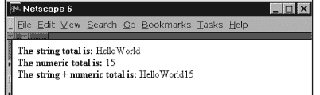

图 2.4

使用加法运算符相加数字并拼接字符串。

## 赋值

如果数据不能分配给变量，那么变量是什么？与所有语言类似，JavaScript 提供了赋值运算符来允许将数据存储在变量中。赋值运算符的基本格式如下例所示，将值 6 赋值给 `x`：

```javascript
x = 6;
```

除了这种一对一赋值外，该运算符还可以堆叠以创建同时赋值。同时意味着可以一次为多个变量赋值。在下面的示例中得到了，变量 `x`、`y` 和 `z` 包含值 6：

```javascript
x = y = z = 6;
```

每当多个赋值运算符出现在同一个表达式中，它们会从右到左求值。因此在前面的示例中，首先为 `z` 赋值值 6。赋值完成后，`y` 被赋值存储在 `z` 中的值，最后 `x` 被赋值存储在 `y` 中的值。整体效果是所有三个变量都被赋值为 6。

由于赋值运算符是一个运算符，与加法（`+`）或减法（`-`）类似，它可以在表达式中使用。这允许程序员在一步内完成赋值并评估数学表达式。

```javascript
y = (x = 3) + 4;
```

在先前的示例中，值 3 被赋值给变量 `x`，整体效果是所有三个变量都被赋值为 6。

### 列表 2.11 按值赋值与引用赋值

```html
<html>
<script type="text/javascript" language="JavaScript">
<!--
// 声明一个变量和一个数组对象
var number1 = 94;
var arrayOfNum1 = new Array(23, 86);

// 按值赋值
var number2 = number1;

// 按引用赋值
var arrayOfNum2 = arrayOfNum1;

// 修改存储在拷贝变量和数组中的值
number2 = 29;
arrayOfNum1[1] = 47;

// 显示存储在每个变量和数组中的值
document.write("number1=" + number1 + "<br>");
document.write("number2=" + number2 + "<br>");
document.write("arrayOfNum1[0]=" + arrayOfNum1[0] + "<br>");
document.write("arrayOfNum1[1]=" + arrayOfNum1[1] + "<br>");
document.write("arrayOfNum2[0]=" + arrayOfNum2[0] + "<br>");

<!--
</script>
</html>
```

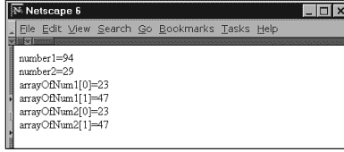

### 图 2.6

变量 `number1` 和 `number2` 是按值赋值的，而数组 `arrayOfNum1` 和 `arrayOfNum2` 是按引用赋值的。

## 逻辑

JavaScript 提供了三个逻辑运算符。没有这些运算符，程序将变得非常冗长且复杂。初看之下，大多数程序员可能认为他们已经了解了这些运算符是如何工作的，但深入研究一下是非常重要的。不了解逻辑运算符的工作原理会导致看起来像随机的、无法定位和修正的错误。因此，请花时间阅读每个逻辑运算符的描述。

JavaScript 将 `true` 定义为 0、""（空字符串）、`null`、`undefined` 或者，当然还有 `false` 以外的任何内容。

### 逻辑与 (AND)

逻辑与运算符（`&&`）如果运算符左侧的表达式和右侧的表达式结果为 `true`，则返回 `true`。如果左侧、右侧或两个表达式的结果都为 `false`，则操作的结果为 `false`。

遗憾的是，JavaScript 中逻辑与运算符的实现比上述的要复杂。与操作通过求值左操作数开始。如果左操作数求值为 `false`，则与运算符的基本逻辑已完成，因此永远不会求值右操作数。但如果左操作数求值为 `true`，必须求值右操作数以确定与操作的最终结果。在任何情况下，与操作返回的最终结果实际上是最后一个被求值的操作数的结果。

### 逻辑或 (OR)

逻辑或运算符（`||`）如果运算符左侧的表达式或右侧的表达式结果为 `true`，则返回 `true`。如果左侧和右侧表达式的结果均为 `false`，则操作的结果为 `false`。

与逻辑与运算符类似，理解 JavaScript 如何求值逻辑运算符是非常重要的。或操作通过求值左操作数开始。如果左操作数求值为 `true`，则或运算符的基本逻辑已完成，因此永远不会求值右操作数。但如果左操作数求值为 `false`，必须求值右操作数以确定或操作的最终结果。在任何情况下，或操作返回的最终结果实际上是最后一个被求值的操作数的结果。

### 逻辑非 (NOT)

逻辑非运算符（`!`）没有像比较运算符那样复杂。表达式的结果遵循运算符：如果表达式求值为 `true`，则操作的结果为 `false`。如果表达式求值为 `false`，则结果为 `true`。当表达式求值为非布尔值时，它在执行取反之前会被转换为 `true` 或 `false`。

## 比较

JavaScript 提供了大多数语言中常见的比较运算符，以及几个不寻常的。JavaScript 在早期阶段存在一些不一致之处，这导致增加了一些不受常规约束的比较运算符。因此，理解这些运算符是如何工作的是非常重要的。

### 等于 (Equal)

相等运算符（`==`）比较运算符左侧的值与运算符右侧的值。如果值相等，则操作返回 `true`。如果值不相等，则操作返回 `false`。

最初，JavaScript 尝试在执行比较之前将相等运算符的操作数转换为相同的类型。例如，如果相等运算符的左操作数是数字而右侧是字符串，JavaScript 将尝试将字符串转换为数字以便进行数字比较。为了猜测当时尚未发布的 ECMAScript 标准中将包含的内容，JavaScript 1.2 决定在 JavaScript 中对相等运算符的操作数进行类型转换。当 ECMAScript 标准发布时，它支持类型转换，因此 JavaScript 1.3 再次尝试在执行比较之前将相等运算符的操作数转换为相同的类型。

JavaScript 决定 `<script>` 标签应该使用的行为。通过将 `<script>` 标签的 language 属性设置为 JavaScript，将使用类型转换。如果 language 属性设置为 "JavaScript1.2"，则不使用类型转换。列表 2.12 演示了这一点的示例。

### 列表 2.12 类型转换与相等运算符

```html
<html>
<script type="text/javascript" language="JavaScript">
<!--
// 开启类型转换
document.write("The == operator with type-conversion turned on returns: ");
document.write(3 == "3");
<!-- -->
</script>
</html>

<html>
<script type="text/javascript" language="JavaScript1.2">
<!--
// 关闭类型转换
document.write("The == operator with type-conversion turned off returns: ");
document.write(3 === "3");
<!-- -->
</script>
</html>
```


避免在代码中将 language 属性设置为 "JavaScript1.2"，因为行业标准是在相等运算符的操作数上使用类型转换。到目前为止，你已经在相等运算符上看到了类型转换，但还没有看到类型转换是如何操作的。理解相等运算符类型转换将再次节省寻找错误的时间。类型转换遵循以下规则：

- `true` 在之前转换为数字 1，`false` 转换为零。
- 如果两个操作数为 `NaN`，相等运算符返回 `false`。
- `null` 和 `undefined` 相等。
- `null` 和 `undefined` 不等于 0、"" 或 `false`。
- 如果比较字符串和数字，尝试将字符串转换为数字再进行比较。
- 如果比较对象和字符串，尝试将对象转换为字符串再进行比较。
- 如果比较对象和数字，尝试将对象转换为数字再进行比较。
- 如果相等操作的操作数都是对象，则检查两个对象的地址是否相等。

### 不等于 (Not Equal)

不等运算符（`!=`）比较运算符左侧的值与运算符右侧的值。如果值不相等，则返回 `true`。如果它们相等，则返回 `false`。`!=` 运算符遭受了与 `==` 运算符相同的类型转换漏洞。与 `==` 运算符一样，使用 `<script>` 标签的 language 属性来强制执行的行为。

### 大于 (Greater Than)

大于运算符（`>`）比较运算符左侧的值与运算符右侧的值。如果左侧的值大于右侧的值，则操作返回 `true`。如果运算符左侧的值小于或等于右侧的值，则返回 `false`。如果值中任一个是字符串，它在比较发生之前会被转换为数字。

### 小于 (Less Than)

小于运算符（`<`）比较运算符左侧的值与运算符右侧的值。如果左侧的值小于右侧的值，则操作返回 `true`。如果左侧的值大于或等于右侧的值，则返回 `false`。如果其中任一值是字符串，则在比较发生之前将其转换为数字。

### 大于或等于

大于等于运算符（`>=`）比较运算符左侧的值与右侧的值。如果运算符左侧的值大于或等于运算符右侧的值，则操作返回 `true`。如果运算符左侧的值小于右侧的值，则返回 `false`。如果其中任一值是字符串，则在比较发生之前将其转换为数字。

### 小于或等于

小于等于运算符（`<=`）比较运算符左侧的值与右侧的值。如果运算符左侧的值小于或等于运算符右侧的值，则操作返回 `true`。如果运算符左侧的值大于右侧的值，则返回 `false`。如果其中任一值是字符串，则在比较发生之前将其转换为数字。

### 恒等

恒等运算符（`===`）也称为严格相等，它比较运算符左侧的值与右侧的值。如果左侧的值等于运算符右侧的值，则操作返回 `true`。如果值不相等，则返回 `false`。在比较之前，不会对操作数进行任何类型转换。

### 非恒等

非恒等运算符（`!==`）也称为严格不相等，它比较运算符左侧的值与右侧的值。如果左侧的值不等于运算符右侧的值，则操作返回 `true`。如果值相等，则返回 `false`。在比较之前，不会对操作数进行任何类型转换。

> **注意**
>
> 恒等和非恒等运算符仅在 JavaScript 1.3 及更高版本可用。

## 条件运算符

许多程序员并不熟悉条件运算符（`?:`），即使它存在于许多语言中。大多数人会使用 `if` 语句而不是条件运算符，尽管它们的功能是相同的。条件运算符比 `if` 语句稍微难读一点，但它紧凑得多，这在考虑下载时间时非常重要。

条件运算符的格式可能会让人困惑。求结果为布尔值的表达式始终放在问号（`?`）的左侧。如果表达式求值为 `true`，则操作返回问号和冒号（`:`）之间的值。如果表达式求值为 `false`，则返回冒号后面的值。在列表 2.13 中，显示了一个标准的 `if` 语句，以及使用条件运算符实现的相同功能。图 2.7 显示 `if` 语句和条件运算符可以产生相同的功能。

### 列表 2.13 条件运算符与 if 语句的对比

```html
<html>
<script type="text/javascript" language="JavaScript">
<!--
// 将邮件标记置为 "YES"
mailFlag = "YES";
var message1;
var message2;

// 标准 if 语句
if (mailFlag == "YES")
  message1 = "You have email";
else
  message1 = "No email.";

// 使用条件运算符实现相同语句
message2 = (mailFlag == "YES") ? "You have email!" : "No email.";

// 将消息打印到屏幕
document.write("The if statement returns: " + message1 + "<br>");
document.write("The conditional operator returns: " + message2);
<!--
</script>
</html>
```

图 2.7

`if` 语句的结果与使用条件运算符相同。

## 位运算

位运算符看起来与比较运算符相似，但它们的功能非常不同。如果你曾经处理过真值，你可能认出本节中的运算符。JavaScript 中的位运算符仅适用于 32 位长度的整数。如果一个整数不是 32 位，它会被转换为 32 位整数，因为位运算符在二进制级别上评估数字，那里一切都是 0 和 1。位运算在编程中并不经常使用，但在某些时刻这些运算符是不可或缺的。

### 位与

位与运算符（`&`）将运算符两侧的整数视为 32 位二进制数。然后，在本章较早讨论的逻辑与运算符（`&&`）会评估运算符左侧数字的 32 位中的每一位，并对应到运算符右侧数字的相应位。逻辑与运算的 32 位二进制结果被转换为整数值并由位与运算返回。

### 位或

位或运算符（`|`）将运算符两侧的整数视为 32 位二进制数。然后，在本章较早讨论的逻辑或运算符（`||`）会评估运算符左侧数字的 32 位中的每一位，并对应到运算符右侧数字的相应位。逻辑或运算的 32 位二进制结果被转换为整数值并由位或运算返回。

### 位异或（异或）

位异或运算符（`^`）将运算符两侧的整数视为 32 位二进制数。与或运算符不同，位异或使用逻辑或运算符的特殊版本（即异或）来评估二进制数字的每一位。

> **注意**：零填充右移会在左侧填充 0，无论原始整数的正负如何。

逻辑异或运算的 32 位二进制结果被转换为整数值并由位异或运算返回。

### 位取反

位取反运算符（`~`）与与、或、异或运算符相似。位取反运算符首先将右侧的数字视为 32 位二进制数。所有的 1 变成 0，所有的 0 变成 1。结果被转换为整数值并由位取反运算返回。

### 左移

左移运算符（`<<`）将左侧的整数视为 32 位二进制数。该数字的所有位将根据右侧整数指定的位数向左移动。在移位时，右侧填充 0。由于数字只能有 32 位，左侧的额外位将丢失。位运算的 32 位二进制结果被转换为整数值并由左移运算返回。

### 符号右移

符号右移运算符（`>>`）与左移运算符相似。符号右移运算符将左侧的整数视为 32 位二进制数。该数字的所有位将根据右侧整数指定的位数向右移动。在移位时，左侧填充 1 或 0。如果原始数字为正，则在二进制数的左侧添加 0；相反，如果原始数字为负，则添加 1。运算的 32 位二进制结果被转换为整数值并由符号右移运算返回。

### 零填充右移

零填充右移运算符（`>>>`）的操作与右移运算符相同，但无论整数的正负如何，二进制数左侧始终会填充 0。

## 优先级

JavaScript 与其他语言类似，允许在一个表达式中使用多个运算符。JavaScript 遵循某些准则来决定先评估哪个运算符、后评估哪个。表 2.7 显示了所有 JavaScript 运算符的优先级。“Read From...”列告诉我们优先级相同的运算符的评估顺序（从左到右或从右到左）。可以使用括号来覆盖运算符的优先级。

### 表 2.7 运算符优先级

| 优先级 | 读取方向 | 运算符 | 运算符类型 |
| :--- | :--- | :--- | :--- |
| 最高 | 从左到右 | `.` `[]` | 成员访问 |
| | 从左到右 | `()` `new` | 调用/创建实例 |
| | 从右到左 | `++` `--` `+` `-` `~` `!` `void` `delete` `typeof` | 增/减/一元运算 |
| | 从左到右 | `*` `/` `%` | 乘法、除法、取模 |
| | 从左到右 | `+` `-` | 加法、减法 |
| | 从左到右 | `<<` `>>` `>>>` | 位移操作 |
| | 从左到右 | `<` `<=` `>` `>=` | 关系操作 |
| | 从左到右 | `==` `!=` `===` `!==` | 相等操作 |
| | 从左到右 | `&` | 位与 |
| | 从左到右 | `^` | 位异或 |
| | 从左到右 | `|` | 位或 |
| | 从左到右 | `&&` | 逻辑与 |
| | 从左到右 | `||` | 逻辑或 |
| | 从左到右 | `?:` | 条件运算符 |
| | 从右到左 | `=` `*=` `/=` `%=` `+=` `-=` `<<=` `>>=` `>>>=` `&=` `^=` `|=` | 赋值操作 |
| 最低 | 从左到右 | `,` | 多重评估 |

# 循环与条件语句

循环和条件赋予了程序决策和多次执行任务的能力。JavaScript 提供了许多计算机语言中都有的标准条件和循环结构。事实上，这些结构是模仿 C、C++ 和 Java 中的结构而设计的，因此如果你在任何这些语言中编写过代码，你将发现这一部分非常浅显易懂。

## 条件

条件语句允许程序根据在本章之前讨论过的运算符所使用的预设条件做出决策。

### if

`if` 语句是目前最常见的条件语句，这仅仅因为它简单且易用。简单 `if` 语句的格式如下：

```javascript
if (expression)
  statement;
```

如果括号中的表达式求值为 `true`，则执行该语句；否则，跳过该语句。要执行的语句可以与表达式在同一行，但如果语句出现在下一行（如前面的伪代码所示），代码通常更易读。如果需要执行两行或更多代码，必须使用大括号 `{}` 来指定哪些代码属于 `if` 语句。

使用关键字 `else` 来扩展基础 `if` 语句的功能，以便在初始语句失败时提供其他替代方案。`if...else` 组合的格式如下：

```javascript
if (expression)
  statement1;
else
  statement2;
```

现在，如果表达式求值为 `true`，则执行 `statement1`；否则，执行 `statement2`。列表 2.14 通过酒店入住率的示例演示了 `if` 和 `else` 的用法。使用时，代码将返回消息“没有足够的房间供 5 位客人。”

### 列表 2.14 基础 if...else 结构

```html
<html>
<script type="text/javascript" language="JavaScript">
<!--
// 声明变量
var emptyRooms = 2; // 每个房间两人
var numberOfGuests = 5;

if (emptyRooms == 0)
  document.write("There are no rooms available.");
else
{
  if ((emptyRooms * 2) >= numberOfGuests)
    document.write("There are enough rooms for " + numberOfGuests + " guests.");
  else
    document.write("There are not enough rooms for ");
    document.write(numberOfGuests + " guests.");
}

-->
</script>
</html>
```

注意列表 2.14 如何使用大括号 `{}` 将一个 `if...else` 结构嵌套在另一个 `if...else` 结构内部。嵌套赋予了更多的决策能力，但这种能力是以牺牲可读性为代价的。

### else...if

`else...if` 短语用于替代嵌套的 `if...else` 结构，以提高代码的可读性。每个 `else...if` 短语后面都跟着一个括在内的表达式。然后根据需要使用尽可能多的 `else...if` 语句。使用最后的 `else` 语句在所有其他条件都为 `false` 时执行代码。列表 2.15 的功能与列表 2.14 中的代码相同，但它使用了 `else...if` 结构。这段代码显示短语“没有足够的房间供 5 位客人。”

### 列表 2.15 使用 else...if 短语使嵌套的 if...else 语句更具可读性

```html
<html>
<script type="text/javascript" language="JavaScript">
<!--
  // 声明变量
  var emptyRooms = 2; // 每个房间两人
  var numberOfGuests = 5;

  if (emptyRooms == 0)
    document.write("There are no rooms available.");
  else if ((emptyRooms * 2) >= numberOfGuests)
    document.write("There are enough rooms for " + numberOfGuests + " guests.");
  else
    document.write("There are not enough rooms for " + numberOfGuests + " guests.");

-->
</script>
</html>
```

### switch

`switch` 语句提供了 `if` 的替代方案，特别是在测试可能的结果时有用。`switch` 的格式如下：

```javascript
switch (expression)
{
  case label1:
    statement1;
    break;
  case label2:
    statement2;
    break;
  default:
    statement3;
}
```

### 列表 2.16 使用 switch

```html
<html>
<script type="text/javascript" language="JavaScript">
<!--
// 声明变量
var color = "green";

// 根据变量显示颜色
switch (color) {
  case "red":
    document.write("The car is red.");
    break;
  case "blue":
    document.write("The car is blue.");
    break;
  case "green":
    document.write("The car is green.");
    break;
  default:
    document.write("The car is purple.");
}
-->
</script>
</html>
```

## 循环

在需要多次执行相同代码的情况下，可以使用运行直到满足条件的循环。

### for

`for` 循环是一种按预设次数循环的结构。JavaScript 使用 C 和 C++ 的循环结构。这种特定的结构非常灵活，使得这种类型的循环非常有用。

从高层次来说，`for` 循环由两部分组成：条件和语句。结构的条件部分决定循环次数，而语句部分在每次循环时执行。条件结构包含在括号内，由三个部分组成，部分之间用分号分隔；条件结构的第一部分初始化变量初始值。第二部分是决定迭代次数的实际条件语句。第三也是最后部分决定第一部分初始化的变量在每次迭代时应如何变化。第三部分通过导致变量启用、递减、因子化或任何你设计的调整技巧赋予了 `for` 灵活性。`for` 循环的格式如下：

```javascript
for (initialize; condition; adjust)
{
  statement;
}
```

花时间考虑如何实现循环，因为很容易意外创建无限循环。具体来说，确保条件会在某处捕捉到调整后的变量。在许多情况下，在 `for` 循环的语句部分使用变量是有用的，但不要以创建无限循环的方式调整变量。列表 2.17 利用 `for` 创建了如图 2.8 所示的乘法表。

### 列表 2.17 使用 for 的乘法表

```html
<html>
<script type="text/javascript" language="JavaScript">
<!--
document.write("<h2>4 的乘法表</h2>");
for (var aNum = 0; aNum <= 10; aNum++) {
  document.write("4 X " + aNum + " = " + 4 * aNum + "<br>");
}
-->
</script>
</html>
```

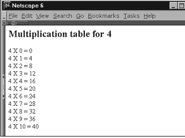

### 图 2.8

使用 `for` 循环创建乘法表。

### while

当 `for` 循环对某些代码来说过于限制时，可以考虑使用 `while` 循环。`while` 循环可以完成 `for` 循环的所有工作，但写法没有那么整洁。那么，什么时候适合 `while` 循环呢？`while` 循环通过不限制循环执行的次数扩展了 `for` 循环的能力。

如果记住“当为真时，循环”这句话，`while` 循环就很容易理解。这句话意味着括号内的表达式求值为 `true`，则执行循环中的语句。执行完循环中的最后一个语句后，回到循环顶部并重新评估表达式。当表达式求值为 `false` 时，将执行 `while` 结构之后的下一行代码。为了防止循环无限执行，循环中必须包含一个修改表达式中变量的语句。`while` 循环的格式如下：

```javascript
while (expression)
{
  statement;
}
```

由于表达式在循环之前会被求值，如果表达式第一次求值为 `false`，则循环可能永远不会执行。列表 2.18 使用 `while` 循环模拟了自动交通灯。

### 列表 2.18 使用 while 循环模拟的自动交通灯

```html
<html>
<script type="text/javascript" language="JavaScript">
<!--

// 声明变量
var light = "red";    // 交通灯颜色
var counter = 1;      // 创建车辆交通流
var carsLine = new Array(); // 排队中的车辆

// 让 5 辆车通过路口
while (counter <= 5) {
  document.write("Car " + counter + " approaches intersection.<br>");
  carsLine[carsLine.length++] = counter;
  counter++;
}

// 当有 2 辆车排队时，灯变绿
if (carsLine.length == 2) {
  light = "green";
  document.write("Traffic light turns " + light + "<br>");
}

// 当灯是绿色时，车辆通过路口
while (light == "green") {
  document.write("Car " + carsLine[carsLine.length - 1] + " goes through intersection.<br>");
  carsLine.length--;
}

// 当没有车辆排队时，灯变红
if (carsLine.length == 0) {
  light = "red";
  document.write("Traffic light turns " + light + "<br>");
}

<!--
</script>
</html>
```

列表 2.18 使用两个循环来模拟自动交通灯。第一个 `while` 循环可以同样容易地使用 `for` 循环创建，但第二个 `while` 循环几乎无法使用 `for` 循环实现。`while` 循环能够轻松地处理这种类型的条件循环。在图 2.9 中，你会看到当路口有两辆车排队时，交通灯会自动变成绿灯。当两辆车通过路口后，灯会变回红灯。

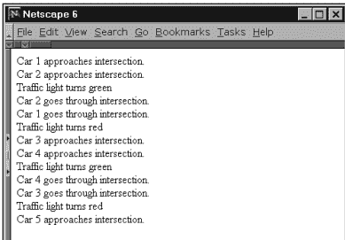

### 图 2.9

使用 `while` 循环模拟交通灯。

### do...while

`do...while` 循环只是刚才讨论的基础 `while` 循环的变体。除了语法外，`do...while` 循环与 `while` 循环唯一的区别在于，`do...while` 循环在第一次评估表达式之前会执行一次循环。这种差异在下面的格式中所示：

```javascript
do {
  statement;
}
while (expression);
```

### for...in

`for...in` 循环不应与 `for` 循环混淆，因为它们完全不同。唯一的相似之处是它们都会遍历一组次数，但 `for...in` 是一种遍历对象属性的特殊结构。`for...in` 的格式如下：

```javascript
for (variable in object)
{
  statement;
}
```

在执行循环语句之前，关键字右侧的属性会被赋值给左侧的变量。这个过程将持续到访问所有属性。不幸的是，属性的访问顺序是可以变化的，因此不要假设特定的顺序。列表 2.20 展示了简单对象的属性。

### 列表 2.20 使用 for...in 访问属性


```html
<form name="aForm">
  <input type="button"
        name="Big Button"
        value="Big Button"
        onclick="alert('The Big Button was pressed!');" />
</form>
<script type="text/javascript" language="JavaScript">
var aProperty;
for (aProperty in document.aForm) {
  document.write(aProperty,'<br>');
}
</script>
```

注意在图 2.10 中，返回的是 Big Button 属性的名字，而不是这些属性的值。

### break

`break` 关键字提供了一种 JavaScript 提前退出循环结构并切换条件的方法。大多数情况下，`break` 独占一行，但有时会有标签跟在后面。当使用标签时，JavaScript 会完全跳出标签指定的区域，并继续执行后续代码。

## 循环与条件语句

## 第 2 章：语言细节

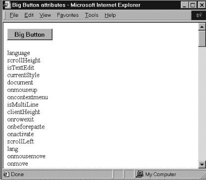

### 图 2.10

Big Button 对象的属性。

### 列表 2.21 使用 break 和标签

```javascript
<script type="text/javascript" language="JavaScript">
<!--
// 创建外部循环
forLoop:
for (var counter1 = 1; counter1 <= 5; counter1++) {
  // 创建内部循环
  for (var counter2 = 1; counter2 <= 5; counter2++) {
    // 显示两个循环的计数器值
    document.write("Counter1=",counter1);
    document.write(" Counter2=",counter2,"<br>");
  }

  // 决定何时跳出循环
  if (counter2 == 3)
    break;
  if (counter1 == 3)
    break forLoop;
}
}
document.write("All done!");
//-->
</script>
</html>
```

注意没有标签的 `break` 语句（参见图 2.11）仅会跳出内部循环。当 `break` 语句配合标签使用时，JavaScript 知道在哪个级别跳出。

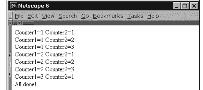

### 图 2.11

使用标签和嵌套循环的结果。

### continue

与 JavaScript 结构不同，`continue` 语句强制代码执行到循环的开头。与关键字 `break` 类似，`continue` 关键字通常单独成一行，但有时在关键字后面会跟一个标签。当使用标签时，JavaScript 会立即跳转到由标签指定的循环开头并开始执行。

循环的起点取决于循环结构的类型。表 2.8 显示了当遇到 `continue` 结构时，每个循环跳转到何处。

| 表 2.8 continue 语句的跳转位置 | |
|---|---|
| 循环结构 | continue 跳转到 |
| for | `for` 关键字后括号内的表达式 |
| while | `while` 关键字后括号内的表达式 |
| do...while | `while` 关键字后括号内的表达式 |
| for...in | 对象中的下一个属性名 |

> 注意
>
> Navigator 4 中的一个 bug 导致在跳转到 `continue` 语句时，`while` 后面括号内的表达式不会执行。相反，代码执行将从 `continue` 语句之后的循环顶部开始。

正如在 `break` 部分所讨论的，JavaScript 标签可以被视为占位符。要对语句进行标记，只需在应继续执行的代码前放置标签名称并跟一个冒号（:）。列表 2.22 演示了标签和 `continue` 的用法。

### 列表 2.22 使用 continue 语句和标签

```html
<html>
<script type="text/javascript" language="JavaScript">
<!--
// 创建外层循环
outerLoop:
for (var counter1 = 1; counter1 <= 2; counter1++) {
  document.write("Top of outerLoop.<br>");
  // 创建内层循环
  innerLoop:
  for (var counter2 = 1; counter2 <= 2; counter2++) {
    // 显示两个循环计数器中存储的值
    document.write("Top of innerLoop.<br>");
    document.write("Counter1=",counter1,"<br>");
    document.write("Counter2=",counter2,"<br>");

    // 决定继续循环的位置
    if (counter2 == 2) {
      document.write("Continue at top of innerLoop.<br>");
      continue outerLoop;
    }
    if (counter1 == 2) {
      document.write("Continue at top of outerLoop.<br>");
      continue;
    }
    document.write("Bottom of innerLoop.<br>");
  }
  document.write("Bottom of outerLoop.<br>");
}
document.write("All done!");
//-->
</script>
</html>
```

这个示例有点复杂，所以是时候将列表 2.22 与图 2.12 中的输出进行对比了。注意在“Continue at top of innerLoop”之后并没有打印“Bottom of innerLoop”，因为代码执行跳回了最内层循环的开头。当 `continue` 关键字带有标签时，代码执行跳回了标记为 `outerLoop` 的循环开头。

> 注意
>
> 尽管 JavaScript 支持标签、`continue` 语句和 `break` 语句，在使用这些构造时仍要小心，因为如果使用不当，可能会导致难以追踪的错误。

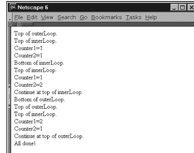

### 图 2.12

在嵌套循环中使用 `continue` 语句的结果。

### with

JavaScript 的面向对象设计经常需要很长的代码来访问对象的属性和方法。JavaScript 提供了一个特殊的 `with` 语句来帮助减少访问这些属性和方法所需的代码长度。通过这些 `with` 语句替换 `with` 关键字后括号中对象路径的重复部分，语句内使用的任何属性或方法都将自动在字符串前面添加对象路径（位于括号内）的重复部分。列表 2.23 显示了该语句在将文本字段重置为默认值时如何节省时间。

### 列表 2.23 with 语句减少重复代码

```html
<!-- 创建一个包含 3 个文本字段和一个重置按钮的表单 -->
<form name="personalInfoForm">
姓名<input type="text" name="nameBox"><br>
职业<input type="text" name="occupationBox"><br>
<input type="text" name="ageBox"><br>
<input type="button" name="ResetButton" value="Reset" onclick="ResetFields()">
</form>
```

```javascript
<script type="text/javascript" language="JavaScript">
<!--
// 初始化设置文本字段值
ResetFields();
// 将文本字段重置为默认
function ResetFields() {
  with(document.personalInfoForm) {
    nameBox.value="Enter name";
    occupationBox.value="Student";
    ageBox.value="";
  }
}
//-->
</script>
```

在列表 2.23 中，你看到当将文本字段重置为默认值时，该语句减少了重复代码。使用 `with` 允许你在不重复对象名称的情况下访问属性。

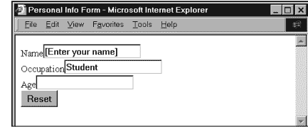

### 图 2.23

### 函数

JavaScript 的优势之一是它支持函数，这在脚本中并不多见。

#### 语法

函数的语法非常直观。函数以关键字开始跟随名称。如果要传递多个参数，使用逗号分隔参数。如果不传递参数，请留空括号。大括号用于包含代码。

### 列表 2.25 使用 arguments 数组访问函数参数

```html
<html>
<script type="text/javascript1.2" language="JavaScript1.2">
<!--
// 创建一个显示其接收到的参数的函数。
function displayArguments() {
  document.write("The following arguments were passed:<br>");
  for(i=0; i<arguments.length; i++) {
    document.write(" = " + arguments[i] + "<br>");
  }
}
// 向函数传递一些参数
displayArguments(34, "hat",-7945, "shoes");
//-->
</script>
</html>
```

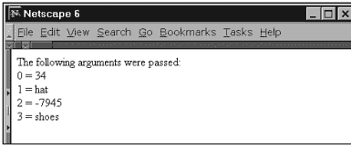

### 图 2.15

使用 `arguments` 数组传递到 `displayArguments()` 函数的参数。

#### 返回值

如果需要将一个值从函数传回以便在代码稍后使用怎么办？JavaScript 提供了 `return` 语句，可以用于将值返回给调用函数的语句。要返回的值只需放在 `return` 关键字之后即可。如果在 `return` 关键字后没有指定值，或者完全没有使用 `return` 语句，则函数将返回 `undefined`。

从函数返回的值可以赋值给变量或在表达式中使用。在列表 2.26 中，函数返回的值被用于表达式中，向浏览器窗口写入“3*5=15”这段文字。

### 列表 2.26 从函数返回值

```html
<html>
<script type="text/javascript" language="JavaScript">
<!--
// 函数声明
function multiplyByFive(aNumber) {
    return aNumber*5;
}
// 在函数调用之前显示变量
document.write("3*5=",multiplyByFive(3));
//-->
</script>
</html>
```

#### 函数作为对象

到目前为止的函数是在 Web 页面加载时静态创建的，但还有一种动态函数是在调用时才创建的，这使得函数可以作为对象。这种函数的语法与变量的声明非常相似。

```javascript
var varName = new Function(argument1,...,lastArgument);
```

`Function` 关键字用于从参数中动态创建一个新函数。所有参数必须是字符串，且最后一个参数应始终包含函数的功能。列表 2.27 显示了使用 `Function` 对象的简单示例。再次向浏览器窗口写入了“3*5=15”这段文字。

### 列表 2.27 使用 Function 对象

```html
<html>
<script type="text/javascript" language="JavaScript">
<!--
// 创建动态 Function
var multiplyByFive = new Function("y","return y*5");
document.write("3*5=",multiplyByFive(3));
//-->
</script>
</html>
```

## 继续进

在本章中，你学习了 JavaScript 语言的细节，这些细节在许多计算机语言中都是通用的。掌握了对 JavaScript 数据类型、变量、操作符、循环、条件、函数和基础语法的理解（这些在本章中已涵盖），你现在就可以构建 JavaScript 程序了。但你不想学习一些可以帮助你挖掘 JavaScript 潜力的 JavaScript 编程技术吗？在下一章中，我们将通过深入研究一些 JavaScript 编程技术，让 JavaScript 超越仅仅是一种计算机脚本语言。

## 第二部分

## JAVASCRIPT 编程

- 3 编程技术 85
- 4 客户端脚本 107
- 5 服务端 JavaScript 157
- 6 Windows 脚本 179

## 第 3 章

### 编程技术

在第 2 章“语言细节”中，你对核心 JavaScript 语言进行了快速概览，向你展示了它与其他计算机语言的差异和相似之处。现在是时候进入下一个阶段，通过研究 JavaScript 语言的一些特性和编程技术，使你的 JavaScript 程序更强大、对错误的容忍性更强，也许你还会说：“哇，我不知道 JavaScript 还能做到这一点！”

在本章中，我们将介绍模式匹配和事件处理，并展示如何使用这两项 JavaScript 功能让你的 JavaScript 程序更强大。本章还将研究两种让你的 JavaScript 程序更不容易出错的编程技术。你将接触 `try...catch` 块并学习如何使用它。你还将被介绍一些 JavaScript 调试程序和技术。

### 模式匹配

今天网页两个最常用的用途是收集和分发数据。这两个领域本质上都使用数据处理来理解用户需求，然后根据用户的规格返回定制化信息。处理数据的关键工具之一是模式匹配。某些脚本语言（如 Perl）非常适合处理模式匹配，而其他语言提供的模式匹配能力非常有限。如果你熟悉 Perl，你可能会识别出 JavaScript 的模式匹配，因为它基于 Perl 对模式匹配的实现。模式匹配在 JavaScript 中的实现极大地帮助了互联网数据的数据处理。

JavaScript 使用 `RegExp`（正则表达式）进行模式匹配。`RegExp` 是一个对象，指定了用于对文本执行模式匹配的字符序列。

#### 定义 RegExp 对象

`RegExp` 可以通过两种方式创建：使用字面量表示法或 `RegExp` 构造函数。字面量表示法是位于斜杠之间的模式：

```javascript
var pattern = /[a-z]/;
```

`RegExp` 构造函数接受一个字符串作为参数：

```javascript
var pattern = new RegExp("[a-z]");
```

#### 定义模式

有很多特殊字符用于定义复杂的模式。表 3.1 显示了可用的特殊字符。

### 表 3.1 特殊字符

| 字符 | 说明 |
|---|---|
| `\w` | 匹配单词字符（字母数字）。 |
| `\W` | 匹配非单词字符。 |
| `\s` | 匹配空白字符（制表符、换行符、回车、分页符、垂直制表符）。 |
| `\S` | 匹配非空白字符。 |
| `\d` | 匹配数字。 |
| `\D` | 匹配非数字。 |
| `\b` | 匹配退格符。 |
| `\.` | 匹配换行符以外的任意字符。 |
| `[x-y]` | 匹配 x 到 y 范围内的字符。 |
| `[^x-y]` | 匹配不在 x 到 y 范围内的字符。 |
| `{x,}` | 匹配至少 x 次。 |
| `{x}` | 恰好匹配 x 次。 |
| `?` | 匹配前面的项目一次或零次。 |
| `+` | 匹配前面的项目至少一次。 |
| `*` | 匹配前面的项目任意次数或零次。 |
| `\|` | 匹配 `|` 字符左右的表达式。 |
| `(...)` | 对圆括号内的内容进行分组。 |
| `\x` | 匹配子模式 x 产生的相同字符。用括号指定的组从左到右编号。 |
| `^` | 匹配字符串的开头或行的开头（多模式下）。 |
| `$` | 匹配字符串的结尾或行的结尾（多模式下）。 |
| `\b` | 匹配单词字符与非单词字符之间的位置。 |
| `\B` | 匹配不在单词字符与非单词字符之间的位置。 |

这些特殊匹配字符用于模式中定义复杂的模式。观察表 3.1，你可能会注意到星号（*）、加号（+）和反斜杠（\）具有特殊含义，会导致它们被作为字面使用。例如，如果你想在字符串中查找所有的加号(+) 号？要使用字面加号，必须在符号前加上反斜杠（\）。表 3.2 显示了模式中需要反斜杠字符来作为字面处理的所有字符。

### 表 3.2 字面字符

| 字符 | 说明 |
|---|---|
| `\f` | 分页符 |
| `\n` | 换行符 |
| `\r` | 回车符 |
| `\t` | 制表符 |
| `\v` | 垂直制表符 |
| `\/` | 斜杠 (/) |
| `\\` | 反斜杠 (\) |
| `\(` | 左括号 ( |
| `\)` | 右括号 ) |
| `\{` | 左花括号 { |
| `\}` | 右花括号 } |
| `\xXX` | 由八进制数表示的 ASCII 字符 |
| `\hHH` | 由十六进制 HH 表示的 ASCII 字符 |
| `\cX` | 由 X 表示的控制字符 |

JavaScript 还提供了一项用于创建模式的最后语法。与目前为止涵盖的语法不同，这些语法部分出现在定义模式的正斜杠之外。这些属性如表 3.3 所示。

### 表 3.3 模式属性

| 字符 | 描述 |
|---|---|
| `g` | 全局匹配。找到所有可能的匹配项。 |
| `i` | 使匹配不区分大小写。 |

#### 测试模式匹配

当定义了模式后，可以使用 `RegExp` 和 `String` 对象中存在的特殊方法将其应用于字符串。`String` 对象中的模式匹配方法需要 `RegExp` 对象，如表 3.4 所示。

### 表 3.4 String 对象中的模式匹配方法

| 方法 | 描述 |
|---|---|
| `match(regExpObj)` | 在字符串中搜索 `regExpObj` 模式并返回结果。 |
| `replace(regExpObj,str)` | 将所有 `regExpObj` 模式的出现处替换为 `str`。 |
| `search(regExpObj)` | 返回字符串中匹配的 `regExpObj` 模式的位置。 |
| `split(regExpObj,max)` | 字符串在每个匹配的 `regExpObj` 模式处进行分割，最多分割 `max` 次。以数组形式返回子字符串。 |

`RegExp` 中的模式匹配方法需要 `String` 对象，如表 3.5 所示。

### 表 3.5 RegExp 对象中的模式匹配方法

| 方法 | 描述 |
|---|---|
| `exec(str)` | 在 `str` 中搜索模式并返回结果 |
| `test(str)` | 在 `str` 中搜索模式，如果匹配则返回 `true`，否则返回 `false` |

列表 3.1 使用了 `RegExp` 构造函数、特殊模式语法和 `String` `replace()` 方法，将字符串中的数字 3 到 5 替换为 9，如图 3.1 所示。

### 列表 3.1 使用正则表达式

```html
<script type="text/javascript" language="JavaScript">
// 创建一个文本字符串
var str = "John traded 5 oranges for 135 grapes.<br>";
// 创建 RegExp 对象
var span3to5 = new RegExp("[3-5]","g");
document.write(str);
document.write("Replace digits 3 to 5 with nines.<br>");
document.write(str.replace(span3to5,'9'));
</script>
</html>
```

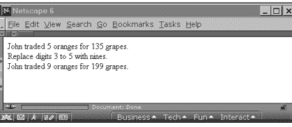

### 图 3.1

数字 3 到 5 被替换为 9。

### 事件与事件处理器

如果你曾经做过任何图形化用户界面编程，那么你已经熟悉事件的概念。事件是发生在你的程序之外的动作，但可能直接或不直接影响你的程序。许多事件发生在浏览器内部，你永远看不见，也不需要担心。在某些事件发生时，你确实需要在代码中执行某些操作。

例如，考虑一个为用户提供在某些计算机系统上更改密码的 Web 页面。该页面有一个用于用户名的文本框和一个用于提交新密码信息的按钮。在用户名和密码提交到其他系统之前，你可能希望拦截用户点击“提交”（Submit）按钮时的事件，并验证密码是否符合特定的密码规则。某规则可能规定密码长度必须大于 3 个字符但少于 15 个字符。通过访问浏览器后台发生的事件，你可以取消提交事件，并提醒用户她输入的密码存在问题。

在本节中，你将看到 JavaScript 允许你拦截的浏览器事件类型，以及如何捕获并根据这些事件采取行动。

#### 事件

浏览器中发生许多不同类型的事件。JavaScript 提供了许多对你有用的事件访问，例如点击事件（当按下一次鼠标左键时发生）。大多数事件对应于用户可见并可以操作的 HTML 元素，例如按钮或复选框。表 3.6 列出了 JavaScript 可以捕获的事件列表以及与之关联的 JavaScript 对象。

### 表 3.6 浏览器事件

| 事件 | 对象 | 发生时机 |
|---|---|---|
| Abort | Image | 图片未完成加载 |
| Blur | Button, Checkbox, FileUpload, Frame, Layer, Password, Radio, Reset, Select, Text, Textarea | 元素失去输入焦点 |
| Change | FileUpload, Select, Text, Textarea | 元素的值发生变化 |
| Click | Area, Button, Checkbox, Document, Link, Radio, Reset, Submit | 元素被点击 |
| DblClick | Area, Document, Link | 鼠标按钮被双击 |
| DragDrop | Window | 被拖动到 |
| Error | Window | 出现了一个错误 |
| Focus | Button, Checkbox, FileUpload, Frame, Layer, Password, Radio, Reset, Select, Text, Textarea | 元素获得焦点 |
| KeyDown | Window | 按下键 |
| KeyPress | Window | 按住键 |
| KeyUp | Window | 释放键 |
| Load | Window | 加载 |
| MouseDown | Button, Checkbox, FileUpload, Frame, Layer, Password, Radio, Reset, Select, Text, Textarea | 鼠标按钮被按下 |
| MouseMove | Window | 鼠标移动 |
| MouseOut | Window | 鼠标移出 |
| MouseOver | Window | 鼠标移入 |
| MouseUp | Window | 鼠标按钮被释放 |
| Move | Window | 移动 |
| Reset | Window | 重置 |
| Resize | Window | 调整大小 |
| Select | Window | 选中 |
| Submit | Window | 提交 |
| Unload | Window | 卸载 |

上表中提到的 `Error` 和 `Abort` 事件需要稍微解释一下，因为它们不像其他事件那样直观。

`Error` 事件用于 `Window` 等对象，表示加载 HTML 页面或图片时发生了错误。这种错误会导致浏览器发出语法错误或运行时错误。

`Abort` 事件用于 `Image` 对象，表示加载被取消。这种事件的发生是因为用户等待图片加载不耐，因此通过浏览器的停止按钮或点击链接停止了加载。

#### 事件处理器

现在你已经知道了 JavaScript 提供的事件类型，访问它们只需要捕获这些事件。事件通过事件处理器进行捕获。通过将函数或单行 JavaScript 代码分配给对象的事件处理器，你可以捕获事件并采取行动。表 3.7 显示了所有的事件处理器与其关联的事件。

### 表 3.7 事件处理器

| 事件 | 事件处理器 |
|---|---|
| Abort | onAbort |
| Blur | onBlur |
| Change | onChange |
| Click | onClick |
| DblClick | onDblClick |
| DragDrop | onDragDrop |
| Error | onError |
| Focus | onFocus |
| KeyDown | onKeyDown |
| KeyPress | onKeyPress |
| KeyUp | onKeyUp |
| Load | onLoad |
| MouseDown | onMouseDown |
| MouseMove | onMouseMove |
| MouseOut | onMouseOut |
| MouseOver | onMouseOver |
| MouseUp | onMouseUp |
| Move | onMove |
| Reset | onReset |
| Resize | onResize |
| Select | onSelect |
| Submit | onSubmit |
| Unload | onUnload |

#### 捕获事件

事件处理器可以用两种方式定义。第一种也是最常见的方法是在 HTML 标签内部定义处理器，就像分配 HTML 属性一样。例如，实现在点击按钮时显示警告框，只需在按钮的 HTML 标签内将 JavaScript `alert` 分配给 `onClick` 事件处理器即可：

```html
<form name="myForm">
<input type="button" name="myButton" value="Press Me" onclick="alert('myButton was pressed')">
</form>
```

每当 `myButton` 被点击时，就会显示一个警告框告诉用户 `myButton` 被点击。请记住，并不是所有的事件都与每个对象相关。要查看特定对象可用的事件和事件处理器，请参阅第 8 章“客户端”。

定义事件处理程序的第二种方法是在 JavaScript 代码内部使用点号表示法定义处理程序。列表 3.2 展示了如何使用点号表示法将 JavaScript 警告框分配给 `onClick` 事件处理器。

### 列表 3.2 使用点号表示法定义事件处理器

```html
<html>
<form name="myForm">
<input type="button" name="myButton" value="Press Me">
</form>
<script type="text/javascript" language="JavaScript">
<!--
document.myForm.myButton.onclick = function() { alert('myButton was pressed'); };
//-->
</script>
</html>
```

在列表 3.2 中，`myButton` 最初是使用标准 HTML 标签创建的。在创建按钮后，直接使用 JavaScript 点号表示法来访问按钮对象，并将警告框分配给 `onclick` 处理器。

> 注意：在列表 3.2 中，通过 HTML 输入标签访问 `onClick` 属性时，`onclick` 属性写的是小写的 c 而不是大写的 C。这不是拼写错误！在 HTML 内部定义事件处理器时，请使用如表 3.7 所示的大写字母。在 JavaScript 代码中使用点号表示法定义事件处理器时，事件处理器不能包含任何大写字母。

#### 取消事件

事件处理程序最大的用途之一是对通过 HTML 表单输入的数据进行验证。例如，你可能希望在将表单提交到服务器之前，验证用户在密码修改表单输入的密码是否有效。如果用户输入的密码无效，应该通知用户该问题并且不应提交表单。利用目前所涵盖的内容，很容易捕获表单提交按钮的 `Click` 事件，并提醒用户输入的密码有问题。但你如何防止事件继续并防止表单提交到服务器呢？只需在事件处理例程中返回 `false` 即可取消 `Submit` 事件。列表 3.3 展示了如何取消表单提交。

### 列表 3.3 取消提交事件

```html
<html>
<script type="text/javascript" language="JavaScript">
<!--
function validatePassword() {
  var password = document.passwordForm.password.value;
  // 密码必须在 3 到 15 个字符之间
  if((password.length < 3) || (password.length > 15)) {
    alert("密码必须少于 15 个字符但大于 3 个字符!");
    return false;
  }
  return true;
}
//-->
</script>
<center>
<h1>密码修改页面</h1>
请输入您的用户名和新密码。<br>
（密码必须在 3 到 15 个字符之间。）<br><br>
<form name="passwordForm" action="success.html" onsubmit="return validatePassword()">
用户名: <input type="text" name="username"><br>
密码: <input type="password" name="password"><br>
<input type="submit">
</form>
</center>
</html>
```

并不是所有的事件处理器都允许你停止事件的发生，但有些可以。在可以停止的事件中，用于停止事件的值各不相同。表 3.8 显示了接受返回代码的事件以及取消事件应返回的值。

### 表 3.8 事件处理器返回值

| 事件 | 取消事件的返回值 |
|---|---|
| onClick | false |
| onKeyDown | false |
| onKeyPress | false |
| onMouseDown | false |
| onMouseOver | true (防止 URL 在状态栏中出现) |
| onMouseUp | false |
| onReset | false |
| onSubmit | false |

#### 调用事件处理程序

有时，你可能希望在没有事件发生的情况下也显式地调用事件处理器。这很容易实现，因为事件处理器本质上是存储在对象属性中的函数指针，当某个特定事件发生时应该执行它们。要调用事件，只需使用表示法像调用函数一样执行事件处理器即可。例如，在下面的代码段中，我们希望在用户光标移动到兰博基尼链接上时提醒他有关抽奖活动。当他返回上一页时，我们也提醒他有关抽奖活动。为了实现这一点，当用户点击“上一页”链接时，会执行兰博基尼链接的事件处理器。

```html
<a href="sweepsakes.html" onmouseover="alert('参加我们的抽奖，有机会赢一辆品牌车!')">兰博基尼</a><br>
<a href="intro.html" onclick="document.links[0].onmouseover()">上一页</a>
```

#### 定时器

尽管 JavaScript 不直接提供事件驱动的定时器，但我们将在本节中讨论定时器，因为通常应该从事件的角度来考虑定时器。由于 JavaScript 不直接提供定时器，可以使用 `Window` 对象的 `setInterval()` 方法来实现相同的目的。

> 注意
> `setInterval()` 方法在 JavaScript 1.2 及更高版本中支持。

`setInterval()` 方法重复调用一个函数或执行内联代码，每次调用之间有固定的延迟。延迟以毫秒为单位。该方法返回一个间隔 ID，可以使用 `clearInterval()` 停止该间隔。

### 异常处理

JavaScript 1.4 引入了 `try...catch` 语句，允许开发者捕获并处理运行时错误。这使得代码更加健壮，能够优雅地处理异常情况。

#### try...catch 语句

`try...catch` 语句由一个 `try` 块和一个或多个 `catch` 块组成。`try` 块包含可能抛出异常的代码，`catch` 块包含处理异常的代码。

```javascript
try {
  // 可能抛出异常的代码
} catch (error) {
  // 处理异常的代码
}
```

#### throw 语句

`throw` 语句用于抛出自定义异常。可以抛出任何类型的值，包括字符串、数字、对象等。

```javascript
throw "Custom error message";
throw new Error("Custom error");
```

#### finally 语句

`finally` 块是一个可选的代码块，无论是否发生异常都会执行。这对于清理资源（如关闭文件、释放连接）非常有用。

```javascript
try {
  // 代码
} catch (error) {
  // 处理异常
} finally {
  // 清理代码
}
```

### 列表 3.6 使用 try...catch 块进行密码验证

```html
<html>
<script type="text/javascript" language="JavaScript">
<!--
function ValidatePassword(password) {
  try {
    // 确保密码至少有 5 个字符
    if(password.length < 5) {
      throw "SHORT";
    }
    // 确保密码不超过 10 个字符
    if(password.length > 10) {
      throw "LONG";
    }
    // 密码正常
    alert("Password Validated!");
  } catch(e) {
    if(e == "SHORT") {
      alert("Not enough characters in password!");
    }
    if(e == "LONG") {
      alert("Password contains too many characters!");
    }
  }
}
//-->
</script>
<h2>Password Validator</h2>
<form name="myform">
请输入密码: <input type="password" name="password"><br><br>
<input type="button" name="validate" value="Validate!" onclick="ValidatePassword(myform.password.value)">
</form>
</html>
```

#### 运行时错误

除了捕获自定义错误外，`try...catch` 块还可以捕获 JavaScript 在没有 `throw` 语句帮助的情况下抛出的运行时错误。ECMA-262（第三版）定义了 JavaScript 可以抛出的六种类型的错误对象。这些错误在表 3.9 中列出，并对其代表的错误类型的简短描述。

### 表 3.9 JavaScript 错误类型

| 错误名称 | 描述 |
|---|---|
| EvalError | 以未定义的方式使用了 `eval` 函数。 |
| RangeError | 数值超过了允许的范围。 |
| ReferenceError | 检测到无效的引用值。 |
| SyntaxError | 发生解析错误。 |
| TypeError | 操作数的类型不是预期的。 |
| URIError | 以未定义的方式使用了 URI 处理函数之一。 |

当发生运行时错误时，会返回一个 `Error` 对象。要确定错误类型，只需访问 `name` 属性。列表 3.7 通过尝试使用未定义的变量来故意创建一个运行时错误。`catch` 块确定了该类型错误并向用户显示错误消息。

### 列表 3.7 捕获运行时错误

```javascript
<script type="text/javascript" language="JavaScript">
<!--
try {
  // 这一行将创建一个类型错误
  // 因为变量 aNum 是未定义的。
  var sum = 5 + aNum;
  document.write("sum=",sum);
} catch(e) {
  if(e.name == "TypeError") {
    alert("A type error occurred.");
  }
}
//-->
</script>
</html>
```

#### finally

`finally` 块是一个可选的代码块，每当抛出异常时都会执行。这对于处理文件的语言特别有用，因为无论是否发生错误，必须正确关闭文件句柄。在没有发生错误的情况下，`finally` 块中的代码会在 `try...catch` 块执行后执行。当抛出错误时，`finally` 块会在 `try...catch` 块之后执行。

### 列表 3.8 使用 finally 块进行密码验证

```html
<html>
<script type="text/javascript" language="JavaScript">
<!--
function ValidatePassword(password) {
  try {
    // 确保密码至少有 5 个字符
    if(password.length < 5) {
      throw "SHORT";
    }
    // 确保密码不超过 10 个字符
    if(password.length > 10) {
      throw "LONG";
    }
  } catch(e) {
    if (e == "SHORT") {
      alert("Not enough characters in password!");
    }
    if (e == "LONG") {
      alert("Password contains too many characters!");
    }
    return;
  } finally {
    document.myform.password.value = "";
  }
  // 密码正常
  alert("Password Ok!");
}
//-->
</script>
<h2>Password Validator</h2>
<form name="myform">
请输入密码: <input type="password" name="password"><br>
<input type="button" name="validate" value="Validate!" onclick="ValidatePassword(myform.password.value)">
</form>
</html>
```

### 调试

如果你用任何语言编程过足够长时间，你就知道调试功能问题最简单、快速的方法之一就是显示内容的。如果你习惯使用 C++ 或 Java 等语言编程，可能习惯了使用某种调试工具。现在 JavaScript 正在找到它的位置，本章将检查两种 JavaScript 调试选项。

#### Microsoft 调试器

脚本调试器提供了一个非常有用的环境。MSSD 提供的工具类似于高级语言环境。MSSD 的界面、设置和安装都非常友好且直观。

##### 启动调试器

启动 MSSD 的唯一方法是打开 Internet Explorer 并加载文件。注意：如果没有安装 MSSD，查看源代码将打开记事本。

##### “下一步”命令

“下一步”命令（出现在 Internet Explorer 的“查看”菜单和 MSSD 的“调试”菜单中）类似于步执行，它会执行下一条语句然后中断。这是 MSSD 的一项重要调试功能，因为许多 JavaScript 代码通常在 HTML 文件的文件头（`<head>` 标签）中声明，而该命令是调试这些代码的唯一方法。这是因为在 HTML 文件加载时，文件头代码已经执行完毕。此外，如果在 HTML 文件加载后重新加载页面，任何断点都会生效。

#### 使用 alert() 方法调试

在程序执行的各个阶段记录重要的变量。通过这种方法，你可以判断代码是否正按预期执行。当你无法使用功能完备的 JavaScript 调试器，或者时间紧迫、不想为了解决一个简单问题就启动 JavaScript 调试器时，这种技术尤为有用。JavaScript 有一个名为 `alert()` 的方便方法，非常适合停止执行以查看变量的值。通过稍加思考并妥善放置该方法，你可以快速追踪脚本中的功能性问题。

列表 3.9 包含了一些本应设置汽车颜色和类型的 JavaScript 代码。我们可以查看图 3.2 所示的结果，并发现不对劲。该脚本本应通过 `setType()` 函数将车辆类型设置为“car”，通过 `setColor()` 函数将车辆颜色设置为“red”。如果这两个函数正常工作，屏幕上将写入一个字符串；否则，会显示 `alert` 消息告知你其中一次赋值失败了。并没有显示 `alert` 消息，但代表汽车的变量从未被设置为“red”。

### 列表 3.9 问题代码

```javascript
<script type="text/javascript" language="JavaScript">
// 创建两个描述车辆的全局变量
var vehicleColor;
var vehicleType;
// 设置车辆类型
function setType() {
  return(vehicleType="car");
}
// 设置车辆颜色
function setColor() {
  return(vehicleColor="red");
}
// 如果车辆类型和颜色未正确设置，则提醒用户。
if(setType() || setColor()) {
  document.write("The " + vehicleType + " is " + vehicleColor);
} else {
  alert("The vehicle type and color could not be set");
}
</script>
</html>
```

### 图 3.2

设置汽车颜色时存在一个问题。

在列表 3.10 中，使用了 `alert()` 方法对代码进行调试。在每个设置变量的函数中都放置了 `alert()` 方法以确定每个函数是否被执行。在 `if` 语句之前之后放置了更多的 `alert()` 方法，以显示条件是如何求值的。

### 列表 3.10 使用 alert() 方法调试

```html
<html>
<script type="text/javascript" language="JavaScript">
// 创建两个描述车辆的全局变量
var vehicleColor;
var vehicleType;
// 设置车辆类型
function setType() {
  alert("Inside the setType function."); // 调试语句
  return(vehicleType="car");
}
// 设置车辆颜色
function setColor() {
  alert("Inside the setColor function."); // 调试语句
  return(vehicleColor="red");
}
// 调试语句
alert("Before if statement: type=" + vehicleType + " color=" + vehicleColor);
// 如果车辆类型和颜色未正确设置，则提醒用户。
if(setType() || setColor()) {
  // 调试语句
  alert("After if statement: type=" + vehicleType + " color=" + vehicleColor);
  document.write("The " + vehicleType + " is " + vehicleColor);
} else {
  alert("The vehicle type and color could not be set");
}
</script>
</html>
```

当执行列表 3.10 时，第一个显示的 `alert` 框显示在执行 `if` 语句之前两个变量都是 `undefined`。下一个 `alert` 框显示 `setType()` 函数已执行。最后一个 `alert` 框显示车辆类型为“car”，但在 `if` 语句之后，颜色仍然是 `undefined`，如图 3.3 所示。`setColor()` 函数中的 `alert()` 方法从未执行，这告诉我们在 `if` 语句内部从未调用 `setColor()` 函数。

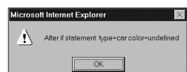

### 图 3.3

使用 `alert()` 方法进行调试。

如果逻辑或（OR）操作中的第一个参数求值为 `true`，则第二个参数永远不会执行。因为 `setType()` 函数返回了 `true`，所以 `setColor()` 函数从未执行。只需将逻辑或运算符改为逻辑与（AND）运算符，即可轻松修正此问题。

> 注意
> 在代码检查无误后，不要忘记移除为调试而添加的 `alert()` 方法，否则你的程序将向使用脚本的用户显示这些警报。

## 进阶

在本章中，你学习了一些编程技术，通过使用 JavaScript 模式匹配、事件处理、异常处理和调试，使你的 JavaScript 程序变得更加强大且更具韧性。第二部分“JavaScript 编程”将介绍 JavaScript 被解释的环境，以及该语言的实际应用。

## 第 4 章

### 客户端脚本

本书的前三章向你介绍了 JavaScript，让你接触了它的语义，并涵盖了若干帮助你入门的编程技术。在第二部分“JavaScript 编程”中，我们将涵盖 JavaScript 被解释的环境，包括客户端、服务器端以及 Windows Script Host 环境。

具体而言，在本章中，你将查看该语言的几个方面。我们将查看浏览器如何解释 JavaScript。

#### 支持的浏览器及其问题

尽管 JavaScript 似乎是今天技术的基础块，但它并非一直如此。直到 Netscape Navigator 2.0 和 Internet Explorer 3.0，它的功能才被包含。目前，只有四个主要的浏览器解释 JavaScript：Netscape Navigator、Internet Explorer、Opera 和 HotJava。然而，仅仅因为它们解释这种语言并不意味着它们的方式相同，这是你将研究的内容。

> 注意：许多用户使用 AOL 的在线服务连接互联网，你应该知道 AOL 浏览器实际上具有不同“外观”（chrome）的 Internet Explorer。

对于熟悉 Java 的人，你知道各种 JVM（Java 虚拟机）可以用不同的方式解释语言。JavaScript 类似，但市场可以被认为是碎片化的。在大多数情况下，浏览器解释 JavaScript 的方式是相同的——至少核心语义如此。巨大的区别在于它们支持不同的版本以及各种 Bug。

为了让你对这些浏览器的版本和支持情况有所了解，请查看表 4.1。它按浏览器版本和语言版本划分了运行时环境。

### 表 4.1 按版本的语言支持情况

| 浏览器 | 版本 | 语言 |
|---|---|---|
| Netscape Navigator | 2.0 | JavaScript 1.0 |
| | 2.02 for OS/2 | JavaScript 1.1 |
| | 3.0 | JavaScript 1.1 |
| | 4.0–4.05 | JavaScript 1.2 |
| | 4.06–4.5 | JavaScript 1.3 |
| | 6.0 | JavaScript 1.5 |
| Microsoft Explorer | 3.0 | JScript 1.0 |
| | 4.0–4.5 | JScript 3.0 |
| | 5.0 | JScript 5.0 |
| | 5.5 | JScript 5.5 |
| | 6.0 | JScript 5.6 |
| HotJava | 3.0 | JavaScript 1.4 |
| Opera | 3.0–3.5 | JavaScript 1.1 |
| | 4.0–5.0 | JavaScript 1.3 |
| | | JavaScript 1.4 |

> 注意
> Opera 在其浏览器跟进标准方面做得非常出色；然而，确切了解它支持哪些内容可能会有些困惑。表 4.1 是其支持情况的粗略概述，但为了获取更多信息，我们建议您访问 http://www.opera.com/opera4/specs.html#ecmascript 获取版本 4 信息，并访问 http://www.opera.com/opera5/specs.html#ecmascript 获取版本 5 信息。

##### OS/2 上的 Navigator 2.02 中的 JAVASCRIPT 1.1？

如果你查看表 4.1，你会发现 OS/2 上的 Navigator 2.02 版本符合 JavaScript 1.1 标准。这是因为 OS/2 版本的 Navigator 浏览器是由 Netscape 和 IBM 的工程师共同开发的。

OS/2 版本的 Navigator 在浏览器 3.0 版本发布后，还没有发布或处于测试阶段。那些深度使用 3.0 浏览器的用户已经注意到，它们似乎比 2.0 版本更多的 Bug。增加的增强似乎使得代码更加不稳定，这促使开发者推出了使用更稳定的 2.0 接口但包含 3.0 后端的 OS/2 版本。

由于浏览器版本通常是使用 JavaScript 定的，使用 Navigator 2.02 的 OS/2 用户可以使用“-3”选项启动浏览器，这将让其代理字符串报告其为 3.0 浏览器而非 2.0 版本。由于它具有解释页面上所有 JavaScript 的能力，此选项允许用户体验 3.0 浏览器的所有增强功能。

这些事实对于程序员在脚本中正确实现功能至关重要。你现在可以检查 OS/2 上的 Navigator 2.02 浏览器并知道它是符合 JavaScript 1.1 标准的——即使不带 -3 选项。当然，这一切通过发布适用于 OS/2 的 Netscape Communicator 4.61 得到了解决，该版本支持 JavaScript 1.3。

新浏览器发布频繁，这迫使市场在用户访问网站时使用的 JavaScript 运行时环境变得碎片化。编写脚本时需要格外小心，以确保浏览器能够正确解释它们。正如第 2 章“语言细节”中所讨论，大部分版本控制可以使用 `<script>` 元素的 `language` 或 `type` 属性完成，但并非所有浏览器都能正确实现此属性。作为程序员，你必须编写代码来适配这些浏览器。

你将看到的第一个浏览器是 Netscape 的 Navigator 浏览器。它是第一个解释由 Sun 和 Netscape 共同开发的语言的领先浏览器。我们还将查看 Internet Explorer、Opera 和 HotJava。

#### Netscape Navigator

Netscape Navigator（见图 4.1 中的 Netscape 6.0）首次在其 2.0 版本浏览器中包含了对 JavaScript 的支持。这是 JavaScript 的巨大一步，因为 Navigator 迄今是世界上最使用的浏览器。Web 开发者可以在页面中添加脚本，并确信大多数访问者都能体验他们的增强功能。而且并未止于此。

最近，Netscape 发布了其浏览器的 6 版本，这是一个从头开始的完全重写，如图 4.1 所示。这一次，对官方标准的支持是无与伦比的。它甚至发展到这种程度：不再支持 Navigator 4 中实现的所有旧元素和标签，这虽然有自己的问题，但反映了 Netscape 对标准化的投入。

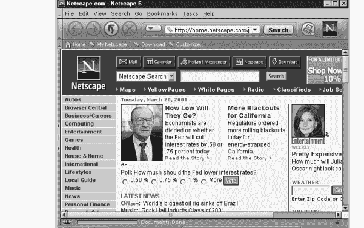

### 图 4.1

Netscape 6 浏览器。

与 Netscape 在浏览器中实现的任何其他内容一样，它继续扩展该语言并对其完善。随着每次发布，都增加了新的功能支持，以保持领先其他浏览器。表 4.2 概述了这些浏览器的 JavaScript 支持，并提供了一些额外信息。

### 表 4.2 各浏览器的 JavaScript 语言支持

| 浏览器版本 | 语言版本 | 注意 |
|---|---|---|
| 2.0 | JavaScript 1.0 | 第一个解释 JavaScript 的浏览器 |
| OS/2 版 2.02 | JavaScript 1.1 | 如之前的侧边栏所述，该浏览器具有 2.0 接口，并具有用于渲染 HTML 和解释 JavaScript 的 3.0 后端。 |
| 3.0 | JavaScript 1.1 | 第一个支持 `<script>` 标签的版本，该标签可包含外部 JavaScript 源。 |
| 4.0–4.05 | JavaScript 1.2 | 动态 HTML（Dynamic HTML）的增强，并添加了签名脚本作为安全模型。 |
| 4.06–4.7 | JavaScript 1.3 | 完成了 Navigator 对 ECMAScript 第一版的支持，以及第二版中预期的其他增强。 |
| 6.0 | JavaScript 1.5 | 增加了对 DOM Level 1 和某些 Level 2 的支持，以及 ECMAScript 第三版。 |

#### Internet Explorer

尽管 Internet Explorer（见图 4.2 中的 5.5）是第二个跟随的，但微软的 5.5 版本是第一个支持 DOM Level 1 和某些 Level 2 以及 ECMAScript 第三版的版本。

幸运的是，较新版本的引擎提供了函数，允许开发者确定用户运行的是哪个版本。要注意，在 3.0 版本上使用这些函数会导致错误。坦率地说，版本 3 在这里已非常罕见，这让开发者陷入了进退两难地。

列表 4.1 包含了开发者可以使用来确定脚本引擎版本的微软特有元素。

### 列表 4.1 用于确定脚本引擎信息的 JavaScript 元素

```javascript
<script language="JavaScript" type="text/javascript">
// 创建一个变量来存储所有引擎信息的单个字符串。
var jcriptVer = ScriptEngine() + " * " + ScriptEngineMajorVersion() + "." +
ScriptEngineMinorVersion() + " * " + ScriptEngineBuildVersion();
// 将字符串写入用户的浏览器。
document.write('<b>正在运行:</b> ' + jcriptVer);
// 将引擎版本的每个独立元素写入浏览器。
document.write('<br><br><b>ScriptEngine:</b> ' + ScriptEngine());
document.write('<br><br><b>ScriptEngineMajorVersion:</b> ' + ScriptEngineMajorVersion());
document.write('<br><br><b>ScriptEngineMinorVersion:</b> ' + ScriptEngineMinorVersion());
document.write('<br><br><b>ScriptEngineBuildVersion:</b> ' + ScriptEngineBuildVersion());
// -->
</script>
```

如果你在好奇的话，JScript 的脚本引擎包含在 `jscript.dll` 中。你可以检查此 DLL 文件的属性，以查看你机器上安装的是哪个版本。

在 Windows 的 Internet Explorer 5.5 中打开列表 4.1 的结果如图 4.3 所示。如你所见，如果开发者在执行脚本时需要知道他们所实现的具体构建版本，那么这会非常有帮助。但是，你应该小心避免使用不支持这些元素的版本。

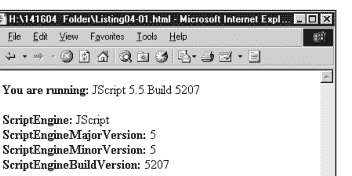

### 图 4.3

Internet Explorer 5.5 显示了其脚本引擎信息。

#### Opera

Opera 浏览器（见图 4.4 中的 5.0 版本）因其对标准的支持（如层叠样式表 CSS）而受到了大量媒体关注。Opera Software 的开发者承担了为用户提供大量功能的责任，而没有过多不必要的 Flash。Opera 在很大程度上是一个纯粹的渲染引擎，但它确实支持 Navigator 插件和 Java。这使其用户能够获得所需的支持，将其定位为真正的替代方案。

在 Opera 浏览器中，你主要需要留意的是用户代理字符串——它允许用户选择该字符串。包含此功能是为了让 Opera 浏览器能够访问为 Navigator 4 构建的页面，或者可能是 Internet Explorer 5 构建的页面，这会让 JavaScript 程序员难以准确检测浏览器版本。

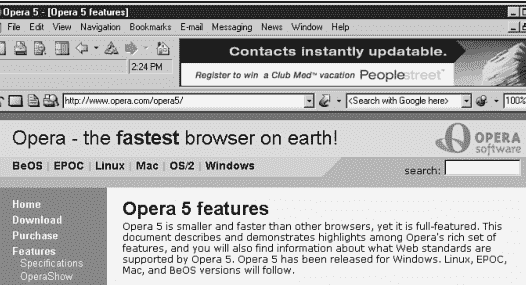

### 图 4.4

Opera 5.0 浏览器可以在 http://www.opera.com 获取。

#### HotJava

我们要提到的最后一个浏览器是太阳公司的 HotJava 浏览器，它在 3.0 版本中包含了对 JavaScript 的支持。它使用 Mozilla.org 的 Rhino 实现（一种用 Java 编写的 JavaScript 引擎）进行解释，并且是官方发布的支持 JavaScript 1.4 的唯一浏览器。老实说，这个浏览器很少被使用，并且已经超过一年没有更新了，但我们还是想提到它。

#### 扩展的浏览器功能

除了你可以添加到 Web 页面上的脚本功能外，JavaScript 还可以用于扩展你的浏览器功能。如今功能最强大的浏览器支持插件或 ActiveX 控件。这些插件在浏览器启动时加载，并在通过页面上的 HTML 标签调用时被访问。由于插件在浏览器环境中作为脚本运行，因此可以使用某些 JavaScript 对象来访问、修改和控制它们的功能。

JavaScript 还支持与嵌入页面中的 Java applet 进行交互。这种交互可以向两个方向进行——从 applet 到页面上的脚本，以及从脚本到 applet。这背后的技术被称为 LiveConnect，将在本章稍后的部分进行详细讨论。

#### 控制的内置函数

并不是所有浏览器的扩展功能都具有相同的方法，但一些常见的语言元素允许开发者访问这些各种项目。这些被认为是 JavaScript 语言本身中的内置控制元素，对这些功能的访问是通过两个包含的数组来实现的。

这两个项目是数组，包含了对浏览器在给定页面上加载的所有 applet 以及浏览器安装的所有插件的引用。通过这些数组，开发者能够访问并与这些组件交互。

##### Applet 数组

`applets` 数组存储了加载到页面上的所有 Java applet 的引用。这允许开发者检索页面上 applet 的总数，并直接与它们交互。如果开发者正使用 LiveConnect 与 applet 交互，则可以通过其索引数字引用 applet 本身。例如，第二个 applet 的信息可以通过以下 JavaScript 代码进行访问：

```javascript
var MyAppletInfo = document.applets[1];
```

这允许开发者将关于此 applet 的信息存储在变量中，他们可以在那里解析并处理关于 applet 的信息。存储在 `MyAppletInfo` 示例中的信息将包含 applet 的名称、尺寸以及用于创建 applet 的布局页面。

随着基于 Web 的企业级应用的使用增加，开发者知道页面上有多少 applet 并不稀奇。页面根据用户请求的类型动态构建，结果生成的页面可能完全取决于 applet 的数量。由于这可能会变化，开发者可能必须包含代码来查看页面上有多少 applet。

```html
<html>
<head>
<title>Checking for Applets</title>
</head>
<body>
<script language="JavaScript" type="text/javascript">
function checkApplets() {
  // 将页面上 applet 的数量存储在变量中
  var applets = document.applets.length;
  // 如果页面没有 applet，页面不重定向
  if(applets == 0) {
    window.location.href = "http://www.purejavascript.com/no.html";
  }
  // 如果页面上只有一个 applet，页面可能会重定向
  else if (applets == 1) {
    window.location.href = "http://www.purejavascript.com/one.html";
  }
  // 如果页面上有两个以上的 applet，页面可能会
  else if (applets > 2) {
    window.location.href = "http://www.purejavascript.com/many.html";
  }
}
</script>
<center>
<table border="1">
<tr>
<td>
    <applet code="TestApplet" width="200" height="35"></applet>
</td>
</tr>
<tr>
<td>
    <applet code="TestApplet" width="200" height="35"></applet>
</td>
</tr>
</table>
</center>
</body>
</html>
```


## 扩展的浏览器功能

### 第 4 章：客户端脚本

如你在列表 4.2 中所示，在页面完全加载后，`<body>` 标签调用了 `onload` 处理程序。这触发了一个检查加载了多少 applet 的函数。根据 applet 的数量，浏览器可能会重定向到另一个位置。如果 applet 的数量为两个，则页面不会重定向。

> **注意**
>
> 只有在 applet 完全加载并运行后，你才能访问属性和 applet 方法的结果。为了确保这一点，在 `<body>` 标签使用了 `onload` 程序。注意某些版本的 Navigator 浏览器会错误触发此事件。务必考虑这些情况。

如你所见，applet 数组对于访问页面上的 applet 是一个非常有用的资源。但是，你应该谨慎使用它，因为并不是所有的浏览器都支持 JavaScript applet。

### 插件数组

插件数组是用于控制 HTML 页面加载元素的第二个数组。开发者通常使用此数组确定用户机器上是否安装了特定的插件。在确定此之后，开发者就可以做出正确的决定来尝试加载该插件。

实际的插件数组有几个属性可以用于检索这些信息。它包括插件的名称、实际文件名和描述。列表 4.3 演示了插件数组的使用，将其能够检索的信息写入页面。图 4.5 显示了在安装了多个插件的浏览器中运行此代码的结果。

> **注意**
>
> 以下示例在 Netscape 浏览器中有效，但 Internet Explorer 实际上也支持这种功能（或者说微软称为“集合”）。有关此集合下支持的属性和方法的更多信息，请访问 `http://msdn.microsoft.com/workshop/author/html/reference/collections/plugins_0.asp`。

#### 列表 4.3 检查插件数组

```html
<html>
<head>
<title>Checking the plug-ins Array</title>
</head>
<body>
<script language="JavaScript" type="text/javascript">
<!--
// Store the number of plug-ins in a variable.
var numPlugins = navigator.plugins.length;

// Write the title of the page.
if (numPlugins > 0) {
  document.write('<h3>The Plug-ins You Have Installed</h3><hr>');
}else{
  document.write('<h3>You have no Plug-ins Installed.</h3>');
}

// Write the installed plug-in information to the page.
for (i = 0; i < numPlugins; i++) {
  currPlugin = navigator.plugins[i];
  document.write('<p><b>Name:</b></br>' + currPlugin.name + '<br>');
  document.write('<b>Filename:</b></br>' + currPlugin.filename + '<br>');
  document.write('<b>Description:</b></br>' + currPlugin.description + '<br>');
}
// -->
</script>
</body>
</html>
```

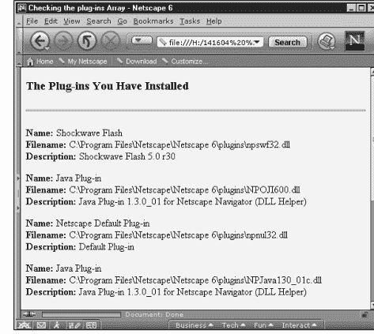

**图 4.5** 在带有多个插件的浏览器中列出 4.3 的结果。

在脚本中，你通过插件数组的 `length` 属性访问已安装的插件总数。之后，确定要写入页面的合适标题，并运行 `for` 循环写入插件信息。这是一个非常简单的示例，但在确定当浏览器加载页面时你希望页面使用哪些元素时，访问这些属性是非常有用的。

### LiveConnect

LiveConnect 是一项 Netscape 特有的技术，从 Netscape Navigator 3 开始，它在 JavaScript 脚本、Java 和插件之间提供了通信链接。它允许 JavaScript 通过 `Packages` 对象访问某些 Java 核心功能。它还可以通过 `Applet` 数组访问特定的 Java Applet（小程序），并通过 `Plugin` 数组访问插件。

在本节中，你将更深入地了解与 Java Applet 相关的 LiveConnect。你还将通过一些使用 LiveConnect 扩展浏览器对脚本和 Java 解释的示例来学习。

#### 为什么选择 LiveConnect？

LiveConnect 在连接 JavaScript 和 Java 方面起着非常重要的作用，使每一者都能读取并扩展对方提供的功能。在页面加载后与页面上的 Java Applet 进行动态交互的能力，使得 Web 开发人员能够轻松利用 Java 的力量。这可以通过模块化的方式实现，因为完全可能是另一个开发者编写了 applet。

相反，LiveConnect 使 applet 能够访问脚本中包含的信息。由于信息可以在 applet 之间传递，开发者在使用它时能够最大化页面的功能。在企业内部中使用 LiveConnect 让开发者能够利用这些特性。Netscape 开发 LiveConnect 是为了使其完美契合其愿景，并丰富了支持“一次编写，随处运行”理论的技术组合。

#### LiveConnect 示例

以下两个示例将让你更好地理解 LiveConnect 如何在 Netscape 浏览器中工作。第一个示例显示了 JavaScript 如何原生访问某些 Java 语言功能（通过 `Packages` 对象）。第二个示例显示了你如何使用 JavaScript 与 applet 交互。

列表 4.4 使用了一些通过 `Packages` 对象可用的 Java 方法。在这个示例中，用户可以在文本框中输入一些信息，然后点击“Print（打印）”按钮将其文本打印到 Java 控制台。`onClick` 事件用于将文本信息传递给 JavaScript 函数，并在函数中写入该信息。在浏览器中运行此示例的结果如图 4.6 所示。

> **注意**：为了在 Netscape 6 中正常工作，你必须在初始安装时选择了安装 Java 运行时的选项。

##### 列表 4.4 通过 JavaScript 的 Packages 对象访问 Java 方法

```html
<html>
<head>
<title>LiveConnect 示例 #1</title>
<script language="JavaScript.1" type="text/javascript">
<!--
// 此函数获取用户输入的文本并将其输出到 Java 控制台。
function writeToConsole(inText) {
    Packages.java.lang.System.out.println(inText);
}
// -->
</script>
</head>
<body>
<form>
<input type="text" name="entered" width="10">
<input type="button" value="Print" onclick="writeToConsole(form.entered.value)">
</form>
</body>
</html>
```

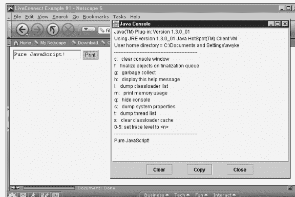

**图 4.6** 使用 `Packages` 对象访问 Java 中的 `System.out.println()` 方法。

第二个示例稍微复杂一些。它获取用户输入的文本并传递给 applet 内部的方法，以更改 applet 显示的文本。为了帮助你完全理解这个示例，列表包含了执行此任务所需的 applet 代码和 JavaScript 代码。列表 4.5 显示了所需的 Java 代码，而列表 4.6 显示了 JavaScript。

##### 列表 4.5 必要的 Java 代码

```java
import java.applet.*;
import java.awt.Graphics;

public class LiveConnectExample extends Applet {
    // 初始化变量
    public String sText;

    // 初始化字符串
    public void init() {
        sText = "";
    }

    // 在 applet 中绘制字符串
    public void paint(Graphics gArea) {
        gArea.drawString(sText, 20, 20);
    }
}
```

##### 列表 4.6 JavaScript

*(注：由于原文中列表 4.6 的代码片段不完整且重复，此处根据上下文逻辑呈现)*

### 表单处理

简单的表单可以作为一个示例：

```html
<form action="http://www.purejavascript.com/cgi-bin/sampleform.cgi" method="get">
  <select name="state">
    <option value="NC">北卡罗来纳</option>
    <option value="SC">南卡罗来纳</option>
    <option value="CA">加利福尼亚</option>
  </select>
  <input type="button" value="Submit">
</form>
```

当用户从下拉菜单中选择一个项目并点击提交按钮时，信息将传递到 URL 的末尾。例如，如果选择了北卡罗来纳，传递的信息看起来如下：

`http://www.purejavascript.com/cgi-bin/sampleform.cgi?state=NC`

另一方面，POST 方法的工作不同。当使用 POST 时，浏览器会连接 `action` 属性中指定的 URL，并将数据发送在 HTTP 请求的主体中。对于熟悉 HTTP 标准的人来说，你们知道信息是以两个部分返回给浏览器的：**头部**（head）和**主体**（body）。当浏览器发送 POST 表单时，它执行的操作类似于服务器，即它将信息发送在请求的主体中而不是 URL 中。

使用这两种方法有不同的情况。如果你正在向服务器发送大量的表单信息，应该使用 POST 方法。通常，服务器在使用 GET 方法处理大量数据时会遇到问题。POST 方法也有助于防止你的数据不被轻易看到，因为表单信息是以数据块发送的。

请记住，JavaScript 并不是服务器端表单处理的完全替代。它应该是这些程序的补充。通过结合使用 JavaScript 和服务器端程序，开发者可以创建一种非常有效且高效的表单处理手段。

在程序员结合表单使用 JavaScript 之前，他们需要知道如何获取和解析表单信息。下一节将介绍使用 JavaScript 从表单中提取信息的方法。

#### Forms 数组

另一个用于访问页面组件的 JavaScript 内置对象是 Forms 数组。Forms 数组是 `document` 对象的一个属性，是一个包含给定文档内表单列表的数组。由于它是数组，文档中的每个表单都可以通过代表其在文档中位置的索引数字来引用。

例如，如果你有一个包含三个表单的文档，并且你想访问第二个表单中的一个属性，你可以使用以下语法引用它：
`document.forms[1].property`

在这个示例中，`document` 对象指向该表单所在的文档，而 `property` 元素指向你正尝试访问的属性。

列表 4.7 是一个包含两个表单的 HTML 页面。除了页面上的表单外，页面的 `<head>` 部分还包含了两个 JavaScript 函数，它们展示了访问表单的不同方法，并执行了一些输入验证。每个表单都包含一个用于插入文本的文本区域，以及一个提交按钮。当用户尝试提交表单时，会触发 `onclick` 事件，并将表单的内容传递给 JavaScript 函数进行处理。

##### 列表 4.7 使用 Forms 数组访问页面上的多个表单

```html
<html>
<head>
<title>Forms Array 示例</title>
<script language="JavaScript" type="text/javascript">
<!--
// 函数 verifyZip 检查邮政编码是否有效。如果用户输入无效的邮政编码，则使用警报框通知用户。函数将长度作为输入参数。
function verifyZip(length){
  // 创建变量并存储 ZIP 输入的表单值。
  var zipEntry = document.forms[0].zip.value;
  // 使用 10 作为进制解析输入为整数。
  var zipNum = parseInt(zipEntry, 10);
  // 检查长度是否为 5。
  if (document.forms[0].zip.value.length == length){
    // 验证 ZIP 是否为数字。
    if(!(zipNum != 0 && isNaN(zipNum))){
      alert(zipEntry + " is a valid zip code");
    } else {
      // 如果 ZIP 无效则通知用户。
      alert("Invalid Zip Code Entered. Please Re-enter");
    }
  } else {
    alert("Invalid Zip Code Entered. Please Re-enter");
  }
}

// 函数 myName 显示用户输入的名称。
function myName(){
  // 获取输入名称的表单值。
  var name = document.form2.name.value;
  alert("You Entered: " + name);
}
// -->
</script>
</head>
<body>
<p><center><b>Forms 示例</b></center><br><br></p>
<table>
<tr><form name="form1" method="post">
<tr>
<td align="right">输入一个 5 位邮政编码:</td>
<td align="left">
<input type="text" name="zip" size="15">
<input type="button" name="button1" value="Verify" onclick="verifyZip(5)">
</td>
</tr>
</form>
<form name="form2" action="post">
<tr>
<td align="right">输入您的姓名:</td>
<td align="left">
<input type="text" name="name" size="15">
<input type="button" name="button2" value="Show Name" onclick="myName(this.form)">
</td>
</tr>
</form>
</table>
</body>
</html>
```

输入到每个文本框的信息会变成表单的一个元素。使用 `elements` 数组，脚本可以访问数组的每个独立元素。如示例所示，第一个表单是 `forms[0]`，第二个表单是 `forms[1]`，依此类推。图 4.8 显示了这一点。

#### 获取和写入信息

正如 `document` 对象包含 `forms` 数组一样，`form` 对象包含 `elements` 数组。`elements` 数组的工作方式与 `forms` 数组类似，项目按顺序索引，你可以通过名称而不是索引数字访问特定元素。

##### 列表 4.8 使用不同方法访问表单元素

```html
<html>
<head>
<title>访问元素的示例</title>
<script language="JavaScript" type="text/javascript">
<!--
// 显示输入的汽车信息。
function showCar() {
  // 使用 elements 数组访问汽车信息。
  var car = document.pref.elements[0].value;
  alert("Your favorite car is: " + car);
}
// 显示输入的颜色信息。
function setColor() {
  // 通过表单名称直接访问颜色值。
  var color = document.pref.color.value;
  alert("Your favorite color is: " + color);
}
// -->
</script>
</head>
<body>
<form name="pref" method="post">
输入你喜爱的汽车名称：
<input type="text" name="car" size="25">
<input type="button" name="carButton" value="Show Car" onclick="showCar(this.form)">
<br>
输入你喜爱的颜色：
<input type="text" name="color" size="15">
<input type="button" name="colorButton" value="Show Color" onclick="setColor(this.form)">
</form>
</body>
</html>
```

在 `showCar` 函数中，可以看到汽车元素通过 `document.pref.elements[0].value` 被引用。这是以这种特定形式访问 `elements` 数组的第一个元素。按钮将是第二个元素，通过 `document.pref.elements[1].value` 进行引用，表单中的其他元素也依此类推。

`showColor` 函数以不同的方式引用颜色对象：通过在 `document.pref.color.value` 使用颜色对象的名称。如果你使用 `elements` 数组，这个值将要安全得多且更容易跟踪，并可以防止未来出现问题。例如，假设你有一个包含两个框架 A 和 B 的 Web 页面。框架 A 包含一个 JavaScript 程序，该程序通过 `elements` 数组引用框架 B 内部的元素。如果 B 框架中的 Web 页面发生了变化但仍然包含表单元素，那么 A 框架中的 JavaScript 程序将访问错误的表单元素。使用 `elements` 的另一个原因是，如果未来插入了新元素，则不需要更改所有的元素编号。

如果你想让程序保持通用性，通过 `elements` 数组引用可能有用；但如果你想要更好的维护性和易用性，通过名称引用是首选方案。

除了表单元素外，你还可以编写或修改表单信息。这对于自动表单纠正是一种非常实用的技术。几乎任何携带表单内信息的对象都可以被修改。

让我们来看一个向表单写入信息的简单示例。列表 4.9 包含一个表单，其中有一个带问题的文本框和一个提交（Submit）按钮。用户被要求输入问题的答案。如果答案正确，一个信息框会指示这一点。如果错误，警报框将通知用户他输入了错误答案，并将正确答案自动写入文本框中。

##### 列表 4.9 向 JavaScript 表单写入信息

```html
<html>
<head>
<title>写入表单元素的示例</title>
<script language="JavaScript" type="text/javascript">
<!--
// 函数检查提交的文本是否为正确答案。
function checkText(){
  // 执行相等检查以判断输入是否正确。
  if(document.FormExample3.textbox.value == "Bugs Bunny"){
    alert("You are correct!");
  } else {
    // 如果原始输入不正确，输出正确的信息并通知用户。
    document.FormExample3.textbox.value = "Bugs Bunny";
    alert("That is incorrect. The correct answer is now in the text box.");
  }
}
// -->
</script>
</head>
<body>
<form name="FormExample3" method="post">
哪个 Looney Tunes 是灰色且长耳朵的？
<input type="text" name="textbox" size="25">
<input type="button" name="Bugs" value="Submit" onclick="checkText(this.form)">
</form>
</body>
</html>
```

在列表 4.9 代码的基础上，可以创建一个 JavaScript 方法，根据特定输入创建一个自定义的下拉菜单。

#### 表单示例

列表 4.10 展示了一个示例 Web 页面，该页面允许用户输入其个人信息并进行提交。在输入所有信息并用户点击提交按钮后，所有数据在传递给服务器进行进一步处理之前，都会在客户端进行验证。

##### 列表 4.10 使用表单进行客户端验证的示例

```html
<html>
<head>
<title>表单验证示例</title>
<script language="JavaScript" type="text/javascript">
<!--
// 函数用于检查输入的个人信息是否有效。
function validatePersonalInfo(){
  // 声明变量来存储输入值。
  var _first = document.info.fname.value;
  var _last = document.info.lname.value;
  var _street = document.info.street.value;
  var _city = document.info.city.value;
  var _zip = document.info.zip.value;
  var _phone = document.info.phone.value;
  var _email = document.info.email.value;

  // 验证所有的输入字段是否已填写。
  if(_first.toString() == "") {alert("Please enter a first name.");}
  if(_last.toString() == "") {alert("Please enter a last name.");}
  if(_street.toString() == "") {alert("Please enter your street name.");}
  if(_city.toString() == "") {alert("Please enter your city.");}
  if(_zip.toString() == "") {alert("Please enter your ZIP.");}
  if(_phone.toString() == "") {alert("Please enter your phone number.");}
  if(_email.toString() == "") {alert("Please enter your email.");}

  else{
    // 检查 ZIP 和电话号码是否为有效输入。
    var checkZip = checkNum(5);
    var phoneInput = document.info.phone.value;

    // 初始化变量。
    var validPhone = false;
    var validZip = false;

    if(checkZip == true){
      validZip = true;
    } else {
      alert("Invalid ZIP Code: " + validZip);
    }

    // 如果电话号码无效，通知用户。
    if(!checkPhone(phoneInput)){
      alert("Phone number is invalid." + validPhone);
    } else{
      validPhone = true;
    }

    if(validZip && validPhone){
      alert("Your form has been verified.");
    }
  }

  // 移除电话号码中的连字符并验证电话号码是否有效。任何格式的电话号码都是有效的。
  function checkPhone(str){
    var regexp = /^(\d{3})-(\d{4})$/;
    return regexp.test(str);
  }

  // 检查 ZIP 码是否有效
  function checkNum(len){
    var zipEntry = document.info.zip.value;
    if(zipEntry.length == len && isNaN(zipEntry) == false){
      return true;
    } else {
      return false;
    }
  }
// -->
</script>
</head>
<body>
<p><center><b>表单验证示例</b></center></p>
此页面演示了 JavaScript 如何在 Web 页面进行验证。使用 JavaScript 在客户端进行验证可以减少提交错误表单的概率。
<hr>
<b>个人信息：</b>
<form name="info" method="post">
<table>
<tr>
<td>名：</td>
<td><input type="text" name="fname" size="15"></td>
</tr>
<tr>
<td>姓：</td>
<td><input type="text" name="lname" size="20"></td>
</tr>
<tr>
<td>街道：</td>
<td><input type="text" name="street" size="30"></td>
</tr>
<tr>
<td>城市：</td>
<td><input type="text" name="city" size="15"></td>
</tr>
<tr>
<td>州：</td>
<td>
<select name="state">
<option value="AL">AL</option>
<option value="AK">AK</option>
<option value="AZ">AZ</option>
<option value="AR">AR</option>
<option value="CA">CA</option>
<option value="CO">CO</option>
<option value="CT">CT</option>
<option value="DE">DE</option>
<option value="FL">FL</option>
<option value="GA">GA</option>
<option value="HI">HI</option>
<option value="ID">ID</option>
<option value="IL">IL</option>
<option value="IN">IN</option>
<option value="IA">IA</option>
<option value="KS">KS</option>
<option value="KY">KY</option>
<option value="LA">LA</option>
<option value="ME">ME</option>
<option value="MD">MD</option>
<option value="MA">MA</option>
<option value="MI">MI</option>
<option value="MN">MN</option>
<option value="MS">MS</option>
<option value="MO">MO</option>
<option value="MT">MT</option>
<option value="NE">NE</option>
<option value="NV">NV</option>
<option value="NH">NH</option>
<option value="NJ">NJ</option>
<option value="NM">NM</option>
<option value="NY">NY</option>
<option value="ND">ND</option>
<option value="OH">OH</option>
<option value="OR">OR</option>
<option value="OK">OK</option>
<option value="PA">PA</option>
<option value="RI">RI</option>
<option value="SC">SC</option>
<option value="SD">SD</option>
<option value="TN">TN</option>
<option value="TX">TX</option>
<option value="UT">UT</option>
<option value="VT">VT</option>
<option value="VA">VA</option>
<option value="WA">WA</option>
<option value="WV">WV</option>
<option value="WI">WI</option>
<option value="WY">WY</option>
</select>
</td>
</tr>
<tr>
<td>ZIP 码：</td>
<td><input type="text" name="zip" size="7"></td>
</tr>
<tr>
<td>电话（带区码）：</td>
<td><input type="text" name="phone" size="20"></td>
</tr>
<tr>
<td>电子邮件：</td>
<td><input type="text" name="email" size="20"></td>
</tr>
</table>
<br>
<table>
<center>
<input type="button" value="提交" onclick="validatePersonalInfo()">
</center>
</table>
</form>
</body>
</html>
```

**图 4.9** 使用客户端验证的表单示例。

表单首先验证所有的输入字段是否都已填写。如果任何字段为空，将弹出警报框，指示该字段需要输入。两个主要输入需要特殊的验证：ZIP 码和电话号码。

第一个被调用的函数是 `validatePersonalInfo`。这个主函数检查所有的用户输入是否有效。如果是，将返回一个警报框，表示表单已验证。在表单被完全验证之前，ZIP 码和电话号码必须检查。邮政编码验证是由一个名为 `checkNum` 的子函数执行的。该函数接受一个参数——字符串长度。对于邮政编码，我们将字符串长度限制为五个数字。如果发现结果为真，则邮政编码通过验证。

调用的第二个子函数是 `checkPhone`。`checkPhone` 函数接收电话号码输入并将其与三种不同的标准格式进行比对。如果发现任何一种格式有效，该函数将返回 true。在完成这两项检查后，确定表单包含有效信息。

### Cookie 处理

Cookie 是浏览器存储在用户计算机文本文件中的一小部分信息。Cookie 通常用于存储与当前正在使用的特定网站相关的信息，并在以后重复使用。

Cookie 文件的位置取决于所使用的浏览器。在 Navigator 中，所有 cookie 都存储在一个名为 `cookies.txt` 的文件中。在 Internet Explorer 中，每个 cookie 都存储在 `Cookies` 文件夹中的单独独立文件中，该文件夹默认位于 `Windows\Winnt` 文件夹。

Cookie 具有局限性。Cookie 的大小限制为 4KB。此外，Navigator 浏览器允许用户计算机上总共存储 300 个 cookie。这使得 `cookies.txt` 文件或 `Cookies` 文件夹的大小保持在最大 1200KB。此外，每个服务器仅允许存储总 20 个 cookie。如果超过 300 个总 cookie 或每个服务器 20 个 cookie 的限制，将删除最近一次使用的 cookie 以容纳额外的 cookie。

浏览器允许用户控制 cookie 的使用。在 Navigator 中，在“编辑（Edit）->选项（Preferences）”下有一个“高级（Advanced）”类别。该类别提供了接受所有 cookie、接受返回给服务器的 cookie 或禁用 cookie 的选项。还有一个在接受 cookie 前警告你的选项。启用此选项将强制浏览器在请求设置 cookie 时通知你，并告知你 cookie 的内容。图 4.10 显示了 cookie 警告的样子。同样，Internet Explorer 通过“Internet 选项”对话框中的“安全”选项卡探索 cookie 的使用（在 Windows 5.5 及以上版本可通过“工具”菜单访问）。

> **注意**
>
> 当首次设置 cookie 时，它存储在浏览器的内存中。只有在退出浏览器后，cookie 才会被写入文件。

cookie 对象是 Document 对象的一部分。可以通过设置 cookie 属性的适当值来创建、设置和修改 cookie。cookie 有四个属性：`expires`、`path`、`domain` 和 `secure`。

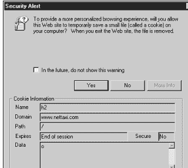

**图 4.10** Cookie 警告示例。

默认情况下，cookie 仅在当前浏览会期间有效。当浏览会话结束时，cookie 就会被销毁。要让 cookie 持续超过当前浏览会话，必须设置 `expires` 属性。该属性指定了 cookie 的寿命。该属性的值可以是任何有效的日期字符串。如果设置了 `expires` 属性，cookie将在当前浏览会话结束后写入 cookie 文本文件。如果没有设置 `expires` 属性，cookie将在用户浏览会话结束时过期。

`path` 属性指定了与 cookie 关联的域。关联级别从指定的路径开始并向下进入任何子文件夹。例如，假设 `http://www.purejavascript.com/examples/cookie.html` 正在设置一个 cookie，而你希望该 cookie 在 purejavascript.com 域的 Web 页面之间共享。为了实现这一点，需要将 cookie `path` 属性设置为 `"/"`。这允许从 `www.purejavascript.com` Web 服务器上的任何页面访问 cookie。如果路径设置为 `"/examples"`，则该 cookie 仅对 examples 文件夹及其子文件夹中的页面有效。

> **注意**
>
> 如果指定了 `secure` 属性，cookie 将仅通过安全通道（HTTPS）传输。如果没有指定 `secure`，cookie 可以通过任何通信通道传输。

理解 cookie 属性是能够读写 cookie 的第一步。现在你已经理解了这些，看看如何读取 cookie。

#### 读取 Cookie

如前所述，cookie 是文档对象的一部分。你必须做的第一件事是读取 cookie 属性。可以通过以下语句完成：

```javascript
var cookieName = document.cookie;
```

此语句创建了变量 `cookieName` 并将其赋值为文档对象的 cookie 属性。当你访问此属性时，必须提取 cookie 的各种属性。cookie 本身返回一个包含与当前文档相关的所有 cookie 的字符串。

Cookie 以“名称/值”对的形式插入。从 cookie 属性返回的字符串包含了 cookie 名称/值对列表。要读取单个属性，你必须解析该字符串。你可以使用内置的 JavaScript 方法来完成。

查看代码列表 4.11 中的示例以了解如何读取 cookie。在代码中调用此函数时，你只需要传递你正在查找的 cookie 名称即可。

##### 代码列表 4.11 获取 Cookie 值

```javascript
<script language="JavaScript" type="text/javascript">
<!--
// 声明变量来存储文档中包含的所有 cookie。
var cookies = document.cookie;

// 通过搜索 cookie 的名称获取 cookie 值的函数。
function readCookie(name) {
  // 声明变量来设置 "name=" 值。
  var start = cookies.indexOf(name + "=");

  // 如果找到了 cookie，则获取索引。
  if (start == -1){
    alert("Cookie not found");
    return;
  }
  // 获取 cookie 的第一个字符。
  start = cookies.indexOf("=", start) + 1;

  // 读取到 cookie 的结束。
  var end = cookies.indexOf(";", start);

  if (end == -1){
    end = cookies.length;
  }

  // 使用 unescape 方法反转转义格式获取 cookie 值。
  var value = unescape(cookies.substring(start, end));

  if(value == null) {
    alert('No cookie found');
  } else {
    alert('Cookie value is: ' + value);
  }
}
// -->
</script>
```

#### 写入 Cookie

可以创建、修改和设置 cookie。记住 cookie 是以名称/值对的形式读取的。因此，当你写入 cookie 时，属性必须以名称/值对的形式写入。

要设置 cookie 值，你首先创建一个 cookie 并为其赋值一个名称。然后你必须设置 cookie 的每个属性。以下是执行此操作的示例：

```javascript
document.cookie = "name=" + form.cookie.value + " expires=" + month;
```

如果你想修改 cookie 值，只需再次设置其属性。你可以通过修改该属性来删除 cookie 值。

### Windows

```html
<html>
<head>
<script language="JavaScript" type="text/javascript">
<!--
 // 函数创建一个名为 myChild 的新窗口，其中包含 index.html 文件。
function create() {
  open("index.html", "myChild");
}
// -->
</script>
</head>
<body>
<form name="form1">
<input type="button" value="Create Child" onclick="create()">
</form>
</body>
</html>
```

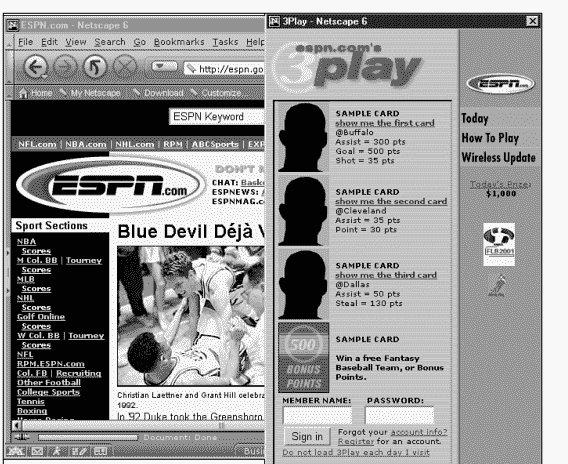

**图 4.1** 游戏的弹出窗口。

`create` 函数创建一个新窗口，该窗口被视为原始窗口的子窗口。窗口名称在 `window.open` 函数的第二个参数中指定，为 `"myChild"`。子窗口中的任何值都通过父窗口的名称进行引用。如果子窗口有自己的窗口，则它被视为父窗口的孙窗口。要让祖父窗口对其孙窗口执行操作，它必须先引用其直接父级，然后引用其祖父。假设孙窗口名为 Jane，其父窗口名为 Bob，祖父窗口名为 Joe。为了让 Joe 的窗口操作 Jane，它必须通过以下方式引用值：

`joe.bob.jane.document.form1.textbox.value`

父窗口对其直接子窗口以及任何后续子窗口（孙窗口）具有完全控制权。如果父窗口被销毁，对剩余子窗口的所有控制权都将丢失。

子窗口可以使用 `opener` 方法找到其父窗口。`opener` 方法会告诉子窗口它是由哪个窗口创建。你可以如下所示使用 `opener` 方法：

`var name = window.opener.document.name;`

这将父文档的名称返回给变量 `name`。

如果你有多个层级的窗口，可以使用多个 `opener` 实例。如果孙窗口想引用其祖父窗口，只需简单添加另一个层级：

`window.opener.opener.document.form1.textbox.value`

要让窗口引用其自身的属性，可以使用 `self` 属性。假设你想设置窗口内表单中文本框的值。你可以如下所示引用该值：

`self.document.formName.textbox.value = "JavaScript cool";`

#### 创建窗口

JavaScript 提供了一个内置方法来创建新的窗口实例。`open` 方法可用于创建任何主窗口或次窗口。以下是 `open` 的用法示例。

```javascript
window.open("web.html","newWin","resizable,menubar,toolbar");
```

这创建了一个可以调整大小、包含菜单栏和工具栏的窗口。`"web.html"` 是新创建窗口中将打开的文件。`"newWin"` 代表窗口对象的名称。可以为窗口添加许多不同的功能。其他功能包括 `outerHeight`、`outerWidth`、`innerHeight`、`innerWidth`、`alwaysRaised`、`alwaysLowered`、`location`、`screenY` 和 `screenX`。这些功能在 `open` 函数的参数中指定。

> **注意**
>
> 注意不要在窗口特性之间包含任何空格；这将导致窗口创建错误。请参见第 8 章“客户端”中创建窗口对象，获取有关其他窗口属性的详细信息。

创建一个新窗口后，你可以对其进行操作。JavaScript 还为你提供了在多个窗口之间进行交互的能力。只要正确引用窗口属性，你就可以修改其他窗口中的对象。在引用窗口对象时，请记住父子关系。

#### 局限性

在旧版本的 JavaScript 中，窗口只能从上到下进行引用。这意味着父窗口知道其子窗口的属性，但反之则不然。在 JavaScript 1.2 及更高版本中，这个问题得到了解决。正如之前提到的，使用 `opener` 属性将解决任何子/父级引用冲突。

#### 窗口示例

下一个示例显示了你如何在两个窗口之间发送信息。它从父窗口开始。图 4.12 显示了父窗口和子窗口都已打开的状态，且父窗口在上方。

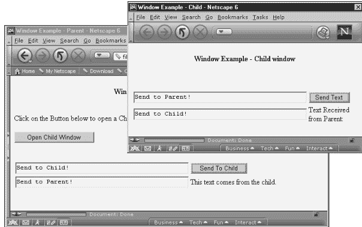

**图 4.12** 显示如何在窗口之间发送信息的窗口示例。

查看列表 4.12 中父窗口的代码。

##### 列表 4.12 窗口示例的父窗口代码

```html
<html>
<head>
<title>窗口示例 - 父窗口</title>
<script language="JavaScript" type="text/javascript">
<!--
// 函数创建并打开一个新的子窗口。
function openWin() {
  // 打开一个名为 "ChildWin" 的新窗口
  childWin = open("child.html", "ChildWin", "toolbar,scrollbars,menubar,status,width=500,height=200");
}

// 函数将值从父窗口发送到子窗口。
function sendToChild() {
  childWin.document.childForm.childText.value = document.parentForm.parentText.value;
}
// -->
</script>
</head>
<body>
<p>
<center>
<b>窗口示例 - 父窗口</b><br><br>
</center>
<form name="parentForm">
点击下方按钮打开子窗口
<br><br>
<input type="button" name="submit" value="Open Child Window" onclick="openWin()">
<br><br>
<table>
<tr>
<td align="left">
<input type="text" name="parentText" size="45">
</td>
<td align="left">
<input type="button" name="submit" value="Send To Child" onclick="sendToChild()">
</td>
</tr>
<tr>
<td align="left">
<input type="text" name="received" size="45">
</td>
<td align="left">
此文本来自子窗口。
</td>
</tr>
</table>
</form>
</body>
</html>
```

##### 列表 4.13 窗口示例的子窗口代码

```html
<html>
<head>
<title>窗口示例 - 子窗口</title>
<script language="JavaScript" type="text/javascript">
<!--
// 函数将值从子窗口发送到父窗口。
function sendToParent(){
  opener.parentForm.received.value = childForm.childText.value;
}
// -->
</script>
</head>
<body>
<p>
<center>
<b>窗口示例 - 子窗口</b><br><br>
</center>
<form name="childForm">
<table>
<tr>
<td align="left">
<input type="text" name="sendText" size="45">
</td>
<td align="left">
<input type="button" name="submit" value="Send To Parent" onclick="sendToParent()">
</td>
</tr>
<tr>
<td align="left">
<input type="text" name="childText" size="45">
</td>
<td align="left">
接收来自父窗口的文本：
</td>
</tr>
</table>
</form>
</body>
</html>
```

在如今最新的浏览器中，我们可以使用文档对象模型（DOM）。这是一种尝试标准化访问给定文档（如 HTML 或 XHTML 文档）中元素的方法。这无疑是未来的趋势，但它并不能消除某些旧版浏览器仍然存在的事实。

在本章的这一节中，我们将同时查看旧的（HTML）和新的（脚本化 DOM）处理问题的方法。我们还将向你展示如何构建可以在所有 4+ 版本浏览器中运行的跨浏览器脚本。考虑到 DOM 的采用率，这很可能是本书最后一个涵盖旧方法的版本了，但目前旧方法仍然是必需的。

### 旧方法

Netscape 最初在 Navigator 4 中通过 `<layer>` 和 `<ilayer>` 标签处理了三维定位问题。另一方面，Internet Explorer 则通过扩展现有 HTML 标签（如 `<div>`）的功能，通过其 HTML 对象模型（HTML Object Model）的实现实现了三维定位。

随着这些 4 版本浏览器的发布，开发者有了两种创建文档的方法，但这些方法是特定于浏览器的。层叠样式表（CSS）也是创建动态文档所必需，它在两个浏览器中都已实现。CSS 提供了基础定位。尽管在实现级别和解释上存在差异，但该领域仍处于变化中，不过情况正在变好。

#### Navigator 4 层

层（Layers）的概念是在 Navigator 4 中引入的，不仅在 HTML 中，还通过 JavaScript 1.2 中新的 `Layer` 对象引入。与当时的许多事物一样，这些层仅在 Navigator 4 中支持——不支持 Internet Explorer。然而，它们确实具有一些用处，提供了控制单个窗口内元素堆叠和移动的能力。

在 HTML 方面，新标签之一是 `<layer>` 标签。它允许你使用 JavaScript 进行层操作。以下是使用该标签的示例。

```html
<layer id="myLayer" width="220" height="100" bgcolor="red" top="150" left="100" visibility="show">
This is a Navigator 4 layer
</layer>
```

层的定位可以是绝对的也可以是相对的，就像许多元素一样。使用绝对定位，你可以指定在其容器层内的位置。相对定位则是让对象出现在文档流中的自然位置。

`<layer>` 标签使用了绝对定位，并包含允许开发者指定文档中精确位置的属性。他们引入的第二个标签允许相对定位。`<ilayer>` 标签被认为是流式层或内联层。

HTML 标签仅是 Netscape 为此功能添加内容的一半。除了这些，他们还为 JavaScript 添加了 `Layer` 对象和 `document.layers` 数组，以便访问和操作这些层。该对象包含了用于执行这些任务的自定义方法和属性。

尽管在 HTML 4 规范中没有定义，但 Navigator 4 要求在该任务中必须为标签设置 `name` 属性，无论是 `<layer>`、`<ilayer>` 还是 `<div>`（用于定义标签组）。通过这种方式访问层的语法相当简单。例如，如果你想访问层 `layer1`，可以通过以下语法实现：`document.layers['layer1']`

由于这些类型的层代表了执行文档动态的旧方法，我们在这里不再进行更多详细介绍。不过，我们将在本章稍后的“动态文档”部分节中包含一个跨浏览器示例，展示 Navigator 4 中的动态文档是如何工作的。通过继续学习，请关注新方法，那是在 Netscape 6 中实现的方法。

想了解一些关于 Navigator 的 `Layer` 对象的信息吗？请查看第 8 章中的条目。

#### Internet Explorer 4 的 HTML 对象模型

Internet Explorer 4 对 HTML 采取了更广泛的方法，允许开发者不仅可以访问层（他们主要使用 `<div>` 标签定义），还可以访问给定文档中的所有标签。在前端，`<div>` 方法是首选之法，因为它是 HTML 规范的一部分标签。该标签本质上被用于定义文档中的数据块——这些数据块随后可以被创建、设置样式和进行操作。

此外，还有 `<span>` 标签。如果说 `<div>` 提供了一种将许多标签组织成一个组的方法，那么 `<span>` 则用于在另一个标签的主体内内联地分组一组字符。

与 Navigator 类似，Internet Explorer 需要一种方法来访问并操作这些元素。微软没有实现 `Layer` 对象，而是实现了 `document.all` 集合。该集合提供了你访问文档内元素的手段。然而，与 `document.layers` 方法不同，它不依赖 `<div>` 标签非标准的 `name` 属性，而是依赖于标准的 `id` 属性。使用示例中相同的 `layer1`，你将在 Internet Explorer 4 或 5 中使用以下语法访问此层：

```javascript
document.all['datablock1']
```

尽管 Netscape 和 Internet Explorer 的方法有所不同，但它们都已被 DOM 方法所取代。

### 新方法

文档对象模型（DOM）是一种尝试标准化访问给定文档（如 HTML 或 XHTML 文档）中元素的方法。这无疑是未来的趋势，但它并不能消除某些旧版浏览器仍然存在的事实。

在本章的这一节中，我们将同时查看旧的（HTML）和新的（脚本化 DOM）处理问题的方法。我们还将向你展示如何构建可以在所有 4+ 版本浏览器中运行的跨浏览器脚本。考虑到 DOM 的采用率，这很可能是本书最后一个涵盖旧方法的版本了，但目前旧方法仍然是必需的。

（注：由于提供的原始文本存在大量重复的 OCR 错误，以上已根据逻辑流进行了清理和翻译。）

#### 列表 4.14 DOM 示例

```javascript
// 向文档中添加一段文本
function addText(text) {
  if (document.createTextNode(text)) {
    var myText = document.createTextNode(text);
    document.getElementById("example").appendChild(myText);
  }
}

// 将有序列表改为无序列表
function changeList() {
  var oldListItems = myList.innerHTML;
  var newNode = document.createElement("UL");
  myList.parentNode.replaceChild(newNode, myList);
  newNode.innerHTML = oldListItems;
  myList = newNode;
}

// 向文档中添加链接
function addLink() {
  var myLink = document.createElement('a');
  myLink.setAttribute('href', 'http://www.amazon.com');
  myLink.setAttribute('name', 'Amazon');
  var text = document.createTextNode(' Amazon.com ');
  myLink.appendChild(text);
  document.getElementById('firstlink').appendChild(myLink);
}
```

```html
<body>
<h3>这是一个如何使用 DOM 执行各种任务的示例</h3>
<!-- 第一个 DOM 示例 -->
<p>此示例展示了如何向文档添加新文本。
<div id="example" onclick="addText('这里是新文本 ')">
<b>点击此处</b>以添加新文本。
</div></p>
<br>此示例展示了如何将有序列表修改为无序列表。
<br> ( 在 IE 5 中有效 )
<!-- 第二个 DOM 示例 -->
<form name="form1">
<ol id="myList">
<li>项目 1</li>
<li>项目 2</li>
<li>项目 3</li>
</ol>
<input type="button" value="更改列表类型" onclick="changeList()">
</form>
<!-- 第三个 DOM 示例 -->
此示例展示了如何动态添加一个新链接
<div id="firstlink" onclick="addLink()">
<b>点击此处</b>以添加新链接。
</div>
<hr>
</body>
</html>
```

### 跨浏览器 HTML

到目前为止，我们已经讨论了在 HTML 文档中创建和处理动态内容的两种方式：旧的 HTML 方式和 DOM 方式。在本章较早之前，我们讨论了旧方法以及其工作原理的基本语法。随后，我们讨论了较新的 DOM 方法并包含了一个示例。现在，我们将向你展示一段代码，它可以显示和隐藏数据块（或层），这段代码不仅适用于使用 HTML 方法的旧版本 4 浏览器，也适用于使用 DOM 方法的较新 5 和 6 浏览器。

正如你将在示例中看到的，我们把使用 `<div>` 标签来创建块，使用 CSS 进行某些样式设置，最后使用 JavaScript 判断用户使用的浏览器类型以及如何处理数据块的脚本。在这个示例中，我们将创建一个数据块（或层）以及两个表单按钮。点击其中一个按钮时，块将消失；点击另一个时，它将重新出现。

此列表有几个方面需要回顾，从最简单的开始。使用的 HTML 仅仅是一个带有两个按钮的简单表单，这些按钮在点击事件时调用 JavaScript 函数。正下方是一个更简单的 `<div>`，它只包含文本“My block”（我的块）。此外，注意我们在 `<body>` 标签内使用了 `onload` 事件处理程序来调用 JavaScript 函数。这段代码看起来类似于：

```html
<body onload="checkBrowser()">
<form>
<input type="button" value="Hide" onclick="changeState('datablock', 'hidden')">
<input type="button" value="Show" onclick="changeState('datablock', 'visible')">
</form>
<div name="datablock" id="datablock">
<p>My block</p>
</div>
</body>
```

至于该函数，其目的是设置代表我们语法的正确变量。它看起来如下，其中 `ieVer` 代表访问该页面的 IE 浏览器的主要版本号。对于 "Gecko" 引用，它是基于 Mozilla.org 的 Gecko 渲染引擎的浏览器中用户代理字符串的一部分，例如 Netscape 6。

```javascript
function checkBrowser() {
  // IE 4
  if((ieVer < 5) && (ieVer > 0)){
    block = ".all";
    style = ".style";
    isHTML = true;
  }
  // Navigator 4
  else if(navigator.userAgent.indexOf("Nav") != -1){
    block = ".layers";
    style = "";
    isHTML = true;
  }
  // IE 5 和 Netscape 6
  else if(navigator.userAgent.indexOf("Gecko") != -1 || ieVer >= 5){
    isDOM = true;
  }
}
```

在 Navigator 中，正如前面提到的，这是通过在 `document.layers['layerName']` 声明之后立即包含你想要访问的属性来实现的。对于 Internet Explorer，这是通过额外的样式集合访问的，因此你的语法将类似于 `document.all['layerName'].style.property`。

这两种方法似乎为你的代码解决了一个问题，因为似乎我们需要为每个浏览器编写两套不同的代码。然而，在 JavaScript 语言中，有一个顶级 `eval()` 函数，它允许你将字符串作为代码执行。这使得我们可以动态地构建访问字符串。

#### 列表 4.15 跨浏览器动态层

```html
<html>
<head>
<style type="text/css">
<!--
#datablock {
  background-color: lightblue;
}
-->
</style>
<script type="text/javascript" language="JavaScript">
// 全局变量
var block = "";
var style = "";
var isHTML = false;
var isDOM = false;
var ieVer = 0;

// 判断 IE 版本
if (navigator.userAgent.indexOf("MSIE") != -1) {
  ieVer = parseInt(navigator.userAgent.substring(navigator.userAgent.indexOf("MSIE") + 5));
}

// 根据方法设置相应的变量
function checkBrowser() {
  if((ieVer < 5) && (ieVer > 0)) {
    block = ".all";
    style = ".style";
    isHTML = true;
  } else if (navigator.userAgent.indexOf("Nav") != -1) {
    block = ".layers";
    style = "";
    isHTML = true;
  } else if((navigator.userAgent.indexOf("Gecko") != -1) || (ieVer >= 5)) {
    isDOM = true;
  }
}

// 传入状态，并改变它。
function changeState(dblock, state){
  if(isHTML) {
    eval('document' + block + "['" + dblock + "']" + style + '.visibility = "' + state + '"');
  } else if (isDOM) {
    var blockElement = document.getElementById(dblock);
    blockElement.style.visibility = state;
  }
}
// -->
</script>
</head>
<body onload="checkBrowser()">
<form>
  <input type="button" value="Hide" onclick="changeState('datablock', 'hidden')">
  <input type="button" value="Show" onclick="changeState('datablock', 'visible')">
</form>
<div name="datablock" id="datablock">
  <p>My block</p>
</div>
</body>
</html>
```

### XML 的用户界面语言 (XUL)

在本节中，我们将讨论一种名为 XML 的用户界面语言（XUL）的新语言的基础知识。XUL 跨越多个平台与各种编程语言工作。我们将尝试从宏观层面涵盖 XUL，并对 JavaScript 如何结合 XUL 使用提供一些见解。

#### 什么是 XUL？

XUL 是一种基于 XML 的编程语言，用于定义用户界面中的对象和布局。XUL 的目的是为描述窗口和对话框的内容提供一种 XML 简写，并被 Mozilla 和 Netscape 6 浏览器大量使用。

##### 文件结构与语法

XUL 文件通常以 `.xul` 扩展名。该语言是标签化的，与 XML 类似；事实上，XUL 看起来像是 XML 和 HTML 的结合体，包含一些额外的特殊标签。与 XML 一样，XUL 也是大小写敏感的。

XUL 文件的开头可能类似于下面的代码：

```xml
<?xml version="1.0"?>
<?xml-stylesheet href="chrome://global/skin/" type="text/css"?>
<!DOCTYPE window>
<window xmlns="http://www.mozilla.org/keymaster/gatekeeper/there.is.only.xul">
```

第一行表示这是一个 XML 文件并指定了版本，第二行定义了该特定文件将使用哪些样式表。第三行指定了它的文档类型，而第四行为 URL 末尾列出的 XUL 文件分配了一个命名空间。

> **注意**：想了解更多关于 XML 中命名空间的信息吗？请查看 `http://www.w3.org/TR/1999/REC-xml-names-19990114`。

#### XUL 与 JavaScript

XUL 本身不执行任何特定功能。为了让浏览器使用 XUL，需要一种编程语言将界面组件连接起来。本书的目的是让 JavaScript 成为绑定语言。

JavaScript 可以插入到 XUL 文档中。为了表示与 JavaScript 有关的文档部分，使用了 `<html:script>` 标签。任何 JavaScript 代码都插入在起始和结束标签之间。对于需要更高程度脚本编写的复杂功能，可以将 JavaScript 代码分离到单独的文件中（以 `.js` 扩展名命名）。通过指定 `<html:script>` 标签的 `src` 属性，将其包含在 XUL 文件中。以下显示了一个示例：

```html
<script language="JavaScript" src="myscript.js">
```

XUL 主要与部件（widgets）配合。这些是如工具栏、按钮、滚动条等东西。这些部件可以使用 JavaScript 与用户进行交互。例如，假设你创建了一个新按钮，希望在按下按钮时执行某个特定功能。使用 JavaScript 的 `onclick` 事件处理器，你可以确定新按钮何时被按下。这同样适用于其他事件。

#### XUL 示例

让我们来看一个 XUL 文件的示例，它创建了一个新菜单。列表 4.16 显示了一个使用 `menu` 部件的简单 XUL 程序。

##### 列表 4.16 XUL 示例

```xml
<?xml version="1.0"?>
<?xml-stylesheet href="chrome://global/skin/" type="text/css"?>
<!DOCTYPE window>
<window id="new-window" title="new menus"
  xmlns="http://www.mozilla.org/keymaster/gatekeeper/there.is.only.xul">
  <html:script src="MyScript.js"></html:script>
  <menubar>
    <menu label="aNewMenu">
      <menupopup>
        <menuitem label="First New Item" onclick="showFirst();"/>
        <menuitem label="Second New Item" onclick="showSecond();"/>
        <menuseparator/>
        <menuitem label="Last New Item" onclick="showLast();"/>
      </menupopup>
    </menu>
  </menubar>
</window>
```

该示例创建了一个新菜单 `aNewMenu`，并为其添加了三个选项。使用分隔符来区分前两个项和最后一项。每个项都执行一个特定的 JavaScript 函数，这些函数定义在名为 `MyScript.js` 的单独文件中。

### 继续后续

在本章中，我们讨论了许多与 JavaScript 客户端脚本相关的不同项目。在这一版中，我们扩展到了新技术，包括文档对象模型（DOM）和 XUL。脚本技术每天都在变得更加成熟。随着 DOM 和 XML 的出现，开发者能够创建各种动态 Web 内容。

## 第 5 章：服务器端 JavaScript

到目前，你已经深入研究了 JavaScript 语言。你检查了 JavaScript 的某些功能及其应用。剩余的章节将讨论如何将 JavaScript 视为编程语言，以及如何通过理解解释它的环境来最大限度地提高编码工作。

除了在客户端应用 JavaScript 之外，还有服务端用法。这一功能实现在 Netscape 和 iPlanet 的企业级服务器中，以及微软 Internet 信息服务器 (IIS) 服务器中的 ASP 环境中，允许开发者构建稳健的基于 Web 的应用程序。这些基于 Web 程序的使用是无限的，但最常用于维护用户会话并与数据库交互以动态构建页面。

> **注意**：Netscape 和 Sun 强强联手，共同以 iPlanet (`http://www.iplanet.com`) 的名义创建各种应用程序。这次联盟发生在 Netscape Enterprise Server 3.6 发布之后，这就是为什么 4.0 服务器被称为 iPlanet Enterprise Server。从现在起，我们将简单地将此服务端 JavaScript 环境称为企业服务器环境，以避免混淆。

在本章中，你将更密切地观察服务端 JavaScript。你将看到它与客户端的不同之处并学习如何部署你的应用程序。你将分析该技术的各种用途并学习如何管理你的程序。总的来说，本章将是一个入门。

### 服务端与客户端有何区别？

服务端与客户端不同是因为解释它的环境不同，但对于没有接触过服务端 JavaScript 的程序员来说，这可能会很奇怪。例如，没有 `navigator` 或 `Form` 对象。这些都是特定于解释脚本的客户端的。

理解服务端要点之一是 Netscape 和 iPlanet 创建了服务端环境。与包含 `<script>` 和 `</script>` 标签的客户端脚本不同，所有在服务端执行的脚本都包含在 `<server>` 和 `</server>` 标签之间。这告诉企业服务器执行标签之间的代码。

### 服务端

在微软的服务端，开发者可以使用不同的语言编写应用程序。因此，有必要指定 JavaScript 为语言。这通过两种方式实现：

- 在页面的第一行包含以下行。它将 JavaScript 设置为该页面的默认语言。

`<%@LANGUAGE="JavaScript"%>`

- 使用起始和结束 `<script>` 标签，并将 `runat` 属性设置为 `server`，`language` 属性设置为 `JavaScript`。

```html
<script language="JavaScript" runat="server">
// 你的代码
</script>
```

服务端 JavaScript 用于发送邮件、打开连接池、数据库、管理文件系统以及处理返回数据的对象。这种语法扩展使得 JavaScript 成为开发服务端所需的丰富语言。

### 编程差异

服务端的下一个项目是编程差异。这些包括但不限于：

- 在企业环境中，服务端脚本包含在 `<server>` 和 `</server>` 标签之间。
- 在微软 ASP 环境中，默认选择是 VBScript。
- 服务端提供了额外的对象、属性和事件。

### Netscape 的服务端 JavaScript

Netscape 是第一个在服务端实现 JavaScript 的，因此它对语言的实现建立在浏览器开发的基础上并不意外。在本节中，我们将讨论哪些版本的服务器支持 JavaScript，以及你如何运行和管理用这种语言开发的应用程序。

#### 服务器支持

在企业级服务器（Enterprise Server）环境中启动任何服务器端 JavaScript 应用程序之前，你应该首先确保你所能使用的支持级别。正如你所看到的，多年来 JavaScript 在很多方面发生了巨大变化，你希望确保自己拥有完成所需任务的资源。表 5.1 列出了企业级服务器环境中服务器端 JavaScript 的不同版本。

| 表 5.1 服务器端 JavaScript 支持 |
| :--- | :--- |
| JavaScript 版本 | 企业级服务器版本 |
| 1.1 | Netscape Enterprise Server 2.0 |
| 1.2 | Netscape Enterprise Server 3.0 |
| 1.4 | iPlanet Web Server, Enterprise Edition 4.0 |
| 1.5 | iPlanet Web Server, Enterprise Edition 5.0 |

#### 编译你的脚本

与客户端 JavaScript 不同，企业级环境内的服务器端实现要求你将脚本编译为 `.web` 文件。这些文件以二进制代码形式存储，包含了你的 Web 应用程序所需的所有文件。`.web` 文件将包含任何包含服务器端代码的 `.html` 文件，以及你可能使用的任何外部源 JavaScript `.js` 文件。

Netscape 有一个命令行工具 JavaScript 应用程序编译器 (`jsac`)，它位于安装目录的 `bin` 目录下，用于编译你的代码。编译应用程序的最低要求是包含你代码的 `.html` 文件。该工具本身接受表 5.2 中定义的各种参数来构建你的 `.web` 文件。

> 在表 5.2 中，所有选项都列为 `-option`。该工具也接受 `/option` 语法。此外，所有路径都应该使用 `/` 进行目录映射，因为正斜杠会映射到对选项的使用。

| 表 5.2 `jsac` 可用的命令行参数 |
| :--- | :--- |
| 选项 | 描述 |
| `-a version` | 此选项允许你指定用于编译应用程序的解释器版本。在编写本文时，此选项只有一个值即 1.2，用于告诉编译器如何处理比较运算符，这些运算符在 JavaScript 1.2 中是不同的。 |
| `-c` | 验证脚本中的语法，但不会创建 `.web` 文件。不要将此选项与 `-o` 选项配合使用。 |
| `-d` | 显示文件的 JavaScript 内容。 |
| `-f filelist` | 指定一个文本文件，该文件包含你想要包含在构建中的所有文件名。此选项的主要用途是某些操作系统对单条命令行可以指定的字符数有限制。文件中的每个文件名之间应该用空格分隔。如果你的文件名包含空格，请用引号包含名称。 |
| `-h` | 显示工具的帮助信息。不要与其他任何选项一起使用。 |
| `-i inputfile` | 指定单个输入 `.html` 文件的名称。包含多个文件时请参见 `-f`。 |
| `-l charset` | 允许你指定编译应用程序时使用的字符集。这类似于 `iso-8859-1`。 |
| `-o outputfile` | 指定你正在创建的输出 `.web` 文件的名称。不要与 `-c` 选项重复使用。 |
| `-p path` | 为你指定的任何相对路径指定根目录。 |
| `-r errorfile` | 此选项允许你指定一个文件，将所有错误写入其中。 |
| `-v` | 显示关于构建执行的详细信息。 |

使用这些选项，一个典型的应用程序构建可能看起来如下。

```bash
jsac -o MyApp.web -v index.html results.js
```

它指定详细显示构建过程，定义输出文件为 `MyApp.web`，并给出要包含的文件名。

这是另一个示例，指定了输入文件的完整路径，并设置了错误文件以记录编译过程中的任何错误。

```bash
jsac -o MyApp.web -v -i /js/myapps/index.html -r /js/logs/myappror.log
```

正如许多程序员所知，了解你的命令行选项非常重要。了解如何通过编译项目来排除故障通常与创建一个项目一样具有挑战性。

#### 服务器 JavaScript 应用程序管理器

图 5.1 所示的服务器 JavaScript 应用程序管理器用于管理企业级服务器环境中服务器端应用程序的程序。通过这个通用界面，你可以启动、停止、重启、运行、调试、修改和删除为网站创建的应用程序。它是所有已安装的服务器端 JavaScript 应用程序的仪表板。

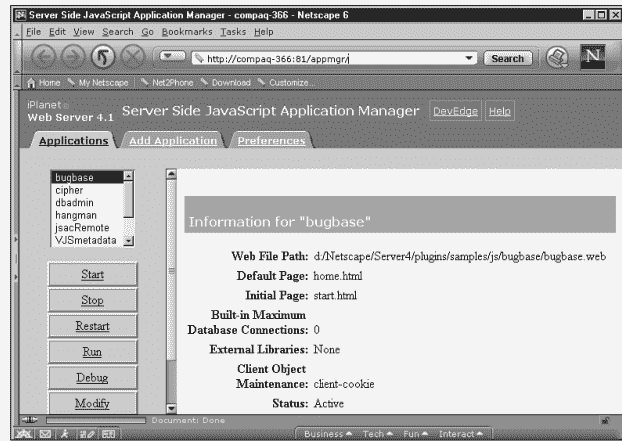

**图 5.1** 企业级服务器的服务器端 JavaScript 应用程序管理器。


此管理器不仅仅是启动和停止应用程序，它在验证当前状态和信息、调试以及设置配置选项方面最有用。在应用程序被编译并添加到服务器端 JavaScript 应用程序管理器之后，此界面用于维护程序的所有方面——当然，不包括实际代码编写。然而，在使用 JavaScript 应用程序管理器之前，你必须执行以下操作。

## 配置

在使用 JavaScript 应用程序管理器之前，你必须执行以下操作。

| 设置 | 描述 |
| --- | --- |
| 外部库 | 这包含你的应用程序可能正在使用的任何外部库的绝对路径。 |
| 客户端对象维护 | 此默认选项用于确定你是否要在应用程序中维护用户会话。可能的选择包括客户端 Cookie（Client Cookie）、客户端-URL（Client-URL）、服务器-IP、服务器-Cookie 和服务器-URL。 |

在指定了“添加应用程序时的默认值”部分的选项后，请指定您的偏好。在“偏好”（Preferences）部分中，有两个项目设置为：

- 确认（Confirm On）——此选项决定了在执行任务之前是否弹出确认对话框。可以启用此功能的任务列表包括：删除、启动、停止和重启应用程序。
- 调试输出（Debug Output）——此选项允许您选择是在应用程序的“同一窗口”（Same Window）还是“其他窗口”（Other Window）中进行调试。

完成这些设置后，点击 `OK` 按钮。这将完成服务器端 JavaScript 应用程序器的配置。可以通过点击用户界面内的链接访问额外的帮助或文档。

# Netscape 服务端 JavaScript 165

# 脚本管理

管理脚本可能是部署 Web 应用程序时最容易忽视的方面之一。心态似乎是：“它被写成永远不会出错。”正如我们大家所知，这在现实世界中并不成立。即使是完美运行了多年的应用程序最终也会遇到问题。这可能是升级到新服务器之后，也可能是新浏览器的出现，它对某些客户端 JavaScript 实现与预期不同。无论如何，这种情况都会发生，所以请做好准备。

服务器端 JavaScript 应用程序管理器提供了一个管理应用程序以及对其进行维护的区域。你可以在 DevEdge 访问在线文档，并为任何可用标签页启动文档帮助窗口。

当选择标签页（Tabs）时，你将看到当前安装的应用程序列表。这些位于该部分顶部的滚动区域。选择一个应用程序后，就可以使用表 5.4 中定义的所有选项。

## 表 5.4 控制部分中的应用程序选项

| 控制选项 | 描述 |
| --- | --- |
| 启动 (Start) | 启动应用程序并供用户使用 |
| 停止 (Stop) | 停止所选应用程序 |
| 重启 (Restart) | 停止并重启所选应用程序 |
| 运行 (Run) | 启动一个单独窗口并加载到所选应用程序的 URL。这允许你快速测试应用程序以确保其正常运行。 |
| 调试 (Debug) | 根据你设置的偏好，启动一个或两个窗口来调试你的应用程序。 |
| 修改 (Modify) | 允许你修改对该应用程序的任何设置。 |
| 删除 (Remove) | 将应用程序从你的管理应用程序列表中移除。 |

本节讨论了管理应用程序的能力。当选择一个应用程序时，会显示其信息及其当前状态。现在来看看使用调试（Debug）功能，这对于任何服务端 JavaScript 开发者来说都是非常有价值的工具。

要启动调试窗口，请选择要调试的应用程序并点击 `Debug` 按钮。根据偏好的设置，你将看到一个或两个主窗口。如果只有一个窗口，它将拆分为两个帧。

其中一个元素是调试，如图 5.3 中的单窗口所示。随着程序的运行，随着 JavaScript 在应用程序内部处理，该窗口的内容将随之改变。此工具提供了查看往来信息的视图。你可以看到被设置的变量，以及创建的对象及其状态。

图 5.3 调试窗口用于显示有关正在调试的应用程序的各种信息。

# Microsoft ASP 环境 167

作为一名程序员，你通常想知道你创建的变量的值以及方法的返回值。服务端 JavaScript 通过在脚本中使用 `debug()` 方法在运行时将信息写入“跟踪信息”（Trace Information）窗口，实现了这一可能。此方法类似于 `write()` 服务端方法，在这些方法中传递一个字符串或变量，解释器会将传递的数据写入窗口。该方法的典型用法可能如下所示：

```
debug("myFunction entered and passed: " + myVar);
```

有关如何使用 `debug()` 方法的更多信息，请参阅第 9 章“服务端”中的对应条目。

除了了解如何调试应用程序外，理解可能遇到的错误消息也很重要。错误有两种类型。其中一种错误（常见于语法错误）是标准的服务端 JavaScript 错误。此错误将返回发生错误的对象、错误消息、应用程序的文件名以及行号。

第二类错误由数据库生成。这些错误可以返回不同类型的信息，但通常包含以下内容：

- 数据库/函数（Database/Function）——这提醒程序员发生了数据库错误，并列出发生错误的函数。
- LiveWire 服务错误（LiveWire Services Error）——这表示发生了错误，并列出来自 LiveWire 数据库连接服务的错误原因消息。
- 厂商错误（Vendor Error）——这也由 LiveWire 服务返回，但它向其所属的数据库报告了错误。

# ASP.NET（以前称为 ASP+）

# 第 5 章：服务器端的 JavaScript

# 服务器支持

在环境中开发任何服务端 JavaScript 之前，你首先应该确保你所拥的支持。表 5.5 列出了服务器端各种 JavaScript 版本。

## 表 5.5 服务端 JavaScript 支持

| JavaScript 版本 | IIS 支持 | ASP 版本 |
| --- | --- | --- |
| 2.0 | 3.0 | 1.0 |
| 3.0 | 4.0 | 2.0 |
| 5.0 | 5.0 | 3.0 |
| 6.0 | 6.0 | ASP.NET |

# 使用 JavaScript 语言

在我们继续之前，关于 Microsoft 的 JavaScript 实现有一个有趣的说明。与目前支持 ECMAScript 脚本语言的其他浏览器和环境不同，Microsoft 应用程序内部的 JavaScript 引擎是可以升级的。这意味着你可能只运行 IIS 4.0，但可以下载并安装 JavaScript 5.6 引擎。

实际上使用 JavaScript 非常简单。正如我们在第 1 章“对程序员来说什么是 JavaScript？”中所提到的，有几个表 5.6 中列出的额外对象需要你注意。除了这些对象外，你可以使用熟悉的对象、属性和方法。

## 表 5.6 服务端 JavaScript 对象

| 对象 | 描述 |
| --- | --- |
| Application (应用程序) | 允许在给定应用程序的所有用户之间共享信息的元素。 |
| ASPError (ASP错误) | 允许获取 ASP 应用程序中可能发生的错误信息。 |
| ObjectContext (对象上下文) | 允许提交或取消由脚本启动的事务。 |
| Request (请求) | 包含向 IIS 发起请求的特定元素。 |
| Response (响应) | 包含向用户浏览器返回请求的特定元素。 |
| Server (服务器) | 包含运行环境的特定元素。这包括对各种环境变量的访问。 |
| Session (会话) | 包含特定用户会话的元素。 |

# 服务端 JavaScript 的用途 169

> 注意：关于这些对象及其属性、方法、事件和集合的更多信息，请参见第 9 章。

## 检查您的环境

在使用 JavaScript 构建 ASP 应用程序之前，有几点你需要注意。这些项目在不同版本的 IIS 中可能略有不同，但在概念上它们是一致的。

- 确保您的 IIS 安装已配置为使用 `asp.dll` 加载并执行 `.asp` 文件。
- 确保您的主目录（Home Directory）权限允许脚本（Script）或执行（Execute）权限。
- 确保您要么在页面上显式将 JavaScript 设置为语言，要么在您的 IIS 实例属性中将其设置为默认语言。

尽管这些项目看似微不足道，但未设置它们会导致您的脚本无法运行。默认情况下，除了默认语言不是 JavaScript 外，所有内容都会配置正确。要进行测试，你可以使用列表 5.1 中的代码。如果你能够通过 IIS 向浏览器提供该页面并显示“It Works”，你就可以继续学习本章节后面的 ASP 示例。

## 列表 5.1 测试 ASP 是否在您的 IIS 实例中正常运行的示例代码

```html
<html>
<head>
<title>JavaScript within ASP Test</title>
</head>
<body>
<script language="JavaScript" runat="server">
// 向用户页面写入 "It Worked!"。
Response.Write("It Worked!");
</script>
</body>
</html>
```

# 服务端 JavaScript 的用途

现在你已经了解了服务端和客户端 JavaScript 的一些区别，以及如何在适当环境中创建应用程序，请看一看服务端 JavaScript 的某些用途。本节并不尝试列出你可能遇到的所有用途，而是讨论了使用服务端 JavaScript 的一些常见方面。我们包含了针对服务端实现的特定环境的示例，这应该让你对这种强大语言可以做的事情有一个良好的认知。

## 在企业服务器中

由于服务器环境和 IIS 环境不同，它们对 JavaScript 语言的实现也不同，我们将首先查看针对企业服务器的示例。在本节中，我们将探索以下内容：

- 数据库连接
- 电子邮件
- 文件操作

### 数据库连接

服务端 JavaScript 的主要功能之一是其连接到数据库的能力。如你所知，Netscape 为使用标准化技术铺平了道路，当在连接数据库时，你可以对此抱有不一样的期待。它提供了对行业领先数据库的原生支持，如 DB2、Informix、Oracle 和 Sybase 数据库，以及通过 ODBC 访问其他数据库（例如微软的 SQL Server）。

服务端 JavaScript 提供连接数据库的功能通过其 `LiveWire` 服务实现，该服务不再需要作为单独组件安装。此服务提供了可以用于连接到各种数据库的 JavaScript 对象。一旦连接，你就可以运行执行所需操作所需的 SQL 语句。

> 注意：当 Netscape 发布企业服务器第 2 版本时，LiveWire 是“服务端 JavaScript”的统称。等到企业服务器第 3 版本发布时，JavaScript 作为行业标准的接受度已经提高。为了保持术语上的一致性，从企业服务器第 3 版本开始，LiveWire 术语现在已与允许开发者编写代码与数据库交互的服务相关。

到数据库的连接维护在池（pool）中。在打开数据库连接并能够对其执行查询之前，你必须创建一个 `DbPool` 对象的实例。当创建实例时，你可以根据需要从池中获取连接。可以在不指定任何连接参数的情况下创建一个池。但是，在尝试第一次连接时，你必须传递参数。

以下代码是创建 `DbPool` 对象的语法。每个参数在示例后的项目符号列表中定义。

```
var myPool = new DbPool(DBType, DBInstance, UID, PWD, DBName, MaxConn, CommitFlag);
```

- DBType——数据库的类型。可能的值有 ORACLE、SYBASE、INFORMAT、DB2 或 ODBC。
- DBInstance——这是数据库的实例名称。对于 ODBC，它是 DSN 条目名称。
- UID——你希望连接时身份的用户名或 ID。
- PWD——你想要登录的用户密码。对于 Oracle、DB2 和 ODBC 连接，这应该是空字符串 `""`。在 Oracle 中，这些连接的数据库名称在 `tnsnames.ora` 文件中设置并由 DSN 连接定义。DB2 没有数据库名称，仅通过 `DBInstance` 引用。
- MaxConn——池的最大连接数。这实际上是池将为数据库打开的连接数。
- CommitFlag 定义了在释放连接时是否提交挂起的事务。如果设置为 `false`，则事务将回滚。如果设置为 `true`，则将提交。

由于可以通过传递一组有限的这些参数以及名称来创建此实例，因此在使用此对象之前，你应该参考第 9 章中的 `DbPool` 条目。

创建池后，你可以根据需要使用其中的连接。要提取连接，请使用你池上的 `connection()` 方法。这将返回一个可用连接。语法如下：

```
var myConn = myPool.connection(name, timeout);
```

- name——这是你给出的名称。
- timeout——你给出的秒数数值。

### 用户会话与数据库访问

关于如何管理用户会话和数据库访问的深入讨论超出了本书的范围。然而，在执行这些任务时，有一些你需要注意的项目。

你还应该知道如何适当管理用户对你的应用程序的连接。你的应用程序可能同时管理来自许多用户的连接。如果你的会话和连接发生交叉，你可能会向错误的用户发送错误的信息。

维护和管理你的会话和数据库连接是一个非常重要的因素，你应该非常小心。

### 电子邮件

另一个可以在服务端 JavaScript 中利用和实现的特性是发送邮件的能力。执行这些任务所需的属性和方法包含在 `SendMail` 对象中。

> 注意：请参考第 9 章“服务端”，获取关于 `SendMail` 对象的更多信息。

使用 `SendMail` 对象非常简单。只需设置你要发送的电子邮件中包含的属性并调用 `send()` 方法。如果遇到错误，可以使用提供的错误方法进行分析。列表 5.2 显示了此对象的示例，用于创建一个供用户发送电子邮件的页面。

## 列表 5.2 使用 SendMail 对象发送电子邮件

```javascript
// 如果发生错误，给用户他们应该就错误联系的
// 电子邮件地址，以及错误代码和
// 信息。
write("Error sending your message. Please send e-mail to ");
write(myMail.Error + " with the following error message");
write("Error " + myMail.errorCode + ": " + myMail.errorMessage());
}else{
    // 如果没有错误，告诉用户他们成功了。
    write("Your message was sent successfully!");
}else{
    // 如果调用此页面但未提交表单，则为用户编写
    // 电子邮件表单。
    write('<form name="MyForm" method="post">');
    write('<table border="1"><tr><td>');
    write('<table border="0">');
    write('<tr align="left" valign="top">');
    write('<td><b>To:</b></td>');
    write('<input type="text" name="Address" size="30"></td><td>');
    write('<tr align="left" valign="top">');
    write('<td><b>From:</b></td>');
    write('<input type="text" name="From" size="30"></td><td>');
    write('<tr align="left" valign="top">');
    write('<td><b>Subject:</b></td>');
    write('<input type="text" name="subject" size="30"></td><td>');
    write('<tr align="left" valign="top">');
    write('<td><b>Body:</b></td>');
    write('<textarea name="body"');
    write(' cols="60" wrap="soft"></textarea>');
    write('<td></td></tr>');
    write('<tr align="left" valign="top">');
    write('<td colspan="2" align="right"><input type="submit" value="Send Mail">');
    write('<td></td></tr>');
    write('</table>');
    write('</form>');
}
```

# 174 第 5 章：服务器端 JavaScript

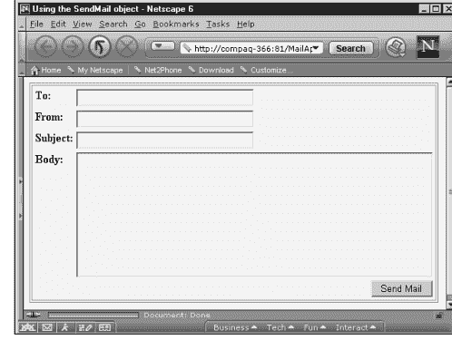

图 5.4 为你的应用程序构建邮件页面。

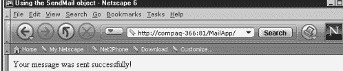

图 5.5 成功发送邮件页面的结果。

如示例所示，`SendMail` 对象可以轻松创建一个让用户可以通过该其发送邮件的页面。在真实的、完全开发的基于 Web 应用程序中，程序员应该添加代码来检查提交过程中的错误。此时是使用客户端 JavaScript 的良好时机，以确保输入了基本要求，例如语法正确的电子邮件地址。

### 文件操作

`File` 对象允许你执行各种系统任务，例如对磁盘上的文件进行读取和写入。`File` 对象本身具有许多方法和一个原型属性，这允许程序员创建对象的新属性和方法。

> 注意：关于 `File` 对象的更多信息，请参考第 9 章。

与 `SendMail` 对象类似，`File` 对象的使用非常直观。这些方法允许你对系统中的文件执行所需的各种任务。处理这些文件的功能部分允许程序员指定他想要如何打开文件。文件可以以读取、写入、追加或二进制模式打开。这些选项在 `open()` 方法中指定：

```
File.open("option");
```

在你的应用程序中，你可能想要显示文件的内容。这个程序可以是一个读取文件并在页面上显示其内容的应用程序。列表 5.3 包含一个显示选中文件内容的应用程序。

## 列表 5.3 使用 File 对象显示文件内容

```html
<html>
<head>
<title>Using File object</title>
</head>
<body>
<server>
// 检查他们是提交了还是仍然需要表单。
if(request.method == "POST"){

// 创建 File 对象的实例并将其传递给文件
var myLog = new File(request.file);

// 尝试打开文件。
if(!myLog.open("r")){

// 如果发生错误，告诉用户。
  write("There was an error opening the file: " + request.file);
}else{

  // 如果没有错误，则打开文件并显示它。
  write("<h3>The contents of ' + request.file + ' are follows:</h3>");
  while(!myLog.eof()){
    write(myLog.readline());
  }
}else{

// 如果调用此页面，则将选择框写入页面，
// 让用户选择他们想查看哪个日志。
write('<form name="myForm" method="post">');
write('<select name="file">');
write('<option value="/logs/admin.log">Admin Log</option>');
write('<option value="/logs/user.log">User Log</option>');
write('<option value="/logs/error.log">Error Log</option>');
write('</select>');
write('<input type="submit" value="View Log">');
write('</form>');
}
</server>
</body>
</html>
```

在这个示例中，用户有权选择文件进行查看。提交请求后，尝试打开文件。如果失败，则向用户返回错误。如果成功，则显示内容。

# IIS

在 IIS 侧，语法与服务器端不同，但保持了 JavaScript 语言的真实性。在本节中，我们将探索以下领域：

- 表单提交
- 会话处理

## 表单提交

在 Enterprise 和 IIS 环境中，关于服务器端 JavaScript 的优点之一是处理数据的便利性。这是通过使用 `Request` 对象及其相关的属性、方法和集合来实现的，这些将在第 9 章介绍。对于该对象，我们创建一个传递信息的表单。为了简单起见，我们将提示用户输入姓名。列表 5.4 包含了该页面的 HTML。

## 列表 5.4 用于表单的 HTML

```html
<html>
<head>
<title>ASP Form Example</title>
</head>
<body>
<form action="process.asp" method="post">
First Name:<input name="first" width="10"><br>
Last Name:<input name="last" width="10"><br>
<input type="submit" value="Submit">
</form>
</body>
</html>
```

# 177 服务器端 JavaScript 的用途

现在表单已经创建，我们必须创建一个 `process.asp` 文件来处理提交。在此文件中，我们将使用 `Response` 对象的 `Write()` 方法来输出传递的值。正如我们之前提到的，JavaScript 具有几个针对其 IIS 实现的特定。

我们将使用 `Request.Form` 集合，它接收你尝试访问的表单元素的名称。在我们的示例中，这将用于姓和名。列表 5.5 显示了我们可以用于完成此任务的代码。

## 列表 5.5 处理表单提交

```html
<html>
<head>
<title>ASP Form Example: Results</title>
</head>
<body>
<script language="JavaScript" runat="server">
// 输出表单中输入的姓和名
Response.Write("You entered (last, first format): " + '');
Response.Write(Request.Form("last") + ", " + Request.Form("first"));
</script>
</body>
</html>
```

## 服务器变量

ASP 的另一个用途是访问和使用各种服务器变量。例如，在许多情况下，Web 开发人员可能需要确定请求的浏览器。他可能希望将用户引导到特定的站点，或者发布警告消息。

在列表 5.6 中，我们使用 `Request.ServerVariables` 集合访问 `HTTP_USER_AGENT` 变量。加载到变量后，我们使用 `indexOf()` 方法通过整个用户代理字符串来判断它是否为 Internet Explorer。

## 列表 5.6 检测浏览器类型

```javascript
// Check to see if its Internet Explorer.
if (ua.indexOf("MSIE") != -1) {
    Response.Write("Welcome<br />");
    Response.Write("User-agent: ");
    Response.Write(Request.ServerVariables("HTTP_USER_AGENT"));
}

// Browser is not IE, so do something different.
else{
    Response.Write("You are not using an Internet Explorer browser<br />");
    Response.Write("User-agent: " + 
    Request.ServerVariables("HTTP_USER_AGENT"));
}
```

### 继续

到为止，我们已经涵盖了 JavaScript 在客户端和服务器端的使用。对于你们许多人来说，这代表了 JavaScript 可以实现的工作范围。然而，第 6 章“Windows 脚本”将勾勒另一个 JavaScript（或 JScript）立足的环境——Windows 脚本宿主机（Windows Script Host）环境。

## 第 6 章

### Windows 脚本

正如许多开发者所知，Windows 的一个大缺陷是缺乏用于自动化任务的脚本支持。大多数其他操作系统都内置某种类型的脚本引擎。当然，MS-DOS 中有批处理文件支持，但其功能非常有限，在 Windows 环境中并不好用。

微软意识到了这一局限性并在 Internet Explorer 3.0 中引入了 Windows 脚本规范。这为开发者为不同的浏览器构建脚本引擎提供了接口。从 Windows 脚本接口发展成了今天广为人知的 Windows 脚本宿主机。

## Windows 脚本宿主机

Windows 脚本宿主机 (WSH) 提供了为 Windows 环境自动化任务的能力。在 WSH 之前，MS-DOS 中提供了批处理文件。然而，它们并不强大，在 Windows 环境中用处很小。Windows 需要一种脚本语言，而 WSH 就是答案。假设你想获取计算机名称、添加桌面快捷方式并映射网络驱动器，而不需要单独执行每个任务。通过 Windows 脚本宿主机，所有这些任务可以通过单个脚本完成。

WSH 可以与几种不同的编程语言配合。Windows 98 和 NT/2000 的默认引擎支持 VBScript 和 JavaScript。本书重点关注 JavaScript 语言并将在示例中使用它。

WSH 的最新版本是 5.6。尽管它仍然是一个测试版本，但可以从微软网站下载脚本引擎。该版本的额外益处包括改进的参数处理、远程脚本能力、将进程视为对象、访问当前工作目录以及改进的安全模型。

Windows 脚本宿主机允许你使用来自 WSH 对象的各种方法和属性创建脚本，并将其保存为 .wsf 扩展的文件。这指定了该文件是一个 Windows 脚本宿主机文件。让我们来看一个简单的 WSH 文件示例。列表 6.1 显示了一个 WSH 文件，当你的脚本运行时它将显示本地机器的用户名。

## 列表 6.1 WSH 文件示例

```
<job>
<script language="JavaScript">
var WshNetwork = Wscript.CreateObject("Wscript.Network");
Wscript.Echo("The user name is: " + WshNetwork.UserName);
</script>
</job>
```

WSH 脚本的语法非常简单。你将功能包含起始和结束的 `<job><script>` 标签之间。这与普通的 JavaScript 或 JavaScript 程序类似。此脚本可以通过几种不同的方式运行。这些方法将在本章讨论。

## 架构

Windows 脚本宿主机的架构非常基础。只有几个组件共同工作，使 WSH 脚本运行起来。它们是脚本本身、Windows Shell、Windows 注册表和 WSH 引擎。图 6.1 显示了指示组件如何相互作用以处理脚本的图。

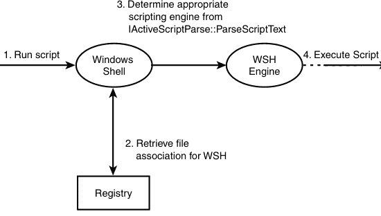

图 6.1 WSH 架构。

如你所示，Windows Shell 是第一个遇到脚本文件的组件。Shell 然后必须确定该文件是什么，通过查找注册表中的文件关联。当它获取了这些信息后，可以将文件传递给 Windows 脚本宿主机引擎，该引擎将使用 `IActiveScript::ParseText` 方法确定哪个特定脚本将交给 JavaScript 引擎、Visual Basic Script 引擎、Perl 引擎等。

## 对象模型

WSH 基于对象模型层次结构，由 14 个对象组成。每个对象都源于 `WScript` 对象（根对象）。WSH 对象模型如图 6.2 所示。

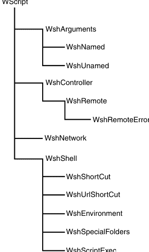

图 6.2 WSH 对象模型层次结构。

并不是每个对象都可以直接实例化。`WScript` 对象在每个 WSH 脚本中都是可用的，不需要实例化。可以实例化的对象是 `WshController`、`WshNetwork` 和 `WshShell`。要创建这些对象，使用 `CreateObject` 方法。所有其他对象都是通过顶层对象间接创建的。WSH 对象模型暴露了可以操作的 COM 对象。

## 优点与局限

WSH 既有优点也有局限性。Windows 脚本宿主机允许你使用来自 WSH 对象的各种方法和属性创建脚本，并将其保存为 .wsf 扩展的文件。这指定了该文件是一个 Windows 脚本宿主机文件。让我们来看一个简单的 WSH 文件示例。列表 6.1 显示了一个 WSH 文件，当你的脚本运行时它将显示本地机器的用户名。

*(注：此处由于原文存在大量重复段落，译文按要求保留了所有重复内容)*

## Windows 脚本组件

WSH 基于对象模型层次结构，由 14 个对象组成。每个对象都源于 `WScript` 对象（根对象）。WSH 对象模型如图 6.2 所示。

可以实例化的对象是 `WshController`、`WshNetwork` 和 `WshShell`。要创建这些对象，使用 `CreateObject` 方法。所有其他对象都是通过顶层对象间接创建的。WSH 对象模型暴露了可以操作的 COM 对象。

## WScript

`WScript` 对象在每个 WSH 脚本中都是可用的，不需要实例化。可以实例化的对象是 `WshController`、`WshNetwork` 和 `WshShell`。要创建这些对象，使用 `CreateObject` 方法。所有其他对象都是通过顶层对象间接创建的。WSH 对象模型暴露了可以操作的 COM 对象。

## WshShell

`WshShell` 是非常有用的对象。它用于操作注册表、创建快捷方式、启动新进程以及读取系统信息。它为你的程序提供了 `ENVIRONMENT` 集合，允许你访问环境变量。（参阅第 15 章了解有关 `WshShell` 的所有方法和属性。）

## WshNetwork

`WshNetwork` 对象用于执行许多不同的网络任务。通过此对象，你可以添加打印机连接、获取计算机名称、映射网络驱动器、设置默认打印机、用户域等。这类任务对于 Windows 网络管理员来说非常有用。（参阅第 15 章了解有关 `WshNetwork` 的所有方法和属性。）

# 184 第 6 章：Windows 脚本

到他们的机器。管理员可以创建一个所有用户都可以运行的 WSH 脚本，将打印机添加到他们的机器。在列表 6.3 中，我们看到了添加新打印机的代码。

## 列表 6.3 使用 WshNetwork 对象添加打印机

```
<job>
<script language="JScript">
// Create Arguments object.
WshArgObj = WScript.Arguments;

// Read in the username and password.
var username = WshArgObj.Item(0);
var passwd = WshArgObj.Item(1);

// Create a new Network object and add printer.
var WshNetwork = new CreateObject("Wscript.Network");
var printer = "\\printers\NewPrinter";
var localName = "myPrinter";
WshNetwork.AddPrinterConnection(localName, printer, username, passwd);
</script>
</job>
```

由于此脚本需要用户输入，建议使用命令行方法 `cscript.exe` 执行脚本。有关 `cscript.exe` 和 `wscript.exe` 区别的更多信息，请参阅“执行脚本的方法”部分。用户将其用户名和密码作为参数指定。假设文件名为 "addPrinter.wsf"，在 MS-DOS Windows 下的执行方式如下：

```
cscript addPrinter.wsf Betty pass123
```

## 执行脚本的方法

要运行 WSH 脚本，你需要在操作系统上安装 Windows 脚本引擎。这包含在 Windows 98 和 NT/2000 中。对于 Windows 95 用户，可以通过从微软网站下载并安装引擎来启用 WSH 引擎。更多信息请访问 http://msdn.microsoft.com/scripting。

安装后，WSH 脚本可以在两种模式下运行。它们是基于 Windows 的和基于 dos（命令的）。你运行脚本的模式取决于你打算完成的任务。如果你打算使用某些用户交互并想要图形组件，则首选基于 Windows 的执行（`wscript.exe`）。如果你的脚本需要执行只能在 MS-DOS 中完成或很少用户交互的任务，则应使用基于命令的执行（`cscript.exe`）。两种执行方法都可以从命令行运行，并可以指定某些选项。它们列在表 6.1 中。

## 表 6.1 wscript.exe 和 cscript.exe 选项

| 类型 | 描述 |
| :--- | :--- |
| //B | 指定批模式。抑制用户提示和脚本错误消息。 |
| //D | 启用调试器。 |
| //E:engine | 使用指定的脚本引擎运行脚本。 |
| //H:cscript | 使用 `cscript.exe` 作为默认执行方法。 |
| //H:wscript | 使用 `wscript.exe` 作为默认执行方法。 |
| //I | 指定交互模式。显示用户提示和脚本错误。 |
| //Job:jobID | 执行来自 .wsf 指定 jobID。 |
| //logo | 显示执行横幅。 |
| //nologo | 防止显示执行横幅。 |
| //S | 设置脚本运行的最大秒。 |
| //U | `wscript.exe` 不可用。 |
| //X | 在调试器中启动程序。 |
| //? | 帮助。显示命令参数的信息。 |

要从命令行通用地执行脚本，请遵循以下语法：

```
wscript <filename> [[options]] [arguments]
cscript <filename> [[options]] [arguments]
```

参数应用空格分隔。WSH 还支持参数的拖放功能。你可以将文件拖放到 WSH 文件上——只要你的脚本被编写为解析参数——它将会将你拖放的文件视为参数。

## 基于 Windows 的脚本

基于 Windows 的脚本允许你利用 WSH 的图形能力。如果你的脚本需要视觉交互，这特别有用。请注意，WSH 没有非常复杂的对话框。图形组件主要限于 VBScript 或 JavaScript 中的可用对话框。

最简单的方法是双击启动。第二种方法是从 Windows 菜单的“运行”选项选择 WSH 文件并点击 OK 运行。第三种方法是使用 `wscript.exe` 从命令行运行你的脚本。这些方法任何一种都可以工作，取决于喜好。见图 6.3。

图 6.3 从“运行”选项运行脚本。

## 列表 6.4 简单的 Hello World 脚本

```
<job>
<script language="JavaScript">
// Output the Hello World text.
WScript.Echo("Hello World!");
</script>
</job>
```

如果我们作为 Windows 脚本运行，输出将显示如图 6.4 所示的弹出窗口。

图 6.4 弹出显示。

## 基于命令的脚本

WSH 脚本也可以从命令提示符运行。这是在 DOS 环境中使用执行文件实现的。例如，如果想运行名为 "hello.wsf" 的脚本，在命令提示符输入：

```
cscript hello.wsf
```

此示例假设你在相同的目录运行脚本。其他参数或选项将添加到脚本名称之后。如果你想使用交互模式并传递字符串作为参数，你的脚本调用如下：

```
cscript hello.wsf //I
```

基于命令的脚本也可以像基于 Windows 的脚本一样输出。然而，与 Windows 的弹出窗口不同，脚本输出抑制到相同的 DOS 窗口。这是基于命令脚本的缺点之一。没有提供图形组件。在图 6.5 中，Hello World 程序示例在屏幕显示“Hello World”。

图 6.5 输出显示。

## 远程脚本

使用最新版本的 WSH（5.6），可以远程执行脚本。这允许你跨网络远程管理任务。这些任务可以同时执行。你可以远程启动、停止并获取 WSH 脚本的状态。如果在 `WshRemote` 对象期间发生错误，可以获取行号、错误描述甚至错误的源代码。

当执行远程脚本时，本地机器会在执行前将脚本复制到远程机器。在执行远程脚本之前，必须设置适当的安全设置。要在你的机器上设置远程脚本，请遵循三个步骤：首先安装 WSH 5.6（如果尚未安装）。第二步是将远程机器添加到本地管理员组。第三步是通过 `Registry.exe` 启用远程 WSH。处理好，你的机器就准备好进行远程脚本操作了！

远程脚本有一个注意事项。远程脚本只能在 Windows 2000/NT 环境运行。Windows 9x 引擎不支持此功能，因为无法验证非 NT 用户。

## 如何使用远程脚本

那么如何使用远程脚本？WSH 提供了 `WshRemote` 对象以及控制远程脚本执行的各种属性和方法。`WshRemote` 对象通过 `WshController` 对象创建。获取控制器对象后，你可以使用 `CreateScript` 方法指定要执行的脚本。此方法实际上返回一个 `WshRemote` 对象，可以使用其 `execute()` 方法运行脚本。

对于大多数计算机程序，并不是所有脚本都能无错误运行。但这不是问题。WSH 对象模型包含了 `WshRemoteError` 对象，用于获取各种错误信息。它不是一个即时实例化的对象，而是作为 `WshRemote` 对象的子对象可用。

## 远程脚本示例

让我们来看远程脚本的示例。在列表 6.5 中，要在名为 "blue" 的机器上远程运行维护脚本。首先创建一个 Controller 对象 `WshCtrlObj`。使用 `CreateScript` 方法创建一个 `WshRemote` 对象的实例。要运行的脚本路径和机器名作为参数传递。我们设置了一些事件进行捕获并执行脚本。添加了一个打印语句仅用于检查状态。我们的当前脚本会在等待远程脚本执行完成时睡眠。如果发生任何错误，可以使用 `remote_error` 函数显示所有错误信息。

## 列表 6.5 远程脚本示例

```
<job>
<script language="JScript">
// Create a WshController object.
WshCtrlObj = WScript.CreateObject("WScript.Controller")
// Create a WshRemote object.
remoteScript = WshCtrlObj.CreateScript("c:\remote_tasks\maintenance.wsf",
"blue");
// Catch events.
WScript.ConnectObject(remoteScript, "RemoteScript_")
// Start the script.
remoteScript.Execute();
// Print the current status.
WScript.Echo("The current status of the remote script is: " + 
remoteScript.Status);
while (remoteScript.Status!=2) {
  WScript.Sleep(100)
}
// Catch errors.
function remote_Error() {
var myError = remoteScript;
var errorString = "An Error occurred in the remote execution\n";
errorString += "The remote error: " + myError.Description + "\n";
errorString += "occurred at line number: " + myError.Line + "\n";
errorString += "character: " + myError.Character + "\n";
errorString += "The Source for the Error is: " + myError.Source + "\n";
WScript.Echo(errorString);
}
</script>
</job>
```

# 继续进

在本章中，我们讨论了 Windows Script Host (WSH) 的许多方面。我们详细查看了对象模型以及几个特定的对象。我们讨论了运行 WSH 脚本的两种方法，甚至是如何远程运行脚本。尽管 WSH 5.6 仍处于测试版本，但可以使用它完成很多工作。随着 WSH 的持续演进，请关注更多将添加的内容。

# 第三部分

# JAVASCRIPT 索引

| | | | 页码 |
| --- | --- | --- | --- |
| + 7 | 核心语言 | 193 | |
| 8 | 客户端 | 563 | |
| 9 | 服务端 | 1175 | |

CD-光盘

| | | | 页码 |
| --- | --- | --- | --- |
| + 10 | DOM 核心 | CD:1403 | |
| 11 | DOM HTML | CD:1479 | |
| 12 | DOM 事件 | CD:1731 | |
| 13 | DOM CSS | CD:1767 | |
| 14 | JScriptRunTime | CD:1823 | |
| 15 | Windows Script Host | CD:1927 | |

# 第 7 章

# 核心语言

本章是对构成核心 JavaScript 和 JavaScript 语言的所有项目和元素的详细参考，并包含了 ECMA-262 第 3 版标准（ECMAScript）中的信息。由于 JavaScript、JScript 和 ECMAScript 的细节略有不同，每个标准对“核心”的定义也不同。由于这些差异，本章涵盖了在某个标准中被视为核心、但在其他标准中可能不存在的项目。语言的每一个细微差别都被涵盖，为您提供一个解答所有问题的集中地。每个条目都包含版本、环境支持、语法、描述、示例以及许多其他细节。

本章按对象的字母顺序排列，以便您快速、方便地访问语言的主要部分。每个对象的方法、属性、函数和事件处理程序在其相应的父对象之后按字母顺序出现，使用了使语言如此易学习的简单点符号。例如，`sin()` 函数出现在 `Math` 对象之后，显示为 `Math.sin()`。

## @alpha

JScript 3.0+ / IE 4+

### 语法

`@alpha`

### 描述

`@alpha` 变量用于 JScript 条件编译，用以判断是否在使用 DEC Alpha 处理器。当该变量不为真时，它的行为类似于 `NaN`，尽管在技术上它是未定义的。

### 示例

列表 7.1 在使用 DEC Alpha 处理器时提醒用户。

#### 列表 7.1 检测 DEC Alpha 处理器

```javascript
<script type="text/javascript" language="JavaScript">
<!--
  if (@alpha)
    alert("You are using a DEC Alpha processor.")
  else
    alert("You are NOT using a DEC Alpha processor.")
  end
-->
</script>
```

## @_javascript

JScript 3.0+ / IE 4+

### 语法

`@_javascript`

### 描述

`@_javascript` 变量用于 JScript 条件编译，用以判断是否在使用 JScript。此变量始终为真。

### 示例

列表 7.2 根据 `@_javascript` 变量的值显示警报框。

#### 列表 7.2 检测 JScript

```javascript
<script type="text/javascript" language="JavaScript">
<!--
  if (@_javascript)
    alert("The @_javascript variable is true.")
  else
    alert("The @_javascript variable is NOT true.")
  end
-->
</script>
```

## @_jscript_build

JScript 3.0+ / IE 4+

### 语法

`@_jscript_build`

### 描述

`@_jscript_build` 变量用于 JScript 条件编译，用以存储 JScript 脚本引擎的生成号。

> 注意：在访问 `@_jscript_build` 变量之前，请使用 `@cc_on` 语句来定义该变量。有关 `@cc_on` 语句的更多信息可以在本章后面找到。

### 示例

列表 7.3 使用 `@_jscript_build` 变量显示当前使用的 JScript 引擎的生成号。

#### 列表 7.3 获取 JavaScript 生成号

```jscript
<script type="text/javascript" language="JScript">
// 条件编译以便 @_jscript_build 变量被定义。
@cc_on

// 使用 @_jscript_build 变量显示 JScript 生成号。
document.write("*The JScript engine build number is ",@_jscript_build);
// -->
</script>
```

## @_jscript_version

JScript 3.0+ / IE 4+

### 语法

`@_jscript_version`

### 描述

`@_jscript_version` 变量用于 JScript 条件编译，用以以主.次的格式存储 JScript 版本号。

> 注意：在访问 `@_jscript_version` 变量之前，请使用 `@cc_on` 语句来定义该变量。

### 示例

列表 7.4 使用 `@_jscript_version` 变量显示当前使用的 JScript 引擎的版本号。

#### 列表 7.4 获取 JScript 版本号

```javascript
<script type="text/javascript" language="JScript">
// 条件编译以便 @_jscript_version 变量被定义。
@cc_on

// 使用 @_jscript_version 变量显示 JScript 版本号。
document.write("*The JScript version is ",@_jscript_version);
// -->
</script>
```

## @mac

JScript 3.0+ / IE 4+

### 语法

`@mac`

### 描述

`@mac` 变量用于 JScript 条件编译，用以判断是否在使用 Macintosh 处理器。当该变量不为真时，它的行为类似于 `NaN`，尽管在技术上它是未定义的。

### 示例

列表 7.5 在使用 Macintosh 处理器时提醒用户。

#### 列表 7.5 检测 Macintosh 处理器

```javascript
<script type="text/javascript" language="JavaScript">
<!--
  if (@mac)
    alert("You are using a Macintosh processor.")
  else
    alert("You are NOT using a Macintosh processor.")
  end
-->
</script>
```

## @_javascript

JScript 3.0+ / IE 4+

### 语法

`@_javascript`

### 描述

`@_javascript` 变量用于 JScript 条件编译，用以判断是否在使用 JScript。此变量始终为真。

### 示例

列表 7.2 根据 `@_javascript` 变量的值显示警报框。

#### 列表 7.2 检测 JScript

```javascript
<script type="text/javascript" language="JavaScript">
<!--
  if (@_javascript)
    alert("The @_javascript variable is true.")
  else
    alert("The @_javascript variable is NOT true.")
  end
-->
</script>
```

## @_javascript_build

JScript 3.0+ / IE 4+

### 语法

`@_jscript_build`

### 描述

`@_jscript_build` 变量用于 JScript 条件编译，用以存储 JScript 脚本引擎的生成号。

> 注意：在访问 `@_jscript_build` 变量之前，请使用 `@cc_on` 语句来定义该变量。有关 `@cc_on` 语句的更多信息可以在本章后面找到。

### 示例

列表 7.3 使用 `@_jscript_build` 变量显示当前使用的 JScript 引擎的生成号。

# 200 第 7 章：核心语言

# 列表 7.10 继续

```javascript
@else
alert("您没有使用英特尔处理器。");
@end

// ->
</script>
```

## @cc_on

JScript 3.0+ / IE 4+

### 语法

`@cc_on`

### 描述

`@cc_on` 语句用于在脚本引擎中激活 JavaScript 条件编译。

### 示例

列表 7.11 显示了在 JavaScript 代码中可以使用 `@cc_on` 语句来获取 JavaScript 版本。

#### 列表 7.11 激活条件编译

```javascript
<script type="text/javascript" language='JScript'>
<!--
// 设置条件编译，以便 @_jscript_version 变量将通过定义。
@cc_on

// 使用 @_jscript_version 变量显示 JavaScript 版本号
document.write("The JavaScript version is ",@_jscript_version).

// ->
</script>
```

## @if

JScript 3.0+ / IE 4+

### 语法

```javascript
@if (condition1)
statement1
@elif (condition2)
statement2
@else
statement3
@end
```

# 核心语言 201

### 描述

`@if` 语句的操作方式与典型的 `if` 条件语句非常相似，但它评估变量且语法略有不同。如果 `condition1` 中的表达式求值为真，则执行 `statement1`。否则，将评估 `condition2` 以确定是否应该评估 `statement2`。`@elif` 语句的操作方式与 JavaScript 的 `else...if` 语句相同，尽管它们形式有所不同。你可以根据需要使用许多 `@elif` 语句，也可以完全不使用。应该只使用一个 `@else` 语句来检查不符合之前任何条件判断的情况。与 `@if` 语句类似，`@else` 语句是可选的。在所有 `@if` 条件判断的末尾必须使用 `@end` 语句。

### 示例

列表 7.12 根据正在使用的处理器类型显示消息。

#### 列表 7.12 使用 @if 显示处理器类型

```javascript
<script type="text/javascript" language="JScript">
<!--
// 通知用户他们正在使用哪种类型的处理器。
@if(@alpha)
alert("You are using a DEC Alpha processor.")
@elif(@mc680x0)
alert("You are using a Motorola 680x0 processor.")
@elif(@PowerPC)
alert("You are using a Motorola PowerPC processor.")
@elif(@x86)
alert("You are using an Intel processor.")
@else
alert("I don't know what type of processor you have!")
@end
-->
</script>
```

## @set

JScript 3.0+ / IE 4+

### 语法

```javascript
@set @varName = value
```

# 202 第 7 章：核心语言

### 描述

`@set` 属性允许创建 JScript 变量。变量名必须以 `@` 字符开头。如果变量在定义之前被使用，其值将为 `NaN`。

### 示例

列表 7.13 使用 `@set` 属性创建一个名为 `@number` 的自定义编译变量，并将数字 25 赋值给该变量。该变量用于在浏览器中显示句子。

#### 列表 7.13 使用 @set 属性创建自定义编译变量

```javascript
<script type="text/javascript" language="JScript">
<!--
// 创建一个自定义编译变量 @number 并将其设为 25
@set @number = 25;

// 根据存储在自定义编译变量 @number 中的值
// 在浏览器中显示句子。
if(@number == 25)
document.write("Number is equal to @number);
else
document.write("Number is not equal to 25.");
//-->
</script>
```

### 运算符

## - (减法)

JavaScript 1.0+ / ECMAScript 1E+ / JScript 1.0+ / Nav2+ / NES2+ / IE 3+ / Opera3+

### 语法

```javascript
num1 - num2
```

### 描述

运算符右侧的数字从运算符左侧的数字中减去。如果任一操作数是字符串，则在执行操作之前尝试将字符串转换为数字。

### 示例

列表 7.14 中的代码由数字 "45" 创建了一个字符串。在从数字 25 中减去之前，该字符串被转换为数字。减法操作的结果 (20) 被显示出来。

#### 列表 7.14 使用减法运算符

```javascript
<script type="text/javascript" language="JavaScript">
<!--
// 将数字 45 声明为字符串
aString = new String("45");

// 从 45 减 25
answer = aString - 25;
document.write("answer = (45-25)<br>");

// Answer 等于 20
document.write("answer = ",answer);
// -->
</script>
```

## - (一元否定)

JavaScript 1.0+ / ECMAScript 1E+ / JScript 1.0+ / Nav2+ / NES2+ / IE 3+ / Opera3+

### 语法

```javascript
-num
```

### 描述

一元否定运算符更改 `num` 的符号。在否定一个变量时，变量的内容不会改变；只有返回的值被取反。如果操作数是字符串，则在执行一元否定操作之前将其转换为数字。

### 示例

列表 7.15 中的代码创建了字符串 "36"。在进行否定之前，该字符串被转换为数字。否定操作的结果是 -36。

#### 列表 7.15 使用否定运算符

```javascript
<script type="text/javascript" language="JavaScript">
<!--
// 将数字 36 声明为字符串
aString = new String("36");

// 否定 aString
answer = -aString;
document.write("answer = ",answer);
// -->
</script>
```

## -- (自减)

JavaScript 1.0+ / ECMAScript 1E+ / JScript 1.0+ / Nav2+ / NES2+ / IE 3+ / Opera3+

### 语法

```javascript
--variable
variable--
```

### 描述

自减运算符在第一个定义中将变量减 1（前置自减）。如果操作数是字符串，则在执行操作之前将其转换为数字。第二个定义是后置自减运算符，它的操作与前置自减运算符相似，将变量减 1，但返回值不同。

### 示例

列表 7.16 展示了前置自减和后置自减的区别。

#### 列表 7.16 使用自减运算符

```javascript
<script type="text/javascript" language="JavaScript">
<!--
// 存储字符串 2
num = new String("2");

// 前置自减
--num;
document.write("Pre-decrement: ",+num);

// 后置自减
num--;
document.write("Post-decrement: ",+num);
// -->
</script>
```

## ! (逻辑否定)

JavaScript 1.0+ / ECMAScript 1E+ / JScript 1.0+ / Nav2+ / NES2+ / IE 3+ / Opera3+

### 语法

```javascript
!operand
```

### 描述

`!` 运算符反转操作数返回的布尔值。因此，如果操作值为真，操作的结果为假。如果操作值为假，结果为真。当操作值是非布尔值时，在执行反转之前将其转换为真或假。

### 示例

在列表 7.17 中，字符 "1" 在使用 NOT 操作反转值之前被转换为真。变量 `ReverseTruth` 被赋值为假。

# 206 第 7 章：核心语言

#### 列表 7.17 使用逻辑否定运算符

```javascript
<script type="text/javascript" language="JavaScript">
<!--
// 创建包含 1 的变量
theTruth = new String("1");

// 反转存储在之前的变量值
theReverseTruth = !theTruth;

// 输出两个变量存储的值
document.write("theTruth =",theTruth+"<br>");
document.write("theReverseTruth = ",theReverseTruth);
// -->
</script>
```

## != (不等)

JavaScript 1.0+ / ECMAScript 1E+ / JScript 1.0+ / Nav2+ / NES2+ / IE 3+ / Opera3+

### 语法

```javascript
expression1 != expression2
```

### 描述

不等运算符比较第一个表达式和第二个表达式。如果表达式不相等，则操作返回真。如果它们相等，则返回假。

JavaScript 和 Microsoft 解释器在评估不等操作之前尝试将表达式转换为相同的数据类型，遵循以下规则：

- 在比较之前，`true` 被转换为数字 1，`false` 被转换为零。
- 如果任一操作数是 `NaN`，相等运算符返回假。
- `Null` 和 `undefined` 相等。
- `Null` 和 `undefined` 不等于 `0`、`""`（空字符串）或 `false`。
- 如果比较字符串和数字，尝试将字符串转换为数字然后检查相等性。
- 如果比较对象和字符串，尝试将对象转换为字符串然后检查相等性。
- 如果比较对象和数字，尝试将对象转换为数字然后检查相等性。
- 如果相等操作的两个操作数都是对象，则检查两个对象的地址是否相等。

在 JavaScript 1.2 中，曾决定不对不等于运算符的操作数进行类型转换。JavaScript 在 1.3 及后续版本中恢复了在该运算符上使用类型转换。

### 示例

在下面的示例中，字符串 "523" 被转换为数字（JavaScript 1.2 除外，它不执行类型转换），以便对两个数字进行比较。因为左操作数等于右操作数，因此浏览器窗口中写入了“字符串 523 等于数字 523”。

#### 列表 7.18 使用不等于运算符

```javascript
<script type="text/javascript" language="JavaScript">
<!--
// 在将此字符串与数字比较之前
// 字符串将被转换为数字。
if("523" != 523) {
  // 如果两个数字不相等，则显示此句子。
  document.write("The string 523 is NOT equal to the number 523");
} else {
  // 如果两个数字相等，则显示此句子。
  document.write("The string 523 is EQUAL to the number 523");
}
-->
</script>
```

## !== (非恒等)

JavaScript 1.3+ / ECMAScript 3E+ / JScript 1.0 / Nav 4.0+ / IE 3+ / Opera 5+

### 语法

```javascript
expression1 !== expression2
```

### 描述

非恒等运算符将第一个表达式与第二个表达式进行比较。如果运算符左侧的值不等于右侧的值，操作返回 `true`。如果值相等，则返回 `false`。

> 注意：在进行比较之前，不会对表达式进行任何类型转换。

### 示例

在列表 7.19 中，字符串 "8765*" 没有被转换为数字，因此两个表达式不是相同类型。由于两个操作数不是相同类型，它们不相等，因此浏览器窗口中写入了“字符串 8765 不等于数字 8765*”。

#### 列表 7.19 使用非恒等运算符

```javascript
<script type="text/javascript" language="JavaScript">
<!--
// 将字符串与数字比较，但不要
// 将字符串转换为数字。
if("8765*" !== 8765) {
  // 如果字符串和数字不相等，则显示此句子。
  document.write("The string 8765 is NOT equal to the number 8765*");
} else {
  // 如果字符串和数字相等，则显示此句子。
  document.write("The string 8765 is EQUAL to the number 8765*");
}
// -->
</script>
```

## % (模数)

JavaScript 1.0+ / ECMAScript 1E+ / JScript 1.0+ / Nav2+ / NES2+ / IE 3+ / Opera3+

### 语法

```javascript
num1 % num2
```

### 描述

模运算符的操作与除法运算符相同，通过将值除以右侧的值，但操作不是返回普通的除法结果，而是返回余数。如果任一操作数是字符串，则在执行操作之前尝试将字符串转换为数字。

### 示例

在列表 7.20 中，变量 `answer` 被赋值为 1，因为 7 除以数字 2 三次后余数为 1。这个余数被存储在变量 `answer` 中。

#### 列表 7.20 使用模运算符

```javascript
<script type="text/javascript" language="JavaScript">
<!--
// 1 被存储在变量 answer 中。
answer = 7 % 2;

// 显示变量 answer 中的值
document.write("answer =",answer);
// -->
</script>
```

## %= (模赋值)

JavaScript 1.0+ / ECMAScript 1E+ / JScript 1.0+ / Nav2+ / NES2+ / IE 3+ / Opera3+

### 语法

```javascript
variable %= value
```

### 描述

模赋值运算符将左侧变量存储的值除以右侧的值。操作返回余数并存储在运算符左侧的变量中。如果 `value` 是字符串，则在执行模运算和赋值之前尝试将字符串转换为数字。

### 示例

在列表 7.21 中，变量 `answer` 最初被赋值为 17。数字 17 除以数字 3。除法结果的余数部分（模）存储在变量 `answer` 中，覆盖了数字 3。

#### 列表 7.21 使用模赋值运算符

```javascript
<script type="text/javascript" language="JavaScript">
<!--
// 用 17 初始化变量 answer。
answer = 17;

// 数字 2 被存储在变量 answer 中。
answer %= 3;

// 显示存储在变量 answer 中的值
document.write("answer = ",answer);
// -->
</script>
```

## & (按位与)

JavaScript 1.0+ / ECMAScript 1E+ / JScript 1.0+ / Nav2+ / NES2+ / IE 3+ / Opera3+

### 语法

```javascript
num1 & num2
```

### 描述

按位与运算符将运算符两边的整数视为 32 位二进制。按位与 (`&`) 运算符评估左侧数字的 32 位位与右侧数字对应的 32 位位，结果如表 7.2 所示。

#### 表 7.2 按位与真值表

| 第一个值 | 第二个值 | 结果 |
| --- | --- | --- |
| 1 | 1 | 1 |
| 1 | 0 | 0 |
| 0 | 1 | 0 |
| 0 | 0 | 0 |

### 示例

列表 7.22 演示了按位与运算符的用法。

#### 列表 7.22 使用按位与

```javascript
<script type="text/javascript" language="JavaScript">
<!--
// 整数 = 32 位二进制
// 11 = 00000000000000000000000000001011
// 6  = 00000000000000000000000000000110
// 11 & 6 = 2 (00000000000000000000000000000010)

var answer = 11 & 6;

// 显示变量中的值
document.write("answer =",answer);
// -->
</script>
```

## && (逻辑与)

JavaScript 1.0+ / ECMAScript 1E+ / JScript 1.0+ / Nav2+ / NES2+ / IE 3+ / Opera3+

### 语法

```javascript
expression1 && expression2
```

### 描述

如果运算符左侧和右侧的表达式都评估为 `true`，则逻辑与运算符返回 `true`。如果左侧、右侧或两者都评估为 `false`，则结果为 `false`。

### 示例

列表 7.23 显示了逻辑与运算符的工作原理。

#### 列表 7.23 逻辑与运算符示例

```javascript
<script type="text/javascript" language="JavaScript">
<!--
// 用 3 初始化变量 x。
x = 3;

// 给变量 x 赋值 5 的操作从未发生
// 因为表达式 (2==x) && (x=5) 在 if 语句中评估为 false
if ((2 == x) && (x = 5)) {
    document.write("The && evaluated TRUE!<br>");
} else {
    document.write("The && evaluated FALSE!<br>");
}

// x 仍然等于 3
document.write("x = ", x, "<br>");
// -->
</script>
```

## &= (按位与赋值)

JavaScript 1.0+ / ECMAScript 1E+ / JScript 1.0+ / Nav2+ / NES2+ / IE 3+ / Opera3+

### 语法

```javascript
variable &= value
```

### 描述

按位与赋值运算符将变量的值与右侧的值进行按位与操作，并将结果赋值给左侧变量。

### 示例

列表 7.24 演示了按位与赋值运算符。

#### 列表 7.24 使用按位与赋值

```javascript
<script type="text/javascript" language="JavaScript">
<!--
// 6 = 00000000000000000000000000000110
// 12 = 00000000000000000000000000001100
// 6 & 12 = 4 (00000000000000000000000000000100)

// 将变量 x 初始化为数字 6。
x = 6;

// x 现在等于 4。
x &= 12;

// 显示存储在变量 x 中的值。
document.write("x = ", x);
// -->
</script>
```

## * (乘法)

JavaScript 1.0+ / ECMAScript 1E+ / JScript 1.0+ / Nav2+ / NES2+ / IE 3+ / Opera3+

### 语法

```javascript
num1 * num2
```

### 描述

乘法运算符 (`*`) 将左侧的操作数乘以右侧的操作数。如果操作数中有一个字符串，则会尝试将字符串转换为数字。

### 示例

在列表 7.25 中，字符串 "5" 在与数字 6 相乘之前被转换为数字。结果 30 显示在浏览器窗口中。

#### 列表 7.25 使用乘法运算符

```javascript
<script type="text/javascript" language="JavaScript">
<!--
// 初始化变量 aString。
aString = new String("5");

// 执行乘法操作。
x = aString * 6;
document.write("x = ", x);
// -->
</script>
```

## *= (乘法赋值)

JavaScript 1.0+ / ECMAScript 1E+ / JScript 1.0+ / Nav2+ / NES2+ / IE 3+ / Opera3+

### 语法

```javascript
variable *= value
```

### 描述

运算符左侧变量中存储的数字乘以运算符右侧的数字。乘法的结果被写入操作数左侧的变量中。如果操作数中有一个字符串，它会被转换为数字。

### 示例

在列表 7.26 中，字符串 "5" 在与数字 7 相乘之前被转换为数字。乘法的结果 35 存储在变量 `x` 中。

#### 列表 7.26 使用乘法赋值运算符

```javascript
<script type="text/javascript" language="JavaScript">
<!--
// 将变量 x 初始化为数字 7
// 并将变量 aString 初始化为 "5"
x = 7;
aString = new String("5");

// 执行乘法和赋值操作。
x *= aString;

// 显示存储在变量 x 中的值。
document.write("x = ", x);
// -->
</script>
```

## , (逗号)

JavaScript 1.0+ / ECMAScript 1E+ / JScript 1.0+ / Nav2+ / IE 3+ / Opera 3+

### 语法

```javascript
expression1, expression2, ..., expressionN
```

### 描述

逗号运算符允许将多个表达式求值并作为一个表达式。此操作的唯一返回值是最右侧表达式的返回值。

### 示例

在列表 7.27 中，逗号用于在行内执行多个赋值语句。数字 3 存储在 `y` 中，然后将 9 存储在 `z` 中。因为 `z=9` 是这组逗号分隔语句中的最后一个语句，所以它的值被返回并存储在变量 `x` 中。每个变量中存储的最终值是 (`x=9`, `y=3`, `z=9`)。

#### 列表 7.27 使用逗号分隔多个语句

```javascript
<script type="text/javascript" language="JavaScript">
<!--
// 为所有三个变量赋值。
x = (y = 3, z = 9);

// 显示所有三个变量中存储的值。
document.write("x = " + x + "<br>y = " + y + "<br>z = " + z);
// -->
</script>
```

## / (除法)

JavaScript 1.0+ / ECMAScript 1E+ / JScript 1.0+ / Nav2+ / NES2+ / IE 3+ / Opera3+

### 语法

```javascript
num1 / num2
```

### 描述

左侧的数字除以右侧数字。如果操作数中有一个字符串，它会被转换为数字。

### 示例

在列表 7.28 中，字符串 "168" 在除以数字 14 之前被转换为数字。除法的结果 (12) 存储在变量 `x` 中并显示在窗口中。

#### 列表 7.28 使用除法运算符

```javascript
<script type="text/javascript" language="JavaScript">
<!--
// 将变量 aString 初始化为 "168"。
aString = new String("168");

// 创建变量 x 并将其设置为数字 12。
x = aString / 14;

// 显示存储在变量 x 中的值。
document.write("x = ", x);
// -->
</script>
```

## /* */ (多行注释)

JavaScript 1.0+ / ECMAScript 1E+ / JScript 1.0+ / Nav2+ / IE 3+ / Opera3+

### 语法

```javascript
/* comment */
```

### 描述

出现在 `/*` 和 `*/` 之间的每一个字符都会被 JavaScript 解释器忽略。这允许注释跨越多行。

### 示例

列表 7.29 展示了多行注释的使用。

#### 列表 7.29 使用多行注释

```javascript
<script type="text/javascript" language="JavaScript">
<!--
document.write("<h2>Multi-line Comments</h2>");

/* 这是一个多行
的注释。
它将被忽略。
*/
// -->
</script>
```

## // (单行注释)

JavaScript 1.0+ / ECMAScript 1E+ / JScript 1.0+ / Nav2+ / IE 3+ / Opera3+

### 语法

```javascript
// comment
```

### 描述

`//` 符号之后到行尾的内容都会被 JavaScript 解释器忽略。

### 示例

列表 7.30 展示了单行注释。

#### 列表 7.30 使用单行注释

```javascript
<script type="text/javascript" language="JavaScript">
<!--
document.write("<h2>Single Line Comments</h2>");

// 这是一个单行注释
document.write("Noted!");
// -->
</script>
```

## /= (除法赋值)

JavaScript 1.0+ / ECMAScript 1E+ / JScript 1.0+ / Nav2+ / NES2+ / IE 3+ / Opera3+

### 语法

```javascript
variable /= value
```

### 描述

除法赋值运算符将左侧变量的值除以右侧的值，并将结果赋值给左侧变量。如果 `value` 是字符串，则在执行除法之前尝试将其转换为数字。

### 示例

在列表 7.31 中，变量 `x` 初始值为 20。除以 4 后，`x` 的值变为 5。

#### 列表 7.31 使用除法赋值运算符

```javascript
<script type="text/javascript" language="JavaScript">
<!--
var x = 20;
x /= 4;
document.write("x = ", x); // 输出 5
// -->
</script>
```


## /= (除法赋值)

JavaScript 1.0+, ECMAScript 1E+, JScript 1.0, Nav2+, NES2+, IE 3+, Opera3+

### 语法

`variable /= value`

## 描述

运算符左侧变量中存储的数字除以运算符右侧的数字。除法的结果被写入操作数左侧的变量。如果操作数中有一个字符串，它会被转换为数字。

## 示例

在列表 7.31 中，字符串 "8" 在与数字 32 相除之前被转换为数字。结果 4 存储在变量 `x` 中。

## 列表 7.31 使用除法赋值运算符

```javascript
<script type="text/javascript" language="JavaScript">
<!-- -
// 初始化变量 x 和 aString。
x = 32;
aString = new String("8");

// 变量 x 现在等于 4。
x /= aString;

// 显示存储在变量 x 中的值。
document.write("x = ", x);
// -->
</script>
```

## ?: (条件运算符)

JavaScript 1.0+, ECMAScript 1E+, JavaScript 1.0, Nav2+, NES2+, IE 3+, Opera3+

### 语法

`expression ? value1 : value2`

## 描述

求值为布尔值的表达式始终放在问号 (`?`) 的左侧。如果表达式为真，则从操作中返回 `value1`。如果表达式为假，则返回 `value2`。

条件运算符相同的功能可以通过 `if...else` 语句实现。

## 示例

在列表 7.32 中，展示了条件运算符以及类似的标准语句。条件运算符和 `if` 语句具有相同的结果，只是条件运算符占据的空间更小。

## 列表 7.32 条件运算符与 if 语句的比较

```javascript
<script type="text/javascript" language="JavaScript">
--
// 将烹饪状态标记设置为 "YES"。
doneCooking = "YES"

// 创建 2 个空变量。
var message1;
var message2;

// 标准 if 语句
if (doneCooking == "YES")
    message1 = "The hamburgers are done!"
else
    message1 = "The hamburgers are still cooking."

// 使用条件运算符实现相同的语句
message2 = (doneCooking == "YES") ?
    "The hamburgers are done!" :
    "The hamburgers are still cooking."

// 将消息打印到屏幕。注意两个消息是相同的！
document.write('The if statement returns: ', message1, '<br>');
document.write('The conditional operator returns: ', message2);
</script>
```


# JavaScript 运算符与语句参考

## 位与运算符 (&)

JavaScript 1.0+, ECMAScript 1E+, JavaScript 1.0+
Nav2+, NES2+, IE 3+, Opera3+

### 语法

`num1 & num2`

### 描述

位与运算符将运算符两边的整数视为 32 位二进制数。逻辑与 (`&&`) 运算符的真值表被单独应用于代表运算符左侧数字的 32 位，并与运算符右侧数字的对应位进行比较。位与操作的 32 位二进制结果转换为整数值并返回。

### 示例

在表达式 `cvar = avar + bvar` 中，加法运算符（`+`）将 `avar` 与 `bvar` 相加，得到它们的和 `cvar`。

在 `List.of(arg0, arg1, arg2)` 中，`List` 接口的工厂方法 `of()` 接受一系列的元素，返回包含它们的只读列表。

之后我们这样调用 `cmd` 命令：`cmd arg0 arg1 arg2`。

```
if (condVar > someVal) {console.log("xxx")}
```

## 位与赋值运算符 (&=)

JavaScript 1.0+, ECMAScript 1E+, JavaScript 1.0+
Nav2+, NES2+, IE 3+, Opera3+

### 语法

`variable &= value`

### 描述

位与赋值运算符将运算符两边的整数视为 32 位二进制数。逻辑与 (`&&`) 运算符的真值表被单独应用于代表运算符左侧数字的 32 位，并与运算符右侧数字的对应位进行比较。位与操作的 32 位二进制结果转换为整数值并存储在运算符左侧的变量中。

### 示例

```javascript
// 6 = 00000000000000000000000000001110
// 4 = 00000000000000000000000000001100

// 将变量 x 初始化为数字 6。
x = 6;

// x 现在等于 4。
x &= 12;

// 显示存储在变量 x 中的值。
document.write("x = ",x);
```

## * (乘法)

JavaScript 1.0+, ECMAScript 1E+, JavaScript 1.0
Nav2+, NES2+, IE 3+, Opera3+

### 语法

`num1 * num2`

### 描述

乘法运算符 (`*`) 将左侧的操作数乘以右侧的操作数。如果操作数中有一个字符串，则会尝试将字符串转换为数字。

### 示例

在列表 7.25 中，字符串 `"5"` 在与数字 6 相乘之前被转换为数字。结果 30 显示在浏览器窗口中。

### 列表 7.25 使用乘法运算符

```javascript
<script type="text/javascript" language="JavaScript">
<!--
// 初始化变量 aString。
aString = new String("5");

// 执行乘法操作。
x = aString * 6;

document.write("x = ",x);
// -->
</script>
```

## *= (乘法赋值)

JavaScript 1.0+, ECMAScript 1E+, JavaScript 1.0
Nav2+, NES2+, IE 3+, Opera3+

### 语法

`variable *= value`

### 描述

运算符左侧变量中存储的数字乘以运算符右侧的数字。乘法的结果被写入操作数左侧的变量中。如果操作数中有一个字符串，它会被转换为数字。

### 示例

在列表 7.26 中，字符串 `"5"` 在与数字 7 相乘之前被转换为数字。乘法的结果 35 存储在变量 `x` 中。

### 列表 7.26 使用乘法赋值运算符

```javascript
<script type="text/javascript" language="JavaScript">
<!--
// 将变量 x 初始化为数字 7
// 并将变量 aString 初始化为 "5"
x = 7;
aString = new String("5");

// 执行乘法和赋值操作。
// 显示存储在变量 x 中的值。
document.write("x = ",x);
// -->
</script>
```

## , (逗号)

JavaScript 1.0+, ECMAScript 1E+, JavaScript 1.0+ Nav2+, IE 3, Opera 3+

### 语法

`expression1, expression2,...,expressionN`

### 描述

逗号允许将多个表达式求值并作为一个表达式。此操作的唯一返回值是最右侧表达式的返回值。

### 示例

在列表 7.27 中，逗号用于在行内执行多个赋值语句。数字 3 存储在 `y` 中，然后将 9 存储在 `z` 中。因为 `z=9` 是这组逗号分隔语句中的最后一个语句，所以它的值被返回并存储在变量 `x` 中。每个变量中存储的最终值是 (`x=9, y=3, z=9`)。

### 列表 7.27 使用逗号分隔多个语句

```javascript
<script type="text/javascript" language="JavaScript">
<!--
// 为所有三个变量赋值。
x = (y = 3, z = 9);

// 显示所有三个变量中存储的值。
document.write("x = "+x+"<br>y = "+y+"<br>z = "+z);
// -->
</script>
```

## / (除法)

JavaScript 1.0+, ECMAScript 1E+, JScript 1.0+
Nav2+, NES2+, IE 3+, Opera3+

### 语法

`num1 / num2`

### 描述

左侧的数字除以右侧数字。如果操作数中有一个字符串，它会被转换为数字。

### 示例

在列表 7.28 中，字符串 `"168"` 在除以数字 14 之前被转换为数字。除法的结果 (12) 存储在变量 `x` 中并显示在窗口中。

### 列表 7.28 使用除法运算符

```javascript
<script type="text/javascript" language="JavaScript">
<!--
// 将变量 aString 初始化为 "168"。
aString = new String("168");

// 创建变量 x 并将其设置为数字 12。
x = aString / 14;

// 显示存储在变量 x 中的值。
document.write("x = ",x);
// -->
</script>
```

## /* */ (多行注释)

JavaScript 1.0+, ECMAScript 1E, JavaScript 1.0+ Nav2+, IE 3+, Opera3+

### 语法

```javascript
/* ...
```

### 描述

出现在 `/*` 和 `*/` 之间的每一个字符都会被 JavaScript 解释器忽略。这允许注释跨越多行。

### 示例

列表 7.29 展示了多行注释。

### 列表 7.29 使用多行注释

```javascript
<script type="text/javascript" language="JavaScript">
<!--
document.write("<h2>Multi-line Comments</h2>");

/* 这是一个多行
的注释。
它将被忽略。
*/
</script>
```

## // (单行注释)

JavaScript 1.0+, ECMAScript 1E+, JavaScript 1.0+ Nav2+, IE 3+, Opera3+

### 语法

```javascript
// comment
```

### 描述

`//` 符号之后到行尾的内容都会被 JavaScript 解释器忽略。

### 示例

列表 7.30 展示了单行注释。

### 列表 7.30 使用单行注释

```javascript
<script type="text/javascript" language="JavaScript">
<!--
document.write("<h2>Single Line Comments</h2>");

// 这是一个单行注释
document.write("Noted!");
</script>
```

## /= (除法赋值)

JavaScript 1.0+, ECMAScript 1E+, JScript 1.0
Nav2+, NES2+, IE 3+, Opera3+

### 语法

```javascript
variable /= value
```

### 描述

运算符左侧变量中存储的数字除以运算符右侧的数字。除法的结果被写入操作数左侧的变量中。如果操作数中有一个字符串，它会被转换为数字。

### 示例

在列表 7.31 中，字符串 `"8"` 在与数字 32 相除之前被转换为数字。结果 4 存储在变量 `x` 中。

### 列表 7.31 使用除法赋值运算符

```javascript
<script type="text/javascript" language="JavaScript">
<!--
// 初始化变量 x 和 aString。
x = 32;
aString = new String("8");

// 变量 x 现在等于 4。
x /= aString;

// 显示存储在变量 x 中的值。
document.write("x = ",x);
// -->
</script>
```

## ?: (条件运算符)

JavaScript 1.0+, ECMAScript 1E+, JavaScript 1.0 Nav2+, NES2+, IE 3+, Opera3+

### 语法

`expression ? value1 : value2`

### 描述

求值为布尔值的表达式始终放在问号 (`?`) 的左侧。如果表达式为真，则从操作中返回 `value1`。如果表达式为假，则返回 `value2`。

条件运算符相同的功能可以通过 `if...else` 语句实现。

### 示例

在列表 7.32 中，展示了条件运算符以及类似的标准语句。条件运算符和 `if` 语句具有相同的结果，只是条件运算符占据的空间更小。

### 列表 7.32 条件运算符与 if 语句的比较

```javascript
<script type="text/javascript" language="JavaScript">
<!--
// 将烹饪状态标记设置为 "YES"。
doneCooking = "YES"

// 创建 2 个空变量。
var message1;
var message2;

// 标准 if 语句
if (doneCooking == "YES")
  message1 = "The hamburgers are done!"
else
  message1 = "The hamburgers are still cooking."

// 使用条件运算符实现相同的语句
message2 = (doneCooking == "YES") ?
  "The hamburgers are done!" :
  "The hamburgers are still cooking."

// 将消息打印到屏幕。注意两个消息是相同的！
document.write('The if statement returns: ',message1,'<br>');
document.write('The conditional operator returns: ',message2);
// -->
</script>
```

## ^ (位异或)

JavaScript 1.0+, ECMAScript 1E+, JavaScript 1.0+
Nav2+, NES2+, IE 3+, Opera3+

### 语法

`num1 ^ num2`

### 描述

位异或（XOR）运算符将运算符两边的整数视为 32 位二进制数。位异或运算符使用逻辑或运算符的特殊版本（称为异或），来评估二进制数的每个单独位。

代表运算符左侧数字的 32 位中的每一个位，都使用下表所示的异或真值表与运算符右侧数字的对应位进行比较。操作的 32 位二进制结果被转换为整数值并返回。

### 表 7.3 位异或真值表

| 第一个值 | 第二个值 | 结果 |
| --- | --- | --- |
| true | true | false |
| true | false | true |
| false | true | true |
| false | false | false |

### 示例

列表 7.33 中的代码对数字 6 和 3 使用位异或运算符。执行代码的结果是数字 5，并写入浏览器窗口。

### 列表 7.33 使用位异或运算符

```javascript
<script type="text/javascript" language="JavaScript">
<!--
// integer = 32位二进制表示
// 6 = 00000000000000000000000000000110
// 3 = 00000000000000000000000000000011
// 5 = 00000000000000000000000000000101

// 在浏览器中显示数字 5。
document.write("6 ^ 3 = " + (6 ^ 3));
// -->
</script>
```

## ^= (位异或赋值)

JavaScript 1.0+, ECMAScript 1E+, JavaScript 1.0+
Nav2+, NES2+, IE 3+, Opera3+

### 语法

`variable ^= value`

### 描述

位异或赋值运算符将运算符两边的整数视为 32 位数。位异或赋值运算符使用逻辑或运算符的特殊版本（称为异或），来评估二进制数的每个数字位。

代表运算符左侧数字的 32 位中的每一个位，都使用下表所示的异或真值表与运算符右侧数字的对应位进行比较。运算符的 32 位二进制结果被转换为整数值并存储在运算符左侧的变量中。

### 表 7.4 位异或赋值真值表

| 第一个值 | 第二个值 | 结果 |
|---|---|---|
| true | true | false |
| true | false | true |
| false | true | true |
| false | false | false |

### 示例

列表 7.34 对数字 10 和 6 使用位异或赋值运算符来生成结果 12。

### 列表 7.34 使用位异或赋值运算符

```javascript
<script type="text/javascript" language="JavaScript">
<!--
// integer = 32位二进制表示
// 10 = 00000000000000000000000000001010
// 6 = 00000000000000000000000000000110
// 12 = 00000000000000000000000000001100

// 用数字 10 初始化变量 x。
x = 10;

// 现在变量 x 等于 12。
x ^= 6;

// 显示变量 x 中存储的值。
document.write("x = " + x);
// -->
</script>
```

## | (位或)

JavaScript 1.0+, ECMAScript 1E+, JavaScript 1.0
Nav2+, NES2+, IE 3+, Opera3+

### 语法

`num1 | num2`

### 描述

位或运算符将运算符两边的整数视为 32 位二进制数。逻辑或 (`||`) 运算符的真值（如表 7.5 所示）被单独评估代表运算符左侧数字的 32 位，并与运算符右侧数字的对应位进行比较。位或操作的 32 位二进制结果转换为整数值并由运算符返回。

### 表 7.5 逻辑或真值表

| 第一个值 | 第二个值 | 结果 |
|--- | --- | --- |
| true | true | true |
| true | false | true |
| false | true | true |
| false | false | false |

### 示例

列表 7.35 中的代码对数字 9 和 5 使用位或运算符。执行代码会在浏览器窗口中显示数字 13。

### 列表 7.35 使用位或运算符

```javascript
<script type="text/javascript" language="JavaScript">
<!--
// integer = 32位二进制表示
// 9 = 00000000000000000000000000001001
// 5 = 00000000000000000000000000000101
// 13 = 00000000000000000000000000001101

// 在浏览器中显示数字 13。
document.write("9 | 5 = " + (9 | 5));
// -->
</script>
```

## || (逻辑或)

JavaScript 1.0+, ECMAScript 1E+, JavaScript 1.0+
Nav2+, NES2+, IE 3+, Opera3+

### 语法

`expression1 || expression2`

### 描述

如果左操作数、右操作数或两者为真，OR运算符返回真。如果两个操作数均为假，操作结果为假。

JavaScript 中逻辑或运算符的实现比描述的复杂。OR操作首先评估左操作数。如果左操作数为真，OR的基本逻辑完成，不会评估右操作数。但如果左操作数为假，则必须评估右操作数以确定OR操作的最终结果。在任何情况下，OR操作返回的最终结果实际上是最后一个操作数的结果。

### 示例

列表 36 展示了逻辑或运算符的复杂性。第一个表达式为真，导致逻辑或运算符为真。因为第一个表达式为真，将数字 7 赋值变量 `x` 的第二个表达式没有被评估，因此 `x` 保持为 8。

### 列表 36 复杂的逻辑或

```javascript
<script type="text/javascript" language="JavaScript">
<!--
// 用数字 8 初始化变量 x。
x = 8;

// 因为第一个表达式 (8==x) 为真，逻辑或运算符为真。
if((8==x) || (x==7)) {
  document.write("The || evaluated TRUE!<br>");
}
else {
  document.write("The || evaluated FALSE!<br>");
}

// x 等于 8。
document.write("x=" + x);
// -->
</script>
```

## |= (位或赋值)

JavaScript 1.0+, ECMAScript 1E+, JavaScript 1.0+
Nav2+, NES2+, IE 3+, Opera3+

### 语法

`variable |= value`

### 描述

位或赋值运算符将运算符两边的整数视为 32 位二进制数。逻辑或 (`||`) 运算符评估运算符左侧数字的 32 位与运算符右侧数字的对应位。逻辑或操作的 32 位二进制结果转换为整数值并存储在运算符左侧的变量中。

### 示例

列表 7.37 对数字 2 和 5 使用位或赋值运算符生成数字 7。

### 列表 7.37 使用位或赋值运算符

```javascript
<script type="text/javascript" language="JavaScript">
<!--
// integer = 32位二进制表示
// 2 = 00000000000000000000000000000010
// 5 = 00000000000000000000000000000101
// 7 = 00000000000000000000000000000111

// 用数字 2 初始化变量 x。
x = 2;

// 执行位或赋值操作。
x |= 5;

// 显示变量 x 中存储的值。
document.write("x = " + x);
// -->
</script>
```

## ~ (位非)

JavaScript 1.0+, ECMAScript 1E+, JavaScript 1.0+
Nav2+, NES2+, IE 3+, Opera3+

### 语法

`~operand`

### 描述

位非运算符首先将运算符右侧的内容视为 32 位二进制数。给定数字的每一位都被反转，使得所有的 1 都变成 0，所有的 0 都变成 1。32 位二进制结果转换为整数值并从位非操作返回。

由于符号数的表示方式，反转数字的结果可能会非常混乱。只需记住，对正数应用位非运算符将返回符号改变的原数减去 1。

### 示例

列表 7.38 展示了位非运算符的使用。注意操作的结果是 -3，这是原始数字 (2) 符号反转后 (-2) 再减去 1。

### 列表 7.38 复杂的位非运算符

```javascript
<script type="text/javascript" language="JavaScript">
<!--
// integer = 32位二进制表示
// 2 = 00000000000000000000000000000010
// -3 = 11111111111111111111111111111101

// 显示位非运算符的结果。
document.write("~2 = ", ~2);   // 显示 -3
// -->
</script>
```

## + (加法)

JavaScript 1.0+, ECMAScript 1E+, JavaScript 1.0+
Nav2+, NES2+, IE 3+, Opera3+

### 语法

`operand1 + operand2`

### 描述

加法运算符根据操作数的类型提供两种功能。第一功能是简单加法，将加法运算符左侧的值加到右侧的值上。对于此类加法，两个操作数都必须是数字。

加法运算符提供的第二种功能是字符串拼接。如果操作数中任意一个是字符串，则通过首先将任何非字符串操作数转换为字符串来进行字符串拼接。然后通过将运算符右侧的字符串附加到运算符左侧字符串的末尾来完成拼接。

### 示例

列表 7.39 展示了数字加法以及字符串拼接。

### 代码列表 7.39 数字加法与字符串拼接

```javascript
<script type="text/javascript" language="JavaScript">
<!--
// Initialize the variable aString.
aString = new String("67");

// answerNum contains the number 90.
answerNum = 67 + 23;

// answerStr contains the string "6723".
answerStr = aString + 23;

// Print the result to the screen.
document.write("answerNum =",answerNum,"<br>"); // Displays 90
document.write("answerStr =",answerStr); // Displays 6723
// -->
</script>
```

## ++ (自增)

JavaScript 1.0+, ECMAScript 1E+, JavaScript 1.0+ Nav2+, NES2+, IE 3+, Opera3+

### 语法

```javascript
++variable          // 前自增
variable++          // 后自增
```

### 描述

前自增运算符将变量加 1。该操作返回增加后的新值。

后自增运算符与前自增运算符类似，也会将变量加 1。然而，该操作在递增之前返回原始值。

在两种情况下，如果操作数是字符串，它在执行操作之前会被转换为数字。

### 示例

代码列表 7.40 展示了前自增运算符和后自增运算符的工作原理。注意变量 `num` 持有一个字符串，它在执行自增操作之前会被转换。

### 代码列表 7.40 使用自增运算符

```javascript
<script type="text/javascript" language="JavaScript">
<!--
/* 在前自增前将值存储在变量中 */
document.write("<h3>Before Pre-increment</h3>");

num = new String("807"); // num holds the string 807
document.write("num=",num,"<br>"); // 807 is displayed.

/* 对 num 中存储的值前自增 */
returnValue = ++num;

document.write("<h3>After Pre-increment</h3>");
document.write("num=",num,"<br>"); // 808 is displayed.

// 808 is displayed by returnValue.
document.write("Value returned from operation is ",returnValue,"<br>");

/* 对 num 中存储的值后自增 */
returnValue = num++;

document.write("<h3>After Post-increment</h3>");
document.write("num=",num,"<br>"); // 809 is displayed.

// 808 is displayed by returnValue.
document.write("Value returned from operation is ",returnValue,"<br>");
// -->
</script>
```

## += (加法赋值)

JavaScript 1.0+, ECMAScript 1E+, JavaScript 1.0+ Nav2+, NES2+, IE 3+, Opera3+

### 语法

`variable += value`

### 描述

加法赋值运算符根据操作数的类型提供两种功能。第一功能是简单加法，将赋值运算符右侧变量中的值加到左侧的值。加法结果将覆盖运算符左侧变量中的值。如果操作数中任意一个不是数字或字符串，它将被转换为数字。

加法赋值运算符提供的第二种功能是字符串拼接。如果操作数中任意一个是字符串，则通过首先将任何非字符串操作数转换为字符串来进行字符串拼接。通过将运算符右侧的字符串附加到字符串的末尾完成拼接。新字符串存储在运算符左侧的变量中。

### 示例

在列表 7.41 中，使用加法赋值运算符将两个数字相加。

### 代码列表 7.41 使用赋值运算符

```javascript
<script type="text/javascript" language="JavaScript">
<!--
// 初始化变量。
num = 40;
str = new String("40");

// 数字加法赋值
num += 10;
document.write("num =",num,"<br>"); // Displays 50

// 字符串加法赋值
str += 10;
document.write("str =",str,"<br>"); // Displays 4010
// -->
</script>
```

## < (小于)

JavaScript 1.0+, ECMAScript 1E+, JavaScript 1.0+ Nav2+, NES2+, IE 3+, Opera3+

### 语法

`operand1 < operand2`

### 描述

小于运算符比较左右的值。如果左侧小于右侧，则返回 true。如果左侧大于右侧，则返回 false。

### 示例

在列表 7.42 中，使用小于运算符比较两个字符串。

### 代码列表 7.42 使用小于运算符

```javascript
<script type="text/javascript" language="JavaScript">
<!--
// 初始化变量。
str = new String("45");

// 字符串小于数字
if (str < 50)
  document.write("45 is less than 50<br>");

// 字符串小于另一个字符串
if (str < "40")
  document.write("45 is less than 40");
// -->
</script>
```

## <= (小于等于)

JavaScript 1.0+, ECMAScript 1E+, JavaScript 1.0+ Nav2+, NES2+, IE 3+, Opera3+

### 语法

`operand1 <= operand2`

### 描述

小于等于运算符比较左右的值。如果左侧小于或等于右侧，则返回 true。如果左侧大于右侧，则返回 false。

### 示例

在列表 7.43 中，使用小于等于运算符比较两个数字。

### 代码列表 7.43 使用小于等于运算符

```javascript
<script type="text/javascript" language="JavaScript">
<!--
// 初始化变量。
num = 45;

// 数字小于等于数字
if (num <= 45)
  document.write("45 is less than or equal to 45<br>");

// 数字小于等于另一个数字
if (num <= 40)
  document.write("45 is less than or equal to 40");
// -->
</script>
```

## > (大于)

JavaScript 1.0+, ECMAScript 1E+, JavaScript 1.0+ Nav2+, NES2+, IE 3+, Opera3+

### 语法

`operand1 > operand2`

### 描述

大于运算符比较左右的值。如果左侧大于右侧，则返回 true。如果左侧小于或等于右侧，则返回 false。

### 示例

在列表 7.44 中，使用大于运算符比较两个数字。

### 代码列表 7.44 使用大于运算符

```javascript
<script type="text/javascript" language="JavaScript">
<!--
// 初始化变量。
num = 45;

// 数字大于另一个数字
if (num > 40)
  document.write("45 is greater than 40<br>");

// 数字大于另一个数字
if (num > 45)
  document.write("45 is greater than 45");
// -->
</script>
```

## >= (大于等于)

JavaScript 1.0+, ECMAScript 1E+, JavaScript 1.0+ Nav2+, NES2+, IE 3+, Opera3+

### 语法

`operand1 >= operand2`

### 描述

大于等于运算符比较左右的值。如果左侧大于或等于右侧，则返回 true。如果左侧小于右侧，则返回 false。

### 示例

在列表 7.45 中，使用大于等于运算符比较两个字符串。

### 代码列表 7.45 使用大于等于运算符

```javascript
<script type="text/javascript" language="JavaScript">
<!--
// 初始化变量。
str = new String("45");

// 字符串大于等于另一个字符串
if (str >= "40")
  document.write("45 is greater than or equal to 40<br>");

// 字符串大于等于另一个字符串
if (str >= "45")
  document.write("45 is greater than or equal to 45");
// -->
</script>
```

## != (不等于)

JavaScript 1.0+, ECMAScript 1E+, JavaScript 1.0+ Nav2+, NES2+, IE 3+, Opera3+

### 语法

`operand1 != operand2`

### 描述

不等于运算符比较左右的值。如果左侧不等于右侧，则返回 true。如果左侧等于右侧，则返回 false。

### 示例

在列表 7.46 中，使用不等于运算符比较两个数字。

### 代码列表 7.46 使用不等于运算符

```javascript
<script type="text/javascript" language="JavaScript">
<!--
// 初始化变量。
num = 45;

// 数字不等于另一个数字
if (num != 40)
  document.write("45 is not equal to 40<br>");

// 数字不等于另一个数字
if (num != 45)
  document.write("45 is not equal to 45");
// -->
</script>
```

## <= (小于或等于) - 补充示例

JavaScript 1.0-, ECMAScript 1E+, JavaScript 1.0
Nav2+, NES2+, IE 3+, Opera3+

### 语法

`num1 <= num2`

### 描述

小于等于运算符将运算符左侧的数字与右侧的数字进行比较。如果左侧的数字小于或等于右侧的数字，则运算符返回 true。如果运算符左侧的数字大于右侧的数字，则返回 false。

### 示例

在列表 7.45 中，字符串 `"34"` 在执行比较之前会被转换为数字。因为数字 34 小于数字 77，因此将返回短语“34 小于或等于 77”。

### 列表 7.45 使用小于等于运算符

```javascript
<script type="text/javascript" language="JavaScript">
<!--
// 将变量 str 初始化为 "34"。
str = new String("34");

// 将变量中存储的值与数字 77 进行比较。
if(str <= 77)
  document.write("34 is less than or equal to 77");
else
  document.write("Returned FALSE!");
// -->
</script>
```

## = (赋值)

JavaScript 1.0+, ECMAScript 1E+, JavaScript 1.0+
Nav2+, NES2+, IE 3+, Opera3+

### 语法

```javascript
variable = value
```

### 描述

运算符右侧的值被存储在运算符左侧的变量中。

### 示例

在列表 7.46 中，赋值运算符用于为变量分配各种类型的值。运算符的类型随后用于确定存储在变量中的值类型。这些类型显示在浏览器中（`x` 是数字，`y` 是字符串，`z` 是布尔值）。

### 列表 7.46 使用赋值运算符

```javascript
<script type="text/javascript" language="JavaScript">
<!--
// Number
x = 456; // x 包含一个数字。
document.write("x is a "+typeof x + "<br>");

// String
y = "Hello"; // y 包含一个字符串。
document.write("y is a "+typeof y + "<br>");

// Boolean
z = true; // z 包含一个布尔值。
document.write("z is a "+typeof z + "<br>");
// -->
</script>
```

## -= (减法赋值)

JavaScript 1.0+, ECMAScript 1E+, JavaScript 1.0+
Nav2+, NES2+, IE 3+, Opera3+

### 语法

`variable -= value`

### 描述

运算符右侧的数字从运算符左侧变量中存储的数字中减去。操作的结果将覆盖运算符左侧变量中存储的值。如果任一操作数是字符串，则会在执行减法之前尝试将字符串转换为数字。

### 示例

在列表 7.47 中，字符串 `"878"` 在减法操作开始之前转换为数字。从 878 中减去数字 55，结果 823 存储在变量 `answer` 中。

### 列表 7.47 使用减法赋值运算符

```javascript
<script type="text/javascript" language="JavaScript">
<!--
// 将变量 aString 初始化为 "878"。
aString = new String("878");

// 将数字 878 赋值给变量 answer。
answer = 878;

// 从 answer 中减去 55。
answer -= 55;

// 显示变量 answer 中存储的值。
document.write("answer = ",answer);
// -->
</script>
```

## == (相等)

JavaScript 1.0+, ECMAScript 1E+, JavaScript 1.0+
Nav2+, NES2+, IE 3+, Opera3+

### 语法

`expression == expression`

### 描述

相等运算符将运算符左侧的值与右侧的值进行比较。如果左侧的值等于右侧的值，则运算符返回 true。否则返回 false。运算符会尝试进行类型转换后再比较。

### 示例

```javascript
// 初始化变量 str。
str = new String("95");

// 将变量中存储的值与数字 44 进行比较。
if(str >= 44)
  document.write("95 is greater than or equal to 44");
else
  document.write("Returned FALSE!");
```

## === (恒等)

JavaScript 1.0+, ECMAScript 1E+, JavaScript 1.0+
Nav2+, NES2+, IE 3+, Opera3+

### 语法

`expression1 === expression2`

### 描述

恒等运算符将运算符左侧的值与右侧的值进行比较。如果两个操作数具有相同类型且具有相同的值，则运算符返回 true。如果操作数类型不同，则运算符返回 false。如果操作数类型相同但值不同，则返回 false。

### 示例

在列表 7.48 中，字符串 `"34"` 和数字 34 使用恒等运算符进行比较。因为其中一个是字符串另一个是数字，它们的类型不同，因此在不进行类型转换的情况下返回 false。尽管 `"34"` 在数值上等于 34，恒等运算符也会返回 false。

### 列表 7.48 使用恒等运算符

```javascript
<script type="text/javascript" language="JavaScript">
<!--
// 将变量 str 初始化为 "34"。
str = new String("34");

// 将变量中存储的值与数字 34 进行比较。
if(str === 34)
  document.write("34 is identical to 34");
else
  document.write("34 is not identical to 34");
// -->
</script>
```

## >> (带符号的右移)

JavaScript 1.0+, ECMAScript 1E+, JScript 1.0
Nav2+, NES2+, IE 3+, Opera3+

### 语法

```javascript
num1 >> num2
```

### 描述

带符号右移运算符将运算符左侧整数 `num1` 视为一个 32 位二进制数。该数字中的所有位都根据 `num2` 指定的位数向右移动。随着位向右移动，左侧会用 1 或 0 填充。如果原始数字为正数，则在二进制数字的左侧添加 0。相反，如果原始数字为负数，则使用 1。由于结果只能有 32 位长，右侧额外的位将丢失。移位操作的 32 位二进制结果被转换为整数值，并从带符号右移操作返回。

带符号右移运算符产生的结果可以通过将数字除以 2 的 x 次幂来快速计算，其中 x 是移动的位数。舍弃余数。

### 示例

列表 7.52 将组成数字 14 的位向右移动指定的位数，结果得到数字 3。代码还将组成数字 -14 的位向右移动一位，得到数字 -2。

### 列表 7.52 使用带符号的右移运算符

```javascript
<script type="text/javascript" language="JavaScript">
<!--
// 整数 = 32位二进制表示
// 14 = 00000000000000000000000000001110
// 3 = 00000000000000000000000000000011

// 将数字 3 赋值给变量 x。
x = 14 >> 2;

// 显示变量中存储的值。
document.write("14 >> 2 = ",x);

document.write("<br>");

// 整数 = 32位二进制表示
// -4 = 11111111111111111111111111111100
// -2 = 11111111111111111111111111111110

// 将数字 -2 存储在变量 y 中。
y = -4 >> 1; // y 等于 -2。

// 显示变量 y 中存储的值。
document.write("-4 >> 1 = ",y);
// -->
</script>
```

## >>= (带符号的右移赋值)

JavaScript 1.0+, ECMAScript 1E+, JavaScript 1.0+
Nav2+, NES2+, IE 3+, Opera3+

### 语法

`variable >>= value`

### 描述

带符号右移赋值运算符将运算符左侧的整数视为一个 32 位二进制数。该数字中的所有位都根据运算符右侧整数指定的位数向右移动。随着位向右移动，左侧会用 1 或 0 填充。如果原始数字为正数，则在二进制数字的左侧添加 0。相反，如果原始数字为负数，则使用 1。结果只能有 32 位长，右侧额外的位将丢失。移位操作的 32 位二进制结果被转换为整数并存储在运算符左侧的变量中。

### 示例

在列表 7.53 中，存储在变量 `x` 中的数字 15 的 32 位版本向右移动一位。该操作的结果数字 7 被存储在变量 `x` 中。

### 列表 7.53 使用带符号的右移赋值运算符

```javascript
<script type="text/javascript" language="JavaScript">
<!--
// 整数 = 32位二进制表示
// 15 = 00000000000000000000000000001111

// 用数字 15 初始化变量 x。
x = 15;

// 变量 x 现在等于 7。
x >>= 1;

// 显示变量中存储的值。
document.write("x = ",x);
// -->
</script>
```

## >>> (零填充的右移)

JavaScript 1.0+, ECMAScript 1E+, JavaScript 1.0+
Nav2+, NES2+, IE 3+, Opera3+

### 语法

```javascript
num1 >>> num2
```

### 描述

零填充右移运算符将运算符左侧的整数视为 32 位二进制数。该数字中的所有位都根据运算符右侧整数指定的位数向右移动。随着位向右移动，无论原始整数符号如何，左侧都会填充 0。由于结果只能是 32 位，右侧额外的位将丢失。零填充右移操作的 32 位二进制结果转换为整数值并返回。

### 示例

列表 7.54 将数字 13 的位向右移动一位，得到数字 6。将数字 -8 的位向右移动两位得到 1073741822。

### 列表 7.54 使用零填充右移运算符

```javascript
<script type="text/javascript" language="JavaScript">
<!--
// 整数 = 32位二进制表示
// 13 = 00000000000000000000000000001101
// 6 = 00000000000000000000000000000110

// 将数字 6 赋值给变量 x。
x = 13 >>> 1;
document.write("13 >>> 1 = ",x);

// 整数 = 32位二进制表示
// -8 = 11111111111111111111111111111000
// 1073741822 = 00111111111111111111111111111010

// 将数字 1073741822 赋值给变量 y。
y = -8 >>> 2;

// 显示变量 y 中存储的值。
document.write("-8 >>> 2 = ",y);
// -->
</script>
```

## >>>= (零填充右移赋值)

JavaScript 1.0+, ECMAScript 1E+, JScript Nav2+, NES2+, IE 3

### 语法

`variable >>>= value`

### 描述

零填充右移赋值运算符将运算符左侧的整数视为 32 位二进制数。该数字中的所有位都根据运算符右侧整数指定的位数向右移动。随着位向右移动，无论原始整数符号如何，左侧都会填充 0。由于结果只能是 32 位，右侧额外的位将丢失。此移位操作的 32 位二进制结果转换为整数并存储在运算符左侧的变量中。

### 示例

在列表 7.55 中，存储在变量 `x` 中的数字 -6 的 32 位二进制版本向右移动一位。该操作的结果数字 1073741822 被存储在变量 `x` 中。

### 列表 7.55 使用零填充右移赋值运算符

```javascript
<script type="text/javascript" language="JavaScript">
<!--
// 整数 = 32位二进制表示
// -6 = 11111111111111111111111111111010
// 1073741822 = 00111111111111111111111111111010

// 用数字 -6 初始化变量 x。
x = -6;

// 变量 x 现在包含数字 1073741822。
x >>>= 2;

// 显示变量 x 中存储的值。
document.write("x = ",x);
// -->
</script>
```

## abstract

JavaScript 1.2+, ECMAScript 2E+, JScript 5 Nav4+, NES 3+, IE5+, Opera5+

### 语法

保留关键字

### 描述

截至目前，JavaScript 尚未实现 `abstract` 关键字，但已为未来之留。

### 示例

此关键字尚未实现，因此未提供示例。

## ActiveXObject

```javascript
JavaScript 3.0+
IE 4+
```

### 语法

```javascript
var variable = new ActiveXObject(serverName, typeName, location)
```


# ActiveXObject

JavaScript 3.0+, IE 4+

### 语法

```javascript
new ActiveXObject(serverName, typeName[, location])
```

### 描述

`ActiveXObject` 创建通过自动化接口连接到另一个应用程序工具对象的引用。该对象使用的参数见表 7.6。

**表 7.6 与 ActiveXObject 参数**

| 参数 | 描述 |
| :--- | :--- |
| `serverName` | 提供对象的应用程序名称。 |
| `typeName` | 要创建的对象的类型或类。 |
| `location` | 创建对象的网络服务器名称。这是一个可选参数。 |

### 示例

列表 7.56 使用 `ActiveXObject` 在 Microsoft Excel 文档中创建一个乘法表。Excel 将自动启动。

#### 列表 7.56 在 Excel 文档中创建乘法表

```javascript
<script type="text/javascript" language="JavaScript">

var ExcelSheet = new ActiveXObject("Excel.Sheet");

// 通过应用程序对象使 Excel 可见。
ExcelSheet.Application.Visible = true;

// 在 Excel 中创建乘法表。
for (i = 1; i < 11; i++) {
  // 在前两行放入相乘的数字。
  ExcelSheet.ActiveSheet.Cells(i, 1).Value = i;
  ExcelSheet.ActiveSheet.Cells(i, 2).Value = 9;

  // 处理乘法的字符串。
  var aString = new String("=A");
  aString += i;
  aString += "*B";
  ExcelSheet.ActiveSheet.Cells(i, 3).Value = aString;
}

</script>
```

---

# Arguments

JavaScript 1.1+, ECMAScript 1E+, JScript 1.0+
Nav 3+, IE 3+, Opera 5+

### 语法

```javascript
arguments
arguments[index]
```

### 描述

`Arguments` 对象是一个数组，包含了传递到当前执行函数的所有参数以及一些有用的属性。该对象在函数被调用时自动创建并初始化，并在函数代码执行完毕后立即超出作用域。要访问传递给函数的参数，只需使用数组括号并指定索引即可。表 7.7 列出了与 `Arguments` 对象相关的属性。

> **注意**：要使用 `Arguments` 对象，你不需要像预期的那样通过点符号表示法来指定函数。这是因为此对象与 `Function` 对象关联的 `Function.arguments[]` 数组不同。使用此 `Arguments` 对象可以让你能够访问没有名称的函数的参数。

**表 7.7 与 Arguments 对象相关的属性**

| 属性 | 描述 |
| :--- | :--- |
| `callee` | 包含正在执行的函数。 |
| `caller` | 包含调用函数的 `Arguments` 对象。 |
| `length` | 参数数组的长度。 |

### 示例

在列表 7.57 中，创建了一个函数在警报框中显示个人的最喜食物。当按下按钮时调用该函数。传递给该函数的参数在函数内部通过 `Arguments` 对象数组括号访问。

#### 列表 7.57 使用 Arguments 对象显示人们的最喜食物

```html
<html>
<body>
选择一个人的名字来发现他们最喜的食物！
<form>
<input type="button" value="Meredith" OnClick="displayFood(this,'pizza')">
<input type="button" value="Allison" OnClick="displayFood(this,'beans')">
<input type="button" value="Bayleigh" OnClick="displayFood(this,'carrots')">
<input type="button" value="Michael" OnClick="displayFood(this,'corn')">
<input type="button" value="Rob" OnClick="displayFood(this,'hotdogs')">
</form>
</body>
</html>
```

```javascript
<script type="text/javascript" language="JavaScript">
<!--
// 创建一个显示个人最喜食物的函数。
function displayFood() {
  // 创建一个包含人名字的字符串。
  var aString = arguments[0].value;
  aString += " favorite food is ";
  // 将最喜食物添加到字符串末尾。
  aString += arguments[1];
  // 在警报框中显示字符串。
  alert(aString);
}
// -->
</script>
```

---

# Arguments.callee

JavaScript 1.2+, ECMAScript 1E+, JScript 5.5+
Nav 4+, IE 5.5+, Opera 5+

### 语法

```javascript
arguments.callee
```

### 描述

`Arguments` 对象的 `callee` 属性包含正在执行的函数。如果函数没有名称，这个属性就很有用。

### 示例

在列表 7.58 中，创建了一个函数在警报框中显示个人的最喜食物。当点击按钮时调用该函数。构成执行函数的代码通过 `callee` 属性显示。

#### 列表 7.58 使用 Arguments 对象的 callee 属性

```html
<html>
<body>
学习当您点击下方代表个人最喜食物的按钮时，使用了哪些函数！
<form>
<input type="button" value="Meredith" OnClick="displayFood(this,'pizza')">
<input type="button" value="Allison" OnClick="displayFood(this,'beans')">
<input type="button" value="Bayleigh" OnClick="displayFood(this,'carrots')">
<input type="button" value="Michael" OnClick="displayFood(this,'corn')">
<input type="button" value="Rob" OnClick="displayFood(this,'hotdogs')">
</form>
</body>
</html>
```

```javascript
<script type="text/javascript" language="JavaScript">
<!--
// 创建一个显示个人最喜食物的函数。
function displayFood() {
  // 创建一个包含人名字的字符串。
  var aString = arguments[0].value;
  aString += "'s favorite food is ";
  // 将最喜食物添加到字符串末尾。
  aString += arguments[1];
  // 在警报框中显示字符串。
  alert(aString);
  // 使用 callee 属性显示函数。
  alert(arguments.callee.toString());
}
// -->
</script>
```

---

# Arguments.caller

JavaScript 1.2+
Nav 4+

### 语法

```javascript
arguments.caller
```

### 描述

`Arguments` 对象的 `caller` 属性包含调用函数的 `Arguments` 对象。如果给定的函数不是从另一个函数内部执行的，则在此属性中存储 `null`。

### 示例

列表 7.59 创建了两个函数。其中一个在警报框中显示个人的最喜食物，而另一个则发现与调用函数相关的参数数量。每当点击按钮时，警报框都会发现最喜食物。然后该函数会调用参数数量。

#### 列表 7.59 使用 Arguments 对象的 caller 属性

```html
<html>
<body>
选择一个人的名字来发现他们最喜的食物！
<form>
<input type="button" value="Meredith" OnClick="displayFood(this,'pizza')">
<input type="button" value="Allison" OnClick="displayFood(this,'beans')">
<input type="button" value="Bayleigh" OnClick="displayFood(this,'carrots')">
<input type="button" value="Michael" OnClick="displayFood(this,'corn')">
<input type="button" value="Rob" OnClick="displayFood(this,'hotdogs')">
</form>
</body>
</html>
```

```javascript
<script type="text/javascript" language="JavaScript">
<!--
// 显示函数中的参数数量。
function displayArgLength() {
  var argStr = "function contained ";
  argStr += arguments.caller.length;
  argStr += " arguments.";
  alert(argStr);
}

// 创建一个显示最喜食物的函数。
function displayFood() {
  // 创建一个包含人名字的字符串。
  var aString = arguments[0].value;
  aString += " favorite food is ";
  // 将最喜食物添加到字符串末尾。
  aString += arguments[1];
  // 在警报框中显示字符串。
  alert(aString);
  displayArgLength();
}
// -->
</script>
```

---

# Arguments.length

JavaScript 1.1+, ECMAScript 1E+, JScript 5.5+
Nav 3+, IE 5.5+, Opera 5+

### 语法

```javascript
arguments.length
```

### 描述

`Arguments` 对象的 `length` 属性包含传递给函数的数量。如果传递的参数少于函数定义的参数，则该属性将只包含传递的参数数量。此数字匹配参数数组中的元素数量。

### 示例

在列表 7.60 中，使用 `Arguments` 对象的 `length` 属性处理传递给 `displayFood()` 函数的任意数量参数。

#### 列表 7.60 使用 length 属性访问 Arguments 元素

```html
<html>
<body>
<form>
<input type="button" value="Meredith" onclick="displayFood(this,'pizza','salad','cake')">
<input type="button" value="Allison" onclick="displayFood(this,'beans','potatoes')">
<input type="button" value="Bayleigh" onclick="displayFood(this,'carrots')">
<input type="button" value="Michael" onclick="displayFood(this,'corn','beans')">
<input type="button" value="Rob" onclick="displayFood(this,'hotdogs')">
</form>
</body>
</html>
```

```javascript
<script type="text/javascript" language="JavaScript">
<!--
// 创建一个显示个人最喜食物的函数。
function displayFood() {
  // 创建一个包含人名字的字符串。
  var aString = arguments[0].value;
  aString += " favorite foods are: ";
  // 将所有的最喜食物添加到字符串末尾。
  for (var i = 1; i < arguments.length; i++) {
    aString += arguments[i];
    aString += ", ";
  }
  // 在警报框中显示字符串。
  alert(aString);
}
// -->
</script>
```

---

# Array

JavaScript 1.1+, ECMAScript 1E+, JScript 3.0
Nav 3+, NES 3+, IE 4+, Opera 3+

### 语法

```javascript
var variable = new Array()
var variable = new Array(int)
var variable = new Array(arg1, ..., argN)
```

### 描述

虽然可以使用基本的 JavaScript 对象创建数组，但 `Array` 对象提供了一种更简单的方法来创建和管理数组。

表 7.8 列出了与这些构造函数相关的参数和返回值。这些构造函数在两种情况下会创建一个新数组：根据参数列表中传递的参数初始化 `Array` 对象。没有参数的构造函数会将 `length` 属性设置为 0。

**表 7.8 与 Array 对象相关的参数和返回值**

| 类型 | 项目 | 描述 |
| :--- | :--- | :--- |
| 参数 | `int` | 当数组构造函数包含一个参数时，会创建一个数组，并将其 `length` 属性设置为值 `int`。 |
| | `arg1,...argN` | 当数组构造函数的参数列表包含多个参数时，会创建一个数组，并用这些参数填充数组。数组的 `length` 属性设置为参数列表中参数的个数。 |
| 返回值 | | 构造函数返回新创建的数组。 |

表 7.9 列出了 `Array` 对象使用的属性和方法。

**表 7.9 Array 对象使用的属性和方法**

| 类型 | 项目 | 描述 |
| :--- | :--- | :--- |
| 属性 | `constructor` | 指定创建 `Array` 对象原型的函数。 |
| | `index` | 包含用于正则表达式匹配的原始字符串（只读）。 |
| | `input` | 包含正则表达式匹配在字符串中的位置（只读）。 |
| | `lastIndex` | 包含字符串中最后一个正则表达式匹配之后的位置（只读）。 |
| | `length` | 包含数组中的元素个数。 |
| 方法 | `concat()` | 将一个数组连接到另一个的末尾。 |
| | `join()` | 将数组的所有元素连接为一个字符串。 |
| | `pop()` | 删除数组的最后一个元素。 |
| | `push()` | 在数组末尾添加元素。 |
| | `reverse()` | 反转数组中元素的顺序。 |
| | `shift()` | 从数组前端删除元素。 |
| | `slice()` | 返回数组的子部分。 |
| | `sort()` | 对数组元素进行排序。 |
| | `splice()` | 从数组中插入和删除元素。 |
| | `toSource()` | 将元素转换为带方括号的字符串。 |
| | `toString()` | 将元素转换为字符串。 |
| | `unshift()` | 在数组前端添加元素。 |
| | `unwatch()` | 移除观察点。 |
| | `watch()` | 设置观察点。 |

### 示例

列表 7.61 使用 `Array` 构造函数创建一个数字数组。一旦创建，就可以使用括号表示法 (`[]`) 将元素显示在屏幕上。

#### 列表 7.61 创建数组并访问其元素

```html
<h2>创建和访问数组</h2>
<script type="text/javascript" language="JavaScript">
<!--
// 创建一个包含 3 个数字的新数组。
numArray = new Array(45, 67, 34);
document.write("创建了一个包含 45, 67 和 34 的数字数组<br>");

// 显示数组的元素。
document.write("[0]=", numArray[0], "<br>"); // 将显示 45
document.write("[1]=", numArray[1], "<br>"); // 将显示 67
document.write("[2]=", numArray[2]); // 将显示 34
// -->
</script>
```

---

# Array.concat()

JavaScript 1.2+, ECMAScript 3E+, JScript 3.0
Nav 4+, NES 3+, IE 4+, Opera 5+

### 语法

```javascript
array.concat(arg1, ...argN)
```

### 描述

`concat()` 方法将参数列表中列出的元素添加到现有数组的末尾并返回结果。此方法不会改变原始数组。如果任何参数是 `Array`，则该数组的元素将连接到调用方法的数组上。

表 7.10 列出了与此方法相关的参数和返回值。

**表 7.10 与 concat() 相关的参数和返回值**

| 类型 | 项目 | 描述 |
| :--- | :--- | :--- |
| 参数 | `arg1,...argN` | `concat()` 方法的参数列表包含一个或多个要连接到数组末尾的元素。 |
| 返回值 | | 方法返回带有新元素的原始数组。 |

### 示例

列表 7.62 使用 `concat()` 方法显示两个商店的库存总量。注意多维数组在图 7.4 中是如何连接的。

#### 列表 7.62 使用 concat() 显示库存

```html
<script type="text/javascript" language="JavaScript">
// 显示数组中的元素。
function displayElements(theArray) {
  // 访问数组中的每个元素。
  for (i = 0; i < theArray.length; i++) {
    // 显示元素。
    document.write(theArray[i][0], "<br>");
  }
}

// 使用数组表示每个架子上的物品创建一个杂货架。
shelf1 = new Array(["apples", "oranges"]);
document.write("Shelf 1 包含:<br>");
// 显示架 1 物品。
displayElements(shelf1);

// 使用数组表示每个架子上的物品创建第二个杂货架。
shelf2 = new Array(["grapes", "bananas", "lemons"]);
document.write("Shelf 2 包含:<br>");
// 显示架 2 物品。
displayElements(shelf2);

// 通过将两个架子数组连接成一个数组创建一个总库存。
inventory = shelf1.concat(shelf2);
// 显示架子上所有的物品。
document.write("<br>总库存包含:<br>");
displayElements(inventory);
</script>
```

---

# Array.constructor

JavaScript 1.1+, ECMAScript 1E+, JScript 3.0
Nav 3+, NES 3+, IE 4+, Opera 3+

### 语法

```javascript
array.constructor
```

### 描述

`Array` 对象的 `constructor` 属性用于创建该对象的原型。

### 示例

列表 7.63 演示了与 `Array` 对象相关的 `constructor` 属性。

#### 列表 7.63 Array 的 constructor 属性

```html
<script type="text/javascript" language="JavaScript">
// 使用构造函数属性创建一个新数组。
myArray = new Array("Mike", "Eric", "Ory", "Jonathan", "Kevin");
if (myArray.constructor == Array) {
  document.write("对象已创建");
}
</script>
```

---

# Array.index

JavaScript 1.2+, JScript 3.0+
Nav 4+, NES 3+, IE 4+, Opera 4+

### 语法

```javascript
array.index
```

### 描述

`index` 属性是一个只读属性，包含了正则表达式在字符串中的匹配位置。该属性仅出现在由正则表达式相关方法返回的 `Array` 对象中：

- `RegExp.exec()`
- `String.match()`
- `String.replace()`

### 示例

列表 7.64 创建一个包含搜索字符串 "red" 的正则表达式。使用 `exec()` 方法在字符串中查找正则表达式。然后使用 `index` 属性显示“'red' 位于位置 4”，这是对应的字符位置。

#### 列表 7.64 使用 index 属性显示匹配位置

```html
<script type="text/javascript" language="JavaScript">
<!--
myReg = /red/;
myArray = myReg.exec('The red ball.');
document.write('The word \'red\' was found at position ' + myArray.index);
// -->
</script>
```

---

# Array.input

JavaScript 1.2+, JScript 3.0+
Nav 4+, NES 3+, IE 4+, Opera 4+

### 语法

```javascript
array.input
```

### 描述

`input` 属性是一个只读属性，包含了用于正则表达式的字符串。该属性仅出现在由以下正则表达式相关方法返回的 `Array` 对象中：

- `RegExp.exec(string)`
- `String.match(string)`
- `String.replace(string)`

### 示例

列表 7.65 创建一个包含搜索字符串 "red" 的正则表达式。使用 `exec()` 方法在字符串中查找正则表达式。`input` 属性用于显示被搜索的字符串。

#### 列表 7.65 使用 input 属性显示正则表达式

```html
<script type="text/javascript" language="JavaScript">
<!--
myReg = /red/;
myArray = myReg.exec('The red ball.');
document.write('The word red was found in the string ', myArray.input, '');
// -->
</script>
```

---

# Array.join()

JavaScript 1.1+, ECMAScript 1E+, JScript 3.0
Nav 3+, IE 4+, Opera 5+

### 语法

```javascript
array.join([separator])
```

### 描述

`join()` 方法将数组中的所有元素转换为字符串，然后将所有字符串连接成一个字符串。如果在参数列表中提供了参数，它将用于分隔该方法返回的字符串中的各个元素。表 7.11 列出了与此方法相关的参数和返回值。

**表 7.11 与 join() 相关的参数和返回值**

| 类型 | 项目 | 描述 |
| :--- | :--- | :--- |
| 参数 | `separator` | 使用该字符串来分隔方法返回的字符串中的数组元素。 |
| 返回值 | | 数组中的所有元素被连接成一个字符串并从方法返回。 |

### 示例

列表 7.66 创建了一个水果数组。使用 `join()` 方法在屏幕上显示此数组的内容。当将数组元素作为字符串写入屏幕时，使用破折号作为分隔符来分隔数组元素。

#### 列表 7.66 使用 join() 方法显示数组元素

```html
<script type="text/javascript" language="JavaScript">
// 创建包含 3 种水果的数组。
fruit = new Array("Apple", "Orange", "Grape");

// 将 fruit 数组的内容列为字符串
// 用破折号分隔每个项目。
aString = fruit.join("-");

// 显示使用 join() 方法生成的字符串。
document.write("The fruit array contains: ", aString);
// -->
</script>
```

---

# Array.lastIndex

JavaScript 1.2+, JScript 3.0+
Nav 4+, NES 3+, IE 4+

### 语法

```javascript
array.lastIndex
```

### 描述

`lastIndex` 是一个只读属性，它包含正则表达式匹配中最后一个字符之后的位置。该属性仅出现在由正则表达式方法返回的 `Array` 对象中。

- `RegExp.exec()`
- `String.match()`
- `String.replace()`

### 示例

列表 7.67 创建了一个包含搜索字符串 "red" 的正则表达式字符串。使用 `exec()` 方法在字符串中查找正则表达式。然后使用 `lastIndex` 属性显示数字 7，该数字是可以在字符串中找到的单词 "red" 之后的位置。

#### 列表 7.67 使用 lastIndex 属性显示匹配之后的位置

```html
<script type="text/javascript" language="JavaScript">
<!--
myReg = /red/;
myArray = myReg.exec("The red ball.");
document.write("The lastIndex property is set to " + myArray.lastIndex);
// -->
</script>
```

---

# Array.length

JavaScript 1.1+, ECMAScript 1E+, JScript 3.0+
Nav 3+, NES 3+, IE 4+, Opera 3+

### 语法

```javascript
array.length
```

### 描述

`length` 属性持有数组中的元素数量。该属性是一个可读写的变量。如果将 `length` 属性覆盖为大于原始数字的数字，则新元素将被添加到数组末尾并赋值为 `undefined`。如果将 `length` 属性覆盖为小于原始数字的数字，数组末尾的元素将会丢失。

### 示例

列表 7.68 创建了一个硬币数组。通过修改 `length` 属性，数组中的硬币数量从 4 减少到 3，使得数组只包含三个元素。因为 quarter 是数组中的最后一个元素，所以当长度属性改变时它被删除了。

#### 列表 7.68 使用 length 属性减少数组元素的数量

```html
<script type="text/javascript" language="JavaScript">
<!--
// 创建一个硬币数组。
coins = new Array("Penny", "Nickel", "Dime", "Quarter");

x = coins.length; // x contains 4.
coins.length = 3; // "Quarter" was removed from array.

// 显示数组的内容。
document.write("The array contains: " + coins.join(','));
// -->
</script>
```

---

# Array.pop()

JavaScript 1.2+, ECMAScript 3E+, JScript 5.5
Nav 4+, NES 3+, IE 5.5+, Opera 5+

### 语法

```javascript
array.pop()
```

### 描述

`pop()` 方法通过删除数组的最后一个元素并将数组的 `length` 属性设置为其当前值减 1，从数组末尾“弹出”元素。从数组末尾弹出的元素将从方法返回。表 7.12 列出了与该方法相关的返回值。

**表 7.12 与 pop() 相关的返回值**

| 类型 | 项目 | 描述 |
| :--- | :--- | :--- |
| 返回值 | | 方法返回数组中的最后一个元素。 |

### 示例

在列表 7.69 中，创建了一个页面数组来表示一叠纸。`pop()` 方法移除并返回最上面的纸张。在执行 `pop()` 方法后，变量 `currentPaper` 包含 "Page3"，且数组的 `length` 属性为 2。

#### 列表 7.69 使用 pop() 方法从数组末尾移除元素

```html
<script type="text/javascript" language="JavaScript">
<!--
// 创建一个纸数组并移除顶部的页面。
pileOfPapers = new Array("Page1", "Page2", "Page3");
currentPaper = pileOfPapers.pop();
document.write("The removed element was " + currentPaper);
// -->
</script>
```

---

# Array.prototype

JavaScript 1.1+, ECMAScript 1E+, JScript 3.0+
Nav 3+, NES 3+, IE 4+, Opera 3+

### 语法

```javascript
Array.prototype
```

### 描述

`prototype` 属性允许你向 `Array` 对象添加属性和方法。

### 示例

```javascript
<script type="text/javascript" language="JavaScript">
// 为 Array 原型添加方法
Array.prototype.last = function() {
  if (this.length > 0) {
    return this[--this.length];
  }
  return null;
};

var arr = new Array("A", "B", "C");
document.write("The last element is " + arr.last());
</script>
```

---

# Array.push()

JavaScript 1.2+, ECMAScript 3E+, JScript 5.5
Nav 4+, NES 3+, IE 5.5+, Opera 5+

### 语法

```javascript
array.push(arg1, ...argN)
```

### 描述

`push` 方法将参数列表中指定的元素按其顺序“推”入数组末尾。表 7.13 显示了与此方法相关的参数和返回值。

**表 7.13 与 push() 相关的参数和值**

| 类型 | 项目 | 描述 |
| :--- | :--- | :--- |
| 参数 | `arg1...argN` | 要添加到数组末尾的一个或多个元素。 |
| 返回值 | | 添加到数组的元素，也是参数列表中的最后一个。 |

### 示例

在列表 7.71 中，创建了一个页面数组来表示一叠纸。`push()` 方法在数组末尾增加了两个页面。在执行 `push()` 方法后，变量 `currentPaper` 包含 "Page4"，且数组的 `length` 属性为 4。

#### 列表 7.71 使用 push() 方法向数组末尾添加元素

```html
<script type="text/javascript" language="JavaScript">
<!--
// 创建一个页面数组。
pileOfPapers = new Array("Page1", "Page2");

// 向数组末尾添加 2 个页面。
currentPaper = pileOfPapers.push("Page3", "Page4");

// 显示堆中的纸。
document.write(pileOfPapers.join(',') + " are in the pile.");
// -->
</script>
```

---

# Array.reverse()

JavaScript 1.1+, ECMAScript 1E+, JScript 3.0+
Nav 3+, NES 3+, IE 4+, Opera 5+

### 语法

```javascript
array.reverse()
```

### 描述

`reverse()` 方法根据索引反转数组中元素的顺序。

### 示例

列表 7.72 创建了一个表示队伍的数组。调用 `reverse()` 方法反转名字的顺序，使得 Polly 是第一个元素，Leslie 是第二个元素，Cheryl 是最后一个。

#### 列表 7.72 使用 reverse() 方法反转数组中的元素位置

```javascript
<script type="text/javascript" language="JavaScript">
<!--
// 创建一个代表杂商店排队中人的名称数组。
lineOfPeople = new Array("Cheryl", "Leslie", "Polly");
lineOfPeople.reverse(); // 反转数组中的顺序项。

// 显示数组中的名称。注意其反转后的顺序。
document.write("lineOfPeople[0]=", lineOfPeople[0], "<br>");
document.write("lineOfPeople[1]=", lineOfPeople[1], "<br>");
document.write("lineOfPeople[2]=", lineOfPeople[2], "<br>");
// -->
</script>
```

---

# Array.shift()

JavaScript 1.2+, ECMAScript 3E+, JScript 5.5
Nav 4+, NES 3+, IE 5.5+, Opera 5+

### 语法

```javascript
array.shift()
```

### 描述

`shift()` 方法删除并返回数组的第一个元素。一旦删除，所有剩余元素都会向前移动位置，因此第一个位置由原本在第二个位置的元素填充。表 7.14 显示了与该方法相关的返回值。

**表 7.14 与 shift() 相关的返回值**

| 类型 | 项目 | 描述 |
| :--- | :--- | :--- |
| 返回值 | | 方法返回数组的第一个元素，该元素在元素移动之前返回。 |

### 示例

列表 7.73 创建了一个代表在餐厅等候座位的人的数组。`shift()` 方法提取第一个名称并将所有其他名称向下移动一个位置。在执行 `shift()` 方法后，变量 `personToSeat` 包含 "Kent"。Jon 被移动到 `lineOfPeople[0]`，Jeremy 被移动到 `lineOfPeople[1]`。

#### 列表 7.73 使用 shift() 方法从数组中删除第一个元素

```javascript
<script type="text/javascript" language="JavaScript">
<!--
// 创建一个代表餐厅排队中行人的数组。
lineOfPeople = new Array("Kent", "Jon", "Jeremy");
personToSeat = lineOfPeople.shift(); // Kent 从数组中取出

// 显示从数组中移除的 person 名称。
document.write("Please seat ", personToSeat, "<br>");

// 显示数组中剩余的人。
document.write("People waiting for a seat: ", lineOfPeople.join(', '));
// -->
</script>
```

---

# Array.slice()

JavaScript 1.2+, ECMAScript 3E+, JScript 3.0
Nav 4+, NES 3+, IE 4+, Opera 5+

### 语法

```javascript
array.slice(start)
array.slice(start, stop)
```

### 描述

`slice()` 方法返回一个新数组，其中包含原数组中从 `start` 位置开始到 `stop` 之前位置元素的元素。如果没有指定 `stop` 位置，新数组将包含原数组从 `start` 指定的位置到数组末尾的元素。表 7.15 列出了与该方法相关的参数和返回值。

**表 7.15 与 slice() 相关的参数和返回值**

| 类型 | 项目 | 描述 |
| :--- | :--- | :--- |
| 参数 | `start` | 切片开始的数组位置。可以使用负数从最后一个元素到第一个元素进行计数。例如，-1 是数组中的最后一个元素，-2 是倒数第二个元素。 |
| | `stop` | 切片结束的数组位置。与 `start` 参数类似，`stop` 参数也可以是负数。 |
| 返回值 | | 方法返回一个新数组，包含原数组中由 `start` 和 `stop` 指定索引位置的元素。 |

### 示例

在列表 7.74 中，创建数字数组。从原始数字数组派生出一个新的数字数组。执行 `slice()` 方法后，新数组包含 23 和 759 元素。

#### 列表 7.74 使用 slice() 方法选择数组子集

```javascript
<script type="text/javascript" language="JavaScript">
// 创建一个数字数组并显示内容。
numArray = new Array(345, 23, 799, 5);

// 从原始数组的一部分创建一个新数组。
newArray = numArray.slice(1, 3);
document.write("新数组包含: " + newArray.join(",") + "<br>");
</script>
```

---

# Array.sort()

JavaScript 1.2+, ECMAScript 3E+, JScript 3.0
Nav 4+, IE 4+, Opera 5+

### 语法

```javascript
array.sort([compareFunction])
```

### 描述

`sort()` 方法重新排列数组元素。表 7.16 列出了与方法相关的参数。如果方法没有参数，JavaScript 会尝试将所有元素转换为字符串并进行排序。如果按其他方式排序数组，则必须提供函数。

**表 7.16 与 sort() 相关的参数**

| 类型 | 项目 | 描述 |
| :--- | :--- | :--- |
| 参数 | `compareFunction` | 用于比较两个参数的函数。 |

### 示例

为了演示该方法的操作，列表 7.75 展示了根据元素的长度对数组进行排序。

#### 列表 7.75 按长度排序数组

```javascript
<script type="text/javascript" language="JavaScript">
<!--
// 显示数组的内容。
function contentsOfArray(theArray) {
  document.write("数组包含：<br>");
  for (i = 0; i < theArray.length; i++) {
    document.write("位置 " + i + ": " + theArray[i] + "<br>");
  }
}

// 根据长度排序参数。
function sortOnLen(arg1, arg2) {
  if (arg1.length < arg2.length) {
    return -1;
  }
  if (arg1.length > arg2.length) {
    return 1;
  }
  if (arg1.length == arg2.length) {
    return 0;
  }
}

// 创建并显示形状数组。
shapes = new Array("triangle", "rectangle", "square");
document.write("排序方法前 ");
contentsOfArray(shapes);

// 排序数组。
shapes.sort(sortOnLen);
document.write("<br>排序方法后 ");
contentsOfArray(shapes);
// -->
</script>
```

---

# Array.splice()

JavaScript 1.2+, ECMAScript 3E+, JScript 5.5
Nav 4+, NES 3+, IE 5.5+, Opera 5+

### 语法

```javascript
array.splice(start, deleteCount[, arg1, ..., argN])
```

### 描述

`splice()` 方法从数组中插入和删除元素。表 7.17 列出了与该方法相关的参数和返回值。

**表 7.17 与 splice() 相关的参数和返回值**

| 类型 | 项目 | 说明 |
| :--- | :--- | :--- |
| 参数 | `start` | 数组中开始切片的位置。 |
| | `deleteCount` | 从 `start` 指定的位置开始，从数组中删除的元素个数。 |
| | `arg1,...,argN` | 从 `start` 指定的位置开始插入到数组中的新数组元素。 |
| 返回值 | | 如果从数组中删除了任何元素，它们将以数组的形式从方法返回。 |

### 示例

为了帮助理解 `splice()` 方法的工作原理，列表 7.76 使用了删除和插入功能模拟了餐厅点餐的过程。在图 7.6 中，请注意如何根据客户胃口的变化将汉堡替换为热狗。

#### 列表 7.76 使用 splice() 模拟食物点餐

```javascript
<script type="text/javascript" language="JavaScript">
//
// 显示当前订单。
function printOrder(array) {
  document.write("the current order is:<br>");
  // 访问数组中的每个元素。
  for (i = 0; i < array.length; i++) {
    document.write("- ", array[i], "<br>");
  }
}

// 创建并显示食物订单。
foodOrder = new Array("hamburger", "fries", "drink");
document.write("<h3>The initial order taken</h3>");
printOrder(foodOrder);

// 将汉堡替换为热狗。
foodOrder.splice(0, 1, "hotdog");
document.write("<h3>The customer wants a hotdog ");
document.write("instead of the hamburger.</h3>");

// 打印新订单。
printOrder(foodOrder);
// -->
</script>
```

---

# Array.toSource()

JavaScript 1.3+, JScript 3.0
Nav 4.06+, IE 4+

### 语法

```javascript
array.toSource()
```

### 描述

`toSource()` 方法返回一个表示 `Array` 对象源的字符串。返回的字符串包含数组中的所有元素，并用逗号分隔。整个字符串用括号 (`[]`) 包围，以显示它是一个数组。如果数组中包含另一个数组，其内容也是字符串的一部分，并带有其自身的一组括号。

### 示例

列表 7.77 创建了一个颜色数组对象和一个数字数组对象。数字数组包含在颜色数组中。然后对 `Array` 对象应用 `toSource()` 方法返回源字符串。

```javascript
["Blue", "Green", "Red", [3, 6, 7]]
```

#### 列表 7.77 使用 toSource() 方法访问 Array 对象的源

```javascript
<script type="text/javascript" language="JavaScript">
// 创建一个数字数组。
numbers = new Array(3, 6, 7);

// 创建一个颜色数组和一个数字的子数组。
colors = new Array("Blue", "Green", "Red", numbers);

// 使用 JavaScript 以字符串形式显示数组内容。
aString = colors.toSource(); // 从数组内容创建一个字符串。
document.write(aString); // 显示字符串。
// -->
</script>
```

---

# Array.toString()

JavaScript 1.1+, ECMAScript 1E+, JScript 3.0+
Nav 3+, IE 4+, Opera 5+

### 语法

```javascript
array.toString()
```

### 说明

`toString()` 方法返回一个字符串，包含数组中的所有元素，并用逗号分隔。你可能会奇怪，当 `join()` 方法可以做到这一点时，为什么还需要这个方法？原因是当数组在字符串上下文中使用时，JavaScript 使用 `toString()` 方法将数组转换为字符串。

> **注意**：JavaScript 1.2 没有使用逗号分隔元素。相反，每个元素都被包含在括号中。

**表 7.18 与 toString() 的返回值**

| 类型 | 项目 | 说明 |
| :--- | :--- | :--- |
| 返回值 | | 包含数组所有元素的字符串。 |

### 示例

列表 7.78 创建了一个颜色数组，然后使用 `toString()` 方法将数组的内容放入字符串中并显示在浏览器中。

#### 列表 7.78 强制 JavaScript 使用 Array 的 toString() 方法

```javascript
<script type="text/javascript" language="JavaScript">
<!--
// 创建一个颜色数组。
colors = new Array("Blue", "Green", "Red");

// 强制 JavaScript 以字符串形式显示数组。
document.write(colors.toString()); // 返回 "Blue,Green,Red"
// -->
</script>
```

---

# Array.unshift()

JavaScript 1.2+, ECMAScript 3E+, JScript 5.5+
Nav 4+, NES 3+, Opera 5+

### 语法

```javascript
array.unshift(arg1, ...argN)
```

### 说明

`unshift` 方法将参数列表作为新元素添加到数组头部。为现有元素留出空间。表 7.19 列出了与此方法相关的参数和返回值。

**表 7.19 与 unshift() 的参数和返回值**

| 类型 | 项目 | 说明 |
| :--- | :--- | :--- |
| 参数 | `arg1...argN` | 添加到数组的元素。 |
| 返回值 | | 添加新元素后的数组长度。 |

### 示例

列表 7.79 创建了一个成绩数组。使用 `unshift()` 方法将两个新成绩 100 和 93 添加到数组头部。方法执行后，`grades` 数组包含 `[100, 93, 95, 87]`，而 `newLength` 为数组的长度。

#### 列表 7.79 使用 unshift() 方法向数组头部添加元素

```javascript
<script type="text/javascript" language="JavaScript">
//
// 创建一个成绩数组。
grades = new Array(95, 87);

// 向数组添加两个成绩。
newLength = grades.unshift(100, 93);

// 显示存储在数组中的成绩。
for (i = 0; i < newLength; i++) {
  document.write(grades[i] + "<br>");
}
// -->
</script>
```

---

# Array.unwatch()

JavaScript 1.2+
Nav 4+, NES 3+

### 语法

```javascript
Array.unwatch(property)
```

### 说明

`Array` 对象的 `unwatch` 方法用于关闭对指定属性的监听。

### 示例

列表 7.80 显示了如何使用 `unwatch()` 方法停止监听用户属性。

#### 列表 7.80 Array 对象的 unwatch() 方法示例

```javascript
<script type="text/javascript" language="JavaScript">
//
function alertme(id, oldValue, newValue) {
  document.write("myArray." + id + " changed from " + oldValue + " to ");
  document.write(newValue + "<br>");
  return newValue;
}

var myArray = new Array();
Array.prototype.p = 1;
myArray.watch("p", alertme);

myArray.p = 2;
myArray.unwatch("p");
myArray.p = 3;
myArray.watch("p", alertme);
myArray.p = 4;
// -->
</script>
```

---

# Array.valueOf()

JavaScript 1.1+, ECMAScript 1E+, JScript 3.0+
Nav 3+, NES 2+, IE 4+, Opera 3+

### 语法

```javascript
array.valueOf()
```

### 说明

`valueOf` 方法返回对象的原始值。对于 `Array` 实例，该方法返回用逗号分隔的数组元素。在使用此方法时，如果数组包含另一个数组，其内容会被扁平化。

### 示例

列表 7.81 创建了一个颜色数组对象和一个数字数组对象。数字数组包含在颜色数组中。因为 `valueOf()` 方法返回数组中的实际元素，所以 "Blue,Green,Red,3,6,7" 被写入浏览器。

#### 列表 7.81 使用 valueOf() 方法返回 Array 对象的值

```javascript
<script type="text/javascript" language="JavaScript">
//
// 创建一个数字数组。
numbers = new Array(3, 6, 7);

// 创建一个颜色数组和一个数字的子数组。
colors = new Array("Blue", "Green", "Red", numbers);

// 显示数组的原始值。
document.write(colors.valueOf()); // 显示数组元素。
// -->
</script>
```

---

# Array.watch()

JavaScript 1.2+
Nav 4+, NES 3+

### 语法

```javascript
Array.watch(property, function)
```

### 说明

`Array` 对象的 `watch()` 方法用于开启对指定属性的监听。在调用 `watch()` 方法后，只要指定属性发生变化，就会调用指定的函数。

### 示例

列表 7.82 显示了如何使用 `watch()` 方法开始监听用户定义的属性。

#### 列表 7.82 Array 对象的 watch() 方法示例

```javascript
<script type="text/javascript" language="JavaScript">
//
function alertme(id, oldValue, newValue) {
  document.write("myArray." + id + " changed from " + oldValue + " to ");
  document.write(newValue + "<br>");
  return newValue;
}

var myArray = new Array();
Array.prototype.p = 1;
myArray.watch("p", alertme);

myArray.p = 2;
// -->
</script>
```

---

# Automation

JavaScript 3.0+
IE 4+

### 语法

Core JavaScript Object

### 说明

自动化对象是通过自动化接口连接到其他应用程序或编程工具的对象。这些对象让 JavaScript 开发者能够在 JScript 代码中访问应用程序的属性和方法。有关使用自动化对象的详情，请参见 `ActiveXObject()` 和 `GetObject()`。

### 示例

有关使用自动化对象的示例，请参见 `ActiveXObject()` 和 `GetObject()`。

---

# 语法关键字

## 保留关键字

### boolean

#### 描述

目前 `boolean` 关键字在服务器端 JavaScript 中尚未实现，但已预留供未来使用。请注意，此关键字与 `Boolean` 对象不同。

#### 示例

此关键字尚未实现，因此未提供示例。

---

## Boolean

JavaScript 1.1+, ECMAScript 1E+, JScript 3.0
Nav 3+, NES 3+, IE 4+, Opera 5+

### 语法

```javascript
var variable = new Boolean(value)
var variable = Boolean(value)
```

### 描述

`Boolean` 对象是一个包装对象，它持有一个原始布尔值，并提供了一个将该值转换为字符串的方法。原始布尔值只有两种状态之一：`true`（真）或 `false`（假）。在内部，JavaScript 使用数字 1 表示 `true`，用 0 表示 `false`，通过 `toString()` 方法返回字符串 "true" 和 "false"。

`Boolean` 对象可以通过 `Boolean()` 构造函数和 `new` 运算符创建，也可以直接通过 `Boolean()` 函数创建。与此对象相关的参数、返回值和方法列于表 7.20 中。

**表 7.20 与 Boolean 对象相关的参数、返回值、属性和方法**

| 类型 | 项目 | 描述 |
| :--- | :--- | :--- |
| 参数 | `value` | 要转换为布尔值并存储在对象中的值。`null`、`NaN`、`""`（空字符串）和 `0`（零）被转换为 `false`。所有其他值（包括 "false"）都被转换为 `true`。 |
| 返回值 | | 如果使用 `new` 运算符，则返回新的 `Boolean` 对象。如果使用 `Boolean()` 函数，则返回原始布尔值。 |
| 属性 | `constructor` | 指定创建 `Boolean` 对象原型的函数。 |
| | `prototype` | 代表此类的原型。 |
| 方法 | `toSource` | 返回 `Boolean` 对象的字符串表示。 |
| | `toString()` | 此方法返回对象中存储的原始布尔值的字符串表示。如果对象包含 `true`，则返回字符串 "true"。同样地，如果对象包含 `false`，则返回字符串 "false"。 |
| | `unwatch()` | 移除观察点。 |
| | `valueOf()` | 返回对象中包含的布尔值。 |
| | `watch()` | 设置观察点。 |

### 示例

在列表 7.83 中，创建了一个 `Boolean` 对象和一个原始布尔值。在检查代码生成的结果时，有几点需要注意，如图 7.7 所示。`Boolean("false")` 构造函数将字符串 "false" 转换为布尔值 `true`。其次，`boolObj` 是 `Boolean` 对象，而 `boolVal` 仅仅是一个持有原始布尔值的变量。

#### 列表 7.83 Boolean 对象对比原始布尔值

```javascript
<script type="text/javascript" language="JavaScript">
// 创建一个 Boolean 对象。
boolObj = new Boolean("false");
document.write("boolObj = " + boolObj + "<br>"); // Display true.
document.write(typeof boolObj + "<br>"); // Display object.

// 创建一个原始布尔值。
boolVal = Boolean("false");
document.write("boolVal = " + boolVal + "<br>"); // Display false.
document.write(typeof boolVal + "<br>"); // Display boolean.
// -->
</script>
```

---

## Boolean.constructor

JavaScript 1.1+, ECMAScript 1E+, JScript 3.0
Nav 3+, NES 3+, IE 4+, Opera 5+

### 语法

```javascript
Boolean.constructor
```

### 描述

`Boolean` 对象的 `constructor` 属性用于创建对象的原型。

### 示例

列表 7.84 展示了与 `Boolean` 对象相关的 `constructor` 属性。

#### 列表 7.84 Boolean 的 constructor 属性

```javascript
<script type="text/javascript" language="JavaScript">
// 使用构造函数创建一个新对象。
myBoolean = new Boolean(true);
if (myBoolean.constructor) {
  document.write("Object created");
}
</script>
```

---

## Boolean.prototype

JavaScript 1.1+, ECMAScript 1E+, JScript 3.0
Nav 3+, IE 4+, Opera 5+

### 语法

```javascript
Boolean.prototype.property
Boolean.prototype.method
```

### 描述

`prototype` 属性允许你向 `Boolean` 对象添加新的属性和方法，这些属性方法可以在你的整个代码中使用。

### 示例

在列表 7.85 中，使用 `prototype` 属性创建了一个名为 `letter()` 的新方法，该方法可以被所有 `Boolean` 对象使用。`letter()` 方法根据对象的状态通过内部函数返回 "T" 或 "F"。

#### 列表 7.85 使用 prototype 属性为 Boolean 对象分配新方法

```javascript
<script type="text/javascript" language="JavaScript">
// 此函数根据 Boolean 对象中存储的值返回字符串 "T" 或 "F"
function letterBoolean() {
  if (this == true)
    return("T");
  else
    return("F");
}

// 让所有 Boolean 对象都可以使用 letter 函数。
Boolean.prototype.letter = letterBoolean;

// 创建一个初始设置为 true 的 Boolean 对象。
var myBooleanObj = new Boolean(true); // myBoolean equal to true

// 使用 letter 方法显示 Boolean 对象的状态。
document.write("myBooleanObj is set to " + myBooleanObj.letter()); // Return "T"
</script>
```

---

## Boolean.toSource

JavaScript 1.3+, JScript 3.0
Nav 4.0+, IE 4+

### 语法

```javascript
boolean.toSource()
```

### 描述

`toSource()` 方法返回表示 `Boolean` 对象的字符串表示。

### 示例

列表 7.86 创建了一个表示 `true` 的 `Boolean` 对象。`toSource()` 方法应用于 `Boolean` 对象以返回 "(new Boolean(true))"。

#### 列表 7.86 使用 toSource 方法访问 Boolean 源码

```javascript
<script type="text/javascript" language="JavaScript">
// 创建一个表示 true 的 Boolean 对象。
bool = new Boolean(true);

// 显示 Boolean 对象的源码。
document.write(bool.toSource());
// -->
</script>
```

---

## Boolean.toString

JavaScript 1.1+

### 语法

```javascript
boolean.toString()
```

### 描述

`toString()` 方法返回 `Boolean` 对象中存储的原始布尔值的字符串表示（"true" 或 "false"）。与此对象相关的返回值列于表 7.21。

**表 7.21 与 toString() 相关的返回值**

| 类型 | 描述 |
| :--- | :--- |
| 返回值 | 如果为 `true`，则返回字符串 "true"。如果为 `false`，则返回字符串 "false"。 |

### 示例

在列表 7.87 中，`toString()` 方法用于字符串比较而非布尔值比较。如果没有 `toString()` 方法，比较将发现布尔值与字符串不相等。

#### 列表 7.87 使用 Boolean 的 toString 方法强制比较

```javascript
<script type="text/javascript" language="JavaScript">
<!--
// 创建一个包含布尔值 false 的 Boolean 对象。
boolObj = new Boolean(false);

// 强制将 boolObj 对象转换为字符串 "false"，
// 然后与字符串 "false" 进行比较。
if (boolObj.toString() == "false") // 结果为真，
  alert("EQUAL"); // 所以会在屏幕上显示 "EQUAL".
else
  alert("NOT Equal");
// -->
</script>
```

---

## Boolean.unwatch()

JavaScript 1.2+
Nav 4+, NES 3+

### 语法

```javascript
Boolean.unwatch(property)
```

### 描述

`Boolean` 对象的 `unwatch()` 方法用于关闭对由 `property` 指定的特定属性的观察。

### 示例

列表 7.88 显示了 `unwatch()` 如何显示用户定义的属性 `p`。

#### 列表 7.88 Boolean 对象 unwatch 方法示例

```javascript
<script type="text/javascript" language="JavaScript">
<!--
function alertme(id, oldValue, newValue) {
  document.write("myBoolean." + id + " changed from " + oldValue + " to: ");
  document.write(newValue + "<br>");
  return newValue;
}

myBoolean = new Boolean();
myBoolean.prototype.p = 1;
myBoolean.watch("p", alertme);

myBoolean.p = 2;
myBoolean.unwatch("p");
myBoolean.p = 3;
myBoolean.watch("p", alertme);
myBoolean.p = 4;
// -->
</script>
```

---

## Boolean.valueOf()

JavaScript 1.1+, ECMAScript 1E+, JScript 3.0+
Nav 3+, NES 2+, IE 4+, Opera 3+

### 语法

```javascript
boolean.valueOf()
```

### 描述

`valueOf()` 方法返回对象的原始值。对于 `Boolean` 对象的实例，此方法返回对象中包含的 `Boolean` 值。

### 示例

列表 7.89 创建了一个表示 `true` 的 `Boolean` 对象。由于该方法返回对象中的 `Boolean` 值，因此 "true" 被写入浏览器。

#### 列表 7.89 使用 valueOf() 方法返回 Boolean 对象的值

```javascript
<script type="text/javascript" language="JavaScript">
//
// 创建一个表示 true 的 Boolean 对象。
bool = new Boolean(1);

// 显示 Boolean 对象的值。
document.write(bool.valueOf());
// -->
</script>
```

---

## Boolean.watch()

JavaScript 1.2+
Nav 4+, NES 3+

### 语法

```javascript
Boolean.watch(property, function)
```

### 描述

`Boolean` 对象的 `watch()` 方法用于开启对 `property` 指定特定属性的监听。在调用 `watch()` 方法后，每当指定的属性发生变化，就会调用指定的函数。

### 示例

列表 7.90 展示了如何使用 `watch()` 方法开始监听用户定义的属性 `p`。

#### 列表 7.90 Boolean 对象的 watch() 方法示例

```javascript
<script type="text/javascript" language="JavaScript">
<!--
function alertme(id, oldValue, newValue) {
  document.write("myBoolean." + id + " changed from " + oldValue + " to ");
  document.write(newValue + "<br>");
  return newValue;
}

var myBoolean = new Boolean();
Boolean.prototype.p = 1;
myBoolean.watch("p", alertme);

myBoolean.p = 2;
// -->
</script>
```

---

## break

JavaScript 1.1+, ECMAScript 1E+, JScript 1.0
Nav 3+, IE 3+, Opera 3+

### 语法

```javascript
break [label];
```

### 描述

`break` 关键字提供了一种退出循环结构和提前切换条件分支的方法。大多数情况下，`break` 单词单独占一行，但有时关键字后面会跟一个标签（参见表 7.22）。使用标签时，代码执行将完全跳出标签指定的区域，并继续执行该区域后的代码。标签语句只需在执行期间需要跳出的代码前放置以冒号（:）命名的标签即可。

**表 7.22 与 break 语句相关的参数**

| 类型 | 项目 | 描述 |
| :--- | :--- | :--- |
| 参数 | `label` | 指定从何处跳出的代码标签。 |

### 示例

列表 7.91 展示了在处理嵌套循环时使用标签和 `break` 语句的效果。图 7.8 显示了执行此代码的结果。

#### 列表 7.91 使用 break 和 Labels

```javascript
<script type="text/javascript" language="JavaScript">
<!--
// 循环外层循环 (forLoop) 4次。
forLoop1:
for (var counter1 = 1; counter1 <= 5; counter1++) {
  // 外层循环每一次，进入此内层循环 4次。
  for (var counter2 = 1; counter2 <= 5; counter2++) {
    // 显示每个循环计数器的值。
    document.write("Counter1=" + counter1);
    document.write(" Counter2=" + counter2 + "<br>");
  }

  // 内层循环执行第3次时，跳出内层循环。
  if (counter2 == 3)
    break;

  // 外层循环执行第3次时，跳出外层循环。
  if (counter1 == 3)
    break forLoop1;
}
document.write("All done!");
// -->
</script>
```

---

## byte

JavaScript 1.2+, ECMAScript 2E+, JScript 5+
Nav 4+, NES 3+, IE 5+, Opera 5+

### 语法

Reserved Keyword

### 描述

到目前为止 `byte` 关键字尚未在服务器端 JavaScript 中实现，但已为未来使用预留。

### 示例

此关键字尚未实现；因此未提供示例。

---

## case

JavaScript 1.2+, ECMAScript 2E+, JScript 3.0+
Nav 4+, NES 3+, IE 4+, Opera 5+

### 语法

Reserved Keyword

### 描述

到目前为止 `case` 关键字尚未在服务器端 JavaScript 中实现，但已为未来使用预留。

### 示例

此关键字尚未实现；因此未提供示例。

---

## char

JavaScript 1.2+, ECMAScript 2E+, JScript 5+
Nav 4+, NES 3+, IE 5+, Opera 5+

### 语法

Reserved Keyword

### 描述

到目前为止 `char` 关键字尚未在服务器端 JavaScript 中实现，但已为未来使用预留。

### 示例

此关键字尚未实现；因此未提供示例。

---

## class

JavaScript 1.2+, ECMAScript 2E+, JScript 5+
Nav 4+, NES 3+, IE 5+, Opera 5+

### 语法

Reserved Keyword

### 描述

到目前为止 `class` 关键字尚未在服务器端 JavaScript 中实现，但已为未来使用预留。

### 示例

此关键字尚未实现；因此未提供示例。

---

## const

JavaScript 1.2+, ECMAScript 2E+, JScript 3.0+
Nav 4+, NES 3+, IE 4+, Opera 5+

### 语法

Reserved Keyword

### 描述

到目前为止 `const` 关键字尚未在服务器端 JavaScript 中实现，但已为未来使用预留。

### 示例

此关键字尚未实现；因此未提供示例。

---

## continue

JavaScript 1.1+, ECMAScript 1E+, JScript 1.0
Nav 3+, IE 3+, Opera 3+

### 语法

```javascript
continue [label];
```

### 描述

`continue` 语句强制循环执行回到循环开头。大多数情况下，`continue` 单词单独占一行，但有时关键字后面会跟一个标签（参见表 7.23）。使用标签时，代码执行将跳回到标签指定的循环开头。标签语句只需在执行期间需要继续的代码前放置以冒号（:）命名的标签即可。

**表 7.23 与 continue 语句相关的循环结构**

| 循环结构 | 跳转目标 |
| :--- | :--- |
| `for` | `for` 循环中的迭代表达式。 |
| `while` | `while` 循环中的条件表达式。 |
| `do...while` | `do...while` 循环中的条件表达式。 |
| `for...in` | `for...in` 循环中的下一个属性名。 |

> **注意**：Navigator 4 中的 Bug 导致在使用 `continue` 跳转时，`do...while` 循环中括号后面的表达式没有执行。相反，执行从循环顶部开始。使用 `while` 循环可以避免这个问题。

### 示例

列表 7.92 展示了标签和 `continue` 的使用。这个示例有点复杂，请花时间将列表 7.92 与图 7.9 中的输出进行比较。注意在“Continue at top of innerLoop.”之后没有打印“Bottom of innerLoop”，因为代码执行跳回到最内层循环的开头。当 `continue` 关键字带有标签时，代码执行跳回到标记为 `outerLoop` 的循环开头。

#### 列表 7.92 使用 continue 语句

```javascript
<script type="text/javascript" language="JavaScript">
<!--
// 循环外层循环两次。
outerLoop:
for (var counter1 = 1; counter1 <= 2; counter1++) {
  document.write("Top of outerLoop.<br>");

  // 循环内层循环两次。
  innerLoop:
  for (var counter2 = 1; counter2 <= 2; counter2++) {
    document.write("Top of innerLoop.<br>");
    document.write("Counter1=" + counter1 + "<br>");
    document.write("Counter2=" + counter2 + "<br>");

    // 如果这是内层循环的第2次，
    // 不要继续，并跳回内层循环的顶部。
    if (counter2 == 2) {
      document.write("Continue at top of innerLoop.<br>");
      continue;
    }
    document.write("Bottom of innerLoop.<br>");
  }
  document.write("Bottom of outerLoop.<br>");
}
document.write("All done!");
// -->
</script>
```


<script type="text/javascript" language="JavaScript">
//
//创建一个表示 true 的 Boolean 对象。
bool = new Boolean(1);

//显示 Boolean 对象的值。
document.write(bool.valueOf());

// -->
</script>

## Boolean.watch()

JavaScript 1.2+

Nav4+, NES3+

### 语法

```javascript
Boolean.watch(property, function)
```

### 描述

`Boolean` 对象的 `watch()` 方法用于开启对 `property` 指定特定属性的监听。在调用 `watch()` 方法后，每当指定的属性发生变化，就会调用指定的函数。

### 示例

列表 7.90 展示了如何使用 `watch()` 方法开始监听用户定义的属性 `p`。

- 列表 7.90 `Boolean` 对象的 `watch()` 方法示例

```javascript
<script type="text/javascript" language="JavaScript">
<!--
function alert(id,oldValue,newValue) {
  document.write("myBoolean." + id + " changed from " + oldValue + " to to;");
  document.write(newValue + "<br>");
  return newValue;
}

var myBoolean = new Boolean();
Boolean.prototype.p = 1;
myBoolean.watch("p",alertme);

myBoolean.p = 2;
<!-- -->
</script>
```

## break

JavaScript 1.1+, ECMAScript 1E+, JavaScript 1.0

Nav3+, IE 3+, Opera 3

### 语法

```javascript
break label;
```

### 描述

`break` 关键字提供了一种退出循环结构和提前切换条件分支的方法。大多数情况下，`break` 单词单独占一行，但有有时关键字后面会跟一个标签（参见表 7.22）。使用标签时，代码执行将完全跳出标签指定的区域，并继续执行该区域后的代码。标签语句只需在执行期间需要跳出的代码前放置以冒号（:）命名的标签即可。

| 类型 | 项目 | 描述 |
| --- | --- | --- |
| 参数 | label | 指定从何处跳出的代码标签。 |

### 示例

列表 7.91 展示了在处理嵌套循环时使用标签和 `break` 语句的效果。图 7.8 显示了执行此代码的结果。

- 列表 7.91 使用 breaks 和 Labels

```javascript
<script type="text/javascript" language="JavaScript">
<!--
//循环外层循环 (forLoop) 4次。
forLoop1:
for (var counter1 = 1; counter1 <= 5; counter1++)
{
  // 外层循环每一次，进入此内层循环 4次。
  for (var counter2 = 1; counter2 <= 5; counter2++)
  {
    //显示每个循环计数器的值。
    document.write("Counter1=",counter1);
    document.write("Counter2=",counter2,"<br>");
  }

  // 内层循环执行第3次时，跳出内层循环。
  if (counter2 == 3)
    break;

  // 外层循环执行第3次时，跳出外层循环。
  if (counter1 == 3)
    break forLoop1;
}
}

document.write("All done!");

<script>
```

| Counter1=1 Counter2=2 |
| --- |
| Counter1=1 Counter2=3 |
| Counter1=2 Counter2=1 |
| Counter1=2 Counter2=2 |
| Counter1=3 Counter2=3 |
| Counter1=3 Counter2=1 |
| All done! |

- 图 7.8

在嵌套循环中使用标签和 `break` 语句。

注意图 7.8 中不带标签的 `break` 语句仅跳出了内层循环。当使用标签使用 `break` 语句时，JavaScript 知道在哪个层级跳出。

## byte

JavaScript 1.2+, ECMAScript 2E+, JavaScript 5+ Nav4+, NES3+, IE5+, Opera5+

### 语法

```javascript
Reserved Keyword
```

### 描述

到为止 `byte` 关键字尚未在服务器端 JavaScript 中实现，但已为未来使用预留。

### 示例

此关键字尚未实现；因此未提供示例。

## case

JavaScript 1.2+, ECMAScript 2E, JavaScript 3.0+
Nav4+, NES3+, IE4+, Opera5+

### 语法

```javascript
Reserved Keyword
```

### 描述

到为止 `case` 关键字尚未在服务器端 JavaScript 中实现，但已为未来使用预留。

### 示例

此关键字尚未实现；因此未提供示例。

## char

JavaScript 1.2+, ECMAScript 2E+, JavaScript 5+
Nav4+, NES3+, IE5+, Opera5+

### 语法

```javascript
Reserved Keyword
```

### 描述

到为止 `char` 关键字尚未在服务器端 JavaScript 中实现，但已为未来使用预留。

### 示例

此关键字尚未实现；因此未提供示例。

## class

JavaScript 1.2+, ECMAScript 2E+, JavaScript 5+
Nav4+, NES3+, IE5+, Opera5+

### 语法

```javascript
Reserved Keyword
```

### 描述

到为止 `class` 关键字尚未在服务器端 JavaScript 中实现，但已为未来使用预留。

### 示例

此关键字尚未实现；因此未提供示例。

## const

JavaScript 1.2+, ECMAScript 2E+, JavaScript 3.0+
Nav4+, NES3+, IE4+, Opera5+

### 语法

```javascript
Reserved Keyword
```

### 描述

到为止 `const` 关键字尚未在服务器端 JavaScript 中实现，但已为未来使用预留。

### 示例

此关键字尚未实现；因此未提供示例。

## continue

JavaScript 1.2+, ECMAScript 2E+, JavaScript 5+
Nav4+, NES3+, IE5+, Opera5+

### 语法

```javascript
Reserved Keyword
```

### 描述

到为止 `continue` 关键字尚未在服务器端 JavaScript 中实现，但已为未来使用预留。

### 示例

此关键字尚未实现；因此未提供示例。

## continue

JavaScript 1.1+, ECMAScript 1E+, JavaScript 1.0
Nav3+, IE 3+, Opera 3

### 语法

```javascript
continue label;
```

### 描述

`continue` 语句强制循环执行回到循环开头。大多数情况下，`continue` 单词单独占一行，但有有时关键字后面会跟一个标签（参见表 7.22）。使用标签时，代码执行将跳回到标签指定的循环开头。标签语句只需在执行期间需要继续的代码前放置以冒号（:）命名的标签即可。

| 类型 | 项目 | 描述 |
| --- | --- | --- |
| 参数 | label | 指定从何处继续的代码标签。 |

### 示例

列表 7.92 展示了标签和 `continue` 的使用。这个示例有点复杂，请花时间将列表 7.92 与图 7.9 中的输出进行比较。注意在“Continue at top of innerLoop.”之后没有打印“Bottom of innerLoop”，因为代码执行跳回到最内层循环的开头。当 `continue` 关键字带有标签时，代码执行跳回到标记为 `outerLoop` 的循环开头。

- 列表 7.92 使用 `continue` Statement

| Table 7.23 Associated with continue Statement |
| --- |
| Looping Structure | Jumps |
| for | Expression in following for |
| while | Expression in following while |
| do...while | Expression in following do...while |
| for...in | Next property name in |

> 注意
> Navigator 4 中的 Bug导致在使用 `continue` 跳转时，`do...while` 循环中括号后面的表达式没有执行。相反，执行从循环顶部开始。使用 `while` 循环可以避免这个问题。

到标签，只需在代码执行需要继续的地方前放置标签名称并跟一个冒号（:）。

示例

列表 7.92 展示了标签和 `continue` 的使用。这个示例有点复杂，请花时间将列表 7.79 与图 7.9 中的输出进行比较。注意在“Continue at top of innerLoop.”之后没有打印“Bottom of innerLoop”，因为代码执行跳回到最内层循环的开头。当 `continue` 关键字带有标签时，代码执行跳回到标记为 `outerLoop` 的循环开头。

- 列表 7.92 使用 `continue` Statement

```javascript
<script type="text/javascript" language="JavaScript">

//循环外层循环两次。
outerLoop:
for (var counter1 = 1; counter1 <= 2; counter1++) {
  document.write("Top of outerLoop.<br>");

//循环内层循环两次。
innerLoop:
for (var counter2 = 1; counter2 <= 2; counter2++) {
  document.write("Top of innerLoop.<br>");
  document.write("Counter"+counter1+"<br>");
  document.write("Counter"+counter2+"<br>");

  // 如果这是内层循环的第2次，
  // 不要继续，并跳回内层循环的顶部。
  if (counter2 == 2) {
    document.write("Continue at top of innerLoop.<br>");
    continue;
  }
}
}
```

```javascript
if (counter1 == 2) {
    document.write("Continue at top of outerLoop.<br>");
    continue outerLoop;
}
document.write("Bottom of innerLoop.<br>");
document.write("Bottom of outerLoop.<br>");
```

```html
<!---->
<script>
```

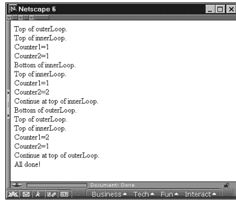

图 7.9

使用 `continue` 语句的结果。

# Date

JavaScript 1.0+, ECMAScript 1E+, JScript 1.0+

Nav2+, NES2+, IE 3+, Opera3+

### 语法

```javascript
var variable = new Date();
var variable = new Date(milliseconds);
var variable = new Date(string);
var variable = new Date(year, month, day, hours, minutes, seconds, milliseconds2)
```

### 描述

`Date` 对象表示从年份到毫秒的所有日期和时间方面。在创建 `Date` 对象时提供了参数，新对象将包含指定的日期；否则，对象将设置为当前日期。参数方法列在表 7.25 中。

> 注意
> `Date()` 构造函数也可以在排除 `new` 运算符的情况下作为函数调用。在这种情况下，返回的是日期的字符串表示而不是 `Date` 对象。

### Table 7.25 与 Date 对象相关的参数和方法

| Type | Item | Description |
|---|---|---|
| Argument | constructor | 指定创建布尔对象原型的函数。 |
| | milliseconds | 目标日期根据 GMT 1970 年 1 月 1 日午夜到目标日期之间的毫秒计算。 |
| | string | 目标日期根据字符串表示计算。字符串格式应匹配 `Date` 对象的 `parse()` 方法。 |
| | year | 年份的四位数表示。 |
| | month | 以整数表示的月份，其中 0 代表 1 月，11 代表 12 月。 |
| | day | 以整数 1 到 31 表示的结果。可选参数。 |
| | hours | 以整数表示的小时，其中 0 代表凌晨 12 点（午夜），23 代表晚上 11 点。可选参数。 |
| | minutes | 以整数 0 到 59 表示的分钟。可选参数。 |
| | seconds | 以整数 0 到 59 表示的秒。可选参数。 |
| | milliseconds2 | 以整数 0 到 999 表示的毫秒。可选参数。 |
| Methods | getDate() | 返回月份中的日期。 |
| | getDay() | 返回星期几。 |
| | getYear() | 返回本地时四位年份。 |
| | getHours() | 返回小时。 |
| | getMilliseconds() | 返回毫秒。 |
| | getMinutes() | 返回分钟。 |
| | getMonth() | 返回月份。 |
| | getSeconds() | 返回秒。 |
| | getTime() | 返回毫秒级的日期和时间。 |
| | getTimezoneOffset() | 返回与 GMT 的分钟级偏移量。 |
| | getUTCDate() | 返回转换为通用时间的月份中的日期。 |
| | getUTCDay() | 返回转换为通用时间的星期几。 |
| | getUTCFullYear() | 返回转换为通用时间的四位数年份表示。 |
| | getUTCHours() | 返回转换为通用时间的小时。 |
| | getUTCMilliseconds() | 返回转换为通用时间的毫秒。 |
| | getUTCMinutes() | 返回转换为通用时间的分钟。 |
| | getUTCMonth() | 返回转换为通用时间的月份。 |
| | getUTCSeconds() | 返回转换为通用时间的秒。 |
| | parse() | 将代表日期的字符串转换为毫秒。 |
| | setDate() | 设置月份中的日期。 |
| | setFullYear() | 设置年份为四位数。 |
| | setHours() | 设置小时。 |
| | setMilliseconds() | 设置毫秒。 |
| | setMinutes() | 设置分钟。 |
| | setMonth() | 设置月份。 |
| | setSeconds() | 设置秒。 |
| | setTime() | 根据日期的毫秒表示设置日期和时间。 |
| | setUTCDate() | 设置通用时间的月份中的日期。 |
| | setUTCFullYear() | 设置通用时间的四位数年份。 |
| | setUTCHours() | 设置通用时间的小时。 |
| | setUTCMilliseconds() | 设置通用时间的毫秒。 |
| | setUTCMinutes() | 设置通用时间的分钟。 |
| | setUTCMonth() | 设置通用时间的月份。 |
| | setUTCSeconds() | 设置通用时间的秒。 |
| | setYear() | 设置年份为四位或两位数。 |
| | toString() | 返回通用时间的日期和时间。 |
| | toLocaleString() | 返回本地时间的日期和时间。 |
| | toSource() | 返回源。 |
| | toUTCString() | 返回通用时间的日期和时间。 |

```javascript
case 3:
day="Wednesday";
break;
case 4:
day="Thursday";
break;
case 5:
day="Friday";
break;
case 6:
day="Saturday";
break;
default:
day="Invalid day";
}
return day;
```

```javascript
// 创建一个包含当前日期和时间的 Date 对象。
theDate = new Date();
```

```javascript
//显示星期。
document.write("Today is " +getString(theDate.getDay()));
// -->
<script>
```

## Date.getFullYear()

JavaScript 1.2+, ECMAScript 1E+, JavaScript 3.0

Nav4+, IE 4+, Opera5+

### 语法

```javascript
date.getFullYear()
```

### 描述

`getFullYear()` 方法返回本地时间的年份，格式为完整的四位数字。

### 示例

列表 7.97 中的代码使用了 `getFullYear()` 方法。

列表 7.97 使用 `getFullYear()` 方法返回年份

```javascript
<script type="text/javascript" language="JavaScript">
<!---
```

```javascript
// 创建一个包含当前日期和时间的 Date 对象。
theDate = new Date();
```

# 292 第 7 章：核心语言

列表 7.97 继续

```javascript
// 显示完整的年份。
document.write("The year is " +theDate.getFullYear());
```

```javascript
// -->
</script>
```

## Date.getHours()

JavaScript 1.0+, ECMAScript 1E+, JavaScript 1.0+ Nav2+, NES2+, IE 3+, Opera3+

### 语法

```javascript
date.getHours()
```

### 描述

`getHours()` 方法返回日期中的小时部分，表示为从 0（午 12:00）到 23（晚上 11:00）的整数。

### 示例

列表 7.98 中的代码使用 `getHours()` 方法将当前小时显示为 0 到 23 之间的整数。

# 列表 7.98 使用 `getHours()` 方法返回当前小时

```javascript
<script type="text/javascript" language="JavaScript">
<!--
```

```javascript
// 创建一个包含当前日期和时间的 Date 对象。
theDate = new Date();
```

```javascript
// 显示小时。
document.write("The hour is " +theDate.getHours());
```

```javascript
// -->
</script>
```

## Date.getMilliseconds()

JavaScript 1.2+, ECMAScript 1E+, JavaScript 3+

Nav4+, IE 4+, Opera5+

### 语法

```javascript
date.getMilliseconds()
```

### 描述

`getMilliseconds()` 方法返回日期的毫秒部分，表示为从 0 到 999 的整数。

### 示例

列表 7.99 中的代码使用 `getMilliseconds()` 方法显示 `Date` 对象中的毫秒。

**列表 7.99 使用 `getMilliseconds()` 方法返回当前毫秒**

```javascript
<script type="text/javascript" language="JavaScript">
<!--

// 创建一个包含当前日期和时间的 Date 对象。
theDate = new Date();

// 显示毫秒。
document.write("The millisecond is " +theDate.getMilliseconds());

// -->
</script>
```

## Date.getMinutes()

JavaScript 1.0+, ECMAScript 1E+, JavaScript Nav2+, NES2+, IE 3+, Opera3+

### 语法

```javascript
date.getMinutes()
```

### 描述

`getMinutes()` 方法返回 `Date` 对象的分钟部分，表示为从 0 到 59 的整数。

### 示例

列表 7.100 中的代码使用 `getMinutes()` 方法显示当前分钟。

**列表 7.100 使用 `getMinutes()` 方法返回当前分钟**

```javascript
<script type="text/javascript" language="JavaScript">
<!--

// 创建一个包含当前日期和时间的 Date 对象。
theDate = new Date();

// 显示分钟。
document.write("The minute is " +theDate.getMinutes());

// -->
</script>
```

# 294 第 7 章：核心语言

## Date.getMonth()

JavaScript 1.0+, ECMAScript 1E+, JavaScript 1.0

Nav2+, NES2+, IE 3+, Opera3+

### 语法

```javascript
date.getMonth()
```

### 描述

`getMonth()` 方法返回 `Date` 对象的月份部分，表示为从 0（1月）到 11（12月）的整数。

### 示例

列表 7.101 中的代码使用 `getMonth()` 方法显示当前月份。

- 列表 7.101 使用 `getMonth()` 方法返回当前月份

```javascript
<script type="text/javascript" language="JavaScript">
<!---
// 此函数将月份从数字转换为
// 字符串并返回该字符串。
function getMonthString(num)
{
    var month;      // 创建一个本地变量来存储字符串。
    switch(num)
{
        case 0:
            month="January"
            break;
        case 1:
            month="February"
            break;
        case 2:
            month="March"
            break;
        case 3:
            month="April"
            break;
        case 4:
            month="May"
            break;
        case 5:
            month="June"
            break;
        case 6:
            month="July";
            break;
        case 7:
            month="August";
            break;
        case 8:
            month="September";
            break;
        case 9:
            month="October";
            break;
        case 10:
            month="November";
            break;
        case 11:
            month="December";
            break;
        default:
            month="Invalid month";
}
return month;
}

// 创建一个包含当前日期和时间的 Date 对象。
theDate = new Date();

```javascript

//显示星期。

document.write("Today is " +getString(theDate.getDay()));

// -->

<script>

```

## Date.getSeconds()

JavaScript 1.0+, ECMAScript 1E+, JavaScript 1.0+
Nav2+, NES2+, IE 3+, Opera3+

### 语法

```javascript
date.getSeconds()
```

### 描述

`getSeconds()` 方法返回本地时间的秒部分，表示为从 0 到 59 的整数。

### 示例

列表 7.102 中的代码使用了 `getSeconds()` 方法。

# 296 第 7 章：核心语言

列表 7.102 使用 `getSeconds()` 方法返回当前秒

```javascript

<script type="text/javascript" language="JavaScript">

<!--

// 创建一个包含当前日期和时间的 Date 对象。

theDate = new Date();

```

```javascript

// 显示秒。

document.write("The second is " +theDate.getSeconds());

// -->

</script>

```

## Date.getTime()

JavaScript 1.0+, ECMAScript 1E+, JavaScript 1.0+
Nav2+, NES2+, IE 3+, Opera3+

### 语法

```javascript
date.getTime()
```

### 描述

`getTime()` 方法返回 `Date` 对象的毫秒等值。使用毫秒来比较两个日期比检查日期的各个部分容易得多。

### 示例

列表 7.103 中的代码使用 `getTime()` 方法显示 1970 年 1 月 1 日到 2000 年 1 月 1 日之间的毫秒数。

# 列表 7.103 使用 `getTime()` 方法返回 1970 到 2000 年之间的毫秒

```javascript

<script type="text/javascript" language="JavaScript">

<!--

// 创建一个包含当前日期和时间的 Date 对象。

date1970 = new Date(1970,0,1,0);

```

```javascript

// 创建一个包含 2000 年 1 月 1 日的 Date 对象。

date2000 = new Date(2000,0,1,0);

// 显示经过的毫秒数。

document.write(date2000.getTime()-date1970.getTime());

document.write(" milliseconds");

// -->

</script>

```

## Date.getTimezoneOffset()

JavaScript 1.0+, ECMAScript 1E+, JavaScript Nav2+, NES2+, IE 3+, Opera3+

### 语法

```javascript
date.getTimezoneOffset()
```

### 描述

`getTimezoneOffset()` 方法返回本地时间与格林尼治标准时间（GMT）之间的差异。该差异返回为本地时区与 GMT 之间分钟数的整数。尽管这是 `Date` 对象的方法，但与日期的实际时间无关，因为时间差异基于运行 JavaScript 代码的环境设置。

### 示例

列表 7.104 中的代码使用 `getTimezoneOffset()` 方法显示时区偏移。注意当日期和时间改变时，时区偏移保持不变，因为计算中没有使用 `Date` 对象的内容。

列表 7.104 使用 `getTimezoneOffset()` 方法返回时区偏移

```javascript

<script type="text/javascript" language="JavaScript">

<!--

// 创建两个完全不同的 Date 对象。

aDate1 = new Date(1990,1,1,0,0,0);

aDate2 = new Date(1994,2,13,8,24,45,300);

// 显示时区偏移。

document.write("The timezone offset of aDate1 is ");

document.write(aDate1.getTimezoneOffset())+ minutes.");

document.write("The timezone offset of aDate2 is ");

document.write(aDate2.getTimezoneOffset())+ minutes.");

// -->

</script>

```

## Date.getUTCDate()

JavaScript 1.2+, ECMAScript 1E+, JavaScript 3.0
Nav4+, IE 4+, Opera 5

### 语法

```javascript
date.getUTCDate()
```

### 描述

`getUTCDate()` 方法返回转换为世界标准时间的月份中的数，并以 1 到 31 之间的整数表示。

### 示例

列表 7.105 中的代码使用 `getUTCDate()` 方法显示世界标准时间的月份中的数。

- 列表 7.105 使用 `getUTCDate()` 方法返回月份中的数

```javascript
<script type="text/javascript" language="JavaScript">
<!--
// 创建包含当前日期和时间的 Date 对象。
theDate = new Date();
//显示 UTC 日期。
document.write("The UTC date is " + theDate.getUTCDate());
//-->
</script>
```

## Date.getUTCDay()

JavaScript 1.2+, ECMAScript 1E+, JavaScript 3.0
Nav4+, IE 4+, Opera 5

### 语法

```javascript
date.getUTCDay()
```

### 描述

`getUTCDay()` 方法返回转换为世界标准时间的星期几，并以从 0（星期日）到 6（星期六）的整数表示。

### 示例

列表 7.106 中的代码使用 `getUTCDay()` 方法返回以世界标准时间整数表示的星期几。然后将该数字转换为等于星期几的字符串。

- 列表 7.106 使用 `getUTCDay()` 方法返回星期几

```javascript
<script type="text/javascript" language="JavaScript">
<!--
//此函数将星期几从数字转换为
// 字符串并返回该字符串。
function getDayString(num) {
    var day;      //创建一个本地变量来存储字符串。
    switch(num) {
        case 0:
            day="Sunday";
            break;
        case 1:
            day="Monday";
            break;
        case 2:
            day="Tuesday";
            break;
        case 3:
            day="Wednesday";
            break;
        case 4:
            day="Thursday";
            break;
        case 5:
            day="Friday";
            break;
        case 6:
            day="Saturday";
            break;
        default:
            day="Invalid day";
    }
    return day;
}
// 创建包含当前日期和时间的 Date 对象。
theDate = new Date();
//显示 UTC 星期。
document.write("The UTC day is " + getDayString(theDate.getUTCDay()));
<!-- -->
</script>
```

## Date.getUTCFullYear()

JavaScript 1.2+, ECMAScript 1E+, JavaScript 3.0+
Nav4+, IE 4+, Opera 5

### 语法

```javascript
date.getUTCFullYear()
```

### 描述

`getUTCFullYear()` 方法返回转换为世界标准时间的四位数字年份。

### 示例

列表 7.107 中的代码使用 `getUTCFullYear()` 方法显示世界标准时间的年份。

- 列表 7.107 使用 `getUTCFullYear()` 方法返回年份

```javascript
<script type="text/javascript" language="JavaScript">
<!--
// 创建包含当前日期和时间的 Date 对象。
theDate = new Date();
// 显示完整的 UTC 年。
document.write("The UTC year is " + theDate.getUTCFullYear());
-->
</script>
```

## Date.getUTCHours()

JavaScript 1.2+, ECMAScript 1E+, JavaScript 3.0+
Nav4+, IE 4+, Opera 5

### 语法

```javascript
date.getUTCHours()
```

### 描述

`getUTCHours()` 方法返回转换为世界标准时间的小时，并以从 0（凌晨 12:00）到 23（下午 11:00）的整数表示。

### 示例

列表 7.108 中的代码使用 `getUTCHours()` 方法显示世界标准时间的小时。

- 列表 7.108 使用 `getUTCHours()` 方法返回小时数

```javascript
<script type="text/javascript" language="JavaScript">
<!--
// 创建包含当前日期和时间的 Date 对象。
theDate = new Date();
// 显示小时。
document.write("The UTC hour is " + theDate.getUTCHours());
// -->
</script>
```

## Date.getUTCMilliseconds()

JavaScript 1.2+, ECMAScript 1E+, JavaScript 3.0
Nav4+, IE 4+, Opera 5

### 语法

```javascript
date.getUTCMilliseconds()
```

### 描述

`getUTCMilliseconds()` 方法返回转换为世界标准时间的毫秒，并以从 0 到 999 的整数表示。

### 示例

列表 7.109 中的代码使用 `getUTCMilliseconds()` 方法显示世界标准时间的毫秒。

- 列表 7.109 使用 `getUTCMilliseconds()` 方法返回毫秒

```javascript
<script type="text/javascript" language="JavaScript">
<!--
// 创建包含当前日期和时间的 Date 对象。
theDate = new Date();
// 显示毫秒。
document.write("The UTC millisecond is " + theDate.getUTCMilliseconds());
// -->
</script>
```

## Date.getUTCMinutes()

JavaScript 1.2+, ECMAScript 1E+, JavaScript 3.0
Nav4+, IE 4+, Opera 5

### 语法

```javascript
date.getUTCMinutes()
```

### 描述

`getUTCMinutes()` 方法返回转换为世界标准时间的分钟部分，并以从 0 到 59 的整数表示。

### 示例

列表 7.110 中的代码使用 `getUTCMinutes()` 方法显示世界标准时间的分钟。

- 列表 7.110 使用 `getUTCMinutes()` 方法返回分钟

```javascript
<script type="text/javascript" language="JavaScript">
<!--
// 创建包含当前日期和时间的 Date 对象。
theDate = new Date();
//显示 UTC 分钟。
document.write("The UTC minute is " + theDate.getUTCMinutes());
<!--
</script>
```

## Date.getUTCMonth()

JavaScript 1.2+, ECMAScript 1E+, JavaScript 3.0
Nav4+, IE 4+, Opera 5+

### 语法

```javascript
date.getUTCMonth()
```

### 描述

`getUTCMonth()` 方法返回转换为世界标准时间的月份，并以从 0（一月）到 11（十二月）的整数表示。

### 示例

列表 7.111 中的代码使用 `getUTCMonth()` 方法以世界标准时间的整数形式返回当前月份。该整数转换为月份的字符串表示。

- 列表 7.111 使用 `getUTCMonth()` 方法返回月份

```javascript
<script type="text/javascript" language="JavaScript">
<!--
//此函数将月份从数字转换为
// 字符串并返回该字符串。
function getMonthString(num) {
    var month; //创建一个本地变量来存储字符串。
    switch(num) {
        case 0:
            month="January";
            break;
        case 1:
            month="February";
            break;
        case 2:
            month="March";
            break;
        case 3:
            month="April";
            break;
        case 4:
            month="May";
            break;
        case 5:
            month="June";
            break;
        case 6:
            month="July";
            break;
        case 7:
            month="August";
            break;
        case 8:
            month="September";
            break;
        case 9:
            month="October";
            break;
        case 10:
            month="November";
            break;
        case 11:
            month="December";
            break;
        default:
            month="Invalid month";
    }
    return month;
}
// 创建包含当前日期和时间的 Date 对象。
theDate = new Date();
//显示 UTC 月份。
document.write("The UTC month is " + getMonthString(theDate.getUTCMonth()));
// -->
</script>
```

## Date.getUTCSeconds()

JavaScript 1.2+, ECMAScript 1E+, JavaScript 3.0+
Nav4+, IE 4+, Opera 5

### 语法

```javascript
date.getUTCSeconds()
```

### 描述

`getUTCSeconds()` 方法返回转换为世界标准时间的 `Date` 对象的秒部分，并以 0 到 59 的整数表示。

### 示例

列表 7.112 中的代码使用 `getUTCSeconds()` 方法显示世界标准时间的当前秒。

- 列表 7.112 使用 `getUTCSeconds()` 方法返回当前秒

```javascript
<script type="text/javascript" language="JavaScript">
<!--
// 创建包含当前日期和时间的 Date 对象。
theDate = new Date();
//显示 UTC 秒。
document.write("The UTC seconds is " + theDate.getUTCSeconds());
// -->
</script>
```

## Date.getVarDate()

JavaScript 3.0+
IE 4+

### 描述

`getVarDate()` 方法返回 VT_DATE 格式的日期值，可用于 Visual Basic 和 VBScript 与 COM 对象、ActiveX 对象等进行交互。该格式取决于区域设置。

### 示例

列表 7.113 中的代码使用 `getVarDate()` 方法显示日期。

- **Listing 7.113** 使用 `getVarDate()` 方法

```javascript
<script type="text/javascript" language="JScript">
//-创建一个包含当前日期和时间的 Date 对象。
theDate = new Date();
//显示日期。
document.write("The date is ",theDate.getVarDate());
//
</script>
```

## Date.getYear()

JavaScript 1.0+, ECMAScript 1E+, JavaScript 1.0 Nav2+, NES2+, IE 3+, Opera3+

### 语法

```javascript
date.getYear()
```

### 描述

`getYear()` 方法返回 `Date` 对象的年份。遗憾的是，年份以两位数字或四位数字表示，取决于浏览器版本。例如，年份 1983 可能从该方法返回 1983 或仅 83。

> 注意
> `getYear()` 方法已过时。应该使用 `getFullYear()` 代替 `getYear()`。

### 示例

列表 7.114 中的代码使用与你特定浏览器相关的 `getYear()` 方法显示年份。

- **Listing 7.114** 使用 `getYear()` 方法返回当前年份

```javascript
<script type="text/javascript" language="JScript">
//-
```

```javascript
//创建一个包含当前日期和时间的 Date 对象。
theDate = new Date();
```

```javascript
//显示年份。
document.write("The year is " +theDate.getYear());
```

```javascript
// -->
</script>
```

## Date.parse()

JavaScript 1.0+, ECMAScript 1E+, JavaScript 1.0+ Nav2+, NES2+, IE 3+, Opera5+

### 语法

```javascript
Date.parse(date)
```

### 描述

`parse()` 方法返回日期参数字符串与 GMT 1970 年 1 月 1 日午夜之间的毫秒数。请注意，此方法与 `Date` 对象相关，而不是已声明的日期。字符串日期应使用 `Date.toGMTString()` 方法编写的格式，类似于如下：

Mon, 24 Oct 1982 12:03:27 -0200

该方法也接受缺少时间或时区全部或任何部分的字符串。

### 示例

列表 7.115 中的代码显示从 1970 年到日期时间字符串表示之间的毫秒数。

- **Listing 7.115** 使用 `parse()` 方法

```javascript
<script type="text/javascript" language="JavaScript">
<!--
//将日期 "Sun, 24 Oct 1982 12:03:27" 的字符串表示
// 转换为毫秒并显示毫秒数。
document.write('The milliseconds of the string ');
document.write('Sun, 24 Oct 1982 12:03:27: ');
document.write(Date.parse("Sun, 24 Oct 1982 12:03:27"));
```

```javascript
// -->
</script>
```

## Date.prototype

JavaScript 1.1+, ECMAScript 1E+, JavaScript 3.0+ Nav3+, NES3+, IE 4+, Opera5+

### 语法

```javascript
Date.prototype.property
Date.prototype.method
```

### 描述

原型属性（`prototype`）允许你向 `Date` 对象添加新的属性和方法，这些内容可以在你的整个代码中使用。

### 示例

在列表 7.116 中，使用原型属性创建一个名为 `getDateString` 的新方法，该方法可以被所有 `Date` 对象使用。`getDateString()` 方法使用 `getDay()` 函数返回星期几的字符串表示（例如，星期日、星期一、星期二……）。此新功能用于显示当前天的名称。

- **Listing 7.116** 为周几字符串表示创建新方法

```javascript
<script type="text/javascript" language="JavaScript">
<!--
// 此函数返回日的字符串表示。
function getDateString() {
  var day
  switch (this.getDay()) {
    case 0:
      day="Sunday"
      break;
    case 1:
      day="Monday"
      break;
    case 2:
      day="Tuesday"
      break;
    case 3:
      day="Wednesday"
      break;
    case 4:
      day="Thursday";
```

- **Listing 7.116 续**

```javascript
case 5:
    day="Friday";
    break;
case 6:
    day="Saturday";
    break;
default:
    day="Invalid day";
return(day);
}

// 让所有 Date 对象都能使用 getDateString 函数
Date.prototype.getDateString = getDateString;

// 创建一个带有当前日期的 Date 对象。
var currentDate = new Date();

// 显示字符串。
document.write("Today is " +currentDate.getDateString());
```

## Date.setDate()

JavaScript 1.0+, ECMAScript 1E+, JavaScript 1.0+ Nav2+, NES2+, IE 3+,

### 语法

```javascript
date.setDate(day)
```

### 描述

`setDate()` 方法将月份中的日期设置为参数 `day`，范围从 1 到 31。该方法返回 GMT 1970 年 1 月 1 日午夜到 `Date` 对象中指定日期的毫秒数。

### 示例

列表 7.117 中的代码使用 `setDate()` 方法显示日期。注意 `setDate()` 方法指定的毫秒数与方法返回的结果相同。

```javascript
<script type="text/javascript" language="JavaScript">
<!--
创建一个 Date 对象。
theDate = new Date();
//设置月份并显示毫秒数。
document.write("Initial milliseconds=",theDate.getTime());
document.write("<br>setDate returned ");
```

```javascript
document.write(theDate.setDate(4)," milliseconds.");
document.write("<br>Final milliseconds=",theDate.getTime());
```

```javascript
// -->
</script>
```

## Date.setFullYear()

JavaScript 1.2+, ECMAScript 1E, JavaScript 3.0+ Nav3+, IE 4+, Opera5+

### 语法

```javascript
date.setFullYear(year)
```

### 描述

`setFullYear()` 方法将 `Date` 对象中的年份设置为参数 `year`，一个四位整数。该方法返回 GMT 1970 年 1 月 1 日午夜到 `Date` 对象中指定日期的毫秒数。

### 示例

列表 7.118 中的代码在设置年份 2003 之前显示当前日期。注意 `setFullYear()` 方法指定的毫秒数与方法返回的结果相同。

- **Listing 7.118** 使用 `setFullYear()` 方法设置年份

```javascript
<script type="text/javascript" language="JavaScript">
<!--
创建一个 Date 对象。
theDate = new Date();
//设置年份并显示毫秒数。
document.write("Initial milliseconds=",theDate.getTime());
document.write("<br>setFullYear returned ");
```

```javascript
document.write(theDate.setFullYear(2003)," milliseconds.");
document.write("<br>Final milliseconds=",theDate.getTime());
```

```javascript
// -->
</script>
```

## Date.setHours()

JavaScript 1.0+, ECMAScript 1E, JavaScript 1.0+ Nav2+, NES2+, IE 3+, Opera3+

### 语法

```javascript
date.setHours(hours)
```

### 描述

`setHours()` 方法将 `Date` 对象中的小时设置为参数 `hours`，一个从 0（午夜 12:00）到 23（晚上 11:00）的整数。该方法返回 GMT 1970 年 1 月 1 日午夜到 `Date` 对象中指定时间的毫秒数。

### 示例

列表 7.119 中的代码在设置小时为 7（上午 8:00）之前显示当前日期的毫秒数。注意 `setHours()` 方法指定的毫秒数与方法返回的结果相同。

- **Listing 7.119** 使用 `setHours()` 方法设置小时

```javascript
<script type="text/javascript" language="JavaScript">
<!--
 创建一个 Date 对象。
theDate = new Date();
// 设置小时并显示毫秒数。
document.write("Initial milliseconds=",theDate.getTime());
document.write("<br>setHours returned ");
document.write(theDate.setHours(7)," milliseconds.");
document.write("<br>Final milliseconds=",theDate.getTime());
// -->
</script>
```

## Date.setMilliseconds()

JavaScript 1.2+, ECMAScript 1E+, JavaScript 3.0+
Nav4+, IE 4+, Opera5+

### 语法

```javascript
date.setMilliseconds(milliseconds)
```

### 描述

`setMilliseconds()` 方法将 `Date` 对象中的毫秒设置为参数 `milliseconds`，这是一个 0 到 999 之间的整数。该方法返回一个整数，表示从 1970 年 1 月 1 日午夜（GMT）到调整毫秒后 `Date` 对象中指定的日期和时间之间的毫秒数。

### 示例

列表 7.120 显示了将毫秒设置为 792 之前以毫秒形式显示的当前日期。请注意，`setMilliseconds()` 方法之后指定的毫秒与该方法返回的结果相同。

+ 列表 7.120 使用 `setMilliseconds()` 方法设置毫秒

```javascript
<script type="text/javascript" language="JavaScript">
<!--
// 创建 Date 对象。
theDate = new Date();
// 设置毫秒。
document.write("Initial milliseconds=",theDate.getTime());
document.write("<br>setMilliseconds returned ");
document.write(theDate.setMilliseconds(792)," milliseconds.");
document.write("<br>Final milliseconds=",theDate.getTime());
// -- -->
</script>
```

## Date.setMinutes()

JavaScript 1.0+, ECMAScript 1E+, JavaScript 1.0+ Nav2+, NES2+, IE 3+, Opera3+

### 语法

```javascript
date.setMinutes(minutes)
```

### 描述

`setMinutes()` 方法将 `Date` 对象中的分钟设置为参数 `minutes`，这是一个 0 到 59 之间的整数。该方法返回一个整数，表示从 1970 年 1 月 1 日午夜（GMT）到调整分钟后 `Date` 对象中指定的日期和时间之间的毫秒数。

### 示例

列表 7.121 中的代码显示了在将分钟设置为 43 之前以毫秒形式显示的当前日期。请注意，`setMinutes()` 方法之后指定的毫秒与该方法返回的结果相同。

## 列表 7.121 使用 `setMinutes()` 方法设置分钟

```javascript
<script type="text/javascript" language="JavaScript">
<!--
// 创建 Date 对象。
theDate = new Date();
// 设置分钟并显示毫秒。
document.write("Initial milliseconds=",theDate.getTime());
document.write("<br>setMinutes returned ");
document.write(theDate.setMinutes(43), " milliseconds.");
document.write("<br>Final milliseconds=",theDate.getTime());
// -->
</script>
```

## Date.setMonth()

JavaScript 1.0+, ECMAScript 1E+, JavaScript 1.0+ Nav2+, NES2+, IE 3+, Opera 3+

### 语法

```javascript
date.setMonth(month)
```

### 描述

`setMonth()` 方法将 `Date` 对象中的月份设置为参数 `month`，这是一个从 0（1月）到 11（12月）的整数。该方法返回一个整数，表示从 1970 年 1 月 1 日午夜（GMT）到调整月份后 `Date` 对象中指定的日期和时间之间的毫秒数。

> 注意
> 在 JavaScript 1.2 之前，此方法不返回任何内容。

### 示例

列表 7.122 中的代码显示了在将月份设置为 2（3月）之前以毫秒形式显示的当前日期。请注意，`setMonth()` 方法之后指定的毫秒与该方法返回的结果相同。

## 列表 7.122 使用 `setMonth()` 方法设置月份

```javascript
<script type="text/javascript" language="JavaScript">
<!--
// 创建 Date 对象。
theDate = new Date();
/// 设置月份并显示毫秒。
document.write("Initial milliseconds=",theDate.getTime());
document.write("<br>setMonth returned ");
document.write(theDate.setMonth(2)," milliseconds.");
document.write("<br>Final milliseconds=",theDate.getTime());
//-->
</script>
```

## Date.setSeconds()

JavaScript 1.0+, ECMAScript 1E+, JScript 1.0+ Nav2+, NES2+, IE 3+, Opera3+

### 语法

```javascript
date.setSeconds(seconds)
```

### 描述

`setSeconds()` 方法将 `Date` 对象中的秒设置为参数 `seconds`，这是一个 0 到 59 之间的整数。该方法返回一个整数，表示从 1970 年 1 月 1 日午夜（GMT）到调整秒后 `Date` 对象中指定的日期和时间之间的毫秒数。

> 注意
> 在 JavaScript 1.2 之前，此方法不返回任何内容。

### 示例

列表 7.123 中的代码显示了在将秒设置为 16 之前以毫秒形式显示的当前日期。请注意，`setSeconds()` 方法所指定的秒与该方法返回的结果相同。

## 列表 7.123 使用 `setSeconds()` 方法设置秒

```javascript
<script type="text/javascript" language="JavaScript">
<!--
// 创建 Date 对象。
theDate = new Date();
```

## 列表 7.123 延续

```javascript
// 设置秒并显示毫秒。
document.write("Initial milliseconds=",theDate.getTime());
document.write("<br>setSeconds returned ");
document.write(theDate.setSeconds(16)," milliseconds.")
document.write("<br>Final milliseconds=",theDate.getTime());
```

```javascript
// -->
</script>
```

## Date.setTime()

JavaScript 1.0+, ECMAScript 1E+, JavaScript 1.0+ Nav2+, NES2+, IE 3+, Opera3+

### 语法

```javascript
date.setTime(milliseconds)
```

### 描述

`setTime()` 方法将 `Date` 对象中的时间设置为参数 `milliseconds`，这是一个表示从 1970 年 1 月 1 日午夜（GMT）到调整毫秒后 `Date` 对象中指定的日期和时间之间的毫秒数。

### 示例

列表 7.124 中的代码显示了在将时间设置为 2005 之前以毫秒形式显示的当前日期。

## 列表 7.124 使用 `setTime()` 方法设置时间

```javascript
<script type="text/javascript" language="JavaScript">
<!--
// 创建 Date 对象。
theDate = new Date();
// 设置日期。
theDate.setTime(2005);
// -->
</script>
```

## Date.setUTCDate()

JavaScript 1.0+, ECMAScript 1E+, JavaScript 1.0+ Nav2+, NES2+, IE 3+, Opera3+

### 语法

```javascript
date.setUTCDate(day)
```

### 描述

`setUTCDate()` 方法将 `Date` 对象中的日期设置为参数 `day`，这是一个 1 到 31 之间的整数（世界标准时间）。该方法返回一个整数，表示从 1970 年 1 月 1 日午夜（GMT）到调整日期后 `Date` 对象中指定的日期和时间之间的毫秒数。

### 示例

列表 7.125 显示了在将日期设置为 6 之前以毫秒形式显示的当前日期。请注意，`setUTCDate()` 方法之后指定的日期与该方法返回的结果相同。

## 列表 7.125 使用 `setUTCDate()` 方法设置日期

```javascript
<script type="text/javascript" language="JavaScript">
<!--
// 创建 Date 对象。
theDate = new Date();
// 设置日期并显示毫秒。
document.write("Initial milliseconds=",theDate.getTime());
document.write("<br>setUTCDate returned ");
document.write(theDate.setUTCDate(6)," milliseconds.");
document.write("<br>Final milliseconds=",theDate.getTime());
// -->
</script>
```

## Date.setUTCHours()

JavaScript 1.0+, ECMAScript 1E+, JavaScript 1.0+ Nav2+, NES2+, IE 3+, Opera3+

### 语法

```javascript
date.setUTCHours(hours)
```

### 描述

`setUTCHours()` 方法将 `Date` 对象中的小时设置为参数 `hours`，这是一个从 0（午夜）到 23（晚上 11 点）的整数（世界标准时间）。该方法返回一个整数，表示从 1970 年 1 月 1 日午夜（GMT）到调整小时后 `Date` 对象中指定的日期和时间之间的毫秒数。

### 示例

列表 7.126 显示了在将小时设置为 5（凌晨 5 点）之前以毫秒形式显示的当前日期。请注意，`setUTCHours()` 方法之后指定的小时与该方法返回的结果相同。

## 列表 7.126 使用 `setUTCHours()` 方法设置小时

```javascript
<script type="text/javascript" language="JavaScript">
<!--
// 创建 Date 对象。
theDate = new Date();
// 设置小时并显示毫秒。
document.write("Initial milliseconds=",theDate.getTime());
document.write("<br>setUTCHours returned ");
document.write(theDate.setUTCHours(5)," milliseconds.");
document.write("<br>Final milliseconds=",theDate.getTime());
// -->
</script>
```

## Date.setUTCFullYear()

JavaScript 1.2+, ECMAScript 1E+, JavaScript 3.0+
Nav4+, IE 4+, Opera5+

### 语法

```javascript
date.setUTCFullYear(year)
```

### 描述

`setUTCFullYear()` 方法将 `Date` 对象中的年份设置为参数 `year`，这是一个四位整数（世界标准时间）。该方法返回一个整数，表示从 1970 年 1 月 1 日午夜（GMT）到调整年份后 `Date` 对象中指定的日期和时间之间的毫秒数。

### 示例

列表 7.127 显示了在将年份设置为 2004 之前以毫秒形式显示的当前日期。请注意，`setUTCFullYear()` 方法之后指定的年份与该方法返回的结果相同。

## 列表 7.127 使用 `setUTCFullYear()` 方法设置年份

```javascript
<script type="text/javascript" language="JavaScript">
<!--
// 创建 Date 对象。
theDate = new Date();
// 设置年份并显示毫秒。
document.write("Initial milliseconds=",theDate.getTime());
document.write("<br>setUTCFullYear returned ");
document.write(theDate.setUTCFullYear(2004)," milliseconds.");
document.write("<br>Final milliseconds=",theDate.getTime());
// -->
</script>
```

## Date.setUTCMilliseconds()

JavaScript 1.2+, ECMAScript 1E, JScript 3.0
Nav4+, IE 4+, Opera5+

### 语法

```javascript
date.setUTCMilliseconds(milliseconds)
```

### 描述

`setUTCMilliseconds()` 方法将 `Date` 对象中的毫秒设置为参数 `milliseconds`，该参数是一个 0 到 999 之间的整数（通用时间）。该方法返回一个整数，表示从 1970 年 1 月 1 日午夜（GMT）到调整毫秒调整后 `Date` 对象中指定的日期和时间之间的毫秒数。

### 示例

列表 7.128 中的代码在将毫秒设置为 258 之前，显示当前的毫秒数（通用时间）。注意，`setUTCMilliseconds()` 方法之后指定的毫秒与该方法返回的结果相同。

- 7.128 使用 `setUTCMilliseconds()` 方法设置毫秒

```javascript
<script type="text/javascript" language="JavaScript">
<!--
// 创建一个 Date 对象。
theDate = new Date();
// 设置毫秒。
document.write("Initial milliseconds=",theDate.getTime());
document.write("<br>setUTCMilliseconds returned ");
document.write(theDate.setUTCMilliseconds(258)," milliseconds.");
document.write("<br>Final milliseconds=",theDate.getTime());
// ->
</script>
```

# 318 第 7 章：核心语言

## Date.setUTCMinutes()

JavaScript 1.2+, ECMAScript 1E+, JavaScript 3.0+
Nav4+, IE 4+, Opera5+

### 语法

```javascript
date.setUTCMinutes(minutes)
```

### 描述

`setUTCMinutes()` 方法将 `Date` 对象中的分钟设置为参数 `minutes`，该参数是一个 0 到 59 之间的整数（通用时间）。该方法返回一个整数，表示从 1970 年 1 月 1 日午夜（GMT）到调整分钟调整后 `Date` 对象中指定的日期和时间之间的毫秒数。

### 示例

列表 7.129 中的代码在将分钟设置为 19 之前，显示当前的毫秒数。注意，`setUTCMinutes()` 方法之后指定的毫秒与该方法返回的结果相同。

## 列表 7.129 使用 `setUTCMinutes()` 方法设置分钟

```javascript
<script type="text/javascript" language="JavaScript">
<!--
// 创建一个 Date 对象。
theDate = new Date();
// 设置分钟并显示毫秒。
document.write("Initial milliseconds=",theDate.getTime());
document.write("<br>setUTCMinutes returned ");
document.write(theDate.setUTCMinutes(19)," milliseconds.");
document.write("<br>Final milliseconds=",theDate.getTime());
<!-- -->
</script>
```

## Date.setUTCMonth()

JavaScript 1.2+, ECMAScript 1E+, JavaScript 3.0+
Nav4+, IE 4+, Opera5+

### 语法

```javascript
date.setUTCMonth(month)
```

### 描述

`setUTCMonth()` 方法将 `Date` 对象中的月份设置为参数 `month`，该参数是一个 0（1月）到 11（12月）之间的通用时间整数。该方法返回一个整数，表示从 1970 年 1 月 1 日午夜（GMT）到调整月份后 `Date` 对象中指定的日期和时间之间的毫秒数。

### 示例

列表 7.130 中的代码在将月份设置为 4（5月）之前，显示当前的毫秒数（通用时间）。注意，`setUTCMonth()` 方法之后指定的毫秒与该方法返回的结果相同。

## 列表 7.130 使用 `setUTCMonth()` 方法设置月份

```javascript
<script type="text/javascript" language="JavaScript">
<!--
// 创建一个 Date 对象。
theDate = new Date();
// 设置月份并显示毫秒。
document.write("Initial milliseconds=",theDate.getTime());
document.write("<br>setUTCMonth returned ");
document.write(theDate.setUTCMonth(4)," milliseconds.")
document.write("<br>Final milliseconds=",theDate.getTime());
// --
</script>
```

## Date.setUTCSeconds()

JavaScript 1.2+, ECMAScript 1E+, JavaScript 3.0+
Nav4+, IE 4+, Opera5+

### 语法

```javascript
date.setUTCSeconds(seconds)
```

### 描述

`setUTCSeconds()` 方法将 `Date` 对象中的秒设置为参数 `seconds`，该参数是一个 0 到 59 之间的整数（通用时间）。该方法返回一个整数，表示从 1970 年 1 月 1 日午夜（GMT）到调整秒后 `Date` 对象中指定的日期和时间之间的毫秒数。

### 示例

列表 7.131 中的代码在将秒设置为 46 之前，显示当前的毫秒数（通用时间）。注意，`setUTCSeconds()` 方法之后指定的毫秒与该方法返回的结果相同。

# 320 第 7 章：核心语言

## 列表 7.131 使用 `setUTCSeconds()` 方法设置秒

```javascript
<script type="text/javascript" language="JavaScript">
<!--
// 创建 Date 对象。
theDate = new Date();
// 设置秒并显示毫秒。
document.write("Initial milliseconds=",theDate.getTime());
document.write("<br>setUTCSeconds returned ");
document.write(theDate.setUTCSeconds(46)," milliseconds.");
document.write("<br>Final milliseconds=",theDate.getTime());
// -->
</script>
```

## Date.setYear()

JavaScript 1.2+, ECMAScript 1E+, JavaScript 3.0+
Nav4+, IE 4+, Opera5+

### 语法

```javascript
date.setYear(year)
```

### 描述

`setYear()` 方法将 `Date` 对象中的年份设置为参数 `year`。该方法返回一个整数，表示从 1970 年 1 月 1 日午夜（GMT）到调整年份后 `Date` 对象中指定的日期和时间之间的毫秒数。


`setYear()` 方法将 Date 对象中的年份设置为参数 `year`。该参数可以是四位数或两位数。该方法返回一个整数，表示从 1970 年 1 月 1 日午夜（GMT）到调整年份后 Date 对象中指定的日期和时间之间的毫秒数。

**注意**：`setYear()` 方法已过时，应使用 `setFullYear()`。

## 示例

列表 7.132 中的代码在将年份设置为 83 之前，显示当前的毫秒数。注意，`setYear()` 方法之后指定的毫秒与该方法返回的结果相同。

## 列表 7.132 使用 setYear() 方法设置年份

```javascript
<script type="text/javascript" language="JavaScript">
<!--
// 创建 Date 对象。
theDate = new Date();

// 设置年份并显示毫秒。
document.write("Initial milliseconds=",theDate.getTime());
document.write("<br>setYear returned ");
document.write(theDate.setYear(83)," milliseconds.");
document.write("<br>Final milliseconds=",theDate.getTime());

// -->
</script>
```

## Date.toGMTString()

JavaScript 1.2+, ECMAScript 1E+, JavaScript 3.0+

Nav4+, IE 4+, Opera5+

### 语法

```javascript
date.toGMTString()
```

## 描述 

`toGMTString()` 方法返回一个表示 Date 对象通用时间的字符串。日期在转换为字符串之前会先转换为 GMT 时区。字符串的格式类似于：Mon, 24 Oct 1982 12:03:27 GMT

## 示例

列表 7.133 中的代码创建了一个包含当前日期的 Date 对象。`toGMTString()` 方法以 GMT 格式返回日期。

## 列表 7.133 使用 toGMTString() 方法将日期时间转换为 GMT

```javascript
<script type="text/javascript" language="JavaScript">
<!--
// 创建 Date 对象。
theDate = new Date();

// 显示 GMT 时间字符串。
document.write(theDate.toGMTString());

// -->
</script>
```

## Date.toLocaleString()

JavaScript 1.2+, ECMAScript 1E+, JavaScript 1.0

Nav2+, IE 3+, Opera 5

### 语法

```javascript
date.toLocaleString()
```

## 描述 

`toLocaleString()` 方法返回 Date 对象在本地时区的字符串表示。字符串的格式差异很大，取决于用户的日期和时间设置。

## 示例

列表 7.134 中的代码创建了一个包含当前日期的 Date 对象。`toLocaleString()` 方法使用本地时区返回日期和时间的字符串。

## Date.toSource()

JavaScript 1.3, JavaScript 3.0 IE4

### 语法

```javascript
date.toSource()
```

## 描述 

`toSource()` 方法将 Date 对象转换为表示所创建的 Date 实例源码的字符串。

## 运算符 323

toSource 方法通常由 JavaScript 内部调用，而不是在代码中显式调用。

## 示例

列表 7.135 创建了 2002 年 3 月 16 日的日期对象。随后将 toSource 方法应用于该日期对象，返回带有毫秒日期的源字符串 "(new Date(1018986503234))"。

### 列表 7.135 使用 toSource 方法访问日期对象的源

```javascript
<script type="text/javascript.3" language="JavaScript1.3">
<!--
// 为 2002 年 4 月 16 日创建一个日期对象。
theDate = new Date(2002,3,16,15,48,23,24);

//显示 "Tue Apr 16 15:48:23 GMT-0400 (Eastern Daylight Time) 2002"
document.write(theDate.toString());

// 显示日期对象的源。
document.write(theDate.toSource());   //显示 "(new Date(1018986503234))"

// -->
</script>
```

## Date.toString()

JavaScript 1.0+, ECMAScript 1E+, JavaScript 1.0+ Nav2+, NES2+, IE 3+, Opera5+

### 语法

```javascript
date.toString()
```

## 描述

`toString()` 方法返回本地时区 Date 对象的字符串表示。

`toString()` 方法与 `GMTString()` 和 `toLocaleString()` 有何区别？与 `GMTString()` 方法不同，`toString()` 方法在本地时区显示日期。`toString` 并不总是以 `toLocaleString` 方法的本地格式显示日期。

## 示例

列表 7.136 中的代码根据当前日期时间创建一个 Date 对象。随后使用 `toString()` 方法将日期以本地时区的字符串形式显示。

### 列表 7.136 使用 toString() 方法将日期作为字符串

```javascript
<script type="text/javascript" language="JavaScript">
<!--
// 创建一个 Date 对象。
theDate = new Date();

// 显示日期和时间字符串。
document.write(theDate.toString());

// -->
</script>
```

## Date.UTCString()

JavaScript 1.2+, ECMAScript 1E+, JavaScript 3.0+ Nav4+, IE 4+, Opera3+

### 语法

```javascript
date.UTCString()
```

## 描述

`UTCString()` 方法返回表示 Date 对象通用时间的字符串。在转换为字符串之前，日期会先转换为 GMT 时区时间。此方法与 `toGMTString()` 完全相同。

## 示例

列表 7.137 中的代码创建了一个 Date 对象并将其初始化为当前日期时间。随后使用 `UTCString()` 方法将当前日期时间以通用时间的字符串形式显示。

### 列表 7.137 使用 toUTCString() 方法访问通用时间中的日期

```javascript
<script type="text/javascript" language="JavaScript">
<!--
// 创建一个 Date 对象。
theDate = new Date();

// 显示通用时间中的日期时间字符串。
document.write(theDate.toUTCString());

// -->
</script>
```

## Date.unwatch()

JavaScript 1.2+ Nav4+, NES3+

### 语法

```javascript
Date.unwatch(property)
```

## 描述

Date 对象的 `unwatch()` 方法用于关闭对由 property 指定的特定属性的监听。

## 示例

列表 7.138 展示了如何使用 `unwatch()` 方法停止对用户定义属性的监听。

### 列表 7.138 Date 对象 unwatch() 方法示例

```javascript
<script type="text/javascript" language="JavaScript">
<!--
function alertme(id,oldValue,newVal)
{
document.write("myDate.*" + id + " changed from " + oldValue + " to ");
```

## Date.UTC()

JavaScript 1.0+, ECMAScript 1E+, JavaScript 1.0 Nav2+, NES2+, IE 3+, Opera3

### 语法

```javascript
Date.UTC(year, month, day, minutes, seconds)
```

## 描述

Date 构造函数创建本地时间的日期，而 `UTC()` 方法用于创建通用时间（GMT）日期。该方法接受参数允许你设置日期的所有方面，并返回从 1970 年 1 月 1 日午夜 (GMT) 到指定日期之间的毫秒数整数。该整数可以用于创建一个新的 Date 对象。方法返回的毫秒数见表 7.26。

### 表 7.26 与 UTC() 相关的参数和返回值

| 类型 | 项目 | 描述 |
| --- | --- | --- |
| 参数 | year | 四位数的年份。 |
| | month | 以整数表示的月份，0 代表一月，12 代表十二月。 |
| | day | 1 到 31 之间的整数表示日期。 |
| | hours | 以整数表示的小时，0 代表午夜，23 代表下午。 |
| | minutes | 0 到 59 之间的整数表示分钟。 |
| | seconds | 0 到 59 之间的整数表示秒数。 |
| | milliseconds | 0 到 999 之间的整数表示毫秒数。 |
| 返回 | | 表示从 1970 年 1 月 1 日午夜 (GMT) 到指定日期之间的毫秒数的整数。 |

## 示例

列表 7.139 中的代码创建一个初始化为 2002 年 9 月 29 日（通用时间）的 Date 对象。新创建的日期时间随后显示在浏览器中。

### 列表 7.139 使用 UTC() 方法创建通用时间

```javascript
<script type="text/javascript" language="JavaScript">
<!--
// 创建一个通用时间的 Date 对象。
theDate = new Date(Date.UTC(2002,8,29,5,10));

// 显示日期时间字符串。
document.write(theDate.toUTCString());

// -->
</script>
```

## Date.valueOf()

JavaScript 1E+, ECMAScript 1E+, JavaScript 3.0 Nav3+, NES2+, IE 4+, Opera3

### 语法

```javascript
date.valueOf()
```

## 描述

`valueOf()` 方法返回对象的原始值。对于 Date 对象，此方法返回对象的毫秒等效值。毫秒表示为从 1970 年 1 月 1 日午夜 (GMT) 到 Date 对象中指定日期之间的整数。

## 示例

列表 7.140 创建了一个表示当前日期时间的 Date 对象。该对象的 `valueOf()` 方法的结果显示在浏览器中。

### 列表 7.140 使用 valueOf() 方法获取 Date 对象的值

```javascript
<script type="text/javascript" language="JavaScript">
<!--
// 创建一个 Date 对象。
theDate = new Date();

// 显示 Date 对象的源。
document.write(theDate.valueOf());

// -->
</script>
```

## Date.watch

JavaScript 1.2+ Nav4+, NES3+

### 语法

```javascript
Date.watch(property,function)
```

## 描述

Date 对象的 `watch()` 方法用于开启对由 property 指定的特定属性的监听。在调用 `watch()` 方法后，只要指定的属性发生变化，就会调用指定的函数。

## 示例

列表 7.141 展示了如何使用 `watch()` 方法开始监听用户定义的属性。

### 列表 7.141 Date 对象 watch 方法示例

```javascript
<script type="text/javascript" language="JavaScript">
<!--
function alertme(id,oldValue,newValue)
{
  document.writeln('myDate." + id + " changed from " + oldValue + " to " + newValue);
}
```

## debugger

JavaScript 1.2+, JScript 3.0+ Nav4+, NES3+, IE4+, Opera5+

### 语法

保留关键字

## 描述

关键字 `debugger` 预留供以后使用。

## 示例

此关键字尚未实现；因此未提供示例。

## decodeURI()

JavaScript 1.5+, ECMAScript 3E+, JavaScript 5.5+ Nav6+, NES6+, IE5.5+

### 语法

```javascript
decodeURI(URIString)
```

## 描述

`decodeURI()` 函数用于将 URIString（统一资源标识符）中的每个转义序列替换为根据 UTF-8 标准表示的字符。该函数解码字符串。

未被 `encodeURI()` 函数编码的转义序列（如 `,`, `/`, `?`, `:`, `&`, `+`, `$`）无法使用 `decodeURI()` 函数进行解码。要解码这些保留字符，请使用 `decodeURIComponent()` 函数。

## 示例

在列表 7.142 中，字符串 "The apple is red." 使用 `encodeURI()` 函数进行编码。结果是相同的字符串，但空格被替换为编码等效值 "%20"。该编码的 URI 字符串随后使用 `decodeURI()` 函数解码回原始形式。

### 列表 7.142 使用 decodeURI() 函数

```javascript
<script type="text/javascript" language='JavaScript'>
<!--

myString="The apple is red";
document.write("原始句子: " + myString + " <br><br>");

myString = encodeURI(myString);
document.write("编码后的句子: " + myString + " <br><br>");

myString = decodeURI(myString);
document.write("解码后的句子: " + myString + " <br><br>");

// -->
</script>
```

# 330 第 7 章：核心语言

## decodeURIComponent()

JavaScript 1.5+

### 语法

```javascript
decodeURIComponent(URIComponentString)
```

### 描述

`decodeURIComponent()` 函数用于将 URIComponentString（统一资源标识符）中的每个转义序列替换为基于 UTF-8 标准的字符。该函数返回解码后的字符串。


`decodeURIComponent()` 函数与 `decodeURI()` 函数的区别在于，它会解码一些保留字符（`,`, `/`, `?`, `:`, `&`, `+`, `$`），而这些字符是不会被 `decodeURI()` 函数解码的。因此，`decodeURIComponent` 方法被设计为仅解码最初使用 `encodeURIComponent()` 函数进行编码的 URI 字符串。

### 示例

在列表 7143 中，短语 "fork, spoon, & knife" 使用 `encodeURIComponent()` 函数进行编码。结果是相同的字符串，但空格、逗号和 '&' 字符被处理了。随后，该编码后的 URI 字符串使用 `decodeURI()` 函数进行解码。注意，此函数仅解码了空格。为了解码逗号和 '&' 字符，必须使用 `decodeURIComponent()` 函数。

### 列表 7143 在函数中使用 decodeURIComponent()

```javascript
<script type="text/javascript" language="JavaScript">
<!--
var myString="fork, spoon, &amp; knife";
document.write("The original phrase: " + myString + "<br><br>");

myString = decodeURIComponent(myString);
document.write("The encoded phrase: " + myString + "<br><br>");

myString = decodeURI(myString);
document.write("The decoded phrase: " + myString + "<br><br>");

myString = decodeURIComponent(myString);
document.write("The decoded component phrase: " + myString + "<br><br>");

// -->
</script>
```

## default

JavaScript 1.2+, JavaScript 3.0+

Nav4+, NES3+, IE4+, Opera5+

### 语法

保留关键字

### 描述

`default` 关键字目前在 JavaScript 中尚未实现，但已为未来使用留出了位置。

### 示例

此关键字尚未实现；因此未提供示例。

## delete

JavaScript 1.0+, ECMAScript 1E, JavaScript 3.0+

Nav2+, NES3+, IE4+, Opera3+

### 语法

```javascript
delete property
```

### 描述

`delete` 运算符通过将属性设置为 `undefined` 来删除对象的属性或从数组删除元素。实际的内存释放由 JavaScript 垃圾回收完成。某些对象（如通过 `var` 语句创建的变量）不受 `delete` 运算符的影响。

> 注意

> 在 JavaScript 1.2 之前，`delete` 运算符会将对象属性设置为 `null` 而不是 `undefined`。

### 示例

列表 7.144 中的代码演示了如何使用 `delete` 运算符删除一个 `Date` 对象。注意，最后一个 `document.write()` 语句没有向浏览器写入任何内容，因为在使用 `delete` 运算符后 `theDate` 变为 `undefined`。

### 列表 7.144 使用 delete 运算符

```javascript
<script type="text/javascript" language="JavaScript">
<!--
// 在世界时间中创建一个 Date 对象。
theDate = new Date();

// 显示日期对象。
document.write("theDate=",theDate,"<br>Deleting theDate!<br>");

// 删除 theDate。
delete theDate;

// 尝试显示 theDate。
document.write("theDate=",theDate); //theDate 是 undefined 的。

// -->
</script>
```

## 332 第 7 章：核心语言

## do

ECMAScript 3.0+, ECMAScript 2E+, JScript 5.5+

Nav4+, NES3+, IE5.5+, Opera5+

### 语法

保留关键字

### 描述

`do` 用于 `do...while` 循环结构，因此它不能用作变量名。

### 示例

此关键字被保留了。关于其用法的更多信息，请参见 `do...while` 条目。

### do...while

JavaScript 1.0+, ECMAScript 1E+, JScript 3.0
Nav2+, NES3+, IE4+, Opera 3

### 语法

```javascript
do{
  statement;
} while(expression);
```

### 描述

`do...while` 在第一次评估表达式之前总是会执行一次循环。一旦循环执行了一次，就会评估括号中的表达式。如果为 `true`，则再次执行循环。当表达式求值为 `false` 时，执行 `while` 结构之后的下一行代码。循环中必须包含一条修改表达式中变量的语句，以防止死循环。此外，注意在右括号后面必须放置一个分号 `;`。

### 示例

列表 7.145 使用 `do...while` 循环来控制通过大门的访问。只允许特定个人通过大门。

### 列表 7.145 do...while 循环

```javascript
<script type="text/javascript" language="JavaScript*">
<!--
names = new Array("Mendy","Michael","Jeff","Bill","Mike");
x = 0; // 计数器

document.write("Allow these 3 individuals who can pass through gate:<br>");
do
{
document.write(names[x]+"<br>");
x++; // 计数器递增
} while (x<3);

### -->
</script>
```

## double

JavaScript 1.2+, ECMAScript 2E, JavaScript 3.0+

Nav4+, NES3+, IE4+, Opera5+

### 语法

保留关键字

### 描述

`double` 关键字目前在 JavaScript 中尚未实现，但已为未来使用留出了位置。

### 示例

此关键字尚未实现；因此未提供示例。

## 334 第 7 章：核心语言

## else

JavaScript 1.0+, ECMAScript 2E, JavaScript 3.0+

Nav4+, NES3+, IE5.5+, Opera5+

### 语法

保留关键字

### 描述

`else` 用于 `if...else` 语句，因此不能用作变量名。

### 示例

列表 7.146 显示了当条件不满足时的 `else` 行为。

### 列表 7.146 else

```javascript
<script type="text/javascript" language="JavaScript">
<!--
x = 10;
if (x > 5) {
  document.write("greater than 5");
} else {
  document.write("not greater than 5");
}
//
</script>
```

## encodeURI

JavaScript 1.0+, ECMAScript 1E+, JScript 3.0

Nav2+, NES3+, IE4+, Opera 3

### 语法

```javascript
encodeURI(URIString)
```

### 描述

`encodeURI()` 函数用于将 URIString（统一资源标识符）中的每个字符替换为基于 UTF-8 标准的表示。该函数返回编码后的字符串。`decodeURI()` 函数与 `decodeURIComponent()` 函数的区别在于，它会解码一些保留字符（`,`, `/`, `?`, `:`, `&`, `+`, `$`），而这些字符是 `decodeURIComponent()` 会解码的。因此，`decodeURI()` 方法被设计为仅解码最初使用 `encodeURI()` 函数进行编码的 URI 字符串。

### 示例

在列表 7147 中，短语 "fork, spoon, & knife" 使用 `encodeURIComponent()` 函数进行编码。结果是相同的字符串，但空格、逗号和 '&' 字符被处理了。随后，该编码后的 URI 字符串使用 `decodeURI()` 函数进行解码。注意，此函数仅解码了空格。为了解码逗号和 '&' 字符，必须使用 `decodeURIComponent()` 函数。

### 列表 7147 在函数中使用 encodeURI()

```javascript
<script type="text/javascript" language="JavaScript">
<!--
var myString="The apple is red.";
document.write("The original phrase: " + myString + "<br><br>");

myString = encodeURI(myString);
document.write("The encoded phrase: " + myString + "<br><br>");

// -->
</script>
```

## encodeURIComponent()

JavaScript 1.5+, ECMAScript 3E+, JScript 5.5+

Nav6+, NES6+, IE5.5+

### 语法

```javascript
encodeURIComponent(URIComponentString)
```

### 描述

`encodeURIComponent()` 函数用于将 URIComponentString（统一资源标识符）中的每个转义序列替换为基于 UTF-8 标准的字符。该函数返回编码后的字符串。`encodeURIComponent()` 函数与 `encodeURI()` 函数的区别在于，它会编码一些保留字符（`,`, `/`, `?`, `:`, `&`, `+`, `$`），而这些字符是不会被 `encodeURI()` 函数编码的。因此，`encodeURIComponent` 方法被设计为仅编码最初使用 `encodeURIComponent()` 函数进行编码的 URI 字符串。

### 示例

在列表 7148 中，短语 "fork, spoon, & knife" 使用 `encodeURIComponent()` 函数进行编码。结果是相同的字符串，但空格、逗号和 '&' 字符被处理了。随后，该编码后的 URI 字符串使用 `decodeURI()` 函数进行解码。注意，此函数仅解码了空格。为了解码逗号和 '&' 字符，必须使用 `decodeURIComponent()` 函数。

### 列表 7148 在函数中使用 encodeURIComponent()

```javascript
<script type="text/javascript" language="JavaScript">
<!--
var myString="fork, spoon, &amp; knife";
document.write("The original phrase: " + myString + "<br><br>");

myString = encodeURIComponent(myString);
document.write("The encoded phrase: " + myString + "<br><br>");

myString = decodeURI(myString);
document.write("The decoded phrase: " + myString + "<br><br>");

myString = decodeURIComponent(myString);
document.write("The decoded component phrase: " + myString + "<br><br>");

// -->
</script>
```

## 336 第 7 章：核心语言

## enum

JavaScript 1.3+, ECMAScript 1E+, JavaScript 3.0+

Nav4.06+, IE4+

### 语法

保留关键字

### 描述

`enum` 关键字最初在 JavaScript 1.3 中引入，并为未来使用留出了位置。

### 示例

此条目在 JavaScript 语言中尚未实现，因此未提供示例。

## Enumerator

JavaScript3.0+

IE4+

### 语法

```javascript
var variable = new Enumerator(collection)
```

## 描述

Enumerator（枚举器）对象通过允许遍历集合提供了对集合中项的访问。访问集合中的项需要使用特殊方法将 Enumerator 对象移动到第一个元素或下一个元素。与数组不同，枚举器无法访问特定位置。要创建 Enumerator 对象，请使用 `Enumerator()` 构造函数。该构造函数要求传入一个集合作为参数。与 Enumerator 对象相关的方法列于表 7.29。

### 表 7.29 与 Enumerator 对象相关的方法

| 方法 | 说明 |
| :--- | :--- |
| atEnd() | 确定 Enumerator 是否在集合的末尾 |
| item() | 返回集合中的当前项 |
| moveFirst() | 将 Enumerator 重置为集合中的第一个项 |
| moveNext() | 将 Enumerator 移动到集合中的下一个项 |

## 示例

列表 7.149 创建了一个 Enumerator 对象，用于访问 Drives 集合中的项。

> 列表 7.149 创建 Enumerator 对象

```javascript
var fileSysObj = new ActiveXObject('Scripting.FileSystemObject');
var en = new Enumerator(fileSysObj.Drives);
```

## Enumerator.atEnd()

JavaScript 3.0+
IE4+

### 语法

```javascript
enumeratorobj.atEnd()
```

## 描述

Enumerator 对象的 `atEnd()` 方法在枚举器指向集合中的最后一个元素时返回 `true`；否则，返回 `false`。如果集合为空或未定义，也会返回 `true`。

## 示例

列表 7.150 使用了 `atEnd()` 方法，用于确定何时停止 for 循环遍历。

## 列表 7.150 使用 atEnd() 方法停止循环

```html
<html>
<h1>驱动器号和驱动器类型：</h1>

<script language="JavaScript">
<!--
// 创建枚举器对象。
var fileSysObj = new ActiveXObject('Scripting.FileSystemObject');
var en = new Enumerator(fileSysObj.Drives);

// 显示每个驱动器的驱动器号和类型。
// 对每个 Enumerator 对象进行循环。只要不在枚举末尾，
// 就继续循环下一个项。
for (; !en.atEnd(); en.moveNext())
{
document.write("Drive "+en.item().DriveLetter);
document.write("* of type "+en.item().DriveType+"<br>");
}
// -->
</script>
</html>
```

## Enumerator.item()

JScript 3.0+
IE4+

### 语法

```javascript
enumeratorobj.item()
```

## 描述

Enumerator 对象的 `item()` 方法返回枚举器在集合中指向的元素。如果集合为空或未定义，则返回 `undefined`。

## 示例

列表 7.151 使用了 `item()` 方法来访问当前驱动器的驱动器号和驱动器类型。

## 列表 7.151 使用 item() 方法访问驱动器

```html
<html>
<h1>驱动器号和驱动器类型：</h1>

<script language="JScript">
//
// 创建枚举器对象。
var fileSysObj = new ActiveXObject('Scripting.FileSystemObject');
var en = new Enumerator(fileSysObj.Drives);

// 显示每个驱动器的驱动器号和类型。
for(!en.atEnd() && en.moveNext())
  document.write(" Drive",en.item().DriveLetter);
  document.write(" is of type ",en.item().DriveType,"<br>");
</script>
</html>
```

## Enumerator.moveFirst

JScript 3.0+
IE4+

### 语法

```javascript
enumeratorobj.moveFirst()
```

## 描述

Enumerator 对象的 `moveFirst()` 方法将枚举器移动到集合的开头。如果集合为空或未定义，则返回 `undefined`。

## 示例

在列表 7.152 中，使用枚举器来访问驱动器号和类型。`moveFirst()` 方法将枚举器移回集合开头，以便确定每个驱动器的驱动器状态。

> 列表 7.152 使用 moveFirst() 方法将枚举器移动到集合开头

```html
<h1>驱动器号和驱动器类型：</h1>

<script language="JScript">
//
// 创建枚举器对象。
var fileSysObj = new ActiveXObject('Scripting.FileSystemObject');
var en = new Enumerator(fileSysObj.Drives);

// 显示每个驱动器的驱动器号和类型。
for (; !en.atEnd(); en.moveNext()) {
  document.write("Drive ",en.item().DriveLetter);
  document.write(" is of type ",en.item().DriveType+"<br>");
}

document.write("<h1>驱动器状态：</h1>");

// 将枚举器移到集合开头。
en.moveFirst();

// 确定驱动器是否就绪。
for (; !en.atEnd(); en.moveNext()) {
  if(en.item().IsReady) {
    document.write("Drive ",en.item().DriveLetter);
    document.write(" is of type ",en.item().DriveType+"<br>");
  }
}
// -->
</script>
```

## Enumerator.nextNode()

JavaScript 3.0+
IE4+

### 语法

```javascript
enumeratorobj.nextNode()
```

## 描述

Enumerator 对象的 `nextNode()` 方法返回枚举器在集合中指向的元素。如果集合为空或未定义，则返回 `undefined`。

## 示例

列表 7.153 使用 `nextNode()` 方法来确定何时停止 for 循环。

## 列表 7.153 使用 nextNode() 方法停止循环

```html
<html>
<h1>驱动器号和驱动器类型：</h1>

<script language="JavaScript">
<!--
// 创建枚举器对象。
var fileSysObj = new ActiveXObject('Scripting.FileSystemObject');
var en = new Enumerator(fileSysObj.Drives);

// 显示每个驱动器的驱动器号和类型。
for (; !en.atEnd(); en.moveNext())
{
document.write("Drive "+en.item().DriveLetter);
document.write("* of type "+en.item().DriveType+"<br>");
}
// -->
</script>
</html>
```

## Error

JavaScript 3.0+
IE4+

### 语法

```javascript
var error = new Error([message], [description]);
```

## 描述

Error 对象包含错误信息。Error 构造函数列于表 7.29。

### 表 7.29 与 Error 对象相关的参数和属性

| 参数 | 说明 |
| :--- | :--- |
| message | 描述错误的字符串，未提供时返回 `undefined` |
| description | 描述错误的字符串，未提供时返回空字符串 |
| number | 一个 32 位值，高 16 位是设施代码，低 16 位是实际错误代码 |
| name | 返回错误名称的字符串 |

## 示例

列表 7.154 创建了一个 Error 对象。

## 列表 7.154 创建 Error 对象

```javascript
var myError = new Error("My Error");
```

## Error.description

JavaScript 3.0+
IE4+

### 语法

```javascript
errorobj.description
errorobj.description = string
```

## 描述

与 Error 对象的属性包含错误的描述。该属性是可读可写的，因此可以使用该属性分配描述。

## 示例

列表 7.155 创建了一个 Error 对象并显示了描述。

## 列表 7.155 显示 Error 的 description 属性

```html
<script language="JavaScript">
<!--
// 创建 Error 对象。
var myError = new Error(45,"A really big error!");

// 显示自定义错误的描述。
document.write("The custom error description is '*");
document.write(myError.description,"*");
// -->
</script>
```

## Error.message

JScript 3.0+
IE4+

### 语法

```javascript
errorobj.message
errorobj.message = string
```

## 描述

与 Error 对象的属性返回一个显示给用户的错误消息字符串。这与 description 属性相同。

## 示例

列表 7.156 创建了一个 Error 对象并显示了消息。

## 列表 7.156 使用 message 属性显示 Error 的消息

```html
<script language="JScript">
//
// 创建 Error 对象。
var myError = new Error(45,"The error message!");

// 显示自定义错误的显示消息。
document.write("The custom error message is '*");
document.write(myError.message,"*");
// -->
</script>
```

# 说明

与 Error 对象关联的 `name` 属性返回错误的名称或异常类型。如果错误是运行时错误，则 `name` 属性被设置为表 7.31 所示的异常类型之一。

# 表 7.31 运行时异常错误

| 异常类型 | 说明 |
| --- | --- |
| ConversionError | 发生在无效的对象转换时 |
| RangeError | 当提供的函数参数超出允许范围时发生 |
| ReferenceError | 当发生无效引用时发生 |
| RegExpError | 发生在正则表达式编译错误时 |
| SyntaxError | 发生在无效语法时 |
| TypeError | 当操作数的的实际类型与预期类型不符时发生 |
| URI | 当检测到非法 URI 时发生 |

# 示例

列表 7.157 创建了一个 Error 对象并显示了 `name` 属性。

# 列表 7.157 使用 name 属性显示错误的名称

```html
<html>
<script language="JavaScript">
//
// 创建一个 Error 对象。
var myError = new Error(45,"The error message!");

// 显示与自定义错误关联的名称。
document.write('The error name is ' + ');
document.write(myError.name,"");

// -->
</script>
</html>
```

# Error.number

JavaScript 5.0+
IE5+

### 语法

```javascript
errorobj.number
```

# 说明

与 Error 对象关联的 `number` 属性包含错误的错误代码。此属性是可读可写的，因此你可以使用此属性分配错误代码。

# 示例

列表 7.158 创建了一个 Error 对象，然后显示错误代码。

列表 7.158 使用 number 属性显示与自定义错误关联的错误代码

```html
<html>
<script language="JavaScript">
<!--
// 创建一个 Error 对象。
 myError = new Error(45,"A really big error!");

// 显示与自定义错误关联的错误代码。
document.write("The custom error number is *");
document.write(myError.number);

-->
</script>
</html>
```

# escape()

JavaScript 1.0+, ECMAScript 1E+, JavaScript 3.0 Nav2+, NE52+, IE4+, Opera3+

### 语法

```javascript
escape (string)
escape(expression)
```

# 说明

`escape()` 函数接收任何字符串对象或表达式，并返回一个字符串对象，其中所有非字母数字字符都被转换为 %XX 形式的数值等效值。XX 是表示非字母数字字符的十六进制。

# 示例

列表 7.159 展示了如何使用 `escape()` 函数。它接收文本字符串并返回转义后的值。

# 346 第 7 章：核心语言

列表 7.159 使用 escape() 的示例

```javascript
<script type="text/javascript" language="JavaScript">

var newString = escape("Tom & Jerry Show");

</script>
```

这返回："%20%26%20Jerry%20show"。注意空格被替换为了 "%20"，而 & 被替换为了 %26。

列表 7.160 显示了如何返回 `escape()` 函数对用户输入的解释结果。

```
列表 7.160 从 escape() 函数返回值的示例
<html>
<body>
<script type="text/javascript" language="JavaScript">
<!--
// 在执行 escape 之后写入输入的值。
function showEscapeVal() {
 alert("The escape value is: " + escape(document.form1.input1.value));
}
-->
</script>

<form name="form1">
Input:
<input type="text" name="input1" size="30">
<input type="button" value="Show Escape Value" onclick='showEscapeVal()'>n</form>
</body>
</html>
```

# eval()

JavaScript 1.0+, JavaScript 1.0+

Nav2+, NES2+, IE3+, Opera3+

### 语法

```javascript
eval(command)
eval(string)
```

# 说明

`eval()` 函数接收一个 JavaScript 语句字符串并将其作为 JavaScript 源代码进行评估。`eval()` 返回执行的 JavaScript 语句的值。

# 运算符 347

### 注意

`eval()` 随着 JavaScript 一起演进。在 JavaScript 的早期版本 1.0 版本中，`eval()` 仅是一个内置函数。然而，当 1.1 版本发布时，它也变成了一个方法。当 JavaScript 1.2 版本最初发布时，它被改回仅仅是一个内置函数。但是，随着 Navigator 4.02 及更高版本的发布，`eval()` 再次被更改为内置函数和方法。

# 示例

列表 7.161 展示了如何使用 `eval()` 执行用户输入的 JavaScript 命令。只需在文本框中输入有效的 JavaScript 命令并点击 Execute 按钮。当按钮被点击时，会调用 `run()` 函数，该函数对用户输入执行 `eval` 操作。

# 列表 7.161 eval() 函数的简单用法

```html
<html>
<body>
  <script type="text/javascript" language="JavaScript">
  <!--
  // 执行文本框中输入的 JavaScript 命令。
  function run() {
    eval(document.form1.input1.value);
  }
  -->
```

<form name="form1">

<input type="text" name="input1" size="30">

<input type="button" value="Execute" onclick='run()'>

</form>

</body>

</html>

```

# export 347

# 说明

`for` 关键字用于创建一个循环，该循环由三个可选表达式组成，括在括号内并用分号分隔，随后是一个在循环中执行的语句块。

初始语句是 JavaScript 语句或变量声明。条件是在循环每次迭代中评估的可选语句。如果满足条件，循环中的所有语句将执行。指定的循环每次迭代是递增还是递减。最后，代码包含了每次满足条件时执行的 JavaScript 语句。

# 示例

列表 7.163 显示了一个执行 `document.write` 九次的循环示例。初始化一个变量 `i` 并赋值为零。然后对该变量小于九的条件进行评估。如果结果为真，则变量递增并执行 `document.write` 表达式。

```html

<html>

<body>

<script type="text/javascript" language="JavaScript">

<!--

循环九次并显示每次迭代的文本。

  for (i=0; i<9; i++) {

    document.write("Loop iteration " + i + "<br>");

  }

-->

</script>

</body>

</html>

```

# export 348

# 说明

`export` 关键字用于使对象、属性和方法可用。

# 示例

列表 7.162 展示了如何使用 `export` 关键字。在 JavaScript 中，`export` 使对象、属性和方法可用。


### for...in

JavaScript 1.0+, ECMAScript 1E+, JScript 1.0+
Nav2+, NES2+, IE3+, Opera3+

### 语法

```

for(variable in object){

  code;

}

```

## 描述

for...in 对象通过指定的变量对对象的所有属性进行迭代。体包含的语句会为每个属性执行一次。该变量是在对象的每个属性上进行迭代的变量。代码包含要执行的 JavaScript 语句。

## 示例

代码列表 7.164 显示了如何使用 for...in 对象。showProperties 函数接收对象类型和对象名称作为参数。随后在对象上执行 for...in 循环，显示对象的每个属性及其值。

- 代码列表 7.164 使用 for...in 对象

```html

<html>

<body>

<script type="text/javascript" language="JavaScript">

<!--

// 函数用于显示指定对象的属性。

function showProperties(obj, objName) {

  var result;

  for (var i in obj) {

    result += i + " : = " + obj[i] +"<br>";

  }

  document.write("The properties for the " + objName + " object: " + "<br>");

  document.write(result);

}

<!---->

</script>

<form name="form1">

<input type="button" value="Get Button Properties" name="button1"

onclick='showProperties(this, this.name)">

</form>

</body>

</html>

```

## function

JavaScript 1.0+, ECMAScript 1E+, JavaScript 1.0
Nav2+, NES2+, IE3+, Opera3+

### 语法

```

function name(parm1, parm2, ..., parmn)

function name()

```

## 描述

function 关键字用于指定 JavaScript 函数。JavaScript 函数通常包含一组组合在一起的 JavaScript 语句，以执行特定任务。name 是函数的名称，parm1–parmn 是任何可选参数。

## 示例

代码列表 7.165 显示了如何使用 function 关键字。function 关键字定义了 sendMessage 函数。

- 代码列表 7.165 function 关键字的示例

```html

<html>

<script type="text/javascript" language="JavaScript">

<!--

function sendMessage(){

  alert("The function keyword is used to declare the sendMessage function");

}

-->

</script>

</html>

```

## Function()

JavaScript 1.0+, ECMAScript 1E+, JavaScript 2.0
Nav2+, NES2+, IE3+, Opera3+

### 语法

```

var variable = new Function()

var variable = new Function(int)

var variable = new Function(arg1, ..., argN)

```

## 描述

Function() 是创建一个 Function 对象的构造函数。表 7.32 列出了 Function 对象不同的方法和属性。

## 表 7.32 Function 对象的属性和方法

| 类型 | 项目 | 描述 |
| --- | --- | --- |
| 属性 | arguments | 反映函数参数的数组 |
| | arity | 函数期望的参数数量 |
| | callee | 指定当前执行函数的体 |
| | caller | 指向调用者的引用 |
| | constructor | 指定创建对象原型的函数 |
| | length | 返回函数期望的参数数量 |
| | prototype | 一类对象的原型型 |
| 方法 | apply() | 将方法应用于多个对象 |
| | call() | 允许调用属于其他函数的方法 |
| | toSource() | 创建函数对象的副本 |
| | toString() | 将函数转换回定义函数的字符串 |
| | valueOf() | 返回函数代码的字符串表示 |

## 示例

代码列表 7.166 显示了如何用单行创建一个新的 Function 对象。在此示例中，调用时会将页面背景颜色更改为蓝色。

- 代码列表 7.166 使用新的 Function 对象设置背景颜色

```javascript

<script type="text/javascript" language="JavaScript">

// 创建一个更改背景颜色的函数。

var setBGColor = new Function('document.bgColor='blue');

</script>

```

## Function.apply()

JavaScript 1.3, ECMAScript 1E+ Nav4.06+, IE3+, Opera3+

### 语法

```

function.apply()

```

## 描述

Function 对象的 apply() 方法用于将一个对象的方法应用于另一个对象。使用 apply() 方法可以避免开发者为不同的对象重写方法。

## 示例

代码列表 7.167 显示了如何在两个对象之间使用 apply() 方法。bigHome 为 home 对象添加了一个新属性 numRooms。

- 代码列表 7.167 使用 apply() 方法

```html

<html>

<body>

  <script type="text/javascript" language="JavaScript">

<!--

// 函数定义了一个带有两个属性的家。

function home(number, street){

  var num = number;

  var str = street;

  document.write("house number is: " + num + "<br>");

  document.write("Street name is: " + str + "<br>");

}

// 函数为 home 对象添加了一个新属性 numRooms。

function bigHome(number, street, numRooms){

  home.apply(this, number, street);

  this.numRooms = numRooms;

}

bigHome(123, "Main St", 5);

document.write("The properties for the bigHome object: " + "<br>");

// ... (根据 OCR 上下简化了剩余逻辑)

</script>

</body>

</html>

```
*(注：代码列表 7.167 的 OCR 文字是碎片/损坏的；我根据标准的 JavaScript `apply` 模式和提供的片段重构了逻辑流)。

## length

JavaScript 1.2+, ECMAScript 1E+, Nav4+, IE3+, Opera3+

### 语法

```

function.length

```

## 描述

Function 对象的 length 属性代表它期望的参数数量。该属性在 JavaScript 1.4 中被弃用。在 JavaScript 1.5 中，它被 length 替换。

## 示例

代码列表 7.169 显示了如何使用 length。写入页面的第一行。

- 代码列表 7.169 使用 length 的示例

```html

<html>

<body>

  <script type="text/javascript" language="JavaScript">

<!--

// 函数从第一个数字中减去第二个数字。

function subtract(first, second){

  var result = first - second;

  return result;

}

// 输出函数期望的参数数量。

document.write("arity = " + subtract.length + "<br>");

document.write("The result of subtraction is: " + subtract(10,3));

-->

</script>

</body>

</html>

```
*(注：OCR 在多处将 "length" 代替为 "arity"；我已标准将其更正为 "length")*


# 358 第 7 章：核心语言

列表 7.171 显示了如何使用 `callee` 属性来获取 `Function.callee` 属性的值。

## 列表 7.171 访问 callee 属性

```html

<html><script type="text/javascript" language="JavaScript">

<!--

function display() {

  alert (display.callee);

}

// -->

</script>

<body>

<form name="form1">

<input type="button" value="Get callee property" onclick='display()'>

</form>

</body>

</html>

```

## Function.callee

> JavaScript 1.1+, JavaScript 2.0+ Nav3+, NES2+, IE3+, Opera3+

### 语法

```

function.callee

```

### 描述

Function 对象的 `callee` 属性用于引用当前执行的函数的函数。该属性在 JavaScript 1.3 中被弃用。在 JavaScript 1.4 和 1.5 版本中，该属性不再被使用。

### 示例

列表 7.172 显示了如何使用 `caller` 属性来获取调用 John() 的函数名称。

## 列表 7.172 访问 caller 属性

```html

<html><script type="text/javascript" language="JavaScript">

<!--

// 定义一个简单的函数 Alice()，它调用 John() 函数。

function Alice(){

  var Boss = true;

  John();

}

// 函数输出它的调用者。

function John(){

  myBoss = John.caller.name;

  document.write("The boss is: " + myBoss + "<br>");

}

// -->

<script>

</script>

</body></html>

```

## Function.constructor

JavaScript 1.1+, JavaScript 2.0+ Nav3+, NES2+, IE4+

### 语法

```

function.constructor

```

### 描述

Function 对象的 `constructor` 属性用于创建该对象的原型。

### 示例

列表 7.173 显示了如何使用 `constructor` 属性。定义了一个函数对象 `drive`。然后使用 `constructor` 属性判断 `drive` 是否为 Function 对象。

- 列表 7.173 访问 constructor 属性

```html

<script type="text/javascript" language="JavaScript">

<!--

function drive() {

  return "something";

}

if(drive.constructor == Function) {

  document.write("Constructor matches");

}

<!-- -->

</script>

</body>

</html>

```

## Function.length

JavaScript 1.1+, ECMAScript 1E+ Nav3+

### 语法

```

function.length

```

### 描述

Function 对象的 `length` 属性用于指定函数期望的参数个数。这不要与 `arguments.length` 属性混淆，后者提供的是实际传递给函数的参数个数。

### 示例

列表 7.174 显示了如何使用 `length` 属性。

## 列表 7.174 访问 length 属性

```html

<html>

<script type="text/javascript" language="JavaScript">

<!--

// 显示参数的函数。

function show(parm1

```

## Function.prototype

JavaScript 1.1+, ECMAScript 1E+, JavaScript 2.0+ Nav3+, NES2+, IE3+, Opera3+

### 语法

```

function.prototype.property

function.prototype.method

```

### 描述

Function 对象的 `prototype` 属性指向作为创建类的原型对象。`prototype` 允许你通过向与类构造函数关联的原型添加新的属性或方法，来扩展现有的类。

### 示例

列表 7.175 显示了如何使用 `prototype` 属性。定义了一个仅用于设置任务变量的函数 `setTask`。然后为 String 对象创建了一个新的原型方法 `duty`。将 `duty` 属性设置为调用 `setTask` 函数。现在，示例中的所有 String 对象都拥有了 `setTask` 方法。

## 列表 7.175 prototype 属性的示例

```html

<html

<body>

<script type="text/javascript" language="JavaScript">

<!--

var task = new String();

// 设置任务字符串的示例函数

function setTask(str){

  if(str != null){

    task = str;

  }

  return task;

}

String.prototype.duty = setTask;

document.write("The first task is: " + mytask.duty("Nothing") + "<br>");

document.write("The next task is: " + mytask.duty("));

<!-- -->

</script>

</body>

</html>

```

## Function.toSource()

JavaScript 1.3+ Nav4.06+, IE3+, Opera3+

### 语法

```

function.toSource()

```

### 描述

Function 对象的 `toSource()` 方法允许你创建一个对象的副本。

### 示例

列表 7.176 在新创建的字符串上使用了 `toSource()` 方法。在浏览器中运行此脚本将返回以下：

(new String("This is the source"))

## 列表 7.176 使用 toSource() 方法

```html

<html

<body>

<script type="text/javascript" language="JavaScript">

<!--

  // 创建一个新的 String 实例。

  var aString = new String("This is the source");

  // 调用 toSource() 方法。

  var bString = aString.toSource();

  // 将结果写入页面。

  document.write(bString);

-->

</script>

</body>

</html>

```

## Function.toString()

JavaScript 1.1+, ECMAScript 1E+, JavaScript 2.0+ Nav3+, NES2+, IE3+

### 语法

```

function.toString()

```

### 描述

Function 对象的 `toString()` 方法允许你获取函数的字符串表示。

### 示例

列表 7.177 显示了如何使用 `toString()` 方法。

## 列表 7.177 使用 toString 方法

```html

<html

<body>

<script type="text/javascript" language="JavaScript">

<!--

// 定义一个函数

function myFunc() {}

// 使用 toString() 方法将函数的字符串表示写入页面。

document.write(myFunc.toString());

-->

</script>

</body>

</html>

```

## Function.valueOf()

JavaScript 1.1+, JavaScript 2.0+ Nav3+, NES2+, IE4+

### 语法

```

function.valueOf()

```

### 描述

Function 对象的 `valueOf()` 方法用于获取函数的原始值表示。

### 示例

列表 7.178 显示了如何使用 `valueOf()` 方法。

## 列表 7.178 使用 valueOf 方法

```html

<html

<body>

<script type="text/javascript" language="JavaScript">

<!--

// 定义一个函数

function myFunc() {}

// 使用 valueOf() 方法将函数的值表示写入页面。

document.write(myFunc.valueOf());

-->

</script>

</body>

</html>

```


# 366 第 7 章：核心语言

| 表 7.33 续 |
| 类型 | 项目 | 描述 |
|---|---|---|
| | encodeURIComponent() | 编码统一资源标识符组件。返回一个字符串，其中所有非字母数字字符都已转换为它们的数值等效值 |
| escape() | 接收 JavaScript 源代码字符串并将其作为 JavaScript 源代码进行评估 |
| isFinite() | 用于判断变量是否具有有限边界的方法 |
| isNaN() | 用于判断变量是否为有效数字的方法 |
| parseFloat() | 用于将字符串转换为浮点数类型数字的方法 |
| parseInt() | 用于将字符串转换为整数的方法 |
| unescape() | 接收十六进制值并返回其 ISO-Latin-1 ASCII 等效值的方法 |

# 示例

请参阅文档中关于这些每个属性和函数的单独条目以获取示例。注意，在用这些属性和函数时，不需要在前面加上 `Global` 引用。

# Global.decodeURI()

```

JavaScript 1.5+, ECMAScript 3E+, JavaScript 5.5+ Nav6+, NES6+, IE5.5+

```

### 语法

```

decodeURI(URIString)

```

# 描述

decodeURI() 函数用于将 URIString（统一资源标识符）中的每个转义序列替换为根据 UTF-8 标准代表的字符。（更多关于 UTF-8 的信息请参见 http://www.utf-8.org/。）该函数返回解码后的字符串。

> 注意

`encodeURI()` 函数未编码的转义序列（,, /, ?, @, &, =, +）无法使用 `decodeURI()` 函数进行解码。要解码这些保留字符，请使用 `decodeURIComponent()` 函数。

# 示例

在列表 7.180 中，字符串 "The apple is red." 使用 `encodeURI()` 函数进行编码。结果是相同的字符串，但空格被替换为 "%20"，即编码后的等效值。然后使用 `decodeURI()` 函数将编码后的 URI 字符串解码回原始形式。

# 列表 7.180 使用 decodeURI() 函数

```html

<html

<script type="text/javascript" language='JavaScript'><!--

// 创建一个字符串。

myString="The apple is red";document.write("The original sentence: " + myString + "<br><br>");

// 编码字符串。

myString = encodeURI(myString);

document.write("The encoded sentence: " + myString + "<br><br>");

// 解码字符串。

myString = decodeURI(myString);

document.write("The decoded sentence: " + myString + "<br><br>");

<!--

-->

</script>

</html>

```

# Global.decodeURIComponent

JavaScript 1.5+, ECMAScript 3E+, JavaScript 5.5+ Nav+6, NES6+, IE5.5+

### 语法

decodeURIComponent(URIComponentString)

# 描述

decodeURIComponent() 函数用于将 URIComponentString（统一资源标识符组件）中的每个转义序列替换为根据 UTF-8 标准代表的字符。该函数返回解码后的字符串。

> 注意

`decodeURIComponent()` 函数与 `decodeURI()` 函数的区别在于，它能够解码某些保留字符（,, !, ?, :, @, &, =, +, $），而这些字符无法会被 `decodeURI()` 函数解码的。因此，`decodeURIComponent` 方法设计仅用于解码最初使用 `encodeURIComponent()` 函数编码的 URI 字符串。

# 示例

在列表 7.181 中，短语 "fork, spoon, & knife" 使用 `encodeURIComponent()` 函数进行编码。结果是相同的字符串，但空格、逗号和 & 字符被编码了。然后使用 `decodeURI()` 函数对该编码后的 URI 字符串进行解码。注意该函数只解码了空格。为了解码逗号和 & 字符，必须使用 `decodeURIComponent()` 函数。

# 列表 7.181 使用 decodeURIComponent() 函数

```html

<html

<script type="text/javascript" language="JavaScript">

//

 创建一个字符串对象。

myString="fork, spoon, & knife";

document.write("The original phrase: " + myString + "<br><br>");

// 使用 encodeURIComponent 函数编码字符串。

myString = encodeURIComponent(myString);

document.write("The encoded phrase: " + myString + "<br><br>");

// 使用 decodeURI 函数解码字符串。

myString = decodeURI(myString);

document.write("The decoded phrase: " + myString + "<br><br>");

// 使用 decodeURIComponent 函数解码字符串。

myString = decodeURIComponent(myString);

document.write("The decoded component phrase: " + myString + "<br><br>");

// -->

</script>

</html>

```

# Global.encodeURI()

JavaScript 1.5+, ECMAScript 3E, JavaScript 5.5 Nav6+, NES6+, IE5.5

### 语法

encodeURI(URIString)

# 描述

encodeURI() 函数通过将特定字符替换为表示 UTF-8 编码的转义序列来编码 URI。

某些字符不会被 `encodeURI()` 函数编码。它们显示在表 7.34 中。

# 表 7.34 未编码字符

| 类型 | 字符 |
|---|---|
| 保留字符 | ,, /, ?, :, ;, &, =, +, $ |
| 未转义的字符 | 字母、数字、_, (, ) |

# 示例

在列表 7.182 中，字符串 "The apple is red." 使用 `encodeURI()` 函数进行编码。结果是相同的字符串，但空格被替换为 "%20"。

# 列表 7.182 使用 encodeURI() 函数

```html

<html

<script type="text/javascript" language='JavaScript'><!--

// 创建一个字符串。

myString="The apple is red";document.write("The original sentence: " + myString + "<br><br>");

// 编码字符串。

myString = encodeURI(myString);

document.write("The encoded sentence: " + myString + "<br><br>");

<!--

-->

</script>

</html>

```

# Global.encodeURIComponent

JavaScript 1.5+, ECMAScript 3E+, JavaScript 5.5 Nav6+, IE5.5+

### 语法

encodeURIComponent(URIComponentString)

#  


URIComponent() 函数用于将 URIString（统一资源标识符）中的每个转义序列替换为表示其 UTF-8 编码的字符。该函数假设这是一个组件，因此会编码保留字符。

> 注意

某些字符不会被 `encodeURIComponent()` 函数编码。它们显示在表 7.35 中。

| 表 7.35 未编码字符 |
|---|---|
| 类型 | 字符 |
| 未转义的字符 | 字母、数字、!, (, ) |

# 示例

在列表 7.183 中，短语 "fork, spoon, & knife" 使用 `encodeURIComponent()` 函数进行编码。结果是相同的字符串，但空格、逗号和 & 字符被编码了。

# 列表 7.183 使用 encodeURIComponent() 函数

```html

<html

<script type="text/javascript" language='JavaScript'><!--

// 创建一个字符串对象。

myString="fork, spoon, & knife";document.write("The original phrase: " + myString + "<br><br>");

// 编码字符串并输出结果。

myString = encodeURIComponent(myString);

document.write("The encoded phrase: " + myString + "<br><br>");

// -->

-->

</script>

</html>


# Global.escape()

JavaScript 1.0+, ECMAScript 1E+, JavaScript 1.0+ Nav2+, NES2+, IE3+, Opera3+

## 语法

`escape(string)`
`escape(expression)`

## 描述

`escape()` 方法接收任何字符串对象或表达式，并返回一个字符串对象，其中所有非字母数字字符都转换为 `%XX` 形式的数值等效值。`XX` 是非字母数字字符的十六进制数字。

## 示例

列表 7.184 显示了如何使用 `escape()` 方法以及它返回什么。它接收文本字符串并返回转义值。

### 列表 7.184 如何使用 escape() 的示例

```javascript
<script type="text/javascript" language="JavaScript">
var newString = escape("Tom & Jerry Show");
</script>
```

这返回："Tom%20%26Jerry%20show"。注意空格被替换为 `%20`，`&` 符号被替换为 `%26`。

列表 7.185 显示了如何返回 `escape()` 方法对输入的解释。

### 列表 7.185 获取用户输入并传递数据给 Escape 方法的示例

```html
<html>
<body>
<script type="text/javascript" language="JavaScript">
<!--
// 执行转义后写入输入的值。
function showEscapeVal(){
  document.write(escape(document.form1.input1.value));
}
// -->
</script>
<form name="form1">
<input type="text" name="input1" size="30">
</form>
</body>
</html>
```

# Global.eval()

JavaScript 1.0+, ECMAScript 1E+, JavaScript 1.0+ Nav2+, NES2+, IE3+, Opera3+

## 描述

`eval()` 函数接收一个 JavaScript 语句字符串，并将其作为 JavaScript 源代码进行评估。`eval()` 返回所执行的 JavaScript 语句的值。

> `eval()` 随着 JavaScript 的发展而演进。在 JavaScript 的早期版本 1.0 版中，`eval()` 仅是一个内置函数。当 1.1 版本发布时，它也被实现为一种方法。当 JavaScript 1.2 版本最初发布时，它又变回了内置函数。然而，随着 Navigator 4.02 及后续版本的发布，在 JavaScript 1.4 及更高版本中，`eval()` 方法是一个不关联任何对象的顶层函数。

## 示例

列表 7.186 展示了如何使用 `eval()` 来执行用户输入的 JavaScript 命令。只需在文本框中输入有效的 JavaScript 命令并点击“执行”按钮。当点击按钮时，会调用 `run()` 函数，该函数对用户输入进行 `eval` 操作。

### 列表 7.186 eval() 函数的简单用法

```html
<html>
<body>
<script type="text/javascript" language="JavaScript">
<!--
// 执行在文本框中输入的 JavaScript 命令。
function run() {
  eval(document.form1.input1.value);
}
// -->
</script>
<form name="form1">
在文本字段中输入 JavaScript 命令，并点击“execute”按钮来执行该命令。
<br>
命令:<input type="text" name="input1" size="30">
<br>
<input type="button" value="execute" onclick='run()'>
</form>
</body>
</html>
```

# Global.Infinity

JavaScript 1.3+, JScript 3.0+, ECMAScript 1E+ Nav4.06+, IE4+, Opera3+

## 语法

`Infinity`

## 描述

`Infinity` 是一个代表正无穷大的 JavaScript 关键字。

## 示例

列表 7.187 展示了如何使用 `Infinity` 关键字。提供了一个输入文本框以输入一个与 `Infinity` 比较的值。如果输入任何数字，结果都将小于 `Infinity`。然而，如果输入 `Infinity` 这个单词，结果将等于 `Infinity`。

### 列表 7.187 使用 Infinity 属性的示例

```html
<html>
<body>
<script type="text/javascript" language="JavaScript">
<!--
// function 检查输入是大于、小于还是等于用户的值。
function checkNum() {
  input = document.form1.num.value;
  if (input < Infinity) {
    alert("您的数字小于 Infinity");
  } else if (input > Infinity) {
    alert("您的数字大于 Infinity");
  } else if (input == Infinity) {
    alert("您的数字等于 Infinity");
  }
}
// -->
</script>
<form name="form1">
输入一个数字与 Infinity 进行比较。
<br>
<input type="text" size="35" name="num">
<br><br>
<input type="button" value="Check Number" onclick='checkNum()'>
</form>
</body>
</html>
```

# Global.isFinite()

JavaScript 1.3, ECMAScript 1E+, JavaScript 3.0+ Nav4.06, IE4+, Opera3+

## 语法

`isFinite()`

## 描述

`isFinite()` 方法用于确定变量是否具有有限边界。

## 示例

在列表 7.188 中，你将看到如何使用 `isFinite()` 方法来验证用户输入的值是否具有有限边界。

### 列表 7.188 isFinite() 方法的示例

```html
<html>
<body>
<script type="text/javascript" language="JavaScript">
<!--
// function 检查输入的文本是否为数字。
function checkNum(){
  var n = document.form1.text1.value;
  if(isFinite(n) == true){
    alert("您的输入具有有限边界");
  }
}
// -->
</script>
<form name="form1">
在文本框中输入数字或字符，然后点击检查值按钮以验证输入是否为数字。
<br><br>
<input type="text" name="text1" size="3">
<br>
<input type="button" value="Check value" onclick='checkNum()'>
<br>
</form>
</body>
</html>
```

# Global.isNaN()

JavaScript 1.1+, JScript 1.0+, ECMAScript 1E+ Nav3+, NS2+, IE3+, Opera3+

## 语法

`isNaN(variable)`

## 描述

`isNaN()` 函数用于确定变量是否为有效数字。

## 示例

在列表 7.189 中，你将看到如何使用 `isNaN()` 函数来检查用户输入。

### 列表 7.189 isNaN() 函数的示例

```html
<html>
<body>
<script type="text/javascript" language="JavaScript">
<!--
// function 检查用户输入是否为有效数字。
function checkNum(){
  var n = document.form1.text1.value;
  if(isNaN(n) == true) {
    alert("您的输入不是数字");
  }
}
// -->
</script>
<form name="form1">
在文本框中输入数字或字符，然后点击检查值按钮以验证输入是否为数字。
<br><br>
<input type="text" name="text1" size="3">
<br>
<input type="button" value="Check value" onclick='checkNum()'>
</form>
</body>
</html>
```

# Global.NaN

JavaScript 1.3+, JScript 3.0+, ECMAScript 1E+ Nav4.06+, IE4+

## 语法

`NaN`

## 描述

`NaN` 代表一个不等于任何数字的对象。

## 示例

列表 7.190 展示了如何使用 `NaN` 对象进行比较。

### 列表 7.190 使用 NaN 的示例

```html
<html>
<body>
<script type="text/javascript" language="JavaScript">
<!--
// 检查 "a" 是否为数字。
if (isNaN("a")) {
  document.write("a 不是数字");
}
// -->
</script>
</body>
</html>
```

# Global.Number

JavaScript 1.2+ Nav4+, NS3+, IE4+

## 语法

`Number(obj)`

## 描述

`Number()` 方法接收传入的对象参数 `obj`，并将其转换为数字。如果转换的对象不包含良好的数字字面量，则返回 `NaN`。

## 示例

列表 7.191 展示了如何使用 `Number()` 方法将 `Date` 对象转换为数字。转换 `Date` 对象得到的是自 1970 年 1 月以来的毫秒数。

### 列表 7.191 使用 Number() 方法的示例

```html
<html>
<body>
<script type="text/javascript" language="JavaScript">
<!--
// 创建日期对象。
var mydate = new Date("January 1, 2001");
// 将日期对象转换为数字。
document.write("转换日期对象得到的是: " + Number(mydate));
// -->
</script>
</body>
</html>
```

# Global.parseFloat()

JavaScript 1.0+, ECMAScript 1E+, JavaScript 1.0+ Nav2+, NS2+, Opera3+

## 语法

`parseFloat(string)`

## 描述

`parseFloat()` 方法用于将字符串转换为数字。

## 示例

列表 7.192 展示了如何使用 `parseFloat()` 方法。在示例中，使用了两个不同的字符串。第一个字符串包含数字字符，可以转换为数字。第二个字符串包含字母字符，无法转换为数字。

### 列表 7.192 parseFloat 方法的示例

```html
<html>
<body>
<script type="text/javascript" language="JavaScript">
<!--
// 将 "1245.31" 字符串转换为数字。
document.write("1245.31 转换结果为 " + parseFloat("1245.31"));
// 尝试将字符串 "test" 转换为数字。
// 如果不可能，则打印错误。
if (isNaN(parseFloat("test"))) {
  document.write("无法将 test 字符串转换为数字.");
}
// -->
</script>
</body>
</html>
```

# Global.parseInt()

JavaScript 1.0+, ECMAScript 1E+, JavaScript 1.0+ Nav2+, NS2+, IE3+, Opera3+

## 语法

`parseInt(string, radix)`
`parseInt(string)`

## 描述

`parseInt()` 方法用于将字符串转换为整数。它可以接受字符串输入以及可选的 `radix` 输入。`radix` 输入表示字符串中数字的基数。

## 示例

列表 7.193 展示了如何使用 `parseInt()` 解析字符串。展示了针对不同字符串类型的几个示例。

### 列表 7.193 parseInt() 方法的示例

```html
<html>
<body>
<script type="text/javascript" language="JavaScript">
<!--
// 将 "859" 字符串转换为整数。
document.write("字符串 859 转换为整数为: ");
document.write(parseInt("859") + "<br>");
// 将二进制字符串转换为整数。
document.write("二进制字符串 101101 转换为整数为: ");
document.write(parseInt("101101", 2) + "<br>");
// 将十六进制字符串转换为整数。
document.write("十六进制字符串 FA832B 转换为整数为: ");
document.write(parseInt("FA832B", 16) + "<br>");
// -->
</script>
</body>
</html>
```

# Global.unescape()

JavaScript 1.0+, JavaScript 1.0+, ECMAScript 1E Nav2+, NES2+, IE3+, Opera3+

## 语法

`unescape(string)`

## 描述

`unescape()` 方法接收一个十六进制值并返回 ISO-Latin-1 ASCII 等效值。该方法执行 `escape()` 方法的相反操作，通常用于在提交前转义用户输入的数据。

## 示例

列表 7.195 声明了一个局部变量 `escapedVal`，并将其传递给 `unescape()` 方法。结果 "@" 被写入页面。

### 列表 7.195 使用 unescape() 方法将十六进制值转换为其 ASCII 等效值

```javascript
<script type="text/javascript" language="JavaScript">
<!--
// 创建变量。
var escapedVal = "%40";
// 评估变量并将值置于变量中。
var unescapedVal = unescape(escapedVal);
document.write('The <i>unescapedVal</i> value (' + escapedVal + ')');
document.write(' evaluates to "' + unescapedVal + '"');
// -->
</script>
```

# Global.undefined

JavaScript 1.3+, JavaScript 5.5+ Nav4.06+, IE5.5+

## 语法

`undefined`

## 描述

`undefined` 属性表示未定义的值。

## 示例

列表 7.196 显示了如何使用 `undefined` 属性来检查变量是否已赋值。

### 列表 7.196 使用 undefined 属性的示例

```html
<html>
<script type="text/javascript" language="JavaScript">
<!--
var myVar;
// 检查变量初始化。
if (myVar == undefined) {
  document.write("The variable, myVar has not been initialized!");
}
// -->
</script>
</html>
```

# goto

JavaScript 1.3+ Nav4+

## 语法

保留关键字

## 描述

截至目前，`goto` 关键字尚未在客户端 JavaScript 中实现。它被保留留以后使用。

## 示例

此关键字尚未实现；因此未提供示例。

# if

JavaScript 1.0+, ECMAScript 1E+, JavaScript 1.0+ Nav2+, NES2+, IE3+, Opera3+

## 语法

```javascript
if(statement){
  code;
}
```

## 描述

该语句用于对特定情况执行逻辑语句。如果 `statement` 结果为真，则执行 `code`。

## 示例

在列表 7.197 中，你看到如何使用该语句判断 `Tilly` 布尔值是否为真。

### 列表 7.197 if 语句的示例

```html
<html>
<body>
<script type="text/javascript" language="JavaScript">
var Tilly = 1;
// 检查变量是否为真。
if(Tilly == true){
  document.write("Statement is true");
}
</script>
</body>
</html>
```

# if...else

JavaScript 1.0+, ECMAScript 1E+, JavaScript 1.0+ Nav2+, NES2+, IE3+, Opera3

## 语法

```javascript
if(statement){
  code;
}else{
  code;
}
```

## 描述

`if...else` 语句用于对特定情况执行逻辑语句。如果满足 `statement` 条件，则执行其语句。否则，评估 `else` 语句。当 `statement` 结果为真时，执行 `code`。

## 示例

在列表 7.198 中，你看到如何使用 `if...else` 语句来判断 `isDog` 布尔值是否为真。

### 列表 7.198 if...else 语句的示例

```html
<html>
<body>
<script type="text/javascript" language="JavaScript">
<!--
var isDog = 1;
// 检查 Dog 变量是否为真或假。
// 根据情况输出消息。
if(isDog == true){
    document.write("Statement is true");
}else{
    document.write("Statement is false");
}
-->
</script>
</body>
</html>
```

# implements

JavaScript 1.2+ Nav4+, NES3+

## 语法

保留关键字

## 描述

截至目前，`implements` 关键字尚未在服务器端 JavaScript 中实现。它被留留以后使用。

## 示例

此关键字尚未实现；因此未提供示例。

# import

JavaScript 1.0+, ECMAScript 1E+, JScript 1.0+ Nav2+, IE3+, Opera3+

## 语法

`import`

## 描述

`import` 关键字允许脚本从已导出信息的签名脚本导入属性、函数和对象。

## 示例

列表 7.199 显示了如何使用 `import` 关键字从另一个脚本导入多个属性。

### 列表 7.199 import 关键字的示例

```html
<html>
<body>
<script type="text/javascript" language="JavaScript">
<!--
// 从另一个脚本导入 name, city 和 state 变量。
// 这使得 myObj 可以访问这些属性。
import myObj.name;
import myObj.city;
import myObj.state;
// -->
</script>
</body>
</html>
```

# in

JavaScript 1.4 IE5.5+

## 语法

`in`

## 描述

`in` 运算符用于判断属性是否存在于对象。它根据该条件返回真或假。

## 示例

列表 7.200 显示了如何使用 `in` 运算符来检查属性是否存在于对象中。

# Infinity

JavaScript 1.3+, JavaScript 5.5+ Nav4.06+, IE5.5+

## 语法

`Infinity`

## 描述

`Infinity` 属性是一个表示数值无穷大的全局常量。

## 示例

列表 7.201 显示了如何使用 `Infinity` 属性。

### 列表 7.201 使用 Infinity 属性的示例

```html
<html>
<body>
<script type="text/javascript" language="JavaScript">
<!--
// 创建变量并除以 0。
var x = 1 / 0;
if (x == Infinity) {
  document.write("The value is Infinity");
}
// -->
</script>
</body>
</html>
```

# isFinite()

JavaScript 1.3+, JavaScript 5.5+ Nav4.06+, IE5.5+

## 语法

`isFinite(variable)`

## 描述

`isFinite()` 方法用于确定变量是否具有有限边界。

## 示例

在列表 7.203 中，`isFinite()` 方法被用于验证用户输入的值是否具有有限边界。

### 列表 7.203 isFinite() 方法示例

```html
<html>
<body>
<script type="text/javascript" language="JavaScript">
<!--
// 检查输入是否具有有限边界的函数。
function checkNum() {
  var n = document.form1.text1.value;
  if(isFinite(n) == entry) {
    alert("Your entry has finite bounds");
  }
}
// -->
</script>
<form name="form1">
在文本框中输入数字或字符，并点击检查值按钮以验证输入是否具有有限边界。
<br><br>
<input type="text" name="text1" size="3">
<br><br>
<input type="button" value="Check value" onclick='checkNum()'>
<br>
</form>
</body>
</html>
```

# isNaN()

JavaScript 1.1+, JavaScript 1.0 Nav3+, NES2+, IE3+, Opera3+

## 语法

`isNaN(variable)`

## 描述

`isNaN()` 函数用于确定 `variable` 是否为有效数字。

## 示例

列表 7.204 展示了如何使用 `isNaN()` 函数检查用户输入。

### 列表 7.204 isNaN() 函数示例

```html
<html>
<body>
<script type="text/javascript" language="JavaScript">
<!--
// 检查用户输入是否为有效数字的函数。
function checkNum() {
  var n = document.form1.text1.value;
  if(isNaN(n) == true) {
    alert('Your entry is not a number');
  }
}
// -->
</script>
<form name="form1">
在文本框中输入数字或字符，然后点击检查值按钮以验证输入是否为数字。<br><br>
<input type="text" name="text1" size="3">
<br><br>
<input type="button" value="Check value" onclick='checkNum()'>
<br><br>
</form>
</body>
</html>
```

# java

JavaScript 1.1+ Nav3+, NES2+, Opera 3+

## 语法

`java`

## 描述

`java` 对象允许你访问包 `java.*` 内的任何类。它比使用 `packages.java` 属性更短，且工作方式相同。

## 示例

列表 7.205 展示了如何使用 `java` 属性来调用 `lang` 包并向 java 控制台打印字符串。

### 列表 7.205 使用 java 对象的示例

```html
<html>
<script type="text/javascript" language="JavaScript">
<!--
// 使用 Java 包将文本写入 Java 控制台。
java.lang.System.out.println("Z Me Fly!");
// -->
</script>
</html>
```

# javaArray

JavaScript 1.1+ Nav4+, NES2+

## 语法

`var variable = arrayObject`
`var variable = package.newInstance(obj)`

## 描述

`javaArray` 对象表示一个被封装的数组，可以从 JavaScript 程序内部访问。在大多数情况下，要创建一个 `javaArray` 类型，只需将一个 java 数据类型存储在 JavaScript 变量中，它将自动创建一个 `javaArray` 对象。也可以通过使用 `newInstance` 函数并将要创建的对象作为参数来创建。表 7.36 显示了 `javaArray` 对象的方法和属性。

### 表 7.36 javaArray 对象的属性和方法

| 类型 | 项目 | 描述 |
| :--- | :--- | :--- |
| 属性 | `length` | 指定 `javaArray` 中元素的个数。 |
| 方法 | `toString()` | 返回一个表示指定数字对象的字符串。 |

## 示例

列表 7.206 展示了如何为 `String` 对象创建一个新的 `javaArray` 对象。

### 列表 7.206 javaArray 对象示例

```html
<html>
<script type="text/javascript" language="JavaScript">
<!--
// 创建一个新的 java String 对象。
var MyStr = new java.lang.String("Example of javaArray");
// 通过将 getBytes 返回的数组赋值给变量 MyStrBytes 来创建新的 javaArray
var MyStrBytes = MyStr.getBytes();
document.write("The first byte contains: " + MyStrBytes[0] + "<br>");
document.write("The second byte contains: " + MyStrBytes[1] + "<br>");
document.write("The third byte contains: " + MyStrBytes[2] + "<br>");
// -->
</script>
</html>
```

# javaArray.length

JavaScript 1.1+ Nav3+, NES2+, Opera3+

## 语法

`javaArrayName.length`

## 描述

`javaArray` 对象的 `length` 属性允许你获取 `javaArray` 的长度。

## 示例

列表 7.207 展示了如何使用 `length` 属性获取 `MyStrBytes` `javaArray` 对象的长度。使用 `for` 循环遍历数组的整个长度并打印出所有内容。

### 列表 7.207 使用 javaArray length 的示例

```html
<html>
<script type="text/javascript" language="JavaScript">
<!--
var MyStr = new java.lang.String("Example");
var MyStrBytes = MyStr.getBytes();
for (i=0; i < MyStrBytes.length; i++) {
  document.write("Byte " + i + " contains: " + MyStrBytes[i] + "<br>");
}
// -->
</script>
</html>
```

# JSException

JavaScript 1.1+ Nav4+, NES2+

## 语法

- a) `public JSException()`
- b) `public JSException(String s)`
- c) `public JSException(String s, String filename, int lineNum, String source, int token)`

## 描述

`JSException` 对象是在 JavaScript 代码返回错误时抛出的异常。它是 `netscape.javascript` 包的一部分。`s` 参数表示消息字符串。`filename` 参数表示包含错误的文件的 URL。`lineNum` 参数表示文件中发生错误的行号。`source` 参数表示包含要执行代码的字符串。`token` 参数表示错误在 `source` 字符串中发生的索引。上列列出的构造函数在 JavaScript 1.4 中已弃用。表 7.37 显示了 JSException 方法。

### 表 7.37 JSException 方法

| 方法 | 描述 |
| :--- | :--- |
| `getWrappedException()` | 返回被抛出的异常。 |

## 示例

列表 7.212 显示了如何在 `try...catch` 块中使用 `JSException`。当运行 `eval()` 方法时，如果 `dog` 未定义，则会抛出异常。当 `catch` 块捕获到异常时，它将检查该异常是否为 `JSException`。如果是，则调用 `doRoutineA`。否则调用 `doRoutineB`。

### 列表 7.212 JSException 对象示例

```javascript
try {
  // 执行指定的语句。
  global.eval("dog.weight = 120;");
} catch (Exception e) {
  // 如果捕获到 JSException，则执行 doRoutineA。
  if (e instanceof JSException) {
      doRoutineA();
  } else {
      doRoutineB();
  }
}
```

# JSException.getWrappedException()

JavaScript 1.4+ Nav6+, IE5+

## 语法

`JSException.getWrappedException()`

## 描述

`getWrappedException()` 方法用于解包 `JSException`。通常，当 JavaScript 抛出异常时，它会被封装为 `JSException` 实例。

## 示例

### 列表 7.213 使用 getWrappedException() 方法示例

```java
import netscape.javascript.*;

public class test {
    public static Object execute(JSObject obj, String jsCode) {
        try {
            obj.eval(jsCode);
        } catch (JSException e) {
            // 如果捕获到 JSException，则封装并返回。
            return e.getWrappedException();
        }
        return null;
    }
}
```

# JSObject

JavaScript 1.1+ Nav4+, NES2+

## 语法

`JSObject`

## 描述

`JSObject` 对象是 `netscape.javascript.JSObject` 类的封装实例。该封装实例允许 Java 程序操作 JavaScript 对象。表 7.38 列出了与 `JSObject` 关联的属性和方法。

### 表 7.38 JSObject 对象的属性和方法

| 类型 | 项目 | 描述 |
| :--- | :--- | :--- |
| 方法 | `call()` | 调用 JavaScript 方法。 |
| 方法 | `equals()` | 检查两个 JSObject 是否引用同一个实例。 |
| 方法 | `eval()` | 求值 JavaScript 表达式。 |
| 方法 | `getMember()` | 获取 JavaScript 属性值。 |
| 方法 | `getSlot()` | 获取 JavaScript 数组元素值。 |
| 方法 | `getWindow()` | 获取包含 applet 的窗口 JSObject。 |
| 方法 | `removeMember()` | 移除 JavaScript 对象的属性。 |
| 方法 | `setMember()` | 设置 JavaScript 属性值。 |
| 方法 | `setSlot()` | 设置 JavaScript 数组元素值。 |
| 方法 | `toString()` | 将 JSObject 转换为字符串。 |

## 示例

列表 7.214 显示了如何使用新的 `JSObject` 访问 JavaScript Car 对象的属性。在列表 7.215 中，显示了创建 Car 对象的 JavaScript 代码。

### 列表 7.214 JSObject 对象示例

```java
import netscape.javascript.*;

public class car {
    public String carModel;
    public String carColor;
    public String carYear;
    // 定义类构造函数。
    public car(JSObject jsCar) {
        this.carModel = (String)jsCar.getMember("model");
        this.carColor = (String)jsCar.getMember("color");
        this.carYear = (String)jsCar.getMember("year");
    }
}
```

### 列表 7.215 创建 Car 对象

```html
<html>
<script type="text/javascript" language="JavaScript">
function Car(model,color,year) {
  this.model = model;
  this.color = color;
  this.year = year;
}
// 创建一个新的 Car 对象。
myCar = new Car("M3","black","2001");
</script>
</html>
```

# JSObject.call()

JavaScript 1.1+ Nav3+, NES2+

## 语法

`JSObject.call(methodName, arg)`

## 描述

`call()` 方法允许从 Java 调用 JavaScript 方法。

## 示例

列表 7.216 显示了如何使用 `call()` 方法向数组传递参数。列表 7.217 显示了加载 applet 的 HTML。

# JSObject.eval()

JavaScript 1.1+ Nav3+, NES2+

## 语法

`JSObject.eval(expression)`

## 描述

`eval()` 方法用于评估 JavaScript 表达式。

## 示例

列表 7.218 显示了如何使用 `eval()` 方法评估 JavaScript 表达式。

### 列表 7.218 使用 eval() 方法的示例

```java
import netscape.javascript.*;

public class MyClass {
    public void myMethod(JSObject window) {
        window.eval("document.bgColor='red'");
    }
}
```

# JSObject.getMember()

JavaScript 1.1+ Nav3+, NES2+

## 语法

`JSObject.getMember(name)`

## 描述

`getMember()` 方法用于检索 JavaScript 对象的属性值。

## 示例

列表 7.221 展示了如何使用 `getMember()` 方法获取从 JavaScript 脚本创建的新汽车对象的属性。列表 7.222 展示了用于创建新 Car 对象的 JavaScript 代码。

### 列表 7.221 使用 getMember() 方法获取 Car 对象属性的示例

```java
import netscape.javascript.*;

public class car {
    public String carModel;
    public String carColor;
    public String carYear;
    // 定义类构造函数。
    public car(JSObject jsCar) {
        this.carModel = (String)jsCar.getMember("model");
        this.carColor = (String)jsCar.getMember("color");
        this.carYear = (String)jsCar.getMember("year");
    }
}
```

### 列表 7.222 创建新 Car 对象的示例

```html
<html>
<script type="text/javascript" language="JavaScript">
<!--
function Car(model,color,year) {
    this.model = model;
    this.color = color;
    this.year = year;
}
// 创建一个新的 Car 对象。
myCar = new Car("M3","black","2001");
-->
</script>
</html>
```

# JSObject.getSlot()

JavaScript 1.1+ Nav3+, NES2+

## 语法

`JSObject.getSlot(index)`

## 描述

`getSlot()` 方法用于获取 JavaScript 对象的数组元素的值。

## 示例

列表 7.223 展示了如何使用 `getSlot()` 方法获取 Car 对象第二个数组元素的值。

### 列表 7.223 使用 getSlot() 方法的示例

```java
import netscape.javascript.*;

public class car {
  public car(JSObject jCar) {
    // 获取第二个数组元素。
    jCar.getSlot(2);
  }
}
```

# JSObject.getWindow()

JavaScript 1.1+ Nav3+, NES2+

## 语法

`JSObject.getWindow()`

## 描述

`getWindow()` 方法是一个静态方法，返回当前 Navigator 窗口的句柄。

## 示例

列表 7.224 展示了如何使用 `getWindow()` 方法将窗口句柄赋值给 `win` JSObject。

### 列表 7.224 使用 getWindow() 方法的示例

```java
public class MyApplet extends Applet {
    public void init() {
        JSObject win = JSObject.getWindow(this);
    }
}
```

# JSObject.removeMember()

JavaScript 1.1+ Nav3+, NES2+

## 语法

`JSObject.removeMember(name)`

## 描述

`removeMember()` 方法用于移除 JavaScript 对象的属性。

## 示例

列表 7.225 展示了如何使用 `removeMember()` 方法移除汽车对象的 `year` 属性。列表 7.226 展示了用于创建新汽车对象的 JavaScript 代码。

### 列表 7.225 使用 removeMember() 方法移除 year 属性的示例

```java
import netscape.javascript.*;

public class car {
    // 定义类构造函数。
    public car(JSObject jsCar) {
        jsCar.removeMember("year");
    }
}
```

### 列表 7.226 定义 Car 对象的示例

```html
<html>
<script type="text/javascript" language="JavaScript">
<!--
function Car(model,color,year) {
    this.model = model;
    this.color = color;
    this.year = year;
}
// 创建一个新的 Car 对象。
myCar = new Car("M3", "black", "2001");
-->
</script>
</html>
```

# JSObject.setMember()

JavaScript 1.1+ Nav3+, NES2+

## 语法

`JSObject.setMember(name, value)`

## 描述

`setMember()` 方法用于设置 JavaScript 对象的属性值。

## 示例

列表 7.227 展示了如何使用 `setMember()` 方法设置 JavaScript car 对象中的 `model` 属性的值。

### 列表 7.227 使用 setMember() 方法设置 model 属性的示例

```java
import netscape.javascript.*;

public class car {
    public car(JSObject jsCar) {
        // 设置 Model 属性的值
        jsCar.setMember("model","330ci");
    }
}
```

# JSObject.setSlot()

JavaScript 1.1+ Nav3+, NES2+

## 语法

`JSObject.setSlot(index, value)`

## 描述

`setSlot()` 方法用于设置 JavaScript 对象的数组元素的值。

## 示例

列表 7.228 展示了如何使用 `setSlot()` 方法将第二个数组元素的值设置为字符串 "0-60"。

### 列表 7.228 使用 setSlot() 方法的示例

```java
import netscape.javascript.*;

public class car {
    public car(JSObject jsCar) {
        // 设置数组元素的值。
        jsCar.setSlot(2,"0-60");
    }
}
```

# JSObject.toString()

JavaScript 1.1+ Nav3+, NES2+

## 语法

`JSObject.toString()`

## 描述

`toString()` 方法用于获取对象的字符串表示。

## 示例

列表 7.229 展示了如何使用 `toString()` 方法获取对象的字符串表示。

```java
public void display() {
    JSObject win = JSObject.getWindow(this);
    win.alert("" + win.toString());
}
```

# label

JavaScript 1.2+ Nav4+, IE3+

## 语法

`label:`
```javascript
code;
```

## 描述

`label` 提供了一个可以与 `break` 或 `continue` 关联的 JavaScript 语句标识符。调用 `label` 时，执行代码。

## 示例

列表 7.230 展示了与 `break` 结合的 `label` 语句。

### 列表 7.230 label 示例

```html
<html>
<body>
<script type="text/javascript" language="JavaScript">
// 定义一个名为 doSomething 的 label。
doSomething:
  var x = 2;
  var y = 5;
  document.write("The value of x is " + x + "<br>");
// 定义另一个名为 doSomeMore 的 label。
doSomeMore:
for(i=0; i<5; i++){
  if(i==2){
    break doSomeMore;
  }
}
document.write("I did some more." + "<br>");
document.write("The value of y is: " + y + "<br>");
</script>
</body>
</html>
```

# Long

JavaScript 1.2+ Nav4+, IE5+

## 语法

保留关键字

## 描述

`long` 关键字在服务器端 JavaScript 中尚未实现。留作以后使用。

## 示例

尚未实现，因此未提供示例。

# Math

JavaScript 1.0+, ECMAScript 1E+, JScript 1.0+ Nav2+, NES2+, IE3+, Opera3+

## 语法

Core JavaScript Object

## 描述

`Math` 对象是一个包含用于数学计算的属性和方法的对象。它是一个预定义对象，无需构造函数即可访问。所有 `Math` 属性和方法都是静态的。表 7.39 显示了 `Math` 对象的不同方法和属性。

### 表 7.39 Math 对象的属性和方法

| 类型 | 项目 | 说明 |
| :--- | :--- | :--- |
| 属性 | `E` | 返回欧拉常数。 |
| 属性 | `LN10` | 返回 10 的自然对数。 |
| 属性 | `LN2` | 返回 2 的自然对数。 |
| 属性 | `LOG10E` | 返回以 10 为底的 e 的对数。 |
| 属性 | `LOG2E` | 返回以 2 为底的 e 的对数。 |
| 属性 | `PI` | 返回 PI 值。 |
| 属性 | `SQRT1_2` | 返回 1/2 的平方根。 |
| 属性 | `SQRT2` | 返回 2 的平方根。 |
| 方法 | `abs()` | 返回数的绝对值。 |
| 方法 | `acos()` | 返回反余弦。 |
| 方法 | `asin()` | 返回反正弦。 |
| 方法 | `atan()` | 返回反正切。 |
| 方法 | `atan2()` | 返回参数商的反正切。 |
| 方法 | `ceil()` | 返回大于等于数的最小整数。 |
| 方法 | `cos()` | 返回数的余弦。 |
| 方法 | `exp()` | 返回 e 的 x 次幂，其中 x 是参数。 |
| 方法 | `floor()` | 返回小于等于数的最大整数。 |
| 方法 | `log()` | 返回数的自然对数（底数为 e）。 |
| 方法 | `max()` | 返回两个参数中较大的。 |
| 方法 | `min()` | 返回两个参数中较小的。 |
| 方法 | `pow()` | 返回底数的指数次幂。 |
| 方法 | `random()` | 返回 0 到 1 之间的随机数。 |
| 方法 | `round()` | 将数舍入到最近的整数。 |
| 方法 | `sin()` | 返回数的正弦。 |
| 方法 | `sqrt()` | 返回数的平方根。 |
| 方法 | `tan()` | 返回数的正切。 |
| 方法 | `toSource()` | 创建对象的副本。 |
| 方法 | `toString()` | 返回对象的字符串表示。 |
| 方法 | `unwatch()` | 移除监听点。 |
| 方法 | `watch()` | 设置监听点。 |

## 示例

列表 7.231 展示了如何创建一个 `Math` 对象。

### 列表 7.231 创建 Math 对象的示例

```html
<html>
<body>
<title>Example of creating a Math object</title>
<script type="text/javascript" language="JavaScript">
<!--
// 创建一个新的 Math 对象。
var newMathObject = Math.E;
// -->
</script>
</body>
</html>
```

# Math.abs()

JavaScript 1.0+, ECMAScript 1E+, JScript 1.0+ Nav2+, NES2+, IE3+, Opera3+

## 语法

`Math.abs(num)`

## 描述

`Math` 对象的 `abs()` 方法用于计算 `num` 相对于调用用的 `Math` 对象的绝对值。

## 示例

列表 7.232 展示了如何使用 `abs()` 方法以及它返回什么。

### 列表 7.232 abs() 方法的示例

```html
<html>
<body>
<script type="text/javascript" language="JavaScript">
<!--
// 函数计算输入数字的绝对值。
function doMath(){
  var inputNum = document.form1.input.value;
  var result = Math.abs(inputNum);
  document.form1.answer.value = result;
}
// -->
</script>
<form name="form1">
此示例计算输入数字的绝对值。
<br><br>
输入数字：
<input type="text" name="input" size="10">
<input type="button" value="Calculate" onclick="doMath()">
<br>
答案：
<input type="text" name="answer" size="10">
</form>
</body>
</html>
```

# Math.acos()

JavaScript 1.0+, ECMAScript 1E+, JavaScript 1.0+ Nav2+, NES2+, IE3+, Opera3

## 语法

`Math.acos(num)`

## 描述

`Math` 对象的 `acos()` 方法用于计算一个数的反余弦值。返回值在 0 到 `PI` 之间，以弧度为单位。如果参数超出 -1 到 1 的范围，则返回 `NaN`。

## 示例

列表 7.233 显示了如何使用 `acos()` 方法以及可以返回哪些值。

### 列表 7.233 如何使用 acos() 的示例

```html
<html>
<body>
<script type="text/javascript" language="JavaScript">
<!--
// 函数计算输入数字的反余弦值。
function doMath() {
  var inputNumber = document.form1.input.value;
  var result = Math.acos(inputNumber);
  document.form1.answer.value = result;
}
// -->
</script>
<form name="form1">
此示例计算输入数字的反余弦值。
<br>
输入数字：
<input type="text" name="input" size="10">
<input type="button" value="Calculate" onclick='doMath()'>
<br>
反余弦值为：
<input type="text" name="answer" size="10">
</form>
</body>
</html>
```

# Math.asin()

JavaScript 1.0+, ECMAScript 1E+, JavaScript 1.0 Nav2+, NES2+, IE3+, Opera3+

## 语法

`Math.asin(num)`

## 描述

`Math` 对象的 `asin()` 方法计算并返回一个数的反正弦值。返回值为 `-PI/2` 到 `PI/2` 弧度。如果参数超出 -1 到 1 的范围，则返回 `NaN`。

## 示例

列表 7.234 显示了如何使用 `asin()` 方法。

### 列表 7.234 asin() 的示例

```html
<html>
<body>
<script type="text/javascript" language="JavaScript">
<!--
// 函数计算输入数字的反正弦值。
function doMath() {
  var inputNum = document.form1.input.value;
  var result = Math.asin(inputNum);
  document.form1.answer.value = result;
}
// -->
</script>
<form name="form1">
此示例计算输入数字的反正弦值。
<br>
输入数字：
<input type="text" name="input" size='10'>
<input type="button" value="Calculate" onclick='doMath()'>
<br>
反正弦值为：
<input type="text" name="answer" size="10">
</form>
</body>
</html>
```

# Math.atan()

JavaScript 1.0+, ECMAScript 1E+, JavaScript 1.0+ Nav2+, NES2+, IE3+, Opera3+

## 语法

`Math.atan(num)`

## 描述

`Math` 对象的 `atan()` 方法用于计算一个数的反正切值。返回值是一个在 `-PI/2` 到 `PI/2` 弧度之间的数值。

## 示例

列表 7.235 显示了如何使用 `atan()` 方法计算一个数的反正切值。

### 列表 7.235 atan() 方法的示例

```html
<html>
<body>
<script type="text/javascript" language="JavaScript">
<!--
// 函数计算输入数字的反正切值。
function doMath(){
  var inputNum = document.form1.input.value;
  var result = Math.atan(inputNum);
  document.form1.answer.value = result;
}
// -->
</script>
<form name="form1">
此计算输入数字的反正切值。
<br><br>
输入数字：
<input type="text" name="input" size="10">
<input type="button" value="Calculate" onclick='doMath()'>
<br>
反正切值为：
<input type="text" name="answer" size="10">
</form>
</body>
</html>
```

# Math.atan2()

JavaScript 1.0+, ECMAScript 1E+, JavaScript 3.0+ Nav2+, NES2+, IE3+, Opera3+

## 语法

`Math.atan2(num1, num2)`

## 描述

`Math` 对象的 `atan2()` 方法用于计算其参数的反正切值。它返回一个在 `-PI` 到 `PI` 之间的数值，代表点 `(x, y)` 的角度 theta。

## 示例

列表 7.236 展示了如何使用 `atan2()` 方法的示例。两个输入存储在变量 `input1` 和 `input2` 中。然后使用 `input` 调用 `atan2()` 方法，并将结果存储在变量 `result` 中。

### 列表 7.236 atan2() 方法的示例

```html
<html>
<body>
<script type="text/javascript" language="JavaScript">
<!--
// 函数计算两个参数之商的反正切值。
function doMath(){
  var input1 = document.form1.input1.value;
  var input2 = document.form1.input2.value;
  var result = Math.atan2(input1, input2);
  document.form1.answer.value = result;
}
// -->
</script>
<form name="form1">
输入第一个数字：
<input type="text" name="input1" size="10">
输入第二个数字：
<input type="text" name="input2" size="10">
<input type="button" value="Calculate" onclick='doMath()'>
<br>
答案：
<input type="text" name="answer" size="10">
</form>
</body>
</html>
```

# Math.ceil()

JavaScript 1.0+, ECMAScript 1E+, JavaScript 1.0+ Nav2+, NES2+, IE3+, Opera3+

## 语法

`Math.ceil(num)`

## 描述

`Math` 对象的 `ceil()` 方法用于计算一个大于等于指定数字的最小整数。

## 示例

列表 7.237 显示了如何使用 `ceil()` 方法获取大于等于指定数字的最小整数。

### 列表 7.237 ceil() 的示例

```html
<html>
<body>
<script type="text/javascript" language="JavaScript">
<!--
// 函数计算向上取整。
// 将输入传递给 ceil 方法。
function doMath(){
  var inputNum = document.form1.input.value;
  var result = Math.ceil(inputNum);
  document.form1.answer.value = result;
}
// -->
</script>
<form name="form1">
此计算输入数字的向上取整。
<br><br>
输入数字：
<input type="text" name="input" size="10">
<input type="button" value="Calculate" onclick="doMath()">
<br>
向上取整值为：
<input type="text" name="answer" size="10">
</form>
</body>
</html>
```

# Math.cos()

JavaScript 1.0+, ECMAScript 1E, JavaScript 1.0 Nav2+, NES2+, IE3+, Opera3

## 语法

`Math.cos(num)`

## 描述

`Math` 对象的 `cos()` 方法用于计算一个数的余弦值。它返回一个在 -1 到 1 之间的数值，代表角度的余弦。

## 示例

列表 7.238 显示了如何使用 `cos()` 方法获取输入的余弦值。

### 列表 7.238 cos() 方法的示例

```html
<html>
<body>
<script type="text/javascript" language="JavaScript">
<!--
// 函数计算输入数字的余弦值。
// 获取用户输入并将其传递给 cos() 方法计算余弦值。
function doMath() {
    var inputNum = document.form1.input.value;
    var result = Math.cos(inputNum);
    document.form1.answer.value = result;
}
// -->
</script>
<form name="form1">
此示例计算输入数字的余弦值。
<br><br>
输入数字：
<input type="text" name="input" size="10">
<input type="button" value="Calculate" onclick="doMath()">
<br>
余弦值为：
<input type="text" name="answer" size="10">
</form>
</body>
</html>
```

# Math.E

JavaScript 1.0+, ECMAScript 1E+, JavaScript 1.0+ Nav2+, NES2+, IE3+, Opera3+

## 语法

`Math.E`

## 描述

`Math` 对象的 `E` 属性用于获取欧拉常数的值。它大约是 2.718。

## 示例

列表 7.239 显示了如何使用 `E` 属性。

### 列表 7.239 E 属性的示例

```html
<html>
<body>
<script type="text/javascript" language="JavaScript">
<!--
// 返回欧拉常数的函数
function doMath() {
    var result = Math.E;
    document.form1.answer.value = result;
}
// -->
</script>
<form name="form1">
此示例计算欧拉常数的值。
<br><br>
计算：
<input type="button" value="Calculate" onclick="doMath()">
<br>
答案：
<input type="text" name="answer" size="10">
</form>
</body>
</html>
```


# Math.exp()

JavaScript 1.0+, ECMAScript 1E, JScript 1.0+
Nav2+, NES2+, IE3+, Opera3+

## 语法

```javascript
Math.exp(num)
```

## 描述

`Math` 对象的 `exp()` 方法用于计算指数值，其中底数为欧拉常数（自然对数的底数）。

## 示例

列表 7.240 显示了如何使用 `exp()` 方法通过用户输入的数字计算指数值。

### 列表 7.240 exp() 方法示例

```html
<html>
<body>
<script type="text/javascript" language="JavaScript">
<!--
// 函数 doMath 计算指数值。
function doMath() {
  var inputNum = document.form1.input.value;
  var result = Math.exp(inputNum);
  document.form1.answer.value = result;
}
// -->
</script>
<form name="form1">
输入第一个数字：
<input type="text" name="input" size="10">
<input type="button" value="Calculate" onclick="doMath()">
<br>
指数是：
<input type="text" name="answer" size="10">
</form>
</body>
</html>
```

# Math.floor()

JavaScript 1.0+, ECMAScript 1E+, JavaScript 1.0+
Nav2+, NES2+, IE3+, Opera3+

## 语法

```javascript
Math.floor(num)
```

## 描述

`Math` 对象的 `floor()` 方法用于获取最大的整数，该整数小于或等于参数传递的数字。

## 示例

列表 7.241 显示了如何使用 `floor()` 方法。

### 列表 7.241 floor() 方法示例

```html
<html>
<body>
<script type="text/javascript" language="JavaScript">
<!--
// 函数计算输入数字的向下取整。
function doMath() {
  var inputNum = document.form1.input.value;
  var result = Math.floor(inputNum);
  document.form1.answer.value = result;
}
// -->
</script>
<form name="form1">
此示例计算输入数字的向下取整值。
<br><br>
输入第一个数字：
<input type="text" name="input" size="10">
<input type="button" value="Calculate" onclick="doMath()">
<br>
向下取整的结果是：
<input type="text" name="answer" size="10">
</form>
</body>
</html>
```

# Math.LN10

JavaScript 1.0+, ECMAScript 1E+, JavaScript 1.0
Nav2+, NES2+, IE3+, Opera3+

## 语法

```javascript
Math.LN10
```

## 描述

`Math` 对象的 `LN10` 属性用于获取 10 的自然对数。这大约等于 2.302。

## 示例

列表 7.242 显示了如何使用 `LN10` 属性。当用户点击按钮时，会调用 `doMath` 函数，它计算 10 的自然对数并将结果显示在输入框中。

### 列表 7.242 LN10 属性示例

```html
<html>
<body>
<script type="text/javascript" language="JavaScript">
<!--
// 函数获取10 的自然对数。
function doMath() {
  var result = Math.LN10;
  document.form1.answer.value = result;
}
// -->
</script>
<form name="form1">
10 的自然对数是：
<input type="text" name="answer" size="20">
<input type="button" value="Calculate" onclick="doMath()">
<br>
</form>
</body>
</html>
```

# Math.LN2

JavaScript 1.0+, ECMAScript 1E+, JavaScript 1.0
Nav2+, NES2+, IE3+, Opera3+

## 语法

```javascript
Math.LN2
```

## 描述

`Math` 对象的 `LN2` 属性用于获取 2 的自然对数。这大约等于 0.693。

## 示例

列表 7.243 显示了如何使用 `LN2` 属性获取 2 的自然对数。

### 列表 7.243 LN2 属性示例

```html
<html>
<body>
<script type="text/javascript" language="JavaScript">
<!--
// 函数获取2 的自然对数。
function doMath() {
  var result = Math.LN2;
  document.form1.answer.value = result;
}
// -->
</script>
<form name="form1">
2 的自然对数是：
<input type="text" name="answer" size="20">
<input type="button" value="Calculate" onclick="doMath()">
<br>
</form>
</body>
</html>
```

# Math.log()

JavaScript 1.0+, ECMAScript 1E+, JavaScript 1.0
Nav2+, NES2+, IE3+, Opera3+

## 语法

```javascript
Math.log(num)
```

## 描述

`Math` 对象的 `log()` 方法用于计算数字的自然对数（底数为 E）。

## 示例

列表 7.244 显示了如何使用 `log()` 方法。

### 列表 7.244 log() 方法示例

```html
<html>
<body>
<script type="text/javascript" language="JavaScript">
<!--
// 函数计算并显示结果。
function doMath() {
  var input = document.form1.input.value;
  var result = Math.log(input);
  document.form1.answer.value = result;
}
// -->
</script>
<form name="form1">
此示例计算数字的自然对数。<br>
输入第一个数字：
<input type="text" name="input" size="15">
<input type="button" value="Calculate" onclick="doMath()">
<br>
对数是：
<input type="text" name="answer" size="10">
</form>
</body>
</html>
```

# Math.LOG10E

JavaScript 1.0+, ECMAScript 1E+, JScript 1.0
Nav2+, NES2+, IE3+, Opera3+

## 语法

```javascript
Math.LOG10E
```

## 描述

`Math` 对象的 `LOG10E` 属性计算欧拉常数的以 10 为底对数。返回值大约为 0.434。

## 示例

列表 7.245 显示了如何使用 `LOG10E` 属性。当用户选择 Calculate 按钮时，执行 `doMath` 函数，它计算欧拉常数的 10 进制对数并将结果输出到文本框中。

### 列表 7.245 LOG10E 属性示例

```html
<html>
<body>
<script type="text/javascript" language="JavaScript">
//
// 函数获取 LOG10E 值并显示结果。
function doMath() {
  var result = Math.LOG10E;
  document.form1.answer.value = result;
}
//
</script>
<form name="form1">
欧拉常数的 10 进制对数是：
<input type="text" name="answer" size="20">
<input type="button" value="Calculate" onclick="doMath()">
<br>
</form>
</body>
</html>
```

# Math.LOG2E

JavaScript 1.0+, ECMAScript 1E, JavaScript 1.0+
Nav2+, NES2+, IE3+, Opera3+

## 语法

```javascript
Math.LOG2E
```

## 描述

`Math` 对象的 `LOG2E` 属性计算欧拉常数的以 2 为底对数。返回值大约为 1.442。

## 示例

列表 7.246 显示了如何使用 `LOG2E` 属性。

### 列表 7.246 LOG2E 属性示例

```html
<html>
<body>
<script type="text/javascript" language="JavaScript">
<!--
// 函数计算 LOG2E 并显示结果。
function doMath() {
  var result = Math.LOG2E;
  document.form1.answer.value = result;
}
// -->
</script>
<form name="form1">
欧拉常数的 2 为底对数是：
<input type="text" name="answer" size="20">
<input type="button" value="Calculate" onclick="doMath()">
<br><br>
</form>
</body>
</html>
```

# Math.max()

JavaScript 1.0+, ECMAScript 1E+, JavaScript 1.0+
Nav2+, NES2+, IE3+, Opera3+

## 语法

```javascript
Math.max(num1, num2)
```

## 描述

`Math` 对象的 `max()` 方法获取传递给它的两个参数中的最大值。返回较大的值作为结果。

## 示例

列表 7.247 显示了如何使用 `max()` 方法获取两个值中的较大值。

### 列表 7.247 max() 方法示例

```html
<html>
<body>
<script type="text/javascript" language="JavaScript">
<!--
// 函数返回两个参数中的最大值。
function doMath() {
  var inputNum1 = document.form1.input1.value;
  var inputNum2 = document.form1.input2.value;
  var result = Math.max(inputNum1, inputNum2);
  document.form1.answer.value = result;
}
// -->
</script>
<form name="form1">
此示例获取输入的两个数字并确定哪一个是较大的。
<br>
输入第一个数字：
<input type="text" name="input1" size="10">
<br>
输入第二个数字：
<input type="text" name="input2" size="10">
<input type="button" value="Show max number" onclick="doMath()">
<br>
最大数字是：
<input type="text" name="answer" size="10">
</form>
</body>
</html>
```

# Math.min()

JavaScript 1.0+, ECMAScript 1E+, JavaScript 1.0+
Nav2+, NES2+, IE3+, Opera3+

## 语法

```javascript
Math.min(num1, num2)
```

## 描述

`Math` 对象的 `min()` 方法获取传递给它的两个数字参数中的最小值。返回较小的值作为结果。

## 示例

列表 7.248 显示了如何使用 `Math.min()` 方法。

### 列表 7.248 min() 方法示例

```html
<html>
<body>
<script type="text/javascript" language="JavaScript">
<!--
// 函数返回两个参数的最小值。
function doMath() {
  var inputNum1 = document.form1.input1.value;
  var inputNum2 = document.form1.input2.value;
  var result = Math.min(inputNum1, inputNum2);
  document.form1.answer.value = result;
}
// -->
</script>
<form name="form1">
此示例获取输入的两个数字并确定哪一个是较小的数字。
<br>
输入第一个数字：
<input type="text" name="input1" size="10">
<br>
输入第二个数字：
<input type="text" name="input2" size="10">
<input type="button" value="Show最小值" onclick="doMath()">
<br>最小的数字是：
<input type="text" name="answer" size="10">
</form>
</body>
</html>
```

# Math.PI

JavaScript 1.0+, ECMAScript 1E+, JScript 1.0+
Nav2+, NES2+, IE3+, Opera3

## 语法

```javascript
Math.PI
```

## 描述

`Math` 对象的 `PI` 属性用于获取常量 PI。该值大约是 3.14159。

## 示例

列表 7.249 显示了如何使用 `PI` 属性。当用户点击计算按钮时，会调用 `doMath` 函数计算 PI 的值并将结果返回到文本框。

### 列表 7.249 PI 属性示例

```html
<html>
<body>
<script type="text/javascript" language="JavaScript">
<!--
// 函数返回 PI 的值。
function doMath() {
  var result = Math.PI;
  document.form1.answer.value = result;
}
// -->
</script>
<form name="form1">
PI 的近似值是：
<input type="text" name="answer" size="20">
<input type="button" value="计算" onclick="doMath()">
<br>
</form>
</body>
</html>
```

# Math.pow()

JavaScript 1.0+, ECMAScript 1E+, JavaScript 1.0+
Nav2+, NES2+, IE3+, Opera3+

## 语法

```javascript
Math.pow(num1, num2)
```

## 描述

`Math` 对象的 `pow()` 方法用于计算指数幂。

## 示例

列表 7.250 显示了如何使用 `pow()` 方法。

### 列表 7.250 pow() 方法示例

```html
<html>
<body>
<script type="text/javascript" language="JavaScript">
<!--
 // 函数接收两个数字并计算
 // 指数幂。
 function doMath(){
  var inputNum1 = document.form1.input1.value;
  var inputNum2 = document.form1.input2.value;
  var result = Math.pow(inputNum1, inputNum2);
  document.form1.answer.value = result;
}
 // -->
</script>
<form name="form1">
输入底数：
<input type="text" name="input1" size="10">
<br>
输入底数的指数：
<input type="text" name="input2" size="10">
<input type="button" value="计算" onclick="doMath()">
<br>
输入结果是：
<input type="text" name="answer" size="10">
</form>
</body>
</html>
```

# Math.random()

JavaScript 1.1+, ECMAScript 1E, JavaScript 1.0+
Nav3+, NES2+, IE3+, Opera3+

## 语法

```javascript
Math.random()
```

## 描述

`Math` 对象的 `random()` 方法用于获取 0 到 1 之间的随机数。

## 示例

列表 7.251 显示了如何使用 `random` 方法来计算随机数。

### 列表 7.251 random() 方法示例

```html
<html>
<body>
<script type="text/javascript" language="JavaScript">
<!--
// 函数生成 0 到 1 之间的随机数。
function doMath() {
  var result = Math.random();
  document.form1.answer.value = result;
}
// -->
</script>
<form name="form1">
数字是：
<input type="text" name="answer" size="20">
<input type="button" value="计算" onclick="doMath()">
<br>
</form>
</body>
</html>
```

# Math.round()

JavaScript 1.0+, ECMAScript 1E+, JavaScript 1.0
Nav2+, NES2+, IE3+, Opera3+

## 语法

```javascript
Math.round(num)
```

## 描述

`Math` 对象的 `round()` 方法用于将数字四舍五入到最近的整数。如果数字的小数部分为 .5 或更大，则结果四舍五入到下一个整数。如果数字的小数部分小于 .5，则结果四舍五入到上一个整数。

## 示例

列表 7.252 显示了如何使用 `round()` 方法。

### 列表 7.252 round() 方法示例

```html
<html>
<body>
<script type="text/javascript" language="JavaScript">
<!--
// 函数将输入四舍五入到最近的整数。
function doMath() {
  var inputNum1 = document.form1.input1.value;
  var result = Math.round(inputNum1);
  document.form1.answer.value = result;
}
// -->
</script>
<form name="form1">
输入数字：
<input type="text" name="input1" size="10">
<input type="button" value="四舍五入" onclick="doMath()">
<br>
四舍五入的数字是：
<input type="text" name="answer" size="10">
</form>
</body>
</html>
```

# Math.sin()

JavaScript 1.0+, ECMAScript 1E+, JScript 1.0+
Nav2+, NES2+, IE3+, Opera3

## 语法

```javascript
Math.sin(num)
```

## 描述

`Math` 对象的 `sin()` 方法返回 -1 到 1 之间的正弦值。

## 示例

列表 7.253 显示了如何使用 `sin()` 方法。

### 列表 7.253 sin() 方法示例

```html
<html>
<body>
<script type="text/javascript" language="JavaScript">
<!--
// 函数计算数字的正弦值。
function doMath(){
  var inputNum1 = document.form1.input1.value;
  var result = Math.sin(inputNum1);
  document.form1.answer.value = result;
}
// -->
</script>
<form name="form1">
输入数字：
<input type="text" name="input1" size="10">
<input type="button" value="计算" onclick="doMath()">
<br>
正弦值是：
<input type="text" name="answer" size="20">
</form>
</body>
</html>
```

# Math.sqrt()

JavaScript 1.0+, ECMAScript 1E+, JavaScript 1.0+
Nav2+, NES2+, IE3+, Opera3+

## 语法

```javascript
Math.sqrt(num)
```

## 描述

`Math` 对象的 `sqrt()` 方法用于计算数字的平方根。

## 示例

列表 7.254 显示了如何使用 `sqrt()` 方法。

### 列表 7.254 sqrt() 方法示例

```html
<html>
<body>
<script type="text/javascript" language="JavaScript">
<!--
 // 函数计算数字的平方根。
 function doMath(){
  var inputNum = document.form1.input1.value;
  var result = Math.sqrt(inputNum);
  document.form1.answer.value = result;
}
 // -->
</script>
<form name="form1">
输入：
<input type="text" name="input1" size="10">
<input type="button" value="计算" onclick="doMath()">
<br>
平方根是：
<input type="text" name="answer" size="20">
</form>
</body>
</html>
```

# Math.SQRT1_2

JavaScript 1.0+, ECMAScript 1E+, JScript 1.0+
Nav2+, NES2+, IE3+, Opera3+

## 语法

```javascript
Math.SQRT1_2
```

## 描述

`Math` 对象的 `SQRT1_2` 属性返回二分之一的平方根，大约是 0.707。

## 示例

列表 7.255 显示了如何使用 `SQRT1_2` 属性。`doMath` 函数将二分之一的平方根返回到文本框。

### 列表 7.255 SQRT1_2 属性示例

```html
<html>
<body>
<script type="text/javascript" language="JavaScript">
<!--
// 函数返回二分之一的平方根。
function doMath() {
  var result = Math.SQRT1_2;
  document.form1.answer.value = result;
}
// -->
</script>
<form name="form1">
二分之一的平方根是：
<input type="text" name="answer" size="20">
<input type="button" value="计算" onclick="doMath()">
<br>
</form>
</body>
</html>
```

# Math.SQRT2

JavaScript 1.0+, ECMAScript 1E+, JavaScript 1.0+
Nav2+, NES2+, IE3+, Opera3+

## 语法

```javascript
Math.SQRT2
```

## 描述

`Math` 对象的 `SQRT2` 属性返回 2 的平方根值。该值大约等于 1.414。

## 示例

列表 7.256 显示了如何使用 `SQRT2` 属性。`doMath` 函数将 2 的平方根返回到文本框。

### 列表 7.256 SQRT2 属性示例

```html
<html>
<body>
<script type="text/javascript" language="JavaScript">
<!--
// 函数返回 2 的平方根。
function doMath() {
  var result = Math.SQRT2;
  document.form1.answer.value = result;
}
// -->
</script>
<form name="form1">
2 的平方根是：
<input type="text" name="answer" size="20">
<input type="button" value="计算" onclick="doMath()">
<br>
</form>
</body>
</html>
```

# Math.tan()

JavaScript 1.0+, ECMAScript 1E+, JScript 1.0+
Nav2+, NES2+, IE3+, Opera3

## 语法

```javascript
Math.tan(num)
```

## 描述

`Math` 对象的 `tan()` 方法用于计算一个数字的正切值。它返回一个表示角度正切值的数值。

## 示例

列表 7.257 展示了如何使用 `tan()` 方法。

### 列表 7.257 tan() 方法示例

```html
<html>
<body>
<script type="text/javascript" language="JavaScript">
<!--
// 返回输入数字的正切值。
function doMath(){
  var inputNum = document.form1.input1.value;
  var result = Math.tan(inputNum);
  document.form1.answer.value = result;
}
-->
</script>
<form name="form1">
此示例计算了输入数字的正切值。
<br><br>
输入数字：
<input type="text" name="input1" size="10">
<input type="button" value="Calculate" onclick="doMath()">
<br>
正切值为：
<input type="text" name="answer" size="20">
</form>
</body>
</html>
```

# Math.toSource()

JavaScript 1.3+
Nav4.06+

## 语法

```javascript
Math.toSource()
```

## 描述

`Math` 对象的 `toSource()` 方法用于创建对象的副本。它返回一个对象的字符串表示，该字符串可以传递给 `eval()` 方法来创建对象的副本。

## 示例

列表 7.258 展示了如何使用 `toSource()` 方法创建 `Math` 对象的副本。

### 列表 7.258 toSource() 方法示例

```html
<html>
<body>
<script type="text/javascript" language="JavaScript">
<!--
  // 函数创建 math 对象的副本。
function copy(){
  var result = Math.toSource();
  document.form1.answer.value = result;
}
// -->
</script>
<form name="form1">
点击按钮创建 Math 对象的副本。
<br>
<input type="button" value="Copy" onclick="copy()">
<br>
toSource 的结果是：
<input type="text" name="answer" size="20">
</form>
</body>
</html>
```

# Math.toString()

JavaScript 1.0+, JavaScript 3.0
Nav2+, NS2+, IE4+

## 语法

```javascript
Math.toString()
```

## 描述

`Math` 对象的 `toString()` 方法返回一个表示对象的字符串值。

## 示例

列表 7.259 展示了如何使用 `toString()` 方法获取表示 `Math` 对象的字符串值。

### 列表 7.259 toString() 方法示例

```html
<html>
<body>
<script type="text/javascript" language="JavaScript">
<!--
// 函数返回 math 对象的字符串表示。
function copy() {
  var result = Math.toString();
  document.form1.answer.value = result;
}
-->
</script>
<form name="form1">
<input type="button" value="Get String" onclick="copy()">
<br>
toString 的结果是：
<input type="text" name="answer" size="20">
</form>
</body>
</html>
```

# Math.unwatch()

JavaScript 1.2+
Nav4+, NS3+

## 语法

```javascript
Math.unwatch(prop)
```

## 描述

`Math` 对象的 `unwatch()` 方法用于关闭对由 `prop` 指定属性的监听。它继承自 `Object` 对象；然而，由于 `Math` 属性是只读的，因此无法使用它。

## 示例

所有的 `Math` 属性都是只读的；因此无法提供示例。

# Math.watch()

JavaScript 1.2+
Nav4+, NS3+

## 语法

```javascript
Math.watch(prop, handler)
```

## 描述

`Math` 对象的 `watch()` 方法将监听对特定属性的赋值。当发生赋值时，将调用指定的处理程序以执行用户定义的函数。它继承自 `Object` 对象；然而，由于 `Math` 属性是只读的，因此无法使用它。

## 示例

`Math` 属性是只读的；因此未提供示例。

# NaN

- JavaScript 1.3+, JavaScript 1.0+
- Nav4.06+, IE3+

## 语法

```javascript
NaN
```

## 描述

`NaN` 对象表示一个不等于任何数字（包括它本身）的数字。`NaN` 代表“Not a Number”（不是数字）。

## 示例

列表 7.260 展示了如何在比较中使用 `NaN` 对象。

### 列表 7.260 使用 NaN 对象的示例

```html
<script type="text/javascript" language="JavaScript">
<!--
// 检查 "a" 是否为数字。
if (isNaN("a")) {
  document.write("This is not a number");
}
-->
</script>
```

# native

- JavaScript 1.2+
- Nav4+, NS3+

## 语法

保留关键字

## 描述

`native` 关键字在服务端 JavaScript 中尚未实现。它是为了未来使用而预留的。

## 示例

此关键字尚未实现，因此没有示例。

# netscape

- JavaScript 1.1+
- Nav3+, NS2+, IE3+

## 语法

```javascript
netscape
```

## 描述

`netscape` 对象允许你访问任何类。列表 7.261 展示了 `netscape` 属性如何判断浏览器是否支持它。

## 示例

### 列表 7.261 使用 `netscape` 对象的示例

```html
<html>
<body>
<script type="text/javascript" language="JavaScript">
<!--
// 检查是否支持 netscape。
if (netscape) {
  document.write("This browser has netscape");
} else {
  document.write("This browser does not have netscape");
}
-->
</script>
</body>
</html>
```

# new

JavaScript 1.0+
Nav2+, NS2+, IE3+, Opera3+

## 语法

```javascript
new
```

## 描述

`new` 运算符用于创建对象。

## 示例

列表 7.262 展示了如何使用 `new` 创建新对象。

### 列表 7.262 new 的示例

```html
<html>
<body>
<script type="text/javascript" language="JavaScript">
<!--
// 创建一个数组。
var myArray = new Array();
// -->
</script>
</body>
</html>
```

# null

JavaScript 1.2+
JavaScript 3.0+
Nav4+, NS3+, IE4+

## 语法

保留关键字

## 描述

`null` 关键字在服务端 JavaScript 中尚未实现。它是为了未来使用而预留的。

## 示例

此关键字尚未实现，因此没有示例。

# Number()

JavaScript 1.0+
JavaScript 1.1+
Nav3+, NS2+, IE3+, Opera3+

## 语法

```javascript
var variable = new Number(value)
```

## 描述

`Number()` 对象表示数值类型。通过在构造函数中指定值来创建 `Number()` 对象。表 7.40 显示了 `Number()` 对象的不同方法。

### 表 7.40 Number() 对象的属性

| 类型 | 项目 | 描述 |
| :--- | :--- | :--- |
| 属性 | `constructor` | 指定创建对象的原型函数。 |
| | `MAX_VALUE` | 指定数字可以具有的最大值。 |
| | `MIN_VALUE` | 指定不等于 0 的最小值。 |
| | `NaN` | 代表不是数字。表示一个不等于任何数值的值。 |
| | `NEGATIVE_INFINITY` | 表示负值的特殊值。 |
| | `POSITIVE_INFINITY` | 表示正值的特殊值。 |
| 方法 | `prototype` | 代表数字类的原型。 |
| | `toExponential()` | 返回以科学计数法表示的字符串。 |
| | `toFixed()` | 返回对象的固定长度字符串表示。 |
| | `toLocaleString()` | 返回主机本地格式的对象的字符串表示。 |
| | `toPrecision()` | 返回具有用户指定位数科学计数法格式的对象的字符串表示。 |
| | `toSource()` | 返回对象的字符串表示。 |
| | `toString()` | 返回表示指定对象的字符串。 |
| | `unwatch()` | 移除指定属性上的监听。 |
| | `valueOf()` | 以数字数据类型返回对象的原始值。 |
| | `watch()` | 在指定属性上设置监听。 |

## 示例

列表 7.264 展示了如何创建一个新的 `Number` 对象。

### 列表 7.264 Number 构造函数的示例

```html
<html>
<body>
<script type="text/javascript" language="JavaScript">
<!--
// 创建一个新的数字对象。
var aNum = new Number(3);
// -->
</script>
</body>
</html>
```

# Number.constructor

## 语法

```javascript
Number.constructor
```

## 描述

`Number` 对象的 `constructor` 属性指定了创建对象的函数。

## 示例

列表 7.265 显示了 `constructor` 属性的一个示例。

### 列表 7.265 示例 Number 构造属性

```html
<html>
<body>
<script type="text/javascript" language="JavaScript">
<!--
// 使用构造属性创建一个新的数字对象。
num = new Number(3);
if (num.constructor == Number) {
  document.write("Object is created");
}
// -->
</script>
</body>
</html>
```

# Number.MAX_VALUE

- JavaScript 1.1+, ECMAScript 1E+, JavaScript 2.0+
Nav3+, NES2+, IE3+, Opera3+

## 语法

```javascript
Number.MAX_VALUE
```

## 描述

`Number` 对象的 `MAX_VALUE` 属性用于获取数字的最大表示值。这大约是：1.79E+308。

## 示例

列表 7.266 显示了如何使用 `MAX_VALUE` 属性。

### 列表 7.266 MAX_VALUE 属性示例

```html
<html>
<body>
<script type="text/javascript" language="JavaScript">
// 检查数字是否为 MAX_VALUE。
if ((99999999) != Number.MAX_VALUE) {
  document.write("The number is not greater than the maximum value");
}
// -->
</script>
</body>
</html>
```

# Number.MIN_VALUE

- JavaScript 1.1+, ECMAScript 1E, JavaScript 2.0
Nav3+, NES2+, IE3+, Opera3+

## 语法

```javascript
Number.MIN_VALUE
```

## 描述

`Number` 对象的 `MIN_VALUE` 属性用于获取 JavaScript 已知的最小可能的数值。这大约是：2.22E–308。

## 示例

列表 7.267 显示了如何使用 `MIN_VALUE` 属性。

### 列表 7.267 MIN_VALUE 示例

```html
<html>
<body>
<script type="text/javascript" language="JavaScript">
// 检查数字是否等于 MIN_VALUE。
if ((0.000000002) != Number.MIN_VALUE) {
  document.write("The number is not the minimum value");
}
// -->
</script>
</body>
</html>
```

# Number.NaN

- JavaScript 1.1+, ECMAScript 1E+, JavaScript 2.0+
Nav3+, NES2+, IE3+, Opera3+

## 语法

```javascript
Number.NaN
```

## 描述

`Number` 对象的 `NaN` 属性表示一个不等于任何数值的值。

## 示例

列表 7.268 显示了如何使用 `NaN` 属性。将整数常量 123 与 `NaN` 常数进行比较，判断它是否为数值。

### 列表 7.268 NaN 属性示例

```html
<html>
<body>
<script type="text/javascript" language="JavaScript">
<!--
// 检查 123 是否为数字。
if (isNaN(123)) {
  document.write("This is not a number");
}
// -->
</script>
</body>
</html>
```

# Number.NEGATIVE_INFINITY

- JavaScript 1.1+, ECMAScript 1E+, JavaScript 2.0+
Nav3+, NES2+, IE3+, Opera3+

## 语法

```javascript
Number.NEGATIVE_INFINITY
```

## 描述

`Number` 对象的 `NEGATIVE_INFINITY` 属性表示负无穷数。当计算结果比 JavaScript 中最大的负数还要负时，会返回该值。

## 示例

列表 7.269 显示了如何使用 `NEGATIVE_INFINITY` 属性。对数字使用 `sqrt()` 方法，并将结果与 `NEGATIVE_INFINITY` 进行比较。

### 列表 7.269 NEGATIVE_INFINITY 示例

```html
<html>
<body>
<script type="text/javascript" language="JavaScript">
<!--
// 执行平方根计算以获得负结果
// 然后与 NEGATIVE_INFINITY 值进行比较。
if (isNaN(Math.sqrt(-2))) {
  document.write("This is not equal to NEGATIVE_INFINITY");
} else {
  document.write("This is equal to NEGATIVE_INFINITY");
}
// -->
</script>
</body>
</html>
```

# Number.POSITIVE_INFINITY

- JavaScript 1.1+, ECMAScript 1E+, JavaScript 2.0+
Nav3+, NES2+, IE3+, Opera+

## 语法

```javascript
Number.POSITIVE_INFINITY
```

## 描述

`Number` 对象的 `POSITIVE_INFINITY` 属性表示正无穷数。当计算结果比 JavaScript 中最大的数还要大时，会返回该值。

## 示例

列表 7.270 显示了如何使用 `POSITIVE_INFINITY` 属性。

### 列表 7.270 POSITIVE_INFINITY 示例

```html
<html>
<body>
<script type="text/javascript" language="JavaScript">
<!--
// 执行一些计算并检查
// 结果与 POSITIVE_INFINITY 值进行比较。
if ((Math.exp(999)) == Number.POSITIVE_INFINITY) {
  document.write('This is equal to POSITIVE_INFINITY');
} else {
  document.write('This is less than POSITIVE_INFINITY');
}
// -->
</script>
</body>
</html>
```

# Number.prototype

- JavaScript 1.1+, ECMAScript 1E+, JavaScript 2.0+
Nav3+, NES2+, IE3+, Opera+

## 语法

```javascript
Number.prototype
```

## 描述

`Number` 对象的 `prototype` 属性允许为该类的实例添加属性或方法。

## 示例

列表 7.271 显示了原型的使用。

### 列表 7.271 原型示例

```html
<html>
<body>
<script type="text/javascript" language="JavaScript">
<!--
// 创建一个新的 Number 实例。
var num = new Number();
// 将数字乘以 3。
function triple(num){
  var result;
  result = num * 3;
  return result;
}
// 为 Number 对象添加原型。
Number.prototype.triple = triple;
document.write("The prototype for the number object." + "<br>");
document.write("150 tripled is: " + num.triple(150) + "<br>");
// -->
</script>
</body>
</html>
```

# Number.toExponential()

- JavaScript 1.3+, ECMAScript 3+, Nav6+, IE5.5+

## 语法

```javascript
number.toExponential(fractionDigits)
```

## 描述

`Number` 对象的 `toExponential()` 方法用于获取数字的指数计数法表示。

## 示例

列表 7.272 显示了如何使用 `toExponential()` 方法获取数字的指数形式。

### 列表 7.272 toExponential() 方法示例

```html
<script type="text/javascript" language="JavaScript">
<!--
var abc = 5000;
// 将数字转换为指数形式并显示。
document.write("The variable in exponential form is: " + abc.toExponential());
// -->
</script>
```

# Number.toFixed()

- JavaScript 1.4+, ECMAScript 3+, Nav6+, IE5.5+

## 语法

```javascript
number.toFixed(digits)
```

## 描述

`Number` 对象的 `toFixed()` 方法用于获取固定字符串表示。`digits` 参数表示小数点后的位数。

## 示例

列表 7.273 显示了如何使用 `toFixed()` 方法获取标准对象的固定形式。

### 列表 7.273 toFixed() 方法示例

```html
<script type="text/javascript" language="JavaScript">
<!--
var standard = 88000.4325;
// 将数字转换为固定形式并显示。
document.write("Fixed Form is: " + standard.toFixed(0));
// -->
</script>
```

# Number.toLocaleString()

- JavaScript 1.4+, ECMAScript 3+, Nav6+, IE5.5+, Opera5+

## 语法

```javascript
number.toLocaleString()
```

## 描述

`Number` 对象的 `toLocaleString()` 方法用于获取表示对象的字符串值。该值将根据主机环境的当前区域进行格式化。

## 示例

列表 7.274 显示了如何使用 `toLocaleString()` 方法显示 `myNum` 的字符串值。

### 列表 7.274 toLocaleString() 方法示例

```html
<script type="text/javascript" language="JavaScript">
<!--
var myNum = 123456789;
// 获取字符串值并显示。
document.write('The Locale String is: ' + myNum.toLocaleString() + ' ');
// -->
</script>
```

# Number.toPrecision()

- JavaScript 1.4+, ECMAScript 3+, Nav6+, IE5.5+

## 语法

```javascript
number.toPrecision(precision)
```

## 描述

`toPrecision()` 方法返回数字的字符串表示，其格式为有效数字的小数前有一位，小数点后有 `precision-1` 位。

## 示例

列表 7.275 显示了如何使用 `toPrecision()` 方法。

### 列表 7.275 toPrecision() 方法示例

```html
<script type="text/javascript" language="JavaScript">
<!--
var myNum = 123456789.4444;
// 返回在 myNum 上执行 toPrecision() 方法得到的结果。
document.write('The Precision String is: ' + myNum.toPrecision(2) + ' ');
// -->
</script>
```

# Number.toSource()

- JavaScript 1.3+, Nav4+

## 语法

```javascript
number.toSource()
```

## 描述

`Number` 对象的 `toSource()` 方法用于获取 `Number` 对象的字符串表示。

## 示例

列表 7.276 显示了 `toSource()` 方法的使用。

### 列表 7.276 `toSource()` 方法示例

```html
<script type="text/javascript" language="JavaScript">
<!--
// 创建一个新的数字对象，然后获取该对象的字符串表示形式。
var aNum = new Number(21);
document.write(aNum.toSource());
// -->
</script>
```

# Number.toString()

JavaScript 1.1+, ECMAScript 1E, JScript 1.0+
Nav3+, NES2+, IE3+, Opera3

## 语法

```javascript
number.toString(radix)
```

## 描述

`Number` 对象的 `toString()` 方法用于获取 `Number` 对象的字符串表示。

## 示例

列表 7.277 显示了 `toString()` 方法的使用。

### 列表 7.277 `toString()` 方法示例

```html
<script type="text/javascript" language="JavaScript">
<!--
var aNum = new Number(21);
// 返回 aNum 的字符串表示。
document.write("The value for 21: " + "<br>" + aNum.toString() + "</br>");
// -->
</script>
```

# Number.unwatch()

JavaScript 1.1+, JavaScript 3.0+
Nav3+, NES2+, IE4+

## 语法

```javascript
number.unwatch(prop)
```

## 描述

`Number` 对象的 `unwatch()` 方法将移除由 `watch()` 方法设置的属性的监听点。

## 示例

列表 7.278 显示了 `unwatch()` 方法的示例。

### 列表 7.278 `unwatch()` 方法示例

```html
<script type="text/javascript" language="JavaScript">
<!--
function alertme(id, oldValue, newValue) {
  document.write("myNum." + id + " changed from " + oldValue + " to " + newValue + "<br>");
  return newValue;
}
// 创建一个新的 Number 对象。
var myNum = new Number(10);
// 创建新属性 p。
Number.prototype.p = 1;
myNum.watch("p", alertme);
myNum.p = 2;
// 移除监听点。
myNum.unwatch("p");
myNum.p = 3;
myNum.p = 4;
// 设置监听点。
myNum.watch("p", alertme);
myNum.p = 5;
// -->
</script>
```

# Number.valueOf()

JavaScript 1.1+, JavaScript 2.0+
Nav3+, NES2+, IE4+

## 语法

```javascript
number.valueOf()
```

## 描述

`Number` 对象的 `valueOf()` 方法用于获取 `Number` 对象作为数字数据类型的原始值。

## 示例

列表 7.279 显示了 `valueOf()` 方法的示例。创建了一个 `Number` 对象并将其赋值给 `myNum`。文档输出了对 `myNum` 执行 `valueOf()` 函数的结果。

### 列表 7.279 Number.valueOf() 方法示例

```html
<html>
<body>
<script type="text/javascript" language="JavaScript">
<!--
// 创建一个新的数字对象。
myNum = new Number(24);
// 输出 valueOf 的结果。
document.write("The value of myNum is: " + myNum.valueOf());
// -->
</script>
</body>
</html>
```

# Number.watch()

JavaScript 1.2+
Nav4+, Netscape 5.3+

## 语法

```javascript
number.watch(prop, handler)
```

## 描述

`Number` 对象的 `watch()` 方法将监听对特定属性 `prop` 的赋值。当发生赋值时，将调用指定的处理程序以执行用户定义的操作。

## 示例

列表 7.280 显示了 `watch()` 方法的示例。

### 列表 7.280 `watch()` 方法示例

```html
<html>
<body>
<script type="text/javascript" language="JavaScript">
<!--
// 通知用户 p 已变化的函数。
function alertme(id, oldValue, newValue) {
  document.write("myNum." + id + " changed from " + oldValue + " to " + newValue + "<br>");
  return newValue;
}
var myNum = new Number(10);
// 创建新属性 p。
Number.prototype.p = 1;
// 在 p 上设置监听点。
myNum.watch("p", alertme);
myNum.p = 15;
// -->
</script>
</body>
</html>
```

# Object()

JavaScript 1.1+, ECMAScript 1E, JavaScript 1.0
Nav3+, NES2+, IE3+, Opera3

## 语法

```javascript
var variable = new Object()
```

## 描述

`Object()` 对象是一个原始数据类型，所有 JavaScript 对象都派生自它。表 7.41 显示了 `Object()` 对象不同的属性和方法。

### 表 7.41 Object() 对象的属性/方法

| 类型 | 项目 | 描述 |
| :--- | :--- | :--- |
| 属性 | `constructor` | 创建对象的函数。 |
| | `prototype` | 为特定对象创建新属性。 |
| 方法 | `eval()` | 为指定对象评估 JavaScript 代码字符串。 |
| | `toSource()` | 返回对象的字符串表示。 |
| | `toString()` | 将对象转换为字符串表示。 |
| | `unwatch()` | 移除对象的监听点。 |
| | `valueOf()` | 获取对象的值。 |
| | `watch()` | 为对象添加监听点。 |

## 示例

列表 7.281 显示了 `Object()` 对象的使用。

### 列表 7.281 `Object()` 示例

```html
<script type="text/javascript" language="JavaScript">
<!--
// 使用 Object
var obj = new Object();
document.write(obj);
// -->
</script>
```

# Object.constructor

JavaScript 1.1+, ECMAScript 1E, JavaScript 1.0
Nav3+, NES2+, IE3+

## 语法

```javascript
object.constructor
```

## 描述

`Object` 对象的 `constructor` 属性指定创建该对象的函数。

## 示例

列表 7.282 显示了 `constructor` 使用。

### 列表 7.282 `constructor` 示例

```html
<html>
<body>
<script type="text/javascript" language="JavaScript">
<!--
// 使用构造函数创建对象。
var num = new Number(3);
if (num.constructor == Number) {
    document.write("Object is a Number");
}
// -->
</script>
</body>
</html>
```

# Object.eval()

JavaScript 1.1+, ECMAScript 1E, JavaScript 3.0
Nav3+, NES2+, IE4+

## 语法

```javascript
object.eval(string)
```

## 描述

`Object` 对象的 `eval()` 方法评估 JavaScript 代码字符串。在 1.4 版本中，`eval()` 不再直接调用。在 1.5 版本中，必须使用顶层 `eval()`。

## 示例

列表 7.283 显示了 `eval()` 使用。

### 列表 7.283 `eval()` 方法示例

```html
<html>
<body>
<script type="text/javascript" language="JavaScript">
<!--
var x = 9;
var y = 8;
// 输出 x * y 的结果。
document.write("result of x * y is: " + eval("x * y"));
// -->
</script>
</body>
</html>
```

# Object.prototype

JavaScript 1.1+, ECMAScript 1E, JavaScript 2.0
Nav3+, NES2+, IE4+

## 语法

```javascript
object.prototype.property
object.prototype.method
```

## 描述

`Object` 对象的 `prototype` 属性允许为类添加属性或方法。

## 示例

列表 7.284 显示了 `prototype` 属性的使用。

### 列表 7.284 `prototype` 属性示例

```html
<script type="text/javascript" language="JavaScript">
<!--
// 在 Object 原型链上设置新属性。
Object.prototype.newProperty = 2;
// 显示新属性的值。
document.write(Object.prototype.newProperty);
// -->
</script>
```

# Object.toSource()

JavaScript 1.3+
Nav4+

## 语法

```javascript
object.toSource()
```

## 描述

`toSource()` 方法用于获取对象的字符串表示。

## 示例

列表 7.285 显示了 `toSource()` 使用。

### 列表 7.285 `toSource()` 方法示例

```html
<html>
<body>
<script type="text/javascript" language="JavaScript">
<!--
// 创建一个新的对象，然后获取该对象的字符串表示形式。
var aNum = new Number(21);
document.write(aNum.toSource());
// -->
</script>
</body>
</html>
```

# Object.toString()

JavaScript 1.1+, ECMAScript 1E+, JavaScript 2.0
Nav3+, NES2+, IE4+, Opera3+

## 语法

```javascript
object.toString()
```

## 描述

`toString()` 方法用于获取对象的字符串表示。

## 示例

列表 7.286 显示了 `toString()` 方法的使用。

### 列表 7.286 `toString()` 方法示例

```html
<html>
<body>
<script type="text/javascript" language="JavaScript">
<!--
// 创建一个数字对象。
var aNum = new Number(21);
document.write(aNum.toString());
// -->
</script>
</body>
</html>
```

# Object.unwatch()

JavaScript 1.2+
Nav4+, NES3+

## 语法

```javascript
object.unwatch(prop)
```

## 描述

`Object` 对象的 `unwatch()` 方法允许你移除通过 `watch()` 方法在属性上设置的监听点。该方法将属性 `prop` 作为参数。

## 示例

列表 7.287 显示了如何使用 `unwatch()` 对象。创建并初始化了一个临时变量 `tmp`。然后通过调用 `watch()` 方法将其设置为被监听。如果 `tmp` 变量发生任何变化，将调用 `inform` 函数。在对变量进行更改后，调用 `unwatch()` 关闭对该变量的监听操作。禁用监听操作后，可以更改变量而不会收到通知。

### 列表 7.287 unwatch() 方法示例

```html
<html>
<body>
<script type="text/javascript" language="JavaScript">
<!--
// 当 tmp 变量发生变化时，inform 函数通知用户。
function inform(prop, oldVal, newVal) {
  document.write("Tmp variable changed from " + oldVal + " to " + newVal);
}
// 声明一个 tmp 变量。
var tmp = 1;
// 监听 tmp 变量的更改。
tmp.watch("tmp", inform); // Note: watch is on object instances, not global usually. Original example used global watch which is non-standard.
tmp = 3;
// 关闭对 tmp 变量的监听。
tmp.unwatch("tmp");
tmp = 7;
// -->
</script>
</body>
</html>
```

# Object.valueOf()

JavaScript 1.1+, ECMAScript 1E+, JavaScript 3.0
Nav3+, NES2+, IE4+, Opera3+

## 语法

```javascript
object.valueOf()
```

## 描述

`Object` 对象的 `valueOf()` 方法用于获取指定对象的值。

## 示例

列表 7.288 显示了如何使用 `valueOf()` 方法。

### 列表 7.288 valueOf() 方法示例

```html
<html>
<body>
<script type="text/javascript" language="JavaScript">
<!--
// 声明一个包含 Number 对象的变量 age。
var age = new Number(30);
// 计算变量的 valueOf 并输出到文档。
document.write(age.valueOf());
// -->
</script>
</body>
</html>
```

# Object.watch()

JavaScript 1.2+
Nav4+, NES3+

## 语法

```javascript
object.watch(prop, handler)
```

## 描述

`Object` 对象的 `watch()` 方法用于监听属性被赋值的事件。当赋值发生时，会执行用户定义的函数。该方法本身接收要监听的属性 `prop` 以及在事件发生时调用的函数 `handler`。

## 示例

列表 7.289 显示了如何使用 `watch()` 方法。

### 列表 7.289 watch() 方法示例

```html
<html>
<body>
<title>watch 方法示例</title>
<script type="text/javascript" language="JavaScript">
<!--
// 当 tmp 变量发生变化时，inform 函数通知用户。
function inform(prop, oldVal, newVal) {
  document.write("Tmp variable changed from " + oldVal + " to " + newVal + "<br>");
  return newVal;
}
// 声明并初始化 tmp 变量。
var tmp = 1;
// 开启对变量的监听。如果 tmp 变量发生变化，则运行 inform 函数。
tmp.watch("tmp", inform); // Note: watch is on object instances.
// 更改 tmp 变量。
tmp = 3;
// -->
</script>
</body>
</html>
```

# package

JavaScript 1.2+
Nav4+, NES3+

## 语法

保留关键字

## 描述

`package` 关键字目前在服务器端 JavaScript 中尚未实现。它被保留以供以后使用。

## 示例

此关键字尚未实现；因此未提供示例。

# Packages

JavaScript 1.1+
Nav3+, NES2+

## 语法

```javascript
Packages.packagename
```

## 描述

`Packages` 对象是一个内置对象，提供了访问浏览器内各种 Java 包的权限。`Packages` 对象的每个属性都引用一个包含特定类引用的 `Package` 对象。表 7.42 显示了 `Packages` 对象中包含的默认包。

### 表 7.42 Packages 对象的属性

| Package | 描述 |
| :--- | :--- |
| `java` | 指向核心 Java 类。 |
| `netscape` | 指向一组 Netscape 类。 |
| `sun` | 指向核心 Sun 类。 |

## 示例

列表 7.290 显示了如何使用 `Packages` 对象。为用户提供了一个输入框。当在输入框中输入内容并点击按钮时，输入将使用 Java 类包发送到 Java 控制台。

### 列表 7.290 Packages 对象示例

```html
<html>
<body>
<script type="text/javascript" language="JavaScript">
<!--
// function 获取用户输入并将其写入 Java 控制台
function writeOut(input) {
  Packages.java.lang.System.out.println(input);
}
// -->
</script>
<form name="form1">
此脚本获取文本输入并使用 Java 包将其写入到 Java 控制台。
<br><br>
<input type="text" name="input">
<input type="button" onclick="writeOut(this.form.input.value)">
</form>
</body>
</html>
```

# parseFloat()

JavaScript 1.0+, ECMAScript 1E+, JavaScript 1.0+
Nav2+, NES2+, IE3+, Opera3+

## 语法

```javascript
parseFloat(string)
```

## 描述

`parseFloat()` 函数用于将字符串转换为数字。

## 示例

列表 7.295 显示了如何使用 `parseFloat()`。在示例中，`parseFloat()` 被传入了两个不同的字符串。第一个包含数字字符的字符串被毫无问题地转换为数字。第二个包含字母字符的字符串无法转换为数字。

### 列表 7.295 parseFloat() 方法示例

```html
<html>
<body>
<script type="text/javascript" language="JavaScript">
<!--
// 将字符串 "1245.31" 转换为数字。
document.write("The string 1245.31 converted is " + parseFloat("1245.31") + "<br>");
// 尝试将字符串 "test" 转换为数字。
// 如果不可能
var result = parseFloat("test");
document.write("The string 'test' converted is " + result + " (NaN)");
// -->
</script>
</body>
</html>
```

# parseInt()

JavaScript 1.0+, ECMAScript 1E+, JavaScript 1.0+
Nav2+, NES2+, IE3+, Opera3+

## 语法

```javascript
parseInt(string, radix)
parseInt(string)
```

## 描述

`parseInt()` 方法用于将字符串转换为整数。它可以接收字符串输入以及一个可选的 `radix`（基数）输入。`radix` 输入代表字符串中数字的基数。

## 示例

列表 7.296 显示了如何使用 `parseInt()` 解析字符串。展示了针对不同类型字符串的几个示例。

### 列表 7.296 parseInt() 方法示例

```html
<html>
<body>
<script type="text/javascript" language="JavaScript">
<!--
// 将字符串 "859" 转换为整数。
document.write("The string 859 converted to an integer is: " + "<br>");
document.write(parseInt("859") + "<br>");
// 将二进制字符串转换为整数。
document.write("The binary string 010101 converted to an integer is: " + "<br>");
document.write(parseInt("010101", 2) + "<br>");
// 将十六进制字符串转换为整数。
document.write("The hexadecimal string FA832B converted to an integer is: " + "<br>");
document.write(parseInt("FA832B", 16) + "<br>");
// -->
</script>
</body>
</html>
```

# private

JavaScript 1.2+
Nav4+, NES3+

## 语法

保留关键字

## 描述

截至目前，`private` 关键字尚未在服务器端 JavaScript 中实现。它被保留供未来使用。

## 示例

此关键字尚未实现；因此，未提供示例。

# protected

JavaScript 1.2+
Nav4+, NES3+

## 语法

保留关键字

## 描述

截至目前，`protected` 关键字尚未在服务器端 JavaScript 中实现。它被保留供未来使用。

## 示例

此关键字尚未实现；因此未提供示例。

# public

JavaScript 1.2+
Nav4+, NES3+

## 语法

保留关键字

## 描述

截至目前，`public` 关键字尚未在服务器端 JavaScript 中实现。它被保留供未来使用。

## 示例

此关键字尚未实现；因此未提供示例。

# RegExp()

JavaScript 1.2+, JavaScript 3.0+
Nav4+, NES3+, IE4+

## 语法

```javascript
var variable = new RegExp(pattern, flags)
var variable = /pattern/flags
```

## 描述

`RegExp()` 对象用于创建正则表达式对象，用于模式匹配和文本检索。

## 示例

列表 7.291 显示了如何使用 `RegExp()` 对象。

### 列表 7.291 RegExp() 示例

```html
<html>
<body>
<script type="text/javascript" language="JavaScript">
<!--
// 创建一个正则表达式对象。
var pattern = new RegExp("JavaScript", "i");
var str = "javascript is fun";
document.write(pattern.test(str)); // true
// -->
</script>
</body>
</html>
```


## 描述

`RegExp()` 对象表示一个用于模式匹配的正则表达式。对象的创建需要 `pattern`（模式）和 `flags`（标志）参数。`pattern` 是有效的正则表达式。`flags` 是 `g`（全局）或 `i`（忽略大小写）之一或两者。表 7.43 显示了 `RegExp()` 对象的属性和方法。

### 表 7.43 RegExp() 对象的属性和方法

| 类型 | 项目 | 描述 |
| --- | --- | --- |
| 属性 | `RegExp.$*` | 代表多行 |
| | `RegExp.$&` | 代表最后匹配 |
| | `RegExp.$_` | 代表输入 |
| | `RegExp.$\`` | 代表左侧上下文 |
| | `RegExp.$'` | 代表右侧上下文 |
| | `RegExp.$+` | 代表最后括号 |
| | `RegExp.$1,2..$9` | 代表匹配项的子字符串 |
| | `constructor` | 创建对象 |
| | `global` | 指定是否对所有可能的匹配检查表达式 |
| | `ignoreCase` | 在字符串搜索期间是否忽略大小写 |
| | `input` | 被匹配的字符串 |
| | `lastIndex` | 指定开始匹配下一个字符串的索引 |
| | `lastMatch` | 最后匹配的字符 |
| | `lastParen` | 上一个括号子字符串匹配 |
| | `leftContext` | 最近一次匹配之前的子字符串 |
| | `multiline` | 指定是否在多行上搜索 |
| | `prototype` | 代表 `RegExp` 对象的原型 |
| | `rightContext` | 最近一次匹配之后的子字符串 |
| 方法 | `source` | 字符串模式 |
| | `compile()` | 编译正则表达式 |
| | `exec()` | 在指定字符串中执行匹配搜索 |
| | `test()` | 测试字符串匹配 |
| | `toString()` | 返回对象的字符串表示 |
| | `unwatch()` | 移除对象的观察点 |
| | `valueOf()` | 返回对象的原始值 |
| | `watch()` | 设置对象的观察点 |

## 示例

列表 7.297 显示了如何使用 `RegExp` 对象。用户获得一个输入框，用于输入社会安全号 (SSN)。输入后，点击验证按钮，检查输入是否有效。这是通过对 SSN 使用 `RegExp` 对象完成的。

- 列表 7.297 RegExp 对象示例

```html
<html>
<body>
<script type="text/javascript" language="JavaScript">
<!--
  // 将字符串 "1245.31" 转换为数字。
  document.write("The string 1245.31 converted is " 
+ parseFloat("1245.31") + "<br>");\n
// 尝试将字符串 "test" 转换为数字。
// 如果不可能
```
```

## parseInt()

- JavaScript 1.0+, ECMAScript 1E+, JavaScript 1.0+ Nav2+, NES2+, IE3+, Opera3+

### 语法

```javascript
parseInt(string, radix)
parseInt(string)
```

### 描述

`parseInt()` 方法用于将字符串转换为整数。它可以接收字符串输入以及可选的 `radix` 输入。`radix` 输入代表字符串中数字的基数。

### 示例

列表 7.296 显示了如何使用 `parseInt()` 解析字符串。展示了针对不同类型字符串的几个示例。

#### 列表 7.296 parseInt() 方法示例

```html
<html>
<body>
<script type="text/javascript" language="JavaScript">
<!--
// 将字符串 "859" 转换为整数。
document.write("The string 859 converted to an integer is: " + "<br>");
document.write(parseInt("859") + "<br>");
// 将二进制字符串转换为整数。
document.write("The binary string 010101 converted to an integer is: " + "<br>");
document.write(parseInt("010101", 2) + "<br>");
// 将十六进制字符串转换为整数。
document.write("The hexadecimal string FA832B converted to an integer is: " + "<br>");
document.write(parseInt("FA832B", 16) + "<br>");
<!-- ----> 
</script>
</body>
</html>
```

## private

- JavaScript 1.2+ Nav4+, NES3+

### 语法

保留关键字

### 描述

截至目前，`private` 关键字尚未在服务器端 JavaScript 中实现。它被保留供未来使用。

### 示例

此关键字尚未实现；因此，未提供示例。

## protected

- JavaScript 1.2 Nav4+, NES53+

### 语法

保留关键字

### 描述

截至目前，`protected` 关键字尚未在服务器端 JavaScript 中实现。它被保留供未来使用。

### 示例

此关键字尚未实现；因此，未提供示例。

## public

- JavaScript 1.2+ Nav4+, NES3+

### 语法

保留关键字

### 描述

截至目前，`public` 关键字尚未在服务器端 JavaScript 中实现。它被保留供未来使用。

### 示例

此关键字尚未实现；因此，未提供示例。

## RegExp()

- JavaScript 1.2+, JavaScript 3.0+ Nav4+, NES3+, IE4+

### 语法

```javascript
var variable = new RegExp(pattern)
```

### 描述

`RegExp()` 对象表示一个用于模式匹配的正则表达式。对象的创建需要 `pattern` 和 `flags` 参数。`pattern` 是有效的正则表达式。`flags` 是 `g`（全局）或 `i`（忽略大小写）之一或两者。表 7.43 显示了 `RegExp()` 对象的属性和方法。

### 表 7.43 RegExp() 对象的属性和方法

| 类型 | 项目 | 描述 |
| --- | --- | --- |
| 属性 | `RegExp.$*` | 代表多行 |
| | `RegExp.$&` | 代表最后匹配 |
| | `RegExp.$_` | 代表输入 |
| | `RegExp.$\`` | 代表左侧上下文 |
| | `RegExp.$'` | 代表右侧上下文 |
| | `RegExp.$+` | 代表最后括号 |
| | `RegExp.$1,2..$9` | 代表匹配项的子字符串 |
| | `constructor` | 创建对象 |
| | `global` | 指定是否对所有可能的匹配检查表达式 |
| | `ignoreCase` | 在字符串搜索期间是否忽略大小写 |
| | `input` | 被匹配的字符串 |
| | `lastIndex` | 指定开始匹配下一个字符串的索引 |
| | `lastMatch` | 最后匹配的字符 |
| | `lastParen` | 上一个括号子字符串匹配 |
| | `leftContext` | 最近一次匹配之前的子字符串 |
| | `multiline` | 指定是否在多行上搜索 |
| | `prototype` | 代表 `RegExp` 对象的原型 |
| | `rightContext` | 最近一次匹配之后的子字符串 |
| 方法 | `source` | 字符串模式 |
| | `compile()` | 编译正则表达式 |
| | `exec()` | 在指定字符串中执行匹配搜索 |
| | `test()` | 测试字符串匹配 |
| | `toString()` | 返回对象的字符串表示 |
| | `unwatch()` | 移除对象的观察点 |
| | `valueOf()` | 返回对象的原始值 |
| | `watch()` | 设置对象的观察点 |

## 示例

列表 7.297 显示了如何使用 `RegExp` 对象。用户获得一个输入框，用于输入社会安全号 (SSN)。输入后，点击验证按钮，检查输入是否有效。这是通过对 SSN 使用 `RegExp` 对象完成的。

- 列表 7.297 RegExp 对象示例

```html
<html>
<body>
<script type="text/javascript" language="JavaScript">
<!--
  // 将字符串 "1245.31" 转换为数字。
  document.write("The string 1245.31 converted is " 
+ parseFloat("1245.31") + "<br>");\n
// 尝试将字符串 "test" 转换为数字。
// 如果不可能
```

## RegExp.$*

- JavaScript 1.2+ Nav4+, NES3+

### 语法

`RegExp.$*`

### 描述

`RegExp.$*` 反多行搜索。这是一个布尔值，反映字符串应该跨行搜索。这与 `multiline` 属性相同。

### 示例

列表 7.298 显示了如何使用 `RegExp` 对象进行模式匹配。

#### 列表 7.298 RegExp 示例

```html
<html>
<body>
<script type="text/javascript" language="JavaScript">
<!--
 检查 "the" 表达式。然而，如果
 多行被读取，一个弹出框将显示
如此。
function getinfo(){
 var pat = new RegExp("the", "i");
 str = document.form1.text.value;
 myArray = pat.exec(str);
 alert("RegExp is: " + myArray);
}
 <!-- -->
</script>
<body>
<form name="form1">
当框中的文本被改变时，点击文档，弹出框将显示 RegExp 的值。
<br>
<textarea name="text" cols="60" rows="8" onchange="getinfo()">
这是一个包含测试文本的示例 textarea。此框中的文本将用于
演示如何使用 multiline 属性。如果有多行
读取，则 RegExp 将为 true。
</textarea>
</form>
</body>
</html>
```

## RegExp.$&

- JavaScript 1.2+, JavaScript 3.0+ Nav4+, NES3+, IE4+

### 语法

`RegExp.$&`

### 描述

`RegExp.$&` 代表最后匹配的字符。这与使用 `lastMatch` 属性相同。

### 示例

列表 7.299 显示了如何使用 `RegExp.$&`。

#### 列表 7.299 RegExp.$& 示例

```html
<html>
<body>
<script type="text/javascript" language="JavaScript">
<!--
// 定义一个搜索的模式。
var pat = new RegExp('test', 'gi');
str = "Testing 123";
myArray = pat.exec(str);
// 一旦找到模式，显示消息。
document.write("Pattern found: " + myArray + 
" " + 最后匹配表达式 ($) 是: " + RegExp["$&"]);
<!-- -->
</script>
</body>
</html>
```

## RegExp.$_

- JavaScript 1.2+, JavaScript 3.0+ Nav4+, NES3+, IE4+

### 语法

`RegExp.$_`

### 描述

`RegExp.$_` 属性表示字符串匹配的输入。这与使用 `input` 属性相同。

### 示例

列表 7.300 显示了如何使用 `RegExp.$_` 属性。

#### 列表 7.300 RegExp.$_ 示例

```html
<html>
<body>
<script type="text/javascript" language="JavaScript">
<!--
// 函数创建一个新的正则表达式，
// 然后对文本框中的文本执行它。
// 输出一个 alert 消息，指示 RegExp.input 属性的值。
function getinput(){
 var myPat = new RegExp("*", "i");
 var str = document.form1.mytext.value;
 varArray = myPat.exec(str);
 alert("The RegExp.$input is: " + RegExp["$input"]);
}
<!-- -->
</script>
<form name="form1">
当下方文本框中的文本发生变化时，将出现一个 alert 消息显示输入的值。
<br><br>
输入一些文本:
<input type="text" name="mytext" size="40" onChange='getinput()'>
<br>
</form>
</body>
</html>
```

## RegExp.$`

- JavaScript 1.2+ Nav4+, NS3+, IE4+

### 语法

`RegExp.$\``

### 描述

`RegExp.$\`` 属性表示最近一次模式匹配之前的子字符串。这与使用 `leftContext` 属性相同。

### 示例

列表 7.301 显示了如何使用 `RegExp.$\``。

#### 列表 7.301 RegExp.$\` 示例

```html
<html>
<body>
<script type="text/javascript" language="JavaScript">
<!--
  // 定义一个正则表达式模式并全局匹配。
  pat = /is/g;
  // 创建一个字符串对象。
  var str = "I know where the fish is tonight.";
  // 创建一个数组来存储结果。
  myArray = pat.exec(str);
  document.write("Check for the substring " + "<i>" + " is" + "</i>");
  document.write("In the preceding most recent pattern match");
  document.write("In the string: " + "<b>");
  document.write("I know where the fish is tonight" + "</b><br><br>");
  document.write("The RegExp.$left is: " + RegExp["$left"]);
  -->
</script>
</body>
</html>
```

## RegExp.$'

- JavaScript Nav4+, NS3+, IE4+

### 语法

`RegExp.$'`

### 描述

`RegExp.$'` 属性表示最近一次模式匹配之后的子字符串。这与使用 `rightContext` 属性相同。

### 示例

列表 7.302 显示了如何使用 `RegExp.$'`。

#### 列表 7.302 RegExp.$' 示例

```html
<html>
<body>
<script type="text/javascript" language="JavaScript">
<!-- // 定义一个正则表达式模式并全局匹配。
pat = /be/gi;
// 创建一个字符串对象。
var str = "Eat Drink and Merry.";
// 创建一个数组来存储结果。
myArray = pat.exec(str);
document.write("Check for the substring " + "<i>" + "be" + "</i>");
document.write("Following the most recent pattern match");
document.write("In the string: " + "<b>" + 
"Eat Drink and Merry" + "</b><br><br>");
document.write("The RegExp.$right is: " + RegExp["$right"]);
 -->
</script>
</body>
</html>
```

## RegExp.$+

- JavaScript 1.2+, JavaScript 3.0+ Nav4+, NS3+, IE4+

### 语法

`RegExp.$+`

### 描述

`RegExp.$+` 属性表示最后一次括号中的子字符串模式匹配。这与使用 `lastParen` 属性相同。

### 示例

列表 7.303 显示了 `RegExp.$+` 如何使用。

#### 列表 7.303 RegExp.$+ 示例

```html
<html>
<body>
<script type="text/javascript" language="JavaScript">
<!--
  // 定义一个正则表达式。
  exp = new RegExp("please", "g");
  // 创建一个字符串对象。
  str = "Will you (please) stop yelling!";
  myArray = exp.exec(str);
  // 通知用户最后一个属性是什么。
  document.write("The RegExp.$+ is: " + "<b>" + RegExp["$+"] + "</b>");
-->
</script>
</body>
</html>
```

## RegExp.$1,$2,...$9

- JavaScript 1.2+, JScript+ Nav4+, NS3+, IE4+

### 语法

`RegExp.$1,$2,...$9`

### 描述

`RegExp.$1,$2,...$9` 属性表示括号中的子字符串匹配。

### 示例

列表 7.304 显示了如何使用 `RegExp.$1,$2,...$9`。用户将在输入文本框中输入其电话号码，当点击按钮时，`swap` 函数将会将电话号码的后四位与前三位进行交换。

#### 列表 7.304 RegExp.$1,$2,...$9 示例

```html
<script type="text/javascript" language="JavaScript">
<!--
// 函数获取输入并交换最后四位数字与
// 前三数字。
function swap(){
  re = /(\w+)(\w+)/;
  str = document.form1.text1.value;
  newstr=str.replace(re, "$2$1");
  document.form1.text2.value = newstr;
}
// -->
</script>
<html>
<body>
<form name="form1">
在表单中输入您的 7 位电话号码-xxxx
<br><br>
电话号码 (数字):<input type="text" name="text1" size="10">
<br><br>
<input type="button" value="Swap" onclick="swap()">
<br><br>
输出: <input type="text" name="text2" size="10">
</form>
</body>
</html>
```

## RegExp.constructor

- JavaScript 1.1+, JavaScript 3.0+ Nav3+, NS2+, IE4+, Opera+

### 语法

`regexp.constructor`

### 描述

`RegExp` 对象的 `constructor` 属性是创建对象的函数。

### 示例

列表 7.305 显示了如何使用 `constructor` 属性创建 `RegExp` 对象。

#### 列表 7.305 constructor 属性示例

```html
<html>
<body>
<script type="text/javascript" language="JavaScript">
<!--
// 使用 constructor 属性创建一个新的 RegExp 对象。
myExp = new RegExp("the")
if(myExp.constructor == RegExp){
    document.write("Object is created");
}
// -->
</script>
</body>
</html>
```

## RegExp.compile()

- JavaScript 1.2+ Nav4+, NS3+, IE4+

### 语法

`regexp.compile(pattern, flag)`

### 描述

`RegExp` 对象的 `compile()` 方法编译正则表达式对象。对象的创建 `pattern` 和 `flags`。`pattern` 是有效的表达式。`flags` 是 `g`（全局）或 `i`（忽略大小写）。

### 示例

列表 7.306 显示了如何使用 `compile()` 方法。使用 constructor 创建模式。然后使用 `compile()` 方法进行编译，结果显示在文本区域。

#### 列表 7.306 compile() 方法示例

```html
<script type="text/javascript" language="JavaScript">
<!--
var myPat = new RegExp("jane", "i");
var newPat = myPat.compile(myPat);
// function 显示编译模式的结果。
function getInfo(){
    document.form1.text.value = newPat;
}
// -->
</script>
<body>
<html>
<form name="form1">
点击下方的按钮获取以下命令的模式：new RegExp("jane", "i");
<br><br>
编译后的模式: <input type="text" name="text1" size="30">
<br><br>
<input type="button" value="Get Pattern" onclick="getInfo()">
</form>
</body>
</html>
```

## RegExp.exec()

- JavaScript 1.2+ Nav4+, NS3+, IE4+

### 语法

`regexp.exec(string)`

### 描述

`RegExp` 对象的 `exec()` 方法在指定的字符串中执行搜索。结果以数组形式返回。传递的字符串包含了正则表达式尝试匹配的字符串。

### 示例

在列表 7.307 中，显示了如何使用 `exec()` 方法。在字符串上定义并使用 `exec()` 方法执行正则表达式。

#### 列表 7.307 exec() 方法示例

```html
<html>
<body>
<script type="text/javascript" language="JavaScript">
<!--
// 检查 str 中的模式 "xyz"。如果找到，则
// 输出到文档指示已找到，并显示在字符串中找到的索引。
myRe=/xyz/g;
str = "abcxyzdefhij"
myArray = myRe.exec(str);
document.write("Found " + myArray[0] + " in the pattern: " + "<b>" + 
"abcxyzdefhij" + "</b>" + " at index " + 
(myArray.lastIndex - 3));
// -->
</script>
</body>
</html>
```

## RegExp.global

- JavaScript 1.2+ Nav4+, NS3, IE4+

### 语法

`regexp.global`

### 描述

`RegExp` 对象的 `global` 属性指定正则表达式是否使用了 `g` 标志。如果是，将执行全局模式匹配。

### 示例

列表 7.308 显示了如何使用 `global` 属性。创建一个指定了全局选项的新 `RegExp` 对象。当脚本加载时，会检查表达式并打印 `global` 属性的值。

#### 列表 7.308 global 属性示例

```html
<html>
<body>
<script type="text/javascript" language="JavaScript">
<!--
// 定义一个模式 "if" 的正则表达式，
// 设置了全局标志。
var myPat = new RegExp("if", "g");
// 定义一个字符串。
var str = "What if Angela is wondering about gifs?"
// 将 exec 的结果存储到 myArray。
myArray = myPat.exec(str);
document.write("The value of RegExp.global is: " + "<br>"
 + myPat.global + "</br>");
<!-- --> -->
</script>
</body>
</html>
```

## RegExp.ignoreCase

- JavaScript 1.2+ Nav4+, NES3+, IE4+

### 语法

`regexp.ignoreCase`

### 描述

`RegExp` 对象的 `ignoreCase` 属性是一个标志，用于告知用户在模式匹配期间是否忽略大小写。

### 示例

列表 7.309 显示了 `ignoreCase` 的用法。专门创建了一个带有 `ignoreCase` 选项的新 `RegExp` 对象。当脚本加载时，会根据该表达式进行检查，并根据 `ignoreCase` 属性的值显示相应的消息。

#### 列表 7.309 ignoreCase 示例

```html
<html>
<body>
<script type="text/javascript" language="JavaScript">
<!--
// 在模式 "and" 上定义一个正则表达式，
// 并设置了忽略大小写的标志位。
var myPat = new RegExp('and', "i");
// 定义一个字符串。
var str = "Would Missy and Livvy like some Candy?";
// 将 exec 的结果存入 myArray。
myArray = myPat.exec(str);
if (myPat.ignoreCase == true) {
  document.write("The " + "<i>" + "ignoreCase" + "</i>" + " option WAS used");
} else {
  document.write("The " + "<i>" + "ignoreCase" + "</i>" + " was NOT used");
}
<!-- -->
</script>
</body>
</html>
```

## RegExp.input

- JavaScript 1.2+, JavaScript 3.0+ Nav4+, NES3+, IE4+

### 语法

`regexp.input`

### 描述

`RegExp` 对象的 `input` 属性表示用于执行模式匹配的字符串。

### 示例

列表 7.310 显示了如何使用 `input` 属性。

#### 列表 7.310 input 属性示例

```html
<html>
<body>
<script type="text/javascript" language="JavaScript">
<!--
// 函数创建一个新的正则表达式，
// 然后针对文本框中的文本对其进行执行。
// 输出一个 alert 消息，显示 
// RegExp.input 属性的值。
function getinput() {
  var myPat = new RegExp("the", "i");
  var str = document.form1.mytext.value;
  myArray = myPat.exec(str);
  alert('The RegExp.input is: ' + RegExp.input);
}
//-->
</script>
<form name="form1">
当下方文本框中的内容发生变化时，将弹出一个 alert 消息，显示 input 的值。
<br><br>
输入一些文本：
<input type="text" name="mytext" size="40" onChange='getinput()'>
<br>
</form>
</body>
</html>
```

## RegExp.lastIndex

- JavaScript 1.2+, JavaScript 3.0+ Nav4+, NES3+, IE4+

### 语法

`regexp.lastIndex`

### 描述

`RegExp` 对象的 `lastIndex` 属性用于获取下一次匹配开始的索引。

### 示例

列表 7.311 显示了 `lastIndex` 的用法。创建了一个针对 "is" 的正则表达式并对字符串进行检查。当找到结果时，将结果写入文档。

#### 列表 7.311 lastIndex 示例

```html
<html>
<body>
<script type="text/javascript" language="JavaScript">
<!--
// 创建一个针对 "is" 的正则表达式。
var exp = /is/;
str = "This is just a sample sentence.";
myArray = exp.exec(str);
document.write("Found: " + myArray[0] + 
" Next match starts at index: " + exp.lastIndex);
// -->
</script>
</body>
</html>
```

## RegExp.lastMatch

- JavaScript 1.2+, JavaScript 5.5+ Nav4+, NES3+, IE4+

### 语法

`regexp.lastMatch`

### 描述

`RegExp` 对象的 `lastMatch` 属性表示上一次匹配的字符。

### 示例

列表 7.312 显示了 `lastMatch` 属性的用法。为 `str` 变量中的字符串 "test" 创建了一个 `RegExp` 对象。在加载文档时，`lastMatch` 属性将显示上一次匹配的模式。

#### 列表 7.312 lastMatch 属性示例

```html
<html>
<body>
<script type="text/javascript" language="JavaScript">
<!--
// 定义一个要搜索的模式。
var pat = new RegExp("test", "gi");
str = "Testing String 123";
myArray = pat.exec(str);
// 一旦找到模式，则显示消息。
document.write("Pattern found: " + myArray[0] + 
" + the last match expression is: " + RegExp.lastMatch);
-->
</script>
</body>
</html>
```

## RegExp.lastParen

- JavaScript 1.2+, JavaScript 5.5+ Nav4+, NES3+, IE4+

### 语法

`regexp.lastParen`

### 描述

`RegExp` 对象的 `lastParen` 属性表示上一次括号包含的字符串匹配。它返回上一个括号内子字符串的字符串值。

### 示例

列表 7.313 显示了 `lastParen` 属性的用法。

#### 列表 7.313 lastParen 属性示例

```html
<html>
<body>
<script type="text/javascript" language="JavaScript">
<!--
// 定义一个正则表达式。
exp = new RegExp("(please)", "g");
// 创建一个字符串。
str = "Will you (please) stop yelling!";
myArray = exp.exec(str);
// 显示 RegExp.lastParen 属性的值。
document.write("The lastParen is: " + "<b>" + RegExp.lastParen);
// -->
</script>
</body>
</html>
```

## RegExp.leftContext

- JavaScript 1.2+, JavaScript 5.5+ Nav4+, NES3+, IE4+

### 语法

`regexp.leftContext`

### 描述

`RegExp` 对象的 `leftContext` 属性表示上一次匹配之前的字符串。

### 示例

列表 7.314 显示了如何使用 `leftContext` 属性。创建一个表示模式之前的字符串内容的 `RegExp` 对象。

#### 列表 7.314 leftContext 示例

```html
<html>
<body>
<script type="text/javascript" language="JavaScript">
<!--
// 定义一个全局匹配的正则表达式模式。
pat = /is/g;
// 创建一个字符串。
str = "I know where the fish";
// 创建一个数组来存储结果。
myArray = pat.exec(str);
document.write("In the string: " + "<<b>" + 
"I know where " + "</b><br><br>");
document.write("The leftContext is: " + RegExp.leftContext);
// -->
</script>
</body>
</html>
```

## RegExp.multiline

- JavaScript 1.2+ Nav4+, IE4+

### 语法

`regexp.multiline`

### 描述

`RegExp` 对象的 `multiline` 属性用于确定是否应该跨行匹配。

### 示例

列表 7.315 显示了如何使用 `multiline`。

#### 列表 7.315 multiline 示例

```html
<html>
<body>
<script type="text/javascript" language="JavaScript">
<!--
// 函数创建一个新的正则表达式，
// 然后针对文本框中的文本对其进行执行。
// 输出一个 alert 消息，显示 
// RegExp.multiline 属性的值。
function getInfo() {
  var myPat = new RegExp("the", "i");
  var str = document.form1.text.value;
  myArray = myPat.exec(str);
  alert("RegExp.multiline is: " + RegExp.multiline);
}
// -->
</script>
<form name="form1">
当下方文本框中的内容发生变化时，将弹出一个 alert 消息，
显示 multiline 的值。
<br><br>
<textarea name="text" cols="60" rows="8" onChange="getInfo()">
This is a textarea containing dummy text for
testing purposes. If multiple lines are
read, then multiline will be true.
</textarea>
<br>
</form>
</body>
</html>
```

## RegExp.prototype

- JavaScript 1.1+ Nav3+, NES2+, Opera4+

### 语法

`regexp.prototype`

### 描述

`RegExp` 的 `prototype` 允许你向该类的所有实例添加属性或方法。在添加属性或方法后，未来的实例将包含该新创建的属性。

### 示例

列表 7.316 显示了如何使用 `prototype` 属性创建一个名为 `myProp` 的新属性。然后该属性被赋值并显示。

#### 列表 7.316 RegExp prototype 属性示例

```html
<html>
<body>
<script type="text/javascript" language="JavaScript">
<!--
// 创建一个名为 myProp 的属性。
RegExp.myProp = null;
// 创建包含该新属性的 RegExp 对象。
var myExp = new RegExp("now");
myExp.myProp = 'nothing special';
document.write("The value of myProp is: " + myExp.myProp);
// -->
</script>
</body>
</html>
```

## RegExp.rightContext

- JavaScript 1.2+, JS 5.5+ Nav4+, NES3+, IE4+

### 语法

`regexp.rightContext`

### 描述

`RegExp` 对象的 `rightContext` 属性表示上一次模式匹配之后的子字符串。

### 示例

列表 7.317 显示了如何使用 `rightContext` 属性。定义了一个模式，字符串中模式之后的所有内容将被显示。

#### 列表 7.317 rightContext 示例

```html
<html>
<body>
<script type="text/javascript" language="JavaScript">
<!--
// 定义一个全局匹配的正则表达式。
pat = /be*/gi;
// 创建一个字符串对象。
var str = "Eat Drink and be Merry.";
// 创建一个数组来存储结果。
myArray = pat.exec(str);
document.write("In the string: " + "<b>" + 
"Eat Drink and be" + "</b><br><br>");
document.write("The RegExp.rightContext is: " + RegExp.rightContext);
<!-- -->
</script>
</body>
</html>
```

## RegExp.source

- JavaScript 1.2+ Nav4+, NES3+, IE4+

### 语法

`regexp.source`

### 描述

`RegExp` 对象的 `source` 属性表示用于模式匹配的模式文本。

### 示例

列表 7.318 显示了如何使用 `source` 属性获取正在匹配的模式。

#### 列表 7.318 source 属性示例

```html
<html>
<body>
<script type="text/javascript" language="JavaScript">
// 创建一个新的 RegExp 对象。
exp = new RegExp("am", "g");
// 创建一个字符串。
str = "This is just a sample sentence.";
myArray = exp.exec(str);
document.write("The source is: " + "<b>" + exp.source + "</b>");
// -->
</script>
</body>
</html>
```

## RegExp.test()

- JavaScript 1.2+ Nav4+, NES3+, IE4+

### 语法

`regexp.test()`

### 描述

`RegExp` 对象的 `test()` 方法用于测试字符串中是否存在模式匹配。返回布尔值 `true` 或 `false`。

### 示例

列表 7.319 显示了如何使用 `test()` 方法。

#### 列表 7.319 test() 方法示例

```html
<html>
<body>
<script type="text/javascript" language="JavaScript">
<!--
// 创建一个新的正则表达式。
myExp = new RegExp("hope", "g");
// 定义一个字符串对象。
str = "I hope everything is going well.";
// 测试正则表达式是否存在于字符串中：
if(myExp.test(str)){
document.write("The test found hope!" in the string: " + "<b>" + " I hope everything is going well" + "</b>");
}
// -->
</script>
</body>
</html>
```

## RegExp.toSource()

- JavaScript 1.3+, ECMAScript 1E+ Nav4.06+

### 语法

`regexp.toSource()`

### 描述

`RegExp` 对象的 `toSource()` 方法用于获取 `RegExp` 对象的字符串表示。

### 示例

列表 7.320 显示了如何使用 `toSource()` 方法。

#### 列表 7.320 toSource() 方法示例

```html
<html>
<body>
<script type="text/javascript" language="JavaScript">
<!---
// 创建一个新的 RegExp 对象，然后获取该对象的
// 字符串表示。
var myExp = RegExp("the");
document.write(myExp.toSource());
-->
</script>
</body>
</html>
```

## RegExp.toString()

- JavaScript 1.1+, ECMAScript 1E+ Nav3+, NES2+, IE4+, Opera3+

### 语法

`regexp.toString()`

### 描述

`RegExp` 对象的 `toString()` 方法用于获取 `RegExp` 对象的字符串表示。

### 示例

列表 7.321 显示了如何使用 `toString()` 方法。

#### 列表 7.321 toString() 方法示例

```html
<html>
<body>
<script type="text/javascript" language="JavaScript">
<!---
// 创建一个新的 RegExp 对象。
var myExp = RegExp("and");
// 显示 myExp 的字符串表示。
document.write("The RegExp toString output is: " + "<b>" + myExp.toString() + "</b>");
-->
</script>
</body>
</html>
```

## RegExp.unwatch()

- JavaScript 1.2+ Nav4+, NES3+

### 语法

`regexp.unwatch(prop)`

### 描述

`RegExp` 对象的 `unwatch()` 方法将移除由 `watch()` 方法设置的属性上的观察点。

### 示例

列表 7.322 显示了 `unwatch()` 方法的示例。使用 `prototype()` 方法创建一个属性。然后在新创建的属性上放置一个观察点，当触发该观察点时会显示消息。当调用 `unwatch()` 方法时，观察点将被移除。

#### 列表 7.322 unwatch() 方法示例

```html
<html>
<body>
<script type="text/javascript" language="JavaScript">
<!--
function alertme(id,oldValue,newValue) {
  document.write("myExp." + id + " changed from " + "<b>" + oldValue + "</b>" to " + "<b>" + newValue + "</b><br> ");
  return newValue;
}
myExp = new RegExp("and");
// 创建新属性 p。
RegExp.prototype.p = "the";
// 在 p 上设置观察点。
myExp.watch("p",alertme);
myExp.p = "or";
// 移除 p 上的观察点。
myExp.unwatch("p");
myExp.p = "cat";
myExp.p = "dog"
// 再次在 p 上设置观察点。
myExp.watch("p",alertme);
myExp.p = "cow";
// -->
</script>
</body>
</html>
```

## RegExp.valueOf()

- JavaScript 1.1+ Nav3+, NES2+, IE4+

### 语法

`regexp.valueOf()`

### 描述

`RegExp` 对象的 `valueOf()` 方法用于获取 `RegExp` 对象的原始值。

### 示例

列表 7.323 显示了如何使用 `valueOf()` 方法。

#### 列表 7.323 valueOf() 方法示例

```html
<html>
<body>
<script type="text/javascript" language="JavaScript">
<!--
// 获取 4 的值。
function getValue() {
  var myValue = 4*3;
  return myValue;
}
// 调用 getValue() 并填充
// 返回的值到输入元素。
function fill() {
  var x = getValue();
  document.form1.tmp.value = x;
}
-->
</script>
<form name="form1">
Value: <input type="text" Name="tmp" Size="5">
<br>
<br>
<br>
<input type="button" name="get" value="Get Returned Value" onclick="fill()">
<br>
<br>
<br>
</form>
</body>
</html>
```

## RegExp.watch()

- JavaScript 1.2+ Nav4+, NES3+

### 语法

`regexp.watch(prop)`

### 描述

`RegExp` 对象的 `watch()` 方法用于在属性上设置观察点。

### 示例

列表 7.324 显示了如何使用 `watch()` 方法。使用 `prototype()` 方法创建一个属性。然后在新创建的属性上放置一个观察点，当触发该观察点时会显示消息。

#### 列表 7.324 watch() 方法示例

```html
<html>
<body>
<script type="text/javascript" language="JavaScript">
<!--
function alertme(id,oldValue,newValue) {
  document.write("myExp." + id + " changed from " + "<b>" + oldValue + "</b>" to " + "<b>" + newValue + "</b><br> ");
  return newValue;
}
myExp = new RegExp("am");
// 创建新属性 p。
RegExp.prototype.p = "the";
// 在 p 上设置观察点。
myExp.watch("p",alertme);
myExp.p = "or";
// -->
</script>
</body>
</html>
```

## return

- JavaScript 1.0+, ECMAScript 1.0+ Nav2+, NES2+, IE3+

### 语法

`return`

### 描述

`return` 关键字将退出现有函数并返回值。

### 示例

列表 7.325 显示了如何使用 `return` 语句。

#### 列表 7.325 return 示例

```html
<html>
<body>
<script type="text/javascript" language="JavaScript">
<!--
// 获取 4 的值。
function getValue() {
  var myValue = 4*3;
  return myValue;
}
// 调用 getValue() 并填充
// 返回的值到输入元素。
function fill() {
  var x = getValue();
  document.form1.tmp.value = x;
}
-->
</script>
<form name="form1">
Value: <input type="text" Name="tmp" Size="5">
<br>
<br>
<br>
<input type="button" name="get" value="Get Returned Value" onclick="fill()">
<br>
<br>
<br>
</form>
</body>
</html>
```

## ScriptEngine

- JScript 2.0+

### 语法

`ScriptEngine()`

### 描述

`ScriptEngine()` 函数有三种可能的返回值：JScript、VBScript 和 VBA。在 JavaScript 脚本中实现时，该函数返回 JScript。

### 示例

列表 7.326 打印了解释脚本的浏览器的完整版本信息。除了 `ScriptEngine` 属性外，它还使用了其他 Internet Explorer 特有的函数。

#### 列表 7.326 使用 ScriptEngine 函数获取脚本引擎版本信息

```javascript
<script type="text/javascript">
<!--
// 写入脚本引擎类型。
document.write(ScriptEngine());
// 将“主版本”版本值写入页面。
document.write("* " + ScriptEngineMajorVersion() + ".");
// 将“次版本”版本值写入页面。
document.write(ScriptEngineMinorVersion());
// 将构建号写入页面。
document.write(" build " + ScriptEngineBuildVersion());
<!---->
</script>
```

## ScriptEngineBuildVersion

- JScript 2.0+

### 语法

`ScriptEngineBuildVersion()`

### 描述

`ScriptEngineBuildVersion()` 函数包含了用户机器上包含的脚本引擎的实际构建号。

### 示例

列表 7.327 打印了解释脚本的脚本引擎的版本号。

#### 列表 7.327 使用 ScriptEngineBuildVersion 函数获取互联网浏览器中脚本引擎的版本号

```javascript
<script type="text/javascript">
<!---
// 将版本号写入页面
document.write("Build " + ScriptEngineBuildVersion());
<!---->
</script>
```

## ScriptEngineMajorVersion

- JScript 2.0+

### 语法

`ScriptEngineMajorVersion()`

### 描述

`ScriptEngineMajorVersion()` 函数包含了用户机器上包含的脚本引擎的实际主版本号。

### 示例

列表 7.328 打印了解释脚本的脚本引擎的主版本号。

#### 列表 7.328 使用 ScriptEngineMajorVersion 函数获取互联网浏览器中脚本引擎的主版本号

```javascript
<script type="text/javascript">
<!---
// 将版本号写入页面
document.write("Major Version: " + ScriptEngineMajorVersion());
<!---->
</script>
```

## ScriptEngineMinorVersion

- JScript 2.0+

### 语法

`ScriptEngineMinorVersion()`

### 描述

`ScriptEngineMinorVersion()` 函数包含了用户机器上包含的脚本引擎的实际次版本号。

### 示例

列表 7.329 打印了解释脚本的脚本引擎的次版本号。

#### 列表 7.329 使用 ScriptEngineMinorVersion 函数获取 Internet Explorer 浏览器中脚本引擎的次版本号

```javascript
<script type="text/javascript">
<!--
// 将版本号写入页面。
document.write("Minor Version: " + ScriptEngineMinorVersion());
-->
</script>
```

## short

- JavaScript 1.2+ Nav4+, NES3+

### 语法

保留关键字

### 描述

`short` 关键字目前在 JavaScript 中尚未实现。它被保留留供以后使用。

### 示例

此关键字尚未实现；因此未提供示例。

## static

- JavaScript 1.2+ Nav4+, NES3+

### 语法

保留关键字

### 描述

`static` 关键字目前在 JavaScript 中尚未实现。它被保留留供以后使用。

### 示例

此关键字尚未实现；因此未提供示例。

## String (Function)

- JavaScript 1.2+, JavaScript 3.0+, ECMAScript 1 Nav4+, NES3+, IE4+, Opera4+

### 语法

`String(var)`

### 描述

`String()` 函数是一个顶层函数，通常属于全局对象。它将任何 `var` 的值转换为一个可读的字符串。

### 示例

在列表 7.330 中，我们将创建一个 `Date` 对象的实例，然后使用 `String()` 函数写出日期的可读版本。

#### 列表 7.330 使用 String() 函数

```javascript
<script type="text/javascript" language="JavaScript1.2">
<!--
// 创建 Date 对象的实例。
myDate = new Date (430057843027);
// 写入 Thu Aug 18 07:30:43 EST 1983
document.write(String(myDate));
-->
</script>
```

## String (Object)

- JavaScript 1.0+, JavaScript 1.0+, ECMAScript 1 Nav2+, NES2+, IE3+, Opera3+

### 语法

```javascript
var variable = new String(string)
```

### 描述

`String` 对象是 JavaScript 的核心对象之一。当程序使用 `new` 关键字构造实例并传递 `String` 对象时，就会创建实例。在 JavaScript 1.0 中，当程序员在脚本中对字符字符时，也会创建实例。表 7.44 列出了该对象使用的属性和方法。

### 表 7.44 String 对象使用的属性和方法

| 类型 | 项目 | 描述 |
| --- | --- | --- |
| 方法 | `anchor()` | 创建一个 `<a>` 标签的实例，其 `name` 属性设置为传递给方法的字符串。 |
| | `big()` | 将字符串转换为 `<big>` 标签的实例。 |
| | `blink()` | 将字符串转换为 `<blink>` 标签的实例。 |
| | `bold()` | 将字符串转换为 `<b>` 标签的实例。 |
| | `charAt()` | 返回传递给方法的索引处的字符。 |
| | `charCodeAt()` | 返回传递给方法的索引处的字符的 ISO-Latin-1 数字。 |
| | `concat()` | 拼接传递的两个字符串以返回新字符串。此方法在 JavaScript 1.2 中添加。 |
| | `fixed()` | 将字符串转换为 `<font>` 标签（等宽字体标签）的实例。 |
| | `fontcolor()` | 设置 `<font>` 标签实例的 `color` 属性。 |
| | `fontsize()` | 设置 `<font>` 标签实例的 `size` 属性。 |
| | `fromCharCode()` | 返回传递给方法的 ISO-Latin-1 数字的字符串值。 |
| | `indexOf()` | 返回传递的字符串在字符串对象中首次出现的索引。 |
| | `italics()` | 将字符串转换为 `<i>` 标签的实例。 |
| | `lastIndexOf()` | 返回传递给方法的字符串在字符串对象中最后一次出现的索引。 |
| | `link()` | 将字符串转换为 `<a>` 标签的实例，并将其 `href` 属性设置为传递的 URL。 |
| | `match()` | 根据正则表达式返回包含匹配项的数组。 |
| | `replace()` | 使用正则表达式和替换字符串进行替换操作。 |
| | `search()` | 在字符串中返回匹配项的索引。如果未找到则返回 -1。 |
| | `slice()` | 返回起始和结束索引之间的字符串。如果传递负数，则从字符串末尾开始。 |
| | `small()` | 将字符串转换为 `<small>` 标签的实例。 |
| | `split()` | 根据指定的字符串将字符串拆分成段。 |
| | `strike()` | 将字符串转换为 `<strike>` 标签的实例。 |
| | `sub()` | 将字符串转换为 `<sub>` 标签的实例。 |
| | `substr()` | 返回起始位置和字符数量的字符串。如果传递负数，则从字符串末尾开始。 |
| | `substring()` | 返回起始和结束索引之间的字符串。 |
| | `sup()` | 将字符串转换为 `<sup>` 标签的实例。 |
| | `toLowerCase()` | 根据主机的当前区域将字符串中的所有字符转换为小写。 |
| | `toLocaleUpperCase()` | 根据主机的当前区域将字符串中的所有字符转换为大写。 |
| | `toSource()` | 返回传递的对象的表示形式。 |
| | `toString()` | 将传递的字符作为字符串返回。 |
| | `toUpperCase()` | 将字符串中的所有字符转换为大写。 |
| | `unwatch()` | 关闭对特定属性的监听。 |
| | `watch()` | 开启对特定属性的监听。 |
| 属性 | `length` | 返回字符串的长度。 |
| | `prototype` | 为 `String` 实例添加属性的能力。 |

### 示例

列表 7.331 显示了某些 `String` 属性和方法的使用。它包含一个按钮。用户点击按钮后，会打开另一个窗口。脚本中创建的字符串实例将调用各种方法。这些结果将在窗口中显示。

#### 列表 7.331 String 对象的实例示例

```javascript
<html>
<head>
<title>String对象的示例</title>
<script type="text/javascript" language="JavaScript1.1">
<!--
// 定义按下按钮时调用的 openWin 函数。
function openWin(){
// 打开一个窗口存储结果并创建一个新的 String 对象。
var myWin = open("", "", "width=450,height=200");
var myString = new String("Hello, World!");
// 在此实例上调用各种方法，并将结果写入窗口。
myWin.document.write("Original String, " + myString);
myWin.document.write(" " + myString.length + " characters.<br>");
myWin.document.write("Big: " + myString.big() + "<br>");
myWin.document.write("Small: " + myString.small() + "<br>");
myWin.document.write("Blinking: " + myString.blink() + "<br>");
myWin.document.write("Italics: " + myString.italics() + "<br>");
myWin.document.write("Convert to Lower: " + myString.toLowerCase());
myWin.document.write("Convert to Upper: " + myString.toUpperCase());
myWin.document.write("<br>");
// 关闭到窗口的流。
myWin.document.close();
}
<!--
</script>
</head>
<body>
<form name="myForm">
<input type="button" value="Click to Process" name="myButton" onclick="openWin()">
</form>
</body>
</html>
```

## String.anchor()

- Java 1.0+, JavaScript 1.0+ Nav2+, NES2+, IE3+, Opera3

### 语法

`string.anchor(name)`

### 描述

`anchor()` 方法将字符串转换为 `<a>` 标签的实例，并将 `name` 属性设置为传入的名称。

### 示例

列表 7.332 创建一个 `String` 对象的实例，并使用 `document.write()` 方法将标签写入页面。运行此脚本的结果将如下：

```html
<a name="HELLO">Hello, World!</a>
```

#### 列表 7.332 使用 String 对象的 anchor() 方法

```javascript
<script type="text/javascript" language="JavaScript1.1">
```


# 第 7 章：核心语言

## String.anchor()

- JavaScript 1.0+
- Nav2+, NES2+, IE3+, Opera3+

### 语法

```javascript
string.anchor(name)
```

### 描述

`anchor()` 方法将被调用的字符串转换为 `<a>` 标签的实例，并将 `name` 属性设置为传递的参数。

### 示例

列表 7.332 创建一个 String 对象的实例，并使用 `document.write()` 方法将标签写入页面。

```javascript
<script type="text/javascript" language="JavaScript1.1">
<!--
// 创建一个 String 对象的实例。
var myString = new String("Hello, World!");

// 在对它调用 anchor() 方法后，将字符串写入页面。
document.write(myString.anchor("HELLO"));

// 关闭到窗口的流。
document.close();
//-->
</script>
```

## String.big()

- JavaScript 1.0+
- Nav2+, NES2+, IE3+, Opera3+

### 语法

```javascript
string.big()
```

### 描述

`big()` 方法将被调用的字符串转换为 `<big>` 标签的实例。

### 示例

列表 7.333 创建一个 String 对象的实例，并使用 `document.write()` 方法将标签写入页面。运行此脚本的结果将如下：

```html
<big>Hello, World!</big>
```

```javascript
<script type="text/javascript" language="JavaScript1.1">
<!--
// 创建一个 String 对象的实例。
var myString = new String("Hello, World!");

// 在对它调用 big() 方法后，将字符串写入页面。
document.write(myString.big());

// 关闭到窗口的流。
document.close();
//-->
</script>
```

## String.blink()

- JavaScript 1.0+
- Nav2+, NES2+

### 语法

```javascript
string.blink()
```

### 描述

`blink()` 方法将被调用的字符串转换为 `<blink>` 标签的实例。此方法仅在 Netscape Navigator 中支持，因为它是唯一实现了 `<blink>` 标签的浏览器。

### 示例

列表 7.334 创建一个 String 对象的实例，并使用 `document.write()` 方法将标签写入页面。运行此脚本的结果将如下：

```html
<blink>Hello, World!</blink>
```

```javascript
<script type="text/javascript" language="JavaScript1.1">
<!--
// 创建一个 String 对象的实例。
var myString = new String("Hello, World!");

// 在对它调用 blink() 方法后，将字符串写入页面。
document.write(myString.blink());

// 关闭到窗口的流。
document.close();
//-->
</script>
```

## String.bold()

- JavaScript 1.0+
- Nav2+, NES2+, IE3+, Opera3+

### 语法

```javascript
string.bold()
```

### 描述

`bold()` 方法将被调用的字符串转换为 `<b>` 标签的实例。

### 示例

列表 7.335 创建一个 String 对象的实例，并使用 `document.write()` 方法将标签写入页面。运行此脚本的结果将如下：

```html
<b>Hello, World!</b>
```

```javascript
<script type="text/javascript" language="JavaScript1.1">
<!--
// 创建一个 String 对象的实例。
var myString = new String("Hello, World!");

// 在对它调用 bold() 方法后，将字符串写入页面。
document.write(myString.bold());

// 关闭到窗口的流。
document.close();
//-->
</script>
```

## String.charAt()

- JavaScript 1.0+
- Nav2+, NES2+, IE3+, Opera3+

### 语法

```javascript
string.charAt(index)
```

### 描述

`charAt()` 方法返回 String 实例中索引为 `index` 位置的字符。索引从左到右计数，从 0 开始。如果索引大于字符串长度，则返回一个空字符串。

### 示例

列表 7.336 创建一个 String 对象的实例。当页面加载时，用户会被提示输入索引。输入索引并点击 OK 后，该字符将被写入文档。

```html
<html>
<head>
<title>使用 charAt() 方法</title>
</head>
<body>
<script type="text/javascript" language="JavaScript1.1">
<!--
  // 创建一个 String 对象的实例。
  var myString = new String("Here is a short sentence.");

  // 提示用户输入数字。
  var myIndex = prompt("Please enter a number", "");

  // 将字符存储在变量中。
  var myChar = myString.charAt(myIndex);

  // 将字符写入页面。
  document.write('<b>你查找的字符是: </b>' + myString);
  document.write('<br>第 ' + myIndex + ' 个字符是 :');

  // 检查它是否为空格。
  if (myChar == ' ') {
    document.write('&lt;space&gt;');
  } else {
    document.write(myChar);
  }

  // 关闭到窗口的流。
  document.close();
//-->
</script>
</body>
</html>
```

## String.charCodeAt()

- JavaScript 1.0+
- Nav2+, NES2+, IE3+, Opera3+

### 语法

```javascript
string.charCodeAt(index)
```

### 描述

`charCodeAt()` 方法返回 String 实例中索引为 `index` 位置字符的 Unicode 值。索引从左到右计数，从 0 开始。如果索引不合法，则返回 `NaN`。

### 示例

列表 7.337 创建一个 String 对象的实例。当页面加载时，用户会被提示输入索引。输入索引并点击 OK 后，该字符的 Unicode 值将被写入文档。

```html
<html>
<head>
<title>使用 String.charCodeAt() 方法</title>
</head>
<body>
<script type="text/javascript" language="JavaScript1.1">
<!--
  // 创建一个 String 对象的实例。
  var myString = new String("Here is a short sentence.");

  // 提示用户输入数字。
  var myIndex = prompt("Please enter a number", "");

  // 将字符代码存储在变量中。
  var myCharCode = myString.charCodeAt(myIndex);
  var myChar = myString.charAt(myIndex);

  // 将字符写入页面。
  document.write('<b>你查找的字符是: </b>' + myString);
  document.write('<br>第 ' + myIndex + ' 个字符是 :');

  // 检查它是否为空格。
  if (myChar == ' ') {
    document.write('&lt;space&gt;');
  } else {
    document.write(myChar);
  }

  // 写入字符代码。
  document.write(' 它的 Unicode 码是 ' + myCharCode);

  // 关闭到窗口的流。
  document.close();
//-->
</script>
</body>
</html>
```

## String.concat()

- JavaScript 1.2+
- Nav4+, NES3+, IE4+

### 语法

```javascript
string.concat(string2)
```

### 描述

String 对象的实例方法 `concat()` 将 `string2` 中的字符串连接到 `string` 的末尾，返回一个新的字符串。

### 示例

列表 7.338 创建了两个 String 对象的实例，并使用 `concat()` 方法将它们拼接以创建一个新字符串。然后将该字符串显示在警告框中。

```javascript
<script type="text/javascript" language="JavaScript1.2">
<!--
// 创建两个 String 对象的实例并将它们拼接在一起。
var myString1 = new String("Hello, ");
var myString2 = new String("World!");
var myConcatString = myString1.concat(myString2);

// 弹出一个警告框显示拼接结果。
alert(myConcatString);
//-->
</script>
```

## String.constructor

- JavaScript 1.1+
- Nav3+, NES2+, IE4+, Opera3+

### 语法

```javascript
string.constructor
```

### 描述

String 对象的 `constructor` 属性指定了创建对象的函数。

### 示例

列表 7.339 展示了 `constructor` 属性的一个示例，它用于检查变量的类型。

```javascript
<script type="text/javascript" language="JavaScript1.1">
<!--
// 创建一个 String 对象的实例。
var myString = new String("Hello, World!");

if (myString.constructor == String) {
    document.write("Object created");
}
//-->
</script>
```

## String.fixed()

- JavaScript 1.0+
- Nav2+, NES2+, IE3+, Opera3+

### 语法

```javascript
string.fixed()
```

### 描述

`fixed()` 方法将被调用的字符串转换为 `<tt>` 标签的实例。

### 示例

列表 7.340 创建了一个 String 对象的实例，并使用 `document.write()` 方法将该标签写入页面。运行此脚本的结果将是：

```html
<tt>Hello, World!</tt>
```

```javascript
<script type="text/javascript" language="JavaScript1.1">
<!--
// 创建一个 String 对象的实例。
var myString = new String("Hello, World!");

// 在对其调用 fixed() 方法后，将字符串写入页面。
document.write(myString.fixed());

// 关闭到窗口的流。
document.close();
//-->
</script>
```

## String.fontcolor()

- JavaScript 1.0+
- Nav2+, NES2+, IE3+, Opera3+

### 语法

```javascript
string.fontcolor(color)
```

### 描述

`fontcolor()` 方法设置它创建的 `<font>` 标签实例的 `color` 属性。该属性可以是颜色的十六进制值，也可以是表示颜色的字符串名称。

### 示例

列表 7.341 创建了一个 String 对象的实例，并使用 `document.write()` 方法将两个标签实例写入页面。

```javascript
<script type="text/javascript" language="JavaScript1.1">
<!--
// 创建一个 String 对象的实例。
var myString = new String("Hello, World!");

// 在对它们调用 fontcolor() 方法后，将字符串写入页面。
document.write("Hex usage: " + myString.fontcolor('FF0000'));
document.write("<br>Color usage: " + myString.fontcolor('blue'));

// 关闭到窗口的流。
document.close();
//-->
</script>
```

## String.fontsize()

- JavaScript 1.0+
- Nav2+, NES2+, IE3+, Opera3+

### 语法

```javascript
string.fontsize(size)
```

### 描述

`fontsize()` 方法设置它创建的 `<font>` 标签实例的 `size` 属性。该属性可以是 1 到 7 之间的数字。如果以字符串形式传递数字（如 "-2"），则显示的尺寸相对于 `<basefont>` 标签。

### 示例

列表 7.342 创建了一个 String 对象的实例，并使用 `document.write()` 方法将两个标签实例写入页面。

```javascript
<script type="text/javascript" language="JavaScript1.1">
<!--
// 创建一个 String 对象的实例。
var myString = new String("Hello, World!");

// 在对其调用 fontsize() 方法后，将字符串写入页面。
document.write("Hex usage: " + myString.fontsize(6));
document.write("<br>Color usage: " + myString.fontsize(-2));

// 关闭到窗口的流。
document.close();
//-->
</script>
```

## String.fromCharCode()

- JavaScript 1.2+
- Nav3+, NES2+, IE4+

### 语法

```javascript
String.fromCharCode(num1, num2, ...)
```

### 描述

String 对象的静态方法 `fromCharCode()` 返回与指定 Unicode 编码对应的字符串。可以向方法传递多个数字。

### 示例

列表 7.343 使用 `fromCharCode()` 方法确定字符。

```javascript
<script type="text/javascript" language="JavaScript1.2">
<!--
// 创建一个 String 实例。
var myString = String.fromCharCode(72, 101, 108, 108, 111);

// 将结果写入页面。
document.write(myString);

// 关闭到窗口的流。
document.close();
//-->
</script>
```

## String.indexOf()

- JavaScript 1.0+
- Nav2+, NES2+, IE3+, Opera3+

### 语法

```javascript
string.indexOf(searchString[, start])
```

### 描述

String 对象实例的 `indexOf()` 方法返回 `searchString` 首次出现的索引。可以指定 `start` 参数作为开始搜索的索引位置。如果未找到该值，则返回 -1。

### 示例

列表 7.344 创建了一个简单的 String 对象实例，并两次使用 `indexOf()` 方法，将结果写入页面。

```javascript
<script type="text/javascript" language="JavaScript1.1">
<!--
// 创建一个 String 对象的实例。
var myString = new String("Hello, World!");

// 查找第一个空格。
document.write(myString.indexOf(" ") + '<br>');

// 通过指定开始查找的索引位置，可以返回 "World" 单词中字母 'o' 的位置。
document.write(myString.indexOf("o", 4));

// 关闭到窗口的流。
document.close();
//-->
</script>
```

## String.lastIndexOf()

- JavaScript 1.0+
- Nav2+, NES2+, IE3+, Opera3+

### 语法

```javascript
string.lastIndexOf(searchString[, start])
```

### 描述

String 对象实例的 `lastIndexOf()` 方法返回 `searchString` 最后一次出现的索引，从右向左搜索。可以指定 `start` 参数作为开始搜索的索引位置。如果未找到值，则返回 -1。

### 示例

列表 7.346 创建了 String 对象的简单实例。然后，该实例被两次传递给 `lastIndexOf()` 方法，并将结果写入用户的页面。

```javascript
<script type="text/javascript" language="JavaScript1.1">
<!--
// 创建 String 对象实例。
var myString = new String("Hello World, here I am!");

// 查找字母 'e' 的最后一次出现。
document.write(myString.lastIndexOf("e") + '<br>');

// 通过指定起始索引来查找，你可以返回字母 'l' 第一次实例的索引位置。
document.write(myString.lastIndexOf("l", 3));

// 关闭到页面的流
document.close();
//-->
</script>
```

## String.length

- JavaScript 1.0+
- Nav2+, NES2+, IE3+, Opera3+

### 语法

```javascript
string.length
```

### 描述

String 对象实例的 `length` 属性返回字符串的总长度。

### 示例

列表 7.347 创建了三个 String 对象实例。访问了这些实例的 `length` 属性并将其写入用户的页面。

```javascript
<script type="text/javascript" language="JavaScript1.1">
<!--
// 创建 String 对象的实例。
var myString1 = new String("Hello, World");
var myString2 = new String("Here is a longer string");
var myString3 = new String("Here is an even longer string");

// 将这些字符串的长度写入用户的页面。
document.write("characters " + myString1 + ": is " + myString1.length + "<br>");
document.write("characters " + myString2 + ": is " + myString2.length + "<br>");
document.write("characters " + myString3 + ": is " + myString3.length + "<br>");
document.write("characters long.<br>");

// 关闭到页面的流。
document.close();
//-->
</script>
```

## String.link()

- JavaScript 1.0+
- Nav2+, NES2+, IE3+, Opera3+

### 语法

```javascript
string.link(url)
```

### 描述

`link()` 方法将被调用的字符串转换为 `<a>` 标签的实例，并将 `href` 属性设置为传递的 URL。

### 示例

列表 7.348 创建了 String 对象的实例，并使用 `document.write()` 方法将该标签写入页面。运行此脚本的结果将如下：

```html
<a href="http://www.purejavascript.com">The online book!</a>
```

```javascript
<script type="text/javascript" language="JavaScript1.1">
<!--
// 创建 String 对象实例。
var myString = new String("The online book!");

// 在对字符串调用 link() 方法后将字符串写入页面。
document.write(myString.link('http://www.purejavascript.com'));

// 关闭到窗口的流。
document.close();
//-->
</script>
```

## String.localeCompare()

- JavaScript 1.5+
- Nav6+

### 语法

```javascript
string.localeCompare(string2)
```

### 描述

String 对象实例的 `localeCompare()` 方法将字符串与 `string2` 进行比较。所得的数值（可以是负、零或正）将根据系统默认区域指定的排序顺序对字符串进行排序。

### 示例

列表 7.349 创建了两个字符串并调用 `localeCompare()` 方法对它们进行比较。

```javascript
<script type="text/javascript" language="JavaScript1.1">
<!--
// 定义两个字符串。
var myString = new String("hello");
var myString2 = new String("world");

// 返回 -1。
document.write(myString.localeCompare(myString2));
//-->
</script>
```

## String.match()

- JavaScript 1.2+
- Nav4+, NES3+

### 语法

```javascript
string.match(regexp)
```

### 描述

String 对象实例的 `match()` 方法在调用它的字符串中搜索正则表达式。它返回一个包含匹配项的数组。

### 示例

列表 7.350 创建了 String 对象实例。`match()` 方法在调用它的字符串中搜索正则表达式。然后将匹配结果写入用户的页面。

```javascript
<script type="text/javascript" language="JavaScript1.2">
<!--
// 创建 String 对象实例。
var myString = new String("Mr. R. Allen Wyke");

// 匹配空格的出现情况。
var myExp = /\s/g;
var answerArray = myString.match(myExp);

// 检查是否存在匹配项。
if (answerArray != null) {
    for (var i = 0; i < answerArray.length; i++) {
        document.write(answerArray[i] + '<br>');
    }
} else {
    document.write('No matches found');
}

// 关闭到页面的流。
document.close();
//-->
</script>
```

## String.prototype

- JavaScript 1.1+
- Nav3+, NES2+, IE4+

### 语法

```javascript
String.prototype
```

### 描述

String 对象的 `prototype` 属性允许为核心 JavaScript String 对象添加属性或方法。

### 示例

列表 7.351 创建了两个 String 对象实例。然后它原型化了一个新属性 `type` 和新方法 `verify()`。

```javascript
<script type="text/javascript" language="JavaScript1.1">
<!--
// 定义我们的原型方法。
function myVerify() {
  // 检查添加的 type 属性是否设置为 "Name"
  // 如果是，返回 true。否则返回 false。
  if (this.type != "Name") {
    return false;
  } else {
    return true;
  }
}

// 创建 String 对象的属性和方法。
String.prototype.type = null;
String.prototype.verify = myVerify;

// 创建两个 String 对象实例并加载名称。
var myString1 = new String("Mr. R. Allen Wyke");
var myString2 = new String("Mr. Robert J. Wyke");

// 使用定义的原型，为第一个字符串的 type 属性赋值 "Name"
// 为第二个字符串赋值 "Title"。
myString1.type = "Name";
myString2.type = "Title";

// 检查每个字符串的类型以判断是否有效。
if (myString1.verify()) {
  document.write(myString1 + " has a valid type of " + myString1.type);
} else {
  document.write(myString1 + " has an invalid type of " + myString1.type);
}

document.write('<br/>');

if (myString2.verify()) {
  document.write(myString2 + " has a valid type of " + myString2.type);
} else {
  document.write(myString2 + " has an invalid type of " + myString2.type);
}
//-->
</script>
```

## String.replace()

- JavaScript 1.2+
- Nav4+, NES3+, IE4+

### 语法

```javascript
string.replace(regexp, replacement)
```

### 描述

String 对象实例的 `replace()` 方法在调用它的字符串中搜索传递给方法的正则表达式 `regexp`。当找到匹配项时，该方法返回一个新字符串，并将该匹配项替换为传递给方法的 `replacement` 字符串。

### 示例

列表 7.352 创建了一个 String 对象的实例。然后对该实例进行搜索，以查看是否存在单词 "Wyke"。如果存在，则将其替换为 "White"。

```javascript
<script type="text/javascript" language="JavaScript1.2">
<!--
// 创建一个 String 对象的实例并加载一个名称。
var myString = new String("Mr. R. Allen Wyke");

// 搜索 "Wyke" 并将其替换为 "White"。
var myRegExp = /Wyke/;
var newString = myString.replace(myRegExp, "White");

// 将结果写入页面。
document.write('注意原始字符串中的姓氏，' + myString);
document.write(', 已被替换，现在是 ' + newString);

// 关闭到窗口的流。
document.close();
//-->
</script>
```

## String.search()

- JavaScript 1.2+
- Nav4+, NES3+, IE4+

### 语法

```javascript
string.search(regexp)
```

### 描述

String 对象实例的 `search()` 方法在调用它的字符串中搜索传递给方法的正则表达式 `regexp`。如果找到了匹配项，该方法返回字符串的索引起始位置；如果字符串不包含正则表达式匹配项，则返回 -1。

### 示例

列表 7.353 创建了一个 String 对象的实例，并在其中搜索第一个空格。

```javascript
<script type="text/javascript" language="JavaScript1.2">
<!--
// 创建一个 String 对象的实例并加载一个名称。
var myString = new String("Mr. R. Allen Wyke");

// 找到第一个出现的空格。
var myRegExp = / /;
var answerIdx = myString.search(myRegExp);

// 检查是否找到了任何匹配项。
if (answerIdx == -1) {
    document.write('未找到匹配项');
} else {
    document.write('找到了您的搜索字符串，起始于：' + answerIdx);
}

// 关闭到窗口的流。
document.close();
//-->
</script>
```

## String.slice()

- JavaScript 1.0+
- Nav2+, NES2+, IE3+, Opera3+

### 语法

```javascript
string.slice(start[, end])
```

### 描述

String 实例的 `slice()` 方法返回调用方法的字符串中索引位置 `start` 和 `end` 之间的字符。字符串本身是基于 0 的索引。`end` 参数可以为负数，此时将从字符串末尾开始计数。如果省略 `end`，则返回从 `start` 到字符串末尾的所有字符。

### 示例

列表 7.354 创建了一个 String 对象的实例。在该字符串上调用 `slice()` 方法，并要求返回字符串的前七个字符。

```javascript
<script type="text/javascript" language="JavaScript1.1">
<!--
// 创建一个 String 对象的实例并加载一个名称。
var myString = new String("Mr. R. Allen Wyke");

// 提取字符串的前 7 个字符。
var mySlice = myString.slice(0, 7);

// 将结果写入页面。
document.write('我们字符串的前 7 个字符，' + myString);
document.write(', 是：' + mySlice);

// 关闭到窗口的流。
document.close();
//-->
</script>
```

## String.toLowerCase()

- JavaScript 1.0+
- Nav2+, NES2+, IE3+, Opera3+

### 语法

```javascript
string.toLowerCase()
```

### 描述

String 实例的 `toLowerCase()` 方法将调用的字符串转换为小写。原始字符串不会改变。

### 示例

列表 7.358 创建了一个 String 对象的实例。在该字符串上调用 `toLowerCase()` 方法，并要求返回小写的字符串。

```javascript
<script type="text/javascript" language="JavaScript1.1">
<!--
// 创建一个 String 对象的实例并加载一个名称。
var myString = new String("Mr. R. Allen Wyke");

// 将字符串转换为小写。
var lowerString = myString.toLowerCase();

// 将结果写入页面。
document.write('原始字符串是：' + myString);
document.write('<br>小写版本是：' + lowerString);

// 关闭到窗口的流。
document.close();
//-->
</script>
```

## String.toUpperCase()

- JavaScript 1.0+
- Nav2+, NES2+, IE3+, Opera3+

### 语法

```javascript
string.toUpperCase()
```

### 描述

String 实例的 `toUpperCase()` 方法将调用的字符串转换为大写。原始字符串不会改变。

### 示例

列表 7.359 创建了一个 String 对象的实例。在该字符串上调用 `toUpperCase()` 方法，并要求返回大写的字符串。

```javascript
<script type="text/javascript" language="JavaScript1.1">
<!--
// 创建一个 String 对象的实例并加载一个名称。
var myString = new String("Mr. R. Allen Wyke");

// 将字符串转换为大写。
var upperString = myString.toUpperCase();

// 将结果写入页面。
document.write('原始字符串是：' + myString);
document.write('<br>大写版本是：' + upperString);

// 关闭到窗口的流。
document.close();
//-->
</script>
```

## String.substring()

- JavaScript 1.0+
- Nav2+, NES2+, IE3+, Opera3+

### 语法

```javascript
string.substring(start[, end])
```

### 描述

String 实例的 `substring()` 方法返回从起始索引 `start` 到（不包含）结束索引 `end` 的字符串部分。如果 `start` 大于 `end`，则交换两个参数的位置。

### 示例

列表 7.362 创建了一个 String 对象的实例。在该字符串上调用 `substring()` 方法，并返回从索引 2 到 9 的子字符串。

```javascript
<script type="text/javascript" language="JavaScript1.1">
<!--
// 创建一个 String 对象的实例并加载一个名称。
var myString = new String("Mr. R. Allen Wyke");

// 获取从索引 2 到 9 的子字符串。
var sub = myString.substring(2, 9);

// 将结果写入页面。
document.write('索引 2 到 9 的子字符串是：' + sub);

// 关闭到窗口的流。
document.close();
//-->
</script>
```

## String.split()

- JavaScript 1.0+
- Nav2+, NES2+, IE3+, Opera3+

### 语法

```javascript
string.split(separator[, limit])
```

### 描述

String 实例的 `split()` 方法通过在指定的分隔符处分割字符串来创建子字符串数组。如果没有提供分隔符，字符串将拆分成单个字符。`limit` 参数可限制返回数组的长度。

### 示例

列表 7.363 创建了一个 String 对象的实例。在该字符串上调用 `split()` 方法，并要求使用空格字符作为分隔符分割字符串。

```javascript
<script type="text/javascript" language="JavaScript1.1">
<!--
// 创建一个 String 对象的实例并加载一个名称。
var myString = new String("Mr. R. Allen Wyke");

// 按空格分割字符串。
var parts = myString.split(" ");

// 将结果写入页面。
document.write('部分数组是： ');
for (var i = 0; i < parts.length; i++) {
    document.write(parts[i] + (i < parts.length - 1 ? ", " : ""));
}

// 关闭到窗口的流。
document.close();
//-->
</script>
```

## String.startsWith()

- JavaScript 1.5+ (ES6)
- 现代浏览器支持

### 语法

```javascript
string.startsWith(searchString[, position])
```

### 描述

String 实例的 `startsWith()` 方法如果字符串以指定的字符开头，则返回 `true`，否则返回 `false`。可选的 `position` 参数指定开始搜索的位置。

### 示例

列表 7.366 创建了一个 String 对象的实例。在该字符串上调用 `startsWith()` 方法，检查它是否以 "Mr." 开头。

```javascript
<script type="text/javascript" language="JavaScript1.1">
<!--
// 创建一个 String 对象的实例并加载一个名称。
var myString = new String("Mr. R. Allen Wyke");

// 检查是否以 "Mr." 开头。
var starts = myString.startsWith("Mr.");

// 将结果写入页面。
document.write('字符串是以 "Mr." 开头吗？ ' + starts);

// 关闭到窗口的流。
document.close();
//-->
</script>
```

## String.endsWith()

- JavaScript 1.5+ (ES6)
- 现代浏览器支持

### 语法

```javascript
string.endsWith(searchString[, length])
```

### 描述

String 实例的 `endsWith()` 方法如果字符串以指定的字符结尾，则返回 `true`，否则返回 `false`。可选的 `length` 参数指定搜索的长度。

### 示例

列表 7.367 创建了一个 String 对象的实例。在该字符串上调用 `endsWith()` 方法，检查它是否以 "Wyke" 结尾。

```javascript
<script type="text/javascript" language="JavaScript1.1">
<!--
// 创建一个 String 对象的实例并加载一个名称。
var myString = new String("Mr. R. Allen Wyke");

// 检查是否以 "Wyke" 结尾。
var ends = myString.endsWith("Wyke");

// 将结果写入页面。
document.write('字符串是以 "Wyke" 结尾的？ ' + ends);

// 关闭到窗口的流。
document.close();
//-->
</script>
```

## String.repeat()

- JavaScript 1.5+ (ES6)
- 现代浏览器支持

### 语法

```javascript
string.repeat(count)
```

### 描述

String 实例的 `repeat()` 方法返回一个包含指定字符串重复指定次数的新字符串。

### 示例

列表 7.368 创建了一个 String 对象的实例。在该字符串上调用 `repeat()` 方法，并要求重复字符串 3 次。

```javascript
<script type="text/javascript" language="JavaScript1.1">
<!--
// 创建一个 String 对象的实例并加载一个名称。
var myString = new String("Hi!");

// 将字符串重复 3 次。
var repeated = myString.repeat(3);

// 将结果写入页面。
document.write('重复的字符串是：' + repeated);

// 关闭到窗口的流。
document.close();
//-->
</script>
```


<script type="text/javascript" language="JavaScript1.1">

<!--

// 创建一个 String 对象的实例并加载一个名称。

var myString = new String("Mr. R. Allen Wyke");

// 将字符串转换为大写。

var upperString = myString.toUpperCase();

// 将结果写入页面。

document.write('原始字符串是：' + myString);

document.write('<大写版本是：' + upperString);

// 关闭到窗口的流。

document.close();

<!---->

</script>

## String.charAt()

JavaScript 1.0+, JavaScript 1.0+
Nav2+, NES2+, IE3+, Opera3+

### 语法

`string.charAt(index)`

### 描述

String 实例的 `charAt()` 方法返回指定索引处的字符。如果索引大于字符串长度，则返回一个空字符串。

### 示例

列表 7.360 创建了一个 String 对象的实例。在该字符串上调用 `charAt()` 方法，并返回索引 2 处的字符。此脚本运行的结果将写入用户的页面。

```javascript
<script type="text/javascript" language="JavaScript1.1">

<!--

// 创建一个 String 对象的实例并加载一个名称。

var myString = new String("Mr. R. Allen Wyke");

// 获取索引 2 处的字符。

var char = myString.charAt(2);

// 将结果写入页面。

document.write('索引 2 字符是：' + char);

// 关闭到窗口的流。

document.close();

<!---->

</script>
```

## String.charCodeAt()

JavaScript 1.0+, JavaScript 1.0+
Nav2+, NES2+, IE3+, Opera3+

### 语法

`string.charCodeAt(index)`

### 描述

String 实例的 `charCodeAt()` 方法返回指定索引字符的 Unicode 值。如果索引大于字符串长度，则返回 NaN。

### 示例

列表 7.361 创建了一个 String 对象的实例。在该字符串上调用 `charCodeAt()` 方法，并返回索引 2 处的 Unicode 码。此脚本运行的结果将写入用户的页面。

```javascript
<script type="text/javascript" language="JavaScript1.1">

<!--

// 创建一个 String 对象的实例并加载一个名称。

var myString = new String("Mr. R. Allen Wyke");

// 获取索引 2 处的 Unicode 码。

var code = myString.charCodeAt(2);

// 将结果写入页面。

document.write('索引 2 的 Unicode 码是：' + code);

// 关闭到窗口的流。

document.close();

<!---->

</script>
```

## String.substring()

JavaScript 1.0+, JavaScript 1.0+
Nav2+, NES2+, IE3+, Opera3+

### 语法

`string.substring(start, end)`

`string.substring(start)`

### 描述

String 实例的 `substring()` 方法返回从起始索引到（不包含）结束索引的字符串部分。如果 `start` 大于 `end`，则交换两个参数的位置。

### 示例

列表 7.362 创建了一个 String 对象的实例。在该字符串上调用 `substring()` 方法，并返回从索引 2 到 9 的子字符串。此脚本运行的结果将写入用户的页面。

```javascript
<script type="text/javascript" language="JavaScript1.1">

<!--

// 创建一个 String 对象的实例并加载一个名称。

var myString = new String("Mr. R. Allen Wyke");

// 获取从索引 2 到 9 的子字符串。

var sub = myString.substring(2,9);

// 将结果写入页面。

document.write('索引 2 到 9 的子字符串是：' + sub);

// 关闭到窗口的流。

document.close();

<!---->

</script>
```

## String.split()

JavaScript 1.0+, JavaScript 1.0+
Nav2+, NES2+, IE3+, Opera3+

### 语法

`string.split(separator)`

`string.split(separator, limit)`

### 描述

String 实例的 `split()` 方法通过在指定的分隔符处分割字符串来创建子字符串数组。如果没有提供分隔符，字符串将拆分成单个字符。

### 示例

列表 7.363 创建了一个 String 对象的实例。在该字符串上调用 `split()` 方法，并要求使用空格字符作为分隔符分割字符串。此脚本运行的结果将写入用户的页面。

```javascript
<script type="text/javascript" language="JavaScript1.1">

<!--

// 创建一个 String 对象的实例并加载一个名称。

var myString = new String("Mr. R. Allen Wyke");

// 按空格分割字符串。

var parts = myString.split(" ");

// 将结果写入页面。

document.write('部分数组是： ');

for(var i = 0; i < parts.length; i++) {

    document.write(parts[i] + (i < parts.length - 1 ? ", " : ""));

}

// 关闭到窗口的流。

document.close();

<!---->

</script>
```

## String.indexOf()

JavaScript 1.0+, JavaScript 1.0+
Nav2+, NES2+, IE3+, Opera3+

### 语法

`string.indexOf(searchString, [start])`

### 描述

String 实例的 `indexOf()` 方法返回值首次出现的索引。如果未找到该值，则返回 -1。

### 示例

列表 7.364 创建了一个 String 对象的实例。在该字符串上调用 `indexOf()` 方法，查找单词 "Wyke" 的索引。此脚本运行的结果将写入用户的页面。

```javascript
<script type="text/javascript" language="JavaScript1.1">

<!--

// 创建一个 String 对象的实例并加载一个名称。

var myString = new String("Mr. R. Allen Wyke");

// 查找 "Wyke" 的索引。

var idx = myString.indexOf("Wyke");

// 将结果写入页面。

document.write('"Wyke" 的索引是：' + idx);

// 关闭到窗口的流。

document.close();

<!---->

</script>
```

## String.lastIndexOf()

JavaScript 1.0+, JavaScript 1.0+
Nav2+, NES2+, IE3+, Opera3+

### 语法

`string.lastIndexOf(searchString, [start])`

### 描述

String 实例的 `lastIndexOf()` 方法返回值最后一次出现的索引。如果未找到值，则返回 -1。

### 示例

列表 7.365 创建了一个 String 对象的实例。在该字符串上调用 `lastIndexOf()` 方法，查找 "e" 最后一次出现的索引。此脚本运行的结果将写入用户的页面。

```javascript
<script type="text/javascript" language="JavaScript1.1">

<!--

// 创建一个 String 对象的实例并加载一个名称。

var myString = new String("Mr. R. Allen Wyke");

// 查找 "e" 的最后一次索引。

var idx = myString.lastIndexOf("e");

// 将结果写入页面。

document.write('"e" 的最后索引是：' + idx);

// 关闭到窗口的流。

document.close();

<!---->

</script>
```

## String.startsWith()

JavaScript 1.2+, JavaScript 3.0+
Nav4+, NES3+, IE4+, Polyfill required

### 语法

`string.startsWith(searchString, [position])`

### 描述

String 实例的 `startsWith()` 方法如果字符串以指定的字符开头，则返回 true，否则返回 false。

### 示例

列表 7.366 创建了一个 String 对象的实例。在该字符串上调用 `startsWith()` 方法，检查它是否以 "Mr." 开头。此脚本运行的结果将写入用户的页面。

```javascript
<script type="text/javascript" language="JavaScript1.1">

<!--

// 创建一个 String 对象的实例并加载一个名称。

var myString = new String("Mr. R. Allen Wyke");

// 检查是否以 "Mr." 开头。

var starts = myString.startsWith("Mr.");

// 将结果写入页面。

document.write('字符串是以 "Mr." 开头吗？ ' + starts);

// 关闭到窗口的流。

document.close();

<!---->

</script>
```

## String.endsWith()

JavaScript 1.2+, JavaScript 3.0+
Nav4+, NES3+, IE4+, Polyfill required

### 语法

`string.endsWith(searchString, [position])`

### 描述

String 实例的 `endsWith()` 方法如果字符串以指定的字符结尾，则返回 true，否则返回 false。

### 示例

列表 7.367 创建了一个 String 对象的实例。在该字符串上调用 `endsWith()` 方法，检查它是否以 "Wyke" 结尾。此脚本运行的结果将写入用户的页面。

```javascript
<script type="text/javascript" language="JavaScript1.1">

<!--

// 创建一个 String 对象的实例并加载一个名称。

var myString = new String("Mr. R. Allen Wyke");

// 检查是否以 "Wyke" 结尾。

var ends = myString.endsWith("Wyke");

// 将结果写入页面。

document.write('字符串是以 "Wyke" 结尾的？？ ' + ends);

// 关闭到窗口的流。

document.close();

<!---->

</script>
```

## String.repeat()

JavaScript 1.2+, JavaScript 3.0+
Nav4+, NES3+, IE4+, Polyfill required

### 语法

`string.repeat(count)`

### 描述

String 实例的 `repeat()` 方法返回一个包含指定字符串重复指定次数的新字符串。

### 示例

列表 7.368 创建了一个 String 对象的实例。在该字符串上调用 `repeat()` 方法，并要求重复字符串 3 次。此脚本运行的结果将写入用户的页面。

```javascript
<script type="text/javascript" language="JavaScript1.1">

<!--

// 创建一个 String 对象的实例并加载一个名称。

var myString = new String("Hi!");

// 将字符串重复 3 次。

var repeated = myString.repeat(3);

// 将结果写入页面。

document.write('重复的字符串是：' + repeated);

// 关闭到窗口的流。

document.close();

<!---->

</script>
```

## String.search()

JavaScript 1.2+, JavaScript 1.2+
Nav4+, NES3+, IE4+, Opera3+

### 语法

`string.search(regexp)`

### 描述

String 实例的 `search()` 方法执行正则表达式搜索，返回首次匹配的索引，未找到则返回 -1。

### 示例

列表 7.353 使用 `search()` 方法搜索字符串中的正则表达式。

```javascript
<script type="text/javascript" language="JavaScript1.2">

<!--

// 创建一个 String 对象的实例并加载一个名称。

var myString = new String("Mr. R. Allen Wyke");

// 找到第一个出现的空格。

var myRegExp = / /;

var answerIdx = myString.search(myRegExp);

// 检查是否找到了任何匹配项。

if(answerIdx == -1) {

    document.write('未找到匹配项');

} else {

    document.write('找到了您的搜索字符串，起始于：' + answerIdx);

}

// 关闭到窗口的流。

document.close();

</script>
```

## String.slice()

JavaScript 1.0+, JavaScript 1.0+
Nav2+, NES2+, IE3+, Opera3+

### 语法

`string.slice(num1, num2)`

`string.slice(num)`

### 描述

String 实例的 `slice()` 方法返回调用方法的字符串中索引位置 `num1` 和 `num2` 之间的字符。字符串本身是基于 0 的索引，因此第一个字符位于位置 0。也可以将 `num2` 传递负数。在这种情况下，字符串将从字符串末尾开始计数到切片末尾。

正如语法定义所示，也可以向方法传递单个索引位置。在此实现中，该方法不会在某个位置停止，而是将到字符串末尾的所有字符。

### 示例

列表 7.354 创建了一个 String 对象的实例。在该字符串上调用 `slice()` 方法，并要求返回字符串的前七个字符。此脚本运行的结果将写入用户的页面。

> 列表 7.354 使用 slice() 方法返回字符串中的七个字符

```javascript
<script type="text/javascript" language="JavaScript1.1">

<!--

// 创建一个 String 对象的实例并加载一个名称。

var myString = new String("Mr. R. Allen Wyke");

// 提取字符串的前 7 个字符。

var mySlice = myString.slice(0,6);

// 将结果写入页面。

document.write('我们字符串的前 7 个字符，' + myString);

document.write(', 是：' + mySlice);

// 关闭到窗口的流。

document.close();

<!---->

</script>
```

## String.toLowerCase()

JavaScript 1.0+, JavaScript 1.0+
Nav2+, NES2+, IE3+, Opera3+

### 语法

`string.toLowerCase()`

### 描述

String 实例的 `toLowerCase()` 方法将调用的字符串转换为小写。原始字符串不会改变。

### 示例

列表 7.358 创建了一个 String 对象的实例。在该字符串上调用 `toLowerCase()` 方法，并要求返回小写的字符串。此脚本运行的结果将写入用户的页面。

```javascript
<script type="text/javascript" language="JavaScript1.1">

<!--

// 创建一个 String 对象的实例并加载一个名称。

var myString = new String("Mr. R. Allen Wyke");

// 将字符串转换为小写。

var lowerString = myString.toLowerCase();

// 将结果写入页面。

document.write('原始字符串是：' + myString);

document.write('<小写版本是：' + lowerString);

// 关闭到窗口的流。

document.close();

<!---->

</script>
```

## String.toUpperCase()

JavaScript 1.0+, JavaScript 1.0+
Nav2+, NES2+, IE3+, Opera3+

### 语法

`string.toUpperCase()`

### 描述

String 实例的 `toUpperCase()` 方法将调用的字符串转换为大写。原始字符串不会改变。

### 示例

列表 7.359 创建了一个 String 对象的实例。在该字符串上调用 `toUpperCase()` 方法，并要求返回大写的字符串。此脚本运行的结果将写入用户的页面。

```javascript
<script type="text/javascript" language="JavaScript1.1">

<!--

// 创建一个 String 对象的实例并加载一个名称。

var myString = new String("Mr. R. Allen Wyke");

// 将字符串转换为大写。

var upperString = myString.toUpperCase();

// 将结果写入页面。

document.write('原始字符串是：' + myString);

document.write('<大写版本是：' + upperString);

// 关闭到窗口的流。

document.close();

<!---->

</script>
```

## String.sub()

JavaScript 1.0+, JavaScript 1.0+
Nav2+, NES2+, IE3+, Opera3+

### 语法

`string.sub()`

### 描述

`sub()` 方法将调用它的字符串转换为 `<sub>` 标签的实例。

### 示例

列表 7.358 创建了一个 String 对象的实例，并使用 `document.write()` 方法将标签写入页面。运行此脚本的结果如下：

<sub>Hello, World!</sub>

列表 7.358 使用 String 对象的 sub() 方法

```javascript
<script type="text/javascript" language="JavaScript1.1">

<!--

// 创建 String 对象的实例并为其加载一个名称。

var myString = new String("Hello, World!");

// 在调用其 sub() 方法后将其写入页面。

document.write(myString.sub());

// 关闭窗口的流。

document.close();

-->
</script>
```

## String.substr()

JavaScript 1.0+, JavaScript 1.0+
Nav2+, NES2+, IE3+, Opera3+

### 语法

`string.substr(num1, num2)`

`string.substr(num)`

### 描述

String 对象实例的 `substr()` 方法返回字符串中的字符，从索引位置 `num1` 开始，并计数 `num2` 个字符。字符串本身是基于 0 索引的，因此第一个字符位于位置 0。也可以将 `num1` 作为负数传递。在这种情况下，字符串将从字符串的末尾开始进行子字符串提取。

正如语法定义的那样，也可以向该方法传递单个索引位置。在此实现中，该方法不会在某个位置停止，并将返回直到字符串末尾的所有字符。

### 示例

列表 7.359 创建了一个 String 对象的实例。在字符串上调用了 `substr()` 方法，并要求返回字符串的前六个字符。运行此脚本的结果被写入用户的页面。

列表 7.359 使用 substr() 方法返回字符串中的七个字符

```javascript
<script type="text/javascript" language="JavaScript1.1">

<!--

// 创建 String 对象的实例并为其加载一个名称。

var myString = new String("Mr. R. Allen Wyke");

// 获取字符串的前 7 个字符。

var mySubstring = myString.substr(0,6);

// 将结果写入页面。

document.write('The first 6 characters of our string, ' + myString);

document.write(', are: ' + mySubstring);

// 关闭窗口的流。

document.close();

-->
</script>
```

## String.substring()

JavaScript 1.0+, JavaScript 1.0+
Nav2+, NES2+, IE3+, Opera3+

### 语法

`string.substring(num1, num2)`

`string.substring(num)`

### 描述

String 对象实例的 `substring()` 方法返回字符串中的字符，从索引位置 `num1` 开始，并到 `num2` 之前的字符结束。字符串本身是基于 0 索引的，第一个字符位于位置 0。

如果你将 `num2` 作为负数传递，它将被视为 0。同样，如果你将 `num2` 作为一个大于 `String.length` 属性的值传递，它将被视为 `String.length`。最后，如果 `num1` 等于 `num2`，则返回一个空字符串。

正如语法定义所述所示，也可以向该方法传递单个索引位置。在此实现中，该方法不会在某个位置停止，并返回直到字符串末尾的所有字符。

### 注意

> 如果 `<script>` 标签的 language 属性设置为 "JavaScript1.2" 且 Navigator 4 浏览器正在解释脚本，如果 `num1` 大于 `num2`，将产生运行时内存错误。在未设置此属性的情况下，该方法返回从 `num2` 开始到 `num1 -1` 结束的子字符串。

### 示例

列表 7.360 创建了一个 String 对象的实例。在该字符串上调用了 `substring()` 方法，并要求返回字符串的前 10 个字符。运行此脚本的结果被写入用户的页面。

列表 7.360 使用 substring() 方法返回字符串中的 11 个字符

```javascript
<script type="text/javascript" language="JavaScript1.1">

<!--

// 创建 String 对象的实例并为其加载一个名称。

var myString = new String("Mr. R. Allen Wyke");

// 获取字符串的前 11 个字符。

var mySubstring = myString.substring(0,10);

// 将结果写入页面。

document.write('The first 10 characters of our string, ' + myString);

document.write(', are: ' + mySubstring);

// 关闭窗口的流。

document.close();

//

</script>
```

## String.toSource()

JavaScript 1.3+, JavaScript 3.0+, ECMAScript 2E+, Nav4.06+, IE4+

### 语法

`string.toSource()`

`String.toSource()`

### 描述

String 对象的 `toSource()` 方法将返回类似于下面的内容：

```javascript
function String() {[native code] }
```

如果是在 String 对象的实例上调用它，它将包含你创建的实例的源码。

### 示例

代码列表 3.765 创建了一个 String 对象的实例。然后对该实例应用 `toSource()` 方法，并将结果写入页面。第二个 `document.write()` 方法写入将该方法应用于核心对象的结果。

该方法应用的结果应该类似于下面的内容：

`(new String("Hello, World!"))`

代码列表 3.765 使用 String 对象的 toSource() 方法获取对象或其实例的源码

```javascript
<script type="text/javascript" language="JavaScript1.3">
<!--

// 创建一个 String 对象的实例。
var myString = new String("Hello, World!");

// 对实例和核心 String 对象应用 toSource() 方法。
document.write(myString.toSource() + '<br>');
document.write(String.toSource());

// 关闭到窗口的流。
document.close();

<!---->
</script>
```

## String.toString()

JavaScript 1.1+, JavaScript 1.0+, ECMAScript 1E Nav3+, NES2+, IE3+

### 语法

`string.toString()`

`String.toString()`

### 描述

String 对象的 `toString()` 方法，如果在核心 String 对象上调用，它将返回对象类型或创建该对象的构造函数名称。这将类似于下面的内容：

```javascript
function String() { [native code] }
```

如果是在 String 对象的实例上调用它，它将包含所创建实例的源字符串。

### 示例

代码列表 3.766 创建了一个 String 对象的实例。然后对该实例应用 `toString()` 方法，并将结果写入页面。

```javascript
<script type="text/javascript" language="JavaScript1.1">
<!--

// 创建一个 String 对象的实例。
var myString = new String("Hello, World!");

// 对实例应用 toString() 方法。
document.write(myString.toString());

// 关闭到窗口的流。
document.close();

<!---->
</script>
```


代码列表 7.366 创建了一个 `String` 对象的实例。然后对该实例应用 `toString()` 方法，并将结果写入页面。第二个 `document.write()` 方法写入将该方法应用于核心对象的结果。

该方法应用的结果应该类似于下面的内容：

Hello, World!

**代码列表 7.366 使用 String 对象的 toString() 方法获取对象或其实例的源码**

```javascript
<script type="text/javascript" language="JavaScript1.3">
//
// 创建一个 String 对象的实例。
var myString = new String("Hello, World!");

// 对实例和核心 String 对象应用 toString() 方法。
document.write(myString.toString() + '<br>');
document.write(String.toString());

// 关闭到窗口的流。
document.close();

//
</script>
```

# String.toUpperCase()

JavaScript 1.0+, JavaScript 1.0+, ECMAScript 1E+ Nav2+, NES2+, IE3+, Opera3+

## Syntax

```javascript
string.toUpperCase()
```

## Description

`String` 对象实例的 `toUpperCase()` 方法将该字符串中的字符转换为全大写值。这通常用于程序员尝试评估用户输入的字符串，且此时不考虑大小写问题时。

## Example

代码列表 7.367 弹出一个提示框，要求用户输入各种大小写的文本。用户点击 OK 后，字符串的大写版本被写入页面。

**代码列表 7.367 使用 String 对象的 toUpperCase() 方法将用户输入的字符串转换为大写**

```javascript
<script type="text/javascript" language="JavaScript1.1">

// 创建一个 String 对象的实例。
var my = new String(prompt('请输入各种大小写的文本', ''));

// 将文本转换为大写并写入页面。
document.write(my.toUpperCase());

// 关闭到窗口的流。
document.close();

//-->
</script>
```

# String.unwatch()

JavaScript 1.2+ Nav4+, NES3+

## Syntax

```javascript
string.unwatch(property)
```

## Description

`String` 对象的 `unwatch()` 方法用于关闭对由 `property` 指定的特定属性的监听。

## Example

代码列表 7.368 显示了如何使用 `unwatch()` 方法停止对用户定义属性的监听。

**代码列表 7.368 Array 对象的 unwatch() 方法示例**

```javascript
<script type="text/javascript">
//
// 创建一个处理 watch 的函数。
function alertme(id, oldValue, newValue){
  document.write("ID " + id + " changed from " + oldValue + " to ");
  document.write(newValue + "<br>");
  return newValue;
}

// 创建 string 实例。
var myString = new String();

//为 string 创建属性。
String.prototype.p = 1;

// 监听属性值。
myString.watch("p", alertme);

// 修改值。
myString.p = 2;

// 关闭监听。
myString.unwatch("p");
myString.p = 3;

//
</script>
```

# String.valueOf()

JavaScript 1.1+, JavaScript 3.0+, ECMAScript 1E+ Nav3+, NES2+, IE3+

## Syntax

```javascript
string.valueOf()
```

## Description

`String` 对象的 `valueOf()` 方法，如果在核心 `String` 对象上调用，它将返回原始值。这将类似于下面的内容：

```javascript
"Hello, World!"
```
如果是在 `String` 对象的实例上调用，它将包含所创建实例的源字符串。

## Example

代码列表 7.369 创建了一个 `String` 对象的实例。然后对该实例应用 `valueOf()` 方法，并将结果写入页面。第二个 `document.write()` 方法写入将该方法应用于核心对象的结果。

该方法应用的结果应该类似于下面的内容：

Hello, World!

**代码列表 7.369 使用 String 对象的 valueOf() 方法获取对象或其实例的源码**

```javascript
<script type="text/javascript" language="JavaScript1.3">
//
// 创建一个 String 对象的实例。
var myString = new String("Hello, World!");

// 对实例和核心 String
// 对象应用 valueOf() 方法。
document.write(myString.valueOf() + '<br>');
document.write(String.valueOf());

// 关闭到窗口的流。
document.close();

//
</script>
```

# String.watch()

JavaScript 1.2+ Nav4+, NES3+

## Syntax

```javascript
string.watch(property, callback)
```

## Description

`String` 对象的 `watch()` 方法用于开启对由 `property` 指定的特定属性的监听。

## Example

代码列表 7.370 显示了如何使用 `watch()` 方法停止对用户定义属性的监听。

**代码列表 7.370 Array 对象的 watch() 方法示例**

```javascript
<script type="text/javascript">
//
// 创建一个处理 watch 的函数。
function alertme(id, oldValue, newValue){
  document.write("ID " + id + " changed from " + oldValue + " to ");
  document.write(newValue + "<br>");
  return newValue;
}

// 创建 string 实例。
var myString = new String();

//为 string 创建属性。
String.prototype.p = 1;

// 监听属性值。
myString.watch("p", alertme);

// 修改值。
myString.p = 2;

// 关闭监听。
myString.unwatch("p");
myString.p = 3;

//
</script>
```

# Sun

JavaScript 1.1+, Nav3+, NES2+

## Syntax

sun

## Description

`sun` 对象允许你访问包内的任何类。它的工作方式与使用 `Packages.sun` 相同。

## Example

代码列表 7.371 显示了如何使用 `sun` 属性来确定浏览器是否支持 Java。

**代码列表 7.371 使用 sun 对象示例**

```javascript
<script type="text/javascript" language="JavaScript1.1">
<!--

// 检查是否安装了 sun 包。
if(sun){
  document.write("This browser has the sun package");
}else{
  document.write("This browser does not have the sun package");
}
</script>
```

# super

JavaScript 1.3+, Nav4.06+, NES3+,

## Syntax

Reserved Keyword

## Description

`super` 关键字留留以后使用，目前尚未实现。

## Example

无法提供示例，因为 `super` 尚未实现。

### switch

JavaScript 1.2+, JavaScript 3.0+ Nav4.0+, NES3+, IE4+

## Syntax

```javascript
switch(expression){
  case label1:
    code;
    break;
  case label2:
    code;
    break;
  case labelN:
    code;
    break;
  default:
    code;
}
```

## Description

`switch` 语句允许通过匹配传递的表达式与标签（从 `label1` 到 `labelN`）来处理表达式。如果有匹配，则执行该标签后的代码。如果传递的表达式没有匹配到标签，则执行默认部分。

## Example

代码列表 7.372 有一个文本字段和一个按钮。要求用户在字段中输入周几的名称。当他们按下按钮时，会调用一个包含 `switch` 的函数，

## 第7 章：核心语言

验证它们输入了正确的日期。如果是，将弹出一个警报框并告诉用户他们输入了周中的哪部分。

### 列表 7.372 使用 switch 语句处理数据

```html
<html
<head>
<title>使用 switch 语句</title>
<script type="text/javascript" language="JavaScript1.1">
<!--
// 显示一个包含提交
// 按钮值的警报框。
function verifyDay() {

  // 将输入的文本读取到变量中并转换为大写字母。
 var myEntry = form.day.value.toUpperCase();

  // 定义你返回的内容。
 var firstPart = "You have entered a day at the beginning of the week";
  var endPart = "You have entered a day at the end of the week";
  var weekEnd = "You have entered a weekend day";

  // 使用 switch 语句执行你的处理。
 switch(myEntry) {
  case "MONDAY" :
    alert(firstPart);
    break;
  case "TUESDAY" :
    alert(firstPart);
    break;
  case "WEDNESDAY" :
    alert('You have entered a "hump" day');
    break;
  case "THURSDAY" :
    alert(endPart);
    break;
  case "FRIDAY" :
    alert(endPart);
    break;
  case "SATURDAY" :
    alert(weekEnd);
    break;
  case "SUNDAY" :
    alert(weekEnd);
    break;
  default :
    alert('You have entered an invalid day');
}
}
```

```javascript
// --
<script>
<head>
<<body>
<form name="myForm">
<<b>Please enter a day of the week:</b><br>
<input type="text" value="" name="day">
<input type="button" value='Verify' name="myButton" onclick='verifyDay(this.form)">
</form>
</body>
</</html>
```

## synchronized

- JavaScript 1.2+, JavaScript 3.0+
- Nav4+, NES3+, IE4+

### 语法

保留关键字

### 描述

`synchronized` 关键字到目前在 JavaScript 中尚未实现。它被保留留供以后使用。

### 示例

该关键字尚未实现；因此未提供示例。

## this

- JavaScript 1.0+, JavaScript 1.0+
- Nav2+, NES2+, IE2+, Opera3

### 语法

this

this.property

### 描述

`this` 关键字用于引用当前对象，并用于将整个对象（例如包含在 `Form` 实例中的）传递给脚本中指定的函数和方法。

### 示例

列表 7.373 包含一个文本框、一个文本区域和一个按钮。当用户点击按钮时，`onClick` 事件处理程序将使用 `this` 关键字将表单信息传递到文档 `<head>` 中定义的函数。该函数会打开第二个较小的窗口，并将表单的几个属性写入页面。

### 列表 7.373 使用 this 将所有数据传递给函数

```html
<html
<head>
<title>使用 this 传递表单信息</title>
<script type="text/javascript">
<!--
function displayInfo(form) {

  // 打开窗口存储结果。
  var myWin = open("", "",width=450,height=200);

  // 将文本框的属性写入窗口。
  myWin.document.write("The defaultValue of the text box is: ");
  myWin.document.write(form.myText.defaultValue);
  myWin.document.write("<br>The name of the text area is: ");
  myWin.document.write(form.myTextArea.name);
  myWin.document.write("<br>The value of the button is: ");
  myWin.document.write(form.myButton.value);

  // 关闭窗口的流。
  myWin.document.close();
}
//
</script>
</head>
<body>
<form name="myForm">
<textarea name="myTextArea" rows=2 cols=50>
Here is some text in my text area.
</textarea>
<br>
<input type="text" value="Change Me?" name="myText">
<br>
<input type="button" value="Display Information" name="Button" onclick="displayInfo(this.form)">
</form>
</body>
</</html>
```

列表 7.374 创建了一个具有三个属性的车辆对象：门数、颜色和车辆类型。该关键字用于在其他脚本中引用该对象时将这些属性与对象关联起来。在示例的下方，创建了车辆对象的实例，并将其属性写入页面。

### 列表 7.374 使用 this 内部引用用户定义对象的属性

```html
<html
<head>
<title>在对象创建中使用 this</title>
<script type="text/javascript">
<!--
// 创建车辆对象。
function vehicle(nDoors, sColor, sType) {

// 定义车辆的特征并使用 "this" 关键字
// 将它们与新实例关联。
  this.doors = nDoors;
  this.color = sColor;
  this.type = sType;
}
-->
</script>
</head>
<body>
<script type="text/javascript">
<!--
var myCar = vehicle(4, 'red', 'Sedan');
document.write("The car has " + myCar.doors + " doors.");
-->
</script>
</body>
</</html>
```

## throw

- JavaScript 1.4+, JavaScript 5.0
- Nav6+, NES3+, IE5+

### 语法

throw

### 描述

`throw` 关键字在 JavaScript 1.4, 5.0, ECMAScript 3.0 以及 Nav6+, NES3+, IE5 中被用于产生错误。它与 `try...catch` 语句配合使用，以处理异常。

### 示例

列表 7.375 使用 try...catch 语句

```html
<html
<head>
<title>使用 try...catch 语句</title>
<script type="text/javascript">
<!--
// 定义错误处理函数。
function myErrorHandler(data) {
  try {
    // 检查输入是否为数字。
    if (isNaN(parseInt(data))) {
      throw "Not a number";
    }
  } catch (e) {
    // 如果发生错误，显示警告。
    alert("Error: " + e);
  }
}
-->
</script>
</head>
<body>
<form name="myForm">
请输入一个数字：
<input type="text" size="10" name="myName">
<input type="button" value="处理" name="myButton" onclick="myErrorHandler(this.form.myName.value)">
</form>
</body>
</</html>
```

# 运算符 545

一旦发生错误，抛出的值将通过异常传递到 `catch` 句。如果错误无法被处理，将使用另一个 `throw` 语句将错误传递给更高级（或队列中的下一个）处理器（如果已定义了的话）。

`statement1` 是最初可能发生错误的地方。如果在 `catch` 句在使用语句，则只有当表达式为真时才会捕获异常，此时将使用 `statement2` 来处理错误。如果未被处理，将评估 `statement3` 来处理该异常。如所述，没有代码块可以处理该异常，它将传回给浏览器。在执行此操作之前，可选的 `finally` 块会被执行。

### 注意

支持多个 `catch` 句的能力是 Netscape 6 环境中的一个扩展。

# 示例

列表 3.736 包含一个文本框和一个按钮。要求用户在文本框中输入一个数值并点击按钮。完成后，按钮的 `onClick` 事件处理程序会调用一个函数来检查输入的文本是否为数字。如果不是，则调用 `myErrorHandler` 函数来处理错误。在这个示例中，`myErrorHandler` 函数包含一个 `try...catch...finally` 语句，允许程序员定义在输入错误时发生的情况。例如，将显示一个包含错误代码和消息的警框；并在 `finally` 块中会弹出第二个警框，以指示错误处理的结束。

此示例包含两级错误处理，以演示嵌套用法。

# 列表 3.736 此示例使用 try...catch...finally 语句来处理错误的输入

```html
<html>
<head>
<script type="text/javascript" language="JavaScript1.5">
<!---

// 声明一个处理错误的函数。
function myErrorHandler(data) {
try{
try{
    // 检查传递的值是否是 "string" 还是 "NaN"
    // 然后抛出相应的错误。
  if(data == "string") {
    throw "E0";
  } else {
    throw "E1";
  }
}
catch(e) {
  // 如果抛出的错误是 "E0"，则返回以下内容。
  if(e == "E0") {
return("Error " + e + ""); Entry must be numeric.");
else{
    // 传递给更高级处理器。
    throw e;
}

// 这是为了演示而设置的高级处理器。
catch(e) {
    return("Error " + e + ""); Entry was invalid.");
 finally {
    alert("Error processing complete!");
}

// 此函数读取表单数据并调用相应的错误。
function processData(form) {
    // 检查是否传递了数字。
    if(isNaN(parseInt(form.myText.value))) {
        alert(myErrorHandler("string"));
    } else {
        alert("You have correctly entered a number");
    }
}

<script>
<head>
<body>
<form name="myForm">
    请输入一个数字：
    <input type="text" size="10" value="myText">
    <input type="button" value="Process" name="myButton" onclick="processData(this.form)">
</form>
</body>
</html>
```

# typeof

JavaScript 1.1+, JavaScript 1.0+ Nav3+, NES2+, IE3+, Opera3+

### 语法

typeof (variable)

## 描述

`typeof` 一元运算符用于确定传递给它的变量的类型。该运算符的返回值为 `boolean`、`number`、`object`、`string` 或 `undefined`。

> 因为 `undefined` 直到 JavaScript 1.3 和 JavaScript 3.0 才有完全实现，因此许多支持的浏览器在传递未定义的变量时会返回 `null`。

## 示例

列表 7.377 创建了布尔、数字、对象、字符串和 `undefined` 变量实例，然后使用 `typeof` 运算符将它们的类型写入页面。

列表 7.377 此示例使用 typeof 一元运算符返回不同变量的类型

```html
<html>
<head>
<title>使用 typeof 确定类型</title>
<script type="text/javascript" language="JavaScript1.1">
<!--
// 声明 4 种类型的变量
var bMyVar = true;
var nMyVar = 35;
var sMyVar = "This is a string";
var uMyVar;
-->
</script>
</head>
<body>
<script type="text/javascript" language="JavaScript1.1">
<!--
// 声明 4 种类型的变量
document.writeln(bMyVar + " = " + typeof bMyVar);
document.writeln("nMyVar = " + typeof nMyVar);
document.writeln("sMyVar = " + typeof sMyVar);
document.writeln("uMyVar = " + typeof uMyVar);
-->
</script>
</body>
</html>
```

# undefined

JavaScript 1.3+, JavaScript 5.0+, ECMAScript 1.1 Edition+, Nav4.0+, IE5+

### 语法

undefined

## 描述

`undefined` 属性是 `Global` 对象的原始值。它由未赋值的变量返回。如果变量未赋值，不支持此属性的浏览器返回 `null`。

> 注意 ECMAScript 第 1 版将 `undefined` 定义为原始值，而不是定义为 `Global` 对象的属性。

## 示例

列表 7.38 创建变量，然后在 `if` 语句中检查它是否为 `undefined`。注意 Opera 3 及以后的浏览器虽然不支持此属性，但返回 `null` 并使 `if` 语句为 true。

```html
<script type="text/javascript" language="JavaScript1.3">
// 创建一个变量。
var myVariable;

// 在 if 语句中评估变量并将值写入页面。
if(myVariable == undefined) {
document.write("This variable is undefined at the moment");
} else {
document.write("variables value is: " + myVariable);
}
</script>
```

# unescape()

JavaScript 1.0+, JavaScript 1.0+, ECMAScript 1.1+, Nav2+, NES2+, IE3+, Opera3+

### 语法

unescape (string)

## 描述

`unescape()` 方法接收十六进制值并返回 ASCII 等效值。该方法是 `escape()` 方法的反操作，通常用于在表单提交之前处理数据。

## 示例

列表 7.379 定义了一个局部变量 `escapedVal` 并将其传递给 `unescape()` 方法。结果 "@" 被写入页面。

```html
<script type="text/javascript">
<!--
// 创建变量。
var escapedVal = "%40";

// 评估变量并将值放入变量。
var unescapedVal = unescape(escapedVal);

document.write("<" + escapedVal + " value ('" + escapedVal + " evaluates to " + unescapedVal);
-->
</script>
```

# var

JavaScript 1.0+, JavaScript 1.0+, ECMAScript 1.1+, Nav2+, NES2+, IE3+, Opera3+

### 语法

var variable

var variable = value

## 描述

`var` 关键字用于在脚本中声明变量。如果是在函数中使用，变量的作用范围将局限于该函数。如果在函数外部使用，则不受限制，可以在页面任何地方访问。

## 示例

列表 7.38 在三个不同的位置声明了变量 `myVar`。它在全局级别声明，一次在作为返回值的函数内部声明，一次在写入页面的函数中声明。

```html
<html>
<head>
<title>var 关键字的示例</title>
<script type="text/javascript">
<!--
// 声明全局变量。
var myVar = "Global";

// 在此函数中声明同名变量
// 并返回它。
function myFunction() {
  var myVar = "Function";
  return myVar;
}

// 在第二个函数中声明同名变量
// 并将其写入页面。
function mySecFunc() {
  var myVar = "Second Function";
  document.write("<br>The value of myVar when called by mySecFunc() is: ");
```

# VArray

JScript 3.0+

### 语法

```javascript
var variable = new VArray(varray)
```

## 描述

`VArray` 对象提供了对 Visual Basic safeArrays 的访问。这些数组通常被写在同一个 HTML 页面上，并使用 VBScript 编写。表 7.45 列出了 `VArray` 对象的方法。

表 7.45 VArray 对象的方法

| 方法 | 描述 |
|---|---|
| dimensions() | 返回数组的维度数 |
| getItem() | 返回指定位置的项 |
| lbound() | 返回数组中维度的最低索引值 |
| to() | 从传递的 VArray 返回 JScript 数组 |
| ubound() | 返回数组中维度的最高索引值 |

## 示例

列表 7.381 从 JScript `new` 运算符调用 VBScript 函数来创建一个 Basic 数组。该函数本身会将此二维数组的内容写入用户的页面。

```html
<script type="vbscript">
' 定义 VB Array
Function mVArray()
' 定义用于 2 维数组定位的变量
Dim i
Dim j

' 定义存储递增值的变量
' 数组并为其分配初始值 1
Dim k
k = 1

' 创建一个 2 维数组
myArray(1, 1)

' 遍历 2 维数组并放入递增值
For i = 0 To 1
For j = 0 To 1
myArray(j, i) = k
Next
Next
</script>
```

# 552 第 7 章：核心语言

# 列表 7.381 延续

```
' 将值写入屏幕
document.writeln(k)
k = k + 1
Next
document.writeln("<br>")
Next
```

```
' 将数组返回给调用它的函数
myVArray = myArray
End Function
```

```
</script>
<script type="text/javascript">
<!---
```

```
// 创建 VBAArray 的一个新实例
var myArray = new VBAArray(myVArray());
//-->
</script>
```

# VBAArray.dimensions()

JScript 3.0+

### 语法

varray.dimensions()

## 描述

`VBAArray` 实例的 `dimensions()` 方法返回数组的维度。

## 示例

列表 7.382 通过 JScript 的 `new` 算符调用 VBScript 函数来创建一个 Basic 安全数组（Basic safe array）。数组本身将此二维数组的内容写入用户的页面。系统会弹出一个警报框，其中包含数组的维度数量。

# 列表 7.382 查看 VBAArray 对象的维度数

```
<script type="text/vbscript">
```

```
' 定义 VB 数组
Function myVArray()
```

```
' 为 2-D 数组定位定义变量
Dim i
Dim j
```

# 运算符 553

' 定义变量用于存储递增值以放入

' 数组，并为其其初始值 1

```
Dim k = 1
```

```
' 创建一个 2-D 数组
Dim myArray(1, 1)
' 遍历 2-D 数组并将递增值放入
For i = 0 To 1
For j = 0 To 1
myArray(j, i) = k
```

```
' 将值写入屏幕
document.writeln(k)
k = k + 1
```

```
Next
document.writeln("<br>")
```

```
' 将数组返回给调用它的函数
myVArray = myArray
End Function
```

```
<script>
<script type="text/javascript">
<!--
```

```
// 创建 VBAArray 的一个新实例。
var myArray = new VBAArray(myVArray());
alert(myArray.dimensions());
```

```
//
</script>
```

# VBAArray.getItem()

JScript 3.0+

### 语法

```
varray.getItem(index)
varray.getItem(indexA, indexB, ..., indexN)
```

## 描述

`VBAArray` 实例的 `getItem()` 方法返回传递索引处的值。如果数组是多维的，你只需传递必要的坐标来访问你想要的位置。

## 示例

列表 7.383 通过 JScript 的 `new` 算符调用 VBScript 函数来创建一个 Visual Basic 安全数组（Visual Basic safe array）。数组本身将此二维数组的内容写入用户的页面。系统还会弹出一个警报框，其中包含第二行第二列的值。

# 列表 7.383 使用 getItem() 方法

```
<script type="text/vbscript">
  定义 VB 数组
  Function myVArray()
    为 2-D 数组定位定义变量
    Dim i
    Dim j
    定义变量用于存储递增值以放入
    数组，并为其其初始值 1
    Dim k
    k = 1
    创建一个一个 2-D 数组
    Dim myArray(1, 1)
    遍历 2-D 数组并将递增值放入
    For i = 0 To 1
      For j = 0 To 1
        myArray(j, i) = k
        将值写入屏幕
        document.writeln(k)
        k = k + 1
      Next
    document.writeln("<br>")
    将数组返回给调用它的函数
    myVArray = myArray
  End Function
</script>

<script type="text/javascript">
<!--
  // 创建 VBAArray 的一个新实例。
  var myArray = new VBAArray(myVArray());
  alert(myArray.getItem(1,1));

-->
</script>
```

# VBAArray.lbound

JScript 3.0+

### 语法

```
varray.lbound(dimension)
varray.lbound()
```

## 描述

`VBAArray` 实例的 `lbound()` 方法返回所传递维度中的最低索引值。如果没有传递维度，该方法默认为使用 1。

## 示例

列表 7.384 通过 JScript 的 `new` 算符调用 VBScript 函数来创建一个 Visual Basic 安全数组（Visual Basic safe array）。数组本身将此二维数组的内容写入用户的页面。系统还会弹出一个警报框，其中包含第二维度中使用的最小索引。

# 列表 7.384 使用 lbound() 方法

```
<script type="text/vbscript">

' 定义 VB 数组
Function myVArray()

  ' 为 2-D 数组定位定义变量
  Dim i
  Dim j

  ' 定义变量用于存储递增值以放入
  数组，并为其其初始值 1
  Dim k
  k = 1
  ' 创建一个 2-D 数组
  Dim myArray(1, 1)
  ' 遍历 2-D 数组并将递增值放入
  For i = 0 To 1
    For j = 0 To 1
      myArray(j, i) = k

      ' 将值写入屏幕
      document.writeln(k)
      k = k + 1
    Next
    document.writeln("<br>")
  Next
Function
</script>
```

# 列表 7.384 延续

' 将数组返回给调用它的函数

myVArray = myArray

```
<script>
<script type="text/javascript">
<!--

// 创建 VBAArray 的一个新实例。
var myArray = new VBAArray(myVArray());
alert(myArray.lbound());

-->
</script>

# VBAArray.toArray()

JScript 3.0+

### 语法

```

varray.toArray()

```

## 描述

`VBAArray` 实例的 `toArray()` 方法返回一个 JScript 数组。

## 示例

列表 7.385 通过 JScript `new` 算符调用 VBScript 函数来创建一个 basic 安全数组（basic safe array）。该数组本身将此二维数组的内容写入用户的页面。`toArray()` 方法将其转换为有效的 JScript 数组。

# 列表 7.385 使用 toArray() 方法

```

<script type="text/vbscript">

' 定义 VB 数组

Function myVArray()

  ' 为 2-D 数组定位定义变量

  Dim i

  Dim j

  ' 定义变量用于存储递增值以放入

  数组，并为其其初始值 1

  Dim k

  k = 1

  ' 创建一个 2-D 数组

  Dim myArray(1, 1)

  ' 遍历 2-D 数组并将递增值放入

  For i = 0 To 1

    For j = 0 To 1

      myArray(j, i) = k

      ' 将值写入屏幕

      document.writeln(k)

      k = k + 1

    Next

    document.writeln("<br>")

  Next

Function

 将数组返回给调用它的函数

myVArray = myArray

End Function

</script>

<script type="text/javascript">

<!--

  // 创建 VBAArray 的一个新实例。

  var myArray = new VBAArray(myVArray());

// 转换为有效的 JScript 数组。

  myJSArray = myArray.toArray();

// 显示第二列，第一行

  alert(myJSArray[0,1]);

-->

</script>

```

# VBAArray.ubound()

JScript 3.0+

### 语法

```

varray.ubound(dimension)

```

## 描述

`VBAArray` 实例的 `ubound()` 方法返回所传递维度中的最高索引值。

## 示例

列表 7.386 通过 JScript `new` 算符调用 VBScript 函数来创建一个 basic 安全数组（basic safe array）。数组本身将此二维数组的内容写入用户的页面。系统还会弹出一个警报框，其中包含第二维度中使用的最大索引。

# 列表 7.386 使用 ubound() 方法

```

<script type="text/vbscript">

' 定义 VB 数组

Function myVArray()

  ' 为 2-D 数组定位定义变量

  Dim i

  Dim j

  ' 定义变量用于存储递增值以放入

  数组，并为其其初始值 1

  Dim k

  k = 1

  ' 创建一个 2-D 数组

  Dim myArray(1, 1)

  ' 遍历 2-D 数组并将递增值放入

  For i = 0 To 1

    For j = 0 To 1

      myArray(j, i) = k

      ' 将值写入屏幕

      document.writeln(k)

      k = k + 1

    Next

    document.writeln("<br>")

  Next

  ' 将数组返回给调用它的函数

  myVArray = myArray

End Function

</script>

<script type="text/javascript">

<!--

  // 创建 VBAArray 的一个新实例。

  var myArray = new VBAArray(myVArray());

  alert(myArray.ubound(2));

-->

</script>

```

# void

JavaScript 1.1+, JavaScript 1.0+, ECMAScript 1E+ Nav3+, NES2+, IE3+

### 语法

```

void(expression)

void expression

```

## 描述

`void` 运算符用于评估表达式但不返回结果。该运算符返回 `undefined`，由于早期 Unix Navigator 浏览器的各种 Bug，它通常用来替代 `onClick` 处理程序。注意 Opera 浏览器不支持此运算符。

## 示例

在列表 7.387 中，使用 `void` 运算符可以防止页面上的 `<a>` 链接发生任何点击跳转，同时调用指定的函数。

- **列表 7.387 使用 void 运算符调用函数**

```html

<html>

<head>

<title>void 运算符的示例</title>

<script type="text/javascript">

<!--

// 定义一个点击链接时调用的函数。

function myFunction(){

  alert("You clicked the link!");

}

-->

</script>

</head>

<body>

<a HREF="javascript:void(myFunc())">点击此处调用函数</a>

</body>

</html>

```

# 560 第 7 章：核心语言

# 描述

`volatile` 关键字在 JavaScript 中目前尚未实现。它被保留供未来以后使用。

# 示例

该关键字尚未实现；因此未提供示例。

### while

+ JavaScript 1.0+, JavaScript 1.0+, ECMAScript 1E+ Nav2+, NES2+, IE3+, Opera3+

### 语法

```

while(condition){

code;

}

```

## 描述

`while` 条件语句会评估传入的条件，并执行块中的代码，直到该条件不再满足。这通常用于评估变量的值，在服务器端实现时，还可以执行任务以及遍历文件中的行。

## 示例

列表 7.388 定义了一个数字并要求用户输入第二个数字。用户会不断被要求输入第二个数字，直到输入一个小于定义的数字为止。

# 列表 7.388 使用 while 语句检查传入的值

```html

<html>

<head>

<title>使用 while</title>

</head>

<body>

<script type="text/javascript">

<!--

// 定义用于比较的数字并要求猜测。

var indexNum = 30;

var guess = parseInt(prompt("请输入一个数字。", ""));

// 只要用户输入的数字较大，就继续提示。

while(guess >= indexNum){

guess = parseInt(prompt("再次尝试。猜小一点!", ""));

}

```

```javascript

// 一旦用户猜了一个比索引数字小的数字

// 将以下内容写入屏幕。

document.write('你猜了一个比索引数字小的数字。 ');

document.write('你猜的是 ' + guess + '，索引数字是 ');

document.write(indexNum + '.');

```

```javascript

// 关闭到浏览器的流。

document.close();

```

```html

// -->

</script>

</body>

</html>

```

### with

JavaScript 1.0+, JavaScript 1.0+, ECMAScript 1E+ Nav2+, NES2+, IE3+, Opera3+

### 语法

```

with(object){

  code;

}

```

## 描述

`with` 语句接收一个对象，并在代码中引用该对象的所有属性、方法和事件，而无需直接引用对象本身。这允许你使用对象的特性（例如 `Math` 对象），而无需特意地引用该对象。

## 示例

列表 7.389 创建了一个变量，然后将其以及在其调用的方法作为 `Math` 对象进行赋值。由于使用了 `with` 语句，你不需要通过该对象的实例来引用这些方法。

# 列表 7.389 使用 with 语句

```javascript

<script type="text/javascript">

<!--

// 定义我们将使用的变量。

var myNum = 25;

var myE, mySin, mySqrt;

// 使用 with 语句使用 Math 对象的方法。

with (Math) {

```

# 列表 7.389 延续

```javascript

myE = E;

mySqrt = sqrt(myNum)

mySin = sin(PI/myNum)

}

//-->

</script>

```

# 第 8 章

### 客户端

本章包含了组成浏览器中 JavaScript 语言的所有项目和元素。与本书本部分的其他章节一样，每个条目都包含版本、浏览器支持、语法、描述、示例以及许多其他细节。

JavaScript 对象按字母顺序排列，以便你快速、方便地访问。每个对象的方法、属性、函数和事件处理程序都会按字母顺序出现在相应的父对象之后，并使用所有参考章节中使用的简单点表示法。

> 注意

在本章中，将使用以下缩写来显示每个条目的浏览器支持情况。每个缩写后面跟着该条目首次被支持的浏览器版本，如果浏览器今天仍支持该条目，则带有加号 (+)：

- - NES = Netscape Enterprise Server
- Nav = Netscape Communicator
- IE = 微软 Internet Explorer
- Opera = Opera

# 564 第 8 章：客户端

# Anchor（锚点）

JavaScript 1.2+, JavaScript 3.0+
Nav4+, IE4+, Opera5+

### 语法

document.anchors

## 描述 描述

每当设置一组 `<a>` 标签时，就会创建一个 `Anchor` 对象的实例。锚点本身是 HTML 文档中的一个点，具有 `name` 属性（或 `id` 属性），可以通过超链接访问。引用锚点的超链接可以出现在锚点所在的文档中，也可以出现在完全不同的网页中。无论何种情况，锚点允许访问网页的特定部分，而不是在浏览器加载网页时始终显示文档顶部。为了让锚点像锚点一样工作，必须设置 `name` 属性（或 `id` 属性），以便超链接引用文档中的锚点位置。

在 HTML 中，`<a>` 标签通常带有包含超链接的 `href` 属性。这与锚点的定义相反，因为当 `href` 与 `<a>` 标签配合使用时，它是链接而不是锚点。事实上，当标签用作链接时，JavaScript 使用 `Link` 对象来访问锚点。

表 8.1 列出了 `Anchor` 对象可用的属性和方法。

| 表 8.1 Anchor 对象使用的属性和方法 | 类型 | 项目 | 描述 |
| --- | --- | --- | --- |
| 属性 | name | 一个通过链接访问锚点的名称。 |
| | text | 出现在 `<a>` 和 `</a>` 标签之间的文本。 |
| | x | 锚点的 x 坐标。 |
| | y | 锚点的 y 坐标。 |
| 方法 | unwatch() | 此方法移除一个观察点。 |
| | watch() | 此方法设置一个观察点。 |

## 示例

列表 8.1 展示了如何通过创建一个水果字典在 HTML 文档中创建和使用锚点。字典每个字母的标题都被指定锚点。在文档底部，使用 JavaScript 访问锚点的某些属性。

# 列表 8.1 在文档中创建锚点

```html

<html>

<center>

<h1><u>水果字典</u></h1>

</center>

选择一个字母：

<a href="#A">A</a>|<a href="#B">B</a>|<a href="#C">C</a>

</center>

<br><a name="A"><h1>字母 A</h1><br>

Apple（苹果）= 一种圆、多汁的水果。<br>

Apricot（杏子）= 一种圆橙色的。<br>

<br><a name="B"><h1>字母 B</h1><br>

Banana（香蕉）= 一种长、黄色、弯曲的水果。<br>

Blackberry（黑莓）= 一种来自多刺灌丛的黑色酸果。<br>

Blueberry（蓝莓）= 一种生长在灌丛上的小型蓝色果子。<br>

<br><a name="C"><h1>字母 C</h1><br>

Cantaloupe（哈密瓜）= 一种皮硬的大甜瓜。<br>

Coconut（椰子）= 一种有毛皮的大圆果。<br>

<script type="text/javascript">

!

document.write("<br>选择一个选择器：");

// 使用 Anchor 对象为每个锚点创建链接。

for(var counter=0; counter<document.anchors.length; counter++)

{

document.write("document.anchors["+counter+"].name=");

document.write("document.anchors["+counter+"].text=");

document.write("document.anchors["+counter+"].x=");

document.write("document.anchors["+counter+"].y=");

}

</script>

</html>

```

```javascript

document.write("<a href='#",document.anchors[counter].name,">">");

document.write(document.anchors[counter].name,"</a>");

// -->

<script>

</html>

```

# Anchor.text

JavaScript 1.2-1.4
Nav4-4.5

### 语法

`document.anchors[num].text`

## 描述

`text` 属性包含出现在 `<a>` 和 `</a>` 标签之间的文本。如果这两个锚点标签之间出现其他 HTML 标签，`text` 属性可能不包含锚点之间的所有文本。

## 示例

列表 8.3 创建了一个水果字典，其中字典中每个字母的标题被指定为锚点。在文档底部，使用锚点的 `text` 属性来创建指向每个锚点的超链接文本。

+ 列表 8.3 访问锚点对象的 `text` 属性

```html

<html

<center>

<h1>水果字典</h1>

选择一个字母：

<a href="#A">A</a>|<a href="#B">B</a>|<a href="#C">C</a>

</center>

<br><a name="A"><h4>字母 A</h4><br>

苹果 = 一种圆形的、多汁的水果，有红、黄、绿等颜色。<br>

杏子 = 一种圆橙黄色水果。<br>

<br><a name="B"><h4>字母 B</h4><br>

香蕉 = 一种长长的黄色弯曲的水果，果肉柔软。<br>

黑莓 = 一种生长在多刺丛上的上的黑色、酸的水果。<br>

蓝莓 = 一种生长在灌木上的小型、圆形的、蓝色浆果。<br>

```

# 568 第 8 章：客户端

# 列表 8.3 继续

```html

<a name="C"><h4>字母 C</h4></a>

哈密瓜 = 一种外皮坚硬的大橙色甜瓜。<br>

椰子 = 一种外皮坚硬、多毛的大圆形水果。<br>

```

```html

<script type="text/javascript" language="JavaScript">

<!--

document.write("<br>选择一个字母:<br>");

// 为 Anchor 对象的每个锚点创建一个链接。

for(var counter=0; counter<document.anchors.length; counter++) {

  document.write("<a href="#",document.anchors[counter].name,">">");

  document.write(document.anchors[counter].text,"</a><br>");

}

<!---->

</script>

```

```html

<html>

```

# Anchor.unwatch

JavaScript 1.2+
Nav+, NES3+

### 语法

`document.anchors[num].unwatch(property)`

## 描述

`Anchor` 对象的 `unwatch()` 方法用于关闭对由 `property` 指定特定属性的监听。

## 示例

列表 8.4 显示了如何使用 `unwatch()` 方法在锚点对象的名称更改为 "juice" 后停止对其 `name` 属性的监听。

# 列表 8.4 锚点对象的 `unwatch()` 方法示例

```html

<a name="oranges">橙子</a> 是橙色的。<br>

<a name="apples">苹果</a> 是红色的。<br>

```

```html

<script type="text/javascript" language="JavaScript">

<!--

function alertme(id,oldValue,newValue)

{

document.write(id + " changed from " + oldValue + " to ");

document.write(newValue + "<br>");

return newValue;

}

```

```javascript

// 开始监听。

document.anchors[0].watch("name",alertme);

document.write("Original anchor name: " + document.anchors[0].name + "<br>");

// 更改与橙子关联的锚点名称。

document.anchors[0].name = "juice";

// 结束监听。

document.anchors[0].unwatch("name");

document.write("New anchor name: " + document.anchors[0].name + "<br>");

// 更改与橙子关联的锚点名称。

document.anchors[0].name = "orange juice";

document.write("Final anchor name: " + document.anchors[0].name);

// -->

<script>

</html>

```

# Anchor.watch()

JavaScript 1.2+
Nav4+, NES3+

### 语法

`document.anchors[num].watch(property,function)`

## 描述

`Anchor` 对象的 `watch()` 方法用于开启对由 `property` 指定特定属性的监听。每当调用 `watch()` 方法后指定的属性发生变化时，就会调用指定的函数。

## 示例

列表 8.5 显示了如何使用 `watch()` 方法开始监听锚点对象的 `name` 属性。

# 570 第 8 章：客户端

# 列表 8.5 锚点对象的 `watch()` 方法示例

```html

<html

<a name="oranges">橙子</a> 是橙色的。<br>

<a name="apples">苹果</a> 是红色的。<br><br>

<script type="text/javascript" language="JavaScript">

<!--

function alertme(id, oldValue,newValue)

{

  document.write(id + " changed from " + oldValue + " to ");

  document.write(newValue + "<br>");

  return newValue;

}

// 开始监听。

document.anchors[0].watch("name",alertme);

document.write("Original anchor name: " + document.anchors[0].name + "<br>");

// 更改与橙子关联的锚点名称。

document.anchors[0].name = "juice";

document.write("New anchor name: " + document.anchors[0].name + "<br>");

<!-- -->

</script>

html

```

# Anchor.x

JavaScript 1.2-1.4
Nav4-4.5

### 语法

`document.anchors[num].x`

## 描述

`x` 属性包含从文档左边缘到锚点的 x 坐标（单位为像素）。

## 示例

列表 8.6 在文档顶部创建一个标题锚点。使用 `x` 属性显示页面上锚点对象的水平位置。

```html

<html

<center><a name="A"><h4>苹果</h4></a></center>

红、黄、绿等颜色的圆形的、多汁的水果。<br>

<script type="text/javascript" language="JavaScript">

<!--

// 显示锚点的 x 属性。

document.write("The x property is equal to ",document.anchors[0].x);

// -->

</script>

```

# Anchor.y

JavaScript 1.2-1.4
Nav4-4.5

### 语法

`document.anchors[num].y`

## 描述

`y` 属性包含从文档顶部到锚点的 y 坐标（单位为像素）。

## 示例

列表 8.7 在文档顶部创建一个标题锚点。使用 `y` 属性显示页面底部锚点对象的垂直位置。

```html

<center><a name="B"><h4>香蕉</h4></a></center>

长长的、黄色的弯曲的水果，果肉柔软。<br>

<script type="text/javascript" language="JavaScript">

<!--

// 显示锚点的 y 属性。

document.write("The y property is equal to ",document.anchors[0].y);

// -->

</script>

```

# 572 第 8 章：客户端

# Applet

JavaScript 1.1+, JavaScript 3.0+
Nav3+, IE4+

### 语法

核心客户端 JavaScript 对象。

## 描述

在 JavaScript 中，嵌入 HTML 页面的 applet 由 `Applet` 对象表示。该对象通过文档中的每个 `<applet>` 标签创建，允许通过 JavaScript 属性和方法访问 applet 的公共字段。表 8.2 列出了 `Applet` 对象使用的属性和方法。

| 表 8.2 Applet 对象的属性和方法 |
| :--- | :--- |
| 属性 | Java applet 中的所有公共字段通过 JavaScript 对象的属性访问。 |
| 方法 | Java applet 中的所有公共方法通过 JavaScript 对象的方法访问。 |

## 示例

假设列表 8.8 的示例代码，你有一个想要嵌入 HTML 文档的 calculator applet。还假设该 applet 有一个名为 `add()` 方法，它可以相两个数字并返回结果。如果你想在 JavaScript 内部访问此方法，将使用 `<applet>` 标签定义 applet。然后使用点表示法将数字 2 和 5 传递给 `add()` 方法，结果 7 将返回并在浏览器中显示。

> 注意：除非你有一个名为 calculator 且包含 add() 函数的 applet，否则此操作无效。

# 列表 8.8 访问 Applet 对象的方法

```html

<html

<applet name="calculator" code="calculator.class" width=50 height=50"></applet>

<script type="text/javascript" language="JavaScript">

<!--

// 使用 calculator applet 加两个数字。

document.write("2+5=",calculator.add(2,5));    // 返回 7

// -->

</script>

<html

```

# Area

JavaScript 1.1+, JavaScript 1.0+
Nav3+, IE3+, Opera3+

### 语法

客户端 JavaScript 对象。

## 描述

HTML 文档中每出现一次 `<area>` 标签就会创建一个 `Area` 对象实例。在 HTML 文档中，`<area>` 标签与 `<map>` 标签结合使用，定义图片内作为超链接的区域。`Area` 对象是一个超链接，它等同于 JavaScript 中的 `Link` 对象。事实上，`Area` 对象存储在存储 `Link` 对象的数组中。表 8.3 列出了 `Area` 对象的属性、方法和事件处理器。

| 表 8.3 Area 使用的属性、方法和事件处理器 |
| :--- | :--- | :--- |
| 属性 | hash | URL 中的锚点部分，包括 # 符号。 |
| | host | URL 中指定的主机名（IP 地址）和端口。 |
| | hostname | URL 中指定的主机名。 |
| | href | 整个 URL。 |
| | pathname | URL 中指定的以 / 符号开的文件路径。 |
| | port | URL 中指定的端口。 |
| | protocol | URL 中指定的协议，包括结尾的冒号 (:)。 |
| | search | URL 中的搜索部分，包括开头的问号 (?)。 |
| | target | 应该显示 URL 的窗口名称。 |
| 方法 | handleEvent() | 该方法调用与此事件关联的事件处理器。 |
| | unwatch() | 该方法移除一个监听点。 |
| | watch() | 该方法设置一个监听点。 |

## 第 8 章：客户端

| 类型 | 项目 | 描述 |
|---|---|---|
| 事件处理器 | onDClick | 当在 `Area` 对象定义的区域内双击鼠标时，会调用此事件处理器。 |
| | mouseOut | 当鼠标移动到 `Area` 对象定义的区域外部时，会调用此事件处理器。 |
| | mouseOver | 当鼠标移动到 `Area` 对象定义的区域内部时，会调用此事件处理器。 |

## 示例

8.9 创建了一个油漆店的 Web 页面，其中有一盒颜色，里面包含了指向虚假颜色网站的超链接。这些超链接是使用 `<map>`、`` 和 `<a>` 标签在图形上创建的。当鼠标移动到某个区域时，与该区域相关的属性将显示在屏幕底部的文本字段中。图 8.1 显示了当指针置在绿色框内时发生的情况。

### 列表 8.9 创建区域并访问其属性

```html

<html>

<body>

<h2>油漆店</h2>

选择 4 种颜色之一，了解更多关于我们提供的颜色。<br>

<map name="colorPrimary">

<area name="redArea"

coords="1,1,48,48"

href="http://www.red.com/1234/red.html?query=red#RED"

target="_top"

onmouseover="overBox(0)"

onmouseout="clearBox()">

<area name="greenArea"

coords="51,1,99,49"

href="http://www.green.com:5678/green.html?query=green#GREEN"

target="_top"

onmouseover="overBox(1)"

onmouseout="clearBox()">

<area name="yellowArea"

coords="1,51,51,99"

href="http://www.yellow.com:9876/yellow.html?query=yellow#YELLOW"

target="_top"

onmouseover="overBox(2)"

onmouseout="clearBox()">

<area name="blueArea"

coords="51,99,99,99"

href="http://www.blue.com:5432/blue.html?query=#BLUE"

target="_top"

onmouseover="overBox(3)"

onmouseout="clearBox()">


<br><br>u>区域属性</u><br>

<form name="myForm">

hash=input name="thash" type="textarea"><br>

host=input name="thost" type="textarea"><br>

hostname=input name="tHostname" type="textarea"><br>

href=input name="thref" type="textarea"><br>

pathname=input name="tPathName" type="textarea"><br>

port=input name="tPort" type="textarea"><br>

protocol=input name="tProtocol" type="textarea"><br>

search=input name="tSearch" type="textarea"><br>

target=input name="tTarget" type="textarea"><br>

</form>

<script type="text/javascript" language="JavaScript">

<!--

// 填充文本区域字段。

function overBox(num) {

document.myForm.thash.value = document.links[num].hash;

document.myForm.thost.value = document.links[num].host;

document.myForm.hostname.value = document.links[num].hostname;

document.myForm.thref.value = document.links[num].href;

document.myForm.tPathName.value = document.links[num].pathname;

document.myForm.tPort.value = document.links[num].port;

document.myForm.tProtocol.value = document.links[num].protocol;

document.myForm.tSearch.value = document.links[num].search;

document.myForm.tTarget.value = document.links[num].target;

}

// 清空文本区域字段中的文本。

function clearBox() {

document.myForm.thash.value = "";

document.myForm.thost.value = "";

document.myForm.hostname.value = "";

document.myForm.thref.value = "";

document.myForm.tPathName.value = "";

document.myForm.tPort.value = "";

document.myForm.tProtocol.value = "";

document.myForm.tSearch.value = "";

document.myForm.target.value = "";

}

// -->

</script>

</body>

</html>

```

图 8.1：访问区域的属性。

## Area.handleEvent()

JavaScript 1.2+
Nav4+

### 语法

```

document.links[num].handleEvent(event)

```

### 描述

`handleEvent()` 方法调用由事件参数指定的事件处理器，该处理器与由 `num` 参数指定的链接相关联。该方法返回与指定事件关联的值。

### 示例

列表 8.10 创建了一个 Web 页面，用于学习更多关于披萨配料的信息。当点击某个区域时，用户将被带到文档内的某个位置以了解更多关于该披萨配料的信息。使用 `handleEvent()` 方法将从第一个区域（由青椒表示）的所有鼠标事件传递给第二个区域（由洋葱表示）的事件处理器。通常情况下，你可能在鼠标移动到青椒区域时显示一个特殊通知，但使用 `handleEvent()` 方法可以让青椒区域执行与洋葱区域相同的的操作。注意当鼠标移动到两个定义的区域之一时，由于 `handleEvent()` 方法，文本框中会放置 "onion"。

### 列表 8.10 将事件传递给对象

```html

<html>

<body>

<center><h1>了解更多我们使用的披萨配料</h1></center>

<h3>从图中选择一个披萨配料以了解更多。</h3>

<map name="toppings">

<area name="peppers"

coords="1,1,48,48"

href="#PEPPERS"

target="_top"

onmouseover="fillTextField(event)"

onmouseout="fillTextField(event)">

<area name="onion"

coords="51,1,99,49"

href="#ONION"

target="_top"

onmouseover="document.pizzaForm.textbox.value='onion'"

onmouseout="document.pizzaForm.textbox.value=''">

</map>


<br>

<form name="pizzaForm">

  <input type="text" name="textbox">

</form>

<script type="text/javascript" language="JavaScript">

<!--

  // 将事件传递给另一个区域。

  function fillTextField(event) {

    // 将事件传递给链接。

    document.links[1].handleEvent(event);

  }

-->

</script>

<a name="PEPPERS"><h3>我们使用的青椒：</h3>

<ul>

  <li>Yellow</li>

  <li>Red</li>

  <li>Green</li>

</ul>

<a name="ONION"><h3>我们使用的洋葱：</h3>

<ul>

  <li>Mild</li>

  <li>Hot</li>

</ul>

</body>

</html>

```

## Area.hash

JavaScript 1.1+,
Nav4+,
IE+, Opera+

### 语法

```

document.links[num].hash

```

### 描述

与区域相关的 `hash` 属性包含 URL 中指定的开头符号 (#)。

### 示例

列表 8.11 创建了一个卡车页面，允许用户通过点击图片查找零件。当用户选择一个零件时，会弹出一个窗口。在这个例子中，显示的 `hash` 值将是以下字符串之一："#SPARKPLUGS"、"#TIRES"、"#HEADLIGHTS" 和 "#FUSES"。关闭窗口后，浏览器将跳转到 `hash` 属性指定的文档部分。

### 列表 8.11 显示区域的属性

```html

<html>

<body>

<center><h1>Wild Bill 的卡车零件</h1></center>

<h3>从图中选择一个。</h3>

<map name="partsMap">

<area name="sparkPlug"

coords="1,18,48,48"

href="#SPARKPLUGS"

target="_top"

onclick="alert(document.links[0].hash)">

<area name="tires"

coords="51,1,99,49"

href="#TIRES"

target="_top"

onclick="alert(document.links[1].hash)">

<area name="headlights"

coords="1,51,51,99"

href="#HEADLIGHTS"

target="_top"

onclick="alert(document.links[2].hash)">

<area name="fuses"

coords="51,51,99,99"

href="#FUSES"

target="_top"

onclick="alert(document.links[3].hash)">

</map>


<br>

<a name="SPARKPLUGS"><h3>火花插：</h3>

<ul>

  <li>SP93654</li>

  <li>SP34710</li>

  <li>SP19374</li>

</ul>

<a name="TIRES"><h3>轮胎：</h3>

<ul>

  <li>Mud Stompers</li>

  <li>Low Riders</li>

  <li>Standard</li>

</ul>

<a name="HEADLIGHTS"><h3>大灯：</h3>

<ul>

  <li>Night Vision bulbs</li>

  <li>Standard</li>

</ul>

<a name="FUSES"><h3>保险丝：</h3>

<ul>

  <li>Red</li>

  <li>Yellow</li>

  <li>Green</li>

  <li>Blue</li>

</ul>

</body>

</html>

```

## 客户端 581

是所选链接的 `host` 属性的值。关闭警告窗口后，浏览器将尝试加载位于虚拟网站上的指定文件。

## 列表 8.12 显示 Area 对象的 `host` 属性

```html

<html>

<body>

<center><h1>u>Wild Bill's Truck Parts</u></h1>

<h3>从图中选择一个零件。</h3>

<map name="partsMap">

<area name="sparkPlug"

coords="1,1,48,48"


# 第 8 章：客户端

## Area.hostname

JavaScript 1.1+, JavaScript 1.0+
Nav3+, IE3+

### 语法

`document.links[num].hostname`

### 描述

与 Area 对象关联的 `hostname` 属性仅包含 URL 中指定的主机名。

### 示例

列表 8.13 创建了一个卡零件页面，允许用户通过点击零件图片来查找零件的型号数字。当用户选择一个零件时，会弹出一个包含字符串“www.wildbilltruckparts.com”的警告窗口，这就是所选链接的 `hostname` 属性的值。关闭警告窗口后，浏览器将尝试加载虚拟网站上的文件。

## 列表 8.13 显示 Area 对象的 `hostname` 属性

```html
<html>
<body>
<center><h1><u>Wild Bill's Truck Parts</u></h1></center>
<h3>从图中选择一个零件。</h3>
<map name="partsMap">
<area name="sparkPlug"
  coords="1,1,48,48"
  href="http://www.wildbillstruckparts.com:4000/sparkplugs.html"
  target="_top"
  onclick="alert(document.links[0].hostname)">
<area name="tires"
  coords="51,1,99,49"
  href="http://www.wildbillstruckparts.com:4000/tires.html"
  target="_top"
  onclick="alert(document.links[1].hostname)">
<area name="headlights"
  coords="1,51,51,99"
  href="http://www.wildbillstruckparts.com:4000/headlights.html"
  target="_top"
  onclick="alert(document.links[2].hostname)">
<area name="fuses"
  coords="51,51,99,99"
  href="http://www.wildbillstruckparts.com:4000/fuses.html"
  target="_top"
  onclick="alert(document.links[3].hostname)">
</map>

</center>
</body>
</html>
```

### Area.href

JavaScript 1.1+, JScript 1.0+
Nav3+, IE3+, Opera3+

### 语法

`document.links[num].href`

### 描述

与 Area 属性关联的 `href` 属性包含 `<area>` 标签的 `href` 属性指定的完整 URL。该属性是一个可读写的字符串。

### 示例

在列表 8.14 中，创建了一个跑车图片网站。选择您的位置决定了从哪个网站获取跑车的大图。这是通过根据用户对汽车的选择，将 `href` 属性链接到一个完全不同的网站来实现。

- 列表 8.14 修改 Area 对象的 `href` 属性

```html
<html>
<body>
<center><h1><u>Sports Car Pictures</u></h1></center>
<h3>步骤 1：选择一辆汽车。</h3>
<form name="question">
<input name="carType"
  type="radio"
  checked
  onClick="updateLinks('LAMBORGHINI')">兰博基尼<br>
<input name="carType"
  type="radio"
  onClick="updateLinks('FERRARI')">法拉利
</form>
<h3>步骤 2：点击图片查看汽车。</h3>
<map name="car">
<area name="car"
  coords="1,1,48,48"
  href="http://www.cars.com:584/cars.html?query=fast#LAMBORGHINI"
  target="_top">
</map>

<script type="text/javascript" language="JavaScript">
function updateLinks(car) {
  // 根据单选框更新图片
  if(car="LAMBORGHINI")
    document.links[0].href="http://www.cars.com:584/cars.html?query=fast#LAMBORGHINI";
  // 设置为法拉利站点
  if(car="FERRARI")
    document.links[0].href="http://www.cars.com:584/cars.html?query=fast#FERRARI";
}
</script>
</body>
</html>
```

### Area.onclick

JavaScript 1.2+, JavaScript 1.0+
Nav4+, IE3+

### 语法

`onclick="command"`

### 描述

当用户点击 `<area>` 标签定义的区域时，与 Area 对象关联的 `onclick` 事件处理器被调用。

### 示例

列表 8.15 创建了一个带有衬衫图片的服装网站。双击衬衫会显示关于衬衫的信息，这通过 `onclick` 事件实现。

- 列表 8.15 使用 Area 对象的 `onclick` 属性

```html
<html>
<body>
<h2>The Clothes Site</h2>
<map name="clothesMap">
<area name="redShirt"
  coords="1,1,48,48"
  target="_top"
  onclick="alert('You must click the red shirt.')">
</map>

</body>
</html>
```

### Area.onmouseout

JavaScript 1.1+, JavaScript 1.0+
Nav3+, IE3+, Opera3+

### 语法

`onmouseout="command"`

### 描述

当用户将鼠标指针移出 `<area>` 标签定义的区域时，与 Area 对象关联的 `onmouseout` 事件处理器被调用。

### 示例

列表 8.16 创建了一个带有衬衫图片的服装网站。点击衬衫将跳转到关于衬衫的站点。当鼠标移出区域时，`onmouseout` 事件处理器会在场景中发布消息。

- 列表 8.16 使用 Area 对象的 `onmouseout` 属性

```html
<html>
<body>
<h2>The Clothes Site</h2>
<map name="clothesMap">
  <area name="redShirt"
    coords="1,1,48,48"
    href="http://www.clothes.com/redshirts.html"
    target="_top"
    onmouseout="alert('You did not want to go to the red shirt?')">
</map>

</body>
</html>
```

### Area.onmouseover

JavaScript 1.1+, JavaScript 1.0+
Nav3+, IE3+, Opera3+

### 语法

`onmouseover="command"`

### 描述

当用户将鼠标指针移过 `<area>` 标签定义的区域时，`onmouseover` 事件处理器被调用。

### 示例

列表 8.17 创建了一个带有衬衫图片的服装网站。点击衬衫图片将您带到关于衬衫的站点。只需将鼠标移过区域，就会弹出一个警告框，提示用户发生了 `mouseover` 事件。

- 列表 8.17 使用 Area 对象的 `onmouseover` 属性

```html
<html>
<body>
<h2>The Clothes Page</h2>
点击标签查看出售中的服装：<br>
<map name="clothesMap">
  <area name="sale"
    coords="1,1,100,100"
    href="http://www.clothes.com/specials.html"
    target="_top"
    onmouseover="alert('An mouseover event occurred.')">
</map>

</body>
</html>
```

### Area.pathname

JavaScript 1.1+, JavaScript 1.0+
Nav3+, IE3+, Opera3+

### 语法

`document.links[num].pathname`

### 描述

`pathname` 属性包含 URL 中指定的文件路径，包括开头的斜杠（/）。

### 示例

列表 8.18 创建了一个卡零件页面，允许用户通过点击零件图片来查找零件的型号数字。当用户选择一个零件时，会弹出一个包含指定链接的 `pathname` 属性值的警告窗口。关闭警告窗口后，浏览器将尝试加载指定文件。

- 列表 8.18 显示 Area 对象的 `pathname` 属性

```html
<html>
<body>
<center><h1><u>Wild Bill's Truck Parts</u></h1></center>
<h3>从图中选择一个零件。</h3>
<map name="partsMap">
  <area name="sparkPlug"
    coords="1,1,48,48"
    href="sparkplugs.html"
    target="_top"
    onclick="alert(document.links[0].pathname)">
  <area name="tires"
    coords="51,1,99,49"
    href="tires.html"
    target="_top"
    onclick="alert(document.links[1].pathname)">
  <area name="headlights"
    coords="1,51,51,99"
    href="headlights.html"
    target="_top"
    onclick="alert(document.links[2].pathname)">
  <area name="fuses"
    coords="51,51,99,99"
    href="fuses.html"
    target="_top"
    onclick="alert(document.links[3].pathname)">
</map>

</center>
</body>
</html>
```

## Area.port

- JavaScript 1.1+, JavaScript 1.0+
- Nav3+, IE3+

### 语法

```javascript
document.links[num].port
```

## 描述

`port` 属性包含 URL 中指定的端口。

## 示例

列表 8.19 创建了一个卡车零件页面，允许用户通过点击零件图片来查找零件的型号。当用户选择一个零件时，会弹出一个警报窗口，其中包含字符串“4000”，这是所选链接 `port` 属性的值。警报窗口关闭后，浏览器将尝试加载该网站。

## 列表 8.19 显示 Area 对象的 `port` 属性

```html
<html>
<body>
<center><h1><u>比野卡车零件 (Wild Bill's Truck Parts)</u></h1></center>
<h3>从图片中选择一个零件。</h3>
<map name="partsMap">
<area name="sparkPlug"
  coords="1,1,48,48"
  href="http://www.wildbustruckparts.com:4000/sparkplugs.html"
  onclick="alert(document.links[0].port)">
<area name="tires"
  coords="51,1,99,49"
  href="http://www.wildbustruckparts.com:4000/tires.html"
  target="_top"
  onclick="alert(document.links[1].port)">
<area name="headlights"
  coords="1,51,51,99"
  href="http://www.wildbustruckparts.com:4000/headlights.html"
  target="_top"
  onclick="alert(document.links[2].port)">
<area name="fuses"
  coords="51,51,99,99"
  href="http://www.wildbustruckparts.com:4000/fuses.html"
  target="_top"
  onclick="alert(document.links[3].port)">
</map>

</center>
</body>
</html>
```

## Area.protocol

- JavaScript 1.1+, JavaScript 1.0+
- Nav3+, IE3+

### 语法

```javascript
document.links[num].protocol
```

## 描述

`protocol` 属性包含 URL 中指定的协议（http:, file:, ftp: 等），包括末尾的冒号（:）。

## 示例

在列表 8.20 中，包含 http: 的 `protocol` 属性显示在区域链接的下方。

## 列表 8.20 访问 Area 对象的 `protocol` 属性

```html
<html>
<h2>颜色页面</h2>
<map name="colorPrimary">
  <area name="greenArea"
    coords="1,1,44,48"
    href="http://www.green.com:5678/green.html?query=green#GREEN"
    target="_top">
</map>
<script>
// 显示与区域相关的协议
document.write(protocol = "document.links[0].protocol");
<!-- -->
</script>
</html>
```

## Area.search

- JavaScript 1.1+, JavaScript 1.0
- Nav3+, IE3+

### 语法

```javascript
document.links[num].search
```

## 描述

`search` 属性包含 URL 中的搜索字符串，包括开头的问号（?）。

## 示例

列表 8.21 创建了一个卡车零件页面，允许用户通过点击零件的图片来查找零件的型号。当用户选择一个零件时，会弹出一个警报窗口，其中包含所选链接 `search` 属性的值。在这个示例中，显示的值将是以下字符串之一：“sparkplugs”、“tires”、“headlights”或“fuses”。警报窗口关闭后，浏览器会尝试加载该虚构的页面。

## 列表 8.21 显示 Area 对象的 `search` 属性

```html
<html>
<body>
<center><h1>比野卡车零件 (Wild Bill's Truck Parts)</h1></center>
<h3>从图片中选择一个零件。</h3>
<map name="partsMap">
<area name="sparkPlug"
  coords="1,1,48,48"
  href="parts.html?sparkPlugs"
  target="_top"
  onclick="alert(document.links[0].search)">
<area name="tires"
  coords="51,1,99,49"
  href="parts.html?tires"
  target="_top"
  onclick="alert(document.links[1].search)">
<area name="headlights"
  coords="1,51,51,99"
  href="parts.html?headlights"
  target="_top"
  onclick="alert(document.links[2].search)">
<area name="fuses"
  coords="51,51,99,99"
  href="parts.html?fuses"
  target="_top"
  onclick="alert(document.links[3].search)">
</map>
</center>
</body>
</html>
```

## Area.target

- JavaScript 1.1+, JavaScript 1.0+
- Nav3+, IE3+, Opera

### 语法

```javascript
document.links[num].target
```

## 描述

`target` 属性包含显示 URL 的窗口或框架名称。该属性是一个字符串。

## 示例

列表 8.22 创建了一个卡车零件网站，允许用户查找商店的零件。火花和轮胎链接的 `target` 被修改，以便信息在新窗口中显示。图 8.2 显示了火花的结果。

## 列表 8.22 修改 Area 对象的 `target` 属性

```html
<html>
<body>
<center><h1><u>比野卡车零件 (Wild Bill's Truck Parts)</u></h1></center>
<h3>从图片中选择一个零件。</h3>
<map name="partsMap">
<area name="sparkPlug"
  coords="1,1,48,48"
  href="#SPPLUGS"
  target="_top">
<area name="tires"
  coords="51,1,99,49"
  href="#TIRES"
  target="_top">
<area name="headlights"
  coords="1,51,51,99"
  href="#HEADLIGHTS"
  target="_top">
<area name="fuses"
  coords="51,51,99,99"
  href="#FUSES"
  target="_top">
</map>

<br>
<script type="text/javascript" language="JavaScript">
<!--
// 让火花和轮胎的结果在新窗口中出现
document.links[0].target="_blank"; // sparkplugs
document.links[1].target="_blank"; // tires
<!-- -->
</script>
<a name="SPPLUGS"><h3>火花塞 (Truck Plugs)</h3></a>
<ul>
<li>SP9654</li>
<li>SP34710</li>
<li>SP19374</li>
</ul>
<a name="TIRES"><h3>卡车轮胎 (Truck Tires)</h3></a>
<ul>
<li>泥地胎 (Mud Stompers)</li>
<li>低底胎 (Low Riders)</li>
<li>标准</li>
</ul>
<a name="HEADLIGHTS"><h3>卡车大灯 (Truck Headlights)</h3></a>
<ul>
<li>夜视灯泡 (Night Vision bulbs)</li>
<li>标准</li>
</ul>
<a name="FUSES"><h3>卡车保险丝 (Truck Fuses)</h3></a>
<ul>
<li>红色</li>
<li>黄色</li>
<li>绿色</li>
<li>蓝色</li>
</ul>
</body>
</html>
```

## Area.unwatch()

- JavaScript 1.2+
- Nav4+, IE3+

### 语法

```javascript
document.links[num].unwatch(property)
```

## 描述

Area 对象的 `unwatch()` 方法用于关闭对属性指定的特定属性的监听。

## 示例

列表 8.23 显示了如何在 Area 对象的 `href` 属性名称更改为“http://www.toys.com”后，使用 `unwatch()` 方法停止监听。

## 列表 8.23 Area 对象的 `unwatch()` 方法示例

```html
<h2>百货商店 (The Department Store)</h2>
选择一个部门<br>
<map name="storeMap">
<area name="toyArea"
  coords="1,1,100,50"
  href="toys.html"
  target="_top">
<area name="clothesArea"
  coords="1,50,100,100"
  href="clothes.html"
  target="_top">
</map>

<br>
<script type="text/javascript" language="JavaScript">
<!--
function alertme(id,oldValue,newValue)
{
  document.write(id + " changed from " + oldValue + " to ");
  document.write(newValue + "<br>");
  return newValue;
}
// 开始监听
document.links[0].watch("href",alertme);
document.write("原始玩具部门 href: ");
document.write(document.links[0].href + "<br>");
// 更改 href
document.links[0].href = "http://www.toys.com";
document.write("新的玩具部门 href: " + document.links[0].href + "<br>");
// 停止监听
document.links[0].unwatch("href",alertme);
// 再次更改 href
document.links[0].href = "http://www.toysrus.com";
document.write("最终的玩具部门 href: ");
document.write(document.links[0].href + "<br>");
<!-- -->
</script>
</body>
</html>
```

## Area.watch()

JavaScript 1.2+ <br>
Nav4+, NES3+

### 语法

`document.links[num].watch(property,function)`

### 描述

Area 对象的 `watch()` 方法用于开启对由 `property` 指定特定属性的监听。在调用 `watch()` 方法后，每当指定的属性发生变化时，就会调用指定的函数。

### 示例

列表 8.24 展示了如何使用 `watch()` 方法开始监听 Area 对象的 `href` 属性。

+ 列表 8.24 Area 对象的 `watch()` 方法示例

```html
<html>
<h2>百货商店</h2>
选择一个部门<br>
<map name="storeMap">
  <area name="toyArea"
    coords="1,1,100,50"
    href="toys.html"
    target="_top">
  <area name="clothesArea"
    coords="1,50,100,100"
    href="clothes.html"
    target="_top">
</map>

<br><br>
<script type="text/javascript" language="JavaScript">
<!--
function alertme(id,oldValue,newValue)
{
  document.write(id + " changed from " + oldValue + " to ");
  document.write(newValue + " <br>");
  return newValue;
}
// 开始监听
document.links[0].watch("href",alertme);
document.write("Original toy department href: ");
document.write(document.links[0].href + "<br>");
// 修改 href
document.links[0].href = "http://www.toys.com";
document.write("New toy department href: " + document.links[0].href + "<br>");
// -->
</script>
</html>
```

## 按钮 (Button)

JavaScript 1.0+, JavaScript 1.0+ <br>
Nav2+, IE3+, Opera3+

### 语法

核心客户端 JavaScript 对象。

### 描述

Button 对象表示一个图形按钮，用户可以点击该按钮来触发操作。按钮在 HTML 文档中通过使用 `<input>` 标签并将属性设置为‘button’来作为表单的一部分进行创建。一旦创建，就可以在 JavaScript 中使用点表示法将其作为表单的元素进行访问。Button 对象的参数、属性和事件处理器列于表 8.4 所示。

表 8.4 与 Button 对象相关的参数、属性、方法和事件处理器

| 类型 | 项目 | 描述 |
| --- | --- | --- |
| 参数 | string | 显示在按钮图形化表示中的字符串。 |
| | num | 索引数字，允许通过表单列表访问按钮。 |
| 属性 | form | 此属性返回按钮的表单对象。 |
| | name | HTML `<input>` 标签的 `name` 属性中指定的字符串。 |
| | type | HTML `<input>` 标签的 `type` 属性中指定的字符串。对于 Button 对象，此字符串始终为 "button" |
| 方法 | value | 显示在按钮图形化表示中的字符串。 |
| | blur() | 此方法移除按钮的焦点。 |
| | click() | 此方法调用按钮的 onClick 处理器。 |
| | focus() | 此方法将焦点应用到按钮。 |
| | handleEvent() | 此方法将事件应用到与按钮相关的适当事件处理器。 |
| | unwatch() | 此方法移除一个监听点。 |
| | watch() | 此方法设置一个监听点。 |
| 事件处理器 | onBlur | 当焦点从按钮上移除时调用的处理器。 |
| | onClick | 当点击左鼠标键时调用的处理器。 |
| | onFocus | 当焦点应用到按钮上时调用的处理器。 |
| | onMouseDown | 当点击左鼠标键选择按钮时调用的处理器。 |
| | onMouseUp | 当从点击按钮时释放左鼠标键时调用的处理器。 |

### 示例

在列表 8.25 中，使用 `<input>` 标签创建了一个按钮。当点击按钮时，按钮的名称将显示在相邻的文本框中。

# 列表 8.25 创建按钮并显示其名称

```html
<h2>按钮的 NAME 属性</h2>
<form name="myForm">
  <input type="button"
    value="Press here to see the name of this button"
    name="bigButton"
    onclick="displayButtonName()">
  <input type="text"
    name="textBox">
</form>
<script type="text/javascript" language="JavaScript">
<!---
// 此函数在文本框中显示按钮名称。
function displayButtonName()
{
  // 在文本框中显示按钮名称。
  document.myForm.textBox.value=document.myForm.bigButton.name;
}
// -->
</script>
</html>
```

## Button.blur()

JavaScript 1.1+, JavaScript 1.0+ <br>
Nav3+, IE3+

### 语法

`document.form.button.blur()`

### 描述

`blur()` 方法移除按钮的焦点。

> 注意：在 Navigator 2 和 3 版本中，`blur()` 方法不起作用。

### 示例

在列表 8.26 中，通过 `<input>` 标签创建了一个按钮。当点击按钮时，按钮将失去焦点。

# 列表 8.26 使用 `blur()` 方法移除按钮焦点

```html
<h2>焦点游戏</h2>
<form name="myForm">
  <input type="button"
    value="I hold focus after click"
    name="button1"><br>
  <input type="button"
    value="I shift focus when clicked"
    name="button2"
    onclick="removeFocus()">
</form>
<script type="text/javascript" language="JavaScript">
<!--
// 此函数移除按钮2 的焦点。
function removeFocus()
{
  document.myForm.button2.blur();
}
// -->
</script>
</html>
```

## Button.click()

JavaScript 1.0+, JavaScript 1.0+ <br>
Nav2+, IE3+

### 语法

`document.form.button.click()`

### 描述

`click()` 方法模拟点击按钮。

### 示例

在列表 8.27 中，创建了两个按钮来演示点击事件。第二个按钮会激活第一个按钮的 `onClick` 处理器。

# 列表 8.27 使用 `click()` 方法模拟点击

```html
<h2>警报框</h2>
<form name="myForm">
  <input type="button"
    value="Display alert"
    name="button1"
    onclick="alert('You clicked the first button.')"><br>
  <input type="button"
    value="Call button 1"
    name="button2"
    onclick="clickFirstButton()">
</form>
<script type="text/javascript" language="JavaScript">
<!--
// 此函数激活第一个按钮的 onClick 处理器。
function clickFirstButton()
{
  // 点击按钮
  document.myForm.button1.click();
}
// -->
</script>
</html>
```

## Button.focus()

JavaScript 1.1+, JavaScript 1.0+ <br>
Nav3+, IE3+

### 语法

`document.form.button.focus()`

### 描述

`focus()` 方法将焦点应用到按钮。

> 注意：在 Navigator 2 和 3 版本中，`focus()` 方法不起作用。

### 示例

在列表 8.28 中，创建了两个按钮来演示焦点。选择第二个按钮会导致焦点转移到第一个按钮。

# 列表 8.28 使用 `focus()` 方法将焦点转移到按钮

```html
<h2>焦点游戏</h2>
<form name="myForm">
  <input type="button"
    value="I hold my focus after a click"
    name="button1"><br>
  <input type="button"
    value="I shift my focus when clicked"
    name="button2"
    onclick="moveFocus()">
</form>
<script type="text/javascript" language="JavaScript">
<!--
// 此函数让 button1 获得焦点。
function moveFocus()
{
  // 给 button1 焦点。
  document.myForm.button1.focus();
}
// -->
</script>
</html>
```

## Button.form

JavaScript 1.0+, JavaScript 1.0+ <br>
Nav2+, IE3+, Opera3+

### 语法

`document.form.button.form`

### 描述

`form` 属性提供了对按钮父级表单对象的访问。

### 示例

列表 8.29 通过使 `if` 语句为真，证明了按钮的 `form` 属性包含父级表单对象。浏览器中显示“MyButton's form property is equal to MyForm object”。

## 列表 8.29 通过 `form` 属性访问按钮的父级

```html
<html>
<form name="MyForm">
  <input type="button"
    value="Big Button"
    name="MyButton">
</form>
<script type="text/javascript" language="JavaScript">
<!--
// MyButton 的父级等于 MyForm 吗？
if(document.MyForm.MyButton.form == document.MyForm)
  alert("MyButton's form property is equal to MyForm object"); // 相等
else
  alert("MyButton's form property is NOT equal to MyForm object"); // 不相等
// -->
</script>
</html>
```

## Button.handleEvent()

JavaScript 1.2-1.3
Nav4-4.5

### 语法

`document.form.button.handleEvent(event)`

## 描述

`handleEvent()` 方法提供调用按钮事件处理器的方法，即使该事件不是由用户触发的。`event` 参数指定了与要调用的事件处理器相关的 Event 对象。

## 示例

列表 8.30 中的代码提供了关于待售汽车的信息。通过选择标记为 Doors（门）、Engine（引擎）或 Transmission（变速箱）的按钮之一，相关信息将输入文本框。点击 Clear All Info（清除所有信息）按钮可以清除文本框。与其他按钮不同，Show All Info（显示所有信息）按钮使用 `handleEvent()` 方法将点击事件传递给其他每个按钮。这样就可以填充其各自的文本框。

## 列表 8.30 使用 `handleEvent()` 方法处理 click 事件

```html
<center><h2>Car Sale!</h2></center>
点击按钮获取更多信息：
<form name="myForm">
  <input type="button"
    value="Doors"
    name="doorsButton"
    onclick="document.myForm.doorsBox.value='doors'">
  <input type="text"
    name="doorsBox"><br>
  <input type="button"
    value="Engine"
    name="engineButton"
    onclick="document.myForm.engineBox.value='engine'">
  <input type="text"
    name="engineBox"><br>
  <input type="button"
    value="Transmission"
    name="transmissionButton"
    onclick="document.myForm.transmissionBox.value='transmission'">
  <input type="text"
    name="transmissionBox"><br>
  <input type="button"
    value="Clear All Info"
    name="clearAllButton"
    onclick="clearAll()">
  <input type="button"
    value="Show All Info"
    name="showAllButton"
    onclick="showAll(event)">
</form>
<script type="text/javascript" language="JavaScript">
<!--
// 此函数清除文本框。
function clearAll() {
  document.myForm.doorsBox.value="";
  document.myForm.engineBox.value="";
  document.myForm.transmissionBox.value="";
}
// 此函数将点击事件传递给所有按钮。
// 每个按钮随后填充各自的文本框。
function showAll(event) {
  document.myForm.doorsButton.handleEvent(event);
  document.myForm.engineButton.handleEvent(event);
  document.myForm.transmissionButton.handleEvent(event);
}
// -->
</script>
</html>
```

## Button.name

JavaScript 1.0+, JavaScript 1.0+
Nav2+, IE3+, Opera3+

### 语法

`document.name.button.name`

## 描述

`name` 属性提供了对 `<input>` 标签指定的按钮 `name` 属性的访问。该属性是一个只读字符串。

## 示例

在列表 8.31 中，创建了一个按钮。当点击按钮时，显示按钮的 `name` 属性。

### 列表 8.31 通过 `name` 属性访问按钮名称

```html
<form name="myForm">
  <input type="button"
    value="Big Button"
    name="myButton"
    onclick="displayMessage()">
</form>
<script type="text/javascript" language="JavaScript">
<!--
// 此函数显示包含名称的 alert框。
function displayMessage() {
  // 创建带有名称的字符串。
  var alertString = "You pressed the button named ";
  alertString += document.myForm.myButton.name;
  // 创建 alert框。
  alert(alertString);
}
// -->
</script>
</html>
```

## Button.onBlur

JavaScript 1.1+, JavaScript 1.0+
Nav3+, IE3+

### 语法

`onBlur="command"`

## 描述

`onBlur` 事件处理器定义在 `<input>` 标签中，并指定按钮失去焦点时的操作。

## 示例

列表 8.32 使用 `onBlur` 事件处理器在按钮失去焦点时显示 alert框。

### 列表 8.32 当按钮失去焦点时使用 `onBlur` 事件处理器显示 alert框

```html
<form name="myForm">
  <input type="button"
    value="Big Button"
    name="myButton"
    onBlur="alert('Blur event')">
</form>
</html>
```

## Button.onClick

JavaScript 1.0+, JavaScript 1.0+
Nav2+, IE3+, Opera5+

### 语法

`onClick="command"`

## 描述

`onClick` 事件处理器定义在 `<input>` 标签中，并指定点击按钮时的操作。

## 示例

列表 8.33 使用 `onClick` 事件处理器在点击按钮时显示 alert框。

### 列表 8.33 当点击按钮时使用 `onClick` 事件处理器显示 alert框

```html
<html>
<form name="myForm">
  <input type="button"
    value="Big Button"
    name="myButton"
    onClick="alert('Click event')">
</form>
</html>
```

## Button.onFocus

JavaScript 1.1+, JavaScript 1.0+
Nav3+, IE3+

### 语法

`onFocus="command"`

## 描述

`onFocus` 事件处理器定义在 `<input>` 标签中，并指定按钮获得焦点时的操作。

## 示例

列表 8.34 使用 `onFocus` 事件处理器在按钮获得焦点时显示 alert框。

### 列表 8.34 当按钮获得焦点时使用 `onFocus` 事件处理器显示 alert框

```html
<html>
<form name="myForm">
  <input type="button"
    value="Big Button"
    name="myButton"
    onFocus="alert('Focus event')">
</form>
</html>
```

## Button.onMouseDown

JavaScript 1.0+, JavaScript 1.0+
Nav2+, IE3+

### 语法

`onMouseDown="command"`

## 描述

`onMouseDown` 事件处理器定义在 `<input>` 标签中，并指定点击按钮时的操作。

## 示例

列表 8.35 使用 `onMouseDown` 处理器在每次点击按钮时显示 alert框。

### 列表 8.35 当点击按钮时使用 `onMouseDown` 事件处理器显示 alert框

```html
<html>
<form name="myForm">
  <input type="button"
    value="Big Button"
    name="myButton"
    onMouseDown="alert('MouseDown event')">
</form>
</html>
```

## Button.onMouseUp

JavaScript 1.0+, JavaScript 1.0+
Nav2+, IE3+

### 语法

`onMouseUp="command"`

## 描述

`onMouseUp` 事件处理器定义在 `<input>` 标签中，并指定当左鼠标在按钮上释放时的操作。

## 示例

列表 8.36 使用 `onMouseUp` 处理器在左鼠标在按钮上释放时显示 alert框。

### 列表 8.36 当鼠标在按钮上释放时使用 `onMouseUp` 事件处理器显示 alert框

```html
<form name="myForm">
  <input type="button"
    value="Big Button"
    name="myButton"
    onMouseUp="alert('MouseUp event occurred')">
</form>
</html>
```

## Button.type

JavaScript 1.1+, JScript 1.0+
Nav3+, IE3+, Opera3+

### 语法

`document.form.button.type`

## 描述

`type` 属性提供了对按钮 `type` 属性的访问。该属性是一个始终包含 "button" 的只读字符串。

## 示例

列表 8.37 创建了与各种数学相关的按钮。`type` 属性用于确定页面上按钮的数量。该数字随后被用在页面底部显示的指令中。

### 列表 8.37 通过 `type` 属性访问按钮的 type

```html
<h2>The Math Page</h2>
<form name="mathForm">
  <input type="button"
    name="4plus2"
    value="(4 + 2)"
    onClick="document.mathForm.answer.value='(4 + 2) = 6'">
  <input type="button"
    name="4minus2"
    value="(4 - 2)"
    onClick="document.mathForm.answer.value='(4 - 2) = 2'"><hr>
Answer:
<input type="text"
name="answer">
</form>
<script type="text/javascript" language="JavaScript">
<!--
// 创建一个计数器来统计 MathForm 中按钮的数量。
var buttonCount = 0;
// 遍历 MathForm 的所有元素。
for(var x=0; x<document.mathForm.length; x++) {
  // 元素是按钮吗？
  if(document.mathForm.elements[x].type=="button")
    buttonCount++; // 计数器加1
}
// 显示 MathForm 中按钮的数量。
document.write("Please select one of the " + buttonCount + " buttons above to find out the answer to the math problem.");
// -->
</script>
</html>
```

## Button.unwatch()

JavaScript 1.2
Nav4, NES3+

### 语法

```javascript
document.form.button.unwatch(property)
```

## 描述

Button 对象的 `unwatch()` 方法用于关闭对由 `property` 指定的特定属性的监听。

## 示例

列表 8.38 显示了如何使用 `unwatch()` 方法在 Button 的名称更改为 "Blue" 后，停止对其 `value` 属性的监听。

### 注意

与 `watch()` 和 `unwatch()` 方法相关的 bug 导致即使按钮的 `value` 属性发生了变化，按钮中的实际文本也不会重绘。

## 列表 8.38 Button 对象的 `unwatch()` 方法示例

```html
<html>
<form name="colorForm">
<input type="button" name="colorButton" value="Red">
</form>
<script type="text/javascript" language="JavaScript">
<!--
function alertme(id,oldValue,newValue) {
  document.write(id + " changed from " + oldValue + " to ");
  document.write(newValue + "<br> ");
  return newValue;
}
// 开始监听
document.colorForm.colorButton.watch("value",alertme);
document.write("Original button value: " + "<br> ");
document.write(document.colorForm.colorButton.value + "<br> ");
// 更改按钮文本
document.colorForm.colorButton.value = "Blue";
document.write("New button value: " + "<br> ");
document.write(document.colorForm.colorButton.value + "<br> ");
// 停止监听
document.colorForm.colorButton.unwatch("value");
// 更改按钮文本
document.colorForm.colorButton.value = "Green";
document.write("Final button value: " + "<br> ");
document.write(document.colorForm.colorButton.value + "<br> ");
<!-- -->
</script>
</html>
```

## Button.value

JavaScript 1.0+, JavaScript 1.0+
Nav2+, IE3+, Opera3+

### 语法

```javascript
document.form.button.value
```

## 描述

`value` 属性提供了访问按钮 `value` 属性的能力。该属性是一个只读字符串，显示在图形化按钮上。

## 示例

列表 8.39 使用 `value` 属性来自定义按钮中的文本。要修改按钮值，请在文本框中输入您的姓名，然后点击“Customize Button”按钮。文档底部的按钮将不再仅包含 "Press" 一词。

## 列表 8.39 使用 `value` 属性修改按钮中的文本

```html
<html>
<h2>Customize the Button</h2>
<form name="myForm">
Please enter your name:
<input type="text" name="nameBox">
<input type="button" name="CustomizeTheButton" value="Customize the button" onclick="customizeButton()"><br>
<input type="button" name="theButton" value="Press" onclick="displayAlert()">
</form>
<script type="text/javascript" language="JavaScript">
<!--
// 此函数用于自定义按钮。
function customizeButton()
{
  // 使用文本框中输入的名称创建一个字符串。
  var aString = document.myForm.nameBox.value;
  aString += " press this button!";
// 更改按钮中显示的值。
  document.myForm.theButton.value=aString;
}
// 此函数创建一个警报框。
function displayAlert()
{
  // 创建警报框。
  alert("You pressed the button.");
}
// -->
</script>
</html>
```

## Button.watch()

JavaScript 1.2+
Nav4+, ES3+

### 语法

`document.form.button.watch(property,function)`

## 描述

Button 对象的 `watch()` 方法用于开启对由 `property` 指定的特定属性的监听。在调用 `watch()` 方法后，每当指定的属性发生变化时，就会调用指定的函数。

## 示例

列表 8.40 显示了如何使用 `watch()` 方法开始监听 Button 对象的 `value` 属性。

### 注意

与 `watch()` 和 `unwatch()` 方法相关的 bug 导致即使按钮的 `value` 属性发生了变化，按钮中的实际文本也不会重绘。

## 列表 8.40 Button 对象的 `watch()` 方法示例

```html
<html>
<form name="colorForm">
<input type="button" name="colorButton" value="Red">
</form>
<script type="text/javascript" language="JavaScript">
<!--
function alertme(id,oldValue,newValue) {
  document.write(id + " changed from " + oldValue + " to ");
  document.write(newValue + "<br> ");
  return newValue;
}
// 开始监听
document.colorForm.colorButton.watch("value",alertme);
document.write("Original button value: " + "<br> ");
document.write(document.colorForm.colorButton.value + "<br> ");
// 更改按钮文本
document.colorForm.colorButton.value = "Blue";
document.write("New button value: " + "<br> ");
document.write(document.colorForm.colorButton.value + "<br> ");
// 停止监听
document.colorForm.colorButton.unwatch("value");
// 更改按钮文本
document.colorForm.colorButton.value = "Green";
document.write("Final button value: " + "<br> ");
document.write(document.colorForm.colorButton.value + "<br> ");
<!-- -->
</script>
</html>
```

## Checkbox

JavaScript 1.0+, JavaScript 1.0+
Nav2+, IE3+, Opera3+

### 语法

核心客户端 JavaScript 对象。

### 描述

Checkbox 对象表示一个可以开启或关闭的图形化元素。通过表单中的 `<input type="checkbox">` 标签创建。

## 表 8.5 与 Checkbox 相关的参数、方法和事件处理器

| 类型 | 项目 | 描述 |
| :--- | :--- | :--- |
| 参数 | num1 | 访问复选框组。 |
| 参数 | num2 | 访问单个复选框。 |
| 属性 | checked | 决定复选框是否被选中的布尔值。 |
| 属性 | value | 表单提交时返回的字符串。 |
| 方法 | blur() | 取消复选框焦点。 |
| 方法 | click() | 调用复选框的 onClick 事件。 |
| 方法 | focus() | 设置复选框焦点。 |
| 方法 | watch() | 设置监听点。 |
| 方法 | unwatch() | 移除监听点。 |
| 事件处理器 | onBlur | 当失去复选框焦点时触发。 |
| 事件处理器 | onClick | 当复选框选中时触发。 |
| 事件处理器 | onFocus | 当获得复选框焦点时触发。 |

## 列表 8.41 创建复选框并访问属性

列表 8.41 创建了一个汉堡订单页面。使用复选框来选择汉堡的配料。点击“Submit Order”按钮时，会显示包含已选配料的警报框。

```html
<html>
<h2>Hamburger Order</h2>
<form name="orderForm">
Step 1: Please select the toppings you would like on your hamburger:<br>
Lettuce
<input type="checkbox"
  value="lettuce"
  name="lettuceCB"><br>
Cheese
<input type="checkbox"
  value="cheese"
  name="cheeseCB"><br>
Tomato
<input type="checkbox"
  value="tomato"
  name="tomatoCB"><br>
Step 2:
<input type="button"
  value="Submit Order"
  name="orderButton"
  onclick="submitOrder()">
</form>
<script type="text/javascript" language="JavaScript">
<!--
// 此函数创建一个警报框来显示选择了哪些配料。
function submitOrder() {
  // 创建一个显示在警报框中的字符串
  var alertString = String('Order: Hamburger ');
  if(document.orderForm.lettuceCB.checked == true) {
    alertString += " with lettuce "; // 将生菜加入字符串
  }
  if(document.orderForm.cheeseCB.checked == true) {
    alertString += " with cheese "; // 将奶酪加入字符串
  }
  if(document.orderForm.tomatoCB.checked == true) {
    alertString += " with tomato "; // 将西红柿加入字符串
  }
  // 创建警报框
  alert(alertString);
}
// -->
</script>
</html>
```

## Checkbox.blur()

JavaScript 1.1+, JavaScript 1.0+
Nav3+, IE4+

### 语法

`document.form.checkbox.blur()`

## 描述

`blur()` 方法移除复选框的焦点。

> 注意：在 Unix 版本的 Navigator 2 和 Navigator 3 中，`blur()` 方法对复选框无效。

## 示例

在列表 8.42 中，使用 `<input>` 标签创建了两个复选框。第一个复选框在点击后保留了焦点，但第二个复选框由于使用了 `blur()` 方法，在点击后立即失去焦点。如果你没有发现示例中两个复选框之间有差异，请不要惊讶。在某些浏览器中，你无法检测聚焦复选框与未聚焦复选框之间的区别。由于这个原因，你可能会发现该方法的用处不大。

- 列表 8.42 使用 `blur()` 方法移除复选框的焦点

```html
<h2>复选框焦点测试</h2>
点击两个复选框。注意第二个复选框在点击后没有保持其焦点。
<form name="myForm">
点击后我保持焦点
<input type="checkbox" name="checkbox1"><br>
点击后我无法保持焦点
<input type="checkbox" name="checkbox2" onclick="removeFocus()">
</form>
<script type="text/javascript" language="JavaScript">
<!--
// 此函数移除 checkbox2 的焦点。
function removeFocus()
{
  // 移除 checkbox2 的焦点
  document.myForm.checkbox2.blur();
}
// -->
</script>
</html>
```

## Checkbox.checked

JavaScript 1.0+, JScript 1.0+
Nav2+, IE4+, Opera3+

### 语法

`document.form.checkbox.checked`

## 描述

`checked` 属性保存复选框的当前状态。因为该属性是一个可读可写的布尔值，所以可以通过更改此属性来改变复选框的状态。

## 示例

在列表 8.43 中，用户被要求选择新车所需的车门样式。当提交订单时，会分析每个复选框的 `checked` 属性，以确定是否选择了两种不同的样式或者完全没有选择。如果选择了两种样式，则通过更改 `checked` 属性来重置复选框。

## 列表 8.43 修改复选框的 `checked` 属性

```html
<h2>购车表</h2>
第1步：请选择您新车所需的车门样式：<br>
<form name="orderForm">
  <input type="checkbox" name="door4">4门<br>
  <input type="checkbox" name="door2">2门<br>
第2步：
<input type="button" value="提交订单" name="orderButton" onclick="submitOrder()">
</form>
<script type="text/javascript" language="JavaScript">
<!--
// 此函数创建一个警报框，告知选择了哪些车门样式。
function submitOrder() {
  // 检查是否重复选择了车门
  if((document.orderForm.door4.checked == true) &&
      (document.orderForm.door2.checked == true)) {
    // 创建警报框。
    alert("您选择了两种不同的车门样式.");
    // 取消车门样式的复选框状态。
    document.orderForm.door4.checked = false;
    document.orderForm.door2.checked = false;
  }
  // 检查未选择任何车门。
  else if((document.orderForm.door4.checked == false) &&
      (document.orderForm.door2.checked == false)) {
    // 创建警报框。
    alert("您没有选择车门样式！请选择一种车门样式.");
  }
  // 显示汽车订单
  else {
    // 创建一个显示在警报框中的字符串。
    var alertString = String("订单：带有 ");
    if(document.orderForm.door4.checked == true)
      alertString += "4门。"; // 向字符串中添加4门
    if(document.orderForm.door2.checked == true)
      alertString += "2门..."; // 向字符串中添加2门
    // 创建警报框。
    alert(alertString);
  }
}
// -->
</script>
</html>
```

## Checkbox.click()

JavaScript 1.1+, JavaScript 1.0+
Nav3+, IE4+, Opera5+

### 语法

```javascript
document.form.checkbox.click()
```

## 描述

`click()` 方法模拟点击事件。当使用此方法时，`checked` 属性会随之调整。

## 示例

在列表 8.44 中，用户可以为她的新车选择选项。如果用户选择了合金轮毂选项，将会被告知合金轮非常棒。如果选择了运动套包，则会发布一条消息告知用户。

**列表 8.44 使用复选框的 `click` 方法**

```html
<h2>购车表</h2>
第1步：请选择您新车所需的车门样式：
<form name="orderForm">
  <input type="checkbox" name="door4">4门<br>
  <input type="checkbox" name="door2">2门<br>
第2步：
<input type="button" value="提交订单" name="orderButton" onclick="submitOrder()">
</form>
```

## Checkbox.form

JavaScript 1.0+, JavaScript 1.0+
Nav2+, IE3+, Opera3+

### 语法

`document.form.checkbox.form`

## 描述

`form` 属性提供了对复选框父级 Form 对象的访问。

## 示例

列表 8.47 中的代码通过将 `if` 语句评估为真，证明了复选框的 `form` 属性包含父对象。

### 列表 8.47 使用 `form` 属性访问复选框的父级

```html
<form name="myForm">
<input type="checkbox"
    value="YES"
    name="myCheckbox"
    checked>
</form>
<script type="text/javascript" language="JavaScript">
<!--
// myCheckbox 的父级等于 myForm 吗？
if(document.myForm.myCheckbox.form == document.myForm)
    alert("myCheckbox's form property is equal to myForm object");
else
    alert("myCheckbox's form property is NOT equal to myForm object");
// -->
</script>
</html>
```

## Checkbox.handleEvent()

JavaScript 1.2-1.3
Nav4-4.5

### 语法

```javascript
document.form.checkbox.handleEvent(event)
```

## 描述

`handleEvent()` 方法提供了一种调用复选框事件处理程序的方法，尽管该事件从未发生。`event` 参数指定了与调用的事件处理程序相关的 Event 对象。

## 示例

在列表 8.48 中，用户被要求在其新车中选择所需的引擎。如果用户选择了 V6 引擎，系统会提醒她 V6 动力强劲。如果选择了 4 缸引擎，则会发布消息鼓励用户考虑 V6。点击事件通过 `handleEvent()` 方法传递给复选框。这会导致显示关于更强动力的消息。

### 列表 8.48 使用 `handleEvent()` 方法将事件传递给复选框

```html
<html>
<h2>汽车购车单</h2>
步骤 1: 请为您的新车选择理想的引擎样式：<br>
<form name="orderForm">
  <input type="checkbox"
    name="v6"
    onclick="alert('The V6 has lots of power!')">V6<br>
  <input type="checkbox"
    name="cylinder4"
    onclick="displayNote(event)">4缸<br>
  步骤 2:
  <input type="button"
    value="Submit Order"
    name="orderButton"
    onclick="alert('Your order has been submitted')">
</form>
<script type="text/javascript" language="JavaScript">
<!--
// 此函数使用复选框的 handleEvent 方法
// 将点击事件传递给另一个复选框。
function displayNote(event) {
  // 显示关于 V6 引擎的备注
  alert('Have you considered the V6 engine?');
  // 将事件传递给第一个 V6 复选框。
  document.orderForm.v6.handleEvent(event);
}
// -->
</script>
</html>
```

## Checkbox.name

JavaScript 1.0+, JScript 1.0+
Nav2+, IE4+, Opera3+

### 语法

`document.form.checkbox.name`

## 描述

`name` 属性提供了对复选框 `name` 属性的访问。该属性是一个只读字符串。

## 示例

列表 8.49 使用复选框的 `name` 属性来显示选择了什么类型的引擎。

### 列表 8.49 使用 `name` 属性显示复选框的名称

```html
<html>
<h2>卡车购车单</h2>
步骤1: 请为您的新卡车选择理想的引擎样式：<br>
<form name="orderForm">
  <input type="checkbox" name="V6" onclick="duplicateCheck(this,document.orderForm.V8)">V6<br>
  <input type="checkbox" name="V8" onclick="duplicateCheck(this,document.orderForm.V6)">V8<br>
步骤2:
  <input type="button" value="Submit Order" name="orderButton" onclick="submitOrder()">
</form>
<script type="text/javascript" language="JavaScript">
<!--
// 此函数使用 name 属性让用户
// 知道选择了哪些选项。
function submitOrder()
{
  // 创建一个要在警报框中显示的字符串
  var alertString = String("You have selected a ");
// 确定选择了什么类型的引擎。
if(document.orderForm.V6.checked == true)
{
    alertString += document.orderForm.V6.name; // 显示 V6
// ...
}
```


```javascript
alertString += " truck";

alert(alertString);

}

else if (document.orderForm.V8.checked == true)

{

    alertString += document.orderForm.V8.name; // 显示 V8

    alertString += " truck";

    alert(alertString);

}

else

{

alert("You have not selected an engine type!"); // 无引擎

}

// 如果两个复选框都准备被选中，

// 则取消另一个复选框的勾选。

function duplicateCheck(theCheckbox,otherCheckbox)

{

    // 确定两个框是否都被选中

    if(theCheckbox.checked && otherCheckbox.checked)

        otherCheckbox.checked = 0;

}
```

## Checkbox.onBlur

JavaScript 1.1+, JavaScript 3.0+
Nav3+, IE4+

### 语法

`onBlur="command"`

## 描述

`onBlur` 事件处理程序定义在 `<input>` 标签中，指定当框失去焦点时执行的操作。

## 示例

列表 8.50 使用 `onBlur` 处理器显示关于辣椒很辣的消息。

### 列表 8.50 使用 `onBlur` 事件处理器显示消息

```html
<html>

<h2>披萨机</h2>

步骤1: 请选择您的披萨配料：<br>

<form name="orderForm">

  <input type="checkbox"
    name="peppers"
    onBlur="pepperAlert()">辣椒<br>

  <input type="checkbox"
    name="sausage">香肠<br>

步骤2:
  <input type="button"
    value="Submit Order"
    name="orderButton"
    onclick="alert('Your pizza has been ordered.')">

</form>

<script type="text/javascript" language="JavaScript">
<!-- 此函数提示辣椒很辣。

function pepperAlert()
{
  // 如果选择了辣椒。
  if(document.orderForm.peppers.checked)
  {
    // 弹出提示
    alert('These are hot!');
  }
}
// -->
</script>

</html>
```

## Checkbox.onClick

JavaScript 1.1+, JavaScript 3.0+
Nav3+, IE4+

### 语法

`onClick="command"`

## 描述

`onClick` 事件处理程序定义在 `<input>` 标签中，指定当框被点击时执行的操作。

## 示例

列表 8.51 使用 `onClick` 处理器显示香肠和辣椒很配。

### 列表 8.51 使用 `onClick` 事件处理器显示消息

```html
<html>

<h2>披萨机</h2>

步骤1: 请选择您的披萨配料：<br>

<form name="orderForm">

  <input type="checkbox"
    name="peppers"
    onclick="recommendSage()">辣椒<br>

  <input type="checkbox"
    name="sausage">香肠<br>

步骤2:
  <input type="button"
    value="Submit Order"
    name="orderButton"
    onclick="alert('Your pizza has been ordered.')">

</form>

<script type="text/javascript" language="JavaScript">
<!--
// 此函数建议用户考虑香肠。
function recommendSage() {
  // 如果选择了辣椒，弹出提示。
  if(document.orderForm.peppers.checked == true) {
    // 创建提示
    alert("Sausage goes well with peppers.");
  }
}

// 显示与 onClick 关联的处理器。
document.write("The pepper checkbox onClick handler: ");
document.write(document.orderForm.peppers.onclick);
</script>

</html>
```

## Checkbox.onFocus

JavaScript 1.1+, JavaScript 3.0+
Nav3+, IE4+

### 语法

`onFocus="command"`

## 描述

`onFocus` 事件处理程序定义在 `<input>` 标签中，指定当框获得焦点时执行的操作。

## 示例

列表 8.52 使用 `onFocus` 事件处理程序在用户选择香肠时自动选择奶士。

### 列表 8.52 使用 `onFocus` 事件处理器选择额外奶士

```html
<html>

<h2>披萨机</h2>

步骤1: 请选择您的披萨配料：<br>

<form name="orderForm">
<input type="checkbox" name="peppers">辣椒<br>
<input type="checkbox" name="sausage" onFocus="chooseExtraCheese()">香肠<br>
<input type="checkbox" name="cheese">额外奶士<br>

步骤 2:
<input type="button" value="Order Pizza" name="OrderButton" onclick="alert('Your pizza has been ordered.')">
</form>

<script type="text/javascript" language="JavaScript">
<!--
function chooseExtraCheese() {
  if(document.orderForm.sausage.checked) {
    document.orderForm.cheese.checked = true;
  }
}
// -->
</script>

</html>
```

```javascript
// 此函数选择额外的奶士复选框。
function chooseExtraCheese()
{
  // 如果选择了香肠，则选择额外的奶士。
  if(document.orderForm.sausage.checked == false) {
    // 选择额外的奶士
    document.orderForm.cheese.checked = true;
  }
}
// ->
</script>
```

## Checkbox.type

JavaScript 1.1+, JavaScript 3.0
Nav3+, IE4+, Opera3+

### 语法

`document.form.checkbox.type`

## 描述

`type` 属性提供了访问复选框 type 属性的方法。该属性是一个只读字符串，始终包含 "checkbox"。

## 示例

列表 8.53 指示客户从所有提供的配料中仅选择两种（复选框）。为了确定配料的数量，通过使用复选框的 `type` 属性来确定 `orderForm` 中有多少个复选框。程序找到了四个代表可能的披萨配料的复选框。

### 列表 8.53 访问复选框的 type 属性

```html
<html>

<h2>披萨机：<br>
步骤 1: 请选择您的披萨配料：<br>

<form name="orderForm">
  <input type="checkbox" name="peppers"> 甜椒<br>
  <input type="checkbox" name="sausage">香肠<br>
  <input type="checkbox" name="onion">洋葱<br>
```

### 列表 8.53 续

```html
<input type="checkbox" name="bacon"> 培根<br>

步骤 2:
<input type="button"
value="点披萨"
name="orderButton"
onclick="alert('您的披萨已订购.')"
</form>
```

```html
<script type="text/javascript" language="JavaScript">
<!--
// 初始化计数器为零。
var counter = 0;

// 统计 orderForm 中复选框的数量。
for(var x=0; x<document.orderForm.length; x++) {
  // 元素是复选框吗？
  if(document.orderForm.elements[x].type == "checkbox") {
    // 计数加一。
    counter++;
  }
}

// 显示配料说明。
document.write("请选择不超过 2 种 ");
document.write(counter+",  可能的配料."); // 插入 4
-->
</script>

</html>
```

## Checkbox.unwatch

JavaScript 1.2+
Nav4+, NES53+

### 语法

`document.form.checkbox.unwatch(property)`

## 描述

Checkbox 对象的 `unwatch()` 方法用于关闭对由 property 指定的特定属性的监听。

## 示例

列表 8.54 展示了如何使用 `unwatch()` 方法在 Checkbox 对象的 value 属性变为 "Blue"（蓝色）后停止对该属性的监听。

### 列表 8.54 Checkbox 对象的 unwatch() 方法示例

```html
<form name="myForm">
<input type="checkbox" name="myCheckbox" value="Red">
</form>

<script type="text/javascript" language="JavaScript">
<!--
function alertme(id,oldValue,newValue) {
  document.write(id + " 从 " + oldValue + " 变为 ");
  document.write(newValue + "<br>");
  return newValue;
}

// 开始监听
document.myForm.myCheckbox.watch("value",alertme);

document.write("原始复选框值: ");
document.write(document.myForm.myCheckbox.value + "<br>");

// 修改复选框值
document.myForm.myCheckbox.value = "Blue"

document.write("新复选框值: ");
document.write(document.myForm.myCheckbox.value + "<br>");

// 停止监听
document.myForm.myCheckbox.unwatch("value");

// 修改复选框值
document.myForm.myCheckbox.value = "Green"

document.write("最终复选框值: ");
document.write(document.myForm.myCheckbox.value + "<br>");
// -->
</script>

</html>
```

## Checkbox.value

JavaScript 1.0+, JavaScript 3.0+
Nav2+, IE4+, Opera3+

### 语法

`document.form.checkbox.value`

## 描述

`value` 属性提供了访问复选框 value 属性的方法。该属性是一个可读/写的值，在表单提交时发送到服务器。

## 示例

列表 8.55 使用每个复选框的 `value` 属性创建如何订购定制披萨的说明。

### 列表 8.55 访问复选框的 value 属性

```html
<html>

<h2>披萨机</h2>

步骤 1: 请选择您的配料：<br>

<form name="orderForm">
<input type="checkbox" name="onion" value="hot">洋葱<br>
<input type="checkbox" name="bacon" value="spicy">培根<br>

步骤 2:
<input type="checkbox" value="点披萨" name="orderButton" onclick="alert('您的披萨已订购.')">
</form>

<script type="text/javascript" language="JavaScript">
<!--
// 使用复选框值显示说明。
document.write("请选择 ");
document.write(document.orderForm.onion.value); // 插入 hot 洋葱
document.write(" 或 ",document.orderForm.bacon.value); // 插入 spicy 培根
document.write(" 在定制披萨上!");
// -->
</script>

</html>
```

## Checkbox.watch()

JavaScript 1.2+
Nav3+

### 语法

`document.form.checkbox.watch(property,function)`

## 描述

Checkbox 对象的 `watch()` 方法用于开启由 property 指定的特定属性的监听。

## 示例

列表 8.56 展示了如何使用 `watch()` 方法开始监听 Checkbox 对象的 value 属性。

### 列表 8.56 Checkbox 对象的 watch() 方法示例

```html
<form name="myForm">
<input type="checkbox" name="myCheckbox" value="Red">
</form>

<script type="text/javascript" language="JavaScript">
<!--
function alertme(id,oldValue,newValue) {
  document.write(id + " 从 " + oldValue + " 变为 ");
  document.write(newValue + "<br>");
  return newValue;
}

// 开始监听
document.myForm.myCheckbox.watch("value",alertme);

document.write("原始复选框值: ");
document.write(document.myForm.myCheckbox.value + "<br>");

// 修改复选框值
document.myForm.myCheckbox.value = "Blue"

document.write("新复选框值: ");
document.write(document.myForm.myCheckbox.value + "<br>");

// 停止监听
document.myForm.myCheckbox.unwatch("value");

// 修改复选框值
document.myForm.myCheckbox.value = "Green"

document.write("最终复选框值: ");
document.write(document.myForm.myCheckbox.value + "<br>");
// -->
</script>

</html>
```

## Document

JavaScript 1.0+, ECMAScript 1.0+
Nav2+, IE3+, Opera3+

### 语法

Document 对象

## 描述

Document 对象表示由浏览器加载的页面、框架或层。它包含许多属性和方法。

### 表 8.6 与 Document 相关的属性、方法和事件处理程序

| 类型 | 项目 | 描述 |
|---|---|---|
| 属性 | alink | 激活链接的颜色。 |
| | all | 文档中的 HTML 标签。 |
| | anchors | 锚点数组。 |
| | applets | 应用程序数组。 |
| | bgcolor | 文档背景颜色。 |
| | classes | 样式表类。 |
| | cookie | 与文档的 Cookie。 |
| | domain | 文档域。 |
| | embeds | 嵌入对象数组。 |
| | fgcolor | 文档文字颜色。 |
| | forms | 表单对象数组。 |
| | ids | 样式表 ID。 |
| | images | 图片对象数组。 |
| | lastModified | 文档最后修改日期。 |
| | layers | 层数组。 |
| | linkColor | 链接颜色。 |
| | links | 链接对象数组。 |
| | plugins | 插件数组。 |
| | referer | 链接到当前文档的 URL。 |
| | tags | 样式表标签数组。 |
| | title | 文档标题。 |
| | URL | 当前文档的 URL。 |
| | vlinkColor | 访问过的链接颜色。 |
| 方法 | captureEvents() | 捕获由文档处理的事件。 |
| | close() | 关闭文档输出流。 |
| | contextual() | 对选中的 HTML 元素应用样式。 |
| | getSelection() | 返回选中的文本。 |
| | open() | 打开文档输出流。 |
| | releaseEvents() | 释放文档捕获的事件。 |
| | routeEvent() | 将捕获的事件路由到其他对象。 |
| | unwatch() | 移除监听点。 |
| | watch() | 设置监听点。 |
| | write() | 向文档添加文本。 |
| | writeln() | 向文档添加文本和换行符。 |
| 事件处理程序 | onClick | 点击事件的处理程序。 |
| | ondblclick | 双击事件的处理程序。 |
| | onkeydown | 键按下事件的处理程序。 |
| | onkeypress | 键按下事件的处理程序。 |
| | onkeyup | 键释放事件的处理程序。 |
| | onload | 文档加载完成后使用的处理程序。 |
| | onmousedown | 鼠标按下事件的处理程序。 |
| | onmouseup | 鼠标释放事件的处理程序。 |
| | onunload | 文档从窗口卸载时使用的处理程序。 |

## document.linkColor

JavaScript 1.0+, ECMAScript 1.0+, JScript 1.0+
Nav2+, IE3+

### 语法

`document.linkColor`

## 描述

`linkColor` 属性指定激活链接的颜色。当鼠标在链接上点击并释放鼠标按钮时，该链接被视为激活。颜色以十六进制数字字符串的形式或 HTML 标准颜色名称之一的形式表示。十六进制形式由遵循“RRGGBB”模式的六个数字组成。

## 示例

列表 8.57 中的示例代码将页面上所有链接的激活颜色设置为绿色，即使它们被放置在 `<script>` 标签之前。

### 列表 8.57 设置文档 `linkColor` 属性

```html
<a href="myGreenPage.html">绿色站点</a><br>

<script type="text/javascript" language="JavaScript">
<!--
// 将激活链接的颜色设置为绿色。
document.linkColor="#00ff00";
-->
</script>

<a href="myGreenGrassPage.html">绿色草地页</a>

</html>
```

## document.all

JScript 3.0+
IE4+

### 语法

```javascript
document.all[index]
```

## 描述

`document.all` 属性是文档中所有 HTML 元素的数组。元素按照它们创建的顺序出现在数组中。表 8.7 列出了与 `document.all` 数组相关的方法。

### 表 8.7 与 document.all 数组相关的方法

| 方法 | 描述 |
| :--- | :--- |
| item() | 根据元素的名称返回 HTML 元素。 |
| tags() | 返回具有指定标签的元素数组。 |

## 示例

列表 8.58 使用 `document.all` 数组和数组表示法（括号）来访问 Paint 锚点，该锚点恰好是页面上的第四个 HTML 元素。使用点表示法，使用锚点的名称创建一个指向页面顶部的链接。

### 列表 8.58 使用 document.all

```html
<html>

<a name="Paint"><h2>绘画颜色</h2></a>

Red<br>
Green<br>
Blue<br>
Orange<br>
<br>

<script type="text/javascript" language="JavaScript">
<!--
// 使用与 Paint 锚点（第 4 个元素）关联的名称创建链接。
document.write('<a href="#',document.all[4].name,'">'); // 插入 "Paint"
document.write(document.all[4].name,'</a>'); // 插入 "Paint"
// -->
</script>

</html>
```

## document.all.item()

JScript 3.0+
IE4+

### 语法

```javascript
document.all.item(name)
```

## 描述

`item()` 方法提供了一种从 `document.all` 数组中检索 HTML 元素的方法，而无需知道其在数组中的位置。`item()` 方法不是使用索引位置，而是允许传递由 HTML 标签的 `name` 或 `id` 属性指定的元素名称。通常，该方法返回该元素，但如果找到多个相同名称的元素，则返回元素数组。

## 示例

列表 8.59 使用 `item()` 方法访问 Paint 锚点。使用点表示法，使用锚点的名称创建一个指向页面顶部的链接。

### 列表 8.59 使用 item() 方法查找特定的 HTML 元素

```html
<html name="top">

<a name="Paint"><h2>绘画颜色</h2></a><br>
Red<br>
Green<br>
Blue<br>
Orange<br>
<br>

<script type="text/javascript" language="JavaScript">
<!--
// 使用与 HTML 元素 4 关联的名称创建链接。
document.write('<a href="#">'); // 创建链接标签的第一部分
document.write(document.all.item("Paint").name,'">'); // 插入 "Paint"
document.write(document.all.item("Paint").name,"</a>"); // 插入 "Paint"
// -->
</script>

</html>
```

## document.all.tags()

JS 3.0+
IE4+

### 语法

```javascript
document.all.tags(tag)
```

## 描述

`tags()` 方法提供了一种从 `document.all` 数组中检索所有特定标签的 HTML 元素的方法。该方法返回元素数组。

## 示例

列表 8.60 使用 `tags()` 方法创建文档中所有锚点标签的数组。使用点表示法，使用数组中第一个锚点的名称创建一个指向页面顶部的链接。

### 列表 8.60 使用 tags() 方法查找具有特定标签的 HTML 元素

```html
<html>

<a name="Paint"><h2>绘画颜色</h2></h2>
Red<br>
Green<br>
Blue<br>
Orange<br>
<br>

<script type="text/javascript" language='JavaScript'>
// 获取所有锚点标签。
var arrayOfAnchors = document.all.tags("a");

// 使用第一个元素的名称创建链接
document.write("<a href='#"+arrayOfAnchors[0].name+"'>"); // 插入 "Paint"
document.write(arrayOfAnchors[0].name,"</a>"); // 插入 "Paint"
// --
</script>

</html>
```

## document.anchors

JavaScript 1.2+, JavaScript 3.0+
Nav4+, IE4+

### 语法

```javascript
document.anchors
document.anchors[index]
```

## 描述

`anchors` 属性是一个包含所有 `<a>` 标签元素的数组，这些标签通过 `<a>` 标签出现在文档中。`anchors` 属性有一个自己的属性，叫做 `length`，它包含了数组中锚点元素的数量。索引从 0 到 `length` 减 1。参见书中早些章节关于 `anchors` 属性的详细说明。

## 示例

列表 8.61 展示了如何使用 `anchors` 数组访问锚点。

### 列表 8.61 使用 anchors 访问锚点

```html
<html>

<a name="Paint"><h2>绘画颜色</h2></a><br>
Red<br>
Green<br>
Blue<br>
Orange<br>
<br>

<script type="text/javascript" language="JavaScript">
<!--
document.write("选择一个颜色：");

// 使用锚点对象和长度属性创建每个链接
for(var x=0; x<document.anchors.length; x++) {
  document.write("<a href='"+document.anchors[x].name+"'>");
  document.write(document.anchors[x].name + "");
}
-->
</script>

</html>
```

## document.anchors.length

JavaScript 1.2+, JavaScript 3.0+
Nav4+, IE4+, Opera+

### 语法

`document.anchors.length`

## 描述

`length` 属性包含了文档中锚点元素的数量。

## 示例

列表 8.62 使用 `length` 属性遍历文档中的所有锚点。在循环期间，为文档中的每个锚点创建一个链接。

### 列表 8.62 使用 Anchor 属性创建链接

```html
<html>

<center><h1>音乐页面</h1></center>
<br><a name="Trumpet"><h4>小号</h4></a>
小号是一种铜管乐器，可以产生明亮亮的音调。小号有三个活塞来改变音调。

<br><a name="Guitar"><h4>吉他</h4></a>
吉他是一种空心乐器，带有长琴颈。大多数吉他有 6 根弦，通过按下不同的弦组合可以创建和弦。

<br><a name="Piano"><h4>钢琴</h4></a>
钢琴是任何乐器中音域范围最大的之一。音调是通过按下连接到击中特定弦的小锤产生的。

<br>

<script type="text/javascript" language="JavaScript">
<!--
document.write("选择一个乐器：");

// 使用锚点数组显示每个锚点的名称
for(var counter=0; counter<document.anchors.length; counter++) {
  document.write("<a href='"+document.anchors[counter].name+"'>");
  document.write(document.anchors[counter].name + "");
}
-->
</script>

</html>
```

## document.applets

JavaScript 1.1+, JavaScript 1.0+
Nav3+, IE3+

### 语法

```javascript
document.applets
document.applets[index]
```

## 描述

`applets` 属性是一个包含了所有通过 `<applet>` 标签出现在文档中的 Applet 对象的数组。`applets` 属性有一个自己的属性，叫做 `length`，它包含了文档中 Applet 对象的数量。

## 示例

列表 8.63 包含了两个嵌入文档的虚拟计算器 Applet。使用 `applets` 数组，将计算器的名称显示在屏幕上。

### 列表 8.63 使用 applets 数组访问 Applets

```html
<html>

<applet name="家用计算器"
  code="homeCalculator.class"
  width=50
  height=50
  myscript></applet>

<applet name="办公计算器"
  code="officeCalculator.class"
  width=50
  height=50
  myscript></applet>

特别感谢为我们提供以下计算器的个人：<br>

<script type="text/javascript" language="JavaScript">
<!--
// 显示计算器 Applet 的名称。
document.write(document.applets[0].name+"<br>");
document.write(document.applets[1].name);
// -->
</script>

</html>
```

## 示例

列表 8.64 使用 `length` 属性显示 HTML 文档中 applet 的数量。

### 列表 8.64 使用 `length` 属性访问文档中的 applet 数量

```html
<html>

<h2>The Applets</h2>

<applet name="myApplet" code="add.class" width="50" height="50" myscript></applet>
<applet name="mySubtractApplet" code="subtract.class" width="50" height="50" myscript></applet>

<script type="text/javascript" language="JavaScript">
//
// 告诉用户当前可用多少个 applet。
document.write(" There are currently " + document.applets.length);
document.write(" applets available on this page. Check back as: ");
document.write(" new applets are added daily.");
//

</script>

</html>
```

## document.bgColor

JavaScript 1.0+, JS 1.0+ Nav2+, IE3+, Opera3

### 语法

`document.bgColor`

## 描述

bgColor 属性指定 HTML 文档的背景颜色。颜色以十六进制数字字符串的形式表示，或者用 HTML 标准颜色名称之一。十六进制形式由遵循“RRGGBB”模式的六位数字组成。背景颜色也可以通过 `<body>` 标签的 bgColor 属性设置。

## 示例

列表 8.65 根据所选的按钮更改文档的背景颜色。

### 列表 8.65 修改文档的 bgColor 属性

```html
<html>

<form>
  <input type="button" value="Yellow" name="Yellow" onclick="changeBG('yellow')" type="button">
  <input type="button" value="Green" name="Green" onclick="changeBG('green')" type="button">
  <input type="text" name="color">
</form>

<script type="text/javascript" language="JavaScript">
<!--
// 此函数更改背景颜色并填充文本框内容。
function changeBG(color) {
  document.backgroundColor=color; // 修改背景颜色
  document.myForm.color.value=color; // 显示颜色
}
-->
</script>

</html>
```

## document.captureEvents()

JavaScript 1.2+
Nav4+

### 语法

```javascript
document.captureEvents(eventMask)
```

## 描述

captureEvents() 方法指定了应该传递给目标对象的事件类型。eventMask 参数指定了要捕获的事件。接下来的列表显示了所有可能的事件掩码。可以使用位或运算符 (`|`) 组合捕获多个事件：

- `Event.ABORT`
- `Event.BLUR`
- `Event.CHANGE`
- `Event.CLICK`
- `Event.DBCLICK`
- `Event.DRAGDROP`
- `Event.ERROR`
- `Event.FOCUS`
- `Event.KEYDOWN`
- `Event.KEYPRESS`
- `Event.KEYUP`
- `Event.LOAD`
- `Event.MOUSEDOWN`
- `Event.MOUSEMOVE`
- `Event.MOUSEOUT`
- `Event.MOUSEOVER`
- `Event.MOUSEUP`
- `Event.MOVE`
- `Event.RESET`
- `Event.RESIZE`
- `Event.SELECT`
- `Event.SUBMIT`
- `Event.UNLOAD`

## 示例

列表 8.66 尝试在点击并释放鼠标按钮时将背景颜色从黄色更改为紫色。在按钮处理 `Event.MOUSEDOWN` 和 `Event.MOUSEUP` 事件之前，这些事件会被 Document 的 `captureEvent()` 方法拦截，并路由到将背景颜色更改为红色和蓝色的特殊函数。

### 列表 8.66 使用 captureEvent() 方法捕获事件

```html
<html>

通常情况下，下面的按钮会在黄色和紫色之间切换背景颜色，但鼠标和 mousedown 事件被文档事件捕获并处理，事件永远不会到达按钮层级。

<form>
<input type="button"
value="Yellow/Purple"
MouseDown="document.bgColor='yellow'"
MouseUp="document.bgColor='purple'">
</form>

</html>
```

### 列表 8.66 续

```html
<script>
<!--
// 拦截所有的 mouseup 和 mousedown 事件，并通过文档
// 事件处理程序处理它们。这将导致按钮事件处理程序
// 被拦截。
document.captureEvents(Event.MOUSEDOWN | Event.MOUSEUP);

// 在文档中定义事件处理程序来处理 mouseup 
// 和 mouseup 事件（注：此处此处为原文笔误，应为mousedown）。
document.onmousedown = function(event){document.backgroundColor='red'};
document.onmouseup = function(event){document.backgroundColor='blue'};
-->
</script>

</html>
```

## document.classes

JavaScript 1.2-1.3
Nav4-4.5

### 语法

`document.classes.className.tagName.style`

## 描述

该属性是一个关联数组，包含了与 Netscape 样式关联的类。使用点表示法，className 指定了应用样式的类属性和相关的 HTML 标签 (tagName)。当 tagName 为 all 时，样式将应用于所有具有 className 类属性的标签。样式表类是在 `<style>` 或 `<script>` 标签中通过 JavaScript 或 HTML 创建的。指定的样式可以是表 8.8 中的任何样式属性或方法。欲需了解任何属性的更多信息，请参阅本章中 Style 对象的条目。

> 在创建类时，确保在创建新类之前完成声明。
> 在 `<style>` 标签内创建新类时，JavaScript 无法更改它。

### 表 8.8 可与 classes 属性使用的 Style 属性和方法

| 类型 | 项目 | 描述 |
| --- | --- | --- |
| 属性 | align | 元素在其父元素中的对齐方式 |
| | backgroundColor | 元素的背景颜色 |
| | backgroundImage | 元素的背景图像 |
| | borderWidth | 框宽度 |
| | borderColor | 框颜色 |
| | borderLeftWidth | 左框宽度 |
| | borderRightWidth | 右框宽度 |
| | borderStyle | 包围元素的框样式 |
| | borderTopWidth | 上框宽度 |
| | clear | 不允许浮动元素的边 |
| | color | 元素的前景色 |
| | display | 元素的显示方式 |
| | fontFamily | 元素使用的字体 |
| | fontSize | 元素使用的字体大小 |
| | fontStyle | 元素使用的字体样式 |
| | fontWeight | 元素使用的字重 |
| | lineHeight | 相邻行之间的距离 |
| | listStyle | 列表项格式 |
| | marginBottom | 元素下框与另一个元素上边距的距离 |
| | marginLeft | 元素左框与另一个元素右边距的距离 |
| | marginRight | 元素右框与另一个元素左边距的距离 |
| | marginTop | 元素上框与另一个元素下边距的距离 |
| | paddingBottom | 元素下框与其内容之间的距离 |
| | paddingLeft | 元素左框与其内容之间的距离 |
| | paddingRight | 元素右框与其内容之间的距离 |
| | paddingTop | 元素上框与其内容之间的距离 |
| | textAlign | 元素内文本的对齐方式 |
| | textDecoration | 添加到文本的装饰类型 |
| | textIndent | 缩进出现在文本之前 |
| | textTransform | 应用于文本的转换 |
| | verticalAlign | 元素的垂直对齐 |
| | white | 元素内空白的处理方式 |
| | width | 元素的宽度 |
| | borderWidths() | 包围元素的框宽度 |
| | margins() | 元素框与相邻元素框之间的边距距离 |
| | paddings() | 元素框与其内容之间的距离 |

## document.close()

JavaScript 1.0+, JavaScript 1.0+
Nav2+, IE3+, Opera3+

### 语法

```javascript
document.close()
```

## 描述

close() 方法关闭指向文档的输出流。在调用该方法之前未写入任何输出都将被显示。

> 注意
> close() 方法的实现在不同浏览器及其版本之间存在巨大差异。在某些浏览器中，调用 close() 方法后输出会继续进行流式传输，因此尽可能避免使用此方法。如果你必须使用此函数，请在所有打算支持的浏览器上对其进行仔细测试。

## 示例

列表 8.68 使用了 close() 方法关闭指向文档的输出流。

### 列表 8.68 使用 close() 方法关闭文档输出流

```javascript
<script type="text/javascript" language="JavaScript">
<!--
向屏幕上写入一些文本，然后关闭文档。

document.write("This line is a long line that should wrap around the ");
document.write("browser. If it does not wrap around the screen then ");
document.write("resize your browser window so that it does wrap and ");
document.write("reexecute this code.<br>");

// 关闭文档并写入缓冲区中当前的所有行。
document.close();

// 写入另一个段落。
document.write("If the paragraph above wrapped around the browser then ");
document.write("you will notice that this paragraph was only written after ");
document.write("the close method was called.");

// 创建一个警告框，以便看到关闭操作发生的位置。
alert("Press to continue");
// -->
</script>
```

### 列表 8.68 延续

```html
</script>

</html>
```

## document.contextual()

JavaScript 1.2-1.4
Nav4

### 语法

`document.contextual(context1,...,[contextN], style)`

## 描述

contextual() 方法提供了一种根据 HTML 元素的上下文对 HTML 元素应用样式的方法。例如，可以指定指定在 `<h2>` 标签中的 `<i>` 标签内的文本颜色设置为绿色。传递给方法的最后一个参数是将被受影响的样式。上下文参数也可以用于指定其他样式，最终样式必须存在于这些样式中才能生效。

## 示例

列表 8.69 中的代码使用 contextual() 方法将所有出现在二级标题标签内的*斜体文本*变为绿色。

### 列表 8.69 使用 contextual() 方法将所有斜体文本变为绿色

```javascript
<script type="text/javascript" language="JavaScript">
document.contextual(document.tags.h2, document.tags.i).color="green";
</script>
```

```html
<h2>This word is <i>Green</i></h2>

</html>
```

## document.cookie

JavaScript 1.0+, JavaScript 1.0+
Nav2+, IE3+

### 语法

`document.cookie`

## 描述

cookie 属性提供了读取和写入 cookie 的能力。cookie 代表 Web 浏览器存储的一小部分数据，用于允许在不同的 Web 页面之间共享信息。

## 示例

列表 8.70 创建了一个 cookie，然后读取回结果。

### 列表 8.70 使用 cookie 属性创建 cookie 并读取回

```html
<html>

<script>
// 创建一个 cookie。
document.cookie = "temperature=75";

// 显示 cookie 的内容。
document.write("The cookie contains: ",document.cookie);
// -->
</script>

</html>
```

## document.domain

JavaScript 1.1+, JavaScript 1.0+ Nav3+, IE3+, Opera3+

### 语法

`document.domain`

## 描述

domain 属性最初包含加载文档的服务器的主机名。允许将域值更改为最小子域名。例如，如果一个 Web 页面源自 www.example.com，文档可以将其改为 example.com。允许这样做的原因是同一个 Web 站点内来自不同服务器的不同页面可以共享属性。该属性的限制性防止了不相关的文档错误地看到每个文档可能收集的数据。

## 示例

未提供示例，因为文档必须源于一个具有属性域名的服务器，该属性才不会为空。

## document.embeds

JavaScript 1.1+, JavaScript 1.0+
Nav3+, IE3+, Opera3+

### 语法

```javascript
document.embeds
document.embeds[index]
```

## 描述

embeds 属性是一个数组，其中包含了在使用 `<embed>` 标签时出现在 HTML 文档中的所有嵌入对象和插件。embeds 属性有一个自己的属性，称为 length，它包含数组中的项目数量。索引号范围从零到长度减一。

> The embeds 数组属性访问与 document.plugins 数组属性访问相同的数据。

## 示例

列表 8.71 使用 length 属性显示 HTML 文档中嵌入对象的数量。

### 列表 8.71 使用 embeds 属性列出嵌入对象的数量

```html
<html>

<h2>Learn your shapes</h2>

<h2>A Circle</h2>
<embed src="circle.gif">

<h2>A Square</h2>
<embed src="square.gif">

<script type="text/javascript" language="JavaScript">
// 显示嵌入对象的数量。
document.write(document.embeds.length);
</script>

</html>
```

## document.embeds.length

JavaScript 1.1+, JavaScript 1.0+
Nav3+, IE3+, Opera3+

### 语法

`document.embeds.length`

## 描述

embeds.length 属性包含 HTML 文档中嵌入对象的数量。

## 示例

列表 8.72 使用 length 属性显示 HTML 文档中嵌入对象的数量。

### 列表 8.72 使用 embeds 属性列出嵌入对象的数量

```html
<html>

<h2>Learn your shapes</h2>

<h2>A Circle</h2>
<embed src="circle.gif">

<h2>A Square</h2>
<embed src="square.gif">

<script type="text/javascript" language="JavaScript">
// 显示嵌入对象的数量。
document.write(document.embeds.length);
</script>

</html>
```

## document.fgColor

JavaScript 1.0+, JavaScript 1.0+
Nav2+, IE3+, Opera3+

### 语法

`document.fgColor`

## 描述

fgColor 属性指定 `<body>` 标签中所有文本的默认颜色。颜色表示为遵循 RRGGBB 模式的六位数字字符串。

## 示例

列表 8.73 将页面上的文本设置为蓝色。

### 列表 8.73 使用 fgColor 属性设置文本颜色

```html
<script type="text/javascript" language="JavaScript">
<!--
// 将颜色设置为蓝色。
document.fgColor="0000ff";
-->
</script>

<body>
所有文本的颜色均为蓝色。
</body>
```

## document.formName

JavaScript 1.1+, JavaScript 1.0+
Nav3+, IE3+, Opera3+

### 语法

`document.formName`

## 描述

formName 属性实际上是 HTML 文档中任何表单的名称。通过在 word 之后放置特定表单的名称，即可访问指定的表单对象。也可以使用 forms 属性和数组符号访问表单。更多信息请参见本章中的 document.forms 条目。

## 示例

列表 8.74 使用 document 对象点符号法访问每个表单的动作。

### 列表 8.74 使用表单名称访问表单动作

```html
<form name="Form1" action="green">
<input type="button">
</form>

<form name="Form2" action="blue">
<input type="button">
</form>
```

## document.forms

JavaScript 1.1+, JavaScript 1.0+
Nav3+, IE3+, Opera3+

### 语法

```javascript
document.forms
document.forms[index]
```

## 描述

forms 属性是一个数组，包含了在 HTML 文档中使用 `<form>` 标签的所有表单。forms 属性有一个自己的属性，称为 length，它包含数组中的项目数量。索引范围从零到长度减一。

## 示例

列表 8.75 使用 forms[] 数组访问每个表单的名称。

### 列表 8.75 使用 forms 数组访问表单名称

```html
<form name="Form1">
<input type="button"
value="Green"
onClick = "document.bgColor='green'"
</form>
```

### 列表 8.75 续

```html
<form name="Form2">
  <input type="button"
  value="Blue"
  onclick="document.bgColor='blue'">
</form>

<script type="text/javascript" language="JavaScript">
<!--
  // 显示表单对象的名称。
  for(i=0;i<document.forms.length;i++)
  {
    document.write("The name of form object ",(i+1));
    document.write(" is <i><b>",document.forms[i].name,"</b></i><br>");
  }
  // -->
</script>

</html>
```

## document.forms.length

JavaScript 1.0+, JavaScript 1.0+
Nav2+, IE3+, Opera3+

### 语法

`document.forms.length`

## 描述

length 属性包含 forms[]数组中的 Form 对象数量。

## 示例

列表 8.76 使用 length 属性显示文档中 Form 对象的数量。

### 列表 8.76 使用 length 属性访问文档中的表单数量

```html
<form name="Form1">
  <input type="button"
  value="Green"
  onclick = "document.bgColor='green'">
</form>

<form name="Form2">
<input type="button"
value="Blue"
OnClick="document.bgColor='blue'">
</form>

<script type="text/javascript" language="JavaScript">
<!--
// forms[] 数组中有多少个项目？
document.write(document.forms.length," Form objects in document.");
// -- -->
</script>
```

## document.getSelection

JavaScript 1.2+
Nav4+

### 语法

`document.getSelection()`

## 描述

getSelection() 方法返回 HTML 文档中被选中的文本。

## 示例

列表 8.77 使用 getSelection() 方法显示文本框中所有捕获的文本。从文本中选择“JavaScript is Great!”的 own如图 8.3 所示。

### 列表 8.77 显示所选文本

```html
<html>

以下文本区域将显示你在 Web 页面内选择的任何文本。尝试用鼠标选择“JavaScript is Great!”短语。<br><br>

<form name="Form1">
  <input type="text"
  name="TextArea">
</form>

<script type="text/javascript" language="JavaScript">
<!---
// 当松开鼠标键时填充 textarea。
document.captureEvents(Event.MOUSEUP);
document.onmouseup = function(event){document.Form1.TextArea.value = 
document.getSelection();
// -->
</script>

</html>
```

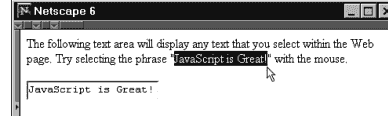

图 8.3 选择部分文本并显示在文本框中。

## document.handleEvent()

JavaScript 1.2-1.3
Nav4.5

### 语法

`document.handleEvent(event)`

## 描述

handleEvent() 方法提供了一种调用文档事件处理程序的方法，即使该事件从未发生。event 参数指定了与要调用的事件处理程序相关的 Event 对象。

## 示例

在列表 8.78 中，指定了一个事件处理程序来处理所有的文档 Click 事件。当用户选择标记为 9 的按钮时，使用 clickHandler() 方法将事件路由到文档的事件处理程序。

### 列表 8.78 使用 handleEvent() 方法将事件传递给文档

```html
<html>

<h2>数学测验</h2>

6+37 等于几？

<form name="answerForm">
  <input type="button"
    value=" 8 "
    name="answer8"
    onclick="alert('不正确。请再一次。')">
  <input type="button"
    value=" 9 "
    name="answer9"
    onclick="document.handleEvent(event)">
</form>

<script type="text/javascript" language="JavaScript">
<!--
// 指定处理点击事件的函数。
function clickHandler(event)
{
  // 显示警告框。
  alert("文档内发生了点击事件。");
}

// 将 Click 事件注册到文档事件处理程序中。
document.onClick = clickHandler;
// -->
</script>

</html>
```

## document.ids

JavaScript 1.2-1.3
Nav4-4.5

### 语法

`document.ids.idname.style`

## 描述

ids 属性是一个关联数组，包含了与 Netscape 样式表相关的 ID。使用点表示法，idName 指定了与某种样式相关的 ID。样式表 ID 在 `<style>` 或 `<script>` 标签内使用 JavaScript 或 HTML 创建。所指定的样式可以是表 8.9 所示的任何样式属性或方法。有关任何任何属性的更多信息，请参见本章中的 Style 对象条目。

### 表 8.9 样式对象属性

| 类型 | 项目 | 描述 |
| :--- | :--- | :--- |
| 属性 | paddingBottom | 元素的底部边距 |
| | paddingLeft | 元素的左侧边距 |
| | paddingRight | 元素的右侧边距 |
| | paddingTop | 元素的顶部边距 |
| | textAlign | 文本对齐方式 |
| | textDecoration | 添加到文本的装饰 |
| | textIndent | 文本缩进 |
| | textTransform | 文本转换 |
| | verticalAlign | 元素的垂直对齐 |
| | whiteSpace | 如何处理空白字符 |
| | backgroundColor | 背景颜色 |
| | backgroundImage | 背景图像 |
| | borderColor | 边框颜色 |
| | borderWidth | 边框宽度 |
| | borderStyle | 边框样式 |
| | color | 前景色 |
| | display | 元素的显示方式 |
| | fontFamily | 使用的字体 |
| | fontSize | 字体大小 |
| | fontStyle | 字体样式 |
| | fontWeight | 字体粗细 |
| | lineHeight | 行高 |
| | listStyle | 列表样式 |
| | marginBottom | 元素的底部边距 |
| | marginLeft | 元素的左侧边距 |
| | marginRight | 元素的右侧边距 |
| | marginTop | 元素的顶部边距 |
| | width | 元素的宽度 |

## 示例

### 列表 8.79 创建样式表 ID

列表 8.79 展示了使用 `<style>` 和 `<script>` 标签创建 ID 的三种不同方法。注意 ID 定义和使用的顺序会影响样式。

```html
<html>

<style type="text/css">
#TEXTFORMAT {font-style: italic;}
</style>

<p id=TEXTFORMAT>第一个 STYLE 标签之后</p>

<script type="text/javascript">
ids.TEXTFORMAT.fontWeight = "bold";
</script>

<p id=TEXTFORMAT>第二个 STYLE 标签之后</p>

<script>
<!---
ids.TEXTFORMAT.textDecoration = "underline";
//-
</script>

<p id=TEXTFORMAT>SCRIPT 标签之后</p>

</html>
```

## document.images

JavaScript 1.1+, JavaScript 1.0+
Nav3+, IE3+, Opera3+

### 语法

```javascript
document.images
document.images[index]
```

## 描述

images 属性是一个数组，包含了 HTML 文档中使用 `` 标签出现的所有对象。images 属性自身有一个属性 length，包含数组中的项目数量。索引数字从 0 到数组长度减 1。

## 示例

列表 8.80 使用 images 数组访问每个图像的源。

### 列表 8.80 使用 images 数组访问图像

```html
<html>

<h2>一个圆</h2>


<h2>一个正方形</h2>
<br>

<script type="text/javascript" language="JavaScript">
<!---
// 显示图像对象的源。
for(i=0;i<document.images.length;i++)
{
document.write("The source of image object ",(i+1));
document.write(" is <i><b>" + document.images[i].src + "</b></i><br>");
}
// // -->
</script>

</html>
```

## document.images.length

JavaScript 1.1, JSScript 1.0+
Nav3+, IE3+, Opera 5+

### 语法

`document.images.length`

## 描述

`length` 属性包含 `images[]` 数组中的对象数量。

## 示例

列表 8.81 中的代码使用 `length` 属性来显示 HTML 文档中图像的数量。

### 列表 8.81 使用 `length` 属性显示文档中的图像数量

```html
<h2>一个圆圈</h2>


<h2>一个正方形</h2>
<br>

<script type="text/javascript" language="JavaScript">
<!-- -->
// 显示 images 数组的长度。
document.write(document.images.length," image objects.");
// // -->
</script>

</html>
```

## document.lastModified

JavaScript 1.0+, JavaScript 3.0+
Nav2+, IE3+, Opera 3+

### 语法

`document.lastModified`

## 描述

`lastModified` 属性包含文档在服务器上最后修改的日期。在处理包含特定日期信息的文档时，此属性非常有用。使用此属性时要小心，因为 Web 服务器并不要求提供此时间戳。如果未提供时间戳，JavaScript 将将 `lastModified` 属性设置为 1970 年 1 月 1 日午夜 (GMT)。

## 示例

列表 8.82 中的代码列出了服装的折扣价格，以及文档最后修改的时间。

### 列表 8.82 根据 `lastModified` 属性显示价格

```html
<html>

<center>
<h2>服装限时销售</h2>

<script type="text/javascript" language="JavaScript">
<!--
document.write("Starting *",document.lastModified, " the following ");
document.write("clothing items will be on sale for one week ");
document.write("so order now!<br>");
// // -->
</script>

<table border=ON>
<tr>
<th>项目</th>
<th>零售价</th>
<th>特价</th>
</tr>
<tr>
<td>T恤</td>
<td>$20.00</td>
<td><td><font color="RED">$10.99</font></td></td>
</tr>
<tr>
<td>牛仔裤</td>
<td>$60.00</td>
<td><td><font color="RED">$30.99</font></td></td>
</tr>
<tr>
<td>帽子</td>
<td>$25.00</td>
<td><td><font color="RED">$15.00</font></td></td>
</tr>
</table>

</center>

</html>
```

## document.layers

JavaScript 1.2-1.4
Nav4-4.7

### 语法

```javascript
document.layers
document.layers[index]
```

## 描述

`layers` 属性是一个包含所有使用 `<layer>` 标签在 HTML 文档中出现的数组。`layers` 属性本身有一个名为 `length` 的属性，包含数组中的项目数量。索引值从 0 范围到长度。

> 注意
> 从 JavaScript 1.5 开始，不再支持 `layers` 属性，因此该属性在 Netscape 6 中不可用。

## 示例

列表 8.83 中的代码创建了两个层并使用 `layers[]` 数组在页面底部显示它们的名称。

### 列表 8.83 使用 layers[] 数组访问层对象

```html
<html>

<layer name="Layer1"
PAGEX=50
PAGEY=50
width=100
height=100
bcolor="blue">Layer 1</layer>

<layer name="Layer2"
PAGEX=150
PAGEY=150
```

### 列表 8.83 续

```html
width=100
height=100
bcolor="red">Layer 2</layer>

<script type="text/javascript" language="JavaScript">
<!--
// 显示层对象的名称。
for(i=0;i<document.layers.length;i++)
{
  document.write("The name of layer object ",document.layers[i].name,"</b><i><br>");
}
<!-- -->
</script>

</html>
```

## document.layers.length

JavaScript 1.2-1.4
Nav4-4.7

### 语法

`document.layers.length`

## 描述

`length` 属性包含 `layers[]` 数组中的对象数量。

> 注意
> JavaScript 1.5 不再支持与 `layers[]` 数组关联的 `length` 属性，因此该属性在 Netscape 6 中不可用。

## 示例

列表 8.84 中的代码创建了两个层并使用 `length` 属性在页面底部显示层的数量。

### 列表 8.84 使用 length 属性显示文档中的层数

```html
<html>

<layer name="Layer1"
page=50
page=50
width=100
height=100
bcolor="blue">Layer 1</layer>

<layer name="Layer2"
page=150
page=150
width=100
height=100
bcolor="red">Layer 2</layer>

<script type="text/javascript" language="JavaScript">
<!--
// 显示 layers 数组的长度。
document.write(document.layers.length," layer objects.");
// -->
</script>

</html>
```

## document.linkColor

JavaScript 1.0+, ECMAScript 1.0+, JScript 1.0+
Nav2+, IE3+

### 语法

`document.linkColor`

## 描述

`linkColor` 属性指定文档中未访问链接的颜色。该颜色以十六进制形式表示。

## 示例

列表 8.85 使用 `linkColor` 属性设置未访问链接的颜色。

```html
<a href="mypage.html">链接</a>

<script type="text/javascript" language="JavaScript">
<!--
// 设置未访问链接的颜色为绿色。
document.linkColor="#00ff00";
// -->
</script>
```

## document.links

JavaScript 1.0+, JavaScript 3.0+
Nav2+, IE3+, Opera 5+

### 语法

`document.links`

## 描述

`links` 属性是一个包含所有在 HTML 文档中出现的链接对象的数组。`links` 属性本身有一个名为 `length` 的属性，包含数组中的项目数量。索引值从 0 范围到长度。

## 示例

列表 8.86 中的代码使用 `links[]` 数组在页面底部显示链接对象的名称。

### 列表 8.86 使用 links[] 数组访问链接对象

```html
<html>

<a href="page1.html">链接1</a>
<a href="page2.html">链接2</a>

<script type="text/javascript" language="JavaScript">
<!--
// 显示链接对象的名称。
for(i=0;i<document.links.length;i++)
{
  document.write("The name of link object ",document.links[i].name,"</b><i><br>");
}
<!-- -->
</script>

</html>
```

## document.links.length

JavaScript 1.0+, JavaScript 3.0+
Nav2+, IE3+, Opera 5+

### 语法

`document.links.length`

## 描述

`length` 属性包含 `links[]` 数组中的对象数量。

## 示例

列表 8.87 中的代码使用 `length` 属性在页面底部显示链接的数量。

### 列表 8.87 使用 length 属性显示文档中的链接数

```html
<html>

<a href="page1.html">链接1</a>
<a href="page2.html">链接2</a>

<script type="text/javascript" language="JavaScript">
<!--
// 显示 links 数组的长度。
document.write(document.links.length," links.");
-->
</script>

</html>
```

## document.onClick

JavaScript 1.0+, JavaScript 1.0-3.0
Nav2+, IE3-4

### 语法

`document.onClick`

## 描述

`onClick` 事件处理器指定了当点击 document 对象时应该发生什么。

## 示例

在列表 8.88 中，文档 `<head>` 中的脚本指定了一个处理文档中所有 Click 事件的函数。为了能够这样做，使用了文档的 `captureEvents()` 方法来捕获类型为 Event.CLICK 的事件。当页面本身被点击时，Document 的事件处理器会生成一个警框来通知用户该事件。

### 列表 8.88 使用 onClick 事件处理器处理点击事件

```html
<html>

<head>
<script type="text/javascript" language="JavaScript1.2">
<!--
// 告诉浏览器你想拦截页面上所有的点击事件
// 然后定义一个函数来处理它们。
document.captureEvents(Event.CLICK);
document.onclick = myClickHandler;

// 定义处理点击事件的 myClickHandler 函数
function myClickHandler(e){
alert("The document was clicked!");
}
// -->
</script>

<body>
每当你点击此文档的任何位置时，都会收到一条消息，通知你发生了一个 Click 事件。
</body>

</html>
```

## document.onDBlClick

JavaScript 1.0+, JavaScript 1.0-3.0
Nav2+, IE3-4

### 语法

`document.onDBlClick`

## 描述

ondblClick 事件处理器指定了在 Document 对象内双击鼠标时应该发生什么。

## 示例

在列表 8.89 中，文档中 `<head>` 标签内的脚本指定了一个函数来处理文档中所有的 DblClick 事件。为了实现这一点，使用了文档的 `captureEvents()` 方法来捕获页面本身被双击时所有类型为 `Event.DBLCLICK` 的事件，此时 Document 的事件处理器会生成一个警报框通知。

### 列表 8.89 使用 ondblClick 事件处理 DblClick 事件

```html
<html>

<head>
<script type="text/javascript" language="JavaScript1.2">
<!--
// 告诉浏览器你想拦截页面上所有的 DblClick 事件
// 然后定义一个函数来处理它们。
document.captureEvents(Event.DBLCLICK);
document.onDBlClick = myDblClickHandlerHandler;

// 定义 myDblClickHandlerHandler 来处理 DblClick 事件。
```


# 第 8 章：客户端

## document.keyDown

**JavaScript 1.0+**, **JavaScript 1.0-3.0** Nav2+, IE3-4

### 语法

```javascript
document.keyDown
```

### 描述

`keyDown` 事件处理器指定了当 `Document` 对象处于焦点状态时，当任何按键被按下时应该发生什么。

### 示例

在列表 8.90 中，文档中 `<head>` 标签内的脚本指定了一个函数来处理文档中所有的 `keyDown` 事件。为了实现这一点，使用了文档的 `captureEvents()` 方法来捕获所有类型为 `Event.KEYDOWN` 的事件。当页面内按下任何按键时，文档的事件处理器会生成一个警报框通知用户该事件。

- 列表 8.90 使用 `keyDown` 事件处理器处理 `keyDown` 事件

```html
<html>
<head>
<script type="text/javascript" language="JavaScript1.2">
<!--
// 告诉浏览器你想拦截页面上所有的按键按下事件
// 并定义一个函数来处理它们。
document.captureEvents(Event.KEYDOWN);
document.keyDown = keyDownHandler;

// 定义 keyDownHandler 函数来处理
// 按键按下事件。
function keyDownHandler(e){
  alert("A key down event took place within the document!");
}
// -->
</script>
</head>
<body>
每当你在此文档内按下按键时，你都会
收到一条消息，提示你发生了一个 keyDown 事件。
</body>
</html>
```

## document.onKeyPress

**JavaScript 1.0+**, **JavaScript 1.0-3.0** Nav2+, IE3-4

### 语法

```javascript
document.onKeyPress
```

### 描述

`onKeyPress` 事件处理器指定了当 `Document` 对象处于焦点状态时，当任何按键被按下时应该发生什么。

### 示例

在列表 8.91 中，文档中 `<head>` 标签内的脚本指定了一个函数来处理文档中所有的 `KeyPress` 事件。为了实现这一点，使用了文档的 `captureEvents()` 方法来捕获所有类型为 `Event.KEYPRESS` 的事件。当页面内按下任何按键时，文档的事件处理器会生成一个警报框通知用户该事件。

- 列表 8.91 使用 `onKeyPress` 处理器处理 `KeyPress` 事件

```html
<html>
<head>
<script type="text/javascript" language="JavaScript1.2">
<!--
// 告诉浏览器你想拦截页面上所有的按键按下事件
// 然后定义一个函数来处理它们。
document.captureEvents(Event.KEYPRESS);
document.onKeyPress = myKeyPressHandler;

// 定义 myKeyPressHandler 函数来处理
// 按键按下事件。
function myKeyPressHandler(e){
  alert("A key press event took place within the document!");
}
// -->
</script>
</head>
<body>
每当你在此文档内按下按键时，你都会
收到一条消息，提示你发生了一个 KeyPress 事件。
</body>
</html>
```

## document.onKeyUp

**JavaScript 1.0+**, **JavaScript 1.0-3.0** Nav2+, IE3-4

### 语法

```javascript
document.onKeyUp
```

### 描述

`onKeyUp` 事件处理器指定了当 `Document` 对象处于焦点状态时，当任何按键被按下并随后释放时应该发生什么。

### 示例

在列表 8.92 中，文档中 `<head>` 标签内的脚本指定了一个函数来处理文档中所有的 `KeyUp` 事件。为了实现这一点，使用了 `document.captureEvents()` 方法来捕获所有类型为 `Event.KEYUP` 的事件。当页面内按下并释放任何按键时，文档的事件处理器会生成一个警报框通知用户该事件。

- 列表 8.92 使用 `onKeyUp` 事件处理器处理 `KeyUp` 事件

```html
<html>
<head>
<script type="text/javascript" language="JavaScript1.2">
<!--
// 告诉浏览器你想拦截页面上所有的按键释放事件
// 然后定义一个函数来处理它们。
document.captureEvents(Event.KEYUP);
document.onKeyUp = myKeyUpHandler;

// 定义 myKeyUpHandler 来处理
// 按键释放事件。
function myKeyUpHandler(e){
  alert("A key up event took place within the document!");
}
// -->
</script>
</head>
<body>
每当你在此文档内按下并释放按键时，你都会
收到一条消息，提示你发生了一个 KeyUp 事件。
</body>
</html>
```

## document.onload

**JavaScript 1.0+**, **JavaScript 1.0-3.0** Nav2+, IE3+

### 语法

```javascript
document.onload
```

### 描述

`Document` 对象的 `onload` 事件处理器在页面加载完成时触发。该事件处理器属于 `Window` 对象，但可以通过 `Document` 对象访问。

### 示例

列表 8.93 的示例代码在页面加载完成时使用 `onload` 处理器弹出警报。

- 列表 8.93 使用 `onload` 处理器处理 `Load` 事件

```html
<html>
<head>
<title>Onload Example</title>
</head>
<body onload="alert('The document has loaded.')">
The onload event handler.
</body>
</html>
```

## document.onMouseDown

**JavaScript 1.0+**, **JavaScript 1.0-3.0** Nav2+, IE3-4

### 语法

```javascript
document.onMouseDown
```

### 描述

`onMouseDown` 事件处理器指定了在 `Document` 对象内点击鼠标时应该发生什么。

### 示例

在列表 8.94 中，文档中 `<head>` 标签内的脚本指定了一个函数来处理文档中所有的 `MouseDown` 事件。为了实现这一点，使用了文档的 `captureEvents()` 方法来捕获所有类型为 `Event.MOUSEDOWN` 的事件。当页面内点击鼠标时，文档的处理器会生成一个警报框通知用户该事件。

- 列表 8.94 使用 `onMouseDown` 处理器处理 `MouseDown` 事件

```html
<html>
<head>
<script type="text/javascript" language="JavaScript1.2">
<!--
// 告诉浏览器你想拦截页面上所有的鼠标按下事件
// 然后定义一个函数来处理它们。
document.captureEvents(Event.MOUSEDOWN);
document.onMouseDown = myMouseDownHandler;

// 定义 myMouseDownHandler 函数来处理
// 鼠标事件。
function myMouseDownHandler(e) {
  alert("A mouse down event took place within the document!");
}
// -->
</script>
</head>
<body>
每当你在此文档内按下鼠标时，你都会
收到一条消息，提示你发生了一个 MouseDown 事件。
</body>
</html>
```

## document.onMouseUp

**JavaScript 1.0+**, **JavaScript 1.0-3.0** Nav2+, IE3-4

### 语法

```javascript
document.onMouseUp
```

### 描述

`onMouseUp` 事件处理器指定了在 `Document` 对象内点击并释放鼠标按钮时应该发生什么。

### 示例

在列表 8.95 中，文档中 `<head>` 标签内的脚本指定了一个函数来处理文档中所有的 `MouseUp` 事件。为了实现这一点，使用了文档的 `captureEvents()` 方法来捕获所有类型为 `Event.MOUSEUP` 的事件。当页面内点击并随后释放鼠标按钮时，文档的处理器会生成一个警报框通知用户该事件。

- 列表 8.95 使用 `onMouseUp` 事件处理器处理 `MouseUp` 事件

```html
<html>
<head>
<script type="text/javascript" language="JavaScript1.2">
<!--
// 告诉浏览器你想拦截页面上所有的鼠标抬起事件
// 然后定义一个函数来处理它们。
document.captureEvents(Event.MOUSEUP);
document.onMouseUp = myMouseUpHandler;

// 定义 myMouseUpHandler 函数来处理
// 抬起事件。
function myMouseUpHandler(){
  alert("A mouse up event took place within the document!");
}
// -->
</script>
</head>
<body>
每当你在此文档中按下鼠标按钮并释放它时，你将收到一条消息，提示你发生了一个 MouseUp 事件。
</body>
</html>
```

## document.onUnload

**JavaScript 1.0+**, **JavaScript 1.0+** Nav2+, IE3+, Opera3+

### 语法

```javascript
onUnload="command"
```

### 描述

`Document` 对象的 `onUnload` 事件处理器会在页面在特定的窗口实例中被卸载时触发。这通常发生在用户离开当前页面跳转到另一个页面时。该事件处理器实际上属于 `Window` 对象，但可以通过 `Document` 对象访问。请参见本章后文 `Window.onUnload` 以获取更多信息。

在 `frame` 中加载的文档中，其 `<body>` 中的 `onUnload` 事件处理器将在加载该文档的 `<frameset>` 标签加载的事件之前触发。

### 示例

列表 8.96 中的代码得益于 `onUnload` 事件处理器，当用户点击链接离开当前 HTML 页面时，会弹出一个警告框。

- 列表 8.96 使用 `onUnload` 事件处理器处理 `Unload` 事件

```html
<html>
<body onUnload='alert("Please do not leave!")'>
<a href="nextpage.html">点击此链接前往下一页。</a>
</body>
</html>
```

## document.open()

**JavaScript 1.0+**, **JS 1.0+** Nav2+, IE3+, Opera3+

### 语法

```javascript
document.open()
document.open(mimetype)
```

### 描述

`Document` 对象的 `open()` 方法会清空当前文档，并为放置在文档中的新数据打开一个流。该方法接受一个参数 `mimetype`，用于指定要写入文档的数据类型。该参数可以是以下标准 MIME 类型之一：`text/html`, `text/plain`, `image/gif`, `image/jpeg` 或 `image/x-bitmap`。

### 示例

列表 8.97 使用 `open()` 方法打开文档，然后向文档写入文本。

- 列表 8.97 使用 `open()` 方法打开文档

```html
<script type="text/javascript" language="JavaScript">
<!--
document.open();
document.write("Stream text to document");
document.close();
// -->
</script>
```

## document.plugins

**JavaScript 1.1+**, **JavaScript 1.0+** Nav3+, IE3+, Opera3+

### 语法

```javascript
document.plugins
document.plugins[index]
```

### 描述

`plugins` 属性是一个数组，包含了在 HTML 文档中使用 `<embed>` 标签显示的所有嵌入对象和插件。`plugins` 属性本身有一个自己的属性，称为 `length`，它包含数组中的项目数量。索引数字范围从 0 到 `length - 1`。

> **注意**
> `plugins[]` 数组属性访问的数据与 `document.embeds[]` 属性相同。

### 示例

列表 8.98 使用 `length` 属性显示 HTML 文档中嵌入对象的数量。

- 列表 8.98 使用 `plugins` 属性显示插件数量

```html
<html>
<h2>学习形状</h2>
<h2>一个圆形</h2>
<embed src="circle.gif">
<h2>一个正方形</h2>
<embed src="square.gif">
<script type="text/javascript" language="JavaScript">
<!--
// 显示 plugins 数组的长度。
document.write(document.plugins.length + " embedded objects.");
// -->
</script>
</html>
```

## document.plugins.length

**JavaScript 1.1+**, **JavaScript 1.0+** Nav3+, IE3+

### 语法

```javascript
document.plugins.length
```

### 描述

`length` 属性包含 `plugins[]` 数组中的对象数量。

### 示例

列表 8.99 使用 `length` 属性显示 HTML 文档中嵌入对象的数量。

- 列表 8.99 使用 `length` 属性显示文档中的插件数量

```html
<h2>一个圆形</h2>
<embed src="circle.gif">
<h2>一个正方形</h2>
<embed src="square.gif">
<script type="text/javascript" language="JavaScript">
<!--
// 显示 plugins 数组的长度。
document.write(document.plugins.length, " embedded objects.");
// -->
</script>
</html>
```

## document.referrer

**JavaScript 1.0+**, **JavaScript 3.0+** Nav2+, IE4+

### 语法

```javascript
document.referrer
```

### 描述

`referrer` 属性包含用于到达当前文档的文档的 URL。如果直接在浏览器的地址栏输入 URL，则此属性将为空。

### 示例

在列表 8.100 中，使用 `referrer` 属性创建一个返回上一个文档的链接。

- 列表 8.100 使用 `referrer` 属性返回上一个文档

```html
<script type="text/javascript" language="JavaScript">
<!--
  // 返回之前的文档。
  document.write("<a href=" + document.referrer + ">Go back</a>");
// -->
</script>
```

## document.releaseEvents()

**JavaScript 1.2-4.5**

### 语法

```javascript
document.releaseEvents(event)
document.releaseEvents(event1 | event2)
```

### 描述

`Document` 对象的 `releaseEvents()` 方法释放之前捕获的指定类型事件。可以按以下方式释放的事件：

- `Event.ABORT`
- `Event.BLUR`
- `Event.CHANGE`
- `Event.CLICK`
- `Event.DBLCLICK`
- `Event.DRAG`
- `Event.FOCUS`
- `Event.KEYDOWN`
- `Event.KEYPRESS`
- `Event.KEYUP`
- `Event.LOAD`
- `Event.MOUSEDOWN`
- `Event.MOUSEMOVE`
- `Event.MOUSEOUT`
- `Event.MOUSEOVER`
- `Event.MOUSEUP`

### 示例

列表 8.101 包含一个文本框和一个按钮。`<head>` 中的脚本指定了一个处理所有点击事件的函数。当页面本身被点击时，显示在文本框中的计数会增加。

- 列表 8.101 使用 `releaseEvents()` 方法停止捕获

```html
<html>
<head>
<script type="text/javascript" language="JavaScript">
<!--
// 点击计数器。
var counter = 0;

// 告诉浏览器你想拦截页面上所有的
// 点击事件。然后定义一个函数
// 来处理它们。
document.captureEvents(Event.CLICK);
document.onclick = myClickHandler;

// 定义 myClickHandler 函数来处理
// 点击事件。
function myClickHandler(e){
  // 将所有点击事件传递给文本框的 onClick 事件。
  document.myForm.myText.handleEvent(e);
}

// 由文本框的 onClick 调用。显示已发生的点击次数。
function changeText(){
  document.myForm.myText.value = counter++;
}

// 释放事件捕获
function releaseClick(){
  document.releaseEvents(Event.CLICK);
  document.onclick = "";
}
// -->
</script>
</head>
<body>
<form name="myForm">
  <input type="TEXT" size="2" value="0" name="myText" onclick="changeText()">
  <input type="BUTTON" value="Release Event" onMouseDown="releaseClick()">
</form>
</body>
</html>
```

## document.routeEvent()

**JavaScript 1.2+** Nav4+

### 语法

```javascript
document.routeEvent(event)
```

### 描述

`Document` 对象的 `routeEvent` 方法将之前捕获的指定类型事件通过其正常的事件处理过程传递。可以按以下方式传递的事件：

- `Event.ABORT`
- `Event.BLUR`
- `Event.CHANGE`
- `Event.CLICK`
- `Event.DBLCLICK`
- `Event.DRAG`
- `Event.ERROR`
- `Event.FOCUS`
- `Event.KEYDOWN`
- `Event.KEYPRESS`
- `Event.KEYUP`
- `Event.LOAD`
- `Event.MOUSEDOWN`
- `Event.MOUSEMOVE`
- `Event.MOUSEOUT`
- `Event.MOUSEOVER`
- `Event.MOUSEUP`
- `Event.MOVE`
- `Event.RESET`
- `Event.RESIZE`
- `Event.SELECT`
- `Event.SUBMIT`
- `Event.UNLOAD`

在使用 `Document.captureEvents()` 方法捕获了其中任一个事件后，你可以定义一个函数来替换用于处理该事件的内置方法。使用 `releaseEvents()` 方法在捕获后释放事件，并使用 `routeEvent()` 允许正常处理发生。

### 示例

列表 8.102 包含一个文本框和一个链接。文档 `<head>` 中的脚本指定了一个处理所有 `Click`（点击）事件的函数。为了实现这一目标，必须使用 `captureEvents()` 方法来捕获所有类型为 `Event.CLICK` 的事件。当点击页面本身时，显示在文本框中的计数器会增加。

当点击链接时，会触发 `MouseDown` 事件，`Event.CLICK` 通过其正常机制路由，且点击页面时计数器不再增加。

- 列表 8.102 使用 `routeEvent()` 方法继续路由已捕获的事件

```html
<html>
<head>
<script type="text/javascript" language="JavaScript1.2">
<!--
// 定义一个计数器变量。
var counter = 0;
// 告诉浏览器你想拦截页面上所有的点击事件。
// 然后定义一个函数来处理它们。
document.captureEvents(Event.CLICK);
document.onClick = myClickHandler;

// 定义 myClickHandler 函数来处理点击事件。
function myClickHandler(e){
  // 将所有点击事件传递给文本框的 onClick 事件。
  document.myForm.myText.handleEvent(e);
}

// 函数由文本框的 onClick 调用。显示
// 已经发生的点击次数。
function changeText() {
  document.myForm.myText.value = counter++;
}

// 路由点击事件捕获
function releaseClick() {
  document.routeEvent(Event.CLICK);
}
// -->
</script>
</head>
<body>
<form name="myForm">
  <input type="TEXT" size="2" name="myText" onclick="changeText()">
  <a href="http://www.purejavascript.com" onMouseDown="releaseClick()">点击这里！</a>
</form>
</body>
</html>
```

## document.tags

**JavaScript 1.2+** Nav4+

### 语法

```javascript
document.tags.tagName.style
```

### 描述

`tags` 属性是一个关联数组，包含与 Netscape 样式表相关的标签。使用点符号，`tagName` 指定了与样式相关的标签。样式表标签是在 `<style>` 或 `<script>` 标签中使用 JavaScript 或 HTML 创建的。可以使用表 8.10 所示的任意样式属性或方法来指定样式。有关任何属性的更多信息，请参阅本章中的 Style 对象条目。

> **注意**
> 在创建标签时，确保声明出现在新标签使用之前，因为许多 HTML 对象在文档中创建后将无法更改。

> **注意**
> 如果在 `<style>` 标签内创建新标签时使用了 JavaScript 记法，则不需要指定 `document`。

### 表 8.10 可配合 `tags` 属性使用的 Style 对象属性和方法

| 类型 | 项目 | 说明 |
| --- | --- | --- |
| 属性 | `align` | 元素在其父元素中的对齐方式 |
| | `backgroundColor` | 元素的背景颜色 |
| | `backgroundImage` | 元素的背景图像 |
| | `borderBottomWidth` | 元素底部边框宽度 |
| | `borderColor` | 元素的边框颜色 |
| | `borderLeftWidth` | 元素左侧边框宽度 |
| | `borderRightWidth` | 元素右侧边框宽度 |
| | `borderStyle` | 包围元素的边框样式 |
| | `borderTopWidth` | 元素顶部边框宽度 |
| | `clear` | 不允许浮动元素所在的元素侧 |
| | `color` | 元素的前景颜色 |
| | `display` | 要显示的元素 |
| | `fontFamily` | 元素应该使用的字体 |
| | `fontSize` | 元素使用的字体大小 |
| | `fontStyle` | 元素使用的字体样式 |
| | `fontWeight` | 元素使用的字体权重 |
| | `lineHeight` | 相邻两行之间的距离 |
| | `listStyle` | 列表项元素的格式 |
| | `marginBottom` | 元素底部边框与另一个元素顶部外边框之间的距离 |
| | `marginLeft` | 元素左边框与另一个元素右侧外边框之间的距离 |
| | `marginRight` | 元素右侧边框与另一个元素左侧外边框之间的距离 |
| | `marginTop` | 元素顶部边框与另一个元素底部外边框之间的距离 |
| | `paddingBottom` | 元素底部边框与其内容之间的距离 |
| | `paddingLeft` | 元素左边框与其内容之间的距离 |
| | `paddingRight` | 元素右侧边框与其内容之间的距离 |
| | `paddingTop` | 元素顶部边框与其内容之间的距离 |
| | `textAlign` | 元素内文本的对齐方式 |
| | `textDecoration` | 添加到文本的装饰类型 |
| | `textIndent` | 文本前应该出现的缩进 |
| | `textTransform` | 应该应用于文本的转换 |
| | `verticalAlign` | 元素的垂直对齐 |
| | `whitespace` | 如何处理空白字符 |
| | `width` | 元素的宽度 |
| | `borderWidth` | 边框宽度 |
| | `margins` | 元素的外边距 |
| | `paddings` | 边框与内容的距离 |
| | `height` | 元素的高度 |

### 示例

列表 8.103 展示了使用 `<style>` 和 `<script>` 标签创建样式的三种不同方法。注意标签的顺序最终会影响结果。

- 列表 8.103 创建样式标签

```html
<html>
<style type="css">
P {font-style: italic;}
</style>

<p>第一个标签</p>

<style type="javascript">
tags.P.fontWeight = "bold";
</style>

<p>第二个标签</p>

<script>
tags.P.textDecoration = "underline";
</script>

<p>脚本标签</p>
</html>
```

## document.title

**JavaScript 1.0+**, **JavaScript 1.0+** Nav2+, IE3+, Opera3+

### 语法

```javascript
document.title
```

### 说明

这是一个指定文档标题的只读字符串。该属性通常使用 `<title>` 标签设置。

### 示例

在列表 8.104 中，使用 `title` 属性将网页标题写入屏幕。

- 列表 8.104 获取文档标题

```html
<html>
<head><title>我的网页</title></head>
<body>
<script>
// 输出文档标题。
document.write("此页标题为 <i>");
document.write(document.title, "</i>");
</script>
</body>
</html>
```

## document.unwatch

**JavaScript 1.2+** Nav4+, NES3+

### 语法

```javascript
document.unwatch(property)
```

### 说明

`Document` 对象的 `unwatch()` 方法用于关闭对指定属性的监听。

### 示例

列表 8.105 显示了在 `fgColor` 属性变为 "Blue" 后，如何使用 `unwatch()` 方法停止监听。

> **注意**
> 与 `watch()` 和 `unwatch()` 方法相关的 bug 阻止了浏览器中实际颜色的变化，尽管文档的 `fgColor` 属性确实发生了变化。

- 列表 8.105 Document 对象的 `unwatch()` 方法示例

```html
<html>
<b>这些文本是什么颜色的？</b><br><br>
<script type="text/javascript" language="JavaScript">
<!--
function alertme(id, oldValue, newValue)
{
  document.write(id + " " + oldValue + " to ");
  document.write(newValue + "<br>");
  return newValue;
}

// 开始监听
document.watch("fgColor", alertme);

document.write("原始文本颜色: " + document.fgColor + "<br>");

// 修改颜色
document.fgColor = "Blue";
document.write("新颜色: " + document.fgColor + "<br>");

// 停止监听
document.unwatch("fgColor");

// 修改颜色
document.fgColor = "Red";
document.write("最终颜色: " + document.fgColor + "<br>");
// -->
</script>
</html>
```

## document.URL

**JavaScript 1.1+**, **JavaScript 1.0+** Nav3+, IE3+, Opera3+

### 语法

```javascript
document.URL
```

### 描述

`URL` 属性指定文档的 URL。该属性是只读的。

### 示例

列表 8.106 使用 `URL` 属性将文档的 URL 写入屏幕。

- 列表 8.106 访问文档的 `URL` 属性

```html
<script>
<!--
// 输出文档的 URL。
document.write("The URL of this page is ", document.URL);
// -->
</script>
</html>
```

## document.vlinkColor

**JavaScript 1.0+**, **JavaScript 1.0+** Nav2+, IE3+

### 语法

```javascript
document.vlinkColor
```

### 描述

`vlinkColor` 属性指定访问过的链接的颜色。该颜色以十六进制数字字符串的形式或 HTML 标准颜色名称之一的形式表示。十六进制形式由遵循 "RRGGBB" 模式的六位数字组成。

### 示例

列表 8.107 将页面上所有你访问过的链接颜色设置为绿色，但仅当这些链接放置在 `<script>` 标签之前时。

- 列表 8.107 使用 `vlinkColor` 属性设置访问链接颜色

```html
<html>
<a href="myGreenPage.html">绿色站点</a><br>
<script type="text/javascript" language="JavaScript">
<!--
// 将访问过的链接颜色设置为绿色。
document.vlinkColor = "00ff00";
// -->
</script>
<a href="myGreenGrassPage.html">绿色草地页</a>
</html>
```

## document.watch()

**JavaScript 1.2+** Nav4, Netscape 3.0+

### 语法

```javascript
document.watch(property, function)
```

### 描述

`Document` 对象的 `watch()` 方法用于开启对由 `property` 指定特定属性的监控。每当调用 `watch()` 方法后，只要指定的属性发生变化，就会调用指定的函数。

### 示例

列表 8.108 显示了如何使用 `watch()` 方法开始监控 `Document` 对象的 `fgColor` 属性。

> **注意**
> 与 `watch()` 和 `unwatch()` 方法相关的 bug 导致即使文档的 `fgColor` 属性发生了变化，浏览器中的实际颜色也不会发生变化。

- 列表 8.108 Document 对象 `watch()` 方法示例

```html
<html>
<b>这段文字是什么颜色的？</b><br><br>
<script type="text/javascript" language="JavaScript">
<!--
function alertme(id, oldValue, newValue) {
  document.write(id + " changed from " + oldValue + " to " + newValue + "<br>");
  return newValue;
}

// 开始监控
document.watch("fgColor", alertme);

document.write("原始文本颜色: " + document.fgColor + "<br>");

// 修改文本颜色
document.fgColor = "Blue";

document.write("最终文本颜色: " + document.fgColor + "<br>");
// -->
</script>
</html>
```

## document.write()

**JavaScript 1.0+**, **JavaScript 1.0+** Nav2+, IE3+, Opera3+

### 语法

```javascript
document.write(value, ...)
```

### 描述

`write()` 方法将逗号分隔的参数（`value`）作为字符串追加到文档中。如果任何参数不是字符串，它们在被追加到文档之前会被转换成字符串。

### 示例

列表 8.109 使用 `write()` 方法向当前文档写入某些文本以及一个属性的值。

- 列表 8.109 使用 `write` 方法在文档中显示文本

```html
<html>
<head><title>电影</title></head>
<body>
<script type="text/javascript" language="JavaScript">
<!--
// 向当前文档写入数据。
document.write("The title of this web page is called <u>");
document.write(document.title, "</u>");
// -->
</script>
</body>
</html>
```

## document.writeln()

**JavaScript 1.0+**, **JavaScript 1.0+** Nav2+, IE3+, Opera3+

### 语法

```javascript
document.writeln(value, ...)
```

### 描述

`writeln()` 方法将逗号分隔的参数（`value`）作为字符串追加到文档中。与 `write()` 方法不同，`writeln()` 方法在最后一个参数写入后会在文档中追加一个换行符。如果任何参数不是字符串，它们在被追加到文档之前会被转换为字符串。

### 示例

列表 8.110 使用 `writeln()` 方法向当前文档写入某些文本以及一个属性的值。使用 `<pre>` 标签使由 `writeln()` 方法创建的换行符在 Web 页面显示。

- 列表 8.110 使用 `writeln` 方法在文档中单行显示文本

```html
<html>
<head><title>电影</title></head>
<body>
<script type="text/javascript" language="JavaScript">
<!--
// 向当前文档写入数据。
document.writeln("<pre>The title of this web page is called <u>");
document.writeln(document.title, "</u></pre>");
// -->
</script>
</body>
</html>
```

## Embed

**JavaScript 1.0+**, **JavaScript 3.0+** Nav2+, IE4+, Opera3+

### 语法

核心客户端 JavaScript 对象。

### 描述

`Embed` 对象引用任何使用 HTML `<embed>` 标签嵌入 Web 页面中的对象。它继承自 `document` 对象。`Embed` 通常用于音频视频文件，但也可以用于任何类型的嵌入文件。嵌入对象通过 `embeds` 数组或名称引用。

### 示例

列表 8.111 展示了如何通过 `embeds` 数组引用嵌入 midi 文件的示例。当此 HTML 代码在浏览器中加载时，`<embed>` 标签的 `AUTOSTART` 将播放 midi 文件。`stopsong()` 函数调用它。

- 列表 8.111 访问嵌入对象

```html
<html>
<body>
<script type="text/javascript" language="JavaScript">
<!--
// 示例代码
// -->
</script>
<a href="myGreenPage.html">绿色草地页</a>
<embed src="music.mid" autostart="true">
</body>
</html>
```

## Event

**JavaScript 1.2+**, **JavaScript 1.0+** Nav4, Netscape 3.0+

### 语法

核心客户端 JavaScript 对象。

### 描述

`Event` 对象是一个内置对象，提供有关事件的信息。当事件发生时，它会被传递给事件处理器。可用属性见表 8.11。

### 表 8.11 Event 属性

| 属性 | 描述 |
| --- | --- |
| `data` | 事件数据 |
| `height` | 窗口高度 |
| `layerX` | 层水平坐标 |
| `layerY` | 层垂直坐标 |
| `modifiers` | 表示修饰键的位掩码 |
| `pageX` | 页水平坐标 |
| `pageY` | 页垂直坐标 |
| `screenX` | 屏幕水平坐标 |
| `screenY` | 屏幕垂直坐标 |
| `target` | 触发事件的对象 |
| `type` | 事件类型 |
| `which` | 按下的按钮/按键 |
| `width` | 窗口宽度 |

除了 Event 属性外，存在的事件见表 8.12。

### 表 8.12 Event 事件类型

| 事件 | 描述 |
| --- | --- |
| `ABORT` | 页面加载被用户中断。 |
| `BLUR` | 焦点离开对象。 |
| `CHANGE` | 对象的内容或设置更改。 |
| `CLICK` | 鼠标点击一次。 |
| `DBLCLICK` | 鼠标点击两次。 |
| `DRAGDROP` | 对象被拖动并释放。 |
| `ERROR` | 加载期间发生错误。 |
| `FOCUS` | 焦点应用到对象。 |
| `KEYDOWN` | 键按下。 |
| `KEYPRESS` | 键按下。 |
| `KEYUP` | 按下后释放。 |
| `LOAD` | 在浏览器中加载文档。 |
| `MOUSEDOWN` | 左鼠标键按下。 |
| `MOUSEMOVE` | 鼠标指针移动。 |
| `MOUSEOUT` | 鼠标离开特定对象。 |
| `MOUSEOVER` | 鼠标移到特定对象上方。 |
| `MOUSEUP` | 释放鼠标键。 |
| `RESIZE` | 窗口或框架调整了大小。 |
| `SELECT` | 对象被选中。 |
| `SUBMIT` | 提交按钮被按下。 |
| `UNLOAD` | 文档从浏览器卸载。 |

### 示例

在不使用 Event 属性的情况下，`Event` 仅作为事件捕获函数的参数。列表 8.112 展示了此示例。该示例捕获了 `Window` 对象的所有 `KEYPRESS` 和 `DBLCLICK` 事件，并捕获了文档的 `SUBMIT` 事件。在捕获事件后，它们会被传递给对它们执行特定操作的事件处理器。在两个事件处理器中，返回了事件属性。

- 列表 8.112 `Event` 关键字的使用

```html
<html>
<body>
<script type="text/javascript" language="JavaScript">
<!--
// 设置文档捕获多个事件。
window.captureEvents(Event.KEYPRESS | Event.DBLCLICK);
document.captureEvents(Event.SUBMIT);

// handlePress 处理 KEYPRESS 事件。
function handlePress(evnt) {
  alert("你按下了一个键。它触发的事件是: " + evnt.type);
  return true;
}

// 函数处理 DBLCLICK 事件。
function handleDblClick(evnt) {
    alert("你双击的位置是: " + evnt.pageX + "," + evnt.pageY);
    return true;
}

// 函数处理 SUBMIT 事件。
function handleSubmit(evnt) {
    alert("你点击了提交按钮");
}

// 此处注册了 KEYPRESS 事件
// 将 handlePress 函数作为 KEYPRESS 事件的事件处理器
// 将 handleDblClick 作为 DBLCLICK 事件的事件处理器
// 将 handleSubmit 作为 SUBMIT 事件的事件处理器
window.onKeyPress = handlePress;
window.onDblClick = handleDblClick;
document.onSubmit = handleSubmit;
// -->
</script>

<form>
    <input type="submit" value="Submit">
</form>
</body>
</html>
```

此示例展示了许多不同的内容：

- 如何捕获多个事件
- 如何使用事件处理器处理这些事件
- 如何访问事件对象的属性

当你点击提交按钮时，它会触发 `SUBMIT` 事件并显示警报框。

如果你在页面的任何地方双击，它会触发 `DBLCLICK` 事件，显示一个警报框显示你双击的坐标。

当在浏览器中按下按键时，会触发 `KEYPRESS` 事件并显示警报框指示事件类型。

## event.data

**JavaScript 1.2+** Nav4+

### 语法

```javascript
event.data
```

### 描述

`Event` 对象的 `data` 属性引用一个字符串数组，用于被拖放和释放对象的事件。数组中的每个字符串都包含一个代表被释放对象的 URL。如果脚本具有 `UniversalBrowserRead` 权限，则 `data` 属性可以是只读的。

### 示例

列表 8.113 展示了如何使用 `data` 属性来确定被拖放和释放的对象的 URL。该示例捕获了所有的 `DRAGDROP` 事件并将它们传递给名为 `handleDragDrop()` 的函数。该函数从事件中提取 `data` 属性并输出它。

- 列表 8.113 访问 `event.data` 属性

```html
<html>
<body>
<script type="text/javascript" language="JavaScript">
<!--
// 设置窗口以捕获 DRAGDROP 事件。
window.captureEvents(Event.DRAGDROP);

// 处理特定事件的函数。event 参数引用
// 事件对象。
function handleDragDrop(evt) {
  // 请求 Universal Browser Read 权限。
  netscape.security.PrivilegeManager.enablePrivilege("UniversalBrowserRead");

  // 声明一个临时数组来存储来自 event.data
  // 属性的 URL 数据。
  var tmp = new Array();
  tmp = evt.data;

  // 告知用户被拖放对象的 URL。
  alert("拖放对象的 URL 是: " + tmp);
  return true;
}

// 此处将 handleDragDrop 函数注册为 DRAGDROP 事件的事件处理器。
window.onDragDrop = handleDragDrop;
// -->
</script>
</body>
</html>
```

此示例需要使用 **UniversalBrowserRead** 权限。简单地将对象、gif 图片、文件夹、文件等拖放到浏览器中，将出现一个警报框指示该对象的 URL 路径。

## event.height

**JavaScript 1.2+** Nav4+

### 语法

```javascript
event.height
```

### 描述

`Event` 对象的 `height` 属性在 `RESIZE` 事件期间控制窗口或帧的高度。

### 示例

列表 8.114 展示了发生 `RESIZE` 事件时如何访问 `height` 属性。`RESIZE` 事件意味着相应的窗口或帧的大小发生了变化，从而改变了 `height` 属性。

- 列表 8.114 访问 `event.height` 属性

```html
<html>
<body>
<script type="text/javascript" language="JavaScript">
<!--
// 设置窗口以捕获 RESIZE 事件。
window.captureEvents(Event.RESIZE);

// 改变窗口大小的函数。
function changeSize(){
  window.resizeTo(300, 400);
}

// 处理特定事件的函数。evnt 参数引用
// 事件对象。
function handle(evnt) {
  alert("发生了 RESIZE 事件。窗口的新高度是: " + evnt.height);
  return true;
}

// 此处将 handle 函数注册为 RESIZE 事件的事件处理器。
window.onResize = handle;
// -->
</script>

<form name="form1">
点击按钮改变窗口大小：
<input type="button" value="Resize window" onclick="changeSize()">
</form>
</body>
</html>
```

## event.layerX

**JavaScript 1.2+** Nav4+

### 语法

```javascript
event.layerX
```

### 描述

`Event` 对象的 `layerX` 属性控制事件在层内的水平位置。

### 示例

列表 8.115 展示了 `layerX` 属性的用法示例。当窗口调整大小时，它会显示新的 X 坐标。

- 列表 8.115 访问 `layerX` 属性

```html
<html>
<body>
<script type="text/javascript" language="JavaScript">
<!--
// 设置窗口以捕获 RESIZE 事件。
window.captureEvents(Event.RESIZE);

// 改变窗口大小的函数。
function changeSize(){
  window.resizeTo(300, 400);
}

// 处理特定事件的函数。evnt 参数引用
// 事件对象。
function handle(evnt) {
  alert("发生了 RESIZE 事件。Layer X 坐标: " + evnt.layerX);
  return true;
}

// 此处将 handle 函数注册为 RESIZE 事件的事件处理器。
window.onResize = handle;
// -->
</script>

<form name="form1">
点击按钮改变窗口大小：
<input type="button" value="Resize window" onclick="changeSize()">
</form>
</body>
</html>
```

## event.layerY

**JavaScript 1.2+** Nav4+

### 语法

```javascript
event.layerY
```

### 描述

`Event` 对象的 `layerY` 属性控制事件在层内的垂直位置。

### 示例

列表 8.116 展示了 `layerY` 属性的用法示例。当窗口调整大小时，它会显示新的 Y 坐标。

- 列表 8.116 访问 `layerY` 属性

```html
<html>
<body>
<script type="text/javascript" language="JavaScript">
<!--
// 设置窗口以捕获 RESIZE 事件。
window.captureEvents(Event.RESIZE);

// 改变窗口大小的函数。
function changeSize(){
  window.resizeTo(300, 400);
}

// 处理特定事件的函数。evnt 参数引用
// 事件对象。
function handle(evnt) {
  alert("发生了 RESIZE 事件。Layer Y 坐标: " + evnt.layerY);
  return true;
}

// 此处将 handle 函数注册为 RESIZE 事件的事件处理器。
window.onResize = handle;
// -->
</script>

<form name="form1">
点击按钮改变窗口大小：
<input type="button" value="Resize window" onclick="changeSize()">
</form>
</body>
</html>
```

## event.modifiers

**JavaScript 1.2+** Nav4+

### 语法

```javascript
event.modifiers
```

### 描述

`Event` 对象的 `modifiers` 属性指的是事件期间发生的任何键盘修饰键。修饰键以位掩码的形式存在，可能的值为：`ALT_MASK`、`CONTROL_MASK`、`META_MASK` 和 `SHIFT_MASK`。

### 示例

列表 8.117 展示了当发生鼠标或键盘事件时如何访问 `modifiers` 属性。捕获 `KEYPRESS` 事件并检查 `modifiers` 属性以查看按了哪个键。如果匹配成功，则会向用户发送一条消息。

- 列表 8.117 访问 `modifiers` 属性

```html
<html>
<body>
<script type="text/javascript" language="JavaScript">
<!--
// 设置窗口以捕获 KEYPRESS 事件。
document.captureEvents(Event.KEYPRESS);

// 处理 KEYPRESS 事件的函数。
// 它检查 event.modifiers 属性以查看按了哪个键。
//
// 可用值为：
// META_MASK = 0
// CONTROL_MASK = 2
// ALT_MASK = 3
// SHIFT_MASK = 4
function handlePress(evnt) {
  if (evnt.modifiers == 0) {
    alert("按了键");
  }
  if (evnt.modifiers == 2) {
    alert("按了 Ctrl 键");
  }
  if (evnt.modifiers == 4) {
    alert("按了 Shift 键");
  }
  return true;
}

// 此处将 handlePress 函数注册为 KEYPRESS 事件
// 的事件处理程序。
document.onKeyPress = handlePress;
// -->
</script>
</body>
</html>
```

此示例演示了事件对象的 `modifiers` 属性。

该修饰符会检查是否按下了 `Meta` 键。

如果你按下 `Ctrl` 键，`modifiers` 属性会指示这一点。

通过按下 `Shift` 键，你将触发一个检查 `SHIFT_MASK` 修饰符的事件。

若要访问特定的修饰符值，只需使用 `Event` 对象引用它即可。列表 8.118 显示了 `ALT_MASK` 修饰符。

- 列表 8.118 访问特定的修饰符值

```javascript
Event.ALT_MASK
```

## event.pageX

**JavaScript 1.2+** Nav4+

### 语法

```javascript
event.pageX
```

### 描述

`Event` 对象的 `pageX` 属性控制事件发生在 Web 页面内的水平（x 坐标）定位。

### 示例

列表 8.119 显示了如何在浏览器中查找点击事件发生 x 坐标定位的示例。只需点击浏览器窗口，就会弹出一个警报框，指示鼠标点击位置的 x 坐标值。

- 列表 8.119 使用 `pageX` 属性的示例

```html
<html>
<body>
<script type="text/javascript" language="JavaScript">
<!--
// 设置窗口以捕获 CLICK 事件。
window.captureEvents(Event.CLICK);

// 处理特定事件的函数。event 参数引用
// 事件对象。
function handle(evt) {
  alert("点击事件发生的 X 坐标为: " + evt.pageX);
  return true;
}

// 此处将 handle 函数注册为 CLICK 事件
// 的事件处理程序。
window.onclick = handle;
// -->
</script>

<form>
此示例向你展示了如何访问 `event` 对象的 **pageX** 属性。当你点击浏览器时，会弹出一个警报框，指示你点击位置的 X 坐标值。
</form>
</body>
</html>
```

## event.pageY

**JavaScript 1.2+** Nav4+

### 语法

```javascript
event.pageY
```

### 描述

`Event` 对象的 `pageY` 属性控制事件发生在 Web 页面内的垂直（y 坐标）定位。

### 示例

列表 8.120 显示了如何使用 `pageY` 属性确定光标 y 坐标定位的示例。JavaScript 代码监听 `CLICK` 事件的发生。当事件发生时，它会调用定义的 `handle()` 函数来处理任何捕获的点击事件。`handle()` 函数简单地弹出一个警报框，指示点击发生位置的 y 坐标值。

- 列表 8.120 使用 `pageY` 事件属性的示例

```html
<html>
<body>
<script type="text/javascript" language="JavaScript">
<!--
// 设置窗口以捕获 CLICK 事件。
window.captureEvents(Event.CLICK);

// 处理特定事件的函数。event 参数引用
// 事件对象。
function handle(evnt) {
  alert("点击发生的 Y 坐标为: " + evnt.pageY);
  return true;
}

// 此处将 handle 函数注册为 CLICK 事件
// 的事件处理程序。
window.onclick = handle;
// -->
</script>

此示例向你展示了如何访问 `event` 对象的 **pageY** 属性。当你点击 Web 浏览器时，会弹出一个警报框，指示你点击位置的 Y 坐标值。
</body>
</html>
```

## event.screenX

**JavaScript 1.2+**, **JavaScript 3.0+** Nav4+, IE4+

### 语法

```javascript
event.screenX
```

### 描述

事件对象的 `screenX` 控制事件发生时计算机屏幕内的水平（x 坐标）定位。

### 示例

列表 8.121 显示了如何相对于点击事件发生时的屏幕确定光标 x 坐标的示例。该代码捕获 `CLICK` 事件。当被捕获时，控制权将传递给 `handle()` 函数，该函数使用 `screenX` 属性确定 x 坐标位置。

- 列表 8.121 使用 `screenX` 属性

```html
<html>
<body>
<script type="text/javascript" language="JavaScript">
<!--
// 设置窗口以捕获 CLICK 事件。
window.captureEvents(Event.CLICK);

// 处理特定事件的函数。event 参数引用
// 事件对象。
function handle(evnt){
  alert("点击发生相对于计算机屏幕的 X 坐标为: " + evnt.screenX);
  return true;
}

// 此处将 handle 函数注册为 CLICK 事件
// 的事件处理程序。
window.onclick = handle;
// -->
</script>
此示例向你展示了如何访问 `event` 对象的 **screenX** 属性。当你点击 Web 浏览器时，会弹出一个警报框，指示你点击位置（相对于计算机屏幕）的 X 坐标值。
</body>
</html>
```

## event.screenY

**JavaScript 1.2+**, **JavaScript 3.0+** Nav4+, IE4+

### 语法

```javascript
event.screenY
```

### 描述

`Event` 对象的 `screenY` 属性控制事件发生时计算机屏幕内的垂直（y 坐标）定位。

### 示例

列表 8.122 显示了如何相对于点击事件发生屏幕确定光标 y 坐标的示例。代码捕获 `CLICK` 事件。当被捕获时，控制权传递给 `handle()` 函数，该函数使用 `screenY` 属性确定 y 坐标位置。

- 列表 8.122 使用 `screenY` 属性

```html
<html>
<body>
<script type="text/javascript" language="JavaScript">
<!--
// 设置窗口以捕获 CLICK 事件。
window.captureEvents(Event.CLICK);

// 处理特定事件的函数。event 参数引用
// 事件对象。
function handle(evnt){
  alert("点击发生相对于屏幕的 Y 坐标为: " + evnt.screenY);
  return true;
}

// 此处将 handle 函数注册为 CLICK 事件
// 的事件处理程序。
window.onclick = handle;
// -->
</script>
此示例向你展示了如何访问 `event` 对象的 **screenY** 属性。当你点击 Web 浏览器时，会弹出一个警报框，指示你点击位置（相对于计算机屏幕）的 Y 坐标值。
</body>
</html>
```

## event.clientX

**JavaScript 1.2+** Nav4+

### 语法

```javascript
event.clientX
```

### 描述

`Event` 对象的 `clientX` 属性控制相对于事件发生窗口的水平（x 坐标）定位。

### 示例

列表 8.123 显示了如何在浏览器窗口内查找点击事件发生 x 坐标定位的示例。只需点击浏览器窗口，就会弹出一个警报框，指示鼠标点击的 x 坐标值。

- 列表 8.123 使用 `clientX` 属性的示例

```html
<html>
<body>
<script type="text/javascript" language="JavaScript">
<!--
// 设置窗口以捕获 CLICK 事件。
window.captureEvents(Event.CLICK);

// 处理特定事件的函数。event 参数引用
// 事件对象。
function handle(evt) {
  alert("点击事件发生的 X 坐标为: " + evt.clientX);
  return true;
}

// 此处将 handle 函数注册为 CLICK 事件
// 的事件处理程序。
window.onclick = handle;
// -->
</script>

<form>
此示例向你展示了如何访问 `event` 对象的 **clientX** 属性。当你点击 Web 浏览器时，会弹出一个警报框，指示你点击位置的 X 坐标值。
</form>
</body>
</html>
```

## event.clientY

**JavaScript 1.2+** Nav4+

### 语法

```javascript
event.clientY
```

### 描述

`Event` 对象的 `clientY` 属性控制相对于事件发生窗口的垂直（y 坐标）定位。

### 示例

列表 8.124 显示了如何在浏览器窗口内查找点击事件发生 y 坐标定位的示例。只需点击浏览器窗口，就会弹出一个警报框，指示鼠标点击的 y 坐标值。

- 列表 8.124 使用 `clientY` 属性的示例

```html
<html>
<body>
<script type="text/javascript" language="JavaScript">
<!--
// 设置窗口以捕获 CLICK 事件。
window.captureEvents(Event.CLICK);

// 处理特定事件的函数。event 参数引用
// 事件对象。
function handle(evt) {
  alert("点击事件发生的 Y 坐标为: " + evt.clientY);
  return true;
}

// 此处将 handle 函数注册为 CLICK 事件
// 的事件处理程序。
window.onclick = handle;
// -->
</script>

<form>
此示例向你展示了如何访问 `event` 对象的 **clientY** 属性。当你点击 Web 浏览器时，会弹出一个警报框，指示你点击位置的 Y 坐标值。
</form>
</body>
</html>
```

## event.target

**JavaScript 1.2+** Nav4+

### 语法

```javascript
event.target
```

### 描述

`Event` 对象的 `target` 属性引用发送事件的元素。

### 示例

列表 8.125 显示了如何识别触发事件元素的示例。当你点击按钮时，`target` 属性将显示该按钮的名称或值。

- 列表 8.125 使用 `target` 属性的示例

```html
<html>
<body>
<script type="text/javascript" language="JavaScript">
<!--
// 设置窗口以捕获 CLICK 事件。
window.captureEvents(Event.CLICK);

// 处理特定事件的函数。event 参数引用
// 事件对象。
function handle(evt) {
  alert("点击的元素为: " + evt.target.value);
  return true;
}

// 此处将 handle 函数注册为 CLICK 事件
// 的事件处理程序。
window.onclick = handle;
// -->
</script>

<form>
<input type="button" value="Button 1" name="btn1">
<input type="button" value="Button 2" name="btn2">
<input type="button" value="Button 3" name="btn3">
</form>
</body>
</html>
```

## event.type

**JavaScript 1.2+** Nav4+

### 语法

```javascript
event.type
```

### 描述

`Event` 对象的 `type` 属性返回事件的类型名称。

### 示例

列表 8.126 显示了如何使用 `type` 属性识别发生的事件类型。该示例捕获 `KEYPRESS`、`CLICK` 和 `MOUSEDOWN` 事件，并在文本区域中显示事件类型。

- 列表 8.126 使用 `type` 属性的示例

```html
<html>
<body>
<script type="text/javascript" language="JavaScript">
<!--
// 设置窗口以捕获多个事件。
document.captureEvents(Event.KEYPRESS | Event.CLICK | Event.MOUSEDOWN);

// 处理特定事件的函数。evnt 参数引用
// 事件对象。
function handle(evnt) {
  if(evnt.type == "click") {
    document.form1.msg.value += "The click event occurred.\n";
  }
  if(evnt.type == "mousedown") {
    document.form1.msg.value += "The mousedown event occurred.\n";
  }
  if(evnt.type == "keypress") {
    document.form1.msg.value += "The keypress event occurred.\n";
  }
  return true;
}

// 这为多个事件注册了事件处理函数。
document.onKeyPress = handle;
document.onClick = handle;
document.onMouseDown = handle;
// -->
</script>

<form name="form1">
此页面演示了几个不同的事件。当事件发生时，文本区域（textarea）中将显示一条消息，指示发生了哪个事件。
<br><br>
<ul>
<li><input type="Button" value="点击我"/></li>
<li><br><br></li>
<li>
虚拟占位符文本区域。
<input type="text" size="20">
<br>
在文本字段中点击鼠标。
<br><br>
</li>
</ul>
<br><br>
<b>消息输出：</b>
<textarea name="msg" rows="10" cols="60"></textarea>
<br><br>
<input type="reset" value="清除">
</form>
</body>
</html>
```

## event.unwatch()

**JavaScript 1.2+** Nav4+

### 语法

```javascript
event.unwatch(prop)
```

### 描述

`Event` 对象的 `unwatch()` 方法用于移除通过 `watch()` 方法设置在属性上的监视点。它接受一个参数 `prop`，即要取消监听的属性。

### 示例

列表 8.127 显示了如何使用 `unwatch()` 方法关闭设置在 `event` 对象 `height` 属性上的监视点。当点击调整大小按钮时，会捕获到 `RESIZE` 事件。随后事件处理程序会提醒用户窗口大小已更改，并移除监视点，结果显示在浏览器中。

- 列表 8.127 使用 `unwatch()` 方法

```html
<html>
<body>
<script type="text/javascript" language="JavaScript">
<!--
  // 设置窗口以捕获 RESIZE 事件。
  window.captureEvents(Event.RESIZE);

// 改变窗口大小的函数。
function changeSize(){
  window.resizeTo(300, 400);
}

function alertme(id, oldValue, newValue)
{
  document.writeln(id + " changed from " + "<b>" + oldValue + "</b>"
  + " to " + "<b>" + newValue + "</b><br>");
  return newValue;
}

// 处理特定事件的函数。evnt 参数指向
// 事件对象。
function handle(evnt){
  alert("发生了 RESIZE 事件。窗口的新高度是：" + evnt.height);
  
  function setWatch() {
    var myProp = evnt.height;
    myProp.watch("myProp", alertme);
    myProp = 200;
    myProp.unwatch("myProp");
    myProp = 100;
  }
  
  setWatch();
  return true;
}

// 这将 handle 函数注册为 RESIZE
// 事件的事件处理器。
window.onResize = handle;
// -->
</script>

<form name="form1">
点击按钮更改窗口大小：
<input type="button" value="调整窗口大小" onclick="changeSize()">
</form>
</body>
</html>
```

## event.watch()

**JavaScript 1.2+** Nav4+

### 语法

```javascript
event.watch(prop, handler)
```

### 描述

`Event` 对象的 `watch()` 方法用于监听 `Event` 属性的变化。当其中一个属性 `prop` 被赋予一个值时，将使用 `handler` 来调用用户定义的函数。

### 示例

列表 8.128 显示了如何使用 `watch()` 方法查看 `event` 对象的 `height` 属性何时变化。当点击调整大小按钮时，会捕获到 `RESIZE` 事件。事件处理程序随后提醒用户窗口大小已更改，并设置监视点。随后为 `height` 属性分配一个新值并显示在浏览器中。

- 列表 8.128 使用 `Event` 的 `watch()` 方法

```html
<html>
<body>
<script type="text/javascript" language="JavaScript">
<!--
// 设置窗口以捕获 RESIZE 事件。
window.captureEvents(Event.RESIZE);

// 改变窗口大小的函数。
function changeSize(){
  window.resizeTo(300, 400);
}

function alertme(id, oldValue, newValue) {
  document.write(id + " changed from " + "<b>" + oldValue + "</b>" + " to " + "<b>" + newValue + "</b><br>");
  return newValue;
}

// 处理特定事件的函数。evnt 参数指向
// 事件对象。
function handle(evnt) {
  alert("发生了 RESIZE 事件。窗口的新高度是：" + evnt.height);
  
  // 设置监视点
  evnt.watch("height", alertme);
  evnt.height = 500; // 触发监视点
  
  return true;
}

// 这将 handle 函数注册为 RESIZE
// 事件的事件处理器。
window.onResize = handle;
// -->
</script>

<form name="form1">
点击按钮调整窗口大小：
<input type="button" value="调整大小" onclick="changeSize()">
</form>
</body>
</html>
```

## event.which

**JavaScript 1.2+** Nav4+

### 语法

```javascript
event.which
```

### 描述

`Event` 对象的 `which` 属性指向哪个按键或鼠标按钮被按下或点击。对于鼠标事件，返回的值为数值 1、2 或 3，分别代表左键、中键和右键。对于键盘事件，返回的是字符编码。

### 示例

列表 8.129 显示了如何使用 `which` 确定哪个按键被按下或点击。对于鼠标事件，返回的值为数值 1、2 或 3，分别代表左键、中键和右键。当用户点击鼠标按钮时，键盘事件返回的值是字符表示。

- 列表 8.129 访问 `Event` 的 `which` 属性

```html
<html>
<body>
<form>
使用 `which` 属性确定哪个按键被按下。
<br>
<input type="button" value="点击我" onclick="alert(event.which)">
</form>
</body>
</html>
```

## event.width

**JavaScript 1.2+** Nav4+

### 语法

```javascript
event.width
```

### 描述

`Event` 对象的 `width` 属性指向窗口或框架的宽度。当 `RESIZE` 事件发生时，该属性被赋予一个值。

### 示例

列表 8.130 显示了如何使用 `width` 属性。事件处理程序会捕获到 `RESIZE` 事件，并将其传递给函数，告知用户窗口的宽度。

- 列表 8.130 访问 `Event` 的 `width` 属性

```html
<html>
<body>
<script type="text/javascript" language="JavaScript">
<!--
  // 设置窗口以捕获 RESIZE 事件。
  window.captureEvents(Event.RESIZE);

// 改变窗口大小的函数。
function changeSize() {
  window.resizeTo(300, 400);
}

// 处理特定事件的函数。evnt 参数指向
// 事件对象。
function handle(evnt) {
  alert("发生了 RESIZE 事件。窗口的新宽度是：" + evnt.width);
  return true;
}

// 这将 handle 函数注册为 RESIZE
// 事件的事件处理器。
window.onResize = handle;
// -->
</script>
<form name="form1">
点击按钮调整窗口大小：
<input type="button" value="调整大小" onclick="changeSize()">
</form>
</body>
</html>
```

## Event.ABORT

**JavaScript 1.0+**, **JavaScript 1.0+** Nav2+, IE3+, Opera3

### 语法

```javascript
Event.ABORT
```

### 描述

`Event` 对象的 `ABORT` 属性用于图像在加载过程中被中断时。

### 示例

列表 8.131 显示了一个示例，HTML 文档中嵌入了 gif 文件，当用户点击停止按钮时，加载被中断。该方法捕获 `ABORT` 事件并将其传递给 `handleAbort()` 方法，以进行相应的处理。

- 列表 8.131 使用 `ABORT` 属性

```html
<html>
<body>
<script type="text/javascript" language="JavaScript">
<!--
// 设置窗口以捕获 ABORT 事件。
document.captureEvents(Event.ABORT);

// 处理特定事件的函数。evnt 参数指向
// 事件对象。在这种情况下，函数处理任何类型的 ABORT 事件。
function handleAbort(evt) {
  alert("发生了 ABORT 事件。");
  return true;
}

// 这将 handleAbort 函数注册为 ABORT
// 事件的事件处理器。
document.onAbort = handleAbort;
// -->
</script>
此页面加载 gif 图像。假设这是一张大图且加载需要时间，如果用户点击浏览器上的停止按钮，将捕获到 abort 事件。
<br><br><br>

</body>
</html>
```

## Event.BLUR

**JavaScript 1.0+**, **JavaScript 1.0+** Nav2+, IE3+, Opera3

### 语法

```javascript
Event.BLUR
```

### 描述

`Event` 对象的 `BLUR` 属性用于当焦点从特定的窗口、框架或表单元素移除时。

### 示例

列表 8.132 显示了一个示例，用户希望当焦点从文本区域移除时收到提醒。创建了一个函数来捕获焦点从对象移除时发生的 `BLUR` 事件。当事件被捕获时，`handleBlur()` 会提醒用户该事件。

- 列表 8.132 使用 `BLUR` 事件属性

```html
<html>
<body>
<script type="text/javascript" language="JavaScript">
<!--
// 设置窗口以捕获 BLUR 事件。
document.captureEvents(Event.BLUR);

// 处理特定事件的函数。evnt 参数指向
// 事件对象。当焦点从文本区域移除时触发该函数。
function handleBlur(evnt) {
  document.form1.msg.value += "A BLUR event has occurred.\n";
  return true;
}

// 这将 handleBlur 函数注册为 BLUR
// 事件的事件处理器。
document.onBlur = handleBlur;
// -->
</script>

<form name="form1">
将第一个文本框设置为焦点。然后点击第二个
文本框以移除对文本 1 的焦点。
<br><br>
Text 1:<input type="text" size="20" onBlur="">
<br><br>
Text 2:<input type="text" size="20">
<br><br>
<b>消息框：</b>
<textarea name="msg" rows="5" cols="50"></textarea>
</form>
</body>
</html>
```

## Event.CHANGE

**JavaScript 1.0+**, **JavaScript 1.0+** Nav2+, IE3+, Opera3

### 语法

```javascript
Event.CHANGE
```

### 描述

`Event` 对象的 `CHANGE` 属性用于当表单元素的内容或设置发生改变时。

### 示例

列表 8.133 显示了一个示例，用户希望当文本框内容改变时收到提醒。

- 列表 8.133 使用 `CHANGE` 事件属性

```html
<html>
<body>
<script type="text/javascript" language="JavaScript">
<!--
// 设置窗口以捕获 CHANGE 事件。
document.captureEvents(Event.CHANGE);

// 处理特定事件的函数。evnt 参数指向
// 事件对象。
function handleChange(evnt) {
  alert("发生了 CHANGE 事件。");
  return true;
}

// 这将 handleChange 函数注册为 CHANGE
// 事件的事件处理器。
document.onChange = handleChange;
// -->
</script>

<form name="form1">
在文本框中输入内容，然后点击其他地方触发 change 事件。
<br><br>
<input type="text" size="20" onChange="">
</form>
</body>
</html>
```


# JavaScript 事件与表单对象参考

## Event.CHANGE

**支持版本**：JavaScript 1.0+  
**浏览器兼容性**：Nav2+, IE3+, Opera3+

### 语法

`Event.CHANGE`

### 描述

`Event` 对象的该属性用于任何与文本相关的和选择框表单元素，用来指示元素设置的更改。

### 示例

列表 8.131 显示了一个检查是否发生任何 `CHANGE` 事件的函数示例。当 `CHANGE` 事件发生时，它会被 `Document` 对象捕获并传递给 `handleChange()` 函数，该函数会提示用户。

#### 列表 8.131 访问 CHANGE 属性

```html
<html>
<body>
<script type="text/javascript" language="JavaScript">
<!--
// 设置窗口以捕获 CHANGE 事件。
document.captureEvents(Event.CHANGE);

// 处理特定事件的函数。evnt 参数指向事件对象。
function handleChange(evnt) {
  alert("TextBox1 中的文本已更改");
  return true;
}

// 将该处理函数注册为 CHANGE 事件的事件处理器。
document.onChange = handleChange;
-->
</script>
</body>
</html>
```

此示例演示了更改事件。初始时 TextBox1 是空的，当你向文本框中输入信息时，会发生 **CHANGE** 事件。这会触发一个警告框打开，通知你框 1 中的文本已更改。

```html
<form name="form1">
TextBox1:
<input type="text" size="20" name="text1" onChange="">
<br>
TextBox2:
<input type="text" size="20" name="text2">
</form>
```

---

## Event.CLICK

**支持版本**：JavaScript 1.0+  
**浏览器兼容性**：Nav2+, Opera3+

### 语法

`Event.CLICK`

### 描述

`Event` 对象的 `CLICK` 属性用于所有按钮对象、文档和链接，用来指示单击鼠标点击。

### 示例

列表 8.132 显示了如何使用 `CLICK` 属性确定是否点击了鼠标。当你点击浏览器窗口时，`captureEvents()` 方法会捕获 `CLICK` 事件。事件处理器会提示你已点击。

#### 列表 8.132 访问 CLICK 属性

```html
<html>
<body>
<script type="text/javascript" language="JavaScript">
<!--
// 设置窗口捕获 CLICK 事件。
window.captureEvents(Event.CLICK);

// 处理特定事件的函数。event 参数指向事件对象。
function handleClick(event) {
  alert("此窗口中发生了一个 CLICK 事件。");
  return true;
}

// 将 handleClick 函数注册为 CLICK 事件的事件处理器。
window.onclick = handleClick;
-->
</script>

<form>
<input type="button" value="Click Here" onclick="handleClick(event)">
</form>
</body>
</html>
```

---

## Event.DBLCLICK

**支持版本**：JavaScript 1.2+, JavaScript 3.0+  
**浏览器兼容性**：Nav4+, IE4+

### 语法

`Event.DBLCLICK`

### 描述

`Event` 对象的 `DBLCLICK` 属性用于文档和链接，用来指示鼠标双击。

### 示例

列表 8.133 显示了使用 `onDoubleClick` 事件处理器来处理 `DBLCLICK` 事件的示例。当用户双击按钮或窗口中的任何地方时，会出现一个警告框，指示她执行了双击。

#### 列表 8.133 访问 DBLCLICK 事件

```html
<html>
<body>
<script type="text/javascript" language="JavaScript">
<!--
// 设置窗口捕获 DBLCLICK 事件。
window.captureEvents(Event.DBLCLICK);

// 处理特定事件的函数。evt 参数指向事件对象。
function handle(evt) {
  alert("此窗口中发生了 DBLCLICK 事件。");
  return true;
}

// 将 handle 函数注册为 DBLCLICK 事件的事件处理器。
window.onDblClick = handle;
-->
</script>

此示例演示了双击事件。在浏览器窗口的任何地方双击，都会出现一个警告框，指示已捕获了一个 **DBLCLICK** 事件。

```html
<form>
<input type="button" value="Double-click me" onDblClick="">
</form>
</body>
</html>
```

---

## Event.DRAGDROP

**支持版本**：JavaScript 1.2+  
**浏览器兼容性**：Nav4+

### 语法

`Event.DRAGDROP`

### 描述

`Event` 对象的 `DRAGDROP` 属性用于文档和链接，用来指示已被拖放并释放。

### 示例

列表 8.134 显示了如何使用 `DRAGDROP` 事件来检查被拖放并释放的对象。

#### 列表 8.134 使用 Drop

```html
<html>
<body>
<script type="text/javascript" language="JavaScript">
<!--
// 设置窗口以捕获 DRAGDROP 事件。
window.captureEvents(Event.DRAGDROP);

// 处理特定事件的函数。event 参数指向事件对象。
function handleDrop(event) {
  alert("已被拖放。");
  return true;
}

// 将 handle 函数注册为 DRAGDROP 事件的事件处理器。
window.onDragDrop = handle;
-->
</script>
</body>
</html>
```

此示例演示了拖放事件。在浏览器窗口中拖放，会出现一个警告框，指示发生了 **DRAGDROP** 事件。

---

## Event.ERROR

**支持版本**：JavaScript 1.1+, JavaScript 3.0+  
**浏览器兼容性**：Nav3+, IE4+

### 语法

`Event.ERROR`

### 描述

`Event` 对象的 `ERROR` 属性用于图像和脚本，指示在加载期间发生了错误。

### 示例

列表 8.135 显示了如何处理 `ERROR` 事件。当错误发生时，它会被捕获并传递给 `handle()` 函数，该函数会提示用户。

#### 列表 8.135 访问 ERROR 属性

```html
<html>
<body>
<script type="text/javascript" language="JavaScript">
<!--
// 设置窗口以捕获 ERROR 事件。
window.captureEvents(Event.ERROR);

// 处理特定事件的函数。event 参数指向事件对象。
function handle(event) {
  alert('图像加载错误。');
  return true;
}

// 将 handle 函数注册为 ERROR 事件的事件处理器。
window.onerror = handle;
-->
</script>

此页面仅包含一个图片。由于该图片不存在，会发生错误。此错误会被捕获并提示用户。

```html

</body>
</html>
```

---

## Event.KEYDOWN

**支持版本**：JavaScript 1.2+  
**浏览器兼容性**：Nav4+

### 语法

`Event.KEYDOWN`

### 描述

`Event` 对象的 `KEYDOWN` 属性用于文档、图像、链接和文本区域表单元素，以指示用户何时按下了键。

### 示例

列表 8.137 展示了 JavaScript 函数如何使用 `KEYDOWN` 事件来判断按键是否被按下。当捕获到 `KEYDOWN` 事件时，`handle()` 函数会处理该事件并通知用户按键已被按下。

#### 列表 8.137 访问 KEYDOWN 属性

```html
<body>
<script type="text/javascript" language="JavaScript">
<!--
// 设置窗口以捕获 KEYDOWN 事件。
window.captureEvents(Event.KEYDOWN);

// 处理特定事件的函数。evnt 参数引用事件对象。
function handle(evnt) {
    document.form1.msg.value += " A key was pressed down.\n";
    return true;
}

// 将 handle 函数注册为 KEYPRESS 事件的事件处理程序。
window.onKeyDown = handle;
-->
</script>

<form name="form1">
按下按键。当按键被按下时，消息框中将显示一条消息，指示发生了 **KEYDOWN** 事件。
<br><br>
<b>消息框：</b><br><br>
<textarea name="msg" rows="5" cols="50"></textarea>
<br><br>
<input type="reset" value="清空消息框">
</form>
</body>
</html>
```

---

## Event.KEYPRESS

**支持版本**：JavaScript 1.2+  
**浏览器兼容性**：Nav4+

### 语法

`Event.KEYPRESS`

### 描述

`Event` 对象的 `KEYPRESS` 属性用于文档、图像、链接和文本区域元素，以指示用户何时按下并保持按键。

### 示例

列表 8.138 展示了如何使用 `KEYPRESS` 属性来判断何时按了键。当捕获到 `KEYPRESS` 事件时，它会被发送给 `handle()` 函数，该函数会通知用户按键已被按下。

#### 列表 8.138 访问 KEYPRESS 对象

```html
<html>
<body>
<script type="text/javascript" language="JavaScript">
<!--
// 设置窗口以捕获 KEYPRESS 事件。
window.captureEvents(Event.KEYPRESS);

// 处理特定事件的函数。evnt 参数引用事件对象。
function handle(evnt) {
  document.form1.msg.value += "* A key was pressed.\n";
  return true;
}

// 将 handle 函数注册为 KEYPRESS 事件的事件处理程序。
window.KeyPress = handle;
-->
</script>

<form name="form1">
按下按键。当按键被按下时，消息框中将显示一条消息，指示按键已被按下。
<br><br>
<b>消息框：</b>
<textarea name="msg" rows="5" cols="50"></textarea>
</form>
</body>
</html>
```

---

## Event.KEYUP

**支持版本**：JavaScript 1.2+  
**浏览器兼容性**：Nav4+

### 语法

`Event.KEYUP`

### 描述

`Event` 对象的 `KEYUP` 属性用于文档、图像、链接和文本区域元素，以指示用户何时松开了按下的键。

### 示例

列表 8.139 展示了如何判断何时松开了键。捕获到 `KEYUP` 事件。当发生这种情况时，会调用 `handle()` 函数，通知用户之前按下的键已松开。

#### 列表 8.139 访问 KEYUP 属性

```html
<body>
<script type="text/javascript" language="JavaScript">
<!--
// 设置窗口以捕获 KEYUP 事件。
window.captureEvents(Event.KEYUP);

// 处理特定事件的函数。event 参数引用事件对象。
function handle(event) {
    document.form1.msg.value += " A key was pressed down and let up.\n";
    return true;
}

// 将 handle 函数注册为 KEYPRESS 事件的事件处理程序。
window.onKeyUp = handle;
-->
</script>

<form name="form1">
按下按键。当按键被按下并松开时，消息框中将显示一条消息，指示发生了 **KEYUP** 事件。如果你按下按键并保持不放，则不会显示任何消息。只有当按键松开时，才会显示消息。
<br>
<b>消息框：</b><br>
<textarea name="msg" rows="5" cols="50"></textarea>
<input type="reset" value="清空消息框">
</form>
</body>
</html>
```

---

## Event.LOAD

**支持版本**：JavaScript 1.0+, JavaScript 3.0+  
**浏览器兼容性**：Nav+

### 语法

`Event.LOAD`

### 描述

`Event` 对象的 `LOAD` 属性用于文档、图像、链接指示页面何时加载。

### 示例

列表 8.140 展示了 JavaScript 函数如何使用 `LOAD` 事件通知用户页面已加载的示例。捕获到 `LOAD` 事件时，会调用 `handle()` 函数通知用户页面已加载。

#### 列表 8.140 使用 LOAD 事件

```html
<html>
<body>
<script type="text/javascript" language="JavaScript">
<!--
// 设置窗口以捕获 LOAD 事件。
window.captureEvents(Event.LOAD);

// 处理特定事件的函数。evnt 参数引用事件对象。
function handle(evnt) {
  alert("页面加载完成");
  return true;
}

// 将 handle 函数注册为 LOAD 事件的事件处理程序。
window.onload = handle;
-->
</script>
</body>
</html>
```

---

## Event.MOUSEDOWN

**支持版本**：JavaScript 1.2+, JavaScript 3.0+  
**浏览器兼容性**：Nav+, IE4+

### 语法

`Event.MOUSEDOWN`

### 描述

`Event` 对象的 `MOUSEDOWN` 属性用于文档、图像、链接指示鼠标何时被按下。

### 示例

列表 8.141 展示了如何判断鼠标已被按下。捕获到 `MOUSEDOWN` 事件。当发生这种情况时，会调用 `handle()` 函数通知用户鼠标已被按下。

#### 列表 8.141 使用 MOUSEDOWN 事件

```html
<html>
<body>
<script type="text/javascript" language="JavaScript">
<!--
// 设置窗口以捕获 MOUSEDOWN 事件。
window.captureEvents(Event.MOUSEDOWN);

// 处理特定事件的函数。event 参数引用事件对象。
function handle(event) {
  alert("鼠标已被按下");
  return true;
}

// 将 handle 函数注册为 MOUSEDOWN 事件的事件处理程序。
window.onMouseDown = handle;
-->
</script>
</body>
</html>
```

---

## Event.MOUSEMOVE

**支持版本**：JavaScript 1.2+, JavaScript 3.0+  
**浏览器兼容性**：Nav+, IE4+

### 语法

`Event.MOUSEMOVE`

### 描述

`Event` 对象的 `MOUSEMOVE` 属性指示鼠标指针何时移动。

### 示例

列表 8.142 展示了如何判断用户何时移动鼠标。当鼠标光标移动时，坐标将显示在文本框中。

#### 列表 8.142 访问 MOUSEMOVE 属性

```html
<html>
<body>
<script type="text/javascript" language="JavaScript">
<!--
// 设置窗口以捕获 MOUSEMOVE 事件。
window.captureEvents(Event.MOUSEMOVE);

// 处理特定事件的函数。evt 参数引用事件对象。该函数将 x 和 y 坐标设置到文本框。
function handle(evt) {
  document.form1.x = evt.pageX;
  document.form1.y = evt.pageY;
  return true;
}

// 将 handle 函数注册为 MOUSEMOVE 事件的事件处理程序。
window.onMouseMove = handle;
-->
</script>

<form name="form1">
示例使用了 MOUSEMOVE 事件。当鼠标移动时，坐标将会改变。
<br><br>
鼠标 x 坐标值：<input type="text" name="x" size="3"><br><br>
鼠标 y 坐标值：<input type="text" name="y" size="3">
</form>
</body>
</html>
```

---

## Event.MOUSEOUT

**支持版本**：JavaScript 1.1+, JavaScript 3.0+  
**浏览器兼容性**：IE4+, Opera3+

### 语法

`Event.MOUSEOUT`

### 描述

`MOUSEOUT` 属性用于链接和文档层，指示鼠标光标离开某个对象时。

### 示例

列表 8.143 显示了如何使用 `onMouseOut` 事件处理器来捕获鼠标光标移出 HTML 链接时触发的 `MOUSEOUT` 事件。

#### 列表 8.143 使用 MOUSEOUT 属性

```html
<html>
<body>
<a href="http://www.microsoft.com" onMouseOut="alert('鼠标移出了此链接的区域')">
  微软网站
</a>
</body>
</html>
```

---

## Event.MOUSEOVER

**支持版本**：JavaScript 1.0+, JScript 1.0+  
**浏览器兼容性**：Nav2+, IE3+, Opera 3+

### 语法

`Event.MOUSEOVER`

### 描述

`Event` 对象的 `MOUSEOVER` 属性用于链接和文档层，指示鼠标光标移动到某个对象上方时。

### 示例

列表 8.144 展示了如何使用 `MOUSEOVER` 事件属性来修改表单元素的值。当用户将鼠标光标移动到链接上时，会捕获 `MOUSEOVER` 事件并向用户报警。

#### 列表 8.144 访问 MOUSEOVER 属性

```html
<html>
<body>
<script type="text/javascript" language="JavaScript">
<!--
// 设置窗口捕获 MOUSEOVER 事件。
window.captureEvents(Event.MOUSEOVER);

// 处理特定事件的函数。event 参数指向事件对象。
function handle(event) {
  alert("您的光标正位于 Netscape 链接上。");
  return true;
}

// 将 handle 函数注册为 MOUSEOVER 事件处理器。
window.onmouseover = handle;
-->
</script>

<form name="form1">
将鼠标光标移动到 Netscape 上。当您这样做时，它将触发一个被捕获的 **MOUSEOVER** 事件。随后会弹出一个警告框，指示鼠标光标正位于链接上。
<br><br><br>
<a href="http://www.netscape.com" onmouseover="">指向 Netscape 网站的链接</a>
<br><br><br>
</form>
</body>
</html>
```

---

## Event.MOUSEUP

**支持版本**：JavaScript 1.2+, JavaScript 3.0+  
**浏览器兼容性**：Nav4+, IE4+

### 语法

`Event.MOUSEUP`

### 描述

`Event` 对象的 `MOUSEUP` 属性用于按钮对象、文档和链接，指示鼠标按钮被释放时。

### 示例

列表 8.145 显示了如何使用 `onmouseup` 事件处理器来确定鼠标按钮在按下后何时被释放。用户点击按钮，当鼠标按钮释放时，会显示一条消息指示操作的发生。

#### 列表 8.145 访问 MOUSEUP 属性

```html
<html>
<body>
<form>
此示例演示了 MOUSEUP 事件。当您点击按钮并松开鼠标时，会显示一条警告消息，指示事件已发生。
<input type="button" value="点击我" onmouseup="alert('鼠标按钮已释放')">
</form>
</body>
</html>
```

---

## Event.MOVE

**支持版本**：JavaScript 1.2+  
**浏览器兼容性**：Nav+

### 语法

`Event.MOVE`

### 描述

`Event` 对象的 `MOVE` 属性用于窗口和帧，指示窗口或帧发生移动时。

### 示例

列表 8.146 显示了访问 `MOVE` 属性的语法。当您开始移动浏览器窗口时，将捕获 `MOVE` 事件，并显示窗口左上角的坐标。

#### 列表 8.146 访问 MOVE 属性

```html
<html>
<body>
<script type="text/javascript" language="JavaScript">
<!--
// 设置窗口捕获 MOVE 事件。
window.captureEvents(Event.MOVE);

// 处理特定事件的函数。evnt 参数指向事件对象。该函数将 x 和 y 坐标设置到文本区。
function handleMove(evnt) {
  document.form1.msg.value = "窗口已移动到坐标: " + evnt.screenX + "," + evnt.screenY;
  document.form1.x.value = evnt.screenX;
  document.form1.y.value = evnt.screenY;
  return true;
}

// 将 handleMove 函数注册为 MOVE 事件的处理器。
window.onMove = handleMove;
-->
</script>

<form name="form1">
此示例使用了 **MOVE** 事件。当浏览器窗口移动时，坐标将会在字段中显示并更新。
<br><br>
左上角 X 坐标值：<input type="text" name="x" size="3"><br>
左上角 Y 坐标值：<input type="text" name="y" size="3"><br>
消息框：<br>
<textarea name="msg" rows="3" cols="60"></textarea>
</form>
</body>
</html>
```

---

## Event.RESET

**支持版本**：JavaScript 1.1+, JavaScript 1.0+  
**浏览器兼容性**：Nav3+, IE3+, Opera 3+

### 语法

`Event.RESET`

### 描述

`Event` 对象的 `RESET` 属性专门用于表单，指示重置按钮被点击时。

### 示例

列表 8.147 显示了如何使用 `RESET` 事件属性来确定按钮是否被点击。当事件被捕获时，`handle()` 函数会通知用户重置。

#### 列表 8.147 访问 RESET 属性

```html
<html>
<body>
<script type="text/javascript" language="JavaScript">
<!--
// 设置窗口捕获 RESET 事件。
window.captureEvents(Event.RESET);

// 处理特定事件的函数。event 参数指向事件对象。
function handle(event) {
  alert("你点击了重置");
  return true;
}

// 将 handle 函数注册为 RESET 事件的处理器。
window.onreset = handle;
-->
</script>

此示例演示了 **重置** 事件。点击下面的按钮。重置将触发一个被捕获的事件。

<form>
<br>
文本：<input type="text" size="25" name="textbox" value="">
<br>
<input type="reset" value="重置">
</form>
</body>
</html>
```

---

## Event.RESIZE

**支持版本**：JavaScript 1.2+, JavaScript 3.0+  
**浏览器兼容性**：Nav4+, IE4+

### 语法

`Event.RESIZE`

### 描述

`Event` 对象的 `RESIZE` 属性用于窗口和帧，指示窗口或帧发生缩放时。

### 示例

列表 8.148 展示了如何使用 `RESIZE` 事件属性来确定窗口的高度和宽度。当事件被捕获时，`handle()` 函数输出高度和宽度。

#### 列表 8.148 访问 RESIZE 属性

```html
<html>
<body>
<script type="text/javascript" language="JavaScript">
<!--
// 设置窗口捕获 RESIZE 事件。
window.captureEvents(Event.RESIZE);

// 处理特定事件的函数。evnt 参数指向事件对象。
function handle(evnt) {
  alert('你调整了窗口大小：' + evnt.height + "x" + evnt.width);
  return true;
}

// 将 handle 函数注册为 RESIZE 事件的处理器。
window.onresize = handle;
-->
</script>

<form name="form1">
点击按钮调整大小：
<input type="button" value="调整大小" onclick="window.resizeTo(250,400)">
</form>
</body>
</html>
```

---

## Event.SELECT

**支持版本**：JavaScript 1.0+  
**浏览器兼容性**：Nav2+, Opera 3+

### 语法

`Event.SELECT`

### 描述

`Event` 对象的 `SELECT` 属性用于文本对象和选择表单元素，指示用户选择了某个元素。

### 示例

列表 8.149 显示了如何使用 `SELECT` 事件来确定选择了哪个表单对象。当 textarea 中的文本被选中时，会调用 `SELECT` 事件。文档随后捕获该事件并调用 `handleSelect()` 函数，通知用户 `SELECT` 事件已发生。

#### 列表 8.149 使用 SELECT 属性

```html
<html>
<body>
<script type="text/javascript" language="JavaScript">
<!--
// 设置窗口捕获 SELECT 事件。
window.captureEvents(Event.SELECT);

// 处理 SELECT 事件。
function handleSelect(evt) {
  alert("你选中了 textarea 中的某些文本");
}

// 将 handleSelect 函数注册为 SELECT 事件的处理器。
document.onSelect = handleSelect;
-->
</script>

<form name="form1">
消息：<input type="text" size="25" name="textbox" value="" onSelect="">
<br><br><br>
显示文本：<br>
<textarea name="msg" rows="5" cols="60" onSelect=""></textarea>
</form>
</body>
</html>
```

在本示例中，我们检查 `SELECT` 事件的发生。当文本区域或框中的某些文本被选中时，就会发生此事件。要查看效果，请选择此段中的某些文本，将弹出一个警告框，指示选择事件已发生。

---

## Event.SUBMIT

**支持版本**：JavaScript 1.0+  
**浏览器兼容性**：Nav2+, IE3+, Opera3+

### 语法

`Event.SUBMIT`

### 描述

`Event` 对象的 `SUBMIT` 属性被专门用于表单指示点击提交按钮。

### 示例

列表 8.150 显示了如何使用 JavaScript 在点击提交按钮时处理表单。`Window` 监听 `SUBMIT` 事件。当被捕获时，它将调用 `handle()` 函数。该函数会通知用户已点击提交按钮。

#### 列表 8.150 使用 SUBMIT 属性的示例

```html
<html>
<body>
<script type="text/javascript" language="JavaScript">
<!--
// 设置窗口以捕获 SUBMIT 事件。
window.captureEvents(Event.SUBMIT);

// 处理特定事件的函数。evnt 参数引用事件对象。
function handle(evnt) {
    alert('You have clicked the Submit button');
    return true;
}

// 将 handle 函数注册为 SUBMIT 事件的处理器。
window.onSubmit = handle;
-->
</script>

此示例演示了提交事件。点击下方的不同按钮。只有 Submit 类型的按钮会触发提交事件。

<form>
<input type="button" value="Click Me">
<br><br>
<input type="submit" value="Submit" onsubmit="">
<br><br>
<input type="button" value="Click on me too">
</form>
</body>
</html>
```

---

## Event.UNLOAD

**支持版本**：JavaScript 1.0+  
**浏览器兼容性**：Nav2+, IE3+, Opera3+

### 语法

`Event.UNLOAD`

### 描述

`Event` 对象的 `UNLOAD` 属性被文档用于指示何时在浏览器中加载新文档或当浏览器窗口被关闭。

### 示例

列表 8.151 显示了如何使用 `UNLOAD` 属性来查找浏览器何时卸载 Web 页面。当 `UNLOAD` 事件被捕获时，会调用 `handle()` 函数，通知用户页面已卸载。

#### 列表 8.151 访问 UNLOAD 属性

```html
<html>
<body>
<script type="text/javascript" language="JavaScript">
<!--
// 设置窗口以捕获 UNLOAD 事件。
window.captureEvents(Event.UNLOAD);

// 处理特定事件的函数。evnt 参数引用事件对象。
function handle(evnt) {
  alert("The page has been unloaded.");
  return true;
}

// 将 handle 函数注册为 UNLOAD 事件的处理器。
window.onunload = handle;
-->
</script>

此页面仅包含一个 gif 图像。当它被卸载时，会显示警告消息。*要卸载页面，只需加载另一个页面或点击浏览器的后退按钮。*

```html

</body>
</html>
```

---

## FileUpload 对象

**支持版本**：JavaScript 1.0+, JScript 3.0+  
**浏览器兼容性**：Nav2+, IE4+, Opera3+

### 语法

核心客户端 JavaScript 对象。

### 描述

`FileUpload` 对象表示 HTML 表单中的文件上传框。上传框通过使用 HTML `<input>` 标签并指定 `type` 属性为 `file` 来创建。`FileUpload` 对象具有与其相关的特定属性和方法，如表 8.13 所示。

### 表 8.13 FileUpload 对象的属性和方法

| 类型 | 项目 | 描述 |
| --- | --- | --- |
| 属性 | `form` | 包含 FileUpload 框的表单对象引用 |
| | `name` | FileUpload 框的 HTML `name` 属性 |
| | `onBlur` | Blur 事件的处理器 |
| | `onChange` | Change 事件的处理器 |
| | `onFocus` | Focus 事件的处理器 |
| | `type` | FileUpload 框的 HTML `type` 属性 |
| | `value` | 指定所选文件路径的字符串 |
| 方法 | `blur()` | 移除 FileUpload 框的焦点 |
| | `focus()` | 设置 FileUpload 框的焦点 |
| | `handleEvent()` | 处理特定事件 |
| | `select()` | 选择 FileUpload 框的输入区域 |
| | `unwatch()` | 移除 FileUpload 属性上的监听点 |
| | `watch()` | 在 FileUpload 属性上设置监听点 |

### 示例

列表 8.152 显示了如何创建上传框，然后如何使用 `FileUpload` 对象访问 `name` 属性。HTML 页面中的 `FileUpload` 对象包含一个浏览按钮，允许您遍历计算机以选择文件。

#### 列表 8.152 FileUpload 对象的使用方法

```html
<html>
<body>
<script type="text/javascript" language="JavaScript">
<!--
// 声明一个变量来存放 FileUpload 对象。
// 获取文件名的函数
function handle() {
  var file = document.form1.uploadbox.value;
}
-->
</script>

<form name="form1">
输入文件名：
<input type="file" name="uploadbox">
<input type="button" value="Submit">
</form>
</body>
</html>
```

#### 示例 8.155 续

```html
File 2: <input type="file" name="file2">
<br><br>
<input type="button" value="Verify" onclick="checkFiles()">
</form>
</body>
</html>
```

第一个示例展示了引用上传框的一种方法。不过，还有第二种方法。它也可以通过表单元素数组进行引用。示例 8.156 展示了这种方法。

#### 示例 8.156 使用 forms Elements 数组引用 FileUpload 对象的第二种方法

```html
<body>
<script type="text/javascript" language="JavaScript">
<!--
function showUploadName() {
  alert("The FileUpload box name is: " + document.secret.elements[0].name);
}
-->
</script>

<form name="secret">
请选择一个要上传的文件。
<br><br>
<input type="file" name="mybox">
<br><br>
点击按钮获取包含 FileUpload 框的表单名称。
<br><br>
<input type="button" value="Get Name" onclick="showUploadName()">
</form>
</body>
</html>
```

---

### FileUpload.handleEvent()

**支持版本**：JavaScript 1.2+  
**浏览器兼容性**：Nav4+

#### 语法

```javascript
fileupload.handleEvent(event)
```

#### 描述

`FileUpload` 对象的 `handleEvent()` 方法会调用特定事件的事件处理器。

#### 示例

示例 8.157 显示了如何使用 `handleEvent()` 方法处理所有的 `CHANGE` 事件。当用户在 `FileUpload` 框中选择或输入文件名并更改信息时，会发生并捕捉 `CHANGE` 事件。`handleChange` 函数处理 `CHANGE` 事件并将其传递给上传框的 `handleEvent()` 方法。因此，上传框的事件处理器将处理所有的 `CHANGE` 事件。

#### 示例 8.157 使用 handleEvent() 方法

```html
<html>
<body>
<script type="text/javascript" language="JavaScript">
<!--
// 设置窗口捕捉 CHANGE 事件。
window.captureEvents(Event.CHANGE);

// 处理特定事件的函数。evnt 参数指向事件对象。
function handleChange(evnt) {
  window.document.uploadbox.handleEvent(evnt);
}

function displayText() {
  document.form1.msg.value += "Change made to object\n";
}

// 此将处理器函数注册为 CHANGE 事件的事件处理器。
window.onChange = handleChange;
-->
</script>

选择文件：
<br>
<form name="form1">
<input type="file" size="40" name="uploadbox" onChange="displayText()">
<br><br>
<textarea name="msg" rows="10" cols="50"></textarea>
</form>
</body>
</html>
```

---

### FileUpload.name

**支持版本**：JavaScript 1.0+  
**浏览器兼容性**：Nav2+, Opera3+

#### 语法

```javascript
fileupload.name
```

#### 描述

`FileUpload` 对象的 `name` 属性代表创建 `FileUpload` 框的 HTML `<input>` 标签的 `name` 属性。这允许你通过名称直接引用 `FileUpload` 对象。

#### 示例

示例 8.158 显示了如何使用上传框的名称来访问其属性。`getattr()` 函数使用表单对象和上传框的名称来访问 `name` 属性。

#### 示例 8.158 通过名称访问 FileUpload 对象

```html
<html>
<body>
<script type="text/javascript" language="JavaScript">
<!--
// 函数通知用户上传框的名称。
function getattr() {
  var boxname = document.form1.myUploadbox.name;
  alert("The name of the FileUpload box is: " + boxname);
}
-->
</script>

<form name="form1">
点击下方按钮获取上传框的名称。
<br><br>
<input type="file" name="myUploadbox">
<br><br>
<input type="button" value="Get Name" onclick="getattr()">
</form>
</body>
</html>
```

---

### FileUpload.onBlur

**支持版本**：JavaScript 1.1+  
**浏览器兼容性**：Nav3+, Opera3+

#### 语法

`onBlur="command"`

#### 描述

`onBlur` 事件处理器是 `FileUpload` 对象的事件处理器，当焦点从上传框移出时会通知你。

#### 示例

示例 8.159 显示了如何使用 `onBlur` 事件处理器来检测焦点何时从指定的上传框中移除。用户从 `FileUpload` 框中选择文件并点击文本框，这会移除 `FileUpload` 框的焦点，从而触发 `Blur` 事件。

#### 示例 8.159 FileUpload onBlur 方法示例

```html
<html>
<body>
<script type="text/javascript" language="JavaScript">
<!--
function inform() {
  document.form1.msg.value = "File submitted and focus removed from FileUpload object";
}
-->
</script>

<form name="form1">
请选择一个文件上传到服务器。
<br><br>
<input type="file" onBlur="inform()">
<br><br>
点击文本框。
<br><br>
Message: <input type="text" name="msg" size="50">
</form>
</body>
</html>
```

---

### FileUpload.onChange

**支持版本**：JavaScript 1.1+  
**浏览器兼容性**：Nav3+, Opera3+

#### 语法

`onChange="command"`

#### 描述

`FileUpload` 对象的 `onChange` 事件处理器是一个事件处理器，当上传框信息发生更改时它会通知你。

#### 示例

示例 8.160 使用 `onChange` 事件处理器来检查用户是否向上传框输入了信息。当文件名发生更改时，`onChange` 事件处理器会被触发，并在文本框中显示消息。

#### 示例 8.160 onChange 处理器示例

```html
<html>
<body>
<script type="text/javascript" language="JavaScript">
<!--
// 通知用户文件名已更改。
function inform() {
  document.form1.msg.value = "Filename changed";
}
-->
</script>

<form name="form1">
选择一个文件上传到服务器。
<br><br>
<input type="file" name="uploadbox" onChange="inform()">
<br><br>
点击文本框。
<br><br>
Message: <input type="text" name="msg" size="50">
</form>
</body>
</html>
```

---

### FileUpload.onFocus

**支持版本**：JavaScript 1.1+  
**浏览器兼容性**：Nav3+, Opera3+

#### 语法

`onFocus="command"`

#### 描述

`onFocus` 事件处理器是 `FileUpload` 对象的事件处理器，当焦点被添加到上传框时会通知你。

#### 示例

示例 8.161 显示了 `onFocus` 事件处理器如何通知用户焦点已设置。

#### 示例 8.161 onFocus 方法

```html
<html>
<body>
<script type="text/javascript" language="JavaScript">
<!--
function inform() {
  document.form1.msg.value = "Focus set";
}
-->
</script>

<form name="form1">
选择文件。
<br><br>
<input type="file" name="uploadbox" onFocus="inform()">
<br><br>
点击文本框。
<br><br>
Message: <input type="text" name="msg" size="50">
</form>
</body>
</html>
```

#### 示例 8.161 续

```html
点击上传框设置焦点。
<br><br>
<input type="file" name="uploadbox" onFocus="showMsg1()">
<br><br>
点击按钮移除上传框的焦点。
<br><br>
<input type="button" value="Click here" onclick="showMsg2()">
<br><br>
<textarea name="msg" rows="5" cols="50"></textarea>
</form>
</body>
</html>
```

---

### FileUpload.select()

**支持版本**：JavaScript 1.0+  
**浏览器兼容性**：Nav2+, Opera3+

#### 语法

```javascript
fileupload.select()
```

#### 描述

`FileUpload` 对象的 `select()` 方法用于选择输入框区域。

#### 示例

示例 8.162 显示了如何使用 `select()` 方法选择输入字段。

#### 示例 8.162 使用 FileUpload 对象的 select 方法

```html
<html>
<body>
<script type="text/javascript" language="JavaScript">
<!--
// 当点击按钮时，函数选择上传框输入区域。
function enterName() {
  document.form1.uploadbox.select();
}
-->
</script>

<form name="form1">
点击下方的按钮选择该框。
<br><br>
<input type="file" name="uploadbox">
<br><br>
<input type="button" value="Go to Filename Box" onclick="enterName()">
</form>
</body>
</html>
```

---

### FileUpload.type

**支持版本**：JavaScript 1.1+  
**浏览器兼容性**：Nav3+, Opera+

#### 语法

```javascript
fileupload.type
```

#### 描述

`FileUpload` 对象的 `type` 属性代表创建上传框的 HTML `<input>` 标签的 `type` 属性。

#### 示例

示例 8.163 显示了如何访问 `type` 属性。当用户点击 Type 按钮时，会弹出提示框显示输入类型。

#### 示例 8.163 访问 FileUpload Type 属性

```html
<body>
<script type="text/javascript" language="JavaScript">
<!--
// 函数通知用户第一个元素的类型。
function getType() {
  var mytype = document.form1.uploadbox.type;
  alert("The input box is: " + mytype);
}
-->
</script>

<form name="form1">
<input type="file" name="webfile">
<br><br>
想知道上方输入框的类型吗？点击下方的按钮。
<br>
<input type="button" value="Get Type" onclick="getType()">
</form>
</body>
</html>
```

---

### FileUpload.unwatch()

**支持版本**：JavaScript 1.2+  
**浏览器兼容性**：Nav4+

#### 语法

```javascript
fileupload.unwatch(prop)
```

#### 描述

`FileUpload` 对象的 `unwatch()` 方法用于移除通过 `watch()` 方法在属性上设置的监听。它接受一个参数 `prop`，即要取消监听的属性。

#### 示例

列表 8.164 展示了如何使用 `unwatch()` 方法禁用在 `name` 属性上设置监听。

#### 列表 8.164 使用 FileUpload 对象的 unwatch() 方法

```html
<html>
<script type="text/javascript" language="JavaScript">
<!--
function alertme(id, oldValue, newValue) {
  document.write(id + " changed from " + oldValue + " to " + newValue);
  return newValue;
}

function setWatch() {
  myProp = document.form1.uploadbox.name;
  watch("myProp", alertme);
  myProp = "yahoo";
  unwatch('myProp');
  myProp = "ebay";
}
-->
</script>
<body>
<form name="form1">
请选择一个文件。
<input type="file" name="uploadbox">
<br><br>
点击按钮更改 FileUpload 的 name 属性
<br>
<input type="button" value="Click Here" onclick="setWatch()">
</form>
</body>
</html>
```

---

### FileUpload.value

**支持版本**：JavaScript 1.0+  
**浏览器兼容性**：Nav2+, Opera3+

#### 语法

```javascript
fileupload.value
```

#### 描述

`FileUpload` 对象的 `value` 属性指定了用户选择或输入的文件名。

#### 示例

列表 8.165 展示了如何访问 `value` 属性。表单对象与上传框结合使用，用以获取 `FileUpload` 框的 `value` 属性。

#### 列表 8.165 访问 FileUpload 的 value 属性

```html
<html>
<body>
<script type="text/javascript" language="JavaScript">
<!--
function showFile() {
  var input = document.form1.uploadbox.value;
  alert("输入的文件是: " + input);
}
-->
</script>

<form name="form1">
请选择一个文件。
<input type="file" name="uploadbox">
<br><br>
点击按钮查看 FileUpload 对象的 value。
<br>
<input type="button" value="Submit" onclick="showFile()">
</form>
</body>
</html>
```

---

### FileUpload.watch()

**支持版本**：JavaScript 1.2+  
**浏览器兼容性**：Nav+

#### 语法

```javascript
fileupload.watch(prop, handler)
```

#### 描述

`FileUpload` 对象的 `watch()` 方法用于监听 `FileUpload` 属性的变化。当其中一个属性 `prop` 被赋值时，将使用一个处理器（`handler`）来调用用户定义的函数。

#### 示例

列表 8.166 展示了如何使用 `watch()` 方法为 `name` 属性设置监听。当上传框的名称更改时，会调用 `alertme` 函数向用户显示更改。

#### 列表 8.166 使用 FileUpload 对象的 watch() 方法

```html
<html>
<script type="text/javascript" language="JavaScript">
<!--
function alertme(id, oldValue, newValue) {
  document.writeln(id + " changed from " + oldValue + " to " + newValue);
  return newValue;
}

function setWatch() {
  myProp = document.form1.uploadbox.name;
  watch("myProp", alertme);
  myProp = "yahoo";
  myProp = "ebay";
}
-->
</script>
<body>
<form name="form1">
请选择一个文件。
<input type="file" name="uploadbox">
<br><br>
点击按钮更改 FileUpload 的 name 属性
<br>
<input type="button" value="Click Here" onclick="setWatch()">
</form>
</body>
</html>
```

---

## Form 对象

**支持版本**：JavaScript 1.0+  
**浏览器兼容性**：Nav2+, IE3+, Opera3+

### 语法

核心客户端 JavaScript 对象。

### 描述

`Form` 对象代表由 `<form>` 标签创建的 HTML 表单。`Form` 对象可用于访问指定表单的所有属性。可以通过 `forms` 数组或直接通过名称引用表单。表 8.14 显示了不同的 `Form` 方法和属性。

### 表 8.14 Form 属性和方法

| 类型 | 项目 | 描述 |
| --- | --- | --- |
| 属性 | `action` | Form 对象的 HTML `action` 属性 |
| | `elements` | 反映表单内元素的数组 |
| | `elements.length` | 数组的长度 |
| | `encoding` | Form 对象的 HTML `enctype` 属性 |
| | `length` | 表单内的元素数量 |
| | `method` | Form 对象的 HTML `method` 属性 |
| | `name` | Form 对象的 HTML `name` 属性 |
| | `onclick` | Form 对象的事件处理器 |
| | `onSubmit` | 提交按钮的事件处理器 |
| | `target` | Form 对象的 HTML `target` 属性 |
| 方法 | `focus()` | 使表单聚焦 |
| | `blur()` | 移除焦点 |
| | `reset()` | 重置表单 |
| | `submit()` | 提交表单 |
| | `unwatch()` | 移除 Form 上的监听 |
| | `watch()` | 在 Form 上设置监听 |

### 示例

列表 8.167 展示了如何通过名称直接访问 `Form` 对象。

#### 列表 8.167 通过名称直接访问 Form 对象

```html
<html>
<body>
<script type="text/javascript" language="JavaScript">
<!--
// 通过名称直接访问 Form 对象。
function checkName() {
  var firstName = document.formEx.first.value;
  var lastName = document.formEx.last.value;
  alert("输入的是: " + firstName + " " + lastName);
}
-->
</script>

<form name="formEx">
名: <input type="text" name="first" size="20">
姓: <input type="text" name="last" size="20">
<br>
点击按钮验证该信息是否正确。
<br>
<input type="button" value="Check" onclick="checkName()">
</form>
</body>
</html>
```

#### 列表 8.168 使用 forms 数组

```html
<html>
<body>
<script type="text/javascript" language="JavaScript">
<!--
// 使用 forms 数组。它是文档中的第一个表单。
function showForm() {
  var name = document.forms[0].name;
  alert("表单名称是: " + name);
}
-->
</script>

<form name="form1">
该文本框属于表单。
<input type="text" name="street">
<br><br>
点击按钮获取 Form 对象名称。
<br>
<input type="button" value="Get name" onclick="showForm()">
</form>
</body>
</html>
```

#### 列表 8.169 获取 Form 对象的 action 值

```html
<html>
<body>
<script type="text/javascript" language="JavaScript">
<!--
// 获取 Form 对象的 action 值。
function getAction() {
  var actionValue = document.form1.action;
  document.form1.msg.value = "您的表单被提交到了以下 URL:\n" + actionValue;
}
-->
</script>

<form name="form1" action="http://www.test.org/cgi-bin/process.pl" method="post">
输入街道地址：<input type="text" name="address" size="40">
<br><br>
<input type="button" value="Submit" onclick="getAction()">
<br><br>
<textarea name="msg" rows="5" cols="62"></textarea>
</form>
</body>
</html>
```

#### 列表 8.170 访问 Form 元素

```html
<html>
<body>
<script type="text/javascript" language="JavaScript">
<!--
// 访问 Form 元素。它使用了 elements 数组。
function getName() {
  var textbox = document.form1.elements[0].name;
  alert("文本框名称是: " + textbox);
}
-->
</script>

<form name="form1">
<input type="text" name="street">
<br><br>
<input type="button" value="Get name" onclick="getName()">
</form>
</body>
</html>
```

---

### Form.elements.length

**支持版本**：JavaScript 1.0+  
**浏览器兼容性**：Nav2+, IE3+, Opera3+

#### 语法

`form.elements.length`

#### 描述

`Form` 对象的 `elements.length` 属性指定了 `elements` 数组中的项目数量。数组中的每个项目都指向 HTML 表单中的一个对象。

#### 示例

示例 8.171 显示了如何使用 `elements.length` 属性。当用户点击“Get Elements”按钮时，会显示一个警告框，指示表单中元素的数量。

#### 示例 8.171 使用 elements.length 属性

```html
<html>
<body>
<script type="text/javascript" language="JavaScript">
<!--
// function 使用 elements.length 属性获取表单中元素的数量。
function getNum() {
  var numOfElements = document.form1.elements.length;
  alert("此文档中的元素数量为：" + numOfElements);
}
-->
</script>

<form name="form1">
文本框：<input type="text" name="textbox1" size="25">
<br>
<input type="button" value="Dummy Button">
<input type="text" size="20" name="Sample">
<br><br>
点击按钮获取此表单中元素的数量。
<input type="button" value="Get Elements" onclick="getNum()">
</form>
</body>
</html>
```

---

### Form.encoding

**支持版本**：JavaScript 1.0+  
**浏览器兼容性**：Nav2+, IE3+, Opera3+

#### 语法

`form.encoding`

#### 描述

`Form` 对象的 `encoding` 属性表示表单使用的编码类型。它可以在 HTML `<form>` 标签中通过 `enctype` 属性进行指定。

> **注意**  
> 设置 `encoding` 属性将覆盖 HTML 的 `enctype` 属性。

#### 示例

在示例 8.172 中，使用 `Form` 对象的 `encoding` 属性来获取表单使用的编码类型。

#### 示例 8.172 访问 Form 编码属性

```html
<html>
<body>
<script type="text/javascript" language="JavaScript">
<!--
// 此函数返回指定表单的编码类型。
function getEncoding() {
  var encodingType = document.form1.encoding;
  return encodingType;
}
-->
</script>

<form name="form1" action="post" enctype="application/x-www-form-urlencoded">
<input type="button" value="Get Encoding" onclick="getEncoding()">
</form>
</body>
</html>
```

---

### Form.handleEvent()

**支持版本**：JavaScript 1.2+, JScript 1.0+  
**浏览器兼容性**：Nav4+, IE3+

#### 语法

```javascript
form.handleEvent(event)
```

#### 描述

`Form` 对象的 `handleEvent()` 方法调用指定事件的处理程序。它接受一个参数，即要处理的事件。

#### 示例

在示例 8.173 中，正在使用 `handleEvent()` 方法来处理传递的事件。脚本捕获了 `CLICK` 事件。当事件发生时，`handleMyClick()` 函数调用 `handleEvent()` 方法来处理 `CLICK` 事件。

#### 示例 8.173 使用 handleEvent() 方法

```html
<html>
<body>
<script type="text/javascript" language="JavaScript">
<!--
// 设置文档以捕获 CLICK 事件。
document.captureEvents(Event.CLICK);

// 处理特定事件的函数。evnt 参数指向事件对象。
function handleMyClick(evnt) {
  window.document.button1.handleEvent(evnt);
}

function displayMsg() {
  document.form1.msg.value += "点击事件发生.";
}

// 将 handle 函数注册为 CLICK 事件的处理器。
document.onclick = handleMyClick;
-->
</script>

<form name="form1">
<input type="button" value="Click on Me" name="button1" onclick="displayMsg()">
<br>
<textarea name="msg" rows="10" cols="50" onclick="displayMsg()"></textarea>
</form>
</body>
</html>
```

---

### Form.length

**支持版本**：JavaScript 1.0+  
**浏览器兼容性**：Nav2+, IE3+, Opera3+

#### 语法

`form.length`

#### 描述

`Form` 对象的 `length` 属性表示表单内元素的数量。

> **注意**  
> 此属性的作用与 `elements.length` 属性相同。

#### 示例

示例 8.174 展示了如何使用 `length` 属性确定文档中元素数量的示例。`showNumElements()` 函数通知用户表单长度，即表单元素的数量。

#### 示例 8.174 使用 Form.length 属性

```html
<html>
<body>
<script type="text/javascript" language="JavaScript">
<!--
// showNumElements 显示文档中的元素数量。
function showNumElements() {
  alert("表单中有 " + document.form1.length + " 个元素.");
}
-->
</script>

<form name="form1">
输入姓名：<input type="text" size="15"><br>
输入姓氏：<input type="text" size="20"><br>
输入地址：<input type="text" size="30"><br>
<input type="button" value="Submit" onclick="showNumElements()">
</form>
</body>
</html>
```


这是一个空白输入框。点击下方的按钮获取文本框的名称。

```
<br>
<input type="text" name="textbox1" size=25>
<br><br>
<input type="button" value="Get Name" onclick='getName()'>
</form>
</body>
</html>
```

# Form.elements.length

JavaScript 1.0+, JavaScript 1.0+  
Nav2+, IE3+, Opera3+

# Syntax

`form.elements.length`

# Description

`Form` 对象的 `elements.length` 属性指定了 `elements` 数组中的项目数量。数组中的每个项目都指向 HTML 表单中的一个对象。

# Example

示例 8.171 显示了如何使用 `elements.length` 属性。当用户点击“Get Elements”按钮时，会显示一个警框，指示表单中元素的数量。

## 示例 8.171 使用 elements.length 属性

```
<html>
<body>
<script type="text/javascript" language="JavaScript">
<!--
// function 使用 elements.length 属性获取表单中
// 元素的数量。
function getNum() {
  var numOfElements = document.form1.elements.length;
  alert("此文档中的元素数量为：" + numOfElements);
}
// -->
</script>

<form name="form1">
虚形框：
<input type="text" name="textbox1" size="25">
<br>
```

# 示例 8.171 续

```
<input type="button" value="Dummy Button">
<input type="text" size="20" name="Sample">
<br><br>
点击按钮获取此表单中元素的数量。
<input type="button" value="Get Elements" onclick='getNum()'>
</form>
</body>
</html>
```

# Form.encoding

JavaScript 1.0+, JavaScript 1.0+  
Nav2+, IE3+, Opera3+

# Syntax

`form.encoding`

# Description

`Form` 对象的 `encoding` 属性表示表单使用的编码类型。它可以在 HTML `<form>` 标签中通过 `enctype` 属性进行指定。

> NOTE
> 设置 `encoding` 属性将覆盖 HTML 的 `enctype` 属性。

# Example

在示例 8.172 中，使用 `Form` 对象的 `encoding` 属性来获取表单使用的编码类型。

# 示例 8.172 访问 Form 编码属性

```
<html>
<body>
<script type="text/javascript" language="JavaScript">
<!--
// 此函数返回指定表单的编码类型。
function getEncoding(){
  var encodingType = document.form1.encoding;
  return encodingType;
}
// -->
</script>

<form name="form1" action="post" enctype="application/x-www-form-urlencoded">
```

```
<input type="button" value="Get Encoding" onclick='getEncoding()'>
</form>
</body>
</html>
```

# Form.handleEvent()

JavaScript 1.2+, JScript 1.0+  
Nav4+, IE3+

# Syntax

`form.handleEvent(event)`

# Description

`Form` 对象的 `handleEvent()` 方法调用指定事件的处理程序。它接受一个参数，即要处理的事件。

# Example

在示例 8.173 中，正在使用 `handleEvent()` 方法来处理传递的事件。脚本捕获了 CLICK 事件。当事件发生时，`handleMyClick()` 函数调用 `handleEvent()` 方法来处理 CLICK 事件。

# 示例 8.173 使用 handleEvent() 方法

```
<html>
<body>
<script type="text/javascript" language="JavaScript">
<!--

// 设置文档以捕获 CLICK 事件。
document.captureEvents(Event.CLICK);

// 处理特定事件的函数。evnt 参数指向
// 事件对象。
function handleMyClick(evnt) {
  window.document.button1.handleEvent(evnt);
}

function displayMsg() {
  document.form1.msg.value += "点击事件发生.";
}

// 将 handle 函数注册为 CLICK
// 事件的处理器。
document.onclick = handleMyClick;
```

# 768 第 8 章：客户端

# 示例 8.173 续

```
// -->
</script>

<form name="form1">
<input type="button" value="Click on Me" name="button1" onclick='displayMsg()'>
<br>
<textarea name="msg" rows="10" cols="50" onclick='displayMsg()'></textarea>
</form>

</body>
</html>
```

# Form.length

JavaScript 1.0+, JavaScript 1.0+ Nav2+, IE3+, Opera3+

# Syntax

`form.length`

# Description

`Form` 对象的 `length` 属性表示表单内元素的数量。

> NOTE 此属性的作用与 `elements.length` 属性相同。

# Example

示例 8.174 展示了如何使用 `length` 属性确定文档中元素数量的示例。`showNumElements()` 函数通知用户表单长度，即表单元素的数量。

# 示例 8.174 使用 Form.length 属性

```
<html>
<body>
<script type="text/javascript" language="JavaScript">
<!--
// showNumElements 显示文档中的元素数量。
function showNumElements() {
  alert("表单中有 " + document.form1.length + " 个元素.");
}
// -->
</script>
```

# 769 第 8 章：客户端

```
// -->
</script>

<form name="form1">
输入姓名：
<input type="text" size="15"><br>
输入姓氏：
<input type="text" size="20"><br>
输入地址：
<input type="text" size="30"><br>
<input type="button" value="Submit" onclick="showNumElements()">
</form>

</body>
</html>
```

# Form.encoding

JavaScript 1.0+, JavaScript 1.0+ Nav2+, IE3+, Opera3+

# Syntax

`form.encoding`

# Description

`Form` 对象的 `encoding` 属性表示表单使用的编码类型。

# Example

在示例 8.172 中，使用 `Form` 对象的 `encoding` 属性来获取表单使用的编码类型。

# 示例 8.172 访问 Form 编码属性

```
<html>
<body>
<script type="text/javascript" language="JavaScript">
<!--
// 此函数返回指定表单的编码类型。
function getEncoding(){
  var encodingType = document.form1.encoding;
  return encodingType;
}
// -->
</script>

<form name="form1" action="post" enctype="application/x-www-form-urlencoded">
```

```
<input type="button" value="Get Encoding" onclick='getEncoding()'>
</form>
</body>
</html>
```

# Form.handleEvent()

JavaScript 1.2+, JScript 1.0+  
Nav4+, IE3+

# Syntax

`form.handleEvent(event)`

# Description

`Form` 对象的 `handleEvent()` 方法调用指定事件的处理程序。它接受一个参数，即要处理的事件。

# Example

在示例 8.173 中，正在使用 `handleEvent()` 方法来处理传递的事件。脚本捕获了 CLICK 事件。当事件发生时，`handleMyClick()` 函数调用 `handleEvent()` 方法来处理 CLICK 事件。

# 示例 8.173 使用 handleEvent() 方法

```
<html>
<body>
<script type="text/javascript" language="JavaScript">
<!--

// 设置文档以捕获 CLICK 事件。
document.captureEvents(Event.CLICK);

// 处理特定事件的函数。evnt 参数指向
// 事件对象。
function handleMyClick(evnt) {
  window.document.button1.handleEvent(evnt);
}

function displayMsg() {
  document.form1.msg.value += "点击事件发生.";
}

// 将 handle 函数注册为 CLICK
// 事件的处理器。
document.onclick = handleMyClick;
```

# 768 第 8 章：客户端

# 示例 8.173 续

```
// -->
</script>

<form name="form1">
<input type="button" value="Click on Me" name="button1" onclick='displayMsg()'>
<br>
<textarea name="msg" rows="10" cols="50" onclick='displayMsg()'></textarea>
</form>

</body>
</html>
```

# Form.length

JavaScript 1.0+, JavaScript 1.0+ Nav2+, IE3+, Opera3+

# Syntax

`form.length`

# Description

`Form` 对象的 `length` 属性表示表单内元素的数量。

> NOTE 此属性的作用与 `elements.length` 属性相同。

# Example

示例 8.174 展示了如何使用 `length` 属性确定文档中元素数量的示例。`showNumElements()` 函数通知用户表单长度，即表单元素的数量。

# 示例 8.174 使用 Form.length 属性

```
<html>
<body>
<script type="text/javascript" language="JavaScript">
<!--
// showNumElements 显示文档中的元素数量。
function showNumElements() {
  alert("表单中有 " + document.form1.length + " 个元素.")
}
// -->
</script
```


列表 8.220 展示了如何使用 `previous` 属性获取历史列表中的上一个 URL。

### 列表 8.220：`previous` 属性的示例

```html
<html>
<body>
<script type="text/javascript" language="JavaScript">
<!--
// 请求 Universal Browser Read 权限，
netscape.security.PrivilegeManager.enablePrivilege("UniversalBrowserRead")
// -->
</script>

<form name="form1">
<input type="button" value="Get Previous"
onclick='alert(window.history.previous)'
</form>
</body>
</html>
```

## History.unwatch

- JavaScript 1.2+
- Nav4+, Net3+

### 语法

```javascript
history.unwatch(prop)
```

## 描述

History 对象的 `unwatch()` 方法用于移除通过 `watch()` 方法设置的属性监视点。它接受一个参数，即要取消监视的属性。

## 示例

列表 8.221 展示了如何使用 `unwatch()` 方法移除 History 对象上的监视点。

### 列表 8.221：在 History 对象上使用 `unwatch()` 方法

```javascript
<script type="text/javascript" language="JavaScript">
<!--
function alertme(id,oldValue,newValue)
{
  document.writ(id + " changed from " + "<br>" + oldValue + 
  "</br>" + " to " + "<br>" + newValue + "</br><br>")
  return newValue;
}

function setWatch(){
myRes = window.history.previous;
watch("myRes",alertme);
myRes = "something";
unwatch("myRes");
myRes = "otherthing";
}
// -->
</script>

<body>
<form name="form1">
<input type="button" value="Get Previous" onclick='setWatch()'
</form>
</body>
</html>
```

## History.watch

- JavaScript 1.2+
- Nav4+, Net3+

### 语法

```javascript
history.watch(prop, handler)
```

## 描述

History 对象的 `watch()` 方法用于监视 History 属性的变化。当其中一个属性 `prop` 被赋值时，将使用一个处理器来调用用户定义的函数。

## 示例

列表 8.222 展示了如何使用 `watch()` 方法监视历史属性的变化。

### 列表 8.222：在 History 对象上使用 `watch()` 方法

```html
<html>
<script type="text/javascript" language="JavaScript">
<!--
function alert(id,oldValue,newValue)
{
document.write(id + " changed from " + "<br>" + oldValue + 
"<br>" + " to " + "<br>" + newValue + "</br>");
return newValue;
}

function setWatch(){
myRes = window.history.previous;
watch("myRes",alertme);
myRes = "something";
myRes = "otherthing";
}
// -->
</script>

<body>
<form name="form1">
<input type="button" value="Get Previous" onclick='setWatch()'>
</form>
</body>
</html>
```

## Image

- JavaScript 1.1+, ECMAScript 1.0+
- Nav3+, IE3+, Opera3+
- 客户端 JavaScript。

## 描述

Image 对象表示通过 `` 标签创建的图像。可以使用构造函数动态创建并缓存图像。构造函数接受可选的 `width` 和 `height` 参数。表 18 列出了与 Image 相关的属性、方法和事件。

### 表 18：Image 属性、方法和事件

| 类型 | 项目 | 描述 |
| :--- | :--- | :--- |
| 属性 | `border` | 图像边框的宽度（像素）。 |
| | `complete` | 图像是否加载完成？ |
| | `height` | 图像的高度。 |
| | `hspace` | 图像左右间距。 |
| | `name` | 图像的名称。 |
| | `src` | 图像的 URL。 |
| | `vspace` | 图像上下间距。 |
| | `width` | 图像的宽度。 |
| 方法 | `unwatch()` | 移除属性的监视点。 |
| | `watch()` | 设置对属性的监视点。 |
| 事件 | `onAbort` | 图像加载被中止时。 |
| | `onError` | 加载过程中发生错误。 |
| | `onload` | 图像加载完成时。 |

列表 8.223 展示了如何使用 `` 标签和 `Image()` 构造函数处理图像。

### 列表 8.223：Image 对象示例

```html
<html>
<script type="text/javascript" language="JavaScript">
<!--
// 标记标记
alternate=0;

// 创建 Image 对象并预加载。
circle = new Image();
circle.src = "circle.gif";
square = new Image();
square.src = "square.gif";

function changeImage() {
  if(alternate==0) {
    magic.src=circle.src;
    alternate=1;
  } else {
    magic.src=square.src;
  }
}
alternate=0;
// -->
</script>

<center>
<h2>Magic Trick</h2>
<form>
<input type="button" value="Change Image" onclick="changeImage()">
</form>

</center>

</html>
```

## Image.border

- JavaScript 1.1+, ECMAScript 1.0+
- Nav3+, IE3+, Opera3+

### 语法

```javascript
image.border
```

## 描述

Image 对象的 `border` 属性指定图像边框的宽度（像素）。该属性只能通过 `` 标签的 `border` 属性设置。

## 示例

列表 8.224 展示了如何使用 `border` 属性。

### 列表 8.224：`border` 属性的示例

```html
<html>

<br>
<script type="text/javascript" language="JavaScript">
<!--
// 显示边框宽度。
document.write('The image has a border width of ');
document.write(document.circle.border," pixels.");
// -->
</script>
</html>
```

## Image.complete

- JavaScript 1.1+, ECMAScript 1.0+
- Nav3+, IE3+, Opera3+

### 语法

```javascript
image.complete
```

## 描述

该对象的属性是一个布尔值，指定图像是否加载完成。在图像完全加载后，该属性将变为 `false`。如果加载被中止或加载过程中发生错误，该属性将设置为 `true`。

## 示例

列表 8.225 根据 `complete` 属性的值显示消息。

### 列表 8.225：`complete` 属性的示例

```html
<html>

<br>
<script type="text/javascript" language="JavaScript">
<!--
// 显示关于加载进度的消息。
if(document.circle.complete == true)
document.write("The image is finished loading.");
else
document.write("The image has not finished loading.");
// -->
</script>
</html>
```

## Image.handleEvent()

- JavaScript 1.2+
- nNav4+

### 语法

```javascript
image.handleEvent(event)
```

### 描述

`handleEvent()` 方法提供了一种调用图像事件处理程序的方法，即使该事件从未发生。与此方法关联的事件参数可以是 Image 对象处理的任何事件。

### 示例

列表 8.226 显示了如何强制图像处理 KEYDOWN 事件。

### 列表 8.226 的 `handleEvent()` 方法

```html


<script type="text/javascript" language="JavaScript">
document.circle.handleEvent(Event.KEYDOWN);
// --
</script>
```

## Image.height

- JavaScript 1.1+, JavaScript 1.0+
- Nav3+, IE3+, Opera3

### 语法

```javascript
image.height
```

### 描述

Image 对象的 `height` 属性指定图像以像素为单位的高度。此属性只能通过 `` 标签的 `height` 属性进行设置。

### 示例

列表 8.227 显示了 `height` 属性的值。

### 列表 8.227 的 `height` 属性示例

```html

```

列表 8.227 续

```html
<script type="text/javascript" language="JavaScript">
<!--
// 显示图像的高度
document.write("The height of the image is ");
document.write(document.circle.height, " pixels.");

<!-- -->
</script>

</html>
```

## Image.hspace

- JavaScript 1.1+, JavaScript 1.0+
- Nav3+, IE3+, Opera3+

### 语法

```javascript
image.hspace
```

### 描述

Image 对象的 `hspace` 属性指定了图像左右两侧应该出现的额外像素数。此属性只能通过 `` 标签的 `hspace` 属性进行设置。

### 示例

列表 8.228 展示了 `hspace` 属性。当代码加载时，JavaScript 代码将该值写入 Image 的 `hspace` 属性中。

### 列表 8.228 的 `hspace` 属性示例

```html
<html>
图像左侧文字。

图像右侧文字。<br>

<script type="text/javascript" language="JavaScript">
<!--

// 显示 hspace 属性的值
document.write("The hspace property of the image is ");
document.write(document.circle.hspace);

// -->
<script>
<html
```

## Image.lowsrc

- JavaScript 1.1, JavaScript 1.0+
- Nav3+, IE3+, Opera3+

### 语法

```javascript
image.lowsrc
```

### 描述

Image 对象的 `lowsrc` 属性指定了低分辨率显示器上使用的备用图像 URL。此属性只能通过 `` 标签的 `lowsrc` 属性进行设置。

### 示例

列表 8.229 显示了低分辨率图像的 URL。当代码样本加载到浏览器时，JavaScript 代码将输出 `lowsrc` 属性的值。

### 列表 8.229 的 `lowsrc` 属性示例

```html
<html

<br>
<script type="text/javascript" language="JavaScript">
<!--
// 显示低分辨率图像
document.write("The URL of the low resolution image is ");
document.write("<i><b>",document.circle.lowsrc,"</b></i>");
// -->
</script>
</html>
```

## Image.name

- JavaScript 1.1+, JavaScript 1.0+
- Nav3+, IE3+, Opera3+

### 语法

```javascript
image.name
```

### 描述

Image 的 `name` 属性指定图像的名称。此属性只能通过 `` 标签的 `name` 属性进行设置。

### 示例

列表 8.230 显示了图像的名称。当代码样本加载到浏览器时，JavaScript 代码将输出 `name` 属性的值。

### 列表 8.230 使用该属性的示例

```html
<html

<br>
<script type="text/javascript" language="JavaScript">
<!--
// 显示图像名称
document.write("The name of the image is <i>");
document.write(document.circle.name,"</i>");
// -->
</script>
</html>
```

## Image.onAbort

- JavaScript 1.1+, JavaScript 1.0+
- Nav3+, IE3+

### 语法

```javascript
onAbort="command"
```

### 描述 

`onAbort` 事件定义了图像加载被中止时的处理程序。

### 示例

列表 8.231 在图像加载被中止时创建一个警报框。

### 列表 8.231 的 `onAbort` 事件示例

```html

```

## Image.onerror

- JavaScript 1.1+, JavaScript 1.0+
- Nav3+, IE3+

### 语法

```javascript
onError="command"
```

### 描述 

`onError` 事件定义了图像加载过程中发生错误时的处理程序。

### 示例

列表 8.232 在图像加载过程中发生错误时创建一个警报框。

### 列表 8.232 的 `onerror` 事件示例

```html

```

## Image.onkeydown

- JavaScript 1.1+, JavaScript 1.0+
- Nav3+, IE3+

### 语法

```javascript
onkeydown="command"
```

### 描述 

`onkeydown` 事件定义了图像获得焦点时按下按键的处理程序。

### 示例

列表 8.233 在图像获得焦点时按下按键创建一个警报框。

### 列表 8.233 的 `onkeydown` 事件示例

```html

```

## Image.onkeypress

- JavaScript 1.1+, JavaScript 1.0+
- Nav3+, IE3+

### 语法

```javascript
onkeypress="command"
```

### 描述 

`onkeypress` 事件定义了图像获得焦点时按下按键的处理程序。

### 示例

列表 8.234 在图像获得焦点时按下按键创建一个警报框。

### 列表 8.234 的 `onkeypress` 事件示例

```html

```

## Image.onkeyup

- JavaScript 1.1+, JavaScript 1.0+
- Nav3+, IE3+

### 语法

```javascript
onkeyup="command"
```

### 描述 

`onkeyup` 事件定义了图像获得焦点时释放按键的处理程序。

### 示例

列表 8.235 在图像获得焦点时释放按键创建一个警报框。

### 列表 8.235 的 `onkeyup` 事件示例

```html

```

## Image.onload

- JavaScript 1.1+, JavaScript 1.0+
- Nav3+, IE3+

### 语法

```javascript
onload="command"
```

### 描述 

`onload` 事件定义了图像加载完成后的处理程序。

### 示例

列表 8.236 在图像加载完成后创建一个警报框。

### 列表 8.236 的 `onload` 事件示例

```html

```

## Image.unwatch()

- JavaScript 1.2+
- Nav4+, IE3+

### 语法

```javascript
image.unwatch(prop)
```

### 描述

Image 对象的 `unwatch()` 方法用于移除通过 `watch()` 方法设置的属性监听。它接受一个参数，即要取消监听的属性。

### 示例

列表 8.238 显示了如何使用 `unwatch()` 方法移除对 `myImg` 的监听。

### 列表 8.238 在 Image 对象上使用 `unwatch` 方法

```html
<html

<br><br>
<script type="text/javascript" language="JavaScript">
<!--
// 当 myImg 改变时运行的函数。
// 它会通知用户变化。
function alerttime(id,oldValue,newValue)
{
document.writ(id + " * " + changed from " + "<b>" + oldValue +
->"</b>" + " to " + "<b>" + newValue + "</b>><br>");
return newValue;
}

myImg = document.myImg.name;
watch(myImg,alerttime);
myImg = "Yourhome";
unwatch("myImg");
myImg = "theirhome";
// -->
</script>
</html>
```

## Image.vspace

- JavaScript 1.1+, JavaScript 1.0+
- Nav3+, IE3+, Opera3+

### 语法

```javascript
image.vspace
```

### Description

Image 对象的 `vspace` 属性指定了图像顶部和底部显示的额外像素数。该属性只能通过 `` 标签的 `vspace` 属性设置。

### 示例

列表 8.239 展示了 `vspace` 属性。当代码示例加载到浏览器时，JavaScript 代码将输出 `vspace` 属性的值。

### 列表 8.239 `vspace` 属性示例

```html
<html>
图片顶部的文字。<br>
<br>
图片底部的文字。<br>
<script type="text/javascript" language="JavaScript">
<!--
// 显示 vspace 属性的值
document.write("The vspace property of the image is ");
document.write(document.circle.vspace);
// -->
</script>
</html>
```

## Image.watch()

- JavaScript 1.2+
- Nav4+, NES3+

### 语法

```javascript
image.watch(prop, handler)
```

### Description

Image 对象的 `watch()` 方法用于监听 Image 属性的变化。当其中一个属性 `prop` 被赋值一个值时，将使用处理器来调用用户定义的函数。

### 示例

列表 8.240 显示了如何使用 `watch()` 方法判断 `name` 属性何时被修改。

### 列表 8.240 使用 Image 对象的 `watch()` 方法

```html
<html>

<br><br>
<script type="text/javascript" language="JavaScript">
<!--
function alertme(id,oldValue,newValue) {
  document.writeln(id + " changed from " + "<b>" + 
oldValue + "</b>" + " to " + "<b>" + newValue + "</b><br>");
  return newValue;
}

var myImg = document.image.name;
watch("myImg",alertme);
myImg = "Yourhome";
myImg = "theirhome";
// --
</script>
</html>
```

## Image.width

- JavaScript 1.1+, JavaScript 1.0+
- Nav3+, IE3+, Opera3+

### 语法

```javascript
image.width
```

### Description

Image 对象的 `width` 属性指定以像素为单位的图像宽度。该属性只能通过 `` 标签的 `width` 属性设置。

### 示例

列表 8.241 显示了 `width` 属性的值。

### 列表 8.241 `width` 属性示例

```html

<br>
<script type="text/javascript" language="JavaScript">
<!--
// 图片的宽度
document.write("The width of image is ");
document.write(document.circle.width, " pixels.");
// -->
</script>
</html>
```

## Layer

- JavaScript 1.2+
- Nav4+

### 语法

核心客户端 JavaScript 对象。

### Description

Layer 对象表示一个包含单个文档的对象。一个文档可以包含多个层，从而包含多个文档。层用于在浏览器中显示相互叠的图形。Layer 对象具有与其相关的特定属性和方法，如表 8.19 所示。

### 表 8.19 Layer 对象的属性和方法

| 类型 | 项目 | 说明 |
| --- | --- | --- |
| 属性 | `above` | 指定上方的层 |
| | `background` | 指向层的背景图像 |
| | `below` | 指定下方的层 |
| | `bgColor` | 指向层的背景颜色 |
| | `clip.bottom` | 指层裁剪区域的底部 |
| | `clip.height` | 指层裁剪区域的高度 |
| | `clip.left` | 指层裁剪区域的左侧 |
| | `clip.right` | 指层裁剪区域的右侧 |
| | `clip.top` | 指层裁剪区域的顶部 |
| | `clip.width` | 指层裁剪区域的宽度 |
| | `document` | 包含层的文档对象 |
| | `left` | 层的 x 坐标 |
| | `name` | 指向层的名称 |
| | `onBlur` | 失去层焦点时的事件处理器 |
| | `onFocus` | 焦点设置到层时的事件处理器 |
| | `onLoad` | 文档在层中加载时的事件处理器 |
| | `onMouseOut` | 鼠标指针移出层区域时的事件处理器 |
| | `onMouseOver` | 鼠标指针移过层区域时的事件处理器 |
| | `pageX` | 相对于文档的 x 坐标 |
| | `pageY` | 相对于文档的 y 坐标 |
| | `parentLayer` | 包含层 |
| | `siblingAbove` | zindex 中上方的层 |
| | `siblingBelow` | zindex 中下方的层 |
| | `src` | 层的源 |
| | `top` | 层的 y 坐标 |
| | `visibility` | 层的可见性 |
| | `zIndex` | 层的 zindex 值 |
| 方法 | `captureEvents()` | 捕获事件 |
| | `handleEvent()` | 处理事件 |
| | `load()` | 加载新文档 |
| | `moveAbove()` | 移动到指定层上方 |
| | `moveBelow()` | 移动到指定层下方 |
| | `moveBy()` | 相对移动 |
| | `moveTo()` | 移动到绝对坐标 |
| | `moveToAbsolute()` | 移动到文档绝对坐标 |
| | `releaseEvents()` | 释放事件捕获 |
| | `resizeBy()` | 相对调整大小 |
| | `resizeTo()` | 绝对调整大小 |
| | `unwatch()` | 移除属性监视 |
| | `watch()` | 设置属性监视 |

### 示例

Layer 对象用于在浏览器中创建一个相互叠的层。当鼠标指针移过 Layer 对象时，会显示该层。

```html
<html>

<br><br>
<script type="text/javascript" language="JavaScript">
<!--
function alertme(id,oldValue,newValue) {
  document.writeln(id + " changed from " + "<b>" + 
oldValue + "</b>" + " to " + "<b>" + newValue + "</b><br>");
  return newValue;
}

var myImg = document.image.name;
watch("myImg",alertme);
myImg = "Yourhome";
myImg = "theirhome";
// --
</script>
</html>
```

## Layer.above

- JavaScript 1.2+
- Nav4+

### 语法

```javascript
layer.above
```

### Description

Layer 对象的 `above` 属性指向 zindex 中位于上方的层。如果不存在，该值为 `null`。

### 示例

列表 8.243 显示了如何使用 `above` 属性。创建两个层，当点击“Get Above”按钮时，会弹出一个对话框显示 `above` 属性的值。

### 列表 8.243 `above` 属性示例

```html
<html>
<body>
<layer id="layer1" width="200" height="200" bgcolor="yellow" top="170"
left="200" visibility="show">
<center>Layer 1</center>
</layer>
<layer id="layer2" width="150" height="160" bgcolor="green" top="100"
left="70" visibility="show">
<center>Layer 2</center>
</layer>
<form name="form1">
<input type="button" value="Get Above" onclick='alert(document.layers.above)'>
</form>
</body>
</html>
```

## Layer.background

- JavaScript 1.2+
- Nav+

### 语法

```javascript
layer.background
```

### Description

Layer 对象的 `background` 属性指向 `<layer>` 标签的 `background` 属性。可以通过设置 `background.src` 属性更改层 对象的背景图像。

### 示例

列表 8.244 显示了更改层背景图像的示例。创建两个层，当点击“Change Background”按钮时，会调用 `change()` 函数。`change()` 函数将 `layer1` 的 `background` 属性设置为 `water.gif`。

### 列表 8.244 `background` 属性示例

```html
<html>
<body>
<script type="text/javascript" language="JavaScript">
<!--
function change() {
  document.layer1.background.src = "water.gif";
}
-->
</script>
<layer id="layer1" width="200" height="200" bgcolor="yellow" top="170"
left="200" visibility="show">
</layer>
</body>
</html>
```

## 客户端 825

```html
<layer>
<center>Layer 1</center>
</layer>
<layer id="layer2" width="150" height="160" bgcolor="green" top="100" left="70" visibility="show">
<center>Layer 2</center>
</layer>
<form name="form1">
<input type="button" value="Change Background" onclick='change()'>
</form>
</body>
</html>
```

## Layer.below

- JavaScript 1.2+
- Nav4+

### 语法

```javascript
layer.below
```

### 描述

Layer 对象的 `below` 属性指定了在 zIndex 中紧位于当前下方的层对象。如果不存在，则 `below` 的值为 `null`。

### 示例

列表 8.245 显示了 `below` 属性的示例。使用 `<layer>` 标签创建了层。当点击“Get Below”按钮时，将使用 `below` 属性的值显示警报框。

### 列表 8.245 `below` 属性示例

```html
<html>
<body>
<layer id="layer1" width="200" height="200" bgcolor="yellow" top="170" left="200" visibility="show">
<center>Layer 1</center>
</layer>
<layer id="layer2" width="150" height="160" bgcolor="green" top="100" left="70" visibility="show">
<center>Layer 2</center>
</layer>
<form name="form1">
<input type="button" value="Get Below" onclick='alert(document.layers.below)'>
</form>
</body>
</html>
```

## Layer.bgColor

- JavaScript 1.2+
- Nav4+

### 语法

```javascript
layer.bgColor
```

### 描述

Layer 对象的 `bgColor` 属性代表 `<layer>` 标签的 `bgcolor` 属性。可以通过设置 `bgColor` 属性更改 Layer 对象的背景颜色。只有在没有设置 `background` 属性时才能更改颜色。

### 示例

列表 8.246 显示了如何使用 `bgColor` 属性更改层对象的背景颜色。

### 列表 8.246 `bgColor` 属性示例

```html
<html>
<body>
<script type="text/javascript" language="JavaScript">
<!--
// function 更改 layer1 的颜色
function change1(){
  document.layer1.bgColor = "#FF0FFA";
}
// function 更改 Layer2 的颜色
function change2(){
  document.layer2.bgColor="orange";
}
-->
</script>
<layer id="layer1" width="200" height="200" bgcolor="yellow" top="170" left="200" visibility="show">
<center>Layer 1</center>
</layer>
<layer id="layer2" width="150" height="160" bgcolor="green" top="100" left="70" visibility="show">
<center>Layer 2</center>
</layer>
<form name="form1">
<input type="button" value="Change Layer 1 Background" onclick='change1()'>
<br><br>
<input type="button" value="Change Layer 2 Background" onclick='change2()'>
</form>
</body>
</html>
```

## Layer.captureEvents

- JavaScript 1.2+
- Nav4+

### 语法

```javascript
layer.captureEvents(event.type)
```

### 描述

Layer 对象的 `captureEvents()` 方法用于处理所有特定类型的事件。

### 示例

列表 8.247 显示了如何使用 `captureEvents()` 方法。layer2 使用 `captureEvents()` 方法来监听 `RESIZE` 事件。当该事件发生时，会调用 `resize2()` 函数，向用户显示一条消息。

### 列表 8.247 `captureEvents()` 方法示例

```html
<html>
<body>
<script type="text/javascript" language="JavaScript">
<!--
document.layer2.captureEvents(Event.RESIZE);
// function 在 resize 事件发生时触发 layer2，通知用户层已调整大小。
function resize2() {
    document.layer2.resizeTo(300,100);
    alert("Layer2 has been resized.");
}
-->
</script>
<layer id="layer1" width="200" height="200" bgcolor="yellow" top="170" left="200" visibility="show">
<center>Layer 1</center>
</layer>
<layer id="layer2" width="150" height="160" bgcolor="green" top="100" left="70" visibility="show">
<center>Layer 2</center>
</layer>
<form name="form1">
点击按钮调整 Layer 2 的大小
<br>
<input type="button" value="Resize 2" onclick="resize2()">
</form>
</body>
</html>
```

## Layer.clip.bottom

- JavaScript 1.2+
- Nav4+

### 语法

```javascript
layer.clip.bottom
```

### 描述

Layer 对象的 `clip.bottom` 属性指向裁剪区域的底部。

### 示例

列表 8.248 显示了 `clip.bottom` 的用法。使用 `<layer>` 标签创建了层。当点击按钮时，调用 `clip()` 函数，将 layer1 的底部裁剪 100 像素。

### 列表 8.248 `clip.bottom` 属性示例

```html
<html>
<body>
<script type="text/javascript" language="JavaScript">
<!--
// function 裁剪 layer1 的底部 100 像素
function clip1() {
  document.layer1.clip.bottom = 100;
}
-->
</script>
<layer id="layer1" width="200" height="200" bgcolor="yellow" top="170" left="200" visibility="show">
<center>Layer 1</center>
</layer>
<layer id="layer2" width="150" height="160" bgcolor="green" top="100" left="70" visibility="show">
<center>Layer 2</center>
</layer>
<form name="form1">
<input type="button" value="Clip bottom of Layer 1" onclick="clip1()">
</form>
</body>
</html>
```

## Layer.clip.height

- JavaScript 1.2+
- Nav4+

### 语法

```javascript
layer.clip.height
```

### 描述

Layer 对象的 `clip.height` 属性指向裁剪区域的高度。

### 示例

列表 8.249 显示了如何使用 `clip.height` 属性。使用 `<layer>` 标签创建了层。当点击按钮时，调用 `clip1()` 函数，将 layer1 的高度裁剪 75 像素。

### 列表 8.249 `clip.height` 属性示例

```html
<html>
<body>
<script type="text/javascript" language="JavaScript">
<!--
// function 裁剪 layer1 的高度 75 像素
function clip1() {
  document.layer1.clip.height = 75;
}
-->
</script>
<layer id="layer1" width="200" height="200" bgcolor="yellow" top="170" left="200" visibility="show">
<center>Layer 1</center>
</layer>
<layer id="layer2" width="150" height="160" bgcolor="green" top="100" left="70" visibility="show">
<center>Layer 2</center>
</layer>
<form name="form1">
<input type="button" value="Clip Height of Layer 1" onclick="clip1()">
</form>
</body>
</html>
```

## Layer.clip.left

- JavaScript 1.2+
- Nav4+

### 语法

```javascript
layer.clip.left
```

### 描述

Layer 对象的 `clip.left` 属性代表裁剪区域的左侧。

### 示例

列表 8.250 显示了如何使用 `clip.left` 属性。使用 `<layer>` 标签创建了层。当点击按钮时，调用 `clip1()` 函数，将 layer1 的左侧裁剪 90 像素。

### 列表 8.250 `clip.left` 属性示例

```html
<html>
<body>
<script type="text/javascript">
// 裁剪 layer1 的左侧 90 像素
function clip1() {
  document.layer1.clip.left = 90;
}
</script>
<layer id="layer1" width="200" height="200" bgcolor="yellow" top="170" left="200" visibility="show">
<center>Layer 1</center>
</layer>
<layer id="layer2" width="150" height="160" bgcolor="green" top="100" left="70" visibility="show">
<center>Layer 2</center>
</layer>
<form name="form1">
<input type="button" value="Clip Left of Layer 1" onclick="clip1()">
</form>
</body>
</html>
```

## Layer.clip.right

- JavaScript 1.2+
- Nav4+

### 语法

```javascript
layer.clip.right
```

### 描述

Layer 对象的 `clip.right` 属性代表裁剪区域的右侧。

### 示例

列表 8.251 显示了如何使用 `clip.right` 属性缩短层的右侧。使用 `<layer>` 标签创建了层。当点击按钮时，调用 `clip()` 函数，将 layer1 的右侧裁剪 110 像素。

### 列表 8.251 `clip.right` 属性示例

```html
<html>
<body>
<script type="text/javascript" language="JavaScript">
<!--
// function 裁剪 layer1 的右侧 110 像素
function clip() {
  document.layer1.clip.right = 110;
}
// -->
</script>
<layer id="layer1" width="200" height="200" bgcolor="yellow" top="170" left="200" visibility="show">
<center>Layer 1</center>
</layer>
<layer id="layer2" width="150" height="160" bgcolor="green" top="100" left="70" visibility="show">
<center>Layer 2</center>
</layer>
<form name="form1">
<input type="button" value="Clip Right of Layer 1" onclick="clip()">
</form>
</body>
</html>
```

## Layer.clip.top

- JavaScript 1.2+
- Nav4+

### 语法

```javascript
layer.clip.top
```

### 描述

Layer 对象的 `clip.top` 属性代表裁剪区域的顶部。

### 示例

列表 8.252 显示了如何使用 `clip.top` 属性。使用 `<layer>` 标签创建了层。当点击按钮时，调用 `clip1()` 函数，将 layer1 的顶部裁剪 88 像素。

### 列表 8.252 `clip.top` 属性示例

```html
<html>
<body>
<script type="text/javascript" language="JavaScript">
<!--
// function clip1 将层 1 的顶部裁剪 88 像素。
function clip1() {
  document.layer1.clip.top = 88;
}
-->
</script>
<layer id="layer1" width="200" height="200" bgcolor="yellow" top="170" left="200" visibility="show">
<center>Layer 1</center>
</layer>
<layer id="layer2" width="150" height="160" bgcolor="green" top="100" left="70" visibility="show">
<center>Layer 2</center>
</layer>
<form name="form1">
<input type="button" value="Clip Top of Layer 1" onclick='clip1()'>
</form>
</body>
</html>
```

## Layer.clip.width

- JavaScript 1.2+
- Nav4+

### 语法

```javascript
layer.clip.width
```

### 描述

Layer 对象的 `clip.width` 属性表示层裁剪区域的宽度。

### 示例

列表 8.253 显示了如何使用 `clip.width` 属性来缩小层的宽度。使用 `<layer>` 标签创建了层。当点击按钮时，会调用 `clip1()` 函数，该函数将 layer1 的宽度裁剪 60 像素。

### 列表 8.253 `clip.width` 属性示例

```html
<html>
<body>
<script type="text/javascript" language="JavaScript">
<!--
// function 修改层 1 的宽度
function clip1(){
  document.layer1.clip.width = 60;
}
-->
</script>
<layer id="layer1" width="200" height="200" bgcolor="yellow" top="170" left="200" visibility="show">
<center>Layer 1</center>
</layer>
<layer id="layer2" width="150" height="160" bgcolor="green" top="100" left="70" visibility="show">
<center>Layer 2</center>
</layer>
<form name="form1">
<input type="button" value="Clip Width of Layer 1" onclick='clip1()'>
</form>
</body>
</html>
```

## Layer.document

- JavaScript 1.2+
- Nav+

### 语法

```javascript
layer.document
```

### 描述

Layer 对象的 `document` 属性引用层包含的 Document 对象。

### 示例

列表 8.254 显示了如何使用 `document` 属性。当点击按钮时，会调用 `getInfo()` 函数。这会显示 layer1 中文档名称。

### 列表 8.254 `document` 属性示例

```html
<html>
<body>
<script type="text/javascript" language="JavaScript">
<!--
// function 显示一个警告框，指示 Layer 1 文档的名称
function getInfo() {
  alert("The name of Layer 1's document is: " + 
  document.layer1.document.name);
}
-->
</script>
<layer id="layer1" width="200" height="200" bgcolor="yellow" top="100" left="200" visibility="show">
<center>Layer 1</center>
</layer>
<layer id="layer2" width="150" height="160" bgcolor="green" top="100" left="170" visibility="show">
<center>Layer 2</center>
</layer>
<form name="form1">
<input type="button" value="Get Layer 1 document" onclick='getInfo()'>
</form>
</body>
</html>
```

## Layer.handleEvent

- JavaScript 1.2+
- Nav4+

### 语法

```javascript
layer.handleEvent(event)
```

### 描述

Layer 对象的 `handleEvent` 方法确定发生了什么类型的事件，并将事件传递给对象的适当处理器。

### 示例

列表 8.255 显示了如何使用 `handleEvent` 方法。文档被设定为捕获任何事件。当事件发生时，它被发送到 `handle()` 函数，该函数将它传递给 layer2 对象的默认处理程序。这会为任何 FOCUS 事件调用 `displayMsg()` 函数。

### 列表 8.255 `handleEvent()` 方法示例

```html
<html>
<body>
<script type="text/javascript" language="JavaScript">
<!--
// 设置文档捕获 FOCUS 事件
// 参数引用事件对象。
function handle(event){
    document.layer2.handleEvent(event);
}

function displayMsg(){
    alert('Focus occurred.');
}

// 这将 handle 函数注册为事件处理器。
document.onFocus = handle;
-->
</script>
<layer id="layer1" width="200" height="200" bgcolor="yellow" top="170" left="200" visibility="show">
<center>Layer 1</center>
</layer>
<layer id="layer2" width="150" height="160" bgcolor="green" top="100" left="70" visibility="show" onFocus='displayMsg()'>
<center>Layer 2</center>
</layer>
<form name="form1">
  <input type="button" value="Get Layer 1 document" onclick='getInfo()'>
</form>
</body>
</html>
```

## Layer.left

- JavaScript 1.2+
- Nav4+

### 语法

```javascript
layer.left
```

### 描述

Layer 对象的 `left` 属性表示层在文档中的 x 坐标位置。更改此属性可以向左或向右移动层。

### 示例

列表 8.256 显示了如何使用 `left` 属性横移动层。当点击按钮时，调用 `move()` 函数，将层向左移动 60 像素。

### 列表 8.256 `left` 属性示例

```html
<html>
<body>
<script type="text/javascript" language="JavaScript">
<!--
// function 将层 1 向左移动
function move() {
document.layer1.left = document.layer1.left + 60;
}
-->
</script>
<layer id="layer1" width="200" height="200" bgcolor="yellow" top="170" left="200" visibility="show">
<center>Layer 1</center>
</layer>
<layer id="layer2" width="150" height="160" bgcolor="green" top="100" left="70" visibility="show">
<center>Layer 2</center>
</layer>
<form name="form1">
<input type="button" value="Move layer 1" onclick='move()'>
</form>
</body>
</html>
```

## Layer.load()

- JavaScript 1.2+
- Nav4+

### 语法

```javascript
layer.load(src, width)
```

### 描述

Layer 对象的 `load()` 方法用于在层中加载新文档。如语法定义所示，该方法接受层的 URL 和宽度。

### 示例

列表 8.257 显示了如何使用 `load()` 方法。当点击按钮时，onClick 事件处理器加载 `tmp.html` 文件。

### 列表 8.257 `load()` 方法示例

```html
<html>
<body>
<layer id="layer1" width="200" height="200" bgcolor="yellow" top="170" left="200" visibility="show">
<center>Layer 1</center>
</layer>
<layer id="layer2" width="150" height="160" bgcolor="green" top="100" left="70" visibility="show">
<center>Layer 2</center>
</layer>
<form name="form1">
<input type="button" value="Load Layer 2" onclick="document.layer2.load('tmp.html', 400)">
</form>
</body>
</html>
```

## Layer.moveAbove()

- JavaScript 1.2+
- Nav4+

### 语法

```javascript
layer.moveAbove(layername)
```

### 描述

Layer 对象的 `moveAbove()` 方法用于将当前层移动到指定的层上方。参数 `layername` 是向后移动的层对象。

### 示例

列表 8.258 是使用 `moveAbove()` 方法的示例。当点击按钮时，onClick 事件处理器将 layer1 移动到 layer2 上方。

### 列表 8.258 `moveAbove()` 方法示例

```html
<html>
<body>
<layer id="layer1" width="200" height="200" bgcolor="yellow" top="170" left="150" visibility="show">
<center>Layer 1</center>
</layer>
<layer id="layer2" width="150" height="160" bgcolor="green" top="100" left="70" visibility="show">
<center>Layer 2</center>
</layer>
<form name="form1">
<input type="button" value="Move layer 1 above layer2" onclick="document.layer1.moveAbove(document.layer2)">
</form>
</body>
</html>
```

## Layer.moveBelow()

- JavaScript 1.2+
- Nav4+

### 语法

```javascript
layer.moveBelow(layername)
```

### 描述

Layer 对象的 `moveBelow()` 方法用于将层对象移动到另一个层下方。该函数接受单个参数 `layername`，代表向前移动的层。

### 示例

列表 8.259 显示了如何使用 `moveBelow()` 方法将 Layer2 移动到 Layer1 下方。

### 列表 8.259 `moveBelow()` 方法示例

```html
<html>
<body>
<layer id="layer1" width="200" height="200" bgcolor="yellow" top="170" left="150" visibility="show">
<center>Layer 1</center>
</layer>
<layer id="layer2" width="150" height="160" bgcolor="green" top="100" left="70" visibility="show" onFocus='displayMsg()'>
<center>Layer 2</center>
</layer>
<form name="form1">
<input type="button" value="Move layer 2 below layer 1" onclick="document.layer2.moveBelow(document.layer1)">
</form>
</body>
</html>
```

## Layer.moveBy

- JavaScript 1.2+
- Nav4+

### 语法

```javascript
layer.moveBy(x,y)
```

### 描述

Layer 对象的 `moveBy()` 方法将层对象从当前位置向右和向下移动。该方法接受两个参数 x 和 y。x 参数是层向右移动的像素数。y 参数是层向下移动的像素数。

### 示例

列表 8.260 显示了如何使用 `moveBy()` 方法。当点击按钮时，onClick 事件处理器使用 `moveBy` 方法将 layer2 向右移动 50 像素并向下移动 30 像素。

### 列表 8.260 `moveBy()` 方法示例

```html
<html>
<body>
<layer id="layer1" width="200" height="200" bgcolor="yellow" top="170"
left="150" visibility="show">
<center>Layer 1</center>
</layer>
<layer id="layer2" width="150" height="160" bgcolor="green" top="100"
left="70" visibility="show">
<center>Layer 2</center>
</layer>
<form name="form1">
<input type="button" value="Move layer 2"
onclick='document.layer2.moveBy(50,30)'>
</form>
</body>
</html>
```

## Layer.moveTo()

- JavaScript 1.2+
- Nav4+

### 语法

```javascript
layer.moveTo(x,y)
```

### 描述

Layer 对象的 `moveTo()` 方法将 Layer 对象的左上角移动到指定的屏幕坐标。x 参数是一个整数，表示屏幕坐标中窗口顶部的边缘。y 参数是一个整数，表示屏幕坐标中窗口左侧的边缘。

### 示例

列表 8.261 展示了如何使用 `moveTo()` 方法。使用 `<layer>` 标签创建了两个图层。当点击按钮时，layer2 的 onClick 事件处理器会调用 `moveTo` 方法，将图层移动到屏幕坐标 100, 200。

### 列表 8.261 `moveTo()` 方法示例

```html
<html>
<body>
<layer id="layer1" width="200" height="200" BGCOLOR="yellow" top="170"
left="150" visibility="show">
<center>Layer 1</center>
</layer>
<layer id="layer2" width="150" height="160" BGCOLOR="green" top="70" left="150" visibility="show">
<center>Layer 2</center>
</layer>
<form name="form1">
<input type="button" value="Move layer 2" onclick='document.layer2.moveTo(100,200)'>
</form>
</body>
</html>
```

## Layer.moveToAbsolute()

- JavaScript 1.2+
- Nav4+

### 语法

```javascript
layer.moveToAbsolute(x,y)
```

### 描述

Layer 对象的 `moveToAbsolute()` 方法将图层的左上角移动到指定位置。该位置相对于顶层文档。该方法接受两个参数，x 和 y。x 参数表示图层向右移动的像素数。y 参数表示图层向下移动的像素数。

### 示例

列表 8.262 是关于如何使用 `moveToAbsolute()` 方法的示例。当点击按钮时，第二个图层的左上角将移动到位置 350x, 400y。

### 列表 8.262 `moveToAbsolute()` 方法示例

```html
<html>
<body>
<layer id="layer1" width="200" height="200" bgcolor="yellow" top="170" left="150" visibility="show">
<center>Layer 1</center>
</layer>
<layer id="layer2" width="150" height="160" bgcolor="green" top="100"
left='70' visibility="show">
<center>Layer 2</center>
</layer>
<form name="form1">
<input type="button" value="Move layer 2"
onClick='document.layer2.moveToAbsolute(350,400)'>
</form>
</body>
</html>
```

## Layer.name

- JavaScript 1.2+
- Nav4+

### 语法

```javascript
layer.name
```

### 描述

Layer 对象的 `name` 属性引用 `<layer>` 标签的 `name` 或 ID 属性。

### 示例

列表 8.263 展示了如何访问图层的名称。

### 列表 8.263 `name` 属性示例

```html
<html>
<body>
<layer id="Tarzan" width="200" height="200" bgcolor="yellow" top="170"
left='250' visibility="show">
<center>Layer 1</center>
</layer>
<layer id="Jane" width="150" height="160" bgcolor="green" top="100"
left='70' visibility="show">
<center>Layer 2</center>
</layer>
<form name="form1">
<input type="button" value="Get Layer 1 Name"
onClick='alert("The name of this layer is: " + document.layer1.name)'>
<br><br><br>
<input type="button" value="Get Layer 2 Name"
OnClick='alert("The name of this layer is " + document.layer2.name)'>
</form>
</body>
</html>
```

## Layer.onBlur

- JavaScript 1.2+
- Nav4+

### 语法

```javascript
onBlur="command"
```

### 描述

Layer 对象的 `onBlur` 事件处理器处理焦点从 Layer 对象移除时的事件。

### 示例

列表 8.264 展示了如何使用 `onBlur` 事件处理器。当焦点从 layer1 移除时，`onBlur` 事件处理器会调用 `showMsg()` 函数。

### 列表 8.264 `onBlur` 示例

```html
<html>
<body>
<script type="text/javascript" language="JavaScript">
<!--
function showMsg() {
  document.form1.text.value = "Focus was removed from Layer 1";
}
// -->
</script>
<layer id="layer1" width="200" height="200" bgcolor="yellow" top="170"
left="200" visibility="show" onBlur='showMsg()'>
<center>Layer 1</center>
</layer>
<layer id="layer2" width="150" height="160" bgcolor="green" top="100"
left="70" visibility="show">
<center>Layer 2</center>
</layer>
<form name="form1">
Click on Layer 1 and the Layer 2.
<br><br>
<input type="text" name="text1" size="40">
</form>
</body>
</html>
```

## Layer.onFocus

- JavaScript 1.2+
- Nav4+

### 语法

```javascript
onFocus="command"
```

### 描述

Layer 对象的 `onFocus` 事件处理器在设置图层焦点时通知你。

### 示例

列表 8.265 展示了如何使用 `onFocus` 事件处理器来检测 Layer 1 的焦点。

### 列表 8.265 `onFocus` 示例


```html
<html>
<body>

<script type="text/javascript" language="JavaScript">
<!--
function showMsg() {
  document.form1.text.value = "Focus set on Layer 1";
}
// -->
</script>

<layer id="layer1" width="200" height="200" bgcolor="yellow" top="170"
left="200" visibility="show" onFocus="showMsg()">
<center>Layer 1</center>
</layer>

<layer id="layer2" width="150" height="160" bgcolor="green" top="100"
left="70" visibility="show">
<center>Layer 2</center>
</layer>

<form name="form1">
Click on Layer 2 and then layer 1.
<br><br>
<input type="text" name="text1" size="40">
</form>

</body>
</html>
```

# Layer.onLoad

JavaScript 1.2+

Nav4+

### 语法

`onLoad="command"`

### 描述

`Layer` 对象的 `onload` 属性是在图层内容加载时通知你的事件处理器。

### 示例

列表 8.266 展示了如何使用 `onload` 事件处理器。

## 列表 8.266 onload 示例

```html
<html>
<body>

<script type="text/javascript" language="JavaScript">
<!--
function showMsg() {
  document.form1.text1.value = 'Layer contents loaded';
}
// -->
</script>

<layer id="layer1" width="200" height="200" bgcolor="yellow" top="170"
left="200" visibility="show" onload="showMsg()">
<center>Layer 1</center>
</layer>

<layer id="layer2" width="150" height="160" bgcolor="green" top="100"
left="70" visibility="show">
<center>Layer 2</center>
</layer>

<form name="form1">
<input type="text" name="text1" size="40">
<br><br>
<input type="button" value="Load Layer 1"
onClick="document.layer1.load('tmp.html',300)">
</form>

</body>
</html>
```

# Layer.onMouseOut

JavaScript 1.2+

Nav4+

### 语法

`onMouseOut="command"`

### 描述

`Layer` 对象的 `onMouseOut` 属性是一个当鼠标指针离开图层区域时通知你的事件处理器。

### 示例

列表 8.267 展示了如何使用 `onMouseOut` 事件处理器。当鼠标指针移动到 Layer 1 然后移出 Layer 1 区域时，事件处理器会调用 `mouseMsg1()` 函数提醒用户。

- 列表 8.267 `onMouseOut` 事件处理器示例

```html
<html>
<body>

<script type="text/javascript" language="JavaScript">
<!--
function mouseMsg1(){
  document.form1.text.value = "Moved out of Layer 1.";
}
// -->
</script>

<layer id="layer1" width="200" height="200" bgcolor="yellow" top="170"
left="200" visibility="show" onMouseOut="mouseMsg1()">
<center>Layer 1</center>
</layer>

<layer id="layer2" width="150" height="160" bgcolor="green" top="100"
left="70" visibility="show">
<center>Layer 2</center>
</layer>

<form name="form1">
<input type="text" name="text1" size="40">
<br><br>
</form>

</body>
</html>
```

# Layer.onMouseOver

JavaScript 1.2+

Nav4+

### 语法

`onMouseOver="command"`

### 描述

`Layer` 对象的 `onMouseOver` 事件处理器处理鼠标指针移动到图层区域时的事件。

### 示例

列表 8.268 展示了 `onMouseOver` 事件处理器的示例。当鼠标指针移动到 Layer 2 时，事件处理器会调用 `showMsg1()` 函数提醒用户。

## 列表 8.268 `onMouseOver` 事件处理器示例

```html
<html>
<body>

<script type="text/javascript" language="JavaScript">
<!--

// 每当鼠标移动到 Layer 2 时，函数显示消息
function showMsg1(){
document.form1.text1.value = "Mouse Moved over Layer 2 area.";
}
--></script>

<layer id="layer1" width="200" height="200" bgcolor="yellow" top="170"
left="200" visibility="show">
<center>Layer 1</center>
</layer>

<layer id="layer2" width="150" height="160" bgcolor="green" top="100"
left="70" visibility="show" onMouseEnter='showMsg()'>
<center>Layer 2</center>
</layer>

<form name="form1">
<input type="text" name="text1" size="40">
<br><br>
</form>

</body>
</html>
```

# Layer.pageX

JavaScript 1.2+

Nav4+

### 语法

`layer.pageX`

### 描述

`Layer` 对象的 `pageX` 属性表示该图层对象相对于顶层文档的 x 坐标位置。

### 示例

列表 8.269 显示了如何使用 `pageX` 属性。当点击按钮时，会显示 `pageX` 属性的值。

# 列表 8.269 `pageX` 属性示例

```html
<html>
<body>

<script type="text/javascript" language="JavaScript">
<!--

// 函数增加 Layer 1 pageX 属性的大小
function size(){
  document.layer1.pageX = document.layer1.pageX +20;
}
// -->
</script>

<layer id="layer1" width="200" height="200" bgcolor="yellow" top="170"
left="200" visibility="show">
<center>Layer 1</center>
</layer>

<layer id="layer2" width="150" height="160" bgcolor="green" top="100"
left="70" visibility="show">
<center>Layer 2</center>
</layer>

<form name="form1">
<input type="button" value="Change Layer 1 X-coordinate" onclick="size()">
</form>

</body>
</html>
```

# Layer.pageY

JavaScript 1.2+

Nav4+

### 语法

`layer.pageY`

### 描述

`Layer` 对象的 `pageY` 属性表示该图层对象相对于顶层文档的 y 坐标位置。

### 示例

列表 8.270 显示了如何操作 `pageY` 属性。当点击按钮时，会调用 `size` 函数，该函数为 layer1 的 `pageY` 属性增加 20 像素。

# 列表 8.270 `pageY` 属性示例

```html
<html>
<body>
<script type="text/javascript" language="JavaScript">
<!--
// 函数更改 PageY 属性的值
function size(){
  document.layer1.pageY = document.layer1.pageY + 20;
}
// -->
</script>

<layer id="layer1" width="200" height="200" bgcolor="yellow" top="170"
left="200" visibility="show">
<center>Layer 1</center>
</layer>

<layer id="layer2" width="150" height="160" bgcolor="green" top="100"
left="70" visibility="show">
<center>Layer 2</center>
</layer>

<form name="form1">
<input type="button" value="Change Layer 1 Y-coordinate" onclick='size()'>
</form>

</body>
</html>
```

# Layer.parentLayer

JavaScript 1.2+

Nav4+

### 语法

`layer.parentLayer`

### 描述

`Layer` 对象的 `parentLayer` 属性表示包含当前 `Layer` 对象的窗口或 `Layer` 对象。

### 示例

列表 8.271 显示了如何使用 `parentLayer`。`getname()` 函数获取并返回父图层的名称。

- 列表 8.271 `parentLayer` 属性示例

```html
<html>

<body>

<script type="text/javascript" language="JavaScript">
<!--
// 函数获取父图层的名称
function getname() {
    document.form1.text1.value = document.layer1.parentLayer.name;
}
// -->
</script>

<layer id="layer1" width="200" height="200" bgcolor="yellow" top="170"
left="200" visibility="show">
<center>Layer 1</center>
</layer>

<layer id="layer2" width="150" height="160" bgcolor="green" top="100"
left="70" visibility="show">
<center>Layer 2</center>
</layer>

<form name="form1">
<input type="button" value="Get Layer 1 name" onclick='getname()'>
<br>
<input type="text" name="text1" size="40">
</form>

</body>
</html>
```

# Layer.releaseEvents()

JavaScript 1.2+

Nav4+

### 语法

`layer.releaseEvents()`

### 描述

`Layer` 对象的 `releaseEvents()` 方法指定 `Layer` 对象不再捕获指定类型的事件。

### 示例

列表 8.272 是使用 `releaseEvents()` 方法的示例。当捕获到 `FOCUS` 事件时，它由 `handle()` 方法处理。在完成之后，使用 `releaseEvents()` 方法释放事件。

# 列表 8.272 `releaseEvents()` 方法示例

```html
<html>
<body>
<script type="text/javascript" language="JavaScript">
<!--
// 设置文档捕获 FOCUS
document.captureEvents(Event.FOCUS);

// 处理特定事件的函数。event 参数指向
// 事件对象。
function handle(event) {
  alert("A FOCUS event and executes routeEvent");
  document.routeEvent(event);
  return true;
}

// 将 handle 函数注册为 FOCUS
// 事件的事件处理器。
document.onFocus = handle;

// -->
</script>

<layer id="layer1" width="200" height="200" bgcolor="yellow" top="170"
left="200" visibility="show">
<center>Layer 1</center>
</layer>

<layer id="layer2" width="150" height="160" bgcolor="green" top="100"
left="70" visibility="show">
<center>Layer 2</center>
</layer>

</body>
</html>
```

# Layer.resize()

JavaScript 1.2+

Nav4+

### 语法

`layer.resize(x,y)`

### 描述

`Layer` 对象的 `resize()` 方法通过相对大小调整图层。`x` 参数是图层宽度增加的像素。`y` 参数是图层高度增加的像素。

### 示例

列表 8.273 显示了如何调整 `Layer` 对象。当点击按钮时，`onClick` 事件处理器执行 `resize()` 方法来调整 layer2。

# 列表 8.273 `resize()` 方法示例

```html
<html>
<body>

<layer id="layer1" width="200" height="200" bgcolor="yellow" top="170"
left="200" visibility="show">
<center>Layer 1</center>
</layer>

<layer id="layer2" width="150" height="160" bgcolor="green" top="100"
left="70" visibility="show">
<center>Layer 2</center>
</layer>

<form name="form1">
<input type="button" value="Resize Layer 2"
onclick='document.layer2.resizeBy(30, 50)'>
<br>
</form>

</body>
</html>
```

# Layer.resizeTo()

JavaScript 1.2+

Nav4+

### 语法

`layer.resizeTo(x, y)`

### 描述

`Layer` 对象的 `resizeTo()` 方法将 `Layer` 对象调整为指定值。`x` 参数是图层宽度增加的像素。`y` 参数是图层高度增加的像素。

### 示例

列表 8.274 显示了如何调整图层。当点击按钮时，`onClick` 事件处理器使用 `resizeTo()` 方法来调整 layer2。

# 列表 8.274 `resizeTo()` 方法示例

```html
<html>

<body>

<layer id="layer1" width="200" height="200" bgcolor="yellow" top="170"
left="200" visibility="show">
<center>Layer 1</center>
</layer>

<layer id="layer2" width="150" height="160" bgcolor="green" top="100"
left="70" visibility="show">
<center>Layer 2</center>
</layer>

<form name="form1">
<input type="button" value="Resize Layer 2"
onclick='document.layer2.resizeTo(100, 300)'>
<br>
</form>

</body>
</html>
```

# Layer.routeEvent()

JavaScript 1.2+

Nav4+

### 语法

`layer.routeEvent(event)`

### 描述

`Layer` 对象的 `routeEvent()` 方法将捕获的事件重路由到另一个事件处理器。该方法接受一个表示要路由事件的参数。

### 示例

列表 8.275 显示了 `routeEvent()` 方法的示例。当焦点事件发生时，它被捕获并重路由。

# 列表 8.275 `routeEvent()` 方法示例

```html
<html>
<body>

<script type="text/javascript" language="JavaScript">
<!--
// 设置文档捕获 FOCUS
document.captureEvents(Event.FOCUS);

// 处理特定事件的函数。event 参数指向
// 事件对象。
function handle(event) {
  alert("A FOCUS event and executes routeEvent");
  document.routeEvent(event);
  alert("Event has been routed");
  return true;
}

// 将 handle 函数注册为 FOCUS
// 事件的事件处理器。
document.onFocus = handle;

<!-- -->
</script>

<layer id="layer1" width="200" height="200" bgcolor="yellow" top="170"
left="200" visibility="show">
<center>Layer 1</center>
</layer>

<layer id="layer2" width="150" height="160" bgcolor="green" top="100"
left="70" visibility="show">
<center>Layer 2</center>
</layer>

</body>
</html>
```

# Layer.siblingAbove

JavaScript 1.2+

Nav4+

### 语法

`layer.siblingAbove`

### 描述

`Layer` 对象的 `siblingAbove` 属性指的是在 `zIndex` 中紧邻当前层上方的兄弟层。如果不存在，则返回 `null`。

父图层的任何子层都被视为兄弟层。

### 示例

列表 8.276 显示了如何获取 `siblingAbove` 属性值。当点击按钮时，会显示 `siblingAbove` 的值。

列表 8.276 `siblingAbove` 属性示例

```html
<html>
<body>

<layer id="layer1" width="200" height="200" bgcolor="yellow" top="170" left="200" visibility="show">
<center>Layer 1</center>
</layer>

<layer id="layer2" width="150" height="160" bgcolor="green" top="100" left="70" visibility="show">
<center>Layer 2</center>
</layer>

<form name="form1">
<input type="button" value="Get Sibling Above Layer 1"
onclick='alert(document.layer1.siblingAbove)'>
<br>
</form>

</body>
</html>
```

# Layer.siblingBelow

JavaScript 1.2+

Nav4+

### 语法

`layer.siblingBelow`

### 描述

`Layer` 对象的 `siblingBelow` 属性指的是在 `zIndex` 中紧邻当前层下方的兄弟层。如果不存在，则返回 `null`。

### 示例

列表 8.277 显示了 `siblingBelow` 属性。当点击按钮时，会显示 `siblingBelow` 的值。

### 列表 8.277 `siblingBelow` 属性示例

```html
<html>
<body>
<layer id="layer1" width="200" height="200" bgcolor="yellow" top="170" left="200" visibility="show">
<center>Layer 1</center>
</layer>

<layer id="layer2" width="150" height="160" bgcolor="green" top="100" left="70" visibility="show">
<center>Layer 2</center>
</layer>

<form name="form1">
<input type="button" value="Get Sibling Below Layer 1" onclick='alert(document.layer1.siblingBelow)'><br>
</form>
</body>
</html>
```

# Layer.src

JavaScript 1.2+

Nav4+

### 语法

`layer.src`

### 描述

`Layer` 对象的 `src` 属性代表特定图层的源 URL。

### 示例

列表 8.278 显示了如何使用 `src` 属性。当点击按钮时，会显示 `src` 属性。

### 列表 8.278 `src` 属性示例

```html
<html>
<body>
<layer id="layer1" width="200" height="200" bgcolor="yellow" top="170"
left="200" visibility="show">
<center>Layer 1</center>
</layer>

<layer id="layer2" width="150" height="160" bgcolor="green" top="100"
left="70" visibility="show">
<center>Layer 2</center>
</layer>

<form name="form1">
<input type="button" value="Get Layer 1 src"
onclick="alert(document.layer1.src)">
</form>

</body>
</html>
```

# Layer.top

JavaScript 1.2+

Nav4+

### 语法

`layer.top`

### 描述

`Layer` 对象的 `top` 属性代表层相对于顶层文档的 y 坐标位置。增加或减少此值可以将 `Layer` 对象向上或向下。

### 示例

列表 8.279 使用 `top` 属性将图层向上移动。当点击按钮时，会执行 `move()` 函数，这将图层向上移动 10 像素。

### 列表 8.279 `top` 属性示例

```html
<html>
<body>
<script type="text/javascript" language="JavaScript">
<!-- 
function move(){
  document.layer1.top = document.layer1.top - 10;
}
// -->
</script>
<layer id="layer1" width="200" height="200" bgcolor="yellow" top="170" left="200" visibility="show">
<center>Layer 1</center>
</layer>

<layer id="layer2" width="150" height="160" bgcolor="green" top="100" left="70" visibility="show">
<center>Layer 2</center>
</layer>

<form name="form1">
<input type="button" value="Move layer 1 Up" onclick="move()">
</form>
</body>
</html>
```

# Layer.unwatch()

JavaScript 1.2+

Nav4+

### 语法

`layer.unwatch(prop)`

### 描述

`Layer` 对象的 `unwatch()` 方法用于移除由 `watch()` 方法设置的监视点。它接受一个参数，即要监听的属性。

### 示例

列表 8.280 显示了如何使用 `unwatch()` 方法禁用对 `Layer` 对象名称的监视点。

### 列表 8.280 使用 `Layer` 对象的 `unwatch()` 方法

```html
<html>
<body>
<script type="text/javascript" language="JavaScript">
<!--
function alertme(id, oldValue, newValue)
{
  document.writeln(id + " changed from " + "<b>" + oldValue + "</b> to " + "<b>" + newValue + "</b><br>");
  return newValue;
}

function setWatch(){
  myProp = document.layers.name;
  watch("myProp", alertme);
  myProp = "red_layer";
  unwatch("myProp");
  myProp = "blue_layer";
}
// -->
</script>

<layer id="layer1" width="200" height="200" bgcolor="yellow" top="170"
left="200" visibility="show">
<center>Layer 1</center>
</layer>

<layer id="layer2" width="150" height="160" bgcolor="green" top="100"
left="70" visibility="show">
<center>Layer 2</center>
</layer>

<form name="form1">
<input type="button" value="Enable/Disable watch" onclick='setWatch()'>
</form>

</body>
</html>
```

# Layer.visibility

JavaScript 1.2+

Nav4+

### 语法

`layer.visibility`

### 描述

`Layer` 对象的 `visibility` 属性控制图层是显示还是隐藏。该属性对应 `<layer>` 标签。其有效值为 `hide` 和 `show`。

### 示例

列表 8.281 显示了如何使用 `visibility` 属性隐藏图层。

### 列表 8.281 `visibility` 属性示例

```html
<html>
<body>
<script type="text/javascript" language="JavaScript">
<!--
function hide() {
  document.layer2.visibility="hide";
}
// -->
</script>
<layer id="layer1" width="200" height="200" bgcolor="yellow" top="170"
left="200" visibility="show">
<center>Layer 1</center>
</layer>

<layer id="layer2" width="150" height="160" bgcolor="green" top="100"
left="70" visibility="show">
<center>Layer 2</center>
</layer>

<form name="form1">
<input type="button" value="Hide Layer 2" onclick='hide()'>
</form>

</body>
</html>
```

# Layer.watch()

JavaScript 1.2+

Nav4+

### 语法

`layer.watch(prop, handler)`

### 描述

`Layer` 对象的 `watch()` 方法用于监听属性的变化。当属性 `prop` 被赋值时，会调用用户定义的 `handler` 函数。

### 示例

列表 8.282 显示了如何使用 `watch()` 方法设置名称的监视点。当名称更改时，会调用 `alertme` 函数向浏览器显示变化。

### 列表 8.282 使用 `Layer` 对象的 `watch()` 方法

```html
<html>
<body>
<script type="text/javascript" language="JavaScript">
<!--

function alertme(id, oldValue, newValue)
{
  document.writeln(id + " changed from " + "<b>" + oldValue + "</b> to " + "<b>" + newValue + "</b><br>");
  return newValue;
}

function setWatch(){
  myProp = document.layers.name;
  watch("myProp", alertme);
  myProp = "red_layer";
  unwatch("myProp");
  myProp = "blue_layer";
}
// -->
</script>

<layer id="layer1" width="200" height="200" bgcolor="yellow" top="170"
left="200" visibility="show">
<center>Layer 1</center>
</layer>

<layer id="layer2" width="150" height="160" bgcolor="green" top="100"
left="70" visibility="show">
<center>Layer 2</center>
</layer>

<form name="form1">
<input type="button" value="Enable waypoint" onclick='setWatch()'>
</form>

</body>
</html>
```

# Layer.zIndex

JavaScript 1.2+

Nav4+

### 语法

`layer.zIndex`

### 描述

`Layer` 对象的 `zIndex` 属性代表图层的叠顺序。

### 示例

列表 8.283 显示了 `zIndex` 属性的示例。当点击按钮时，会弹出一个警告框显示 `zIndex` 的值。

### 列表 8.283 `zIndex` 属性示例

```html
<html>

<body>

<layer id="layer1" width="200" height="200" bgcolor="yellow" top="170"
left="200" visibility="show">
<center>Layer 1</center>
</layer>

<layer id="layer2" width="150" height="160" bgcolor="green" top="100"
left="70" visibility="show">
<center>Layer 2</center>
</layer>

<form name="form1">
<input type="button" value="Get Layer 2 zIndex"
onclick='alert(document.layer2.zIndex)'>
</form>

</body>
</html>
```

# Link 对象

JavaScript 1.0+

Nav2+, IE3+, Opera3+

### 语法

核心客户端 JavaScript 对象。

### 描述

`Link` 对象表示 HTML 超文本链接。它可以是图像、文本或 Web 页面中的预定义区域。所有的 HTML 链接都存储在 `links[]` 数组中。`Link` 对象具有与其相关的属性和方法，如表 8.20 所示。

### 表 8.20 `Link` 对象的属性和方法

| 类型 | 项目 | 描述 |
| --- | --- | --- |
| 属性 | `hash` | 代表链接 URL 中的锚点名称，以 `#` 字符开头 |
| | `host` | 代表与链接关联的 URL 的主机部分 |
| | `hostname` | 代表与链接关联的 URL 的主机名部分 |
| | `href` | 代表与链接关联的完整 URL |
| | `onclick` | 点击事件的事件处理器 |
| | `ondblclick` | 双击事件的事件处理器 |
| | `onkeydown` | 在 `Link` 对象上按下按键的事件处理器 |
| | `onkeypress` | 在 `Link` 对象上按下按键的事件处理器 |
| | `onkeyup` | 在 `Link` 对象上释放按键的事件处理器 |
| | `onmousedown` | 在链接上按下鼠标按钮的事件处理器 |
| | `onmouseout` | 鼠标指针移出链接的事件处理器 |
| | `onmouseover` | 鼠标指针悬留在链接上的事件处理器 |
| | `onmouseup` | 在链接上释放鼠标按钮的事件处理器 |
| | `pathname` | 代表链接 URL 的路径名部分 |
| | `port` | 代表链接 URL 的端口部分 |
| | `protocol` | 指定链接 URL 的协议部分 |
| | `search` | 代表链接 URL 的查询部分 |
| | `target` | 代表显示链接的 `Window` 对象 |
| 方法 | `text` | 用于创建链接的文本 |
| | `unwatch()` | 移除 `Link` 属性上的监视点 |
| | `watch()` | 在 `Link` 属性上设置监视点 |

### 示例

列表 8.284 展示了如何使用 `Link` 对象。当点击链接时，会显示链接的文本。

### 列表 8.284 `Link` 对象的示例

```html
<html>
<body>

点击链接跳转到该站点。
<br><br>
<a href="http://www.samspublishing.com" onclick='alert("Go to: " + document.links[0].text)'>Sams Publishing</a>

</body>
</html>
```

# Link.handleEvent()

JavaScript 1.2+

Nav4+

### 语法

`link.handleEvent(event)`

### 描述

`handleEvent()` 方法调用 `Link` 对象的事件处理器。

### 示例

列表 8.285 展示了如何访问 `handleEvent()` 方法。所有的点击事件都由文档中的第一个链接处理。

### 列表 8.285 `handleEvent` 方法的示例

```html
<html>
<body>

<script type="text/javascript" language="JavaScript">
<!--
// 设置文档以捕获 CLICK 事件
document.captureEvents(Event.CLICK);

// 处理特定事件的函数。event 参数引用
// 事件对象。
function handle(evt){
  document.links[0].handleEvent(Event.CLICK);
}

function displayMsg(){
  alert("Click event occurred.");
}

// 此将 handle 函数注册为 CLICK 
// 事件的事件处理器。
document.onClick = handle;
// -->
</script>
<form name="form1">
<a href="http://www.sampublishing.com:80/foo?something#foobar"
onClick="displayMsg()">http://www.sampublishing.com:80/foo?something#foobar</a>
<br>
</form>

</body>
</html>
```

# Link.hash

JavaScript 1.0+

Nav2+, Opera3+

### 语法

`link.hash`

### 描述

`hash` 属性代表当前显示的 URL 的部分。

### 示例

列表 8.286 展示了如何使用 `hash` 属性的示例。当点击按钮时，`showHash()` 函数会显示链接的 `hash` 属性值。

- 列表 8.286 `hash` 属性示例

```html
<html>
<body>

<script type="text/javascript" language="JavaScript">
<!--
// 函数显示链接的值
function showHash() {
  document.form1.text1.value = document.links[0].hash;
}
// -->
</script>
点击按钮查看 URL 的 hash
<form name="form1">
<a href="http://www.samspublish.com:80/foo?something#foobar">http://www.samspublish.com:80/foo?something#foobar</a>
<br><br>
Hash 值: <input type="text" name="text1" size="20">
<br>
<input type="button" name="hash" value="Get hash value" onclick='showHash()'>
<br>
</form>

</body>
</html>
```

# Link.host

JavaScript 1.0+

Nav2+, IE3+, Opera3+

### 语法

`link.host`

### 描述

`host` 属性代表 URL 的主机部分。

### 示例

列表 8.287 展示了如何使用 `host` 属性。当点击按钮时，调用 `showHost()` 函数来显示 `host` 属性的值。

- 列表 8.287 `host` 属性示例

```html
<html>
<body>

<script type="text/javascript" language="JavaScript">
<!--
// 显示 host
function showHost(){
  document.form1.text1.value = document.links[0].host;
}
// -->
</script>
点击按钮查看 URL 的
<form name="form1">
<a href="http://www.samspublish.com:80/foo?something#foobar">http://www.samspublish.com:80/foo?something#foobar</a>
<br><br>
Host 值: <input type="text" name="text1" size="20">
<br>
<input type="button" name="hash" value="Get host value" onclick='showHost()'>
<br>
</form>

</body>
</html>
```

# Link.hostname

JavaScript 1.0+

Nav2+, IE3+, Opera3+

### 语法

`link.hostname`

### 描述

`hostname` 属性代表 URL 的主机名部分。

### 示例

列表 8.288 展示了如何使用 `hostname` 属性。当点击按钮时，调用 `showHostname()` 函数显示 `hostname` 属性的值。

- 列表 8.288 `hostname` 属性示例

```html
<html>
<body>

<script type="text/javascript" language="JavaScript">
<!--
// 显示 URL 的 hostname
function showHostname(){
  document.form1.text1.value = document.links[0].hostname;
}
// -->
</script>
点击按钮查看 URL 的 hostname
<form name="form1">
<a href="http://www.samspublish.com:80/foo?something#foobar">http://www.samspublish.com:80/foo?something#foobar</a>
<br><br>
Hostname 值: <input type="text" name="text1" size="20">
<br>
<input type="button" name="hash" value="Get hostname value" onclick='showHostname()'>
<br>
</form>

</body>
</html>
```

# Link.href

JavaScript 1.0+

Nav2+, IE3+, Opera3+

### 语法

`link.href`

### 描述

`href` 属性代表链接的完整 URL。

### 示例

列表 8.289 展示了如何使用 `href` 属性。当点击按钮时，调用 `showhref()` 函数显示链接的 `href` 属性值。

- 列表 8.289 `href` 属性示例

```html
<html>
<body>

<script type="text/javascript" language="JavaScript">
<!--
// 在文本框中显示 href 的值
function showhref(){
  document.form1.text1.value = document.links[0].href;
}
// -->
</script>
点击按钮查看 URL 的 href
<form name="form1">
<a href="http://www.sampublishing.com:80/foo/something#foobar">http://www.sampublishing.com:80/foo/something#foobar</a>
<br>
href 值: <input type="text" name="text1" size="45">
<br><br>
<input type="button" name="href" value="Get href value" onclick='showhref()'><br><br>
</form>

</body>
</html>
```

# Link.onClick

JavaScript 1.0+

Nav2+, IE3+, Opera3+

### 语法

`onClick="command"`

### 描述

`Link` 对象的 `onClick` 事件处理器用于处理在链接上点击鼠标事件。

### 示例

列表 8.290 展示了如何使用 `onClick` 事件处理器确定鼠标点击。

- 列表 8.290 `onClick` 事件处理器示例

```html
<html>
<body>
点击链接。
<form name="form1">
<a href="http://www.sampublishing.com:80/foo/something#foobar"
onclick='alert("You clicked the link")'>http://www.sampublishing.com:80/foo/something#foobar</a>
<br><br>
</form>
</body>
</html>
```

# Link.onDblClick

JavaScript 1.2+

Nav4+, IE3+

### 语法

`onDblClick="command"`

### 描述

`Link` 对象的 `onDblClick` 事件处理器用于处理鼠标光标在链接上双击时触发事件。

### 示例

列表 8.291 显示了如何使用 `onDblClick` 事件处理器。当双击链接时，事件处理器会弹窗提示用户，表示发生了双击操作。

- 列表 8.291 `onDblClick` 事件示例

```html
<html>
<body>

Click the link.
<form name="form1">
<a href="http://www.samspublish.com:80/foo?something#foobar" onDblClick="alert('You double-clicked the link')">
http://www.samspublish.com:80/foo?something#foobar</a>
<br><br>
</form>

</body>
</html>
```

# Link.onKeyDown

JavaScript 1.2+

Nav4+, IE3+

### 语法

`onKeyDown="command"`

### 描述

`Link` 对象的 `onKeyDown` 事件处理器用于处理当焦点位于链接上且按下键时触发的事件。

### 示例

列表 8.292 显示了 `onKeyDown` 事件处理器的工作方式。当按下键时，事件处理器会向用户通报发生的操作。

- 列表 8.292 `onKeyDown` 事件示例

```html
<html>
<body>

Click the link.
<form name="form1">
<a href="http://www.sampublishing.com:80/foo?something#foobar"
onKeyDown="alert('You pressed the KEY DOWN on the link')">
http://www.sampublishing.com:80/foo?something#foobar</a>
<br><br>
</form>

</body>
</html>
```

# Link.onKeyPress

JavaScript 1.2+

Nav4+, IE3+

### 语法

`onKeyPress="command"`

### 描述

`Link` 对象的 `onKeyPress` 事件处理器用于处理当焦点位于链接上且按下键时触发的事件。

### 示例

列表 8.293 显示了如何使用 `onKeyPress` 事件处理器。每当在链接上按下键时，`onKeyPress` 处理器就会被调用。

- 列表 8.293 `onKeyPress` 事件示例

```html
<html>

<body>

Click the link.
<form name="form1">
<a href="http://www.sampublishing.com:80/foo?something#foobar"
onKeyPress="alert('You pressed the key on the link')">
http://www.sampublishing.com:80/foo?something#foobar</a>
<br><br>
</form>

</body>
</html>
```

# Link.onKeyUp

JavaScript 1.2+

Nav4+, IE3+

### 语法

`onKeyUp="command"`

### 描述

`Link` 对象的 `onKeyUp` 事件处理器用于处理按下键后释放的事件。

### 示例

列表 8.294 显示了如何使用 `onKeyUp` 事件处理器的示例。每当在链接上按下并释放键时，`onKeyUp` 处理器就会被调用。

- 列表 8.294 `onKeyUp` 事件示例

```html
<html>
<body>
Highlight the link, press a key and let it up.
<form name="form1">
<a href="http://www.samsampling.com:80/foo?something#foobar"
onKeyUp="alert('You let the key up')">
http://www.samsampling.com:80/foo?something#foobar</a>
<br><br>
</form>
</body>
</html>
```

# Link.onMouseDown

JavaScript 1.2+

Nav4+, IE3+

### 语法

`onMouseDown="command"`

### 描述

`Link` 对象的 `onMouseDown` 事件处理器用于处理当鼠标指针悬停在链接上时按下鼠标键的事件。

### 示例

列表 8.295 显示了如何使用 `onMouseDown` 事件处理器。每当光标位于链接上并按下鼠标键时，`onMouseDown` 处理器就会被调用。

- 列表 8.295 `onMouseDown` 事件示例

```html
<html>
<body>

Click the mouse button while the cursor is on the link.
<form name="form1">
<a href="http://www.sampublishing.com:80/foo?something#foobar" onMouseDown='alert("The mouse button was pressed DOWN.")'>
http://www.sampublishing.com:80/foo?something#foobar</a>
<br><br>
</form>

</body>
</html>
```

# Link.onMouseOut

JavaScript 1.1+

Nav3+, IE3+, Opera3

### 语法

`onMouseOut="command"`

### 描述

`Link` 对象的 `onMouseOut` 事件处理器用于处理鼠标光标移离开链接时触发的事件。

### 示例

列表 8.296 显示了如何使用 `onMouseOut` 事件处理器。

- 列表 8.296 `onMouseOut` 事件示例

```html
<html>
<body>

<script type="text/javascript" language="JavaScript">
<!--
// displays message when the MouseEvent occurs.
function showMsg() {
  document.form1.text1.value = "The Mouse cursor was removed from the link";
}
// -->
</script>
Click the mouse button while the cursor is on the link.
<form name="form1">
<a href="http://www.sampublish.com:80/foo/something#foobar" onMouseOut="showMsg()">http://www.sampublish.com:80/foo/something#foobar</a>
<br><br>
<input type="text" name="text1" size="50">
</form>

</body>
</html>
```

# Link.onMouseOver

JavaScript 1.0+

Nav2+, IE3+, Opera3

### 语法

`onMouseOver="command"`

### 描述

`Link` 对象的 `onMouseOver` 事件处理器处理鼠标移到 HTML 链接上的事件。

### 示例

列表 8.297 显示当鼠标移到链接上时，如何使用 `onMouseOver` 事件处理器显示消息。

- 列表 8.297 `onMouseOver` 事件示例

```html
<html>
<body>

<script type="text/javascript" language="JavaScript">
<!--
// sets the text in the textbox to display the message.
function showMsg() {
  document.form1.text1.value = "The cursor was moved over the link";
}
// -->
</script>
Move the mouse cursor over the link.
<form name="form1">
<a href="http://www.sampublish.com:80/foo?something#foobar" onMouseOver="showMsg()">http://www.sampublish.com:80/foo?something#foobar</a>
<br><br>
<input type="text" name="text1" size="50">
</form>

</body>
</html>
```

# Link.onMouseUp

JavaScript 1.2+

Nav4+, IE3+

### 语法

`onMouseUp="command"`

### 描述

`Link` 对象的 `onMouseUp` 事件处理器用于处理在链接上按下后释放鼠标键的事件。

### 示例

列表 8.298 显示了如何使用 `onMouseUp` 事件处理器。

- 列表 8.298 `onMouseUp` 事件示例

```html
<html>

<body>

Click the mouse button while the cursor is on the link.
<form name="form1">
<a href="http://www.sampublishing.com:80/foo?something#foobar" onMouseUp="alert('The Mouse button was let up')">http://www.sampublishing.com:80/foo?something#foobar</a>
<br><br>
<input type="text" name="text1" size="50">
</form>

</body>
</html>
```

# Link.pathname

JavaScript 1.0+

Nav2+, IE3+, Opera3+

### 语法

`link.pathname`

### 描述

`Link` 对象的 `pathname` 属性代表链接 URL 的路径部分。

### 示例

列表 8.299 显示了如何使用 `pathname` 属性。点击按钮时，会执行 `showpathname` 函数。这会显示链接的路径。

- 列表 8.299 `pathname` 属性示例

```html
<html>
<body>

<script type="text/javascript" language="JavaScript">
<!--
// displays the pathname for the specified URL
function showpathname() {
  document.form1.text1.value = document.links[0].pathname;
}
// -->
</script>
Click the button to see the pathname for the URL
<form name="form1">
<a href="http://www.sampubishing.com:80/tmp/foo.html?something#foobar">foo</a>
<br><br>
Pathname value: <input type="text" name="text1" size="20">
<br><br>

<input type="button" name="path" value="Get Pathname Value"
onclick="showpathname()">
<br><br>
</form>

</body>
</html>
```

# Link.port

JavaScript 1.0+

Nav2+, IE3+, Opera3+

### 语法

`link.port`

### 描述

`Link` 对象的 `port` 属性代表 URL 中的端口号。这并不总是存在于所有 URL 中。

### 示例

列表 8.300 显示如何在可用时获取端口号。点击按钮时，会显示链接的端口号。

- 列表 8.300 获取端口号

```html
<html>
<body>
<script type="text/javascript" language="JavaScript">
<!--
// displays the port number of the URL
function showport() {
  document.form1.text1.value = document.links[0].port;
}
// -->
</script>

Click the button to see the port number for the URL
<form name="form1">
<a href="http://www.sampublishing.com:80/foo?something#foobar">http://www.sampublishing.com:80/foo?something#foobar</a>
<br><br>
Port value: <input type="text" name="text1" size="20">
<br><br>
<input type="button" name="port" value="Get Port Number"
onclick="showport()">
<br>
</form>

</body>
</html>
```

# Link.protocol

JavaScript 1.0+

Nav2+, IE3+, Opera3+

### 语法

`link.protocol`

### 描述

`Link` 对象的 `protocol` 属性代表 URL 的协议部分。

### 示例

列表 8.301 显示了你如何获取正在使用的协议类型。当点击按钮时，将显示链接的协议。

### 列表 8.301 `protocol` 属性示例

```html
<html>
<body>

<script type="text/javascript" language="JavaScript">
<!--
// 显示 URL 正在使用的协议类型
function showproto() {
  document.form1.text1.value = document.links[0].protocol;
}
// -->
</script>

点击按钮查看 URL 使用的协议
<form name="form1">
<a href="http://www.samsublishing.com:80/foo/something#foobar">http://www.samsublishing.com:80/foo/something#foobar</a>
<br>
协议值: <input type="text" name="text1" size="20">
<br>
<input type="button" name="proto" value="Get Protocol" onclick="showproto()">
<br>
</form>

</body>
</html>
```

# Link.search

JavaScript 1.0+

Nav2+, IE3+, Opera3+

### 语法

`link.search`

### 描述

`Link` 对象的 `search` 属性表示 URL 的查询部分（可用）。这包括开头的问号（`?`）。

### 示例

列表 8.302 显示了如何确定 `search` 属性。当点击按钮时，`showsearch()` 函数显示链接的查询值。

### 列表 8.302 `search` 属性示例

```html
<html>
<body>

<script type="text/javascript" language="JavaScript">
<!--
// 显示正在查询的信息
function showsearch() {
  document.form1.text1.value = document.links[0].search;
}
// -->
</script>

点击按钮查看 URL 的查询部分
<form name="form1">
  <a href="http://www.sampublishing.com:80/foo?something#foobar">...</a>
  <br><br>
  查询值: <input type="text" name="text1" size="20">
  <br><br>
  <input type="button" name="search" value="Get Search portion"
  onclick="showsearch()">
  <br>
</form>

</body>
</html>
```

# Link.target

JavaScript 1.0+

Nav2+, IE3+, Opera3+

### 语法

`link.target`

### 描述

`Link` 对象的 `target` 属性表示用于显示 URL 的窗口名称。

### 示例

列表 8.303 显示了如何使用 `target` 属性。当点击按钮时，`showtarget()` 函数显示链接的目标值。

### 列表 8.303 `target` 属性示例

```html
<html>
<body>

<script type="text/javascript" language="JavaScript">
<!--
// 显示链接将显示的窗口名称
function showtarget() {
    document.form1.text1.value = document.links[0].target;
}
// -->
</script>

点击按钮查看 URL 的目标
<form name="form1">
<a href="http://www.sampublishing.com:80/foo?something#foobar">
http://www.sampublishing.com:80/foo?something#foobar</a>
<br><br>
目标值: <input type="text" name="text1" size="20">
<br>
<input type="button" name="tar" value="Get Target" onclick='showtarget()'>
<br>
</form>

</body>
</html>
```

# Link.text

JavaScript 1.2+

Nav4+

### 语法

`link.text`

### 描述

`Link` 对象的 `text` 属性用于获取链接的文本值。

### 示例

列表 8.304 显示了如何使用 `text` 属性。点击按钮时，`showtext` 函数显示链接的文本值。

### 列表 8.304 `text` 属性示例

```html
<html>
<body>

<script type="text/javascript" language="JavaScript">
<!--
// 显示 text 属性的值
function showtext() {
  document.form1.text1.value = document.links[0].text;
}
// -->
</script>

点击按钮查看链接的文本值。
<form name="form1">
<a href="http://www.sampublishing.com:80/foo?something#foobar">链接</a>
<br><br>
文本值: <input type="text" name="text1" size="50">
<input type="button" name="txt" value="Get Value" onclick='showtext()'>
<br><br>
</form>

</body>
</html>
```

# Link.unwatch()

JavaScript 1.2+

Nav4+, IE5+

### 语法

`link.unwatch(prop)`

### 描述

`Link` 对象的 `unwatch()` 方法将移除由 `watch()` 方法设置的属性监听。

### 示例

列表 8.305 显示了当 `href` 属性更改时如何使用 `unwatch()` 方法禁用警告。

### 列表 8.305 用于 `Link` 对象的 `unwatch()` 方法

```html
<html>
<body>
<script type="text/javascript" language="JavaScript">
<!--
function alertme(id, oldValue, newValue)
{
  document.writeln(id + " changed from " + oldValue + " to " + newValue + "<br>");
  return newValue;
}

myLink = document.links[0].href;
watch("myLink", alertme);
myLink = "http://www.google.com";
unwatch("myLink");
myLink = "http://www.amazon.com";
// -->
</script>

<form name="form1">
<a href="http://www.sampublishing.com/80/foo/something#foobar">链接</a>
</form>

</body>
</html>
```

# Link.watch()

JavaScript 1.2+

Nav4+

### 语法

`link.watch(prop, handler)`

### 描述

`Link` 对象的 `watch()` 方法用于监听属性的变化。当其中一个属性 `prop` 被赋值时，`handler` 用于调用用户定义的函数。

### 示例

列表 8.306 显示了如何使用 `watch()` 方法确定 `Link` 的 `href` 属性是否已更改。

### 列表 8.306 在 `Link` 对象上使用 `watch()` 方法

```html
<html>
<body>
<script type="text/javascript" language="JavaScript">
<!--
function alertme(id, oldValue, newValue)
{
  document.writeln(id + " changed from " + oldValue + " to " + newValue + "<br>");
  return newValue;
}

myLink = document.links[0].href;
watch("myLink", alertme);
myLink = "http://www.google.com";
myLink = "http://www.amazon.com";
// -->
</script>

<form name="form1">
<a href="http://www.sampublishing.com:80/foo/something#foobar">链接</a>
</form>

</body>
</html>
```

# Location 对象

JavaScript 1.0+

Nav2+, IE3+, Opera3+

### 语法

核心客户端 JavaScript 对象。

### 描述

`Location` 对象表示浏览器中的当前 Web 地址。`Location` 对象具有与其相关的属性和方法，如表 8.21 所示。

### 表 8.21 `Location` 对象的属性和方法

| 类型 | 项目 | 描述 |
|---|---|---|
| 属性 | `hash` | 表示 URL 中以 `#` 字符开头的锚点 |
| | `host` | 表示 URL 的主机名和端口号 |
| | `hostname` | 表示 URL 的主机名部分 |
| | `href` | 表示完整的 URL |
| | `pathname` | 表示 URL 的路径部分 |
| | `port` | 表示 URL 的端口部分 |
| | `protocol` | 表示 URL 的协议部分 |
| | `search` | URL 的查询部分，包括 `?` |
| 方法 | `reload()` | 刷新当前 URL |
| | `replace()` | 在当前浏览器加载一个新的 Web 页面 |
| | `unwatch()` | 移除 `Location` 属性上的监听点 |
| | `watch()` | 在 `Location` 属性上设置监听点 |

### 示例

列表 8.307 显示了如何访问 `Location` 对象。

### 列表 8.307 `Location` 对象示例

```html
<html>
<body>

<form name="form1">

点击按钮获取当前位置。

<br><br>

<input type="button" name="getLoc" value="Get Location" onclick="alert('当前位置是: ' + document.location)">

<br>

</form>

</body>
</html>
```

# Location.hash

JavaScript 1.0+

Nav2+, IE3+, Opera3+

### 语法

`location.hash`

### 描述

`Location` 对象的 `hash` 属性引用 URL 的锚点部分，包括井号 (`#`)。

在以下虚拟 Web 地址中：
`http://www.samspublic.com:80/foo?something#foobar`

`hash` 值将是 `#foobar` 部分。

### 示例

列表 8.308 是获取 `hash` 值的示例。

### 列表 8.308 `hash` 属性示例

```html
<html>
<body>

<script type="text/javascript" language="JavaScript">
<!--
// 显示 URL 的锚点部分
function show() {
  document.form1.text1.value = document.location.hash;
}
-->
</script>

<form name="form1">

点击按钮获取以下地址的当前 `location.hash` 值：

http://www.samspublic.com:80/foo?something#foobar

<br>

Location.hash 值: <input type="text" name="text1" size="20">

<br>

<input type="button" name="getLoc" value="Get hash value" onclick='show()'>

<br>

</form>

</body>
</html>
```

# Location.host

JavaScript 1.0+

Nav2+, IE3+, Opera3+

### 语法

`location.host`

### 描述

`Location` 对象的 `host` 属性代表 URL 中的主机部分。它由主机名和端口号（如果可用）组成。

在下虚构 Web 地址中：

`http://www.sampublishing.com:80/foo?something#foobar`

`host` 值将是 `www.sampublishing.com:80` 部分。

### 示例

列表 8.309 显示了如何使用 `host` 属性。

- 列表 8.309 `host` 属性示例

```html
<html>
<body>

<script type="text/javascript" language="JavaScript">
<!--
// 显示 URL 的主机部分
function show(){
  document.form1.text1.value = document.location.host;
}
-->
</script>

<form name="form1">

点击按钮以获取以下地址的当前 `location.host` 值：

<br>

http://www.sampublishing.com:80/foo?something#foobar

<br>

Location.host 值：<input type="text" name="text1" size="20">

<br>

<input type="button" name="getLoc" value="Get host" onclick='show()'>

<br>

</form>

</body>
</html>
```

# Location.hostname

JavaScript 1.0+

Nav2+, IE3+, Opera3+

### 语法

`location.hostname`

### 描述

`Location` 对象的 `hostname` 属性代表 URL 中的主机名部分。

在下虚构 Web 地址中：

```
http://www.sampublishing.com:80/foo?something#foobar
```

`hostname` 值将是 `www.sampublishing.com` 部分。

### 示例

列表 8.310 显示了 `hostname` 属性的使用示例。当点击按钮时，会调用 `show()` 函数，它会在文本框中显示 `hostname` 的值。

### 列表 8.310 `hostname` 属性示例

```html
<html>
<body>

<script type="text/javascript" language="JavaScript">
<!--
// 显示 URL 的主机名
function show(){
  document.form1.text1.value = document.location.hostname;
}
-->
</script>

<form name="form1">
```


点击按钮以获取以下地址的当前 `location.hostname` 值：

http://www.sampublishing.com:80/foo?something#foobar

Location.hostname 值：<input type="text" name="text1" size="20">

<input type="button" name="gethost" value="Get hostname" onclick="show()">

## 列表 8.310 续

```html
<br>
</form>
<body>
</html>
```

## Location.href

JavaScript 1.0+, JScript 1.0+ Nav2+, IE3+, Opera3+

### 语法

`location.href`

## 描述

Location 对象的 `href` 属性代表浏览器中显示的当前页面的完整 URL 字符串。

在下虚虚构 Web 地址中：

http://www.sampublishing.com:80/foo?something#foobar

`href` 值将是整个 URL 地址。

## 示例

获取 `href` 值的示例显示在列表 8.311 中。

## 列表 8.311 `href` 属性示例

```html
<<html>
<body>
<script type="text/javascript" language="JavaScript*">
<!--
function show(){
  document.location.href="http://www.sampublishing.com:80/
  foo?something#foobar";
}
// -->
</script>
```

```html
<form name="form1">
点击按钮设置以下地址的当前 `location.href` 值：
<br>
http://www.sampublishing.com:80/foo?something#foobar
<br><br>
```

Location.href 值：<input type="text" name="text1" size="20">

```html
<br>
<input type="button" name="sethref" value="Set href onclick='show()'
<br>
</form>
```

```html
</body>
</html>
```

## Location.pathname

JavaScript 1.0+, JScript 1.0+ Nav2+, IE3+, Opera3+

### 语法

`location.pathname`

## 描述

Location 对象的 `pathname` 属性代表 URL 中的路径名部分。

在下 Web 地址中：

http://www.sampspublic.com:80/foo?something#foobar

`pathname` 值将是 `/foo` 部分。

## 示例

列表 8.312 显示了如何获取 `pathname` 的示例。

## 列表 8.312 `pathname` 属性示例

```html
<<html>
<body>
<script type="text/javascript" language="JavaScript">
<!--
// 显示 pathname 值的函数
function show(){
  document.form1.text1.value=document.location.pathname;
}
// -->
</script>
<form name="form1">
点击按钮以获取以下地址的当前 `location.pathname` ➡值：
```

## 列表 8.312 续

```html
<br>
http://www.samublic.com:80/foo?something#foobar
<br>
Location.pathname 值：<input type="text" name="text1" size="20">
<br>
<input type="button" name="getLocation" value="Get pathname" onclick="show()">
<br>
</form>
```

```html
</body>
</html>
```

## Location.port

JavaScript 1.0+, JScript 1.0+ Nav2+, IE3+, Opera3+

### 语法

`location.port`

## 描述

Location 对象的 `port` 属性代表 URL 中的端口部分。它紧跟在 `hostname` 之后。

在下虚虚构 Web 地址中：

http://www.sampublic.com:80/foo?something#foobar

`port` 属性是 hostname。

## 示例

列表 8.313 显示了如何获取端口号。

## 列表 8.313 `port` 属性示例

```html
<<html>
<body>
<script type="text/javascript" language="JavaScript">
<!--
function show(){
  document.form1.text1.value=document.location.port
}
-->
</script>
<form name="form1">
点击按钮以获取以下地址的当前 `location.port` 值：
<br>
http://www.sampublishing.com:80/foo?something#foobar
<br>
Location.port 值：<input type="text" name="text1" size="20">
<br>
<input type="button" name="getLoc" value="Get port" onclick="show()">
<br>
</form>
</body>
</html>
```

## Location.protocol

JavaScript 1.0+, JScript 1.0+ Nav2+, IE3+, Opera3+

### 语法

`location.protocol`

## 描述

Location 对象的 `protocol` 属性代表 URL 中的协议部分（包括冒号）。它是 URL 的开头。

在下虚虚构 Web 地址中：

http://www.sampublic.com:80/foo?something#foobar

`protocol` 值将是 `http` 部分。

## 示例

列表 8.314 显示了如何使用 `protocol` 属性。

## 列表 8.314 `protocol` 属性示例

```html
<<html>
<body>
<script type="text/javascript" language="JavaScript">
<!--
// 显示 URL 的协议
function show(){
  document.form1.text1.value=document.location.protocol
}
-->
</script>
<form name="form1">
点击按钮以获取以下地址的当前 `location.protocol` 值：
<br>
http://www.sampublishing.com:80/foo?something#foobar
<br>
Location.protocol 值：<input type="text" name="text1" size="20">
<br>
<input type="button" name="getProto" value="Get protocol" onclick="show()">
<br>
</form>
</body>
</html>
```

## Location.reload()

JavaScript 1.0+, JScript 1.0+ Nav2+, IE3+, Opera3+

### 语法

`location.reload()`

## 描述

`reload()` 方法用于刷新浏览器中显示的当前页面。

## 示例

列表 8.315 显示了如何使用 `reload()` 方法。

## 列表 8.315 `reload()` 方法示例

```html
<<html>
<body>
<script type="text/javascript" language="JavaScript">
<!--
function show(){
  document.location.reload();
}
// -->
</script>
<form name="form1">
点击按钮刷新当前页面。
<br>
Location.hash 值：<input type="text" name="text1" size="20">
<br>
<input type="button" name="load" value="Reload page" onclick="show()">
<br>
</form>
</body>
</html>
```

## Location.replace()

JavaScript 1.1+, JScript 3.0+ Nav3+, IE4+, Opera3+

### 语法

`location.replace(URL)`

## 描述

`replace()` 方法用于在当前浏览器窗口中加载由 URL 指定的新页面。新页面将替换历史列表中的旧页面位置。

## 示例

列表 8.316 显示了如何使用 `replace()` 方法加载新的 站点。

## 列表 8.316 `replace()` 方法示例

```html
<<body>
<form name="form1">
点击按钮加载新页面：http://www.samsaming.com
<br><br>
<input type="button" name="load" value="Load new page" OnClick='document.location.replace("http://www.sampublishing.com")'
<br>
</form>
</body>
</html>
```

## Location.search

JavaScript 1.0+, JScript 1.0+ Nav2+, IE3+, Opera3+

### 语法

`location.search`

## 描述

Location 对象的 `search` 属性代表 URL 中的查询部分，包括前面的问号。

在下面的虚构 Web 地址中：
http://www.samspublicing.com:80/foo?something#foobar

搜索值为 `?something` 部分。

## 示例

列表 8.317 展示了如何使用 `search` 属性。当点击按钮时，`show` 函数会在文本框中显示 `search` 属性的值。

### 列表 8.317 search 属性的示例

```html
<html>
<body>
<script type="text/javascript" language="JavaScript">
<!--
// function 显示 search 值
function search() {
  document.form1.text1.value=document.location.search;
}
-->
</script>
<form name="form1">
点击按钮获取以下地址的当前 location.search 值：
<br>
http://www.samspublicing.com:80/foo?something#foobar
<br>
Location.search 值: <input type="text" name="text1" size="20">
<br>
<input type="button" name="getsearch" value="Get search" onclick="show()">
<br>
</form>
</body>
</html>
```

## Location.unwatch()

JavaScript 1.2+
Nav4+

### 语法

`location.unwatch(prop)`

## 描述

Location 对象的 `unwatch()` 方法用于移除通过 `watch()` 方法对属性设置的监听点。它接受一个参数，即要取消监听的属性。

## 示例

列表 8.318 展示了如何使用 `unwatch()` 方法来禁用 `location.host` 属性上的监听点。

- 列表 8.318 使用 Location 对象的 unwatch() 方法

```html
<html
<script type="text/javascript" language="JavaScript">
<!--
function alert(id,oldValue,newValue){
  document.writeln(id + " changed from " + "<b>" + oldValue
  + "</b>" to " + "<b>" + newValue + "</b><br><br>");
  return newValue;
}

function setWatch(){
  myProp = document.location.host;
  watch("myProp",alert);
  myProp = "amazon";
  unwatch("myProp");
  myProp = "google";
}
<!-- -->
</script>
<body>
<form name="form">
点击按钮获取以下地址的当前 location.host 值：
<br>
http://www.samspublishing.com:80/foo?something#foobar
<br><br>
Location.host 值: <input type="text" name="text1" size="20">
<br>
<input type="button" name="gethost" value="set watch" onclick='setWatch()'>
<br>
</form>
</body>
</html>
```

## Location.watch()

JavaScript 1.2+
Nav4+

### 语法

`watch(prop, handler)`

## 描述

Location 对象的 `watch()` 方法用于监听 Location 属性的变化。当其中一个属性 `prop` 被赋值时，将使用一个处理器 `handler` 来调用用户定义的函数。

## 示例

列表 8.319 展示了如何使用 `watch()` 方法来确定端口值何时被更改。

### 列表 8.319 使用 Location 对象的 watch 方法。

```html
<html
<head>
<title>使用 Location 对象的方法</title>
<script type="text/javascript" language="JavaScript1.2">
<!--
// 更改 Location port 值的函数
function oldValue(){
  origPort = document.location.port;
  newPort = document.form.myPort.value;
  watch(origPort, informChange(newPort));
  origPort = newPort;
}

// 从 watch 方法调用警告框的函数
function informChange(val){
  alert("The Port value has been changed to: " + val);
}
// -->
</script>
</head>
<body>
<form name="form1">
点击按钮获取以下地址的当前 location.port 值：
<br>
http://www.samspublic.com:80/foo?something#foobar
<br>
输入新的 Location.port 值： <input type="text" name="myNewPort" size="20">
<br>
<input type="button" name="port" value="Change port" onclick='changeValue()'
<br>
</form>
</body>
</html>
```

## MimeType

JavaScript 1.1+
Nav+3

### 语法

核心客户端 JavaScript 对象。

## 描述

`MimeType` 对象是一个预定义的 JavaScript 对象，你可以通过 `Navigator` 或 `Plugin` 对象的 `mimeType` 数组来访问。MIME 代表多部分 Internet 邮件扩展（multipart Internet mail extensions）。表格 8.22 显示了 `MimeType` 对象的不同方法和属性。

| 表格 8.22 MimeType 的属性和方法 |
| :--- | :--- | :--- |
| 类型 | 项目 | 描述 |
| 属性 | description | 返回 MimeType 的描述 |
| | enabledPlugin | 返回特定 MimeType 的插件 |
| | suffixes | 返回 MimeType 的文件后缀 |
| | type | 返回 MimeType 的字符串表示 |
| 方法 | unwatch() | 移除 MimeType 属性上的监听点 |
| | watch() | 在 MimeType 属性上设置监听点 |

## 示例

列表 8.320 展示了通过 `mimeTypes` 数组访问 `MimeType` 的示例。它将 mime 打印到浏览器。

### 列表 8.320 MimeType 示例

```html
<html>
<body><script type="text/javascript" language="JavaScript">
<!--
// function 打印前三个 mimeTypes
for (i=0; i < 3; i++) {
  document.writeln(navigator.mimeTypes[i].type);
  document.writeln(navigator.mimeTypes[i].description);
  document.writeln(navigator.mimeTypes[i].suffixes);
  document.writeln("<br>");
}
// -->
</script>
</body>
</html>
```

## MimeType.description

JavaScript 1.1+
Nav+3

### 语法

`mimeType.description`

## 描述

`MimeType` 对象的 `description` 属性用于获取 `MimeType` 对象描述的数据描述。

## 示例

列表 8.321 展示了如何使用 `MimeType` 对象的描述属性。

```html
<html>
<body>
<script type="text/javascript" language="JavaScript">
<!--
// function 打印前三个 mimeTypes 的描述
for (i=0; i < 3; i++) {
  document.write("MimeType description " + i + " : ");
  document.writeln(navigator.mimeTypes[i].description);
  document.write("<br>");
}
// -->
</script>
</body>
</html>
```

## MimeType.enabledPlugin

JavaScript 1.1+
Nav+3

### 语法

`mimeType.enabledPlugin`

## 描述

`MimeType` 对象的 `enabledPlugin` 属性用于确定为特定类型配置的插件。

## 示例

列表 8.322 展示了如何使用 `enabledPlugin` 属性。使用循环输出前三个 `enabledPlugin` 值。

```html
<html>
<body>
<script type="text/javascript" language="JavaScript">
<!--
// 循环并输出 enabledPlugin 值
for (i=0; i<3; i++) {
  document.write("MimeType enabledPlugin " + i + " : ");
  document.writeln(navigator.mimeTypes[i].enabledPlugin);
  document.write("<br>");
}
// -->
</script>
</body>
</html>
```

## MimeType.suffixes

JavaScript 1.1+
Nav+3

### 语法

`mimeType.suffixes`

## 描述

`MimeType` 对象的 `suffixes` 属性用于获取该类型可能的文件后缀或扩展名。

## 示例

列表 8.323 展示了如何使用 `suffixes` 属性的示例。使用循环输出前三个后缀值。

```html
<html>
<body>
<script type="text/javascript" language="JavaScript">
<!--
// function 打印前三个 mimeTypes 的后缀
for (i=0; i<3; i++) {
  document.write("MimeType suffix " + i + " : ");
  document.writeln(navigator.mimeTypes[i].suffixes);
  document.write("<br>");
}
-->
</script>
</body>
</html>
```

## MimeType.type

JavaScript 1.1+
Nav+3

### 语法

`mimeType.type`

## 描述

`MimeType` 对象的 `type` 属性用于获取指定类型名称的字符串。

## 示例

列表 8.324 展示了如何使用 `type` 属性。使用循环输出前三个 MIME 类型。

### 列表 8.324 type 属性的示例

```html
<html>
<body>
<script type="text/javascript" language="JavaScript">
<!--
// function 打印前三个 mimeTypes 的类型
for (i=0; i < 3; i++) {
  document.write('MimeType type " + i + ' : ');
  document.write(navigator.mimeTypes[i].type);
  document.write('<br>');
}
<!-- -->
</script>
</body>
</html>
```

## navigator

JavaScript 1.0+
Nav2+, Opera3+

### 语法

核心客户端 JavaScript 对象。

### 描述

navigator 对象是一个内置对象，用于获取与 Navigator 浏览器相关的信息。表 8.23 显示了 navigator 对象的不同方法和属性。

| 表 8.23 navigator 对象的属性和方法 |
| :--- | :--- | :--- |
| 类型 | 项目 | 描述 |
| 属性 | appCodeName | 代表浏览器的代码 |
| | appName | 指浏览器的官方名称 |
| | appVersion | 指浏览器的版本信息 |
| | language | 指浏览器的语言 |
| | mimeTypes | 指向一个 MIME 对象的数组，包含浏览器支持的所有 MIME 类型 |
| | platform | 表示浏览器运行所在平台的字符串 |
| | plugins | 指向一个 Plugin 对象的数组，包含浏览器中安装的所有插件 |
| | userAgent | 表示 user-agent 头部信息的字符串 |
| 方法 | javaEnabled() | 测试浏览器是否支持 Java 的函数 |
| | plugins.refresh() | 检查是否有任何新安装的插件 |
| | preference() | 允许读取和设置浏览器中的各种用户偏好 |
| | taintEnabled() | 测试是否启用了数据污染 |
| | unwatch() | navigator 属性上的路点 |
| | watch() | 在 navigator 属性上设置路点 |

### 示例

列表 8.325 显示了 navigator 对象的示例。

# 列表 8.325 navigator 对象的示例

```html
<html>
<body>
<script type="text/javascript" language="JavaScript">
<!--
// 输出 navigatorName 属性
document.write(navigator.appName);
// -->
</script>
</body>
</html>
```

## navigator.appCodeName

JavaScript 1.0+
Nav2+, Opera3+

### 语法

`navigator.appCodeName`

### 描述

navigator 对象的 appCodeName 属性指代浏览器的内部代码名称。

### 示例

列表 8.326 显示了 appCodeName 属性的用法。

# 列表 8.326 appCodeName 属性的示例

```html
<html>
<body>
<script type="text/javascript" language="JavaScript">
<!--
// 输出 navigate appCodeName 属性
document.write(navigator.appCodeName);
// -->
</script>
</body>
</html>
```

## navigator.appName

JavaScript 1.0+
Nav2+, Opera3+

### 语法

`navigator.appName`

### 描述

navigator 对象的 appName 属性指代浏览器名称。

### 示例

列表 8.327 显示了 appName 属性的用法。

- 列表 8.327 appName 属性的示例

```html
<html>
<body>
<script type="text/javascript" language="JavaScript">
<!--
// 输出 appName 属性
document.write(navigator.appName);
//
</script>
</body>
</html>
```

## navigator.appVersion

JavaScript 1.0+
Nav2+, Opera3+

### 语法

`navigator.appVersion`

### 描述

navigator 对象的 appVersion 属性用于获取浏览器版本。返回的属性包含浏览器版本、浏览器运行的平台以及国家（国际版或国内）。

### 示例

列表 8.328 显示了 appVersion 属性的用法。

# 列表 8.328 appVersion 属性的示例

```html
<html>
<body>
<script type="text/javascript" language="JavaScript">
<!--
// 输出 appVersion 属性
document.write(navigator.appVersion);
//
</script>
</body>
</html>
```

## navigator.javaEnabled()

JavaScript 1.1+
Nav+3, Opera3+

### 语法

`navigator.javaEnabled()`

### 描述

`javaEnabled()` 方法用于测试浏览器是否支持 Java。

### 示例

列表 8.329 显示了 `javaEnabled()` 方法的用法。通过检查来确定浏览器是否启用了 Java。如果是，则输出一条消息指示该情况。

# 列表 8.329 javaEnabled() 方法的示例

```html
<html>
<body>
<script type="text/javascript" language="JavaScript">
<!--
// 检查浏览器是否启用了 Java。
// 如果是，则输出消息。
if (navigator.javaEnabled()){
  document.write("This browser supports Java");
}
// -->
</script>
</body>
</html>
```

# 列表 8.329 继续

```javascript
// --
</script>
<body>
</html>
```

## navigator.language

JavaScript 1.2+
Nav4+

### 语法

`navigator.language`

### 描述

navigator 对象的 language 属性用于确定浏览器支持什么种语言。返回值为字符串。

### 示例

列表 8.330 显示了 language 属性的用法。

# 列表 8.330 language 属性的示例

```html
<html>
<body>
<script type="text/javascript" language="JavaScript">
<!--
// 输出 language 属性
document.write(navigator.language);
// --
</script>
</body>
</html>
```

## navigator.mimeTypes

JavaScript 1.1+
Nav3+, Opera3+

### 语法

`navigator.mimeTypes`

### 描述

navigator 对象的 mimeTypes 属性用于获取浏览器支持的所有 MIME 类型列表。返回的对象是一个包含支持类型的数组。

### 示例

列表 8.331 显示了 mimeTypes 属性的用法。

# 列表 8.331 mimeTypes 属性的示例

```html
<html>
<body>
<script type="text/javascript" language="JavaScript">
// 输出 mimeTypes 长度
document.write(navigator.mimeTypes.length);
//
</script>
</body>
</html>
```

## navigator.platform

JavaScript 1.2+
Nav4+

### 语法

`navigator.platform`

### 描述

navigator 对象的 platform 属性返回浏览器运行平台的字符串。有效的平台值为：Win32、Win16、Mac68。

### 示例

列表 8.332 显示了 platform 属性的用法。

# 列表 8.332 platform 属性的示例

```html
<html>
<body>
<script type="text/javascript" language="JavaScript">
<!--
// 输出 navigator platform 属性
document.write(navigator.platform);
// -->
</script>
</body>
</html>
```

## navigator.plugins

JavaScript 1.1+
Nav3+

### 语法

`navigator.plugins[num]`

### 描述

navigator 对象的 plugins 属性返回表示浏览器安装的所有插件的数组。可以通过传递的 num 进行访问。

### 示例

列表 8.333 显示了 plugins 属性的用法。使用循环输出浏览器的所有插件列表。

# 列表 8.333 plugins 属性的示例

```html
<html>
<body>
<script type="text/javascript" language="JavaScript">
<!--
  var plugLength = navigator.plugins.length
// 遍历并输出浏览器中的所有插件
for(i=0; i<plugLength; i++){
  document.write(navigator.plugins[i].name);
}
// -->
</script>
</body>
</html>
```

## navigator.plugins.refresh()

JavaScript 1.1+
Nav3+

### 语法

`navigator.plugins.refresh()`

### 描述

navigator 对象的 plugins.refresh() 方法用于检查浏览器是否有任何新安装的插件。

### 示例

列表 8.334 显示了 plugins.refresh() 方法的用法。当文档加载时，调用 plugins.refresh() 方法。

# 列表 8.334 plugins.refresh() 方法的示例

```html
<html>
<body>
<script type="text/javascript" language="JavaScript">
<!--
  document.write(navigator.plugins.refresh());
  // --
</script>
</body>
</html>
```

## navigator.preference()

JavaScript 1.2+
Nav4+, Opera3+

### 语法

`navigator.preference(name)`
`navigator.preference(name, value)`

### 描述

navigator 对象的 preference 方法用于读取或设置浏览器中的任何用户偏好。出于安全考虑，使用 preference 方法 方法读取偏好需要 UniversalPreferencesRead 权限。使用此方法设置偏好需要 UniversalPreferencesWrite 权限。

## 示例

列表 8.335 展示了如何使用 `preference()` 方法设置偏好设置示例。

列表 8.335 `preference()` 方法示例

```html
<html>
<body>
<script type="text/javascript" language="JavaScript">
<!--
// 此代码禁用了浏览器中的 Java 支持
navigator.preference(security.enable_java, false);
// -->
</script>
</body>
</html>
```

## navigator.taintingEnabled()

JavaScript 1.1+
Nav3

### 语法

`navigator.taintingEnabled()`

### 描述

navigator 的 `taintingEnabled()` 方法指定了是否启用了数据污染。

> 注意
> 该方法在 Navigator 4 及更高版本中已被移除。

### 示例

列表 8.336 展示了如何使用 `taintingEnabled()` 方法的示例。

列表 8.336 `taintingEnabled()` 方法示例

```html
<html>
<body>
<script type="text/javascript" language="JavaScript">
<!--
// 判断浏览器中是否启用了数据污染
if(navigator.taintingEnabled()){
    document.write("数据污染已启用");
}
else{
    document.write("没有数据污染");
}
// --
</script>
</body>
</html>
```

## navigator.userAgent

JavaScript 1.0+
Nav2+, Opera3+

### 语法

`navigator.userAgent`

### 描述

navigator 对象的 `userAgent` 属性返回一个标识浏览器的字符串。在 HTTP 数据请求期间，此值通常会被发送到服务器。

### 示例

列表 8.337 展示了如何使用 `userAgent` 属性的示例。

**列表 8.337 `userAgent` 属性示例**

```html
<html>
<body>
<script type="text/javascript" language="JavaScript">
<!--
// 返回浏览器的 userAgent 属性
document.write(navigator.userAgent);
// --
</script>
</body>
</html>
```

## navigator.unwatch()

JavaScript 1.2+
Nav4+

### 语法

`unwatch(prop)`

### 描述

navigator 对象的 `unwatch()` 方法用于移除由 `watch()` 方法设置的属性监视点。它接受一个参数 `prop`，用于指定要移除监视点的属性。

### 示例

所有的 navigator 属性都是只读的，因此未提供示例。

## navigator.watch()

JavaScript 1.2+
Nav4+

### 语法

`watch(prop, handler)`

### 描述

navigator 对象的 `watch()` 方法用于监视 navigator 属性的变化。当其中一个属性 `prop` 被赋予一个值时，将使用 `handler` 调用用户定义的函数。

### 示例

所有的 navigator 属性都是只读的，因此未提供示例。

## Option

JavaScript 1.0+, JavaScript 1.0+
Nav2+, IE3+

### 语法

核心客户端 JavaScript 对象。

### 描述

`Option` 对象用于引用 HTML `select` 列表的属性。可以使用 `option` 构造函数并指定适当的值来创建 `Option` 对象。表 8.24 显示了 `Option` 对象的不同属性和方法。

### 表 8.24 Option 对象的属性和方法

| 类型 | 项目 | 描述 |
| :--- | :--- | :--- |
| 属性 | defaultSelected | 指向从 select 框中默认选中的选项 |
| | selected | 指向 select 框选中的值 |
| | text | 指向该选项的文本 |
| | value | 指向选项被选中时返回的值 |
| 方法 | unwatch() | 移除 Option 属性上的监视点 |
| | watch() | 在 Option 属性上设置监视点 |

### 示例

列表 8.338 展示了如何填充 select 列表示例。

# 列表 8.338 `Option` 对象示例

```html
<html>
<body>
<script type="text/javascript" language="JavaScript">
<!--
// function 将选项添加到 select 列表中。
function add(myForm) {
  var option0 = new Option("Joe", "person1");
  var option1 = new Option("Jane", "person2");
  var option2 = new Option("Mark", "person3");
  var option3 = new Option("Melissa", "person4");
  for (var i=0; i < 4; i++) {
    eval(myForm.people.options[i]=option + i);
  }
  history.go(0)
}
<!-- -->
</script>
<select name="people" multiple></select>
<input type="button" value="Add People" onclick="add(this.form)">
</form>
</body></html>
```

## Option.defaultSelected

JavaScript 1.1+, JScript 1.0+
Nav3+, IE3+

### 语法

`option.defaultSelected`

### 描述

`Option` 对象的 `defaultSelected` 属性指定了 select 列表的初始选择。

### 示例

列表 8.339 展示了如何使用 `defaultSelected` 属性的示例。
`check` 函数检查默认选中的选项。

# 列表 8.339 `defaultSelected` 属性示例

```html
<html>
<body>
<script type="text/javascript" language="JavaScript">
<!--
// function 检查表单以查看哪些是默认选中的
function check(myForm) {
  for (var i = 0; i < myform.list.length; i++) {
    if (myForm.list.options[i].defaultSelected) {
      alert("默认值是: ");
    }
  }
}
<!-- -->
</script>
<form name="form">
<select name="list" multiple>
<option value="1">One</option>
<option value="2">Two</option>
<option value="3">Three</option>
<option value="4">Four</option>
</select>
<input type="button" value="Get Default Value" onclick="check(this.form)">
</form>
</body>
```

## Option.selected

JavaScript 1.2+
Nav4+

### 语法

`option.selected`

### 描述

`Option` 对象的 `selected` 属性指定了 select 列表中的当前项。

### 示例

列表 8.340 展示了如何使用 `selected` 属性的示例。
`check` 函数检查选中的属性。

# 列表 8.340 `selected` 属性示例

```html
<html>
<body>
<script type="text/javascript" language="JavaScript">
<!--
// function 检查表单以查看选中的属性
function check(myForm) {
  for (var i = 0; i < myform.list.length; i++) {
    if (myForm.list.options[i].selected) {
      alert('选中的值是: ' + myform.list.options[i].value);
    }
  }
}
<!-- -->
</script>
<form name="form">
<select name="list" multiple>
<option value="1">One</option>
<option value="2" selected>Two</option>
<option value="3">Three</option>
<option value="4">Four</option>
</select>
<input type="button" value="Get Value" onclick="check(this.form)">
</form>
</body>
```

## Option.text

JavaScript 1.0+, JavaScript 1.0+
Nav2+, IE3+

### 语法

`option.text`

### 描述

`Option` 对象的 `text` 属性指定 select 列表中选项的文本。

### 示例

列表 8.341 展示了如何使用 `text` 属性的示例。
`check` 函数确定所选中值的文本。

# 列表 8.341 `text` 属性示例

```html
<html>
<body>
<script type="text/javascript" language="JavaScript">
<!--
// function 检查表单以查看所选中值的文本
function check(myForm) {
  for (var i = 0; i < myform.list.length; i++) {
    if (myForm.list.options[i].selected) {
      alert('选中的文本值是: ' + myform.list.options[i].text);
    }
  }
}
<!-- -->
</script>
<form name="form">
<select name="list" multiple>
<option value="1">One</option>
<option value="2" selected>Two</option>
<option value="3">Three</option>
<option value="4">Four</option>
</select>
<input type="button" value="Get Text Value" onclick="check(this.form)">
</form>
</body>
</html>
```

## Option.unwatch()

JavaScript 1.2+
Nav4+

### 语法

```javascript
option.unwatch(prop)
```

### 描述

`Option` 对象的 `unwatch()` 方法将移除由 `watch()` 方法设置的属性监视点。

### 示例

列表 8.342 展示了如何使用 `unwatch()` 方法移除在 Option 值上的监视点。点击提交按钮时，会调用 `setWatch()` 方法，它会设置监视点并更改 Option 值。这将触发 `alert` 函数，将更改结果显示在浏览器中。

# 列表 8.342 使用 Option 的 `unwatch()` 方法

```html
<html>
<script type="text/javascript" language="JavaScript">
<!--
function alert(id,oldValue,newValue)
{
  document.write(id + " 从 " + "<b>" + oldValue + "</b><br>" + to 变为 " + "<b>" + newValue + "</b><br>");
  return newValue;
}

function setWatch(){
  myProp = document.form.list.value;
  watch("myProp",alert);
  myProp = 6;
  myProp = 9;
}
// -->
</script>
<body>
<form name="form">
<select name="list" multiple>
  <option value="1">One</option>
  <option value="2" selected>Two</option>
</select>
```

## 列表 8.342 续上

```html
<option value=3>Three
</select>
<br>
<input type="button" value="submit" onclick='setWatch()'
</form>
<body>
</html>
```

## Option.value

JavaScript 1.0+, JavaScript 1.0+
Nav2+, IE3+

### 语法

`option.value`

## 描述

Option 对象的 `value` 属性指定了当该选项被选中并提交表单时，返回给服务器的值。

## 示例

列表 8.343 显示了 `value` 属性的用法示例。`GetValue` 函数获取被选中选项的值。

# 列表 8.343 value 属性的示例

```html
<html>
<body>
<script type="text/javascript" language="JavaScript">
<!--
// 函数获取被选中选项的值
function getValue(myForm){
  for (var i = 0; i < document.form1.myl.length; i++) {
    if (document.form1.myl.options[i].selected == true) {
      alert("The value is: " +document.form1.myl.options[i].value);
    }
  }
}
// -->
</script>
```

```html
<form name="form1">
<select name="myList" multiple>
<option value=1>One
<option value=2>Two
<option value=3>Three
<option value=4>Four
</select><p>
<input type="button" value="Get Value" onclick='getValue(this.form)'>
</form>
```

</body>
</html>
```

## Option.watch()

JavaScript 1.2+

### 语法

`watch(prop, handler)`

## 描述

Option 对象的 `watch()` 方法用于监听属性属性的变化。当其中一个属性 `prop` 被赋值时，将使用处理程序（`handler`）来调用用户定义的函数。

## 示例

列表 8.344 显示了如何使用 `watch()` 方法监控 Option 对象的 `value` 属性被修改的情况。

- 8.344 使用 Option 对象的 watch() 方法

```html
<html>
<head>
<script type="text/javascript" language="JavaScript">
<!--
function alertme(id,oldValue,newValue)
{
document.write(id + " changed from " + "<b>" + oldValue + 
"</b>" + " to " + "<b>" + newValue + "</b>" + "<br>");
return newValue;
}

function setWatch(){
myProp = document.form.myList.value;
watch("myProp",alertme);
}
```

## 列表 8.344 续上

```html
myProp = 6;
myProp = 9;
}
// -->
</script>
<head>
<body>
<form name="form">
<select name="openList" multiple>
<option value="1">One
<option value="2" selected>Two
<option value="3">Three
</select>
<br>
<input type="button" value="submit" onClick='setWatch()'>
```

## Password

JavaScript 1.0+, JavaScript 1.0+
Nav2+, IE3+, Opera3+

### 语法

核心客户端 JavaScript 对象。

## 描述

Password 对象引用通过 `<input>` 标签创建的 HTML 元素，通过设置 `type` 来指定为密码。它的操作方式与标准的 HTML 文本框类似，因为输入是输入到对象中的。它不是以明文显示输入，而是使用 `*` 符号显示。表 8.25 显示了 Password 对象的不同方法和属性。

| 表 8.25 Password 对象的属性、方法和事件 |
| :--- | :--- | :--- |
| 类型 | 项目 | 描述 |
| 属性 | defaultValue | 指 HTML 密码框的 `value` 属性 |
| | form | 指包含该密码框的表单 |
| | name | 指 HTML 密码框的 `name` 属性 |
| | type | 指 HTML 密码框的 `type` 属性 |
| | value | 指密码框的当前内容 |
| 方法 | blur() | 移除密码框的焦点 |
| | focus() | 将焦点设置为密码框 |
| | handleEvent() | 触发事件处理器 |
| | select() | 选择密码框中输入的文本 |
| | unwatch() | 移除对 Password 属性的监听点 |
| | watch() | 在 Password 属性上设置监听点 |
| 事件 | onBlur | 当焦点从密码框移开时使用该事件处理器 |
| | onFocus | 当焦点置于密码框时使用的事件处理器 |

## 示例

列表 8.345 显示了如何使用 Password 对象读取密码框中输入的值示例。

# 列表 8.345 Password 对象的示例

```html
<html>
<body>
<form name="form1">
<input type="PASSWORD" name="pass" size="10">
<br>
<input type="BUTTON" value="Show Password"
 onclick='alert(document.form1.pass.value)'>
</form>
</body>
</html>
```

## Password.blur()

JavaScript 1.0+, JavaScript 1.0+
Nav2+, IE3+, Opera3+

### 语法

`password.blur()`

## 描述

Password 对象的 `blur()` 方法用于移除密码框的焦点。

## 示例

列表 8.346 显示了如何使用 `blur()` 方法移除密码框的焦点。

# 列表 8.346 blur() 的示例

```html
<html>
<body>
<script type="text/javascript" language="JavaScript">
<!--
// 当点击按钮时触发 
function shift(){
  document.form1.pass.blur();
}
// -->
</script>
<form name="form1">
<input type="PASSWORD" name="pass" size="10">
<br>
<input type="BUTTON" value="Shift"
 onclick='shift()'>
</form>
</body>
</html>
```

## Password.defaultValue

JavaScript 1.0+, JavaScript 1.0+
Nav2+, IE3+

### 语法

`password.defaultValue`

## 描述

Password 对象的 `defaultValue` 属性用于获取密码框的 HTML 值。

## 示例

列表 8.347 显示了如何使用 `defaultValue` 属性获取值。

# 列表 8.347 defaultValue 属性的示例

```html
<html>
<body>
<form name="form1">
<input type="PASSWORD" name="pass" size="10" value="password">
<br>
<input type="BUTTON" value="Show Default Value"
 onclick='alert(document.form1.pass.defaultValue)'>
</form>
</body>
</html>
```

## Password.focus()

JavaScript 1.0+, JavaScript 1.0+
Nav2+, IE3+, Opera3+

### 语法

`password.focus()`

## 描述

Password 对象的 `focus()` 方法将焦点设置为密码框。

## 示例

列表 8.348 显示了如何使用 `focus()` 方法将焦点移回密码框。

# 列表 8.348 focus() 方法的示例

```html
<html>
<body>
<form name="form1">
<input type="PASSWORD" name="pass" size="10">
<br>
<input type="BUTTON" value="Focus"
 onclick='document.form1.pass.focus()'>
</form>
</body>
</html>
```

## Password.form

JavaScript 1.0+, JavaScript 1.0+
Nav2+, IE3+, Opera3+

### 语法

`password.form`

## 描述

Password 对象的 `form` 属性用于访问包含密码框的表单。

## 示例

列表 8.349 显示了如何使用 `form` 属性获取表单名称。

```html
<html>
<body>
<form name="form1">
<input type="PASSWORD" name="pass" size="10">
<br>
<input type="BUTTON" value="Show Form Name"
 onclick='alert(document.form1.pass.form.name)'>
</form>
</body>
</html>
```

## Password.handleEvent()

JavaScript 1.2+, JavaScript 1.0+
Nav+, IE3+, Opera3+

### 语法

`password.handleEvent(event)`

## 描述

Password 对象的 `handleEvent()` 方法用于处理传递的类型的事件。

## 示例

列表 8.350 显示了如何使用 `handleEvent()` 方法在点击按钮时处理点击事件。

```html
<html>
<body>body
<script type="text/javascript" language="JavaScript">
<!--
// 设置文档捕获 CHANGE 事件
document.captureEvents(Event.CHANGE);

// 函数处理特定事件。evnt 参数引用事件对象。
function handleChange(evnt){
  window.document.pass.handleEvent(evnt);
}

function showMsg(){
  alert('Password Changed.');
}

// 将处理函数注册为 CHANGE 事件的事件处理器。
document.onchange = handleChange;
// -->
</script>
<form name="form1">
输入密码：
<input type="PASSWORD" name="pass" size="15" onChange="showMsg()">
</form>
</body>
</html>
```

## Password.name

JavaScript 1.0+, JScript 1.0+
Nav2+, IE3+, Opera3+

### 语法

`password.name`

## 描述

Password 对象的 `name` 属性用于获取密码框的 HTML name 属性。

## 示例

列表 8.351 显示了如何使用该属性的示例。点击按钮时，将显示一个警框显示密码对象的名称。

### 列表 8.351 name 属性的示例

```html
<html>
<body>
<form name="form1">
<input type="PASSWORD" Name="pass" size="10">
<br>
<input type="BUTTON" value="Show Formname" onclick="alert(document.form1.pass.name)">
</form>
</body>
</html>
```

## Password.onBlur

JavaScript 1.0+, JScript+
Nav2+, IE3+, Opera3+

### 语法

`onBlur="command"`

### 描述

Password 对象的 onBlur 事件处理器用于处理当焦点移出密码框时发生的事件。

### 示例

列表 8.352 显示了 onBlur 事件处理器的用法示例。当焦点从 Password 对象上移出时，会调用 setTxt() 函数在文本框中显示消息。

### 列表 8.352 onBlur 事件处理器的示例

```html
<html>
<body>
<script type="text/javascript" language="JavaScript">
<!--
// 设置文本值的函数
function setTxt(){
  document.form1.txt.value="setup";
}
// -->
</script>
<form name="form1">
<input type="PASSWORD" name="pass" size="10" onBlur='setTxt()'
<br>
<input type="Text" name="txt" size="10">
</form>
</body>
</html>
```

## Password.onFocus

JavaScript 1.0+, JavaScript 1.0+
Nav2+, IE3+, Opera3+

### 语法

`onFocus="command"`

### 描述

Password 对象的 onFocus 事件处理器用于处理密码框的 Focus 事件。

### 示例

列表 8.353 显示了 onFocus 事件处理器的示例。

- 8.353 onFocus 事件处理器的示例

```html
<html>
<body>
<script type="text/javascript" language="JavaScript">
<!--
// 在文本框中设置消息
function set() {
  document.form1.pass.value="aha123";
}
// -->
</script>
<form name="form1">
<input type="PASSWORD" name="pass" size="10" onFocus='set()'
<br>
<input type="BUTTON" value="Show Formname"
</form>
</body>
</html>
```

## Password.select()

JavaScript 1.0+, JavaScript 1.0+
Nav2+, IE3+, Opera3+

### 语法

`password.select()`

### 描述

Password 对象的 `select()` 方法用于选取输入到密码框的值。被选中的值会被高亮显示。

### 示例

列表 8.354 显示了如何选取密码值的示例。

- 列表 8.354 select() 方法的示例

```html
<html>
<body>
<form name="form1">
<input type="PASSWORD" Name="pass" size="10">
<br>
<input type="BUTTON" value="Select Password" onClick='document.form1.pass.select()'>
</form>
</body>
</html>
```

## Password.type

JavaScript 1.1+, JavaScript 1.0+
Nav3+, IE3+, Opera3+

### 语法

`password.type`

### 描述

Password 对象的 `type` 用于获取与密码框关联的 HTML type 属性。对于 Password 对象，此值始终为 password。

### 示例

列表 8.355 显示了 type 属性的用法示例。点击按钮时，会显示一个警告框，显示 type 属性的值。

### 列表 8.355 type 属性的示例

```html
<html>
<body>
<form name="form1">
<input type="PASSWORD" Name="pass" size="10">
<br>
<input type="BUTTON" value="Get Type" onclick='alert(document.form1.pass.type)'>
</form>
</body>
</html>
```

## Password.unwatch()

JavaScript 1.2+
Nav4+, IE3+

### 语法

`password.unwatch(prop)`

### 描述

Password 对象的 `unwatch()` 方法将移除由 `watch()` 方法设置的属性观察点。

### 示例

列表 8.356 显示了如何使用 `unwatch()` 方法关闭对 Password 值的观察点。

### 列表 8.356 使用 unwatch() 方法处理 Password

```html
<html>
<script type="text/javascript" language="JavaScript">
<!--
function alterme(id,oldValue,newValue)
{
  document.write(id + " changed from " + "<b>" + oldValue + "</b>" + " to " + "<b>" + newValue + "</b><br>");
  return newValue;
}

function setWatch(){
  myPass = document.form1.value;
  watch("myPass",alertme);
  myPass = "abc123";
  unwatch("myPass");
}
-->
</script>
</html>
```

## 列表 8.356 续

```html
<form name="form1">
输入密码 <input type="PASSWORD" Name="pass" size="10">
<br>
<input type="BUTTON" value="Submit"
</form>
</body>
</html>
```

## Password.value

JavaScript 1.0+, JavaScript 1.0+
Nav2+, IE3+, Opera3+

### 语法

`password.value`

### 描述

Password 对象的 `value` 属性用于获取输入密码框的值。

### 示例

列表 8.357 显示了如何使用该属性。

### 列表 8.357 value 属性的示例

```html
<html>
<body>
<form name="form1">
<input type="PASSWORD" Name="pass" size="10">
<br>
<input type="BUTTON" value="Show Formname" onclick='alert(document.form1.pass.value)'>
</form>
</body>
</html>
```

## Password.watch()

JavaScript 1.2+
Nav4+, IE3+

### 语法

`watch(prop, handler)`

### 描述

Password 对象的 `watch()` 方法用于处理密码框的属性 Focus 事件。

### 示例

列表 8.358 显示了如何使用 `watch()` 方法。

### 列表 8.358 watch() 方法的示例

```html
<html>
<body>
<script type="text/javascript" language="JavaScript">
<!--
function alterme(id,oldValue,newValue)
{
  document.write(id + " changed from " + "<b>" + oldValue + "</b>" + " to " + "<b>" + newValue + "</b><br>");
  return newValue;
}

function setWatch(){
  myPass = document.form1.value;
  watch("myPass",alertme);
  myPass = "abc123";
}
-->
</script>
<form name="form1">
输入密码 <input type="PASSWORD" Name="pass" size="10">
<br>
<input type="BUTTON" value="Submit"
</form>
</body>
</html>
```

## Plugin

JavaScript 1.1+, JavaScript 1.0+
Nav3+, IE3+, Opera3+

### 语法

Plugin object

### 描述

Plugin 对象用于从浏览器获取插件信息。Plugin 对象包含包含 MIME 类型的数组。表 8.26 显示了 Plugin 对象的属性和方法。

| 类型 | 项目 | 描述 |
| :--- | :--- | :--- |
| 属性 | description | 插件的描述 |
| | filename | 插件程序的路径 |
| | length | 支持的 MIME 类型数量 |
| | name | 插件名称 |
| 方法 | unwatch() | 移除对属性的观察点 |
| | watch() | 在属性上设置观察点 |

### 示例

列表 8.359 显示了一个将所有浏览器插件打印到文档中的示例。

### 列表 8.359 使用 Plugin 对象的示例

```html
<html>
<body>
<script type="text/javascript" language="JavaScript">
<!--
// 打印所有插件的函数
for(i=0; i<navigator.plugins.length; i++){
  document.write(navigator.plugins[i].description);
}
 -->
</script>
</body>
</html>
```

## Plugin.description

JavaScript 1.1+, JavaScript 1.0+
Nav3+, IE3+, Opera3+

### 语法

`plugin.description`

### 描述

Plugin 对象的 description 属性用于获取浏览器插件的描述。

### 示例

列表 8.360 显示了如何使用 description 属性的示例。

- 列表 8.360 description 属性的示例

```html
<html>
<body>
<script type="text/javascript" language="JavaScript">
<!--
  // 输出第一个插件的描述
  document.write(navigator.plugins[0].description);
-->
</script>
</body>
</html>
```

## Plugin.filename

JavaScript 1.1+, JavaScript 1.0+
Nav3+, IE3+, Opera3+

### 语法

`plugin.filename`

### 描述

Plugin 对象的 filename 属性用于获取插件的路径和文件名。

### 示例

列表 8.361 显示了如何使用 filename 属性的示例。

### 列表 8.361 filename 属性示例

```html
<html>
<body>
<script type="text/javascript" language="JavaScript">
<!--
// 输出第一个浏览器插件的文件名
  document.write(navigator.plugins[0].filename);
<!-- -->
</script>
</body>
</html>
```

## Plugin.length

JavaScript 1.1+, JScript 1.0+ Nav3+, IE3+, Opera3+

### 语法

`plugin.length`

#### 描述

Plugin 对象的 `length` 属性决定了插件可以支持的 MIME 数据类型数量。

#### 示例

列表 8.362 展示了 `length` 属性的用法示例。

### 列表 8.362 length 属性示例

```html
<html>
<body>
<script type="text/javascript" language="JavaScript">
<!--
// 输出浏览器插件的数量
  document.write(navigator.plugins.length);
<!-- -->
</script>
</body>
</html>
```

## Plugin.name

JavaScript 1.1+, JavaScript 1.0 Nav3+, IE3+, Opera3+

### 语法

`plugin.name`

#### 描述

Plugin 对象的 `name` 属性用于获取插件名称。

#### 示例

列表 8.363 展示了 `name` 属性的用法示例。

### 列表 8.363 name 属性示例

```html
<html>
<body>
<script type="text/javascript" language="JavaScript">
<!--
// 输出第一个浏览器插件的名称
document.write(navigator.plugins[0].name);
// -->
</script>
</body>
</html>
```

## Plugin.unwatch()

JavaScript 1.2+ Nav4+

### 语法

`unwatch(prop)`

#### 描述

Plugin 对象的 `unwatch()` 方法用于禁用对 Plugin 的监听。指定要禁用的属性 `prop`。

#### 示例

所有的 Plugin 属性都是只读的，因此未提供示例。

## Plugin.watch()

JavaScript 1.2+ Nav+

### 语法

`watch(prop, handler)`

#### 描述

Plugin 对象的 `watch()` 方法用于监听 Plugin 属性的变化。当其中一个属性 `prop` 被赋值时，将使用 `handler` 调用用户定义的函数。

#### 示例


# Radio

JavaScript 1.0+, JavaScript 1.0+ Nav2+, IE3+, Opera3+

## 语法

核心客户端 JavaScript 对象。

## 描述

`Radio` 对象代表 HTML 表单中的一个单选框。单选框是通过 HTML `<input>` 标签创建的，并将 `type` 属性指定为 `radio`。`Radio` 对象具有与其相关的属性和方法，如表 8.27 所示。

| 类型 | 项目 | 描述 |
| --- | --- | --- |
| 属性 | `checked` | 指定按钮是否被选中或未选中 |
| | `defaultChecked` | 指向 HTML `<input>` 标签的 `checked` 属性 |
| | `form` | 指向包含该 `Radio` 对象的 `Form` 对象 |
| | `name` | 指向 HTML `<input>` 标签的 `name` 属性 |
| | `type` | 指向 HTML `<input>` 标签的 `type` 属性 |
| | `value` | 指向 HTML `<input>` 标签的 `value` 属性 |
| 方法 | `blur()` | 从 `Radio` 对象上移除焦点 |
| | `click()` | 模拟对按钮进行鼠标点击 |
| | `focus()` | 将焦点设置为按钮 |
| | `handleEvent()` | 调用指定事件的默认处理程序 |
| | `unwatch()` | 移除 `Radio` 属性上的断点 |
| | `watch()` | 在 `Radio` 属性上设置断点 |
| 事件 | `onBlur` | Blur 事件的事件处理程序 |
| | `onClick` | Click 事件的事件处理程序 |
| | `onFocus` | Focus 事件的事件处理程序 |

## 示例

列表 8.364 展示了如何创建一个单选框，然后使用 `Radio` 对象访问 `name` 属性。

### 列表 8.364 Radio 对象示例

```html
<html>
<body>
<form name="form1">
<input type="radio" name="button1"
onclick="alert(document.form1.button1.name)">框 1
<br>
<input type="radio" name="button2">框 2
<br>
</form>
</body>
</html>
```

## Radio.blur()

JavaScript 1.0+, JavaScript 1.0+ Nav2+, IE3+, Opera3+

### 语法

```javascript
radio.blur()
```

### 描述

`Radio` 对象的 `blur()` 方法用于从单选框上移除焦点。

### 示例

列表 8.365 展示了如何使用 `blur()` 方法移除单选按钮的焦点。点击“移除焦点”按钮时，焦点将从单选按钮上移除并显示一条文本消息。

### 列表 8.365 blur() 方法示例

```html
<html>
<body>
<script type="text/javascript" language="JavaScript">
<!--
// 函数从按钮上移除焦点
function removeFocus(){
  document.form1.button1.blur();
}
// -->
</script>

<form name="form1">
<input type="radio" name="button1">框 1
<br>
<input type="radio" name="button2">框 2
<br>
<input type="button" value="移除焦点" onclick="removeFocus()">
</form>
</body>
</html>
```

## Radio.checked

JavaScript 1.0+, JavaScript 1.0+ Nav2+, IE3+, Opera3+

### 语法

```javascript
radio.checked
```

### 描述

`Radio` 对象的 `checked` 属性是一个布尔值，决定按钮是否被选中。

### 示例

列表 8.366 展示了如何使用 `checked` 属性确定哪个框被选中。

### 列表 8.366 checked 属性示例

```html
<html>
<body>
<script type="text/javascript" language="JavaScript">
<!--
// 检查框 1 是否被选中
if(document.form1.button1.checked == true){
  alert('框 1 被选中了');
}
else if(document.form1.button2.checked == true){
  alert('框 2 被选中了');
}
// -->
</script>

<form name="form1">
<input type="radio" name="button1">框 1
<br>
<input type="radio" name="button2">框 2
<br>
</form>
</body>
</html>
```

## Radio.click()

JavaScript 1.0+, JavaScript 1.0+ Nav2+, IE3+, Opera3+

### 语法

```javascript
radio.click()
```

### 描述

`Radio` 对象的 `click()` 方法用于模拟对单选按钮进行鼠标点击。

### 示例

列表 8.367 展示了 `click()` 方法的用法。

### 列表 8.367 click() 方法示例

```html
<html>
<body>
<form name="form1">
<input type="radio" name="button1">框 1
<br>
<input type="radio" name="button2">框 2
<br>
<input type="button" value="模拟点击"
onclick='document.form1.button2.click()'>
</form>
</body>
</html>
```

## Radio.defaultChecked

JavaScript 1.0+, JavaScript 1.0+ Nav2+, IE3+, Opera3+

### 语法

```javascript
radio.defaultChecked
```

### 描述

`Radio` 对象的 `defaultChecked` 属性报告是否存在 HTML `checked` 属性。

### 示例

列表 8.368 展示了如何使用 `defaultChecked` 属性确定哪个框是默认选中的。

### 列表 8.368 defaultChecked 属性示例

```html
<html>
<body>
<script type="text/javascript" language="JavaScript">
<!--
// 检查框 1 是否默认选中
function checkDefault(){
if(document.form1.button1.defaultChecked == true){
  alert('框 1 是默认选中的');
}
else if(document.form1.button2.defaultChecked == true){
  alert('框 2 是默认选中的');
}
// -->
</script>

<form name="form1">
<input type="radio" name="button1">框 1
<br>
<input type="radio" name="button2" checked>框 2
<br><br>
<input type="button" value="获取默认选中状态" onclick='checkDefault()'>
</form>
</body>
</html>
```

## Radio.focus()

JavaScript 1.0+, JavaScript 1.0+ Nav2+, IE3+, Opera3+

### 语法

```javascript
radio.focus()
```

### 描述

`Radio` 对象的 `focus()` 方法将焦点设置为单选按钮。

### 示例

列表 8.369 展示了 `focus()` 方法的用法。

### 列表 8.369 focus() 方法示例

```html
<html>
<body>
<form name="form1">
<input type="radio" name="button1">框 1
<br>
<input type="radio" name="button2">框 2
<br><br>
<input type="button" value="将焦点设置为框 1"
onclick='document.form1.button1.focus()'>
</form>
</body>
</html>
```

## Radio.form

JavaScript 1.0+, JavaScript 1.0+ Nav2+, IE3+, Opera3+

### 语法

```javascript
radio.form
```

### 描述

`Radio` 对象的 `form` 属性用于引用包含 `Radio` 单选框的 `Form` 对象。

### 示例

列表 8.370 展示了如何使用 `form` 属性获取包含 `Radio` 对象的表单名称。

### 列表 8.370 form 属性示例

```html
<html>
<body>
<form name="form1">
<input type="radio" name="button1">Box 1
<br>
<input type="radio" name="button2">Box 2
<br>
<input type="button" value="Get Form Name"
onclick="alert('The form name is: ' + document.form1.button1.form.name)">
</form>
</body>
</html>
```

## Radio.handleEvent()

JavaScript 1.0+, JavaScript 1.0+ Nav2+, IE3+, Opera3+

### 语法

```javascript
radio.handleEvent(event)
```

### 描述

`Radio` 对象的 `handleEvent()` 方法用于调用特定事件的事件处理器。

### 示例

列表 8.371 展示了如何使用 `handleEvent()` 方法捕捉所有的 CLICK 事件并将其传递给 `but1` 对象的事件处理器。

### 列表 8.371 使用 handleEvent() 方法

```html
<html>
<body>
<script type="text/javascript" language="JavaScript">
<!--
// 设置文档以捕获 CLICK
document.captureEvents(Event.CLICK);

// 处理特定事件的函数。event 参数引用
// 事件对象。
function handleClick(evt) {
    window.document.but1.handleEvent(evt);
}

function showMsg() {
    alert("Button clicked.");
}

// 将处理函数注册为 CLICK
// 事件的事件处理器。
document.onclick = handleClick;
// -->
</script>

<form name="form1">
<input type="radio" name="but1" onclick='showMsg()'>Choice 1
<br>
<input type="radio" name="but1" onclick='showMsg()'>Choice 2
<br>
</form>
</body>
</html>
```

## Radio.name

JavaScript 1.0+, JavaScript 1.0+ Nav2+, IE3+, Opera3+

### 语法

```javascript
radio.name
```

### 描述

`Radio` 对象的 `name` 属性代表创建 `Radio` 单选框的 HTML `<input>` 标签的 `name` 属性。这允许你通过名称直接引用 `Radio` 对象。

### 示例

列表 8.372 展示了如何使用 `Radio` 单选框的名称来访问其属性。

### 列表 8.372 通过名称访问 Radio 单选框

```html
<html>
<body>
<form name="form1">
<input type="radio" name="myButton">Box 1
<br>
<input type="button" value="Get Name"
onclick="alert('The name of the button is: ' + document.form1.myButton.name)">
</form>
</body>
</html>
```

## Radio.onBlur

JavaScript 1.0+, JavaScript 1.0+ Nav2+, IE3+, Opera3+

### 语法

```javascript
onBlur="command"
```

### 描述

`onBlur` 属性是 `Radio` 对象的事件处理器，当焦点从 `Radio` 单选框移除时它会通知你。

### 示例

列表 8.373 展示了如何使用 `onBlur` 事件处理器来检测焦点何时从指定的 `Radio` 单选框移除。

### 列表 8.373 onBlur 事件处理器示例

```html
<html>
<body>
<script type="text/javascript" language="JavaScript">
<!--
function showChange() {
  document.form1.text1.value = "Focus removed from Radio Button";
}
// -->
</script>

<form name="form1">
先点击单选框，然后点击文本区域。
<br>
<input type="radio" name="button1" onBlur='showChange()'> Box 1
<br>
点击文本框
<input type="text" name="text1" size="40">
<br>
</form>
</body>
</html>
```

## Radio.onClick

JavaScript 1.0+, JavaScript 1.0+ Nav2+, IE3+, Opera3+

### 语法

```javascript
onClick="command"
```

### 描述

`Radio` 对象的 `onClick` 属性是一个事件处理器，当鼠标点击该按钮时它会通知你。

### 示例

列表 8.374 使用 `onClick` 事件处理器来检查鼠标点击事件。

### 列表 8.374 onClick 事件处理器示例

```html
<html>
<body>
<form name="form1">
<input type="radio" name="button1" onclick="alert('This mouse was clicked on this object')">Box 1
<br>
</form>
</body>
</html>
```

## Radio.onFocus

JavaScript 1.0+, JavaScript 1.0+ Nav2+, IE3+, Opera3+

### 语法

```javascript
onFocus="command"
```

### 描述

`Radio` 对象的 `onFocus` 事件处理器是在焦点设置在 `Radio` 单选框上时通知你的事件处理器。

### 示例

在列表 8.375 中，当焦点设置在 `Radio` 单选框上时，`onFocus` 事件处理器会通知用户消息。

### 列表 8.375 onFocus 事件处理器示例

```html
<html>
<body>
<script type="text/javascript" language="JavaScript">
<!--
// 为 box1 设置焦点
function showFocus(){
  document.form1.text1.value = "Focus set on Box1";
}
 -->
</script>

<form name="form1">
点击单选框
<input type="radio" name="button1" onFocus='showFocus()'>Box 1
<br><br>
<input type="text" name="text1" size="40">
</form>
</body>
</html>
```

## Radio.type

JavaScript 1.0+, JavaScript 1.0+ Nav2+, IE3+, Opera3+

### 语法

```javascript
radio.type
```

### 描述

`Radio` 单选框的 `type` 属性代表按钮的 HTML 属性。对于该对象，它是始终存在的。

### 示例

列表 8.376 展示了 `type` 属性的示例。

### 列表 8.376 type 属性示例

```html
<html>
<body>
<form name="form1">
<input type="radio" name="button1">Box 1
<br><br>
<input type="button" value="Get Button Type"
onclick="alert('The type is: ' + document.form1.button1.type)">
</form>
</body>
</html>
```

## Radio.unwatch()

JavaScript 1.2+ Nav4+, IE3+

### 语法

```javascript
radio.unwatch(prop)
```

### 描述

`Radio` 对象的 `unwatch()` 方法将移除由 `watch()` 方法设置的属性。

### 示例

列表 8.377 展示了如何使用 `unwatch()` 方法关闭对 `Radio` 对象的监听。

### 列表 8.377 使用 unwatch() 方法

```html
<html>
<script type="text/javascript" language="JavaScript">
<!--
function alertme(id,oldValue,newValue)
{
document.writeln(id + " changed from " + "<b>" + oldValue + "</b>" + " to " + "<b>" + newValue + "</b>");
return newValue;
}

function setWatch(){
myRadio = document.form1.button1.value;
watch("myRadio",alertme);
myRadio = "4";
unwatch("myRadio");
myRadio = "6";
}
// -->
</script>

<body>
<form name="form1">
<input type="radio" name="button1" value="1">Box 1
<br><br>
<input type="button" value="Get Button Value" onclick='setWatch()'>
</form>
</body>
</html>
```

## Radio.value

JavaScript 1.0+, JavaScript 1.0+ Nav2+, IE3+, Opera3+

### 语法

```javascript
radio.value
```

### 描述

`Radio` 对象的 `value` 属性代表用于创建单选框的 HTML `<input>` 标签的 `value` 属性。

### 示例

列表 8.378 展示了如何访问 `value` 属性。

### 列表 8.378 value 属性示例

```html
<html>
<body>
<form name="form1">
<input type="radio" name="button1" value="1">Box 1
<br><br>
<input type="button" value="Get Button Value"
onclick="alert('The button value is: ' + document.form1.button1.value)">
</form>
</body>
</html>
```

## Radio.watch()

JavaScript 1.2+ Nav4+, IE3+

### 语法

```javascript
radio.watch(prop, handler)
```

### 描述

`Radio` 对象的 `watch()` 方法用于监控 `Radio` 属性的变化。当属性之一 `prop` 被赋值一个值时，将使用处理器来调用用户定义的函数。

### 示例

列表 8.379 展示了如何使用 `watch()` 方法跟踪 `Radio` 单选框的值变化。

### 列表 8.379 在 Radio Value 属性上使用 watch() 方法

```html
<html>
<script type="text/javascript" language="JavaScript">
<!--
function alertme(id,oldValue,newValue)
{
  document.write(id + " changed from " + "<b>" + oldValue + "</b>" + " to " + "<b>" + newValue + "</b>")
  return newValue;
}

function setWatch(){
myRadio = document.form1.button1.value;
watch("myRadio",alertme);
myRadio = "4";
myRadio = "6";
}
// -->
</script>

<body>
<form name="form1">
<input type="radio" name="button1" value="1">Box 1
<br>
<input type="button" value="Get Button Value" onclick='setWatch()'>
</form>
</body>
</html>
```

# Reset

## 描述

`Reset` 对象代表 HTML 表单中的重置按钮。重置按钮是通过 HTML `<input>` 标签创建的，并将 `type` 属性指定为 `reset`。`Reset` 对象具有与其相关的属性和方法。

| 类型 | 项目 | 描述 |
| --- | --- | --- |
| 事件 | `onBlur` | Blur 事件的事件处理程序 |
| | `onClick` | Click 事件的事件处理程序 |
| | `onFocus` | Focus 事件的事件处理程序 |
| 方法 | `blur()` | 从 `Reset` 对象上移除焦点 |
| | `click()` | 模拟对按钮进行鼠标点击 |
| | `focus()` | 将焦点设置为按钮 |
| | `handleEvent()` | 调用指定事件的默认处理程序 |
| | `unwatch()` | 移除 `Reset` 属性上的断点 |
| | `watch()` | 在 `Reset` 属性上设置断点 |
| 属性 | `form` | 指向包含该 `Reset` 对象的 `Form` 对象 |
| | `name` | 指向 HTML `<input>` 标签的 `name` 属性 |
| | `type` | 指向 HTML `<input>` 标签的 `type` 属性 |
| | `value` | 指向 HTML `<input>` 标签的 `value` 属性 |

## 示例

列表 8.380 显示了使用 `Reset` 对象的语法。

### 列表 8.380 Reset 对象的示例

```html
<html>
<body>
<form name="form1">
点击重置按钮来重置表单。
<br><br><br>
输入姓名： <input type="text" Name="name" Size="15">
<br>
输入电话： <input type="text" Name="phone" Size="10">
<br><br>
<input type="reset" name="resetbutton" value="Reset">
<br>
<br>
</form>
</body>
</html>
```

## Reset.blur()

JavaScript 1.0+, JScript 1.0+ Nav2+, IE3+, Opera3+

### 语法

```javascript
reset.blur()
```

### 描述

`Reset` 对象的 `blur()` 方法用于移除 `Reset` 按钮的焦点。

### 示例

列表 8.381 显示了如何使用 `blur()` 方法示例。

### 列表 8.381 blur() 方法的示例

```html
<html>
<body>
<script type="text/javascript" language="JavaScript">
<!--
  // 当焦点从重置按钮移除时显示一条消息
  function showMsg() {
    document.form1.msg.value="Focus removed from the Reset button.";
  }
-->
</script>

<form name="form1">
  输入姓名： <input type="text" Name="name" Size="15">
<br>
  输入电话： <input type="text" Name="phone" Size="10">
<br>
  消息： <input type="text" Name="msg" Size="40">
<br>
  <input type="reset" name="resetbutton" value="Reset" onBlur='showMsg()'>
<br>
<br>
</form>
</body>
</html>
```

## Reset.click()

JavaScript 1.0+, JScript 1.0+ Nav2+, IE3+, Opera3+

### 语法

```javascript
reset.click()
```

### 描述

`Reset` 对象的 `click()` 方法用于模拟在 `Reset` 按钮上的鼠标点击。

### 示例

列表 8.382 显示了如何使用 `click()` 方法。

### 列表 8.382 click() 方法的示例

```html
<html>
<body>
<script type="text/javascript" language="JavaScript">
<!--
function clickReset(){
    document.form1.resetbutton.click();
}

function inform(){
    alert("The Reset button was clicked");
}
// -->
</script>

<form name="form1">
输入姓名： <input type="text" Name="name" Size="15">
<br>
输入电话： <input type="text" Name="phone" Size="10">
<br><br>
<input type="reset" name="resetbutton" value="Reset" onclick='inform()'>
<br><br>
<input type="button" value="Simulate Click" onclick='clickReset()'>
</form>
</body>
</html>
```

## Reset.focus()

JavaScript 1.1+, JavaScript 1.0+ Nav3+, IE3+, Opera3

### 语法

```javascript
reset.focus()
```

### 描述

`Reset` 对象的 `focus()` 方法用于将焦点设置到 `Reset` 按钮。

### 示例

列表 8.383 显示了如何使用 `focus()` 方法示例。

### 列表 8.383 访问 focus() 方法

```html
<html>
<body>
<script type="text/javascript" language="JavaScript">
<!--
function focusReset() {
    document.form1.resetbutton.focus();
}
// -->
</script>

<form name="form1">
输入姓名： <input type="text" name="Name" Size="15">
<br>
输入电话： <input type="text" name="phone" Size="10">
<br>
<input type="reset" name="resetbutton" value="Reset">
<br>
<br>
<input type="button" value="Set Focus to Reset" onclick="focusReset()">
<br>
</form>
</body>
</html>
```

## Reset.form

JavaScript 1.0+, JavaScript 1.0+ Nav2+, IE3+, Opera3+

### 语法

```javascript
reset.form
```

### 描述

`Reset` 对象的 `form` 属性用于获取包含 `Reset` 按钮的表单名称。

### 示例

列表 8.384 显示了如何获取表单名称示例。

### 列表 8.384 使用 form 属性的示例

```html
<html>
<body>
<form name="form1">
输入姓名： <input type="text" Name="name" Size="15">
<br>
输入电话： <input type="text" Name="phone" Size="10">
<br>
<input type="reset" name="resetbutton" value="Reset" onclick='alert("The form name is: " + document.form1.resetbutton.form.name)'>
<br>
<br>
</form>
</body>
</html>
```

## Reset.handleEvent()

JavaScript 1.0+, Nav2+, IE3+, Opera3+

### 语法

```javascript
reset.handleEvent(event)
```

### 描述

`Reset` 对象的 `handleEvent()` 方法调用该对象的事件处理程序。

### 示例

列表 8.385 显示了如何使用 `handleEvent()` 方法示例。

### 列表 8.385 handleEvent() 方法的示例

```html
<html>
<body>
<script type="text/javascript" language="JavaScript">
<!--
// 设置文档处理特定事件。
// event 参数指向事件对象。
function handleClick(event) {
    document.form1.resetbutton.handleEvent(event);
}

function showMsg() {
  alert('Form has been reset');
}
// 将处理函数注册为 CLICK 事件的事件处理器。
document.onclick = handleClick;
// -->
</script>

<form name="form1">
输入姓名： <input type="text" Name="name" Size="15">
<br>
输入电话： <input type="text" Name="phone" Size="10">
<br><br>
<input type="reset" name="resetbutton" value="Reset" onclick='showMsg()'>
<br><br>
</form>
</body>
</html>
```

## Reset.name

JavaScript 1.0+, JavaScript 1.0+ Nav2+, IE3+, Opera3+

### 语法

```javascript
reset.name
```

### 描述

`Reset` 对象的 `name` 属性代表从 HTML `<input type="reset">` 标签提供的名称。

### 示例

在列表 8.386 中，`name` 属性用于告知用户活动帧名称。

### 列表 8.386 name 属性的示例

```html
<html>
<body>
<form name="form1">
输入姓名： <input type="text" Name="name" Size="15">
<br>
输入电话： <input type="text" Name="phone" Size="10">
<br><br>
<input type="reset" name="resetbutton" value="Reset" onclick='alert("The reset button name is: " + document.form1.resetbutton.name)'>
<br><br>
</form>
</body>
</html>
```

## Reset.onBlur

JavaScript 1.1+, JavaScript 1.0+ Nav3+, IE3+, Opera3+

### 语法

```javascript
onBlur="command"
```

### 描述

`Reset` 对象的 `onBlur` 事件处理程序是指定焦点已从 `Reset` 按钮移除的事件处理程序。

### 示例

在列表 8.387 中使用了 `onBlur` 事件处理程序。

### 列表 8.387 使用 onBlur 事件处理程序

```html
<html>
<body>
<script type="text/javascript" language="JavaScript">
<!--
function setMsg() {
  document.form1.text1.value = "Focus was removed from the reset object";
}
// -->
</script>

<form name="form1">
点击重置按钮然后在点击文本区域。
<br><br>
输入姓名： <input type="text" Name="name" Size="15">
<br>
输入电话： <input type="text" Name="phone" Size="10">
<br><br>
消息： <input type="text" name="text1" size="45">
<br><br>
<input type="reset" name="resetbutton" value="Reset" onBlur='setMsg()'>
<br><br>
</form>
</body>
</html>
```

## Reset.onClick

JavaScript 1.1+, JavaScript 1.0+ Nav3+, IE3+, Opera3+

### 语法

```javascript
onClick="command"
```

### 描述

`onClick` 属性是一个用于处理 `Reset` 按钮上鼠标点击事件的事件处理程序。

### 示例

列表 8.388 显示了如何使用 `onClick` 事件处理程序的示例。

### 列表 8.388 onClick 事件处理程序的示例

```html
<html>
<body>
<form name="form1">
输入姓名： <input type="text" Name="name" Size="15">
<br>
输入电话： <input type="text" Name="phone" Size="10">
<br>
<input type="reset" name="resetbutton" value="Reset" onclick='alert("The reset button was clicked")'>
<br>
<br>
</form>
</body>
</html>
```

## Reset.onFocus

JavaScript 1.2+, ECMAScript 1.0+, JavaScript 1.0+ Nav4+, IE3+

### 语法

```javascript
onFocus="command"
```

### 描述

焦点事件处理程序用于指定焦点设置在 `Reset` 按钮上的时刻。

### 示例

列表 8.389 显示了使用 `onFocus` 事件处理程序在焦点设置时告知用户。

### 列表 8.389 onFocus 事件处理程序的示例

```html
<html>
<body>
<script type="text/javascript" language="JavaScript">
<!--
function setMsg(event) {
  document.form2.text1.value = "Focus is set on the reset button.";
}
// -->
</script>
<form name="form1">
点击重置按钮。
<br>
输入姓名： <input type="text" Name="name" Size="15">
<br>
输入电话： <input type="text" Name="phone" Size="10">
<br><br>
<input type="reset" name="resetbutton" value="Reset" onFocus='setMsg(event)'>
<br>
<br>
</form>
<form name="form2">
<br><br>
消息： <input type="text" name="text1" size="45">
</form>
</body>
</html>
```

## Reset.type

JavaScript 1.2+, ECMAScript 1.0+ Nav4+

### 语法

```javascript
reset.type
```

### 描述

`Reset` 对象的 `type` 属性表示重置按钮的 HTML `type` 属性。对于重置按钮，此值将始终为 `reset`。

### 示例

列表 8.390 显示了如何获取重置按钮的类型。

### 列表 8.390 type 属性示例

```html
<html>
<body>
<form name="form1">
输入姓名: <input type="text" Name="name" Size="15">
<br><br>
输入电话: <input type="text" Name="phone" Size="10">
<br><br>
<input type="reset" name="resetbutton" value="Reset"
onclick='alert("The Button type is: " + document.form1.resetbutton.type)'>
<br><br><br>
</form>
</body>
</html>
```

## Reset.unwatch()

JavaScript 1.2+ Nav4+, NES3+

### 语法

```javascript
reset.unwatch(prop)
```

### 描述

`Reset` 对象的 `unwatch()` 方法用于移除通过 `watch()` 方法在属性上设置的监听点。它接受一个参数，即要取消监听的属性。

### 示例

列表 8.391 显示了如何使用 `unwatch()` 方法关闭对 `Reset` 对象 `value` 属性的监听。

### 列表 8.391 在 Reset 对象上使用 unwatch() 方法

```html
<html>
<script type="text/javascript" language="JavaScript">
<!--
function alertme(id,oldValue,newValue) {
  document.write(id + " changed from " + "<b>" + oldValue + "</b>" + " to " + "<b>" + newValue + "</b>");
  return newValue;
}

function setWatch(){
  myRes = document.form1.resetbutton.value;
  watch('myRes', alertme);
  myRes = "cat";
  unwatch('myRes');
  myRes = "dog";
}
// -->
</script>

<body>
<form name="form1">
  输入姓名:<input type="text" name="name" Size="15">
<br>
<input type="reset" name="resetbutton" value="Reset" onclick='setWatch()'>
<br>
<br>
</form>
</body>
</html>
```

## Reset.value

JavaScript 1.0+, JavaScript 1.0+ Nav2+, IE3+, Opera3+

### 语法

```javascript
reset.value
```

### 描述

`Reset` 对象的 `value` 属性表示重置按钮的 HTML `value` 属性。

### 示例

列表 8.392 显示了如何访问重置按钮的值。

### 列表 8.392 value 属性示例

```html
<html>
<body>
<form name="form1">
输入姓名: <input type="text" Name="name" Size="15">
<br>
输入电话: <input type="text" Name="phone" Size="10">
<br><br>
<input type="reset" name="resetbutton" value="Reset"
onclick='alert("The button value is: " + document.form1.resetbutton.value)'>
<br><br>
</form>
</body>
</html>
```

## Reset.watch()

JavaScript 1.2+ Nav4+, NES3+

### 语法

```javascript
reset.watch(prop, handler)
```

### 描述

`Reset` 对象的 `watch()` 方法用于监听 `Reset` 属性的变化。当其中一个属性 `prop` 被赋值时，将使用处理程序（`handler`）调用用户定义的函数。

### 示例

列表 8.393 显示了如何使用 `watch()` 方法监听 `Reset` 对象 `value` 属性的变化。当值发生变化时，会调用 `alertme` 函数。

### 列表 8.393 在 Reset 对象上使用 watch() 方法

```html
<html>
<script type="text/javascript" language="JavaScript">
<!--
function alertme(id,oldValue,newValue)
{
  document.writeln(id + " changed from " + "<b>" + oldValue + "</b>" + " to " + "<b>" + newValue + " </b><br>")
  return newValue;
}

function setWatch(){
  myRes = document.form1.resetbutton.value;
  watch("myRes",alertme);
  myRes = "cat";
  myRes = "dog";
}
// -->
</script>

<body>
<form name="form1">
输入姓名: <input type="text" name="name" Size="15">
<br>
<input type="reset" name="resetbutton" value="Reset" onclick='setWatch()'>
<br>
<br>
</form>
</body>
</html>
```

# screen

JavaScript 1.2+, JavaScript 3.0+ Nav4+, IE4+

### 语法

核心客户端 JavaScript 对象。

## 描述

`screen` 对象为程序员提供了访问用户屏幕各种属性的权限。这些属性通常被访问，并用于调整各种脚本打开的窗口大小。表 8.29 显示了 `screen` 对象的属性。该对象只有两个方法：`watch()` 和 `unwatch()`，允许你开启或关闭对特定属性的监听。更多信息请参见相应条目。

| 属性 | 描述 |
|---|---|
| `availHeight` | 用户屏幕减去工具栏或其他任何“永久”对象后的像素高度。 |
| `availLeft` | 屏幕上不是工具栏或任何“永久”对象的第一个像素的 x 坐标。 |
| `availTop` | 屏幕上不是工具栏或任何“永久”对象的第一个像素的 y 坐标。 |
| `availWidth` | 用户屏幕减去工具栏或其他任何“永久”对象后的像素宽度。 |
| `colorDepth` | 用户屏幕可以显示的最大颜色数。以位格式表示。 |
| `height` | 用户屏幕的像素高度。 |
| `pixelDepth` | 用户屏幕的位深。 |
| `width` | 用户屏幕的像素宽度。 |

## screen.colorDepth

JavaScript 1.2+, JavaScript 3.0+ Nav4+, IE4+

### 语法

```javascript
screen.colorDepth
```

### 描述

`screen` 对象的 `colorDepth` 属性访问用户屏幕可以显示的最大颜色数。返回的值是位（bits）。

### 示例

列表 8.399 将用户的颜色深度显示在页面上。

### 列表 8.399 访问 screen 的 colorDepth 属性

```javascript
document.write("The color depth of this user's screen is <b>");
document.write(screen.colorDepth + "</b> bit");
```

## screen.height

JavaScript 1.2+, JavaScript 3.0+ Nav4+, IE4+

### 语法

```javascript
screen.height
```

### 描述

`screen` 对象的 `height` 属性访问用户屏幕以像素为单位的高度。

### 示例

列表 8.400 将用户的屏幕高度显示在页面上。

### 列表 8.400 访问 screen 的 height 属性

```javascript
document.write("The height of this user's screen is <b>");
document.write(screen.height + "</b> pixels");
```

## screen.pixelDepth

JavaScript 1.2+ Nav4+

### 语法

```javascript
screen.pixelDepth
```

### 描述

`screen` 对象的 `pixelDepth` 属性访问用户屏幕每个像素的位数。

### 示例

列表 8.401 将用户的屏幕像素深度显示在页面上。

### 列表 8.401 访问 screen 的 pixelDepth 属性

```javascript
document.write("The pixel depth of this user's screen is <b>");
document.write(screen.pixelDepth + "</b> bit");
```

## screen.unwatch()

JavaScript 1.2+ Nav4+

### 语法

```javascript
screen.unwatch(property)
```

### 描述

`screen` 对象的 `unwatch()` 方法用于关闭对特定属性的监听。

### 示例

列表 8.402 展示了如何使用 `unwatch()` 方法停止对高度属性的监听。如果 `screen.height` 属性发生变化（例如更改屏幕分辨率），将调用此函数。

### 列表 8.402 unwatch() 方法的示例

```javascript
function element(id, oldValue, newValue) {
  document.writeln("ID " + id + " changed from " + oldValue + " to ");
  document.writeln(newValue + "<br>");
  return newValue;
}

screen.watch("height", element);
screen.unwatch("height");
```

## screen.watch()

JavaScript 1.2+ Nav4+

### 语法

```javascript
screen.watch(property, function)
```

### 描述

`screen` 对象的 `watch()` 方法用于开启对由 `property` 指定的特定属性的监听。在调用 `watch()` 方法后，只要指定的属性发生变化，就会调用指定的函数。

### 示例

列表 8.403 展示了如何使用 `watch()` 方法开始对高度属性的监听。如果 `screen.height` 属性发生变化（例如更改屏幕分辨率），将调用此函数。

### 列表 8.403 watch() 方法的示例

```javascript
function element(id, oldValue, newValue) {
  document.writeln("ID " + id + " changed from " + oldValue + " to ");
  document.writeln(newValue + "<br>");
  return newValue;
}

screen.watch("height", element);
```

## screen.width

JavaScript 1.2+, JavaScript 3.0+ Nav4+, IE4+

### 语法

```javascript
screen.width
```

### 描述

`screen` 对象的 `width` 属性访问用户屏幕以像素为单位的宽度。

### 示例

列表 8.404 将用户的屏幕宽度显示在页面上。

### 列表 8.404 访问 screen 对象的 width 属性

```javascript
document.write("The width of this user's screen is <b>");
document.write(screen.width + ' </b> pixels');
```

# Select

JavaScript 1.0+, JavaScript 1.0+ Nav2+, IE3+, Opera3+

### 语法

客户端 JavaScript 对象。

## 描述

`Select` 是 JavaScript 对象之一。当浏览器遇到 HTML `<select>` 标签时，会创建其实例。在 JavaScript 对象层次结构中，`Select` 位于 `window.document.Form.Select`。表 8.30 列出了 `Select` 对象使用的属性、方法和处理器。

### 表格 8.30 Select 对象使用的属性、方法和处理器

| 类型 | 项目 | 描述 |
| :--- | :--- | :--- |
| 事件处理器 | `onBlur` | 当选择框失去焦点时执行代码。 |
| | `onChange` | 当选择框被修改时执行代码。 |
| 方法 | `blur()` | 移除选择框的焦点。 |
| | `focus()` | 给选择框焦点。 |
| | `handleEvent()` | 调用指定的事件处理器。 |
| | `unwatch()` | 关闭对特定属性的监听。 |
| | `watch()` | 开启对特定属性的监听。 |
| 属性 | `length` | 返回选择框中的选项数量。 |
| | `name` | 返回选择框的名称。 |
| | `selectedIndex` | 返回选中选项的位置。 |
| | `type` | 返回选择框的类型。 |
| | `form` | 指向包含该 `Select` 对象的 `Form` 对象。 |

## 示例

列表 8.405 展示了 `Select` 的使用。它包含一个选择框和一个按钮。

### 列表 8.405 显示 Select 对象的属性

```javascript
// 按按钮调用的 openWin 函数。
function openWin() {
  // 将选择框的引用赋值变量。
  var myInstance = document.myForm.mySelect;

  // 打开窗口存储结果。
  var myWin = open("", "width=450,height=200");

  // 将属性写入窗口。
  myWin.document.write("The length is: " + myInstance.length + "<br>");
  myWin.document.write("The name is: " + myInstance.name + "<br>");
  myWin.document.write("The selected option is at position: " + myInstance.selectedIndex + "<br>");
  myWin.document.write("The type is: " + myInstance.type + "<br>");

  // 注意表单对象已传递。
  // 这允许你深入获取表单组件的值。
  myWin.document.write("The form can be used to ");
}
```

## Select.blur()

JavaScript 1.0+, JavaScript 1.0+ Nav2+, IE3+, Opera3+

### 语法

```javascript
select.blur()
```

### 描述

`Select` 对象的 `blur()` 方法移除选择框的焦点。这并不意味着选项被取消，而是该选项以及整个选择框的焦点被移除。在与 `Select.focus()` 方法配合使用时要小心。这会导致焦点/模糊循环，即浏览器一完成就会模糊焦点，反之亦然。

### 示例

列表 8.406 包含一个多选框和一个按钮。如果用户选择了框中的任何选项并点击“Click Here to Remove Focus”按钮，选项框将不再拥有焦点。

### 列表 8.406 使用 blur() 方法从选择框移除焦点

```html
<html>
<head>
<script language="JavaScript" type="text/javascript">
<!--
// 按按钮调用的 removeFocus 函数。
function removeFocus() {
  // 移除选择框的焦点。
  document.myForm.mySelect.blur();
}
// -->
</script>
</head>
<body>
<form>
<p>
<select name="mySelect" multiple>
<option value="BASE">Baseball</option>
<option value="FOOT">Football</option>
<option value="BASKET">Basketball</option>
<option value="SOCCER">Soccer</option>
</select>
<input type="button" value="Click Here to Remove Focus" onclick="removeFocus()" name="myButton">
</p>
</form>
</body>
</html>
```

## Select.focus()

JavaScript 1.0+, JavaScript 1.0+ Nav2+, IE3+, Opera3+

### 语法

```javascript
select.focus()
```

### 描述

`Select` 对象的 `focus()` 方法可用于使 select 框获得焦点。在将此方法与 `Select.blur()` 方法配合使用时要小心。这可能会导致焦点/失去焦点循环，即浏览器一完成获取焦点就会将其失去焦点，反之亦然。

### 示例

列表 8.407 包含两个文本框和两个按钮。如果用户点击第一个按钮，光标将设置为第一个文本框内。如果用户点击第二个文本框，光标将设置为第二个文本框内。

### 列表 8.407 使用 focus() 方法将光标置于指定的 Select 框

```html
<html>
<head>
<script language="JavaScript" type="text/javascript">
<!--
// 定义点击按钮时调用的 setFocus 函数。
function setFocus(num){
  // 判断点击了哪个按钮，并将光标设置
  // 在相应的 select 框中。
  if(num == 1) {
    document.myForm.mySelect1.focus();
  } else if(num == 2) {
    document.myForm.mySelect2.focus();
  }
}
-->
</script>
</head>
<body>
<p>
<form name="myForm">
<select name="mySelect1" multiple>
<option value="BASE">棒球</option>
<option value="FOOT">橄球</option>
<option value="BASKET">篮球</option>
<option value="SOCCER">足球</option>
</select>
<input type="button" value="点击设置光标" name="myButton1"
onclick="setFocus(1)">
<br>
<select name="mySelect2" multiple>
<option value="HOCK">冰球</option>
<option value="RUG">橄榄球</option>
<option value="GOLF">高尔夫</option>
<option value="TENNIS">网球</option>
</select>
<input type="button" value="点击设置光标" name="myButton2"
onclick="setFocus(2)">
</form>
</body>
</html>
```

## Select.form

JavaScript 1.0+, JavaScript 1.0+ Nav2+, IE3+, Opera3+

### 语法

```javascript
select.form
```

### 描述

`Select` 对象实例的 `form` 属性持有包含 select 框的表单的所有数据。这允许开发者获取有关 select 框所在表单的特定信息。

### 示例

列表 8.408 包含一个 select 框和一个按钮。当点击按钮时，会显示整个表单的三个属性。这些属性是通过 select 框的 `form` 属性引用的。

### 列表 8.408 通过 Select 对象实例的 form 属性访问表单

```html
<html>
<head>
<script language="JavaScript" type="text/javascript">
<!--
// 定义点击按钮时调用的 openWin 函数。
function openWin(){
  // 将 select 框 form 属性的引用存
  // 在变量中以便于访问。
  var formData = document.myForm.mySelect.form;

  // 打开一个窗口来显示结果。
  var myWin = window.open("", "", "width=450,height=200");

  // 将通过 form 属性访问的表单属性
  // 写入窗口。
  myWin.document.write("表名称是: " + formData.name + " <br>");
  myWin.document.write("选项的索引是: ");
  myWin.document.write(formData.mySelect.selectedIndex + " <br>");
  myWin.document.write("按钮名称是: ");
  myWin.document.write(formData.elements[1].name + " <br>");

  // 关闭窗口的流。
  myWin.document.close();
}
// -->
</script>
</head>
<body>
<form name="myForm">
<select name="mySelect" multiple>
<option value="BASE">棒球</option>
<option value="FOOT">橄球</option>
<option value="BASKET">篮球</option>
<option value="SOCCER">足球</option>
</select>
<input type="button" value="点击处理" name="myButton"
onclick="openWin()">
</form>
</body>
</html>
```

## Select.handleEvent()

JavaScript 1.2+, JavaScript 3.0+ Nav4+, IE4+

### 语法

```javascript
select.handleEvent(event)
```

### 描述

`Select` 对象的 `handleEvent()` 方法调用为指定事件的处理器。该方法是在 JavaScript 1.2 中添加的。

### 示例

列表 8.409 包含一个单一 select 框。脚本告诉浏览器它想要拦截所有的 Click 事件，并调用 `myClickHandler` 函数来处理它们。

在该函数内部，已指定使用 select 框的 `handleEvent()` 方法来处理点击。

当用户点击页面上的任何位置时，`<select>` 标签中的 `onClick` 处理器会调用一个函数来更改 select 框中的选择。该更改会在框中的选项之间循环递增。

### 列表 8.409 使用 Select 对象的 handleEvent() 方法处理页面上的所有点击事件

```html
<html>
<head>
<script language="JavaScript" type="text/javascript">
<!--
// 定义一个计数器。
var counter = 0;

// 告诉浏览器拦截页面上所有的点击事件。
// 然后定义一个函数来处理它们。
window.onclick = myClickHandler;

// 定义 myClickHandler 来处理点击事件。
function myClickHandler(e){
  // 将所有点击事件传递给 select 框的 onClick 事件。
  document.myForm.mySelect.handleEvent(e);
}

// 由 select 框的 onClick 用的函数。
function changeSelect() {
  if(counter > 3) {
    counter = 0;
    document.myForm.mySelect.selectedIndex = counter;
  } else {
    document.myForm.mySelect.selectedIndex = counter++;
  }
}
// -->
</script>
</head>
<body>
<form name="myForm">
<select name="mySelect" onclick="changeSelect()">
<option value="BASE">棒球</option>
<option value="FOOT">橄球</option>
<option value="BASKET">篮球</option>
<option value="SOCCER">足球</option>
</select>
</form>
</body>
</html>
```

## Select.length

JavaScript 1.0+, JavaScript 1.0+ Nav2+, IE3+, Opera3+

### 语法

```javascript
select.length
```

### 描述

`Select` 对象实例的 `length` 属性返回 select 框中项的数量。

### 示例

列表 8.410 包含一个 select 框和一个按钮。当点击按钮时，会在弹出窗口中显示 select 框的长度。

### 列表 8.410 使用 length 属性获取 select 框

```html
<html>
<head>
<script language="JavaScript" type="text/javascript">
<!--
// 在弹出 框时显示长度。
function showLength() {
  alert("select 框的长度是: " + document.myForm.mySelect.length);
}
// -->
</script>
</head>
<body>
<form name="myForm">
<select name="mySelect">
<option value="BASE">棒球</option>
<option value="FOOT">橄球</option>
<option value="BASKET">篮球</option>
<option value="SOCCER">足球</option>
</select>
<input type="button" value="显示长度" onclick="showLength()">
</form>
</body>
</html>
```

## Select.name

JavaScript 1.0+, JavaScript 1.0+ Nav2+, IE3+, Opera3+

### 语法

```javascript
select.name
```

### 描述

`Select` 对象实例的 `name` 属性返回 select 框的名称。该属性通常通过表单的元素数组访问。

### 示例

列表 8.411 包含一个 select 框和一个按钮。通过表单的元素数组来获取名称并在弹出框中显示。

### 列表 8.411 使用 name 属性获取 select 框名称

```html
<html>
<head>
<script language="JavaScript" type="text/javascript">
<!--
// 在弹出 框中显示名称。
function showName() {
  alert("select 框的名称是: " + document.myForm.elements[0].name);
}
// -->
</script>
</head>
<body>
<form name="myForm">
<select name="mySelect">
<option value="BASE">棒球</option>
<option value="FOOT">橄球</option>
<option value="BASKET">篮球</option>
<option value="SOCCER">足球</option>
</select>
<input type="button" value="显示名称" onclick="showName()">
</form>
</body>
</html>
```

## Select.onBlur

JavaScript 1.0+, JavaScript 1.0+ Nav2+, IE3+, Opera3+

### 语法

```javascript
onblur="command"
```

### 描述

`Select` 对象实例的 `onBlur` 事件处理器在焦点离开该特定 select 框时触发。在使用此事件处理器时要小心，因为使用 `onFocus` 事件处理器或 `focus()` 方法可能会进入无限循环。

### 示例

列表 8.412 包含两个 select 框，其中一个在标签内拦截了 Blur 并配有一个文本框。该文本框用于作 Blur 事件触发次数的计数器。

在脚本中，事件被触发，事件处理器调用一个重新分配第一个 select 焦点的函数。结果是，当用户尝试点击或切换离开第一个 select 框时，计数器递增且函数返回。

### 列表 8.412 使用 onBlur 事件处理器的示例

```html
<html>
<head>
<script language="JavaScript" type="text/javascript">
<!--
// 初始化一个计数器显示点击。
var counter = 0;

// 将焦点置于第一个选择框，并增加
// 框中的计数器。
function comeback(){
  document.myForm.mySelect1.focus();
  document.myForm.counter.value = counter++;
}
// -->
</script>
</head>
<body onload='comeback()'>
<form name="myForm">
  <select name="mySelect1" multiple onblur='comeback()'>
    <option value="BASE">Baseball</option>
    <option value="FOOT">Football</option>
    <option value="BASKET">Basketball</option>
    <option value="SOCCER">Soccer</option>
  </select>
  <br>
  <select name="mySelect2" multiple>
    <option value="HOCK">Hockey</option>
    <option value="RUG">Rugby</option>
    <option value="GOLF">Golf</option>
    <option value="TENNIS">Tennis</option>
  </select>
  <input type="text" size="2" value="" name="counter">
</form>
</body>
</html>
```

## Select.onChange

JavaScript 1.0+, JavaScript 1.0+ Nav2+, IE3+, Opera3+

### 语法

```javascript
onchange="command"
```

### 描述

当选择框中选定的选项发生变化时，`Select` 对象实例的 `onChange` 事件处理程序会被触发。使用此事件处理程序时应小心；在使用其他在焦点进入或离开选择框时触发的事件处理程序或方法时，可能会导致无限循环。

### 示例

列表 8.413 包含一个选择框。如果用户更改了所选选项，将显示一个包含所选选项的警告框。

### 列表 8.413 使用 onChange 事件处理程序在选择框中选择选项时显示警告框

```html
<html>
<head>
<script language="JavaScript" type="text/javascript">
<!--
// 弹出一个显示所选选项的警告框。
function checkBox(form) {
  for (var i = 0; i < form.mySelect.options.length; i++) {
    if (form.mySelect.options[i].selected) {
      alert("You have selected " + form.mySelect.options[i].text);
    }
  }
}
// -->
</script>
</head>
<body>
  <form name="myForm">
    <select name="mySelect" onChange='checkBox(this.form)'>
      <option value="HOCK">Hockey</option>
      <option value="RUG">Rugby</option>
      <option value="GOLF">Golf</option>
      <option value="TENNIS">Tennis</option>
    </select>
  </form>
</body>
</html>
```

## Select.onFocus

JavaScript 1.0+, JavaScript 1.0+ Nav2+, IE3+, Opera3+

### 语法

```javascript
onfocus="command"
```

### 描述

当焦点设置在特定的选择框上时，`Select` 对象实例的 `onFocus` 事件处理程序会被触发。使用此事件处理程序时应小心，因为在使用 `onBlur` 事件处理程序或 `blur()` 方法时可能会导致无限循环。

### 示例

列表 8.414 包含一个多选框和一个文本框。选择框的标签内有一个 `onFocus` 事件处理程序，每当你在框中选择一个选项时它就会触发。在脚本中，`<select>` 标签内的 `onFocus` 事件处理程序调用了一个分配文本框的函数。每当用户点击或通过 Tab 键切换到选择框时，计数器就会加1，焦点返回文本框。

### 列表 8.414 使用 onFocus 事件处理程序的示例

```html
<html>
<head>
<script language="JavaScript" type="text/javascript">
<!--
// 初始化计数器以显示点击。
var counter = 0;

// 将焦点置于计数器文本框，并增加
// 计数器。
function sendAway(){
  document.myForm.counter.focus();
  document.myForm.counter.value = counter++;
}
// -->
</script>
</head>
<body onload="sendAway()">
  <form name="myForm">
    <select name="mySelect" multiple onfocus='sendAway()'>
      <option value="HOCK">Hockey</option>
      <option value="RUG">Rugby</option>
      <option value="GOLF">Golf</option>
      <option value="TENNIS">Tennis</option>
    </select>
    <input type="text" size="2" name="counter">
  </form>
</body>
</html>
```


## Select Options

JavaScript 1.0+  
Nav 2+, IE 3+, Opera 3

### 语法

`select.options`

## 描述

`Select` 对象的 `options` 属性是一个数组，包含了选择框中每个选项的元素。此属性通常用于获取选择框中选项的属性，例如值或文本。

## 示例

列表 8.415 包含一个有四个选项的选择框。当某个选项被选中时，会弹出一个窗口。在该窗口中，使用 `document.write()` 方法将所选选项的属性写入页面。

### 列表 8.415 使用 options 数组获取属性的示例

```html
<html>
<head>
<script language="JavaScript" type="text/javascript">
<!--
// 弹出一个显示所选选项的窗口。
function info(form) {
  // 将选项存入变量。
  var sel = form.mySelect;
  // 打开一个窗口存储结果。
  var myWindow = open("", "width=400,height=150");
  // 写入头部。
  myWindow.write("The following is:");
  for (var i = 0; i < sel.options.length; i++) {
    if (sel.options[i].selected) {
      // 将选项写入窗口。
      myWindow.write("value=" + sel.options[i].value + "<br>");
    }
  }
  myWindow.close();
}
// -->
</script>
</head>
<body>
  <form name="myForm">
    <select name="mySelect" onChange="info(this)">
      <option value="HOCK">Hockey</option>
      <option value="RUG">Rugby</option>
      <option value="GOLF">Golf</option>
      <option value="TENNIS">Tennis</option>
    </select>
  </form>
</body>
</html>
```

## Select.length

JavaScript 1.0+  
Nav 2+, IE 3+, Opera 3+

### 语法

`select.length`

## 描述

`Select` 对象的 `length` 属性返回选择框中选项的数量。

## 示例

列表 8.416 包含一个选择框。当用户做出选择时，使用 `onChange` 处理程序弹出一个显示选择框选项数量的框。

### 列表 8.416 获取 length 属性示例

```html
<form name="myForm">
  <select name="mySelect" onchange="alert(this.length)">
    <option value="HOCK">Hockey</option>
    <option value="RUG">Rugby</option>
    <option value="GOLF">Golf</option>
    <option value="TENNIS">Tennis</option>
  </select>
</form>
```

## Select.selectedIndex

JavaScript 1.0+  
Nav 2+, IE 3+, Opera 3+

### 语法

`select.selectedIndex`

## 描述

`Select` 对象选项数组的 `selectedIndex` 属性返回选择框中被选选项的索引值。

## 示例

列表 8.417 包含一个选择框。当用户做出选择时，使用 `onChange` 处理程序弹出一个显示选择框中被选选项索引的框。

### 列表 8.417 获取 selectedIndex 属性示例

```html
<form name="myForm">
  <select name="mySelect" onChange="alert(this.selectedIndex)">
    <option value="HOCK">Hockey</option>
    <option value="RUG">Rugby</option>
    <option value="GOLF">Golf</option>
    <option value="TENNIS">Tennis</option>
  </select>
</form>
```

## Select.value

JavaScript 1.0+  
Nav 2+, IE 3+, Opera 3

### 语法

`select.value`

## 描述

`Select` 对象选项数组的 `value` 属性返回该选择框实例中被选中选项的值。

## 示例

列表 8.418 包含一个选择框。当用户做出选择时，使用 `onChange` 处理程序弹出一个显示选择框中被选选项值的警告框。

### 列表 8.418 获取 value 属性示例

```html
<form name="myForm">
  <select name="mySelect" onchange="alert(this.options[selectedIndex].value)">
    <option value="HOCK">Hockey</option>
    <option value="RUG">Rugby</option>
    <option value="GOLF">Golf</option>
    <option value="TENNIS">Tennis</option>
  </select>
</form>
```

## Select.selectedIndex (重复条目)

JavaScript 1.0+  
Nav 2+, IE 3+, Opera 3+

### 语法

`select.selectedIndex`

## 描述

`Select` 对象的 `selectedIndex` 属性返回 select 框实例中被选中选项的索引数字。如果使用此属性访问多选框，它将返回第一个被选中项目的索引数字。

## 示例

列表 8.419 包含一个单选框。当用户做出选择时，将使用 `onChange` 事件处理器弹出一个警报框，显示该 select 框中被选中选项的数字。

### 列表 8.419 访问 Select 对象的 selectedIndex 属性

```html
<form name="myForm">
<select name="mySelect" onChange="alert(this.selectedIndex)">
<option value="HOCK">Hockey</option>
<option value="RUG">Rugby</option>
<option value="GOLF">Golf</option>
<option value="TENNIS">Tennis</option>
</select>
</form>
```

## Select.type

JavaScript 1.1+  
Nav 3+, IE 3+, Opera 3+

### 语法

`select.type`

## 描述

`Select` 对象实例的 `type` 属性返回 select 框的类型。如果在 `<select>` 标签中设置了 `multiple` 属性，则返回 `select-multiple`，否则返回 `select-one`。

## 示例

列表 8.420 包含一个 select 框和一个按钮。当点击按钮时，会弹出一个警报框，显示 select 框的 `type` 属性。

### 列表 8.420 在警报框中显示 type 属性

```html
<html>
<head>
<script language="JavaScript1.1" type="text/javascript">
<!--
// 显示一个包含 select 框类型的警报框。
function getType() {
  alert("The name of this text box is " + document.myForm.elements[0].type);
}
// -->
</script>
</head>
<body>
<form name="myForm">
<select name="mySelect">
<option value="HOCK">Hockey</option>
<option value="RUG">Rugby</option>
<option value="GOLF">Golf</option>
<option value="TENN">Tennis</option>
</select>
<input type="button" value="Get Type" name="myButton" onclick='getType()'>
</form>
</body>
</html>
```

## Select.unwatch

JavaScript 1.2+  
Nav 4+

### 语法

```javascript
select.unwatch(property)
```

## 描述

`Select` 对象的 `unwatch()` 方法用于关闭对特定属性的监听。

## 示例

列表 8.421 展示了如何使用 `unwatch()` 方法停止对 `value` 属性的监听。

### 列表 8.421 unwatch() 方法示例

```html
<html>
<head>
<script type="text/javascript" language="JavaScript 1.2">
function alertme(id, oldValue, newValue) {
  document.writeln("ID " + id + ") changed from " + oldValue + " to ");
  document.writeln(newValue + "<br>");
  return newValue;
}

function check() {
  document.myForm.mySelect.watch("value", alertme);
  document.myForm.mySelect.unwatch("value");
  document.myForm.mySelect.value="GOLF";
}
</script>
</head>
<body onload="check()">
<form name="myForm">
<select name="mySelect">
<option value="HOCK">Hockey</option>
<option value="RUG">Rugby</option>
<option value="GOLF">Golf</option>
<option value="TENNIS">Tennis</option>
</select>
</form>
</body>
</html>
```

## Select.watch()

JavaScript 1.2+  
Nav 4+

### 语法

`select.watch(property, function)`

## 描述

`Select` 对象的 `watch()` 方法用于开启对特定属性的监听。在调用 `watch()` 方法后，只要指定的属性发生变化，就会调用指定的函数。

## 示例

列表 8.422 展示了如何使用 `watch()` 方法开始监听 `value` 属性。

### 列表 8.422 watch() 方法示例

```html
<html>
<head>
<script type="text/javascript" language="JavaScript 1.2">
function alertme(id, oldValue, newValue) {
  document.writeln(" " + id + " changed from " + oldValue + " to ");
  document.writeln(newValue + "<br>");
  return newValue;
}

function check() {
  document.myForm.mySelect.watch("value", alertme);
  document.myForm.mySelect.value="GOLF";
}
</script>
</head>
<body onload="check()">
<form name="myForm">
<select name="mySelect">
<option value="HOCK">Hockey</option>
<option value="RUG">Rugby</option>
<option value="GOLF">Golf</option>
<option value="TENNIS">Tennis</option>
</select>
</form>
</body>
</html>
```

## Style

JavaScript 1.2+  
Nav 4

### 语法

`select.clear`  
`document.className`  
`document.id`  
`document.style`  
`document.tagName`  
`document.attributes`

## 描述

`clear` 方法用于清除元素的浮动设置。`className` 属性用于设置元素的类名。`id` 属性用于设置元素的唯一标识。`style` 属性用于访问元素的内联样式。`tagName` 属性返回元素的标签名。`attributes` 属性用于获取元素的属性集合。

## 表 8.31 Style 属性和方法

| 类型 | 项目 | 描述 |
| :--- | :--- | :--- |
| 方法 | `clear` | 清除元素的浮动设置。 |
| 属性 | `className` | 设置元素的类名。 |
| 属性 | `id` | 设置元素的唯一标识。 |
| 属性 | `style` | 访问元素的内联样式。 |
| 属性 | `tagName` | 返回元素的标签名。 |
| 属性 | `attributes` | 获取元素的属性集合。 |
| 属性 | `align` | 设置元素的对齐方式。 |
| 属性 | `backgroundColor` | 设置背景颜色。 |
| 属性 | `backgroundImage` | 设置背景图片。 |
| 属性 | `border` | 设置边框属性。 |
| 属性 | `borderColor` | 设置边框颜色。 |
| 属性 | `borderStyle` | 设置边框样式。 |
| 属性 | `borderWidth` | 设置边框宽度。 |
| 属性 | `borderLeft` | 设置左边框属性。 |
| 属性 | `borderRight` | 设置右边框属性。 |
| 属性 | `borderTop` | 设置上边框属性。 |
| 属性 | `borderBottom` | 设置下边框属性。 |
| 属性 | `display` | 设置元素的显示模式。 |
| 属性 | `fontFamily` | 设置字体族。 |
| 属性 | `fontSize` | 设置字体大小。 |
| 属性 | `fontStyle` | 设置字体样式。 |
| 属性 | `fontWeight` | 设置字体粗细。 |
| 属性 | `lineHeight` | 设置行高。 |
| 属性 | `listStyleType` | 设置列表项目样式。 |
| 属性 | `margin` | 设置外边距。 |
| 属性 | `marginLeft` | 设置左外边距。 |
| 属性 | `marginRight` | 设置右外边距。 |
| 属性 | `marginTop` | 设置上外边距。 |
| 属性 | `marginBottom` | 设置下外边距。 |
| 属性 | `padding` | 设置内边距。 |
| 属性 | `paddingLeft` | 设置左内边距。 |
| 属性 | `paddingRight` | 设置右内边距。 |
| 属性 | `paddingTop` | 设置上内边距。 |
| 属性 | `paddingBottom` | 设置下内边距。 |
| 属性 | `textAlign` | 设置文本对齐方式。 |
| 属性 | `textDecoration` | 设置文本装饰。 |
| 属性 | `textIndent` | 设置文本缩进。 |
| 属性 | `textTransform` | 设置文本转换格式。 |
| 属性 | `whiteSpace` | 设置空白处理方式。 |
| 属性 | `width` | 设置元素的宽度。 |

## 表 8.31 Style 属性和方法（续）

| 类型 | 项目 | 描述 |
| :--- | :--- | :--- |
| 方法 | `clear()` | 清除元素的浮动设置。 |
| 方法 | `align()` | 设置元素的对齐方式。 |
| 方法 | `backgroundColor()` | 设置背景颜色。 |
| 方法 | `backgroundImage()` | 设置背景图片。 |
| 方法 | `border()` | 设置边框属性。 |
| 方法 | `borderColor()` | 设置边框颜色。 |
| 方法 | `borderStyle()` | 设置边框样式。 |
| 方法 | `borderWidth()` | 设置边框宽度。 |
| 方法 | `borderLeft()` | 设置左边框属性。 |
| 方法 | `borderRight()` | 设置右边框属性。 |
| 方法 | `borderTop()` | 设置上边框属性。 |
| 方法 | `borderBottom()` | 设置下边框属性。 |
| 方法 | `display()` | 设置元素的显示模式。 |
| 方法 | `fontFamily()` | 设置字体族。 |
| 方法 | `fontSize()` | 设置字体大小。 |
| 方法 | `fontStyle()` | 设置字体样式。 |
| 方法 | `fontWeight()` | 设置字体粗细。 |
| 方法 | `lineHeight()` | 设置行高。 |
| 方法 | `listStyleType()` | 设置列表项目样式。 |
| 方法 | `margin()` | 设置外边距。 |
| 方法 | `marginLeft()` | 设置左外边距。 |
| 方法 | `marginRight()` | 设置右外边距。 |
| 方法 | `marginTop()` | 设置上外边距。 |
| 方法 | `marginBottom()` | 设置下外边距。 |
| 方法 | `padding()` | 设置内边距。 |
| 方法 | `paddingLeft()` | 设置左内边距。 |
| 方法 | `paddingRight()` | 设置右内边距。 |
| 方法 | `paddingTop()` | 设置上内边距。 |
| 方法 | `paddingBottom()` | 设置下内边距。 |
| 方法 | `textAlign()` | 设置文本对齐方式。 |
| 方法 | `textDecoration()` | 设置文本装饰。 |
| 方法 | `textIndent()` | 设置文本缩进。 |
| 方法 | `textTransform()` | 设置文本转换格式。 |
| 方法 | `whiteSpace()` | 设置空白处理方式。 |
| 方法 | `width()` | 设置元素的宽度。 |

## 示例

列表 8.423 展示了使用 `document.ids` 控制样式结果的三种不同方法。

### 列表 8.423 使用 Style 对象

```html
<html>
<style type="text/css">
#TEXTFORMAT {font-style: italic};
</style>
<p id="TEXTFORMAT">第一个 STYLE 标签之后。</p>
<script type="text/javascript">
ids.TEXTFORMAT.fontWeight = "bold";
</script>
<p id="TEXTFORMAT">第二个 STYLE 标签之后。</p>
<script type="text/javascript" language="JavaScript">
//document.ids.TEXTFORMAT.textDecoration = "underline"
document.classes.no-under.a.textDecoration = "none";
</script>
<p id="TEXTFORMAT">SCRIPT 标签之后。</p>
<a href="http://www.purejavascript.com" class="no-under">无下划线</a>
</html>
```

## Style.align

JavaScript 1.2  
Nav 4

### 语法

`style.name.align`

## 描述

`align` 属性指定元素在其关联 `name` 的父元素中的对齐方式。由于样式可以使用 `document.classes`、`document.ids`、`document.tags` 或 `document.contextual()` 方法创建，你应该检查这些项目的条目以获取准确语法的信息。

`align` 属性可以分配以下值之一：`left`、`right` 或 `none`。

## 注意事项

当使用 CSS 语法时，`align` 属性被称为 `float`。JavaScript 无法使用 "float" 一词，因为它是一个保留字。

## 示例

列表 8.424 使用 `align` 属性将段落对齐到其父元素（document）右侧。

### 列表 8.424 使用 align 属性右对齐

```html
<html>
<script type="text/javascript" language="JavaScript">
<!--
// 创建一个右对齐的样式表。
document.ids.RIGHT.align = "right";
</script>
<p id="RIGHT">把我发送到右边！</p>
<p>我在哪里？</p>
</html>
```

## Style.backgroundColor

JavaScript 1.2  
Nav 4

### 语法

`style.name.backgroundColor`

## 描述

`backgroundColor` 属性指定与 `name` 关联的背景颜色。由于样式可以使用 `document.classes`、`document.ids`、`document.tags` 或 `document.contextual()` 方法创建，你应该检查这些项目的条目以获取准确语法的信息。

## 示例

列表 8.425 使用 `backgroundColor` 属性使锚点周围的背景颜色变为红色。

```html
<html>
<script type="text/javascript" language="JavaScript">
<!--
// 创建一个包含背景颜色的样式表
document.ids.BG.backgroundColor = "red";
-->
</script>
<a id="BG" name="THIS"></a> 使用来自 BG id 式的锚点。
</html>
```

## Style.backgroundImage

JavaScript 1.2  
Nav 4

### 语法

`style.name.backgroundImage`

## 描述

`backgroundImage` 属性指定与 `name` 关联的元素的背景图像。由于样式可以使用 `document.classes`、`document.ids`、`document.tags` 或 `document.contextual()` 方法创建，你应该检查这些项目的条目以获取准确语法的信息。

## 示例

列表 8.426 将图像 `logo.gif` 设置为标题文本的背景。

### 列表 8.426 使用 backgroundImage 属性设置背景图像

```html
<html>
<script type="text/javascript" language="JavaScript">
<!--
// 创建一个使用图像作为背景的样式表
document.ids.BGI.backgroundImage = "logo.gif";
</script>
<h2 id="BGI">看我的背景图像！</h2>
</html>
```

## Style.borderBottomWidth

JavaScript 1.2  
Nav 4

### 语法

`style.name.borderBottomWidth`

## 描述

`borderBottomWidth` 属性指定与 `name` 关联的元素的底部边框宽度。由于样式可以使用 `document.classes`、`document.ids`、`document.tags` 或 `document.contextual()` 方法创建，你应该检查这些项目的条目以获取准确语法的信息。

## 示例

列表 8.427 使用 `borderBottomWidth` 属性设置文本标题的底部边框宽度。

### 列表 8.427 使用 borderBottomWidth 属性设置底部边框

```html
<html>
<script type="text/javascript" language="JavaScript">
<!--
// 创建一个包含底部边框的样式表
document.ids.BBW.borderBottomWidth = "5px";
-->
</script>
<h2 id="BBW">看我的底部边框！</h2>
</html>
```

## Style.borderColor

JavaScript 1.2  
Nav 4

### 语法

`style.name.borderColor`

## 描述

`borderColor` 属性指定与 `name` 关联的边框颜色。由于样式可以使用 `document.classes`、`document.ids`、`document.tags` 或 `document.contextual()` 方法创建，你应该检查这些项目的条目以获取准确语法的信息。

## 示例

列表 8.428 使用 `borderColor` 属性设置边框颜色。

### 列表 8.428 使用 borderColor 属性设置边框颜色

```html
<html>
<script type="text/javascript" language="JavaScript">
<!--
// 创建一个包含边框颜色的样式表
document.ids.a.borderColor = "blue";
-->
</script>
<h2 id="a">看我的边框！</h2>
</html>
```

## Style.borderLeftWidth

JavaScript 1.2  
Nav 4

### 语法

`style.name.borderLeftWidth`

## 描述

`borderLeftWidth` 属性指定与 `name` 关联的元素的左边框宽度。由于样式可以使用 `document.classes`、`document.ids`、`document.tags` 或 `document.contextual()` 方法创建，你应该检查这些项目的条目以获取准确语法的信息。

## 示例

列表 8.429 使用 `borderLeftWidth` 属性设置标题的左边框宽度。

### 列表 8.429 使用 borderLeftWidth 属性设置左边框宽度

```html
<html>
<script type="text/javascript" language="JavaScript">
<!--
// 创建一个包含左边框的样式表
document.ids.BLW.borderLeftWidth = "3px";
-->
</script>
<h2 id="BLW">看我的左边框！</h2>
</html>
```

## Style.borderRightWidth

JavaScript 1.2  
Nav 4

### 语法

`style.name.borderRightWidth`

## 描述

`borderRightWidth` 属性指定与 `name` 关联的元素的右边框宽度。由于样式可以使用 `document.classes`、`document.ids`、`document.tags` 或 `document.contextual()` 方法创建，你应该检查这些项目的条目以获取准确语法的信息。

## 示例

列表 8.430 使用 `borderRightWidth` 属性设置标题的右边框宽度。

### 列表 8.430 使用 borderRightWidth 属性设置右边框宽度

```html
<html>
<script type="text/javascript" language="JavaScript">
<!--
// 创建一个包含右边框的样式表
document.ids.BRW.borderRightWidth = "10px";
-->
</script>
<h2 id="BRW">看我的右边框！</h2>
</html>
```

## Style.borderStyle

JavaScript 1.2  
Nav 4

### 语法

`style.name.borderStyle`

## 描述

`borderStyle` 属性指定围绕 `name` 关联的元素的边框样式。由于样式可以使用 `document.classes`、`document.ids`、`document.tags` 或 `document.contextual()` 方法创建，你应该检查这些项目的条目以获取准确语法的信息。

`borderStyle` 属性可以分配以下值之一：`none`、`solid`、`double`、`inset`、`outset`、`groove` 和 `ridge`。

## 示例

列表 8.431 使用 `borderStyle` 属性将标题周围的边框设置为双实线。

### 列表 8.431 使用 borderStyle 属性设置边框样式

```html
<html>
<script type="text/javascript" language="JavaScript">
<!--
// 创建一个包含边框样式的样式表
document.ids.a.borderWidth = "5px";
document.ids.a.borderColor = "red";
document.ids.a.borderStyle = "double";
-->
</script>
<h2 id="a">看我的双线边框！</h2>
</html>
```

## Style.borderTopWidth

JavaScript 1.2  
Nav 4

### 语法

`style.name.borderTopWidth`

## 描述

`borderTopWidth` 属性指定与 `name` 关联元素的顶部边框宽度。由于样式可以使用 `document.classes`、`document.ids`、`document.tags` 或 `document.contextual()` 方法创建，你应该检查这些项目的条目以获取有关精确语法的更多信息。

## 示例

列表 8.432 使用 `borderTopWidth` 属性设置围绕标题的顶部边框大小。注意，只显示了边框的上部分。

### 列表 8.432 使用 borderTopWidth 属性设置顶部边框宽度

```html
<html>
<script type="text/javascript" language="JavaScript">
<!--
//创建一个带有顶部边框的样式表 id。
document.ids.BTW.borderTopWidth = "10";
-->
</script>
<h2 id="BTW">这段文字有顶部边框</h2>
</html>
```

## Style.borderWidths()

JavaScript 1.2  
Nav 4

### 语法

```javascript
style.borderWidths(top, right, bottom, left)
style.borderWidths(top-bottom, right-left)
style.borderWidths(all)
```

## BorderWidth() 方法

`borderWidths()` 方法指定与 `style` 关联的元素的边框宽度。由于样式可以使用 `document.classes`、`document.ids`、`document.tags` 或 `document.contextual()` 方法创建，你应该检查这些项目的条目以获取有关语法的更多信息。

设置边框宽度等于设置 `borderBottomWidth`、`borderLeftWidth`、`borderRightWidth` 和 `borderTopWidth` 属性。表 8.32 列出了与 `borderWidths()` 方法关联的所有参数。

### 表 8.32 与 borderWidths() 方法相关的参数

| 项目 | 描述 |
|---|---|
| top | 顶部边框宽度 |
| right | 右边框宽度 |
| left | 左边框宽度 |
| bottom | 底部边框宽度 |
| top-bottom | 顶部和底部边框的宽度 |
| left-right | 左右边框的宽度 |
| all | 边框四边的宽度 |

## 示例

列表 8.433 使用 `borderWidths()` 方法设置围绕文本标题的边框宽度。

### 列表 8.433 使用 borderWidths() 方法设置所有边框宽度

```html
<html>
<script type="text/javascript" language="JavaScript">
<!--
//创建一个创建边框的样式表。
document.ids.a.borderWidths(5,10,15,20);
-->
</script>
<h2 id="a">这段文字有边框</h2>
</html>
```

## Style.clear

JavaScript 1.2  
Nav 4

### 语法

`style.clear`

## 描述

`clear` 属性指定元素中不允许浮动元素（定义了 `align` 属性的元素）存在的侧边。使用点表示法，该属性与 `style` 关联。由于样式可以使用 `document.classes`、`document.ids`、`document.tags` 或 `document.contextual()` 方法创建，你应该检查这些项目的条目以获取有关 `clear` 的更多信息。

`clear` 属性可以赋值为以下值之一：`left`、`right`、`both` 和 `none`。

## 示例

列表 8.434 使用 `clear` 属性防止浮动元素从两侧出现。

### 列表 8.434 使用 clear 属性

```html
<html>
<script type="text/javascript" language="JavaScript">
<!--
// 创建设置对齐的样式表类和 id。
document.classes.LEFT.all.align = "left";
document.classes.LEFT.all.backgroundColor = "yellow";
document.classes.RIGHT.all.align = "right";
document.classes.RIGHT.all.backgroundColor = "red";
document.ids.KEEP.clear = "both";
</script>
<p class="LEFT">让我靠左边！</p>
<p class="RIGHT">让我靠右边！</p>
<p>我喜欢其他元素就在我身边!</p>
<p class="LEFT">让我靠左边！</p>
<p class="RIGHT">让我靠右边！</p>
<p id="KEEP">我喜欢其他元素就在我身边！</p>
</html>
```

## Style.color

JavaScript 1.2  
Nav 4

### 语法

`style.color`

## 描述

`color` 属性指定与 `style` 关联元素的元素颜色。由于样式可以使用 `document.classes`、`document.ids`、`document.tags` 或 `document.contextual()` 方法创建，你应该检查这些项目的条目以获取有关精确语法的更多信息。

## 示例

列表 8.435 使用 `color` 属性设置各种文本的颜色。

### 列表 8.435 使用 color 属性设置文本颜色

```html
<html>
<script type="text/javascript" language="JavaScript">
<!--
定义颜色的样式表类。
document.ids.BLUE.color = "blue";
document.ids.RED.color = "red";
-->
<p id="BLUE">蓝色海洋上的蓝色船。</p>
<p id="RED">红汽车停在红色的标志牌前。</p>
</script>
</html>
```

## Style.display

JavaScript 1.2  
Nav 4

### 语法

`style.display`

## 描述

`display` 属性指定与 `style` 关联的元素的显示方式。由于样式可以使用 `document.classes`、`document.ids`、`document.tags` 或 `document.contextual()` 方法创建，你应该检查这些项目的条目以获取更多信息。

`display` 属性可以赋值为以下值之一：`inline`、`block`、`list-item` 和 `none`。

`inline` 值等于使用 `<span>` 标签。`block` 值等于使用 `<div>` 标签。`list-item` 值等于使用 `<li>` 标签。

## 示例

列表 8.436 使用 `display` 属性设置 block 样式。

### 列表 8.436 使用 display 属性设置 block

```html
<html>
<script type="text/javascript" language="JavaScript">
<!--
创建一个创建 block 的样式表。
document.ids.H.display = "block";
</script>
<div id="H">块级元素</div>
</html>
```

## Style.fontFamily

JavaScript 1.2  
Nav 4

### 语法

`style.fontFamily`

## 描述

`fontFamily` 属性指定与 `style` 关联的元素的字体。由于样式可以使用 `document.classes`、`document.ids`、`document.tags` 或 `document.contextual()` 方法创建，你应该检查这些项目的条目以获取有关精确语法的更多信息。可以指定多个字体。

## 示例

列表 8.437 使用 `fontFamily` 属性设置 Arial 字体。

### 列表 8.437 使用 fontFamily 属性设置字体

```html
<html>
<script type="text/javascript" language="JavaScript">
<!--
//创建一个定义字体的样式表 id。
document.ids.F.fontFamily = "Arial, Helvetica";
</script>
<p id="F">喜欢这种字体吗？</p>
</html>
```

## Style.fontSize

JavaScript 1.2  
Nav 4

### 语法

`style.fontSize`

## 描述

`fontSize` 属性指定与 `name` 关联元素的字体大小。由于样式可以使用 `document.classes`、`document.ids`、`document.tags` 或 `document.contextual()` 方法创建，你应该检查这些项目的条目以获取有关精确语法的更多信息。用于设置字体大小的值分为四类，如表 8.33 所示。

### 表 8.33 字体大小

| 类别 | 值 |
|---|---|
| 绝对 | xx-small, x-small, small, medium, large, x-large, xx-large |
| 相对 | smaller (相对于父字体大小), larger (相对于父字体大小) |
| 长度 | 数字后跟单位 |
| 百分比 | 相对于父字体大小的比例 |

## 示例

列表 8.438 使用绝对字体大小定义 `fontSize` 属性并关联文本。

### 列表 8.438 使用 fontSize 属性设置字体

```html
<html>
<script type="text/javascript" language="JavaScript">
<!--
//创建一个定义字体大小的样式表 id。
document.ids.XXS.fontSize = "xx-small";
document.ids.XXL.fontSize = "xx-large";
-->
</script>
<p id="XXS">特小字体</p>
<p id="XXL">特大字体</p>
</html>
```

## Style.fontStyle

JavaScript 1.2  
Nav 4

### 语法

`style.fontStyle`

## 描述

`fontStyle` 属性指定与 `style` 关联元素的字体样式。由于样式可以使用 `document.classes`、`document.ids`、`document.tags` 或 `document.contextual()` 方法创建，你应该检查这些项目的条目以获取有关精确语法的更多信息。

`fontStyle` 属性可以赋值为以下值之一：`normal` 或 `italic`。

## 示例

列表 8.439 使用 `fontStyle` 属性将标题文本设为斜体。

### 列表 8.439 使用 fontStyle 属性设置字体样式

```html
<html>
<script type="text/javascript" language="JavaScript">
<!--
// 创建一个定义字体样式的样式表 id。
document.ids.I.fontStyle = 'italic';
</script>
<h2 id="I">斜体标题</h2>
</html>
```

## Style.fontWeight

JavaScript 1.2  
Nav 4

### 语法

`style.fontWeight`

## 描述

`fontWeight` 属性指定了元素在与样式关联时使用的字体粗细。由于可以使用 `document.classes`、`document.ids`、`document.tags` 或 `document.contextual()` 方法创建样式，你应该检查这些项目的条目以获取有关精确语法的更多信息。

`fontWeight` 属性可以分配以下值之一：`normal`、`bold`、`bolder`、`lighter` 或 100 到 900 之间的数字。

## 示例

列表 8.440 使用 `fontWeight` 属性为各种文本设置不同层级的粗细度。

### 列表 8.440 设置 fontWeight 属性

```html
<html>
<script type="text/javascript" language="JavaScript">
<!--
// 创建一个定义字体样式的样式表 id。
document.ids.W1.fontWeight = 100;
document.ids.W4.fontWeight = 400;
document.ids.W9.fontWeight = 900;
</script>
<p id="W1">字体权重为 100 的字体</p>
<p id="W4">字体权重为 400 的字体</p>
<p id="W9">字体权重为 900 的字体</p>
</html>
```

## Style.lineHeight

JavaScript 1.2  
Nav 4

### 语法

`style.lineHeight`

## 描述

`lineHeight` 属性指定相邻两行之间的距离。使用点符号将该属性与样式关联。由于可以使用 `document.classes`、`document.ids`、`document.tags` 或 `document.contextual()` 方法创建样式，你应该检查这些项目的条目以获取有关精确语法的更多信息。

`lineHeight` 属性有四种有效值：数字（`number`）、长度（`length`）、百分比（`percent`）以及值 `normal`。

当数字在没有测量单位时有效，它将乘以元素的字体大小以得到行高，而在数字后加上测量单位则指定为长度。百分比通过在数字后添加百分比符号 (`%`) 来指定，表示其相对于父元素的高度。

## 示例

列表 8.441 使用 `lineHeight` 属性设置行间距。在 "D1" 实例中，它被设置为 1 in。在 "D2" 实例中，它被设置为 50 point。

### 列表 8.441 设置 lineHeight 属性

```html
<html>
<script type="text/javascript" language="JavaScript">
<!--
// 创建一个定义行高的样式表 id。
document.ids.D1.lineHeight = "1in";
document.ids.D2.lineHeight = "50pt";
</script>
<p id="D1">这是第一行文本。这是第二行文本。这是第三行文本。这是第四行文本。这是第五行文本。</p>
<p id="D2">这是第一行文本。这是第二行文本。这是第三行文本。这是第四行文本。这是第五行文本。</p>
</html>
```

## Style.listStyleType

JavaScript 1.2  
Nav 4

### 语法

`style.listStyleType`

## 描述

`listStyleType` 属性指定了与样式关联的列表项元素的格式。由于可以使用 `document.classes`、`document.tags` 或 `document.contextual()` 方法创建样式，你应该检查这些项目的条目以获取有关精确语法的更多信息。

`listStyleType` 属性有九种有效值：`disc`、`circle`、`square`、`decimal`、`lower-roman`、`upper-roman`、`lower-alpha`、`upper-alpha` 和 `none`。

> `listStyleType` 属性仅当元素的 `display` 属性也被设置为 `list-item` 时有效。

## 示例

列表 8.442 使用 `listStyleType` 属性对项目列表进行格式化。

### 列表 8.442 设置 listStyleType 属性

```html
<html>
<script type="text/javascript" language="JavaScript">
<!--
// 创建定义列表格式的文档表类和 id。
document.classes.LIST.all.display = "list-item";
document.ids.FORMAT.listStyleType = "upper-roman";
</script>
<h2>演示大纲</h2>
<ol class="LIST" id="FORMAT">
<li>引言</li>
<li>新产品概述</li>
<li>产品成本</li>
<li>结论</li>
</ol>
</html>
```

## Style.marginBottom

JavaScript 1.2  
Nav 4

### 语法

`style.marginBottom`

## 描述

`marginBottom` 属性指定了元素底部边框与另一个元素顶部边框之间的最小距离。使用点符号将此属性与样式关联。由于可以使用 `document.classes`、`document.ids`、`document.tags` 或 `document.contextual()` 方法创建样式，你应该检查这些项目的条目以获取有关精确语法的更多信息。

## 示例

列表 8.443 使用 `marginBottom` 属性设置行间距。

### 列表 8.443 设置 marginBottom 属性

```html
<html>
<script type="text/javascript" language="JavaScript">
<!--
// 创建定义列表格式的文档表类和 id。
document.classes.LIST.all.display = "list-item";
document.ids.FORMAT.listStyleType = "upper-roman";
</script>
<p>这是第一行文本。</p>
<p>这是第二行文本。</p>
<p>这是第三行文本。</p>
<p>这是第四行文本。</p>
<p>这是第五行文本。</p>
</html>
```

## Style.marginLeft

JavaScript 1.2  
Nav 4

### 语法

`style.marginLeft`

## 描述

`marginLeft` 属性指定元素左边框与另一个元素右边框之间的最小距离。使用点符号将该属性与样式关联。由于可以使用 `document.classes`、`document.ids`、`document.tags` 或 `document.contextual()` 方法创建样式，你应该检查这些项目的条目以获取有关精确语法的更多信息。

## 示例

列表 8.444 使用 `marginLeft` 属性设置左边距。

### 列表 8.444 设置 marginLeft 属性

```html
<html>
<script type="text/javascript" language="JavaScript">
<!--
// 创建定义左边距的样式表。
document.ids.ML.marginLeft = "40px";
</script>
<p id="ML">这段文字有左边距。</p>
</html>
```

## Style.marginRight

JavaScript 1.2  
Nav 4

### 语法

`style.marginRight`

## 描述

`marginRight` 属性指定了元素右边框与另一个元素左边框之间的距离。使用点符号将此属性与样式关联。由于可以使用 `document.classes`、`document.ids`、`document.tags` 或 `document.contextual()` 方法创建样式，你应该检查这些项目的条目以获取有关精确语法的更多信息。

## 示例

列表 8.445 使用 `marginRight` 属性设置右边距。

### 列表 8.445 设置 marginRight 属性

```html
<html>
<script type="text/javascript" language="JavaScript">
<!--
// 创建定义右边距的样式表。
document.ids.MR.marginRight = "40px";
</script>
<p id="MR">这段文字有右边距。</p>
</html>
```

## Style.marginTop

JavaScript 1.2  
Nav 4

### 语法

`style.marginTop`

## 描述

`marginTop` 属性指定元素上边框与另一个元素下边框之间的最小距离。使用点表示法将此属性与 `style` 关联。由于可以使用 `document.classes`、`document.ids`、`document.tags` 或 `document.contextual()` 方法创建 `style`，你应该检查这些项目的条目以获取有关精确语法的更多信息。

## 示例

列表 8.447 使用 `marginTop` 属性设置相邻元素之间的最小距离。

### 列表 8.447 使用 marginTop 属性设置上边距

```html
<html>
<script type="text/javascript" language="JavaScript">
<!--
// 创建一个定义上边距的样式表 id。
document.classes.FORMAT.all.borderWidths(10);
document.ids.margin.marginTop = 40;
</script>
<b>我的外边距已自动设置</b>
<b class="FORMAT" id="margin">我有一个很大的上边距！</b>
<b>我的外边距已自动设置</b>
</html>
```

## Style.paddingBottom

JavaScript 1.2  
Nav 4

### 语法

`style.paddingBottom`

## 描述

`paddingBottom` 属性指定元素下边框与其内容之间的最小距离。使用点表示法，将该属性与 `style` 关联。由于可以使用 `document.classes`、`document.ids`、`document.tags` 或 `document.contextual()` 方法创建 `style`，你应该检查这些项目的条目以获取有关精确语法的更多信息。

## 示例

列表 8.448 使用 `paddingBottom` 属性设置文本行与其边界之间的距离。

### 列表 8.448 使用 paddingBottom 属性设置下内边距

```html
<html>
<script type="text/javascript" language="JavaScript">
<!--
//创建一个定义下内边距的样式表 id。
document.classes.all.borderWidths(10);
document.ids.PAD.paddingBottom = "40";
</script>
<p class="FORMAT" id="PAD">这段文字底部有额外的内边距。</p>
</html>
```

## Style.paddingLeft

JavaScript 1.2  
Nav 4

### 语法

`style.paddingLeft`

## 描述

`paddingLeft` 属性指定元素左边框与其内容之间的最小距离。使用点表示法，将该属性与 `style` 关联。由于可以使用 `document.classes`、`document.ids`、`document.tags` 或 `document.contextual()` 方法创建 `style`，你应该检查这些项目的条目以获取有关精确语法的更多信息。

## 示例

列表 8.449 使用 `paddingLeft` 属性设置文本行与其边界之间的距离。

### 列表 8.449 使用 paddingLeft 属性设置左内边距

```html
<html>
<script type="text/javascript" language="JavaScript">
<!--
//创建一个定义左内边距的样式表。
document.classes.FORMAT.all.borderWidths(10);
document.ids.PAD.paddingLeft = "40";
</script>
<p class="FORMAT" id="PAD">这段文字左侧有额外的内边距。</p>
</html>
```

## Style.paddingRight

JavaScript 1.2  
Nav 4

### 语法

`style.paddingRight`

## 描述

`paddingRight` 属性指定元素右边框与其内容之间的距离。使用点表示法，将该属性与 `style` 关联。由于可以使用 `document.classes`、`document.ids`、`document.tags` 或 `document.contextual()` 方法创建 `style`，你应该检查这些项目的条目以获取有关精确语法的更多信息。

## 示例

列表 8.450 使用 `paddingRight` 属性设置文本行与其边界之间的距离。

### 列表 8.450 使用 paddingRight 属性设置右内边距

```html
<html>
<script type="text/javascript" language="JavaScript">
<!--
// 创建一个定义右内边距的样式表 id。
document.classes.FORMAT.all.borderWidths(10);
document.ids.PAD.paddingRight = "40";
</script>
<p class="FORMAT" id="PAD">这段文字右侧有额外的内边距。</p>
</html>
```

## Style.paddings()

JavaScript 1.2  
Nav 4

### 语法

```javascript
style.paddings(top, right, bottom, left)
style.paddings(top-bottom, right-left)
style.paddings(all)
```

## 描述

`paddings()` 方法指定元素边界与其内容之间的距离。使用点表示法，将该方法与 `style` 关联。由于可以使用 `document.classes`、`document.ids`、`document.tags` 或 `document.contextual()` 方法创建样式，你应该检查这些项目的条目以获取有关语法的更多信息。设置内边距的大小等同于设置 `paddingBottom`、`paddingLeft`、`paddingRight` 和 `paddingTop` 属性。表 8.35 列出了与此方法关联的所有参数。

### 表 8.35 与 paddings() 方法关联的参数

| 项目 | 描述 |
| :--- | :--- |
| top | 上边界与内容之间的内边距 |
| right | 右边界与内容之间的内边距 |
| left | 左边界与内容之间的内边距 |
| bottom | 下边界与内容之间的内边距 |
| top-bottom | 上、下边界之间的内边距 |
| left-right | 左、右边界之间的内边距 |
| all | 所有边界的内边距 |

## 示例

列表 8.451 使用 `paddings()` 方法设置内容与边界之间的距离。

### 列表 8.451 使用 paddings() 方法设置所有内边距

```html
<html>
<script type="text/javascript" language="JavaScript">
<!--
//创建一个样式。
document.classes.FORMAT.all.borderWidths(0,20,40);
</script>
<p class="FORMAT" id="PAD">这段文字所有侧都有内边距。</p>
</html>
```

## Style.paddingTop

JavaScript 1.2  
Nav 4

### 语法

`style.paddingTop`

## 描述

`paddingTop` 属性指定元素上边框与其内容之间的距离。使用点表示法，将该属性与 `style` 关联。由于可以使用 `document.classes`、`document.ids`、`document.tags` 或 `document.contextual()` 方法创建样式，你应该检查这些项目的条目以获取有关语法的更多信息。

## 示例

列表 8.452 使用 `paddingTop` 属性设置文本行与其边界之间的距离。

### 列表 8.452 使用 paddingTop 属性设置上内边距

```html
<html>
<script type="text/javascript" language="JavaScript">
<!--
//创建一个定义上内边距的样式表。
document.classes.all.borderWidths(10);
document.ids.PAD.paddingTop = "40";
</script>
<p class="FORMAT" id="PAD">这段文字顶部有额外的内边距。</p>
</html>
```

## Style.textAlign

JavaScript 1.2  
Nav 4

### 语法

`style.textAlign`

## 描述

`textAlign` 属性指定元素内部文本的对齐方式。由于可以使用 `document.classes`、`document.ids`、`document.tags` 或 `document.contextual()` 方法创建样式，你应该检查这些项目的条目以获取有关精确语法的更多信息。

`textAlign` 属性有四种有效值：`left`、`right`、`center`、`justify`。

## 示例

列表 8.453 使用 `textAlign` 属性将文本右对齐。

### 列表 8.453 使用 textAlign 属性设置右对齐

```html
<html>
<script type="text/javascript" language="JavaScript">
<!--
// 创建定义右对齐的样式表 id。
document.classes.FORMAT.all.borderWidths(10);
document.ids.RIGHT.textAlign = "right";
</script>
<p class="FORMAT" id="RIGHT">这段文字右对齐了。</p>
</html>
```

## Style.textDecoration

JavaScript 1.2  
Nav 4

### 语法

`style.textDecoration`

## 描述

`textDecoration` 属性指定添加到文本上的装饰类型。由于可以使用 `document.classes`、`document.ids`、`document.tags` 或 `document.contextual()` 方法创建样式，你应该检查这些项目的条目以获取有关精确语法的更多信息。

`textDecoration` 属性有四种有效值：`underline`、`line-through`、`blink`、`none`。

## 示例

列表 8.454 使用 `textDecoration` 属性为文本行添加删除线。

### 列表 8.454 使用 textDecoration 属性设置删除线

```html
<html>
<script type="text/javascript" language="JavaScript">
<!--
// 创建一个定义文本装饰的样式表。
document.ids.CROSSOUT.textDecoration = "line-through";
</script>
<p id="CROSSOUT">这段文字被划除了。</p>
</html>
```

## Style.textIndent

JavaScript 1.2  
Nav 4

### 语法

`style.textIndent`

## 描述

`textIndent` 属性指定在文本之前应出现的缩进。由于可以使用 `document.classes`、`document.ids`、`document.tags` 或 `document.contextual()` 方法创建样式，你应该检查这些项目的条目以获取有关精确语法的更多信息。该属性分配的值代表长度或百分比。

## 示例

列表 8.455 使用 `textIndent` 属性将文本缩进设置为 1 英寸。

### 列表 8.455 设置 textIndent 属性

```html
<html>
<script type="text/javascript" language="JavaScript">
<!--
// 创建定义文本缩进的样式表。
document.ids.INDENT.textIndent = "1in";
</script>
<p>这段文本没有缩进。</p>
<p id="INDENT">这段文本缩进了 1 英寸。</p>
</html>
```

## Style.textTransform

JavaScript 1.2  
Nav 4

### 语法

`style.textTransform`

## 描述

`textTransform` 属性指定了应用于样式关联文本的转换。由于样式可以使用 `document.classes`、`document.ids`、`document.tags` 或 `document.contextual()` 方法创建，你应该检查这些项目的条目以获取有关精确语法的更多信息。

`textTransform` 属性有四种有效值：`capitalize`（首字母大写）、`uppercase`（大写）、`lowercase`（小写）和 `none`（无）。

## 示例

列表 8.456 使用 `textTransform` 属性将句子每个单词的首字母大写。

### 列表 8.456 设置 textTransform 属性

```html
<html>
<script type="text/javascript" language="JavaScript">
<!--
// 创建一个由 id 定义大写的样式表。
document.ids.CAP.textTransform = "capitalize";
</script>
<p id="CAP">这一行演示了单词大写能力。</p>
</html>
```

## Style.unwatch

JavaScript 1.2  
Nav 4

### 语法

`style.unwatch(property)`

## 描述

`Style` 对象的 `unwatch()` 方法用于关闭特定属性的监听。

## 示例

列表 8.457 展示了如何使用 `unwatch()` 方法停止监听用户定义的属性 `textTransform`。

### 列表 8.457 unwatch() 方法示例

```html
<html>
<head>
<script type="text/javascript" language="JavaScript1.2">
function alert(id, oldValue, newValue) {
  document.writeln('ID ' + id + ' changed from ' + oldValue + ' to ');
  document.writeln(newValue + "<br>");
  return newValue;
}
document.ids.CAP.watch("textTransform", alert);
document.ids.CAP.textTransform = "capitalize";
document.ids.CAP.unwatch("textTransform");
document.ids.CAP.textTransform = "lowercase";
</script>
</head>
<body>
<p id="CAP">这一行演示了单词大写能力。</p>
</body>
</html>
```

## Style.watch()

JavaScript 1.2  
Nav 4

### 语法

`style.watch(property, function)`

## 描述

`Style` 对象的 `watch()` 方法用于开启特定属性的监听。每当在调用 `watch()` 方法后指定的属性发生变化时，就会调用指定的函数。

## 示例

列表 8.458 展示了如何使用 `watch()` 方法开始监听用户定义的属性 `textTransform`。

### 列表 8.458 watch() 方法示例

```html
<html>
<head>
<script type="text/javascript" language="JavaScript1.2">
function alertme(id, oldValue, newValue) {
  document.writeln(" " + id + " changed from " + oldValue + " to ");
  document.writeln(newValue + "<br>");
  return newValue;
}
document.ids.CAP.watch("textTransform", alertme);
document.ids.CAP.textTransform = "capitalize";
</script>
</head>
<body>
<p id="CAP">这一行演示了单词大写能力。</p>
</body>
</html>
```

## Style.whiteSpace

JavaScript 1.2  
Nav 4

### 语法

`style.whiteSpace`

## 描述

`whiteSpace` 属性指定了如何处理元素内部的空白字符。使用点表示法，该属性可以与样式关联。由于样式可以使用 `document.classes`、`document.ids`、`document.tags` 或 `document.contextual()` 方法创建，你应该检查这些项目的条目以获取有关精确语法的更多信息。

`whiteSpace` 属性有两种有效值：`normal`（普通）和 `pre`（预格式）。

## 示例

列表 8.459 使用 `whiteSpace` 属性使文本元素内部的空白合并。

### 列表 8.459 设置 whiteSpace 属性

```html
<html>
<script type="text/javascript" language="JavaScript">
<!--
// 创建定义空白的样式表。
document.ids.NOPRE.whiteSpace = "normal";
</script>
<p><pre>这一行使用了 PRE 标签来格式化空白。</pre></p>
<p id="NOPRE">这一行应该合并空白。</p>
</html>
```

## Style.width

JavaScript 1.2  
Nav 4

### 语法

`style.width`

## 描述

`Style` 对象的 `width` 属性用于指定元素的宽度。该属性可以取数值长度、百分比或关键字 `auto`。

## 示例

列表 8.460 展示了我们如何使用 `width` 属性来设置 `<p>` 元素的边界。

### 列表 8.460 使用 width 设置边界

```html
<html>
<head>
  <script type="text/javascript" language="JavaScript">
  <!--
  // 设置 <p> 标签的边界。
  document.ids.border.width = "12pt";
  -->
  </script>
</head>
<body>
<p id="border">有边界。</p>
</body>
</html>
```


# Style.whiteSpace

JavaScript 1.2
Nav4

### 语法

`style.whiteSpace`

# 描述

`whiteSpace` 属性指定了如何处理元素内部的空白字符。使用点表示法，该属性可以与样式关联。由于样式可以使用 `document.classes`、`document.ids`、`document.tags` 或 `document.contextual()` 方法创建，你应该检查这些项目的条目以获取有关精确语法的更多信息。

`whiteSpace` 属性有两种有效值：`normal` 和 `pre`。

# 示例

列表 8.459 使用 `whiteSpace` 属性使文本元素内部的空白合并。

# 列表 8.459 设置 whiteSpace 属性

```html
<html>
<script type="text/javascript" language="JavaScript">
<!--
// 创建定义空白的样式表。
document.ids.NOPRE.whiteSpace = "normal";
// -->
</script>
<p><pre>这一行使用了 PRE 标签来格式化空白。</pre></p>
<p id="NOPRE">这一行应该合并空白。</p>
</html>
```

# Style.width

JavaScript 1.2
Nav4

### 语法

`style.width`

# 描述

Style 对象的 `width` 属性用于指定元素的宽度。该属性可以取数值长度、百分比或关键字 `auto`。

# 示例

列表 8.460 展示了我们如何使用 `width` 属性来设置 `<p>` 元素的边界。

# 列表 8.460 使用 width 设置边界

```html
<html>
<head>
  <script type="text/javascript" language="JavaScript">
  <!--
  // 设置 <p> 标签的边界。
  document.ids.border.width = "12pt";
  -->
  </script>
</head>
<body>
<p id="border">有边界。</p>
</body>
</html>
```

# Style.textTransform

JavaScript 1.2
Nav4

### 语法

`style.textTransform`

# 描述

`textTransform` 属性指定了应用于样式文本的转换。由于样式可以使用 `document.classes`、`document.ids`、`document.tags` 或 `document.contextual()` 方法创建，你应该检查这些项目的条目以获取有关精确语法的更多信息。

`textTransform` 属性有四种值：`capitalize`、`uppercase`、`lowercase` 和 `none`。

# 示例

列表 8.456 使用 `textTransform` 属性将句子每个单词的首字母大写。

# 列表 8.456 设置 textTransform 属性

```html
<html>
<script type="text/javascript" language="JavaScript">
<!--
// 创建定义大写的样式表。
document.ids.CAP.textTransform = "capitalize";
// -->
</script>
<p id="CAP">这一行演示了单词大写能力。</p>
</html>
```

# Style.unwatch

JavaScript 1.2
Nav4

### 语法

`style.unwatch(property)`

# 描述

Style 对象的 `unwatch()` 方法用于关闭特定属性的监听。

# 示例

列表 8.457 展示了如何使用 `unwatch()` 方法停止监听用户定义的属性 `textTransform`。

# 列表 8.457 unwatch() 方法示例

```html
<html>
<head>
<script type="text/javascript" language="JavaScript.2">
function alert(id, oldValue, newValue) {
  document.writeln('ID ' + id + ' changed from ' + oldValue + ' to ' + newValue + "<br>");
  return newValue;
}
document.ids.CAP.watch("textTransform", alert);
document.ids.CAP.textTransform = "capitalize";
document.ids.CAP.unwatch("textTransform");
document.ids.CAP.textTransform = "lowercase";
// -->
</script>
</head>
<body>
<p id="CAP">这一行演示了单词大写能力。</p>
</body>
</html>
```

# Style.watch()

JavaScript 1.2
Nav4

### 语法

`style.watch(property, function)`

# 描述

Style 对象的 `watch()` 方法用于开启特定属性的监听。每当在调用 `watch()` 方法后指定的属性发生变化时，就会调用指定的函数。

# 示例

列表 8.458 展示了如何使用 `watch()` 方法开始监听用户定义的属性 `textTransform`。

# 列表 8.458 watch() 方法示例

```html
<html>
<head>
<script type="text/javascript" language="JavaScript1.2">
function alertme(id, oldValue, newValue) {
  document.writeln(id + " changed from " + oldValue + " to " + newValue + "<br>");
  return newValue;
}
document.ids.CAP.watch("textTransform", alertme);
document.ids.CAP.textTransform = "capitalize";
// -->
</script>
</head>
<body>
<p id="CAP">这一行演示了单词大写能力。</p>
</body>
</html>
```

# Submit.blur()

JavaScript 1.0+, JavaScript 1.0+ Nav2+, IE3+, Opera3+

### 语法

`submit.blur()`

# 描述

Submit 对象的 `blur()` 方法会移除提交按钮上的焦点。在将此方法与 `Submit.focus()` 方法结合使用时要小心。这可能会导致焦点/失去焦点循环，即浏览器在完成一次聚焦后立即将其失去焦点，反之亦然。

# 示例

列表 8.462 包含一个文本框和一个提交按钮。如果用户点击“点击此处移除焦点”按钮，该按钮将不再处于焦点状态。查看此效果的最佳方法是使用 Tab 键切换到按钮，然后点击它。当 Tab 切换到按钮时，你会发现它被选中了。

# 列表 8.462 使用 `blur()` 方法移除提交按钮的焦点

```html
<html>
<head>
<script language="JavaScript" type="text/javascript">
<!--
// 定义按下按钮时调用的 removeFocus 函数。
function removeFocus(){
  // 移除提交按钮的焦点。
  document.MyForm.MySubmit.blur();
}
// -->
</script>
</head>
<body>
<form name="myForm">
<input type="text" value="Hello, World!" name="myText">
<input type="submit" value="Click Here to Remove Focus" name="mySubmit" onclick="removeFocus()">
</form>
</body>
</html>
```

# Submit.click()

JavaScript 1.0+, JavaScript 1.0+ Nav2+, IE3+, Opera3+

### 语法

`submit.click()`

# 描述

Submit 实例的 `click()` 方法模拟对提交按钮的点击操作。请注意，如果你为此按钮分配了 `onClick` 事件处理程序，它将不会被执行。

# 示例

列表 8.463 包含一个文本字段、一个提交按钮和一个链接。如果用户点击链接，将调用一个函数来检查用户是否输入了任何文本。如果用户没有输入，则显示警告框。如果用户输入了文本，该函数通过调用提交按钮的 `click()` 方法来提交表单。

# 列表 8.463 使用 `click()` 方法提交表单

```html
<html>
<head>
<script language="JavaScript" type="text/javascript">
<!--
  // 定义用于提交表单的 submitForm 函数。
  function submitForm(){
    // 检查是否输入了某些文本。
    if(document.myForm.myText.value == ""){
      alert("请先输入文本");
    }else{
      // 使用 click() 方法提交表单。
      document.myForm.mySubmit.click();
    }
  }
// -->
</script>
</head>
<body>
<form name="myForm">
输入某些文本并点击链接。<br>
<input type="text" value="" name="myText">
<input type="submit" value="Submit" name="mySubmit">
</form>
<br>
<a href="javascript:submitForm()">点击此处提交表单</a>
</body>
</html>
```

# Submit.focus()

JavaScript 1.0+, JavaScript 1.0+ Nav2+, IE3+, Opera3+

### 语法

`submit.focus()`

# 描述

Submit 对象的 `focus()` 方法将焦点置于提交按钮上。在将此方法与 `Submit.blur()` 方法结合使用时要小心。这可能会导致焦点/失去焦点循环，即浏览器在完成一次聚焦后立即将其失去焦点，反之亦然。

# 示例

列表 8.464 包含一个文本框和一个提交按钮。如果用户点击文本框，焦点将置于提交按钮上。

# 列表 8.464 使用 `focus()` 方法为提交按钮设置焦点

```html
<html>
<head>
<script language="JavaScript" type="text/javascript">
<!--
// 定义点击文本框时调用的 setFocus 函数。
function setFocus() {
  // 将焦点置于提交按钮上。
  document.myForm.mySubmit.focus();
}
// -->
</script>
</head>
<body>
<form name="myForm">
<input type="text" value="Hello, World!" name="myText" onclick="setFocus()">
<input type="submit" value="Submit" name="mySubmit">
</form>
</body>
</html>
```

# Submit.form

JavaScript 1.0+, JavaScript 1.0+ Nav2+, IE3+, Opera3+

### 语法

`submit.form`

# 描述

Submit 实例的 `form` 属性提供了对提交按钮所在表单所有数据的访问权限。

# 示例

列表 8.465 包含一个文本框和一个提交按钮。当点击按钮时，将显示表单整体的三个属性。这些属性是通过提交按钮的 `form` 属性引用的。

# 列表 8.465 通过 Submit 对象实例的 `form` 属性访问表单

```html
<html>
<head>
<script language="JavaScript" type="text/javascript">
<!--
// 通过按下按钮定义 openWin 函数。
function openWin(){
  // 将提交按钮的 form 属性的引用存储在变量中以便访问。
  var formData = document.myForm.mySubmit.form;
  // 打开一个窗口显示结果。
  var myWin = open("", "width=450,height=200");
  // 将通过 form 访问的表单属性写入窗口。
  myWin.document.write("表单动作为: " + formData.action + "<br>");
  myWin.document.write("表单方法为: " + formData.method + "<br>");
  myWin.document.write("表单元素数量为: " + formData.elements.length + "<br>");
  // 关闭窗口。
  myWin.document.close();
}
// -->
</script>
</head>
<body>
<form name="myForm">
<input type="text" value="Hello, World!" name="myText">
<input type="submit" value="点击查看属性" name="mySubmit" onclick="openWin()">
</form>
</body>
</html>
```

# Submit.handleEvent()

JavaScript 1.2+

### 语法

`submit.handleEvent(event)`

# 描述

Submit 对象的 `handleEvent()` 方法在 JavaScript 1.2 中添加。

# 示例

列表 8.466 包含一个文本框。如果用户点击链接，将调用一个函数来检查用户是否输入了任何文本。如果用户没有输入，则显示一个警告框。如果用户输入了文本，该函数通过提交按钮的 `click()` 方法提交表单。

# 列表 8.466 使用 `handleEvent()` 方法提交表单

```html
<html>
<head>
<script language="JavaScript" type="text/javascript">
<!--
  // 定义用于提交表单的 submitForm 函数。
  function submitForm(){
    // 检查是否输入了某些文本。
    if(document.myForm.myText.value == ""){
      alert("请先输入文本");
    }else{
      // 使用 click() 方法提交表单。
      document.myForm.mySubmit.click();
    }
  }
// -->
</script>
</head>
<body>
<form name="myForm">
输入某些文本并点击链接。<br>
<input type="text" value="" name="myText">
<input type="submit" value="Submit" name="mySubmit">
</form>
<br>
<a href="javascript:submitForm()">点击此处提交表单</a>
</body>
</html>
```

# Submit.name

JavaScript 1.0+, JavaScript 1.0+ Nav2+, IE3+, Opera3+

### 语法

`submit.name`

# 描述

Submit 实例的 `name` 属性返回提交按钮的名称。该属性通常通过表单的 `elements` 数组访问。当页面上有多个表单时，确定名称有助于你确定想要执行的函数。

# 示例

列表 8.467 包含一个文本框和一个提交按钮。使用表单的 `elements` 数组来获取名称并在警告框中显示。

# 列表 8.467 使用 `name` 属性获取提交按钮的名称

```html
<html>
<head>
<script language="JavaScript" type="text/javascript">
<!--
  // 显示包含提交按钮名称的警告框。
  function getName() {
    alert("此提交按钮的名称为 " + document.myForm.elements[1].name);
  }
// -->
</script>
</head>
<body>
  <form name="myForm">
    <input type="text" value="First Box" name="myText">
    <input type="submit" value="Submit" name="mySubmit" onclick="getName()">
  </form>
</body>
</html>
```

# Submit.onBlur

JavaScript 1.0+, JavaScript 1.0+ Nav2+, IE3+, Opera3+

### 语法

`onblur="command"`

# 描述

`onBlur` 事件处理程序在焦点离开特定的提交按钮时被触发。在使用此事件处理程序时要小心，因为在使用 `onclick` 事件处理程序或 `focus()` 方法时可能会陷入无限循环。

# 示例

列表 8.468 包含两个文本框和一个提交按钮。按钮在其标签内拦截了 `Blur` 事件。第二个文本框被用作 `onBlur` 事件处理程序被触发次数的计数器。

在脚本中，事件调用一个函数重新分配提交按钮焦点。这样做的结果是，当用户尝试点击或 Tab 键离开提交按钮时，计数器会增加，焦点会返回。正如你运行列表 8.468 时所看到的，即使点击其他窗口或 URL 栏，计数器也会增加。

# 列表 8.468 使用 onBlur 事件处理器的示例

```html
<html>
<head>
<script language="JavaScript" type="text/javascript">
<!--
// 初始化计数器以显示点击次数。
var counter = 0;
// 将焦点设置在提交按钮上，并在文本框中增加计数器。
function comeBack(){
  document.myForm.mySubmit.focus();
  document.myForm.counter.value = counter++;
}
// -->
</script>
</head>
<body onload="comeBack()">
<form name="myForm">
<input type="text" value="Text Box" name="myTextBox">
<input type="submit" value="Submit" name="mySubmit" onblur="comeBack()"><br>
<input type="text" size="2" value="" name="counter">
</form>
</body>
</html>
```


## Submit.onClick

JavaScript 1.0+, JavaScript 1.0+ Nav2+, IE3+, Opera3+

### 语法

`onclick="command"`

### 描述

当表单对象在表单中时，会触发 `onClick` 事件处理器。请注意，当单个表单对象位于表单实例中（例如文本框），且用户按下 Enter 或 Return 键提交表单时，不会触发此事件。

### 示例

列表 8.469 包含一个文本框和一个按钮。如果用户按下提交按钮，将触发 Click 事件，调用一个函数该函数会将文本框中的文本更改为全大写。

## 列表 8.469 使用 onClick 事件处理器在提交前显示文本框的内容

```html
<html>
<head>
<script language="JavaScript" type="text/javascript">
<!--
// 定义 setText 函数以将文本更改为大写。
function setText(){
  // 将文本更改为大写。
  document.myForm.myText.value = document.myForm.myText.value.toUpperCase();
}
// -->
</script>
</head>
<body>
<form name="myForm">
请输入文本并点击提交按钮。<br>
<input type="text" value="Enter Text Here" name="myText">
<input type="button" value="Submit" name="mySubmit" onclick="setText()">
</form>
</body>
</html>
```

## Submit.onFocus

JavaScript 1.0+, JavaScript 1.0 Nav2+, IE3+, Opera3+

### 语法

`onfocus="command"`

### 描述

当焦点被设置到特定的提交按钮时，Submit 对象实例的 `onFocus` 事件处理器就会被触发。在使用此事件处理器时应格外小心，因为在使用 `onBlur` 事件处理器或 `blur()` 方法时，可能会进入无限循环。

### 示例

列表 8.470 包含两个文本框和一个提交按钮。提交按钮在其标签内拦截了焦点（Focus）。第二个文本框用于计算 `onFocus` 事件处理器触发的次数。

在脚本中，该事件会调用一个函数，该函数为第一个文本框分配焦点。结果是，当用户尝试点击或触摸提交按钮时，计数器加1，焦点返回到文本框。

## 列表 8.470 使用 onFocus 事件处理器的示例

```html
<html>
<head>
<script language="JavaScript" type="text/javascript">
<!--
// 初始化计数器以显示点击次数。
var counter = 0;

// 将焦点设置在文本框上，并在文本框中增加
// 计数器。
function sendAway() {
  document.myForm.myText.focus();
  document.myForm.counter.value = counter++;
}
// -->
</script>
</head>
<body onload="sendAway()">
<form name="myForm">
<input type="text" value="First Box" name="myText">
<input type="submit" value="Submit" name="mySubmit" onclick="sendAway()"><br>
<input type="text" size="2" value="" name="counter">
</form>
</body>
</html>
```

## Submit.type

JavaScript 1.1+, JavaScript 1.0+ Nav3+, IE3+, Opera3

### 语法

```
submit.type
```

### 描述

Submit 对象实例的属性返回文本框的类型。这始终返回 submit。

### 示例

列表 8.471 有一个文本框和一个提交按钮。点击按钮时，会弹出一个警告框，显示提交按钮的 `type` 属性。

## 列表 8.471 在警告框中显示 type 属性

```html
<html>
<head>
<script language="JavaScript1.1" type="text/javascript">
<!--
// 显示一个包含提交按钮
// 类型的警告框。
function getType() {
  alert("The name of this submit button is " + 
  document.myForm.elements[1].type);
}
// -->
</script>
</head>
<body>
<form name="myForm">
  <input type="text" value="First Box" name="myText">
  <input type="submit" value="Submit" name="mySubmit" onclick='getType()'>
</form>
</body>
</html>
```

## Submit.unwatch

JavaScript 1.2+ Nav4+

### 语法

`submit.unwatch(property)`

### 描述

Submit 对象的 `unwatch()` 方法用于关闭对特定属性的监听（watch）。

### 示例

列表 8.472 显示了如何使用 `unwatch()` 方法停止监听。

## 列表 8.472 unwatch() 方法的示例

```html
<html>
<head>
<script type="text/javascript" language="JavaScript1.2">
// 定义在属性更改时调用的函数。
function alertme(id, oldValue, newValue) {
  document.writeln("ID (" + id + ") changed from " + oldValue + " to ");
  document.writeln(newValue + "<br>");
  return newValue;
}

// 加载后，监听 value 属性并更改它，然后
// 关闭监听。
function check() {
  document.myForm.mySubmit.watch("value", alertme);
  document.myForm.mySubmit.value="Send";
  document.myForm.mySubmit.unwatch("value");
}
</script>
</head>
<body onload="check()">
<form name="myForm">
  <input type="submit" name="mySubmit" value="Submit">
</form>
</body>
</html>
```

## Submit.value

JavaScript 1.0+, JavaScript 1.0+ Nav2+, IE3+, Opera3+

### 语法

`submit.value`

### 描述

Submit 对象实例的 `value` 属性返回提交按钮当前的值。

### 示例

列表 8.473 包含一个文本框和一个按钮。当用户点击按钮时，会弹出一个警告框，显示提交按钮的 `value`。

```html
<html>
<head>
<script language="JavaScript1.1" type="text/javascript">
<!--
// 显示一个包含提交按钮
// 类型的警告框。
function getType() {
  alert("The name of this submit button is " + 
  document.myForm.elements[1].type);
}
// -->
</script>
</head>
<body>
<form name="myForm">
<input type="text" value="First Box" name="myText">
<input type="submit" value="Submit" name="mySubmit" onclick='getType()'>
</form>
</body>
</html>
```

## Submit.watch

JavaScript 1.2+ Nav4+

### 语法

```
submit.watch(property, function)
```

### 描述

Submit 对象的 `watch()` 方法用于开启对特定属性的监听。在调用 `watch()` 方法后，每当指定的 `property` 更改时，就会调用指定的 `function`。

### 示例

列表 8.474 显示了如何使用 `watch()` 方法开始监听 `value` 属性。

## 列表 8.474 watch() 方法的示例

```html
<html>
<head>
<script type="text/javascript" language="JavaScript1.2">
// 定义在属性更改时调用的函数。
function alertme(id, oldValue, newValue) {
  document.writeln("ID (" + id + ") changed from " + oldValue + " to ");
  document.writeln(newValue + "<br>");
  return newValue;
}

// 加载后，监听 value 属性并更改它，然后
// 关闭监听。
function check() {
  document.myForm.mySubmit.watch("value", alertme);
  document.myForm.mySubmit.value="Send";
  document.myForm.mySubmit.unwatch("value");
}
</script>
</head>
<body onload="check()">
<form name="myForm">
  <input type="submit" name="mySubmit" value="Submit">
</form>
</body>
</html>
```

## taint()

JavaScript 1.1 Nav

### 语法

`taint(object)`

### 描述

`taint()` 方法是一种仅在 JavaScript 1.1 中实现的安全措施，它允许开发者阻止返回值被传播到其他对象中。该方法不会更改传递给它的数据元素，而是返回该元素的一个被标记的引用。

由于 `taint()` 和数据污染功能在 JavaScript 1.2 中被移除，因此您应该避免使用此方法。只有当为了兼容 Navigator 3 浏览器有特定原因时，才使用它。

### 示例

列表 8.475 仅仅是对一个在另一个窗口中定义的变量进行污染。

## 列表 8.475 不再支持的 taint() 方法

```html
<script language="JavaScript1.1" type="text/javascript">
<!--
// 将第二个窗口的污染变量
// 在变量 taintMyVar 中。
var taintMyVar = taint(myWin.myVar);
// -->
</script>
```

# 第 8 章：客户端

## Text 对象

JavaScript 1.0+, JavaScript 1.0+ Nav2+, IE3+, Opera3+

### 语法

核心客户端 JavaScript 对象。

### 描述

Text 对象是 JavaScript 的核心对象之一。当浏览器遇到一个 `type` 属性设置为 `text` 的 HTML `<input>` 标签时，会创建该对象的实例。在 JavaScript 对象层次结构中，Text 对象位于 `window.document.Form.Text`。表 8.37 列出了 Text 对象使用的属性、方法和事件。

表 8.37 Text 对象使用的事件处理程序、方法和属性

| 类型 | 项目 | 描述 |
| --- | --- | --- |
| 事件处理程序 | `onBlur` | 当文本框失去焦点时执行代码。 |
| | `onChange` | 当文本框失去焦点且其值被修改过时执行代码。 |
| | `onFocus` | 当文本框接收焦点时执行代码。 |
| | `onSelect` | 当用户选择文本框内的某些文本时执行代码。 |
| 方法 | `blur()` | 移除文本框的焦点。 |
| | `focus()` | 给文本框赋予焦点。 |
| | `handleEvent()` | 调用指定事件的处理程序，在 JavaScript 1.2 中添加。 |
| | `select()` | 选择文本框中的文本。 |
| | `unwatch()` | 用于关闭对特定属性的监听。 |
| | `watch()` | 用于开启对特定属性的监听。 |
| 属性 | `defaultValue` | 返回由 `value` 属性指定的文本框值。注意 Opera 浏览器不支持此属性。 |
| | `form` | 返回文本框所在的整个表单。 |
| | `name` | 返回由 `name` 属性指定的文本框名称。 |
| | `type` | 返回由 `type` 属性指定的文本框类型。注意这始终是 text，且在 JavaScript 1.1 中添加。 |
| | `value` | 返回实际在文本框中显示的值。 |

### 示例

列表 8.476 显示了 Text 属性的用法。它包含一个文本框和一个按钮。当点击按钮时，会打开第二个窗口。该 Text 对象属性的值将显示在第二个窗口中。

### 列表 8.476 显示 Text 对象实例的属性

```html
<html>
<head>
<script lang="JavaScript" type="text/javascript">
<!--
// 通过点击按钮定义 openWin 函数。
function openWin() {
  // 将文本框的引用存放在变量中，以便于访问。
  var myInstance = document.form.myText;
  // 打开一个窗口来存储结果。
  var myWin = open("", "width=450,height=200");
  // 将文本框的属性写入窗口。
  myWin.document.write("The defaultValue is: " + myInstance.defaultValue);
  myWin.document.write("The name is: " + myInstance.name + "<br>");
  myWin.document.write("The type is: " + myInstance.type + "<br>");
  myWin.document.write("The value is: " + myInstance.value + "<br>");
  // 注意，入口对象是通过此属性传递的。
  // 这允许你深入获取表单中其他 
  // 组件的值。
  myWin.document.write("The form can be used to grab the value ");
  myWin.document.write("of the button: ");
  myWin.document.write(myInstance.form.myButton.value);
  // 关闭到窗口流。
  myWin.document.close();
}
//--->
</script>
</head>
<body>
<form name="myForm">
<input type="text" value="Hello world" name="myText">
<input type="button" value="Click to Process" name="myButton" onclick="openWin()">
</form>
</body>
</html>
```

## Text.blur()

JavaScript 1.0+, JavaScript 1.0+ Nav2+, IE3+, Opera3+

### 语法

`text.blur()`

### 描述

Text 对象的 `blur()` 方法用于移除文本框的焦点。在与 `Text.focus()` 方法结合使用此方法时要小心。这可能会导致焦点/失去焦点循环，即浏览器一完成聚焦就会立即将其失去焦点，反之亦然。

### 示例

列表 8.477 包含一个文本框和一个按钮。如果用户高亮框中的某些文本并点击“Click Here to Remove Focus”按钮，文本将不再被高亮。

### 列表 8.477 使用 blur() 方法移除文本框的焦点

```html
<html>
<head>
<script language="JavaScript" type="text/javascript">
<!--
// 定义点击按钮调用的 removeFocus 函数。
function removeFocus(){
  // 移除文本框的焦点。
  document.myForm.myText.blur();
}
// -->
</script>
</head>
<body>
<b>高亮以下文本框中的某些文本：</b>
<p>
<form name="myForm">
<input type="text" value="hello world" name="name">
<input type="button" value="Click Here to Remove Focus" name="myButton" onclick="removeFocus()">
</form>
</body>
</html>
```

## Text.defaultValue

JavaScript 1.0+, JavaScript 1.0+ Nav2+, IE3+, Opera3+

### 语法

`text.defaultValue`

### 描述

Text 对象的 `defaultValue` 属性包含了 `<input>` 标签的 `value` 属性指定的值。此属性通常在用户输入某些数据后用于重置表单。

### 示例

列表 8.478 包含一个文本框和一个按钮。如果用户编辑了框中的文本并点击按钮，文本将恢复到默认值。

### 列表 8.478 使用 defaultValue 属性将文本恢复到初始值

```html
<html>
<head>
<script language="JavaScript" type="text/javascript">
<!--
// 定义点击按钮调用的 resetForm 函数。
function resetForm(){
  // 将文本设为 "hello world"。
  myForm.myText.value = myForm.myText.defaultValue;
}
// -->
</script>
</head>
<body>
<b>编辑以下文本框中的文本：</b>
<p>
<form name="myForm">
<input type="text" value="hello world" name="myText">
<input type="button" value="Reset" name="myButton" onclick="resetForm()">
</form>
</body>
</html>
```

## Text.focus()

JavaScript 1.0+, JavaScript 1.0+ Nav2+, IE3+, Opera3+

### 语法

`text.focus()`

### 描述

Text 对象的 `focus()` 方法赋予文本框焦点。在与 `Text.blur()` 方法结合使用此方法时要小心。这会导致焦点/失去焦点循环，即浏览器一完成聚焦就会立即将其失去焦点，反之亦然。

### 示例

列表 8.479 包含两个文本框和两个按钮。如果用户点击第一个按钮，将聚焦第一个文本框。如果点击第二个按钮，则聚焦第二个文本框。

### 列表 8.479 使用 focus() 方法为所需的文本框设置焦点

```html
<html>
<head>
<script language="JavaScript" type="text/javascript">
<!--
// 定义点击按钮调用的 setFocus 函数。
function setFocus(num) {
  // 确定点击了哪个按钮。
  if(num == 1) {
    document.myForm.myText1.focus();
  } else if(num == 2) {
    document.myForm.myText2.focus();
  }
}
// -->
</script>
</head>
<body>
<p>
<form name="myForm">
<input type="text" value="Textbox 1" name="myText1">
<input type="button" value="Click to Set Focus" onclick="setFocus(1)">
<br>
<input type="text" value="Textbox 2" name="myText2">
<input type="button" value="Click to Set Focus" onclick="setFocus(2)">
</form>
</body>
</html>
```

## Text.form

JavaScript 1.0+, JavaScript 1.0+ Nav2+, IE3+, Opera3+

### 语法

`text.form`

### 描述

Text 对象实例的 `form` 属性包含了其所在表单的所有数据。这允许开发者获取有关其所在表单的特定信息。

### 示例

列表 8.480 包含一个文本框和一个按钮。当点击按钮时，将显示整个表单的三个属性。这些属性是通过文本框属性引用的。

### 列表 8.480 通过 Text 实例的 form 属性访问表单

```html
<html>
<head>
<script language="JavaScript" type="text/javascript">
<!--
// 通过点击按钮定义 openWin 函数。
function openWin(){
  // 将文本框的 form 属性引用
  // 存放在变量中以便于访问。
  var formData = document.myForm.myText.form;
  // 打开一个窗口显示结果。
  var myWin = open("", "width=450,height=200");
  // 将通过 form 访问的表单属性写入窗口。
  myWin.document.write("The name of the form is: " + formData.name + "<br>");
  myWin.document.write("The value of the text box is: " + formData.myText.value + "<br>");
  myWin.document.write("The name of the button is: ");
  myWin.document.write(formData.elements[1].name + "<br>");
  // 关闭窗口流。
  myWin.document.close();
}
// -->
</script>
</head>
<body>
<form name="myForm">
<input type="text" value="Hello world" name="myText">
<input type="button" value="Click to Process" name="myButton" onclick="openWin()">
</form>
</body>
</html>
```

## Text.handleEvent()

JavaScript 1.2+, JavaScript 3.0+ Nav4, IE4+

### 语法

```
text.handleEvent(event)
```

### 描述

对象的 `handleEvent()` 方法会调用为指定事件的处理器。该方法是在 JavaScript 1.2 中引入的。

### 示例

列表 8.481 包含一个文本框。脚本告诉它想要拦截所有的 Click 事件，并且希望由 `myClickHandler` 函数来处理这些事件。在该函数内部，指定了文本框的 `handleEvent()` 方法来处理点击操作。

当用户点击页面时，`<input type="text">` 标签中的 `onClick` 事件处理器会调用一个函数来更改文本框中的文本。这种更改仅仅是一个递增的数字，用于计算页面被点击的次数。

### 列表 8.481 使用文本对象的 handleEvent() 方法处理页面上的所有点击

```html
<html>
<head>
<script language="JavaScript1.2" type="text/javascript">
<!--
// 定义一个点击计数器变量。
var counter = 0;
// 告诉浏览器你想拦截页面上所有的点击事件。
// 然后定义一个函数来处理它们。
window.captureEvents(Event.CLICK);
window.onclick = myClickHandler;
// 定义 myClickHandler 函数来处理点击事件。
function myClickHandler(e){
  // 将所有点击传递给文本框的 onclick 事件。
  window.document.myForm.myText.handleEvent(e);
}
// 该函数由文本框的 onclick 调用。显示已发生
// 的点击次数。
function changeText(){
  document.myForm.myText.value = counter++;
}
//-->
</script>
</head>
<body>
<form name="myForm">
  <input type="text" size="2" value="" name="myText" onclick='changeText()'>
</form>
</body>
</html>
```

## Text.name

JavaScript 1.0+, JavaScript 1.0+ Nav2+, IE3+, Opera3+

### 语法

`text.name`

### 描述

Text 对象实例的 `name` 属性返回文本框的名称。该属性通常通过 Form 对象的 `elements` 数组访问，并用于返回文本区域的名称。当页面上有许多表单时，该属性最为有用，确定名称有助于确定你想要执行的函数。

### 示例

列表 8.482 包含一个文本框和一个按钮。通过使用 Form 对象的 `elements` 数组来获取名称并在警告框中显示它。

### 列表 8.482 使用 name 属性获取文本框的名称

```html
<html>
<head>
<script language="JavaScript" type="text/javascript">
<!--
// 显示一个包含文本框名称的警告框。
function getName() {
  alert("The name of this text box is " + 
  document.myForm.elements[0].name);
}
// -->
</script>
</head>
<body>
<form name="myForm">
<input type="text" value="First Box" name="myText">
<input type="button" value="Get Name" name="myButton" onclick='getName()'>
</form>
</body>
</html>
```

## Text.onBlur

JavaScript 1.0+, JavaScript 1.0+ Nav2+, IE3+, Opera3+

### 语法

`onblur="command"`

### 描述

Text 对象实例的 `onBlur` 事件处理器在焦点移出该特定文本框时触发。使用此事件处理器时需要小心，因为在使用 `onFocus` 事件处理器或 `focus()` 方法时可能会进入无限循环。

### 示例

列表 8.483 包含三个文本框，其中一个文本框在其标签内拦截了 `onBlur` 事件处理器。第三个文本框用于记录 `onBlur` 事件处理器触发的次数。

在脚本中，事件调用了一个重新分配第一个文本框焦点的函数。结果是，当用户尝试点击或按 Tab 离开第一个文本框时，计数器会增加并且焦点返回。正如如果你运行列表 8.499 将看到的，即使点击其他窗口或 URL 栏也会增加计数器。

### 列表 8.483 使用 onBlur 事件处理器的示例

```html
<html>
<head>
<script language="JavaScript" type="text/javascript">
<!--
// 初始化计数器以显示点击。
var counter = 0;
// 将焦点设置在第二个文本框上，并增加
// 最后一个文本框中的计数器。
function comeback(){
  document.myForm.myText.focus();
  document.myForm.counter.value = counter++;
}
// -->
</script>
</head>
<body>
<form name="myForm">
<input type="text" value="First Box" name="myText" onblur='comeback()'>
<input type="text" value="Second Box" name="myText2"><br>
<input type="text" size="2" name="counter">
</form>
</body>
</html>
```

## Text.onChange

JavaScript 1.0+, JavaScript 1.0+ Nav2+, IE3+, Opera3+

### 语法

`onchange="command"`

### 描述

Text 对象实例的 `onChange` 事件处理器在框中的文本被修改时触发。使用此事件处理器时需要小心，因为在使用离开框焦点时触发的其他事件时可能会进入无限循环。

### 示例

列表 8.484 包含一个文本框。如果用户更改文本并离开，默认值将恢复。

### 列表 8.484 使用 onChange 事件将文本恢复为默认

```html
<html>
<head>
<script language="JavaScript" type="text/javascript">
<!--
// 如果用户更改文本并返回，则将其恢复为默认值。
function checkBox(){
  document.myForm.myText.value = document.myForm.myText.defaultValue;
}
// -->
</script>
</head>
<body>
<form name="myForm">
  <input type="text" value="Change Me?" name="myText" onchange='checkBox()'>
</form>
</body>
</html>
```

## Text.onFocus

JavaScript 1.0+, JavaScript 1.0+ Nav2+, IE3+, Opera3+

### 语法

`onfocus="command"`

### 描述

Text 对象实例的 `onFocus` 事件处理器在焦点位于该特定文本框时触发。使用此事件处理器时需要小心，因为在使用 `onBlur` 事件处理器或 `focus()` 方法可能会进入无限循环。

### 示例

列表 8.485 包含三个文本框，其中一个文本框在其标签内拦截了 focus 处理器。第三个文本框用于记录 Focus 事件触发的次数。

在脚本中，事件处理器调用了一个分配第二个文本框焦点的函数。结果是，当用户尝试点击或 Tab 到第一个文本框时，计数器会增加并且焦点返回第二个文本框。

### 列表 8.485 使用 onFocus 事件处理器的示例

```html
<html>
<head>
<script language="JavaScript" type="text/javascript">
<!--
// 初始化计数器以显示点击。
var counter = 0;
// 将焦点设置在第二个文本框上，并增加
// 最后一个文本框中的计数器。
function sendAway(){
  document.myForm.myText2.focus();
  document.myForm.counter.value = counter++;
}
// -->
</script>
</head>
<body onload="sendAway()">
<form name="myForm">
<input type="text" value="First Box" name="myText1" onfocus="sendAway()">
<input type="text" value="Second Box" name="myText2"><br>
<input type="text" size="2" name="counter">
</form>
</body>
</html>
```

## Text.onSelect

JavaScript 1.0+, JavaScript 1.0+ IE3, Net6

### 语法

`onselect="command"`

### 描述

Text 对象实例的 `onSelect` 事件处理器在框中的文本被高亮时触发。使用此事件处理器时需要小心，因为在使用放置于文本框焦点时触发的其他事件或方法可能会进入无限循环。

### 注意事项

请注意，Netscape 在 JavaScript 1.0 中定义了此函数；然而，直到 Netscape 6 才完全实现了它。Opera 浏览器也不支持此函数。

### 示例

列表 8.486 包含两个文本框。如果用户高亮了第一个文本框中的文本，则第一个文本框的默认文本将写入第二个文本框中。

### 列表 8.486 使用 onSelect 事件处理器设置第二个文本框的文本

```html
<html>
<head>
<script language="JavaScript" type="text/javascript">
<!--
// 如果用户高亮了第一个框中的文本，
// 则将第二个框的文本更改为第一个框的默认值。
function setText() {
  document.myForm.myText2.value = document.myForm.myText1.defaultValue;
}
// -->
</script>
</head>
<body>
<form name="myForm">
<input type="text" value="Change Me?" name="myText1" onselect='setText()'>
<br>
<input type="text" value="" name="myText2">
</form>
</body>
</html>
```

## Text.select()

JavaScript 1.0+, JavaScript 1.0+ Nav2+, IE3+, Opera3+

### 语法

```
text.select()
```

### 描述

Text 对象的 `select()` 方法用于选择文本框中的文本。在使用此方法与 `blur()` 和 `focus()` 方法结合使用时要小心。它可能会导致焦点/失去焦点循环，即浏览器一被选中就会立即失去焦点或获得焦点，反之亦然。

### 示例

列表 8.487 包含一个文本框和一个按钮。如果用户点击按钮，文本框内的文本将被高亮。请注意，必须使用 `focus()` 方法来告诉浏览器实际高亮文本。

### 列表 8.487 使用 select() 方法选择文本框中的文本

```html
<html>
<head>
<script language="JavaScript" type="text/javascript">
<!--
// 定义点击按钮时调用的 selectText 函数。
function selectText(){
  // 选择框中的文本，然后将焦点置于其。
  document.myForm.myText.select();
  document.myForm.myText.focus();
}
// -->
</script>
</head>
<body>
<form name="myForm">
<input type="text" value="Hello world" name="myText">
<input type="button" value="Click to Select Text" name="myButton" onclick="selectText()">
</form>
</body>
</html>
```

## Text.type

JavaScript 1.1+, JavaScript 1.0+ Nav3+, IE3+, Opera3+

### 语法

```
text.type
```

### 描述

Text 对象实例的 `type` 属性返回文本框的类型。它始终返回文本类型。

### 示例

列表 8.488 包含一个文本框和一个按钮。当点击按钮时，会弹出一个警告框显示文本框的 `type` 属性。

### 列表 8.488 在警告框中显示 type 属性

```html
<html>
<head>
<script language="JavaScript1.1" type="text/javascript">
<!--
// 显示一个包含文本框类型的警告框。
function getType() {
  alert("这个文本框的名字是 " + 
  document.myForm.elements[0].type);
}
// -->
</script>
</head>
<body>
<form name="myForm">
<input type="text" value="First Box" name="txtName">
<input type="button" value="Get Type" name="myButton" onclick='getType()'>
</form>
</body>
</html>
```

## Text.unwatch()

JavaScript 1.2+ Nav4+

### 语法

```
text.unwatch(property)
```

### 描述

Text 对象的 `unwatch()` 方法用于关闭对特定属性的监听。

### 示例

列表 8.489 展示了如何使用 `unwatch()` 方法停止对 `value` 属性的监听。

### 列表 8.489 unwatch 方法示例

```html
<html>
<head>
<script type="text/javascript" language="JavaScript1.2">
function alertme(id, oldValue, newValue) {
  document.writeln("ID " + id + " changed from " + oldValue + " to ");
  return newValue;
}
function check(){
    document.myForm.myItem.watch("value", alertme);
    document.myForm.myItem.unwatch("value");
    document.myForm.myItem.value="Send";
}
</script>
</head>
<body onload="check()">
<form name="myForm">
<input type="text" name="myItem" value="Submit">
</form>
</body>
</html>
```

## Text.value

JavaScript 1.0+, JavaScript 1.0+ Nav2+, IE3+, Opera3+

### 语法

`text.value`

### 描述

Text 对象实例的 `value` 属性返回文本框的当前值。请注意，这不是通过 `Text.defaultValue` 访问的默认值，通常用于设置文本框的值。

### 示例

列表 8.490 包含一个文本框和一个按钮。你可以编辑文本框中的文本，然后点击按钮将其重置为默认值。

### 列表 8.490 将文本框的值重置为默认值

```html
<html>
<head>
<script language="JavaScript" type="text/javascript">
<!--
// 将框中的文本重置为它的默认值。
function resetText(){
    document.myForm.myText.value = document.myForm.myText.defaultValue;
}
// -->
</script>
</head>
<body>
<form name="myForm">
  <input type="text" value="First Box" name="myText">
  <input type="button" value="Reset" name="myButton" onclick='resetText()'>
</form>
</body>
</html>
```

## Text.watch()

JavaScript 1.2+ Nav4+

### 语法

```
text.watch(property, function)
```

### 描述

Text 对象的 `watch()` 方法用于开启对特定属性的监听。在调用 `watch()` 方法后，每当指定的属性发生变化，就会调用指定的函数。

### 示例

列表 8.491 展示了如何使用 `watch()` 方法监听 `value` 属性。

### 列表 8.491 watch 方法示例

```html
<html>
<head>
<script type="text/javascript" language="JavaScript1.2">
function alertme(id, oldValue, newValue) {
  document.writeln("ID " + id + " changed from " + oldValue + " to ");
  return newValue;
}
</script>
</head>
<body onload="check()">
<form name="myForm">
<input type="text" name="myItem" value="Submit">
</form>
</body>
</html>
```

## Textarea

JavaScript 1.0+, JavaScript 1.0+ Nav2+, IE3+, Opera3+

### 语法

Core-side object

### 描述

`Textarea` 对象是当 `<textarea>` 标签创建时创建的。表 8.492 列出了该对象使用的事件处理器、方法和属性。

表 8.492 Textarea 对象使用的事件处理器、方法和属性

| 类型 | 项目 | 描述 |
| :--- | :--- | :--- |
| 事件处理器 | `onBlur` | 当文本框失去焦点时。 |
| | `onChange` | 当文本框改变并失去焦点时。 |
| | `onFocus` | 当文本框获得焦点时。 |
| | `onKeyDown` | 当按下按键时。在 JavaScript 1.2 中添加。 |
| | `onKeyPress` | 当按下按键时。在 JavaScript 1.2 中添加。 |
| | `onKeyUp` | 当释放按键时。在 JavaScript 1.2 中添加。 |
| | `onSelect` | 当用户选择文本框时。 |
| 方法 | `blur()` | 移除文本框的焦点。 |
| | `focus()` | 给文本框焦点。 |
| | `handleEvent()` | 调用指定的事件处理器。在 JavaScript 1.2 中添加。 |
| | `select()` | 选择文本框中的文本。 |
| | `unwatch()` | 关闭对特定属性的监听。 |
| | `watch()` | 开启对特定属性的监听。 |
| 属性 | `defaultValue` | 返回 `<textarea>` 标签之间定义的默认值。Opera 浏览器不支持此属性。 |
| | `form` | 返回文本框所在的整个表单。 |
| | `name` | 返回由 `name` 属性指定的文本框的名字。 |
| | `type` | 返回此文本框的类型。请注意这始终是 textarea，在 JavaScript 1.1 中添加。 |
| | `value` | 返回实际显示在文本框中的值。 |

### 示例

列表 8.492 展示了 `Textarea` 属性的使用。它包含一个文本区域和一个按钮。当点击按钮时，会打开一个新窗口。该窗口将显示此 `Textarea` 对象的属性值。

### 列表 8.492 显示 Textarea 实例的属性

```html
<html>
<head>
<script language="JavaScript" type="text/javascript">
<!--
// 定义点击按钮时调用的 openWin 函数。
function openWin(){
  // 将文本区域的引用放在变量中以便访问。
  var myInstance = document.form.myTextArea;
  // 打开一个窗口存储结果
  var myWin = open("", "width=450,height=200");
  // 将文本区域的属性写入窗口。
  myWin.document.write("默认值是: " + myInstance.defaultValue + "<br>");
  myWin.document.write("名字是: " + myInstance.name + "<br>");
  myWin.document.write("类型是: " + myInstance.type + "<br>");
  myWin.document.write("值是: " + myInstance.value + "<br>");
  // 注意此属性传递了整个表单对象。
  // 这允许你深入获取表单中其他组件的值。
  myWin.document.write("表单可以被用来获取 ");
  myWin.document.write("value of the button: ");
  myWin.document.write(myInstance.form.myButton.value);
  // 关闭到窗口的流。
  myWin.document.close();
}
// -->
</script>
</head>
<body>
<form name="myForm">
<textarea name="myTextArea" rows="6" cols="50">
这是我文本区域中的一些文本。
</textarea>
<input type="button" value="Click to Process" name="myButton" onclick="openWin()">
</form>
</body>
</html>
```

## Textarea.blur()

JavaScript 1.0+, JavaScript 1.0+ Nav2+, IE3+, Opera3+

### 语法

`textarea.blur()`

### 描述

Textarea 对象的 `blur()` 方法用于移除文本区域的焦点。在将此方法与 `Textarea.focus()` 方法结合使用时要小心。这可能会导致焦点/失去焦点循环，即浏览器在完成聚焦后立即将其失去焦点，反之亦然。

### 示例

列表 8.493 包含一个文本区域和一个按钮。如果用户高亮了框中的某些文本并点击“Click Here to Remove Focus”按钮，文本将不再被高亮。

### 列表 8.493 使用 `blur()` 方法移除文本区域的焦点

```html
<html>
<head>
<script language="JavaScript" type="text/javascript">
<!--
// 定义在按下按钮时调用的 removeFocus 函数。
function removeFocus() {
  // 移除文本区域的焦点。
  document.myForm.textArea.blur();
}
// -->
</script>
</head>
<body>
<b>高亮以下文本区域中的某些文本：</b>
<p>
<form name="myForm">
<textarea name="textArea" rows="6" cols="50">
这是我文本区域中的一些文本。
</textarea>
<input type="button" value="Click Here to Remove Focus" name="myButton" onclick="removeFocus()">
</form>
</p>
</body>
</html>
```

## Textarea.defaultValue

JavaScript 1.0+, JavaScript 1.0+ Nav2+, IE3+

### 语法

`textarea.defaultValue`

### 描述

Textarea 对象实例的 `defaultValue` 属性包含起始 `<textarea>` 标签和结束 `<textarea>` 标签之间的文本。该属性通常用于在用户修改区域内容后，将其值重置为默认值。

### 示例

列表 8.494 包含一个文本区域和一个按钮。如果用户编辑了框中的某些文本，然后点击“Click to Reset”按钮，文本将恢复为默认值。

### 列表 8.494 使用 `defaultValue` 属性将文本区域的值恢复为原始值

```html
<html>
<head>
<script language="JavaScript" type="text/javascript">
<!--
// 定义在按下按钮时调用的 resetForm 函数。
function resetForm() {
  // 将文本区域中的文本设回 "hello world"。
  document.myForm.myTextArea.value = document.myForm.myTextArea.defaultValue;
}
// -->
</script>
</head>
<body>
<b>编辑以下文本框中的文本：</b>
<p>
<form name="myForm">
<textarea name="myTextArea" rows="6" cols="50">
这是我文本区域中的一些文本。
</textarea>
<input type="button" value="Click to Reset" name="myButton" onclick="resetForm()">
</form>
</p>
</body>
</html>
```

## Textarea.focus()

JavaScript 1.0+, JavaScript 1.0+ Nav2+, IE3+, Opera3+

### 语法

`textarea.focus()`

### 描述

Textarea 对象的 `focus()` 方法用于给文本区域赋予焦点。在将此方法与 `Textarea.blur()` 方法结合使用时要小心。这可能会导致焦点/失去焦点循环，即浏览器在完成聚焦后立即将其失去焦点，反之亦然。

### 示例

列表 8.495 包含两个文本区域和两个按钮。如果用户点击第一个按钮，光标将设置为第一个区域内。如果用户点击第二个按钮，光标将设置为第二个文本区域内。

### 列表 8.495 使用 `focus()` 方法将光标置于指定的文本区域

```html
<html>
<head>
<script language="JavaScript" type="text/javascript">
<!--
// 定义在按下按钮时调用的 setFocus 函数。
function setFocus(num) {
  // 确定点击了哪个按钮，并将光标
  // 设置在相应的区域内。
  if(num == 1) {
    document.myForm.myTextArea1.focus();
  }else if(num == 2) {
    document.myForm.myTextArea2.focus();
  }
}
// -->
</script>
</head>
<body>
<p>
<form name="myForm">
<textarea name="myTextArea1" rows="2" cols="50">
这是第一个区域。
</textarea>
<input type="button" value="Click to Set Cursor" name="myButton1" onclick="setFocus(1)">
<br>
<textarea name="myTextArea2" rows="2" cols="50">
这是第二个区域。
</textarea>
<input type="button" value="Click to Set Cursor" name="myButton2" onclick="setFocus(2)">
</form>
</p>
</body>
</html>
```

## Textarea.form

JavaScript 1.0+, JavaScript 1.0+ Nav2+, IE3+, Opera3+

### 语法

`textarea.form`

### 描述

Textarea 对象的 `form` 属性包含了该文本区域所在的表单。这允许通过文本区域获取表单的信息。

### 示例

列表 8.496 包含一个文本区域和一个按钮。当点击按钮时，将显示表单的属性。

### 列表 8.496 通过 Textarea 属性访问表单

```html
<html>
<head>
<script language="JavaScript" type="text/javascript">
<!--
  // 定义按下按钮时调用的 openWin 函数。
function openWin(){
  // 获取表单引用。
  var formData = document.myForm;
  // 打开窗口。
  var myWin = window.open("", "width=450,height=200");
  // 向窗口写入表单名称。
  myWin.document.write("The name of the form is: " + formData.name + "<br>");
  // 向窗口写入表单的值。
  myWin.document.write("The value of the form is: " + formData.elements[1].value + "<br>");
  // 关闭到窗口的流。
  myWin.document.close();
}
// -->
</script>
</head>
<body>
<form name="myForm">
<textarea name="myTextArea" rows="6" cols="50">
这是我文本区域中的一些文本。
</textarea>
<input type="button" value="Click to Process" name="myButton" onclick="openWin()">
</form>
</body>
</html>
```

## Textarea.handleEvent()

JavaScript 1.2+, JavaScript 3.0+ Nav4+, IE4+

### 语法

```
textarea.handleEvent(event)
```

### 描述

Textarea 对象的 `handleEvent()` 方法调用事件处理程序。该方法在 JavaScript 1.2 中引入。

### 示例

列表 8.497 包含单个文本区域。脚本告诉浏览器想要拦截页面上的所有点击事件并定义一个函数来处理它们。通过 `<textarea>` 标签的 `onClick` 事件调用该函数来改变页面。这是一个计数点击次数的简单数字。

### 列表 8.497 使用 Textarea 对象的 `handleEvent()` 方法处理页面点击

```html
<html>
<head>
<script language="JavaScript1.2" type="text/javascript">
<!--
  // 定义计数变量。
var counter = 0;
// 告诉浏览器拦截页面上的点击事件。
// 然后定义一个函数来处理它们。
window.captureEvents(Event.CLICK);
window.onclick = myClickHandler;
// 定义处理点击事件的 myClickHandler 函数。
function myClickHandler(event){
  // 将事件传递给文本区域的 onClick 事件。
  window.document.myForm.myTextArea.handleEvent(event);
}
// 由文本框的 onClick 调用。显示发生的点击次数。
function changeText() {
  document.myForm.myTextArea.value = counter++;
}
// -->
</script>
</head>
<body>
<form name="myForm">
  <textarea name="myTextArea" rows="6" cols="50" onclick='changeText()'>
  这是我文本区域中的一些文本。
</textarea>
</form>
</body>
</html>
```

## Textarea.name

JavaScript 1.0+, JavaScript 1.0+ Nav2+, IE3+, Opera3

### 语法

`textarea.name`

### 描述

Textarea 对象实例的 `name` 属性返回文本区域的名称。该属性通常通过 Form 对象的 `elements` 数组访问并用于返回文本区域的名称。当页面上有多个表单时，确定名称有助于确定你想要执行的函数。

### 示例

列表 8.498 包含一个文本区域和一个按钮。使用 Form 对象的 `elements` 数组检索名称并在警告框中显示。

### 列表 8.498 使用 `name` 属性检索文本区域的名称

```html
<html>
<head>
<script language="JavaScript" type="text/javascript">
<!--
// 显示一个包含文本区域名称的警告框。
function getName() {
  alert("The name of this text area is " + 
  document.myForm.elements[0].name);
}
// -->
</script>
</head>
<body>
<form name="myForm">
<textarea name="myTextArea" rows="6" cols="50">
这是我文本区域中的一些文本。
</textarea>
<input type="button" value="Get Name" name="myButton" onclick="getName()">
</form>
</body>
</html>
```

## Textarea.onBlur

JavaScript 1.0+, JavaScript 1.0+ Nav2+, IE3+, Opera3+

### 语法

`onblur="command"`

### 描述

当焦点移出该特定文本区域时，Textarea 对象实例的 `onBlur` 事件处理程序会被触发。在使用此事件处理程序时需要小心，因为使用 `onFocus` 事件处理程序或 `focus()` 方法可能会导致无限循环。

### 示例

列表 8.499 包含三个文本区域，其中一个在标签内使用了 `onBlur` 事件处理程序。第三个文本框用作 `onBlur` 事件处理程序使用次数的计数器。

在脚本中，事件调用一个函数来重新分配第一个文本区域的焦点。结果是，当用户尝试点击或按 Tab 键离开第一个文本区域时，计数器会增加，焦点会返回。正如你在列表 8.513 中所示，即使点击其他窗口或 URL 栏也会增加计数器。

### 列表 8.499 使用 onBlur 事件处理程序的示例

```html
<html>
<head>
<script language="JavaScript" type="text/javascript">
<!--
// 初始化计数器以显示点击次数。
var counter = 0;
// 将焦点置在第一个文本区域，并增加
// 最后一个文本区域中的计数器。
function comeBack(){
  document.myForm.myTextArea1.focus();
  document.myForm.counter.value = counter++;
}
// -->
</script>
</head>
<body onload='comeBack()'>
<form name="myForm">
<textarea name="myTextArea1" rows="2" cols="50" onblur='comeBack()'>Here is some text in my text area.
</textarea>
<textarea name="myTextArea2" rows="2" cols="50">
Here is some text in my text area.
</textarea><br>
<input type="text" size="2" value="" name="counter">
</form>
</body>
</html>
```

## Textarea.onChange

JavaScript 1.0+, JavaScript 1.0+ Nav2+, IE3+, Opera3+

### 语法

`onchange="command"`

### 描述

当该区域内的文本被修改时，Textarea 对象实例的 `onChange` 事件处理程序会被触发。在使用此事件处理程序时需要小心，因为在使用其他在焦点进入或离开文本区域时触发的事件或方法时，可能会导致无限循环。

### 示例

列表 8.500 有一个文本区域。如果用户更改了文本并通过点击其他地方将焦点移出文本区域，默认文本将重新放回文本区域。

### 列表 8.500 使用 onChange 事件将文本改回默认值

```html
<html>
<head>
<script language="JavaScript" type="text/javascript">
<!--
// 如果用户尝试更改文本，则将其改回默认值。
// 注意，用户必须点击别处或按回车键
// 触发 changeBack()
function changeBack() {
  document.myForm.myTextArea.value = document.myForm.myTextArea.defaultValue;
}
// -->
</script>
</head>
<body>
<form name="myForm">
<textarea name="myTextArea" rows="2" cols="50" onchange='changeBack()'>Here is some text in my text area.
</textarea>
</form>
</body>
</html>
```

## Textarea.onFocus

JavaScript 1.0+, JavaScript 1.0+ Nav2+, IE3+, Opera3+

### 语法

`onfocus="command"`

### 描述

当焦点位于该特定文本区域时，TextArea 对象实例的 `onFocus` 事件处理程序会被触发。在使用此事件处理程序时需要小心，因为使用 `onBlur` 事件或 `blur()` 方法可能会导致无限循环。

### 示例

列表 8.501 包含三个文本框，其中一个在标签内拦截了焦点。第三个文本框用作 `Focus` 事件触发次数的计数器。

在脚本中，事件调用一个函数来为第二个文本框分配焦点。结果是，当用户尝试点击或按 Tab 键到第一个文本框时，计数器会增加，焦点返回到第二个文本框。

### 列表 8.501 使用 onFocus 事件处理程序的示例

```html
<html>
<head>
<script language="JavaScript" type="text/javascript">
<!--
// 初始化计数器以显示点击次数。
var counter = 0;
// 将焦点置在第一个文本区域，并增加
// 最后一个文本区域中的计数器。
function comeBack() {
  document.myForm.myTextArea1.focus();
  document.myForm.counter.value = counter++;
}
// -->
</script>
</head>
<body onload='comeBack()'>
<form name="myForm">
<textarea name="myTextArea1" rows="2" cols="50" onblur='comeBack()'>Here is some text in my text area.
</textarea>
<textarea name="myTextArea2" rows="2" cols="50">
Here is some text in my text area.
</textarea><br>
<input type="text" size="2" value="" name="counter">
</form>
</body>
</html>
```

## Textarea.onKeyDown

JavaScript 1.0+, JavaScript 1.0+ Nav2+, IE3+, Opera3+

### 语法

`onkeydown="command"`

### 描述

当按下键时，TextArea 对象实例的 `onKeyDown` 事件处理程序会被触发。在使用此事件处理程序时需要小心，因为在使用在焦点进入或离开文本区域时触发的事件可能会导致无限循环。

### 示例

列表 8.502 有一个单一文本区域。当用户在焦点位于文本区域时按下键，在按键被按下时会显示警告框。

### 列表 8.502 使用 keyDown 事件处理器显示警告框

```html
<html>
<head>
<script language="JavaScript" type="text/javascript">
<!--
// 当用户按下键时，弹出警告框。
function showDialog() {
  alert("A key was pressed");
}
// -->
</script>
</head>
<body>
<form name="myForm">
<textarea name="myTextArea" rows="2" cols="50" onkeydown='showDialog()'>Here is some text in my text area.
</textarea>
</form>
</body>
</html>
```

## Textarea.onKeyPress

JavaScript 1.0+, JavaScript 1.0+ Nav2+, IE3+, Opera3+

### 语法

`onkeypress="command"`

### 描述

在文本区域内按下键时，TextArea 对象实例的 `onKeyPress` 事件处理程序会被触发。在使用此事件处理程序时需要小心，因为在使用其他在焦点进入或离开文本区域时触发的事件或方法时，可能会导致无限循环。`onKeyPress` 事件在 `keyDown` 事件之后调用。

### 示例

列表 8.503 有一个单一文本区域。当用户在焦点位于文本区域时按下键，在按键被按下时会显示警告框，显示触发的事件类型。

### 列表 8.503 onKeyDown 和 onKeyPress 处理器显示警告框

```html
<html>
<head>
<script language="JavaScript" type="text/javascript">
<!--
// 当用户按下键时，弹出警告框。
function showDialog(type) {
  alert("An onkey " + type + " event just occurred");
}
// -->
</script>
</head>
<body>
<form name="myForm">
<textarea name="myTextArea" rows="2" cols="50" onkeydown="showDialog('Down')" onkeypress="showDialog('Press')">
Here is some text in my text area.
</textarea>
</form>
</body>
</html>
```

## Textarea.onKeyUp

JavaScript 1.0+, JavaScript 1.0+ Nav2+, IE3+, Opera3+

### 语法

`onkeyup="command"`

### 描述

当在文本区域内释放键时，TextArea 对象实例的 `onKeyUp` 事件处理程序会被触发。在使用此事件处理程序时需要小心，因为在使用其他在焦点进入或离开文本区域时触发的事件或方法时，可能会导致无限循环。

### 示例

列表 8.504 有一个单一文本区域。当用户在焦点位于文本区域时释放键时，在键释放时会显示警告框。

### 列表 8.504 onKeyUp 事件处理程序导致显示警告框

```html
<html>
<head>
<script language="JavaScript1.1" type="text/javascript">
<!--
// 当用户释放按键时弹出警告框。
function showDialog(){
  alert("A key was released");
}
// -->
</script>
</head>
<body>
<form name="myForm">
<textarea name="myTextArea" rows="2" cols="50" onkeyup='showDialog()'>这里是我文本区域中的一些文本。
</textarea>
</form>
</body>
</html>
```

## Textarea.onSelect

JavaScript 1.0+, JavaScript 1.0+ IE3+, Net6

### 语法

`onselect="command"`

### 描述

Textarea 对象的实例的 `onSelect` 事件处理程序在区域内的文本被高亮时触发。使用此事件处理程序时需要小心，因为当使用其他在焦点置于文本区域时触发的事件或方法时，可能会导致无限循环。

### 注意事项

请注意，Netscape 在 JavaScript 1.0 中定义了此函数；但直到 Netscape 6 发布后才被完全实现。Opera 浏览器也不支持此函数。

### 示例

列表 8.505 有两个文本区域。如果用户高亮第一个文本区域中的文本，则第一个文本区域的默认文本将写入第二个文本区域。

### 列表 8.505 使用 onSelect 事件处理器设置第二个文本框中的文本

```html
<html>
<head>
<script language="JavaScript" type="text/javascript">
<!--
// 如果用户在第一个区域中高亮文本，则将第二个文本区域的文本
// 为第一个区域的默认值。
function setText(){
  document.myForm.myTextArea2.value = document.myForm.myTextArea1.defaultValue;
}
// -->
</script>
</head>
<body>
<form name="myForm">
<textarea name="myTextArea1" rows="2" cols="50" onselect='setText()'>这里是我文本区域中的一些文本。
</textarea>
<br>
<textarea name="myTextArea2" rows="2" cols="50">
</textarea>
</form>
</body>
</html>
```

## Textarea.select()

JavaScript 1.0+, JavaScript 1.0+ Nav2+, IE3+, Opera3+

### 语法

```
textarea.select()
```

### 描述

Textarea 对象的 `select()` 方法选择文本区域中的文本。在将此方法与 `blur()` 和 `focus()` 方法结合使用时小心。这可能会导致焦点/模糊循环，即浏览器在选择后立即失去焦点或获得焦点，反之亦然。

### 示例

列表 8.506 有一个文本区域和一个按钮。如果用户点击按钮，文本区域内部的文本将被高亮。注意必须使用 `focus()` 方法来告诉浏览器实际高亮文本。

### 列表 8.506 使用 select() 方法选择文本区域中的文本

```html
<html>
<head>
<script language="JavaScript" type="text/javascript">
<!--
// 定义通过按下按钮调 selectText 函数。
function selectText() {
  // 选择区域中的文本，然后将焦点置其上。
  document.myForm.textArea.select();
  document.myForm.textArea.focus();
}
// -->
</script>
</head>
<body>
<form name="myForm">
<textarea name="textArea" rows="6" cols="50">
</textarea>
<input type="button" value="Click to Select Text" name="myButton" onclick="selectText()">
</form>
</body>
</html>
```


# Textarea.type

JavaScript 1.1+, JavaScript 1.0+ Nav3+, IE3+, Opera3+

## 语法

`textarea.type`

## 描述

`Textarea` 对象的实例的属性返回文本区域的类型。这始终返回 `textarea`。

## 示例

列表 8.507 有一个文本区域和一个按钮。点击按钮时，会弹出一个警报框，显示文本区域的 `type` 属性。

### 列表 8.507 在警报框中显示 type 属性

```html
<html>
<head>
<script language="JavaScript.1" type="text/javascript">
<!--
  // 显示一个包含文本区域
  // 类型的警报框。
  function getType() {
    alert("The name of this text area is " +
    document.myForm.elements[0].type);
  }
-->
</script>
</head>
<body>
<form name="myForm">
<textarea name="myTextArea" rows="6" cols="50">
这里是我区域中的一些文本。
</textarea>
<input type="button" value="获取类型" name="myButton" onclick="getType()">
</form>
</body>
</html>
```

# Textarea.unwatch()

JavaScript 1.2+ Nav

## 语法

`textarea.unwatch(property)`

## 描述

`Textarea` 对象的 `unwatch()` 方法用于关闭对特定属性的监听。

## 示例

列表 8.508 显示了如何使用 `unwatch()` 方法停止监听 `value` 属性。

### 列表 8.508 使用 unwatch() 方法的示例

```html
<html>
<head>
<script type="javascript" language="JavaScript1.2">
// 当 Textarea 框发生变化时写入值。
function alertme(id, oldValue) {
  document.writeln(id + " changed from " + oldValue + " ");
}

document.myForm.unwatch("value");

// 监听 value 属性。
function check() {
  document.myForm.watch("value", alertme);
  document.myForm.value="Send";
}
</script>
</head>
<body onload="check()">
<form name="myForm">
<textarea name="myItem" rows="3" cols="30">提交</textarea>
</form>
</body>
</html>
```

# Textarea.value

JavaScript 1.0+, JavaScript 1.0+ Nav2+, IE3+, Opera3+

## 语法

`textarea.value`

## 描述

`Textarea` 对象的 `value` 属性返回文本区域的当前值。可以通过 `textarea.defaultValue` 访问默认值。

## 示例

列表 8.509 包含一个文本区域和一个按钮。你可以编辑文本区域中的值，然后点击按钮重置为默认值。

### 列表 8.509 将文本区域的值重置为默认值

```html
<html>
<head>
<script language="JavaScript" type="text/javascript">
<!--
// 将区域中的文本重置为默认值。
function resetText(){
  document.myForm.myTextArea.value = document.myForm.myTextArea.defaultValue;
}
// -->
</script>
</head>
<body>
<form name="myForm">
<textarea name="myTextArea" rows="6" cols="50">
这里是我文本区域中的一些文本。
</textarea>
<input type="button" value="重置" name="myButton" onclick="resetText()">
</form>
</body>
</html>
```

# Textarea.watch()

JavaScript 1.2+ Nav4+

## 语法

`textarea.watch(property, function)`

## 描述

`Textarea` 对象的 `watch()` 方法用于开启对特定属性的监听。调用 `watch()` 方法后，只要指定的属性发生变化，就会调用指定的函数。

## 示例

列表 8.510 显示了如何使用 `watch()` 方法监听 `value`。

### 列表 8.510 使用 watch() 方法监听 value

```html
<html>
<head>
<script type="javascript/" language="JavaScript1.2">
function alertme(id, oldValue, newValue) {
  document.writeln(id + " changed from " + oldValue + " to ");
  document.writeln(newValue + "<br>");
  return;
}

function check() {
  document.myForm.watch("value", alertme);
  document.myForm.value="Send";
}
</script>
</head>
<body onload="check()">
<form name="myForm">
<textarea name="myItem" rows="3" cols="30">提交</textarea>
</form>
</body>
</html>
```

# untaint()

JavaScript 1.1 Nav3

## 语法

- `untaint(property)`
- `untaint(variable)`
- `untaint(function)`
- `untaint(object)`

## 描述

`untaint()` 方法是一项仅在 JavaScript 1.1 中实现的安全措施，它允许开发者允许返回值被使用并传播到其他脚本。此方法不会更改传递给它的元素，而是返回一个未标记的 `untaint()` 给该元素。

由于 `untaint()` 和数据污染功能在 JavaScript 1.2 中被移除，因此你应该避免使用此方法。只有当你为了兼容 Navigator 3 浏览器有特定的安全原因时才使用它。请参阅第 1 章了解有关 Navigator 浏览器现在使用的安全模型的更多信息。

## 示例

列表 8.511 对在单独窗口中定义的变量进行去污染。

### 列表 8.511 不再支持的 untaint() 方法的使用

```html
<script language="JavaScript.1" type="text/javascript">
<!--
// 将第二个窗口的去污染变量
// 存储在变量 utMyVar 中。
var utMyVar = untaint(myWin.myVar);
// -->
</script>
```

# Window（窗口）

JavaScript 1.0+, JavaScript 1.0+ Nav2+, IE3+, Opera3+

## 语法

核心客户端 JavaScript 对象。

## 描述

`Window` 对象是在遇到 `<body>`、`<frameset>` 或 `<iframe>` 标签时创建的顶级 JavaScript 对象之一。该对象的实例也可以使用 `Window.open()` 方法创建。表 8.39 列出了与 `Window` 对象关联的属性和方法。

## 表 8.39 Window 对象的方法和属性

| 类型 | 方法 | 描述 |
|---|---|---|
| 方法 | `alert()` | 显示带有传递文本的警告对话框。 |
| 方法 | `atob()` | 解码使用 base-64 编码的字符串。 |
| 方法 | `back()` | 在窗口实例中加载上一个页面。 |
| 方法 | `blur()` | 移除窗口的焦点。 |
| 方法 | `btoa()` | 使用 base-64 编码字符串。 |
| 方法 | `captureEvents()` | 设置窗口捕获指定类型的所有事件。 |
| 方法 | `clearInterval()` | 清除通过 `setInterval` 方法设置的间隔。 |
| 方法 | `clearTimeout()` | 清除通过 `setTimeout` 方法设置的超时。 |
| 方法 | `close()` | 关闭窗口实例。 |
| 方法 | `confirm()` | 显示确认对话框。 |
| 方法 | `crypto.random()` | 返回一个随机字符串，其长度由传递给方法的字节数决定。 |
| 方法 | `crypto.signText()` | 返回一个表示已签名对象的编码数据字符串。 |
| 方法 | `disableExternalCapture()` | 禁用外部事件捕获。 |
| 方法 | `enableExternalCapture()` | 为从其他服务器加载的页面启用外部事件捕获。 |
| 方法 | `find()` | 显示查找对话框，用户可以在其中输入文本搜索当前页面。 |
| 方法 | `focus()` | 将焦点分配给指定的窗口实例。 |
| 方法 | `forward()` | 在窗口实例中加载下一个页面。 |
| 方法 | `handleEvent()` | 调用传递的事件的处理程序。 |
| 方法 | `home()` | 在窗口实例中加载用户指定的主页。 |
| 方法 | `moveBy()` | 按指定的量移动窗口。 |
| 方法 | `moveTo()` | 将窗口移动到指定的位置。 |
| 方法 | `open()` | 打开一个新的窗口实例。 |
| 方法 | `print()` | 调用打印对话框，使用户可以打印当前窗口。 |
| 方法 | `prompt()` | 显示提示对话框。 |
| 方法 | `releaseEvents()` | 释放捕获的特定类型的事件。 |
| 方法 | `resizeBy()` | 按指定的量调整窗口大小。 |
| 方法 | `resizeTo()` | 将窗口调整为指定的大小。 |
| 方法 | `routeEvent()` | 将特定类型的事件传递原生处理。 |
| 方法 | `scroll()` | 将窗口中的文档滚动到指定的位置。 |
| 方法 | `scrollBy()` | 按指定的量滚动窗口中的文档。 |
| 方法 | `scrollTo()` | 将窗口中的文档按宽度和高度滚动到指定的位置。 |
| 方法 | `setHotKeys()` | 在没有菜单的窗口中启用或禁用热键。 |
| 方法 | `setInterval()` | 每经过指定的毫秒数调用一次函数或求值表达式。 |
| 方法 | `setResizable()` | 指定用户是否可以调整窗口大小。 |
| 方法 | `setTimeout()` | 在指定的毫秒数后调用函数或求值表达式。 |
| 方法 | `setZOptions()` | 指定窗口的 z 堆叠行为。 |
| 方法 | `stop()` | 停止当前窗口加载内部的其他项目。 |
| 方法 | `unwatch()` | 用于关闭对特定属性的监听。 |
| 方法 | `watch()` | 用于开启对特定属性的监听。 |

## 表 8.39 描述延续

| 类型 | 项目 | 描述 |
|---|---|---|
| 属性 | `closed` | 指定窗口实例是否已关闭。 |
| 属性 | `crypto` | 实际上是 `Window` 对象的子对象，允许访问浏览器的加密功能。 |
| 属性 | `defaultStatus` | 窗口状态栏中的默认消息。 |
| 属性 | `document` | 引用关于此窗口的所有信息。更多信息请参见 Document 对象。 |
| 属性 | `frames` | 引用此窗口内所有帧的信息。更多信息请参见 Frame 对象。 |
| 属性 | `history` | 引用用户访问过的 URL。 |
| 属性 | `innerHeight` | 包含当前窗口显示区域的高度（像素）。 |
| 属性 | `innerWidth` | 包含当前窗口显示区域的宽度（像素）。 |
| 属性 | `length` | 表示当前窗口中帧的数量。 |
| 属性 | `location` | 包含加载到窗口的当前 URL。 |
| 属性 | `locationbar` | 浏览器地址栏的引用。 |
| 属性 | `menubar` | 浏览器菜单栏的引用。 |
| 属性 | `name` | 窗口名称。 |
| 属性 | `offScreenBuffering` | 指定窗口的更新是否在离屏缓冲区中进行。 |
| 属性 | `opener` | 包含打开第二个窗口的窗口名称。 |
| 属性 | `outerHeight` | 包含当前窗口外部区域的高度（像素）。 |
| 属性 | `outerWidth` | 包含当前窗口外部区域的宽度（像素）。 |
| 属性 | `pageXOffset` | 包含当前窗口的 x 坐标。 |
| 属性 | `pageYOffset` | 包含当前窗口的 y 坐标。 |
| 属性 | `parent` | 引用显示当前帧的最顶层窗口。 |
| 属性 | `personalbar` | 浏览器个人工具栏的引用。 |
| 属性 | `screenX` | 指定窗口的 x 坐标。 |
| 属性 | `screenY` | 窗口的 y 坐标。 |
| 属性 | `scrollbars` | 浏览器滚动条的引用。 |
| 属性 | `self` | 引用当前窗口。 |
| 属性 | `status` | 窗口状态栏中的消息。 |
| 属性 | `statusbar` | 浏览器状态栏的引用。 |
| 属性 | `toolbar` | 浏览器工具栏的引用。 |
| 属性 | `top` | 引用显示当前帧的最顶层窗口。 |
| 属性 | `window` | 引用当前窗口。 |

该对象的任何方法或属性都可以省略名称，如果它指的是 `window`。例如，`window.status` 属性、`location` 属性和 `close()` 方法，必须带有实例名称。

## 示例

示例 8.12 包含一个按钮。点击该按钮时，将使用 `open()` 方法创建一个新的窗口实例。然后向窗口写入信息。窗口中还有一个用于关闭它的按钮。

### 示例 8.12 创建 Window 对象的实例

```html
<html>
<head>
<script language="JavaScript" type="text/javascript">
<!--
// 定义 open 函数
function openWin(){
// 创建窗口实例时可以设置的各种选项
  var myBars = 'directories=no,location=no,menubar=no,status=no';
  myBars += ',titlebar=no,toolbar=no';
  var myOptions = 'width=400,height=200,resizable=no';
  var myFeatures = myBars + ', ' + myOptions;
  var myReadMe = '欢迎来到纯 JavaScript 世界!\n' +
  '你可以在这里输入一些文本。';

// 打开窗口。给窗口实例命名为 newDoc
// 并窗口内容命名为 my。
var newWin = open('', 'myWin', myFeatures);

newWin.document.write('<form>');
newWin.document.write('<table cellspacing="0" cellpadding="0" border="1">');
newWin.document.write('<tr valign="top" bgcolor="#000099"><td>');
newWin.document.write('<font size="-1" color="#ffffff"><b>');
newWin.document.write('&nbsp;&nbsp;Readme</b></font>');
newWin.document.write('</td></tr>');
newWin.document.write('<tr valign="top"><td>');
newWin.document.write('<textarea cols="45" rows="7" wrap="soft">');
newWin.document.write(myReadMe + '</textarea>');
newWin.document.write('</td></tr>');
newWin.document.write('<tr valign="bottom"><td align="right">');
newWin.document.write('<td bgcolor="#00cc00">');
newWin.document.write('<input type="button" value="Close" ');
newWin.document.write('onclick="window.close()">');
newWin.document.write('</td></tr>');
newWin.document.write('</table></form>');

// 关闭到文档的流并将窗口置于顶层。
newWin.document.close();
newWin.focus();
}
-->
</script>
</head>
<body>
<form>
<b>点击以下按钮打开新窗口：</b>
<input type="button" value="Open" onclick='openWin()'>
</form>
</body>
</html>
```

# 第 8 章：客户端

## window.alert()

JavaScript 1.0+, JavaScript 1.0 Nav2+, IE3+, Opera3+

### 语法

```javascript
window.alert(string)
```

### 描述

`Window` 对象的 `alert()` 方法在被调用时会显示一个警报对话框。传递给该方法的字符串值将显示在对话框中。

### 示例

列表 8.513 在脚本加载时会弹出一个警报框。运行此脚本的结果见图 8.4。

#### 列表 8.513 警报框

```html
<script language="JavaScript" type="text/javascript">
<!--
alert('Here is an alert dialog box.');
// -->
</script>
```

### 图 8.4

使用 `Window.alert()` 方法创建的警报框。

## window.atob()

JavaScript 1.2, Nav4

### 语法

```javascript
window.atob(data)
```

### 描述

`Window` 对象的 `atob()` 方法仅在 Navigator 4 中实现，用于解码以 base-64 编码的数据。

### 示例

列表 8.514 展示了如何使用 `btoa()` 方法编码数据，并使用 `atob()` 将其解码回来。

#### 列表 8.514 使用 atob() 方法解码数据

```html
<html>
<body>
  <script type="text/javascript" language="JavaScript1.2">
  <!--
    var myString = new String();
    myString = "Hello world";
    // 写入字符串的编码和解码版本。
    document.write(window.btoa(myString));
    document.write(window.atob(myString));
  // -->
  </script>
</body>
</html>
```

## window.back()

JavaScript 1.2+, JavaScript 3.0, Nav4+, IE4+

### 语法

```javascript
window.back()
```

### 描述

`Window` 对象的 `back()` 方法模拟用户点击浏览器上的“后退”按钮。它将浏览器页面或帧返回到之前的页面或帧。

### 示例

列表 8.515 有两个按钮。其中一个按钮让浏览器返回上一个页，另一个按钮让它前进。请注意，你的部分必须有后退和前进的历史记录，按钮才有地方可以去。

#### 列表 8.515 使用 back() 方法

```html
<html>
<body>
<form>
  <input type="button" value="Back" onclick="window.back()">
  <input type="button" value="Forward" onclick="window.forward()">
</form>
</body>
</html>
```

## window.blur()

JavaScript 1.0+, JavaScript 1.0+, Nav2+, IE3+, Opera3+

### 语法

```javascript
window.blur()
```

### 描述

`Window` 对象的 `blur()` 方法会移除窗口的焦点。在使用此方法与对象的 `focus()` 方法结合使用时要小心。这可能会导致焦点/失去焦点循环，即浏览器一完成聚焦就会立即失去焦点，反之亦然。

### 示例

列表 8.516 有两个按钮。当用户点击“Open”按钮时，会打开第二个较小的窗口。如果点击“Blur”按钮，焦点将从父窗口移除并置于子窗口上。

#### 列表 8.516 使用 blur() 方法从窗口中移除焦点

```html
<html>
<head>
<script language="JavaScript" type="text/javascript">
<!--
// 定义 openWin() 函数
function openWin(){
  // 创建变量来存储在创建新 Window 实例时
  // 可以设置的各种选项。
  var myBars = 'directories=no,location=no,menubar=no,status=no';
  myBars += ',titlebar=no,toolbar=no';
  var myOptions = 'scrollbars=no,width=400,height=200,resizable=no';
  var features = myBars + ',' + myOptions;
  // 打开一个子窗口。
  newWin = open('', 'myDoc', features);
  newWin.document.writeln('Here is the child window');
  // 关闭到文档的流。
  newWin.document.close();
  // 将焦点返回给父窗口。
  self.focus();
}

// 定义 blurWin() 函数。
function blurWin() {
  // 失去父窗口焦点并聚焦于子窗口。
  self.blur();
  newWin.focus();
}
<!-- -->
</script>
</head>
<body>
<form>
<input type="button" value="Open" onclick='openWin()'>
<input type="button" value="Blur" onclick='blurWin()'>
</form>
</body>
</html>
```

## window.btoa()

JavaScript 1.2, Nav4

### 语法

```javascript
window.btoa(data)
```

### 描述

`Window` 对象的 `btoa()` 方法仅在 Navigator 4 中实现，用于将数据编码为 base-64 编码。

### 示例

列表 8.517 展示了你如何使用 `btoa()` 方法编码数据，然后使用 `atob()` 对其解码。

#### 列表 8.517 使用 btoa() 方法编码数据

```html
<html>
<body>
<script type="text/javascript" language="JavaScript1.2">
<!--
  var myString = new String();
  myString = "Hello world";
  // 写入字符串的编码和解码版本。
  document.write(window.btoa(myString));
  document.write(window.atob(myString));
// -->
</script>
</body>
</html>
```

## window.captureEvents()

JavaScript 1.2+, JavaScript 3.0+, Nav4, IE4+

### 语法

```javascript
window.captureEvents(event1 | event2 | eventN)
```

### 描述

`Window` 对象的 `captureEvents()` 方法捕获传递的事件。

## window.clearInterval()

JavaScript 1.2+, JavaScript 3.0+, Nav4+, IE4+

### 语法

```javascript
window.clearInterval(interval)
```

### 描述

`Window` 对象的 `clearInterval()` 方法清除传递的间隔器。传递的间隔必须已使用 `setInterval()` 方法定义。

### 示例

列表 8.519 在文档的 `<head>` 中设置了一个间隔器，在页面上的文本框中显示计数器。设置每五秒更新一次文本框中的计数器。页面上还有一个按钮，点击它可以清除间隔器并停止计数。

#### 列表 8.519 使用 clearInterval() 方法

```html
<html>
<head>
<script language="JavaScript1.2" type="text/javascript">
<!--
// 创建一个存储计数器的变量。
var counter = 1;
// 定义显示计数器的函数。
function startCounter(){
  document.myForm.myTransform.value = counter++;
}
// 定义停止计数器的函数。
function stopCounter(){
  window.clearInterval(myInterval);
}
// 设置每五秒调用一次函数。
var myInterval = window.setInterval("startCounter()", 5000);
// -->
</script>
</head>
<body onload="startCounter()">
<form name="myForm">
<input type="text" size="2" value="" name="myTransform">
<input type="button" value="Clear Interval" onclick="stopCounter()">
</form>
</body>
</html>
```

# 第 8 章：客户端

## window.clearTimeout()

JavaScript 1.0+, JScript 1.0+ Nav2+, IE3+, Opera3+

### 语法

`window.clearTimeout()`

### 描述

`Window` 对象的 `clearTimeout()` 方法清除传递给该方法的超时器。传递的超时器必须预在此之前使用 `setTimeout()` 方法定义。

### 示例

列表 8.520 包含一个按钮和一个文本框。默认情况下，时间将在五秒后显示在文本框中。这是通过 `setTimeout()` 方法实现的。如果点击按钮，将调用一个触发 `clearTimeout()` 方法的函数，从而防止时间显示在文本框中。

#### 列表 8.520 使用 clearTimeout() 方法

```html
<html>
<head>
<script language="JavaScript" type="text/javascript">
<!--
// 定义一个显示时间的函数。
function showTime() {
  myTime = new Date();
  myTime = myTime.getHours() + ":" + myTime.getMinutes() + ":";
  myTime = myTime.getSeconds();
  document.myForm.txtName.value = myTime;
}
// 定义一个停止显示时间的函数。
function stopTime() {
  window.clearTimeout(myTimeout);
}
// 设置间隔在 5 秒后调用该函数。
var myTimeout = window.setTimeout("showTime()", 5000)
// -->
</script>
</head>
<body>
<form name="myForm">
<input type="text" size="2" value="" name="txtName">
<input type="button" value="Clear Timeout" onclick="stopTime()">
</form>
</body>
</html>
```

## window.close()

JavaScript 1.0+, JavaScript 1.0 Nav2+, IE3+, Opera+

### 语法

`window.close()`

### 描述

`Window` 对象的 `close()` 方法用于关闭浏览器窗口。尽管该方法最早在 JavaScript 1.0 中被引入，但后来发生了一些变化。在第一个版本中，该方法可以用于关闭任何窗口。在 JavaScript 1.1 中，它被限制为关闭使用 JavaScript 打开的窗口。在 JavaScript 1.2 中，你必须拥有 `UniversalBrowserWrite` 权限才能无条件地关闭窗口。

### 示例

列表 8.521 包含一个打开窗口的按钮。在打开的窗口内有一个“关闭”按钮。点击此按钮将调用 `close()` 方法并关闭窗口。

#### 列表 8.521 使用 close() 方法关闭窗口

```html
<html>
<head>
<script language="JavaScript" type="text/javascript">
<!--
// 定义 openWin() 函数。
function openWin(){
// 创建变量来存储在创建新 Window 实例时
// 设置的各种选项。
var myBars = 'directories=no,location=no,menubar=no,status=no';
myBars += ',titlebar=no,toolbar=no';
var myOptions = 'scrollbars=no,width=400,height=200,resizable=no';
var myFeatures = myBars + ', ' + myOptions;
var myReadme = "Welcome to Pure JavaScript!\n" + 
      "点击关闭按钮来调用 close() " + 
      "方法并关闭窗口...";
// 打开窗口。为窗口实例命名为 newDoc，
//并将窗口中的文档命名为 myDoc。
var newWin = open('', 'my', myFeatures);
newWin.document.write('<form>');
newWin.document.write('<table cellspacing="0" cellpadding="0" border="1">');
newWin.document.write('<tr valign="top" bgcolor="#000099"><td>');
newWin.document.write('<font size="-1" color="#ffffff"><b>');
newWin.document.write('&nbsp;&nbsp;Readme</b></font>');
newWin.document.write('</td></tr>');
newWin.document.write('<tr valign="top"><td>');
newWin.document.write('<textarea cols="45" rows="7" wrap="soft">');
newWin.document.write(myReadme + '</textarea>');
newWin.document.write('</td></tr>');
newWin.document.write('<tr valign="bottom" align="right">');
newWin.document.write('<td bgcolor="#C0C0C0">');
// 在文档上写入 close() 方法并将窗口带到前面。通过 onClick
// 事件调用它。
newWin.document.write('<input type="button" value="Close" ');
newWin.document.write('onclick="window.close()">');
newWin.document.write('</td></tr>');
newWin.document.write('</table></form>');
// 关闭到文档的流并将窗口带到最前。
newWin.document.close();
newWin.focus();
// -->
</script>
</head>
<body>
<form>
<b>点击以下按钮以打开一个新窗口： </b>
<input type="button" value="Open" onclick="openWin()">
</form>
</body>
</html>
```

## window.closed

JavaScript 1.1+, JavaScript 1.0 Nav3+, IE3+, Opera3+

### 语法

`window.closed`

### 描述

`Window` 对象的 `closed` 属性返回一个布尔值，用于指定其所引用的窗口实例是否已关闭。如果窗口仍然打开，该属性返回 `false`。如果窗口已关闭，该属性返回 `true`。

### 示例

列表 8.522 具有两个按钮。点击第一个按钮时，会打开一个窗口。点击第二个按钮时，脚本会检查窗口是否仍然打开。如果窗口打开着，该属性返回 `false`，并在文本框中显示内容。如果窗口已关闭，该属性返回 `true`，并显示一个警告框。

#### 列表 8.522 使用 closed 属性检查窗口是否打开

```html
<html>
<head>
<script language="JavaScript" type="text/javascript">
<!--
// 定义 openWin() 函数。
function checkWin() {
// 使用 closed 属性检查窗口是否已关闭。
  if(newWin.closed) {
    alert("窗口已关闭。");
  } else {
    var myText = "窗口仍然打开";
    newWin.document.secondForm.myTextArea.value = myText;
    newWin.focus();
  }
}
// -->
</script>
</head>
<body>
<form>
<input type="button" value="Open" onclick="openWin()">
<input type="button" value="Check" onclick="checkWin()">
</form>
</body>
</html>
```

## window.confirm()

JavaScript 1.0, JavaScript 1.0 Nav2+, IE3+, Opera3+

### 语法

`window.confirm(string)`

### 描述

`Window` 对象的 `confirm()` 方法在调用时显示一个确认对话框。传递给方法的字符串将显示在框中。该框将包含“确定”和“取消”按钮。如果用户点击“确定”，方法返回布尔值 `true`；如果用户点击“取消”，返回 `false`。

### 示例

列表 8.523 在脚本加载时弹出确认框，以查看用户是否希望继续。在用户做出决定后，脚本会将其选择写入页面。运行此脚本的结果见图 8.5。

#### 列表 8.523 使用 confirm() 方法的确认框

```html
<script language="JavaScript" type="text/javascript">
<!--
// 询问用户是否继续。
if(confirm("你确定要这样做吗？")){
  document.write("你点击了确定按钮");
}else{
  document.write("你点击了取消按钮");
}
// 关闭到文档的流。
document.close();
// -->
</script>
```

### 图 8.5

使用 `Window.confirm()` 方法创建的确认框。

## window.crypto

JavaScript 1.2 Nav4

### 语法

`window.crypto.method`

### 描述

`Window` 对象的 `crypto` 属性用于访问 Navigator 4 中提供的加密函数。

### 示例

列表 8.524 展示了如何使用 `crypto` 属性访问 Navigator 加密功能中的 `random()` 方法。

#### 列表 8.524 使用 crypto 属性访问加密方法

```html
<html>
<body>
<script type="text/javascript" language="JavaScript1.2">
  <!--
  // 输出加密后的随机数。
  document.write(crypto.random(16));
  // -->
</script>
</body>
</html>
```

## window.crypto.random()

JavaScript 1.2 Nav4

### 语法

`window.crypto.random(num)`

### 描述

`window.crypto` 对象的 `random` 方法用于创建一个长度为 `num` 字节的随机数。该方法是 Navigator 4 中可用加密函数的一部分。

### 示例

列表 8.525 显示了如何使用 `crypto` 属性访问 Navigator 加密功能中的 `random()` 方法。

#### 列表 8.525 使用 random() 方法生成随机数

```html
<html>
<body>
<script type="text/javascript" language="JavaScript1.2">
  <!--
  // 输出加密后的随机数。
  document.write(crypto.random(16));
  // -->
</script>
</body>
</html>
```

## window.crypto.signText()

JavaScript 1.2 Nav4

### 语法

`window.crypto.signText(text, style)`  
`window.crypto.signText(text, style, authority1, ..., authorityN)`

### 描述

`window.crypto` 对象的 `signText()` 方法用于签名文本。根据签名样式（可以是 `ask` 或其他），浏览器可能会弹出一个对话框，列出可能的证书列表以对文本签名。你可以可选地传递 1 或多个 `authority` 参数，这将允许你传递证书颁发机构。

数据编码并发送到服务器后，服务器将对其进行解码和验证。如果发生失败，将返回以下代码之一：

- `error: noMatchingCertificate`——指定用户的证书与传递的任何 `authority` 参数都不匹配。
- `error: userCancel`——指定用户取消了提问对话框而没有提交证书。
- `error: internalError`——指定处理数据时发生了内部错误。

### 示例

列表 8.526 提示用户输入某些文本，然后在签名文本之前再次对其进行提示。签名后，即可将文本传递给服务器。

#### 列表 8.526 使用 signText() 方法

```html
<html>
<script type="text/javascript" language="JavaScript1.2">
<!--
// 提示文本。
myText = window.prompt("Please enter some text", "");
// 签名文本。
crypto.signText(myText, ask);
// -->
</script>
</html>
```

## window.defaultStatus

JavaScript 1.0+, JavaScript 1.0+ Nav2+, IE3+, Opera3+

### 语法

`window.defaultStatus = string`

# 第 8 章：客户端

### 描述

`Window` 对象的 `defaultStatus` 属性反映了显示在浏览器状态栏中的消息。注意在 JavaScript 1.1 中，此属性是被污染（tainted）。有关 JavaScript 安全和数据污染的更多信息，请参阅第 1 章。

### 示例

列表 8.527 显示了如何在文档加载完成后设置显示的默认状态。这是与 `<body>` 标签内的 `onload` 事件处理器配合使用的。

#### 列表 8.527 设置页面的默认状态

```html
<body onload="window.defaultStatus='Please make a selection'">
```

## window.disableExternalCapture()

JavaScript 1.2+ Nav4+

### 语法

`window.disableExternalCapture()`

### 描述

`Window` 对象的 `disableExternalCapture()` 方法禁用任何使用 `enableExternalCapture()` 方法设置的外部事件。该方法的功能提供了捕获从不同服务器加载的帧中的事件。在启用捕获这些外部事件之前，你必须首先获得 `UniversalBrowserWrite` 权限。获得权限并调用该方法后，使用 `Window.captureEvents()` 方法指定要捕获的内容。

> 注意：
> 有关权限、JavaScript 安全和签名脚本的更多信息，请参阅第 1 章。

### 示例

列表 8.528 在文档加载时启用外部事件捕获。文档本身有一个按钮，点击时会调用函数来禁用外部事件捕获。

#### 列表 8.528 禁用外部事件捕获

```html
<html>
<head>
<script language="JavaScript1.2" type="text/javascript">
<!--
// 请求用户许可以启用 UniversalBrowserWrite
// 权限。
netscape.security.PrivilegeManager.enablePrivilege("UniversalBrowserWrite");
// 启用外部事件捕获。
window.enableExternalCapture();
// 特别捕获提交事件。
window.captureEvents(Event.SUBMIT);
// 定义一个关闭外部事件捕获的函数。
function turnOffEvents() {
  window.disableExternalCapture();
  alert("You sucessfully turned off external event captures");
}
// -->
</script>
</head>
<body>
<form>
<input type="button" value="Disable External Capturing" onclick="turnOffEvents()">
</form>
</body>
</html>
```

## window.document

JavaScript 1.0+, JavaScript 1.0+ Nav2+, IE3+, Opera3+

### 语法

`window.document`  
`document.method()`  
`document.property`

### 描述

`Window` 对象的 `document` 属性是 `Window` 对象的子级，在遇到 `<body>` 标签时创建。与之相关的属性、方法和事件列在表 8.4 中。

## 表 8.4 Document 对象的属性、方法和事件

| 类型 | 项目 | 描述 |
|---|---|---|
| 事件 | `onClick` | 点击时执行。 |
| 事件 | `ondblclick` | 双击时执行。 |
| 事件 | `onkeydown` | 按下键时执行。 |
| 事件 | `onkeypress` | 按下键时执行。 |
| 事件 | `onkeyup` | 释放键时执行。 |
| 事件 | `onmousedown` | 鼠标按钮按下时执行。 |
| 事件 | `onmouseup` | 鼠标按钮释放时执行。 |
| 方法 | `close()` | 关闭流。 |
| 方法 | `getSelection()` | 返回当前选中的文本。 |
| 方法 | `handleEvent()` | 调用事件的处理程序。 |
| 方法 | `open()` | 打开流。 |
| 方法 | `write()` | 向文档写入文本。 |
| 方法 | `writeln()` | 向文档写入文本并换行。 |
| 属性 | `cookie` | 指定 cookie。 |
| 属性 | `domain` | 指定提供文档域。注意此属性是在 JavaScript 1.1 中引入的。 |
| 属性 | `embeds` | 文档中每个 `<embed>` 标签的数组。注意此属性是在 JavaScript 1.1 中引入的。 |
| 属性 | `fgColor` | 指定 `<body>` 标签的文本属性。 |
| 属性 | `formName` | 文档中每个 `<form>` 的实际名称。注意此属性是在 JavaScript 1.1 中引入的。 |
| 属性 | `forms` | 文档中每个 `<form>` 标签的数组。注意此属性是在 JavaScript 1.1 中引入的。 |
| 属性 | `images` | 文档中每个 `` 标签的数组。注意此属性是在 JavaScript 1.1 中引入的。 |
| 属性 | `lastModified` | 指定文档最后更改的日期。 |
| 属性 | `layers` | 文档中每个 `<layer>` 标签的数组。注意此属性是在 JavaScript 1.2 中引入的。 |
| 属性 | `links` | 文档中每个 `<a>` 和 `<area>` 标签的数组。 |
| 属性 | `plugins` | 文档中每个插件的数组。注意此属性是在 JavaScript 1.1 中引入的。 |
| 属性 | `referrer` | 指定引用 URL。 |
| 属性 | `title` | 包含在起始 `<title>` 和结束 `</title>` 标签之间的文本。 |
| 属性 | `URL` | 指定文档的 URL。 |
| 属性 | `vlinkColor` | 指定 `<body>` 标签的 `vlink` 属性。 |

列表 8.529 使用 `document` 属性的 `write` 方法将文本写入到用户的页面中。

#### 列表 8.529 访问 document 属性的方法

```javascript
<script language="JavaScript" type="text/javascript">
<!--
// 直接输出 Hello, World! 文本
window.document.write("Hello, World!");
// -->
</script>
```

## window.enableExternalCapture()

JavaScript 1.2+ Nav4+

### 语法

`window.enableExternalCapture(event)`

### 说明

`Window` 对象的 `enableExternalCapture()` 方法允许对传递给方法的事件进行外部捕获。该方法提供了对从不同服务器加载的帧中的事件的支持。在启用这些外部事件捕获之前，你必须获得 `UniversalBrowserWrite` 权限。获取此权限将向用户发送安全对话框，以决定是否接受请求。

在获得权限并调用该方法后，你使用 `Window.captureEvents()` 方法指定你想要捕获的事件。要移除捕获这些事件的能力，可以调用 `Window.disableExternalCapture()` 方法。可以捕获的事件类型如下：

- `Event.ABORT`
- `Event.BLUR`
- `Event.CHANGE`
- `Event.CLICK`
- `Event.DBLCLICK`
- `Event.DRAGDROP`
- `Event.ERROR`
- `Event.FOCUS`
- `Event.KEYDOWN`
- `Event.KEYPRESS`
- `Event.KEYUP`
- `Event.LOAD`
- `Event.MOUSEDOWN`
- `Event.MOUSEMOVE`
- `Event.MOUSEOUT`
- `Event.MOUSEUP`
- `Event.MOVE`
- `Event.RESET`
- `Event.RESIZE`
- `Event.SELECT`
- `Event.SUBMIT`
- `Event.UNLOAD`

### 注意

关于权限、JavaScript 安全和签名脚本的更多信息，请参见第 1 章。

## 示例

列表 8.530 在文档加载时启用外部事件捕获。

#### 列表 8.530 启用外部事件捕获

```html
<script language="JavaScript1.2" type="text/javascript">
<!--
// 请求用户许可以启用 UniversalBrowserWrite 权限。
netscape.security.PrivilegeManager.enablePrivilege("UniversalBrowserWrite");
// 启用事件的外部捕获。
window.enableExternalCapture();
// 特别捕获提交事件。
window.captureEvents(Event.SUBMIT);
// -->
</script>
```

## window.find()

JavaScript 1.2, JavaScript 3.0, Nav4, IE4

### 语法

`window.find()`

### 说明

`Window` 对象的 `find()` 方法在调用时会显示对话框。这允许用户在调用它的页面中搜索字符串。

> 注意
> 此方法仅在第 4 版本的浏览器中支持，并在之后已被移除。

## 示例

列表 8.531 有一个函数在调用时会弹出一个查找框。

#### 列表 8.531 可用于搜索文档中文本的查找框

```html
<script language="JavaScript1.2" type="text/javascript">
<!--
// 显示查找窗口。
function mySearch(){
  window.find();
}
// -->
</script>
```

## window.focus()

JavaScript 1.1+, JScript 1.0+ Nav3+, IE3+, Opera3+

### 语法

`window.focus()`

### 说明

`Window` 对象的 `focus()` 方法将焦点置于窗口。在与对象的 `blur()` 方法结合使用此方法时要小心。这可能会导致焦点/失去焦点循环，即浏览器一完成聚焦就会失去焦点，反之亦然。

## 示例

列表 8.532 有一个按钮。当用户点击 `Open`（打开）按钮时，会打开第二个较小的窗口，并将焦点放回父窗口。

#### 列表 8.532 使用 focus() 方法移除窗口焦点

```html
<html>
<head>
<script language="JavaScript" type="text/javascript">
<!--
// 定义 openWin() 函数。
function openWin(){
  // 创建变量来存储在创建新窗口时可以设置的各种选项。
  var myBars = 'directories=no,location=no,menubar=no,status=no';
  myBars += ',titlebar=no,toolbar=no';
  var myOptions = 'scrollbars=no,width=400,height=200,resizable=no';
  var myFeatures = myBars + ',' + myOptions;
  // 打开子窗口。
  newWin = open('', 'myDoc', myFeatures);
  newWin.document.writeln('Here is the child window');
  // 关闭到文档的流。
  newWin.document.close();
  // 将焦点返回父窗口。
  self.focus();
}
// -->
</script>
</head>
<body>
<form>
  <input type="button" value="Open" onclick='openWin()'>
</form>
</body>
</html>
```

## window.forward()

JavaScript 1.2+, JScript 3.0 Nav4+, IE4+

### 语法

`window.forward()`

### 说明

`Window` 对象的 `forward()` 方法模拟用户点击浏览器上的“前进”按钮。

## 示例

列表 8.533 有两个按钮。一个让用户返回，另一个让用户前进。注意，必须有历史记录才能前进。

#### 列表 8.533 使用 forward() 方法让用户前进

```html
<html>
<head>
</head>
<body>
<form>
  <input type="button" value="Back" onclick="window.back()">
  <input type="button" value="Forward" onclick="window.forward()">
</form>
</body>
</html>
```

## window.history

JavaScript 1.0+, JavaScript 1.0+ Nav2+, IE3+, Opera3+

### 语法

```javascript
window.history[num]
window.history.method()
window.history.property
```

### 描述

`Window` 对象的 `history` 属性实际上是 JavaScript 的核心对象之一。该对象包含一个由窗口访问过的页面名称和 URL 数组。可以通过指定索引位置 `num` 来访问历史数组中的特定 URL，该索引代表你想要检索其信息的 URL。

此外，正如语法定义中所述，该对象的方法和属性也可以用于编程。表 8.41 列出了这些每一项的列表，并附有相应的描述。

## 表 8.41 Window.history 属性使用的方法和属性

| 类型 | 项目 | 描述 |
|---|---|---|
| 方法 | `back` | 引用当前页面前一面的 URL。 |
| 方法 | `forward` | 引用当前页面后一面的 URL。 |
| 方法 | `go` | 加载传递给方法的 URL。它可以相对于当前 URL，也可以是代表要访问的完整 URL 的字符串。 |
| 属性 | `current` | 反映窗口的当前 URL。该属性在 JavaScript 1.1 中添加。 |
| 属性 | `length` | 反映窗口历史记录中的 URL 数量。 |
| 属性 | `next` | 反映相对于当前 URL 历史中的下一个 URL。该属性在 JavaScript 1.1 中添加。 |
| 属性 | `previous` | 反映相对于当前 URL 历史中的上一个 URL。该属性在 JavaScript 1.1 中添加。 |

关于 `History` 对象及其属性和方法的更多信息，请参见本章中的对应条目。

## 示例

列表 8.537 具有两个按钮，允许用户在其历史记录中前进和后退。

#### 列表 8.537 使用 history 数组访问过的页面

```html
<html>
<body>
<form>
  <input type="button" value="Back" onclick="window.history.back()">
  <input type="button" value="Forward" onclick="window.history.forward()">
</form>
</body>
</html>
```

## window.home()

JavaScript 1.2+, JavaScript 3.0 Nav4+, IE4+

### 语法

`window.home()`

### 描述

`Window` 对象的 `home()` 方法模拟用户点击浏览器上的主页按钮。它将浏览器带到用户指定的主页。

### 示例

列表 8.538 包含一个按钮，点击时会将浏览器带到用户的主页。

#### 列表 8.538 使用 home() 方法跳转到用户的主页

```html
<form>
<h3>Home James!</h3>
  <input type="button" value="Home" onclick="window.home()">
</form>
```

## window.innerHeight

JavaScript 1.2+ Nav4+

### 语法

`window.innerHeight`

### 描述

`Window` 对象的 `innerHeight` 属性引用浏览器框架内文档的像素高度。这不包括构成框架本身的任何工具栏或外壳。

### 示例

列表 8.539 有一个按钮，点击时会打开第二个较小的窗口。`innerHeight` 被写入这个新窗口。

#### 列表 8.539 使用 innerHeight 属性

```html
<html>
<head>
<script language="JavaScript1.2" type="text/javascript">
<!--
// 定义一个打开小窗口的函数。
function openWin(){
// 创建变量来保存创建新的 Window 实例时
// 可以设置的各种选项。
var myVars = 'directories=no,location=no,menubar=no,status=no';
myVars += ',titlebar=no,toolbar=no';
var myOptions = 'scrollbars=no,width=400,height=200,resizable=no';
var myFeatures = myVars + ',' + myOptions;
// 打开窗口。将窗口实例命名为 newDoc
// 在新窗口中的文档。
var newWin = open('', 'myDoc', myFeatures);
// 将高度和宽度写入窗口。
newWin.document.write('<h3>Properties for this</h3>');
newWin.document.write('innerHeight: ' + newWin.innerHeight + '<br>');
newWin.document.write('innerWidth: ' + newWin.innerWidth + '<br>');
newWin.document.write('outerHeight: ' + newWin.outerHeight + '<br>');
newWin.document.write('outerWidth: ' + newWin.outerWidth + '<br>');
newWin.document.write('<form>');
newWin.document.write('<input type="button" value="Close" ');
newWin.document.write('onclick="window.close()">');
newWin.document.write('</form>');
// 关闭文档流。
newWin.document.close();
}
//-->
</script>
</head>
<body>
<form>
<input type="button" value="Open" onclick="openWin()">
</form>
</body>
</html>
```

# 第 8 章：客户端

## window.innerWidth

JavaScript 1.2+ Nav4+

### 语法

`window.innerWidth`

### 描述

`Window` 对象的 `innerWidth` 属性引用浏览器框架内文档的像素宽度。这不包括构成框架本身的任何工具栏或外壳。

### 示例

列表 8.539 有一个按钮，点击时会打开第二个较小的窗口。`innerWidth` 被写入这个新窗口。

#### 列表 8.539 使用 innerWidth 属性

```html
<html>
<head>
<script language="JavaScript1.2" type="text/javascript">
<!--
// 定义一个打开小窗口的函数。
function openWin(){
// 创建变量来保存创建新的 Window 实例时
// 可以设置的各种选项。
var myVars = 'directories=no,location=no,menubar=no,status=no';
myVars += ',titlebar=no,toolbar=no';
var myOptions = 'scrollbars=no,width=400,height=200,resizable=no';
var myFeatures = myVars + ',' + myOptions;
// 打开窗口。将窗口实例命名为 newDoc
// 在新窗口中的文档。
var newWin = open('', 'myDoc', myFeatures);
// 将高度和宽度写入窗口。
newWin.document.write('<h3>Properties for this</h3>');
newWin.document.write('innerHeight: ' + newWin.innerHeight + '<br>');
newWin.document.write('innerWidth: ' + newWin.innerWidth + '<br>');
newWin.document.write('outerHeight: ' + newWin.outerHeight + '<br>');
newWin.document.write('outerWidth: ' + newWin.outerWidth + '<br>');
newWin.document.write('<form>');
newWin.document.write('<input type="button" value="Close" ');
newWin.document.write('onclick="window.close()">');
newWin.document.write('</form>');
// 关闭文档流。
newWin.document.close();
}
//-->
</script>
</head>
<body>
<form>
<input type="button" value="Open" onclick="openWin()">
</form>
</body>
</html>
```

## window.length

JavaScript 1.0+, JavaScript 1.0+ Nav2+, IE3+

### 语法

`window.length`

### 描述

`Window` 对象的 `length` 属性代表窗口内的 `frame` 数量。返回的结果与 `Frames.length` 相同。

### 示例

列表 8.541 显示了一个用于返回窗口 `frame` 数量的函数。

#### 列表 8.541 使用 Window 对象的 length 属性

```javascript
<script language="JavaScript" type="text/javascript">
<!--
// 定义一个函数返回传递的
// 窗口中的 frame 数量。
function numFrames(win){
  return win.length;
}
// -->
</script>
```

# 第 8 章：客户端

## window.location

JavaScript 1.0+, JavaScript 1.0+ Nav2+, IE3+, Opera3+

### 语法

`window.location`

### 描述

`Window` 对象的 `location` 属性返回窗口中文档的当前 URL。

### 示例

列表 8.542 弹出一个包含当前窗口 URL 的 `alert` 框。

#### 列表 8.542 使用 Window 对象的 location 属性

```javascript
<script language="JavaScript" type="text/javascript">
<!--
// 在 alert 框中显示当前 URL。
alert(window.location);
// -->
</script>
```

## window.locationbar

JavaScript 1.2+ Nav4+

### 语法

`window.locationbar.property`

### 描述

`Window` 对象的 `locationbar` 属性在某种程度上本身就是一个对象。该属性的实际用途是访问其 `visible` 属性，以判断地址栏是否对用户可见。

> 注意
> 截至本文为止，`locationbar` 属性只有一个子属性：`visible`。

### 示例

请参见 `window.locationbar.visible` 的示例以了解如何使用 `locationbar` 属性。

## window.locationbar.visible

JavaScript 1.2+ Nav4+

### 语法

`window.locationbar.visible`

### 描述

`Window` 对象的 `locationbar` 属性的子属性用于确定地址栏是否对用户可见。如果可见，该属性返回 `true`。如果该栏目不可见，则返回 `false`。

### 示例

列表 8.543 决定了几个浏览器工具栏是否显示。在示例中，你将看到如何使用 `visible` 属性判断地址栏是否可见。

#### 列表 8.543 使用 locationbar 的 visible 属性

```javascript
<script language="JavaScript" type="text/javascript">
<!--
// 将浏览器的栏状态写入页面。
// 如果为 true，则显示。
document.write('<h3>浏览器界面状态</h3>')
document.write('Menu Bar: ' + window.menubar.visible + ' <br>');
document.write('Location Bar: ' + window.locationbar.visible + '<br>');
document.write('Tool Bar: ' + window.toolbar.visible + '<br>');
document.write('Personal Bar: ' + window.personalbar.visible + '<br>');
document.write('Scroll Bars: ' + window.scrollbars.visible + '<br>');
document.write('Status Bar: ' + window.statusbar.visible + '<br>');
// 关闭文档流。
document.close();
// -->
</script>
```

## window.menubar

JavaScript 1.2+ Nav4+

### 语法

`window.menubar.property`

### 描述

`Window` 对象的 `menubar` 属性在某种程度上本身也是一个对象。该属性的实际用途是访问其 `visible` 属性，以确定菜单栏是否对用户可见。

> 注意
> 在编写本文时，`menubar` 属性只有一个子属性：`visible`。

### 示例

参考 `window.menubar.visible` 的示例以了解如何使用 `menubar` 属性。

## window.menubar.visible

JavaScript 1.2+ Nav4+

### 语法

`window.menubar.visible`

### 描述

`Window` 对象的 `menubar` 属性的子属性用于确定菜单栏是否对用户可见。如果可见，该属性返回 `true`。如果该栏目不可见，则返回 `false`。

### 示例

列表 8.544 决定了几个浏览器工具栏是否显示。在示例中，你将看到如何使用 `visible` 属性判断菜单栏是否可见。

#### 列表 8.544 使用 menubar 的 visible 属性

```javascript
<script language="JavaScript" type="text/javascript">
<!--
// 将浏览器的栏状态写入页面。
// 如果为 true，则显示。
document.write('<h3>界面状态</h3>');
document.write('Menu Bar: ' + window.menubar.visible + '<br>');
document.write('Tool Bar: ' + window.toolbar.visible + '<br>');
document.write('Location Bar: ' + window.locationbar.visible + '<br>');
document.write('Personal Bar: ' + window.personalbar.visible + '<br>');
document.write('Scroll Bars: ' + window.scrollbars.visible + '<br>');
document.write('Status Bar: ' + window.statusbar.visible + '<br>');
// 关闭文档流。
document.close();
// -->
</script>
```

## window.moveBy()

JavaScript 1.2+, JavaScript 3.0+ Nav4+, IE4+

### 语法

`window.moveBy(numHorz, numVert)`

### 描述

`Window` 对象的 `moveBy()` 方法通过传递给方法的像素数来移动指定的窗口。如语法定义所示，传递给方法的第一个数值代表你想要移动窗口的水平方向像素数，而第二个数值代表垂直方向的像素数。

如果传递的数字为正数，窗口将水平方向向右移动，垂直方向向下移动。负数则让窗口向相反方向移动。

### 示例

列表 8.545 有四个按钮：上、下、右、左。如果你点击这些按钮，加载的窗口文档将按该方向每次移动一个像素。

#### 列表 8.545 使用 moveBy() 方法移动窗口位置

```html
<html>
<head>
<script language="JavaScript1.2" type="text/javascript">
<!--
// 定义一个处理窗口移动的函数。
function moveWin(dir, dist) {
// 定义存储移动值的变量。
var myVert;
var myHorz;
// 确定移动类型。
if(dir == "vert") {
  myHorz = 0;
  myVert = dist;
} else {
  myHorz = dist;
  myVert = 0;
}
// 移动窗口。
window.moveBy(myHorz, myVert);
// -->
</script>
</head>
<body>
<form>
<table border=0>
<tr><td></td></tr>
<tr><td><input type="button" value="Up" onclick="moveWin('vert',-1)"></td></tr>
<tr><td><input type="button" value="Left" onclick="moveWin('horz',-1)"></td></tr>
<tr><td><input type="button" value="Right" onclick="moveWin('horz',1)"></td></tr>
<tr><td><input type="button" value="Down" onclick="moveWin('vert',1)"></td></tr>
</table>
</form>
</body>
</html>
```

# 第 8 章：客户端

## window.moveTo()

JavaScript 1.2+, JavaScript 3.0+ Nav4+, IE4+

### 语法

`window.moveTo(numX, numY)`

### 描述

`Window` 对象的 `moveTo()` 方法将指定的窗口移动到指定的位置。如语法定义所示，传递给方法的第一个数值代表你想要移动窗口的 x 坐标，而第二个数值代表 y 坐标。

### 示例

列表 8.546 有两个文本字段和一个按钮。如果用户在每个文本字段中输入整数并点击按钮，窗口将移动到该位置。

#### 列表 8.546 使用 moveTo() 方法移动位置

```html
<html>
<head>
<script language="JavaScript1.2" type="text/javascript">
<!--
// 定义一个处理窗口移动的函数。
function moveWin(form) {
// 定义存储移动值的变量。
var myX = form.X.value;
var myY = form.Y.value;
// 移动窗口。
window.moveTo(myX, myY);
}
// -->
</script>
</head>
<body>
<form>
<b>X坐标：</b>
<input type="text" name="X"><br>
<b>Y坐标：</b>
<input type="text" name="Y"><br>
<input type="button" value="移动" onclick="moveWin(this.form)">
</form>
</body>
</html>
```

## window.name

JavaScript 1.0+, JavaScript 1.0+ Nav2+, IE3+

### 语法

`window.name`


# Window 对象属性与方法参考

## window.name

**JavaScript 1.0+**  
**Nav 4+, IE 4+, Opera 3+**

### 语法

`window.name`

### 描述

`Window` 对象的 `name` 属性返回 `open()` 方法创建的窗口名称。在 JavaScript 1.0 中，该属性是只读的，但在 JavaScript 1.1 中更改了，以便为使用 `open()` 方法创建的窗口分配名称。该属性也适用于 `window`。

### 示例

#### 示例 8.547 使用 name 属性获取窗口名称

```html
<html>
<head>
<script language="JavaScript" type="text/javascript">
<!--
// 定义一个打开窗口的函数。
function openWin(){
  // 创建各种选项的变量。
  var myBars = 'directories=no,location=no,menubar=no,status=no';
  myBars += ',titlebar=no,toolbar=no';
  var myOptions = 'scrollbars=no,height=200,resizable=no';
  var myFeatures = myBars + ',' + myOptions;
  // 打开窗口。为窗口命名 myDoc。
  var newWin = open('', 'myDoc', myFeatures);
  // 将名称写入窗口。
  newWin.document.write('此窗口名为：' + newWin.name + '<br>');
  newWin.document.write('<form>');
  newWin.document.write('<input type="button" value="关闭" onclick="window.close()">');
  newWin.document.write('</form>');
  // 关闭文档流。
  newWin.document.close();
}
// -->
</script>
</head>
<body>
<form>
<input type="button" value="打开" onclick="openWin()">
</form>
</body>
</html>
```

---

## window.offscreenBuffering

**JavaScript 1.2, JavaScript 3.0+**  
**Nav 4+, IE 4+**

### 语法

```javascript
window.offscreenBuffering = boolean
```

### 描述

`Window` 对象的 `offscreenBuffering` 属性用于显式指示浏览器在显示之前是否离屏缓冲数据。如果不这样做，用户的窗口在绘制时可能会闪烁。该属性仅接受 `true` 或 `false` 的布尔值进行设置。

### 示例

#### 示例 8.548 使用 offscreenBuffering 属性

```javascript
<script type="text/javascript" language="JavaScript 1.2">
<!--
// 禁止离屏缓冲
window.offscreenBuffering = false;
-->
</script>
```

---

## window.onBlur

**JavaScript 1.0+**  
**Nav 2+, IE 3+, Opera 3+**

### 语法

`onblur='command*'`

### 描述

`onBlur` 处理器是 `Window` 对象的属性，当焦点离开特定的窗口实例时触发。使用此事件处理器时应小心，因为可能使用 `onFocus` 事件处理器或 `focus()` 方法进入无限循环。注意，当此事件处理器在 `<body>` 标签内调用时，如果一个也使用此事件处理器的 `<frame>` 标签加载了文档，它会被覆盖。

某些 Navigator 3 浏览器在 `<frameset>` 标签中调用时并不完全支持此事件处理器。

### 示例

#### 示例 8.549 使用 onBlur 事件的示例

```html
<frameset cols="150,*">
<frame name="toc"
  src="toc.htm"
  onblur="myBlurFunc()"
  marginwidth="1" marginheight="1" scrolling="auto">
<frame name="body"
  src="body.htm"
  marginwidth="1" marginheight="5" scrolling="auto">
</frameset>
```

---

## window.onDragDrop

**JavaScript 1.2+**  
**Nav 4+**

### 语法

`ondragdrop="command"`

### 描述

当用户将对象（例如文件）放置到特定的窗口实例上时，该窗口对象属性的 `onDragDrop` 事件处理器会被触发。

### 示例

#### 示例 8.550 使用 onDragDrop 事件的示例

```html
<html>
<body ondragdrop="return('Are you sure you want to continue?')">
尝试在此页面上拖放一个元素。
</body>
</html>
```

---

## window.onError

**JavaScript 1.1+**  
**Nav 3+, IE 3+, Opera 3+**

### 语法

`onerror="command"`

### 描述

当加载页面时发生错误时，`Window` 对象的 `onerror` 事件处理器会被触发。你可能会发现使用 `Location` 对象的 `reload()` 方法尝试重新加载页面是非常实用的。

### 示例

#### 示例 8.551 使用 onerror 事件处理器的示例

```html
<body onerror="alert('Error: There has an error loading this page.')">
```

---

## window.onFocus

**JavaScript 1.0+**  
**Nav 2+, IE 3+, Opera 3+**

### 语法

`onfocus="command"`

### 描述

当焦点置于特定的窗口实例上时，该窗口对象属性的 `onFocus` 事件处理器会被触发。在使用此事件时应小心，因为在使用 `onBlur` 事件处理器或 `blur()` 方法时可能会导致无限循环。请注意，当此事件处理器在 `<body>` 标签内被调用时，如果加载文档的 `<frame>` 标签也使用了此事件处理器，它会被覆盖。

> **注意**  
> 某些 Navigator 3 浏览器在 `<frameset>` 标签中调用此事件处理器时并不完全支持该事件处理器。

### 示例

#### 示例 8.552 使用 onFocus 事件的示例

```html
<frameset cols="150,*">
<frame name="toc"
  src="/toc.htm"
  onfocus='myFocusFunc()'
  marginwidth="1" marginheight="1" scrolling="auto">
<frame name="body"
  src="body.htm"
  marginwidth="1" marginheight="5" scrolling="auto">
</frameset>
```

---

## window.onload

**JavaScript 1.0+**  
**Nav 2+, IE 3+, Opera 3+**

### 语法

`onload="command"`

### 描述

当页面在特定的窗口实例中完成加载时，该窗口对象属性的 `onload` 事件处理器会被触发。

> 加载到框架中的文档，其 `<body>` 中的 `onload` 事件处理器的触发会在加载该文档的 `<frameset>` 标签中的事件处理器之前触发。

### 示例

#### 示例 8.553 使用 onload 事件的示例

```html
<body onload='alert("The document has completely loaded.")'>
```

---

## window.onMove

**JavaScript 1.2+**  
**Nav 4+**

### 语法

`onmove="command"`

### 描述

当窗口被移动时，该窗口对象属性的 `onmove` 事件处理器会被触发。用户物理移动窗口或脚本移动窗口都可能触发此事件。

### 示例

#### 示例 8.554 使用 onMove 事件显示警告框

```html
<body onmove='alert("Do NOT move this window!")'>
```

---

## window.onResize

**JavaScript 1.2+**  
**Nav 4+**

### 语法

`onresize="command"`

### 描述

当窗口被调整大小时，该窗口对象属性的 `onResize` 事件处理器会被触发。用户物理调整窗口大小或脚本调整窗口大小都可以触发此事件。

### 示例

#### 示例 8.555 使用 onResize 事件显示警告框

```html
<body onresize='alert("Do NOT resize this window!")'>
```

---

## window.onUnload

**JavaScript 1.0+**  
**Nav 2+, IE 3+, Opera 3+**

### 语法

`onunload="command"`

### 描述

当用户离开页面时，该窗口对象属性的 `onUnload` 事件处理器会被触发。你可能会发现在页面关闭之前执行清理任务是非常实用的。

---

## window.open()

**JavaScript 1.2+**  
**Nav 4+, IE 4+**

### 语法

```javascript
window.open(url, name, features, replace)
```

### 参数

| 参数 | 初始化值 | 描述 |
|---|---|---|
| `z-lock` | yes/no | 指定窗口在激活时不应置于其他窗口上方。此功能在 JavaScript 1.2 中实现。 |

> **注意**  
> 可以打开不在物理屏幕上的窗口。然而，这是一项安全功能，必须在经过签名的脚本中实现。

### 示例

#### 示例 8.557 使用 open() 方法打开新窗口

```javascript
<html>
<head>
<script language="JavaScript" type="text/javascript">
<!--
// 定义 openWin 函数。
function openWin(){
  // 创建变量来存储在创建新窗口实例时可以设置的各种选项。
  var myBars = 'directories=no,location=no,menubar=no,status=no';
  myBars += ',titlebar=no,toolbar=no';
  var myOptions = 'scrollbars=no,width=400,height=200,resizable=no';
  var myFeatures = myBars + ',' + myOptions;
  var myReadme = 'Welcome to Pure JavaScript\n' +
  '---------------------------------\n' +
  'You can enter some text here.';
  // 打开窗口。将窗口实例命名为 newWin 并将窗口中的文档命名为 doc。
  var newWin = open('', 'myDoc', myFeatures);
  newWin.document.write('<form>');
  newWin.document.write('<table cellspacing="0" cellpadding="0" border="1">');
  newWin.document.write('<tr valign="top" bgcolor="#000099"><td>');
  newWin.document.write('<font size="-1" color="#ffffff"><b>');
  newWin.document.write('&nbsp;&nbsp;Readme/</b></font></td>');
  newWin.document.write('<td></td></tr>');
  newWin.document.write('<tr valign="top"><td>');
  newWin.document.write('<textarea cols="45" rows="7" wrap="soft">');
  newWin.document.write(myReadme + '</textarea>');
  newWin.document.write('<td></td></tr>');
  newWin.document.write('<tr valign="bottom" align="right"><td>');
  newWin.document.write('<td bgcolor="#c0c0c0"><td>');
  newWin.document.write('<input type="button" value="Close">');
  newWin.document.write('<input onclick="window.close()">');
  newWin.document.write('<td></td></tr>');
  newWin.document.write('</table></form>');
  // 关闭文档流并将窗口置于前台。
  newWin.document.close();
  newWin.focus();
}
// -->
</script>
</head>
<body>
<form>
<b>点击以下按钮打开新窗口： </b>
<input type="button" value="Open" onclick="openWin()">
</form>
</body>
</html>
```

---

## window.opener

**JavaScript 1.1+**  
**Nav 3+, IE 3+, Opera 3+**

### 语法

```javascript
window.opener
window.opener.method
window.opener.property
```

### 描述

`Window` 对象的 `opener` 属性对应于打开该窗口的那个窗口。当由子窗口访问它时，它返回父窗口。通过此属性，你可以调用“打开者”窗口上 `Window` 对象的方法并访问其属性。此属性也可以在脚本中设置，允许浏览器在子窗口关闭窗口关闭之前清理对该窗口的引用。大多数浏览器对可以打开的窗口数量有限制，通过清理这些已关闭的窗口，当你达到限制时，能够重新获得打开更多窗口。这是通过将 `opener` 属性设置为 `null` 完成的。

### 示例

#### 示例 8.558 使用 opener 属性返回父窗口

```javascript
<html>
<head>
<script language="JavaScript" type="text/javascript">
<!--
// 定义 openWin() 函数。
function openWin() {
  // 创建变量来存储在创建新窗口实例时可以设置的各种选项。
  var myBars = 'directories=no,location=no,menubar=no,status=no';
  myBars += ',toolbar=no';
  var options = 'scrollbars=no,width=400,height=200,resizable=no';
  var myFeatures = myBars + ',' + options;
  var myReadme = 'Welcome to Pure JavaScript!\n' + 
  'You can enter some text here.';
  // 打开窗口。将窗口实例命名为 newWin 并将窗口中的文档命名为 myDoc。
  var newWin = open('', 'myDoc', myFeatures);
  newWin.document.write('<form>');
  newWin.document.write('<table cellspacing="0" cellpadding="0" border="1">');
  newWin.document.write('<tr valign="top" bgcolor="#000099"><td>');
  newWin.document.write('<font size="-1" color="#ffffff"><b>');
  newWin.document.write('&nbsp;&nbsp;Readme/</b></font></td>');
  newWin.document.write('<td></td></tr>');
  newWin.document.write('<tr valign="top"><td>');
  newWin.document.write('<textarea cols="45" rows="7" wrap="soft">');
  newWin.document.write(myReadme + '</textarea>');
  newWin.document.write('<td></td></tr>');
  newWin.document.write('<tr valign="bottom" align="right"><td>');
  newWin.document.write('<td bgcolor="#c0c0c0"><td>');
  newWin.document.write('<input type="button" value="Close">');
  newWin.document.write('<input onclick="window.close()">');
  newWin.document.write('<td></td></tr>');
  newWin.document.write('</table></form>');
  // 关闭文档流并将窗口置于前台。
  newWin.document.close();
  newWin.focus();
}
// -->
</script>
</head>
<body>
<form>
<b>点击以下按钮打开新窗口： </b>
<input type="button" value="Open" onclick="openWin()">
</form>
</body>
</html>
```

#### 示例 8.559 继续

```javascript
<html>
<head>
<script language="JavaScript" type="text/javascript">
<!--
// 定义一个打开小窗口的函数。
function openWin() {
  // 创建变量来存储在创建新窗口实例时可以设置的各种选项。
  var myBars = 'directories=no,location=no,menubar=no,status=no';
  myBars += ',titlebar=no,toolbar=no';
  var myOptions = 'scrollbars=no,width=400,height=200,resizable=no';
  var myFeatures = myBars + ',' + myOptions;
  // 打开窗口。将窗口命名为 newWin，将窗口中的文档命名为 myDoc。
  var newWin = open('', 'myDoc', myFeatures);
  // 将高度和宽度属性写入新窗口。
  newWin.document.write('<h1>Properties for this Window</h1>');
  newWin.document.write('innerHeight: ' + newWin.innerHeight + '<br>');
  newWin.document.write('innerWidth: ' + newWin.innerWidth + '<br>');
  newWin.document.write('outerHeight: ' + newWin.outerHeight + '<br>');
  newWin.document.write('outerWidth: ' + newWin.outerWidth + '<br>');
  newWin.document.write('<form>');
  newWin.document.write('<input type="button" value="Close" onclick="window.close()">');
  newWin.document.write('</form>');
  // 关闭文档流。
  newWin.document.close();
}
// -->
</script>
</head>
<body>
<form>
<input type="button" value="Open" onclick="openWin()">
</form>
</body>
</html>
```

---

## window.outerHeight

**JavaScript 1.2+**  
**Nav 4+**

### 语法

`window.outerHeight`

### 描述

`Window` 对象的 `outerHeight` 属性引用浏览器框架的像素高度。这包括构成了框架的任何工具栏或其他“外壳”。

### 示例

参见示例 8.559，`outerHeight` 属性被写入新窗口。

---

## window.outerWidth

**JavaScript 1.2+**  
**Nav 4+**

### 语法

`window.outerWidth`

### 描述

`Window` 对象的 `outerWidth` 属性引用浏览器框架的像素宽度。

### 示例

#### 示例 8.560 使用 outerWidth 属性

```html
<html>
<head>
<script language="JavaScript1.2" type="text/javascript">
<!--
  // 定义一个打开小窗口的函数。
function openWin(){
  // 创建变量来存储在创建新的 Window 实例时可以设置的各种选项。
  var myBars = 'directories=no,location=no,menubar=no,status=no';
  myBars += ',titlebar=no,toolbar=no';
  var myOptions = 'scrollbars=no,width=400,height=200,resizable=no';
  var myFeatures = myBars + ',' + myOptions;
  // 打开窗口。为窗口实例命名为 newWin，并将新窗口中的文档命名为 Doc。
  var newWin = open('', 'myDoc', myFeatures);
  // 将窗口的高度和宽度属性写入新窗口。
  newWin.document.write('<h3>Properties for this Window</h3>');
  newWin.document.write('innerHeight: ' + newWin.innerHeight + '<br>');
  newWin.document.write('innerWidth: ' + newWin.innerWidth + '<br>');
  newWin.document.write('outerHeight: ' + newWin.outerHeight + '<br>');
  newWin.document.write('outerWidth: ' + newWin.outerWidth + '<br>');
  newWin.document.write('<form>');
  newWin.document.write('<input type="button" value="Close" onclick="window.close()">');
  newWin.document.write('</form>');
  // 关闭文档流。
  newWin.document.close();
}
// -->
</script>
</head>
<body>
<form>
<input type="button" value="Open" onclick="openWin()">
</form>
</body>
</html>
```

---

## window.pageXOffset

**JavaScript 1.2+, JavaScript 3.0+**  
**Nav 4+, IE 4+**

### 语法

`window.pageXOffset`

### 描述

`Window` 的 `pageXOffset` 属性反映了文档左上角当前的水平像素位置。在无边框的窗口中，如果你在使用 `moveTo()` 方法移动窗口，在实际移动之前可以引用此属性来查看窗口是否需要移动。在使用 `scrollTo()` 方法时它也非常有用，因为它返回了相对于整个页面可视文档的当前位置。

### 示例

#### 示例 8.561 使用 pageXOffset 属性查看窗口的当前位置

```html
<html>
<head>
<script language="JavaScript1.2" type="text/javascript">
<!--
// 定义一个函数，显示带有当前窗口位置的警报框。
function showLocation(){
  // 将偏移量存储在变量中。
  var x = self.pageXOffset;
  var y = self.pageYOffset;
  // 构建一个用于显示的字符串。
  var curX = "X-coordinate: " + x + "\n";
  var curY = "Y-coordinate: " + y;
  // 显示坐标。
  window.alert(curX + curY);
}
// -->
</script>
</head>
<body>
<form>
  <input type="button" value="Show Location" onclick="showLocation()">
</form>
</body>
</html>
```

---

## window.pageYOffset

**JavaScript 1.2+, JavaScript 3.0+**  
**Nav 4+, IE 4+**

### 语法

`window.pageYOffset`

### 描述

`Window` 对象的 `pageYOffset` 属性反映了窗口内文档左上角当前的垂直像素位置。在无边框的窗口中，如果你在使用 `moveTo()` 方法移动窗口，在实际移动之前可以引用此属性来查看窗口是否需要移动。在使用 `scrollTo()` 方法时它也非常有用，因为它返回了相对于整个页面可视文档的当前位置。

### 示例

#### 示例 8.562 使用 pageYOffset 属性查看窗口的当前位置

```html
<html>
<head>
<script language="JavaScript1.2" type="text/javascript">
<!--
// 定义一个函数，显示带有当前窗口位置的警报框。
function showLocation(){
  // 将偏移量存储在变量中。
  var x = self.pageXOffset;
  var y = self.pageYOffset;
  // 构建一个用于显示的字符串。
  var currX = "X-coordinate: " + x + "\n";
  var currY = "Y-coordinate: " + y;
  // 显示坐标。
  window.alert(currX + currY);
}
// -->
</script>
</head>
<body>
<form>
  <input type="button" value="Show Location" onclick="showLocation()">
</form>
</body>
</html>
```

---

## window.parent

**JavaScript 1.2+**  
**Nav 4+**

### 语法

`window.parent`

### 描述

`Window` 对象的 `parent` 属性返回父框架的窗口对象。这允许 iframe 中的脚本访问父页的属性和方法。

### 示例

#### 示例 8.563 使用 parent 属性访问父窗口

```html
<html>
<head>
<script language="JavaScript1.2" type="text/javascript">
<!--
// 定义一个访问父窗口的函数。
function accessParent(){
  // 访问父窗口对象。
  var parentWin = window.parent;
  alert("Parent window URL: " + parentWin.location.href);
}
// -->
</script>
</head>
<body>
<input type="button" value="Access Parent" onclick="accessParent()">
</body>
</html>
```

---

## window.prompt()

**JavaScript 1.0+**  
**Nav 2+, IE 3+, Opera 3+**

### 语法

```javascript
window.prompt(string1, string2)
```

### 描述

`Window` 对象的 `prompt()` 方法在被调用时会显示一个提示对话框。传递给方法的 `string1` 值将显示在框中，而 `string2` 的值将包含在提示对话框的文本字段中。该方法的返回值是文本字段中的文本。

### 示例

#### 示例 8.567 使用 prompt() 方法显示的提示框

```javascript
<script language="JavaScript" type="text/javascript">
<!--
// 持续向用户询问密码，直到他们输入正确为止。
while(prompt('Please enter your password', 'HERE') != 'admin'){
  alert('That was an incorrect response, please try again');
}
// 只有在输入 'admin' 时才会执行此操作。
document.write('You have entered the correct password!');
// -->
</script>
```

---

## window.releaseEvents()

**JavaScript 1.2+, JavaScript 3.0+**  
**Nav 4+, IE 4+**

### 语法

```javascript
window.releaseEvents(event)
window.releaseEvents(event1 | event2 | event)
```

### 描述

`Window` 对象的 `releaseEvents()` 方法会释放之前捕获的所有该类型的事件。这些事件可以通过 `Window.captureEvents()` 方法捕获。可以释放的事件如下：

- `Event.ABORT`
- `Event.BLUR`
- `Event.CHANGE`
- `Event.CLICK`
- `Event.DBLCLICK`
- `Event.DRAGDROP`
- `Event.ERROR`
- `Event.FOCUS`
- `Event.KEYDOWN`
- `Event.KEYPRESS`
- `Event.KEYUP`
- `Event.LOAD`
- `Event.MOUSEDOWN`
- `Event.MOUSEMOVE`
- `Event.MOUSEOUT`
- `Event.MOUSEOVER`
- `Event.MOUSEUP`
- `Event.MOVE`
- `Event.RESET`
- `Event.RESIZE`
- `Event.SELECT`
- `Event.SUBMIT`
- `Event.UNLOAD`

在捕获了其中一个事件后，你可以定义一个函数来替换处理事件的内置方法。在捕获后使用 `releaseEvents()` 方法来释放事件。

### 示例

#### 示例 8.568 使用 Window.releaseEvents() 捕获事件

```html
<html>
<head>
<script language="JavaScript1.2" type="text/javascript">
<!--
// 定义一个点击计数器变量。
var counter = 0;
// 告诉浏览器你想拦截页面上所有的点击事件。
// 然后定义一个函数来处理它们。
window.captureEvents(Event.CLICK);
window.onclick = myClickHandler;
// 定义 myClickHandler 函数来处理点击事件
function myClickHandler(event){
  // 将所有点击事件传递给文本框的 onclick 事件。
  window.document.myForm.textField.handleEvent(event);
}
// 该函数由文本框的 onclick 调用。
// 显示已发生的点击次数。
function changeText() {
  document.myForm.textField.value = counter++;
}
// 释放点击事件捕获。
function releaseClick(){
  window.releaseEvents(Event.CLICK);
}
// -->
</script>
</head>
<body>
<form name="myForm">
<input type="text" size="2" value="" name="myText" onclick='changeText()'>
<input type="button" value="Release Event" onmousedown='releaseClick()'>
</form>
</body>
</html>
```

---

## window.resizeBy()

**JavaScript 1.2+, JavaScript 3.0+**  
**Nav 4+, IE 4+**

### 语法

```javascript
window.resizeBy(numHorz, numVert)
```

### 描述

`Window` 对象的 `resizeBy()` 方法通过传递给方法的像素数来调整指定窗口的大小。传递给方法的第一个数值表示你想要调整窗口大小的水平像素数，而第二个数值表示垂直方向的像素。如果传递的数字为正数，则窗口大小将增加。

### 示例

#### 示例 8.569 使用 resizeBy() 方法调整窗口大小

```html
<html>
<head>
<script language="JavaScript1.2" type="text/javascript">
<!--
// 定义一个处理窗口大小调整的函数。
function resizeWin(dir, dist) {
  // 定义用于存储尺寸值的变量。
  var myVert;
  var myHorz;
  // 判断类型。
  if(dir == 'vert'){
    myHorz = 0;
    myVert = dist;
  }else{
    myHorz = dist;
    myVert = 0;
  }
  // 调整窗口。
  window.resizeBy(myHorz, myVert);
}
// -->
</script>
</head>
<body>
<form>
<table border="0">
<tr>
<td><input type="button" value="Expand" onclick="resizeWin('vert',10)"></td>
<td><input type="button" value="Retract" onclick="resizeWin('horz',10)"></td>
</tr>
</table>
</form>
</body>
</html>
```

---

## window.resizeTo()

**JavaScript 1.2+, JavaScript 3.0+**  
**Nav 4+, IE 4+**

### 语法

```javascript
window.resizeTo(numWidth, numHeight)
```

### 描述

`Window` 对象的 `resizeTo()` 方法根据传递给方法的数值调整指定窗口的大小。第一个数值表示你想要窗口的宽度，而第二个数值表示高度。

### 示例

#### 示例 8.570 使用 resizeTo() 方法调整窗口

```html
<html>
<head>
<script language="JavaScript1.2" type="text/javascript">
<!--
// 定义一个处理窗口大小调整的函数。
function resizeWin(form){
  // 定义用于存储尺寸值的变量。
  var myWidth = form.width.value;
  var myHeight = form.height.value;
  // 调整窗口。
  window.resizeTo(myWidth, myHeight);
}
// -->
</script>
</head>
<body>
<form>
<b>New Width:</b><br>
<input type="text" name="width"><br>
<b>New Height:</b><br>
<input type="text" name="height"><br>
<input type="button" value="Resize Window" onclick="resizeWin(this)">
</form>
</body>
</html>
```

---

## window.routeEvent()

**JavaScript 1.2+, JavaScript 3.0+**  
**Nav 4+, IE 4+**

### 语法

```javascript
window.routeEvent(event)
```

### 描述

`Window` 对象的 `routeEvent()` 方法将之前捕获的所有该类型事件通过其正常的事件过程传递。可以传递的事件列表同 `releaseEvents()`。在使用 `Window.captureEvents()` 方法捕获其中一个事件后，你可以定义一个函数来替换处理事件的内置方法。在捕获后使用 `releaseEvents()` 方法释放事件，并使用 `routeEvent()` 让正常处理发生。

### 示例

#### 示例 8.571 使用 Window.routeEvent() 方法捕获事件

```html
<html>
<head>
<script language="JavaScript1.2" type="text/javascript">
<!--
// 定义一个点击计数器变量。
var counter = 0;
// 告诉浏览器你想拦截页面上所有的点击事件。
// 然后定义一个函数来处理它们。
window.captureEvents(Event.CLICK);
window.onclick = myClickHandler;
// 定义 myClickHandler 函数来处理点击事件
function myClickHandler(event){
  // 将所有点击事件传递给文本框的 onclick 事件。
  window.document.myForm.myText.handleEvent(event);
}
// 该函数由文本框的 onclick 调用。显示已发生的点击次数。
function changeText() {
  document.myForm.myText.value = counter++;
}
// 释放点击事件捕获。
function releaseClick(){
  window.releaseEvents(Event.CLICK);
}
// 路由点击。
function routeClick(event){
  window.routeEvent(event);
}
// -->
</script>
</head>
<body>
<form name="myForm">
<input type="text" size="2" value="" name="myText" onclick='changeText()'>
<input type="button" value="Release Event" onmousedown='releaseClick()'>
<a href="#" onclick="routeClick(event)">Click Me</a>
</form>
</body>
</html>
```

---

## window.screenX

**JavaScript 1.2+, JavaScript 3.0+**  
**Nav 4+, IE 4+**

### 语法

`window.screenX`

### 描述

`Window` 对象的 `screenX` 属性用于设置窗口左边缘的 x 坐标。在 Netscape 浏览器中，该属性需要 `UniversalBrowserWrite` 权限。

### 示例

#### 示例 8.572 检查 screenX 属性值

```html
<html>
<body>
  <script type="text/javascript" language="JavaScript1.2">
  <!--
  alert(window.screenX)
  //-->
  </script>
</body>
</html>
```

---

## window.screenY

**JavaScript 1.2+, JavaScript 3.0+**  
**Nav 4+, IE 4+**

### 语法

`window.screenY`

### 描述

`Window` 对象的 `screenY` 属性用于设置窗口左边缘的 y 坐标。在 Netscape 浏览器中，该属性需要 `UniversalBrowserWrite` 权限。

### 示例

#### 示例 8.573 检查 screenY 属性值

```html
<html>
<body>
  <script type="text/javascript" language="JavaScript1.2">
  <!--
  alert(window.screenY)
  //-->
  </script>
</body>
</html>
```

---

## window.scroll()

**JavaScript 1.1, JavaScript 3.0**  
**Nav 3, IE 3, Opera**

### 语法

`window.scroll(numX, numY)`

### 描述

`Window` 对象的 `scroll()` 方法将指定的窗口滚动到传递给方法的指定位置。传递给方法的第一个数字值代表你想要滚动窗口的 x 坐标，而第二个数字值代表 y 坐标。注意，该方法在 JavaScript 1.2 中已弃用，并被 `scrollBy()` 方法取代。

### 示例

#### 示例 8.574 使用 scroll() 方法滚动窗口

```html
<html>
<head>
<script language="JavaScript1.2" type="text/javascript">
<!--
// 定义一个处理窗口滚动的函数。
function scrollWin(dir, dist){
  // 定义存储滚动的变量。
  var myVert;
  var myHorz;
  // 确定滚动的类型。
  if(dir == 'vert'){
    myHorz = 0;
    myVert = dist;
  }else{
    myHorz = dist;
    myVert = 0;
  }
  // 滚动窗口。
  window.scroll(myHorz, myVert);
}
// -->
</script>
</head>
<body>
<form>
<table border="0">
<tr>
<td colspan="2">
<input type="button" value="向下" onclick="scrollWin('vert',10)">
</td>
</tr>
<tr>
<td>
<input type="button" value=" 向左 " onclick="scrollWin('horz',-10)">
</td>
<td>
<input type="button" value="向右" onclick="scrollWin('horz',10)">
</td>
</tr>
<tr>
<td colspan="2">
<input type="button" value=" 向上 " onclick="scrollWin('vert',-10)">
</td>
</tr>
</table>
</form>
</body>
</html>
```

---

## window.scrollbars

**JavaScript 1.2+**  
**Nav 4+**

### 语法

`window.scrollbars.property`

### 描述

`Window` 对象的 `scrollbars` 属性在某种程度上本身就是一个对象。该属性的实际用途是访问其 `visible` 属性，以确定滚动条对用户是否可见。

> **注意**  
> `Window` 对象的 `scrollbars` 属性在某种程度上本身就是一个对象。该属性的实际用途是访问其 `visible` 属性，以确定滚动条对用户是否可见。

### 示例

参见 `Window.scrollbars.visible` 示例。

---

## window.scrollTo()

**JavaScript 1.2+**  
**Nav 4+, IE 4+**

### 语法

`window.scrollTo(numX, numY)`

### 描述

`Window` 对象的 `scrollTo()` 方法将窗口滚动到指定的坐标。

### 示例

#### 示例 8.577 使用 scrollTo() 方法滚动窗口

```html
<html>
<head>
<script language="JavaScript1.2" type="text/javascript">
<!--
// 定义一个处理窗口滚动的函数。
function scrollWin(form) {
  // 定义变量来存储滚动值。
  var myX = form.X.value;
  var myY = form.Y.value;
  // 滚动窗口。
  window.scrollTo(myX, myY);
}
// -->
</script>
</head>
<body>
<form>
<b>X-轴坐标：</b><br>
<input type="text" name="X"><br>
<b>Y-轴坐标：</b><br>
<input type="text" name="Y"><br>
<input type="button" value="Scroll Window" onclick="scrollWin(this.form)">
</form>
</body>
</html>
```

---

## window.self

**JavaScript 1.0+**  
**Nav 2+, IE 3+, Opera 3+**

### 语法

`window.self.method`  
`window.self.property`

### 描述

`Window` 对象的 `self` 属性包含对当前窗口的引用。这允许你在显示多个窗口时，在当前窗口上调用函数或访问属性而不会产生混淆。

### 示例

#### 示例 8.578 使用 self 属性引用当前窗口

```html
<script language="JavaScript" type="text/javascript">
<!--
// 定义一个关闭当前窗口的函数
function closeWin(){
  self.close();
}
// -->
</script>
```

---

## window.setHotKeys()

**JavaScript 1.2**  
**Nav 4**

### 语法

`window.setHotKeys(boolean)`

### 描述

`Window` 对象的 `setHotKeys()` 方法用于启用或禁用没有菜单的窗口中的所有热键。它仅接受一个布尔值来启用或禁用此选项。传递 `true` 将启用热键，而传递 `false` 则将禁用它们。

### 示例

#### 示例 8.579 使用 setHotKeys() 方法

```html
<script type="text/javascript" language="JavaScript1.2">
<!--
setHotKeys(false)
//-->
</script>
```

---

## window.setInterval()

**JavaScript 1.2+, JavaScript 3.0+**  
**Nav 4+, IE 4+**

### 语法

```javascript
window.setInterval(expression, milliseconds)
window.setInterval(function, milliseconds)
window.setInterval(function, milliseconds, arg1, ..., argN)
```

### 描述

`Window` 对象的 `setInterval()` 设置一个间隔，用于调用传递给方法的表达式或函数。每隔指定的 `milliseconds`（毫秒），就会调用一次该表达式或函数。可以向要调用的函数传递参数。可以使用 `clearInterval` 方法清除此间隔。

### 示例

#### 示例 8.580 使用 setInterval() 方法

```html
<html>
<head>
<script language="JavaScript1.2" type="text/javascript">
<!--
// 创建一个变量来存储计数。
var counter = 1;
// 定义一个显示计数器的函数。
function startCounter() {
  document.myForm.myTransform.value = counter++;
}
// 定义一个停止计数器的函数。
function stopCounter() {
  window.clearInterval(myInterval);
}
// 设置间隔每 5 秒调用一次函数。
var myInterval = window.setInterval("startCounter()", 5000);
// -->
</script>
</head>
<body onload="startCounter()">
<form name="myForm">
<input type="text" size="2" value="" name="myTransform">
<input type="button" value="Clear Interval" onclick="stopCounter()">
</form>
</body>
</html>
```

---

## window.setResizable()

**JavaScript 1.2**  
**Nav 4**

### 语法

`window.setResizable(boolean)`

### 描述

`Window` 对象的 `setResizable()` 方法启用或禁用用户调整窗口的能力。它仅接受一个布尔值来执行此操作。传递 `true` 将允许用户调整窗口大小，而传递 `false` 将禁用此功能。

### 示例

#### 示例 8.581 使用 setResizable() 方法

```html
<script type="text/javascript" language="JavaScript1.2">
<!--
setResizable(false)
-->
</script>
```

---

## window.setTimeout()

**JavaScript 1.0+**  
**Nav 2+, IE 3+, Opera 3+**

### 语法

```javascript
window.setTimeout(expression, milliseconds)
window.setTimeout(function, milliseconds)
window.setTimeout(function, milliseconds, arg1, ..., argN)
```

### 描述

`Window` 对象的 `setTimeout()` 设置一个超时，用于调用传递给方法的表达式或函数。在指定的 `milliseconds`（毫秒）后，就会调用一次该表达式或函数。可以向要调用的函数传递参数。可以使用 `clearTimeout` 方法清除此超时。

### 示例

#### 示例 8.582 使用 setTimeout() 方法

```html
<html>
<head>
<script language="JavaScript" type="text/javascript">
<!--
// 定义一个显示时间的函数。
function showTime() {
  var time = new Date();
  status = time.getHours() + ":" + time.getMinutes() + ":" + time.getSeconds();
  document.myForm.txtName.value = status;
}
// 定义一个停止计数器的函数。
function stopTime() {
  window.clearTimeout(myTimeout);
}
// 设置超时 5 秒后调用一次函数。
var myTimeout = window.setTimeout("showTime()", 5000);
// -->
</script>
</head>
<body onload="showTime()">
<form name="myForm">
<input type="text" size="2" value="" name="txtName">
<input type="button" value="Clear Timeout" onclick="stopTime()">
</form>
</body>
</html>
```

---

## window.setOptions()

**JavaScript 1.2**  
**Nav 4**

### 语法

`window.setOptions(type)`

### 描述

`Window` 对象的 `setOptions()` 方法指定窗口的 z 轴（叠加顺序）。它接受一个 `type` 来指示这种发生方式。以下是 `type` 的可能值：

- `alwaysLowered`——无论窗口是否激活，都在其他窗口下方创建窗口。
- `alwaysRaised`——无论窗口是否激活，都在其他窗口上方创建窗口。
- `z-lock`——创建一个不会浮起的窗口。

### 示例

#### 示例 8.583 显示了如何设置窗口的 z 轴顺序

```html
<script type="text/javascript" language="JavaScript1.2">
<!--
// 设置为下方
setOptions(alwaysLowered)
-->
</script>
```

---

## window.status

**JavaScript 1.0+**  
**Nav 2+, IE 3+, Opera 3+**

### 语法

`window.status = string`

### 描述

`Window` 对象的 `status` 属性允许您指定在浏览器状态栏中显示的消息。注意在 JavaScript 1.1 中，该属性被污染（tainted）。有关 JavaScript 安全和数据污染，请参阅第 1 章。

> **注意**  
> 在设置 `Window.status` 属性时，确保您的函数返回 `true`。这也适用于在 HTML 标签体内设置该属性。

### 示例

#### 示例 8.584 设置页面状态

```html
<a href="http://www.purejavascript.com/book" onmouseover="window.status='Please Visit Our Online Book!'; return true" onmouseout="window.status='Document: Done'">点击此处！</a>
```

---

## window.statusbar

**JavaScript 1.2+**  
**Nav 4+**

### 语法

`window.statusbar.property`

### 描述

`Window` 对象的 `statusbar` 属性在某种程度上本身就是一个对象。该属性的实际用途是访问它的 `visible` 属性以判断状态栏是否对用户可见。

> **注意**  
> 截至目前，`statusbar` 属性只有一个子属性：`visible`。

### 示例

参见 `Window.statusbar.visible` 示例。

---

## window.statusbar.visible

**JavaScript 1.2+**  
**Nav 4+**

### 语法

`window.statusbar.visible`

### 描述

`Window` 对象 `statusbar` 属性的 `visible` 子属性用于判断状态栏是否对用户可见。如果可见，该属性返回 `true`。如果不可见，则返回 `false`。

### 示例

#### 示例 8.585 使用 statusbar 的 visible 属性

```html
<script language="JavaScript" type="text/javascript">
<!--
// 将浏览器的状态栏写入页面。如果该值为 true，则显示它。
document.writeln('<h3>Browser Chrome Status</h3><br>');
document.writeln('Menu Bar: ' + window.menubar.visible + '<br>');
document.writeln('Tool Bar: ' + window.toolbar.visible + '<br>');
document.writeln('Location Bar: ' + window.location.visible + '<br>');
document.writeln('Personal Bar: ' + window.personalbar.visible + '<br>');
document.writeln('Scroll Bars: ' + window.scrollbars.visible + '<br>');
// 关闭文档的流。
document.close();
// -->
</script>
```

---

## window.stop()

**JavaScript 1.2+, JScript 3.0**  
**Nav 4+, IE 4+**

### 语法

`window.stop()`

### 描述

`Window` 对象的 `stop` 方法模拟了用户点击浏览器上的“停止”按钮。它会停止浏览器下载和渲染当前页面。

### 示例

#### 示例 8.586 使用 stop() 方法停止页面加载

```html
<html>
<body>
<form>
  <input type="button" value="Stop" onclick="window.stop()">
</form>
<p>
<table border="1" color="#FF0000">
<tr>
<td>

</td>
</tr>
</table>
<p>
</body>
</html>
```

---

## window.toolbar

**JavaScript 1.2+**  
**Nav 4+**

### 语法

`window.toolbar.property`

### 描述

`Window` 对象的 `toolbar` 属性在某种程度上说，它本身也是一个对象。该属性的实际用途是访问其 `visible` 属性，以确定工具栏对用户是否可见。

> **注意**  
> 截至本文撰写时，`toolbar` 属性只有一个子属性：`visible`。

### 示例

参见 `Window.toolbar.visible` 示例。

---

## window.toolbar.visible

**JavaScript 1.2+**  
**Nav 4+**

### 语法

`window.toolbar.visible`

### 描述

`Window` 对象的 `toolbar` 属性的子属性用于确定工具栏对用户是否可见。如果可见，该属性返回 `true`。如果栏不可见，则返回 `false`。

### 示例

#### 示例 8.587 使用 toolbar 的 visible 属性

```html
<script language="JavaScript" type="text/javascript">
<!--
// 将浏览器的栏状态写入页面。如果该值为 true，则显示它。
document.writeln('<h3>Browser Chrome Status</h3><br>');
document.writeln('Menu Bar: ' + window.menubar.visible + '<br>');
document.writeln('Tool Bar: ' + window.toolbar.visible + '<br>');
document.writeln('Location Bar: ' + window.location.visible + '<br>');
document.writeln('Personal Bar: ' + window.personalbar.visible + '<br>');
document.writeln('Scroll Bars: ' + window.scrollbars.visible + '<br>');
document.writeln('Status Bar: ' + window.statusbar.visible + '<br>');
// 关闭文档的流。
document.close();
// -->
</script>
```

---

## window.top

**JavaScript 1.0+**  
**Nav 4+, IE 4+, Opera 3+**

### 语法

`window.top`  
`window.top.property`  
`window.top.method`

### 描述

`Window` 对象的 `top` 属性是对框架中最顶部窗口的引用。这允许你从子框架访问主窗口的方法和属性。

### 示例

在多个框架内工作时，可以使用 `top` 属性将主窗口导航到新页面。

```javascript
window.top.location = "http://www.example.com";
```

---

## window.location

**JavaScript 1.0+**  
**Nav 4+, IE 4+, Opera 3+**

### 语法

`window.location`  
`window.location.property`  
`window.location.method`

### 描述

`Window` 对象的 `location` 属性包含当前页面的 URL。它可以用于获取 URL 或设置它以导航到新页面。

### 示例

`location.href` 属性可以将浏览器重定向到不同的网站。

```javascript
window.location.href = "http://www.google.com";
```

---

## window.statusbar.visible (重复条目)

**JavaScript 1.2+**  
**Nav 4+, IE 4+, Opera 3+**

### 语法

`window.statusbar.visible`

### 描述

`statusbar` 的 `visible` 属性指示状态栏是否显示。如果可见返回 `true`，否则返回 `false`。

### 示例

```javascript
if (window.statusbar.visible) {
  alert("Status bar is visible");
}
```

---

## window.name (重复条目)

**JavaScript 1.0+**  
**Nav 4+, IE 4+, Opera 3+**

### 语法

`window.name`

### 描述

`Window` 对象的 `name` 属性用于为窗口分配名称。该名称可以用于引用窗口。

### 示例

```javascript
window.name = "myWindow";
```

---

## window.opener (重复条目)

**JavaScript 1.0+**  
**Nav 4+, IE 4+, Opera 3+**

### 语法

`window.opener`

### 描述

`Window` 对象的 `opener` 属性返回打开当前窗口的父窗口引用。

---

# 第 9 章 服务端

本章是构成服务器端语言的所有项目和元素的详细参考。这指的是 Netscape 和 iPlanet Web Server 企业版提供的实现，从现在起我们将简称为 Enterprise Server (ES)，以及微软的 Active Server Pages (ASP) 环境，该环境适用于 Internet Information Server (IIS) 或 Personal Web Server (PWS)。

由于微软和 Netscape 对其服务器端实现采取了不同的方法，请检查这些条目的支持环境。此外，请确保阅读第 5 章“服务器端的 JavaScript”，以获取有关如何使用这些实现的更多信息。

与第三部分的章节一样，本章涵盖了语言的细节。每个条目都包括语言版本、语法、描述以及每个服务器端特定语言元素的示例。

| 对象 | 环境 | 属性示例 | 描述 |
| :--- | :--- | :--- | :--- |
| `Request` | ASP | `Request.Form("name")` | 从 HTML 表单获取数据。 |
| `Request` | ASP | `Request.QueryString("id")` | 从 URL 查询字符串获取数据。 |
| `Request` | ASP | `Request.Cookies("user")` | 获取客户端 cookie 的值。 |
| `Server` | ASP | `Server.ServerVariables("HTTP_HOST")` | 提供 URL 的主机名。 |
| `Session` | ASP | `Session("user")` | 获取或设置用户会话的数据。 |
| `Response` | ASP | `Response.Write("Hello")` | 向浏览器发送内容。 |
| `Response` | ASP | `Response.Redirect("page.html")` | 将浏览器重定向到新的 URL。 |


Window 对象的 `stop()` 方法模拟了用户点击浏览器上的“停止”按钮。它会停止浏览器下载和渲染当前页面。

# 示例

列表 8.586 包含一个按钮和一个指向不存在的图像引用。浏览器将继续尝试下载图像，直到超时或下载停止。点击按钮将停止下载。

# 列表 8.586 使用 `stop()` 方法停止页面加载

```html
<html>
<body>
<form>
  <input type="button" value="Stop" onclick="window.stop()">
</form>
<p>
<table border="1" color="#FF0000">
<tr>
<td>

```


</td>

</tr>

</table>

<p>

</body>
</html>
```

# window.toolbar

JavaScript1.2+
Nav4+

### 语法

`window.toolbar.property`

# 描述

Window 对象的 `toolbar` 属性在某种程度上说，它本身也是一个对象。该属性的实际用途是访问其 `visible` 属性，以确定工具栏对用户是否可见。

> 注意
> 截至本文撰写时，`toolbar` 属性只有一个子属性：`visible`。

# 示例

参见 `Window.toolbar.visible` 示例以获取使用 `toolbar` 属性的示例。

# window.toolbar.visible

JavaScript1.2+
Nav4+

### 语法

`window.toolbar.visible`

# 描述

Window 对象的 `toolbar` 属性的子属性用于确定工具栏对用户是否可见。如果可见，该属性返回 `true`。如果栏不可见，则返回 `false`。

# 示例

列表 8.587 确定了几个浏览器工具栏是否显示。在示例中，你将看到使用 `visible` 属性来确定工具栏是否可见。

# 列表 8.587 使用 `toolbar` 的 `visible` 属性

```javascript
<script language="JavaScript" type="text/javascript">
<!--
// 将浏览器的栏状态写入页面。如果该值
// 为 true，则显示它。
document.write('<h3>Browser Chrome Status</h3><br>');
document.write('Menu Bar: ' + window.menubar.visible + '<br>');
document.write('Tool Bar: ' + window.toolbar.visible + '<br>');
document.write('Location Bar: ' + window.locationbar.visible + '<br>');
document.write('Personal Bar: ' + window.personalbar.visible + '<br>');
document.write('Scroll Bars: ' + window.scrollbars.visible + '<br>');
document.write('Status Bar: ' + window.statusbar.visible + '<br>');
// 关闭文档的流。
document.close();
// -->
</script>
```

# window.top

JavaScript1.0+, JavaScript1.0
Nav4+, IE4+, Opera3+

### 语法

`window.top`
`window.top.property`
`window.top`

# 描述

Window 对象的 `top` 属性是对框架中最顶部窗口的引用。这允许你从子框架访问主窗口的方法和属性。

# 示例

在多个框架内工作时，可以使用 `top` 属性将主窗口导航到新页面。

```javascript
window.top.location = "http://www.example.com";
```

# window.location

JavaScript1.0+
Nav4+, IE4+, Opera3+

### 语法

`window.location`
`window.location.property`

# 描述

Window 对象的 `location` 属性包含当前页面的 URL。它可以用于获取 URL 或设置它以导航到新页面。

# 示例

`location.href` 属性可以将浏览器重定向到不同的网站。

```javascript
window.location.href = "http://www.google.com";
```

# window.status.visible

JavaScript1.2+
Nav4+, IE4+, Opera3+

### 语法

`window.status.visible`

# 描述

`status` 对象的 `visible` 属性指示状态栏是否显示。如果可见返回 `true`，否则返回 `false`。

# 示例

```javascript
if (window.status.visible) {
  alert("Status bar is visible");
}
```

# window.statusbar.visible

JavaScript1.2+
Nav4+, IE4+, Opera3+

### 语法

`window.statusbar.visible`

# 描述

`statusbar` 的 `visible` 属性指示状态栏是否显示。如果可见返回 `true`，否则返回 `false`。

# 示例

```javascript
if (window.statusbar.visible) {
  alert("Status bar is visible");
}
```

# window.name

JavaScript1.0+
Nav4+, IE4+, Opera3+

### 语法

`window.name`

# 描述

Window 对象的 `name` 属性用于为窗口分配名称。该名称可以用于引用窗口。

# 示例

```javascript
window.name = "myWindow";
```

# window.opener

JavaScript1.0+
Nav4+, IE4+, Opera3+

### 语法

`window.opener`

# 第 9 章 服务端

本章是构成服务器端语言的所有项目和元素的详细参考。这指的是 Netscape 和 iPlanet Web Server 企业版提供的实现，从现在起我们将简称为 Enterprise Server (ES)，以及微软的 Active Server Pages (ASP) 环境，该环境适用于 Internet Information Server (IIS) 或 Personal Web Server (PWS)。

由于微软和 Netscape 对其服务器端实现采取了不同的方法，请检查这些条目的支持环境。此外，请确保阅读第 5 章“服务器端的 JavaScript”，以获取有关如何使用这些实现的更多信息。

与第三部分的章节一样，本章涵盖了语言的细节。每个条目都包括语言版本、语法、描述以及每个服务器端特定语言元素的示例。

| 对象 | 环境 | 属性示例 | 描述 |
| :--- | :--- | :--- | :--- |
| Request | ASP | `Request.Form("name")` | 从 HTML 表单获取数据。 |
| Request | ASP | `Request.QueryString("id")` | 从 URL 查询字符串获取数据。 |
| Request | ASP | `Request.Cookies("user")` | 获取客户端 cookie 的值。 |
| Server | ASP | `Server.ServerVariables("HTTP_HOST")` | 提供 URL 的主机名。 |
| Session | ASP | `Session("user")` | 获取或设置用户会话的数据。 |
| Response | ASP | `Response.Write("Hello")` | 向浏览器发送内容。 |
| Response | ASP | `Response.Redirect("page.html")` | 将浏览器重定向到新的 URL。 |

## addClient()

ES2+

### 语法

`addClient(URL)`

### 描述

`addClient()` 函数是一个顶层函数，不与任何核心对象关联。此函数用于在您生成动态链接或使用 `redirect()` 函数时，保留客户端对象的属性值。`addClient()` 函数接受一个 URL 作为其唯一参数。

### 示例

此示例演示了在动态构建链接时如何使用 `addClient()` 函数。在列表 9.1 中，链接是通过使用项目对象的某个属性来构建的。

# 列表 9.1 使用 `addClient()` 函数动态构建链接

```html
<a href='addClient("/MyApp/page" + project.pagenum + ".html")'>server</a>
```

在列表 9.2 中，`addClient()` 函数与 `redirect()` 函数结合使用。这将把用户重定向到 `addClient()` 函数指定的 URL。

# 列表 9.2 结合 `redirect()` 函数使用 `addClient()` 函数

```javascript
<server>
// 检查浏览器是否为 Internet Explorer。
if(request.agent.indexOf("MSIE") != -1){
  redirect(addClient("/iepages/index.html"));
}
// 如果不是 IE，则重定向到另一个页面。
else{
  redirect(addClient("/defaultpages/index.html"));
}
</server>
```

## addResponseHeader

ES3+

### 语法

`addResponseHeader(key, value)`

### 描述

`addResponseHeader()` 函数是一个顶层函数，不与任何核心对象关联。此函数用于向返回给客户端的 HTTP 头部添加字段和值。由于实际头部相对于数据主体发送的时机，您应该确保在调用 `flush()` 或 `redirect()` 函数之前设置好这些字段和值。

### 注意

由于 JavaScript 运行时引擎在生成 64KB 内容后会冲刷输出缓冲区，您应该确保在此时间之前调用 `addResponseHeader()` 函数。

### 示例

列表 9.3 显示了如何向浏览器返回一个动态构建的 JavaScript 源文件，并带有正确的 `content-type` 头部字段和值。

# 列表 9.3 使用 `addResponseHeader()` 函数设置发送到浏览器的文件的 content-type

```javascript
<server>
// 向头部添加字段
addResponseHeader("content-type", "application/x-javascript");
</server>
```

## Application

ASP1+

### 语法

核心 ASP 环境对象

### 描述

`Application` 对象是一个核心 ASP 环境对象。它用于在给定应用程序的所有用户之间共享信息，这包括所有 .asp 文件以及任何虚拟目录及其子目录。表 9.1 包含了该对象的方法、集合和事件。

**表 9.1 Application 对象的方法、集合和事件**

| 类型 | 项目 | 描述 |
|---|---|---|
| 集合 | Contents | 包含通过脚本命令添加到应用程序的所有项。 |
| | StaticObjects | 包含所有通过 `<object>` 标签添加到应用程序的对象。 |
| 事件 | Application_OnEnd | 当应用程序退出时触发。 |
| | Application_OnStart | 在创建第一个会话之前触发。 |
| 方法 | Contents.Remove() | 从 Application 对象的 Contents 集合中删除项。 |
| | Contents.RemoveAll() | 从 Application 对象的 Contents 集合中删除所有项。 |
| | Lock() | 防止其他客户端修改 Application 对象的属性。 |
| | Unlock() | 允许其他客户端修改 Application 对象的属性。 |

### 示例

列表 9.4 显示了如何指定用户正在实现的应用程序版本，然后将其输出。

# 列表 9.4 使用 Application 对象

```javascript
<script runat="server" type="text/javascript" language="JavaScript">
Application("version") = "1.0"
var appVer = Application("version");
Response.Write(appVer);
</script>
```

## Application.Application_OnEnd

ASP1+

### 语法

```javascript
function Application_OnEnd() {
  code
}
```

### 描述

当 `Application_OnEnd` 事件触发时，调用 `Application` 对象的 `Application_OnEnd` 事件函数。这发生在应用程序退出时，在 `Session_OnEnd` 事件触发之后。

### 示例

列表 9.5 显示了如何向应用程序最后一个请求的日志文件末尾追加一个字符串。

# 列表 9.5 使用 Application_OnEnd 事件

```javascript
<script runat="server" type="text/javascript" language="JavaScript">
function Application_OnEnd(){
    Response.AppendToLog("Your application has ended");
}
</script>
```

## Application.Application_OnStart

ASP1+

### 语法

```javascript
function Application_OnStart(){
    code
}
```

### 描述

当 `Application_OnStart` 事件触发时，调用 `Application` 对象的 `Application_OnStart` 事件函数。这发生在应用程序启动时，在 `Session_OnStart` 事件触发之前。

### 示例

列表 9.6 中显示了如何向应用程序最后一个请求的日志文件末尾追加一个字符串。

# 列表 9.6 使用 Application_OnStart

```javascript
<script runat="server" type="text/javascript" language="JavaScript">
function Application_OnStart(){
    Response.AppendToLog("Your application has started");
}
</script>
```

## Application.Contents

ASP1+

### 语法

`Application.Contents(name)`

### 描述

`Application` 对象的 `Contents` 集合包含了通过脚本命令添加到应用程序的所有项。您可以通过名称访问特定项。

### 示例

列表 9.7 显示了如何使用 `Contents` 集合的 `Remove()` 方法删除添加到应用程序的项。

# 列表 9.7 使用 Contents 集合

```javascript
<script runat="server" type="text/javascript" language="JavaScript">
// 集合中的项（此处）
// 删除该项
Application.Contents.Remove("myItem");
</script>
```

## Application.Contents.Remove()

ASP1+

### 语法

`Application.Contents.Remove(name)`
`Application.Contents.Remove(num)`

### 描述

`Remove()` 方法用于从集合中删除项。该项可以通过名称或其位置 `num` 进行引用。

### 示例

列表 9.8 显示了如何使用 `Contents` 集合的 `Remove()` 方法删除添加到应用程序的项。

# 列表 9.8 使用 Remove 方法

```javascript
<script runat="server" type="text/javascript" language="JavaScript">
// 向集合添加项
Application("myItem") = "My name is Allen";
// 删除该项
Application.Contents.Remove("myItem");
</script>
```

## Application.Contents.RemoveAll()

ASP1+

### 语法

`Application.Contents.RemoveAll()`

### 描述

`Contents` 集合的 `RemoveAll()` 方法用于从集合中删除所有项。

### 示例

列表 9.9 显示了如何使用 `Contents` 集合的 `RemoveAll()` 方法删除所有添加到应用程序的项。

# 列表 9.9 使用 RemoveAll 方法

```javascript
<script runat="server" type="text/javascript" language="JScript">
// 向集合添加两个项
Application("myItem") = "My name is Allen";
Application("yourItem") = "Your name is Reader";
// 删除所有项
Application.Contents.RemoveAll();
</script>
```

## Application.Lock()

ASP1+

### 语法

`Application.Lock()`

### 描述

`Application` 对象的 `Lock()` 方法防止其他客户端修改存储在 `Application` 对象中的项。要解锁对象，必须调用 `Unlock()` 方法，否则服务器将在处理完成或超时时解锁。

### 示例

列表 9.10 在更新计数器项之前锁定该项。此项可以用于计算给定应用程序服务的用户数。

# 列表 9.10 使用 Lock 方法

```javascript
<script runat="server" type="text/javascript" language="JavaScript">
// 初始化计数器，这应该仅在应用程序的第一个页面进行。
Application("counter") = 0;
// 在增加计数器之前锁定应用程序。
Application.Lock()
</script>
```

# 列表 9.10 继续

```javascript
// 计数器。
Application("counter") += 1;
// 解锁计数器供他人修改。
Application.Unlock();
</script>
```

## Application.StaticObjects

ASP1+

### 语法

`Application.StaticObjects(name)`

### 描述

`Application` 对象的 `StaticObjects` 集合存储了在特定 ASP 页面通过 `<object>` 元素创建的所有对象。这些对象通过每个元素实例指定的名称进行引用。

### 示例

列表 9.11 显示了如何从当前的 ASP 页面获取实例 `myControl`。

# 列表 9.11 使用 StaticObjects 集合

```javascript
<script runat="server" type="text/javascript" language="JavaScript">
Application.StaticObjects('myControl');
</script>
```

## Application.Unlock()

ASP1+

### 语法

`Application.Unlock()`

### 描述

`Application` 对象的 `Unlock()` 方法解锁之前锁定的 `Application` 对象。要首次锁定该对象，必须调用 `Lock()` 方法。如果未能调用 `Unlock()` 方法，服务器将在页面处理完成或超时时将其解锁。

### 示例

在列表 9.12 中，我们在更新计数器项之前对其锁定。该项可以用于计算特定应用程序服务的用户数。更新后，我们将其解锁供他人访问和修改。

# 列表 9.12 使用 Unlock() 方法

```javascript
<script runat="server" type="text/javascript" language="JScript">
// 初始化计数器，这应该仅出现在
// 应用程序的页面上。
Application("counter") = 0;
// 在增加计数器之前锁定应用程序。
Application.Lock();
// 增加计数器。
Application("counter") += 1;
// 解锁计数器供他人修改。
Application.Unlock();
</script>
```

## ASPError

ASP3+

### 语法

核心 ASP 环境对象

### 描述

`ASPError` 是一个核心 ASP 环境对象。它的属性和方法用于获取在特定页面上发生的错误信息。该对象由 `Server.GetLastError()` 方法返回，并暴露了只读属性。表 9.2 包含了该对象的属性列表。

| 属性 | 描述 |
| --- | --- |
| ASPCode | 返回 IIS Web 服务器生成的错误代码。 |
| ASPDescription | 返回 ASP 相关错误的的详细描述。 |
| Category | 指明错误来源，可以是 ASP 内部、脚本语言或对象。 |
| Column | 指明产生错误的 .asp 文件位置。 |
| Description | 返回错误的简短描述。 |
| File | 指明错误发生时正在处理的 .asp 文件名。 |
| Line | 指明产生错误的行号。 |
| Number | 返回标准的 COM 错误代码。 |
| Source | 在可用时，返回导致错误的行的实际源代码。 |

### 示例

列表 9.13 显示了如何写出暴露给 `ASPError` 对象的错误简短描述。

# 列表 9.13 使用 ASPError 对象

```javascript
<script runat="server" type="text/javascript" language="JavaScript">
Response.Write(ASPError.Description);
</script>
```

## ASPError.ASPCode

ASP3+

### 语法

`ASPError.ASPCode`

### 描述

`ASPError` 对象的 `ASPCode` 属性包含 IIS 生成的错误代码。

### 示例

在列表 9.14 中我们写出 `ASPCode` 属性的值。

# 列表 9.14 使用 ASPCode 属性

```javascript
<script runat="server" type="text/javascript" language="JavaScript">
Response.Write(ASPError.ASPCode);
</script>
```

## ASPError.ASPDescription

ASP3+

### 语法

`ASPError.ASPDescription`

### 描述

`ASPError` 对象的 `ASPDescription` 属性包含返回的错误的详细描述。

### 示例

列表 9.15 中我们写出 `ASPDescription` 属性的值。

# 列表 9.15 使用 ASPDescription 属性

```javascript
<script runat="server" type="text/javascript" language="JavaScript">
Response.Write(ASPError.ASPDescription);
</script>
```

## ASPError.Category

ASP3+

### 语法

`ASPError.Category`

### 描述

`ASPError` 对象的 `Category` 属性指示错误来源是 ASP、JavaScript 还是对象。

### 示例

在列表 9.16 中我们写出 `Category` 属性的值。

# 列表 9.16 使用 Category 属性

```javascript
<script runat="server" type="text/javascript" language="JavaScript">
Response.Write(ASPError.Category);
</script>
```

## ASPError.Column

ASP3+

### 语法

`ASPError.Column`

### 描述

`ASPError` 对象的 `Column` 属性包含发生错误的 ASP 文件列位置。

### 示例

在列表 9.17 中我们写出 `Column` 属性的值。

# 列表 9.17 使用 Column 属性

```javascript
<script runat="server" type="text/javascript" language="JavaScript">
Response.Write(ASPError.Column);
</script>
```

## ASPError.Description

ASP3+

### 语法

`ASPError.Description`

### 描述

`ASPError` 对象的 `Description` 属性包含错误的简短描述。

### 示例

在列表 9.18 中我们写出 `Description` 属性的值。

# 列表 9.18 使用 Description 属性

```javascript
<script runat="server" type="text/javascript" language="JavaScript">
Response.Write(ASPError.Description);
</script>
```

## ASPError.File

ASP3+

### 语法

`ASPError.File`

### 描述

`ASPError` 对象的 `File` 属性包含错误发生时正在处理的 .asp 文件名。

### 示例

在列表 9.19 中我们写出 `File` 属性的值。

# 列表 9.19 使用 File 属性

```javascript
<script runat="server" type="text/javascript" language="JavaScript">
Response.Write(ASPError.File);
</script>
```

## ASPError.Line

ASP3+

### 语法

`ASPError.Line`

### 描述

`ASPError` 对象的 `Line` 属性包含发生错误的行号。

### 示例

在列表 9.20 中我们写出 `Line` 属性的值。

# 列表 9.20 使用 Line 属性

```javascript
<script runat="server" type="text/javascript" language="JavaScript">
Response.Write(ASPError.Line);
</script>
```

## ASPError.Number

ASP3+

### 语法

`ASPError.Number`

### 描述

`ASPError` 对象的 `Number` 属性包含标准的 COM 错误代码。

### 示例

在列表 9.21 中我们写出 `Number` 属性的值。

# 列表 9.21 使用 Number 属性

```javascript
<script runat="server" type="text/javascript" language="JavaScript">
Response.Write(ASPError.Number);
</script>
```

## ASPError.Source

ASP3+

### 语法

`ASPError.Source`

### 描述

`ASPError` 对象的 `Source` 属性包含导致错误的行的实际源代码（可用时）。

### 示例

在列表 9.22 中我们写出 `Source` 属性的值。

# 列表 9.22 使用 Source 属性

```javascript
<script runat="server" type="text/javascript" language="JavaScript">
Response.Write(ASPError.Source);
</script>
```

## blob() (函数)

ES2+

### 语法

`blob(path)`

### 描述

BLOB 数据表示可以存储在数据库中的二进制大对象。这允许你在数据库中存储各种类型的信息，如图像、电影文件和声音。

> 注意：请查阅你特定数据库的文档，查看 BLOB 数据类型是否存在限制。

`blob()` 函数用于在你的数据库中存储 BLOB 数据。该函数使用 BLOB 文件的路径作为唯一参数。注意，此路径必须是绝对路径而非相对路径。

### 示例

在列表 9.23 中，创建游标实例来对数据库进行查询以找到特定行。然后将焦点放在该行，并使用 `blob()` 函数将数据分配给列。该过程的最后一步是使用 `updateRow()` 方法提交更改。

# 列表 9.23 使用 `blob()` 函数向数据库插入 BLOB 数据

```javascript
<server>
// SQL 语句以及执行它的游标实例
myStatement = 'SELECT * FROM family WHERE pic = null';
myCursor = database.cursor(myStatement);
// 遍历返回的行。
while(myCursor.next()) {
// 在返回的行的 PIC 列中分配 'blank.gif'。
myCursor.pic = blob("/pictures/blank.gif");
myCursor.updateRow("family");
}
// 关闭游标，如果发生错误则将其写入页面。
var dbError = myCursor.close();
if(dbError) write(myCursor.close());
</server>
```

## blob (Object)

ES2+

### 语法

核心对象通过 `blob.blobImage()` 和 `blob.blobLink()` 方法创建。

# 描述

顶层 `blob` 对象包含允许你在数据库中存储和检索 blob 数据的方法。BLOB 数据表示可以存储在数据库中的二进制对象。这允许你向数据库中存储各种类型的信息，例如图像、电影文件和声音。

注意

请务必咨询你特定数据库的文档，以查看 BLOB 数据类型是否存在任何限制。

当使用此对象的方法时就会创建 `blob` 对象。表 9.3 列出了 `blob` 对象的方法及其在调用时的功能描述。

| 表 9.3 blob 对象的方法 |
| 方法 | 描述 |
|---|---|
| `blobImage()` | 获取并显示存储在数据库中的 BLOB 数据实例 |
| `blobLink()` | 获取并显示一个指向存储在数据库中的 BLOB 数据实例的链接 |
| `unwatch()` | 关闭对特定属性的监听（watch）。 |
| `watch()` | 开启对特定属性的监听（watch）。 |

# 列表 9.24 使用 `blobImage()` 方法格式化 `` 标签

```javascript
<server>
// 找到你想显示的图像。
myCursor= myConn.cursor("SELECT path FROM images WHERE img = 1");
// 设置以下属性并将  标签写入页面。
write(myCursor.path.blobImage("gif", "Click", "left", 468, 60, 0, false));
// 关闭游标。
myCursor.close();
</server>
```

## blob.blobImage()

ES2+

### 语法

```javascript
cursor.column.blobImage(fieldType, altText, align, width, height, border, ismap)
```

# 描述

`blobImage()` 方法检索并显示存储在数据库中的 BLOB。该方法实际上返回用于显示图像的 `` 标签的 HTML。`` 标签的 `href` 属性引用内存中的图像实例，而不必包含图像本身的“普通”URL。

此方法最多可以接受 7 个参数，用于设置 `` 标签的各种属性。这些属性包含在表 9.4 中。至少，你必须传递图像的 `fieldType`。

| 表 9.4 使用 `blobImage()` 方法可以设置的属性 |
| 参数 | 设置的属性 | 描述 |
|---|---|---|
| fieldType | none | 此参数不设置属性。它指定了正在显示的文件类型，例如 gif 或 jpeg |
| altText | alt | 当浏览器设置为不显示图像或鼠标悬停在图像上超过指定时间时显示的字符串。 |
| align | align | 图像的对齐方式。可以设置为 LEFT、RIGHT 或你的目标浏览器支持的任何其他值 |
| width | width | 图像的宽度（像素为单位） |
| height | height | 图像的高度（像素为单位） |
| border | border | 整数值，指定当图像被 `` 标签包围时，周围可能出现的任何边框的大小 |
| ismap | ismap | 指定图像是否关联了映射文件以处理内部可能发生的点击。如果图像关联了映射文件，则将此参数设置为 true，否则设置为 false。 |

# 示例

列表 9.25 查询数据库中的特定图像。然后使用 `write()` 和 `blobImage()` 方法将图像写入页面。实际标签如下：

```html

```

# 列表 9.25 使用 `blobImage()` 方法格式化 `` 标签

```javascript
<server>
// 找到你想显示的图像。
myCursor = myConn.cursor("SELECT path FROM images WHERE img = 1");
// 设置以下属性并将  标签写入页面。
write(myCursor.path.blobImage("gif", "Click", "left", 468, 60, 0, false));
// 关闭游标。
myCursor.close();
</server>
```

## blob.blobLink()

### 语法

```javascript
cursor.column.blobLink(mimeType, text)
```

# 描述

`blobLink()` 方法检索存储在数据库中的 BLOB 数据，将其存储在内存中，并为其创建一个临时链接。该方法实际上返回用于显示链接的 `<a>` 标签的 HTML。`<a>` 标签的 `href` 属性引用存储在临时内存位置中的 BLOB 数据类型，而不包含图像的“普通”URL。在用户点击链接或经过 60 秒之前，数据将存储在内存中。

此方法接受的参数是所引文件的 MIME 类型以及作为链接显示给用户的文本。

### 示例

列表 9.26 查询数据库中的特定图像。然后使用 `write()` 和 `blobLink()` 方法将链接写入页面。

# 列表 9.26 使用 `blobLink()` 方法格式化 `<a>` 标签

```javascript
<server>
// 找到你想显示的图像。
myCursor = myConn.cursor("SELECT path FROM images WHERE img = 1");
// 设置以下属性并将 <a> 标签写入页面。
write(myCursor.path.blobLink("image/gif", "Click here"));
// 关闭游标。
myCursor.close();
</server>
```

## callC()

ES2+

### 语法

```javascript
callC(funcName, arg1, ..., argN)
```

# 描述

`callC()` 函数是一个不关联任何对象的顶层函数。这些库在 Windows 上是 .dll 文件，在 Unix 上是 .so 文件。在调用此函数之前，你必须使用 `registerFunction()` 库。`registerFunction()` 获取 JavaScript 名称、库路径以及函数所需的任何参数。

### 示例

列表 9.27 注册并调用一个外部 C 函数。

# 列表 9.27 使用已注册的 C 函数

```javascript
<server>
// 注册库和函数，并分配 JavaScript 函数名。
var myExternalLib = registerFunction("JSExt", "c:/winnt/extlib.dll", "getMyDate")
// 如果库注册成功，则使用 callC() 调用它。
// 如果失败，则向页面写入错误。
if (myExternalLib) {
    callC("getMyDate", 1999, 2000);
}else{
    write("处理此外部库时出错");
}
</server>
```

## client

ES2+

### 语法

每个客户端连接都会创建一个核心对象。

# 描述

当用户连接到你的应用程序时，会创建一个 `client` 对象实例。该对象用于在用户浏览应用程序页面时维护其会话变量。由于对象在用户连接到应用程序之前不会创建，因此你无法在应用程序的第一个页面使用该对象。

> `client` 对象一直保留，直到用户闲置一段时间或对象被销毁。此时，JavaScript 运行时会清理该对象。默认超时时间为十分钟，但可以通过 `expiration()` 方法进行更改，或使用 `destroy()` 方法手动销毁。

### 示例

列表 9.28 包含一个用户填写的表单，其姓名、电子邮件地址和电话号码。点击“提交”（Submit）按钮时，表单将发送回自身，脚本将看到传递传入的信息。这些信息被赋值给 `client` 对象的三个创建属性，然后写入用户的页面。

# 列表 9.28 将属性赋值给 `client` 对象

```html
<html>
<head>
<title>使用 client 对象</title>
</head>
<body>
<server>
// 检查他们是否已提交，或仅需要表单。
if(request.method == "POST"){
// 给 client 属性赋值。
client.name = request.name;
client.email = request.email;
client.phone = request.phone;
// 将用户信息写入页面。
write('Hello ' + client.name + ' <br>');
write('Please confirm your email, ' + client.email + ' ', and ');
write('phone number, ' + client.phone);
}
else{
// 如果调用此页面且未提交表单
write('<form name="MyForm" method="post'>);
write('<table border="1"><tr><td>');
write('<tr align="left" valign="top">');
write('<td>Name:<br></td><td>');
write('<td><input type="text" name="name" size="30"></td></tr>');
write('<tr align="left" valign="top">');
write('<td>E-mail:<br></td><td>');
write('<td><input type="text" name="email" size="30"></td></tr>');
write('<tr align="left" valign="top">');
write('<td>Phone:<br></td><td>');
write('<td><input type="text" name="phone" size="30"></td></tr>');
write('<tr align="left" valign="top">');
write('<td colspan="2" align="right"><input type="submit" value="Submit"></td>');
write('</tr>');
write('</table>');
write('</form>');
}
</server>
</body>
</html>
```

## client.destroy()

ES2+

### 语法

`client.destroy()`

### 描述

`client` 对象的 `destroy()` 方法显式销毁对象实例及其所有关联属性。如果没有调用此方法，JavaScript 运行时将在 10 分钟后或在 `client.expiration()` 方法指定的时间后销毁该对象。

如果你使用 cookie 来维护你的 `client` 对象，调用 `destroy()` 方法的作用相同，但它会移除存储在浏览器 cookie 文件中的信息。若要移除 cookie 信息，请使用 `client.expiration()` 方法将过期时间设置为 0 秒。

当使用 URL 编码来维护 `client` 对象时，`destroy()` 方法将销毁所有信息，例外是在调用该方法之前创建的链接将保留其属性。正因此，良好的编程习惯要求在页面的顶部或底部调用该方法。

### 示例

列表 9.29 显示了如何销毁用户 `client` 对象的属性。

# 列表 9.29 使用 `destroy()` 方法销毁 `client` 对象属性

```javascript
<server>
// 销毁 client 属性。
client.destroy()
</server>
```

## client.expiration()

ES2+

### 语法

```javascript
client.expiration(seconds)
```

### 说明

`client` 对象的 `expiration()` 方法设置了 JavaScript 运行时销毁所有与会话相关的属性后，用户闲置的秒数。如果没有显式设置此属性，默认超时时间为 10 分钟。此外，在使用 URL 编码维护 `client` 对象时，此方法无效。

当使用 `client` cookie 维护会话时，将此设置为 0 将移除与 `client` 对象相关的任何 cookie。

### 示例

列表 9.30 设置 `client` 对象的销毁在空闲五分钟后发生。

# 列表 9.30 使用 `client` 对象的 `expiration()` 方法

```javascript
<server>
// 将过期时间设置为 5 分钟。
client.expiration(300)
</server>
```

## client.property

ES2+

### 语法

`client.property`

### 说明

当为 `client` 对象实例创建一个属性时，是通过从表单传递信息实现的。当由 `name` 属性指定的 post 元素发送到服务器时，可以通过 `client.property` 语法进行访问，其中 `property` 是传递通过。

### 示例

列表 9.31 显示了如何通过将其赋值给 `client` 对象的实例，在服务端 JavaScript 脚本中访问 `zip` 值。一旦赋值，存储在属性中的值将写回用户的页面。

# 列表 9.31 访问 `client` 属性

```javascript
<server>
// 检查他们是否已提交。
if(request.method == "POST")
```
```javascript
// 给 client 属性赋值。
client.zip = request.zip;
}
```
```javascript
// 将 client 属性写入页面。
write(client.zip);
</server>
```

## client.unwatch()

ES2+

### 语法

`client.unwatch(property)`

### 说明

`client` 对象的 `unwatch()` 方法用于关闭对特定属性的监听。

### 示例

列表 9.32 显示了如何使用 `unwatch()` 方法停止监听用户定义的属性。

# 列表 9.32 `unwatch()` 方法示例

```javascript
<server>
// 当属性值发生变化时调用的函数
function alertme(oldValue, newValue){
write("ID " + " changed from " + oldValue + " to " + newValue);
}
// 检查他们是否已提交。
if(request.method == "POST")
```
```javascript
// 给 client 属性赋值。
client.zip = request.zip;
}
```
```javascript
// 监听属性
client.unwatch("zip");
</server>
```

## client.watch()

ES2+

### 语法

`client.watch(property, function)`

### 说明

`client` 对象的 `watch()` 方法用于开启对特定属性的监听。在调用 `watch()` 方法后，只要指定的属性更改，就会调用指定的函数。

### 示例

列表 9.33 显示了如何使用 `watch()` 方法开始监听用户定义的属性。

# 列表 9.33 `watch()` 方法示例

```javascript
<server>
// 当属性值发生变化时调用的函数
function alertme(oldValue, newValue){
write("ID (" + id + ") changed from " + oldValue + " to " + newValue);
}
// 检查他们是否已提交。
if(request.method == "POST"){
```
```javascript
// 给 client 属性赋值。
client.zip = request.zip;
}
```
```javascript
// 监听属性
client.watch("zip", alertme);
```
```javascript
client.zip = null;
</server>
```

## Connection

ES2+

### 语法

在调用 `DbPool.connection()` 方法时创建核心对象。

### 说明

`Connection` 对象代表从“池”中提取的数据库连接。此对象只有一个属性，即原型属性，你可以使用它向对象添加属性。表 9.5 显示了与对象相关的方法。

> 注意
> 如果你只需要连接到数据库而不需要创建池，请使用数据库对象进行连接。

| 表 9.5 Connection 对象的方法 |
| 方法 | 描述 |
|---|---|
| `beginTransaction()` | 开始一个新的 SQL 事务 |
| `commitTransaction()` | 提交当前的 SQL 事务 |
| `connected()` | 测试池连接是否已连接数据库 |
| `cursor()` | 为指定的 SQL SELECT 语句创建一个游标对象 |
| `execute()` | 执行传递的非 SELECT SQL 语句 |
| `majorErrorCode()` | 返回数据库或 ODBC 返回的主要错误代码数值 |
| `majorErrorMessage()` | 返回数据库或 ODBC 返回的主要错误字符串值 |
| `minorErrorCode()` | 返回数据库或 ODBC 返回的次要错误代码数值 |
| `minorErrorMessage()` | 返回数据库或 ODBC 返回的次要错误消息字符串值 |
| `release()` | 将指定的连接释放回池 |
| `rollbackTransaction()` | 回滚指定的事务 |
| `SQLTable()` | 将查询的结果格式化为 HTML `<table>` 以于写入 client |
| `storedProc()` | 创建一个 `Stproc` 对象并运行指定的过程 |
| `toString()` | 返回表示指定对象的字符串 |
| `unwatch()` | 关闭对特定属性的监听 |
| `watch()` | 开启对特定属性的监听 |

### 示例

列表 9.34 创建了一个到 Oracle 数据库的连接池，并从该池中初始化一个连接。它接收传入的用户 UID 和名称，针对数据库运行查询（基于 UID）以查找用户信息，并更新用户名。如果未建立连接，则将错误代码和消息返回到屏幕上。

# 列表 9.34 创建和使用连接对象

```javascript
<server>
// 将用户提交的 ID 和名称作为属性赋值给客户端对象。
client.uid = request.uid;
client.name = request.name;
// 创建连接池。
var myPool = new DbPool('ORACLE', "myID", "myApp", "appsPWD", "mTNS");
// 从池中打开一个连接。如果无法建立连接，则报错。
var myConn = myPool.connection('Employees', 15);
if(myConn.connected()){
// 一个 SQL 事务以执行 SELECT。
myConn.beginTransaction();
var currRow = myConn.cursor('SELECT * FROM employees WHERE uid = ' + client.uid);
// 关注该行，更改该用户的名称列，
// 并更新该行。
currRow.next();
currRow.name = client.name;
currRow.updateRow("employees");
// 关闭游标。
currRow.close();
// 如果连接失败，写入错误消息。
}else{
write('Error ('+myConn.majorErrorCode())+ '' + myConn.majorErrorMessage());
}
</server>
```

## Connection.beginTransaction()

ES3+

### 语法

`connection.beginTransaction()`

### 描述

`beginTransaction()` 方法将所有针对数据库的操作组合，直到用户退出页面或调用 `commitTransaction()` 或 `rollbackTransaction()` 方法为止。在用户退出页面的情况下，事务将被提交或回滚，取决于创建 `DbPool` 对象实例时提交标志的设置。

### 注意

你不能拥有嵌套事务。

### 示例

列表 9.35 创建了一个到 Oracle 数据库的连接池，并从池中拉取一个连接。在验证连接后，调用 `beginTransaction()` 方法并执行 SQL 查询。结果使用 `SQLTable()` 方法格式化为表格并写入到用户的页面中。

# 列表 9.35 使用 `beginTransaction()` 方法启动一个新事务

```javascript
<server>
// 将用户提交的 ID 作为属性赋值给客户端对象。
client.uid = request.uid;
// 创建连接池。
var myPool = new DbPool("OR", "mySID", "myApp", "appsPWD", "myTNS");
// 从池中打开一个连接。如果无法建立连接，则报错。
var myConn = myPool.connection('Employees', 15);
if(myConn.connected()){
// 一个新事务并将结果写入页面，
// 使用 SQLTable 方法对其进行格式化。
myConn.beginTransaction();
write(myConn.SQLTable('SELECT * FROM employees WHERE uid >= '+client.uid));
// 提交事务。
myConn.commitTransaction();
// 如果连接失败，写入错误消息
else
    write('Error('+myConn.majorErrorCode())+ ' + myConn.majorErrorMessage());
}
</server>
```

## Connection.commitTransaction()

ES3+

### 语法

`connection.commitTransaction()`

### 描述

`Connection` 对象的 `commitTransaction()` 方法提交一个新的 SQL 事务。这提交了自上次提交以来所有针对数据库的操作。如果提交成功，返回 0。如果返回非零数字，则表示遇到了错误。在这种情况下，可以使用 `Connection` 对象的各种方法来获取错误代码和消息。

### 示例

列表 9.36 创建了一个到 Oracle 数据库的连接池，并从池中拉取一个连接。在验证连接后，调用 `beginTransaction()` 方法并执行 SQL 查询。结果使用 `SQLTable()` 方法格式化为表格并写入到用户的页面中。

# 列表 9.36 使用 `commitTransaction()` 方法提交事务

```javascript
<server>
// 将用户提交的 ID 作为属性赋值给客户端对象。
client.uid = request.uid;
// 创建连接池。
var myPool = new DbPool("ORACLE", "mySID", "myApp", "appsPWD", "myTNS");
// 从池中打开一个连接。如果无法建立连接，则报错。
var myConn = myPool.connection('Employees', 15);
if(myConn.connected()) {
// 一个新事务并将结果写入页面，
// 使用 SQLTable 方法对其进行格式化。
myConn.beginTransaction();
write(myConn.SQLTable('SELECT * FROM employees WHERE uid >= '+client.uid));
// 提交事务。
myConn.commitTransaction();
// 如果连接失败，写入错误消息。
else
write('Error('+myConn.majorErrorCode())+ ' + myConn.majorErrorMessage());
}
</server>
```

## Connection.connected()

ES3+

### 语法

`connection.connected()`

### 描述

`Connection` 对象的 `connected()` 方法告知连接池是否仍然连接。

### 示例

列表 9.37 创建一个连接池，从池中拉取一个连接并测试连接。如果测试失败，在向页面写入错误时使用 `majorErrorCode()`。

# 列表 9.37 使用 `connected()` 方法测试连接

```javascript
<server>
// 创建连接池。
var myPool = new DbPool("ORACLE", "mySID", "myApp", "appsPWD", "myTNS");
// 从池中打开一个连接。如果无法建立连接，则报错。
var myConn = myPool.connection('Employees', 15);
if (myConn.connected()){
  // 已连接，执行任何任务
}else{
  // 连接数据库时发生错误。
  write('Error('+myConn.majorErrorCode())+': ' + myConn.majorErrorMessage());
}
</server>
```

## Connection.cursor()

ES3+

### 语法

`connection.cursor(sql)`
`connection.cursor(sql, boolean)`

### 描述

`Connection` 对象的 `cursor()` 方法创建一个 `Cursor` 对象，用于针对数据库运行 SQL 查询。该方法接收 sql 语句作为参数，以及一个可选的布尔值，指定游标是否可更新。

### 示例

列表 9.38 显示了如何使用 `cursor()` 方法针对数据库运行查询。使用 while 循环将结果写入页面。

# 列表 9.38 使用 `cursor()` 方法运行查询

```javascript
<server>
// 设置要运行的查询。
var mySQL = myConn.cursor('SELECT name,title FROM employees');
// 遍历结果并写入页面。
while(mySQL.next()){
write(mySQL.name + ': ' + mySQL.title + '<br>');
}
</server>
```

## Connection.execute()

ES3+

### 语法

`connection.execute(statement)`

### 描述

`Connection` 对象的 `execute()` 方法允许应用程序执行数据库支持的 DDL（数据定义语言）或 DML（数据操纵语言）查询，查询不返回 `Cursor`。这包括 CREATE、ALTER 和 DROP 等语句。

> 注意：使用符合你数据库的 SQL。

### 示例

列表 9.39 删除所有 UID 小于传递给脚本的行。

# 列表 9.39 使用 `execute()` 方法运行 DML 查询

```javascript
<server>
// 将传递的 UID 赋值给客户端对象
client.uid = request.uid;
// 根据传递的 UID 执行 DELETE
myConn.execute('DELETE FROM employees WHERE uid < ' + client.uid);
</server>
```

## Connection.majorErrorCode()

ES3+

### 语法

`connection.majorErrorCode()`

### 描述

`Connection` 对象的 `majorErrorCode()` 方法包含了发生错误时返回的 ODBC 数据库数值错误代码。

### 示例

列表 9.40 显示了如何创建一个连接池，从池中拉取一个连接并测试连接。如果测试失败，在向页面写入错误时使用 `majorErrorCode()`。

# 列表 9.40 使用 `majorErrorCode()` 获取数据库连接错误

```javascript
<server>
// 创建一个连接池。
var myPool = new DbPool("ORACLE", "mySID", "MyApp", "appsPWD", "myTNS");
// 从池中打开一个连接。如果无法建立连接，则报错。
var myConn = myPool.connection('Employees', 15);
if (myConn.connected()) {
    // 你已连接，在此处执行任何任务。
}else{
    // 连接数据库时发生错误。
    write('Error ('+myConn.majorErrorCode())+': ' + myConn.majorErrorMessage());
}
</server>
```

## Connection.majorErrorMessage()

### 语法

`connection.majorErrorMessage()`

### 描述

`Connection` 对象的 `majorErrorMessage()` 方法包含了在发生错误时返回的 ODBC 数据库字符串错误信息。

### 示例

列表 9.41 显示了如何创建一个连接池、从中提取一个连接并测试该连接。如果测试失败，在将错误写入页面时将使用 `majorErrorMessage()`。

# 列表 9.41 使用 `majorErrorMessage()` 获取数据库连接错误

```javascript
<server>
// 创建一个连接池。
var myPool = new DbPool("ORACLE", "mySID", "MyApp", "appsPWD", "myTNS");
// 从池中打开一个连接。如果无法建立连接，则报错。
var myConn = myPool.connection('Employees', 15);
if (myConn.connected()) {
    // 你已连接，在此处执行任何任务。
}else{
    // 连接数据库时发生错误
    write('Error ('+myConn.majorErrorCode())+': ' + myConn.majorErrorMessage());
}
</server>
```

## Connection.minorErrorCode()

### 语法

`connection.minorErrorCode()`

### 描述

`Connection` 对象的 `minorErrorCode()` 方法包含了在发生错误时返回的次要 ODBC 或数据库数值错误代码。

### 示例

列表 9.42 显示了如何创建一个连接池、从中提取一个连接并测试该连接。如果测试失败，在将次要错误写入页面时将使用 `minorErrorCode()`。

# 列表 9.42 使用 `minorErrorCode()` 获取次要数据库连接错误

```javascript
<server>
// 创建一个连接池。
var myPool = new DbPool("ORACLE","mySID","myApp","appsPWD","myTNS");
// 从池中打开一个连接。如果无法建立连接，则报错。
var myConn = myPool.connection('Employees', 15);
if (myConn.connected()) {
    // 你已连接，在此处执行任何任务。
}else{
    // 连接数据库时发生错误。
    write('Error ('+myConn.minorErrorCode())+': '+myConn.minorErrorMessage());
}
</server>
```

## Connection.minorErrorMessage()

### 语法

`connection.minorErrorMessage()`

### 描述

`Connection` 对象的 `minorErrorMessage()` 方法包含了在发生错误时返回的次要 ODBC 或数据库字符串错误信息。

### 示例

列表 9.43 显示了如何创建一个连接池、从中提取一个连接并测试该连接。如果测试失败，在将次要错误写入页面时将使用 `minorErrorMessage()`。

# 列表 9.43 使用 `minorErrorMessage()` 获取次要数据库连接错误

```javascript
<server>
// 创建一个连接池。
var myPool = new DbPool('ORACLE', 'mySID', 'myApp', 'appsTNS');
// 从池中打开一个连接。如果无法建立连接，则报错。
var myConn = myPool.connection('Employees', 15);
if (myConn.connected()) {
    // 你已连接，在此处执行任务。
}else{
    // 连接数据库时发生错误。
    write('Error ('+myConn.minorErrorCode())+': '+myConn.minorErrorMessage());
}
</server>
```

## Connection.prototype

### 语法

```javascript
connection.prototype.method = name
connection.prototype.property = value
```

### 描述

`Connection` 对象的 `prototype`（原型）属性允许你向 `Connection` 对象添加方法和属性。如果你正在添加方法，则将实例设置为你定义的方法名。

### 示例

列表 9.44 创建了 `Connection` 对象的新属性和方法。创建一个实例并设置了新属性。然后调用新方法来验证该属性，如果属性不正确（事实确实如此），则向页面写入错误信息。

# 列表 9.44 使用原型创建新属性和方法

```javascript
<server>
// 定义原型化的方法。
function verifyODBC(){
    // 检查是否符合要求。
    if(this.type == "ODBC") {
        return true;
    }else{
        return false;
    }
}
// 创建 Connection 对象的新属性和方法。
Connection.prototype.type = null;
Connection.prototype.isODBC = verifyODBC;
// 创建连接池。
var myPool = new DbPool("ORACLE", "mySID", "myapp", "myTNS");
// 从池中打开一个连接。
var myConn = myPool.connection('Employees', 15);
// 使用原型，分配类型。
myConn.type = "Oracle";
// 检查连接是否有效。
if(myConn.connected()){
    write(myConn + " has a valid type");
}else{
    write(myConn + " has an invalid type");
}
</server>
```

## Connection.release()

### 语法

`connection.release()`

### 描述

`Connection` 对象的 `release()` 方法在所有游标关闭后将连接返回到池中。

### 示例

列表 9.45 显示了创建一个池、从中提取连接并运行查询。当游标关闭后，连接被释放。

# 列表 9.45 使用 `release()` 方法释放连接

```javascript
<server>
// 分配用户 ID 和名称。
client.uid = request.uid;
client.name = request.name;
// 创建连接池。
var myPool = new DbPool("ORACLE","mySID","appsPWD","myTNS");
// 从池中打开一个连接。
var myConn = myPool.connection('Employees', 15);
if(myConn.connected()){
    // 开启事务。
    myConn.beginTransaction();
    var currRow = myConn.cursor('SELECT * FROM employees WHERE uid = ' + client.uid);
    // 更新该行。
    currRow.updateRow("employees");
    // 关闭游标。
    currRow.close();
    // 如果连接失败，写入错误信息。
} else {
    write('Error ('+myConn.majorErrorCode())+': ' + myConn.majorErrorMessage());
}
// 释放连接。
myConn.release();
</server>
```

## Connection.rollbackTransaction()

### 语法

`connection.rollbackTransaction()`

### 描述

`Connection` 对象的 `rollbackTransaction()` 方法将撤销自上次调用 `beginTransaction()` 以来执行的所有操作。

> 注意
> 不支持嵌套事务。

### 示例

列表 9.46 接收来自用户的应用程序提交字段。如果结果为真，则提交事务；否则，回滚。

# 列表 9.46 使用 `rollbackTransaction()` 方法回滚事务

```javascript
<server>
// 查看用户是否想提交事务。
client.commit = request.commit;
if(client.commit == "YES") {
    // 提交事务。
    myConn.commitTransaction();
}else {
    // 回滚事务。
    myConn.rollbackTransaction();
}
</server>
```

## Connection.SQLTable()

### 语法

`connection.SQLTable(sql)`

### 描述

`Connection` 对象的 `SQLTable()` 方法接收一个 SQL SELECT 语句作为参数，并通过调用它的连接执行查询。它返回格式化为 HTML 表格的结果，以便写入客户端页面。这是一个格式如下的简单表格：

```html
<table border="1">
<tr>
    <th>column 1</th>
    <th>column 2</th>
    <th>column N</th>
</tr>
<tr>
    <td>value 1 of column 1</td>
    <td>value 1 of column 2</td>
    <td>value 1 of column N</td>
</tr>
<tr>
    <td>value 2 of column 1</td>
    <td>value 2 of column 2</td>
    <td>value 2 of column N</td>
</tr>
</table>
```

### 示例

列表 9.47 运行用户传递的查询并使用 `SQLTable()` 方法格式化结果。然后，将这些信息写入用户的页面。

# 列表 9.47 使用 `SQLTable()` 方法格式化 SELECT 查询的结果

```javascript
<server>
// 将用户提交的查询赋值给 client 对象。
client.sql = request.sql;
// 创建连接池。
var myPool = new DbPool('ORACLE', "myID", "myapp", "appsPWD", "myTNS");
// 从池中打开一个连接。如果无法建立连接，则报错。
var myConn = myPool.connection('Employees', 15);
if(myConn.connected()) {
// 开启新事务并将结果写入页面，使用 SQLTable 方法
// 进行格式化。
myConn.beginTransaction();
write(myConn.SQLTable(client.sql));
// 提交事务。
myConn.commitTransaction();
// 如果连接失败，则写入错误消息。
}else{
write('Error ('+myConn.majorErrorCode())+': ' + myConn.majorErrorMessage());
}
// 释放连接。
myConn.release();
</server>
```

## Connection.storedProc()

ES3+

### 语法

```javascript
connection.storedProc(procName)
connection.storedProc(procName, arg1, arg2, ..., argN)
```

### 描述

`Connection` 对象的 `storedProc()` 方法创建一个 `Stproc` 对象，允许你通过调用它的连接执行特定数据库的存储过程。

如语法定义所示，你也可以向该方法传递所需的任何参数进行处理。如果你正在使用需要参数的存储过程，或者你想让该过程使用默认参数运行，则必须将 `/Default/` 作为参数传递。以下显示了默认值的示例：

```javascript
var myStproc = conn.storedProc("sp_employees", "/Default/");
```

该过程的作用范围限制在当前页面。`Stproc` 对象的任何方法必须在当前页面上调用。如果无法实现，则需要在后续页面上创建新对象以访问所需的属性。

### 示例

列表 9.48 创建了一个连接池并提取其中一个连接。如果连接已通过验证，则使用 `storedProc()` 方法调用虚构的 `sp_employees` 存储过程。

# 列表 9.48 使用 `storedProc()` 方法在数据库上调用存储过程

```javascript
<server>
// 创建连接池。
var myPool = new DbPool("ORACLE", "myID", "myApp", "appsPWD", "myTNS");
// 从池中打开一个连接。如果无法建立连接，则报错。
var myConn = myPool.connection('Employees', 15);
if(myConn.connected()){
myConn.beginTransaction();
// 运行存储过程。
var myStproc = myConn.storedProc("sp_employees");
// 提交事务。
myConn.commitTransaction();
// 如果连接失败，则写入错误消息。
}else{
  write('Error'+myConn.majorErrorCode())++: ' ' + myConn.majorErrorMessage());
}
// 释放连接。
myConn.release();
</server>
```


## Connection.toString()

ES3+

### 语法

```javascript
connection.toString()
```

### 描述

`Connection` 对象的 `toString()` 方法返回对象的文本值。在 `Connection` 对象的实例上调用时，返回的字符串采用以下格式：

`"dbName" "uid" "dbType" "dbInstance"`

如果参数未知，则返回空字符串。表 9.6 包含了返回值的内容。

### 表 9.6 toString() 方法的返回值

| 方法 | 描述 |
| :--- | :--- |
| dbName | 你想要登录的数据库名称。对于 Oracle、DB2 和 ODBC 连接，这是一个空字符串 `""`。在 Oracle 中，这些连接的数据库名称在 `tnsnames.ora` 文件中设置，对于 ODBC 连接，则由 DSN 定义。DB2 没有数据库名称，仅通过 `dbInstance` 引用。 |
| uid | 你希望连接以什么身份连接的用户名或 ID。 |
| dbType | 数据库的类型。可能的值有 ORACLE、SYBASE、INFORMIX、DB2 或 ODBC。 |
| dbInstance | 这是数据库的实例名称。对于 ODBC，它是 DSN 条目名称。 |

### 示例

列表 9.49 创建了 `Connection` 对象的实例。一旦创建，便使用 `write()` 方法将其字符串值写入页面。

### 列表 9.49 将调用 toString() 方法的结果写入页面

```javascript
<server>
// 创建连接池。
var myPool = new DbPool('ORACLE', "mySID", "MyApp", "appsPWD", "myTNS");

// 从池中打开一个连接。如果无法建立连接，则报错。
var myConn = myPool.connection('Employees', 15);

if(myConn.connected())
  // 将对象的字符串值写入页面。
  write(myConn.toString());
// 如果连接失败，则写入错误消息。
else
  write('Error (' + myConn.majorErrorCode() + '): ' + myConn.majorErrorMessage());

// 释放连接。
myConn.release();
</server>
```

## Connection.unwatch

ES3+

### 语法

```javascript
connection.unwatch(property)
```

### 描述

`Connection` 对象的 `unwatch()` 方法用于关闭特定属性的监听。

### 示例

列表 9.50 显示如何使用 `unwatch()` 方法停止对属性 `p` 的监听。

### 列表 9.50 unwatch() 方法示例

```javascript
<server>
// 定义我们原型化的方法。
function verifyODBC() {
  // 检查类型是否设置为有效值。
  if(this.type == "ODBC") {
    return true;
  } else {
    return false;
  }
}

// 当属性值变化时调用的函数。
function alertme(id, oldValue, newValue) {
  write("ID " + id + " 从 " + oldValue + " 变为 " + newValue);
  return newValue;
}

// 为 Connection 创建新的属性和方法。
Connection.prototype.type = null;
Connection.prototype.isODBC = verifyODBC;

// 创建连接池。
var myPool = new DbPool("ORACLE", "myID", "myApp", "appsPWD", "myTNS");

// 从池中打开一个连接。
var myConn = myPool.connection('Employees', 15);

// 使用定义的原型，分配类型属性。
myConn.type = "Oracle";

// 监听类型。
myConn.watch("type", alertme);

// 如果类型有效。
if(myConn.isODBC()){
  write(myConn + " 有有效类型：" + myConn.type);
} else {
  write(myConn + " 有无效类型：" + myConn.type);
}

// 更改值。
myConn.type = null;

// 关闭监听。
myConn.unwatch("type");

// 再次更改值。
myConn.type = "Sybase";
</server>
```

## Cursor

ES2+

### 语法

```javascript
connection.cursor()
database.cursor()
```

### 描述

`Cursor` 对象是在调用 `Connection` 或数据库对象的 `cursor()` 方法时创建的核心对象。数据库查询被认为返回一个游标，因此该对象包含了对查询返回的行的引用。

在处理 `cursor` 对象时，您应该在完成后使用 `close()` 方法显式地关闭它们。不这样做会导致 JavaScript 运行时在内存中保留该游标，直到与该游标绑定的连接或连接池超出作用范围为止。

`Cursor` 对象有几个与其相关的方法和属性。这些内容列在表 9.7 中。

### 表 9.7 Cursor 对象的属性和方法

| 类型 | 项目 | 描述 |
| :--- | :--- | :--- |
| 属性 | columnName | 此属性代表传递给 `cursor()` 方法的 SQL 语句返回的列名。 |
| | prototype | 此属性允许您向 cursor 对象添加方法和属性，以便在创建新实例时使用。 |
| 方法 | close() | 此方法关闭游标并释放其使用的任何内存。 |
| | columnName() | 此方法接收一个索引数字位置并返回该位置的列名。 |
| | columns() | 此方法返回游标中的列数。 |
| | deleteRow() | 此方法删除传递给方法的表中的当前行。 |
| | insertRow() | 此方法在传递给方法的表中插入新的一行。 |
| | next() | 此方法从 Cursor 对象中的当前行移动到下一行。 |
| | updateRow() | 此方法更新传递给方法的表当前行。 |
| | watch() | 此方法用于开启特定属性的监听。 |
| | unwatch() | 此方法用于关闭特定属性的监听。 |

### 示例

列表 9.52 接收一个以数组代码形式传递的 UID，并将其分配给 `client` 对象。然后打开数据库的连接池，并可以提取其中一个连接进行查询。查询结果存储在 `Cursor` 对象中，并通过 `next()` 方法进行迭代。在用新的区号代码更新了所有行后，关闭游标并释放连接。

### 列表 9.52 使用 Cursor 对象

```javascript
<server>
// 将用户提交的 ID 和区号代码作为属性分给 client 对象。
client.uid = request.uid;
client.areacode = request.areacode;

// 创建一个连接池。
var myPool = new DbPool("ORACLE", "myID", "myapp", "appsPWD", "myTNS");

// 从连接池打开一个连接。如果无法连接。
var myConn = myPool.connection('Employees', 15);
if(myConn.isConnected()){
  // 启动一个新的 SQL 事务来执行 SELECT。
  myConn.beginTransaction();
  var currRow = myConn.cursor('SELECT areacode FROM employees WHERE uid >= ' + client.uid);

  // 对于所有匹配的行，更新区代码。
  while(currRow.next()){
    currRow.areacode = client.areacode;
    currRow.updateRow('employees');
  }

  // 关闭游标。
  currRow.close();
}
// 如果连接失败，写入错误信息。
else
  write('Error ' + myConn.majorErrorCode() + ': ' + myConn.majorErrorMessage());

// 释放连接。
myConn.release();
</server>
```

## Cursor.close()

ES5+

### 语法

```javascript
cursor.close()
```

### 描述

`Cursor` 对象的 `close()` 方法关闭游标并释放所有用于存储其信息的内存。如果成功，该方法返回 0，否则返回一个错误代码，该代码可以通过 `Connection` 或数据库对象的 `majorErrorCode()` 和 `majorErrorMessage()` 方法获取。

### 示例

列表 9.53 创建了一个游标然后关闭了它。

### 列表 9.53 使用 close() 方法关闭游标

```javascript
<server>
// 创建游标
var currRow = myConn.cursor('SELECT areacode FROM employees WHERE uid >= ' + client.uid);

// 关闭游标
currRow.close();
</server>
```

## Cursor.columnName (属性)

ES2+

### 语法

```javascript
cursor.columnName
```

### 描述

`Cursor` 对象的 `columnName` 属性是一个对象数组，对应于游标中的列名。

### 示例

列表 9.54 显示了游标的创建。然后使用 `columnName` 写入各种值。

### 列表 9.54 使用 columnName 属性

```javascript
<server>
var currRow = myConn.cursor('SELECT areacode,phone FROM employees');

// 将每个名称写入页面
while(currRow.next()){
  write(currRow.columnName(0) + ": " + currRow.areacode + "\n");
  write(currRow.columnName(1) + ": " + currRow.phone + "\n");
}

// 关闭游标
currRow.close();
</server>
```

## Cursor.columnName() (方法)

ES2+

### 语法

```javascript
cursor.columnName(num)
```

### 描述

`Cursor` 对象的 `columnName()` 方法接收一个索引数字 `num`，并返回该位置的列名。注意，这些名称并不是按顺序的。

### 示例

列表 9.55 有两个游标。一个返回特定的列，另一个返回所有。

### 列表 9.55 使用 columnName() 方法返回列名

```javascript
<server>
// 创建一个连接池。
var myPool = new DbPool("ORACLE", "myID", "myapp", "appsPWD", "myTNS");

// 从连接池打开一个连接。如果无法连接。
var myConn = myPool.connection('Employees', 15);
if(myConn.isConnected()){
  // 启动一个新的 SQL 事务来执行 SELECT。
  myConn.beginTransaction();

  var currRow = myConn.cursor('SELECT areacode,phone FROM employees');
  var otherRow = myConn.cursor('SELECT * FROM employees');

  // 从第一个游标写入特定列。
  while(currRow.next()){
    write(currRow.columnName(0) + ": " + currRow.areacode + "\n");
    write(currRow.columnName(1) + ": " + currRow.phone + "\n");
  }

  // 从第二个游标写入所有列。
  for(var i = 0; i < otherRow.columns(); i++){
    write(otherRow.columnName(i) + ": " + otherRow[i] + "\n");
  }

  // 关闭游标。
  currRow.close();
  otherRow.close();
}
// 释放连接。
myConn.release();
</server>
```

## Cursor.columns()

ES2+

### 语法

```javascript
cursor.columns()
```

### 描述

`Cursor` 对象的 `columns()` 方法返回游标中的列数。如果创建游标时使用的 SQL 字符串指定了要返回的列，则这就是该方法返回的数量。

### 示例

列表 9.56 显示了如何返回游标中所有列的列名。

### 列表 9.56 使用 columns() 方法在写入页面之前确定游标中有多少列

```javascript
<server>
var currRow = myConn.cursor('SELECT * FROM employees');

// 将游标中存储的所有列名写入页面。
for(var i = 0; i < currRow.columns(); i++){
    write(currRow.columnName(i) + ": " + currRow[i]);
}

// 关闭游标
currRow.close();
</server>
```

## Cursor.deleteRow()

### 语法

```javascript
cursor.deleteRow(table)
```

### 描述

`Cursor` 对象的 `deleteRow()` 方法使用可更新的游标，并删除 `Cursor` 对象中指定表中的当前行。如果删除成功，返回 0；否则返回一个错误代码，该代码可以通过使用 `Connection` 或数据库对象的 `majorErrorCode()` 和 `majorErrorMessage()` 方法获取。

### 示例

列表 9.57 创建了一个 `Cursor` 对象并选择了给定 id 的所有实例。然后使用 `deleteRow()` 方法删除这些实例中的每一个。

### 列表 9.57 使用 deleteRow() 方法从 Cursor 中删除行

```javascript
<server>
// 将用户提交的 ID 作为属性赋值给 client 对象。
client.uid = request.uid;

// 创建连接池。
var myPool = new DbPool("ORACLE", "mySID", "MyApp", "appsPWD", "myTNS");

// 从池中打开一个连接。如果无法建立连接，则报错。
var myConn = myPool.connection('Employees', 15);
if(myConn.connected()){
  // 开启一个新的 SQL 事务来执行 SELECT。
  myConn.beginTransaction();
  var currRow = myConn.cursor('SELECT * FROM employees WHERE uid = ' + client.uid, true);

  // 删除游标中的每一行。
  while(currRow.next()){
    currRow.deleteRow("employees");
  }

  // 关闭游标。
  currRow.close();
} else {
  // 如果连接失败，写入错误消息。
  write('Error (' + myConn.majorErrorCode() + '): ' + myConn.majorErrorMessage());
}
</server>
```

## Cursor.insertRow()

### 语法

```javascript
cursor.insertRow(table)
```

### 描述

`Cursor` 对象的 `insertRow()` 方法使用可更新的游标，并在 `Cursor` 对象的指定表中插入一个新行。如果插入成功，返回 0；否则返回一个错误代码，该代码可以通过使用 `Connection` 或数据库对象的 `majorErrorCode()` 和 `majorErrorMessage()` 方法获取。

> 注意：根据你的数据库，如果你访问新插入的行，你可能需要关闭当前游标并重新打开。此外，如果已经在游标上调用了 `next()` 方法，你任何未指定值的列将具有与当前行相同的值。

### 示例

列表 9.58 创建了一个 `Cursor` 对象并选择了所有行。然后使用 `insertRow()` 方法插入一个带有三个指定列的新行。

### 列表 9.58 使用 insertRow() 方法从 Cursor 中插入行

```javascript
<server>
// 将用户提交的 ID 作为属性赋值给 client 对象。
client.uid = request.uid;
client.name = request.name;
client.pwd = request.pwd;

// 创建连接池。
var myPool = new DbPool("ORACLE", "mySID", "myapp", "myTNS");

// 从池中打开一个连接。如果无法建立连接，则报错。
var myConn = myPool.connection('Employees', 15);
if(myConn.connected()) {
  // 开启一个新的 SQL 事务来执行 SELECT。注意游标是可更新的。
  myConn.beginTransaction();
  var currRow = myConn.cursor('SELECT uid,name,pwd FROM employees', true);

  // 为列赋值并插入新行。
  currRow.uid = client.uid;
  currRow.name = client.name;
  currRow.pwd = client.pwd;
  currRow.insertRow('employees');
  myConn.commitTransaction();

  // 关闭游标并释放连接。
  currRow.close();
  myConn.release();
} else {
  // 如果连接失败，写入错误消息。
  write('Error (' + myConn.majorErrorCode() + '): ' + myConn.majorErrorMessage());
}
</server>
```

## Cursor.next()

### 语法

```javascript
cursor.next()
```

### 描述

`Cursor` 对象的 `next()` 方法将当前行的位置点移动到游标中的下一行。该方法用于遍历游标返回的每一行。该方法返回 `true`，除非它是游标的最后一行，此时它返回 `false`。

### 示例

列表 9.59 创建了 `Cursor` 对象的实例并遍历其结果，删除每一行。这是通过使用 `next()` 方法实现的。

### 列表 9.59 使用 next() 方法遍历游标中的行

```javascript
<server>
var currRow = myConn.cursor('SELECT * FROM employees WHERE uid <= 200');

// 删除游标中的每一行。
while(currRow.next()) {
  currRow.deleteRow("employees");
}

// 关闭游标。
currRow.close();
</server>
```

## Cursor.prototype

### 语法

```javascript
cursor.prototype.method = name
cursor.prototype.property = value
```

### 描述

`Cursor` 对象的 `prototype` 属性允许你创建对象的新属性和方法。如果你正在添加方法，它会将实例设置为你定义的方法名称。

### 示例

列表 9.60 创建了 `Cursor` 对象的新属性和方法。创建了一个实例并设置了新属性。然后调用新方法来验证该属性，如果它是错误的，则会出错。

### 列表 9.60 使用 prototype 创建 Cursor 的属性和方法

```javascript
<server>
// 定义原型化的方法。
function verify() {
  // 检查添加的属性是否设置。
  if(this.type == "SELECT") {
    return true;
  } else {
    return false;
  }
}
// 创建 Cursor 的新属性。
Cursor.prototype.type = null;
// 创建 Cursor 的方法。
Cursor.prototype.verify = verify;

// 创建连接池、连接和游标。
var myPool = new DbPool("ORACLE", "myID", "myapp", "appsPWD", "myTNS");
var myConn = myPool.connection('Employees');
var currRow = myConn.cursor('SELECT * FROM employees');

// 使用属性。
currRow.type = "SELECT";

// 检查类型是否有效。
if(currRow.verify()) {
  write(currRow + " has a valid type");
} else {
  write(currRow + " has an invalid type");
}
</server>
```

## Cursor.unwatch()

### 语法

```javascript
cursor.unwatch(property)
```

### 描述

`Cursor` 对象的 `unwatch()` 方法用于停止监听特定的属性。

### 示例

列表 9.61 显示了如何使用 `unwatch` 方法停止特定的属性。

### 列表 9.61 unwatch() 方法示例

```javascript
<server>
// 定义原型化的方法。
function verify() {
  // 检查添加的属性是否设置。
  if(this.type == "SELECT") {
    return true;
  } else {
    return false;
  }
}
// 创建 Cursor 的新属性。
Cursor.prototype.type = null;
// 创建 Cursor 的方法。
Cursor.prototype.verify = verify;

// 创建连接池、连接和游标。
var myPool = new DbPool("ORACLE", "myID", "myapp", "appsPWD", "myTNS");
var myConn = myPool.connection('Employees');
var currRow = myConn.cursor('SELECT * FROM employees');

// 使用属性。
currRow.type = "SELECT";

// 检查类型是否有效。
if(currRow.verify()) {
  write(currRow + " has a valid type");
} else {
  write(currRow + " has an invalid type");
}

// 停止监听。
currRow.unwatch("type");
</server>
```

## Cursor.updateRow()

### 语法

```javascript
cursor.updateRow(table)
```

### 描述

`Cursor` 对象的 `updateRow()` 方法使用可更新的游标，并更新 `Cursor` 对象中指定表中的当前行。如果更新成功，返回 0；否则返回一个错误代码，该代码可以通过使用 `Connection` 或数据库对象的 `majorErrorCode()` 和 `majorErrorMessage()` 方法获取。

### 示例

列表 9.62 创建了一个 `Cursor` 对象并选择了所有行。然后使用 `updateRow()` 方法用指定的值更新行。

### 列表 9.62 使用 updateRow() 方法从 Cursor 更新行

```javascript
<server>
// 将用户提交的 ID 作为属性赋值给 client 对象。
client.uid = request.uid;
client.name = request.name;
client.pwd = request.pwd;

// 创建连接池。
var myPool = new DbPool("ORACLE", "mySID", "MyApp", "appsPWD", "myTNS");

// 从池中打开一个连接。如果无法建立连接，则报错。
var myConn = myPool.connection('Employees', 15);
if(myConn.connected()){
  // 开启一个新的 SQL 事务来执行 SELECT。注意游标是可更新的。
  myConn.beginTransaction();
  var currRow = myConn.cursor('SELECT uid,name,pwd FROM employees WHERE uid = ' + client.uid, true);

  // 选择行并为列赋值。
  currRow.next();
  currRow.uid = client.uid;
  currRow.name = client.name;
  currRow.pwd = client.pwd;
  currRow.updateRow('employees');
  myConn.commitTransaction();

  // 关闭游标并释放连接。
  currRow.close();
  myConn.release();
} else {
  // 如果连接失败，写入错误消息。
  write('Error (' + myConn.majorErrorCode() + '): ' + myConn.majorErrorMessage());
}
</server>
```

## Cursor.watch()

ES3+

### 语法

```javascript
cursor.watch(property, function)
```

### 描述

`Cursor` 对象的 `watch()` 方法用于对由 `property` 指定的特定属性开启监听功能。在调用 `watch()` 方法后，每当指定的属性发生变化时，就会调用指定的函数。

### 示例

列表 9.63 显示了如何使用 `watch()` 方法开始监听用户定义的属性 `type`。

### 列表 9.63 watch() 方法的示例

```javascript
<server>
// 定义我们原型化的方法。
function verifySELECT() {
    // 检查我们添加的 type 属性是否设置了有效值。
    if(this.type == "SELECT") {
        return true;
    } else {
        return false;
    }
}

// 当属性值变化时调用的函数。
function alertme(id, oldValue, newValue) {
    write("ID " + id + ") changed from " + oldValue + " to " + newValue);
    return newValue;
}

// 为 Cursor 对象创建新的属性和方法。
Cursor.prototype.type = null;
Cursor.prototype.isSELECT = verifySELECT;

// 创建连接池、一个连接和一个游标。
var myPool = new DbPool('ORACLE', 'myID', 'MyApp', 'appPWD', 'myTNS');
var myConn = myPool.connection('Employees', 15);
var currRow = myConn.cursor('SELECT * FROM employees');

// 使用定义的原型，为 type 属性赋值。
currRow.type = "SELECT";

// 监听属性
currRow.watch("type", alertme);

// 检查连接的类型以查看是否有效。
if(currRow.verifySELECT())
    write(currRow + " has a valid type of " + currRow.type);
else
    write(currRow + " has an invalid type of " + currRow.type);

// 更改值
currRow.type = "DELETE";
</server>
```

## database

ES2+

### 语法

当调用 `database.connect()` 方法时，会创建一个核心对象。

### 描述

`database` 对象表示到数据库的连接。该对象只有一个属性，即 `prototype` 属性，你可以使用它向对象添加属性。表 9.8 列出了与该对象相关的方法。

### 注意事项

如果你只需要数据库的连接池，请使用 `DbPool` 对象初始化连接池，并使用 `Connection.connection()` 方法分配连接。

### 表 9.8 database 对象的方法

| 方法 | 描述 |
| :--- | :--- |
| beginTransaction() | 开始一个新的 SQL 事务。 |
| commitTransaction() | 提交当前的 SQL 事务。 |
| connect() | 以特定用户连接到特定数据库。 |
| connected() | 测试连接是否已连接到数据库。 |
| cursor() | 为指定的 SQL SELECT 语句创建一个 `Cursor` 对象。 |
| disconnect() | 从数据库中断开特定的连接。 |
| execute() | 执行传递的非 SELECT 语句。 |
| majorErrorCode() | 返回数据库或 ODBC 返回的错误代码数值。 |
| majorErrorMessage() | 返回数据库或 ODBC 返回的错误信息字符串。 |
| minorErrorCode() | 返回数据库或 ODBC 返回的次要错误代码数值。 |
| minorErrorMessage() | 返回数据库或 ODBC 返回的次要错误信息值。 |
| rollbackTransaction() | 回滚指定的事务。 |
| SQLTable() | 将 SELECT 的查询结果格式化为 HTML `<table>` 格式，以便写入客户端。 |
| storedProc() | 创建一个存储过程对象并返回指定的过程。此方法在 ES 3.0 中引入。 |
| storedProcArgs() | 为 DB2, ODBC 或 Sybase 过程创建原型。此方法在 ES 3.0 中引入。 |
| toString() | 返回表示指定对象的字符串。 |
| unwatch() | 关闭对特定属性的监听。 |
| watch() | 开启对特定属性的监听。 |

### 示例

列表 9.64 创建了到 Oracle 数据库的连接。它接收传入的用户 UID，并在数据库上运行查询（通过 UID）以查找该用户的信息，并更新她的姓名。如果未建立连接，错误代码和消息将返回到屏幕。

### 列表 9.64 创建和使用 database 对象

```javascript
<server>
// 将用户提交的 ID 和名称作为属性赋值给客户端对象。
client.uid = request.uid;
client.name = request.name;

// 打开连接。
var myConn = database.connect("ORACLE", "myID", "MyApp", "appPWD", "myTNS");

if(myConn.connected()) {
    // 启动一个新的 SQL 事务来执行 SELECT。
    myConn.beginTransaction();
    var currRow = myConn.cursor('SELECT * FROM employees');
    currRow.type = "SELECT";
    
    // 处理逻辑...
    
    myConn.commitTransaction();
} else {
    write('Error (' + myConn.majorErrorCode() + '): ' + myConn.majorErrorMessage());
}
</server>
```

## database.connect()

ES2+

### 语法

```javascript
database.connect(dbType, dbInstance, uid, pwd, dbName)
database.connect(dbType, dbInstance, uid, dbName, maxConn)
database.connect(dbType, dbInstance, uid, dbName, maxConn, commitFlag)
```

### 描述

数据库对象的 `connect` 方法是根据传递的参数连接到数据库的实际方法。在打开数据库连接并能够对其运行查询之前，您应该先创建该对象的实例。每个参数都定义在表 9.9 中。

### 表 9.9 connect 方法的参数

| 参数 | 描述 |
| --- | --- |
| dbType | 数据库的类型。可能值为 ORACLE、SYBASE、INFORMIX、DB2 或 ODBC。 |
| dbInstance | 这是数据库的实例名称。对于 ODBC，它是 DSN 条目名称。 |
| uid | 你想要以其身份连接的用户名或 ID。 |
| pwd | 你正在连接的数据库密码。 |
| dbName | 你想要登录的数据库名称。对于 Oracle、DB2 和 ODBC 连接，此处应为空字符串 `""`。在 Oracle 中，这些连接的数据库名称在 `tnsnames.ora` 文件中设置，对于 ODBC 连接则由 DSN 定义。DB2 没有数据库名称，仅通过实例引用。 |
| maxConn | 连接池的最大连接数。这实际上是连接池将为数据库打开的连接数。 |
| commitFlag | 此标志决定在释放连接时是否提交待处理的事务。如果设置为 `false`，则事务将回滚；如果设置为 `true`，则将提交。 |

取决于您的数据库，可以通过传递这些参数的有限集合来创建该对象的实例。信息请参阅您的数据库文档。

### 示例

列表 9.67 创建到 Oracle 数据库的连接。它接收传入的用户 ID 和名称，在数据库上运行查询（基于 UID）以查找该用户的信息，并更新她的姓名。如果没有建立连接，则将向屏幕返回错误代码和消息。

### 列表 9.67 使用 connect() 服务器连接数据库

```javascript
<server>
// 将用户提交的 ID 和名称作为属性赋值给 client 对象。
client.uid = request.uid;
client.name = request.name;

// 打开连接。
var myConn = database.connect("ORACLE", "mySID", "myApp", "appsPWD", "myTNS", true);

if(myConn.connected()){
  // 启动一个新的 SQL 事务来执行 SELECT。
  myConn.beginTransaction();
  var currRow = myConn.cursor("SELECT * FROM employees WHERE uid = '" + client.uid + "'");

  // 关注该行，更改该用户的 name 列并更新该行。
  currRow.next();
  currRow.name = client.name;
  currRow.updateRow("employees");
  myConn.commitTransaction();

  // 关闭游标和连接。
  currRow.close();
  myConn.disconnect();
} else {
  // 如果连接失败，写入错误消息。
  write('Error (' + myConn.majorErrorCode() + '): ' + myConn.majorErrorMessage());
}
</server>
```

## database.connected()

ES2+

### 语法

```javascript
database.connected()
```

### 描述

数据库对象的 `connected()` 方法告诉您到数据库的连接是否仍然活动。

### 示例

列表 9.68 创建到数据库的连接。如果连接成功，则执行该区域内的任何代码。如果连接失败，则将错误写入页面。

### 列表 9.68 使用 connected() 方法测试连接

```javascript
<server>
// 打开连接。
var myConn = database.connect("ORACLE", "mySID", "myApp", "appsPWD", "myTNS");

if (myConn.connected()) {
  // 您已连接，因此在此处执行任何任务
} else {
  // 连接数据库时发生错误。
  write('Error ' + myConn.majorErrorCode() + ': ' + myConn.majorErrorMessage());
}
</server>
```

## database.cursor()

ES2+

### 语法

```javascript
database.cursor(sql)
database.cursor(sql, boolean)
```

### 描述

数据库对象的 `cursor()` 方法创建一个 `Cursor` 对象，该对象可用于对数据库运行 SQL 查询。该方法接受 sql 语句作为参数，以及一个可选的布尔值，用于指定游标是否可更新。

### 示例

列表 9.69 显示了如何使用 `cursor()` 方法在数据库上运行查询。使用 while 循环将结果写入用户的页面。

### 列表 9.69 使用 cursor() 方法在数据库上运行查询

```javascript
<server>
// 设置要运行的查询。
var mysql = myConn.cursor('SELECT name,title FROM employees');

// 遍历结果并将其写入页面。
while(mysql.next()) {
  write(mysql.name + ' : ' + mysql.title + '<br>');
}
</server>
```

## database.disconnect()

ES2+

### 语法

```javascript
database.disconnect()
```

### 描述

数据库对象的 `disconnect` 方法断开与数据库的连接。

### 示例

列表 9.70 创建到 Oracle 数据库的连接。它接收传入的用户 ID 和名称，在数据库上运行查询（基于 UID）以查找该用户的信息，并更新她的姓名。如果没有建立连接，则向屏幕返回错误代码和消息。

### 列表 9.70 使用 disconnect() 方法断开连接

```javascript
<server>
// 将用户提交的 ID 和名称作为属性赋值给 client 对象。
client.uid = request.uid;
client.name = request.name;

// 打开连接。
var myConn = database.connect("ORACLE", "mySID", "myApp", "appsPWD", "myTNS");

if(myConn.connected()){
  // ...（处理逻辑） ...
  myConn.commitTransaction();
  // 关闭游标和连接。
  myConn.disconnect();
} else {
  // ...（错误处理） ...
}
</server>
```

## database.execute()

ES2+

### 语法

```javascript
database.execute(statement)
```

### 描述

数据库对象的 `execute()` 方法允许您的应用程序执行数据库支持的 DDL（数据定义语言）或 DML（数据操作语言）查询，此类查询不返回 `Cursor`。这包括 CREATE、ALTER 和 DROP 等语句。

### 示例

列表 9.71 删除所有 UID 小于传递给脚本的行。

### 列表 9.71 使用 execute() 方法运行 DML 查询

```javascript
<server>
// 将 UID 赋值给 client 对象。
client.uid = request.uid;

// 根据 UID 执行 DELETE。
myConn.execute('DELETE FROM employees WHERE uid < ' + client.uid);
</server>
```

## database.majorErrorCode()

ES2+

### 语法

```javascript
database.majorErrorCode()
```

### 描述

数据库对象的 `majorErrorCode()` 方法包含发生错误时返回的 ODBC 或数据库数字错误代码。

### 示例

列表 9.73 显示了如何创建连接并测试连接是否成功。如果测试失败，在向页面写入错误时使用 `majorErrorCode()`。

### 列表 9.73 使用 majorErrorCode() 获取数据库连接错误

```javascript
<server>
// 打开连接。
var myConn = database.connect("ORACLE", "mySID", "myApp", "appsPWD", "myTNS");

if (myConn.connected()) {
  // 你已连接，因此在此处执行任何任务。
} else {
  // 连接数据库时出错。
  write('Error (' + myConn.majorErrorCode() + '): ' + myConn.majorErrorMessage());
}
</server>
```

## database.minorErrorCode()

ES2+

### 语法

```javascript
database.minorErrorCode()
```

### 描述

数据库对象的 `minorErrorCode()` 方法包含在发生错误时返回的次要 ODBC 或数据库数值错误代码。

### 示例

列表 9.74 显示了如何创建连接并测试连接是否成功。如果测试失败，在向页面写入次要错误时使用 `minorErrorCode()`。

### 列表 9.74 使用 minorErrorCode() 获取次要数据库连接错误

```javascript
<server>
// 打开连接。
var myConn = database.connect("ORACLE", "mySID", "myApp", "appsPWD", "myTNS");

if (myConn.connected()) {
  // 你已连接，因此在此处执行任何任务。
} else {
  // 连接数据库时出错。
  write('Error (' + myConn.minorErrorCode() + '): ' + myConn.minorErrorMessage());
}
</server>
```

## database.minorErrorMessage()

ES2+

### 语法

```javascript
database.minorErrorMessage()
```

### 描述

数据库对象的 `minorErrorMessage()` 方法包含在发生错误时返回的次要 ODBC 或数据库字符串错误消息。

### 示例

列表 9.75 显示了如何创建连接并测试连接是否成功。如果测试失败，在向页面写入次要错误时使用 `minorErrorMessage()`。

### 列表 9.75 使用 minorErrorMessage() 获取次要数据库连接错误

```javascript
<server>
// 打开连接。
var myConn = database.connect("ORACLE", "mySID", "myApp", "appsPWD", "myTNS");

if (myConn.connected()) {
  // 你已连接，因此在此处执行任何任务。
} else {
  // 连接数据库时出错。
  write('Error (' + myConn.minorErrorCode() + '): ' + myConn.minorErrorMessage());
}
</server>
```

## database.prototype

ES2+

### 语法

```javascript
database.prototype.method = name
database.prototype.property = value
```

### 描述

数据库对象的 `prototype` 属性允许你向数据库对象添加方法和属性。如果你正在添加方法，则将实例设置为你定义的方法的名称。

### 示例

列表 9.76 创建了数据库对象的新属性和方法。创建了一个实例并设置了新属性。然后调用新方法来验证该属性，如果属性是错误的（事实上是错误的），则向页面写入错误消息。

### 列表 9.76 使用 prototype 属性创建新属性和方法

```javascript
<server>
// 定义我们原型化的方法。
function verifyODBC() {
  // 检查我们添加的属性是否设置了有效值。
  if (this.type == "ODBC") {
    return true;
  } else {
    return false;
  }
}

// 创建数据库对象的新属性和方法。
database.prototype.type = null;
database.prototype.isODBC = verifyODBC;

// 打开连接。
var myConn = database.connect("ORACLE", "myID", "myApp", "appsPWD", "myTNS");

// 使用定义的原型，分配类型属性。
myConn.type = "Oracle";

// 检查连接的类型以查看其有效。
if (myConn.isODBC()) {
  write(myConn + " has a valid type of " + myConn.type);
} else {
  write(myConn + " has an invalid type of " + myConn.type);
}
</server>
```

## database.rollbackTransaction()

ES2+

### 语法

```javascript
database.rollbackTransaction()
```

### 描述

数据库对象的 `rollbackTransaction()` 方法将撤销自上一次调用 `beginTransaction()` 方法以来执行的所有操作。你不能拥有嵌套事务。

### 示例

列表 9.77 获取了从用户发送到应用程序的提交字段。如果该字段为 true，则提交事务。否则，将回滚。

### 列表 9.77 使用 rollbackTransaction() 方法回滚事务

```javascript
<server>
// 检查用户是否想要提交上一次事务。
client.commit = request.commit;

if (client.commit == "YES") {
  // 提交事务。
  myConn.commitTransaction();
} else {
  // 回滚事务。
  myConn.rollbackTransaction();
}
</server>
```

## database.SQLTable()

ES2+

### 语法

```javascript
database.SQLTable(sql)
```

### 描述

数据库对象的 `SQLTable()` 方法接收一个 sql 语句并返回根据调用它的连接进行格式化的 HTML 表格结果。

### 示例

列表 9.78 显示了如何使用 `SQLTable()` 方法格式化查询结果。

### 列表 9.78 使用 SQLTable() 方法格式化结果

```javascript
<server>
// 打开连接。
var myConn = database.connect("ORACLE", "mySID", "myApp", "appsPWD", "myTNS");

if (myConn.connected()) {
  // 新事务。
  myConn.beginTransaction();

  // 将结果格式化到页面。
  myConn.SQLTable(client.sql);

  // 提交事务。
  myConn.commitTransaction();
} else {
  // 如果连接失败，写入错误消息。
  write('Error (' + myConn.majorErrorCode() + '): ' + myConn.majorErrorMessage());
}

// 释放连接。
myConn.release();
</server>
```

## database.storedProc()

ES2+

### 语法

```javascript
database.storedProc(procName, arg1, arg2, ..., argN)
```

### 描述

数据库对象的 `storedProc()` 方法创建一个 `Stproc` 对象，允许使用调用它的连接执行特定的数据库存储过程。如果你正在使用需要参数的过程，或者你想让过程使用默认参数运行，必须传递 `/Default/` 作为参数。以下示例：

```javascript
var myStProc = myConn.storedProc("sp_employees", "/Default/");
```

该过程的作用范围限于当前页面。`Stproc` 对象的任何方法必须在当前页面调用。如果不可能，则需要在后续页面创建新对象。

### 示例

列表 9.79 创建了到数据库的连接。当连接通过后，使用 `storedProc()` 方法调用虚构的 `sp_employees` 存储过程。

### 列表 9.79 使用 storedProc() 方法在数据库上调用存储过程

```javascript
<server>
// 打开连接。
var myConn = database.connect("ORACLE", "myID", "myApp", "appsPWD", "myTNS");

if (myConn.connected()) {
  myConn.beginTransaction();
}

// 运行过程。
var myStProc = myConn.storedProc("sp_employees");

// 提交事务。
myConn.commitTransaction();

// 如果连接失败，写入错误消息。
else {
  write('Error (' + myConn.majorErrorCode() + '): ' + myConn.majorErrorMessage());
}

// 释放连接。
myConn.release();
</server>
```

## database.storedProcArgs()

ES3+

### 语法

```javascript
database.storedProcArgs(procName)
database.storedProcArgs(procName, type1, type2, ..., typeN)
```

### 描述

数据库对象的 `storedProcArgs()` 方法创建一个 `Stproc` 对象，允许在 DB2、ODBC 和 Sybase 数据库上使用调用它的连接执行特定的数据库存储过程。如果在 Informix 或 Oracle 数据库上调用此方法，则将没有效果。此方法与 `storedProc()` 方法的区别在于，该方法为传递的参数指定类型。这些类型可以是 IN、OUT 或 INOUT。以下显示了这些类型的示例：

```javascript
var myStProc = myConn.storedProcArgs("sp_employees", "INOUT", "OUT");
```

此存储过程的范围限制在当前页面。`Stproc` 对象的任何方法必须在当前页面上调用。如果无法实现，则需要在后续页面上创建一个新对象以访问所需的属性。

### 示例

列表 9.80 创建了到数据库的连接。在验证连接后，使用 `storedProc()` 方法调用虚构的 `sp_employees` 存储过程，并使用 `storedProcArgs()` 方法指定参数类型。

### 列表 9.80 使用 storedProcArgs() 方法设置存储过程的参数类型

```javascript
<server>
// 打开连接。
var myConn = database.connect("ORACLE", "myID", "myApp", "appsPWD", "myTNS");

if(myConn.connected()){
  myConn.beginTransaction();

  // 运行存储过程。
  var myStProcArgs = myConn.storedProcArgs("sp_employees", "IN", "INOUT");
  var myStProc = myConn.storedProc("sp_employees", 3, "%John%%");

  // 提交事务。
  myConn.commitTransaction();
} else {
  write('Error (' + myConn.majorErrorCode() + '): ' + myConn.majorErrorMessage());
}

// 释放连接。
myConn.release();
</server>
```

## database.toString()

ES2+

### 语法

```javascript
database.toString()
```

### 描述

`database` 对象的 `toString()` 方法返回对象的文本值。当在数据库对象的实例上调用时，返回的字符串格式如下：

`"dbName" "uid" "dbType" "dbInstance"`

如果参数未知，则返回一个空字符串。表 9.10 包含了这些返回的值。

### 表 9.10 toString() 方法的返回值

| 方法 | 描述 |
| --- | --- |
| dbName | 你想要登录的数据库名称。对于 Oracle、DB2 和 ODBC 连接，这是一个空字符串 `""`。在 Oracle 中，这些连接的数据库名称在 `tnsnames.ora` 文件中设置，并由 ODBC 连接的 DSN 定义。DB2 没有数据库名称，仅通过 `dbInstance` 引用。 |
| uid | 你想要连接的身份用户名或 ID。 |
| dbType | 数据库类型。可能的值为 ORACLE、SYBASE、INFORMIX、DB2 或 ODBC。 |
| dbInstance | 这是数据库的实例名称。对于 ODBC，它是 DSN 条目名称。 |

### 示例

列表 9.81 创建了数据库对象的实例。一旦创建，将使用 `write()` 方法将其字符串值写入页面。

### 列表 9.81 将调用 toString() 方法的结果写入页面

```javascript
<server>
// 打开连接。
var myConn = database.connect("ORACLE", "mySID", "myApp", "appsPWD", "myTNS");

if(myConn.connected()){
  // 将对象的字符串值写入页面。
  write(myConn.toString());
}else{
  write('Error (' + myConn.majorErrorCode() + '): ' + myConn.majorErrorMessage());
}

// 释放连接。
myConn.release();
</server>
```

## database.unwatch()

ES3+

### 语法

```javascript
database.unwatch(property)
```

### 描述

`database` 对象的 `unwatch()` 方法用于关闭对特定属性的监听。

### 示例

列表 9.82 显示了如何使用 `unwatch()` 方法停止监听用户定义的属性 `type`。

### 列表 9.82 unwatch() 方法示例

```javascript
<server>
// 定义我们原型化的方法。
function verifyODBC(){
  // 检查我们添加的 type 属性是否设置为有效值。
  if(this.type == "ODBC"){
    return true;
  }else{
    return false;
  }
}

// 当属性值改变时调用的函数
function alertme(id, oldValue, newValue){
  write("ID (" + id + ") changed from " + oldValue + " to " + newValue);
  return newValue;
}

// 创建数据库对象的新属性和方法。
database.prototype.type = null;
database.prototype.isODBC = verifyODBC;

// 打开连接。
var myConn = database.connect("ORACLE", "myID", "myApp", "appsPWD", "myTNS");

// 使用我们定义的原型，分配 type 属性。
myConn.type = "Oracle";

// 检查连接的类型以查看其有效。
if(myConn.isODBC()){
    write(myConn + " has a valid type of " + myConn.type);
}

// 监听属性
myConn.watch("type", alertme);

// 改变值
myConn.type = null;

// 关闭监听
myConn.unwatch("type");

// 改变值
myConn.type = "Sybase";
</server>
```

## database.watch()

ES3+

### 语法

```javascript
database.watch(property, function)
```

### 描述

`database` 对象的 `watch()` 方法用于开启对特定属性的监听。

### 示例

参考列表 9.82，其中演示了 `watch()` 和 `unwatch()` 的配合使用。

## DbPool

ES3+

### 语法

```javascript
new DbPool()
new DbPool(dbType, dbInstance, uid, pwd, dbName)
new DbPool(dbType, dbInstance, uid, dbName, maxConn)
new DbPool(dbType, dbInstance, uid, dbName, maxConn, commitFlag)
```

### 描述

`DbPool` 对象用于创建和管理数据库连接池。表 9.12 列出了与该对象相关的方法。

### 表 9.12 DbPool 对象的方法

| 方法 | 说明 |
| :--- | :--- |
| connect() | 连接到特定的数据库连接池 |
| connected() | 测试池是否仍与数据库保持连接 |
| connection() | 从池中获取一个可用的连接 |
| DbPool() | 创建到数据库的连接池 |
| disconnect() | 将池中的所有连接从数据库断开 |
| majorErrorCode() | 返回数据库或 ODBC 返回的主要错误数值 |
| majorErrorMessage() | 返回数据库或 ODBC 返回的主要错误消息字符串 |
| minorErrorCode() | 返回数据库或 ODBC 返回的次要错误代码 |
| minorErrorMessage() | 返回数据库或 ODBC 返回的次要错误消息字符串 |
| storedProcArgs() | 为 DB2, ODBC 或 Sybase 存储过程创建原型 |
| toString() | 返回表示指定对象的字符串 |
| unwatch() | 关闭对特定属性的监听 |
| watch() | 开启对特定属性的监听 |

### 示例

列表 9.84 创建一个 Oracle 数据库连接池并从池中初始化一个连接。它接收传入的用户 UID 和名称，在数据库上运行查询（基于 UID）以查找该用户的信息并更新其名称。如果未建立连接，则向屏幕返回错误代码和消息。

### 列表 9.84 创建和使用 DbPool 对象

```javascript
<server>
// 将用户提交的 ID 和名称作为属性赋值给 client 对象。
client.uid = request.uid;
client.name = request.name;

// 创建连接池。
var myPool = new DbPool("ORACLE", "mySID", "myapp", "appsPWD", "myTNS");

// 从池中打开一个连接。如果无法建立连接，则报错。
var myConn = myPool.connection('Employees', 15);

if(myConn){
  // 启动一个新的 SQL 事务来执行 SELECT。
  myConn.beginTransaction();
  var curRow = myConn.cursor('SELECT * FROM employees WHERE uid = ' + client.uid);

  // 聚焦该行，更改该用户的 name 列，并更新该行。
  curRow.next();
  curRow.name = client.name;
  curRow.updateRow("employees");

  // 关闭游标。
  curRow.close();
  myConn.commitTransaction();
} else {
  // 如果连接失败，则写入错误消息。
  write('Error ' + myConn.majorErrorCode() + ' ' + myConn.majorErrorMessage());
}
</server>
```

## DbPool.connect()

### 语法

```javascript
dbpool.connect(dbType, dbInstance, uid, pwd, dbName)
dbpool.connect(dbType, dbInstance, uid, dbName, maxConn)
dbpool.connect(dbType, dbInstance, uid, dbName, maxConn, commitFlag)
```

### 描述

`DbPool` 对象的 `connect()` 方法用于在通过原始 `DbPool` 对象初始化时未建立连接的情况下连接到数据库。该方法接收连接到数据库所需的所有参数。每个参数在表 9.13 中定义。

### 表 9.13 connect() 方法的参数

| 参数 | 说明 |
| :--- | :--- |
| dbType | 数据库类型。可能的值有 ORACLE, SYBASE, INFORMIX, DB2 或 ODBC。 |
| dbInstance | 这是数据库的实例名。对于 ODBC，它是 DSN 条目名。 |
| uid | 你希望连接以的身份连接的用户名或 ID。 |
| pwd | 你以的身份连接的用户密码。 |
| dbName | 你想要登录的数据库名称。对于 Oracle、DB2 和 ODBC 连接，这应该是一个空字符串 `""`。在 Oracle 中，这些连接的数据库名称在 `tnsnames.ora` 文件中设置，对于 ODBC 连接，则由 DSN 定义。DB2 没有数据库名称，仅通过 `dbInstance` 引用。 |
| maxConn | 池的最大连接数。这实际上是连接池将为数据库打开的连接数。 |
| commitFlag | 此标志位决定了在释放连接时是否对待处理的事务进行提交。如果设置为 `false`，则事务将回滚。如果设置为 `true`，则将提交。 |

取决于你使用的数据库，可以通过传递这些参数的限制集创建此对象的实例。相关信息请参阅你的数据库文档。

### 示例

列表 9.85 创建了一个连接池。然后调用 `connect()` 方法打开到 Oracle 数据库的池。如果未建立连接，则向屏幕返回错误代码和消息。

### 列表 9.85 使用 connect() 方法连接到数据库

```javascript
<server>
// 将提交的 ID 和名称作为属性赋值给 client 对象。
client.uid = request.uid;
client.name = request.name;

// 创建连接池。
var myPool = new DbPool();

// 为池创建连接。
myPool.connect("ORACLE","mySID","myApp","appsPWD","myTNS");

// 从池中打开一个连接。如果无法建立连接，则报错。
var myConn = myPool.connection('Employees', 15);

if(myConn){
  // 连接成功逻辑...
} else {
  // 这里的逻辑是如果连接失败，写入错误信息。
  write('Error ' + myConn.majorErrorCode() + ' ' + myConn.majorErrorMessage());
}
</server>
```

## DbPool.connected()

### 语法

```javascript
dbpool.connected()
```

### 描述

`DbPool` 对象的 `connected()` 方法测试池是否仍与数据库连接。

### 示例

列表 9.86 创建了一个 Oracle 数据库连接池并从池中初始化一个连接。如果未建立连接，则向屏幕返回错误代码和消息。

### 列表 9.86 使用 connected() 方法测试连接

```javascript
<server>
// 将提交的 ID 和名称作为属性赋值给 client 对象。
client.uid = request.uid;
client.name = request.name;

// 创建连接池。
var myPool = new DbPool("ORACLE", "mySID", "myapp", "appsPWD", "myTNS");

// 从池中打开一个连接。如果无法建立连接，则报错。
var myConn = myPool.connection('Employees', 15);

if(myConn.connected()){
  // 连接成功逻辑...
} else {
  // 如果连接失败，则写入错误信息。
  write('Error ' + myConn.majorErrorCode() + ' ' + myConn.majorErrorMessage());
}
</server>
```

## DbPool.connection()

### 语法

```javascript
dbpool.connection(name)
```

### 描述

`DbPool` 对象的 `connection()` 方法用于从池中获取一个连接。

### 示例

列表 9.87 创建一个 Oracle 数据库连接池并从池中初始化一个连接。它接收传入的用户 UID 和名称，在数据库上运行查询（基于 UID）以查找该用户的信息并更新其名称。如果未建立连接，则向屏幕返回错误代码和消息。

### 列表 9.87 创建和使用 connection() 方法

```javascript
<server>
// 将用户提交的 ID 和名称作为属性赋值给 client 对象。
client.uid = request.uid;
client.name = request.name;

// 创建连接池。
var myPool = new DbPool("ORACLE", "mySID", "myapp", "appsPWD", "myTNS");

// 从池中打开一个连接。如果无法建立连接，则报错。
var myConn = myPool.connection('Employees', 15);

if(myConn){
  // 连接成功逻辑...
} else {
  // 如果连接失败，则写入错误消息。
  write('Error ' + myConn.majorErrorCode() + ' ' + myConn.majorErrorMessage());
}
</server>
```

## DbPool.DbPool()

### 语法

```javascript
new DbPool()
new DbPool(dbType, dbInstance, uid, pwd, dbName)
new DbPool(dbType, dbInstance, uid, dbName, maxConn)
new DbPool(dbType, dbInstance, uid, dbName, maxConn, commitFlag)
```

### 描述

`DbPool` 对象的 `DbPool()` 方法是用于创建数据库连接“池”的底层方法。创建过程是通过语法定义完成的。每个参数在表 9.14 中定义。

### 表 9.14 DbPool() 方法的参数

| 参数 | 说明 |
| :--- | :--- |
| dbType | 数据库类型。可能的值有 ORACLE, SYBASE, INFORMIX, DB2 或 ODBC。 |
| dbInstance | 这是数据库的实例名。对于 ODBC，它是 DSN 条目名。 |
| uid | 你希望连接以的身份连接的用户名或 ID。 |
| pwd | 你以的身份连接的用户密码。 |
| dbName | 你想要登录的数据库名称。对于 Oracle、DB2 和 ODBC 连接，这应该是一个空字符串 `""`。在 Oracle 中，这些连接的数据库名称在 `tnsnames.ora` 文件中设置，对于 ODBC 连接，则由 DSN 定义。DB2 没有数据库名称，仅通过 `dbInstance` 引用。 |
| maxConn | 池的最大连接数。这实际上是连接池将为数据库打开的连接数。 |
| commitFlag | 此标志位决定了在释放连接时是否对待处理的事务进行提交。如果设置为 `false`，则事务将回滚。如果设置为 `true`，则将提交。 |

### 示例

列表 9.88 `DbPool()` 方法是创建 `DbPool` 对象实例时使用的底层方法。

### 列表 9.88 使用 DbPool() 创建连接池

```javascript
<server>
// 创建一个连接池。
var myPool = new DbPool("ORACLE", "mySID", "MyApp", "appsPWD", "myTNS");

// 从池中打开一个连接。如果无法建立连接则报错。
var myConn = myPool.connection('Employees', 15);

if (myConn.connected()) {
    // 您已连接，在此处执行任何任务。
} else {
    // 连接到数据库时发生错误。
    write('Error (' + myConn.majorErrorCode() + '): ' + myConn.majorErrorMessage());
}
</server>
```

## DbPool.disconnect()

ES3+

### 语法

```javascript
dbpool.disconnect()
```

### 描述

`DbPool` 对象的 `disconnect()` 方法会断开该池内与数据库的所有连接。

### 示例

列表 9.89 创建到 Oracle 数据库的连接。下一行使用 `disconnect()` 方法断开连接。

### 列表 9.89 使用 disconnect() 方法从数据库断开连接

```javascript
<server>
// 创建一个连接池。
var myPool = new DbPool("ORACLE", "mySID", "MyApp", "appsPWD", "myTNS");

// 断开连接。
myPool.disconnect();
</server>
```

## DbPool.majorErrorCode()

ES3+

### 语法

```javascript
dbpool.majorErrorCode()
```

### 描述

`DbPool` 对象的 `majorErrorCode()` 方法包含发生错误时返回的 ODBC 或数据库数值错误代码。

### 示例

列表 9.90 显示了如何创建连接池并测试连接。如果测试失败，则在向页面写入错误时使用 `majorErrorCode()`。

### 列表 9.90 使用 majorErrorCode() 获取数据库连接错误

```javascript
<server>
// 创建一个连接池。
var myPool = new DbPool('ORACLE', "mySID", "myApp", "appPWD", "myTNS");

if (myPool.connected()) {
    // 您已连接，在此处执行任何任务。
} else {
    // 连接到数据库时发生错误。
    write('Error ' + myPool.majorErrorCode() + ': ' + myPool.majorErrorMessage());
}
</server>
```

## DbPool.majorErrorMessage()

ES3+

### 语法

```javascript
dbpool.majorErrorMessage()
```

### 描述

`DbPool` 对象的 `majorErrorMessage()` 方法包含发生错误时返回的 ODBC 或数据库字符串错误消息。

### 示例

列表 9.91 显示了如何创建连接池并测试连接。如果测试失败，则使用 `majorErrorMessage()` 方法将错误写入页面。

### 列表 9.91 使用 majorErrorMessage() 获取数据库连接错误

```javascript
<server>
// 创建一个连接池。
var myPool = new DbPool("ORACLE", "mySID", "MyApp", "appsPWD", "myTNS");

if (myPool.connected()) {
    // 您已连接，在此处执行任何任务。
} else {
    // 连接到数据库时发生错误。
    write('Error (' + myPool.majorErrorCode() + '): ' + myPool.majorErrorMessage());
}
</server>
```


# 第 9 章：服务端

## DbPool.majorErrorCode

### 语法
```javascript
dbpool.majorErrorCode()
```

### 描述
`DbPool` 对象的 `majorErrorCode()` 方法包含发生错误时返回的主 ODBC 数值错误代码。

### 示例
列表 9.92 显示了如何创建连接池并测试连接。如果测试失败，则使用 `majorErrorCode()` 方法将主错误写入页面。

```javascript
<server>
// 创建一个连接池。
var myPool = new DbPool('ORACLE', "mySID", "myApp", "appsPWD", "myTNS");

if (myPool.connected()) {
    // 您已连接，在此处执行任何任务。
} else {
    // 连接到数据库时发生错误。
    write('Error (' + myPool.majorErrorCode() + '): ' + myPool.majorErrorMessage());
}
</server>
```

## DbPool.majorErrorMessage

### 语法
```javascript
dbpool.majorErrorMessage()
```

### 描述
`DbPool` 对象的 `majorErrorMessage()` 方法包含发生错误时返回的 ODBC 或数据库字符串错误消息。

### 示例
列表 9.93 显示了如何创建连接池并测试连接。如果测试失败，则使用 `majorErrorMessage()` 方法将主错误写入页面。

```javascript
<server>
// 创建一个连接池。
var myPool = new DbPool('ORACLE', "mySID", "myApp", "appsPWD", "myTNS");

if (myPool.connected()) {
    // 您已连接，在此处执行任何任务。
} else {
    // 连接到数据库时发生错误。
    write('Error (' + myPool.majorErrorCode() + '): ' + myPool.majorErrorMessage());
}
</server>
```

## DbPool.minorErrorCode

### 语法
```javascript
dbpool.minorErrorCode()
```

### 描述
`DbPool` 对象的 `minorErrorCode()` 方法包含发生错误时返回的次级 ODBC 数值错误代码。

### 示例
列表 9.92 显示了如何创建连接池并测试连接。如果测试失败，则使用 `minorErrorCode()` 方法将次级错误写入页面。

```javascript
<server>
// 创建一个连接池。
var myPool = new DbPool('ORACLE', "mySID", "myApp", "appsPWD", "myTNS");

if (myPool.connected()) {
    // 您已连接，在此处执行任何任务。
} else {
    // 连接到数据库时发生错误。
    write('Error ' + myPool.minorErrorCode() + ': ' + myPool.minorErrorMessage());
}
</server>
```

## DbPool.minorErrorMessage()

### 语法
```javascript
dbpool.minorErrorMessage()
```

### 描述
`DbPool` 对象的 `minorErrorMessage()` 方法包含发生错误时返回的 ODBC 或数据库字符串错误消息。

### 示例
列表 9.93 显示了如何创建连接池并测试连接。如果测试失败，则使用 `minorErrorMessage()` 方法将次级错误写入页面。

```javascript
<server>
// 创建一个连接池。
var myPool = new DbPool('ORACLE', "mySID", "myApp", "appsPWD", "myTNS");

if (myPool.connected()) {
    // 您已连接，在此处执行任何任务。
} else {
    // 连接到数据库时发生错误。
    write('Error (' + myPool.majorErrorCode() + '): ' + myPool.majorErrorMessage());
}
</server>
```

## DbPool.toString()

### 语法
```javascript
dbpool.toString()
```

### 描述
`DbPool` 对象的 `toString()` 方法返回对象的字符串表示形式。

### 示例
列表 9.96 将调用 `toString()` 方法的结果写入页面。

```javascript
<server>
// 创建一个连接池。
var myPool = new DbPool('ORACLE', 'mySID', 'MyApp', 'appsPWD', 'myTNS');

// 从池中打开一个连接。如果无法建立连接，则报错。
myConn = myPool.connection('Employees', 15);

if (myConn.connected()) {
    // 将对象的字符串值写入页面。
    write(myPool.toString());
} else {
    // 如果连接失败，写入错误消息。
    write('Error (' + myConn.majorErrorCode() + '): ' + myConn.majorErrorMessage());
}

// 释放连接。
myConn.release();
</server>
```

## DBPool.unwatch()

### 语法
```javascript
dbpool.unwatch(property)
```

### 描述
`DbPool` 对象的 `unwatch()` 方法用于关闭对特定属性的监听。

### 示例
列表 9.97 展示了如何使用 `unwatch()` 方法停止监听用户定义的属性 `type`。

```javascript
<server>
// 定义我们通过原型链实现的方法。
function verifyOracle() {
    // 检查我们添加的 type 属性是否被设置为有效值。
    if (this.type == "Oracle") {
        return true;
    } else {
        return false;
    }
}

// 当属性值变化时调用的函数
function alertme(id, oldValue, newValue) {
    write("ID " + id + " changed from " + oldValue + " to " + newValue);
    return newValue;
}

// 为 DbPool 对象创建一个新的属性和方法。
DbPool.prototype.type = null;
DbPool.prototype.isOracle = verifyOracle;

// 创建一个连接池。
var myPool = new DbPool("ORACLE", "mySID", "myApp", "appsPWD", "myTNS");

// 使用我们定义的原型，分配 type 属性。
myPool.type = "Oracle";

// 监听属性
myPool.watch("type", alertme);

// 检查连接的类型以查看是否有效。
if (myPool.isOracle()) {
    write(myPool + " has a valid type of " + myPool.type);
} else {
    write(myPool + " has an invalid type of " + myPool.type);
}

// 改变值
myPool.type = null;

// 关闭监听
myPool.unwatch("type");

// 再次改变值
myPool.type = "Sybase";
</server>
```

## DBPool.watch()

### 语法
```javascript
dbpool.watch(property, function)
```

### 描述
`DBPool` 对象的 `watch()` 方法用于开启对由 `property` 指定特定属性的监听。在调用 `watch()` 方法后，如果任何指定的属性发生变化，都会调用指定的函数。

### 示例
列表 9.98 展示了如何使用 `watch()` 方法开始监听用户定义的属性 `type`。

```javascript
<server>
// 定义我们通过原型链实现的方法。
function verifyOracle() {
    // 检查我们添加的 type 属性是否被设置为有效值。
    if (this.type == "Oracle") {
        return true;
    } else {
        return false;
    }
}

// 当属性值变化时调用的函数
function alertme(id, oldValue, newValue) {
    write("ID " + id + " changed from " + oldValue + " to " + newValue);
    return newValue;
}

// 为 DbPool 对象创建一个新的属性和方法。
DbPool.prototype.type = null;
DbPool.prototype.isOracle = verifyOracle;

// 创建一个连接池。
var myPool = new DbPool("ORACLE", "mySID", "myApp", "appsPWD", "myTNS");

// 使用我们定义的原型，分配 type 属性。
myPool.type = "Oracle";

myPool.watch("type", alertme);

// 检查连接的类型以查看是否有效。
if (myPool.isOracle()) {
    write(myPool + " has a valid type of " + myPool.type);
} else {
    write(myPool + " has an invalid type of " + myPool.type);
}

// 改变值
myPool.type = null;
</server>
```

## debug()

### 语法
```javascript
debug(expression)
```

### 描述
`debug()` 函数是与任何对象相关的顶层函数。该函数用于显示属性值。

### 示例
列表 9.99 展示了如何使用 `debug()` 函数显示信息。

```javascript
<server>
// 显示值。
debug(myPool.type);
</server>
```

## File()

### 语法
```javascript
new File(path)
```

### 描述
`File` 对象允许执行如读取和写入文件等各种任务。对象本身拥有许多方法可以使用。

### 表 9.16 File 对象方法

| 方法 | 描述 |
| :--- | :--- |
| `byteToString()` | 将字节数转换为字符串 |
| `clear()` | 清空文件 |
| `close()` | 关闭你打开的文件 |
| `eof()` | 如果你在文件末尾，则返回 true |
| `error()` | 返回当前错误 |
| `exists()` | 检查你想要处理的文件是否存在 |
| `flush()` | 将缓冲区的内容写入文件 |
| `getLength()` | 返回文件的长度 |
| `getPosition()` | 返回你在文件中的位置 |
| `open()` | 打开文件 |
| `read()` | 读取指定数量的字符到字符串 |
| `readByte()` | 读取文件中的下一个字节或字符 |
| `readln()` | 从当前位置开始读取行到字符串 |
| `setPosition()` | 设置你在文件中的位置 |
| `stringToByte()` | 将字符串转换为字节数 |
| `unwatch()` | 关闭对特定属性的监听 |
| `watch()` | 开启对特定属性的监听 |
| `write()` | 将字符串写入你打开的文件 |
| `writeByte()` | 向你打开的二进制文件写入字节数据 |
| `writeln()` | 向你打开的文件写入字符串和换行符 |

`File` 的用法非常直观。这些方法允许你对文件执行各种任务。处理这些文件的功能之一是允许程序员指定他们如何打开文件。文件可以以读取、追加或二进制模式打开。这些选项在 `open()` 方法中指定：

```javascript
myFile.open("option");
```

### 表 9.17 open() 方法选项

| 选项 | 描述 |
| :--- | :--- |
| `a` | 以追加模式打开文件。如果文件不存在，则创建。该方法始终返回 true。 |
| `a+` | 以读取和追加模式打开文件。如果文件不存在，则创建。该方法始终返回 true。 |
| `r` | 以读取模式打开文件。如果文件存在，方法返回 true；否则返回 false。 |
| `r+` | 以读和写模式打开文件。如果文件存在，方法返回 true；否则返回 false。 |
| `w` | 以写入模式打开文件。如果文件不存在，则创建。如果文件存在，则覆盖它。此方法始终返回 true。 |
| `w+` | 以读取和写入模式打开文件。如果文件不存在，则创建。如果文件存在，则覆盖它。此方法始终返回 true。 |
| `optionb` | 在上述任何选项的末尾添加 `b` 表示你想要以二进制模式执行该操作。 |

### 示例
列表 9.101 显示了一个选项菜单，允许用户选择一个要读取的文件。当表单被提交时，脚本会读取该文件并将其内容显示在页面上。

```html
<html>
<head>
<title>使用 File 对象</title>
</head>
<body>
<server>
// 检查用户是提交了数据还是只需要表单
if (request.method == "POST") {
    // 创建 File 对象的实例并将文件传递给它
    // 用户指定的想要查看的文件。
    var myLog = new File(request.file);

    // 尝试打开文件。
    if (!myLog.open("r")) {
        // 如果发生错误，通知用户。
        write("打开文件时出错: " + request.file);
    } else {
        // 如果没有错误，则打开文件并显示它。
        write("<h3>" + request.file + " 的内容如下：</h3>");
        while (!myLog.eof()) {
            write(myLog.readln());
        }
    }
} else {
    // 如果调用了此页面，则将选择框写入页面，以供
    // 用户使用 name=select 选择他们想要查看的日志。
    write('<form name="myForm" method="post">');
    write('<select name="file">');
    write('<option value="/logs/admin.log">管理员日志</option>');
    write('<option value="/logs/user.log">用户日志</option>');
    write('<option value="/logs/error.log">错误日志</option>');
    write('</select>');
    write('<input type="submit" value="查看日志">');
    write('</form>');
}
</server>
</body>
</html>
```

## File.byteToString()

### 语法
```javascript
File.byteToString(num)
```

### 描述
`File` 对象的 `byteToString()` 方法用于将传递的数值转换为相应的 ASCII 等效字符。如果未向该方法传递数字，则返回一个空字符串。

### 示例
列表 9.102 打开两个文件，一个用于读取，另一个用于追加。然后使用第一个文件的 `readByte()` 方法读取字节，使用 `byteToString()` 方法将其转换回字符串字符，并写入第二个文件。当过程完成后，两个文件都会被关闭。

```javascript
<server>
// 打开一个日志文件和一个总结文件。
var myLog = new File("/data/logs/today.log");
var mySummary = new File("/data/logs/summary.log");

// 打开日志文件进行读取，打开总结文件进行追加。
myLog.open("r");
mySummary.open("a");

// 将日志文件的内容追加总结文件中。
while (!myLog.eof()) {
    myBytes = File.byteToString(myLog.readByte());
    mySummary.write(myBytes);
}

// 关闭文件。
myLog.close();
mySummary.close();
</server>
```

## File.clearError()

### 语法
```javascript
file.clearError()
```

### 描述
`File` 对象的 `clearError()` 方法用于清除文件错误状态和 `eof()` 方法返回的值。

### 示例
列表 9.103 打开一个文件进行读取。如果操作返回错误，则将错误写入页面。如果发生了错误，在写入页面后会将其清除。

```javascript
<server>
// 打开一个日志文件。
var myLog = new File("/data/logs/today.log");

// 打开日志文件进行读取。
myLog.open("r");

if (myLog.error() == 0) {
    // 对文件执行操作。
} else {
    // 写出错误。
    write('错误: ' + myLog.error());
    // 清除错误。
    myLog.clearError();
}

// 关闭文件。
myLog.close();
</server>
```

## File.close()

### 语法
```javascript
file.close()
```

### 描述
`File` 对象的 `close()` 方法关闭它被调用的文件。如果成功则方法返回 true，如果失败则返回 false。

### 示例
列表 9.104 展示了如何打开一个文件然后关闭它。

```javascript
<server>
// 打开一个日志文件。
var myLog = new File("/data/logs/today.log");

// 打开日志文件进行读取。
myLog.open("r");

// 关闭文件。
myLog.close();
</server>
```

## File.constructor

### 语法
```javascript
file.constructor
```

### 描述
`File` 对象的构造函数指定了创建对象的函数。

### 示例
列表 9.105 显示了构造函数属性的示例。

```javascript
<server>
// 打开一个日志文件。
var myLog = new File("/data/logs/today.log");

// 打开日志文件进行读取。
myLog.open("r");

if (myLog.constructor) {
    write("对象存在");
}

// 关闭文件。
myLog.close();
</server>
```

## File.eof()

### 语法
```javascript
file.eof()
```

### 描述
`File` 对象的 `eof()` 方法在指针位于文件末尾时返回 true。否则返回 false。

### 示例
列表 9.106 打开一个文件并读取内容，直到到达文件末尾。

```javascript
<server>
// 打开一个日志文件。
var myLog = new File("/data/logs/today.log");

myLog.open("r");

// 将日志内容写入页面。
while (!myLog.eof()) {
    myBytes = File.byteToString(myLog.readByte());
    write(myBytes);
}

// 关闭文件。
myLog.close();
</server>
```

## File.error()

### 语法
```javascript
file.error()
```

### 描述
`File` 对象的 `error()` 方法在打开文件发生错误时返回错误代码。如果没有错误则返回 0。

### 示例
列表 9.107 打开一个文件进行读取。如果操作发生错误，则将错误写入页面。

```javascript
<server>
// 打开一个日志文件。
var myLog = new File("/data/logs/today.log");

myLog.open("r");

if (myLog.error() == 0) {
    // 对文件执行操作。
} else {
    // 写出错误。
    write('错误: ' + myLog.error());
    // 清除错误。
    myLog.clearError();
}

// 关闭文件。
myLog.close();
</server>
```

## File.exists()

### 语法
```javascript
file.exists()
```

### 描述
`File` 对象的 `exists()` 方法根据其调用的文件是否存在返回一个布尔值。如果文件存在则返回 true。不存在则返回 false。

### 示例
列表 9.108 打开一个文件并检查其是否存在。

```javascript
<server>
// 打开一个日志文件。
var myLog = new File("/data/logs/today.log");

// 检查文件是否存在。
if (myLog.exists()) {
    write('文件存在');
} else {
    write('文件不存在');
}
</server>
```

## File.flush()

### 语法
```javascript
file.flush()
```

### 描述
`File` 对象的 `flush()` 方法用于将缓冲区写入文件。当使用 `write()`、`writeln()` 和 `writeByte()` 方法时，信息会被放入缓冲区。注意这与顶层 `flush` 函数不同。

### 示例
列表 9.109 打开一个文件用于读取，另一个文件用于写入。如果读取文件存在，则将字符串写入另一个文件。使用 `flush()` 方法将缓冲区信息写入文件。

```javascript
<server>
// 打开一个日志文件和一个总结文件。
var myLog = new File("/data/logs/today.log");
var mySummary = new File("/data/logs/summary.log");

myLog.open("r");
mySummary.open("w");

// 检查文件是否存在。
if (myLog.exists()) {
    mySummary.write('文件存在');
} else {
    mySummary.write('文件不存在');
}

// 将缓冲区中的数据写入文件。
mySummary.flush();

// 关闭文件。
myLog.close();
mySummary.close();
</server>
```

## File.getLength()

### 语法
```javascript
file.getLength()
```

### 描述
`File` 对象的 `getLength()` 方法返回文本文件中的字符数或二进制文件中的字节数。如果方法执行失败，则返回 -1。

### 示例
列表 9.110 打开一个文件用于读取，另一个文件用于写入。`getLength()` 方法用于 `for` 循环中以确定何时停止从文件中读取。

```javascript
<server>
// 打开文件。
var myLog = new File("/data/logs/today.log");
var mySummary = new File("/data/logs/summary.log");

myLog.open("r");
mySummary.open("w");

// 将日志文件的内容写入到页面。
for (var i = 0; i < myLog.getLength(); i++) {
    myBytes = File.byteToString(myLog.readByte());
    mySummary.write(myBytes);
}

// 关闭文件。
myLog.close();
mySummary.close();
</server>
```

## File.getPosition()

### 语法
```javascript
file.getPosition()
```

### 描述
`File` 对象的 `getPosition()` 方法返回文件中当前指针的从 0 开始的索引位置。如果指针在第一个字符上，则返回 0。如果发生错误，则返回 -1。

### 示例
列表 9.111 遍历每个字符，并在其索引位置旁新起一行打印它。

```javascript
<server>
// 打开文件。
var myLog = new File("/data/logs/today.log");
var mySummary = new File("/data/logs/summary.log");

myLog.open("r");
mySummary.open("w");

// 将日志内容写入页面。
for (var i = 0; i < myLog.getLength(); i++) {
    myBytes = File.byteToString(myLog.readByte());
    mySummary.write('Character ' + mySummary.getPosition() + ' is ' + myBytes + '<br>');
}

mySummary.flush();

// 关闭文件。
myLog.close();
mySummary.close();
</server>
```

## File.open()

### 语法
```javascript
file.open(option)
```

### 描述
`File` 对象的 `open()` 方法用于打开文件以读取、写入和/或追加。如果方法成功则返回 true，否则返回 false。传递的选项决定了打开文件的模式。这些选项详见表 9.18。

### 表 9.18 open() 方法的选项

| 选项 | 描述 |
| :--- | :--- |
| `a` | 以追加模式打开文件。如果文件不存在，则创建。此方法始终返回 true。 |
| `a+` | 以读取和追加模式打开文件。如果文件不存在，则创建。此方法始终返回 true。 |
| `r` | 以读取模式打开文件。如果文件存在，则方法返回 true；否则返回 false。 |
| `r+` | 以读取和写入模式打开文件。如果文件存在，则方法返回 true；否则返回 false。读取和写入从文件开始开始。 |
| `w` | 以写入模式打开文件。如果文件不存在，则创建。如果文件存在，则会被覆盖。此方法始终返回 true。 |
| `w+` | 以读取和写入模式打开文件。如果文件不存在，则创建。如果文件存在，则会被覆盖。此方法始终返回 true。 |

在上述任何选项的末尾添加 `b` 表示你想要以二进制模式执行该操作。

### 示例
列表 9.112 展示了如何以读取模式打开文件。

```javascript
<server>
// 初始化文件
var myLog = new File("/data/logs/today.log");

// 以读取模式打开文件
myLog.open("r");

// 关闭文件
myLog.close();
</server>
```

## File.prototype

### 语法
```javascript
file.prototype.method = name
file.prototype.property = value
```

### 描述
`File` 对象的原型（`prototype`）允许你向 `File` 对象添加方法和属性。如果你正在添加一个方法，请将实例赋值为你定义的方法名。

### 示例
列表 9.113 为 `File` 对象创建了一个新属性和方法。创建了一个实例并设置了新属性。然后调用该新方法来验证该属性，如果属性是错误的（事实确实如此），则向页面写入错误信息。

```javascript
<server>
// 定义我们原型化的方法。
function verifyTEXT() {
    // 检查我们添加的 type 属性是否被设置了有效值。
    if (this.type == "text") {
        return true;
    } else {
        return false;
    }
}

// 为 File 对象创建一个新的属性和方法。
File.prototype.type = null;
File.prototype.verifyTEXT = verifyTEXT;

// 初始化文件
var myLog = new File("/data/logs/today.log");

// 以读取模式打开文件
myLog.open("r");

// 关闭文件
myLog.close();

// 验证属性
if (myLog.verifyTEXT()) {
    write("Property correct.");
} else {
    write("Error: property incorrect.");
}
</server>
```

## File.readLine()

### 语法
```javascript
file.readLine()
```

### 描述
`File` 对象的 `readLine()` 方法从当前指针位置开始读取行的剩余部分。当方法完成后，它将返回下一行第一个字符的指针。

> **注意**：返回的字符串不包含回车 `\r` 或换行符 `\n`。然而，换行符决定了行的何时结束。

### 示例
列表 9.116 读取文件的第一行并将其写入用户页面。

```javascript
<server>
// 打开文件。
var myLog = new File("/data/logs/today.log");

// 以读取模式打开文件。
myLog.open("r");

// 读取第一行并写入页面。
write(myLog.readLine());

// 关闭文件。
myLog.close();
</server>
```

## File.setPosition()

### 语法
```javascript
file.setPosition(position)
```

### 描述
`File` 对象的 `setPosition()` 方法用于设置文件指针的位置。

### 示例
列表 9.117 使用 `setPosition()` 方法来访问文件中每隔一个字符。

```javascript
<server>
// Open the files.
var myLog = new File("/data/logs/today.log");
myLog.open("r");

// 向页面写入一些字符。
for (var i = 1; i <= myLog.getLength(); i += 2) {
    // 设置指针的位置。
    myLog.setPosition(i);
    // 向页面写入每隔一个字符。
    write(myLog.read(1));
}

// 关闭文件。
myLog.close();
</server>
```

## File.stringToByte()

### 语法
```javascript
File.stringToByte(string)
```

### 描述
`File` 对象的 `stringToByte()` 方法用于将传递给方法的字符串的第一个字符转换为其二进制等效值。

### 示例
列表 9.118 打开了两个文件，一个用于读取，另一个用于追加。然后使用 `read()` 方法从第一个文件读取字符串，使用 `stringToByte()` 方法将其转换回字节字符，然后写入第二个文件。处理完成后，两个文件都会关闭。

```javascript
<server>
// Open a log file and a summary file.
var myLog = new File("/data/logs/today.log");
var mySummary = new File("/data/logs/summary.dat");

// 以读取模式打开日志文件，以追加模式打开摘要文件。
myLog.open("rb");
mySummary.open("ab");

// 将日志文件的内容添加到摘要文件中。
for (var i = 0; i < myLog.getLength(); i++) {
    myLog.setPosition(i);
    var myByte = File.stringToByte(myLog.read(1));
    mySummary.writeByte(myByte);
}

// 将缓冲区刷新到文件。
mySummary.flush();

// 关闭文件。
myLog.close();
mySummary.close();
</server>
```

## File.unwatch()

### 语法
```javascript
file.unwatch(property)
```

### 描述
`File` 对象的 `unwatch()` 方法用于关闭对特定属性的监听。

### 示例
列表 9.119 显示了如何使用 `unwatch()` 方法停止监听用户定义的属性 `type`。

```javascript
<server>
// 定义我们原型链定义的方法。
function verifyTEXT() {
    // 检查 type 属性是否被设置为有效值。
    if (this.type == "text") {
        return true;
    } else {
        return false;
    }
}

// 当属性值变化时调用的函数
function alertme(id, oldValue, newValue) {
    write("ID " + id + " changed from " + oldValue + " to " + newValue);
    return newValue;
}

// 为连接对象创建新的属性和方法。
File.prototype.type = null;
File.prototype.isText = verifyTEXT;

// 初始化一个文件。
var MyLog = new File("/data/logs/today.log");

// 以读取模式打开文件。
MyLog.open("r");

// 使用我们定义的原型，分配 type 属性。
MyLog.type = "text";

// 监听属性
MyLog.watch("type", alertme);

// 检查连接的类型以判断有效。
if (MyLog.isText()) {
    write(MyLog + " has a valid type of " + MyLog.type);
} else {
    write(MyLog + " has an invalid type of " + MyLog.type);
}

// 改变值
MyLog.type = null;

// 关闭监听
MyLog.unwatch("type");

// 再次改变值
MyLog.type = "ASCII";
</server>
```

## File.watch()

### 语法
```javascript
file.watch(property, function)
```

### 描述
`File` 对象的 `watch()` 方法用于开启对由 `property` 指定特定属性的监听。在调用 `watch()` 方法后，只要指定的属性发生变化，就会调用指定的函数。

### 示例
列表 9.120 显示了如何使用 `watch()` 方法开始监听用户定义的属性 `type`。

```javascript
<server>
// 定义我们原型链定义的方法。
function verifyTEXT() {
    // 检查我们添加的 type 属性是否被设置为有效值。
    if (this.type == "text") {
        return true;
    } else {
        return false;
    }
}

// 当属性值变化时调用的函数
function alertme(id, oldValue, newValue) {
    write("ID " + id + " changed from " + oldValue + " to " + newValue);
    return newValue;
}

// 为连接对象创建新的属性和方法。
File.prototype.type = null;
File.prototype.isText = verifyTEXT;

// 初始化一个文件。
var MyLog = new File("/data/logs/today.log");

// 以读取模式打开文件。
MyLog.open("r");

// 使用我们定义的原型，分配 type 属性。
MyLog.type = "text";

// 监听属性
MyLog.watch("type", alertme);

// 检查连接的类型以判断有效。
if (MyLog.isText()) {
    write(MyLog + " has a valid type of " + MyLog.type);
} else {
    write(MyLog + " has an invalid type of " + MyLog.type);
}

// 改变值
MyLog.type = null;

// 关闭监听
MyLog.unwatch("type");

// 再次改变值
MyLog.type = "ASCII";
</server>
```

## flush()

### 语法
```javascript
flush()
```

### 描述
`flush()` 函数是一个顶层函数，不与任何对象关联。JavaScript 运行时会在内存中缓冲它正在构建的 HTML 页面，并在获取到 64KB 数据后将其发送给客户端。此函数可以根据需要发送这些数据，这在执行大型数据库查询之前完成非常有用。请注意，这与 `File.flush()` 方法是不同的。

> **注意**：`flush()` 函数作为 HTTP 标头的一部分更新 cookie 文件。如果你正在使用客户端 cookie 来维护客户端对象，则应该在调用 `flush()` 函数之前对该对象进行任何更改。

### 示例
列表 9.124 使用 `flush()` 函数在初始写入后将缓冲区刷新到页面。

```javascript
<server>
// 向页面写入字符串。
write('Hello, World!');

// 将缓冲区刷新到客户端。
flush();
</server>
```

## getOptionValue()

### 语法
```javascript
getOptionValue(key, num)
```

### 描述
`getOptionValue()` 函数是一个顶层函数，不与任何对象关联。此函数返回与客户端 `Option.text` 属性相同的值。作为参数传递的 `key` 代表 `<select>` 标签的 `name` 属性，而 `num` 参数是所选选项的索引位置。将 `num` 指定为 0 可以引用第一个选中的选项，该选项可能不是第一个选项。

### 示例
列表 9.125 显示了一个多选选项框，允许用户选择不同的运动项目。当点击提交按钮时，表单将发送回自身，脚本使用 `for` 循环和 `getOptionValue()` 函数将提交的选项写入用户的页面。

```html
<html>
<head>
<title>Using getOptionValue Function</title>
</head>
<body>
<server>
// 检查他们是提交了还是只需要表单。
if (request.method == "POST") {
    // 将选中选项的数量存储在变量中。
    var counter = getOptionValueCount("sports");

    // 写入标题。
    write("<b>You selected the following options<hr size=1>");

    // 遍历选项并写入哪些被选中了。
    for (var i = 0; i < counter; i++) {
        // 获取所选选项的 Option.text 值。
        var optionValue = getOptionValue("sports", i);
        write('Option ' + i + ': ' + optionValue + '<br>');
    }
} else {
    // 如果调用此页面且没有提交表单，则将表单写入页面供用户使用。
    write('<form name="MyForm" method="post">');
    write('<select name="sports" multiple size="4">');
    write('<option>Baseball</option>');
    write('<option>Football</option>');
    write('<option>Basketball</option>');
    write('<option selected>Soccer</option>');
    write('<option>Rugby</option>');
    write('</select>');
    write('<input type="submit" value="Submit">');
    write('</form>');
}
</server>
</body>
</html>
```

## getOptionValueCount()

### 语法
```javascript
getOptionValueCount(key)
```

### 描述
`getOptionValueCount()` 函数是一个顶层函数，不与任何对象关联。此函数返回选中选项的数量。作为参数传递的 `key` 代表 `<select>` 标签的 `name` 属性。

### 示例
列表 9.126 显示如何使用 `getOptionValueCount()` 函数确定在 "sports" 框中选取了多少选项。

```javascript
<server>
// 将选中选项的数量存储在变量中。
var count = getOptionValueCount("sports");
</server>
```

## Lock()

### 语法
```javascript
new Lock()
```

### 描述
`Lock()` 对象用于在需要时实例化代码。它一次只能被访问一个实例。

### 表 9.20 Lock 对象的方法

| 方法 | 描述 |
| :--- | :--- |
| `isValid()` | 验证 Lock 对象是否构造 |
| `lock()` | 锁定代码 |
| `unlock()` | 解锁代码 |
| `unwatch()` | 关闭监听 |
| `watch()` | 开启监听 |

### 示例
列表 9.127 显示如何创建一个新的 `Lock()` 实例。

```javascript
<server>
// 创建一个新的 Lock 实例。
var myLock = new Lock();
</server>
```

## Lock.constructor

### 语法
```javascript
lock.constructor
```

### 描述
`Lock` 对象的 `constructor` 属性指定了构造函数。

### 示例
列表 9.128 显示 `constructor` 属性。

```javascript
<server>
// 创建 Lock 对象。
var myLock = new Lock();

if (myLock.constructor == Lock) {
    write("Object");
}
</server>
```

## Lock.isValid()

### 语法
```javascript
lock.isValid()
```

### 描述
`Lock` 对象的 `isValid()` 方法验证它是否正确构造。如果正确返回 `true`，否则返回 `false`。

### 示例
列表 9.129 显示 `isValid()` 方法。

```javascript
<server>
// 创建 Lock 对象。
var myLock = new Lock();

if (!myLock.isValid()) {
    write('There has been an error');
} else {
    // 在此处执行操作。
}
</server>
```

## Lock.lock()

### 语法
```javascript
lock.lock()
```

### 描述
`Lock` 对象的 `lock()` 方法锁定代码。如果代码已经锁定，此方法将等待。

### 示例
列表 9.130 显示使用 `lock()` 方法锁定你的代码。

```javascript
<server>
// 创建项目对象下的 Lock 对象。
var myLock = new Lock();

// 锁定代码。
myLock.lock();

// 增加计数器。
projectCount.num += 1;

// 解锁代码。
myLock.unlock();
</server>
```

## Lock.prototype

### 语法
```javascript
lock.prototype.method = name
lock.prototype.property = value
```

### 描述
`Lock` 对象的 `prototype` 属性允许向 `Lock` 对象添加方法和属性。如果你正在添加方法，则将实例设置为定义的方法的名称。

### 示例
列表 9.131 使用 `prototype` 属性创建新的属性和方法。

```javascript
<server>
// 定义我们要原型化的方法。
function verifyProject() {
    // 检查我们添加的 type 属性是否设置为有效值。
    if (this.type == "project") {
        return true;
    } else {
        return false;
    }
}

// 为 Lock 对象创建新的属性和方法。
Lock.prototype.type = null;
Lock.prototype.isProject = verifyProject;

// 创建项目对象下的 Lock 对象。
var myLock = new Lock();

// 使用我们定义的原型，分配 type 属性。
myLock.type = "project";

// 检查锁类型以查看是否有效。
if (myLock.isProject()) {
    write(myLock + " has a valid type of " + myLock.type);
} else {
    write(myLock + " has an invalid type of " + myLock.type);
}
</server>
```

## Lock.unlock()

### 语法
```javascript
lock.unlock()
```

### 描述
`Lock` 对象的 `unlock()` 方法用于解锁已锁的代码。如果解锁成功，该方法返回 true，否则返回 false。

### 示例
列表 9.132 假设有一个具有计数器属性 `num` 的 project 对象。由于你只想在每次新的用户请求时增加计数器，因此必须对其进行锁定。在计数器增加后，对 project 进行解锁。

```javascript
<server>
// 在 project 对象下创建一个新的 Lock 对象。
var project.myLock = new Lock();

// 验证锁。
if (!project.myLock.isValid()) {
    write('There has been an error constructing your lock');
} else {
    // 锁定代码并增加项目计数器。
    project.myLock.lock();
    project.hitCount.num += 1;
    // 解锁代码。
    project.myLock.unlock();
}
</server>
```

## Lock.unwatch()

### 语法
```javascript
lock.unwatch(property)
```

### 描述
`Lock` 对象的 `unwatch()` 方法用于关闭对特定属性的监听。

### 示例
列表 9.133 显示了如何使用 `unwatch()` 方法停止对用户定义属性 `type` 的监听。

```javascript
<server>
// 定义我们原型化的方法。
function verifyProject() {
    // 检查我们添加的属性是否被设置为有效值。
    if (this.type == "project") {
        return true;
    } else {
        return false;
    }
}

// 当属性值改变时调用的函数
function alertme(id, oldValue, newValue) {
    write("ID " + id + " changed from " + oldValue + " to " + newValue);
    return newValue;
}

// 为 Lock 对象创建新的属性和方法。
Lock.prototype.type = null;
Lock.prototype.isProject = verifyProject;

// 在 project 对象下创建一个新的 Lock 对象。
var project.myLock = new Lock();

// 使用我们定义的原型，分配 type 属性。
project.myLock.type = "project";

// 监听属性
project.myLock.watch("type", alertme);

// 检查锁的类型以查看是否有效。
if (project.myLock.isProject()) {
    write(project.myLock + " has a valid type of " + project.myLock.type);
} else {
    write(project.myLock + " has an invalid type of " + project.myLock.type);
}

// 改变值
project.myLock.type = null;

// 关闭监听
project.myLock.unwatch("type");

// 再次改变值
project.myLock.type = "other";
</server>
```

## Lock.watch()

### 语法
```javascript
lock.watch(property, function)
```

### 描述
`Lock` 对象的 `watch()` 方法用于开启对 `property` 指定的属性的监听。在 `watch()` 方法被调用后，每当指定的属性发生变化，就会调用指定的函数。

### 示例
列表 9.134 显示了如何使用 `watch()` 方法开始对用户定义属性 `type` 进行监听。

```javascript
<server>
// 定义我们原型化的方法。
function verifyProject() {
    // 检查我们添加的 type 属性是否被设置为有效值。
    if (this.type == "project") {
        return true;
    } else {
        return false;
    }
}

// 当属性值改变时调用的函数
function alertme(id, oldValue, newValue) {
    write("ID " + id + " changed from " + oldValue + " to " + newValue);
    return newValue;
}

// 为 Lock 对象创建新的属性和方法。
Lock.prototype.type = null;
Lock.prototype.isProject = verifyProject;

// 在 project 对象下创建一个新的 Lock。
var project.myLock = new Lock();

// 使用原型定义，分配 type 属性。
project.myLock.type = "project";

// 监听属性
project.myLock.watch("type", alertme);

// 检查锁的类型以查看是否有效。
if (project.myLock.isProject()) {
    write(project.myLock + " has a valid type of " + project.myLock.type);
} else {
    write(project.myLock + " has an invalid type of " + project.myLock.type);
}

// 改变值
project.myLock.type = null;
</server>
```

## ObjectContext

### 语法
核心 ASP 环境对象

### 描述
`ObjectContext` 是一个核心 ASP 环境对象。`ObjectContext` 的事件和方法用于提交或中止事务。

### 表 9.21 ObjectContext 事件和方法

| 类型 | 项目 | 描述 |
| :--- | :--- | :--- |
| 事件 | `OnAbort` | 当事务中止时发生。 |
| 事件 | `OnCommit` | 在事务完成后发生。 |
| 方法 | `SetAbort()` | 中止事务。 |
| 方法 | `SetComplete()` | 完成事务。 |

### 示例
列表 9.139 显示了如何使用 `ObjectContext` 管理事务。

```javascript
<server>
// 创建一个中止，它将调用函数。
ObjectContext.SetAbort();

// 重写中止。
ObjectContext.SetComplete();
</server>
```

## project

### 语法
在应用程序启动时由服务端 JavaScript 运行时创建。

### 描述
`project` 对象由所有访问应用程序的用户共享。该对象在应用程序启动时创建，在停止时销毁。`project` 对象通常用于存储需要所有用户会话访问或修改的全局属性。该对象的常见用途可能是一个计数器，用于持有访问您应用程序的用户数。

该对象没有默认属性，但可以通过简单为属性指定名称和值来创建它。以下是如何创建一个属性并对其赋值值的示例，该值是请求应用程序的客户端的 IP 地址。

```javascript
var project.lastIP = request.ip;
```

### 表 9.22 project 对象的方法

| 方法 | 描述 |
| :--- | :--- |
| `lock()` | 锁定代码 |
| `unlock()` | 解锁代码 |
| `unwatch()` | 关闭对特定属性的监听 |
| `watch()` | 开启对特定属性的监听 |

### 示例
列表 9.140 显示了如何创建并增加 `project` 对象的计数器属性。在增加此计数器之前，项目会被锁定，并在之后解锁。

```javascript
<server>
// 锁定代码并增加 project 计数器。
project.lock();
project.hitCount += 1;
// 解锁代码。
project.unlock();
</server>
```

## project.lock()

### 语法
```javascript
project.lock()
```

### 描述
`project` 对象的 `lock()` 方法会锁定你正在工作的代码，直到你执行 `unlock` 为止。如果代码已经锁定，此方法将等待，直到能够获取锁、发生超时或发生错误。

### 示例
列表 9.141 设置了一个带有计数器属性 `hitCount` 的 `project` 对象。由于你只想在每个新用户请求时增加计数器，因此必须对其进行锁定。

```javascript
<server>
// 锁定代码并增加 project 计数器。
project.lock();
project.hitCount += 1;
// 解锁应用。
project.unlock();
</server>
```

## project.unlock()

### 语法
```javascript
project.unlock()
```

### 描述
`project` 对象的 `unlock()` 方法会解锁你已经锁定的代码。如果解锁成功，该方法返回 true，否则返回 false。

### 示例
列表 9.142 设置了一个带有计数器属性 `hitCount` 的 `project` 对象。由于你只想在每个新用户请求时增加计数器，因此必须对其进行锁定。计数器增加后，项目会被解锁。

```javascript
<server>
// 锁定代码并增加 project 计数器。
project.lock();
project.hitCount += 1;
// 解锁代码。
project.unlock();
</server>
```

## project.unwatch()

### 语法
```javascript
project.unwatch(property)
```

### 描述
`project` 对象的 `unwatch()` 方法用于关闭对特定属性的监听。

### 示例
列表 9.143 显示了如何使用 `unwatch()` 方法停止监听用户定义的属性 `type`。

```javascript
<server>
// 当属性值变化时会调用的函数
function alertme(id, oldValue, newValue) {
    write("ID " + id + " changed from " + oldValue + " to " + newValue);
    return newValue;
}

project.type = "work";

// 监听属性
project.watch("type", alertme);

// 改变值
project.type = null;

// 关闭监听
project.unwatch("type");

// 再次改变值
project.type = "play";
</server>
```

## project.watch()

### 语法
```javascript
project.watch(property, function)
```

### 描述
`project` 对象的 `watch()` 方法用于开启对由 `property` 指定属性的监听。在调用 `watch()` 方法后，只要指定的 `property` 发生变化，就会调用指定的 `function`。

### 示例
列表 9.144 显示了如何使用 `watch()` 方法开始监听用户定义的属性 `type`。

```javascript
<server>
// 当属性值变化时会调用的函数
function alertme(id, oldValue, newValue) {
    write("ID " + id + " changed from " + oldValue + " to " + newValue);
    return newValue;
}

project.type = "work";

// 监听属性
project.watch("type", alertme);

// 改变值
project.type = null;
</server>
```

## redirect()

### 语法
```javascript
redirect(URL)
```

### 描述
`redirect()` 函数用于将浏览器重定向到另一个页面。该函数是与服务器相关的顶层函数。

### 示例
列表 9.145 显示了如何使用 `redirect()` 函数重定向浏览器。

```javascript
<server>
// 浏览器是否为 IE
if (request.agent.indexOf('IE') != -1) {
    redirect("/pages/index.html");
} else {
    redirect("/default/index.html");
}
</server>
```

## registerFunction()

### 语法
```javascript
registerFunction(FuncName, libPath, GFunc)
```

### 描述
`registerFunction()` 是一个用于注册库中函数的顶层函数。它根据注册情况返回布尔值。

### 示例
列表 9.146 显示了如何注册外部库并使用参数调用它。

```javascript
// 注册库并为其指定 JavaScript 名称。
var myExternalLib = registerFunction("JSExtLib", "c:/winnt/extlib.dll", "getMyDate");

// 如果注册成功，则使用参数调用。
if (myExternalLib) {
    write(callC("getMyDate", 1999, 2000));
} else {
    write("处理此库时发生错误");
}
```

## Request

### 语法
核心环境对象

### 描述
`Request` 对象是一个核心对象。该对象提供了在请求期间从服务器检索 HTTP 信息的方法。

### 表 9.23 Request 对象的集合、方法和属性

| 类型 | 项目 | 描述 |
| :--- | :--- | :--- |
| 集合 | `ClientCertificate` | 存储在客户端证书中的字段值。 |
| | `Cookies` | Cookie 值。 |
| | `Form` | 表单元素值。 |
| | `QueryString` | HTTP 查询字符串中的变量值。 |
| | `ServerVariables` | 预定义环境变量。 |
| 方法 | `BinaryRead()` | 获取从客户端发送到服务器的 POST 数据。 |
| 属性 | `TotalBytes` | 指定客户端在请求体中发送的字节数的只读属性。 |

### 示例
示例显示了如何使用 `Request` 对象访问特定的查询键，然后输出其值。

```javascript
<script runat="server" type="text/javascript" language="JavaScript">
// 输出 "name" 查询字符串条目的值。
Response.Write(Request.QueryString("name"));
</script>
```

## Request.BinaryRead()

### 语法
```javascript
Request.BinaryRead(num)
```

### 描述
`Request` 对象的 `BinaryRead()` 方法检索通过 POST 请求发送到服务器的数据，并将这些信息存储在名为 SafeArray 的无符号字节数组中。`num` 代表要读取到数组中的字节数。

### 示例
列表 9.148 显示了如何检查 POST 的长度，然后将数据读取到 SafeArray 中。

```javascript
<script runat="server" type="text/javascript" language="JScript">
// 检查 POST 的长度。
var myLen = Request.TotalBytes;
// 读取数据。
var mySafeArray = Request.BinaryRead(myLen);
</script>
```

## Request.ClientCertificate

### 语法
```javascript
Request.ClientCertificate(field)
Request.ClientCertificate(subfield)
```

### 描述
`Request` 对象的 `ClientCertificate` 集合从请求中检索证书字段。如果请求使用 SSL/TLS 协议（也称为 HTTPS）连接到服务器，服务器将请求身份验证，此时浏览器会发送证书字段。如果没有发送证书，`ClientCertificate` 集合将返回 EMPTY。

### 表 9.24 ClientCertificate 集合的字段

| 字段 | 说明 |
| :--- | :--- |
| `Certificate` | 包含 ASN.1 格式整个证书二进制流的字符串。 |
| `Flags` | 提供额外客户端证书信息的标志集。这些标志可以是 `ceCertificatePresent`（存在客户端证书）或 `ceUnrecognizedIssuer`（此链中的最后一个证书来自未知颁发者）。 |
| `Issuer` | 包含证书颁发者信息的子字段值列表的字符串。如果在未指定子字段的情况下指定此值，集合将返回用逗号分隔的子字段列表（例如，C-US、O-Ver 等）。 |
| `SerialNumber` | 以连字符 (-) 表示的十六进制字节的 ASCII 表示形式的证书序列号字符串。 |
| `Subject` | 包含子字段值列表的字符串。如果在未指定子字段的情况下指定此值，集合将返回用逗号分隔的子字段列表（例如，C-US、O-Ver 等）。 |
| `ValidFrom` | 指定证书何时生效的日期。 |
| `ValidUntil` | 指定证书何时过期的日期。年份值显示为四位数数字。 |

要使用 `Flags`，必须在 ASP 页面中包含客户端证书包含文件 (`cerjavas.inc`)。这些文件安装在 `\Inet\ASPSamp\Samples` 目录下。

### 表 9.25 ClientCertificate 集合的子字段

| 子字段 | 说明 |
| :--- | :--- |
| `C` | 指定来源国家/地区名称。 |
| `CN` | 指定用户的通用名称。（这仅用于 Subject 字段。） |
| `GN` | 指定给名。 |
| `I` | 指定一组字母首字母。 |
| `L` | 指定本地/城市。 |
| `O` | 指定公司或组织名称。 |
| `OU` | 指定组织单元名称。 |
| `S` | 指定州或省。 |
| `T` | 指定个人或组织的头衔。 |

使用子字段的语法看起来可能有点奇怪，因此这里有一个简单的示例。注意，子字段实际上是我们在上一个表中字段与子字段标识符拼接的结果。

```javascript
Request.ClientCertificate("SubjectCN");
```

### 示例
列表 9.149 写出了请求中存在的客户端证书的 Subject 字段。

```javascript
<script runat="server" type="text/javascript" language="JavaScript">
Response.Write(Request.ClientCertificate("SubjectCN"));
</script>
```

## Request.Cookies

### 语法
```javascript
Request.Cookies(name)
Request.Cookies(name).HasKeys
Request.Cookies(name)(subkey)
```

### 描述
`Request` 对象的 `Cookies` 集合提供了对传递给服务器的 cookie 的访问。你可以通过传递 cookie 的名称来检索 cookie 值。此外，你可以传递 `HasKeys` 属性来检查它是否为 cookie 字典。如果是，你可以传递子键属性从 cookie 字典中检索任何子键值。

### 示例
列表 9.150 显示了如何结合 `AppendLog()` 方法和 `Request.Cookies` 集合访问并检索名为 `ID` 的 cookie 值，到日志文件的末尾。

```javascript
<script runat="server" type="text/javascript" language="JavaScript">
Response.Write(Request.Cookies("ID"));
Response.Flush();
</script>
```

## Request.Form

### 语法
```javascript
Request.Form(name)
Request.Form(name)(num)
```

### 描述
`Request` 对象的 `Form` 集合检索 POST 到服务器的表单元素的值。此集合通过传递你想要检索的元素名称来使用。如果为给定名称传递了多个值，你可以指定你想要检索的值的 `num` 位置。

> **注意**：此集合只能容纳 100KB 的信息。如果你的 POST 大于此值，你应该使用 `Request.BinaryRead()` 方法。

### 示例
列表 9.151 显示了如何检查给定名称的值数量，然后将最后一个值写入页面。

```javascript
<script runat="server" type="text/javascript" language="JavaScript">
// 查看 "interest" 元素中有多少值。
myElementLen = Request.Form('interest').Count;
// 写入最后一个值。
Response.Write(Request.Form('interest')(myElementLen));
</script>
```

## Request.Form.Count

### 语法
```javascript
Request.Form(name).Count
```

### 描述
`Request` 对象集合的 `Count` 属性包含 POST 到服务器的给定表单元素的值数。此集合通过传递你想要检索计数的元素名称来使用。

### 示例
列表 9.152 显示了如何检查给定名称的值数量，然后将最后一个值写入页面。

```javascript
<script runat="server" type="text/javascript" language="JavaScript">
// 查看 "interest" 元素中有多少值。
myElementLen = Request.Form('interest').Count;
// 写入最后一个值。
Response.Write(Request.Form('interest')(myElementLen));
</script>
```

## Request.QueryString

### 语法
```javascript
Request.QueryString(name)
Request.QueryString(name)(num)
```

### 描述
`Request` 对象的 `QueryString` 集合检索通过 GET 方法传递到服务器的表单元素的值。此集合通过传递你想要检索的元素名称来使用。如果为给定名称传递了多个值，你可以指定你想要检索的值的 `num` 位置。

> **注意**：`QueryString` 表示为第一个出现的 `?` 字符之后的所有字符。

### 示例
列表 9.153 显示了如何检查给定 querystring 名称的值数量，然后将最后一个值写入页面。

```javascript
<script runat="server" type="text/javascript" language="JScript">
// 查看 "interest" 元素中有多少值。
myElementLen = Request.QueryString("interest").Count;
// 写入最后一个值。
Response.Write(Request.QueryString("interest")(myElementLen));
</script>
```

## Request.QueryString.Count

### 语法
```javascript
Request.QueryString(name).Count
```

### 描述
`Request` 对象 `QueryString` 集合的 `Count` 属性包含通过 GET 请求发送到服务器的给定表单元素的值总数。此集合通过传递你想要检索计数的元素名称来使用。

### 示例
列表 9.154 展示了如何检查给定表单元素的值的个数，然后将最后一个值写入页面。

```javascript
<script runat="server" type="text/javascript" language="JavaScript">
// "interest" 元素中有多少个值。
myElementLen = Request.QueryString("interest").Count;
// 写出最后一个值。
Response.Write(Request.QueryString("interest")(myElementLen));
</script>
```


# Request.ServerVariables

ASP+

## 语法

`Request.ServerVariables(name)`

## 描述

`Request` 对象的 `ServerVariables` 集合检索了预定义的服务器环境变量列表。你可以通过传递变量名称来访问给定变量的值。表 9.26 包含了 `name` 可能的取值列表。

### 表 9.26 可以获取信息的可能的 ServerVariables

| 变量 | 描述 |
|---|---|
| `ALL_HTTP` | 客户端发送的所有 HTTP 头。注意，此方法会在标头名称之前放置 `HTTP_` 前缀，且标头名称始终大大写。 |
| `ALL_RAW` | 以原始格式检索所有标头。 |
| `APPL_MD_PATH` | ISAPI 应用程序 dll 的元路径。 |
| `APPL_PHYSICAL_PATH` | 检索与数据库路径对应的路径。 |
| `AUTH_PASSWORD` | 客户端验证对话框中输入的值。 |
| `AUTH_TYPE` | 用户尝试访问受保护的脚本时用于验证身份验证方法。 |
| `AUTH_USER` | 原始身份验证用户名。 |
| `CERT_COOKIE` | 客户端证书的唯一 ID。 |
| `CERT_FLAGS` | 如果存在客户端证书，bit0 设置为 1。如果客户端证书的 CC 认证机构无效，bit1 设置为 1。 |
| `CERT_ISSUER` | 客户端证书的颁发者字段 (O=MS, OU=IAS, CN=用户名, C=USA)。 |
| `CERT_KEYSIZE` | 安全套接层 (SSL) 连接密钥大小的位数。 |
| `CERT_SECRETKEYSIZE` | 服务器证书私钥的位数。 |
| `CERT_SERIALNUMBER` | 客户端证书的序列号字段。 |
| `CERT_SERVER_ISSUER` | 服务器证书的颁发者字段。 |
| `CERT_SERVER_SUBJECT` | 服务器证书的主题字段。 |
| `CERT_SUBJECT` | 客户端证书的主题字段。 |
| `CONTENT_LENGTH` | 客户端提供的内容长度。 |
| `CONTENT_TYPE` | 内容的数据类型。 |
| `GATEWAY_INTERFACE` | 服务器使用的 CGI 规范版本。 |
| `HTTP_<HeaderName>` | 存储在标头 HeaderName 中的值。 |
| `HTTP_ACCEPT` | 返回 Accept 标头的值。 |
| `HTTP_ACCEPT_LANGUAGE` | 返回描述用于显示内容的语言的字符串。 |
| `HTTP_USER_AGENT` | 返回描述发送请求的浏览器的字符串。 |
| `HTTP_COOKIE` | 返回请求包含的 cookie 字符串。 |
| `HTTP_REFERER` | 返回包含引用请求的页面 URL 的字符串，但不包括重定向请求。 |
| `HTTPS` | 如果请求通过 SSL 进入则返回 ON，如果请求是非安全通道则返回 OFF。 |
| `HTTPS_KEYSIZE` | 套接层连接密钥大小的位数。 |
| `HTTPS_SECRETKEYSIZE` | 服务器证书私钥的位数。 |
| `HTTPS_SERVER_ISSUER` | 服务器证书的颁发者字段。 |
| `HTTPS_SERVER_SUBJECT` | 服务器证书的主题字段。 |
| `INSTANCE_ID` | IIS 实例的文本格式 ID。 |
| `INSTANCE_META_PATH` | IIS 实例的数据库路径。 |
| `LOCAL_ADDR` | 返回请求进入的服务器地址。对于可以绑定多个 IP 地址的多宿网卡主机，这很重要。 |
| `LOGON_USER` | 用户登录的 Windows 账户。 |
| `PATH_INFO` | 客户端提供的额外路径信息。 |
| `PATH_TRANSLATED` | 翻译后的版本，获取路径并执行任何虚拟到物理的映射。 |
| `QUERY_STRING` | 存储在问号 (?) 后字符串中的查询信息。 |
| `REMOTE_ADDR` | 远程主机的 IP 地址。 |
| `REMOTE_HOST` | 创建请求的主机名称。 |
| `REMOTE_USER` | 用户发送的未映射用户名字符串。 |
| `REQUEST_METHOD` | 用于请求的方法。 |
| `SCRIPT_NAME` | 执行执行脚本的虚拟路径。 |
| `SERVER_NAME` | 服务器主机名、DNS 别名或 IP 地址。 |
| `SERVER_PORT` | 端口号。 |
| `SERVER_PORT_SECURE` | 如果请求在安全端口上处理，则包含 1 的字符串；否则为 0。 |
| `SERVER_PROTOCOL` | 请求信息协议的名称和版本。 |
| `SERVER_SOFTWARE` | 响应并运行网关的服务器软件名称和版本。 |
| `URL` | 提供 URL 的基础。 |

## 示例

列表 9.155 展示了如何写出用户。

### 列表 9.155 使用 ServerVariables

```javascript
<script runat="server" type="text/javascript" language="JavaScript">
Response.Write(Request.ServerVariables("HTTP_AGENT"));
</script>
```

# Request.TotalBytes

ASP+

## 语法

`Request.TotalBytes`

## 描述

`Request` 对象的 `ServerVariables` 集合检索了预定义的服务器环境变量列表。你可以通过传递变量名称来访问给定变量的值。表 9.26 包含了 `name` 可能的取值列表。

`TotalBytes` 属性是一个只读属性，返回请求体的字节数。

## 示例

列表 9.156 展示了如何写出用户。

### 列表 9.156 使用 TotalBytes

```javascript
<script runat="server" type="text/javascript" language="JavaScript">
// 检查体长度。
myLen = Request.TotalBytes;

// 将数据读入 SafeArray。
var SafeArray = Request.BinaryRead(myLen);
</script>
```

# request

ASP+

## 语法

`request`

## 描述

`Request` 对象的 `ServerVariables` 集合检索了预定义的服务器环境变量。你可以通过传递变量名称来访问给定变量的值。表 9.26 包含了 `name` 可能的取值列表。

该对象继承了第 7 章定义的 `watch()` 和 `unwatch()`。其属性列于表 9.27。

### 表 9.27 request 的属性

| 属性 | 描述 |
|---|---|
| `agent` | 请求应用程序的 user 代理字符串。 |
| `imageX` | imagemap 的 x 坐标。 |
| `imageY` | imagemap 的 y 坐标。 |
| `formKey` | 传递在 `<form>` 标签内的任何键值对。 |
| `ip` | 用户的 IP 地址。 |
| `method` | 请求中使用的 HTTP 方法。 |
| `protocol` | 请求代理的协议级别。 |

## 示例

列表 9.157 使用请求的各种属性。

### 列表 9.157 使用 request 对象查看请求的属性

```javascript
<script runat="server" type="text/javascript" language="JavaScript">
// 将请求的每个属性写入页面。
write('用户代理: ' + request.agent + '<br>');
write('ISMAP 的 Y 坐标: ' + request.imageY + '<br>');
write('ISMAP 的 X 坐标: ' + request.imageX + ' <br>');
write('IP 地址: ' + request.ip + '<br>');
write('HTTP 方法: ' + request.method + ' <br>');
write('协议版本: ' + request.protocol);
</script>
```

## 示例

列表 9.158 检查请求浏览器的 agent 字符串，并将 Internet Explorer 浏览器重定向到备用页面。

### 列表 9.158 访问 request 对象的 agent 属性

```javascript
<script>
// 检查浏览器是否为 Internet Explorer。
if(request.agent.indexOf('MSIE') != -1){
  redirect(addClient('/iepages/index.html'));
}
</script>
```

# request.formKey

ASP+

## 语法

`formKey`

## 描述

请求对象的 `formKey` 属性代表所发送的任何表单键。键通过 HTML `<form>` 中任何元素中的 `name` 属性来指定。

## 示例

列表 9.159 显示了你如何创建一个带有 "sports" 键的表单，并使用 `request.formKey` 属性读取该值。

### 列表 9.159 读取 formKey 属性

```html
<html>
<head>
  <title>Using the formKey Property</title>
</head>
<body>
<server>
  // 检查他们是否提交了内容或只是需要表单。
  if(request.method == "POST") {
    // 将选定的选项打印到用户的页面。
    write('You selected ' + request.sports);
  }
  else {
    // 如果调用了此页面但没有提交表单，则写入
    // 表单以供用户使用。
    write('<form name="myForm" method="post">');
    write('<select name="sports">');
    write('<option>Baseball</option>');
    write('<option>Football</option>');
    write('<option>Basketball</option>');
    write('<option>Soccer</option>');
    write('<option>Rugby</option>');
    write('</select>');
    write('<input type="submit" value="Submit">');
    write('</form>');
  }
</server>
</body>
</html>
```

# request.imageX

ES2+

## 语法

`request.imageX`

## 描述

请求对象的 `imageX` 属性包含从浏览器发送的 `imagemap` 请求的 x 坐标。这些请求采用如下形式，其中 x 是数值 x 坐标，y 是数值 y 坐标：

`http://www.purejavascript.com/clickthru?x,y`

## 示例

列表 9.160 提取请求中传递的 x 和 y 坐标并将其写入用户的页面。

### 列表 9.160 访问 imageX 属性

```javascript
<server>
// 将 imageX 和 imageY 属性写入页面。
write('Y-coordinate of ISMAP: ' + request.imageY + '<br>');
write('X-coordinate of ISMAP: ' + request.imageX);
</server>
```

# request.imageY

ES2+

## 语法

`request.imageY`

## 描述

请求对象的 `imageY` 属性包含从浏览器发送的 `imagemap` 请求的 y 坐标。这些请求采用如下形式，其中 x 是数值 x 坐标，y 是数值 y 坐标：

`http://www.purejavascript.com/clickthru?x,y`

## 示例

列表 9.161 提取请求中传递的 x 和 y 坐标并将其写入用户的页面。

### 列表 9.161 访问 imageY 属性

```javascript
<server>
// 将 imageX 和 imageY 属性写入页面。
write('Y-coordinate of ISMAP: ' + request.imageY + '<br>');
write('X-coordinate of ISMAP: ' + request.imageX);
</server>
```

# request.ip

ES2+

## 语法

`request.ip`

## 描述

请求对象的 `ip` 属性指定请求客户端的 IP 地址。

## 示例

列表 9.162 检查请求客户端的 IP 地址。如果 IP 地址不在正确的域内，则浏览器将重定向到“未授权的 IP”页面。

### 列表 9.162 使用 ip 属性验证授权

```javascript
<server>
// 检查 IP 地址是否正确。
if(request.ip.indexOf("207.200.75") != -1){
  // 将他们发送到授权页面。
  redirect(addClient("/authorized.html"));
}else{
  // 将他们发送到错误页面。
  redirect(addClient("/unauthorized.html"));
}
</server>
```

# request.method

ES2+

## 语法

`request.method`

## 描述

请求对象的 `method` 属性指定请求中使用的 HTTP 方法。根据提交类型，它可以是 PUT 或 GET。

## 示例

列表 9.163 显示了你如何使用同一个页面来显示表单并对其进行解释。如果该方法是 POST，则你知道这是一个表单提交。如果是 GET，则你显示表单。

### 列表 9.163 评估 method 属性

```javascript
<server>
// 检查他们是否提交了内容或只是需要表单。
if(request.method == "POST") {
// 在此处对表单进行处理。
}else{
// 在此处写入实际的 HTML 表单。
}
</server>
```

# request.protocol

ES2+

## 语法

`request.protocol`

## 描述

请求对象的 `protocol` 属性指定请求中使用的 HTTP 协议版本。该版本以以下格式传递：

```
HTTP/1.0
```

## 示例

列表 9.164 查看了 `protocol` 属性以检查请求是否为 HTTP 1.1。然后你可以根据客户端支持的协议版本插入任何所需的协议代码。

### 列表 9.164 访问 protocol 属性

```javascript
<server>
// 检查协议版本。
if(request.protocol.indexOf("1.1") != -1){
// 在此处对表单进行 HTTP 1.1 处理。
}
else{
// ...
}
</server>
```

# request.formKey

ES2+

## 语法

`request.formKey`

## 描述

请求对象的 `formKey` 属性代表所发送的任何表单键。键通过 HTML `<form>` 中任何元素中的 `name` 属性来指定。

## 示例

列表 9.159 显示了你如何创建一个带有 "sports" 键的表单，并使用 `request.formKey` 属性读取该值。

### 列表 9.159 读取 formKey 属性

```html
<html>
<head>
  <title>Using the formKey Property</title>
</head>
<body>
<server>
  // 检查他们是否提交了内容或只是需要表单。
  if(request.method == "POST") {
    // 将选定的选项打印到用户的页面。
    write('You selected ' + request.sports);
  }
  else {
    // 如果调用了此页面但没有提交表单，则写入
    // 表单以供用户使用。
    write('<form name="myForm" method="post">');
    write('<select name="sports">');
    write('<option>Baseball</option>');
    write('<option>Football</option>');
    write('<option>Basketball</option>');
    write('<option>Soccer</option>');
    write('<option>Rugby</option>');
    write('</select>');
    write('<input type="submit" value="Submit">');
    write('</form>');
  }
</server>
</body>
</html>
```

# 列表 9.170 使用 BinaryWrite() 方法

```javascript
<script runat="server" type="text/javascript" language="JScript">
// 假设你有一个创建二进制数据的对象。
Set myBin = Server.CreateObject("myapp.createBin")
myResult = myBin.createGif;
// 将数据发送出去。
Response.BinaryWrite(myResult);
</script>
```

# Response.Buffer

ASP1+

## 语法

`Response.Buffer = boolean`

## 描述

`Response` 对象的 `Buffer` 属性指定服务器是否缓存页面输出。当布尔值为 TRUE 时，所有数据都被缓存，在页面完成处理之前，或者调用 `Response.End()` 或 `Response.Flush()` 方法之前，不会发送给用户代理（浏览器）。由于此属性在数据发送到代理之后无法设置，因此需要在需要在文件的第一行进行设置。

## 示例

列表 9.171 显示了如何告诉服务器缓存内容，然后在调用 `Response.Flush()` 方法时发送内容。

### 列表 9.171 使用 Buffer 属性

```javascript
<script runat="server" type="text/javascript" language="JScript">
Response.Buffer = TRUE;
Response.Write("Hello World");
Response.Flush();
</script>
```

# Response.CacheControl

ASP1+

## 语法

`Response.CacheControl = string`

## 描述

`Response` 对象的 `CacheControl` 属性用于通过将其设置为 Public 来覆盖默认的 Private 字符串。默认设置规定只有私有缓存可以缓存此页面生成的内容，而 Public 设置则通知代理和其他服务器它们可以缓存该内容。

## 示例

列表 9.172 显示了你如何使用 `CacheControl` 属性允许代理缓存 ASP 内容。

### 列表 9.172 使用 CacheControl 属性

```javascript
<script runat="server" type="text/javascript" language="JScript">
Response.CacheControl = Public;
</script>
```

# Response.Charset

ASP1+

## 语法

`Response.Charset = charset`

## 描述

`Response` 对象的该属性将字符集（charset）附加 content-type HTTP 头部指令的末尾。

## 示例

列表 9.173 显示了你如何在 content-type 头部末尾附加 ISO-LATIN-7。

### 列表 9.173 使用 Charset 属性

```javascript
<script runat="server" type="text/javascript" language="JScript">
// 生成 content-type:text/html; charset=ISO-LATIN-7。
Response.Charset = "ISO-LATIN-7";
</script>
```

# Response.Clear()

ASP1+

## 语法

`Response.Clear()`

## 描述

`Response` 对象的 `Clear()` 方法用于擦除任何缓存的 HTTP 响应体输出，但不包括 HTTP 响应头部输出。要使此方法生效，你必须先设置 `Response.Buffer = TRUE`。

## 示例

列表 9.174 显示了你如何使用 `Clear()` 方法清除缓存的 HTTP 响应数据。

### 列表 9.174 使用 Clear() 方法

```javascript
<script runat="server" type="text/javascript" language="JScript">
// 开启缓冲。
Response.Buffer = TRUE;
// 将数据写入缓冲区然后刷新。
Response.Write("Hello World");
Response.Flush();
// 清除响应体。
Response.Clear();
</script>
```

# Response.ContentType

ASP1+

## 语法

`Response.ContentType = contentType`

## 描述

`Response` 对象的 `ContentType` 属性设置 content-type 头部指令。如果没有传递值，则假设为 text/html。

## 示例

列表 9.175 显示了你如何将内容作为纯 ASCII 文本传回，而不是 HTML。

### 列表 9.175 使用 ContentType 属性

```javascript
<script runat="server" type="text/javascript" language="JScript">
Response.ContentType = "text/plain"
Response.Write("<b> 将看到标签而不是加粗文本</b>");
</script>
```

# Response.Cookies

ASP1+

## 语法

`Response.Cookies(name) = value`
`Response.Cookies(name).attribute = value`
`Response.Cookies(name)(subkey) = value`

## 描述

`Response` 对象的 `Cookies` 集合创建并存储任何传递给用户代理的 cookie。你可以使用第一种语法方法创建一个名为 name 的值的 cookie。也可以传递子键（subkey），这会创建一个 cookie 字典；此外，你还可以传递特定的属性来仅设置或更改部分 cookie。

## 示例

列表 9.176 显示了你如何使用 `Response.Cookie()` 集合来创建、加载并传回带有两个子键的 cookie。

### 列表 9.176 使用 Cookies 集合

```javascript
<script runat="server" type="text/javascript" language="JavaScript">
// 发送 Set-Cookie:ID=abc&network=123
Response.Cookies("site") = "abc"
Response.Cookies("network") = "123"
</script>
```

# Response.End()

ASP1+

## 语法

`Response.End()`

## 描述

`Response` 对象的 `End` 方法告诉服务器停止处理脚本并返回当前结果。

## 示例

列表 9.177 显示了你如何调用此方法来停止页面的执行。

### 列表 9.177 使用 End() 方法

```javascript
<script runat="server" type="text/javascript" language="JavaScript">
Response.Write("this会被写入")
Response.End();
Response.Write("this不会写入")
</script>
```

# Response.Expires

ASP1+

## 语法

`Response.Expires = num`

## 描述

`Response` 对象的 `Expires` 属性通过指定的 `num`（分钟）设置返回文档的过期时间。

## 示例

列表 9.178 显示了你如何设置5 分钟的过期时间。

### 列表 9.178 使用 Expires 属性

```javascript
<script runat="server" type="text/javascript" language="JScript">
Response.Expires = 5;
Response.Write("Hello World");
</script>
```

# Response.ExpiresAbsolute

ASP1+

## 语法

`Response.ExpiresAbsolute = datetime`

## 描述

`Response` 对象的 `ExpiresAbsolute` 属性通过指定的 `datetime` 设置返回文档的绝对过期时间。浏览器据此决定缓存内容。

## 示例

列表 9.179 显示了你如何将过期时间设置为 2001年10月31日8:00。

### 列表 9.179 使用 ExpiresAbsolute 属性

```javascript
<script runat="server" type="text/javascript" language="JScript">
Response.ExpiresAbsolute = "2001-10-31 08:00";
Response.Write("Hello World");
</script>
```

# Response.Flush()

ASP1+

## 语法

`Response.Flush()`

## 描述

`Response` 对象的 `Flush()` 方法用于将缓存的内容发送给用户代理。要使此方法生效，必须设置 `Response.Buffer = TRUE`。

## 示例

列表 9.180 显示了如何告诉服务器缓存内容，然后在调用 `Response.Flush()` 方法时发送。

### 列表 9.180 使用 Flush() 方法

```javascript
<script runat="server" type="text/javascript" language="JScript">
Response.Buffer = TRUE;
Response.Write("Hello World");
Response.Flush();
</script>
```

# Response.IsClientConnected

ASP1+

## 语法

`Response.IsClientConnected`

## 描述

`Response` 对象的 `IsClientConnected` 属性是一个布尔值，你可以用它查看客户端是否仍然连接。

## 示例

列表 9.181 显示了你如何在写入内容之前在 if 语句中评估该属性。如果客户端未连接，则向日志写入错误。

### 列表 9.181 使用 IsClientConnected 属性

```javascript
<script runat="server" type="text/javascript" language="JScript">
if(Response.IsClientConnected){
  Response.Write("客户端已连接");
}else{
  Response.AppendToLog("客户端已断开");
}
</script>
```

# Response.PICS

ASP1+

## 语法

`Response.PICS(label)`

## 描述

`Response` 对象的 `PICS` 属性添加 PICS-label 头部指令。`label` 属性包含格式正确的 PICS 标签。

## 示例

列表 9.182 显示了你如何使用 `PICS` 属性为当前输出添加 PICS-label 头部。

### 列表 9.182 使用 PICS 属性

```javascript
<script runat="server" type="text/javascript" language="JavaScript">
Response.PICS("PICS-1.1 http://www.rsac.org/ratingv01.html labels on \"2001.01.0507T18:15-0500\" until \"2002.12.31T23:59-0000\" ratings (vs01)\");
</script>
```

# Response.Status

ASP1+

## 语法

`Response.Status = string`

## 描述

`Response` 对象的 `Status` 属性指定响应的 HTTP 状态。

## 示例

列表 9.184 展示了当用户发送非法请求时，你如何向其返回错误。

### 列表 9.184 使用 Status 属性

```javascript
<script runat="server" type="text/javascript" language="JScript">
Response.Status = "404 Document Not Found";
</script>
```

# Response.Write()

ASP1+

## 语法

`Response.Write(string)`

## 描述

`Response` 对象的 `Write()` 方法用于向输出写入一个 ASCII 字符串。

## 示例

列表 9.185 展示了如何向输出写入 "Hello World"。

### 列表 9.185 使用 Write() 方法

```javascript
<script runat="server" type="text/javascript" language="JScript">
Response.Write("Hello World");
</script>
```

# Resultset

ES53+

## 语法

由 `Stproc.resultSetSet()` 创建的核心对象。

## 描述

`Resultset` 对象是核心服务器端 JavaScript 对象之一。该对象由 `Stproc` 的 `resultSet()` 方法创建。对于针对 DB2、Oracle、Sybase 和 ODBC 数据库运行的存储过程，存储过程对象为过程执行的每个 SQL 语句有一个 `ResultSet` 对象。相反，Informix 存储过程有一个 `ResultSet` 对象。

该对象的每个实例对应结果set 中的每一列有一个属性。对于 Oracle、Sybase 和 ODBC 存储过程，可以通过列名引用这些属性。Informix 和 DB2 存储过程没有具名列，因此你必须使用从零开始的数字索引来引用列。

在完成后，你应该始终调用 `Resultset` 对象的 `close()` 方法。当关联的 `DbPool` 或数据库对象超出范围时，JavaScript 运行时将尝试关闭该对象。

在创建 resultset 后，在调用 `commitTransaction()`、`returnValue()`、`outParameters()`、`Connection.cursor()` 或 `Connection.SQLTable()` 方法之前，必须对集合执行所有操作。

该对象只有一个原型属性（`prototype`）。此属性可用于为 `Resultset` 对象创建新的方法和属性。表 9.29 包含了该对象可以访问的方法。

### 表 9.29 ResultSet 对象的方法

| 方法 | 描述 |
| --- | --- |
| `close()` | 关闭 ResultSet 对象并释放使用的任何内存 |
| `columnName()` | 接收一个索引数字位置并返回该位置列的列名 |
| `columns()` | 返回 ResultSet 中的列数 |
| `next()` | 将 ResultSet 对象中的当前行移动到下一行 |
| `unwatch()` | 关闭对特定属性的监听 |
| `watch()` | 开启对特定属性的监听 |

## 示例

列表 9.186 创建了到数据库的连接。在验证连接后，使用 `storedProc()` 方法调用虚拟的 sp_employees 存储过程。该过程的结果随后被保留在 `ResultSet` 对象的实例中。

### 列表 9.186 ResultSet 对象

```javascript
// 打开连接。
var myConn = database.connect("ORACLE", "myID", "myApp", "appsPWD", "myTNS");
if(myConn.connected()){
  myConn.beginTransaction();
}

// 运行存储过程。
var myStsproc = myConn.storedProc("sp_employees");
var myResultSet = myStsproc.resultSet();
```

### 列表 9.186 继续

```javascript
// 提交事务。
myConn.commitTransaction();
// 关闭结果集。
myResultSet.close();
// 释放连接。
myConn.release();
// 如果连接失败，写入错误消息。
else{
  write('Error ('+myConn.majorErrorCode()')+ ' + myConn.majorErrorMessage());
}
```

# ResultSet.close()

ES3+

## 语法

`resultset.close()`

## 描述

`ResultSet` 对象的 `close()` 方法关闭 resultSet 并释放存储其信息的所有内存。如果成功，该方法返回 0；否则，它返回错误代码，该代码可以通过 `Connection` 或数据库对象的 `majorErrorCode()` 和 `majorErrorMessage()` 方法获取。

## 示例

列表 9.187 创建了一个 resultSet 然后将其关闭。

### 列表 9.187 使用 close() 方法关闭 ResultSet

```javascript
<server>
// 打开连接。
var myConn = database.connect("ORACLE", "mySID", "myApp", "appsPWD", "myTNS");
myConn.beginTransaction();
// 运行存储过程。
var myStProc = myConn.storedProc("sp_employees");
// 存储 resultSet。
myResultSet = myStProc.resultSet();
// 提交事务。
myConn.commitTransaction();
// 关闭 resultset。
myResultSet.close();
</server>
```

# ResultSet.columnName()

ES3+

## 语法

`resultSet.columnName(num)`

## 描述

`Resultset` 对象的 `columnName()` 方法接收传递给方法的零基索引数字位置 `num`，并返回该位置列的名称。注意，连续调用该方法将返回所有列。

## 示例

列表 9.188 展示了你如何返回 resultset 中的所有列。

```javascript
<server>
// 打开连接。
var myConn = database.connect("ORACLE", "mySID", "myApp", "appsPWD", "myTNS");
if(myConn.connected()){
  myConn.beginTransaction();
}
// 运行存储过程。
var myStProc = myConn.storedProc("sp_employees");
// 存储 resultSet。
var myResultSet = myStProc.resultSet();
// 提交事务。
myConn.commitTransaction();
// 关闭 resultset.
myResultSet.close();
</server>
```

# ResultSet.columns()

ES3+

## 语法

`resultset.columns()`

## 描述

`Resultset` 的 `columns()` 方法返回调用时 resultset 中的列数。如果创建 resultset 的 SQL 指定了要返回的列，这就是该方法返回的数量。

## 示例

列表 9.189 展示了在写入页面之前如何确定 resultset 中多少多少列。

### 列表 9.189 使用 columns() 方法在写入页面之前确定 resultset 的列数

```javascript
<server>
// 打开连接。
var myConn = database.connect("ORACLE", "mySID", "myApp", "appsPWD", "myTNS");
if(myConn.connected()){
  myConn.beginTransaction();
}
// 运行存储过程。
var myStProc = myConn.storedProc("sp_employees");
// 存储 resultSet。
var myResultSet = myStProc.resultSet();
// 将 resultset 中的所有列名写入页面。
for(var i = 0; i < myResultSet.columns(); i++){
    write(myResultSet.columnName(i));
}
// 关闭 resultset。
myResultSet.close();
</server>
```

# ResultSet.next()

ES3+

## 语法

`resultset.next()`

## 描述

`ResultSet` 对象的 `next()` 方法将当前行中的指针移动到 resultset 中的下一行。该方法用于遍历 resultset 返回的每一行。该方法返回 true，除非它是 resultset 的最后一行；此时它返回 false。

## 示例

列表 9.190 创建了 `ResultSet` 对象的实例并遍历其结果。

### 列表 9.190 使用 next() 方法遍历 resultset 的行

```javascript
<server>
// 运行存储过程。
var myStProc = myConn.storedProc("sp_employees");
// 存储 resultSet。
var myResultSet = myStProc.resultSet();
// 遍历 resultset 的行。
while(myResultSet.next()){
    // 处理每一行
}
// 关闭 resultset。
myResultSet.close();
</server>
```

### 列表 9.190 继续

```javascript
// 遍历结果集中的每个返回项。
while(myResultSet.next()) {
  //在此处执行处理。
}
// 关闭结果集。
myResultSet.close();
</server>
```

# Resultset.prototype

ES3+

## 语法

`resultset.prototype.method = name`
`resultset.prototype.property = value`

## 描述

`Resultset` 对象的原型属性允许你创建该对象的新属性和方法。如果你正在添加一个方法，实例将等同于你定义的方法的名称。

## 示例

列表 9.191 为 `Resultset` 对象创建了一个新的属性和方法。创建了一个实例并设置了新属性。然后调用新方法来验证该属性，如果属性错误，则会在页面上写入错误信息。

### 列表 9.191 使用 prototype 属性创建新属性和方法

```javascript
<server>
// 定义我们原型化过的方法。
function verifyWork() {
  // 检查我们添加的 type 属性是否被设置为有效值。
  if(this.type == "work") {
    return true;
  } else {
    return false;
  }
}

// 创建 Resultset 对象的新属性和方法。
Resultset.prototype.type = null;
Resultset.prototype.isWORK = verifyWork;

// 创建连接池、一个连接、一个存储过程
// 以及一个结果集。
var myPool = new DbPool("ORACLE", "mySID", "MyApp", "appsPWD", "myTNS");
var myConn = myPool.connection('Employees', 15);
var myStProc = myConn.storedProc("sp_employees");
var myResultSet = myStProc.resultSet();

// 使用我们定义的原型，分配 type 属性。
myResultSet.type = "work";

// 检查结果集的类型以查看是否有效。
if(myResultSet.isWORK())
  write(myResultSet + " has a valid type of " + myResultSet.type);
else
  write(myResultSet + " has an invalid type of " + myResultSet.type);
</server>
```

# Resultset.unwatch()

ES3+

## 语法

`resultset.unwatch(property)`

## 描述

`Resultset` 对象的 `unwatch()` 方法用于关闭对特定属性的监听。

## 示例

列表 3.192 展示了如何使用 `unwatch()` 方法停止对定义属性 p 的监听。

### 列表 1.192 unwatch() 方法示例

```javascript
<server>
// 定义我们原型化过的方法。
function verifyWork(){
  // 检查我们添加的 type 属性是否被设置为有效值。
  if(this.type == "work")
    return true;
}else {
  return false;
}

// 当属性值变化时调用的函数
function alertme(id, oldValue, newValue) {
  write("ID (" + id + ") changed from " + oldValue + " to " + newValue);
  return newValue;
}

// 创建 ResultSet 对象的新属性和方法。
ResultSet.prototype.type = null;
ResultSet.prototype.isWORK = verifyWork;

// 创建连接池、一个连接、一个存储过程
// 以及一个结果。
var myPool = new DbPool("ORACLE", "myID", "myapp", "appsPWD", "myTNS");
var myConn = myPool.connection("Employees", 15);
var myStroc = myConn.storedProc("sp_employees");
var myResultSet = myStroc.resultSet();

// 使用定义的原型，分配 type 属性。
myResultSet.type = "work";

// 监听属性
myResultSet.watch("type", alertme);

// 检查结果集的类型以查看是否有效。
if(myResultSet.isWORK()) {
  write(myResultSet + " has a valid type of " + myResultSet.type);
} else {
  write(myResultSet + " has an invalid type of " + myResultSet.type);
}

// 关闭监听
myResultSet.unwatch("type");

// 再次改变值
myResultSet.type = "home";
</server>
```

# Resultset.watch()

ES3+

## 语法

`resultset.watch(property, function)`

## 描述

`Resultset` 对象的 `watch()` 方法用于开启对由 `property` 指定的属性的监听。在调用 `watch()` 方法后，每当指定的属性发生变化，就会调用指定的函数。

## 示例

列表 1.193 展示了如何使用 `watch()` 方法开始监听用户定义的属性 p。

### 列表 1.193 watch() 方法示例

```javascript
<server>
// 定义我们原型化过的方法。
function verifyWork(){
  // 检查我们添加的 type 属性是否被设置为有效值。
  if(this.type == "work"){
    return true;
  }else{
    return false;
  }
}

// 当属性值变化时调用的函数
function alertme(id, oldValue, newValue) {
  write("ID (" + id + ") changed from " + oldValue + " to " + newValue);
  return newValue;
}

// 创建 ResultSet 对象的新属性和方法。
ResultSet.prototype.type = null;
ResultSet.prototype.isWORK = verifyWork;

// 创建连接池、一个连接、一个存储过程
// 以及一个结果。
var myPool = new DbPool("ORACLE", "myID", "myapp", "appsPWD", "myTNS");
var myConn = myPool.connection("Employees", 15);
var myStroc = myConn.storedProc("sp_employees");
var myResultSet = myStroc.resultSet();

// 使用定义的原型，分配 type 属性。
myResultSet.type = "work";

// 监听属性
myResultSet.watch("type", alertme);

// 检查结果集的类型以查看是否有效。
if(myResultSet.isWORK()) {
  write(myResultSet + " has a valid type of " + myResultSet.type);
} else {
  write(myResultSet + " has an invalid type of " + myResultSet.type);
}

// 关闭监听
myResultSet.unwatch("type");
</server>
```

### 列表 9.193 继续

```javascript
// 使用定义的原型，分配 type 属性。
myResultSet.type = "work";
// 监听属性
myResultSet.watch("type", alertme);
// 检查结果集的类型以查看是否有效。
if(myResultSet.isWORK()) {
  write(myResultSet + " has a valid type of " + myResultSet.type);
} else {
  write(myResultSet + " has an invalid type of " + myResultSet.type);
}
// 关闭监听
myResultSet.unwatch("type");
// 再次改变值
myResultSet.type = "home";
</server>
```

# ScriptingContext

ASP+

## 语法

核心环境对象

## 描述

`ScriptingContext` 对象是一个核心的但过时的 ASP 环境对象。它将返回 `Application`、`Request`、`Session` 等内置对象。与其使用该对象，你应该使用 `ObjectContext`。

## 示例

请查看 `ObjectContext` 的方法。

# SendMail

ASP+

## 语法

`new SendMail()`

## 描述

`SendMail` 对象是一个使用 `new` 关键字创建的服务器端对象。它提供了使用 JavaScript 发电子邮件所需的属性和方法。表 9.30 列出了这些内容。

`SendMail` 对象非常直观。只需设置包含的属性并调用 `send()` 方法即可。如果遇到错误，可以使用提供的方法进行分析。

## 示例

列表 9.194 展示了如何使用 `SendMail` 对象创建一个用于发送电子邮件的页面。

### 表 9.30 SendMail 方法和属性

| 类型 | 项目 | 描述 |
|---|---|---|
| 属性 | `Bcc` | 包含密抄 (Bcc) 用户的电子邮件地址 |
| | `Body` | 消息的正文内容 |
| | `Cc` | 包含抄送的用户的电子邮件地址 |
| | `Errorsto` | 接收错误信息的电子邮件地址 |
| | `From` | 发件者的电子邮件地址 |
| | `Organization` | 发件者的组织机构 |
| | `Replyto` | 发件者的回复电子邮件地址 |
| | `Smtpserver` | 指定发送消息的邮件服务器 IP 地址或主机名 |
| | `Subject` | 电子邮件的主题 |
| | `To` | 收件者的电子邮件地址 |
| 方法 | `errorCode()` | 返回发送电子邮件时可能产生的整数错误代码 |
| | `errorMessage()` | 返回与发送电子邮件时可能产生的错误信息相关的字符串 |
| | `send()` | 发送电子邮件 |
| | `unwatch()` | 用于关闭对特定属性监听的方法 |
| | `watch()` | 用于开启对特定属性监听的方法 |

### 列表 9.194 使用 SendMail 对象的示例

```html
<html>
<head>
  <title>Using the SendMail object</title>
</head>
<body>
<server>
// 检查他们是提交了表单还是只需要表单。
if(request.method == "POST") {
  // 创建一个 SendMail 对象的实例。
  var myMail = new SendMail();
  // 为属性赋值值。
  myMail.To = request.toAddress;
  myMail.From = request.fromAddress;
  myMail.Subject = request.subject;
  myMail.Body = request.body;
  myMail.Smtpserver = "mail.purejavascript.com";
  myMail.Errosto = "errors@purejavascript.com";
  // 尝试发送邮件。
  if(!myMail.send()) {
    // 如果发生错误，向用户提供应该联系错误的错误的
    // 邮箱地址，以及错误代码和错误信息。
    write("发送您的消息时发生错误。请发送邮件至 ");
    write(myMail.Errosto + " ，错误信息如下：");
    write("Error " + myMail.errorCode() + ": " + myMail.errorMessage());
  } else {
    // 如果没有错误，告诉用户他们成功了。
    write("您的消息已成功发送！");
  }
} else {
  // 如果调用此页面且未提交表单，则向页面写入
  // 邮件表单供用户使用。
  write("<form name=\"myForm\" method=\"post\">");
  write("<table borders=\"1\"><tr><td>");
  write("<table border=\"0\">");
  write("<tr align=\"left\" valign=\"top\">");
  write("<td><b>收件人：</b></td><td>");
  write("<td><input type=\"text\" name=\"toAddress\" size=\"30\"></td><td>");
  write("</tr>");
  write("<tr align=\"left\" valign=\"top\">");
  write("<td><b>发件人：</b></td><td>");
  write("<td><input type=\"text\" name=\"fromAddress\" size=\"30\"></td><td>");
  write("</tr>");
  write("<tr align=\"left\" valign=\"top\">");
  write("<td><b>主题：</b></td><td>");
  write("<td><input type=\"text\" name=\"subject\" size=\"30\"></td><td>");
  write("</tr>");
  write('<tr align="left" valign="top">');
  write('<td><b></b></td>');
  write('<td><textarea name="body" cols="60" rows="10" wrap="soft">');
  write('</textarea></td>');
  write('</tr>');
  write('<tr align="left" valign="top">');
  write('<td colspan=2 align="right">');
  write('<input type="submit" value="发送邮件"></td>');
  write('</tr>');
  write('</table>');
  write('<td></td></tr></table></td>');
  write('</form>');
}
</server>
</body>
</html>
```

# SendMail.Bcc

ES3+

## 语法

`sendmail.Bcc`

## 描述

`SendMail` 对象的 `Bcc` 属性指定了您希望进行密抄（抄送）的收件人邮箱地址。如果您想指定多个收件人，请用逗号分隔他们的邮箱地址。

## 示例

列表 9.195 展示了如何设置 `SendMail` 对象实例的 `Bcc` 属性。

### 列表 9.195 设置 Bcc 属性

```javascript
<server>
// 设置 Bcc 属性。
myMail.Bcc = "publisher@purejavascript.com";
</server>
```

# SendMail.Body

ES3+

## 语法

`sendmail.Body`

## 描述

`SendMail` 对象的 `Body` 属性指定了您想要发送的邮件正文。

## 示例

列表 9.196 展示了如何设置 `SendMail` 对象实例的 `Body` 属性。

### 列表 9.196 设置 Body 属性

```javascript
<server>
// 设置 Body 属性。
myMail.Body = "这里是消息的正文";
</server>
```

# SendMail.Cc

ES3+

## 语法

`sendmail.Cc`

## 描述

`SendMail` 对象的 `Cc` 属性指定了您希望进行抄送的收件人邮箱地址。如果您想指定多个收件人，请用逗号分隔他们的邮箱地址。

## 示例

列表 9.197 展示了如何设置 `SendMail` 对象实例的 `Cc` 属性。

### 列表 9.197 设置 Cc 属性

```javascript
<server>
// 设置 Cc 属性。
myMail.Cc = "techedit@purejavascript.com*";
</server>
```

# SendMail.constructor

ES2+

## 语法

`sendmail.constructor`

## 描述

`SendMail` 对象的构造函数属性指定了创建对象的函数。

## 示例

列表 9.198 展示了构造函数属性的示例。

### 列表 9.198 构造函数属性示例

```javascript
<server>
// 创建一个 SendMail 对象的实例。
var myMail = new SendMail();
if(myMail.constructor) {
}
</server>
```

# SendMail.errorCode()

ES3+

## 语法

`sendmail.errorCode()`

## 描述

`SendMail` 对象的 `errorCode()` 方法在尝试发送邮件后返回六个错误代码之一。这些代码见表 9.31。

### 表 9.31 错误代码

| 代码 | 描述 |
| :--- | :--- |
| 0 | 邮件发送成功。 |
| 1 | 未指定 SMTP 服务器。 |
| 2 | SMTP 服务器宕机。 |
| 3 | 未指定收件人地址。 |
| 4 | 未指定发件人地址。 |
| 5 | 未发送数据。 |

## 示例

列表 9.199 展示了一个 `SendMail` 实例。如果 `send()` 失败，错误将写入页面。

```javascript
<server>
// 尝试发送邮件。
if(!myMail.send()) {
    // 如果发生错误，向用户提供应该联系错误的错误的
    // 邮箱地址，以及错误代码和错误信息。
    write("发送您的消息时发生错误。请发送邮件至 ");
    write(myMail.Errosto + " ，错误信息如下：");
    write("Error " + myMail.errorCode() + ": " + myMail.errorMessage());
} else {
    // 如果没有错误，告诉用户他们成功了。
    write("您的消息已成功发送！");
}
</server>
```

# SendMail.errorMessage()

ES3+

## 语法

`sendmail.errorMessage()`

## 描述

`SendMail` 对象的 `errorMessage()` 方法在尝试发送邮件后返回字符串消息消息。

## 示例

列表 9.200 展示了一个 `SendMail` 实例。如果 `send()` 失败，错误将写入页面。

```javascript
<server>
// 尝试发送邮件。
if(!myMail.send()) {
    // 如果发生错误，向用户提供应该联系错误的错误的
    // 邮箱地址，以及错误代码和错误信息。
    write("发送您的消息时发生错误。请发送邮件至 ");
    write(myMail.Errosto + " ，错误信息如下：");
    write("Error " + myMail.errorCode() + ": " + myMail.errorMessage());
}
</server>
```

# SendMail.prototype

ES3+

## 语法

`sendmail.prototype.method = name`
`sendmail.prototype.property = value`

## 描述

`SendMail` 对象的原型属性允许你创建该对象的新属性和方法。如果你正在添加一个方法，实例将等同于你定义的方法的名称。

## 示例

列表 9.204 为 `SendMail` 对象创建了一个新的属性和方法。创建了一个实例并设置了该新属性。然后调用新方法来验证该属性，如果属性不正确，则将错误消息写入页面。

### 列表 9.204 使用 prototype 属性创建新属性和方法

```javascript
<server>
// 定义我们通过原型定义的方法。
function verifyAttach(){
  // 检查我们添加的 type 属性是否已设置为有效值。
  if(this.type){
    return true;
  }else{
    return false;
  }
}

// 为 SendMail 对象创建一个新属性和方法。
SendMail.prototype.attachment = null;
SendMail.prototype.hasAttach = verifyTo;

// 创建一个 SendMail 对象。
var myMail = new SendMail();

// 使用我们定义的原型，分配 type 属性。
myMail.type = false;

// 检查是否有附件。
if(myMail.hasAttach()){
    write(myMail + " has a valid type of " + myMail.type);
}else{
    write(myMail + " has an invalid type of " + myMail.type);
}
</server>
```

# SendMail.Replyto

ES3+

## 语法

`sendmail.ReplyTo`

## 描述

`SendMail` 对象的 `ReplyTo` 属性指定了发送者希望回复路由的电子邮件地址。

## 示例

列表 9.205 向你展示了如何设置 `SendMail` 对象实例的 `ReplyTo` 属性。

### 列表 9.205 设置 ReplyTo 属性

```javascript
<server>
// 使用客户端发送的表单中的 email key 设置 ReplyTo 属性。
myMail.ReplyTo = request.replyTo;
</server>
```

# SendMail.send()

ES3+

## 语法

`sendmail.send()`

## 描述

`SendMail` 对象的 `send()` 方法尝试从 `From` 属性指定的数值，通过 `Smtpserver` 属性指定的电子邮件服务器发送邮件到 `To`、`Cc` 和 `Bcc` 属性指定的地址。如果成功，则该方法返回 true，否则返回 false。

## 示例

列表 9.206 尝试发送消息。如果在尝试发送消息时发生错误，则将错误消息写入用户的页面。

### 列表 9.206 使用 send() 方法发送消息

```javascript
<server>
// 尝试发送一个邮件实例。
if(!myMail.send()){
  // 如果发生错误，告诉用户他们应该联系的错误
  // 电子邮件地址，以及错误代码和消息。
  write("There was an error sending your message. Please send email to ");
  write(myMail.Error + " with the following error message: ");
  write("Error " + myMail.errorCode + ": " + myMail.errorMessage());
}else{
  // 如果没有错误，告诉用户他们成功了。
  write("Your message was sent successfully!");
}
</server>
```

# SendMail.Smtpserver

ES3+

## 语法

`sendmail.Smtpserver`

## 描述

`SendMail` 对象的 `Smtpserver` 属性指定了 SMTP 发送邮件的 IP 地址或服务器名称。该值默认为运行应用程序的 Enterprise Server 实例的 Administration Server 设置中的值。

## 示例

列表 9.207 向你展示了如何设置 `SendMail` 对象实例的 `Smtpserver` 属性。

### 列表 9.207 设置 Smtpserver 属性

```javascript
<server>
// 使用客户端发送的表单中的 email key
// 设置 Smtpserver 属性。
myMail.Smtpserver = request.smtp;
</server>
```

# SendMail.Subject

ES3+

## 语法

`sendmail.Subject`

## 描述

`SendMail` 对象的 `Subject` 属性指定了你想要发送的邮件的主题。

## 示例

列表 9.208 向你展示了如何设置 `SendMail` 对象实例的 `Subject` 属性。

### 列表 9.208 设置 Subject 属性

```javascript
<server>
// 设置 Subject 属性。
myMail.Subject = "I really liked your book!";
</server>
```

# SendMail.To

ES3+

## 语法

`sendmail.To`

## 描述

`SendMail` 对象的 `To` 属性指定了消息收件者的电子邮件地址。如果你想指定多个收件者，请用逗号隔开他们的电子邮件地址。

## 示例

列表 9.209 向你展示了如何设置 `SendMail` 对象实例的 `To` 属性。

### 列表 9.209 设置 To 属性

```javascript
<server>
// 设置 To 属性。
myMail.To = "authors@purejavascript.com";
</server>
```

# SendMail.unwatch()

ES3+

## 语法

`sendmail.unwatch(property)`

## 描述

`SendMail` 对象的 `unwatch()` 方法用于关闭对特定属性的监听。

## 示例

列表 9.210 展示了如何使用 `unwatch()` 方法停止监听用户定义的属性 p。

### 列表 9.210 unwatch() 方法示例

```javascript
<server>
// 当属性值改变时调用的函数。
function alertme(id, oldValue, newValue) {
  write(id + " changed from " + oldValue + " to " + newValue);
  return newValue;
}

// 创建一个 SendMail 对象。
var myMail = new SendMail();
myMail.To = "allen@purejavascript.com";
// 监听 To 属性。
myMail.watch("To", alertme);
// 关闭监听 To 属性。
myMail.unwatch("To");
// 再次设置 To 属性。
myMail.To = "jason@purejavascript.com";
</server>
```

# SendMail.watch()

ES3+

## 语法

`sendmail.watch(property, function)`

## 描述

`SendMail` 对象的 `watch()` 方法用于开启对特定属性的监听。

## 示例

列表 9.211 展示了如何使用 `watch()` 方法开始监听用户定义的属性 p。

### 列表 9.211 watch() 方法示例

```javascript
<server>
// 当属性值改变时调用的函数。
function alertme(id, oldValue, newValue) {
  write(id + " changed from " + oldValue + " to " + newValue);
  return newValue;
}

// 创建一个 SendMail 对象。
var myMail = new SendMail();
myMail.To = "allen@purejavascript.com";
// 监听 To 属性。
myMail.watch("To", alertme);
// 关闭监听 To 属性。
myMail.unwatch("To");
// 再次设置 To 属性。
myMail.To = "jason@purejavascript.com";
</server>
```


# 第9章：服务器端

## Server.Execute()

### 语法
`Server.Execute(path)`

### 说明
`Server` 对象的 `Execute()` 方法执行指定路径下的 ASP 文件，其处理方式如同它是当前页面的一部分。

### 示例
列表 9.214 在处理时执行 `gettime.asp` 页面。

```html
<script runat="server" type="text/javascript" language="JavaScript">
Server.Execute("tools/gettime.asp");
</script>
```

## Server.GetLastError()

### 语法
`Server.GetLastError()`

### 说明
`Server` 对象的 `GetLastError()` 方法创建一个 `ASPError` 对象的实例，该对象包含最后发生的错误描述。

### 示例
列表 9.215 写入页面上发生的最后一个错误。

```html
<script runat="server" type="text/javascript" language="JavaScript">
Response.Write(Server.GetLastError().Description);
</script>
```

## Server.HTMLEncode()

### 语法
`Server.HTMLEncode(string)`

### 说明
`Server` 对象的 `HTMLEncode()` 方法对指定的字符串应用 HTML 编码。

### 示例
列表 9.216 创建了一个包含两个 HTML 标签的字符串，在将其写入页面之前应用了 HTML 编码。

```html
<script runat="server" type="text/javascript" language="JavaScript">
var myString = new String();
myString = "View the source to see no <b> tag in this <p>";
Response.Write(Server.HTMLEncode(myString));
</script>
```

## Server.MapPath()

### 语法
`Server.MapPath(path)`

### 说明
`Server` 对象的 `MapPath()` 方法将相对路径或虚拟路径映射到文件系统上的物理目录。

### 示例
列表 9.217 将输出请求 URL 的系统路径。

```html
<script runat="server" type="text/javascript" language="JavaScript">
Response.Write(Server.MapPath(Request.ServerVariables("PATH_INFO")));
</script>
```

## Server.ScriptTimeout

### 语法
`Server.ScriptTimeout`

### 说明
`Server` 对象的 `ScriptTimeout` 属性指定了当前执行脚本超时之前应经过的秒数。

### 示例
列表 9.218 显示了如何使用 `Server` 对象的 `ScriptTimeout` 属性指定脚本停止处理前的秒数。

```html
<script runat="server" type="text/javascript" language="JavaScript">
Server.ScriptTimeout = 60;
</script>
```

## Server.Transfer()

### 语法
`Server.Transfer(path)`

### 说明
`Server` 对象的 `Transfer()` 方法将当前页的所有可用处理信息发送到指定路径的 ASP 文件。

### 示例
列表 9.219 显示了当前脚本如何将其数据传递给另一个脚本。

```html
<script runat="server" type="text/javascript" language="JScript">
// 定义要传输的项目。
var version = "1.0";
Server.Transfer("/scripts/logversion.asp");
</script>
```

## Server.URLEncode()

### 语法
`Server.URLEncode(string)`

### 说明
`Server` 对象的 `URLEncode()` 方法对指定的字符串应用 URL 编码。

### 示例
列表 9.220 创建了一个包含两个 HTML 标签和一些空格的字符串。在将其写入页面之前应用了 URL 编码。

```html
<script runat="server" type="text/javascript" language="JScript">
var myString = new String();
myString = "View the source to see no <b><b> tag in this <p>";
Response.Write(Server.URLEncode(myString));
</script>
```

## server

### 语法
当 Enterprise Server 实例启动时创建的核心对象。

### 说明
`server` 对象是核心服务器端对象之一。对于你正在运行的每个 Enterprise 服务器实例，都会创建一个该对象的实例。当服务器进程停止时，该对象即会被销毁。

此对象应用于存储你希望在各个应用程序之间共享和管理的全局数据。正因如此，如果你更改了应用程序中定义的任何属性，将对代码进行锁定（`lock()`）和解锁（`unlock()`）。`server` 对象具有表 9.33 中列出的属性和方法。注意，所有属性都是只读的。

| 类型 | 项目 | 描述 |
| :--- | :--- | :--- |
| 方法 | `lock()` | 在你工作时锁定代码。 |
| 方法 | `unlock()` | 解锁代码。 |
| 方法 | `watch()` | 开启监控。 |
| 方法 | `unwatch()` | 关闭监控。 |
| 属性 | `host` | 指定服务器名称、子域名和域名。 |
| 属性 | `hostname` | 指定主机名。 |
| 属性 | `port` | 指定 Web 服务器响应的端口号。 |
| 属性 | `protocol` | 包含服务器响应的协议。 |
| 属性 | `totalHits` | 每次新请求时设置服务器计数器。 |

### 示例
列表 9.227 设置了一个具有计数器属性 `hitCount` 的服务器对象。由于你只想在每次新的用户请求时增加计数器，因此必须对其进行锁定。当计数器增加后，该项目将被解锁。

```xml
<server>
// 锁定代码并增加服务器计数器。
server.lock();
server.hitcount += 1;
// 解锁代码。
server.unlock();
</server>
```

## server.unwatch()

### 语法
`server.unwatch(property)`

### 说明
服务器对象的 `unwatch()` 方法用于关闭对特定属性的监听。

### 示例
列表 9.228 显示了如何使用 `unwatch()` 方法停止对用户定义属性的监听。

```xml
<server>
// 当属性值发生变化时调用的函数
function alertme(id, oldValue, newValue) {
  write("ID " + id + " changed from " + oldValue + " to " + newValue);
  return newValue;
}

// 监听属性以防发生变化
server.watch("hostname", alertme);
// 关闭监听
server.unwatch("hostname");
</server>
```

## server.watch()

### 语法
`server.watch(property, function)`

### 说明
服务器对象的 `watch()` 方法用于开启对由 `property` 指定属性的监听。在调用 `watch()` 方法后，每当指定的属性发生变化，就会调用指定的函数。

### 示例
列表 9.229 显示了如何使用 `watch()` 方法开始对用户定义属性的监听。

```xml
<server>
// 当属性值发生变化时调用的函数
function alertme(id, oldValue, newValue) {
  write("ID " + id + " changed from " + oldValue + " to " + newValue);
  return newValue;
}

// 监听属性以防发生变化
server.watch("hostname", alertme);
</server>
```

## Session

### 语法
核心 ASP 环境对象

### 说明
`Session` 对象是核心 ASP 环境对象。该对象用于存储特定会话中特定用户的信息。这些信息将持续于用户的整个会话期间，而不仅仅是她所处的当前页面。当没有会话的用户发送请求时，服务器会自动创建此对象。表 9.34 包含了该对象可用的集合、事件、方法和属性列表。

| 类型 | 项目 | 描述 |
| :--- | :--- | :--- |
| 集合 | `Contents` | 包含通过脚本命令添加到 session 的项。 |
| | `StaticObjects` | 包含使用 `<object>` 标签和 session 作用域创建的对象。 |
| 事件 | `Session_OnEnd` | 在 `Global.asa` 文件中声明。 |
| | `Session_OnStart` | 在 `Global.asa` 文件中声明。 |
| 方法 | `Abandon()` | 销毁会话对象并释放其占用的资源。 |
| | `Contents.Remove()` | 删除集合中的某项。 |
| | `Contents.RemoveAll()` | 删除集合中的所有项。 |
| 属性 | `CodePage` | 设置用于符号映射的代码页。 |
| | `LCID` | 标识区域设置。 |
| | `SessionID` | 返回用户的会话标识符。 |
| | `Timeout` | 指定会话状态的超时时间。 |

### 示例
列表 9.230 显示了如何使用 `Session` 对象的 `Timeout` 属性来指定脚本会话结束前的分钟。

```html
<script runat="server" type="text/javascript" language="JScript">
Session.Timeout = 15;
</script>
```

## Session.Abandon()

### 语法
`Session.Abandon()`

### 说明
`Session` 对象的 `Abandon()` 方法销毁所有添加到给定 Session 的项目，并释放它们消耗的所有资源。如果没有显式调用此方法，服务器会在会话结束时调用它。

> **注意**
> 当调用此方法时，资源和项在页面处理完成之前不会被清除。因此，在当前页面可以使用已标记为废弃的项，但在后续页面中则不行。

### 示例
列表 9.231 创建了一个会话项，销毁了会话中的所有项，然后创建了一个新项。完成后，脚本尝试将这两个项都写入页面。这是因为它们都与 `Abandon()` 方法调用位于同一个页面上，这导致 `version` 项在同一会话的后续页面中无法访问。

```html
<script runat="server" type="text/javascript" language="JScript">
// 创建一个仅对此页面有效的 "version" 项。
Session("version") = "1.0";
// 销毁会话。
Session.Abandon();
// 创建一个新的项，直到再次调用 Abandon() 或会话结束。
Session("name") = "Allen";
// 尝试写入页面。
Response.Write(Session("version"));
Response.Write(Session("name"));
</script>
```

## Session.CodePage

### 语法
`Session.CodePage`

### 说明
`Session` 对象的 `CodePage` 属性决定了用于符号映射的字符集。

### 示例
列表 9.232 将 `CodePage` 设置为美国英语。

```html
<script runat="server" type="text/javascript" language="JScript">
Session.CodePage = 1252;
</script>
```

## Session.Contents

### 语法
`Session.Contents`

### 说明
`Session` 对象的 `Contents` 集合包含了为会话创建的所有项。你可以通过名称访问这些项。该集合还拥有 `Remove()` 和 `RemoveAll()` 方法。

### 示例
列表 9.233 显示了如何向 Session 实例添加项、通过集合访问特定项，并使用 `RemoveAll()` 方法清除所有项。

```html
<script runat="server" type="text/javascript" language="JScript">
// 向会话添加一些项。
Session("version") = "1.0";
Session("author") = "R. Allen Wyke";
// 访问 "author" 项。
Response.Write(Session.Contents("author"));
// 现在移除会话中的所有项。
Session.Contents.RemoveAll();
</script>
```

## Session.Contents.Remove()

### 语法
`Session.Contents.Remove(name)`
`Session.Contents.Remove(num)`

### 说明
`Contents` 集合的 `Remove()` 方法用于从集合中移除指定的项。此外，你也可以指定索引 `num` 并使用此方法移除项。

### 示例
列表 9.234 显示了如何向 Session 实例添加项、通过集合访问特定项，然后使用 `Remove()` 方法清除项。

```html
<script runat="server" type="text/javascript" language="JScript">
// 向会话添加一些项。
Session("version") = "1.0";
Session("author") = "R. Allen Wyke";
// 访问 "author" 项。
Response.Write(Session.Contents("author"));
// 现在从会话中移除 "author" 项。
Session.Contents.Remove("author");
</script>
```

## Session.Contents.RemoveAll()

### 语法
`Session.Contents.RemoveAll()`

### 说明
`Contents` 集合的 `RemoveAll()` 方法移除所有已添加到会话的项。

### 示例
列表 9.235 显示了如何向 Session 实例添加项、通过集合访问特定项，然后使用 `RemoveAll()` 方法清除所有项。

```html
<script runat="server" type="text/javascript" language="JScript">
// 向会话添加一些项。
Session("version") = "1.0";
Session("author") = "R. Allen Wyke";
// 访问 "author" 项。
Response.Write(Session.Contents("author"));
// 现在移除 Session 对象中的所有项。
Session.Contents.RemoveAll();
</script>
```

## Session.LCID

### 语法
`Session.LCID`

### 说明
`Session` 对象的 `LCID` 属性设置显示动态内容的区域标识符。此显式设置将覆盖你在文件中设置的任何 `@LCID` 指令。

### 示例
列表 9.236 显示了你可以将区域标识符设置为英国英语。

```html
<script runat="server" type="text/javascript" language="JScript">
Session.LCID = 2057;
</script>
```

## Session.SessionID

### 语法
`Session.SessionID`

### 说明
`Session` 对象的 `SessionID` 属性包含服务器为当前 `Session` 对象实例生成的唯一标识符。

### 示例
列表 9.237 写出当前 `SessionID` 属性的值。

```html
<script runat="server" type="text/javascript" language="JScript">
Response.Write(Session.SessionID);
</script>
```

## Session.Session_OnEnd

### 语法
```javascript
function Session_OnEnd() {
}
```

### 说明
当 `Session_OnEnd` 事件触发时，`Session` 对象的 `Session_OnEnd` 事件函数会被调用。这发生在 Session 结束或超时时。

### 示例
列表 9.238 显示了你如何向 Session 最后一次请求的日志文件末尾添加字符串。

```html
<script runat="server" type="text/javascript" language="JScript">
function Session_OnEnd() {
  Response.AppendToLog("Your session has ended");
}
</script>
```

## Session.Session_OnStart

### 语法
```javascript
function Session_OnStart() {
}
```

### 说明
当 `Session_OnStart` 事件触发时，`Session` 对象的 `Session_OnStart` 事件函数会被调用。这发生在 Session 开始时。

### 示例
列表 9.239 显示了你如何向 Session 第一次请求的日志文件末尾添加字符串。

```html
<script runat="server" type="text/javascript" language="JScript">
function Session_OnStart() {
  Response.AppendToLog("Your application has started");
}
</script>
```

## Session.StaticObjects

### 语法
`Session.StaticObjects(name)`

### 说明
`Session` 对象的 `StaticObjects` 集合存储了在给定 Session 范围内使用 `<object>` 元素创建的所有对象。这些对象通过给每个元素实例指定的名称进行引用。

### 示例
列表 9.240 显示了你如何从当前的 ASP 页面获取实例 `myControl`。

```html
<script runat="server" type="text/javascript" language="JavaScript">
Session.StaticObjects("myControl");
</script>
```

## Session.Timeout

### 语法
`Session.Timeout`

### 说明
`Session` 对象的 `Timeout` 属性指定在当前 Session 超时之前经过的分钟数。

### 示例
列表 9.241 显示了你如何使用 `Session` 对象的 `Timeout` 属性指定 Session 结束前的分钟数。

```html
<script runat="server" type="text/javascript" language="JavaScript">
Session.Timeout = 15;
</script>
```

## ssjs_generateClientID()

### 语法
`ssjs_generateClientID()`

### 说明
`ssjs_generateClientID()` 函数是一个顶层函数，不与任何核心服务端对象关联。此函数从运行时引擎返回一个唯一标识符。这允许你在使用客户端维护时跨越多个页面跟踪用户的 Session。你可能想将该标识符存储为 `client` 对象的属性，但要小心防止它被其他客户端访问。

### 示例
列表 9.242 显示了你如何为 `client` 对象的属性分配标识符以跟踪用户。

```xml
<server>
// 将标识符存储在客户端属性中。
client.sessionID = ssjs_generateClientID();
</server>
```

## _ssjs_getCGIVariable()

### 语法
`_ssjs_getCGIVariable(envVariable)`

### 说明
`_ssjs_getCGIVariable()` 函数是一个顶层函数，不与任何核心服务端对象关联。此函数允许你检索对 CGI 进程可用的环境变量。当找不到变量时，该函数返回 `null`。表 9.35 包含了你可以访问的默认变量列表。

| 变量 | 描述 |
| :--- | :--- |
| `AUTH_TYPE` | 如果请求是，则授权类型 |
| `HTTPS` | 服务器的授权 |
| `HTTPS_KEYSIZE` | 位数 |
| `HTTPS_SIZE` | 输出参数的值 |
| `PATH_INFO` | 路径 |
| `REQUEST_METHOD` | 请求类型 |
| `SCRIPT_NAME` | 文件名 |
| `SERVER_NAME` | 主机名 |
| `SERVER_PORT` | 端口号 |
| `SERVER_PROTOCOL` | 协议版本 |
| `SERVER_URL` | URL |

### 示例
列表 9.243 显示了你如何检索环境变量。

```xml
<server>
// 将标识符存储在客户端属性中。
server.sessionID = _ssjs_getCGIVariable(envVariable);
</server>
```

## ssjs_getClient()

### 语法
`ssjs_getClient()`

### 说明
`ssjs_getClient()` 函数是一个顶层函数，不与任何核心服务端对象关联。此函数从运行时引擎返回一个唯一标识符。这允许你在使用客户端维护时跨越多个页面跟踪用户的 Session。使用此函数时，无需将标识符存储为 `client` 对象的属性。

### 示例
列表 9.244 将 `ssjs_getClient()` 函数生成的标识符写入页面。

```javascript
// 将标识符存储在变量中。
var myIdentifier = ssjs_getClient();
// 将 ID 写入页面。
write(myIdentifier);
```

## Stproc

### 语法
由数据库或 `Connection` 对象的 `storedProc` 方法创建的对象。

### 说明
`Stproc` 对象是由数据库或 `Connection` 对象的 `storedProc` 方法创建的核心对象。由于数据库连接的性质，在完成处理后应调用该对象的 `close()` 方法。这将释放存储过程使用的任何内存。否则，该对象将在数据库或 `Connection` 对象超出范围时被销毁。

该对象本身只有一个属性——`prototype`。此属性可以根据需要访问对象的方法和属性。表 9.36 列出了 `Stproc` 对象的方法。

| 方法 | 描述 |
| :--- | :--- |
| `close()` | 关闭存储过程实例 |
| `outParamCount()` | 返回存储过程的输出参数数量 |
| `outParameters()` | 返回传递给方法的输出参数的值 |
| `resultSet()` | 创建一个新的 `ResultSet` 对象 |
| `returnValue()` | 返回存储过程的返回值 |
| `unwatch()` | 关闭对特定属性的监听 |
| `watch()` | 开启对特定属性的监听 |

### 示例
列表 9.245 通过 `Connection.storedProc()` 方法调用创建了 `Stproc` 对象的实例，然后将其关闭。

```xml
<server>
// 打开连接。
var myConn = database.connect("ORACLE", "mySID", "myApp", "appsPWD", "myTNS");
myConn.beginTransaction();
// 运行存储过程。
var myStproc = myConn.storedProc("sp_employees");
// 提交事务。
myConn.commitTransaction();
// 关闭结果集。
myConn.close();
</server>
```

## Stproc.close()

### 语法
`stproc.close()`

### 说明
`Stproc` 对象的 `close()` 方法用于关闭存储过程并释放用于存储其信息的所有内存。如果成功，该方法返回 `0`；否则，返回一个错误代码，该代码可以通过 `Connection` 或 `database` 对象的 `majorErrorCode()` 和 `majorErrorMessage()` 方法获取。

### 示例
列表 9.246 创建了一个存储过程并将其关闭。

```xml
<server>
// 打开连接。
var myConn = database.connect("ORACLE", "mySID", "myApp", "appsPWD", "myTNS");
myConn.beginTransaction();
// 运行存储过程。
var myStproc = myConn.storedProc("sp_employees");
// 存储结果集。
var myResultSet = myStproc.resultSet();
// 提交事务。
myConn.commitTransaction();
// 关闭结果集。
myResultSet.close();
</server>
```

## Stproc.outParamCount()

### 语法
`stproc.outParamCount()`

### 说明
`Stproc` 对象的 `outParamCount()` 方法返回存储过程的输出参数数量。请务必在调用 `outParameters()` 方法之前调用此方法，以确保参数已经返回。

> **注意**
> Informix 存储过程没有输出参数，在针对 Informix 数据库运行时，此方法始终返回 `0`。

### 示例
列表 9.247 打开了数据库的连接并运行了一个存储过程。根据输出参数的数量，脚本将参数写入用户的屏幕上。

```xml
<server>
// 打开连接。
var myConn = database.connect("ORACLE", "myID", "myApp", "appsPWD", "myTNS");
myConn.beginTransaction();
// 运行存储过程。
var myStproc = myConn.storedProc("sp_employees");
// 将此存储过程的输出参数写入用户的页面。
for(var i = 0; i < myStproc.outParamCount(); i++) {
  write(myStproc.outParameters(i) + '<br>');
}
// 关闭结果。
myStproc.close();
// 提交事务。
myConn.commitTransaction();
</server>
```

## Stproc.outParameters()

### 语法
`stproc.outParameters(num)`

### 说明
`Stproc` 的 `outParameters()` 方法返回存储过程中索引位于 `num` 位置的输出参数。该方法的返回值可以是字符串、数字、双精度浮点数或对象。请务必在调用此方法之前调用 `outParamCount()` 方法，以确保参数已经返回。

> **注意**
> Informix 存储过程没有输出参数，因此不需要运行此方法。

### 示例
列表 9.248 打开了数据库的连接并运行了一个存储过程。根据输出参数的数量，脚本将参数写入用户的屏幕上。

```xml
<server>
// 打开连接。
var myConn = database.connect("ORACLE", "mySID", "myApp", "appsPWD", "myTNS");
myConn.beginTransaction();
// 运行存储过程。
var myStproc = myConn.storedProc("sp_employees");
// 将此存储过程的输出参数写入用户的页面。
for(var i = 0; i < myStproc.outParamCount(); i++) {
    write(myStproc.outParameters(i) + '<br>');
}
// 关闭结果集。
myStproc.close();
// 提交事务。
myConn.commitTransaction();
</server>
```

## Stproc.prototype

### 语法
```javascript
stproc.prototype.method = name
stproc.prototype.property = value
```

### 说明
`Stproc` 对象的 `prototype` 属性允许你创建对象的新属性和方法。如果你正在添加方法，该实例将等于该对象。

### 示例
列表 9.249 创建了 `Stproc` 对象的新属性和方法。

```xml
<server>
// 定义原型。
function verifyWork() {
  // 检查存储过程的类型以查看是否有效。
  if(this.type == "work") {
    return true;
  } else {
    return false;
  }
}
// 创建原型。
Stproc.prototype.type = null;
// 设置原型。
Stproc.prototype.isWork = verifyWork;
// 创建池。
var myPool = new DBPool("ORACLE", "myID", "myApp", "appsPWD", "myTNS");
// 创建连接。
var myConn = myPool.connection('sp_employees');
// 使用连接。
var myStproc = myConn.storedProc('sp_employees');
// 检查类型。
if(myStproc.isWork()) {
  write(myStproc + " 有有效类型");
} else {
  write(myStproc + " 类型无效");
}
</server>
```

> **注意**
> 在使用后始终调用 `Stproc` 对象的 `close()` 方法。当相关的 `DbPool` 或数据库对象超出作用范围时，JavaScript 将尝试关闭该对象。
> 在创建结果集后，你必须在调用 `commitTransaction()`、`returnValue()`、`outParameters()`、`cursor()` 或 `SQLTable()` 方法之前完成所有操作。

### 示例
列表 9.250 创建了数据库连接。连接通过后，使用 `storedProc()` 方法调用 `sp_employees` 存储过程。该存储过程的结果集随后存储在通过 `resultSet()` 方法创建的 `ResultSet` 对象实例。

```xml
<server>
// 打开连接。
var myConn = database.connect("ORACLE", "myID", "myApp", "appsPWD", "myTNS");
if(myConn.connected()) {
  myConn.beginTransaction();
  // 运行存储过程。
  var myStproc = myConn.storedProc("sp_employees");
  myResultSet = myStproc.resultSet();
  // 提交事务。
  myConn.commitTransaction();
  // 关闭结果集。
  myResultSet.close();
  // 连接。
  myConn.release();
}
// 如果连接失败，写入错误消息。
else {
  write('Error (' + myConn.majorErrorCode() + '): ' + myConn.majorErrorMessage());
}
</server>
```

## Stproc.resultSet()

### 语法
`stproc.resultSet()`

### 说明
`Stproc` 对象的 `resultSet()` 方法创建一个 `ResultSet` 用于存储运行存储过程的结果。针对 DB2、Oracle、Sybase 和 ODBC 数据库运行的存储过程，存储过程为每个执行的语句有一个 `ResultSet`。相反，Informix 存储过程只有一个 `ResultSet`。

此对象的每个实例对应结果集中的每一列都有一个属性。对于 Oracle、Sybase 和 ODBC 存储过程，这些属性可以通过列名引用。Informix 和 DB2 存储过程没有命名列，你必须使用从零开始数字索引来引用列。

## Stproc.returnValue()

### 语法
`stproc.returnValue()`

### 说明
`Stproc` 的 `returnValue()` 方法返回存储过程的返回值。对于 DB2、Informix 和 ODBC，此方法始终返回 `null`。Oracle 仅在存储过程没有返回值时返回 `null`。Sybase 返回一个值。

> **注意事项**
> 在调用此方法之前，你必须检索任何 `Resultset` 对象。当调用此方法时，无法再从当前的结果集中获取更多数据，也无法再创建新的结果集。

### 示例
列表 9.251 调用了一个存储过程，创建一个结果集并获取结果值。该值随后被写入用户的页面。

```xml
<server>
// 调用存储过程。
var myStproc = database.storedProc("sp_employees");
// 生成一个结果集。
var myResultset = myStproc.resultSet();
// 获取返回值。注意，你无法再次引用 myResultset 变量了。
var myReturnValue = myStproc.returnValue();
// 将结果集写入页面。
write(myReturnValue);
</server>
```

## Stproc.unwatch()

### 语法
`stproc.unwatch(property)`

### 说明
`Stproc` 对象的 `unwatch()` 方法用于关闭对特定属性的监听。

### 示例
列表 9.252 展示了如何使用 `unwatch()` 方法停止监听用户定义的属性 `type`。

```xml
<server>
// 定义在原型中定义的方法。
function verifyWork() {
  // 检查添加的 type 属性是否设置为了有效值。
  if(this.type == "work") {
    return true;
  } else {
    return false;
  }
}
// 为 Stproc 对象创建一个新的属性和方法。
Stproc.prototype.type = null;
Stproc.prototype.isWork = verifyWork;
// 创建连接池、一个连接、一个存储过程和一个结果集。
var myPool = new DbPool("ORACLE","myID","myApp","appsPWD","myTNS");
var myConn = myPool.connection('Employees', 15);
var myStproc = myConn.storedProc('sp_employees');
// 使用我们定义的原型，分配 type 属性。
myStproc.type = "work";
// 检查存储过程的类型以查看是否有效。
if(myStproc.isWork()) {
  write(myStproc + " has a valid type of " + myStproc.type);
} else {
  write(myStproc + " has an invalid type of " + myStproc.type);
}
// 监听属性
myStproc.watch("type", alertme);
// 改变值
myStproc.type = null;
// 关闭监听
myStproc.unwatch("type");
// 再次改变值
myStproc.type = "home";
</server>
```

## Stproc.watch()

### 语法
`stproc.watch(property, function)`

### 说明
`Stproc` 对象的 `watch()` 方法用于开启对由 `property` 指定特定的监听。在调用 `watch()` 方法后，每当指定的属性发生变化，就会调用指定的函数。

### 示例
列表 9.253 展示了如何使用 `watch()` 方法开始监听用户属性 `type`。

```xml
<server>
// 定义我们在原型中定义的方法。
function verifyWork() {
  // 检查我们添加的 type 属性是否设置为了有效值。
  if(this.type == 'work') {
    return true;
  } else {
    return false;
  }
}
// 为 Stproc 对象创建一个新的属性和方法。
Stproc.prototype.type = null;
Stproc.prototype.isWork = verifyWork;
// 创建连接池、一个存储过程和一个结果。
var myPool = new DbPool("ORACLE", "myID", "MyApp", "appsPWD", "myTNS");
var myConn = myPool.connection('Employees', 15);
var myStproc = myConn.storedProc("sp_employees");
// 使用我们定义的原型，分配 type 属性。
myStproc.type = "work";
</server>
```

## write()

### 语法
`write(string)`
`write(num)`
`write(expression)`

### 说明
该函数是一个不关联任何对象的顶层函数。此函数将信息写入脚本正在生成的 HTML 页面以发送回客户端。此函数可以接受并写入字符串、数值或返回字母数字结果的表达式。若要将数据写入文件，请参见 `File.write()` 和 `File.writelines()` 的条目。

> **提示** JavaScript 运行时会缓存所有数据直到 64KB。

---

# 第10章：DOM 核心

## Attr.value

### 语法
`attrObj.value`

### 说明
`Attr` 对象的 `value` 属性返回属性的值。

### 示例
列表 10.3 使用 `Attr` 对象的 `value` 属性检查属性值。

```html
<html>
<script language="JavaScript">
<!--
var sizeValue = sizeAttrObj.value;
// -->
</script>
</html>
```

## Attr.ownerElement

### 语法
`attrObj.ownerElement`

### 说明
`Attr` 对象的 `ownerElement` 属性返回该属性所属的 `Element` 节点。

### 示例
列表 10.4 获取属性的所有者元素，然后从该元素中移除该属性。

```html
<html>
<script language="JavaScript">
<!--
var elementObj = attrObj.ownerElement;
elementObj.removeAttribute(attrObj);
// -->
</script>
</html>
```

## CDATASection

### 语法
核心 DOM 对象。

### 说明
`CDATASection` 对象继承自 `Text` 对象的所有方法和属性，而 `CDATASection` 对象封装了 XML CDATA 扇区，这些扇区用于转义不应被解释为标记的文本块。

### 示例
使用 `Document` 对象的 `createCDATASection()` 方法来实例化 `CDATASection` 对象。

## CharacterData

### 语法
核心 DOM 对象。

### 说明
需要访问 DOM 中字符数据的对象都继承了 `CharacterData` 对象。除了表 10.2 中列出的项外，`CharacterData` 还继承了 `Node` 的所有属性和方法。

| 类型 | 项目 | 描述 |
| :--- | :--- | :--- |
| 属性 | `length` | 此只读属性返回字符数据的长度。 |
| | `data` | 此只读属性以字符串形式返回字符数据。 |
| 方法 | `substringData()` | 返回字符数据的子字符串。 |
| | `appendData()` | 将字符串追加到节点字符数据的末尾。 |
| | `insertData()` | 在指定的偏移量处插入字符串。 |
| | `deleteData()` | 从节点中移除一段 16 位单元。 |
| | `replaceData()` | 将从指定偏移量开始的字符替换为指定的字符串。 |

### 示例
`CharacterData` 对象从不被直接实例化。它们通过 `Text` 和 `Comment` 等子类存在。

## CharacterData.data

### 语法
`characterDataObj.data`

### 说明
`CharacterData` 对象的只读属性 `data` 返回此节点的字符数据。

### 示例
列表 10.5 从 `Text` 节点中检索字符串数据并显示它。

```html
<html>
<script language="JavaScript">
<!--
var tempData = textObj.data;
write(textData);
// -->
</script>
</html>
```

## CharacterData.length

### 语法
`characterDataObj.length`

### 说明
`CharacterData` 对象的只读属性 `length` 返回以 16 位单元为单位的数据长度。

### 示例
列表 10.6 查询 `Text` 节点以获取数据字段的长度。

```html
<html>
<script language="JavaScript">
<!--
var dataSize = textObj.length;
if(dataSize > bufferSize)
printError();
// -->
</script>
</html>
```

## CharacterData.substringData()

### 语法
`characterDataObj.substringData(offset, count)`

### 说明
`CharacterData` 对象的 `substringData()` 方法返回节点中的一段数据范围，其起始位置为 `offset`，长度为 `count`。如果指定的 `offset` 为负数或大于长度 `length`，则会抛出值为 `INDEX_SIZE_ERR` 的 `DOMException` 对象；如果此节点是只读的，则会抛出值为 `NO_MODIFICATION_ALLOWED_ERR` 的异常。

### 示例
列表 10.7 从给定的 `Text` 节点数据中创建一个子字符串。

```html
<html>
<script language="JavaScript">
<!--
textObj.data = "Test Test Data";
var substringData = textObj.substringData(0, 4);
// -->
</script>
</html>
```

## CharacterData.appendData()

### 语法
`characterDataObj.appendData(arg)`

### 说明
`CharacterData` 对象的 `appendData()` 方法将字符串 `arg` 追加到 `data` 的末尾。如果节点是只读的，则会抛出值为 `NO_MODIFICATION_ALLOWED_ERR` 的 `DOMException` 对象。

### 示例
列表 10.8 在 `Text` 节点属性的末尾添加字符串。

```html
<html>
<script language="JavaScript">
<!--
textObj.data = "Test Data";
textObj.appendData("Some more data");
// -->
</script>
</html>
```

## CharacterData.insertData()

### 语法
`characterDataObj.insertData(offset, arg)`

### 说明
`CharacterData` 对象的 `insertData()` 方法在指定的 `offset` 处插入字符串。如果 `offset` 为负数或大于长度，则会抛出值为 `INDEX_SIZE_ERR` 的 `DOMException` 对象；如果此节点是只读的，则会抛出值为 `NO_MODIFICATION_ALLOWED_ERR` 的异常。

### 示例
列表 10.9 向 `Text` 节点属性插入字符串。

```html
<html>
<script language="JavaScript">
<!--
textObj.data = "Test Data";
textObj.insertData(4, "Some more data");
// -->
</script>
</html>
```

## CharacterData.deleteData()

### 语法
`characterDataObj.deleteData(offset, count)`

### 说明
`CharacterData` 对象的 `deleteData()` 方法从节点中移除从位置 `offset` 开始的 `count` 个字符。如果指定的 `offset` 为负数或超出长度，则会抛出值为 `INDEX_SIZE_ERR` 的 `DOMException` 对象；如果此节点是只读的，则会抛出值为 `NO_MODIFICATION_ALLOWED_ERR` 的异常。

### 示例
列表 10.10 从 `Text` 节点属性中删除字符串。

```html
<html>
<script language="JavaScript">
<!--
textObj.data = "Test Text Data";
textObj.deleteData(0, 5);
// -->
</script>
</html>
```

## CharacterData.replaceData()

### 语法
`characterDataObj.replaceData(offset, count, arg)`

### 说明
`CharacterData` 对象的 `replaceData()` 方法将此节点中从位置 `offset` 开始、长度为 `count` 的字符替换为字符串 `arg`。

### 示例
列表 10.11 展示了在 `Text` 节点属性中替换字符串。

```html
<html>
<script language="JavaScript">
<!--
textObj.data = "Test Text Data";
textObj.replaceData(0, 4, "foo ");
// -->
</script>
</html>
```

## Comment

### 语法
核心 DOM 对象。

### 说明
`Comment` 继承 `CharacterData` 对象的所有方法和属性，并代表 XML 注释的内容。

### 示例
使用 `Document` 对象的 `createComment()` 方法实例化 `Comment`。

## Document

### 语法
核心 DOM 对象。

### 说明
`Document` 对象是通过 `DOMImplementation` 的 `createDocument()` 方法创建的。表 10.3 列出了 `Document` 对象的所有属性和方法。

| 类型 | 项目 | 描述 |
| :--- | :--- | :--- |
| 属性 | `doctype` | 返回与此 XML 文档关联的文档类型。 |
| | `documentElement` | 返回此 XML 文档的根元素。 |
| | `implementation` | 返回与此 XML 文档关联的 DOM 实现。 |
| 方法 | `createAttribute()` | 为此文档创建并返回一个命名属性。 |
| | `createAttributeNS()` | 创建并返回一个属性。 |
| | `createCDATASection()` | 返回新创建的 `CDATASection` 对象。 |
| | `createComment()` | 返回一个与此文档关联的新 `Comment` 对象。 |
| | `createDocumentFragment()` | 返回此 XML 文档的片段。 |
| | `createElement()` | 为此文档返回一个新的元素。 |
| | `createElementNS()` | 创建并返回一个元素。 |
| | `createEntityReference()` | 创建并返回一个 XML 实体引用。 |
| | `createProcessingInstruction()` | 为此文档创建并返回一个新的处理指令。 |
| | `createTextNode()` | 返回一个与此文档关联的新 `TextNode` 对象。 |
| | `getElementById()` | 返回具有指定 ID 的元素。 |
| | `getElementsByTagName()` | 返回具有指定标签名的元素。 |
| | `getElementsByTagNameNS()` | 返回在指定命名空间中具有给定标签名的元素。 |
| | `importNode()` | 将指定的节点导入文档中 |

### 示例
列表 10.12 使用 `DOMImplementation` 对象来创建一个 `Document` 对象。

```html
<html>
<script language="JavaScript">
<!--
var domImplObj = new DOMImplementation();
var documentObj = domImplObj.createDocument("http://foobar.org/schema", "foo:bar", null);
// -->
</script>
</html>
```

## Document.createAttribute()

### 语法
`documentObj.createAttribute(name)`

### 说明
`Document` 对象的 `createAttribute()` 方法创建并返回一个具有给定名称的 `Attr` 对象。如果指定的名称包含非法字符，则会抛出值为 `INVALID_CHARACTER_ERR` 的 `DOMException` 对象。

### 示例
列表 10.13 演示了如何向之前创建的文档的根元素添加新属性。

```html
<html>
<script language="JavaScript">
<!--
var attrObj = documentObj.createAttribute("size");
var rootElement = documentObj.documentElement;
attrObj.value = 34;
rootElement.setAttributeNode(attrObj);
// -->
</script>
</html>
```

## Document.createAttributeNS()

### 语法
`documentObj.createAttributeNS(namespaceURI, qualifiedName)`

### 说明
`Document` 对象的 `createAttributeNS()` 方法创建并返回一个类型为 `qualifiedName` 的 `Attr` 对象，其 `nodeName` 设置为 `qualifiedName`，其 `namespaceURI` 属性设置为 `namespaceURI`，其 `prefix` 属性设置为从 `qualifiedName` 中提取的前缀（或者如果没有前缀则设为 `null`），其 `localName` 属性设置为从 `qualifiedName` 中提取的本地名，其 `name` 属性设置为 `qualifiedName`，且其 `nodeValue` 属性被设置为空字符串。

需要注意的是，实现类并不要求实现 `Document` 的此方法。如果 `qualifiedName` 包含非法字符，则会抛出值为 `INVALID_CHARACTER_ERR` 的 `DOMException` 对象；如果 `qualifiedName` 格式错误、`qualifiedName` 有前缀且 `namespaceURI` 为 `Null`，或者如果 `qualifiedName` 的前缀为 `xml` 且 `namespaceURI` 不是 `http://www.w3.org/XML/1998/namespace`，则会抛出值为 `NAMESPACE_ERR` 对象。

### 示例
列表 10.14 演示了使用命名空间引用创建属性。

```html
<html>
<script language="JavaScript">
<!--
var newAttribute = documentObj.createAttributeNS('http://foo.com/namespace', 'foo:quantity');
newAttribute.value = 10;
myItemElement.setAttributeNode(newAttribute);
// -->
</script>
</html>
```

## Document.createCDATASection()

### 语法
`documentObj.createCDATASection(data)`

### 说明
`Document` 对象的 `createCDATASection()` 方法创建并返回一个 `CDATASection` 实例，其值设置为 `data`。如果此文档是 HTML 文档，则可能会抛出值为 `NOT_SUPPORTED_ERR` 的 `DOMException` 对象。

### 示例
列表 10.15 演示了如何为之前创建的元素创建并添加 CDATA 节。

```html
<html>
<script language="JavaScript">
<!--
var cdataSectionObj = documentObj.createCDATASection("foo");
// -->
</script>
</html>
```

## Document.createComment()

### 语法
`documentObj.createComment(data)`

### 说明
`Document` 对象的 `createComment()` 方法使用 `DOMString` 数据创建并返回一个新的 `Comment` 节点。

### 示例
列表 10.16 使用之前创建的 `Document` 对象在 XML 中创建并添加一个新的注释。

```html
<html>
<script language="JavaScript">
<!--
var commentObj = documentObj.createComment("Here is a comment.");
// -->
</script>
</html>
```

## Document.createDocumentFragment()

### 语法
`documentObj.createDocumentFragment()`

### 说明
`Document` 对象的 `createDocumentFragment()` 方法创建一个空的 `DocumentFragment`。

### 示例
列表 10.17 使用 `Document` 对象创建一个 `DocumentFragment`。

```html
<html>
<script language="JavaScript">
<!--
var documentFragmentObj = documentObj.createDocumentFragment();
var nodeType = documentFragmentObj.nodeType;
if(nodeType != Node.DOCUMENT_FRAGMENT_NODE)
print();
// -->
</script>
</html>
```

## Document.createElement()

### 语法
`documentObj.createElement(tagName)`

### 说明
`Document` 对象的 `createElement()` 方法根据 `tagName` 创建并返回一个新元素。该方法返回的 `Element` 的其他属性均为 `null`。如果指定的 `tagName` 包含非法字符，则抛出 `INVALID_CHARACTER_ERR` 异常。

### 示例
列表 10.18 使用 `Document` 对象检查元素是否有子元素。

```html
<html>
<script language="JavaScript">
<!--
var elementObj = documentObj.createElement("foo");
var hasChildren = elementObj.hasChildNodes();
// -->
</script>
</html>
```

## Document.createElementNS()

### 语法
`documentObj.createElementNS(namespaceURI, qualifiedName)`

### 说明
`Document` 对象的 `createElementNS()` 方法创建并返回一个位于命名空间 `namespaceURI` 中类型为 `qualifiedName` 的 `Element`。返回的 `Element` 的 `nodeName` 设置为 `qualifiedName`，`namespaceURI` 属性设置为 `namespaceURI`，`prefix` 属性设置为从 `qualifiedName` 中提取的前缀，`localName` 属性设置为从 `qualifiedName` 中提取的本地名，`tagName` 属性设置为 `qualifiedName`。

需要注意的是，实现类并不要求实现 `Document` 的此方法。如果 `qualifiedName` 包含非法字符，则会抛出值为 `INVALID_CHARACTER_ERR` 的 `DOMException` 对象；如果 `qualifiedName` 格式错误、`qualifiedName` 有前缀且 `namespaceURI` 为 `Null`，或者如果 `qualifiedName` 的前缀为 `xml` 且 `namespaceURI` 不是 `http://www.w3.org/XML/1998/namespace`，则会抛出值为 `NAMESPACE_ERR` 对象。

### 示例
列表 10.19 显示了如何向当前文档添加一个元素。

```html
<html>
<script language="JavaScript">
<!--
var myLineElement = documentObj.createElementNS("http://foo.com/namespace", "foo:lineItem");
// -->
</script>
</html>
```

## Document.createEntityReference()

### 语法
`documentObj.createEntityReference(name)`

### 说明
`Document` 对象的 `createEntityReference()` 方法根据引用的实体名称创建并返回一个新的 `EntityReference` 实例。如果命名的实体已知的，则 `EntityReference` 节点的子列表将与相应的实体相同。如果给定的名称包含非法字符，则会抛出值为 `INVALID_CHARACTER_ERR` 的 `DOMException` 对象；如果此文档是 HTML 文档，则会抛出值为 `NOT_SUPPORTED_ERR` 对象。

### 示例
列表 10.20 演示了使用之前创建的 `Document` 对象创建一个实体引用。

```html
<html>
<script language="JavaScript">
<!--
var entityReferenceObj = documentObj.createEntityReference("myRef");
if(entityReferenceObj.hasAttributes()) {
  handleAttributes();
}
// -->
</script>
</html>
```

## Document.createProcessingInstruction()

### 语法
`documentObj.createProcessingInstruction(target, data)`

### 说明
`Document` 对象的 `createProcessingInstruction()` 方法创建一个具有 `DOMString` `target` 和 `data` 的 `ProcessingInstruction` 节点实例并返回它。如果 `target` 包含非法字符，可能会抛出值为 `INVALID_CHARACTER_ERR` 的 `DOMException` 对象；如果此文档是 HTML 文档，则抛出值为 `NOT_SUPPORTED_ERR` 的异常。

### 示例
列表 10.21 展示了如何在之前创建的文档中添加一个处理指令。

```html
<html>
<script language="JavaScript">
<!--
var piObj = documentObj.createProcessingInstruction("xml-stylesheet", "href='style.css' type='text/css'");
// -->
</script>
</html>
```

## Document.createTextNode()

### 语法
`documentObj.createTextNode(data)`

### 说明
`Document` 对象的 `createTextNode()` 方法使用字符串数据为此文档创建一个新节点。它返回一个 `Text` 对象的新实例，其 `data` 属性被设置为 `data`。

### 示例
列表 10.22 使用之前创建的 `Document` 对象在当前文档中创建一个新的文本节点。

```html
<html>
<script language="JavaScript">
<!--
var textObj = documentObj.createTextNode('Some new text.');
var splitText = textObj.splitText(4);
// -->
</script>
</html>
```

## Document.doctype

### 语法
`documentObj.doctype`

### 说明
`Document` 对象的 `doctype` 属性返回与此文档相关的文档类型声明。该属性是只读的，无法通过继承自 `Node` 的方法（如 `insertNode()` 或 `removeNode()`）进行操作。返回类型为 `DocumentType`。对于 HTML 文档，此属性返回 `null`。

### 示例
列表 10.23 展示了如何检查当前文档的文档类型声明。

```html
<html>
<script language="JavaScript">
<!--
var docTypeObj = documentObj.doctype;
if(docTypeObj == null) {
  handleHTML();
} else {
  handleXML();
}
// -->
</script>
</html>
```

## Document.documentElement

### 语法
`documentObj.documentElement`

### 说明
`Document` 的只读属性 `documentElement` 允许直接访问此文档的根元素。它的返回类型为 `Element`。

### 示例
列表 10.24 展示了使用 `Document` 对象检索当前文档的根元素。

```html
<html>
<script language="JavaScript">
<!--
var rootElementObj = documentObj.documentElement;
var hasFooAttribute = rootElementObj.hasAttribute("foo");
// -->
</script>
</html>
```

## Document.getElementById()

### 语法
`documentObj.getElementById(elementId)`

### 说明
`Document` 对象的 `getElementById()` 方法返回此文档中 `id` 由 `elementId` 指定的 `Element`。

### 示例
列表 10.25 展示了如何使用其元素标识符检索元素。

```html
<html>
<script language="JavaScript">
<!--
var myElement = documentObj.getElementById("12932945");
// -->
</script>
</html>
```

## Document.getElementsByTagName()

### 语法
`documentObj.getElementsByTagName(tagName)`

### 说明
`Document` 对象的 `getElementsByTagName()` 方法返回所有具有指定 `tagName` 的 `Elements` 的 `NodeList`。`NodeList` 中返回的 `Elements` 按照它们在文档中出现的顺序排列。如果 `tagName` 设置为 `*`，返回的 `NodeList` 将包含此文档中所有 `Elements` 的列表。

### 示例
列表 10.26 展示了在之前创建的文档对象中获取所有元素并遍历列表。

```html
<html>
<script language="JavaScript">
<!--
var elementListObj = documentObj.getElementsByTagName("item");
var i = 0;
while (i < elementListObj.length) {
    processElementValue(elementListObj.item(i).nodeValue);
    i++;
}
// -->
</script>
</html>
```

## Document.getElementsByTagNameNS()

### 语法
`documentObj.getElementsByTagNameNS(namespaceURI, localName)`

### 说明
`Document` 对象的 `getElementsByTagNameNS()` 方法返回在指定命名空间中具有给定标签名的元素的 `NodeList`。

### 示例
列表 10.27 展示了如何获取特定命名空间中的元素。

```html
<html>
<script language="JavaScript">
<!--
var elementListObj = documentObj.getElementsByTagNameNS("http://foo.com/namespace", "item");
var i = 0;
while (i < elementListObj.length) {
    processElementValue(elementListObj.item(i).nodeValue);
    i++;
}
// -->
</script>
</html>
```


# JavaScript 1.5+, JavaScript 5.0+ Nav6+, IE5+

## 语法

```javascript
documentObj.getElementsByTagNameNS(namespaceURI, localName)
```

# 描述

`Document` 对象的 `getElementsByTagName()` 方法返回所有具有指定 `tagName` 的 `Elements` 的 `NodeList`。`NodeList` 中返回的 `Elements` 按照它们在文档中出现的顺序排列。如果 `tagName` 设置为 `*`，返回的 `NodeList` 将包含此文档中所有 `Elements` 的列表。

## CD:1426 第10章：DOM 核心

## 示例

`DocumentType` 对象通过 `DOMImplementation` 的 `createDocumentType()` 方法创建。`DocumentType` 代表用于构建 XML 文档的实际 DTD。它继承了 `Node` 的所有属性和方法。

# DocumentType.entities

JavaScript 1.5+, JavaScript 5.0+ Nav6+, IE5+

## 语法

`documentObj.entities`

## 描述

`DocumentType` 对象的只读属性 `entities` 返回一个包含在 DTD 中声明的外部实体和内部实体的 `NamedNodeMap`。

## 示例

列表 10.31 遍历实体列表并打印它们的符号名称。

- 列表 10.31 遍历 `DocumentType` 对象的 `entities` 属性

```html
<html>
<script language="JavaScript">
<!--
var entityList = docTypeObj.entities;
var i = 0;
while( i < entityList.length) {
  writeEntityName(entityList.item(i).notation);
}
//
</script>
</html>
```

# DocumentType.internalSubset

JavaScript 1.5+, JavaScript 5.0+ Nav6+, IE5+

## 语法

`documentObj.internalSubset`

## 描述

`DocumentType` 对象的只读属性 `internalSubset` 返回内部子集的字符串表示。

## 示例

列表 10.32 从 `DocumentType` 对象中检索内部子集。

- 列表 10.32 读取 `DocumentType` 对象的 `internalSubset` 属性

```html
<html>
<script language="JavaScript">
<!--
var internalSubset = docTypeObj.internalSubset;
//
</script>
</html>
```

# DocumentType.name

JavaScript 1.5+, JavaScript 5.0+ Nav6+, IE5+

## 语法

`documentTypeObj.name`

## 描述

`DocumentType` 对象的只读属性 `name` 返回此 DTD 的名称。

## 示例

列表 10.33 阐述了如何使用 `DocumentType` 对象的 `name` 属性获取 DTD 的名称。

- 列表 10.33 `DocumentType` 的 `name` 属性

```html
<html>
<script language="JavaScript">
<!--
var docTypeName = docTypeObj.name;
//
</script>
</html>
```

# DocumentType.notations

JavaScript 1.5+, JavaScript 5.0+ Nav6+, IE5+

## 语法

`documentTypeObj.notations`

## CD:1428 第10章：DOM 核心

## 描述

`DocumentType` 对象的只读属性 `notations` 返回一个包含在 DTD 中声明的所有符号的 `NamedNodeMap`。

## 示例

列表 10.34 遍历符号列表并写出公共标识符。

- 列表 10.34 读取 `DocumentType` 对象的 `notations` 属性

```html
<html>
<script language="JavaScript">
<!--
var notationList = docTypeObj.notations;
var i = 0;
while (i < notationList.length) {
  writeName(notationList.item(i).publicID);
}
-->
</script>
</html>
```

# DocumentType.publicId

JavaScript 1.5+, JavaScript 5.0+ Nav6+, IE5+

## 语法

```javascript
documentType.publicId
```

## 描述

`DocumentType` 对象的只读属性 `publicId` 返回外部子集的公共标识符。

## 示例

列表 10.35 从 `DocumentType` 对象中检索公共标识符。

- 列表 10.35 读取 `DocumentType` 对象的 `publicId` 属性

```html
<html>
<script language="JavaScript">
<!--
var publicId = docTypeObj.publicId;
// -->
</script>
</html>
```

# DocumentType.systemId

JavaScript 1.5+, JavaScript 5.0+ Nav6+, IE5+

## 语法

`documentTypeObj.systemId`

## 描述

`DocumentType` 对象的只读属性 `systemId` 返回外部子集的系统标识符。

## 示例

列表 10.36 从 `DocumentType` 中检索系统标识符。

- 列表 10.36 读取 `DocumentType` 的 `systemId` 属性

```html
<html>
<script language="JavaScript">
<!--
  var systemId = docTypeObj.systemId;
  //-->
</script>
</html>
```

# DOMException

JavaScript 1.5+, JavaScript 5.0+

## 语法

`Core DOM 对象.`

## 描述

`DOMException` 对象封装了所有通过 Core DOM Level 2 API 可见的异常情况。表 10.5 列出了所有异常类型以及 `DOMException` 对象的属性。

- 表 10.5 与 `DOMException` 对象关联的参数

| 类型 | 项目 | 描述 |
|---|---|---|
| 常量 | `INDEX_SIZE_ERR` | 数值为 1 的常量。 |
| | `DOMSTRING_SIZE_ERR` | 数值为 2 的常量。 |
| | `HIERARCHY_REQUEST_ERR` | 数值为 3 的常量。 |
| | `WRONG_DOCUMENT_ERR` | 数值为 4 的常量。 |
| | `INVALID_CHARACTER_ERR` | 数值为 5 的常量。 |
| | `NO_DATA_ALLOWED_ERR` | 数值为 6 的常量。 |
| | `NO_MODIFICATION_ALLOWED_ERR` | 数值为 7 的常量。 |
| | `NOT_FOUND_ERR` | 数值为 8 的常量。 |
| | `NOT_SUPPORTED_ERR` | 数值为 9 的常量。 |
| | `INUSE_ATTRIBUTE_ERR` | 数值为 10 的常量。 |
| | `INVALID_STATE_ERR` | 数值为 11 的常量。 |
| | `SYNTAX_ERR` | 数值为 12 的常量。 |
| | `INVALID_MODIFICATION_ERR` | 数值为 13 的常量。 |
| | `NAMESPACE_ERR` | 数值为 14 的常量。 |
| | `ACCESS_ERR` | 数值为 15 的常量。 |

# DOMImplementation.createDocumentType()

JavaScript 1.5+, JavaScript 5.0+ Nav6+, IE5+

## 语法

`DOMImplementation.createDocumentType(qualifiedName, publicId, systemId)`

## 描述

`DOMImplementation` 对象的 `createDocumentType()` 方法接受三个字符串参数 `qualifiedName`、`publicId` 和 `systemId`，并返回一个新的空的 `DocumentType` 对象。如果 `qualifiedName` 包含非法字符，该方法将抛出一个代码为 `INVALID_CHARACTER_ERR` 的 `DOMException`；如果 `qualifiedName` 格式不正确，则抛出 `NAMESPACE_ERR`。

# 示例

列表 10.41 使用 `DOMImplementation` 对象创建一个新的空 XML 类型。

- 列表 10.41 使用 `DOMImplementation` 对象的 `createDocumentType()` 方法创建一个空的文档类型

```html
<html>
<script type="JavaScript">
<!--
var domImplementation = new DOMImplementation();
var docTypeObj = domImplObj.createDocumentType("foo:bar",
"http://foobar.com/foo.xml", "http://foobar.com/bar.xml");
//
-->
</script>
</html>
```

# DOMImplementation.hasFeature()

JavaScript 1.5+, JavaScript 5.0+ Nav6+, IE5+

## 语法

`DOMImplementation.hasFeature(feature, version)`

## 描述

`DOMImplementation` 对象的 `hasFeature()` 方法接受 `DOMString` 参数 `feature` 和 `version`，并返回一个布尔值，表示该功能在 `DOMImplementation` 实现中可用。

# CD:1434 第 10 章：DOM 核心

# 示例

列表 10.42 使用 `DOMImplementation` 对象检查 2.0 版本是否包含对 HTML 事件的支持。

- 列表 10.42 使用 `DOMImplementation.hasFeature()` 方法

```html
<html>
<script language="JavaScript">
<!--
  var domImplObj = new DOMImplementation();
  var hasHTMLEvents = domImplObj.hasFeature("HTMLEvents", "2.0");
//
</script>
</html>
```

# Element

JavaScript 1.5+, JavaScript 5.0+ Nav6+, IE5+

## 语法

核心 DOM 对象。

## 描述

`Element` 对象表示 XML 或 HTML 文档中的元素。`Element` 对象继承自 `Node` 的所有方法和属性。表 10.7 列出了 `Element` 对象的所有属性和方法。

| 表 10.7 与 Element 对象关联的参数 |
| 类型 | 项目 | 描述 |
|---|---|---|
| 属性 | `tagName` | 此元素的名称。 |
| 方法 | `getAttribute()` | 按名称返回属性值。 |
| | `getAttributeNode()` | 按名称返回属性节点。 |
| | `getAttributeNodeNS()` | 按命名空间 URI 和本地名返回属性节点。 |
| | `getAttributeNS()` | 使用命名空间 URI 和本地名返回属性值。 |
| | `getElementsByTagName()` | 返回具有指定名称的元素的 `NodeList`。 |
| | `getElementsByTagNameNS()` | 返回具有指定命名空间 URI 和本地名的元素的 `NodeList`。 |
| | `hasAttribute()` | 返回此元素是否具有指定属性的值。 |
| | `hasAttributeNS()` | 返回此元素是否具有由指定命名空间 URI 和本地名指示的属性值。 |
| | `removeAttribute()` | 从此元素移除命名的属性值。 |
| | `removeAttributeNS()` | 移除给定命名空间 URI 和本地名的属性值。 |
| | `removeAttributeNode()` | 移除指定的属性节点。 |
| | `setAttribute()` | 为给定的名称设置指定的值。 |
| | `setAttributeNS()` | 为给定的本地名和命名空间 URI 设置指定的值。 |
| | `setAttributeNode()` | 设置一个新的属性节点。 |
| | `setAttributeNodeNS()` | 使用给定的命名空间 URI 和本地名添加新属性。 |

# 示例

列表 10.43 从 `Document` 对象创建一个 `Element`。

- 列表 10.43 从 `Document` 创建 `Element`

```html
<html>
<script language="JavaScript">
<!--
var newElementObj = documentObj.createElement("item");
//
</script>
</html>
```

# Element.getAttribute()

JavaScript 1.5+, JavaScript 5.0+ Nav6+, IE5+

## 语法

```javascript
elementObj.getAttribute(name)
```

## 描述

`Element` 对象的 `getAttribute()` 方法返回属性名称的字符串值。

## 示例

列表 10.44 从代表行项目的元素中获取 `quantity` 属性。

# CD:1436 第 10 章：DOM 核心

- 列表 10.44 使用 `Element` 对象的 `getAttribute()` 方法从元素中获取属性

```html
<html>
<script language="JavaScript">
<!--
var qAttrValue = elementObj.getAttribute("quantity");
 -->
</script>
</html>
```

# Element.getAttributeNode()

JavaScript 1.5+, JavaScript 5.0+ Nav6+, IE5+

## 语法

`elementObj.getAttributeNode(name)`

## 描述

`Element` 对象的 `getAttributeNode()` 方法按名称检索指定的属性并将其作为 `Attr` 返回。如果没有该属性，则返回 `null`。

## 示例

列表 10.45 从一个元素中获取一个属性节点并设置其值。

- 列表 10.45 使用 `Element` 对象的 `getAttributeNode()` 方法获取属性节点

```html
<html>
<script language="JavaScript">
<!--
var qAttr = elementObj.getAttributeNode("quantity");
qAttr.value = "3";
 -->
</script>
</html>
```

# Element.getAttributeNodeNS()

JavaScript 1.5+, JavaScript 5.0+ Nav6+, IE5+

## 语法

`elementObj.getAttributeNodeNS(namespaceURI, localName)`

## 描述

`Element` 对象的 `getAttributeNodeNS()` 方法根据指定的命名空间 URI 和本地名检索属性。

## 示例

列表 10.46 从代表行项目的元素中获取属性节点。

- 列表 10.46 使用 DOM 对象的 `getAttributeNodeNS()` 方法获取属性节点

```html
<html>
<script language="JavaScript">
<!--
var qAttr = elementObj.getAttributeNodeNS(
  "http://foo.com/namespace", "quantity");
//
</script>
</html>
```

# Element.getAttributeNS()

JavaScript 1.5+, JavaScript 5.0+ Nav6+, IE5+

## 语法

`elementObj.getAttributeNS(namespaceURI, localName)`

## 描述

`Element` 对象的 `getAttributeNS()` 方法返回指定命名空间 URI 和本地名属性的字符串值。

## 示例

列表 10.47 使用命名空间 URI 和本地名获取属性。

- 列表 10.47 使用 `Element` 对象的 `getAttributeNS()` 方法使用命名空间 URI 获取属性值

```html
<html>
<script language="JavaScript">
<!--
var qAttrValue = elementObj.getAttributeNS(
  "http://foo.com/namespace", "quantity");
// -->
</script>
</html>
```

# CD:1438 第 10 章：DOM 核心

# Element.getElementsByTagName()

JavaScript 1.5+, JavaScript 5.0+ Nav6+, IE5+

## 语法

`elementObj.getElementsByTagName(name)`

## 描述

`Element` 对象的 `getElementsByTagName()` 方法返回所有指定名称的元素的 `NodeList`。

## 示例

列表 10.48 从代表发票的元素中获取项目列表。

- 列表 10.48 使用 `Element` 对象的 `getElementsByTagName()` 方法从元素中获取元素

```html
<html>
<script language="JavaScript">
<!--
var itemList = elementObj.getElementsByTagName("item");
// -->
</script>
</html>
```

# Element.getElementsByTagNameNS()

JavaScript 1.5+, JavaScript 5.0+ Nav6+, IE5+

## 语法

`elementObj.getElementsByTagNameNS(namespaceURI, localName)`

## 描述

`Element` 对象的 `getElementsByTagNameNS()` 方法返回所有给定命名空间 URI 和本地名的后代元素的 `NodeList`。

## 示例

列表 10.49 从代表发票的元素中获取项目列表。

- 列表 10.49 使用 `Element` 对象的 `getElementsByTagNameNS()` 方法使用标签名获取元素

```html
<html>
<script language="JavaScript">
<!--
var itemList = elementObj.getElementsByTagNameNS(
  "http://foo.com/namespace", "item");
// -->
</script>
</html>
```

# Element.hasAttribute()

JavaScript 1.5+, JavaScript 5.0+ Nav6+, IE5+

## 语法

`elementObj.hasAttribute(name)`

## 描述

`Element` 对象的 `hasAttribute()` 方法如果此元素具有名为 `name` 的属性则返回 `true`。

## 示例

列表 10.50 确定行项目元素是否设置了价格的属性。

- 列表 10.50 使用 `Element` 对象的 `hasAttribute()` 方法检查元素是否具有属性

```html
<html>
<script language="JavaScript">
<!--
if(lineElementObj.hasAttribute("price"))
  lineElementObj.setAttribute("price", "3.44");
// -->
</script>
</html>
```

# Element.hasAttributeNS()

JavaScript 1.5+, JavaScript 5.0+ Nav6+, IE5+

## 语法

`elementObj.hasAttributeNS(namespaceURI, localName)`

## 描述

`Element` 对象的 `hasAttributeNS()` 方法如果此元素存在一个具有指定命名空间 URI 和本地名的属性，则返回 `true`。

## CD:1440 第10 章：DOM 核心

## 示例

列表 10.51 确定行项目元素是否设置了价格属性。

- 列表 10.51 使用 `Element` 对象的 `hasAttributeNS()` 方法检查元素是否具有属性

```html
<html>
<script language="JavaScript">
<!--
if(lineItemElementObj.hasAttributeNS("http://foo.com/namespace", "price"))
  lineItemElementObj.setAttribute("price", "3.44");
//-->
</script>
</html>
```

# Element.removeAttribute()

JavaScript 1.5+, JavaScript 5.0+ Nav6+, IE5+

## 语法

```javascript
elementObj.removeAttribute(name)
```

## 描述

`Element` 对象的 `removeAttribute()` 方法从该元素中根据字符串名称移除指定的具名属性。

## 示例

列表 10.52 使用 `Element` 对象的 `removeAttribute()` 方法移除属性

```html
<html>
<script language="JavaScript">
<!--
elementObj.removeAttribute("quantity");
//-->
</script>
</html>
```

# Element.removeAttributeNode()

JavaScript 1.5+, JavaScript 5.0+ Nav6+, IE5+

## 语法

```javascript
elementObj.removeAttributeNode(oldAttr)
```

## 描述

`Element` 对象的 `removeAttributeNode()` 方法移除 `oldAttr`。如果节点是只读的，则抛出值为 `NO_MODIFICATION_ALLOWED_ERR` 的 `DOMException` 对象；如果 `oldAttr` 不是此元素的属性，则抛出值为 `NOT_FOUND_ERR` 的 `DOMException`。

## 示例

列表 10.53 从元素中移除属性节点。

- 列表 10.53 使用 `Element` 对象的 `removeAttributeNode()` 方法移除属性节点

```html
<html>
<script language="JScript">
<!--
elementObj.removeAttributeNode(oldNode);
// --
</script>
</html>
```

# Element.removeAttributeNS()

JavaScript 1.5+, JavaScript 5.0+ Nav6+, IE5+

## 语法

```javascript
elementObj.removeAttributeNS(namespaceURI, localName)
```

## 描述

`Element` 对象的 `removeAttributeNS()` 方法根据给定的 `namespaceURI` 和 `localName` 移除指定的属性。如果此节点是只读的，可能会抛出值为 `NO_MODIFICATION_ALLOWED_ERR` 的 `DOMException` 对象。

## 示例

列表 10.54 从代表发票的元素移除 `quantity` 属性。

- 列表 10.54 使用 `Element` 对象的 `removeAttributeNS()` 方法移除属性

```html
<html>
<script language="JScript">
<!--
invoiceElementObj.removeAttributeNS(
  "http://foo.com/namespace", "foo:quantity");
// --
</script>
</html>
```

# CD:1442 第10 章：DOM 核心

# Element.setAttribute()

JavaScript 1.5+, JavaScript 5.0+ Nav6+, IE5+

## 语法

```javascript
elementObj.setAttribute(name, value)
```

## 描述

`Element` 对象的 `setAttribute()` 方法添加一个名为 `name`、值为 `value` 的新属性。如果该属性已存在，则将其值更改为 `value`。如果指定的名称包含非法字符，可能会抛出值为 `INVALID_CHARACTER_ERR` 的 `DOMException`；如果此节点是只读的，则抛出值为 `NO_MODIFICATION_ALLOWED_ERR` 的 `DOMException`。

## 示例

列表 10.55 为代表行项目的元素设置 `quantity` 属性。

- 列表 10.55 使用 `Element` 对象的 `setAttribute()` 方法为元素设置属性

```html
<html>
<script language="JavaScript">
<!--
elementObj.setAttribute("quantity", "3");
// --
</script>
</html>
```

# Element.setAttributeNode()

JavaScript 1.5+, JavaScript 5.0+ Nav6+, IE5+

## 语法

```javascript
elementObj.setAttributeNode(newAttr)
```

## 描述

`Element` 对象的 `setAttributeNode()` 方法添加一个新属性节点 `newAttr`。返回新放置的 `Attr`。如果 `newAttr` 已经是此元素的属性，则返回 `null`。

## 示例

列表 10.56 为代表行项目的元素设置一个代表数量的属性节点。

- 列表 10.56 使用 `Element` 对象的 `setAttributeNode()` 方法设置属性节点

```html
<html>
<script language="JavaScript">
<!--
var qtyAttr = documentObj.createAttribute("quantity");
qtyAttr.value = "3"
elementObj.setAttributeNode(qtyAttr);
// -->
</script>
</html>
```

# Element.setAttributeNodeNS()

JavaScript 1.5+, JavaScript 5.0+ Nav6+, IE5+

## 语法

```javascript
elementObj.setAttributeNodeNS(newAttr)
```

## 描述

`Element` 对象的 `setAttributeNodeNS()` 添加一个新属性 `newAttr`。如果已存在匹配 `localName` 和 `namespaceURI` 的属性，它将被替换。如果 `newAttr` 是由创建此元素以外的文档创建的，可能会抛出值为 `WRONG_DOCUMENT_ERR` 的 `DOMException`；如果 `newAttr` 已经是另一个元素的属性，则抛出值为 `INUSE_ATTRIBUTE_ERR` 的 `DOMException`。在这种情况下，需要对 `newAttr` 进行克隆以便重用。

## 示例

列表 10.57 为代表行项目的元素设置一个新的 `quantity` 属性。

- 列表 10.57 为代表行项目的元素设置新属性

```html
<html>
<script language="JavaScript">
<!--
var qtyAttr = documentObj.createAttributeNS("http://foo.com/namespace", "quantity");
qtyAttr.value = "3"
elementObj.setAttributeNodeNS(qtyAttr);
// -->
</script>
</html>
```

# CD:1444 第10 章：DOM 核心

# Element.setAttributeNS()

JavaScript 1.5+, JavaScript 5.0+ Nav6+, IE5+

## 语法

```javascript
elementObj.setAttributeNS(namespaceURI, localName, value)
```

## 描述

`Element` 对象的 `setAttributeNS()` 方法添加名为 `localName`、值为 `value` 的新属性。如果属性已存在，则将其值更改为 `value`。

## 示例

列表 10.58 使用命名空间。

```html
<html>
<script language="JavaScript">
<!--
invoiceElementObj.setAttributeNS(
  "http://foo.com/namespace", "quantity", "3");
// -->
</script>
</html>
```

# Element.tagName

JavaScript 1.5+, JavaScript 5.0+ Nav6+, IE5+

## 语法

```javascript
elementObj.tagName
```

## 描述

`Element` 对象的只读属性 `tagName` 返回元素的名称。

## 示例

列表 10.59 查询元素的 `tagName`。

```html
<html>
<script language="JavaScript">
<!--
var tagName = elementObj.tagName;
// -->
</script>
</html>
```

# Entity

JavaScript 1.5+, JavaScript 5.0+ Nav6+, IE5+

## 语法

核心 DOM 对象。

## 描述

`Entity` 对象代表已解析或未解析的 XML 实体。它继承了 `Node` 的所有方法和属性。表 10.8 列出了 `Entity` 的属性。

| 类型 | 项目 | 描述 |
| :--- | :--- | :--- |
| 属性 | `notationName` | 返回实体的符号名称 |
| | `publicId` | 实体的公共标识符 |
| | `systemId` | 实体的系统标识符 |

## 示例

使用 `Document` 对象的 `createEntity()` 方法实例化 `Entity`。`Entity` 继承自 `Node`。

# Entity.notationName

JavaScript 1.5+, JavaScript 5.0+ Nav6+, IE5+

## 语法

```javascript
entityObj.notationName
```

## 描述

`Entity` 对象的只读属性 `notationName` 在实体未解析时返回其符号名称。如果实体已解析，则返回 `null`。

## 示例

列表 10.60 从 `Entity` 对象中获取符号名称。

- 列表 10.60 读取 `Entity` 对象的 `notationName` 属性

```html
<html>
<script language="JavaScript">
<!--
var notationName = entityObj.notationName;
// --
</script>
</html>
```

# Entity.publicId

JavaScript 1.5+, JavaScript 5.0+ Nav6+, IE5+

## 语法

```javascript
entityObj.publicId
```

## 描述

`Entity` 对象的只读属性 `publicId` 返回与实体相关的公共标识符。如果未指定，则返回 `null`。

## 示例

列表 10.61 从 `Entity` 对象中获取 `publicId`。

- 列表 10.61 读取 `Entity` 对象的 `publicId` 属性

```html
<html>
<script language="JavaScript">
<!--
var publicId = entityObj.publicId;
// --
</script>
</html>
```

# Entity.systemId

JavaScript 1.5+, JavaScript 5.0+ Nav6+, IE5+

## 语法

```javascript
entityObj.systemId
```

## 描述

`Entity` 对象的只读属性 `systemId` 返回与实体相关的系统标识符。如果未指定系统 ID，则返回 `null`。

## 示例

列表 10.62 从 `Entity` 对象中检索系统标识符。

- 列表 10.62 读取 `Entity` 对象的 `systemId` 属性

```html
<html>
<script language="JavaScript">
<!--
var systemId = entityObj.systemId;
// -->
</script>
</html>
```

# EntityReference

JavaScript 1.5+, JavaScript 5.0+ Nav6+, IE5+

## 语法

核心 DOM 对象。

## 描述

`EntityReference` 对象继承 `Node` 的所有方法和属性。

## 示例

`EntityReference` 是使用 `Document` 对象的 `createEntityReference()` 方法实例化的。

# NamedNodeMap

JavaScript 1.5+, JavaScript 5.0+ Nav6+, IE5+

## 语法

核心 DOM 对象

## 描述

这是一个带有每个节点关联名称的 DOM 节点列表。表 10.9 列出了 `NamedNodeMap` 对象的所有属性和方法。

| 表 10.9 与 NamedNodeMap 对象关联的参数 |
| 类型 | 项目 | 描述 |
| --- | --- | --- |
| 属性 | `length` | 此只读属性返回此映射中的节点数。 |
| 方法 | `getNamedItem()` | 返回由名称指定的节点。 |
| | `getNamedItemNS()` | 返回由本地名称和命名空间指定的节点。 |
| | `item()` | 返回由指定索引的节点。 |
| | `removeNamedItem()` | 删除由名称指定的节点。 |
| | `removeNamedItemNS()` | 删除由本地名称和命名空间 URI 指定节点。 |
| | `setNamedItem()` | 使用其 `nodeName` 属性为映射名称添加节点。 |
| | `setNamedItemNS()` | 使用其命名空间 URI 和本地名称为映射名称添加节点。 |

## 示例

列表 10.63 从 `HTMLBodyElement` 对象中检索 `NamedNodeMap` 属性并读取其属性。

- 列表 10.63 获取属性作为 `NamedNodeMap` 并获取 `bgColor` 属性

```html
<html>
<script language="JScript">
<!--
var bodyAtts = bodyObj.attributes;
var color = bodyAtts.getNamedItem("bgColor");
// --
</script>
</html>
```

# NamedNodeMap.getNamedItem()

JavaScript 1.5+, JavaScript 5.0+ Nav6+, IE5+

## 语法

`namedNodeMapObj.getNamedItem(name)`

## 描述

`NamedNodeMap` 对象的 `getNamedItem()` 方法返回由名称指定的节点。

## 示例

列表 10.64 从 `NamedNodeMap` 中通过名称检索属性对象并对其进行处理。

- 列表 10.64 使用 `NamedNodeMap` 的 `getNamedItem()` 方法通过名称检索项目

```html
<html>
<script language="JScript">
<!--
  var attrList = nodeObj.attributes;
  var size = attrList.getNamedItem("size");
  // -->
</script>
</html>
```

# NamedNodeMap.getNamedItemNS()

JavaScript 1.5+, JavaScript 5.0+ IE5+

## 语法

`namedNodeMap.getNamedItemNS(namespaceURI, localName)`

## 描述

`NamedNodeMap` 的 `getNamedItemNS()` 方法返回由 `localName` 和 `namespaceURI` 指定的节点。如果指定的 `localName` 或 `namespaceURI` 不存在节点，则该方法返回 `null`。

## 示例

列表 10.65 从 `NamedNodeMap` 中通过 `localName` 和命名空间 URI 检索属性对象并对其进行处理。

- 列表 10.65 使用 `NamedNodeMap` 对象的 `getNamedItemNS()` 方法通过名称检索项目

```html
<html>
<script language="JScript">
<!--
  var attrList = nodeObj.attributes;
  var size = attrList.getNamedItemNS("http://foo.com/namespace", "foo:size");
  // -->
</script>
</html>
```

# NamedNodeMap.item()

JavaScript 1.5+, JavaScript 5.0+ IE5+

## 语法

`namedNodeMapObj.item(index)`

## 描述

`NamedNodeMap` 对象的 `item()` 方法返回此映射中位置 `index` 上的节点。如果该位置不存在节点，则返回 `null`。

## 示例

列表 10.66 遍历属性列表并处理每一个项。

- 列表 10.66 使用 `NamedNodeMap` 对象的 `item()` 方法获取特定索引处的项

```html
<html>
<script language="JScript">
<!--
var attrList = nodeObj.attributes;
var i = 0;
while(i < attrList.length) {
  processAttr(attrList.item(i));
  i++;
}
-->
</script>
</html>
```

# NamedNodeMap.length

JavaScript 1.5+, JavaScript 5.0+ Nav6+, IE5+

## 语法

`namedNodeMapObj.length`

## 描述

`NamedNodeMap` 对象的 `length` 属性返回此名称映射中包含的节点数。

## 示例

列表 10.67 检查节点是否有属性。

- 列表 10.67 测试 `NamedNodeMap`

```html
<html>
<script language="JScript">
<!--
var attrList = nodeObj.attributes;
var i = 0;
while(i < attrList.length) {
  processAttr(attrList.item(i));
  i++;
}
-->
</script>
</html>
```

# NamedNodeMap.removeNamedItem()

JavaScript 1.5+, JavaScript 5.0+ Nav6+, IE5+

## 语法

`namedNodeMapObj.removeNamedItem(name)`

## 描述

`NamedNodeMap` 的 `removeNamedItem()` 方法删除由名称指定的节点。如果该位置不存在节点，则返回 `null`。

## 示例

列表 10.68 从 `NamedNodeMap` 中通过名称移除属性对象。

- 列表 10.68 使用 `NamedNodeMap` 的 `removeNamedItem()` 方法通过名称移除项目

```html
<html>
<script language="JScript">
<!--
  var attrList = nodeObj.attributes;
  attrList.removeNamedItem("size");
  // -->
</script>
</html>
```

# NamedNodeMap.removeNamedItemNS()

JavaScript 1.5+, JavaScript 5.0+ IE5+

## 语法

`namedNodeMap.removeNamedItemNS(namespaceURI, localName)`

## 描述

`NamedNodeMap` 的 `removeNamedItemNS()` 方法删除由 `localName` 和 `namespaceURI` 指定的节点。如果指定的 `localName` 或 `namespaceURI` 不存在节点，则该方法返回 `null`。

# NamedNodeMap.setNamedItem()

JavaScript 1.5+, JavaScript 5.0+ Nav6+, IE5+

## 语法

`namedNodeMapObj.setNamedItem(arg)`

## 描述

`NamedNodeMap` 对象的 `setNamedItem()` 方法使用其 `nodeName` 属性为映射名称添加节点。如果该位置已存在节点，则将其替换。

# CD:1454 第10 章：DOM 核心

# NamedNodeMap.setNamedItemNS()

JavaScript 1.5+, JavaScript 5.0+ Nav6+, IE5+

## 语法

`namedNodeMapObj.setNamedItemNS(arg)`

## 描述

`NamedNodeMap` 对象的 `setNamedItemNS()` 方法使用其 `namespaceURI` 和 `localName` 为映射名称添加节点。如果该位置已存在节点，则将其替换。

# Node

JavaScript 1.5+, JavaScript 5.0+ Nav6+, IE5+

## 语法

核心 DOM 对象。

## 描述

`Node` 是所有 DOM 核心对象的父对象。表 10.10 列出了 `Node` 对象的所有属性和方法。

| 表 10.10 与 Node 对象关联的参数 |
| 类型 | 项目 | 描述 |
| --- | --- | --- |
| 常量 | `ELEMENT_NODE` | 表示该节点被实例化为 `Element` 时的类型。数值为 1。 |
| | `ATTRIBUTE_NODE` | 表示该节点被实例化为 `Attr` 时的类型。数值为 2。 |
| | `TEXT_NODE` | 表示该节点被实例化为 `Text` 时的类型。数值为 3。 |
| | `CDATA_SECTION_NODE` | 表示该节点被实例化为 `CDATASection` 对象时的类型。数值为 4。 |
| | `ENTITY_REFERENCE_NODE` | 表示该节点被实例化为 `EntityReference` 对象时的类型。数值为 5。 |
| | `ENTITY_NODE` | 表示该节点被实例化为 `Entity` 对象时的类型。数值为 6。 |
| | `PROCESSING_INSTRUCTION_NODE` | 表示该节点被实例化为 `ProcessingInstruction` 对象时的类型。数值为 7。 |
| | `COMMENT_NODE` | 表示该节点被实例化为 `Comment` 对象时的类型。数值为 8。 |
| | `DOCUMENT_NODE` | 表示该节点被实例化为 `Document` 对象时的类型。数值为 9。 |
| | `DOCUMENT_TYPE_NODE` | 表示该节点被实例化为 `DocumentType` 对象时的类型。数值为 10。 |
| | `DOCUMENT_FRAGMENT_NODE` | 表示该节点被实例化为 `DocumentFragment` 对象时的类型。数值为 11。 |
| | `NOTATION_NODE` | 表示该节点被实例化为 `Notation` 对象时的类型。数值为 12。 |

| 类型 | 项目 | 描述 |
| --- | --- | --- |
| 属性 | `attributes` | 返回一个包含该节点所有属性的 `NamedNodeMap`。 |
| | `childNodes` | 返回一个包含该节点所有子节点的 `NodeList`。 |
| | `firstChild` | 返回该节点的第一个子节点。 |
| | `lastChild` | 返回该节点的最后一个子节点。 |
| | `localName` | 返回该节点限定名本地部分的 `DOMString`。 |
| | `namespaceURI` | 返回包含命名空间 URI 的 `DOMString`。 |
| | `nextSibling` | 返回紧随在此节点之后的节点。 |
| | `nodeName` | 返回包含该节点类型名称的 `DOMString`。 |
| | `nodeType` | 返回表示该节点类型的常量无符号短整数。 |
| | `nodeValue` | 返回包含该节点类型值的 `DOMString`。 |
| | `ownerDocument` | 返回与该节点关联的 `Document` 对象。 |
| | `parentNode` | 返回作为该节点父节点的 `Node` 对象。 |
| | `prefix` | 返回包含该节点命名空间前缀的 `DOMString`。 |
| | `previousSibling` | 返回紧随在此节点之前的节点。 |
| 方法 | `appendChild()` | 返回新添加的子节点。 |
| | `cloneNode()` | 返回该节点副本的新节点。 |
| | `hasAttributes()` | 返回该节点是否有任何属性。 |
| | `hasChildNodes()` | 返回该节点是否有任何子节点。 |
| | `insertBefore()` | 返回插入在该节点之前的新节点。 |
| | `isSupported()` | 返回此 DOM 实现是否支持特定功能。 |
| | `normalize()` | 尝试规范该节点的内容。 |
| | `removeChild()` | 返回已从该节点中移除的子节点。 |
| | `replaceChild()` | 用新节点替换子节点并返回该新节点。 |

# CD:1456 第10 章：DOM 核心

由于 `Node` 是所有 DOM 核心对象的父对象，因此它永远不会被单独实例化。它的方法和属性通过其子对象来访问。

# Node.attributes

JavaScript 1.5+, JavaScript 5.0+, Nav6+, IE5+

## 语法

```javascript
nodeObj.attributes
```

## 描述

`Node` 对象的只读属性 `attributes` 返回一个包含该节点所有属性的 `NamedNodeMap`。

## 示例

列表 10.72 遍历节点属性列表并对其进行处理。

- 列表 10.72 遍历 `Node` 对象的 `attributes` 属性

```html
<html>
<script language="JavaScript">
<!--
var attrList = nodeObj.attributes;
var i = 0;
while(i < attrList.length) {
  processAttr(attrList.item(i));
  i++;
}
// -->
</script>
</html>
```

# Node.appendChild()

JavaScript 1.5+, JavaScript 5.0+, Nav6+, IE5+

## 语法

```javascript
nodeObj.appendChild(newChild)
```

## 描述

`Node` 对象的 `appendChild()` 方法将 `newChild` 添加到该节点的子列表中。如果 `newChild` 已经在树中，则会首先被移除。返回新添加的子节点。如果该节点类型不接受 `newChild` 类型的子节点，则会抛出值为 `HIERARCHY_REQUEST_ERR` 的 `DOMException`；如果 `newChild` 是由创建 `node` 以外的文档创建的，则抛出值为 `WRONG_DOCUMENT_ERR` 的 `DOMException`。

## 示例

列表 10.73 为节点添加子节点。

```html
<html>
<script language="JavaScript">
<!--
var elementObj = document.createElement("foo");
nodeObj.appendChild(elementObj);
// -->
</script>
</html>
```

# Node.childNodes

JavaScript 1.5+, JavaScript 5.0+, Nav6+, IE5+

## 语法

```javascript
nodeObj.childNodes
```

## 描述

`Node` 对象的 `childNodes` 返回包含该节点所有子节点的 `NodeList`。

## 示例

列表 10.74 遍历子节点。

```html
<html>
<script language="JavaScript">
<!--
var nodeList = nodeObj.childNodes;
var i = 0;
while(i < nodeList.length) {
  if(nodeList.item(i).nodeType == Node.TEXT_NODE) {
    process(nodeList.item(i));
  }
  i++;
}
// -->
</script>
</html>
```

# Node.cloneNode()

JavaScript 1.5+, JavaScript 5.0+, Nav6+, IE5+

## 语法

```javascript
nodeObj.cloneNode(deep)
```

## 描述

`Node` 对象的 `cloneNode()` 方法返回节点的副本。如果 `deep` 为 `true`，则克隆该节点下的子树。

## 示例

列表 10.75 克隆节点并添加到另一个节点。

```html
<html>
<script language="JavaScript">
<!--
var clonedNode = nodeObj.cloneNode(true);
anotherNode.appendChild(clonedNode);
// -->
</script>
</html>
```

# Node.firstChild

JavaScript 1.5+, JavaScript 5.0+, Nav6+, IE5+

## 语法

```javascript
nodeObj.firstChild
```

## 描述

`Node` 对象的只读属性 `firstChild` 返回该节点的第一个子节点。

## 示例

列表 10.76 检查第一个节点的类型。

```html
<html>
<script language="JavaScript">
<!--
var childNodeObj = nodeObj.firstChild;
if(childNodeObj.nodeName == "foo") {
    process(childNodeObj);
}
// -->
</script>
</html>
```

# Node.hasAttributes()

JavaScript 1.5+, JavaScript 5.0+, Nav6+, IE5+

## 语法

```javascript
nodeObj.hasAttributes()
```

## 描述

如果该节点连接了属性，`Node` 对象的 `hasAttributes()` 方法返回 `true`。

## 示例

列表 10.77 检查节点是否有属性，如果有则遍历列表。

```html
<html>
<script language="JavaScript">
<!--
if(nodeObj.hasAttributes()) {
    var attrList = nodeObj.attributes;
    var i = 0;
    while(i < attrList.length) {
      processAttr(attrList.item(i));
      i++;
    }
}
// -->
</script>
</html>
```

# CD:1460 第10 章：DOM 核心

# Node.hasChildNodes()

JavaScript 1.5+, JavaScript 5.0+, Nav6+, IE5+

## 语法

```javascript
nodeObj.hasChildNodes()
```

## 描述

如果该节点有子节点，`Node` 对象的 `hasChildNodes()` 方法返回 `true`。

## 示例

列表 10.78 测试节点是否有子节点。

```html
<html>
<script language="JavaScript">
<!--
if(nodeObj.hasChildNodes()) {
  handleChildren(nodeObj);
}
// -->
</script>
</html>
```

# Node.insertBefore()

JavaScript 1.5+, JavaScript 5.0+, Nav6+, IE5+

## 语法

```javascript
nodeObj.insertBefore(newChild, refChild)
```

## 描述

`Node` 对象的 `insertBefore()` 方法将节点 `newChild` 插入到现有子节点 `refChild` 之前。如果 `newChild` 已经在树中，则会将其移除。返回新插入的子节点。可能会抛出带有以下值之一的 `DOMException` 对象：

- `HIERARCHY_REQUEST_ERR`：如果此节点类型不允许包含 `newChild` 类型的子节点。
- `WRONG_DOCUMENT_ERR`：如果 `newChild` 是由与创建此节点的不同文档创建的。
- `NO_MODIFICATION_ALLOWED_ERR`：如果此节点是只读的。
- `NOT_FOUND_ERR`：如果 `refChild` 不是此节点的子节点。

## 示例

列表 10.79 在引用子节点之前插入一个新的子节点。

- 列表 10.79 使用 `Node` 对象的 `insertBefore` 方法插入新子节点

```html
<html>
<script language="JScript">
<!--
var newElement = documentObj.createElement("item");
nodeObj.insertBefore(newElement, existingChild);
// -->
</script>
</html>
```

# Node.isSupported()

JavaScript 1.5+, JavaScript 5.0+ Nav6+, IE5+

## 语法

`nodeObj.isSupported(feature, version)`

## 描述

`Node` 对象的 `isSupported()` 方法返回此节点是否支持指定的特性和版本。

## 示例

列表 10.80 查询节点对某个特性的可用性。

- 列表 10.80 使用 `Node` 对象的 `isSupported()` 方法检查特性是否被支持

```html
<html>
<script language="JScript">
<!--
if(nodeObj.isSupported("HTMLEvents", "1.0")) {
  handleHTMLEvents();
}
// -->
</script>
</html>
```

# Node.lastChild

JavaScript 1.5+, JavaScript 5.0+ Nav6+, IE5+

## 语法

`nodeObj.lastChild`

## 描述

只读属性 `lastChild` 返回此节点的最后一个子节点。

## 示例

列表 10.81 检查此节点的最后一个子节点的节点类型。

- 列表 10.81 读取 `Node` 对象的 `lastChild` 属性

```html
<html>
<script language="JavaScript">
<!--
var childNodeObj = nodeObj.lastChild;
if(childNodeObj.nodeName == "foo")
  process(childNodeObj);
// -->
</script>
</html>
```

# Node.localName

JavaScript 1.5+, JavaScript 5.0+ Nav6+, IE5+

## 语法

`nodeObj.localName`

## 描述

`Node` 对象的只读属性 `localName` 返回此节点限定名称的本地部分。

## 示例

列表 10.82 获取节点的本地名称并在其前面添加前缀以得到节点的限定名称。

- 列表 10.82 获取 `Node` 对象的 `localName` 属性

```html
<html>
<script language="JavaScript">
<!--
var localName = nodeObj.localName;
var prefix = nodeObj.prefix;
var qualifiedName = prefix + ':' + localName;
-->
</script>
</html>
```

# Node.namespaceURI

JavaScript 1.5+, JavaScript 5.0+ Nav6+, IE5+

## 语法

`nodeObj.namespaceURI`

## 描述

`Node` 对象的只读属性 `namespaceURI` 返回一个包含此节点命名空间 URI 的字符串。

## 示例

列表 10.83 检查前缀与命名空间 URI，如果前缀是 `foo` 且命名空间 URI 不是 `http://foo.com/namespace` 则抛出异常。

- 列表 10.83 读取 `Node` 对象的 `namespaceURI` 属性

```html
<html>
<script language="JavaScript">
<!--
if(nodeObj.prefix == "foo" && nodeObj.namespaceURI != "http://foo.com/namespace")
  throw new DOMException(DOMException.NAMESPACE_ERR);
-->
</script>
</html>
```

# Node.nextSibling

JavaScript 1.5+, JavaScript 5.0+ Nav6+, IE5+

## 语法

`nodeObj.nextSibling`

## 描述

`Node` 对象的只读属性 `nextSibling` 返回紧挨于此节点之后的节点。

## 示例

列表 10.84 检查此节点的相邻兄弟节点的节点类型。

- 列表 10.84 读取 `Node` 对象的 `nextSibling` 属性

```html
<html>
<script language="JavaScript">
<!--
var siblingNodeObj = nodeObj.nextSibling;
if (siblingNodeObj.nodeName == "foo")
    process(siblingNodeObj);
-->
</script>
</html>
```

# Node.nodeName

JavaScript 1.5+, JavaScript 5.0+ Nav6+, IE5+

## 语法

`nodeObj.nodeName`

## 描述

`Node` 对象的 `nodeName` 属性返回由 `nodeType` 属性指示的节点名称。

## 示例

列表 10.85 获取一个节点并根据 `nodeName` 执行特定的操作。

- 列表 10.85 检查 `nodeName` 属性

```html
<html>
<script language="JavaScript">
<!--
if (elementObj.nodeName == "foobar")
    processElement(elementObj);
-->
</script>
</html>
```

# Node.nodeType

JavaScript 1.5+, JavaScript 5.0+ Nav6+, IE5+

## 语法

`nodeObj.nodeType`

## 描述

`Node` 对象的 `nodeType` 属性返回一个指示节点类型的数字。

## 示例

列表 10.86 根据 `nodeType` 检查节点并进行处理。

- 列表 10.86 检查 `nodeType` 属性

```html
<html>
<script language="JavaScript">
<!--
var nodeType = textObj.nodeType;
if(nodeType == Node.TEXT_NODE)
  handleText(textObj);
-->
</script>
</html>
```

# Node.nodeValue

JavaScript 1.5+, JavaScript 5.0+ Nav6+, IE5+

## 语法

`nodeObj.nodeValue`

## 描述

`Node` 对象的 `nodeValue` 属性根据其 `nodeType` 属性返回此节点的值。

## 示例

列表 10.87 遍历元素的 `nodeValue` 属性。

- 列表 10.87 处理 `nodeValue` 属性

```html
<html>
<script language="JavaScript">
<!--
var elementList = documentObj.getElementsByTagNameNS("http://foo.com/namespace", "foo");
var i = 0;
while (i < elementList.length) {
  processValue(elementList.item(i).nodeValue);
  i++;
}
// -->
</script>
</html>
```

# Node.normalize()

JavaScript 1.5+, JavaScript 5.0+ Nav6+, IE5+

## 语法

`nodeObj.normalize()`

## 描述

`Node` 对象的 `normalize()` 方法合并子树下的相邻文本节点。这可以确保 DOM 视图与保存和加载的一致。

## 示例

列表 10.88 在保存之前对其进行标准化。

- 列表 10.88 使用 `Node` 对象的 `normalize()` 方法标准化节点

```html
<html>
<script language="JavaScript">
<!--
nodeObj.normalize();
write(nodeObj);
// -->
</script>
</html>
```

# Node.ownerDocument

JavaScript 1.5+, JavaScript 5.0+ Nav6+, IE5+

## 语法

`nodeObj.ownerDocument`

## 描述

`Node` 对象的 `ownerDocument` 属性返回此节点关联的 `Document` 对象。

## 示例

列表 10.89 检索此节点的文档并创建一个元素。

- 列表 10.89 读取 `Node` 对象的 `ownerDocument` 属性

```html
<html>
<script language="JavaScript">
<!--
  var documentObj = nodeObj.ownerDocument;
  var elementObj = documentObj.createElement("item");
  nodeObj.appendChild(elementObj);
//
</script>
</html>
```

# Node.parentNode

JavaScript 1.5+, JavaScript 5.0+ Nav6+, IE5+

## 语法

`nodeObj.parentNode`

## 描述

`Node` 对象的 `parentNode` 属性返回此节点的父节点。

## 示例

列表 10.90 检查节点对象是否有父节点。

- 列表 10.90 检查 `parentNode` 属性

```html
<html>
<script language="JavaScript">
<!--
  if(elementObj.parentNode != null)
    processAsChild(elementObj);
//
</script>
</html>
```

# Node.prefix

JavaScript 1.5+, JavaScript 5.0+ Nav6+, IE5+

## 语法

`nodeObj.prefix`

## 描述

`Node` 的 `prefix` 返回此节点的命名空间前缀。可能会抛出带有以下值之一的 `DOMException` 对象：

- `INVALID_CHARACTER_ERR`：如果前缀包含非法字符。
- `NO_MODIFICATION_ALLOWED_ERR`：如果节点是只读的。
- `NAMESPACE_ERR`：如果前缀格式错误、命名空间为 `null`，或者前缀为 `xml` 且命名空间不是 `http://www.w3.org/XML/1998/namespace`。

## 示例

列表 10.91 检查前缀与命名空间 URI，如果前缀是 `foo` 且命名空间 URI 不是 `http://foo.com/namespace` 则抛出异常。

- 列表 10.91 读取 `Node` 对象的 `prefix` 属性

```html
<html>
<script language="JavaScript">
<!--
if((nodeObj.prefix == "foo") && (nodeObj.namespaceURI != "http://foo.com/namespace"))
  throw new DOMException(DOMException.NAMESPACE_ERR);
// -->
</script>
</html>
```

# Node.previousSibling

JavaScript 1.5+, JavaScript 5.0+ Nav6+, IE5+

## 语法

`nodeObj.previousSibling`

## 描述

只读属性 `previousSibling` 返回紧挨于此节点之前的节点。

## 示例

列表 10.92 说明检查此节点的相邻兄弟节点的节点类型。

- 列表 10.92 读取 `Node` 对象的 `previousSibling` 属性

```html
<html>
<script language="JavaScript">
<!--
  var siblingNodeObj = nodeObj.previousSibling;
  if (siblingNodeObj.nodeName == "foo")
    process(siblingNodeObj);
// -->
</script>
</html>
```

# Node.removeChild()

JavaScript 1.5+, JavaScript 5.0+ Nav6+, IE5+

## 语法

`nodeObj.removeChild(oldChild)`

## 描述

`Node` 对象的 `removeChild()` 方法从该节点的子列表中移除由 `oldChild` 指定的节点。如果此节点是只读的，则会抛出值为 `NO_MODIFICATION_ALLOWED_ERR` 的 `DOMException`；如果 `oldChild` 不是此节点的子节点，则会抛出值为 `NOT_FOUND_ERR` 的 `DOMException`。

## 示例

列表 10.93 从节点中移除子节点。

- 列表 10.93 使用 `Node` 对象的 `removeChild()` 方法从节点移除子节点

```html
<html>
<script language="JavaScript">
<!--
  nodeObj.removeChild(existingChild);
// -->
</script>
</html>
```

# Node.replaceChild()

JavaScript 1.5+, JavaScript 5.0+ Nav6+, IE5+

## 语法

`nodeObj.replaceChild(newChild, oldChild)`

# CD:1470 第10章：DOM Core

## 描述

`Node` 对象的 `replaceChild()` 方法用新节点 `newChild` 替换子节点 `oldChild`。如果 `newChild` 已经在树中，则会先将其移除。会抛出带有以下值的 `DOMException`：

- 如果此节点的类型不允许 `newChild` 类型的子节点，则抛出 `HIERARCHY_REQUEST_ERR`
- 如果 `newChild` 是从与创建此节点不同的 `Document` 创建的，则抛出 `WRONG_DOCUMENT_ERR`
- 如果此节点或新节点的父节点是只读的，则抛出 `NO_MODIFICATION_ALLOWED_ERR`
- 如果 `oldChild` 不是此节点的子节点，则抛出 `NOT_FOUND_ERR`

## 示例

列表 10.94 将现有的子节点替换为新节点。

- 列表 10.94 使用 `Node` 对象的 `replaceChild()` 方法替换子节点

```html
<html>
<script language="JavaScript">
<!--
var newElement = documentObj.createElement("item");
nodeObj.replaceChild(newElement, existingChild);
// -->
</script>
</html>
```

# Notation

JavaScript 1.5+, JavaScript 5.0+ Nav6+, IE5+

## 语法

核心 DOM 对象。

## 描述

`Notation` 继承了其父类 `Node` 的所有属性和方法。`Notation` 在 XML 文档中声明一个未解析的实体。表 10.11 列出了 `Notation` 对象的所有属性。

| 表 10.11 与 Notation 对象相关的参数 |
| 类型 | 项目 | 描述 |
| --- | --- | --- |
| 属性 | `publicId` | 此符号的公共标识符 |
| | `systemId` | 此符号的系统标识符 |

## 示例

使用 `Document` 对象的 `createNotation()` 方法实例化一个 `Notation`。

# Notation.publicId

JavaScript 1.5+, JavaScript 5.0+ Nav6+, IE5+

## 语法

`notationObj.publicId`

## 描述

`Notation` 对象的只读属性 `publicId` 返回此符号的公共标识符。如果此符号未指定 `publicId`，则返回 `null`。

## 示例

列表 10.95 从 `Notation` 对象中获取公共标识符。

- 列表 10.95 读取 `Notation` 对象的 `publicId` 属性

```html
<html>
<script language="JavaScript">
<!--
var publicId = notationObj.publicId;
// -->
</script>
</html>
```


# Notation.systemId

JavaScript 1.5+, JavaScript 5.0+
Nav6+, IE5+

### 语法

`notationObj.systemId`

# 描述

`Notation` 对象的只读属性 `systemId` 返回此符号的系统标识符。如果此符号未指定 `systemId`，则返回 `null`。

# 示例

列表 10.96 从 `Notation` 对象中获取系统标识符。

# CD:1472 第10章：DOM Core

# 列表 10.96 读取 Notation 对象的 systemId 属性

```html
<html>
<script language="JavaScript">
<!--
  var systemId = docObj.systemId;
// -->
</script>
</html>
```

# ProcessingInstruction

JavaScript 1.5+, JavaScript 5.0+
Nav6+, IE5+

### 语法

Core DOM 对象。

# 描述

`ProcessingInstruction` 继承自 `Node` 的所有属性和方法。`ProcessingInstruction` 代表 XML 处理指令，用于在 XML 文档文中保留特定解析器的信息。表 10.12 列出了 `ProcessingInstruction` 对象的属性。

| 表 10.12 与 ProcessingInstruction 对象相关的参数 |
| 类型 | 项目 | 描述 |
|---|---|--|
| 属性 | data | 处理指令的内容 |
| | target | 此处理指令的目标 |

# 示例

使用 `Document` 对象的 `createProcessingInstruction()` 方法实例化一个 `ProcessingInstruction`。

# ProcessingInstruction.data

JavaScript 1.5+, JavaScript 5.0+
Nav6+, IE5+

# 描述

`ProcessingInstruction` 对象的只读属性 `data` 返回处理指令的内容。如果此节点是只读的，则会抛出值为 `NO_MODIFICATION_ALLOWED_ERR` 的 `DOMException`。

# 示例

列表 10.97 从 `ProcessingInstruction` 对象中获取数据。

- 列表 10.97 读取 ProcessingInstruction 对象的 data 属性

```html
<html>
<script language="JavaScript">
<!--
var data = processingInstructionObj.data;
// -->
</script>
</html>
```

# ProcessingInstruction.target

JavaScript 1.5+, JavaScript 5.0+
Nav6+, IE5+

### 语法

`processingInstructionObj.target`

# 描述

`ProcessingInstruction` 对象的只读属性 `target` 返回此指令的目标。如果此指令未指定 `target`，则返回 `null`。

# 示例

列表 10.98 从 `ProcessingInstruction` 对象中获取目标。（注：根据上下文修正编号）

```html
<html>
<script language="JavaScript">
<!--
var target = processingInstructionObj.target;
// -->
</script>
</html>
```

# CD:1474 第10章：DOM Core

# Text

JavaScript 1.5+, JavaScript 5.0+
Nav6+, IE5+

### 语法

Core DOM 对象。

# 描述

`Text` 继承自 `CharacterData` 的所有属性和方法。如果元素的内容不存在标记，则被存储为 `Text`。

# 示例

使用 `Document` 对象的 `createTextNode()` 方法创建 `Text`。

# 第11章

# DOM HTML

本章扩展了 DOM Level 2 Core API，以描述特定于 HTML 的对象和方法。通常，操作层级文档结构、元素和属性的功能将在核心部分找到；依赖于 HTML 定义特定元素的功能将在本章中。

HTML 特有 DOM API 的目标是

- 专门针对 HTML 文档并扩展功能。
- 解决与 DOM Level 0 的向后兼容问题。
- 在适当的情况下为 HTML 文档常用操作提供便利机制。

核心 DOM 与 HTML 应用 DOM 的主要区别在于，HTML 对象模型暴露了许多便利方法和属性，这些属性与有的 DOM Level 1 和 0 模型一致，并且更符合脚本编写者。在许多情况下，由于这些增强依赖于预定义的 DTD，不适用于通用 DOM。

具体而言，本文包含了以下针对 HTML 的特化：

- `HTMLDocument` 接口，派生自 `Document` 接口。`HTMLDocument` 指定了可以对 HTML 文档进行的操作和查询。

# CD:1480 第11章：DOM HTML

- `HTMLElement` 接口，派生自核心 `Element` 接口。`HTMLElement` 规定了可以在任何 HTML 元素上执行的操作和查询。`HTMLElement` 上的方法包括允许检索和修改适用于所有 HTML 元素的属性。
- 针对所有 HTML 元素的特化，这些元素扩展了 `HTMLElement` 接口中未定义的属性。对于此类属性，元素的派生接口包含了设置和获取值的显式方法。
- DOM Level 2 包含了访问和修改 CSS 指定样式的机制，并定义了可用于 HTML 文档的元素模型。

在编写本文时，DOM HTML Level 2 规范处于工作草案阶段，而 Level 2 的所有其他部分（核心、事件及其他）已完成并成为正式建议书。因此，本章中的某些描述和信息在规范最终确定之前可能会发生变化。

# HTMLAnchorElement

JavaScript 1.5+, JavaScript 5+ Nav6+, IE5+

### 语法

核心 DOM HTML 对象。

# 描述

`HTMLAnchorElement` 对象表示 HTML 锚点元素。`HTMLAnchorElement` 继承了来自 `HTMLElement` 对象的所有方法和属性。表 11.1 包含了该对象的属性和方法列表。

# 表 11.1 HTMLAnchorElement 属性的内容

| 类型 | 项目 | 描述 |
| --- | --- | --- |
| 属性 | accessKey | 用于访问此元素的单字符访问键 |
| | charset | 链接资源的字符编码 |
| | coords | 定义活动区域的长度列表 |
| | href | 链接资源的 URI |
| | hrefLang | 链接资源的语言代码 |
| | name | 此锚点的名称 |
| | rel | 前向链接类型 |
| | rev | 反向链接类型 |
| | shape | 此锚点元素活动区域的形状 |
| 方法 | tabIndex | 指定此锚点元素标签顺序（tab order）的数字 |
| | target | 为此锚点元素渲染链接资源的框架（frame） |
| | type | 此锚点元素的建议内容类型（advisory content type） |
| | blur() | 从此锚点元素移除键盘焦点 |
| | focus() | 为此锚点元素赋予键盘焦点 |

# 示例

列表 11.1 展示了如何使用 `HTMLDocument` 对象创建 `HTMLBodyElement` 并设置其 Alink 属性。

## 列表 11.1 创建 HTMLAnchorElement

```html
<script language="JavaScript" type="text/javascript">
<!--
var anchorObj = bodyObj.createElement("a");
// -->
</script>
```

### HTMLAnchorElement.accessKey

JavaScript 1.5+, JavaScript 5+ Nav6+, IE5+

### 语法

`htmlAnchorObj.accessKey`

## 描述

`HTMLAnchorElement` 对象的 `accessKey` 属性是一个单字符访问键，用于访问表单控件。

## 示例

列表 11.2 展示了如何使用 `HTMLDocument` 对象创建 `HTMLAnchorElement` 并设置其 `accessKey` 属性。

### 列表 11.2 创建 HTMLAnchorElement 并设置其 accessKey 属性

```html
<script language="JavaScript" type="text/javascript">
<!--
var anchorObj = bodyObj.createElement("a");
anchorObj.accessKey = "A";
// --
<script>
</html>
```

# CD:1482 第11章：DOM HTML

# 列表 11.2 续

# HTMLAnchorElement.blur()

JavaScript 1.5+, JavaScript 5+ Nav6+, IE5+

### 语法

`htmlAnchorObj.blur()`

# 描述

`HTMLAnchorElement` 对象的 `blur()` 方法从该元素移除键盘焦点。

# 示例

列表 11.3 展示了如何使用 `HTMLDocument` 元素创建 `HTMLAnchorElement` 并调用其 `blur()` 方法。

# 列表 11.3 创建 HTMLBodyElement 调用其 blur() 方法

```html
<html
<script language="JavaScript" type="text/javascript">
<!--
var anchorObj = bodyObj.createElement("a");
anchorObj.blur();
// --
<!--</script>
</html>
```

# HTMLAnchorElement.charset

JavaScript 1.5+, JavaScript 5+ Nav6+, IE5+

### 语法

`htmlAnchorObj.charset`

# 描述

`HTMLAnchorElement` 对象的 `charset` 属性表示链接资源的字符编码。

# 示例

列表 11.4 展示了如何使用 `HTMLBody` 对象创建 `HTMLAnchorElement` 对象并设置其 `charset` 属性。

列表 11.4 创建 HTMLAnchorElement 对象并设置其 charset 属性

```html
<html>
<script language="JavaScript" type="text/javascript">
<!--
var anchorObj = bodyObj.createElement("a");
anchorObj.charset = "us/english";
<!-- -->
</script>
</html>
```

# HTMLAnchorElement.coords

JavaScript 1.5, JavaScript 5+ Nav6+, IE5+

### 语法

`htmlAnchorObj.coords`

# 描述

`HTMLAnchorElement` 的 `coords` 属性是一个逗号分隔的长度列表，定义了活动区域的几何形状。区域形状请参见 `shape`。

# 示例

列表 11.5 展示了如何使用 `HTMLBody` 对象创建 `HTMLAnchorElement` 对象并设置其 `coords` 属性。

列表 11.5 创建 HTMLAnchorElement 对象并设置其 coords

```html
<html>
<script language="JavaScript" type="text/javascript">
<!--
var anchorObj = bodyObj.createElement("a");
anchorObj.coords = "12,34,10";
<!-- -->
</script>
```

# CD:1484 第11章：DOM HTML

# HTMLAnchorElement.focus()

JavaScript 1.5+, JavaScript 5+ Nav6+, IE5+

### 语法

`htmlAnchorObj.focus()`

# 描述

`HTMLAnchorElement` 对象的 `focus()` 方法为该元素赋予键盘焦点。

# 示例

列表 11.6 展示了如何使用 `HTMLDocument` 对象创建 `HTMLAnchorElement` 并调用其 `focus()` 方法。

# 列表 11.6 创建 HTMLAnchorElement 调用其 focus 方法

```html
<html
<script language="JavaScript" type="text/javascript">
<!--
var anchorObj = bodyObj.createElement("a");
anchorObj.blur();
// --
</script>
```

# HTMLAnchorElement.href

JavaScript 1.5+, JavaScript 5+ Nav6+, IE5+

### 语法

`htmlAnchorObj.href`

# 描述

`HTMLAnchorElement` 对象的 `href` 属性表示链接资源的 URI。

# 示例

列表 11.7 展示了如何使用 `HTMLBody` 对象创建 `HTMLAnchorElement` 并设置其 `href` 属性。

# 列表 11.7 创建 HTMLAnchorElement 对象并设置其 href 属性

```html
<html>
<script language="JavaScript" type="text/javascript">
<!--
var anchorObj = bodyObj.createElement("a");
anchorObj.href = "http://foo.bar/link.htm";
<!-- -->
</script>
</html>
```

# HTMLAnchorElement.hrefLang

JavaScript 1.5+, JavaScript 5+ Nav6+, IE5+

### 语法

`htmlAnchorObj.hrefLang`

# 描述

`HTMLAnchorElement` 对象的 `hrefLang` 属性表示链接资源的语言代码。

# 示例

列表 11.8 展示了如何使用 `HTMLBody` 对象创建 `HTMLAnchorElement` 对象并设置其 `hrefLang` 属性。

# 列表 11.8 创建 HTMLAnchorElement 对象并设置其 hrefLang 属性

```html
<html>
<script language="JavaScript" type="text/javascript">
<!--
var anchorObj = bodyObj.createElement("a");
anchorObj.hrefLang = "us/english";
<!-- -->
</script>
</html>
```

# HTMLAnchorElement.name

JavaScript 1.5+, JavaScript 5+ Nav6+, IE5+

### 语法

`htmlAnchorObj.name`

# 描述 

`HTMLAnchorElement` 对象的 `name` 属性表示此锚点的名称。

# 示例

列表 11.9 展示了如何使用 `HTMLBody` 对象创建 `HTMLAnchorElement` 对象并设置其 `name` 属性。

# 列表 11.9 创建 HTMLAnchorElement 对象并设置其 name 属性

```html
<html>
<script language="JavaScript" type="text/javascript">
<!--
var anchorObj = bodyObj.createElement("a");
anchorObj.name = "Link to foo site";
// -->
</script>
</html>
```

# HTMLAnchorElement.rel

JavaScript 1.5+, JavaScript 5+ Nav6+, IE5+

### 语法

`htmlAnchorObj.rel`

# 描述 

`HTMLAnchorElement` 对象的 `rel` 属性表示前向链接类型。

# 示例

列表 11.10 展示了如何使用 `HTMLBody` 对象创建 `HTMLAnchorElement` 对象并设置其 `rel` 属性。

# 列表 11.10 创建 HTMLAnchorElement 对象并设置其 rel 属性

```html
<html>
<script language="JavaScript" type="text/javascript">
<!--
var anchorObj = bodyObj.createElement("a");
anchorObj.rel = "http://foo.bar/link.htm";
// -->
</script>
</html>
```

## 描述

`HTMLAnchor` 对象的 `rev` 属性表示一种反向链接类型。

## 示例

列表 11.11 展示了如何使用 `HTMLBody` 对象创建 `HTMLAnchorElement` 并设置其 `rev` 属性。

- 列表 11.11 创建 HTMLAnchorElement 并设置其 rev 属性

```html
<html>
<script language="JavaScript" type="text/javascript">
<!--
var anchorObj = bodyObj.createElement("a");
anchorObj.rev = "http://foo.bar/link.htm"
//-->
</script>
</html>
```

## HTMLAnchorElement.shape

JavaScript 1.5+, JScript 5+ Nav6+, IE5+

### 语法

`htmlAnchorObj.shape`

## 描述

`HTMLAnchorElement` 对象的 `shape` 属性表示活动区域的形状。坐标由 `coords` 给出。

## 示例

列表 11.12 展示了如何使用 `HTMLBody` 对象创建 `HTMLAnchorElement` 并设置其 `shape` 属性。

- 列表 11.12 创建 HTMLAnchorElement 并设置其属性

```html
<html>
<script language="JavaScript" type="text/javascript">
<!--
var anchorObj = bodyObj.createElement("a");
anchorObj.shape = "oval"
//-->
</script>
</html>
```

## HTMLAnchorElement.tabIndex

JavaScript 1.5+, JavaScript 5+
Nav6+, IE5+

### 语法

`htmlAnchorObj.tabIndex`

## 描述

`HTMLAnchorElement` 对象的 `tabIndex` 属性表示元素在制表顺序中位置的索引。

## 示例

列表 11.13 展示了如何使用 `HTMLBody` 对象创建 `HTMLAnchorElement` 并设置其 `tabIndex` 属性。

- 列表 11.13 创建 HTMLAnchorElement 并设置其 tabIndex 属性

```html
<html>
<script language="javascript" type="text/javascript">
<!--
var anchorObj = bodyObj.createElement("a");
anchorObj.tabIndex = 3;
//

</script>
</html>
```

## HTMLAnchorElement.target

JavaScript 1.5+, JavaScript 5+
Nav6+, IE5+

### 语法

`htmlAnchorObj.target`

## 描述

`HTMLAnchorElement` 对象的 `target` 属性表示渲染资源所在的框架。

## 示例

列表 11.14 展示了如何使用 `HTMLBody` 对象创建 `HTMLAnchorElement` 并设置其 `target` 属性。

- 列表 11.14 创建 HTMLAnchorElement 并设置其属性

```html
<html>
<script language="JavaScript" type="text/javascript">
<!--
var anchorObj = bodyObj.createElement("a");
anchorObj.target = "frame1";
// -->
</script>
</html>
```

## HTMLAnchorElement.type

JavaScript 1.5+, JavaScript+, Nav6+, IE5+

### 语法

`htmlAnchorObj.type`

## 描述 

`HTMLAnchorElement` 对象的 `type` 属性表示建议性的内容类型。

## 示例

列表 11.15 展示了如何使用 `HTMLBody` 对象创建 `HTMLAnchorElement` 并设置其 `type` 属性。

- 列表 11.15 创建 HTMLAnchorElement 并设置其属性

```html
<html>
<script language="JavaScript" type="text/javascript">
<!--
var anchorObj = bodyObj.createElement("a");
anchorObj.type = "html";
// -->
</script>
</html>
```

## HTMLAppletElement

JavaScript 1.5+, JavaScript+, Nav6+, IE5+

### 语法

Core DOM HTML object.

## 描述

此对象表示一个 HTML applet 元素。`HTMLAppletElement` 继承了 `HTMLElement` 对象的属性和方法。表 11.2 包含了该对象的属性和方法列表。

| 类型 | 项目 | 描述 |
| --- | --- | --- |
| 属性 | align | applet 元素的水平对齐方式 |
| | alt | 显示 applet 的替代文本 |
| | archive | 与此 applet 相关的存档文件列表 |
| | code | 包含 applet 的文件 |
| | | 指定 Code 和 Archive 位置的基 URI |
| | height | applet 的高度 |
| | hspace | applet 左右的水平空间 |
| | name | applet 的名称 |
| | object | 序列化的 applet 文件 |
| | vspace | applet 元素上下的空间 |
| | width | applet 的宽度 |

## 示例

列表 11.16 展示了如何使用 `HTMLBody` 对象创建 `HTMLAppletElement` 并设置其 `align` 属性。

- 列表 11.16 创建 HTMLAppletElement

```html
<html>
<script language="JavaScript" type="text/javascript">
<!--
  var appletObj = bodyObj.createElement("applet");
-->
</script>
</html>
```

## HTMLAppletElement.align

JavaScript 1.5+, JavaScript 5+
Nav6+, IE5+

### 语法

`htmlAppletObj.align`

## 描述

`HTMLAppletElement` 对象的 `align` 属性相对于其周围文本对该对象进行对齐（垂直或水平）。

## 示例

列表 11.17 展示了如何使用 `HTMLBodyElement` 对象创建 `HTMLAppletElement` 并设置其 `align` 属性。

- 列表 11.17 创建 HTMLAppletElement 并设置其属性

```html
<html>
<script language="JavaScript" type="text/javascript">
<!--
var appletObj = bodyObj.createElement("applet");
appletObj.align = "bottom"
//

</script>
</html>
```

## HTMLAppletElement.alt

JavaScript 1.5+, JavaScript 5+
Nav6+, IE5+

### 语法

`htmlAppletObj.alt`

## 描述

`HTMLAppletElement` 对象的 `alt` 属性表示不渲染该元素内容的替代文本。

## 示例

列表 11.18 展示了如何使用 `HTMLBody` 对象创建 `HTMLAppletElement` 并设置其 `alt` 属性。

- 列表 11.18 创建 HTMLAppletElement 并设置其 alt 属性

```html
<html>
<script language="JavaScript" type="text/javascript">
<!--
var anchorObj = bodyObj.createElement("a");
anchorObj.alt = "display applet";
//

</script>
</html>
```

## HTMLAppletElement.archive

JavaScript 1.5+, JavaScript 5+
Nav6+, IE5+

### 语法

`htmlAppletObj.archive`

## 描述

`HTMLAppletElement` 对象的 `archive` 属性是逗号分隔的存档列表。

## 示例

列表 11.19 展示了如何使用 `HTMLBody` 对象创建 `HTMLAppletElement` 并设置其 `archive` 属性。

- 列表 11.19 创建 HTMLAppletElement 并设置其 archive 属性

```html
<html>
<script language="JavaScript" type="text/javascript">
<!--
var appletObj = bodyObj.createElement("applet");
appletObj.archive = "foo.jar,bar.jar";
//

</script>
</html>
```

## HTMLAppletElement.code

JavaScript 1.5+, JavaScript 5+
Nav6+, IE5+

### 语法

`htmlAppletObj.code`

## 描述

`HTMLAppletElement` 对象的 `code` 属性是 class 文件。

## 示例

列表 11.20 展示了如何使用 `HTMLBody` 对象创建 `HTMLAppletElement` 并设置其 `code` 属性。

- 列表 11.20 创建 HTMLAppletElement 并设置其 code 属性

```html
<html>
<script language="JavaScript" type="text/javascript">
<!--
var appletObj = bodyObj.createElement("applet");
appletObj.code = "foo.class";
// -->
</script>
</html>
```

## HTMLAppletElement.codebase

JavaScript 1.5+, JavaScript 5+
Nav6+, IE5+

### 语法

`htmlAppletObj.codebase`

## 描述

`HTMLAppletElement` 对象的 `codebase` 属性是 applet 的可选基 URI。

## 示例

列表 11.21 展示了如何使用 `HTMLBody` 对象创建 `HTMLAppletElement` 并设置其 `codebase` 属性。

- 列表 11.21 创建 HTMLAppletElement 并设置其 codebase 属性

```html
<html>
<script language="JavaScript" type="text/javascript">
<!--
var appletObj = bodyObj.createElement("applet");
appletObj.codebase = "http://foo.bar/applets/";
// -->
</script>
</html>
```

## HTMLAppletElement.height

JavaScript 1.5+, JavaScript 5+
Nav6+, IE5+

### 语法

`htmlAppletObj.height`

## 描述

`HTMLAppletElement` 的对象的 属性允许你覆盖高度。

## 示例

列表 11.22 展示了如何使用 `HTMLBodyElement` 对象创建 `HTMLAppletElement` 并设置其 `height` 属性。

- 列表 11.22 创建 HTMLAppletElement 并设置其 height 属性

```html
<html>
<script language="JavaScript" type="text/javascript">
<!--
  var appletObj = bodyObj.createElement("applet");
appletObj.height = "25";
// -->
</script>
</html>
```

## HTMLAppletElement.hspace

JavaScript 1.5+, JavaScript 5+
Nav6+, IE5+

### 语法

`htmlAppletObj.hspace`

## 描述

`HTMLAppletElement` 对象的 `hspace` 属性表示此 applet 左右的水平空间。

## 示例

列表 11.23 展示了如何使用 `HTMLBodyElement` 对象创建 `HTMLAppletElement` 并设置其 `hspace` 属性。

- 列表 11.23 创建 HTMLAppletElement 并设置其 hspace 属性

```html
<html>
<script language="JavaScript" type="text/javascript">
<!--
  var appletObj = bodyObj.createElement("applet");
appletObj.hspace = 2;
// -->
</script>
</html>
```

# HTMLAppletElement.name

JavaScript 1.5+, JavaScript 5+
Nav6+, IE5+

### 语法

`htmlAppletObj.name`

# 

`HTMLAppletElement` 对象的属性包含 applet 的名称。

# 示例

列表 11.24 展示了如何使用 `HTMLBodyElement` 对象创建 `HTMLAppletElement`，然后设置其 `name` 属性。

- 列表 11.24 创建 HTMLAppletElement 并设置其属性

```javascript
<script language="JavaScript" type="text/javascript">
--
var appletObj = bodyObj.createElement("applet");
appletObj.name = "color selector applet";
//

</script>
```

# HTMLAppletElement.object

JavaScript 1.5+, JavaScript 5+
Nav6+, IE5+

### 语法

`htmlAppletObj.object`

# 

`HTMLAppletElement` 对象的 `object` 属性表示序列化的 applet 文件。

# 示例

列表 11.25 展示了如何使用 `HTMLBodyElement` 对象创建 `HTMLAppletElement`，然后设置其 `object` 属性。

**列表 11.25 创建 HTMLAppletElement 并设置其 object Property**

```javascript
<script language="JavaScript" type="text/javascript">
<!--
var appletObj = bodyObj.createElement("applet");
appletObj.object = "http://foo.bar/applets/colorapplet.ser";
// -->
</script>
```

# HTMLAppletElement.vspace

JavaScript 1.5+, JavaScript 5+
Nav6+, IE5+

### 语法

`htmlAppletObj.vspace`

# 

`HTMLAppletElement` 对象的 `vspace` 属性表示 applet 上方和下垂直空间。

# 示例

列表 11.26 展示了如何使用 `HTMLBody` 对象创建 `HTMLAppletElement`，然后设置其 `vspace` 属性。

**列表 11.26 创建 HTMLAppletElement 并设置其 vspace Property**

```javascript
<script language="JavaScript" type="text/javascript">
<!--
var appletObj = bodyObj.createElement("applet");
appletObj.vspace = 5;
// -->
</script>
```

# HTMLAppletElement.width

JavaScript 1.5+, JavaScript 5+
Nav6+, IE5+

### 语法

`htmlAppletObj.width`

# 

`HTMLAppletElement` 对象的 `width` 属性允许你覆盖宽度。

# 示例

列表 11.27 展示了如何使用 `HTMLBodyElement` 对象创建 `HTMLAppletElement`，然后设置其 `width` 属性。

列表 11.27 创建 HTMLAppletElement 并设置其 width Property

```html
<html>
<script language="JavaScript" type="text/javascript">
<!--
var appleletObj = bodyObj.createElement("applet");
appleletObj.width = 30;
// -->
</script>
</html
```

# HTMLAreaElement

JavaScript 1.5+, JavaScript 5+
Nav6+, IE5+

### 语法

Core DOM HTML 对象。

# 

此对象表示一个 HTML 元素（area）。表格 11.3 包含了该对象的属性和方法列表。

| 表格 11.3 HTMLAreaElement 对象的内容 |
| 类型 | 项目 | 描述 |
| --- | --- | --- |
| 属性 | accessKey | 访问此区域元素的快捷键 |
| | alt | 代替此区域元素的备用文本 |
| | coords | 定义该元素上激活区域的长度列表 |
| | href | 链接资源的 URI |
| | noHRef | 如果为 true，则指定该区域非激活状态 |
| | shape | 激活区域的形状 |
| | tabIndex | 表示此区域元素标签顺序的数字 |
| | target | 渲染行资源所在的框架 |

# 示例

列表 11.28 展示了如何使用 `HTMLMapElement` 对象创建 `HTMLAreaElement`，然后设置其 `accessKey` 属性。

**列表 11.28 创建 HTMLAreaElement 对象**

```html
<html>
<script language="JavaScript" type="text/javascript">
<!--
  var mapObj = bodyObj.createElement('map');
  var areaObj = mapObj.createElement('area');
-->
</script>
</html
```

# HTMLAreaElement.accessKey

JavaScript 1.5+, JavaScript 5+
Nav6+, IE5+

### 语法

`htmlAreaObj.accessKey`

# 

`HTMLAreaElement` 对象的 `accessKey` 属性是一个单字符键，用于访问表单控件。

# 示例

列表 11.29 展示了如何使用 `HTMLElement` 对象创建 `HTMLAreaElement` 并设置其 `accessKey` 属性。

**列表 11.29 创建 HTMLAreaElement 并设置其 accessKey Property**

```html
<html>
<script language="JavaScript" type="text/javascript">
<!--
  var mapObj = bodyObj.createElement('map');
  var areaObj = mapObj.createElement('area');
  areaObj.accessKey = "Z"; // -->
</script>
</html
```

# HTMLAreaElement.alt

JavaScript 1.5+, JavaScript 5+
Nav6+, IE5+

### 语法

`htmlAreaObj.alt`

# 

`HTMLAreaElement` 对象的 `alt` 属性表示为那些不渲染元素内容的用户提供的备用文本。

# 示例

列表 11.30 展示了如何使用 `HTMLMapElement` 对象创建 `HTMLAreaElement` 并设置其 `alt` 属性。

**列表 11.30 创建 HTMLAreaElement 并设置其属性**

```html
<html>
<script language="JavaScript" type="text/javascript">
<!--
  var mapObj = bodyObj.createElement("map");
  var areaObj = mapObj.createElement("area");
  areaObj.alt = "here";
// -->
</script>
</html
```

# HTMLAreaElement.coords

JavaScript 1.5+, JavaScript 5+
Nav6+, IE5+

### 语法

`htmlAreaObj.coords`

# 

`HTMLAreaElement` 对象的 `coords` 属性是一个逗号分隔的长度列表，用于定义激活区域的几何形状。

# 示例

列表 11.31 展示了如何使用 `HTMLMapElement` 对象创建 `HTMLAreaElement` 并设置其 `coords` 属性。

**列表 11.31 创建 HTMLAreaElement 并设置其属性**

```html
<html>
<script language="JavaScript" type="text/javascript">
<!--
  var mapObj = bodyObj.createElement("map");
  var areaObj = mapObj.createElement("area");
  areaObj.coords = "23,45";
// -->
</script>
```

# HTMLAreaElement.href

JavaScript 1.5+, JavaScript 5+

Nav6+, IE5+

### 语法

`htmlAreaObj.href`

# 

`HTMLAreaElement` 对象的 `href` 属性表示链接资源的 URI。

# 示例

列表 11.32 展示了如何使用 `HTMLMapElement` 对象创建 `HTMLAreaElement` 并设置其 `href` 属性。

**列表 11.32 创建 HTMLAreaElement 并设置其属性**

```html
<html>
<script language="JavaScript" type="text/javascript">
<!--
  var mapObj = bodyObj.createElement('map');
  var areaObj = mapObj.createElement('area');
  areaObj.href = "http://foo.bar/link";
// -->
</script>
</html>
```

# HTMLAreaElement.noHref

JavaScript 1.5+, JavaScript 5+
Nav6+, IE5+

### 语法

`htmlAreaObj.noHref`

# 

`HTMLAreaElement` 对象的 `noHref` 属性指定该区域是非激活的；即它没有关联的操作。

# 示例

列表 11.33 展示了如何使用 `HTMLMapElement` 对象创建 `HTMLAreaElement` 并设置其 `noHref` 属性。

**列表 11.33 创建 HTMLAreaElement 并设置其属性**

```javascript
<html>
<script language="JavaScript" type="text/javascript">
<!--
var mapObj = bodyObj.createElement("map");
var areaObj = mapObj.createElement("area");
areaObj.noHref = true;
<!-- -->
</script>
</html
```

# HTMLAreaElement.shape

JavaScript 1.5+, JavaScript 5+
Nav6+, IE5+

### 语法

`htmlAreaObj.shape`

# 

`HTMLAreaElement` 对象的 `shape` 属性表示激活区域的形状。坐标由 `coords` 提供。

# 示例

列表 11.34 展示了如何使用 `HTMLMap` 对象创建 `HTMLAreaElement` 并设置其 `shape` 属性。

**列表 11.34 创建 HTMLAreaElement 并设置其属性**

```javascript
<html>
<script language="JavaScript" type="text/javascript">
<!--
var mapObj = bodyObj.createElement("map");
var areaObj = mapObj.createElement("area");
areaObj.shape = "rect";
<!-- -->
</script>
</html
```

# HTMLAreaElement.tabIndex

JavaScript 1.5+, JavaScript 5+
Nav6+, IE5+

### 语法

`htmlAreaObj.tabIndex`

# 

`HTMLAreaElement` 对象的 `tabindex` 属性是一个表示元素在标签顺序位置的索引。

# 示例

列表 11.35 展示了如何使用 `HTMLMapElement` 对象创建 `HTMLAreaElement` 并设置其 `tabindex` 属性。

**列表 11.35 创建 HTMLAreaElement 并设置其 tab Property**

```html
<html>
<script language="JavaScript" type="text/javascript">
<!--
  var mapObj = bodyObj.createElement('map');
  var areaObj = mapObj.createElement('area');
  areaObj.tabIndex = 3;
-->
</script>
</html
```

# HTMLAreaElement.target

JavaScript 1.5+, JavaScript 5+
Nav6+, IE5+

### 语法

`htmlAreaObj.target`

# 

`HTMLAreaElement` 对象的 `target` 属性表示用于渲染资源的框架。

# 示例

列表 11.36 展示了如何使用 `HTMLMapElement` 对象创建 `HTMLAreaElement` 并设置其 `target` 属性。

**列表 11.36 创建 HTMLAreaElement 并设置其属性**

```html
<html>
<script language="JavaScript" type="text/javascript">
<!--
  var mapObj = bodyObj.createElement('map');
  var areaObj = mapObj.createElement('area');
  areaObj.target = "mainframe";
-->
</script>
</html
```

# HTMLBaseElement

JavaScript 1.5+, JavaScript 5+

Nav6+, IE5+

### 语法

核心 DOM HTML 对象。

# 描述

`HTMLBaseElement` 对象封装了文档的基 URI。`HTMLElement` 继承了 `HTMLElement` 的所有方法和属性。表 11.4 包含了该对象的属性和方法列表。

| 表 11.4 | HTMLBaseElement 对象的属性 |
| 项目 | 描述 |
| href | 文档的基 URI |
| target | 默认目标框架 |

# 示例

列表 11.37 阐了如何使用 HTML 对象创建一个 `HTMLBaseElement`。

# 列表 11.37 创建一个 HTMLBaseElement

```html
<html
<script language="JavaScript" type="text/javascript">
<!--
var htmlDoc = HTMLDOMImplementation.createHTMLDocument("My HTML Doc");
htmlDoc.open();
var baseElement = htmlDoc.createElement("base");
//
</script>
</html>
```

# HTMLBaseElement.href

JavaScript 1.5+, JavaScript 5+

Nav6+, IE5+

### 语法

`htmlBaseElemObj.href`

# CD:1504 第11 章：DOM HTML

# 描述

`HTMLBaseElement` 对象的 `href` 属性代表该元素的基 URI。

# 示例

列表 11.38 阐述了如何使用 `HTMLDocument` 对象元素创建一个 `HTMLBaseElement` 并设置其 `href` 和 `target` 属性。

# 列表 11.38 创建一个 HTMLBaseElement 并设置其 href 属性

```html
<html><script language="JavaScript" type="text/javascript">
var htmlDoc = HTMLDOMImplementation.createHTMLDocument("My HTML Doc");
htmlDoc.open();
var baseElement = htmlDoc.createElement("base");
baseElement.href = "http://foo.bar/";
<!-- -->
</script>
</html>
```

# HTMLBaseElement.target

JavaScript 1.5+, JavaScript 5+

Nav6+, IE5+

### 语法

`htmlBaseElemObj.target`

# 描述

`HTMLElement` 对象的 `target` 属性代表默认目标框架。

# 示例

列表 11.39 阐述了如何使用 `HTMLDocument` 对象元素创建一个 `HTMLBaseElement` 并设置其 `target` 属性。

# 列表 11.39 创建一个 HTMLBaseElement 并设置其 Target 属性

```html
<html><script language="JavaScript" type="text/javascript">
var htmlDoc = HTMLDOMImplementation.createHTMLDocument("My HTML Doc");
htmlDoc.open();
var baseElement = htmlDoc.createElement("base");
baseElement.target = "MainFrame";
// -->
<script>
<html
```

# HTMLBaseFontElement

JavaScript 1.5+, JavaScript 5+ Nav6+, IE5+

### 语法

核心 DOM HTML 对象。

# 描述

此对象代表一个 HTML BASEFONT 元素。`HTMLBaseFontElement` 从 `HTMLElement` 对象继承其所有的方法和属性。表 11.5 包含了该对象的属性列表。

| 表 11.5 | HTMLBaseFontElement 对象的属性 |
| 项目 | 描述 |
| color | 此基础字体元素的颜色 |
| face | 此基础字体元素的字体标识符 |
| size | 此基础字体元素的字体大小 |

# 示例

列表 11.40 阐述了如何使用 `HTMLBodyElement` 对象创建一个 `HTMLBaseFontElement`。

# 列表 11.40 创建一个 HTMLBaseFontElement 对象

```html
<html
<script language="JavaScript" type="text/javascript">
<!-- -->
var baseFontObj = bodyObj.createElement('basefont');
// -->
</script>
</html>
```

# HTMLBaseFontElement.color

JavaScript 1.5+, JavaScript 5+ Nav6+, IE5+

### 语法

`htmlBaseFontObj.color`

# CD:1506 第11 章：DOM HTML

# 描述

`HTMLBaseFont` 对象的 `color` 属性代表该字体的颜色。

# 示例

列表 11.41 阐述了如何使用 `HTMLBody` 对象创建一个 `HTMLBaseFontElement` 并设置其 `color` 属性。

# 列表 11.41 创建一个 HTMLBaseFontElement 并设置其 color 属性

```html
<html>
<script language="JavaScript" type="text/javascript">
<!--
  var baseFontObj = bodyObj.createElement("basefont");
  baseFontObj.color = "#FFFFFF";
//-->
</script>
</html>
```

# HTMLBaseFontElement.face

JavaScript 1.5+, JavaScript 5

Nav6+, IE5+

### 语法

`htmlBaseFontObj.face`

# 描述

`HTMLBaseFontElement` 对象的 `face` 属性是字体标识符。

# 示例

列表 11.42 阐述了如何使用 `HTMLBody` 对象创建一个 `HTMLBaseFontElement` 并设置其 `face` 属性。

# 列表 11.42 创建一个 HTMLBaseFontElement 并设置其 face 属性

```html
<html>
<script language="JavaScript" type="text/javascript">
<!--
  var baseFontObj = bodyObj.createElement("basefont");
  baseFontObj.face = "courier";
//-->
</script>
</html>
```

# HTMLBaseFontElement.size

JavaScript 1.5+, JScript 5+

Nav6+, IE5+

### 语法

`htmlBaseFontObj.size`

# 描述

`HTMLBaseFontElement` 对象的 `size` 属性是字体大小。

# 示例

列表 11.43 阐述了如何使用 `HTMLBodyElement` 对象创建一个 `HTMLBaseFontElement` 并设置其 `size` 属性。

# 列表 11.43 创建一个 HTMLBaseFontElement 并设置其 size 属性

```html
<html
<script language="JavaScript" type="text/javascript">
<!--
var baseFontObj = bodyObj.createElement("basefont");
baseFontObj.size = "3";
// -->
</script>
</html
```

# HTMLBodyElement

JavaScript 1.5+, JavaScript 5+

Nav6+, IE5+

### 语法

核心 DOM HTML 对象。

# 描述

此对象代表 HTML BODY 元素。`HTMLBodyElement` 从 `HTMLElement` 对象继承其所有的方法和属性。表 11.6 包含了该对象的属性列表。

| 表 11.6 | HTMLBodyElement 属性 |
| 项目 | 描述 |
| bgcolor | body 的背景颜色 |
| color | body 的文本颜色 |
| face | body 的字体 |
| size | body 的字体大小 |
| link | 未访问链接的颜色 |
| vlink | 已访问链接的颜色 |
| text | text 的颜色 |
| background | body 的背景图片 |

# 示例

列表 11.44 阐述了如何使用 `HTMLDocument` 对象元素创建一个 `HTMLBodyElement`。

# 列表 11.44 创建一个 HTMLBodyElement

```html
<html
<script language="JavaScript" type="text/javascript">
<!--
var baseFontObj = bodyObj.createElement("basefont");
baseFontObj.size = "3";
// -->
</script>
</html
```

# HTMLBodyElement.bgcolor

JavaScript 1.5+, JavaScript 5+

Nav6+, IE5+

### 语法

`htmlBaseObj.bgcolor`

# 描述

`HTMLBodyElement` 对象的 `bgcolor` 属性代表 body 的背景颜色。

# 示例

列表 11.45 阐述了如何使用 `HTMLDocument` 对象元素创建一个 `HTMLBodyElement` 并设置其 `bgcolor` 属性。

# 列表 11.45 创建一个 HTMLBodyElement 并设置其 bgcolor 属性

```html
<html><script language="JavaScript" type="text/javascript">
var htmlDoc = HTMLDOMImplementation.createHTMLDocument("My HTML Doc");
htmlDoc.open();
var baseElement = htmlDoc.createElement("base");
baseElement.bgcolor = "#00FF00";
<!-- -->
</script>
</html
```

# HTMLBodyElement.color

JavaScript 1.5+, JavaScript 5+

Nav6+, IE5+

### 语法

`htmlBaseElemObj.color`

# 描述

`HTMLBodyElement` 对象的 `color` 属性代表 body 的文本颜色。

# 示例

列表 11.46 阐述了如何使用 `HTMLDocument` 对象元素创建一个 `HTMLBodyElement` 并设置其 `color` 属性。

# 列表 11.46 创建一个 HTMLBodyElement 并设置其 color 属性

```html
<html>
<script language="JavaScript" type="text/javascript">
var htmlDoc = HTMLDOMImplementation.createHTMLDocument("My HTML Doc");
htmlDoc.open();
var baseElement = htmlDoc.createElement("base");
baseElement.color = "#0000FF";
</script>
</html>
```

# HTMLBodyElement.face

JavaScript 1.5+, JavaScript 5+
Nav6+, IE5+

### 语法

`htmlBaseElemObj.face`

# 描述

`HTMLBodyElement` 对象的 `face` 属性代表 body 的字体。

# 示例

列表 11.47 阐述了如何使用 `HTMLDocument` 对象元素创建一个 `HTMLBodyElement` 并设置其 `face` 属性。

# 列表 11.47 创建一个 HTMLBodyElement 并设置其 face 属性

```html
<html>
<script language="JavaScript" type="text/javascript">
var htmlDoc = HTMLDOMImplementation.createHTMLDocument("My HTML Doc");
htmlDoc.open();
var baseElement = htmlDoc.createElement("base");
baseElement.face = "Arial";
</script>
</html
```

# HTMLBodyElement.size

JavaScript 1.5+, JavaScript 5+
Nav6+, IE5+

### 语法

`htmlBaseElemObj.size`

# 描述

`HTMLBodyElement` 对象的 `size` 属性代表 body 的字体大小。

# 示例

列表 11.48 阐述了如何使用 `HTMLDocument` 对象元素创建一个 `HTMLBodyElement` 并设置其 `size` 属性。

# 列表 11.48 创建一个 HTMLBodyElement 并设置其 size 属性

```html
<html>
<script language="JavaScript" type="text/javascript">
var htmlDoc = HTMLDOMImplementation.createHTMLDocument("My HTML Doc");
htmlDoc.open();
var baseElement = htmlDoc.createElement("base");
baseElement.size = "4";
</script>
</html
```

# HTMLBodyElement.link

JavaScript 1.5+, JavaScript 5+
Nav6+, IE5+

### 语法

`htmlBaseElemObj.link`

# 描述

`HTMLBodyElement` 对象的 `link` 属性代表未访问链接的颜色。

# 示例

列表 11.49 阐述了如何使用 `HTMLDocument` 对象元素创建一个 `HTMLBodyElement` 并设置其 `link` 属性。

# 列表 11.49 创建一个 HTMLBodyElement 并设置其 link 属性

```html
<html>
<script language="JavaScript" type="text/javascript">
var htmlDoc = HTMLDOMImplementation.createHTMLDocument("My HTML Doc");
htmlDoc.open();
var baseElement = htmlDoc.createElement("base");
baseElement.link = "#FF0000";
</script>
</html
```

# HTMLBodyElement.text

JavaScript 1.5+, JavaScript 5+
Nav6+, IE5+

### 语法

`htmlBodyObj.text`

# 描述

`HTMLBodyElement` 对象的 `text` 属性是文本颜色。

# 示例

列表 11.49 展示了如何使用 `HTMLDocument` 对象元素创建 `HTMLBodyElement` 并设置其 `text` 属性。

- 列表 11.49 创建 HTMLBodyElement 并设置其 text 属性

```html
<html>
<script language="JavaScript" type="text/javascript">
<!--
var htmlDoc = HTMLDOMImplementation.createHTMLDocument("My HTML Doc");
htmlDoc.open();
var bodyObj = htmlDoc.createElement("body");
bodyObj.text = "#000000"
// -->
</script>
</html>
```

# HTMLBodyElement.vLink

JavaScript 1.5+, JavaScript 5+
Nav6+, IE5+

### 语法

`htmlBodyObj.vLink`

# 描述

`HTMLBodyElement` 对象的 `vlink` 属性表示用户访问过的链接颜色。

# 示例

列表 11.50 展示了如何使用 `HTMLDocument` 对象元素创建 `HTMLBodyElement` 并设置其 `vLink` 属性。

# 列表 11.50 创建 HTMLBodyElement 并设置其 vLink

```html
<html>
<script language="JavaScript" type="text/javascript">
<!--
  var htmlDoc = HTMLDocument.createDocument("My HTML Doc");
  htmlDoc.open();
  var bodyObj = htmlDoc.createElement("body");
  bodyObj.vLink = "#666CC"
-->
</script>
</html>
```

# HTMLBRElement

JavaScript 1.5+, JavaScript 5+
Nav6+, IE5+

### 语法

Core DOM HTML 对象。

# 描述

该对象表示强制换行的 HTML 元素。`HTMLBRElement` 继承了 `HTMLElement` 对象的所有方法和属性。该对象的属性如下：

| 项目 | 描述 |
|---|---|
| clear | 控制文本流向 |

# 示例

列表 11.51 展示了如何使用 `HTMLBodyElement` 创建 `HTMLBRElement`。

# 列表 11.51 创建 HTMLBRElement 对象

```html
<html>
<script language="JavaScript" type="text/javascript">
<!--
  var brObj = bodyObj.createElement("br");
-->
</script>
</html>
```

# HTMLBRElement.clear

JavaScript 1.5+, JavaScript 5+
Nav6+, IE5+

### 语法

`htmlBREObj.clear`

# 描述

`HTMLElement` 对象的 `clear` 属性控制浮动元素周围的文本流。

# 示例

列表 11.52 展示了如何使用 `HTMLBodyElement` 对象创建 `HTMLElement` 并设置其 `clear` 属性。

# 列表 11.52 创建 HTMLElement 并设置其 clear 属性

```html
<html>
<script language="JavaScript" type="text/javascript">
<!--
var brObj = bodyObj.createElement("br");
brObj.clear = "left";
//

</script>
</html>
```

# HTMLButtonElement

- JavaScript 1.5+, JScript 5+
- IE5+

### 语法

Core DOM HTML 对象。

# 描述

该对象表示一个 HTML 按钮元素。它继承了 `HTMLElement` 对象的所有方法和属性。表 11.7 包含了该对象的属性列表。

| 表 11.7 HTMLButtonElement 对象的属性 |
| 项目 | 描述 |
| accessKey | 字符访问键，用于赋予对此按钮元素的控制权 |
| disabled | 该按钮元素是否被禁用 |
| form | 该按钮元素所在的表单 |
| name | 该按钮元素的名称 |
| tab | 代表该按钮元素制表符顺序的数字 |
| type | 该按钮元素的类型 |
| value | 该按钮元素的值 |

# 示例

列表 11.53 展示了如何使用 `HTMLFormElement` 创建 `HTMLButtonElement` 并设置其 `type` 属性。

# 列表 11.53 创建 HTMLButtonElement 并设置其属性

```html
<html>
<script language="JavaScript" type="text/javascript">
<!--
  var htmlDoc = HTMLDOMImplementation.createHTMLDocument("My HTML Doc");
  htmlDoc.open();
  var bodyObj = htmlDoc.createElement("body");
  var formObj = bodyObj.createElement("form");
  var buttonObj = formObj.createElement("button");
  buttonObj.type = "submit";
<!--
</script>
</html>
```

# HTMLButtonElement.accessKey

JavaScript 1.5+, JavaScript 5+
Nav6+, IE5+

### 语法

`htmlButtonObj.accessKey`

# 描述

`HTMLButtonElement` 对象的 `accessKey` 属性是一个单字符键，用于访问表单控件。

# 示例

列表 11.54 展示了如何使用 `HTMLFormElement` 对象创建 `HTMLButtonElement` 并设置其 `accessKey` 属性。

# 列表 11.54 创建 HTMLButtonElement 并设置其属性

```html
<html>
<script language="JavaScript" type="text/javascript">
<!--
  var buttonObj = formObj.createElement("button");
  buttonObj.accessKey = "B";
<!--
</script>
</html>
```

# HTMLButtonElement.disabled

JavaScript 1.5+, JavaScript 5+
Nav6+, IE5+

### 语法

`htmlButtonObj.disabled`

# 描述

`HTMLButtonElement` 对象的 `disabled` 属性允许你禁用实例。

# 示例

列表 11.55 展示了如何使用 `HTMLFormElement` 对象创建 `HTMLButtonElement` 并设置其 `disabled` 属性。

# 列表 11.55 创建 HTMLButtonElement 并设置其属性

```html
<html>
<script language="JavaScript" type="text/javascript">
<!--
  var brObj = bodyObj.createElement("body")...
-->
</script>
</html>
```

# HTMLButtonElement.form

JavaScript 1.5+, JavaScript 5+
Nav6+, IE5+

### 语法

`htmlButtonObj.form`

# 描述

`HTMLButtonElement` 的 `form` 属性返回包含该控件的表单元素。

# 示例

列表 11.56 展示了如何使用 `HTMLFormElement` 对象创建 `HTMLButtonElement` 并读取其 `form` 属性。

# 列表 11.56 创建 HTMLButtonElement 并读取其 form

```html
<html>
<script language="JavaScript" type="text/javascript">
<!--
  var buttonObj = formObj.createElement("button");
  if(buttonObj.form == "form") {
    process(buttonObj);
  }
-->
</script>
</html>
```

# HTMLButtonElement.name

JavaScript 1.5+, JavaScript 5+
Nav6+, IE5+

### 语法

`htmlButtonObj.name`

# 描述

`HTMLButtonElement` 的 `name` 属性表示提交表单时的表单控件名称。

# 示例

列表 11.57 展示了如何使用 `HTMLFormElement` 对象创建 `HTMLButtonElement` 并设置其 `name` 属性。

# 列表 11.57 创建 HTMLButtonElement 并设置其属性

```html
<html>
<script language="JavaScript" type="text/javascript">
<!--
  var buttonObj = formObj.createElement("button");
  buttonObj.name = "foo";
//

</script>
</html>
```

# HTMLButtonElement.tabIndex

JavaScript 1.5+, JavaScript 5+
Nav6+, IE5+

### 语法

`htmlButtonObj.tabIndex`

# 描述

`HTMLButtonElement` 对象的 `tabIndex` 属性是代表元素在制表符顺序中索引。

# 示例

列表 11.58 展示了如何使用 `HTMLFormElement` 对象创建 `HTMLButtonElement` 并设置其 `tabIndex` 属性。

# 列表 11.58 创建 HTMLButtonElement 并设置其 tabindex 属性

```html
<html
<script language="JavaScript" type="text/javascript">
<!--
  var buttonObj = formObj.createElement("button");
  buttonObj.tabIndex = 10;
//

</script>
</html>
```

# HTMLButtonElement.type

JavaScript 1.5+, JavaScript 5+
Nav6+, IE5+

### 语法

`htmlButtonObj.type`

# 描述

`HTMLButtonElement` 对象的 `type` 属性表示按钮类型。

# 示例

列表 11.59 展示了如何使用 `HTMLFormElement` 对象元素创建 `HTMLButtonElement` 并设置其 `type` 属性。

# 列表 11.59 创建 HTMLButtonElement 并设置其 type 属性

```html
<html>
<script language="JavaScript" type="text/javascript">
<!--
  var buttonObj = formObj.createElement("button");
  buttonObj.type = "submit";
//

</script>
</html>
```

# HTMLButtonElement.value

JavaScript 1.5+, JavaScript 5+
Nav6+, IE5+

### 语法

`htmlButtonObj.value`

# 描述

`HTMLButtonElement` 对象的 `value` 属性是当前的表单控件值。

# 示例

列表 11.60 展示了如何使用 `HTMLFormElement` 对象元素创建一个 `HTMLButtonElement` 并设置其 `value` 属性。

**列表 11.60 创建 HTMLButtonElement 并设置其属性**

```html
<script language="JavaScript" type="text/javascript">
<!--
var buttonObj = formObj.createElement("button");
buttonObj.type = "submit";
buttonObj.value = "Submit";
// -->
</script>
```

# HTMLCollection

JavaScript 1.5+, JavaScript 5+
Nav6+, IE5+

### 语法

Core DOM HTML 对象。

# 描述

`HTMLCollection` 是一个节点列表。可以通过顺序索引或节点的名称或 ID 属性访问单个节点。

> 注意：HTML DOM 中的集合被假设是“活的的”（live），这意味着当底层文档发生变化时，它们会自动更新。

表 11.8 包含了该对象的属性和方法列表。

| 类型 | 条目 | 描述 |
|---|---|---|
| 属性 | length | 此集合中的项目数量 |
| 方法 | item() | 返回特定索引处项目 |
| | namedItem() | 返回集合中指定名称的成员 |

# 示例

列表 11.61 展示了如何使用 `HTMLDOMImplementation` 对象创建一个 `HTMLDocument`，然后遍历文档的 `images` 属性并处理每个图像。

# 列表 11.61 遍历 HTMLCollection

```html
<html>
<script language="JavaScript" type="text/javascript">
<!--
  var htmlDoc = HTMLDOMImplementation.createHTMLDocument("My HTML Doc");
  htmlDoc.open();
  var htmlDocImages = htmlDoc.images;
  var i = 0;
  while(i < htmlDocImages.length) {
    var image = htmlDocImages.item(i);
    processImageSrc(imageSrc);
    i++;
  }
-->
</script>
</html>
```


# HTMLCollection.item()

JavaScript 1.5+, JScript 5+
Nav6+, IE5+

### 语法

`htmlCollectionObj.item(index)`

# 描述

`HTMLCollection` 对象的 `item()` 方法根据数字索引检索节点。节点按树顺序（深度优先遍历顺序）进行编号。

# 示例

列表 11.63 展示了如何使用 `HTMLDOMImplementation` 对象创建一个 `HTMLDocument`，然后遍历该文档的 `images` 属性并处理每个图像。

# 列表 11.63 遍历 HTMLCollection

```html
<html>
<script language="JavaScript" type="text/javascript">
<!--
  var htmlDoc = HTMLDOMImplementation.createHTMLDocument("My HTML Doc");
  htmlDoc.open();
  var htmlDocImages = htmlDoc.images;
  var i = 0;
  while(i < htmlDocImages.length) {
    var image = htmlDocImages.item(i);
    processImageSrc(imageSrc);
    i++;
  }
-->
</script>
</html>
```

# 列表 11.61 继续

```html
}
<script>
</html>
```

# HTMLCollection.length

JavaScript 1.5+, JScript 5+
Nav6+, IE5+

### 语法

`htmlCollectionObj.length`

# 描述

`HTMLCollection` 对象的 `length` 属性指定列表的长度或大小。

# 示例

列表 11.62 展示了如何使用 `HTMLDocumentImplementation` 对象创建一个 `HTMLDocument`，然后遍历文档的 `images` 属性并处理每个图像。

# 列表 11.62 使用 length 属性遍历 HTMLCollection

```html
<html>
<script language="JavaScript" type="text/javascript">
<!--
var htmlDoc = HTMLDocumentImplementation.createHTMLDocument("My HTML Doc");
htmlDoc.open();
var htmlImages = htmlDoc.images;
var i = 0;
while(i < htmlDocImages.length) {
var image = htmlDocImages.item(i);
processImageSrc(imagesSrc);
i++;
}
</script>
</html>
```

# HTMLCollection.namedItem

JavaScript 1.5+, JScript 5+
Nav6+, IE5+

### 语法

`htmlCollectionObj.namedItem(name)`

# 描述

`HTMLCollection` 对象的 `namedItem()` 方法通过名称检索节点。它首先搜索匹配 ID 属性的节点。如果没有找到，它将搜索具有匹配名称属性的节点，但仅限于允许使用名称属性的元素。

# 示例

列表 11.64 展示了如何使用 `HTMLDOMImplementation` 对象创建一个 `HTMLDocument` 并遍历文档的 `images` 属性以处理每个图像。

# 列表 11.64 使用 namedItem() 方法遍历 HTMLCollection

```html
<html>
<script lang="JavaScript" type="text/javascript">
var htmlDoc = HTMLDOMImplementation.createHTMLDocument("My HTML Doc");
htmlDoc.open();
var htmlImages = htmlDoc.images;
var i = 0;
while(i < htmlImages.Length) {
var image = htmlImages.namedItem("iconImage");
processImageSrc(imagesSrc);
++}
</script>
</html>
```

# HTMLDirectoryElement

- JavaScript 1.5+, JScript 5+
- Nav6+, IE5+

### 语法

Core DOM HTML 对象。

# 描述

该对象代表一个 HTML 目录。`HTMLDirectoryElement` 继承自 `HTMLElement` 的所有方法和属性。该对象的属性如下：

| 条目 | 描述 |
|---|---|
| compact | 缩小项目间距 |

# 示例

列表 11.65 展示了如何使用 `HTMLDOMImplementation` 对象创建一个 HTML 目录。

```html
<html>
<script lang="JavaScript" type="text/javascript">
var
Doc = HTMLDOMImplementation.create.
("My HTML Doc
.
.
.
```

# HTMLDirectoryElement.compact

JavaScript 1.5+, JScript 5+
Nav6+, IE5+

### 语法

`htmlDirectoryObj.compact`

# 描述

`HTMLDirectory` 对象的 `compact` 属性缩小项目之间的间距。

# 示例

列表 11.66 展示了如何使用 `HTMLDirectory` 对象创建一个 `HTMLDocument`，然后遍历文档的 `images` 属性并处理每个图像。

# 列表 11.66 使用 length 属性遍历 HTMLCollection

```html
<html>
<script language="JavaScript" type="text/javascript">
<!--
  var htmlDoc = HTMLDOMImplementation.createHTMLDocument("My HTML Doc");
  htmlDoc.open();
  var htmlDocImages = htmlDoc.images;
  var i = 0;
  while(i < htmlDocImages.length) {
    var image = htmlDocImages.item(i);
    processImageSrc(imageSrc);
    i++;
  }
-->
</script>
</html>
```

# HTMLDivElement

JavaScript 1.5+, JScript 5+
Nav6+, IE5+

### 语法

`htmlDivObj.align`

# 描述

该对象代表一个块容器。`HTMLDivElement` 继承自 `HTMLElement` 的所有方法和属性。该对象的属性如下：

| 条目 | 描述 |
|---|---|
| align | 水平对齐 |

# 示例

列表 11.67 展示了如何使用 `HTMLBody` 对象创建一个 `HTMLDocument` 并设置其 `align` 属性。

```html
<html>
<script language="JavaScript" type="text/javascript">
<!-- -->
var divObj = bodyObj.createElement("div");
divObj.align = "top";
<!-- -->
</script>
</html>
```

# HTMLDivElement.align

JavaScript 1.5+, JScript 5+
Nav6+, IE5+

### 语法

```html
htmlDivObj.align
```

# 描述

`HTMLDivElement` 对象的 `align` 属性代表水平对齐。

# 示例

列表 11.68 展示了如何使用 `HTMLBody` 对象创建一个 `HTMLDocument` 并设置其 `align` 属性。

```html
<html>
<script language="JavaScript" type="text/javascript">
<!-- -->
var divObj = bodyObj.createElement("div");
divObj.align = "bottom";
<!-- -->
</script>
</html>
```

# HTMLMDListElement

JavaScript 1.5+, JScript 5+
Nav6+, IE5+

### 语法

Core DOM HTML 对象。

# 描述

该对象代表一个 HTML 列表元素。`HTMLMDListElement` 继承自 `HTMLElement` 的所有方法和属性。该对象的属性如下：

| 条目 | 描述 |
|---|---|
| compact | 如果为 true，则缩小项目间的间距 |

# 示例

列表 11.69 展示了如何使用 `HTMLBodyElement` 对象元素创建一个 `HTMLMDListElement` 并设置其 `compact` 属性。

```html
<html>
<script language="JavaScript" type="text/javascript">
<!--
var dListObj = bodyObj.createElement("dlist")
dListObj.compact = true;
// --
--></script>
</html>
```

# HTMLMDListElement.compact

JavaScript 1.5+, JScript 5+
Nav6+, IE5+

### 语法

`htmlListObj.compact`

# 描述

`HTMLMDListElement` 对象的 `compact` 属性缩小项目之间的间距。

# 示例

列表 11.70 展示了如何使用 `HTMLBodyElement` 对象元素创建一个 `HTMLMDListElement` 并设置其 `compact` 属性。

## 列表 11.70 创建 HTMLListElement 并设置其 compact 属性

```html
<html>
<script language="JavaScript" type="text/javascript">
<!--
var dListObj = bodyObj.createElement("dlist");
dListObj.compact = true;
// -->
</script>
</html>
```

## HTMLDocument

JavaScript 1.5+, JScript 5+ Nav6+, IE5+

### 语法

Core DOM HTML 对象。

## 描述

`HTMLDocument` 是 HTML 层次结构的根节点，包含整个内容。除了提供对层次结构的访问外，它还提供了一些方便的方法，用于从文档访问组信息。表 11.9 包含了该对象的属性和方法列表。

| 表 11.9 HTMLDocument 对象包含的内容 |
| 类型 | 项目 | 描述 |
| --- | --- | --- |
| | anchors | 文档中存在的锚点列表 |
| | applets | 在此文档上显示的 applet 列表 |
| | cookie | 与此文档关联的 cookie |
| body | | 代表文档主体的文本 |
| | domain | 交付此文档的域名 |
| | forms | 文档中存在的表单列表 |
| | images | 在文档中显示的图像列表 |
| | links | 文档中的外部链接列表 |
| | referrer | 指向此文档的引用 URL |
| | title | 此 HTML 文档的标题 |
| | url | 文档所在的完全 URL |
| 方法 | close() | 关闭文档流 |
| | getElementsByName() | 返回所有具有指定名称元素的 NodeList |

| 表 11.9 续 |
| 类型 | 项目 | 描述 |
| --- | --- | --- |
| | open() | 打开一个用于写入的文档流 |
| write() | 写入已打开的文档流 |
| | writeln() | 写入已打开的文档流 |

## 示例

列表 11.71 使用 `HTMLDOMDocumentImplementation` 的 `createHTMLDocument()` 方法创建一个新的 `HTMLDocument`。

## 列表 11.71 创建新的 HTMLDocument

```html
<html
<script language="JavaScript" type="text/javascript">
<!--
var htmlDoc = HTMLDOMImplementation.createHTMLDocument("My HTML Doc");
htmlDoc.open();
var textArea = htmlDoc.createElement("textarea");
textArea.value = "Here's some text in a TEXTAREA";
-->
</script>
</html
```

## HTMLDocument.anchors

JavaScript 1.5+, JScript 5+ Nav6+, IE5+

### 语法

```html
htmlDoc.anchors
```

## 描述

`HTMLDocument` 对象的 `anchors` 属性是文档中所有具有 `name` 属性值的锚点 (`A`) 元素的集合。

> 出于后兼容性考虑，返回的锚点集合仅包含使用 `name` 属性创建的锚点，不包含使用 `ID` 属性创建的锚点。

## 示例

列表 11.72 展示了使用 `HTMLDOMImplementation` 对象创建 `HTMLDocument`，然后遍历文档的 `anchors` 属性处理每个锚点元素。

## 列表 11.72 遍历文档的 anchors

```html
<html
<script language="JavaScript" type="text/javascript">
<!--
var htmlDoc = HTMLDOMImplementation.createHTMLDocument("My HTML Doc");
htmlDoc.open();
var htmlDocAnchors = htmlDoc.anchors;
var i = 0;
while(i < htmlDocAnchors.length) {
  var anchor = htmlDocAnchors.item(i);
  processAnchor(anchor);
  i++;
}
-->
</script>
</html
```

## HTMLDocument.applets

JavaScript 1.5+, JScript 5+ Nav6+, IE5+

### 语法

```html
htmlDoc.applets
```

## 描述

`HTMLDocument` 对象的 `applets` 属性是文档中所有包含 applets 和 `APPLET`（已废用）元素的 `OBJECT` 元素的集合。

## 示例

列表 11.73 展示了使用 `HTMLDOMImplementation` 对象创建 `HTMLDocument`，然后遍历文档的 `applets` 处理每个 applet。

## 列表 11.73 遍历文档的 applets

```html
<html
<script language="JavaScript" type="text/javascript">
<!--
var htmlDoc = HTMLDOMImplementation.createHTMLDocument("My HTML Doc");
htmlDoc.open();
var htmlDocApplets = htmlDoc.applets;
var i = 0;
while(i < htmlDocApplets.length) {
  var applet = htmlDocApplets.item(i);
  processImageSrc(applet);
  i++;
}
-->
</script>
</html
```

## 列表 11.73 续

```html
// -->
<script>
</script>
```

## HTMLDocument.body

JavaScript 1.5+, JScript 5+ Nav6+, IE5+

### 语法

```html
htmlDoc.body
```

## 描述

`HTMLDocument` 对象的 `body` 属性是包含文档内容的元素。在带有 `BODY` 内容的文档中，它返回 `BODY` 元素。在 frameset 文档中，它返回最层的 `FRAMESET` 元素。

## 示例

列表 11.74 使用 `HTMLDOMImplementation` 的 `createHTMLDocument()` 方法创建一个新的 `HTMLDocument` 对象，然后修改 `body` 属性。

## 列表 11.74 检查并修改 body

```html
<html
<script language="JavaScript" type="text/javascript">
<!--
var htmlDoc = HTMLDOMImplementation.createHTMLDocument("My HTML Doc");
htmlDoc.open();
var body = htmlDoc.body;
body.backgroundColor = "#FFFFFF";
-->
</script>
</html
```

## HTMLDocument.close()

JavaScript 1.5+, JScript 5+ Nav6+, IE5+

### 语法

```html
htmlDoc.close()
```

## 描述

`HTMLDocument` 对象的 `close()` 方法关闭文档流。

## 示例

列表 11.75 展示了使用 `HTMLDOMImplementation` 对象创建 `HTMLDocument`，然后使用 `close()` 方法。

## 列表 11.75 关闭 HTML 

```html
<html
<script language="JavaScript" type="text/javascript">
<!--
var htmlDoc = HTMLDOMImplementation.createHTMLDocument("My HTML Doc");
htmlDoc.open();
htmlDoc.close();
-->
</script>
</html
```

## HTMLDocument.cookie

JavaScript 1.5+, JScript 5+ Nav6+, IE5+

### 语法

```html
htmlDoc.cookie
```

## 描述

`HTMLDocument` 对象的 `cookie` 属性是一个由字符串分隔的 `name=value` 列表。如果没有，则值为空字符串。

## 示例

列表 11.76 使用 `HTMLDOMImplementation` 对象创建 `HTMLDocument`，然后访问 `cookie` 属性。

## 列表 11.76 访问 cookie

```html
<html
<script language="JavaScript" type="text/javascript">
<!--
var htmlDoc = HTMLDOMImplementation.createHTMLDocument("My HTML Doc");
htmlDoc.open();
var cookie = htmlDoc.cookie;
-->
</script>
</html
```

## HTMLDocument.domain

JavaScript 1.5+, JScript 5+ Nav6+, IE5+

### 语法

```html
htmlDoc.domain
```

## 描述

`HTMLDocument` 对象的 `domain` 属性代表服务器域名，如果无法识别服务器，则为 Null。

## 示例

列表 11.77 使用 `HTMLDOMImplementation` 的 `createHTMLDocument()` 方法创建一个 `HTMLDocument`，然后检查其 `domain`。

## 列表 11.77 检查 domain

```html
<html
<script language="JavaScript" type="text/javascript">
<!--
var htmlDoc = HTMLDOMImplementation.createHTMLDocument("My HTML Doc");
htmlDoc.open();
if(htmlDoc.domain == "foo.bar") {
  cameFrom = true;
}
-->
</script>
</html
```

## HTMLDocument.forms

JavaScript 1.5+, JScript 5+ Nav6+, IE5+

### 语法

```html
htmlDoc.forms
```

## 描述

`HTMLDocument` 对象的 `forms` 属性是文档中所有表单的集合。

## 示例

列表 11.78 使用 `HTMLDOMImplementation` 对象创建 `HTMLDocument`，然后遍历该文档的 `forms` 处理名为 "emailForm" 的表单。

## 列表 11.78 遍历 forms

```html
<html
<script language="JavaScript" type="text/javascript">
<!--
var htmlDoc = HTMLDOMImplementation.createHTMLDocument("My HTML Doc");
htmlDoc.open();
var htmlDocForms = htmlDoc.forms;
var i = 0;
while(i < htmlDocForms.length) {
  var form = htmlDocForms.item(i);
  if(form.name == "emailForm")
    processEmailForm(form);
  i++;
}
-->
</script>
</html
```

## HTMLDocument.getElementsByTagName

JavaScript 1.5+, JScript 5+ Nav6+, IE5+

### 语法

```html
htmlDoc.getElementsByTagName(name)
```

## 描述

`HTMLDocument` 对象的 `getElementsByTagName()` 方法返回所有名称为指定的元素的（可能是空的）集合。

## 示例

列表 11.79 使用 `HTMLDOMImplementation` 对象创建 `HTMLDocument`，然后使用 `getElementsByName()` 方法遍历文档的图像列表并处理每个图像元素。

## 列表 11.79 遍历文档的图像

```html
<html
<script language="JavaScript" type="text/javascript">
<!--
var htmlDoc = HTMLDOMImplementation.createHTMLDocument("My HTML Doc");
htmlDoc.open();
var imageList = htmlDoc.getElementsByName("image");
var i = 0;
while(i < imageList.length) {
  var image = imageList.item(i);
  processImageSrc(image);
  i++;
}
-->
</script>
</html
```

# CD:1532 第11章：DOM HTML

# 列表 11.79 续

```html
while(i < imageList.length) {
  var image = imageList.item(i);
  processImage(image);
  i++;
}
</html
```

# HTMLDocument.images

JavaScript 1.5+, JScript 5+
Nav6+, IE5+

### 语法

`htmlDoc.images`

# 描述

`HTMLDocument` 对象的 `images` 属性是文档中所有 `IMG` 元素的集合。为了向后兼容，该行为仅限于 `IMG` 元素。

# 示例

列表 11.80 展示了如何使用 `HTMLDocumentImplementation` 对象创建一个 `HTMLDocument`，然后遍历该文档的 `images` 属性并处理每张图像。

# 列表 11.80 遍历 HTMLCollection

```html
<html>
<script language="JavaScript" type="text/javascript">
<!--
var htmlDoc = HTMLDocumentImplementation.createHTMLDocument("My HTML Doc");
htmlDoc.open();
var htmlDocImages = htmlDoc.images;
var i = 0;
while(i < htmlDocImages.length) {
  var image = htmlDocImages.namedItem("imageIcon");
  processImageSrc(imageSrc);
  i++;
}
// -->
</script>
</html>
```

# HTMLDocument.links

JavaScript 1.5+, JScript 5+
Nav6+, IE5+

### 语法

`htmlDoc.links`

# 描述

`HTMLDocument` 对象的 `links` 属性是文档中所有具有 `href` 属性值的 `AREA` 元素和锚点 (`A`) 元素的集合。

# 示例

列表 11.81 展示了如何使用 `HTMLImplementation` 对象创建一个 `HTMLDocument`，然后遍历该文档的 `links` 属性并处理每个 applet。

- 列表 11.81 遍历文档的 links

```html
<html>
<script language="JavaScript" type="text/javascript">
<!-- -->
var htmlDoc = HTMLImplementation.createHTMLDocument("My HTML Doc");
htmlDoc.open();
var htmlDocLinks = htmlDoc.links;
var i = 0;
while (i < htmlDocLinks.length) {
  var link = htmlDocLinks.item(i);
  processLink(link);
  i++;
}
<!-- -->
</script>
</html>
```

# HTMLDocument.open()

JavaScript 1.5+, JScript 5+
Nav6+, IE5+

### 语法

`htmlDoc.open()`

# 描述

`HTMLDocument` 对象的 `open()` 方法用于打开一个写入的文档流。如果目标中存在文档，此方法将将其清空。

# CD:1534 第11章：DOM HTML

# 示例

列表 11.82 展示了如何使用 `HTMLDOMImplementation` 对象创建一个 `HTMLDocument`，然后使用 `open()` 方法打开此文档进行写入。

# 列表 11.82 使用 open() 方法打开 HTMLDocument

```html
<html
<script language="JavaScript" type="text/javascript">
<!--
var htmlDoc = HTMLDOMImplementation.createHTMLDocument("My HTML Doc");
htmlDoc.open();
htmlDoc.cookie = "sessionID=3213;expires=34283028";
htmlDoc.close();
-->
</script>
</html>
```

# HTMLDocument.referrer

- JavaScript 1.5+, JScript 5+
Nav6+, IE5+

### 语法

`htmlDoc.referrer`

# 描述

`HTMLDocument` 对象的 `referrer` 属性返回链接到此页面的页面 URI。如果用户直接导航到该页面（不是通过链接，例如通过书签），则该值为空字符串。

# 示例

列表 11.83 使用 `HTMLDOMImplementation` 的 `createHTMLDocument()` 方法创建一个新的 `HTMLDocument`，然后检查 `referrer` 属性以查看该页面源自哪个服务器。

# 列表 11.83 检查 referrer 属性

```html
<html
<script language="JavaScript" type="text/javascript">
<!--
var htmlDoc = HTMLDOMImplementation.createHTMLDocument("My HTML Doc");
htmlDoc.open();
if(htmlDoc.referrer == "http://www.foo.bar/index.htm")
  cameFromFooBar = true;
-->
</script>
</html>
```

# HTMLDocument.title

JavaScript 1.5+, JScript 5+
Nav6+, IE5+

### 语法

`htmlDoc.title`

# 描述

`HTMLDocument` 对象的 `title` 属性代表由文档 `head` 部分中 `TITLE` 元素指定的文档标题。

# 示例

列表 11.84 使用 `HTMLDOMImplementation` 的 `createHTMLDocument()` 方法创建一个新的 `HTMLDocument` 对象，然后更改标题。

- 列表 11.84 修改 title 属性

```html
<html>
<script language="JavaScript" type="text/javascript">
<!--
var htmlDoc = HTMLDOMImplementation.createHTMLDocument("My Html Doc");
htmlDoc.open();
htmlDoc.title = "New Title for My HTML Doc";
// 
</script>
</html>
```

# HTMLDocument.URL

JavaScript 1.5+, JScript 5+
Nav6+, IE5+

### 语法

`htmlDoc.URL`

# 描述

`HTMLDocument` 对象的 `URL` 属性代表文档的完整 URI。

# 示例

列表 11.85 使用 `HTMLDOMImplementation` 的 `createHTMLDocument()` 方法创建一个新的 `HTMLDocument`，然后检查 `URL` 属性。

# CD:1536 第11章：DOM HTML

# 列表 11.85 检查 URL

```html
<html>
<script language="JavaScript" type="text/javascript">
<!--
var htmlDoc = HTMLDOMImplementation.createHTMLDocument("My HTML Doc");
htmlDoc.open();
var textArea = htmlDoc.createElement('textarea');
textArea.value = htmlDoc.URL;
-->
</script>
</html>
```

# HTMLDocument.write

JavaScript 1.5+, JScript 5+
Nav6+, IE5+

### 语法

`htmlDoc.write(string)`

# 描述

`HTMLDocument` 对象的 `write()` 方法用于向文档流写入字符串。

# 示例

列表 11.86 展示了如何使用 `HTMLImplementation` 对象创建一个 `HTMLDocument`，然后使用 `write()` 方法写入数据。

# 列表 11.86 使用 write() 方法

```html
<html>
<script language="JavaScript" type="text/javascript">
<!--
var htmlDoc = HTMLImplementation.createHTMLDocument("My HTML Doc");
htmlDoc.open();
htmlDoc.write("<h1>Hello World</h1>");
htmlDoc.close();
-->
</script>
</html>
```

# HTMLDocument.writeln

JavaScript 1.5+, JScript 5+
Nav6+, IE5+

### 语法

`htmlDoc.writeln(string)`

# 描述

`HTMLDocument` 对象的 `writeln()` 方法用于向文档流写入字符串以及一个换行符。

# 示例

列表 11.87 展示了如何使用 `HTMLImplementation` 对象创建一个 `HTMLDocument`，然后使用 `writeln()` 方法写入数据。

# 列表 11.87 使用 writeln() 方法

```html
<html>
<script language="JavaScript" type="text/javascript">
<!--
var htmlDoc = HTMLImplementation.createHTMLDocument("My HTML Doc");
htmlDoc.open();
htmlDoc.writeln("<h1>Hello World</h1>");
htmlDoc.close();
// -->
</script>
</html>
```

# HTMLDOMImplementation

JavaScript 1.5+, JScript 5+
Nav6+, IE5+

### 语法

核心 DOM 对象。

# 描述

`HTMLDOMImplementation` 对象继承了 `DOMImplementation` 对象的所有属性和方法，并带有一个创建 HTML 文档的方法。

| 项目 | 描述 |
| --- | --- |
| createHTMLDocument() | 创建 HTML 文档并返回它 |

# CD:1538 第11章：DOM HTML

# 列表 11.88 创建 HTMLDOMImplementation 对象

```html
<html>
<script language="JavaScript" type="text/javascript">
<!--
var htmlDoc = HTMLDOMImplementation.createHTMLDocument("My HTML Doc");
htmlDoc.open();
var textArea = htmlDoc.createElement("textarea");
textArea.Value = "Here's some text in a TEXTAREA";
// 
</script>
</html>
```

# HTMLDOMImplementation.createHTMLDocument()

JavaScript 1.5+, JScript 5+
Nav6+, IE5+

### 语法

`htmlDOMImpl.createHTMLDocument(documentTitle);`

# 描述

`HTMLDOMImplementation` 对象的 `createHTMLDocument()` 方法创建一个 `HTMLDocument` 对象，其最小树结构由以下元素组成：`HTML`, `HEAD`, `TITLE` 和 `BODY`。

`documentTitle` 参数指定文档的标题，并通过子文本节点设置为 `TITLE` 元素的内容。

# 示例

列表 11.89 使用 `HTMLDOMImplementation` 的 `createHTMLDocument()` 方法创建一个 `HTMLDocument` 对象。

# 列表 11.89 使用 createHTMLDocument 方法创建 HTMLDocument

```html
<html>
<script language="JavaScript" type="text/javascript">
<!--
var htmlDoc = HTMLDOMImplementation.createHTMLDocument("My HTML Doc");
htmlDoc.open();
var textArea = htmlDoc.createElement("textarea");
textArea.Value = "Here's some text in a TEXTAREA";
// 
</script>
</html>
```

## HTMLElement

JavaScript 1.5+, JScript 5+
Nav6+, IE5+

### 语法
核心 DOM HTML 对象。

## 
所有 HTML 元素对象都继承自此对象。基础 `HTMLElement` 元素代表仅暴露 HTML 核心属性的元素。

元素如下：

- HEAD
- special: `TT`, `SUB`, `SPAN`, `BDO`
- font: `TT`, `I`, `B`, `U`, `S`, `STRIKE`, `BIG`, `SMALL`
- phrase: `EM`, `STRONG`, `DFN`, `CODE`, `SAMP`, `VAR`, `CITE`, `ACRONYM`, `ABBR`
- list: `DD`, `DT`
- `NOFRAMES`, `NOSCRIPT`
- `ADDRESS`, `CENTER`

表 11.10 包含了该对象的属性列表。

| 11.10 HTMLElement 对象的属性 |
| 项目 | 描述 |
| className | 此元素的类（class）属性 |
| dir | 指定此元素文本的基础方向 |
| id | 此元素的标识符（id） |
| lang | 此元素的语言代码 |
| title | 此元素的提示标题（advisory title） |

## 示例
11.90 阐述了如何创建一个 `BaseElement` 对象，并通过查询其 `id` 来验证正确的类型。

### 列表 11.90 创建 BaseElement 对象并读取其属性

```html
<html>
<script language="JavaScript" type="text/javascript">
<!--
var htmlDoc = DOMImplementation.createHTMLDocument("My HTML Doc");
htmlDoc.open();
var textAreaObj = htmlDoc.createElement("textarea");
if(textAreaObj.id != "textarea")
  throw new DOMException("implementation error!");
// -->
</script>
<html>
</html>html
```

---

## HTMLElement.className

JavaScript 1.5+, JScript 5+
Nav6+, IE5+

### 语法
`htmlElemObj.className`

## 描述
`HTMLElement` 对象的 `className` 属性是元素的类（class）属性。

## 示例
列表 11.91 阐述了如何创建一个 `TextAreaElement` 对象并设置其 `className` 属性。

### 列表 11.91 创建 TextAreaElement 对象并设置其 className 属性

```html
<html>
<script language="JavaScript" type="text/javascript">
<!--
var htmlDoc = HTMLElementImplementation.createDocument("My HTML Doc");
htmlDoc.open();
var textAreaObj = htmlDoc.createElement("textarea");
textAreaObj.className = "TextArea";
// -->
</script>
```

---

## HTMLElement.dir

JavaScript 1.5+, JScript 5+
Nav6+, IE5+

### 语法
`htmlElemObj.dir`

## 描述
`HTMLElement` 对象的 `dir` 属性指定方向中性文本的基础方向以及表格的方向。

## 示例
列表 11.92 阐述了如何设置 `HTMLElement` 对象的 `dir` 属性。

### 列表 11.92 设置 HTMLElement 的 dir 属性

```html
<html>
<script language="JavaScript" type="text/javascript">
<!--
  var htmlDoc = HTMLDOMImplementation.createHTMLDocument("My HTML Doc");
  htmlDoc.open();
  var textAreaObj = htmlDoc.createElement("textarea");
  textAreaObj.dir = "right";
// -->
</script>
```

---

## HTMLElement.id

JavaScript 1.5+, JScript 5+
Nav6+, IE5+

### 语法
`htmlElemObj.id`

## 描述
`HTMLElement` 对象的 `id` 属性代表元素的标识符。

## 示例
列表 11.93 阐述了如何创建一个 `BaseElement` 对象，并通过查询其 `ID` 来验证正确的类型。

### 列表 11.93 读取 HTMLElement 的 id 属性

```html
<html>
<script language="JavaScript" type="text/javascript">
<!--
  var htmlDoc = HTMLDOMImplementation.createHTMLDocument("My HTML Doc");
  htmlDoc.open();
  var textAreaObj = htmlDoc.createElement("textarea");
  if(textAreaObj.id != "textarea")
    throw new DOMException("implementation error!");
// -->
</script>
```

---

## HTMLElement.lang

JavaScript 1.5+, JScript 5+
Nav6+, IE5+

### 语法
`htmlElemObj.lang`

## 描述
`HTMLElement` 对象的 `lang` 属性代表 RFC 1766 中定义的语言代码，可以在 `http://www.ietf.org` 找到。

## 示例
列表 11.94 阐述了如何写入 `HTMLElement` 对象的 `lang` 属性。

### 列表 11.94 写入 lang 属性

```html
<html>
<script language="JavaScript" type="text/javascript">
<!--
var htmlDoc = HTMLDOMImplementation.createHTMLDocument("My HTML Doc");
htmlDoc.open();
var textAreaObj = htmlDoc.createElement("textarea");
textAreaObj.lang = "us/english";
// -->
</html>
```

---

## HTMLElement.title

JavaScript 1.5+, JScript 5+
Nav6+, IE5+

### 语法
`htmlElemObj.title`

## 描述
`HTMLElement` 对象的 `title` 属性是元素的提示标题。

## 示例
列表 11.95 阐述了如何创建一个 `HTMLElement` 并设置其 `title`。

### 列表 11.95 设置 HTMLElement 对象的 title 属性

```html
<html>
<script language="JavaScript" type="text/javascript">
<!--
var htmlDoc = HTMLElementImplementation.createDocument("My HTML Doc");
htmlDoc.open();
var textAreaObj = htmlDoc.createElement("textarea");
textAreaObj.title = "TextArea";
// -->
</script>
```

## CD:1546 第11章：DOM HTML

## HTMLFontElement.size

JavaScript 1.5+, JScript 5+
Nav6+, IE5+

### 语法

```
htmlFontObj.size
```

### 说明

`HTMLFontElement` 对象的 `size` 属性表示字体。

### 示例

列表 11.101 演示了如何使用 `HTMLBodyElement` 对象创建一个 `HTMLFontElement` 并设置其 `size` 属性。

- 列表 11.101 创建 HTMLFontElement 并设置其 size 属性

```
<html>
<script language="JavaScript" type="text/javascript">
<!--
var fontObj = bodyObj.createElement('font');
fontObj.size = 10;
//->
</script>
</html>
```

## HTMLFormElement

JavaScript 1.5+, JScript 5+
Nav6+, IE5+

### 语法

核心 DOM HTML 对象。

### 说明

`FORM` 元素包含了类似于集合和元素的行为。它提供了直接访问包含的输入元素以及表单元素属性的方法。此对象继承了 `HTMLElement` 的所有方法和属性。表 11.12 包含了该对象的属性和方法列表。

### 表 11.12 HTMLFormElement 对象的内容

| 类型 | 项目 | 说明 |
| --- | --- | --- |
| 属性 | acceptCharset | 服务器支持的字符集列表 |
| | action | 服务器端处理程序 |
| | elements | 表单中存在的所有元素的集合 |
| | enctype | 提交的表单的内容类型 |
| | length | 表单中存在的表单控件数量 |
| 方法 | method | 用于提交表单的 HTTP 方法 |
| | name | 此表单的 |
| | target | 渲染资源的框架 |
| | reset() | 将所有表单控件重置为默认值 |
| | submit() | 将此表单提交到服务器 |

## 示例

列表 11.102 演示了如何使用 `HTMLBodyElement` 对象创建一个 `HTMLFormElement` 并遍历其 `elements` 属性。

### 列表 11.102 创建 HTMLFormElement 并遍历其 elements 属性

```
<html>
<script language="JavaScript" type="text/javascript">
<!--
var htmlDoc = DOMImplementation.createHTMLDocument("My Html Doc");
htmlDoc.open();
var bodyObj = htmlDoc.createElement("body");
var formObj = bodyObj.createElement("form");
var formElements = formObj.elements;
var i = 0;
while(i < formElements.length) {
  processFormElement(formElements.item(i));
  i++;
}
-->
</script>
</html>
```

## HTMLFormElement.acceptCharset

JavaScript 1.5+, JScript 5+
Nav6+, IE5+

### 语法

```
htmlFormObj.acceptCharset
```

### 说明

`HTMLFormElement` 对象的 `acceptCharset` 属性是服务器支持的字符集列表。

### 示例

列表 11.103 演示了如何使用 `HTMLBodyElement` 对象创建一个 `HTMLFormElement` 然后设置其 `acceptCharset` 属性。

## CD:1548 第11章：DOM HTML

## 列表 11.103 创建 HTMLFormElement 并设置其 acceptCharset 属性

```
<html>
<script language="JavaScript" type="text/javascript">
<!--
  var htmlDoc = HTMLDOMImplementation.createHTMLDocument("My HTML Doc");
  htmlDoc.open();
  var bodyObj = htmlDoc.createElement("body");
  var formObj = bodyObj.createElement("form");
  formObj.acceptCharset = "us/english";
  // -->
</script>
</html>
```

## HTMLFormElement.action

JavaScript 1.5+, JScript 5+
Nav6+, IE5+

### 语法

```
htmlFormObj.action
```

### 说明

`HTMLFormElement` 的 `action` 属性是服务器端表单处理程序。

### 示例

列表 11.104 演示了如何使用 `HTMLBodyElement` 对象创建一个 `HTMLFormElement` 然后设置其 `action` 属性。

### 列表 11.104 创建 HTMLFormElement 并设置其 action 属性

```
<html>
<script language="JavaScript" type="text/javascript">
<!--
  var htmlDoc = HTMLDOMImplementation.createHTMLDocument("My HTML Doc");
  htmlDoc.open();
  var bodyObj = htmlDoc.createElement("body");
  var formObj = bodyObj.createElement("form");
  formObj.action = "http://foo.bar/cgi-bin/processForm.pl";
  // -->
</script>
</html>
```

## HTMLFormElement.elements

JavaScript 1.5+, JScript 5+
Nav6+, IE5+

### 语法

```
htmlFormObj.elements
```

### 说明

`HTMLFormElement` 对象的 `elements` 属性返回表单中所有控件的集合。

### 示例

列表 11.105 演示了如何使用 `HTMLBody` 对象创建一个 `HTMLFormElement` 然后遍历其属性。

### 列表 11.105 创建 HTMLFormElement 并遍历其 elements 属性

```
<script language="JavaScript" type="text/javascript">
<!--
var htmlDoc = DOMImplementation.createHTMLDocument("My HTML Doc");
htmlDoc.open();
var bodyObj = htmlDoc.createElement("body");
var formObj = bodyObj.createElement("form");
var formElements = formObj.elements;
var i = 0;
while(i < formElements.length) {
  processFormElement(formElements.item(i));
  i++;
}
-->
</script>
```

## HTMLFormElement.doctype

JavaScript 1.5+, JScript 5+
Nav6+, IE5+

### 语法

```
htmlFormObj.doctype
```

### 说明

`HTMLFormElement` 对象的 `enctype` 属性是提交的表单的内容类型，“application/x-www-form-urlencoded”。

## CD:1550 第11章：DOM HTML

## 示例

列表 11.106 演示了如何使用 `HTMLBodyElement` 对象创建一个 `HTMLFormElement` 并设置其 `enctype` 属性。

- 列表 11.106 创建 HTMLFormElement 并设置其 enctype 属性

```
<html>
<script type="text/javascript">
<!--
var htmlDoc = DOMImplementation.createHTMLDocument("My Html Doc");
htmlDoc.open();
var bodyObj = htmlDoc.createElement("body");
var formObj = bodyObj.createElement("form");
formObj.enctype = "application/x-www-form-urlencoded";
// -->
</script>
```

## HTMLFormElement.length

JavaScript 1.5+, JScript 5+
Nav6+, IE5+

### 语法

```
htmlFormObj.length
```

### 说明

`HTMLFormElement` 对象的 `length` 属性是表单中的控件数量。

### 示例

列表 11.107 演示了如何使用 `HTMLBody` 对象创建一个 `HTMLFormElement` 然后读取其 `length` 属性。

### 列表 11.107 创建 HTMLFormElement 并读取其 length 属性

```
<script type="text/javascript">
<!--
var htmlDoc = DOMImplementation.createHTMLDocument("My HTML Doc");
htmlDoc.open();
var bodyObj = htmlDoc.createElement("body");
var formObj = bodyObj.createElement("form");
var formElements = formObj.elements;
var i = 0;
while(i < formElements.length) {
  processFormElement(formElements.item(i));
  i++;
}
-->
</script>
```

## HTMLElement.method

JavaScript 1.5+, JScript 5+
Nav6+, IE5+

### 语法

```
htmlFormObj.method
```

### 说明

`HTMLElement` 对象的 `method` 属性是用于提交表单的 HTTP 方法。

### 示例

列表 11.108 演示了如何使用 `HTMLBody` 对象创建一个 `HTMLElement` 并设置其 `method` 属性。

### 列表 11.108 创建 HTMLElement 并设置其 method 属性

```
<html>
<script type="text/javascript">
<!--
  var htmlDoc = HTMLDOMImplementation.createHTMLDocument("My HTML Doc");
  htmlDoc.open();
  var bodyObj = htmlDoc.createElement("body");
  var formObj = bodyObj.createElement("form");
  formObj.method = "post";
// -->
</script>
</html>
```

## HTMLElement.name

JavaScript 1.5+, JScript 5+
Nav6+, IE5+

### 语法

```
htmlFormObj.name
```

### 说明

`HTMLFormElement` 对象的 `name` 属性为表单命名。

### 示例

列表 11.109 演示了如何使用 `HTMLBodyElement` 对象创建一个 `HTMLFormElement` 并设置其 `name` 属性。

### 列表 11.109 创建 HTMLFormElement 并设置其 name 属性

```
<html>
<script type="text/javascript">
<!--
  var htmlDoc = HTMLDOMImplementation.createHTMLDocument("My HTML Doc");
  htmlDoc.open();
  var bodyObj = htmlDoc.createElement("body");
  var formObj = bodyObj.createElement("form");
  formObj.name = "checkoutForm";
// -->
</script>
</html>
```

## HTMLFormElement.reset()

JavaScript 1.5+, JScript 5+
Nav6+, IE5+

### 语法

```
htmlFormObj.reset();
```

### 说明

`HTMLFormElement` 对象的 `reset` 方法恢复表单元素的默认值。它执行与重置相同的操作。

### 示例

列表 11.110 演示了如何使用 `HTMLBodyElement` 对象创建一个 `HTMLFormElement` 并调用其 `reset()` 方法。

### 列表 11.110 创建 HTMLFormElement 并调用其 reset 方法

```
<html>
<script type="text/javascript">
<!--
  var htmlDoc = HTMLDOMImplementation.createHTMLDocument("My HTML Doc");
  htmlDoc.open();
  var bodyObj = htmlDoc.createElement("body");
  var formObj = bodyObj.createElement("form");
  formObj.reset();
// -->
</script>
</html>
```

## HTMLFormElement.submit()

JavaScript 1.5+, JScript 5+
Nav6+, IE5+

### 语法

`htmlFormObj.submit()`

### 描述

`HTMLFormElement` 的 `submit()` 方法提交表单。它的执行操作与提交按钮相同。

### 示例

列表 11.111 描述了如何使用 `HTMLBodyElement` 对象创建 `HTMLFormElement`，然后调用其 `submit()` 方法。

# 列表 11.111 创建 HTMLFormElement 并调用其 submit() 方法

```html
<html
<script language="JavaScript" type="text/javascript">
<!--
var htmlDoc = HTMLDOMImplementation.createHTMLDocument("My HTML Doc");
htmlDoc.open();
var bodyObj = htmlDoc.createElement("body");
var formObj = bodyObj.createElement("form");
formObj.submit();
//
-->
</script>
</html
```

## HTMLFormElement.target

JavaScript 1.5+, JScript 5+
Nav6+, IE5+

### 语法

`htmlFormObj.target`

### 描述

`HTMLFormElement` 的 `target` 属性是渲染资源所在的框架。

### 示例

列表 11.112 描述了如何使用 `HTMLBodyElement` 对象创建 `HTMLFormElement`，然后设置其 `target` 属性。

# 列表 11.112 创建 HTMLFormElement 并设置其属性

```html
<html>
<script language="JavaScript" type="text/javascript">
<!--
var htmlDoc = HTMLDocumentImplementation.createHTMLDocument("My HTML Doc");
htmlDoc.open();
var bodyObj = htmlDoc.createElement("body");
var formObj = bodyObj.createElement("form");
formObj.target = "MainFrame";
// -->
</script>
</html
```

## HTMLFrameElement

JavaScript 1.5+, JScript 5+ Nav6+, IE5+

### 语法

核心 DOM HTML 对象。

### 描述

该对象代表一个 HTML 框架元素。它被用于创建一个框架。`HTMLFrameElement` 继承了 `HTMLElement` 的所有属性和方法。表格 11.13 包含了该对象的属性列表。

| 表格 11.13 HTMLFrameElement 对象的属性 |
| 项目 | 描述 |
| contentDocument | 框架包含的文档 |
| frameBorder | 框架框的宽度 |
| longDesc | 指定框架详细描述的 URI |
| marginHeight | 框架的外边距高度（像素） |
| marginWidth | 框架的宽度（像素） |
| name | 此框架的名称 |
| noResize | 表示用户代理是否可以调整此框架的大小 |
| src | 指定初始初始内容的 URI |
| scrolling | 表示此框架是否滚动 |

### 示例

列表 11.113 描述了如何使用 `HTMLFrameSetElement` 对象创建 `HTMLFrameElement`。

# 列表 11.113 创建 HTMLFrameElement

```html
<html>
<script language="JavaScript" type="text/javascript">
<!-- -->
frameSetObj = htmlDoc.createElement('frameset');
var frameObj = frameset.createElement('frame');
<!-- -->
</script>
</html
```

## HTMLFrameElement.contentDocument

JavaScript 1.5+, JScript 5+
Nav6+, IE5+

### 语法

`htmlFrameObj.contentDocument`

### 描述

`HTMLFrameElement` 对象的 `contentDocument` 属性是该框架所包含的文档（如果存在且可用），否则为 Null。

### 示例

列表 11.114 描述了如何读取 `HTMLFrameElement` 对象的 `contentDocument` 属性。

# 列表 11.114 读取 contentDocument 属性

```html
<html>
<script language="JavaScript" type="text/javascript">
<!-- -->
var htmlDocObj = frameObj.contentDocument;
<!-- -->
</script>
</html
```

## HTMLFrameElement.frameBorder

JavaScript 1.5+, JScript 5+
Nav6+, IE5+

### 语法

`htmlFrameObj.frameBorder`

### 描述

`HTMLFrameElement` 对象的 `frameBorder` 属性是请求的框架框。

### 示例

列表 11.115 描述了如何使用 `HTMLFrameSetElement` 对象创建 `HTMLFrameElement`，然后设置其 `frameBorder` 属性。

# 列表 11.115 创建 HTMLFrameElement 并设置其 frameBorder 属性

```html
<html>
<script language="JavaScript" type="text/javascript">
<!--
frameSetObj = doc.createElement("frameset");
var frameObj = frameset.createElement("frame");
frameObj.Border = 0;
// -->
</script>
</html
```

## HTMLFrameElement.longDesc

JavaScript 1.5+, JScript 5+
Nav6+, IE5+

### 语法

`htmlFrameObj.longDesc`

### 描述

`HTMLFrameElement` 对象的 `longDesc` 属性是指定此图像或框架描述的 URI。

### 示例

列表 11.116 描述了如何使用 `HTMLFrameSetElement` 对象创建 `HTMLFrameElement`，然后设置其 `longDesc` 属性。

# 列表 11.116 创建 HTMLFrameElement 并设置其 longDesc 属性

```html
<html>
<script language="JavaScript" type="text/javascript">
<!--
frameSetObj = doc.createElement("frameset");
var frameObj = frameset.createElement("frame");
frameObj.longDesc = "http://foo.bar/framedesc.html";
// -->
</script>
</html
```

## HTMLFrameElement.marginHeight

JavaScript 1.5+, JScript 5+
Nav6+, IE5+

### 语法

`htmlFrameObj.marginHeight`

### 描述

`HTMLFrameElement` 对象的 `marginHeight` 属性是框架的高度（像素）。

### 示例

列表 11.117 描述了如何使用 `HTMLFrameSetElement` 对象创建 `HTMLFrameElement`，然后设置其 `marginHeight` 属性。

# 列表 11.117 创建 HTMLFrameElement 并设置其 marginHeight 属性

```html
<html>
<script language="JavaScript" type="text/javascript">
<!--
frameSetObj = doc.createElement("frameset");
var frameObj = frameset.createElement("frame");
</script>
```

## HTMLFrameElement.marginWidth

JavaScript 1.5+, JScript 5+
Nav6+, IE5+

### 语法

`htmlFrameObj.marginWidth`

### 描述

`HTMLFrameElement` 对象的 `marginWidth` 属性是框架的宽度（像素）。

### 示例

列表 11.118 描述了如何使用 `HTMLFrameSetElement` 对象创建 `HTMLFrameElement`，然后设置其 `marginWidth` 属性。

# 列表 11.118 创建 HTMLFrameElement 并设置其 marginWidth 属性

```html
<html>
<script language="JavaScript" type="text/javascript">
<!--
frameSetObj = doc.createElement("frameset");
var frameObj = frameset.createElement("frame");
</script>
</html>
```

## HTMLFrameElement.name

JavaScript 1.5+, JScript 5+
Nav6+, IE5+

### 语法

`htmlFrameObj.name`

### 描述

`HTMLFrameElement` 对象的 `name` 属性是框架名称（`target` 属性）。

### 示例

列表 11.119 描述了如何使用 `HTMLFrameSetElement` 对象创建 `HTMLFrameElement`，然后设置其 `name` 属性。

# 列表 11.119 创建 HTMLFrameElement 并设置其属性

```html
<html>
<script language="JavaScript" type="text/javascript">
<!--
frameSetObj = htmlDoc.createElement('frameset');
var frameObj = frameset.createElement('frame');
frameObj.name = "iframe";
//
-->
</script>
</html
```

## HTMLFrameElement.noResize

JavaScript 1.5+, JScript 5+
Nav6+, IE5+

### 语法

`htmlFrameObj.noResize`

### 描述

`HTMLFrameElement` 对象的 `noResize` 属性在为 true 时禁止用户调整框架大小。

### 示例

列表 11.120 描述了如何使用 `HTMLFrameSetElement` 对象创建 `HTMLFrameElement`，然后设置其 `noResize` 属性。

# 列表 11.120 创建 HTMLFrameElement 并设置其属性

```html
<html>
<script language="JavaScript" type="text/javascript">
<!--
frameSetObj = htmlDoc.createElement('frameset');
var frameObj = frameset.createElement('frame');
frameObj.noResize = true;
//
</script>
</html
```

## HTMLFrameElement.scrolling

JavaScript 1.5+, JScript 5+
Nav6+, IE5+

### 语法

`htmlFrameObj.scrolling`

### 描述

`HTMLFrameElement` 对象的 `scrolling` 属性指定框架是否应该有滚动条。

### 示例

列表 11.121 描述了如何使用 `HTMLFrameSetElement` 对象创建 `HTMLFrameElement`，然后设置其 `scrolling` 属性。

# 列表 11.121 创建 HTMLFrameElement 并设置其属性

```html
<html>
<script language="JavaScript" type="text/javascript">
<!--
frameSetObj = htmlDoc.createElement('frameset');
var frameObj = frameset.createElement('frame');
frameObj.scrolling = false;
//
</script>
</html
```

## HTMLFrameElement.src

JavaScript 1.5+, JScript 5+
Nav6+, IE5+

# Syntax

```
htmlFrameObj.src
```

# Description

`HTMLFrameElement` 的 `src` 属性是一个指定初始帧内容的 URI。

# Example

Listing 11.122 展示了如何使用 `HTMLFrameSet` 对象创建 `HTMLFrameElement` 并设置其 `src` 属性。

+   Listing 11.122 创建 HTMLFrameElement 并设置其 src 属性

```
<<html>
<script language="JavaScript" type="text/javascript">
<!--
frameSetObj = doc.createElement("frameset");
var frameObj = frameset.createElement("frame");
frameObj.src = "http://foo.bar/";
-->
</script>
</html>
```

## HTMLFrameSetElement

JavaScript 1.5+, JScript 5+
Nav6+, IE5+

# Syntax

核心 DOM HTML 对象。

# Description

此对象表示一个 HTML frameset（帧）元素，用于创建一个帧网格。`HTMLFrameSet` 对象继承了 `HTMLElement` 的所有属性和方法。表 11.14 包含了该对象的属性列表。

# Table 11.14 HTMLFrameSet 对象的属性

| Item | Description |
| :--- | :--- |
| cols | 帧集中的列数 |
| rows | 帧集中的行数 |

# Example

Listing 11.123 展示了如何使用 `HTMLDocument` 对象创建 `HTMLFrameSetElement`。

# Listing 11.123 创建 HTMLFrameSetElement

```
<html>
<script language="JavaScript" type="text/javascript">
<!--
frameSetObj = htmlDoc.createElement("frameset");
// -->
</script>
</html>
```

## HTMLFrameSetElement.cols

+   JavaScript 1.5+, JScript 5+
Nav6+, IE5+

# Syntax

```
htmlFrameSetObj.cols
```

# Description

`HTMLFrameSetElement` 对象的 `cols` 属性是帧集中的列数。

# Example

Listing 11.124 展示了如何使用 `HTMLDocument` 对象创建 `HTMLFrameSetElement` 然后设置其 `cols` 属性。

# Listing 11.124 创建 HTMLFrameSetElement 并设置其 cols 属性

```
<html>
<script language="JavaScript" type="text/javascript">
<!--
frameSetObj = htmlDoc.createElement("frameset");
frameset.cols = 3;
// -->
</script>
</html>
```


## HTMLFrameSetElement.rows

JavaScript 1.5+, JScript 5+

Nav6+, IE5+

### 语法

`htmlFrameSetObj.rows`

### 描述

`HTMLFrameSetElement` 对象的 `rows` 属性是帧集中的行数。

### 示例

示例 11.125 展示了如何使用 `HTMLDocument` 元素创建 `HTMLFrameSetElement` 并设置其 `rows` 属性。

#### 示例 11.125 创建 HTMLFrameSetElement 并设置其 rows 属性

```html
<html>
<script language="JavaScript" type="text/javascript">
<!--
framesetObj = htmlDoc.createElement('frameset');
framesetObj.rows = 3;
//
-->
</script>
</html>
```

## HTMLHeadElement

JavaScript 1.5+, JScript 5+

Nav6+, IE5+

### 语法

核心 DOM HTML 对象。

### 描述

此对象表示文档的头部信息。该对象继承了 `HTMLElement` 对象的所有方法和属性。该对象的属性如下：

| 项目 | 描述 |
| :--- | :--- |
| `profile` | 指定元数据配置文件的 URI |

### 示例

示例 11.126 展示了如何使用 `HTMLDocument` 对象创建 `HTMLHeadElement`。

#### 示例 11.126 创建 HTMLHeadElement

```html
<html>
<script language="JavaScript" type="text/javascript">
<!--
var htmlDoc = HTMLDOMImplementation.createHTMLDocument("My HTML Doc");
htmlDoc.open();
var headElement = htmlDoc.createElement("head");
// -->
</script>
</html>
```

## HTMLHeadElement.profile

JavaScript 1.5+, JScript 5+

Nav6+, IE5+

### 语法

`htmlHeadElemObj.profile`

### 描述

`HTMLHead` 对象的 `profile` 属性表示一个指定元数据配置文件的 URI。

### 示例

示例 11.127 展示了如何使用 `HTMLDocument` 元素创建 `HTMLHeadElement` 然后设置其 `profile` 属性。

#### 示例 11.127 创建 HTMLHeadElement 并设置其 profile 属性

```html
<html>
<script language="JavaScript" type="text/javascript">
<!--
var htmlDoc = HTMLDOMImplementation.createHTMLDocument("My HTML Doc");
htmlDoc.open();
var headElement = htmlDoc.createElement("head");
headElement.profile = "http://foo.bar/metaprofile.htm";
// -->
</script>
</html>
```

## HTMLHeadingElement

JavaScript 1.5+, JScript 5+

Nav6+, IE5+

### 语法

核心 DOM HTML 对象。

### 描述

此对象表示 HTML 标题元素。`HTMLHeadingElement` 继承了 `HTMLElement` 对象的所有属性和方法。该对象的属性如下：

| 项目 | 描述 |
| :--- | :--- |
| `align` | 对齐方式 |

### 示例

示例 11.128 展示了如何使用 `HTMLDocument` 对象创建 `HTMLHeadingElement` 然后设置其 `align` 属性。

#### 示例 11.128 创建 HTMLHeadingElement 并设置其 align 属性

```html
<html>
<script language="JavaScript" type="text/javascript">
<!--
var headingObj = htmlDoc.createElement("heading");
headingObj.align = "left";
// -->
</script>
</html>
```

## HTMLHeadingElement.align

JavaScript 1.5+, JScript 5+

Nav6+, IE5+

### 语法

`htmlHeadingObj.align`

### 描述

`HTMLHeadingElement` 对象的 `align` 属性是对齐方式。

### 示例

示例 11.129 展示了如何使用 `HTMLDocument` 对象创建 `HTMLHeadingElement` 然后设置其 `align` 属性。

#### 示例 11.129 创建 HTMLHeadingElement 并设置其 align 属性

```html
<html>
<script language="JavaScript" type="text/javascript">
<!--
var headingObj = htmlDoc.createElement("heading");
headingObj.align = "center";
// -->
</script>
</html>
```

## HTMLHRElement

JavaScript 1.5+, JScript 5+

Nav6+, IE5+

### 语法

核心 DOM HTML 对象。

### 描述

此对象表示一个 HTML rule（水平线）元素。`HTMLHRElement` 对象继承了 `HTMLElement` 的所有属性和方法。表 11.15 包含了该对象的属性列表。

#### 表 11.15 HTMLHRElement 对象的属性

| 项目 | 描述 |
| :--- | :--- |
| `align` | 对齐方式 |
| `size` | 规则的高度 |
| `width` | 水平线的宽度 |

### 示例

示例 11.130 展示了如何使用 `HTMLDocument` 对象创建 `HTMLHRElement` 然后设置其 `align` 属性。

#### 示例 11.130 创建 HTMLHRElement 并设置其 align 属性

```html
<html>
<script language="JavaScript" type="text/javascript">
<!--
var hrObj = htmlDoc.createElement("hr");
hrObj.align = "right";
// -->
</script>
</html>
```

## HTMLDocumentElement

JavaScript 1.5+, JScript 5+

Nav6+, IE5+

### 语法

核心 DOM HTML 对象。

### 描述

该对象代表 HTML 文档的根。`HTMLDocumentElement` 继承了 `HTMLElement` 对象的属性和方法。该对象的属性如下：

| 项目 | 描述 |
| :--- | :--- |
| `version` | 关于此文档 DTD 的版本信息 |

### 示例

示例 11.135 展示了如何使用 `HTMLDocument` 对象元素创建 `HTMLDocumentElement`。

#### 示例 11.135 创建一个 HTMLDocumentElement

```html
<html>
<script language="JavaScript" type="text/javascript">
<!--
var htmlDoc = HTMLDOMImplementation.createHTMLDocument('My HTML Doc');
htmlDoc.open();
var htmlElement = htmlDoc.createElement('html');
//
</script>
</html>
```

## HTMLDocumentElement.version

JavaScript 1.5+, JScript 5+

Nav6+, IE5+

### 语法

`htmlHtmlElementObj.version`

### 描述

`HTMLDocumentElement` 的 `version` 属性代表文档 DTD 的版本信息。

### 示例

示例 11.136 展示了如何使用 `HTMLDocument` 对象元素创建 `HTMLDocumentElement` 并设置其 `version` 属性。

#### 示例 11.136 创建一个 HTMLDocumentElement 并设置其版本属性

```javascript
<script language="JavaScript" type="text/javascript">
<!--
var htmlDoc = HTMLDOMImplementation.createHTMLDocument("My HTML Doc");
htmlDoc.open();
var htmlElement = htmlDoc.createElement("html");
htmlElement.version = "4.0";
-->
</script>
```

## HTMLIFrameElement

JavaScript 1.5+, JScript 5+

Nav6+, IE5+

### 语法

核心 DOM HTML 对象。

### 描述

该对象代表一个 HTML 内部框架元素。`HTMLIFrameElement` 对象继承了 `HTMLElement` 对象的所有属性和方法。表 11.16 包含了该对象的属性列表。

#### 表 11.16 HTMLIFrameElement 对象的属性

| 项目 | 描述 |
| :--- | :--- |
| `align` | 就周围文本对齐此 IFRAME |
| `contentDocument` | 帧包含的内容 |
| `frameBorder` | 指定此 IFRAME 的边框宽度 |
| `height` | 指定此 IFRAME 的高度 |
| `longDesc` | 指定此 IFRAME 长描述位置的 URI |
| `marginHeight` | 像素帧边距高度 |
| `marginWidth` | 像素帧边距宽度 |
| `name` | 此 IFRAME 的名称 |
| `scrolling` | 指定此帧是否可以滚动 |
| `src` | 指定初始帧内容的 URI |
| `width` | IFRAME 的宽度 |

### 示例

示例 11.137 展示了如何使用 `HTMLBodyElement` 创建 `HTMLIFrameElement`。

#### 示例 11.137 创建一个 HTMLIFrameElement

```html
<html>
<script language="JavaScript" type="text/javascript">
<!--
var iframeObj = bodyObj.createElement("iframe");
// -->
</script>
</html>
```

## HTMLIFrameElement.align

JavaScript 1.5+, JScript 5+

Nav6+, IE5+

### 语法

`htmlFrameObj.align`

### 描述

`HTMLElement` 对象的 `align` 属性将该对象相对于其周围文本进行垂直或水平对齐。

### 示例

示例 11.138 展示了如何使用 `HTMLBodyElement` 对象创建 `HTMLIFrameElement` 并设置其 `align` 属性。

#### 示例 11.138 创建一个 HTMLIFrameElement 并设置其属性

```html
<html>
<script language="JavaScript" type="text/javascript">
<!--
var iframeObj = bodyObj.createElement("iframe");
iframeObj.align = "top";
// -->
</script>
</html>
```

## HTMLIFrameElement.contentDocument

JavaScript 1.5+, JScript 5+

Nav6+, IE5+

### 语法

`htmlIFrameObj.contentDocument`

### 描述

`HTMLIFrameElement` 对象的 `contentDocument` 属性代表它包含的文档，如果存在且可用，否则为 Null。

### 示例

示例 11.139 展示了如何读取 `HTMLIFrameElement` 的 `contentDocument` 属性。

#### 示例 11.139 读取 HTMLIFrameElement 的 contentDocument 属性

```html
<html>
<script language="JavaScript" type="text/javascript">
<!--
var htmlDoc = iframeObj.contentDocument;
// -->
</script>
</html>
```

## HTMLIFrameElement.frameBorder

JavaScript 1.5+, JScript 5+

Nav6+, IE5+

### 语法

`htmlIFrameObj.frameBorder`

### 描述

`HTMLIFrameElement` 对象的 `frameBorder` 属性请求该对象的帧边框。

### 示例

示例 11.140 展示了如何使用 `HTMLDocument` 对象创建 `HTMLIFrameElement` 并设置其 `frameBorder` 属性。

#### 示例 11.140 创建一个 HTMLIFrameElement 并设置其边框

```html
<html>
<script language="JavaScript" type="text/javascript">
<!--
var iframeObj = bodyObj.createElement("iframe");
iframeObj.frameBorder = "1";
//
</script>
</html>
```

## HTMLIFrameElement.height

JavaScript 1.5+, JScript 5+

Nav6+, IE5+

### 语法

`htmlFrameElementObj.height`

### 描述

`HTMLIFrameElement` 的 `height` 属性代表帧的高度。

### 示例

示例 11.141 展示了如何使用 `HTMLBody` 对象创建 `HTMLIFrameElement` 并设置其高度属性。

#### 示例 11.141 创建一个 HTMLIFrameElement 并设置其高度

```html
<html>
<script language="JavaScript" type="text/javascript">
<!--
var iframeObj = bodyObj.createElement("iframe");
iframeObj.height = "200";
//
</script>
</html>
```

## HTMLIFrameElement.longDesc

JavaScript 1.5+, JScript 5+

Nav6+, IE5+

### 语法

`htmlFrameElementObj.longDesc`

### 描述

`HTMLIFrameElement` 的 `longDesc` 属性代表指定帧的长描述。

### 示例

示例 11.142 展示了如何使用 `HTMLBody` 对象创建 `HTMLIFrameElement` 并设置其 `longDesc` 属性。

#### 示例 11.142 创建一个 HTMLIFrameElement 并设置其长描述

```html
<html>
<script language="JavaScript" type="text/javascript">
<!--
var iframeObj = bodyObj.createElement("iframe");
iframeObj.longDesc = "http://example.com/desc";
//
</script>
</html>
```

## HTMLIFrameElement.marginHeight

JavaScript 1.5+, JScript 5+

Nav6+, IE5+

### 语法

`htmlFrameElementObj.marginHeight`

### 描述

`HTMLIFrameElement` 的 `marginHeight` 属性代表帧的边距高度。

### 示例

示例 11.143 展示了如何使用 `HTMLBody` 对象创建 `HTMLIFrameElement` 并设置其 `marginHeight` 属性。

#### 示例 11.143 创建一个 HTMLIFrameElement 并设置其边距高度

```html
<html>
<script language="JavaScript" type="text/javascript">
<!--
var iframeObj = bodyObj.createElement("iframe");
iframeObj.marginHeight = "10";
//
</script>
</html>
```

## HTMLIFrameElement.marginWidth

JavaScript 1.5+, JScript 5+

Nav6+, IE5+

### 语法

`htmlFrameElementObj.marginWidth`

### 描述

`HTMLIFrameElement` 的 `marginWidth` 属性代表帧的边距宽度。

### 示例

示例 11.144 展示了如何使用 `HTMLBody` 对象创建 `HTMLIFrameElement` 并设置其 `marginWidth` 属性。

#### 示例 11.144 创建一个 HTMLIFrameElement 并设置其边距宽度

```html
<html>
<script language="JavaScript" type="text/javascript">
<!--
var iframeObj = bodyObj.createElement("iframe");
iframeObj.marginWidth = "15";
//
</script>
</html>
```

## HTMLIFrameElement.name

JavaScript 1.5+, JScript 5+

Nav6+, IE5+

### 语法

`htmlFrameElementObj.name`

### 描述

`HTMLIFrameElement` 的 `name` 属性代表帧的名称。

### 示例

示例 11.145 展示了如何使用 `HTMLBody` 对象创建 `HTMLIFrameElement` 并设置其 `name` 属性。

#### 示例 11.145 创建一个 HTMLIFrameElement 并设置其名称

```html
<html>
<script language="JavaScript" type="text/javascript">
<!--
var iframeObj = bodyObj.createElement("iframe");
iframeObj.name = "myframe";
//
</script>
</html>
```

## HTMLIFrameElement.scrolling

JavaScript 1.5+, JScript 5+

Nav6+, IE5+

### 语法

`htmlFrameElementObj.scrolling`

### 描述

`HTMLIFrameElement` 的 `scrolling` 属性代表帧是否可以滚动。

### 示例

示例 11.146 展示了如何使用 `HTMLBody` 对象创建 `HTMLIFrameElement` 并设置其 `scrolling` 属性。

#### 示例 11.146 创建一个 HTMLIFrameElement 并设置其滚动属性

```html
<html>
<script language="JavaScript" type="text/javascript">
<!--
var iframeObj = bodyObj.createElement("iframe");
iframeObj.scrolling = "no";
//
</script>
</html>
```

## HTMLIFrameElement.src

JavaScript 1.5+, JScript 5+

Nav6+, IE5+

### 语法

`htmlIFrameObj.src`

### 描述

`HTMLIFrameElement` 对象的 `src` 属性表示指定初始帧内容的 URI。

### 示例

示例 11.147 展示了如何使用 `HTMLBodyElement` 对象创建 `HTMLIFrameElement` 并设置其 `src` 属性。

#### 示例 11.147 创建 HTMLIFrameElement 并设置其属性

```html
<html>
<script language="JavaScript" type="text/javascript">
<!--
var iframeObj = bodyObj.createElement("iframe");
iframeObj.src = "http://foo.bar/";
// -->
</script>
</html>
```

## HTMLIFrameElement.width

JavaScript 1.5+, JScript 5+

Nav6+, IE5+

### 语法

`htmlIFrameObj.width`

### 描述

`HTMLIFrameElement` 对象的 `width` 属性表示帧宽度。

### 示例

示例 11.148 展示了如何使用 `HTMLBodyElement` 对象创建 `HTMLIFrameElement` 并设置其 `width` 属性。

#### 示例 11.148 创建 HTMLIFrameElement 并设置其属性

```html
<html>
<script language="JavaScript" type="text/javascript">
<!--
var iframeObj = bodyObj.createElement("iframe");
iframeObj.width = 100;
// -->
</script>
</html>
```

## HTMLImageElement

JavaScript 1.5+, JScript 5+

Nav6+, IE5+

### 语法

核心 DOM HTML 对象。

### 描述

此对象表示一个 HTML 图像元素。`HTMLImageElement` 对象继承 `HTMLElement` 对象的所有方法和属性。表 11.17 包含了该对象的属性列表。

#### 表 11.17 HTMLImageElement 对象的属性

| 项目 | 描述 |
| :--- | :--- |
| `align` | 与周围文本对齐 |
| `alt` | 图像的替代文本 |
| `border` | 图像周围框的宽度 |
| `height` | 图像元素覆盖的高度 |
| `hspace` | 此图像元素左右的水平空间 |
| `isMap` | 表示此图像是否使用客户端图像映射图 |
| `longDesc` | 指定此图像长描述的 URI |
| `lowSrc` | 指向低分辨率替代图像的 URI |
| `name` | 此图像元素的名称 |
| `src` | 指定此图像元素图像文件的 URI |
| `useMap` | 指定此图像元素使用的图像映射图名称 |
| `vspace` | 图像与此元素上下之间的空间 |
| `width` | 此图像元素覆盖的宽度 |

### 示例

示例 11.149 展示了如何使用 `HTMLBodyElement` 对象创建 `HTMLImageElement` 然后设置其 `lowSrc` 属性。

#### 示例 11.149 创建 HTMLImageElement 并设置其 lowSrc 属性

```html
<html>
<script language="JavaScript" type="text/javascript">
<!--
var imageObj = bodyObj.createElement('img');
imageObj.lowSrc = "http://foo.bar/images/lowfi.jpg";
// -->
</script>
</html>
```

## HTMLImageElement.align

JavaScript 1.5+, JScript 5+

Nav6+, IE5+

### 语法

`htmlImageObj.align`

### 描述

`HTMLImageElement` 对象的 `align` 属性将该对象相对于其周围文本进行对齐（垂直或水平）。

### 示例

示例 11.150 展示了如何使用 `HTMLBodyElement` 对象创建 `HTMLImageElement` 并设置其 `align` 属性。

#### 示例 11.150 创建 HTMLImageElement 并设置其 align 属性

```html
<html>
<script language="JavaScript" type="text/javascript">
<!--
var imageObj = bodyObj.createElement('img');
imageObj.align = "top";
// -->
</script>
</html>
```

## HTMLImageElement.alt

JavaScript 1.5+, JScript 5+

Nav6+, IE5+

### 语法

`htmlImageObj.alt`

### 描述

`HTMLImageElement` 对象的 `alt` 属性表示为不渲染此元素正常内容的用户代理提供的替代文本。

### 示例

示例 11.151 展示了如何使用 `HTMLBodyElement` 对象创建 `HTMLImageElement` 然后设置其 `alt` 属性。

#### 示例 11.151 创建 HTMLImageElement 并设置其 alt 属性

```html
<html>
<script language="JavaScript" type="text/javascript">
<!--
var imageObj = bodyObj.createElement("img");
imageObj.alt = "Can't support images?";
// -->
</script>
</html>
```

## HTMLImageElement.border

JavaScript 1.5+, JScript 5+

Nav6+, IE5+

### 语法

`htmlImageObj.border`

### 描述

`HTMLImageElement` 对象的 `border` 属性表示图像周围框的宽度。

### 示例

示例 11.152 展示了如何使用 `HTMLBodyElement` 对象创建 `HTMLImageElement` 然后设置其 `border` 属性。

#### 示例 11.152 创建 HTMLImageElement 并设置其 border 属性

```html
<html>
<script language="JavaScript" type="text/javascript">
<!--
var imageObj = bodyObj.createElement("img");
imageObj.border = 1;
// -->
</script>
</html>
```

## HTMLImageElement.height

JavaScript 1.5+, JScript 5+

Nav6+, IE5+

### 语法

`htmlImageObj.height`

### 描述

`HTMLImageElement` 对象的 `height` 属性表示图像的高度。

### 示例

示例 11.153 展示了如何使用 `HTMLBodyElement` 对象创建 `HTMLImageElement` 并设置其 `height` 属性。

#### 示例 11.153 创建 HTMLImageElement 并设置其 height 属性

```html
<html>
<script language="JavaScript" type="text/javascript">
<!--
var imageObj = bodyObj.createElement("img");
imageObj.height = 100;
// -->
</script>
</html>
```

## HTMLImageElement.hspace

JavaScript 1.5+, JScript 5+

Nav6+, IE5+

### 语法

`htmlImageObj.hspace`

### 描述

`HTMLImageElement` 对象的 `hspace` 属性表示此图像左右的水平空间。

### 示例

示例 11.154 展示了如何使用 `HTMLBodyElement` 对象创建 `HTMLImageElement` 然后设置其 `hspace` 属性。

#### 示例 11.154 创建 HTMLImageElement 并设置其 hspace 属性

```html
<html>
<script language="JavaScript" type="text/javascript">
<!--
var imageObj = bodyObj.createElement("img");
imageObj.hspace = 20;
// -->
</script>
</html>
```

## HTMLImageElement.isMap

JavaScript 1.5+, JScript 5+

Nav6+, IE5+

### 语法

`htmlImageObj.isMap`

### 描述

`HTMLImageElement` 对象的 `isMap` 属性表示此图像是否使用图像映射图。

### 示例

示例 11.155 展示了如何使用 `HTMLBodyElement` 对象创建 `HTMLImageElement` 然后设置其 `isMap` 属性。

#### 示例 11.155 创建 HTMLImageElement 并设置其 isMap 属性

```html
<html>
<script language="JavaScript" type="text/javascript">
<!--
var imageObj = bodyObj.createElement("img");
imageObj.isMap = true;
// -->
</script>
</html>
```

## HTMLImageElement.longDesc

JavaScript 1.5+, JScript 5+

Nav6+, IE5+

### 语法

`htmlImageObj.longDesc`

### 描述

`HTMLImageElement` 对象的 `longDesc` 属性表示指定此图像长描述的 URI。

### 示例

示例 11.156 展示了如何使用 `HTMLBodyElement` 对象创建 `HTMLImageElement` 然后设置其 `longDesc` 属性。

#### 示例 11.156 创建 HTMLImageElement 并设置其 longDesc 属性

```html
<html>
<script language="JavaScript" type="text/javascript">
<!--
var imageObj = bodyObj.createElement("img");
imageObj.longDesc = "http://foo.bar/desc.html";
// -->
</script>
</html>
```

## HTMLImageElement.lowSrc

JavaScript 1.5+, JScript 5+

Nav6+, IE5+

### 语法

`htmlImageObj.lowSrc`

### 描述

`HTMLImageElement` 对象的 `lowSrc` 属性表示一个指向低分辨率替代图像的 URI。

### 示例

示例 11.157 展示了如何使用 `HTMLBodyElement` 对象创建 `HTMLImageElement` 然后设置其 `lowSrc` 属性。

#### 示例 11.157 创建 HTMLImageElement 并设置其 lowSrc 属性

```html
<html>
<script language="JavaScript" type="text/javascript">
<!--
var imageObj = bodyObj.createElement("img");
imageObj.lowSrc = "http://foo.bar/images/lowfi.jpg";
// -->
</script>
</html>
```

## HTMLImageElement.src

JavaScript 1.5+, JScript 5+

Nav6+, IE5+

### 语法

`htmlImageObj.src`

### 描述

`HTMLImageElement` 对象的 `src` 属性指定图像源的 URI。

### 示例

示例 11.158 展示了如何使用 `HTMLBodyElement` 对象创建 `HTMLImageElement`，然后设置其 `src` 属性。

#### 示例 11.158 创建 HTMLImageElement 并设置其 src 属性

```html
<html>
<script language="JavaScript" type="text/javascript">
<!--
var imageObj = bodyObj.createElement("img");
imageObj.src = "http://foo.bar/images/foo.jpg";
// -->
</script>
</html>
```

## HTMLImageElement.useMap

JavaScript 1.5+, JScript 5+

Nav6+, IE5+

### 语法

`htmlImageObj.useMap`

### 描述

`HTMLImageElement` 对象的 `useMap` 属性指定要使用的客户端图像映射名称。

### 示例

示例 11.159 展示了如何使用 `HTMLBodyElement` 对象创建 `HTMLImageElement`，然后设置其 `useMap` 属性。

#### 示例 11.159 创建 HTMLImageElement 并设置其 useMap 属性

```html
<html>
<script language="JavaScript" type="text/javascript">
<!--
var imageObj = bodyObj.createElement('img');
imageObj.useMap = "myClientMap";
// -->
</script>
</html>
```

## HTMLImageElement.vspace

JavaScript 1.5+, JScript 5+

Nav6+, IE5+

### 语法

`htmlImageObj.vspace`

### 描述

`HTMLImageElement` 对象的 `vspace` 属性指定此图像上下的垂直空间。

### 示例

示例 11.160 展示了如何使用 `HTMLBodyElement` 创建一个 `HTMLImageElement`，然后设置其 `vspace` 属性。

#### 示例 11.160 创建 HTMLImageElement 并设置其 vspace 属性

```html
<html>
<script language="JavaScript" type="text/javascript">
<!--
var imageObj = bodyObj.createElement('img');
imageObj.vspace = 2;
// -->
</script>
</html>
```

## HTMLImageElement.width

JavaScript 1.5+, JScript 5+

Nav6+, IE5+

### 语法

`htmlImageObj.width`

### 描述

`HTMLImageElement` 对象的 `width` 属性覆盖了图像的宽度。

### 示例

示例 11.161 展示了如何使用 `HTMLBodyElement` 对象创建 `HTMLImageElement`，然后设置其 `width` 属性。

#### 示例 11.161 创建 HTMLImageElement 并设置其 width 属性

```html
<html>
<script language="JavaScript" type="text/javascript">
<!--
var imageObj = bodyObj.createElement("img");
imageObj.width = 23;
// -->
</script>
</html>
```

## HTMLInputElement

JavaScript 1.5+, JScript 5+

Nav6+, IE5+

### 语法

核心 DOM HTML 对象。

### 描述

此对象代表用于文本输入的表单控件。

> 取决于查看的环境，对于文件输入类型，`value` 属性可能是只读的。对于密码输入类型，返回的实际值可能会被掩码以防止未经授权的使用。

此对象继承自 `HTMLElement` 对象的所有方法和属性。

表 11.18 包含了该对象的属性和方法列表。

#### 表 11.18 HTMLInputElement 对象的内容

| 类型 | 项目 | 描述 |
| :--- | :--- | :--- |
| 属性 | `accept` | 服务器将正确处理的内容类型列表。 |
| | `accessKey` | 单字符访问键，用于获取此输入元素的控制权。 |
| | `align` | 相对于周围文本对齐对象。 |
| | `alt` | 用于无法显示输入元素的客户端替代文本。 |
| | `checked` | 表示此输入元素是否被选中。 |
| | `defaultChecked` | 指明此输入元素是否默认被选中。 |
| | `defaultValue` | 此输入元素的默认文本值。 |
| | `disabled` | 此输入元素所在的表单。 |
| | `maxLength` | 指明此输入元素的最大字符长度。 |
| | `name` | 此输入元素的名称。 |
| | `readonly` | 指明此输入元素的内容是否只读。 |
| | `size` | 指明在此输入元素中可见的字符数。 |
| | `src` | 当 `type` 等于 `"image"` 时，这将是图像文件的 URI。 |
| | `tabIndex` | 表示文档中标签顺序的数字。 |
| | `type` | 此输入元素的类型；例如，单选框、文本。 |
| | `useMap` | 指定要使用的客户端图像映射。 |
| | `value` | 此输入元素的值。 |
| 方法 | `blur()` | 从此输入元素中移除键盘焦点。 |
| | `click()` | 模拟在此输入元素上进行鼠标点击。 |
| | `focus()` | 给此输入元素设置键盘焦点。 |
| | `select()` | 选取此输入元素的内容。 |

### 示例

示例 11.162 展示了如何使用 `HTMLBodyElement` 对象创建 `HTMLInputElement`，然后设置其 `width` 属性。

```html
<html>
<script language="JavaScript" type="text/javascript">
<!--
var inputObj = bodyObj.createElement("input");
// -->
</script>
</html>
```

## HTMLInputElement.accept

JavaScript 1.5+, JScript 5+

Nav6+, IE5+

### 语法

`htmlInputObj.accept`

### 描述

`HTMLInputElement` 对象的 `accept` 属性是服务器将正确处理的内容类型列表。

### 示例

示例 11.163 展示了如何使用 `HTMLBodyElement` 创建 `HTMLInputElement`，然后设置其 `accept` 属性。

```html
<html>
<script language="JavaScript" type="text/javascript">
<!--
var inputObj = bodyObj.createElement("input");
inputObj.accept = "text";
// -->
</script>
</html>
```

## HTMLInputElement.accessKey

JavaScript 1.5+, JScript 5+

Nav6+, IE5+

### 语法

`htmlInputObj.accessKey`

### 描述

`HTMLInputElement` 对象的 `accessKey` 属性是访问表单的单字符键。

### 示例

示例 11.164 展示了如何使用 `HTMLBodyElement` 创建 `HTMLInputElement` 并设置其 `accessKey` 属性。

```html
<html>
<script language="JavaScript" type="text/javascript">
<!--
var inputObj = bodyObj.createElement("input");
inputObj.accessKey = "A";
// -->
</script>
</html>
```

## HTMLInputElement.align

JavaScript 1.5+, JScript 5+

Nav6+, IE5+

### 语法

`htmlInputObj.align`

### 描述

`HTMLInputElement` 对象的 `align` 属性使对象相对于周围文本对齐。

### 示例

示例 11.165 展示了如何使用 `HTMLBodyElement` 创建 `HTMLInputElement` 并设置其 `align` 属性。

```html
<html>
<script language="JavaScript" type="text/javascript">
<!--
var inputObj = bodyObj.createElement("input");
inputObj.align = "left";
// -->
</script>
</html>
```

## HTMLInputElement.alt

JavaScript 1.5+, JScript 5+

Nav6+, IE5+

### 语法

`htmlInputObj.alt`

### 描述

`HTMLInputElement` 对象的 `alt` 属性是渲染此元素正常内容的代理替代文本。

### 示例

示例 11.166 展示了如何使用 `HTMLBodyElement` 创建 `HTMLInputElement`，然后设置其 `alt` 属性。

```html
<html>
<script language="JavaScript" type="text/javascript">
<!--
var inputObj = bodyObj.createElement("input");
inputObj.alt = "Input here!";
// -->
</script>
</html>
```

## HTMLInputElement.blur()

JavaScript 1.5+, JScript 5+

Nav6+, IE5+

### 语法

`htmlInputObj.blur()`

### 描述

`HTMLInputElement` 的 `blur()` 方法从此元素中移除键盘焦点。

### 示例

示例 11.167 展示了如何使用 `HTMLBodyElement` 创建 `HTMLInputElement`，然后调用其 `blur()` 方法。

```html
<html>
<script language="JavaScript" type="text/javascript">
<!--
var inputObj = bodyObj.createElement("input");
inputObj.blur();
// -->
</script>
</html>
```

## HTMLInputElement.checked

JavaScript 1.5+, JScript 5+

Nav6+, IE5+

### 语法

`htmlInputObj.checked`

### 描述

`HTMLInputElement` 对象的 `checked` 属性当元素的 `type` 属性值为“Radio”（单选框）或“Checkbox”（复选框）时有效，它代表交互式用户代理中表单控件的状态。更改此属性会改变表单控件的状态，但不会改变元素 HTML `value` 属性的值。

### 示例

示例 11.168 展示了如何创建一个 `HTMLInputElement` 对象并设置其 `checked` 属性。

#### 示例 11.168 创建 HTMLInputElement 并设置其 checked 属性

```html
<html>
<script language="JavaScript" type="text/javascript">
<!--
var inputObj = formObj.createElement("input");
inputObj.type = "checkbox";
inputObj.checked = false;
// -->
</script>
</html>
```

## HTMLInputElement.click()

JavaScript 1.5+, JScript 5+

Nav6+, IE5+

### 语法

`htmlInputObj.click()`

### 描述

`HTMLInputElement` 对象的 `click()` 方法模拟鼠标点击。适用于 `type` 属性具有以下值之一的 INPUT 元素：“Button”、“Checkbox”、“Radio”、“Reset”或“Submit”。

### 示例

示例 11.169 展示了如何创建一个 `HTMLInputElement` 对象并调用其 `click()` 方法。

#### 示例 11.169 创建 HTMLInputElement 并调用其 click() 方法

```html
<html>
<script language="JavaScript" type="text/javascript">
<!--
var inputObj = formObj.createElement("input");
inputObj.type = "checkbox";
inputObj.click();
// -->
</script>
</html>
```

## HTMLInputElement.defaultChecked

JavaScript 1.5+, JScript 5+

Nav6+, IE5+

### 语法

`htmlInputElement.defaultChecked`

### 描述

`HTMLInputElement` 对象的 `defaultChecked` 属性当 `type` 值为“Radio”或“Checkbox”时有效，它代表该元素的 HTML `checked` 属性。在交互式用户代理中，此属性的值不会改变相应表单控件的状态。更改此属性会重置表单控件的状态。

### 示例

示例 11.170 展示了如何使用 `HTMLFormElement` 对象创建一个 `HTMLInputElement` 并设置其 `defaultChecked` 属性。

#### 示例 11.170 创建 HTMLInputElement 并设置其 defaultChecked 属性

```html
<html>
<script language="JavaScript" type="text/javascript">
<!--
var inputObj = formObj.createElement("input");
inputObj.type = "checkbox";
inputObj.defaultChecked = true;
// -->
</html>
```

## HTMLInputElement.defaultValue

JavaScript 1.5+, JScript 5+

Nav6+, IE5+

### 语法

`htmlInputElement.defaultValue`

### 描述

`HTMLInputElement` 对象的 `defaultValue` 属性当元素的 `type` 属性值为“Text”、“File”或“Password”时有效，它代表元素的 HTML `value` 属性。如果交互式用户代理中相应表单控件的内容发生变化，此属性的值不会发生改变。然而，更改此属性会重置表单控件的内容。

### 示例

示例 11.171 展示了如何使用 `HTMLFormElement` 对象创建一个 `HTMLInputElement` 并设置其 `defaultValue` 属性。

#### 示例 11.171 创建 HTMLInputElement 并设置其 defaultValue 属性

```html
<html>
<script language="JavaScript" type="text/javascript">
<!--
var inputObj = formObj.createElement("input");
inputObj.type = "password";
inputObj.defaultValue = "";
// -->
</script>
</html>
```

## HTMLInputElement.disabled

JavaScript 1.5+, JScript 5+

Nav6+, IE5+

### 语法

`htmlInputObj.disabled`

### 描述

`HTMLInputElement` 对象的 `disabled` 属性用于禁用该对象实例。

### 示例

示例 11.172 展示了如何使用 `HTMLFormElement` 对象创建一个 `HTMLInputElement` 并设置其 `disabled` 属性。

#### 示例 11.172 创建 HTMLInputElement 并设置其 disabled 属性

```html
<html>
<script language="JavaScript" type="text/javascript">
<!--
var inputObj = formObj.createElement("input");
inputObj.disabled = true;
// -->
</html>
```

## HTMLInputElement.focus()

JavaScript 1.5+, JScript 5+

Nav6+, IE5+

### 语法

`htmlInputObj.focus()`

### 描述

`HTMLInputElement` 对象的 `focus()` 方法赋予该元素键盘焦点。

### 示例

示例 11.173 展示了如何使用 `HTMLForm` 元素创建一个 `HTMLInputElement` 并调用其 `focus()` 方法。

#### 示例 11.173 创建 HTMLInputElement 并调用其 focus() 方法

```html
<html>
<script language="JavaScript" type="text/javascript">
<!--
var inputObj = formObj.createElement("input");
inputObj.focus();
// -->
</script>
</html>
```

## HTMLInputElement.form

JavaScript 1.5+, JScript 5+

Nav6+, IE5+

### 语法

`htmlInputObj.form`

### 描述

`HTMLInputElement` 对象的属性返回包含该控件的 `FORM` 元素。

### 示例

示例 11.174 展示了如何使用 `HTMLForm` 对象创建一个 `HTMLInputElement` 并读取其 `form` 属性。

#### 示例 11.174 创建 HTMLInputElement 并读取 form

```html
<html>
<script language="JavaScript" type="text/javascript">
<!--
inputObj.form
// -->
</script>
</html>
```

## HTMLInputElement.maxLength

JavaScript 1.5+, JScript 5+

Nav6+, IE5+

### 语法

`htmlInputObj.maxLength`

### 描述

`HTMLInputElement` 对象的 `maxLength` 属性是 `type` 值为“Text”或“Password”时的最大字符数。

### 示例

示例 11.175 展示了如何使用 `HTMLInputElement` 对象创建一个 `HTMLInputElement` 并设置其 `maxLength` 属性。

#### 示例 11.175 创建 HTMLInputElement 并设置其 maxLength 属性

```html
<html>
<script language="JavaScript" type="text/javascript">
<!--
var inputObj = formObj.createElement("input");
inputObj.type = "text";
inputObj.maxLength = 25;
// -->
</script>
</html>
```

## HTMLInputElement.name

JavaScript 1.5+, JScript 5+

Nav6+, IE5+

### 语法

`htmlInputObj.name`

### 描述

`HTMLInputElement` 对象的 `name` 属性是随表单提交时的名称。

### 示例

示例 11.176 展示了如何使用 `HTMLObject` 创建 `HTMLInputElement` 并设置其 `name` 属性。

#### 示例 11.176 创建 HTMLInputElement 并设置其 name

```html
<html>
<script language="JavaScript" type="text/javascript">
<!--
var inputObj = formObj.createElement("input");
inputObj.name = "address";
// -->
</script>
</html>
```

## HTMLInputElement.readonly

JavaScript 1.5+, JScript 5+

Nav6+, IE5+

### 语法

`htmlInputObj.readonly`

### 描述

`HTMLInputElement` 对象的 `readonly` 属性当 `type` 值为“Text”或“Password”时表示该控件为只读。

### 示例

示例 11.177 展示了如何使用 `HTMLObject` 对象创建一个 `HTMLInputElement` 并设置其 `readonly` 属性。

#### 示例 11.177 创建 HTMLInputElement 并设置其 readonly 属性

```html
<html>
<script language="JavaScript" type="text/javascript">
<!--
var inputObj = formObj.createElement("input");
inputObj.type = "text";
inputObj.value = "readonly field";
inputObj.readonly = true;
// -->
</script>
</html>
```

## HTMLInputElement.select()

JavaScript 1.5+, JScript 5+

Nav6+, IE5+

### 语法

`htmlInputObj.select()`

### 描述

`HTMLInputElement` 对象的 `select()` 方法选取文本区域的内容。适用于 `type` 属性具有以下值之一的 INPUT 元素：“Text”、“File”或“Password”。

### 示例

示例 11.178 展示了如何使用 `HTMLFormElement` 对象创建一个 `HTMLInputElement` 并调用其 `select()` 方法。

#### 示例 11.178 创建 HTMLInputElement 并调用其 select() 方法

```html
<html>
<script language="JavaScript" type="text/javascript">
<!--
var inputObj = formObj.createElement("input");
inputObj.type = "text";
inputObj.value = "foo bar";
inputObj.select();
// -->
</script>
</html>
```

## HTMLInputElement.size

JavaScript 1.5+, JScript 5+

Nav6+, IE5+

### 语法

`htmlInputObj.size`

### 描述

`HTMLInputElement` 对象的 `size` 属性指示大小信息。具体含义取决于每种字段类型。

### 示例

示例 11.179 展示了如何使用 `HTMLFormElement` 对象创建一个 `HTMLInputElement` 并设置其 `size` 属性。

#### 示例 11.179 创建 HTMLInputElement 并设置其 size 属性

```html
<html>
<script language="JavaScript" type="text/javascript">
<!--
var inputObj = formObj.createElement("input");
inputObj.type = "text";
inputObj.size = 25;
// -->
</script>
</html>
```

## HTMLInputElement.src

JavaScript 1.5+, JScript 5+

Nav6+, IE5+

### 语法

`htmlInputObj.src`

### 描述

当 `type` 属性值为 `"image"` 时，`HTMLInputElement` 对象的 `src` 属性有效，该属性指定了用于装饰图形提交按钮的图像位置。

### 示例

示例 11.180 展示了如何使用 `HTMLFormElement` 对象元素创建一个 `HTMLInputElement` 并设置其 `src` 属性。

#### 示例 11.180 创建 HTMLInputElement 并设置其 src 属性

```html
<html>
<script language="JavaScript" type="text/javascript">
<!--
var inputObj = formObj.createElement("input");
inputObj.type = "image";
inputObj.src = "http://foo.bar/images/foo.jpg";
// -->
</script>
</html>
```

## HTMLInputElement.tabIndex

JavaScript 1.5+, JScript 5+

Nav6+, IE5+

### 语法

`htmlInputObj.tabIndex`

### 描述

`HTMLInputElement` 对象的 `tabIndex` 是表示该元素在制表顺序中位置的索引。

### 示例

示例 11.181 展示了如何使用 `HTMLFormObject` 对象创建一个 `HTMLInputElement` 然后设置其 `tabIndex` 属性。

#### 示例 11.181 创建 HTMLInputElement 并设置其 tabIndex 属性

```html
<html>
<script language="JavaScript" type="text/javascript">
<!--
var inputObj = formObj.createElement("input");
inputObj.type = "text";
inputObj.tabIndex = 1;
// -->
</script>
</html>
```

## HTMLInputElement.type

JavaScript 1.5+, JScript 5+

Nav6+, IE5+

### 语法

`htmlInputObj.type`

### 描述

`HTMLInputElement` 对象的 `type` 属性是创建的控件的类型。

### 示例

示例 11.182 展示了如何使用 `HTMLFormObject` 对象元素创建一个 `HTMLInputElement` 然后设置其 `type` 属性。

#### 示例 11.182 创建 HTMLInputElement 并设置其 type 属性

```html
<html>
<script language="JavaScript" type="text/javascript">
<!--
var inputObj = formObj.createElement("input");
inputObj.type = "text";
// -->
</script>
</html>
```

## HTMLInputElement.useMap

JavaScript 1.5+, JScript 5+

Nav6+, IE5+

### 语法

`htmlInputObj.useMap`

### 描述

`HTMLInputElement` 对象的 `useMap` 属性指示了使用的客户端图像映射的名称。

### 示例

示例 11.183 展示了如何使用 `HTMLFormElement` 对象创建一个 `HTMLInputElement` 然后设置其 `useMap` 属性。

#### 示例 11.183 创建 HTMLInputElement 并设置其 useMap 属性

```html
<html>
<script language="JavaScript" type="text/javascript">
<!--
var inputObj = formObj.createElement("input");
inputObj.type = "image";
inputObj.useMap = "mym";
// -->
</script>
</html>
```

## HTMLInputElement.value

JavaScript 1.5+, JScript 5+

Nav6+, IE5+

### 语法

`htmlInputObj.value`

### 描述

元素的 `value` 值为 `"Text"`、`"File"` 或 `"Password"`，这在交互式用户代理中代表对应表单控件的内容。更改此属性会更改表单控件的内容，但不会更改元素的 HTML `value` 属性的值。当元素的 `type` 属性值为 `"Button"`、`"Hidden"`、`"Submit"`、`"Reset"`、`"Image"`、`"Checkbox"` 或 `"Radio"` 时，它代表元素的 HTML `value` 属性。

### 示例

示例 11.184 展示了如何使用 `HTMLFormElement` 对象创建一个 `HTMLInputElement` 然后设置其 `value` 属性。

#### 示例 11.184 创建 HTMLInputElement 并设置其 value 属性

```html
<html>
<script language="JavaScript" type="text/javascript">
<!--
var inputObj = formObj.createElement("input");
inputObj.type = "reset";
inputObj.value = "Clear values";
// -->
</script>
</html>
```

## HTMLIsIndexElement

JavaScript 1.5+, JScript 5+

Nav6+, IE5+

### 语法

核心 DOM HTML 对象。

### 描述

该元素用于单行文本输入。`HTMLIsIndexElement` 继承自 `HTMLElement` 的方法和属性。表 11.19 包含了该对象的属性列表。

#### 表 11.19 HTMLIsIndexElement 对象的属性

| 属性 | 描述 |
| :--- | :--- |
| `form` | 返回包含该元素的表单元素 |
| `prompt` | 用于该元素的提示消息 |

### 示例

示例 11.185 展示了如何使用 `HTMLDocument` 对象创建一个 `HTMLIsIndexElement`。

#### 示例 11.185 创建 HTMLIsIndexElement

```html
<html>
<script language="JavaScript" type="text/javascript">
<!--
var isIndexObj = htmlDoc.createElement("isindex");
// -->
</script>
</html>
```

## HTMLIsIndexElement.form

JavaScript 1.5+, JScript 5+

Nav6+, IE5+

### 语法

`htmlIsIndexObj.form`

### 描述

`HTMLIsIndexElement` 对象的 `form` 属性返回包含该控件的 `FORM` 元素。如果控件不在表单上下文中，则返回 Null。

### 示例

示例 11.186 展示了如何使用 `HTMLFormElement` 对象创建一个 `HTMLIsIndexElement` 然后设置其 `prompt` 属性。

#### 示例 11.186 创建 HTMLIsIndexElement 并设置其属性

```html
<html>
<script language="JavaScript" type="text/javascript">
<!--
var isIndexObj = htmlDoc.createElement("isindex");
isIndexObj.prompt = "Enter search term:";
// -->
</script>
</html>
```

## HTMLIsIndexElement.prompt

JavaScript 1.5+, JScript 5+

Nav6+, IE5+

### 语法

`htmlIsIndexObj.prompt`

### 描述

`HTMLIsIndexElement` 对象的 `prompt` 属性是提示消息。

### 示例

示例 11.187 展示了如何使用 `HTMLDocument` 对象创建一个 `HTMLIsIndexElement` 然后设置其 `prompt` 属性。

#### 示例 11.187 创建 HTMLIsIndexElement 并设置其 prompt 属性

```html
<html>
<script language="JavaScript" type="text/javascript">
<!--
var isIndexObj = htmlDoc.createElement("isindex");
isIndexObj.prompt = "prompt";
// -->
</script>
</html>
```

## HTMLLabelElement

JavaScript 1.5+, JScript 5+

Nav6+, IE5+

### 语法

核心 DOM HTML 对象。

### 描述

该对象代表 HTML 字段标签。该对象继承了 `HTMLElement` 的所有方法和属性。表 11.20 包含了该对象的属性。

#### 表 11.20 HTMLLabelElement 对象属性

| 属性 | 描述 |
| :--- | :--- |
| `form` | 标签所在的表单 |
| `accessKey` | 提供控制控件的单字符快捷键 |
| `htmlFor` | 通过 id 将此标签链接到元素 |

### 示例

示例 11.188 展示了如何使用 `HTMLFormElement` 对象创建一个 `HTMLLabelElement`。

#### 示例 11.188 创建 HTMLLabelElement

```html
<html>
<script language="JavaScript" type="text/javascript">
<!--
var labelObj = formObj.createElement("label");
// -->
</script>
</html>
```

## HTMLLabelElement.accessKey

JavaScript 1.5+, JScript 5+

Nav6+, IE5+

### 语法

`htmlLabelObj.accessKey`

### 描述

`HTMLLabelElement` 对象的 `accessKey` 属性是提供给表单控件的单字符快捷键。

### 示例

示例 11.189 展示了如何使用 `HTMLElement` 对象创建一个 `HTMLLabelElement` 然后设置其 `accessKey` 属性。

#### 示例 11.189 创建 HTMLLabelElement 并设置其 accessKey 属性

```html
<html>
<script language="JavaScript" type="text/javascript">
<!--
var labelObj = formObj.createElement("label");
labelObj.accessKey = "L";
// -->
</script>
</html>
```

## HTMLLabelElement.form

JavaScript 1.5+, JScript 5+

Nav6+, IE5+

### 语法

`htmlLabelObj.form`

### 描述

`HTMLLabelElement` 对象的 `form` 属性返回包含该控件的 `FORM` 元素。如果控件不在表单上下文中，则返回 Null。

### 示例

示例 11.190 展示了如何使用 `HTMLFormElement` 对象创建一个 `HTMLLabelElement` 然后读取其 `form` 属性。

#### 示例 11.190 创建 HTMLLabelElement 并读取其属性

```javascript
<script language="JavaScript" type="text/javascript">
<!--
var labelObj = formObj.createElement('label');
if(labelObj.name == "emailForm")
    processEmailForm(labelObj.form);
// -->
</script>
```

## HTMLLabelElement.htmlFor

JavaScript 1.5+, JScript 5+

Nav6+, IE5+

### 语法

`htmlLabelObj.htmlFor`

### 描述

`HTMLLabelElement` 对象的 `htmlFor` 属性通过 `id` 属性将此标签与另一个表单控件关联。

### 示例

示例 11.191 演示了如何使用 `HTMLFormObject` 元素创建一个 `HTMLLabelElement`，然后设置其 `htmlFor` 属性。

#### 示例 11.191 创建 HTMLLabelElement 并设置其 htmlFor 属性

```javascript
<script language="JavaScript" type="text/javascript">
<!--
var labelObj = formObj.createElement('label');
var inputObj = formObj.createElement('input');
inputObj.id = "address";
labelObj.htmlFor = "address";
// -->
</script>
```

## HTMLLegendElement

JavaScript 1.5+, JScript 5+

Nav6+, IE5+

### 语法

核心 DOM HTML 对象。

### 描述

此对象代表 FIELDSET 分组的标题。`HTMLLegendElement` 继承了 `HTMLElement` 对象的所有属性和方法。表 11.21 包含了该对象的属性列表。

#### 表 11.21 HTMLLegendElement 对象的属性

| 项目 | 描述 |
| :--- | :--- |
| `accessKey` | 单字符访问键，用于控制此图例元素 |
| `align` | 文本相对于对应 FIELDSET 的文本对齐方式 |
| `form` | 该元素所属的表单 |

### 示例

示例 11.192 演示了如何使用 `HTMLFormElement` 对象创建一个 `HTMLLegendElement`。

#### 示例 11.192 创建 HTMLLegendElement

```html
<html>
<script language="JavaScript" type="text/javascript">
<!--
var legendObj = formObj.createElement("legend");
// -->
</script>
</html>
```

## HTMLLegendElement.accessKey

JavaScript 1.5+, JScript 5+

Nav6+, IE5+

### 语法

`htmlLegendObj.accessKey`

### 描述

`HTMLLegendElement` 对象的 `accessKey` 属性是一个单字符键，用于访问表单控件。

### 示例

示例 11.193 演示了如何使用 `HTMLFormElement` 对象创建一个 `HTMLLegendElement` 并设置其 `accessKey` 属性。

#### 示例 11.193 创建 HTMLLegendElement 并设置其 accessKey 属性

```html
<html>
<script language="JavaScript" type="text/javascript">
<!--
var legendObj = formObj.createElement("legend");
legendObj.accessKey = "L";
// -->
</script>
</html>
```


## HTMLLegendElement.align

**JavaScript 1.5+**, **JScript 5+**  
**Nav6+**, **IE5+**

### 语法

`htmlLegendObj.align`

### 描述

`HTMLLegendElement` 对象的属性是相对于 `FIELDSET` 的文本对齐方式。

### 示例

示例 11.194 演示了如何使用 `HTMLFormElement` 对象创建一个 `HTMLLegendElement` 并设置其 `align` 属性。

## 示例 11.194 创建 HTMLLegendElement 并设置 align 属性

```html
<html>
<script language="JavaScript" type="text/javascript">
<!--
var legendObj = formObj.createElement("legend");
legendObj.align = "top";
// -->
</script>
</html>
```

## HTMLLegendElement.form

**JavaScript 1.5+**, **JScript 5+**  
**Nav6+**, **IE5+**

### 语法

`htmlLegendObj.form`

### 描述

`HTMLLegendElement` 对象的属性返回包含该控件的 `FORM` 元素。如果该控件不在表单上下文中，则返回 `Null`。

### 示例

示例 11.195 演示了如何使用 `HTMLFormElement` 对象创建一个 `HTMLLegendElement` 并读取其 `form` 属性。

## 示例 11.195 创建 HTMLLegendElement 并读取其属性

```html
<html>
<script language="JavaScript" type="text/javascript">
<!--
var legendObj = formObj.createElement("legend");
if (legendObj.form.Name == "emailForm")
    processEmailFormObj(legendObj.form);
// -->
</script>
</html>
```

## HTMLLIElement

**JavaScript 1.5+**, **JScript 5+**  
**Nav6+**, **IE5+**

### 语法

核心 DOM HTML 对象。

### 描述

此对象代表一个 HTML 列表项元素。`HTMLLIElement` 继承了 `HTMLElement` 的所有属性和方法。表 11.22 包含了该对象的属性列表。

| 表 11.22 HTMLLIElement 对象的属性 |
| --- |
| Item | 列表项元素的符号样式 |
| value | 此列表项元素的内容 |

### 示例

示例 11.196 演示了如何使用 `HTMLFormElement` 对象创建一个 `HTMLLIElement`。

## 示例 11.196 创建 HTMLLIElement

```html
<html>
<script language="JavaScript" type="text/javascript">
<!--
var legendObj = formObj.createElement("legend");
// -->
</script>
</html>
```

## HTMLLIElement.type

**JavaScript 1.5+**, **JScript 5+**  
**Nav6+**, **IE5+**

### 语法

```javascript
htmlLIElement.type
```

### 描述

`HTMLLIElement` 对象的 `type` 属性是列表项。

### 示例

示例 11.197 演示了如何使用 `HTMLFormElement` 对象创建一个 `HTMLLIElement` 并设置其 `type` 属性。

## 示例 11.197 创建 HTMLLIElement 并设置 type 属性

```html
<html>
<script language="JavaScript" type="text/javascript">
<!--
var liObj = formObj.createElement("li");
liObj.type = "item";
// -->
</script>
</html>
```

## HTMLLIElement.value

**JavaScript 1.5+**, **JScript 5+**  
**Nav6+**, **IE5+**

### 语法

```javascript
htmlLIElement.value
```

### 描述

`HTMLLIElement` 对象的 `value` 属性返回该控件的列表项元素。如果该控件不在表单中，则返回 `Null`。

### 示例

示例 11.198 演示了如何使用 `HTMLFormElement` 对象创建一个 `HTMLLIElement` 并设置其 `value` 属性。

## 示例 11.198 创建 HTMLLIElement 并设置 value 属性

```html
<html>
<script language="JavaScript" type="text/javascript">
<!--
var liObj = formObj.createElement("li");
liObj.value = "list item";
// -->
</script>
</html>
```

## HTMLLinkElement

**JavaScript 1.5+**, **JScript 5+**  
**Nav6+**, **IE5+**

### 语法

核心 DOM HTML 对象。

### 描述

`Link` 元素指定指向外部资源的链接，并定义文档与该资源的关系。表 11.23 包含了该对象的属性列表。

| 项目 | 描述 |
| --- | --- |
| charset | 元素的字符编码 |
| disabled | 链接是否被禁用 |
| href | 链接资源的 URI |
| hreflang | 资源的语言代码 |
| media | 资源的媒体类型 |
| rel | 正向链接类型 |
| rev | 反向链接类型 |
| target | 渲染框架 |
| type | 建议的内容类型 |

### 示例

示例 11.199 演示了如何使用 `HTMLDocument` 元素创建一个 `HTMLLinkElement` 并设置其 `href` 属性。

## 示例 11.199 创建 HTMLLinkElement 并设置其 href 属性

```html
<html>
<script language="JavaScript" type="text/javascript">
<!--
var htmlDoc = HTMLDocumentImplementation.createDocument('My HTML Doc');
htmlDoc.open();
var linkElement = htmlDoc.createElement('link');
linkElement.href = "http://foo.bar/ ";
}
-->
</script>
</html>
```

## HTMLLinkElement.charset

**JavaScript 1.5+**, **JScript 5+**  
**Nav6+**, **IE5+**

### 语法

`htmlLinkObj.charset`

### 描述

`HTMLLinkElement` 对象的 `charset` 属性是链接资源的字符编码。

### 示例

示例 11.200 演示了如何显示 `HTMLLinkElement` 对象的 `charset` 属性。

```html
<html>
<script language="JavaScript" type="text/javascript">
<!--
var htmlDoc = HTMLDocumentImplementation.createDocument('My HTML Doc');
htmlDoc.open();
var linkElement = htmlDoc.createElement('link');
htmlDoc.Write(linkElement.charset);
}
-->
</script>
</html>
```

## HTMLLinkElement.disabled

**JavaScript 1.5+**, **JScript 5+**  
**Nav6+**, **IE5+**

### 语法

`htmlLinkObj.disabled`

### 描述

`HTMLLinkElement` 的 `disabled` 属性用于启用或禁用链接。目前这仅用于样式表链接，可用于激活或停用样式表。

### 示例

列表 11.201 展示了如何使用 `HTMLDocument` 对象元素创建一个 `HTMLLinkElement`，并将其 `disabled` 属性设置为 `true`。

## 列表 11.201 创建 HTMLLinkElement 并设置其属性

```html
<html>
<script language="JavaScript" type="text/javascript">
<!--
var htmlDoc = HTMLDOMImplementation.createHTMLDocument("My Html Doc");
htmlDoc.open();
var linkElement = htmlDoc.createElement("link");
linkElement.disabled = true;
-->
</script>
</html>
```

## HTMLLinkElement.href

**JavaScript 1.5+**, **JScript 5+**  
**Nav6+**, **IE5+**

### 语法

`htmlLinkObj.href`

### 描述

`HTMLLinkElement` 对象的 `href` 属性是所链接资源的 URI。

### 示例

列表 11.202 展示了如何使用 `HTMLDocument` 对象元素创建一个 `HTMLLinkElement`，并设置其 `href` 属性。

## 列表 11.202 创建 HTMLLinkElement 并设置其 href 属性

```html
<html>
<script language="JavaScript" type="text/javascript">
<!--
var htmlDoc = HTMLDOMImplementation.createHTMLDocument("My Html Doc");
htmlDoc.open();
var linkElement = htmlDoc.createElement("link");
linkElement.href = "http://foo.bar/ ";
-->
</script>
</html>
```

## HTMLLinkElement.hreflang

**JavaScript 1.5+**, **JScript 5+**  
**Nav6+**, **IE5+**

### 语法

`htmlLinkObj.hreflang`

### 描述

`HTMLLinkElement` 的 `hreflang` 属性是所链接资源的语言代码。

### 示例

列表 11.203 展示了如何使用 `HTMLDocument` 对象元素创建一个 `HTMLLinkElement`，并设置其 `href` 和 `hreflang` 属性。

## 列表 11.203 创建 HTMLLinkElement 并设置其 href 和 hreflang 属性

```html
<html>
<script language="JavaScript" type="text/javascript">
<!--
var htmlDoc = HTMLImplementation.createHTMLDocument("My HTML Doc");
htmlDoc.open();
var linkElement = htmlDoc.createElement("link");
linkElement.href = "http://foo.bar/";
linkElement.hreflang = "us/english";
}
-->
</script>
</html>
```

## HTMLLinkElement.media

**JavaScript 1.5+**, **JScript 5+**  
**Nav6+**, **IE5+**

### 语法

`htmlLinkObj.media`

### 描述

`HTMLLinkElement` 对象的 `media` 属性设计用于匹配一个或多个目标媒体。

### 示例

列表 11.204 展示了如何创建一个 `HTMLLinkElement` 并设置其 `media` 属性。

## 列表 11.204 设置 HTMLLinkElement 的 media 属性

```html
<html>
<script language="JavaScript" type="text/javascript">
<!--
var htmlDoc = DOMImplementation.createHTMLDocument("My HTML Doc");
htmlDoc.open();
var linkElement = htmlDoc.createElement("link");
linkElement.media = "image/jpg";
-->
</script>
</html>
```

## HTMLLinkElement.rel

**JavaScript 1.5+**, **JScript 5+**  
**Nav6+**, **IE5+**

### 语法

`htmlLinkObj.rel`

### 描述

`HTMLLinkElement` 对象的 `rel` 属性是正向链接类型。

### 示例

列表 11.205 展示了 `HTMLLinkElement` 对象的 `rel` 属性。

## 列表 11.205 设置 rel 属性

```html
<html>
<script language="JavaScript" type="text/javascript">
<!--
var htmlDoc = DOMImplementation.createHTMLDocument("My HTML Doc");
htmlDoc.open();
var linkElement = htmlDoc.createElement("link");
linkElement.href = "http://foo.bar/ ";
linkElement.rel = "http://foo.bar/link.html";
-->
</script>
</html>
```

## HTMLLinkElement.rev

**JavaScript 1.5+**, **JScript 5+**  
**Nav6+**, **IE5+**

### 语法

`htmlLinkObj.rev`

### 描述

`HTMLLinkElement` 对象的 `rev` 属性是反向链接类型。

### 示例

列表 11.206 展示了如何设置 `HTMLLinkElement` 对象的 `rev` 属性。

## 列表 11.206 设置 rev 属性

```html
<html>
<script language="JavaScript" type="text/javascript">
<!--
var htmlDoc = HTMLDocumentImplementation.createHTMLDocument("My HTML Doc");
htmlDoc.open();
var linkElement = htmlDoc.createElement("link");
linkElement.rev = "http://foo.bar/links.htm";
-->
</script>
</html>
```

## HTMLLinkElement.target

**JavaScript 1.5+**, **JScript 5+**  
**Nav6+**, **IE5+**

### 语法

`htmlLinkObj.target`

### 描述

`HTMLLinkElement` 对象的 `target` 属性是渲染资源的框架。

### 示例

列表 11.207 展示了如何使用 `HTMLDocument` 对象元素创建一个 `HTMLLinkElement` 并设置其 `target`。

## 列表 11.207 创建 HTMLLinkElement 并设置其属性

```html
<html>
<script language="JavaScript" type="text/javascript">
<!--
var htmlDoc = HTMLDocumentImplementation.createHTMLDocument("My HTML Doc");
htmlDoc.open();
var linkElement = htmlDoc.createElement("link");
linkElement.target = "_blank";
-->
</script>
</html>
```

## HTMLLinkElement.type

**JavaScript 1.5+**, **JScript 5+**  
**Nav6+**, **IE5+**

### 语法

`htmlLinkObj.type`

### 描述

`HTMLLinkElement` 对象的 `type` 属性是建议的内容类型。

### 示例

列表 11.208 展示了如何使用 `HTMLDocument` 对象元素创建一个 `HTMLLinkElement` 并设置其 `type` 属性。

## 列表 11.208 创建 HTMLLinkElement 并设置其属性

```html
<html>
<script language="JavaScript" type="text/javascript">
<!--
var htmlDoc = DOMImplementation.createHTMLDocument("My HTML Doc");
htmlDoc.open();
var linkElement = htmlDoc.createElement("link");
linkElement.type = "text/css";
-->
</script>
</html>
```

## HTMLMenuElement.compact

**JavaScript 1.5+**, **JScript 5+**  
**Nav6+**, **IE5+**

### 语法

```javascript
htmlMenuObj.compact
```

### 描述

`HTMLMenuElement` 对象的 `compact` 属性表示是否减少列表项目之间的间距。

### 示例

列表 11.213 阐述了如何使用 `HTMLBodyElement` 对象创建 `HTMLMenuElement` 对象，然后设置它的 `compact` 属性。

## 列表 11.213 创建 HTMLMenuElement 并设置其 compact 属性

```html
<script language="JavaScript" type="text/javascript">
<!--
var menuObj = bodyObj.createElement("menu");
menuObj.compact = true;
-->
</script>
</html>
```

## HTMLMetaElement

**JavaScript 1.5+**, **JScript 5+**  
**Nav6+**, **IE5+**

### 语法

核心 DOM HTML 对象。

### 描述

此对象代表关于文档的通用元数据。`HTMLMetaElement` 继承自 `HTMLElement` 的所有属性和方法。表 11.25 包含了该对象的属性列表。

### 表 11.25 HTMLMetaElement 对象的属性

| 项目 | 描述 |
| --- | --- |
| content | 关联信息 |
| httpEquiv | HTTP 响应头名称 |
| name | 元信息名称 |
| scheme | 内容的形式 |

### 示例

列表 11.214 阐述了如何使用 `HTMLDocument` 对象创建 `HTMLMetaElement` 对象。

## 列表 11.214 创建 HTMLMetaElement

```html
<html>
<script language="JavaScript" type="text/javascript">
<!--
var htmlDoc = HTMLDOMImplementation.createHTMLDocument("My HTML Doc");
htmlDoc.open();
var metaElement = htmlDoc.createElement("meta");
-->
</script>
</html>
```

## HTMLMetaElement.content

**JavaScript 1.5+**, **JScript 5+**  
**Nav6+**, **IE5+**

### 语法

```javascript
htmlMetaElement.content
```

### 描述

`HTMLMetaElement` 对象的 `content` 属性代表元数据中包含的关联信息。

### 示例

列表 11.215 阐述了如何使用 `HTMLDocument` 对象创建 `HTMLMetaElement` 对象，然后设置它的 `content` 属性。

## 列表 11.215 创建 HTMLMetaElement 并设置其 content 属性

```html
<html>
<script language="JavaScript" type="text/javascript">
<!--
var htmlDoc = HTMLDOMImplementation.createHTMLDocument("My HTML Doc");
htmlDoc.open();
var metaElement = htmlDoc.createElement("meta");
metaElement.content = "text/html";
-->
</script>
</html>
```

## HTMLMetaElement.httpEquiv

**JavaScript 1.5+**, **JScript 5+**  
**Nav6+**, **IE5+**

### 语法

```javascript
htmlMetaElement.httpEquiv
```

### 描述

`HTMLMetaElement` 对象的 `httpEquiv` 属性是 HTTP 响应头。

### 示例

列表 11.216 阐述了如何使用 `HTMLDocument` 对象创建 `HTMLMetaElement` 对象，然后设置它的 `httpEquiv` 属性。

## 列表 11.216 创建 HTMLMetaElement 并设置其 httpEquiv 属性

```html
<html>
<script language="JavaScript" type="text/javascript">
<!--
var htmlDoc = HTMLDOMImplementation.createHTMLDocument("My HTML Doc");
htmlDoc.open();
var metaElement = htmlDoc.createElement("meta");
metaElement.httpEquiv = "NO-CACHE";
-->
</script>
</html>
```

## HTMLMetaElement.name

**JavaScript 1.5+**, **JScript 5+**  
**Nav6+**, **IE5+**

### 语法

```javascript
htmlMetaElement.name
```

### 描述

`HTMLMetaElement` 对象的 `name` 属性是元信息的名称。

### 示例

列表 11.217 阐述了如何使用 `HTMLDocument` 对象创建 `HTMLMetaElement` 对象，然后设置它的 `name` 属性。

## 列表 11.217 创建 HTMLMetaElement 并设置其 name 属性

```html
<html>
<script language="JavaScript" type="text/javascript">
<!--
var htmlDoc = DOMImplementation.createHTMLDocument("My HTML Doc");
htmlDoc.open();
var metaElement = htmlDoc.createElement("meta");
metaElement.name = "keywords";
-->
</script>
</html>
```

## HTMLMetaElement.scheme

**JavaScript 1.5+**, **JScript 5+**  
**Nav6+**, **IE5+**

### 语法

```javascript
htmlMetaElement.scheme
```

### 描述

`HTMLMetaElement` 对象的 `scheme` 属性是内容的选择形式。

### 示例

列表 11.218 阐述了如何使用 `HTMLDocument` 元素创建 `HTMLMetaElement` 并设置它的 `scheme` 属性。

## 列表 11.218 创建 HTMLMetaElement 并设置其 scheme 属性

```html
<html>
<script language="JavaScript" type="text/javascript">
<!--
var htmlDoc = DOMImplementation.createHTMLDocument("My HTML Doc");
htmlDoc.open();
var metaElement = htmlDoc.createElement("meta");
metaElement.scheme = "foo";
-->
</script>
</html>
```

## HTMLModElement

**JavaScript 1.5+**, **JScript 5+**  
**Nav6+**, **IE5+**

### 语法

核心 DOM HTML 对象。

### 描述

此对象代表文档的修改部分（`ins` 和 `del` 元素）。`HTMLModElement` 继承自 `HTMLElement` 的所有属性和方法。表 11.26 包含了该对象的属性列表。

### 表 11.26 HTMLModElement 属性

| 项目 | 描述 |
| --- | --- |
| cite | 文档的 URI |
| dateTime | 发生的时间 |

### 示例

列表 11.219 阐述了如何使用 `HTMLDocument` 对象创建 `HTMLModElement`。

## 列表 11.219 创建 HTMLModElement

```html
<html>
<script language="JavaScript" type="text/javascript">
<!--
var modObj = bodyObj.createElement("ins");
// -->
</script>
</html>
```

## HTMLModElement.cite

**JavaScript 1.5+**, **JScript 5+**  
**Nav6+**, **IE5+**

### 语法

```javascript
htmlModElement.cite
```

### 描述

`HTMLModElement` 对象的 `cite` 属性是指定该对象的 URI。

### 示例

列表 11.220 阐述了如何使用 `HTMLDocument` 元素创建 `HTMLModElement` 并设置它的 `cite` 属性。

## 列表 11.220 创建 HTMLModElement 并设置其 cite 属性

```html
<html>
<script language="JavaScript" type="text/javascript">
<!--
var htmlDoc = DOMImplementation.createHTMLDocument("My HTML Doc");
htmlDoc.open();
var modElement = htmlDoc.createElement("ins");
modElement.cite = "http://foo.bar/html";
-->
</script>
</html>
```

## HTMLModElement.dateTime

**JavaScript 1.5+**, **JScript 5+**  
**Nav6+**, **IE5+**

### 语法

```javascript
htmlModElement.dateTime
```

### 描述

`HTMLModElement` 对象的 `dateTime` 属性是更改的日期。

### 示例

列表 11.221 阐述了如何使用 `HTMLDocument` 对象创建 `HTMLModElement`，然后设置它的 `dateTime` 属性。

## 列表 11.221 创建 HTMLModElement 并设置其 dateTime 属性

```html
<html>
<script language="JavaScript" type="text/javascript">
<!--
var modObj = bodyObj.createElement("ins");
modObj.cite = "http://foo.bar/html";
modObj.dateTime = "2/14/2001";
// -->
</script>
</html>
```

## HTMLObjectElement

**JavaScript 1.5+**, **JScript 5+**  
**Nav6+**, **IE5+**

### 语法

核心 DOM HTML 对象。

### 描述

此对象代表一个 HTML `object` 元素。`HTMLObjectElement` 继承自 `HTMLElement` 对象的属性。表 11.27 包含了该对象的属性列表。

### 表 11.27 HTMLObjectElement 属性

| 项目 | 描述 |
| --- | --- |
| align | 元素的水平对齐方式 |
| archive | 与元素关联的文件 |
| border | 围绕元素的边框宽度 |
| code | 元素的 Applet 类文件 |
| codeBase | 数据和代码的基准 URI |
| codeType | 数据的内容类型 |
| contentDocument | 对象所包含的文档 |
| data | 指定对象数据的 URI |
| declare | 声明但不实例化该对象 |
| form | 元素所属的表单 |
| height | 元素的高度 |
| hspace | 元素左右的间距 |
| name | 元素的名称 |
| standby | 对象加载时渲染的消息 |
| tabIndex | 元素标签页顺序的编号 |
| type | 数据的内容类型 |
| useMap | 表示是否使用客户端图像映射 |
| vspace | 元素上下的间距 |
| width | 元素的宽度 |

### 示例

列表 11.222 阐述了如何使用 `HTMLBodyElement` 对象创建 `HTMLObjectElement` 对象，然后读取它的 `form` 属性。

## 列表 11.222 创建 HTMLObjectElement 并读取其属性

```html
<html>
<script language="JavaScript" type="text/javascript">
<!--
var objectObj = bodyObj.createElement("object");
if (objectObj.Name == "emailForm")
    processEmailForm(objectObj.form);
// -->
</script>
</html>
```

## HTMLObjectElement.align

**JavaScript 1.5+**, **JScript 5+**  
**Nav6+**, **IE5+**

### 语法

`htmlObjectObj.align`

### 描述

`HTMLObjectElement` 对象的 `align` 属性将该对象相对于周围文本进行对齐（垂直或水平）。

### 示例

列表 11.223 展示了如何使用 `HTMLBodyElement` 创建 `HTMLObjectElement` 并设置其 `align` 属性。

## 列表 11.223 创建 HTMLObjectElement 并设置其 align 属性

```html
<html>
<script language="JavaScript" type="text/javascript">
<!--
var objectObj = bodyObj.createElement("object");
objectObj.align = "top";
// -->
</script>
</html>
```

## HTMLObjectElement.archive

**JavaScript 1.5+**, **JScript 5+**  
**Nav6+**, **IE5+**

### 语法

`htmlObjectObj.archive`

### 描述

`HTMLObjectElement` 对象的 `archive` 属性是空格分隔的存档列表。

### 示例

列表 11.224 展示了如何使用 `HTMLBodyElement` 对象创建一个 `HTMLObjectElement` 并设置其 `archive` 属性。

## 列表 11.224 创建 HTMLObjectElement 并设置其 archive 属性

```html
<script language="JavaScript" type="text/javascript">
<!--
var objectObj = bodyObj.createElement("object");
objectObj.archive = "foo.jar";
-->
</script>
</html>
```

## HTMLObjectElement.border

**JavaScript 1.5+**, **JScript 5+**  
**Nav6+**, **IE5+**

### 语法

`htmlObjectObj.border`

### 描述

`HTMLObjectElement` 对象的 `border` 属性是对象周围边框的宽度。

### 示例

列表 11.225 展示了如何使用 `HTMLBodyElement` 对象创建一个 `HTMLObjectElement` 并设置其 `border` 属性。

## 列表 11.225 创建 HTMLObjectElement 并设置其 border 属性

```html
<script language="JavaScript" type="text/javascript">
<!--
var objectObj = bodyObj.createElement("object");
objectObj.border = 0;
-->
</script>
</html>
```

## HTMLObjectElement.code

**JavaScript 1.5+**, **JScript 5+**  
**Nav6+**, **IE5+**

### 语法

`htmlObjectObj.code`

### 描述

`HTMLObjectElement` 对象的 `code` 属性是一个 applet 类文件。请参见 `HTMLApplet` 的 `code` 属性。

### 示例

列表 11.226 展示了如何使用 `HTMLBodyElement` 对象创建一个 `HTMLObjectElement` 并设置其 `code` 属性。

## 列表 11.226 创建 HTMLObjectElement 并设置其属性

```html
<html>
<script language="JavaScript" type="text/javascript">
<!--
var objectObj = bodyObj.createElement("object");
objectObj.code = "classId";
-->
</script>
</html>
```

## HTMLObjectElement.codeBase

**JavaScript 1.5+**, **JScript 5+**  
**Nav6+**, **IE5+**

### 语法

`htmlObjectObj.codeBase`

### 描述

`HTMLObjectElement` 对象的 `codeBase` 属性是 `classid`、`data` 和 `archive` 属性的基 URI。

### 示例

列表 11.227 展示了如何使用 `HTMLBodyElement` 对象创建一个 `HTMLObjectElement` 并设置其 `codeBase` 属性。

## 列表 11.227 创建 HTMLObjectElement 并设置其 codeBase

```html
<html>
<script language="JavaScript" type="text/javascript">
<!--
var objectObj = bodyObj.createElement("object");
objectObj.codeBase = "http://foo.bar/scripts/";
// -->
</script>
</html>
```

## HTMLObjectElement.codeType

**JavaScript 1.5+**, **JScript 5+**  
**Nav6+**, **IE5+**

### 语法

`htmlObjectObj.codeType`

### 描述

`HTMLObjectElement` 的 `codeType` 属性是通过 `classid` 属性下载的数据的内容类型。

### 示例

列表 11.228 展示了如何使用 `HTMLBody` 对象创建一个 `HTMLObjectElement` 并设置其 `codeType` 属性。

## 列表 11.228 创建 HTMLObjectElement 并设置其 codeType 属性

```html
<html>
<script language="JavaScript" type="text/javascript">
<!--
var objectObj = bodyObj.createElement("object");
objectObj.codeType = "x-application/flash";
// -->
</script>
</html>
```

## HTMLObjectElement.contentDocument

**JavaScript 1.5+**, **JScript 5+**  
**Nav6+**, **IE5+**

### 语法

`htmlObjectObj.contentDocument`

### 描述

`HTMLObjectElement` 的 `contentDocument` 属性是该对象包含的文档（如果存在且可用），否则为 `Null`。

### 示例

列表 11.229 展示了如何使用 `HTMLBodyElement` 对象创建一个 `HTMLObjectElement` 并读取其 `contentDocument` 属性。

## 列表 11.229 创建 HTMLObjectElement 并读取其 contentDocument

```html
<html>
<script language="JavaScript" type="text/javascript">
<!--
var objectObj = bodyObj.createElement("object");
var doc = objectObj.contentDocument;
// -->
</script>
</html>
```

## HTMLObjectElement.data

**JavaScript 1.5+**, **JScript 5+**  
**Nav6+**, **IE5+**

### 语法

`htmlObjectObj.data`

### 描述

`HTMLObjectElement` 的 `data` 属性是指定对象的 URI。

### 示例

列表 11.230 展示了如何使用 `HTMLBodyElement` 对象创建一个 `HTMLObjectElement`。

```html
<html>
<script language="JavaScript" type="text/javascript">
<!--
var objectObj = bodyObj.createElement("object");
// -->
</script>
</html>
```

## HTMLObjectElement.declare

**JavaScript 1.5+**, **JScript 5+**  
**Nav6+**, **IE5+**

### 语法

`htmlObjectObj.declare`

### 描述

`HTMLObjectElement` 的 `declare` 属性声明（引用），但不实例化该对象。

### 示例

列表 11.231 展示了如何使用 `HTMLBodyElement` 对象创建一个 `HTMLObjectElement` 并设置其 `declare` 属性。

## 列表 11.231 创建 HTMLObjectElement 并设置其属性

```html
<script language="JavaScript" type="text/javascript">
<!--
var objectObj = bodyObj.createElement("object");
objectObj.declare = true;
-->
</script>
</html>
```

## HTMLObjectElement.form

**JavaScript 1.5+**, **JScript 5+**  
**Nav6+**, **IE5+**

### 语法

`htmlObjectObj.form`

### 描述

`HTMLObjectElement` 对象的 `form` 属性返回包含该控件的表单元素。如果控件不在表单内，则返回 `Null`。

### 示例

列表 11.232 展示了如何使用 `HTMLBodyElement` 对象创建一个 `HTMLObjectElement` 并读取其 `form` 属性。

```html
<html>
<script language="JavaScript" type="text/javascript">
<!--
var objectObj = bodyObj.createElement("object");
if (objectObj.Name == "emailForm")
    processEmailForm(objectObj.form);
// -->
</script>
</html>
```

## HTMLObjectElement.height

**JavaScript 1.5+**, **JScript 5+**  
**Nav6+**, **IE5+**

### 语法

`htmlObjectObj.height`

### 描述

`HTMLObjectElement` 对象的 `height` 属性覆盖了高度设置。

### 示例

列表 11.233 展示了如何使用 `HTMLBody` 对象创建一个 `HTMLObjectElement` 并设置其 `height` 属性。

## 列表 11.233 创建 HTMLObjectElement 并设置其 height 属性

```html
<html>
<script language="JavaScript" type="text/javascript">
<!--
var objectObj = bodyObj.createElement("object");
objectObj.height = 23;
// -->
</script>
</html>
```

## HTMLObjectElement.hspace

**JavaScript 1.5+**, **JScript 5+**  
**Nav6+**, **IE5+**

### 语法

`htmlObjectObj.hspace`

### 描述

`HTMLObjectElement` 的 `hspace` 属性是该图像、applet 或对象左右的水平间距。

### 示例

列表 11.234 展示了如何使用 `HTMLBodyElement` 对象创建一个 `HTMLObjectElement` 并设置其 `hspace` 属性。

## 列表 11.234 创建 HTMLObjectElement 并设置其属性

```html
<html>
<script language="JavaScript" type="text/javascript">
<!--
var objectObj = bodyObj.createElement("object");
objectObj.hspace = 1;
-->
</script>
</html>
```

## HTMLObjectElement.name

**JavaScript 1.5+**, **JScript 5+**  
**Nav6+**, **IE5+**

### 语法

`htmlObjectObj.name`

### 描述

`HTMLObjectElement` 对象的 `name` 属性是随表单提交时的表单控件或对象名称。

### 示例

列表 11.235 展示了如何使用 `HTMLBodyElement` 对象创建一个 `HTMLObjectElement` 并设置其 `name` 属性。

## 列表 11.235 创建 HTMLObjectElement 并设置其 name 属性

```html
<html>
<script language="JavaScript" type="text/javascript">
<!--
var objectObj = bodyObj.createElement("object");
objectObj.name = "myobject";
-->
</script>
</html>
```

## HTMLObjectElement.standby

**JavaScript 1.5+**, **JScript 5+**  
**Nav6+**, **IE5+**

### 语法

`htmlObjectObj.standby`

### 描述

`HTMLObjectElement` 对象的 `standby` 属性是在加载对象时要渲染的消息。

### 示例

列表 11.236 展示了如何使用 `HTMLBodyElement` 创建一个 `HTMLObjectElement` 并设置其 `standby` 属性。

## 列表 11.236 创建 HTMLObjectElement 并设置其 standby 属性

```html
<html>
<script language="JavaScript" type="text/javascript">
<!--
var objectObj = bodyObj.createElement("object");
objectObj.standby = "Please wait while loading object.";
//-->
</script>
</html>
```

## HTMLObjectElement.tabIndex

**JavaScript 1.5+**, **JScript 5+**  
**Nav6+**, **IE5+**

### 语法

`htmlObjectObj.tabIndex`

### 描述

`HTMLObjectElement` 的 `tabIndex` 属性是表示元素在制表顺序中位置的索引。

### 示例

列表 11.237 展示了如何使用 `HTMLBodyElement` 对象创建一个 `HTMLObjectElement` 并设置其 `tabIndex` 属性。

## 列表 11.237 创建 HTMLObjectElement 并设置其 tabIndex 属性

```html
<html>
<script language="JavaScript" type="text/javascript">
<!--
var objectObj = bodyObj.createElement("object");
objectObj.tabIndex = 3;
// -->
</script>
</html>
```

## HTMLObjectElement.type

**JavaScript 1.5+**, **JScript 5+**  
**Nav6+**, **IE5+**

### 语法

`htmlObjectObj.type`

### 描述

`HTMLObjectElement` 对象的 `type` 属性是通过 `data` 属性下载的数据的内容类型。

### 示例

列表 11.238 展示了如何使用 `HTMLBody` 对象创建一个 `HTMLObjectElement` 并设置其 `type` 属性。

## 列表 11.238 创建 HTMLObjectElement 并设置其 type 属性

```html
<html>
<script language="JavaScript" type="text/javascript">
<!--
var objectObj = bodyObj.createElement("object");
objectObj.type = "applicationType";
// -->
</script>
</html>
```

## HTMLObjectElement.useMap

**JavaScript 1.5+**, **JScript 5+**  
**Nav6+**, **IE5+**

### 语法

`htmlObjectObj.useMap`

### 描述

`HTMLObjectElement` 对象的 `useMap` 属性指示是否使用客户端图像映射。

### 示例

列表 11.239 展示了如何使用 `HTMLBodyElement` 对象创建一个 `HTMLObjectElement` 并设置其 `useMap` 属性。

## 列表 11.239 创建 HTMLObjectElement 并设置其 useMap 属性

```html
<html>
<script language="JavaScript" type="text/javascript">
<!--
var objectObj = bodyObj.createElement("object");
objectObj.useMap = true;
-->
</script>
</html>
```

## HTMLObjectElement.vspace

**JavaScript 1.5+**, **JScript 5+**  
**Nav6+**, **IE5+**

### 语法

`htmlObjectObj.vspace`

### 描述

`HTMLObjectElement` 对象的 `vspace` 属性是该图像、applet 或对象上下方的垂直空间。

### 示例

列表 11.240 展示了如何使用 `HTMLBodyElement` 对象创建一个 `HTMLObjectElement` 并设置其 `vspace` 属性。

## 列表 11.240 创建 HTMLObjectElement 并设置其 vspace 属性

```html
<html>
<script language="JavaScript" type="text/javascript">
<!--
var objectObj = bodyObj.createElement("object");
objectObj.vspace = 2;
-->
</script>
</html>
```

## HTMLObjectElement.width

**JavaScript 1.5+**, **JScript 5+**  
**Nav6+**, **IE5+**

### 语法

`htmlObjectObj.width`

### 描述

`HTMLObjectElement` 对象的 `width` 属性覆盖了对象的宽度。

### 示例

列表 11.241 展示了如何使用 `HTMLBodyElement` 对象创建一个 `HTMLObjectElement` 并设置其 `width` 属性。

## 列表 11.241 创建 HTMLObjectElement 并设置其属性

```html
<html>
<script language="JavaScript" type="text/javascript">
<!--
var objectObj = bodyObj.createElement("object");
objectObj.width = 20;
-->
</script>
</html>
```

## HTMLOListElement

**JavaScript 1.5+**, **JScript 5+**  
**Nav6+**, **IE5+**

### 语法

核心 DOM HTML 对象。

### 描述

此对象表示一个 HTML 有序列表元素。`HTMLOListElement` 对象继承了 `HTMLElement` 对象的所有方法和属性。表格 11.28 包含了该对象的属性列表。

| 表格 11.28 HTMLOListElement 对象的属性 |
| :--- | :--- |
| 项目 | 说明 |
| compact | 如果为 true，则减小列表项之间的间距 |
| start | 第一个列表项的起始索引 |
| type | 此有序列表元素的符号类型 |

### 示例

列表 11.242 展示了如何使用 `HTMLBodyElement` 对象创建一个 `HTMLOListElement`。

## 列表 11.242 创建 HTMLOListElement

```html
<html>
<script language="JavaScript" type="text/javascript">
<!--
var olObj = bodyObj.createElement("ol");
// -->
</script>
</html>
```

## HTMLOListElement.compact

**JavaScript 1.5+**, **JScript 5+**  
**Nav6+**, **IE5+**

### 语法

`htmlOListObj.compact`

### 描述

`HTMLOListElement` 对象的 `compact` 属性减少列表项之间的间距。

### 示例

列表 11.243 展示了如何使用 `HTMLBodyElement` 对象创建一个 `HTMLOListElement` 并设置其 `compact` 属性。

## 列表 11.243 创建 HTMLOListElement 并设置其属性

```html
<html>
<script language="JavaScript" type="text/javascript">
<!--
var olObj = bodyObj.createElement("ol");
olObj.compact = true;
-->
</script>
</html>
```

## HTMLOListElement.start

**JavaScript 1.5+**, **JScript 5+**  
**Nav6+**, **IE5+**

### 语法

`htmlOListObj.start`

### 描述

`HTMLOListElement` 对象的 `start` 属性是起始数字。

### 示例

列表 11.244 展示了如何使用 `HTMLBodyElement` 对象创建一个 `HTMLOListElement` 并设置其 `start` 属性。

```html
<html>
<script language="JavaScript" type="text/javascript">
<!--
var olObj = bodyObj.createElement("ol");
olObj.start = 1;
// -->
</script>
</html>
```

## HTMLOListElement.type

**JavaScript 1.5+**, **JScript 5+**  
**Nav6+**, **IE5+**

### 语法

`htmlOListObj.type`

### 描述

`HTMLOListElement` 对象的 `type` 属性指示编号样式。

### 示例

列表 11.245 展示了如何使用 `HTMLBodyElement` 对象创建一个 `HTMLOListElement` 并设置其 `type` 属性。

```html
<html>
<script language="JavaScript" type="text/javascript">
<!--
var olObj = bodyObj.createElement("ol");
olObj.type = "A";
// -->
</script>
</html>
```

## HTMLOptGroupElement

**JavaScript 1.5+**, **JScript 5+**  
**Nav6+**, **IE5+**

### 语法

核心 DOM HTML 对象。

### 描述

逻辑分组。此对象继承 `HTMLElement` 的所有方法和属性。表格 11.29 包含了该对象的属性。

| 表格 11.29 HTMLOptGroupElement 属性 |
| :--- | :--- |
| 项目 | 说明 |
| disabled | 指示该元素是否被禁用 |
| label | 此选项组的标签 |

### 示例

列表 11.246 展示了如何使用 `HTMLSelectElement` 对象创建一个 `HTMLOptGroupElement`。

```html
<html>
<script language="JavaScript" type="text/javascript">
<!--
var htmlDoc = HTMLDocumentImplementation.createHTMLDocument("My Doc");
htmlDoc.open();
var body = htmlDoc.createElement("body");
var form = body.createElement("form");
var select = form.createElement("select");
var optionGrp = select.createElement("optgroup");
// -->
</script>
</html>
```

## HTMLOptGroupElement.disabled

**JavaScript 1.5+**, **JScript 5+**  
**Nav6+**, **IE5+**

### 语法

`htmlOptGroupObj.disabled`

### 描述

`HTMLOptGroupElement` 对象的 `disabled` 属性用于禁用元素组。

### 示例

列表 11.247 展示了如何使用 `HTMLSelectElement` 对象创建一个 `HTMLOptGroupElement` 并设置其 `disabled` 属性。

```html
<html>
<script language="JavaScript" type="text/javascript">
<!--
var htmlDoc = HTMLDocumentImplementation.createHTMLDocument("My Doc");
htmlDoc.open();
var body = htmlDoc.createElement("body");
var form = body.createElement("form");
var select = form.createElement("select");
var optionGrp = select.createElement("optgroup");
optionGrp.disabled = true;
-->
</script>
</html>
```

## HTMLOptGroupElement.label

**JavaScript 1.5+**, **JScript 5+**  
**Nav6+**, **IE5+**

### 语法

`htmlOptGroupObj.label`

### 描述

`HTMLOptGroupElement` 对象的 `label` 属性为此选项组分配标签。

### 示例

列表 11.248 展示了如何使用 `HTMLSelectElement` 对象创建一个 `HTMLOptGroupElement` 并设置其 `label` 属性。

```html
<html>
<script language="JavaScript" type="text/javascript">
<!--
var htmlDoc = HTMLDocumentImplementation.createHTMLDocument("My Doc");
htmlDoc.open();
var body = htmlDoc.createElement("body");
var form = body.createElement("form");
var select = form.createElement("select");
var optionGrp = select.createElement("optgroup");
optionGrp.label = "Colors";
// -->
</script>
</html>
```

## HTMLOptionElement

**JavaScript 1.5+**, **JScript 5+**  
**Nav6+**, **IE5+**

### 语法

核心 DOM HTML 对象。

### 描述

此对象代表位于 `select` 元素中的 HTML `option` 元素。该对象继承自 `HTMLElement` 的所有方法和属性。表 11.30 包含了该对象的属性列表。

| 表 11.30 HTMLOptionElement 对象的属性 |
| --- | --- |
| 属性 | 说明 |
| defaultSelected | 表示该选项是否默认被选中 |
| disabled | 表示该选项是否被禁用 |
| form | 该元素所在的表单 |
| index | 该选项的索引 |
| label | 该选项的标签，用作层级名称 |
| selected | 表示该选项当前是否被选中 |
| text | 该选项的文本 |
| value | 该选项的值 |

### 示例

列表 11.249 阐述了使用 `HTMLOptGroupElement` 对象创建 `HTMLOptionElement`。

## 列表 11.249 创建 HTMLOptionElement

```html
<html>
<script language="JavaScript" type="text/javascript">
<!--
var htmlDoc = HTMLImplementation.createHTMLDocument("My HTML Doc");
htmlDoc.open();
var bodyObj = htmlDoc.createElement("body");
var formObj = bodyObj.createElement("form");
var selectElement = formObj.createElement("select");
var optionGrp = selectElement.createElement("optgroup");
var optionElement = optionGrp.createElement("option");
// -->
</script>
</html>
```

## HTMLOptionElement.defaultSelected

**JavaScript 1.5+**, **JScript 5+**  
**Nav6+**, **IE5+**

### 语法

`htmlOptionObj.defaultSelected`

### 描述

`HTMLOptionElement` 对象的 `defaultSelected` 属性代表 HTML `selected` 属性的值。在交互式用户代理中，此属性的值不会改变相应表单控件的状态。然而，更改 `defaultSelected` 会重置表单控件的状态。

### 示例

列表 11.250 阐述了创建一个 `HTMLOptionElement` 元素并设置其 `defaultSelected` 属性。

## 列表 11.250 创建 HTMLOptionElement 并设置其 defaultSelected 属性

```html
<html>
<script language="JavaScript" type="text/javascript">
<!--
var htmlDoc = HTMLDocumentImplementation.createHTMLDocument("My HTML Doc");
htmlDoc.open();
var bodyObj = htmlDoc.createElement("body");
var formObj = bodyObj.createElement("form");
var selectElement = formObj.createElement("select");
var optionGrp = selectElement.createElement("optgroup");
var optionElement = optionGrp.createElement("option");
optionElement.defaultSelected = true;
-->
</script>
</html>
```

## HTMLOptionElement.disabled

**JavaScript 1.5+**, **JScript 5+**  
**Nav6+**, **IE5+**

### 语法

`htmlOptionObj.disabled`

### 描述

`HTMLOptionElement` 的 `disabled` 属性用于禁用选项实例。

### 示例

列表 11.251 阐述了使用 `HTMLSelectElement` 对象创建 `HTMLOptionElement` 并设置其 `disabled` 属性。

## 列表 11.251 创建 HTMLOptionElement 并设置其 disabled 属性

```html
<html>
<script language="JavaScript" type="text/javascript">
<!--
var htmlDoc = HTMLDocumentImplementation.createHTMLDocument("My HTML Doc");
htmlDoc.open();
var bodyObj = htmlDoc.createElement("body");
var formObj = bodyObj.createElement("form");
var selectElement = formObj.createElement("select");
var optionGrp = selectElement.createElement("optgroup");
var optionElement = optionGrp.createElement("option");
optionElement.disabled = true;
-->
</script>
</html>
```

## HTMLOptionElement.form

**JavaScript 1.5+**, **JScript 5+**  
**Nav6+**, **IE5+**

### 语法

```javascript
htmlOptionObj.form
```

### 描述

`HTMLOptionElement` 的 `form` 属性返回包含该控件的 `FORM` 元素。如果该控件不在表单范围内，则返回 `null`。

### 示例

列表 11.252 阐述了使用 `HTMLSelectElement` 对象创建 `HTMLOptionElement` 并读取其 `form` 属性。

## 列表 11.252 创建 HTMLOptionElement 并读取其 form 属性

```html
<html>
<script language="JavaScript" type="text/javascript">
<!--
var htmlDoc = HTMLDocumentImplementation.createHTMLDocument("My HTML Doc");
htmlDoc.open();
var bodyObj = htmlDoc.createElement("body");
var formObj = bodyObj.createElement("form");
var selectElement = formObj.createElement("select");
var optionGrp = selectElement.createElement("optgroup");
var optionElement = optionGrp.createElement("option");
if (optionElement.form == "myForm")
    processOption(optionElement);
// -->
</script>
</html>
```

## HTMLOptionElement.index

**JavaScript 1.5+**, **JScript 5+**  
**Nav6+**, **IE5+**

### 语法

```javascript
htmlOptionObj.index
```

### 描述

`HTMLOptionElement` 对象的 `index` 属性是该选项在 `select` 中的索引，从 0 开始。

### 示例

列表 11.253 阐述了使用 `HTMLSelectElement` 对象创建 `HTMLOptionElement` 并读取其 `index` 属性。

## 列表 11.253 创建 HTMLOptionElement 并读取其 index 属性

```html
<html>
<script language="JavaScript" type="text/javascript">
<!--
var htmlDoc = HTMLDocumentImplementation.createHTMLDocument("My HTML Doc");
htmlDoc.open();
var bodyObj = htmlDoc.createElement("body");
var formObj = bodyObj.createElement("form");
var selectElement = formObj.createElement("select");
var optionGrp = selectElement.createElement("optgroup");
var optionElement = optionGrp.createElement("option");
if (optionElement.index == 0)
    processOption(optionElement);
// -->
</script>
</html>
```

## HTMLOptionElement.label

**JavaScript 1.5+**, **JScript 5+**  
**Nav6+**, **IE5+**

### 语法

`htmlOptionObj.label`

### 描述

`HTMLOptionElement` 的 `label` 属性是用于层级菜单的标签。

### 示例

列表 11.254 阐述了使用 `HTMLSelectElement` 对象创建 `HTMLOptionElement` 并设置其 `label` 属性。

## 列表 11.254 创建 HTMLOptionElement 并设置其 label 属性

```html
<html>
<script language="JavaScript" type="text/javascript">
<!--
var htmlDoc = HTMLImplementation.createHTMLDocument("My HTML Doc");
htmlDoc.open();
var bodyObj = htmlDoc.createElement("body");
var formObj = bodyObj.createElement("form");
var selectElement = formObj.createElement("select");
var optionGrp = selectElement.createElement("optgroup");
var optionElement = optionGrp.createElement("option");
optionElement.label = "Colors";
-->
</script>
</html>
```

## HTMLOptionElement.selected

**JavaScript 1.5+**, **JScript 5+**  
**Nav6+**, **IE5+**

### 语法

`htmlOptionObj.selected`

### 描述

`HTMLOptionElement` 对象的 `selected` 属性代表交互式用户代理中相应表单控件的状态。更改此属性会改变表单控件的状态，但不会改变 HTML `selected` 属性的值。

### 示例

列表 11.255 阐述了使用 `HTMLSelectElement` 对象创建 `HTMLOptionElement` 并设置其 `selected` 属性。

## 列表 11.255 创建 HTMLOptionElement 并设置其 selected 属性

```html
<html>
<script language="JavaScript" type="text/javascript">
<!--
var htmlDoc = HTMLImplementation.createHTMLDocument("My HTML Doc");
htmlDoc.open();
var bodyObj = htmlDoc.createElement("body");
var formObj = bodyObj.createElement("form");
var selectElement = formObj.createElement("select");
var optionGrp = selectElement.createElement("optgroup");
var element = optionGrp.createElement("option");
element.selected = true;
-->
</script>
</html>
```

## HTMLOptionElement.text

**JavaScript 1.5+**, **JScript 5+**  
**Nav6+**, **IE5+**

### 语法

`htmlOptionObj.text`

### 描述

`HTMLOptionElement` 对象的属性是 `option` 元素中包含的文本。

### 示例

列表 11.256 阐述了使用 `HTMLSelectElement` 对象创建 `HTMLOptionElement` 并设置其 `text` 属性。

## 列表 11.256 创建 HTMLOptionElement 并设置其 text 属性

```html
<html>
<script language="JavaScript" type="text/javascript">
<!--
var htmlDoc = HTMLDocumentImplementation.createHTMLDocument("My HTML Doc");
htmlDoc.open();
var bodyObj = htmlDoc.createElement("body");
var formObj = bodyObj.createElement("form");
var selectElement = formObj.createElement("select");
var optionGrp = selectElement.createElement("optgroup");
var optionElement = optionGrp.createElement("option");
optionElement.text = "Option Text";
// -->
</script>
</html>
```


# HTMLOptionElement.value

JavaScript 1.5+, JScript 5+
Nav6+, IE5+

### 语法

```javascript
htmlOptionObj.value
```

### 描述

`HTMLOptionElement` 对象的 `value` 属性是当前表单控件的值。

### 示例

列表 11.257 展示了如何使用 `HTMLSelectElement` 对象创建一个 `HTMLOptionElement` 并设置其 `value` 属性。

#### 列表 11.257 创建 HTMLOptionElement 并设置其属性

```html
<html>
<script language="JavaScript" type="text/javascript">
<!--
var htmlDoc = HTMLDOMImplementation.createDocument("My HTML Doc");
htmlDoc.open();
var bodyObj = htmlDoc.createElement('body');
var formObj = bodyObj.createElement('form');
var selectElement = formObj.createElement('select');
var optionGrp = selectElement.createElement('options');
var optionElement = optionGrp.createElement('option');
optionElement.value = "g";
// --
</script>
</html>
```

# HTMLParagraphElement

JavaScript 1.5+, JScript 5+
Nav6+, IE5+

### 语法

核心 DOM 对象。

### 描述

该对象代表一个 HTML 段落元素（`<p>` 标签）。`HTMLParagraphElement` 继承了 `HTMLElement` 对象的所有方法和属性。该对象的属性如下：

| 项目 | 描述 |
| --- | --- |
| align | 此段落元素的文本水平对齐方式 |

### 示例

列表 11.258 展示了如何使用 `HTMLBody` 对象创建一个 `HTMLParagraphElement` 并设置其 `align` 属性。

#### 列表 11.258 创建 HTMLParagraph 并设置其 align 属性

```html
<html>
<script language="JavaScript" type="text/javascript">
<!--
var paragraphObj = bodyObj.createElement("p");
paragraphObj.align = "top";
// -->
</script>
</html>
```

# HTMLParagraphElement.align

JavaScript 1.5+, JScript 5+
Nav6+, IE5+

### 语法

```javascript
htmlParagraphObj.align
```

### 描述

`HTMLElement` 对象的 `align` 属性是文本水平对齐方式。

### 示例

列表 11.259 展示了如何使用 `HTMLBody` 对象创建一个 `HTMLParagraphElement` 并设置其 `align` 属性。

#### 列表 11.259 创建 HTMLParagraphElement 并设置其 align 属性

```html
<html>
<script language="JavaScript" type="text/javascript">
<!--
var paragraphObj = bodyObj.createElement("p");
paragraphObj.align = "bottom";
// -->
</script>
</html>
```

# HTMLParamElement

JavaScript 1.5+, JScript 5+
Nav6+, IE5+

### 语法

核心 DOM 对象。

### 描述

该对象代表一个 HTML 参数元素（`<param>` 标签）。`HTMLParamElement` 继承了 `HTMLElement` 对象的所有方法和属性。表 11.31 包含了该对象的属性列表。

| 表格 11.31 HTMLParam 对象的属性 |
| 项目 | 描述 |
| name | 此元素的名称 |
| type | 参数元素的数据类型 |
| value | 运行时元素的值 |
| valueType | 关于属性含义的说明 |

### 示例

列表 11.260 展示了如何使用 `HTMLObjectElement` 对象创建一个 `HTMLParamElement`。

#### 列表 11.260 创建 HTMLParamElement

```html
<html>
<script language="JavaScript" type="text/javascript">
<!--
var objElement = bodyObj.createElement("object");
var paramObj = objElement.createElement("param");
// -->
</script>
</html>
```

# HTMLParamElement.name

JavaScript 1.5+, JScript 5+
Nav6+, IE5+

### 语法

```javascript
htmlParamObj.name
```

### 描述

`HTMLParamElement` 对象的 `name` 属性是运行时参数的名称。

### 示例

列表 11.261 展示了如何使用 `HTMLObjectElement` 对象创建一个 `HTMLParamElement` 并设置其 `name`。

#### 列表 11.261 创建 HTMLParamElement 并设置其 name

```html
<html>
<script language="JavaScript" type="text/javascript">
<!--
var objElement = bodyObj.createElement("object");
var paramObj = objElement.createElement("param");
paramObj.name = "keywords";
// -->
</script>
</html>
```

# HTMLParamElement.type

JavaScript 1.5+, JScript 5+
Nav6+, IE5+

### 语法

```javascript
htmlParamObj.type
```

### 描述

`HTMLParamElement` 的 `type` 属性是 `value` 属性的内容类型。

### 示例

列表 11.262 展示了如何使用 `HTMLObjectElement` 对象创建一个 `HTMLParamElement` 并设置其 `name`、`value` 和 `type` 属性。

#### 列表 11.262 创建 HTMLParamElement 并设置其 name、value 和 type 属性

```html
<html>
<script language="JavaScript" type="text/javascript">
<!--
var objElement = bodyObj.createElement("object");
var paramObj = objElement.createElement("param");
paramObj.name = "keywords";
paramObj.value = "horses,cows,sheep";
paramObj.type = "animals";
// -->
</script>
</html>
```

# HTMLParamElement.value

JavaScript 1.5+, JScript 5+
Nav6+, IE5+

### 语法

```javascript
htmlParamObj.value
```

### 描述

`HTMLParamElement` 对象的 `value` 属性是运行时参数的值。

### 示例

列表 11.263 展示了如何使用 `HTMLObjectElement` 对象创建一个 `HTMLParamElement` 并设置其 `value` 属性。

#### 列表 11.263 创建 HTMLParamElement 并设置其 value

```html
<html>
<script language="JavaScript" type="text/javascript">
<!--
var objElement = bodyObj.createElement("object");
var paramObj = objElement.createElement("param");
paramObj.value = "horses,cows,sheep";
// -->
</script>
</html>
```

# HTMLParamElement.valueType

JavaScript 1.5+, JScript 5+
Nav6+, IE5+

### 语法

```javascript
htmlParamObj.valueType
```

### 描述

`HTMLParamElement` 的 `valueType` 属性是关于 `value` 属性含义的说明。

### 示例

列表 11.264 展示了如何使用 `HTMLObjectElement` 对象创建一个 `HTMLParamElement` 并设置其 `valueType` 和 `name` 属性。

#### 列表 11.264 创建 HTMLParamElement 并设置其 valueType 和 name 属性

```html
<html>
<script language="JavaScript" type="text/javascript">
<!--
var objElement = bodyObj.createElement("object");
var paramObj = objElement.createElement("param");
paramObj.name = "keywords";
paramObj.valueType = "ref";
// -->
</script>
</html>
```

# HTMLPreElement

JavaScript 1.5+, JScript 5+, Nav6+, IE5+

### 语法

核心 DOM 对象。

### 描述

该对象代表一个 HTML 预格式文本元素（`<pre>` 标签）。`HTMLPreElement` 继承了 `HTMLElement` 的所有方法和属性。该对象的属性如下：

| 项目 | 描述 |
| --- | --- |
| width | PRE 元素的固定宽度 |

### 示例

列表 11.265 展示了如何使用 `HTMLBody` 对象创建一个 `HTMLPreElement`。

#### 列表 11.265 创建 HTMLPreElement

```html
<html>
<script language="JavaScript" type="text/javascript">
<!--
var preObj = bodyObj.createElement("pre");
-->
</script>
</html>
```

# HTMLPreElement.width

JavaScript 1.5+, JScript 5+
Nav6+, IE5+

### 语法

```javascript
htmlPreObj.width
```

### 描述

`HTMLPreElement` 对象的 `width` 属性是内容的固定宽度。

### 示例

列表 11.266 展示了如何使用 `HTMLBody` 对象创建一个 `HTMLPreElement` 并设置其 `width` 属性。

#### 列表 11.266 创建 HTMLPreElement 并设置其 width 属性

```html
<html>
<script language="JavaScript" type="text/javascript">
<!--
var preObj = bodyObj.createElement("pre");
preObj.width = 25;
// --
</script>
</html>
```

# HTMLQuoteElement

JavaScript 1.5+, JScript 5+
Nav6+, IE5+

### 语法

核心 DOM 对象。

### 描述

该对象代表 HTML `<q>`（行内引用）和 `<blockquote>`（引用）元素。`HTMLQuoteElement` 继承了 `HTMLElement` 的所有方法和属性。该对象的属性如下：

| 项目 | 描述 |
| --- | --- |
| cite | 指定消息来源的 URI |

### 示例

列表 11.267 展示了如何使用 `HTMLBody` 对象创建一个 `HTMLQuoteElement`。

#### 列表 11.267 创建一个 HTMLQuoteElement

```html
<html>
<script language="JavaScript" type="text/javascript">
<!--
var quoteObj = bodyObj.createElement("q");
-->
</script>
</html>
```

## HTMLQuoteElement.cite

JavaScript 1.5+, JScript 5+
Nav6+, IE5+

### 语法

```javascript
htmlQuoteObj.cite
```

### 描述

`HTMLQuoteElement` 对象的 `cite` 属性是一个指定源文档或消息的 URI。

### 示例

列表 11.268 展示了如何使用 `HTMLBodyElement` 对象创建一个 `HTMLQuoteElement`，然后设置其 `cite` 属性。

#### 列表 11.268 创建一个 HTMLQuoteElement 并设置其 cite 属性

```html
<html>
<script language="JavaScript" type="text/javascript">
<!--
var quoteObj = bodyObj.createElement("q");
quoteObj.cite = "http://foo.bar/reference.html";
-->
</script>
</html>
```

## HTMLScriptElement

JavaScript 1.5+, JScript 5+
Nav6+, IE5+

### 语法

核心 DOM HTML 对象。

### 描述

该对象表示一个 HTML `<script>` 元素。`HTMLScriptElement` 继承自 `HTMLElement` 对象的所有属性和方法。表 11.32 包含了该对象的属性列表。

### 表 11.32 HTMLScriptElement 对象的属性
| 项目 | 描述 |
|---|---|
| charset | 脚本元素的字符编码 |
| defer | 表示用户代理是否可以推迟脚本的执行 |
| event | 留作后用 |
| htmlFor | 留作后用 |
| src | 指定此外部脚本的 URI |
| text | 此脚本元素的脚本内容 |
| type | 脚本语言的内容类型 |

### 示例

列表 11.269 展示了如何使用 `HTMLBody` 对象创建一个 `HTMLScriptElement` 并设置其 `text` 属性。

#### 列表 11.269 创建一个 HTMLScriptElement 并设置其 text 属性

```html
<html>
<script language="JavaScript" type="text/javascript">
<!--
var scriptObj = bodyObj.createElement("script");
scriptObj.text = "some script text";
// -->
</script>
</html>
```

## HTMLScriptElement.charset

JavaScript 1.5+, JScript 5+
Nav6+, IE5+

### 语法

```javascript
htmlScriptObj.charset
```

### 描述

`HTMLScriptElement` 的 `charset` 属性是链接资源的字符编码。

### 示例

列表 11.270 展示了如何使用 `HTMLBodyElement` 对象创建一个 `HTMLScriptElement` 并设置其 `charset` 属性。

#### 列表 11.270 创建一个 HTMLScriptElement 并设置 charset 属性

```html
<html>
<script language="JavaScript" type="text/javascript">
<!--
var scriptObj = bodyObj.createElement("script");
scriptObj.charset = "us/english";
// -->
</script>
</html>
```

## HTMLScriptElement.defer

JavaScript 1.5+, JScript 5+ Nav6+, IE5+

### 语法

```javascript
htmlScriptObj.defer
```

### 描述

`HTMLScriptElement` 对象的 `defer` 属性表示用户代理可以推迟处理脚本。

### 示例

列表 11.271 展示了如何使用 `HTMLBodyElement` 对象创建一个 `HTMLScriptElement` 并设置其 `defer` 属性。

#### 列表 11.271 创建一个 HTMLScriptElement 并设置其 defer 属性

```html
<html>
<script language="JavaScript" type="text/javascript">
<!--
var scriptObj = bodyObj.createElement("script");
scriptObj.defer = true;
// -->
</script>
</html>
```

## HTMLScriptElement.event

JavaScript 1.5+, JScript 5.0
Nav6+, IE5+

### 语法

```javascript
htmlScriptElement.event
```

### 描述

`HTMLScriptElement` 对象的 `event` 属性被留作后用。

## HTMLScriptElement.htmlFor

JavaScript 1.5+, JScript 5+
Nav6+, IE5+

### 语法

```javascript
htmlScriptObj.htmlFor
```

### 描述

`HTMLScriptElement` 对象的 `htmlFor` 属性被留作后用。

## HTMLScriptElement.src

JavaScript 1.5+, JScript 5+
Nav6+, IE5+

### 语法

```javascript
htmlScriptObj.src
```

### 描述

`HTMLScriptElement` 对象的 `src` 属性是一个指定外部脚本的 URI。

### 示例

列表 11.272 展示了如何使用 `HTMLBody` 对象创建一个 `HTMLScriptElement`。

#### 列表 11.272 创建一个 HTMLScriptElement

```html
<html>
<script language="JavaScript" type="text/javascript">
<!--
var scriptObj = bodyObj.createElement("script");
-->
</script>
</html>
```

## HTMLScriptElement.text

JavaScript 1.5+, JScript 5+
Nav6+, IE5+

### 语法

```javascript
htmlScriptObj.text
```

### 描述

`HTMLScriptElement` 对象的 `text` 属性是该元素的脚本内容。

### 示例

列表 11.273 展示了如何使用 `HTMLBodyElement` 对象创建一个 `HTMLScriptElement`，然后设置其 `text` 属性。

#### 列表 11.273 创建一个 HTMLScriptElement 并设置其 text 属性

```html
<html>
<script language="JavaScript" type="text/javascript">
<!--
var scriptObj = bodyObj.createElement("script");
scriptObj.text = "some script text";
// -->
</script>
</html>
```

## HTMLScriptElement.type

JavaScript 1.5+, JScript 5+
Nav6+, IE5+

### 语法

```javascript
htmlScriptObj.type
```

### 描述

`HTMLScriptElement` 的 `type` 属性是脚本语言类型。

### 示例

列表 11.274 展示了如何使用 `HTMLBodyElement` 对象创建一个 `HTMLScriptElement` 并设置其 `type` 属性。

#### 列表 11.274 创建一个 HTMLScriptElement 并设置 type 属性

```html
<html>
<script language="JavaScript" type="text/javascript">
<!--
var scriptObj = bodyObj.createElement("script");
scriptObj.type = "text/javascript";
// -->
</script>
</html>
```

## HTMLSelectElement

JavaScript 1.5+, JScript 5+
Nav6+, IE5+

### 语法

核心 DOM HTML 对象。

### 描述

`<select>` 允许选择 `<option>`。包含的选项可以通过 `<select>` 元素直接访问。该对象继承自 `HTMLElement` 的方法和属性。表 11.33 包含了该对象的属性和方法。

### 表 11.33 HTMLSelectElement 对象的属性和方法
| 项目 | 描述 |
|---|---|
| disabled | 表示 select 元素是否禁用 |
| form | select 元素所在的表单 |
| length | select 元素中的选项数量 |
| multiple | 表示允许多项选择 |
| name | select 元素的名称 |
| options | select 元素中所有选项的列表 |
| selectedIndex | 选中选项的索引 |
| size | select 元素中可见的行数 |
| tabIndex | 元素在制表顺序中的位置 |
| type | select 元素的类型 |
| value | 当前选中选项的值 |
| add() | 向选择元素添加选项 |
| blur() | 从该元素移除焦点 |
| focus() | 给该元素键盘焦点 |
| remove() | 从选项列表中移除一个元素 |

### 示例

列表 11.275 展示了如何使用 `HTMLForm` 对象创建一个 `HTMLSelectElement`。

#### 列表 11.275 创建一个 HTMLSelectElement 对象

```html
<html>
<script language="JavaScript" type="text/javascript">
<!--
var htmlDoc = HTMLDOMImplementation.createHTMLDocument("My HTML Doc");
htmlDoc.open();
var bodyObj = htmlDoc.createElement("body");
var formObj = bodyObj.createElement("form");
var selectElement = formObj.createElement("select");
-->
</script>
</html>
```

## HTMLSelectElement.add()

JavaScript 1.5+, Nav6+, IE5+

### 语法

```javascript
htmlSelectObj.add(element, before)
```

### 描述

`HTMLSelectElement` 对象的 `add()` 方法为此 SELECT 的 OPTION 元素集合添加新元素。如果 `before` 参数为 `null`，该方法等同于 `Node` 对象的 `appendChild()` 方法。在所有其他情况下，它等同于对 `before` 父节点的 `insertBefore()` 方法。

### 示例

列表 11.276 展示了如何创建一个 `HTMLSelectElement` 并调用 `add()` 方法。

#### 列表 11.276 创建一个 HTMLSelectElement 并调用 add()

```html
<html>
<script language="JavaScript" type="text/javascript">
<!--
var htmlDoc = HTMLDOMImplementation.createHTMLDocument("My HTML Doc");
htmlDoc.open();
var bodyObj = htmlDoc.createElement("body");
var formObj = bodyObj.createElement("form");
var selectObj = formObj.createElement("select");
var optionObj = htmlDoc.createElement("option");
selectObj.add(optionObj, null);
-->
</script>
</html>
```

## HTMLSelectElement.blur()

JavaScript 1.5+, JScript 5+
Nav6+, IE5+

### 语法

```javascript
htmlSelectObj.blur()
```

### 描述

`HTMLSelectElement` 的 `blur()` 方法从该元素移除键盘焦点。

### 示例

列表 11.277 展示了如何创建一个 `HTMLSelectElement` 并调用其 `blur()` 方法。

#### 列表 11.277 创建 HTMLSelectElement 并调用 blur()

```html
<html>
<script language="JavaScript" type="text/javascript">
<!--
var htmlDoc = HTMLDOMImplementation.createHTMLDocument("My HTML Doc");
htmlDoc.open();
var bodyObj = htmlDoc.createElement("body");
var formObj = bodyObj.createElement("form");
var selectObj = formObj.createElement("select");
selectObj.blur();
// -->
</script>
</html>
```

## HTMLSelectElement.disabled

JavaScript 1.5+, JScript 5+
Nav6+, IE5+

### 语法

```javascript
htmlSelectObj.disabled
```

### 描述

`HTMLSelectElement` 对象的 `disabled` 属性用于禁用元素实例。

### 示例

列表 11.278 展示了如何使用 `HTMLFormElement` 对象创建一个 `HTMLSelectElement` 并设置其 `disabled` 属性。

#### 列表 11.278 创建 HTMLSelectElement 并设置 disabled

```html
<html>
<script language="JavaScript" type="text/javascript">
<!--
var htmlDoc = HTMLDocumentImplementation.createHTMLDocument("My HTML Doc");
htmlDoc.open();
var bodyObj = htmlDoc.createElement("body");
var formObj = bodyObj.createElement("form");
var selectObj = formObj.createElement("select");
selectObj.disabled = true;
// -->
</script>
</html>
```

## HTMLSelectElement.focus()

JavaScript 1.5+, JScript 5+
Nav6+, IE5+

### 语法

```javascript
htmlSelectObj.focus()
```

### 描述

`HTMLSelectElement` 对象的 `focus()` 方法为该元素赋予键盘焦点。

### 示例

列表 11.279 展示了如何创建一个 `HTMLSelectElement` 并调用 `focus()` 方法。

#### 列表 11.279 创建 HTMLSelectElement 并调用 focus()

```html
<html>
<script language="JavaScript" type="text/javascript">
<!--
var htmlDoc = HTMLDOMImplementation.createHTMLDocument("My HTML Doc");
htmlDoc.open();
var bodyObj = htmlDoc.createElement("body");
var formObj = bodyObj.createElement("form");
var selectObj = formObj.createElement("select");
selectObj.focus();
// -->
</script>
</html>
```

## HTMLSelectElement.form

JavaScript 1.5+, JScript 5+
Nav6+, IE5+

### 语法

```javascript
htmlSelectObj.form
```

### 描述

`HTMLSelectElement` 对象的 `form` 属性返回包含该控件的 `FORM` 元素。如果该控件不在表单上下文中，则返回 `null`。

### 示例

列表 11.280 展示了如何读取 `HTMLSelectElement` 的 `form` 属性。

#### 列表 11.280 读取 HTMLSelectElement 的 form 属性

```html
<html>
<script language="JavaScript" type="text/javascript">
<!--
function submitFromSelect(selectObj) {
  var formObj = selectObj.form;
  formObj.submit();
}
// -->
</script>
</html>
```

## HTMLSelectElement.length

JavaScript 1.5+, JScript 5+
Nav6+, IE5+

### 语法

```javascript
htmlSelectObj.length
```

### 描述

`HTMLSelectElement` 对象的 `length` 属性是该 SELECT 中 option 的数量。

### 示例

列表 11.281 展示了如何创建一个 `HTMLSelectObject` 并读取其属性。

#### 列表 11.281 读取 HTMLSelectObject 的 length 属性

```html
<html>
<script language="JavaScript" type="text/javascript">
<!--
var htmlDoc = HTMLDOMImplementation.createHTMLDocument("My Html Doc");
htmlDoc.open();
var bodyObj = htmlDoc.createElement("body");
var formObj = bodyObj.createElement("form");
var selectObj = formObj.createElement("select");
var optionList = selectObj.options;
var i = 0;
while(i < selectObj.length) {
  processOption(optionList[i]);
  i++;
}
// -->
</script>
</html>
```

## HTMLSelectElement.multiple

JavaScript 1.5+, JScript 5+
Nav6+, IE5+

### 语法

```javascript
htmlSelectObj.multiple
```

### 描述

`HTMLSelect` 对象的 `multiple` 属性指示是否在该 SELECT 中可以选择多个 OPTION 元素。

### 示例

列表 11.282 展示了如何创建一个 `HTMLSelectElement` 并设置其 `multiple` 属性。

#### 列表 11.282 设置 HTMLSelectElement 的 multiple 属性

```html
<html>
<script language="JavaScript" type="text/javascript">
<!--
var htmlDoc = HTMLDOMImplementation.createHTMLDocument("My Html Doc");
htmlDoc.open();
var bodyObj = htmlDoc.createElement("body");
var formObj = bodyObj.createElement("form");
var selectObj = formObj.createElement("select");
selectObj.multiple = true;
// -->
</script>
</html>
```

## HTMLSelectElement.name

JavaScript 1.5+, JScript 5+
Nav6+, IE5+

### 语法

```javascript
htmlSelectObj.name
```

### 描述

当 `HTMLSelect` 随表单提交时，`HTMLSelectElement` 对象的 `name` 属性是表单字段的名称。

### 示例

列表 11.283 展示了如何创建一个 `HTMLSelectElement` 并设置其 `name` 属性。

#### 列表 11.283 设置 HTMLSelectElement 的 name

```html
<html>
<script language="JavaScript" type="text/javascript">
<!--
var htmlDoc = HTMLDOMImplementation.createHTMLDocument("My HTML Doc");
htmlDoc.open();
var bodyObj = htmlDoc.createElement("body");
var formObj = bodyObj.createElement("form");
var selectObj = formObj.createElement("select");
selectObj.name = "selection";
// -->
</script>
</html>
```

## HTMLSelectElement.options

JavaScript 1.5+, JScript 5+
Nav6+, IE5+

### 语法

```javascript
htmlSelectObj.options
```

### 描述

`HTMLSelect` 对象的 `options` 属性是该元素包含的 OPTION 元素集合。

### 示例

列表 11.284 展示了如何创建一个 `HTMLSelectElement` 并遍历其 `options`。

#### 列表 11.284 遍历 HTMLSelectElement options

```html
<html>
<script language="JavaScript" type="text/javascript">
<!--
var htmlDoc = HTMLDOMImplementation.createHTMLDocument("My HTML Doc");
htmlDoc.open();
var bodyObj = htmlDoc.createElement("body");
var formObj = bodyObj.createElement("form");
var selectObj = formObj.createElement("select");
var optionList = selectObj.options;
var i = 0;
while(i < selectObj.length) {
  processOption(optionList[i]);
  i++;
}
// -->
</script>
</html>
```

## HTMLSelectElement.remove()

### 语法

```javascript
htmlSelectObj.remove(index)
```

### 描述

`HTMLSelectElement` 对象的 `remove()` 方法从 SELECT 的 OPTION 元素集合中移除元素。如果没有具有指定的索引则不执行任何操作。

### 示例

列表 11.285 展示了如何创建一个 `HTMLSelectElement` 并调用其 `remove()` 方法。

#### 列表 11.285 调用 HTMLSelectElement 的 remove 方法

```html
<html>
<script language="JavaScript" type="text/javascript">
<!--
var htmlDoc = HTMLDOMImplementation.createHTMLDocument("My HTML Doc");
htmlDoc.open();
var bodyObj = htmlDoc.createElement("body");
var formObj = bodyObj.createElement("form");
var selectObj = formObj.createElement("select");
selectObj.remove(selectObj.selectedIndex);
// -->
</script>
</html>
```

## HTMLSelectElement.selectedIndex

JavaScript 1.5+, JScript 5+
Nav6+, IE5+

### 语法

```javascript
htmlSelectObj.selectedIndex
```

### 描述

`HTMLSelectElement` 对象的 `selectedIndex` 属性是选中选项的顺序索引，从 0 开始。如果没有选中元素，则返回值 -1。如果选中了多个选项，则返回第一个选中选项的索引。

### 示例

列表 11.286 展示了如何使用 `HTMLForm` 对象创建一个 `HTMLSelectElement` 并设置其 `selectedIndex` 属性。

#### 列表 11.286 创建 HTMLSelectElement 并设置 selectedIndex 属性

```html
<html>
<script language="JavaScript" type="text/javascript">
<!--
var htmlDoc = HTMLDOMImplementation.createHTMLDocument("My Html Doc");
htmlDoc.open();
var bodyObj = htmlDoc.createElement("body");
var formObj = bodyObj.createElement("form");
var selectObj = formObj.createElement("select");
var optionObj = htmlDoc.createElement("option");
selectObj.add(optionObj);
selectObj.selectedIndex = 0;
// -->
</script>
</html>
```

## HTMLSelectElement.size

JavaScript 1.5+, JScript 5+
Nav6+, IE5+

### 语法

```javascript
htmlSelectObj.size
```

### 描述

`HTMLSelectElement` 对象的 `size` 属性是可见行的数量。

### 示例

列表 11.287 展示了 `HTMLSelectElement` 的创建以及其 `size` 属性的设置。

#### 列表 11.287 设置 HTMLSelectElement 的 size 属性

```html
<html>
<script language="JavaScript" type="text/javascript">
<!--
var htmlDoc = HTMLDOMImplementation.createHTMLDocument("My HTML Doc");
htmlDoc.open();
var bodyObj = htmlDoc.createElement("body");
var formObj = bodyObj.createElement("form");
var selectObj = formObj.createElement("select");
selectObj.size = 20;
// -->
</script>
</html>
```

## HTMLSelectElement.tabIndex

JavaScript 1.5+, JScript 5+
Nav6+, IE5+

### 语法

```javascript
htmlSelectObj.tabIndex
```

### 描述

`HTMLSelectElement` 的 `tabIndex` 属性是代表元素在制表顺序中位置的索引。

### 示例

列表 11.288 展示了 `HTMLSelectElement` 的创建以及其 `tabIndex` 属性的设置。

#### 列表 11.288 设置 HTMLSelectElement 的 tabIndex 属性

```html
<html>
<script language="JavaScript" type="text/javascript">
<!--
var htmlDoc = HTMLDOMImplementation.createHTMLDocument("My HTML Doc");
htmlDoc.open();
var bodyObj = htmlDoc.createElement("body");
var formObj = bodyObj.createElement("form");
var selectObj = formObj.createElement("select");
selectObj.tabIndex = 4;
// -->
</script>
</html>
```

## HTMLSelectElement.type

JavaScript 1.5+, JScript 5+
Nav6+, IE5+

### 语法

```javascript
htmlSelectObj.type
```

### 描述

`HTMLSelectElement` 对象的 `type` 属性是该表单控件的类型。当 `multiple` 属性为 `true` 时，值为字符串 `"select-multiple"`；当为 `false` 时，值为字符串 `"select-one"`。

### 示例

列表 11.289 展示了 `HTMLSelectElement` Form 对象的创建以及随后设置其 `type` 属性。

#### 列表 11.289 创建 HTMLSelectElement 并设置其属性

```html
<html>
<script language="JavaScript" type="text/javascript">
<!--
var htmlDoc = HTMLDOMImplementation.createHTMLDocument("My HTML Doc");
htmlDoc.open();
var body = htmlDoc.createElement("body");
var formObj = body.createElement("form");
var selectObj = formObj.createElement("select");
selectObj.type = "select-multiple";
// -->
</script>
</html>
```

## HTMLSelectElement.value

JavaScript 1.5+, JScript 5+
Nav6+, IE5+

### 语法

```javascript
htmlSelectObj.value
```

### 描述

`HTMLSelectElement` 的 `value` 属性是当前表单控件的值。

### 示例

列表 11.290 展示了使用 `HTMLFormElement` 对象创建 `HTMLSelectElement` 并设置其 `value` 属性。

#### 列表 11.290 创建 HTMLSelectElement 并设置其 value

```html
<html>
<script language="JavaScript" type="text/javascript">
<!--
var htmlDoc = HTMLDocumentImplementation.createHTMLDocument("My HTML Doc");
htmlDoc.open();
var bodyObj = htmlDoc.createElement("body");
var formObj = bodyObj.createElement("form");
var selectObj = formObj.createElement("select");
selectObj.value = "selection text";
// -->
</script>
</html>
```

## HTMLStyleElement

JavaScript 1.5+, JScript 5+
Nav6+, IE5+

### 语法

核心 DOM HTML 对象。

### 描述

表示样式表中包含的样式信息。`HTMLStyleElement` 继承自 `HTMLElement` 的所有方法和属性。表格 11.34 包含了该对象的属性列表。

| 表格 11.34 | HTMLStyleElement 对象的属性 |
| 项目 | 描述 |
| disabled | 表示此样式是否禁用 |
| media | 该样式的目标媒体 |
| type | 样式表语言的内容类型 |

### 示例

列表 11.291 展示了使用 `HTMLDocument` 创建一个 `HTMLStyleElement`。

#### 列表 11.291 创建 HTMLStyleElement

```html
<html>
<script language="JavaScript" type="text/javascript">
<!--
var htmlDoc = HTMLDOMImplementation.createHTMLDocument("My Html Doc");
htmlDoc.open();
var styleObj = htmlDoc.createElement("style");
// -->
</script>
</html>
```

## HTMLStyleElement.disabled

JavaScript 1.5+, JScript 5+
Nav6+, IE5+

### 语法

```javascript
styleInfoObj.disabled
```

### 描述

`HTMLStyleElement` 的 `disabled` 属性用于启用/禁用样式表。

### 示例

列表 11.292 展示了使用 `HTMLDocument` 对象创建一个 `HTMLStyleObject` 随后将其禁用。

#### 列表 11.292 创建 HTMLStyleElement 并设置 disabled 属性

```html
<html>
<script language="JavaScript" type="text/javascript">
<!--
var htmlDoc = HTMLDOMImplementation.createHTMLDocument("My Html Doc");
htmlDoc.open();
var styleObj = htmlDoc.createElement("style");
styleObj.disabled = true;
// -->
</script>
</html>
```

## HTMLStyleElement.media

JavaScript 1.5+, JScript 5+
Nav6+, IE5+

### 语法

```javascript
styleInfoObj.media
```

### 描述

`HTMLStyleElement` 对象的 `media` 属性设计用于指定目标媒体。

### 示例

列表 11.293 展示了使用 `HTMLDocument` 对象创建 `HTMLStyleObject` 并设置其 `media` 属性。

#### 列表 11.293 创建 HTMLStyleObject 并设置其属性

```html
<html>
<script language="JavaScript" type="text/javascript">
<!--
var htmlDoc = HTMLDOMImplementation.createHTMLDocument("My HTML Doc");
htmlDoc.open();
var styleObj = htmlDoc.createElement("style");
styleObj.media = "screen";
// -->
</script>
</html>
```

## HTMLStyleElement.type

JavaScript 1.5+, JScript 5+
Nav6+, IE5+

### 语法

```javascript
styleInfoObj.type
```

### 描述

`HTMLStyleElement` 对象的 `type` 属性是样式表的类型。

### 示例

列表 11.294 展示了使用 `HTMLDocument` 对象创建 `HTMLStyleElement` 并设置其 `type` 属性。

#### 列表 11.294 创建 HTMLStyleElement 并设置其属性

```html
<html>
<script language="JavaScript" type="text/javascript">
<!--
var htmlDoc = HTMLDOMImplementation.createHTMLDocument("My HTML Doc");
htmlDoc.open();
var styleObj = htmlDoc.createElement("style");
styleObj.type = "text/css";
// -->
</script>
</html>
```

## HTMLTableCaptionElement

JavaScript 1.5+, JScript 5+
Nav6+, IE5+

### 语法

核心 DOM HTML 对象。

### 描述

表示表格标题。`HTMLTableCaptionElement` 继承自 `HTMLElement` 的所有方法和属性。表格 11.35 包含了该对象的属性列表。

| 表格 11.35 | HTMLTableCaptionElement 对象的属性 |
| 项目 | 描述 |
| align | 相对于表格的对齐 |

### 示例

列表 11.295 展示了使用 `HTMLDocument` 创建一个 `HTMLTableCaptionElement`。

#### 列表 11.295 创建 HTMLTableCaptionElement

```html
<html>
<script language="JavaScript" type="text/javascript">
<!--
var htmlDoc = HTMLDOMImplementation.createHTMLDocument("My HTML Doc");
htmlDoc.open();
var captionObj = htmlDoc.createElement("caption");
// -->
</script>
</html>
```

## HTMLTableCaptionElement.align

JavaScript 1.5+, JScript 5+
Nav6+, IE5+

### 语法

```javascript
htmlTableCaptionObj.align
```

### 描述

`HTMLTableCaptionElement` 的 `align` 属性是相对于表格的对齐。

### 示例

列表 11.296 展示了使用 `HTMLTableElement` 对象创建 `HTMLTableCaptionElement` 并设置其 `align` 属性。

#### 列表 11.296 创建 HTMLCaptionElement 并设置 align 属性

```html
<html>
<script language="JavaScript" type="text/javascript">
<!--
var htmlDoc = HTMLDOMImplementation.createHTMLDocument("My HTML Doc");
htmlDoc.open();
var tableObj = htmlDoc.createElement("table");
var captionObj = tableObj.createCaption();
captionObj.align = "top";
// -->
</script>
</html>
```

## HTMLTableCellElement

JavaScript 1.5+, JScript 5+
Nav6+, IE5+

### 语法

核心 DOM HTML 对象。

### 描述

此对象用于表示 `<th>` 和 `<td>` 元素。`HTMLTableCellElement` 对象继承自 `HTMLElement` 对象的所有方法和属性。表格 11.36 包含了该对象的属性列表。

| 表格 11.36 | HTMLTableCellElement 对象的属性 |
| 项目 | 描述 |
| abbr | 表头的缩写 |
| align | 单元格数据的水平对齐 |
| axis | 命名相关标题组 |
| bgColor | 单元格背景颜色 |
| cellIndex | 单元格在行中的索引 |
| ch | 列中单元的对齐字符 |
| chOff | 对齐字符偏移 |
| colSpan | 单元格跨越的列数 |
| headers | 单元的标题集合 |
| height | 单元格高度（像素） |
| noWrap | 如果为 true，表示单元格文本不换行 |
| rowSpan | 表示单元格跨越的行数 |
| scope | 标题覆盖的范围 |
| vAlign | 单元格数据的垂直对齐 |
| width | 单元格宽度（像素） |

### 示例

列表 11.297 展示了如何使用 `HTMLTableRowElement` 对象的 `insertCell()` 方法创建一个 `HTMLTableCellElement`。

#### 列表 11.297 创建 HTMLTableCellElement

```html
<html>
<script language="JavaScript" type="text/javascript">
<!--
var rowObj = tableObj.insertRow(1);
var cellObj = rowObj.insertCell(2);
// -->
</script>
</html>
```

## HTMLTableCellElement.abbr

JavaScript 1.5+, JScript 5+
Nav6+, IE5+

### 语法

```javascript
htmlTableCellObj.abbr
```

### 描述

`HTMLTableCellElement` 的 `abbr` 属性是表头单元的缩写。

### 示例

列表 11.298 展示了如何使用 `HTMLTableRowElement` 对象创建一个 `HTMLTableCellElement` 然后设置它的 `abbr` 属性。

#### 列表 11.298 创建 HTMLTableCellElement 并设置其 abbr 属性

```html
<html>
<script language="JavaScript" type="text/javascript">
<!--
var rowObj = tableObj.insertRow(1);
var cellObj = rowObj.insertCell(1);
cellObj.abbr = "Admin";
// -->
</script>
</html>
```

## HTMLTableCellElement.align

JavaScript 1.5+, JScript 5+
Nav6+, IE5+

### 语法

```javascript
htmlTableCellObj.align
```

### 描述

`HTMLTableCellElement` 对象的 `align` 属性是单元格内数据的水平对齐方式。

### 示例

列表 11.299 展示了如何使用 `HTMLTableRowElement` 对象创建一个 `HTMLTableCellElement` 然后设置它的 `align` 属性。

#### 列表 11.299 创建 HTMLTableCellElement 并设置其 align 属性

```html
<html>
<script language="JavaScript" type="text/javascript">
<!--
var rowObj = tableObj.insertRow(1);
var cellObj = rowObj.insertCell(1);
cellObj.align = "center";
// -->
</script>
</html>
```

## HTMLTableCellElement.axis

JavaScript 1.5+, JScript 5+
Nav6+, IE5+

### 语法

```javascript
htmlTableCellObj.axis
```

### 描述

`HTMLTableCellElement` 对象的 `axis` 属性指定相关表头的组名称。

### 示例

列表 11.300 展示了如何创建一个 `HTMLTableCellElement` 然后设置它的 `axis` 属性。

#### 列表 11.300 创建 HTMLTableCellElement 并设置其 axis 属性

```html
<html>
<script language="JavaScript" type="text/javascript">
<!--
var rowObj = tableObj.insertRow(1);
var cellObj = rowObj.insertCell(1);
cellObj.axis = "Colors";
// -->
</script>
</html>
```

## HTMLTableCellElement.bgColor

JavaScript 1.5+, JScript 5+
Nav6+, IE5+

### 语法

```javascript
htmlTableCellObj.bgColor
```

### 描述

`HTMLTableCellElement` 对象的 `bgColor` 属性是单元格的背景颜色。

### 示例

列表 11.301 展示了如何创建一个 `HTMLTableCellElement` 然后设置它的 `bgColor` 属性。

#### 列表 11.301 创建 HTMLTableCellElement 并设置其 bgColor 属性

```html
<html>
<script language="JavaScript" type="text/javascript">
<!--
var rowObj = tableObj.insertRow(1);
var cellObj = rowObj.insertCell(1);
cellObj.bgColor = "blue";
// -->
</script>
</html>
```

## HTMLTableCellElement.cellIndex

JavaScript 1.5+, JScript 5+
Nav6+, IE5+

### 语法

```javascript
htmlTableCellObj.cellIndex
```

### 描述

`HTMLTableCellElement` 对象的 `cellIndex` 属性是该单元格在行中的索引，从 0 开始。该索引是基于文档树顺序的，而不是显示顺序。

### 示例

列表 11.302 展示了如何创建一个 `HTMLTableCellElement` 然后读取它的 `cellIndex` 属性。

#### 列表 11.302 创建 HTMLTableCellElement 并读取其 cellIndex 属性

```html
<html>
<script language="JavaScript" type="text/javascript">
<!--
var rowObj = tableObj.insertRow(1);
var cellObj = rowObj.insertCell(1);
if(cellObj.cellIndex == 1) {
  handleFirstCell(cellObj);
}
// -->
</script>
</html>
```

## HTMLTableCellElement.ch

JavaScript 1.5+, JScript 5+
Nav6+, IE5+

### 语法

```javascript
htmlTableCellObj.ch
```

### 描述

`HTMLTableCellElement` 对象的 `ch` 属性是列中单元格的对齐字符。

### 示例

列表 11.303 展示了如何创建一个 `HTMLTableCellElement` 然后设置它的 `ch` 属性。

#### 列表 11.303 创建 HTMLTableCellElement 并设置其 ch 属性

```html
<html>
<script language="JavaScript" type="text/javascript">
<!--
var rowObj = tableObj.insertRow(1);
var cellObj = rowObj.insertCell(1);
cellObj.ch = "*";
// -->
</script>
</html>
```

## HTMLTableCellElement.chOff

JavaScript 1.5+, JScript 5+
Nav6+, IE5+

### 语法

```javascript
htmlTableCellObj.chOff
```

### 描述

`HTMLTableCellElement` 对象的 `chOff` 属性是对齐字符的偏移量。

### 示例

列表 11.304 展示了如何创建一个 `HTMLTableCellElement` 然后设置它的 `chOff` 属性。

#### 列表 11.304 创建 HTMLTableCellElement 并设置其 chOff 属性

```html
<html>
<script language="JavaScript" type="text/javascript">
<!--
var rowObj = tableObj.insertRow(1);
var cellObj = rowObj.insertCell(1);
cellObj.chOff = "1";
// -->
</script>
</html>
```

## HTMLTableCellElement.colSpan

JavaScript 1.5+, JScript 5+
Nav6+, IE5+

### 语法

```javascript
htmlTableCellObj.colSpan
```

### 描述

`HTMLTableCellElement` 对象的 `colSpan` 属性是跨越的列数。

### 示例

列表 11.305 展示了如何创建一个 `HTMLTableCellElement` 然后设置它的 `colSpan` 属性。

#### 列表 11.305 创建 HTMLTableCellElement 并设置其 colSpan 属性

```html
<html>
<script language="JavaScript" type="text/javascript">
<!--
var rowObj = tableObj.insertRow(1);
var cellObj = rowObj.insertCell(1);
cellObj.colSpan = 3;
// -->
</script>
</html>
```

## HTMLTableCellElement.headers

JavaScript 1.5+, JScript 5+
Nav6+, IE5+

### 语法

```javascript
htmlTableCellObj.headers
```

### 描述

`HTMLTableCellElement` 对象的 `headers` 属性是表头单元格的 `id` 值列表。

### 示例

列表 11.306 展示了如何创建一个 `HTMLTableCellElement` 然后设置它的 `headers` 属性。

#### 列表 11.306 创建 HTMLTableCellElement 并设置其 headers 属性

```html
<html>
<script language="JavaScript" type="text/javascript">
<!--
var rowObj = tableObj.insertRow(1);
var cellObj = rowObj.insertCell(1);
cellObj.headers = "foo,bar";
// -->
</script>
</html>
```

## HTMLTableCellElement.height

JavaScript 1.5+, JScript 5+
Nav6+, IE5+

### 语法

```javascript
htmlTableCellObj.height
```

### 描述

`HTMLTableCellElement` 对象的 `height` 属性是单元格的高度。

### 示例

列表 11.307 展示了如何创建一个 `HTMLTableCellElement` 然后设置它的 `height` 属性。

#### 列表 11.307 创建 HTMLTableCellElement 并设置其 height 属性

```html
<html>
<script language="JavaScript" type="text/javascript">
<!--
var rowObj = tableObj.insertRow(1);
var cellObj = rowObj.insertCell(1);
cellObj.height = 25;
// -->
</script>
</html>
```

## HTMLTableCellElement.noWrap

JavaScript 1.5+, JScript 5+
Nav6+, IE5+

### 语法

```javascript
htmlTableCellObj.noWrap
```

### 描述

`HTMLTableCellElement` 对象的 `noWrap` 属性为 `true` 时禁止换行。

### 示例

列表 11.308 展示了如何创建一个 `HTMLTableCellElement` 然后设置它的 `noWrap` 属性。

#### 列表 11.308 创建 HTMLTableCellElement 并设置其 noWrap 属性

```html
<html>
<script language="JavaScript" type="text/javascript">
<!--
var rowObj = tableObj.insertRow(1);
var cellObj = rowObj.insertCell(1);
cellObj.noWrap = true;
// -->
</script>
</html>
```

## HTMLTableCellElement.rowSpan

JavaScript 1.5+, JScript 5+
Nav6+, IE5+

### 语法

```javascript
htmlTableCellObj.rowSpan
```

### 描述

`HTMLTableCellElement` 对象的 `rowSpan` 属性是单元格跨越的行数。

### 示例

列表 11.309 展示了如何创建一个 `HTMLTableCellElement` 然后设置它的 `rowSpan` 属性。

#### 列表 11.309 创建 HTMLTableCellElement 并设置其 rowSpan 属性

```html
<html>
<script language="JavaScript" type="text/javascript">
<!--
var rowObj = tableObj.insertRow(1);
var cellObj = rowObj.insertCell(1);
cellObj.rowSpan = 3;
// -->
</script>
</html>
```

## HTMLTableCellElement.scope

JavaScript 1.5+, JScript 5+
Nav6+, IE5+

### 语法

```javascript
htmlTableCellObj.scope
```

### 描述

`HTMLTableCellElement` 对象的 `scope` 属性是表头单元格覆盖的范围。

### 示例

列表 11.310 展示了如何创建一个 `HTMLTableCellElement` 然后设置它的 `scope` 属性。

#### 列表 11.310 创建 HTMLTableCellElement 并设置其 scope 属性

```html
<html>
<script language="JavaScript" type="text/javascript">
<!--
var rowObj = tableObj.insertRow(1);
var cellObj = rowObj.insertCell(1);
cellObj.scope = "row";
// -->
</script>
</html>
```

## HTMLTableCellElement.vAlign

JavaScript 1.5+, JScript 5+
Nav6+, IE5+

### 语法

```javascript
htmlTableCellObj.vAlign
```

### 描述

`HTMLTableCellElement` 对象的 `vAlign` 属性是单元格内数据的垂直对齐方式。

### 示例

列表 11.311 展示了 `HTMLTableCellElement` 的创建过程，然后设置了它的 `vAlign` 属性。

#### 列表 11.311 创建 HTMLTableCellElement 并设置其 vAlign 属性

```html
<html>
<script language="JavaScript" type="text/javascript">
<!--
var rowObj = tableObj.insertRow(1);
var cellObj = rowObj.insertCell(1);
cellObj.vAlign = "top";
// -->
</script>
</html>
```

## HTMLTableCellElement.width

JavaScript 1.5+, JScript 5+
Nav6+, IE5+

### 语法

```javascript
htmlTableCellObj.width
```

### 描述

`HTMLTableCellElement` 对象的 `width` 属性是单元格宽度。

### 示例

列表 11.312 展示了 `HTMLTableCellElement` 的创建过程，然后设置了它的 `width` 属性。

#### 列表 11.312 创建 HTMLTableCellElement 并设置其 width 属性

```html
<html>
<script language="JavaScript" type="text/javascript">
<!--
var rowObj = tableObj.insertRow(1);
var cellObj = rowObj.insertCell(1);
cellObj.width = 35;
// -->
</script>
</html>
```

## HTMLTableColElement

JavaScript 1.5+, JScript 5+
Nav6+, IE5+

### 语法

核心 DOM HTML 对象。

### 描述

此对象同时代表 HTML `<col>` 和 `<colgroup>` 元素。`HTMLTableColElement` 对象继承 `HTMLElement` 的所有属性和方法。表 11.37 包含了该对象的属性列表。

| 表 11.37 | HTMLTableColElement 对象的属性 |
| --- | --- |
| 项目 | 描述 |
| align | 列中单元格数据的对齐 |
| ch | 列中单元格的对齐字符 |
| chOff | 对齐字符的偏移量 |
| span | 表示受分组影响的列数 |
| vAlign | 列中单元格数据的垂直对齐 |
| width | 表列的宽度 |

### 示例

列表 11.313 展示了 `HTMLTableColElement` 对象的创建。

#### 列表 11.313 创建 HTMLTableColElement

```html
<html>
<script language="JavaScript" type="text/javascript">
<!--
var tableObj = bodyObj.createElement("table");
var colGroupObj = tableObj.createElement("colgroup");
var colObj = colGroupObj.createElement("col");
// -->
</script>
</html>
```

## HTMLTableColElement.align

JavaScript 1.5+, JScript 5+ Nav6+, IE5+

### 语法

```javascript
htmlTableColObj.align
```

### 描述

`HTMLTableColElement` 对象的 `align` 属性是列中单元格数据的水平对齐。

### 示例

列表 11.314 展示了 `HTMLTableColElement` 对象的创建，然后设置了它的 `align` 属性。

#### 列表 11.314 创建 HTMLTableColElement并设置其 align 属性

```html
<html>
<script language="JavaScript" type="text/javascript">
<!--
var tableObj = bodyObj.createElement("table");
var colGroupObj = tableObj.createElement("colgroup");
var colObj = colGroupObj.createElement("col");
colObj.align = "center";
// -->
</script>
</html>
```

## HTMLTableColElement.ch

JavaScript 1.5+, JScript 5+ Nav6+, IE5+

### 语法

```javascript
htmlTableColObj.ch
```

### 描述

`HTMLTableColElement` 对象的 `ch` 属性是列中单元格的对齐字符。

### 示例

列表 11.315 展示了使用 `HTMLTableElement` 对象创建 `HTMLTableColElement`，然后设置了它的 `ch` 属性。

#### 列表 11.315 创建 HTMLTableColElement并设置其 ch 属性

```html
<html>
<script language="JavaScript" type="text/javascript">
<!--
var tableObj = bodyObj.createElement("table");
var colGroupObj = tableObj.createElement("colgroup");
var colObj = colGroupObj.createElement("col");
colObj.align = "char";
colObj.ch = ".";
// -->
</script>
</html>
```

## HTMLTableColElement.chOff

JavaScript 1.5+, JScript 5+
Nav6+, IE5+

### 语法

```javascript
htmlTableColObj.chOff
```

### 描述

`HTMLTableColElement` 对象的 `chOff` 属性是对齐字符的偏移量。

### 示例

列表 11.316 展示了使用 `HTMLTableElement` 对象创建 `HTMLTableColElement`，然后设置了它的 `chOff` 属性。

#### 列表 11.316 设置 HTMLTableColElement 的 chOff 属性

```html
<html>
<script language="JavaScript" type="text/javascript">
<!--
var tableObj = bodyObj.createElement("table");
var colGroupObj = tableObj.createElement("colgroup");
var colObj = colGroupObj.createElement("col");
colObj.align = "char";
colObj.chOff = 3;
// -->
</script>
</html>
```

## HTMLTableColElement.span

JavaScript 1.5+, JScript 5+
Nav6+, IE5+

### 语法

```javascript
htmlTableColObj.span
```

### 描述

`HTMLTableColElement` 对象的 `span` 属性表示组或受分组影响的列数。

### 示例

列表 11.317 展示了使用 `HTMLTableElement` 对象创建 `HTMLTableColElement`，然后设置了它的 `span`。

#### 列表 11.317 创建 HTMLTableColElement并设置其 span

```html
<html>
<script language="JavaScript" type="text/javascript">
<!--
var tableObj = bodyObj.createElement("table");
var colGroupObj = tableObj.createElement("colgroup");
var colObj = colGroupObj.createElement("col");
colObj.span = 2;
// -->
</script>
</html>
```

## HTMLTableColElement.vAlign

JavaScript 1.5+, JScript 5+
Nav6+, IE5+

### 语法

```javascript
htmlTableColObj.vAlign
```

### 描述

`HTMLTableColElement` 对象的 `vAlign` 属性是列中单元格数据的垂直对齐。

### 示例

列表 11.318 展示了使用 `HTMLTableElement` 对象创建 `HTMLTableColElement`，然后设置了它的 `vAlign` 属性。

#### 列表 11.318 创建 HTMLTableColElement并设置其 vAlign

```html
<html>
<script language="JavaScript" type="text/javascript">
<!--
var tableObj = bodyObj.createElement("table");
var colGroupObj = tableObj.createElement("colgroup");
var colObj = colGroupObj.createElement("col");
colObj.vAlign = "top";
// -->
</script>
</html>
```

## HTMLTableColElement.width

JavaScript 1.5+, JScript 5+
Nav6+, IE5+

### 语法

```javascript
htmlTableColObj.width
```

### 描述

`HTMLTableColElement` 对象的 `width` 属性是表列的宽度。

### 示例

列表 11.319 展示了使用 `HTMLTableElement` 对象创建 `HTMLTableColElement`，然后设置了它的 `width` 属性。

#### 列表 11.319 创建 HTMLTableColElement并设置其 width

```html
<html>
<script language="JavaScript" type="text/javascript">
<!--
var tableObj = bodyObj.createElement("table");
var colGroupObj = tableObj.createElement("colgroup");
var colObj = colGroupObj.createElement("col");
colObj.width = "100px";
// -->
</script>
</html>
```


```html
<html>
<script language="JavaScript" type="text/javascript">
<!--
  var tableObj = bodyObj.createElement("table");
  var rowObj = tableObj.insertRow(2);
  var columnObj = rowObj.createElement("td");
  columnObj.align = "center";
// -->
</script>
</html>
```

# HTMLTableElement.width

JavaScript 1.5+, JavaScript 5+

Nav6+, IE5+

### 语法

`htmlTableColObj.width`

# 描述

`HTMLTableElement` 对象的 `width` 属性是表列宽度。

# 示例

列表 11.319 展示了使用 `HTMLTableRowElement` 对象创建 `HTMLTableColElement`，然后设置了它的 `width`。

# 列表 11.319 创建 HTMLTableElement并设置其 width

```html
<html>
<script language="JavaScript" type="text/javascript">
<!--
  var tableObj = bodyObj.createElement("table");
  var rowObj = tableObj.insertRow(2);
  var columnObj = rowObj.createElement("td");
  columnObj.width = 35;
// -->
</script>
</html>
```

# HTMLTableElement

JavaScript 1.5+, JavaScript 5+

Nav6+, IE5+

### 语法

Core DOM HTML 对象。

# 描述 

此对象同时代表 HTML `COL` 和 `COLGROUP` 元素。`HTMLTableElement` 对象继承 `HTMLTableElement` 的所有属性和方法。表 11.36 包含了该对象的属性列表。

| 表 11.36 | HTMLTableColElement 对象的属性 |
| --- | --- |
| 项目 | 描述 |
| align | 列中单元格数据的对齐 |
| ch | 列中单元格的对齐字符 |
| chOff | 对齐字符的偏移量 |
| span | 表示受分组影响的列数 |
| vAlign | 列中单元格数据的垂直对齐 |
| width | 表列的宽度 |

# 示例

列表 11.320 展示了 `HTMLTableColElement` 对象的创建。

# 列表 11.320 创建 HTMLTableColElement

```html
<html>
<script language="JavaScript" type="text/javascript">
<!--
var table = body.createElement("table");
var rowObj = table.insertRow(2);
var columnObj = rowObj.createElement("td");
-->
</script>
</html>
```

# HTMLTableColElement.align

JavaScript 1.5+, JavaScript 5+ Nav6+, IE5+

### 语法

`htmlTableColObj.align`

# 描述

`HTMLTableColElement` 对象的 `align` 属性是列中单元格数据的水平对齐。

# 示例

列表 11.321 展示了 `HTMLTableColElement` `HTMLTableRowElement` 对象的创建，然后设置了它的 `align` 属性。

# 列表 11.321 创建 HTMLTableColElement并设置其 align 属性

```html
<html>
<script language="JavaScript" type="text/javascript">
<!--
var tableObj = bodyObj.createElement("table");
var rowObj = tableObj.insertRow(2);
var columnObj = rowObj.createElement("td");
columnObj.align = "center";
// -->
</script>
</html>
```

# HTMLTableColElement.ch

JavaScript 1.5+, JavaScript Nav6+, IE5+

### 语法

`htmlTableColObject.ch`

# 描述

`HTMLTableColElement` 对象的属性是列中单元格的对齐字符。

# 示例

列表 11.322 展示了使用 `HTMLTableRowElement` 对象创建 `HTMLTableColElement`，然后设置了它的 `ch` 属性。

# 列表 11.322 创建 HTMLTableColElement并设置其 ch 属性

```html
<html>
<script language="JavaScript" type="text/javascript">
<!--
var tableObj = bodyObj.createElement("table");
var rowObj = tableObj.insertRow(2);
var columnObj = rowObj.createElement("td");
columnObj.align = "char";
columnObj.ch = ".";
// -->
</script>
</html>
```

## CD:1690 第 11 章：DOM HTML

## 示例 11.321 设置 HTMLTableElement 的 align 属性

```html
<html>
<script language="JavaScript" type="text/javascript">
<!--
  var tableObj = bodyObj.createElement("table");
  tableObj.align = "top";
-->
</script>
</html>
```

## HTMLTableElement.bgColor

- JavaScript 1.5+, JavaScript 5+
- Nav6+, IE5+

### 语法

`htmlTableObj.bgColor`

### Description

`HTMLTableElement` 对象的 `bgColor` 属性是单元格的背景颜色。

### 示例

示例 11.322 展示了如何使用 `HTMLBody` 对象创建一个 `HTMLTableElement` 并设置其 `bgColor` 属性。

## 示例 11.322 创建 HTMLTableElement 并设置其 bgColor 属性

```html
<html>
<script language="JavaScript" type="text/javascript">
<!--
  var tableObj = bodyObj.createElement("table");
  tableObj.bgColor = "#000000";
-->
</script>
</html>
```

## HTMLTableElement.border

- JavaScript 1.5+, JavaScript 5+
- Nav6+, IE5+

### 语法

`htmlTableObj.border`

### Description

`HTMLTableElement` 对象的 `border` 属性是表格周围框的宽度。

### 示例

示例 11.323 展示了如何使用 `HTMLBodyElement` 对象创建一个 `HTMLTableElement` 并设置其 `border` 属性。

## 示例 11.323 设置 HTMLTableElement 的 border 属性

```html
<html>
<script language="JavaScript" type="text/javascript">
<!--
var tableObj = bodyObj.createElement("table");
tableObj.border = 1;
// -->
</script>
</html>
```

## HTMLTableElement.caption

- JavaScript 1.5+, JavaScript 5+
- Nav6+, IE5+

### 语法

`htmlTableObj.caption`

### Description

`HTMLTableElement` 对象的 `caption` 属性返回表格的 CAPTION（标题），如果不存在则返回空。

### 示例

示例 11.324 展示了如何使用 `HTMLBodyElement` 对象创建一个 `HTMLTableElement` 并设置其 `caption` 属性。

## 示例 11.324 创建 HTMLTableElement 并设置其 caption 属性

```html
<html>
<script language="JavaScript" type="text/javascript">
<!--
var tableObj = bodyObj.createElement("table");
tableObj.caption = "My Table";
// -->
</script>
</html>
```

## HTMLTableElement.cellPadding

- JavaScript 1.5+, JavaScript 5+
- Nav6+, IE5+

### 语法

`htmlTableObj.cellPadding`

### Description

`HTMLTableElement` 对象的 `cellPadding` 属性指定单元格内容与单元格边界之间的水平和垂直空间。

### 示例

示例 11.325 展示了如何使用 `HTMLBodyElement` 对象创建一个 `HTMLTableElement` 并设置其 `cellPadding` 属性。

## 示例 11.325 创建 HTMLTableElement 并设置其 cellPadding 属性

```html
<html>
<script language="JavaScript" type="text/javascript">
<!--
var tableObj = bodyObj.createElement('table');
tableObj.cellPadding = 0;
// --
></script>
</html>
```

## HTMLTableElement.cellSpacing

- JavaScript 1.5+, JavaScript 5+
- Nav6+, IE5+

### 语法

`htmlTableObj.cellSpacing`

### Description

`HTMLTableElement` 对象的 `cellSpacing` 属性指定单元格之间的水平和垂直间距。

### 示例

示例 11.326 展示了如何使用 `HTMLBodyElement` 对象创建一个 `HTMLTableElement` 并设置其 `cellSpacing` 属性。

## 示例 11.326 创建 HTMLTableElement 并设置其 cellSpacing 属性

```html
<html>
<script language="JavaScript" type="text/javascript">
<!--
var tableObj = bodyObj.createElement("table");
tableObj.cellSpacing = 2;
// ->
</script>
</html>
```

## HTMLTableElement.createCaption

- JavaScript 1.5+, JavaScript 5+
- Nav6+, IE5+

### 语法

`htmlTableObj.createCaption()`

### Description

`HTMLTableElement` 对象的 `createCaption()` 方法创建一个表格标题对象，或者返回已有的标题。

### 示例

示例 11.327 展示了如何使用 `HTMLBodyElement` 对象创建一个表格并调用其 `createCaption()` 方法。

## 示例 11.327 创建 HTMLTableElement 并调用其 createCaption() 方法

```html
<html>
<script language="JavaScript" type="text/javascript">
<!--
  var tableObj = bodyObj.createElement("table");
  var captionObj = tableObj.createCaption();
// ->
</script>
</html>
```

## HTMLTableElement.createTFoot

- JavaScript 1.5+, JavaScript 5+
- Nav6+, IE5+

### 语法

`htmlTableObj.createTFoot()`

### Description

`HTMLTableElement` 对象的 `createTFoot()` 方法创建一个表格页脚，或者返回已有的页脚。

### 示例

示例 11.328 展示了如何使用 `HTMLBodyElement` 对象创建一个表格并调用其 `createTFoot()` 方法。

## 示例 11.328 创建 HTMLTableElement 并调用 createTFoot()

```html
<html>
<script language="JavaScript" type="text/javascript">
<!--
  var tableObj = bodyObj.createElement('table');
  var tTFootObj = tableObj.createTFoot();
// -->
</script>
</html>
```

## HTMLTableElement.createHead

- JavaScript 1.5+, JavaScript 5+

### 语法

`htmlTableObj.createHead()`

### Description

`HTMLTableElement` 对象的 `createHead()` 方法创建一个表格表头。

### 示例

示例 11.329 展示了如何使用 `HTMLBodyElement` 对象创建一个 `HTMLTableElement` 并调用其 `createHead()` 方法。

## 示例 11.329 创建 HTMLTableElement 并调用其 createHead()

```html
<html>
<script language="JavaScript" type="text/javascript">
<!--
  var tableObj = bodyObj.createElement('table');
  var tHeadObj = tableObj.createHead();
// -->
</script>
</html>
```

## HTMLTableElement.deleteCaption

- JavaScript 1.5+, JavaScript 5+
- Nav6+, IE5+

### 语法

`htmlTableObj.deleteCaption()`

### Description

`HTMLTableElement` 对象的 `deleteCaption()` 方法删除表格标题（如果存在）。

### 示例

示例 11.330 展示了如何使用 `HTMLBodyElement` 对象创建一个 `HTMLTableElement` 并调用其 `deleteCaption()` 方法。

## 示例 11.330 创建 HTMLTableElement 并调用其 deleteCaption() 方法

```html
<html>
<script language="JavaScript" type="text/javascript">
<!--
var tableObj = bodyObj.createElement("table");
tableObj.deleteCaption();
-->
</script>
</html>
```

## HTMLTableElement.deleteRow

- JavaScript 1.5+, JavaScript 5+
- Nav6+, IE5+

### 语法

`htmlTableObj.deleteRow(index)`

### Description

`HTMLTableElement` 对象的 `deleteRow()` 方法删除指定索引的行。

### 示例

示例 11.331 展示了如何使用 `HTMLBodyElement` 对象创建一个 `HTMLTableElement` 并调用其 `deleteRow()` 方法。

## 示例 11.331 调用 HTMLTableElement 的 deleteRow() 方法

```html
<html>
<script language="JavaScript" type="text/javascript">
<!--
var tableObj = bodyObj.createElement("table");
tableObj.deleteRow(1);
// -->
<script>
</html>
```

## HTMLTableElement.deleteTFoot

- JavaScript 1.5+, JavaScript 5+
- Nav6+, IE5+

### 语法

`htmlTableObj.deleteTFoot()`

### Description

`HTMLTableElement` 对象的 `deleteTFoot()` 方法删除表格的页脚（如果存在）。

### 示例

示例 11.332 展示了如何使用 `HTMLBodyElement` 对象创建一个 `HTMLTableElement` 并调用其 `deleteTFoot()` 方法。

## 示例 11.332 创建 HTMLTableElement 并调用其 deleteTFoot() 方法

```html
<script language="JavaScript" type="text/javascript">
<!-- -->
var tableObj = bodyObj.createElement("table");
tableObj.deleteTFoot();
<!-- -->
</script>
</html>
```

## HTMLTableElement.deleteHead

- JavaScript 1.5+, JavaScript 5+
- Nav6+, IE5+

### 语法

`htmlTableObj.deleteHead()`

### Description

`HTMLTableElement` 对象的 `deleteHead()` 方法删除表格的表头（如果存在）。

### 示例

示例 11.333 展示了如何使用 `HTMLBodyElement` 对象创建一个 `HTMLTableElement` 并调用其 `deleteHead()` 方法。

## 示例 11.333 创建 HTMLTableElement 并调用其 deleteHead() 方法

```html
<html>
<script language="JavaScript" type="text/javascript">
<!--
var tableObj = bodyObj.createElement("table");
tableObj.deleteTHead();
// -->
</script>
</html>
```

## HTMLTableElement.frame

- JavaScript 1.5+, JavaScript 5+
- Nav6+, IE5+

### 语法

`htmlTableObj.frame`

### Description

`HTMLTableElement` 对象的 `frame` 属性指定要渲染哪些外部表格框。

### 示例

示例 11.334 展示了如何使用 `HTMLBodyElement` 对象创建一个 `HTMLTableElement` 并设置其 `frame` 属性。

## 示例 11.334 创建 HTMLTableElement 并设置其 frame 属性

```html
<html>
<script language="JavaScript" type="text/javascript">
<!--
var tableObj = bodyObj.createElement("table");
tableObj.frame = "box";
// -->
</script>
</html>
```

# CD:1698 第11章：DOM HTML

## HTMLTableElement.insertRow()

JavaScript 1.5+, JavaScript 5+
Nav6+, IE5+

### 语法

```
htmlTableObj.insertRow(index)
```

### 描述

`HTMLTableElement` 对象的 `insertRow()` 方法在表格中插入一个新的空行。新行将插入在表格中当前索引行之前，且位于同一节中。如果 `index` 等于行数，则新行将追加在表格的末尾。此外，当表格为空时，该行将插入到一个创建并插入到表格中的 `TBODY` 中。

### 示例

列表 11.335 演示了如何使用 `HTMLBodyElement` 对象创建 `HTMLTableElement`，然后调用其 `insertRow()` 方法。

- 列表 11.335 创建 HTMLTableElement 并调用其 insertRow() 方法

```html
<html
<script language="JavaScript" type="text/javascript">
<!--
  var tableObj = bodyObj.createElement("table");
  var rowObj = tableObj.insertRow(1);
  // --
</script>
</html>
```

## HTMLTableElement.rows

JavaScript 1.5+, JavaScript 5+
Nav6+, IE5+

### 语法

```
htmlTableObj.rows
```

### 描述

`HTMLTableElement` 对象的 `rows` 属性返回表格中所有行的集合，包括 `THEAD`、`TFOOT` 和 `TBODY` 元素中的所有行。

### 示例

列表 11.336 演示了创建 `HTMLTableElement` 并读取其 `rows` 属性。

# 列表 11.336 读取 HTMLTableElement 对象的 rows 属性

```html
<html>
<script language="JavaScript" type="text/javascript">
<!--
  var rowsCollection = tableObj.rows;
  //-->
</script>
</html>
```

## HTMLTableElement.rules

JavaScript 1.5+, JavaScript 5+
Nav6+, IE5+

### 语法

```
tableObj.rules
```

### 描述

`HTMLTableElement` 对象的 `rules` 属性指定要渲染哪些内部表格边框。

### 示例

列表 11.337 演示了如何使用 `HTMLBodyElement` 对象创建 `HTMLTableElement` 并设置其 `rules` 属性。

# 列表 11.337 创建 HTMLTableElement 并设置其 rules 属性

```html
<html>
<script language="JavaScript" type="text/javascript">
<!--
  var tableObj = bodyObj.createElement("table");
  tableObj.rules = "all";
  //-->
</script>
</html>
```

## HTMLTableElement.summary

JavaScript 1.5+, JavaScript 5+
Nav6+, IE5+

### 语法

```
tableObj.summary
```

### 描述

`HTMLTableElement` 对象的 `summary` 属性是关于表格用途或结构的描述。

### 示例

列表 11.338 演示了创建一个 `HTMLTableElementBodyElement` 对象并设置其 `summary` 属性。

# 列表 11.338 创建 HTMLTableElement 并设置其 summary 属性

```html
<html>
<script language="JavaScript" type="text/javascript">
<!--
  var tableObj = bodyObj.createElement("table");
  tableObj.summary = "This table has no purpose";
 -->
</script>
</html
```

## HTMLTableElement.tBodies

- JavaScript 1.5+, JavaScript 5+
- Nav6+, IE5+

### 语法

```
htmlTableObj.tBodies
```

### 描述

`HTMLTableElement` 对象的 `tBodies` 属性返回定义的表格正体的集合。

### 示例

列表 11.339 演示了创建 `HTMLTableElement` 并读取其 `tBodies` 属性。

# 列表 11.339 创建 HTMLTableElement 并读取其 tBodies 属性

```html
<html>
<script language="JavaScript" type="text/javascript">
<!--
  var tBodiesCollection = tableObj.tBodies;
 -->
</script>
</html>
```

## HTMLTableElement.tFoot

JavaScript 1.5+, JavaScript 5+
Nav6+, IE5+

### 语法

```
htmlTableObj.tFoot
```

### 描述

`HTMLTableElement` 对象的 `tFoot` 属性返回表格的 `TFOOT`，如果不存在则返回 `Null`。

### 示例

列表 11.340 演示了如何使用 `HTMLBodyElement` 对象创建 `HTMLTableElement`，然后读取其 `tFoot` 属性。

# 列表 11.340 创建 HTMLTableElement 并读取其 tFoot 属性

```html
<html>
<script language="JavaScript" type="text/javascript">
<!--
var tableObj = bodyObj.createElement("table");
tableObj.tFoot;
// -->
</script>
</html
```

## HTMLTableElement.tHead

JavaScript 1.5+, JavaScript 5+
Nav6+, IE5+

### 语法

```
htmlTableObj.tHead
```

### 描述

`HTMLTableElement` 对象的 `tHead` 属性返回表格的 `THEAD`，如果不存在则返回 `Null`。

### 示例

列表 11.341 演示了如何使用 `HTMLBodyElement` 对象创建 `HTMLTableElement`，然后读取其 `tHead` 属性。

# CD:1700 第11章：DOM HTML

# 列表 11.341 创建 HTMLTableElement 并读取其 tHead 属性

```html
<html>
<script language="JavaScript" type="text/javascript">
<!--
  var tableObj = bodyObj.createElement("table");
  tableObj.tHead;
// -->
</script>
</html
```

## HTMLTableElement.width

JavaScript 1.5+, JavaScript 5+
Nav6+, IE5+

### 语法

```
htmlTableObj.width
```

### 描述

`HTMLTableElement` 对象的 `width` 属性指定指定的宽度。

### 示例

列表 11.342 演示了如何使用 `HTMLBodyElement` 对象创建 `HTMLTableElement` 并设置其 `width` 属性。

# 列表 11.342 创建 HTMLTableElement 并设置其 width 属性

```html
<html>
<script language="JavaScript" type="text/javascript">
<!--
  var tableObj = bodyObj.createElement("table");
  tableObj.width = "100%";
// -->
</script>
</html
```

## HTMLTableElement.align

JavaScript 1.5+, JavaScript 5+
Nav6+, IE5+

### 语法

```
htmlTableObj.align
```

### 描述

`HTMLTableElement` 对象的 `align` 属性是单元格内数据的水平对齐方式。

### 示例

列表 11.343 演示了如何使用 `HTMLBodyElement` 对象创建 `HTMLTableElement` 并设置其 `align` 属性。

# 列表 11.343 创建 HTMLTableElement 并设置其 align 属性

```html
<html>
<script language="JavaScript" type="text/javascript">
<!--
  var tableObj = bodyObj.createElement("table");
  tableObj.align = "left";
// -->
</script>
</html
```

## HTMLTableElement.bgColor

JavaScript 1.5+, JavaScript 5+
Nav6+, IE5+

### 语法

```
htmlTableObj.bgColor
```

### 描述

`HTMLTableElement` 对象的 `bgColor` 属性是行的背景颜色。

### 示例

列表 11.344 演示了如何使用 `HTMLBodyElement` 对象创建 `HTMLTableElement` 并设置其 `bgColor` 属性。

# 列表 11.344 创建 HTMLTableElement 并设置其 bgColor 属性

```html
<html>
<script language="JavaScript" type="text/javascript">
<!--
  var tableObj = bodyObj.createElement("table");
  tableObj.bgColor = "red";
// -->
</script>
</html
```

## HTMLTableElement.cells

JavaScript 1.5+, JavaScript 5+
Nav6+, IE5+

### 语法

```
htmlTableObj.cells
```

### 描述

`HTMLTableElement` 对象的 `cells` 属性是该行中单元格的集合。

### 示例

列表 11.345 演示了创建 `HTMLTableElement` 并读取其 `cells` 属性。

# 列表 11.345 创建 HTMLTableElement 并读取其 cells 属性

```html
<html>
<script language="JavaScript" type="text/javascript">
<!--
  var tableCellsCollection = rowObj.cells;
// -->
</script>
</html
```

## HTMLTableElement.ch

JavaScript 1.5+, JavaScript 5+
Nav6+, IE5+

### 语法

```
htmlTableObj.ch
```

### 描述

`HTMLTableElement` 对象的 `ch` 属性是列中单元格的对齐字符。

### 示例

列表 11.346 演示了创建 `HTMLTableElement` 并设置其 `ch` 属性。

# 列表 11.346 创建 HTMLTableElement 并设置其 ch 属性

# CD:1706 第11章：DOM HTML

## 列表 11.347 延续

```
<--
var rowObj = tableObj.insertRow(1);
rowObj.align = "char";nrowObj.ch = ".";
// -->
<script>
</html>
```

## HTMLTableRowElement.chOff

JavaScript 1.5+, JavaScript 5+
Nav6+, IE5+

### 语法

`htmlTableRowObj.chOff`

### Description

`HTMLTableRowElement` 对象的 `chOff` 属性是对齐字符的偏移量。

### 示例

列表 11.348 展示了如何使用 `HTMLTableElement` 对象创建一个 `HTMLTableRowElement` 并设置其 `chOff` 属性。

### 列表 11.348 创建 HTMLTableRowElement 并设置其 chOff 属性

```
<html>
<script language="JavaScript" type="text/javascript">
<!--
var rowObj = tableObj.insertRow(1);
rowObj.chOff = "3";
// -->
</script>
</html>
```

## HTMLTableRowElement.deleteCell()

JavaScript 1.5+, JavaScript 5+
Nav6+, IE5+

### 语法

`htmlTableRowObj.deleteCell(index)`

### Description

`HTMLTableRowElement` 对象的 `deleteCell()` 方法从当前行中删除一个单元格。

### 示例

列表 11.349 展示了如何创建一个 `HTMLTableRowElement` 然后调用其 `deleteCell()` 方法。

**列表 11.349 创建 HTMLTableRowElement 并调用其 deleteCell() 方法**

```
<html>
<script language="JavaScript" type="text/javascript">
<!--
rowObj.deleteCell(1);
// 
</script>
</html>
```

## HTMLTableRowElement.insertCell()

JavaScript 1.5+, JavaScript 5+
Nav6+, IE5+

### 语法

`htmlTableRowObj.insertCell(index)`

### Description

`HTMLTableRowRow` 对象的 `insertCell()` 方法在该行中插入一个空的 `TD`。如果 `index` 等于单元格的数量，则新单元格将格追加在末尾。

### 示例

列表 11.350 展示了如何使用 `HTMLTableElement` 对象创建一个 `HTMLTableRowElement`，然后调用其 `insertCell()` 方法。

**列表 11.350 调用 HTMLTableRowElement 对象的 insertCell() 方法**

```
<html>
<script language="JavaScript" type="text/javascript">
<!--
var rowObj = tableObj.insertRow(1);
var cellObj = rowObj.insertCell(2);
// 
</script>
</html>
```

## CD:1708 第11章：DOM HTML

## HTMLTableRowElement.rowIndex

JavaScript 1.5+, JavaScript 5+
Nav6+, IE5+

### 语法

`htmlTableRowObj.rowIndex`

### Description

`HTMLTableRowElement` 对象的 `rowIndex` 属性是该行相对于表格的索引，从 0 开始。这是文档树的顺序，而不是显示顺序。`rowIndex` 不考虑表格内的节（`THEAD`、`TFOOT` 或 `TBODY`）。

### 示例

列表 11.351 展示了如何使用 `HTMLTableRowElement` 对象创建一个 `HTMLTableRowElement` 并读取其 `rowIndex` 属性。

- 列表 11.351 创建 HTMLTableRowElement 并读取其 rowIndex 属性

```
<html>
<script language="JavaScript" type="text/javascript">
<!--
if (rowObj.rowIndex == 1) {
  handleFirstRow(rowObj);
}
-->
</script>
</html>
```

## HTMLTableRowElement.sectionRowIndex

JavaScript 1.5+, JavaScript 5+
Nav6+, IE5+

### 语法

`htmlTableRowObj.sectionRowIndex`

### Description

`HTMLTableRowElement` 对象的 `sectionRowIndex` 属性是该行相对于当前节（`THEAD`、`TFOOT` 或 `TBODY`）的索引，从 0 开始。

### 示例

列表 11.352 展示了如何创建一个 `HTMLTableRowElement` 然后读取其 `sectionRowIndex` 属性。

### 列表 11.352 创建 HTMLTableRowElement 并读取其 sectionRowIndex 属性

```
<html>
<script language="JavaScript" type="text/javascript">
<!--
if (rowObj.sectionRowIndex == 1) {
  handleFirstSectionRow(rowObj);
// ->
</script>
</html>
```

## HTMLTableRowElement.vAlign

JavaScript 1.5+, JavaScript 5+
Nav6+, IE5+

### 语法

`htmlTableRowRowObj.vAlign`

### Description

`HTMLTableRowElement` 对象的 `vAlign` 属性是该行内数据单元格的垂直对齐方式。

### 示例

列表 11.353 展示了如何使用 `HTMLTableElement` 对象创建一个 `HTMLTableRowElement` 然后设置其 `vAlign` 属性。

### 列表 11.353 创建 HTMLTableRowElement 并设置其 vAlign 属性

```
<html>
<script language="JavaScript" type="text/javascript">
<!--
var rowObj = tableObj.insertRow(1);
rowObj.vAlign = "top";
// ->
</script>
</html>
```

## HTMLTableSectionElement

JavaScript 1.5+, JavaScript 5+
Nav6+, IE5+

### 语法

Core DOM HTML 对象。

## CD:1710 第11章：DOM HTML

### Description

该对象代表 `THEAD`、`TFOOT` 和 `TBODY`。`HTMLTableSectionElement` 继承自 `HTMLElement`。

| 类型 | 描述 |
| :--- | :--- |
| 属性 align | 单元格的对齐方式。 |
| 属性 ch | 字符。 |
| 属性 chOff | 字符偏移量。 |
| 属性 rows | 该节中的行集合。 |
| 属性 vAlign | 单元格的垂直对齐方式。 |
| 方法 deleteRow() | 从该节中删除行。 |
| 方法 insertRow() | 在该节中插入行。 |

### 示例

列表 11.354 展示了如何创建一个 `HTMLTableSectionElement` 然后设置其 `align` 属性。

### 列表 11.354 创建 HTMLTableSectionElement 并设置其 align

```
<html>
<script language="JavaScript" type="text/javascript">
<!--
tableSectionObj.align = "char";
// 
</script>
</html>
```

## HTMLTableSectionElement.align

JavaScript 1.5+, JavaScript 5+
Nav6+, IE5+

### 语法

`htmlSectionObj.align`

### Description

`HTMLTableSectionElement` 对象的 `align` 属性是单元格的对齐方式。

### 示例

列表 11.355 展示了如何创建一个 `HTMLTableSectionElement` 然后设置其 `align` 属性。

### 列表 11.355 创建 HTMLTableSectionElement 并设置其 align

```
<html>
<script language="JavaScript" type="text/javascript">
<!--
tableSectionObj.align = "char";
// //
</script>
</html>
```

## HTMLTableSectionElement.ch

JavaScript 1.5+, JavaScript 5+
Nav6+, IE5+

### 语法

`htmlSectionObj.ch`

### Description

`HTMLTableSectionElement` 对象的 `ch` 属性是字符。

### 示例

列表 11.356 展示了如何创建一个 `HTMLTableSectionElement` 然后设置其 `ch` 属性。

### 列表 11.356 创建 HTMLTableSectionElement 并设置其 ch

```
<html>
<script language="JavaScript" type="text/javascript">
<!--
tableSectionObj.ch = ".";
// -->
</script>
</html>
```

## HTMLTableSectionElement.chOff

JavaScript 1.5+, JavaScript 5+
Nav6+, IE5+

### 语法

`htmlSectionObj.chOff`

### Description

`HTMLTableSectionElement` 对象的 `chOff` 属性是对齐字符的偏移量。

### 示例

列表 11.357 展示了如何创建一个 `HTMLTableSectionElement` 然后设置其 `chOff` 属性。

### 列表 11.357 创建 HTMLTableSectionElement 并设置其 chOff

```
<html>
<script language="JavaScript" type="text/javascript">
<!--
tableSectionObj.chOff = "2";
// -->
</script>
</html>
```

## HTMLTableSectionElement.deleteRow()

JavaScript 1.5+, JavaScript 5+
Nav6+, IE5+

### 语法

`htmlSectionObj.deleteRow(index)`

### Description

`HTMLTableSectionElement` 对象的 `deleteRow()` 方法从其节中删除行。

### 示例

列表 11.358 展示了如何创建一个 `HTMLTableSectionElement` 然后调用其 `deleteRow()` 方法。

**列表 11.358 创建 HTMLTableSectionElement 并调用其 deleteRow() 方法**

```
<html>
<script language="JavaScript" type="text/javascript">
<!--
tableSectionObj.deleteRow(1);
// 
</script>
</html>
```

## HTMLTableSectionElement.insertRow()

JavaScript 1.5+, JavaScript 5+
Nav6+, IE5+

### 语法

`htmlSectionObj.insertRow(index)`

### Description

`HTMLTableSectionElement` 的 `insertRow()` 在该节中插入一个行。新行将插入到节节中当前索引行之前。如果 `index` 等于该节的行数，则新行将追加在末尾。

### 示例

列表 11.359 展示了如何创建一个 `HTMLTableSectionElement` 然后调用其 `insertRow()` 方法。

**列表 11.359 创建 HTMLTableSectionElement 并调用其方法**

```
<html>
<script language="JavaScript" type="text/javascript">
<!-- -->
var rowObj = tableSectionObj.insertRow(1);
// --
</script>
</html>
```

## HTMLTableSectionElement.rows

JavaScript 1.5+, JavaScript 5+
Nav6+, IE5+

### 语法

`htmlSectionObj.rows`

### Description

`HTMLTableSectionElement` 对象的 `rows` 属性是该表格节中的行集合。

### 示例

列表 11.360 展示了如何创建一个 `HTMLTableSectionElement` 然后读取其 `rows` 属性。

# CD:1714 第11章：DOM HTML

# 示例 11.360 读取 HTMLTableSectionElement对象的 rows 属性

```
<html>
<script language="JavaScript" type="text/javascript">
<!--
var rowsCollection = tableSectionObj.rows;
// -->
</script>
</html>
```

# HTMLTableSectionElement.vAlign

JavaScript 1.5+, JavaScript 5+
Nav6+, IE5+

### 语法

`htmlTableSectionObj.vAlign`

# 描述

`HTMLTableSectionElement` 对象的 `vAlign` 属性是单元格数据的垂直对齐方式。

# 示例

示例 11.361 展示了如何创建一个 `HTMLTableSectionElement` 并设置其 `vAlign` 属性。

# 示例 11.361 创建 HTMLTableSectionElement 并设置其 vAlign 属性

```
<html>
<script language="JavaScript" type="text/javascript">
<!--
tableSectionObj.align = "char";
tableSectionObj.vAlign = "top";
// -->
</script>
</html>
```

# HTMLTextAreaElement

JavaScript 1.5+, JavaScript 5+
Nav6+, IE5+

### 语法

核心 DOM HTML 对象。

# 描述

此对象代表一个 HTML 多行文本字段。`HTMLTextAreaElement` 继承自 `HTMLElement` 的属性和方法。表 11.40 包含了该对象的属性和方法列表。

### 11.40 HTMLTextAreaElement 对象的内容

| 类型 | 项目 | 描述 |
| --- | --- | --- |
| 属性 | accessKey | 用于控制此元素的单字符访问键。 |
| | cols | 文本区域以字符为单位的宽度。 |
| | defaultValue | 此文本区域的默认值。 |
| | disabled | 表示此文本区域元素是否被禁用。 |
| | form | 该文本区域所属的表单。 |
| | name | 表示此文本区域元素的名称。 |
| | readOnly | 表示此文本区域元素的内容是否为只读。 |
| | rows | 此文本区域的行数。 |
| | tabIndex | 表示此文本区域元素标签顺序的数字。 |
| 方法 | type | 字符串 "textarea"。 |
| | value | 此文本区域的内容。 |
| | blur() | 移除此文本区域元素的键盘焦点。 |
| | focus() | 给此文本区域元素键盘焦点。 |
| | select() | 选择此文本区域的内容 |

### 示例

示例 11.362 展示了如何使用 `HTMLFormElement` 对象创建 `HTMLTextAreaElement`。

### 11.362 创建 HTMLTextAreaElement

```
<html>
<script language="JavaScript" type="text/javascript">
<!--
var textAreaObj = formObj.createElement("textarea");
// -->
</script>
</html>
```

### HTMLTextAreaElement.accessKey

JavaScript 1.5+, JavaScript 5+ Nav6+, IE5+

### 语法

`textAreaObj.accessKey`

# 描述

`HTMLTextAreaElement` 对象的 `accessKey` 属性是一个单字符访问键，用于访问该表单控件。

# 示例

示例 11.363 展示了如何使用 `HTMLFormElement` 元素创建 `HTMLTextAreaElement` 并设置其 `accessKey` 属性。

# 示例 11.363 创建 HTMLTextAreaElement 并设置其 accessKey 属性

```
<html>
<script language="JavaScript" type="text/javascript">
<!--
var textAreaObj = formObj.createElement("textarea");
textAreaObj.accessKey = "q";
-->
</script>
</html>
```

# HTMLTextAreaElement.blur()

JavaScript 1.5+, JavaScript 5+ Nav6+, IE5+

### 语法

```
htmlTextAreaObj.blur()
```

# 描述

`HTMLTextAreaElement` 对象的 `blur()` 方法从该元素移除键盘焦点。

# 示例

示例 11.364 展示了如何使用 `HTMLFormElement` 元素创建 `HTMLTextAreaElement` 并调用其 `blur()` 方法。

# 示例 11.364 创建 HTMLTextAreaElement 并调用其 blur() 方法

```
<html>
<script language="JavaScript" type="text/javascript">
<!--
var textAreaObj = formObj.createElement("textarea");
textAreaObj.blur();
-->
</script>
</html>
```

# HTMLTextAreaElement.cols

JavaScript 1.5+, JavaScript 5+
Nav6+, IE5+

### 语法

`htmlTextArea.cols`

# 描述

`HTMLTextArea` 对象的 `cols` 属性是控件的宽度（以字符为单位）。

# 示例

示例 11.365 展示了如何使用 `HTMLFormElement` 对象创建 `HTMLTextAreaElement` 然后设置其 `cols` 属性。

# 示例 11.365 创建 HTMLTextAreaElement 并设置其 cols 属性

```
<script language="JavaScript" type="text/javascript">
<!---->
var textAreaObj = formObj.createElement("textarea");
textAreaObj.cols = 25;
// -->
</script>
```

# HTMLTextAreaElement.defaultValue

JavaScript 1.5+, JavaScript 5+
Nav6+, IE5+

### 语法

`htmlTextAreaObj.defaultValue`

# 描述

`HTMLTextArea` 对象的 `defaultValue` 代表元素的内容。`HTMLTextArea` 对象的 `defaultValue` 不改变控件的内容。然而，更改此属性会重置表单的内容。

# 示例

示例 11.366 展示了如何使用 `HTMLFormElement` 对象创建 `HTMLTextAreaElement` 然后设置其 `defaultValue` 属性。

# CD:1716 第11章：DOM HTML

# HTMLTextAreaElement.disabled

JavaScript 1.5+, JavaScript 5+
Nav6+, IE5+

### 语法

```
htmlTextAreaObj.disabled
```

# 描述

`HTMLTextAreaElement` 对象的 `disabled` 属性用于禁用控件。

# 示例

示例 11.367 展示了如何使用 `HTMLFormElement` 对象创建 `HTMLTextAreaElement` 并设置其 `disabled` 属性。

# 示例 11.367 创建 HTMLTextAreaElement 并设置其 disabled 属性

```
<html>
<script language="JavaScript" type="text/javascript">
<!--
var textAreaObj = formObj.createElement("textarea");
textAreaObj.disabled = false;
// -->
</script>
</html>
```

# HTMLTextAreaElement.focus()

JavaScript 1.5+, JavaScript 5+
Nav6+, IE5+

### 语法

```
htmlTextAreaObj.focus()
```

# 描述

`HTMLTextAreaElement` 对象的 `focus()` 方法为该元素赋予键盘焦点。

# 示例

示例 11.368 展示了如何使用 `HTMLFormElement` 对象创建 `HTMLTextAreaElement` 然后调用其 `focus()` 方法。

# 示例 11.368 创建 HTMLTextAreaElement 并调用其 focus() 方法

```
<html>
<script language="JavaScript" type="text/javascript">
<!--
var textAreaObj = formObj.createElement("textarea");
textAreaObj.focus();
// -->
</script>
</html>
```

# HTMLTextAreaElement.form

JavaScript 1.5+, JavaScript 5+
Nav6+, IE5+

### 语法

```
htmlTextAreaObj.form
```

# 描述

`HTMLTextAreaElement` 对象的 `form` 方法返回包含该控件的 `FORM` 元素。如果该控件不在表单范围内，则返回 `Null`。

# 示例

示例 11.369 展示了如何使用 `HTMLFormElement` 对象创建 `HTMLTextAreaElement` 并读取其 `form` 属性。

# 示例 11.369 创建 HTMLTextAreaElement 并读取其 form 属性

```
<html>
<script language="JavaScript" type="text/javascript">
<!--
var textAreaObj = formObj.createElement("textarea");
if(textAreaObj.name == "emailForm")
processEmailForm(textAreaObj.form);
// -->
</script>
</html>
```

# CD:1720 第11章：DOM HTML

# HTMLTextAreaElement.name

JavaScript 1.5+, JavaScript 5+
Nav6+, IE5+

### 语法

`htmlTextAreaObj.name`

# 描述

`HTMLTextAreaElement` 对象的 `name` 属性是在提交表单时的表单控件或对象名称。

# 示例

示例 11.370 展示了如何使用 `HTMLFormElement` 对象创建 `HTMLTextAreaElement` 然后设置其 `name` 属性。

# 示例 11.370 创建 HTMLTextAreaElement 并设置其 name 属性

```
<html>
<script language="JavaScript" type="text/javascript">
<!--
var textAreaObj = formObj.createElement("textarea");
textAreaObj.name = "blur";
// -->
</script>
</html>
```

# HTMLTextAreaElement.readOnly

JavaScript 1.5+, JavaScript 5+
Nav6+, IE5+

### 语法

`htmlTextAreaObj.readOnly`

# 描述

`HTMLTextAreaElement` 对象的 `readOnly` 属性表示此控件是否为只读。

# 示例

示例 11.371 展示了如何使用 `HTMLFormElement` 元素创建 `HTMLTextAreaElement` 并设置其 `readOnly` 属性。

```
<html>
<script language="JavaScript" type="text/javascript">
<!--
var textAreaObj = formObj.createElement("textarea");
textAreaObj.readOnly = true;
// -->
</script>
</html>
```

## 列表 11.371 创建 HTMLTextAreaElement 并设置其 readOnly 属性

```html
<script language="JavaScript" type="text/javascript">
<!--
var textAreaObj = formObj.createElement("textarea");
textAreaObj.value = "Some readonly text";
textAreaObj.readonly = true;
// -->
</script>
</html
```

## HTMLTextAreaElement.rows

- JavaScript 1.5+, JavaScript 5+
- Nav6+, IE5+

### 语法

`htmlTextAreaObj.rows`

## 描述

`HTMLTextAreaElement` 对象的 `rows` 属性是区域行数。

## 示例

列表 11.372 展示了如何使用 `HTMLFormElement` 对象创建 `HTMLTextAreaElement` 并设置其 `rows` 属性。

## 列表 11.372 创建 HTMLTextAreaElement 并设置其 rows 属性

```html
<script language="JavaScript" type="text/javascript">
<!--
var textAreaObj = formObj.createElement("textarea");
textAreaObj.cols = 25;
textAreaObj.rows = 10;
// -->
</script>
</html
```

## HTMLTextAreaElement.select

- JavaScript 1.5+, JavaScript 5+
- Nav6+, IE5+

### 语法

`htmlTextAreaObj.select()`

## CD:1722 第 11 章 DOM HTML

## 描述

`HTMLTextAreaElement` 的 `select()` 方法选择 `TEXTAREA` 的内容。

## 示例

列表 11.373 展示了如何使用 `HTMLFormObject` 对象创建 `HTMLTextAreaElement` 并调用其 `select()` 方法。

## 列表 11.373 创建 HTMLTextAreaElement 并调用其 select 方法

```html
<html>
<script language="JavaScript" type="text/javascript">
<!--
  var textAreaObj = formObj.createElement('textarea');
  textAreaObj.value = "some text";
  textAreaObj.select();
-->
</script>
</html>
```

## HTMLTextAreaElement.tabIndex

- JavaScript 1.5+, JavaScript 5+
- Nav+6, IE5+

### 语法

`htmlTextAreaObj.tabIndex`

## 描述

`HTMLTextAreaElement` 的 `tabIndex` 属性是代表元素在标签顺序顺序位置索引。

## 示例

列表 11.374 展示了如何使用 `HTMLFormObject` 对象创建 `HTMLTextAreaElement` 并设置其 `tabIndex` 属性。

## 列表 11.374 创建 HTMLTextAreaElement 并设置其 tabIndex 属性

```html
<html>
<script language="JavaScript" type="text/javascript">
<!--
  var textAreaObj = formObj.createElement('textarea');
  textAreaObj.tabIndex = 3;
-->
</script>
</html>
```

## HTMLTextAreaElement.type

JavaScript 1.5+, JScript 5+
Nav6+, IE5+

### 语法

`htmlTextAreaObj.type`

## 描述

`HTMLTextAreaElement` 对象的 `type` 属性是该表单控件的类型。
其值为字符串 `"textarea"`。

## 示例

列表 11.375 展示了如何使用 `HTMLFormElement` 对象创建 `HTMLTextAreaElement` 并读取其属性。

### 列表 11.375 创建 HTMLTextAreaElement 并读取其属性

```html
<html>
<script language="JavaScript" type="text/javascript">
<!--
var textAreaObj = formObj.createElement("textarea");
display(textAreaObj.type);
// -->
</script>
</html
```

## HTMLTextAreaElement.value

JavaScript 1.5+, JScript 5+
Nav6+, IE5+

### 语法

`htmlTextAreaObj.value`

## 描述

`HTMLTextAreaElement` 对象的 `value` 属性代表交互式用户代理中对应表单控件当前的内容。更改此属性会改变表单控件的内容，但不会更改元素本身。如果全部数据无法放入单个字符串中，实现可能会截断数据。

## 示例

列表 11.376 展示了如何使用 `HTMLFormElement` 对象创建 `HTMLTextAreaElement` 并设置其 `value` 属性。

## CD:1724 第 11 章 DOM HTML

## 列表 11.376 创建 HTMLTextAreaElement 并设置其 value 属性

```html
<html>
<script language="JavaScript" type="text/javascript">
<!--
  var textAreaObj = formObj.createElement("textarea");
  textAreaObj.value = "Some random text";
  // -->
</script>
</html
```

## HTMLTitleElement

JavaScript 1.5+, JavaScript 5+
Nav6+, IE5+

### 语法

Core DOM HTML 对象。

## 描述

该对象代表文档标题。`HTMLTitleElement` 继承自 `HTMLElement` 的所有属性和方法。该对象的属性如下：

| 项目 | 描述 |
| --- | --- |
| text | 字符串形式的指定标题 |

## 示例

列表 11.377 展示了如何使用 `HTMLHeadElement` 对象元素创建 `HTMLTitleElement`。

## 列表 11.377 创建 HTMLTitleElement

```html
<html>
<script language="JavaScript" type="text/javascript">
<!--
  var htmlDoc = HTMLocumentImplementation.createDocument("My HTML Doc");
  htmlDoc.open();
  var head = htmlDoc.createElement("head");
  var titleElement = htmlDoc.createElement("title");
-->
</script>
</html
```

## HTMLTitleElement.text

JavaScript 1.5+, JavaScript 5+
Nav6+, IE5+

### 语法

Core DOM HTML 对象。

## 描述

该对象代表文档标题。`HTMLTitleElement` 继承自 `HTMLElement` 的所有属性和方法。该对象的属性如下：

| 项目 | 描述 |
| --- | --- |
| text | 字符串形式的指定标题 |

## 示例

列表 11.377 展示了如何使用 `HTMLHeadElement` 对象元素创建 `HTMLTitleElement`。

（注：原文后续部分存在重复和错乱，已根据文档内容进行逻辑清理。）

## 列表 12.1 使用 DocumentEvent 对象的 createEvent() 方法创建并初始化鼠标事件

```html
<html
<script language="JScript">
<!--
var mouseEvent = DocumentEvent.createEvent("MouseEvent");
mouseEvent.init("MouseEvent", true, false);
// -->
</script>
</html>
```

## DocumentEvent.createEvent()

JavaScript 1.5+, JavaScript 5.0+
Nav6+, IE5+

### 语法

`DocumentEvent.createEvent(eventType)`

### 描述

`DocumentEvent` 对象的 `createEvent()` 方法创建一个指定 `eventType` 的新事件。

### 示例

列表 12.2 展示了如何使用 `DocumentEvent` 对象的 `CreateEvent()` 创建鼠标事件对象。然后使用 `init()` 方法对其进行初始化。

## 列表 12.2 使用 DocumentEvent 对象的 createEvent() 方法创建并初始化鼠标事件

```html
<html
<script language="JScript">
<!--
var mouseEvent = DocumentEvent.createEvent("MouseEvent");
mouseEvent.init("MouseEvent", true, false);
// -->
</script>
</html>
```

## Event

JavaScript 1.5+, JavaScript 5.0+
Nav6+, IE5+

### 语法

DOM Event 对象。

### 描述

`Event` 接口用于向处理事件的处理器提供有关事件的上下文信息。实现 `Event` 接口的对象通常作为第一个参数传递给事件处理器。通过从 `Event` 派生额外的接口，可以向事件处理器传递更具体的信息，这些接口包含了与其伴随事件类型直接相关的信息。传递给事件监听的对象的对象实现了这些派生接口。

`Event` 是使用 `Document` 对象的 `createEvent()` 方法创建的。表 12.1 列出了 `Event` 对象的所有常量、方法和属性。

## 表 12.1 Event 对象的内容

| 类型 | 映目 | 描述 |
| --- | --- | --- |
| 常量 | CAPTURING_PHASE | 事件发生时的流阶段。 |
| | AT_TARGET | 在目标处评估事件时的流阶段。 |
| | BUBBLING_PHASE | 事件冒泡时的流阶段。 |
| 属性 | bubbles | 布尔值，指示此事件是否具有冒泡能力。 |
| | cancelable | 布尔值，指示此事件是否可以取消。 |
| | currentTarget | 一个 `EventTarget`，指示此事件的当前目标。 |
| | eventPhase | 数字，指示此事件当前处于哪一阶段。 |
| | target | 一个 `EventTarget`，指示此事件的目标。 |
| | timeStamp | 一个 `Date` 对象，指示事件启动的时间。 |
| 方法 | type | 字符串，指示此事件的类型。 |
| | initEvent() | 初始化当前事件。 |
| | preventDefault() | 导致当前事件取消，从而阻止默认流的发生。 |
| | stopPropagation() | 防止事件进一步传播。 |

### 示例

列表 12.3 阐释了使用 `DocumentEvent` 对象的 `createEvent()` 方法创建一个事件。

## 列表 12.3 创建事件对象

```html
<html
<script language="JavaScript">
<!--
var mouseEvent = Document.createElement("MouseEvent");
mouseEvent.initMouseEvent();
// --
</script>
</html>
```

## Event.type

JavaScript 1.5+, JavaScript 5.0+
Nav6+, IE5+

### 语法

`eventObj.type`

### 描述

`Event` 对象的 `type` 属性标识事件的名称。

### 示例

列表 12.4 阐释了如何创建一个 `Event` 函数并检查 `Event` 的 `type` 属性以查看应该如何处理它。

## 列表 12.4 读取 Event 对象的 type 属性

```html
<html
<script language="JavaScript">
<!--
function GenericEventHandler(evt) {
  if (evt.type == "MouseEvent") {
    processMouseEvent(evt);
  } else if (evt.type == "MutationEvent") {
    processMutationEvent(evt);
  }
}
// --
</script>
</html>
```

## Event.bubbles

JavaScript 1.5+, JavaScript 5.0+
Nav6+, IE5+

### 语法

`eventObj.bubbles`

### 描述

`Event` 对象的 `bubbles` 属性为布尔类型，指示事件是否可以冒泡。

### 示例

列表 12.5 阐释了如何创建一个 `EventListener` 函数并检查 `evt` 参数的 `bubbles` 属性以确定事件是否冒泡。

## 列表 12.5 读取 Event 对象的 bubbles 属性

```html
<html
<script language="JScript">
<!--
function GenericEventHandler(evt) {
  if (evt.bubbles)
    handleBubblesEvent(evt);
}
// -->
</script>
</html>
```

## Event.cancelable

JavaScript 1.5+, JScript 5.0+
Nav6+, IE5+

### 语法

`eventObj.cancelable`

### 描述

用于指示是否可以阻止事件的默认操作。如果默认操作可以阻止，则值为 `true`；否则值为 `false`。

### 示例

列表 12.6 阐释了如何创建一个 `EventListener` 函数并检查 `evt` 参数的 `cancelable` 属性，以确定是否可以阻止事件的默认操作。

## 列表 12.6 读取 Event 对象的 cancelable 属性

```html
<html
<script language="JScript">
<!--
function GenericEventHandler(evt) {
  if (evt.cancelable)
    handleCancelableEvent(evt);
  }
// -->
</script>
</html>
```

## Event.currentTarget

JavaScript 1.5+, JavaScript 5.0+
Nav6+, IE5+

### 语法

`eventObj.currentTarget`

### 描述

`Event` 对象的 `currentTarget` 属性指示派遣事件的目标。

### 示例

列表 12.7 阐释了如何创建一个 `EventListener` 函数并检查 `evt` 参数的 `currentTarget` 属性以确定事件是否冒泡。

## 列表 12.7 读取 Event 对象的 currentTarget 属性

```html
<html
<script language="JScript">
<!--
function GenericEventHandler(evt) {
  if (evt.currentTarget)
    handleTargetEvent(evt);
  }
}
// -->
</script>
```


## Event.eventPhase

JavaScript 1.5+, JScript 5.0+
Nav6+, IE5+

### 语法

`eventObj.eventPhase`

### 描述

指示流的阶段：`CAPTURING_PHASE`、`AT_TARGET` 或 `BUBBLING_PHASE`。

### 示例

列表 12.8 阐释了如何创建一个 `EventListener` 函数并检查 `evt` 参数的 `eventPhase` 属性以确定事件是否冒泡。

## 列表 12.8 读取 Event 对象的 eventPhase 属性

```html
<html>
<script language="JScript">
<!--
function GenericEventHandler(evt) {
  if (evt.eventPhase)
    handlePhaseEvent(evt);
}
-->
</script>
</html>
```

## Event.initEvent()

JavaScript 1.5+, JScript 5.0+
Nav6+, IE5+

### 语法

`eventObj.initEvent(eventType, canBubble, cancelable)`

### 描述

`Event` 对象的 `initEvent()` 方法用于初始化使用 `Document` 对象的 `createEvent()` 创建的事件。此方法只能在事件派遣之前调用，尽管在此期间可以调用多次。如果调用多次，最后一次具有优先。如果从 `Event` 接口的子类调用，只有 `initEvent()` 指定的值会被修改：其他属性保持不变。`eventType` 参数是指定事件类型的字符串，`canBubble` 指示此事件是否可以冒泡，`cancelable` 指示是否可以阻止默认操作。

### 示例

列表 12.9 展示了如何使用 `Document` 对象的 `createEvent()` 创建鼠标对象。然后使用 `initEvent()` 方法对其进行初始化。

## 列表 12.9 使用 Event 对象的 initEvent() 方法创建并初始化鼠标事件

```html
<html>
<script language="JavaScript">
<!--
var mouseEvent = Document.createEvent("MouseEvent");
mouseEvent.initEvent("MouseEvent", true, false);
-->
</script>
</html>
```

## Event.preventDefault()

JavaScript 1.5+, JScript 5.0+
Nav6+, IE5+

### 语法

`eventObj.preventDefault()`

### 描述

如果事件是可以取消的，`Event` 对象的 `preventDefault()` 方法表示事件已取消，这意味着实现由于事件而执行的任何默认操作都不会发生。如果在流的任何阶段调用了 `preventDefault()` 方法，事件就会被取消。与事件相关的任何默认操作都不会发生。对于不可取消事件调用此方法没有影响。在调用 `preventDefault()` 后，它在事件的剩余传播过程中保持有效。

### 示例

列表 12.10 阐释了在事件可以取消时阻止其默认行为。

## 列表 12.10 调用 Event 对象的 preventDefault() 方法

```html
<html>
<script language="JavaScript">
<!--
function GenericEventHandler(evt) {
  if (evt.cancelable) {
    evt.preventDefault();
  }
}
-->
</script>
</html>
```

## Event.stopPropagation()

JavaScript 1.5+, JScript 5.0+
Nav6+, IE5+

### 语法

`eventObj.stopPropagation()`

### 描述

`Event` 对象的 `stopPropagation()` 方法用于防止事件在流转过程中进一步传播。如果任何 `EventListener` 调用了此方法，事件将停止在树中传播。在事件流停止之前，事件将向当前 `EventTarget` 上的所有监听器的调度。此方法可以在事件流的任何阶段使用。

### 示例

列表 12.11 展示了当前处于 `AT_TARGET` 阶段的事件流的停止。

## 列表 12.11 调用 Event 对象的 stopPropagation() 方法

```html
<html>
<script language="JavaScript">
<!--
function GenericEventHandler(evt) {
  if (evt.eventPhase == Event.AT_TARGET) {
    evt.stopPropagation();
  }
}
-->
</script>
</html>
```

## Event.target

JavaScript 1.5+, JScript 5.0+
Nav6+, IE5+

### 语法

`eventObj.target`

### 描述

`Event` 对象的 `target` 属性指示最初分发此事件的 `EventTarget` 对象。

### 示例

列表 12.12 展示了创建一个 `EventListener` 函数，并检查 `Event` 对象的 `target` 属性以查看如何处理该事件。

## 列表 12.12 读取 Event 对象的 target 属性

```html
<html>
<script language="JavaScript">
<!--
function GenericEventHandler(evt) {
  var target = evt.target;
  if (target.type == "TextArea")
    handleTextAreaEvent(target);
}
-->
</script>
</html>
```

## Event.timeStamp

JavaScript 1.5+, JScript 5.0+
Nav6+, IE5+

### 语法

`eventObj.timeStamp`

### 描述

`Event` 对象的 `timeStamp` 属性用于指定事件创建的时间（相对于 epoch 时间的毫秒数）。由于某些系统可能不提供此信息，所有事件的值可能为 0。当不可用时，将返回值 0。Epoch 时间的示例是系统启动时间或 UTC 1970 年 1 月 1 日 0:0:0。`timeStamp` 属性是一个 `Date` 类型的对象。

### 示例

列表 12.13 展示了一个根据事件发生时间表现不同行为的事件处理器。

## 列表 12.13 读取 Event 对象的 timeStamp 属性

```html
<html>
<script language="JavaScript">
<!--
function GenericEventHandler(evt) {
  if (evt.timeStamp < '11/24/2000')
    handleTS(evt.timeStamp);
}
-->
</script>
</html>
```

## EventException

JavaScript 1.5+, JScript 5.0+
Nav6+, IE5+

### 语法

DOM Event object。

### 描述

当评估其他 DOM Event 对象的方法时如果满足异常条件，将抛出 `ExceptionObject`。表 12.2 列出了 `ExceptionObject` 的常量和属性。

| 表 12.2 ExceptionObject 的内容 |
| :--- | :--- | :--- |
| 类型 | 项目 | 描述 |
| 常量 | `UNSPECIFIED_EVENT_TYPE_ERR` | 当 `Event` 类型未定义时发生的异常。 |
| 属性 | `code` | 表示生成的错误类型。 |

### 示例

列表 12.14 展示了捕获 `EventException` 对象并读取其属性。

## 列表 12.14 声明监听器函数

```html
<html>
<script language="JavaScript">
<!--
function EventHandler(evt) {
  if (evt.type == "MouseEvent") {
    if (evt.clientX == 5 && evt.clientY == 5) {
      showDialog();
    }
  }
}

try {
  var htmlDocument = HTMLDocumentImplementation.createHTMLDocument("My HTML Page");
  var textArea = htmlDocument.createElement("TextArea");
  textArea.addEventListener("MouseEvent", EventHandler, false);
  var mouseEvent = DocumentEvent.create("MouseEvent");
  mouseEvent.initMouseEvent();
  textArea.dispatchEvent(mouseEvent);
} catch (evt) {
  if (evt.code == Exception.UNSPECIFIED_EVENT_TYPE_ERR)
    handleUnexpected(evt);
}
-->
</script>
</html>
```

## EventException.code

JavaScript 1.5+, JScript 5.0+
Nav6+, IE5+

### 语法

`eventExceptionObj.code`

### 描述

`EventException` 对象的 `code` 属性包含表示实际异常的数字代码。

### 示例

列表 12.15 展示了捕获 `EventException` 对象并读取其属性。

## 列表 12.15 声明 EventEventListener 函数

```html
<html>
<script language="JScript">
<!--
function MouseEventEventHandler(evt) {
  if (evt.type == "MouseEvent") {
    if (evt.clientX == 5 && evt.clientY == 5) {
      showDialog();
    }
  }
}

try {
  var htmlDocument = HTMLDocumentImplementation.createHTMLDocument("My HTML Page");
  var textArea = htmlDocument.createElement("TextArea");
  textArea.addEventListener("MouseEvent", EventHandler, false);
  var mouseEvent = DocumentEvent.create("MouseEvent");
  mouseEvent.initMouseEvent();
  textArea.dispatchEvent(mouseEvent);
} catch (evt) {
  if (evt.code == Exception.UNSPECIFIED_EVENT_TYPE_ERR)
    handleUnexpected(evt);
}
-->
</script>
</html>
```

## CD:1746 第 12 章：DOM 事件

### 示例 12.18 延续

```javascript
textArea.dispatchEvent(mouseEvent);
// -->
</script>
</html>
```

## EventTarget.dispatchEvent

JavaScript 1.5+, JScript 5.0+
Nav6+, IE15+

### 语法

```javascript
eventTargetObj.dispatchEvent(evt);
```

### 描述

`EventTarget` 对象的 `dispatchEvent()` 方法将事件 `evt` 导向此 `EventTarget` 对象。

### 示例

示例 12.19 展示了如何使用 `dispatchEvent()` 方法将鼠标事件导向 HTML `TextArea` 对象。

### 示例 12.19 使用 EventTarget 对象的 dispatchEvent() 方法分发 MouseEvent

```html
<html>
<script language="JavaScript">
<!--
function EventHandler(event) {
  if (event.type == "MouseEvent") {
    if (event.clientX == 5 && event.clientY == 5) {
      showDialog();
    }
  }
}

var htmlDocument = HTMLDOMImplementation.createHTMLDocument("My HTML Page");
var textArea = htmlDocument.createElement("TextArea");
textArea.addEventListener("MouseEvent", EventHandler, false);
var mouseEvent = Document.createEvent("MouseEvent");
mouseEvent.initMouseEvent();
textArea.dispatchEvent(mouseEvent);
-->
</script>
</html>
```

## EventTarget.removeEventListener()

JavaScript 1.5+, JScript 5.0
Nav6+, IE5+

### 语法

```javascript
eventListenerObj.removeEventListener(type, listener, useCapture)
```

### 描述

`EventTarget` 对象的 `removeEventListener()` 方法从该事件目标维护的监听器列表中移除描述的引用的监听器。`type` 是正在监听的事件类型，`listener` 参数是实际的监听函数调用，`useCapture` 是一个布尔字段，决定事件是否可以被目标祖先节点中的事件监听器拦截。

### 示例

示例 12.20 从 HTML 文档中出现的第一个 `TextArea` 对象移除一个事件监听器。

### 示例 12.20 使用 EventTarget 对象的 removeEventListener() 方法移除事件监听器

```html
<html>
<script language="JavaScript">
<!--
function MouseEventHandler(evt) {
  if (evt.type == "MouseEvent") {
    if (evt.clientX == 5 && evt.clientY == 5) {
      showDialog();
    }
  }
}

var htmlDocument = HTMLDocumentImplementation.createHTMLDocument("My HTML Page");
var textAreaList = htmlDocument.getElementsByTagName("TextArea");
var firstTextArea = textAreaList.item(0);
firstTextArea.removeEventListener("MouseEvent", MouseEventHandler, false);
-->
</script>
</html>
```

## MouseEvent

JavaScript 1.5+, JScript 5.0+
Nav6+, IE5+

### 语法

DOM 事件对象。

### 描述

`MouseEvent` 对象提供了与鼠标事件相关的特定上下文信息。`MouseEvent` 对象继承了来自 `UIEvent` 对象的所有属性和方法。表 12.4 列出了 `MouseEvent` 对象的所有属性和方法。

### 表 12.4 MouseEvent 对象的内容

| 类型 | 项目 | 描述 |
| :--- | :--- | :--- |
| 属性 | `altKey` | 布尔值，表示在事件发生时 Alt 键是否被按下。 |
| 属性 | `button` | 数字，表示在事件发生时是否按下了鼠标按钮。 |
| 属性 | `clientX` | 鼠标事件在客户端区域内的水平坐标。 |
| 属性 | `clientY` | 鼠标事件在客户端区域内的垂直坐标。 |
| 属性 | `ctrlKey` | 布尔值，表示在事件发生时 CTRL 键是否被按下。 |
| 属性 | `metaKey` | 布尔值，表示在事件发生时元键是否被按下。 |
| 属性 | `relatedTarget` | 识别此鼠标事件的次要目标。 |
| 属性 | `screenX` | 鼠标事件的水平坐标。 |
| 属性 | `screenY` | 鼠标事件的垂直坐标。 |
| 属性 | `shiftKey` | 布尔值，表示在事件发生时 Shift 键是否被按下。 |
| 方法 | `initMouseEvent()` | 初始化新创建的 `MouseEvent` 对象。 |

### 示例

示例 12.21 展示了如何使用 `Document` 对象的 `createEvent()` 方法创建一个鼠标事件对象。然后使用 `initEvent()` 方法对其进行初始化。

### 示例 12.21 创建并初始化 MouseEvent

```html
<html>
<script language="JavaScript">
<!--
var mouseEvent = Document.createEvent("MouseEvent");
mouseEvent.initMouseEvent("click", true, false);
-->
</script>
</html>
```

## MouseEvent.altKey

JavaScript 1.5+, JScript 5.0+
Nav6+, IE5+

### 语法

`mouseObj.altKey`

### 描述

用于指示事件触发期间 Alt 键是否被按下。在某些平台上，此键可能会映射到备按键名称。

### 示例

示例 12.22 展示了一个事件监听器方法，并在事件为 "click" 鼠标事件时检查 `altKey` 属性。

### 示例 12.22 检查 altKey 的事件监听器

```html
<html>
<script language="JavaScript">
<!--
function handleMouseEvent(evt) {
  if (evt.type == "click" && evt.altKey) {
    processClickAndCTRL(evt);
  }
}
-->
</script>
</html>
```

## MouseEvent.button

JavaScript 1.5+, JScript 5.0+
Nav6+, IE5+

### 语法

`mouseObj.button`

### 描述

在按下或释放按钮引起的鼠标事件期间，此属性表示按下了哪个按钮。值通常为 0（左键）、1（中键）和 2（右键）。

## MouseEvent.clientX

JavaScript 1.5+, JScript 5.0+
Nav6+, IE5+

### 语法

`mouseObj.clientX`

### 描述

鼠标事件在客户端区域内的水平坐标。

## MouseEvent.clientY

JavaScript 1.5+, JScript 5.0+
Nav6+, IE5+

### 语法

`mouseObj.clientY`

### 描述

鼠标事件在客户端区域内的垂直坐标。

## MouseEvent.ctrlKey

JavaScript 1.5+, JScript 5.0+
Nav6+, IE5+

### 语法

`mouseObj.ctrlKey`

### 描述

用于指示事件触发期间 CTRL 键是否被按下。

## MouseEvent.metaKey

JavaScript 1.5+, JScript 5.0+
Nav6+, IE5+

### 语法

`mouseObj.metaKey`

### 描述

`MouseEvent` 对象的 `metaKey` 属性用于指示在事件触发期间是否按下了 META 键。在某些平台上，此键可能会映射到备用键名称。

### 示例

Listing 12.28 展示了一个事件监听器方法，以及当事件为 "click" 鼠标事件时检查 `metaKey` 属性。

### Listing 12.28 事件监听器检查 metaKey

```html
<html>
<script language="JScript">
<!--
function handleMouseEvent(evt) {
  if ((evt.type == "click") && (evt.metaKey)) {
    processClickAndCTRL(evt);
  }
}
-->
</script>
</html>
```

## MouseEvent.relatedTarget

JavaScript 1.5+, JScript 5.0+
Nav6+, IE5+

### 语法

`mouseEvent.relatedTarget`

### 描述

`MouseEvent` 对象的 `relatedTarget` 属性用于识别与 UI 事件相关的次级 `EventTarget`。目前，该属性用于 `mouseover` 事件以指示指针设备退出的 `EventTarget`，并用于 `mouseout` 事件以指示指针设备进入的 `EventTarget`。

### 示例

Listing 12.29 展示了读取 `MouseEvent` 对象的 `relatedTarget` 属性。

## CD:1754 第 12 章：DOM 事件

### Listing 12.29 事件监听器检查 relatedTarget

```html
<html>
<script language="JavaScript">
<!--
function handleMouseEvent(evt) {
  if (evt.relatedTarget == otherTarget) {
    processSecondaryTarget(otherTarget);
  }
}
-->
</script>
</html>
```

## MouseEvent.screenX

JavaScript 1.5+, JScript 5.0+
Nav6+, IE5+

### 语法

`mouseObj.screenX`

### 描述

`MouseEvent` 对象的 `screenX` 属性表示事件相对于屏幕系统原点的水平坐标。

### 示例

Listing 12.30 展示了一个事件监听器方法，以及当事件为 "click" 鼠标事件时检查 `screenX` 属性。

### Listing 12.30 事件监听器检查 screenX

```html
<html>
<script language="JavaScript">
<!--
function handleMouseEvent(evt) {
  if (evt.type == "click") {
    processXLocation(evt.screenX);
  }
}
-->
</script>
</html>
```

## MouseEvent.screenY

JavaScript 1.5+, JScript 5.0+
Nav6+, IE5+

### 语法

`mouseObj.screenY`

### 描述

`MouseEvent` 对象的 `screenY` 属性表示事件相对于屏幕坐标系统原点的垂直坐标。

### 示例

Listing 12.31 展示了一个事件监听器方法，以及当事件为 “click” 鼠标事件时检查 `screenY` 属性。

### Listing 12.31 事件监听器检查 screenY

```html
<html>
<script language="JavaScript">
<!--
function handleMouseEvent(evt) {
  if (evt.type == "click")
    processXLocation(evt.screenY);
}
-->
</script>
</html>
```

## MouseEvent.shiftKey

JavaScript 1.5+, JScript 5.0+
Nav6+, IE5+

### 语法

`mouseObj.shiftKey`

### 描述

`MouseEvent` 对象的 `shiftKey` 属性用于指示在事件触发期间是否按下了 shift 键。

### 示例

Listing 12.32 展示了一个事件监听器方法，以及当事件为 “click” 鼠标事件时检查 `shiftKey` 属性。

### Listing 12.32 事件监听器检查 shiftKey

```html
<html>
<script language="JavaScript">
<!--
function handleMouseEvent(evt) {
  if (evt.type == "click" && evt.shiftKey)
    processClickAndSHIFT(evt);
}
-->
</script>
</html>
```

## CD:1756 第 12 章：DOM 事件

## MutationEvent

JavaScript 1.5+, JScript 5.0+
Nav6+, IE5+

### 语法

DOM 事件对象。

### 描述

`MutationEvent` 对象设计用于通知文档结构的任何更改，包括属性（`Attr`）和文本（`Text`）的修改。需要注意的是，列出的事件没有被指定为可取消（`cancelable`）。这是因为如果由于相关事件的取消可能导致文档更改可能发生也可能不发生，那么使用现有的 DOM 对象来创建导致文档修改的操作将非常困难。尽管这仍然是一个所需的功能，但最好留到 DOM 增加事务（`transactions`）后再处理。树的许多简单修改可能会触发多个变异事件。与其尝试为每种可能的树修改指定变异事件的顺序，不如将这些事件的顺序交给实现。

DOM 应用可以使用 `DOMImplementation` 对象的 `hasFeature()` 方法，参数值分别为 `MutationEvents` 和 `2.0`，以判断该实现是否支持变异事件。表 12.5 列出了 `MutationEvent` 对象的所有常量、属性和方法。

### 表 12.5 内容

| 类型 | 项目 | 描述 |
| :--- | :--- | :--- |
| 常量 | `MODIFICATION` | 指示此事件是否作为修改而发生。 |
| 常量 | `ADDITION` | 指示此事件是否作为添加而发生。 |
| 常量 | `REMOVAL` | 指示此事件是否作为移除而发生。 |
| 属性 | `type` | 事件的类型。 |
| 属性 | `name` | 事件的名称。 |
| 属性 | `value` | 事件的值。 |
| 属性 | `oldValue` | 事件的旧值。 |
| 属性 | `relatedNode` | 相关的节点。 |
| 方法 | `initEvent()` | 初始化变异事件。 |

（注：原文关于 `MouseEvent.relatedTarget` 的描述部分存在重复和混乱，此处已按逻辑整合翻译）

## 列表 12.36 检查 attrName

```html
<html>
<script language="JavaScript">
<!--
function handleMutationEvent(evt) {
  if (evt.attrName == "TextArea")
    handleTextAreaModification(evt);
}
-->
</script>
</html>
```

## Event.initMutationEvent()

JavaScript 1.5+, JScript 5.0+
Nav6+, IE5+

### 语法

```javascript
mutationEventObj.initMutationEvent(type, canBubble, cancelable, relatedNode, prevValue, newValue, attrName, attrChange)
```

### 描述

`initMutationEvent()` 方法用于初始化使用 `DocumentEvent` 对象创建的 `MutationEvent` 的值。该方法只能在 `MutationEvent` 通过 `dispatchEvent()` 分发之前调用，尽管在需要时可以。如果在在此阶段期间调用多次，则以最后一次调用为准。

`type` 的可能值为 `DOMSubTreeModified`、`DOMNodeInserted` 和 `DOMNodeRemoved`。

### 示例

列表 12.37 显示了如何使用 `DocumentEvent` 对象的 `createEvent()` 方法创建一个变异事件对象。然后使用 `initEvent()` 方法对其进行初始化。

## 列表 12.37 创建并初始化一个 MutationEvent

```html
<html>
<script language="JavaScript">
<!--
var mutationEvent = DocumentEvent.createEvent("MutationEvent");
mutationEvent.initMutationEvent(
  "DOMNodeInserted", true, false, relatedNode,
  prevValue, newValue, attrName, attrChange);
-->
</script>
</html>
```

## CD:1760 第 12 章：DOM 事件

## MutationEvent.newValue

JavaScript 1.5+, JScript 5.0+
Nav6+, IE5+

### 语法

`mutationEventObj.newValue`

### 描述

`MutationEvent` 对象的 `newValue` 属性表示 `DOMAttrModified` 事件中 `Attr` 节点的新值，以及 `DOMCharDataModified` 事件中 `CharacterData` 节点的新值。

### 示例

列表 12.38 检查 `prevValue` 和 `newValue` 属性，以确定相关的 `Attr` 是否发生了任何实际变化。

## 列表 12.38 比较 prevValue 和 newValue

```html
<html>
<script language="JavaScript">
<!--
function handleMutation(evt) {
  if (evt.prevValue == evt.newValue) {
    handleUnchangedEvent(evt);
  }
}
-->
</script>
</html>
```

## MutationEvent.prevValue

JavaScript 1.5+, JScript 5.0+
Nav6+, IE5+

### 语法

`mutationEventObj.prevValue`

### 描述

`prevValue` 属性表示 `DOMAttrModified` 事件中 `Attr` 节点的旧值，以及 `DOMCharDataModified` 事件中 `CharacterData` 节点的旧值。

### 示例

列表 12.39 检查 `prevValue` 和 `newValue` 属性，以确定相关的 `Attr` 是否发生了任何实际变化。

## 列表 12.39 比较 prevValue 和 newValue

```html
<html>
<script language="JavaScript">
<!--
function handleMutation(evt) {
  if (evt.prevValue == evt.newValue)
    handleChangedEvent(evt);
}
-->
</script>
</html>
```

## UIEvent

JavaScript 1.5+, JScript 5.0+
Nav6+, IE5+

### 语法

DOM 事件对象。

### 描述

`UIEvent` 对象提供了与用户界面（User Interface）事件相关的特定上下文信息。`UIEvent` 对象继承了来自 `Event` 对象的所有属性和方法。表 12.6 列出了 `UIEvent` 对象的属性和方法。

### 表 12.6 UIEvent 对象的内容

| 类型 | 项目 | 描述 |
| :--- | :--- | :--- |
| 属性 | `detail` | 关于事件的信息。 |
| 属性 | `view` | 代表来自 `UIEvent` 的抽象视图。 |
| 方法 | `initEvent()` | 初始化新创建的 `UIEvent` 对象。 |

### 示例

列表 12.40 显示了如何使用 `DocumentEvent` 对象的 `createEvent()` 方法创建一个用户界面事件对象。然后使用 `initEvent()` 方法对其进行初始化。

## 列表 12.40 使用 UIEvent 对象的 initEvent() 方法创建并初始化用户界面事件

```html
<html>
<script language="JavaScript">
<!--
var uiEvent = DocumentEvent.create("UIEvent");
uiEvent.initEvent("DOMFocusOut", true, false, false);
-->
</script>
</html>
```

## CD:1762 第 12 章：DOM 事件

## UIEvent.detail

JavaScript 1.5+, JScript 5.0+
Nav6+, IE5+

### 语法

`uiEventObj.detail`

### 描述

`UIEvent` 对象的 `detail` 属性根据事件类型指定了有关事件的一些详细信息。

### 示例

列表 12.41 显示了如何使用 `DocumentEvent` 对象的 `createEvent()` 方法创建一个用户界面事件对象。然后使用 `initUIEvent()` 方法对其进行初始化。初始化后，会写入 `detail` 属性。

### 12.41 写入 UIEvent 对象的 detail 属性

```html
<html>
<script language="JavaScript">
<!--
var uiEvent = DocumentEvent.createEvent("UIEvent");
uiEvent.initUIEvent("DOMFocusOut", true, false);
uiEvent.detail =
-->
</script>
</html>
```

## UIEvent.initUIEvent

JavaScript 1.5+, JScript 5.0+
Nav6+, IE5+

### 语法

`uiEventObj.initUIEvent(type, canBubble, cancelable, relatedNode, prevValue, newValue, detail)`

### 描述

`initUIEvent()` 方法用于初始化使用 `DocumentEvent` 对象创建的 `MutationEvent`。该方法只能在 `MutationEvent` 通过 `dispatchEvent()` 分发之前调用，尽管在需要时可以。如果在在此阶段期间调用多次，则以最后一次调用为准。

`type` 的可能值为 `DOMSubTreeModified`、`DOMNodeInserted` 和 `DOMNodeRemoved`。

### 示例

列表 12.42 显示了如何使用 `DocumentEvent` 对象的 `createEvent()` 方法创建一个用户界面事件对象。然后使用 `initEvent()` 方法对其进行初始化。

```html
<html>
<script language="JavaScript">
<!--
var uiEvent = DocumentEvent.create("UIEvent");
uiEvent.initEvent("DOMFocusOut", true, false);
-->
</script>
</html>
```

## UIEvent.view

JavaScript 1.5+, JScript 5.0+
Nav6+, IE5+

### 语法

`uiEventObj.view`

### 描述

`UIEvent` 对象的 `view` 属性表示 `UIEvent` 来源的抽象视图。

### 示例

列表 12.43 显示了对 `UIEvent` 对象的 `view` 属性的写入。

## 12.43 写入 UIEvent 对象的 view 属性

```html
<html>
<script language="JavaScript">
<!--
var uiEvent = DocumentEvent.createEvent("UIEvent");
uiEvent.initEvent("DOMFocusOut", true, false);
uiEvent.view = "window";
-->
</script>
</html>
```

## 第 13 章

## DOM CSS

## Counter

JavaScript 1.5+, JScript 5.0+
Nav6+, IE5+

### 语法

DOM CSS 对象。

### 描述

表 13.1 与 `Counter` 对象相关的参数

| 类型 | 项目 | 描述 |
| :--- | :--- | :--- |
| 属性 | `identifier` | 这是一个只读字符串属性，表示计数器的标识符。 |
| 属性 | `listStyle` | 这是一个只读字符串属性，表示列表样式。 |
| 属性 | `separator` | 这是一个只读字符串属性，表示嵌套计数器的分隔符。 |

### 示例

列表 13.1 展示了读取 `Counter` 对象的属性。

## CD:1768 第 13 章：DOM CSS

## 列表 13.1 读取 Counter 对象的属性

```html
<html>
<script language="JScript">
<!--
var counterObj = primitiveValObj.getValue();
var idVal = counterObj.identifier;
var listStyleVal = counterObj.listStyle;
var separatorVal = counterObj.separator;
-->
</script>
</html>
```

## Counter.identifier

JavaScript 1.5+, JScript 5.0+
Nav6+, IE5+

### 语法

`CounterObj.identifier`

### 描述

`Counter` 对象的只读属性 `identifier` 用于标识该计数器。

### 示例

列表 13.2 展示了读取 `Counter` 对象的 `identifier` 属性。

## 列表 13.2 读取 Counter 对象的 identifier 属性

```html
<html>
<script language="JScript">
<!--
var counterObj = primitiveValObj.getValue();
var idVal = counterObj.identifier;
var listStyleVal = counterObj.listStyle;
var separatorVal = counterObj.separator;
-->
</script>
</html>
```

## Counter.listStyle

JavaScript 1.5+, JScript 5.0+
Nav6+, IE5+

### 语法

`Counter.listStyle`

### 描述

`Counter` 对象的只读属性 `listStyle` 类型为 `String`。`listStyle` 属性用于设置列表的样式。

### 示例

列表 13.3 展示了如何读取 `Counter` 对象的 `listStyle` 属性。

## 列表 13.3 读取 Counter 对象的属性

```html
<html>
<script language="JavaScript">
<!--
var counterObj = primitiveValObj.getValue();
var idVal = counterObj.identifier;
var listStyleVal = counterObj.listStyle;
var separatorVal = counterObj.separator;
-->
</script>
</html>
```

## Counter.separator

JavaScript 1.5+, JScript 5.0+
Nav6+, IE5+

### 语法

`Counter.separator`

### 描述

`Counter` 对象的只读属性 `separator` 类型为 `String`。`separator` 属性用于嵌套计数器之间的分隔符。

### 示例

列表 13.4 展示了如何读取 `Counter` 对象的 `separator` 属性。

## 列表 13.4 读取 Counter 对象的属性

```html
<html>
<script language="JavaScript">
<!--
var counterObj = primitiveValObj.getValue();
var idVal = counterObj.identifier;
var listStyleVal = counterObj.listStyle;
var separatorVal = counterObj.separator;
-->
</script>
</html>
```

## CD:1770 Chapter 13: DOM CSS

## CSSCharsetRule

JavaScript 1.5+, JScript 5+
Nav6+, IE5+

### 语法

DOM CSS Object.

### 描述

`CSSCharsetRule` 对象表示 `CSSStyleSheet` 中的 `@charset` 规则。`CSSCharsetRule` 继承自 `CSSRule`。与 `CSSCharsetRule` 对象关联的属性如下：

| 项目 | 描述 |
| :--- | :--- |
| `encoding` | 这是一个类型为 `String` 的只读属性。表示此规则适用的媒体类型列表。 |

### 示例

列表 13.5 演示了如何读取 `CSSCharsetRule` 对象的 `encoding` 属性。

## 列表 13.5 读取 encoding 属性

```html
<html>
<script language="JavaScript">
<!--
document.write(cssCharsetRuleObj);
-->
</script>
</html>
```

## CSSCharsetRule.encoding

JavaScript 1.5+, JScript 5+
Nav6+, IE5+

### 语法

`cssCharsetRuleObj.encoding`

### 描述

`CSSCharsetRule` 对象的只读 `encoding` 类型为 `String`。`encoding` 包含此规则中使用的编码信息。此属性可能会抛出带有 `NO_MODIFICATION_ALLOWED_ERR` 和 `SYNTAX_ERR` 值的 `DOMException`。

### 示例

列表 13.6 演示了如何读取 `CSSCharsetRule` 对象的 `encoding` 属性。

## 列表 13.6 读取 encoding 属性

```html
<html>
<script language="JavaScript">
<!--
document.write(cssCharsetRuleObj.encoding);
-->
</script>
</html>
```

## CSSFontFaceRule

JavaScript 1.5+, JScript 5+
Nav6+, IE5+

### 语法

DOM CSS Object.

### 描述

`CSSFontFaceRule` 对象表示 `CSSStyleSheet` 中的一组字体描述。`CSSFontFaceRule` 继承自 `CSSRule` 的所有属性和方法。与 `CSSFontFaceRule` 对象关联的属性如下：

| 项目 | 描述 |
| :--- | :--- |
| `style` | 这是一个类型为 `CSSStyleDeclaration` 的只读属性。表示规则的声明块。 |

### 示例

列表 13.7 演示了如何操作 `CSSFontFaceRule` 对象的 `style` 属性。

## 列表 13.7 操作 style 属性

```html
<html>
<script language="JavaScript">
<!--
cssFontFaceRuleObj.style.face = "courier";
-->
</script>
</html>
```

## CSSFontFaceRule.style

JavaScript 1.5+, JScript 5+
Nav6+, IE5+

### 语法

`cssFontFaceRuleObj.style`

## CD:1772 Chapter 13: DOM CSS

### 描述

此只读属性类型为 `CSSStyleDeclaration`。该属性表示规则的声明块。

### 示例

列表 13.8 演示了如何操作 `CSSFontFaceRule` 对象的 `style` 属性。

## 列表 13.8 操作 style 属性

```html
<html>
<script language="JavaScript">
<!--
cssFontFaceRuleObj.style.face = "ariel";
-->
</script>
</html>
```

## CSSImportRule

JavaScript 1.5+, JScript 5+
Nav6+, IE5+

### 语法

DOM CSS Object.

### 描述

`CSSImportRule` 对象表示 `CSSStyleSheet` 中的 `@import` 规则。`CSSImportRule` 继承自 `CSSRules` 的所有方法和属性。表 13.2 列出了 `CSSImportRule` 对象的所有属性。

### 表 13.2 与 CSSImportRule 对象关联的属性

| 项目 | 描述 |
| :--- | :--- |
| `href` | 这是一个类型为 `String` 的只读属性。表示要导入的样式表位置的文本表示。 |
| `media` | 这是一个类型为 `MediaList` 的只读属性。表示该样式表可能的媒体类型列表。 |
| `stylesheet` | 这是一个类型为 `CSSStyleSheet` 的只读属性。表示此规则所引用的样式表。 |

### 示例

列表 13.9 演示了如何读取 `CSSImportRule` 对象的 `href` 属性。

## 列表 13.9 读取 href 属性

```html
<html>
<script language="JavaScript">
<!--
document.write(cssImportRuleObj.href);
-->
</script>
</html>
```

## CSSImportRule.href

JavaScript 1.5+, JScript 5+
Nav6+, IE5+

### 语法

`cssImportRuleObj.href`

### 描述

`CSSImportRule` 对象的只读属性 `href` 类型为 `String`。`href` 是要导入的样式表位置的文本表示。此属性不会包含 URI 限定符。

### 示例

列表 13.10 演示了读取 `CSSImportRule` 对象的 `href` 属性。

## 列表 13.10 读取 href 属性

```html
<html>
<script language="JavaScript">
<!--
document.write(cssImportRuleObj.href);
-->
</script>
</html>
```

## CSSImportRule.media

JavaScript 1.5+, JScript 5+
Nav6+, IE5+

### 语法

`cssImportRuleObj.media`

### 描述

`CSSImportRule` 对象的只读属性 `media` 类型为 `MediaList`。`media` 是样式表可能使用的媒体类型列表。

## CD:1774 Chapter 13: DOM CSS

### 示例

列表 13.11 演示了读取 `CSSImportRule` 的 `media` 属性。

## 列表 13.11 读取 media 属性

```html
<html>
<script language="JavaScript">
<!--
document.write(cssImportRuleObj.media);
-->
</script>
</html>
```

## CSSImportRule.stylesheet

JavaScript 1.5+, JScript 5+
Nav6+, IE5+

### 语法

`cssImportRuleObj.styleSheet`

### 描述

`CSSImportRule` 对象的只读属性 `stylesheet` 类型为 `StyleSheet`。`stylesheet` 属性表示已加载的样式表。如果此规则未加载，其值将为 `Null`。

### 示例

列表 13.12 演示了读取 `CSSImportRule` 对象的 `stylesheet` 属性。

## 列表 13.12 读取 stylesheet 属性

```html
<html>
<script language="JavaScript">
<!--
document.write(cssImportRuleObj.styleSheet);
-->
</script>
</html>
```

## CSSMediaRule

JavaScript 1.5+, JScript 5+
Nav6+, IE5+

### 语法

DOM CSS Object.

### 描述

`CSSMediaRule` 对象表示一组规则的目标媒体类型。`CSSMediaRule` 继承自 `CSSRule`。表 13.3 列出了 `CSSMediaRule` 对象的所有方法和属性。

### 表 13.3 与 CSSMediaRule 对象关联的参数

| 类型 | 项目 | 描述 |
| :--- | :--- | :--- |
| 属性 | `cssRules` | 这是一个类型为 `CSSRuleList` 的只读属性。表示媒体块中所有的规则。 |
| 属性 | `media` | 这是一个类型为 `MediaList` 的只读属性。表示此规则的媒体类型列表。 |
| 方法 | `deleteRule()` | 该方法用于从媒体块中删除规则。 |
| 方法 | `insertRule()` | 该方法返回一个数字，表示新插入规则在规则集合中的索引。 |

### 示例

列表 13.13 获取 `CSSMediaRule` 并设置其媒体类型。

## 列表 13.13 设置媒体类型

```html
<html>
<script language="JavaScript">
<!--
mediaRuleObj.media = "screen";
-->
</script>
</html>
```

## CSSMediaRule.cssRules

JavaScript 1.5+, JScript 5+
Nav6+, IE5+

### 语法

`cssMediaRuleObj.cssRules`

### 描述

`CSSMedia` 对象的 `cssRules` 属性是类型为 `CSSRuleList` 的只读属性。这是媒体块包含的 CSS 规则列表。

### 示例

列表 13.14 演示了遍历 `cssRules` 属性并处理每一项。

## CD:1776 第 13 章：DOM CSS

## 列表 13.14 遍历 cssRules

```html
<html>
<script language="JavaScript">
<!--
var ruleList = cssMediaRuleObj.cssRules;
var i = 0;
while (i < ruleList.length) {
  processRule(ruleList.item(i));
  i++;
}
-->
</script>
</html>
```

## CSSMediaRule.deleteRule()

JavaScript 1.5+, JScript 5+
Nav6+, IE5+

### 语法

`cssMediaRuleObj.deleteRule(index)`

### 描述

`CSSMediaRule` 的 `deleteRule()` 方法接收 `Number` 类型的参数 `index`。该方法从媒体块中删除该规则。此方法可能会抛出值为 `NO_MODIFICATION_ALLOWED_ERR` 或 `SYNTAX_ERR` 的 `DOMException`。

### 示例

列表 13.15 展示了如何从媒体块中移除一个 CSS 媒体规则。

## 列表 13.15 使用 deleteRule() 方法移除 CSS 媒体规则

```html
<html>
<script language="JavaScript">
<!--
cssMediaRule.deleteRule(1);
-->
</script>
</html>
```

## CSSMediaRule.insertRule()

JavaScript 1.5+, JScript 5+
Nav6+, IE5+

### 语法

`cssMediaRuleObj.insertRule(rule, index)`

### 描述

`CSSMediaRule` 对象的 `insertRule()` 方法接收 `String` 类型的 `rule` 和 `Number` 类型的 `index` 参数，并返回新插入规则的索引。此方法可能会抛出值为 `HIERARCHY_REQUEST_ERR`、`INDEX_SIZE_ERR`、`NO_MODIFICATION_ALLOWED_ERR` 和 `SYNTAX_ERR` 的 `DOMException`。

### 示例

列表 13.16 说明了如何向媒体块中插入一条规则。

## 列表 13.16 使用 insertRule() 方法向媒体块插入规则

```html
<html>
<script language="JavaScript">
<!--
cssMediaRuleObj.insertRule("media:screen", 1);
-->
</script>
</html>
```

## CSSMediaRule.media

JavaScript 1.5+, JScript 5+
Nav6+, IE5+

### 语法

`cssMediaRuleObj.media`

### 描述

`CSSMediaRule` 对象的 `media` 属性是 `MediaList` 的只读属性。这是该规则对应的媒体类型列表。

### 示例

列表 13.17 设置一个 `CSSMediaRule` 并设置其媒体类型。

## 列表 13.17 使用 media 属性设置媒体类型

```html
<html>
<script language="JavaScript">
<!--
mediaRuleObj.media = "handheld";
-->
</script>
</html>
```

## CD:1778 第 13 章：DOM CSS

## CSSPageRule

JavaScript 1.5+, JScript 5+
Nav6+, IE5+

### 语法

DOM CSS 对象。

### 描述

`CSSPageRule` 对象表示样式表中的 `@page` 规则。`CSSPageRule` 扩展了 `CSSRule`。表 13.4 列出了 `CSSPageRule` 对象的所有属性。

### 表 13.4 与 CSSPageRule 对象关联的属性

| 项目 | 描述 |
| :--- | :--- |
| `selectorText` | 这是一个字符串类型的只读属性。表示选择器规则的文本表示。 |
| `style` | 这是一个 `CSSStyleDeclaration` 的只读属性。表示此规则的声明块。 |

### 示例

列表 13.18 展示了如何设置 `CSSPageRule` 对象的 `selectorText` 属性。

## 列表 13.18 设置 selectorText 属性

```html
<html>
<script language="JavaScript">
<!--
cssPageRuleObj.selectorText = "some selector text";
-->
</script>
</html>
```

## CSSPageRule.selectorText

JavaScript 1.5+, JScript 5+
Nav6+, IE5+

### 语法

`CSSPageRule.selectorText`

### 描述

`CSSPage` 对象的 `selectorText` 属性是字符串类型的只读属性。`selectorText` 属性是页面选择器的文本表示。该属性可能会抛出值为 `NO_MODIFICATION_ALLOWED_ERR` 和 `SYNTAX_ERR` 的 `DOMException`。

### 示例

列表 13.19 展示了如何设置 `CSSPageRule` 对象的 `selectorText` 属性。

## 列表 13.19 设置 selectorText 属性

```html
<html>
<script language="JavaScript">
<!--
cssPageRuleObj.selectorText = "selection";
-->
</script>
</html>
```

## CSSPageRule.style

JavaScript 1.5+, JScript 5+
Nav6+, IE5+

### 语法

`cssPageRuleObj.style`

### 描述

`CSSPageRule` 对象的 `style` 属性是 `CSSStyleDeclaration` 类型的只读属性。`style` 属性表示此规则的声明块。

### 示例

列表 13.20 展示了如何操作 `CSSPageRule` 对象的 `style` 属性。

## 列表 13.20 设置 CSSPageRule 对象 style 属性的属性

```html
<html>
<script language="JavaScript">
<!--
cssPageRuleObj.style.size = "10";
-->
</script>
</html>
```

## CSSPrimitiveValue

JavaScript 1.5+, JScript 5+
Nav6+, IE5+

### 语法

DOM CSS 对象。

### 描述

`CSSPrimitiveValue` 是一个值对象。它可以用于确定特定属性的值。

表 13.5 与 `CSSPrimitiveValue` 关联的常量

| 常量 | 值 | 描述 |
| :--- | :--- | :--- |
| `CSS_ATTR` | Number | 表示属性。 |
| `CSS_COUNTER` | 1 | 表示计数器。 |
| `CSS_DEG` | 2 | 表示角度。 |
| `CSS_DIMENSION` | 3 | 表示维度。 |
| `CSS_EMS` | 4 | 表示长度。 |
| `CSS_IDENT` | 5 | 表示标识符。 |
| `CSS_HZ` | 6 | 表示频率。 |
| `CSS_MM` | 7 | 表示长度。 |
| `CSS_MS` | 8 | 表示时间。 |
| `CSS_NUMBER` | 9 | 表示简单数字。 |
| `CSS_IN` | 10 | 表示长度。 |
| `CSS_RAD` | 11 | 表示角度。 |
| `CSS_PT` | 12 | 表示长度。 |
| `CSS_PERCENTAGE` | 13 | 表示百分比。 |
| `CSS_S` | 14 | 表示时间。 |
| `CSS_KHZ` | 15 | 表示频率。 |
| `CSS_PC` | 16 | 表示长度。 |
| `CSS_RECT` | 17 | 表示函数。 |
| `CSS_STRING` | 18 | 表示字符串。 |
| `CSS_URI` | 19 | 表示 URI。 |
| `CSS_IDENT` | 20 | 表示标识符。 |
| `CSS_COUNTER` | 21 | 表示计数器。 |
| `CSS_EX` | 22 | 表示维度。 |
| `CSS_RECT` | 23 | 表示函数。 |
| `CSS_RGBCOLOR` | 24 | 表示 RGB 颜色。 |
| `CSS_UNKNOWN` | 0 | 表示无法识别的 CSS2 值。 |

### 属性

`primitiveType`：这是一个 `Number` 类型的只读属性。表示由其中一个常量定义的类型。

### 方法

- `getCounterValue()`: 该方法返回一个 `Counter` 对象。
- `getFloatValue(unitType)`: 该方法返回指定单位的浮点值的数值。
- `getRectValue()`: 该方法返回一个 `Rect` 对象。
- `getRGBColorValue()`: 该方法返回一个 `RGBColor` 对象。
- `getStringValue()`: 该方法返回指定单位的字符串值。
- `setFloatValue(unitType, floatValue)`: 该方法没有返回值。设置指定单位的浮点值。
- `setStringValue(stringType, stringValue)`: 该方法没有返回值。设置指定单位的字符串值。

## CD:1782 第 13 章：DOM CSS

### Listing 13.21 继续

```javascript
// -->
</script>
</html>
```

## CSSPrimitiveValue.getCounterValue()

JavaScript 1.5+, JScript 5+
Nav6+, IE5+

### 语法

`cssPrimitiveValueObj.getCounterValue()`

### 描述

`CSSPrimitiveValue` 的 `getCounterValue()` 方法不接受参数并返回一个表示计数器值的 `Counter` 对象。此方法可能会抛出带有 `INVALID_ACCESS_ERR` 值的 `DOMException`。

### 示例

Listing 13.22 为 `CSSPrimitiveValue` 对象获取计数器值。

## 列表 13.22 使用 getCounterValue() 方法读取计数器值

```html
<html>
<script language="JavaScript">
<!--
var counterObj = cssPrimitiveValue.getCounterValue();
-->
</script>
</html>
```

## CSSPrimitiveValue.getFloatValue()

JavaScript 1.5+, JScript 5+
Nav6+, IE5+

### 语法

`cssPrimitiveValueObj.getFloatValue(unitType)`

### 描述

`CSSPrimitiveValue` 的 `getFloatValue()` 方法接收参数 `unitType` 并返回一个浮点值。此方法可能会抛出带有 `INVALID_ACCESS_ERR` 值的 `DOMException`。

### 示例

Listing 13.23 展示了事件目标的赋值并触发了一个事件。

## 列表 13.23 使用 CSSPrimitiveValue 对象的 getFloatValue() 方法获取浮点值

```html
<html>
<script language="JavaScript">
<!--
floatVal = cssPrimitiveValue.getFloatValue(CSSPrimitiveValue.CSS_PERCENTAGE);
-->
</script>
</html>
```

## CSSPrimitiveValue.getRectValue()

JavaScript 1.5+, JScript 5+
Nav6+, IE5+

### 语法

`cssPrimitiveValueObj.getRectValue()`

### 描述

`CSSPrimitiveValue` 的 `getRectValue()` 方法不接受参数并返回一个表示 `Rect` 值的 `Rect` 对象。此方法可能会抛出带有 `INVALID_ACCESS_ERR` 值的 `DOMException`。

### 示例

Listing 13.24 阐释了为 `CSSPrimitiveValue` 对象获取 `Rect` 值的过程。

## 列表 13.24 使用 CSSPrimitiveValue 对象的 getRectValue() 方法获取 Rect 值

```html
<html>
<script language="JavaScript">
<!--
var rectObj = cssPrimitiveValue.getRectValue();
-->
</script>
</html>
```

## CSSPrimitiveValue.getRGBColorValue()

JavaScript 1.5+, JScript 5+
Nav6+, IE5+

### 语法

`cssPrimitiveValueObj.getRGBColorValue()`

### 描述

`CSSPrimitiveValue` 的 `getRGBColorValue()` 方法不接受参数并返回一个表示 RGB 颜色的 `RGBColor` 对象。此方法可能会抛出带有 `INVALID_ACCESS_ERR` 值的 `DOMException`。

### 示例

Listing 13.25 展示了如何使用 `CSSPrimitiveValue` 对象的 `getRGBColorValue()` 方法。

## 列表 13.25 使用 getRGBColorValue() 方法

```html
<html>
<script language="JScript">
<!--
var rgbColorObj = primitiveValObj.getRGBColorValue();
-->
</script>
</html>
```

## CD:1784 第 13 章：DOM CSS

## CSSPrimitiveValue.getStringValue()

JavaScript 1.5+, JScript 5+
Nav6+, IE5+

### 语法

`cssPrimitiveValueObj.getStringValue()`

### 描述

`CSSPrimitiveValue` 的 `getStringValue()` 方法不接受参数并返回当前单位下的字符串值。此方法可能会抛出带有 `INVALID_ACCESS_ERR` 值的 `DOMException`。

### 示例

Listing 13.26 为 `CSSPrimitiveValue` 对象获取字符串值。

## 列表 13.26 使用 CSSPrimitiveValue 的 getStringValue() 方法获取字符串值

```html
<html>
<script language="JScript">
<!--
var stringObj = cssPrimitiveValue.getStringValue();
-->
</script>
</html>
```

## CSSPrimitiveValue.primitiveType

JavaScript 1.5+, JScript 5+
Nav6+, IE5+

### 语法

`CSSPrimitiveValueObj.primitiveType`

### 描述

`CSSPrimitiveValue` 对象的 `primitiveType` 属性是一个类型为 `Number` 的只读属性。`primitiveType` 属性是一个表示常量定义的值类型的数字。

### 示例

Listing 13.27 读取 `CSSPrimitiveValue` 对象的 `primitiveType` 属性。

## 列表 13.27 访问 primitiveType 属性

```html
<html>
<script language="JavaScript">
<!--
if (CSSPrimitiveValueObj.primitiveType == CSSPrimitiveValue.CSS_STRING)
  processStringType(CSSPrimitiveValueObj.primitiveType);
-->
</script>
</html>
```

## CSSPrimitiveValue.setFloatValue()

JavaScript 1.5+, JScript 5+
Nav6+, IE5+

### 语法

`CSSPrimitiveValueObj.setFloatValue(unitType, floatValue)`

### 描述

`CSSPrimitiveValue` 的 `setFloatValue()` 方法接收参数 `unitType` 和 `floatValue` 且没有返回值。此方法可能会抛出带有 `NO_MODIFICATION_ALLOWED_ERR` 和 `INVALID_ACCESS_ERR` 值的 `DOMException`。

### 示例

Listing 13.28 展示了为 `CSSPrimitiveValue` 设置浮点值。

## CD:1786 第 13 章：DOM CSS

## 列表 13.28 使用 CSSPrimitiveValue 对象的 setFloatValue() 方法设置浮点值

```html
<html>
<script language="JavaScript">
<!--
cssPrimitiveValue.setFloatValue(CSSPrimitiveValue.CSS_PERCENTAGE, 3);
-->
</script>
</html>
```

## CSSPrimitiveValue.setStringValue()

JavaScript 1.5+, JScript 5+
Nav6+, IE5+

### 语法

`cssPrimitiveValue.setStringValue(stringType, stringValue)`

### 描述

`CSSPrimitiveValue` 的 `setStringValue()` 方法接收参数 `stringType` 和 `stringValue` 且没有返回值。此方法可能会抛出带有 `NO_MODIFICATION_ALLOWED_ERR` 和 `INVALID_ACCESS_ERR` 值的 `DOMException`。

### 示例

Listing 13.29 为 `CSSPrimitiveValue` 对象设置字符串。

## 列表 13.29 使用 CSSPrimitiveValue 对象的 setStringValue() 方法设置字符串值

```html
<html>
<script language="JavaScript">
<!--
cssPrimitiveValue.setStringValue(CSSPrimitiveValue.CSS_STRING, "a random string");
-->
</script>
</html>
```

## CSSRule

JavaScript 1.5+, JScript 5+
Nav6+, IE5+

### 语法

DOM Object

### 描述

`CSSRule` 是包含规则的抽象基对象。表 13.6 列出了 `CSSRule` 的属性。

### 表 13.6 CSSRule 的属性

| 项目 | 描述 |
| :--- | :--- |
| `cssText` | 类型为 `string` 的只读属性，返回规则的文本表示。 |
| `parentRule` | 类型为 `CSSRule` 的只读属性，返回包含它的规则；否则为 `Null`。 |
| `parentStyleSheet` | 类型为 `CSSStyleSheet` 的只读属性，返回包含此规则的样式表。 |
| `type` | 只读属性，返回规则类型的数字。 |

### 示例

Listing 13.30 获取 `CSSRules` 对象并遍历列表检查每个规则的类型。

```html
<html>
<script language="JavaScript">
<!--
var ruleList = cssStyleObj.rules;
var i = 0;
while (i < ruleList.length) {
  var ruleObj = ruleList.item(i);
  if (ruleObj.type == UNKNOWN_RULE) {
    handleUnknownRule(ruleObj);
  }
  i++;
}
-->
</script>
</html>
```

## CSSRule.cssText

JavaScript 1.5+, JScript 5+
Nav6+, IE5+

### 语法

`cssRuleObj.cssText`

### 描述

`CSSRule` 对象的 `cssText` 属性返回一个字符串。这是规则的文本表示。该字符串保存了规则的当前状态。此属性可能会抛出带有 `HIERARCHY_REQUEST_ERR`、`NO_MODIFICATION_ALLOWED_ERR`、`INVALID_MODIFICATION_ERR` 和 `SYNTAX_ERR` 值的 `DOMException`。

### 示例

Listing 13.31 展示了为 `CSSRule` 对象设置 `cssText`。

## 列表 13.31 使用 CSSRule 对象的 cssText 属性设置 CSS

```html
<html>
<script language="JavaScript">
<!--
cssRule.cssText = "color:green; font-weight:bold";
-->
</script>
</html>
```

## CSSRule.parentRule

JavaScript 1.5+, JScript 5+
Nav6+, IE5+

### 语法

`cssRuleObj.parentRule`

### 描述

`CSSRule` 对象的只读属性 `parentRule` 类型为 `CSSRule`。如果该 `CSSRule` 被包含在另一个 `CSSRule` 中，则它是包含它的规则；否则为 `Null`。

### 示例

Listing 13.32 展示了读取 `parentRule` 属性。

## 列表 13.32 读取 parentRule 属性

```html
<html>
<script language="JavaScript">
<!--
if (cssRuleObj.parentRule.name == "myfontrule")
  processRule(cssRuleObj.parentRule);
-->
</script>
</html>
```


## CSSRule.parentStyleSheet

JavaScript 1.5+, JavaScript 5+ Nav6+, IE5+

### 语法

`cssRuleObj.parentStyleSheet`

### 描述

`CSSRule` 对象的只读属性 `parentStyleSheet` 类型为 `CSSStyleSheet`。它表示包含此规则的样式表。

### 示例

列表 13.33 展示了如何读取 `parentStyleSheet` 属性。

#### 列表 13.33 读取 parentStyleSheet 属性

```html
<html>
<script language="JavaScript">
<!--
if(cssRuleObj.parentStyleSheet.name == "mycss") {
  processMyCSS(cssRuleObj.parentStyleSheet);
}
// -->
</script>
</html>
```

## CSSRule.type

JavaScript 1.5+, JavaScript 5+ Nav6+, IE5+

### 语法

`cssRuleObj.type`

### 描述

`CSSRule` 对象的只读属性 `type` 返回一个指示规则类型的数字。

### 示例

列表 13.34 获取一个 `CSSRuleList` 对象，并在遍历列表时检查每个规则的类型。

#### 列表 13.34 检查规则类型读取 CSSRule 的 type 属性

```html
<html>
<script language="JavaScript">
<!--
// 列表 13.34 继续
var ruleList = cssSheetObj;
var i = 0;
while(i < ruleList.length) {
  var ruleObj = ruleList.item(i);
  if(ruleObj.type == MEDIA_RULE)
    handleUnknownRule(ruleObj);
  i++;
}
// -->
</script>
</html>
```

## CSSRuleList

JavaScript 1.5+, JavaScript 5+ Nav6+, IE5+

### 语法

DOM CSS 对象。

### 描述

`CSSRuleList` 是一个对象，作为有序规则集合抽象。表格 13.7 列出了 `CSSRuleList` 对象的所有属性和方法。

### 表格 13.7 与 CSSRuleList 对象相关的参数

| 类型 | 项目 | 描述 |
| --- | --- | --- |
| 属性 | `length` | 这是一个只读属性，返回列表中规则的数量。 |
| 方法 | `item()` | 此方法通过序索引返回 CSS 规则。 |

### 示例

列表 13.35 获取一个 `CSSRuleList` 对象并遍历列表。

#### 列表 13.35 遍历一个 CSSRuleList 对象

```html
<html>
<script language="JavaScript">
<!--
var ruleList = cssSheetObj;
var i = 0;
while(i < ruleList.length) {
  processRule(ruleList.item(i));
  i++;
}
// -->
</script>
</html>
```

## CSSRuleList.item()

JavaScript 1.5+, JavaScript 5+ Nav6+, IE5+

### 语法

`cssRuleListObj.item(index)`

### 描述

`CSSRuleList` 的 `item()` 方法接收参数 `index`。该方法用于通过序索引检索 CSS 规则。

### 示例

列表 13.36 获取一个 `CSSRuleList` 对象并遍历列表。

#### 列表 13.36 使用 item() 方法遍历 CSSRuleList

```html
<html>
<script language="JavaScript">
<!--
var ruleList = cssStyleObj.rules;
var i = 0;
while (i < ruleList.length) {
  processRule(ruleList.item(i));
  i++;
}
// -->
</script>
</html>
```

## CSSRuleList.length

JavaScript 1.5+, JavaScript 5+ Nav6+, IE5+

### 语法

`cssRuleListObj.length`

### 描述

`CSSRuleList` 对象的 `length` 属性返回 `CSSRuleList` 中包含的 CSS 规则数量。

### 示例

列表 13.37 获取一个 `CSSRuleList` 对象并遍历列表。

#### 列表 13.37 读取 CSSRuleList 对象的 length 属性

```html
<html>
<script language="JavaScript">
<!--
var ruleList = stylesheetObj;
var i = 0;
while (i < ruleList.length) {
  processRule(ruleList.item(i));
  i++;
}
// -->
</script>
</html>
```

## CSSStyleDeclaration

JavaScript 1.5+, JavaScript 5+ Nav6+, IE5+

### 语法

DOM CSS 对象。

### 描述

`CSSStyleDeclaration` 对象表示一个 CSS 声明块。`CSSStyleDeclaration` 可用于设置或确定块内设置了哪些样式属性。表格 13.8 列出了 `CSSStyleDeclaration` 对象的所有属性和方法。

### 表格 13.8 与 CSSStyleDeclaration 对象相关的参数

| 类型 | 项目 | 描述 |
| --- | --- | --- |
| 属性 | `cssText` | 这是一个 String 类型的属性。表示声明块的文本表示 |
| | `length` | 这是一个 Number 类型的只读属性。表示声明块中已设置的属性数量 |
| | `parentRule` | 这是一个 `CSSRule` 类型的只读属性。表示包含此声明块的 `CSSRule`。 |
| 方法 | `item()` | 此方法通过序索引返回属性名。 |
| | `getPropertyValue()` | 此方法返回指定属性的值。 |
| | `getPriority()` | 此方法返回指定属性的优先级。 |
| | `removeProperty()` | 此方法从声明块中移除指定的属性。 |
| | `setProperty()` | 此方法设置指定属性的值。 |
| | `setPropertyText()` | 此方法设置指定属性的文本值。 |

### 示例

列表 13.38 获取一个 `CSSRuleList` 对象并遍历列表。

```html
<html>
<script language="JavaScript">
<!--
var ruleList = cssStyleObj;
var i = 0;
while (i < ruleList.length) {
  processRule(ruleList.item(i));
  i++;
}
// -->
</script>
</html>
```

## CSSStyleDeclaration.item()

JavaScript 1.5+, JavaScript 5+ Nav6+, IE5+

### 语法

`cssStyleDeclarationObj.item(index)`

### 描述

`CSSStyleDeclaration` 的 `item()` 方法接收参数 `index`，并返回一个表示序号位置属性名的字符串。

### 示例

列表 13.43 演示了如何获取一个 `CSSValue` 并设置其值类型。

#### 列表 13.43 调用 item() 方法

```html
<html>
<script language="JavaScript">
<!--
var cssStyleDeclarationObj = cssSheetObj.rules.item(0);
var cssValueObj = cssStyleDeclarationObj.getPropertyCSSValue("height");
document.write(cssValueObj.cssTypeValue);
// -->
</script>
</html>
```

## CSSStyleDeclaration.length

JavaScript 1.5+, JavaScript 5+ Nav6+, IE5+

### 语法

`cssStyleDeclarationObj.length`

### 描述

`CSSStyleDeclaration` 对象的 `length` 属性是一个类型为 `Number` 的只读属性。`length` 是该声明块中已设置的属性数量。

### 示例

列表 13.44 演示了读取 `CSSStyleDeclaration` 的 `length` 属性。

#### 列表 13.44 获取 length 属性

```html
<html>
<script language="JavaScript">
<!--
var cssStyleDeclarationObj = cssStyleSheetObj.cssRules.item(0);
document.write(cssStyleDeclarationObj.length);
// -->
</script>
</html>
```

## CSSStyleDeclaration.parentRule

JavaScript 1.5+, JavaScript 5+, Nav6+, IE5+

### 语法

`cssStyleDeclarationObj.parentRule`

### 描述

`CSSStyleDeclaration` 对象的 `parentRule` 是只读属性。`parentRule` 属性表示包含此声明块的 `CSSRule`，如果该块未包含在任何 `CSSRule` 中，则为 `Null`。

### 示例

列表 13.45 演示了读取 `CSSStyleDeclaration` 的 `parentRule` 属性。

#### 列表 13.45 读取 parentRule 属性

```html
<html>
<script language="JavaScript">
<!--
var cssStyleDeclarationObj = cssStyleSheetObj.cssRules.item(0);
document.write(cssStyleDeclarationObj.parentRule);
// -->
</script>
</html>
```

## CSSStyleDeclaration.removeProperty()

JavaScript 1.5+, JavaScript 5+, Nav6+, IE5+

### 语法

`cssStyleDeclarationObj.removeProperty(propertyName)`

### 描述

`CSSStyleDeclaration` 的 `removeProperty()` 方法接收参数 `propertyName`，并返回一个表示已设置属性值的字符串。如果属性未设置，则返回空字符串。此方法可能会抛出值为 `NO_MODIFICATION_ALLOWED_ERR` 的 `DOMException`。

### 示例

列表 13.46 演示了如何使用 `CSSStyleDeclaration` 的 `removeProperty()` 方法获取一个属性值。

#### 列表 13.46 使用 CSSStyleDeclaration 对象的 removeProperty() 方法移除属性

```html
<html>
<script language="JavaScript">
<!--
var cssStyleDeclarationObj = cssSheetObj.cssRules.item(0);
cssStyleDeclarationObj.removeProperty("height");
// -->
</script>
</html>
```

## CSSStyleDeclaration.setProperty()

JavaScript 1.5+, JavaScript 5+ Nav6+, IE5+

### 语法

`cssStyleDeclarationObj.setProperty(propertyName, value, priority)`

### 描述

`CSSStyleDeclaration` 的 `setProperty()` 方法接收字符串参数 `propertyName`、字符串参数 `value` 和字符串参数 `priority`，没有返回值。此方法可能会抛出值为 `NO_MODIFICATION_ALLOWED_ERR` 的 `DOMException`。

### 示例

列表 13.47 演示了如何使用 `CSSStyleDeclaration` 的 `setProperty()` 方法设置属性值。

#### 列表 13.47 使用 CSSStyleDeclaration 对象的 setProperty() 方法设置属性值

```html
<html>
<script language="JavaScript">
<!--
var cssStyleDeclarationObj = cssSheetObj.cssRules.item(0);
cssStyleDeclarationObj.setProperty("height", "35");
// -->
</script>
</html>
```

## CSSStyleRule

JavaScript 1.5+, JScript+ Nav6+, IE5+

### 语法

DOM CSS 对象。

### 描述

`CSSStyleRule` 是一个表示 `CSSStyleSheet` 中单个规则集的对象。`CSSStyleRule` 扩展了 `CSSRule`。表 13.9 列出了 `CSSStyleRule` 对象的所有属性。

### 表 13.9 与 CSSStyleRule 关联的属性

| 属性 | 描述 |
|---|---|
| `selectorText` | 这是一个类型为字符串的属性。表示此规则集的文本表示。 |
| `style` | 这是一个类型为 `CSSStyleDeclaration` 的只读属性。表示该集合的声明块。 |

### 示例

列表 13.48 获取了一个 `CSSStyleRule` 对象并设置了它的 `selectorText` 属性。

#### 列表 13.48 设置 selectorText 属性

```html
<html>
<script language="JavaScript">
<!--
var cssStyleRuleObj = bodyObj.style;
cssStyleRuleObj.selectorText = "body";
// -->
</script>
</html>
```

## CSSStyleRule.selectorText

JavaScript 1.5+, JScript+ Nav6+, IE5+

### 语法

`cssStyleRuleObj.selectorText`

### 描述

`CSSStyleRule` 对象的 `selectorText` 是一个类型为字符串的只读属性。它是此规则集的文本表示。

### 示例

列表 13.49 获取了 `CSSRule` 并设置了 `selectorText` 属性。

#### 列表 13.49 设置 selectorText

```html
<html>
<script language="JavaScript">
<!--
var cssStyleRuleObj = cssSheetObj.cssRules.item(0);
document.write(cssStyleRuleObj.selectorText);
// -->
</script>
</html>
```

## CSSRule.style

JavaScript 1.5+, JavaScript 5+ Nav6+, IE5+

### 语法

`cssRuleObj.style`

### 描述

`CSSRule` 对象的 `style` 属性是一个只读属性，类型为 `CSSStyleDeclaration`。它包含了规则的声明块。

### 示例

列表 13.50 演示了 `style` 属性的赋值。

#### 列表 13.50 设置 style 属性

```html
<html>
<script language="JavaScript">
<!--
var cssStyleDeclarationObj = cssStyleSheetObj.cssRules.item(0);
cssStyleDeclarationObj.style.display = "block";
// -->
</script>
</html>
```

## StyleSheet

JavaScript 1.5+, JavaScript 5+ Nav6+, IE5+

### 语法

DOM CSS 对象。

### 描述

`StyleSheet` 用于表示样式表。该对象允许访问样式表中的规则集合。表 13.10 列出了 `StyleSheet` 的所有属性和方法。

### 表 13.10 StyleSheet 的属性

| 项目 | 描述 |
|---|---|
| `cssRules` | 这是一个类型为 `CSSRuleList` 的只读属性。 |
| `ownerRule` | 这是一个类型为 `CSSRule` 的只读属性。 |
| `deleteRule(index)` | 用于从样式表中删除规则。 |
| `insertRule(rule, index)` | 用于向样式表中插入新规则。 |

### 示例

列表 13.51 演示了 `CSSStyleSheet` 的创建。

#### 列表 13.51 创建 CSSStyleSheet

```html
<html>
<script language="JavaScript">
<!--
var cssStyleSheetObj = DOMImplementation.createCSSStyleSheet("css", "text");
// -->
</script>
</html>
```

## StyleSheet.cssRules

JavaScript 1.5+, JavaScript 5+ Nav6+, IE5+

### 语法

`cssStyleSheetObj.cssRules`

### 描述

`StyleSheet` 对象的 `cssRules` 属性是一个类型为 `CSSRuleList` 的只读属性。`cssRules` 包含了样式表中的规则，包括规则集和 @ 规则。

### 示例

列表 13.52 演示了遍历 `cssRules` 列表并显示每个规则的类型。

#### 列表 13.52 遍历 cssRules

```html
<html>
<script language="JavaScript">
<!--
var ruleList = StyleSheetObj.cssRules;
var i = 0;
while(i < ruleList.length) {
  display(ruleList.item(i).type);
  i++;
}
// -->
</script>
</html>
```

## StyleSheet.deleteRule()

JavaScript 1.5+, JScript 5+ Nav6+, IE5+

### 语法

`cssStyleSheetObj.deleteRule(index)`

### 描述

`StyleSheet` 的 `deleteRule()` 方法接收参数 `index`。此方法用于从样式表中删除 `index` 位置的规则。此方法可能会抛出值为 `INDEX_SIZE_ERR` 或 `NO_MODIFICATION_ALLOWED_ERR` 的 `DOMException`。

### 示例

列表 13.53 演示了从样式表中移除 `CSSRule`。

#### 列表 13.53 使用 CSSStyleSheet 对象的 deleteRule() 方法移除规则

```html
<html>
<script language="JavaScript">
<!--
cssStyleSheetObj.deleteRule(0);
// -->
</script>
</html>
```

## StyleSheet.insertRule()

JavaScript 1.5+, JScript 5+ Nav6+, IE5+

### 语法

`cssStyleSheetObj.insertRule(rule, index)`

### 描述

`CSSStyleSheet` 的 `insertRule()` 方法接收 `rule` 和 `index` 参数，并返回新插入规则的索引。此方法可能会抛出一个值为 `HIERARCHY_REQUEST_ERR`、`INDEX_SIZE_ERR`、`NO_MODIFICATION_ALLOWED_ERR` 和 `SYNTAX_ERR` 的 `DOMException` 对象。

### 示例

列表 13.54 展示了如何向样式表插入一条新的 `CSSRule`。

#### 列表 13.54 使用 CSSStyleSheet 对象的 insertRule() 方法插入 CSSRule

```html
<html>
<script language="JavaScript">
<!--
cssStyleSheetObj.insertRule("margin-top: 1ex", 0);
// -->
</script>
</html>
```

## CSSStyleSheet.ownerRule

JavaScript 1.5+, JScript 5+ Nav6+, IE5+

### 语法

`cssStyleSheetObj.ownerRule`

### 描述

这是一个只读属性，其类型为 `CSSRule` 对象。`ownerRule` 可以同时包含规则集和 @ 规则。

### 示例

列表 13.55 展示了读取 `ownerRule` 属性。

#### 列表 13.55 读取 ownerRule

```html
<html>
<script language="JavaScript">
<!--
if(cssStyleSheetObj.ownerRule.type == CSSRule.MEDIA_RULE) {
  handleMediaRule(cssStyleSheetObj.ownerRule);
}
// -->
</script>
</html>
```

## CSSUnknownRule

JavaScript 1.5+, JavaScript 5+ Nav6+, IE5+

### 语法

DOM CSS Object.

### 描述

`CSSUnknownRule` 对象表示一个不支持的 @ 规则。它继承了 `CSSRule` 的所有方法和属性。

### 示例

列表 13.56 获取一个 `CSSRuleList` 对象并在遍历列表时，检查规则类型是否为 `CSSUnknownRule`。

#### 列表 13.56 检查 CSSUnknownRule 对象的 Type 属性

```html
<html>
<script language="JavaScript">
<!--
var ruleList = cssStyleSheet.cssRules;
var i = 0;
while (i < ruleList.length) {
  var ruleObj = ruleList.item(i);
  if(ruleObj.type == CSSRule.UNKNOWN_RULE)
    handleUnknownRule(ruleObj);
  i++;
}
// -->
</script>
</html>
```

## CSSValue

JavaScript 1.5+, JavaScript 5+ Nav6+, IE5+

### 语法

DOM CSS Object.

### 描述

`CSSValue` 对象表示 CSS 属性上下文中的一个简单或复杂值。表 13.11 列出了 `CSSValue` 对象的所有常量和属性。

### 表 13.11 与 CSSValue 对象相关的参数

| 类型 | 项目 | 描述 |
| --- | --- | --- |
| 常量 | `CSS_CUSTOM` | 这是一个 Number 类型的常量。值为 3，表示它是一个自定义值。 |
| | `CSS_INHERIT` | 这是一个 Number 类型的常量。值为 0，表示该值是继承而来的。 |
| | `CSS_PRIMITIVE_VALUE` | 这是一个 Number 类型的常量。值为 1，表示这是一个原始值以及 `CSSPrimitiveValue` 的实例。 |
| | `CSS_VALUE_LIST` | 这是一个 Number 类型的常量。值为 2，表示这是一个 `CSSValueList` 以及 `CSSValueList` 的实例。 |
| 属性 | `cssText` | 这是一个 String 类型的属性。它是当前值的文本表示。 |
| | `cssValueType` | 这是一个 Number 类型的只读属性。表示描述值类型的代码。 |

### 示例

列表 13.57 展示了获取一个 `CSSValue` 并设置其值类型。

#### 列表 13.57 获取属性

```html
<html>
<script language="JScript">
<!--
var cssDeclarationObj = stylesheetObj.cssRules.item(0);
var cssValueObj = cssDeclarationObj.getPropertyCSSValue("height");
document.write(cssValueObj.cssValueType);
// -->
</script>
</html>
```

## CSSValue.cssText

JavaScript 1.5+, JavaScript 5+ Nav6+, IE5+

### 语法

`cssValueObj.cssText`

### 描述

`CSSValue` 对象的 `cssText` 属性类型为 `string`。`cssText` 属性是当前值的文本表示。此属性可能会抛出值为 `NO_MODIFICATION_ALLOWED_ERR`、`INVALID_MODIFICATION_ERROR` 和 `SYNTAX_ERR` 的 `DOMException`。

### 示例

列表 13.58 展示了获取一个 `CSSValue` 并设置其值类型。

#### 列表 13.58 读取 CSSValue 对象的 cssText 属性

```html
<html>
<script language="JScript">
<!--
var cssStyleDeclarationObj = cssSheetObj.cssRules.item(0);
var cssValueObj = cssStyleDeclarationObj.getPropertyCSSValue("height");
document.write(cssValueObj.cssText);
// -->
</script>
</html>
```

## CSSValue.cssValueType

JavaScript 1.5+, JavaScript 5+ Nav6+, IE5+

### 语法

`cssValueObj.cssValueType`

### 描述

`CSSValue` 对象的只读属性 `cssValueType` 类型为 `Number`。`cssValueType` 属性是一个定义值类型的代码。

### 示例

列表 13.59 展示了获取一个 `CSSValue` 并设置其值类型。

#### 列表 13.59 读取 CSSValue 对象的 cssValueType

```html
<html>
<script language="JScript">
<!--
var cssDeclarationObj = cssSheetObj.cssRules.item(0);
var cssValueObj = cssDeclarationObj.getPropertyCSSValue("height");
document.write(cssValueObj.cssValueType);
// -->
</script>
</html>
```

## CSSValueList

JavaScript 1.5+, JavaScript 5+ Nav6+, IE5+

### 语法

DOM CSS Object.

### 描述

`CSSValueList` 是 `CSSValue` 有序集合的抽象。表 13.12 列出了 `CSSValueList` 对象的属性和方法。

### 表 13.12 与 CSSValueList 相关的参数

| 类型 | 项目 | 描述 |
|---|---|---|
| 属性 | `length` | 这是一个 Number 类型的只读属性。它代表 `CSSValue` 的数量。 |
| 方法 | `item()` | 此方法返回一个 `CSSValue`。 |

### 示例

列表 13.60 展示了如何遍历 `CSSValueList` 对象。

#### 列表 13.60 遍历 CSSValueList

```html
<html>
<script language="JavaScript">
<!--
var cssValueListObj = cssValueObj; // 假设获取了 CSSValueList 对象
var i = 0;
while (i < cssValueListObj.length) {
  var valueObj = cssValueListObj.item(i);
  processValue(valueObj);
  i++;
}
// -->
</script>
</html>
```

## CSSValueList.item()

JavaScript 1.5+, JavaScript 5+ Nav6+, IE5+

### 语法

`cssValueListObj.item(index)`

### 描述

`CSSValueList` 的 `item()` 方法接收索引并返回列表中的 `CSSValue`。

### 示例

列表 13.61 展示了遍历 `CSSValueList` 对象。

#### 列表 13.61 调用 CSSValueList 对象的 item() 方法

```html
<html>
<script language="JavaScript">
<!--
var cssValueListObj = cssValueObj; // 假设获取了 CSSValueList 对象
var i = 0;
while (i < cssValueListObj.length) {
  var listItem = cssValueListObj.item(i);
  processListItem(listItem);
  i++;
}
// -->
</script>
</html>
```

## CSSValueList.length

JavaScript 1.5+, JavaScript 5+ Nav6+, IE5+

### 语法

`cssValueListObj.length`

### 描述

这是一个 Number 类型的只读属性。它代表 `CSSValue` 的数量。

### 示例

列表 13.62 展示了遍历 `CSSValueList` 对象。

```html
<html>
<script language="JavaScript">
<!--
var cssValueListObj = cssValueObj; // 假设获取了 CSSValueList 对象
var i = 0;
while (i < cssValueListObj.length) {
  var listItem = cssValueListObj.item(i);
  processListItem(listItem);
  i++;
}
// -->
</script>
</html>
```

## DocumentCSS

JavaScript 1.5+, JScript 5+ Nav6+, IE5+

### 语法

DOM CSS Object.

### 描述

`DocumentCSS` 对象表示带有 CSS 视图的文档。`DocumentCSS` 对象的方法如下：

| 项目 | 描述 |
| --- | --- |
| `getOverrideStyle()` | 此方法返回表示覆盖样式的 `CSSStyleDeclaration`。 |

### 示例

列表 13.63 展示了特定元素的覆盖样式。

```html
<html>
<script language="JScript">
<!--
documentCSSObj.getOverrideStyle(bodyObj, null);
// -->
</script>
</html>
```

## DocumentCSS.getOverrideStyle()

JavaScript 1.5, JScript 5+ Nav6+, IE5+

### 语法

`documentCSSObj.getOverrideStyle(elt, pseudoElt)`

### 描述

`DocumentCSS` 的 `getOverrideStyle()` 方法接收 `Element elt` 和 `String pseudoElt` 参数，并返回覆盖样式声明。

### 示例

列表 13.64 展示了特定元素的覆盖样式。

#### 列表 13.64 使用 DocumentCSS 对象的 getOverrideStyle() 方法覆盖样式

```html
<html>
<script language="JavaScript">
<!--
documentCSSObj.getOverrideStyle(tableObj, null);
// -->
</script>
</html>
```

## DOMImplementationCSS

JavaScript 1.5+, JavaScript 5+ Nav6+, IE5+

### 语法

DOM CSS Object.

### 描述

`DOMImplementationCSS` 对象表示 DOM 在方法之外创建 `CSSStyleSheet` 的能力。`DOMImplementationCSS` 对象的方法如下：

| 项目 | 描述 |
|---|---|
| `createCSSStyleSheet` | 此方法返回一个表示新 `CSSStyleSheet` 的对象。 |

### 示例

列表 13.65 展示了创建新的样式表。

```html
<html>
<script language="JavaScript">
<!--
var cssStyleSheetObj = DOMImplementation.createCSSStyleSheet("my css", "print");
// -->
</script>
</html>
```

## DOMImplementationCSS.createCSSStyleSheet()

### 描述

`DOMImplementation` 的 `createCSSStyleSheet()` 方法接收参数 `String title` 和 `String media` 并返回一个新的 `StyleSheet`。此方法可能会抛出一个值为 `SYNTAX_ERR` 的 `DOMException`。

### 示例

列表 13.66 展示了如何创建一个新的样式表。

#### 列表 13.66 使用 DOMImplementationCSS 对象的 createCSSStyleSheet() 方法创建新样式

```html
<html>
<script language="JavaScript">
<!--
var cssStyleSheetObj = DOMImplementation.createCSSStyleSheet("my css", "print");
// -->
</script>
</html>
```

## ElementCSSInlineStyle

JavaScript 1.5+, JavaScript 5+ Nav 6+, IE5+

### 语法

DOM CSS 对象。

### 描述

`ElementCSSInlineStyle` 对象代表 HTML 元素 `style` 属性的内容。与 `ElementCSSInlineStyle` 对象关联的属性如下：

| 项目 | 描述 |
|---|---|
| `style` | 这是一个类型为 `CSSStyleDeclaration` 的只读属性。 |

### 示例

列表 13.67 展示了从 `ElementCSSInlineStyle` 对象中读取 `style` 属性。

#### 列表 13.67 读取 style 属性

```html
<html>
<script language="JavaScript">
<!--
var cssStyleDecl = elementCSSInlineStyleObj.style;
// -->
</script>
</html>
```

## ElementCSSInlineStyle.style

JavaScript 1.5+, JavaScript 5+ Nav6+, IE5+

### 语法

`elementCSSInlineStyleObj.style`

### 描述

`ElementCSSInlineStyle` 对象的只读属性 `style` 类型为 `CSSStyleDeclaration`。`style` 是 HTML 元素样式的文本表示。

### 示例

列表 13.68 展示了从 `ElementCSSInlineStyle` 对象中读取 `style` 属性。

#### 列表 13.68 读取 style 属性

```html
<html>
<script language="JavaScript">
<!--
var cssStyleDecl = elementCSSInlineStyleObj.style;
// -->
</script>
</html>
```

## Rect

JavaScript 1.5+, JavaScript 5+ Nav6+, IE5+

### 语法

DOM CSS 对象。

### 描述

`Rect` 对象表示任何 Rect 值。`Rect` 反映了样式属性中的值。样式属性中的修改会反映在对象中。表 13.13 列出了 `Rect` 对象的所有属性。

### 表 13.13 Rect 对象的属性

| 项目 | 描述 |
|---|---|
| `bottom` | 这是一个类型为 `CSSPrimitiveValue` 的只读属性。代表 Rect 的底部。 |
| `left` | 这是一个类型为 `CSSPrimitiveValue` 的只读属性。代表 Rect 的左侧。 |
| `right` | 这是一个类型为 `CSSPrimitiveValue` 的只读属性。代表 Rect 的右侧。 |
| `top` | 这是一个类型为 `CSSPrimitiveValue` 的只读属性。代表 Rect 的顶部。 |

### 示例

列表 13.69 阐述了读取 `Rect` 对象的属性。

#### 列表 13.69 读取 Rect 对象的属性

```html
<html>
<script language="JavaScript">
<!--
var rectObj = primitiveValObj.getRectValue();
var topVal = rectObj.top;
var rightVal = rectObj.right;
var bottomVal = rectObj.bottom;
var leftVal = rectObj.left;
// -->
</script>
</html>
```

## Rect.bottom

JavaScript 1.5+, JavaScript 5+ Nav6+, IE5+

### 语法

`rectObj.bottom`

### 描述

`Rect` 对象的只读属性 `bottom` 类型为 `CSSPrimitiveValue`。`bottom` 代表 Rect 的底部。

### 示例

列表 13.70 阐述了读取 `Rect` 对象的 `bottom` 属性。

#### 列表 13.70 读取 Rect 对象的 bottom 属性

```html
<html>
<script language="JavaScript">
<!--
var rectObj = primitiveValObj.getRectValue();
var bottomVal = rectObj.bottom;
// -->
</script>
</html>
```

## Rect.left

JavaScript 1.5+, JavaScript 5+ Nav6+, IE5+

### 语法

`rectObj.left`

### 描述

`Rect` 对象的只读属性类型为 `CSSPrimitiveValue`。`left` 代表 Rect 的左侧。

### 示例

列表 13.71 阐述了读取 `Rect` 对象的 `left` 属性。

#### 列表 13.71 读取 Rect 对象的 left 属性

```html
<html>
<script language="JavaScript">
<!--
var rectObj = primitiveValObj.getRectValue();
var leftVal = rectObj.left;
// -->
</script>
</html>
```

## Rect.right

JavaScript 1.5+, JavaScript 5+ Nav6+, IE5+

### 语法

`rectObj.right`

### 描述

`Rect` 对象的只读属性类型为 `CSSPrimitiveValue`。`right` 代表矩形的右侧。

### 示例

列表 13.72 阐述了读取 `Rect` 对象的 `right` 属性。

#### 列表 13.72 读取 Rect 对象的 right 属性

```html
<html>
<script language="JavaScript">
<!--
var rectObj = primitiveValObj.getRectValue();
var rightVal = rectObj.right;
// -->
</script>
</html>
```

## Rect.top

JavaScript 1.5+, JavaScript 5+ Nav6+, IE5+

### 语法

`rectObj.top`

### 描述

`Rect` 对象的只读属性类型为 `CSSPrimitiveValue`。`top` 代表 Rect 的顶部。

### 示例

列表 13.73 阐述了读取 `Rect` 对象的 `top` 属性。

#### 列表 13.73 读取 Rect 对象的 top 属性

```html
<html>
<script language="JavaScript">
<!--
var rectObj = primitiveValObj.getRectValue();
var topVal = rectObj.top;
// -->
</script>
</html>
```

## RGBColor

JavaScript 1.5+, JavaScript 5+ Nav6+, IE5+

### 语法

DOM CSS 对象。

### 描述

`RGBColor` 对象表示任何 RGB 颜色值。`RGBColor` 反映了样式属性中的值。样式属性中的修改会反映在该对象中。表 13.14 列出了 `RGBColor` 对象的所有属性。

### 表 13.14 RGBColor 对象的属性

| 项目 | 描述 |
|---|---|
| `red` | 这是一个类型为 `CSSPrimitiveValue` 的只读属性。代表红色分量。 |
| `green` | 这是一个类型为 `CSSPrimitiveValue` 的只读属性。代表绿色分量。 |
| `blue` | 这是一个类型为 `CSSPrimitiveValue` 的只读属性。代表蓝色分量。 |

### 示例

列表 13.74 阐述了读取 `RGBColor` 对象的属性。

#### 列表 13.74 读取 RGBColor 对象的属性

```html
<html>
<script language="JavaScript">
<!--
var rgbColorObj = primitiveValObj.getRGBColorValue();
var redVal = rgbColorObj.red;
var greenVal = rgbColorObj.green;
var blueVal = rgbColorObj.blue;
// -->
</script>
</html>
```

## RGBColor.red

JavaScript 1.5+, JavaScript 5+ Nav6+, IE5+

### 语法

`rgbColorObj.red`

### 描述

`RGBColor` 对象的只读属性 `red` 类型为 `CSSPrimitiveValue`。`red` 代表红色分量。

### 示例

列表 13.75 阐述了读取 `RGBColor` 对象的 `red` 属性。

#### 列表 13.75 读取 RGBColor 对象的 red 属性

```html
<html>
<script language="JavaScript">
<!--
var rgbColorObj = primitiveValObj.getRGBColorValue();
var redVal = rgbColorObj.red;
// -->
</script>
</html>
```

## RGBColor.green

JavaScript 1.5+, JavaScript 5+ Nav6+, IE5+

### 语法

`rgbColorObj.green`

### 描述

`RGBColor` 对象的只读属性 `green` 类型为 `CSSPrimitiveValue`。`green` 代表绿色分量。

### 示例

列表 13.76 阐述了读取 `RGBColor` 对象的 `green` 属性。

#### 列表 13.76 读取 RGBColor 对象的 green 属性

```html
<html>
<script language="JavaScript">
<!--
var rgbColorObj = primitiveValObj.getRGBColorValue();
var greenVal = rgbColorObj.green;
// -->
</script>
</html>
```

## RGBColor.blue

JavaScript 1.5+, JavaScript 5+ Nav6+, IE5+

### 语法

`rgbColorObj.blue`

### 描述

`RGBColor` 对象的只读属性 `blue` 类型为 `CSSPrimitiveValue`。`blue` 代表蓝色分量。

### 示例

列表 13.77 阐述了读取 `RGBColor` 对象的 `blue` 属性。

#### 列表 13.77 读取 RGBColor 对象的 blue 属性

```html
<html>
<script language="JavaScript">
<!--
var rgbColorObj = primitiveValObj.getRGBColorValue();
var blueVal = rgbColorObj.blue;
// -->
</script>
</html>
```

## ViewCSS

JavaScript 1.5+, JavaScript 5+ Nav6+, IE5+

### 语法

DOM CSS 对象。

### 描述

`ViewCSS` 对象提供了获取计算样式的方法。

| 项目 | 描述 |
| --- | --- |
| `getComputedStyle()` | 此方法返回计算后的样式声明。 |

### 示例

列表 13.79 展示了如何获取特定元素的计算样式。

#### 列表 13.79 使用 ViewCSS 对象的 getComputedStyle() 方法计算样式

```html
<html>
<script language="JavaScript">
<!--
viewCSSObj.getComputedStyle(tableObj, null);
// -->
</script>
</html>
```

# 第 14 章：JScript 运行时

本章包含了 Microsoft 脚本引擎扩展的所有项目和元素。这包含了微软解释器中特有的 JScript 元素。这些元素可用于 IIS ASP 页面、Windows Script Host 以及 Internet Explorer 浏览器内部。表 14.1 显示了随 Microsoft 脚本引擎分发的各种应用程序对 JScript 的支持情况。

### 注意

Microsoft 产品在其产品中提供了升级脚本引擎的能力，这些引擎与应用程序是分开的。这意味着 Internet Explorer 3 可能具有完全向后兼容的 JScript 5.0。表 14.1 仅列随产品分发的引擎版本。

### 表 14.1 应用程序与 JScript 版本对应表

| 应用程序 | JScript 版本 |
|---|---|
| Internet Explorer 3.x | 1.0 |
| IIS 1.0 | 2.0 |
| Internet Explorer 4.x | 3.0 |
| IIS 4.0 | 3.0 |
| Windows Script Host 1.0 | 3.0 |
| Visual Studio 6.0 | 4.0 |
| Internet Explorer 5.0 | 5.0 |
| IIS 5.0 | 5.1 |
| Windows 2000 | 5.1 |
| Internet Explorer 5.5 | 5.5 |

本章讨论的所有扩展都是 Microsoft 脚本运行时库（命名为 `scrun.dll`）提供的对象。它们不是 JavaScript 语言本身的固有成员（JavaScript 语言位于 `jscript.dll` 库中）。然而，存在一些例外。这些是条件编译标志、`getObject` 和 `ActiveXObject`，以及第 7 章“核心语言”中涵盖的各种 `ScriptEngine` 函数。

之前提到的例外可能是 JScript 与 JavaScript 之间最显著的区别。JScript 是一种支持自动化的语言——它可以创建和操作 COM（组件对象模型）对象。`Dictionary` 和 `FileSystem` 对象都是此类的例子，Excel、Word 以及其他 Microsoft Office 也是如此。在 COM 世界中，这些应用程序的二进制文件被称为 COM 服务器。

值得注意的是，Microsoft 脚本运行时库直到版本 5 才随 Internet Explorer 一起发布。它曾随 IIS 和 Windows Script Host 一起提供。正如之前的注释所述，你可以从 Microsoft 脚本技术网站（http://msdn.microsoft.com/scripting）下载最新版本。

现在你已经快速浏览了微软的 JScript 和 COM，可以开始查看参考资料了。与本书中该部分的其它章节一样，每个条目都包含版本、语法、描述、示例，以及 JScript 语言的许多其他细节。

## Dictionary（字典）

JScript 3.0+

### 语法

```javascript
dictionaryObj = new ActiveXObject("Scripting.Dictionary");
```

### 说明

`Dictionary` 对象是一个关联数组，其项可以是任何类型。每个项与一个唯一的键相关，该键提供了访问数组中每个项的方法。键通常是整数或字符串，可以是数组以外的任何内容。当 `ActiveXObject()` 方法的服务器和类型名称为 "Scripting.Dictionary" 时，会创建并返回一个 `Dictionary` 对象。

`Dictionary` 对象提供了许多属性和方法来访问字典中的项。这些属性和方法列在表 14.2 中。

### 表 14.2 与 Dictionary 对象相关的属性和方法

| 类型 | 名称 | 描述 |
| --- | --- | --- |
| 属性 | `Count` | 返回集合或字典中的项数 |
| 方法 | `Item` | 为指定的键设置或返回项 |
| | `Key` | 设置字典中的键 |
| | `Add()` | 向字典添加键值对 |
| | `Exists()` | 确定字典中是否存在指定的键 |
| | `Items()` | 返回字典中所有项的数组 |
| | `Keys()` | 返回字典中所有键的数组 |
| | `Remove()` | 从字典中移除一个键值对 |
| | `RemoveAll()` | 从字典中移除所有键值对 |

### 示例

列表 14.1 使用 `ActiveXObject()` 构造函数创建一个字典对象并将新字典赋值给变量 `fruits`。

#### 列表 14.1 使用 ActiveXObject() 创建字典对象

```html
<script type="text/javascript" language="JScript">
<!--
var fruits = new ActiveXObject('Scripting.Dictionary');
// -->
</script>
```

## Dictionary.Add()

JScript 3.0+

### 语法

`dictionaryObj.Add(key, item)`

### 说明

`Dictionary` 对象的 `Add()` 方法使用键值对向字典添加新项。项可以是任何类型，但键不能是数组。该方法没有返回值。

### 示例

列表 14.2 创建一个字典并使用 `Add()` 方法向字典添加项。

#### 列表 14.2 使用 Add() 向字典添加项

```html
<script type="text/javascript" language="JScript">
<!--
// 创建字典。
var fruits = new ActiveXObject('Scripting.Dictionary');

// 定义字典的元素。
fruits.Add("A", "apple");
fruits.Add("B", "berry");
fruits.Add("G", "grape");
fruits.Add("O", "orange");
// -->
</script>
```

## Dictionary.Count

JScript 3.0+

### 语法

`dictionaryObj.Count`

### 说明

`Dictionary` 对象的 `Count` 属性包含字典中的项数。此属性是只读的，因此无法更改字典的大小。

### 示例

列表 14.3 创建一个字典并显示其包含的项数。

```html
<script type="text/javascript" language="JScript">
<!--
// 创建字典。
var fruits = new ActiveXObject("Scripting.Dictionary");

// 定义字典的元素。
fruits.Add("A", "apple");
fruits.Add("B", "berry");
fruits.Add("G", "grape");
fruits.Add("O", "orange");

document.write("There are ", fruits.Count, " items in this dictionary.");
// -->
</script>
```

## Dictionary.Exists()

JScript 3.0+

### 语法

`dictionaryObj.Exists(key)`

### 说明

`Dictionary` 对象的 `Exists()` 方法根据传递方法的键确定字典中是否存在该项。如果键存在，返回 `true`；否则返回 `false`。

### 示例

列表 14.4 创建一个字典并确定字典中是否有以 "S" 开头的水果。

#### 列表 14.4 使用 Exists() 确定字典中是否存在 S 开头的水果

```html
<script type="text/javascript" language="JScript">
<!--
// 创建字典。
var fruits = new ActiveXObject('Scripting.Dictionary');

// 定义字典的元素。
fruits.Add("A", "apple");
fruits.Add("B", "berry");
fruits.Add("G", "grape");
fruits.Add("O", "orange");

if(fruits.Exists("S"))
  document.write('The fruit ', fruits.Item('S'), ' exists in dictionary.');
else
  document.write('No fruits that begin with s exist in dictionary.');
// -->
</script>
```

## Dictionary.Item()

JScript 3.0+

### 语法

```javascript
dictionaryObj.Item(key)
dictionaryObj.Item(key) = newItem
```

### 说明

`Dictionary` 对象的 `Item()` 属性提供了检索、创建和修改字典项的能力。

要从字典检索项，只需在参数列表中指定要返回的项的键。如果字典中不存在该键，将在字典中创建一个新的键值对，且项将为空。当这种情况发生时，该方法没有返回任何内容。

要在字典中创建一个新的键值对，请指定一个唯一的键作为方法的参数。在 `Item()` 方法之后，紧跟放置一个等号，然后跟上要与该键关联的 `newItem`。该方法将返回新创建的项。

最后，通过在参数列表中指定与该项关联的键可以更改项。在 `Item()` 方法之后，紧跟放置一个等号，然后跟上将替换现有项的 `newItem`。该方法将返回该新项。

### 示例

列表 14.5 使用 `Item()` 从字典中创建、修改和检索项。

#### 列表 14.5 使用 Item() 获取、创建和修改项

```html
<script type="text/javascript" language="JavaScript">
<!--
// 创建字典。
var fruits = new ActiveXObject("Scripting.Dictionary");

// 定义字典的元素。
fruits.Add("A", "apple");
fruits.Add("B", "berry");
fruits.Add("O", "orange");

// 使用 Item() 方法在字典中创建新项。
fruits.Item("G") = "grape";

// 使用 Item() 方法更改与 G 关联的项。
fruits.Item("G") = "grapefruit";

// 返回与 G 关联的项并在屏幕上显示。
document.write("The item " + fruits.Item('G') + " is associated with G.");
// -->
</script>
```

## Dictionary.Items()

JScript 3.0+

### 语法

`dictionaryObj.Items()`

### 描述

字典对象的 `Items()` 方法以 Visual Basic 数组的形式返回字典中的所有项。

### 注意

Visual Basic 数组（VArray 对象）可以使用 `VBArray` 对象的 `toArray()` 方法转换为 JScript 数组。

### 示例

列表 14.6 使用 `Items()` 方法将字典中的所有项作为 Visual Basic 数组检索出来。然后使用 `toArray()` 方法将 Visual Basic 数组转换为 JavaScript 数组。`theArray` 中的每个项都会显示在浏览器中。

#### 列表 14.6 使用 Items() 方法检索项数组

```html
<script type="text/javascript" language="JScript">
<!--
// 创建字典。
var fruits = new ActiveXObject("Scripting.Dictionary");

// 定义字典的元素。
fruits.Add("A", "apple");
fruits.Add("B", "berry");
fruits.Add("G", "grape");
fruits.Add("O", "orange");

// 创建数组。
var theArray = (new VBArray(fruits.Items())).toArray();

document.write("The array contains:<br>");

// 显示数组中的项。
for (var i in theArray) {
  document.write("theArray[" + i + "]=" + theArray[i] + "<br>");
}
// -->
</script>
```

## Dictionary.Key()

JScript 3.0+

### 语法

`dictionaryObj.Key(key) = newKey`

### 描述

字典对象的 `Key()` 属性提供了更改字典中现有键的能力。要更改键，只需通过等号指定您想要更改的项的键以及 `newKey`。如果字典中不存在该键，则将使用 `newKey` 在字典中创建键值对，并留空该项。无论何种情况，方法都会返回新键。

### 示例

列表 14.7 使用 `Key()` 更改字典中的现有键。

#### 列表 14.7 使用 Key() 更改现有键

```html
<script type="text/javascript" language="JavaScript">
<!--
// 创建字典。
var fruits = new ActiveXObject("Scripting.Dictionary");

// 定义字典的元素。
fruits.Add("A", "apple");
fruits.Add("B", "berry");
fruits.Add("G", "grape");
fruits.Add("O", "orange");

// 将键 "O" 改为 "R"。
fruits.Key("O") = "R";
// -->
</script>
```

## Dictionary.Keys()

JScript 3.0+

### 语法

`dictionaryObj.Keys()`

### 描述

字典对象的 `Keys()` 方法以数组的形式返回字典中的所有键。

### 示例

列表 14.8 使用 `Keys()` 方法检索字典中的所有键。

#### 列表 14.8 使用 Keys() 方法检索键数组

```html
<script type="text/javascript" language="JavaScript">
<!--
// 创建字典。
var fruits = new ActiveXObject("Scripting.Dictionary");

// 定义字典的元素。
fruits.Add("A", "apple");
fruits.Add("B", "berry");
fruits.Add("G", "grape");
fruits.Add("O", "orange");

// 创建数组。
var theArray = (new VBArray(fruits.Keys())).toArray();

document.write("The array contains:<br>");
// 显示数组中的键。
for (var i in theArray) {
  document.write("theArray[" + i + "]=" + theArray[i] + "<br>");
}
// -->
</script>
```

## Dictionary.Remove()

JScript 3.0+

### 语法

`dictionaryObj.Remove(key)`

### 描述

字典对象的 `Remove()` 方法从字典中删除与传递给方法的键相匹配的键值对。如果未找到匹配项，则返回错误。此方法不返回任何内容。

### 示例

列表 14.9 使用 `Remove()` 方法从字典中删除键。

#### 列表 14.9 使用 Remove() 从字典移除键

```html
<script type="text/javascript" language="JavaScript">
<!--
// 创建字典。
var fruits = new ActiveXObject("Scripting.Dictionary");

// 定义字典的元素。
fruits.Add("A", "apple");
fruits.Add("B", "berry");
fruits.Add("G", "grape");
fruits.Add("O", "orange");

// 移除键 "O"。
fruits.Remove("O");
// -->
</script>
```

## Dictionary.RemoveAll()

JScript 3.0+

### 语法

`dictionaryObj.RemoveAll()`

### 描述

字典对象的 `RemoveAll()` 方法移除字典中的所有项。

### 示例

列表 14.10 使用 `RemoveAll()` 从字典移除所有项。

```html
<script type="text/javascript" language="JScript">
<!--
// 创建字典。
var fruits = new ActiveXObject("Scripting.Dictionary");

// 定义字典的元素。
fruits.Add("A", "apple");
fruits.Add("B", "berry");
fruits.Add("G", "grape");
fruits.Add("O", "orange");

// 删除字典中的所有项。
fruits.RemoveAll();
// -->
</script>
```

## Drive

JScript 3.0+

### 语法

通过调用 `FileSystemObject` 对象的 `GetDrive()` 方法创建。

### 描述

文件系统对象（FSO）通过简单的点符号访问属性、方法和事件，以便您处理文件夹和文件。`Drive` 是提供磁盘驱动器和共享网络属性的文件系统对象。使用 `FileSystemObject` 的 `GetDrive()` 方法创建。关联属性见表 14.3。有关文件系统的更多信息，请参见本章的 `FileSystemObject` 部分。

### 表 14.3 Drive 属性

| 项目 | 描述 |
|---|---|
| `AvailableSpace` | 返回指定驱动器或共享网络的可用空间 |
| `DriveLetter` | 返回物理本地驱动器或共享网络的字母 |
| `DriveType` | 返回指示指定驱动器的值 |
| `FileSystem` | 返回指定驱动器使用的文件系统类型 |
| `FreeSpace` | 返回指定驱动器或共享网络的空闲空间 |
| `IsReady` | 返回指定驱动器的状态 |
| `Path` | 返回指定的文件、文件夹或驱动器的路径 |
| `RootFolder` | 返回表示指定驱动器根文件夹的 `Folder` 对象 |
| `SerialNumber` | 返回用于唯一标识磁盘卷的十进制序列号 |
| `ShareName` | 返回指定驱动器的共享网络名称 |
| `TotalSize` | 返回驱动器或共享网络的总空间 |
| `VolumeName` | 设置或返回指定驱动器的卷名称 |

### 示例

列表 14.11 使用与 `FileSystemObject` 对象关联的 `GetDrive()` 方法创建 `Drive` 对象。

```html
<script type="text/javascript" language="javascript">
<!--
// 创建一个存储驱动器路径的字符串。
var drivePath = "C:";

// 创建一个文件系统对象。
var fileSysObj = new ActiveXObject("Scripting.FileSystemObject");

// 为 C 盘创建一个 Drive 对象。
var drive = fileSysObj.GetDrive(fileSysObj.GetDriveName(drivePath));
// -->
</script>
```

## Drive.AvailableSpace

JScript 3.0+

### 语法

`driveObj.AvailableSpace`

### 描述

`Drive` 对象的 `AvailableSpace` 属性包含用户在指定驱动器或共享网络上可用的空间量。

### 示例

列表 14.12 显示 C 盘的可用空间。

#### 列表 14.12 使用 Drive 对象的 AvailableSpace 属性查找 C 盘的可用空间

```html
<script type="text/javascript" language="JScript">
<!--
// 创建一个存储驱动器路径的字符串。
var drivePath = "C:";

// 创建一个文件系统对象。
var fileSysObj = new ActiveXObject("Scripting.FileSystemObject");

// 为 C 盘创建一个 Drive 对象。
var drive = fileSysObj.GetDrive(fileSysObj.GetDriveName(drivePath));

// 显示驱动器的可用空间。
document.write("Available space for " + drivePath + " is " + drive.AvailableSpace);
// -->
</script>
```

## Drive.DriveLetter

JScript 3.0+

### 语法

`driveObj.DriveLetter`

### 描述

`Drive` 对象的 `DriveLetter` 属性包含本地驱动器或共享网络的驱动器号。

### 示例

列表 14.13 获取指定驱动器的驱动器号。

#### 列表 14.13 使用 Drive 对象的 DriveLetter 属性显示驱动器号

```html
<script type="text/javascript" language="JScript">
<!--
// 创建一个存储驱动器路径的字符串。
var drivePath = "C:";

// 创建一个文件系统对象。
var fileSysObj = new ActiveXObject("Scripting.FileSystemObject");

// 为 C 盘创建一个驱动器对象。
var drive = fileSysObj.GetDrive(fileSysObj.GetDriveName(drivePath));

// 显示驱动器号。
document.write("The driver letter for " + drivePath + " is " + drive.DriveLetter);
// -->
</script>
```

## Drive.DriveType

JScript 3.0+

### 语法

`driveObj.DriveType`

### 描述

`Drive` 对象的 `DriveType` 属性包含一个指示指定驱动器类型的数值。与 `DriveType` 关联的值列在表 14.4 所示。

### 表 14.4 驱动器类型值定义

| 值 | 描述 |
| :--- | :--- |
| 0 | 未知 |
| 1 | 可移动的 |
| 2 | 固定 |
| 3 | 网络 |
| 4 | CD-ROM |
| 5 | RAM 磁盘 |

### 示例

列表 14.14 获取指定驱动器的驱动器类型。

#### 列表 14.14 使用 Drive 对象的 DriveType 属性显示驱动器类型

```html
<script type="text/javascript" language="JavaScript">
<!--
// 创建一个存储驱动器路径的字符串。
var drivePath = "C:";

// 创建一个文件系统对象。
var fileSysObj = new ActiveXObject("Scripting.FileSystemObject");
// 为 C 盘创建一个 Drive 对象。
var drive = fileSysObj.GetDrive(fileSysObj.GetDriveName(drivePath));

// 显示驱动器类型。
document.write("The drive type for " + drivePath + ", is " + drive.DriveType);
// -->
</script>
```

## Drive.FileSystem

JScript 3.0+

### 语法

`driveObj.FileSystem`

### 描述

`Drive` 对象的 `FileSystem` 属性包含指定驱动器使用的文件系统类型。

### 示例

列表 14.15 获取指定驱动器文件系统。

#### 列表 14.15 使用 Drive 对象的 FileSystem 属性显示文件系统

```html
<script type="text/javascript" language="JavaScript">
<!--
// 创建一个存储驱动器路径的字符串。
var drivePath = "C:";

// 创建一个文件系统对象。
var fileSysObj = new ActiveXObject('Scripting.FileSystemObject');

// 为 C 盘创建一个 Drive 对象。
var drive = fileSysObj.GetDrive(fileSysObj.GetDriveName(drivePath));

// 显示驱动器的文件系统。
document.write(drivePath + " uses " + drive.FileSystem);
// -->
</script>
```

## Drive.FreeSpace

JScript 3.0+

### 语法

`driveObj.FreeSpace`

### 描述

`Drive` 对象的 `FreeSpace` 属性包含用户在指定驱动器或共享网络上可用的空间量。

### 示例

列表 14.16 获取指定驱动器的可用空间。

#### 列表 14.16 使用 Drive 对象的 FreeSpace 属性显示

```html
<script type="text/javascript" language="JScript">
<!--
// 创建一个存储驱动器路径的字符串。
var drivePath = "C:";

// 创建一个文件系统对象。
var fileSysObj = new ActiveXObject('Scripting.FileSystemObject');

// 为 C 盘创建一个 Drive 对象。
var drive = fileSysObj.GetDrive(fileSysObj.GetDriveName(drivePath));

// 显示驱动器的可用空间。
document.write("Available space for " + drivePath + " is " + drive.FreeSpace);
// -->
</script>
```

## Drive.IsReady

JScript 3.0+

### 语法

`driveObj.IsReady`

### 描述

`Drive` 对象的 `IsReady` 属性包含指定驱动器的状态。

### 示例

列表 14.17 确定驱动器是否就绪。

#### 列表 14.17 使用 Drive 对象的 IsReady 属性确定

```html
<script type="text/javascript" language="JavaScript">
<!--
var drivePath = "A:";

// 创建一个文件系统对象。
var fileSysObj = new ActiveXObject("Scripting.FileSystemObject");

// 为 A 盘创建一个驱动器对象。
var drive = fileSysObj.GetDrive(fileSysObj.GetDriveName(drivePath));

// 确定驱动器是否就绪。
if(drive.IsReady)
  document.write(drivePath + " is ready.");
else
  document.write(drivePath + " is not ready.");
// -->
</script>
```

## Drive.Path

JScript 3.0+

### 语法

`driveObj.Path`

### 描述

`Drive` 对象的 `Path` 属性包含指定磁盘卷、文件夹或驱动器的路径。

### 示例

列表 14.18 显示 C 盘的路径。

```html
<script type="text/javascript" language="JavaScript">
<!--
// 创建一个存储驱动器路径的字符串。
var drivePath = "C:";

// 创建一个文件系统对象。
var fileSysObj = new ActiveXObject("Scripting.FileSystemObject");

// 为 C 盘创建一个 Drive 对象。
var drive = fileSysObj.GetDrive(fileSysObj.GetDriveName(drivePath));

// 显示驱动器路径。
document.write("Path for " + drivePath + " is " + drive.Path);
// -->
</script>
```


# 列表 14.18 使用 Drive 对象的 Path 属性显示 C 盘路径

```html
<script type="text/javascript" language="JScript">
<!--
// 创建一个存储驱动器路径的字符串。
var drivePath = "C:";

// 创建一个文件系统对象。
var fileSysObj = new ActiveXObject("Scripting.FileSystemObject");

// 为 C 盘创建一个驱动器对象。
var drive = fileSysObj.GetDrive(fileSysObj.GetDriveName(drivePath));

// 显示 C 盘的路径。
document.write("The path of drive C is " + drive.Path);
-->
</script>
```

## Drive.RootFolder

JScript3.0+

### 语法

`driveobject.RootFolder`

# 描述

Drive 对象的 `RootFolder` 属性包含一个代表指定驱动器根目录的 Folder 对象。

# 示例

列表 14.19 提供一个返回 C 盘根目录的函数。

# 列表 14.19 使用 Drive 对象的 RootFolder 属性返回根目录

```javascript
function getCRootFolder()
{
// 创建一个存储驱动器路径的字符串。
var drivePath = "C:";

// 创建一个文件系统对象。
var fileSysObj = new ActiveXObject("Scripting.FileSystemObject");

// 为 C 盘创建一个 Drive 对象。
var drive = fileSysObj.GetDrive(fileSysObj.GetDriveName(drivePath));

// 返回 C 盘的根目录。
return(drive.RootFolder);
}
```

## Drive.SerialNumber

JScript3.0+

### 语法

`driveobject.SerialNumber`

# 描述

Drive 对象的 `SerialNumber` 属性包含唯一标识指定磁盘卷的十进制序列号。

# 示例

列表 14.20 显示 C 盘的唯一序列号。

# 列表 14.20 使用 Drive 对象的 SerialNumber 属性显示 C 盘唯一序列号

```html
<script type="text/javascript" language="JavaScript">
<!--
// 创建一个存储驱动器路径的字符串。
var drivePath = "C:";
// 创建一个文件系统对象。
var fileSysObj = new ActiveXObject("Scripting.FileSystemObject");

// 为 C 盘创建一个驱动器对象。
var drive = fileSysObj.GetDrive(fileSysObj.GetDriveName(drivePath));

// 显示与驱动器关联的序列号。
document.write("Drive serial number is ", drive.SerialNumber);

// -->
</script>
```

## Drive.ShareName

### 语法

`driveobject.ShareName`

## 描述

Drive 对象的 `ShareName` 包含指定驱动器的网络共享名称。

## 示例

列表 14.21 提供了一个返回驱动器共享名称的函数。

# 列表 14.21 使用 Drive 对象的 ShareName 属性返回共享名称

```javascript
function getShareName(drivePath)
{
// 创建一个文件系统对象。
var fileSysObj = new ActiveXObject("Scripting.FileSystemObject");
// 为 drivePath 创建一个 Drive 对象。
var drive = fileSysObj.GetDrive(fileSysObj.GetDriveName(drivePath));

// 返回驱动器的共享名称。
return(drive.ShareName);
}
```

## Drive.TotalSize

JScript3.0+

### 语法

`driveobject.TotalSize`

## 描述

Drive 对象的 `TotalSize` 属性返回指定驱动器的总大小（单位为字节）。

## 示例

列表 14.22 显示驱动器的总大小。

# 列表 14.22 使用 Drive 对象的 TotalSize 属性返回驱动器的总大小

```html
<script type="text/javascript" language="JScript">
<!--
// 创建一个字符串来存储驱动器路径。
var drivePath = "C:";

// 创建一个文件系统对象。
var fileSysObj = new ActiveXObject("Scripting.FileSystemObject");

// 为 C 盘创建一个 Drive 对象。
var drive = fileSysObj.GetDrive(fileSysObj.GetDriveName(drivePath));

// 显示驱动器上的总空间。
document.write("Drive " + drivePath + " is " + drive.TotalSize + " bytes.");
// -->
</script>
```

## Drive.VolumeName

JScript3.0+

### 语法

```
driveobject.VolumeName
driveobject.VolumeName = newVolumeName
```

## 描述

Drive 对象的 `VolumeName` 属性包含驱动器的卷名称。如果此属性后跟着一个等号，则将卷名称设置为 `newVolumeName`。

## 示例

列表 14.23 提供了一个返回驱动器卷名称的函数。

# 列表 14.23 使用 Drive 对象的 VolumeName 属性返回卷名称

```javascript
function getVolumeName(drivePath)
{
// 创建一个文件系统对象。
var fileSysObj = new ActiveXObject("Scripting.FileSystemObject");

// 为 drivePath 创建一个 Drive 对象。
var drive = fileSysObj.GetDrive(fileSysObj.GetDriveName(drivePath));

// 返回驱动器的卷名称。
return(drive.VolumeName);
}
```

## Drives

JScript3.0+

### 语法

`fileSysObj.Drives`

## 描述

Drives 集合包含一个对所有可用驱动器的只读集合。集合与数组相似，不同之处在于使用项目指针来遍历集合中的项，而不是使用数组索引。你只能将当前项目指针移动到集合的第一个元素或下一个元素。由于 Drive 对象是一个集合，因此只能通过 Enumerator（枚举器）对象访问驱动器。与 Drives 对象相关的属性如表 14.5 所示。有关访问集合的更多信息，请参阅 Enumerator 对象。

## 表 14.5 与 Drives 集合相关的属性

| 条目 | 描述 |
| --- | --- |
| Count | 返回集合中的项数 |
| Item | 返回 Drives 集合对象中指定键的项 |

## 示例

列表 14.24 使用 FileSystemObject 和 Drives count 属性访问 Drives 集合中的驱动器数量。

# 列表 14.24 访问 Drives 对象

```html
<script type="text/javascript" language="JScript">
<!--
var fileSysObj = new ActiveXObject("Scripting.FileSystemObject")
document.write("There are " + fileSysObj.Drives.count + " drives");
//-->
</script>
```

## Drives.Count

JScript3.0+

### 语法

`Drives.Count`

## 描述

Drives 集合的 `Count` 属性包含集合中的项数。

## 示例

列表 14.25 显示 Drives 集合中包含的项数。

# 列表 14.25 使用 Count 属性显示 Drives 集合中的项数

```html
<script type="text/javascript" language="JScript">
<!--
// 创建一个文件系统对象。
var fileSysObj = new ActiveXObject("Scripting.FileSystemObject");

// 显示驱动器数量。
document.write("There are ", fileSysObj.Drives.count, " drives.");
//-->
</script>
```

## Drives.Item()

JScript3.0+

### 语法

`enumeratorobj = Enumerator(Drives)`
`enumeratorobj.Item(key)`

## 描述

`Item()` 属性从枚举的 Drives 集合中返回由 `key` 指定的值。

## 示例

列表 14.26 开始创建一个 Enumerator 对象以访问 Drives 集合。枚举器对象使用 `Item()` 属性来访问每个驱动器的盘符和类型。

# 列表 14.26 使用 Item() 检索驱动器

```html
<script type="text/javascript" language="JScript">
<!--
// 创建枚举器对象。
var fileSysObj = new ActiveXObject("Scripting.FileSystemObject");
var en = new Enumerator(fileSysObj.Drives);

while (!en.atEnd())
{
    document.write("Drive " + en.item().Letter + " is type " + en.item().Type + "<br>");
    en.moveNext();
}
//-->
</script>
```

## File

JScript3.0+

### 语法

`fileObj = new ActiveXObject("Scripting.FileSystemObject");`

## 描述

File 对象提供了对文件所有属性的访问。File 对象具有特定的属性和方法，如表 14.6 所示。

## 表 14.6 File 的属性和方法

| 属性/方法 | 描述 |
| ---|---|
| Attributes | 文件的属性 |
| Copy() | 将文件从一个位置复制到另一个位置 |
| DateCreated | 返回文件的创建日期 |
| DateLastAccessed | 返回文件最后访问的日期 |
| DateLastModified | 返回文件最后修改的日期 |
| Delete() | 删除文件 |
| Drive | 返回文件所在的驱动器 |
| Move() | 将文件从一个位置移动到另一个位置 |
| Name | 返回文件名 |
| OpenAsTextStream() | 为文件打开文本流 |
| ParentFolder | 返回父文件夹 |
| Path | 返回文件的路径 |
| ShortName | 返回短文件名 |
| ShortPath | 返回文件的短路径 |
| Size | 返回文件的大小 |
| Type | 返回文件类型 |

## 示例

列表 14.27 显示了如何创建一个新的 File 对象。

# 列表 14.27 File 对象示例

```html
<script type="text/javascript" language="JScript">
// 创建 FileSystemObject 实例。
var myObject = new ActiveXObject('Scripting.FileSystemObject');

var f = myObject.GetFile('C:\\test.txt');

document.write("The name of the file is: " + f.Name);
</script>
```

## File.Attributes

JScript3.0+

### 语法

`file.Attributes[newattributes]`

## 描述

`Attributes` 属性用于确定或设置属性。该属性接收可选参数 `newattributes` 来设置新属性。属性可以是读写或只读。有效属性列表如表 14.7 所示。

## 表 14.7 属性属性

| 属性 | 描述 |
| --- | --- |
| 0 | 普通文件。未设置属性。 |
| 1 | 指定文件为只读。属性可读写 |
| 2 | 指定文件为隐藏。属性可读写 |
| 4 | 指向系统文件。属性可读写 |
| 8 | 指向驱动器卷标签。属性只读 |
| 16 | 指向目录中的文件夹。属性只读 |
| 32 | 指定文件自上次备份以来已更改。属性可读写 |
| 64 | 指向链接或快捷方式。属性只读 |
| 128 | 指向驱动器卷标签。属性只读 |

## 示例

列表 14.28 检索名为 test.txt 的虚拟文件的所有属性。当用户点击“Get Attributes”按钮时，将使用 `Attributes` 属性检索属性并在警告框中显示它们。

# 列表 14.28 Attributes 示例

```html
<script type="text/javascript" language="JavaScript">
function getAttributes() {
    var myObject = new ActiveXObject("Scripting.FileSystemObject");
    var f = myObject.GetFile("C:\\test.txt");
    alert(f.Attributes);
}
</script>

<!--
function get() {
  // declare variables.
  var myObject, f;
  // Create a new File object.
  myObject = new ActiveXObject("Scripting.FileSystemObject");
  f = myObject.GetFile("c:\\test.txt");
  // Check for all the attributes of the file.
  if(f.attributes) alert("no attributes set");
  var strAttributes = "";
  if (f.attributes & 1) strAttributes += "Read only\n";
  if (f.attributes & 2) strAttributes += "Hidden\n";
  if (f.attributes & 4) strAttributes += "System\n";
  if (f.attributes & 8) strAttributes += "Volume label\n";
  if (f.attributes & 16) strAttributes += "Folder\n";
  if (f.attributes & 32) strAttributes += "Archive bit set\n";
  if (f.attributes & 64) strAttributes += "Shortcut or link\n";
  if (f.attributes & 128) strAttributes += "File is compressed\n";
  alert(strAttributes);
}
-->

<form name="myForm">
<input type="Button" value="Get Attributes" onclick="getAttributes()">
</form>
```

## File.Copy()

JScript3.0+

### 语法

`file.Copy(destination, overwrite)`

### 描述

`Copy()` 方法用于将指定的文件从一个位置复制到另一个位置。该方法有两个参数。`destination` 是复制文件的位置。`overwrite` 参数是一个可选的布尔值，表示如果存在同名文件，是否覆盖它。

### 示例

列表 14.29 使用 `Copy()` 方法将虚拟的 test.txt 文件复制到 "testcopy.txt"。

# 列表 14.29 Copy() 示例

```html
<script type="text/javascript" language="JavaScript">
<!--
function copy()
{
  // 创建 FileSystemObject 实例。
  myObject = new ActiveXObject("Scripting.FileSystemObject");
  f = myObject.GetFile("c:\\test.txt");
  // 将 "test.txt" 复制到名为 "testcopy.txt" 的文件
  f.Copy("c:\\testcopy.txt", true);
}
// -->
</script>

<form name="myForm">
<input type="Button" value="Copy" onclick="copy()">
</form>
```

## File.DateCreated

JScript3.0+

### 语法

`file.DateCreated`

### 描述

`DateCreated` 属性用于获取文件的创建日期。

### 示例

列表 14.30 显示了如何使用 `DateCreated` 属性获取 test.txt 文件的创建日期。

# 列表 14.30 DateCreated 示例

```html
<script type="text/javascript" language="JavaScript">
<!--
// 函数获取文件 "mytest.txt" 创建的日期。
function get()
{
  var myObject, f, date;
  // 创建 FileSystemObject 实例。
  myObject = new ActiveXObject('Scripting.FileSystemObject');
  f = myObject.GetFile("C:\\test.txt");
  // 确定文件的创建日期。
  date = f.DateCreated;
  alert('The date this file was created: ' + date);
}
// -->
</script>

<form name="myForm">
<input type="Button" value="Get Date" onclick='get()'>
</form>
```

## File.DateLastAccessed

JScript3.0+

### 语法

`file.DateLastAccessed`

### 描述

`DateLastAccessed` 属性用于查找文件最后访问的日期。

### 示例

列表 14.31 显示了如何使用 `DateLastAccessed` 属性检索 test.txt 被访问日期。

# 列表 14.31 DateLastAccessed 示例

```html
<html>
<script type="text/javascript" language="JScript">
<!--
// 函数确定文件最后访问的日期。
function get()
{
  var myObject, f, date;
  // 创建 FileSystemObject 实例
  myObject = new ActiveXObject("Scripting.FileSystemObject");
  f = myObject.GetFile("c:\\test.txt");
  date = f.DateLastAccessed;
  // 通知用户文件最后访问的日期。
  alert("The date this file was last accessed: " + date);
}
// -->
</script>

<form name="myForm">
<input type="Button" value="Get Date" onclick='get()'>
</form>
</html>
```

## File.DateLastModified

JScript3.0+

### 语法

`file.DateLastModified`

### 描述

`DateLastModified` 属性返回文件的修改日期。

### 示例

列表 14.32 显示了如何使用 `DateLastModified` 属性检索 test.txt 文件被修改的日期。

# 列表 14.32 DateLastModified 示例

```html
<script type="text/javascript" language="JScript">
<!--
// 函数获取文件修改的日期。
function get()
{
  var myObject, f, date;
  // 创建 FileSystemObject 实例。
  myObject = new ActiveXObject("Scripting.FileSystemObject");
  f = myObject.GetFile("c:\\test.txt");
  date = f.DateLastModified;
  // 通知用户文件修改的日期。
  alert("The date this file was modified: " + date);
}
// -->
</script>

<form name="myForm">
<input type="Button" value="Get Date" onclick='get()'>
</form>
```

## File.Delete()

JScript3.0+

### 语法

`file.Delete()`

### 描述

`Delete()` 方法用于删除指定的文件。

### 示例

列表 14.33 显示了如何使用 `Delete()` 方法删除文件。

# 列表 14.33 Delete() 示例

```html
<script type="text/javascript" language="JScript">
<!--
// 函数创建一个新文件并将其删除。
function remove() {
  var myObject, f;
  // 创建 FileSystemObject 实例。
  myObject = new ActiveXObject("Scripting.FileSystemObject");
  f = myObject.GetFile("c:\\test.txt");
  f.Delete();
}
// -->
</script>

<form name="myForm">
<input type="Button" value="Delete" onclick="remove()">
</form>
```

## File.Name

JScript3.0+

### 语法

`file.Name`

### 描述

`Name` 属性用于设置或检索文件对象的名称。

### 示例

列表 14.36 使用 `Name` 属性检索文件名 (test.txt) 并在警告框中显示它。

#### 列表 14.36 Name 属性示例

```html
<script type="text/javascript" language="JScript">
<!--
// 函数创建一个新文件并使用 name 属性
// 显示新创建的文件名称。
function get() {
    var myObject, f;
    // 创建 FileSystemObject 的实例。
    myObject = new ActiveXObject('Scripting.FileSystemObject');
    f = myObject.GetFile('c:\\test.txt');
    alert('The name of the file is: ' + f.Name);
}
// -->
</script>

<form name="myForm">
<input type="Button" value="Get Name" onclick='get()'>
</form>
```

## File.OpenAsTextStream()

JScript3.0+

### 语法

`file.OpenAsTextStream(iomode, format)`

### 描述

`OpenAsTextStream` 方法用于打开一个指定的文本流，该流可读取或写入文件。此方法接受两个可选参数。第一个参数 `iomode` 指定了文件的模式。有效模式如表 14.8 所示，包括 `ForReading`、`ForWriting` 和 `ForAppending`。第二个参数 `format` 指定了文件的编码。默认值为 ASCII：不过，你可以使用表 14.9 所示的三种设置之一。

#### 表 14.8 iomode 参数的设置

| 常量 | 值 | 描述 |
|---|---|---|
| ForReading | 1 | 仅以只读模式打开文件。 |
| ForWriting | 2 | 以读和写模式打开文件。如果文件已存在，则覆盖其内容。 |
| ForAppending | 8 | 以读和写模式打开文件。如果文件已存在，则将新内容添加到文件末尾。 |

#### 表 14.9 format 参数的设置

| 常量 | 值 | 描述 |
|---|---|---|
| TristateDefault | -2 | 使用系统默认值打开文件。 |
| TristateTrue | -1 | 以 Unicode 格式打开文件。 |
| TristateFalse | 0 | 以 ASCII 模式打开文件。 |

### 示例

列表 14.37 使用 `OpenAsTextStream` 方法以 ASCII 模式打开文件 test.txt 的流并对其返回一个字符串。

#### 列表 14.37 OpenAsTextStream 示例

```html
<html>
<script type="text/javascript" language="JScript">
<!--
function open()
{
 var myObject, f, text;
 // 本地定义变量。
 var TristateFalse = 0;
 var ForWriting = 2;
 // 创建 FileSystemObject 的实例。
 myObject = new ActiveXObject("Scripting.FileSystemObject");
 myObject.CreateTextFile("c:\\test.txt");
 f = myObject.GetFile("c:\\test.txt");
 text = f.OpenAsTextStream(ForWriting, TristateFalse);
 text.Write("Just some nonsense ");
 text.Close( );
}
// -->
</script>

<form name="myForm">
<input type="Button" value="open a filestream" onclick='open()'>
</form>
</html>
```

## File.ParentFolder

JScript3.0+

### 语法

`file.ParentFolder`

### 描述

`ParentFolder` 属性用于确定获取该文件的父文件夹。

### 示例

列表 14.38 展示了如何使用 `ParentFolder` 属性。

#### 列表 14.38 ParentFolder 示例

```html
<html>
<script type="text/javascript" language="JavaScript">
<!--
// 函数显示父文件夹名称的路径。
function get() {
  var myObject, f;
  // 创建 FileSystemObject 的实例。
  myObject = new ActiveXObject("Scripting.FileSystemObject");
  f = myObject.GetFile("c:\\myTest.txt");
  alert("The name of the parent folder is: " + f.ParentFolder.Path);
}
// -->
</script>

<form name="myForm">
<input type="Button" value="Get Parent Folder" onclick='get()'>
</form>
</html>
```

## File.Path

JScript3.0+

### 语法

`file.Path`

### 描述

`Path` 属性用于获取指定文件的路径。

### 示例

列表 14.39 展示了 `Path` 属性的示例。

#### 列表 14.39 Path 属性示例

```html
<script type="text/javascript" language="JScript">
<!--
function getPath()
{
  var myObject, f;
  // 创建 FileSystemObject 实例
  myObject = new ActiveXObject("Scripting.FileSystemObject");
  f = myObject.GetFile("c:\\tmp\\myTest.txt");
  alert("The name of the path is: " + f.Path);
}
// -->
</script>

<form name="myForm">
<input type="Button" value="Get Path" onclick='getPath()'>
</form>
```

## File.ShortName

JScript3.0+

### 语法

`file.ShortName`

### 描述

`ShortName` 属性返回程序所需的短名称。

### 示例

列表 14.40 展示了如何访问文件的短名称。

#### 列表 14.40 ShortName 示例

```html
<html>
<script type="text/javascript" language="JavaScript">
<!--
function get() {
  var myObject, f;
  // 创建 FileSystemObject 实例。
  myObject = new ActiveXObject("Scripting.FileSystemObject");
  f = myObject.GetFile("c:\\myTest.txt");
  alert("ShortName is: " + f.ShortName);
}
// -->
</script>

<form name="myForm">
<input type="Button" value="Get ShortName" onclick='get()'>
</form>
</html>
```

## File.ShortPath

JScript3.0+

### 语法

`file.ShortPath`

### 描述

`ShortPath` 属性返回程序所需的短路径。

### 示例

列表 14.41 展示了如何获取指定文件的短路径。

#### 列表 14.41 ShortPath 示例

```html
<html>
<script type="text/javascript" language="JavaScript">
<!--
// 函数获取对象的短路径。
function get() {
  var myObject, f;
  // 创建 FileSystemObject 实例。
  myObject = new ActiveXObject('Scripting.FileSystemObject');
  f = myObject.GetFile('c:\\tmp\\myTest.txt');
  alert('The file ShortPath is: ' + f.ShortPath);
}
// -->
</script>

<form name="myForm">
<input type="Button" value="Get Shortpath" onclick="get()">
</form>
</html>
```

## File.Size

JScript3.0+

### 语法

`file.Size`

### 描述

`Size` 属性返回指定文件的大小。

### 示例

在列表 14.42 中，使用 `Size` 属性获取文件大小。

#### 列表 14.42 Size 示例

```html
<script type="text/javascript" language="JScript">
<!--
function get() {
  var myObject, f;
  // 创建 FileSystemObject 实例。
  myObject = new ActiveXObject('Scripting.FileSystemObject');
  f = myObject.GetFile('c:\\tmp\\myTest.txt');
  alert('The file size is: ' + f.Size);
}
// -->
</script>

<form name="myForm">
<input type="Button" value="Get File Size" onclick='get()'>
</form>
</html>
```

## File.Type

JScript3.0+

### 语法

`file.Type`

### 描述

该属性用于获取文件类型信息。

### 示例

列表 14.43 展示了如何使用 `Type` 属性返回 myTest.txt 文件的类型。

#### 列表 14.43 Type 属性示例

```html
<script type="text/javascript" language="JavaScript">
<!--
function get() {
  var myObject, f;
  // 创建 FileSystemObject 实例。
  myObject = new ActiveXObject("Scripting.FileSystemObject");
  // 获取 myTest.txt 文件。
  f = myObject.GetFile("c:\\tmp\\myTest.txt");
  alert("The name is: " + f.Type);
}
// -->
</script>

<form name="myForm">
<input type="Button" value="Get File Type" onclick='get()'>
</form>
</html>
```

## Files

JScript3.0+

### 语法

核心 JScript File 对象集合。

### 描述

Files 对象代表文件夹中的文件集合。Files 对象与其关联特定的属性和方法，如表 14.10 所示。

#### 表 14.10 Files 对象的属性和方法

| 属性/方法 | 描述 |
| --- | --- |
| Count | 返回集合中的项目数量 |
| Item | 根据特定键设置或返回项 |

### 示例

列表 14.44 展示了如何创建一个新的 Files 对象。

#### 列表 14.44 Files 对象示例

```html
<html>
<script language="JScript">
<!--
// 函数显示指定文件夹中的文件列表。
function ShowList(folder)
{
 var myObject, f, MyFiles, names;
 // 创建 FileSystemObject 的实例。
 myObject = new ActiveXObject("Scripting.FileSystemObject");
 f = myObject.GetFolder(folder);
 // 将文件存储在枚举器中。
 MyFiles = new Enumerator(f.Files);
 names="";
 for (; !MyFiles.atEnd(); MyFiles.moveNext()){
   names += MyFiles.item().Name;
   names += "<br>";
 }
 document.write(names);
}
// -->
</script>

<body>
<form name="form1">
输入现有文件夹的名称<br>
如果不在 C 盘上，请包含驱动器号。
<input type="text" size="35" name="file">
<br><br>
<input type="Button" value="Get File List" OnClick="ShowList(document.form1.file.value)">
</form>
</body>
</html>
```

## Files.Count

JScript3.0+

### 语法

`files.Count`

### 描述

`Count` 属性返回 Files 集合中的项目数量。

### 示例

列表 14.45 展示了如何使用 `Count` 属性获取 Files 集合中的项目数量。

#### 列表 14.45 Count 属性示例

```html
<html>
<script language="JavaScript">
<!--
// 函数用于获取指定文件夹内
// 文件集合的计数。
function getCount(foldername)
{
  var myObject, f, filesCount;
  // 创建 FileSystemObject 的实例。
  myObject = new ActiveXObject("Scripting.FileSystemObject");
  f = myObject.GetFolder(foldername);
  // 获取文件夹中的文件数量。
  filesCount = f.Files.Count;
  document.write("此文件夹中的文件数量为: " + filesCount);
// -->
</script>

<body>
<form name="myForm">
输入包含文件的文件夹名称。
<input type="text" size="35" name="file">
<br><br>
<input type="Button" value="Get File Count" onclick='getCount(document.form1.file.value)'>
</form>
</body>
</html>
```

## Files.Item

JScript3.0+

### 语法

`files.Item(key)`

### 描述

`Item` 属性根据文件集合中的指定键值设置或返回一个项目。

### 示例

列表 14.46 展示了如何使用 `Item` 属性。

#### 列表 14.46 Item 属性示例

```html
<script language="JScript">
<!--
// 函数用于获取指定文件夹内
// 文件集合的某个项。
function getItem(foldername)
{
  var myObject, f, filesItem;
  // 创建 FileSystemObject 实例。
  myObject = new ActiveXObject('Scripting.FileSystemObject');
  f = myObject.GetFolder(foldername);
  // 获取 setup.exe 文件。
  filesItem = f.Files.Item("Setup.exe");
  document.write("你获得的文件是: " + filesItem.Name);
// -->
</script>

<body>
<form name="myForm">
输入包含文件的文件夹名称：
<input type="text" size="35" name="file">
<br><br>
<input type="Button" value="Get File Item" onclick="getItem(document.form1.file.value)">
</form>
</body>
</html>
```

## FileSystemObject

JScript3.0+

### 语法

通过调用 `ActiveXObject()` 方法并传递 `"Scripting.FileSystemObject"` 创建的内核 JScript 对象。

### 描述

`FileSystemObject` 提供了访问计算机文件系统的权限。`FileSystemObject` 对象具有与其相关的特定属性和方法，如表 14.11 所示。

#### 表 14.11 FileSystemObject 的属性和方法

| 属性/方法 | 描述 |
| :--- | :--- |
| BuildPath() | 向文件路径追加信息 |
| CopyFile() | 将文件从一个位置复制到另一个位置 |
| CopyFolder() | 将文件夹从一个位置复制到另一个位置 |
| CreateFolder() | 创建一个新的文件夹对象 |
| CreateTextFile() | 创建一个新的文本文件对象 |
| DeleteFile() | 删除文件 |
| DeleteFolder() | 删除文件夹对象 |
| DriveExists() | 确定驱动器是否存在 |
| Drives | 返回一个驱动器集合，包含所有驱动器对象 |
| FileExists() | 确定文件是否存在 |
| FolderExists() | 确定文件夹是否存在 |
| GetAbsolutePathName() | 返回文件的绝对路径 |
| GetBaseName() | 获取最后一个组件的基础名 |
| GetDrive() | 获取文件的驱动器对象 |
| GetDriveName() | 获取文件所在的驱动器名称 |
| GetExtensionName() | 返回文件的扩展名 |
| GetFile() | 获取文件对象 |
| GetFileName() | 获取文件的名称 |
| GetFolder() | 获取包含文件的文件夹对象 |
| GetParentFolderName() | 获取父文件夹的名称 |
| GetSpecialFolder() | 获取特殊文件夹的对象 |
| GetTempName() | 创建一个随机生成的临时文件名 |
| MoveFile() | 将文件从一个位置移动到另一个位置 |
| MoveFolder() | 将文件夹及其内容从一个位置移动到另一个位置 |
| OpenTextFile() | 打开一个文本文件流 |

## FileSystemObject.BuildPath()

JScript3.0+

### 语法

`filesystemobject.BuildPath(path, name)`

### 描述

`BuildPath()` 方法用于向现有路径追加名称。`path` 代表现有路径的字符串，`name` 代表要追加的名称。

### 示例

列表 14.47 展示了如何使用 `BuildPath()` 方法。

```html
<html>
<script language="JavaScript">
<!--
// 函数创建一个新的 FileSystemObject 并演示 BuildPath
function buildPathDemo()
{
  var myObject, newPath;
  // 创建 FileSystemObject 的实例。
  myObject = new ActiveXObject("Scripting.FileSystemObject");
  // 将名称追加到路径
  newPath = myObject.BuildPath("c:\\tmp", "myTest.txt");
  alert(newPath);
}
// -->
</script>

<body>
<form name="myForm">
<input type="Button" value="Build Path" onclick='buildPathDemo()'>
</form>
</body>
</html>
```

## FileSystemObject.CopyFile()

JScript3.0+

### 语法

`filesystemobject.CopyFile(source, destination, overwrite)`

### 描述

`CopyFile()` 方法将一个或多个文件复制到目录。第一个参数 `source` 是指定源路径和文件名的字符串。第二个参数 `destination` 是指定要复制的目标路径和文件名的字符串。第三个参数 `overwrite` 是可选参数。它表示一个布尔值，指示是否覆盖现有文件。

### 示例

列表 14.49 展示了如何从一个位置复制文件到另一个位置。

```html
<script language="JavaScript">
<!--
// 函数复制文件
function copy()
{
  var myObject;
  // 创建 FileSystemObject 的实例。
  myObject = new ActiveXObject("Scripting.FileSystemObject");
  // 将 test.txt 从根驱动器复制到 tmp 文件夹。
  myObject.CopyFile("c:\\test.txt", "c:\\tmp\\myTest.txt", true);
}
// -->
</script>

<body>
<form name="myForm">
<input type="Button" value="Copy File" onclick="copy()">
</form>
</body>
</html>
```

## FileSystemObject.CopyFolder()

JScript3.0+

### 语法

`filesystemobject.CopyFolder(source, destination, overwrite)`

### 描述

`CopyFolder()` 方法将文件夹从源复制到目标。该方法接受三个参数。第一个参数 `source` 是指定源路径的字符串。可以使用通配符来复制多个文件夹。第二个参数 `destination` 是指定目标路径的字符串。第三个参数 `overwrite` 是可选参数。它表示一个布尔值，指示是否覆盖现有文件夹。

### 示例

列表 14.50 展示了如何使用 `CopyFolder()` 方法。

```html
<script language="JavaScript">
<!--
// 函数创建一个新的 FileSystemObject 并将文件夹复制到另一个位置。
function copy()
{
  var myObject;
  // 创建 FileSystemObject 的实例。
  myObject = new ActiveXObject("Scripting.FileSystemObject");
  // 将所有文件和文件夹从 "tmp" 复制到 "newtmp"。
  myObject.CopyFolder("c:\\tmp\\*", "c:\\newtmp\\*", true);
}
// -->
</script>

<body>
<form name="myForm">
<input type="Button" value="Copy Folder" onclick="copy()">
</form>
</body>
</html>
```

## FileSystemObject.CreateFolder()

JScript3.0+

### 语法

`filesystemobject.CreateFolder(name)`

### 描述

`CreateFolder()` 方法用于创建一个新文件夹。该方法接受 `name` 参数，这是一个指定要创建文件夹名称的字符串。

### 示例

列表 14.51 展示了如何使用 `CreateFolder()` 方法。

#### 列表 14.51 CreateFolder() 示例

```html
<html>
<script language="JScript">
<!--
// 创建名为 "newtmp" 的新文件夹
function create() {
  var myObject, newfolder;
  // 创建 FileSystemObject 实例。
  myObject = new ActiveXObject("Scripting.FileSystemObject");
  // 创建文件夹 newtmp。
  newfolder = myObject.CreateFolder('c:\\newtmp');
}
//-->
</script>

<body>
Create Folder: "c:\newtmp"
<form name="myForm">
<input type="Button" value="Click to Create New Folder" onclick='create()'>
</form>
</body>
</html>
```

## FileSystemObject.CreateTextFile()

JScript3.0+

### 语法

`filesystemobject.CreateTextFile(filename, overwrite, unicode)`

### 描述

`CreateTextFile()` 方法用于创建一个新的文本文件。该方法接受三个参数。第一个参数 `filename` 是指定要创建的文件名称的字符串，而第二个参数 `overwrite` 是一个布尔值，表示是否覆盖现有文件。第三个参数 `unicode` 是一个可选参数，指示文件是以 Unicode 还是 ASCII 格式创建。它是一个布尔值，默认值为 `false`。要以 Unicode 格式创建文件，请将此值设置为 `true`。

### 示例

列表 14.52 展示了如何使用 `CreateTextFile()` 方法。首先创建一个 `FileSystemObject` 实例，然后使用 `CreateTextFile()` 方法创建 `testing.txt` 文件。

#### 列表 14.52 CreateTextFile() 示例

```html
<script language="JavaScript">
<!--
// 函数创建一个名为 "testing.txt" 的新文本文件
function createFile()
{
    var myObject, newFile;
    // 创建 FileSystemObject 实例。
    myObject = new ActiveXObject("Scripting.FileSystemObject");
    // 创建名为 "testing.txt" 的文本文件
    newFile = myObject.CreateTextFile("c:\\testing.txt", false);
}
// -->
</script>

<body>
Create Text file "testing.txt"
<form name="myForm">
    <input type="Button" value="Click to Create New File" onclick='createFile()'>
</form>
</body>
</html>
```

## FileSystemObject.DeleteFile()

JScript3.0+

### 语法

`filesystemobject.DeleteFile(filename, force)`

### 描述

`DeleteFile()` 方法用于删除已存在的文件。该方法接受两个参数。第一个参数 `filename` 是指定要删除的文件名称的字符串，而 `force` 是一个布尔值，表示是否可以删除具有只读权限的文件。

### 示例

列表 14.53 展示了如何删除文件。

#### 列表 14.53 DeleteFile() 示例

```html
<html>
<script language="JScript">
<!--
// 函数删除 "testing.txt" 文件。
function deleteFile()
{
  var myObject;
  // 创建 FileSystemObject 实例。
  myObject = new ActiveXObject("Scripting.FileSystemObject");
  // 删除文件 testing.txt。
  myObject.DeleteFile("c:\\testing.txt");
}
//-->
</script>

<body>
Delete file "testing.txt"
<form name="myForm">
<input type="Button" value="Click to Delete File" onclick='deleteFile()'>
</form>
</body>
</html>
```

## FileSystemObject.DeleteFolder()

JScript3.0+

### 语法

`filesystemobject.DeleteFolder(foldername, force)`

### 描述

`DeleteFolder()` 方法用于删除现有文件夹及其所有内容。该方法接受两个参数。第一个参数 `foldername` 是指定要删除文件夹名称的字符串，而 `force` 是一个布尔值，表示是否可以删除具有只读权限的文件夹。

### 示例

列表 14.54 展示了如何使用 `DeleteFolder()` 方法。创建一个 `FileSystemObject` 实例，使用 `DeleteFolder()` 方法移除 `tmp` 文件夹。

#### 列表 14.54 DeleteFolder() 示例

```html
<html>
<script language="JScript">
<!--
// 函数删除文件夹 "tmp"。
function deleteFolder() {
    var myObject;
    // 创建 FileSystemObject 实例。
    myObject = new ActiveXObject("Scripting.FileSystemObject");
    // 删除文件夹 tmp。
    myObject.DeleteFolder("c:\\tmp");
}
// -->
</script>

<body>
Delete Folder: "tmp"
<form name="myForm">
<input type="Button" value="Click to Delete Folder" onclick='deleteFolder()'>
</form>
</body>
</html>
```


# FileSystemObject.DriveExists()

JScript 3.0+

### 语法

`filesystemobject.DriveExists(letter)`

### 描述

`DriveExists()` 方法用于判断驱动器是否存在。该方法接受 `letter` 参数，指定要检查的驱动器。

### 示例

列表 14.55 展示了如何检查驱动器。

- 列表 14.55 DriveExists() 示例

```html
<html>
<script language="JScript">
<!--
// 函数检查驱动器是否存在。
function checkDrive() {
  var myObject;
  // 创建 FileSystemObject 实例。
  myObject = new ActiveXObject("Scripting.FileSystemObject");
  if (myObject.DriveExists("D")) {
    alert("Drive exists");
  } else {
    alert("Drive doesn't exist");
  }
}
//-->
</script>
<body>
Check for drive "D"
<form name="myForm">
<input type="Button" value="Check Drive" onclick='checkDrive()'>
</form>
</body>
</html>
```

# FileSystemObject.Drives

JScript 3.0+

### 语法

`filesystemobject.Drives`

### 描述

`Drives` 集合包含所有驱动器对象。用于获取驱动器。

### 示例

列表 14.56 展示了如何检查驱动器。

- 列表 14.56 Drives 示例

```html
<html>
<script language="JavaScript">
<!--
// 函数检查驱动器。
function getDrive() {
  var myCamera, drive, e;
  // 创建 FileSystemObject 实例。
  myObject = new ActiveXObject("Scripting.FileSystemObject");
  drive = myCamera.Drives;
  // 将驱动器存储在枚举器 e 中。
  e = new Enumerator(drive);
  alert("The first drive is " + e.item());
}
//-->
</script>
<body>
<form name="myForm">
<input type="Button" value="Get Drive" onclick='getDrive()'>
</form>
</body>
</html>
```

# FileSystemObject.FileExists()

JScript 3.0+

### 语法

`filesystem.FileExists(filename)`

### 描述

`FileExists()` 方法用于判断文件是否存在。该方法接受 `filename` 参数，代表要检查的文件名称。

### 示例

列表 14.57 展示了如何检查文件。

- 列表 14.57 FileExists() 示例

```html
<html>
<script language="JScript">
<!--
// 函数检查文件是否存在。
function checkFile() {
  var myObject;
  // 创建 FileSystemObject 实例。
  myObject = new ActiveXObject("Scripting.FileSystemObject");
  if (myObject.FileExists("c:\\test.txt")) {
    alert("File Exists");
  } else {
    alert("File doesn't exist");
  }
}
//-->
</script>
<body>
Check for file "test.txt"
<form name="myForm">
<input type="Button" value="Check File" onclick='checkFile()'>
</form>
</body>
</html>
```

# FileSystemObject.FolderExists()

JScript 3.0+

### 语法

`filesystemobject.FolderExists(foldername)`

### 描述

`FolderExists()` 方法用于判断文件夹是否存在。该方法接受 `foldername` 参数，代表要检查的文件夹名称。

### 示例

列表 14.58 展示了如何检查文件夹。

- 列表 14.58 FolderExists() 示例

```html
<html>
<script language="JScript">
<!--
// 函数检查文件夹是否存在。
function checkFolder() {
  var myObject;
  // 创建 FileSystemObject 实例。
  myObject = new ActiveXObject("Scripting.FileSystemObject");
  if (myObject.FolderExists("c:\\tmp")) {
    alert("tmp Folder exists on the C drive");
  } else {
    alert("tmp Folder doesn't exist on the C drive");
  }
}
//-->
</script>
<body>
Check for folder "tmp" on the C drive
<form name="myForm">
<input type="Button" value="Check Folder" onclick='checkFolder()'>
</form>
</body>
</html>
```

## FileSystemObject.GetAbsolutePathName()

JScript 3.0+

### 语法

`filesystemobject.GetAbsolutePathName()`

### 说明

`GetAbsolutePathName()` 方法根据提供的路径规范返回完整且无歧的路径。

### 示例

列表 14.59 显示了如何使用 `GetAbsolutePathName()` 方法。

- 列表 14.59 GetAbsolutePathName() 示例

```html
<html>
<script language="JScript">
---
// 函数获取绝对路径并通知用户。
function getpath() {
  var myObject, path;
  // 创建 FileSystemObject 的实例。
  myObject = new ActiveXObject("Scripting.FileSystemObject");
  path = myObject.GetAbsolutePathName("c:\\");
  alert("Absolute Path Name is: " + path);
}
--
</script>
<body>
获取对于 C:\ 的绝对路径
<form name="myForm">
  <input type="Button" value="Get Absolute Path" onclick='getpath()'>
</form>
</body>
</html>
```

## FileSystemObject.GetBaseName()

JavaScript 3.0+

### 语法

`filesystemobject.GetBaseName(path)`

`path`——必需参数，指定要返回基础名称的组件。

### 说明

`GetBaseName()` 方法返回一个字符串，包含路径中文件或文件夹的基础名称，不包含任何扩展名。

### 示例

列表 14.60 显示了如何使用 `GetBaseName()` 方法。

- 列表 14.60 GetBaseName() 示例

```javascript
<script language="JavaScript">
---
// 函数获取 FileSystemObject 的基名称
function get() {
    var myObject, b;
    // 创建 FileSystemObject 的实例
    myObject = new ActiveXObject("Scripting.FileSystemObject");
    // 获取指定的基名称。
    b = myObject.GetBaseName("c:\\tmp\\myTest.txt");
    alert("The base name is: " + b);
}
// -->
</script>
<body>
<form name="myForm">
<input type="Button" value="Get Base" onclick='get()'>
</form>
</body>
</html>
```

## FileSystemObject.GetDrive()

JScript 3.0+

### 语法

`filesystemobject.GetDrive(drive)`

### 说明

`GetDrive()` 方法用于确定 `drive` 参数中指定的驱动器。该方法以 `drive` 作为其唯一参数，代表要获取信息的驱动器号。

### 示例

列表 14.61 显示了如何使用 `GetDrive()` 方法。

- 列表 14.61 GetDrive() 示例

```javascript
<script language="JScript">
<!--
function getdrive() {
  var myObject, drive;
  // 创建 FileSystemObject 的实例；
  myObject = new ActiveXObject("Scripting.FileSystemObject");
  drive = myObject.GetDrive("c:\\");
  alert('Drive Name of drive C is: " + drive.VolumeName);
}
//-->
</script>
<body>
获取对于 C 盘的名称。
<form name="myForm">
<input type="Button" value="Get Drive Name" onclick='getdrive()'>
</form>
</body>
</html>
```

## FileSystemObject.GetDriveName

JScript 3.0+

### 语法

`filesystemobject.GetDriveName(letter)`

### 说明

`GetDriveName()` 方法用于获取指定驱动器的名称。该方法以 `drive` 作为其唯一参数，代表要获取名称的驱动器号。

### 示例

列表 14.62 显示了如何使用 `GetDriveName()` 方法。创建一个 `FileSystemObject` 实例，然后使用它来获取 C 盘的名称。

- 列表 14.62 GetDriveName() 示例

```html
<html>
<script language="JScript">
<!--
function getdrive() {
  var myObject, drive;
  // 创建 FileSystemObject 的实例
  myObject = new ActiveXObject("Scripting.FileSystemObject");
  // 获取指定驱动器的名称。
  drive = myObject.GetDriveName("c:");
  // 通知用户驱动器名称。
  alert("Name for drive C is: " + drive);
}
//-->
</script>
<body>
获取的 name="myForm
<form name="myForm">
<input type="Button" value="Get Drive Name" onclick='getdrive()'>
</form>
</body>
</html>
```

## FileSystemObject.GetExtensionName()

JavaScript 3.0+

### 语法

`filesystemobject.GetExtensionName(path)`

### 说明

`GetExtensionName()` 方法用于获取指定文件的扩展名。该方法以 `path` 作为其唯一参数，代表文件的完整路径。

### 示例

列表 14.63 显示了如何使用 `GetExtensionName()` 方法。创建一个 `FileSystemObject` 实例，然后使用它来获取指定文件类型的扩展名。

- 列表 14.63 GetExtensionName() 示例

```html
<script language="JScript">
--
// 获取文件的扩展名并通知用户。
function getExt() {
var myObject, ext;
// 创建 FileSystemObject 的实例。
myObject = new ActiveXObject("Scripting.FileSystemObject");
// 获取文件的扩展名。
ext = myObject.GetExtensionName("c:\\testing.txt");
// 通知用户扩展名。
alert("The extension is: " + ext);
}
--
</script>
<body>
获取对于 testing.txt 的扩展名
<form name="myForm">
<input type="Button" value="Get Extension" onclick='getExt()'>
</form>
</body>
</html>
```

## FileSystemObject.GetFile()

JScript 3.0+

### 语法

`filesystemobject.GetFile()`

### 说明

`GetFile()` 方法用于获取指定的文件对象。

### 示例

列表 14.64 显示了你如何使用 `GetFile()` 方法获取大小。

- 列表 14.64 GetFile() 示例

```javascript
<script language="JScript">
---
// 获取文件的大小并通知用户。
// 标识文件大小的属性。
function getsize() {
  var myObject, afile, size;
  // 创建 FileSystemObject 的实例。
  myObject = new ActiveXObject("Scripting.FileSystemObject");
  // 获取文件对象。
  afile = myObject.GetFile("c:\\test.txt");
  // 获取文件的大小。
  size = afile.Size;
  // 通知用户大小。
  alert("The size of the file is:" + size + " Bytes.");
}
//-->
</script>
<body>
获取对于 test.txt 的大小
<form name="myForm">
<input type="Button" value="Get Size" onclick='getsize()'>
</form>
</body>
</html>
```

## FileSystemObject.GetParentFolderName()

JScript 3.0+

### 语法

```javascript
filesystemobject.GetParentFolderName(foldername)
```

### 描述

`GetParentFolderName()` 方法用于获取指定文件或文件夹的父文件夹名称。该方法接受 `foldername` 作为其唯一参数，它代表子文件夹名称的路径。

### 示例

列表 14.67 显示了如何获取父文件夹的名称。

- 列表 14.67 GetParentFolderName() 示例

```html
<script language="JScript">
<!--
function getparent() {
  var myObject, name;
  // 创建 FileSystemObject 的实例。
  myObject = new ActiveXObject("Scripting.FileSystemObject");
  name = myObject.GetParentFolderName("c:\\tmp\\subfolder");
  alert("The parent folder name is:" + name);
}
//-->
</script>
<body>
获取 "subfolder" 文件夹的父文件夹名称。
<form name="myForm">
<input type="Button" value="Get Parent Folder" onclick='getparent()'>
</form>
</body>
</html>
```

## FileSystemObject.GetSpecialFolder()

JScript 3.0+

### 语法

```javascript
filesystemobject.GetSpecialFolder(num)
```

### 描述

`GetSpecialFolder()` 方法用于获取指定的特殊文件夹对象。该方法接受 `num` 作为其唯一参数，它代表以下值之一：

- 0——Windows 文件夹
- 1——系统文件夹
- 2——临时文件夹

### 示例

列表 14.68 显示了如何使用 `GetSpecialFolder()` 方法获取临时文件夹。

- 列表 14.68 GetSpecialFolder() 示例

```html
<html>
<script language="JavaScript">
<!--
function get() {
  var myObject, name;
  // 创建 FileSystemObject 的实例。
  myObject = new ActiveXObject("Scripting.FileSystemObject");
  name = myObject.GetSpecialFolder(2);
  alert("The folder is a temporary folder" + name);
}
// -->
</script>
<body>
检查 "Temp" 文件夹是否为临时文件夹。
<form name="myForm">
<input type="Button" value="Get Special Folder" onclick="get()">
</form>
</body>
</html>
```

## FileSystemObject.GetTempName()

JavaScript 3.0+

### 语法

```javascript
filesystemobject.GetTempName()
```

### 描述

`GetTempName()` 方法用于获取一个随机生成的临时文件或文件夹。

### 示例

列表 14.69 显示了如何使用 `GetTempName()` 方法。创建一个 `FileSystemObject` 实例，然后使用它获取随机生成的临时文件的名称。

- 列表 14.69 GetTempName() 示例

```html
<html>
<script language="JScript">
<!--
function get() {
  var myObject, name;
  // 创建 FileSystemObject 实例
  myObject = new ActiveXObject("Scripting.FileSystemObject");
  // 获取临时文件的名称。
  name = myObject.GetTempName();
  alert("The temp file name is: " + name);
}
//-->
</script>
<body>
获取一个临时文件。
<form name="myForm">
<input type="Button" value="Get Temp Name" onclick="get()">
</form>
</body>
</html>
```

## FileSystemObject.MoveFile()

### 语法

```javascript
filesystemobject.MoveFile(source, destination)
```

### 描述

`MoveFile()` 方法用于将文件从源位置移动到目的地。该方法接受两个参数。第一个参数 `source` 是要移动文件的位置，第二个参数 `destination` 是移动后文件的新位置。

### 示例

列表 14.70 显示了如何使用 `MoveFile()` 方法。创建一个 `FileSystemObject` 实例，然后使用它将 `test.txt` 从 C 盘的根目录移动到 `tmp` 文件夹。

- 列表 14.70 MoveFile() 示例

```html
<script language="JScript">
<!--
function move() {
  var myObject;
  // 创建 FileSystemObject 的实例。
  myObject = new ActiveXObject("Scripting.FileSystemObject");
  // 文件从根目录移动到 tmp 文件夹。
  myObject.MoveFile("c:\\test.txt", "c:\\tmp\\test.txt");
}
//-->
</script>
<body>
将文件 "test.txt" 从 c:\ 移动到 c:\tmp
<form name="myForm">
  <input type="Button" value="Move file" onclick='move()'>
</form>
</body>
</html>
```

## FileSystemObject.MoveFolder()

JavaScript 3.0+

### 语法

```javascript
filesystemobject.MoveFolder()
```

### 描述

`MoveFolder()` 方法用于将一个或多个文件夹从一个位置移动到另一个位置。

### 示例

列表 14.71 显示了如何使用 `MoveFolder()` 方法。创建一个 `FileSystemObject` 实例，然后使用它将 `subtmp` 移动到根目录。

- 列表 14.71 MoveFolder() 示例

```html
<html>
<script language="JScript">
<!--
function move() {
  var myObject;
  // 创建 FileSystemObject 的实例。
  myObject = new ActiveXObject("Scripting.FileSystemObject");
  // 移动文件夹。
  myObject.MoveFolder("c:\\tmp\\subtmp", "c:\\");
}
//-->
</script>
<body>
将文件夹 "subtmp" 从 c:\tmp 移动到 c:\
<form name="myForm">
<input type="Button" value="Move folder" onclick='move()'>
</form>
</body>
</html>
```

## FileSystemObject.OpenTextFile()

JScript 2.0+

### 语法

```javascript
filesystemobject.OpenTextFile(filename, iomode, create, format)
```

### 描述

`OpenTextFile()` 方法用于打开读写流。该方法接受四个参数。第一个参数 `filename` 是文件名。第二个参数 `iomode` 是模式。第三个参数 `create` 是指示是否创建文件的布尔值。最后一个参数 `format` 是格式，默认为 ASCII。

### 示例

列表 14.72 显示了如何使用 `OpenTextFile()` 方法。创建一个 `FileSystemObject` 实例，然后使用它打开 `dummy.txt` 的文本流。该文件是以追加模式打开的。

- 列表 14.72 OpenTextFile() 示例

```html
<script language="JScript">
<!--
function open() {
  var responseObject, afile;
  // 创建 FileSystemObject 的实例。
  responseObject = new ActiveXObject("Scripting.FileSystemObject");
  // 以追加模式打开 "dummy.txt" 文件。
  afile = responseObject.OpenTextFile("dummy.txt", 8, true);
  afile.close();
}
//-->
</script>
<body>
打开 dummy.txt 的文本流
<form name="myForm">
<input type="Button" value="Open File" onclick="open()">
</form>
</body>
</html>
```

## Folder

JScript 3.0+

### 语法

通过调用 `FileSystem` 对象的 `GetFolder()` 方法创建 JScript 对象。

### 描述

`Folder` 对象在创建时提供了访问文件夹的所有属性。该对象使用 `FileSystem` 对象的 `GetFolder()` 方法创建。传递的 `Folder` 是要创建 JScript 对象的名称。

表格 14.12 包含了 `Folder` 对象的方法和属性。

| 类型 | 项目 | 描述 |
| :--- | :--- | :--- |
| 方法 | `Copy()` | 将文件夹从一个位置复制到另一个 |
| | `Delete()` | 删除指定的文件夹 |
| | `Move()` | 移动指定的文件夹 |
| 属性 | `Attributes` | 设置或返回文件夹的文件系统属性 |
| | `DateCreated` | 返回文件夹的创建日期 |
| | `DateLastAccessed` | 返回文件夹最后访问日期 |
| | `DateLastModified` | 返回文件夹最后修改日期 |
| | `Drive` | 返回文件夹所在的驱动器 |
| | `Files` | 返回一个包含文件夹中所有 `File` 对象的集合 |
| | `IsRootFolder` | 如果文件夹是根目录则返回 true，否则返回 false |
| | `Name` | 设置或返回文件夹的名称 |
| | `ParentFolder` | 返回父文件夹的文件夹对象 |
| | `Path` | 返回文件夹的路径 |
| | `ShortName` | 返回文件夹名称的 8.3 版本 |
| | `ShortPath` | 返回文件夹路径的 8.3 版本 |
| | `Size` | 返回文件夹所有内容的字节大小 |
| | `SubFolders` | 返回包含文件夹内所有文件夹的 `Folders` 集合 |
| | `Type` | 返回文件夹的类型 |

## 示例

列表 14.73 创建了一个 `FileSystemObject` 对象的实例，然后创建了一个 `Folder` 对象的实例。如果此脚本在浏览器窗口中运行，则文件夹实例的驱动器号将写入用户的页面。

### 列表 14.73 创建 Folder 对象的实例

```javascript
<script type="text/javascript" language="JavaScript">
// 创建一个 FileSystemObject 实例。
var myFileSystemObj = new ActiveXObject('Scripting.FileSystemObject');
// 为 "temp" 文件夹创建一个 Folder 对象的实例。
var myFolder = myFileSystemObj.GetFolder("temp");
// 将文件夹的驱动器号写入网页。
document.write(myFolder.Drive);
</script>
```

## Folder.Attributes

JScript 3.0+

### 语法

```javascript
folder.Attributes = attrib
```

### 描述

`Folder` 对象实例的 `Attributes` 属性用于设置或检索文件夹的属性。如果调用该属性（如第一个语法定义所示），可以检索文件夹的当前属性。如果将属性设置为 `attrib`，则可以设置新属性。表 14.13 列出了属性的值。

### 表 14.13 属性值

| 值 | 含义 | 描述 |
| :--- | :--- | :--- |
| 0 | Normal | 未设置属性的普通文件夹 |
| 1 | Read Only | 具有读/写属性的只读文件夹 |
| 2 | Hidden | 具有读/写属性的隐藏文件夹 |
| 4 | System | 具有读/写属性的系统文件夹 |
| 8 | Volume | 具有只读属性的磁盘驱动器卷标签 |
| 16 | Directory | 具有只读属性的文件夹或目录 |
| 32 | Archive | 自上次备份以来已更改的、且具有读/写属性的文件夹 |
| 64 | Alias | 具有只读属性的文件夹链接或快捷方式 |
| 128 | Compressed | 具有只读属性的压缩文件夹 |

### 示例

在列表 14.74 中，当点击按钮时，会弹出一个警告框显示脚本指定文件夹的属性设置。请参见 `File.Attributes` 条目以获取更详细的示例。

### 列表 14.74 使用 Attributes 属性

```html
<html>
<head>
<script type="text/jscript" language="JScript">
function get() {
  // 创建一个 FileSystemObject 实例。
  var myObject = new ActiveXObject("Scripting.FileSystemObject");
  // 创建一个 Folder 对象实例。
  var myFolder = myObject.GetFolder("c:\\Temp");
  // 显示带有文件夹属性的警告框。
  alert(myFolder.Attributes);
}
</script>
</head>
<body>
<form name="myForm">
  <input type="Button" value="Get Attributes" onclick='get()'>
</form>
</body>
</html>
```

获取文件夹的属性。

## Folder.Copy()

### 语法

```javascript
folder.Copy(destination, boolean)
```

### 描述

`Copy()` 方法用于将指定的文件夹从一个位置复制到另一个位置。指定的将是复制文件夹的目标位置。如果 `boolean` 设置为 `true` 且目标位置存在文件夹，则复制操作将覆盖该文件夹。

### 示例

列表 14.75 创建了一个 `Folder` 对象的实例，然后使用 `Copy()` 方法进行复制。如果文件夹已存在，它将被覆盖。

### 列表 14.75 使用 Copy() 方法

```javascript
// 创建一个 FileSystemObject。
var myObject = new ActiveXObject("Scripting.FileSystemObject");
// 创建一个 Folder 对象。
var myFolder = myObject.GetFolder("c:\\Temp");
// 将文件夹复制到另一个位置。如果它已存在，则覆盖它。
myFolder.Copy("c:\\Test", true);
```

## Folder.DateCreated

JScript 3.0+

### 语法

```javascript
folder.DateCreated
```

### 描述

`Folder` 对象实例的 `DateCreated` 属性用于获取文件夹创建的日期。

### 示例

列表 14.76 可以在 Internet Explorer 浏览器中运行，它包含一个按钮。当点击按钮时，会弹出一个警告框显示指定文件夹的创建日期。

### 列表 14.76 使用 DateCreated 属性

```html
<html>
<head>
<script language="JScript" type="text/javascript">
function get(){
  // 创建一个 FileSystemObject 对象。
  var myObject = new ActiveXObject("Scripting.FileSystemObject");
  // 创建一个 Folder 对象。
  var myFolder = myObject.GetFolder("c:\\Temp");
  // 显示文件夹的创建日期。
  alert(myFolder.DateCreated);
}
</script>
</head>
<body>
获取 c:\temp 文件夹的创建日期。
<form name="myForm">
<input type="Button" value="Get Date" onclick='get()'>
</form>
</body>
</html>
```

## Folder.DateAccessed

JScript 3.0+

### 语法

```javascript
folder.DateAccessed
```

### 描述

`Folder` 对象实例的 `DateAccessed` 属性用于获取上次访问的日期。

### 示例

列表 14.77 可以在 Internet Explorer 浏览器中运行，它包含一个按钮。当点击按钮时，会弹出一个警告框显示指定文件夹的访问日期。

### 列表 14.77 使用 DateAccessed 属性

```html
<html>
<head>
<script language="JavaScript" type="text/javascript">
function get() {
  // 创建一个 FileSystem 对象。
  var myObject = new ActiveXObject("Scripting.FileSystemObject");
  // 创建一个 Folder 对象。
  var myFolder = myObject.GetFolder("c:\\Temp");
  // 显示访问日期。
  alert(myFolder.DateAccessed);
}
</script>
</head>
<body>
获取 c:\temp 文件夹的访问日期。
<form name="myForm">
<input type="Button" value="Get Access" onclick='get()'>
</form>
</body>
</html>
```

## Folder.DateModified

JScript 3.0+

### 语法

```javascript
folder.DateModified
```

### 描述

`Folder` 对象实例的 `DateModified` 属性用于获取上次修改的日期。

### 示例

列表 14.78 可以在 Internet Explorer 浏览器中运行，它包含一个按钮。当点击按钮时，会弹出一个警告框显示指定文件夹的修改日期。

### 列表 14.78 使用 DateModified 属性

```html
<html>
<head>
<script language="JScript" type="text/javascript">
function get(){
  // 创建一个 FileSystemObject 对象。
  var myObject = new ActiveXObject("Scripting.FileSystemObject");
  // 创建一个 Folder 对象。
  var myFolder = myObject.GetFolder("c:\\Temp");
  // 显示修改日期。
  alert(myFolder.DateModified);
}
</script>
</head>
<body>
获取 c:\temp 文件夹的修改日期。
<form name="myForm">
<input type="Button" value="Get Modified" onclick='get()'>
</form>
</body>
</html>
```

## Folder.Files

JScript 3.0+

### 语法

`folder.Files`

### 描述

`Folder` 对象的实例的 `Files` 属性返回一个包含文件夹中所有 `File` 对象的集合。这包括隐藏文件和系统文件。

### 示例

列表 14.81 创建了一个 `Folder` 对象的实例，然后创建了一个 `Enumerator` 对象的实例来访问 `Files` 属性中包含的文件集合。如果要在浏览器中加载此示例，文件夹中包含的每个文件都将写入页面。

### 列表 14.81 使用 Files 属性

```html
<script language="JScript" type="text/javascript">
// 创建 FileSystemObject 实例。
var myFileSysObj = new ActiveXObject("Scripting.FileSystemObject");
// 为 "temp" 文件夹创建一个 Folder 对象的实例。
var myFolder = myFileSysObj.GetFolder("temp");
// 使用 Enumerator 对象的实例访问此文件夹中的文件。
var myEnum = new Enumerator(myFolder.Files);
// 写入此文件夹中文件的文件名。
while(!myEnum.atEnd()){
  document.write(myEnum.item() + '<br>');
  myEnum.moveNext();
}
</script>
```

## Folder.IsRootFolder

JScript 3.0+

### 语法

`folder.IsRootFolder`

### 描述

`Folder` 对象的实例的属性，如果是根文件夹则求值为 `true`，否则为 `false`。

### 示例

列表 14.82 创建了一个 `Folder` 对象的实例，然后检查它是否为根文件夹。如果要在浏览器中加载此示例，将向用户页面写入字符串，说明该文件夹是否为根文件夹。

### 列表 14.82 使用 IsRootFolder 属性

```html
<script language="JavaScript" type="text/javascript">
// 创建 FileSystemObject 实例。
var myFileSystemObj = new ActiveXObject("Scripting.FileSystemObject");
// 为 "temp" 文件夹创建一个 Folder 对象的实例。
var myFolder = myFileSystemObj.GetFolder("temp");
// 检查文件夹是否为根文件夹。
if(myFolder.IsRootFolder) {
  document.write(myFolder.Name + " is the root folder.");
}else{
  document.write(myFolder.Name + " is not the root folder.");
}
</script>
```

## Folder.Move()

JScript 3.0+

### 语法

`folder.Move(destination)`

### 描述

`Move()` 方法用于将指定的文件夹从一个位置移动到另一个位置。指定的 `destination` 是移动文件夹的位置。

### 示例

列表 14.83 创建了一个 `Folder` 对象的实例，然后使用 `Move()` 方法将其移动。

### 列表 14.83 使用 Move() 方法

```javascript
// 创建一个 FileSystemObject。
var myObject = new ActiveXObject("Scripting.FileSystemObject");
// 创建一个 Folder 对象。
var myFolder = myObject.GetFolder("c:\\Temp");
// 将文件夹移动到另一个位置。
myFolder.Move("c:\\Test");
```

## Folder.Name

JScript 3.0+

### 语法

`folder.Name`

### 描述

`Folder` 对象的实例的 `Name` 属性用于设置或获取文件夹的名称。

### 示例

列表 14.84 在 Internet Explorer 浏览器中运行，包含一个按钮。当点击按钮时，会弹出一个警告框显示文件夹的名称。

### 列表 14.84 Name 属性示例

```html
<html>
<head>
<script language="JScript" type="text/javascript">
function get() {
  // 创建一个 FileSystemObject 对象。
  var myWeb = new ActiveXObject("Scripting.FileSystemObject");
  // 创建一个 Folder 对象。
  var myFolder = myWeb.GetFolder("c:\\Temp");
  // 显示文件夹的名称。
  alert(myFolder.Name);
}
</script>
</head>
<body>
获取 c:\temp 文件夹的名称。
<form name="myForm">
  <input type="Button" value="Get Name" onclick='get()'>
</form>
</body>
</html>
```

## Folder.ParentFolder

JScript 3.0+

### 语法

`folder.ParentFolder`

### 描述

`Folder` 对象的实例的 `ParentFolder` 属性用于返回父文件夹的 `Folder` 对象。

### 示例

列表 14.85 在 Internet Explorer 浏览器中运行，包含一个按钮。当点击按钮时，会弹出一个警告框显示父文件夹的名称。

### 列表 14.85 使用 ParentFolder 属性

```html
<html>
<head>
  <script language="JScript" type="text/javascript">
function get(){
    // 创建一个 FileSystemObject 对象。
    var myFunction = new ActiveXObject("Scripting.FileSystemObject");
    // 创建一个 Folder 对象。
    var myFolder = myFunction.GetFolder("c:\\Temp");
    // 显示父文件夹的路径。
    alert(myFolder.ParentFolder.Path);
}
  </script>
</head>
<body>
获取 c:\temp 文件夹的父文件夹路径。
<form name="myForm">
  <input type="Button" value="Get Parent Folder" onclick='get()'>
</form>
</body>
</html>
```

## Folder.Path

JScript 3.0+

### 语法

`folder.Path`

### 描述

`Folder` 对象的实例的 `Path` 属性返回文件夹的完整路径。

### 示例

列表 14.86 在 Internet Explorer 浏览器中运行，包含一个按钮。当点击按钮时，会弹出一个警告框显示文件夹的路径。

### 列表 14.86 使用 Path 属性

```html
<html>
<head>
<script language="JScript" type="text/javascript">
function get() {
// 创建一个 FileSystemObject 对象。
var myObject = new ActiveXObject("Scripting.FileSystemObject");
// 创建一个 Folder 对象。
var myFolder = myObject.GetFolder("c:\\Temp");
// 显示文件夹的路径。
alert(myFolder.Path);
}
</script>
</head>
<body>
获取 c:\temp 文件夹的路径。
<form name="myForm">
  <input type="Button" value="Get Path" onclick='get()'>
</form>
</body>
</html>
```

## Folder.ShortName

JScript 3.0+

### 语法

`folder.ShortName`

### 描述

`Folder` 对象的实例的 `ShortName` 属性返回文件夹的短名称。

### 示例

列表 14.87 在 Internet Explorer 浏览器中运行，包含一个按钮。当点击按钮时，会弹出一个警告框显示文件夹的短名称。

### 列表 14.87 使用 ShortName 属性

```html
<html>
<head>
  <script language="JScript" type="text/javascript">
function get(){
    // 创建一个 FileSystemObject 对象。
    var myObject = new ActiveXObject("Scripting.FileSystemObject");
    // 创建一个 Folder 对象。
    var myFolder = myObject.GetFolder("c:\\Temp");
    // 显示文件夹的短名称。
    alert(myFolder.ShortName);
}
  </script>
</head>
<body>
获取 c:\temp 文件夹的短名称。
<form name="myForm">
  <input type="Button" value="Get Short Name" onclick='get()'>
</form>
</body>
</html>
```

## Folder.ShortPath

JScript 3.0+

### 语法

`folder.ShortPath`

### 描述

`Folder` 对象的实例的 `ShortPath` 属性返回文件夹的短路径。

### 示例

列表 14.88 在 Internet Explorer 浏览器中运行，包含一个按钮。当点击按钮时，会弹出一个警告框显示文件夹的短路径。

### 列表 14.88 使用 ShortPath 属性

```html
<html>
<head>
<script language="JScript" type="text/javascript">
function get() {
  // 创建一个 FileSystemObject 对象。
  var myWeb = new ActiveXObject("Scripting.FileSystemObject");
  // 创建一个 Folder 对象。
  var myFolder = myWeb.GetFolder("c:\\Program Files");
  // 显示文件夹的短路径。
  alert(myFolder.ShortPath);
}
</script>
</head>
<body>
获取 c:\Program Files 文件夹的短路径。
<form name="myForm">
  <input type="Button" value="Get Short Path" onclick='get()'>
</form>
</body>
</html>
```

## Folder.Size

JScript 3.0+

### 语法

`folder.Size`

### 描述

`Folder` 对象的实例的 `Size` 属性返回文件夹的字节大小。

### 示例

列表 14.89 在 Internet Explorer 浏览器中运行，包含一个按钮。当点击按钮时，会弹出一个警告框显示文件夹的字节大小。

### 列表 14.89 使用 Size 属性

```html
<html>
<head>
<script language="JScript" type="text/javascript">
function get() {
// 创建一个 FileSystemObject 对象。
  var myObject = new ActiveXObject("Scripting.FileSystemObject");
// 创建一个 Folder 对象。
  var myFolder = myObject.GetFolder("c:\\Program Files");
// 显示文件夹的字节大小。
  alert(myFolder.Size);
}
</script>
</head>
<body>
获取 c:\Program Files 文件夹的字节大小。
<form name="myForm">
  <input type="Button" value="Get Size" onclick="get()">
</form>
</body>
</html>
```

## Folder.SubFolders

JScript 3.0+

### 语法

`folder.SubFolders`

### 描述

`Folder` 对象的实例的 `SubFolders` 属性返回一个包含该文件夹中所有 `Folder` 对象的集合。这包括隐藏文件夹和系统文件夹。

### 示例

列表 14.90 创建了一个 `Folder` 对象的实例，然后创建一个 `Enumerator` 对象的实例，以访问 `SubFolders` 属性中包含的文件夹集合。如果在浏览器中加载此示例，该文件夹中包含的每个文件夹的名称将写入页面。

### 列表 14.90 使用 SubFolders 属性

```javascript
<script language="JScript" type="text/javascript">
// 创建 FileSystemObject 实例。
var myFileSysObj = new ActiveXObject("Scripting.FileSystemObject");
// 为 "temp" 文件夹创建一个 Folder 对象的实例。
var myFolder = myFileSysObj.GetFolder("\\temp");
// 使用 Enumerator 对象的实例访问此文件夹中的子文件夹。
var myEnum = new Enumerator(myFolder.SubFolders);
// 写出此文件夹中文件夹的文件。
while(!myEnum.atEnd()){
  document.write(myEnum.item() + '<br>');
  myEnum.moveNext();
}
</script>
```

## Folder.Type

JScript 3.0+

### 语法

`folder.Type`

### 描述

`Folder` 对象的实例的属性返回文件夹的类型。对于文件夹，返回值为 File Folder（文件文件夹）。

### 示例

列表 14.91 在 Internet Explorer 浏览器中运行，包含一个按钮。当点击该按钮时，会弹出一个警告框显示文件夹的类型。

### 列表 14.91 使用 Type 属性

```html
<html>
<head>
<script language="JavaScript" type="text/javascript">
function get() {
// 创建一个 FileSystemObject 对象。
  var myObject = new ActiveXObject("Scripting.FileSystemObject");
// 创建一个 Folder 对象。
  var myFolder = myObject.GetFolder("c:\\Program Files");
// 显示文件夹的类型。
  alert(myFolder.Type);
}
</script>
</head>
<body>
获取 "c:\Program Files"文件夹的类型。
<form name="myForm">
<input type="Button" value="Get Type" onclick="get()">
</form>
</body>
</html>
```

## Folders

JScript 3.0+

### 语法

`Folder` 对象的 JScript 核心集合。

### 描述

`Folders` 集合包含一个所有可用文件夹的只读集合。集合类似于数组，不同在于它使用项指针来遍历集合中的项，而不是使用数组索引。与数组一样，你只能将当前项指针移动到集合的第一个或下一个元素。由于 `Folder` 对象是一个集合，因此只能通过 `Enumerator` 对象访问文件夹。与 `Folders` 集合相关的属性如表 14.14 所示。有关访问集合的更多信息，请参阅本章的 `Enumerator` 节。

### 表 14.14 与 Folders 集合相关的属性

| 项目 | 描述 |
| :--- | :--- |
| `Add` | 允许你向集合中添加文件夹 |
| `Count` | 返回集合中项的数量 |
| `Item` | 为字典对象中的指定键设置或返回项 |

### 示例

列表 14.92 通过 `FileSystemObject` 访问 `Folders` 集合。

### 列表 14.92 访问 Folders 集合中的项数

```javascript
<script language="JScript" type="text/javascript">
var fileSysObj = new ActiveXObject('Scripting.FileSystemObject');
document.write(fileSysObj.count);
</script>
```

## Folders.Add()

JScript 3.0+

### 语法

```javascript
folderscollection.Add(foldername)
```

### 描述

`Folders` 集合的 `Add()` 方法用于向集合添加文件夹。这可以用于在文件系统上创建新文件夹。

### 示例

列表 14.93 在文件系统的 `temp` 文件夹内创建一个名为 `test` 的测试文件夹。此脚本可以由 Windows Script Host (`wscript.exe` 或 `cscript.exe`) 执行。请确保你处于一个包含名为 `temp` 文件夹的驱动器上，并确保已经不存在名为 `temp` 的文件夹。否则将导致错误。

### 列表 14.93 使用 Folders 集合的 Add() 方法

```javascript
// 创建 FileSystemObject 实例。
var fileSysObj = new ActiveXObject('Scripting.FileSystemObject');
// 为 "temp" 文件夹创建一个 Folder 对象的实例。
var myFolder = fileSysObj.GetFolder("\\temp");
// 访问我们文件夹的子文件夹集合。
var myFolderCollection = myFolder.SubFolders;
// 添加一个名为 "test" 的新文件夹。
myFolderCollection.Add("test");
```

## Folders.Count

JavaScript 3.0+

### 语法

`folderscollection.Count`

### 描述

`Folders` 集合的属性返回集合中文件夹的数量。通过 `Folders.Add()` 方法将文件夹添加到此集合。

### 示例

列表 14.94 在 Internet Explorer 浏览器中运行，包含一个按钮。当点击该按钮时，会弹出一个警告框显示集合中文件夹的数量。

### 列表 14.94 访问 Count

```html
<html>
<head>
<script language="JScript" type="text/javascript">
function get() {
// 创建 FileSystemObject 实例。
var fileSysObj = new ActiveXObject("Scripting.FileSystemObject");
// 为 "temp" 文件夹创建一个 Folder 对象的实例。
var myFolder = fileSysObj.GetFolder("\\temp");
// 访问我们文件夹的子文件夹集合。
var myFolderCollection = myFolder.SubFolders;
// 添加两个文件夹。
myFolderCollection.Add("test1");
myFolderCollection.Add("test2");
// 显示集合中文件夹的数量。
alert(myFolderCollection.Count);
}
</script>
</head>
<body>
获取 "temp" 文件夹的数量。
<form name="myForm">
<input type="Button" value="Get Count" onclick="get()">
</form>
</body>
</html>
```

## Folders.Item

JScript 3.0+

### 语法

`folderscollection.Item(foldername)`

### 描述

`Folders` 集合实例的属性返回文件夹。

### 示例

列表 14.95 在 Internet Explorer 浏览器中运行，包含一个按钮。当点击该按钮时，会弹出一个警告框显示集合中的第二个文件夹。

### 列表 14.95 访问 Item

```html
<html>
<head>
<script language="JavaScript" type="text/javascript">
function get() {
// 创建 FileSystemObject 实例。
  var fileSysObj = new ActiveXObject("Scripting.FileSystemObject");
// 为 "temp" 文件夹创建一个 Folder 对象的实例。
  var myFolder = fileSysObj.GetFolder("\\temp");
// 访问我们文件夹的子文件夹集合。
  var myFolderCollection = myFolder.SubFolders;
// 添加两个文件夹。
  myFolderCollection.Add("test1");
  myFolderCollection.Add("test2");
// 显示集合中的第二个文件夹。
  alert(myFolderCollection.Item(2).Name);
}
</script>
</head>
<body>
获取 "c:\temp" 文件夹的第二个项。
<form name="myForm">
<input type="Button" value="Get Item" onclick="get()">
</form>
</body>
</html>
```

## TextStream

TextStream 2.0+

### 语法

通过调用 `FileSystemObject` 的 `CreateTextFile()` 方法创建的核心对象。

### 描述

`TextStream` 对象是通过调用 `FileSystemObject` 实例的 `CreateTextFile()` 方法创建的。

表 14.15 列出了 `TextStream` 对象的方法和属性。

| 类型 | 项目 | 描述 |
| :--- | :--- | :--- |
| 方法 | `Close()` | 关闭文件 |
| | `Read()` | 读取指定数量的字符 |
| | `ReadAll()` | 读取整个文件 |
| | `ReadLine()` | 读取文件的一行直到换行符 |
| | `Skip()` | 跳过指定数量的字符 |
| | `SkipLine()` | 读取文件时跳过下一行 |
| | `Write()` | 向文件写入字符串 |
| | `WriteBlankLines()` | 向文件写入指定数量的空行 |
| | `WriteLine()` | 写入字符串并跟一个换行 |
| 属性 | `AtEndOfLine` | 如果指针位于行结束标记之前，则返回 true |
| | `AtEndOfStream` | 如果指针位于文件末尾，则返回 true |
| | `Column` | 返回当前指针位置的列号 |
| | `Line` | 返回当前指针位置的行号 |

### 示例

列表 14.96 创建了一个 `TextStream` 对象的示例，然后向文件写入一个字符串。字符串写入后，关闭该流。此文件可以使用 Windows Script Host (`wscript.exe` 或 `cscript.exe`) 执行。

### 列表 14.96 创建 TextStream 对象的实例

```javascript
// 创建一个 FileSystemObject 对象。
var myFileSystemObj = new ActiveXObject("Scripting.FileSystemObject")
```

```javascript
// 创建一个 TextStream 对象。
var myTextStream = myFileSystemObj.OpenTextFile("c:\\temp\\test.txt", 2, true)
```

```javascript
// 向文件写入一个字符串。
myTextStream.Write("Hello, World!");
```

```javascript
// 关闭到文件的流。
myTextStream.Close();
```

## TextStream.AtEndOfLine

JScript 2.0+

### 语法

```javascript
textstream.AtEndOfLine
```

### 描述

当找到文本中的行尾时，`TextStream` 对象的 `AtEndOfLine` 属性返回 `true`。

### 示例

列表 14.97 打开了两个文件。第一个文件用于读取字符串，而第二个文件在脚本迭代时逐个字符地写入。结果是，用于读取打开的文件的第一行被写入第二个文件中。此文件可以使用 Windows Script Host (`wscript.exe` 或 `cscript.exe`) 执行。

### 列表 14.97 使用 AtEndOfLine 属性找到文件中第一行的结束

```javascript
// 创建一个 FileSystemObject 对象。
var myFileSystemObj = new ActiveXObject("Scripting.FileSystemObject");
// 创建一个用于读取的 TextStream 对象和一个用于写入的。
var myInputStream = myFileSystemObj.OpenTextFile("c:\\temp\\test.txt",
    1, true);
var myOutputStream = myFileSystemObj.OpenTextFile("c:\\temp\\test2.txt",
    2, true);
// 逐个字符遍历文件并写入
while(!myInputStream.AtEndOfLine) {
    myOutputStream.Write(myInputStream.Read(1));
}
// 关闭到文件的流。
myInputStream.Close();
myOutputStream.Close();
```

## TextStream.AtEndOfStream

JavaScript 2.0+

### 语法

```javascript
textstream.AtEndOfStream
```

### 描述

当到达文本文件的末尾时，`TextStream` 对象的 `AtEndOfStream` 属性返回 `true`。

### 示例

列表 14.98 打开了两个文件。第一个文件用于读取字符串，而第二个文件在脚本迭代时逐个字符地写入。结果是，用于读取的文件被写入到第二个文件中。此文件可以使用 Windows Script Host (`wscript.exe` 或 `cscript.exe`) 执行。

### 列表 14.98 使用 AtEndOfStream 属性找到文件末尾

```javascript
// 创建一个 FileSystemObject 对象。
var myFileSystemObj = new ActiveXObject("Scripting.FileSystemObject");
// 创建一个用于读取的 TextStream 对象和一个用于写入的。
var myInputStream = myFileSystemObj.OpenTextFile("c:\\temp\\test.txt",
    1, true);
var myOutputStream = myFileSystemObj.OpenTextFile("c:\\temp\\test2.txt",
    2, true);
// 逐个字符遍历文件并写入
// 到第二个文件。
while(!myInputStream.AtEndOfStream) {
  myOutputStream.Write(myInputStream.Read(1));
}
```

## TextStream.Close

JScript 2.0+

### 语法

```javascript
textStream.Close()
```

### 描述

`TextStream` 对象的 `Close()` 方法关闭之前打开的文件。

### 示例

列表 14.99 向你展示了如何打开和关闭文本文件。此文件可以使用 Windows Script Host (`wscript.exe` 或 `cscript.exe`) 执行。

### 列表 14.99 使用 Close() 方法关闭文本文件

```javascript
// 创建一个 FileSystemObject 对象。
var myFileSystemObj = new ActiveXObject("Scripting.FileSystemObject");
// 创建一个 TextStream 对象。
var myTextStream = myFileSystemObj.OpenTextFile("c:\\temp\\test.txt", 1, true);
// 关闭到文件的流。
myTextStream.Close();
```

## TextStream.Column

JScript 2.0+

### 语法

```javascript
textStream.Column
```

### 描述

`TextStream` 对象的 `Column` 属性返回当前指针位置的列号。

### 示例

列表 14.100 打开了一个用于读取的文件和一个用于写入的文件。脚本遍历第一个文件的每个字符，然后将其和列号写入第二个文件。此文件可以使用 Windows Script Host (`wscript.exe` 或 `cscript.exe`) 执行。

### 列表 14.100 使用 Column 属性

```javascript
// 创建一个 FileSystemObject 对象
var myFileSystemObj = new ActiveXObject("Scripting.FileSystemObject");
// 创建一个用于读取的 TextStream 对象和一个用于写入的
var myInputStream = myFileSystemObj.OpenTextFile("c:\\temp\\test.txt",
    1, true);
var myOutputStream = myFileSystemObj.OpenTextFile("c:\\temp\\test2.txt",
    2, true);
// 逐个字符遍历文件并写入
// 到第二个文件。
while(!myInputStream.AtEndOfLine) {
    myOutputStream.Write(myInputStream.Read(1) + "," + myInputStream.Column);
}
// 关闭到文件的流。
myInputStream.Close();
myOutputStream.Close();
```

## TextStream.Line

JScript 2.0+

### 语法

```javascript
textStream.Line
```

### 描述

`TextStream` 对象的 `Line` 属性返回当前指针位置的行号。

### 示例

列表 14.101 打开了一个用于读取的文件和一个用于写入的文件。脚本遍历第一个文件的每个字符，然后将其和行号写入第二个文件。此文件可以使用 Windows Script Host (`wscript.exe` 或 `cscript.exe`) 执行。

### 列表 14.101 使用 Line 属性

```javascript
// 创建一个 FileSystemObject 对象
var myFileSystemObj = new ActiveXObject("Scripting.FileSystemObject");
// 创建一个用于读取的 TextStream 对象和一个用于写入的
var myInputStream = myFileSystemObj.OpenTextFile("c:\\temp\\test.txt",
    1, true);
var myOutputStream = myFileSystemObj.OpenTextFile("c:\\temp\\test2.txt",
    2, true);
// 逐个字符遍历文件并写入
// 到第二个文件。
while(!myInputStream.AtEndOfStream) {
    myOutputStream.Write(myInputStream.Read(1) + "," + myInputStream.Line);
}
// 关闭到文件的流。
myInputStream.Close();
myOutputStream.Close();
```

## TextStream.Read

JScript 2.0+

### 语法

`textstream.Read(num)`

### 描述

`TextStream` 对象实例的 `Read()` 方法从文本文件中读取指定数量的字符。

### 示例

列表 14.102 打开了两个文件。第一个文件用于从其中读取字符串，而第二个文件用于写入。`Read()` 方法用于读取 10 个字符。该文件可以使用 Windows Script Host (`wscript.exe` 或 `cscript.exe`) 执行。

### 列表 14.102 使用 Read() 方法

```javascript
// 创建一个 FileSystemObject 对象。
var myFileSystemObj = new ActiveXObject("Scripting.FileSystemObject");
// 创建一个用于读取和写入的 TextStream 对象。
var myInputTextStream = myFileSystemObj.OpenTextFile("c:\\temp\\test.txt",
    1, true);
var myOutputTextStream = myFileSystemObj.OpenTextFile("c:\\temp\\test2.txt",
    2, true);
// 读取 10 个字符。
myOutputTextStream.Write(myInputTextStream.Read(10));
// 关闭到文件的流。
myInputTextStream.Close();
myOutputTextStream.Close();
```

## TextStream.ReadAll

JScript 2.0+

### 语法

`textstream.ReadAll()`

### 描述

`TextStream` 对象实例的 `ReadAll()` 方法读取整个文件。在处理大文件时使用此方法要加小心，因为它会消耗大量的系统内存。

### 示例

列表 14.103 打开两个文件。第一个文件用于从其中读取字符串，而第二个文件用于写入。`ReadAll()` 方法用于读取整个文件内容。该文件可以使用 Windows Script Host (`wscript.exe` 或 `cscript.exe`) 执行。

### 列表 14.103 使用 ReadAll() 方法

```javascript
// 创建一个 FileSystemObject。
var myFileSystemObj = new ActiveXObject("Scripting.FileSystemObject");
// 创建一个用于读取和写入的 TextStream 对象。
var myInputTextStream = myFileSystemObj.OpenTextFile("c:\\temp\\test.txt",
    1, true);
var myOutputTextStream = myFileSystemObj.OpenTextFile("c:\\temp\\test2.txt",
    2, true);
// 读取整个文件。
myOutputTextStream.Write(myInputTextStream.ReadAll());
// 关闭到文件的流。
myInputTextStream.Close();
myOutputTextStream.Close();
```

## TextStream.ReadLine

JScript 2.0+

### 语法

`textstream.ReadLine()`

### 描述

`TextStream` 对象实例的 `ReadLine()` 方法从文本文件中读取一行内容，直到遇到换行符为止。在处理大文件时使用此方法要加小心，因为它会消耗大量的系统内存。

### 示例

列表 14.104 打开两个文件。第一个文件用于从其中读取字符串，而第二个文件用于写入。每行都将逐个读取并写入。结果是将打开用于读取的文件内容写入到第二个文件中。该文件可以使用 Windows Script Host (`wscript.exe` 或 `cscript.exe`) 执行。

### 列表 14.104 使用 ReadLine() 方法

```javascript
// 创建一个 FileSystemObject。
var myFileSystemObj = new ActiveXObject("Scripting.FileSystemObject");
// 创建一个用于读取和写入的 TextStream 对象。
var myInputTextStream = myFileSystemObj.OpenTextFile("c:\\temp\\test.txt",
    1, true);
var myOutputTextStream = myFileSystemObj.OpenTextFile("c:\\temp\\test2.txt",
    2, true);
// 逐行遍历文件并将其写入
// 第二个文件中。
while(!myInputTextStream.AtEndOfStream){
    myOutputTextStream.WriteLine(myInputTextStream.ReadLine());
}
// 关闭到文件的流。
myInputTextStream.Close();
myOutputTextStream.Close();
```

## TextStream.Skip

JScript 2.0+

### 语法

`textstream.Skip(num)`

### 描述

`TextStream` 对象实例的 `Skip()` 方法会跳过 `num` 个字符。

### 示例

列表 14.105 打开两个文件。第一个文件用于从其中读取字符串，而第二个文件用于写入。`Skip()` 方法用于在读取文件之前跳过前五个字符。该文件可以使用 Windows Script Host (`wscript.exe` 或 `cscript.exe`) 执行。

### 列表 14.105 使用 Skip() 方法

```javascript
// 创建一个 FileSystemObject 对象。
var FileSysObj = new ActiveXObject("Scripting.FileSystemObject");
// 创建一个用于读取和写入的 TextStream 对象。
var myInputTextStream = FileSysObj.OpenTextFile("c:\\temp\\test.txt", 1, true);
var myOutputTextStream = FileSysObj.OpenTextFile("c:\\temp\\test2.txt", 2, true);
// Skip 方法用于跳过前 5 个字符。
myInputTextStream.Skip(5);
// 逐字符遍历文件并将其写入
// 第二个文件中。
while(!myInputTextStream.AtEndOfStream){
    myOutputTextStream.Write(myInputTextStream.Read(1));
}
// 关闭到文件的流。
myInputTextStream.Close();
myOutputTextStream.Close();
```

## TextStream.SkipLine()

JScript 2.0+

### 语法

```javascript
textstream.SkipLine()
```

### 描述

`TextStream` 对象实例的 `SkipLine()` 方法会跳过下一行。

### 示例

列表 14.106 打开两个文件。第一个文件用于从其中读取字符串，而第二个文件用于写入。`SkipLine()` 方法用于在读取文件之前跳过第一行。该文件可以使用 Windows Script Host (`wscript.exe` 或 `cscript.exe`) 执行。

### 列表 14.106 使用 SkipLine() 方法

```javascript
// 创建一个 FileSystemObject 对象。
var myFileSysObj = new ActiveXObject("Scripting.FileSystemObject");
// 创建一个用于读取和写入的 TextStream 对象。
var myInputStream = myFileSysObj.OpenTextFile("c:\\temp\\test.txt", 1, true);
var myOutputTextStream = myFileSysObj.OpenTextFile("c:\\temp\\test2.txt", 2, true);
// SkipLine 方法用于跳过输入文件的第一行。
myInputStream.SkipLine();
// 逐字符遍历文件并写入
// 第二个文件。
while(!myInputStream.AtEndOfStream) {
    myOutputTextStream.Write(myInputStream.Read(1));
}
// 关闭到文件的流。
myInputStream.Close();
myOutputTextStream.Close();
```

## TextStream.Write

JScript 2.0+

### 语法

`textstream.Write(string)`

### 描述

`TextStream` 对象实例的 `Write()` 方法向文件写入字符串。

### 示例

列表 14.107 创建一个 `TextStream` 对象，向文件写入字符串，然后关闭流。此文件可以使用 Windows Script Host (`wscript.exe` 或 `cscript.exe`) 执行。

### 列表 14.107 使用 Write() 方法

```javascript
// 创建一个 FileSystemObject 对象。
var myFileSystemObj = new ActiveXObject("Scripting.FileSystemObject");
// 创建一个 TextStream 对象。
var myTextStream = myFileSystemObj.OpenTextFile("c:\\temp\\test.txt", 2, true);
// 向文件写入字符串。
myTextStream.Write("Hello, World!");
// 关闭到文件的流。
myTextStream.Close();
```

## TextStream.WriteBlankLines

JScript 2.0+

### 语法

`textstream.WriteBlankLines(num)`

### 描述

`TextStream` 对象实例的 `WriteBlankLines()` 方法向文件写入指定数量的空行。

### 示例

列表 14.108 创建一个 `TextStream` 对象，向文件写入 5 个空行，然后关闭流。此文件可以使用 Windows Script Host (`wscript.exe` 或 `cscript.exe`) 执行。

### 列表 14.108 使用 WriteBlankLines() 方法

```javascript
// 创建一个 FileSystemObject 对象。
var myFileSystemObj = new ActiveXObject("Scripting.FileSystemObject");
// 创建一个 TextStream 对象。
var myTextStream = myFileSystemObj.OpenTextFile("c:\\temp\\test.txt", 2, true);
// 向文件写入 5 个空行。
myTextStream.WriteBlankLines(5);
// 关闭到文件的流。
myTextStream.Close();
```

## TextStream.WriteLine

JScript 2.0+

### 语法

`textstream.WriteLine(string)`

### 描述

`TextStream` 对象实例的 `WriteLine()` 方法向文件写入字符串并跟一个换行符。

### 示例

列表 14.109 创建一个 `TextStream` 对象，向文件写入一行字符串，然后关闭流。此文件可以使用 Windows Script Host (`wscript.exe` 或 `cscript.exe`) 执行。

### 列表 14.109 使用 WriteLine() 方法

```javascript
// 创建一个 FileSystemObject 对象。
var myFileSystemObj = new ActiveXObject("Scripting.FileSystemObject");
// 创建一个 TextStream 对象。
var myTextStream = myFileSystemObj.OpenTextFile("c:\\temp\\test.txt", 2, true);
// 向文件写入一行字符串。
myTextStream.WriteLine("Hello, World!");
// 关闭到文件的流。
myTextStream.Close();
```


# TextStream.Write()

JavaScript 2.0+

### 语法

```javascript
textStream.Write(string)
```

# 描述

`TextStream` 对象实例的 `Write()` 方法用于将字符串写入文件。

# 示例

列表 14.107 打开一个文件并向其中写入。该文件可以使用 Windows Host 宿主机 (`wscript.exe` 或 `cscript.exe`) 执行。

# 列表 14.107 使用 Write() 方法

```javascript
// 创建一个 FileSystemObject 对象。
var myFileSysObj = new ActiveX("Scripting.FileSystemObject")
```

# 列表 14.107 继续

```javascript
// 创建一个 TextStream 对象。
var myTextStream = myFileSysObj.OpenFile("c:\\temp\\test.txt", 2, true)
// 将字符串写入文件。
myTextStream.Write("Hello, World!");
// 关闭到文件的流。
myTextStream.Close();
```

# TextStream.WriteLines()

JavaScript 2.0+

### 语法

```javascript
textstream.Write(num)
```

# 描述

`TextStream` 对象实例的 `WriteLines()` 方法用于将字符串写入文件。

# 示例

列表 14.108 打开一个文件并写入一个字符串。该文件可以使用 Windows Host 宿主机 (`wscript.exe` 或 `cscript.exe`) 执行。

# 列表 14.108 使用 WriteLines() 方法

```javascript
// 创建一个 FileSystemObject 对象。
var myFileSysObj = new ActiveX("Scripting.FileSystemObject");
// 创建一个 TextStream 对象。
var myInputTextStream = myFileSysObj.OpenTextFile("c:\\temp\\test.txt", 1, true);
var myOutputTextStream = myFileSysObj.OpenTextFile("c:\\temp\\test2.txt", 2, true);
// 将字符串写入文件。
myInputTextStream.Write("Hello, World!");
// 将多个字符串写入文件。
myOutputTextStream.WriteLines(1);
// 关闭到文件的流。
myInputTextStream.Close();
myOutputTextStream.Close();
```

# TextStream.WriteLine()

JScript 2.0+

### 语法

```javascript
textstream.WriteLine()
```

# 描述

`TextStream` 对象实例的 `WriteLine()` 方法用于向文件写入字符串。

# 示例

列表 14.109 打开一个文件并向其中写入字符串。该文件可以使用 Windows Host 宿主机 (`wscript.exe` 或 `cscript.exe`) 执行。

# 列表 14.109 使用 WriteLine() 方法

```javascript
// 创建一个 FileSystemObject 对象。
var myFileSysObj = new ActiveX("Scripting.FileSystemObject");
// 创建一个 TextStream 对象。
var myInputTextStream = myFileSysObj.OpenTextFile("c:\\temp\\test.txt", 1, true);
var myOutputTextStream = myFileSysObj.OpenTextFile("c:\\temp\\test2.txt", 2, true);
// 将字符串写入文件。
myInputTextStream.Write("Hello, World!");
// 写入换行符。
myOutputTextStream.WriteLine();
// 关闭到文件的流。
myInputTextStream.Close();
myOutputTextStream.Close();
```

# Windows Script Host CD:1929

# WScript

WSH 1.0+

### 语法

```javascript
WScript
```

# 描述

`WScript` 对象提供了对当前运行的 Windows Script Host (`WScript.exe` 或 `cscript.exe`) 属性的访问。该对象提供了创建和读取对象方法。表 15.1 列出了与 `WScript` 对象相关的所有属性和方法。

| 表 15.1 与 WScript 对象关联的参数和方法 |
| :--- | :--- | :--- |
| 类型 | 项目 | 描述 |
| 属性 | `Arguments` | 命令行参数集合 |
| | `FullName` | 宿主可执行文件的完整路径 |
| | `Interactive` | 脚本模式 |
| | `Name` | Windows Script Host 的名称 |
| | `Path` | Windows Script Host 可执行文件所在的目录 |
| | `ScriptFullName` | 脚本的完整路径 |
| | `ScriptName` | 脚本名称 |
| | `StdErr` | 提供对错误流的访问 |
| | `Stdin` | 提供对输入流的访问 |
| | `Stdout` | 提供对输出流的访问 |
| | `Version` | Windows Script Host 的版本 |
| 方法 | `WshArguments` | 包含命令行参数的对象 |
| | `ConnectObject()` | 将对象连接到事件函数 |
| | `CreateObject()` | 创建新对象 |
| | `DisconnectObject()` | 将对象从事件函数断开 |
| | `Echo()` | 显示字符串 |
| | `GetObject()` | 从内存或文件中获取对象 |
| | `Quit()` | 停止脚本执行 |
| | `Sleep()` | 暂停执行 |

除了表中所示的方法和属性外，`WScript` 还是某些对象的父对象。具体而言，可以使用 `CreateObject()` 方法创建以下任何一个对象作为 `WScript` 对象的子对象：

# 示例

在列表 15.2 中，使用 `WScript` 对象的 `Echo()` 方法显示 `WScript` 的 `Name` 属性的内容。

# CD:1930 第 15 章：Windows Script Host

# 列表 15.2 使用 WScript 对象

```xml
<job>
<script language="JScript">
WScript.Echo("WSH Name=",WScript.Name);
</script>
</job>
```

# WScript.Arguments

WSH 1.0+

### 语法

`WshObject.Arguments`

# 描述

`WScript` 对象的 `Arguments` 属性包含指向 `WshArguments` 对象的指针，该对象是一个包含与 `WScript` 对象关联的命令行参数的集合。

# 示例

列表 15.3 使用 `Arguments` 属性检索传递给脚本的参数集合。例如，假设 Windows 脚本文件 `myscript.wsf` 中的脚本保存在 Windows 窗口中，并在 MS-DOS 窗口中使用以下行执行：

```
cscript.exe myscript.wsf car boat plane
```

在这种情况下，传递给脚本的参数是 car、boat 和 plane。这些参数在脚本内部通过 `Arguments` 属性检索，并如图 15.1 所示显示。

# 列表 15.3 使用 Arguments 属性检索参数

```xml
<job>
<script language="JScript">
if (WScript.Arguments.Count()) {
  WScript.Echo("Arguments:");
  // 获取参数集合。
  WObjectArgs = WScript.Arguments
  // 遍历集合中的所有参数。
  for(i=0; i<WObjectArgs.Count(); i++) {
    WScript.Echo(i + " = " + WObjectArgs(i));
  }
}
else
{
  WScript.Echo("No arguments");
}
</script>
</job>
```

图 15.1
使用 Arguments 属性访问命令行参数。

# WScript.ConnectObject()

WSH 2.0+

### 语法

`WObject.ConnectObject(theObject, prefixString)`

# 描述

`ConnectObject()` 方法将指定对象 (`theObject`) 的事件源连接到脚本中的函数。当对象在存在此连接的情况下触发事件时，Windows Script Host 将调用指定的函数。`prefixString` 参数用于形成函数名称。子程序的名称通过将前缀与事件名称组合而形成。例如，如果 `prefixString` 为 "MyObject" 且事件为 "OnBegin"，则函数名将是 "MyObjectOnBegin"。

# 示例

列表 15.4 演示了如何使用一个名为 `BogusObject` 的虚构对象使用 `ConnectObject()` 方法。创建了 `BogusObject` 的实例，然后在调用 `ConnectObject()` 方法时它。如果在执行 `myMethod()` 方法期间发生了 "BogusEvent" 事件，将调用 `MyBogusFunctionBogusEvent()` 函数。由于此程序使用了虚构对象和事件，因此它不是为了执行而仅供分析。

# CD:1932 第 15 章：Windows Script Host

# 列表 15.4 使用 ConnectObject() 方法

```xml
<job>
<script language="JScript">
// 创建一个虚构对象
MyBogusObject = WScript.CreateObject("BogusObject")
// 连接到函数
WScript.ConnectObject(MyBogusObject, "Bogus")
// 处理事件
function MyBogusFunctionBogusEvent() {
  myMethod();
}
function myMethod() {
  // 此处为方法逻辑
}
</script>
</job>
```

# WScript.CreateObject()

WSH 2.0+

### 语法

`WObject.CreateObject(programID, [prefixString])`

# 描述

`CreateObject()` 方法创建由程序 ID (`programID`) 指定的对象。当对象存在此连接的情况下触发事件时，Windows Script Host 将调用指定的函数。子程序的名称通过将前缀与事件名称组合而形成。例如，如果 `prefixString` 为 "MyObject" 且事件为 "OnBegin"，则函数名将是 "MyObjectOnBegin"。

# 示例

列表 15.5 使用 `CreateObject()` 方法创建一个名为 `Network` 的 `WshNetwork` 对象。

# 列表 15.5 创建 WshNetwork 对象

```xml
<job>
<script language="JScript">
MyWshNetwork = WScript.CreateObject("WScript.Network");
WScript.Echo(MyWshNetwork.ComputerName);
</script>
</job>
```

# WScript.DisconnectObject()

WSH 2.0+

### 语法

`WObject.DisconnectObject(theObject)`

# 描述

`DisconnectObject()` 方法将指定对象 (`theObject`) 的事件源从脚本中断开。

# 示例

列表 15.6 演示了如何使用一个名为 `BogusObject` 的虚构对象使用 `DisconnectObject()` 方法。创建了 `BogusObject` 的实例，然后在调用 `DisconnectObject()` 方法时使用它。

# 列表 15.6 使用 DisconnectObject() 方法

```xml
<job>
<script language="JScript">
MyBogusObject = WScript.CreateObject("BogusObject");
WScript.DisconnectObject(MyBogusObject);
</script>
</job>
```

## Windows Script Host CD:1935

### 语法

```javascript
WshObject.GetObject( fileName, [programID], [prefixString] )
```

## 描述

`GetObject()` 方法从内存中检索现有的对象，或从文件创建一个新对象。要从文件创建对象，只需提供文件的完整路径 (`fileName`)即可；要从内存中检索对象，只需指定程序 ID (`programID`)。如果要检索的对象被注册为单实例对象，则只会创建一个对象的唯一实例。

可以提供一个可选参数，以使 Windows Script Host 将新对象的输出接口连接到脚本文件。如果新对象在存在此连接的情况下触发了事件，Windows Script Host 将调用脚本中的一个子程序。子程序的名称由事件名称组合而成。例如，如果 `prefixString` 为 "MyObject" 且事件为 "OnBegin"，则子程序名称将为 "MyObjectOnBegin"。

`GetObject()` 方法可用于 COM 类，不受创建对象语言的限制。

`GetObject()` 方法无法用于从与 Visual Basic 4.0 或早期版本相关的 `MYSON.MID` 文件获取 Microsoft Basic 类对象的引用。

## 示例

下面的虚构代码段使用 `GetObject()` 方法通过 `MYSON.MID` 创建一个通道。这将导致 `MYSOUNDPGM` 启动并在 `MYSON` 文件中打开对象通道。

```javascript
channel = GetObject("C:\\SONGS\\MYSON.MID","MYSOUNDPGM.CHANNEL");
```

## WScript.Interactive

WSH 5.6+

### 语法

`WshObject.Interactive`

## 描述

`Interactive` 属性以布尔值的形式包含脚本的模式。该属性也可用于设置模式。模式可以是批处理（batch）或交互（interactive），分别由 0 和 1 表示。

在交互模式 (1) 下，脚本可以通过对话框与用户交互。在批处理模式 (0) 下，无法进行输入或输出，因此脚本与用户之间没有交互。

还可以使用 `Cscript.exe` 命令行开关 `//I`（用于交互）和 `//B`（用于批处理）来设置脚本模式。

## 示例

在列表 15.8 中，使用 `Interactive` 属性检索并显示脚本模式。

- 列表 15.8 使用 Interactive 属性检索脚本模式

```xml
<script language="JavaScript">
WScript.Echo("Script Mode=",WScript.Interactive);
</script>
```

## WScript.Name

WSH 2.0+

### 语法

`WshObject.Name`

## 描述

`Name` 属性包含 Windows Script Host (WSH) 的名称。

## 示例

在列表 15.9 中，使用 `Name` 属性检索并显示 Windows Script Host 的名称。

- 列表 15.9 使用 Name 属性检索 WSH 名称

```xml
<script language="JavaScript">
WScript.Echo("WSH Name=",WScript.Name);
</script>
```

## WScript.Path

WSH 2.0+

### 语法

`WshObject.Path`

## 描述

`Path` 属性包含 `WScript.exe` 或 `CScript.exe` 所在的目录名称。

## 示例

在列表 15.10 中，使用 `Path` 属性检索并显示 Windows Script Host 可执行文件所在的目录。

- 列表 15.10 使用 Path 属性检索 WSH 目录

```xml
<job>
<script language="JavaScript">
WScript.Echo("WSH Path=",WScript.Path);
</script>
</job>
```

## WScript.Quit()

WSH 2.0+

### 语法

`WshObject.Quit(exitCode)`

## 描述

`Quit()` 方法导致脚本执行立即停止。如果你需要脚本返回一个整数退出代码，只需在方法调用中提供一个可选的 `exitCode` 参数即可。

## 示例

在列表 15.11 中，在到达第二个 `Echo()` 方法之前调用了 `Quit()` 方法。这会导致脚本执行停止，从而防止执行第二个 `Echo()`。

- 列表 15.11 使用 Quit() 方法停止

```xml
<job>
<script language="JavaScript">
WScript.Echo("Before the call to the Quit() method.");
WScript.Quit();
WScript.Echo("After the call to the Quit() method.");
</script>
</job>
```

## WScript.ScriptFullName

WSH 2.0+

### 语法

`WshObject.ScriptFullName`

## 描述

`ScriptFullName` 属性包含当前正在执行的脚本的完整路径。

## 示例

在列表 15.12 中，使用 `ScriptFullName` 属性显示正在执行的脚本的完整路径。

- 列表 15.12 显示 ScriptFullName 属性

```xml
<job>
<script language="JScript">
WScript.Echo(WScript.ScriptFullName);
</script>
</job>
```

## WScript.ScriptName

WSH 2.0+

### 语法

`WshObject.ScriptName`

## 描述

`ScriptName` 属性包含当前正在执行的脚本的名称。

## 示例

在列表 15.13 中，使用 `ScriptName` 属性显示脚本的名称。

- 列表 15.13 显示 ScriptName 属性

```xml
<job>
<script language="JScript">
WScript.Echo(WScript.ScriptName);
</script>
</job>
```

## WScript.Sleep()

WSH 2.0+

### 语法

`WshObject.Sleep(milliseconds)`

## 描述

`Sleep()` 方法暂停脚本执行指定的毫秒。

## 示例

在列表 15.14 中，使用 `Sleep()` 方法暂停脚本。

- 列表 15.14 使用 Sleep() 方法暂停执行

```xml
<job>
<script language="JavaScript">
WScript.Echo("Before sleep");
WScript.Sleep(1000);
WScript.Echo("After sleep");
</script>
</job>
```

## WScript.StdIn

WSH 2.0+

### 语法

`WshObject.StdIn`

## 描述

`StdIn` 属性提供对脚本标准输入流的访问。

## 示例

在列表 15.15 中，使用 `StdIn` 属性从用户读取输入。

- 列表 15.15 从 StdIn 读取输入

```xml
<job>
<script language="JavaScript">
standardIn = WScript.StdIn;
WScript.Echo("Please enter some text:");
str = standardIn.read(10);
WScript.Echo("You Entered:",str);
</script>
</job>
```

## WScript.StdOut

WSH 2.0+

### 语法

`WshObject.StdOut`

## 描述

`StdOut` 属性提供对脚本标准输出流的访问。

## 示例

在列表 15.16 中，使用 `StdOut` 属性将输出写入标准输出。

- 列表 15.16 向 StdOut 写入

```xml
<job>
<script language="JavaScript">
standardOutput = WScript.StdOut;
standardOutput.write("This string was sent to the standard output");
</script>
</job>
```

## WScript.StdErr

WSH 2.0+

### 语法

`WshObject.StdErr`

## 描述

`StdErr` 属性提供对脚本标准错误流的访问。

## 示例

在列表 15.17 中，使用 `StdErr` 属性将输出写入标准错误。

- 列表 15.17 向 StdErr 写入

```xml
<job>
<script language="JavaScript">
standardError = WScript.StdErr;
standardError.write("An error occurred");
</script>
</job>
```

## 第 15 章：Windows 脚本主机 (Windows Script Host)

### WScript.Version

WSH 1.0+

### 语法

`WshObject.Version`

# 描述

`Version` 属性包含正在使用的 Windows Script Host 版本。

# 示例

在列表 15.18 中，使用 `Version` 属性显示 Windows Script Host 的版本。

+ 列表 15.18 使用 Version 属性显示 WSH 版本

```xml
<job>
<script language="JScript">
WScript.Echo("WSH Version:",WScript.Version)
</script>
</job>
```

### WScript.WshArguments

WSH 5.6+

### 语法

`WshObject.WshArguments`

# 描述

`WScript` 对象的 `WshArguments` 属性包含一个指向与 `WshArguments` 对象关联命令行参数的指针，该 `WshArguments` 对象包含 `WScript` 对象。

# 示例

列表 15.19 使用 `Arguments` 属性来检索传入脚本的参数。例如，假设列表 15.1 中的脚本被保存为名为 `myscript.wsf` 的 Windows 脚本文件，并在 MS-DOS 窗口中执行以下行：

```
cscript.exe myscript.wsf car truck boat plane
```

在这种情况下，传入脚本的参数是 car、truck、boat 和 plane。这些参数在脚本内部通过 `Arguments` 属性检索，并如前文图 15.1 所示显示。

# 列表 15.19 使用 Arguments 属性检索参数

```xml
<job>
<script language="JScript">
if(WScript.WshArguments.Count()) {
  WScript.Echo("Arguments:");
  // 获取参数集合
  WSOObjectArgs = WScript.WshArguments
  // 遍历对象中的所有参数
  for(i=0; i<WSOObjectArgs.Count(); i++) {
    WScript.Echo(i + " = " + WSOObjectArgs(i));
  }
} else {
  WScript.Echo("No arguments");
}
</script>
</job>
```

### WScript.WshController

WSH 5.6+

### 语法

无

# 描述

`WshController` 对象是 `WScript` 的子对象。由于无法通过 `WScript.WshController` 语法直接访问，更多信息请参阅本章中关于 `WshController` 的条目。

### WScript.WshNetwork

WSH 5.6+

### 语法

无

# 描述

`WshNetwork` 对象是 `WScript` 的子对象。由于无法通过 `WScript.WshNetwork` 语法直接访问，更多信息请参阅本章中关于 `WshNetwork` 的条目。

### WScript.WshShell

WSH 5.6+

### 语法

无

# 描述

`WshShell` 对象是 `WScript` 的子对象。由于无法通过 `WScript.WshShell` 语法直接访问，更多信息请参阅本章中关于 `WshShell` 的条目。

### WshArguments

WSH 2.0+

### 语法

```javascript
ArgObj = WScript.Arguments
```

```javascript
WshArguments.Arguments(number)
```

# 描述

`WshArguments` 对象提供了对与 `WScript` 对象关联的命令行参数的访问。`WshArguments` 对象的 `Arguments` 属性实际上是 `WScript` 对象的子对象。表 15.2 列出了与 `WshArguments` 对象关联的所有属性和方法。

也可以通过在 `WshArgument` 对象名称后括号一个数字来直接访问 `WshArguments` 对象的内容。

| 表 15.2 与 WshArguments 对象关联的属性和方法 |
| :--- | :--- | :--- |
| 类型 | 项目 | 描述 |
| 属性 | `Count` | 参数数量（仅限 VBScript） |
| | `Length` | 参数数量 |
| | `Named` | 仅包含命名参数的对象 |
| | `Unnamed` | 仅包含未命名参数的对象 |
| 方法 | `Count()` | 返回参数数量 |
| | `Item()` | 提供对特定参数的访问 |
| | `ShowUsage()` | 显示与脚本相关的的使用信息 |

除了表中所示的方法和属性外，`WshArguments` 还是其他对象的父对象。具体而言，`Named` 和 `Unnamed` 属性提供了对 `WshNamed` 和 `WshUnnamed` 对象的访问。

# 示例

列表 15.20 中的代码从 `WScript.Arguments` 属性创建了一个名为 `WshArgsObj` 的 `WshArgument` 对象。如果 `WshArgsObj` 包含任何参数，则可以使用括号直接从对象进行访问。因此，如果你使用命令 `cscript.exe listing15-20.wsf Chris Craig` 执行此代码，则参数 Chris 和 Craig 将显示出来。

# 列表 15.20 显示 WshArguments 对象的内容

```xml
<job>
<script language="JavaScript">
// 获取参数集合。
WshArgsObj = WScript.Arguments;
if(WshArgsObj.Count()) {
  WScript.Echo("Arguments:");
  // 遍历集合中的所有参数。
  for(i=0; i< WshArgsObj.Count(); i++) {
    WScript.Echo(i + " = " + WshArgsObj(i));
  }
} else {
  WScript.Echo("No arguments");
}
</script>
</job>
```

### WshArguments.Count

WSH 2.0+

### 语法

`WshArgObj.Count`

# 描述

`Count` 属性包含传入 Windows Script Host 的参数数量。该数量包含了命名和未命名参数。

> 注意
> `Count` 属性仅在 VBScript 中可用。在 JScript 中请使用 `Length` 属性。

# 示例

### WshArgs.Count()

WSH 2.0+

### 语法

`WshArgObj.Count()`

# 描述

`Count()` 方法返回传入 Windows Script Host 的参数数量。该数量包含了命名和未命名参数。

# 示例

列表 15.21 中的代码通过 `Arguments` 属性创建了一个名为 `WshArgsObj` 的 `WshArgument` 对象。如果我们使用行 `cscript.exe listing21.wsf red blue`，`Count()` 将返回 2。

# 列表 15.21 显示 Count() 方法

```xml
<job>
<script language="JScript">
// 获取参数
WshArgsObj = WScript.Arguments;
// 显示数量
WScript.Echo("Number of parameters: " + WshArgsObj.Count());
</script>
</job>
```

### WshArguments.Item()

WSH 2.0+

### 语法

`WshArgObj.Item(number)`

# 描述

`Item()` 方法用于访问单个参数。

# 示例

列表 15.22 中的代码创建了一个名为 `WshArgsObj` 的 `WshArgument` 对象。如果我们使用行 `cscript.exe listing22.wsf red blue`，那么 `Item(0)` 将返回 "red"。

# 列表 15.22 使用 Item() 方法访问参数

### WshArguments.Length

WSH 2.0+

### 语法

`WshArgObj.Length`

# 描述

`Length` 属性包含传入 Windows Script Host 的参数数量。该数量包含了命名和未命名参数。

# 示例

列表 15.23 中的代码创建了一个名为 `WshArgsObj` 的 `WshArgument` 对象。使用 `Length` 属性确定对象是否包含参数。如果 `WshArgsObj` 包含参数，则使用 `Length` 属性设置一个循环显示所有参数。

# 列表 15.23 利用 Length 属性

```xml
<job>
<script language="JScript">
// 获取参数
WshArgsObj = WScript.Arguments;
if (WshArgsObj.Length) {
  WScript.Echo("Arguments:");
  // 遍历集合中的所有参数。
  for(i=0; i < WshArgsObj.Length; i++) {
    WScript.Echo(i + " = " + WshArgsObj.Item(i));
  }
} else {
  WScript.Echo("No arguments");
}
</script>
</job>
```

### WshArguments.Named

WSH 5.6+

### 语法

`nWshArgsObj.Named`

# 描述

`Named` 属性包含 `WshNamed` 集合对象。`WshNamed` 对象包含了移除未命名参数后的 `WshArguments` 对象参数。命名参数是由键值对组成的，键和值用冒号（:）分隔，键前面有一个正斜杠（/）。

# 示例

列表 15.24 中的代码创建了一个名为 `WshArgsObj` 的 `WshArgument` 对象。`Named` 属性用于访问 `WshNamed` 对象，用于在存在此类参数时显示参数的值。例如，假设使用以下行运行脚本：
`cscript.exe listing24.wsf /color:green`

那么字符串 "color= green" 将显示出来。

# 列表 15.24 使用 Named 属性显示颜色参数

```xml
<job>
<script language="JScript">
// 获取参数。
WshArgsObj = WScript.Arguments;
if (WshArgsObj.Named) {
  WScript.Echo("Arguments:");
  // 遍历所有命名参数。
  for(i=0; i < WshArgsObj.Named.Count(); i++) {
    WScript.Echo(i + " = " + WshArgsObj.Named.Item(i));
  }
} else {
  WScript.Echo("No arguments");
}
</script>
</job>
```

```javascript
// 获取命名参数集合。
WshNamedArgsObj = WshNamedArgsObj.Named
```

```javascript
if(WshNamedArgsObj.length)
{
 WScript.Echo("color=", WshNamedArgsObj.Item("color"));
}
else
{
WScript.Echo("No named arguments");
}
</script>
```

## WshArguments.ShowUsage()

WSH 5.6+

### 语法

`WshArgsObj.ShowUsage()`

## 描述

`ShowUsage()` 方法为脚本显示帮助屏幕。此帮助屏幕显示了关于脚本命令行选项的信息。这些信息在脚本的运行时部分定义，如 `<runtime>` 和 `</runtime>` 标签内定义。

## 示例

列表 15.25 包含一个脚本，该脚本会显示用户在执行脚本时在命令行输入的颜色。如果命令行上没有指定参数，则调用 `ShowUsage()` 方法显示包含在 `<runtime>` 标签中的用法信息。图 15.2 显示了显示的用法信息。

+ 列表 15.25 使用 ShowUsage() 方法显示用法信息

```xml
<job>
<runtime>
<description>
此脚本显示你传递的颜色
</description>
<named>
name = "color"
helpstring = "你喜欢的颜色"
type = "string"
required = "true"
</named>
<example>示例: listing25.wsf /color:purple</example>
</runtime>
```

## CD:1950 第 15 章：Windows Script Host

## 列表 15.25 续

```javascript
<script language="JScript">
// 获取参数集合
WshArgsObj = WScript.Arguments;
if (WshArgsObj.Named.length == 0)
{
    // 显示如何使用脚本
    WshArgsObj.ShowUsage();
}
else
{
    WScript.Echo("Your favorite color is", WshArgsObj.Named("color"));
}
</script>
</job>
```

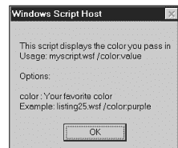

## 图 15.2

显示脚本的用法信息。

## WshArguments.Unnamed

WSH 5.6+

### 语法

`WshArgsObj.Unnamed`

## 描述

`Unnamed` 属性包含 `WshUnnamed` 集合对象。`WshUnnamed` 对象包含了 `WshArguments` 对象中未被命名的参数。命名的参数是由键/值对组成的，其中键和值之间用冒号（:）分隔，且键之前有一个正斜杠（/）。

## 示例

列表 15.26 中的代码创建了一个名为 `WshArgsObj` 的 `WshArgument` 对象。然后使用 `Unnamed` 属性访问 `WshUnnamed` 对象，如果存在此类参数，则使用它来显示未命名参数。例如，假设使用以下行命令运行了脚本：

```bash
cscript.exe listing26.wsf /color:green blue red
```

当使用该命令执行代码时，将显示未命名参数 blue 和 red。

## 列表 15.26 使用 Unnamed 属性显示未命名参数

```javascript
<script language="JScript">
// 获取参数集合
WshArgsObj = WshScript.Arguments;
// 获取未命名参数集合
WshUnnamedArgsObj = WshArgsObj.Unnamed;
if(WshUnnamedArgsObj.length) {
  WshScript.Echo("Unnamed Arguments:");
  // 遍历未命名集合中的所有参数
  for(i=0; i < WshUnnamedArgsObj.Length; i++) {
    WshScript.Echo(i + " = " + WshUnnamedArgsObj.Item(i));
  }
} else {
  WshScript.Echo("No unnamed arguments");
}
</script>
</job>
```

## WshArguments.WshNamed

WSH 5.6+

### 语法

无

## 描述

`WshNamed` 对象是 `WshArguments` 的子对象。由于无法通过 `WshArguments.WshNamed` 语法直接访问，请参阅本章中关于 `WshNamed` 的条目以获取更多信息。

## CD:1952 第 15 章：Windows Script Host

## WshArguments.WshUnnamed

WSH 5.6+

### 语法

无

## 描述

`WshUnnamed` 对象是 `WshArguments` 的子对象。由于无法通过 `WshArguments.WshUnnamed` 语法直接访问，请参阅本章中关于 `WshUnnamed` 的条目以获取更多信息。

## WshController

WSH 5.6+

### 语法

`WshControllerObj = WScript.CreateObject("WScript.Controller")`

## 描述

`WshController` 对象是 `WScript` 对象的子对象。`WshController` 对象允许使用其 `CreateScript()` 方法创建远程脚本（`WshRemote` 对象）。要创建 `WshController` 对象，必须使用 `WScript` 的 `CreateObject()` 方法。

> 注意：`WshController` 对象在 Windows 9x 操作系统上不可用。

## 示例

列表 15.27 使用 `CreateObject()` 方法创建一个作为 `WScript` 对象的子对象的 `WshController` 对象。新的 `WshController` 用于创建远程脚本。

```xml
<job>
<script language="JavaScript">
// 创建 WshController 对象
WshControllerObj = WScript.CreateObject("WScript.Controller");
// 创建远程脚本
remoteScript = WshControllerObj.CreateScript("C:\\scripts\\myscript");
// 执行远程脚本
remoteScript.Execute();
</script>
</job>
```

## WshController.CreateScript()

WSH 5.6+

### 语法

```javascript
WshControllerObj.CreateScript(commandLine)
```

## 描述

`CreateScript()` 方法创建一个 `WshRemote` 对象，允许在另一台计算机上执行脚本。`commandLine` 参数是要执行的脚本路径。`machine` 参数可选的；如果留空，则在本地计算机上执行。

`CreateScript()` 方法是 `WshController` 对象的一部分。要使用此方法，必须先使用 `CreateObject()` 方法创建 `WshController` 对象。

## 示例

列表 15.27 使用 `CreateObject()` 方法创建一个作为 `WScript` 对象的子对象的 `WshController` 对象。新的 `WshController` 用于创建远程脚本。

```xml
<job>
<script language="JavaScript">
// 创建 WshController 对象
WshControllerObj = WScript.CreateObject("WScript.Controller");
// 创建远程脚本
remoteScript = WshControllerObj.CreateScript("C:\\scripts\\myscript");
// 执行远程脚本
remoteScript.Execute();
</script>
</job>
```

## CD:1954 第 15 章：Windows Script Host

## 列表 15.28 续

```javascript
// 执行远程脚本
remoteScript.Execute();
</script>
```

## WshController.WshRemote

WSH 5.6+

### 语法

无

## 描述

`WshRemote` 对象是 `WshController` 的子对象。由于无法通过 `WshController.WshRemote` 语法直接访问，请参阅本章中关于 `WshRemote` 的条目以获取更多信息。

## WshEnvironment

WSH 2.0+

### 语法

`WshEnvObj(string)`

## 描述

`WshEnvironment` 对象提供了对整个环境变量的访问。该对象通过 `WshShell` 对象的 `Environment` 属性访问。根据 `Environment` 属性的设置，可以是“用户”、“系统”、“临时”或“进程”相关的环境变量。有关创建 `WshEnvironment` 对象的更多信息，请参阅本章中的“WshShell.Environment”部分。

表格 15.3 列出了与 `WshEnvironment` 对象关联的所有属性和方法。除了此数组中显示的方法，还可以通过直接在 `WshEnvironment` 对象后括号内放置环境变量名称来直接访问环境变量。

# 表格 15.3 与 WshEnvironment 对象关联的参数和方法

| 类型 | 项目 | 描述 |
| :--- | :--- | :--- |
| 属性 | `Length` | 环境变量的数量 |
| 方法 | `Count()` | 返回环境变量的数量 |
| | `Item()` | 提供对特定环境变量的访问 |
| | `Remove()` | 移除一个环境变量 |

表 15.4 列出了 Windows 操作系统中可用的一些环境变量及其简要描述。该表还显示了根据 `Environment` 属性设置（P=进程 Process，S=系统 System，U=用户 User）每个变量的可用性。“Volatile”（易变）设置不支持表中的任何变量。

## 表 15.4 Windows 环境变量

| 名称 | P | S | U | 描述 |
| :--- | :--- | :--- | :--- | :--- |
| `NUMBER_OF_PROCESSORS` | X | | | 机器上运行的处理器数量。 |
| `PROCESSOR_ARCHITECTURE` | X | | | 用户机器的处理器类型。 |
| `PROCESSOR_IDENTIFIER` | X | | | 用户机器的处理器 ID。 |
| `PROCESSOR_LEVEL` | X | | | 用户机器的处理器级别。 |
| `PROCESSOR_REVISION` | X | | | 用户机器的处理器版本。 |
| `OS` | X | | | 用户机器上的操作系统。 |
| `COMSPEC` | X | | | 命令提示符的可执行文件（通常为 `cmd.exe`）。 |
| `HOMEDRIVE` | | | | 主要本地驱动器。 |
| `HOMEPATH` | | | X | 默认用户目录。 |
| `PATH` | X | | | 路径。 |
| `PATHEXT` | X | | | 可执行文件的扩展名。 |
| `PROMPT` | | | | 命令提示符格式。 |
| `SYSTEMDRIVE` | X | | | 系统目录所在的本地驱动器。 |
| `SYSTEMROOT` | | | | 系统目录。与 `WINDIR` 相同。 |
| `WINDIR` | | X | X | 系统目录。与 `SYSTEMROOT` 相同。 |
| `TEMP` | | X | X | 临时文件目录。 |
| `TMP` | | X | X | 临时文件目录。 |

## 示例

在列表 15.29 中创建并使用了 `WshEnv` 对象来访问所有的“进程”（Process）环境变量。新的 `WshEnvObj` 用于显示环境变量“WINDIR” 的值。当执行此脚本时，将显示您的系统目录的路径。

列表 15.29 使用 WshEnvironment 对象显示系统目录路径

```xml
<job>
<script language="JScript">
// Create a shell object
var WshShellObj = WScript.CreateObject("WScript.Shell");
//Retrieve the WshEnvironment object
var WshEnvObj = WshShellObj.Environment("Process");
// Display the System directory
WScript.Echo("System directory=", WshEnvObj("WINDIR"));
<script>
WshEnvObj.Count()
</script>
</job>
```

## WshEnvironment.Count()

WSH 2.0+

### 语法

`WshEnvObj.Count()`

### 描述

`Count()` 方法返回 `WshEnvironment` 对象中环境变量的数量。根据创建时 `Environment` 属性的设置，`WshEnvironment` 对象将包含不同数量的环境变量。有关 `Environment` 属性的更多信息，请参见本章中的“WshShell.Environment”条目。

## 示例

列表 15.30 使用 `Count()` 方法显示 `WshEnvironment` 对象中与“进程”（Process）相关的环境变量的数量。

### 列表 15.30 使用 Count() 方法显示环境变量数量

```xml
<job>
<script language="JScript">
// Create a shell object
var WshShellObj = WScript.CreateObject("WScript.Shell");
// Retrieve the WshEnvironment object
var WshEnvObj = WshShellObj.Environment("Process");
// Display the number of environment variables in object
WScript.Echo("Count=", WshEnvObj.Count());
</script>
</job>
```

## WshEnvironment.Item()

WSH 2.0+

### 语法

`WshEnvObj.Item(string)`

### 描述

`Item()` 方法用于访问单个 `WshEnvironment` 对象环境变量的值。要检索的环境变量名称由字符串参数指定。

## 示例

在列表 15.31 中创建并使用了 `WshEnvironment` 对象来访问所有的“进程”（Process）环境变量。新的 `WshEnvObj` 及其 `Item()` 方法用于显示环境变量“WINDIR” 的值。当执行此脚本时，将显示您的系统目录的路径。

列表 15.31 使用 Item() 方法显示系统目录路径

```xml
<job>
<script language="JavaScript">
//Create a shell object.
var WshShellObj = WScript.CreateObject("WScript.Shell");
//Retrieve the WshEnvironment object.
var WshEnvObj = WshShellObj.Environment("Process");
//Display the System directory
WScript.Echo("System directory=", WshEnvObj.Item("WINDIR"));
</script>
</job>
```

## WshEnvironment.length

WSH 2.0+

### 语法

`WshEnvObj.length`

### 描述

`length` 属性包含 `WshEnvironment` 对象中环境变量的数量。根据创建时 `Environment` 属性的设置，`WshEnvironment` 对象将包含不同数量的环境变量。有关 `Environment` 属性的更多信息，请参见本章中的“WshEnvironment”条目。

## 示例

列表 15.32 使用 `length` 属性显示 `WshEnvironment` 对象中与“进程”（Process）相关的环境变量的数量。

### 列表 15.32 使用 length 显示环境变量数量

```xml
<job>
<script language="JScript">
// Create a shell object
var WshShellObj = WScript.CreateObject("WScript.Shell");
// Retrieve the WshEnvironment object
var WshEnvObj = WshShellObj.Environment("Process");
// Display the number of environment variables in object
WScript.Echo("Count=", WshEnvObj.length);
</script>
</job>
```

## WshEnvironment.Remove()

WSH 2.0+

### 语法

`WshEnvObj.Remove(envVar)`

### 描述

`Remove()` 方法允许您通过指定变量名称来删除环境变量。被删除的环境变量仅适用于当前会话。

## 示例

列表 15.33 首先检查 `WINDIR` 变量是否存在。如果存在，则使用 `Remove()` 方法将其删除。最后，如果删除成功，将显示成功消息。

### 列表 15.33 使用 Remove() 方法删除环境变量

```xml
<job>
<script language="JScript">
//Create a shell object
var WshShellObj = WScript.CreateObject("WScript.Shell");
//Retrieve the WshEnvironment object
var WshEnvObj = WshShellObj.Environment("Process");
if(WshEnvObj.Item("WINDIR")) {
//Display the number of environment variables in object
WScript.Echo("WINDIR=", WshEnvObj.Item("WINDIR"));
//Delete environment variable
WshEnvObj.Remove("WINDIR");
//Was deletion successful?
if(!WshEnvObj.Item("WINDIR")) {
WScript.Echo("WINDIR successfully deleted!");
}
else {
WScript.Echo("WINDIR was not deleted!");
}
}
else {
WScript.Echo("WINDIR does not exist so it cannot be deleted!");
}
</script>
</job>
```

## WshNamed

WSH 5.6+

### 语法

`WshNamed`

### 描述

`WshNamed` 对象提供了对 `Arguments.Named` 属性返回的参数集合的访问。表 15.5 列出了与 `WshNamed` 对象关联的属性和方法。

表 15.5 与 WshNamed 对象关联的参数和方法
| 类型 | 项目 | 描述 |
| :--- | :--- | :--- |
| 属性 | `Access Items` | |
| | `Length` | 参数集合中的数量 |
| 方法 | `Count()` | 命名对象中开关的数量 |
| | `Exists()` | 表示键值是否存在 |

## 示例

列表 15.34 使用 `Arguments` 获取传递给脚本的参数集合，并赋值给新对象 `WshNamed`。然后运行循环将所有参数打印到屏幕上。假设在 DOS 中使用以下命令运行名为 `myScript.wsf` 的脚本：

`cscript myScript.wsf "Where is Tilly" "The Dog is outside"`

执行脚本后，将向用户显示参数 "Where is Tilly" 和 "The Dog is outside"。

### 列表 15.34 使用 WshNamed 对象

```xml
<job>
<script language="JScript">
// Create a WshNamed object
WshNamed = WshScript.Arguments;
// Loop through the arguments and echo each argument
for(i=0; i<WshNamed.Count(); i++){
nWshScript.Echo('The Argument is: ' + WshNamed.Item(i) );
}
</script>
</job>
```

# WshNamed.Count()

WSH 5.6+

### 语法

`WshNamed.Count()`

# 描述

`WshNamed` 对象的 `Count()` 方法返回一个整数值，表示开关的数量。

# 示例

列表 15.35 使用 `Arguments` 属性获取传递给脚本的参数集合，并将其赋值给一个名为 `WshNamed` 的新对象。然后将参数的数量打印到屏幕上。假设脚本名为 `myScript.wsf`，并在 DOS 中使用以下命令运行：
`cscript myScript.wsf "What are you doing?" "Reading Pure JavaScript!"`

参数的数量（2）将显示在屏幕上。

+ 列表 15.35 使用获取参数数量

```xml
<script language="JavaScript">
// 创建 WshNamed 对象
WshNamed = WshNamed.Arguments;
// 打印参数数量
WshScript.Echo("The Number of arguments is: " + WshNamed.Count() );
</script>
</job>
```

# WshNamed.Exists()

WSH 5.6+

### 语法

`WshNamed.Exists(value)`

# 描述

`Exists()` 方法用于确定特定值是否存在于 `WshNamed` 对象中。返回一个布尔值（true 或 false）。

# 示例

列表 15.36 使用 `Arguments` 属性获取传递给脚本的参数集合，并将其赋值给一个名为 `WshNamed` 的新对象。然后在参数列表中检查是否存在特定值“c”。假设脚本名为 `myScript.wsf` 并在 DOS 中使用以下命令运行：
`cscript myScript.wsf /c "Where is the Doc"`

将显示一条指示已找到键的消息。

# 列表 15.36 使用 WshNamed 的 Exists() 方法

```xml
<job>
<script language="JScript">
// 创建 WshNamed 对象
WshNamed = WshScript.Arguments;
// 如果使用了 /c 关开关，则显示
// 表示找到键的消息。
if(WshNamed.Exists("C")) {
WshScript.Echo('The Key was found');
}
</script>
</job>
```

# WshNamed.Item

WSH 5.6+

### 语法

`WshNamed.Item(key)`

# 描述

`Item` 属性用于访问 `WshNamed` 对象中的每个项目。

# 示例

列表 15.37 使用 `Arguments` 属性获取传递给脚本的参数集合，并将其赋值给新对象 `WshNamed`。然后运行循环将所有参数打印到屏幕上。假设脚本名为 `myScript.wsf` 并在 DOS 中使用以下命令运行：
`cscript myScript.wsf "Where is Big Money JLAi?" "He is out riding his bike"`

执行后，每个参数“Where is Big Money JLAi?”和“He is out riding his bike”将显示在屏幕上。

# 列表 15.37 使用 Items 属性显示参数

```xml
<job>
<script language="JScript">
// 创建 WshNamed 对象
WshNamed = WshScript.Arguments;
// 循环并打印每个参数
for(i=0; i<WshNamed.Count(); i++) {
WshScript.Echo("The Argument Item is: " + WshNamed.Item(i) );
}
<script>
</job>
```

# WshNamed.length

WSH 5.6+

### 语法

`WshObject.length`

# 描述

`length` 属性返回脚本的命令行参数数量。这是一个只读属性，本质上是参数集合中的项目数量。

# 示例

列表 15.38 使用 `Arguments` 属性获取传递给脚本的参数集合，并赋值给名为 `WshNamed` 的新对象。然后使用 `length` 属性将长度显示在屏幕上。假设脚本名为 `myScript.wsf` 并在 DOS 中使用以下命令运行：

`cscript myScript.wsf "Angela" "Pete"`

代表参数数量的长度将显示在屏幕上。

# 列表 15.38 使用 length 属性显示参数

```xml
<job>
<script language="JScript">
// 创建 WshNamed 对象
WshNamed = WshScript.Arguments;
WshScript.Echo("The length is: " + WshNamed.Length );
</script>
</job>
```

# WshNetwork

WSH 2.0+

### 语法

`WshNetwork`

# 描述

`WshNetwork` 对象提供了访问 Microsoft Windows 网络的能力。这包含了所有网络项目，如驱动器和打印机。表 15.6 列出了与 `WshNetwork` 对象相关的所有属性和方法。

# 表 15.6 与 WshNetwork 对象相关的属性和方法

| 类型 | 项目 | 描述 |
| :--- | :--- | :--- |
| 属性 | `ComputerName` | Windows 机器名称 |
| | `UserDomain` | 用户域 |
| 方法 | `ComputerName()` | 机器名称 |
| | `AddWindowsPrinter()` | 添加打印机 |
| | `EnumNetworkDrives()` | 获取网络驱动器 |
| | `MapNetworkDrive()` | 映射网络驱动器 |
| | `RemoveNetworkDrive()` | 删除网络驱动器 |
| | `SetDefaultPrinter()` | 设置默认打印机 |

# 示例

在列表 15.39 中，使用了 `WScript` 对象来显示 `WshNetwork` 的内容。

# 列表 15.39 使用 WshNetwork

```xml
<job>
<script language="JScript">
// 创建 WshNetwork 对象
var WshNetwork = new WObject("WScript.Network");
// 打印计算机名称
WshScript.Echo("The Computer name is: " + WshNetwork.ComputerName);
</script>
</job>
```

# WshNetwork.AddWindowsPrinter()

WSH 2.0+

### 语法

`WshObject.AddWindowsPrinter(printerPath, driveName, printerPort)`

# 描述

`AddWindowsPrinter()` 方法用于向 Windows 环境添加打印机连接。`printerPath` 指定打印机路径，必须指定。`driveName` 指定使用的驱动程序名称，`printerPort` 指定建立打印机连接的端口，可选。

# 示例

列表 15.40 展示了如何将打印机映射到本地机器的示例。

# 列表 15.40 使用 AddWindowsPrinter 方法映射远程打印机

```xml
<job>
<script language="JScript">
// 创建 WshNetwork 对象
var WshNetwork = new WObject("WScript.Network");
// 定义要添加的打印机
var printerPath = "\\\\printers\\DefaultPrinter";
var driveName = "myPrinter";
// 添加网络打印机
WshNetwork.AddWindowsPrinter(printerPath, driveName);
</script>
</job>
```

```javascript
// Print out the computer name
WScript.Echo("*The name of this computer is: " + WshNetwork.ComputerName);
<script>
</job>
```

## WshNetwork.EnumNetworkDrives()

WSH 2.0+

### 语法

`WshNetwork.EnumNetworkDrives()`

### 描述

`EnumNetworkDrives()` 用于枚举当前的网络驱动器映射。

### 示例

在列表 15.43 中，在循环中检索并向用户显示网络驱动器。

- **列表 15.43 使用 EnumNetworkDrives() 方法检索网络映射**

```javascript
<job>
<script language="JScript">
// Create a WshNetwork object
var WshNetwork = new ActiveXObject("Wscript.Network")
var myDrives = WshNetwork.EnumNetworkDrives();
// 遍历驱动器并打印每个驱动器编号
for (i=0; i<myDrives.Count(); i++) {
  WScript.Echo("Drive Number " + i + " is " + myDrives.Item(i+1));
}
</script>
</job>
```

## WshNetwork.EnumPrinterConnection()

WSH 2.0+

### 语法

`WshNetwork.EnumPrinterConnection()`

### 描述

`EnumPrinterConnection()` 用于获取当前的打印机映射。

### 示例

在列表 15.44 中，显示了网络打印机列表。

列表 15.44 使用 EnumPrinterConnection() 方法显示网络打印机

```javascript
<job>
<script language="JScript">
// Create a WshNetwork object
var WshNetwork = new ActiveXObject("Wscript.Network");
var Printers = WshNetwork.EnumPrinterConnections();
// 遍历网络打印机并列出每个打印机
for (i=0; i<myPrinters.Count(); i++){
  Wscript.Echo("Printer " + myPrinters.Item(i) + " is " + 
  myPrinters.Item(i+1));
}
</script>
</job>
```

## WshNetwork.MapNetworkDrive()

WSH 2.0+

### 语法

```javascript
WshNetwork.MapNetworkDrive(driveLetter, driveName, updateProfile, userName, password)
```

### 描述

`MapNetworkDrive()` 方法用于将网络上的驱动器映射到本地机器。必须指定 `driveLetter` 和 `driveName`。`driveLetter` 是该驱动器在本地机器上将使用的盘符号。`driveName` 代表要映射的网络驱动器的名称。`updateProfile` 是一个布尔值，指定映射是否存储在用户配置文件中（默认为 false）。对于需要登录身份验证的映射，应提供 `userName` 和 `password`。

### 示例

列表 15.45 显示了如何将“everyone”驱动器映射到本地机器并命名为“T” 盘。

列表 15.45 使用 MapNetworkDrive() 方法映射网络驱动器

```javascript
<job>
<script language="JScript">
// Create a WshNetwork object
var WshNetwork = new ActiveXObject("Wscript.Network");
// Map a network drive
WshNetwork.MapNetworkDrive("T:", "\\\\some_network\\everyone");
<script>
</job>
```

## WshNetwork.RemoveNetworkDrive()

WSH 2.0+

### 语法

`WshNetwork.RemoveNetworkDrive(driveName, bForce, bUpdateProfile)`

### 描述

必须使用 `RemoveNetworkDrive()` 方法从本地机器删除当前网络驱动器。`driveName` 必须作为字符串指定，表示要删除的驱动器的本地名称或远程名称。`bForce` 是一个布尔值（默认为 false），如果提供并设置为 true，则无论驱动器是否正在使用都将强制删除。`bUpdateProfile` 是一个布尔值（默认为 false），如果指定，将从用户配置文件中删除映射。`bForce` 和 `bUpdateProfile` 是可选参数。

### 示例

在列表 15.46 中，映射了一个网络驱动器，然后使用 `RemoveNetworkDrive` 方法将其删除。

- 列表 15.46 使用 RemoveNetworkDrive() 方法删除网络驱动器

```javascript
<script language="JScript">
// Create a WshNetwork object
var WshNetwork = new ActiveXObject("Wscript.Network");
// Map a network drive
WshNetwork.MapNetworkDrive("T:", "\\\\some_network\\everyone");
// Remove the mapped network drive
WshNetwork.RemoveNetworkDrive("T:");
</script>
</job>
```

## WshNetwork.RemovePrinterConnection()

WSH 2.0+

### 语法

`WshNetwork.RemovePrinterConnection(printer, bForce, bUpdateProfile)`

### 描述

`RemovePrinterConnection()` 方法用于从本地机器删除指定的打印机连接。要删除的打印机名称在 `printer` 参数中指定。`bForce` 是一个布尔值（默认为 false），如果提供并设置为 true，则无论驱动器是否正在使用都将强制删除。`bUpdateProfile` 是一个布尔值（默认为 false），如果指定，将从用户配置文件中删除映射。

### 示例

在列表 15.47 中，从本地机器删除了一个网络驱动器。

- 列表 15.47 使用 RemovePrinterConnection() 方法删除网络驱动器

```javascript
<job>
<script language="JScript">
// Create a WshNetwork object
var WshNetwork = new ActiveXObject("Wscript.Network");
// Remove the printer connection
WshNetwork.RemovePrinterConnection("PrinterName");
</script>
</job>
```

## WshNetwork.SetDefaultPrinter()

WSH 2.0+

### 语法

`WshNetwork.SetDefaultPrinter(printerName)`

### 描述

`SetDefaultPrinter()` 用于设置当前用户的默认打印机。

### 示例

在列表 15.48 中，设置了默认打印机。

- 列表 15.48 使用 SetDefaultPrinter() 方法设置默认打印机

```javascript
<job>
<script language="JScript">
// Create a WshNetwork object
var WshNetwork = new ActiveXObject("Wscript.Network");
// Set the default printer
WshNetwork.SetDefaultPrinter("PrinterName");
</script>
</job>
```

## WshNetwork.EnumPrinter()

WSH 2.0+

### 语法

`WshNetwork.EnumPrinter()`

### 描述

`EnumPrinter()` 用于获取已安装打印机的列表。

### 示例

在列表 15.49 中，显示了打印机列表。

- 列表 15.49 使用 EnumPrinter() 方法列出打印机

```javascript
<job>
<script language="JScript">
// Create a WshNetwork object
var WshNetwork = new ActiveXObject("Wscript.Network");
// Get the list of printers
var printers = WshNetwork.EnumPrinter();
</script>
</job>
```

## CD:1974 第 15 章：Windows 脚本宿主程序

## 列表 15.52 续

```javascript
// 如果发生结束事件，则返回完成消息。
if(remoteScript.End){
  WScript.Echo("Finished execution");
}
</script>
</job>
```

## WshRemote.Error (事件)

WSH 5.6+

### 语法

`WshObject.Error`

### 描述

`Error` 事件用于在远程脚本因错误停止时，信号脚本引擎结束该远程脚本的执行。

### 示例

在列表 15.53 中，执行了远程脚本 `hello.wsf`。发生错误时，将显示一条消息，指示执行已因错误终止。

### 列表 15.53 使用 Error 事件检查远程脚本事件

```javascript
<job>
<script language="JavaScript">
// 创建一个 WshController 对象
WshCtrlObj = WScript.CreateObject("WScript.Controller");
// 创建一个 WshRemote 对象。
remoteScript = WshCtrlObj.CreateScript("c:\\My Documents\\hello.wsf");
// 脚本。
remoteScript.Execute();
// 如果发生 Error 事件，则显示错误消息。
if(remoteScript.Error){
  WScript.Echo("Script Ended Due To Error");
}
</script>
</job>
```

## WshRemote.Error (属性)

WSH 5.6+

### 语法

`WshRemote.Error`

### 描述

`Error` 属性用于获取与错误相关的信息，错误会导致远程脚本提前终止。`Error` 属性返回一个 `WshRemoteError` 对象。

### 示例

在列表 15.54 中，如果远程脚本发生错误，则从 `showErr` 函数中显示错误描述。

- 列表 15.54 使用 Error 属性显示错误描述

```javascript
<script language="JScript">
// 创建一个 WshController 对象。
WshCtrlObj = WScript.CreateObject("WScript.Controller");
// 创建一个 WshRemote 对象。
remoteScript = WshCtrlObj.CreateScript('c:\\My Documents\\hello.wsf');
// 开始脚本。
remoteScript.Execute();
// 处理任何可能发生的错误的函数。
function showErr() {
  var myError = remoteScript.Error;
  WScript.Echo("The WshRemote.Error is: " + myError.Description);
  WScript.Quit(-1);
}
</script>
</job>
```

## WshRemote.Execute()

WSH 5.6+

### 语法

`WshRemote.Execute()`

### 描述

`Execute()` 方法用于启动远程脚本的执行。这与 `WScript.Exec()` 方法不同。

## CD:1976 第 15 章：Windows 脚本宿主程序

### 示例

列表 15.55 展示了如何使用 Execute 方法启动远程脚本 `hello.wsf`。

- 列表 15.55 使用 Execute 启动远程脚本

```javascript
<job>
<script language="JScript">
// 创建一个 WshController 对象
WshCtrlObj = WshScript.CreateObject("WScript.Controller");
// 创建一个 WshRemote 对象。
remoteScript = WshCtrlObj.CreateScript("c:\\My Documents\\hello.wsf");
// 开始脚本。
remoteScript.Execute();
</script>
</job>
```


## WshRemote.WshRemoteError

WSH 5.6+

### 语法

`WshRemote.WshRemoteError`

### 描述

`WshRemoteError` 对象是 `WshRemote` 的子对象。由于无法直接通过 `WshRemote.WshRemoteError` 语法进行访问，更多信息请参阅本章关于 `WshRemoteError` 的条目。

## WshRemote.Start

WSH 5.6+

### 语法

`WshRemote.Start`

### 描述

`Start` 事件信号脚本引擎开始执行远程脚本。它在调用 `Execute` 方法时触发。

### 示例

列表 15.56 展示了如何使用 `Start` 事件来指示脚本何时已开始执行。

- 列表 15.56 使用 WshRemote 的 Start 事件

```javascript
<job>
<script language="JScript">
// 创建一个 WshController 对象
WshCtrlObj = WScript.CreateObject("WScript.Controller")
// 创建一个 WshRemote 对象。
remoteScript = WshCtrlObj.CreateScript('c:\\My Documents\\hello.wsf')
// 开始脚本。
remoteScript.Execute();
// 如果检测到 Start 事件，则显示消息。
if(remoteScript.Start()) {
    WScript.Echo("Remote script Started Execution");
}
</script>
</job>
```

## WshRemote.Status

WSH 5.6+

### 语法

`WshRemote.Status`

### 描述

`Status` 属性用于获取使用 `Exec` 方法运行的脚本的状态信息。`Status` 属性仅在脚本异步运行时使用。它将返回两个值之一。如果返回 `WshRunning`（等同于 0），则脚本仍在运行。如果返回 `WshFinished`（等同于 1），则脚本已运行结束。

### 示例

列表 15.57 使用 `Status` 属性查看脚本是否运行结束。

- 列表 15.57 使用 Status 属性检查脚本

```javascript
<job>
<script language="JScript">
// 创建一个 WshController 对象
WshCtrlObj = WScript.CreateObject("WScript.Controller")
// 创建一个 WshRemote 对象。
remoteScript = WshCtrlObj.CreateScript('c:\\My Documents\\hello.wsf')
// 开始脚本。
remoteScript.Execute();
// 检查状态。
if (remoteScript.Status == 0) {
    WScript.Echo("Script is running");
} else if (remoteScript.Status == 1) {
    WScript.Echo("Script is finished");
}
</script>
</job>
```

## WshRemote.Terminate()

WSH 5.6+

### 语法

`WshRemote.Terminate()`

### 描述

`Terminate()` 方法用于停止远程脚本的执行。

### 示例

列表 15.58 使用 Terminate 方法停止远程脚本。

- 列表 15.58 使用 Terminate 方法停止脚本

```javascript
<job>
<script language="JScript">
// 创建一个 WshController 对象。
WshCtrlObj = WScript.CreateObject("WScript.Controller");
// 创建一个 WshRemote 对象。
remoteScript = WshCtrlObj.CreateScript("c:\\My Documents\\hello.wsf")
// 开始脚本。
remoteScript.Execute();
// 停止脚本。
remoteScript.Terminate();
</script>
</job>
```

## WshRemoteError

WSH 5.6+

### 语法

`WshRemoteError`

### 描述

`WshRemoteError` 对象用于在远程脚本因错误终止时获取信息。它是 `WshRemote` 对象的 `Error` 属性返回。表 15.8 列出了 `WshRemoteError` 相关的所有属性。

| 属性 | 描述 |
| :--- | :--- |
| Character | 包含错误的行字符 |
| Description | 错误描述 |
| Line | 发生错误的行 |
| Number | 错误代码 |
| Source | 产生错误的 COM 对象 |
| SourceText | 错误的源代码 |

### 示例

列表 15.59 创建了一个名为 `myError` 的 `WshRemoteError` 对象。

```javascript
<job>
<script language="JScript">
// 创建一个 WshController 对象。
WshCtrlObj = WScript.CreateObject("WScript.Controller");
// 创建一个 WshRemote 对象。
remoteScript = WshCtrlObj.CreateScript("c:\\My Documents\\hello.wsf")
// 开始脚本。
remoteScript.Execute();
// 创建 WshRemoteError 对象。
var myError = remoteScript.Error;
</script>
</job>
```

## WshRemoteError.Character

WSH 5.6+

### 语法

`WshRemoteError.Character`

### 描述

`Character` 属性返回一个符号长整数，指定发生错误的源代码行中的字符。

### 示例

列表 15.60 展示了如何使用 `Character` 属性显示源代码中发生错误的精确字符。

- 列表 15.60 使用 Character 属性显示错误字符

```javascript
<job>
<script language="JavaScript">
// 创建一个 WshController 对象。
WshCtrlObj = WScript.CreateObject("WScript.Controller");
// 创建一个 WshRemote 对象。
remoteScript = WshCtrlObj.CreateScript("c:\\My Documents\\hello.wsf")
// 开始脚本。
remoteScript.Execute();
// 处理远程脚本错误的函数。如果发生错误，
// 则显示发生错误的字符。
function showErr() {
    var myError = remoteScript.Error;
    WScript.Echo("The remote error is at character: " + myError.Character);
    WScript.Quit(-1);
}
</script>
</job>
```

## WshRemoteError.Description

WSH 5.6+

### 语法

`WshRemoteError.Description`

### 描述

`Description` 属性返回一个包含对发生错误简要描述的字符串。

### 示例

列表 15.61 使用 `Description` 属性显示错误描述。

- 列表 15.61 使用 Description 属性显示错误描述

```javascript
<job>
<script language="JScript">
// 创建一个 WshController 对象。
WshCtrlObj = WScript.CreateObject("WScript.Controller");
// 创建一个 WshRemote 对象。
remoteScript = WshCtrlObj.CreateScript('c:\\My Documents\\hello.wsf')
// 启动脚本。
remoteScript.Execute();
// 处理远程错误的函数。如果发生错误，则
// 将显示错误描述。
function showError() {
    var myError = remoteScript.Error;
    WScript.Echo("*远程错误描述为 : " + myError.Description);
    WScript.Quit(-1);
}
</script>
</job>
```

## WshRemoteError.Line

WSH 5.6+

### 语法

`WshRemoteError.Line`

### 描述

`Line` 属性返回一个无符号长整数，表示错误发生的行号。

### 示例

列表 15.62 使用 `WshRemoteError` 对象的 `Line` 属性显示源代码中发生错误的行号。

- 列表 15.62 使用 Line 属性显示错误行号

```javascript
<job>
<script language="JScript">
// 创建一个 WshController 对象。
WshCtrlObj = WScript.CreateObject("WScript.Controller");
// 创建一个 WshRemote 对象。
remoteScript = WshCtrlObj.CreateScript("c:\\My Documents\\hello.wsf")
// 启动脚本。
remoteScript.Execute();
// 处理远程错误的函数。如果发生错误，
// 将显示错误行。
function showErr() {
    var myError = remoteScript.Error;
    WScript.Echo('远程错误位于行: ' + myError.Line);
    WScript.Quit(-1);
}
</script>
</job>
```

## WshRemoteError.Number

WSH 5.6+

### 语法

`WshRemoteError.Number`

### 描述

`Number` 属性返回一个无符号长整数，代表脚本错误的错误号。

### 示例

列表 15.63 使用 `WshRemoteError` 对象的 `Number` 属性显示发生错误的错误号。

- 列表 15.63 使用 Number 属性显示远程错误号

```javascript
<job>
<script language="JScript">
// 创建一个 WshController 对象。
WshCtrlObj = WScript.CreateObject("WScript.Controller");
// 创建一个 WshRemote 对象。
remoteScript = WshCtrlObj.CreateScript("c:\\My Documents\\hello.wsf")
// 启动脚本。
remoteScript.Execute();
// 处理远程脚本错误的函数。如果发生错误，则
// 将显示错误号。
function showErr(){
    var myError = remoteScript.Error;
    WScript.Echo("远程错误号为: " + myError.Number);
    WScript.Quit(-1);
}
</script>
</job>
```

## WshRemoteError.Source

WSH 5.6+

### 语法

`WshRemoteError.Source`

### 描述

`Source` 属性返回一个代表导致脚本错误的 COM 对象字符串。

### 示例

列表 15.64 中的代码使用 `WshRemoteError` 对象的 `Source` 属性来获取远程脚本中引起错误的 COM 对象。

- 列表 15.64 使用 Source 属性显示远程错误 COM 源对象

```javascript
<job>
<script language="JScript">
// 创建一个 WshController 对象。
WshCtrlObj = WScript.CreateObject("WScript.Controller");
// 创建一个 WshRemote 对象。
remoteScript = WshCtrlObj.CreateScript("c:\\My Documents\\hello.wsf")
// 启动脚本。
remoteScript.Execute();
// 处理远程脚本错误的函数。如果发生错误
var myError = remoteScript.Error;
WScript.Echo('远程错误是由引起的: ' + myError.Source);
WScript.Quit(-1);
</script>
</job>
```

## WshRemoteError.SourceText

WSH 5.6+

### 语法

`WshRemoteError.SourceText`

### 描述

`SourceText` 属性返回一个包含发生错误的源代码行内容的字符串。

### 示例

列表 15.65 使用 `WshRemoteError` 对象的 `SourceText` 属性显示发生错误行的行的源码。

- 列表 15.65 使用 SourceText 属性显示远程错误源码行

```javascript
<job>
<script language="JScript">
// 创建一个 WshController 对象。
WshCtrlObj = WScript.CreateObject("WScript.Controller");
// 创建一个 WshRemote 对象。
remoteScript = WshCtrlObj.CreateScript("c:\\My Documents\\hello.wsf")
// 启动脚本。
remoteScript.Execute();
// 处理远程错误的函数。如果发生错误，则
// 将显示错误描述。
function showError() {
    var myError = remoteScript.Error;
    WScript.Echo("*远程错误描述为 : " + myError.Description);
    WScript.Quit(-1);
}
</script>
</job>
```

## WshExec

WSH 5.6+

### 语法

`WshExec`

### 描述

`WshExec` 对象提供了 `stdin`、`stdout` 和 `stderr` 流的访问。表 15.9 列出了与 `WshExec` 相关的属性和方法。

| 类型 | 描述 |
|---|---|
| Properties | Status |
| StdErr | 标准错误 |
| StdIn | 标准输入 |
| StdOut | 标准输出 |
| Methods | Terminate() |

### 示例

列表 15.66 显示了如何创建一个新的 `WshExec`。

```javascript
<job>
<script language="JavaScript">
var WshShell = new ActiveXObject("WScript.Shell");
// 创建 WshExec
WshExec = WshShell.Exec("hello.wsf");
</script>
</job>
```

## WshExec.Status

WSH 5.6+

### 语法

`WshExec.Status`

### 描述

`Status` 属性返回两个值之一。如果返回 `Running`（等于 0），则脚本正在运行。如果返回 `Finished`（等于 1），则脚本已完成。

### 示例

列表 15.67 使用 `Status` 属性查看脚本是否完成。

- 列表 15.67 使用 Status 属性获取脚本状态

```javascript
<job>
<script language="JavaScript">
var WshShell = new ActiveXObject("WScript.Shell");
WshExec = WshShell.Exec("script.wsf");
// 查看脚本的状态。根据其值，显示相应的消息。
if (WshExec.Status == 0) {
    WScript.Echo("脚本正在运行");
}
if (WshExec.Status == 1) {
    WScript.Echo("脚本已完成");
}
</script>
</job>
```

## WshExec.StdErr

WSH 5.6+

### 语法

`WshExec.StdErr`

### 描述

`StdErr` 属性提供了对 `Exec` 对象 `stderr` 输出流的访问。`Exec` 对象不需要运行。

### 示例

列表 15.68 使用 `StdErr` 属性将流赋值给变量 `standardError`。使用 `write()` 方法将字符串发送到标准错误。为了使此脚本工作，必须由控制台主机（`CS.exe`）执行。除非你重定向了错误输出，否则字符串将显示在控制台中。

- 列表 15.68 使用 WshExec 的 StdErr 属性

```javascript
<job>
<script language="JavaScript">
var WshShell = new ActiveXObject("WScript.Shell");
// 创建 WshExec 对象
WshExec = WshShell.Exec("c:\\documents\\hello.wsf");
// 将错误流赋值给 standardError
standardError = WshExec.StdErr;
// 写入标准输出。
standardError.write("此字符串已发送到标准错误输出");
</script>
</job>
```

## WshExec.StdIn

WSH 5.6+

### 语法

`WshExec.StdIn`

### 描述

`StdIn` 属性提供了对 `Exec` 对象只读 `stdin` 输入流的访问。

### 示例

列表 15.69 使用 `StdIn` 属性将标准输入流赋值给变量 `standar`。提示用户输入文本。使用 `Read()` 方法读取文本，用户输入的前 10 个字符将存储在变量 `str` 中，然后显示在控制台中。

- 列表 15.69 使用 StdIn 属性读取标准输入

```javascript
<job>
<script language="JScript">
var WshShell = new ActiveXObject("WScript.Shell");
// 创建 WshExec 对象
WshExec = WshShell.Exec("script.wsf");
// 设置标准输入流
standar = WshExec.StdIn;
// 从输入中读取10个字符
str = standar.Read(10);
WScript.Echo(str);
</script>
</job>
```

## WshScriptExec.StdOut

WSH 5.6+

### 语法

`WshScriptExec.StdOut`

### 描述

`StdOut` 属性提供 `Exec` 对象的只写 `stdout` 输出流。

> 注意
>
> `StdOut` 属性只能通过控制台脚本主机 (`CScript.exe`) 访问。使用 Windows 脚本主机 (`WScript.exe`) 访问该属性将导致错误。

### 示例

在列表 15.70 中，使用 `StdOut` 属性将标准输出流赋值给变量 `stdout`。然后使用 `write()` 方法将字符串发送到标准输出。为了使此脚本运行，必须使用控制台脚本主机 (`CScript.exe`) 执行它。除非你重定向了标准输出，否则字符串将出现在控制台中。

- 列表 15.70 使用 WshScriptExec 的 StdOut 属性

```javascript
<job>
<script language="JScript">
var WshShell = new ActiveXObject("WScript.Shell");
// 创建一个 WshScriptExec 对象
WshScriptExec = WshShell.Exec("cscript c:\\my documents\\hello.wsf");
// 设置标准输出流
standardOutput = WshScriptExec.StdOut;
// 向 StdOut 流写入文本
standardOutput.write("此字符串已发送到标准输出");
</script>
</job>
```

## WshScriptExec.Terminate()

WSH 5.6+

### 语法

`WshScriptExec.Terminate()`

### 描述

`Terminate()` 方法用于终止由 `Exec` 方法启动的进程。

### 示例

列表 15.71 展示了如何通过 `Terminate` 方法停止 `hello.wsf` 脚本。

- 列表 15.71 使用 Terminate 方法终止脚本

```javascript
<job>
<script language="JScript">
var WshShell = new ActiveXObject("WScript.Shell");
// 创建一个 WshScriptExec 对象
aScript = WshShell.Exec("cscript c:\\my documents\\hello.wsf");
// 终止脚本
aScript.Terminate();
</script>
</job>
```

## WshShell

WSH 2.0+

### 语法

`WshShell`

### 描述

`WshShell` 对象用于创建新进程、快捷方式以及访问环境变量。表 15.10 列出了与 `WshShell` 对象关联的属性和方法。

| 类型 | 项目 | 描述 |
| --- | --- | --- |
| 属性 | CurrentDirectory | 返回当前工作目录完整路径的字符串 |
| | Environment | 返回一个 `WshEnvironment` 对象 |
| | SpecialFolders | 返回一个 `SpecialFolders` 对象 |
| | WshShortcut | 创建一个子对象 |
| | WshUrlShortcut | 创建一个子对象 |
| | WshEnvironment | 创建一个子对象 |
| | WshSpecialFolders | 创建一个子对象 |
| 方法 | Activate() | 激活一个应用程序窗口 |
| | CreateShortcut() | 创建新快捷方式或打开现有的快捷方式 |
| | Exec() | 在子命令 shell 中运行应用程序 |
| | ExpandEnvironmentStrings() | 返回环境变量的扩展后的值 |
| | LogEvent() | 向日志文件添加事件条目 |
| | Popup() | 在弹出框中显示文本 |
| | RegDelete() | 从注册表中删除键值 |
| | RegRead() | 从注册表中返回键的值 |
| | RegWrite() | 在注册表中创建新键或修改现有的键 |
| | Run() | 在新进程中运行程序 |
| | SendKeys() | 向活动窗口发送按键 |

### 示例

列表 15.72 展示了如何创建 `WshShell` 对象的的新实例。

- 列表 15.72 使用 WshShell 对象

```javascript
<job>
<script language="JScript">
// 创建一个 WshShell 对象
WshShellObj = WScript.CreateObject("WScript.Shell");
</script>
</job>
```

## WshShell.AppActivate()

WSH 2.0+

### 语法

`WshShell.AppActivate(app)`

### 描述

`WshShell` 对象的 `AppActivate()` 方法激活指定的应用程序窗口。应用程序名称（可以是窗口标题或应用程序任务 ID）由参数 `app` 指定。该方法返回一个布尔值，指示过程调用是否成功。

### 示例

列表 15.73 使用 `WshShell` 的 `AppActivate()` 方法激活记事本应用程序窗口。（此示例假设记事本程序正在运行）。

- 列表 15.73 使用 AppActivate() 激活应用程序窗口

```javascript
<job>
<script language="JScript">
// 创建一个 WshShell 对象
WshShellObj = WScript.CreateObject("WScript.Shell");
// 激活记事本。
WshShellObj.AppActivate("Notepad");
</script>
</job>
```

## WshShell.CreateShortcut()

WSH 2.0+

### 语法

`WshShell.CreateShortcut(str)`

### 描述

`WshShell` 对象的 `CreateShortcut()` 方法用于创建新的快捷方式。它接受一个参数 `str`，指定快捷方式的位置和名称。

### 示例

列表 15.74 使用 `CreateShortcut()` 方法在桌面上创建一个快捷方式。

- 列表 15.74 使用 CreateShortcut() 创建快捷方式

```javascript
<job>
<script language="JScript">
// 创建一个 WshShell 对象
WshShellObj = WScript.CreateObject("WScript.Shell");
// 指定桌面。
var shortcut = WshShellObj.CreateShortcut("Desktop\\lnk");
// 设置目标路径。
shortcut.TargetPath = "http://www.com";
shortcut.Save();
</script>
</job>
```

## WshShell.CurrentDirectory

WSH 5.6+

### 语法

`WshShell.CurrentDirectory`

### 描述

`CurrentDirectory` 属性返回包含进程当前目录的字符串。

### 示例

列表 15.75 使用 `CurrentDirectory` 属性显示当前目录。

- 列表 15.75 使用 CurrentDirectory 显示当前目录

```javascript
<job>
<script language="JScript">
// 创建一个 WshShell 对象。
WshShellObj = WScript.CreateObject("WScript.Shell");
// 获取当前目录。
WScript.Echo(WshShellObj.CurrentDirectory);
</script>
</job>
```

## WshShell.Environment

WSH 2.0+

### 语法

`WshShell.Environment(str)`

### 描述

`Environment` 属性返回环境变量集合。可选参数 `str` 可以指定要返回的环境类型。

### 示例

列表 15.76 使用 `Environment` 属性获取路径变量。

- 列表 15.76 使用 Environment 属性检索 PATH

```javascript
<job>
<script language="JScript">
// 创建一个 WshShell 对象。
WshShellObj = WScript.CreateObject("WScript.Shell");
// 创建 WshEnvironment 对象。
var WshEnv = WshShellObj.Environment("PROCESS");
// 获取路径变量。
WScript.Echo(WshEnv("PATH"));
</script>
</job>
```

## WshShell.Exec()

WSH 5.6+

### 语法

`WshShell.Exec(cmd)`

### 描述

`WshShell` 对象的 `Exec()` 方法用于在子命令 shell 中运行应用程序。它返回一个 `WScriptExec` 对象。

### 示例

列表 15.77 展示了如何使用 `Exec()` 方法在子 shell 中执行 `hello.wsf` 脚本。

- 列表 15.77 使用 WshShell 的 Exec() 方法

```javascript
<job>
<script language="JScript">
// 创建一个 WshShell 对象。
WshShellObj = WScript.CreateObject("WScript.Shell");
// 在子命令 shell 中启动 hello.wsf。
WshShellObj.Exec("cscript hello.wsf");
</script>
</job>
```

## WshShell.ExpandEnvironmentStrings()

WSH 2.0+

### 语法

`WshShell.ExpandEnvironmentStrings(str)`

### 描述

`ExpandEnvironmentStrings()` 方法返回环境变量的扩展后的值。

### 示例

```javascript
<job>
<script language="JScript">
var WshShellObj = WScript.CreateObject("WScript.Shell");
// Echo expanded env var PATH.
WScript.Echo( WshShellObj.ExpandEnvironmentStrings("%path%") );
</script>
</job>
```

## WshShell.LogEvent()

WSH 2.0+

### 语法

`WshShell.LogEvent(eventType, logStr, [strTarget])`

### 描述

`LogEvent()` 方法用于向日志文件添加条目。必须指定 `eventType` 和 `logStr`。`logStr` 是一个指定日志条目文本的字符串值。有效条目如表 15.11 所示。还有一个可选参数 `strTarget`，它是一个指示存储事件的计算机系统名称的字符串。此可选参数仅适用于 Windows NT/2000 操作系统。

| 表 15.11 事件类型 |
| 值 | 描述 |
| --- | --- |
| 0 | SUCCESS (成功) |
| 1 | ERROR (错误) |
| 2 | WARNING (警告) |
| 4 | INFORMATION (信息) |
| 8 | AUDIT_SUCCESS (审计成功) |
| 16 | AUDIT_FAILURE (审计失败) |

### 示例

列表 15.79 显示了 `WshShell` 对象如何使用 `LogEvent()` 方法记录一个成功事件。执行时，该示例会将成功事件记录到 Windows 9.x 上的 `WSH.log` 文件。如果使用 Windows NT/2000，消息将记录到 Windows NT 事件日志文件中。

- 列表 15.79 使用 LogEvent() 记录事件

```javascript
<job>
<script language="JavaScript">
// 创建一个 WshShell 对象。
WshShellObj = WScript.CreateObject("WScript.Shell")
// 记录一个成功事件。
myFolder = WshShellObj.LogEvent(0, "Application successful");
</script>
</job>
```

## WshShell.Popup()

WSH 2.0+

### 语法

`WshShell.Popup(text, [wait], [title], [type])`

### 描述

`Popup()` 方法用于在弹窗消息框中显示文本。必须指定 `text` 参数以显示文本。`wait` 参数是一个可选参数，指示弹窗显示的时间（秒）。`title` 参数是一个可选的字符串参数，用于指定弹窗的标题。`type` 参数是一个可选的数值参数，用于指定弹窗中按钮和图标的类型。可用按钮类型参考表 15.12，可用图标类型参考表 15.13。值可以组合使用。

| 表 15.12 弹窗消息框的按钮类型 |
| 值 | 描述 |
| --- | --- |
| 0 | 显示 OK 按钮 |
| 1 | 显示 OK 和 取消按钮 |
| 2 | 显示 关于、重试和 忽略按钮 |
| 3 | 显示 是、否 和 取消按钮 |
| 4 | 显示 是 和 否 按钮 |
| 5 | 显示 重试 和 取消按钮 |

| 表 15.13 弹窗消息框的图标类型 |
| 值 | 描述 |
| --- | --- |
| 16 | 显示“停止标记”图标 |
| 32 | 显示“问号”图标 |
| 48 | 显示“感叹号”图标 |
| 64 | 显示“信息标记”图标 |

### 示例

在列表 15.80 中，创建了一个弹窗，其中包含一个显示 15 秒的示例消息，带有标题以及特定的按钮和图标类型组合。

- 列表 15.80 使用 WshShell 对象的 Popup() 方法

```javascript
<job>
<script language="JavaScript">
// 创建一个 WshShell 对象。
WshShellObj = WScript.CreateObject("WScript.Shell");
// 创建弹窗。
WshShellObj.Popup("Sample message", 15, "My Popup box", 3+32);
</script>
</job>
```

## WshShell.RegDelete()

WSH 2.0+

### 语法

`WshShell.RegDelete(key)`

### 描述

`RegDelete()` 方法用于从 Windows 注册表中删除键或其值之一。必须指定键作为参数。如要指示键名，请在键名后使用结尾的反斜杠。不要使用反斜杠来指示值。可以使用根键的缩写版本。表 15.14 列出了这些缩写。

| 表 15.14 根键缩写 |
| 值 | 描述 |
| --- | --- |
| HKCU | HKEY_CURRENT_USER |
| HKLM | HKEY_LOCAL_MACHINE |
| HKCR | HKEY_CLASSES_ROOT |
| HKEY_USERS | HKEY_USERS |
| HKEY_CURRENT_CONFIG | HKEY_CURRENT_CONFIG |

> 警告
>
> 如果操作不当，对 Windows 注册表的修改可能会损坏操作系统运行。在操作 Windows 注册表时务必小心。建议在删除或写入注册表之前对注册表备份。

### 示例

列表 15.81 显示了如何使用 `RegDelete()` 方法删除 Netscape 的注册表项示例。

- 列表 15.81 使用 RegDelete() 方法

```javascript
<job>
<script language="JScript">
// 创建一个 WshShell 对象。
WshShellObj = WScript.CreateObject("WScript.Shell");
// 删除键。
WshShellObj.RegDelete("HKLM\\Software\\Netscape");
</script>
</job>
```

## WshShell.RegRead()

WSH 2.0+

### 语法

`WshShell.RegRead(key)`

### 描述

`RegRead()` 方法用于从 Windows 注册表中读取键或值。必须指定键作为参数。如要指示键名，请在键名后使用结尾的反斜杠。不要使用反斜杠来指示值。可以使用根键的缩写版本。

### 示例

列表 15.82 显示了使用 `RegRead()` 方法读取 Netscape 的注册表项。

- 列表 15.82 使用 RegRead() 方法

```javascript
<job>
<script language="JScript">
// 创建一个 WshShell 对象。
WshShellObj = WScript.CreateObject("WScript.Shell");
// 读取键。
var value = WshShellObj.RegRead("HKLM\\Software\\Netscape");
</script>
</job>
```

## WshShell.RegWrite()

WSH 2.0+

### 语法

`WshShell.RegWrite(key, value, [type])`

### 描述

`RegWrite()` 方法用于在 Windows 注册表中创建或修改键或值。必须指定键作为参数。如要指示键名，请在键名后使用结尾的反斜杠。不要使用反斜杠来指示值。可以使用根键的缩写版本。

### 示例

列表 15.83 显示了使用 `RegWrite()` 方法为 Netscape 创建新的注册表项。

- 列表 15.83 使用 RegWrite() 方法

```javascript
<job>
<script language="JScript">
// 创建一个 WshShell 对象。
WshShellObj = WScript.CreateObject("WScript.Shell");
// 写入新值。
WshShellObj.RegWrite("HKLM\\Software\\Netscape\\Version", "1.0", "REG_SZ");
</script>
</job>
```

## WshShell.Run()

WSH 2.0+

### 语法

`WshShell.Run(cmd, [windowStyle], [waitReturn])`

### 描述

`Run()` 方法在新的进程中运行指定的程序。要运行的程序由 `cmd` 指定。还可以指定两个可选参数：`windowStyle` 参数是一个整数，指示程序窗口的外观。`waitReturn` 参数是一个布尔值，指示脚本是否应该等待。

### 示例

在列表 15.84 中，`Run()` 方法用于以最小化状态启动记事本应用程序。

- 列表 15.84 使用 WshShell 对象的 Run() 方法

```javascript
<job>
<script language="JavaScript">
// 创建一个 WshShell 对象。
WshShellObj = WScript.CreateObject("WScript.Shell");
// 以最小化状态启动记事本。
WshShellObj.Run("notepad", 7)
</script>
</job>
```

## WshShell.SendKeys()

WSH 2.0+

### 语法

`WshShell.SendKeys(keyStr)`

### 描述

`SendKeys()` 方法用于向活动窗口发送一个或多个按键。要发送的按键通过 `keyStr` 参数指定。此方法通常用于没有用户界面的应用程序。如果发送组合按键，只需将它们组合在一个字符串中。例如，发送按键 x、y 和 z，即 `xyz`。

某些特殊按键需要特定的语法。对于 `+`、`%`、`^`、`-`、`[` 和 `]`，将这些符号在大括号 `{}` 中。其他不产生任何字符的按键也有语法。它们列在表 15.17 中。

### 表 15.17 特殊按键

| 按键 | 语法 |
| --- | --- |
| BACKSPACE | `{BACKSPACE}`, `{BS}`, 或 `{BKSP}` |
| BREAK | `{BREAK}` |
| CAPS LOCK | `{CAPSLOCK}` |
| DEL or DELETE | `{DELETE}` 或 `{DEL}` |
| DOWN ARROW | `{DOWN}` |
| END | `{END}` |
| ENTER | `{ENTER}` |
| ESC | `{ESC}` |
| HELP | `{HELP}` |
| HOME | `{HOME}` |
| INS or INSERT | `{INSERT}` 或 `{INS}` |
| LEFT ARROW | `{LEFT}` |
| NUM LOCK | `{NUMLOCK}` |
| PAGE DOWN | `{PGDN}` |
| PAGE UP | `{PGUP}` |
| PRINT SCREEN | `{PRTSC}` |
| RIGHT ARROW | `{RIGHT}` |
| SCROLL LOCK | `{SCROLLLOCK}` |
| TAB | `{TAB}` |
| UP ARROW | `{UP}` |
| F1 | `{F1}` |
| F2 | `{F2}` |
| F3 | `{F3}` |
| F4 | `{F4}` |
| F5 | `{F5}` |
| F6 | `{F6}` |
| F7 | `{F7}` |
| F8 | `{F8}` |
| F9 | `{F9}` |
| F10 | `{F10}` |
| F11 | `{F11}` |
| F12 | `{F12}` |
| F13 | `{F13}` |
| F14 | `{F14}` |
| F15 | `{F15}` |
| F16 | `{F16}` |

### 示例

在列表 15.85 中，创建了一个 `WshShell` 对象。然后对记事本应用程序调用了 `Run()` 方法。一旦记事本应用程序启动，将使用 `AppActivate()` 方法对其进行激活。激活后，向应用程序发送一系列按键。

- 列表 15.85 使用 SendKeys() 向记事本发送按键

```javascript
<job>
<script language="JScript">
// 创建一个 WshShell 对象。
WshShellObj = WScript.CreateObject("WScript.Shell")
// 启动记事本应用程序。
WshShellObj.Run("Notepad")
// 激活记事本应用程序。
WshShellObj.AppActivate("Notepad")
// 向记事本应用发送按键。
WshShellObj.SendKeys("I love Pure JavaScript!")
</script>
</job>
```

## WshShell.SpecialFolders

WSH 2.0+

### 语法

`WshShell.SpecialFolders(folder)`

### 描述

`SpecialFolders` 属性返回特殊文件夹的集合。Windows 操作系统中的特殊文件夹是指操作系统内置的预定义文件夹。一些示例包括“桌面”、“收藏”和“启动”文件夹。

### 示例

在列表 15.86 中，首先创建一个 `WshShell` 对象。然后使用 `SpecialFolders` 属性来创建一个 `WshSpecialFolders` 对象。

- 列表 15.86 使用 SpecialFolders 属性

```javascript
<job>
<script language="JScript">
// 创建一个 WshShell 对象。
WshShellObj = WScript.CreateObject("WScript.Shell");
// 创建一个特殊文件夹对象。
myFolder = WshShellObj.SpecialFolders("Desktop");
</script>
</job>
```

## WshShell.WshShortcut

WSH 2.0+

### 语法

`WshShell.WshShortcut`

### 描述

`WshShortcut` 对象是 `WshShell` 的子对象。由于无法直接通过 `WshShell.WshShortcut` 语法访问，请参考本章中 `WshShortcut` 的条目获取更多信息。

## WshShell.WshUrlShortcut

WSH 2.0+

### 语法

`WshShell.WshUrlShortcut`

### 描述

`WshUrlShortcut` 对象是 `WshShell` 的子对象。由于无法直接通过 `WshShell.WshUrlShortcut` 语法访问，请参考本章中 `WshShortcut` 的条目获取更多信息。

## WshShell.WshEnvironment

WSH 2.0+

### 语法

`WshShell.WshEnvironment`

### 描述

`WshEnvironment` 对象是 `WshShell` 的子对象。由于无法直接通过 `WshShell.WshEnvironment` 语法访问，请参考本章中 `WshEnvironment` 的条目获取更多信息。

## WshShell.WshSpecialFolders

WSH 2.0+

### 语法

`WshShell.WshSpecialFolders`

### 描述

`WshSpecialFolders` 对象是 `WshShell` 的子对象。由于无法直接通过 `WshShell.WshSpecialFolders` 语法访问，请参考本章中 `WshSpecialFolders` 的条目获取更多信息。

## WshShell.WshScriptExec

WSH 5.6+

### 语法

`WshShell.WshScriptExec`

### 描述

`WshScriptExec` 对象是 `WshShell` 的子对象。由于无法直接通过 `WshShell.WshScriptExec` 语法访问，请参考本章中 `WshScriptExec` 的条目获取更多信息。

## WshShortcut

WSH 2.0+

### 语法

`WshShortcut`

### 描述

`WshShortcut` 对象用于创建快捷方式。它是通过 `WshShell` 对象的 `CreateShortcut` 方法实例化的。实例化后，它存储在内存中，直到调用 `Save` 方法才会写入磁盘。表 15.18 列出了 `WshShortcut` 对象的所有属性和方法。

| 类型 | 项目 | 描述 |
| --- | --- | --- |
| 属性 | Arguments | 返回 `WshArguments` 集合 |
| | Description | 描述快捷方式 |
| | FullName | 返回执行文件或快捷方式的完整路径 |
| | Hotkey | 提供快捷方式的热键 |
| | IconLocation | 提供快捷方式的图标位置 |
| | TargetPath | 设置执行文件的路径 |
| | WindowStyle | 为快捷方式分配样式 |
| | WorkingDirectory | 指定快捷方式的工作目录 |
| 方法 | Save() | 保存快捷方式到磁盘 |

### 示例

列表 15.87 显示了如何在内存中实例化 `WshShortcut` 对象、分配目标路径并保存到磁盘。

- 列表 15.87 创建 WshShortcut 对象

```javascript
<job>
<script language="JScript">
// 创建一个 WshShell 对象。
WshShellObj = WScript.CreateObject("WScript.Shell")
// 创建一个快捷方式。
var WshShortcut = WshShellObj.CreateShortcut("c:\\shortcut.url")
WshShortcut.TargetPath = "http://www.com"
WshShortcut.Save()
</script>
</job>
```

## WshShortcut.Arguments

WSH 2.0+

### 语法

`WshShortcut.Arguments`

### 描述

`Arguments` 属性通过 `WshArguments` 对象访问参数集合。

### 示例

在列表 15.88 中，创建一个新的 `WshShortcut` 对象并将路径设置为参数值。如果通过以下命令行运行脚本 `15.88.wsf`：

```
cscript listing15.88.wsf http://www.w3.org
```

将创建一个指向输入 URL 的快捷方式。然后将目标路径输出给用户。

- 列表 15.88 使用 WshShortcut 的 Arguments 属性

```javascript
<job>
<script language="JScript">
// 创建一个 WshShell 对象。
WshShellObj = WScript.CreateObject("WScript.Shell");
// 使用 Arguments 属性创建 WshArguments 对象。
var myArgs = WScript.Arguments;
// 创建一个快捷方式。
var urlShortcut = WshShellObj.CreateShortcut("c:\\shortcut.url");
urlShortcut.TargetPath = myArgs.Item(0);
WScript.Echo("The target path is: " + urlShortcut.TargetPath);
</script>
</job>
```

## WshShortcut.Description

WSH 2.0+

### 语法

`WshShortcut.Description`

### 描述

`Description` 属性返回包含快捷方式描述的字符串值。

### 示例

在列表 15.89 中，创建一个快捷方式对象并设置了描述。执行时，描述将显示给用户。

- 列表 15.89 使用 Description 属性

```javascript
<job>
<script language="JScript">
// 创建一个 WshShell 对象。
WshShellObj = WScript.CreateObject("WScript.Shell");
// 创建一个快捷方式。
var myShortcut = WshShellObj.CreateShortcut("c:\\shortcut.lnk");
// 设置 Description 属性。
myShortcut.Description = "NC Wolfpack";
WScript.Echo("The shortcut description is: " + myShortcut.Description);
</script>
</job>
```

## WshShortcut.FullName

WSH 2.0+

### 语法

`WshShortcut.FullName`

### 描述

`WshShortcut` 对象的 `FullName` 属性返回包含快捷方式完整路径的字符串。它是一个只读属性。

### 示例

在列表 15.90 中，创建一个快捷方式并使用 `FullName` 属性显示完整路径。

- 列表 15.90 使用 WshShortcut 对象的 FullName 属性

```javascript
<job>
<script language="JScript">
// 创建一个 WshShell 对象。
WshShellObj = WScript.CreateObject("WScript.Shell");
// 创建一个快捷方式。
var myShortcut = WshShellObj.CreateShortcut("c:\\shortcut.lnk");
// 输出快捷方式的 FullName。
WScript.Echo("The full path is: " + myShortcut.FullName);
</script>
</job>
```

## WshShortcut.Hotkey

WSH 2.0+

### 语法

`WshShortcut.Hotkey = hotKeyStr`

### 描述

`Hotkey` 属性显示如何将键组合分配给快捷方式，或识别分配给快捷方式的键组合。`hotKeyStr` 参数是要分配的键组合。它的格式为 `[keyModifier]KeyName`。有效的 `keyModifiers` 有 `Alt+`、`Ctrl+`、`Shift+`、`Ext.`（Ext 意味着“扩展键”，指未来可能添加的任何新类型的 Shift 键。）有效的 `KeyName` 标识符是所有字母数字键和 F1-F12 功能键。

### 示例

列表 15.91 显示如何创建一个快捷方式并为该快捷方式分配快捷键。

- 列表 15.91 为 WshShortcut 分配快捷键

```javascript
<job>
<script language="JScript">
// 创建 WshShell 对象。
WshShellObj = WScript.CreateObject("WScript.Shell");
// 创建快捷方式。
var myShortcut = WshShellObj.CreateShortcut("c:\\cparam.lnk");
myShortcut.Hotkey = "Alt+Shift+";
// 输出快捷方式的 Hotkey。
WScript.Echo("The hotkey is: " + myShortcut.Hotkey);
</script>
</job>
```

## WshShortcut.IconLocation

WSH 2.0+

### 语法

`WshShortcut.IconLocation = iconLocationStr`

### 描述

`IconLocation` 属性为快捷方式分配图标，或识别与快捷方式关联的图标。如果用于分配图标，则必须使用参数 `iconLocationStr`。它应该包含一个指向图标文件完全路径的字符串，以及一个识别文件中包含图标集合中图标的索引。

### 示例

列表 15.92 显示了一个创建并分配了图标的快捷方式。

- 列表 15.92 使用 IconLocation 属性

```javascript
<job>
<script language="JScript">
// 创建 WshShell 对象。
WshShellObj = WScript.CreateObject("WScript.Shell");
// 创建快捷方式。
var myShortcut = WshShellObj.CreateShortcut("c:\\gopack.lnk");
myShortcut.TargetPath = "explorer.exe,0";
// 输出快捷方式的 IconLocation。
WScript.Echo("The icon location is: " + myShortcut.IconLocation);
</script>
</job>
```

## WshShortcut.Save()

WSH 2.0+

### 语法

`WshShortcut.Save()`

### 描述

`WshShortcut` 对象的 `Save()` 方法用于将快捷方式保存到磁盘。如果不使用 `Save()` 方法，快捷方式将仅存储在内存中。

### 示例

列表 15.93 显示创建了一个指向 gopack.com 站的快捷方式，然后使用 `Save()` 方法将其保存到磁盘。

- 列表 15.93 使用 Save 方法将快捷方式保存到磁盘

```javascript
<job>
<script language="JScript">
// 创建 WshShell 对象。
WshShellObj = WScript.CreateObject("WScript.Shell");
// 创建快捷方式。
var urlShortcut = WshShellObj.CreateShortcut("c:\\gopack.url");
urlShortcut.TargetPath = "http://www.gopack.com";
// 将快捷方式保存到磁盘。
urlShortcut.Save();
</script>
</job>
```

## WshShortcut.TargetPath

WSH 2.0+

### 语法

`WshShortcut.TargetPath`

### 描述

`TargetPath` 属性用于为快捷方式指向的可执行文件分配一个路径。它也可以用于识别快捷方式可执行文件的路径。

### 示例

列表 15.94 使用 `TargetPath` 属性为 `urlShortcut` 对象设置目标 URL。然后使用相同的 `TargetPath` 属性向用户显示该路径。

- 列表 15.94 使用 TargetPath 属性

```javascript
<job>
<script language="JScript">
// 创建 WshShell 对象。
WshShellObj = WScript.CreateObject("WScript.Shell");
// 创建快捷方式。
var urlShortcut = WshShellObj.CreateShortcut("c:\\gopack.url");
// 设置 TargetPath 属性。
urlShortcut.TargetPath = "http://www.gopack.com";
// 输出 urlShortcut 的 TargetPath。
WScript.Echo("The target path is: " + urlShortcut.TargetPath);
</script>
</job>
```

## WshShortcut.WindowStyle

WSH 2.0+

### 语法

`WshShortcut.WindowStyle`
`WshShortcut.WindowStyle = styleValue`

### 描述

`WindowStyle` 属性用于识别快捷方式的窗口样式。它也可以用于为快捷方式分配窗口样式。如果分配样式，则必须指定 `styleValue`。有效样式列在表 15.19 中。

| 表 15.19 窗口样式 |
| Value | 描述 |
| :--- | :--- |
| 1 | 激活并显示窗口 |
| 3 | 激活窗口并将其作为最大化窗口显示 |
| 7 | 最小化窗口并激活下一级窗口 |

### 示例

列表 15.95 创建了一个新的快捷方式并为其分配了窗口样式。

- 列表 15.95 使用 WindowStyle 属性

```javascript
<job>
<script language="JavaScript">
// 创建 WshShell 对象。
WshShellObj = WScript.CreateObject("WScript.Shell");
// 创建快捷方式。
var myShortcut = WshShellObj.CreateShortcut("c:\\gopack.lnk");
// 设置窗口样式。
myShortcut.WindowStyle = 3;
</script>
</job>
```

## WshShortcut.WorkingDirectory

WSH 2.0+

### 语法

`WshShortcut.WorkingDirectory`

### 描述

`WorkingDirectory` 属性用于识别快捷方式指向的工作目录。它也可以用于为快捷方式分配工作目录。

### 示例

列表 15.96 创建了指向 gopack.com 站的快捷方式，然后使用 `WorkingDirectory` 属性设置其工作目录。

- 列表 15.96 使用 WorkingDirectory 属性

```javascript
<job>
<script language="JScript">
// 创建 WshShell 对象。
WshShellObj = WScript.CreateObject("WScript.Shell");
// 创建快捷方式。
myShortcut = WshShellObj.CreateShortcut("c:\\gopack.lnk");
// 设置工作目录。
myShortcut.WorkingDirectory = "C:\\";
// 输出快捷方式的工作目录。
WScript.Echo("The working directory is: " + myShortcut.WorkingDirectory);
</script>
</job>
```

## WshSpecialFolders

WSH 2.0+

### 语法

`WshSpecialFolders`

### 描述

`WshSpecialFolders` 对象提供对特殊文件夹集合的访问。

### 示例

列表 15.97 显示如何使用 `WshSpecialFolders` 对象枚举特殊文件夹。

- 列表 15.97 枚举特殊文件夹

```javascript
<job>
<script language="JScript">
// 创建一个 WshShell 对象。
WshShellObj = WScript.CreateObject("WScript.Shell");
// 创建特殊文件夹对象。
WshSpecialFolders = WshShellObj.SpecialFolders;
// 枚举特殊文件夹集合中的每个项目。
for(i=0; i < WshSpecialFolders.length; i++) {
    // Echo each item in the special folders collection.
    WScript.Echo(i + " = " + WshSpecialFolders.Item(i) );
}
</script>
</job>
```

## WshSpecialFolders.length

WSH 2.0+

### 语法

`WshSpecialFolders.length`

### 描述

`length` 属性返回 `WshSpecialFolders` 集合中枚举项的数量。此属性的功能与 `Count()` 方法相同。

### 示例

列表 15.100 展示了如何使用 `length` 属性来显示 `WshSpecialFolders` 对象中枚举项的数量。

- 列表 15.100 显示 WshSpecialFolders 集合的长度

```javascript
<job>
<script language="JScript">
// 创建一个 WShell 对象。
WshShellObj = WScript.CreateObject("WScript.Shell");
// 创建特殊文件夹对象。
WshSpecialFolders = WshShellObj.SpecialFolders;
// 使用 length 输出特殊文件夹集合中的项目数量。
WScript.Echo("The special folder length is: " + WshSpecialFolders.length );
</script>
</job>
```

## WshUnnamed

WSH 5.6+

### 语法

`WshUnnamed`

### 描述

`WshUnnamed` 对象提供了对无关联名称只读参数集合的访问。`WshUnnamed` 对象由 `WshArguments` 对象的 `Unnamed` 属性返回。命名参数是由键/值对组成的，其中键和值之间用冒号（:）隔开，且键的前有一个正斜杠（/）。表 15.22 列出了所有与 `WshUnnamed` 对象相关联的属性和方法。

| 表 15.22 与 WshUnnamed 对象关联的属性 |
| 类型 | 项目 | 描述 |
| --- | --- | --- |
| 属性 | Item, length | 提供对 `WshUnnamed` 集合中项目的访问。返回命令行参数的数量 |
| 方法 | Count() | 返回 `WshUnnamed` 对象中开关的数量 |

### 示例

列表 15.101 创建了一个名为 `WshArgsObj` 的 `WScript` 对象。然后使用 `Unnamed` 属性访问 `WshUnnamed` 对象，如果存在此类参数，则用它显示无命名参数。例如，假设名为 `listing101.wsf` 的脚本使用以下命令行运行：

```
cscript listing101.wsf /color:green blue red
```

将显示该字符串以及无命名参数 `blue` 和 `red`。

- 列表 15.101 显示所有无命名对象

```javascript
<job>
<script language="JavaScript">
// 获取参数集合。
WshArgsObj = WScript.Arguments;
// 获取无命名参数集合。
WshUnnamedArgsObj = WshArgsObj.Unnamed
if(WshUnnamedArgsObj.length) {
    WScript.Echo("Arguments:");
    // 遍历无命名集合中的所有参数。
    for(i=0; i < WshUnnamedArgsObj.length; i++) {
        WScript.Echo(i + " = " + WshUnnamedArgsObj.Item(i));
    }
} else {
    WScript.Echo("No unnamed arguments");
}
</script>
</job>
```

## WshUnnamed.Count()

WSH 5.6+

### 语法

`WshUnnamed.Count()`

### 描述

`Count()` 方法返回集合中 `WshUnnamed` 对象的数量。

### 示例

列表 15.102 创建了一个名为 `WshArgsObj` 的 `WshArgument` 对象。然后使用 `Unnamed` 属性访问 `WshUnnamed` 对象，如果应该显示此类参数，则用它显示无命名参数的数量。例如，假设名为 `listing02.wsf` 的脚本使用以下命令行运行：

```
cscript listing02.wsf /color:green blue red yellow
```

将显示无命名参数的总数，即 3。

- 列表 15.102 使用 Count() 获取无命名参数计数

```javascript
<job>
<script language="JavaScript">
// 获取参数集合。
WshArgsObj = WScript.Arguments;
// 获取无命名参数集合。
WshUnnamedArgsObj = WshArgsObj.Unnamed
if(WshUnnamedArgsObj.length) {
    // 输出无命名参数的数量。
    WScript.Echo("The count of WshUnnamed object is: " + WshUnnamedArgsObj.Count());
} else {
    WScript.Echo("No unnamed arguments");
}
</script>
</job>
```


# WshUnnamed

WSH 5.6+

## 语法

`WshUnnamed`

## 描述

`WshUnnamed` 对象提供了对无关联名称只读参数集合的访问。`WshUnnamed` 对象由 `WshArguments` 对象的 `Unnamed` 属性返回。命名参数是由键/值对组成的，其中键和值之间用冒号（:）隔开，且键的前有一个正斜杠（/）。表 15.22 列出了所有与 `WshUnnamed` 对象相关联的属性和方法。

| 表 15.22 与 WshUnnamed 对象关联的属性 |
| :--- | :--- | :--- |
| 类型 | 项目 | 描述 |
| 属性 | `Item`, `length` | 提供对 `WshUnnamed` 集合中项目的访问。返回命令行参数的数量 |
| 方法 | `Count()` | 返回 `WshUnnamed` 对象中开关的数量 |

## 示例

列表 15.101 创建了一个名为 `WshArgsObj` 的 `WScript` 对象。然后使用 `Unnamed` 属性访问 `WshUnnamed` 对象，如果存在此类参数，则用它显示无命名参数。例如，假设名为 `listing101.wsf` 的脚本使用以下命令行运行：

```
cscript listing101.wsf /color:green blue red
```

将显示该字符串以及无命名参数 `blue` 和 `red`。

### 列表 15.101 显示所有无命名对象

```
<job>
<script language="JavaScript">

// 获取参数集合。
WshArgsObj = WScript.Arguments;

// 获取无命名参数集合。
WshUnnamedArgsObj = WshArgsObj.Unnamed

if(WshUnnamedArgsObj.length)
{
  WScript.Echo("Arguments:");

  // 遍历无命名集合中的所有参数。
  for(i=0; i < WshUnnamedArgsObj.Length; i++)
  {
    WScript.Echo(i + " = " + WshUnnamedArgsObj.Item(i));
  }
}
else
{
  WScript.Echo("No unnamed arguments");
}

</script>
</job>
```

# WshUnnamed.Count()

WSH 5.6+

## 语法

`WshUnnamed.Count()`

## 描述

`Count()` 方法返回集合中 `WshUnnamed` 对象的数量。

## 示例

列表 15.102 创建了一个名为 `WshArgsObj` 的 `WshArgument` 对象。然后使用 `Unnamed` 属性访问 `WshUnnamed` 对象，如果应该显示此类参数，则用它显示无命名参数的数量。例如，假设名为 `listing02.wsf` 的脚本使用以下命令行运行：

```
cscript listing02.wsf /color:green blue red yellow
```

将显示无命名参数的总数，即 3。

### 列表 15.102 使用 Count() 获取无命名参数计数

```
<job>
<script language="JavaScript">

// 获取参数集合。
WshArgsObj = WScript.Arguments;

// 获取无命名参数集合。
WshUnnamedArgsObj = WshArgsObj.Unnamed

if(WshUnnamedArgsObj.length)
{
  // 输出无命名参数的数量。
  WScript.Echo("The count of WshUnnamed object is: " + WshUnnamedArgsObj.Count());
}
else
{
  WScript.Echo("No unnamed arguments");
}
</script>
</job>
```

# WshUnnamed.Item

WSH 5.6+

## 语法

`WshUnnamed.Item`

## 描述

`Item` 属性提供对 `WshUnnamed.collection` 中每个项目的访问。

## 示例

列表 15.103 创建了一个名为 `WshArgsObj` 的 `WshArgument` 对象。使用 `Unnamed` 属性访问 `WshUnnamed` 对象，用它显示存在的此类无命名参数。例如，假设名为 `listing03.wsf` 的脚本正在使用以下命令行运行：

```
script listing03.wsf /color:green blue red yellow
```

那么每个 `WshUnnamed` 项目都将被显示。

### 列表 15.103 显示无命名项目

```
<job>
<script language="JavaScript">

// 获取参数集合。
WshArgsObj = WScript.Arguments;

// 获取无命名参数集合。
WshUnnamedArgsObj = WshArgsObj.Unnamed

if(WshUnnamedArgsObj.length)
{
  WScript.Echo("Arguments:");

  // 遍历无命名集合中的所有参数。
  for(i=0; i < WshUnnamedArgsObj.Length; i++)
  {
    WScript.Echo(i + " = " + WshUnnamedArgsObj.Item(i));
  }
}
else
{
  WScript.Echo("No unnamed arguments");
}

</script>
</job>
```

# WshUnnamed.length

WSH 5.6+

## 语法

`WshUnnamed.length`

## 描述

`length` 属性返回 `WshUnnamed` 集合中枚举项的数量。

## 示例

列表 15.104 创建了一个名为 `WshArgsObj` 的 `WshArgument` 对象。使用 `Unnamed` 属性访问 `WshUnnamed` 对象，如果存在此类参数，则用它显示。例如，假设名为 `listing04.wsf` 的脚本使用以下命令行运行：

```
cscript listing04.wsf /color:green blue red
```

然后将显示无命名参数的数量。

### 列表 15.104 显示无命名参数数量

```
<job>
<script language="JavaScript">

// 获取参数集合。
WshArgsObj = WScript.Arguments;

// 获取无命名参数集合。
WshUnnamedArgsObj = WshArgsObj.Unnamed

if(WshUnnamedArgsObj.length)
{
  WScript.Echo("Arguments:");

  // 遍历无命名集合中的所有参数。
  for(i=0; i < WshUnnamedArgsObj.Length; i++)
  {
    WScript.Echo(i + " = " + WshUnnamedArgsObj.Item(i));
  }
}
else
{
  WScript.Echo("No unnamed arguments");
}

</script>
</job>
```

# WshSpecialFolders.length

WSH 2.0+

## 语法

`WshSpecialFolders.length`

## 描述

`length` 属性返回 `WshSpecialFolders` 集合中枚举项的数量。此属性的功能与 `Count()` 方法相同。

## 示例

列表 15.100 展示了如何使用 `length` 属性来显示 `WshSpecialFolders` 对象中枚举项的数量。

### 列表 15.100 显示 WshSpecialFolders 集合的长度

```
<job>
<script language="JScript">

// 创建一个 WShell 对象。
WshShellObj = WScript.CreateObject("WScript.Shell");

// 创建特殊文件夹对象。
WshSpecialFolders = WshShellObj.SpecialFolders("Desktop");

// 使用 length 输出特殊文件夹集合中的项目数量。
WScript.Echo("The special folder length is: " + WshSpecialFolders.length );

</script>
</job>
```

# WshUrlShortcut.TargetPath

WSH 2.0+

## 语法

`WshUrlShortcut.TargetPath`

## 描述

`TargetPath` 属性用于指定或识别创建快捷方式所需的可执行文件路径。

## 示例

在列表 15.108 中，创建了一个 `WshUrlShortcut` 对象并设置了它的 `TargetPath` 属性。

### 列表 15.108 使用 TargetPath 属性

```
<job>
<script language="JScript">

// 创建 WshShell 对象。
WshShellObj = Wscript.CreateObject("Wscript.Shell");

// 创建快捷方式。
var urlShortcut = WshShellObj.CreateShortcut("c:\\vatech.url");
urlShortcut.TargetPath = "http://www.vatech.edu";

// 显示 TargetPath 内容。
Wscript.Echo("The TargetPath is: " + urlShortcut.TargetPath);

</script>
</job>
```

## 索引

给读者的特殊说明

第 1-9 章节位于书中。

第 10-15 章节出现在 CD 中。书和 CD 中的索引是完全相同的。

当你在任一处索引中查找信息时，你会发现某些页码前面有 `CD:`。这些指的是仅存在于 CD 上的页面。例如，下面的列表可以让你知道信息是在书中还是在 CD 上：

`checked property (属性), 615, CD:1585, CD:1590`

## 符号

- `~` (按位取反运算符), 224
- `:` (冒号), 72-74, 284, 573, 580, 589
- `CD:2016`
- `,` (逗号), 214-215
- `.` (点) (模式匹配字符), 86
- `#` (井号), 578, 885
- `"` (双引号), 35, 1215
- `'` (单引号), 35
- `_` (下划线), 37
- `()` (括号)
- `(...)` (模式匹配字符), 87
- `$` (模式匹配字符), 87
- `$1,2,...$9` 属性, 474
- `--` (递减运算符), 48-49, 204-205
- `-->` 注释标签 (HTML), 33
- `{` (大括号), 63-65
- `{x}` (模式匹配字符), 87
- `{x,y}` (模式匹配字符), 86
- `!` (逻辑取反运算符), 55, 205-206
- `!=` (不等于运算符), 57, 206-207
- `!==` (非身份运算符), 58, 207-208
- `*` (模式匹配字符), 87
- `*` (乘法运算符), 47, 213
- `*=` (乘法赋值运算符), 52, 213-214
- `==` (赋值运算符), 56-57, 233-234
- `===` (身份运算符), 58, 234-235
- `?` (问号), 573, 186, 123
- `?:` (条件运算符), 58, 219-218
- `&` (按位与运算符), 60, 210-211
- `&=` (按位与赋值运算符), 53, 212-213
- `&&` (逻辑与运算符), 211-212
- `|` (按位或运算符), 219
- `^` (模式匹配字符), 87
- `^` (异或运算符), 60
- `^=` (按位异或赋值运算符), 53, 220-221
- `|` (模式匹配字符), 87
- `|` (或运算符), 60, 221, 646, 223-224
- `|=` (或赋值运算符), 53, 223-224
- `||` (逻辑或运算符), 55, 222-223
- `%` (取模运算符), 47, 208-209
- `%=` (取模赋值运算符), 209-210
- `%=` (赋值运算符), 53
- `<!--` 注释标签 (HTML), 33
- `<<` (左移运算符), 61, 229-230
- `<<=` (左移赋值运算符), 53, 230-231
- `>` (大于运算符), 57, 235-236
- `>=` (大于等于运算符), 58, 236-237
- `>>` (右移运算符), 61, 237-238
- `>>=` (右移赋值运算符), 53, 238-239
- `>>>` (无符号右移运算符), 61, 239-240
- `>>>=` (无符号右移赋值运算符), 53, 240-241
- `if_statement`, 200
- `if` 语句, 200-201
- `set` 变量, 193-194
- `alpha_variable`, 195
- `script_build`, 195
- `script_version`, 196
- `mac_variable`, 196
- `mcxo` 变量, 197
- `PowerPC`, 197-198
- `win16` 变量, 198
- `win32` 变量, 199-200
- `/` (除法运算符), 47, 215
- `/` (斜杠), 86, 573, 587, CD:2016
- `/` 字符, 120
- `/=` (除法赋值运算符), 52, 217-232
- `+` (加法运算符), 46, 49, 50, 52
- `+` (模式匹配字符), 87
- `+` (加号), 563
- `+=` (加法赋值运算符), 52, 227-228
- `++` (递增运算符), 48, 226-227
- `[]` (括号运算符), 40, 250
- `[...]` (模式匹配字符), 86
- `[b]` (模式匹配字符), 86
- `[x-]` (模式匹配字符), 86
- `<` (小于运算符), 57, 228-229
- `<=` (小于等于运算符), 58, 231-232
- `<!--` 注释标签 (HTML), 33
- `* =`
- `CD:2024 l =`
- `AddHeader()` 方法 CD:2025
- `logo(wscript.exe and wscript.exe)`, 185
- `nologo(wscript.exe and wscript.exe)`, 185
- `s(wscript.exe and wscript.exe)`, 185
- `tn(wscript.exe and wscript.exe)`, 185
- `U(wscript.exe and wscript.exe)`, 185
- `X(wscript.exe and wscript.exe)`, 185
- `\\` (反斜杠), 35, 87
- `\'` (转义序列), 36
- `\'` (转义序列), 35-36
- `\` (字符), 88
- `\*` (字符), 87
- `\B` (模式匹配字符), 87
- `\cX` (字符), 88
- `\D` (模式匹配字符), 86
- `\f` (字符), 87
- `\n` (字符), 87
- `\r` (字符), 87
- `\s` (模式匹配字符), 86
- `\t` (字符), 87
- `\u` (字符), 87
- `\v` (字符), 87
- `\w` (模式匹配字符), 86
- `\x` (模式匹配字符), 87
- `\HH` (字符), 88
- `\XXX` (字符), 88
- `\` 转义序列, 36


# JavaScript 参考手册索引

## 符号与运算符

### 赋值运算符
- `addition =` (赋值运算符), 227-228
- `+=` (加法赋值运算符), 227
- `*=` (乘法赋值运算符), 214
- `%=` (取模赋值运算符), 209-210
- `&=` (按位与赋值运算符), 210-211, 212-213
- `-=` (减法赋值运算符), 233
- `/=` (除法赋值运算符), 216
- `=` (赋值运算符), 37, 232

### 算术运算符
- `+` (加法运算符), 46, 49, 50, 52
- `-` (减法运算符), 46-47
- `*` (乘法运算符), 47
- `/` (除法运算符), 47
- `%` (取模运算符), 209
- `++` (递增运算符), 48, 226-227
- `--` (递减运算符), 48-49, 204-205

### 比较运算符
- `==` (等于运算符), 234
- `!=` (不等于运算符), 207
- `===` (恒等运算符), 208
- `<` (小于运算符), 57, 228-229
- `<=` (小于等于运算符), 58, 231-232
- `>` (大于运算符), 57, 235-236
- `>=` (大于等于运算符), 236-237

### 位运算符
- `&` (按位与), 60, 210-211
- `|` (按位或), 60, 219
- `^` (按位异或), 60
- `~` (按位非), 60, 224
- `<<` (左移), 61
- `>>` (右移), 61
- `>>>` (无符号右移), 61

### 逻辑运算符
- `&&` (逻辑与), 211-212
- `||` (逻辑或), 220-221, 223-224
- `!` (逻辑非), 205-206

### 其他运算符
- `?:` (条件运算符), 59, 218-219
- `[]` (括号运算符/数组访问), 40, 250
- `.` (点运算符), 93
- `delete` (删除运算符), 331-332
- `in` (in 运算符), 384-385
- `instanceof` (instanceof 运算符), 386-387
- `new` (new 运算符), 438
- `typeof` (typeof 运算符), 隐含
- `void` (void 运算符), 559
- `,` (逗号运算符), 215

## 核心对象与方法

### Array 对象
- `Array` 对象, 42, 249-272
- `concat()` 方法, 251
- `push()` 方法, 259
- `pop()` 方法, 隐含
- `shift()` 方法, 隐含
- `unshift()` 方法, 269
- `slice()` 方法, 262, 266
- `splice()` 方法, 隐含
- `sort()` 方法, 263-264
- `reverse()` 方法, 隐含
- `join()` 方法, 255
- `toString()` 方法, 268-269
- `length` 属性, 42
- 多维数组, 39, 42-43

### Boolean 对象
- `Boolean` 对象, 273-280
- `valueOf()` 方法, 271, 279, 327, 363-364, 458
- `toString()` 方法, 277-278

### Date 对象
- `Date` 对象, 285-328
- `getDate()` 方法, 289-290
- `getDay()` 方法, 290-291
- `getFullYear()` 方法, 291-292
- `getHours()` 方法, 293
- `getMilliseconds()` 方法, 293
- `getMinutes()` 方法, 294-295
- `getMonth()` 方法, 294-295
- `getSeconds()` 方法, 295-296
- `getTime()` 方法, 296-297
- `getTimezoneOffset()` 方法, 297
- `getUTCDate()` 方法, 297-298
- `getUTCDay()` 方法, 298-299
- `getUTCFullYear()` 方法, 300-301
- `getUTCHours()` 方法, 301
- `getUTCMilliseconds()` 方法, 302
- `getUTCMinutes()` 方法, 302-303
- `getUTCMonth()` 方法, 303-304
- `getUTCSeconds()` 方法, 304
- `getYear()` 方法, 305-306
- `setDate()` 方法, 308-309
- `setFullYear()` 方法, 316
- `setHours()` 方法, 310
- `setMilliseconds()` 方法, 311, 317
- `setMinutes()` 方法, 312, 318
- `setMonth()` 方法, 312-313, 319
- `setSeconds()` 方法, 313-314, 319-320
- `setTime()` 方法, 314
- `setUTCDate()` 方法, 315
- `setUTCHours()` 方法, 316-317
- `setUTCMilliseconds()` 方法, 317
- `setUTCMinutes()` 方法, 318
- `setUTCMonth()` 方法, 319
- `setUTCSeconds()` 方法, 319-320
- `setYear()` 方法, 309-310, 320-321
- `toUTCString()` 方法, 324-325
- `toLocaleString()` 方法, 447-448
- `parse()` 方法, 306
- `UTC()` 方法, 326

### Function 对象
- `Function` 对象, 353
- `apply()` 方法, 353-354
- `call()` 方法, 353, 356-357, 397-399
- `arguments` 属性, 243-247, 354-355
- `caller` 属性, 246-247, 358
- `callee` 属性, 243-246, 353, 357
- `length` 属性, 360
- `prototype` 属性, 360-361
- `toString()` 方法, 361-362
- `valueOf()` 方法, 363

### Math 对象
- `Math` 对象, 408-434
- `abs()` 方法, 408-410
- `acos()` 方法, 408-410, 411-412
- `asin()` 方法, 408, 411-412
- `atan()` 方法, 408, 412-413
- `atan2()` 方法, 408, 413-414
- `ceil()` 方法, 414-415
- `cos()` 方法, 408, 415-416
- `exp()` 方法, 417-418
- `floor()` 方法, 408, 418-419
- `log()` 方法, 421
- `max()` 方法, 423-424
- `min()` 方法, 424-425
- `pow()` 方法, 隐含
- `random()` 方法, 隐含
- `round()` 方法, 428-429
- `sin()` 方法, 429-430
- `sqrt()` 方法, 430-431
- `tan()` 方法, 408, 413-414
- 常量: `E`, `LN2`, `LN10`, `LOG2E`, `LOG10E`, `PI`, `SQRT1_2`, `SQRT2`

### Number 对象
- `Number` 对象, 439-444
- `MAX_VALUE` 属性, 441-442
- `MIN_VALUE` 属性, 442
- `NaN` 属性, 37, 436, 443
- `NEGATIVE_INFINITY` 属性, 444
- `POSITIVE_INFINITY` 属性, 35, 444
- `toExponential()` 方法, 446
- `toFixed()` 方法, 447
- `toPrecision()` 方法, 隐含
- `toString()` 方法, 434-435
- `valueOf()` 方法, 451

### Object 对象
- `Object` 对象, 452-454
- `constructor` 属性, 253, 275, 359, 453-454, 1280, 1301-1302
- `prototype` 属性, 453
- `toString()` 方法, 434-435
- `valueOf()` 方法, 458
- `hasOwnProperty()` 方法, 隐含
- `isPrototypeOf()` 方法, 隐含
- `propertyIsEnumerable()` 方法, 隐含

### RegExp 对象
- `RegExp` 对象, 467-490
- `exec()` 方法, 477-478
- `test()` 方法, 488
- `compile()` 方法, 隐含
- `source` 属性, 487
- `global` 属性, 478
- `ignoreCase` 属性, 479
- `multiline` 属性, 484-485
- `lastIndex` 属性, 256, 482
- `lastMatch` 属性, 482
- `lastParen` 属性, 482-483
- `leftContext` 属性, 483-484
- `rightContext` 属性, 486
- 正则表达式模式匹配字符: `+`, `*`, `?`, `^`, `$`, `.`, `|`, `()`, `[]`, `{}`, `\`

### String 对象
- `String` 对象, 497-500
- `charAt()` 方法, 498
- `charCodeAt()` 方法, 498
- `concat()` 方法, 隐含
- `indexOf()` 方法, 隐含
- `lastIndexOf()` 方法, 隐含
- `match()` 方法, 隐含
- `replace()` 方法, 895
- `search()` 方法, 隐含
- `slice()` 方法, 隐含
- `split()` 方法, 隐含
- `substr()` 方法, 隐含
- `substring()` 方法, 隐含
- `toLowerCase()` 方法, 隐含
- `toUpperCase()` 方法, 隐含
- `toString()` 方法, 434-435
- `valueOf()` 方法, 458
- `big()` 方法, 498
- `blink()` 方法, 498
- `bold()` 方法, 498
- `fixed()` 方法, 隐含
- `fontcolor()` 方法, 隐含
- `fontsize()` 方法, 498
- `italics()` 方法, 隐含
- `link()` 方法, 隐含
- `small()` 方法, 隐含
- `strike()` 方法, 隐含
- `sub()` 方法, 隐含
- `sup()` 方法, 隐含

## DOM 对象模型

### Document 对象
- `document` 对象, 19-21, 636-696, CD:1412-1435
- `createElement()` 方法, CD:1417
- `createElementNS()` 方法, CD:1417-1418
- `createTextNode()` 方法, CD:1419-1420
- `createAttribute()` 方法, CD:1414
- `createAttributeNS()` 方法, CD:1413
- `createComment()` 方法, CD:1416
- `createDocumentFragment()` 方法, CD:1416-1417, CD:1425
- `createCDATASection()` 方法, CD:1415
- `createProcessingInstruction()` 方法, CD:1419
- `getElementById()` 方法, CD:1422
- `getElementsByTagName()` 方法, CD:1422-1423
- `getElementsByTagNameNS()` 方法, CD:1438
- `importNode()` 方法, CD:1424
- `write()` 方法, 694-695, 1295-1296, 1335, CD:1536, CD:1921-1922
- `writeln()` 方法, 695-696, 1297-1298, CD:1537
- `close()` 方法, 647, 651-652, 1099-1110, CD:1529, CD:1915
- `open()` 方法, 680
- `captureEvents()` 方法, 646-648
- `releaseEvents()` 方法, 683, 1149
- `routeEvent()` 方法, 685-687, 855-856, 1153-1155
- `handleEvent()` 方法, 660-661
- `getSelection()` 方法, 659, 1108
- `contextual()` 方法, 648, 652
- 属性: `anchors`, `applets`, `bgColor`, `cookie`, `domain`, `embeds`, `fgColor`, `forms`, `images`, `layers`, `links`, `lastModified`, `referrer`, `title`, `URL`, `vlinkColor`, `all`, `body`, `documentElement`, `implementation`, `compatMode`, `characterSet`, `contentType`, `doctype`, `documentURI`, `inputEncoding`, `strictErrorChecking`

### Element 对象
- `Element` 对象, CD:1434-1444
- `getAttribute()` 方法, CD:1435-1436, CD:1443
- `getAttributeNode()` 方法, CD:1436
- `getAttributeNodeNS()` 方法, CD:1437
- `getAttributeNS()` 方法, CD:1437
- `setAttribute()` 方法, CD:1442
- `setAttributeNode()` 方法, CD:1442-1443
- `setAttributeNodeNS()` 方法, CD:1443
- `setAttributeNS()` 方法, CD:1444
- `removeAttribute()` 方法, CD:1440
- `removeAttributeNode()` 方法, CD:1441
- `removeAttributeNS()` 方法, CD:1441
- `hasAttribute()` 方法, CD:1439
- `hasAttributeNS()` 方法, CD:1440
- `hasAttributes()` 方法, CD:1459-1460
- `getElementsByTagName()` 方法, CD:1438
- `getElementsByTagNameNS()` 方法, CD:1438-1439
- `tagName` 属性, CD:1444-1445
- `style` 属性, CD:1811-1812

### Node 对象
- `Node` 对象, CD:1454-1475
- `appendChild()` 方法, CD:1457
- `cloneNode()` 方法, CD:1458
- `hasChildNodes()` 方法, CD:1459-1460
- `insertBefore()` 方法, CD:1461
- `removeChild()` 方法, CD:1469
- `replaceChild()` 方法, CD:1470
- `normalize()` 方法, CD:1466
- `isSupported()` 方法, CD:1461-1462
- 属性: `nodeName`, `nodeValue`, `nodeType`, `parentNode`, `childNodes`, `firstChild`, `lastChild`, `previousSibling`, `nextSibling`, `attributes`, `ownerDocument`, `namespaceURI`, `prefix`, `localName`
- 常量: `ELEMENT_NODE`, `ATTRIBUTE_NODE`, `TEXT_NODE`, `CDATA_SECTION_NODE`, `ENTITY_REFERENCE_NODE`, `ENTITY_NODE`, `PROCESSING_INSTRUCTION_NODE`, `COMMENT_NODE`, `DOCUMENT_NODE`, `DOCUMENT_TYPE_NODE`, `DOCUMENT_FRAGMENT_NODE`, `NOTATION_NODE`

### Event 对象
- `Event` 对象, 698-699, 707, CD:1732-1740
- `addEventListener()` 方法, CD:1744-1746
- `removeEventListener()` 方法, CD:1747
- `dispatchEvent()` 方法, CD:1744-1746
- `initEvent()` 方法, CD:1737-1738
- `preventDefault()` 方法, CD:1738
- `stopPropagation()` 方法, CD:1739
- 属性: `type`, `target`, `currentTarget`, `eventPhase`, `bubbles`, `cancelable`, `timeStamp`, `altKey`, `ctrlKey`, `shiftKey`, `metaKey`, `keyCode`, `charCode`, `screenX`, `screenY`, `clientX`, `clientY`, `layerX`, `layerY`, `pageX`, `pageY`, `button`, `relatedTarget`, `data`, `width`, `height`, `modifiers`
- 常量: `CAPTURING_PHASE`, `AT_TARGET`, `BUBBLING_PHASE`
- 事件类型: `ABORT`, `BLUR`, `CHANGE`, `CLICK`, `DBLCLICK`, `DRAGDROP`, `ERROR`, `FOCUS`, `KEYDOWN`, `KEYPRESS`, `KEYUP`, `LOAD`, `MOUSEDOWN`, `MOUSEMOVE`, `MOUSEOUT`, `MOUSEOVER`, `MOUSEUP`, `MOVE`, `RESET`, `RESIZE`, `SELECT`, `SUBMIT`, `UNLOAD`

### Window 对象
- `window` 对象, 1085-1175
- `alert()` 方法, 990, 1041-1042, 1059-1060
- `confirm()` 方法, 隐含
- `prompt()` 方法, 隐含
- `open()` 方法, 隐含
- `close()` 方法, 1099-1110
- `setTimeout()` 方法, 789-790, 1164-1165
- `clearTimeout()` 方法, 718, 1099
- `setInterval()` 方法, 789, 1163
- `clearInterval()` 方法, 780-781, 1097
- `scroll()` 方法, 1156-1157
- `scrollBy()` 方法, 1159-1160
- `scrollTo()` 方法, 1160-1161
- `moveBy()` 方法, 840-841, 1125-1126
- `moveTo()` 方法, 841-842, 1227
- `resizeBy()` 方法, 854, 1150-1151
- `resizeTo()` 方法, 855, 1152
- `focus()` 方法, 1085, 1112-1113
- `blur()` 方法, 1085, 1091
- `back()` 方法, 801-802, 1114
- `forward()` 方法, 801-802, 1114, 1171-1172
- `home()` 方法, 1118
- `find()` 方法, 1112
- `print()` 方法, 787
- `captureEvents()` 方法, 1085
- `releaseEvents()` 方法, 1149
- `routeEvent()` 方法, 1153-1155
- `handleEvent()` 方法, 1086
- `enableExternal()` 方法, 1111
- `disableExternal()` 方法, 1106-1107
- `crypto.random()` 方法, CD:1105
- `crypto.signText()` 方法, 1105
- 属性: `frames`, `parent`, `top`, `self`, `window`, `opener`, `name`, `status`, `defaultStatus`, `document`, `location`, `history`, `navigator`, `screen`, `innerWidth`, `innerHeight`, `outerWidth`, `outerHeight`, `pageXOffset`, `pageYOffset`, `screenX`, `screenY`, `screenLeft`, `screenTop`, `left`, `top`, `menubar`, `toolbar`, `locationbar`, `personalbar`, `statusbar`, `scrollbars`, `closed`, `crypto`, `offscreenBuffering`, `innerWidth`, `innerHeight`, `outerWidth`, `outerHeight`

### Location 对象
- `Location` 对象, 886
- 属性: `href`, `protocol`, `host`, `hostname`, `port`, `pathname`, `search`, `hash`
- 方法: `assign()`, `reload()`, `replace()`

### History 对象
- `History` 对象, 799
- `back()` 方法, 801-802
- `forward()` 方法, 801-802
- `go()` 方法, 799, 802, 1117
- `length` 属性, 1117-1118

### Navigator 对象
- `navigator` 对象, 904-905
- 属性: `appName`, `appVersion`, `userAgent`, `platform`, `language`, `cookieEnabled`, `onLine`, `mimeTypes`, `plugins`, `javaEnabled()`, `taintEnabled()`

### Screen 对象
- `screen` 对象, 967-972
- 属性: `width`, `height`, `availWidth`, `availHeight`, `colorDepth`, `pixelDepth`, `availLeft`, `availTop`

## HTML 元素对象

### 锚点与链接
- `HTMLAnchorElement` 对象, CD:1480-1489
- `HTMLAreaElement` 对象, CD:1497-1503
- `HTMLLinkElement` 对象, CD:1609-1614
- `HTMLBaseElement` 对象, CD:1503-1505

### 表单元素
- `HTMLFormElement` 对象, CD:1542-1553
- `HTMLInputElement` 对象, CD:1585-1608
- `HTMLButtonElement` 对象, CD:1513-1518
- `HTMLSelectElement` 对象, CD:1659-1670
- `HTMLOptionElement` 对象, CD:1641-1647
- `HTMLOptGroupElement` 对象, CD:1639-1641
- `HTMLTextAreaElement` 对象, CD:1715-1724
- `HTMLLabelElement` 对象, CD:1602-1605
- `HTMLFieldSetElement` 对象, CD:1543-1544
- `HTMLLegendElement` 对象, CD:1605-1608

### 表格元素
- `HTMLTableElement` 对象, CD:1673-1714
- `HTMLTableCaptionElement` 对象, CD:1673-1674
- `HTMLTableCellElement` 对象, CD:1675-1683
- `HTMLTableColElement` 对象, CD:1684-1688
- `HTMLTableRowElement` 对象, CD:1703-1709
- `HTMLTableSectionElement` 对象, CD:1710-1714

### 文本与格式
- `HTMLFontElement` 对象, CD:1506-1507
- `HTMLBaseFontElement` 对象, CD:1505-1507
- `HTMLBRElement` 对象, 隐含
- `HTMLHRElement` 对象, 隐含
- `HTMLDivElement` 对象, CD:1523
- `HTMLSpanElement` 对象, 隐含
- `HTMLParagraphElement` 对象, CD:1648-1649
- `HTMLPreElement` 对象, CD:1652-1653
- `HTMLQuoteElement` 对象, CD:1653-1654

### 图像与媒体
- `HTMLImageElement` 对象, CD:1577-1584
- `HTMLObjectElement` 对象, CD:1624-1636
- `HTMLAppletElement` 对象, CD:1490-1497
- `HTMLParamElement` 对象, CD:1649-1652
- `HTMLEmbedElement` 对象, 隐含

### 脚本与样式
- `HTMLScriptElement` 对象, CD:1655-1659
- `HTMLStyleElement` 对象, CD:1670-1673
- `HTMLHeadElement` 对象, CD:1694
- `HTMLTitleElement` 对象, CD:1724-1725
- `HTMLMetaElement` 对象, 隐含
- `HTMLLinkElement` 对象, CD:1609-1614

### 列表与结构
- `HTMLUListElement` 对象, CD:1726-1727
- `HTMLOListElement` 对象, CD:1726-1727
- `HTMLDListElement` 对象, CD:1726-1727
- `HTMLLIElement` 对象, CD:1726-1727
- `HTMLDirectoryElement` 对象, CD:1521-1522
- `HTMLMenuElement` 对象, CD:1726-1727

### 框架
- `HTMLFrameElement` 对象, CD:1554-1572
- `HTMLFrameSetElement` 对象, 隐含
- `HTMLIFrameElement` 对象, 隐含

## 表单控件对象

### Button 对象
- `Button` 对象, 71, 597-598
- `blur()` 方法, 599-600
- `click()` 方法, 600-601
- `focus()` 方法, 601-602
- `handleEvent()` 方法, 603-605
- `form` 属性, 602-603
- `name` 属性, 605-606
- `type` 属性, 609-610
- `value` 属性, 612-613
- `onBlur` 事件处理器, 606
- `onClick` 事件处理器, 606-607
- `onFocus` 事件处理器, 607
- `onMouseDown` 事件处理器, 608
- `onMouseUp` 事件处理器, 608
- `unwatch()` 方法, 610
- `watch()` 方法, 613

### Checkbox 对象
- `Checkbox` 对象, 615
- `blur()` 方法, 617
- `click()` 方法, 620-621
- `focus()` 方法, 622
- `checked` 属性, 618-620
- `defaultChecked` 属性, 621
- `form` 属性, 623-624
- `name` 属性, 626
- `type` 属性, 631-632
- `value` 属性, 633-634
- `handleEvent()` 方法, 624
- `onBlur` 事件处理器, 627
- `onClick` 事件处理器, 628-629
- `onFocus` 事件处理器, 630
- `unwatch()` 方法, 632
- `watch()` 方法, 635

### Radio 对象
- `Radio` 对象, 938-939
- `blur()` 方法, 946
- `click()` 方法, 947
- `focus()` 方法, 948
- `checked` 属性, 938
- `form` 属性, 隐含
- `name` 属性, 927-928
- `type` 属性, 隐含
- `value` 属性, 920-921
- `onBlur` 事件处理器, 946
- `onClick` 事件处理器, 947
- `onFocus` 事件处理器, 948

### Select 对象
- `Select` 对象, 975
- `blur()` 方法, 984
- `focus()` 方法, 986
- `select()` 方法, 756-757, 930
- `options` 集合, 988-992
- `selectedIndex` 属性, 990-991
- `type` 属性, 992
- `name` 属性, 982-984
- `form` 属性, 隐含
- `onBlur` 事件处理器, 984
- `onChange` 事件处理器, 985-986
- `onFocus` 事件处理器, 986
- `unwatch()` 方法, 隐含
- `watch()` 方法, 隐含

### Text 对象
- `Text` 对象, 1046
- `blur()` 方法, 1054
- `focus()` 方法, 1057
- `select()` 方法, 1059
- `value` 属性, 1061-1062
- `name` 属性, 1054
- `type` 属性, 1080-1081
- `form` 属性, 隐含
- `onBlur` 事件处理器, 1054
- `onChange` 事件处理器, 1055-1056
- `onFocus` 事件处理器, 1057
- `onSelect` 事件处理器, 1058
- `unwatch()` 方法, 隐含
- `watch()` 方法, 隐含

### Textarea 对象
- `Textarea` 对象, 1063
- `blur()` 方法, 1072
- `focus()` 方法, 1074
- `select()` 方法, 1079-1080
- `value` 属性, 1066-1067, 1082-1083
- `defaultValue` 属性, 1066-1067
- `name` 属性, 1071-1072
- `type` 属性, 1080-1081
- `form` 属性, 隐含
- `cols` 属性, CD:1561, CD:1717
- `rows` 属性, CD:1562, CD:1713-1714
- `onBlur` 事件处理器, 1072
- `onChange` 事件处理器, 1073-1074
- `onFocus` 事件处理器, 1074
- `onKeyDown` 事件处理器, 1075
- `onKeyPress` 事件处理器, 1076
- `onKeyUp` 事件处理器, 1077
- `onSelect` 事件处理器, 1078
- `unwatch()` 方法, 隐含
- `watch()` 方法, 隐含

### FileUpload 对象
- `FileUpload` 对象, 745-747
- `blur()` 方法, 747
- `focus()` 方法, 748
- `select()` 方法, 756
- `name` 属性, 752-753
- `type` 属性, 757
- `value` 属性, 759
- `form` 属性, 749-750
- `onBlur` 事件处理器, 753-754
- `onChange` 事件处理器, 755
- `onFocus` 事件处理器, 755
- `unwatch()` 方法, 758
- `watch()` 方法, 760

### Hidden 对象
- `Hidden` 对象, 793-794
- `name` 属性, 隐含
- `value` 属性, 隐含
- `form` 属性, 隐含
- `type` 属性, 隐含

### Reset 对象
- `Reset` 对象, 952-953
- `blur()` 方法, 959
- `click()` 方法, 960
- `focus()` 方法, 961
- `name` 属性, 隐含
- `type` 属性, 隐含
- `value` 属性, 隐含
- `form` 属性, 隐含
- `onBlur` 事件处理器, 959
- `onClick` 事件处理器, 960
- `onFocus` 事件处理器, 961

### Submit 对象
- `Submit` 对象, 1030-1034
- `blur()` 方法, 1038
- `click()` 方法, 1039
- `focus()` 方法, 1040
- `name` 属性, 隐含
- `type` 属性, 隐含
- `value` 属性, 1043-1044
- `form` 属性, 隐含
- `onBlur` 事件处理器, 1038
- `onClick` 事件处理器, 1039
- `onFocus` 事件处理器, 1040

### Password 对象
- `Password` 对象, 922-923
- `blur()` 方法, 928
- `focus()` 方法, 929
- `select()` 方法, 930
- `value` 属性, 920-921
- `defaultValue` 属性, 924-925
- `name` 属性, 927-928
- `type` 属性, 隐含
- `form` 属性, 隐含
- `onBlur` 事件处理器, 928
- `onFocus` 事件处理器, 929

### Image 对象
- `Image` 对象, 807-809
- `src` 属性, 817, 858-859, CD:1560, CD:1576, CD:1583, CD:1597
- `lowsrc` 属性, 813, CD:1577-1578, CD:1582
- `name` 属性, 814
- `width` 属性, 719, 820-821, CD:1497, CD:1565, CD:1636
- `height` 属性, 811-812, 971-972, CD:1494, CD:1572, CD:1631, CD:1680-1681
- `hspace` 属性, 812-813, CD:1580-1581, CD:1632
- `vspace` 属性, 819, CD:1496, CD:1584
- `border` 属性, 800, 1092, CD:1510, CD:1677, CD:1690
- `complete` 属性, 810
- `onAbort` 事件处理器, 814-815
- `onError` 事件处理器, 815
- `onKeyDown` 事件处理器, 815
- `onKeyPress` 事件处理器, 816
- `onKeyUp` 事件处理器, 816
- `onLoad` 事件处理器, 817

### Layer 对象
- `Layer` 对象, 667-668, 821-862
- `above` 属性, 821-824
- `below` 属性, 821, 825-826
- `visibility` 属性, 862
- `left` 属性, CD:1834
- `top` 属性, 790, 859-860, 1170-1171, CD:1815
- `zIndex` 属性, 隐含
- `clip` 属性, 833-834
- `clip.top`, `clip.right`, `clip.bottom`, `clip.left` 属性, 828-833
- `document` 属性, 834-835
- `parentLayer` 属性, 851-852
- `siblingAbove` 属性, 857
- `siblingBelow` 属性, 858
- `onBlur` 事件处理器, 844-845
- `onFocus` 事件处理器, 845-846
- `onLoad` 事件处理器, 846-847
- `onMouseOut` 事件处理器, 847-848
- `onMouseOver` 事件处理器, 848-849
- `moveBy()` 方法, 840-841
- `moveTo()` 方法, 841-842
- `moveAbove()` 方法, 839
- `moveBelow()` 方法, 840
- `resizeBy()` 方法, 854
- `resizeTo()` 方法, 855
- `load()` 方法, 838
- `captureEvents()` 方法, 822
- `releaseEvents()` 方法, 822
- `routeEvent()` 方法, 855-856
- `handleEvent()` 方法, 822

## 服务端对象

### Application 对象
- `Application` 对象, 168, 1177-1178
- `Application_OnStart` 事件, 1178-1179
- `Application_OnEnd` 事件, 1178
- `Contents` 集合, 1179-1180
- `StaticObjects` 集合, 1182
- `Lock()` 方法, 1181-1182
- `Unlock()` 方法, 1182-1183

### Session 对象
- `Session` 对象, 1379
- `Session_OnStart` 事件, 隐含
- `Session_OnEnd` 事件, 1384
- `SessionID` 属性, 1383
- `Timeout` 属性, 隐含
- `CodePage` 属性, 1380
- `LCID` 属性, 1383
- `Contents` 集合, 1381
- `StaticObjects` 集合, 1385
- `Abandon()` 方法, 1379-1380

### Request 对象
- `Request` 对象, 1318
- `ClientCertificate` 集合, 1319-1320
- `Cookies` 集合, 1321
- `Form` 集合, 177, 1321-1322
- `QueryString` 集合, 1323
- `ServerVariables` 集合, 177-178, 1324-1326
- `TotalBytes` 属性, 1326-1327
- `BinaryRead()` 方法, 1318-1319

### Response 对象
- `Response` 对象, 1335
- `AddHeader()` 方法, 1335
- `AppendToLog()` 方法, 1336
- `BinaryWrite()` 方法, 1335-1336
- `Clear()` 方法, 1336
- `End()` 方法, 1335, 1340
- `Flush()` 方法, 1335, 1342
- `Redirect()` 方法, 隐含
- `Write()` 方法, 1335
- 属性: `Buffer`, `CacheControl`, `Charset`, `ContentType`, `Expires`, `ExpiresAbsolute`, `IsClientConnected`, `Status`, `Pics`

### Server 对象
- `Server` 对象, 1369
- `CreateObject()` 方法, CD:1369, CD:1933, CD:1953-1954
- `Execute()` 方法, 1370, CD:1976
- `GetLastError()` 方法, CD:1368-1370
- `HTMLEncode()` 方法, 隐含
- `MapPath()` 方法, 1371
- `Transfer()` 方法, 1372
- `URLEncode()` 方法, 1372
- `ScriptTimeout` 属性, 1371

### ObjectContext 对象
- `ObjectContext` 对象, 1308
- `SetAbort()` 方法, 1311
- `SetComplete()` 方法, 1311-1312
- `OnTransactionAbort` 事件, 1309
- `OnTransactionCommit` 事件, 1310

## 数据库对象

### Connection 对象
- `Connection` 对象, 1199-1212
- `open()` 方法, 1238-1239
- `close()` 方法, 1241-1242
- `beginTransaction()` 方法, 999, 1001, 1201-1202, 1235-1236
- `commitTransaction()` 方法, 1202-1203, 1236
- `rollbackTransaction()` 方法, 1211-1212, 1247
- `execute()` 方法, 1205, 1242
- `cursor()` 方法, 1199, 1204, 1234, 1240
- `majorErrorCode()` 方法, 1205-1206, 1242-1243
- `majorErrorMessage()` 方法, 1206-1207, 1243-1244
- `minorErrorCode()` 方法, 1207-1208, 1244-1245
- `minorErrorMessage()` 方法, 1208, 1245
- `storedProc()` 方法, 1214-1215, 1249-1250
- `storedProcArgs()` 方法, 1215, 1250
- `SQLTable()` 方法, 1213, 1248-1249
- `toString()` 方法, 1215-1216, 1251-1252
- `prototype` 属性, 1209-1210, 1246-1247
- `connected()` 方法, 1239
- `connect1()` 方法, 1203-1204, 1239-1240, 1260-1261

### Cursor 对象
- `Cursor` 对象, 1219-1232
- `close()` 方法, 1221
- `columnName()` 方法, 1222-1223
- `columns()` 方法, 1224
- `deleteRow()` 方法, 1225-1226
- `insertRow()` 方法, 1226
- `next()` 方法, 1227-1228
- `updateRow()` 方法, 1231-1232
- `unwatch()` 方法, 1229
- `watch()` 方法, 1232
- `prototype` 属性, 1228
- `columnName` 属性, 1222

### DbPool 对象
- `DbPool` 对象, 170, 1255-1272
- `DbPool()` 方法, 1257-1258, 1262-1263
- `connect()` 方法, 1258
- `connected()` 方法, 1260
- `connection()` 方法, 1199, 1261
- `disconnect()` 方法, 1263
- `majorErrorCode()` 方法, 1264-1265
- `majorErrorMessage()` 方法, 1266
- `minorErrorCode()` 方法, 1265
- `minorErrorMessage()` 方法, 1266-1267
- `storedProcArgs()` 方法, 1268
- `toString()` 方法, 1269
- `unwatch()` 方法, 1270
- `watch()` 方法, 1272
- `prototype` 属性, 1267-1268

### Resultset 对象
- `Resultset` 对象, 1345-1346
- `close()` 方法, 1346-1347
- `next()` 方法, 1349-1350
- `getValue()` 方法, 1299-1300
- `getValueCount()` 方法, 1300
- `columnName()` 方法, 1347-1348
- `columns()` 方法, 1349

## 文件系统对象

### FileSystemObject 对象
- `FileSystemObject` 对象, CD:1833, CD:1864-1890
- `CreateTextFile()` 方法, CD:1864, CD:1890
- `CreateFolder()` 方法, CD:1864, CD:1869
- `CopyFile()` 方法, CD:1864-1867
- `CopyFolder()` 方法, CD:1864, CD:1867-1868
- `DeleteFile()` 方法, CD:1864, CD:1871
- `DeleteFolder()` 方法, CD:1864, CD:1872
- `DriveExists()` 方法, CD:1865, CD:1873
- `FileExists()` 方法, CD:1865, CD:1874-1875
- `FolderExists()` 方法, CD:1865, CD:1876-1877
- `GetDrive()` 方法, CD:1833-1834, CD:1865, CD:1879
- `GetDriveName()` 方法, CD:1865, CD:1879-1880
- `GetExtensionName()` 方法, CD:1865, CD:1880-1881
- `GetFile()` 方法, CD:1865, CD:1882
- `GetFileName()` 方法, CD:1865, CD:1882-1883
- `GetFolder()` 方法, CD:1865, CD:1883-1884
- `GetParentFolderName()` 方法, CD:1865, CD:1885
- `GetSpecialFolder()` 方法, CD:1865, CD:1885-1886
- `GetAbsolutePathName()` 方法, CD:1865, CD:1887
- `GetBaseName()` 方法, CD:1865, CD:1878
- `GetTempName()` 方法, CD:1865, CD:1888
- `BuildPath()` 方法, CD:1864-1866
- `MoveFile()` 方法, CD:1864, CD:1889
- `MoveFolder()` 方法, CD:1864, CD:1889-1890

### Drive 对象
- `Drive` 对象, CD:1832-1842
- `AvailableSpace` 属性, CD:1833-1834
- `DriveLetter` 属性, CD:1834
- `DriveType` 属性, CD:1835-1836
- `FileSystem` 属性, CD:1836-1837
- `FreeSpace` 属性, CD:1833, CD:1837-1838
- `IsReady` 属性, CD:1838
- `Path` 属性, CD:1839-1840
- `RootFolder` 属性, CD:1839-1840
- `SerialNumber` 属性, CD:1841
- `ShareName` 属性, CD:1841
- `TotalSize` 属性, CD:1841-1842
- `VolumeName` 属性, CD:1842

### Folder 对象
- `Folder` 对象, CD:1891-1907
- `Attributes` 属性, CD:1892-1893
- `DateCreated` 属性, CD:1894-1895
- `DateLastAccessed` 属性, CD:1895-1896
- `DateLastModified` 属性, CD:1896-1897
- `Drive` 属性, CD:1898
- `Files` 属性, CD:1899
- `IsRootFolder` 属性, CD:1900
- `Name` 属性, CD:1901
- `ParentFolder` 属性, CD:1902
- `Path` 属性, CD:1903
- `ShortName` 属性, CD:1904
- `ShortPath` 属性, CD:1905
- `Size` 属性, CD:1905-1906
- `SubFolders` 属性, CD:1906-1907
- `Type` 属性, CD:1907
- `Copy()` 方法, CD:1893
- `Delete()` 方法, CD:1897
- `Move()` 方法, CD:1900-1901

### File 对象
- `File` 对象, 174-176, 1274-1294, CD:1845-1857
- `Attributes` 属性, CD:1845-1846, CD:1856-1857
- `DateCreated` 属性, CD:1848-1849
- `DateLastAccessed` 属性, CD:1849-1850
- `DateLastModified` 属性, CD:1850-1851
- `Drive` 属性, CD:1852-1853
- `Name` 属性, 935-936, CD:1854
- `Path` 属性, CD:1855
- `ShortName` 属性, CD:1858
- `ShortPath` 属性, CD:1858-1859
- `Size` 属性, CD:1859-1860, CD:1882
- `Type` 属性, CD:1860
- `open()` 方法, 1285-1286
- `close()` 方法, 1279
- `read()` 方法, 1288
- `readByte()` 方法, 1288-1289
- `readLine()` 方法, 1289
- `write()` 方法, 1295
- `writeByte()` 方法, 1296
- `writeLine()` 方法, 1297
- `writeBlankLines()` 方法, CD:1922
- `skip()` 方法, CD:1920
- `skipLine()` 方法, CD:1921
- `atEndOfStream` 属性, CD:1913-1915
- `atEndOfLine` 属性, CD:1912-1914
- `column` 属性, CD:1916
- `line` 属性, CD:1916-1917
- `eof()` 方法, 1280
- `error()` 方法, 1281
- `exists()` 方法, 1282
- `flush()` 方法, 1283
- `getLength()` 方法, 1284
- `getPosition()` 方法, 1284-1285
- `setPosition()` 方法, 1290
- `toString()` 方法, 1291
- `toBytes()` 方法, 1277
- `clearError()` 方法, 1278-1279
- `constructor()` 方法, 1279-1280
- `prototype()` 方法, 1286-1287
- `unwatch()` 方法, 1292
- `watch()` 方法, 1294

### TextStream 对象
- `TextStream` 对象, CD:1913
- `AtEndOfStream` 属性, CD:1913-1915
- `AtEndOfLine` 属性, CD:1912-1914
- `Column` 属性, CD:1916
- `Line` 属性, CD:1916-1917
- `Read()` 方法, 隐含
- `ReadLine()` 方法, 隐含
- `ReadAll()` 方法, 隐含
- `Write()` 方法, 隐含
- `WriteLine()` 方法, CD:1923
- `WriteBlankLines()` 方法, CD:1922
- `Skip()` 方法, CD:1920
- `SkipLine()` 方法, CD:1921
- `Close()` 方法, 1279, 1221-1222, 1389-1390

## Windows Script Host (WSH)

### WScript 对象
- `WScript` 对象, CD:1929-1930
- `Arguments` 集合, CD:1945
- `CreateObject()` 方法, CD:1933, CD:1953-1954
- `ConnectObject()` 方法, CD:1932
- `DisconnectObject()` 方法, CD:1929
- `Echo()` 方法, CD:1934
- `GetObject()` 方法, CD:1929, CD:1935
- `Quit()` 方法, 隐含
- `Sleep()` 方法, CD:1939
- `ScriptFullName` 属性, CD:1938
- `ScriptName` 属性, CD:1938-1939
- `FullName` 属性, CD:1929, CD:1934, CD:2005-2007, CD:2020-2021
- `Path` 属性, 隐含
- `Version` 属性, 隐含
- `Interactive` 属性, CD:1936
- `StdIn`, `StdOut`, `StdErr` 属性, 隐含

### WshShell 对象
- `WshShell` 对象, CD:1990-1991
- `Run()` 方法, CD:2000
- `Exec()` 方法, 隐含
- `SendKeys()` 方法, 隐含
- `AppActivate()` 方法, 隐含
- `CreateShortcut()` 方法, CD:1990-1992
- `RegRead()` 方法, 隐含
- `RegWrite()` 方法, 隐含
- `RegDelete()` 方法, 隐含
- `Environment` 属性, CD:1993
- `CurrentDirectory` 属性, CD:2012
- `SpecialFolders` 属性, CD:2003
- `ExpandEnvironmentStrings()` 方法, CD:1994-1995

### WshNetwork 对象
- `WshNetwork` 对象, CD:1933, CD:1964
- `MapNetworkDrive()` 方法, CD:1968-1969
- `RemoveNetworkDrive()` 方法, CD:1969
- `EnumNetworkDrives()` 方法, CD:1967
- `AddWindowsPrinterConnection()` 方法, CD:1966
- `AddPrinterConnection()` 方法, CD:1965
- `RemovePrinterConnection()` 方法, CD:1970
- `EnumPrinterConnections()` 方法, CD:1968
- `SetDefaultPrinter()` 方法, CD:1970-1971
- `UserName` 属性, CD:1972
- `UserDomain` 属性, 隐含
- `ComputerName` 属性, CD:1966-1967

### WshArguments 对象
- `WshArguments` 对象, CD:1944
- `Count()` 方法, CD:1946, CD:1956, CD:1961, CD:2014, CD:2017-2018
- `Item()` 方法, CD:1946-1947, CD:1957
- `Named` 属性, CD:1960
- `Unnamed` 属性, CD:2016
- `ShowUsage()` 方法, CD:1949-1950

### WshNamed 对象
- `WshNamed` 对象, CD:1960
- `Count` 属性, CD:1961
- `Item()` 方法, CD:1962
- `Exists()` 方法, CD:1962

### WshUnnamed 对象
- `WshUnnamed` 对象, CD:2016-2017
- `Count` 属性, CD:2017-2018
- `Item()` 方法, CD:2017-2018

### WshEnvironment 对象
- `WshEnvironment` 对象, CD:1954-1956
- `Item()` 方法, CD:1956
- `Count` 属性, CD:1956
- `Remove()` 方法, CD:1959

### WshSpecialFolders 对象
- `WshSpecialFolders` 对象, CD:2013
- `Item()` 方法, CD:2013
- `Count` 属性, CD:2013

### WshRemote 对象
- `WshRemote` 对象, CD:1973
- `Execute()` 方法, CD:1976
- `Terminate()` 方法, CD:1978, CD:1989
- `Start` 事件, CD:1976-1977
- `End` 事件, CD:1972-1974
- `Error` 事件, CD:1974

### WshController 对象
- `WshController` 对象, CD:1952-1953
- `CreateScript()` 方法, CD:1953

### WshShortcut 对象
- `WshShortcut` 对象, CD:2005
- `TargetPath` 属性, CD:2010, CD:2022
- `Arguments` 属性, 隐含
- `Description` 属性, CD:2005-2007
- `Hotkey` 属性, CD:2008
- `IconLocation` 属性, CD:2009
- `RelativePath` 属性, 隐含
- `WorkingDirectory` 属性, CD:2012
- `WindowStyle` 属性, 隐含
- `Save()` 方法, CD:2009-2010, CD:2021-2022

### WshUrlShortcut 对象
- `WshUrlShortcut` 对象, CD:2020
- `TargetPath` 属性, CD:2010, CD:2022
- `Save()` 方法, CD:2009-2010, CD:2021-2022

## CSS 对象模型

### CSSRule 对象
- `CSSRule` 对象, CD:1786-1787
- `cssText` 属性, CD:1788
- `parentRule` 属性, CD:1788
- `parentStyleSheet` 属性, CD:1789
- `type` 属性, CD:1789
- 常量: `STYLE_RULE`, `CHARSET_RULE`, `IMPORT_RULE`, `MEDIA_RULE`, `FONT_FACE_RULE`, `PAGE_RULE`, `UNKNOWN_RULE`

### CSSStyleDeclaration 对象
- `CSSStyleDeclaration` 对象, CD:1792-1793
- `cssText` 属性, CD:1793
- `length` 属性, CD:1796
- `parentRule` 属性, CD:1797
- `getPropertyValue()` 方法, CD:1795
- `getPropertyPriority()` 方法, CD:1795-1796
- `getPropertyCSSValue()` 方法, CD:1794
- `setProperty()` 方法, CD:1798
- `removeProperty()` 方法, CD:1797
- `item()` 方法, CD:1796

### CSSStyleSheet 对象
- `CSSStyleSheet` 对象, CD:1800-1801
- `cssRules` 属性, CD:1775-1776, CD:1801-1802
- `ownerRule` 属性, CD:1803
- `deleteRule()` 方法, CD:1776, CD:1802
- `insertRule()` 方法, CD:1777, CD:1802-1803

### CSSPrimitiveValue 对象
- `CSSPrimitiveValue` 对象, CD:1779-1781
- `primitiveType` 属性, CD:1785
- `getFloatValue()` 方法, CD:1782-1783
- `getCounterValue()` 方法, CD:1782
- `getRGBColorValue()` 方法, CD:1783-1784
- `getStringValue()` 方法, CD:1784
- `setFloatValue()` 方法, CD:1785-1786
- `setStringValue()` 方法, CD:1786
- 常量: `CSS_NUMBER`, `CSS_PERCENTAGE`, `CSS_EMS`, `CSS_EXS`, `CSS_PX`, `CSS_CM`, `CSS_MM`, `CSS_IN`, `CSS_PT`, `CSS_PC`, `CSS_DEG`, `CSS_RAD`, `CSS_GRAD`, `CSS_MS`, `CSS_S`, `CSS_HZ`, `CSS_KHZ`, `CSS_DIMENSION`, `CSS_STRING`, `CSS_URI`, `CSS_IDENT`, `CSS_ATTR`, `CSS_COUNTER`, `CSS_RECT`, `CSS_RGBCOLOR`, `CSS_UNKNOWN`, `CSS_INHERIT`, `CSS_CUSTOM`

### CSSValue 对象
- `CSSValue` 对象, CD:1805
- `cssText` 属性, CD:1805
- `cssValueType` 属性, CD:1805-1806

### CSSValueList 对象
- `CSSValueList` 对象, CD:1806-1808
- `length` 属性, CD:1806-1807
- `item()` 方法, CD:1807

### CSSMediaRule 对象
- `CSSMediaRule` 对象, CD:1774-1775
- `media` 属性, CD:1777
- `cssRules` 属性, CD:1775
- `deleteRule()` 方法, CD:1776
- `insertRule()` 方法, CD:1776

### CSSImportRule 对象
- `CSSImportRule` 对象, CD:1772
- `href` 属性, CD:1773
- `media` 属性, CD:1773
- `styleSheet` 属性, CD:1774

### CSSFontFaceRule 对象
- `CSSFontFaceRule` 对象, CD:1771
- `style` 属性, CD:1772

### CSSPageRule 对象
- `CSSPageRule` 对象, CD:1778
- `selectorText` 属性, CD:1779
- `style` 属性, CD:1779

### CSSCharsetRule 对象
- `CSSCharsetRule` 对象, CD:1770
- `encoding` 属性, CD:1770

### CSSUnknownRule 对象
- `CSSUnknownRule` 对象, CD:1804

### View 对象
- `View` 对象, CD:1818-1819
- `getComputedStyle()` 方法, CD:1818-1819

### DocumentCSS 对象
- `DocumentCSS` 对象, CD:1809
- `getOverrideStyle()` 方法, CD:1809-1810
- `createCSSStyleSheet()` 方法, CD:1810-1811

### ElementCSSInlineStyle 对象
- `ElementCSSInlineStyle` 对象, CD:1811-1812
- `style` 属性, CD:1812

## 常量

### DOMException 常量
- `INDEX_SIZE_ERR`, CD:1429
- `DOMSTRING_SIZE_ERR`, CD:1429
- `HIERARCHY_REQUEST_ERR`, CD:1429
- `WRONG_DOCUMENT_ERR`, CD:1429
- `INVALID_CHARACTER_ERR`, CD:1429
- `NO_DATA_ALLOWED_ERR`, CD:1429
- `NO_MODIFICATION_ALLOWED_ERR`, CD:1429
- `NOT_FOUND_ERR`, CD:1429
- `NOT_SUPPORTED_ERR`, CD:1430
- `INUSE_ATTRIBUTE_ERR`, CD:1430
- `INVALID_STATE_ERR`, CD:1430
- `SYNTAX_ERR`, CD:1430
- `INVALID_MODIFICATION_ERR`, CD:1430
- `NAMESPACE_ERR`, CD:1430
- `INVALID_ACCESS_ERR`, CD:1430

### EventException 常量
- `UNSPECIFIED_EVENT_TYPE_ERR`, CD:1741

### MutationEvent 常量
- `MODIFICATION`, CD:1756
- `ADDITION`, CD:1756
- `REMOVAL`, CD:1756

### Node 常量
- `ELEMENT_NODE`, CD:1454
- `ATTRIBUTE_NODE`, CD:1454
- `TEXT_NODE`, CD:1454
- `CDATA_SECTION_NODE`, CD:1454
- `ENTITY_REFERENCE_NODE`, CD:1454
- `ENTITY_NODE`, CD:1454
- `PROCESSING_INSTRUCTION_NODE`, CD:1454
- `COMMENT_NODE`, CD:1454
- `DOCUMENT_NODE`, CD:1454
- `DOCUMENT_TYPE_NODE`, CD:1454
- `DOCUMENT_FRAGMENT_NODE`, CD:1454
- `NOTATION_NODE`, CD:1454

### Number 常量
- `MAX_VALUE`, 35, 441-442
- `MIN_VALUE`, 35, 442
- `NaN`, 35, 37, 436, 443
- `NEGATIVE_INFINITY`, 35, 444
- `POSITIVE_INFINITY`, 35, 444

### Math 常量
- `E`, 34, 408, 416-417
- `LN2`, 34-35
- `LN10`, 34-35
- `LOG2E`, 34
- `LOG10E`, 35
- `PI`, 35
- `SQRT1_2`, 35
- `SQRT2`, 35

## 全局函数与属性

### Global 对象
- `Global` 对象, 365-366
- `decodeURI()` 函数, 329, 367
- `decodeURIComponent()` 函数, 330-331, 368
- `encodeURI()` 函数, 334-335, 369
- `encodeURIComponent()` 函数, 335-336, 370
- `escape()` 函数, 345-346, 370
- `unescape()` 函数, 380, 549
- `eval()` 函数, 377, 312, 371-372
- `isFinite()` 函数, 374-375, 388
- `isNaN()` 函数, 375-376, 389
- `parseFloat()` 函数, 377-378, 464
- `parseInt()` 函数, 377-378, 464
- `Number()` 函数, 377, 439
- `String()` 函数, 379, 497
- `Infinity` 属性, 373-374, 385-386
- `NaN` 属性, 376
- `undefined` 属性, 380, 381, 548

### 脚本引擎信息
- `ScriptEngine()` 函数, 494
- `ScriptEngineBuildVersion()` 函数, 494-495
- `ScriptEngineMajorVersion()` 函数, 495
- `ScriptEngineMinorVersion()` 函数, 495-496

## 关键字与语句

### 控制流语句
- `if` 语句, 63-64, 382-383
- `else` 语句, 64, 333, 389-390
- `switch` 语句, 282
- `case` 关键字, 282
- `default` 关键字, 331
- `break` 语句, 71-73, 280
- `continue` 语句, 73-74, 283-285
- `for` 循环, 70-73, 283
- `for...in` 循环, 351
- `while` 循环, 68-73, 332-333
- `do...while` 循环, 333
- `return` 语句, 79, 493
- `with` 语句, 隐含
- `try...catch...finally` 语句, 97, 545-546
- `throw` 语句, 542-543

### 变量声明
- `var` 关键字, 549-550
- `const` 关键字, 隐含
- `let` 关键字, 隐含

### 函数相关
- `function` 关键字, 80, 352
- `arguments` 对象, 243-247
- `this` 关键字, 539-541

### 面向对象
- `new` 运算符, 438
- `this` 关键字, 539-541
- `prototype` 属性, 360-361, 453
- `constructor` 属性, 253, 275, 359, 453-454, 1280, 1301-1302
- `class` 关键字, 隐含
- `extends` 关键字, 隐含
- `super` 关键字, 隐含

### 其他关键字
- `delete` 运算符, 331-332
- `typeof` 运算符, 隐含
- `instanceof` 运算符, 386-387
- `in` 运算符, 384-385
- `void` 运算符, 559
- `debugger` 关键字, 328
- `export` 关键字, 隐含
- `import` 关键字, 384
- `label` 关键字, 407
- `switch` 关键字, 282
- `case` 关键字, 282
- `default` 关键字, 331
- `break` 关键字, 71-73, 280
- `continue` 关键字, 73-74, 283
- `return` 关键字, 79, 493
- `throw` 关键字, 542-543
- `try` 关键字, 97
- `catch` 关键字, 97
- `finally` 关键字, 100-101
- `with` 关键字, 隐含
- `function` 关键字, 80, 352
- `var` 关键字, 549-550
- `const` 关键字, 隐含
- `let` 关键字, 隐含
- `abstract` 关键字, 241
- `boolean` 关键字, 272-273
- `byte` 关键字, 隐含
- `char` 关键字, 282
- `class` 关键字, 隐含
- `debugger` 关键字, 328
- `double` 关键字, 隐含
- `enum` 关键字, 隐含
- `export` 关键字, 隐含
- `extends` 关键字, 隐含
- `final` 关键字, 349
- `float` 关键字, 隐含
- `goto` 关键字, 隐含
- `implements` 关键字, 隐含
- `import` 关键字, 384
- `interface` 关键字, 隐含
- `long` 关键字, 隐含
- `native` 关键字, 隐含
- `package` 关键字, 隐含
- `private` 关键字, 隐含
- `protected` 关键字, 隐含
- `public` 关键字, 隐含
- `short` 关键字, 隐含
- `static` 关键字, 隐含
- `super` 关键字, 隐含
- `synchronized` 关键字, 隐含
- `throws` 关键字, 隐含
- `transient` 关键字, 隐含
- `volatile` 关键字, 隐含

## 杂项

### ActiveX/COM
- `ActiveXObject` 构造函数, 241-242
- `CreateObject()` 方法, CD:1369, CD:1933, CD:1953-1954
- `GetObject()` 方法, CD:1929, CD:1935

### BLOB 对象
- `blob()` 函数, 1188
- `blob` 对象, 1189
- `blobImage()` 方法, 1189-1191
- `blobLink()` 方法, 1191-1192

### Cookie 操作
- `document.cookie` 属性, 649-653, 1109, CD:1525, CD:1629
- `Cookies` 集合, 1318, 1321, 1335, 1340

### 错误处理
- `Error` 对象, 341-342
- `description` 属性, 342-343, 935, 1186, 1981, CD:2006-2007
- `number` 属性, 1187, 1982-1983
- `message` 属性, 343
- `name` 属性, 隐含
- `ASPError` 对象, 168, 183-184
- `ASPCode` 属性, 184
- `ASPDescription` 属性, 184
- `ASPCategory` 属性, 185
- `ASPColumn` 属性, 185
- `ASPFile` 属性, 186
- `ASPLine` 属性, 186
- `ASPNumber` 属性, 187

### 正则表达式
- `RegExp` 对象, 467-490
- 模式匹配字符: `+`, `*`, `?`, `^`, `$`, `.`, `|`, `()`, `[]`, `{}`, `\`
- 修饰符: `g`, `i`, `m`

### 数据类型
- 基本类型: `number`, `string`, `boolean`, `null`, `undefined`, `symbol`, `bigint`
- 引用类型: `Object`, `Array`, `Function`, `Date`, `RegExp`, `Error`

### 保留字
- `abstract`, `boolean`, `break`, `byte`, `case`, `catch`, `char`, `class`, `const`, `continue`, `debugger`, `default`, `delete`, `do`, `double`, `else`, `enum`, `export`, `extends`, `false`, `final`, `finally`, `float`, `for`, `function`, `goto`, `if`, `implements`, `import`, `in`, `instanceof`, `int`, `interface`, `let`, `long`, `native`, `new`, `null`, `package`, `private`, `protected`, `public`, `return`, `short`, `static`, `super`, `switch`, `synchronized`, `this`, `throw`, `throws`, `transient`, `true`, `try`, `typeof`, `var`, `void`, `volatile`, `while`, `with`, `yield`

## 代码示例索引

### 运算符示例
- 赋值运算符示例, 227-228
- 算术运算符示例, 45-50
- 比较运算符示例, 228-237
- 逻辑运算符示例, 211-212, 220-224
- 位运算符示例, 210-213, 219-221
- 条件运算符示例, 218-219

### 数组操作示例
- 创建数组, 45
- 访问数组元素, 44, 255-257, 260-265, 269-270
- 多维数组, 42-43
- 数组子选择, 262-263
- 数组排序, 264-265

### 字符串操作示例
- 字符串连接, 225
- 字符串方法, 498-500

### 日期时间示例
- 日期创建, 326-327
- 日期格式化, 321-322
- UTC 时间, 324-325

### 表单处理示例
- 表单验证, 131-135
- 表单提交, 124-127
- 表单元素访问, 129, 764-765

### 事件处理示例
- 事件捕获, 92-93, 684-685
- 事件取消, 93-95
- 事件传递, 577-578, 625, 660-661, 685-686
- 鼠标事件, 677-679, 874-877
- 键盘事件, 674-676, 815-816, 872-874
- 表单事件, 985-986, 1055-1056, 1073-1074

### DOM 操作示例
- 创建元素, CD:1417
- 创建文本节点, CD:1419-1420
- 创建属性, CD:1414
- 添加子节点, CD:1457
- 移除子节点, CD:1469
- 替换子节点, CD:1470
- 克隆节点, CD:1458
- 遍历子节点, CD:1457-1458, CD:1527-1528

### 文件操作示例
- 文件读取, 1288-1289
- 文件写入, 1295-1298
- 文件复制, CD:1848, CD:1867
- 文件移动, CD:1853, CD:1889
- 文件删除, CD:1851-1852, CD:1871
- 文件夹操作, CD:1876-1877, CD:1897, CD:1900

### 数据库操作示例
- 连接数据库, 1238-1239, 1259-1260
- 执行查询, 1204-1205, 1240-1242
- 事务处理, 1201-1203, 1211-1212, 1236-1237, 1247
- 存储过程, 1214-1215, 1249-1251, 1268

### WSH 示例
- 创建快捷方式, CD:1990-1992
- 映射网络驱动器, CD:1968-1969
- 环境变量, CD:1955-1958
- 运行外部程序, CD:2000
- 发送按键, 隐含

### CSS 操作示例
- 样式表操作, CD:1801-1803
- 样式规则操作, CD:1775-1776, CD:1788-1789
- 内联样式, CD:1811-1812
- 计算样式, CD:1818-1819

## 页面引用说明
- `CD:xxxx` 表示光盘/附录页面编号
- 纯数字表示书籍主体页面编号
- 方法名统一使用 `methodName()` 格式
- 属性名统一使用 `propertyName` 格式
- 对象名统一使用 `ObjectName` 格式
- 常量名统一使用 `CONSTANT_NAME` 格式
- 事件名统一使用 `EVENT_NAME` 格式


# 索引

## 符号
- `-->`, 33
- `<!--`, 33

## HTML 标签
- `<a>`, 格式代码, 1192
- `<body>`, 781
- `<embed>`, 697
- `<form>`, 761, 763
- `<frame>`, 778
- ``, 807-808, 1189
- `<input>`, 745, 793, 922, 938
- `<job>`, 180
- `<layer>`, 824
- `<script>`, 22, 32-33, 159, 180
- `<select>`, 1299
- `<server>`, 158-159
- `<table>`, 119
- `<tags>`, 126
- `<tagscript>`, 155
- `<html>` 标签, 148

## HTMLAnchorElement 对象
- `HTMLAnchorElement` 对象, CD:1480-1489
- `HTMLAnchorElement.accessKey` 属性, CD:1481
- `HTMLAnchorElement.blur()` 方法, CD:1482
- `HTMLAnchorElement.charset` 属性, CD:1482
- `HTMLAnchorElement.coords` 属性, CD:1483
- `HTMLAnchorElement.focus()` 方法, CD:1484
- `HTMLAnchorElement.href` 属性, CD:1484
- `HTMLAnchorElement.hrefLang` 属性, CD:1485
- `HTMLAnchorElement.name` 属性, CD:1485
- `HTMLAnchorElement.rel` 属性, CD:1486
- `HTMLAnchorElement.rev` 属性, CD:1486
- `HTMLAnchorElement.shape` 属性, CD:1487
- `HTMLAnchorElement.tabIndex` 属性, CD:1488


## CD:2080 HTMLBaseElement.color_property

- `HTMLBaseElement.color_property` 属性, CD:1505-1506
- `HTMLBaseElement.face_property` 属性, CD:1506
- `HTMLBaseElement.size_property` 属性, CD:1507
- `HTMLBodyElement.object`, CD:1507-1512
- `HTMLBodyElement.aLink_property` 属性, CD:1508
- `HTMLBodyElement.background_property` 属性, CD:1509
- `HTMLBodyElement.bgColor_property` 属性, CD:1509
- `HTMLBodyElement.link_property` 属性, CD:1510
- `HTMLBodyElement.text_property` 属性, CD:1511
- `HTMLBodyElement.vLink_property` 属性, CD:1511
- `HTMLBRElement.object`, CD:1512-1513
- `HTMLBRElement.clear_property` 属性, CD:1512-1513
- `HTMLButtonElement.object`, CD:1513-1518
- `HTMLButtonElement.accessKey_property` 属性, CD:1514
- `HTMLButtonElement.disabled_property` 属性, CD:1514-1515
- `HTMLButtonElement.form_property`, `HTMLButtonElement.name_property`, CD:1516
- `HTMLButtonElement.tabIndex_property` 属性, CD:1516
- `HTMLButtonElement.type_property` 属性, CD:1517
- `HTMLButtonElement.value_property` 属性, CD:1517
- CD:1532
- `HTMLCollection.object`, CD:1518-1521
- `HTMLCollection.item()` 方法, CD:1519
- `HTMLCollection.length_property` 属性, CD:1520
- `HTMLCollection.namedItem()` 方法, CD:1520-1521
- `HTMLDirectoryElement.object`, CD:1521-1522
- `HTMLDirectoryElement.compact_property` 属性, CD:1522
- `HTMLDivElement.object`, CD:1522-1523
- `HTMLDivElement.align_property` 属性, CD:1523
- `HTMLDLListElement.object`, CD:1524-1525
- `HTMLDLListElement.compact_property` 属性, CD:1524
- `HTMLDocument.object`, CD:1525-1526
- `HTMLDocument.anchors_property` 属性, CD:1526
- `HTMLDocument.applets_property` 属性, CD:1527
- `HTMLDocument.close()` 方法, CD:1528
- `HTMLDocument.cookie_property` 属性, CD:1529
- `HTMLDocument.domain_property` 属性, CD:1530
- `HTMLDocument.forms_property` 属性, CD:1530
- `HTMLDocument.getElementsByByName()` 方法, CD:1532
- `HTMLDocument.images_property` 属性, CD:1532
- `HTMLDocument.open()` 方法, CD:1533
- `HTMLDocument.referrer_property` 属性, CD:1534
- `HTMLDocument.title_property` 属性, CD:1535
- `HTMLDocument.URL_property` 属性, CD:1535
- `HTMLDocument.write()` 方法, CD:1536
- `HTMLDocument.writeln()` 方法, CD:1537
- `HTMLDOMImplementation` 对象, CD:1537-1538
- `HTMLDOMImplementation.createHTML()` 方法, CD:1538
- `HTMLElementElement.object`, CD:1539-1540
- `HTMLElementElement.className_property` 属性, CD:1540
- `HTMLElementElement.dir_property` 属性, CD:1540
- `HTMLElementElement.id_property` 属性, CD:1541
- `HTMLElementElement.lang_property` 属性, CD:1542
- `HTMLElementElement.title_property` 属性, CD:1542
- `HTMLElementElement.encode()` 方法, CD:1368-1370
- `HTMLFieldSetElement`, CD:1543-1544
- `HTMLFieldSetElement.form_property` 属性, CD:1543
- `HTMLFontElement` 对象, CD:1544-1546
- `HTMLFontElement.color_property` 属性, CD:1545
- `HTMLFontElement.face` 属性, CD:1545
- `HTMLFontElement.size` 属性, CD:1546
- `HTMLFor` 属性, CD:1602-1604, CD:1655
- `HTMLFormElement` 对象, CD:1546-1554
- `HTMLFormElement.acceptCharset` 属性, CD:1547
- `HTMLFormElement.action` 属性, CD:1548
- `HTMLFormElement.elements` 属性, CD:1549
- `HTMLFormElement.encrypt` 属性, CD:1549
- `HTMLFormElement.length` 属性, CD:1550
- `HTMLFormElement.method` 属性, CD:1551
- `HTMLFormElement.name` 属性, CD:1551-1552
- `HTMLFormElement.reset()` 方法, CD:1552
- `HTMLFormElement.submit()` 方法, CD:1553
- `HTMLFormElement.target` 属性, CD:1553
- `HTMLFrameElement` 对象, CD:1544-1555
- `HTMLFrameElement.contentDocument` 属性, CD:1555
- `HTMLFrameElement.frameBorder` 属性, CD:1555
- `HTMLFrameElement.longDesc` 属性, CD:1556
- `HTMLFrameElement.marginHeight` 属性, CD:1557
- `HTMLFrameElement.marginWidth` 属性, CD:1557
- `HTMLFrameElement.name` 属性, CD:1558
- `HTMLFrameElement.noResize` 属性, CD:1559
- `HTMLFrameElement.scrolling` 属性, CD:1559
- `HTMLFrameElement.src` 属性, CD:1560
- `HTMLFrameSet` 对象, CD:1560-1562
- `HTMLFrameSet.cols` 属性, CD:1561-1562
- `HTMLHeadElement` 对象, CD:1562-1563
- `HTML.HeadElement.profile` 属性, CD:1563
- `HTML.Heading` 对象, CD:1564-1565
- `HTMLHeadingElement.align` 属性, CD:1564
- `HTMLHREF` 对象, CD:1565-1568
- `HTMLHREF.align` 属性, CD:1566
- `HTMLHREF.noShade` 属性, CD:1566
- `HTMLHREF.size` 属性, CD:1567
- `HTMLHREF.width` 属性, CD:1567
- `HTML.HtmlElement` 对象, CD:1568-1569
- `HTML.HtmlElement.version` 属性, CD:1569
- `HTMLFrameElement` 对象, CD:1569-1577
- `HTMLFrameElement.align` 属性, CD:1570
- `HTMLFrameElement.contentDocument` 属性, CD:1571
- `HTMLFrameElement.frameBorder` 属性, CD:1571
- `HTMLFrameElement.height` 属性, CD:1572
- `HTMLFrameElement.longDesc` 属性, CD:1573
- `HTMLFrameElement.marginHeight` 属性, CD:1573
- `HTMLFrameElement.marginWidth` 属性, CD:1574
- `HTMLFrameElement.name` 属性, CD:1574
- `HTMLFrameElement.scrolling` 属性, CD:1575
- `HTMLFrameElement.src` 属性, CD:1576
- `HTMLFrameElement.width` 属性, CD:1576
- `HTMLImageElement` 对象, CD:1577-1585
- `HTMLImageElement.align` 属性, CD:1578
- `HTMLImageElement.alt` 属性, CD:1578
- `HTMLImageElement.border` 属性, CD:1579
- `HTMLImageElement.space` 属性, CD:1580
- `HTMLImageElement.height` 属性, CD:1581
- `HTMLParamElement.name` 属性, CD:2083
- `HTMLLink.type` 属性, CD:1615
- `HTMLMapElement` 对象, CD:1615-1617
- `HTMLMapElement.areas` 属性, CD:1616
- `HTMLMapElement.name` 属性, CD:1616-1617
- `HTMLMenuElement` 对象,
- `HTMLMenuElement.compact` 属性, CD:1618
- `HTMLMetaElement` 对象, CD:1618-1621
- `HTMLMetaElement.content` 属性, CD:1619
- `HTMLMetaElement.httpequiv` 属性, CD:1620
- `HTMLMetaElement.name` 属性,
- `HTMLMetaElement.scheme` 属性, CD:1621
- `HTMLModElement` 对象, CD:1622-1623
- `HTMLModElement.cite` 属性, CD:1622
- `HTMLMetaElement.datetime` 属性, CD:1623
- `HTMLObjectElement` 对象, CD:1624-1636
- `HTMLObjectElement.align` 属性, CD:1625, CD:1629
- `HTMLObjectElement.archive` 属性, CD:1625
- `HTMLObjectElement.border` 属性, CD:1626
- `HTMLObjectElement.code` 属性, CD:1627
- `HTMLObjectElement.base` 属性, CD:1627
- `HTMLObjectElement.type` 属性, CD:1628
- `HTMLObjectElement.contentDocument` 属性, CD:1628-1629
- `HTMLObjectElement.declare` 属性, CD:1630
- `HTMLObjectElement.form` 属性, CD:1630
- `HTMLObjectElement.height` 属性, CD:1631
- `HTMLObjectElement.hspace` 属性, CD:1631-1632
- `HTMLObjectElement.name` 属性, CD:1632
- `HTMLObjectElement.standby` 属性, CD:1633
- `HTMLObjectElement.tabIndex` 属性, CD:1633
- `HTMLObjectElement.type` 属性, CD:1634
- `HTMLObjectElement.useMap` 属性, CD:1634
- `HTMLObjectElement.vspace` 属性, CD:1635
- `HTMLObjectElement.width` 属性, CD:1636
- `HTMOListElement` 对象, CD:1636-1638
- `HTMOListElement.compact` 属性, CD:1637
- `HTMOListElement.start` 属性, CD:1637-1638
- `HTMOListElement.type` 属性, CD:1638
- `HTMOptGroupElement` 对象, CD:1639-1641
- `HTMOptGroupElement.disabled` 属性, ty, CD:1639
- `HTMOptGroupElement.label` 属性, CD:1640
- `HTMLOptionElement` 对象, CD:1641-1647
- `HTMLOptionElement.defaultSelected` 属性, CD:1642
- `HTMLOptionElement.disabled` 属性, CD:1642-1643
- `HTMLOptionElement.form` 属性, CD:1643
- `HTMLOptionElement.index` 属性, CD:1644
- `HTMLOptionElement.label` 属性, CD:1645
- `HTMLOptionElement.selected` 属性, CD:1645
- `HTMLOptionElement.text` 属性, CD:1646
- `HTMLOptionElement.value` 属性, CD:1647
- `HTML.ParagraphElement` 对象, CD:1647-1649
- `HTML.ParagraphElement.align` 属性, CD:1648
- `HTML.ParamElement` 对象, CD:1649-1652
- `HTML.ParamElement.name` 属性, CD:1649-1650
- `HTMLParamElement.type` 属性, CD:1650
- `HTMLParamElement.value` 属性, CD:1651
- `HTMLParamElement.value` 属性, CD:1651
- `HTMLPreElement` 对象, CD:1652-1653
- `HTMLPreElement.width` 属性, CD:1653
- `HTMLQuoteObject`, CD:1653-1654
- `HTMLQuoteObject.cite` 属性, CD:1654
- `HTMLScriptElement`, CD:1654-1659
- `HTMLScriptElement.charset` 属性, CD:1655
- `HTMLScriptElement.defer` 属性, CD:1656
- `HTMLScriptElement.event` 属性, CD:1657
- `HTMLScriptElement.htmlFor` 属性, CD:1657
- `HTMLScriptElement.src` 属性, CD:1658
- `HTMLScriptElement.text` 属性, CD:1658
- `HTMLScriptElement.type` 属性, CD:1658
- `HTMLSelectElement`, CD:1659-1660
- `HTMLSelectElement.add( )` 方法, CD:1660
- `HTMLSelectElement.blur( )` 方法, CD:1661
- `HTMLSelectElement.disabled` 属性, CD:1661
- `HTMLSelectElement.focus( )` 方法, CD:1662
- `HTMLSelectElement.form` 属性, CD:1663
- `HTMLSelectElement.length` 属性, CD:1663
- `HTMLSelectElement.multiple` 属性, CD:1664
- `HTMLSelectElement.name` 属性, CD:1665
- `HTMLSelectElement.options` 属性, CD:1665
- `HTMLSelectElement.remove( )` 方法, CD:1666
- `HTMLSelectElement.selectedIndex` 属性, CD:1667
- `HTMLSelectElement.size` 属性, CD:1667-1668
- `HTMLSelectElement.tabIndex` 属性, CD:1668
- `HTMLSelectElement.type` 属性, CD:1669
- `HTMLSelectElement.value` 属性, CD:1669-1670
- `HTMLStyle` 对象, CD:1670-1673
- `HTMLStyle.disabled` 属性, CD:1671
- `HTMLSelectElement.media` 属性, CD:1671-1672
- `HTMLSelectElement.type` 属性, CD:1672
- `HTMLTableCaption`, CD:1673-1674
- `HTMLTableCaption.align` 属性, CD:1673
- `HTMLTableCell` 对象, CD:1674-1683
- `HTMLTableCell.abbr` 属性, CD:1675-1676
- `HTMLTableCell.align` 属性, CD:1676
- `HTMLTableCell.axis` 属性, CD:1676
- `HTMLTableCell.bgColor` 属性, CD:1677
- `HTMLTableCell.cellIndex` 属性, CD:1677
- `HTMLTableCell.ch` 属性, CD:1678
- `HTMLTableCell.ch` 属性, CD:1678
- `HTMLTableCell.colspan` 属性, CD:1679
- `HTMLTableCell.headers` 属性, CD:1680
- `HTMLTableCell.height` 属性, CD:1680
- `HTMLTableCell.noWrap` 属性, CD:1681
- `HTMLTableCell.rowspan` 属性, CD:1681
- `HTMLTableCell.scope` 属性, CD:1682
- `HTMLTableCell.vAlign` 属性, CD:1682
- `HTMLTableCellElement.width` 属性, CD:1683
- `HTMLColElement` 对象, CD:1683-1688
- `HTMLColElement.align` 属性, CD:1684
- `HTMLColElement.ch` 属性, CD:1685
- `HTMLColElement.chOff` 属性, CD:1686
- `HTMLColElement.span` 属性, CD:1686
- `HTMLColElement.vAlign` 属性, CD:1687
- `HTMLTableElement.width` 属性, CD:1687-1688
- `HTMLTableElement` 对象, CD:1688-1702
- `HTMLTableElement.align` 属性, CD:1689
- `HTMLTableElement.bgColor` 属性, CD:1690
- `HTMLTableElement.border` 属性, CD:1690
- `HTMLTableElement.caption` 属性, CD:1691
- `HTMLTableElement.cellPadding` 属性, CD:1692
- `HTMLTableElement.cellSpacing` 属性, CD:1692
- `HTMLTableElement.createCaption( )` 方法, CD:1693
- `HTMLTableElement.createTFoot( )` 方法, CD:1693-1694
- `HTMLTableElement.createHead( )` 方法, CD:1694
- `HTMLTableElement.deleteCaption( )` 方法, CD:1695
- `HTMLTableElement.deleteRow( )` 方法, CD:1695
- `HTMLTableElement.deleteTFoot( )` 方法, CD:1696
- `HTMLTableElement.deleteTHead( )` 方法, CD:1696
- `HTMLTableElement.frame` 属性, CD:1697
- `HTMLTableElement.insertRow( )` 方法, CD:1698
- `HTMLTableElement.rules` 属性, CD:1699
- `HTMLTableElement.summary` 属性, CD:1699
- `HTMLTableElement.tBodies` 属性, CD:1700
- `HTMLTableElement.tFoot` 属性, CD:1701
- `HTMLTableElement.tHead` 属性, CD:1701
- `HTMLTableElement.width` 属性, CD:1702
- `HTMLRowElement` 对象, CD:1702-1709
- `HTMLRowElement.align` 属性, CD:1703
- `HTMLRowElement.bgColor` 属性, CD:1704
- `HTMLRowElement.cells` 属性, CD:1705
- `HTMLRowElement.ch` 属性, CD:1705
- `HTMLRowElement.chOff` 属性, CD:1706
- `HTMLRowElement.deleteCell( )` 方法, CD:1706
- `HTMLRowElement.insertCell( )` 方法, CD:1707
- `HTMLRowElement.rowIndex` 属性, CD:1708
- `HTMLRowElement.sectionRowIndex` 属性, CD:1709
- `HTMLRowElement.vAlign` 属性, CD:1708
- `HTMLSectionElement` 对象, CD:1709-1714
- `HTMLTableSectionElement.align` 属性, CD:1710
- `HTMLTableSectionElement.ch` 属性, CD:1711
- `HTMLTableSectionElement.chOff` 属性, CD:1711
- `HTMLTableSectionElement.deleteRow( )` 方法, CD:1712
- `HTMLTableSectionElement.deleteSection( )` 方法, CD:1712
- `HTMLTableSectionElement.insertRow( )` 方法, CD:1712
- `HTMLTableSectionElement.insertRow( )` 方法, CD:1713
- `HTMLTableElement.rows`, CD:1713
- `HTMLTableSectionElement.vAlign`, CD:1714
- `HTMLTextArea` 对象, CD:1714-1715
- `HTMLTextAreaElement.defaultValue` 属性, CD:1715
- `HTMLTextAreaElement.disabled` 属性, CD:1716
- `HTMLTextAreaElement.focus( )` 方法, CD:1717
- `HTMLTextAreaElement.cols`, CD:1717
- `HTMLTextAreaElement.form` 属性, CD:1718
- `HTMLTextAreaElement.name` 属性, CD:1719
- `HTMLTextAreaElement.readOnly` 属性, CD:1720
- `HTMLTextAreaElement.rows` 属性, CD:1721
- `HTMLTextAreaElement.tabIndex` 属性, CD:1722
- `HTMLTextAreaElement.type` 属性, CD:1723
- `HTMLTextAreaElement.value` 属性, CD:1724
- `HTMLTitle` 对象, CD:1724-1725
- `HTMLTitleElement.text` 属性, CD:1725
- `HTMLListElement` 对象, CD:1725-1726
- `HTMLListElement.compact` 属性, CD:1726
- `HTMLListElement.type` 属性, CD:1727
- `script` 标签, 155
- `building` 动态, 1176
- `colors`, `code=692-693`
- `creating`, `code=642-643, 683`
- `displaying`, `code=671`
- `iterating`, `CD:1533`
- `interface` `CD:2087`
- `<layer>`, 147
- `Image` 对象, 807-809
- `Image` 对象, 19-21
- `Image.bordercomplete`, 809
- `Image.complete`, 810
- `Image.handleEvent()` 方法, 811
- `Image.height`, 811
- `Image.hspace`, 812
- `Image.lowscrc`, 813
- `Image.name`, 814
- `Image.OnAbort` 事件处理程序, 814
- `Image.OnError` 事件处理程序, 815
- `Image.KeyDown` 事件处理程序, 815
- `Image.OnKeyPress` 事件处理程序, 816
- `Image.OnKeyUp` 事件处理程序, 816
- `Image.OnLoad` 事件处理程序, 816
- `Image.src`, 817
- `Image.unwatch()` 方法, 818
- `Image.vspace`, 819
- `Image.watch()` 方法, 819
- `Image.width`, 820
- `images`, 664-665
- `images`, 636, 109, 1525
- `imageXProperty`, 1237, 1330
- `YProperty`, 1237, 1330
- `` 标签, 148, 807-808, 1189-1191
- `implementationProperty`, `CD:1413, CD:1423-1424`
- `implements` 关键字, 383
- `import` 关键字, 383-384
- `导入` 节点, `code, CD:1424`
- `importNodeNode()` 方法 (`Document` 对象), `CD:1413`
- `in` 关键字, 384-384
- `增量` 运算符 (`++,`), 226-227
- `Array` 增量属性 (`Array` 对象), 249, 253-254, `CD:1641, 1644`
- `INDEX SIZE ERR` 常量 (`DOMException` 对象), `CD:1429`
- `索引`, 40-41, 127, `CD:1450`
- `indexOf()` 方法, 177, 498
- `Infinity` 属性, 385-386
- `Infinity` 属性, 365, 373-374
- `信息`, `处理`, 28-130, 128-141
- `initEvent()` 方法, `CD:1733, CD:1737-1738`
- `页面应用程序设置` (`服务器端 JavaScript 管理器`), 164
- `initMouseEvent()` 方法 (`Event` 对象), `CD:1748, CD:1756`
- `initUIEvent()` 方法 (`UIEvent` 对象), `CD:1761`
- `innerHeight`, 1087, 1119, 1135
- `innerWidth`, 1087, 1120-1221, 1135
- `input` 属性, 250, 254, 480
- `<input>` 标签, 745, `CD:1455, 793, 922, 938`
- `insertBefore()` 方法, `CD:1461`
- `insertCell()` 方法, `CD:1703, CD:1707`
- `insertData` 方法, `CD:1407, CD:1410`
- `插入` 行, `code, 1226-1227`
- `insertRow()` 方法, `code, 1222-1268, 1619`
- `Cursor` 对象, 1220
- `HTMLElement` 对象, `CD:1689`
- `HTMLTableSection` 对象, `CD:1710`
- `insertRule()`, `CD:1775-1773, CD:1803`
- `insertRule(index)` 方法 (`CSSStyleSheet` 对象), `CD:1801`
- `plugs-install-array`, 149
- `INSTANCE ID` 变量 (`ServerVariables` 集合), 1325
- `INSTANCE PATH` 变量 (`ServerVariables`)
- `实例` 属性, 1030-1031, 1064-1065
- `instanceof` 关键字, 386-387
- `实例`
- `DbPool` 对象, 创建代码, 1262-1263
- `车辆` 对象的属性, 8
- `属性`, `code, 975-976, 104`
- `Sproc` 对象, 创建代码, 1389
- `Window` 对象, 创建代码, 1088-1090
- `实例化` `Constant` 对象, `CD:1412`
- `int` 参数 (`Array` 对象), 249
- `int` 关键字, 387
- `整数`, 34
- `Intel` 属性, 触发警报代码, 199-200
- `交互式` 电子邮件, 26-27
- `Interactive` 属性, `CD:1929, CD:1936`
- `interface` 关键字, 387
- `接口`
- `CGS` (通用网关接口), 5
- `CSSStyleSheet`, 149
- `用户` 事件接口, `code, CD:1761-1763`
- `XUL` (基于 XML 的用户界面语言), 154
- `CD:2088` `internalSubset` 属性
- `internalSubset` 属性, `CD:1425-1427`
- `Internet Explorer` (`IE`), 108, 111, 113-563
- `Internet Server` (`IIS`), 24, 157, 1175
- `间隙`, 1097, 1163
- `INVALID ATTRIBUTE ERR` 常量 (`DOMException` 对象), `CD:1430`
- `INVALID ACCESS ERR` 常量 (`DOMException` 对象), `CD:1430`
- `INVALID CHARACTER ERR` 常量 (`DOMException` 对象), `CD:1430`
- `INVALID MODIFICATION ERR` 常量 (`DOMException` 对象), `CD:1429`
- `INVALID STATE ERR` 常量 (`DOMException` 对象), 41-43, 251
- `激活`, `code, CD:1796, CD:1807`
- `迭代`, `code, CD:1791`
- `Item()` 方法 (`Dictionary` 对象), `CD:1825, CD:1828`
- `Item()` 属性, `CD:1827, CD:1844`
- `系统` 目录, `显示, CD:1957`
- `脚本` 参数, `显示, CD:1946-1947`
- `Arguments` 对象, `CD:1994`
- `Environment` 对象, `CD:1954`
- `Item` 属性, `显示, CD:1962-1963, CD:1911-1912, CD:2014-2015, CD:2018`
- `Dictionary` 对象, `CD:1825`
- `Drives` 集合, `CD:1843`
- `Files` 对象, `CD:1861-1864`
- `Folders` 集合, `CD:1909`
- `SpecialFolders` 对象, `CD:2013`
- `Unowned` 对象, `CD:2016`
- `存储` 过程, `code, 1250`
- `i` 属性, `CD:1855, CD:1890`
- `ip` 属性, 1331
- `isClient` 属性, `code, 1342`
- `isFinite()` 方法, 366, 374-385, 378-388
- `isMap` 属性 (`blob` 对象), 1190
- `isMap` 属性, `CD:1577, CD:1581`
- `NaN()`
- `JAR` 文件 (`Java Archive`), 22
- `Java` applets, `call()` 方法, 116-117, 122-123, 398-399
- `JavaScript`, 编译, 13
- `访问` 方法, 121
- `function`, 375-376, 388-389
- `function` (`Global` 对象), 366
- `isReady` 属性, `CD:1833, CD:1838`
- `isRootFolder` 属性, `CD:1891, CD:1900`
- `Issuer` Field (`ClientCertificate` 集合), 1320
- `isSupported()` 方法, `CD:1456, CD:1461-1462`
- `isValid()` 方法, 1301-1302
- `斜体` 文本, 652
- `italics()` (`String` 对象), 498
- `item()` 方法代码, `CD1450`
- `CSSRuleList` 对象, `CD:1790`
- `CSSDeclaration` 对象, `CD:1792`
- `CSSValueList` 对象, `CD:1807`
- `document.all` 属性数组, 639
- `驱动`, `访问`, 338-339
- `Enumerator` 对象, 337
- `HTML` 元素, `查询` 代码, 640
- `HTMLCollection` 对象, `CD:1518`
- `Java` Capabilities API, `Netscape` Edge 网站, 22
- `java` 对象, 389-390
- `java` 属性 (`JSONObject`), 460
- `Java` 虚拟机 (`JVM`), 108
- `javaArray` 对象, 390-391
- `javaArray.length` 属性, 391
- `javaArray.toString()` 方法, 392
- `javaClass` 对象, 393
- `javaEnabled()` 方法, 904-908
- `javaObject` 对象, 393-394
- `javaPackage` 对象, 394-395
- `JavaScript` 优势, 23-25
- `applets`, `加载` 代码, 401
- `关键字` `CD:2089`
- `call()` 方法, `code, 399`
- `客户端` 对象层次结构, 11
- `核心` 语言, 193
- `开发` 历史, 6-7
- `ECMAScript` (`ECMA-262`), 7
- `通过服务器` JavaScript 管理器启用, 12
- `Java`, 编译, 13
- `JavaScript`, 6-7, `CD:1824`
- `服务器端` 对象层次结构, 13
- `Web` 浏览器支持, 110-111
- `何时使用`, 25
- `JSONObject.getMember()` 方法, 401-402
- `JSONObject.getSlot()` 方法, 403
- `JSONObject.getWindow()` 方法, 403
- `JSONObject.removeMember()` 方法, 404
- `JSONObject.setMember()` 方法, 405
- `JSONObject.setSlot()` 方法, 405
- `JSONObject.toString()` 方法, 406
- `跳转`, `continue` 语句, 73
- `JVM` (虚拟机), 108
- `Key` 属性, `CD:1825, CD:1829-1830`
- `KeyDown` 事件, 91, 64
- `KeyPress` 事件, 91, 65
- `键`, `CD:1830-1831, CD:1997-1996`
- `KeyUp` 事件, 91, 676
- `Application` 对象, 169
- `数组`, `转换为视觉` 数组, `CD:1829`
- `Error` 对象, 168
- `格式化`, 177
- `探测`, `code, 194`
- `ECMAScript` (`ECMA-262`), 7
- `JavaScript`, 6-7, `CD:1824`
- `Microsoft` 应用对象, `CD:1823`
- `ObjectContext`, 168
- `Request` 对象, 168
- `Runtime` 对象, 15
- `脚本引擎` 信息, `code, 113-114`
- `服务器` 对象, 168
- `服务器端`, 168
- `Session` 对象, 168
- `脚本引擎`, 112
- `版本`, `显示`, 196
- `Web` 浏览器支持, 112-113
- `WSH` (Windows 脚本主机), 7
- `jscript` 文件, `CD:1824`
- `JSONException` 对象, 395
- `JSONException.getWrapped()` 方法, 396
- `JSONObject` 对象, 396-397
- `JSONObject.call()` 方法, 398
- `JSONObject.equals()` 方法, 399-400
- `JSONObject.eval()` 方法, 400
- `访问` 属性, 731-732
- `抽象`, 241
- `boolean`, 272-273
- `break`, 71-73, 280-281
- `try`, 281-282
- `case`, 282
- `char`, 282
- `class`, 282
- `const`, 283
- `continue`, 73-74, 283
- `debugger`, 322
- `default`, 331
- `double`, 333
- `else`, 334
- `enum`, 336
- `Event`, 699-700
- `export`, 347-348
- `extends`, 348
- `false`, 349
- `final`, 349
- `float`, 349
- `for`, 350
- `Function`, 80, 352
- `function`, 352
- `Global.Infinity`, 373
- `goto`, 381
- `implements`, 383
- `import`, 383-384
- `in`, 384-385
- `Infinity`, 385-386
- `instanceof`, 386-387
- `int`, 387
- `interface`, 387
- `label`, 406-407
- `long`, 407-408
- `native`, 436
- `new`, 86
- `null`, 36, 48
- `package`, 459
- `private`, 465-466
- `protected`, 466
- `public`, 466
- `return`, 493
- `short`, 496
- `static`, 496-497
- `super`, 537
- `synchronized`, 539
- `this`, 539-541
- `throw`, 541-543
- `throws`, 543
- `transient`, 543
- `true`, 544, 37-38, 549-550
- `volatile`, 559-560
- `语言无关`, `定义` 27
- `language` 属性, 904, 908
- `语言`. 见 `HTML`; `JavaScript`
- `核心` 语言, 193
- `HTML` (动态 `HTML`), 4, 145-148, 151-154
- `ECMAScript` (欧洲计算机厂商协会), 7, 10, 193
- `XUL` (基于 XML 的用户界面语言), 154-156
- `lastChild` 属性, `CD:1455, CD:1462`
- `lastIndex` 属性, 250, 255-256, 467, 481
- `lastIndexOf()` 方法 (`String` 对象), 497
- `lastMatch` 属性, 467, 482
- `lastModified` 属性, 666-667, 1109
- `lastName`, 86
- `lastParent` 属性, 467, 482
- `layer` 对象, 667-668, 821-822
- `layer` 对象来源验证, 19
- `<tag>` 属性, 146, 824
- `layer.above` 属性, 823
- `layer.background` 属性, 824
- `layer.below` 属性, 825
- `layer.bgColor` 属性, 826
- `layer.capture()` 方法, 827
- `layer.bottom` 属性, 828
- `layer.height` 属性, 829
- `layer.left` 属性, 830
- `layer.right` 属性, 831
- `layer.top` 属性, 832
- `layer.width` 属性, 833
- `layer.document` 属性, 834
- `layer.handleEvent()` 方法, 835
- `layer.left` 属性, 837
- `layer.load()` 方法, 838
- `layer.move()` 方法, 838-839
- `layer.moveBelow()` 方法, 839
- `layer.moveBy()` 方法, 840
- `layer.moveTo()` 方法, 841
- `layer.moveToAbsolute()` 方法, 842
- `layer.name` 属性, 843
- `layer.onBlur` 事件处理程序, 844
- `layer.onFocus` 事件处理程序, 845
- `layer.onLoad` 事件处理程序, 846
- `layer.onMouseOut` 事件处理程序, 847
- `layer.onMouseEnter` 事件处理程序, 848
- `layer.pageX` 属性, 849
- `layer.pageY` 属性, 850
- `layer.parentLayer` 属性, 851
- `layer.releaseEvents()` 方法, 852
- `layer.resize()` 方法, 853-854
- `Layer.resizeTo()` 方法, 854
- `Layer.routeEvent()` 方法, 855
- `Layer.siblingAbove` 属性, 856
- `Layer.siblingsBelow` 属性, 857
- `Layer.src` 属性, 858
- `Layer.top` 属性, 859
- `Layer.unwatch()` 方法, 860
- `Layer.visibility` 属性, 861
- `Layer.watch()` 方法, 862
- `Layer.zIndex` 属性, 864
- `layers`, 146-147, 153-154, 668-669
- `layers` 属性, 667-668
- `layerX` 属性 (`Event` 对象), 698
- `layerY` 属性, 698-704
- `limbound()` (`VArray` 对象), 551
- `LCID` 属性, 1379, 1383
- `left` 属性, 823, `CD:1812-1814`
- `leftContext` 属性, 467, 483-484
- `length`, 42
- `length` 属性 (`Array` 对象), 42
- `length` 方法 (`toString()` 对象), 390
- `Length` 属性, `CD:1944, CD:1954, CD:1960`
- `links`, `显示` 链接的代码, 671
- `Plugin` 对象, 934
- `plug-ins`, `访问` 数量, 119
- `reading`, `代码, CD:1791-1792, CD:1808`
- `select` box names, `获取` 名称的代码, 982-983
- `Select` 对象, 975
- `String` 对象, 506
- `text` data length, `检查` 长度的代码, `CD:1408-1409`
- `Window`, 1087
- `Window.history` 属性, 1117
- `WSpecialFolders` 对象, `CD:2013`
- `WShUnnamed` 对象, `CD:2016`
- `小于` 运算符 (<), 57, 238-229
- `小于等于` 运算符 (<=), 58, 231-232
- `letter` 参数 (`DriveAssist()` 方法), `CD:1873`
- `letters`, `变量`, 37
- `libraries`, 317, `CD:1824`
- `limitations`, 142, 182
- `Line` 属性
- `ASError` 对象, 1183
- `code`, 116, `CD:1916-1917, CD:1981-1982`
- `TextStreamError` 对象, `CD:1979`
- `Height` 属性, 649, 662, 985, 1012-1013
- `lines` (`script`), `使用` 分号, 32
- `lineType` 属性 (`Style` 对象), 995
- `link` codes, `设置` 链接的代码, 669-670
- `Link` 对象, 21, 864
- `link` 属性, 670-671, `CD:1507, CD:1510`
- `access`, 989
- `applets`, 117-615, 647
- `Arguments` 对象, 243, 247-249
- `arguments`, `显示` 参数的代码, `CD:1963`
- `Array` 对象, 250, 256-257
- `CharacterData` 对象, `CD:1407`
- `code`, 360-391, 783, 803, 936
- `CSSRuleList` 对象, `CD:1790`
- `StyleDeclaration` 对象, `CD:1792`
- `CSSValue` 对象, `CD:1807`
- `embedded` objects, `列表` 的代码, 655
- `environment` variables, `显示` 环境变量的代码, `CD:38`
- `link` (`String` 对象), 498
- `linkHandle()` 方法, 866
- `Linkash` 属性, 867
- `Linkhost` 属性, 868
- `Linkhostname` 属性, 869
- `Linkref` 属性, 870
- `Link.onClick` 事件处理器, 871
- `Link.onDbClick` 事件处理器, 871-872
- `Link.onKeyDown` 事件处理器, 872
- `Link.onKeyPress` 事件处理器, 873
- `Link.onUp` 事件处理器, 874
- `Link.MouseDown` 事件处理器, 874
- `Link.MouseEvent` 事件处理器, 875
- `Link.MouseOver` 事件处理器, 876
- `Link.MouseUp` 事件处理器, 877
- `Link.pathname` 属性, 877-878
- `Form` 对象, 658-659, 761
- `Frame` 对象, 778
- `Function` 对象, 353
- `getting`, `获取` 代码, `CD:1796-1797`
- `History` 对象, 799
- `HTMLCollection` 对象, `CD:1518`
- `HTMLElement` 对象, `CD:1546`
- `HTMLSelect` 对象, `CD:1659`
- `images`, `数量`, 665
- `iterating`, `迭代` 代码, `CD:1520`
- `JSONObject` 对象, 390
- `JSONObject` 对象, 397
- `layers` in documents, `显示` 代码, 668-669
- `Link.port` 属性, 878-889
- `Link.protocol` 属性, 879
- `Link.search` 属性, 880
- `Link.target` 属性, 881
- `Link.unwatch()` 方法, 883
- `Link.watch()` 方法, 884
- `LinkColor` 属性, 636, 669-670, 1109
- `Drives` 集合, `访问`, `CD:1843`
- `embedded` objects, `代码, 654-655`
- `Enumerator` 对象, `到集合` 起始, 654
- `File` 对象, `创建`, `CD:1846`
- `locationbar` 属性, 1087, 1122
- `location.visible` 属性, 1223
- `lock()` 方法, 1301-1303, 1312-1313, 1373-1375
- `Lock()` 对象, 1300-1301
- `Lock.isValid()` 方法, 1302
- `Lock.lock()` 方法, 1303
- `Lock.prototype` 属性, 1303-1304
- `Lock.unmock()` 方法, 1305
- `Lock.watch()` 方法, 1307
- `locking` applications, `代码, 1303-1305, 1315`
- `locks`, `验证` 代码, 1302
- `log()` 方法, 408, 421
- `Log2E` 属性, 408, 423
- `Log10E` 属性, 408, 422
- `LogEvent()` 方法, `CD:1990, CD:1995-1996`
- `逻辑与` 运算符 (`&&`), 54-55, 211-212
- `逻辑非` 运算符 (!), 54-55, 205-223
- `逻辑或` 运算符 (`||`), 54-55, 222-223
- `LOGON` 变量 (`ServerVariables` 集合), 125
- `long` key, 407-408
- `longDesc` 属性, `CD:1554-1556, CD:1570, CD:1573, CD:1577, CD:1582`
- `loops` 对象, 452
- `listStyle` 属性, `CD:1767-1769`
- `listStyle` 属性, 649, 662, 688, 1013-1014
- `字面` 字符, 887
- `LiveConnect`, 120, 122-123
- `LiveWire` 服务错误, 167
- `LN2` 属性, 408, 420
- `LN10` 属性, 408, 419
- `Load` 事件, 967
- `LOAD` 事件 (`Event` 对象), 699
- `属性`, 733
- `load()` 方法, 822, 838
- `Local ADDR` 变量 (`ServerVariables` 集合), 1235
- `局部` 变量, 388
- `localName` 属性, `CD:1455, CD:1462-1463`
- `location` 参数 (`ActiveObject` 对象), 242
- `break` 关键字, 71-73
- `break` 语句, 75
- `continue` 关键字, 73-74
- `continue` 语句和标签, `代码, 74`
- `continue` 语句, 73-75
- `do...while`, 68-70, 283, 322-333
- `for...in`, 70-73, 283
- `标签`, 71-75
- `嵌套` 语句, 75
- `停止` 代码, 337-338
- `with` 语句, 75-76
- `location` 对象, 19-21
- `Location` 对象, 885-886
- `location` 参数 (`Window` 对象), 1135
- `location` 属性, 1087, 1122
- `Location.hash` 属性, 886
- `Location.hostname` 属性, 889
- `Location.href` 属性, 890
- `Location.pathname` 属性, 891
- `Location.port` 属性, 892
- `Location.protocol` 属性, 893
- `Location.reload()` 方法, 894
- `Location.replace()` 方法, 895
- `Location.search` 属性, 895
- `Location.unwatch()` 方法, 896-997
- `Location.watch()` 方法, 898
- `lower` 属性, 807, 813, `CD:1577-1578, CD:1582`
- `Math` 方法
- `Macintosh`, `启用` Netscape Navigator, 20
- `major()` 方法, `代码, 1205-1206`
- `Connection` 对象, 1199
- `database` , `获取` 代码, 1243, 1264
- `database` 对象, 1234
- `majorErrorMessage()` 方法, `代码, 1206-1199`
- `Connection` 对象, 1199
- `database` , `获取` 代码, 1243, 1244, 1265
- `database` 对象, 1234
- `MathPool` 对象, 1257
- `managers`, `JavaScript` Manager, 161-167
- `MapNetwork()` 方法, `CD:1964, CD:1968-1969`
- `MapPath()` 方法, 1368
- `mappings`, `网络` 驱动, `获取` `marginBottom` 属性, 649, 622, 898, 1014-1015
- `marginHeight` 属性, `CD:1554, CD:1557, CD:1570-1374, 1015`
- `marginLeft` 属性, 649, 622, 898
- `marginRight` 属性, 649, 622, 898, 1016
- `margins()` 方法, 650, 633, 895, 1017
- `marginTop` 属性, 649, `CD:1574, 1018`
- `marginWidth` 属性, `CD:1554, CD:1557-1558, CD:1570, 1574`
- `masks`, `事件`, 644-647
- `match()` (`String` 对象), 499
- `match(RegExp)` 方法, 88
- `matches`, `显示` 位置的代码, 253-256
- `matching` patterns, 86-89
- `Math` 对象, 34-35, 468-409
- `abs()` 方法, 460
- `acos()` 方法, 410
- `asin()` 方法, 411
- `atan()` 方法, 462
- `atan2()` 方法, 463
- `ceil()` 方法, 464
- `cos()` 方法, 465
- `E.constant`, 34
- `E.property`, 416
- `Exp()` 方法, 467
- `floor()` 方法, 468, 418
- `Math.LN2`, 34, 420
- `Math.LN10` 常数, 34, 419
- `Math.log()` 方法, 46, 420-421
- `Math.LOG2E`, 34, 422
- `Math.LOG10E`, 35, 421-422
- `Math.max()` 方法, 46, 423
- `Math.min()` 方法, 46, 424
- `Math.PI` 常数, 35
- `Math.pow()` 方法, 46, 426
- `Math.random()` 方法, 46, 427
- `Math.round()` 方法, 46, 428
- `Math.sin()` 方法, 46, 429
- `Math.sqrt()` 方法, 46, 430
- `Math.SQRT1_2`, 常数, 35, `属性, 431`
- `Math.SQRT2`, 常数, 35, `属性, 432`
- `Math.tan()` 方法, 46, 432-433
- `Math.toSource()` 方法, 433
- `Math.toString()` 方法, 434
- `Math.unwatch()` 方法, 433
- `Math.watch()` 方法, 435
- `CD:2094` `方法`
- `acos( )`, `代码, 408-411`
- `ActiveXObject( )`, `字典对象`, `创建` 代码, `CD:1825`
- `Add` `WindowsPrinterConnection( (`WshNetwork` 对象), `CD:1964`
- `add( )`, `CD:1659-1661, CD:1909`
- `Add( )` (`字典` 对象), `CD:1825-1826`
- `addEventListener( )`, `CD:1744-1746`
- `AddHeader( )`, `代码:1935`
- `AddPrinterConnection( )`, `CD:1964-1965`
- `AddWindowsPrinterConnection( )`, `CD:1966`
- `alert( )`, 103-106, 1085, 1090
- `锚点` 对象, 564
- `anchor( )` (`字符串` 对象), 498
- `anchor.unwatch( )`, 568-599
- `anchor( )`, 569-570
- `Activate( )`, `CD:1990-1991`
- `appendChild( )`, `CD:1455-1457`
- `appendData( )`, `CD:1407, CD:1410`
- `appendTo( )`, 1335-1336
- `Applet` 对象, `代码, 572`
- `Application` 对象, 1178
- `Application.Contents.Lock()`, 1181-1182
- `Application.Contents.Remove( )`, 1180
- `Application.Contents.RemoveAll()`, 1180-1181
- `Application.Unlock`, 1182-1183
- `apply( )`, 353-354
- `Area` 对象, 573
- `Area.handleEvent( )`, 576-577
- `Area.unwatch( )`, 594
- `Area.watch( )`, 594
- `数组` 对象, 42, 250-251, 254-272
- `as( )`, `代码, 409-410`
- `abs( )`, 408-412
- `分配`, `代码, 258-259, 275-276`
- `atan( )`, 408-413
- `atan2( )`, 408-414
- `atEnd( )`, 337-338
- `atob( )`, 1085, 1091
- `back( )`, 799-800, 1085, 1191
- `beginTransaction( )`, 1201-1202, 1234-1236
- `big( )` (`字符串` 对象), 498
- `BinaryRead( )`, 1318-1319
- `BinaryWrite( )`, 1335-1336
- `blink( )` (`字符串` 对象), 498
- `blob` 对象, 1189
- `blobImage( )`, 1189-1191
- `blobLink( )`, 1191-1192
- `blur( )`
- `按钮` 对象, 598
- `按钮`, `移除` 焦点的代码, 599-600
- `复选框`, `移除` 焦点的代码, 617-618
- `复选框` 对象, 615
- `代码, 747, 780, CD:1482, CD:1589, CD:1661, CD:1716`
- `FileUpload` 对象, 746
- `框架` 对象, 779
- `HTMLAnchorElement` 对象, `CD:1481`
- `HTMLInputElement` 对象, `CD:1586`
- `HTMLSelectElement` 对象, `CD:1659`
- `HTMLTextArea` 对象, `CD:1715`
- `密码` 对象, 922
- `单按钮` 对象, 938
- `下拉框`, `移除` 焦点的代码, 977
- `Select` 对象, `移除` 焦点的代码, 1032
- `提交` 对象, 1030
- `文本区域`, `移除` 焦点的代码, 1065-1066
- `文本框`, `移除` 焦点的代码, 1048
- `Text` 对象, 1046
- `纹理` 对象, 1063
- `window` 对象, `移除` 代码, 1092-1093
- `窗口` 对象, 1085
- `bold( )` (`字符串` 对象), 498
- `布尔值` 对象, 274
- `toJSONSource( )`, 276-277
- `toString( )`, 277-278
- `unwatch( )`, 278
- `valueOf( )`, 279
- `watch( )`, 279-280
- `borderWidths( )`, 650, 663, 689, 995, 1005
- `toa( )`, 1085, 1094
- `BuildPath( )` (`文件系统` 对象), `CD:1864-1866`
- `方法` `CD:2095`
- `按钮` 对象, 598
- `blur( )`, 599
- `click( )`, 600
- `focus( )`, 601
- `handleEvent( )`, 603
- `unwatch( )`, 610
- `watch( )`, 613
- `byteToString( )`, 1275-1278
- `call( )`, 353, 397-399
- `captureEvents( )`, 647-684, 827-828
- `Document` 对象, 637
- `Layer` 对象, 822
- `window.documentproperty`, 1108
- `窗口` 对象, 1085
- `ceil( )`, 414-415
- `CharacterData`, `CD:1407`
- `appendData( )`, `CD:1409-1410`
- `deleteData( )`, `CD:1411`
- `insertData( )`, `CD:1410`
- `replicateData( )`, `CD:1409`
- `substringData( )`, `CD:1409`
- `charAt( )` (`字符串` 对象), 498
- `charCode( )` (`字符串` 对象), 498
- `复选框` 对象, 615
- `blur( )`, 671
- `click( )`, 620
- `focus( )`, 622
- `handleEvent( )`, 624
- `unwatch( )`, 632
- `watch( )`, 635
- `Clear( )`, 1335, 1339
- `clearError( )`, 1275, 1279
- `clearInterval( )`, 779-781, 1085, 1097
- `clearTimeout( )`, 779-781, 1085
- `click( )` 按钮 对象, 598
- `复选框` 对象, 615
- `代码, 942-955, 600-601, 620-621, CD:1590-1591`
- `forms`, `提交` 代码, 1033
- `HTMLInputElement` 对象, `CD:1586`
- `单按钮` 对象, 938
- `Reset` 对象, 952
- `提交` 对象, 1030
- `client.destroy( )`, 1195
- `client.expiration( )`, 1196
- `client.unwatch( )`, 1197
- `client.watch( )`, 1198
- `cloneNode( )`, `CD:1455, CD:1458`
- `close( )`, `代码, 1099-1100, CD:1529, CD:1915`
- `标` 对象, 1219
- `cursors`, `关闭` 代码, 1221-1222, 1389-1390
- `Document` 对象, 637
- `document` 输出, `代码, 651-652`
- `File` 对象, 1275
- `files`, `关闭` 代码, 1275
- `HTMLDocument` 对象, `CD:1525`
- `Resultset` 对象, 1345
- `results`, `关闭` 代码, 1346-1347
- `Stproc` 对象, 1388
- `TextMessage` 对象, `CD:1912`
- `窗口` 对象, 1085
- `window.documentproperty`, 1108
- `columnName( )`, `代码, 1347-1348`
- `标` 对象, 1220
- `cursors`, `关闭` 代码, 1223-1224
- `Result` 对象, 1345
- `columns( )`, `代码, 1224, 1348-1349`
- `标` 对象, 1220
- `Result` 对象, 1345
- `commitTransaction( )`, 1199, 1202-1203, 1237
- `compile( )`, 467-476
- `concat( )`
- `arg1`, `arg` 参数, 251
- `arguments`, 251
- `数组` 对象, 42, 250-251
- `杂货` 库存, `显示` 代码, 251-252
- `返回值`, 251
- `字符串` 对象, 498
- `confirm( )`, 1085, 1103
- `connect( )`, 1238-1239
- `commitFlag` 参数, 1238, 1259
- `数据库` 对象, 1234
- `databases`, `连接` 代码, 1259-1260
- `databases`, `断开` 代码, 1263-1264
- `dbInstance` 参数, 1238, 1258
- `dbName` 参数, 1238, 1259
- `DbPool` 对象, 1257
- `dbType` 参数, 1238, 1258
- `maxConn` 参数, 1239, 1259
- `参数`, 1238, 1258
- `pwd` 参数, 1238, 1258
- `uid` 参数, 1238, 1258
- `Connection` 对象, 1199
- `connections`, `到` 代码, 1203-1204, 1239-1240, 1260
- `数据库` 对象, 1234
- `DbPool` 对象, 1257
- `connection( )`, 1257
- `Connection` 对象, 1199-1200
- `beginTransaction( )`, 1201
- `commitTransaction( )`, 1202
- `connected( )`, 1203
- `connection( )`, 1234
- `curor`, 1214
- `execute( )`, 1205
- `majorErrorCode( )`, 1205
- `majorErrorMessage( )`, 1206
- `minorErrorCode( )`, 1207
- `minorErrorMessage( )`, 1208
- `release( )`, 1210
- `rollbackTransaction( )`, 1211
- `SQLTable( )`, 1212
- `storedProc( )`, 1213-1214
- `toString( )`, 1215
- `unwatch( )`, 1216
- `watch( )`, 1218
- `ConnectObject( )`, 1229
- `Contents.Lock( (`Application` 对象), 1174
- `Contents.Remove( )`, 1178, 1379
- `Contents.RemoveAll( )`, 1178, 1379
- `Contents.Unlock( (`Application` 对象), 1178
- `contextual( )`, 637, 652
- `Copy( )`, `代码, 1894`
- `File` 对象, 1845, 1847-1848
- `Folder` 对象, 1891
- `CopyFile( (`文件系统` 对象), `CD:1864, CD:1866-1867`
- `Folder( )` (`文件系统` 对象), `CD:1864, CD:1867-1868`
- `cos( )`, 408, 415-416
- `Count( )`, `获取` 代码, `CD:1961, 代码, 1946, CD:2014`
- `环境` 变量, `显示` 代码, 1956
- `unnamed` 参数, `代码, 2917-2018`
- `Arguments` 对象, 1944
- `Environment` 对象, 1954
- `Named` 对象, 1960
- `SpecialFolders` 对象, 2013
- `Unnamed` 对象, 2016
- `createAttribute( )` (`Document` 对象), `CD:1413-1414`
- `createAttributeNS( )` (`Document` 对象), `CD:1413`
- `createCaption( )`, 1689, 1993
- `createDATASection( )` (`Document` 对象), `CD:1413`
- `createComment( )` (`Document` 对象), `CD:1413`
- `createStylesheet( )`, 1810-1811
- `createDocument( )`, 143-1432
- `createDocumentFragment( )`, `CD:1413, CD:1416-1417, CD:1425`
- `createType( )`, `CD:1431-1433`
- `createElement( )`, 149, `CD:1433`
- `createElementNS( )` (`Document` 对象), `CD:1413`
- `entityReference( )` (`Document` 对象), `CD:1413`
- `createEvent( )`, 1733-1734
- `DocumentEvent` 对象, `createEvent`(方法), 1731-1732
- `createFolder( )` (`文件系统` 对象), `CD:1864, CD:1869`
- `createHTMLDocument( )`, 1537-1538
- `CreateObject( )`, `代码, 1369, 1933`
- `远程` 脚本, `创建` 代码, `CD:1953-1954`
- `Server` 对象, 1368
- `WScript` 对象, `CD:1929`
- `createProcessingInstruction( )` (`Document` 对象), `CD:1413`
- `CreateScript( )`, 1953
- `createShortcut( )`, 1990-1992
- `CreateFile( )` (`文件系统` 对象), `CD:1864, CD:1869`
- `代码, CD:1870`
- `description`, `CD:1870`
- `filename` 参数, `CD:1870`
- `overwrite` 参数, `CD:1870`
- `unicode` 参数, `CD:1870`
- `createNode( )`, `CD:1413, CD:1420`
- `createFoot( )`, 1689, `CD:1694`
- `createHead( )`, 1689, `CD:1694`
- `crypto.random`, 1085, 1104
- `crypto.signText`, `CD:1085, 1105`
- `CSSMediaRule` 对象, `CD:1775`
- `deleteRule( )`, 1776
- `insertRule( )`, 1776-1777
- `CSSPrimitiveValue` 对象, `CD:1781`
- `getCountValue( )`, 1782
- `getFloatValue( )`, 1782
- `getCellValue( )`, 1783
- `getRGBColorValue( )`, 1783-1784
- `getString( )`, `CD:1784`
- `setFloatValue( )`, 1785
- `setValue( )`, 1786
- `CSSRuleList` 对象, `CD:1790`
- `CSSRuleList.item( )`, `CD:1791`
- `CSSStyleDeclaration` 对象, `CD:1792`
- `getPropertyValue( )`, 1794
- `getPropertyPriority( )`, 1794-1795
- `getProperty( )`, 1795
- `item( )`, 1796
- `removeProperty( )`, 1797
- `setProperty( )`, 1798
- `CSSStyleSheet` 对象, `CD:1801`
- `deleteRule( )`, 1802
- `insertRule( )`, 1802-1803
- `CSSValueList` 对象, `item( )`, `CD:1807`
- `标` 对象, `代码, 1204`
- `Connection` 对象, 1199
- `数据库` 对象, `CD:1234`
- `databases`, `运行` 代码, 1240
- `标( )`, `CD:1221`
- `columnName( )`, `CD:1222-1223`
- `columns( )`, `CD:1224`
- `deleteRow( )`, `CD:1225`
- `insertRow( )`, `CD:1226`
- `unwatch( )`, `CD:1229`
- `updateRow( )`, `CD:1231`
- `watch( )`, `CD:1232`
- `数据库` 对象, `CD:1234`
- `databases`, `连接` 代码, 1259-1260
- `databases`, `断开` 代码, 1263-1264
- `dbInstance` 参数, 1238, 1258
- `dbName` 参数, 1238, 1259
- `beginTransaction( )`, 1235
- `commitTransaction( )`, 1236
- `connect( )`, 1237
- `connected( )`, 1238
- `disconnect( )`, 1239
- `execute( )`, 1240
- `majorErrorCode( )`, 1241
- `majorErrorMessage( )`, 1242
- `minorErrorCode( )`, 1243
- `minorErrorMessage( )`, 1244
- `rollbackTransaction( )`, 1245
- `SQLTable( )`, 1246
- `storedProc( )`, 1247
- `toString( )`, 1248
- `unwatch( )`, 1249
- `watch( )`, 1250
- `CD:2098` `方法`
- `setUTCFullYear( )`, 315-316
- `setUTCHours( )`, 316-317
- `setMilliseconds( )`, 317
- `setMinutes( )`, 318
- `setUTCMonth( )`, 318-319
- `setUTCSeconds( )`, 319-320
- `setYear( )`, 320-321
- `tToGoString( )`, 321
- `toTimeString( )`, 322
- `toSource( )`, 322
- `toString( )`, 323-324
- `unswatch( )`, 325
- `UTC( )`, 326
- `ValueOf( )`, 327
- `watch( )`, 328
- `dbPool` 对象, 1257
- `dbPool( )`, 1262-1263
- `dbPoolconnect( )`, 1258
- `dbPoolconnected( )`, 1260
- `dbPoolconnection( )`, 1199, 1261
- `dbPoolobject( )`, 1262
- `dbPooldisconnect( )`, 1263
- `dbPoolmajorErrorCode( )`, 1264
- `dbPoolmajorErrorMessage( )`, 1264-1265
- `dbPoolminorErrorMessage( )`, 1266
- `dbPoolminorErrorCode( )`, 1265
- `dbPoolStoredArgs( )`, 1268
- `dbPooltoString( )`, 1269
- `dbunswatch( )`, 1270
- `dbPoolwatch( )`, 127
- `debug( )`, 167
- `codeURI( )` (`全局` 对象), 365
- `codeUIRComponent( )` (`全局` 对象), 365
- `Delete( )`, `CD:1845, CD:1851-1852, CD:1891, CD:1897`
- `deleteCaption( )`, `CD:1689`
- `deleteCell( )`, `code:1707`
- `deleteData( )`, `CD:1407, CD:1411, CD:1703`
- `deleteFile( )` (`FileSystem` 对象), `CD:1864, CD:1871`
- `deleteFolder( )` (`FileSystem` 对象), `CD:1864, CD:1872`
- `deleteRow( )` `code`, 1225-1226, `CD:1695-1696, CD:1712`
- `Cursor` 对象, 1220
- `HTMLTableElement` 对象, `CD:1689`
- `HTMLTableSectionElement` 对象, `CD:1710`
- `deleteRule( )`, `CD:1775-1776, CD:1801-1802`
- `deleteTFoot( )`, `CD:1689, CD:1696`
- `deleteHead( )`, `CD:1689, CD:1697`
- `document( )`, 1195-1193
- `dictionary` 对象, `CD:1824`
- `versions` (`VBAArray` 对象), 251
- `disableErrorCapture`, 1085, 1106-1107
- `disconnect( )`, 1234, 1241, 1257
- `disconnectObject( )` (`Wscript` 对象), `CD:1929`
- `ddispatchEvent( )` (`EventTarget` 对象), `CD:1744-1746`
- `document` 对象, `CD:1413`
- `documentproperty` 数组, 639
- `document.item( )`, 639
- `document.tags( )`, 640
- `document.captureEvents( )`, 646
- `document.close( )`, 651
- `document.context( )`, 652
- `document.createAttribute( )`, `CD:1414`
- `document.createAttributesNS( )`, `CD:1414`
- `document.createCDATASection( )`, `CD:1415`
- `document.createComment( )`, `CD:1416`
- `document.createDocumentFragment( )`, `CD:1416`
- `document.createElement( )`, `CD:1417`
- `document.createElementNS( )`, `CD:1417-1418`
- `document.createEntityReference( )`, `CD:1418`
- `document.createProcessingInstruction( )`, `CD:1419`
- `document.createNode( )`, `CD:1419-1420`
- `document.getElementById( )`, `CD:1421`
- `document.getElementsByTagName( )`, `CD:1422`
- `document.getElementsByTagNameNS( )`, `CD:1422-1423`
- `document.getSelection( )`, 659
- `document.handleEvent( )`, 660
- `document.importNode( )`, `CD:1424`
- `document.open( )`, 680
- `CD:2099` `方法`
- `document.releaseEvent()`, 683
- `document.routeEvent()`, 685
- `document.unwatch()`, 690
- `document.watch()`, 693
- `document.write()`, 694
- `document.writeFile()`, 695
- `documentCSSList` 对象, `CD:1809`
- `documentCSSList.getOverride( )`, `CD:1810-1811, CD:1809`
- `DOMImplementation` 对象, `CD:1431`
- `DOMImplementation.createDocument( )`, `CD:1432, CD:1432`
- `DOMImplementation.createDocumentType( )`, `CD:1433`
- `DOMImplementation.hasFeature( )`, `CD:1433`
- `DOMImplementation` 对象, `CD:1810`
- `DOMImplementation.createStylesheet( )`, `CD:1810-1811`
- `driveEvent( )` (`FileSystem` 对象), `CD:1865, CD:1873`
- `Echo( )`, `CD:1929, CD:1934`
- `Element` 对象, `CD:1435`
- `Element.getAttribute( )`, `CD:1436`
- `Element.getAttributeNode( )`, `CD:1436`
- `Element.getAttributeNodeNS( )`, `CD:1436-1437`
- `Element.getAttributeNS( )`, `CD:1437`
- `Element.getElementsByTagName( )`, `CD:1438`
- `Element.getElementsByTagNameNS( )`, `CD:1438, CD:1438`
- `Element.hasAttribute( )`, `CD:1439`
- `Element.hasAttributeNS( )`, `CD:1439`
- `Element.removeAttribute( )`, `CD:1440`
- `Element.removeAttributeNode( )`, `CD:1440-1441`
- `Element.removeAttributeNS( )`, `CD:1441`
- `Element.setAttribute( )`, `CD:1442`
- `Element.setAttributeNode( )`, `CD:1442`
- `Element.setAttributeNodeNS( )`, `CD:1443`
- `Element.setAttributeNS( )`, `CD:1444`
- `elementExternal( )`, 1085, 1111
- `encodePrivilege( )`, 22
- `encodeURI( )` (`全局` 对象), 365
- `encodeURIComponent( )` (`全局` 对象), 366
- `encryption` 属性, 1103-1104
- `End( )`, 1335, 1340
- `Enumerator` 对象, 337
- `Enumerator.atEnd( )`, 337
- `Enumerator.item( )`, 338
- `Enumerator.moveNext( )`, 339
- `Enumerator.moveNext( )`, 340
- `EnumDrivers( )`, `CD:1964, CD:1967`
- `EnumPrinterConnection( )`, `CD:1964, CD:1968`
- `eof( )` (`FileSystem` 对象), 1275, 1280
- `equal( )`, 397, 400
- `error( )`, 1275, 1282
- `errorCode( )`, `CD:1355-1390`
- `errorMessage(SendMail)`, `CD:1355`
- `eval( )`, 366, 373, 366, 400-401, 452-454
- `Event` 对象, 698, `CD:1733`
- `Event.initEvent( )`, `CD:1737`
- `Event.preventDefault( )`, `CD:1738`
- `Event.stopPropagation( )`, `CD:1739`
- `event.watch( )`, 715-716
- `event.watch( )`, 365
- `EventTarget` 对象, `CD:1744`
- `EventTarget.removeEventListener( )`, `CD:1745`
- `EventTarget.dispatchEvent( )`, `CD:1746`
- `exec( )`, 467, 477-478
- `exec( )`, `CD:1990, CD:1994`
- `exec(str)`, 89
- `Execute( )`, 1368-1372, `CD:1972`
- `execute( )`, 1199, 1205, 1244
- `exists( )` (`Dictionary` 对象), `CD:1825-1827, CD:1960`
- `exists( )`, 1275, 1282
- `exp( )`, 408, 418
- `ExpandEnvironmentStrings( )`, `CD:1990, CD:1994-1995`
- `expiration( )`, 1193, 1196
- `ExtensionName( )` (`FileSystem` 对象), `CD:1865`
- `File` 对象, 1275, `CD:1845`
- `File.toBytes( )`, 1277
- `File.clearError( )`, 1278
- `File.close( )`, 1279
- `File.eof( )`, 1280
- `CD:2100` `方法`
- `File.error( )`, 1281
- `File.exists( )`, 1282
- `File.flush( )`, 1283
- `File.getLength( )`, 1284
- `File.getPosition( )`, 1284-1285
- `File.open( )`, 1285
- `File.read( )`, 1288
- `File.readByte( )`, 1288-1289
- `File.readLine( )`, 1289
- `File.setPosition( )`, 1290
- `File.stringTo( )`, 1291
- `File.unwatch( )`, 1292
- `File.watch( )`, 1294
- `File.write( )`, 1295
- `File.writeByte( )`, 1296
- `File.writeln( )`, 1297
- `FileExists(FileSystemObject)`, `CD:1865, CD:1874`
- `FileUploadobject`, 746
- `File.blur( )`, 747
- `File.focus( )`, 748
- `File.handleEvent( )`, 750-751
- `File.select( )`, 756
- `File.unwatch( )`, 758
- `File.watch( )`, 760
- `find( )`, 1085, 1112
- `fixed(` `String` 对象), 498
- `floor( )`, 408, 419
- `flush( )`, 1335, 1342
- `flush( )`, 1275, 1283
- `focus( )`, 598
- `buttons`, 601-602
- `check` boxes, 623
- `Checkbox` 对象, 615
- `code`, 782, 925, 956, 1112-1113, `CD:1484`
- `FileUpload` 对象, 746
- `Frame` 对象, 779
- `HTMLAnchorElement` 对象, `CD:1481`
- `HTMLInputElement` 对象, `CD:1586`
- `HTMLSelectElement` 对象, `CD:1659`
- `HTMLTextAreaElement` 对象, `CD:1715`
- `Password` 对象, 923
- `Radio` 对象, 939
- `Reset` 对象, 952
- `submit` 对象, 1034
- `Submit` 对象, 1030
- `text` areas, 1067-1068
- `text` boxes, 1050-1051
- `Text` 对象, 1046
- `Textobject`, 1083
- `Window` 对象, 1086
- `Folder` 对象, `CD:1891`
- `Folder.Copy( )`, `CD:1893-1894`
- `Folder.Delete( )`, `CD:1897`
- `Folder.Move( )`, `CD:1900`
- `FileExists(FileSystemobject)`, `CD:1865, CD:1876-1877`
- `Folders.Add()` (`String` 对象), 498
- `fontcolor(` `String` 对象), 498
- `fontsize( )`, 498
- `Form` 对象, 761
- `Form.handleEvent( )`, 767
- `Form.reset( )`, 773
- `Form.submit( )`, 774
- `Form.unwatch( )`, 776
- `Form.watch( )`, 777
- `forward( )`, 799, 801-802, 1086, 1114, 1171
- `Frame` 对象, 779
- `Frame.blur( )`, 779-780
- `Frame.clearInterval( )`, 780, 781
- `Frame.focus( )`, 782
- `Frame.print( )`, 787
- `Frame.setInterval( )`, 788-789
- `Frame.setTimeout( )`, 789
- `Frame.unwatch( )`, 790-791
- `Frame.watch( )`, 791
- `CharCode(` `String` 对象), 498
- `Function` 对象, 353
- `Function.apply( )`, 353-354
- `Function.call( )`, 356
- `Function.toSource( )`, 361-362
- `Function.toString( )`, 362
- `Function.valueOf( )`, 363, 124-125
- `GetAbsolutePathName(` `FileSystem` 对象), `CD:1865, CD:1877`
- `getAttribute( )`, `CD:1434-1443`
- `getAttributeNode( )`, `CD:1434-1436`
- `getAttributeNodeNS( )`, `CD:1434-1437`
- `getAttributeNS( )`, `CD:1434-1437`
- `getBaseName(` `FileSystem` 对象), `CD:1865, CD:1878`
- `getComputedStyle( )`, `CD:1818-1819`
- `CounterValue( )`, `CD:1781-1782`
- `getDate(` `Date` `date`), 287, 286-290
- `getDay(` `Date` `date`), 286, 290-291
- `getDrive( )` (`FileSystem` 对象), `CD:1833-1834, CD:1879`
- `getDriveName( )` (`FileSystem` 对象), `CD:1879-1890`
- `getElementById( )`, 149, 152, `CD:1413`
- `getElementName( )`, 1525, `CD:1531-1532`
- `getTagName( )`, `CD:1413, CD:1434`
- `getTagNameNS( )`, `CD:1413, CD:1438-1439`
- `getExtensionName(` `FileSystem` 对象), `CD:1880-1881`
- `getFile(` `FileSystem` 对象), `CD:1865, CD:1882`
- `getFileName(` `FileSystem` 对象), `CD:1865, CD:1882-1883`
- `getValue( )`, `CD:1781-1783`
- `getFolder( )` (`FileSystem` 对象), `CD:1865, CD:1882-1883`
- `getFullYear(` `Date` `date`), 286, 291-292
- `getUTCDate(` `Date` `date`), 287, 298-299
- `getFullYear(` `Date` `date`), 287, 300
- `getUTHours(` `Date` `date`), 287, 300-301
- `getUTCMiseconds(` `Date` `date`), 287, 301-302
- `getUTMinutes(` `Date` `date`), 287, 302-304
- `getUTMonth(` `Date` `date`), 287, 302-304
- `getUTSeconds(` `Date` `date`), 287, 304
- `getVar(` `Date` `date`), 287, 304
- `getWindow( )`, 397, 403
- `getWrappedException( )`, 395, 396
- `getDate(` `Date` `date`), 287, 305-306
- `getMember( )`, 397, 402
- `getMillisecond(` `Date` `date`), 287, 292-293
- `getMinutes(` `Date` `date`), 287, 293-294
- `getMonth(` `Date` `date`), 287, 294-295
- `getNamedItem( )`, `CD:1448-1449`
- `getNamedItemNS( )`, `CD:1449`
- `getObject( )`, `CD:1929, CD:1935`
- `OverrideStyle( )`, `CD:1809-1810`
- `getParentFolderName(` `FileSystem` 对象), `CD:1865, CD:1885`
- `getPosition( )`, 1275, 1285
- `getPropertyCSVValue( )`, `CD:1792-1794`
- `getPropertyPriority( )`, `CD:1792, CD:1795`
- `getPropertyValue( )`, `CD:1793-1796`
- `getRectValue( )`, `CD:1781-1783`
- `getRGBColor( )`, `CD:1781-1784`
- `getSeconds(` `Date` `date`), 287, 295-296
- `getSelection( )`, 637, 1108
- `getStyle( )`, 397, 403
- `getSpecialFolder(` `FileSystem` 对象), `CD:1865, CD:1885-1886`
- `getStringValue( )`, `CD:1781, CD:1784`
- `CD:2102` `方法`
- `handleEvent()`
- `Area` 对象, 573
- `Button` 对象, 598
- `Checkbox` 对象, 615
- `页面上的` 点击, 1052-1053, 1070-1071
- `代码`, 603-605, 751-752, 926-927, 945-958
- `事件`, `传递`, 625, 666-661
- `FileUpload` 对象, 746
- `Form` 对象, 761
- `Image` 对象, 808
- `Layer` 对象, 822
- `Password` 对象, 923
- `Radio` 对象, 939
- `Reset` 对象, 952
- `Select` 对象, 975
- `Submit` 对象, 1030
- `Text` 对象, 1064
- `Textarea` 对象, 1063
- `Window` 对象, 1086
- `window` `document` 属性, 1108
- `hasAttribute()`, `CD:1434, CD:1439`
- `hasAttributeNS()`, `CD:1434, CD:1440`
- `hasAttributes()`, `CD:1455, CD:1459-1460`
- `hasChildNode((` `Node` 对象), `CD:1455`
- `hasChildren()`, `代码, CD:0417`
- `hasFeature()`, 149, `CD:1431, CD:1434`
- `Hidden` 对象, 793
- `Hidden.unwatch()`, 796
- `Hidden.watch()`, 798
- `History` 对象, 799
- `History.back()`, 800
- `History.forward()`, 801
- `History.go()`, 802
- `Hidden.unwatch()`, 805
- `History.watch()`, 806
- `home`, 1086, 1118
- `HTMLAnchorElement` 对象, `CD:1481`
- `HTMLAnchorElement.body()`, `CD:1482`
- `HTMLAnchorElement.focus()`, `CD:1484`
- `HTMLAreaElement` 对象, `创建` 代码, `CD:1498`
- `HTMLBaseElement` 对象, `创建` 代码, `CD:1503`
- `HTMLBaseElement` 对象, `创建` 代码, `CD:1505`
- `HTMLElement` 对象, `创建` 代码, `CD:1508`
- `HTMLEElement` 对象, `创建` 代码, `CD:1512`
- `HTMLButtonElement` 对象, `创建` 代码, `CD:1514`
- `HTMLCollection` 对象, `CD:1518`
- `HTMLCollection.item()`, `CD:1519`
- `HTMLCollection.namedItem()`, `CD:1520-1521`
- `HTMLDocument` 对象, `CD:1525`
- `HTMLDocument.close()`, `CD:1528`
- `HTMLDocument.getElementsByName()`, `CD:1531`
- `HTMLDocument.open()`, `CD:1533`
- `HTMLDocument.write()`, `CD:1536`
- `HTMLDocument.writeln()`, `CD:1537`
- `HTMLDOMImplementation` 对象, `CD:1537`
- `HTMLDOMImplementation.createHTMLDocument`, `CD:1380`
- `HTMLWindow.encode()`, `CD:1368`
- `HTMLFormElement.reset()`, `CD:1552`
- `HTMLFormElement.submit()`, `CD:1553`
- `HTMLInputElement.add( )`, `CD:1586`
- `HTMLInputElement.blur( )`, `CD:1589`
- `HTMLInputElement.click( )`, `CD:1590`
- `HTMLInputElement.focus( )`, `CD:1593`
- `HTMLInputElement.select( )`, `CD:1596`
- `HTMLSelectElement` 对象, `CD:1659`
- `HTMLSelectElement.blur( )`, `CD:1661`
- `HTMLSelectElement.focus( )`, `CD:1662`
- `HTMLSelectElement.remove( )`, `CD:1666`
- `HTMLTable` 对象, `CD:1689`
- `HTMLTable.createCaption( )`, `CD:1693`
- `HTMLTable.createTFoot( )`, `CD:1693-1694`
- `HTMLTable.createHead( )`, `CD:1694`
- `HTMLTable.deleteCaption( )`, `CD:1695`
- `HTMLTable.deleteRow( )`, `CD:1695`
- `HTMLTable.deleteTFoot( )`, `CD:1696`
- `HTMLTable.deleteHead( )`, `CD:1696`
- `HTMLTableElement.insertRow( )`, `CD:1698`
- `isFinite()`, 364, 375, 387-388
- `NaN(` `Global` 对象), 366
- `HTMLTableRowElement` 对象, `CD:1703`
- `isSupported()`, `CD:1456, CD:1461-1462`
- `isValid()`, 1301-1302
- `HTMLTableRowElement.deleteCell( )`, `CD:1706`
- `italics(` `String` 对象), 498
- `item()`, `CD:1450`
- `HTMLTableRowElement.insertCell( )`, `CD:1707`
- `调用` 代码, `CD:1796, CD:1807-1808`
- `HTMLTableSectionElement` 对象, `CD:1710`
- `迭代` 代码, `CD:1791`
- `CSSStyleDeclaration` 对象, `CD:1792`
- `HTMLTableSectionElement.deleteRow( )`, `CD:1712`
- `CSSValueList` 对象, `CD:1807`
- `document.all` 属性数组, 639
- `驱动器`, `访问` 代码, 338-339
- `HTML` 元素, `查找` 代码, 640
- `HTMLTableSectionElement.insertRow( )`, `CD:1713`
- `Item` (此处为保留或未翻译项)
- `系统` 目录路径, `显示` 代码, `CD:1957`
- `WshArguments` 对象, `CD:1944-1947`
- `WshEnvironment` 对象, `CD:1954`
- `HTMLTextAreaArea` 对象, `CD:1715`
- `Items(` `Dictionary` 对象), `CD:1825, CD:1828-1829`
- `Java`, `访问` 代码, 121
- `java.array.toString()`, 392
- `isEnabled()`, 904, 908
- `join(` `Array` 对象), 42, 250, 254-255
- `ExceptionWrapped()`, 396
- `HTMLTextAreaElement.blur( )`, `CD:1716`
- `JObject.call( )`, 398
- `JObject.equals( )`, 399-400
- `JObject.eval( )`, 400
- `JObject.getMethod( )`, 401-402
- `JObject.getSlot( )`, 403
- `JObject.removeMember( )`, 404
- `JObject.setMember( )`, 405
- `JObject.setSlot( )`, 405
- `JObject.toString( )`, 406
- `Keys(` `Dictionary` 对象), `CD:1825, CD:1830-1831`
- `lastIndexOf(` `String` 对象), 498
- `HTMLTextAreaElement.blur( )`, `CD:1716`
- `HTMLTextAreaElement.select( )`, `CD:1721`
- `Layer` 对象, 822
- `Layer.captureEvents( )`, 827
- `Layer.handle( )`, 811
- `Layer.unwatch( )`, 818
- `Layer.watch( )`, 819
- `importNode(` `Document` 对象), `CD:1413`
- `indexOf( )`, 177, 498
- `indexOf(` `Event`), `CD:1733, CD:1738`
- `initMouseEvent(` `Event`), `CD:1748, CD:1756`
- `initUIEvent(` `Event`), `CD:1761`
- `insertBefore( )`, `CD:1455, CD:1461`
- `insertCell( )`, `CD:1703, CD:1707`
- `insertData( )`, `CD:1407, CD:1410`
- `insertRow(` `代码), 1226, `CD:1698, CD:1713`
- `Cursor` 对象, 1220
- `HTMLTableElement`, `CD:1689`
- `HTMLTableSectionElement`, `CD:1710`
- `CD:2110` `方法`
- `Layer.handleEvent()`, 835
- `Layer.load()`, 838
- `Layer.moveAbove()`, 838
- `Layer.moveBelow()`, 839
- `Layer.moveBy()`, 840
- `Layer.moveTo()`, 841
- `Layer.moveToAbsolute()`, 842
- `Layer.releaseEvents()`, 852
- `Layer.resizeBy()`, 853-854
- `Layer.resizeTo()`, 854
- `Layer.routeEvent()`, 855
- `Layer.unwatch()`, 860
- `Layer.watch()`, 862
- `bound(` `Array` 对象), 551
- `length(` `toString` 对象), 390
- `Link` 对象, 865
- `link(` `String` 对象), 498
- `Link.handleEvent( )`, 866
- `Link.unwatch( )`, 883
- `Link.watch( )`, 884
- `load( )`, 822, 838
- `Location` 对象, 886
- `Location.reload( )`, 894
- `Location.replace( )`, 895
- `Location.unwatch( )`, 896
- `Location.watch( )`, 898
- `lock( )`, 1301-1303, 1312-1313, 1373-1375
- `Lock` 对象, 1301
- `Lock.isValid( )`, 1302
- `Lock.lock( )`, 1303
- `Lock.unlock( )`, 1305
- `Lock.unwatch( )`, 1305
- `Lock.watch( )`, 1307
- `log( )`, 408, 421
- `LogEvent( )`, 1990, `CD:1995-1996`
- `majorErrorCode( )`, `代码, 1205-1206`
- `Connection` 对象, 1199
- `database` 连接错误, `获取` 代码, 1243, 1264
- `database` 对象, 1234-1257
- `majorErrorMessage( )`, `代码, 1206-1207`
- `Connection` 对象, 1199
- `database` 连接错误, `获取` 代码, 1233-1244, 1265
- `database` 对象, 1234
- `DbPool` 对象, 1257
- `MapDrive( )`, `CD:1964, CD:1968-1969`
- `MapPath( )`, 1368, 1371
- `margins( )`, 650, 663, 689, 995, 1017
- `match( )`, 88, 499
- `Math` 对象, 46, 408-409
- `Math.abs( )`, 46, 409
- `Math.cos( )`, 46, 410
- `Math.asin( )`, 46, 411
- `Math.atan( )`, 46, 412
- `Math.atan2( )`, 46, 413
- `Math.ceil( )`, 46, 414
- `Math.cos( )`, 46, 415
- `Math.exp( )`, 46, 417
- `Math.floor( )`, 46, 418
- `Math.log( )`, 46, 420, 421
- `Math.max( )`, 46, 423
- `Math.min( )`, 46, 424
- `Math.pow( )`, 46, 426
- `Math.random( )`, 46, 427
- `Math.round( )`, 46, 428
- `Math.sin( )`, 46, 429
- `Math.sqrt( )`, 46, 430
- `Math.tan( )`, 46, 432
- `Math.source( )`, 46, 433
- `Math.toString( )`, 434
- `Math.watch( )`, 435, 436
- `max( )`, 409, 423-424
- `MimeType` 对象, 899
- `MimeType.unwatch( )`, 903
- `MimeType.type( )`, 903
- `min( )`, 409, 424-425
- `minorErrorCode( )`, `代码, 1207-1208`
- `Connection` 对象, 1199
- `database` 连接错误, `获取` 代码, 1244-1245
- `database` 对象, 1234
- `DbPool` 对象, 1257
- `majorErrorMessage( )`, `代码, 1206-1207`
- `Connection` 对象, 1199
- `database` 连接错误, `获取` 代码, 1233-1244, 1265
- `database` 对象, 1234
- `DbPool` 对象, 1257
- `MapDrive( )`, `CD:1964, CD:1968-1969`
- `MapPath( )`, 1368, 1371
- `margins( )`, 650, 663, 689, 995, 1017
- `match( )`, 88, 499
- `CD:2106` `方法`
- `toolbar` 参数, 1135
- `w` 选项, 1276, 1286
- `+` 选项, 1276, 1286
- `width` 参数, 1135
- `Window` 对象, 1086
- `window.document` , 1108
- `z-lock` 参数, 1136
- `OpenAsTextStream(` `File` 对象), `CD: 1845, CD: 1854-1856`
- `OpenTextFile( `1865, `CD: 1889-1890`
- `Option` 对象, 915
- `Option.uncheck()`, 919
- `Option.watch()`, 921
- `outOutParamCount()`, 1388-1391
- `outParameters()`, 1388, 1391-1392
- `paddings( )`, 650, 663, 689, 995, 1021-1022
- `parse(` `Date` 对象), 287, 306
- `parseFloat()`, 366, 377-378, 464, 1193
- `parseIn( )`, 366, 377-369, 465, 1193
- `Password` 对象, 922
- `Password.blur( )`, 923
- `Password.focus( )`, 925
- `Password.handleEvent( )`, 926
- `Password.select( )`, 930
- `Password.uncheck( )`, 931
- `Password.watch( )`, 933
- `模式匹配.`, 88-89
- `Plugin` 对象, 934
- `Plugin.uncheck( )`, 937
- `Plugin.watch( )`, 938
- `plugins.refresh`, 904, 911
- `pop( )`, 42, 250, 257
- `Popup()`, `CD: 1990, CD: 1996-1997`
- `POST`, 124-125
- `pow( )`, 409, 426-427
- `preference( )`, 914
- `preventDefault( )`, `CD: 1733, CD: 1738`
- `print( )`, 779, 788, 1086-1147
- `project.lock( )`, 1313
- `project.unlock( )`, 1313-1314
- `project.uncheck( )`, 1314
- `project.watch( )`, 1315
- `prompt( )`, 1086, 1147
- `push( )`, 42, 250, 259-260
- `Quit()`, `CD: 1929, CD: 1937-1938`
- `Radio` 对象, 938
- `Radio.blur( )`, 939
- `Radio.click( )`, 941
- `Radio.focus( )`, 943
- `Radio.handleEvent( )`, 944-945
- `Radio.uncheck( )`, 949
- `Radio.watch( )`, 951
- `random( )`, 409, 427-428
- `read( )`, 1275, `CD: 1917-1918`
- `readAll() (` `TextStream`), `CD: 1912`
- `ReadAll()`, `CD: 1912, CD: 1918-1919`
- `readByte( )`, 1275, 1289
- `readLine( )`, `CD: 1912, CD: 1919`
- `readln( )`, 1275, 1290
- `Redirect( )`, 1335, 1343
- `RegDelete( )`, `CD: 1990, CD: 1997-1998`
- `RegExp` 对象, 467
- `RegExp.compile( )`, 476
- `RegExp.exec( )`, 477
- `RegExp.test( )`, 477-488
- `RegExp.toSource( )`, 488
- `RegExp.toString( )`, 489
- `RegExp.uncheck( )`, 490
- `RegExp.valueOf( )`, 491
- `RegExp.watch( )`, 492
- `RegAdd( )`, `CD: 1990, CD: 1998`
- `RegWrite( )`, `CD: 1990, CD: 1999`
- `release( )`, 1199, 1210-1221
- `leaseEvents (` `Window` 对象), 1086
- `代码, 684-685, 852-853`
- `Document` 对象, 637
- `Layer` 对象, 922
- `window.document` , 1108
- `reload( )`, 886, 894-895
- `Remove( )`, 1382, `CD: 1666-1667, CD: 1825, CD: 1831-1832, CD: 1954, CD: 1959`
- `remove (` `HTML` `SelectElement` 对象), `CD: 659`
- `removeAll( )`, 1382-1383, `CD: 1825, CD: 1832`
- `removeAttribute( )`, `CD: 1435, CD: 1440`
- `removeAttributeNode( )`, `CD: 1435, CD: 1441`
- `removeAttributeNS( )`, `CD: 1435, CD: 1441`
- `removeChild( )`, `CD: 1435, CD: 1469`
- `removeEventListener( )`, `CD: 1744, CD: 1747`
- `removeMember( )`, `code, 397, 404, `CD: 1451`
- `removeNamedItem( )`, `code, 1451-1452`
- `removeNetwork( )`, `CD: 1964, CD: 1969`
- `方法` `CD:2107`
- `removeConnection( )`, `CD: 1964, CD: 1970`
- `removeProperty( )`, `CD: 1793, CD: 1798`
- `replace( )`, 499, 886, 895
- `replace(RegExpObj)`, 88
- `replaceChild( )`, `CD: 1456, CD: 1470`
- `replaceData( )`, `code, 1411-1412`
- `Request` 对象, 1318
- `Request.BinaryRead( )`, 1318-1319
- `Request.BinaryRead( )`, 1322
- `request.unwatch( )`, 1333
- `request.watch( )`, 1334
- `Reset` 对象, 952, 761, 773, `CD: 1547, CD: 1552-1553`
- `Reset.blur( )`, 953
- `Reset.click( )`, 954
- `Reset.focus( )`, 955
- `Reset.handleEvent( )`, 957
- `Reset.unwatch( )`, 962-963
- `Reset.watch( )`, 965
- `resizeBy( )`, 822, 854, 1086-1151
- `resizeTo( )`, 822, 855, 1086-1152
- `Response` 对象, 1335
- `Response.AddHeader( )`, 1335
- `Response.AppendLog( )`, 1336
- `Response.BinaryWrite( )`, 1336
- `Response.Clear( )`, 1338
- `Response.End( )`, 1341-1442
- `Response.Flush( )`, 1341
- `Response.Redirect( )`, 1343
- `Response.Write( )`, 1344
- `ResultSet` 对象, 1345
- `ResultSet( )`, 1388, 1394
- `ResultSet.close( )`, 1346
- `ResultSet.columnName( )`, 1347
- `ResultSet.column( )`, 1348
- `ResultSet.next( )`, 1349
- `ResultSet.unwatch( )`, 1351
- `ResultSet.watch( )`, 1353
- `return` `Value( )`, 1388, 1395
- `reverse(` `Array` 对象 ), 42, 250, 260-261
- `rollbackTransaction( )`, 1199, 1211-1212, 1234, 1247
- `回滚` 事务, 1247
- `根` 页脚, `CD1839-1840`
- `根` 键缩写, `CD1997-1999`
- `RootFolder`, `CD:1833, CD1839-1840`
- `round( )` 方法, 409, 429-428
- `routeEvent( )` 方法, 637, 822, 855-856, 686-687
- `脚本` `CD:2149`
- `Save( )` 方法, `CD2005, CD2009-2010, CD2020-2022`
- `scheme` 属性 (`variables`), `CD1618, CD1621`
- `scope` 属性, `CD167, CD1682`
- `screen` 对象, 967
- `screen.availHeight` 属性, 968
- `screen.availLeft` 属性, 969
- `screen.availTop` 属性, 969
- `screen.availWidth` 属性, 970
- `screen.colorDepth` 属性, 971
- `height` 属性, 971
- `screen.pixelDepth` 属性, 972
- `screen.unwatch( )` 方法, 972
- `watch( )` 方法, 973
- `width` 属性, 974
- `screenX` 参数 (`Window` 对象), 1135
- `rowIndex` 属性, `CD1703, CD1708, rows`
- `遍历`, 1227-1228
- `更新`, `CD1231-1232`
- `rows` 属性
- `code`, `CD1562, CD1698-1699, CD1713-1714, CD1721`
- `HTMLFrameElement` 对象, `CD1560`
- `HTMLTableElement` 对象, `CD1688`
- `HTMLTableSectionElement` 对象, `CD1710`
- `HTMLTextAreaElement` 对象, `CD1715`
- `code`, `115, CD1754`
- `Event` 对象, 698
- `MouseEvent` 对象, `CD1748`
- `Window`, 1088
- `screenY` 属性, 711-712
- `rowSpan` 属性, `CD1674, CD1681-1682`
- `rules`
- `CSSRule` 对象, `CD1787`
- `deleteRule( )` 方法, `CD1776, CD1802`
- `insertRule( )` 方法, `CD1777, CD1803`
- `property` 属性, `CD1699`
- `类型转换`, 57
- `Script` `Host` (`Windows`), `WSH` (`Windows` `Script` `Host`), 7, 16, 27-28, 179-189, `CD1936-1937`
- `脚本` 管理, 165-167
- `脚本` 模式, `CD1936`
- `SCRIPT` `NAME` 变量, 1326, 138
- `<script>` 标签, 22, 32-33, 111-152, 190
- `scriptEngine( )` 函数, `scriptEngineBuild( )` 函数, 494-495
- `scriptEngineMajorVersion( )` 函数, 495
- `scriptEngineMinorVersion( )` 函数, 495-496
- `ScriptFullName` 属性, `CD1929, CD1938`
- `Run` 控制选项 (`服务端` `JavaScript` `应用程序` `管理器`), 165
- `Run( )` 方法, `CD1990, CD2000`
- `Running`
- `Run` 选项 (`opts`), 185
- `DML` 查询, 1242
- `来自` `Run` 选项的脚本, 185
- `runtime` (`Jscript`), 15
- `运行时` 错误, 99-100, 344
- `S`
- `字典` 中的 `"s"` 水果, `CD1827`
- `subfield` (`ClientCertificate` 集合), 1320
- `cookies`, 136-139
- `客户端` 动态 交互, 145-154
- `表单` 处理, 124-136
- `Web` 浏览器, 108-123
- `windows`, 139-145
- `XUL` (基于 XML 的用户界面语言), 154-156
- `同源` 策略, 19
- `CD:2150` `脚本`
- `ECMAScript`, 7, 10, 193
- `引擎`, 7, 112-114, `CD:1823`
- `远程`, 187-189
- `Windows`, 119
- `Scripting` `Engine` (`Microsoft`), `CD:1823`
- `Scripting` `Runtime` `Library` (`Microsoft`), `CD:1824`
- `Scripting` `Technologies` (`Microsoft`), `CD:1824`
- `Scripting.Sign` 对象 `CD:1927-1928`
- `ScriptingContext` 对象, 1354
- `ScriptingName` 属性, `CD:1929, CD1938-1939`
- `编译`, 160-161
- `调试`, 103-106
- `删除`, 102-106
- `命令行` 执行, 185
- `Hello` `World`, 185-186
- `行`, `结尾`, 32
- `管理`, 165-167
- `SSD`, 102-103
- `从` `Run` 选项运行, 185
- `签名`, `CD1953`
- `启动`, `CD1976`
- `用法` 信息 (`Windows` `Script` `Host`), `CD:1950`
- `WSH` (`Windows` `脚本` `主机`), 184-187
- `ScriptTime` 属性, 1369-1371
- `scroll` (), 1086, 1156-1157
- `scrollbars` 属性 (`Window` 对象), 1135
- `scrollbars` 属性 (`Windows`), 1088
- `scrollbars.visible` 属性, 1158, 1171
- `scrollBy` (), 1159-1160
- `scrolling` 属性, `CD:1559, CD:1570, CD:1575`
- `scrollTo` (), 1086, 1160-1161
- `run.file`, `CD:1824`
- `search` 属性
- `Area` 对象, 573, 590-591
- `code`, 880-881, 896
- `Link` 对象, 865
- `Location` 对象, 886
- `search` (), (`String`), 499
- `search(ExpObj)` 方法, 88
- `seconds`, 286-328
- `sectionRow`, `CD:1703, CD:1708-1709`
- `secure` 属性 (`cookies`), 137
- `security`, 18-23
- `select` boxes, 977-979, 982-984, 989
- `Select` 事件, 91
- `SELECT` 事件 (`Event` 对象), 699
- `SELECT` 对象, 974-976
- `SELECT` 属性, 742-743
- `SELECT` 查询, 1213, 1248-1249
- `<select>` 标签, 1299
- `select` 方法
- `code`, 756-757, 930, `CD:1596, CD:1722`
- `FileUpload` 对象, 746
- `InputElement` 对象, `CD:1586`
- `HTMLTextAreaElement` 对象, `CD:1715`
- `Password` 对象, 923
- `text` areas, 1079-1080
- `text` boxes, 1059
- `text` 对象, 1064
- `Textarea` 对象, 1063
- `Select.blur()` 方法, 976-977
- `Select.focus()` 方法, 978
- `Select.form` 属性, 979
- `Select.handleEvent()` 方法, 980
- `Select.length` 属性, 982
- `Select.name` 属性, 983
- `Select.onBlur` 事件, 984
- `Select.onChange` 事件, 985
- `Select.onFocus` 事件, 986
- `Select.options` 属性, 987
- `Select.options.length` 属性, 988
- `Select.options.selectedIndex` 属性, 989
- `Select.options.value` 属性, 990
- `Select.selectedIndex` 属性, 991
- `Select.type` 属性, 991
- `Select.unwatch()` 方法, 992
- `Select.watch()` 方法, 993
- `selected` 属性, 915-917, `CD:1641, CD:1646`
- `selected` text, 659-660
- `selectedIndex` 属性, 975, 990-991, `CD:1669, CD:1667`
- `selecting` array, 262-263
- `text` box, 1059
- `selectorText`, `CD:1779-1800`
- `self` 属性, 778, 1088-1162
- `semicolon` (;), 31-32
- `send` 方法, 1355, 1364-1365
- `发送` 邮件, 1360-1361
- `events`, `CD:1799`
- `keystrokes` to `Notepad`, `CD:2002`
- `strings`, `CD:1940-1941`
- `setAttributeNS( )` `method` `CD:2151`
- `SendKeys( )` 方法, `CD:1990, CD:2002`
- `SendMail.object`, 172-173, 1354-1357
- `SendMail.Bcc` 属性, 1361
- `SendMail.Body` 属性, 1357-1358
- `SendMail.Cc` 属性, 1358
- `SendMail.constructor( )` 方法, 1358-1359
- `SendMail.ErrorCode( )` 方法, 1359
- `SendMail.ErrorMessage( )` 方法, 1360-1361
- `SendMail.Errorfirst( )` 方法, 1361
- `SendMail.From` 属性, 1361
- `SendMail.Organization` 属性, 1362
- `SendMail.prototype` 属性, 1362
- `SendMail.Replyto` 属性, 1363-1364
- `SendMail.send( )` 方法, 1364
- `SendMail.Smtpserver` 属性, 1365
- `SendMail.Subject` 属性, 1366
- `SendMailToTo` 属性, 1366
- `SendMail.unwatch( )` 方法, 1366
- `SendMail.watch( )` 方法, 1367
- `separating` 代码, `CD:1767-1769`
- `SerialNumber` field (`Client` `certificate` `collection`), 1320
- `SerialNumber` 属性, `CD:1833, CD:1840`
- `SERVER` `NAME` 变量, 1326, 1387
- `Server` 对象, 1368, 1368-1374
- `SERVER` `SECURE` 变量 (`Variables` `collection`), 1326
- `SERVER` `PORT` 属性, 1326, 1387
- `SERVER` `PROTOCOL` 变量, 1326, 1387
- `Server` `Side.` `JavaScript` `Application` `Manager`, 161-167
- `SERVER` `SOFTWARE` 变量 (`Variables` `collection`), 1326
- `Server` `URL` 变量 (`ssjs_getVariable`)), 1387
- `tag` is, 158-159
- `versus` `client-side`, 158-159
- `JavaScript`, 13, 159-162, 169-178
- `versatility`, 24-25
- `ASP` 环境, 168-169
- `Enterprise` `Server`, 170-176
- `IIS` (`Internet` `Server`), 157, 176-178
- `IP` `Web` `site`, 157
- `NES` (`Netscape` `Server`), 563
- `Netscape`-`server-side` `JavaScript`, 160
- `PWS` (`Personal` `Web` `Server`), 1175
- `triables`, 177
- `ServerVariables`, 1318, 1324-1326
- `Session` 对象, 1368, 1378-1379
- `SessionOnEvent` 事件 (`Session` 对象), 1379
- `SessionOnStart` 事件 (`Session` 对象), 1379
- `Session.Abandon( )` 方法, 1379
- `Session.CodePage` 属性, 1380
- `Session.Contents.` `集合`, 1381
- `Session.Contents.Remove( )` 方法, 1381-1382
- `Session.LCID` 属性, 1383
- `Session.ID` 属性, 1389
- `Session.OnEvent` 事件, 1384
- `Session.OnStart` 事件, 1384
- `Session.StaticObjects` `集合`, 1385
- `Session.Timeout` 属性, 1385
- `SessionID` 属性, 1379, 1383
- `Session_OnEvent` 事件, 1384
- `SetAbort( )` 方法, 1308, 1311
- `setAttribute( )` 方法, `CD:1435, CD:1442`
- `setAttributeNode( )` 方法, `CD:1435, CD:1442`
- `status` 属性 `CD:2153`
- `HTMLBaseElement` 对象, `CD:1505`
- `HTMLInputElement` 对象, `CD:1544`
- `HTMLHRElement` 对象, `CD:1565`
- `HTMLInputElement` 对象, `CD:1586`
- `HTMLSelectElement` 对象, `CD:1659`
- `颜色` 大小, `CD:1859-1882`
- `字体` 大小, 1009
- `Skip()` 方法, `CD:1912, CD:1920`
- `SkipLine()` 方法, `CD:1912, CD:1921`
- `斜杠`
- `/` (正斜杠), 86, 573, 587, `CD:2016`
- `\`\` (反斜杠)
- `Sleep()` 方法, `CD:1929, CD:1939`
- `slice()` 方法, 42, 250, 262-263-494
- `small()` 方法 (`String` 对象), 499
- `smtree` 对象, 1365
- `sort()` 方法, 42, 250, 263-265
- `数组` 排序, 264-2065
- `source` 参数, `CD:1867-1868`
- `source` 属性
- `ASPError` 对象, 1183
- `code`, 1187, `CD:1983-1984`
- `RegExp` 对象, 467
- `WhiteRemoteError` 对象, `CD:1970`
- `Array` 对象, 267-268
- `Date` 对象, 323
- `SourceText` 属性, `CD:1979, CD:1984`
- `<span>>` 标签, 147
- `<span>`, `CD:1684`
- `特殊` 字符 (`字符串`), 35-36
- `特殊` 文件夹 类型, `CD:2012-2013`
- `特殊` 值, 395
- `SpecialFolders` 对象, `CD:1990, CD:2003`
- `指定的` 属性 (`Attr` 对象), `CD:1404`
- `slice()` 方法 (`Array` 对象), 42, 250, 265-266
- `split()` 方法, 88, 49
- `splitText()` 方法, `CD:1474-1475`
- `SQLTable()` 方法, 1199, 1213, 1234, 1248-1249
- `sqrt()` 方法, 409, 430-431
- `SQRT1_property`, 408, 431
- `SQRT2_property`, 408, 432
- `方括号` ([) 运算符, 40
- `src` 属性
- `code`, 817, 858-859, `CD:1560, CD:1576, CD:1583, CD:1597`
- `HTMLFrameElement` 对象, `CD:1554`
- `HTMLFrameElement` 对象, `CD:1570`
- `HTMLInputElement` 对象, `CD:1577`
- `HTMLInputElement` 对象, `CD:1586`
- `HTMLScriptElement` 对象, `CD:1655`
- `Image` 对象, 807
- `Layer` 对象, 822
- `String` (`Global` 对象), 365
- `sjs_generateClientID()` / `函数`, 1385-1386
- `sjs_getCGVariable()` / `函数`, 1386-1387
- `sjs_getClientID()` / `函数`, 1387-1388
- `标准` 错误输出, `CD:1940`
- `标准` 输出, `CD:1941`
- `标准` 服务器端 `JavaScript` 错误, 167
- `standby` 属性, `CD:1624, CD:1623`
- `start` 参数 (`Array` 对象), 262, 266
- `Start` 控制选项 (`服务器端` `JavaScript` `应用程序` `管理器`), 165
- `Start` 事件, `CD:1972-1976-1977`
- `start` 属性, `CD:1636-1638`
- `正在`
- `MSSD` (微软脚本调试器), 102-103
- `远程` 脚本, `CD:1976`
- `脚本`, `CD:1976`
- `事务`, 1201-1230, 1236-1237
- `语句`
- `@cc_on` 200
- `@if`, 200-
- `break`, 55
- `条件`, 62-64
- `continue`, 73-75, 283-285
- `else`, 334, 390
- `else...` `if`, 64
- `if`, 59, 62-63, 381-382
- `if`, 218-219
- `if...else`, 63-64, 382-383
- `标签`, 72-74
- `return`, 79
- `switch`, 65, 537-539
- `throw`, 97
- `try...`, 97-99
- `try...finally`, 544-546
- `while`, 560-561
- `with`, 75-76, 561-562
- `状态` (`vehicle` 对象), 5-9
- `static` 关键字, 496-497
- `StaticObjects` 集合, 1177, 1389, 1385
- `status` 属性
- `code`, 1166, 1344, `CD:1977-1978`
- `Window`, 1008
- `status` 属性 `CD:2154`
- `Remote` 对象, `CD:1972`
- `ScriptObject`, `CD:1985`
- `status` 属性 (`Window`), 1088
- `statusbar.visible` 属性, 167
- `Error` 对象, `CD:1929, CD:1940, CD:1985`
- `dn` 对象, `CD:1929, CD:1941, CD:1985`
- `Out` 对象, `CD:1929, CD:1941, CD:1985`
- `stop` 参数 (`Array` 对象), 262
- `stop` 选项 (`服务器端` `JavaScript` `管理器`), 165
- `stop()` 方法, 1087, 1168
- `stop` 循环, 337-338
- `stopPropagation()` 方法, `CD:1733, CD:1939`
- `stored` 过程, 1214-1215, 1250-1251, 1268-1269
- `storedProc()` 方法, 1200, 1214-1215, 1234, 1250
- `storedProcArgs()` 方法, 1234, 1251, 1257, 1268
- `storedproc` 对象, 1388-1389
- `close()` 方法, 1389
- `storedParamCount()` 方法, 1390
- `storedParameters()` 方法, 1391
- `prototype` 属性, 1392
- `resultSet()` 方法, 1393
- `returnValue()` 方法, 1395
- `unwatch()` 方法, 1397
- `watch()` 方法, 1397
- `(str)` 方法, 89
- `streams` (`命令` 输出), 651-652
- `strike()` 方法 (`String` 对象), 499
- `string` 参数, 225, 286, 597
- `concatenations`, 53
- `string` 数据, `CD:1408`
- `string` 对象, 88, 497-500
- `string` 运算符, 49-50
- `string` 值, `CD:1786`
- `String()` 函数, 497
- `String()` 方法, 379
- `anchor()` 方法, 501, 553
- `big()` 方法, 502
- `blink()` 方法, 503
- `bold()` 方法, 503-504
- `charAt()` 方法, 504-505
- `charCode()` 方法, 505-506
- `concat()` 方法, 507
- `constructor()` 方法, 507-508
- `String.fixed()` 方法, 508
- `String.fontcolor()` 方法, 509
- `String.fontsize()` 方法, 509-510
- `String.fromChar()` 方法, 510-515
- `String.indexOf()` 方法, 511-512
- `String.italics()` 方法, 512-513
- `String.lastIndexOf()` 方法, 513-514
- `String.length()` 方法, 514
- `String.link()` 方法, 515
- `String.localeCompare()` 方法, 515-516
- `String.match()` 方法, 516-517
- `String.prototype` 方法, 517-518
- `String.replace()` 方法, 519
- `String.search()` 方法, 520-521
- `String.slice()` 方法, 521
- `String.small()` 方法, 522
- `String.split()` 方法, 522-523
- `String.strike()` 方法, 524-525
- `String.sub()` 方法, 525
- `String.substr()` 方法, 526
- `String.substring()` 方法, 527-528
- `String.upper()` 方法, 528-529
- `String.toLocalCase()` 方法, `方法, 529-530`
- `String.toLocalUpperCase()` 方法, `方法`
- `String.toLowerCase()` 方法, 530-531
- `String.toString()` 方法, 531
- `String.toString()` 方法, 532
- `String.toUpper()` 方法, 533
- `String.unwatch()` 方法, 533-534
- `String.valueOf()` 方法, 534-535
- `String.watch()` 方法, 535-536
- `strings`
- `数组` 索引, 40-41
- `拼接`, 50
- `转换` 读取的字节, 1277-1278
- `双引号`/`单引号`, 35
- `转义` 义序列和特殊字符, 35-36
- `写入` 文件, `CD:1855-1866`
- `读取` 转换为字节, 1291-1292
- `写入` 标准错误, `CD:1940`
- `写入` 标准输出, `CD:1941`
- `特殊` 字符, 35-36
- `写入` 文件, 1295-1298
- `writeByte()` 方法 (`File` 对象), 1275, 1291-1292
- `Style` 对象, 649-650, 662-663, 994-996
- `SYSTEM` `CD:2155`
- `style` 属性
- `操作`, `CD:1771-CD:1772`
- `读取`, `CD:1811-1812`
- `设置`, `CD:1778-CD:1779`
- `写入`, `CD:1800`
- `字段` (`Client` 对象), 1320
- `status` 属性, 1355, 1366
- `button`, 1032-1034
- `event`, 91, 94
- `event` (`Event` 事件), 699
- `status` 对象, 1029-1043-1044
- `status` 属性, 743-744
- `sheets`, 149, 650, 663-664, 889, `CD:1810-1811`
- `blur()` 方法, 1031-1032
- `click()` 方法, 1032-1033
- `focus()` 方法, 1034
- `form()` 属性, 1034-1035
- `handleEvent()` 方法, 1036
- `name()` 属性, 1037
- `onBlur` handler, 1038
- `onClick` handler, 1039
- `onFocus` handler, 1040
- `type()` 属性, 1041
- `unwatch()` 方法, 1042
- `value()` 属性, 1043
- `watch()` 方法, 1044
- `struct` 方法 (`String` 对象), 499
- `substring()` 方法 (`String` 对象), 499
- `substringData()` 方法, `CD:1407-1409`
- `strings`
- `align` 属性, 997
- `backgroundColor` 属性, 998
- `setBorderWidth`, 1000
- `borderColor` 属性, 1001
- `borderLeftWidth`, 1001
- `borderRightWidth`, 1002
- `borderStyle`, 1003
- `borderTopWidth`, 1004
- `borderWidths()`, 1004-1005
- `style` 属性,:2155
- `clear` 属性, 1006
- `color` 属性, 1007
- `display` 属性, 1007
- `fontFamily`, 1008
- `fontSize`, 1009
- `FontStyle`, 1010
- `fontWeight`, 1011
- `lineHeight`, 1012
- `listStyle` 属性, 1013
- `marginBottom` 属性, 1014
- `marginLeft`, 1015
- `marginRight`, 1016
- `margins()`, 1016
- `marginTop`, 1018
- `paddingBottom`, 1018-1019
- `paddingLeft`, 1019
- `paddingRight`, 1020
- `padding()`, 1020
- `paddingTop`, 1022
- `textAlign`, 1023
- `textDecoration`, 1024
- `textIndent`, 1024
- `textTransform`, 1025
- `unwatch()`, 1026
- `watch()`, 1027
- `Whitespace` 属性, 1028
- `width`, 1028-1029
- `styles`, `CD:1809-1810, CD:1818-1819, CD:2000,2011`
- `减赋值` 运算符 (=), 232-233
- `减` 运算符 (-), 46-47, 202-203
- `后缀`, 899, 902
- `summary` 属性, `CD:1688, CD:1700`
- `sun` 对象, 536-537
- `sun` `package-key`, 464
- `sun` 属性 (`Packages` 对象), 460
- `sup()` 方法 (`String` 对象), 499
- `super` 关键字, 537
- `support`
- `Netscape` 服务器端 `JavaScript`, 160
- `,` 28-30
- `Web` 浏览器, 108-115
- `switch` 语句, 64-65, 537-539
- `switches`, `CD:1936`
- `synchronized` 关键字, 539
- `SyntaxError` 常量 (`DOMException` 对象), `CD:1430`
- `SyntaxError`, 99, 344
- `系统` 目录路径, `CD:1955-1957`
- `System.out.println(method)`, 121
- `SYSTEMDRIVE` (`Windows` 环境变量), `CD:1955`
- `StyleSheet` 属性, `CD:1772-1774`
- `sub()` 方法 (`String` 对象), 499
- `subfields`, 1319-1320
- `SubFolders` 属性, `CD:1891, CD:1907`
- `CD:2156` `systemid` 属性
- ### `systemid` 属性
- `DocumentType` 对象, `CD:1425`
- `Entity` 对象, `CD:1445`
- `Notation` 对象, `CD:1470`
- `读`, `CD:1429, CD:1447, CD:1456, CD:1471-1472`
- `SYSTEMROOT` (`Windows` 环境变量), `CD:1955`
- `tBodies` 属性, `CD:1688, CD:1700`
- `技巧，编程`, 85-106
- `TEMP` (`Windows` 环境变量), `CD:1955`
- `Terminate()` 方法, `CD:1972, CD:1978, CD:1985, CD:1989`
- `test()` 方法, 467, 488
- `test(str)` 方法, 89
- `T`
- `\` 转义序列, 36
- `tbuffer` (`ClientCertificate` 集合), 1320
- ### `tabindex` 属性
- `code`, `CD:1488, CD:1516-1517, CD:1598, CD:1633-1634`
- `HTMLAnchor` 对象, `CD:1481`
- `HTMLArea` 对象, `CD:1497`
- `HTMLButton` 对象, `CD:1513`
- `HTMLInputElement` 对象, `CD:1586`
- `HTMLObject` 对象, `CD:1624`
- `HTMLSelect` 对象, `CD:1659`
- `<table>` 标签, 1199
- `表`, 66-67, 1223-1224, 1347-1348
- `tagIndex` 属性, `CD:1502`
- `tagName` 属性, `CD:1434, CD:1444-1445`
- `tags.` `Ser.` `HTML` 标筏
- `tags()` 方法, 639-641
- `tags` 属性, 638, 697
- `taint()` 方法, 1045
- `taintEnabled()` 方法, 21, 904, 912-913
- `taint` 数据(安全), 20
- `tant()` 方法, 409
- ### `target` 属性
- `code`, 881-882, `CD:1488-1489, CD:1502-1505`
- `Event` 事件, `CD:1733`
- `Form` 对象, 761
- `HTMLAnchor` 对象, `CD:1481`
- `HTMLArea` 对象, `CD:1497`
- `HTMLBase` 对象, `CD:1503`
- `HTMLForm` 对象, `CD:1547`
- `HTLLink` 对象, `CD:1609`
- `Link` 对象, 865
- `Processinginstruction` 对象, `CD:1472`
- `修改`, 592-593
- `读`, `CD:1473`
- `结果`, 775-776
- `TargetPath` 属性, `CD:2005, CD:2010, CD:2020-2022`
- ### `text`
- `ASP` 环境, 169
- `连接`, 1203-1204, 1239-1240
- `数据库` 连接, 1260
- `模式` 匹配, 88-99
- `applets`, 122-123
- `区域`, 1066-1072, 1079-1083
- `框`, 1048-1051, 1054, 1059-1062
- `按钮`, 612-613
- `显示`, 694-696
- `tering`, `CD:1940-1941`
- `find()` 方法, 1152
- `Hello` `World`, 187
- `applets`, 123
- `文本框`, 1059
- `斜体`, 652
- `选中`, 659-660
- `split()` 方法, `CD:1474-1475`
- `文本` 数据长度, `CD:1408-1409`
- `TEXT` `NODE` 常量 (`Node` 对象), `CD:1454`
- `Text` 对象, 1046-1047, `CD:1474`
- ### `text` 属性
- `Anchor` 对象, 564
- `decode`, 882-983, `CD:1511, CD:1646-1647`
- `HTMLBody` 对象, `CD:1508`
- `HTMLOption` 对象, `CD:1641`
- `HTMLScript` 对象, `CD:1655`
- `HTMLTitleElement` 对象, `CD:1724`
- `Link` 对象, 865
- `Option` 属性, 915
- `Text.blur()` 方法, 1048
- `Text.defaultValue` 属性, 1049
- `Text.focus()` 方法, 1050
- `Text.form` 属性, 1051
- `Text.handleEvent()` 方法, 1052
- `Text.onBlur` 事件处理程序, 1054
- `Text.onChange` 事件处理程序, 1055
- `Text.onFocus` 事件处理程序, 1056
- `Text.onSelect` 事件处理程序, 1057
- ## `toSource()` 方法 `CD:2157`
- `Text.select()` 方法, 1058
- `Text.splitText()` 方法, `CD:1474`
- `Text.type()` 方法, 1059
- `Text.unwatch()` 方法, `CD:1060`
- `Text.value` 属性, 1061
- `Text.watch()` 方法, `CD:1062`
- `textAlign` 属性, 649, 663, 688, 996, 1023
- `Textarea` 对象, 1063-1065
- `Textarea.blur()` 方法, 1065
- `Textarea.defaultValue` 属性, 1066
- `Textarea.focus()` 方法, 1067
- `Textarea.handleEvent()` 方法, 1070
- `Textarea.onBlur` 事件处理程序, 1072
- `Textarea.onChange` 事件处理程序, 1073
- `Textarea.onFocus` 事件处理程序, 1074
- `Textarea.onKeyDown` 事件处理程序, 1075
- `Textarea.onPress` 事件处理程序, 1076
- `Textarea.onKeyUp` 事件处理程序, 1077
- `Textarea.onSelect` 事件处理程序, 1078
- `Textarea.select()` 方法, 1079
- `Textarea.type` 属性, 1080
- `Textarea.unwatch()` 方法, 1081
- `Textarea.value` 属性, 1082
- `Textarea.watch()` 方法, 1083
- `textboxes`, 1039-1040
- `textDecoration` 属性, 649, 663, 688, 996, 1024
- `textIndent` 属性, 649, 663, 688, 1025
- `TextStream` 对象, `CD:1912-1913`
- `TextStream.AtEndOfLine` 属性, `CD:1913`
- `TextStream.AtEndOfStream` 属性, `CD:1914`
- `TextStream.Close()` 方法, `CD:1915`
- `TextStream.Column` 属性, `CD:1916`
- `TextStream.Line` 属性, `CD:1917`
- `TextStream.Read()` 方法, `CD:1918`
- `TextStream.ReadAll()` 方法, `CD:1918`
- `TextStream.ReadLine()` 方法, `CD:1919`
- `TextStream.Skip()` 方法, `CD:1919-1920`
- `TextStream.SkipLine()` 方法, `CD:1920`
- `TextStream.Write()` 方法, `CD:1921`
- `TextStream.BlankLines()` 方法, `CD:1922`
- `TextStream.WriteLines()` 方法, `CD:1923`
- `textTransform` 属性, 650, 663, 688, 996, 1025-1026
- `Foot` 属性, `CD:1689`
- `Head` 属性, `CD:1689, CD:1701-1702`
- `this` 关键字, 539-541
- `throw` 关键字, 541-543
- `throw` 语句, 97
- `throws` 关键字, 543
- `time`, 321-325, 1098-1099
- `time` 属性, 171
- `Timeout` 属性, 1379, 1385
- `times`, 95-96
- `times`, `modularizing`, 26
- `timeStamp`, `CD:1733, CD:1740`
- ### `title` 属性
- `access`, 690
- `code`, `CD:1535`
- `Document` 对象, 637
- `HTMLDocument`, `CD:1525`
- `HTMLElement` 对象, `CD:1539`
- `setting`, `CD:1542`
- `window.document` 属性, 1109
- `bar` 参数 (`Window` 对象), 1135
- `TMP` (`Windows` 环境变量), `CD:1955`
- `onto`, 1355, 1366
- `toArray()` 方法 (`VArray` 对象), 551, `CD:1829`
- `toExponential()` 方法, 440, 446
- `ToFixed()` 方法, 440, 447
- `GMTString()` 方法 (`Date` 对象), 288, 321
- `toLocal.LowerCase()` 方法 (`String` 对象), 499
- `totoLocaleString()` 方法, 288, 320, 440
- `toLowerCase()` 方法 (`String` 对象), 500
- `toolbar` 属性 (`Window` 对象), 1135
- `toolbar` 属性 (`Window`), 1088
- `toolbarvisible` 属性, 1169-1170
- `top` 属性, 1088
- `code`, 790, 859-860, 1170-1171
- `Frame` 对象, 778
- `Layer` 对象, 822
- `读`, `CD:1815`
- `Rect` 对象, `CD:1813`
- `toPrecision()` 方法, 440, 448
- `toSource()` 方法
- `Array` 对象, 250, 267-268
- `Boolean` 对象, 276-277
- `code`, 362, 434, 449, 455-456, 488-489
- `Date` 对象, 288-323
- `Function` 对象, 353
- ## `CD:2158` `toSource()` 方法
- `Math` 对象, 409
- `Number` 对象, 440
- `Object` 对象, 453
- `String` 对象, 500
- `toString()`
- `arrays`, 42, 250, 268
- `Boolean` 对象, 274, 277-278
- `code`, 363, 392, 406, 434-435
- `Connection` 对象, 1200
- `Date` 对象, 288, 323-234
- `database` 对象, 1234
- `dbInstance` 返回, 1215, 1252, 269
- `dbname` 返回, 1215, 1252, 269
- `DbPool` 对象, 1257
- `dbType` 返回, 1215, 1252, 269
- `Function` 对象, 353
- `JSONObject` 对象, 397
- `Math` 对象, 409
- `Number` 对象, 440
- `Object` 对象, 453
- `RegExp` 对象, 467
- `return` 值, 1215, 1252, 269
- `String` 对象, 500
- `uid` 返回, 1215, 1252, 269
- `toString()` 方法, 390
- `TotalBytes` 对象, 1318, 1326-1327
- `TotalSize` 对象, `CD:1833, CD:1841-1842`
- `toUpperCase()` 方法 (`String` 对象), 500
- `toString()` 方法 (`Date` 对象), 288, 324-325
- `Trace` 信息, 1273
- `rolling` back, 1211-1212, 1247
- `starting`, 1201-1203, 1236-1237
- `valueOf()`, 1369, 1372
- `client` 关键字, 543
- `stateFalse` (`格式` 参数), `CD:1855`
- `stateTrue` (`格式` 参数), `CD:1855`
- `stateDefault` (`格式` 参数), `CD:1855`
- `故障`
- `e-mail` 信息, 1360-1361
- `Server` `Application` `Manager`, 163-164
- `true` 关键字, 544
- `truth` 值, 210-212, 219-221
- `try` 块, 97
- `try...catch` 块, 98-100
- `try...catch` 语句, 97-99
- `try...catchfinally` 语句, 544-546
- `attribute`, 32
- `类型` 转换, 39, 56-57
- ### `type` 属性
- `,` 902-903
- `alert` 框, 1041-1042, 1059-1060, 1080-1081
- `Button` 对象, 597
- `button` 的类型, 609-610
- `Checkbox` 对象, 615
- `code`, 795-976, 930, 949, 962, `CD:1489`
- `CSSRule` 对象, `CD:1787`
- `CSSUnknownRule` 对象, `CD:1804`
- `显示`, 713-114, 992
- `Event` 对象, 698, `CD:1733`
- `File` 对象, `CD:1860`
- `FileUpload` 对象, 746
- `Folder` 对象, 1891
- `Hidden` 对象, 793
- `HTMLAnchorElement`, `CD:1481`
- `HTML,,` `CD:1513`
- `HTMLInputElement`, `CD:1586`
- `HTMLElementobject`, `CD:1607`
- `HTLLinkelement`, `CD:1609`
- `HTMLObjectelement`, `CD:1624`
- `HTMLListElementobject`, `CD:1636`
- `HTMLParameterobject`, `CD:1649`
- `HTMLSelectElementobject`, `CD:1655`
- `HTMLStyleelement`, `CD:1670`
- `HTMLTextAreaelement`, `object: CD:1715`
- `HTMLListElementobject`, `CD:1726`
- `MimeType` 对象, 899
- `Password` 对象, 922
- `Radio` 对象, 938
- `Reset` 对象, 952
- `规则` 类型 读, `CD:1789`
- `Select` 对象, 975
- `Submit` 对象, 1030
- `Text` 对象, 1064
- `Textarea` 对象, 1064
- `TypeError` (运行时错误), 99
- `TypeError` (运行时异常错误), 344
- `Name` 参数 (`Active` 对象), 242
- ### `type` 一元运算符, 546-547
- ## `URIs` `CD:2159`
- ## `U`
- `ubound(` `方法` (`VArray` 对象), 551
- `UID` 参数, 171
- `uid` 参数, 1238, 1256-1258
- `uid` 返回值 (`toString()` 方法), 1215, 1252, 1269
- ## `CD2160` `url` 属性
- `url` 属性 (`HTMLDocument` 对象), 1525
- `URL` 属性, 637, 692, 1109,
- `CD1533-1356`
- `URL` 变量 (`ServerVariables` 集合), 1326
- `URLEcode()` 方法, 1369, 1372
- `使用` 信息 (`脚本`), `CD:1950`
- ### `useMap` 属性
- `code`, `CD:1583-1584, CD:1599, CD:1635`
- `HTMLImageElement` 对象, `CD:1577`
- `HTMLInputElement` 对象, `CD:1586`
- `HTMLObjectElement` 对象, `CD:1624`
- `用户` 界面 事件, `CD:1761,`
- `用户` 界面, 154
- `用户` 话, 171
- `userAgent` 属性, 904, 913
- `UserDomain` 属性, `CD:1964, CD:1971`
- `UserName` 属性, `CD:1964, CD:1972`
- `UTC()` 方法, 288, 326-327
- `UTF-8` 标准 网站, 366
- `\WXXX` 转义序列, 36
- `code`, 797, 920-921, 932, 951, 964
- `FileUpload` 对象, 746
- `Hidden` 对象, 793
- `HTMLButton` 对象, `CD:1513`
- `HTMLInputElement` 对象, `CD:1586`
- `HTMLElement` 对象, `CD:1607`
- `HTMLOptionElement` 对象, `CD:1641`
- `HTMLParentElement` 对象, `CD:1649`
- `HTMLSelectElement` 对象, `CD:1659`
- `Option` 对象, 915
- `Password` 对象, 922
- `Radio` 对象, 938
- `Reset` 对象, 952
- `Submit` 对象, 1030, 1043-1044
- `文本` 区域, 1082-1083
- `文本` 框, 1061-1062
- `文本` 对象, 1064
- `Textarea` 对象, 1064
- ### `valueOf()` 方法
- `Array` 对象, 271
- `Boolean` 对象, 274, 279
- `code`, 363-364, 458
- `Date` 对象, 327
- `Function` 对象, 353
- `Number` 对象, 440
- `Object` 对象, 453
- `RegExp` 对象, 467
- ### `v` 命令行参数, 161
- `ValidatePersonalInfo`, 135
- `98, 101-135`
- `ValidFrom` (`ClientCertificate` 集合), 1320
- `ValidUntil` (`ClientCertificate` 集合), 1320
- ### `vAlign` 属性
- `code`, `CD:1683, CD:1687, CD:1709, CD:1714`
- `HTMLTableElement` 对象, `CD:1674`
- `HTMLTableElement` 对象, `CD:1684`
- `HTMLTableRow` 对象, `CD:1703`
- `HTMLTableSection` 对象, `CD:1710`
- `252.` `另` `另`
- `赋值`, 54
- `属性`, `CD:1405-1406`
- `按值` 传递 (`函数`), 77-78
- `cookies`, 138-192
- `计数器`, `CD:1782`
- `驱动器` 类型, `CD:1835`
- `float` 对象, `CD:1782`
- `FolderAttributes` 对象, `CD:1892-1893`
- `函数`, 79
- `数字`, 34-35
- `原始` `Boolean`
- `对象`, 274
- `rect`, `CD:1783`
- `引用` 点, 129
- `返回`, 60-80
- `string`, `CD:1784-1786`
- ### `value` 参数 (`Boolean` 对象), 273
- ### `value` 属性
- `访问`, 990-991
- `Attr` 对象, `CD:1404`
- `属性`, `CD:1405-1406`
- `Button` 对象, 598
- `按钮` 文本, 612-613
- `Checkbox` 对象, 615
- `Submit` 对象, 1043-1044
- `文本` 区域, 1066-1067, 1082-1083
- `文本` 框, 76, 1041-1062
- `undefined`, 36
- `变量`, 37-38
- ## `验证` `CD:2161`
- `valueType`, `CD:1652`
- `HTMLParentElement` 对象, `CD:1649`
- `var`, 37-38, 549-550
- `var` `x` `=` `new` `Array(n);` `格式`, 40
- `变量`, `CD:1955.` `另见` 环境变量
- `@alpha`, 193-194
- `@script`, 194
- `@script_build`, 195
- `@script_version`, 196
- `@script_build`, 195
- `@script_version`, 195
- `@mac`, 196
- `@mc80`, 197
- `@PowerPC`, 197
- `@win16`, 198
- `@win32`, 199
- `@x86`, 199-200
- `@underscore`, 37
- `@ALL` `HTTP`, 1324
- ### `HTTPS` (`ssjs_getVariable()` `函数`), 1386
- ### `HTTPS` `KEYSIZE`, 1325, 1386
- ### `HTTPS` `SERVER` `ISSUER`, 1325
- ### `HTTPS` `SERVER` `SUBJECT`, 1325
- ### `INSTANCE` `ID`, 1325
- ### `INSTANCE` `META`, 1325
- `letters`, 37
- `local`, 37
- `LOCAL` `ADDR`, 1325
- `LOGON` `USER`, 1325
- `命名`, 37
- `number1`, 54
- `number2`, 54
- `PATH` `INFO`, 1325, 1386
- `PATH` `TRANSLATED`, 1225, 1387
- `QUERY` `STRING`, 1225, 1387
- `REM` `ADDR`, 1225, 1387
- `REM` `HOST`, 1226, 1387
- `REM` `USER`, 1226, 1387
- `REQUEST` `METHOD`, 1226, 1387
- `scope`, 38-39
- `SCRIPT` `NAME`, 1226, 1387
- `server`, 177-178
- `SERVER` `NAME`, 1226, 1387
- `SERVER` `PORT`, 1226, 1387
- `SERVER` `PROTOCOL`, 1226, 1387
- `SERVER` `SOFTWARE`, 1226
- `SERVER` `URL` (`ssjs_getVariable()` `函数`), 1386
- ### `ALL` `RAW`, 1224
- ### `APPL` `MD`, 1224
- ### `APPL` `PHYSICAL` `PATH`, 1224
- ### `AUTH` `PASSWORD`, 1224
- ### `AUTH` `TYPE`, 1224, 1386
- ### `AUTH` `USER`, 1224
- ### `CERT` `COOKIE`, 1224
- ### `CERT` `FLAGS`, 1224
- ### `CERT` `KEYSIZE`, 1225
- ### `CERT` `SERIALNUMBER`, 1225
- ### `CERT` `ISSUER`, 1225
- ### `CERT` `SUBJECT`, 1225
- ### `CERT` `SUBJECT`, 1225
- `characters`, 37
- `CONTENT` `LENGTH`, 1225
- `CONTENT` `TYPE`, 1225
- `声明` 和 `赋值`, 37-38
- `在` `函数` 中 `声明`, 38
- `GATEWAY` `INTERFACE`, 1225
- `global`, 38-39
- ### `HTTP` `ACCEPT`, 1225
- ### `HTTP` `LANGUAGE`, 1225
- ### `HTTP` `COOKIE`, 1225
- ### `HTTP` `Header` (`id`), 1225
- ### `HTTP` `REFERER`, 1225
- ### `HTTP` `AGENT`, 1225
- ### `HTTPS`, 1225
- ### `ServerVariables` 集合, 1224-1226
- ### `type`, 39
- ### `URL`, 1226
- ### `values`, 37-38
- ### `var` 关键字, 38
- ### `Windows` 环境, 1955
- ### `variablesPC`, 197
- ### `VArray` 对象, 551-552, 1829
- ### `VArray.dimensions()` `=` `方法`, 552-553
- ### `VArray.getItem()` `=` `方法`, 553-554
- ### `VArray.ubound()` `=` `方法`, 555-556
- ### `VArray.toArray()` `=` `方法`, 556-557
- ### `VArray.ubound()` `=` `方法`, 557-558
- ### `vehicle` 对象, 8-9
- ### `Vendor` 错误, 167
- ### `verification` `of` `origin`, 19
- ### `authorization`, 1331
- ### `dates`, 17
- ### `locks`, 1302
- ## `CD-2162`
- `versatility` (`客户端` 和 `服务器`), 24-25
- `version` 属性, `CD:1568-1569, CD:1942`
- `version` (`WScript` 对象), `CD:1929`
- `JScript` 版本, 196
- `verticalAlignment` (`Style` 对象), 650, 663, 689
- `view` 属性 (`UIEvent` 对象), `CD:1761`
- `ViewCSS` 对象, `CD:1818`
- `ViewCSS.getComputedStyle()` `=` `对象`, `CD:1818`
- `visibility` 属性, 822, 862
- `visible` 属性, 1123-1125, 1145-1146, 1157-1170
- `Visual` `Basic`, `将` `数组` `转换` 为 `JScript`, `CD:1829`
- `vlink` 属性, `CD:1508, 1511-1512`
- `vColor` 对象, 637, 692-693
- `void` 运算符, 555
- `volatile` 关键字, 559-560
- `volume` `names`, `CD:1842`
- `VolumeName` 属性, `CD:1833, CD:1842`
- ### `vspace` 属性
- `Event` 对象, 698
- `File` 对象, 1275
- `FileUpload` 对象, 746
- `Form` 对象, 761
- `Frame` 对象, 779
- `Hidden` 对象, 793
- `History` 对象, 799
- `Image` 对象, 808
- `Layer` 对象, 822
- `Link` 对象, 865
- `Location` 对象, 886
- `Math` 对象, 409
- `navigator` 对象, 904
- `Number` 对象, 440
- `Object` 对象, 453
- `Password` 对象, 923
- `Plugin` 对象, 934
- `project` 对象, 1312
- `Radio` 对象, 939
- `Exp` 对象, 467
- `Reset` 对象, 953
- `ResultSet` 对象, 1345
- `Select` 对象, 975
- `SendMail` 对象, 1355
- `server` 对象, 1373
- `String` 对象, 500
- `Style` 对象, 995
- `Submit` 对象, 1030
- `Text` 对象, 1046
- `Textarea` 对象, 1063
- `code`, 819, `CD:1496, CD:1584, CD:1635`
- `InputElement` 对象, `CD:1490`
- `HTMLImageElement` 对象, `CD:1577`
- `HTMLObject` 对象, `CD:1624`
- `Image` 对象, 808
- ## `W`
- `w` (`open`) 方法, 1276, 1286
- `w+` (`open`) 方法, 1276, 1286
- `W3C` `DOM` `推荐`, 149
- `warnings` (`cookie`), 136
- `watch` 方法, 635-636, 915, 1087
- `Anchor` 对象, 564
- `Area` 对象, 573, 596-597
- `Boolean` 对象, 250, 274-280
- `Button` 对象, 598
- `Checkbox` 对象, 615
- `代码`, 451-452, 459, 492, 613-614, 693
- `Connection` 对象, 1200
- `Cursor` 对象, 1220
- `Date` 对象, 288, 328
- `database` 对象, 1234
- `DbPool` 对象, 1257
- `Document` 对象, 637
- `DHTML`, 151-154
- `events`, 90-91
- `files`, 117
- `functionality` `extended`, 115
- `HotJava`, 108, 115
- `Internet` `Explorer`, 111-114
- `Internet` `Explorer` 5.5, 111, 114
- `JavaScript`, 110-111
- `JScript`, 112-113
- `layers`, 153-154
- `LiveConnect`, 120-123
- `Netscape` `Navigator`, 108-117
- `Netscape` `Navigator` 2.0, 109
- `OS/2`, 109
- `supporting`, 108-109
- `WIN` (`Windows` `环境`), `CD:1955`
- `Window` 对象, 12, 189-1085, 1134-1136
- `window` 属性, 778, 792-793, 1088, 1173
- `window.alert()` = 方法, 1090
- `window.atob()` = 方法, 1091
- `window.back()` = 方法, 1092
- `window.blur()` = 方法, 1092
- `window.botao()` = 方法, 1094
- `window.captureEvents()` = 方法, 1094-1096
- `window.clearInterval()` = 方法, 1097
- `window.timeOut()` = 方法, 1098
- `window.close()` = 方法, 1099
- `window.closed` 属性, 1100-1101
- `window.confirm()` = 方法, 1102
- `window.crypto` 属性, 1103
- `window.crypto.random()` = 方法, 1104
- `window.crypto.signText()` = 方法, 1104-1105
- `window.defaultStatus` 属性, 1105-1116
- `window.disableExternalCapture()` = 方法, 1106
- `window.enableExternalCapture()` = 方法, 1110
- `window.find()` = 方法, 1111
- `window.focus()` = 方法, 1112
- `window.forward()` = 方法, 1113, 1171
- `window.frames` 属性, 1115
- `window.frames.length` 属性, 1115
- `window.handleEvent()` = 方法, 1115
- `window.history` 属性, 1116-1117
- `window.home()` = 方法, 1118
- `window.innerHeight` 属性, 1119
- `window.innerWidth` 属性, 1120
- `window.length` 属性, 1121
- `window.location` 属性, 1122
- `window.locationbar.visible` 属性, 1123
- `window.menubar` 属性, 1123-1124
- `window.menubar.visible` 属性, 1124
- `window.name` 属性, 1127
- `window.offscreenBuffering` 属性, 1129
- `window.onBlur` 事件处理程序, 1129
- `window.onDragDrop` 事件处理程序, 1130
- `window.onerror` 事件处理程序, 1130-1131
- `window.onFocus` 事件处理程序, 1131
- ## `Web` `File` `selection` (`Server` `JavaScript` `Application`), 164
- `Web` `pages`, 26, 126-129
- `Web` `sites`
- `ad` `tags`
- `ESPN`, 139
- `iPlanet` `Enterprise`, 175
- `JavaScript` `general` `information`, 28-29
- `JavaScript` `reference` `resources`, 29-30
- `Microsoft`, 118, 184; `CD:1927`; `CD:1927`
- `Microsoft` `DevCenter`, 28
- `Netscape` `Navigator` `DevEdge`, 111
- `Object` `Center`, 10
- `Opera`, 109, 114
- `plug-ins` `array`, 118
- `UTF-8` `standard`, 366
- `W3C` `DOM` `Recommendation`, 149
- `XML`, 155
- ## `CD:2164` `window.onLoad` `事件` `处理` `程序`
- `window.onLoad` 事件处理程序, 1132
- `window.onMove` 事件处理程序, 1132
- `window.onResize` 事件处理程序, 1133
- `window.onUnload` 事件处理程序, 1133
- `window.open()` 方法, 1134
- `window.opener` 方法, 1137
- `window.outerHeight` 属性, 1139
- `window.outerWidth` 属性, 1140
- `window.pageXOffset` 属性, 1142
- `window.pageYOffset` 属性, 1143
- `window.parent` 属性, 1144
- `window.personalbar` 属性, 1144-1145
- `window.personalbar.visible` 属性, 1145
- `window.print()` 方法, 1146
- `window.prompt()` 方法, 1147
- `window.releaseEvents()` 方法, 1148-1149
- `window.resizeBy()` 方法, 1150
- `window.resizeTo()` 方法, 1151
- `window.routeEvent()` 方法, 1152-1155
- `window.screenX` 属性, 1154-1156
- `window.screenY` 属性, 1155
- `window.scroll()` 方法, 1156
- `window.scrollbars` 属性, 1157
- `window.scrollbars.visible` 属性, 1158
- `window.scrollBy()` 方法, 1158-1159
- `window.scrollTo()` 方法, 1160
- `window.self.` 方法, 1161
- `window.setHotKeys()` 方法, 1162
- `window.setInterval()` 方法, 1162-1163
- `window.setResizable()` 方法, 1164
- `window.setTimeout()` 方法, 1164
- `window.setOptions()` 方法, 1166
- `window.status` 属性, 1166
- `window.statusbar` 属性, 1167
- `window.statusbar.visible` 属性, 1167
- `window.stop()` 方法, 1168
- `window.toolbar` 属性, 1169
- `window.toolbar.visible` 属性, 1169
- `window.top` 属性, 1170
- `window.unattach()` 方法, 1171
- `window.watch()` 方法, 1172
- `window.window` 属性, 1173
- ### `windows`
- `信息`, `传输` 之间, 142
- `moveTo()` 方法, 1127
- `name` 属性, 1128
- `open()` 方法, 1136-1137
- `opener` 属性, 1138-1139
- `pageXOffset` 属性, 1142-1143
- `pageYOffset` 属性, 1143-1144
- `parent` 代码, 142, 144
- `pop-for` (`游戏`), 142
- `resizeBy()` 方法, 1150-1151
- `resizeTo()` 方法, 1152
- `scroll()` 方法, 1156-1157
- `scrollBy()` 方法, 1159-1160
- `scrollTo()` 方法, 1160-1161
- `self` 属性, 1161-1162
- `setResizable()` 方法, 1164
- `功能` 之间的 `间隔`, 142
- `追踪` 交互 (`Trace` `Interaction`), 1173
- `window` 属性, 1173
- ### `Windows`
- `Windows`, `20:` `CD:1955;` `CD:2000;` `CD:2011-2013`
- `Windows` `Script` `Host` (`WSH`), 7, 16, 27-28, 179-189, `CD:1936-1937`
- `Windows` `Script`, 1179
- `window.document` 属性, 1173
- `WindowStyle` 属性, `CD:2005; CD:2011`
- `with` 语句, 75-76, 56-5621
- `WorkingDirectory` 属性, `CD:2005, CD:2012`
- `write()` 函数, 1398-1399
- `write()` 方法, 1167-1177
- `代码`, 1295-1296, 1335, 1344, `CD:1536, CD:1921-1922`
- `Document` 对象, 637
- `File` 对象, 1275
- `HTMLDocument` 对象, `CD:1526`
- `Response` 对象, 1335
- `text`, 694-695
- `Textobject`, 1326
- `WriteBlankLines()` 方法, `CD:1912, CD:1912`
- `writeByte()` 方法, 1275, 1296-1297
- `WriteLine()` 方法, `CD:1912,1923`
- `write()` 方法, 1173
- `代码`, `CD:1537`
- `Document` 对象, 637
- `File` 对象, 1275
- `files`, 1297-1298
- `HTMLDocument` 对象, `CD:1526`
- `text`, 695-696
- `window.document` 属性, 1108
- `子` 代码, 144-145
- `客户端` 脚本, 139-145
- `close()` 方法, 1099
- `closed` 属性, 1101-1102
- `调试` (`Debugging`), 166
- `document` 属性, 1019-1110
- `focus`, 1092-1093
- `focus()` 方法, 1112-1113
- ## `WshNetwork`
- `二进制` `数据` `到` `文件`, 1296-1297
- `回车` `到` `文件`, 1297-198
- `cookie` 属性, 139
- `cookies`, 139
- `表单` `信息`, 1281
- `字符串` `到` `文件`, 1297-1298
- `DOM` `包含` (`DOMException`), `CD:1429`
- `wscript.object`, 182-183
- `wscript.parameters`, 1946-1947
- `wscript.Arguments` 属性, 1930
- `wscript.ConnectObject()` 方法, 1931
- `wscript.CreateObject()` 方法, 1932
- `wscript.DisconnectObject()` 方法, 1933
- `wscript.Echo()` 方法, 1933
- `wscript.exe`, 185
- `wscript.FullName` 属性, 1934
- `wscript.GetObject()` 方法, 1934
- `wscript.Interactive` 属性, 1935
- `wscript.Name` 属性, 1936
- `wscript.Quit()` 方法, 1937
- `wscript.ScriptName` 属性, 1938
- `wscript.Sleep()` 方法, 1939
- `wscript.StdErr` 属性, 1940
- `wscript.StdIn` 属性, 1941
- `wscript.StdOut` 属量, 1942
- `wscript.Version` 属性, 1942
- `wscript.Arguments` 属性, 1942
- `wscript.WshController` 对象, 1943
- `wscript.WshShell` 对象, 1944
- `wf` 文件扩展, 130
- `WSH` (`Windows` `脚本` `主机`), 6, 27, 28-179-189, `CD:1936-1937`
- `WshArguments` 对象, 1944
- `WshArguments` 属性 (`wscript` `object`), `CD:1929`
- `WshArguments.Count` 属性, 1945
- `WshArguments.Count()` 方法, 1946
- `WshArguments.Item()` 方法, 1946
- `WshArguments.Length` 属性, 1947
- `WshArguments.Named` 属性, 1948
- `WshArguments.ShowUsage()` 方法, 1949
- `WshArguments.Unnamed` 属性, 1950
- `WshArguments.WshNamed` 对象, 1951
- `WshArguments.Unnamed` 对象, 1952
- `WshController` 对象, 1952-1953, `CD:1973`
- `WshController.CreateScript()` 方法, 1953
- `WshController.Remoteobject()` 方法, 1954
- `WshEnvironment` 对象, 1954-1956
- `WshEnvironment` 属性 (`WshShell` `object`), `CD:1990`
- `WshEnvironment.Count()` 方法, 1956
- `WshEnvironment.Item()` 方法, 1957
- `WshEnvironment.Length()` 属性, 1957
- `WshEnvironment.Remove()` 方法, 1958
- `WshNamed` 对象, 1960
- `WshNamed.Count()` 方法, 1961
- `WshNamed.Exists()` 方法, 1961-1962
- `WshNamed.Item` 属性, 1962
- `WshNamed.Length` 属量, 1963
- `WshNetwork` 对象, 183-184, `CD:1964`
- `WshNetwork.AddPrinterConnection()` 方法, `CD:1964`
- `WshNetwork.WindowsPrinterConnection()` 方法, `CD:1965`
- `WshNetwork.Computer` 属性, `CD:1966`
- `WshNetwork.EnumNetworkrives()` 方法, `CD:1967`
- `WshNetwork.EnumPrinterConnection()` 方法, `CD:1967`
- `WshNetwork.MapNetworkDrive()` 方法, `CD:1968`
- `WshNetwork.RemoveNetworkDrive()` 方法, `CD:1969`
- `WshNetwork.RemovePrinterConnection()` 方法, `CD:1970`
- `WshNetwork.SetDefaultPrinter()` 方法, `CD:1970`
- `WshNetwork.Domain` 属性, `CD:1971`
- `WshNetwork.UserName` 属量, `CD:1971-1972`
- ## `CD:2166` `WshRemote` 对象
- `WshRemote` 对象, `CD:1972-1973`
- `WshRemote.End` 事件, `CD:1973`
- `WshRemote.End` 事件, `CD:1973`
- `WshRemote.Error` 事件, `CD:1974`
- `WshRemote.Error` 属性, `CD:1974`
- `WshRemote.Execute()` 方法, `CD:1975`
- `WshRemote.Start` 事件, `CD:1976`
- `WshRemote.Status` 属性, `CD:1977`
- `WshRemote.WshRemote` 对象, `CD:1976`
- `WshRemote.WshError`, `CD:1979`
- `WshRemote.Character` 属性, `CD:1980`
- `WshRemote.Description` 属性, `CD:1980`
- `WshRemote.Length` 属量, `CD:1981`
- `WshRemote.Number` 属量, `CD:1982`
- `WshRemote.Source` 属量, `CD:1983`
- `WshRemote.SourceText`, `CD:1984`
- `WshRemote.WScript` 对象, `CD:1985`
- `WshRemote.WScript.Status` 属量, `CD:1986`
- `WshRemote.WScript.StdErr` 属量, `CD:1987`
- `WshRemote.WScript.StdIn` 属量, `CD:1988`
- `WshRemote.WScript.StdOut` 属量, `CD:1989`
- `WshRemote.WScript.Terminate()` 方法, `CD:1990`
- `WshScript` 对象, 1990
- `WshScript.Activate()` 方法, 1991
- `WshScript.CreateShortcut()` 方法, 1991
- `WshScript.CurrentDirectory` 属量, 1992
- `WshScript.Environment` 属量, 1993
- `WshScript.Exec()` 方法, 1993
- `WshScript.ExpandEnvironmentStrings()` 方法, 1994
- `WshScript.RegDelete()` 方法, 1996
- `WshScript.RegRead()` 方法, 1997
- `WshScript.RegWrite()` 方法, 1998
- `WshScript.Run()` 方法, 1999-2000
- `WshScript.SendKeys()` 方法, 2000-2001
- `WshScript.SpecialFolders` 对象, 2002
- `WshScript.WshEnvironment` 对象, 2003-2004
- `WshScript.WshScriptExec` 对象, 2004
- `WshScript.WshShortcut` 对象, 2003
- `WshScript.WshSpecialFolders` 对象, 2004
- `WshScript.WshUrlShortcut` 对象, 2003
- `WshShortcut` 对象, 2004-2005
- `WshShortcut` 属性 (`WshShell` `object`), `CD:1990`
- `WshShortcut.Arguments` 属量, `CD:2005`
- `WshShortcut.Description` 属量, `CD:2006`
- `WshShortcut.FullName` 属量, `CD:2007`
- `WshShortcut.Hotkey` 属量, `CD:2007-2008`
- `WshShortcut.IconLocation` 属量, `CD:2003`
- `WshShortcut.Save()` 方法, `CD:2009`
- `WshShortcut.TargetPath` 属量, `CD:2010`
- `WshShortcut.WindowStyle` 属量, `CD:2010`
- `WshShortcut.WorkingDirectory` 属量, `CD:2011`
- `WshSpecialFolders` 对象, `CD:2012-2013`
- `WshSpecialFolders` 属量 (`WshShell` `object`), `CD:1990`
- `WshSpecialFolders` 对象, `CD:2013-2014`
- `WshSpecialFolders.Item` 属量, `CD:2014`
- `WshSpecialFolders.Length` 属量, `CD:2015`
- `WshUnnamed` 对象, `CD:2015-2017`
- `WshUnnamed.Count()` 方法, `CD:2017`
- `WshUnnamed.Item` 属量, `CD:2018`
- `WshUnnamed.Length` 属量, `CD:2019`
- `WshUrlShortcut` 对象, `CD:2019-2020`
- `WshUrlShortcut` 属量 (`WshShell` `object`), `CD:1990`
- `WshUrlShortcut.FullName` 属量, `CD:2020`
- `WshUrlShortcut.Save()` 方法, `CD:2021`
- ## `X-Y-Z`
- `x` 属性 (`锚` 对象), 564
- `XML`, 155, `CD:1416`
- `基于` `XML` `的` `用户` `界面` `语言` (`XUL`), 154-154
- `XOR` (`>`) `位` `运算符`, 60
- `XUL` (基于 `XUL` 的 `用户` `界面` `语言`), 154-156
- `\XX` 转义序列, 36
- `\XXX` 转义序列, 36
- `y` 属性 (`锚` 对象), 564, 571
- `year` 参数 (`日期` 对象), 286
- `year` 参数 (`UTC()` 方法), 326
- `z-lock` 参数 (`窗口` 对象), 1136
- `zIndex` 属性, 864
- # 嘿，你的烦恼已经足够了。
- 别让 IT 培训成为其中之一。
- 
- 加入 InformIT 开启 IT 培训快速通道，这里是你全面的信息技术培训网络。
- InformIT www.informit.com SAMS
- - 涵盖数十个主题的数百篇及时文章
- - 来自我们所有出版伙伴（包括 Sams Publishing）的 IT 书籍折扣
- - 来自 InformIT 免费库的免费完整版书籍
- - “专家问答”——与 IT 专家的在线实时聊天
- - 通过我们的网络或课堂培训计划，获得更快、更简单的认证和培训
- - 最新 IT 新闻
- - 软件下载
- - 职业发展提升资源
- InformIT 是 Pearson 的注册商标。版权所有 ©2001 由 Pearson。
- 版权所有 ©2001 由 Sams Publishing。
- 打开此软件包，即表示您同意受以下协议的约束：
- 您不能复制或分发整个 CD-ROM。CD-ROM 中单个软件程序的复制和分发受各个人版权持有者条款的约束。
- 来自作者的安装程序和代码受出版者和作者的版权保护。CD-ROM 上的单独程序和其他项目由其各个作者或其他版权持有者拥有或受 GNU 许可证保护。
- 本软件按“现状”提供，不提供任何形式的明示或暗示保证，但不限于对可销性和特定用途适用性的暗示保证。出版者及其交易商或分销商不对因使用本程序引起的任何假设或实际损害承担任何责任。（某些州不允许排除暗示保证，因此此类排除可能不适用于您）。
- 注意：此 CD-ROM 使用长文件名和混合大小写，需要使用保护模式 CD-ROM。
- ## 安装说明
- ### Windows
- 1. 将光片插入 CD-ROM 驱动器。
- 2. 在 Windows 桌面上，双击“我的电脑”图标。
- 3. 双击代表您的 CD-ROM 驱动器的图标。
- 4. 双击 `start.exe`。按照屏幕上的提示完成安装。
- 注意：如果您启用了自动播放功能，每当您将光片插入 CD-ROM 驱动器时，`start.exe` 将自动启动。
- ### Macintosh
- 1. 将光片插入 CD-ROM 驱动器。
- 2. 当桌面出现 Pure JavaScript 图标时，双击它。
- 3. 双击 start。按照屏幕上的提示完成安装。
- ### Linux/Unix
- 这些安装说明假设您对 Unix 命令和机器的基本设置有一定的了解。由于 Unix 有许多版本，因此使用了通用命令。如果您在使用命令时遇到任何问题，请参考相应的帮助页或咨询您的系统管理员。
- 将光片插入 CD-ROM 驱动器。
- 如果您有卷管理器，CD-ROM 将自动挂载。如果没有卷管理器，您可以通过输入以下命令挂载 CD-ROM
- ```


`mount -t iso9660 /dev/cdrom /mnt/cdrom`

注意：`/mnt/cdrom` 只是一个挂载点，但在您执行 `mount` 命令时它必须存在。如果您不想使用 `/mnt/cdrom`，也可以使用任何空目录作为挂载点。

打开 `readme` 文件查看描述和安装说明。
